# Macromedia Dreamweaver 8 扩展开发指南

## 关于此书的说明

感谢您购买 *Developing Extensions for Macromedia® Dreamweaver® 8*。

本书包含 Macromedia 在线文档中的以下两份指南：

### 扩展 Dreamweaver

本书位于本合订本的前部，其页面沿垂直边缘有一条灰色条带。索引紧随正文之后。

### Dreamweaver API 参考

本书紧随第一本书的索引之后。其索引位于本书的最末尾。

通过将两本书合为一本，我们让您有机会节省开支，并在同一本书中学习两个激动人心的主题。

*尽情享用吧！*

## 3.1 SQL 注入

SQL 注入（SQLi）是 Web 应用中最危险的漏洞之一。当不受信任的用户输入被直接拼接到 SQL 查询中时，就会发生这种漏洞，攻击者可以因此执行任意的数据库命令 [19]。SQL 注入仍然是一个持续存在的威胁，始终位列数据泄露的主要原因之一 [20]。

**攻击方法：** SQLi 攻击可以根据数据提取方式大致分为几类。基于联合查询的攻击使用 `UNION` 运算符将恶意查询的结果与合法查询的结果组合起来 [19]。基于错误的攻击故意触发数据库错误，以泄露有关数据库结构的信息 [21]。盲注 SQLi 攻击通过观察应用程序在真或假条件下的行为差异，或通过测量响应时间来推断信息 [19]。二阶攻击则存储恶意输入，并在不同的上下文中触发它 [22]。

**影响：** 成功的 SQL 注入通常会造成严重且广泛的后果 [19]。攻击者可以读取敏感信息，如个人数据、凭据和财务记录。数据完整性可能因记录被修改或删除而受到损害。在许多情况下，攻击者可以提升权限以获得管理访问权限，在底层操作系统上执行命令，在最坏的情况下，甚至可以窃取整个数据库 [22]。

**缓解措施：** 防御 SQL 注入依赖于安全编码实践和验证的结合 [19]。查询参数化（预处理语句）是最有效的防御手段，因为它确保用户输入始终被视为数据而非可执行代码。输入验证和净化限制了可以提交的字符和格式（白名单方法）。存储过程可以提供额外的屏障，但必须谨慎实施。对数据库账户遵循最小权限原则可确保即使发生注入，攻击者的权限也有限。Web 应用防火墙（WAF）通过检测和阻止已知的 SQL 注入模式提供最后一层保护 [19]。

## 来自 Macromedia 的官方产品文档

强大的设计和开发工具需要权威的技术文档。随着 Macromedia Studio 8 的发布，没有比创建该产品的开发和写作团队更权威的来源了。现在，他们的官方文档以印刷书籍的形式提供给您，帮助您评估软件或在利用此版本强大功能时提升您的能力。


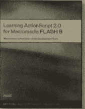

**为 Macromedia Flash 8 开发扩展**

了解如何使用 JavaScript 扩展这个最受欢迎的 Web 创作平台的功能。为此创作环境创建命令和可扩展工具。

0-321-39416-X, $44.99

**在 Macromedia Flash 8 中使用 ActionScript 2.0 组件**

为希望使用组件加速开发的开发人员和 ActionScript 用户提供的资源。

0-321-39539-5, $54.99

**为 Macromedia Flash 8 学习 Actionscript 2.0**

详细介绍如何使用 ActionScript 进行编码，以添加交互性并创建具有高影响力的 Web 体验。包含大量可重用的代码示例。

0-321-39415-1, $49.99


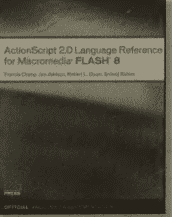


**Macromedia Flash 8：教程指南**

一系列分步教程，教授初级和高级 Flash 技术。

0-321-39414-3, $29.99

**Macromedia Flash 8 的 ActionScript 2.0 语言参考**

词典式参考涵盖了宝贵的语法和用法信息；详细描述了类、函数、属性和事件；并提供了 ActionScript 语言中每个元素的代码示例。

0-321-38404-0, $39.99

**为 Macromedia Dreamweaver 8 开发扩展**

使用 JavaScript 扩展 Dreamweaver 8 的功能。编写自己的对象、行为动作和命令，以影响 Dreamweaver 8 文档及其内部元素。

0-321-39540-9, $54.99

## 第一单元 富强与创新

### 第一课 踏上强国之路

#### 坚持改革开放

中国的腾飞证明，改革开放是决定当代中国命运的关键一招。

**改革开放促发展**

现代中国是长期经济发展的结果。这一发展过程是一持续变革的历史。

近代以来，由于西方列强的入侵、封建统治的腐败等原因，中华民族遭受了前所未有的苦难。强国富民成为一百多年来中华民族矢志不渝的奋斗目标。

中国共产党团结带领中国人民完成新民主主义革命，建立中华人民共和国，彻底结束了旧中国半殖民地半封建社会的历史，彻底结束了旧中国一盘散沙的局面，彻底废除了列强强加给中国的不平等条约和帝国主义在中国的一切特权。饱经苦难的中国人民终于站起来了。

中国共产党团结带领中国人民完成社会主义革命，确立社会主义制度，推进社会主义建设，为当代中国一切发展进步奠定了根本政治前提和制度基础，为中国发展富强、人民生活富裕奠定了坚实基础。

中国共产党团结带领中国人民进行改革开放新的伟大革命，极大激发广大人民群众的创造性，极大解放和发展社会生产力，极大增强社会发展活力，人民生活显著改善，综合国力显著增强，国际地位显著提高。中华民族迎来了从站起来、富起来到强起来的伟大飞跃。

9 1949年中华人民共和国成立，1956年社会主义改造基本完成。

上一世纪 1978年，党的十一届三中全会开启了改革开放的历史征程。从农村到城市，从试点到推广，从经济体制改革到全面深化改革，中国人民坚持聚精会神搞建设，坚持改革开放不动摇，推动中国发生了翻天覆地的变化。

## 引言

本指南描述了 Macromedia Dreamweaver 8 的框架和应用程序编程接口 (API)，它允许您构建 Dreamweaver 的扩展。本指南提供了关于每种扩展类型工作原理的信息；Dreamweaver 调用以实现构成 Dreamweaver 功能的各种对象、菜单、浮动面板、服务器行为等的 API 函数；以及每种扩展类型的简单示例。本指南还解释了如何通过编辑各种 HTML 和 XML 文件中的标签来定制 Dreamweaver，以添加菜单项或文档类型等。

要向 Dreamweaver 添加对象、菜单、浮动面板或其他功能，您必须为特定类型的扩展编写所需的函数。本指南描述了 Dreamweaver 传递给这些函数的参数，以及 Dreamweaver 期望这些函数返回的值。

有关可用于在 Dreamweaver 扩展中执行各种支持操作的实用程序和通用 JavaScript API 的信息，请参阅 *Dreamweaver API 参考*。如果您计划创建与数据库协作的扩展，您可能还需要查看 *Dreamweaver 入门* 中关于建立数据库连接的部分。

## 背景

大多数 Dreamweaver 扩展是用 HTML 和 JavaScript 编写的。本指南假设您熟悉 Dreamweaver、HTML、XML 和 JavaScript 编程。如果您正在实现 C 扩展，本指南假设您知道如何创建和使用 C 动态链接库 (DLL)。如果您正在编写用于构建 Web 应用程序的扩展，您还应该熟悉至少一种平台上的服务器端脚本，例如 Active Server Pages (ASP)、ASP.net、PHP: Hypertext Preprocessor (PHP)、Macromedia ColdFusion 或 Java Server Pages (JSP)。

## 安装扩展

为了熟悉编写扩展的过程，您可能希望探索 Macromedia Exchange 网站 (www.macromedia.com/exchange) 上提供的扩展和资源。安装现有扩展可以让您了解在自己的扩展中需要使用的一些工具。

**要安装扩展，请使用以下过程：**

- 下载并安装扩展管理器，该管理器可在 Macromedia Downloads 网站 (www.macromedia.com/software/downloads) 上获得。

- 登录 Macromedia Exchange 网站 (www.macromedia.com/exchange)。

- 从可用的扩展中，选择一个您想使用的。单击下载链接以下载扩展包。

- 将扩展包保存到您已安装的 Dreamweaver 文件夹中的 `Dreamweaver 8/Downloaded Extensions` 文件夹。

- 在扩展管理器中，选择“文件” > “安装扩展”。在 Dreamweaver 中，选择“命令” > “管理扩展”以启动扩展管理器。

扩展管理器会自动将扩展从 `Downloaded Extension` 文件夹安装到 Dreamweaver 中。

某些扩展需要 Dreamweaver 重新启动后才能使用。如果您在安装扩展时正在运行 Dreamweaver，系统可能会提示您退出并重新启动应用程序。

安装后要查看扩展的基本信息，请在 Dreamweaver 中转到扩展管理器（“命令” > “管理扩展”）。

## 创建扩展

在创建 Dreamweaver 扩展之前，请访问 Macromedia Exchange 网站 (www.macromedia.com/exchange)，查看您计划创建的扩展是否已存在。如果您没有找到满足您需求的扩展，然后执行以下步骤来创建扩展：

- 确定您要创建的扩展类型。有关扩展类型的更多信息，请参阅第 100 页的“Dreamweaver 扩展的类型”。

- 查看您计划创建的扩展类型的文档。为了熟悉创建该类型的扩展，最好在相应的章节中创建简单的扩展示例。

- 确定您需要修改或创建的文件。

- 为扩展规划用户界面 (UI)（如果有的话）。

- 创建必要的文件并将其保存在适当的文件夹中。

- 重新启动 Dreamweaver，使其识别新扩展。

- 测试扩展。

- 打包扩展，以便与他人共享。有关更多信息，请参阅第 109 页的“使用扩展管理器”。

## 扩展作者的其他资源

要与其他参与编写扩展的开发者交流，您可能希望加入 Dreamweaver 可扩展性新闻组。您可以通过 www.macromedia.com/go/extending_newsgrp/ 访问该新闻组的网站。

## Dreamweaver 的新功能

Dreamweaver 8 包含以下新的可扩展功能和界面。这些功能都有新的相关函数，列在 *Dreamweaver API 参考* 中。

- **改进的站点同步**

  Dreamweaver 8 中本地和远程文件的比较更加可靠。

- **复制和粘贴改进**

  复制和粘贴选项已简化。用户现在还可以将粘贴操作的默认行为设置为仅粘贴文本。

- **站点根相对链接映射** 已改进。

- **代码折叠**

  Dreamweaver 现在允许用户选择性地折叠或展开代码段。

- **代码视图工具栏**

  Dreamweaver 现在在代码视图中提供了一个工具栏，允许快速访问常用命令。

- **后台文件传输**

  此功能允许用户在处理与服务器相关的任务时，在 Dreamweaver 中执行其他操作。

- **文件比较集成**

  Dreamweaver 现在允许用户启动第三方文件比较应用程序来比较两个本地文件、两个远程文件，或者文件的本地版本和远程版本。

- **CSS 样式的简化处理**

  CSS 样式和相关 CSS 面板已合并。设计面板现在命名为 CSS；CSS 样式面板现在命名为样式。窗口菜单中现在有“文档 CSS 样式”和“选择 CSS 样式”的菜单选项。此外，属性检查器中添加了“编辑规则”按钮。

- **CSS div 和层的可视辅助工具**

  Dreamweaver 现在包含可视辅助工具，让用户可以看到他们的 CSS 页面布局。

- **缩放**

  Dreamweaver 现在允许用户在查看网页时放大和缩小。

- **参考线**

  Dreamweaver 现在允许用户在文档中创建参考线。

### 文档更改

*扩展 Dreamweaver* 包含以下改进，以帮助新的扩展作者入门。

- **新增和更新的示例**

  为报告和行为添加了新的示例。属性检查器的示例已改进。创建每种类型扩展的步骤以教程形式呈现，您可以按照教程了解文件的作用以及它们如何交互。

- **新的组织结构**

  每章现在都以一个表格开始，列出了创建该章描述的扩展类型所需的文件。

有关添加到实用程序 API 和 JavaScript API 的新函数的信息，请参阅 *Dreamweaver API 参考*。

### Macromedia Press

通过 Macromedia Press 的书籍提高您的 Dreamweaver 技能。查看专家撰写的最新内容。请访问 www.macromedia.com/go/dw2004_help_mmp。

### 已弃用的函数

在 Dreamweaver 8 中，有几个函数已被弃用。有关从实用程序和 JavaScript API 中移除的函数的信息，请参阅 *Dreamweaver API 参考*。

## 勘误

已知问题的最新列表可在 Dreamweaver 支持中心 (www.macromedia.com/go/extending_errata) 的可扩展性部分找到。

## 本指南中使用的约定

本指南使用以下排版约定：

- 代码字体表示代码片段和 API 字面量，包括类名、方法名、函数名、类型名、脚本、SQL 语句以及 HTML 和 XML 标签和属性名。

- 斜体代码字体表示代码中的可替换项。

- 续行符号 (¬) 表示一行很长的代码已拆分为两行或多行。由于本指南格式的页边距限制，原本连续的代码行必须拆分。复制代码行时，请删除续行符号，并将各行输入为一行。

- 括号 ({ }) 围绕函数参数表示该参数是可选的。

- 具有前缀 `dreamweaver.` 的函数名（如 `dreamweaver.funcname`），在编写代码时可以缩写为 `dw.funcname`。本手册在定义函数和索引中使用完整的 `dreamweaver.` 前缀。然而，许多示例使用较短的 `dw.` 前缀。

本指南使用以下命名约定：

- 您——负责编写扩展的开发者

- 用户——使用 Dreamweaver 的人

- 访客——查看用户创建的网页的人

## 第一部分

## 自定义 Dreamweaver

你可以根据需要自定义 Macromedia Dreamweaver 8，以满足你的 Web 开发需求，包括在对话框中更改设置、在多个区域中设置首选项，以及更改键盘快捷键。你还可以自定义代码视图中的代码提示和代码着色、层叠样式表（CSS）配置文件，以及 Dreamweaver 的默认 HTML 格式设置。

- 第 1 章：自定义 Dreamweaver ....................................................... 17

- 第 2 章：自定义代码视图 .............................................................. 55

# 第 1 章

## 自定义 Dreamweaver

除了创建和使用 Dreamweaver 扩展外，你还可以通过多种方式自定义 Macromedia Dreamweaver，让你能够以熟悉、舒适且高效的方式进行工作。

### 自定义 Dreamweaver 的方式

自定义 Dreamweaver 有多种通用方法。其中一些方法在《*Using Dreamweaver*》中有介绍。这些方法可用于自定义你的工作区。你还可以在 Dreamweaver 的对话框中更改设置。你可以使用"首选项"面板（编辑 > 首选项）在多个区域中设置首选项，包括辅助功能、代码着色、字体、高亮显示和在浏览器中预览等。你还可以使用"键盘快捷键编辑器"（编辑 > 键盘快捷键）更改键盘快捷键。

以下列表介绍了一些通过编辑配置文件来自定义 Dreamweaver 的方式：

- 重新排列"插入"栏中的对象、创建新选项卡来重新组织对象，或添加新对象。请参阅第 148 页的"修改插入栏"。

- 更改菜单项的名称、向菜单中添加新命令，以及从菜单中删除现有命令。请参阅第 8 章"菜单和菜单命令"，第 181 页。

- 更改浏览器配置文件或创建新的配置文件。请参阅第 30 页的"使用浏览器配置文件"。

- 更改第三方标签（包括 ASP 和 JSP 标签）在文档窗口设计视图中的显示方式。请参阅第 21 页的"自定义第三方标签的解释"。

此外，你还可以通过以下方式调整 Dreamweaver 以满足你的需求：

- 自定义默认文档

- 自定义页面设计

- 自定义对话框的外观

- 更改默认文件类型

- 自定义第三方标签的解释

- 自定义工作区布局

- 自定义代码视图工具栏

### 自定义默认文档

`DocumentTypes/NewDocuments` 文件夹中包含每种可通过 Dreamweaver 创建的默认（空白）文档。当你通过选择"文件">"新建"并从"基本页"、"动态页"或"其他"类别中选择一项来创建新的空白文档时，Dreamweaver 会根据此文件夹中的相应默认文档来创建新文档。若要更改给定类型的默认文档中显示的内容，请编辑此文件夹中的相应文档。

> **注意**


> 如果你希望站点中的所有页面都包含通用元素（如版权声明）或通用布局，最好使用模板和库项目，而不是更改默认文档。有关模板和库项目的更多信息，请参阅《*Using Dreamweaver*》。

### 自定义页面设计

`Dreamweaver` 提供了多种预设计的层叠样式表、框架集和页面设计。你可以通过选择“文件”>“新建”来基于这些设计创建页面。

若要自定义可用的设计，请编辑 `BuiltIn/css`、`BuiltIn/framesets`、`BuiltIn/Templates` 和 `BuiltIn/TemplatesAccessible` 文件夹中的文件。

> **注意**
> 
> “页面设计”和“页面设计（辅助功能）”类别中列出的设计是 `Dreamweaver` 模板文件；有关模板的更多信息，请参阅《*Using Dreamweaver*》。

你还可以通过将文件添加到 `BuiltIn` 文件夹的子文件夹中来创建自定义页面设计。若要在“新建文档”对话框中显示该文件的说明，请创建与页面设计文件相对应的设计备注文件（放在适当的 `_notes` 文件夹中）。

### 自定义对话框的外观

对象、命令和行为所使用的对话框布局被指定为 `HTML` 表单；它们位于 `Dreamweaver` 应用程序文件夹内的 `Configuration` 文件夹中的 `HTML` 文件里。你可以像编辑 `Dreamweaver` 中的任何表单一样来编辑这些表单。有关详细信息，请参阅《*Using Dreamweaver*》。

> **注意**
> 
> 请记住，在多用户操作系统中，你应该编辑用户 `Configuration` 文件夹中的配置文件副本，而不是编辑 `Dreamweaver` 的配置文件。有关详细信息，请参阅第 104 页的“多用户 Configuration 文件夹”。

**更改对话框的外观：**

1. 在 `Dreamweaver` 中，选择“编辑”>“首选项”，然后选择“代码重写”类别。
2. 取消选择“粘贴时重命名表单项”选项。
   取消选择此选项可确保在复制和粘贴表单项时保留其原始名称。
3. 单击“确定”关闭“首选项”对话框。
4. 在你的磁盘上，找到 `Configuration/Objects`、`Configuration/Commands` 或 `Configuration/Behaviors` 文件夹中相应的 `HTM` 文件。
5. 将该文件的副本制作到 `Configuration` 文件夹以外的某个位置。
6. 在 `Dreamweaver` 中打开该副本，编辑表单，然后保存。
7. 退出 `Dreamweaver`。
8. 将更改后的文件复制回 `Configuration` 文件夹，替换原始文件。（最好先备份原始文件，以便在需要时稍后恢复。）
9. 重新启动 `Dreamweaver` 以查看更改。

你应该只更改对话框的外观，而不是其工作方式；它必须仍然包含相同类型的表单元素且具有相同的名称，以便 `Dreamweaver` 从对话框中获取的信息仍能以相同的方式使用。

例如，“注释”对象从对话框中的文本区域获取文本输入，并使用简单的 `JavaScript` 函数将该文本转换为 `HTML` 注释，然后将注释插入到你的文档中。描述该对话框的表单位于 `Configuration/Objects/Invisibles` 文件夹中的 `Comment.htm` 文件里。你可以打开该文件并更改文本区域的大小和其他属性，但如果你完全删除了 `<textarea>` 标签，或者更改了其 `name` 属性的值，“注释”对象将无法正常工作。

### 更改默认文件类型

默认情况下，`Dreamweaver` 在“文件”>“打开”对话框中显示它识别的所有文件类型。你可以使用该对话框中的弹出菜单将显示限制为某些类型的文件。如果你大部分工作都涉及特定文件类型（如 `ASP` 文件），则可以更改默认显示。`Dreamweaver Extensions.txt` 文件中第一行列出的文件类型将成为默认类型。

> **注意**
> 
> 如果你想在“文件”>“打开”对话框中查看所有文件类型（包括 `Dreamweaver` 无法打开的文件），你必须选择“所有文件（`\*.\*`）”。这与“所有文档”不同，后者仅显示 `Dreamweaver` 可以打开的文件。

#### 更改 Dreamweaver 默认的“文件”>“打开”文件类型：

1. 备份 `Configuration` 文件夹中的 `Extensions.txt` 文件。
2. 在 `Dreamweaver` 或文本编辑器中打开 `Extensions.txt`。
3. 剪切与新默认值对应的行，并将其粘贴到文件的开头，使其成为文件的第一行。
4. 保存文件。
5. 重新启动 `Dreamweaver`。
   要查看新的默认值，请选择“文件”>“打开”，然后查看文件类型的弹出菜单。

#### 向“文件”>“打开”对话框的菜单中添加新的文件类型：

1. 备份 `Configuration` 文件夹中的 `Extensions.txt` 文件。
2. 在 `Dreamweaver` 或文本编辑器中打开 `Extensions.txt`。
3. 为每种新文件类型添加新行。
   a. 用大写字母输入新文件类型可以具有的 `filename` 扩展名，以逗号分隔。
   b. 添加冒号和简短的说明，以在“文件”>“打开”对话框中显示的文件类型的弹出菜单中显示。
   例如，对于 `JPEG` 文件，输入以下内容：
   `JPG,JPEG,JFIF:JPEG Image Files`
4. 保存文件。
5. 重新启动 `Dreamweaver`。
   要查看更改，请选择“文件”>“打开”，然后单击文件类型的弹出菜单。

## 自定义第三方标签的解析方式

`ASP`、`Macromedia ColdFusion`、`JSP` 和 `PHP` 等服务器端技术在 `HTML` 文件中使用特殊的非 `HTML` 代码；服务器根据这些代码创建并输出 `HTML` 内容。当 `Dreamweaver` 遇到非 `HTML` 标签时，会将其与第三方标签文件中的信息进行比较，这些文件定义了 `Dreamweaver` 如何读取和显示非 `HTML` 标签。

例如，除了常规 `HTML` 外，`ASP` 文件还包含供服务器解析的 `ASP` 代码。`ASP` 代码看起来几乎像 `HTML` 标签，但由一对分隔符标记：以 `<%` 开始，以 `%>` 结束。`Dreamweaver` 的 `Configuration/ThirdPartyTags` 文件夹中包含一个名为 `Tags.xml` 的文件，该文件描述了各种第三方标签（包括 `ASP` 代码）的格式，并定义了 `Dreamweaver` 如何显示该代码。由于 `Tags.xml` 中指定 `ASP` 代码的方式，`Dreamweaver` 不会尝试解释分隔符之间的任何内容；相反，在设计视图中，它会显示一个表示 `ASP` 代码的图标。您自己的标签数据库文件可以定义 `Dreamweaver` 如何读取和显示您的标签。为每组标签创建一个新的标签数据库文件，以告诉 `Dreamweaver` 如何显示这些标签。

> 本节说明了如何定义 `Dreamweaver` 显示自定义标签的方式，但并未描述如何提供编辑自定义标签内容或属性的方法。有关如何创建属性检查器以检查和更改自定义标签属性的信息，请参见第 279 页的第 12 章“属性检查器”。

每个标签数据库文件定义一个或多个自定义标签的名称、类型、内容模型、渲染方案和图标。您可以创建任意数量的标签数据库文件，但所有文件都必须位于 `Configuration/ThirdPartyTags` 文件夹中，才能被 `Dreamweaver` 读取和处理。标签数据库文件的扩展名为 `.xml`。

> 如果您同时处理多个不相关的站点（例如，作为自由职业开发者），可以将特定站点的所有标签规范放在一个文件中。然后只需将该标签数据库文件连同自定义图标和属性检查器一起交给维护站点的人员即可。

您使用名为 `tagspec` 的 `XML` 标签来定义标签规范。例如，以下代码描述了名为 `happy` 的标签的规范：

```
<tagspec tag_name="happy" tag_type="nonempty" render_contents="false"
  content_model="marker_model" icon="happy.gif" icon_width="18"
  icon_height="18"></tagspec>
```

您可以使用 `tagspec` 定义两种标签：

- 普通 `HTML` 风格标签

`happy` 标签示例是一个普通 `HTML` 风格标签。它以开始标签 `<happy>` 开头，包含开始标签和结束标签之间的数据，以结束标签 `</happy>` 结尾。

- 字符串分隔标签

字符串分隔标签以一个字符串开始，以另一个字符串结束。它们类似于空 `HTML` 标签（如 `img`），不包围内容，也没有结束标签。如果 `happy` 标签是字符串分隔标签，标签规范将包含 `start_string` 和 `end_string` 属性。`ASP` 标签是字符串分隔标签；它以字符串 `<%` 开始，以字符串 `%>` 结束，没有结束标签。

以下信息描述了 `tagspec` 标签的属性和有效值。标有星号 (*) 的属性对于字符串分隔标签将被忽略。可选属性在属性列表中用花括号（`{}`）标记；所有未用花括号标记的属性都是必需的。

## `<tagspec>`

## 描述

提供有关第三方标签的信息。

## 属性

`tag_name`、`{tag_type}`、`{render_contents}`、`{content_model}`、`{start_string}`、`{end_string}`、`{detect_in_attribute}`、`{parse_attributes}`、`icon`、`icon_width`、`icon_height`、`{equivalent_tag}`、`{is_visual}`、`{server_model}`

- `tag_name` 是自定义标签的名称。对于字符串分隔标签，`tag_name` 仅用于确定给定的属性检查器是否可以用于该标签。如果属性检查器的第一行包含此标签名称，两侧各有一个星号，则该检查器可用于此类标签。例如，`ASP` 代码的标签名称为 `ASP`。可以检查 `ASP` 代码的属性检查器应在第一行包含 `*ASP*`。有关属性检查器 `API` 的信息，请参见第 279 页的第 12 章“属性检查器”。

- `tag_type` 确定标签是空标签（如 `img` 标签），还是在其开始标签和结束标签之间包含内容（如 `code` 标签）。此属性对于普通（非字符串分隔）标签是必需的。对于字符串分隔标签，该属性被忽略，因为它们始终为空。有效值为 `"empty"` 和 `"nonempty"`。

- `render_contents` 确定标签的内容是否应显示在设计视图中，或者是否应显示指定的图标。此属性对于非空标签是必需的，对于空标签则被忽略。（空标签没有内容。）此属性仅适用于出现在属性外部的标签。出现在其他标签属性值内部的标签内容不会被渲染。有效值为 `"true"` 和 `"false"`。

- `content_model` 描述标签可以包含哪些类型的内容，以及标签可以出现在 `HTML` 文件中的什么位置。有效值为 `"block_model"`、`"head_model"`、`"marker_model"` 和 `"script_model"`：

  - `block_model` 指定标签可以包含块级元素（如 `div` 和 `p`），并且标签只能出现在 `body` 部分或出现在其他 `body` 内容标签（如 `div`、`layer` 或 `td`）内部。

  - `head_model` 指定标签可以包含文本内容，并且只能出现在 `HEAD` 部分。

  - `marker_model` 指定标签可以包含任何有效的 `HTML` 代码，并且可以出现在 `HTML` 文件中的任何位置。`Dreamweaver` 中的 `HTML` 验证器会忽略指定为 `marker_model` 的标签。但是，验证器不会忽略此类标签的内容；因此，即使标签本身可以出现在任何位置，标签的内容在某些位置可能会导致无效的 `HTML`。例如，纯文本不能出现在文档 `head` 部分（在有效的 `head` 元素之外），因此您不能在 `head` 部分放置包含纯文本的 `marker_model` 标签。（要在 `head` 部分放置包含纯文本的自定义标签，请将标签的内容模型指定为 `head_model` 而不是 `marker_model`。）对于应该内联显示的标签（在块级元素（如 `p` 或 `div`）内部——例如，在段落内部），请使用 `marker_model`。如果标签应该作为独立段落显示，前后带有换行符，请不要使用此模型。

  - `script_model` 允许标签存在于文档的打开和关闭 `HTML` 标签之间的任何位置。当 `Dreamweaver` 遇到具有此模型的标签时，它会忽略该标签的所有内容。用于 `Dreamweaver` 不应解析的标记（如某些 `ColdFusion` 标签）。

- `start_string` 指定标记字符串分隔标签开始的分隔符。字符串分隔标签可以出现在文档中注释可以出现的任何位置。`Dreamweaver` 不会在 `start_string` 和 `end_string` 之间解析标签或解码实体或 `URL`。如果指定了 `end_string`，则此属性是必需的。

- `end_string` 指定标记字符串分隔标签结束的分隔符。如果指定了 `start_string`，则此属性是必需的。

- `detect_in_attribute` 指示即使 `start_string` 和 `end_string` 之间的内容（或如果未定义这些字符串，则为开始标签和结束标签之间的内容）出现在属性名称或值内部，是否也要忽略这些内容。对于字符串分隔标签，通常应将其设置为 `"true"`。默认值为 `"false"`。例如，`ASP` 标签有时出现在属性值内部，有时包含引号（"）。由于 `ASP` 标签规范指定了 `detect_in_attribute="true"`，当 `ASP` 标签出现在属性值内部时，`Dreamweaver` 会忽略 `ASP` 标签，包括内部的引号。

- `parse_attributes` 指示是否解析标签的属性。如果设置为 `"true"`（默认值），`Dreamweaver` 会解析属性；如果设置为 `"false"`，`Dreamweaver` 会忽略所有内容，直到出现在引号外部的下一个右尖括号。例如，对于 `cfif` 之类的标签（如 `<cfif a is 1>`，`Dreamweaver` 无法将其解析为一组属性名/值对），应将此属性设置为 `"false"`。

- `icon` 指定与标签关联的图标的路径和文件名。此属性对于空标签是必需的，对于内容不显示在文档窗口设计视图中的非空标签也是必需的。

- `icon_width` 指定图标的宽度（以像素为单位）。

- `icon_height` 指定图标的高度（以像素为单位）。

- `equivalent_tag` 为某些 `ColdFusion` 表单相关标签指定简单的 `HTML` 等效标签。不适用于其他标签。

- `is_visual` 指示标签是否对页面有直接的视觉效果。例如，`ColdFusion` 标签 `cfgraph` 未指定 `is_visual` 的值（因此默认值 `"true"`）；`ColdFusion` 标签 `cfset` 指定 `is_visual` 设置为 `"false"`。服务器标记标签的可见性由“首选项”对话框的“不可见元素”类别控制；可视服务器标记标签的可见性可以独立于非可视服务器标记标签的可见性进行设置。

- `server_model`（如果指定）指示 `tagspec` 标签仅适用于属于指定服务器模型的页面。如果未指定 `server_model`，`tagspec` 标签适用于所有页面。例如，`ASP` 和 `JSP` 标签的分隔符相同，但 `JSP` 的 `tagspec` 标签指定 `server_model` 为 `"JSP"`，因此当 `Dreamweaver` 在 `JSP` 页面上遇到具有适当分隔符的代码时，它会显示 `JSP` 图标。当它在非 `JSP` 页面上遇到此类代码时，它会显示 `ASP` 图标。

## 内容

无（空标签）。

## Container

无。

## Example

```
<tagspec tag_name="happy" tag_type="nonempty" render_contents="false"
  content_model="marker_model" icon="happy.gif" icon_width="18"
  icon_height="18"></tagspec>
```

## How custom tags appear in the Design view

自定义标签在文档窗口设计视图中的显示方式取决于 `tagspec` 标签的 `tag_type` 和 `render_contents` 属性的值。（请参阅第21页的“自定义第三方标签的解释”。）如果 `tag_type` 的值为 `"empty"`，则显示 `icon` 属性中指定的图标。如果 `tag_type` 的值为 `"nonempty"` 但 `render_contents` 的值为 `"false"`，则图标会像空标签一样显示。以下示例显示了前面定义的 `happy` 标签的实例在 `HTML` 中可能出现的显示方式：

```
<p>This is a paragraph that includes an instance of the <code>happy</code>
tag (<happy>Joe</happy>).</p>
```

由于在标签规范中将 `render_contents` 设置为 `"false"`，`happy` 标签的内容（单词 `Joe`）不会被渲染。相反，开始标签和结束标签及其内容会显示为单个图标。


对于`render_contents`值为`"true"`的非空标签，图标不会显示在设计视图中；而是显示开始标签和结束标签之间的内容（例如`<mytag>This is the content between the opening and closing tags</mytag>`中**标签之间**的文本）。如果启用了"查看">"不可见元素"，则内容会使用"高亮显示"首选项中指定的第三方标签颜色进行高亮显示。（高亮显示仅适用于在标签数据库文件中定义的标签。）

## 更改第三方标签的高亮显示颜色

1. 选择"编辑">"首选项"，然后选择"高亮显示"类别。
2. 单击"第三方标签"颜色框以显示颜色选择器。
3. 选择颜色，然后单击"确定"关闭"首选项"对话框。有关选择颜色的信息，请参阅*Using Dreamweaver*。

## 避免重写第三方标签

Dreamweaver会纠正HTML代码中的某些错误类型。有关详细信息，请参阅*Using Dreamweaver*。默认情况下，Dreamweaver不会更改具有某些文件扩展名的文件中的HTML，包括`.asp`（ASP）、`.cfm`（ColdFusion）、`.jsp`（JSP）和`.php`（PHP）。设置此默认值是为了防止Dreamweaver意外修改任何此类非HTML标签中包含的代码。您可以更改Dreamweaver的默认重写行为，使其在打开此类文件时重写HTML，还可以将其他文件类型添加到Dreamweaver不会重写的类型列表中。

当您在属性检查器中输入某些特殊字符时，Dreamweaver会将其替换为数值进行编码。通常最好让Dreamweaver执行此编码，因为这些特殊字符更有可能在不同平台和浏览器中正确显示。但是，由于这种编码可能会干扰第三方标签，因此在处理包含第三方标签的文件时，您可能希望更改Dreamweaver的编码行为。

**要允许Dreamweaver在更多类型的文件中重写HTML：**

1. 选择"编辑">"首选项"，然后选择"代码重写"类别。
2. 选择以下任一选项：
   - 修复无效的嵌套和未闭合的标签
   - 移除额外的结束标签
3. 执行以下操作之一：
   - 从"永不重写代码：具有扩展名的文件"选项中的扩展名列表中删除一个或多个扩展名。
   - 取消选择"永不重写代码：具有扩展名的文件"选项。（取消选择此选项可让Dreamweaver在所有类型的文件中重写HTML。）

**要添加Dreamweaver不应重写的文件类型：**

1. 选择"编辑">"首选项"，然后选择"代码重写"类别。
2. 选择以下任一选项：
   - 修复无效的嵌套和未闭合的标签
   - 移除额外的结束标签
3. 确保选中"永不重写代码：具有扩展名的文件"选项，并在文本字段的列表中添加新的文件扩展名。

如果新文件类型没有出现在"文件">"打开"对话框中的文件类型弹出菜单中，您可能需要将其添加到`Configuration/Extensions.txt`文件中。有关详细信息，请参阅第20页的"更改默认文件类型"。

**要关闭Dreamweaver编码选项：**

1. 选择**"编辑"** > **"首选项"**，然后选择"代码重写"类别。
2. 取消选择一个或两个"特殊字符"选项。

有关其他代码重写首选项的信息，请参阅*Using Dreamweaver*。

## 在多用户环境中自定义Dreamweaver

您可以在多用户操作系统（如Windows 2000、Windows XP或Mac OS X）中自定义Dreamweaver。Dreamweaver可以防止任何用户的自定义配置影响其他用户的自定义配置。为实现这一目标，Dreamweaver在可识别的多用户操作系统中首次运行时，会将各种配置文件复制到您的用户配置文件夹中。当您通过对话框和面板自定义Dreamweaver时，应用程序会修改您的用户配置文件，而不是修改Dreamweaver配置文件。要在多用户环境中通过编辑配置文件来自定义Dreamweaver，请编辑相应的用户配置文件，而不是编辑Dreamweaver配置文件夹中的文件。要更改影响大多数用户的设置，您可以编辑Dreamweaver配置文件，但已拥有相应用户配置文件的用户将看不到更改。通常，如果您想进行影响所有用户的更改，最好创建扩展并使用扩展管理器安装它。

> **注意** 在较旧的操作系统（Windows 98、Windows ME和Mac OS 9.x）中，即使用操作系统配置为支持多用户，所有用户也共享一组Dreamweaver配置文件。

用户配置文件夹的位置取决于用户的平台。Windows 2000和Windows XP平台使用以下位置：

*drive*:\Documents and Settings\*username*\Application Data\Macromedia\Dreamweaver 8\Configuration

> **注意** 在Windows XP中，此文件夹可能位于隐藏文件夹内。

Mac OS X平台使用以下位置：

*drive*:Users/username/Library/Application Support/Macromedia/Dreamweaver 8/Configuration*

> **注意** 要在多用户操作系统中安装所有用户都可以使用的扩展，您必须以管理员（Windows）或root（Mac OS X）身份登录。

Dreamweaver首次运行时，仅将部分配置文件复制到您的用户配置文件夹中。（它复制的文件在配置文件夹的`version.xml`文件中指定。）当您在应用程序内自定义Dreamweaver时（例如，当您修改"代码片段"面板中的某个预设计代码片段时），Dreamweaver会将相关文件复制到您的用户配置文件夹中。用户配置文件夹中的文件版本始终优先于Dreamweaver配置文件夹中的版本。要自定义Dreamweaver尚未复制到您的用户配置文件夹中的配置文件，请首先从Dreamweaver配置文件夹将文件复制到用户配置文件夹中的相应位置。然后编辑用户配置文件夹中的副本。

### 在多用户环境中删除配置文件

在多用户操作系统中工作时，如果您在Dreamweaver中执行的操作会删除配置文件（例如，从"代码片段"面板中删除预设计代码片段），Dreamweaver会在您的用户配置文件夹中创建一个名为`mm_deleted_files.xml`的文件。当某个文件列在`mm_deleted_files.xml`中时，Dreamweaver会表现得好像该文件不存在一样。

**要停用配置文件：**

1. 退出Dreamweaver。
2. 使用文本编辑器，编辑用户配置文件夹中的`mm_deleted_files.xml`；向该文件添加一个`item`标签，指定要停用的配置文件的相对路径（相对于Dreamweaver配置文件夹）。

> **注意** 请勿在Dreamweaver中编辑`mm_deleted_files.xml`。

3. 保存并关闭`mm_deleted_files.xml`。
4. 重新启动Dreamweaver。

## 关于`mm_deleted_files.xml`标签语法

`mm_deleted_files.xml`文件包含一个结构化的项目列表，用于指定Dreamweaver应忽略的配置文件。这些项目由XML标签指定，您可以在文本编辑器中进行编辑。

以下部分描述了`mm_deleted_files.xml`标签的语法。可选属性在属性列表中用花括号（{}）标记；所有未用花括号标记的属性都是必需的。

## `<deleteditems>`

**描述**

容器标签，包含一个项目列表，Dreamweaver应将这些项目视为已删除。

**属性**

无。

**内容**

此标签必须包含一个或多个`item`标签。

**容器**

无。

**示例**

```
<deleteditems>
<!-- 项目标签放在此处 -->
</deleteditems>
```

## `<item>`

**描述**

指定Dreamweaver应忽略的配置文件。

**属性**

`name`

- **name** 配置文件的路径，相对于`Configuration`文件夹。在Windows中，使用反斜杠（\）分隔路径的各个部分；在Macintosh上，使用冒号（:）。

**内容**

无（空标签）。

**容器**

此标签必须包含在`deleteditems`标签内。

**示例**

```
<item name="snippets\headers\5columnwith4links.csn" />
```

## 在多用户环境中重新安装和卸载Dreamweaver

安装Dreamweaver后，如果您稍后重新安装它或升级到更高版本，Dreamweaver会自动备份现有的用户配置文件，这样即使您已经自定义了这些文件，您仍然可以访问您所做的更改。当您从多用户系统中卸载Dreamweaver（只有拥有管理员权限才能这样做）时，Dreamweaver可以为您删除每个用户的`Configuration`文件夹。

## 处理浏览器配置文件

浏览器配置文件是Dreamweaver在运行目标浏览器检查（参见*使用Dreamweaver*）时用来检查您的文档的文件。每个配置文件包含有关特定浏览器支持的HTML标签和属性的信息。浏览器配置文件还可能包含警告、错误消息和标签替换建议。

浏览器配置文件存储在Dreamweaver应用程序文件夹中的`Configuration/BrowserProfiles`文件夹中。您可以使用Dreamweaver或文本编辑器编辑现有配置文件或创建新的配置文件。在编辑或创建浏览器配置文件之前，无需退出Dreamweaver。

## 关于浏览器配置文件格式

浏览器配置文件遵循特定的格式。为避免在目标浏览器检查期间出现解析错误，在编辑或创建配置文件时请遵循以下规则：

- 第一行保留用于配置文件的名称。其后必须跟一个单独的回车符。此行上的名称将显示在"目标浏览器检查"对话框和目标检查报告中。它必须是唯一的。
- 第二行保留用于指示符`PROFILE_TYPE=BROWSER_PROFILE`。Dreamweaver使用此行来确定哪些文档是浏览器配置文件。请勿更改或移动此行。
- 行首的两个连字符（`--`）表示注释（即，该行在目标检查过程中将被忽略）。注释必须在行首开始；不能将两个连字符放在行中。
- 必须在以下位置使用空格：
  - 在`!ELEMENT`行的结束角括号（`>`）之前
  - 在属性值列表的开始括号之后
  - 在值列表的结束括号之前
  - 在值列表中每个管道符（`|`）的前后。
- 必须在以下每个词之前包含感叹号（`!`）且不加空格：`ELEMENT`、`ATTLIST`、`Error`和`msg`（`!ELEMENT`、`!ATTLIST`、`!Error`、`!msg`）。
- 可以在`!ELEMENT`或`!ATTLIST`区域内包含`!Error`、`!Warning`和`!Info`。
- `!msg`消息只能包含纯文本。
- HTML注释（`<!-- -->`）不能在浏览器配置文件中列为标签，因为它们会干扰解析。Dreamweaver不会报告注释错误，因为所有浏览器都支持它们。

以下示例显示了标签条目的语法：

```
<!ELEMENT htmlTag NAME="tagName">
<!ATTLIST htmlTag
unsupportedAttribute1 !Error !msg="htmlTag 标签的 unsupportedAttribute1 属性不受支持。尝试使用 supportedAttribute1 以获得类似效果。"
supportedAttribute1
supportedAttribute2 (validValue1 | validValue2 | validValue3)
unsupportedAttribute2 !Error !msg="切勿使用 htmlTag 标签的 unsupportedAttribute2 属性！"
>
```

此语法中显示的元素定义如下：

- `htmlTag`是HTML文档中出现的标签。
- `tagName`是标签的描述性名称；例如，`HR`标签的名称是"水平线"。`NAME`属性是可选的。如果指定，`tagName`将用于错误消息；如果您不提供名称，`htmlTag`将用于错误消息。
- `unsupportedAttribute`是不受支持的属性。任何未明确提及为受支持属性的标签或属性均假定为不受支持。仅在您想创建自定义错误消息时才指定不受支持的标签或属性。
- `supportedAttribute`是`htmlTag`支持的属性。只有未带`!Error`指示符列出的标签才被视为受浏览器支持。
- `validValue`表示属性支持的值。

以下示例显示了针对Netscape Navigator 3.0准确的`APPLET`标签条目：

```
<!ELEMENT APPLET Name="Java Applet">
<!ATTLIST APPLET
Align (top | middle | bottom | left | right | absmiddle | absbottom | baseline | texttop)
Alt
Archive
Class !Warning !msg="此浏览器忽略 APPLET 标签的 CLASS 属性。"
Code
Codebase
Height
HSpace
ID !Warning !msg="此浏览器忽略 APPLET 标签的 ID 属性。请改用 NAME。"
Name
Style !Warning !msg="此浏览器忽略 APPLET 标签的 STYLE 属性。"
VSpace
Width
>
```

## 创建和编辑浏览器配置文件

您可以通过修改现有配置文件来创建浏览器配置文件。例如，要为未来版本的Microsoft Internet Explorer创建配置文件，您可以打开具有配置文件的最新版本Internet Explorer的配置文件，添加新版本中引入的任何新标签或属性，然后将其另存为新版本的配置文件。

> **注意** 在为新版本的浏览器创建浏览器配置文件之前，请检查Macromedia Exchange for Dreamweaver站点（网址为`www.macromedia.com/exchange/dreamweaver`），看看Macromedia是否提供了可供您下载并通过扩展管理器安装的浏览器配置文件。

**创建或编辑浏览器配置文件：**

1. 打开现有配置文件进行编辑。如果您要创建新配置文件，请打开与您要创建的配置文件最相似的配置文件，并将文件另存为新文件名。
2. 如果您要创建新配置文件，请更改文件第一行文本中显示的名称。（两个配置文件不能同名。）
3. 使用第30页"关于浏览器配置文件格式"中所示的语法，添加您知道浏览器支持的任何新标签或属性。如果您不想收到关于某个特定不受支持标签的错误消息，请将其添加到受支持标签列表中。如果您这样做，请将配置文件保存到单独的文件中，并使用新文件名（例如`Browsername x.x limited`）。为这个替代配置文件使用新名称可以保留仅包含真正受支持标签的原始配置文件。
4. 删除浏览器不支持的任何标签或属性。如果您为Netscape Navigator或Internet Explorer的新版本创建配置文件，这一步可能没有必要，因为浏览器很少放弃对标签的支持。
5. 根据第30页"关于浏览器配置文件格式"中所示的语法添加任何自定义错误消息。Dreamweaver附带的配置文件列出了指定浏览器的所有受支持标签。要向标签添加自定义错误消息，请在`!Error`后键入`!msg = "消息"`。以下示例显示了Netscape Navigator 3.0配置文件中出现的信息（连同此处未显示的其他属性）：

```
<!ELEMENT HR name="水平线">
<!ATTLIST HR
COLOR !Error
>
```

要添加自定义错误消息，请输入`!msg=`后跟引号（`"`）中的错误消息：

```
<!ELEMENT HR name="水平线">
<!ATTLIST HR
COLOR !Error !msg="Internet Explorer 3.0 支持水平线中的 COLOR 标签，但 Netscape Navigator 3.0 不支持。"
>
```

6. 您可以对所有错误情况使用`!Error`，或者使用`!Warning`或`!Info`来指示某个标签将被忽略，但实际上不会导致错误。

## 更改FTP映射

`FTPExtensionMap.txt`文件（Windows）和`FTPExtensionMapMac.txt`文件（Macintosh）用于将文件名扩展名映射到FTP传输模式（ASCII或BINARY）。

这两个文件中的每一行都包含一个文件名扩展名（如`GIF`）以及`ASCII`或`BINARY`一词，以表明在传输具有该扩展名的文件时应使用哪种FTP传输模式。在Macintosh上，每一行还包含一个创建者代码（如`DmWr`）和一个文件类型（如`TEXT`）。当您在Macintosh上下载具有给定文件名扩展名的文件时，Dreamweaver会将指定的创建者和文件类型分配给该文件。

如果正在传输的文件没有文件名扩展名，Dreamweaver将使用`BINARY`传输模式。

> TS Dreamweaver无法以Macbinary模式传输文件。如果您需要以Macbinary模式传输文件，必须使用其他FTP客户端。

以下示例显示了（来自Macintosh文件的）一行，表明扩展名为`.html`的文件应以ASCII模式传输：

```
HTML	DmWr	TEXT	ASCII
```


在`FTPExtensionMap.txt`文件和`FTPExtensionMapMac.txt`文件（Macintosh）中，给定行中的所有元素都以制表符分隔。扩展名和传输模式均为大写字母。

若要更改默认设置，请在文本编辑器中编辑该文件。

### 要添加有关新文件名扩展名的信息：

1. 在文本编辑器中编辑扩展名映射文件。
2. 在空白行中，输入文件名扩展名（大写字母），然后按 Tab 键。
3. 在 Macintosh 上，添加创建者代码、一个制表符、文件类型以及另一个制表符。
4. 输入`ASCII`或`BINARY`以设置 FTP 传输模式。
5. 保存文件。

## Dreamweaver 中的可扩展文档类型

XML 提供了一套丰富的系统，用于定义复杂的文档和数据结构。Dreamweaver 使用多个 XML 架构来组织有关服务器行为、标签和标签库、组件、文档类型以及参考信息的信息。

在 Dreamweaver 中创建和使用扩展时，有很多情况需要创建或修改现有的 XML 文件来管理扩展所使用的数据。在许多情况下，您可以从`Configuration`文件夹中的适当子文件夹复制现有文件用作模板。

### 文档类型定义文件

可扩展文档类型的核心组件是文档类型定义文件。可能有多个定义文件，它们都位于`Configuration/DocumentTypes`文件夹中。每个定义文件包含有关至少一种文档类型的信息。对于每种文档类型，都会描述服务器模型、颜色编码样式、描述等基本要素。

> 请勿将 Dreamweaver 文档类型定义文件与 XML 文档类型定义（DTD）混淆。Dreamweaver 中的文档类型定义文件包含一组文档类型元素，每个元素定义了一组与文档类型关联的预定义标签和属性。Dreamweaver 启动时，它会解析文档类型定义文件，并创建一个包含所有已定义文档类型信息的内存数据库。

Dreamweaver 提供了一个初始文档类型定义文件。这个名为`MMDocumentTypes.xml`的文件包含 Macromedia 提供的文档类型定义：

| 文档类型 | 服务器模型 | 内部类型 | 文件扩展名 | 先前服务器模型 |
| --- | --- | --- | --- | --- |
| ASP.NET C# | ASP.NET-Csharp | Dynamic | aspx, ascx | |
| ASP.NET VB | ASP.NET-VB | Dynamic | aspx, ascx | |
| ASP JavaScript | ASP-JS | Dynamic | asp | |
| ASP VBScript | ASP-VB | Dynamic | asp | |
| ColdFusion | ColdFusion | Dynamic | cfm, cfml | UltraDev 4 ColdFusion |
| ColdFusion 组件 | | Dynamic | cfc | |
| JSP | JSP | Dynamic | jsp | |
| PHP | PHP | Dynamic | php, php3 | |
| 库项目 | | DWExtension | lbi | |
| ASP.NET C# 模板 | | DWTemplate | axcs.dwt | |
| ASP.NET VB 模板 | | DWTemplate | axvb.dwt | |
| ASP JavaScript 模板 | | DWTemplate | aspjs.dwt | |
| ASP VBScript 模板 | | DWTemplate | aspvb.dwt | |
| ColdFusion 模板 | | DWTemplate | cfm.dwt | |
| HTML 模板 | | DWTemplate | dwt | |
| JSP 模板 | | DWTemplate | jsp.dwt | |
| PHP 模板 | | DWTemplate | php.dwt | |
| HTML | | HTML | htm, html | |
| ActionScript | | Text | as | |
| C# | | Text | cs | |
| CSS | | Text | css | |
| Java | | Text | java | |
| JavaScript | | Text | js | |
| VB | | Text | vb | |
| VBScript | | Text | vbs | |
| 文本 | | Text | txt | |
| EDML | | XML | edml | |
| TLD | | XML | tld | |
| VTML | | XML | vtm, vtml | |
| WML | | XML | wml | |
| XML | | XML | xml | |

如果您需要创建新的文档类型，可以将您的条目添加到 Macromedia 提供的文档定义文件（`MMDocumentTypes.xml`）中，或者将自定义定义文件添加到`Configuration/DocumentTypes`文件夹中。

> 注意
> `NewDocuments`子文件夹位于`Configuration/DocumentTypes`文件夹中。该子文件夹包含每种文档类型的默认页面（模板）。

### 文档类型定义文件的结构

以下示例显示了典型的文档类型定义文件可能的外观：

```
<?xml version="1.0" encoding="utf-8"?>
<documenttypes
      xmlns:MMString="http://www.macromedia.com/schemes/data/string/">
  <documenttype
      id="dt-ASP-JS"
      servermodel="ASP-JS"
      internaltype="Dynamic"
      winfileextension="asp,htm, html"
      macfileextension="asp, html"
      previewfile="default_aspjs_preview.htm"
      file="default_aspjs.htm"
      priorversionservermodel="UD4-ASP-JS" >
    <title>
      <loadString id="mmdocumenttypes_Otitle" />
    </title>
    <description>
      <loadString id="mmdocumenttypes_Odescr" />
    </description>
  </documenttype>
  ...
</documenttypes>
```

> 注意
> 文档类型的颜色编码在位于`Configuration/CodeColoring`文件夹中的 XML 文件中指定。

在前面的示例中，`loadString`元素标识了 Dreamweaver 用于 ASP-JS 类型文档的标题和描述的本地化字符串。有关本地化字符串的更多信息，请参阅第 44 页的"本地化字符串"。

下表描述了可在文档类型定义文件中使用的标签和属性。

| 元素类型 | 必需 | 描述 |
| :--- | :--- | :--- |
| `documenttype`（根） | 是 | 父节点。 |
| `id` | 是 | 所有文档类型定义文件中的唯一标识符。 |
| `servermodel` | 否 | 指定关联的服务器模型（区分大小写）；默认情况下，以下值有效：`ASP.NET C#` `ASP.NET VB` `ASP VBScript` `ASP JavaScript` `ColdFusion` `JSP` `PHP` `MySQL`。调用`getServerModelDisplayName()`函数会返回这些名称。服务器模型实现文件位于`Configuration/ServerModels`文件夹中。扩展开发人员可以创建新的服务器模型来扩展此列表。 |
| `internaltype` | 是 | Dreamweaver 处理文件的广泛分类。`internaltype`标识是否为此文档启用了设计视图，并处理 Dreamweaver 模板或扩展等特殊情况。以下值有效：`Dynamic`、`DWExtension`（具有特殊显示区域）、`DWTemplate`（具有特殊显示区域）、`HTML`、`HTML4`、`Text`（仅代码视图）、`XHTML1`、`XML`（仅代码视图）。所有与服务器模型相关的文档类型都应映射到`Dynamic`。HTML 应映射到`HTML`。脚本文件（如 CSS、JS、VB 和 CS）应映射到`Text`。如果`internaltype`为`DWTemplate`，则还应指定`dynamicid`。如果在这种情况下省略`dynamicid`，"新建文档"对话框创建的新空白模板将不会被"服务器行为"或"绑定"面板识别为文档类型。此模板的实例只是 HTML 模板。 |
| `dynamicid` | 否 | 对动态文档类型唯一标识符的引用。此属性仅在`internaltype`为`DWTemplate`时才有意义。此属性允许您将动态模板与动态文档类型相关联。 |
| `winfileextension` | 是 | 与 Windows 上文档类型关联的文件扩展名。你可以使用逗号分隔的列表来指定多个文件扩展名。列表中的第一个扩展名是用户保存`documenttype`文档时 Dreamweaver 所使用的扩展名。如果两个非服务器模型关联的文档类型具有相同的文件扩展名，Dreamweaver 会将第一个识别为该扩展名对应的文档类型。 |
| `macfileextension` | 是 | 与 Macintosh 上文档类型关联的文件扩展名。你可以使用逗号分隔的列表来指定多个文件扩展名。列表中的第一个扩展名是用户保存`documenttype`文档时 Dreamweaver 所使用的扩展名。如果两个非服务器模型关联的文档类型具有相同的文件扩展名，Dreamweaver 会将第一个识别为该扩展名对应的文档类型。 |
| `previewfile` | 否 | 在"新建文档"对话框的预览区域中渲染的文件。 |
| `file` | 是 | 位于`DocumentTypes/NewDocuments`文件夹中、包含新`documenttype`文档模板内容的文件。 |
| `priorversionservermodel` | 否 | 如果此文档的服务器模型在 Dreamweaver UltraDev 4 中有等效版本，请指定该旧版本服务器模型的名称。`UltraDev 4 ColdFusion`是一个有效的先前服务器模型。 |
| `title`（子标签） | 是 | 作为"新建文档"对话框中"空白文档"下的类别项显示的字符串。你可以直接在定义文件中放置此字符串，也可以间接引用以实现本地化。有关本地化此字符串的更多信息，请参阅第 44 页的"本地化字符串"。不允许使用格式设置，因此不能指定 HTML 标签。 |
| `description`（子标签） | 否 | 描述文档类型的字符串。你可以直接在定义文件中放置此字符串，也可以间接引用以实现本地化。有关本地化此字符串的更多信息，请参阅第 44 页的"本地化字符串"。允许使用格式设置，因此可以指定 HTML 标签。 |

> **注意：** 当用户保存新文档时，Dreamweaver 会检查与该文档类型关联的当前平台的扩展名列表（`winfileextension`和`macfileextension`）。Dreamweaver 选择列表中的第一个字符串并将其用作默认文件扩展名。要更改此默认文件扩展名，你必须重新排列逗号分隔列表中的扩展名顺序，使新的默认扩展名排在第一位。

当 Dreamweaver 启动时，它会读取所有文档类型定义文件并构建有效文档类型的列表。Dreamweaver 将定义文件中具有不存在的服务器模型的条目视为非服务器模型文档类型。Dreamweaver 会忽略内容错误或 ID 不唯一的条目。

如果在扫描`Configuration/DocumentTypes`文件夹时，Dreamweaver 未找到任何文档类型定义文件，或者任何定义文件似乎已损坏，Dreamweaver 将显示错误消息并关闭。

## 动态模板

你可以创建基于动态文档类型的模板。这些模板称为*动态模板*。定义动态模板时，以下两个元素至关重要：

- 新文档类型的`internaltype`属性值必须为`DWTemplate`。
- 必须设置`dynamicid`属性，且其值必须是对现有动态文档类型标识符的引用。

以下示例定义了一个动态文档类型：

```xml
<documenttype
    id="PHP_MySQL"
    servermodel="PHP MySQL"
    internaltype="Dynamic"
    winfileextension="php,php3"
    macfileextension="php,php3"
    file="Default.php">
    <title>PHP</title>
    <description><![CDATA[PHP document]]></description>
</documenttype>
```

现在，你可以定义以下动态模板，该模板基于此`PHP_MySQL`动态文档类型：

```xml
<documenttype
    id="DWTemplate_PHP"
    internaltype="DWTemplate"
    dynamicid="PHP_MySQL"
    winfileextension="php.dwt"
    macfileextension="php.dwt"
    file="Default.php.dwt">
    <title>PHP Template</title>
    <description><![CDATA[Dreamweaver PHP Template document]]></
    description>
</documenttype>
```

当 Dreamweaver 用户创建`DWTemplate_PHP`类型的新空白模板时，Dreamweaver 允许用户在该文件中创建 PHP 服务器行为。此外，当用户创建该模板的实例时，用户可以在该实例中创建 PHP 服务器行为。

在上面的示例中，当用户保存模板时，Dreamweaver 会自动为文件添加`.php.dwt`扩展名。当用户保存模板的实例时，Dreamweaver 会为文件添加`.php`扩展名。

## 文档扩展名和文件类型

默认情况下，Dreamweaver 会在"文件 > 打开"对话框中显示它能识别的所有文件类型。创建新的文档类型后，扩展开发者需要更新相应的`Extensions.txt`文件。如果用户使用的是多用户系统（如 Windows XP、Windows 2000 或 Mac OS X），用户在其`Configuration`文件夹中还有另一个`Extensions.txt`文件。用户必须更新`Extensions.txt`文件，因为这是 Dreamweaver 查找和解析的实例。

用户`Configuration`文件夹的位置取决于用户的平台。

Windows 2000 和 Windows XP 平台使用以下位置：

`drive:\Documents and Settings\username\Application Data\Macromedia\Dreamweaver 8\Configuration`

> **注意：** 在 Windows XP 中，此文件夹可能位于一个隐藏文件夹内。

Mac OS X 平台使用以下位置：

`drive:Users/username/Library/Application Support/Macromedia:Dreamweaver 8/Configuration`

如果 Dreamweaver 无法在用户的`Configuration`文件夹中找到`Extensions.txt`文件，Dreamweaver 会在 Dreamweaver `Configuration`文件夹中查找。

> **注意：** 在多用户平台上，如果你编辑的是位于 Dreamweaver `Configuration`文件夹中的`Extensions.txt`副本，而不是用户`Configuration`文件夹中的那个，Dreamweaver 不会感知到这些更改，因为 Dreamweaver 解析的是用户`Configuration`文件夹中的`Extensions.txt`文件副本，而不是 Dreamweaver `Configuration`文件夹中的文件。

要创建新的文档扩展名，你可以将新扩展现有文档类型，也可以创建新的文档类型。

### 向现有文档类型添加新扩展名：

1. 编辑`MMDocumentTypes.xml`。
2. 将新扩展名添加到现有文档类型的`winfileextension`和`macfileextension`属性中。

### 添加新的文档类型：

1. 备份`Configuration`文件夹中的`Extensions.txt`文件。
2. 在 Dreamweaver 或文本编辑器中打开`Extensions.txt`。
3. 为每个新文件类型添加一行。用大写字母输入新文件类型可以具有的文件名扩展名，以逗号分隔；然后添加冒号和一个简短的描述短语，用于显示在"文件 > 打开"对话框中的文件类型弹出菜单中。
   例如，对于 JPEG 文件，输入`JPG, JPEG, JFIF: JPEG Image Files`
4. 保存`Extensions.txt`文件。


5. 重新启动 Dreamweaver。

   要查看更改，请选择“文件 > 打开”并单击文件类型弹出菜单。

### 更改 Dreamweaver 默认的“文件 > 打开”文件类型：

1. 备份 Configuration 文件夹中的 `Extensions.txt` 文件。

2. 在 Dreamweaver 或文本编辑器中打开 `Extensions.txt`。

3. 剪切对应于新默认值的行，并将其粘贴到文件的开头，使其成为文件的第一行。

4. 保存 `Extensions.txt` 文件。

5. 重新启动 Dreamweaver。

   要查看更改，请选择“文件 > 打开”并单击文件类型弹出菜单。

## 本地化字符串

在文档类型定义文件中，`<title>` 和 `<description>` 子标签指定文档类型的显示标题和描述。你可以在子标签中使用 `MMString: loadstring` 指令作为占位符，为这两个子标签提供本地化字符串。此过程类似于服务器端脚本，其中你使用字符串标识符作为占位符来指定要在页面中使用的特定字符串。对于占位符，你可以使用特殊标签，也可以指定一个标签属性，其值将被替换。

### 提供本地化字符串，请执行以下步骤：

1. 在文档类型定义文件的开头放置以下语句：

   ```
   <?xml version="1.0" encoding="utf-8"?>
   ```

2. 在 `<documenttypes>` 标签中声明 `MMString` 命名空间：

   ```
   <documenttypes
   xmlns:MMString="http://www.macromedia.com/schemes/data/string/">
   ```

在文档类型定义文件中，要在需要提供本地化字符串的位置使用 `MMString::loadstring` 指令来定义本地化字符串的占位符。你可以通过以下方式之一来指定此占位符：

```
<description>
  <loadstring>myJSPDocType/Description</loadstring>
</description>
```

或

```
<description>
  <loadstring id="myJSPDocType/Description" />
</description>
```

在这些示例中，`myJSPDocType/Description` 是一个唯一的字符串标识符，用作本地化字符串的占位符。本地化字符串在下一步中定义。

在 `Configuration/Strings` 文件夹中，创建一个新的 XML 文件（或编辑现有文件）来定义本地化字符串。例如，以下代码放在 `Configuration/Strings/strings.xml` 文件中，定义了 `myJSPDocType/Description` 字符串：

```
<strings>
  ...
  <string id="myJSPDocType/Description"
          value=
  "<![CDATA[JavaServer&nbsp;Page with <em>special</em>
  features]]>"
  />
  ...
</strings>
```

> 字符串标识符（如上例中的 `myJSPDocType/Description`）在应用程序中必须是唯一的。Dreamweaver 在启动时会解析 `Configuration/Strings` 文件夹中的所有 XML 文件，并加载这些唯一字符串。

## 文档类型定义文件的规则

Dreamweaver 允许与服务器模型关联的文档类型共享文件扩展名。例如：ASP-JS 和 ASP-VB 可以将 `.asp` 作为它们的文件扩展名。（关于哪个服务器模型获得优先权的信息，请参见第 424 页的 `canRecognizeDocument()`。）

Dreamweaver 不允许未与服务器模型关联的文档类型共享文件扩展名。

如果某个文件扩展名被两个文档类型声明，其中一个与服务器模型关联，另一个未关联，则后者获得优先权。假设你有一个名为 SAM 的文档类型，它未与服务器模型关联，其文件扩展名为 `.sam`，而你将此文件扩展名添加到了 ASP-JS 文档类型。当 Dreamweaver 用户打开一个扩展名为 `.sam` 的文件时，Dreamweaver 会将其分配给 SAM 文档类型，而不是 ASP-JS。

## 在 Dreamweaver 中打开文档

当用户打开文件时，Dreamweaver 会按照一系列步骤，根据文件的扩展名来识别文档类型。

如果 Dreamweaver 成功找到唯一的文档类型，它会使用该类型并为用户正在打开的文档加载关联的服务器模型（如果有）。如果用户选择使用 Dreamweaver UltraDev 4 服务器行为，Dreamweaver 会加载相应的 UltraDev 4 服务器模型。

如果文件扩展名映射到多个文档类型，Dreamweaver 会执行以下操作：

- 如果文档类型列表中包含静态文档类型，则静态类型获得优先权。

- 如果所有文档类型都是动态的，Dreamweaver 会按字母顺序列出与这些文档类型关联的服务器模型，然后调用每个服务器模型中的 `canRecognizeDocument()` 函数（参见第 424 页的 `canRecognizeDocument()`）。Dreamweaver 收集返回值，并确定哪个服务器模型返回了最高值的正整数。其服务器模型返回最高整数的文档类型就是 Dreamweaver 分配给正在打开的文档的文档类型。但是，如果多个服务器模型返回相同的整数，Dreamweaver 会按字母顺序遍历这些服务器模型，选择列表中的第一个，并使用该文档类型。例如，如果 ASP-JS 和 ASP-VB 都声明了一个 ASP 文档，并且它们各自的 `canRecognizeDocument()` 函数返回相同的值，Dreamweaver 会将该文档分配给 ASP-JS（因为按字母顺序，ASP-JS 排在前面）。

如果 Dreamweaver 无法将文件扩展名映射到文档类型，它会将文档作为文本文件打开。

## 自定义工作区布局

Dreamweaver 允许你自定义工作区布局，包括指定布局中包含哪些面板，以及面板的位置和大小、折叠或展开状态、应用程序窗口的位置和大小，以及文档窗口的位置和大小等其他属性。

工作区布局在 `Configuration/Workspace layouts` 文件夹中存储的 XML 文件中指定。以下各节描述 XML 标签的语法。可选属性在属性列表中用花括号（`{}`）标记；所有未用花括号标记的属性都是必需的。

### `<panelset>`

**说明**

最外层标签，表示面板集描述的开始。

**属性**

无。

**内容**

此标签可包含一个或多个 `<application>`、`<document>` 或 `<panelset>` 标签。

**所属容器**

无。

**示例**

```
<panelset>
<!-- panelset tags here -->
</panelset>
```

### `<application>`

**说明**

指定应用程序窗口的初始位置和大小。

**属性**

`rect`、`maximize`

- `rect` 指定应用程序窗口的位置和大小。字符串格式为 `"left top right bottom"`，以整数表示。

- `maximize` 是一个布尔值：如果应用程序窗口应在启动时最大化，则为 `true`；否则为 `false`。默认值为 `true`。

**内容**

无。

**所属容器**

此标签必须包含在 `panelset` 标签中。

**示例**

```
<panelset>
  <application rect="0 0 1000 1200" maximize="false">
  </application>
</panelset>
```

### `<document>`

**说明**

指定文档窗口的初始位置和大小。

**属性**

`rect`、`maximize`

- `rect` 指定文档窗口的位置和大小。字符串格式为 `"left top right bottom"`，以整数表示。如果 `maximize` 值为 `true`，则 `rect` 值将被忽略。

- `maximize` 是一个布尔值：如果文档窗口应在启动时最大化，则为 `true`；否则为 `false`。默认值为 `true`。

**内容**

无。

**所属容器**

此标签必须包含在 `panelset` 标签中。

**示例**

```
<panelset>
  <document rect="100 257 1043 1200" maximize="false">
  </document>
</panelset>
```

### `<panelframe>`

**说明**

描述整个面板组。

**属性**

`x`、`y`、`{width, height}`、`dock`、`collapse`

- `x` 指定面板组的左侧位置。其值可以是整数或相对于屏幕的值。如果整数值不在屏幕上，面板组将出现在尽可能接近的屏幕位置以使其在屏幕上可见。相对值可以是 `"left"` 或 `"right"`；这些值表示面板组的哪个边缘与虚拟屏幕的哪个边缘对齐。

- `y` 指定面板组的顶部位置。其值可以是整数或相对于屏幕的值。如果整数值不在屏幕上，面板组将出现在尽可能接近的屏幕位置以使其在屏幕上可见。相对值可以是 `"top"` 或 `"bottom"`；这些值表示面板组的哪个边缘与虚拟屏幕的哪个边缘对齐。

- `width` 是面板组的宽度（以像素为单位）。此属性是可选的。如果未指定宽度，则使用面板组的内置默认值。

- `height` 是面板组的高度（以像素为单位）。此属性是可选的。如果未指定高度，则使用面板组的内置默认值。

- `dock` 是一个字符串值，指定面板组要停靠到应用程序框架的哪个边缘。此属性在 Macintosh 上被忽略，因为面板组无法停靠。

- `collapse` 是一个布尔值：`true` 表示面板组已折叠；`false` 表示面板组已展开。此属性在 Macintosh 上被忽略，因为面板是浮动的。

**内容**

此标签必须包含一个或多个 `panelcontainer` 标签。

**所属容器**

此标签必须包含在 `panelset` 标签中。

**示例**

```
<panelset>
  <panelframe rect="196 453 661 987" visible="true" dock="floating">
    <!-- panelcontainer tags here -->
  </panelframe>
</panelset>
```

## `<panelcontainer>`

## 描述

描述整个面板组。

## 属性

`expanded`, `title`, `{ height, }`, `activepanel`, `visible`, `maximize`, `maxRestorePanel`, `maxRestoreIndex`, `maxRect`, `tabsinheader`

- `expanded` 是一个布尔值：如果面板展开则为 `true`；否则为 `false`。

- `title` 是一个字符串，指定面板的标题。

- `height` 是一个整数，指定面板的高度（以像素为单位）。此属性是可选的。如果未指定 `height`，则使用每个面板的内置默认值。

> 注意

宽度从父级继承。

- `activepanel` 是一个数字，表示前面板的 ID。

- `visible` 是一个布尔值：如果面板可见则为 `true`；否则为 `false`。

- `maximize` 是一个布尔值：如果面板在初始显示时应最大化则为 `true`；否则为 `false`。

- `maxRestorePanel` 是一个数字，表示要恢复到的面板的 ID。

- `maxRect` 是一个字符串，指示面板最大化时的位置和大小。该字符串格式为 `"left top right bottom"`，以整数指定。

- `tabsinheader` 是一个布尔值：`true` 表示选项卡应放置在标题栏中而不是标题栏下方；否则为 `false`。

## 内容

此标签必须包含一个或多个 `panel` 标签。

## 容器

此标签必须包含在 `panel frame` 标签中。

## 示例

```
<panelset>
  <panelframe rect="196 453 661 987" visible="true" dock="floating">
    <panelcontainer title="Color" height="250" visible="true"
    expanded="true" activepanel="20">
      <!-- panel 标签在此处 -->
    </panelcontainer>
  </panelframe>
</panelset>
```

## 描述

指定显示在面板容器中的面板。

## 属性

`id`, `visibleTab`

- `id` 是一个数字，表示面板的 ID。下表包含值列表：

| 产品         | ID         | 面板               |
|-------------|------------|---------------------|
| Flash       | 1          | 属性          |
|             | 2          | 动作             |
|             | 3          | 对齐               |
|             | 4          | 行为           |
|             | 5          | 组件          |
|             | 6          | 组件检查器 |
|             | 7          | 颜色混合器         |
|             | 8          | 颜色样本      |
|             | 9          | 历史             |
|             | 10         | 信息                |
|             | 11         | 库             |
|             | 12         | 影片浏览器      |
|             | 13         | 输出              |
|             | 14         | 属性          |
|             | 15         | 项目             |
|             | 16         | 变形           |
|             | 17         | 场景               |
|             | 18         | 字符串             |
|             | 19         | 调试器            |
|             | 101-110    | 库面板      |
| Dreamweaver | 1          | 属性          |
| Zorn        | 1          | 属性          |

- `visibleTab` 是一个布尔值：如果选项卡和面板应可见则为 `true`；否则为 `false`。

## 内容

无。

## 容器

此标签必须包含在 `panelcontainer` 标签中。

## 示例

```
<panelset>
  <panelframe rect="196 453 661 987" visible="true" dock="floating">
    <panelcontainer title="Color" height="250" visible="true"
    expanded="true" activepanel="20">
      <panel id="20"></panel>
    </panelcontainer>
  </panelframe>
</panelset>
```

## 自定义代码视图工具栏

代码视图工具栏最初显示 15 个按钮。这是可用按钮的一个子集。您可以通过编辑 `Configuration/Toolbars/Toolbars.xml` 文件来更改工具栏上显示的按钮及其显示顺序，从而自定义代码视图工具栏。您还可以通过扩展管理器将自己的按钮插入到工具栏中。

**更改按钮顺序：**

1. 打开文件 `Configuration/Toolbars/toolbars.xml`。

2. 通过搜索以下注释来定位代码视图工具栏部分：

   ```
   <!-- Code view toolbar -->
   ```

3. 复制并粘贴 `button` 标签，使其按照您在工具栏上想要的顺序显示。

4. 保存文件。

**删除按钮：**

1. 打开文件 `Configuration/Toolbars/toolbars.xml`。

2. 通过搜索以下注释来定位代码视图工具栏部分：

   ```
   <!-- Code view toolbar -->
   ```

3. 用注释包围您要删除的按钮。

以下示例显示了一个被注释包围的按钮，使其不会出现在工具栏上：


从代码视图工具栏中移除按钮
```xml
<!-- <button id="DW_ExpandAll"
      image="Toolbars/images/MM/T_ExpandAll_Sm_N.png"
      disabledImage="Toolbars/images/MM/T_ExpandAll_Sm_D.png"
      tooltip="Expand All"
      domRequired="false"
      enabled="dw.getFocus(true) == 'textView' || dw.getFocus(true) ==
         'html'"
      command="if (dw.getFocus(true) == 'textView' || dw.getFocus(true)
         == 'html') dw.getDocumentDOM().source.expandAllCodeFragments();"
      update="onViewChange" />
-->
```

4. 保存文件。

要使工具栏中不可见的任何按钮显示出来，您需要移除 XML 文件中包围按钮的注释。

54

自定义 Dreamweaver

# 第 2 章

## 自定义代码视图

Macromedia Dreamweaver 8 在代码视图中使用两种工具来帮助您快速输入代码，并使您的代码可读且准确。这两种工具是代码提示和代码着色。此外，Dreamweaver 会针对您指定的目标浏览器验证您的代码，并允许您更改默认的 HTML 格式。

您可以通过修改实现它们的 XML 文件来自定义代码提示和代码着色。您可以通过在`CodeHints.xml`文件中添加条目来向代码提示菜单添加项目。您可以通过修改代码着色样式文件`Colors.xml`来修改配色方案，或者通过修改代码着色语法文件之一（如`CodeColoring.xml`）来更改代码着色方案或添加新方案。您还可以修改目标浏览器的级联样式表（CSS）配置文件，以影响 Dreamweaver 如何验证 CSS 属性和值。您还可以通过首选项对话框更改 Dreamweaver 的默认 HTML 格式。以下部分描述如何自定义这些功能。

## 代码提示

代码提示是当您在某些字符模式时 Dreamweaver 在代码视图中打开的菜单。代码提示通过提供可能完成您正在输入的字符串的列表来提供打字快捷方式。如果您正在输入的字符串出现在菜单中，您可以滚动到它并按 Enter 或 Return 来完成您的输入。例如，当您输入`<`时，弹出菜单会显示标签名称列表。您不必输入标签名称的其余部分，而可以从菜单中选择标签以将其包含在您的文本中。

Dreamweaver 从`Configuration/CodeHints`文件夹中的`CodeHints.xml`文件加载代码提示菜单。您可以通过在`CodeHints.xml`文件中定义它们来向 Dreamweaver 添加代码提示菜单。Dreamweaver 加载`CodeHints.xml`的内容后，您还可以通过 JavaScript 动态添加新的代码提示菜单。例如，JavaScript 代码会填充绑定面板中的会话变量列表。您可以使用相同的代码来添加代码提示菜单，因此当用户在代码视图中输入`Session.`时，Dreamweaver 会显示会话变量菜单。有关使用 JavaScript 添加或修改代码提示菜单的信息，请参阅 *Dreamweaver API 参考* 中的代码函数。

Dreamweaver 无法通过 XML 文件或 JavaScript API 表达某些类型的代码提示菜单。`CodeHints.xml`文件和 JavaScript API 都公开了代码提示引擎的一个有用子集，但某些 Dreamweaver 功能无法访问。例如，没有 JavaScript 钩子来打开颜色选择器，因此 Dreamweaver 无法使用 JavaScript 表达属性值菜单。您只能打开一个文本项目菜单，从中可以插入文本。

插入文本时，插入指针会放置在插入字符串之后。

## `CodeHints.xml`文件

`CodeHints.xml`文件包含以下实体：

- 所有菜单组的列表

  当您从首选项对话框中选择代码提示类别时，Dreamweaver 会显示菜单组列表。您可以通过选择编辑 > 首选项来打开首选项对话框。Dreamweaver MX 提供以下菜单组或代码提示菜单类型：标签名称、属性名称、属性值、函数参数、对象方法和变量以及 HTML 实体。

- 每个菜单组的描述

  当您在列表中选择菜单组时，描述会出现在首选项对话框的代码提示类别中。所选条目的描述会出现在菜单组列表下方。

- 代码提示菜单

  菜单由触发代码提示菜单的模式和菜单项列表组成。例如，`&`之类的模式可以触发诸如`&amp;`、`&gt;`、`&lt;`之类的菜单。

以下示例显示了`CodeHints.xml`文件的格式：

```xml
<codehints>
<menu group name="HTML Entities" enabled="true"
  id="CodeHints_HTML_Entities">
  <description>
  <![CDATA[ When you type a '&', a drop-down menu shows
     a list of HTML entities. The list of HTML entities
     is stored in Configuration/CodeHints.xml. ]]>
  </description>

  <menu pattern="&amp;">
       <menuitem value="&amp;amp;" texticon="&amp;"/>
       <menuitem value="&amp;lt;" icon="lessThan.gif"/>
  </menu>
</menu group>
```

```xml
<menugroup name="Tag Names" enabled="true" id="CodeHints_Tag_Names">
    <description>
        <![CDATA[ When you type '<', a drop-down menu shows
        all possible tag names. You can edit the list of tag
        names using the
        <a href="javascript:dw.popupTagLibraryEditor()"> Tag Library Editor
        </a>]]>
    </description>
</menugroup>

<menugroup name="Function Arguments" enabled="true"
    id="CodeHints_Function_Arguments">
    <description>
        ...
    </description>
    <function pattern="ArraySort(array, sort_type, sort_order)"
        doctypes="CFML"/>
    <function pattern="Response.addCookie(Cookie cookie)"
        doctypes="JSP"/>
</menugroup>
<codehints>
```

## Code Hints 标签

`CodeHints.xml`文件包含以下标签，用于定义 Code Hints 菜单。您可以使用这些标签来定义额外的 Code Hints 菜单。

```xml
<codehints>
```

**描述**

`codehints`标签是`CodeHints.xml`文件的根元素。

**属性**

无。

**内容**

一个或多个`menugroup`标签。

**容器**

无。

**示例**

`<codehints>`

## `<menugroup>`

**描述**

每个`menugroup`标签对应一种菜单类型。您可以通过在"首选参数"对话框中选择 Code Hints 类别来查看 Dreamweaver 定义的菜单类型。从"编辑"菜单中选择"首选参数"以显示"首选参数"对话框。

您可以创建新的菜单组，也可以添加到现有的菜单组中。菜单组是菜单的逻辑集合，用户可能希望通过"首选参数"对话框来启用或禁用它们。

**属性**

`name`、`enabled`、`id`

- `name`属性是出现在"首选参数"对话框的 Code Hints 类别中菜单组列表里的本地化名称。

- `enabled`属性指示该菜单组当前是否被选中或启用。启用的菜单组在"首选参数"对话框的 Code Hints 类别中会显示一个选中标记。将`enabled`设为`true`以启用菜单组，设为`false`以禁用菜单组。

- `id`属性是一个非本地化的标识符，用于引用该菜单组。

**内容**

`description`、`menu`和`function`标签。

**容器**

`codehints`标签。

**示例**

```xml
<menugroup name="Session Variables" enabled="true" id="Session_Code_Hints">
```

## `<description>`

**描述**

`description`标签包含 Dreamweaver 在"首选参数"对话框中选中该菜单组时显示的文本。描述文本显示在菜单组列表的下方。描述文本中可以可选地包含一个`a`标签，其`href`属性必须是一个 JavaScript URL，当用户点击该链接时 Dreamweaver 会执行该 URL。请使用 XML CDATA 结构来包裹字符串中的特殊字符或非法字符，以便 Dreamweaver 将其视为普通文本。

### 属性

无。

### 内容

描述文本。

### 容器

菜单组标签。

### 示例

```xml
<description>
<![CDATA[ To add or remove tags and attributes, use the <a
  href="javascript:dw.tagLibrary.showTagLibraryEditor()">Tag Library
  Editor</a>.
  ]]>
</description>
```

## `<menu>`

### 描述

此标签描述一个单独的弹出菜单。当用户输入`pattern`属性中字符串的最后一个字符时，Dreamweaver 就会打开该菜单。例如，显示 Session 变量内容的菜单可能有一个等于`Session.`的`pattern`属性。

### 属性

`pattern`、`doctypes`、`casesensitive`

- `pattern`属性指定触发 Dreamweaver 打开 Code Hints 菜单的输入字符模式。如果模式的第一个字符是字母、数字或下划线，Dreamweaver 只有在文档中该模式之前的字符不是字母、数字或下划线时才会显示菜单。例如，如果模式是`Session.`，当用户输入`my_Session.`时，Dreamweaver 不会显示该菜单。

- `doctypes`属性指定该菜单仅对指定的文档类型有效。此属性允许您为 ASP-JavaScript (ASP-JS)、Java Server Pages (JSP)、Macromedia ColdFusion 等指定不同的函数名列表。您可以将`doctypes`属性指定为以逗号分隔的文档类型 ID 列表。有关 Dreamweaver 文档类型的列表，请参阅 Dreamweaver Configuration/Documenttypes/MMDocumentTypes.xml 文件。

- `casesensitive`属性指定模式是否区分大小写。`casesensitive`属性的可选值为`true`、`false`，或者是您为`doctypes`属性指定的以逗号分隔的列表的子集。文档类型列表允许您指定该模式对某些文档类型区分大小写，而对其他文档类型不区分大小写。如果省略此属性，则默认值为`false`。如果`casesensitive`属性的值为`true`，则只有当用户输入的文本与`pattern`属性指定的模式完全匹配时，Code Hints 菜单才会显示。如果`casesensitive`属性的值为`false`，即使模式为小写而文本为大写，菜单也会显示。

### 内容

`menuitem`标签。

### 容器

`menugroup`标签。

### 示例

```xml
<menu pattern="CGI." doctypes="ColdFusion">
```

## `<menuitem>`

### 描述

此标签指定 Code Hints 弹出菜单中某个项目的文本。`menuitem`标签还指定选择该项目时插入到文档中的值。

### 属性

`label`、`value`、`{icon}`、`{texticon}`

- `label`属性是 Dreamweaver 在弹出菜单中显示的字符串。

- `value`属性是 Dreamweaver 在您选择菜单项时插入到文档中的字符串。当用户从菜单中选择该项目并按 Enter 或 Return 键时，Dreamweaver 会替换用户自菜单打开以来输入的所有文本。用户在菜单打开之前已输入了匹配模式的字符，因此 Dreamweaver 不会再次插入它们。例如，如果您想插入`&amp`（即 & 符号的 HTML 实体），可以定义以下`menu`和`menuitem`标签：

```xml
<menu pattern="&amp;">
<menuitem label="&amp;amp;" value="amp;" texticon="&amp;"/>
```

`value`属性不包含 & 符号（`&`），因为用户在菜单打开之前已经输入了它。

- `icon`属性（可选）指定一个图像文件的路径，Dreamweaver 将其作为图标显示在菜单文本的左侧。路径以相对于 Configuration 文件夹的 URL 表示。

- `texticon`属性（可选）指定一个文本字符串，显示在图标区域中以代替图像文件。此属性用于 HTML 实体菜单。

### 内容

无。

### 容器

`menu`标签。

### 示例

```xml
<menuitem label="CONTENT_TYPE" value="&quot;CONTENT_TYPE&quot;)"
  icon="shared/mm/images/hintMisc.gif" />
```

## `<function>`

### 描述

此标签替代`menu`标签，用于指定 Code Hints 弹出菜单中的函数参数和对象方法。当您在代码视图中输入函数或方法名时，Dreamweaver 会打开一个函数原型菜单，并以粗体显示当前参数。每输入一个逗号，Dreamweaver 就会更新菜单，以粗体显示下一个参数。例如，如果您在 ColdFusion 文档中输入函数名`ArrayAppend`，Code Hints 菜单将显示`ArrayAppend(array, value)`。在输入`array`之后的逗号后，菜单会更新为显示`ArrayAppend(array, value)`。对于对象方法，当您输入对象名时，Dreamweaver 会打开一个显示为该对象定义的方法的菜单。

已识别的函数集合存储在 Dreamweaver Configuration/CodeHints.xml 文件中。

### 属性

`pattern`、`doctypes`、`casesensitive`

- `pattern`属性指定函数及其参数列表。对于方法，`pattern`属性描述对象名、方法名和方法的参数。对于函数名，当用户输入`functionname(`时，Code Hints 菜单会出现，显示该函数的参数列表。对于对象方法，当用户输入`objectname.`（包括句点）时，Code Hints 菜单会出现，显示为该对象指定的方法。之后，Code Hints 菜单会以与函数相同的方式打开该方法的参数列表。

- `doctypes`属性指定该菜单仅对指定的文档类型有效。此属性允许您为 ASP-JavaScript (ASP-JS)、Java Server Pages (JSP)、Macromedia ColdFusion 等指定不同的函数名列表。您可以将`doctypes`属性指定为以逗号分隔的文档类型 ID 列表。有关 Dreamweaver 文档类型的列表，请参阅 Dreamweaver Configuration/Documenttypes/ MMDocumentTypes.xml 文件。

- `casesensitive`属性指定模式是否区分大小写。`casesensitive`属性的可选值为`true`、`false`，或者是您为`doctypes`属性指定的以逗号分隔的列表的子集。文档类型列表允许您指定该模式对某些文档类型区分大小写，而对其他文档类型不区分大小写。如果省略此属性，则默认值为`false`。如果`casesensitive`属性的值为`true`，则只有当用户输入的文本与`pattern`属性指定的模式完全匹配时，Code Hints 菜单才会出现。如果`casesensitive`属性的值为`false`，即使模式为小写而文本为大写，菜单也会出现。

### 内容

无。

### 容器

`menugroup`标签。

### 示例

```xml
// 函数示例
<function pattern="CreateDate(year, month, day)" DOCTYPES="ColdFusion" />
// 对象方法示例
<function pattern="application.getAttribute(String name)" DOCTYPES="JSP" />
```

## 代码着色


Dreamweaver 允许您自定义或扩展在代码视图中看到的代码着色方案，以便您可以为方案添加新关键字，或者为新的文档类型添加代码着色方案。例如，如果您开发了要在客户端脚本中使用的 JavaScript 函数，您可以将这些函数的名称添加到关键字部分，使其显示在首选项中指定的颜色。同样，如果您为应用程序服务器开发了一种新的编程语言，并且希望分发一种新的文档类型来帮助 Dreamweaver 用户使用它构建页面，则可以为该文档类型添加代码着色方案。

Dreamweaver 提供了 JavaScript 函数 `dreamweaver.reloadCodeColoring()`，该函数允许您重新加载可能已被手动编辑的代码着色 XML 文件。有关此函数的更多信息，请参阅 *Dreamweaver API 参考*。

要更新代码着色方案或添加新方案，必须修改代码着色定义文件。

## 代码着色文件

Dreamweaver 在位于 `Configuration/CodeColoring` 文件夹中的 XML 文件中定义代码着色样式和方案。代码着色样式文件定义了语法定义中定义的字段的样式。其根节点为 `<codeColors>`。代码着色方案文件定义了代码着色语法，其根节点为 `<codeColoring>`。

Dreamweaver 提供的代码着色样式文件是 `Colors.xml`。Dreamweaver 提供的代码着色语法文件是 `CodeColoring.xml`、`ASP JavaScript.xml`、`ASP VBScript.xml`、`ASP.NET CSharp.xml` 和 `ASP.NET VB.xml`。

> 以下示例中的代码着色在黑白打印页面上不会显示。要查看这些示例中的代码着色，请参阅 Dreamweaver 帮助 > 扩展 > 扩展 Dreamweaver，或者参阅安装 CD 上文档文件夹中的 *扩展 Dreamweaver* PDF 文件。

以下摘自 `Colors.xml` 文件的内容说明了代码着色样式文件中标签的层次结构：

```
<codeColors>
   <colorGroup>
      <syntaxColor id="CodeColor_HTMLEntity" bold="true" italic="true" />
      <syntaxColor id="CodeColor_JavascriptNative" text="#009999" />
      <syntaxColor id="CodeColor_JavascriptNumber" text="#FF0000" />

...

      <tagColor id="CodeColor_HTMLStyle" text="#990099" />
```

```
<tagColor id="CodeColor_HTMLTable" text="#009999" />
<syntaxColor id="CodeColor_HTMLComment" text="#999999" italic="true"
>
```

...

```
</colorGroup>
</codeColors>
```

颜色以红绿蓝（RGB）十六进制值指定。例如，前面 XML 代码中的语句 `text="009999"` 将蓝绿色（青色）分配给 ID `"CodeColor_JavascriptNative"`。

以下摘自 `codeColoring.xml` 文件的内容说明了代码着色方案文件中标签的层次结构，同时也说明了样式文件与方案文件之间的关系：

```
<codeColoring>
  <scheme name="Text" id="Text" doctypes="Text" priority="1">
    <ignoreTags>Yes</ignoreTags>
    <defaultText name="Text" id="CodeColor_TextText" />
    <sampleText doctypes="Text">
<![CDATA[Default file syntax highlighting.
The quick brown fox
jumped over the lazy dog.
]]>
    </sampleText>
  </scheme>

<scheme name="HTML" id="HTML" doctypes="ASP.NET_VB,ASP.NET_CSharp,ASP-
JS,ASP-
VB,ColdFusion,CFC,HTML,JSP,EDML,PHP_MySQL,DWTemplate,LibraryItem,WML"
priority="50">
    <ignoreCase>Yes</ignoreCase>
    <ignoreTags>No</ignoreTags>
    <defaultText name="Text" id="CodeColor_HTMLText" />
    <defaultTag name="Other Tags" id="CodeColor_HTMLTag" />
    <defaultAttribute />
    <commentStart name="Comment" id="CodeColor_HTMLComment"><![CDATA[<!--
]]></commentStart>
    ...
  <tagGroup name="HTML Anchor Tags" id="CodeColor_HTMLAnchor"
  tagLibrary="DWTagLibrary_html" tags="a" />
  <tagGroup name="HTML Form Tags" id="CodeColor_HTMLForm"
  tagLibrary="DWTagLibrary_html" tags="select,form,input,option,textarea"
  />
  ...
</codeColoring>
```

请注意，`Colors.xml` 文件中的 `syntaxColor` 和 `tagColor` 标签将颜色和样式值分配给一个 `id` 字符串值。然后，在 `codeColoring.xml` 文件中使用该 `id` 值将样式分配给方案标签。例如，`codeColoring.xml` 摘录中的 `defaultTag` 标签具有 id `"CodeColor_HTMLComment"`。在 `Colors.xml` 文件中，`id` 值为 `"CodeColor_HTMLComment"` 的项被分配了 `text=` 值为 `"#999999"`（即灰色）。

Dreamweaver 包含以下代码着色方案：Default、HTML、JavaScript、ASP_JavaScript、ASP_VBScript、JSP 和 ColdFusion。Default 方案的 `id` 值等于 `"Text"`。Dreamweaver 对于没有定义代码着色方案的文档类型使用 Default 方案。

代码着色文件包含以下标签。

## `<scheme>`

### 描述

`scheme` 标签为一块代码文本指定代码着色。您可以在一个文件中拥有多个方案，以指定不同脚本或标签语言的不同着色。每个方案都有一个优先级，允许您将具有一个方案的文本块嵌套在具有不同方案的文本块内。

### 属性

`name`、`id`、`priority`、`doctypes`

- `name="scheme_name"` 分配给方案的名称字符串。Dreamweaver 在“编辑着色方案”对话框中显示方案名称。Dreamweaver 显示方案名称和字段名称的组合，例如 HTML 注释。如果您未指定名称，则该方案的字段不会出现在“编辑着色方案”对话框中。有关“编辑着色方案”对话框的更多信息，请参阅第 87 页的“编辑方案”。

- `id="id_string"` 必需。将颜色和样式映射到此语法项的标识符字符串。

- `priority="string"` 值范围从 `"1"` 到 `"99"`。最高优先级为 `"1"`。指定方案的优先级。优先级较低的块内的块会被忽略；优先级相同或更低的块内的块则优先处理。如果您未指定优先级，则默认值为 `"50"`。

- `doctypes="doc_list"` 可选。指定此代码着色方案适用的文档类型逗号分隔列表。此值对于解决使用相同扩展名的不同开始和结束块之间的冲突是必需的。

### 内容

`blockEnd`、`blockStart`、`brackets`、`charStart`、`charEnd`、`charEsc`、`commentStart`、`commentEnd`、`cssProperty`、`cssSelector`、`cssValue`、`defaultAttribute`、`defaultText`、`endOfLineComment`、`entity`、`functionKeyword`、`idChar1`、`idCharRest`、`ignoreCase`、`ignoreMMTParm`、`ignoreTags`、`keywords`、`numbers`、`operators`、`regexp`、`sampletext`、`searchPattern`、`stringStart`、`stringEnd`、`stringEsc`、`urlProtocol`、`urlProtocols`

### 容器

`codeColoring` 标签。

### 示例

```
<scheme name="Text" id="Text" doctypes="Text" priority="1">
```

## `<blockEnd>`

### 描述

可选。分隔此方案文本块末尾的文本值。`blockEnd` 和 `blockStart` 标签必须成对出现，并且组合必须唯一。值在评估时不区分大小写。`blockEnd` 值可以是单个字符。允许使用此标签的多个实例。有关 `blockEnd` 字符串的更多信息，请参阅第 84 页的“通配符字符”。

### 属性

无。

### 示例

```
<blockEnd><![CDATA[-->]]></blockEnd>
```

## `<blockStart>`

### 描述

可选。仅当着色方案可以嵌套在不同着色方案内部时才指定。`blockStart` 和 `blockEnd` 标签必须成对出现，并且组合必须唯一。值在评估时不区分大小写。`blockStart` 值必须为两个或更多字符长度。允许使用此标签的多个实例。有关 `blockStart` 字符串的更多信息，请参阅第 84 页的“通配符字符”。有关 `blockStart` 方案属性的信息，请参阅第 80 页的“方案块分隔符着色”。

### 属性

`canNest`、`doctypes`、`id`、`name`、`scheme`

- **`canNest`** 指定方案是否可以嵌套在其自身内部。值为 `"Yes"` 或 `"No"`。默认值为 `"No"`。

- **`doctypes="doc_type1, doc_type2,…"`** 必需。指定可以嵌套此代码着色方案的文档类型逗号分隔列表。文档类型在 Dreamweaver `Configuration/Document Types/MMDocumentTypes.xml` 文件中定义。

- **`id="id_string"`** 当 `scheme="customText"` 时必需。将颜色和样式映射到此语法项的标识符字符串。

- **`name="display_name"`** 当 `scheme="customText"` 时出现在“编辑着色方案”对话框中的字符串。

- **`scheme`** 必需。定义 `blockStart` 和 `blockEnd` 字符串的着色方式。有关 `scheme` 属性的可能值的信息，请参阅第 80 页的“方案块分隔符着色”。

### 示例

```
<blockStart doctypes="ColdFusion,CFC" scheme="innerText" canNest="Yes"><![CDATA[<!--]]></blockStart>
```

## `<brackets>`

### 描述

表示括号的字符列表。

### 属性

`name`、`id`

- **`name="bracket_name"`** 分配给括号列表的名称字符串。

- **`id="id_string"`** 必需。将颜色和样式映射到此语法项的标识符字符串。

### 示例

```
<brackets name="Bracket" id="CodeColor_JavaBracket"><![CDATA[[()]]]></brackets>
```

## `<charStart>`

### 描述

包含一个表示字符起始分隔符的文本字符串。你必须成对指定 `charStart` 和 `charEnd` 标签。允许有多个 `charStart` ... `charEnd` 对。

### 属性

无。

### 示例

```
<charStart><![CDATA[']]></charStart>
```

## `<charEnd>`

### 描述

包含一个表示字符结束分隔符的文本字符串。你必须成对指定 `charStart` 和 `charEnd` 标签。允许有多个 `charStart` ... `charEnd` 对。

### 属性

无。

### 示例

```
<charEnd><![CDATA[']]></charEnd>
```

## `<charEsc>`

### 描述

包含一个表示转义字符的文本字符串。允许有多个 `charEsc` 标签。

### 属性

无。

### 示例

```
<charEsc><![CDATA[\]]></charEsc>
```

## `<commentStart>`

### 描述

一个表示注释块起始分隔符的文本字符串。你必须成对指定 `commentStart` 和 `commentEnd` 标签。允许有多个 `commentStart`...`/commentEnd` 对。

### 属性

无。

### 示例

```
<commentStart><![CDATA[<%--]]></commentStart>
```

## `<commentEnd>`

### 描述

一个表示注释块结束分隔符的文本字符串。你必须成对指定 `commentStart` 和 `commentEnd` 标签。允许有多个 `commentStart`...`/commentEnd` 对。

### 属性

无。

### 示例

```
<commentEnd><![CDATA[--%>]]></commentEnd>
```

## `<cssImport/>`

### 描述

一个空标签，表示 CSS 中 `style` 元素的 `@import` 函数的代码着色规则。

### 属性

`name`, `id`

- `name="cssImport_name"` 为 CSS `@import` 函数分配名称的字符串。

- `id="id_string"` 必需。将颜色和样式映射到此语法项的标识符字符串。

### 示例

```
<cssImport name="@import" id="CodeColor_CSSImport" />
```

## `<cssMedia/>`

### 描述

一个空标签，表示 CSS 中 `style` 元素的 `@media` 函数的代码着色规则。

### 属性

`name`, `id`

- `name="cssMedia_name"` 为 CSS `@media` 函数分配名称的字符串。

- `id="id_string"` 必需。将颜色和样式映射到此语法项的标识符字符串。

### 示例

```
<cssMedia name="@media" id="CodeColor_CSSMedia" />
```

## `<cssProperty/>`

### 描述

一个空标签，表示 CSS 规则并保存代码着色属性。

### 属性

`name`, `id`

- `name="cssProperty_name"` 为 CSS 属性分配名称的字符串。

- `id="id_string"` 必需。将颜色和样式映射到此语法项的标识符字符串。

### 代码颜色首选项

CSS 属性

### 示例

```
<cssProperty name="Property" id="CodeColor_CSSProperty" />
```

## `<cssSelector/>`

### 描述

一个空标签，表示 CSS 规则并保存代码着色属性。

### 属性

`name`, `id`

- `name="cssSelector_name"` 为 CSS 选择器分配名称的字符串。

- `id="id_string"` 必需。将颜色和样式映射到此语法项的标识符字符串。

### 示例

```
<cssSelector name="Selector" id="CodeColor_CSSSelector" />
```

## `<cssValue/>`

### 描述

一个空标签，表示 CSS 规则并保存代码着色属性。

### 属性

`name`, `id`

- `name="cssValue_name"` 为 CSS 值分配名称的字符串。

- `id="id_string"` 必需。将颜色和样式映射到此语法项的标识符字符串。

### 示例

```
<cssValue name="Value" id="CodeColor_CSSValue" />
```

## `<defaultAttribute>`

### 描述

可选。此标签仅适用于基于标签的语法（即 `ignoreTags="No"` 的情况）。如果存在此标签，则所有标签属性将根据分配给此标签的样式进行着色。如果省略此标签，则属性的着色与标签相同。

### 属性

`name`

- 为默认属性分配名称的字符串。

### 示例

```
<defaultAttribute name="Attribute"/>
```

## `<defaultTag>`

### 描述

此标签用于指定方案中标签的默认颜色和样式。

### 属性

`name`, `id`

- `name="display_name"` Dreamweaver 在代码颜色编辑器中显示的字符串。

- `id="id_string"` 必需。将颜色和样式映射到此语法项的标识符字符串。

### 示例

```
<defaultTag name="Other Tags" id="CodeColor_HTMLTag" />
```

## `<defaultText/>`

### 描述

可选。如果存在此标签，所有未被其他标签定义的文本将根据分配给此标签的样式进行着色。如果省略此标签，则使用黑色文本。


## 属性

`name`, `id`

- `name="cssSelector_name"` 为 CSS 选择器分配名称的字符串。
- `id="id_string"` 必需。将颜色和样式映射到此语法项的标识符字符串。

## 示例

```
<defaultText name="Text" id="CodeColor_TextText" />
```

## `<endOfLineComment>`

## 描述

一个表示行首注释起始分隔符的文本字符串，该注释持续到当前行的末尾。允许有多个`endOfLineComment`...`/endOfLineComment`标签。

## 属性

无。

## 示例

```
<endOfLineComment><![CDATA[//]]></endOfLineComment>
```

## `<entity/>`

## 描述

一个空标签，表示应识别 HTML 特殊字符并保存着色属性。

## 属性

`name`, `id`

- `name="entity_name"` 为实体分配名称的字符串。
- `id="id_string"` 必需。将颜色和样式映射到此语法项的标识符字符串。

## 示例

```
<entity name="Special Characters" id="CodeColor_HTMLEntity" />
```

## `<functionKeyword>`

## 描述

标识定义函数的关键字。Dreamweaver 使用这些关键字来执行代码导航。允许有多个`functionKeyword`标签。

## 属性

`name`, `id`

- `name="functionKeyword_name"` 为`functionKeyword`块分配名称的字符串。
- `id="id_string"` 必需。将颜色和样式映射到此语法项的标识符字符串。

## 示例

```
<functionKeyword name="Function Keyword"
  id="CodeColor_JavascriptFunction">function</functionKeyword>
```

## `<idChar1>`

## 描述

一个字符列表，其中每个字符都可以被 Dreamweaver 识别为标识符的第一个字符。

## 属性

`name`, `id`

- `name="idChar1_name"` 为标识符字符列表分配名称的字符串。
- `id="id_string"` 必需。将颜色和样式映射到此语法项的标识符字符串。

## 示例

```
<idChar1>_$abcdefghijklmnopqrstuvwxyzABCDEFGHIJKLMNOPQRSTUVWXYZ</idChar1>
```

## `<idCharRest>`

## 描述

一个字符列表，这些字符将被识别为标识符的其余字符。如果未指定`idChar1`，则标识符的所有字符都将根据此列表进行验证。

## 属性

`name`, `id`

- `name="idCharRest_name"` 为`idCharRest`块分配名称的字符串。
- `id="id_string"` 必需。将颜色和样式映射到此语法项的标识符字符串。

## 示例

```
<idCharRest name="Identifier"
  id="CodeColor_JavaScriptIdentifier">_$abcdefghijklmnopqrstuvwxyzABCDEFGH
  IJKLMNOPQRSTUVWXYZ0123456789</idCharRest>
```

## `<ignoreCase>`

## 描述

指定在将令牌与关键字进行比较时是否忽略大小写。值为`Yes`或`No`。默认值为`Yes`。

## 属性

无。

## 示例

```
<ignoreCase>Yes</ignoreCase>
```

## `<ignoreMMTParams>`

## 描述

指定是否应对`MMTInstance:Param`、`<!-- InstanceParam`或`<!-- #InstanceParam`标签进行特殊着色。值为`Yes`和`No`；默认值为`Yes`。这用于处理使用模板的页面中的正确着色。

## 属性

无。

## 示例

```
<ignoreMMTParams>No</ignoreMMTParams>
```

## `<ignoreTags>`

## 描述

指定是否应忽略标记标签。值为`Yes`和`No`；默认值为`Yes`。当语法用于由`<`和`>`分隔的标记语言时，设置为`No`。当语法用于编程语言时，设置为`Yes`。

## 属性

无。

## 示例

```
<ignoreTags>No</ignoreTags>
```

## `<isLocked>`

## 描述

指定与此方案匹配的文本是否被锁定，禁止在代码视图中编辑。值为`Yes`和`No`。默认值为`No`。

## 属性

无。

## 示例

```
<isLocked>Yes</isLocked>
```

## `<keyword>`

## 描述

定义关键字的文本字符串。允许有多个`keyword`标签。关键字可以以任何字符开头，但后续字符只能是`a-z`、`A-Z`、`0-9`、`_`、`$`或`@`。代码颜色由包含的`keyword`标签指定。

## 属性

无。

## 示例

```
<keyword>.getdate</keyword>
```

## `<keywords>`

## 描述

指定类别属性中类型关键字列表。允许多个`keyword`标签。

## 属性

- `name="keywords_name"` 为关键字列表分配名称的字符串。
- `id="id_string"` 必需。将颜色和样式映射到此语法项的标识符字符串。

## 内容

```
<keyword></keyword>
```

## 示例

```
<keywords name="Reserved Keywords" id="CodeColor_JavascriptReserved">
    <keyword>break</keyword>
    <keyword>case</keyword>
</keywords>
```

## `<numbers/>`

## 描述

一个空标签，指定应识别的数字，并包含颜色属性。

## 属性

- `name="number_name"` 为数字标签分配名称的字符串。
- `id="id_string"` 必需。将颜色和样式映射到此语法项的标识符字符串。

## 示例

```
<numbers name="Number" id="CodeColor_CFScriptNumber" />
```

## `<operators>`

## 描述

要识别为运算符的字符列表。

## 属性

- `name="operator_name"` 为运算符字符列表分配名称的字符串。
- `id="id_string"` 必需。将颜色和样式映射到此语法项的标识符字符串。

## 示例

```
<operators name="Operator" id="CodeColor_JavaOperator"><![CDATA[+-*/
%<>!?:=&|^~]]></operators>
```

## `<regexp>`

## 描述

指定`searchPattern`标签列表。

## 属性

- `name="stringStart_name"` 为搜索模式字符串列表分配名称的字符串。
- `id="id_string"` 必需。将颜色和样式映射到此语法项的标识符字符串。
- `delimiter` 开始和结束正则表达式的字符或字符串。
- `escape` 指示特殊字符处理的字符或字符串，称为"转义"字符或字符串。

## 内容

```
<searchPattern></searchPattern>
```

## 示例

```
<regexp name="RegExp" id="CodeColor_JavascriptRegexp" delimiter="/"
  escape="\\">
    <searchPattern><![CDATA[\s*/\e*\/\/]]></searchPattern>
    <searchPattern><![CDATA[=\s*/\e*\/\/]]></searchPattern>
</regexp>
```

## `<sampleText>`

## 描述

在编辑配色方案对话框的预览窗口中显示的示例文本。有关编辑配色方案对话框的更多信息，请参见第 87 页的"编辑方案"。

## 属性

- `doctypes="doc_type1, doc_type2,..."` 此示例文本显示的文档类型。

## 示例

```
<sampleText doctypes="JavaScript"><![CDATA[/* JavaScript */
function displayWords(arrayWords) {
    for (i=0; i < arrayWords.length(); i++) {
        // inline comment
        alert("Word " + i + " is " + arrayWords[i]);
    }
}

var tokens = new Array("Hello", "world");
displayWords(tokens);
]]></sampleText>
```

## `<searchPattern>`

### 描述

使用支持的通配符定义正则搜索模式的字符串。允许多个`searchPattern`标签。

### 属性

无。

### 容器

`regexp`标签。

### 示例

```
<searchPattern><![CDATA[(\s*/\e*\\/)]]></searchPattern>
```

## `<stringStart>`

### 描述

这些标签包含表示字符串开始分隔符的文本字符串。必须成对指定`stringStart`和`stringEnd`标签。允许多个`stringStart`...`stringEnd`对。

### 属性

- `name="stringStart_name"` 为`stringStart`块分配名称的字符串。
- `id="id_string"` 必需。将颜色和样式映射到此语法项的标识符字符串。
- `wrap="true"`或`"false"`。定义代码着色是否识别换行到下一行的文本字符串。默认值为`"true"`。

### 示例

```
<stringStart name="Attribute Value"
  id="CodeColor_HTMLString"><![CDATA["]]></stringStart>
```

## `<stringEnd>`

### 描述

包含表示代码字符串结束分隔符的文本字符串。必须成对指定`stringStart`和`stringEnd`标签。允许多个`stringStart`...`stringEnd`对。

### 属性

无。

### 示例

```
<stringEnd><![CDATA["]]></stringEnd>
```

## `<stringEsc>`

### 描述

包含表示字符串转义字符分隔符的文本字符串。允许多个`stringEsc`标签。

### 属性

无。

### 示例

```
<stringEsc><![CDATA[\]]></stringEsc>
```

## `<tagGroup>`

## 描述

此标签将一或多个标签分组，您可以为其分配唯一的颜色和样式。

## 属性

- `id="id_string"` 必需。将颜色和样式映射到此语法项的标识符字符串。
- `name="display_name"` Dreamweaver 在代码颜色编辑器中显示的字符串。
- `taglibrary="tag_library_id"` 此标签组所属标签库的标识符。
- `tags="tag_list"` 构成标签组的标签，以逗号分隔。

## 示例

```
<tagGroup name="HTML Table Tags" id="CodeColor_HTMLTable"
  taglibrary="DWTagLibrary_html"
  tags="table,tbody,td,tfoot,th,thead,tr,vspec,colw,hspec" />
```

## 方案块分隔符着色

`blockStart`方案属性控制块开始和结束字符串或块分隔符的着色。以下值是`blockStart`属性的有效值。

> **注意** 请勿将`blockStart.scheme`属性与`scheme`标签混淆。

## `innerText`

此值告诉 Dreamweaver 将块分隔符着色为与其中方案默认文本相同的颜色。

模板方案提供了此方案效果的示例。模板方案匹配灰色显示的只读代码块，因为无法编辑它们。块分隔符即`<!-- #EndEditable -->`和`<!-- #BeginEditable "..." -->`字符串，也显示为灰色，因为它们同样不可编辑。

### 示例代码

```
<!-- #EndEditable -->
  <p><b><font size="+2">header</font></b></p>
  <!-- #BeginEditable "test" -->
  <p>Here's some editable text </p>
  <p>&nbsp;<p>
  <!-- #EndEditable -->
```

### 示例

```
<blockStart doctypes="ASP-JS,ASP-VB, ASP.NET_CSharp, ASP.NET_VB,
  ColdFusion,CFC, HTML, JSP,LibraryItem,PHP_MySQL"
  scheme="innerText"><![CDATA[<!--\s*#BeginTemplate]]></blockStart>
```

## `customText`

此值告诉 Dreamweaver 使用自定义颜色为块分隔符着色。

### 示例代码

PHP 脚本块的定界符（显示为红色）提供了`customText`值效果的示例：

```
<?php
  if ($loginMsg <> "")
    echo $loginMsg;
  ?>
```

### 示例

```
<blockStart name="Block Delimiter" id="CodeColor_JavaBlock" doctypes="JSP"
  scheme="customText"><![CDATA[<%]]></blockStart>
```

## `outerTag`

`outerTag`值指定`blockStart`和`blockEnd`标签都是完整的标签，并且 Dreamweaver 应将它们着色为包围它们的方案中的标签颜色。

JavaScript 方案提供了此值的示例，其中`<script>`和`</script>`字符串是`blockStart`和`blockEnd`标签。此方案匹配不识别标签的 JavaScript 代码块，因此分隔符需要由包围它们的方案着色。

### 示例代码

```
<script language="JavaScript">
  // comment
  if (true)
  window.alert("Hello, World");
  </script>
```

### 示例

```
<blockStart doctypes="PHP_MySQL"
  scheme="outerTag"><![CDATA[<script\s+language="php">]]></blockStart>
```

## `innerTag`

此值与`outerTag`值相同，区别在于标签着色取自分隔符内部的方案。当前用于`html`标签。

## `nameTag`

此值指定`blockStart`字符串是标签的开始，`blockEnd`字符串是标签的结束，并且这些分隔符将根据方案的标签设置进行着色。

此类方案显示可嵌入其他标签内部的标签，例如`cfoutput`标签。

### 示例代码

```
<input type="text" name="zip"
  <cfif newRecord IS "no">
  <cfoutput query="employee"> Value="#zip#" </cfoutput>
  </cfif>
  >
```

### 示例

```
<blockStart doctypes="ColdFusion,CFC"
  scheme="nameTag"><![CDATA[<cfoutput\n]]></blockStart>
```

## `nameTagScript`

此值与`nameTag`方案相同；但是，内容是脚本，例如赋值语句或表达式，而不是属性`name=value`对。

此类方案显示一种独特的标签类型，其标签内部包含脚本，例如 ColdFusion 的`cfset`、`cfif`和`cfifelse`标签，并且可以嵌入其他标签内部。

### 示例代码

请参见`nameTag`的示例文本。

### 示例

```
<blockStart doctypes="ColdFusion,CFC"
  scheme="nameTagScript"><![CDATA[<cfset\n]]></blockStart>
```

## 方案处理

Dreamweaver 有三种基本的代码着色模式：CSS 模式、脚本模式和标签模式。在每种模式下，Dreamweaver 仅对特定字段应用代码着色。下表列出了每种模式下适用代码着色的字段。

| 字段 | CSS | 标签 | 脚本 |
|---|---|---|---|
| `defaultText` | | X | X |
| `defaultTag` | | X | |
| `defaultAttribute` | | X | |
| `comment` | X | X | X |


| string | X | X | X |
|---|---|---|---|
| cssProperty | X | | |
| cssSelector | X | | |
| cssValue | X | | |
| character | | X | X |
| function keyword | | | X |
| identifier | | | X |
| number | | X | X |
| operator | | | X |
| brackets | | X | X |
| keywords | | X | X |

为了使定义方案的过程更加灵活，Dreamweaver 允许你指定通配符和转义字符。

## 通配符字符

以下是 Dreamweaver 支持的通配符字符列表，以及指定它们的字符串和使用说明。

| 通配符 | 转义字符串 | 说明 |
|---|---|---|
| 通配符 | `\*` | 跳过规则中的所有字符，直到找到通配符后面的字符为止。例如，使用 `<MMInstance:Editable name="\*">` 可以匹配所有具有 name 属性的此类标签。 |
| 带转义字符的通配符 | `\e*x` | 其中 x 是转义字符。这与通配符相同，但可以指定转义字符。任何转义字符后面的字符都会被忽略。这使得通配符后面的字符可以出现在字符串中，而不会匹配结束通配符处理的条件。例如，`/\e*\//` 用于识别以正斜杠 (/) 开始和结束的 JavaScript 正则表达式，其中可以包含被反斜杠 (`\`) 转义的正斜杠。由于反斜杠是代码着色转义字符，在代码着色 XML 中指定它时，必须在其前面再加一个反斜杠。 |
| 可选空白 | `\s*` | 匹配零个或多个空白或换行字符。例如，`<!--\s*#include` 用于匹配 ASP 的 include 指令，无论它们在 #include 标记前是否有空白，因为两种情况都是有效的。空白通配符匹配空白和换行字符的任意组合。 |
| 必需空白 | `\s+` | 匹配一个或多个空白或换行字符。例如，`<!--#include\s+virtual` 用于匹配 #include 和 virtual 之间有任意空白组合的 ASP include 指令。这些标记之间必须指定空白，但它可以是任意有效的空白字符组合。空白通配符匹配空白和换行字符的任意组合。 |

## 转义字符

以下是 Dreamweaver 支持的转义字符列表，以及指定它们的字符串和使用说明。

| 转义字符 | 转义字符串 | 说明 |
|---|---|---|
| 反斜杠 | `\\` | 反斜杠 (`\`) 是代码着色转义字符，因此必须进行转义才能在代码着色规则中指定。 |
| 空白 | `\s` | 此转义字符匹配任何不可见字符，除了那些匹配换行转义字符的字符，例如空格和制表符。可选空白和必需空白通配符同时匹配空白和换行字符。 |
| 换行 | `\n` | 此转义字符匹配换行（也称为换行符）和回车字符。 |

## 最大字符串长度

数据字符串允许的最大长度为 100 个字符。例如，以下 `blockEnd` 标签包含一个通配符字符。

```xml
<blockEnd><![CDATA[<!--\\s*#BeginEditable\\s*"\\*"\\s*-->]]></blockEnd>
```

假设可选空白通配符字符串 (`\s*`) 为单个空格字符，这是 Dreamweaver 自动生成的，那么数据字符串为 26 个字符长，再加上 name 的通配符字符串 (`\*`)。

```html
<!-- #BeginEditable "\\*" -->
```

这样留给可编辑区域名称最多可以有 74 个字符，即 100 的最大值减去 26。

## 方案优先级

Dreamweaver 使用以下算法在代码视图中为文本语法着色：

1. Dreamweaver 根据当前文件的文档类型确定初始语法方案。文件文档类型与 `scheme.documentType` 属性进行匹配。如果未找到匹配项，则使用 `scheme.documentType = "Text"` 的方案。

2. 如果方案指定了 `blockStart...blockEnd` 配对，则可以嵌套方案。所有在其 `blockStart.doctypes` 属性中列出了当前文件扩展名的可嵌套方案都会对当前文件启用，其他方案则被禁用。

   > **注意**

   > 所有 `blockStart/blockEnd` 组合应该是唯一的。

   方案只有在 `scheme.priority` 等于或大于外部方案时，才能嵌套在另一个方案中。如果优先级相等，方案只能嵌套在外部方案的 body 状态中。例如，`<script>...</script>` 块只能嵌套在允许使用标签的 `<html>...</html>` 块内部——不能嵌套在标签、属性、字符串、注释等内部。

   优先级高于外部方案的方案几乎可以嵌套在外部方案的任何位置。例如，除了嵌套在 `<html>...</html>` 块的 body 状态中，`<%...%>` 块还可以嵌套在标签、属性、字符串、注释等内部。

   最大嵌套级别为 4。

3. 在匹配 `blockStart` 字符串时，Dreamweaver 始终使用最长匹配。

4. 到达当前方案的 `blockEnd` 字符串后，语法着色将返回到检测到 `blockStart` 字符串时的状态。例如，如果在 HTML 字符串中找到 `<%...%>` 块，则着色将恢复为 HTML 字符串颜色。

## 编辑方案

你可以通过编辑代码着色文件，或在 Dreamweaver 首选项对话框中选择代码着色类别来编辑代码着色方案的样式，如下图所示：

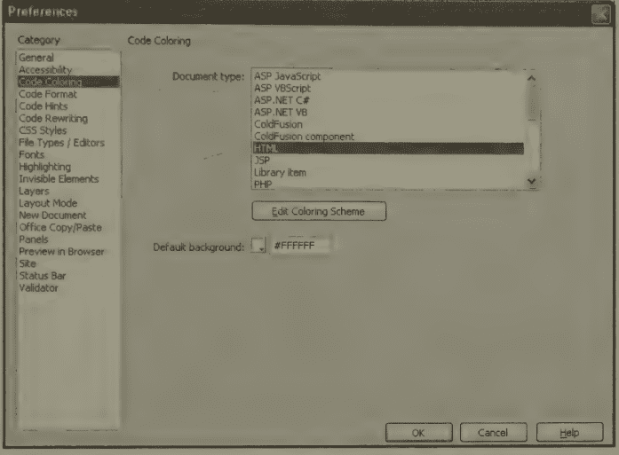

对于可以多次指定的字段，例如 `stringStart`，仅在第一个标签上指定颜色和样式设置。当你将颜色和样式设置拆分到多个标签时，稍后使用首选项对话框编辑颜色或样式时，数据将会丢失。

> **注意**

> Macromedia 建议你在修改前创建所有 XML 文件的备份副本。在使用首选项对话框编辑颜色和样式设置之前，应验证所有手动更改。如果使用首选项对话框编辑无效的 XML 文件，数据将会丢失。

要使用首选项对话框中的代码着色类别编辑方案的样式，请双击文档类型，或单击“编辑着色方案”按钮，打开“编辑着色方案”对话框。

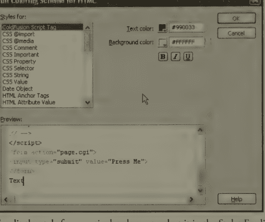

要编辑特定元素的样式，请在“样式”列表中选择它。在“样式”窗格中列出的项目包括正在编辑的方案的字段，以及可能作为块出现在此方案中的方案。例如，如果你编辑 HTML 方案，CSS 和 JavaScript 块的字段也会列出。

方案所列的字段对应于 XML 文件中定义的字段。`scheme.name` 属性的值位于“样式”窗格中每个列出字段的前面。没有名称的字段不会列出。

特定元素的样式包括粗体、斜体、下划线和背景颜色，此外还有代码着色。在“样式”窗格中选择元素后，你可以更改这些样式特征中的任何一项。

预览区域显示当前设置下示例文本的显示效果。示例文本取自方案的 `sampleText` 设置。

在预览区域中选择一个元素，可以更改“样式”列表中的选择。

如果你更改方案中某个元素的设置，Dreamweaver 会将该值存储在代码着色文件中，并覆盖原始设置。单击“确定”时，Dreamweaver 会自动重新加载所有代码着色更改。

## 代码着色示例

以下代码着色示例展示了层叠样式表文档和 JavaScript 文档的代码着色方案。JavaScript 示例中的关键字列表经过了缩写，以保持示例的简洁性。

### CSS 代码着色

```xml
<scheme name="CSS" id="CSS" doctypes="CSS" priority="50">
  <ignoreCase>Yes</ignoreCase>
  <ignoreTags>Yes</ignoreTags>
  <blockStart doctypes="ASP-JS,ASP-VB,ASP.NET_CSharp,ASP.NET_VB,ColdFusion,CFC,HTML,JSP,LibraryItem,DWTemplate,PHP_MySQL" scheme="outerTag"><![CDATA[<style>]]></blockStart>
  <blockEnd><![CDATA[</style>]]></blockEnd>
  <blockStart doctypes="ASP-JS,ASP-VB,ASP.NET_CSharp,ASP.NET_VB,ColdFusion,CFC,HTML,JSP,LibraryItem,DWTemplate,PHP_MySQL" scheme="outerTag"><![CDATA[<style\s+\*>]]></blockStart>
  <blockEnd><![CDATA[</style>]]></blockEnd>
  <commentStart name="Comment" id="CodeColor_CSSComment"><![CDATA[/*
*]]></commentStart>
  <commentEnd><![CDATA[*/]]></commentEnd>
  <endOfLineComment><![CDATA[<!--]]></endOfLineComment>
  <endOfLineComment><![CDATA[-->]]></endOfLineComment>
  <stringStart name="String" id="CodeColor_CSSString"><![CDATA["]]></stringStart>
  <stringEnd><![CDATA["]]></stringEnd>
  <stringStart><![CDATA[']]></stringStart>
  <stringEnd><![CDATA[']]></stringEnd>
  <stringEsc><![CDATA[\]]></stringEsc>
  <cssSelector name="Selector" id="CodeColor_CSSSelector" />
  <cssProperty name="Property" id="CodeColor_CSSProperty" />
  <cssValue name="Value" id="CodeColor_CSSValue" />
  <sampleText doctypes="CSS"><![CDATA[/* Comment */
    {
H2, .head2
        font-family : 'Sans-Serif';
        font-weight : bold;
        color : #339999;
    }]]>
  </sampleText>
</scheme>
```

### CSS 示例文本

以下 CSS 方案的示例文本展示了 CSS 代码着色方案：

```css
/* Comment */
H2, .head2       {
           font-family : 'Sans-Serif';
           font-weight : bold;
           color : #339999;

   
      }
```

以下来自 `Colors.xml` 文件的行提供了示例文本中可见的颜色和样式值，这些值由代码着色方案分配：

```xml
<syntaxColor id="CodeColor_CSSSelector" text="#FF00FF" />
<syntaxColor id="CodeColor_CSSProperty" text="#000099" />
<syntaxColor id="CodeColor_CSSValue" text="#0000FF" />
```

### JavaScript 代码着色

```xml
<scheme name="JavaScript" id="JavaScript" doctypes="JavaScript"
    priority="50">
    <ignoreCase>No</ignoreCase>
    <ignoreTags>Yes</ignoreTags>
    <blockStart doctypes="ASP-JS,ASP-VB,ASP_CSharp,ASP.NET_VB,ColdFusion,CFC,HTML,JSP,LibraryItem,DWTemplate,PHP_MySQL" scheme="outerTag"><![CDATA[<script>]]></blockStart>
    <blockEnd><![CDATA[</script>]]></blockEnd>
    <blockStart doctypes="ASP-JS,ASP-VB,ASP_NET_VB,ASP.NET,ColdFusion,CFC,HTML,JSP,LibraryItem,DWTemplate,PHP_MySQL" scheme="outerTag"><![CDATA[<script\s+\*>]]></blockStart>
    <blockEnd><![CDATA[</script>]]></blockEnd>
    <commentStart name="Comment"
id="CodeColor_JavascriptComment"><![CDATA[/*]]></commentStart>
    <commentEnd><![CDATA[*/]]></commentEnd>
    <endOfLineComment><![CDATA[//]]></endOfLineComment>
    <endOfLineComment><![CDATA[<!--]]></endOfLineComment>
    <endOfLineComment><![CDATA[-->]]></endOfLineComment>
    <stringStart name="String"
id="CodeColor_JavascriptString"><![CDATA["]]></stringStart>
    <stringEnd><![CDATA["]]></stringEnd>
    <stringStart><![CDATA[']]></stringStart>
    <stringEnd><![CDATA[']]></stringEnd>
    <stringEsc><![CDATA[\]]></stringEsc>
    <brackets name="Bracket"
id="CodeColor_JavascriptBracket"><![CDATA[\[\(\)\]]]></brackets>
    <operators name="Operator"
id="CodeColor_JavascriptOperator"><![CDATA[+\-*/%<>(Boolean)? ::=&\|^]]></operators>
    <numbers name="Number" id="CodeColor_JavascriptNumber" />
    <regexp name="RegExp" id="CodeColor_JavascriptRegexp" delimiter="/"
       escape="\\">
      <searchPattern><![CDATA[(\s*/[^\s/])]]></searchPattern>
      <searchPattern><![CDATA[=\s*/le*\\/]]></searchPattern>
    </regexp>
    <idChar1>_</idChar1>
    <idCharRest name="Identifier"
id="CodeColor_JavascriptIdentifier">_abcdefghijklmnopqrstuvwxyzABCDEFGHIJKLMNOPQRSTUVWXYZ0123456789</idCharRest>
    <functionKeyword name="Function Keyword"
id="CodeColor_JavascriptFunction">function</functionKeyword>
    <keywords name="Reserved Keywords" id="CodeColor_JavascriptReserved">
        <keyword>break</keyword>
        ...
    </keywords>
    <keywords name="Native Keywords" id="CodeColor_JavascriptNative">
        <keyword>abs</keyword>
        ...
    </keywords>
    <keywords id="CodeColor_JavascriptNumber">
        <keyword>Infinity</keyword>
        <keyword>NaN</keyword>
    </keywords>
    <keywords name="Client Keywords" id="CodeColor_JavascriptClient">
        <keyword>alert</keyword>
        ...
    </keywords>
    <sampleText><![CDATA[/* JavaScript */
function displayWords(arrayWords) {
  for (i=0; i < arrayWords.length(); i++) {
    // inline comment
    alert("Word " + i + " is " + arrayWords[i]);
  }
}

var tokens = new Array("Hello", "world");
displayWords(tokens);
]]></sampleText>
</scheme>
```


### JavaScript 示例文本

JavaScript 方案的示例文本展示了 JavaScript 代码着色方案，如下所示：

```javascript
/* JavaScript */
function displayWords(arrayWords) {
  for (i=0; i < arrayWords.length(); i++) {
    // inline comment
    alert("Word " + i + " is " + arrayWords[i]);
  }
}

var tokens = new Array("Hello", "world");
displayWords(tokens);
```

以下来自 `Colors.xml` 文件的行提供了示例文本中可见的颜色和样式值，这些值由代码着色方案分配：

```xml
<syntaxColor id="CodeColor_JavascriptComment" text="#999999" italic="true" />
<syntaxColor id="CodeColor_JavascriptFunction" text="#000000" bold="true" />
<syntaxColor id="CodeColor_JavascriptBracket" text="#000099" bold="true" />
<syntaxColor id="CodeColor_JavascriptNumber" text="#FF0000" />
<syntaxColor id="CodeColor_JavascriptClient" text="#990099" />
<syntaxColor id="CodeColor_JavascriptNative" text="#009999" />
```

## 代码验证

在代码视图中打开文档时，Dreamweaver 会自动验证文档是否未使用用户所选目标浏览器中不可用的任何标签、属性、CSS 属性或 CSS 值。Dreamweaver 会用红色波浪线标记错误。

Dreamweaver 将浏览器配置文件存储在 Dreamweaver 配置文件夹内的 `Browser Profile` 文件夹中。每个浏览器配置文件都被定义为一个以浏览器命名的文本文件。例如，Internet Explorer 6.0 版的浏览器配置文件为 `Internet_Explorer_6.0.txt`。为了支持 CSS 的目标浏览器检查，Dreamweaver 将浏览器的 CSS 配置信息存储在一个 XML 文件中，该文件的名称与浏览器配置文件相对应，但后缀为 `_CSS.xml`。例如，Internet Explorer 6.0 的 CSS 配置文件为 `Internet_Explorer_6.0_CSS.xml`。如果发现 Dreamweaver 报告了你不想要的错误，你可能需要对 CSS 配置文件进行修改。

CSS 配置文件包含三个 XML 标签：`css-support`、`property` 和 `value`。以下各节将描述这些标签。

### `<css-support>`

#### 说明

此标签是特定浏览器所支持的一组 `property` 和 `value` 标签的根节点。

#### 属性

无。

#### 内容

`property` 和 `value` 标签。

#### 容器

无。

#### 示例

```xml
<css-support>
...
</css-support>
```

### `<property>`

#### 说明

定义浏览器配置文件支持的 CSS 属性。

#### 属性

`name`、`names`、`supportlevel`、`message`

- `name="property_name"` 你要指定支持的属性名称。
- `names="property_name, property_name, ..."` 以逗号分隔的属性名称列表，用于指定支持的属性。

  `names` 属性是一种简写形式。例如，以下 `names` 属性是定义其后 `name` 属性的简写方法：

  ```xml
  <property names="foo,bar">
    <value type="named" name="top"/>
    <value type="named" name="bottom"/>
  </property>
  ```

  等效于：

  ```xml
  <property name="foo">
    <value type="named" name="top"/>
    <value type="named" name="bottom"/>
  </property>
  <property name="bar">
    <value type="named" name="top"/>
    <value type="named" name="bottom"/>
  </property>
  ```

- `supportlevel="error"`、`"warning"`、`"info"` 或 `"supported"` 指定属性的支持级别。如果未指定，则默认为 `"supported"`。如果你指定了 `"supported"` 以外的支持级别，并且省略了 `message` 属性，Dreamweaver 将使用默认消息："CSS property name `property_name` is not supported."。

## 目录

`value`

## 容器

`css-support`

## 示例

```xml
<property name="background-color" supportLevel="supported">
```

## `<value>`

### 描述

定义当前属性支持的值列表。

### 属性

`type`、`name`、`names`、`supportlevel`、`message`

- `type="any"`、`"named"`、`"units"`、`"color"`、`"string"` 或 `"function"` 指定值的类型。如果指定 `"named"`、`"units"` 或 `"color"`，则必须通过 `name` 或 `names` 属性指定要匹配的值 ID。`"units"` 值匹配一个数值，后跟 `names` 属性中指定的某个单位值。

- `name="value_name"` CSS 值标识符。除连字符 (`-`) 外，不允许使用空格或标点符号。父属性节点中指定的 CSS 属性的有效值之一的名称。这可以标识一个特定值或一个单位说明符。

- `names="name1, name2, ..."` 指定以逗号分隔的值 ID 列表。

- `supportlevel="error"`、`"warning"`、`"info"` 或 `"supported"` 指定浏览器对此值的支持级别。如果未指定，则假定为 `"supported"` 值。

- `message="message_string"` `message` 属性定义了一条消息字符串，当 Dreamweaver 在文档中找到该属性值时会显示此消息。如果省略 `message` 属性，Dreamweaver 将显示 `"value_name is not supported."` 的消息字符串。

### 容器

`property`

### 示例

```xml
<property name="margin">
  <value type="units" name="ex" supportLevel="warning"
    message="The implementation of ex units is buggy in Safari 1.0."/>
  <value type="units" names="%,em,px,in,cm,mm,pt,pc"/>
  <value type="named" name="auto"/>
  <value type="named" name="inherit"/>
</property>
```

## 更改默认 HTML 格式

要更改通用的代码格式设置首选项，请使用首选项对话框的“代码格式”类别。要更改特定标签和属性的格式，请使用“标签库编辑器”（编辑 > 标签库）。有关更多信息，请参阅 Dreamweaver 帮助菜单上的 *使用 Dreamweaver*。

您也可以通过编辑与标签对应的 VTM 文件（在标签库配置文件夹的子文件夹中）来编辑标签的格式，但在 Dreamweaver 中更改格式要容易得多。

如果您添加或删除 VTM 文件，则必须编辑 `TagLibraries.vtm` 文件；Dreamweaver 会忽略 `TagLibraries.vtm` 中未列出的任何 VTM 文件。

> 请在文本编辑器中编辑此文件，而不是在 Dreamweaver 中。

## 自定义代码视图

# 第二部分：扩展 Dreamweaver 概述

了解 Macromedia Dreamweaver 8 界面的基本概念，以及如何扩展 Dreamweaver 以满足您的 Web 开发需求。这些基本概念包括 Dreamweaver 文件夹、扩展 API、Dreamweaver 界面组件、Dreamweaver 文档对象模型 (DOM) 以及 Dreamweaver 文档类型。

- 第三章：扩展 Dreamweaver ................................99
- 第四章：扩展的用户界面 .......................111
- 第五章：Dreamweaver 文档对象模型.......127

## 第三章：扩展 Dreamweaver

通常，您创建 Dreamweaver 扩展是为了执行以下类型任务之一：

- 自动化更改用户的当前文档，例如插入 HTML、CFML 或 JavaScript；更改文本或图像属性；或对表格排序。
- 与应用程序交互以自动打开或关闭窗口、打开或关闭文档、更改键盘快捷键等。
- 连接到数据源，这使得 Dreamweaver 用户可以创建动态的、数据驱动的页面。
- 在当前文档中插入和管理服务器代码块。

您可能希望编写一个扩展来处理一个常用且因此重复的任务。或者您可能有一个独特的需求，只能通过为该特定情况编写扩展来满足。在两种情况下，Dreamweaver 都提供了一套广泛的工具，您可以用来添加或自定义其功能。

创建 Dreamweaver 扩展时，您应遵循第 10 页“创建扩展”中概述的步骤。

Macromedia Dreamweaver 8 的以下功能使您能够创建扩展：

- 一个 HTML 解析器（也称为 `渲染器`），它使得可以使用表单字段、层、图像和其他 HTML 元素为扩展设计用户界面 (UI)。Dreamweaver 拥有自己的 HTML 解析器。
- 一个文件夹树，用于组织和存储实现和配置 Dreamweaver 元素和扩展的文件。
- 一系列应用程序编程接口 (API)，提供通过 JavaScript 访问 Dreamweaver 功能的途径。
- 一个 JavaScript 解释器，用于执行扩展文件中的 JavaScript 代码。Dreamweaver 使用 Netscape JavaScript 1.5 版解释器。有关此版本解释器与以前版本之间更改的更多信息，请参见第 106 页“Dreamweaver 如何处理扩展中的 JavaScript”。

### Dreamweaver 扩展类型

以下列表描述了本指南中记录的 Dreamweaver 扩展类型：

- **插入栏对象**扩展在插入栏中创建更改。对象通常用于自动化将代码插入到文档中。它也可以包含一个从用户那里收集输入的表单以及处理该输入的 JavaScript。对象文件存储在 `Configuration/Objects` 文件夹中。
- **命令**扩展可以执行几乎任何特定任务，无论是否有用户输入。命令文件通常从“命令”菜单调用，但也可以从其他扩展调用。命令文件存储在 `Configuration/Commands` 文件夹中。
- **菜单命令**扩展扩展了命令 API，以完成与从菜单调用命令相关的任务。菜单命令 API 还允许您创建动态子菜单。
- **工具栏**扩展可以向现有工具栏添加元素，或在 Dreamweaver UI 中创建新的工具栏。新工具栏出现在默认工具栏下方。工具栏文件存储在 `Configuration/Toolbars` 文件夹中。
- **报告**扩展可以添加自定义站点报告或修改 Dreamweaver 附带的一组预置报告。您还可以使用“结果窗口” API 创建独立的报告。
- **标签库和编辑器**扩展与关联的标签库文件协同工作。标签库和编辑器扩展可以修改现有标签对话框的属性、创建新的标签对话框，并向标签库添加标签。标签库和编辑器扩展文件存储在 `Configuration/TagLibraries` 文件夹中。
- **属性检查器**扩展出现在属性检查器面板中。Dreamweaver 中的大多数检查器都是核心产品代码的一部分，无法修改，但自定义属性检查器文件可以覆盖内置的 Dreamweaver 属性检查器界面，或创建新的界面来检查自定义标签。检查器存储在 `Configuration/Inspectors` 文件夹中。
- **浮动面板**扩展向 Dreamweaver UI 添加浮动面板。浮动面板可以与选择、文档或任务进行交互。它们也可以显示有用的信息。浮动面板文件存储在 `Configuration/Floaters` 文件夹中。
- **行为**扩展允许用户向其文档添加 JavaScript 代码。当文档在浏览器中查看时，JavaScript 代码会响应特定事件执行特定任务。行为扩展出现在 Dreamweaver 行为面板的加号 (`+`) 菜单上。行为文件存储在 `Configuration/Behaviors/Actions` 文件夹中。
- **服务器行为**扩展向文档添加服务器端代码块 (ASP、JSP 或 ColdFusion)。当文档在浏览器中查看时，服务器端代码在服务器上执行任务。服务器行为出现在 Dreamweaver 服务器行为面板的加号 (`+`) 菜单上。服务器行为文件存储在 `Configuration/Server Behaviors` 文件夹中。
- **数据源**扩展允许您构建与存储在数据库中的动态数据的连接。数据源扩展出现在“绑定”面板的加号 (`+`) 菜单上。数据源扩展文件存储在 `Configuration/Data Sources` 文件夹中。
- **服务器格式**扩展允许您为动态数据定义格式。
- **组件**扩展允许您向组件面板添加新类型的组件。“组件”是 Dreamweaver 用来指代一些更流行和现代的封装策略的术语，包括 Web 服务、JavaBean 和 ColdFusion 组件 (CFC)。
- **服务器模型**扩展允许您添加对新服务器模型的支持。Dreamweaver 支持最常见的服务器模型 (ASP、JSP、ColdFusion、PHP 和 ASP.NET)。仅当需要自定义服务器解决方案、不同语言或定制服务器时，才需要服务器模型扩展。服务器模型文件存储在 `Configuration/ServerModels` 文件夹中。
- **数据转换器**扩展将非 HTML 代码转换为在文档窗口的设计视图中显示的 HTML。这些扩展还会锁定非 HTML 代码，以防止 Dreamweaver 解析它。转换器文件存储在 `Configuration/Translators` 文件夹中。

## 扩展 Dreamweaver 的其他方式

您还可以扩展 Dreamweaver 的以下元素，以扩展其功能或根据您的需求进行定制。

**文档类型**定义 Dreamweaver 如何与不同的服务器模型协同工作。有关服务器模型文档类型的信息存储在 `Configuration/DocumentTypes` 文件夹中。有关更多信息，请参见第 35 页“Dreamweaver 中的可扩展文档类型”。

**代码片段**是可重用的代码块，存储为代码片段 (CSN) 文件，位于 Dreamweaver 的 `Configuration/Snippets` 文件夹中，Dreamweaver 在“代码片段”面板中提供对它们的访问。您可以创建额外的代码片段文件并将它们安装到 `Snippets` 文件夹中，以使其可用。

## 配置文件夹与扩展

代码提示（Code Hints）是一种菜单，它通过显示一系列可能补全您正在输入的字符串的列表，提供输入快捷方式。如果菜单中的某个字符串与您开始输入的字符串匹配，您可以选择它来替换您正在输入的字符串。代码提示菜单在 `Configuration/CodeHints` 文件夹中的 `codehints.xml` 文件中定义，您可以为您定义的新的标签或函数向其中添加新的代码提示菜单。

菜单在 `Configuration/Menus` 文件夹中的 `menus.xml` 文件中定义。您可以通过向 `menus.xml` 文件添加相应的菜单标签来为您的扩展添加新的 Dreamweaver 菜单。更多信息，请参阅第 181 页的第 8 章，“菜单与菜单命令”。

## 配置文件夹与扩展

存储在 Dreamweaver 配置文件夹中的文件夹和文件包含了 Dreamweaver 自带的扩展。编写扩展时，您必须将文件保存在正确的文件夹中，Dreamweaver 才能识别它们。例如，如果您创建一个属性检查器（Property inspector）扩展，您需要将文件保存在 `Configuration/Inspectors` 文件夹中。如果您从 Macromedia Exchange 网站（`www.macromedia.com/exchange`）下载并安装了一个扩展，扩展管理器会自动将扩展文件保存到正确的文件夹中。

您可以使用 Dreamweaver 配置文件夹中的文件作为示例，但这些文件通常比 Macromedia Exchange 网站上提供的普通扩展更复杂。有关配置文件夹内每个子文件夹内容的更多信息，请参阅 `Configuration_ReadMe.htm` 文件。


`Configuration/Shared` 文件夹不对应于特定的扩展类型。它是被多个扩展使用的实用函数、类和图像的中央存储库。`Configuration/Shared/Common` 文件夹中的文件旨在对广泛的扩展都有用。这些文件是 JavaScript 技术和实用程序的有用示例。如果要查找执行特定任务（例如创建有效的文档对象模型（DOM）对象引用、测试当前选择是否位于特定标签内、转义字符串中的特殊字符等）的函数，请首先查看这里。如果您创建公共文件，应在 `Configuration/Shared/Common` 文件夹中创建一个单独的子文件夹（如下图所示）并将它们存储在那里。

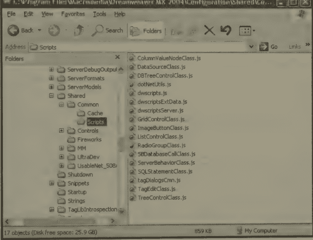

*`Configuration/Shared/Common/Scripts` 文件夹结构*

有关 Shared 文件夹的更多信息，请参阅第 483 页的附录，“Shared 文件夹”。

## 多用户配置文件夹

对于 Windows XP、Windows 2000 和 Macintosh OS X 的多用户操作系统，Dreamweaver 会在 Dreamweaver 配置文件夹之外为每个用户创建一个单独的配置文件夹。每当 Dreamweaver 或 JavaScript 扩展写入配置文件夹时，Dreamweaver 会自动改为写入用户配置文件夹。这种做法允许每个 Dreamweaver 用户自定义配置设置，而不会干扰其他用户的配置设置。更多信息，请参阅第 27 页的“在多用户环境中自定义 Dreamweaver”以及 *Dreamweaver API Reference* 中的“文件访问与多用户配置 API”。

## 在启动或关闭时运行脚本

如果将命令文件放在 `Configuration/Startup` 文件夹中，该命令将在 Dreamweaver 启动时运行。启动命令会在 `menus.xml` 文件、`ThirdPartyTags` 文件夹中的文件以及任何其他命令、对象、行为、检查器、浮动面板或翻译器之前加载。您可以使用启动命令来修改 `menus.xml` 文件或其他扩展文件。您还可以显示警告、提示用户输入信息或调用 `dreamweaver.runCommand()` 函数。但是，在 Startup 文件夹内，您无法调用期望有效文档对象模型（DOM）的命令。有关 Dreamweaver DOM 的信息，请参阅第 127 页的第 5 章，“Dreamweaver 文档对象模型”。

类似地，如果将命令文件放在 `Configuration/Shutdown` 文件夹中，该命令将在 Dreamweaver 关闭时运行。从关闭命令中，您可以调用 `dreamweaver.runCommand()` 函数、显示警告或提示用户输入信息，但您无法停止关闭过程。

有关命令的更多信息，请参阅第 167 页的第 7 章，“命令”。有关 `dreamweaver.runCommand()` 函数的更多信息，请参阅 *Dreamweaver API Reference*。

## 重新加载扩展

如果您在 Dreamweaver 中工作时对扩展进行了更改，可以重新加载扩展，以便 Dreamweaver 识别这些更改。

### 重新加载扩展

1. 在插入栏（Insert bar）的标题栏上，按住 Control 键单击（Windows）或按住 Option 键单击（Macintosh）“类别”（Categories）菜单。
2. 选择“重新加载扩展”（Reload Extensions）。

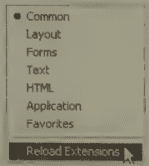

> 请记住，在多用户操作系统中，您应该编辑用户配置文件夹中配置文件的副本，而不是编辑主配置文件。更多信息，请参阅第 102 页的“配置文件夹与扩展”。

## 扩展 API

扩展 API 为您提供了 Dreamweaver 为实现每种扩展类型而调用的函数。您必须按照每种扩展类型的描述编写这些函数的函数体，并指定 Dreamweaver 期望的返回值。

如果您是希望直接使用 C 编程语言工作的开发人员，有一个 C 扩展性 API 允许您创建动态链接库（DLL）。这些 API 中提供的功能将您的 C DLL 包装在 JavaScript 中，以便您的扩展可以在 Dreamweaver 中无缝工作。

扩展 API 文档概述了每个函数的功能、Dreamweaver 何时调用它以及 Dreamweaver 期望它返回的值。

有关实用工具 API 和 JavaScript API 的信息，请参阅 *Dreamweaver API Reference*，它们提供了您可以在扩展中执行特定任务时使用的函数。

## Dreamweaver 如何处理扩展中的 JavaScript

Dreamweaver 在启动期间检查 `Configuration/*extension_type*` 文件夹。如果遇到文件夹中的扩展文件，Dreamweaver 将通过完成以下步骤来处理 JavaScript：

- 编译 `SCRIPT` 开始和结束标签之间的所有内容。
- 执行 `SCRIPT` 标签内不属于函数声明的任何代码。

> 此过程在启动期间是必要的，因为某些扩展可能需要全局变量进行初始化。

对于在 `SCRIPT` 标签的 `SRC` 属性中指定的任何外部 JavaScript 文件，Dreamweaver 执行以下操作：

- 读入文件。
- 编译代码。
- 执行过程。

> 如果扩展文件中的任何 JavaScript 代码包含字符串 `</SCRIPT>`，JavaScript 解释器会将该字符串读取为结束 `SCRIPT` 标签，并报告未终止的字符串字面量错误。为避免此问题，请将字符串拆分并连接，如下所示：`"<" + '/SCRIPT>'`。

当用户从菜单中选择命令或行为扩展类型的命令或操作时，Dreamweaver 会在 `onLoad` 事件处理程序（如果出现在 `BODY` 标签中）中执行代码。

对于对象扩展，如果文档的主体包含表单，Dreamweaver 会在 `BODY` 标签的 `onLoad` 事件处理程序中执行代码。

Dreamweaver 在以下扩展中忽略 `BODY` 标签上的 `onLoad` 处理程序：

- 数据翻译器。
- 属性检查器。
- 浮动面板。

对于所有扩展，当用户与事件处理程序所附加的表单字段交互时，Dreamweaver 会在其他事件处理程序（例如 `onBlur="alert('This is a required field.')"`）中执行代码。

Dreamweaver 支持在链接中使用事件处理程序。链接中的事件处理程序必须使用如下所示的语法：

```html
<a href="#" onMouseDown=alert('hi')>link text</a>
```

扩展 `BODY` 中支持插件（设置为始终播放）。扩展中不支持 `document.write()` 语句、Java applet 和 ActiveX 控件。

## 显示帮助

`displayHelp()` 函数是多个扩展 API 的一部分，当您在扩展中包含它时，会使 Dreamweaver 执行以下两项操作：

- 向界面添加帮助按钮。
- 当用户单击帮助按钮时，调用 `displayHelp()`。

您必须编写 `displayHelp()` 函数的函数体以显示帮助。您如何编写 `displayHelp()` 函数决定了您的扩展如何显示帮助。您可以调用 `dreamweaver.browseDocument()` 函数在浏览器中打开文件，或者设计自定义的显示帮助的方式，例如在另一个层或警告框中显示消息。

以下示例使用 `displayHelp()` 函数通过调用 `dreamweaver.browseDocument()` 来显示帮助：

```javascript
// 以下 displayHelp() 实例打开浏览器以显示解释如何使用该扩展的文件。
function displayHelp() {

  var myHelpFile = dw.getConfigurationPath() + "ExtensionsHelp/
  myExtHelp.htm";
  dw.browseDocument(myHelpFile);
}
```

## 本地化扩展

使用以下技术使扩展更容易翻译成当地语言：

- 将扩展分离为 HTML 和 JavaScript 文件。HTML 文件可以复制和本地化；JavaScript 文件无需本地化。
- 不要在 JavaScript 文件中定义显示字符串（检查警报和 UI 代码）。将所有可本地化字符串提取到 Dreamweaver `Configuration/Strings` 文件夹中的单独 XML 文件中。

## XML 字符串文件

将所有字符串存储在 Dreamweaver `Configuration/Strings` 文件夹中的 XML 文件里。如果你安装了许多相关的扩展文件，这种方式可以让你在一个 XML 文件中共享所有字符串。如果适用，这还可以让你在 C++ 和 JavaScript 扩展中引用相同的字符串。

你可以创建一个名为 `myExtensionStrings.xml` 的文件。以下示例展示了该文件的格式：

```xml
<strings>
   <!-- errors for feature X -->
   <string id="featureX/subProblemY" value="There was a problem with X when you did Y. Try not to do Y!"/>
   <string id="featureX/subProblemZ" value="There was another problem with X, regarding Z. Don't ever do Z!"/>
</strings>
```

现在，你的 JavaScript 文件可以通过调用 `dw.loadString()` 函数来引用这些可翻译的字符串，如下例所示：

```javascript
function initializeUI()
{
   ...
   if (problemYhasOccured)
   {
      alert(dw.loadString("featureX/subProblemY"));
   }
}
```

你可以在字符串标识符中使用斜杠（`/`）字符，但不要使用空格。通过使用斜杠，你可以根据需要创建层级结构，并将所有字符串包含在一个 XML 文件中。

> **注意：** `Configuration/Strings` 文件夹中以 `cc` 开头的文件是 Contribute 文件。例如，`ccSiteStrings.xml` 文件就是一个 Contribute 文件。

## 包含嵌入值的可本地化字符串

某些显示字符串中嵌入了值。你可以使用 `errMsg()` 函数来显示这些字符串。`errMsg()` 函数类似于 C 语言中的 `printf()` 函数，可以在 `Configuration/Shared/MM/Scripts/CMN` 文件夹中的 `string.js` 文件中找到。使用占位符字符百分号（`%`）和 `s` 来表示字符串中值应出现的位置，然后将字符串和变量名作为参数传递给 `errMsg()`。例如：

```xml
<string id="featureX/fileNotFoundInFolder" value="File %s could not be found in folder %s."/>
```

以下示例展示了如何将字符串以及要嵌入的变量传递给 `alert()` 函数：

```javascript
if (fileMissing)
{
    alert( errMsg(dw.loadString("featureX/fileNotFoundInFolder"), fileName,
        folderName) );
}
```

## 使用扩展管理器

如果你为其他用户创建扩展，必须按照 Macromedia Exchange 网站（www.macromedia.com/exchange）上 Help > How to Create an Extension 类别中的指南进行打包。在扩展管理器中编写和测试完扩展后，选择 File > Package Extension。扩展打包完成后，你可以通过在扩展管理器中选择 File > Submit Extension 将其提交到 Exchange。扩展管理器随 Dreamweaver 一起提供。有关其使用方法的详细信息，请参阅其帮助文件和 Macromedia Exchange 网站。

# 扩展 Dreamweaver

## 第 4 章：扩展的用户界面

大多数扩展都通过用户界面（UI）从用户那里接收信息。例如，如果你为 `marquee` 标签创建一个属性检查器扩展，你需要创建一种让用户指定方向和高度等属性的方式。如果你计划将扩展提交给 Macromedia 认证，则需要遵循 Macromedia Exchange 网站（www.macromedia.com/exchange）上扩展管理器文件中提供的指南。这些指南并非旨在限制你的创造力，其目的是确保经过认证的扩展能够在 Macromedia Dreamweaver 8 UI 中有效运行，并且扩展的 UI 设计不会削弱其功能。

## 设计扩展用户界面

通常，你创建扩展是为了执行用户经常遇到的任务。任务的某些部分是重复性的；通过创建扩展，你可以自动化这些重复性操作。任务中的某些步骤可能会变化，或者扩展处理的代码的特定属性可能会变化。为了接收这些可变值的用户输入，你需要构建一个 UI。

例如，你可能创建一个扩展来更新 Web 目录。用户需要定期更改图像源、商品描述和价格等值。虽然值会变化，但获取这些值以及将信息格式化为网站上显示内容的过程保持不变。一个简单的扩展可以自动化格式化过程，同时允许用户手动输入图像源、商品描述和价格的新更新值。一个更强大的扩展可以从数据库中定期检索这些值。

扩展 UI 的目的是接收用户输入的信息。这些信息处理扩展执行的重复性任务中的可变部分。Dreamweaver 支持 HTML 和 JavaScript 表单元素作为创建扩展 UI 控件的基本构建块，并使用其自身的 HTML 渲染器来显示 UI。因此，扩展 UI 可以简单到只是一个包含两列表格（文本描述和表单输入字段）的 HTML 文件。

当你设计扩展时，应该确定哪些变量是必需的，以及哪些表单元素最适合处理它们。

设计扩展 UI 时，请考虑以下基本准则：

- 要命名你的扩展，请将名称放在 HTML 文件的 `title` 标签中。Dreamweaver 会在扩展标题栏中显示该名称。
- 将文本标签放在 UI 的左侧，右对齐，文本框放在右侧，左对齐。这种布局让用户的眼睛能轻松定位任何文本框的起始位置。文本框后面可以跟少量文本作为说明或计量单位。
- 将复选框和单选按钮标签放在 UI 的右侧，左对齐。
- 为了代码的可读性，请为文本框分配逻辑名称。如果你使用 Dreamweaver 创建扩展 UI，可以使用属性检查器或快速标签编辑器为字段分配名称。

在典型的场景中，创建 UI 后，你需要测试扩展代码，以确保它正确执行以下与 UI 相关的任务：

- 从文本框中获取值。
- 为文本框设置默认值或从选项中收集值。
- 将更改应用到用户文档。

## Dreamweaver HTML 渲染控件

在 Dreamweaver 4 及之前的版本中，Dreamweaver 在表单控件周围渲染的空间比 Microsoft Internet Explorer 和 Netscape Navigator 更大。扩展 UI 中的表单控件周围会渲染额外的空间，因为 Dreamweaver 使用其 HTML 渲染引擎来显示扩展 UI。

Macromedia 改进了表单控件渲染，使其更接近浏览器的效果。要利用渲染改进，你必须在扩展文件中使用以下三种新 `DOCTYPE` 语句之一，如下例所示：

```html
<!DOCTYPE HTML SYSTEM "-//Macromedia//DWExtension layout-engine 5.0//dialog">

<!DOCTYPE HTML SYSTEM "-//Macromedia//DWExtension layout-engine5.0//floater">

<!DOCTYPE HTML SYSTEM "-//Macromedia//DWExtension layout-engine5.0//pi">
```

在大多数情况下，`DOCTYPE` 语句必须放在文档的第一行。但是，为了避免与扩展特定指令（在以前的版本中要求放在文件的第一行，例如属性检查器文件顶部的注释或命令中的 `MENU-LOCATION=NONE` 指令）冲突，`DOCTYPE` 语句和指令现在可以按任意顺序排列，只要它们出现在 `html` 开始标签之前即可。

除了让你的扩展 UI 更接近内置对话框和面板之外，新的 `DOCTYPE` 语句还允许你在 Dreamweaver 设计视图中查看扩展，以便你可以看到它们在用户视角下的呈现效果。

以下示例展示了基本属性检查器在没有 `DOCTYPE` 语句时（该语句可改善表单控件渲染）和有 `DOCTYPE` 语句时的效果。

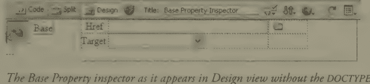

*基本属性检查器在设计视图中的外观，未使用 `DOCTYPE` 语句。*

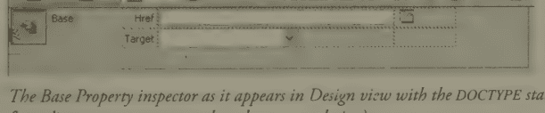

*基本属性检查器在设计视图中的外观，使用了 `DOCTYPE` 语句（并进行了一些调整以适应新的渲染方式）。*

## 在扩展中使用自定义 UI 控件

除了标准的 HTML 表单元素外，Dreamweaver 还支持自定义控件，帮助你创建灵活且具有专业外观的界面，如下列表所述：

- 可编辑选择列表（也称为组合框），允许你将选择列表和文本框的功能结合在一起。
- 数据库控件，便于显示数据层次结构和字段。
- 树形控件，将信息组织为可展开和可折叠的节点。
- 颜色按钮控件，允许你向扩展添加颜色选择器界面。

## 可编辑选择列表


扩展用户界面通常包含使用`select`标签定义的弹出列表。在 Dreamweaver 中，你可以通过为`select`标签添加`editable="true"`属性，使扩展中的弹出列表可编辑。要设置默认值，请设置`editText`属性以及你希望选择列表显示的值。

以下示例展示了可编辑选择列表的设置：

```
<select name="travelOptions" style="width:250px" editable="true"
    editText="other (please specify)">
<option value="plane">plane</option>
<option value="car">car</option>
<option value="bus">bus</option>
</select>
```

当你在扩展中使用选择列表时，请检查`editable`属性的存在及其值。如果该属性不存在，选择列表将返回默认值`false`，这表明该选择列表不可编辑。

与标准的、不可编辑的选择列表一样，可编辑选择列表也具有一个`selectedIndex`属性（参见第129页的“Dreamweaver DOM 的对象、属性和方法”）。如果选择了文本框，此属性返回-1。

要将活动可编辑文本框的值读入扩展，请读取`editText`属性的值。`editText`属性返回用户输入到可编辑文本框中的字符串、`editText`属性的值，或者如果未输入文本且未为`editText`指定值，则返回空字符串。

Dreamweaver 为`select`标签添加了以下自定义属性，以控制可编辑弹出列表：

| 属性名称 | 描述 | 接受的值 |
| --- | --- | --- |
| editable | 声明弹出列表具有可编辑文本区域 | 布尔值 true 或 false |
| editText | 保存或设置可编辑文本区域内的文本 | 任何值的字符串 |

> **注意** 可编辑选择列表在 Dreamweaver 中可用。

## 创建示例

1. 在文本编辑器中创建一个新的空白文件。
2. 输入以下代码：

```
<html>
<head>
  <title>Editable Dropdown Test</title>
  <script language="javascript">
  function getAlert()
  {

    var i=document.myForm.mySelect.selectedIndex;
    if (i>=0)
    {
      alert("Selected index: " + i + "\n" + "Selected text " + 
  document.myForm.mySelect.options[i].text);
    }
    else
    {
      alert("Nothing is selected" + "\n" + "or you entered a value");
    }
  }
  function commandButtons()
  {
    return new Array("OK", "getAlert()", "Cancel", "window.close()");
  }
  </script>
</head>

<body>
<div name="test">
<form name="myForm">
<table>
  <tr>
    <td colspan="2">
    <h4>Select your favorite</h4>
    </td>
  </tr>
  <tr>
    <td>Sport:</td>
    <td>
    <select name="mySelect" editable="true" style="width:150px"
      editText="Editable Text">
      <option>Baseball</option>
      <option>Football </option>
      <option>Soccer </option>
</select>
</td>
</tr>
</table>
</form>
</div>
</body>
</html>
```

3. 将该文件保存为`EditableSelectTest.htm`，放置在`Dreamweaver Configuration/Commands`文件夹中。

## 测试示例

1. 重启 Dreamweaver。
2. 选择`Commands > EditableSelectTest`。

当你从列表中选择一个值时，会显示一个警报消息，显示该值的索引和文本。如果你输入一个值，警报消息会指示没有选择任何内容。

## 数据库控件

使用 Dreamweaver，你可以扩展 HTML 选择标签以创建数据库树控件。你也可以添加可变网格控件。数据库树控件显示数据库模式，可变网格控件显示表格信息。

下图显示了一个高级 Recordset 对话框，它使用了数据库树控件和可变网格控件：

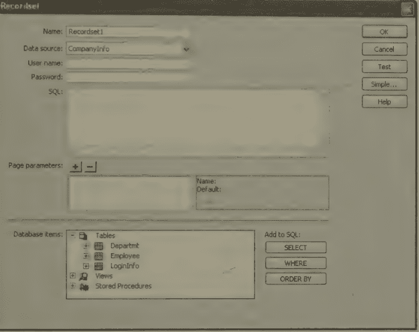

### 添加数据库树控件

数据库树控件具有以下属性：

| 属性名称 | 描述 |
|---|---|
| name | 数据库树控件的名称 |
| control.style | 宽度和高度，以像素为单位 |
| type | 控件的类型 |
| connection | 在连接管理器中定义的数据库连接的名称；如果为空，则控件为空。 |
| noexpandbuttons | 指定此属性时，树控件不绘制展开加号（+）或折叠减号（-）指示器，也不在 Macintosh 上绘制关联箭头。此属性对于绘制多列列表控件很有用。 |
| showheaders | 指定此属性时，树控件在顶部显示一个标题，列出每列的名称。 |

放置在`select`标签内的任何`option`标签都将被忽略。

要向对话框添加数据库树控件，你可以使用以下示例代码，并适当替换引号内的变量：

```
<select name="DBTree" style="width:400px;height:110px" 
type="mmdatabasetree" connection="connectionName" noexpandbuttons 
showHeaders></select>
```

你可以更改`connection`属性以检索选定数据并将其显示在树中。

你可以使用`DBTreeControl`属性作为新标签的 JavaScript 包装对象。

更多示例，请参阅`Configuration/Shared/Common/Scripts`文件夹中的`DBTreeControlClass.js`文件。

### 添加可变网格控件

可变网格控件具有以下属性：

| 属性名称 | 描述 |
| --- | --- |
| name | 可变网格控件的名称 |
| style | 控件的宽度，以像素为单位 |
| type | 控件的类型 |
| columns | 每列必须有一个名称，用逗号分隔 |
| columnWidth | 每列的宽度，每列用逗号分隔。如果未指定宽度，则各列宽度相等。 |

以下示例向对话框添加了一个简单的可变网格控件：

```
<select name="ParamList" style="width:515px;" 
type="mmparameterlist columns"="Name,SQL Data 
Type,Direction,Default Value,Run-time Value" size=6></select>
```

以下示例创建了一个宽度为 500 像素、包含五列不同宽度的可变网格控件：

```
<select
  name="ParamList"
  style="width:800px;"
  type="mmparameterlist"
  columns="Name,SQL Data Type,Direction, Default Value,Run-time Value"
  columnWidth="100,25,11,"
  size=6>
```

此示例创建了两个宽度为 182 像素的空列。（指定的列宽总计为 136。可变网格控件的总宽度为 500。放置前三列后的剩余空间为 364。还剩两列；364 除以 2 等于 182。）

此可变网格控件还具有一个 JavaScript 包装对象，应用于访问和操作可变网格控件的数据。你可以在`Configuration/Shared/MM/Scripts/Class`文件夹中的`GridControlClass.js`文件中找到其实现。

### 添加树控件

树控件以层次格式显示数据，并允许用户展开和折叠树中的节点。`MM:TREECONTROL`标签允许你为任何类型的信息创建树控件；与第 117 页“添加数据库树控件”中描述的数据库树控件不同，它不需要与数据库关联。Dreamweaver 键盘快捷方式编辑器使用了树控件，如下图所示：

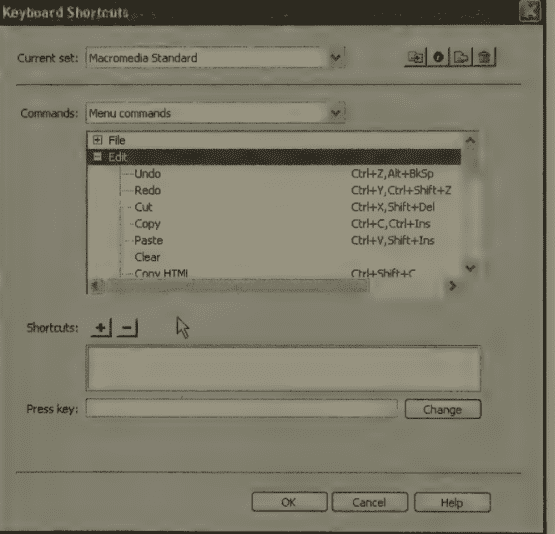

#### 创建树控件

`MM:TREECONTROL`标签创建一个树控件，并可以使用一个或多个标签来添加结构，如下所述：

- `MM:TREECOLUMN`是一个可选的空标签，定义树控件中的一列。
- `MM:TREENODE`是一个可选标签，定义树中的一个节点。它是一个非空标签，只能包含其他`MM:TREENODE`标签。

`MM:TREECONTROL`标签具有以下属性：

| 属性名称 | 描述 |
| --- | --- |
| name | 树控件的名称 |
| size | 可选。控件中显示的行数；默认为 5 行 |
| theControl | 可选。如果`theControl`属性中的节点数超过`size`属性的值，则出现滚动条 |
| multiple | 可选。允许多选；默认为单选 |
| style | 可选。树控件高度和宽度的样式定义；如果指定，则优先于`size`属性 |
| noheaders | 可选。指定列标题不应出现 |

`MM:TREECOLUMN`标签具有以下属性：

| 属性名称 | 描述 |
| --- | --- |
| name | 列的名称 |
| value | 出现在列标题中的字符串 |
| width | 列的宽度，以像素为单位（不支持百分比）；默认为 100 |
| align | 可选。指定列中的文本应左对齐、右对齐还是居中；默认为左对齐 |
| state | 指定列是可见还是隐藏 |

为了提高可读性，`TREECOLUMN`标签应紧跟在`MM:TREECONTROL`标签之后，如下例所示：

```
<MM:TREECONTROL name="tree1">
<MM:TREECOLUMN name="Column1" width="100" state="visible">
<MM:TREECOLUMN name="Column2" width="80" state="visible">
...
</MM:TREECONTROL>
```

`MM:TREENODE`的属性在下表中描述：

| 属性名称 | 描述 |
| --- | --- |
| name | 节点的名称 |
| value | 包含给定节点的内容。对于多列情况，这是一个以管道符分隔的字符串。要指定空列，请在管道符（\|）前放置一个空格字符。 |
| state | 通过字符串 "expanded" 或 "collapsed" 指定节点是展开还是折叠状态。 |
| selected | 如果树具有`MULTIPLE`属性，你可以通过在多个树节点上设置此属性来选择多个节点。 |
| icon | 可选。要使用的内置图标的索引，从 0 开始：0 = 无图标；1 = DW 文档图标；2 = 多文档图标 |

例如，以下树控件的所有节点都已展开：

```
<mm:treecontrol name="test" style="height:300px;width:300px">

<mm:treenode value="rootnode1" state="expanded">
<mm:treenode value="node1" state="expanded"></mm:treenode>
<mm:treenode value="node3" state="expanded"></mm:treenode>
</mm:treenode>

<mm:treenode value="rootnode2" state="expanded">
<mm:treenode value="node2" state="expanded"></mm:treenode>
<mm:treenode value="node4" state="expanded"></mm:treenode>
</mm:treenode>

</mm:treecontrol>
```

## 操作树控件中的内容

树控件及其内部节点以 HTML 标签的形式实现。它们由 Dreamweaver 解析并存储在文档树中。这些标签可以像操作任何其他文档节点一样进行操作。有关 DOM 函数和方法的更多信息，请参阅第 5 章"Dreamweaver 文档对象模型"，位于第 127 页。

**添加节点** 要通过编程方式向现有树控件添加节点，请设置`MM:TREECONTROL`标签或某个现有`MM:TREENODE`标签的`innerHTML`属性。设置树节点的`innerHTML`属性会创建一个嵌套节点。

以下示例向树的顶层添加一个节点：

```
var tree = document.myTreeControl;
//add a top-level node to the bottom of the tree
tree.innerHTML = tree.innerHTML + '<mm:treenode name="node3" value="node3">';
```

**添加子节点** 要向当前选中的节点添加子节点，请设置选中节点的`innerHTML`属性。

以下示例向当前选中的节点添加一个子节点：

```
var tree = document.myTreeControl;
var selNode = tree.selectedNodes[0];
//deselect the node, so we can select the new one
selNode.removeAttribute("_WORKING_SIDE");
//add the new node to the top of the selected node's children
selNode.innerHTML = '<mm:treenode name="item10" value="New item11" expanded selected>' + selNode.innerHTML;
```

**删除节点** 要从文档结构中删除当前选中的节点，请使用`innerHTML`或`outerHTML`属性。

以下示例删除整个选中的节点及其所有子节点：

```
var tree = document.myTreeControl;
var selNode = tree.selectedNodes[0];
selNode.outerHTML = "";
```

## 扩展的颜色按钮控件

除了标准的输入类型（如文本、复选框和按钮）之外，Dreamweaver 还支持`mmcolorbutton`，这是扩展中的一种额外输入类型。

在代码中指定`<input type="mmcolorbutton">`会导致界面中出现一个颜色拾取器。你可以通过在`input`标签上设置`value`属性来设置颜色拾取器的默认颜色。如果你没有设置`value`，颜色拾取器默认显示灰色，并且`input`对象的`value`属性返回空字符串。

以下示例展示了有效的`mmcolorbutton`标签：

```
<input type="mmcolorbutton" name="colorbutton" value="#FF0000">
<input type="mmcolorbutton" name="colorbutton" value="teal">
```

颜色按钮有一个事件`onChange`，当颜色发生变化时触发。

你可能希望保持文本框和颜色拾取器同步。以下示例创建了一个文本框，使其颜色与颜色拾取器的颜色同步：

```
<input type="mmcolorbutton" name="fgcolorPicker"
  onChange="document.fgcolorText.value=this.value">
<input type="text" name="fgcolorText"
  onBlur="document.fgcolorPicker.value=this.value">
```

在此示例中，当用户更改文本框的值然后按 Tab 键或点击其他位置时，颜色拾取器会更新以显示在文本框中指定的颜色。每当用户使用颜色拾取器选择新颜色时，文本框会更新以显示该颜色的十六进制值。

## 向 Dreamweaver 添加 Flash 内容

Flash 内容（SWF 文件）可以作为对象或命令的一部分在 Dreamweaver 界面中显示。如果你构建使用 Flash 表单、动画、ActionScript 或其他 Flash 内容的扩展，此 Flash 支持尤其有用。

基本上，你利用 Dreamweaver 对象和命令能够显示对话框的能力（有关构建对象的更多信息，请参阅第 6 章"插入栏对象"，位于第 139 页；有关命令的更多信息，请参阅第 7 章"命令"，位于第 167 页），使用`form`标签配合`object`标签将你的 Flash 内容嵌入 Dreamweaver 对话框中。

## 简单的 Flash 对话框示例


在此示例中，你使用`Dreamweaver`创建一个新命令，当用户在“命令”菜单中单击该命令时显示一个名为`myFlash.swf`的SWF文件。在尝试此示例之前，请参阅*Extending Dreamweaver*中有关命令的具体信息。

此示例假设你已在`Dreamweaver`应用程序安装文件夹的`Configuration/Commands`文件夹中有一个名为`myFlash.swf`的SWF文件。要使用你自己的SWF文件进行测试，请将SWF文件保存到应用程序的`Commands`文件夹中，并在所有`myFlash.swf`出现的地方替换为你的文件名。

在`Dreamweaver`中，打开一个新的基本HTML文件（这将是你的命令定义文件）。在开始和结束`title`标签之间，输入`My Flash Movie`，使页面头部如下所示：

```
<!DOCTYPE HTML PUBLIC "-//W3C//DTD HTML 4.01 Transitional//EN">
<html>
<head>
<title>My Flash Movie</title>
<meta http-equiv="Content-Type" content="text/html; charset=iso-8859-1">
</head>
```

现在，将文件保存为`My Flash Movie.htm`，存放在应用程序的`Configuration/Commands`文件夹中（但暂时不要关闭文件）。在此阶段保存文件是为了能够使用相对路径嵌入Flash内容，否则`Dreamweaver`会尝试使用绝对路径。

回到HTML文档中，在开始和结束`body`标签之间，添加开始和结束`form`标签。然后，在`form`标签内，使用“插入 > 媒体 > Flash”菜单选项将Flash内容添加到命令定义文件中。出现提示时，选择`Commands`文件夹中的SWF文件，然后单击“确定”。你的命令定义文件现在应如下例所示（当然，`width`和`height`属性可能因你的SWF文件属性而异）：

```
<!DOCTYPE HTML PUBLIC "-//W3C//DTD HTML 4.01 Transitional//EN">
<html>
<head>
<title>My Flash Movie</title>
<meta http-equiv="Content-Type" content="text/html; charset=iso-8859-1">
</head>

<body>
<form>
<object classid="clsid:D27CDB6E-AE6D-11cf-96B8-444553540000"
  codebase="http://download.macromedia.com/pub/shockwave/cabs/flash/
  swflash.cab#version=6,0,29,0" width="200" height="100">
  <param name="movie" value="myFlash.swf">
  <param name="quality" value="high">
  <embed src="myFlash.swf" quality="high" pluginspage="http://
  www.macromedia.com/go/getflashplayer" type="application/x-shockwave-
  flash" width="200" height="100"></embed>
</object>
</form>
</body>
</html>
```

再次保存文件。接下来，退出并重新启动`Dreamweaver`。选择“命令 > My Flash Movie”菜单选项，你的Flash内容将出现在`Dreamweaver`对话框中，如下图所示：

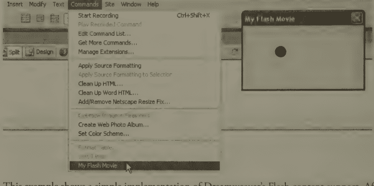

此示例展示了`Dreamweaver`Flash内容支持的简单实现。在你熟悉构建对象和命令以及更复杂的表单之后，你可以将Flash内容集成到`Dreamweaver`扩展中，以获得更具动态性的用户体验。有关更多信息，请参阅第7章“命令”，位于第167页，了解如何编写`commandButtons()`函数以向显示Flash内容的对话框中添加按钮。

## 第五章

Dreamweaver 文档对象模型

在`Macromedia Dreamweaver 8`中，文档对象模型（DOM）对于扩展构建者来说是至关重要的结构。它使您能够访问和操作用户文档以及扩展文件中的元素。

DOM定义了使用标记语言创建的文档的构成。通过将标签和属性表示为对象和属性，DOM使编程语言能够访问和操作文档及其组件。

HTML文档的结构可以看作是一棵文档树。根节点是`HTML`标签，两个最大的主干是`HEAD`标签和`BODY`标签。`HEAD`标签的分支包括`TITLE`、`STYLE`、`SCRIPT`、`ISINDEX`、`BASE`、`META`和`LINK`标签。`BODY`标签的分支包括标题（`H1`、`H2`等）、块级元素（`P`、`DIV`、`FORM`等）、文本级元素（`FONT`、`BR`、`IMG`等）以及其他元素类型。这些分支上的叶子包括`WIDTH`、`HEIGHT`、`ALT`等属性。

在DOM中，树结构被保留并呈现为父节点和子节点的层级关系。根节点没有父节点，叶节点没有子节点。在HTML结构的每一层，HTML元素都可以作为节点暴露给JavaScript。利用这种结构，您可以访问文档或其内部的任何元素。

在JavaScript中，您可以通过名称或索引调用任何文档对象，如下所示：

- 通过名称，如`document.myForm.myButton`
- 通过索引，如`document.forms[0].elements[1]`

具有相同名称的对象会被折叠成一个数组。您可以通过以零为原点的递增索引来访问数组中的特定对象（例如，`myForm`文档中名为`myRadioGroup`的第一个单选按钮被引用为`document.myForm.myRadioGroup[0]`）。

### 哪个文档 DOM？

区分用户文档的DOM和扩展的DOM非常重要。本章的信息适用于这两种类型的`Dreamweaver`文档，但引用每种DOM的方式不同。

如果您熟悉浏览器中的JavaScript，可以通过编写`document.`来引用活动文档中的对象（例如`document.forms[0]`），这与引用扩展文件中的对象方式相同。但是，要引用用户文档中的对象，您必须调用`dw.getDocumentDOM()`、`dw.createDocument()`或其他返回用户文档对象的函数。

例如，要引用活动文档中的第一个图像，您可以编写`dw.getDocumentDOM().images[0]`。您还可以将文档对象存储在变量中，并在后续引用中使用该变量，如下例所示：

```
var dom = dw.getDocumentDOM(); //获取当前文档的 DOM
var firstImg = dom.images[0];
firstImg.src = "myImages.gif";
```

这种表示法在`Configuration`文件夹中的文件中很常见，尤其是在命令文件中。有关`dw.getDocumentDOM()`方法的更多信息，请参阅*Dreamweaver API Reference*中的`dreamweaver.getDocumentDOM()`函数。

### Dreamweaver DOM

`Dreamweaver`DOM包含来自万维网联盟（W3C）（www.w3.org/TR/REC-DOM-Level-1/）DOM Level 1的部分对象、属性和方法，并结合了`Microsoft Internet Explorer 4.0`DOM的某些属性。

### Dreamweaver DOM 的对象、属性和方法

下表列出了`Dreamweaver`DOM支持的对象、属性、方法和事件。某些属性在作为特定对象的属性访问时是只读的。圆点（•）表示在列出的上下文中使用时为只读的属性。

| 对象 | 属性 | 方法 | 事件 |
| --- | --- | --- | --- |
| window | `navigator` •<br>`document` •<br>`innerWidth` •<br>`innerHeight` •<br>`screenX` •<br>`screenY` • | `alert()`<br>`confirm()`<br>`escape()`<br>`unescape()`<br>`close()`<br>`setTimeout()`<br>`clearTimeout()`<br>`setInterval()`<br>`clearInterval()`<br>`resizeTo()` | `onResize` |
| navigator | `platform` • | 无 | 无 |
| document | `forms` •（表单对象数组）<br>`images` •（图像对象数组）<br>`layers` •（`LAYER`、`ILAYER`以及绝对定位的`DIV`和`SPAN`对象数组）<br>按名称排列的子对象 •<br>`nodeType` •<br>`parentNode` •<br>`childNodes` •<br>`documentElement` •<br>`body` •<br>`URL` •<br>`parentWindow` • | `getElementsByTagName()`<br>`hasChildNodes()` | `onLoad` |
| 所有标签/<br>元素 | `nodeType` •<br>`parentNode` •<br>`childNodes` •<br>`tagName` •<br>按名称排列的属性<br>`innerHTML`<br>`outerHTML` | `getAttribute()`<br>`setAttribute()`<br>`removeAttribute()`<br>`getElementsByTagName()`<br>`hasChildNodes()` | |
| 对象 | 属性 | 方法 | 事件 |
|--------|-----------|---------|--------|
| form | 除所有标签可用的属性外：`elements` •（按钮、复选框、密码、单选、重置、选择、提交、文本、文件、隐藏、图像和文本区域对象的数组）<br>`mmcolorbutton`<br>按名称排列的子对象 • | 仅所有标签可用的方法 | 无 |
| layer | 除所有标签可用的属性外：`visibility`<br>`left`<br>`top`<br>`width`<br>`height`<br>`zIndex` | 仅所有标签可用的方法 | 无 |
| image | 除所有标签可用的属性外：`src` | 仅所有标签可用的方法 | `onMouseOver`<br>`onMouseOut`<br>`onMouseDown`<br>`onMouseUp` |
| button<br>reset<br>submit | 除所有标签可用的属性外：`form` • | 除所有标签可用的方法外：`blur()`<br>`focus()` | `onClick` |
| checkbox<br>radio | 除所有标签可用的属性外：`checked`<br>`form` • | 除所有标签可用的方法外：`blur()`<br>`focus()` | `onClick` |
| password<br>text<br>file<br>hidden<br>image（字段）<br>textarea | 除所有标签可用的属性外：`form` •<br>`value` | 除所有标签可用的方法外：`blur()`<br>`focus()`<br>`select()` | `onBlur`<br>`onFocus` |
| select | 除所有标签可用的属性外：`form` •<br>`options` •（选项对象数组）<br>`selectedIndex` | 除所有标签可用的方法外：`blur()`（仅Windows）<br>`focus()`（仅Windows） | `onBlur`（仅Windows）<br>`onChange`<br>`onFocus`（仅Windows） |
| 对象 | 属性 | 方法 | 事件 |
| --- | --- | --- | --- |
| option | 除所有标签可用的属性外：`text` | 仅所有标签可用的方法 | 无 |
| mmcolorbutton | 除所有标签可用的属性外：`name`<br>`value` | 无 | `onChange` |
| array<br>boolean<br>date<br>function<br>math<br>number<br>object<br>string<br>regexp | 与`Netscape Navigator 4.0`匹配 | 与`Netscape Navigator 4.0`匹配 | 无 |
| text | `nodeType` •<br>`parentNode` •<br>`childNodes` •<br>`data` | `hasChildNodes()` | 无 |
| comment | `nodeType` •<br>`parentNode` •<br>`childNodes` •<br>`data` | `hasChildNodes()` | 无 |
| NodeList | `length` • | `item()` | 无 |
| NamedNodeMap | `length` • | `item()` | 无 |

### 文档对象的属性和方法

下表详细介绍了从DOM Level 1中选取并在`Dreamweaver`中使用的文档对象的属性和方法。圆点（•）标记只读属性。

| 属性或方法 | 返回值 |
| --- | --- |
| `nodeType` • | `Node.DOCUMENT_NODE` |
| `parentNode` • | `null` |
| `parentWindow` • | 与文档的父窗口对应的JavaScript对象。（此属性不包含在DOM Level 1中；但`Microsoft Internet Explorer 4.0`支持它。） |
| 属性或方法 | 返回值 |
| --- | --- |
| `childNodes` • | 包含文档对象所有直接子节点的`NodeList`。通常文档只有一个子节点，即`HTML`对象。 |
| `documentElement` • | 与`HTML`标签对应的JavaScript对象。此属性是获取`document.childNodes`的值并从`NodeList`中提取`HTML`标签的简写。 |
| `body` • | 与`BODY`标签对应的JavaScript对象。此属性是调用`document.documentElement.childNodes`并从`NodeList`中提取`BODY`标签的简写。对于框架集文档，此属性返回最外层框架集的节点。 |
| `URL` • | 文档的`file://`URL，如果文件未保存，则为空字符串。 |
| `getElementsByTagName(tagName)` | 可用于遍历`tagName`类型标签（例如`IMG`、`DIV`等）的`NodeList`。<br>如果标签参数为`LAYER`，该函数返回所有`LAYER`和`ILAYER`标签以及所有绝对定位的`DIV`和`SPAN`标签。<br>如果标签参数为`INPUT`，该函数返回所有表单元素。（如果为一个或多个`tagName`对象指定了`name`属性，则它必须以字母开头，这是HTML 4.01规范所要求的，否则此函数返回的数组长度将不正确。） |
| `hasChildNodes()` | `true` |

### HTML 标签对象的属性和方法

每个HTML标签都由一个JavaScript对象表示。标签按树形层次结构组织，当标签y完全位于标签x的开始标签和结束标签之内时（`<x>x 内容 <y>y 内容</y> 更多 x 内容。</x>`），标签x就是标签y的父节点。因此，您的代码应该是格式良好的。

下表列出了`Dreamweaver`中标签对象的属性和方法及其返回值或说明。圆点（•）标记只读属性。

| 属性或方法 | 返回值 |
| --- | --- |
| `nodeType` • | `Node.ELEMENT_NODE` |
| `parentNode` • | 父标签。如果这是`HTML`标签，则返回文档对象。 |
| 属性或方法 | 返回值 |
| --- | --- |
| `childNodes` | 包含该标签所有直接子节点的`NodeList`。 |
| `tagName` | 标签的HTML名称，例如`IMG`、`A`或`BLINK`。该值始终以大写字母返回。 |
| `attrName` | 包含指定标签属性值的字符串。如果`attrName`属性是JavaScript语言中的保留字（例如`class`），则不能使用`tag.attrName`。在这种情况下，请使用`getAttribute()`和`setAttribute()`。 |
| `innerHTML` | 包含在开标签和闭标签之间的源代码。例如，在代码`<p><b>Hello</b>, World!</p>`中，`p.innerHTML`返回`<b>Hello</b>, World!`。如果写入此属性，DOM树会立即更新以反映文档的新结构。（此属性未包含在DOM Level 1中，但`Internet Explorer 4.0`支持它。） |
| `outerHTML` | 该标签的源代码，包括标签本身。对于前面的示例代码，`p.outerHTML`返回`<p><b>Hello</b>, World!</p>`。如果写入此属性，DOM树会立即更新以反映文档的新结构。（此属性未包含在DOM Level 1中，但`Internet Explorer 4.0`支持它。） |
| `getAttribute(attrName)` | 如果明确指定了该属性，则返回指定属性的值；否则返回`null`。 |


| `getTranslatedAttribute(attrName)` | 指定属性的翻译值，如果该属性的值未被翻译，则返回与 `getAttribute()` 相同的值。（此属性未包含在 DOM Level 1 中；它是在 Dreamweaver 3 中添加的，用于支持属性翻译。） |
| `setAttribute(attrName, attrValue)` | 不返回值。将指定属性设置为指定值。 |

## 对象文件如何工作

对象包含以下组件：

- 定义插入到文档中的内容的 HTML 文件

  - 对象文件的 HEAD 部分包含 JavaScript 函数（或引用外部 JavaScript 文件），用于处理来自 BODY 部分的表单输入，并控制将哪些内容添加到用户的文档中。对象文件的 BODY 部分可以包含一个 HTML 表单，该表单接受对象的参数（例如，要插入的表格的行数和列数），并激活一个对话框供用户输入属性。

> **注意**

> 最简单的对象仅包含要插入的 HTML，没有 BODY 和 HEAD 标签。更多信息，请参阅 Macromedia 支持中心的“自定义 Dreamweaver”。

- 出现在插入栏上的 18 x 18 像素图像

- 对 `insertbar.xml` 文件的添加。`insertbar.xml` 文件定义了对象在插入栏上的显示位置。

当用户通过单击插入栏上的图标或从插入菜单中选择项目来选择对象时，会发生以下事件：

1. Dreamweaver 调用 `canInsertObject()` 函数以确定是否显示对话框。

2. 系统会扫描对象文件中的 FORM 标签。如果存在表单，并且您在“常规首选项”对话框中选择了“插入对象时显示对话框”选项，Dreamweaver 将调用（如果已定义）`windowDimensions()` 函数来确定显示该表单的对话框大小。如果对象文件中不存在表单，Dreamweaver 不会显示对话框，并跳过步骤 2。

3. 如果 Dreamweaver 在步骤 1 中显示对话框，用户在对话框文本字段中输入对象的参数（例如表格的行数和列数），然后单击“确定”。

4. Dreamweaver 调用 `objectTag()` 函数，并将其返回值插入到文档中当前选中内容的后面。（它不会替换当前选中内容。）

5. 如果 Dreamweaver 找不到 `objectTag()` 函数，它会寻找 `insertObject()` 函数并调用该函数。

## 插入栏定义文件

`Configuration/Objects/insertbar.xml` 文件定义了插入栏属性。此 XML 文件包含每个单独对象的定义，顺序与对象出现的顺序相同。

用户首次启动 Dreamweaver 时，插入栏将水平显示在文档上方。此后，其可见性和位置会保存在注册表中。

### Insertbar.xml 标签层次结构

以下示例展示了 `insertbar.xml` 文件中嵌套标签的格式和层次结构：

```xml
<?xml version="1.0" ?>
<!DOCTYPE insertbarset SYSTEM "-//Macromedia//DWExtension insertbar 5.0">

<insertbar xmlns:MMString="http://www.macromedia.com/schemes/data/string/">

<category id="DW_Insertbar_Common" MMString:name="insertbar/categorycommon"
  folder="Common">
    <button id="DW_Hyperlink" image="Common\Hyperlink.png"
    MMString:name="insertbar/hyperlink" file="Common\Hyperlink.htm" />
    <button id="DW_Email" image="Common\E-Mail Link.png"
    MMString:name="insertbar/email" file="Common\E-Mail Link.htm" />
    <separator />
    <menubutton id="DW_Images" MMString:name="insertbar/images"
    image="Common\Image.png">
      <button id="DW_Image" image="Common\Image.png"
      MMString:name="insertbar/image" file="Common\Image.htm" />
    ...
    </menubutton>
    <separator />
      <button id="DW_TagChooser" MMString:name="insertbar/tagChooser"
      image="Common\Tag Chooser.gif" command="dw.showTagChooser()"
      codeOnly="TRUE"/>
</category>
    ...
</insertbar>
```

虽然 `insertbar` 和 `category` 标签使用 `</insertbar>` 和 `</category>` 闭合标签来标记其内容的结束，但 `button`、`checkbutton` 和 `separator` 标签没有相关的闭合标签。相反，`button`、`checkbutton` 和 `separator` 使用斜杠 (/) 在闭括号前来标记其属性和内容的结束。

## 插入栏定义标签

`insertbar.xml` 文件包含以下标签和属性：

### `<insertbar>`

#### 描述

此标签表示插入栏定义文件的内容。`</insertbar>` 闭合标签指定内容的结束。

#### 属性

无。

#### 示例

```xml
<insertbar>
   <category id="DW_Insertbar_Common" folder="Common">
     <button id="DW_Hyperlink" image="Common\Hyperlink.gif"
       file="Common\Hyperlink.htm"/>
...
</insertbar>
```

### `<category>`

#### 描述

此标签定义插入栏上的一个类别（例如“常用”、“表单”或“HTML”）。`</category>` 闭合标签指定类别内容的结束。

> 默认情况下，插入栏按用途分类组织（例如“常用”、“表单”或“HTML”）。在以前版本的 Dreamweaver 中，插入栏也通过选项卡进行类似的组织。用户可以设置自己的首选项来决定如何组织插入栏对象（按类别或选项卡）。如果用户选择了选项卡组织方式，则 `category` 标签定义每个选项卡。

#### 属性

`id`, `{folder}`, `{showIf}`

#### 示例

```xml
<category id="DW_Insertbar_Common" folder="Common">
  <button id="DW_Hyperlink" image="Common\Hyperlink.gif"
    file="Common\Hyperlink.htm"/>
</category>
```

### `<menubutton>`

#### 描述

此标签定义插入栏的弹出菜单。

#### 属性

`id`, `image`, `{showIf}`, `{name}`, `{folder}`

#### 示例

```xml
<menubutton
  id="DW_ImageMenu"
  name="Images"
  image="Common\imagemenu.gif"
  folder="Images">

  <button id="DW_Image"
    image="Common\Image.gif"
    enabled=""
    showIf=""
    file="Common\Image.htm" />
</menubutton>
```

### `<button />`

#### 描述

此标签定义插入栏上的一个按钮，用户单击该按钮可执行 `command` 或 `file` 属性指定的代码。

#### 属性

`id`, `image`, `name`, `{canDrag}`, `{showIf}`, `{enabled}`, `{command}`, `{file}`, `{tag}`, `{codeOnly}`

#### 示例

```xml
<button id="DW_Object"
image="Common\Object.gif"
name="Object"
enabled="true"
showIf=""
file="Common\Object.htm"
  />
```

### `<checkbutton />`

#### 描述

`checkbutton` 是一个具有选中或未选中状态的按钮。当单击时，`checkbutton` 显示为按下并高亮状态。当未选中时，`checkbutton` 显示为平面状态。Dreamweaver 具有鼠标悬停、按下、按下时鼠标悬停以及按下时禁用状态。命令必须确保单击 `checkbutton` 会使其状态发生变化。

#### 属性

`id`, `image`, `checked`, `{showIf}`, `{enabled}`, `{command}`, `{file}`, `{tag}`, `{name}`, `{codeOnly}`

#### 示例

```xml
<checkbutton id="DW_StandardView"
name = "Standard View"
image="Tools\Standard View.gif"
checked="_View_Standard"
command="dw.getDocumentDOM().setShowLayoutView(false)"/>
```

### `<separator />`

#### 描述

此标签在插入栏上显示一条垂直线。

#### 属性

`{showIf}`

#### 示例

```xml
<separator showIf="_VIEW_CODE"/>
```

## 插入栏定义标签属性

插入栏定义标签的属性具有以下含义：

### `id="unique id"`

#### 描述

`id` 属性是出现在插入栏上的按钮的标识符。`id` 属性在文件内对于该元素必须是唯一的。

#### 示例

```xml
id="DW_Anchor"
```

### `image="image_path"`

#### 描述

此属性指定相对于 Dreamweaver Configuration 文件夹的路径，指向显示在插入栏上的图标文件。图标可以是 Dreamweaver 可以渲染的任何格式，但通常是 GIF 或 JPEG 文件格式，大小为 18 x 18 像素。

#### 示例

```xml
image="Common/table.gif"
```

### `canDrag="Boolean"`

#### 描述

此属性指定用户是否可以将图标拖动到代码或工作区中以将对象插入到文档中。如果省略，默认值为 `true`。

#### 示例

```xml
canDrag="false"
```

### `showIf="enabler"`

#### 描述

此属性指定此按钮应仅在给定的 Dreamweaver 启用程序为真值时才显示在插入栏上。如果未指定 `showIf`，则按钮始终显示。可能的启用程序包括 `_SERVERMODEL_ASP`、`_SERVERMODEL_ASPNET`、`_SERVERMODEL_JSP`、`_SERVERMODEL_CFML`（适用于 Macromedia ColdFusion 的所有版本）、`_SERVERMODEL_CFML_UD4`（仅适用于 ColdFusion 的 UltraDev 版本 4）、`_SERVERMODEL_PHP`、`_FILE_TEMPLATE`、`_VIEW_CODE`、`_VIEW_DESIGN`、`_VIEW_LAYOUT`、`_VIEW_EXPANDED_TABLES` 和 `_VIEW_STANDARD`。

要指定多个启用程序，请在启用程序之间放置逗号（表示 AND）。要指定 NOT，请使用感叹号 (!)。

#### 示例

如果您希望某个按钮仅在 ASP 页面的代码视图中显示，请按如下方式指定启用程序：

```xml
showIf="_VIEW_CODE, _SERVERMODEL_ASP"
```

## `enabled="启用器"`

### 描述

此属性指定，当 `DW_enabler` 值为 true 时，该项目对用户可用。如果未指定 `enabled` 函数，则项目默认为始终启用。可能的启用器包括 `_SERVERMODEL_ASP`、`_SERVERMODEL_ASPNET`、`_SERVERMODEL_JSP`、`_SERVERMODEL_CFML`（适用于所有版本的 ColdFusion）、`_SERVERMODEL_CFML_UD4`（仅适用于 ColdFusion 的 UltraDev 4 版本）、`_SERVERMODEL_PHP`、`_FILE_TEMPLATE`、`_VIEW_CODE`、`_VIEW_DESIGN`、`_VIEW_LAYOUT`、`_VIEW_EXPANDED_TABLES` 和 `_VIEW_STANDARD`。

要指定多个启用器，请在启用器之间放置一个逗号（表示逻辑与）。要指定否定，请使用感叹号 (!)。

### 示例

如果你希望按钮仅在代码视图中可用，请指定以下内容：

```
enabled="_VIEW_CODE"
```

这会使按钮在其他视图中变暗。

## `checked="启用器"`

### 描述

如果使用 `checkbutton` 标签，则 `checked` 属性是必需的。

当 `DW_enabler` 值为 true 时，该项目被选中。可能的启用器包括 `_SERVERMODEL_ASP`、`_SERVERMODEL_ASPNET`、`_SERVERMODEL_JSP`、`_SERVERMODEL_CFML`（适用于所有版本的 ColdFusion）、`_SERVERMODEL_CFML_UD4`（仅适用于 ColdFusion 的 UltraDev 4 版本）、`_SERVERMODEL_PHP`、`_FILE_TEMPLATE`、`_VIEW_CODE`、`_VIEW_DESIGN`、`_VIEW_LAYOUT`、`_VIEW_EXPANDED_TABLES` 和 `_VIEW_STANDARD`。

要指定多个启用器，请在它们之间放置一个逗号（表示逻辑与）。要指定否定，请使用感叹号 (!)。

### 示例

```
checked="_View_Layout"
```

## `command="API_function"`

### 描述

此标签用于指定一个命令，当按钮被单击时 Dreamweaver 执行该命令，而不是引用包含要插入代码的 HTML 文件。

### 示例

```
command="dw.showTagChooser()"
```

## `file="file_path"`

### 描述

`file` 属性指定相对于 Dreamweaver Configuration 文件夹的对象文件路径。Dreamweaver 会从对象文件的标题中提取对象图标的工具提示，除非你指定了 `name` 属性。

### 示例

```
file="Templates/Editable.htm"
```

## `tag="editor"`

### 描述

此属性告诉 Dreamweaver 调用一个标签编辑器。在代码视图中，如果定义了 `tag` 属性且用户单击对象，Dreamweaver 会调用标签对话框。在代码视图中，如果指定了 `tag` 和 `command` 属性，Dreamweaver 会调用标签编辑器。在设计视图中，如果 `codeOnly="TRUE"` 且未指定 `file` 属性，Dreamweaver MX 会切换到拆分视图，将焦点置于代码中，并调用标签编辑器。

### 示例

```
tag = "form"
```

## `name="tooltip_text"`

### 描述

`name` 属性指定当鼠标指针悬停在对象上时出现的工具提示。如果你指定了对象文件但未指定 `name` 属性，Dreamweaver 会使用对象文件的名称作为工具提示。

> 注意：如果未提供 `name` 属性，该对象将无法在插入栏 UI 的收藏夹类别中进行分组。

一些插入栏对象使用了带有 `MMString` 前缀的 `name` 属性变体。`MMString` 表示本地化字符串；这些值在第 107 页的“本地化扩展”中解释。

### 示例

```
name = "cfoutput"
```

## 修改插入栏

你可以将对象从一个类别移动到另一个类别，重命名类别，以及从面板中完全移除对象。要使更改显示在插入栏中，你必须重启 Dreamweaver 或重新加载扩展。有关重新加载扩展的信息，请参阅第 104 页的“重新加载扩展”。

**要将对象从一个插入栏类别移动或复制到另一个类别或类别内的新位置：**

1.  保存 `insertbar.xml` 的备份副本（使用 `insertbar.backup.xml` 之类的名称）。

2.  打开原始的 `insertbar.xml` 文件。

3.  找到代表要移动或复制的对象的 `button` 标签。例如，要将图像对象从其在公共类别中的位置移动，找到 `id` 属性为 `"DW_Image"` 的 `button` 标签。

4.  剪切或复制整个 `button` 标签。

5.  找到代表要将对象移动或复制到其中的类别的 `category` 标签。

6.  找到类别内希望对象出现的位置。

7.  粘贴复制的 `button` 标签。

8.  保存 `insertbar.xml` 文件。

9.  重新加载扩展。

**要从插入栏中移除对象：**

1.  保存 `insertbar.xml` 的备份副本（使用 `insertbar.backup.xml` 之类的名称）。

2.  打开原始的 `insertbar.xml` 文件。

3.  找到代表要移除的对象的 `button` 标签。

4.  删除整个 `button` 标签。


5. 保存`insertbar.xml`文件。

6. 在磁盘上，将对象的 HTML、GIF 和 JavaScript 文件从当前文件夹移出，并放入一个未在`insertbar.xml`文件中列出的文件夹中。例如，你可以在`Configuration/Objects`文件夹中创建一个名为`Unused`的新文件夹，并将对象文件移入其中。（如果你确定要移除对象，可以完全删除这些文件；但是，最好保留这些文件的备份，以便以后需要恢复对象时使用。）

7. 重新加载扩展。

## 要更改插入栏中类别的顺序：

1. 保存`insertbar.xml`的备份副本（使用`insertbar.backup.xml`之类的名称）。

2. 打开原始的`insertbar.xml`文件。

3. 找到与要移动的类别对应的`category`标签，并选择该标签及其包含的所有标签。

4. 剪切该标签。

5. 将标签粘贴到新位置。确保将标签粘贴到不在任何其他`category`标签内的位置。

6. 保存`insertbar.xml`文件。

7. 重新加载扩展。

## 要创建新类别：

1. 保存`insertbar.xml`的备份副本（使用`insertbar.backup.xml`之类的名称）。

2. 打开原始的`insertbar.xml`文件。

3. 创建一个新的`category`标签，指定类别的默认文件夹以及要出现在类别中的对象集。

4. 有关`insertbar.xml`中标签语法的信息，请参阅第 142 页的“插入栏定义标签”。

5. 保存`insertbar.xml`文件。

6. 重新加载扩展。

## 将对象添加到插入栏

你可以将对象添加到插入栏。要使更改显示在插入栏中，你必须重启 Dreamweaver 或重新加载扩展。有关重新加载扩展的信息，请参阅第 104 页的“重新加载扩展”。

## 要将新对象添加到插入栏，请执行以下操作：

1. 使用 HTML 以及可选的 JavaScript 定义用户文档的特定代码字符串。

2. 为 Dreamweaver 界面中的按钮识别或创建一个图像（18 x 18 像素）。如果你创建更大的图像，Dreamweaver 会将其缩放为 18 x 18 像素。如果你没有为对象创建图像，插入栏上会出现一个带有问号 (?) 的默认对象图标。

3. 将新文件添加到`Configuration/Objects`文件夹中。

4. 编辑`insertbar.xml`文件以标识这些新文件的位置，并设置按钮外观的属性（参见第 141 页的“插入栏定义文件”）。

5. 重启 Dreamweaver 或重新加载扩展。

新对象将出现在插入栏的指定位置。

> **注意**
>
> 尽管你可以将对象文件存储在单独的文件夹中，但每个文件名都必须唯一。例如，`dom.insertObject()`函数会在`Objects`文件夹内的任何位置查找文件，而不考虑子文件夹（有关`dom.insertObject()`函数的更多信息，请参阅 *Dreamweaver API 参考*）。如果在`Forms`文件夹中存在一个名为`Button.htm`的文件，而在`MyObjects`文件夹中存在另一个名为`Button.htm`的对象文件，Dreamweaver 无法区分它们。如果存在两个独立的`Button.htm`实例，`dom.insertObject()`会显示两个名为`Button`的对象，用户可能无法识别出任何区别。

## 将对象添加到插入菜单

要添加对象或控制其在插入菜单（或任何其他菜单）上的位置，请修改`menus.xml`文件。此文件控制 Dreamweaver 的整个菜单结构。有关修改`menus.xml`文件的更多信息，请参阅第 181 页的第 8 章“菜单和菜单命令”。

如果你计划将扩展分发给其他 Dreamweaver 用户，请参阅第 109 页的“使用扩展管理器”以了解更多关于打包扩展的信息。

## 一个简单的插入对象示例

此示例将一个对象添加到插入栏，以便用户可以通过单击按钮为选中的文本添加删除线。如果用户需要在文档中添加编辑性注释，此对象非常有用。

因为此示例执行文本操作，你可能希望从插入栏 HTML 类别中的“文本”弹出菜单中探索一些对象作为模型。例如，查看粗体、强调和标题对象文件以查看类似功能，其中 Dreamweaver 将标签包裹在选中的文本周围。

你将执行以下步骤来创建删除线插入对象：

- 创建 HTML 文件
- 添加 JavaScript 函数
- 创建图像
- 编辑`insertbar.xml`文件
- 添加对话框
- 构建插入栏弹出菜单

## 创建 HTML 文件

对象的标题在起始和结束`title`标签之间指定。同时还需要指定脚本语言为 JavaScript。

**创建 HTML 文件：**

1. 创建一个空白的新文件。

2. 添加以下代码：

3. 将文件保存为`Strikethrough.htm`，放在`Configuration/Objects/Text`文件夹中。

```html
<html>
<head>
<title>Strikethrough</title>
<script language="javascript">
</script>
</head>
<body>
</body>
</html>
```

## 添加 JavaScript 函数

在本示例中，JavaScript 函数定义了删除线对象的行为并插入代码。你必须将所有 API 函数放在文件的 HEAD 部分。现有的对象文件（如`Configuration/Objects/Text/Em.htm`）遵循类似的函数和注释模式。

对象定义文件使用的第一个函数是`isDOMRequired()`，它告诉设计视图是否需要在继续执行之前与现有的代码视图同步。但是，由于上标对象可能在代码视图中与许多其他对象一起使用，因此它不需要强制同步。

**添加`isDOMRequired()`函数：**

1. 在`Strikethrough.htm`文件的 HEAD 部分，在起始和结束`script`标签之间，添加以下函数：

2. 保存文件。

```javascript
<script language="javascript">
  function isDOMRequired() {
    // Return false, indicating that this object is available in Code
    // view.
    return false;
  }
</script>
```

接下来，决定下一个函数使用`objectTag()`还是`insertObject()`。删除线对象只是将`s`标签包裹在选定的文本周围，因此它不符合使用`insertObject()`函数的条件（参见第 162 页的“`insertObject()`”）。

在`objectTag()`函数中，使用`dw.getFocus()`来确定代码视图是否为当前视图。如果代码视图具有输入焦点，则该函数应将适当的（大写或小写）标签包裹在选定的文本周围。如果设计视图具有输入焦点，则该函数可以使用`dom.applyCharacterMarkup()`将格式应用于选定的文本。请记住，此函数仅适用于受支持的标签（参见 *Dreamweaver API Reference* 中的`dom.applyCharacterMarkup()`）。对于其他标签或操作，你可能需要使用其他 API 函数。Dreamweaver 应用格式后，应将插入点（光标）返回到文档中，且不显示任何消息或提示。以下步骤展示了`objectTag()`函数现在的内容。

### 添加`objectTag()`函数：

1. 在`Strikethrough.htm`文件的 HEAD 部分，在`isDOMRequired()`函数之后，添加以下函数：

```javascript
function objectTag() {
  // Determine if the user is in Code view.
  var dom = dw.getDocumentDOM();
  if (dw.getFocus() == 'textView' || dw.getFocus(true) == 'html'){
    var upCaseTag = (dw.getPreferenceString("Source Format", "Tags Upper Case", "") == 'TRUE');
    // Manually wrap tags around selection.
    if (upCaseTag){
      dom.source.wrapSelection('<S>','</S>');
    }else{
      dom.source.wrapSelection('<s>','</s>');
    }
    // If the user is not in Code view, apply the formatting in Design view.
  }else if (dw.getFocus() == 'document'){
    dom.applyCharacterMarkup("s");
  }

  // Just return--don't do anything else.
  return;
}
```

2. 将文件保存为`Strikethrough.htm`，放在`Configuration/Objects/Text`文件夹中。

你可以将 JavaScript 函数放在 HTML 文件的 HEAD 部分之外，创建一个单独的 JavaScript 文件。这种单独的组织方式适用于包含多个函数的对象，或可能由其他对象共享的函数。

将 HTML 对象定义文件与支持的 JavaScript 函数分离：

1. 创建一个空白的新文件。

2. 将所有 JavaScript 函数粘贴到该文件中。

3. 从`Strikethrough.htm`中移除这些函数，并将 JavaScript 文件名添加到`script`标签的`src`属性中，如下例所示：

```html
<html>
<head>
<title>Strikethrough</title>
<script language="javascript" src="Strikethrough.js">
</script>
</head>
<body>
</body>
</html>
```

4. 保存`Strikethrough.htm`文件。

5. 将现在包含 JavaScript 函数的文件保存为`Strikethrough.js`，放在`Configuration/Objects/Text`文件夹中。

## 创建图像

要为插入栏创建图像：

1. 创建一个 GIF 图像（18 x 18 像素），如下图所示：


2. 将文件保存为`Strikethrough.gif`，放在`Configuration/Objects/Text`文件夹中。

## 编辑`insertbar.xml`文件

接下来，你需要编辑`insertbar.xml`文件，以便 Dreamweaver 可以将这两项与插入栏界面关联起来。

> 在编辑`insertbar.xml`文件之前，你可能需要将原始文件复制为`insertbar.xml.bak`，以便进行备份。

`insertbar.xml`文件中的代码标识了插入栏上的所有现有对象。

- XML 文件中的每个`category`标签在界面中创建一个类别。
- 每个`menubutton`标签在插入栏上创建一个弹出菜单。
- XML 文件中的每个`button`标签在插入栏上放置一个图标，并将其连接到适当的 HTML 文件或函数。

### 将新对象添加到插入栏：

1. 在`insertbar.xml`文件的开头附近找到以下行：

`<category id="DW_Insertbar_Common" MMString:name="insertbar/category/common" folder="Common">`

此行标识了插入栏上 Common 类别的开始。

2. 在`category`标签之后开始一个新行；然后插入`button`标签，并为删除线对象分配`id`、`image`和`file`属性。

ID 必须是按钮的唯一名称（按照标准命名约定，此对象使用`DW_Text_Strikethrough`）。`image`和`file`属性只需告诉 Dreamweaver 支持文件的位置，如下所示：

`<button id="DW_Text_Strikethrough"`
`image="Text\Strikethrough.gif"`
`file="Text\Strikethrough.htm"/>`

3. 保存`insertbar.xml`文件。

4. 重新加载扩展（参见第 104 页的“Reloading extensions”）。

新对象出现在插入栏上 Common 类别的开头，如下图所示：


## 添加对话框

你可以向对象添加表单，让用户在 Dreamweaver 插入指定代码之前输入参数（例如，超链接对象会从用户那里请求文本、链接、目标、类别索引、标题和访问键值）。在本示例中，你向前一个示例中的删除线对象添加一个表单。该表单打开一个对话框，为用户提供将文本颜色更改为红色的选项，同时添加删除线标签。此示例假设你已经创建了一个名为`Strikethrough.js`的单独 JavaScript 文件。

首先，在`Strikethrough.js`中，添加当用户更改文本颜色时表单调用的函数。此函数类似于删除线对象的`objectTag()`函数，但属于可选函数。

### 创建函数：

1. 在`Strikethrough.js`中的`objectTag()`函数之后，通过输入以下代码创建一个名为`fontColorRed()`的函数：

```javascript
function fontColorRed(){
  var dom = dw.getDocumentDOM();
  if (dw.getFocus() == 'textView' || dw.getFocus(true) == 'html'){

    var upCaseTag = (dw.getPreferenceString("Source Format", "Tags Upper Case", "") == 'TRUE');

    // Manually wrap tags around selection.
    if (upCaseTag){
      dom.source.wrapSelection('<FONT COLOR="#FF0000">','</FONT>');
    }else{
      dom.source.wrapSelection('<font color="#FF0000">','</font>');
    }
  }else if (dw.getFocus() == 'document'){
    dom.applyFontMarkup("color", "#FF0000");
  }

  // Just return -- don't do anything else.
  return;
}
```

> **注意**
>
> 由于`dom.applyCharacterMarkup()`不支持字体颜色更改，你需要找到适用于字体颜色更改的适当 API 函数。（有关详细信息，参见 *Dreamweaver API Reference* 中的`dom.applyFontMarkup()`）。

2. 将文件保存为`Strikethrough.js`。

接下来，在`Strikethrough.htm`文件中，添加表单。本示例的表单是一个简单的复选框，当用户点击它时调用`fontColorRed()`函数。你使用`form`标签定义表单，使用`table`标签进行布局控制（否则，对话框可能会出现文字换行或尺寸不协调的情况）。

### 添加表单：

1. 在`body`标签之后，添加以下代码：

```html
<form>
<table border="0" height="100" width="100">
  <tr valign="baseline">
    <td align="left" nowrap>
    <input type="checkbox" name="red" onClick="fontColorRed()">Red text</input>
    </td>
  </tr>
</table>
</form>
```

要测试对话框，请执行以下操作：

1. 单击“红字”复选框。

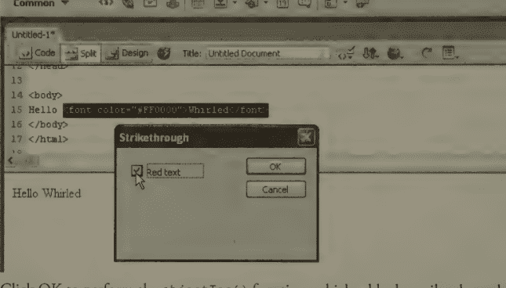

2. 单击“确定”以执行`objectTag()`函数，该函数会添加删除线：

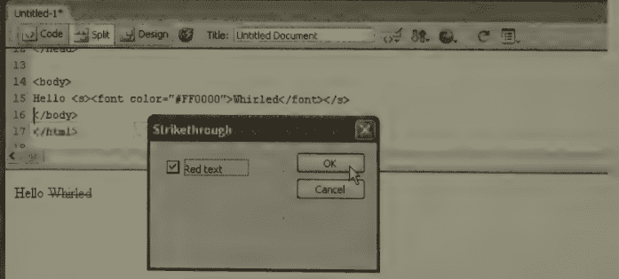

## 构建插入栏弹出菜单

Dreamweaver 插入栏为对象引入了新的组织方式，现在支持弹出菜单来将对象组织成更小的组，如下图所示。

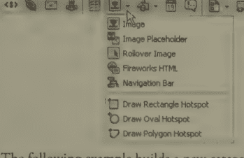

以下示例在插入栏上构建一个名为“Editorial”的新类别，然后向该类别添加弹出菜单。该弹出菜单包含您已创建的“删除线”对象，并将其与您将要创建的“蓝色文本”对象分组在一起。Editorial 类别中的对象让用户可以在文件中添加编辑批注，要么对要删除的内容添加删除线，要么将新内容设为蓝色。

### 整理文件的方法：


在`Dreamweaver`安装文件夹中新建一个`Configuration/Objects/Editorial`文件夹。

将您创建的"删除线"对象示例的文件（`Strikethrough.htm`、`Strikethrough.js`和`Strikethrough.gif`）复制到`Editorial`文件夹中。

### 创建"蓝色文本"对象的方法

1. 新建一个`HTML`文件。
2. 添加以下代码：

```html
<html>
<head>
<title>Blue Text</title>
<script language="javascript">

//-------------  API FUNCTIONS  ---------------

function isDOMRequired() {
  // Return false, indicating that this object is available in Code
  // view.
  return false;
}

function objectTag() {
```

```javascript
// Manually wrap tags around selection.
var dom = dw.getDocumentDOM();
if (dw.getFocus() == 'textView' || dw.getFocus(true) == 'html'){

  var upCaseTag = (dw.getPreferenceString("Source Format", "Tags Upper
Case", "") == 'TRUE');

  // Manually wrap tags around selection.
  if (upCaseTag){
    dom.source.wrapSelection('<FONT COLOR="#0000FF">','</FONT>');
  }else{
    dom.source.wrapSelection('<font color="#0000FF">','</font>');
  }
}else if (dw.getFocus() == 'document'){
  dom.applyFontMarkup("color", "#0000FF");
}

// Just return -- don't do anything else.
return;
}
```

```html
</script>
</head>
<body>
</body>
</html>
```

3. 将该文件保存为`AddBlue.htm`，存放在`Editorial`文件夹中。

现在您可以为"蓝色文本"对象创建一个图像。

### 创建图像的方法

1. 创建一个 18 × 18 像素的`GIF`文件，效果如下图所示：

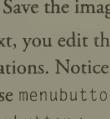

2. 将该图像保存为`AddBlue.gif`，存放在`Editorial`文件夹中。

接下来，您需要编辑`insertbar.xml`文件。该文件定义了插入栏上的对象及其位置。注意`HTML`类别中各种`<menubutton>`标签及其属性；这些`<menubutton>`标签定义了每个弹出菜单。在`<menubutton>`标签内，每个`<button>`标签定义弹出菜单中的一项。

### 编辑`insertbar.xml`的方法

1. 在文件开头附近找到以下代码行：

```xml
<insertbar xmlns:MMString="http://www.macromedia.com/schemes/data/
string/">
```

`<insertbar>`标签定义了所有插入栏内容的开始。

2. 在该行之后，为要创建的`Editorial`类别添加一个新的`<category>`标签，为其指定唯一的`ID`、名称和文件夹属性，然后添加闭合的`</category>`标签，如以下示例所示：

```xml
<category id="DW_Insertbar_Editorial" name="Editorial"
  folder="Editorial">
</category>
```

3. 重新加载扩展。有关重新加载扩展的信息，请参阅第 104 页的"重新加载扩展"。

`Editorial`类别将出现在插入栏上：

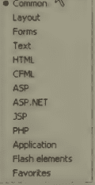

4. 在开标签和闭标签之间，使用`<menubutton>`标签及其以下属性添加弹出菜单，包括唯一的`ID`。

```xml
<menubutton id="DW_Insertbar_Markup" name=" markup"
  image="Editorial\Strikethrough.gif" folder="Editorial">
```

有关属性的更多信息，请参阅第 144 页的"插入栏定义标签属性"。

5. 使用`<button>`标签为新弹出菜单添加对象，如下所示：

```xml
<button id="DW_Editorial_Strikethrough"
  image="Editorial\\Strikethrough.gif"
  file="Editorial\\Strikethrough.htm"/>
```

6. 在"删除线"对象的`<button>`标签之后，添加超文本对象，如下所示：

```xml
<button id="DW_Blue_Text" image="Editorial\\AddBlue.gif" name="Blue Text informational Object Text"
  file="Editorial\\AddBlue.htm"
/>
```

**注意：** `<button>`标签没有单独的闭合标签；它以`" />"`结尾。

7. 用`</menubutton>`闭合标签结束弹出菜单。

以下代码显示了包含弹出菜单和两个对象的完整类别：

```xml
<category id="DW_Insertbar_Editorial" name="Editorial" folder="Editorial">
  <menubutton id="DW_Insertbar_Markup" name="markup"
    image="Editorial\\Strikethrough.gif" folder="Editorial">
    <button id="DW_Editorial_Strikethrough"
      image="Editorial\\Strikethrough.gif"
      file="Editorial\\Strikethrough.htm"/>
    <button id="DW_Blue_Text" image="Editorial\\AddBlue.gif" name="Blue
      Text"
      file="Editorial\\AddBlue.htm"/>
  </menubutton>
</category>
```

### 测试新弹出菜单的方法

1. 重新加载扩展。有关重新加载扩展的信息，请参阅第 104 页的"重新加载扩展"。

2. 单击`Editorial`菜单。

将显示以下弹出菜单：


## 对象 API

本节介绍对象 API 中的函数。您必须定义`insertObject()`或`objectTag()`函数之一。有关这些函数的详细信息，请参阅第 162 页的"`insertObject()`"。其余函数是可选的。

### `canInsertObject()`

**可用性**

`Dreamweaver MX`。

**描述**

此函数确定是否显示对象对话框。

**参数**

无。

**返回值**

`Dreamweaver`需要一个布尔值。

**示例**

以下代码告诉`Dreamweaver`在允许用户插入所选对象之前检查文档是否包含特定字符串：

```javascript
function canInsertObject(){
  var docStr = dw.getDocumentDOM().documentElement.outerHTML;
  var patt = /hava/;
  var found = ( docStr.search(patt) != -1 );
  var insertionIsValid = true;

  if (!found){
    insertionIsValid = false;
    alert("the document must contain a 'hava' string to use this object.");}
  return insertionIsValid;}
```

### `displayHelp()`

**描述**

如果您定义此函数，它会在参数对话框中"确定"和"取消"按钮的下方显示一个"帮助"按钮。当用户单击"帮助"按钮时，将调用此函数。

**参数**

无。

**返回值**

`Dreamweaver`不需要任何返回值。

**示例**

以下示例在浏览器中打开`myObjectHelp.htm`文件；该文件解释了如何使用扩展：

```javascript
function displayHelp(){
  var myHelpFile = dw.getConfigurationPath() +
    '/ExtensionsHelp/myObjectHelp.htm';
  dw.browseDocument(myHelpFile);
}
```

### `isDOMRequired()`

**描述**

此函数确定对象是否需要有效的`DOM`才能运行。如果此函数返回`true`值，或者该函数未定义，`Dreamweaver`将假设该命令需要有效的`DOM`，并在执行之前同步文档的代码视图和设计视图。同步会导致代码视图中的所有更新反映到设计视图中。

**参数**

无。

**返回值**

如果命令需要有效的`DOM`才能运行，`Dreamweaver`期望返回`true`值；否则返回`false`。

### `insertObject()`

**可用性**

`Dreamweaver MX`。

**描述**

如果未定义`objectTag()`函数，则此函数是必需的。当用户单击"确定"时调用此函数。它要么将代码插入用户的文档并关闭对话框，要么显示错误消息并保持对话框打开。这用作对象中`objectTag()`函数的替代函数。它不假设用户正在当前插入点插入文本，并允许在用户单击"确定"时进行数据验证。如果存在以下任一情况，则应使用`insertObject()`函数：

- 需要在多个地方插入代码。
- 需要在插入点以外的位置插入代码。
- 需要在插入代码之前验证输入。

如果这些条件都不适用，请使用`objectTag()`函数。

**参数**

无。

**返回值**

`Dreamweaver`需要一个包含错误消息的字符串或空字符串。如果返回空字符串，当用户单击"确定"时，对象对话框将关闭。如果不为空，`Dreamweaver`将显示错误消息，对话框保持打开状态。

**启用器**

`canInsertObject()`

**示例**

以下示例使用`insertObject()`函数，因为它需要在插入代码之前验证输入：

```javascript
function insertObject() {
  var theForm = document.forms[0];
  var nameVal = theForm.firstField.value;
  var passwordVal = theForm.secondField.value;
  var errMsg = "";
  var isValid = true;

  // ensure that field values are complete and valid
  if (nameVal == "" || passwordVal == "") {
    errMsg = "Complete all values or click Cancel."
  } else if (nameVal.length < 4 || passwordVal.length < 6) {
    errMsg = "Your name must be at least four characters, and your password at
least six";
  }

  if (!errMsg) {
```

## `objectTag()`

### 描述

`objectTag()`和`insertObject()`函数互斥：如果两者都在文档中定义，则使用`objectTag()`函数。有关更多信息，请参阅第 162 页的"`insertObject()`"。

此函数将一串代码插入用户的文档中。在`Dreamweaver MX`中，返回空字符串或`null`值（也称为`"return;"`），是向`Dreamweaver`发出的不执行任何操作的信号。

> **注意** 假设在`return`语句之前已经手动进行了编辑，因此在这种情况下不执行任何操作并不等同于单击取消。

在`Dreamweaver 4`中，如果焦点位于"代码"视图中，且选区是一个范围（意味着它不是插入点），则该范围将被`objectTag()`函数返回的字符串替换。即使`objectTag()`函数返回空字符串或不返回任何内容，此值也为`true`。`objectTag()`函数返回空字符串或`null`值是因为对文档的编辑已经手动完成。否则，双引号（`""`）通常会通过替换选区来删除编辑。

### 参数

无。

### 返回值

`Dreamweaver`期望返回要插入用户文档的字符串。

### 示例

以下`objectTag()`函数示例插入特定`ActiveX`控件和插件的`OBJECT`/`EMBED`组合：

```
function objectTag() {
return '\n' +
'<OBJECT CLASSID="clsid:166F100B-3A9R-11FB-8075444553540000" \n' +
'CODEBASE="http://www.mysite.com/product/cabs/myproduct.cab#version=1,0,0,0" \n' +
'NAME="MyProductName"> \n'
+ '<PARAM NAME="SRC" VALUE=""> \n' +
'<EMBED SRC="" HEIGHT="" WIDTH="" NAME="MyProductName"> \n' +
'</OBJECT>'
}
```

## `windowDimensions()`

### 描述

此函数为"选项"对话框设置特定的尺寸。如果未定义此函数，窗口尺寸将自动计算。

> **注意** 除非您希望"选项"对话框大于 640 x 480 像素，否则不要定义此函数。

### 参数

*platform*

- *platform* 参数的值是`"macintosh"`或`"windows"`，具体取决于用户的平台。

### 返回值

`Dreamweaver`期望格式为`"widthInPixels,heightInPixels"`的字符串。

返回的尺寸小于整个对话框的大小，因为它们不包括"确定"和"取消"按钮的区域。如果返回的尺寸无法容纳所有选项，则会出现滚动条。

### 示例

以下`windowDimensions()`函数示例将`Windows`的"参数"对话框尺寸设置为 648 x 520 像素，`Macintosh`的尺寸设置为 660 x 580 像素：

```
function windowDimensions(platform){
  var retval = ""
  if (platform == "windows"){
   retval = "648, 520";
  }else{
   retval = "660, 580";
  }
  return retval;
}
```

## 插入栏对象

## 第 7 章

## 命令

`Macromedia Dreamweaver 8`命令可以对用户当前文档、其他打开的文档或本地驱动器上的任何`HTML`文档执行几乎任何类型的编辑。命令可以插入、删除或重新排列`HTML`标签和属性、注释以及文本。命令是`HTML`文件。命令文件的`BODY`部分可以包含接受命令选项的`HTML`表单（例如，表格应如何排序以及按哪一列排序）。命令文件的`HEAD`部分包含`JavaScript`函数，这些函数处理来自`BODY`部分的表单输入，并控制对用户的文档进行何种编辑。

下表列出了用于创建命令的文件：

| 路径 | 文件 | 描述 |
| --- | --- | --- |
| `Configuration/Commands/` | *commandname*.htm | 指定用户界面。 |
| `Configuration/Commands/` | *commandname*.js | 包含要执行的函数。 |

### 命令的工作原理

当用户单击包含命令的菜单时，将发生以下事件：

1. `Dreamweaver`调用`canAcceptCommand()`函数以确定是否应禁用菜单项。如果`canAcceptCommand()`函数返回`false`值，则命令在菜单中显示为灰色，并且过程停止。如果`canAcceptCommand()`函数返回`true`值，则过程可以继续。

2. 用户从菜单中选择一个命令。


3. Dreamweaver 调用所选命令文件中定义的`receiveArguments()`函数（如果已定义），以便让命令处理从菜单项或从`dreamweaver.runCommand()`函数传递的任何参数。有关`dreamweaver.runCommand()`函数的更多信息，请参阅 *Dreamweaver API 参考*。

4. Dreamweaver 调用`commandButtons()`函数（如果已定义），以确定哪些按钮出现在"选项"对话框的右侧以及用户单击按钮时应执行什么代码。

5. Dreamweaver 扫描命令文件中的`FORM`标签。如果存在表单，Dreamweaver 调用`windowDimensions()`函数，该函数调整包含文件`BODY`元素的"选项"对话框的尺寸。如果未定义`windowDimensions()`函数，Dreamweaver 将自动调整对话框大小。

6. 如果命令文件的`BODY`标签包含`onLoad`处理程序，Dreamweaver 将执行它（无论是否出现对话框）。如果未出现对话框，则剩余的步骤不会发生。

7. 用户为命令选择选项。当用户遇到字段时，Dreamweaver 执行与字段关联的事件处理程序。

8. 用户单击由`commandButtons()`函数定义的其中一个按钮。

9. Dreamweaver 执行关联的代码。对话框保持可见，直到命令中的某个脚本调用`window.close()`函数。

### 将命令添加到"命令"菜单

Dreamweaver 会自动将`Configuration/Commands`文件夹中的所有文件添加到"命令"菜单的底部。要防止命令出现在"命令"菜单中，请在文件的第一行插入以下注释：

```
<!-- MENU-LOCATION=NONE -->
```

当此行存在时，Dreamweaver 不会为该文件创建菜单项，而您必须调用`dw.runCommand()`来执行命令。

### 简单的命令示例

此简单扩展将项目添加到"命令"菜单，并让您将文档中的选定文本转换为大写或小写。当您单击菜单项时，它会激活一个三按钮界面，让您提交选择。

您可以通过执行以下步骤来创建此扩展：

- 创建 UI
- 编写 JavaScript 代码
- 测试扩展

此示例在`Commands`文件夹中创建两个文件：`Change Case.htm`，包含 UI；以及`Change Case.js`，包含 JavaScript 代码。如果您愿意，可以只创建`Change Case.htm`文件并将 JavaScript 代码放在`HEAD`部分。

### 创建 UI

UI 是一个包含两个单选按钮的表单，让用户选择大写或小写。

**创建用户界面：**

1. 创建一个新的空白文件。
2. 将以下代码添加到文件中以创建表单：

```
<!DOCTYPE HTML SYSTEM "-/Macromedia/DWExtension layout-engine 5.0// dialog">
<HTML>
<HEAD>
<!-- Copyright 2001-2002 Macromedia, Inc. All rights reserved. -->
<Title>Make Uppercase or Lowercase</Title>
<SCRIPT SRC="Change Selection Case.js"></SCRIPT>
</HEAD>
<BODY>
<form name="uor1">
<table border="0">
<!--DWLayoutTable-->
<tr>
<td valign="top" nowrap> <p>
<label>
<input type="radio" name="RadioGroup1" value="uppercase" checked>
Uppercase</label>
<br>
<label>
<input type="radio" name="RadioGroup1" value="lowercase">
Lowercase</label>
</p></td>
</tr>
</table>
</div>
</form>
</BODY>
</HTML>
```

3. 将文件保存为`Change Case.htm`，放在`Configuration/Commands`文件夹中。

`Title`标签的内容`Make Uppercase or Lowercase`出现在对话框的顶部栏中。在表单中，具有两个单元格的表格控制元素的布局。表格单元格内是两个单选按钮`Uppercase`和`Lowercase`。`Uppercase`按钮具有`checked`属性，使其成为默认选择，并确保用户必须选择两个按钮之一或取消命令。

表单如下图所示。

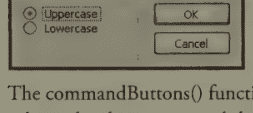

`commandButtons()`函数提供"确定"和"取消"按钮，让用户可以提交选择或取消操作。

### 编写 JavaScript 代码

以下示例包含两个 Dreamweaver 调用的扩展 API 函数`canAcceptCommand()`和`commandButtons()`，以及一个用来处理用户定义的函数`changeCase()`，该函数从`commandButtons()`函数调用。

在此示例中，您将编写 JavaScript 以执行以下任务：

- 确定命令应启用还是显示为灰色
- 将函数链接到"确定"和"取消"按钮
- 让用户指定大写或小写

### 确定命令应启用还是显示为灰色

创建命令的第一个任务是确定项目何时应激活以及何时应显示为灰色。当用户单击"命令"菜单时，Dreamweaver 调用每个菜单项的`canAcceptCommand()`函数以确定是否应启用该功能。如果`canAcceptCommand()`返回值`true`，Dreamweaver 将菜单项文本显示为激活或启用。如果`canAcceptCommand()`返回值`false`，Dreamweaver 将菜单项显示为灰色。在此示例中，当用户在文档中选择了文本时，菜单项处于激活状态。

**确定命令应处于激活还是灰显状态：**

1. 创建一个空白文件。
2. 添加以下代码：

```
function canAcceptCommand(){
  var theDOM = dw.getDocumentDOM(); // Get the DOM of the current
  document
  var theSel = theDOM.getSelection(); // Get start and end of selection
  var theSelNode = theDOM.getSelectedNode(); // Get the selected node
  var theChildren = theSelNode.childNodes; // Get children of selected
  node
  return (theSel[0] != theSel[1] && (theSelNode.nodeType ==
    Node.TEXT_NODE
    || theSelNode.hasChildNodes() && (theChildren[0].nodeType ==
    Node.TEXT_NODE)));
}
```

3. 将该文件保存为`Configuration/Commands`文件夹中的`Change Case.js`。

`canAcceptCommand()`函数的前几行通过获取用户文档的 DOM 并调用文档对象上的`getSelection()`函数来检索所选文本。接下来，该函数检索包含所选文本的节点，然后检索该节点的任何子节点，如以下代码所示。然后，最后一行检查选择或其第一个子节点是否为文本，并以`true`或`false`值的形式返回结果。

`return`语句的第一部分 (`theSel[0] != theSel[1]`) 检查用户是否已在文档中选择了任何内容。变量`theSel`是一个双槽数组，用于保存文档中所选内容的起始和结束偏移量。如果这两个值不相等，则表示已选择内容。如果两个槽中的值相等，则只有插入点，没有选择任何内容。

`return`语句的下一部分 (`&& (theSelNode.nodeType == Node.TEXT_NODE)`) 检查所选节点类型是否为文本。如果是，则`canAcceptCommand()`函数返回`true`值。如果节点类型不是文本，则继续测试该节点是否有子节点 (`|| theSelNode.hasChildNodes()`)，以及第一个子节点的类型是否为文本 (`&& (theChildren[0].nodeType == Node.TEXT_NODE)`)。如果两个条件都成立，则`canAcceptCommand()`返回`true`值，Dreamweaver 会在"命令"菜单底部启用该菜单项，如下图所示：

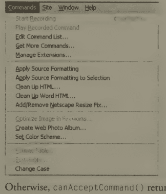

否则，`canAcceptCommand()`返回`false`值，Dreamweaver 会将该菜单项灰显，如下图所示：

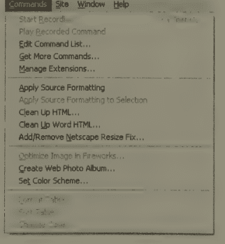

## 将函数链接到"确定"和"取消"按钮

当用户单击"确定"或"取消"时，扩展需要执行相应的操作。您可以通过指定单击任一按钮时要执行的 JavaScript 函数来确定适当的操作。

**要将"确定"和"取消"按钮链接到函数：**

1. 打开`Configuration/Commands`文件夹中的`Change Case.js`文件。
2. 在文件末尾添加以下代码：
3. 保存该文件。

```
function commandButtons() {
  return new Array("OK", "changeCase()", "Cancel", "window.close()");
}
```

`commandButtons()`函数使 Dreamweaver 提供"确定"和"取消"按钮，并告诉 Dreamweaver 在用户单击这些按钮时该怎么做。`commandButtons()`函数告诉 Dreamweaver 在用户单击"确定"时调用`changeCase()`，在用户单击"取消"时调用`window.close()`。

## 让用户指定大写或小写

当用户单击菜单项时，扩展需要一种机制让用户选择大写或小写。用户界面通过定义两个单选按钮来提供这种机制，让用户做出选择。

**要让用户指定大写或小写：**

1. 打开`Change Case.js`文件。
2. 在文件末尾添加以下代码：

```
function changeCase() {
  var uorl;

  // Check whether user requested uppercase or lowercase.
  if (document.forms[0].elements[0].checked)
    uorl = 'u';
  else
    uorl = 'l';

  // Get the DOM.
  var theDOM = dw.getDocumentDOM();

  // Get the outerHTML of the HTML tag (the
  // entire contents of the document).
  var theDocEl = theDOM.documentElement;
  var theWholeDoc = theDocEl.outerHTML;
```

```
// Get the node that contains the selection.
var theSelNode = theDOM.getSelectedNode();

// Get the children of the selected node.
var theChildren = theSelNode.childNodes;
var i = 0;
if (theSelNode.hasChildNodes()){
  while (i < theChildren.length){
    if (theChildren[i].nodeType == Node.TEXT_NODE){
      var selText = theChildren[i].data;
      var theSel = theDOM.nodeToOffsets(theChildren[0]);
      break;
    }
    ++i;
  }
}
else {
  // Get the offsets of the selection
  var theSel = theDOM.getSelection();
  // Extract the selection
  var selText = theWholeDoc.substring(theSel[0],theSel[1]);
}
if (uorl == 'u'){
  theDocEl.outerHTML = theWholeDoc.substring(0,theSel[0]) +
  selText.toUpperCase() + theWholeDoc.substring(theSel[1]);
}
else {
  theDocEl.outerHTML = theWholeDoc.substring(0,theSel[0]) +
  selText.toLowerCase() + theWholeDoc.substring(theSel[1]);
}
// Set the selection back to where it was when you started
theDOM.setSelection(theSel[0],theSel[1]);
window.close(); // close extension UI
```

3. 将该文件保存为`Configuration/Commands`文件夹中的`Change Case.js`。

`changeCase()`函数是一个用户定义的函数，当用户单击"确定"时由`commandButtons()`函数调用。此函数将所选文本更改为大写或小写。由于用户界面使用单选按钮，代码可以依赖其中一个选项被选中；它不需要测试用户未做出任何选择的可能性。

`changeCase()`函数首先测试属性`document.forms[0].elements[0].checked`。`document.forms[0].elements[0]`属性引用当前文档对象的第一个表单中的第一个元素，即扩展的用户界面。如果元素被选中（或启用），`checked`属性的值为`true`，否则为`false`。在界面中，`elements[0]`指的是第一个单选按钮，即"大写"按钮。由于当用户单击"确定"时总有一个单选按钮被选中，因此代码假定如果选择的不是大写，则必定是小写。该函数将变量`uorl`设置为 "u" 或 "l" 以存储用户的响应。

函数中的其余代码检索所选文本，将其转换为指定的大小写，然后将其复制回文档中的原位置。

要检索用户文档中的所选文本，该函数获取 DOM。然后获取文档的根元素，即`html`标签。最后，将整个文档提取到`theWholeDoc`变量中。

接下来，`changeCase()`调用`getSelectedNode()`来检索包含所选文本的节点。它还检索任何子节点 (`theSelNode.childNodes`)，以防选择是包含文本的标签，例如`<b>text</b>`。

如果存在子节点（`hasChildNodes()`返回`true`值），则命令遍历子节点以查找文本节点。如果找到文本节点，则将文本 (`theChildren[i].data`) 存储在`selText`中，并将文本节点的偏移量存储在`theSel`中。

如果没有子节点，则命令调用`getSelection()`并将选择的起始和结束偏移量存储在`theSel`中。然后提取这两个偏移量之间的字符串并将其存储在`selText`中。

然后，该函数检查`uorl`变量以确定用户是否选择了大写。如果是，则该函数将 HTML 代码分部分写回文档：首先是文档开头到选择的开头；然后是所选文本，将其转换为大写 (`selText.toUpperCase()`)；最后是所选文本的末尾到文档末尾。

如果用户选择小写，则该函数执行相同的操作，但调用`selText.toLowerCase()`将所选文本转换为小写。

最后，`changeCase()`重置选择并调用`window.close()`关闭用户界面。

## 测试扩展

将文件放置到`Commands`文件夹后，您可以测试扩展。

**测试扩展的步骤：**

1. 重启 Dreamweaver 或重新加载扩展。有关重新加载扩展的信息，请参见第 104 页的"重新加载扩展"。
   此时，"Change Case"（更改大小写）条目应出现在"Commands"（命令）菜单上。
2. 在文档中输入一些文本。
3. 选择文本。
4. 从"Commands"（命令）菜单中选择"Change Case"（更改大小写）。
   文本的大小写会发生变化。

> **注意**
>
> 在用户选择文档中的文本之前，"Change Case"（更改大小写）命令是灰显的。

## Commands API

Commands API 中的自定义函数不是必需的。

### canAcceptCommand()

**描述**

此函数确定命令是否适用于当前选区。

> **注意**
>
> 除非此函数在至少一种情况下返回`false`值，否则不要定义`canAcceptCommand()`。如果未定义此函数，则假定命令适用。作出此假定可以节省时间并提高性能。

**参数**

无。

**返回值**


Dreamweaver 期望一个`true`值表示命令被允许；如果值为`false`，Dreamweaver将在菜单中灰显该命令。

**示例**

以下`canAcceptCommand()`函数示例使得命令仅在选区为表格时才可用：

```
function canAcceptCommand(){
  var retval=false;
  var selObj=dw.getDocumentDOM.getSelectedNode();
  return (selObj.nodeType == Node.ELEMENT_NODE &&
selObj.tagName=="TABLE");{
    retval=true;
}
return retval;
}
```

### `commandButtons()`

**描述**

此函数定义应出现在选项对话框右侧的按钮及其点击行为。如果未定义此函数，则不会出现按钮，并且命令文件的BODY部分会扩展以填充整个对话框。

**参数**

无。

**返回值**

Dreamweaver期望一个包含偶数个元素的数组。第一个元素是一个字符串，包含最上方按钮的标签。第二个元素是一个JavaScript代码字符串，定义最上方按钮被点击时的行为。其余元素以相同方式定义其他按钮。

**示例**

以下`commandButtons()`实例定义了三个按钮：确定、取消和帮助：

```
function commandButtons(){
  return new Array("OK" , "doCommand()" , "Cancel" ,
"window.close()" , "Help" , "showHelp()");
}
```

### `isDomRequired()`

**描述**

此函数确定命令是否需要有效的DOM才能运行。如果此函数返回`true`值或未定义此函数，Dreamweaver将假定命令需要有效的DOM，并在执行前同步文档的设计视图和代码视图。同步会导致代码视图中的所有编辑在设计视图中更新。

**参数**

无。

**返回值**

Dreamweaver期望一个`true`值表示命令需要有效的DOM才能运行；否则为`false`。

### `receiveArguments()`

**描述**

此函数处理从菜单项或`dw.runCommand()`函数传递的任何参数。

**参数**

`{arg1}, {arg2}, ... {argN}`

- 如果为`menuitem`标签定义了`arguments`属性，该属性的值将作为一个或多个参数传递给`receiveArguments()`函数。参数也可以通过`dw.runCommand()`函数传递给命令。

**返回值**

Dreamweaver期望无返回值。

### `windowDimensions()`

**描述**

此函数为参数对话框设置特定尺寸。如果未定义此函数，则窗口尺寸会自动计算。

> **注意** 除非您需要大于640 × 480像素的选项对话框，否则不要定义此函数。

**参数**

`platform`

- `platform`参数的值为`"macintosh"`或`"windows"`，具体取决于用户的平台。

**返回值**

Dreamweaver期望一个格式为`"宽度像素,高度像素"`的字符串。

返回的尺寸小于整个对话框的大小，因为它们不包括“确定”和“取消”按钮的区域。如果返回的尺寸无法容纳所有选项，则会出现滚动条。

**示例**

以下`windowDimensions()`函数示例将参数对话框的尺寸设置为648 x 520像素：

```
function windowDimensions(){
  return "648,520";
}
```

# 第8章

## 菜单与菜单命令

Macromedia Dreamweaver 8的所有菜单均基于Dreamweaver Configuration/Menus文件夹中`menus.xml`文件定义的结构创建。您可以通过编辑`menus.xml`文件来重新排列、重命名和移除菜单命令。您也可以添加、更改和移除菜单命令的键盘快捷键，不过在大多数情况下，使用键盘快捷键编辑器（请参见Dreamweaver帮助）会更容易。对Dreamweaver菜单的更改将在下次启动Dreamweaver或重新加载扩展时生效。

在多用户操作系统中，当您在Dreamweaver内进行导致`menus.xml`更改的操作（例如使用键盘快捷键编辑器更改键盘快捷键）时，Dreamweaver会在您的用户配置文件夹中创建一个新的`menus.xml`文件。要在多用户操作系统中自定义`menus.xml`，请编辑您用户配置文件夹中的文件副本（如果Dreamweaver尚未在其中创建版本，请将主`menus.xml`文件复制到您的用户配置文件夹）。更多信息，请参见第104页的“多用户配置文件夹”。

如果您在XML编辑器中打开`menus.xml`，可能会看到关于`menus.xml`文件中`&`符号（`&`）的错误消息。最好在文本编辑器中编辑`menus.xml`；不要在Dreamweaver中编辑它。有关XML的基本信息，请参见Dreamweaver帮助。

在修改当前`menus.xml`文件或任何其他Dreamweaver配置文件之前，请务必备份一份副本。编辑菜单配置文件时很容易出错，除了替换`menus.xml`文件外，无法恢复到之前的菜单设置。万一您忘记备份，配置文件夹中包含默认`menus.xml`文件的备份，名为`menus.bak`；要恢复到默认菜单集，请用`menus.bak`的副本替换`menus.xml`。

## 关于`menus.xml`文件

`menus.xml`文件包含菜单栏、菜单、菜单命令、分隔符、快捷键列表和键盘快捷键的结构化列表。这些项目由您可以在文本编辑器中编辑的XML标签描述。

> **注意** 修改菜单时请务必小心。Dreamweaver会忽略任何包含XML语法错误的菜单或菜单命令。

菜单栏（由开头和结尾`menubar`标签标记）是一个离散的菜单或一组菜单——例如，有一个主菜单栏、一个单独的站点窗口菜单栏（仅在Windows上出现，Macintosh上没有）以及一个用于每个上下文菜单的菜单栏。每个菜单栏包含一个或多个菜单；菜单包含在`menu`标签中。每个菜单包含一个或多个菜单命令，每个命令由`menuitem`标签及其属性描述。菜单还可以包含分隔符（由`separator`标签描述）和子菜单。

除了与菜单命令关联的键盘快捷键外，Dreamweaver还提供了各种其他键盘快捷键，包括备用快捷键和仅在某些上下文中可用的快捷键。例如，`Control+Y`（Windows）或`Command+Y`（Macintosh）是“重做”的快捷键；但`Control+Shift+Z`或`Command+Shift+Z`是“重做”的备用快捷键。这些备用快捷键——以及无法在菜单命令标签中表示的其他快捷键——在`menus.xml`文件的快捷键列表中定义。每个快捷键列表（由`shortcutlist`标签描述）包含一个或多个快捷键，每个快捷键由`shortcut`标签描述。

以下部分描述了`menus.xml`标签的语法。可选属性在属性列表中用花括号（`{}`）标记；所有未用花括号标记的属性都是必需的。

### `<menubar>`

#### 描述

提供有关Dreamweaver菜单结构中菜单栏的信息。

#### 属性

`name`, `{app}`, `id`, `{platform}`

- **`name`** 菜单栏的名称。虽然`name`是必需属性，但可以将其值设为`""`。

- **`app`** 菜单栏可用的应用程序名称。当前未使用。

### `<menubar>`

**描述**

提供关于将出现在Dreamweaver菜单结构中的菜单栏的信息。

**属性**

`name`, `{app}`, `id`, `{platform}`

- `name` 菜单栏在应用程序中显示的名称。

- `app` 菜单栏所在的应用程序名称。当前未使用。

- `id` 菜单栏的菜单ID。`menus.xml`文件中的每个菜单ID都应该是唯一的。

- `platform` 表示菜单栏应仅在给定平台上显示。有效值为`"win"`和`"mac"`。

## 内容

此标签必须包含一个或多个`menu`标签。

## 容器

无。

## 示例

主（文档窗口）菜单栏使用以下`menubar`标签：

```
<menubar name="Main Window" id="DWMainWindow">
  <!-- menu tags here -->
</menubar>
```

### `<menu>`

#### 描述

提供关于将出现在Dreamweaver菜单结构中的菜单或子菜单的信息。

#### 属性

`name`, `{app}`, `id`, `{platform}`, `{showIf}`

- `name` 菜单在菜单栏上显示的名称。要在Windows中设置菜单的访问键（助记符），请在访问字母前使用下划线（`_`）。下划线在Macintosh上会自动移除。

- `app` 菜单所在的应用程序名称。当前未使用。

- `id` 菜单的菜单ID。文件中的每个ID都应该是唯一的。

- `platform` 表示菜单应仅在给定平台上显示。有效值为`"win"`和`"mac"`。

- `showIf` 指定菜单仅在给定的Dreamweaver启用器值为`true`时才出现。可能的启用器有：`_SERVERMODEL_ASP`、`_SERVERMODEL_ASPNET`、`_SERVERMODEL_JSP`、`_SERVERMODEL_CFML`（适用于所有版本的Macromedia ColdFusion）、`_SERVERMODEL_CFML_UD4`（适用于ColdFusion的UltraDev版本4）、`_SERVERMODEL_PHP`、`_FILE_TEMPLATE`、`_VIEW_CODE`、`_VIEW_DESIGN`、`_VIEW_LAYOUT`、`_VIEW_EXPANDED_TABLES`和`_VIEW_STANDARD`。你可以通过在启用器之间放置逗号（表示AND）来指定多个启用器。你可以使用`"!"`来指定NOT。例如，如果你希望菜单仅在ASP页面的代码视图中显示，请将属性指定为`showIf="_VIEW_CODE, _SERVERMODEL_ASP"`。

### 内容

此标签可以包含一个或多个`menuitem`标签，以及一个或多个`separator`标签。它还可以包含其他`menu`标签（用于创建子菜单）和标准HTML注释标签。

### 容器

此标签必须包含在`menubar`标签中。

### 示例

```
<menu name="_File" id="DWMenu_File">
  <!-- menuitem, separator, menu, and comment tags here -->
</menu>
```

### `<menuitem>`

#### 描述

为Dreamweaver菜单定义一个菜单命令。

#### 属性

`name`, `id`, `{app}`, `{key}`, `{platform}`, `{enabled}`, `{arguments}`, `{command}`, `{file}`, `{checked}`, `{dynamic}`, `{isdomrequired}`, `{showIf}`

- **`name`** 菜单中显示的菜单命令名称。下划线表示后面的字母是该命令的访问键（助记符），仅适用于Windows。

- **`id`** Dreamweaver用于标识该菜单项的ID。此ID在整个菜单结构中必须是唯一的。如果你向`menus.xml`添加新的菜单命令，请确保通过为每个菜单命令的ID使用公司名称或其他唯一字符串作为前缀来保证唯一性。

- **`app`** 菜单命令所在的应用程序名称。当前未使用。

- **`key`** 命令的键盘快捷键（如果有的话）。使用以下字符串指定修饰键：

  - `Cmd` 指定Control键（Windows）或Command键（Macintosh）。

  - `Alt`和`Opt`可互换地指定Alt键（Windows）或Option键（Macintosh）。

  - `Shift`在两个平台上都指定Shift键。

  - `Ctrl`在两个平台上都指定Control键。

  - 如果快捷键使用多个修饰键，则用加号（`+`）分隔修饰键。例如，`key`属性中的`Cmd+Opt+5`表示当用户按下`Control+Alt+5`（Windows）或`Command+Option+5`（Macintosh）时执行菜单命令。

  - 特殊键按名称指定：`F1`到`F12`、`PgDn`、`PgUp`、`Home`、`End`、`Ins`、`Del`、`Tab`、`Esc`、`BkSp`和`Space`。修饰键也可以应用于特殊键。

- **`platform`** 指示菜单项出现在哪个平台上。有效值为`"win"`（表示Windows）或`"mac"`（表示Macintosh）。如果你不指定`platform`属性，菜单命令将出现在两个平台上。如果你希望一个菜单命令在不同平台上表现不同，请提供两个名称相同（但ID不同）的菜单命令：一个使用`platform="win"`，另一个使用`platform="mac"`。

- **`enabled`** 提供JavaScript代码（通常是JavaScript函数调用），用于确定菜单命令当前是否启用。如果函数返回值`false`，则菜单命令将变为灰色。默认值为`"true"`，但即使值为`"true"`，最好也总是指定一个值以保持清晰。

- **`arguments`** 提供Dreamweaver传递给你在`file`属性中指定的JavaScript文件中代码的参数。参数用单引号（`'`）括起来，位于用于界定属性值的双引号（`"`）内部。

- **`command`** 指定当用户从菜单中选择此项时执行的JavaScript表达式。对于复杂的JavaScript代码，请使用JavaScript文件（在`file`属性中指定）代替。你必须为每个菜单命令指定`file`或`command`之一。

- **`file`** 包含控制菜单命令的JavaScript的HTML文件的名称。指定相对于Configuration文件夹的文件路径。（例如，帮助 > 欢迎菜单命令指定`file="Commands/Welcome.htm"`）。`file`属性会覆盖`command`、`enabled`和`checked`属性。你必须为每个菜单命令指定`file`或`command`之一。有关使用历史记录面板创建命令文件的信息，请参阅Dreamweaver帮助。有关编写自己的JavaScript命令的信息，请参阅第7章“命令”，第167页。

- **`checked`** 一个JavaScript表达式，指示菜单命令在菜单中是否带有复选标记；如果表达式的求值结果为`true`，则该项显示时会带有一个复选标记。

- **`dynamic`** 如果存在，表示菜单命令将由HTML文件动态确定；该文件包含用于设置菜单命令文本和状态的JavaScript代码。如果你将标签指定为动态，则还必须指定`file`属性。

- **`isdomrequired`** 指示在执行此菜单命令的代码之前是否应同步设计视图和代码视图。有效值为`"true"`（默认）和`"false"`。如果你将此属性设置为`"false"`，则表示此菜单命令对文件所做的更改不使用Dreamweaver DOM。有关DOM的信息，请参阅第5章“Dreamweaver文档对象模型”，第127页。

- **`showIf`** 指定菜单项仅在给定的Dreamweaver启用器值为`true`时才出现。可能的启用器有：`_SERVERMODEL_ASP`、`_SERVERMODEL_ASPNET`、`_SERVERMODEL_JSP`、`_SERVERMODEL_CFML`（适用于所有版本的ColdFusion）、`_SERVERMODEL_CFML_UD4`（适用于ColdFusion的UltraDev版本4）、`_SERVERMODEL_PHP`、`_FILE_TEMPLATE`、`_VIEW_CODE`、`_VIEW_DESIGN`、`_VIEW_LAYOUT`、`_VIEW_EXPANDED_TABLES`和`_VIEW_STANDARD`。你可以通过在启用器之间放置逗号（表示AND）来指定多个启用器。你可以使用`"!"`来指定NOT。例如，如果你希望菜单命令在代码视图中出现，但不在ColdFusion页面中出现，请将属性指定为`showIf="_VIEW_CODE, !_SERVERMODEL_CFML"`。

### 内容

无（空标签）。

### 容器

此标签必须包含在`menu`标签中。

### 示例

```
<menuitem name="_New" key="Cmd+N" enabled="true"
  command="dw.createDocument()" id="DWMenu_File_New" />
```

### `<separator>`

#### 描述

指示在菜单的相应位置应出现一个分隔符。

#### 属性

`{app}`

- `app` 分隔符所在的应用程序名称。当前未使用。

### 内容

无（空标签）。

### 容器

此标签必须包含在`menu`标签中。

### 示例

```
<separator />
```

### `<shortcutlist>`

#### 描述

在`menus.xml`文件中指定一个快捷方式列表。

#### 属性

`[app]`, `id`, `{platform}`

- `app` 快捷方式列表所在的应用程序名称。当前未使用。


`id`快捷方式列表的 ID。它应该与 Dreamweaver 中与这些快捷方式关联的菜单栏（或上下文菜单）的菜单 ID 相同。有效值为`"DWMainWindow"`、`"DWMainSite"`、`"DWTimelineContext"`和`"DWHTMLContext"`。

`platform`表示快捷方式列表应仅在给定平台上显示。有效值为`"win"`和`"mac"`。

### 内容

此标签可以包含一个或多个`shortcut`标签。它还可以包含一个或多个注释标签（其语法与 HTML 注释标签相同）。

### 容器

无。

### 示例

```
<shortcutlist id="DWMainWindow">
<!-- shortcut and comment tags here -->
</shortcutlist>
```

## `<shortcut>`

## 描述

在`menus.xml`文件中指定键盘快捷键。

## 属性

`key`, `{app}`, `{platform}`, `{file}`, `{arguments}`, `{command}`, `id`, `{name}`

- **`key`** 激活键盘快捷键的按键组合。有关语法详情，请参见`<menuitem>`。
- **`app`** 该快捷键可用的应用程序名称。当前未使用。
- **`platform`** 指定该快捷键仅在指定平台上生效。有效值为`"win"`和`"mac"`。如果未指定此属性，则该快捷键在两个平台上均有效。
- **`file`** 包含当您使用键盘快捷键时 Dreamweaver 执行的 JavaScript 代码的文件路径。`file`属性会覆盖`command`属性。每个快捷键必须指定`file`或`command`其中之一。
- **`arguments`** 为 Dreamweaver 提供参数，传递给您在`file`属性中指定的 JavaScript 文件中的代码。参数需用单引号 (`'`) 括起来，并置于用于界定属性值的双引号 (`"`) 内。
- **`command`** 当您使用键盘快捷键时 Dreamweaver 执行的 JavaScript 代码。每个快捷键指定`file`或`command`其中之一。
- **`id`** 快捷键的唯一标识符。
- **`name`** 键盘快捷键所执行命令的名称，其样式类似于菜单命令名称。例如，`F12`快捷键的`name`属性是"在主浏览器中预览"。

## 内容

无（空标签）。

## 包含容器

此标签必须包含在`shortcutlist`标签中。

## 示例

```
<shortcut key="Cmd+Shift+Z" file="Menus/MM/Edit_Clipboard.htm" arguments="'redo'" id="DWShortcuts_Edit_Redo" />
```

## `<tool>`

## 描述

代表一个工具；它在`menus.xml`文件中包含该工具的所有快捷键作为子标签。

## 属性

`{name}`, `id`

- **`name`** 工具名称的本地化版本。
- **`id`** 标识快捷键所应用工具的内部工具标识符。

## 内容

此标签可以包含一个或多个`activate`、`override`或`action`标签。

## 包含容器

此标签必须包含在`menu`标签中。

## 示例

```
<tool name="Hand tool" id="com.macromedia.dreamweaver.tools.hand">
  <!-- tool tags here -->
</tool>
```

## `<action>`

## 描述

包含当工具处于活动状态且按下按键组合时执行的按键组合和 JavaScript 代码。

## 属性

`{name}`, `key`, `command`, `id`

- **`name`** 操作的本地化版本。
- **`key`** 用于执行操作的按键组合。有关语法详情，请参见`<menuitem>`。
- **`command`** 要执行的 JavaScript 语句。此属性与`<shortcut>`的`command`属性格式相同。
- **`id`** 用于引用该操作的唯一 ID。

## 内容

无（空标签）。

## 包含容器

此标签必须包含在`tool`标签中。

## 示例

```
<action name="Set magnification to 50%" key="5" command="dw.activeViewScale
= 0.50" id="DWTools_Zoom_50" />
```

## `<activate>`

## 描述

包含用于激活工具的按键组合。

## 属性

`{name}`, `key`, `id`

- **`name`** 操作的本地化版本。
- **`key`** 用于激活工具的按键组合。有关语法详情，请参见`<menuitem>`。
- **`id`** 用于引用该操作的唯一 ID。

## 内容

无（空标签）。

## 包含容器

此标签必须包含在`tool`标签中。

## 示例

```
<activate name="Switch to Hand tool" key="H" id="DWTools_Hand_Active1" />
```

## `<override>`

## 描述

包含用于临时激活工具的按键组合。当处于其他模态工具中时，用户可以按住此键切换到此工具。

## 属性

`{name}`, `key`, `id`

- **`name`** 操作的本地化版本。
- **`key`** 用于快速激活工具的按键组合。有关语法详情，请参见`<menuitem>`。
- **`id`** 用于引用该操作的唯一 ID。

## 内容

无（空标签）。

## 包含容器

此标签必须包含在`tool`标签中。

## 示例

```
<override name="Quick switch to Hand tool" key="Space"
  id="DWTools_Hand_Override" />
```

## 更改菜单和菜单命令

通过编辑`menus.xml`文件，您可以在菜单内或不同菜单间移动菜单命令，向菜单添加分隔符或从中移除分隔符，以及在菜单栏内或不同菜单栏间移动菜单。

您可以使用与其他菜单相同的流程将项目移入或移出上下文菜单。

有关信息，请参阅第 182 页的"关于`menus.xml`文件"。

### 移动菜单命令：

1.  退出 Dreamweaver。
2.  备份`menus.xml`文件。
3.  在文本编辑器（如 BBEdit、HomeSite 或 Wordpad）中打开`menus.xml`。（不要在 Dreamweaver 中打开。）
4.  剪切整个`menuitem`标签，从开头的`<menuitem`到结尾的`/>`。
5.  将插入点放在菜单命令的新位置。（确保它位于`menu`标签和对应的`/menu`标签之间。）
6.  将菜单命令粘贴到其新位置。

### 在移动菜单命令时创建子菜单：

1.  将插入点放在菜单内（在`menu`标签和对应的`/menu`标签之间的某处）。
2.  在该菜单内插入一对新的`menu`标签和`/menu`标签。
3.  向新子菜单添加新的菜单命令。

### 在两个菜单命令之间插入分隔符：

-   在两个`menuitem`标签之间放置一个`separator/`标签。

### 移除现有分隔符：

-   删除对应的`separator/`行。

### 移动菜单：

1.  退出 Dreamweaver。
2.  备份`menus.xml`文件。
3.  在文本编辑器（如 BBEdit、HomeSite 或 Wordpad）中打开`menus.xml`。（不要在 Dreamweaver 中打开。）
4.  剪切整个菜单及其内容，从开头的`<menu>`标签到结尾的`</menu>`标签。
5.  将插入点放在菜单的新位置。（确保它位于`<menubar>`标签和对应的`</menubar>`标签之间。）
6.  将菜单粘贴到其新位置。

## 更改菜单命令或菜单的名称

您可以轻松地通过编辑`menus.xml`文件来更改任何菜单命令或菜单的名称。

### 更改菜单命令或菜单的名称：

1.  退出 Dreamweaver。
2.  备份`menus.xml`文件。
3.  在文本编辑器（如 HomeSite、BBEdit 或 Wordpad）中打开`menus.xml`。（不要在 Dreamweaver 中打开。）
4.  如果要更改菜单命令，请找到相应的`<menuitem>`标签，并更改其`name`属性的值。如果要更改菜单，请找到相应的`<menu>`标签，并更改其`name`属性的值。无论哪种情况，都不要更改`id`属性。
5.  保存并关闭`menus.xml`；然后重新启动 Dreamweaver 以查看更改。

## 更改键盘快捷键

如果默认键盘快捷键对您不方便，您可以更改或移除现有快捷键，或添加新快捷键。最简单的方法是使用键盘快捷键编辑器。（有关更多信息，请参阅 Dreamweaver 帮助）。但是，如果您愿意，也可以直接在`menus.xml`中修改键盘快捷键，但在`menus.xml`中输入快捷键比在键盘快捷键编辑器中更容易出错。

### 更改键盘快捷键：

1.  退出 Dreamweaver。
2.  备份`menus.xml`文件。
3.  在文本编辑器（如 BBEdit、HomeSite 或 Wordpad）中打开`menus.xml`。（不要在 Dreamweaver 中打开。）
4.  查看键盘快捷键矩阵（可从 Dreamweaver 支持中心获取），找到一个未使用的快捷键或您想要重新分配的快捷键。

如果您重新分配键盘快捷键，请在矩阵的打印副本上进行更改以备将来参考。

5.  如果要重新分配键盘快捷键，请找到已分配该快捷键的菜单命令，并从该菜单命令中移除`key="shortcut"`属性。
6.  找到要分配或重新分配键盘快捷键的菜单命令。
7.  如果该菜单命令已有键盘快捷键，请在该行上找到`key`属性。如果尚未分配快捷键，请在`menuitem`标签内属性之间的任何位置添加`key=""`。
8.  在`key`属性的双引号 (`"`) 之间输入新的键盘快捷键。

在按键组合中使用加号 (`+`) 连接按键。有关修饰键的更多信息，请参见`<menuitem>`中`menuitem`标签的描述。

如果键盘快捷键已在其他地方使用，而您未移除其其他用途，则该快捷键仅适用于`menus.xml`中使用它的第一个菜单命令。

> 注意

您可以为仅限 Windows 的菜单命令和仅限 Macintosh 的菜单命令使用相同的键盘快捷键。

9.  在键盘快捷键矩阵的相应位置写下您的新快捷键。

## 修改弹出菜单和上下文菜单

Dreamweaver 在其许多面板和对话框中提供了弹出菜单和上下文菜单。一些上下文菜单在`menus.xml`文件中定义；其他则在其他 XML 文件中定义。您可以添加、移除或修改这些菜单中的项目，尽管在大多数情况下，编写扩展来实现这些更改更好。

Dreamweaver 中以下弹出菜单和上下文菜单在 XML 文件中指定，使用的标签与`menus.xml`相同：

-   数据源（在绑定面板的加号 (`+`) 弹出菜单中列出）在`DataSources.xml`文件中指定，位于`DataSources`文件夹的子文件夹中。
-   服务器行为（在服务器行为面板的加号 (`+`) 弹出菜单中列出）在`ServerBehaviors.xml`文件中指定，位于`ServerBehaviors`文件夹的子文件夹中。
-   服务器格式（在编辑格式列表对话框的加号 (`+`) 弹出菜单中列出）在`ServerFormats.xml`文件中指定，位于`ServerFormats`文件夹的子文件夹中。
-   "绑定"面板中某个绑定的"格式"弹出菜单中的项目在`ServerFormats`文件夹子文件夹的`Formats.xml`文件中指定。你可以通过 Dreamweaver 中的"添加格式"对话框向该菜单添加条目。
-   "标签库编辑器"对话框的菜单命令在`TagLibraries/TagImporters/TagImporters.xml`文件中指定。
-   "生成行为"对话框中参数的菜单命令（该对话框是"服务器行为生成器"的一部分）在`Shared/Controls/String Menu/Controls.xml`中指定。
-   与 ColdFusion 组件关联的上下文菜单中的项目在`Components/ColdFusion/CFCs/CFCsMenus.xml`中指定。
-   与 ColdFusion 数据源关联的上下文菜单中的项目在`Components/ColdFusion/DataSources/DataSourcesMenus.xml`中指定。
-   与 JavaBeans 关联的上下文菜单中的项目在`Components/Jsp/JavaBeans/JavaBeanMenus.xml`中指定。
-   与各种服务器组件关联的上下文菜单中的项目在`Components`文件夹子文件夹的 XML 文件中指定。

## 菜单命令

菜单命令使菜单更加灵活和动态。与常规命令一样，菜单命令可以对当前文档、其他打开的文档或本地驱动器上的任何 HTML 文档执行几乎任何类型的编辑。菜单命令 API 扩展了常规命令 API，以完成与从菜单系统显示和调用命令相关的若干任务。

菜单命令是在`menus.xml`文件中`menuitem`标签的`file`属性中引用的 HTML 文件。菜单命令文件的 BODY 部分可以包含一个 HTML 表单，用于接受命令的选项（例如，表格应如何排序以及按哪一列排序）。菜单命令文件的 HEAD 部分包含 JavaScript 函数，用于处理 BODY 部分的表单输入并控制对用户文档的编辑。菜单命令存储在 Dreamweaver 应用程序文件夹内的`Configuration/Menus`文件夹中。

下表列出了用于创建菜单命令的文件。

| 路径 | 文件 | 描述 |
| --- | --- | --- |
| `Configuration/Menus/` | `menus.xml` | 包含菜单栏、菜单、菜单命令、分隔符、快捷键列表和键盘快捷键的结构化列表。修改此文件以添加新的菜单和菜单命令。 |
| `Configuration/Menus/` | `commandname.htm` | 包含菜单命令所需的函数。 |

> 如果你向 Dreamweaver 添加自定义菜单命令，请将它们添加到`Menus`文件夹的顶级目录，或创建一个子文件夹。Macromedia 文件夹`MM`保留给 Dreamweaver 自带的菜单命令。

## 修改"命令"菜单

你可以将某些类型的命令添加到"命令"菜单中，并更改它们的名称，而无需编辑`menus.xml`文件。有关`menus.xml`的更多信息，请参阅第 191 页的"更改菜单和菜单命令"。

> "命令"一词在 Dreamweaver 中有两种含义。严格来说，命令是一种特定类型的扩展。然而，在某些上下文中，"命令"与"菜单项"可以互换使用，指 Dreamweaver 菜单中出现的任何项目，无论其功能或实现方式如何。

要创建自动放置在"命令"菜单中的新命令，请使用"历史记录"面板。或者，你可以使用"扩展管理器"安装新的扩展，包括命令。有关更多信息，请参阅 Dreamweaver 帮助。

要重新排列"命令"菜单中的项目，或在菜单之间移动项目，你必须编辑`menus.xml`文件。

### 重命名你创建的命令：

1. 选择"命令">"编辑命令列表"。

   出现一个对话框，列出所有可以更改名称的命令。（默认"命令"菜单中的命令不会显示在此列表中，也无法使用此方法进行编辑。）

2. 选择要重命名的命令。
3. 输入新名称。
4. 单击"关闭"。

命令在"命令"菜单中被重命名。

### 删除你创建的命令：

1. 选择"命令">"编辑命令列表"。

   出现一个对话框，列出所有可以删除的命令。（默认"命令"菜单中的命令不会显示在此列表中，也无法使用此方法删除。）

2. 选择要删除的命令。
3. 单击"删除"，然后确认要删除该命令。

   命令被删除。包含该命令代码的文件也会被删除；删除命令不仅仅是将菜单命令从菜单中移除。在使用此方法之前，请确保你确实要删除该命令。如果你想将其从"命令"菜单中移除但不删除文件，可以在`Configuration/Commands`中找到该文件并将其移动到另一个文件夹。

4. 单击"关闭"。

## 菜单命令的工作原理

当用户单击包含菜单命令的菜单项时，会发生以下事件：

1. 如果菜单中的任何菜单项标签包含`dynamic`属性，Dreamweaver 会调用关联菜单命令文件中的`getDynamicContent()`函数来填充菜单。
2. Dreamweaver 调用菜单中引用的每个菜单命令文件中的`canAcceptCommand()`函数，以检查该命令是否适用于当前选择。
   - 如果`canAcceptCommand()`函数返回假值，则该菜单项将被灰显。
   - 如果`canAcceptCommand()`函数返回真值或未定义，Dreamweaver 会调用`isCommandChecked()`函数以确定是否在菜单项旁显示复选标记。如果`isCommandChecked()`函数未定义，则不显示复选标记。
3. Dreamweaver 调用`setMenuText()`函数以确定菜单中应显示的文本。
   如果`setMenuText()`函数未定义，Dreamweaver 将使用菜单项标签中指定的文本。
4. 用户从菜单中选择一个项目。

Dreamweaver 调用所选菜单命令文件中定义的`receiveArguments()`函数（如果已定义），以便命令处理从菜单项传递的任何参数。

> 如果是动态菜单项，菜单项的 ID 将作为唯一参数传递。

Dreamweaver 调用`commandButtons()`函数（如果已定义），以确定"选项"对话框右侧显示哪些按钮，以及用户单击按钮时应执行什么代码。

Dreamweaver 扫描菜单命令文件中的`FORM`标签。


如果存在表单，Dreamweaver 会调用`windowDimensions()`函数，以确定包含文件`BODY`元素的“选项”对话框的大小。

如果`windowDimensions()`函数未定义，Dreamweaver 将自动调整对话框的大小。

如果菜单命令文件的`BODY`标签包含`onLoad`处理程序，Dreamweaver 将执行关联的代码（无论对话框是否显示）。如果不显示对话框，则不会执行剩余步骤。

用户在对话框中选择选项。Dreamweaver 在用户遇到相关字段时执行与之关联的事件处理程序。

用户单击`commandButtons()`函数定义的某个按钮。

Dreamweaver 执行与所单击按钮关联的代码。

对话框保持可见，直到菜单命令文件中的某个脚本调用`window.close()`函数。

## 一个简单的菜单命令示例

这个简单的菜单命令示例展示了“撤销”和“重做”菜单命令的工作方式。“撤销”菜单命令撤销用户编辑操作的效果，而“重做”菜单项撤销“撤销”操作并恢复用户上次编辑操作的效果。

你可以通过执行以下步骤来实现此示例：

- 创建菜单命令
- 编写 JavaScript 代码
- 将命令文件放置到`Menu`文件夹中

## 创建菜单命令

将以下 HTML 菜单标签添加到`menus.xml`文件的末尾，以创建名为`MyMenu`的菜单，其中包含“撤销”和“重做”菜单项。

```
<menu name="MyMenu" id="MyMenu_Edit">
<menuitem name="MyUndo" key="Cmd+Z" file="Menus/MyMenu.htm"
  arguments="'undo'" id="MyMenu_Edit_Undo" />
<menuitem name="MyRedo" key="Cmd+Y" file="Menus/MyMenu.htm"
  arguments="'redo'" id="MyMenu_Edit_Redo" />
</menu>
```

`key`属性定义用户可以输入的用于调用菜单项的键盘快捷键。`file`属性指定 Dreamweaver 在调用菜单项时执行的命令文件的名称。`arguments`属性的值定义 Dreamweaver 在调用`receiveArguments()`函数时将传递的参数。

下图显示了这些菜单项：

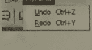

## 编写 JavaScript 代码

当用户在`MyMenu`菜单上选择“撤销”或“重做”时，Dreamweaver 会调用菜单项标签的`file`属性中指定的`MyMenu.htm`命令文件。在 Dreamweaver 的`Configuration/Menus`文件夹中创建`MyMenu.htm`命令文件，并添加三个菜单命令 API 函数`canAcceptCommand()`、`receiveArguments()`和`setMenuText()`，以实现与“撤销”和“重做”菜单项关联的逻辑。以下各节描述了这些函数。

## canAcceptCommand()

Dreamweaver 为`MyMenu`菜单中的每个菜单项调用`canAcceptCommand()`函数，以确定应启用还是禁用该菜单项。在`MyMenu.htm`文件中，`canAcceptCommand()`函数检查`arguments[0]`的值，以确定 Dreamweaver 正在处理的是“重做”菜单项还是“撤销”菜单项。如果参数是`"undo"`，`canAcceptCommand()`函数调用启用函数`dw.canUndo()`并返回返回值，该值为`true`或`false`。同样，如果参数是`"redo"`，`canAcceptCommand()`函数调用启用函数`dw.canRedo()`并将其值返回给 Dreamweaver。如果`canAcceptCommand()`函数返回值`false`，Dreamweaver 将灰显它调用该函数的菜单项。以下示例展示了`canAcceptCommand()`函数的代码：

```
function canAcceptCommand()
{
  var selarray;
  if (arguments.length != 1) return false;
  var bResult = false;

  var whatToDo = arguments[0];
  if (whatToDo == "undo")
  {
    bResult = dw.canUndo();
  }
  else if (whatToDo == "redo")
  {
    bResult = dw.canRedo();
  }
  return bResult;
}
```

# receiveArguments()

Dreamweaver 调用`receiveArguments()`函数来处理你为`menuitem`标签定义的任何参数。对于“撤消”和“重做”菜单项，`receiveArguments()`函数会根据参数值`arguments[0]`是`"undo"`还是`"redo"`，相应地调用`dw.undo()`函数或`dw.redo()`函数。`dw.undo()`函数会撤消用户在具有焦点的文档窗口、对话框或面板中执行的上一步操作。`dw.redo()`函数会重做上次被撤消的操作。

`receiveArguments()`函数如下例代码所示：

```
function receiveArguments()
{
  if (arguments.length != 1) return;

  var whatToDo = arguments[0];
  if (whatToDo == "undo")
  {
    dw.undo();
  }
  else if (whatToDo == "redo")
  {
    dw.redo();
  }
}
```

在此命令中，`receiveArguments()`函数处理参数并执行命令。更复杂的菜单命令可能会调用不同的函数来执行命令。例如，以下代码检查第一个参数是否为`"foo"`；如果是，则调用`doOperationX()`函数并传递第二个参数。如果第一个参数是`"bar"`，则调用`doOperationY()`函数并传递第二个参数。`doOperationX()`或`doOperationY()`函数负责执行命令。

```
function receiveArguments(){
  if (arguments.length != 2) return;

  var whatToDo = arguments[0];

  if (whatToDo == "foo"){
    doOperationX(arguments[1]);
  }else if (whatToDo == "bar"){
    doOperationX(arguments[1]);
  }
}
```

## setMenuText()

Dreamweaver 调用`setMenuText()`函数来确定菜单项上显示的文本。如果你未定义`setMenuText()`函数，Dreamweaver 将使用你在`menuitem`标签的`name`属性中指定的文本。

`setMenuText()`函数会检查 Dreamweaver 传递的参数值`arguments[0]`。如果参数值是`"undo"`，Dreamweaver 调用`dw.getUndoText()`函数；如果是`"redo"`，则调用`dw.getRedoText()`。`dw.getUndoText()`函数返回指定 Dreamweaver 将要撤消的操作的文本。例如，如果用户执行了多个“重做”操作，`dw.getUndoText()`可能返回菜单文本“撤消编辑源”。同样，`dw.getRedoText()`函数返回指定 Dreamweaver 将要重做的操作的文本。如果用户执行了多个“撤消”操作，`dw.getRedoText()`函数可能返回菜单文本“重做编辑源”。

`setMenuText()`函数如下例代码所示：

```
function setMenuText()
{
  if (arguments.length != 1) return " ";

  var whatToDo = arguments[0];
  if (whatToDo == "undo")
    return dw.getUndoText();
  else if (whatToDo == "redo")
    return dw.getRedoText();
  else return " ";
}
```

# 将命令文件放置在菜单文件夹中

要实现菜单的“撤消”和“重做”菜单项，你必须将`MyMenu.htm`命令文件保存在 Dreamweaver`Configuration/Menus`文件夹或你创建的子文件夹中。文件的位置必须与你在`menuitem`标签中指定的位置一致。要使其对 Dreamweaver 可用，请重启 Dreamweaver 或重新加载扩展。有关如何重新加载扩展的信息，请参见第 104 页的“重新加载扩展”。

要运行菜单命令，请在菜单项启用时选择它。Dreamweaver 将调用命令文件中的函数，如第 196 页的“菜单命令工作原理”中所述。

# 一个动态菜单示例

此示例实现了 Dreamweaver 的“在浏览器中预览”子菜单，该子菜单显示可用浏览器的列表。该示例还将在用户指定的浏览器中打开当前文件或站点面板中选定的文件。实现此动态菜单包括以下步骤：

- 创建动态菜单项
- 编写 JavaScript 代码

# 创建动态菜单项

`menus.xml`文件中的以下菜单标签定义了“文件”菜单的“在浏览器中预览”子菜单：

```
<menu name="_Preview in Browser" id="DWMenu_File_PIB">
    <menuItem dynamic name="No Browsers Selected"
        file="Menus/MM/PIB_Dynamic.htm" arguments="'No Browsers'"
        id="DWMenu_File_PIB_Default" />
    <separator />
    <menuItem name="_Edit Browser List..." enabled="true"
        command="dw.editBrowserList()" id="DWMenu_File_PIB_EditBrowserList" />
</menu>
```

第一个`menuitem`标签定义了默认菜单项“No Browsers Selected”，如果你未在首选项中的“在浏览器中预览”项中指定任何浏览器，它将出现在子菜单上。但是，如果你指定了 Microsoft Internet Explorer 浏览器，子菜单将如下图所示：

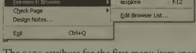

第一个菜单项的`name`属性指定了命令文件`PIB_Dynamic.htm`。此文件包含以下行：

```
<SCRIPT LANGUAGE="javascript" SRC="PIB_Dynamic.js"></SCRIPT>
```

`script`标签引入了`PIB_Dynamic.js`文件中的 JavaScript 代码，该代码提供了与“在浏览器中预览”子菜单交互的 JavaScript 代码。此代码可以直接保存在`PIB_Dynamic.htm`文件中，但将其存储在单独的文件中允许多个命令包含相同的代码。

# 编写 JavaScript 代码

因为第一个`menuitem`标签包含`dynamic`属性，所以 Dreamweaver 调用`PIB_Dynamic.js`文件中的`getDynamicContent()`函数，如下例所示：

```
function getDynamicContent(itemID)
{
  var browsers = null;
  var PIB = null;
  var i;
  var j=0;
  browsers = new Array();
  PIB = dw.getBrowserList();

  for (i=0; i<PIB.length; i=i+2)
  {
    browsers[j] = new String(PIB[i]);

    if (dw.getPrimaryBrowser() == PIB[i+1])
      browsers[j] += "\tF12";
    else if (dw.getSecondaryBrowser() == PIB[i+1])
      browsers[j] += "\tCmd+F12";

    browsers[j] += ";id='"+escQuotes(PIB[i])+"'";

    if (itemID == "DWPopup_PIB_Default")
      browsers[j] = MENU_strPreviewIn + browsers[j];

    j = j+1;
  }
  return browsers;
```

`getDynamicContent()`函数调用`dw.getBrowserList()`函数，以获取在 Dreamweaver 首选项的“在浏览器中预览”部分中指定的浏览器名称数组。此数组包含每个浏览器的名称和可执行文件的路径。接下来，对于数组中的每个项目（`i=0; i<PIB.length; i=i+2`），`getDynamicContent()`函数将浏览器的名称（`PIB[i]`）移入名为`browsers`的第二个数组中（`browsers[j] = new String(PIB[i]);`）。如果浏览器被指定为主浏览器或次浏览器，该函数会附加调用它们的键盘快捷键的名称。然后它附加字符串`";id="`后跟浏览器名称的单引号（例如，`;id='iexplore'`）。如果`itemID`参数是`"DWPopup_PIB_Default"`，该函数会为数组项添加字符串"Preview in"作为前缀。在构建了首选项中列出的每个浏览器的条目后，`getDynamicContent()`函数将数组`browsers`返回给 Dreamweaver。如果首选项中未选择任何浏览器，该函数返回值`null`，Dreamweaver 在菜单中显示“No Browsers Selected”。

## canAcceptCommand()

Dreamweaver 接下来会为每个引用了带`file`属性的命令文件的`menuitem`标签调用`canAcceptCommand()`函数。如果`canAcceptCommand()`函数返回值`false`，则菜单项将灰显。如果`canAcceptCommand()`函数返回值`true`，Dreamweaver 将启用菜单上的该项。如果函数返回`true`或未定义，Dreamweaver 会调用`isCommandChecked()`函数来确定是否在菜单项旁边显示复选标记。如果`isCommandChecked()`函数未定义，则不显示复选标记。

```
function canAcceptCommand()
{
    var PIB = dw.getBrowserList();

    if (arguments[0] == 'primary' || arguments[0] == 'secondary')
        return havePreviewTarget();

    return havePreviewTarget() && (PIB.length > 0);
}
```

`PIB_Dynamic.js`文件中的`canAcceptCommand()`函数再次获取在首选项中创建的浏览器列表。然后它检查第一个参数（`arguments[0]`）是否为`primary`或`secondary`。如果是，则返回`havePreviewTarget()`函数返回的值。如果不是，它会测试`havePreviewTarget()`函数的调用结果，并检查是否指定了任何浏览器（`PIB.length > 0`）。如果两个测试都为`true`，则函数返回`true`。如果其中一个或两个测试都为`false`，则函数返回`false`。

## havePreviewTarget()

`havePreviewTarget()`函数是一个用户自定义函数，如果 Dreamweaver 有一个可以在浏览器中显示的有效目标，则返回`true`。有效目标是站点面板中的文档或选定的文件组。`havePreviewTarget()`函数如下例所示：

```
function havePreviewTarget()
{
    var bHavePreviewTarget = false;

    if (dw.getFocus(true) == 'site')
    {
        if (site.getFocus() == 'remote')
        {
            bHavePreviewTarget = site.getRemoteSelection().length > 0 &&
                                 site.canBrowseDocument();
        }
        else if (site.getFocus() != 'none')
        {
            var selFiles = site.getSelection();
            if (selFiles.length > 0)
            {
                var i;


```
bHavePreviewTarget = true;

for (i = 0; i < selFiles.length; i++)
{
    var selFile = selFiles[i];

    // For server connections, the files will
    // already be remote URLs.
    if (selFile.indexOf("://") === (-1))
    {
        var urlPrefix = "file:///";
        var strTemp = selFile.substr(urlPrefix.length);
        if (selFile.indexOf(urlPrefix) == -1)
            bHavePreviewTarget = false;
        else if (strTemp.indexOf("/") === -1)
            bHavePreviewTarget = false;
        else if (!DWfile.exists(selFile))
            bHavePreviewTarget = false;
        else if (DWfile.getAttributes(selFile).indexOf("D") != -1)
            bHavePreviewTarget = false;
    }
    else
    {
        bHavePreviewTarget = true;
    }
}
```

`havePreviewTarget()` 函数将 `bHavePreviewTarget` 的值设置为 `false` 作为默认返回值。该函数执行两个基本测试，调用 `dw.getFocus()` 函数来确定应用程序的哪个部分当前具有输入焦点。第一个测试检查站点面板是否具有焦点（`if (dw.getFocus(true) == 'site')`）。如果站点面板没有焦点，第二个测试检查文档（`dw.getFocus() == 'document'`）、文本视图（`dw.getFocus() == 'textView'`）或代码检查器（`dw.getFocus("true") == 'html'`）是否具有焦点。如果两个测试都不为 `true`，则函数返回 `false`。

如果站点面板具有焦点，该函数会检查视图设置是否为远程视图。如果是，且存在远程文件（`site.getRemoteSelection().length > 0`）并且文件可以在浏览器中打开（`site.canBrowseDocument()`），则函数将 `bHavePreviewTarget` 设置为 `true`。如果视图设置不是远程视图，且视图不是"无"，则函数以 `file:///` URL 的形式获取选定文件的列表（`var selFiles = site.getSelection();`）。

对于选定列表中的每一项，函数测试是否存在字符串 `"://"`。如果未找到，代码会对列表项执行一系列测试。如果该项不是 `file:///` URL 格式（`if (selFile.indexOf(urlPrefix) == -1)`），则将返回值设置为 `false`。如果 `file:///` 前缀之后的字符串剩余部分不包含斜杠（`/`）（`if (strTemp.indexOf("/")) == -1)`），则将返回值设置为 `false`。如果文件不存在（`else if (!DWfile.exists(selFile))`），则将返回值设置为 `false`。最后，它检查指定的文件是否为文件夹（`else if (DWfile.getAttributes(selFile).indexOf("D") != -1)`）。如果 `selFile` 是文件夹，则函数返回 `false`。否则，如果目标是文件，则函数将 `bHavePreviewTarget` 设置为 `true`。

如果文档、文本视图或代码检查器具有输入焦点（`else if (dw.getFocus() == 'document' || dw.getFocus() == 'textView' || dw.getFocus("true") == 'html'`），该函数会获取 DOM 并检查文档是否为 HTML 或 XML 文档。如果是，则函数将 `bHavePreviewTarget` 设置为 `true`。最后，函数返回存储在 `bHavePreviewTarget` 中的值。

## `receiveArguments()`

Dreamweaver 调用 `receiveArguments()` 函数，以便命令处理从菜单项传递的任何参数。对于"在浏览器中预览"菜单，`receiveArguments()` 函数会调用用户选择的浏览器。`receiveArguments()` 函数如下例所示：

```
function receiveArguments()
{
    var whichBrowser = arguments[0];
    var theBrowser = null;
    var i = 0;
    var browserList = null;
    var result = false;

    if (havePreviewTarget())
    {
        // Code to check if we were called from a shortcut key
        if (whichBrowser == 'primary' || whichBrowser == 'secondary')
        {
            // get the path of the selected browser
            if (whichBrowser == 'primary')
            {
                theBrowser = dw.getPrimaryBrowser();
            }
            else if (whichBrowser == 'secondary')
            {
                theBrowser = dw.getSecondaryBrowser();
            }

            // Match the path with the name of the corresponding browser
            // that appears in the menu.
            browserList = dw.getBrowserList();
            while(i < browserList.length)
            {
                if (browserList[i+1] == theBrowser)
                    theBrowser = browserList[i];
                i+=2;
            }
        }
        else
            theBrowser = whichBrowser;

        // Only launch the browser if we have a valid browser selected.
        if (theBrowser != "file:///" && typeof(theBrowser) != "undefined" && theBrowser.length > 0)
        {
            if (dw.getFocus(true) == 'site')
            {
                // Only get the first item of the selection because
                // browseDocument() can't take an array.
                //dw.browseDocument(site.getSelection()[0],theBrowser);
                site.browseDocument(theBrowser);
            }
            else
                dw.browseDocument(dw.getDocumentPath('document'),theBrowser);
        }
    }
    else
    {
        // Otherwise, F12 or Ctrl+F12 was pressed, ask if the user wants
        // to specify a primary or secondary browser now.
        if (whichBrowser == 'primary')
        {
            result = window.confirm(MSG_NoPrimaryBrowserDefined);
        }
        else if (whichBrowser == 'secondary')
        {
            result = window.confirm(MSG_NoSecondaryBrowserDefined);
        }

        // If the user clicked OK, show the prefs dialog with the browser
        // panel.
        if (result)
            dw.showPreferencesDialog('browsers');
    }
}
```

该函数首先将变量 `whichBrowser` 设置为 Dreamweaver 传递的值 `arguments[0]`。除了设置其他默认值外，函数还将 `result` 设置为默认值 `false`。

变量初始化完成后，`receiveArguments()` 函数调用用户自定义函数 `havePreviewTarget()` 并测试结果。如果测试结果为 `true`，函数会检查用户选择的是主浏览器还是次浏览器。如果是，函数将变量 `theBrowser` 设置为启动浏览器的可执行文件路径（`dw.getPrimaryBrowser()` 或 `dw.getSecondaryBrowser()`）。然后函数执行一个循环，检查由 `dw.getBrowsersList()` 返回的浏览器列表。如果列表中某个浏览器的路径与主浏览器或次浏览器的路径匹配，函数将变量 `theBrowser` 设置为 `browserList` 中的匹配值。该值包含浏览器的名称和启动浏览器的可执行文件路径。如果 `havePreviewTarget()` 返回 `false`，函数将变量 `theBrowser` 设置为变量 `whichBrowser` 的值。

接下来，`receiveArguments()` 函数测试变量 `theBrowser`，确保它不是以路径开头、不是 `"undefined"` 且长度大于 0。如果所有这些条件都为 `true`，并且站点面板具有焦点，`receiveArguments()` 函数会调用 `site.browseDocument()` 函数，使用站点面板中选定的文件来调用所选浏览器。如果站点面板没有焦点，`receiveArguments()` 函数会调用 `dw.browseDocument()` 函数，并将当前文档的路径和变量 `theBrowser` 的值传递给它，该值指定用于打开文档的浏览器名称。

如果用户按下了快捷键（F12 或 Ctrl+F12）且未指定主浏览器或备用浏览器，系统会弹出对话框通知用户。若用户点击确定，该函数将调用 `dw.showPreferencesDialog()` 函数并传递 `browsers` 参数，以便用户在此处指定浏览器。

## 菜单命令 API

菜单命令 API 中的自定义函数并非必需。

## `canAcceptCommand()`

### 描述

确定菜单项是处于激活状态还是灰显状态。

### 参数

`{arg1}, {arg2}, ... {argN}`

- 如果是动态菜单项，`getDynamicContents()` 函数指定的唯一 ID 是唯一的参数。否则，如果为 `menuitem` 标签定义了 `arguments` 属性，则该属性的值将作为一个或多个参数传递给 `canAcceptCommand()` 函数（以及 `isCommandChecked()`、`receiveArguments()` 和 `setMenuText()` 函数）。`arguments` 属性对于区分两个调用相同菜单命令的菜单项非常有用。

> **注意**
> 对于动态菜单项，`arguments` 属性将被忽略。

### 返回值

Dreamweaver 期望一个布尔值：如果项目应启用，则为 `true`；否则为 `false`。

## `commandButtons()`

### 描述

定义出现在选项对话框右侧的按钮及其点击后的行为。如果未定义此函数，则不会显示按钮，并且菜单命令文件的 BODY 部分将扩展以填充整个对话框。

### 参数

无。

### 返回值

Dreamweaver 期望一个包含偶数个元素的数组。第一个元素是一个字符串，包含最上方按钮的标签。第二个元素是一个 JavaScript 代码字符串，定义最上方按钮点击后的行为。其余元素以相同方式定义附加按钮。

### 示例

以下 `commandButtons()` 函数示例定义了确定、取消和帮助按钮：

```
function commandButtons(){
  return new Array("OK", "doCommand()", "Cancel", "window.close()", "Help", "showHelp()");
}
```

## `getDynamicContent()`

### 描述

检索菜单动态部分的内容。

### 参数

`menuID`

- `menuID` 参数是与该项关联的 `menuitem` 标签中 `id` 属性的值。

### 返回值

Dreamweaver 期望一个字符串数组，其中每个字符串包含菜单项的名称及其唯一 ID，以分号分隔。如果函数返回 `null` 值，则菜单不会更改。

### 示例

以下 `getDynamicContent()` 函数示例返回包含四个菜单项（My Menu Item 1、My Menu Item 2、My Menu Item 3 和 My Menu Item 4）的数组：

```
function getDynamicContent(){
  var stringArray= new Array();
  var i=0;
  var numItems = 4;
  for (i=0; i<numItems;i++)
    stringArray[i] = new String("My Menu Item " + i + ";id='My-MenuItem" + i + "'");
  return stringArray;
}
```


## `isCommandChecked()`

### 描述

确定是否在菜单项旁边显示复选标记。

### 参数

`{arg1}`, `{arg2}`,...`{argN}`

如果是动态菜单项，`getDynamicContents()` 函数指定的唯一 ID 是唯一的参数。否则，如果为 `menuitem` 标签定义了 `arguments` 属性，则该属性的值将作为一个或多个参数传递给 `isCommandChecked()` 函数（以及 `canAcceptCommand()`、`receiveArguments()` 和 `setMenuText()` 函数）。`arguments` 属性对于区分两个调用相同菜单命令的菜单项非常有用。

> **注意**
> 对于动态菜单项，`arguments` 属性将被忽略。

### 返回值

Dreamweaver 期望一个布尔值：如果应在菜单项旁边显示复选标记，则为 `true`；否则为 `false`。

### 示例

```javascript
function isCommandChecked()
{
  var bChecked = false;
  var cssStyle = arguments[0];
  if (dw.getDocumentDOM() == null)
    return false;
  if (cssStyle == "(None)")
  {
    return dw.cssStylePalette.getSelectedStyle() == '';
  }
  else
  {
    return dw.cssStylePalette.getSelectedStyle() == cssStyle;
  }
  return bChecked;
}
```

## `receiveArguments()`

处理从菜单项或 `dw.runCommand()` 函数传递的任何参数。如果是动态菜单项，则处理动态菜单项 ID。

- `arg1`, `arg2`,...`argN`
  - 如果是动态菜单项，`getDynamicContents()` 函数指定的唯一 ID 是唯一的参数。否则，如果为 `menuitem` 标签定义了 `arguments` 属性，则该属性的值将作为一个或多个参数传递给 `receiveArguments()` 函数（以及 `canAcceptCommand()`、`isCommandChecked()` 和 `setMenuText()` 函数）。`arguments` 属性对于区分两个调用相同菜单命令的菜单项非常有用。
  
  **注意** 对于动态菜单项，`arguments` 属性将被忽略。

Dreamweaver 期望无返回值。

```javascript
function receiveArguments()
{
  var styleName = arguments[0];
  if (styleName == "(None)")
    dw.getDocumentDOM('document').applyCSSStyle('','');
  else
    dw.getDocumentDOM('document').applyCSSStyle('',styleName);
}
```

## `setMenuText()`

指定应在菜单中显示的文本。

- **注意** 如果使用 `getDynamicContent()`，请勿使用此函数。

`arg1`, `arg2`,...`argN`

- 如果为 `menuitem` 标签定义了 `arguments` 属性，则该属性的值将作为一个或多个参数传递给 `setMenuText()` 函数（以及 `canAcceptCommand()`、`isCommandChecked()` 和 `receiveArguments()` 函数）。`arguments` 属性对于区分两个调用相同菜单命令的菜单项非常有用。

### 返回值

Dreamweaver 期望返回应在菜单中显示的字符串。

### 示例

```javascript
function setMenuText()
{
  if (arguments.length != 1) return "";
  var whatToDo = arguments[0];
  if (whatToDo == "undo")
    return dw.getUndoText();
  else if (whatToDo == "redo")
    return dw.getRedoText();
  else return "";
}
```

## `windowDimensions()`

### 描述

为参数对话框设置特定尺寸。如果未定义此函数，窗口尺寸将自动计算。

> **注意** 除非您需要大于 640 x 480 像素的对话框，否则不要定义此函数。

### 参数

`platform`

- `platform` 参数的值为 "macintosh" 或 "windows"，具体取决于用户的平台。

### 返回值

Dreamweaver 期望一个格式为 `"widthInPixels,heightInPixels"` 的字符串。返回的尺寸小于整个对话框的大小，因为它们不包括确定和取消按钮所在的区域。如果返回的尺寸无法容纳所有选项，则会出现滚动条。

### 示例

以下 `windowDimensions()` 示例将参数对话框的尺寸设置为 **648 x 520** 像素：

```javascript
function windowDimensions(){
  return "648,520";
}
```

# 第 9 章 工具栏

您只需创建一个定义工具栏的文件，并将其放置在 `Configuration/Toolbars` 文件夹中，即可为 Macromedia Dreamweaver 8 创建工具栏。在工具栏文件中，您可以使用一些自定义 XML 标签定义诸如复选按钮、单选按钮、文本框和弹出菜单等项目。您可以为工具栏项目分配属性和命令以指定其外观和行为，包含其他工具栏文件，并引用在其他工具栏中定义的工具栏项目。

下表列出了用于创建工具栏的文件：

| 路径 | 文件 | 描述 |
|------|------|------|
| `Configuration/Toolbars/` | `toolbars.xml` | 编辑此文件以更改工具栏内容。 |
| `Configuration/Toolbars/` | `newtoolbar.xml` | 创建此文件以创建新工具栏。 |
| `Configuration/Toolbars/` | `imagefile.gif` | 工具栏控件的图标图像。 |
| `Configuration/Commands/` | `MyCommand.htm` | 与工具栏项目关联的命令文件。 |

## 工具栏的工作原理

工具栏由存储在 Dreamweaver 主配置文件夹的 `Toolbars` 文件夹中的 XML 和图像文件定义。默认的 Dreamweaver 工具栏存储在 `Configuration/Toolbars` 文件夹的 `toolbars.xml` 文件中。当 Dreamweaver 启动时，它会加载 `Toolbars` 文件夹中的所有工具栏文件。您只需将文件复制到 `Toolbars` 文件夹即可添加新工具栏，而无需修改原始的 `toolbars.xml` 文件。

工具栏 XML 文件定义一个或多个工具栏及其工具栏项目。工具栏是按钮、文本框、弹出菜单等项目的列表。工具栏项目代表用户在工具栏中可以访问的单个控件。

某些类型的工具栏控件（如按钮和弹出菜单）会关联图标图像。图标图像存储在 `Toolbars` 文件夹下的 `images` 文件夹中。图像可以是 Dreamweaver 能够渲染的任何格式，但通常是 GIF 或 JPEG 文件格式。Macromedia 创建的工具栏的图像存储在 `Toolbars/images/MM` 文件夹中。

与菜单一样，你可以通过项目属性或命令文件来指定各个工具栏项目的功能。Macromedia 创建的工具栏命令文件存储在 `Toolbars/MM` 文件夹中。

> 工具栏 API 与菜单命令 API 兼容，因此工具栏控件可以重用菜单命令文件。

与菜单不同，你可以独立于使用它们的工具栏来定义工具栏项目。这种灵活性允许你通过使用 `itemref` 标签在多个工具栏中使用工具栏项目。

Dreamweaver 首次加载工具栏时，其可见性和位置由工具栏定义设置。之后，其可见性和位置会保存到注册表（Windows）或 Dreamweaver 偏好设置文件（Macintosh）中，并从中恢复。

## 工具栏的行为方式

在 Windows 中，Dreamweaver 工具栏通常与标准 Windows 工具栏行为相同。Dreamweaver 工具栏具有以下特征：

- 你可以通过拖放来停靠、取消停靠工具栏，以及相对于其他工具栏重新定位它们。
- 你可以将工具栏水平停靠在框架窗口的顶部或底部。

在 Dreamweaver 工作区（将所有 Dreamweaver 文档窗口集成在一个父框架内）中，你可以指定工具栏是停靠到工作区框架还是文档窗口。

对于停靠到 Dreamweaver 工作区框架的工具栏，每个工具栏只有一个实例。在这种情况下，工具栏始终作用于最前面的文档。在 Dreamweaver 工作区中，你可以将工具栏停靠在插入工具栏的上方、下方、左侧或右侧。附加到 Dreamweaver 工作区框架的工具栏在没有文档窗口时不会自动禁用。工具栏项目决定在没有打开文档时它们是否启用。

当工具栏保持停靠在文档窗口时，每个窗口都有一个实例。附加到文档窗口的工具栏在其窗口不是前台文档时会完全禁用自身，并在其窗口回到前台时重新运行所有更新处理程序。

- 你不能在文档窗口和 Dreamweaver 工作区框架之间拖放工具栏。
- 工具栏保持固定大小。即使容器缩小或其他工具栏放置在旁边，工具栏也不会缩小。
- 你可以从“视图”>“工具栏”菜单中显示或隐藏工具栏。
- 工具栏不能重叠。
- 拖动时只显示工具栏的轮廓。

在 Macintosh 上，工具栏始终附加到文档窗口。可以从菜单中显示或隐藏它们，但你不能拖放、重新排列或取消停靠它们。

## 工具栏命令的工作原理

当 Dreamweaver 绘制工具栏时，会发生以下事件：

1. 对于每个工具栏控件项目，Dreamweaver 会确定 `file` 属性是否存在。
2. 如果 `file` 属性存在，Dreamweaver 会调用 `canAcceptCommand()` 函数来确定是否应在当前文档上下文中启用该控件。

   例如，对于 Dreamweaver 工具栏中的“文档标题”文本框，`canAcceptCommand()` 函数会检查是否存在当前 DOM 以及当前文档是否为 HTML 文件。如果这两个条件都为真，函数返回 `true`，Dreamweaver 就会启用工具栏上的文本框。
3. 如果 `file` 属性存在，Dreamweaver 会忽略以下指定的属性：`checked`、`command`、`DOMRequired`、`enabled`、`script`、`showIf`、`update` 和 `value`。
4. 如果 `file` 属性不存在，Dreamweaver 会处理为工具栏控件项目设置的属性：`checked`、`command`、`DomRequired` 等。

   有关特定项目标签属性的更多信息，请参见第 232 页的“项目标签属性”。
5. Dreamweaver 会在每个更新周期（由 `update` 属性指定）调用 `getCurrentValue()` 函数，以确定要为控件显示的值。
6. 用户选择工具栏上的项目。
7. Dreamweaver 调用 `receiveArguments()` 函数来处理工具栏项目的 `arguments` 属性指定的任何参数。

有关 Toolbar Command API 中特定函数用途的更多信息，请参见第 238 页的“工具栏命令 API”。

## 一个简单的工具栏命令文件

这个简单的示例实现了 Dreamweaver 文档工具栏上看到的“标题”文本框项目。该文本框项目允许用户为当前 Dreamweaver 文档输入名称。你可以通过执行以下步骤来实现此工具栏示例：

- 创建文本框
- 编写 JavaScript 代码

### 创建文本框

要向 Dreamweaver 添加工具栏，你需要将包含工具栏定义的 XML 文件放置在 Dreamweaver 配置文件夹内的 `Toolbars` 文件夹中。

下图显示了“标题”文本框：


以下工具栏 `editcontrol` 项目定义了一个标签为“标题”的文本框：

```xml
<EDITCONTROL ID="DW_SetTitle"
    label="Title: "
    tooltip="Document Title"
    width="150"
    file="Toolbars/MM/EditTitle.htm"/>
```

`tooltip` 属性使 Dreamweaver 在用户将鼠标指针放在文本框上时在工具提示框中显示“文档标题”。`width` 属性以像素为单位指定字段的大小。`file` 属性指定 `EditTitle.htm` 文件包含操作文本框的 JavaScript 函数。要查看 Dreamweaver 文档工具栏的完整定义，请参见 `toolbars.xml` 文件中的主工具栏（`id="DW_Toolbar_Main"`）。

### 编写 JavaScript 代码

当用户与文本框交互时，它会促使 Dreamweaver 调用 `Toolbars/MM` 文件夹中的 `EditTitle.htm` 命令文件。此文件包含三个操作“标题”文本框的 JavaScript 函数。这些函数是 `canAcceptCommand()`、`receiveArguments()` 和 `getCurrentValue()`。

### `canAcceptCommand()`: 启用工具栏项目

`canAcceptCommand()` 函数由一行代码组成，该代码检查是否存在当前文档对象模型（DOM）以及文档是否被解析为 HTML。函数返回这些测试的结果。如果条件为 `true`，Dreamweaver 就会启用工具栏上的文本框项目。如果函数返回值 `false`，Dreamweaver 就会禁用该项目。

该函数如下所示：

```javascript
function canAcceptCommand()
{
    return (dw.getDocumentDOM() != null && dw.getDocumentDOM().getParseMode()
    == 'html');
}
```

### `receiveArguments()`: 设置标题

当用户在“标题”文本框中输入值并按 Enter 键或将焦点移开控件时，Dreamweaver 会调用以下示例所示的 `receiveArguments()` 函数。

该函数如下所示：

```javascript
function receiveArguments(newTitle)
{
    var dom = dw.getDocumentDOM();
    if (dom)
        dom.setTitle(newTitle);
}
```

Dreamweaver 将用户输入的值 `newTitle` 传递给 `receiveArguments()` 函数。`receiveArguments()` 函数首先检查是否存在当前 DOM。如果存在，`receiveArguments()` 函数通过将 `newTitle` 传递给 `dom.setTitle()` 函数来设置新的文档标题。

### `getCurrentValue()`: 获取标题

每当发生更新周期（由 `onEdit` 事件处理程序的默认更新频率决定）时，Dreamweaver 就会调用 `getCurrentValue()` 函数来确定要为控件显示的值。`onEdit` 处理程序的默认更新频率决定了更新频率，因为“标题”文本编辑控件没有 `update` 属性。

对于“标题”文本框，以下 `getCurrentValue()` 函数调用 JavaScript 应用程序编程接口（API）函数 `dom.getTitle()` 来获取并返回当前标题。

该函数如下：

```javascript
function getCurrentValue()
{
  var title = "";
  var dom = dw.getDocumentDOM();
  if (dom)
    title = dom.getTitle();
  return title;
}
```

在用户为文档输入标题之前，`getTitle()` 函数返回 "Untitled Document"，该值会显示在文本框中。用户输入标题后，`getTitle()` 函数返回该值，Dreamweaver 将其显示为新文档标题。

要查看包含标题文本框 JavaScript 函数的完整 HTML 文件，请参阅 `Toolbars/MM` 文件夹中的 `EditTitle.htm` 文件。

`MM` 文件夹专用于 Macromedia 文件。在 `Toolbars` 文件夹内创建另一个文件夹，并将你的 JavaScript 代码放在该文件夹中。

## 工具栏定义文件

工具栏仅仅是一个单选按钮、复选按钮、编辑框及其他工具栏项目的列表，可选地由分隔符标签分隔。每个工具栏项目可以是通过 `itemref` 标签引用的项目、使用 `separator` 标签的分隔符，或者是完整的工具栏项目定义（例如复选框或编辑框），详见第 226 页的"工具栏项目标签"。

每个工具栏定义文件以以下声明开头：

```xml
<?xml version="1.0" encoding="optional_encoding"?>
<!DOCTYPE toolbarset SYSTEM "-//Macromedia//DWExtension toolbar 5.0">
```


如果省略编码，Dreamweaver 将使用操作系统的默认编码。

声明之后，文件包含一个`toolbarset`标签，其中包含任意数量的以下标签：`toolbar`、`itemref`、`separator`、`include`和`itemtype`标签，其中`itemtype`为`button`、`checkbutton`、`radiobutton`、`menubutton`、`dropdown`、`combobox`、`editcontrol`或`colorpicker`。以下示例是`toolbars.xml`文件的节选片段，说明了工具栏文件中标签的层次结构。该示例用省略号 (`...`) 代替以下各节中描述的工具栏项目属性。

```xml
<?xml version="1.0"?>
<!DOCTYPE toolbarset SYSTEM "-//Macromedia//DWExtension toolbar 5.0">
<toolbarset>
<!-- main toolbar -->
<toolbar id="DW_Toolbar_Main" label="Document">
    <radiobutton id="DW_CodeView" . . ./>
    <radiobutton id="DW_SplitView" . . ./>
    <radiobutton id="DW_DesignView" . . ./>
    <separator/>
    <checkbutton id="DW_LiveDebug" . . ./>
    <checkbutton id="DW_LiveDataView" . . ./>
    <separator/>
    <editcontrol id="DW_SetTitle" . . ./>
    <menubutton id="DW_FileTransfer" . . ./>
    <menubutton id="DW_Preview" . . ./>
    <separator/>
    <button id="DW_DocRefresh" . . ./>
    <button id="DW_Reference" . . ./>
    <menubutton id="DW_CodeNav" . . ./>
    <menubutton id="DW_ViewOptions" . . ./>
</toolbar>
</toolbarset>
```

以下各节描述每个工具栏标签。

## `<toolbar>`

### 描述

定义一个工具栏。Dreamweaver 按照指定顺序从左到右显示项目和分隔符，自动排列项目。工具栏文件无法控制项目之间的间距，但你可以指定某些类型项目的宽度。

### 属性

`id`、`label`、`{container}`、`{initiallyVisible}`、`{initialPosition}`、`{relativeTo}`

- `id="unique_id"` 必需。标识符字符串在文件内以及该文件包含的所有文件中必须唯一。JavaScript API 函数通过 ID 引用和操作工具栏。有关这些函数的更多信息，请参阅 *Dreamweaver API Reference*。如果同一文件中包含的两个工具栏具有相同 ID，Dreamweaver 将显示错误。
- `label="string"` 必需。`label`属性指定 Dreamweaver 向用户显示的标签，即一个字符串。该标签显示在"视图 > 工具栏"菜单中，以及工具栏浮动时的标题栏中。
- `container="mainframe"` 或 `"document"`。默认为 `"mainframe"`。指定在 Windows 上工具栏应停靠在 Dreamweaver 工作区中的位置。如果`container`设置为`"mainframe"`，工具栏将显示在外部工作区框架中，并对前台文档进行操作。如果`container`设置为`"document"`，工具栏将显示在文档窗口中，并对活动文档进行操作。
- `initiallyVisible="true"` 或 `"false"`。默认为 `"true"`。指定工具栏最初是否可见。Dreamweaver 会记住用户控制的可见性。用户退出 Dreamweaver 时，Dreamweaver 将当前状态保存到系统注册表（Windows）或 Dreamweaver 首选项文件（Macintosh）。启动时，Dreamweaver 从注册表或首选项文件恢复设置。你可以使用`dom.getToolbarVisibility()`和`dom.setToolbarVisibility()`函数操作工具栏可见性，详见 *Dreamweaver API Reference*。如果不设置`initiallyVisible`属性，则默认为`true`。
- `initialPosition="top"`、`"below"` 或 `"floating"`。指定 Dreamweaver 首次加载工具栏时工具栏的初始位置，相对于其他工具栏而言。`initialPosition`的可能值如下：
  - **top** 这是默认位置，因此工具栏显示在文档窗口顶部。如果它是第一个工具栏，则放置在主工作区框架中。
  - **below** 工具栏显示在`relativeTo`属性指定的工具栏正下方一行的开头。如果找不到`relativeTo`工具栏，Dreamweaver 将报告错误。如果多个工具栏指定相对于同一工具栏的`below`，则它们按 Dreamweaver 在加载过程中遇到的顺序显示，如果工具栏位于不同的文件中，该顺序可能无法预测。
  - **floating** 工具栏初始时不停靠在窗口上；它浮动在文档上方。Dreamweaver 自动放置工具栏，使其与其他浮动工具栏错开。在 Macintosh 上，`floating`的处理方式与`top`相同。

与`initiallyVisible`属性一样，`initialPosition`属性仅在 Dreamweaver 首次加载工具栏时适用。之后，工具栏的位置将保存到注册表或 Dreamweaver 首选项文件中。你可以使用`dom.setToolbarPosition()`函数重置工具栏的位置。有关`dom.setToolbarPosition()`函数的更多信息，请参阅 *Dreamweaver API Reference*。

如果不指定`initialPosition`属性，Dreamweaver 将按加载过程中遇到的顺序定位工具栏。
- `relativeTo="toolbar_id"` 如果`initialPosition`属性指定`below`，则此属性是必需的。否则将被忽略。指定此工具栏应放置在其下方的工具栏的 ID。

### 内容

`toolbar`标签包含`include`、`itemref`和`separator`标签以及单个项目定义，例如`button`、`combobox`、`dropdown`等。有关可指定的项目描述的详细信息，请参阅第 226 页的"工具栏项目标签"。

### 容器

`toolbarset`标签。

### 示例

```xml
<toolbar id="MyDWedit_toolbar" label="Edit">
```

## `<include/>`

### 描述

从指定文件加载工具栏项目，然后继续加载当前文件。在包含的文件中定义的工具栏项目可以在当前文件中引用。如果某个文件尝试递归包含另一个文件，Dreamweaver 将显示错误消息并忽略该递归包含。包含的文件中的任何`toolbar`标签都将被跳过，尽管这些工具栏中的工具栏项目可供当前文件引用。

### 属性

- `file` 要包含的工具栏 XML 文件的路径，相对于 Toolbars 文件夹。

### 内容

无。

### 容器

`toolbar`标签或`toolbarset`标签。

### 示例

```xml
<include file="mine/editbar.xml"/>
```

## `<itemtype/>`

### 描述

定义单个工具栏项目。工具栏项目包括按钮、单选按钮、复选按钮、组合框、弹出菜单等。有关可定义的工具栏项目类型的列表，请参阅第 226 页的"工具栏项目标签"。

### 属性

属性因你定义的项目而异。有关可为工具栏项目指定的属性的完整列表，请参阅第 232 页的"项目标签属性"。

### 内容

无。

### 容器

`toolbar`标签或`toolbarset`标签。

### 示例

```xml
<button id="strikeout_button" .../>
```

## `<itemref/>`

### 描述

引用（并将其包含在当前工具栏中）之前在某个工具栏内部或所有工具栏外部定义的工具栏项目。

### 属性

`id`、`{showIf}`
- `id="id_reference"` 必需。必须是文件中先前定义或包含的项目的 ID。Dreamweaver 不允许正向引用。如果工具栏项目标签引用未定义的 ID，Dreamweaver 将报告错误并忽略该引用。
- `showIf="script"` 指定此项仅在指定脚本返回`true`值时显示在工具栏上。例如，你可以使用`showIf`仅在给定应用程序中或仅在页面使用 ColdFusion、ASP 或 JSP 等服务器端语言编写时显示某些按钮。如果未指定`showIf`，则该项始终显示。

Dreamweaver 在项目的启用器运行时会检查此属性；也就是说，根据`update`属性的值。你应谨慎使用此属性。`showIf`属性可以在项目定义中使用，也可以在工具栏中对项目的引用中使用。如果定义和引用都指定了`showIf`属性，Dreamweaver 仅在两个条件都为 true 时才显示该项。`showIf`属性等效于命令文件中的`showIf()`函数。

### 内容

无。

### 容器

`toolbar`标签或`toolbarset`标签。

### 示例

```xml
<itemref id="strikeout_button">
```

## `<separator/>`

### 描述

在当前位置插入工具栏分隔符。

### 属性

`{showIf}`

- `showIf`属性指定分隔符仅在给定脚本返回`true`时显示在工具栏上。例如，你可以使用`showIf`属性仅在给定应用程序中或仅在页面具有特定文档类型时显示分隔符。如果未指定`showIf`属性，则分隔符始终显示。

### 内容

无。

### 容器

`toolbar`标签。

### 示例

```xml
<separator/>
```

## 工具栏项目标签

每种工具栏项目都有其自己的标签以及一组必需和可选属性。你可以在工具栏内部或外部定义`toolbar`项目。一般来说，最好在工具栏外部定义它们，并在工具栏内使用`itemref`标签引用它们。

你可以在工具栏中定义以下类型的项目。

## `<button>`

### 描述

此按钮在单击时执行特定命令。其外观和行为与 Dreamweaver 工具栏上的参考按钮相同。

### 属性

```
id, image, tooltip, command, {showIf}, {disabledImage}, {overImage},
  {label}, {file}, {domRequired}, {enabled}, {update}, {arguments}
```

有关每个属性的描述，请参见第 232 页的"项目标签属性"。

### 内容

无。

### 容器

`toolbar`标签或`toolbarset`标签。

### 示例

```xml
<BUTTON ID="DW_DocRefresh"
  image="Toolbars/images/MM/refresh.gif"
  disabledImage="Toolbars/images/MM/refresh_dis.gif"
  tooltip="Refresh Design View (F5)"
  enabled="((dw.getDocumentDOM() != null) && (dw.getDocumentDOM().getView()
  != 'browse') && (!dw.getDocumentDOM().isDesignViewUpdated()))"
  command="dw.getDocumentDOM().synchronizeDocument()"
  update="onViewChange,onCodeViewSyncChange"/>
```

## `<checkbutton>`

### 描述

复选按钮是一种具有选中或未选中状态并在单击时执行特定命令的按钮。选中时，它显示为按下并高亮状态。未选中时，它显示为平面状态。Dreamweaver 为复选按钮实现以下状态：鼠标悬停、按下、鼠标悬停同时按下，以及禁用时按下。`checked`属性或`isCommandChecked()`函数指定的处理程序必须确保单击复选按钮会使按钮状态切换。

### 属性

```
id, {showIf}, image, {disabledImage}, {overImage}, tooltip, {label}, {file}, {domRequired}, {enabled}, checked, {update}, command, {arguments}
```

有关每个属性的描述，请参见第 232 页的"项目标签属性"。

### 内容

无。

### 容器

`toolbar`标签或`toolbarset`标签。

### 示例

```xml
<CHECKBUTTON ID="DW_LiveDebug"
  image="Toolbars/images/MM/debugview.gif"
  disabledImage="Toolbars/images/MM/globe_dis.gif"
  tooltip="Live Debug"
  enabled="dw.canLiveDebug()"
  checked="dw.getDocumentDOM() != null && dw.getDocumentDOM().getView() ==
  'browse'"
  command="dw.toggleLiveDebug()"
  showIf="dw.canLiveDebug()"
  update="onViewChange"/>
```

## `<radiobutton>`

### 描述

单选按钮与复选按钮完全相同，只是未选中时显示为凸起按钮。Dreamweaver 为单选按钮实现以下状态：鼠标悬停、按下、鼠标悬停同时按下，以及禁用时按下。Dreamweaver 不强制单选按钮之间的互斥性。`checked`属性或`isCommandChecked()`函数指定的处理程序必须确保单选按钮的选中状态和未选中状态彼此一致。

单选按钮的行为与 Dreamweaver 文档工具栏上的代码视图、设计视图和拆分视图按钮相同。

### 属性

```
id, image, tooltip, checked, command, {showIf}, {disabledImage},
{overImage}, {label}, {file}, {domRequired}, {enabled}, {update},
{arguments}
```

有关每个属性的描述，请参见第 232 页的"项目标签属性"。

### 内容

无。

### 容器

`toolbar`标签或`toolbarset`标签。

### 示例

```xml
<RADIOBUTTON ID="DW_CodeView"
  image="Toolbars/images/MM/codeView.gif"
  disabledImage="Toolbars/images/MM/codeView_dis.gif"
  tooltip="Show Code View"
  domRequired="false"
  enabled="dw.getDocumentDOM() != null"
  checked="dw.getDocumentDOM() != null && dw.getDocumentDOM().getView() ==
'code'"
  command="dw.getDocumentDOM().setView('code')"
  update="onViewChange"/>
```

## `<menubutton>`

### 描述

菜单按钮是一种调用由 menuid 属性指定的上下文菜单的按钮。Dreamweaver 为菜单按钮实现鼠标悬停和按下状态。Dreamweaver 不绘制菜单箭头（表示按钮附加了菜单项的向下箭头）；你必须将其包含在你的图标中。Dreamweaver 文档工具栏上的文件管理和代码导航按钮就是菜单按钮的示例。

### 属性

```
id, image, tooltip, menuID, domRequired, enabled, {showIf},
  {disabledImage}, {overImage}, {label}, {file}, {update}
```

有关每个属性的描述，请参见第 232 页的"项目标签属性"。

### 内容

无。

### 容器

`toolbar`标签或`toolbarset`标签。

### 示例

```xml
<MENUBUTTON ID="DW_CodeNav"
  image="Toolbars/images/MM/codenav.gif"
  disabledImage="Toolbars/images/MM/codenav_dis.gif"
  tooltip="Code Navigation"
  enabled="dw.getFocus() == 'textView' || dw.getFocus() == 'html'"
  menuID="DWCodeNavPopup"
```


`update="onViewChange"/>`

## `<dropdown>`

### 描述

下拉菜单是一种不可编辑的菜单，在你选择条目时执行特定命令，并且菜单会根据附加的 JavaScript 函数进行自我更新。下拉菜单的外观和行为与文本属性检查器中的格式控件相同，只是标准大小而非属性检查器的小尺寸。

### 属性

```text
id, tooltip, file, enabled, checked, value, command, {showIf}, {label}, {width}, {domRequired}, {update}, {arguments}
```

有关每个属性的描述，请参见第 232 页的“项目标签属性”。

### 内容

无。

### 容器

`toolbar` 标签或 `toolbarset` 标签。

### 示例

```html
<dropdown id="Font_Example"
  width="115"
  tooltip="Font"
  domRequired="false"
  file="Toolbars/mine/fontExample.htm"
  update="onSelChange"/>
```

## `<combobox>`

### 描述

组合框是一种可编辑的弹出菜单，在你选择条目或用户在文本框中进行编辑并切换焦点时执行其命令。该菜单的外观和行为与文本属性检查器上的字体控件相同，只是标准大小而非属性检查器的小尺寸。

### 属性

```text
id, file, tooltip, enabled, value, command, {showIf}, {label}, {width}, {domRequired}, {update}, {arguments}
```

有关每个属性的描述，请参见第 232 页的“项目标签属性”。

### 内容

无。

### 容器

`toolbar` 标签或 `toolbarset` 标签。

### 示例

```html
<COMBOBOX ID="Address_URL"
   width="300"
   tooltip="Address"
   label="Address: "
   file="Toolbars/MM/AddressURL.htm"
   update="onBrowserPageBusyChange"/>
```

## `<editcontrol>`

### 描述

编辑控件框是一种文本编辑框，在用户更改框中的文本并切换焦点时执行其命令。

### 属性

```text
id, tooltip, file, value, command, {showIf}, {label}, {width}, {domRequired}, {enabled}, {update}, {arguments}
```

有关每个属性的描述，请参见第 232 页的“项目标签属性”。

### 内容

无。

### 容器

`toolbar` 标签或 `toolbarset` 标签。

### 示例

```html
<EDITCONTROL ID="DW_SetTitle"
    label="Title: "
    tooltip="Document Title"
    width="150"
    file="Toolbars/MM/EditTitle.htm"/>
```

## `<colorpicker>`

### 描述

颜色选择器是一个颜色面板，没有关联的文本框，当用户选择新颜色时执行其命令。此面板的外观和行为与 Dreamweaver 属性检查器上的颜色选择器相同。您可以指定不同的图标来替换默认图标。

### 属性

`id`、`tooltip`、`value`、`command`、`[showIf]`、`{image}`、`{disabledImage}`、`{overImage}`、`[label]`、`{colorRect}`、`{file}`、`{domRequired}`、`{enabled}`、`{update}`、`{arguments}`

有关每个属性的说明，请参阅第 232 页的“项目标签属性”。

### 内容

无。

### 容器

`toolbar` 标签或 `toolbarset` 标签。

### 示例

```html
<colorpicker id="Color_Example"
    image="Toolbars/images/colorpickerIcon.gif"
    disabledImage="Toolbars/images/colorpickerIconD.gif"
    colorRect="0 12 16 16"
    tooltip="Text Color"
    domRequired="false"
    file="Toolbars/mine/colorExample.htm"
    update="onSelChange"/>
```

## 项目标签属性

工具栏项目标签的属性具有以下含义：

### `id="unique_id"`

必需。`id` 属性是工具栏项目的标识符。`id` 属性在当前文件以及当前文件中包含的所有文件中必须唯一。`itemref` 标签使用项目 ID 来引用并在工具栏中包含项目。

**示例**

```html
<button id="DW_DocRefresh" . . . >
```

### `showIf="script"`

可选。此属性指定项目仅在脚本返回 `true` 值时显示在工具栏上。例如，您可以使用 `showIf` 属性仅在页面使用特定服务器端语言（如 ColdFusion、ASP 或 JSP）编写时显示某些按钮。如果未指定 `showIf`，项目始终显示。

`showIf` 属性在项目的启用器运行时检查；即根据 `update` 属性的值。您应谨慎使用 `showIf` 属性。

您可以在项目定义中以及 `itemref` 标签中的项目引用中指定 `showIf` 属性。如果定义和引用都指定了 `showIf` 属性，则仅当两个条件都为 `true` 时项目才会显示。`showIf` 属性与工具栏命令文件中的 `showIf()` 函数相同。如果同时指定了 `showIf` 属性和 `showif()` 函数，函数将覆盖属性。

**示例**

```text
showIf="dw.canLiveDebug()"
```

### `image="image_path"`

此属性对按钮、复选按钮、单选按钮、菜单按钮和组合按钮是必需的。`image` 属性对颜色选择器是可选的，对其他项目类型则被忽略。`image` 属性指定相对于 Configuration 文件夹的图标文件路径，该图标显示在按钮上。图标可以是 Dreamweaver 能渲染的任何格式，但通常是 GIF 或 JPEG 文件格式。

如果为颜色选择器指定了图标，图标将完全替换颜色选择器。如果同时设置了 `colorRect` 属性，当前颜色将显示在指定矩形中的图标上方。

#### 示例

```text
image="Toolbars/images/MM/codenav.gif"
```

### `disabledImage="image_path"`

可选。Dreamweaver 对按钮、复选按钮、单选按钮、菜单按钮、颜色选择器和组合按钮以外的项目忽略 `disabledImage` 属性。此属性指定相对于 Configuration 文件夹的图标文件路径，该图标在按钮被禁用时 Dreamweaver 会显示。如果未指定 `disabledImage` 属性，Dreamweaver 在按钮被禁用时显示 `image` 属性中指定的图像。

#### 示例

```text
disabledImage="Toolbars/images/MM/codenav_dis.gif"
```

### `overImage="image_path"`

可选。Dreamweaver 对按钮、复选按钮、单选按钮、菜单按钮、颜色选择器和组合按钮以外的项目忽略 `overImage` 属性。此属性指定相对于 Configuration 文件夹的图标文件路径，该图标在用户将鼠标移到按钮上时 Dreamweaver 会显示。如果未指定 `overImage` 属性，当用户将鼠标移到按钮上时按钮不会发生变化，除了 Dreamweaver 会在按钮周围绘制的一个圆环。

#### 示例

```text
overImage="Toolbars/images/MM/codenav_ovr.gif"
```

### `tooltip="tooltip string"`

必需。此属性指定当鼠标指针悬停在工具栏项目上时显示的识别文本或工具提示。

#### 示例

```text
tooltip="Code Navigation"
```

### `label="label string"`

可选。此属性指定显示在项目旁边的标签。Dreamweaver 不会自动为标签添加冒号。非按钮项目的标签始终位于项目的左侧。Dreamweaver 将按钮、复选按钮、单选按钮、菜单按钮和组合按钮的标签放置在按钮内部且位于图标右侧。

**示例**

```text
label="Title: "
```

### `width="number"`

可选。此属性仅适用于文本框、弹出菜单和组合框项目，通过指定项目的宽度（以像素为单位）。如果未指定 `width` 属性，Dreamweaver 使用合理的默认宽度。

**示例**

```text
width="150"
```

### `menuID="menu_id"`

此属性对菜单按钮和组合按钮是必需的，除非您在关联的命令文件中指定 `getMenuID()` 函数。Dreamweaver 对其他类型的项目忽略 `menuID` 属性。此属性指定包含当用户单击按钮、菜单按钮或组合按钮时弹出的上下文菜单的菜单栏的 ID。该 ID 来自 `menus.xml` 文件中 `menubar` 标签的 ID 属性。

**示例**

```text
menuID="DWCodeNavPopup"
```

### `colorRect="left top right bottom"`

此属性对有 `image` 属性的颜色选择器是可选的。`colorRect` 属性对其他类型的项目以及未指定图像的颜色选择器被忽略。如果指定了 `colorRect` 属性，Dreamweaver 会在相对于图标左侧或顶部的矩形中显示颜色选择器中当前选中的颜色。如果未指定 `colorRect` 属性，Dreamweaver 不会在图像上显示当前颜色。

**示例**

```text
colorRect="0 12 16 16"
```

### `file="command_file_path"`

弹出菜单和组合框必需。`file` 属性对其他类型的项目是可选的。`file` 属性指定相对于 Configuration 文件夹的命令文件路径，该文件包含用于填充、更新和执行项目的 JavaScript 函数。`file` 属性会覆盖 `enabled`、`checked`、`value`、`update`、`domRequired`、`menuID`、`showIf` 和 `command` 属性。一般来说，如果通过 `file` 属性指定了命令文件，Dreamweaver 会忽略标签中指定的所有等效属性。有关命令文件的更多信息，请参阅第 238 页的“工具栏命令 API”。

#### 示例

```text
file="Toolbars/MM/EditTitle.htm"
```

### `domRequired="true" or "false"`

可选。与菜单一样，`domRequired` 属性指定在 Dreamweaver 运行相关命令之前是否应将设计视图与代码视图同步。如果未指定此属性，则默认为 `true` 值。此属性等效于工具栏命令文件中的 `isDOMRequired()` 函数。

#### 示例

```text
domRequired="false"
```

### `enabled="script"`

可选。与菜单一样，脚本返回一个值，指定项目是否启用。如果未指定此属性，则默认为启用。`enabled` 属性等效于工具栏命令文件中的 `canAcceptCommand()` 函数。

#### 示例

```text
enabled="dw.getFocus() == 'textView' || dw.getFocus() == 'html'"
```

### `checked="script"`

此属性对复选按钮和单选按钮是必需的。Dreamweaver 对其他类型的项目忽略 `checked` 属性。与菜单一样，脚本返回一个值，指定项目是选中还是未选中。`checked` 属性等效于工具栏命令文件中的 `isCommandChecked()`。如果未指定此属性，则默认为未选中。

#### 示例

```text
checked="dw.getDocumentDOM() != null && dw.getDocumentDOM().getView() === 'code'"
```

### `value="script"`

此属性对于弹出菜单、组合框、文本框和颜色选择器是必需的。Dreamweaver 会忽略其他类型项目的 `value` 属性。

要确定在弹出菜单和组合框中显示哪个值，Dreamweaver 会首先为菜单中的每个项目调用 `isCommandChecked()`。如果 `isCommandChecked()` 函数对任何项目返回 `true` 值，Dreamweaver 会显示第一个项目的值。如果没有项目返回 `true` 值，或者未定义 `isCommandChecked()` 函数，Dreamweaver 会调用 `getCurrentValue()` 函数或执行 `value` 属性指定的脚本。如果控件是组合框，Dreamweaver 会显示返回的值。如果控件是弹出菜单，Dreamweaver 会临时将返回的值添加到列表中并显示。

在所有其他情况下，脚本返回要显示的当前值。对于弹出菜单或组合框，此值应为菜单列表中的项目之一。对于组合框和文本框，该值可以是脚本返回的任何字符串。对于颜色选择器，该值应为有效的颜色，但 Dreamweaver 不会强制要求这一点。

`value` 属性等效于工具栏命令文件中的 `getCurrentValue()` 函数。

### `update="update_frequency_list"`

可选。此属性指定应多久运行一次 `enabled`、`checked`、`showif` 和 `value` 处理程序以更新项目的可见状态。`update` 属性等效于工具栏命令文件中的 `getUpdateFrequency()` 函数。

您必须为工具栏项目指定更新频率，因为这些项目始终可见，这与菜单项目不同。因此，您应始终选择尽可能低的频率，并确保 `enabled`、`checked` 和 `value` 处理程序尽可能简单。

以下列表显示了 `update_frequency_list` 的可能处理程序，从最少到最频繁。如果未指定 `update` 属性，更新频率默认为 `onEdit` 频率。您可以指定多个更新频率，以逗号分隔。处理程序在以下任何指定事件时运行：

- `onServerModelChange` 在当前页面的服务器模型更改时执行。
- `onCodeViewSyncChange` 在代码视图与设计视图同步或不同步时执行。
- `onViewChange` 在用户切换代码视图和设计视图之间的焦点时，或用户在代码视图、设计视图或拆分视图之间切换时执行。
- `onEdit` 在设计视图中编辑文档时执行。在代码视图中所做的更改不会触发此事件。
- `onSelChange` 在设计视图中的选择更改时执行。在代码视图中所做的更改不会触发此事件。
- `onEveryIdle` 在应用程序空闲时定期执行。这可能非常耗时，因为 `enabler`/`checked`/`showif`/`value` 处理程序经常运行。它仅应用于需要在特殊时间更改其启用状态的按钮，并且处理程序应快速。

> **注意**：在所有这些情况下，Dreamweaver 实际上是在指定事件发生后、应用程序处于静止状态时执行处理程序。不能保证您的处理程序在每次编辑或选择更改后都会运行；您的处理程序在一次批量的编辑或选择更改发生后不久运行。当用户单击工具栏项目时，保证处理程序会运行。

#### 示例

```text
update="onViewChange"
```

### `command="script"`

此属性对于除菜单按钮外的所有项目都是必需的。Dreamweaver 会忽略菜单按钮的 `command` 属性。指定当用户执行以下任一操作时要执行的 JavaScript 函数：

- 单击按钮
- 从弹出菜单或组合框中选择项目
- 从文本框或组合框中移出焦点、按 Return 键或单击其他位置
- 从颜色选择器中选择颜色

`command` 属性等效于工具栏命令文件中的 `receiveArguments()` 函数。

#### 示例

```text
command="dw.toggleLiveDebug()"
```

### `arguments="argument_list"`

可选。此属性指定要传递给工具栏命令文件中 `receiveArguments()` 函数的逗号分隔参数列表。如果未指定 `arguments` 属性，Dreamweaver 会传递工具栏项目的 ID。此外，弹出菜单、组合框、文本框和颜色选择器会将其当前值作为第一个参数传递，位于 `arguments` 属性指定的任何参数之前，以及未指定参数时位于项目 ID 之前。

#### 示例

在具有“撤销”和“重做”按钮的工具栏上，每个按钮调用菜单命令文件 `Edit_Clipboard.htm`，并传递一个指定操作的参数，如下例所示：

```html
<button id="DW_Undo"
    image="Toolbars/images/MM/undo.gif"
    disabledImage="Toolbars/images/MM/undo_dis.gif"
    tooltip="Undo"
    file="Menus/MM/Edit_Clipboard.htm"
    arguments="'undo'"
    update="onEveryIdle"/>
```


```xml
<button id="DW_Redon"
    image="Toolbars/images/MM/redo.gif"
    disabledImage="Toolbars/images/MM/redo_dis.gif"
    tooltip="Redo"
    file="Menus/MM/Edit_Clipboard.htm"
    arguments="'redo'"
    update="onEveryIdle"/>
```

## 工具栏命令 API

在许多情况下，当您为属性指定脚本时，您也可以通过命令文件中的 JavaScript 函数来实现该属性。当函数需要接受参数时，此操作是必要的，例如在文本框的命令处理程序中。对于弹出菜单和组合框，这是必需的。

工具栏项目的命令文件 API 是菜单命令文件 API 的扩展，因此您可以直接重用菜单命令文件作为工具栏命令文件，可能需要一些特定于工具栏的附加功能。

## `canAcceptCommand()`

### 可用性

Dreamweaver MX。

### 描述

确定工具栏项目是否启用。启用状态是项目的默认条件，因此除非它至少在一种情况下返回 false 值，否则不应定义此函数。

### 参数

对于弹出菜单、组合框、文本框和颜色选择器，第一个参数是控件内的当前值。`getDynamicContent()` 函数可以选择性地为弹出菜单中的项目附加单独的 ID。如果弹出菜单中的选定项目附加了 ID，Dreamweaver 会将该 ID 传递给 `canAcceptCommand()`，而不是值。

对于组合框，如果文本框的当前内容与弹出菜单中的条目不匹配，Dreamweaver 会传递文本框的内容。Dreamweaver 不区分大小写地与弹出菜单进行比较，以确定文本框的内容是否与列表中的条目匹配。

如果在 `toolbars.xml` 文件中为此工具栏项目指定了 `arguments` 属性，这些参数将接下来传递。如果未指定 `arguments` 属性，Dreamweaver 会传递项目的 ID。

### 返回值

Dreamweaver 期望一个布尔值；如果项目已启用则为 `true`，否则为 `false`。

### 示例

```javascript
function canAcceptCommand()
{
    return (dw.getDocumentDOM() != null);
}
```

## `getCurrentValue()`

### 可用性

Dreamweaver MX。

### 描述

返回要在项目中显示的当前值。Dreamweaver 为弹出菜单、组合框、文本框和颜色选择器调用 `getCurrentValue()` 函数。对于弹出菜单，当前值应为菜单中的项目之一。如果该值不在弹出菜单中，Dreamweaver 会选择第一个项目。对于组合框和文本框，此值可以是函数返回的任何字符串。对于颜色选择器，该值应为有效的颜色，但 Dreamweaver 不会强制要求这一点。此函数等效于 `value` 属性。

### 参数

无。

### 返回值

Dreamweaver 期望一个包含要显示的当前值的字符串。对于颜色选择器，该字符串包含所选颜色的 RGB 形式（例如，白色的 `#FFFFFF`）。

### 示例

```javascript
function getCurrentValue()
{
    var title = "";
    var dom = dw.getDocumentDOM();

    if (dom)
        title = dom.getTitle();

    return title;
}
```

## `getDynamicContent()`

### 可用性

Dreamweaver MX。

### 描述

此函数对于弹出菜单和组合框是必需的。与菜单一样，此函数返回一个字符串数组，用于填充弹出菜单。每个字符串可以选择以 `;id=id` 结尾。如果指定了 ID，Dreamweaver 会将 ID 传递给 `receiveArguments()` 函数，而不是菜单中显示的实际字符串。

`getDynamicContent()` 这个名称属于名不副实，因为即使菜单中的条目列表是固定的，也应该使用这个函数。例如，`Configuration/Menus/MM` 文件夹中的 `Text_Size.htm` 文件并不是一个动态菜单；它的设计目的是从一组静态菜单项中的每一个进行调用。然而，通过添加一个简单返回可能字体大小列表的 `getDynamicContent()` 函数，同一个命令文件也可以用于工具栏弹出菜单。工具栏项会忽略返回数组中字符串里的下划线，因此你可以复用菜单命令文件。在菜单命令文件中，Dreamweaver 会忽略 `getDynamicContent()` 函数，因为该菜单项没有被标记为动态。

### 参数

无。

### 返回值

Dreamweaver 期望一个字符串数组，用于填充菜单。

### 示例

```javascript
function getDynamicContent()
{
    var items = new Array;
    var filename = dw.getConfigurationPath() + "/Toolbars/MM/AddressList.xml";
    var location = MMNotes.localURLToFilePath(filename);

    if (DWfile.exists(location))
    {
        var addressData = DWfile.read(location);
        var addressDOM = dw.getDocumentDOM(dw.getConfigurationPath() + "/Shared/MM/Cache/empty.htm");
        addressDOM.documentElement.outerHTML = addressData;

        var addressNodes = addressDOM.getElementsByTagName("url");

        if (addressNodes.length)
        {
            for (var i = 0; i < addressNodes.length; i++)
            {
                items[i] = addressNodes[i].address + ";id='" +
                    addressNodes[i].address + "'";
            }
        }
    }

    return items;
}
```

## `getMenuID()`

### 可用性

Dreamweaver MX。

### 描述

仅适用于菜单按钮。Dreamweaver 调用 `getMenuID()` 函数来获取当用户点击按钮时应显示的菜单 ID。

### 参数

无。

### 返回值

Dreamweaver 期望一个包含菜单 ID 的字符串，该 ID 在 `menus.xml` 文件中定义。

### 示例

```javascript
function getMenuID()
{
    var dom = dw.getDocumentDOM();
    var menuID = '';

    if (dom)
    {
        var view = dom.getView();
        var focus = dw.getFocus();

        if (view == 'design')
        {
            menuID = 'DWDesignOnlyOptionsPopup';
        }
        else if (view == 'split')
        {
            if (focus == 'textView')
            {
                menuID = 'DWSplitCodeOptionsPopup';
            }
            else
            {
                menuID = 'DWSplitDesignOptionsPopup';
            }
        }
        else if (view == 'code')
        {
            menuID = 'DWCodeOnlyOptionsPopup';
        }
        else
        {
            menuID = 'DWBrowseOptionsPopup';
        }
    }

    return menuID;
}
```

## `getUpdateFrequency()`

### 可用性

Dreamweaver MX。

### 描述

指定运行 `enabled`、`checked`、`showIf` 和 `value` 属性的处理程序的频率，以更新项的可见状态。

你必须为工具栏项指定更新频率，因为它们始终可见，这与菜单不同。因此，你应该始终选择尽可能低的频率，并确保你的 `enabled`、`checked` 和 `value` 处理程序尽可能简单。

此函数等同于工具栏项中的 `update` 属性。

### 参数

无。

### 返回值

Dreamweaver 期望一个包含逗号分隔的更新处理程序列表的字符串。有关可能的更新处理程序的完整列表，请参见第 236 页的 `"update="update_frequency_list"`。

### 示例

```javascript
function getUpdateFrequency()
{
    return "onSelChange";
}
```

## `isCommandChecked()`

### 可用性

Dreamweaver MX。

### 描述

返回一个值，指定是否选中了该项。对于按钮来说，checked 意味着按钮处于打开或按下状态。`isCommandChecked()` 函数等同于工具栏项标签中的 `checked` 属性。

### 参数

对于弹出菜单、组合框、文本框和颜色选择器，第一个参数是控件中的当前值。`getDynamicContent()` 函数可以选择性地为弹出菜单中的各项附加单独的 ID。如果菜单中的选中项附加了 ID，Dreamweaver 会将该 ID 传递给 `isCommandChecked()` 函数，而不是传递值。对于组合框，如果文本框中的当前内容与弹出菜单中的条目不匹配，Dreamweaver 会传递文本框的内容。为了确定文本框是否匹配，Dreamweaver 会以不区分大小写的方式与菜单进行比较。

如果你指定了 `arguments` 属性，这些参数会随后传递。如果你不指定 `arguments` 属性，Dreamweaver 会传递该项的 ID。

### 返回值

Dreamweaver 期望一个布尔值：如果该项被选中，则返回 `true`；否则返回 `false`。

### 示例

以下示例确定在段落格式和 CSS 样式的弹出菜单中，哪个项目（如果有的话）应该被选中：

```javascript
function isCommandChecked()
{
    var bChecked = false;
    var style = arguments[0];
    var textFormat = dw.getDocumentDOM().getTextFormat();

    if (dw.getDocumentDOM() == null)
        bChecked = false;

    if (style == "(None)")
        bChecked = (
            dw.cssStylePalette.getSelectedStyle() == '' ||
            textFormat == "" ||
            textFormat == "P" ||
            textFormat == "PRE"
        );
    else if (style == "Heading 1")
        bChecked = (textFormat == "h1");
    else if (style == "Heading 2")
        bChecked = (textFormat == "h2");
    else if (style == "Heading 3")
        bChecked = (textFormat == "h3");
    else if (style == "Heading 4")
        bChecked = (textFormat == "h4");
    else if (style == "Heading 5")
        bChecked = (textFormat == "h5");
    else if (style == "Heading 6")
        bChecked = (textFormat == "h6");
    else
        bChecked = (dw.cssStylePalette.getSelectedStyle() == style);

    return bChecked;
}
```

## `isDOMRequired()`

### 可用性

Dreamweaver MX。

### 描述

指定工具栏命令是否需要有效的 DOM 才能运行。如果此函数返回 `true` 值，或者该函数未定义，Dreamweaver 将假定该命令需要有效的 DOM，并在执行相关命令之前同步文档的代码视图和设计视图。此函数等同于工具栏项标签中的 `domRequired` 属性。

### 参数

无。

### 返回值

Dreamweaver 期望一个布尔值：如果需要 DOM，则返回 `true`；否则返回 `false`。

### 示例

```javascript
function isDOMRequired()
{
    return false;
}
```

## `receiveArguments()`

### 可用性

Dreamweaver MX。

### 描述

处理从工具栏项传递过来的任何参数。`receiveArguments()` 函数等同于工具栏项标签中的 `command` 属性。

### 参数

对于弹出菜单、组合框、文本框和颜色选择器，第一个参数是控件中的当前值。`getDynamicContent()` 函数可以选择性地为弹出菜单中的各项附加单独的 ID。如果弹出菜单中的选中项附加了 ID，Dreamweaver 会将该 ID 传递给 `receiveArguments()` 函数，而不是传递值。对于组合框，如果文本框中的当前内容与弹出菜单中的条目不匹配，Dreamweaver 会传递文本框的内容。为了确定文本框是否匹配，Dreamweaver 会以不区分大小写的方式与弹出菜单进行比较。

如果你指定了 `arguments` 属性，这些参数会随后传递。如果你没有指定 `arguments` 属性，Dreamweaver 会传递该项的 ID。

### 返回值

Dreamweaver 无返回值期望。

### 示例

```javascript
function receiveArguments(newTitle)
{
    var dom = dw.getDocumentDOM();

    if (dom)
        dom.setTitle(newTitle);
}
```

## `showIf()`

### 可用性

Dreamweaver MX。

### 描述

指定只有当函数返回 `true` 值时，该项才会显示在工具栏上。例如，你可以使用 `showIf()` 函数仅在页面具有特定服务器模型时显示某些按钮。如果 `showIf()` 函数未定义，该项将始终显示。`showIf()` 函数与工具栏项标签中的 `showIf` 属性相同。

`showIf()` 函数在项的启用器运行时调用；也就是说，根据 `getUpdateFrequency()` 函数返回的值。

### 参数

无。

### 返回值

Dreamweaver 期望一个布尔值：如果项目出现则返回 `true`；否则返回 `false`。

### 示例

```javascript
function showif()
{
    var retval = false;
    var dom = dw.getDocumentDOM();

    if (dom)
    {
        var view = dom.getView();

        if (view == 'design')
        {
            retval = true;
        }
    }

    return retval;
}
```


# 248 工具栏

## 报告

Macromedia Dreamweaver 8 支持两种类型的报告：站点报告和独立报告。

## 站点报告

你可以使用报告 API 来创建自定义站点报告，或修改 Dreamweaver 8 附带的预写报告集。你只能通过“报告”对话框访问站点报告。

站点报告位于 Dreamweaver 配置/报告文件夹中。“报告”文件夹包含表示报告类别的子文件夹。每个报告只能属于一个类别。类别名称不能超过 31 个字符。每个子文件夹中可以包含一个名为`_foldername.txt`的文件。如果存在此文件，Dreamweaver 将使用其内容作为类别名称。如果`_foldername.txt`不存在，Dreamweaver 将使用文件夹名称作为类别名称。

当用户从“报告”对话框中选择多个站点报告时，Dreamweaver 会将所有结果放在结果面板的“站点报告”选项卡下的同一个结果窗口中。下次用户运行任何站点报告时，Dreamweaver 会替换这些结果。

下表列出了用于创建站点报告的文件：

| 路径 | 文件 | 描述 |
| --- | --- | --- |
| 配置/报告/{类型}/ | 报告名称.js | 包含生成报告内容的函数。 |
| 配置/报告/{类型}/ | 报告名称.htm | 调用相应的 JavaScript 文件。如果需要，定义报告的“设置”对话框的用户界面（UI）。 |
| 配置/报告/ | Reports.js | 提供生成报告时使用的通用函数。 |

## 站点报告的工作原理

1. 报告可通过“站点”>“报告”命令访问。选择此命令时，它会显示一个对话框，用户可以从中选择要在选定目标上运行的报告。
2. 用户使用“报告对象”弹出菜单选择要对其运行所选报告的文件。此菜单包含“当前文档”、“整个当前本地站点”、“站点中的选定文件”和“文件夹”命令。当用户选择“文件夹”命令时，会出现一个“浏览”按钮和文本框，以便用户选择一个文件夹。
3. 用户可以通过单击“设置”按钮并输入参数值来自定义带有参数的报告。为了允许用户设置报告参数，报告必须包含一个“设置”对话框。此对话框是可选的；并非每个报告都需要用户设置其参数。如果报告没有“设置”对话框，当用户在列表中选择该报告时，“设置”按钮将灰显。
4. 选择报告并指定设置后，用户单击“运行”按钮。

> 注意：如果报告具有`preventFileActivity`处理程序，Dreamweaver 将阻止用户在运行此报告时执行任何其他文件活动。

此时，Dreamweaver 会清除结果面板的“站点报告”选项卡中的所有项目。在报告过程开始之前，Dreamweaver 会调用每个报告中的`beginReporting()`函数。如果某个报告从此函数返回`false`值，则会将其从报告运行中移除。

5. 使用`processFile()`函数，将每个文件传递给在“报告”对话框中选择的每个报告。如果报告需要在结果列表中包含有关此文件的信息，它应调用`dw.resultsPalette.siteReports.addResultItem()`函数。此过程持续进行，直到所有与用户选择相关的文件都已处理完毕，或者用户单击窗口底部的“停止”按钮。Dreamweaver 显示正在处理的每个文件的名称以及剩余待处理的文件数量。

所有文件处理完毕且报告过程完成后，Dreamweaver 会调用每个报告中的`endReporting()`函数。

## 一个简单的站点报告示例

这个简单的扩展示例列出了在特定文件、整个站点、选定文件或文件夹中引用的所有图像，并在“结果”窗口的“站点结果”选项卡下显示报告。

你可以通过执行以下步骤来创建此扩展：

- 创建报告定义
- 编写 JavaScript 代码

此示例在 HTML 报告文件夹中创建两个文件：`List images.htm`（包含报告定义）和`List Images.js`（包含特定于此报告的 JavaScript 代码）。此外，你还引用了 Dreamweaver 附带的`Reports.js`文件。

### 创建报告定义

报告定义指定了报告在“报告”对话框中显示的名称，调用所需的任何 JavaScript 文件，并在需要时定义“设置”对话框的用户界面。

**创建报告定义：**

1. 创建文件`配置/报告/HTML 报告/List images.htm`。
2. 添加以下内容以指定你希望在 HTML 页面的标题中显示在“报告”对话框中的报告名称。

```html
<html>

<head>

<title>列出图像</title>
```

3. 在文件末尾，添加`script`标签，并在`src`属性中指定`Reports.js`文件。

```html
<script src="../Reports.js"></script>
```

4. 在文件末尾，添加另一个`script`标签，并在`src`属性中指定你接下来将创建的`List Images.js`文件。

```html
<html>

<head>

<title>列出图像</title>

<script src="../Reports.js"></script>

<script src="List Images.js"></script>
```

5. 关闭`head`标签，包含开始和结束的`body`标签，并关闭`html`标签。

```html
<body>

</body>

</html>
```

6. 将文件保存为`配置/报告/HTML 报告`文件夹中的`List images`。

## 编写 JavaScript 代码

Dreamweaver 包含`Reports.js`文件。你可以调用`Reports.js`中的任何函数。但是，你还必须创建包含自定义站点报告特定函数的 JavaScript 文件。

**创建 JavaScript 文件：**

1. 创建文件`配置/报告/HTML 报告/List Images.js`，内容如下：

```javascript
// 函数：configureSettings

// 描述：标准报告 API，用于隐式初始化和加载

// 默认值。不初始化 UI。

//

function configureSettings() {

  return false;

}

// 函数：processFile

// 描述：在文件处理期间调用的报告命令 API。

//

function processFile (fileURL) {

  if (!isHTMLType(fileURL)) //如果文件不是 HTML 文件

    return;                  //则跳过它。

  var curDOM = dw.getDocumentDOM(fileURL); // 用于 DOM 的变量

  var tagList = curDOM.getElementsByTagName('img'); // 用于 img 标签的变量

  var imgfilename; // 用于 img 标签中指定文件名的变量

  for (var i=0; i < tagList.length; i++) { // 遍历 img 标签列表中的文件

    imgfilename = tagList[i].getAttribute('src'); // 获取图像文件名

    if (imgfilename != null) { // 如果指定了文件名

      // 打印相应的图标、HTML 文件名、

      // 图像文件名和行号

      reportItem(REP_ITEM_CUSTOM, fileURL, imgfilename,

        curDOM.nodeToSourceViewOffsets(tagList[i])); }

  }

}
```

2. 将文件保存为`配置/报告/HTML 报告`文件夹中的`List Images.js`。

## 独立报告

你可以使用结果窗口 API 来创建独立报告。独立报告是直接使用结果窗口 API 而非报告 API 的常规命令。你可以像访问任何其他命令一样访问独立报告，通过菜单或通过另一个命令。

独立报告位于 Dreamweaver 配置/命令文件夹中。用于独立报告的自定义命令将出现在“命令”菜单上。

每次用户运行新的独立报告时，Dreamweaver 都会创建一个新的结果窗口。

| 路径 | 文件 | 描述 |
| --- | --- | --- |
| 配置/命令 | 命令名称.htm | 定义用户选择命令时出现的对话框的 UI，并包含执行生成报告所需操作的 JavaScript 代码或对 JavaScript 文件的引用。 |
| 配置/命令 | 命令名称.js | 生成一个结果窗口并将报告放入其中。 |

## 独立报告的工作原理

1. 自定义命令（即你创建的用于生成报告的命令）通过调用`dw.createResultsWindow()`函数打开一个新的结果窗口，并将返回的结果对象存储在一个窗口变量中。此过程中的其余函数应作为此对象的方法调用。
2. 自定义命令通过调用结果窗口对象的`setTitle()`和`SetColumnWidths()`函数来初始化结果窗口的标题和格式。
3. 命令可以通过调用`addItem()`函数立即开始向结果窗口添加项目，或者可以通过调用结果窗口对象的`setFileList()`和`startProcessing()`函数开始迭代文件列表。
4. 当命令调用`resWin.startProcessing()`时，Dreamweaver 会为列表中的每个文件 URL 调用`processFile()`函数。在独立命令中定义`processFile()`函数。它接收文件 URL 作为其唯一参数。如果你希望 Dreamweaver 在其他命令中调用`processFile()`函数，请使用结果窗口对象的`setCallbackCommands()`函数。

## 一个简单的独立报告示例

这个简单的独立报告扩展会列出特定文件中引用的所有图像，并在“结果”窗口中显示报告。

你可以通过执行以下步骤来创建此扩展：

1. 创建对话框界面
2. 编写 JavaScript 代码

此示例在`Configuration/Commands`文件夹中创建了两个文件：`List images.htm`（定义用户选择自定义命令时出现的对话框界面）和`ListImages.js`（包含此报告特定的 JavaScript 代码）。

## 创建对话框界面

HTML 文件的`BODY`部分指定了用户选择自定义命令时出现的对话框内容，并调用所需的任何 JavaScript 文件。

### 创建 HTML 文件

1. 创建`Configuration/Commands/ListImages.htm`文件。
2. 在`ListImages.htm`文件中输入以下内容：

```html
<html>

<head>

<title>Standalone report example</title>

<script src="ListImages.js">

</script>

</head>

<body>

<div name="test">

<form name="myForm">

<table>

<tr>

<td>Click OK to display the standalone report.</td>

</tr>

</table>

</form>

</div>

</body>
```

3. 将文件保存为`Configuration/Commands`文件夹中的`ListImages.htm`。

## 编写 JavaScript 代码

接下来，你需要创建包含独立报告特定功能的 JavaScript 文件。

### 创建 JavaScript 文件

1. 在`Configuration/Commands`文件夹中创建`ListImages.js`文件，并包含以下代码：

```javascript
function stdaloneresultwin()

{

  var curDOM = dw.getDocumentDOM("document");

  var tagList = curDOM.getElementsByTagName('img');

  var imgfilename;

  var iOffset = 0;

  var iLineNumber = 0;

  var resWin = dw.createResultsWindow("Images in File", 

    ["Line", "Image"]);

  for (var i=0; i < tagList.length; i++)

  {

    // Get the name of the source file.

    imgfilename = tagList[i].getAttribute('src');

    // Get the character offset from the start of the file

    // to the start of the img tag.

    iOffset = curDOM.nodeToOffsets(curDOM.images[i]);

    // Based on the offset, figure out what line in the file

    // the img tag is on.

    iLineNumber = curDOM.getLineFromOffset(iOffset[0]);

    // As long as the src attribute specifies a file name,

    if (imgfilename != null)

    { // display the line number, and image path.

      resWin.addItem(resWin, "0", "Images in Current File", null, 

        null, null, [iLineNumber, imgfilename]);

    }

  }

  return;

}

// add buttons to dialog

function commandButtons()

{

  return new Array("OK", "stdaloneresultwin()", "Cancel",

    "window.close()");

}
```

2. 将文件保存为`Configuration/Commands`文件夹中的`ListImages.js`。

## 报告 API

报告 API 所需的唯一函数是`processFile()`函数。所有其他函数都是可选的。

### processFile()

**可用性**

Dreamweaver 4。

**描述**

当有文件需要处理时，会调用此函数。报告命令应处理该文件而不修改它，并使用`dw.ResultsPalette.SiteReports()`函数、`addResultItem()`函数或`resWin.addItem()`函数返回有关该文件的信息。Dreamweaver 在处理完每个文件后会自动释放其 DOM。

**参数**

`strFilePath`

- `strFilePath`参数是要处理的文件的完整路径和文件名。

**返回值**

Dreamweaver 不期望任何返回值。

### beginReporting()

**可用性**

Dreamweaver 4。

**描述**

在运行任何报告之前，会在报告过程开始时调用此函数。如果报告命令从此函数返回`false`值，则该报告命令将被排除在本次报告运行之外。

**参数**

`target`

- `target`参数是一个字符串，表示报告会话的目标。它可以是以下值之一：`"CurrentDoc"`、`"CurrentSite"`、`"CurrentSiteSelection"`（用于站点中的选定文件）或`"Folder:+ 用户选择的文件夹路径"`（例如，`"Folder:c:\temp"`）。

**返回值**

Dreamweaver 期望一个布尔值：`true`表示报告成功运行；`false`表示`target`被排除在本次报告运行之外。

### endReporting()

**可用性**

Dreamweaver 4。

**描述**

在报告过程结束时调用此函数。

**参数**

无。

**返回值**

Dreamweaver 不期望任何返回值。

### commandButtons()

**可用性**

Dreamweaver 4。

**描述**

定义应出现在“选项”对话框右侧的按钮及其被单击时的行为。如果未定义此函数，则不会出现任何按钮，并且报告文件的`BODY`部分会扩展以填充整个对话框。

**参数**

无。

**返回值**

Dreamweaver 期望一个包含偶数个元素的数组。第一个元素是一个字符串，包含最上方按钮的标签。第二个元素是一个 JavaScript 代码字符串，定义了最上方按钮被单击时的行为。其余元素以相同方式定义其他按钮。

#### 示例

以下`commandButtons()`函数实例定义了“确定”、“取消”和“帮助”按钮。

```javascript
function commandButtons(){

    return new Array("OK" , "doCommand()" , "Cancel" , "window.close()" , "Help" , "showHelp()");

}
```


### `configureSettings()`

**可用性**  
Dreamweaver 4。

**描述**  
确定选择此报告时，“报告设置”按钮在“报告”对话框中是否应启用。

**参数**  
无。

**返回值**  
Dreamweaver 期望一个布尔值：`true` 表示应启用“报告设置”按钮；`false` 表示不启用。

### `windowDimensions()`

**可用性**  
Dreamweaver 4。

**描述**  
设置“参数”对话框的特定尺寸。如果未定义此函数，则会自动计算窗口尺寸。

> **注意** 除非你需要一个大于 640 x 480 像素的“选项”对话框，否则不要定义此函数。

**参数**  
`platform`  
- `platform` 参数的值为 `"macintosh"` 或 `"windows"`，具体取决于用户的平台。

**返回值**  
Dreamweaver 期望一个格式为 `"widthInPixels,heightInPixels"` 的字符串。

返回的尺寸小于整个对话框的大小，因为它们不包括“确定”和“取消”按钮所在的区域。如果返回的尺寸无法容纳所有选项，则会出现滚动条。

#### 示例

以下 `windowDimensions()` 函数实例将“参数”对话框的尺寸设置为 648 x 520 像素：

```
function windowDimensions(){
  return "648,520";
}
```

# 第 11 章 标签库与编辑器

Macromedia Dreamweaver 8 用户可以使用标签编辑器来插入新标签、编辑现有标签以及访问有关标签的参考信息。Dreamweaver 自带了以下语言的编辑器：HTML、ASP.Net、CFML、JRun 和 JSP。你可以自定义 Dreamweaver 附带的标签编辑器，也可以创建新的标签编辑器。你还可以向标签库中添加新标签。

标签选择器使用存储在标签库中的信息，让 Dreamweaver 用户可以查看可用标签，并将其选中以在活动文档中使用。

Dreamweaver 将有关每个标签（包括所有标签属性）的信息存储在 `Configuration/TagLibraries` 文件夹中的一组子文件夹中。标签编辑器和标签选择器功能在操作和编辑标签时使用存储在此文件夹中的信息。在创建自定义标签编辑器之前，你应该了解标签库的结构。

下表列出了用于创建标签库的文件：

| 路径 | 文件 | 描述 |
|------|------|-------------|
| `Configuration/TagLibraries/` | `TagLibraries.vtm` | 列出所有已安装的标签。 |
| `Configuration/TagLibraries/language/` | `tag.vtm` | 包含有关标签的信息，例如标签属性、标签是否有闭合标签以及格式规则。 |
| `Configuration/TagLibraries/language/` | `Tagimagefile.gif` | 可选文件，用于在属性检查器中显示。 |

## 标签库文件格式

标签库由单个根文件 `TagLibraries.vtm` 组成，该文件列出每个已安装的标签，以及标签库中每个标签对应的 VTML 文件。`TagLibraries.vtm` 文件充当目录，并包含指向每个独立标签 VTML 文件的指针。下图展示了 Dreamweaver 如何按标记语言组织 VTML 文件：

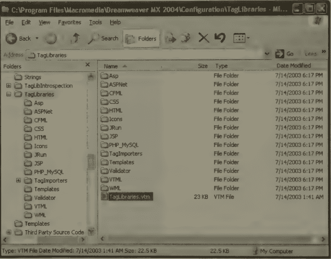

Macromedia HomeSite 用户可以识别 VTML 文件结构，但 Dreamweaver 使用 VTML 文件的方式与 HomeSite 不同。最重要的区别是 Dreamweaver 包含自己的 HTML 渲染器来显示扩展用户界面（UI），因此 Dreamweaver 的 VTML 文件不用于 GUI 渲染过程。

以下示例说明了 `TagLibraries.vtm` 文件的结构：

```
<taglibraries>
<taglibrary name="Name of tag library" doctypes="HTML,ASP-JS,ASP-VB"
  tagchooser="relative path to TagChooser.xml file" id="DWTagLibrary_html">
  <tagref name="tag name" file="relative path to tag .vtm file"/>
</taglibrary>
<taglibrary name="CFML Tags" doctypes="ColdFusion" servermodel="Cold
  Fusion" tagchooser="cfml/TagChooser.xml" id="DWTagLibrary_cfml">
  <tagref name="cfabort" file="cfml/cfabort.vtm"/>
</taglibrary>
<taglibrary name="ASP.NET Tags" doctypes="ASP.NET_CSharp,ASP.NET_VB"
servermodel="ASPNet" prefix="<asp:" tagchooser="ASPNet/TagChooser.xml"
id="DWTagLibrary_aspnet">
  <tagref name="dataset" file="aspnet/dataset.vtm" prefix="<mm:dataset"/>
</taglibrary>
</taglibraries>
```

`taglibrary` 标签将一个或多个标签分组到标签库中。当你导入标签或创建一组新标签时，可以将它们分组到标签库中。通常，一个 `taglibrary` 分组对应于一组在 JavaServer Pages (JSP) TLD 文件、XML 文档类型定义 (DTD) 文件、ASP.NET 命名空间或其他逻辑分组中定义的标签。

下表列出了 `taglibrary` 属性：

| 属性 | 描述 | 必选/可选 |
| --- | --- | --- |
| `taglibrary.name` | 用于在 UI 中输入标签库。 | 必选 |
| `taglibrary.doctypes` | 指示此库活动的文档类型。当库处于活动状态时，库标签会出现在代码提示弹出菜单中。并非所有标签库都可以同时处于活动状态，因为可能会发生名称冲突（例如，HTML 和 WML 文件不兼容）。 | 必选 |
| `taglibrary.prefix` | 指定时，标签库中的标签具有 `taglibrary.prefix` + `tagref.name` 的形式。例如，如果 `taglibrary.prefix` 是 `"<jrun:"` 而 `tagref.name` 是 `"if"`，则标签的形式为 `"<jrun:if"`。这可以为特定标签覆盖。 | 可选 |
| `taglibrary.servermodel` | 如果标签库中的标签在应用服务器上执行，`servermodel` 属性标识标签的服务器模型。如果标签是客户端标签（而非服务器端标签），则省略 `servermodel` 属性。`servermodel` 属性也用于检查目标浏览器。 | 可选 |
| `taglibrary.id` | 可以是与文件中其他标签库 `taglibrary.ID` 属性不同的任何字符串。扩展管理器使用 ID 属性，因此 MXP 文件可以将新 `taglibrary` 和标签文件插入到 `TagLibraries.vtm` 文件中。 | 可选 |
| `taglibrary.tagchooser` | 与此标签库关联的 `TagChooser.xml` 文件的相对路径。 | 可选 |

下表列出了 `tagref` 属性：

| 属性 | 描述 | 必选/可选 |
| --- | --- | --- |
| `tagref.name` | 用于在 UI 中引用标签。 | 必选 |
| `tagref.prefix` | 指定标签在源代码视图中的显示方式。使用时，`tagref.prefix` 属性确定当前标签的前缀。当定义该属性时，它会覆盖为 `taglibrary.prefix` 属性指定的值。 | 可选 |
| `tagref.file` | 引用标签的 VTML 文件。 | 可选 |

由于 `tagref.prefix` 属性可以覆盖 `taglibrary.prefix` 属性，因此两个属性之间的关系可能会令人困惑。下表显示了 `taglibrary.prefix` 和 `tagref.prefix` 属性之间的关系：

| 是否定义了 `taglibrary.prefix`？ | 是否定义了 `tagref.prefix`？ | 结果标签前缀 |
| --- | --- | --- |
| 否 | 否 | `'<'` + `tagref.name` |
| 是 | 否 | `taglibrary.prefix` + `tagref.name` |
| 否 | 是 | `tagref.prefix` |
| 是 | 是 | `tagref.prefix` |

为了定义标签，Dreamweaver 使用了 Macromedia VTML 文件格式的修改版本。以下示例演示了 Dreamweaver 必须使用的所有元素来定义单个标签：

```
<tag name="input" bind="value" casesensitive="no" endtag="no">
    <tagformat indentcontents="yes" formatcontents="yes" nlbeforetag=1 nlbeforecontents=0 nlaftercontents=0 nlaftertag=1 />
    <tagdialog file = "input.HTM"/>
    <attributes>
        <attrib name="name"/>
        <attrib name="wrap" type="Enumerated">
            <attriboption value="off"/>
            <attriboption value="soft"/>
            <attriboption value="hard"/>
        </attrib>
        <attrib name="onFocus" casesensitive="yes"/>
        <event name="onFocus"/>
    </attributes>
</tag>
```

下表列出了定义标签的属性：

| 属性 | 描述 | 必选/可选 |
| --- | --- | --- |
| `tag.bind` | 由数据绑定面板使用。当你选择此类型的标签时，`bind` 属性指示数据绑定的默认属性。 | 可选 |
| `tag.casesensitive` | 指定标签名称是否区分大小写。如果标签区分大小写，则使用标签库指定的确切大小写插入到用户文档中。如果标签不区分大小写，则使用在“首选项”对话框的“代码格式”选项卡中指定的默认大小写插入。如果省略 `casesensitive`，则假定标签不区分大小写。 | 可选 |
| `tag.endtag` | 指定标签是否具有开始标签和关闭标签。例如，`input` 标签没有关闭标签；没有匹配的 `/input` 标签。如果关闭标签是可选的，则应将 `ENDTAG` 属性设置为 Yes。指定 `xml` 以强制空标签的 XML 语法。例如，`<tag name="foo" endtag="xml" tagtype="empty">` 插入 `<foo/>`。 | 可选 |
| `tagformat` | 指定标签的格式化规则。在 Dreamweaver MX 之前的版本中，这些规则存储在 `SourceFormat.txt` 文件中。 | 可选 |
| `tagformat.indentcontents` | 指定此标签的内容是否应缩进。 | 可选 |
| `tagformat.formatcontents` | 指定此标签的内容是否应被解析。对于内容不是 HTML 的标签（如 `SCRIPT` 和 `STYLE`），此属性设置为 No。 | 可选 |
| `tagformat.nlbeforetag` | 在此标签之前插入的换行符数量。 | 可选 |
| `tagformat.nlbeforecontents` | 在此标签内容之前插入的换行符数量。 | 可选 |
| `tagformat.nlaftercontents` | 在此标签内容之后插入的换行符数量。 | 可选 |
| `tagformat.nlaftertag` | 在此标签之后插入的换行符数量。 | 可选 |
| `attrib.name` | 属性名称，如源代码中所示。 | 必选 |
| `attrib.type` | 如果省略，`attrib.type` 为 `"text"`。它可以具有以下值：<br>`TEXT`—自由文本内容<br>`ENUMERATED`—枚举值列表<br>`COLOR`—颜色值（名称或十六进制）<br>`FONT`—字体名称或字体族<br>`STYLE`—CSS 样式属性<br>`CSSSTYLE`—CSS 类名<br>`CSSID`—CSS 类 ID<br>`FILEPATH`—完整文件路径<br>`DIRECTORY`—文件夹路径<br>`FILENAME`—仅文件名<br>`RELATIVEPATH`—路径的相对表示<br>`FLAG`—不包含值的 ON/OFF 属性 | 可选 |
| `attrib.casesensitive` | 指定属性名称是否区分大小写。如果缺少 `CASESENSITIVE` 属性，则属性名称不区分大小写。 | 可选 |

> 在 Dreamweaver MX 之前的版本中，标签信息存储在 `Configuration/TagAttributeList.txt` 文件中。

## 标签选择器

标签选择器允许您按功能组查看标签，从而轻松访问常用标签。要将一个或一组标签添加到标签选择器，必须先将它们添加到标签库。您可以使用标签库编辑器对话框完成此操作，或通过安装以 MXP 文件形式打包的 Dreamweaver 扩展来实现。

## `TagChooser.xml` 文件

`TagChooser.xml` 文件为标签选择器中出现的标签分组组织提供元数据。Dreamweaver 附带的每个标签都存储在功能组中，并可在标签选择器中使用。通过编辑 `TagChooser.xml` 文件，您可以对现有标签重新分组，也可以对新标签进行分组。您可以通过创建子类别来自定义标签的组织方式，以便用户轻松访问其最重要的标签。

`TagLibraries.vtm` 文件支持使用 `TAGLIBRARY.TAGCHOOSER` 属性，该属性指向 `TagChooser.xml` 文件。如果您更改现有的 `TagChooser.xml` 文件或创建新文件，`TAGLIBRARY.TAGCHOOSER` 属性必须指向正确位置，标签选择器才能完全正常工作。

如果没有 `TAGLIBRARY.TAGCHOOSER` 属性，标签选择器将显示 `TagLibraries.vtm` 文件中的树结构。

`TagChooser.xml` 文件存储在 `Configuration/TagLibraries/`*`TagLibraryName`* 文件夹中。以下示例展示了 `TagChooser.xml` 文件的结构：

```
<?xml version="1.0" encoding="iso-8859-1" standalone="yes" ?>
<tclibrary name="Friendly name for library node" desc='Description for incorporated reference' reference="Language[,Topic[,Subtopic]]">
  <category name="Friendly name for category node" desc='Description for incorporated reference' reference="Language[,Topic[,Subtopic]]" id="Unique id">
    <category name="Friendly name for subcategory node" ICON="Relative path" desc='Description for incorporated reference' reference="Language[,Topic[,Subtopic]]" id="Unique id">
      <element name="Friendly name for list item" value='Value to pass to visual dialog editors' desc='Description for incorporated reference' reference="Language[,Topic[,Subtopic]]" id="Unique id"/>
      ... more elements to display in the list view ...
    </category>
    ... more subcategories ...
  </category>
    ... more categories ...
</tclibrary>
```


下表列出了可在`TagChooser.xml`文件中使用的标签：

| 标签 | 描述 | 必需/可选 |
|------|-------------|-------------------|
| `tclibrary` | 此标签是最外层标签，封装了此标签库的标签选择器结构。 | 必需 |
| `tclibrary.name` | 此值出现在树视图节点中。 | 必需 |
| `tclibrary.desc` | 此值是 HTML 字符串，出现在标签选择器对话框的“标签信息”部分。如果没有 `DESC` 属性，“标签信息”的信息将来自“参考”面板。可与 `tclibrary.reference` 互换。 | 可选（`desc` 和 `reference` 互斥） |
| `tclibrary.reference` | 此值描述在标签选择器对话框的“标签信息”部分中显示的语言、主题和子主题。可与 `tclibrary.desc` 互换。 | 可选（`desc` 和 `reference` 互斥） |

`CATEGORY` 标签代表 `TCLIBRARY` 节点下树视图中的所有其他节点，如下表所示：

| 标签 | 描述 | 必需/可选 |
|------|-------------|-------------------|
| `category.name` | 此值出现在树视图节点中。 | 必需 |
| `category.desc` | 此值是 HTML 字符串，出现在标签选择器对话框的“标签信息”部分。如果既未指定 `desc` 也未指定 `reference` 属性，则“标签信息”部分不显示任何内容。 | 可选（`desc` 和 `reference` 互斥） |
| `category.reference` | 此值描述要在“标签信息”部分中显示的语言、主题和子主题。 | 可选（`desc` 和 `reference` 互斥） |
| `category.icon` | 此值是图标 GIF 的相对路径。 | 可选 |
| `category.id` | 任何与本文件中其他 `category.id` 属性不同的字符串。 | 必需 |

下表列出了 `ELEMENT` 标签的属性，该标签代表要插入的标签：

| 属性 | 描述 | 必需/可选 |
| --- | --- | --- |
| `element.name` | 此值作为列表视图项显示。 | 必需 |
| `element.value` | 此值直接放入代码中，或是传递到可视对话框的参数。 | 必需 |
| `element.desc` | 此值是 HTML 字符串，出现在集成的“参考”面板中。如果未指定，`REFERENCE` 属性将在集成的“参考”面板中显示参考内容。 | 可选（`desc` 和 `reference` 互斥） |
| `element.reference` | 最多三个由逗号分隔的字符串，分别描述语言、主题和子主题。此信息显示在“参考”面板中。第一个字符串是必需的。第二个字符串仅对 `ELEMENT` 标签是必需的；对 `CATEGORY` 和 `TCLIBRARY` 标签是可选的。第三个字符串是可选的。 | 可选（`desc` 和 `reference` 互斥） |
| `element.id` | 任何与本文件中其他 `element.id` 属性不同的字符串。 | 可选 |

## 创建新标签编辑器的简单示例

本节中的示例使用 `cfweather`（一个假设的 ColdFusion 标签，用于从天气数据库中提取当前温度）来说明创建新标签编辑器所需的步骤。

`cfweather` 标签的属性如下表所述：

| 属性 | 描述 |
| --- | --- |
| `zip` | 五位邮政编码 |
| `temperaturescale` | 温度单位（摄氏度或华氏度） |

您通过执行以下步骤创建此新的标签编辑器：

- 在标签库中注册标签
- 创建标签定义（VTML）文件
- 创建标签编辑器界面
- 将标签添加到标签选择器

## 在标签库中注册标签

为了让 Dreamweaver 识别新标签，必须在位于 `Configuration/TagLibraries` 文件夹中的 `TagLibraries.vtm` 文件中对其进行标识。但是，如果用户在多用户平台（如 Windows XP、Windows 2000、Windows NT 或 Mac OS X）上，他们的用户 `Configuration` 文件夹中会有另一个 `TagLibraries.vtm` 文件。需要更新的是此文件，因为这是 Dreamweaver 搜索并解析的实例。

用户 `Configuration` 文件夹的位置取决于用户的平台。

对于 Windows 2000 和 Windows XP 平台：

```
<drive>:\Documents and Settings\<username>\
  Application Data\Macromedia\Dreamweaver 8\Configuration
```

> **注意**
> 在 Windows XP 中，此文件夹可能位于隐藏文件夹内。

对于 Mac OS X 平台：

```
<drive>:Users:<username>:Library:Application Support:
  Macromedia:Dreamweaver 8:Configuration
```

如果 Dreamweaver 在用户的 `Configuration` 文件夹中找不到 `TagLibraries.vtm` 文件，它将在 Dreamweaver `Configuration` 文件夹中搜索该文件。

> **注意**
> 在多用户平台上，如果您编辑的是位于 Dreamweaver `Configuration` 文件夹中的 `TagLibraries.vtm` 副本，而不是位于用户 `Configuration` 文件夹中的那个，则 Dreamweaver 不会意识到这些更改，因为它解析的是用户 `Configuration` 文件夹中的 `TagLibraries.vtm` 副本，而不是 Dreamweaver `Configuration` 文件夹中的那个。

`cfweather` 标签是一个 ColdFusion 标签，因此已经存在一个合适的标签库组，您可以使用它来注册 `cfweather` 标签。

**注册标签：**

1. 在文本编辑器中打开 `TagLibraries.vtm` 文件。
2. 浏览现有的标签库，找到 CFML 标签的标签库组。
3. 添加一个新的标签引用元素，如下例所示：
   `<tagref name="cfweather" file="cfml/cfweather.vtm"/>`
4. 保存文件。

现在标签已注册到标签库中，并且它有一个指向 `cfweather.vtm` 标签定义文件的文件指针。

## 创建标签定义（VTML）文件

当用户使用标签选择器或标签编辑器选择已注册标签时，Dreamweaver 会查找该标签定义对应的 VTML 文件。

**创建标签定义文件：**

1. 在文本编辑器中，创建包含以下内容的一个文件：

```
<TAG NAME="cfweather" endtag="no">

	<TAGFORMAT NLBEFORETAG="1" NL AFTERTAG="1"/>

	<TAGDIALOG FILE="cfweather.htm"/>

	<ATTRIBUTES>

		<ATTRIB NAME="zip" TYPE="TEXT"/>

		<ATTRIB NAME="tempaturescale" TYPE="ENUMERATED">

			<ATTRIBOPTION VALUE="Celsius"/>

			<ATTRIBOPTION VALUE="Fahrenheit"/>

		</ATTRIB>

	</ATTRIBUTES>

</TAG>
```

2. 将 `cfweather.vtm` 文件保存到 `Configuration/Taglibraries/CFML` 文件夹中。

借助标签定义文件，Dreamweaver 可以对 `cfweather` 标签执行代码提示、代码完成和标签格式化功能。

## 创建标签编辑器 UI

**创建 `cfweather` 标签编辑器用户界面：**

1. 将 `cfweather.htm` 文件保存到 `Configuration/Taglibraries/CFML` 文件夹中：

```
<!DOCTYPE HTML SYSTEM "-//Macromedia//DWExtension layout-engine 5.0//dialog">
<html>
<head>
<title>CFWEATHER</title>
<script src="../../Shared/Common/Scripts/dwscripts.js"></script>
<script src="../../Shared/Common/Scripts/ListControlClass.js"></script>
<script src="../../Shared/Common/Scripts/tagDialogsCmn.js"></script>
<script>
/************************** GLOBAL VARS **************************/
var TEMPERATURESCALELIST;	// tempaurelist control (initialized in
								// initializeUI())
var theUIObjects;			// array of UI objects used by common API
								// functions
/*****************************************************************/
// inspectTag() API function defined (required by all tag editors)
function inspectTag(tagNodeObj)
{
  // call into a common library version of inspectTagCommon defined
  // in tagDialogCmns.js (note that it's been included)
  // For more information about this function, look at the comments
  // for inspectTagCommon in tagDialogCmn.js
  tagDialog.inspectTagCommon(tagNodeObj, theUIObjects);
}
function applyTag(tagNodeObj)
{
  // call into a common library version of applyTagCommon defined
  // in tagDialogCmns.js (note that it's been included)
  // For more information about this function, look at the comments
  // for applyTagCommon in tagDialogCmn.js
  tagDialog.applyTagCommon(tagNodeObj, theUIObjects);
}
function initializeUI()
{
  // define two arrays for the values and display captions for the list control
  var theTempatureScaleCap = new Array("celsius","fahrenheit");
  var theTempatureScaleVal = new Array("celsius","fahrenheit");
  // instantiate a new list control
  TEMPATURESCALELIST = new ListControl("thetempaturescale");
  // add the tempaturescalelist dropdown list control to the uiobjects
  theUIObjects = new Array(TEMPATURESCALELIST);
  // call common populateDropDownList function defined in tagDialogCmn.js to
  // populate the tempaturescale list control
  tagDialog.populateDropDownList(TEMPATURESCALELIST, theTempatureScaleCap,
  theTempatureScaleVal, 1);
}
</script>
</head>
<body onLoad="initializeUI()">
<div name="General">
  <table border="0" cellspacing="4">
    <tr>
      <td valign="baseline" align="right" nowrap="nowrap">Zip Code: </td>
      <td nowrap="nowrap">
        <input type="text" id="attr:cfargument:zip" name="thezip"
  attname="zip" style="width:100px" />&nbsp;
      </td>
    </tr>
    <tr>
      <td valign="baseline" align="right" nowrap="nowrap">Type: </td>
      <td nowrap="nowrap">
        <select name="thetemperaturescale"
  id="attr:cfargument:tempraturescale" attname="tempaturescale"
  editable="false" style="width:200px">
        </select>
      </td>
    </tr>
  </table>
</div>
</body>
</html>
```

2. 通过执行以下步骤验证标签编辑器是否正常工作：
   - 启动 Dreamweaver。
   - 在代码视图中输入 `cfweather`。
   - 右键点击该标签。
   - 从上下文菜单中选择“编辑标签 `cfweather`”。

   如果标签编辑器启动，则表示创建成功。

## 将标签添加到标签选择器

要将 `cfweather` 标签添加到标签选择器：

1. 修改 `Configuration/Taglibraries/CFML` 文件夹中的 `TagChooser.xml` 文件，添加一个名为“第三方标签”的新类别，其中包含 `cfweather` 标签，如以下示例所示：

```
<category name="Third Party Tags" icon="icons/Elements.gif"
  reference='CFML'>
  <element name="cfweather" value='cfweather zip=""
  temperaturescale="fahrenheit">' />
</category>
```

> 在多用户平台上，`TagChooser.xml` 文件也存在于用户的 `Configuration` 文件夹中。有关多用户平台的更多信息，请参见“在标签库中注册标签”第271页中的讨论。

2. 通过执行以下步骤验证 `cfweather` 标签现在是否出现在标签选择器中：
   - 选择“插入”>“标签”。
   - 展开“CFML 标签”组。
   - 选择出现在标签选择器底部的“第三方标签”组。
   - `cfweather` 标签将出现在右侧的列表框中。
   - 选择 `cfweather`，然后点击“插入”按钮。
   - 标签编辑器应出现。

## 标签编辑器 API

为了创建新的标签编辑器，您必须为 `inspectTag()`、`validateTag()` 和 `applyTag()` 函数提供实现。有关实现的示例，请参见“创建标签编辑器 UI”第272页。

## `inspectTag()`

### 可用性

Dreamweaver MX。

### 描述

当标签编辑器首次出现时调用该函数。该函数接收用户正在编辑的标签作为参数，该标签以 dom 对象形式表示。该函数从正在编辑的标签中提取属性值，并使用这些值来初始化标签编辑器中的表单元素。

### 参数

`tag`
- `tag` 参数为已编辑标签的 DOM 节点。

### 返回值

Dreamweaver 不期望返回值。

### 示例

假设用户编辑以下标签：

```
<cfweather zip = "94065"/>
```

如果编辑器包含一个用于编辑 `zip` 属性的文本字段，则该函数需要初始化表单元素，以便用户在文本字段中看到实际的邮政编码，而不是空字段。

以下代码执行初始化：

```
function inspectTag(tag)
{
  document.forms[0].zip.value = tag.zip
}
```


## `validateTag()`

### 可用性

Dreamweaver MX。

### 描述

当用户点击树控件中的某个节点或点击“确定”时，该函数对当前显示的 HTML 表单元素执行输入验证。

### 参数

无。

### 返回值

Dreamweaver 期望返回一个布尔值：如果 HTML 表单元素的输入有效则为 `true`；如果输入值无效则为 `false`。

### 示例

当用户创建表格时，为表格行数输入了一个负整数。`validateTag()` 函数检测到无效输入，显示警告消息，并返回 `false` 值。

## `applyTag()`

### 可用性

Dreamweaver MX。

### 描述

当用户点击“确定”时，Dreamweaver 调用 `validateTag()` 函数。如果 `validateTag()` 函数返回 `true` 值，Dreamweaver 则调用此函数并传递表示当前标签（正在编辑的标签）的 DOM 对象。该函数读取表单元素中的值，并将其写入 DOM 对象。

### 参数

`tag`：`tag` 参数为正在编辑标签的 DOM 节点。

### 返回值

Dreamweaver 不期望返回值。

### 示例

继续 `cfweather` 示例，在以下代码中，如果用户将邮政编码从 `94065` 更改为 `53402`，为了更新用户文档以使用新的邮政编码，必须更新 DOM 对象：

```
function applyTag(tag)
{
    tag.zip = document.forms[0].zip.value
}
```

## 属性检查器

属性检查器可能是 Macromedia Dreamweaver 8 界面中最熟悉的浮动面板。它对于定义、查看和更改所选内容的名称、大小、外观及其他属性，以及启动所选元素的内部和外部编辑器来说，都是不可或缺的。

Dreamweaver 内置了多种属性检查器界面，可用于设置许多标准 HTML 标签的属性。由于这些内置检查器是 Dreamweaver 核心代码的一部分，因此无法在 `Configuration` 文件夹中找到对应的属性检查器文件。但是，自定义属性检查器文件可以覆盖这些内置界面，或创建新界面来检查自定义标签。自定义属性检查器文件位于 Dreamweaver 应用程序文件夹内的 `Configuration/Inspectors` 文件夹中。

下表列出了用于创建属性检查器的文件：

| 路径 | 文件 | 描述 |
|---|---|---|
| `Configuration/Inspectors/` | `Propertyinspectorname.htm` | 定义属性检查器的用户界面（UI）。 |
| `Configuration/Inspectors/` | `Propertyinspectorname.js` | 包含属性检查器所需的函数。 |
| `Configuration/Inspectors/` | `Tagimagefile.gif` | 在属性检查器中显示的可选文件。 |

## 属性检查器文件

属性检查器 HTML 文件必须在 opening HTML 标签之前立即包含一个注释（除了文档类型注释外），如以下示例所示：

```
<!-- tag:serverModel:tagNameOrKeyword,priority:1to10,selection:¬
exactOrWithin,hline,vline, serverModel-->
<!DOCTYPE HTML SYSTEM "-//Macromedia//DWExtension layout-engine5.0//pi">
```

此注释包含以下元素：

- `serverModel` 元素指定 Dreamweaver 仅在指定的服务器模型处于活动状态时才加载此属性检查器。
- `tagNameOrKeyword` 元素是要检查的标签或以下关键词之一：`COMMENT`（用于注释）、`LOCKED`（用于锁定区域）或 `ASP`（用于 ASP 标签）。
- `1to10` 元素是属性检查器文件的优先级：`1` 表示只有在其他检查器都无法检查所选内容时才使用此检查器；`10` 表示此检查器优先于所有其他可以检查所选内容的检查器。
- `exactOrWithin` 元素指示所选内容可以在标签内部（`within`）还是必须完全包含该标签（`exact`）。
- `hline` 元素（可选）指示在展开模式下，检查器的上半部分和下半部分之间应显示一条灰色水平线。
- `vline` 元素（可选）指示在检查器的标签名称字段与其余属性之间应显示一条灰色垂直线。
- `serverModel` 元素（可选）指示属性检查器的服务器模型。如果属性检查器的服务器模型与文档的服务器模型不同，Dreamweaver 不会使用该属性检查器显示当前所选内容的属性。例如，如果文档的服务器模型是 Macromedia ColdFusion，但属性检查器的服务器模型是 ASP，则 Dreamweaver 不会在文档中的所选内容上使用那个属性检查器。

以下注释适用于设计用于检查 `HAPPY` 标签的检查器：

```
<!-- tag:HAPPY, priority:8,selection:exact,hline,vline,
serverModel:ASP -->
```

在某些情况下，您可能希望指定扩展仅使用 Dreamweaver 扩展渲染（而非之前的渲染引擎），方法是在标签注释之前立即插入以下行，如以下示例所示：

```
<!--DOCTYPE HTML SYSTEM "-//Macromedia//DWExtension layout-engine 5.0/pi"-->
```

属性检查器文件的 `BODY` 部分包含一个 HTML 表单。然而，Dreamweaver 并不会在对话框中显示表单内容，而是使用表单来定义属性检查器的输入区域和布局。

属性检查器文件的 `HEAD` 部分包含 JavaScript 函数或对 JavaScript 文件的引用。

## 属性检查器文件的工作原理

启动时，Dreamweaver 读取 `Configuration/Inspectors` 文件夹中每个 HTM 和 HTML 文件的第一行，搜索定义属性检查器类型、优先级和选择类型的注释字符串。没有此注释作为第一行的文件将被忽略。

当用户在 Dreamweaver 中进行选择或将插入点移动到不同位置时，会发生以下事件：

1. Dreamweaver 搜索所有选择类型为 `within` 的检查器。
2. 如果存在任何 `within` 检查器，Dreamweaver 会从当前所选标签开始向上搜索文档树，检查是否有针对包围所选内容的标签的检查器。如果没有 `within` 检查器，Dreamweaver 会搜索任何选择类型为 `exact` 的检查器。
3. 对于第一个有一个或多个检查器的标签，Dreamweaver 调用每个检查器的 `canInspectSelection()` 函数。如果此函数返回 `false`，Dreamweaver 将不再考虑该检查器作为检查所选内容的候选。
4. 如果在调用 `canInspectSelection()` 函数后仍有多个潜在检查器，Dreamweaver 会按优先级对剩余检查器进行排序。
5. 如果多个潜在检查器具有相同的优先级，Dreamweaver 会按名称字母顺序选择一个检查器。
6. 所选检查器会显示在属性检查器浮动面板中。如果属性检查器文件定义了 `displayHelp()` 函数，检查器右上角会出现一个小的问号（`?`）图标。
7. Dreamweaver 调用 `inspectSelection()` 函数来收集有关当前所选内容的信息，并填充检查器的字段。
8. 附加到属性检查器界面中字段的事件处理程序会在用户遇到它们时执行。（例如，您可能有一个 `onBlur` 事件，它调用 `setAttribute()` 函数将属性设置为用户输入的值。）

## 一个简单的属性检查器示例

以下属性检查器检查 `MARQUEE` 标签，该标签仅在 Microsoft Internet Explorer 中可用。此示例允许您在属性检查器中设置 `direction` 属性的值。要设置 `MARQUEE` 标签其他属性的值，请以本示例为模板创建。

您可以通过执行以下步骤来创建此扩展：

- 创建用户界面
- 编写 JavaScript 代码
- 创建图像
- 测试属性检查器

### 创建用户界面

您创建一个包含表单的 HTML 文件，该表单显示在属性检查器中。

### 创建用户界面：

1. 创建一个空白文件。
2. 作为文件的第一行，添加标识属性检查器的注释，如下所示：

```
<!-- tag:MARQUEE,priority:9,selection:exact,vline,hline -->
```

3. 要指定文档标题和您将创建的 JavaScript 文件，请在注释后添加以下内容：

```
<HTML>
<HEAD>
<TITLE>Marquee Inspector</TITLE>
<SCRIPT src="marquee.js"></SCRIPT>
</HEAD>
<BODY>
</BODY>
</HTML>
```

4. 要指定属性检查器中显示的内容，请在 `BODY` 标签的开头和结尾之间添加以下内容：

```
<!-- Specify the image that will appear in the Property inspector -->
<SPAN ID="image" STYLE="position:absolute; width:23px; height:17px;
   z-index:16; left: 3px; top: 2px">
   
</SPAN>
<SPAN ID="label" STYLE="position:absolute; width:23px; height:17px;
   z-index:16; left: 44px; top: 5px">Marquee</SPAN>
```

```
<!-- If your form fields are in different layers, you must -
    create a separate form inside each layer and reference it as -
    shown in the inspectSelection() and setInterjectionTag() -
    functions. -->
```

```
<SPAN ID="topLayer" STYLE="position:absolute; z-index:1; left: 125px; -
    top: 3px; width: 431px; height: 32px">
<FORM NAME="topLayerForm">
    <TABLE BORDER="0" CELLPADDING="0" CELLSPACING="0">
        <TR>
            <TD VALIGN="baseline" ALIGN="right">Direction:</TD>
            <TD VALIGN="baseline" ALIGN="right">
            <SELECT NAME="marqDirection" STYLE="width:86"
                onChange="setMarqueeTag()">
                <OPTION VALUE="left">Left</OPTION>
                <OPTION VALUE="right">Right</OPTION>
            </SELECT>
        </TR>
    </TABLE>
</FORM>
</SPAN>
```

5. 将文件保存为 `marquee.htm`，放在 `Configuration/Inspectors` 文件夹中。

## 编写 JavaScript 代码

您需要添加 JavaScript 函数，以确保可以检查所选内容、检查所选内容，并在属性检查器中输入适当的值。

### 编写 JavaScript 代码：

1. 创建一个空白文件。
2. 要指定属性检查器在选区包含 `MARQUEE` 标签时显示，添加以下函数：

```
function canInspectSelection(){
    return true;
}
```

3. 要在文件末尾添加以下函数，以刷新文本字段中显示的 `direction` 属性的值：

```
function inspectSelection(){
    // Get the DOM of the current document.
    var theDOM = dw.getDocumentDOM();
    // Get the selected node.
    var theObj = theDOM.getSelectedNode();
```

```
// Get the value of the DIRECTION attribute on the MARQUEE tag.
var theDirection = theObj.getAttribute('direction');
// Initialize a variable for the DIRECTION attribute to -1.
// This is used to store the menu index that corresponds to
// the value of the attribute.
// var typeIndex = -1;
var directionIndex = -1;
// If there was a DIRECTION attribute...
if (theDirection){
	// If the value of DIRECTION is "left", set typeIndex to 0.
	if (theDirection.toLowerCase() == "left"){
		directionIndex = 0;
	// If the value of DIRECTION is "right", set typeIndex to 1.
	}else if (theDirection.toLowerCase() == "right"){
		directionIndex = 1;
	}
}
// If the value of the DIRECTION attribute was "left"
// or "right", choose the corresponding
// option from the pop-up menu in the interface.
if (directionIndex != -1){
	document.topLayer.document.topLayerForm.marqDirection.selectedIndex = directionIndex;
}
```

4. 要在文件末尾添加以下函数，以获取当前所选内容并使属性检查器中的文本框显示 `direction` 属性的值：

```
function setMarqueeTag(){
	// Get the DOM of the current document.
	var theDOM = dw.getDocumentDOM();
	// Get the selected node.
	var theObj = theDOM.getSelectedNode();
	// Get the index of the selected option in the pop-up menu
	// in the interface.
	var directionIndex =
		document.topLayer.document.topLayerForm.marqDirection.selectedIndex;
	// Get the value of the selected option in the pop-up menu
	// in the interface.
	var theDirection =
		document.topLayer.document.topLayerForm.marqDirection.
			options[directionIndex].value;
	// Set the value of the direction attribute to theDirection.
	theObj.setAttribute('direction',theDirection);
}
```


将文件保存为 `marquee.js`，放在 `Configuration/Inspectors` 文件夹中。

## 创建图像

您可以选择性地创建在属性检查器中显示的图像。

### 创建图像

1. 创建一个宽 36 像素、高 36 像素的图像。
2. 将图像保存为 `marquee.gif`，存放于 `Configuration/Inspectors` 目录中。

通常，您可以将属性检查器的图像保存为 Dreamweaver 支持的任何格式。

## 测试属性检查器

最后，您可以测试属性检查器。

### 测试属性检查器

1. 重启 Dreamweaver。
2. 创建一个新的 HTML 页面，或打开一个现有的 HTML 页面。
3. 在页面的 `BODY` 部分添加以下内容：

```html
<MARQUEE></MARQUEE>
```

4. 选中您刚刚添加的文本。  
   您为 `MARQUEE` 标签创建的属性检查器将会显示。
5. 在属性检查器中为 Direction 属性输入一个值。  
   页面上的标签将更改，包含您在属性检查器中输入的方向属性及其值。

## 属性检查器 API

属性检查器 API 的两个函数（`canInspectSelection()` 和 `inspectSelection()`）是必需的。

## canInspectSelection()

### 描述

确定属性检查器是否适用于当前选区。

### 参数

无。

> 注意：使用 `dom.getSelectedNode()` 将当前选区作为 JavaScript 对象获取（有关 `dom.getSelectedNode()` 的更多信息，请参阅 Dreamweaver API 参考）。

### 返回值

Dreamweaver 期望一个布尔值：如果检查器可以检查当前选区，则为 true；否则为 false。

### 示例

以下 `canInspectSelection()` 函数的实例在选区包含 CLASSID 属性且该属性的值为 `"clsid:D27CDB6E-AE6D-11cf-96B8-444553540000"`（Macromedia Flash Player 的类 ID）时返回 true 值：

```javascript
function canInspectSelection(){

  var theDOM = dw.getDocumentDOM();

  var theObj = theDOM.getSelectedNode();

  return (theObj.nodeType == Node.ELEMENT_NODE &&

    theObj.hasAttribute("classid") &&

    theObj.getAttribute("classid").toLowerCase()==

    "clsid:D27CDB6E-AE6D-11cf-96B8-444553540000");

}
```

## displayHelp()

### 描述

如果定义了此函数，属性检查器的右上角将显示一个问号（`?`）图标。当用户单击该图标时，将调用此函数。

### 参数

无。

### 返回值

Dreamweaver 无返回值要求。

### 示例

## inspectSelection()

### 描述

根据当前选区的属性刷新文本字段的内容。

### 参数

`maxOrMin`

- `maxOrMin` 参数为 `max` 或 `min`，具体取决于属性检查器是处于展开还是收缩状态。

### 返回值

Dreamweaver 无返回值要求。

### 示例

以下 `inspectSelection()` 函数示例获取 CONTENT 属性的值，并使用它填充名为 `keywords` 的表单字段：

```javascript
function inspectSelection() {

  var dom = dreamweaver.getDocumentDOM();

  var theObj = dom.getSelectedNode();

  document.forms[0].keywords.value = theObj.getAttribute("content");

}
```

288 属性检查器

# 第 13 章 浮动面板

您可以创建任何类型的浮动面板或检查器，不受属性检查器的大小和布局限制。

尽管自定义属性检查器应是设置当前选区属性的首选，但自定义浮动面板在显示整个文档或多个选区的信息方面提供了更大的空间和灵活性。

自定义浮动面板文件是位于 Macromedia Dreamweaver 8 应用程序文件夹内 `Configuration/Floaters` 文件夹中的 HTML 文件。浮动面板文件的 `BODY` 部分包含一个 HTML 表单；附加到表单元素的事件处理程序可以调用 JavaScript 代码，对当前文档执行任意编辑。

Dreamweaver 有几个内置的浮动面板，可从 Window（窗口）菜单访问。（这些内置面板是 Dreamweaver 核心代码的一部分，在 `Configuration/Floaters` 文件夹中没有对应的浮动面板文件。）

您可以创建自定义面板并将其添加到 Window（窗口）菜单。有关将项目添加到菜单系统的更多信息，请参阅第 181 页的第 8 章“菜单和菜单命令”。

下表列出了用于创建浮动面板的文件：

| 路径 | 文件 | 描述 |
|---|---|---|
| `Configuration/Floaters/` | `panelname.htm` | 指定浮动面板标题栏中显示的文本，定义浮动面板，并包含必需的 JavaScript 函数。 |
| `Configuration/Menus/` | `menus.xml` | 将命令添加到菜单。 |

## 浮动面板文件的工作原理

自定义浮动面板可以像 Dreamweaver 内置的浮动面板一样移动、调整大小和组合成选项卡式。自定义浮动面板与内置浮动面板在以下方面有所不同：

- 自定义浮动面板显示为默认的灰色。在 `BODY` 标签中设置 `BGCOLOR` 属性无效。
- 所有自定义浮动面板要么始终显示在文档窗口前面，要么在未激活时浮在文档窗口后面，具体取决于“面板”首选参数中“所有其他浮动面板”的设置。

浮动面板文件与其他扩展也有些不同。与其他扩展文件不同，除非在 Dreamweaver 上次关闭时浮动面板是可见的，否则 Dreamweaver 不会在启动时将浮动面板文件加载到内存中。如果浮动面板在 Dreamweaver 关闭时不可见，则定义它们的文件仅在从以下函数之一引用时加载：`dreamweaver.getFloaterVisibility()`、`dreamweaver.setFloaterVisibility()` 或 `dreamweaver.toggleFloater()`。有关这些函数的更多信息，请参阅 *Dreamweaver API 参考*。

当 Configuration 文件夹内的文件调用 `dw.getFloaterVisibility(floaterName)`、`dw.setFloaterVisibility(floaterName)` 或 `dw.toggleFloater(floaterName)` 函数时，会发生以下事件：

1. 如果 `floaterName` 不是保留的浮动面板名称之一，Dreamweaver 会在 `Configuration/Floaters` 文件夹中搜索名为 `floaterName.htm` 的文件。（有关保留浮动面板名称的完整列表，请参阅 *Dreamweaver API 参考* 中的 `dreamweaver.getFloaterVisibility()` 函数。如果未找到 `floaterName.htm`，Dreamweaver 将搜索 `floaterName.html`。如果未找到任何文件，则不执行任何操作。
2. 如果浮动面板文件是第一次加载，将调用 `initialPosition()` 函数（如果已定义）以确定浮动面板在屏幕上的默认位置，并调用 `initialTabs()` 函数（如果已定义）以确定浮动面板的默认选项卡分组。
3. 调用 `selectionChanged()` 和 `documentEdited()` 函数，是基于浮动面板隐藏期间可能已发生更改的假设。

- 当选区发生变化时，如果已定义 `selectionChanged()` 函数，则会被调用。
- 当用户对文档进行更改时，如果已定义 `documentEdited()` 函数，则会被调用。
- 附加到浮动面板界面字段的事件处理程序会在用户遇到它们时执行。（例如，一个带有 `onClick` 事件处理程序的按钮，该处理程序执行 `dw.getDocumentDOM().body.innerHTML=''`，当被单击时，会删除文档中 BODY 开始和结束标签之间的所有内容。）
- 浮动面板支持 `body` 标签上的两个特殊事件：`onShow()` 和 `onHide()`。

当用户退出 Dreamweaver 时，浮动面板的当前可见性、位置和选项卡分组将被保存。下次 Dreamweaver 启动时，它将加载上次关闭时可见的任何浮动面板的文件，并按其最后的位置和选项卡分组显示浮动面板。

## 一个简单的浮动面板示例

在此示例中，您将创建一个脚本编辑器扩展，该扩展创建一个浮动面板，以显示设计视图中选定脚本标记背后的 JavaScript 代码。脚本编辑器将 JavaScript 代码显示在名为 `scriptlayer` 的浮动面板中定义的 HTML 表单的 `textarea` 元素中。如果您在浮动面板中对选定的代码进行更改，扩展会调用 `updateScript()` 函数来保存您的更改。如果您在调用脚本编辑器时未选择脚本标记，扩展会将 `(no script selected)` 显示在一个名为 `blanklayer` 的浮动面板中。

您通过执行以下步骤来创建此扩展：

- 创建浮动面板
- 编写 JavaScript 代码
- 创建菜单项

## 创建浮动面板

此扩展的 HTML 文件开头包含标准的文档头信息和一个 `title` 标签，该标签将 Script Editor 一词放在浮动面板的标题栏中。

### 创建 HTML 文件头部

1. 新建一个空白文档。
2. 输入以下内容：

```html
<!doctype html public "-//W3C//DTD HTML 4.01 Transitional//EN">

<html>

<head>

<title>Script Editor</title>

<script language="JavaScript">
```

该扩展定义了两个浮动面板，当用户未选择脚本标记时显示 `(no script selected)`，当选择了脚本标记时显示其底层的 JavaScript 代码。以下代码定义了这两个浮动面板，即名为 `blanklayer` 和 `scriptlayer` 的层：

### 创建两个浮动面板

1. 在 HTML 文件的头部之后添加以下代码：

```html
<body>

<div id="blanklayer" style="position:absolute; width:422px;

height:181px; z-index:1; left: 8px; top: 11px;

visibility: hidden">

<center>

<br>

<br>

<br>

<br>

(no script selected)

</center>

</div>

<div id="scriptlayer" style="position:absolute; width:422px;

height:181px; z-index:1; left: 8px; top: 11px;

visibility: visible">

<form name="theForm">

<textarea name="scriptCode" cols="80" rows="20" wrap="VIRTUAL"

onBlur="updateScript()"></textarea>

</form>

</div>

</body>

</html>
```

2. 将文件保存到 `Configuration/Floaters` 文件夹中，文件名为 `scriptEditor.htm`。

两个 `div` 标签都使用 `style` 属性来指定浮动面板的位置（`absolute`）、大小（`width:422px` 和 `height:181px`）以及默认的 `visibility` 设置（`visible`）。`blanklayer` 面板使用 `center` 属性和一系列换行（`br`）标签将文本定位在面板中央。`scriptlayer` 面板创建了一个表单，其中包含一个 `textarea`，用于显示选中的 JavaScript 代码。`textarea` 标签还指定了当发生 `onBlur` 事件时，表示选中的代码已更改，将调用 `updateScript()` 函数将更改后的文本写回文档。

## 编写 JavaScript 代码

Script Editor 的 JavaScript 代码包含一个 Dreamweaver 调用的浮动面板函数 `selectionChanged()`，以及一个用户定义的函数 `updateScript()`。

## selectionChanged()：是否选中了脚本标记？

`selectionChanged()` 函数用于确定是否在“设计”视图中选中了脚本标记。如果文档的 `BODY` 部分存在 JavaScript 例程，并且在“首选项”对话框的“不可见元素”部分中选中了“脚本”，则脚本标记会出现在“设计”视图中。下图显示了脚本标记图标：

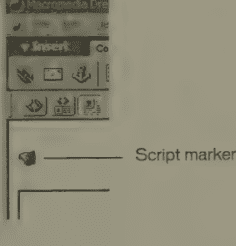

`selectionChanged()` 函数首先调用 `dw.getDocumentDOM()` 函数获取用户文档的文档对象模型（DOM）。然后调用 `getSelectedNode()` 函数检查该文档的选中节点，首先判断是否为元素，其次判断是否为 `SCRIPT` 标签。如果这两个条件都满足，`selectionChanged()` 函数将使 `scripteditor` 浮动面板可见，并将其加载底层的 JavaScript 代码。同时，它还将 `blanklayer` 浮动面板的 `visibility` 属性设置为 `hidden`。下图显示了带有选中 JavaScript 代码的 `scriptlayer` 浮动面板：

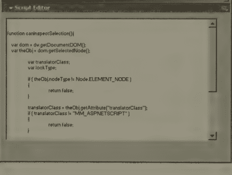

如果选中的节点不是元素，或者不是 `SCRIPT` 标签，`selectionChanged()` 函数将使 `blanklayer` 浮动面板可见，并隐藏 `scriptlayer` 面板。`blanklayer` 浮动面板显示文本 `(no script selected)`，如下图所示：

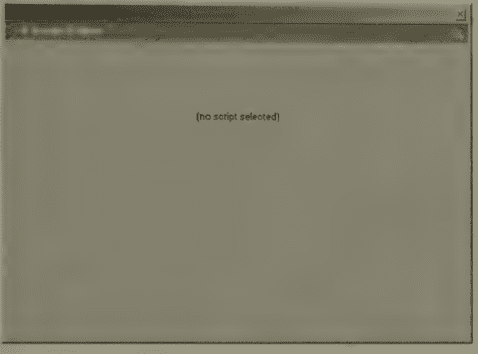

### 添加 selectionChanged() 函数

1. 打开 `Configuration/Floaters` 文件夹中的 `scriptEditor.htm` 文件。
2. 在文件的头部部分输入以下代码。
3. 保存文件。

```javascript
function selectionChanged(){

  /* get the selected node */

  var theDOM = dw.getDocumentDOM();

  var theNode = theDOM.getSelectedNode();

  /* check to see if the node is a script marker */

  if (theNode.nodeType == Node.ELEMENT_NODE && 

  theNode.tagName == "SCRIPT"){

    document.layers['scriptlayer'].visibility = 'visible';

    document.layers['scriptlayer'].document.theForm.

    scriptCode.value = theNode.innerHTML;

    document.layers['blanklayer'].visibility = 'hidden';

  }else{

    document.layers['scriptlayer'].visibility = 'hidden';

    document.layers['blanklayer'].visibility = 'visible';

  }

}
```

## updateScript()：写入更改

`updateScript()` 函数在 `scriptlayer` 面板的 `textarea` 中发生 `onBlur` 事件时，将选中的脚本写回。`textarea` 表单元素包含 JavaScript 代码，当 `textarea` 失去输入焦点时，`onBlur` 事件发生。

### 添加 updateScript() 函数

1. 打开 `Configuration/Floaters` 文件夹中的 `scriptEditor.htm` 文件。
2. 在文件的头部部分输入以下代码。
3. 保存文件。

```javascript
/* update the document with any changes made by

    the user in the textarea */

function updateScript(){

    var theDOM = dw.getDocumentDOM();

    var theNode = theDOM.getSelectedNode();

    theNode.innerHTML = document.layers['scriptlayer'].document.
```


`theForm.scriptCode.value;`

}

</script>

</head>

```

## 创建菜单项

仅仅将 Script Editor 代码保存在`Configuration/Floaters`文件夹中是不够的。还必须调用`dw.setFloaterVisibility('scriptEditor', true)`函数或`dw.toggleFloater('scriptEditor')`函数来加载浮动面板并使其可见。调用 Script Editor 最明显的地方是从"窗口"菜单，该菜单在`menus.xml`文件中定义。您需要创建`menuitem`标签，在"窗口"菜单中为 Script Editor 扩展创建一个条目，如下图所示：

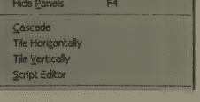

如果在当前文档的"设计"视图中选中了脚本标记，然后选择"Script Editor"菜单项，将调用 Script Editor 浮动面板并显示脚本标记底层的 JavaScript 代码。如果在未选中脚本标记时选择该菜单项，将显示包含文本`(no script selected)`的空白层面板。

### 添加菜单项：

1. 打开`Configuration/Menus`文件夹中的`menus.xml`文件。
2. 找到以`<menuitem name="Tile _Vertically"`开头的标签，并将光标定位在该标签的闭合`/>`之后。
3. 在新的一行中，插入以下内容：
4. 保存文件。

```xml
<menuitem name="Script Editor" enabled="true" ¬
command="dw.toggleFloater('scriptEditor')"¬
checked="dw.getFloaterVisibility('scriptEditor')" />
```

# 浮动面板 API

浮动面板 API 中的所有自定义函数都是可选的。

本节中的某些函数仅在 Windows 操作系统上运行。函数的描述中会说明是否属于这种情况。

## `displayHelp()`

### 说明

如果定义了此函数，对话框中的"确定"和"取消"按钮下方将出现一个"帮助"按钮。当用户单击"帮助"按钮时，将调用此函数。

### 参数

无。

### 返回值

Dreamweaver 不期望任何返回值。

### 示例

```javascript
// the following instance of displayHelp() opens
// in a browser a file that explains how to use
// the extension.
function displayHelp(){
  var myHelpFile = dw.getConfigurationPath() +
    '/ExtensionsHelp/superDuperHelp.htm';
  dw.browseDocument(myHelpFile);
}
```

## `documentEdited()`

### 说明

此函数在浮动面板变为可见时以及当前一系列编辑完成后被调用；也就是说，在调用此函数之前可能会发生多次编辑。仅当浮动面板必须跟踪对文档的编辑时，才应定义此函数。

> 仅在需要时才定义`documentEdited()`函数，因为它的存在会影响性能。

### 参数

无。

### 返回值

Dreamweaver 不期望任何返回值。

### 示例

以下`documentEdited()`函数示例扫描文档中的层，并更新一个显示文档中层数量的文本字段：

```javascript
function documentEdited(){
  /* create a list of all the layers in the document */
  var theDOM = dw.getDocumentDOM();
  var layersInDoc = theDOM.getElementsByTagName("layer");
  var layerCount = layersInDoc.length;
  /* update the numOfLayers field with the new layer count */
  document.theForm.numOfLayers.value = layerCount;
}
```

# `getDockingSide()`

**可用性**
Dreamweaver MX.

**描述**
指定浮动面板可以停靠的位置。函数返回一个字符串，其中包含`"left"`、`"right"`、`"top"`和`"bottom"`这些词的某种组合。如果标签在字符串中，则可以将浮动面板停靠到该侧。如果函数缺失，则无法将浮动面板停靠到任何一侧。

可以使用此函数来阻止某些面板停靠在 Dreamweaver 工作区的特定一侧，或者阻止它们彼此停靠。

**参数**
无。

**返回值**
Dreamweaver 期望一个包含`"left"`、`"right"`、`"top"`和`"bottom"`这些词或其组合的字符串，用于指定 Dreamweaver 可以将浮动面板停靠到何处。

**示例**

```javascript
getDockingSide()
{
    return dock_side = "left top";
}
```

# `initialPosition()`

**描述**
确定浮动面板首次被调用时的初始位置。如果未定义此函数，默认位置是屏幕中心。

**参数**
`platform`

- `platform`参数的值为`"Mac"`或`"Win"`，具体取决于用户的平台。

**返回值**
Dreamweaver 期望一个格式为`"leftPosInPixels,topPosInPixels"`的字符串。

### 示例

以下`initialPosition()`函数的示例指定，当浮动面板首次出现时，在 Windows 上应位于距左侧 420 像素、距顶部 20 像素处；在 Macintosh 上应位于距屏幕左侧 390 像素、距屏幕顶部 20 像素处：

```javascript
function initialPosition(platform){
  var initPos = "420,20";
  if (platform == "macintosh"){
    initPos = "390,20";
  }
  return initPos;
}
```

# `initialTabs()`

**描述**
确定此浮动面板首次出现时，哪些其他浮动面板以标签组形式组合在一起。如果任何列出的浮动面板之前已经出现过，则不会包含在标签组中。为确保两个自定义浮动面板以标签组形式组合在一起，每个面板都应通过`initialTabs()`函数引用另一个面板。

**参数**
无。

**返回值**
Dreamweaver 期望一个格式为`"floaterName1,floaterName2,...floaterNameN"`的字符串。

**示例**

以下`initialTabs()`函数的示例指定，当浮动面板首次出现时，应与`scriptEditor`浮动面板组合为标签组：

```javascript
function initialTabs(){
  return "scriptEditor";
}
```

# `isATarget()`

**可用性**
Dreamweaver MX (仅限 Windows)。

**描述**
指定其他面板是否可以停靠到此浮动面板。如果未指定`isATarget()`函数，Dreamweaver 将阻止其他面板停靠到此面板。当用户尝试将此面板与其他面板组合时，Dreamweaver 会调用此函数。

**参数**
无。

**返回值**
Dreamweaver 期望一个布尔值：如果其他浮动面板可以停靠到此面板，则为`true`；否则为`false`。

**示例**

```javascript
isATarget()
{
    return true;
}
```

# `isAvailableInCodeView()`

**描述**
确定在选择"代码"视图时是否应启用该浮动面板。如果未定义此函数，浮动面板在"代码"视图中将被禁用。

**参数**
无。

**返回值**
Dreamweaver 期望一个布尔值：如果浮动面板应在"代码"视图中启用，则为`true`；否则为`false`。

# `isResizable()`

**可用性**
Dreamweaver 4.

**描述**
确定用户是否可以调整浮动面板的大小。如果函数未定义或返回`true`值，用户可以调整浮动面板的大小。如果函数返回`false`值，用户无法调整浮动面板的大小。

**参数**
无。

**返回值**
Dreamweaver 期望一个布尔值：如果用户可以调整浮动面板的大小，则为`true`；否则为`false`。

**示例**

以下示例阻止用户调整浮动面板的大小：

```javascript
function isResizable()
{
    return false;
}
```

# `selectionChanged()`

**描述**
当浮动面板变为可见以及当选择发生变化时（当焦点切换到新文档或当插入点在当前文档中移动到新位置时）调用。仅当浮动面板必须跟踪选择时才应定义此函数。

> **注意**
> 仅在绝对需要时才定义`selectionChanged()`，因为它的存在会影响性能。

**参数**
无。

**返回值**
Dreamweaver 不期望返回任何值。

### 示例

以下`selectionChanged()`函数的示例显示，根据选择是否为脚本标记，在浮动面板中显示不同的图层。如果选择是脚本标记，Dreamweaver 会使脚本图层可见。否则，Dreamweaver 会使空白图层可见。

```javascript
function selectionChanged(){
  /* get the selected node */
  var theDOM = dw.getDocumentDOM();
  var theNode = theDOM.getSelectedNode();
  /* check to see if the node is a script marker */
  if (theNode.nodeType == Node.ELEMENT_NODE && 
      theNode.tagName == "SCRIPT"){
    document.layers['blanklayer'].visibility = 'hidden';
    document.layers['scriptlayer'].visibility = 'visible';}
  else{
    document.layers['scriptlayer'].visibility = 'hidden';
    document.layers['blanklayer'].visibility = 'visible';
  }
}
```

# 关于性能

在自定义浮动面板中声明`selectionChanged()`或`documentEdited()`函数可能会对 Dreamweaver 性能产生不利影响。请考虑，当 Dreamweaver 空闲超过十分之一秒后，每次击键和鼠标点击后都会调用`documentEdited()`和`selectionChanged()`函数。重要的是使用不同的场景来测试您的浮动面板，尽可能使用大文档（100K 或更多 HTML）来测试性能影响。

为帮助避免性能损失，Dreamweaver 3 中将`setTimeout()`函数实现为全局方法。与浏览器中一样，`setTimeout()`函数接受两个参数：要调用的 JavaScript 代码以及调用前等待的时间（以毫秒为单位）。

`setTimeout()`方法允许您在处理过程中设置暂停。这些暂停允许用户继续与应用程序交互。您必须明确构建这些暂停，因为在脚本处理期间屏幕会冻结，这会阻止用户执行进一步的编辑。暂停也阻止您更新界面或浮动面板。

以下示例来自一个浮动面板，该面板显示文档中每个图层的信息。它使用`setTimeout()`方法在处理每个图层后暂停半秒。

```javascript
/* create a flag that specifies whether an edit is being processed, and set
    it to false. */
document.running = false;

/* this function called when document is edited */
function documentEdited(){
    /* create a list of all the layers to be processed */
    var dom = dw.getDocumentDOM();
    document.layers = dom.getElementsByTagName("layer");
    document.numLayers = document.layers.length;
    document.numProcessed = 0;
    /* set a timer to call processLayer(); if we didn't get
     * to finish processing the previous edit, then the timer
     * is already set. */
    if (document.running = false){
      setTimeout("processLayer()", 500);
    }
    /* set the processing flag to true */
    document.running = true;
}
```

```javascript
/* process one layer */
function processLayer(){
    /* display information for the next unprocessed layer.
       displayLayer() is a function you would write to
       perform the "magic". */
    displayLayer(document.layers[document.numProcessed]);
    /* if there's more work to do, set a timeout to process
     * the next layer. If we're finished, set the document.running
     * flag to false. */
    document.numProcessed = document.numProcessed + 1;
    if (document.numProcessed < document.numLayers){
      setTimeout("processLayer()", 500);
    }else{
      document.running = false;
    }
}
```


## 行为

行为（Behaviors）让用户能够使他们的 HTML 页面具备交互性。它们为网页设计师提供了一种简便的方式，通过填写 HTML 表单来为页面元素分配动作。

术语*行为*指的是事件（例如`onClick`、`onLoad`或`onSubmit`）与动作（例如检查插件、跳转 URL、交换图像）的组合。浏览器决定哪些 HTML 元素接受哪些事件。列出各浏览器所支持事件的文件存放在 Macromedia Dreamweaver 8 应用程序文件夹内的`Configuration/Behaviors/Events`文件夹中。

动作是行为中你可以控制的部分；当你编写一个行为时，实际上是在编写一个动作文件。动作是 HTML 文件。动作文件的`BODY`部分通常包含一个 HTML 表单，用于接受该动作的参数（例如，指示显示或隐藏哪些图层的参数）。动作文件的`HEAD`部分包含 JavaScript 函数，用于处理来自`BODY`内容的表单输入，并控制插入到用户文档中的函数、参数和事件处理器。

当你希望与用户共享函数，或者希望重复插入相同的 JavaScript 函数但每次更改参数时，你应该编写行为动作。

> 你不能直接使用行为来插入 VBScript 函数；但是，你可以通过在`applyBehavior()`函数中编辑文档对象模型（DOM）来间接添加 VBScript 函数。

下表列出了用于创建行为动作的文件：

| 路径 | 文件 | 说明 |
|------|------|-------------|
| `Configuration/Behaviors/Actions/` | `behavior action.htm` | 该文件的`BODY`包含用于动作参数的 HTML 表单。该文件的`HEAD`包含 JavaScript 函数。|

> 有关提供 Web 应用程序功能的服务器行为的信息，请参阅第 15 章"服务器行为"，第 321 页。

## 行为的工作原理

当用户在 Dreamweaver 文档中选择某个 HTML 元素并单击"行为"面板上的加号（+）按钮时，将发生以下事件：

1. Dreamweaver 调用每个动作文件中的`canAcceptBehavior()`函数，以确定该动作是否适用于当前文档或所选元素。

   如果该函数的返回值为`false`，Dreamweaver 会在"动作"弹出式菜单中使该动作显示为灰色。（例如，当用户的文档中没有 SWF 文件时，"控制 Shockwave"动作会显示为灰色。）如果返回值是一个事件列表，Dreamweaver 会将每个事件与当前所选 HTML 元素和目标浏览器的有效事件进行比较，直到找到匹配项为止。Dreamweaver 将`canAcceptBehavior()`函数中匹配的事件放在列表顶部，填充到"事件"弹出式菜单中。如果不存在匹配项，则该 HTML 元素的默认事件（在事件文件中以星号 [*] 标记）成为顶部项。菜单中的其余事件由事件文件组合而成。

2. 用户从"动作"弹出式菜单中选择一个动作。

3. Dreamweaver 调用`windowDimensions()`函数以确定"参数"对话框的大小。如果未定义`windowDimensions()`函数，则大小自动确定。

   无论`BODY`元素的内容如何，对话框始终会显示，并在右侧边缘带有"确定"和"取消"按钮。

4. Dreamweaver 显示一个包含动作文件`BODY`元素的对话框。如果动作文件的`BODY`标签包含`onLoad`处理器，Dreamweaver 会执行它。

5. 用户填写该动作的参数。当用户遇到表单字段时，Dreamweaver 执行与表单字段关联的事件处理器。

6. 用户单击"确定"。

7. Dreamweaver 调用所选动作文件中的`behaviorFunction()`和`applyBehavior()`函数。这些函数返回的字符串将被插入到用户的文档中。

8. 如果用户稍后双击"动作"列中的该动作，Dreamweaver 会重新打开"参数"对话框并执行`onLoad`处理器。然后 Dreamweaver 调用所选动作文件中的`inspectBehavior()`函数，该函数用用户先前输入的数据填充字段。

### 在用户文件中插入多个函数

动作可以将多个函数（主要行为函数加上任意数量的辅助函数）插入到`HEAD`部分。两个或更多行为甚至可以共享辅助函数，只要每个动作文件中的函数定义完全相同。确保共享函数相同的一种方法是将每个辅助函数存储在外部 JavaScript 文件中，并使用`<SCRIPT SRC="externalFile.js">`将其插入到适当的动作文件中。

当用户删除某个行为时，Dreamweaver 会尝试移除与该行为关联的任何未使用的辅助函数。如果其他行为正在使用该辅助函数，则不会被删除。由于删除辅助函数的算法倾向于谨慎，Dreamweaver 偶尔可能会在用户文档中留下未使用的函数。

### 当动作需要返回值时该怎么办

有时事件处理器必须具有返回值（例如，`onMouseOver="window.status='This is a link'; return true"`）。但如果 Dreamweaver 将`"return behaviorName(args)"`动作插入到事件处理器中，列表中靠后的行为将被跳过。

要解决此限制，请在`behaviorFunction()`函数返回的字符串中，将`document.MM_returnValue`变量设置为所需的返回值。此设置会使 Dreamweaver 在事件处理器的动作列表末尾插入`return document.MM_returnValue`。有关使用`MM_returnValue`变量的示例，请参阅 Dreamweaver 应用程序文件夹中`Configuration/Behaviors/Actions`文件夹内的`Validate Form.js`文件。

### 一个简单的行为示例

要了解行为的工作原理以及如何创建行为，查看一个示例会很有帮助。Dreamweaver 应用程序文件夹内的`Configuration/Behaviors/Actions`文件夹中包含示例；但是，很多都非常复杂。这个示例更简单，以便你可以了解创建行为的过程。从简单的动作文件`Call JavaScript.htm`（及其对应文件`Call JavaScript.js`，其中包含所有 JavaScript 函数）开始。要创建该行为，你需要执行以下步骤：

- 创建行为扩展
- 创建要浏览的 HTML 文件
- 测试行为

## 创建行为扩展

以下代码展示了一个相对简单的示例。它检查浏览器的品牌，如果是 Netscape Navigator 则跳转到一页，如果是 Microsoft Internet Explorer 则跳转到另一页。此代码可以轻松扩展以检查其他品牌（如 Opera 和 WebTV），并修改为执行除跳转 URL 以外的其他操作。

要创建行为扩展：

1. 创建一个新的空白文件。

2. 在文件中添加以下内容：

```
<!DOCTYPE HTML SYSTEM "-//Macromedia//DWExtension layout-engine 5.0 - //dialog">
<html>
<head>
<title>behavior "Check Browser Brand"</title>
<meta http-equiv="Content-Type" content="text/html">
<script language="JavaScript">
// The function that will be inserted into the
// HEAD of the user's document
function checkBrowserBrand(netscapeURL,explorerURL) {
  if (navigator.appName == "Netscape") {
    if (netscapeURL) location.href = netscapeURL;
  }else if (navigator.appName == "Microsoft Internet Explorer") {
    if (explorerURL) location.href = explorerURL;
  }
}
//****************** API ********************
function canAcceptBehavior(){
  return true;
}
// Return the name of the function to be inserted into
// the HEAD of the user's document
function behaviorFunction(){
  return "checkBrowserBrand";
}
// Create the function call that will be inserted
// with the event handler
function applyBehavior() {
  var nsURL = escape(document.theForm.nsURL.value);
  var ieURL = escape(document.theForm.ieURL.value);
  if (nsURL && ieURL) {
    return "checkBrowserBrand(\"" + nsURL + "\",\"" + ieURL + "\")";
  }
}
</script>
</head>
<body>
</body>
</html>
```

## 创建用于浏览的 HTML 文件

接下来，创建用于浏览的 HTML 文件——即当浏览器为 Internet Explorer 时跳转到的文件，以及当浏览器为 Netscape Navigator 时跳转到的文件。

### 创建用于浏览的 HTML 文件：

1. 创建一个新文件，内容如下：

```html
<!DOCTYPE HTML PUBLIC "-//W3C//DTD HTML 4.01 Transitional//EN"
"http://www.w3.org/TR/html4/loose.dtd">
<html>
<head>
<meta http-equiv="Content-Type" content="text/html; charset=iso-8859-1">
<title>Internet Explorer Only</title>
</head>
<body>
This is the page to go to if you are using Internet Explorer.
</body>
</html>
```

2. 将文件保存为`iecontent.htm`，存放在计算机上的某个站点中。

3. 创建另一个新文件，内容如下：

```html
<!DOCTYPE HTML PUBLIC "-//W3C//DTD HTML 4.01 Transitional//EN"
"http://www.w3.org/TR/html4/loose.dtd">
<html>
<head>
<meta http-equiv="Content-Type" content="text/html; charset=iso-8859-1">
<title>Netscape Navigator content</title>
</head>
<body>
This is the page to go to if you are using Netscape Navigator.
</body>
</html>
```

4. 将文件保存为`netscapecontent.htm`，存放在与`iecontent.htm`文件相同的目录中。

5. 重新启动 Dreamweaver。

6. 创建一个新的 HTML 文件，内容如下：

```html
<!DOCTYPE HTML PUBLIC "-//W3C//DTD HTML 4.01 Transitional//EN"
"http://www.w3.org/TR/html4/loose.dtd">
<html>
<head>
<meta http-equiv="Content-Type" content="text/html; charset=iso-8859-1">
<title>Which browser</title>
</head>
<body>
</body>
</html>
```

7. 将文件保存为`whichbrowser.htm`，存放在与`iecontent.htm`文件相同的目录中。

8. 单击行为面板上的加号（+）按钮，然后选择 Check Browser Band 行为。

9. 单击"如果浏览器为 Netscape Navigator 则转到 URL"文本框旁边的"浏览"按钮，选择`netscapecontent.htm`文件。

10. 单击"如果浏览器为 Internet Explorer 则转到 URL"文本框旁边的"浏览"按钮，选择`iecontent.htm`文件。

11. 单击"确定"。

Dreamweaver 会将指定的 JavaScript 添加到`whichbrowser.htm`文件中，使文件内容如下所示：

```html
<!DOCTYPE HTML PUBLIC "-//W3C//DTD HTML 4.01 Transitional//EN"
"http://www.w3.org/TR/html4/loose.dtd">
<html>
<head>
<meta http-equiv="Content-Type" content="text/html; charset=iso-8859-1">
<title>Which browser</title>
<script language="JavaScript" type="text/JavaScript">
<!--
function checkBrowserBrand(netscapeURL,explorerURL) {
  if (navigator.appName == "Netscape") {
    if (netscapeURL) location.href = netscapeURL;
  }else if (navigator.appName == "Microsoft Internet Explorer") {
    if (explorerURL) location.href = explorerURL;
  }
}
//-->
</script>
</head>
<body
    onLoad="checkBrowserBrand('netscapecontent.htm','iecontent.htm')">
</body>
</html>
```

## 测试行为

最后，你可以测试该行为。

**测试行为的方法：**
1. 在浏览器中查看`whichbrowser.htm`文件。
   根据你所使用的浏览器，会显示`iecontent.htm`或`netscapecontent.htm`。

## 行为 API

行为 API 需要两个函数（`applyBehavior()`和`behaviorFunction()`）；其余为可选函数。

### `applyBehavior()`

**说明**
此函数在用户的文档中插入一个事件处理程序，用于调用`behaviorFunction()`函数所插入的函数。`applyBehavior()`函数还可以对用户的文档执行其他编辑操作，但不得删除应用行为的对象或接收动作的对象。

**参数**
*uniqueName*
*   此参数是用户文档中所有行为的所有实例中的唯一标识符。其格式为`functionNameInteger`，其中`functionName`是`behaviorFunction()`函数所插入的函数名称。如果你需要向用户文档中插入一个标签并为其`NAME`属性分配唯一值，此参数非常有用。

**返回值**

Dreamweaver 期望返回一个字符串，其中包含要插入用户文档的函数调用（通常在接受用户输入的参数之后）。如果`applyBehavior()`函数确定用户的输入无效，该函数可以返回一个错误字符串而非函数调用。如果返回的字符串为空（`return "";`），Dreamweaver 不会报告错误；如果字符串不为空且不是函数调用，Dreamweaver 会显示一个对话框，其中的文本为"为此行为提供了无效的输入：[`applyBehavior()`返回的字符串]。"如果返回值为 null（`return;`），Dreamweaver 会指示发生了错误，但不会给出具体信息。

> 返回字符串中的引号（`"`）必须在前面加上反斜杠（`\`）进行转义，以避免 JavaScript 解释器报告错误。

**示例**

以下`applyBehavior()`函数示例返回对`MM_openbotswindow()`函数的调用，并传递用户指定的参数（窗口的高度和宽度；窗口是否应具有滚动条、工具栏、地址栏和其他功能；以及应在窗口中打开的 URL）：

```javascript
function applyBehavior() {
  var i,theURL,theName,arrayIndex = 0;
  var argArray = new Array(); //use array to produce correct
  number of commas w/o spaces
  var checkBoxNames = new Array("toolbar","location",
```


`"status","menubar","scrollbars","resizable");`

```
for (i=0; i<checkBoxNames.length; i++) {
  theCheckBox = eval("document.theForm." + checkBoxNames[i]);
  if (theCheckBox.checked) argArray[arrayIndex++] =
  (checkBoxNames[i] + "=yes");
}
if (document.theForm.width.value)
  argArray[arrayIndex++] = ("width=" +
  document.theForm.width.value);
if (document.theForm.height.value)
  argArray[arrayIndex++] = ("height=" +
  document.theForm.height.value);
theURL = escape(document.theForm.URL.value);
theName = document.theForm.winName.value;
return "MM_openBrWindow('"+theURL"',
'"+theName+"','"+argArray.join()+"')";
```

## `behaviorFunction()`

### 说明

此函数将一个或多个函数插入用户文档的 `HEAD` 部分——如果尚不存在，则会添加以下标签将其包围：

```html
<SCRIPT LANGUAGE="JavaScript"></SCRIPT>
```

### 参数

无。

### 返回值

`Dreamweaver` 期望返回一个包含 JavaScript 函数的字符串，或者一个包含要插入用户文档的函数名称的字符串。此值必须每次完全相同（不能依赖用户输入）。无论该动作在文档中被应用于元素多少次，函数都只会被插入一次。

> 返回字符串中的引号（`"`）必须在前面加上反斜杠（`\`）转义字符，以避免 JavaScript 解释器报告错误。

### 示例

以下 `behaviorFunction()` 函数实例返回 `MM_popupMsg()` 函数：

```javascript
function behaviorFunction(){
  return ""+
  "function MM_popupMsg(theMsg) { //v1.0\n"+
  "  alert(theMsg);\n"+
  "}";
}
```

以下示例等同于前面的 `behaviorFunction()` 声明，这是 `Dreamweaver` 自带的所有行为中声明 `behaviorFunction()` 函数所使用的方法：

```javascript
function MM_popupMsg(theMsg){ //v1.0
  alert(theMsg);
}
function behaviorFunction(){
  return "MM_popupMsg";
}
```

---
*注：原始文本中夹杂的HTML代码块（如`BrowserDependentURL.htm`的源码）在OCR中被截断并分散在多页。由于任务要求"保留原文的语言和所有信息，不要删减或总结"，且这些代码块是文档内容的一部分，因此在输出中保留了它们。但根据任务"将跨页的连续段落正确合并"，代码块内部的换行和结构已按Markdown代码块格式整理。*

## `canAcceptBehavior()`

### 描述

此函数用于确定对于选定的 HTML 元素是否允许执行该行为，并指定触发该行为的默认事件。它还可以检查用户文档中是否存在某些对象（例如 SWF 文件），如果这些对象不存在，则不允许执行该行为。

### 参数

- *`HTMLElement`* — 该参数是选定的 HTML 元素。

### 返回值

`Dreamweaver` 期望以下值之一：

- 如果允许执行该行为但没有首选事件，则返回一个真值。
- 一个按优先级降序排列的首选事件列表。指定首选事件会覆盖为选定对象定义的默认事件（在事件文件中用星号 [*] 表示）。请参见第306页“行为的工作原理”中的步骤1。
- 如果不允许执行该行为，则返回一个假值。

如果 `canAcceptBehavior()` 函数返回假值，则该行为在行为面板的“动作”弹出菜单中会显示为灰色。

### 示例

以下 `canAcceptBehavior()` 函数的实例，如果文档包含任何命名图像，则为该行为返回一个首选事件列表：

```
function canAcceptBehavior(){
  var theDOM = dreamweaver.getDocumentDOM();
  // Get an array of all images in the document
  var allImages = theDOM.getElementsByTagName('IMG');
  if (allImages.length > 0){
    return "onMouseOver, onClick, onMouseDown";
  }else{
    return false;
  }
}
```

## `displayHelp()`

### 描述

如果定义了此函数，“确定”和“取消”按钮下方的“参数”对话框中会出现一个“帮助”按钮。当用户单击“帮助”按钮时，会调用此函数。

### 参数

无。

### 返回值

`Dreamweaver` 不期望返回任何值。

### 示例

```
// the following instance of displayHelp() opens
// in a browser a file that explains how to use
// the extension.
function displayHelp(){
  var myHelpFile = dw.getConfigurationPath() +
    '/ExtensionsHelp/superDuperHelp.htm';
  dw.browseDocument(myHelpFile);
}
```

## `deleteBehavior()`

### 描述

此函数用于撤销 `applyBehavior()` 函数执行的任何编辑操作。

> **注意** `Dreamweaver` 会在用户从行为面板中删除行为时，自动删除与该行为关联的函数声明和事件处理程序。仅当 `applyBehavior()` 函数对用户的文档执行了额外的编辑（例如，如果它插入了一个标签）时，才有必要定义 `deleteBehavior()` 函数。

### 参数

- *`applyBehaviorString`* — 此参数是 `applyBehavior()` 函数返回的字符串。

### 返回值

`Dreamweaver` 不期望返回任何值。

## `identifyBehaviorArguments()`

### 描述

此函数用于识别行为函数调用中的参数类型，例如导航链接、依赖文件、URL、Netscape Navigator 4.0 样式引用或对象名称，以便当用户将文档保存到其他位置时，行为中的 URL 可以更新，并且引用的文件可以出现在站点地图中，并被视为依赖文件，用于从服务器上传和下载。

### 参数

- *`theFunctionCall`* — 此参数是 `applyBehavior()` 函数返回的字符串。

### 返回值

`Dreamweaver` 期望一个包含以逗号分隔的函数调用中参数类型列表的字符串。列表的长度必须等于函数调用中参数的数量。参数类型必须是以下类型之一：

- `nav` 参数类型指定该参数是导航 URL，因此应出现在站点地图中。
- `dep` 参数类型指定该参数是依赖文件 URL，因此当包含此行为的文档从服务器下载或上传到服务器时，应将其包含在所有其他依赖文件中。
- `URL` 参数类型指定该参数既是导航 URL 又是依赖 URL，或者是一个未知类型的 URL，应出现在站点地图中，并在从服务器下载或上传到服务器时被视为依赖文件。
- `NS4.0ref` 参数类型指定该参数是 Netscape Navigator 4.0 样式的对象引用。
- `IE4.0ref` 参数类型指定该参数是 Internet Explorer DOM 4.0 样式的对象引用。
- `objName` 参数类型指定该参数是一个简单的对象名称，如对象的 `NAME` 属性所指定。此类型在 `Dreamweaver` 3 中添加。
- `other` 参数类型指定该参数不是上述任何类型。

### 示例

这个简单的 `identifyBehaviorArguments()` 函数示例适用于“打开浏览器窗口”行为动作，该动作返回一个始终包含三个参数（要打开的 URL、新窗口的名称以及窗口属性列表）的函数：

```
function identifyBehaviorArguments(fnCallStr) {
  return "URL,other,other";
}
```

对于参数数量可变的行为函数（如“显示/隐藏层”），需要一个更复杂的 `identifyBehaviorArguments()` 函数。在此示例版本中，存在一个最小参数数量，额外的参数总是以最小参数数量的倍数出现。换句话说，一个最小参数数量为4的函数可能有4、8或12个参数，但不能有10个参数：

```
function identifyBehaviorArguments(fnCallStr) {
  var listOfArgTypes;
  var itemArray = dreamweaver.getTokens(fnCallStr, '(),');
  // The array of items returned by getTokens() includes the
  // function name, so the number of *arguments* in the array
  // is the length of the array minus one. Divide by 4 to get the
  // number of groups of arguments.
  var numArgGroups = ((itemArray.length - 1)/4);
  // For each group of arguments
  for (i=0; i < numArgGroups; i++){
  // Add a comma and "NS4.0ref,IE4.0ref,other,dep" (because this
  // hypothetical behavior function has a minimum of four
  // arguments the Netscape object reference, the IE object
  // reference, a dependent URL, and perhaps a property value
  // such as "show" or "hide") to the existing list of argument
  // types, or if no list yet exists, add only
  // "NS4.0ref,IE4.0ref,other,dep"
  var listOfArgTypes += ((listOfArgTypes)?",":"") + 
  "NS4.0ref,IE4.0ref,other,dep";
  }
}
```

## `inspectBehavior()`

### 描述

此函数检查用户文档中先前应用行为的函数调用，并相应地设置“参数”对话框中选项的值。如果未定义 `inspectBehavior()` 函数，则显示默认选项值。

> `inspectBehavior()` 函数必须完全依赖 `applyBehaviorString` 参数传递给它的信息。请勿尝试在此函数中获取关于用户文档的其他信息（例如，使用 `dreamweaver.getDocumentDOM()`）。

### 参数

- *`applyBehaviorString`* — 此参数是 `applyBehavior()` 函数返回的字符串。

> 如果 HTML 元素包含类似于 `'onClick="someBehavior(); return document.MM_returnValue;"'` 的代码，并且您从行为菜单中添加了一个新行为，`Dreamweaver` 会在新行为界面弹出时立即调用 `inspectBehavior()`，并传递一个空字符串作为参数。因此，请务必检查 `applyBehaviorString` 参数，如下例所示：

```
function inspectBehavior(enteredStr){
  if(enteredStr){
    //do your work here
  }
}
```

### 返回值

`Dreamweaver` 不期望返回任何值。

### 示例

以下 `inspectBehavior()` 函数实例取自 `Display Status Message.htm` 文件，它用用户在最初应用行为时选择的消息填充“参数”对话框中的“消息”字段：

```
function inspectBehavior(msgStr){
  var startStr = msgStr.indexOf("'") + 1;
  var endStr = msgStr.lastIndexOf("'");
  if (startStr > 0 && endStr > startStr) {
    document.theForm.message.value = 
      unescQuotes(msgStr.substring(startStr,endStr));
  }
}
```

## `windowDimensions()`

### 描述

此函数用于设置参数对话框的特定尺寸。如果未定义此函数，窗口尺寸将自动计算。

> 除非你需要一个大于 640 x 480 像素的参数对话框，否则不要定义此函数。

### 参数

`platform`
- 参数的值为`"macintosh"`或`"windows"`，取决于用户所使用的平台。

### 返回值

`Dreamweaver` 期望返回一个格式为`"widthInPixels,heightInPixels"`的字符串。
返回的尺寸小于整个对话框的大小，因为它们不包括“确定”和“取消”按钮所在的区域。如果返回的尺寸不足以容纳所有选项，则会出现滚动条。

### 示例

以下 `windowDimensions()` 实例将参数对话框的尺寸设置为 648 x 520 像素：

```
function windowDimensions(){
    return "648,520";
}
```


> 有关 `unescapeURL()` 函数的更多信息，请参阅 `Configuration/Shared/Common/Scripts/CMN` 文件夹中的 `dwscripts.js` 文件。

## 第 15 章 服务器行为

Macromedia Dreamweaver 8 为用户提供了一个界面，用于向文档中添加服务器行为，以执行服务器端任务，例如根据用户条件筛选记录、对记录进行分页、将结果列表链接到详细信息页面，以及将记录插入到结果集中。如果 Dreamweaver 用户反复将相同的运行时代码插入文档中，你可以创建一个新的扩展，以自动将这些常用的代码块更新到文档中。有关使用服务器行为构建器界面来实现自定义服务器行为的详细信息，请参阅《Dreamweaver 入门指南》中的"添加自定义服务器行为"。然后，请参阅本章以获取有关处理服务器行为支持文件以及与已建立的服务器行为交互的函数的详细信息。有关各函数的详细信息，请参阅《Dreamweaver API 参考手册》中的"服务器行为函数"和"扩展数据管理器函数"。Dreamweaver 目前支持为以下服务器模型添加运行时代码的服务器行为扩展：`ASP.Net/C#`、`ASP.Net/VisualBasic`、`ASP/JavaScript`、`ASP/VBScript`、`ColdFusion`、`JSP` 和 `PHP/MySQL`。

本章中使用了以下术语：

- **服务器行为扩展**：服务器行为扩展是服务器端代码与 Dreamweaver 之间的接口。服务器行为扩展由 JavaScript、HTML 和扩展数据标记语言（EDML）组成，后者是专门为扩展数据创建的 XML。这些文件的示例位于安装文件夹中的 `Configuration/ServerBehaviors` 文件夹内，按照服务器模型进行排列。当你编写扩展脚本时，使用 `dwscripts.applySB()` 函数来指示 Dreamweaver 读取 EDML 文件、检索扩展的组件，并将相应的代码块添加到用户的文档中。

- **服务器行为实例**：当 Dreamweaver 向用户的文档中添加代码块时，插入的代码构成服务器行为的一个实例。用户可以多次应用大多数服务器行为，从而产生多个服务器行为实例。每个服务器行为实例都列在 Dreamweaver 界面的服务器行为面板中。

- **运行时代码**：运行时代码是在应用服务器行为时添加到文档中的代码块集合。这些代码块通常包括一些服务器端代码，例如包含在 `<% ... %>` 标签中的 ASP 脚本。

- **参与者**：你的服务器行为扩展将代码块插入到用户的文档中。代码块是一个单一的、连续的脚本块，例如服务器端标签、HTML 标签或为网页添加服务器端功能的属性。EDML 文件将每个代码块定义为一个参与者。给定服务器行为的所有参与者组成一个参与者组。

> **注意** 有关参与者、参与者组以及 Dreamweaver EDML 文件结构的信息，请参阅第 322 页的"扩展数据标记语言"。

## Dreamweaver 架构

当你使用服务器行为构建器创建 Dreamweaver 特定的扩展时，Dreamweaver 会创建多个文件（EDML 和 HTML 脚本文件），以支持将服务器行为代码插入到 Dreamweaver 文档中（某些行为还会引用 JavaScript 文件以获取额外功能）。该架构简化了你对 API 的实现，同时将运行时代码与 Dreamweaver 的部署方式分离。本章讨论了修改这些文件的方法。

## 服务器行为文件夹和文件

每个服务器行为的用户界面（UI）位于 `Configuration/ServerBehaviors/*ServerModelName*` 文件夹中，其中 `*ServerModelName*` 是以下服务器类型之一：`ASP.NET_Csharp`、`ASP.NET_VB`（Visual Basic）、`ASP_Js`（JavaScript）、`ASP_Vbs`（VBScript）、`ColdFusion`、`JSP`、`PHP_MySQL` 或 `Shared`（跨服务器模型实现）。

## 扩展数据标记语言

当你使用服务器行为构建器时，Dreamweaver 会生成两个 EDML 文件：一个组 EDML 文件和一个参与者 EDML 文件，对应于你在服务器行为构建器中提供的名称。组文件定义相关的参与者（代表代码块），组定义哪些参与者组合在一起构成一个单独的服务器行为。

### 组文件

组文件包含一个参与者列表，而参与者文件包含所有特定于服务器模型的代码数据。参与者文件可以被多个扩展使用，因此多个组文件可以引用同一个参与者文件。

以下示例展示了服务器行为组 EDML 文件的高级视图。有关元素和属性的完整列表，请参阅第 340 页的"组 EDML 文件标签"。

```
<group serverBehavior="Go To Detail Page.htm" dataSource="Recordset.htm">

  <groupParticipants selectParticipant="goToDetailPage_attr">

    <groupParticipant name="moveTo_declareParam" partType="member"/>

    <groupParticipant name="moveTo_keepParams" partType="member"/>

    <groupParticipant name="goToDetailPage_attr" partType="identifier" />

  </groupParticipants>

</group>
```

在 `groupParticipants` 块标签中，每个 `groupParticipant` 标签指示包含要使用的代码块的 EDML 参与者文件。`name` 属性的值是参与者文件名去掉 `.edml` 扩展名（例如 `moveTo_declareParam` 属性）。

### 参与者文件

参与者代表页面上的单个代码块，例如服务器标签、HTML 标签或属性。参与者文件必须在组文件中列出，才能供 Dreamweaver 文档作者使用。多个组文件可以使用单个参与者文件。

例如，`moveTo_declareParam.edml` 文件包含以下代码：

```
<participant>

    <quickSearch><![CDATA[MM_paramName]]></quickSearch>

    <insertText location="aboveHTML+80">

<![CDATA[

<% var MM_paramName = ""; %>

]]>

    </insertText>

    <searchPatterns whereToSearch="directive">

    <searchPattern><![CDATA[/var\s*MM_paramName/]]></searchPattern>

    </searchPatterns>

</participant>
```

当 Dreamweaver 向文档添加服务器行为时，它需要详细信息，包括在哪里插入代码、代码是什么样子以及 Dreamweaver 作者或数据在运行时替换了哪些参数。每个参与者 EDML 文件描述了每块代码的这些详细信息。具体来说，参与者文件描述了以下数据：

- 代码及放置唯一实例的位置由 `insertText` 标签参数定义，如以下示例所示：
  `<insertText location="aboveHTML+80">`

- 如何识别页面上已存在的实例由 `searchPatterns` 标签定义，如以下示例所示：
  `<searchPatterns whereToSearch="directive">`
  `  <searchPattern><![CDATA[/var\s*MM_paramName/]]></searchPattern>`
  `</searchPatterns>`

在 `searchPatterns` 块标签中，每个 `searchPattern` 标签包含一个模式，用于查找运行时代码的实例并提取特定参数。更多详细信息，请参阅第 369 页的"服务器行为技术"。

### 脚本文件

每个服务器行为还有一个 HTML 文件，其中包含函数以及指向管理服务器行为代码与 Dreamweaver 界面集成的脚本的链接。此文件中可供编辑的函数在第 335 页的"服务器行为实现函数"中讨论。

## 一个简单的服务器行为示例

此示例展示了创建新服务器行为的过程，以便你了解 Dreamweaver 生成的文件以及如何处理它们。有关使用服务器行为构建器界面的详细信息，请参阅《Dreamweaver 入门指南》中的"添加自定义服务器行为"。此示例从 ASP 服务器显示"Hello World"。Hello World 行为只有一个参与者（一个 ASP 标签），不会修改或添加页面上的其他任何内容。

要创建该行为，你需要执行以下步骤：

- 创建动态页面文档
- 定义新的服务器行为
- 定义要插入的代码

### 创建动态页面文档

首先，你需要创建一个新的 ASP 文档。

**创建新的动态页面文档：**

1. 在 Dreamweaver 中，选择"文件 > 新建"菜单选项。
2. 在"新建文档"对话框中，选择类别：动态页面，动态页面：ASP JavaScript
3. 点击"创建"。

### 定义新的服务器行为

接下来，你需要定义新的服务器行为。

**使用服务器行为生成器定义新的服务器行为：**

> **注意** 如果"服务器行为"面板未打开或不可见，请选择"窗口 › 服务器行为"菜单选项。

1. 在"服务器行为"面板中，选择加号（+）按钮，然后选择"新建服务器行为"菜单选项。
2. 在"新建服务器行为"对话框中，选择文档类型：ASP JavaScript，名称：Hello World
（保持"复制现有服务器行为"复选框未勾选。）
3. 点击"确定"。

### 定义要插入的代码

最后，你需要定义要插入的代码。

**定义要插入的代码：**

1. 选择"要插入的代码块"的加号（+）按钮。
2. 在"创建新代码块"对话框中，输入 `Hello_World_block1`（Dreamweaver 可能会自动为你填入此信息）。
3. 点击"确定"。
4. 在"代码块"文本字段中，输入 `<% Response.Write("Hello World") %>`。
5. 在"插入代码"弹出菜单中，选择"相对于选区"，以便用户可以控制此代码在文档中的位置。
6. 在"相对位置"弹出菜单中，选择"在选区之后"。
7. 点击"确定"。

在"服务器行为"面板中，你可以看到加号（+）菜单的弹出列表中包含了新的服务器行为。此外，在 Dreamweaver 文件的安装文件夹中，`Configuration/ServerBehaviors/ASP_Js` 文件夹现在包含以下三个文件：

- 组文件：`Hello World.edml`
- 参与者文件：`Hello World_block1.edml`
- 脚本文件：`Hello World.htm`

> **注意** 如果你使用的是多用户配置，这些文件会出现在你的 Application Data 文件夹中。

## 服务器行为 API 函数的调用方式

服务器行为 API 函数在以下场景中被调用：

- `findServerBehaviors()` 函数在文档打开时被调用，在参与者被编辑时也会再次被调用。它会在用户的文档中搜索服务器行为的实例。对于找到的每个实例，`findServerBehaviors()` 函数会创建一个 JavaScript 对象，并使用 JavaScript 属性将状态信息附加到该对象上。

- 如果已实现，Dreamweaver 会在所有 `findServerBehaviors()` 函数调用完成后，对在用户文档中找到的每个行为实例调用 `analyzeServerBehavior()` 函数。

当 `findServerBehaviors()` 函数创建一个行为对象时，它通常会设置四个属性（`incomplete`、`participants`、`selectedNode` 和 `title`）。然而，有时将某些属性的设置推迟到所有其他服务器行为找到自身的实例之后会更容易。例如，"移动到下一条记录"行为有两个参与者：一个链接对象和一个记录集对象。与其在 `findServerBehaviors()` 函数中查找记录集对象，不如等到记录集行为的 `findServerBehaviors()` 函数运行后再查找，因为记录集会找到自身的所有实例。

当"移动到下一条记录"行为的 `analyzeServerBehavior()` 函数被调用时，它会获取一个包含文档中所有服务器行为对象的数组。该函数可以在数组中查找其记录集对象。

有时在分析过程中，用户文档中的单个标签会被两个或多个行为识别为该行为的实例。例如，"动态属性"行为的 `findServerBehaviors()` 函数可能会检测到与用户文档中某个 `input` 标签关联的"动态属性"行为实例。同时，"动态文本域"行为的 `findServerBehaviors()` 函数可能会查看同一个 `input` 标签，并检测到"动态文本域"行为的实例。因此，"服务器行为"面板会显示"动态属性"块和"动态文本域"。要解决此问题，`analyzeServerBehavior()` 函数需要删除这些重复服务器行为中除一个之外的所有行为。

要删除服务器行为，`analyzeServerBehavior()` 函数可以将任何服务器行为的 `deleted` 属性设置为 `true`。如果在 Dreamweaver 完成调用 `analyzeServerBehavior()` 函数后 `deleted` 属性的值仍为 `true`，则该行为将从列表中删除。

- 当用户在"服务器行为"面板中点击加号（+）按钮时，会弹出菜单。

要确定菜单的内容，Dreamweaver 首先会在行为所在的同一文件夹中查找 `ServerBehaviors.xml` 文件。`ServerBehaviors.xml` 引用了应该在菜单中显示的 HTML 文件。

如果引用的 HTML 文件包含 `title` 标签，则 `title` 标签的内容会显示在菜单中。例如，如果 `ServerBehaviors/ASP_Js/GetRecords.htm` 文件包含标签 `<title>Get More Records</title>`，则菜单中会显示文本 `Get More Records`。

如果文件不包含 `title` 标签，则文件名会显示在菜单中。例如，如果 `GetRecords.htm` 不包含 `title` 标签，则菜单中会显示文本 `GetRecords`。

如果不存在 `ServerBehaviors.xml` 文件，或者文件夹中包含一个或多个未在 `ServerBehaviors.xml` 中提及的 HTML 文件，Dreamweaver 会检查每个文件的 `title` 标签，并使用 `title` 标签或文件名来填充菜单。

如果你不希望 `ServerBehaviors` 文件夹中的某个文件出现在菜单中，请在 HTML 文件的第一行添加以下语句：

```
<!-- MENU-LOCATION=NONE -->
```


- 当用户从菜单中选择一个项目时，`canApplyServerBehavior()` 函数会被调用。如果该函数返回 `true` 值，则会弹出对话框。当用户点击"确定"时，`applyServerBehavior()` 函数会被调用。

- 如果用户通过双击编辑现有的服务器行为，Dreamweaver 会显示对话框，执行 `BODY` 标签上的 `onLoad` 处理程序（如果存在），然后调用 `inspectServerBehavior()` 函数。`inspectServerBehavior()` 函数会用当前参数值填充表单元素。当用户点击"确定"时，Dreamweaver 会再次调用 `applyServerBehavior()` 函数。

- 如果用户点击减号（-）按钮，`deleteServerBehavior()` 函数会被调用。`deleteServerBehavior()` 函数会从文档中移除该行为。

- 当用户选择一个服务器行为并使用剪切或复制命令时，Dreamweaver 会将代表该服务器行为的对象传递给其 `copyServerBehavior()` 函数。`copyServerBehavior()` 函数会向服务器行为对象添加后续粘贴所需的任何其他属性。

`copyServerBehavior()` 函数返回后，Dreamweaver 会将服务器行为对象转换为可以放在剪贴板上的形式。当 Dreamweaver 转换对象时，它会删除所有引用对象的属性；对象上不是数字、布尔值或字符串的属性都会丢失。

当用户使用粘贴命令时，Dreamweaver 会解包剪贴板的内容并生成一个新的服务器行为对象。新对象与原始对象完全相同，只是没有引用对象的属性。Dreamweaver 将新的服务器行为对象传递给 `pasteServerBehavior()` 函数。`pasteServerBehavior()` 函数会将该行为添加到用户的文档中。`pasteServerBehavior()` 函数返回后，Dreamweaver 会调用 `findServerBehaviors()` 函数以获取用户文档中所有服务器行为的新列表。

用户可以在不同文档之间复制和粘贴行为。`copyServerBehavior()` 和 `pasteServerBehavior()` 函数应仅依赖行为对象上的属性来交换信息。

## 服务器行为 API

你可以使用以下 API 函数来管理服务器行为。

### `analyzeServerBehavior()`

#### 可用性

Dreamweaver UltraDev 1

#### 描述

允许服务器行为设置其 `incomplete` 和 `deleted` 属性。

在 `findServerBehaviors()` 函数为页面上的每个服务器行为被调用后，用户文档中所有行为的数组会显示出来。`analyzeServerBehavior()` 函数会为此数组中的每个 JavaScript 对象调用。例如，对于动态文本行为，Dreamweaver 会在 `DynamicText.htm`（或 `DynamicText.js`）文件中调用 `analyzeServerBehavior()` 函数。

`analyzeServerBehavior()` 函数的一个目的是完成行为对象上所有属性（`incomplete`、`participants`、`selectedNode` 和 `title`）的设置。有时在 `findServerBehaviors()` 函数生成用户文档中服务器行为的完整列表之后再执行此任务会更容易。

`analyzeServerBehavior()` 函数的另一个目的是注意两个或多个行为引用用户文档中同一个标签的情况。在这种情况下，`deleted` 属性会从数组中移除除一个行为外的所有其他行为。

假设页面上存在 `Recordset1`、`DynamicText1` 和 `DynamicText2` 服务器行为。两个动态文本服务器行为都需要 `Recordset1` 存在于页面上。在通过 `findServerBehaviors()` 函数找到服务器行为后，Dreamweaver 会为这三个服务器行为调用 `analyzeServerBehavior()` 函数。当为 `DynamicText1` 调用 `analyzeServerBehavior()` 函数时，该函数会搜索页面上所有服务器行为对象的数组，寻找属于 `Recordset1` 的那个。如果找不到属于 `Recordset1` 的服务器行为对象，则 `incomplete` 属性将被设置为值 `true`，以便在"服务器行为"面板中出现一个感叹号，提醒用户存在问题。同样，当为 `DynamicText2` 调用 `analyzeServerBehavior()` 函数时，该函数会搜索属于 `Recordset1` 的对象。在此示例中，由于 `Recordset1` 不依赖于其他服务器行为，因此它不需要定义 `analyzeServerBehavior()` 函数。

#### 参数

- `serverBehavior`：`serverBehavior` 参数是一个 JavaScript 对象，表示要分析的行为。
- `serverBehaviorArray`：`serverBehaviorArray` 参数是一个 JavaScript 对象数组，表示在页面上找到的所有服务器行为。

#### 返回值

Dreamweaver 期望无返回值。

### `applyServerBehavior()`

#### 可用性

Dreamweaver UltraDev 1.

#### 描述

从对话框中的表单元素读取值，并将行为添加到用户文档中。当用户在"服务器行为"对话框中单击"确定"时，Dreamweaver 会调用此函数。如果此函数成功返回，则"服务器行为"对话框关闭。如果此函数失败，它会显示一条错误消息，而不关闭"服务器行为"对话框。此函数可以编辑用户文档。

有关更多信息，请参见第 336 页的 `dwscripts.applySB()`。

#### 参数

- `serverBehavior`：`serverBehavior` JavaScript 对象表示服务器行为；这是修改现有行为所必需的。如果这是一个新行为，则参数为 `null`。

#### 返回值

Dreamweaver 期望在成功时返回空字符串，如果函数失败则返回错误消息。

### `canApplyServerBehavior()`

#### 可用性

Dreamweaver UltraDev 1.

#### 描述

确定是否可以应用某个行为。Dreamweaver 在"服务器行为"对话框出现之前调用此函数。如果此函数返回 `true` 值，则"服务器行为"对话框出现。如果此函数返回 `false` 值，则"服务器行为"对话框不会出现，并且添加服务器行为的尝试将停止。

#### 参数

- `serverBehavior`：`serverBehavior` JavaScript 对象表示该行为；这是修改现有行为所必需的。如果这是一个新行为，则参数为 `null`。

#### 返回值

Dreamweaver 期望一个布尔值：如果行为可以应用，则返回 `true`；否则返回 `false`。

### `copyServerBehavior()`

#### 可用性

Dreamweaver UltraDev 1.

#### 描述

实现 `copyServerBehavior()` 函数是可选的。用户可以复制指定服务器行为的实例。在下面的示例中，此函数是为记录集实现的。如果用户在"服务器行为"面板或"数据绑定"面板中选择一个记录集，使用"复制"命令会将行为复制到剪贴板；使用"剪切"命令会将行为剪切到剪贴板。对于未实现此函数的服务器行为，"复制"和"剪切"命令将不起作用。有关更多信息，请参见第 326 页的 "How the Server Behavior API functions are called"。

`copyServerBehavior()` 函数应仅依赖于可转换为字符串的行为对象属性，以与 `pasteServerBehavior()` 函数交换信息。剪贴板只存储原始文本，因此文档中的参与者节点应被解析，并将结果原始文本保存到辅助属性中。

**注意**
还必须实现 `pasteServerBehavior()` 函数，以便用户可以将行为粘贴到任何 Dreamweaver 文档中。

#### 参数

- `serverBehavior`：`serverBehavior` JavaScript 对象表示该行为。

#### 返回值

Dreamweaver 期望一个布尔值：如果行为成功复制到剪贴板，则返回 `true`；否则返回 `false`。

### `deleteServerBehavior()`

#### 可用性

Dreamweaver UltraDev 1.

#### 描述

从用户文档中移除该行为。当用户单击"服务器行为"面板上的减号 (-) 按钮时调用。它可以编辑用户文档。

有关更多信息，请参见第 337 页的 `dwscripts.deleteSBO`。

#### 参数

- `serverBehavior`：`serverBehavior` JavaScript 对象表示该行为。

#### 返回值

Dreamweaver 期望无返回值。

### `displayHelp()`

#### 描述

如果定义了此函数，则对话框中"确定"和"取消"按钮下方会出现一个"帮助"按钮。当用户单击"帮助"按钮时调用此函数。

#### 参数

无。

#### 返回值

Dreamweaver 期望无返回值。

#### 示例

```javascript
// 以下 displayHelp() 的实例在浏览器中打开一个文件，解释如何使用该扩展。

function displayHelp(){

  var myHelpFile = dw.getConfigurationPath() +

    '/ExtensionsHelp/superDuperHelp.htm';

  dw.browseDocument(myHelpFile);

}
```

### `findServerBehaviors()`

#### 可用性

Dreamweaver UltraDev 1.

#### 描述

在用户文档中搜索其自身的实例。对于找到的每个实例，`findServerBehaviors()` 函数会创建一个 JavaScript 对象，并将状态信息作为该对象的 JavaScript 属性附加。

四个必需的属性是 `incomplete`、`participants`、`title` 和 `selectedNode`。你可以根据需要设置其他属性。

有关更多信息，请参见 Dreamweaver API 参考中的 `dwscripts.findSBs()` 和 `dreamweaver.getParticipants()`。

#### 参数

无。

#### 返回值

Dreamweaver 期望一个 JavaScript 对象数组；数组的长度等于在页面中找到的行为实例的数量。

### `inspectServerBehavior()`

#### 可用性

Dreamweaver UltraDev 1.

#### 描述

根据指定的行为对象确定"服务器行为"对话框的设置。当用户打开"服务器行为"对话框时，Dreamweaver 会调用 `inspectServerBehavior()` 函数。Dreamweaver 仅在用户编辑现有行为时才调用此函数。

#### 参数

- `serverBehavior`：`serverBehavior` 参数是一个 JavaScript 对象，表示该行为。它与 `findServerBehaviors()` 返回的对象相同。

#### 返回值

Dreamweaver 期望无返回值。

### `pasteServerBehavior()`

#### 可用性

Dreamweaver UltraDev 1.

#### 描述

如果实现了此函数，用户可以使用 `pasteServerBehavior()` 函数粘贴指定服务器行为的实例。当用户粘贴服务器行为时，Dreamweaver 会整理剪贴板的内容并生成一个新的行为对象。新对象与原始对象相同，但缺少指针属性。Dreamweaver 将新的行为对象传递给 `pasteServerBehavior()` 函数。`pasteServerBehavior()` 函数依赖于行为对象的属性来确定要添加到用户文档中的内容。然后 `pasteServerBehavior()` 函数将该行为添加到用户文档中。在 `pasteServerBehavior()` 返回后，Dreamweaver 会调用 `findServerBehaviors()` 函数以获取用户文档中所有服务器行为的新列表。

实现 `pasteServerBehavior()` 函数是可选的。有关更多信息，请参见第 326 页的 "How the Server Behavior API functions are called"。

**注意** 如果你实现了此函数，你也必须实现 `copyServerBehavior()` 函数。

#### 参数

- `behavior`：`behavior` JavaScript 对象表示该行为。

#### 返回值

Dreamweaver 期望返回一个布尔值：如果行为成功从剪贴板粘贴，则为 `true`；否则为 `false`。

## 服务器行为实现函数

这些函数可以在 HTML 脚本文件中添加或编辑，也可以在 HTML 脚本文件中列出的指定 JavaScript 文件中添加或编辑。

### `dwscripts.findSBs()`

**可用性**

Dreamweaver MX（此函数取代了早期版本 Dreamweaver 中的 `findSBs()` 函数）。

**说明**

查找当前页面上服务器行为的所有实例及其所有参与者。它设置标题、类型、参与者数组、权重数组、类型数组、`selectedNode` 值和 `incomplete` 标志。此函数还会创建一个参数对象，该对象包含一组用户可定义的属性数组，例如记录集、名称和列名。你可以从 `findServerBehaviors()` 函数返回此数组。

**参数**

`serverBehaviorTitle`

- `serverBehaviorTitle` 参数是一个可选的标题字符串，如果在 EDML 标题中未指定标题，则使用该字符串，这对于本地化很有用。

**返回值**

Dreamweaver 期望返回一个定义了必需属性的 JavaScript 对象数组。如果页面上没有出现服务器行为的实例，则返回空数组。

**示例**

以下示例搜索当前用户文档中特定服务器行为的所有实例：

```javascript
function findServerBehaviors() {

  allMySBs = dwscripts.findSBs();

  return allMySBs;

}
```

### `dwscripts.applySB()`

**可用性**

Dreamweaver MX（此函数取代了早期版本 Dreamweaver 中的 `applySB()` 函数）。

**说明**

插入或更新服务器行为的运行时代码。如果 `sbObj` 参数具有 `null` 值，则会插入新的运行时代码；否则，它会更新由 `sbObj` 对象指示的现有运行时代码。用户设置应作为属性设置在 JavaScript 对象上，并作为 `paramObj` 传入。这些设置应与 EDML 插入文本中声明为 `@@paramName@@` 的所有参数匹配。

**参数**

`paramObj`, `sbObj`

- `paramObj` 参数是包含用户参数的对象。
- 如果要更新现有的服务器行为，则 `sbObj` 参数是之前的服务器行为对象；否则为 `null`。

**返回值**

Dreamweaver 期望返回一个布尔值：如果服务器行为成功添加到用户文档中，则为 `true`；否则为 `false`。

**示例**

在以下示例中，你将 `paramObj` 对象填充用户的输入，并调用 `dwscripts.applySB()` 函数，传入输入和你的服务器行为 `sbObj`：

```javascript
function applyServerBehaviors(sbObj) {

// 在此处获取所有 UI 值...

paramObj = new Object();

paramObj.rs       = rsName.value;

paramObj.col     = colName.value;

paramObj.url     = urlPath.value;

paramObj.form__tag = formObj;

dwscripts.applySB(paramObj, sbObj);

}
```

### `dwscripts.deleteSB()`

**可用性**

Dreamweaver MX（此函数取代了早期版本 Dreamweaver 中的 `deleteSB()` 函数）。

**说明**

删除 `sbObj` 服务器行为实例的所有参与者。除非 EDML 文件用 `delete` 标签指示了特殊的删除指令，否则整个参与者将被删除。它不会删除属于多个服务器行为实例的参与者（引用计数 > 1）。

**参数**

`sbObj`

- `sbObj` 参数是你想要从用户文档中移除的服务器行为对象实例。

**返回值**

Dreamweaver 期望不返回任何值。

**示例**

以下示例删除 `sbObj` 服务器行为的所有参与者，但受 EDML 文件 `delete` 标签保护的参与者除外。

```javascript
function deleteServerBehavior(sbObj) {

    dwscripts.deleteSB(sbObj);

}
```


## 编辑 EDML 文件

编辑文件时，你必须遵守 Dreamweaver 编码约定。注意一个元素对另一个元素的依赖关系。例如，如果你更新正在插入的标签，可能还需要更新搜索模式。

> EDML 文件在 Dreamweaver MX 中是新的。如果你正在使用旧版服务器行为，请参阅早期版本的 *Extending Dreamweaver* 手册。

## 正则表达式

你必须了解 JavaScript 1.5 中实现的正则表达式。你还必须知道在服务器行为 EDML 文件中何时使用它们是合适的。例如，正则表达式不能用于 `quickSearch` 值，但它们用于 `searchPattern` 标签的内容中，以查找和提取数据。

正则表达式通过使用被赋予特殊含义的字符（元字符）来描述文本字符串，以表示文本、将其分解并根据预定义规则处理。正则表达式是强大的解析和处理工具，因为它们提供了一种通用的方式来表示模式。

有关 JavaScript 1.5 的优秀参考书中都有正则表达式部分或章节。本节介绍 Dreamweaver 服务器行为 EDML 文件如何使用正则表达式，以便在你的运行时代码中查找参数并提取其值。每次用户编辑服务器行为时，都需要从运行时代码的实例中提取先前的参数值。你在提取过程中使用正则表达式。

你应该了解在服务器行为 EDML 文件中有用的一些元字符和元序列（特殊字符分组），如下表所述：

| 正则表达式 | 说明 |
| --- | --- |
| `\\` | 转义特殊字符。例如：`\\.` 将元字符恢复为字面句点；`\/` 将正斜杠恢复为其字面含义；`\\)` 将括号恢复为其字面含义。 |
| `/ .../i` | 搜索元序列时忽略大小写 |
| `(...)` | 在元序列中创建括号子表达式 |
| `\\s*` | 搜索空白字符 |

EDML 标签 `<searchPatterns whereToSearch="directive">` 声明需要搜索运行时代码。每个 `<searchPattern>...</searchPattern>` 子标签定义运行时代码中必须识别的一种模式。对于 Redirect If Empty 示例，有两个模式。

在以下示例中，要从 `<% if (@@rs@@.EOF) Response.Redirect("@@new__url@@"); %>` 中提取参数值，请编写一个识别任意字符串 `rs` 和 `new__url` 的正则表达式：

```
<searchPattern paramNames="rs,new__url">
  /if\s+((\w+)\.EOF\)\s+Response\.Redirect\("([^"]*?)"\)/i
</searchPattern>
```

此过程搜索用户的文档，如果匹配，则提取参数值。第一个括号子表达式 `(\w+)` 提取 `rs` 的值。第二个子表达式 `([^"]*?)` 提取 `new_url` 的值。

> 字符序列 `"[^"]*?"` 匹配除双引号之外的任何字符，适用于 Macintosh 和 Windows。

## 关于 EDML 结构的注意事项

你应该使用唯一的文件名来标识你的服务器行为组。如果只有一个组文件使用关联的参与者文件，请将参与者文件名与组名匹配。使用此约定，服务器行为组文件 `updateRecord.edml` 与参与者文件 `updateRecord_init.edml` 配合使用。当参与者文件可能在服务器行为组之间共享时，请分配唯一的描述性名称。

> 无论文件夹结构如何，EDML 命名空间都是共享的，因此请确保使用唯一的文件名。由于 Macintosh 的限制，文件名不应超过 31 个字符（包括 `.edml` 扩展名）。

服务器行为的运行时代码位于 EDML 文件内。EDML 解析器不应将任何运行时代码与 EDML 标记混淆，因此 `CDATA` 标签必须包裹运行时代码。`CDATA` 标签表示字符数据，即任何不是 EDML 标记的文本。当你使用 `CDATA` 标签时，EDML 解析器不会尝试将其解释为标记，而是将其视为纯文本块。`CDATA` 标记的块以 `<![CDATA[` 开头，以 `]]>` 结尾。

如果你插入文本 `Hello, World`，则很容易指定你的 EDML，如下例所示：

```
<insertText>Hello, World</insertText>
```

但是，如果插入其中包含标签的内容，例如 ``，则可能会使 EDML 解析器混淆。在这种情况下，请将其嵌入 `CDATA` 结构中，如下例所示：

```
<insertText><![CDATA[]]></insertText>
```

ASP 运行时代码包裹在 `CDATA` 标签内，如下例所示：

```
<![CDATA[
  <% if (@@rs@@.EOF) Response.Redirect("@@new__url@@"); %>
]]>
```

由于 `CDATA` 标签的存在，ASP 标签 `<%= %>` 以及标签内的其他内容不会被处理。相反，扩展数据管理器（EDM）会接收到未解析的文本，如下例所示：

```
<% if (Recordset1.EOF) Response.Redirect("http://www.macromedia.com"); %>
```

在接下来的 EDML 定义中，示例标示了推荐使用 `CDATA` 标签的位置。

## 组 EDML 文件标签

以下标签和属性在 EDML 组文件中有效。

### `<group>`

**描述**

此标签包含一组参与者的所有规范。

**父级**

无。

**类型**

块级标签。

**必需**

是。

### `<group>` 属性

以下各项是 `group` 标签的有效属性。

#### `version`

**描述**

此属性定义了当前服务器行为所针对的 Dreamweaver 服务器行为处理版本。对于 Dreamweaver 8，版本号为 7。如果未指定版本，Dreamweaver 将假定为版本 7。对于此版本的 Dreamweaver，服务器行为构建器创建的所有组和参与者都将 `version` 属性设置为 7.0。此属性的组版本目前没有效果。

**父级**

`group`

**类型**

属性。

**必需**

否。

#### `serverBehavior`

**描述**

`serverBehavior` 属性指示哪些服务器行为可以使用该组。当在文档中找到组的任何 participant `quickSearch` 字符串时，由 `serverBehavior` 属性指示的服务器行为会让 Dreamweaver 调用 `findServerBehaviors()` 函数。

在某些情况下，如果多个组与单个服务器行为关联，服务器行为必须解析使用哪个特定的组。

**父级**

`group`

**类型**

属性。

**必需**

否。

**值**

该值是 `Configuration/ServerBehaviors` 文件夹内任何服务器行为 HTML 文件的确切名称（不含路径），如下例所示：

```
<group serverBehavior="redirectIfEmpty.htm">
```

#### `dataSource`

**描述**

此高级功能支持可以添加到 Dreamweaver 的新数据源。服务器行为的多个版本可能因您使用的数据源而异。例如，重复区域服务器行为是为标准的 `Recordset.htm` 数据源设计的。如果 Dreamweaver 扩展以支持新类型的数据源（例如 COM 对象），您可以在一个组文件中设置 `dataSource="COM.htm"`，并使用重复区域的不同实现。然后，如果您选择新的数据源，重复区域服务器行为将应用新的重复区域实现。

**父级**

`group`

**类型**

属性。

**必需**

否。

**值**

`Configuration/DataSources` 文件夹内数据源文件的确切名称，如下例所示：

```
<group serverBehavior="Repeat Region.htm" ¬
dataSource="myCOMAdataSource.htm">
```

此组定义了重复区域服务器行为的一个新实现，以便在您使用 COM 数据源时使用。在 `applyServerBehaviors()` 函数中，您可以通过在参数对象上设置 `MM_dataSource` 属性来指示应应用此组，如下例所示：

```
function applyServerBehavior(ssRec) {
  var paramObj = new Object();
  paramObj.rs = getComObjectName();
  paramObj.MM_dataSource = "myCOMdataSource.htm";
  dwscripts.applySB(paramObj, sbObj);
}
```

#### `subType`

**描述**

此高级功能支持服务器行为的多个实现。服务器行为的多个版本可能因用户选择而异。当应用服务器行为，但多个组文件相关时，可以通过传入 `subType` 值来选择正确的组文件。将应用具有该特定 `subType` 值的组。

**父级**

`group`

**类型**

属性。

**必需**

否。

**值**

该值是一个唯一字符串，用于确定应用哪个组，如下例所示：

```
<group serverBehavior="myServerBehavior.htm" 
subType="longVersion">
```

此组属性定义了 `myServerBehavior` 子类型的长版本。您还可以有一个带有 `subType="shortVersion"` 属性的版本。在 `applyServerBehaviors()` 函数中，您可以通过在参数对象上设置 `MM_subType` 属性来指示应应用哪个组，如下例所示：

```
function applyServerBehavior(ssRec) {
  var paramObj = new Object();
  if (longVersionChecked) {
    paramObj.MM_subType = "longVersion";
  } else {
    paramObj.MM_subType = "shortVersion";
  }
  dwscripts.applySB(paramObj, sbObj);
}
```

### `<title>`

**描述**

此字符串显示在“服务器行为”面板中，针对在当前文档中找到的每个服务器行为实例。

**父级**

`group`

**类型**

块级标签。

**必需**

否。

**值**

该值是纯文本字符串，可以包含参数名称以使每个实例唯一，如下例所示：

```
<title>Redirect If Empty (@@recordsetName@@)</title>
```

### `<groupParticipants>`

**描述**

此标签包含一个 `groupParticipant` 声明数组。

**父级**

`group`

**类型**

块级标签。

**必需**

是。

### `<groupParticipants>` 属性

以下各项是 `groupParticipants` 标签的有效属性。

#### `selectParticipant`

**描述**

指示当在“服务器行为”面板中选择一个实例时，应在文档中选择并突出显示哪个参与者。此面板中列出的服务器行为实例按选择的参与者排序，因此即使参与者不可见，也应设置 `selectParticipant` 属性。

**父级**

`groupParticipants`

**类型**

属性。

**必需**

否。

**值**

`participantName` 值是作为组参与者列出的单个参与者文件的确切名称（不含 `.edml` 扩展名），如下例所示。参见第 345 页的 “`name`”。

```
<groupParticipants selectParticipant="redirectIfEmpty_link">
```

### `<groupParticipant>`

**描述**

此标签表示在组中包含单个参与者。

**父级**

`groupParticipants`

**类型**

标签。

**必需**

是（至少一个）。

### `<groupParticipant>` 属性

以下各项是 `groupParticipant` 标签的有效属性。

#### `name`

**描述**

此属性命名要包含在组中的特定参与者。`groupParticipant` 标签上的 `name` 属性应与参与者文件的文件名相同（不含 `.edml` 文件扩展名）。

**父级**

`groupParticipant`

**类型**

属性。

**必需**

是。

**值**

该值是任何参与者文件的确切名称（不含 `.edml` 扩展名），如下例所示：

```
<groupParticipant name="redirectIfEmpty_init">
```

此示例引用 `redirectIfEmpty_init.edml` 文件。

#### `partType`

**描述**

此属性指示参与者的类型。

**父级**

`groupParticipant`

**类型**

属性。

**必需**

否。

**值**

`identifier`、`member`、`option`、`multiple`、`data`

- `identifier` 值是一个标识整个组的参与者。如果在文档中找到此参与者，则无论是否找到其他组参与者，该组都被视为存在。如果未指定 `partType` 属性，这是默认值。
- `member` 值是组的普通成员。如果它单独被找到，它不会标识一个组。如果在组中未找到它，则该组被视为不完整。
- `option` 值表示该参与者是可选的。如果未找到，该组仍被视为完整，并且在“服务器行为”面板中不设置未完成标志。
- `multiple` 值表示该参与者是可选的，并且可以有多个副本与服务器行为关联。此参与者独有的任何参数都不会存储不同的值，并且在对参与者进行分组时不会被使用，因为它们可能是重复的。
- `data` 值是一个非标准参与者，供程序员用作额外组数据的存储库。它会被其他所有内容忽略。

## 参与者 EDML 文件

以下标签和属性在 EDML 参与者文件中有效。

### `<participant>`

**描述**

此标签包含单个参与者的全部规范。

**父级**

无。

**类型**

块级标签。

**必需**

是。

### `<participant>` 属性

以下项目是 `participant` 标签的有效属性。

#### `version`

**描述**

此属性定义 Dreamweaver 服务器行为处理当前服务器行为所针对的版本。对于 Dreamweaver 8，版本号为 7。如果未指定版本，Dreamweaver 将假定为版本 7。在当前版本的 Dreamweaver 中，Server Behavior Builder 创建的所有组和参与者的 `version` 属性均设置为 7.0。

> **注意**
>
> 如果参与者的 `version` 属性与组的 `version` 属性不同，则参与者的 `version` 属性优先。但是，如果参与者未指定 `version` 属性，则参与者文件将使用组的 `version` 属性。

对于参与者文件，此属性决定是否进行代码块合并。对于没有此属性（或将其设置为 4 或更早版本）的参与者，插入的代码块不会与页面上的其他代码块合并。将此属性设置为版本 5 或更高版本的参与者，在可能的情况下会与页面上的其他代码块合并。请注意，代码块合并仅适用于 HTML 标签上方和下方的参与者。

**父级**

`participant`

**类型**

属性。

**必需**

否。

### `<quickSearch>`

**描述**

此标签是一个用于提高性能的简单搜索字符串。它不能是正则表达式。如果在当前文档中找到该字符串，则会调用其余搜索模式来定位特定实例。此字符串可以为空，以便始终使用搜索模式。

**父级**

`participant`

**类型**

块级标签。

**必需**

否。

**值**

`searchString` 值是一个在页面上存在的文字字符串（如果参与者存在的话）。该字符串应尽可能独特以最大化性能，但不必是绝对唯一的。它不区分大小写，但要注意用户可能更改的非必要空格，如以下示例所示：

```
<quickSearch>Response.Redirect</quickSearch>
```

如果 `quickSearch` 标签为空，则视为匹配，更精确的搜索将使用在 `searchPattern` 标签中定义的正则表达式。当无法使用简单字符串来表达可靠的搜索模式而需要正则表达式时，这非常有用。

### `<insertText>`

**描述**

此标签提供有关在文档中插入什么内容以及插入位置的信息。它包含要插入的文本。文本中需要自定义的部分应使用 `@@parameterName@@` 格式来标识。

在某些情况下，例如仅用于转换器的参与者，你可能不需要此标签。

**父级**

`implementation`

**类型**

块级标签。

**必需**

否。

**值**

该值是要插入文档中的文本。如果文本的任何部分需要自定义，可以稍后作为参数传入。参数应嵌入在两个 at（`@@`）符号之间。因为此文本可能会干扰 EDML 结构，所以应使用 `CDATA` 结构，如以下示例所示：

```
<insertText location="aboveHTML">
  <![CDATA[<%= @@recordset@@.cursorType %>]]>
</insertText>
```


当文本插入时，`@@recordset@@` 参数将被用户提供的记录集名称替换。有关条件和重复代码块的更多信息，请参阅《Dreamweaver 入门》中的“添加自定义服务器行为”章节。

### `<insertText>` 属性

以下项目是`insertText`标签的有效属性。

#### `location`

**描述**

此属性指定参与者文本应插入的位置。插入位置与`searchPatterns`标签的`whereToSearch`属性相关，因此请务必仔细设置两者（参见第 353 页的`whereToSearch`）。

**父级**

`insertText`

**类型**

属性。

**必需**

是。

**值**

`aboveHTML[+weight]`、`belowHTML[+weight]`、`beforeSelection`、`replaceSelection`、`wrapSelection`、`afterSelection`、`beforeNode`、`replaceNode`、`afterNode`、`firstChildOfNode`、`lastChildOfNode`、`nodeAttribute[+attribute]`

- `aboveHTML[+weight]` 值将文本插入到 HTML 标签上方（仅适用于服务器代码）。`weight` 可以是 1 到 99 的整数，用于保持不同参与者之间的相对顺序。按照惯例，记录集的权重为 50，因此如果参与者引用记录集变量，则需要更大的权重，例如 60，以便代码插入到记录集下方，如以下示例所示：

```html
<insert location="aboveHTML+60">
```

如果未提供权重，则在内部分配权重 100，并添加到所有具有特定权重的参与者下方，如以下示例所示：

```html
<insert location="aboveHTML">
```

- `belowHTML[+weight]` 值与`aboveHTML`位置类似，只是参与者添加在关闭的`/HTML`标签下方。

- `beforeSelection` 值将文本插入到当前选择或插入点之前。如果没有选择，则将文本插入到`BODY`标签的末尾。

- `replaceSelection` 值用文本替换当前选择。如果没有选择，则将文本插入到`BODY`标签的末尾。

- `wrapSelection` 值会平衡当前选择，在选择之前插入一个块级标签，并在选择之后添加相应的关闭标签。

- `afterSelection` 值将文本插入到当前选择或插入点之后。如果没有选择，则将文本插入到`BODY`标签的末尾。

- `beforeNode` 值将文本插入到节点之前，节点是 DOM 中的一个特定位置。当调用`dwscripts.applySB()`等函数进行插入时，节点指针必须作为`paramObj`参数传入。此参数的用户可定义名称必须由`nodeParamName`属性指定（参见第 351 页的“nodeParamName”）。

简而言之，如果你的`location`包含`node`一词，请确保声明`nodeParamName`标签。

- `replaceNode` 值用文本替换一个节点。

- `afterNode` 值将文本插入到节点之后。

- `firstChildOfNode` 值将文本作为块级标签的第一个子元素插入；例如，如果你想在`FORM`标签的开头插入某些内容。

- `lastChildOfNode` 将文本作为块级标签的最后一个子元素插入；例如，如果你想在`FORM`标签的末尾插入代码（适用于添加隐藏表单字段）。

- `nodeAttribute[+attribute]` 设置标签节点的属性。如果该属性不存在，此值会创建它。

例如，使用`<insert location="nodeAttribute+ACTION" nodeParamName="form">`来设置表单的`ACTION`属性。此变体将用户的`FORM`标签从`<form>`更改为`<form action="myText">`。

如果你未指定属性，`nodeAttribute`位置会将文本直接添加到开放标签中。例如，使用`insert location="nodeAttribute"`向标签添加可选属性。这可用于将用户的`INPUT`标签从`<input type="checkbox">`更改为`<input type="checkbox" <%if(foo)Response.Write("CHECKED")%>>`。

> 对于`location="nodeAttribute"`属性值，最后一个搜索模式决定属性的开始和结束位置。确保最后一个模式找到完整的语句。

#### `nodeParamName`

**描述**

此属性仅用于节点相对的插入位置。它表示在插入时传递节点的参数名称。

**父级**

`insertText`

**类型**

属性。

**必需**

仅当插入位置包含`node`一词时才需要此属性。

**值**

`tagtype__tag`值是用户指定的节点参数名称，该参数通过参数对象传递给`dwscripts.applySB()`函数。例如，如果你将一些文本插入表单，可能会使用`form__tag`参数。在服务器行为的`applyServerBehavior()`函数中，你可以使用`form__tag`参数来指示要更新的确切表单，如以下示例所示：

```javascript
function applyServerBehavior(ssRec) {
  var paramObj = new Object();

  paramObj.rs = getRecordsetName();

  paramObj.form__tag = getFormNode();

  dwscripts.applySB(paramObj, sbObj);
}
```

你可以在 EDML 文件中指定`form__tag`节点参数，如以下示例所示：

```xml
<insertText location="lastChildOfNode" nodeParamName="form__tag">
  <![CDATA[<input type="hidden" name="MY_DATA">]]>
</insertText>
```

文本作为`lastChildOfNode`值插入，特定节点通过参数对象的`form__tag`属性传入。

### `<searchPatterns>`

**描述**

此标签提供有关在文档中查找参与者文本的信息，包含在搜索参与者时使用的模式列表。如果定义了多个搜索模式，则必须在被搜索的文本中全部找到（搜索模式之间为逻辑与关系），除非它们使用`isOptional`标志标记为可选。

**父级**

`implementation`

**类型**

块级标签。

**必需**

否。

### `<searchPatterns>` 属性

以下是`searchPatterns`标签的有效属性。

#### `whereToSearch`

**描述**

此属性指定在何处搜索参与者文本。此属性与插入位置相关，因此请务必仔细设置每个属性（参见第 349 页的“location”）。

**父级**

`searchPatterns`

**类型**

属性。

**必需**

是。

**值**

`directive`、`tag+tagName`、`tag+*`、`comment`、`text`

- `directive` 值搜索所有服务器指令（服务器特定标签）。对于 ASP 和 JSP，这意味着搜索所有`<% ... %>`脚本块。

> **注意**：标签属性不会被搜索，即使它们包含指令。

- `tag+tagName` 值搜索指定标签的内容，如以下示例所示：

```xml
<searchPatterns whereToSearch="tag+FORM">
```

此示例仅搜索`form`标签。默认情况下，会搜索整个`outerHTML`节点。对于`INPUT`标签，请在斜杠（`/`）后指定类型。在以下示例中，要搜索所有提交按钮，请使用以下代码：

```xml
<searchPatterns whereToSearch="tag+INPUT/SUBMIT">
```

- `tag+*` 值搜索任何标签的内容，如以下示例所示：

```xml
<searchPatterns whereToSearch="tag+*">
```

此示例搜索所有标签。

- `comment` 值仅搜索 HTML 注释`<! . . . >`内部，如以下示例所示：

```xml
<searchPatterns whereToSearch="comment">
```

此示例搜索类似`<!-- my comment here -->`的标签。

- `text` 值仅搜索原始文本部分，如以下示例所示：

```xml
<searchPatterns whereToSearch="text">
<searchPattern>XYZ</searchPattern>
</searchPatterns>
```

此示例查找包含文本 XYZ 的文本节点。

### `<searchPattern>`

**描述**

此标签是一个模式，用于识别参与者文本并从中提取参数值。每个参数子表达式必须用括号`()`括起来。

您可以使用无参数的模式（用于识别参与者文本）、单参数模式或多参数模式。所有非可选模式都必须被找到，且每个参数必须被命名并恰好找到一次。

有关使用`searchPattern`标签的更多信息，请参见第 369 页的“查找服务器行为”。

**父级**

`searchPatterns`

**类型**

块标签。

**必需**

是。

**值**

`searchString`、`|regularExpression|`、`<empty>`

- `searchString` 值是一个区分大小写的简单搜索字符串。它不能用于提取参数。

- `|regularExpression|` 值是正则表达式搜索模式。

- `<empty>` 值在未给出模式时使用。它始终被视为匹配，整个值将被分配给第一个参数。

在以下示例中，要识别参与者文本`<%= RSL.Field.Items("author_id") %>`，您可以定义一个简单模式，后跟一个精确模式来提取两个参数值：

```xml
<searchPattern>Field.Items</searchPattern>

<searchPattern paramNames="rs,col">
  <![CDATA[
  /<%=\s*(\w+)\...\bItems\("(\w+)"\)/
  ]]>
</searchPattern>
```

此示例精确匹配模式，并将第一个子表达式`(\w+)`的值分配给参数`"rs"`，将第二个子表达式`(\w+)`的值分配给参数`"col"`。

> **注意**
>
> 正则表达式以斜杠（`/`）开头和结尾非常重要。否则，该表达式将用作字面字符串搜索。正则表达式后面可以跟正则表达式修饰符`"i"`来表示不区分大小写（如`/pattern/i`）。例如，VBScript 不区分大小写，因此应使用`/pattern/i`。JavaScript 区分大小写，应使用`/pattern/`。

有时您可能想将受限搜索位置的整个内容分配给一个参数。在这种情况下，无需提供模式，如以下示例所示：

```xml
<searchPatterns whereToSearch="tag+OPTION">
  <searchPattern>MY_OPTION_NAME</searchPattern>

  <searchPattern paramNames="optionLabel" limitSearch="innerOnly">
  </searchPattern>
</searchPatterns>
```

此示例将`optionLabel`参数设置为`OPTION`标签的整个`innerHTML`内容。

### `<searchPattern>` 属性

以下是`searchPattern`标签的有效属性。

#### `paramNames`

**描述**

此属性是以逗号分隔的参数名称列表，这些参数的值将被提取。这些参数按子表达式的顺序分配。您可以分配单个参数，也可以使用逗号分隔的列表分配多个参数。如果使用了其他括号表达式但未指定参数，则可以在参数名称列表中使用额外的逗号作为占位符。

参数名称应与插入文本和更新参数中指定的名称相匹配。

**父级**

`searchPattern`

**类型**

属性。

**必需**

是。

**值**

`paramName1, paramName2, ...`

每个参数名称应是插入文本中使用的参数的精确名称。例如，如果插入文本包含`@@p1@@`，您应该定义一个具有该名称的参数：

```xml
<searchPattern paramNames="p1">patterns</searchPattern>
```

要使用单个模式提取多个参数，请使用以逗号分隔的参数名称列表，顺序与模式中子表达式的出现顺序相同。假设以下示例显示了您的搜索模式：

```xml
<searchPattern paramName="p1,,p2">/(\w+)_(BIG|SMALL)_(\w+)/</searchPattern>
```

需要提取两个参数（中间有一些文本）。给定文本`<%= a_BIG_b %>`，搜索模式中的第一个子表达式匹配`"a"`，因此`p1="a"`。第二个子表达式被忽略（注意`paramName`值中的`,,`）。第三个子表达式匹配`"b"`，因此`p2="b"`。

#### `limitSearch`

**描述**

此属性将搜索限制在`whereToSearch`标签的某个部分。

**父级**

`searchPattern`

**类型**

属性。

**必需**

否。

**值**

`all`、`attribute+attribName`、`tagOnly`、`innerOnly`

- `all` 值（默认）搜索`whereToSearch`属性中指定的整个标签。

- `attribute+attribName` 值仅在指定属性的值内搜索，如以下示例所示：

```xml
<searchPatterns whereToSearch="tag+FORM">
  <searchPattern limitSearch="attribute+ACTION">
    /MY_PATTERN/
  </searchPattern>
</searchPatterns>
```

此示例表示仅应搜索 FORM 标签的 ACTION 属性的值。如果未定义该属性，则忽略该标签。

- `tagOnly` 值仅搜索外部标签并忽略`innerHTML`标签。此值仅在`whereToSearch`为`tag`时有效。

- `innerOnly` 值仅搜索`innerHTML`标签并忽略外部标签。此值仅在`whereToSearch`为`tag`时有效。

#### `isOptional`

**描述**

此标志表示搜索模式对于查找参与者不是必需的。这对于可能具有非关键参数需要提取的复杂参与者非常有用。您可以创建一些模式用于明确识别参与者，并使用一些可选模式用于提取非关键参数。

**父级**

`searchPattern`

**类型**

属性。

**必需**

否。

**值**

`true`、`false`

- 如果`searchPattern`对于识别参与者不是必需的，则值为`true`。

- 如果`searchPattern`标签是必需的，则值为`false`（默认）。

例如，考虑以下简单的记录集字符串：

```asp
<%
var Recordset1 = Server.CreateObject("ADODB.Recordset");

Recordset1.ActiveConnection = "dsn=andescoffee;";

Recordset1.Source = "SELECT * FROM PressReleases";

Recordset1.CursorType = 3;

Recordset1.Open();
%>
```

搜索模式必须识别参与者并提取多个参数。但是，如果某个参数（如`cursorType`）未找到，您仍然应该将此模式识别为记录集。`cursor`参数是可选的。在 EDML 中，搜索模式可能如以下示例所示：

```xml
<searchPattern paramNames="rs">/var (\w+) = Server.CreateObject/</searchPattern>

<searchPattern paramNames="src">/ActiveConnection = "([^\r\n]*)"/</searchPattern>

<searchPattern paramNames="conn">/Source = "([^\r\n]*)"/</searchPattern>

<searchPattern paramNames="cursor" isOptional="true">
  /CursorType = (\d+)/
</searchPattern>
```


前三个模式是识别记录集所必需的。如果未找到最后一个参数，记录集仍会被识别。

## `<updatePatterns>`

**描述**

此可选高级功能使您能够精确更新参与者。如果没有此标签，每次都会通过替换整个参与者文本来自动更新。如果您指定了`<updatePatterns>`标签，它必须包含特定的模式来查找和替换参与者中的每个参数。

如果您编辑参与者文本，此标签非常有用。它仅对需要更改的文本部分执行精确更新。

**父级**

`implementation`

**类型**

块级标签。

**必填**

否。

## `<updatePattern>`

**说明**

此标签是一种特定类型的正则表达式，可让你精确更新参与者文本。对于插入文本中声明的每个唯一参数（格式为`@@paramName@@`），都应至少有一个更新模式定义。

**父级**

`updatePatterns`

**类型**

块级标签。

**必填**

是（如果声明了`updatePatterns`标签，则至少需要一个）。

**值**

该值是一个正则表达式，在两个括号子表达式之间查找参数，格式为`/(pre-pattern)parameter-pattern(post-pattern)/`。你需要为插入文本中的每个唯一`@@paramName@@`定义至少一个更新模式。以下示例展示了插入文本可能的样子：

```
<insertText location="afterSelection">
  <![CDATA[<%= @@rs@@.Field.Items("@@col@@") %>]]>
</insertText>
```

页面上插入文本的特定实例可能如下所示：
`<%= RS1.Field.Items("author_id") %>`

有两个参数，`rs`和`col`。要在插入到页面后更新此文本，你需要两个更新模式定义：

```
<updatePattern paramName="rs">
  /(\b)\w+(\.Field\.Items)/
</updatePattern>

<updatePattern paramName="col">
  /(\bItems\(")\w+("\))/
</updatePattern>
```

字面意义的括号以及其他特殊正则表达式字符，均通过在其前面添加反斜杠（`\`）进行转义。中间表达式定义为`\w+`，会分别使用为参数`"rs"`和`"col"`传入的最新值进行更新。`"RS1"`和`"author_id"`这两个值可以精确更新为新值。

通过在闭斜杠后使用正则表达式全局标志`"g"`（如`/pattern/g`），可以同时更新同一模式的多个出现位置。

如果参与者文本很长且复杂，可能需要多个模式来更新单个参数，如以下示例所示：

```
<%
  Recordset1.CursorType = 0;
  Recordset1.CursorLocation = 2;
  Recordset1.LockType = 3;
%>
```

要在三个位置都更新记录集名称，需要针对单个参数定义三个更新模式，如以下示例所示：

```
<updatePattern paramName="rs">
  /(\b)\w+(\.CursorType)/
</updatePattern>

<updatePattern paramName="rs">
  /(\b)\w+(\.CursorLocation)/
</updatePattern>

<updatePattern paramName="rs">
  /(\b)\w+(\.LockType)/
</updatePattern>
```

现在你可以传入记录集的新值，它会在三个位置被精确更新。

## `<updatePattern>` 属性

以下项目是`updatePattern`标签的有效属性。

### `paramName`

**说明**

此属性指示用于更新参与者的参数名称。该参数应与插入文本和搜索参数中指定的参数相匹配。

**父级**

`updatePattern`

**类型**

属性。

**必填**

是。

**值**

该值是插入文本中使用的参数的确切名称。在以下示例中，如果插入文本包含`@@rs@@`值，你应该具有该名称的参数：

```
<updatePattern paramName="rs">pattern</updatePattern>
```

## `<delete>`

**说明**

此标签是一个可选的高级功能，可让你控制如何删除参与者。如果没有此标签，参与者将完全删除，但前提是没有服务器行为引用它。通过指定`<delete>`标签，你可以指定它永远不应被删除，或者仅应删除部分内容。

**父级**

`implementation`

**类型**

标签。

**必填**

否。

## `<delete>` 属性

以下项目是`delete`标签的有效属性。

### `deleteType`

**说明**

此属性用于指示要执行的删除类型。根据参与者是指令、标签还是属性，它具有不同的含义。默认情况下，整个参与者都会被删除。

**父级**

`delete`

**类型**

属性。

**必填**

否。

**值**

`all`、`none`、`tagOnly`、`innerOnly`、`attribute+attribName`、`attribute+**`

- `all`值（默认值）删除整个指令或标签。对于属性，删除整个定义。
- `none`值永远不会自动删除。
- `tagOnly`值仅移除外层标签，但保留`innerHTML`标签的内容完整。对于属性，如果它是块级标签，也会移除外层标签。这对指令无意义。
- `innerOnly`值应用于标签时，仅移除内容（`innerHTML`标签）。对于属性，仅移除值。这对指令无意义。
- `attribute+attribName`值应用于标签时，仅移除指定属性。这对指令和属性无意义。
- `attribute+**`值移除标签的所有属性。这对指令和属性无意义。

如果你的服务器行为将选定的文本转换为链接，你可以通过仅移除外层标签来移除链接，如以下示例所示：

```
<delete deleteType="tagOnly"/>
```

此示例将参与者链接从`<A HREF="...">HELLO</A>`更改为`HELLO`。

## `<translator>`

**说明**

此标签提供用于翻译参与者的信息，以便可以以不同的方式呈现它并拥有自定义的属性检查器。

**父级**

`implementation`

**类型**

块级标签。

**必填**

否。

## `<searchPatterns>`

**说明**

此标签让 Dreamweaver 在文档中查找每个指定的实例。如果定义了多个搜索模式，则必须在被搜索的文本中找到所有模式（搜索模式之间为逻辑 AND 关系），除非它们使用`isOptional`标志标记为可选。

**父级**

`translator`

**类型**

块级标签。

**必填**

是。

## `<translations>`

**说明**

此标签包含翻译指令列表，其中每条指令指示在哪里搜索参与者以及对参与者执行什么操作。

**父级**

`translator`

**类型**

块级标签。

**必填**

否。

## `<translation>`

**说明**

此标签包含单条翻译指令，包括参与者的位置、要执行的翻译类型以及应替换参与者文本的内容。

**父级**

`translations`

**类型**

块级标签。

**必填**

否。

### `<translation>` 属性

以下项目是`translation`标签的有效属性。

### `whereToSearch`

**说明**

此属性指定在哪里搜索文本，这与插入位置相关，因此请务必仔细设置每个位置（参见第 349 页的`"location"`）。

**父级**

`translation`

**类型**

属性。

**必填**

是。

### `limitSearch`

**说明**

此属性将搜索限制在`whereToSearch`标签的某个部分。

**父级**

`translation`

**类型**

属性。

**必填**

否。

### `translationType`

**说明**

此属性指示要执行的翻译类型。这些类型是预定义的，为翻译提供特定功能。例如，如果指定`"dynamic data"`，任何被翻译的数据行为方式应与 Dreamweaver 动态数据相同；即，它应该在设计视图中具有动态数据占位符外观（花括号（`{}`）表示法，动态背景色）并出现在服务器行为面板中。

**父级**

`translation`

**类型**

属性。

**必填**

是。

**值**

`dynamic data`、`dynamic image`、`dynamic source`、`tabbed region start`、`tabbed region end`、`custom`

- `dynamic data`值表示翻译后的指令外观和行为与 Dreamweaver 动态数据相同，如以下示例所示：

```
<translation whereToSearch="tag+IMAGE"
  limitSearch="attribute+SRC"
  translationType="dynamic data">
```

- `dynamic image`值表示翻译后的属性外观和行为与 Dreamweaver 动态图像相同，如以下示例所示：

```
<translation whereToSearch="IMAGE+SRC"
  translationType="dynamic image">
```

- `dynamic source`值表示翻译后的指令行为与 Dreamweaver 动态源相同，如以下示例所示：

```
<translation whereToSearch="directive"
  translationType="dynamic source">
```

- `tabbed region start`值表示已翻译的`<CFLOOP>`标签定义了选项卡大纲的开始，如下例所示：

```
<translation whereToSearch="CFLOOP"
  translationType="tabbed region start">
```

- `tabbed region end`值表示已翻译的`</CFLOOP>`标签定义了选项卡大纲的结束，如下例所示：

```
<translation whereToSearch="CFLOOP"
  translationType="tabbed region end">
```

- `custom`值是默认情况，此时不会向翻译中添加任何内部 Dreamweaver 功能。它通常用于指定要插入的标签以用于自定义属性检查器，如下例所示：

```
<translation whereToSearch="directive"
  translationType="custom">
```

## `<openTag>`

### 描述

此可选标签可以插入到翻译部分的开头。此标签让某些其他扩展（如自定义属性检查器）能够找到该翻译。

### 父级

`translation`

### 类型

块级标签。

### 必需

否。

### 值

`tagName`值是一个有效的标签名称。它应该是唯一的，以防止与已知标签类型冲突。例如，如果指定`<openTag>MM_DYNAMIC_CONTENT</openTag>`，则动态数据会被翻译为`MM_DYNAMIC_CONTENT`标签。

## `<attributes>`

### 描述

此标签包含要添加到由`openTag`标签指定的已翻译标签的属性列表。或者，如果未定义`openTag`标签且`searchPattern`标签指定了标签，则此标签包含要添加到所找到标签的已翻译属性列表。

### 父级

`translation`

### 类型

块级标签。

### 必需

否。

## `<attribute>`

### 描述

此标签指定要添加到已翻译标签的单个属性（或已翻译属性）。

### 父级

`attributes`

### 类型

块级标签。

### 必需

是（至少一个）。

### 值

`attributeName="attributeValue"`规范将属性设置为某个值。通常，属性名称是固定的，而值包含由参数模式提取的一些参数引用，如下例所示：

```
<attribute>SOURCE="@@rs@@"</attribute>
<attribute>BINDING="@@col@@"</attribute>
或
<attribute>
  mmTranslatedValueDynValue="VALUE={@@rs@@.@@col@@}"
</attribute>
```

## `<display>`

### 描述

此标签是一个可选的显示字符串，应插入到翻译中。

### 父级

`translation`

### 类型

块级标签。

### 必需

否。

### 值

`displayString`值是包含文本和 HTML 的任何字符串。它可以包含由参数模式提取的参数引用。例如，

```
<display>{@@rs@@.@@col@@}</display> 会导致翻译呈现为
{myRecordset.myCol}。
```

## `<closeTag>`

### 描述

此可选标签应插入到已翻译部分的末尾。此标签使某些其他扩展（如自定义属性检查器）能够找到该翻译。

### 父级

`translation`

### 类型

块级标签。

### 必需

否。

### 值

`tagName`值是一个有效的标签名称；它应与翻译的`openTag`标签匹配。

### 示例

如果指定值`<closeTag>MM_DYNAMIC_CONTENT</closeTag>`，则动态数据会被翻译为以`</MM_DYNAMIC_CONTENT>`标签结尾。

## 服务器行为技术

本节介绍用于创建和编辑服务器行为的常见和高级技术。大多数建议涉及 EDML 文件中的特定设置。

### 查找服务器行为

**编写搜索模式** 为了更新或删除服务器行为，必须为 Dreamweaver 提供一种方法来查找文档中的每个实例。这需要`quickSearch`标签和至少一个`searchPattern`标签，后者包含在`searchPatterns`标签内。

`quickSearch`标签应该是一个字符串，而非正则表达式，用于指示服务器行为可能存在于页面上。它不区分大小写。它应该简短且独特，并应避免空格和其他可能被用户更改的部分。以下示例显示了一个由简单 ASP JavaScript 标签组成的参与者：

```
<% if (Recordset1.EOF) Response.Redirect("some_url_here") %>
```

在以下示例中，`quickSearch`字符串检查该标签：

```
<quickSearch>Response.Redirect</quickSearch>
```

出于性能原因，`quickSearch`模式是查找服务器行为实例过程的开始。如果在文档中找到此字符串，并且参与者标识了一个服务器行为（在组文件中，此参与者的`partType="identifier"`），则会加载相关的服务器行为文件并调用`findServerBehaviors()`函数。如果您的参与者没有可靠的搜索字符串（或出于调试目的），可以将`quickSearch`字符串留空，如下例所示：

```
<quickSearch></quickSearch>
```

在此示例中，服务器行为始终会被加载并可以搜索文档。

接下来，`searchPattern`标签比`quickSearch`标签更精确地搜索文档，并从参与者代码中提取参数值。搜索模式指定搜索位置（`whereToSearch`属性），并包含一系列`searchPattern`标签，其中包含特定模式。这些模式可以使用简单字符串或正则表达式。前面的示例代码是 ASP 指令，因此`whereToSearch="directive"`规范和使用正则表达式来标识该指令并提取参数，如下例所示：

```
<quickSearch>Response.Write</quickSearch>
<searchPatterns whereToSearch="directive">
    <searchPattern paramNames="rs,new__url">
        /if\s*\((\w+)\.EOF\)\s*Response\.Redirect\("([^\r\n]*)"\)/i
    </searchPattern>
</searchPatterns>
```

搜索字符串通过以斜杠 (`/`) 开头和结尾来定义为正则表达式，后跟`i`，表示它不区分大小写。在正则表达式中，特殊字符如括号 (`()`) 和句点 (`.`) 通过在其前面加上反斜杠 (`\`) 来进行转义。通过使用括号子表达式（参数必须包含在括号中）从字符串中提取两个参数`rs`和`new__url`。在此示例中，它们由`(\w+)`和`([^\r\n]*)`表示：这些值对应于通常由`$1`和`$2`返回的正则表达式值。

#### 可选搜索模式

即使某些参数未找到，也可能需要识别参与者。您可能有一个存储一些可选信息（如电话号码）的参与者。对于这样的示例，可以使用以下 ASP 代码：

```
<% //address block
   LNAME = "joe";
   FNAME = "smith";
   PHONE = "123-4567";
%>
```

可以使用以下搜索模式：

```
<quickSearch>address</quickSearch>
<searchPatterns whereToSearch="directive">
  <searchPattern paramNames="lname">/LNAME\s*=\s*"([^\r\n]*)"</searchPattern>/i
```


`<searchPattern paramNames="fname">/FNAME\s*=\s*"([^\r\n]*)"</searchPattern>/i`

`<searchPattern paramNames="phone">/PHONE\s*=\s*"([^\r\n]*)"</searchPattern>/i`

`</searchPatterns>`

在前面的示例中，必须指定电话号码。但是，通过添加`isOptional`属性可以使电话号码变为可选，如下例所示：

```
<quickSearch>address</quickSearch>

<searchPatterns whereToSearch="directive">

  <searchPattern paramNames="lname">/LNAME\s*=\s*"([^\r\n]*)"</searchPattern>/i

  <searchPattern paramNames="fname">/FNAME\s*=\s*"([^\r\n]*)"</searchPattern>/i

  <searchPattern paramNames="phone" isOptional="true">

  /PHONE\s*=\s*"([^\r\n]*)"</searchPattern>/i

</searchPatterns>
```

现在，即使未找到电话号码，也会识别该参与者。

**参与者的匹配方式** 如果服务器行为有多个参与者，则必须在用户的文档中识别并匹配这些参与者。如果用户对文档应用了多个服务器行为实例，则必须相应地匹配每组参与者。为确保参与者正确匹配，您可能需要更改或添加参数并构造参与者，以便能够唯一标识它们。

匹配需要一些规则。当所有具有相同名称的参数具有相同值时，参与者就会匹配。在`<html>`标签上方和下方，只能存在一个具有给定参数值集的参与者实例。在`<html>...</html>`标签内，参与者还会根据其相对于所选内容的位置或用于插入的公共节点进行匹配。

没有参数的参与者会自动匹配，如下例所示的服务器行为及其组文件：

```
<group serverBehavior="test.htm">

  <title>Test</title>

  <groupParticipants>

    <groupParticipant name="test_p1" partType="identifier" />

    <groupParticipant name="test_p2" partType="identifier" />

  </groupParticipants>

</group>
```

以下示例在`<html>`标签上方插入两个简单的参与者：

```
<% //test_p1 %>

<% //test_p2 %>

<html>
```

这些参与者被找到并匹配，并且"Test"在服务器行为面板中出现一次。如果您再次添加服务器行为，则不会添加任何内容，因为参与者已经存在。

如果参与者具有唯一参数，则可以在`<html>`标签上方插入多个实例。例如，通过向参与者添加`name`参数，用户可以在测试服务器行为对话框框中输入唯一名称。如果用户输入名称"aaa"，则会插入以下参与者：

```
<% //test_p1 name="aaa" %>

<% //test_p2 name="aaa" %>

<html>
```

如果您再次使用不同的名称（如"bbb"）添加服务器行为，文档现在如下例所示：

```
<% //test_p1 name="aaa" %>

<% //test_p2 name="aaa" %>

<% //test_p1 name="bbb" %>

<% //test_p2 name="bbb" %>

<html>
```

Server Behaviors 面板中列出了两个 Test 实例。如果用户尝试向页面添加第三个实例并命名为"aaa"，则不会添加任何内容，因为它已经存在。

在 HTML 标签内，匹配也可以使用位置信息。在下面的示例中有两个参与者，一个添加在选择之前，另一个添加在选择之后：

```
<% if (expression) { //mySBName %>

  Random HTML selection here

<% } //end mySBName %>
```

这两个参与者没有参数，因此被归为一组。但是，你可以在 HTML 的其他位置添加此服务器行为的另一个实例，如以下示例所示：

```
<% if (expression) { //mySBName %>

  Random HTML selection here

<% } //end mySBName %>

  More HTML here...

<% if (expression) { //mySBName %>

  Another HTML selection here

<% } //end mySBName %>
```

现在每个参与者都有两个相同的实例，这在 HTML 中是允许的。它们按在文档中出现的顺序进行匹配。

下面的示例展示了一个匹配问题及其解决方法。你可以创建一个参与者来计算某些动态数据的税费，并在选择处显示结果。

```
<% total = Recordset1.Fields.Item("itemPrice").Value * 1.0825 %>

<html>

<body>

  The total (with taxes) is $<%=total%>

</body>

</html>
```

这两个参与者之所以被匹配，是因为它们没有公共参数。但是，如果你添加此服务器行为的第二个实例，你应该有以下代码：

```
<% total = Recordset1.Fields.Item("itemPrice").Value * 1.0825 %>

<% total = Recordset1.Fields.Item("salePrice").Value * 1.0825 %>

<html>

<body>

  The total (with taxes) is $<%=total%>

  Sale price (with taxes) is $<%=total%>

</body>

</html>
```

此服务器行为不再正确工作，因为只有一个参数名为`total`。要解决此问题，请确保有一个具有唯一值的参数，可用于匹配参与者。在以下示例中，你可以使用列名使`total`变量名唯一：

```
<% itemPrice_total = Recordset1.Fields.Item("itemPrice").Value * 1.0825 %>

<% salePrice_total = Recordset1.Fields.Item("salePrice").Value * 1.0825 %>

<html>

<body>

  The total (with taxes) is $<%=itemPrice_total%>

  Sale price (with taxes) is $<%=salePrice_total%>

</body>

</html>
```

现在搜索模式可以唯一标识并匹配参与者。

## 搜索模式解析

Dreamweaver 通过使用参与者的`searchPatterns`功能支持以下操作：

- 文件传输依赖
- 更新任何文件引用（例如包含文件的引用）的文件路径

当 Dreamweaver 创建服务器模型时，它会扫描所有参与者以查找特殊的`paramNames`属性，从而构建模式列表。为了查找用于检查文件依赖和修复路径名的 URL，Dreamweaver 使用每个`searchPattern`标签，其中`paramNames`属性之一以`_url`结尾。可以在单个`searchPattern`标签中指定多个 URL。

对于每个`paramNames`属性值以`_includeUrl`结尾的转换器`searchPattern`标签，Dreamweaver 使用该`searchPattern`标签来转换页面上的包含文件语句。Dreamweaver 使用不同的后缀字符串来标识包含文件 URL，因为并非所有 URL 引用都会被转换。此外，只能转换单个 URL 作为包含文件。

在解析`searchPatterns`标签时，Dreamweaver 使用以下算法：

1. 在`searchPatterns`标签中查找`whereToSearch`属性。
2. 如果属性值以`tag+`开头，则将剩余字符串视为标签名称（标签名称中不允许有空格）。
3. 在`searchPattern`标签中查找`limitSearch`属性。
4. 如果属性值以`attribute+`开头，则将剩余字符串视为属性名称（属性名称中不允许有空格）。

如果这四个步骤成功，Dreamweaver 将假定为标签/属性组合。否则，Dreamweaver 开始查找具有`paramName`属性（以`_url`结尾）且已定义正则表达式的`searchPattern`标签。（有关正则表达式的信息，请参见第 338 页的"正则表达式"。）

以下`searchPatterns`标签示例没有搜索模式，因为它将标签（`cfinclude`）与属性（`template`）组合在一起，以隔离用于依赖文件检查、路径修复等的 URL：

```
<searchPatterns whereToSearch="tag+cfinclude">

  <searchPattern paramNames="include_url" limitSearch="attribute+template"

  />

</searchPatterns>
```

标签/属性组合（参见上一个示例）不适用于转换，因为 Dreamweaver 始终在 JavaScript 层中转换为纯文本。文件依赖检查、路径修复等发生在 C 层中。在 C 层中，Dreamweaver 内部将文档分为指令（纯文本）和标签（解析为高效的树结构）。

## 更新服务器行为

**替换更新** 默认情况下，参与者 EDML 文件没有`<updatePatterns>`标签，参与者的实例通过完全替换的方式在文档中进行更新。当用户编辑现有的服务器行为并单击"确定"时，任何包含值已更改参数的参与者都会被移除，并在同一位置以新值重新插入。

如果用户在文档中自定义了参与者代码，当搜索模式查找旧代码时，可能无法识别该参与者。较短的搜索模式可以让用户在文档中自定义参与者代码；但是，更新服务器行为实例可能会导致参与者被替换，从而丢失自定义编辑内容。

**精确更新** 在某些情况下，可以允许用户在参与者插入文档后自定义其代码。这可以通过限制搜索模式并在 EDML 文件中提供更新模式来实现。将参与者添加到页面后，服务器行为仅更新其特定部分。以下示例展示了一个具有两个参数的简单参与者：

```
<% if (Recordset1.EOF) Response.Redirect("some_url_here") %>
```

此示例可能使用以下搜索模式：

```
<quickSearch>Response.Write</quickSearch>

<searchPatterns whereToSearch="directive">

  <searchPattern paramNames="rs,new__url">

    /if\s*\((\w+)\.EOF\)\s*Response\.Redirect\("([^\r\n]*)"\)/i

  </searchPattern>

</searchPatterns>
```

用户可能会向此代码的特定实例添加另一个测试，如以下示例所示：

```
<% if (Recordset1.EOF || x > 2) Response.Redirect("some_url_here") %>
```

搜索模式失败，因为它们在 EOF 参数之后查找括号。要使搜索模式更宽容，你可以通过拆分它们来缩短搜索模式，如以下示例所示：

```
<quickSearch>Response.Write</quickSearch>

<searchPatterns whereToSearch="directive">

  <searchPattern paramNames="rs">/(\w+)\.EOF/</searchPattern>

  <searchPattern paramNames="new__url">

    /if\s*\([^\r\n]*\)\s*Response\.Redirect\("([^\r\n]*)"/

  </searchPattern>

</searchPatterns>
```

这些缩短后的搜索模式具有灵活性，因此用户可以向代码中添加内容。但是，如果服务器行为更改了 URL，当用户单击"确定"时，参与者将被替换，自定义内容将会丢失。要更精确地进行更新，请添加一个包含用于更新每个参数模式的`updatePatterns`标签：

```
<updatePatterns>

  <updatePattern paramNames="rs">/(\b)\w+(\.EOF)/~

  </updatePattern>

  <updatePattern paramNames="new__url">

    /(Response\.Redirect\(")[^\r\n]*(")/i

  </updatePattern>

</updatePatterns>
```

在更新模式中，括号是反向的，放置在参数前后文本的周围。对于搜索模式，使用`textBeforeParam(param)textAfterParam`参数。对于更新模式，使用`(textBeforeParam)param(textAfterParam)`参数。两个括号子表达式之间的所有文本都会被替换为参数的新值。

## 删除服务器行为

**默认删除和依赖计数**

用户可以通过单击减号（-）按钮或按 Delete 键来删除在服务器行为面板中选中的实例。除被其他服务器行为共享的参与者外，所有参与者都会被移除。具体来说，如果多个服务器行为具有指向同一节点的参与者指针，则该节点不会被删除。

默认情况下，参与者通过移除整个标签来删除。如果插入位置为`wrapSelection`，则只移除外部标签。对于属性，整个属性声明会被移除。以下示例展示了`form`标签`ACTION`属性上的参与者：

```
<form action="<% my_participant %>">
```

删除该属性后，只剩`form`。

**使用删除标志限制参与者删除**

在某些情况下，您可能需要限制参与者的删除方式。这可以通过在 EDML 文件中添加`delete`标签来实现。以下示例展示了一个作为链接`href`属性的参与者：

```
<a href="<%=MY_URL%>">Link Text</a>
```

当删除此属性参与者时，生成的标签为`<a>Link Text</a>`，在 Dreamweaver 中不再显示为链接。可能更好的做法是仅删除属性值，方法是在参与者 EDML 文件中添加以下标签：

```
<delete deleteType="innerOnly"/>
```

另一种方法是在删除属性时移除整个标签，方法是键入`<delete deleteType="tagOnly"/>`。生成的文本为`Link Text`。

## 避免与共享内存 JavaScript 文件的冲突

如果多个 HTML 文件引用特定的 JavaScript 文件，Dreamweaver 会将该 JavaScript 加载到一个中心位置，使 HTML 文件可以共享同一 JavaScript 源。这些文件包含以下行：

```
//SHARE-IN-MEMORY=true
```


如果一个 JavaScript 文件具有 `SHARE-IN-MEMORY` 指令，并且 HTML 文件通过带有 `SRC` 属性的 `SCRIPT` 标签引用它，Dreamweaver 会将该 JavaScript 加载到一个内存位置，之后该代码将隐式包含在所有 HTML 文件中。

> 由于加载到此中心位置的 JavaScript 文件共享内存，因此这些文件不能有重复的声明。如果一个共享内存文件定义了变量或函数，而任何其他 JavaScript 文件也定义了相同的变量或函数，就会发生名称冲突。编写新的 JavaScript 文件时，请注意这些文件及其命名约定。

## 数据源

Macromedia Dreamweaver 8 数据源 API 函数允许您添加数据源，数据源会出现在绑定面板的加号（`+`）菜单中（相关信息，请参阅 *Dreamweaver API Reference* 中的 `dreamweaver.dbi.getDataSources()` 函数）。

数据源文件存储在 `Configuration/DataSources/ServerModelName` 文件夹中。Dreamweaver 目前支持以下服务器模型：`ASP.Net/C#`、`ASP.Net/VisualBasic`、`ASP/JavaScript`、`ASP/VBScript`、`Macromedia ColdFusion`、`JSP` 和 `PHP/MySQL`。每个服务器模型子文件夹中都包含与该服务器模型数据源关联的 HTML 和 EDML 文件。

下表列出了用于创建数据源的文件：

| 路径 | 文件 | 说明 |
|------|------|-------------|
| `Configuration/DataSources/ServerModelName` | `datasourcename.htm` | 指定数据源的名称以及支持的 JavaScript 文件的位置。 |
| `Configuration/DataSources/ServerModelName` | `datasourcename.edml` | 定义 Dreamweaver 插入到文档中以表示数据源值的代码。 |
| `Configuration/DataSources/ServerModelName` | `datasourcename.js` | 包含用于向文档添加、插入和删除必要代码的 JavaScript 函数。 |

## 数据源的工作原理

Dreamweaver 用户可以使用绑定面板添加动态数据。加号（`+`）菜单中显示的动态数据对象基于为页面指定的服务器模型。例如，用户可以为 ASP 应用程序插入记录集、命令、请求变量、会话变量和应用程序变量。

以下步骤描述了添加动态数据的过程：

1. 当用户单击绑定面板中的加号（`+`）菜单时，会弹出一个菜单。

   为了确定菜单的内容，Dreamweaver 首先在数据源所在的同一文件夹中查找 `DataSources.xml` 文件（例如，`Configuration/DataSources/ASP_Js/DataSources.xml`）。`DataSources.xml` 文件描述了弹出菜单的内容；它包含应放置在弹出菜单中的 HTML 文件的引用。

   Dreamweaver 检查每个引用的 HTML 文件是否有 `title` 标签。如果文件包含 `title` 标签，则 `title` 标签的内容会显示在菜单中。如果文件不包含 `title` 标签，则使用文件名作为菜单项。

   Dreamweaver 读取完 `DataSources.xml` 文件后（或如果该文件不存在），Dreamweaver 会搜索文件夹的其余部分，查找其他应出现在菜单中的项目。如果 Dreamweaver 在主文件夹中发现不在菜单中的文件，它会将这些文件添加到菜单中。如果子文件夹中包含不在菜单中的文件，Dreamweaver 会创建一个子菜单，并将这些文件添加到子菜单中。

2. 当用户从加号（`+`）菜单中选择一个项目时，Dreamweaver 调用 `addDynamicSource()` 函数，以便将数据源的代码添加到用户的文档中。

3. Dreamweaver 遍历相应服务器模型文件夹中的每个文件，调用每个文件中的 `findDynamicSources()` 函数。对于返回数组中的每个值，Dreamweaver 在同一文件中调用 `generateDynamicSourceBindings()` 函数，以获取用户文档中每个数据源的所有字段的新列表。这些字段以树形控件的形式显示在动态数据或动态文本对话框中，或在绑定面板中。ASP 文档的数据源树可能如下例所示：

```
Recordset (Recordset1)

  ColumnOneInRecordset

  ColumnTwoInRecordset

Recordset (Recordset2)

  ColumnOfRecordset
```

- Request
  - NameOfRequestVariable
  - NameOfAnotherRequestVariable
- Session
  - NameOfSessionVariable

4. 如果用户在绑定面板中双击数据源名称以编辑该数据源，Dreamweaver 调用 `editDynamicSource()` 函数来处理用户在树中的编辑操作。

5. 如果用户单击减号（`-`）按钮，Dreamweaver 从树中获取当前节点选择并将其传递给 `deleteDynamicSource()` 函数，该函数删除之前通过 `addDynamicSource()` 函数添加的代码。如果无法删除当前选择，该函数会返回错误消息。`deleteDynamicSource()` 函数返回后，Dreamweaver 通过调用 `findDynamicSources()` 和 `generateDynamicSourceBindings()` 函数来刷新数据源树。

6. 如果用户选择一个数据源，并在动态数据或动态文本对话框中单击"确定"，或在绑定面板中单击"插入"或"绑定"，Dreamweaver 调用 `generateDynamicDataRef()` 函数。返回值会插入到文档中的当前插入点处。

7. 如果用户显示动态数据或动态文本对话框以编辑现有的动态数据对象，数据源树中的选择需要初始化为该动态数据对象。为了初始化树形控件，Dreamweaver 遍历相应服务器模型文件夹（例如，`Configuration/DataSources/ASP_Js` 文件夹）中的每个文件，调用每个文件中 `inspectDynamicDataRef()` 函数的实现。

   Dreamweaver 调用 `inspectDynamicDataRef()` 函数，将动态数据对象从用户文档中的代码转换回树中的项目。（此过程与调用 `generateDynamicDataRef()` 函数时发生的过程相反。）如果 `inspectDynamicDataRef()` 函数返回包含两个元素的数组，Dreamweaver 会通过视觉提示显示树中哪个项目与当前选择绑定。

8. 每次用户更改选择时，Dreamweaver 都会调用 `inspectDynamicDataRef()` 函数来确定新选择的是动态文本还是具有动态属性的标签。如果是动态文本，Dreamweaver 将在"绑定"面板中显示当前选择的绑定。

9. 使用"动态数据"或"动态文本"对话框，或使用"绑定"面板，可以更改已添加到页面的动态文本对象或动态属性的数据格式。当格式更改时，Dreamweaver 会调用 `generateDynamicDataRef()` 函数以获取要插入用户文档的字符串，并将该字符串传递给 `formatDynamicDataRef()` 函数（参见第 405 页的"`formatDynamicDataRef()`"）。`formatDynamicDataRef()` 函数返回的字符串将被插入到用户的文档中。

## 一个简单的数据源示例

此扩展为 Macromedia ColdFusion 文档的"绑定"面板添加了一个自定义数据源。用户可以指定他们想要的来自新数据源的变量。

此示例创建了一个名为 `MyDatasource` 的数据源，其中包括一个 `MyDatasource.js` JavaScript 文件、一个 `MyDatasource_DataRef.edml` 文件和 `MyDatasource Variable` 命令文件，用于实现一个对话框供用户输入特定变量的名称。`MyDatasource` 示例基于 `Cookie Variable` 数据源和 `URL Variable` 数据源的实现。这些数据源的文件位于 `Configuration/DataSources/ColdFusion` 文件夹中。

您通过执行以下步骤来创建此数据源：
- 创建数据源定义文件
- 创建 EDML 文件
- 创建实现 Data Sources API 函数的 JavaScript 文件
- 创建用于用户输入的支持命令文件
- 测试新数据源

## 创建数据源定义文件

数据源定义文件告知 Dreamweaver 数据源的名称（该名称将出现在"绑定加号 (+)"菜单中），并告知 Dreamweaver 在哪里可以找到用于数据源实现的支持性 JavaScript 文件。

当用户单击"绑定加号 (+)"菜单时，Dreamweaver 会搜索当前服务器模型的 `DataSources` 文件夹，以收集该文件夹的 HTML (HTM) 文件中定义的所有可用数据源。因此，要使新数据源对用户可用，您需要创建一个数据源定义文件，该文件只需使用 `TITLE` 标签提供数据源的名称，并使用 `SCRIPT` 标签提供所有支持性 JavaScript 文件的位置。

此外，实现此数据源还需要几个支持文件。通常，您可能不需要使用这些支持文件中的函数，但它们通常很有用（并且在此示例中是必需的）。例如，`dwscriptsServer.js` 文件包含在实现此数据源时使用的 `dwscripts.stripCFOutputTags()` 函数。并且，使用 `DataSourceClass.js` 文件，您可以创建 `DataSource` 类的一个实例，用作 `findDynamicSources()` 函数的返回值。

### 创建数据源定义文件：

1. 创建一个新空白文件。
2. 输入以下内容：
3. 将文件保存为 `MyDatasource.htm`，位于 `Configuration/DataSources/ColdFusion` 文件夹中。

```
<HTML>

<HEAD>

<TITLE>MyDatasource</TITLE>

<SCRIPT SRC="../../Shared/Common/Scripts/dwscripts.js"></SCRIPT>

<SCRIPT SRC="../../Shared/Common/Scripts/dwscriptsServer.js"></SCRIPT>

<SCRIPT SRC="../../Shared/Common/Scripts/DataSourceClass.js"></SCRIPT>

<SCRIPT SRC="MyDatasource.js"></SCRIPT>

</HEAD>

<body></body>

</HTML>
```

## 创建 EDML 文件

EDML 文件定义了 Dreamweaver 插入到文档中以表示数据源值的代码。（有关 EDML 文件的更多信息，请参见第 321 页的第 15 章"服务器行为"）。当用户向文档添加来自数据源的特定值时，Dreamweaver 会插入将在运行时转换为实际值的代码。参与者 EDML 文件定义了文档的代码（更多信息，请参见第 347 页的"参与者 EDML 文件"）。

对于 `MyDatasource Variable`，您希望 Dreamweaver 在用户想要的来自数据源的变量值所在位置插入 ColdFusion 代码 `<cfoutput>#MyXML.variable#</cfoutput>`。

### 创建 EDML 文件：

1. 创建一个新空白文件。
2. 输入以下内容：

```
<participant>

    <quickSearch><![CDATA[#]]></quickSearch>

    <insertText

location="replaceSelection"><![CDATA[<cfoutput>#MyDatasource.@@bindingName@@#</cfoutput>]]></insertText>

    <searchPatterns whereToSearch="tag+cfoutput">

      <searchPattern paramNames="sourceName,bindingName"><![CDATA[

#(?::\s*\w+\s*\(\))?)(MyDatasource)\.([\w+])\b[^#]*#/i]]></searchPattern>

    </searchPatterns>

</participant>
```

3. 将文件保存为 `MyDatasource_DataRef.edml`，位于 `Configuration/DataSources/ColdFusion` 文件夹中。

## 创建实现 Data Sources API 函数的 JavaScript 文件

定义了数据源的名称、支持脚本文件的名称以及工作 Dreamweaver 文档的代码后，您需要为 Dreamweaver 指定 JavaScript 函数，以便为用户提供向文档添加、插入和删除必要代码的能力。

基于 `Cookie Variable` 数据源的构造，您可以实现 `MyXML` 数据源，如下示例所示。（`addDynamicSource()` 函数中使用的 `MyDatasource_Variable` 命令在第 387 页的"创建用于用户输入的支持命令文件"中定义。）

### 创建 JavaScript 文件：

1. 创建一个新空白文件。
2. 输入以下内容：

```
//************** GLOBALS VARS *****************

var MyDatasource_FILENAME = "REQ_D.gif";

var DATASOURCELEAF_FILENAME = "DSL_D.gif";

//***************** API **********************

function addDynamicSource()

{

    MM.retVal = "";

    MM.MyDatasourceContents = "";

    dw.popupCommand("MyDatasource_Variable");

    if (MM.retVal == "OK")

{

  var theResponse = MM.MyDatasourceContents;

  if (theResponse.length)

  {

    var siteURL = dw.getSiteRoot();

    if (siteURL.length)

    {

      dwscripts.addListValueToNote(siteURL, "MyDatasource",

theResponse);

    }

    else

    {

      alert(MM.MSG_DefineSite);

    }

  }

  else

  {

    alert(MM.MSG_DefineMyDatasource);

  }

}

}
```

```
function findDynamicSources()

{

  var retList = new Array();

  var siteURL = dw.getSiteRoot()

  if (siteURL.length)

  {

    var bindingsArray = dwscripts.getListValuesFromNote(siteURL,

"MyDatasource");

    if (bindingsArray.length > 0)

    {

      // Here you create an instance of the DataSource class as defined in

      // the

      // DataSourceClass.js file to store the return values.

      retList.push(new DataSource("MyDatasource",

                                  MyDatasource_FILENAME,

                                  false,

                                  "MyDatasource.htm"))

    }

  }

  return retList;

}
```

```
function generateDynamicSourceBindings(sourceName)

{

  var retVal = new Array();

  var siteURL = dw.getSiteRoot();

  // For localized object name...

  if (sourceName != "MyDatasource")

  {

    sourceName = "MyDatasource";

  }

  if (siteURL.length)

  {

    var bindingsArray = dwscripts.getListValuesFromNote(siteURL,

    sourceName);

    retVal = getDataSourceBindingList(bindingsArray,

                                      DATASOURCELEAF_FILENAME,

                                      true,
```


```
function generateDynamicDataRef(sourceName, bindingName, dropObject)
{
  var paramObj = new Object();
  paramObj.bindingName = bindingName;
  var retStr = extPart.getInsertString("", "MyDatasource_DataRef", paramObj);
  // We need to strip the cfoutput tags if we are inserting into a
  // CFOUTPUT tag
  // or binding to the attributes of a ColdFusion tag. So, we use the
  // dwscripts.canStripCfOutputTags() function from dwscriptsServer.js
  if (dwscripts.canStripCfOutputTags(dropObject, true))
  {
    retStr = dwscripts.stripCFOutputTags(retStr, true);
  }
  return retStr;
}
```

```
function inspectDynamicDataRef(expression)
{
  var retArray = new Array();
  if(expression.length)
  {
```

```javascript
var params = extPart.findInString("MyDatasource_DataRef", expression);
if (params)
{
    retArray[0] = params.sourceName;
    retArray[1] = params.bindingName;
}
return retArray;

function deleteDynamicSource(sourceName, bindingName)
{
    var siteURL = dw.getSiteRoot();
    if (siteURL.length)
    {
        //For localized object name
        if (sourceName != "MyDatasource")
        {
            sourceName = "MyDatasource";
        }
        dwscripts.deleteListValueFromNote(siteURL, sourceName, bindingName);
    }
}
```

3. 将此文件`MyDatasource.js`保存在`Configuration/DataSources/ColdFusion`目录中。

## 创建用于用户输入的支持命令文件

`addDynamicSource()`函数包含命令`dw.popupCommand("MyDatasrouce_Variable")`，该命令会打开一个对话框，供用户输入特定的变量名。但是，你仍然需要为`MyDatasource Variable`创建对话框。

要为用户提供对话框，你必须创建一组新的命令文件：一个 HTML 格式的命令定义文件和一个 JavaScript 格式的命令实现文件（有关命令文件的更多信息，请参阅第 167 页的"命令的工作原理"）。

命令定义文件告诉 Dreamweaver 支持实现 JavaScript 文件的位置，以及用户看到的对话框表单。支持 JavaScript 文件确定对话框的按钮，以及如何分配来自对话框的用户输入。

### 创建命令定义文件：

1. 创建一个新的空白文件。
2. 输入以下内容：
3. 将该文件保存为`MyDatasource_Variable.htm`，放在`Configuration/Commands`文件夹中。

```html
<!DOCTYPE HTML SYSTEM "-//Macromedia//DWExtension layout-engine 5.0//dialog">
<html>
<head>
<title>MyDatasource Variable</title>
<script src="MyDatasource_Variable.js"></script>
<SCRIPT SRC="../Shared/MM/Scripts/CMN/displayHelp.js"></SCRIPT>
<SCRIPT SRC="../Shared/MM/Scripts/CMN/string.js"></SCRIPT>
<link href="../fields.css" rel="stylesheet" type="text/css">
</head>
<body>
<form>
  <div ALIGN="center">
    <table border="0" cellpadding="2" cellspacing="4">
      <tr>
        <td align="right" valign="baseline" nowrap>Name:</td>
        <td valign="baseline" nowrap>
          <input name="theName" type="text" class="medTField">
        </td>
      </tr>
    </table>
  </div>
</form>
</body>
</html>
```

> **注意**
> 文件`MyDatasource_Variable.js`是你在下一个步骤中创建的实现文件。

### 创建支持的 JavaScript 文件：

1. 创建一个新的空白文件。
2. 输入以下内容：

```javascript
//***************** API *****************
function commandButtons(){
  return new
  Array(MM.BTN_OK,"okClicked()",MM.BTN_Cancel,"window.close()");
}
//***************** LOCAL FUNCTIONS *****************
function okClicked(){
  var nameObj = document.forms[0].theName;
  if (nameObj.value) {
    if (IsValidVarName(nameObj.value)) {
      MM.MyDatasourceContents = nameObj.value;
      MM.retVal = "OK";
      window.close();
    } else {
      alert(nameObj.value + " " + MM.MSG_InvalidParamName);
    }
  } else {
    alert(MM.MSG_NoName);
  }
}
```

3. 将该文件保存为`MyDatasource_Variable.js`，放在`Configuration/Commands`文件夹中。

## 测试新的数据源

你现在可以打开 Dreamweaver（如果已经打开，则重启它），然后打开一个 ColdFusion 文件或创建一个新文件。

### 测试你的新数据源：

1. 在文档中放置指针，点击"绑定"面板上的加号（+）菜单，查看所有可用的数据源。`MyDatasource`应出现在列表底部：

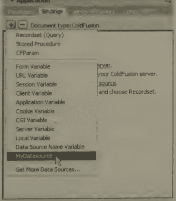

2. 点击`MyDatasource`数据源选项，你创建的`MyDatasource Variable`对话框将出现：

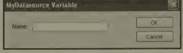

3. 在对话框中输入一个值，然后点击"确定"。

"绑定"面板会以树形结构显示数据源，对话框中的变量位于数据源名称下方：

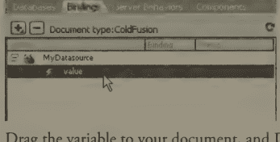

4. 将变量拖到你的文档中，Dreamweaver 将从 EDML 文件中插入适当的代码：

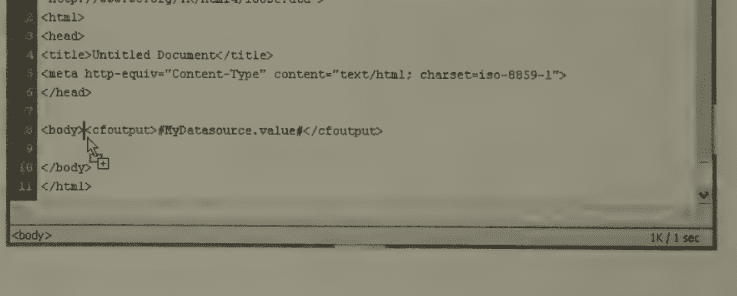

## 数据源 API

数据源 API 中的函数让你能够查找、添加、编辑和删除数据源，以及生成和检查动态数据对象。

### `addDynamicSource()`

**可用性**

Dreamweaver UltraDev 1。

**描述**

此函数添加一个动态数据源。由于每个数据源文件中都有此函数的一个实现，当你从加号（+）菜单中选择一个数据源时，Dreamweaver 会调用相应的`addDynamicSource()`函数实现。

例如，对于记录集或命令，Dreamweaver 调用`dw.serverBehaviorInspector.popupServerBehavior()`函数，该函数将新的服务器行为插入到文档中。对于请求、会话和应用程序变量，Dreamweaver 显示一个 HTML/JavaScript 对话框来收集变量名；该行为会存储变量名以备将来使用。

在`addDynamicSource()`函数返回后，Dreamweaver 会清除数据源树的内容，并调用`findDynamicSources()`和`generateDynamicSourceBindings()`函数来重新填充数据源树。

**返回值**

Dreamweaver 不期望任何返回值。

### `deleteDynamicSource()`

**可用性**

Dreamweaver UltraDev 1。

**描述**

当用户在树中选择一个数据源并点击减号（-）按钮时，Dreamweaver 会调用此函数。

例如，在 Dreamweaver 中，如果选择的是记录集或命令，`deleteDynamicSource()`函数会调用`dw.serverBehaviorInspector.deleteServerBehavior()`函数。如果选择的是请求、会话或应用程序变量，该函数会记住该变量已被删除，不再继续显示它。在`deleteDynamicSource()`函数返回后，Dreamweaver 会清除数据源树的内容，并调用`findDynamicSources()`和`generateDynamicSourceBindings()`函数来获取用户文档的所有新数据源列表。

**参数**

*sourceName*, *bindingName*

- *sourceName* 参数是与子节点关联的顶层节点的名称。
- *bindingName* 参数是子节点的名称。

**返回值**

Dreamweaver 不期望任何返回值。

### `displayHelp()`

**描述**

如果定义了此函数，对话框中的"确定"和"取消"按钮下方会出现一个"帮助"按钮。当用户点击"帮助"按钮时，会调用此函数。

**参数**

无。

**返回值**

Dreamweaver 不期望任何返回值。

**示例**

```javascript
// 以下 displayHelp() 实例打开
// 一个文件（在浏览器中），解释如何使用
// 该扩展。
function displayHelp(){
  var myHelpFile = dw.getConfigurationPath() +
  '/ExtensionsHelp/superDuperHelp.htm';
  dw.browseDocument(myHelpFile);
}
```

### `editDynamicSource()`

**可用性**

Dreamweaver MX。

**描述**

当用户在"绑定"面板中双击数据源名称以编辑数据源时，会调用此函数。你可以实现此函数来处理树中的用户编辑。否则，匹配该数据源的服务器行为将被自动调用。扩展开发者可以使用此函数来覆盖服务器行为的默认实现，并提供自定义处理程序。

**参数**

*sourceName*, *bindingName*

- *sourceName* 参数是与子节点关联的顶层节点的名称。
- *bindingName* 参数是子节点的名称。

**返回值**

Dreamweaver 期望一个布尔值：如果函数已处理编辑，则为`true`；否则为`false`。

### `findDynamicSources()`

**可用性**

Dreamweaver UltraDev 1。

**描述**

此函数返回"动态数据"或"动态文本"对话框或"绑定"面板中数据源树的顶层节点。每个数据源文件都有`findDynamicSources()`函数的实现。当 Dreamweaver 刷新树时，Dreamweaver 会读取`DataSources`文件夹中的所有文件，并在每个文件中调用`findDynamicSources()`函数。

## 返回值

Dreamweaver 期望接收一个 JavaScript 对象数组，其中每个对象最多可包含五个属性，这些属性在以下列表中描述：

- `title` 属性是显示在每个父节点图标右侧的标签字符串。`title` 属性始终是必需的。

- `imageFile` 属性是包含图标（GIF 图像）的文件路径，该图标在动态数据或动态文本对话框以及绑定面板的树形控件中表示父节点。此属性是必需的。

- `allowDelete` 属性是可选的。如果此属性设置为`false`，当用户在绑定面板中单击此节点时，减号 (-) 按钮将被禁用。如果此属性设置为`true`，减号 (-) 按钮将被启用。如果未定义该属性，则默认值为`true`。

- `dataSource` 属性是定义了`findDynamicSources()`函数的文件的简单名称。例如，位于`Configuration/DataSources/ASP_Js`文件夹中的`Session.htm`文件中的`findDynamicSources()`函数将`dataSource`属性设置为`session.htm`。此属性是必需的。

- `name` 属性是与数据源关联的服务器行为的名称（如果存在）。某些数据源（如记录集）与服务器行为相关联。当您创建一个记录集并将其命名为`rsAuthors`时，`name`属性必须等于`rsAuthors`。`name`属性始终会被定义，但如果没有服务器行为与数据源关联（例如会话变量），则可以为空字符串（`""`）。

> **注意** 定义了这些属性的 JavaScript 类位于`DataSourceClass.js`文件中，该文件位于`Configuration/Shared/Common/Scripts`文件夹中。

## `generateDynamicDataRef()`

### 可用性

Dreamweaver UltraDev 1。

### 说明

此函数为子节点生成动态数据对象。

### 参数

*sourceName, bindingName*

- *sourceName* 参数是与子节点关联的顶级节点的名称。

- *bindingName* 参数是您要从中生成动态数据对象的子节点的名称。

### 返回值

Dreamweaver 期望接收一个字符串，该字符串可以传递给`formatDynamicDataRef()`函数进行格式化，然后再将其插入到用户的文档中。

## `generateDynamicSourceBindings()`

### 可用性

Dreamweaver UltraDev 1。

### 说明

此函数返回顶级节点的子节点。

### 参数

*sourceName*

- *sourceName* 参数是您要返回其子节点的顶级节点的名称。

### 返回值

Dreamweaver 期望接收一个 JavaScript 对象数组，其中每个对象最多可包含四个属性，这些属性在以下列表中描述：

- `title` 属性是显示在每个父节点图标右侧的标签字符串。此属性是必需的。

- `allowDelete` 属性是可选的。如果此属性设置为值`false`，当用户在绑定面板中单击此节点时，减号 (-) 按钮将被禁用。如果此属性设置为值`true`，减号 (-) 按钮将被启用。如果未定义该属性，则默认值为`true`。

- `dataSource` 属性是定义了`findDynamicSources()`函数的文件的简单名称。例如，位于`Configuration/DataSources/ASP_Js`文件夹中的`Session.htm`文件中的`findDynamicSources()`函数将`dataSource`属性设置为`session.htm`。此属性是必需的。


- `name` 属性是与数据源关联的服务器行为的名称（如果存在）。这是一个必需的属性。某些数据源（如记录集）与服务器行为相关联。当您创建一个记录集并将其命名为 `rsAuthors` 时，`name` 属性必须等于 `rsAuthors`。其他数据源（如会话变量）没有对应的服务器行为。它们的 `name` 属性必须是空字符串（`""`）。

> **注意**
>
> 定义了这些属性的 JavaScript 类位于 `DataSourceClass.js` 文件中，该文件位于 `Configuration/Shared/Common/Scripts` 文件夹中。

## `inspectDynamicDataRef()`

### 可用性

Dreamweaver UltraDev 1。

### 说明

此函数根据动态数据对象确定数据源树中对应的节点。`inspectDynamicDataRef()` 函数接收 Dreamweaver 传入的字符串，并将其与 `generateDynamicDataRef()` 为树中每个节点返回的字符串进行比较。如果找到匹配项，`inspectDynamicDataRef()` 函数将指出树中哪个节点与传入的字符串匹配。该函数通过使用一个包含两个元素的数组来标识节点。第一个元素是父节点的名称，第二个元素是子节点的名称。如果未找到匹配项，`inspectDynamicDataRef()` 函数将返回一个空数组。

每个 `inspectDynamicDataRef()` 函数的实现仅检查与其自身对象类型的匹配项。例如，记录集实现的 `inspectDynamicDataRef()` 函数仅在传入的字符串与树中的记录集节点匹配时才会找到匹配项。

### 参数

`string`

- `string` 参数是动态数据对象。

### 返回值

Dreamweaver 期望接收一个包含两个元素（父名称和子名称）的数组，用于匹配的节点；如果未找到匹配项，则返回 `null` 值。

# 第 17 章

## 服务器格式

第 16 章“数据源”（第 379 页）讨论了 Macromedia Dreamweaver 8 如何通过在适当位置添加服务器表达式将动态数据插入到用户的文档中。当访问者从 Web 服务器请求该文档时，该服务器表达式将被转换为来自数据库的值、请求变量的内容或其他动态值。Dreamweaver 服务器格式允许您设置此动态值呈现给访问者的方式。

本章讨论用于格式化第 16 章“数据源”（第 379 页）中描述的函数返回的动态数据的 API。两章中描述的函数协同工作以格式化动态数据。如果用户为动态数据选择了格式，Dreamweaver 将调用数据源函数 `generateDynamicDataRef()`（参见第 394 页的“`generateDynamicDataRef()`”）以获取要插入到用户文档中的字符串。在将字符串插入到用户文档之前，Dreamweaver 将该字符串传递给 `formatDynamicDataRef()` 函数，该函数在本章中描述。`formatDynamicDataRef()` 函数返回的字符串就是最终插入到用户文档中的格式化动态数据。

Dreamweaver 用户可以使用内置格式来格式化数据，可以基于内置格式类型创建新格式，也可以基于自定义格式类型创建新格式。

用户可以通过多种方式格式化动态数据。通过使用动态数据或动态文本对话框中的格式菜单，或者绑定面板中的格式菜单，用户可以在将数据插入 HTML 文档之前对其进行格式化。如果用户想要创建格式，他或她可以从格式菜单中选择“编辑格式列表”命令，并从加号（`+`）菜单中选择一种格式类型。加号（`+`）菜单包含格式类型列表。格式类型是基本格式类别，例如货币、日期时间或字母大小写。格式类型收集某一类别格式的所有通用参数，使您能够简化创建新格式的工作。

一个例子可能是创建新的货币格式。本质上，所有货币格式化都包括将数字转换为字符串、插入逗号和小数点，以及插入货币符号（如美元（`$`）符号）。货币格式数据类型收集所有通用参数，并提示您输入所需的值。

## 数据格式化的工作原理

所有格式文件都位于 `Configuration/ServerFormats/*currentServerModel*` 文件夹中。每个子文件夹包含一个 XML 文件和多个 HTML 文件。

`Formats.xml` 文件描述了格式菜单中的所有选项。Dreamweaver 会自动添加“编辑格式列表”和“无”选项。

该文件夹还包含每个当前已安装格式类型对应的一个 HTML 文件，包括 AlphaCase、Currency、DateTime、Math、Number、Percent、Simple 和 Trim。

## `Formats.xml` 文件

`Formats.xml` 文件为格式菜单中的每个项目包含一个格式标签。每个格式标签包含以下必需属性：

- `file=fileName` 属性是此格式类型的 HTML 文件，例如“Currency”。

- `title=string` 属性是出现在格式菜单中的字符串，例如“Currency - default”。

- `expression=regexp` 属性是与使用此格式的动态数据对象匹配的正则表达式。该表达式决定了当前应用于动态数据对象的格式。例如，“Currency - default”格式的表达式为 `<%\s*=\s*FormatCurrency\(.*, -1, -2, -2, -2\)\s*%>|<%\s*=\s*DoCurrency\(.*, -1, -2, -2, -2\)\s*%>`。`expression` 属性的值在文件中所有格式标签中必须是唯一的；它必须足够具体，以保证只有此格式的实例与该表达式匹配。

- `visibility=[hidden | visible]` 属性指示该值是否出现在格式菜单中。如果 `visibility` 属性的值为 `hidden`，则该格式不会出现在格式菜单中。

格式标签可以包含额外的、任意命名的属性。

某些数据格式化函数需要一个 `format` 参数，它是一个 JavaScript 对象。此对象是与 `Formats.xml` 文件中格式标签对应的节点。该对象为对应格式标签的每个属性都具有一个 JavaScript 属性。

以下示例展示了“货币 - 默认”字符串的格式标签：

```xml
<format file="Currency" title="Currency - default" expression="<%\s*=\s*FormatCurrency\(.*, -1, -2, -2\)\s*%>|<%\s*=\s*DoCurrency\(.*, -1, -2, -2\)\s*%>" NumDigitsAfterDecimal=-1 IncludeLeadingDigit=-2 UseParensForNegativeNumbers=-2 GroupDigits=-2/>
```

此格式的格式类型为货币。“货币 - 默认”字符串显示在“格式”菜单中。表达式 `<%\s*=\s*FormatCurrency\(.*, -1, -2, -2\)\s*%>|<%\s*=\s*DoCurrency\(.*, -1, -2, -2\)\s*%>` 用于查找用户文档中该格式的出现位置。

`NumDigitsAfterDecimal`、`IncludeLeadingDigit`、`UseParensForNegativeNumbers` 和 `GroupDigits` 参数属于货币格式类型，并非必需参数。这些参数出现在货币格式类型的“参数”对话框中。当用户从“编辑格式列表”对话框的加号（`+`）菜单中选择货币格式类型时，将显示“参数”对话框。为这些参数指定的值定义了新格式。

## “编辑格式列表”加号（`+`）菜单

如果您不希望 `ServerFormats` 文件夹中的某个文件出现在“编辑格式列表”的加号（`+`）菜单中，请在 HTML 文件的第一行添加以下语句：

```html
<!-- MENU-LOCATION=NONE -->
```

为了确定菜单的内容，Dreamweaver 首先在与数据格式相同的文件夹中搜索 `ServerFormats.xml` 文件（例如，`Configuration/ServerFormats/ASP/ServerFormats.xml`）。`ServerFormats.xml` 文件描述了“编辑格式列表”加号（`+`）菜单的内容，其中包含对菜单中列出的 HTML 文件的引用。

Dreamweaver 检查每个被引用的 HTML 文件中的 `title` 标签。如果文件包含 `title` 标签，则该标签的内容将显示在菜单中。如果文件不包含 `title` 标签，则在菜单中使用文件名。

Dreamweaver 完成文件搜索后，或者如果文件不存在，Dreamweaver 会扫描文件夹的其余部分以查找应显示在菜单中的其他项目。如果 Dreamweaver 在主文件夹中找到尚未在菜单中的文件，会将其添加。如果子文件夹中包含尚未在菜单中的文件，Dreamweaver 会创建一个子菜单并将这些文件添加到其中。

## 调用数据格式化函数的场景

数据格式化函数在以下场景中被调用：

- 在“动态数据”或“动态文本”对话框中，用户从数据源树中选择一个节点，并从“格式”菜单中选择一个格式。当用户选择格式时，Dreamweaver 调用 `generateDynamicDataRef()` 函数，并将 `generateDynamicDataRef()` 函数的返回值传递给 `formatDynamicDataRef()` 函数。`formatDynamicDataRef()` 函数的返回值显示在对话框的“代码”设置中。用户点击“确定”后，代码字符串将插入到用户的文档中。接着，Dreamweaver 调用 `applyFormat()` 函数来插入函数声明。有关详细信息，请参阅第 394 页的“`generateDynamicDataRef()`”。当用户使用“绑定”面板时，也会发生类似的过程。

- 如果用户更改格式或删除动态数据项，将调用 `deleteFormat()` 函数。`deleteFormat()` 函数会从文档中移除支持脚本。

- 当用户点击“编辑格式列表”对话框中的加号（`+`）按钮时，Dreamweaver 会显示一个菜单，其中包含指定服务器模型的所有格式类型。每种格式类型对应于 `Configuration/ServerFormats/currentServerModel` 文件夹中的一个文件。

  如果用户从加号（`+`）菜单中选择一个需要用户指定参数的格式，Dreamweaver 会执行 `body` 标签上的 `onload` 处理程序并显示“参数”对话框，其中显示该格式类型的参数。在此对话框中，当用户为格式选择参数并点击“确定”时，Dreamweaver 调用 `applyFormatDefinition()` 函数。

  如果所选格式不需要显示“参数”对话框，Dreamweaver 会在用户从加号（`+`）菜单中选择格式类型时调用 `applyFormatDefinition()` 函数。

- 之后，如果用户通过在“编辑格式列表”对话框中选择格式并点击“编辑”按钮来编辑格式，Dreamweaver 会在“参数”对话框出现之前调用 `inspectFormatDefinition()` 函数，以便将表单控件初始化为正确的值。

## 服务器格式 API

服务器格式 API 由以下数据格式化函数组成。

## `applyFormat()`

### 可用性

Dreamweaver UltraDev 1。

### 描述

此函数可以通过向用户文档添加格式函数声明来编辑用户文档。当用户从“动态数据”或“动态文本”对话框或“绑定”面板中的“格式”文本字段选择格式时，Dreamweaver 会对用户文档进行两项更改：

它会在 HTML 标签之前添加适当的格式函数（如果尚未存在），并将动态数据对象更改为调用适当的格式函数。

Dreamweaver 通过调用数据格式文件中的 `applyFormat()` JavaScript 函数来添加函数声明。它通过调用 `formatDynamicDataRef()` 函数来更改动态数据对象。

`applyFormat()` 函数应使用 DOM 将函数声明添加到用户文档的顶部。例如，如果用户选择了“货币 - 默认”，该函数将添加 `Currency` 函数声明。

### 参数

`format`

- `format` 参数是一个 JavaScript 对象，描述了要应用的格式。该 JavaScript 对象是 `Formats.xml` 文件中对应于 `format` 标签的节点。该对象具有对应于 `format` 标签每个属性的 JavaScript 属性。

### 返回值

Dreamweaver 不期望任何返回值。

## `applyFormatDefinition()`

### 可用性

Dreamweaver UltraDev 1。

### 描述

提交使用“编辑格式”对话框创建的格式的更改。

用户可以使用“编辑格式列表”对话框创建、编辑或删除格式。调用此函数以提交对格式所做的任何修改。它还可以在对象上设置其他任意命名的属性。每个属性都存储为 `Formats.xml` 文件中 `format` 标签的属性。

### 参数

`format`

- `format` 参数对应于 JavaScript `format` 对象。该函数必须将 JavaScript 对象的 `expression` 属性设置为格式的正则表达式。该函数还可以设置对象的其他任意命名属性。每个属性都存储为 `format` 标签的属性。

### 返回值

如果函数成功完成，Dreamweaver 期望返回格式对象。如果发生错误，函数返回错误字符串。如果返回空字符串，则表单关闭，但新格式未创建，这与取消操作相同。

## `deleteFormat()`

### 可用性

Dreamweaver UltraDev 1。

### 描述

从用户文档顶部移除格式函数声明。

当用户更改动态数据对象的格式（在“动态数据”或“动态文本”对话框中或“绑定”面板中）或删除已格式化的动态数据对象时，Dreamweaver 通过调用 `deleteFormat()` 函数从文档顶部移除函数声明，并从动态数据对象中移除函数调用。

将 DOM 与 `deleteFormat()` 函数配合使用，从当前文档顶部移除函数声明。

### 参数

`format`

- `format` 参数是一个 JavaScript 对象，描述了要移除的格式。该 JavaScript 对象是 `Formats.xml` 文件中对应于 `format` 标签的节点。

### 返回值

Dreamweaver 不期望任何返回值。

## `formatDynamicDataRef()`

### 可用性

Dreamweaver UltraDev 1。

### 描述

将格式函数调用添加到动态数据对象。当用户从“动态数据”或“动态文本”对话框或“绑定”面板中的“格式”文本框选择格式时，Dreamweaver 会对用户文档进行两项更改：它在 HTML 标签之前添加适当的格式函数（如果尚未存在），并将动态数据对象更改为调用适当的格式函数。

Dreamweaver 通过调用数据格式文件中的 `applyFormat()` JavaScript 函数来添加函数声明。它通过调用 `formatDynamicDataRef()` 函数来更改动态数据对象。

当用户从“动态数据”或“动态文本”对话框或“绑定”面板中的“格式”文本框选择格式时，会调用 `formatDynamicDataRef()` 函数。它不编辑用户文档。

### 参数

`dynamicDataObject, format`

- `dynamicDataObject` 参数是一个包含动态数据对象的字符串。

- `format` 参数是一个 JavaScript 对象，描述了要应用的格式。该 JavaScript 对象是 `Formats.xml` 文件中对应于 `format` 标签的节点。该对象具有对应于 `format` 标签每个属性的 JavaScript 属性。

### 返回值

Dreamweaver 期望返回动态数据对象的新值。

如果发生错误，该函数在某些条件下会显示警报消息。如果函数返回空字符串，则“格式”文本框将设置为“无”。

## `inspectFormatDefinition()`

### 可用性

Dreamweaver UltraDev 1。

### 描述

当用户在“编辑格式列表”对话框中编辑格式时，初始化表单控件。

### 参数

`format`

- `format` 参数是一个 JavaScript 对象，用于描述要应用的格式。该 JavaScript 对象是 `Formats.xml` 文件中对应于 `format` 标签的节点。该对象具有对应于 `format` 标签每个属性的 JavaScript 属性。

### 返回值

Dreamweaver 不期望返回任何值。

## 组件

Macromedia Dreamweaver 支持创建许多最流行的组件类型。此外，Dreamweaver 允许您扩展出现在“组件”面板中的组件类型。

### 组件基础

程序员使用各种策略来封装其工作。您可以将封装理解为创建一个存在于虚拟黑盒中的实体。要使用它，您无需了解其工作原理；只需知道它完成工作所需的信息以及完成工作后将输出的信息即可。例如，程序员可能创建一个从员工数据库获取信息的程序。然后，任何其他人或程序都可以使用该程序查询该数据库。因此，该程序是可重用的。

经验表明，使用封装的组织良好的程序更易于维护、增强和重用。不同的技术为程序员提供了实现这种封装的不同方式，不同的名称描述了这些策略：函数、模块等。Macromedia Dreamweaver 8 使用术语组件来指代一些更流行和现代的封装策略，包括 Web 服务、JavaBeans 和 ColdFusion 组件（CFC）。因此，当用户在 Dreamweaver 中构建 Web 应用程序时，“组件”面板可协助他们使用可用的 Web 服务、JavaBeans 和 CFC。


来自最新技术（如 Web 服务、JavaBeans 或 CFC）的组件可以描述自身。通常，有关组件的信息嵌入在构成组件的文件中。组件发布或共享此信息的能力称为*自省*。换句话说，像 Dreamweaver 这样的程序可以向组件询问其暴露的函数列表（即可以从另一个程序调用的函数）。根据所使用的技术，组件可以揭示关于自身的其他信息。例如，Web 服务可能会描述新的数据类型。

## 扩展组件面板

如果您发明（或只是使用）了一种 Dreamweaver 当前"组件"面板中未代表的组件策略，您可以扩展"组件"面板的逻辑，以便该面板可以处理新型组件。

要向 Dreamweaver"组件"面板添加新型组件，您需要定位可用组件（在用户环境中）并请求每个组件的描述（如果它们是使用 ASCII 文件编写的，则进行解析）。

定位组件以及如何检索组件详细信息的具体方式因技术而异。此外，它可能因服务器模型（ASP.NET、JSP/J2EE、ColdFusion 或其他）而异。因此，您编写用于扩展"组件"面板的 JavaScript 取决于您需要添加的组件技术。此处描述的函数旨在帮助您将信息显示在"组件"面板中，但您必须编写大部分用于定位组件和自省它们（查询组件的内部结构，并使其字段、方法和属性通过 Dreamweaver 可用）的逻辑。

最后，ASP.NET、JSP/J2EE 或 ColdFusion 等服务器模型往往支持某些组件类型，但并非全部。例如，ASP.NET 支持 Web 服务但不支持 JavaBeans。Macromedia ColdFusion 也支持 Web 服务和 CFC。当您向"组件"面板添加新的组件类型时，它必须特定于服务器模型。例如，如果 Dreamweaver 用户正在处理 ColdFusion 站点，则只有 Web 服务和 CF 组件应出现在"组件"面板的下拉列表中。

您需要修改的文件将在本章中讨论。在某些情况下，您需要编写一些 JavaScript 代码来调用某些与组件相关的函数。

## 如何自定义组件面板

Dreamweaver"组件"面板允许用户加载和使用组件。它列出了与每个启用的服务器模型兼容的所有可用组件类型。例如，因为 JavaBeans 只能在 JavaServer Page（JSP）上工作，所以 JavaBeans 组件仅出现在"组件"面板的 JSP 服务器模型中。同样，因为 CFC 只能在 ColdFusion 页面上工作，所以它们仅出现在"组件"面板的 ColdFusion 服务器模型中。

可扩展性允许您向面板添加新的组件类型。在向"组件"面板添加新的组件类型时，您需要遵循以下几个通用步骤：

1. 将组件添加到适当服务器模型的可用组件类型列表中。
2. 添加称为安装步骤的说明，这些说明显示为交互式编号步骤，用于在"组件"面板或对话框中设置组件（取决于步骤实现的扩展）。确保在用户已完成的任何步骤旁边显示复选标记。
3. 仅列出存在于用户计算机上或当前站点中的该组件类型的组件。
4. 当用户单击"组件"面板中的加号（+）按钮时，创建一个新组件。

此外，您可能还想让用户能够编辑现有组件和删除组件。

## 组件面板文件

`Configuration/Components` 文件夹有一个子文件夹，用于每个已实现的服务器模型。组件文件存储在 `Configuration/Components/server-model/ComponentType` 文件夹中。您可以添加其他服务器模型和支持性服务器扩展（有关更多信息，请参阅第 19 章"服务器模型"，第 423 页，以及第 15 章"服务器行为"，第 321 页）。

**要创建可在"组件"面板中工作的自定义组件：**

- 创建一个 HTML 文件，该文件标识支持 JavaScript 和图像文件的位置。
- 编写 JavaScript 以启用该组件。
- 创建或识别现有的 GIF 图像文件，以在"组件"面板中表示该组件。

如果您希望组件类型出现在树控件视图中，则还需要创建相关的可选文件并填充树控件。

您可以将组件类型设置为在单个网页级别、一组网页或整个站点级别工作。您的 JavaScript 代码必须包含用于组件持久化的逻辑——即在会话之间保存自身并在新会话开始时重新加载。

以下示例显示了文件 `JavaBeansList.xml`（保存在多用户配置文件夹中）中定义组件类及其位置的数据条目：

```
<javabeans>
<javabean classname="TestCollection.MusicCollection"
classlocation="d:\music\music.jar"></javabean>
</javabeans>
```

JavaBeans 应包含在多用户配置文件夹中保存自身的逻辑，以便下次用户启动应用程序时，组件可以从保存的数据文件中重新加载自身。

## 添加服务组件

要使用 Dreamweaver MX 添加新的轻量级目录访问协议（LDAP）服务：

1. 使用现有的组件类型文件作为模型（例如，应用程序文件夹 `Configuration/Components/Common/WebServices` 中的文件），创建所有必需文件以及所需的可选文件，以在 Dreamweaver"组件"面板中显示新的组件类型，如下表所示：

| 文件名 | 描述 | 必需/可选 |
|---|---|---|
| `.htm` | 扩展文件，用于标识其他支持的 JavaScript 和 GIF 文件。 | 必需 |
| `.js` | 实现组件 API 回调的扩展文件。 | 必需 |
| `.gif` | 出现在组件弹出列表中的图像。 | 必需 |
| `*Menus.xml` | 用于组织"组件"面板结构的元数据存储库。尽管通用的 WebServices 组件不使用此文件，但您可以参考应用程序文件夹 `Components/ColdFusion/WebServices` 中的文件 `WebServicesMenus.xml` 作为示例。 | 可选 |
| `*.gif` | 工具栏图像，可以启用或禁用，如以下示例所示：`ToolBarImageUp.gif` `ToolBarImageDown.gif` `ToolBarImageDisabled.gif`。 | 可选 |
| | 或者，树节点图像。 | |

> **注意** 在对应于一个组件的所有文件中保持相同的前缀，以便轻松识别每个文件及其相应的组件。

2. 编写 JavaScript 代码以实现新的服务器组件。

扩展文件（HTM）在 `SCRIPT` 标签中定义了 JavaScript 代码的位置。这些 JavaScript 文件可以位于"共享"文件夹中、与扩展文件相同的文件夹中，或者位于适用于多个服务器模型的"通用"文件夹中。

例如，`Configuration/Components/Common/WebServices/WebServices.htm` 文件包含以下行：

```
<SCRIPT SRC="../../Common/WebServices/WebServicesCommon.js"></SCRIPT>
```

有关可用组件 API 函数的更多信息，请参阅第 412 页的"**组件面板 API 函数**"。

> **提示**
>
> 添加新服务时，您可能希望使用**组件面板**来浏览元信息，以便在创建扩展时随时获取该信息。Dreamweaver 可以浏览已添加的组件并在组件树中显示节点。组件面板在**代码视图**中提供拖放支持和键盘支持。

## 填充树控件

使用 `ComponentRec` 属性来填充"组件面板"树控件，使其显示在"组件面板"中的适当位置。树控件中的每个节点必须具有以下属性：

| 属性名称 | 说明 | 必需/可选 |
|---|---|---|
| `name` | 树节点项的名称 | 必需 |
| `image` | 树节点项的图标。如果未指定，则使用默认图标。 | 可选 |
| `hasChildren` | 通过加载子项来响应树控件中"加号"（+）和"减号"（-）按钮的点击。您可以处理未预先填充的树。 | 必需 |
| `toolTipText` | 树节点项的工具提示文本 | 可选 |
| `isCodeViewDraggable` | 确定该项是否可以拖放到**代码视图**中。 | 可选 |
| `isDesignViewDraggable` | 确定该项是否可以拖放到**设计视图**中。 | 可选 |

例如，以下 `WebServicesClass` 节点以 Web 方法作为其子项：

```
this.name = "TrafficLocatorWebService";
this.image  = "Components/Common/WebServices/WebServices.gif";
this.hasChildren = true;
this.toolTipText = "TrafficLocatorWebService";
this.isCodeViewDraggable = true;
// 以下内容允许启用/禁用组件树上方的按钮
this.allowDelete = true;
this.isDesignViewDraggable = false;
```

## 组件面板 API 函数

本节描述用于填充"组件面板"的 API 函数。

### `getComponentChildren()`

**可用性**

Dreamweaver MX。

**说明**

此函数返回活动父 `ComponentRec` 对象的子 `ComponentRec` 对象列表。要加载根级树项，此函数需要从其持久存储中读取元数据。

**参数**

*(parentComponentRec)*

- `parentComponentRec` 参数是父组件的 `componentRec` 对象。如果省略，Dreamweaver 期望获取根节点的 `ComponentRec` 对象列表。

**返回值**

`ComponentRec` 对象的数组。

**示例**

请参阅 `Configuration/Components/Common/WebServices` 文件夹中 `WebServices.js` 文件中的 `getComponentChildren(componentRec)` 函数。

### `getContextMenuId()`

**可用性**

Dreamweaver MX。

**说明**

返回组件类型的上下文菜单 ID。每个组件类型都可以有一个关联的上下文菜单。上下文菜单弹出菜单在 `*ComponentNameMenus.xml` 文件中定义，其工作方式与 `menu.xml` 文件相同。菜单字符串可以是静态的或动态的。支持快捷键（加速键）。

**参数**

无。

**返回值**

定义上下文菜单 ID 的字符串。

**示例**

以下示例为与 ASP.NET/C# 服务器模型关联的 Web 服务设置"组件面板"的菜单选项，并定义该菜单的快捷键：

```
function getContextMenuId()
{
    return "DWWebServicesContext";
}
```

其中 `DWWebServicesContext` 在 `Configuration/Components/ASP.NET_CSharp/WebServices/WebServicesMenus.xml` 文件中定义如下：

```
<shortcutlist id="DWWebServicesContext">
    <shortcut key="Del" domRequired="false"
        enabled="(dw.serverComponentsPalette.getSelectedNode() != null &&
        (dw.serverComponentsPalette.getSelectedNode().objectType=='Root'))"
        command="clickedDelete();" id="DWShortcuts_ServerComponent_Delete" />
</shortcutlist>
```

```
<menubar name="" id="DWWebServicesContext">
    <menu name="Server Component Popup" id="DWContext_WebServices">
        <menuitem name="Edit Web Service" domRequired="false"
            enabled="dw.serverComponentsPalette.getSelectedNode() != null &&
            (dw.serverComponentsPalette.getSelectedNode().objectType=='Root') &&
            dw.serverComponentsPalette.getSelectedNode().wsRec != null &&
            dw.serverComponentsPalette.getSelectedNode().wsRec.ProxyGeneratorName !=
            null" command="editWebService()"
            id="DWContext_WebServices_EditWebService" />
    ...
</menubar>
```

### `getCodeViewDropCode()`

**可用性**

Dreamweaver MX。

**说明**

此函数获取从"组件面板"拖放到"代码视图"中的代码，或者从"组件面板"剪切、复制或粘贴的代码。

**参数**

*componentRec*

- `componentRec` 参数是一个对象。

**返回值**

包含组件代码的字符串。

**示例**

以下示例标识公共 Web 服务的代码：

```
function getCodeViewDropCode(componentRec)
{
    var codeToDrop="";
    if (componentRec)
    {
        if (componentRec.objectType=="Class")
        {
            codeToDrop =
dw.getExtDataValue("webservices_constructor","insertText");
            codeToDrop =
codeToDrop.replace(RegExp("@@Id@@","g"),componentRec.name);
            codeToDrop =
codeToDrop.replace(RegExp("@@Class@@","g"),componentRec.name);
        }
        else if (componentRec.objectType=="Method")
        {
            codeToDrop = componentRec.dropCode;
        }
        if(componentRec.dropCode)
        {
            codeToDrop = componentRec.dropCode;
        }
        else
        {
            codeToDrop = componentRec.name;
        }
    }
    return codeToDrop;
}
```

### `getSetupSteps()`

**可用性**

Dreamweaver MX。

**说明**

如果 `setupStepsCompleted()` 函数返回零或正整数，Dreamweaver 将调用此函数。此函数控制服务器端设置说明，可以使用模态对话框的扩展和使用服务器组件的扩展来实现。

此函数返回一个字符串数组，供 Dreamweaver 在"设置步骤"对话框或"组件面板"中显示，具体取决于扩展类型。

**参数**

无。

**返回值**

*n*+1 个字符串的数组，其中 *n* 是步骤数，如下所述：

- 出现在设置步骤列表上方的标题
- 对于每个步骤，文本说明，可以包含在 `li` 标签内合法的任何 HTML 标记

您可以使用以下形式在步骤列表中包含超文本链接（`a` 标签）：

`<a href="#" onMouseDown="handler">蓝色下划线文本</a>`

`handler` 值可以替换为以下任何字符串或任何 JavaScript 表达式，例如 `"dw.browseDocument('http://www.macromedia.com')"`:

- `"Event:SetCurSite"` 处理程序打开一个对话框以设置当前站点。
- `"Event:CreateSite"` 处理程序打开一个对话框以创建新站点。
- `"Event:SetDocType"` 处理程序打开一个对话框以更改用户文档的文档类型。
- `"Event:CreateConnection"` 处理程序打开一个对话框以创建新的数据库连接。
- `"Event:SetRDSPassword"` 处理程序打开一个对话框以设置远程开发服务（RDS）用户名和密码（仅限 ColdFusion）。
- `"Event:CreateCFDataSource"` 处理程序在浏览器中打开 ColdFusion 管理员。

## 示例

以下示例为 ColdFusion 组件设置了四个步骤，并在第四步提供了一个超文本链接，以便用户输入 RDS 用户名和密码：


```javascript
function getSetupSteps()
{
    var doSDK = false;
    dom = dw.getDocumentDOM();
    if (dom && dom.serverModel)
    {
        var aServerModelName = dom.serverModel.getDisplayName();
    }
    else
    {
        var aServerModelName = site.getServerDisplayNameForSite();
    }
    if (aServerModelName.length)
    {
        if(aServerModelName != "ColdFusion")
        {
            if(needsSDKInstalled != null)
            {
                doSDK = needsSDKInstalled();
            }
        }
    }

    var someSteps = new Array();
    someSteps.push(MM.MSG_WebService_InstructionsTitle);
    someSteps.push(MM.MSG_Dynamic_InstructionsStep1);
    someSteps.push(MM.MSG_Dynamic_InstructionsStep2);
    if(doSDK == true)
    {
        someSteps.push(MM.MSG_WebService_InstructionsStep3);
    }
    someSteps.push(MM.MSG_WebService_InstructionsStep4);

    return someSteps;
}
```

## `setupStepsCompleted()`

### 可用性

Dreamweaver MX。

### 描述

Dreamweaver 在“组件”选项卡出现之前调用此函数。如果 `setupStepsCompleted()` 函数返回零或正整数，Dreamweaver 随后会调用 `getSetupSteps()` 函数。

### 参数

无。

### 返回值

一个整数，表示用户已完成的设置步骤数量，如下所列：

- 值为零或正整数表示已完成的步骤数。
- 值为 `-1` 表示所有必要的步骤都已完成，因此指令列表不会出现。

## `handleDesignViewDrop()`

### 可用性

Dreamweaver MX。

### 描述

处理当用户将表或视图从数据库面板，或将组件从组件面板拖放到设计视图时的放置操作。

### 参数

`componentRec`

- `componentRec` 参数是一个对象，包含以下属性：
  - `name` 属性是树节点项的名称。
  - `image` 属性是树节点项的可选图标。如果省略，Dreamweaver MX 会使用默认图标。
  - `hasChildren` 属性是一个布尔值，指示树节点项是否可展开：如果为 `true`，Dreamweaver MX 会为该树节点项显示加号（`+`）和减号（`-`）按钮；如果为 `false`，则该项不可展开。
  - `toolTipText` 属性是树节点项的可选工具提示文本。
  - `isCodeViewDraggable` 属性是一个布尔值，指示树节点项是否可以拖放到代码视图中。
  - `isDesignViewDraggable` 属性是一个布尔值，指示树节点项是否可以拖放到设计视图中。

### 返回值

一个布尔值，指示放置操作是否成功：成功为 `true`；否则为 `false`。

### 示例

以下示例确定组件是表还是视图，然后返回相应的 `bHandled` 值：

```javascript
function handleDesignViewDrop(componentRec)
{
  var bHandled = false;
  if (componentRec)
  {
    if ((componentRec.objectType == "Table")||
        (componentRec.objectType == "View"))
    {
      alert("popup Recordset Server Behavior");
      bHandled = true;
    }
  }
  return bHandled;
}
```

## `handleDoubleClick()`

### 可用性

Dreamweaver MX。

### 描述

当用户在树中双击节点时，会调用事件处理程序以允许编辑。此函数是可选的。该函数可以返回一个 `false` 值，表示事件处理程序未定义。在这种情况下，双击将导致默认行为，即展开或折叠树节点。

### 参数

`componentRec`

- `componentRec` 参数是一个对象，包含以下属性：
  - `name` 属性是树节点项的名称。
  - `image` 属性是树节点项的可选图标。如果省略此图标，Dreamweaver 会使用默认图标。
  - `hasChildren` 属性是一个布尔值，指示树节点项是否可展开：如果为 `true`，Dreamweaver 会为该树节点项显示加号（`+`）和减号（`-`）按钮；如果为 `false`，则该项不可展开。
  - `toolTipText` 属性是树节点项的可选工具提示文本。
  - `isCodeViewDraggable` 属性是一个布尔值，指示树节点项是否可以拖放到代码视图中。
  - `isDesignViewDraggable` 属性是一个布尔值，指示树节点项是否可以拖放到设计视图中。

### 返回值

无。

### 示例

在以下示例中，扩展程序有机会处理树节点项的双击操作；如果返回 `false` 值，默认行为是展开或折叠节点。

```javascript
function handleDoubleClick(componentRec)
{
    var selectedObj = dw.serverComponentsPalette.getSelectedNode();
    if(dwscripts.IS_WIN)
    {
        if (selectedObj && selectedObj.wsRec &&
            selectedObj.wsRec[ProxyGeneratorNamePropName])
        {
            if (selectedObj.objectType == "Root")
            {
                editWebService();
                return true;
            }
            else if (selectedObj.objectType == "MissingProxyGen")
            {
                displayMissingProxyGenMessage(componentRec);
                editWebService();
                return true;
            }
        }
    }
    return false;
}
```

## `toolbarControls()`

### 可用性

Dreamweaver MX。

### 描述

每种组件类型返回一个 `toolBarButtonRec` 对象列表，按从左到右的顺序表示工具栏图标。每个 `toolBarButtonRec` 对象包含以下属性：

| 属性名 | 描述 |
| --- | --- |
| `image` | 图像文件的路径 |
| `disabledImage` | 可选；工具栏按钮禁用时的图像路径 |
| `pressedImage` | 可选；工具栏按钮按下时的图像路径 |
| `toolTipText` | 工具栏按钮的工具提示 |
| `toolStyle` | 左/右 |
| `enabled` | 返回布尔值（`true` 或 `false`）的 JavaScript 代码。启用器在以下条件下被调用：<br>• 调用 `dreamweaver.serverComponents.refresh()` 函数时<br>• 树中的选择发生变化时<br>• 服务器模型发生变化时 |
| `command` | 要执行的 JavaScript 代码。命令处理程序可以使用 `dreamweaver.serverComponents.refresh()` 函数强制刷新。 |
| `menuId` | 当按钮被点击时，弹出菜单按钮的唯一菜单 ID。当此 ID 存在时，它会覆盖命令处理程序。换句话说，按钮可以是与命令关联的按钮，也可以是与弹出菜单关联的按钮，但不能同时是两者。 |

### 参数

无。

### 返回值

一个工具栏按钮数组，按从左到右的顺序排列。

### 示例

以下示例为工具栏按钮分配属性：

```javascript
function toolbarControls()
{
  var toolBarBtnArray = new Array();

  dom = dw.getDocumentDOM();
  var plusButton = new ToolbarControlRec();
  var aServerModelName = null;
  if (dom && dom.serverModel)
  {
    aServerModelName = dom.serverModel.getDisplayName();
  }
  else
  {
    //在站点中查找潜在的服务器模型
    aServerModelName = site.getServerDisplayNameForSite();
  }

  if (aServerModelName.length)
  {
    if(aServerModelName == "ColdFusion")
    {
      plusButton.image= PLUS_BUTTON_UP;
      plusButton.pressedImage= PLUS_BUTTON_DOWN;
      plusButton.disabledImage= PLUS_BUTTON_UP;
      plusButton.toolStyle= "left";
      plusButton.toolTipText= MM.MSG_WebServicesAddToolTipText;
      plusButton.enabled= "dwscripts.IS_WIN";
      plusButton.command= "invokeWebService()";
    }
    else
    {
      plusButton.image= PLUSDROPBUTTONUP;
      plusButton.pressedImage= PLUSDROPBUTTONDOWN;
      plusButton.disabledImage= PLUSDROPBUTTONUP;
      plusButton.toolStyle= "left";
      plusButton.toolTipText= MM.MSG_WebServicesAddToolTipText;
      plusButton.enabled= "dwscripts.IS_WIN";
      plusButton.menuId = "DWWebServicesChoosersContext";
    }
    toolBarBtnArray.push(plusButton);

    var minusButton = new ToolbarControlRec();
    minusButton.image= MINUSBUTTONUP;
    minusButton.pressedImage= MINUSBUTTONDOWN;
    minusButton.disabledImage= MINUSBUTTONDISABLED;
    minusButton.toolStyle= "left";
    minusButton.toolTipText= MM.MSG_WebServicesDeleteToolTipText;
```

## 第 19 章

### `exhib` 模型

服务器模型是在服务器端运行脚本的技术。当用户定义新站点时，可以在站点级别和单个文档级别指定要使用的服务器模型。该服务器模型处理用户添加到文档中的任何动态元素。

服务器模型配置文件存储在 `Configuration/ServerModels` 文件夹中。在该文件夹中，每个服务器模型都有其自己的 HTML 文件，该文件实现服务器模型所需的一组功能。

### 自定义服务器模型的工作原理

您可以使用服务器模型 API 中提供的功能来自定义服务器模型的某些功能。

Macromedia Dreamweaver 8 要求新用户在首次启动 Dreamweaver 时标识服务器模型。对于用户未标识服务器模型的情况，您可以创建一个动态对话框，提示用户完成必要步骤。当用户尝试插入服务器对象时，将显示此对话框。有关创建此对话框的信息，请参阅 `getSetupSteps()` 和 `setupStepsCompleted()` 功能。

您可能希望创建专门的服务器模型。Macromedia 建议您创建新的服务器模型，而不是编辑 Dreamweaver 自带的任何模型。（有关创建您的服务器模型所支持的新文档类型的信息，请参阅第 35 页的“Dreamweaver 中的可扩展文档类型”。）

创建新的服务器模型时，需要在服务器模型文件中包含 `canRecognizeDocument()` 功能的实现。此功能告诉 Dreamweaver，当多个服务器模型声明特定文件扩展名时，它应该给予您的服务器模型的优先级别。

## 服务器模型 API 功能

本节介绍用于配置 Dreamweaver 服务器模型的功能。

### `canRecognizeDocument()`

#### 可用性

Dreamweaver MX。

#### 说明

打开文档时（以及当多个服务器模型声明一个文件扩展名时），Dreamweaver 会针对与扩展名关联的每个服务器模型调用此功能，以查看任何功能是否可以识别该文档是否为其文件。如果多个服务器模型声明该文件扩展名，Dreamweaver 将优先考虑返回最高整数值的服务器模型。

> **注意**
>
> 所有 Dreamweaver 定义的服务器模型都返回值 1，因此第三方服务器模型可以覆盖文件扩展名关联。

#### 参数

- `dom` - `dom` 参数是 Macromedia 文档对象，由 `dreamweaver.getDocumentDOM()` 功能返回。

#### 返回值

Dreamweaver 需要一个整数，表示您给予服务器模型对于该文件扩展名的优先级。如果服务器模型不声明该文件扩展名，此功能应返回值 `-1`；否则，此功能应返回大于零的值。

#### 示例

在以下示例中，如果用户为当前服务器模型打开 JavaScript 文档，示例代码返回值 2。此值使当前服务器模型优先于 Dreamweaver 默认服务器模型。

```javascript
var retVal = -1;
var langRE = /\s*language\s*=\s*("|')?javascript("|')?/i;
// 搜索字符串 language="javascript"
var oHTML = dom.documentElement.outerHTML;
if (oHTML.search(langRE) > -1)
    retVal = 2;
return retVal;
```

### `getFileExtensions()`

#### 可用性

Dreamweaver UltraDev 1，在 Dreamweaver MX 中已弃用。

#### 说明

返回服务器模型可以处理的文档文件扩展名。例如，ASP 服务器模型支持 `.asp` 和 `.htm` 文件扩展名。此功能返回字符串数组，Dreamweaver 使用这些字符串填充站点定义对话框中应用程序服务器类别中的默认页面扩展名列表。

> **注意**
>
> 默认页面扩展名列表仅存在于 Dreamweaver 4 及更早版本中。对于 Dreamweaver MX 及更高版本，站点定义对话框不列出文件扩展名设置。相反，Dreamweaver 读取 `Extensions.txt` 文件并解析 `mmDocumentTypes.xml` 文件中的 `document type` 元素。（有关这两个文件和 `document type` 元素的详细信息，请参阅第 35 页的“Dreamweaver 中的可扩展文档类型”。）

#### 参数

无。

#### 返回值

Dreamweaver 需要表示允许的文件扩展名的字符串数组。

### `getLanguageSignatures()`

#### 可用性

Dreamweaver MX。

#### 说明

此功能返回一个对象，描述脚本语言使用的方法和数组签名。`getLanguageSignatures()` 功能有助于将通用签名映射到以下元素的语言特定映射：

- 功能
- 构造函数
- 拖放代码（返回值）
- 数组
- 异常
- 原始数据类型的数据类型映射

`getLanguageSignatures()` 功能返回这些签名声明的映射。扩展开发人员可以使用此映射生成特定于语言的代码块，当用户拖放 Web 服务方法时，Dreamweaver 会根据页面的适当服务器模型将这些代码块放置到页面中。

有关如何编写此功能的示例，请参阅 JSP 和 ASP.Net 服务器模型的 HTML 实现文件。服务器模型实现文件位于 `Configuration/ServerModels` 文件夹中。

#### 参数

无。


**返回值**

`Dreamweaver`需要定义脚本语言签名的对象。此对象应将通用签名映射到特定于语言的签名。

### `getServerExtension()`

**可用性**

`Dreamweaver UltraDev 4`，在`Dreamweaver MX`中已弃用。

**说明**

此功能返回使用当前服务器模型的文件的默认文件扩展名。如果当前未选择用户文档，`serverModel`对象将设置为当前选定站点的服务器模型。

**参数**

无。

**返回值**

`Dreamweaver`需要表示支持的文件扩展名的字符串。

### `getServerInfo()`

**可用性**

`Dreamweaver MX`。

**说明**

此功能返回可从`JavaScript`代码中访问的`JavaScript`对象。您可以通过调用`dom.serverModel.getServerInfo()` `JavaScript`功能来检索此对象。此外，`serverName`、`serverLanguage`和`serverVersion`是特殊属性，您可以通过以下`JavaScript`功能访问它们：

```
dom.serverModel.getServerName()
dom.serverModel.getServerLanguage()
dom.serverModel.getServerVersion()
```

**参数**

无。

**返回值**

`Dreamweaver`需要包含服务器模型属性的对象。

**示例**

```
var obj = new Object();
obj.serverName = "ASP";
obj.serverLanguage = "JavaScript";
obj.serverVersion = "2.0";
...
return obj;
```

### `getServerLanguages()`

**可用性**

`Dreamweaver UltraDev 1`，在`Dreamweaver MX`中已弃用。

**说明**

此功能以字符串数组返回服务器模型支持的脚本语言。`Dreamweaver`使用这些字符串填充站点定义对话框中应用程序服务器类别中的默认脚本语言列表。

> **注意：** 默认脚本语言列表仅存在于`Dreamweaver 4`及更早版本中。对于`Dreamweaver MX`及更高版本，站点定义对话框不列出支持的脚本语言，`Dreamweaver`也不使用`getServerLanguages()`功能。`Dreamweaver`不使用此功能，因为在`Dreamweaver`中每个服务器模型只有一种服务器语言。

在`Dreamweaver`的早期版本中，服务器模型可以支持多种脚本语言；例如，`ASP`服务器模型支持`JavaScript`和`VBScript`。

[第 435 页]

如果您希望`ServerFormats`文件夹中的文件仅适用于特定的脚本语言，请添加以下语句，使其成为`HTML`文件的第一行：

```
<!-- SCRIPTING-LANGUAGE=XXX -->
```

在此示例中，`XXX`代表脚本语言。此语句使得服务器行为仅在当前选定的脚本语言为`XXX`时，才出现在“服务器行为”面板的加号 (+) 菜单中。

**参数**

无。

**返回值**

`Dreamweaver`期望一个字符串数组，表示所支持的脚本语言。

## `getServerModelExtDataNameUD4()`

**可用性**

`Dreamweaver MX`。

**描述**

此函数返回`Dreamweaver`在访问位于`Configurations/ExtensionData`文件夹中的`UltraDev 4`扩展数据文件时应使用的服务器模型实现名称。

**参数**

无。

**返回值**

`Dreamweaver`期望一个字符串，例如`"ASP/JavaScript"`。

## `getServerModelDelimiters()`

**可用性**

`Dreamweaver MX`。

**描述**

此函数返回应用程序服务器使用的脚本分隔符，并指示每个分隔符是否可以参与合并代码块。您可以通过调用`dom.serverModel.getDelimiters()`函数从`JavaScript`访问此返回值。

**参数**

无。

**返回值**

`Dreamweaver`期望一个对象数组，其中每个对象包含以下三个属性：

- `startPattern`属性是一个正则表达式，用于匹配开始脚本分隔符（例如`"<%"`）。

- `endPattern`属性是一个正则表达式，用于匹配结束脚本分隔符（例如`"%>"`）。

- `participateInMerge`属性是一个布尔值，指定被列出分隔符包围的内容是否应该（`true`）或不应该（`false`）参与块合并。

## `getServerModelDisplayName()`

**可用性**

`Dreamweaver MX`。

**描述**

此函数返回此服务器模型应在用户界面中显示的名称。您可以通过调用`dom.serverModel.getDisplayName()`函数从`JavaScript`访问此值。

**参数**

无。

**返回值**

`Dreamweaver`期望一个字符串，例如`"ASP JavaScript"`。

## `getServerModelFolderName()`

**可用性**

`Dreamweaver MX`。

**描述**

此函数返回此服务器模型在`Configuration`文件夹内应使用的文件夹名称。您可以通过调用`dom.serverModel.getFolderName()`函数从`JavaScript`访问此值。

**参数**

无。

**返回值**

`Dreamweaver`期望一个字符串，例如`"ASP_JS"`。

## `getServerSupportsCharset()`

**可用性**

`Dreamweaver MX`。

**描述**

如果当前服务器支持指定的字符集，此函数返回`true`值。从`JavaScript`中，您可以调用`dom.serverModel.getServerSupportsCharset()`函数来确定服务器模型是否支持特定的字符集。

**参数**

`metaCharSetString`

`metaCharSetString`参数是一个字符串，包含文档的`"charset="`属性的值。

**返回值**

`Dreamweaver`期望一个布尔值。

## `getVersionArray()`

**可用性**

`Dreamweaver UltraDev 1`，在`Dreamweaver MX`中已弃用。

**描述**

此函数检索服务器技术到版本号的映射。此函数由`dom.serverModel.getServerVersion()`函数调用。

**参数**

无。

**返回值**

`Dreamweaver`期望一个版本对象数组，每个对象都有一个版本名称和版本值，如下所列示例：

- `ASP version 2.0`

- `ADODB version 2.1`

## 第 20 章 数据转换器

数据转换器将专用标记——服务器端包含、条件`JavaScript`语句或其他代码（如`PHP3`、`JSP`、`CFML`或`ASP`）——转换为`Macromedia Dreamweaver 8`可以读取和显示的代码。在`Dreamweaver`中，您可以转换标签内的属性以及整个标签或代码块。所有数据转换器——块/标签或属性转换器——都是`HTML`文件。

转换后的标签或代码块必须包含在锁定区域中以保留原始标记。转换后的属性不需要锁定，这使得检查包含它们的标签变得简单。

数据转换——尤其是针对整个标签或代码块——可能涉及复杂的操作，这些操作要么无法用`JavaScript`完成，要么使用`C`可以更高效地完成。如果您熟悉`C`或`C++`，您还应该阅读第 21 章“C 级可扩展性”，见第 457 页。

下表列出了创建数据转换器时使用的文件：

| 路径 | 文件 | 描述 |
| :--- | :--- | :--- |
| `Configuration/ThirdPartyTags/` | `language.xml` | 包含关于标记语言中标签的信息。 |
| `Configuration/ThirdPartyTags/` | `language.gif` | 该语言标签的图标。 |
| `Configuration/Translators/` | `language.htm` | 包含数据转换器的`JavaScript`函数。 |

### 数据转换器的工作原理

`Dreamweaver`以相同的方式处理所有转换器文件，无论它们转换的是整个标签还是仅属性。启动时，`Dreamweaver`读取`Configuration/Translators`文件夹中的所有文件，并调用`getTranslatorInfo()`函数以获取有关转换器的信息。如果`getTranslatorInfo()`函数不存在或包含导致其未定义的错误，`Dreamweaver`将忽略该文件。

> **注意**：为防止`JavaScript`错误干扰启动，任何转换器文件中的错误仅在所有转换器加载后才报告。有关调试转换器的更多信息，请参阅第 442 页的“在您的转换器中查找错误”。

每当用户可能添加新内容或更改需要翻译的现有内容时，`Dreamweaver`也会在所有适用的转换器文件（如翻译首选项中指定）中调用`translateMarkup()`函数。当用户执行以下操作之一时，`Dreamweaver`调用`translateMarkup()`函数：

- 在`Dreamweaver`中打开一个文件
- 在`HTML`面板或代码视图中进行更改后切换回设计视图
- 更改当前文档中对象的属性
- 插入对象（使用“对象”面板或“插入”菜单）
- 在另一个应用程序中更改文档后刷新当前文档
- 将模板应用于文档
- 粘贴或拖动内容到文档窗口内或其中
- 保存对依赖文件的更改
- 调用设置任何标签对象的`innerHTML`或`outerHTML`属性或任何注释对象的`data`属性的命令、行为、服务器行为、属性检查器或其他扩展
- 选择“文件”>“转换”>“3.0 浏览器兼容”
- 选择“修改”>“转换”>“将表格转换为层”
- 选择“修改”>“转换”>“将层转换为表格”
- 在快速标签编辑器中更改标签或属性，然后按`Tab`或`Enter`键

### 确定使用何种转换器

所有转换器必须包含`getTranslatorInfo()`和`translateMarkup()`函数，并且它们必须位于`Configuration/Translators`文件夹中。然而，它们在插入到用户文档中的代码类型以及如何检查该代码方面有所不同，如下列所述：

- 要转换确定属性值或有条件地向标准`HTML`标签添加属性的小段服务器标记，请编写属性转换器。包含转换属性的标准`HTML`标签可以使用`Dreamweaver`内置的属性检查器进行检查。无需编写自定义属性检查器（请参阅第 435 页的“向标签添加转换属性”）。

- 要转换整个标签（例如，服务器端包含）或代码块（例如，`JavaScript`、`ColdFusion`、`PHP`或其他脚本），请编写块/标签转换器。块/标签转换器生成的代码无法使用`Dreamweaver`内置的属性检查器进行检查。如果您希望用户能够更改原始代码的属性，则必须为转换后的内容编写自定义属性检查器（请参阅第 437 页的“锁定转换后的标签或代码块”）。

### 向标签添加转换属性

属性转换依赖于`Dreamweaver`解析器忽略服务器标记。默认情况下，`Dreamweaver`已经忽略最常见的服务器标记类型（包括`ASP`、`CFML`和`PHP`）；如果您使用具有不同开始和结束标记的服务器标记，则必须修改第三方标签数据库以确保您的转换器正常工作。有关修改第三方标签数据库的更多信息，请参阅《使用`Dreamweaver`》中的“自定义`Dreamweaver`”。

当`Dreamweaver`处理保留原始服务器标记时，转换器会生成一个有效的属性值，该值可以在文档窗口中查看。（如果您仅对没有用户可见效果的属性使用服务器标记，则不需要转换器。）

转换器通过向包含服务器标记的标签添加一个特殊属性`mmTranslatedValue`，从而创建一个在文档窗口中具有可见效果的属性值。`mmTranslatedValue`属性及其值在`HTML`面板或代码视图中不可见，也不会随文档一起保存。

`mmTranslatedValue`属性在标签内必须是唯一的。如果你的翻译器可能需要翻译单个标签中的多个属性，你必须在翻译器中添加一个例程，为`mmTranslatedValue`属性追加数字（例如，`mmTranslatedValue1`、`mmTranslatedValue2`等）。

`mmTranslatedValue`属性的值必须是一个`URL`编码的字符串，其中包含至少一个有效的属性/值对。这意味着`mmTranslatedValue="src=%22open.jpg%22"`对于`src="<? if (dayType == weekday) then open.jpg else closed.jpg ?>"`和`<? if (dayType == weekday) then src="open.jpg" else src="closed.jpg" ?>`都是有效的翻译。而`mmTranslatedValue="%22open.jpg%22"`对于这两个例子都无效，因为它只包含值，不包含属性。

## 同时翻译多个属性

`mmTranslatedValue`属性可以包含多个有效的属性/值对。考虑以下未翻译的代码：

```
 alt="We're open 24 hours a day from
12:01am Monday until 11:59pm Friday">
```

以下示例展示了翻译后的标记可能如何呈现：

```

mmTranslatedValue="src=%22open.jpg%22 width=%22320%22 height=%22100%22"
alt="We're open 24 hours a day from 12:01am Monday until 11:59pm Friday">
```

`mmTranslatedValue`属性中属性/值对之间的空格没有被编码。因为`Dreamweaver`在尝试渲染翻译值时会查找这些空格，所以`mmTranslatedValue`属性中的每个属性/值对都必须分别编码，然后重新组合以形成完整的`mmTranslatedValue`属性。有关此过程的示例，请参阅第 443 页的“一个简单的属性翻译器示例”。

## 检查已翻译的属性

当服务器标记指定单个属性，并且该属性在属性检查器中表示时，`Dreamweaver`会在属性检查器中显示服务器标记，如下图所示：


无论是否关联了翻译器，标记都会显示。每当用户编辑属性检查器中显示的服务器标记时，翻译器就会运行。当服务器标记控制标签中的多个属性时，服务器标记不会出现在属性检查器中。但是，闪电图标表示所选元素存在已翻译的标记。

> 注意：当选择文本、表格单元格、行或列时，闪电图标不会出现。如果用户在面板中编辑服务器标记并且存在处理该类型标记的翻译器，则翻译将继续。


属性检查器中的文本框是可编辑的；用户可以为可能由服务器标记控制的属性输入值，这会导致属性重复。如果为特定属性同时设置了翻译值和常规值，`Dreamweaver`会在文档窗口中显示翻译值。你必须决定你的翻译器是否搜索并删除重复属性。

## 锁定已翻译的标签或代码块

在大多数情况下，你希望翻译器修改标记以便`Dreamweaver`可以显示它，但你希望保存原始标记，而不是更改。对于这种情况，`Dreamweaver`提供了特殊的`XML`标签，用于包装已翻译的内容并引用原始代码。

当你使用这些`XML`标签时，原始属性的内容会在代码视图中被复制。如果保存文件，原始的、未翻译的标记将被写入文件。未翻译的内容是`Dreamweaver`在代码视图中显示的内容。

`XML`标签的语法如下例所示：

```
<MM:BeginLock translatorClass="translatorClass" ~
type="tagNameOrType" depFiles="dependentFilesList" ~
orig="encodedOriginalMarkup">
Translated content
<MM:EndLock>
```

此示例中的斜体值具有以下意义：

- *translatorClass*值是翻译器的唯一标识符；它是`getTranslatorInfo()`函数返回的数组中的第一个字符串。

- *tagNameOrType*值是一个字符串，用于标识锁中包含的标记类型（或与标记关联的标签名）。该字符串只能包含字母数字、连字符（-）或下划线（_）字符。你可以在自定义属性检查器的`canInspectSelection()`函数中检查此值，以确定属性检查器是否适合该内容。更多信息，请参阅第 439 页的“为锁定内容创建属性检查器”。锁定内容不能被`Dreamweaver`内置的属性检查器检查。例如，指定`type="IMG"`不会使图像面板出现。


- `dependentFilesList`值是一个字符串，包含一个逗号分隔的文件列表，锁定的标记依赖于这些文件。文件以相对于用户文档的 URL 形式引用。如果用户更新了`dependentFilesList`字符串中指定的文件之一，Dreamweaver 会自动重新翻译文档中包含该列表的内容。

- `encodedOriginalMarkup`值是一个字符串，包含原始的、未翻译的标记，使用一小部分 URL 编码进行编码（使用`%22`表示`"`，`%3C`表示`<`，`%3E`表示`>`，`%25`表示`%`）。对字符串进行 URL 编码的最快方法是使用`escape()`方法。例如，如果`myString`等于`''`，`escape(myString)`返回`%3Cimg%20src=%22foo.gif%22%3E`。

以下示例展示了从服务器端包含`<!--#include virtual="/footer.html" -->`翻译可能生成的锁定代码部分：

```
<MM:BeginLock translatorClass="MM_SSI" type="ssi" ~
depFiles="C:\sites\webdev\footer.html" orig="%3C!--#include ~
virtual=%22/footer.html%22%20--%3E">
<!-- begin footer -->
<CENTER>
<HR SIZE=1 NOSHADE WIDTH=100%>

<BR>

[<A TARGET="_top" HREF="/">home</A>]
[<A TARGET="_top" HREF="/products/">products</A>]
[<A TARGET="_top" HREF="/services/">services</A>]
[<A TARGET="_top" HREF="/support/">support</A>]
[<A TARGET="_top" HREF="/company/">about us</A>]
[<A TARGET="_top" HREF="/help/">help</A>]
</CENTER>
<!-- end footer -->
<MM:EndLock>
```

## 为锁定内容创建属性检查器

创建翻译器后，你需要为该内容创建属性检查器，以便用户可以更改其属性（例如，要包含的文件或条件语句中的条件）。检查已翻译的内容是一个独特的问题，原因如下：

- 用户可能想更改已翻译内容的属性，并且这些更改必须反映在未翻译的内容中。

- 文档对象模型（DOM）包含已翻译的内容（即，锁标签及其周围的标签是 DOM 中的节点），但`documentElement`对象的`outerHTML`属性以及`dreamweaver.getSelection()`和`dreamweaver.nodeToOffsets()`函数作用于未翻译的源代码。

- 你检查的标签在翻译前后是不同的。

HAPPY 标签的属性检查器可能有一个类似于以下示例的注释：

```
<!-- tag:HAPPY,priority:5,selection:exact,hline,vline, attrName:xxx, attrValue:yyy -->
```

而翻译后的 HAPPY 标签的属性检查器则可能有一个类似于以下示例的注释：

```
<!-- tag:*LOCKED*,priority:5,selection:within,hline,vline -->
```

未翻译的 HAPPY 属性检查器的`canInspectSelection()`函数很简单。因为选择类型是`exact`，所以它可以不经过进一步分析就返回`true`值。对于已翻译的 HAPPY 属性检查器，此函数更复杂；关键字`LOCKED`表示当选择在锁定区域内时属性检查器是合适的，但由于一个文档可能有多个锁定区域，因此必须执行进一步的检查以确定该属性检查器是否匹配这个特定的锁定区域。

检查已翻译内容时存在一个固有问题。当调用`dom.getSelection()`函数时，默认返回的值是未翻译源代码中的偏移量。为了正确扩展选区以仅选中锁定区域（且仅限于该区域），请使用以下技巧：

```
var currentDOM = dw.getDocumentDOM();
var offsets = currentDOM.getSelection();
var theSelection = currentDOM.offsetsToNode(offsets[0],offsets[0]+1);
```

使用`offsets[0]+1`作为第二个参数，可确保在将偏移量转换为节点时，您仍在开始锁定标签内。如果使用`offsets[1]`作为第二个参数，则可能选中锁定区域上方的节点。

完成选区操作后（确保其`nodeType`为`node.ELEMENT_NODE`），您可以检查`type`属性以查看锁定区域是否与此属性检查器匹配，如下例所示：

```
if (theSelection.nodeType == node.ELEMENT_NODE && theSelection.getAttribute('type') == 'happy'){
    return true;
}else{
    return false
}
```

要为翻译后的标签填充属性检查器中的文本框，必须解析`orig`属性的值。例如，如果未翻译的代码是`<HAPPY TIME="22">`，且属性检查器有一个`Time`文本框，您必须从`orig`字符串中提取`TIME`属性的值：

```
function inspectSelection() {
    var currentDOM = dw.getDocumentDOM();
    var curSelection = currentDOM.getSelection();
    var theObj = currentDOM.offsetsToNode(curSelection[0],curSelection[0]+1);

    if (theObj.nodeType != Node.ELEMENT_NODE) {
        return;
    }

    // 要将编码字符转换回其原始值，
    // 请使用 unescape() 方法。
    var origAtt = unescape(theObj.getAttribute("ORIG"));

    // 将字符串转换为小写以进行处理
    var origAttLC = origAtt.toLowerCase();

    var timeStart = origAttLC.indexOf('time="');
    var timeEnd = origAttLC.indexOf('"',timeStart+6);
    var timeValue = origAttLC.substring(timeStart+6,timeEnd);
```

```
document.layers['timelayer'].document.timeForm.timefield.value = timeValue;
```

在解析`orig`属性以填充翻译标签的属性检查器文本框后，下一步可能是在用户更改任何文本框中的值时设置`orig`属性的值。您可能会发现对锁定区域进行更改的限制。您可以通过更改原始标记并重新翻译来避免此问题。

翻译后的服务器端包含文件的属性检查器（`Configuration/Inspectors`文件夹中的`ssi_translated.js`文件）在其`setComment()`函数中演示了此技巧。该属性检查器不是重写`orig`属性，而是组装一个新的服务器端包含注释。它通过重写文档内容将该注释插入文档，替换旧注释，从而生成新的`orig`属性。以下代码总结了此技巧：

```
// 组装新的包含注释。radioStr 和 URL 是
// 代码中早前定义的变量。
newInc = "<!--#include " + radioStr + "=" + '"' + URL + '"' +
+" -->";
```

```
// 获取文档内容。
var entireDocObj = dreamweaver.getDocumentDOM();
var docSrc = entireDocObj.documentElement.outerHTML;
```

```
// 将 SSI 注释之前的所有内容和之后的所有内容
// 存储在 beforeSelStr 和 afterSelStr 变量中。
var beforeSelStr = docSrc.substring(0, curSelection[0] );
var afterSelStr = docSrc.substring(curSelection[1]);
```

```
// 组装文档的新内容。
docSrc = beforeSelStr + newInc + afterSelStr;
```

```
// 将 HTML 标签（由 documentElement 对象表示）的
// outerHTML 设置为新内容，然后将选区恢复到围绕
// SSI 注释的锁定区域。
entireDocObj.documentElement.outerHTML = docSrc;
entireDocObj.setSelection(curSelection[0], curSelection[0]+1);
```

## 在您的翻译器中查找错误

如果`translateMarkup()`函数包含某些类型的错误，翻译器会正常加载，但在调用时会在没有错误消息的情况下失败。尽管静默失败可以防止 Dreamweaver 变得不稳定，但它会阻碍开发，尤其是在需要在多行代码中找到一个小语法错误时。

如果您的翻译器失败，一种有效的调试方法是将翻译器转换为命令，步骤如下：

1. 将翻译器文件的全部内容复制到一个新文档，并将其保存在 Dreamweaver 应用程序文件夹内的`Configuration/Commands`文件夹中。

2. 在文档顶部的`SCRIPT`标签之间，添加以下函数：

```
function commandButtons(){
    return new Array( "OK","translateMarkup(dreamweaver.getDocumentPath('document'), dreamweaver.getSiteRoot(), dreamweaver.getDocumentDOM().documentElement.innerHTML); window.close()", "Cancel", "window.close()");
}
```

3. 在`translateMarkup()`函数的末尾，注释掉`return whateverTheReturnValueIs`行，并将其替换为`dreamweaver.getDocumentDOM().documentElement.innerHTML = whateverTheReturnValueIs`，如下例所示：

```
// return theCode;
dreamweaver.getDocumentDOM().documentElement.innerHTML = theCode;
} /* translateMarkup() 函数结束 */
```

4. 在文档的`BODY`中，添加以下不带文本框的表单：

```
<body>
<form>
Hello.
</form>
</body>
```

5. 重启 Dreamweaver，并从“命令”菜单中选择您的翻译器命令。单击“确定”时，将调用`translateMarkup()`函数，该函数模拟翻译。

如果没有错误消息出现且翻译仍然失败，则您的代码中可能存在逻辑错误。

6. 在`translateMarkup()`函数的关键位置添加`alert()`语句，以确保您进入了正确的分支，并可以在不同点检查变量和属性的值：

```
for (var i=0; i< foo.length; i++){
    alert("we're at the top of foo.length array, and the value of i is " + i);
    /* 循环的其余部分 */
}
```

7. 添加`alert()`语句后，从“命令”菜单中选择您的命令，单击“取消”，然后再次选择它。此过程会重新加载命令文件并合并您的更改。

## 一个简单的属性翻译器示例

为了更好地理解属性翻译，查看一个示例会很有帮助。以下翻译器用于 Pound Conditional (Poco) 标记，这是一种类似于 ASP 或 PHP 的语法。

您通过执行以下步骤创建属性翻译器：

- 创建 tagspec 标签

- 创建图标

- 创建属性翻译器

### 创建 tagspec 标签

使此翻译器正常工作的第一步是为 Poco 标记创建一个 tagspec 标签，该标签可防止 Dreamweaver 解析未翻译的 Poco 语句。

**创建 tagspec 标签：**

1. 创建一个新的空白文件。

2. 输入以下内容：

```
<tagspec tag_name="poco" start_string="<#" end_string="#>"

detect_in_attribute="true" icon="poco.gif" icon_width="17"

icon_height="15"></tagspec>
```

3. 将文件保存为`poco.xml`，位于`Configuration/ThirdPartyTags`文件夹中。

### 创建图标

接下来，为 Poco 标签创建图标。

**创建图标：**

1. 创建一个 18 x 18 像素的图像文件作为 Poco 标签图标。

2. 将文件保存为`poco.gif`，位于`Configuration/ThirdPartyTags`文件夹中。

### 创建属性翻译器

创建一个 HTML 文件，其中包含属性翻译器所需的功能。

**创建 HTML 文件：**

1. 创建一个新的空白文件。

2. 输入以下内容：

```
<html>
<head>
<title>Conditional Translator</title>
<meta http-equiv="Content-Type" content="text/html; charset=">
<script language="JavaScript">

/***************************************************
 * 此翻译器处理以下语句语法：                           *
 * <# if (condition) then foo else bar #>               *
 * <# if (condition) then att="foo" else att="bar" #>   *
 * <# if (condition) then att1="foo" att2="jinkies"    *
 * att3="jeepers" else att1="bar" att2="zoinks" #>    *
 *                                                       *
 * 它不处理没有 else 子句的语句。                         *
 ******************************************************/

var count = 1;

function translateMarkup(docNameStr, siteRootStr, inStr) {
var count = 1;
// 计数器，确保 mmTranslatedValues 的唯一性
var outStr = inStr;
// 将被操作的字符串
var spacer = "";
// 用于管理编码属性之间空格的字符串
var start = inStr.indexOf('<# if'); // Pound Conditional 代码的第一个实例

// 已声明但未初始化。//
var attAndValue;
// 指示该属性是否属于
```

## 一个简单的块/标签转换器示例

为了帮助理解翻译，我们来看一个完全用 JavaScript 编写的转换器，它不依赖任何 C 库来实现功能。以下转换器示例如果用 C 语言编写会更高效，但 JavaScript 版本更简单，这使其非常适合演示转换器的工作原理。

与大多数转换器一样，这个转换器旨在模拟服务器行为。假设您的 Web 服务器配置为根据星期几、一天中的时间以及用户的平台，将 KENT 标签替换为不同的工程师图片。该转换器执行相同的操作，只是在本地进行。

### 创建块/标签转换器：

1. 创建一个空白的新文件。

2. 输入以下代码：


```html
<html>
<head>
<title>Kent Tag Translator</title>
<meta http-equiv="Content-Type" content="text/html; charset=">
<script language="JavaScript">
/**********************************************************
 * getTranslatorInfo() 函数提供有关转换器的信息 *
 * 包括其类和名称、*
 * 可能包含要翻译的标记的文档类型、*
 * 包含要翻译的标记的文档将匹配的 *
 * 正则表达式（无论转换器应在所有 *
 * 文件、无文件、具有指定扩展名的 *
 * 文件中运行，还是在匹配指定表达式的文件中运行）。
 **********************************************************/
function getTranslatorInfo(){
	//创建一个包含6个槽位的新数组
	returnArray = new Array(6);
	
	returnArray[0] = "DREAMWEAVER_TEAM"// translatorClass（转换器类）
	returnArray[1] = "Kent Tags"// 标题
	returnArray[2] = "0" // 扩展名数量
	returnArray[3] = "1"// 表达式数量
	returnArray[4] = "<kent"// 表达式
	returnArray[5] = "byExpression"// 如果文件包含 "<kent" 则运行
	return returnArray;
}

/**************************************************************
 * translateMarkup() 函数执行实际的翻译。
 *
 * 在此转换器中，translateMarkup() 函数完全用
 * JavaScript 编写（即，它不依赖 C 库）——
 * 而且它的效率也非常低。然而，这是一个简单的示例，
 * 这对学习很有好处。
 *************************************************************/
function translateMarkup(docNameStr, siteRootStr, inStr){
	var outStr = "";                     // 翻译后要返回的字符串
	var start = inStr.indexOf('<kent>');   // 文档中 KENT 标签的第一个位置
	var replCode = replaceKentTag();       // 调用 replaceKentTag() 函数获取将替换 KENT 的代码
	var outStr = "";                       // 翻译后要返回的字符串

	//如果文档不包含任何内容，终止翻译。
	if ( inStr.length <= 0 ){
		return "";
	}

	// 只要 start（等于 inStr 中 KENT 标签的位置）
	// 不等于 -1（即，只要文档中还有另一个 KENT 标签）
	while (start != -1){
		// 复制 KENT 标签开始之前的所有内容。
		// 这非常重要，因为转换器不应更改
		// 除要翻译的标记以外的任何内容。
		outStr = inStr.substring(0, start);
		// 将 KENT 标签替换为翻译后的 HTML，并包裹在特殊的
		// 锁定标签中。有关替换操作的更多信息，
		// 请参见 replaceKentTag() 函数中的注释。
		outStr = outStr + replCode;

		// 复制 KENT 标签之后的所有内容。
		outStr = outStr + inStr.substring(start+6);

		// 使用刚刚创建的字符串进行下一次
		// 文档遍历。这是所有操作中效率最低的部分。
		inStr = outStr;
		start = inStr.indexOf('<kent>');
	}
	// 当文档中没有更多的 KENT 标签时，返回 outStr。
	return outStr;
}

/**************************************************************
 * replaceKentTag() 函数组装将 *
 * 替换 KENT 标签的 HTML 以及将 *
 * 环绕该 HTML 的特殊锁定标签。它调用 getImage() 函数 *
 * 来确定 IMG 标签的 SRC。 *
 **************************************************************/
function replaceKentTag(){
    // 要显示的图像。
    var image = getImage();
    // 图像在本地磁盘上的位置。
    var depFiles = dreamweaver.getSiteRoot() + image;
    // 将插入锁定标签之间的 IMG 标签。
    var imgTag = '\n';
    // 开始锁定标签的第一部分。标签的其余部分在下方组装。
    var start = '<MM:BeginLock translatorClass="DREAMWEAVER_TEAM" type="kent"';
    // 结束锁定标签。
    var end = '<MM:EndLock>';
```

-   3. 将文件保存为`Poco.htm`，放在`Configuration/Translators`文件夹中。

代码继续：

```javascript
// 条件语句
var trueStart;
// true 情况的开始
var falseStart;
// false 情况的开始
var trueValue;
// 在 true 情况下会渲染的 HTML
var attName;
// 正在被
// 条件设置的属性的名称。
var equalSign;
// 等号的位置，就在 <# 的左侧，如果有的话
var transAtt;
// 整个翻译后的属性
var transValue;
// 必须进行 URL 编码的值
var back3FromStart;
// 从起始位置往回数三个字符
//（用于查找 <# 左侧的等号）
var tokens;
// true 情况下设置的所有属性的数组
var end;
// 当前条件语句的结束。

// 只要还有未翻译的 <# 条件
while (start != -1){
    back3FromStart = start-3;
    end = outStr.indexOf(' #>',start);
    equalSign = outStr.indexOf('="<# if',back3FromStart);
    attAndValue = (equalSign != -1)?false:true;
    trueStart = outStr.indexOf('then', start);
    falseStart = outStr.indexOf(' else', start);
    trueValue = outStr.substring(trueStart+5, falseStart);
    tokens = dreamweaver.getTokens(trueValue,' ');

    // 如果 attAndValue 为 false，通过从等号向后退
    // 到第一个空格来找出正在翻译的属性。
    // 空格和等号之间的子字符串就是属性。
    if (!attAndValue){
        for (var i=equalSign; i > 0; i--){
            if (outStr.charAt(i) == " "){
                attName = outStr.substring(i+1,equalSign);
                break;
            }
        }
    }
    transValue = attName + '="' + trueValue + '"';
    transAtt = ' mmTranslatedValue' + count + '="' + escape(transValue) + '"';
    outStr = outStr.substring(0,end+4) + transAtt + outStr.substring(end+4);

    // 如果 attAndValue 为 true，且 tokens 大于
    // 1，则 trueValue 是一系列属性/值
    // 对，而不仅仅是一个。在这种情况下，每个属性/值
    // 对必须分别编码，然后重新
    // 组合以形成翻译后的值。
    }else if (tokens.length > 1){
        transAtt = ' mmTranslatedValue' + count + '="'
        for (var j=0; j < tokens.length; j++){
            tokens[j] = escape(tokens[j]);
            if (j>0){
                spacer=" ";
            }
            transAtt += spacer + tokens[j];
        }
        transAtt += '"';
        outStr = outStr.substring(0,end+3) + transAtt + outStr.substring(end+3)
    }

    // 如果 attAndValue 为 true 且 tokens 不大于
    // 1，则 trueValue 是单个属性/值对。
    // 这是最简单的情况，只需
    // 对 trueValue 进行编码即可。
    }else{
        transValue = trueValue;
        transAtt = ' mmTranslatedValue' + count + '="' + escape(transValue) + '"';
        outStr = outStr.substring(0,end+3) + transAtt + outStr.substring(end+3);
    }

    // 递增计数器，以便下一个
    // mmTranslatedValue 实例具有唯一的名称，然后
    // 在代码中查找下一个 <# 条件。
    count++;
    start = outStr.indexOf('<# if',end);
}

// 返回翻译后的字符串。
return outStr
}

function getTranslatorInfo(){
    returnArray = new Array(7);
    returnArray[0] = "Pound_Conditional";     // translatorClass（转换器类）
    returnArray[1] = "Pound Conditional Translator"; // 标题
    returnArray[2] = "2";                        // 扩展名数量
    returnArray[3] = "html";                     // 第一个扩展名
    returnArray[4] = "htm";                      // 第二个扩展名
    returnArray[5] = "1";                        // 表达式数量
    returnArray[6] = "<#";                        // 第一个表达式
    returnArray[7] = "byString";                 //
    returnArray[8] = "50";                       //

    return returnArray
}

</script>
</head>

<body>
</body>
</html>
```

## 数据转换器 API

本节介绍用于定义 Dreamweaver 转换器的函数。

### `getTranslatorInfo()`

**描述**

此函数提供有关转换器及其可影响文件的信息。

**参数**

无。

**返回值**

一个字符串数组。数组元素必须按以下顺序出现：

1.  `translatorClass` 字符串唯一标识转换器。此字符串必须以字母开头，且只能包含字母数字字符、连字符 (-) 和下划线 (_)。

2.  `title` 字符串用于描述转换器，不超过 40 个字符。

3.  `nExtensions` 字符串指定后续文件扩展名的数量。如果 `nExtensions` 为零，转换器可以处理任何文件。如果 `nExtensions` 为零，则数组中的下一个元素是 `nRegExps`。

4.  `extension` 字符串指定适用于此转换器的文件扩展名（例如 `"htm"` 或 `"SHTML"`）。此字符串不区分大小写，且不应包含前导句点。数组应包含与 `nExtensions` 中指定的数量相同的 `extension` 元素。

5.  `nRegExps` 字符串指定后续正则表达式的数量。如果 `nRegExps` 为零，则数组中的下一个元素是 `runDefault`。

6.  `regExps` 字符串指定一个可以检查的正则表达式。数组应包含与 `nRegExps` 中指定的数量相同的 `regExps` 元素，并且在转换器对文件执行操作之前，至少有一个 `regExps` 元素必须与文档源代码的某一部分匹配。

7.  `runDefault` 字符串指定此转换器执行的时间。以下列表给出了可能的字符串值：

| 字符串 | 定义 |
|---|---|
| `"allFiles"` | 设置转换器始终执行。 |
| `"noFiles"` | 设置转换器从不执行。 |
| `"byExtension"` | 设置转换器对具有扩展名部分中指定的任一文件扩展名的文件执行。 |
| `"byExpression"` | 如果文档包含与任一指定正则表达式的匹配项，则设置转换器执行。 |
| `"byString"` | 如果文档包含与任一指定字符串的匹配项，则设置转换器执行。 |

> **注意** 如果将 `runDefault` 设置为 `"byExtension"` 但未指定任何扩展名（参见步骤 4.），其效果与设置 `"allFiles"` 相同。如果将 `runDefault` 设置为 `"byExpression"` 但未指定任何表达式（参见步骤 6.），其效果与设置 `"noFiles"` 相同。

8.  `priority` 字符串指定运行此转换器的默认优先级。优先级是 0 到 100 之间的数字。如果未指定优先级，默认优先级为 100。最高优先级为 0，100 为最低。当多个转换器适用于一个文档时，此设置控制应用转换器的顺序。最高优先级的应用最先。当多个转换器具有相同优先级时，它们将按 `translatorClass` 的字母顺序应用。

### 示例

以下 `getTranslatorInfo()` 函数实例提供了有关服务器端包含转换器的信息：

```
function getTranslatorInfo(){
  var transArray = new Array(11);

  transArray[0] = "SSI";
  transArray[1] = "Server-Side Includes";
  transArray[2] = "4";
  transArray[3] = "htm";
  transArray[4] = "stm";
  transArray[5] = "html";
  transArray[6] = "shtml";
  transArray[7] = "2";
  transArray[8] = "<!--#include file";
  transArray[9] = "<!--#include virtual";
  transArray[10] = "byExtension";
  transArray[11] = "50";

  return transArray;
}
```

### `translateMarkup()`

**描述**

此函数执行转换。

**参数**

*docName, siteRoot, docContent*

-   *docName* 参数是一个字符串，包含要转换文档的 `file://` URL。

-   *siteRoot* 参数是一个字符串，包含包含要转换文档的网站根目录的 `file://` URL。如果文档在网站之外，此字符串可能为空。

-   *docContent* 参数是一个字符串，包含文档的内容。

**返回值**

一个字符串，包含转换后的文档，如果未转换任何内容，则返回空字符串。

**示例**

以下 `translateMarkup()` 函数实例调用了名为 `ASPTrans` 的动态链接库 (DLL)（Windows）或代码库（Macintosh）中的 C 函数 `translateASP()`：


```javascript
function translateMarkup(docName, siteRoot, docContent){
  var translatedString = "";
  if (docContent.length > 0){
    translatedString = ASPTrans.translateASP(docName, siteRoot, docContent);
  }
  return translatedString;
}
```

有关纯 JavaScript 示例，请参阅第 443 页的“一个简单的属性转换器示例”或第 447 页的“一个简单的块/标签转换器示例”。

将文件保存为`kent.htm`，放在`Configuration/Translators`文件夹中。

```javascript
//组装锁定标签和替换 HTML。

var replCode = start + ' depFiles="' + depFiles + '"';

replCode = replCode + ' orig="%3Ckent%3E">\n';

replCode = replCode + imgTag;

replCode = replCode + end;

return replCode;

}

/**************************************************************************************

 * getImage() 函数根据星期几、一天中的时间和              *

 * 用户的平台来确定要显示的图像。日期和时间基于 UTC         *

 * 时间（格林威治标准时间）减去 8 小时来计算，这给出了             *

 * 太平洋标准时间 (PST)。此例程中未考虑夏令时。*

 **************************************************************************************/

function getImage(){

  var today = new Date();            // 今天的日期和时间。

  var day = today.getUTCDay();       // GMT 时区中的星期几。

  // 0=星期日, 1=星期一, 依此类推。

  var hour = today.getUTCHours();    // GMT 中的当前小时，基于

  // 24 小时制。

  var SFhour = hour - 8;             // 旧金山时间，基于

  // 24 小时制。

  var platform = navigator.platform; // 用户的平台。所有 Windows 机器

  // 都被 Dreamweaver 识别为

  // "Win32",

  // 所有 Mac 被识别为 "MacPPC"。

  var imageRef;                      // 要返回的图像引用。

  // 如果 SFhour 为负数，则需要进行两次调整。

  // 首先，从日期计数中减去一，因为 GMT 时间已经是第二天的凌晨了。

  // 其次，将 SFhour 加上 24 以

  // 给出 24 小时制中的有效小时。

  if (SFhour < 0){

    day = day - 1;

    // 日期计数减一可能会使其变为负数，如果是

    // 星期六，

    // 则将计数设置为 6。

    if (day < 0){

      day = 6;

    }

    SFhour = SFhour + 24;

  }

// 现在根据是否是工作日还是周末；一天中的时间；以及如果是 Kent 工作的时间和日期，用户所在的平台来确定要显示的照片。

//如果不是星期日

if (day != 0){

    //并且在上午 10 点到中午 12 点之间，包含两端

    if (SFhour >= 10 && SFhour <= 12){

        imageRef = "images/kent_tiredAndIrritated.jpg";

    //或者在下午 1 点到 3 点之间，包含两端

    }else if (SFhour >= 13 && SFhour <= 15){

        imageRef = "images/kent_hungry.jpg";

    //或者在下午 4 点到 5 点之间，包含两端

    }else if (SFhour >= 16 && SFhour <= 17){

        //如果用户使用 Mac，显示 Kent 在 Mac 上工作

        if (platform == "MacPPC"){

            imageRef = "images/kent_gettingStartedOnMac.jpg";

        //如果用户使用 Win，显示 Kent 在 Win 上工作

        }else{

            imageRef = "images/kent_gettingStartedOnWin.jpg";

        }

    //或者在下午 6 点之后但在午夜之前

    }else if (SFhour >= 18){

        //如果是星期六

        if (day == 6){

            imageRef = "images/kent_dancing.jpg";

        //如果不是星期六，检查用户的平台

        }else if (platform == "MacPPC"){

            imageRef = "images/kent_hardAtWorkOnMac.jpg";

        }else{

            imageRef = "images/kent_hardAtWorkOnWin.jpg";

        }

    }else{

        imageRef = "images/kent_sleeping.jpg";

    }

//如果在午夜之后到上午 10 点之前，或者在星期日的任何时间

}else{

    imageRef = "images/kent_sleeping.jpg";

}

return imageRef;

}

</script>

</head>

<body>

</body>

</html>
```

# 一个简单的块/标签转换器示例

## `liveDataTranslateMarkup()`

### 可用性

Dreamweaver UltraDev 1。

### 描述

此函数用于在用户使用实时数据窗口时转换文档。当用户选择“查看 > 实时数据”命令或单击刷新按钮时，Dreamweaver 会调用`liveDataTranslateMarkup()`函数，而非`translateMarkup()`函数。

### 参数

`docName, siteRoot, docContent`

- `docName`参数是一个字符串，包含待转换文档的`file://` URL。
- `siteRoot`参数是一个字符串，包含待转换文档所在站点根目录的`file://` URL。如果文档不在站点内，该字符串可能为空。
- `docContent`参数是一个字符串，包含文档的内容。

### 返回值

一个包含已转换文档的字符串，如果未进行任何转换，则返回空字符串。

### 示例

以下`liveDataTranslateMarkup()`函数实例调用了 C 函数`translateASP()`，该函数包含在名为`ASPTrans`的 DLL（Windows）或代码库（Macintosh）中：

```javascript
function liveDataTranslateMarkup(docName, siteRoot, docContent){
  var translatedString = "";
  if (docContent.length > 0){
    translatedString = ASPTrans.translateASP(docName, siteRoot, docContent);
  }
  return translatedString;
}
```

# 第 21 章：C 级可扩展性

C 级可扩展性机制允许你使用 JavaScript 和自定义 C 代码的组合来实现 Macromedia Dreamweaver 8 可扩展性文件。你使用 C 定义函数，将它们打包到动态链接库（DLL）或共享库中，将库保存到 Dreamweaver 应用程序文件夹中的`Configuration/JSExtensions`文件夹，然后使用 Dreamweaver JavaScript 解释器从 JavaScript 中调用这些函数。

例如，你可能想要定义一个 Dreamweaver 对象，将用户指定文件的内容插入当前文档。由于客户端 JavaScript 不支持文件输入/输出（I/O），你必须用 C 编写一个函数来提供此功能。

## 集成 C 函数的工作原理

你可以使用以下 HTML 和 JavaScript 来创建一个简单的“从文件插入文本”对象。`objectTag()`函数调用名为`myLibrary`的库中存储的`readContentsOfFile()` C 函数。

```html
<HTML>
<HEAD>
<SCRIPT>
function objectTag() {
  fileName = document.forms[0].myFile.value;
  return myLibrary.readContentsOfFile(fileName);
}
</SCRIPT>
</HEAD>

<BODY>
<FORM>
Enter the name of the file to be inserted:
<INPUT TYPE="file" NAME="myFile">
</FORM>
</BODY>
</HTML>
```

`readContentsOfFile()`函数接受用户传入的参数列表，获取文件名参数，读取文件内容，并返回文件内容。有关`readContentsOfFile()`函数中出现的 JavaScript 数据结构和函数的更多信息，请参阅第 459 页的“C 级可扩展性与 JavaScript 解释器”。

```c
JSBool
readContentsOfFile(JSContext *cx, JSObject *obj, unsigned int 
argc, jsval *argv, jsval *rval)
{
  char *fileName, *fileContents;
  JSBool success;
  unsigned int length;

  /* Make sure caller passed in exactly one argument. If not,
   * then tell the interpreter to abort script execution. */
  if (argc != 1){
    JS_ReportError(cx, "Wrong number of arguments", 0);
    return JS_FALSE;
  }

  /* Convert the argument to a string */
  fileName = JS_ValueToString(cx, argv[0], &length);
  if (fileName == NULL){
    JS_ReportError(cx, "The argument must be a string", 0);
    return JS_FALSE;
  }

  /* Use the string (the file name) to open and read a file */
  fileContents = exerciseLeftToTheReader(fileName);

  /* Store file contents in rval, which is the return value 
   * passed
   * back to the caller */
  success = JS_StringToValue(cx, fileContents, 0, *rval);
  free(fileContents);

  /* Return true to continue or false to abort the script */
  return success;
}
```

为确保`readContentsOfFile()`函数正常执行且不会导致 JavaScript 错误，你必须通过在库中包含一个`MM_Init()`函数来将该函数注册到 JavaScript 解释器。当 Dreamweaver 在启动时加载库时，它会调用`MM_Init()`函数以获取以下三部分信息：

- 函数的 JavaScript 名称
- 函数的指针
- 函数期望的参数数量

以下示例展示了`myLibrary`库的`MM_Init()`函数可能的外观：

```c
void
MM_Init()
{
    JS_DefineFunction("readContentsOfFile", readContentsOfFile, 1);
}
```

你的库必须包含以下宏的唯一一个实例：

```c
/* MM_STATE is a macro that expands to some definitions that are
 * needed to interact with Dreamweaver. This macro must
 * be defined exactly once in your library. */
MM_STATE
```

> **注意：**库可以用 C 或 C++ 实现，但包含`MM_Init()`函数和`MM_STATE`宏的文件必须用 C 实现。C++ 编译器会篡改函数名称，这使得 Dreamweaver 无法找到`MM_Init()`函数。

## C 级可扩展性与 JavaScript 解释器

你库中的 C 代码必须在以下不同时刻与 Dreamweaver JavaScript 解释器进行交互：

- 启动时，注册库的函数
- 函数被调用时，解析 JavaScript 传递给 C 的参数
- 函数返回前，封装返回值

为完成这些任务，解释器定义了若干数据类型并公开了一个 API。本节列出的数据类型和函数的定义出现在`mm_jsapi.h`文件中。为使你的库正常工作，你必须在库中每个文件的顶部使用以下行包含`mm_jsapi.h`文件：

```c
#include "mm_jsapi.h"
```

包含`mm_jsapi.h`文件会依次包含`mm_jsapi_environment.h`，后者定义了`MM_Environment`结构体。

## 数据类型

JavaScript 解释器定义了以下数据类型。

### `typedef struct JSContext JSContext`

指向此不透明数据类型的指针会传递给 C 级函数。API 中的一些函数接受此指针作为其参数之一。

### `typedef struct JSObject JSObject`

指向此不透明数据类型的指针会传递给 C 级函数。此数据类型表示一个对象，可能是数组对象或其他某种对象类型。

### `typedef struct jsval jsval`

一个不透明数据结构，可以包含一个整数，或指向浮点数、字符串或对象的指针。API 中的一些函数可以通过读取`jsval`结构体的内容来读取函数参数的值，另一些则可以通过写入`jsval`结构体来写入函数的返回值。

### `typedef enum { JS_FALSE = 0, JS_TRUE = 1 } JSBool`

一个存储布尔值的简单数据类型。

## C 级 API

C 级可扩展性 API 包含以下函数：

```c
typedef JSBool (*JSNative)(JSContext *cx, JSObject *obj, unsigned int argc, jsval *argv, jsval *rval)
```

### 描述

此函数签名描述了以下场景中 JavaScript 函数的 C 级实现：

- `cx`指针是指向不透明`JSContext`结构体的指针，必须传递给 JavaScript API 中的一些函数。此变量保存解释器的执行上下文。
- `obj`指针是指向脚本在其上下文中执行的对象的指针。在脚本运行期间，`this`关键字等于此对象。
- `argc`整数是传递给函数的参数数量。
- `argv`指针是指向`jsval`结构体数组的指针。该数组的长度为`argc`个元素。
- `rval`指针是指向单个`jsval`结构体的指针。函数的返回值应写入`*rval`。

函数成功时返回`JS_TRUE`；否则返回`JS_FALSE`。如果函数返回`JS_FALSE`，当前脚本将停止执行并显示错误消息。

### `JSBool JS_DefineFunction()`

#### 描述

此函数将 C 级函数注册到 Dreamweaver 的 JavaScript 解释器。在`JS_DefineFunction()`函数注册了你在`call`参数中指定的 C 级函数后，你可以通过在 JavaScript 脚本中使用你在`name`参数中指定的名称来调用它。`name`区分大小写。

通常，此函数从`MM_Init()`函数中调用，Dreamweaver 在启动期间会调用该函数。

### 参数

`char *name, JSNative call, unsigned int nargs`

- `name`参数是函数暴露给 JavaScript 时的名称。


- `call`参数是一个指向 C 层函数的指针。该函数必须接受与`readContentsOfFile`相同的参数，并且必须返回一个`JSBool`，以指示成功或失败。
- `nargs`参数是函数期望接收的参数数量。

## 返回值

一个布尔值：`JS_TRUE`表示成功；`JS_FALSE`表示失败。

## `char *JS_ValueToString()`

### 描述

此函数从`jsval`结构中提取一个函数参数，在可能的情况下将其转换为字符串，并将转换后的值返回给调用者。

> 注意：请勿修改返回的缓冲区指针，否则可能会损坏 JavaScript 解释器的数据结构。要更改字符串，必须将字符复制到另一个缓冲区并创建一个新的 JavaScript 字符串。

### 参数

`JSContext *cx, jsval v, unsigned int *pLength`

- `cx`参数是传递给 JavaScript 函数的不透明`JSContext`指针。
- `v`参数是要从中提取字符串的`jsval`结构。
- `pLength`参数是一个指向无符号整数的指针。此函数将`*pLength`设置为字符串的字节长度。

### 返回值

如果成功，返回一个指向以 null 结尾的字符串的指针；如果失败，则返回一个`null`值。调用例程在完成后不得释放此字符串。

## `JSBool JS_ValueToInteger()`

### 描述

此函数从`jsval`结构中提取一个函数参数，在可能的情况下将其转换为整数，并将转换后的值返回给调用者。

### 参数

```
JSContext *cx, jsval v, long *lp
```

- `cx`参数是传递给 JavaScript 函数的不透明`JSContext`指针。
- `v`参数是要从中提取整数的`jsval`结构。
- `lp`参数是一个指向 4 字节整数的指针。此函数将转换后的值存储在`*lp`中。

### 返回值

一个布尔值：`JS_TRUE`表示成功；`JS_FALSE`表示失败。

## `JSBool JS_ValueToDouble()`

### 描述

此函数从`jsval`结构中提取一个函数参数，在可能的情况下将其转换为双精度浮点数，并将转换后的值返回给调用者。

### 参数

```
JSContext *cx, jsval v, double *dp
```

- `cx`参数是传递给 JavaScript 函数的不透明`JSContext`指针。
- `v`参数是要从中提取双精度浮点数的`jsval`结构。
- `dp`参数是一个指向 8 字节双精度浮点数的指针。此函数将转换后的值存储在`*dp`中。

### 返回值

一个布尔值：`JS_TRUE`表示成功；`JS_FALSE`表示失败。

## `JSBool JS_ValueToBoolean()`

### 描述

此函数从`jsval`结构中提取一个函数参数，在可能的情况下将其转换为布尔值，并将转换后的值返回给调用者。

### 参数

```
JSContext *cx, jsval v, JSBool *bp
```

- `cx`参数是传递给 JavaScript 函数的不透明`JSContext`指针。
- `v`参数是要从中提取布尔值的`jsval`结构。
- `bp`参数是一个指向`JSBool`布尔值的指针。此函数将转换后的值存储在`*bp`中。

### 返回值

一个布尔值：`JS_TRUE`表示成功；`JS_FALSE`表示失败。

## `JSBool JS_ValueToObject()`

### 描述

此函数从`jsval`结构中提取一个函数参数，在可能的情况下将其转换为对象，并将转换后的值返回给调用者。如果对象是数组，请使用`JS_GetArrayLength()`和`JS_GetElement()`来读取其内容。

### 参数

```
JSContext *cx, jsval v, JSObject **op
```

- `cx`参数是传递给 JavaScript 函数的不透明`JSContext`指针。
- `v`参数是要从中提取对象的`jsval`结构。
- `op`参数是一个指向`JSObject`指针的指针。此函数将转换后的值存储在`*op`中。

### 返回值

一个布尔值：`JS_TRUE`表示成功；`JS_FALSE`表示失败。

## `JSBool JS_StringToValue()`

### 描述

此函数将字符串返回值存储在`jsval`结构中。它会分配一个新的 JavaScript 字符串对象。

### 参数

```
JSContext *cx, char *bytes, size_t sz, jsval *vp
```

- `cx`参数是传递给 JavaScript 函数的不透明`JSContext`指针。
- `bytes`参数是要存储在`jsval`结构中的字符串。字符串数据会被复制，因此调用者应在不再需要时释放该字符串。如果未指定字符串大小（请参见`sz`参数），则字符串必须以 null 结尾。
- `sz`参数是字符串的大小，以字节为单位。如果`sz`为 0，则自动计算以 null 结尾的字符串的长度。
- `vp`参数是一个指向`jsval`结构的指针，字符串的内容将被复制到该结构中。

### 返回值

一个布尔值：`JS_TRUE`表示成功；`JS_FALSE`表示失败。

## `JSBool JS_DoubleToValue()`

### 描述

此函数将浮点数返回值存储在`jsval`结构中。

### 参数

```
JSContext *cx, double dv, jsval *vp
```

- `cx`参数是传递给 JavaScript 函数的不透明`JSContext`指针。
- `dv`参数是一个 8 字节的浮点数。
- `vp`参数是一个指向`jsval`结构的指针，双精度浮点数的内容将被复制到该结构中。

### 返回值

一个布尔值：`JS_TRUE`表示成功；`JS_FALSE`表示失败。

## `JSVal JS_BooleanToValue()`

### 描述

此函数将布尔返回值存储在`jsval`结构中。

### 参数

```
JSBool bv
```

- `bv`参数是一个布尔值：`JS_TRUE`表示成功；`JS_FALSE`表示失败。

### 返回值

一个`JSVal`结构，包含作为参数传递给函数的布尔值。

## `JSVal JS_IntegerToValue()`

### 描述

此函数将一个长整数值转换为`JSVal`结构。

### 参数

```
lv
```

- `lv`参数是要转换为`jsval`结构的长整数值。

### 返回值

一个`JSVal`结构，包含作为参数传递给函数的整数。

## `JSVal JS_ObjectToValue()`

### 描述

此函数将对象返回值存储在`JSVal`中。使用`JS_NewArrayObject()`创建数组对象；使用`JS_SetElement()`定义其内容。

### 参数

```
JSObject *obj
```

- `obj`参数是一个指向`JSObject`对象的指针，该对象是你想要转换为`JSVal`结构的对象。

### 返回值

一个`JSVal`结构，包含作为参数传递给函数的对象。

## `char *JS_ObjectType()`

### 描述

给定一个对象引用，`JS_ObjectType()`函数返回该对象的类名。例如，如果对象是 DOM 对象，则函数返回"Document"。如果对象是文档中的节点，则函数返回"Element"。对于数组对象，函数返回"Array"。

> **注意**
> 请勿修改返回的缓冲区指针，否则可能会损坏 JavaScript 解释器的数据结构。

### 参数

```
JSObject *obj
```

- 通常，此参数是通过`JS_ValueToObject()`函数传入并转换的。

### 返回值

一个指向以 null 结尾的字符串的指针。调用者在完成后不应释放此字符串。

## `JSObject *JS_NewArrayObject()`

### 描述

此函数创建一个包含`JSVals`数组的新对象。

### 参数

```
JSContext *cx, unsigned int length, jsval *v
```

- `cx`参数是传递给 JavaScript 函数的不透明`JSContext`指针。
- `length`参数是数组可以容纳的元素数量。
- `v`参数是一个可选指针，指向要存储在数组中的`jsval`。如果返回值不是`null`，则`v`是一个包含`length`个元素的数组。如果返回值为`null`，则数组对象的初始内容是未定义的，可以使用`JS_SetElement()`函数进行设置。

### 返回值

一个指向新数组对象的指针，如果失败则返回`null`值。

## `long JS_GetArrayLength()`

### 描述

给定一个指向数组对象的指针，此函数获取数组中的元素数量。

### 参数

```
JSContext *cx, JSObject *obj
```

- `cx`参数是传递给 JavaScript 函数的不透明`JSContext`指针。
- `obj`参数是一个指向数组对象的指针。

### 返回值

数组中的元素数量，如果失败则返回 -1。

## `JSBool JS_GetElement()`

### 描述

此函数读取数组对象中的单个元素。

### 参数

```
JSContext *cx, JSObject *obj, unsigned int index, jsval *v
```

- `cx`参数是传递给 JavaScript 函数的不透明`JSContext`指针。
- `obj`参数是指向数组对象的指针。
- `index`参数是数组的整数索引。第一个元素的索引为 0，最后一个元素的索引为 (`length - 1`)。
- `v`参数是指向`jsval`的指针，数组中`jsval`结构体的内容将被复制到该位置。

### 返回值

布尔值：`JS_TRUE`表示成功；`JS_FALSE`表示失败。

## `JSBool JS_SetElement()`

### 描述

此函数写入数组对象中的单个元素。

### 参数

```
JSContext *cx, JSObject *obj, unsigned int index, jsval *v
```

- `cx`参数是传递给 JavaScript 函数的不透明`JSContext`指针。
- `obj`参数是指向数组对象的指针。
- `index`参数是数组的整数索引。第一个元素的索引为 0，最后一个元素的索引为 (`length - 1`)。
- `v`参数是指向`jsval`结构体的指针，其内容将被复制到数组中的`jsval`中。

### 返回值

布尔值：`JS_TRUE`表示成功；`JS_FALSE`表示失败。

## `JSBool JS_ExecuteScript()`

### 描述

此函数编译并执行 JavaScript 字符串。如果脚本产生返回值，则返回到`*rval`中。

### 参数

```
JSContext *cx, JSObject *obj, char *script, unsigned int sz, jsval *rval
```

- `cx`参数是传递给 JavaScript 函数的不透明`JSContext`指针。
- `obj`参数是指向脚本在其上下文中执行的对象的指针。当脚本运行时，`this`关键字等于此对象。通常这就是传递给 JavaScript 函数的`JSObject`指针。
- `script`参数是包含 JavaScript 代码的字符串。如果未指定字符串大小（参见`sz`参数），则该字符串必须以 null 结尾。
- `sz`参数是以字节为单位的字符串大小。如果`sz`为 0，则自动计算以 null 结尾的字符串长度。
- `rval`参数是指向单个`jsval`结构体的指针。函数的返回值存储在`*rval`中。

### 返回值

布尔值：`JS_TRUE`表示成功；`JS_FALSE`表示失败。

## `JSBool JS_ReportError()`

### 描述

此函数描述脚本错误的原因。在因脚本错误返回`JS_FALSE`值之前调用此函数，可以向用户提供脚本失败的原因（例如"参数数量错误"）。

### 参数

```
JSContext *cx, char *error, size_t sz
```

- `cx`参数是传递给 JavaScript 函数的不透明`JSContext`指针。
- `error`参数是包含错误消息的字符串。该字符串会被复制，因此调用者应在不再需要时释放该字符串。如果未指定字符串大小（参见`sz`参数），则该字符串必须以 null 结尾。
- `sz`参数是以字节为单位的字符串大小。如果`sz`为 0，则自动计算以 null 结尾的字符串长度。

### 返回值

布尔值：`JS_TRUE`表示成功；`JS_FALSE`表示失败。

# 文件访问和多用户配置 API

Macromedia 建议您始终使用文件访问和多用户配置 API 来通过 C 级扩展访问文件系统。对于配置文件以外的文件，这些函数会访问指定的文件或文件夹。

Dreamweaver 支持 Windows XP、Windows 2000 和 Mac OS X 操作系统的多用户配置。

通常，您会将 Dreamweaver 安装在受限文件夹中，例如 Windows 中的`C:/Program Folders`。因此，只有具有管理员权限的用户才能在 Dreamweaver 配置文件夹中进行更改。为了使多用户操作系统上的用户能够创建和维护各自的配置，Dreamweaver 为每个用户创建一个单独的配置文件夹。每当 Dreamweaver 或 JavaScript 扩展写入 Dreamweaver 配置文件夹时，Dreamweaver 会自动改为写入用户配置文件夹。此过程使每个用户可以自定义 Dreamweaver 配置设置，而不会影响其他用户的自定义配置。

Dreamweaver 在用户具有完全读写权限的位置创建用户配置文件夹。用户配置文件夹的位置取决于用户的操作系统平台。

对于 Windows 2000 和 Windows XP 平台：

```
<drive>:\Documents and Settings\<username>\
  Application Data\Macromedia\Dreamweaver 8\Configuration
```

注意：在 Windows XP 中，此文件夹可能位于隐藏文件夹内。

对于 Mac OS X 平台：

```
<drive>:Users:<username>:Library:Application Support:
  Macromedia:Dreamweaver 8:Configuration
```

在许多情况下，JavaScript 扩展会打开文件并写入配置文件夹。JavaScript 扩展可以通过使用`DWFile`、`MMNotes`或将 URL 传递给`dreamweaver.getDocumentDOM()`函数来访问文件系统。当扩展访问配置文件夹中的文件系统时，通常使用`dw.getConfigurationPath()`函数并添加文件名，或者通过访问已打开文档的`dom.URL`属性并添加文件名来获取路径。扩展也可以通过访问`dom.URL`并去除文件名来获取路径。`dw.getConfigurationPath()`函数和`dom.URL`属性始终返回 Dreamweaver 配置文件夹中的 URL，即使文档位于用户配置文件夹中也是如此。

每当 JavaScript 扩展在 Dreamweaver 配置文件夹中打开文件时，Dreamweaver 会拦截该访问并首先检查用户配置文件夹。如果 JavaScript 扩展通过`DWFile`或`MMNotes`将数据保存到 Dreamweaver 配置文件夹中的磁盘，Dreamweaver 会拦截该调用并将其重定向到用户配置文件夹。

例如，在 Windows 2000 或 Windows XP 中，如果用户请求"`file:///C|/Program Files/Macromedia/Dreamweaver/Configuration/Objects/Common/Table.htm`"，Dreamweaver 会在`C:/Documents and Settings/username/Macromedia/Dreamweaver/Configuration/Objects/Common`文件夹中搜索`Table.htm`文件，如果存在则使用它。

C 级扩展（即共享库）必须使用文件访问和多用户配置 API 来读写 Dreamweaver 配置文件夹。使用文件访问和多用户配置 API 可以让 Dreamweaver 读写用户配置文件夹，并确保文件操作不会因访问权限不足而失败。如果您的 C 级扩展访问的 Dreamweaver 配置文件夹中的文件是通过 JavaScript 使用`DWFile`、`MMNotes`或 DOM 操作创建的，则必须使用文件访问和多用户配置 API，因为这些文件可能位于用户配置文件夹中。

> 大多数 JavaScript 扩展不需要修改即可写入用户配置文件夹。只有写入配置文件夹的 C 共享库需要更新以使用文件访问和多用户配置 API 函数。


当您从 Dreamweaver 配置文件夹中删除文件时，Dreamweaver 会向掩码文件添加一个条目，以指示配置文件夹中哪些文件不应出现在用户界面中。被掩码的文件或文件夹对 Dreamweaver 来说看起来不存在，尽管它可能实际存在于文件夹中。

例如，如果您使用代码片段面板中的回收站图标删除名为 `javascript` 的代码片段文件夹和名为 `onepixelborder.csn` 的文件，Dreamweaver 会在用户配置文件夹中写入一个名为 `mm_deleted_files.xml` 的文件，其内容如下所示：

```xml
<?xml version = "1.0" encoding="utf-8" ?>
  <deleteditems>
  <item name="snippets/javascript/" />
  <item name="snippets/html/onepixelborder.csn" />
  </deleteditems>
```

当 Dreamweaver 填充代码片段面板时，它会读取用户 `Configuration/Snippets` 文件夹和 Dreamweaver `Configuration/Snippets` 文件夹中的所有文件，但 `Configuration/Snippets/javascript` 文件夹和 `Configuration/Snippets/html/onepixelborder.csn` 文件除外，并将结果文件列表添加到代码片段面板列表中。

如果 C 级扩展对 `file:///c|Program Files/Macromedia/Dreamweaver/Configuration/Snippets/javascript/onepixelborder.csn` URL 调用 `MM_ConfigFileExists()` 函数，它将返回 `false`。同样，如果 JavaScript 扩展尝试调用 `dw.getDocumentDom("file:///c|Program Files/Macromedia/Dreamweaver/ Configuration/Snippets/javascript/onepixelborder.csn")`，它将返回 `null` 值。

您可以修改 `mm_deleted_files.xml` 文件以防止 Dreamweaver 在用户界面中显示文件，例如对象、新建对话框中的预设内容等。您可以调用 `MM_DeleteConfigFile()` 函数将文件路径添加到 `mm_deleted_files.xml` 文件中。

## JS_Object MM_GetConfigFolderList()

### 可用性

Dreamweaver MX。

### 描述

此函数获取指定文件夹的文件、文件夹或两者的列表。如果您指定一个配置文件夹，该函数将获取同时存在于用户配置文件夹和 Dreamweaver 配置文件夹中的文件夹列表，并受 `mm_deleted_files.xml` 文件的过滤。

### 参数

```
char *fileURL, char *constraints
```

- `char *fileUrl` 参数是指向字符串的指针，该字符串命名您要获取其内容列表的文件夹。该字符串必须具有 `file://` URL 的格式。该函数接受 `file://` URL 字符串中的有效通配符星号（`*`）和问号（`?`）。使用星号（`*`）表示一个或多个未指定字符，使用问号（`?`）表示单个未指定字符。

- `char *constraints` 参数可以是 `"files"`、`"directories"` 或空值。如果指定空值，`MM_GetConfigFolderList()` 函数将返回文件和文件夹。

## 返回值

`JSObject` 是一个数组，包含用户配置文件夹或 Dreamweaver 配置文件夹中的文件或文件夹列表，受 `mm_deleted_files.xml` 文件的过滤限制。

## 示例

```
JSObject *jsobj_array;
jsobj_array = MM_GetConfigFolderList("file:///c|/Program Files/Macromedia/Dreamweaver/Configuration", "directories");
```

## JSBool MM_ConfigFileExists()

## 可用性

Dreamweaver MX。

## 描述

此函数检查指定的文件是否存在。如果该文件是配置文件夹中的文件，函数将在用户配置文件夹或 Dreamweaver 配置文件夹中搜索该文件。函数还会检查文件名是否列在 `mm_deleted_files.xml` 文件中。如果文件名列在该文件中，函数将返回 `false` 值。

## 参数

`char *fileUrl`

- `char *fileUrl` 参数是指向字符串的指针，该字符串指定所需的文件名，以 `file://` URL 格式提供。

## 返回值

布尔值：`JS_TRUE` 表示成功；`JS_FALSE` 表示失败。

## 示例

```
char *dwConfig = "file:///c|/Program Files/Macromedia/Dreamweaver/Configuration/Extensions.txt";
int fileno = 0;
if (MM_ConfigFileExists(dwConfig))
{
  fileno = MM_OpenConfigFile(dwConfig, "read");
}
```

## int MM_OpenConfigFile()

## 可用性

Dreamweaver MX。

## 描述

此函数打开文件并返回操作系统文件句柄。你可以在系统文件函数的调用中使用该操作系统文件句柄。你必须通过调用系统 `_close` 函数来关闭文件句柄。

如果该文件是配置文件，函数将在用户配置文件夹或 Dreamweaver 配置文件夹中查找该文件。如果你以写入模式打开配置文件，函数将在用户配置文件夹中创建该文件，即使它已存在于 Dreamweaver 配置文件夹中。

> 如果你想在写入之前先读取该文件，请以 `"read"` 模式打开文件。当你想写入文件时，关闭读取句柄，然后以 `"write"` 或 `"append"` 模式重新打开文件。

## 参数

`char *fileURL, char *mode`

- `char *fileURL` 参数是指向字符串的指针，该字符串指定你要打开的文件名，以 `file://` URL 格式提供。如果它指定了 Dreamweaver 配置文件夹中的路径，`MM_OpenConfigFile()` 函数会在打开文件之前解析该路径。

- `char *mode` 参数指向一个字符串，指定你想要打开文件的方式。你可以指定 `null`、`"read"`、`"write"` 或 `"append"` 模式。如果指定 `"write"` 而文件不存在，`MM_OpenConfigFile()` 函数会创建该文件。如果指定 `"write"`，`MM_OpenConfigFile()` 函数将以独占共享方式打开文件。如果指定 `"read"`，`MM_OpenConfigFile()` 函数将以非独占共享方式打开文件。

如果你以 `"write"` 模式打开文件，文件中的任何现有数据将在写入新数据之前被截断。如果你以 `"append"` 模式打开文件，你写入的任何数据都将追加到文件末尾。

## 返回值

一个整数，即该文件的操作系统文件句柄。如果文件无法找到或不存在，则返回 `-1`。

## 示例

```
char *dwConfig = "file:///c|/Program Files/Macromedia/Dreamweaver/Configuration/Extensions.txt";
int fileno;
if(MM_ConfigFileExists(dwConfig))
{
    fileno = MM_OpenConfigFile(dwConfig, "read");
}
```

## JSBool MM_GetConfigFileAttributes()

## 可用性

Dreamweaver MX。

## 描述

此函数查找文件并返回文件的属性。如果你不需要某个值，可以将除 `fileURL` 以外的任何参数设置为 `null`。

## 参数

`char *fileURL, unsigned long *attrs, unsigned long *filesize, unsigned long *modtime, unsigned long *createtime`

- `char *fileURL` 参数是指向字符串的指针，该字符串指定你要获取属性的文件名。你必须以 `file://` URL 格式提供此参数。如果 `fileURL` 指定了 Dreamweaver 配置文件夹中的路径，`MM_GetConfigFileAttributes()` 函数会在打开文件之前解析该路径。

- `unsigned long *attrs` 参数是一个整数的地址，用于接收返回的属性位（有关可用属性，请参阅 `JSBool MM_SetConfigFileAttributes()`）。

- `unsigned long *filesize` 参数是一个整数的地址，函数将在其中以字节为单位返回文件大小。

- `unsigned long *modtime` 参数是一个整数的地址，函数将在其中返回文件最后修改的时间。时间以操作系统时间值给出。有关操作系统时间值的更多信息，请参阅 Dreamweaver API 参考中的 `DWfile.getModificationDate()`。

- `unsigned long *createtime` 参数是一个整数的地址，函数将在其中返回文件的创建时间。时间以操作系统时间值给出。有关操作系统时间值的更多信息，请参阅 Dreamweaver API 参考中的 `DWfile.getCreationDate()`。

## 返回值

布尔值：`JS_TRUE` 表示成功；`JS_FALSE` 表示失败。如果文件不存在或在获取属性时发生错误，则返回 `JS_FALSE`。

## 示例

```
char *dwConfig = "file:///c|/Program Files/Macromedia/Dreamweaver/Configuration/Extensions.txt";
unsigned long attrs;
unsigned long filesize;
unsigned long modtime;
unsigned long createtime;
MM_GetConfigFileAttributes(dwConfig, &attrs, &filesize, &modtime, &createtime);
```

## JSBool MM_SetConfigFileAttributes()

## 可用性

Dreamweaver MX。

## 描述

此函数为你指定的文件设置属性，前提是这些属性与当前属性不同。

如果指定的文件 URL 位于 Dreamweaver 配置文件夹中，此函数会先将文件复制到用户配置文件夹，然后再设置属性。如果属性与当前文件属性相同，则不会复制文件。

## 参数

`char *fileURL, unsigned long attrs`

- `char *fileURL` 参数是指向字符串的指针，该字符串指定你要设置属性的文件名，以 `file://` URL 格式提供。

- `unsigned long attrs` 参数指定要在文件上设置的属性位。你可以对以下常量使用逻辑或来设置属性：

  - `MM_FILEATTR_NORMAL`

  - `MM_FILEATTR_RDONLY`

  - `MM_FILEATTR_HIDDEN`

  - `MM_FILEATTR_SYSTEM`

  - `MM_FILEATTR_SUBDIR`

## 返回值

布尔值：`JS_TRUE` 表示成功；`JS_FALSE` 表示失败。如果文件不存在或已标记为删除，则返回 `JS_FALSE`。

## 示例

```
char *dwConfig = "file:///c|/Program Files/Macromedia/Dreamweaver/Configuration/Extensions.txt";
unsigned long attrs;
attrs = (MM_FILEATTR_NORMAL | MM_FILEATTR_RDONLY);
int fileno = 0;
if(MM_SetConfigFileAttributes(dwConfig, attrs))
{
    fileno = MM_OpenConfigFile(dwConfig);
}
```

## JSBool MM_CreateConfigFolder()

## 可用性

Dreamweaver MX。

## 描述

此函数在指定位置创建文件夹。

如果 `fileURL` 参数指定的是 Dreamweaver 配置文件夹内的文件夹，函数将在用户配置文件夹中创建该文件夹。如果 `fileURL` 指定的不是 Dreamweaver 配置文件夹中的文件夹，函数将创建指定的文件夹，包括路径中所有不存在的上级文件夹。

## 参数

```
char *fileURL
```

- `char *fileURL` 参数是指向 `file://` URL 字符串的指针，该字符串指定你要创建的配置文件夹名称。

## 返回值

布尔值：`JS_TRUE` 表示成功；`JS_FALSE` 表示失败。

## 示例

```
char *dwConfig = "file:///c|/Program Files/Macromedia/Dreamweaver/Configuration/Extensions.txt";
MM_CreateConfigFolder(dwConfig);
```

## JSBool MM_RemoveConfigFolder()

## 可用性

Dreamweaver MX。

## 描述

此函数将删除文件夹及其文件和子文件夹。如果该文件夹位于 Dreamweaver 配置文件夹中，它会在 `mm_deleted_files.xml` 文件中标记该文件夹以待删除。

## 参数

`char *fileURL`

- `char *fileURL` 参数是一个指向字符串的指针，该字符串命名要删除的文件夹，并以 `file://` URL 形式提供。

## 返回值

布尔值：`JS_TRUE` 表示成功；`JS_FALSE` 表示失败。

## 示例

```
char *dwConfig = "file:///c|/Program Files\Macromedia\Dreamweaver
  \Configuration\Objects";
MM_RemoveConfigFolder(dwConfig);
```

## JSBool MM_DeleteConfigFile()

## 可用性

Dreamweaver MX。

## 描述

此函数将删除文件（如果它存在）。如果文件存在于 Dreamweaver 配置文件夹下，该函数会在 `mm_deleted_files.xml` 文件中标记该文件以待删除。

如果 `fileURL` 参数未指定 Dreamweaver 配置文件夹中的文件夹，该函数将删除指定的文件。

## 参数

`char *fileURL`

- `char *fileURL` 参数是一个指向字符串的指针，该字符串命名要删除的配置文件夹，并以 `file://` URL 形式提供。

## 返回值

布尔值：`JS_TRUE` 表示成功；`JS_FALSE` 表示失败。

## 示例

```
char *dwConfig = "file:///c:|Program Files\Macromedia\Dreamweaver
\Configuration\Objects\insertbar.xml";
MM_DeleteConfigFile(dwConfig);
```

## 从 JavaScript 调用 C 函数

在了解 Dreamweaver 中 C 级可扩展性如何工作及其对某些数据类型和函数的依赖之后，了解如何构建库和调用函数是很有用的。以下示例需要位于 Dreamweaver 应用程序文件夹 `Samples/Extending` 下的五个文件，它们以适用于 Macintosh 和 Windows 的存档形式提供：

- `mm_jsapi.h` 头文件包含第 459 页“C 级可扩展性和 JavaScript 解释器”中描述的数据类型和函数的定义。

- `mm_jsapi_environment.h` 文件定义了 `MM_Environment.h` 结构。

- `MMInfo.h` 文件提供对设计备注 API 的访问。

- `Sample.c` 示例文件定义了 `computeSum()` 函数。

- `Sample.mak` makefile 允许你使用 Microsoft Visual C++ 将 `Sample.c` 源文件构建为 DLL；`Sample.mcp` 是使用 Metrowerks CodeWarrior 构建 Mach-O 包的等效文件，而 `Sample.xcode` 是适用于 Apple Xcode 的等效文件。如果你使用其他工具，可以创建 makefile。

## 在 Windows 中使用 VS.Net 2003 构建 DLL：

1. 使用“文件”>“打开”>“Sample.mak”，并将“文件类型”设置为“所有文件 (*.*)”。（VS.Net 2003 不能直接打开 `.mak` 文件）。然后系统会提示你验证是否要将项目转换为新格式。

2. 选择“生成”>“重新生成解决方案”。

生成操作完成后，`Sample.dll` 文件将出现在包含 `Sample.mak` 的文件夹（或其子文件夹之一）中。

## 在 Windows 中使用 Microsoft Visual C++ 构建 DLL：

1. 在 Microsoft Visual C++ 中，选择“文件”>“打开工作区”，然后选择 `Sample.mak`。

2. 选择“生成”>“重新生成全部”。

生成操作完成后，`Sample.dll` 文件将出现在包含 `Sample.mak` 的文件夹（或其子文件夹之一）中。


## 在 Macintosh 上使用 Metrowerks CodeWarrior 9 或更高版本构建共享库

1. 打开`Sample.mcp`。
2. 构建项目（“项目”>“制作”）以生成 Mach-O 包。

生成操作完成后，`Sample.bundle` 文件将出现在包含`Sample.mcp`的文件夹中。

> **注意**：生成的 Mach-O 包只能在 Macromedia Dreamweaver 8 中使用。早期版本的 Dreamweaver 无法识别它。

## 在 Macintosh 上使用 Apple Xcode 1.5 或更高版本构建共享库

1. 打开`Sample.xcode`。
2. 构建项目（“构建”>“构建”）以生成 Mach-O 包。

生成操作完成后，`Sample.bundle` 文件将出现在与`Sample.xcode`文件相邻的构建文件夹中。

> **注意**：生成的 Mach-O 包只能在 Macromedia Dreamweaver 8 中使用。早期版本的 Dreamweaver 无法识别它。

## 从 Insert Horizontal Rule 对象调用 computeSum() 函数

1. 在 Dreamweaver 应用程序文件夹内的 Configuration 文件夹中创建一个名为`JSExtensions`的文件夹。
2. 将`Sample.dll`（Windows）或`Sample.bundle`（Macintosh）复制到`JSExtensions`文件夹。
3. 在文本编辑器中，打开`Configuration/Objects/Common`文件夹中的`HR.htm`文件。
4. 将行`alert(Sample.computeSum(2,2));`添加到`objectTag()`函数中，如下例所示：
5. 保存文件并重新启动 Dreamweaver。

```
function objectTag() {
  // 返回应插入的 HTML 标签
  alert(Sample.computeSum(2,2));
  return "<HR>";
}
```

要执行`computeSum()`函数，请选择“插入”>“HTML”>“水平线”。

将出现一个包含数字 4（2 加 2 计算结果）的对话框。

---

# 第 4 部分：附录

查找有关支持文件和参考资源的信息，这些资源有助于开发 Macromedia Dreamweaver 8 扩展。

- 附录：共享文件夹 ..................... 483

---

## 共享文件夹

共享文件夹是所有扩展通用的实用函数、类和图像的中央存储库。任何扩展都可以引用共享文件夹子文件夹中的文件，并且你可以将自定义的通用实用程序添加到 Macromedia Dreamweaver 8 已提供的实用程序中。为 Windows XP、Windows 2000 和 Macintosh OS X 上的用户安装的多个用户配置文件夹也包含一个用于个人自定义的共享文件夹。例如，当你从 Macromedia exchange 安装扩展时，你可能会注意到新扩展将内容添加到你的用户`Configuration/Shared`文件夹，而不是 Dreamweaver 应用程序`Configuration/Shared`文件夹。有关多用户计算机上 Dreamweaver 配置文件夹的更多信息，请参阅第 104 页的“多用户配置文件夹”。

### 共享文件夹内容

共享文件夹包含由多个扩展共享的文件的子文件夹，包括用于浏览用户文件夹系统、插入树控件、创建可编辑网格和其他功能的函数。

> **注意**：共享文件夹中的 JavaScript 文件在代码内包含注释，这些注释提供了它们所包含函数的详细信息。

除了查看共享文件夹中的 JavaScript 文件外，你还应该在 Configuration 文件夹中搜索包含这些 JavaScript 文件的 HTML 文件，以便研究它们是如何使用的。

通常，你可以使用 Common 和 Macromedia (MM) 文件夹中的函数和资源，或者将资源添加到 Common 文件夹中，以便在新的扩展中使用。你应该始终首先查看`Shared/Common/Scripts`文件夹以获取实用程序和函数。这些函数和实用程序是最新的，并且构成了共享文件夹的正式接口。使用其他文件夹中的文件风险自负，因为它们可能已过时。

具体来说，共享文件夹包含以下有用的子文件夹。

### Common 文件夹

Common 文件夹包含用于第三方扩展的共享脚本和类。

| 文件 | 描述 |
| :--- | :--- |
| `CodeBehindMgr.js` | 包含用于创建代码隐藏文档的函数。代码隐藏文档允许你创建独立的页面，将用户界面 (UI) 逻辑代码与 UI 设计代码分离。此文件中定义的`JSCodeBehIndMgr`方法可以创建新的代码隐藏文档并管理与设计文档的链接。 |
| `ColumnValueNodeClass.js` | 包含将数据库列映射到值的函数。此文件中定义的`ColumnValueNode`方法允许你获取和设置数据库列的各种值和属性。Dreamweaver 在应用和检查编辑操作对象（插入和更新记录对象）以及处理`SQLStatement`类时使用此存储类。 |
| `CompilerClass.js` | 包含`CompilerASPNetCSharp`和`CompilerASPNVBNet`使用的基类的函数，但可以扩展以支持其他编译器。 |
| `DataSourceClass.js` | 包含定义`findDynamicSources()`返回结构的函数。 |
| `DBTreeControlClass.js` | 包含构建数据库树控件的函数。此类用于创建和与数据库树控件交互。要创建数据库树控件（例如高级记录集服务器行为中的控件），请在 HTML 文件中创建一个特殊的`<select>`列表，其`type="mmdatabasetree"`。通过将`<select>`列表名称传递给类构造函数，将`CBTreeControl`类附加到 HTML 控件。然后使用`DBTreeControl`函数操作该控件。 |
| `dotNetUtils.js` | 包含用于简化与对象属性检查器以及已翻译的 ASP .NET 表单控件的服务器行为一起工作的函数。 |
| `dwscripts.js` | 在主文件中查找适用于所有 Dreamweaver 扩展的实用函数。它包括用于处理字符串、文件、设计备注等的函数。 |
| `dwscriptsExtData.js` | 此文件是`dwscripts.js`文件的扩展。此文件简化了与服务器行为的协作，特别是与服务器行为 EDML 文件的协作。在 Dreamweaver 的服务器行为实现中被广泛使用。 |
| `dwscriptsServer.js` | 此文件是`dwscripts.js`文件的扩展。它包含特定于服务器模型的函数。其中许多函数在处理服务器行为时使用。 |
| `GridControlClass.js` | 使用此类可创建和操作可编辑网格。在 HTML 中添加一个特殊的选择列表，并在 JavaScript 中附加此类以操作该网格。 |
| `ImageButtonClass.js` | 此类可轻松控制按钮的按下/按下时鼠标悬停/鼠标悬停/按下时禁用等外观。 |
| `ListControlClass.js` | 包含管理`<select>`标签（也称为列表控件）的函数。此文件中`ListControl`对象的方法用于获取、设置和更改 SELECT 控件的值。 |
| `PageSettingsASPNet.js` | 包含用于设置 ASP .NET 文档属性的函数。 |
| `RadioGroupClass.js` | 包含定义和管理单选按钮组的函数。此文件中`RadioGroup`对象的方法用于设置和获取单选按钮组的值和行为。将此类附加到 HTML 中的单选按钮以控制其行为。 |
| `SBDatabaseCallClass.js` | `ServerBehavior`类的子类。此类包含专门用于进行数据库调用的功能，例如调用存储过程、使用 SQL 返回记录集等。这是一个抽象基类，这意味着它不能被单独创建和使用。要使用它，必须将`SBDatabaseCall()`子类化并实现占位符函数。Dreamweaver 使用此类来实现其记录集和存储过程服务器行为。 |
| `ServerBehaviorClass.js` | 包含向 Dreamweaver 传达服务器行为信息的函数。您可以将此类的子类化，作为实现自己服务器行为的一部分。 |
| `ServerSettingsASPNet.js` | 包含用于存储 ASP .NET 服务器属性的函数。 |
| `SQLStatementClass.js` | 包含让您创建和编辑 SQL 语句的函数，例如`SELECT`、`INSERT`、`UPDATE`、`DELETE`和存储过程语句。 |
| `tagDialogsCmn.js` | 包含帮助您开发自定义标签对话框的函数。此文件中定义的`tagDialog`对象的方法用于修改特定标签的属性和值。 |
| `TagEditClass.js` | 包含在不更改当前页面 DOM 的情况下编辑标签的函数。此文件中定义的`TagEdit`对象的方法用于获取和设置标签的值、属性和子元素。此类适用于进行复杂编辑，因为 DOM 不会变得陈旧。 |
| `TreeControlClass.js` | 包含在 Dreamweaver 中管理树控件的函数。此文件中定义的`TreeControl`对象的方法用于获取、设置和排列树中的值。将此类附加到 HTML 中的特殊`MM:TREECONTROL`标签以管理树控件功能。 |
| `XMLPropSheetClass.js` | 包含管理 XML 属性表位置和值的函数。 |

### MM 文件夹

MM 文件夹包含 Dreamweaver 自带扩展所使用的共享脚本、图像和类，包括用于构建导航栏、指定预加载调用和快捷键定义的脚本。

### Scripts 文件夹

Scripts 子文件夹包含以下实用函数：

| 文件 | 说明 |
|------|-------------|
| `CFCUtilities.js` | 包含与 Macromedia ColdFusion 组件相关的实用函数。函数可解析给定节点开始标签内的属性、解析 CFC 树、获取当前 URL DOM、获取 CFC DOM 等。 |
| `event.js` | 包含注册事件、通知各方来自 menus.xml 文件的事件，以及向 menus.xml 文件添加事件通知器的函数。 |
| `FlashObjects.js` | 包含更新颜色选择器、检查十六进制颜色、检查绝对链接、向文件名添加扩展名、生成错误消息、设置 Flash 属性、检查 Flash 对象的链接等函数。 |
| `insertFireworksHTML.js` | 包含将 Fireworks HTML 代码插入 Dreamweaver 文档的函数。函数检查当前文档是否为 Fireworks 文档、在插入点插入 Fireworks HTML、将 Macromedia Fireworks 样式块更新到 Dreamweaver 等。还包含相关的实用函数。 |
| `jumpMenuUI.js` | 包含用于跳转菜单对象和跳转菜单行为的函数。函数可填充菜单选项、创建选项标签、添加选项、删除选项等。 |
| `keycodes.js` | 包含键盘按键代码数组。 |
| `navBar.js` | 包含用于处理导航栏和导航栏元素的类和函数。包括添加、移除和操作导航栏元素的函数。 |
| `NBInit.js` | 包含与导航栏图像行为相关的函数。 |
| `pageEncodings.js` | 定义各种语言代码。 |
| `preload.js` | 包含向`BODY/onLoad MM_preloadImages`处理程序添加和删除预加载图像调用的函数。 |
| `RecordsetDialogClass.js` | 包含用于显示记录集服务器行为 UI 的静态类和函数。函数确定显示简单还是高级界面。还包含 UI 实现之间共享的功能，并协调 UI 之间的切换。 |
| `sbUtils.js` | 包含用于 Macromedia 服务器行为的共享函数。`Configuration/Shared/Common/Scripts`文件夹中的`dwscripts`类包含更多通用实用功能。 |
| `setText.js` | 包含转义表达式字符串、取消转义表达式字符串和提取表达式字符串的函数。 |
| `sortTable.js` | 包含初始化和排序表格以及排序数组、将鼠标指针设置为手形图标或指针、检查浏览器类型和版本的函数。 |

Scripts 文件夹还包含两个子文件夹：Class 和 CMN。

## Class 文件夹

Class 文件夹包含以下实用函数：

| 文件名 | 说明 |
| :--- | :--- |
| `classCheckbox.js` | 帮助操作 HTML 扩展中的复选框控件。 |
| `FileClass.js` | 包含表示文件系统中文件的类。路径以 URL 表示以实现跨平台兼容性。方法包括`toString()`、`getName()`、`getSimpleName()`、`getExtension()`、`getPath()`、`setPath()`、`isAbsolute()`、`getAbsolutePath()`、`getParent()`、`getAbsoluteParent()`、`exists()`、`getAttributes()`、`canRead()`、`canWrite()`、`isFile()`、`isFolder()`、`listFolder()`、`createFolder()`、`getContents()`、`setContents()`、`copyTo()`和`remove()`。 |
| `GridClass.js` | 包含管理`MM:TREECONTROL`的类。 |
| `GridControlClass.js` | Common 文件夹中 GridControlClass 的旧版本。请参阅 Shared/Common/Scripts 文件夹中的 GridControlClass.js 文件。 |
| `ImageButtonClass.js` | Common 文件夹中 ImageButtonClass 的旧版本。请参阅 Shared/Common/Scripts 文件夹中的 ImageButtonClass.js 文件。 |
| `ListControlClass.js` | Common 文件夹中 ListControlClass 的旧版本。请参阅 Shared/Common/Scripts/ListControlClass.js 文件。 |
| `NameValuePairClass.js` | 创建和管理名称/值对列表。名称可以包含任何字符。值可以为空，但不能设置为 null，这与删除它们相同。 |
| `PageControlClass.js` | 与 TabControl 类一起使用的页面类示例。请参阅 TabControl 类。 |
| `PreferencesClass.js` | 包含包含命令所有偏好信息的对象和方法。 |
| `RadioGroupClass.js` | Common 文件夹中 RadioGroupClass 的旧版本。请参阅 Shared/Common/Scripts 文件夹中的 RadioGroupClass.js 文件。 |
| `TabControlClass.js` | 帮助构建具有多个标签视图的扩展，`page.lastUnload()` |

## CMN 文件夹

CMN 文件夹包含以下实用函数：

| 文件名 | 说明 |
| :--- | :--- |
| `dateID.js` | 包含两个函数：`createDateID()`和`decipherDateID()`。给定三个字符串`dayFormat`、`dateFormat`和`timeFormat`，`createDateID()`为它们创建一个 ID。给定日期数组，`decipherDateID()`返回包含三项的数组：`dayFormat`、`dateFormat`和`timeFormat`。 |
| `displayHelp.js` | 包含一个显示指定帮助文档的函数。 |
| `docInfo.js` | 包含提供用户文档信息的函数。函数执行的操作包括返回指定浏览器类型和标签的对象引用数组、返回指定标签名的所有实例、搜索包装当前选择的标签等。 |
| `DOM.js` | 包含用于处理 Dreamweaver DOM 的通用辅助函数。包括获取活动文档根节点、按指定名称查找标签、从指定起始节点创建节点列表、检查某个给定标签是否包含在另一个标签中、对行为函数执行各种操作等函数。 |
| `enableControl.js` | 包含一个函数`SetEnabled()`，该函数根据接收到的参数来启用或禁用一个控件。启用一个已经启用的控件或禁用一个已经禁用的控件都是允许的。 |
| `errmsg.js` | 包含日志记录函数，用于将跟踪输出累积到一个日志页面数组中，这些页面显示在一个对话框中。 |
| `file.js` | 包含与文件操作相关的函数。这些函数允许用户浏览本地文件名、将相对路径转换为文件 URL 路径、返回当前文档的文件名、确定指定文档是否已保存在当前站点中并返回相对于文档的路径，或确定指定文件是否当前已打开。 |
| `form.js` | 包含在当前文档或层中尚不存在表单时，围绕给定文本字符串添加表单的函数。包括用于确定某个对象是否是层，以及确定光标是否在表单内的函数。 |
| `handler.js` | 包含用于获取事件处理程序函数、向事件处理程序添加函数以及删除事件处理程序函数的函数。 |
| `helper.js` | 包含一些实用函数，用于替换编码、反转义引号 (")、检查节点是否在选择范围内，以及检查重复的对象名称。 |
| `insertion.js` | |


包含`insertIntoDocument()`函数，该函数在插入点处将文本字符串插入文档。还包含支持函数`getHigherBlockTag()`和`arrContains()`。`getHigherBlockTag()`函数获取`blockTags`数组中定义的下一个最高级的`blockTag`，而`arrCon()`函数在数组中查找指定的项。

`localText.js`

保留变量，非通用用途。请改用`Startup/mmInit.htm`或使用来自`Dreamweaver Configuration/Strings/*.xml`文件的字符串。

`menuItem.js`

包含为列出的菜单项添加星号或值，或移除它们的函数。

| 文件名 | 描述 |
| --- | --- |
| `niceName.js` | 包含将对象引用数组转换为更简单名称数组的函数。 |
| `quickString.js` | 包含在不每次进行内存分配的情况下聚合较小字符串的函数。 |
| `string.js` | 包含用于操作和解析文本字符串的通用函数集。函数包括：`extractArgs()`、`escQuotes()`、`unescQuotes()`、`quoteMeta()`、`errMsg()`、`badChars()`、`getParam()`、`quote()`、`stripSpaces()`、`stripChars()`、`AllInRange()`、`reformat()`、`trim()`、`createDisplayString()`、`entityNameEncode()`、`entityNameDecode()`、`stripAccelerator()`和`Sprintf()`。 |
| `TemplateUtils.js` | 包含 Dreamweaver 模板的实用函数。这些函数将可编辑区域插入文档、将重复区域插入文档、在文档中扫描指定的可编辑区域等。 |
| `UI.js` | 包含控制 UI 的通用函数。这些函数在当前文档中查找指定对象、使用本地化字符串加载选择列表选项、返回所选选项的属性值，以及对警告文本消息进行自动换行。 |

## 其他文件夹

以下列表描述了 Shared 文件夹中其他值得关注的文件夹：

- **Controls**

  Controls 文件夹包含用于构建服务器行为的元素。这些控件包括用于文本和记录集菜单的接口。

  > **注意**：这些控件被 Dreamweaver 服务器行为构建器以及许多 Dreamweaver 的服务器行为使用，但其中一些对于在您的扩展中管理控件也很有用。

- **Fireworks**

  Fireworks 文件夹包含用于 Fireworks 集成的支持文件。

- **UltraDev**

  Dreamweaver 主要出于向后兼容性而保留此文件夹，不应用于新的扩展。请使用`Dreamweaver Configuration/Shared/Common`文件夹，其中也存在大部分此功能。参见第 484 页的“Common 文件夹”。

## 使用 Shared 文件夹

首先在`Dreamweaver Configuration/Shared/Common`文件夹中查找有用的扩展代码，因为此文件夹包含最新和最常用的功能。

扩展可以利用 Shared 文件夹中的资源来实现自身功能。对象、命令或其他扩展可以将 Shared 文件夹中的某个 JavaScript 文件指定为`<script>`标签中的源文件，然后在文件主体或另一个包含的 JavaScript 文件中使用该函数。对象和命令甚至可以将几个 JavaScript 文件链接在一起，而这些 JavaScript 文件可以利用 Shared 文件夹的资源。

例如，打开应用程序文件夹`Configuration/Objects/Common`中的超文本对象文件 (`Hyperlink.htm`)。注意文件的 head 标签中插入了以下几行：

```
<script language="javascript" src="../../Shared/Common/Scripts/ListControlClass.js"></script>
<script language="javascript" src="Hyperlink.js"></script>
```

并且，如果您打开相关的`Hyperlink.js`文件，您可以看到以下几行：

```
LIST_LINKS = new ListControl('linkPath');
```

和

```
LIST_TARGETS = new ListControl('linkTarget');
```

通过新的`listControl`声明，`Hyperlink.js`定义了两个新的`ListControl`对象。`Hyperlink.htm`文件中的代码随后将它们附加到表单中的 SELECT 控件，如下所示：

```
<td align="left"> <input name="linkText" type="text"
class="basicTextField" value="">
```

和

```
<td align="left" nowrap><select name="linkPath" class="basicTextField"
editable="true">
```

现在，`Hyperlink.js`脚本可以调用`LIST_LINKS`或`LIST_TARGETS`对象的方法或获取属性，以与表单中的 SELECT 控件进行交互。

492 Shared 文件夹

# 索引

A

action 文件 305

action 标签 189

activate 标签 190

`addDynamicSource()` 391

`alert()` 128

`analyzeServerBehavior()` 329

API，类型

- 行为 312
- C 级别可扩展性 461
- 命令 176
- 组件面板 412
- 数据格式 399
- 数据源 391
- 数据转换器 434
- 浮动面板 297
- 菜单命令 209
- 对象 161
- 属性检查器 285
- 报告 256
- 服务器行为 329
- 服务器格式 403
- 服务器模型 423
- 标签编辑器 275
- 工具栏命令 238

对话框的外观 19

`applyBehavior()` 312

`applyFormat()` 403

`applyFormatDefinition()` 403

`applySB()` 336

`applyServerBehavior()` 330

`applyTag()` 276

`appName`属性 135

`appVersion`属性 135

参数

- 从菜单项传递 196
- `receiveArguments()` 212

`arguments`属性 238

数组对象 128

属性转换器

- 关于 435
- 创建 435
- 调试 442
- 示例代码 443

属性

- `arguments` 238
- `checked` 235
- `colorRect` 234
- `command` 237
- `disabledImage` 233
- `domRequired` 235
- `enabled` 235
- `file` 235
- `id` 232
- `image` 232
- `label` 234
- `menu_ID` 234
- `overImage` 233
- `showIf` 232
- 工具栏项标签 232
- `tooltip` 233
- `update` 236
- `value` 236
- `width` 234

`attributes`属性 132

`attributes`标签 367

B

- `beginReporting()` 256
- 行为扩展，定义 100
- `behaviorFunction()` 314
- 行为
  - API 312
  - 辅助函数 307
  - 使用行为插入多个函数 307
  - 必需函数 312
  - 示例代码 307
  - 用户体验 306
- 行为 API
  - `applyBehavior()` 312
  - `behaviorFunction()` 314
  - `canAcceptBehavior()` 315
  - `deleteBehavior()` 316
  - `displayHelp()` 316
  - `identifyBehaviorArguments()` 317
  - `inspectBehavior()` 319
  - `windowDimensions()` 320
- 绑定检查器 380
- 块/标签转换器
  - 关于 435
  - 调试 442
  - 示例代码 447
- `blockEnd`标签，代码着色 66
- `blockStart`属性
  - `customText`值 81
  - 描述 80
  - `innerTag`值 82
  - `innerText`值 80
  - `nameTag`值 82
  - `nameTagScript`值 82
  - `outerTag`值 81
- `blockStart`标签，代码着色 66
- `blur()` 128
- `body`属性 131
- Boolean 对象 128
- `brackets`标签，代码着色 67
- 浏览器配置文件
  - 更改 17
  - 创建和编辑 32
- `css-support`标签 92
  - 格式 30
  - `property`标签 93
  - `value`标签 94
  - 使用 30
- `button`对象 128
- `button`标签 143, 226

C

- C 可扩展性 API
  - `JS_BooleanToValue()` 465
  - `JS_DoubleToValue()` 465
  - `JS_ExecuteScript()` 469
  - `JS_GetArrayLength()` 467
  - `JS_GetElement()` 468
  - `JS_IntegerToValue()` 466
  - `JS_NewArrayObject()` 467
  - `JS_ObjectToValue()` 466
  - `JS_ObjectType()` 466
  - `JS_ReportError()` 469
  - `JS_SetElement()` 468
  - `JS_StringToValue()` 464
  - `JS_ValueToBoolean()` 463
  - `JS_ValueToDouble()` 463
  - `JS_ValueToInteger()` 462
  - `JS_ValueToObject()` 464
  - `JS_ValueToString()` 462
  - `MM_ConfigFileExists()` 473
  - `MM_GetConfigFileAttributes()` 475
  - `MM_GetConfigFolderList()` 472
  - `MM_OpenConfigFile()` 474
- C 函数
  - 从 JavaScript 调用 479
  - 在`mm_jsapi.h`文件中 459
- C 级别可扩展性，在转换器中 433
- `canAcceptBehavior()` 315
- `canAcceptCommand()` 209, 239
- `canApplyServerBehavior()` 331
- `canDrag`属性 145
- `canInsertObject()` 161
- `canRecognizeDocument()` 424
- `category`标签 142
- 更改默认文件类型 20
- `charEnd`标签，代码着色 68
- `charEsc`标签，代码着色 68
- `charStart`标签，代码着色 68
- `checkbox`对象 128
- `checkbutton`标签 144, 227
- `checked`属性 146, 235
- `childNodes`属性
  - 注释对象的 135
  - 文档对象的 131
  - 标签对象的 132
  - 文本对象的 134
- `clearInterval()` 128
- `clearTimeout()` 128
- `close()` 128

## 代码着色

- 约 63
- `blockEnd`标签 66
- `blockStart`标签 66
- `brackets`标签 67
- `charEnd`标签 68
- `charEsc`标签 68
- `charStart`标签 68
- `commentEnd`标签 69
- `commentStart`标签 68
- CSS 示例文本 90
- `cssImport`标签 69
- `cssMedia`标签 69
- `cssProperty`标签 70
- `cssSelector`标签 70
- `cssValue`标签 71
- `defaultAttribute`标签 71
- `defaultTag`标签 71
- `defaultText`标签 72
- 编辑方案 87
- `endOfLineComment`标签 72
- `entity`标签 72
- 示例 89
- 文件 63
- `functionKeyword`标签 73
- `idChar1`标签 73
- `idCharRest`标签 74
- `ignoreCase`标签 74
- `ignoreMMTParams`标签 74
- `ignoreTags`标签 75
- `isLocked`标签 75
- JavaScript 90
- `keyword`标签 75
- `keywords`标签 76
- `numbers`标签 76
- `operators`标签 76
- `regexp`标签 77
- `sampleText`标签 77
- 方案处理 83
- 方案 65
- `searchPattern`标签 78
- `stringEnd`标签 79
- `stringEsc`标签 79
- `stringStart`标签 78
- 样式，`Colors.xml`文件 63
- `tagGroup`标签 80
- `closeTag`标签 368

## 代码提示

- `codehints`标签 57
- 定义 55, 102
- `description`标签 58
- `function`标签 61
- `menu`标签 59
- `menugroup`标签 58
- `menuitem`标签 60
- 代码片段扩展，定义 101
- 代码验证 92
- `CodeHints.xml`文件
  - 包含内容 56
  - 描述 55
- 颜色按钮控件 123
- `colorpicker`标签 231
- `colorRect`属性 234
- `Colors.xml`文件 63
- `combobox`标签 230
- `command`属性 146, 237
- 命令扩展，定义 100
- `commandButtons()` 177, 209, 257
- 命令
  - 添加 Flash SWF 文件 124
  - 添加到菜单 168
  - 菜单命令 181
  - 示例代码 168
  - 工具栏 217
  - 用户体验 167
- Commands API
  - `canAcceptCommand()` 176
  - `commandButtons()` 177
  - `isDomRequired()` 178
  - `receiveArguments()` 178
  - `windowDimensions()` 178
- Commands 菜单，修改 195
- 注释对象 135
- `commentEnd`标签，代码着色 69
- `commentStart`标签，代码着色 68
- 组件扩展，定义 101
- 组件面板
  - 文件 409
  - 树控件 411
- 组件面板 API 函数
  - `getCodeViewDropCode()` 414
  - `getComponentChildren()` 412
  - `getContextMenuId()` 413
  - `getSetupSteps()` 415
  - `handleDoubleClick()` 418
  - `setupStepsCompleted()` 416
  - `toolbarControls()` 420

索引 495

配置文件夹和扩展 102

`configureSettings()` 258

`confirm()` 128

约定，本指南中的 13

`copyServerBehavior()` 331

`css-support`标签，代码验证 92

`cssImport`标签，代码着色 69

`cssMedia`标签，代码着色 69

`cssProperty`标签，代码着色 70

`cssSelector`标签，代码着色 70

`cssValue`标签，代码着色 71

自定义 JavaScript 控件 113

自定义

- 对话框外观 19
- 浏览器配置文件 17
- 默认文档 18
- Dreamweaver 9
- 编辑配置文件 17
- 多用户环境中的自定义 27
- 插入栏 17
- 第三方标签的解释 21
- 菜单 17
- 页面设计 18
- 第三方标签 17
- 工作区布局 47

`customText`值，`blockStart` 81

# D

数据格式化 399

`data`属性

- 注释对象的 135
- 文本对象的 134

数据源扩展，定义 101

数据源 379

Data Sources API

- `addDynamicSource()` 391
- `deleteDynamicSource()` 391
- `displayHelp()` 392
- `editDynamicSource()` 393


- `findDynamicSources()` 393
- `generateDynamicDataRef()` 394
- `generateDynamicSourceBindings()` 395
- `inspectDynamicDataRef()` 396

Data Translator API
- `getTranslatorInfo()` 452
- `liveDataTranslateMarkup()` 455
- `translateMarkup()` 454

数据转换器扩展，定义 101

数据转换器
- 调试 442
- 用于属性 435
- 用于标签或代码块 437
- 种类 435
- 用户体验 434

数据库控件 116
数据库树控件 117
`date` 对象 128
默认文档，自定义 18
`defaultAttribute` 标签，代码着色 71
`defaultTag` 标签，代码着色 71
`defaultText` 标签，代码着色 72
定义文件，文档类型 35
`delete` 标签 361
`deleteBehavior()` 316
`deleteditems` 标签 29
`deleteDynamicSource()` 391
`deleteFormat()` 404
`deleteSB()` 337
`deleteServerBehavior()` 332
`deleteType` 属性 361
`description` 标签 58
对话框，自定义外观 19
`disabledImage` 属性 233
`display` 标签 368
`displayHelp()`
- 在行为 API 中 316
- 在数据源 API 中 392
- 在浮动面板 API 中 297
- 在对象文件中 161
- 在 Objects API 中 161
- 在属性检查器 API 中 286
- 在服务器行为 API 中 332

停靠工具栏 217
`DOCTYPE` 112
文档扩展 43
文档节点 131
文档对象
- DOM Level 1 属性和方法 131
- Netscape DOM 属性和方法 128

文档对象模型
- 概述 127
- DOM Level 1 规范 128
- Dreamweaver 128

文档类型
- 定义 101
- 定义文件 35, 37
- 定义文件，规则 45
- 动态模板 42
- 可扩展 35
- 扩展 43
- 本地化 37, 44
- 打开，操作步骤 46
- 定义文件中的标签 38

- 文档，打开 46
- `documentEdited()` 298
- `documentElement` 属性 131
- DOM。*参见文档对象模型。*
- `domRequired` 属性 235
- Dreamweaver DOM 129
- `dreamweaver` 对象 135, 136
- Dreamweaver，自定义或扩展 9
- `dropdown` 标签 229
- `dwscripts` 函数
    - `applySB()` 336
    - `deleteSB()` 337
    - `findSBs()` 335

- Dynamic Data 对话框 380
- 动态菜单
    - 示例代码 201
    - 用户体验 196
- 动态模板 42
- Dynamic Text 对话框 380

# E
- Edit Format List Plus (+) 弹出菜单 401
- `editcontrol` 标签 230
- `editDynamicSource()` 393
- 编辑
    - 菜单项 191
    - 方案，代码着色 87

### EDML 文件标签
- `attributes` 367
- `closeTag` 368
- `delete` 361
- `deleteType` 属性 361
- `display` 368
- `group` 340
- `groupParticipant` 345
- `groupParticipants` 344
- `insertText` 349
- `isOptional` 属性 357
- `limitSearch` 属性 356, 364
- `location` 属性 349
- `name` 属性 345
- `nodeParamName` 属性 351
- `openTag` 366
- `paramName` 属性 360
- `paramNames` 属性 355
- `participant` 347
- `partType` 属性 346
- `quickSearch` 348
- `searchPatterns` 352, 353, 363
- `selectParticipant` 属性 344
- `subType` 属性 342
- `title` 343
- `translation` 364
- `translations` 363
- `translationType` 属性 365
- `translator` 362
- `updatePattern` 359, 360
- `updatePatterns` 358
- `version` 属性 347
- `whereToSearch` 属性 364

### EDML 文件
- 概述 322
- 定义 321
- 编辑 337
- EDML 结构 339
- `group` 文件标签 340
- 使用正则表达式 338

- 元素节点 132
- `enabled` 属性 146, 235
- `endOfLineComment` 标签，代码着色 72
- `endReporting()` 257
- `entity` 标签，代码着色 72
- 勘误 13
- `escape()` 128
- 事件处理器
    - 在行为对话框中 306
    - 在扩展文件中 106
    - 返回值 307
- 事件
    - 在扩展文件中 128
    - 在行为中的作用 305
- 示例
    - 浮动面板 291
- 可扩展文档类型 35
- 扩展 API，类型 100
- Extension Data Markup Language (EDML) 322
- Extension Manager
    - 指南 111
    - 使用方法 109
- 扩展用户界面 111

## F
- `file`（字段）对象 128
- `file` 属性 147, 235
- 文件类型，更改 default 20
- 文件
    - `CodeHints.xml` 56
    - `insertbar.xml` 150
    - `menus.xml` 182
    - `mm_deleted_files.xml` 28
    - `MMDocumentTypes.xml` 35
    - `toolbars.xml` 215
    - XML 128
- `findDynamicSources()` 393
- `findSBs()` 335
- `findServerBehaviors()` 333
- Flash SWF 文件，在 Dreamweaver 中显示 124

## Floating panel API
- `displayHelp()` 297
- `documentEdited()` 298
- `getDockingSide()` 299
- `initialPosition()` 299
- `initialTabs()` 300
- `isATarget()` 301
- `isAvailableInCodeView()` 301
- `isResizable()` 302
- `selectionChanged()` 302
- 浮动面板示例 291
- 浮动面板扩展，定义 100
- 浮动面板
    - 性能问题 303
    - 用户体验 290

- `focus()` 128
- `form` 对象 128
- `formatDynamicDataRef()` 405
- 格式 399
- FTP 映射，更改 34
- `function` 对象 128
- `function` 标签 61
- `functionKeyword` 标签，代码着色 73

## G
- `generateDynamicDataRef()` 394
- `generateDynamicSourceBindings()` 395
- `getAttribute()` 132
- `getCodeViewDropCode()` 414
- `getComponentChildren()` 412
- `getContextMenuId()` 413
- `getCurrentValue()` 240
- `getDockingSide()` 299
- `getDynamicContent()` 210, 240
- `getElementsByTagName()`
    - 用于文档对象 131
    - 用于标签对象 132
- `getFileExtensions()` 425
- `getLanguageSignatures()` 425
- `getMenuID()` 242
- `getServerExtension()` 426
- `getServerInfo()` 426
- `getServerLanguages()` 427
- `getServerModelDelimiters()` 428
- `getServerModelDisplayName()` 429
- `getServerModelExtDataNameUD4()` 428
- `getServerModelFolderName()` 429
- `getServerSupportsCharset()` 430
- `getSetupSteps()` 415
- `getTranslatedAttribute()` 132
- `getTranslatorInfo()` 452
- `getUpdateFrequency()` 243
- `getVersionArray()` 430
- 组文件标签 340
- 组文件 323
- `groupParticipant` 标签 345
- `groupParticipants` 标签 344

## H
- `handleDoubleClick()` 418
- `hasChildNodes()`
    - 用于注释对象 135
    - 用于文档对象 131
    - 用于标签对象 132
    - 用于文本对象 134
- `hasTranslatedAttributes()` 132
- 辅助函数，在行为中 307
- `hidden`（字段）对象 128
- `hline` 279
- HTML
    - 默认格式，更改 95
    - inner/outer 属性 132

## I
- `id` 属性 144, 232
- `idChar1` 标签，代码着色 73
- `idCharRest` 标签，代码着色 74
- `identifyBehaviorArguments()` 317
- `ignoreCase` 标签，代码着色 74
- `ignoreMMTParams` 标签，代码着色 74
- `ignoreTags` 标签，代码着色 75
- `image` 属性 145, 232
- `image` 对象 128
- `include/` 标签 223
- `initialPosition()` 299
- `initialTabs()` 300
- `innerHTML` 属性 132
- `innerTag` 值，`blockStart` 82
- `innerText` 值，`blockStart` 80

## Insert bar
- 添加对象 149
- 定义文件 141
- 修改 17

## Insert bar object
- 示例 150
- 文件 140
- 重新排序 149
- Insert bar object 扩展，定义 100
- `insertbar` 标签 142
- `insertbar.xml` 文件 140, 150
- `insertObject()` 162
- `insertText` 标签 349
- `inspectBehavior()` 319
- `inspectDynamicDataRef()` 396
- `inspectFormatDefinition()` 406
- `inspector` 扩展，定义 100
- `inspectServerBehavior()` 333
- `inspectTag()` 275
- 安装扩展 10
- `isATarget()` 301
- `isAvailableInCodeView()` 301
- `isCommandChecked()` 211, 243
- `isDOMRequired()` 245
- `isDomRequired()` 162, 178
- `isLocked` 标签，代码着色 75
- `isOptional` 属性 357
- `isResizable()` 302
- `item` 标签 29
- `item` 标签，在工具栏中 226
- `item()` 128
- `itemref/` 标签 224
- `itemtype/` 标签 224

## J
## JavaScript
- 控件 113
- 外部文件 106
- URL 106
- `JS_BooleanToValue()` 465
- `JS_DefineFunction()` 461
- `JS_DoubleToValue()` 465
- `JS_ExecuteScript()` 469
- `JS_GetArrayLength()` 467
- `JS_GetElement()` 468
- `JS_IntegerToValue()` 466
- `JS_NewArrayObject()` 467
- `JS_ObjectToValue()` 466
- `JS_ObjectType()` 466
- `JS_ReportError()` 469
- `JS_SetElement()` 468
- `JS_StringToValue()` 464
- `JS_ValueToBoolean()` 463
- `JS_ValueToDouble()` 463
- `JS_ValueToInteger()` 462
- `JS_ValueToObject()` 464
- `JS_ValueToString()` 462
- `JSBool` 布尔值 460
- `JSContext` 数据类型 460
- `JSNative` 461
- `JSObject` 数据类型 460
- `jsval` 460

## K
- 键盘快捷键，更改 192
- `keyword` 标签，代码着色 75
- `keywords` 标签，代码着色 76

## L
- `label` 属性 234
- 语言信息 135
- `layer` 对象 128
- `limitSearch` 属性 356, 364
- `liveDataTranslateMarkup()` 455
- 本地化字符串 37
- `location` 属性 349
- 锁定内容，检查 439
- `*LOCKED*` 关键字 439

## M
- 操作树控件内容 122
- `math` 对象 128
- 菜单命令扩展，定义 100
- 菜单命令
    - 关于 194
    - 示例代码 197
    - 用户体验 196

## Menu Commands API
- `canAcceptCommand()` 209
- `commandButtons()` 209
- `getDynamicContent()` 210
- `isCommandChecked()` 211
- `receiveArguments()` 212
- `setMenuText()` 212
- `windowDimensions()` 213
- `menu` 文件夹，放置命令文件 201
- `menu` 标签 59, 183
- `MENU-LOCATION` 327
- `menu_ID` 属性 234
- `menubar` 标签 182
- `menubutton` 标签 143, 228
- `group` 标签 58
- `menuitem` 标签 60, 184
- 菜单
    - 更改 17, 191
    - 命令 195
    - 定义 102
    - 修改弹出式和上下文菜单 193

## `menus.xml` file
- 关于 182
- `actionr` 标签 189
- `activate` 标签 190
- 更改 191
- `menu` 标签 183
- `menubar` 标签 182
- `menuitem` 标签 184
- `override` 标签 190
- `separator` 标签 186
- `shortcut` 标签 188
- `shortcutlist` 标签 187
- `tool` 标签 189

- MM
    - `TREECOLUMN` 120
    - `TREENODE` 120
- `MM_ConfigFileExists()` 473

## `mm_deleted_files.xml` file
- 关于 28
- `deleteditems` 标签 29
- `item` 标签 29
- 标签语法 29
- `MM_GetConfigFileAttributes()` 475
- `MM_GetConfigFolderList()` 472

## `mm_jsapi.h` file
- 包含 459
- 示例 479
- `MM_OpenConfigFile()` 474
- `MM_returnValue` 307
- `MMDocumentTypes.xml` 文件 35
- 多用户配置
    - 自定义 27
    - 删除其中的配置文件 28
    - 文件夹 104
    - 在其中重新安装和卸载 30
- 多用户平台，Configuration 文件夹 43

## N


- `name` 属性 147, 345

- `nameTag` 值，`blockStart` 82

- `nameTagScript` 值，`blockStart` 82

- `navigator` 对象 128

- 节点常量 128

- `Node.COMMENT_NODE` 128

- `Node.DOCUMENT_NODE` 128

- `Node.ELEMENT_NODE` 128

- `Node.TEXT_NODE` 128

- `nodelist` 对象 128

- `nodeParamName` 属性 351

- 节点 128

- `nodeType` 属性

    - 注释对象的 135

    - 文档对象的 131

    - 标签对象的 132

    - 文本对象的 134

- `number` 对象 128

- `numbers` 标签，代码着色 76

## O

- `object` 对象 128

- 对象

    - 添加 Flash SWF 文件 124

    - 添加到 Insert bar 149

    - 组件 139

    - 创建 140

    - 文件如何工作 150

## Objects API

- `canInsertObject()` 161

- `displayHelp()` 161

- `insertObject()` 162

- `isDomRequired()` 162

- `objectTag()` 164

- `windowDimensions()` 165

- `objectTag()` 164

- `onBlur` 事件 128

- `onChange` 事件 128

- `onClick` 事件 128

- `onFocus` 事件 128

- `onLoad` 事件 128

- `onMouseOver` 事件 128

- `onResize` 事件 128

- 打开文档 46

- `openTag` 属性 366

- 操作系统，用户的 136

- `operators` 标签，代码着色 76

- `option` 对象 128

- `outerHTML` 属性 132

- `outerTag` 值，`blockStart` 81

- `overImage` 属性 233

- `override` 标签 190

## Property inspectors

- `*LOCKED*` 关键字 439

- 文件顶部的注释 279

- 自定义 279

- 文件结构 279

- 闪电图标 437

- 锁定内容，用于 439

- 概述 279

- 示例代码 282

- 其中的已翻译属性 437

- 用户体验 281

- `property` 标签，代码验证 93

## P

- 页面设计 18

- 面板扩展，定义 100

- `panelset` 标签 47

- `paramName` 属性 360

- `paramNames` 属性 355

- `parentNode` 属性

    - 注释对象的 135

    - 文档对象的 131

    - 标签对象的 132

    - 文本对象的 134

- `parentWindow` 属性 131

- `participant` 文件 323

- `participant` 标签 347

- `participants` 322

- `partType` 属性 346

- `password`（字段）对象 128

- `pasteServerBehavior()` 334

- `processFile()` 256

## Q

- `quickSearch` 标签 348, 369

## R

- `radio` 对象 128

- `radiobutton` 标签 227

- `receiveArguments()` 178, 212, 245

- `regexp` 对象 128

- `regexp` 标签，代码着色 77

- EDML 文件中的正则表达式 338

- 重新安装 30

- 重新加载扩展 104, 105

- `removeAttribute()` 132

- 报告扩展，定义 100

- 报告

    - 站点 250

    - 独立 253

## Reports API

- `beginReporting()` 256

- `commandButtons()` 257

- `configureSettings()` 258

- `endReporting()` 257

- `processfile()` 256

- `windowDimensions()` 258

- `reset` 对象 128

- `resizeTo()` 128

## Property inspector API

- `canInspectSelection()` 285

- `displayHelp()` 286

- `inspectSelection()` 287

## S

- `sampleText` 标签，代码着色 77

- `scheme` 块分隔符着色 80

- `scheme` 处理

    - 代码着色 83

    - 转义字符 85

    - 最大字符串长度 85

    - 优先级 86

    - 通配符字符 84

- `scheme` 标签，代码着色 65

- `SCRIPTING-LANGUAGE` 语句 428

- 搜索模式解析 373

- `searchPattern` 标签，代码着色 78

- `searchPatterns` 标签 352、353、363

- `select` 对象 128

- `select()` 128

- 选择，精确与范围内 279

- `selectionChanged()` 302

- `selectParticipant` 属性 344

- `separator` 标签 144、186、225

- 服务器行为

    - 删除 376

    - `dwscripts` 函数 335

    - 示例 324

    - 扩展 321

    - 查找 369

    - 组文件 323

    - 实例 321

    - 概述 321

    - 参与者文件 323

    - 参与者 322

    - 运行时代码 322

    - 搜索模式解析 373

    - 技术 369

    - 更新 374

- 服务器行为 API

    - `analyzeServerBehavior()` 329

    - `applyServerBehavior()` 330

    - `canApplyServerBehavior()` 331

    - `copyServerBehavior()` 331

    - `deleteServerBehavior()` 332

    - `displayHelp()` 332

    - `findServerBehaviors()` 333

    - `inspectServerBehavior()` 333

    - `pasteServerBehavior()` 334

- 服务器行为扩展，定义 101

- 服务器格式扩展，定义 101

- 服务器格式 API

    - `applyFormat()` 403

    - `applyFormatDefinition()` 403

    - `deleteFormat()` 404

    - `formatDynamicDataRef()` 405

    - `inspectFormatDefinition()` 406

- 服务器模型 API

    - 关于 423

    - `canRecognizeDocument()` 424

    - `getFileExtensions()` 425

    - `getLanguageSignatures()` 425

    - `getServerExtension()` 426

    - `getServerInfo()` 426

    - `getServerLanguages()` 427

    - `getServerModelDelimiters()` 428

    - `getServerModelDisplayName()` 429

    - `getServerModelExtDataNameUD4()` 428

    - `getServerModelFolderName()` 429

    - `getServerSupportsCharset()` 430

    - `getVersionArray()` 430

- 服务器模型扩展，定义 101

- 服务器模型，定义 423

- 服务组件，添加 410

- `setAttribute()` 132

- `setInterval()` 128

- `setMenuText()` 212

- `setTimeout()` 128、303

- `setupStepsCompleted()` 416

- 共享内存 376

- `shortcut` 标签 188

- `shortcutlist` 标签 187

- `showIf` 属性 145、232

- `showIf()` 246

- 关机命令 104

- `Shutdown` 文件夹 104

- `site` 对象，属性 135

- 站点报告 250

- 独立报告 253

- 启动命令 104

- `Startup` 文件夹 104

- 字符串对象 128

- `stringEnd` 标签，代码着色 79

- `stringEsc` 标签，代码着色 79

- `stringStart` 标签，代码着色 78

- `submit` 对象 128

- `subType` 属性 342

- `systemScript` 属性 136

## T

- `tag` 属性 147

- 标签选择器 268

- 标签对话框扩展，定义 100

- 标签编辑器 API

    - `applyTag()` 276

    - `inspectTag()` 275

    - `validateTag()` 276

- 标签编辑器，创建 275

- 标签库 162

- 标签对象 132

- `tagGroup` 标签，代码着色 80

- `tagName` 属性 132

- `tagspec` 标签 22

- 目标浏览器，代码验证 92

- 文本（字段）对象 128

- 文本节点 134

- 文本对象 134

- `textarea` 对象 128

- 第三方标签

    - 避免重写 26

    - 更改外观 17

    - 更改颜色高亮 25

    - 自定义解释 21

    - `tagspec` 22

- `title` 标签 343

- `tool` 标签 189

- 工具栏命令 API

    - `canAcceptCommand()` 239

    - `getCurrentValue()` 240

    - `getDynamicContent()` 240

    - `getMenuID()` 242

    - `getUpdateFrequency()` 243

    - `isCommandChecked()` 243

    - `isDOMRequired()` 245

    - `receiveArguments()` 245

    - `showIf()` 246

- 工具栏扩展，定义 100

- `toolbar` 标签 221

- `toolbarControls()` 420

- 工具栏

    - `button` 标签 226

    - `checkbox` 标签 227

    - `colorpicker` 标签 231

    - `combobox` 标签 230

    - 命令 API 238

    - 控件 216

    - 创建 215

    - 停靠 217

    - `dropdown` 标签 229

    - `editcontrol` 标签 230

    - 文件定义 220

    - 命令如何工作 217

    - 工具栏如何工作 215

    - `include/` 标签 223

    - 项目标签 226

    - `itemref/` 标签 224

    - `itemtype/` 标签 224

    - `menubutton` 标签 228

    - `radiobutton` 标签 227

    - `separator` 标签 225

    - 简单命令文件 218

    - 标签属性 232

    - `toolbar` 标签 221

    - `toolbars.xml` 文件 215

- `toolbars.xml` 文件 215、220

- `tooltip` 属性 233

- 已翻译的属性

    - 在标签中查找 132

    - 单个 435

    - 检查 437

    - 多个 436

- 已翻译的标签，检查 439

- `translateMarkup()` 454

- `translation` 标签 364

- `translations` 标签 363

- `translationType` 属性 365

- `translator` 标签 362

- 翻译器

    - 属性 435

    - `block/` 标签

    - 调试 442

- 树控件

    - 关于 116

    - 添加 117

    - 创建 120

    - 操作内容 122

- 树视图，XML 128

- `TREECOLUMN` 120

- `TREENODE` 120

## U

- `unescape()` 128

- 卸载 30

- `update` 属性 236

- `updatePattern` 标签 359、360

- `updatePatterns` 标签 358

- `URL` 属性 131

## V

- `validateTag()` 276

- `value` 属性 236

- `value` 标签，代码验证 94

- 变量网格控件 118

- `VBScript` 305

- `version` 属性 347

- `vline` 279

## W

- `W3C` 128

- `whereToSearch` 属性 364

- `width` 属性 234

- `window` 对象 128

- `window.close()` 128

- `windowDimensions()`

    - 在行为动作中 320

    - 在命令 API 中 178

    - 在菜单命令中 213

    - 在对象 API 中 165

    - 在报告 API 中 258

- 工作区布局

    - 自定义 47

- 工作区，Dreamweaver MX 216

## X

- XML

    - 文件 128

    - 结构 339

    - 树视图 128

- XML 文件

    - `CodeHints.xml` 56

    - `insertbar.xml` 150

    - `menus.xml` 182

    - `MMDocumentTypes.xml` 35

    - `toolbars.xml` 215

- XML 标签

    - `codehints` 57

    - `toolbar` 221

# Dreamweaver® API 参考

Anne Sandstrom, Bob Berry

# 鸣谢

## Macromedia

**项目管理：** Charles Nadeau, Robert Berry

**撰写：** Anne Sandstrom

**编辑：** Anne Szabla, John Hammett

**制作与编辑管理：** Patrice O'Neill and Rosana Francescato

**媒体设计与制作：** Adam Barnett, Aaron Begley, Paul Benkman, John Francis, Geeta Karmarkar, Paul Rangel, Arena Reed, Mario Reynoso

**本地化管理：** Melissa Baerwald

特别感谢 Jay London, Raymond Lim, Alain Dumesny, Masayo Noda, Kristin Conradi, Yuko Yagi，以及整个 Dreamweaver 工程和 QA 团队。

## Macromedia Press

Macromedia Press 编辑：Angela C. Kozlowski

制作编辑：Pat Christenson

产品营销经理：Zigi Lowenberg

封面设计：Charlene Charles Will

# 献词

Studio 8 文档团队认可并致敬 Patrice O’Neill，她以奉献和承诺激励着我们所有人。

# 目录

- 引言 ...................................................... 511

- 背景......................................................... 512

- 扩展 Dreamweaver ........................................... 512

- 扩展编写者的额外资源 ...................... 512

- Dreamweaver 8 中的新函数.................................. 512

- 已移除的函数 ................................................. 517

- 勘误............................................................... 517

- 本指南中使用的惯例 .................................. 518

## 第一部分：实用程序 API

- **第 1 章：文件 I/O API**................................... 521

    - 访问配置文件夹 ................................. 521

    - 文件 I/O API ................................................. 521


- 第 2 章：HTTP API .................................... 533
  - HTTP API 如何工作 ........................................ 533
  - HTTP API .................................................... 534

- 第 3 章：设计备注 API ............................. 543
  - 设计备注如何工作 ......................................... 543
  - 设计备注 JavaScript API ............................... 544
  - 设计备注 C API .......................................... 549

- 第 4 章：Fireworks 集成 .......................... 557
  - FWLaunch API ................................................ 557

- 第 5 章：Flash 集成 ............................... 565
  - Flash 元素如何工作 ....................................... 565
  - 插入 Flash 元素 ....................................... 566
  - Flash 对象 API .......................................... 567

## 第二部分：JavaScript API

## 第六章：数据库 API

- 数据库 API 函数的工作原理
- 数据库连接函数
- 数据库访问函数

## 第七章：数据库连接 API

- 如何开发新的连接类型
- 连接 API
- 生成的包含文件
- 你的连接类型的定义文件

## 第八章：JavaBeans API

- JavaBeans API

## 第九章：源代码控制集成 API

- 源代码控制与 Dreamweaver 的集成工作原理
- 添加源代码控制系统功能
- 源代码控制集成 API 必需函数
- 源代码控制集成 API 可选函数
- 启用器

## 第十章：应用程序

- 外部应用程序函数
- 全局应用程序函数

## 第十一章：工作区

- 历史记录函数
- 插入对象函数
- 键盘函数
- 菜单函数
- 结果窗口函数
- 切换函数
- 工具栏函数
- 窗口函数
- 代码折叠函数
- 代码视图工具栏函数

## 第十二章：站点

- 报告函数
- 站点函数

## 第十三章：文档

- 转换函数
- 命令函数
- 文件操作函数
- 全局文档函数
- 路径函数
- 选择函数
- 字符串操作函数
- 翻译函数
- XSLT 函数

## 第十四章：页面内容

- 资源面板函数
- 行为函数
- 剪贴板函数
- 库和模板函数
- 代码片段面板函数

## 第十五章：动态文档

- 服务器组件函数
- 数据源函数
- 扩展数据管理器函数
- 实时数据函数
- 服务器行为函数
- 服务器模型函数

## 第十六章：设计

- CSS 函数
- 框架和框架集函数
- 层和图像映射函数
- 布局环境函数
- 布局视图函数
- 缩放函数
- 辅助线函数和属性
- 表格编辑函数

## 第十七章：代码

- 代码函数
- 查找/替换函数
- 常规编辑函数
- 打印函数
- 快速标签编辑器函数
- 代码视图函数
- 标签编辑器和标签库函数

## 第十八章：启用器

- 启用器
- 索引

# 简介

*Dreamweaver API 参考手册* 描述了两个应用程序编程接口（API），它们让你在开发 Macromedia Dreamweaver 8 扩展以及向你的 Dreamweaver 网页添加程序代码时，能够执行各种支持任务。这两个 API 分别是实用程序 API 和 JavaScript API。

实用程序 API 包含相关函数的子集，让你执行特定类型的任务。实用程序 API 包括以下 API 子集：

- 文件 I/O API，让你读写本地文件系统上的文件
- HTTP API，让你从 Web 服务器发送和接收信息
- 设计备注 API，让你存储和检索关于 Dreamweaver 文档的备注
- Fireworks 集成 API，让你与 Macromedia Fireworks 进行通信
- Flash 集成，包含关于向 Dreamweaver 用户界面（UI）添加 Flash 元素的信息，以及 Flash 对象 API 的详细信息（该 API 让你构建创建 Macromedia Flash 内容的对象）
- 数据库 API，让你访问存储在数据库中的信息并管理数据库连接
- 数据库连接 API，让你为新的或现有的服务器模型创建新的连接类型和相应的对话框
- JavaBeans API，检索你已定义的 JavaBeans 的类名、方法、属性和事件
- 源代码控制集成 API，让你编写共享库以扩展 Dreamweaver 的签入/签出功能

功能强大的 JavaScript API 让你执行各种各样的小任务，其中许多是用户在创建或编辑 Dreamweaver 文档时会执行的任务。这些 API 函数按它们影响的 Dreamweaver UI 部分进行分组。例如，JavaScript API 包括工作区函数、文档函数、设计函数等。这些函数让你执行诸如打开新文档、获取或设置字体大小、在 HTML 代码中查找搜索字符串的出现位置、使工具栏可见等众多任务。

# 背景

本书假设您熟悉 Dreamweaver、HTML、XML、JavaScript 编程，并且在适用的情况下熟悉 C 语言编程。如果您正在编写用于构建 Web 应用程序的扩展，您还应该至少熟悉一个平台上的服务器端脚本，例如 Active Server Pages (ASP)、ASP.net、PHP: Hypertext Preprocessor (PHP)、ColdFusion 或 Java Server Pages (JSP)。

# 扩展 Dreamweaver

要了解 Dreamweaver 框架以及使您能够构建 Dreamweaver 扩展的 API，请参阅*扩展 Dreamweaver*。*扩展 Dreamweaver*描述了 Dreamweaver 为实现对象、菜单、浮动面板、服务器行为等而调用的 API 函数，这些构成了 Dreamweaver 的各种功能。您可以使用这些 API 来添加对象、菜单、浮动面板或其他功能到产品中。*扩展 Dreamweaver*还解释了如何通过编辑和添加标签到各种 HTML 和 XML 文件来添加菜单项或文档类型等，从而自定义 Dreamweaver。

# 扩展编写者的其他资源

要与其他参与编写扩展的开发人员交流，您可能希望加入 Dreamweaver 扩展性新闻组。您可以在`www.macromedia.com/go/extending_newsgrp/`访问该新闻组的网站。

# Dreamweaver 8 中的新功能

以下新功能已添加到 Dreamweaver 8 JavaScript API 中。标题指明了包含这些新功能的章节和节：

## 应用程序

以下全局应用程序函数已添加到应用程序章节。

### 全局应用程序

- `dreamweaver.showPasteSpecialDialog()` 在第 662 页
- `dreamweaver.showPreferencesDialog()` 在第 663 页（添加了新参数）

## 工作区

以下新的窗口、代码折叠和代码视图工具栏函数已添加到工作区章节。

### 窗口

- `dreamweaver.cascade()` 在第 735 页（添加了对 Macintosh 的支持）
- `dreamweaver.tileHorizontally()` 在第 743 页（添加了对 Macintosh 的支持）
- `dreamweaver.tileVertically()` 在第 744 页（添加了对 Macintosh 的支持）

### 代码折叠

- `dom.collapseFullTag()` 在第 745 页
- `dom.collapseSelectedCodeFragment()` 在第 747 页
- `dom.collapseSelectedCodeFragmentInverse()` 在第 747 页
- `dom.expandAllCodeFragments()` 在第 748 页
- `dom.expandSelectedCodeFragments()` 在第 749 页
- `dreamweaver.htmlInspector.collapseFullTag()` 在第 749 页
- `dreamweaver.htmlInspector.collapseSelectedCodeFragment()` 在第 750 页
- `dreamweaver.htmlInspector.collapseSelectedCodeFragmentInverse()` 在第 751 页
- `dreamweaver.htmlInspector.expandAllCodeFragments()` 在第 752 页
- `dreamweaver.htmlInspector.expandSelectedCodeFragments()` 在第 752 页

### 代码视图工具栏

- `dom.getOpenPathName()` 在第 753 页
- `dom.getShowHiddenCharacters()` 在第 753 页
- `dom.setShowHiddenCharacters()` 在第 754 页
- `dom.source.applyComment()` 在第 755 页
- `dom.source.removeComment()` 在第 755 页
- `dreamweaver.htmlInspector.getShowHiddenCharacters()` 在第 756 页
- `dreamweaver.htmlInspector.setShowHiddenCharacters()` 在第 757 页

## 站点

### 站点

- `dom.getSiteURLPrefixFromDoc()` 在第 760 页
- `dom.localPathToSiteRelative()` 在第 761 页
- `dom.siteRelativeToLocalPath()` 在第 761 页
- `dreamweaver.compareFiles()` 在第 762 页
- `dreamweaver.siteSyncDialog.compare()` 在第 763 页
- `dreamweaver.siteSyncDialog.markDelete()` 在第 764 页
- `dreamweaver.siteSyncDialog.markGet()` 在第 764 页
- `dreamweaver.siteSyncDialog.markIgnore()` 在第 765 页
- `dreamweaver.siteSyncDialog.markPut()` 在第 765 页
- `dreamweaver.siteSyncDialog.markSynced()` 在第 766 页
- `site.compareFiles()` 在第 771 页
- `site.getAppURLPrefixForSite()` 在第 778 页
- `site.getSiteURLPrefix()` 在第 784 页
- `site.serverActivity()` 在第 794 页
- `site.siteRelativeToLocalPath()` 在第 798 页

## 文档

以下新的文件操作函数已添加到文档章节。

### 文件操作

- `dreamweaver.getNewDocumentDOM()` 在第 816 页（添加了新参数）
- `MMXSLT.getXMLSchema()` 在第 855 页
- `MMXSLT.getXMLSourceURI()` 在第 856 页
- `MMXSLT.launchXMLSourceDialog()` 在第 857 页

## 页面内容

以下新的剪贴板函数已添加到页面内容章节：

### 剪贴板

- `dreamweaver.clipPaste()` 在第 887 页（添加了新参数）

## 设计

以下新的 CSS、布局视图和缩放函数已添加到设计章节：

### CSS

- `cssStylePalette.getInternetExplorerRendering()` 在第 923 页
- `cssStylePalette.setInternetExplorerRendering()` 在第 924 页
- `dom.getElementView()` 在第 925 页
- `dom.getShowDivBackgrounds()` 在第 926 页
- `dom.getShowDivBoxModel()` 在第 926 页
- `dom.getShowDivOutlines()` 在第 927 页
- `dom.resetAllElementViews()` 在第 928 页
- `dom.setElementView()` 在第 929 页
- `dom.setShowDivBackgrounds()` 在第 930 页
- `dom.setShowDivBoxModel()` 在第 930 页
- `dom.setShowDivOutlines()` 在第 931 页
- `dreamweaver.cssStylePalette.applySelectedStyle()` 在第 932 页（添加了新参数）
- `dreamweaver.cssStylePalette.deleteSelectedStyle()` 在第 933 页（添加了新参数）
- `dreamweaver.cssStylePalette.duplicateSelectedStyle()` 在第 934 页（添加了新参数）
- `dreamweaver.cssStylePalette.editSelectedStyle()` 在第 934 页（添加了新参数）
- `dreamweaver.cssStylePalette.editSelectedStyleInCodeview()` 在第 935 页
- `dreamweaver.cssStylePalette.getDisplayStyles()` 在第 936 页
- `dreamweaver.cssStylePalette.renameSelectedStyle()` 在第 940 页
- `dreamweaver.cssStylePalette.setDisplayStyles()` 在第 940 页
- `dreamweaver.getBlockVisBoxModelColors()` 在第 941 页
- `dreamweaver.getBlockVisOutlineProperties()` 在第 942 页
- `dreamweaver.getDivBackgroundColors()` 在第 943 页
- `dreamweaver.setBlockVisOutlineProperties()` 在第 943 页
- `dreamweaver.setDivBackgroundColors()` 在第 944 页

### 布局视图

- `dom.getShowBlockBackgrounds()` 在第 963 页
- `dom.getShowBlockBorders()` 在第 963 页
- `dom.getShowBlockIDs()` 在第 964 页
- `dom.getShowBoxModel()` 在第 965 页
- `dom.setShowBlockBackgrounds()` 在第 965 页
- `dom.setShowBlockBorders()` 在第 966 页
- `dom.setShowBlockIDs()` 在第 966 页
- `dom.setShowBoxModel()` 在第 967 页

### 缩放

- `dreamweaver.activeViewScale()` 在第 968 页
- `dreamweaver.fitAll()` 在第 969 页
- `dreamweaver.fitSelection()` 在第 969 页
- `dreamweaver.fitWidth()` 在第 970 页
- `dreamweaver.zoomIn()` 在第 970 页
- `dreamweaver.zoomOut()` 在第 971 页

### 参考线

- `dom.clearGuides()` 在第 972 页
- `dom.createHorizontalGuide()` 在第 972 页
- `dom.createVerticalGuide()` 在第 973 页
- `dom.deleteHorizontalGuide()` 在第 974 页
- `dom.deleteVerticalGuide()` 在第 974 页
- `dom.guidesColor` 在第 975 页
- `dom.guidesDistanceColor` 在第 975 页
- `dom.guidesLocked` 在第 976 页
- `dom.guidesSnapToElements` 在第 977 页
- `dom.guidesVisible` 在第 977 页
- `dom.hasGuides()` 在第 978 页
- `dom.hasHorizontalGuide()` 在第 978 页
- `dom.hasVerticalGuide()` 在第 979 页

# 启用器


以下新函数已添加到启用器章节：

- `dreamweaver.canFitSelection()` 在第 1072 页
- `dreamweaver.canPasteSpecial()` 在第 1072 页
- `dreamweaver.canZoom()` 在第 1078 页
- `dreamweaver.cssStylePalette.canApplySelectedStyle()` 在第 1079 页（添加了新参数）
- `dreamweaver.cssStylePalette.canDeleteSelectedStyle()` 在第 1079 页（添加了新参数）
- `dreamweaver.cssStylePalette.canDuplicateSelectedStyle()` 在第 1080 页（添加了新参数）
- `dreamweaver.cssStylePalette.canEditSelectedStyle()` 在第 1081 页（添加了新参数）
- `dreamweaver.cssStylePalette.canEditSelectedStyleInCodeview()` 在第 1081 页
- `dreamweaver.cssStylePalette.canRenameSelectedStyle()` 在第 1082 页
- `dreamweaver.siteSyncDialog.canCompare()` 在第 1086 页
- `dreamweaver.siteSyncDialog.canMarkDelete()` 在第 1087 页
- `dreamweaver.siteSyncDialog.canMarkGet()` 在第 1087 页
- `dreamweaver.siteSyncDialog.canMarkIgnore()` 在第 1088 页
- `dreamweaver.siteSyncDialog.canMarkPut()` 在第 1088 页
- `dreamweaver.siteSyncDialog.canMarkSynced()` 在第 1089 页
- `site.canCompareFiles()` 在第 1093 页

# 已移除的函数

以下函数已从 Dreamweaver 8 API 中移除，因为相关功能已从产品中移除。

# 勘误表

已知问题的当前列表可以在 Dreamweaver 支持中心的扩展性部分找到（`www.macromedia.com/go/extending_errata`）。

# 本指南中使用的约定

本指南中使用了以下排版约定：

- `代码字体` 表示代码片段和 API 字面量，包括类名、方法名、函数名、类型名、脚本、SQL 语句以及 HTML 和 XML 的标签与属性名。
- `斜体代码字体` 表示代码中的可替换项。
- 续行符号（`¬`）表示一行很长的代码被拆分成了两行或更多行。由于本书版式的页边距限制，原本连续的一行代码必须被拆分。在复制这些代码行时，请删除续行符号，并将它们合并成一行。
- 花括号（`{ }`）包围的函数参数表示该参数是可选的。
- 带有 `dreamweaver.funcname` 前缀的函数名，在编写代码时可以缩写为 `dw.funcname`。本手册在定义函数和索引中使用完整的 `dreamweaver.` 前缀。但许多示例使用了 `dw.` 前缀。

本指南中使用了以下命名约定：

- **你**——负责编写扩展的开发者
- **用户**——使用 Dreamweaver 的人员

## 第一部分：实用 API

了解 Macromedia Dreamweaver 8 的实用函数，这些函数可用于访问本地和基于 Web 的文件、操作 Macromedia Fireworks 和 Macromedia Flash 对象、管理数据库连接、创建新的数据库连接类型、访问 JavaBeans 组件，以及将 Dreamweaver 与各种源代码控制系统集成。

- 第 1 章：文件 I/O API .......................................... 521
- 第 2 章：HTTP API .............................................. 533
- 第 3 章：设计备注 API ..................................... 543
- 第 4 章：Fireworks 集成 .................................... 557
- 第 5 章：Flash 集成 ......................................... 565
- 第 6 章：数据库 API ........................................ 573
- 第 7 章：数据库连接 API .......................... 605
- 第 8 章：JavaBeans API ....................................... 615
- 第 9 章：源代码控制集成 API ..................... 621

# 第 1 章：文件 I/O API

Macromedia Dreamweaver 8 包含一个名为 `DWfile` 的 C 共享库，它使对象、命令、行为、数据转换器、浮动面板和属性检查器的作者能够在本地文件系统上读写文件。本章描述了文件 I/O API 及其使用方法。

关于 C 库如何与 Dreamweaver 中的 JavaScript 解释器交互的通用信息，请参阅《扩展 Dreamweaver》中的“C 级可扩展性”。

## 访问配置文件夹

在 Microsoft Windows 2000、Windows XP 和 Mac OS X 平台上，用户各自拥有配置文件的副本。每当 Dreamweaver 写入配置文件时，都会将其写入用户的“配置”文件夹。同样，当 Dreamweaver 读取配置文件时，会首先在用户的“配置”文件夹中搜索，然后在 Dreamweaver 的“配置”文件夹中搜索。`DWfile` 函数使用相同的机制。换句话说，如果你的扩展在 Dreamweaver 的“配置”文件夹中读写文件，那么你的扩展也会访问用户的“配置”文件夹。有关多用户平台上配置文件夹的更多信息，请参阅《扩展 Dreamweaver》。

## 文件 I/O API

文件 I/O API 中的所有函数都是 `DWfile` 对象的方法。

## DWfile.copy()

### 可用性

Dreamweaver 3。

### 描述

此函数将指定文件复制到新位置。

### 参数

`originalURL`、`copyURL`

- `originalURL` 参数（表示为 `file://` URL）是要复制的文件。
- `copyURL` 参数（表示为 `file://` URL）是要保存复制文件的位置。

### 返回值

布尔值：如果复制成功则为 `true`；否则为 `false`。

### 示例

以下代码将名为 `myconfig.cfg` 的文件复制为 `myconfig_backup.cfg`：

```javascript
var fileURL = "file:///c|/Config/myconfig.cfg";
var newURL ="file:///c|/Config/myconfig_backup.cfg";
DWfile.copy(fileURL, newURL);
```

## DWfile.createFolder()

### 可用性

Dreamweaver 2。

### 描述

此函数在指定位置创建一个文件夹。

### 参数

`folderURL`

- `folderURL` 参数（表示为 `file://` URL）是要创建的文件夹的位置。

### 返回值

布尔值：如果文件夹创建成功则为 `true`；否则为 `false`。

### 示例

以下代码尝试在 C 驱动器顶层创建一个名为 `tempFolder` 的文件夹，并显示一个提示框，指示操作是否成功：

```javascript
var folderURL = "file:///c|/tempFolder";
if (DWfile.createFolder(folderURL)){
    alert("Created " + folderURL);
}else{
    alert("Unable to create " + folderURL);
}
```

## DWfile.exists()

### 可用性

Dreamweaver 2。

### 描述

此函数测试指定的文件是否存在。

### 参数

`fileURL`

- `fileURL` 参数（表示为 `file://` URL）是要请求的文件。

### 返回值

布尔值：如果文件存在则为 `true`；否则为 `false`。

### 示例

以下代码检查 `mydata.txt` 文件，并显示一条提示消息，告知用户该文件是否存在：

```javascript
var fileURL = "file:///c|/temp/mydata.txt";
if (DWfile.exists(fileURL)){
    alert(fileURL + " exists!");
}else{
    alert(fileURL + " does not exist.");
}
```

## DWfile.getAttributes()

### 可用性

Dreamweaver 2。

### 描述

此函数获取指定文件或文件夹的属性。

### 参数

`fileURL`

- `fileURL` 参数（表示为 `file://` URL）是要获取属性的文件或文件夹。

### 返回值

一个表示指定文件或文件夹属性的字符串。如果文件或文件夹不存在，此函数返回一个 `null` 值。字符串中的以下字符代表属性：

- `R` 表示只读。
- `D` 表示文件夹。
- `H` 表示隐藏。
- `S` 表示系统文件或文件夹。

### 示例

以下代码获取 `mydata.txt` 文件的属性，如果该文件是只读的，则显示一个提示框：

```javascript
var fileURL = "file:///c|/temp/mydata.txt";
var str = DWfile.getAttributes(fileURL);
if (str && (str.indexOf("R") != -1)){
  alert(fileURL + " is read only!");
}
```

## DWfile.getModificationDate()

### 可用性

Dreamweaver 2。

### 描述

此函数获取文件最后一次被修改的时间。

### 参数

`fileURL`

- `fileURL` 参数（表示为 `file://` URL）是要检查其最后修改时间的文件。

### 返回值

一个字符串，包含一个十六进制数字，表示自某个基准时间以来经过的时间单位数。时间单位和基准时间的确切含义取决于平台；例如，在 Windows 中，时间单位是 100 纳秒，基准时间是 1600 年 1 月 1 日。

### 示例

调用此函数两次并比较返回值很有用，因为此函数返回的值是平台相关的，并且不是可识别的日期和时间。以下代码示例获取 `file1.txt` 和 `file2.txt` 的修改日期，并显示一条提示消息，指出哪个文件更新：

```javascript
var file1 = "file:///c|/temp/file1.txt";
var file2 = "file:///c|/temp/file2.txt";
var time1 = DWfile.getModificationDate(file1);
var time2 = DWfile.getModificationDate(file2);
if (time1 == time2){
  alert("file1 and file2 were saved at the same time");
}else if (time1 < time2){
  alert("file1 older than file2");
}else{
  alert("file1 is newer than file2");
}
```

## DWfile.getCreationDate()

### 可用性

Dreamweaver 4。

### 描述

此函数获取文件的创建时间。

### 参数

`fileURL`

- `fileURL` 参数（表示为 `file://` URL）是要检查其创建时间的文件。

### 返回值

一个字符串，包含一个十六进制数字，表示自某个基准时间以来经过的时间单位数。时间单位和基准时间的确切含义取决于平台；例如，在 Windows 中，时间单位是 100 纳秒，基准时间是 1600 年 1 月 1 日。

### 示例

你可以在文件上调用此函数和 `DWfile.getModificationDate()` 函数，以比较修改日期与创建日期：

```javascript
var file1 = "file:///c|/temp/file1.txt";
var time1 = DWfile.getCreationDate(file1);
var time2 = DWfile.getModificationDate(file1);
if (time1 == time2){
  alert("file1 has not been modified since it was created");
}else if (time1 < time2){
  alert("file1 was last modified on " + time2);
}
```

## DWfile.getCreationDateObj()

### 可用性

Dreamweaver MX。

### 描述

此函数获取表示文件创建时间的 JavaScript 对象。

### 参数

`fileURL`

- `fileURL` 参数以 `file://` URL 形式表示，是要检查创建时间的文件。

### 返回值

一个 JavaScript `Date` 对象，表示指定文件创建的日期和时间。

## DWfile.getModificationDateObj()

### 可用性

Dreamweaver MX。

### 描述

此函数获取表示文件最后修改时间的 JavaScript `Date` 对象。

### 参数

`fileURL`

- `fileURL` 参数以 `file://` URL 形式表示，是要检查最近修改时间的文件。

### 返回值

一个 JavaScript `Date` 对象，表示指定文件最后修改的日期和时间。

## DWfile.getSize()

### 可用性

Dreamweaver MX。

### 描述

此函数获取指定文件的大小。

### 参数

`fileURL`

- `fileURL` 参数以 `file://` URL 形式表示，是要检查大小的文件。

### 返回值

一个整数，表示指定文件的实际大小（以字节为单位）。

## DWfile.listFolder()

### 可用性

Dreamweaver 2。

### 描述

此函数获取指定文件夹内容的列表。

### 参数

`folderURL`、`[constraint]`

- `folderURL` 参数是你想要获取内容列表的文件夹，以 `file://` URL 形式表示，外加一个可选的通配符文件掩码。有效的通配符包括星号（`*`）匹配一个或多个字符，以及问号（`?`）匹配单个字符。
- `constraint` 参数（如果提供）必须为 `"files"`（仅返回文件）或 `"directories"`（仅返回文件夹）。如果省略，该函数将返回文件和文件夹。

### 返回值

一个字符串数组，表示文件夹的内容。

### 示例

以下代码获取 C:/temp 文件夹中所有文本（TXT）文件的列表，并在警报消息中显示该列表：

```javascript
var folderURL = "file:///c|/temp";
var fileMask = "*.txt";
var list = DWfile.listFolder(folderURL + "/" + fileMask, "files");
if (list){
    alert(folderURL + " contains: " + list.join("\n"));
}
```

## DWfile.read()

### 可用性

Dreamweaver 2。

### 描述

此函数将指定文件的内容读取到字符串中。

### 参数

`fileURL`

- `fileURL` 参数以 `file://` URL 形式表示，是你想要读取的文件。

### 返回值

一个包含文件内容的字符串，如果读取失败则返回 `null` 值。

### 示例

以下代码读取 `mydata.txt` 文件，如果读取成功，则显示包含文件内容的警报消息：

```javascript
var fileURL = "file:///c|/temp/mydata.txt";
var str = DWfile.read(fileURL);
if (str){
    alert(fileURL + " contains: " + str);
}
```

## DWfile.remove()

### 可用性

Dreamweaver 3。

### 描述

此函数删除指定的文件。

### 参数

`fileURL`

- `fileURL` 参数以 `file://` URL 形式表示，是你想要删除的文件。

### 返回值

一个布尔值：操作成功时返回 `true`；否则返回 `false`。

### 示例

以下示例使用 `DWfile.getAttributes()` 函数来判断文件是否为只读，并使用 `confirm()` 函数向用户显示一个“是/否”对话框：


```
function deleteFile(){
    var delAnyway = false;
    var selIndex = document.theForm.menu.selectedIndex;

    var selFile = document.theForm.menu.options[selIndex].value;
    if (DWfile.getAttributes(selFile).indexOf('R') != -1){
        delAnyway = confirm('This file is read-only. Delete anyway?');
        if (delAnyway){
            DWfile.remove(selFile);
        }
    }
}
```

## `DWfile.setAttributes()`

### 可用性

Dreamweaver MX。

### 描述

此函数设置特定文件的系统级属性。

### 参数

`fileURL`、`strAttrs`

- `fileURL` 参数以 `file://` URL 形式表示，用于标识要设置属性的文件。
- `strAttrs` 参数指定由 `fileURL` 参数标识的文件的系统级属性。下表描述了有效的属性值及其含义：

| 属性值 | 描述 |
| --- | --- |
| R | 只读 |
| W | 可写（覆盖 R） |
| H | 隐藏 |
| V | 可见（覆盖 H） |

`strAttrs` 字符串的可接受值为 `R`、`W`、`H`、`V`、`RH`、`RV`、`WH` 或 `WV`。

你不应将 `R` 和 `W` 组合使用，因为它们是互斥的。如果将它们组合，`R` 将变得无意义，文件将被设置为可写（`W`）。你不应将 `H` 和 `V` 组合使用，因为它们也是互斥的。如果将它们组合，`H` 将变得无意义，文件将被设置为可见（`V`）。

如果在未指定 `R` 或 `W` 读/写属性的情况下指定 `H` 或 `V`，文件的现有读/写属性不会被更改。同样，如果在未指定 `H` 或 `V` 可见性属性的情况下指定 `R` 或 `W`，文件的现有可见性属性也不会被更改。

### 返回值

无。

## `DWfile.write()`

### 可用性

Dreamweaver 2。

### 描述

此函数将指定的字符串写入指定的文件。如果指定的文件尚不存在，则会创建该文件。

### 参数

`fileURL`、`text`、{`mode`}

- `fileURL` 参数以 `file://` URL 形式表示，是要写入的文件。
- `text` 参数是要写入的字符串。
- `mode` 参数（如果提供）必须为 `"append"`。如果省略此参数，文件的内容将被该字符串覆盖。

### 返回值

一个布尔值：如果字符串成功写入文件则返回 `true`；否则返回 `false`。

### 示例

以下代码尝试将字符串 `"xxx"` 写入 `mydata.txt` 文件，并在写入操作成功时显示警报消息。然后尝试将字符串 `"aaa"` 追加到文件中，如果写入成功则显示第二个警报。执行此脚本后，`mydata.txt` 文件包含文本 `xxxaaa`，没有其他内容。

```
var fileURL = "file:///c|/temp/mydata.txt";
if (DWfile.write(fileURL, "xxx")){
  alert("Wrote xxx to " + fileURL);
}
if (DWfile.write(fileURL, "aaa", "append")){
  alert("Appended aaa to " + fileURL);
}
```

# 第 2 章

## HTTP API

扩展的功能不仅限于在本地文件系统中工作。Macromedia Dreamweaver 8 提供了一种通过超文本传输协议（HTTP）从 Web 服务器获取信息和向 Web 服务器发送信息的机制。本章介绍 HTTP API 及其使用方法。

## HTTP API 的工作原理

HTTP API 中的所有函数都是 `MMHttp` 对象的方法。这些函数大多以 URL 作为参数，并且大多数返回一个对象。URL 参数的默认端口为 80。要指定 80 以外的端口，请在 URL 后附加冒号和端口号，如以下示例所示：

```
MMHttp.getText("http://www.myserver.com:8025");
```

对于返回对象的函数，该对象有两个属性：`statusCode` 和 `data`。`statusCode` 属性指示操作的状态；可能的值包括但不限于以下值：

- 200：状态正常
- 400：无法理解的请求
- 404：请求的 URL 未找到
- 405：服务器不支持请求的方法
- 500：未知服务器错误
- 503：服务器容量已满

有关服务器状态代码的完整列表，请咨询你的互联网服务提供商或系统管理员。

`data` 属性的值因函数而异；可能的值在各函数的说明中指定。

返回对象的功能也具有回调版本。回调函数允许在 Web 服务器处理 HTTP 请求时执行其他函数。如果你从 Dreamweaver 发出多个 HTTP 请求，此功能非常有用。函数的回调版本将其 ID 和返回值直接传递给指定为其第一个参数的函数。

## HTTP API

本节详细介绍了 `MMHttp` 对象的方法函数。

### `MMHttp.clearServerScriptsFolder()`

#### 可用性

Dreamweaver MX。

#### 描述

删除当前站点根文件夹下的 `_mmServerScripts` 文件夹及其所有文件，该站点可以是本地或远程站点。`_mmServerScripts` 文件夹位于 `Configuration/Connections/Scripts/_server-model_/_mmDBScripts` 文件夹中。

#### 参数

`serverScriptsFolder`

- `serverScriptsFolder` 参数是一个字符串，用于命名相对于应用服务器上 `Configuration` 文件夹的特定文件夹，你希望从中检索并清除服务器脚本。

#### 返回值

一个表示服务器回复的对象。此对象的 `data` 属性是一个字符串，包含已删除脚本的内容。如果发生错误，Dreamweaver 会在返回对象的 `statusCode` 属性中报告该错误。

#### 示例

以下代码位于 `Configuration/Menus` 文件夹中的菜单命令文件内，当从菜单调用时，会从 `_mmServerScripts` 文件夹中删除所有文件：

```
<!-- MENU-LOCATION=NONE -->
<html>
<head>
<TITLE>Clear Server Scripts</TITLE>
<SCRIPT SRC="ClearServerScripts.js"></SCRIPT>
<SCRIPT LANGUAGE="javascript">
</SCRIPT>
<body onLoad="MMHttp.clearServerScriptsFolder()">
</body>
</html>
```

### `MMHttp.clearTemp()`

**描述**

此函数删除 `Configuration/Temp` 文件夹中的所有文件，该文件夹位于 Dreamweaver 应用程序文件夹中。

**参数**

无。

**返回值**

无。

**示例**

以下代码保存在 `Configuration/Shutdown` 文件夹中的文件内，当用户退出 Dreamweaver 时，会从 `Configuration/Temp` 文件夹中删除所有文件：

```
<html>
<head>
<title>Clean Up Temp Files on Shutdown</title>
</head>
<body onLoad="MMHttp.clearTemp()">
</body>
</html>
```

### `MMHttp.getFile()`

**描述**

此函数获取指定 URL 处的文件，并将其保存在 `Configuration/Temp` 文件夹中，该文件夹位于 Dreamweaver 应用程序文件夹中。Dreamweaver 会自动创建模拟服务器文件夹结构的子文件夹；例如，如果指定文件位于 `www.dreamcentral.com/people/index.html`，Dreamweaver 会将 `index.html` 文件存储在 `www.dreamcentral.com` 文件夹内的 `People` 文件夹中。

**参数**

`URL`, `[prompt]`, `[saveURL]`, `[titleBarLabel]`

- `URL` 参数是 Web 服务器上的绝对 URL；如果 URL 中省略了 `http://`，Dreamweaver 会假设使用 HTTP 协议。
- `prompt` 参数是可选的，是一个布尔值，指定是否提示用户保存文件。如果 `saveURL` 不在 `Configuration/Temp` 文件夹内，出于安全原因，`prompt` 值为 `false` 将被忽略。
- `saveURL` 参数是可选的，是用户硬盘上应保存文件的位置，以 `file://` URL 表示。如果 `prompt` 为 `true` 值或 `saveURL` 不在 `Configuration/Temp` 文件夹内，用户可以在"保存"对话框中覆盖 `saveURL`。
- `titleBarLabel` 参数是可选的，是应出现在"保存"对话框标题栏中的标签。

**返回值**

一个表示服务器回复的对象。此对象的 `data` 属性是一个字符串，包含文件保存位置的 `file://` URL。通常，对象的 `statusCode` 属性包含从服务器接收到的状态代码。但是，如果 Dreamweaver 在本地驱动器上保存文件时发生磁盘错误，`statusCode` 属性会包含一个整数，表示以下错误代码之一（如果操作未成功）：

- 1: 未指明的错误
- 2: 找不到文件
- 3: 无效路径
- 4: 已达到打开文件数量限制
- 5: 访问被拒绝
- 6: 无效的文件句柄
- 7: 无法删除当前工作文件夹
- 8: 没有更多文件夹条目
- 9: 设置文件指针时出错
- 10: 硬件错误
- 11: 共享冲突
- 12: 锁定冲突
- 13: 磁盘已满
- 14: 已到达文件末尾

#### 示例

以下代码获取 HTML 文件，将所有文件保存在 `Configuration/Temp` 文件夹中，然后在浏览器中打开 HTML 文件的本地副本：

```
var httpReply = MMHttp.getFile("http://www.dreamcentral.com/~people/profiles/scott.html",
false);
if (httpReply.statusCode == 200){
    var saveLoc = httpReply.data;
    dw.browseDocument(saveLoc);
}
```

### `MMHttp.getFileCallback()`

#### 描述

此函数获取指定 URL 处的文件，将其保存在 Dreamweaver 应用程序文件夹内的 `Configuration/Temp` 文件夹中，然后使用请求 ID 和回复结果调用指定函数。在本地保存文件时，Dreamweaver 会自动创建模拟服务器文件夹结构的子文件夹；例如，如果指定文件位于 `www.dreamcentral.com/people/index.html`，Dreamweaver 会将 `index.html` 文件存储在 `www.dreamcentral.com` 文件夹内的 `People` 文件夹中。

#### 参数

`callbackFunction`, `URL`, `{prompt}`, `{saveURL}`, `{titleBarLabel}`

- `callbackFunction` 参数是 HTTP 请求完成时要调用的 JavaScript 函数名称。
- `URL` 参数是 Web 服务器上的绝对 URL；如果 URL 中省略了 `http://`，Dreamweaver 会假设使用 HTTP 协议。
- `prompt` 参数是可选的，是一个布尔值，指定是否提示用户保存文件。如果 `saveURL` 参数指定了 `Configuration/Temp` 文件夹外的位置，出于安全原因，`prompt` 值为 `false` 将被忽略。
- `saveURL` 参数是可选的，是用户硬盘上应保存文件的位置，以 `file://` URL 表示。如果 `prompt` 为 `true` 值或 `saveURL` 不在 `Configuration/Temp` 文件夹内，用户可以在"保存"对话框中覆盖 `saveURL`。
- `titleBarLabel` 参数是可选的，是应出现在"保存"对话框标题栏中的标签。

**返回值**

一个表示服务器回复的对象。此对象的 `data` 属性是一个字符串，包含文件保存位置的 `file://` URL。

通常，`statusCode` 属性包含从服务器接收到的状态代码。但是，如果 Dreamweaver 在本地驱动器上保存文件时发生磁盘错误，`statusCode` 属性会包含一个表示错误代码的整数。有关可能的错误代码列表，请参阅 `MMHttp.getFile()`。

### `MMHttp.getText()`

**可用性**

Macromedia Dreamweaver UltraDev 4，在 Dreamweaver MX 中增强。

**描述**

检索指定 URL 处文档的内容。

**参数**

`URL`, `{serverScriptsFolder}`

- `URL` 参数是 Web 服务器上的绝对 URL。如果 URL 中省略了 `http://`，Dreamweaver 会假设使用 HTTP 协议。
- `serverScriptsFolder` 参数是一个可选的字符串，用于命名特定文件夹——相对于应用服务器上的 `Configuration` 文件夹——你希望从中检索服务器脚本。要检索脚本，Dreamweaver 会使用适当的传输协议（如 FTP、WebDAV 或远程文件系统）。Dreamweaver 会将这些文件复制到当前站点根文件夹下的 `_mmServerScripts` 子文件夹中。

如果发生错误，Dreamweaver 会在返回对象的 `statusCode` 属性中报告该错误。

### `MMHttp.getTextCallback()`

**可用性**

Dreamweaver UltraDev 4，在 Dreamweaver MX 中增强。

**描述**

检索指定 URL 处文档的内容，并将其传递给指定函数。

## Arguments

```
callbackFunc, URL, {serverScriptsFolder}
```

- `callbackFunc` 参数是 HTTP 请求完成时要调用的 JavaScript 函数。
- `URL` 参数是 Web 服务器上的绝对 URL；如果 URL 中省略了 `http://`，Dreamweaver 会假设使用 HTTP 协议。
- `serverScriptsFolder` 参数是一个可选的字符串，用于命名特定文件夹——相对于应用服务器上的 `Configuration` 文件夹——你希望从中检索服务器脚本。要检索脚本，Dreamweaver 会使用适当的传输协议（如 FTP、WebDAV 或远程文件系统）。Dreamweaver 会检索这些文件并将其传递给 `callbackFunc` 标识的函数。

如果发生错误，Dreamweaver MX 会在返回对象的 `statusCode` 属性中报告该错误。

## `MMHttp.postText()`

## Availability

Dreamweaver UltraDev 4, enhanced in Dreamweaver MX.

## Description

Performs an HTTP post of the specified data to the specified URL. Typically, the data associated with a post operation is form-encoded text, but it could be any type of data that the server expects to receive.

## Arguments

```
URL, dataToPost, {contentType}, {serverScriptsFolder}
```

- `URL` 参数是 Web 服务器上的绝对 URL；如果 URL 中省略了 `http://`，Dreamweaver 会假设使用 HTTP 协议。


- The `dataToPost` argument is the data to post. If the third argument is `"application/x-www-form-urlencoded"` or omitted, `dataToPost` must be form-encoded according to section 8.2.1 of the RFC 1866 specification (available at `www.faqs.org/rfcs/rfc1866.html`).

- The `contentType` argument, which is optional, is the content type of the data to post. If omitted, this argument defaults to `"application/x-www-form-urlencoded"`.

- The `serverScriptsFolder` argument is an optional string that names a particular folder—relative to the Configuration folder on the application server—to which you want to post the data. To post the data, Dreamweaver uses the appropriate transfer protocol (such as FTP, WebDAV, or Remote File System).

If an error occurs, Dreamweaver reports it in the `statusCode` property of the returned object.

## Example

In the following example of an `MMHttp.postText()` function call, assume that a developer has placed the `myScripts.cfm` file in a folder named `DeployScripts`, which is located in the Configuration folder on the local computer:

```javascript
MMHttp.postText(
    "http://ultraqa8/DeployScripts/myScripts.cfm",
    "arg1=Foo",
    "application/x-www-form-urlencoded",
    "Configuration/DeployScripts/"
)
```

When Dreamweaver executes this function call, the following sequence occurs:

1. The `myScripts.cfm` file in the `Configuration/DeployScripts` folder on the local computer is copied to another folder named `DeployScripts`, which is a subfolder of the root folder on the `ultraqa8` website. To deploy the files, Dreamweaver uses the protocol specified in the site configuration properties.

2. Dreamweaver uses HTTP protocol to post the `arg1=Foo` data to the web server.

3. As a result of the post request, the web server on `ultraqa8` executes the `myScripts.cfm` script using the `arg1` data.

## MMHttp.postTextCallback()

**Availability**

Dreamweaver UltraDev 4, enhanced in Dreamweaver MX.

**Description**

Performs an HTTP post of the text to the specified URL and passes the reply from the server to the specified function. Typically, the data associated with a post operation is form-encoded text, but it could be any type of data that the server expects to receive.

## Arguments

```text
callbackFunc, URL, dataToPost, {contentType}, {serverScriptsFolder}
```

- The `callbackFunc` argument is the name of the JavaScript function to call when the HTTP request is complete.

- The `URL` argument is an absolute URL on a web server; if `http://` is omitted from the URL, Dreamweaver assumes HTTP protocol.

- The `dataToPost` argument is the data to be posted. If the third argument is `"application/x-www-form-urlencoded"` or omitted, `data` must be form-encoded according to section 8.2.1 of the RFC 1866 specification (available at `www.faqs.org/rfcs/rfc1866.html`).

- The `contentType` argument, which is optional, is the content type of the data to be posted. If omitted, this argument defaults to `"application/x-www-form-urlencoded"`.

- The `serverScriptsFolder` argument is an optional string. It names a particular folder, relative to the Configuration folder on the application server—to which you want to post the data. To post the data, Dreamweaver uses the appropriate transfer protocol (such as FTP, WebDAV, or Remote File System). Dreamweaver retrieves these data and passes them to the function identified by `callbackFunc`.

If an error occurs, Dreamweaver reports it in the `statusCode` property of the returned object.

542 The HTTP API

## The Design Notes API

Macromedia Dreamweaver 8, Macromedia Fireworks, and Macromedia Flash give web designers and developers a way to store and retrieve extra information about documents—information such as review comments, change notes, or the source file for a GIF or JPEG—in files that are called Design Notes.

`MMNotes` is a C shared library that lets extensions authors read and write Design Notes files. As with the `DWfile` shared library, `MMNotes` has a JavaScript API that lets you call the functions in the library from objects, commands, behaviors, floating panels, Property inspectors, and data translators.

`MMNotes` also has a C API that lets other applications read and write Design Notes files. The `MMNotes` shared library can be used independently, even if Dreamweaver is not installed. For more information about using the Design Notes feature from within Dreamweaver, see *Using Dreamweaver*.

## How Design Notes Work

Each Design Notes file stores information for a single document. If one or more documents in a folder has an associated Design Notes file, Dreamweaver creates a `_notes` subfolder where Design Notes files can be stored. The `_notes` folder and the Design Notes files that it contains are not visible in the Site panel, but they appear in the Finder (Macintosh) or Windows Explorer. A Design Notes filename comprises the main filename plus the `.mno` extension. For example, the Design Notes file that is associated with `avocado8.gif` is `avocado8.gif.mno`.

Design Notes files are XML files that store information in a series of key/value pairs. The key describes the type of information that is being stored, and the value represents the information. Keys are limited to 64 characters.

The following example shows the Design Notes file for `foghorn.gif.mno`:

```xml
<?xml version="1.0" encoding="iso-8859-1" ?>
<info>
  <infoitem key="FW_source" value="file:///C|/sites/dreamcentral/images/sourceFiles/foghorn.png" />
  <infoitem key="Author" value="Heidi B." />
  <infoitem key="Status" value="Final draft, approved by Jay L." />
</info>
```

## The Design Notes JavaScript API

All functions in the Design Notes JavaScript API are methods of the `MMNotes` object.

## MMNotes.close()

### Description

This function closes the specified Design Notes file and saves any changes. If all the key/value pairs are removed, Dreamweaver deletes the Design Notes file. If it is the last Design Notes file in the `_notes` folder, Dreamweaver also deletes the folder.

> **Note:** Always call the `MMNotes.close()` function when you finish with Design Notes so Dreamweaver writes to the file.

### Arguments

`fileHandle`

- The `fileHandle` argument is the file handle that the `MMNotes.open()` function returns.

### Returns

Nothing.

### Example

See "`MMNotes.set()`" on page 549.

## MMNotes.filePathToLocalURL()

### Description

This function converts the specified local drive path to a `file://` URL.

### Arguments

`drivePath`

- The `drivePath` argument is a string that contains the full drive path.

### Returns

A string that contains the `file://` URL for the specified file.

### Example

A call to `MMNotes.filePathToLocalURL('C:\\sites\\webdev\\index.htm')` returns `"file:///c|/sites/webdev/index.htm"`.

## MMNotes.get()

### Description

This function gets the value of the specified key in the specified Design Notes file.

### Arguments

`fileHandle`, `keyName`

- The `fileHandle` argument is the file handle that `MMNotes.open()` returns.

- The `keyName` argument is a string that contains the name of the key.

### Returns

A string that contains the value of the key.

### Example

See "`MMNotes.getKeys()`" on page 546.

## MMNotes.getKeyCount()

### Description

This function gets the number of key/value pairs in the specified Design Notes file.

### Arguments

`fileHandle`

- The `fileHandle` argument is the file handle that the `MMNotes.open()` function returns.

### Returns

An integer that represents the number of key/value pairs in the Design Notes file.

## MMNotes.getKeys()

### 描述

此函数获取 Design Notes 文件中所有键的列表。

### 参数

```text
fileHandle
```

- `fileHandle` 参数是 `MMNotes.open()` 函数返回的文件句柄。

### 返回值

一个字符串数组，其中每个字符串包含一个键的名称。

### 示例

以下代码可用于自定义浮动面板中，以显示活动文档的 Design Notes 信息：


```javascript
var noteHandle = MMNotes.open(dw.getDocumentDOM().URL);
var theKeys = MMNotes.getKeys(noteHandle);
var noteString = "";
var theValue = "";
for (var i=0; i < theKeys.length; i++){
    theValue = MMNotes.get(noteHandle,theKeys[i]);
    noteString += theKeys[i] + " = " + theValue + "\n";
}
document.theForm.bigTextField.value = noteString;
// always close noteHandle
MMNotes.close(noteHandle);
```

## `MMNotes.getSiteRootForFile()`

### 描述

此函数确定指定 Design Notes 文件的站点根目录。

### 参数

```
fileURL
```

- `fileURL` 参数以 `file://` URL 的形式表示，是本地文件的路径。

### 返回值

一个包含站点本地根文件夹路径的字符串，以 `file://` URL 的形式表示；如果未安装 Dreamweaver，或 Design Notes 文件位于任何使用 Dreamweaver 定义的站点之外，则返回空字符串。此函数会搜索 Dreamweaver 中定义的所有站点。

## `MMNotes.getVersionName()`

**描述**

此函数获取 `MMNotes` 共享库的版本名称，表明实现它的应用程序。

**参数**

无。

**返回值**

一个字符串，包含实现 `MMNotes` 共享库的应用程序名称。

**示例**

在 Dreamweaver 命令、对象、行为、属性检查器、浮动面板或数据转换器中调用 `MMNotes.getVersionName()` 函数会返回 `"Dreamweaver"`。

从 Fireworks 中调用 `MMNotes.getVersionName()` 函数也会返回 `"Dreamweaver"`，因为 Fireworks 使用同一版本的库，该库由 Dreamweaver 工程团队创建。

## `MMNotes.getVersionNum()`

**描述**

此函数获取 `MMNotes` 共享库的版本号。

**参数**

无。

**返回值**

一个字符串，包含版本号。

## `MMNotes.localURLToFilePath()`

**描述**

此函数将指定的 `file://` URL 转换为本地驱动器路径。

**参数**

`fileURL`

- `fileURL` 参数以 `file://` URL 的形式表示，是本地文件的路径。

### 返回值

一个字符串，包含指定文件的本地驱动器路径。

### 示例

调用 `MMNotes.localURLToFilePath('file:///MacintoshHD/images/moon.gif')` 返回 `"MacintoshHD:images:moon.gif"`。

## `MMNotes.open()`

### 描述

此函数打开与指定文件关联的 Design Notes 文件，如果不存在则创建一个。

### 参数

`filePath`, `[bForceCreate]`

- `filePath` 参数以 `file://` URL 的形式表示，是主文件的路径，Design Notes 文件与该主文件关联。

- `bForceCreate` 参数是一个布尔值，指示即使站点的 Design Notes 功能已关闭，或 `filePath` 参数未与任何站点关联，也要创建备注。

### 返回值

Design Notes 文件的文件句柄；如果文件未打开或未创建，则返回 `0`。

### 示例

参见第 549 页的 `"MMNotes.set()"`。

## `MMNotes.remove()`

### 描述

此函数从指定的 Design Notes 文件中移除指定的键（及其值）。

### 参数

`fileHandle`, `keyName`

- `fileHandle` 参数是 `MMNotes.open()` 函数返回的文件句柄。

- `keyName` 参数是一个字符串，包含要移除的键的名称。

### 返回值

一个布尔值：`true` 表示操作成功；否则为 `false`。

## `MMNotes.set()`

**描述**

此函数在 Design Notes 文件中创建或更新一个键/值对。

**参数**

`fileHandle`, `keyName`, `valueString`

- `fileHandle` 参数是 `MMNotes.open()` 函数返回的文件句柄。

- `keyName` 参数是一个字符串，包含键的名称。

- `valueString` 参数是一个字符串，包含值。

**返回值**

一个布尔值：`true` 表示操作成功；`false` 否则。

**示例**

以下示例打开与 dreamcentral 站点中名为 `peakhike99/index.html` 的文件关联的 Design Notes 文件，添加一个新的键/值对，更改现有键的值，然后关闭 Design Notes 文件：

```javascript
var noteHandle = MMNotes.open('file:///c|/sites/dreamcentral/
peakhike99/index.html',true);
if(noteHandle > 0){
    MMNotes.set(noteHandle,"Author","M. G. Miller");
    MMNotes.set(noteHandle,"Last Changed","August 28, 1999");
    MMNotes.close(noteHandle);
}
```

## Design Notes C API

除了 JavaScript API 之外，`MMNotes` 共享库还公开了 C API，允许其他应用程序创建 Design Notes 文件。如果在 Dreamweaver 中使用 `MMNotes` 共享库，则无需直接调用这些 C 函数，因为函数的 JavaScript 版本会调用它们。

本节包含函数、其参数及其返回值的描述。你可以在 Dreamweaver 应用程序文件夹内的 `Extending/c_files` 文件夹中的 `MMInfo.h` 文件中找到函数和数据类型的定义。

## `void CloseNotesFile()`

### 描述

此函数关闭指定的 Design Notes 文件并保存任何更改。如果所有键/值对都从 Design Notes 文件中移除，Dreamweaver 会删除它。当最后一个 Design Notes 文件被删除时，Dreamweaver 会删除 `_notes` 文件夹。

### 参数

`FileHandle *noteHandle`

- `noteHandle` 参数是 `OpenNotesFile()` 函数返回的文件句柄。

### 返回值

无。

## `BOOL FilePathToLocalURL()`

### 描述

此函数将指定的本地驱动器路径转换为 `file://` URL。

### 参数

`const char* drivePath`, `char* localURLBuf`, `int localURLMaxLen`

- `drivePath` 参数是一个字符串，包含完整的驱动器路径。

- `localURLBuf` 参数是存储 `file://` URL 的缓冲区。

- `localURLMaxLen` 参数是 `localURLBuf` 的最大大小。

### 返回值

一个布尔值：`true` 表示操作成功；`false` 否则。`localURLBuf` 参数接收 `file://` URL 值。

## `BOOL GetNote()`

### 描述

此函数获取指定 Design Notes 文件中指定键的值。

### 参数

`FileHandle *noteHandle`, `const char *keyName[64]`, `char* valueBuf`, `int valueBufLength`

- `noteHandle` 参数是 `OpenNotesFile()` 函数返回的文件句柄。

- `keyName[64]` 参数是一个字符串，包含键的名称。

- `valueBuf` 参数是存储值的缓冲区。

- `valueBufLength` 参数是 `GetNoteLength(noteHandle, keyName)` 返回的整数，表示值缓冲区的最大长度。

### 返回值

一个布尔值：`true` 表示操作成功；`false` 否则。`valueBuf` 参数接收键的值。

### 示例

以下代码获取与 `welcome.html` 文件关联的 Design Notes 文件中 `comments` 键的值：

```cpp
FileHandle noteHandle = OpenNotesFile("file:///c|/sites/avocado8/~iwjs/welcome.html");
if(noteHandle > 0){
    int valueLength = GetNoteLength( noteHandle, "comments");
    char* valueBuffer = new char[valueLength + 1];
    GetNote(noteHandle, "comments", valueBuffer, valueLength + 1);
    printf("Comments: %s",valueBuffer);
    CloseNotesFile(noteHandle);
}
```

## `int GetNoteLength()`

### 描述

此函数获取与指定键关联的值的长度。

### 参数

```
FileHandle noteHandle, const char keyName[64]
```

- `noteHandle` 参数是 `OpenNotesFile()` 函数返回的文件句柄。

- `keyName[64]` 参数是一个字符串，包含键的名称。

### 返回值

一个整数，表示值的长度。

### 示例

参见第 550 页的 `"BOOL GetNote()"`。

## `int GetNotesKeyCount()`

**描述**

此函数获取指定设计备注文件中键/值对的数量。

**参数**

`FileHandle noteHandle`

- `noteHandle` 参数是 `OpenNotesFile()` 函数返回的文件句柄。

**返回值**

一个整数，表示设计备注文件中键/值对的数量。

## `BOOL GetNotesKeys()`

**描述**

此函数获取设计备注文件中所有键的列表。

**参数**

`FileHandle noteHandle`, `char* keyBufArray[64]`, `int keyArrayMaxLen`

- `noteHandle` 参数是 `OpenNotesFile()` 返回的文件句柄。

- `keyBufArray[64]` 参数是存储键的缓冲区数组。

- `keyArrayMaxLen` 参数是 `GetNotesKeyCount(noteHandle)` 返回的整数，指示键缓冲区数组中项目的最大数量。

**返回值**

一个布尔值：`true` 表示操作成功；否则为 `false`。`keyBufArray` 参数接收键名。

**示例**

以下代码打印与 `welcome.html` 文件关联的设计备注文件中所有键的键名和值：

```cpp
typedef char[64] InfoKey;
FileHandle noteHandle = OpenNotesFile("file:///c|/sites/avocado8/~iwjs/welcome.html");
if (noteHandle > 0){
  int keyCount = GetNotesKeyCount(noteHandle);
  if (keyCount <= 0)
    return;
  InfoKey* keys = new InfoKey[keyCount];
  BOOL succeeded = GetNotesKeys(noteHandle, keys, keyCount);
  if (succeeded){
    for (int i=0; i < keyCount; i++){
        printf("Key is: %s\n", keys[i]);
        printf("Value is: %s\n\n", GetNote(noteHandle, keys[i]));
    }
  }
  delete []keys;
  CloseNotesFile(noteHandle);
}
```

## `BOOL GetSiteRootForFile()`

**描述**

此函数确定指定设计备注文件的站点根目录。

**参数**

`const char* filePath`, `char* siteRootBuf`, `int siteRootBufMaxLen`, `(InfoPrefs* infoPrefs)`

- `filePath` 参数是您想要获取站点根目录的文件的 `file://` URL。

- `siteRootBuf` 参数是存储站点根目录的缓冲区。

- `siteRootBufMaxLen` 参数是 `siteRootBuf` 引用的缓冲区的最大大小。

- `infoPrefs` 参数（可选）是对存储站点首选项的 `struct` 的引用。

**返回值**

一个布尔值：`true` 表示操作成功；否则为 `false`。`siteRootBuf` 参数接收存储站点根目录的缓冲区地址。如果您指定了 `infoPrefs` 参数，该函数还会返回该站点的设计备注首选项。`InfoPrefs` 结构体有两个变量：`bUseDesignNotes` 和 `bUploadDesignNotes`，两者类型均为 `BOOL`。

## `BOOL GetVersionName()`

**描述**

此函数获取 `MMNotes` 共享库的版本名称，该名称指示实现它的应用程序。

### 参数

```
char* versionNameBuf, int versionNameBufMaxLen
```

- `versionNameBuf` 参数是存储版本名称的缓冲区。

- `versionNameBufMaxLen` 参数是 `versionNameBuf` 参数引用的缓冲区的最大大小。

### 返回值

一个布尔值：`true` 表示操作成功；否则为 `false`。Dreamweaver 在 `versionNameBuf` 参数中存储 `"Dreamweaver"`。

## `BOOL GetVersionNum()`

### 描述

此函数获取 `MMNotes` 共享库的版本号，使您能够确定某些函数是否可用。

### 参数

```
char* versionNumBuf, int versionNumBufMaxLen
```

- `versionNumBuf` 参数是存储版本号的缓冲区。

- `versionNumBufMaxLen` 参数是 `versionNumBuf` 引用的缓冲区的最大大小。

### 返回值

一个布尔值：`true` 表示操作成功；否则为 `false`。`versionNumBuf` 参数存储版本号。

## `BOOL LocalURLToFilePath()`

### 描述

此函数将指定的 `file://` URL 转换为本地驱动器路径。

### 参数

```
const char* localURL, char* drivePathBuf, int drivePathMaxLen
```

- `localURL` 参数以 `file://` URL 表示，是本地文件的路径。

- `drivePathBuf` 参数是存储本地驱动器路径的缓冲区。

- `drivePathMaxLen` 参数是 `drivePathBuf` 参数引用的缓冲区的最大大小。

### 返回值

一个布尔值：`true` 表示操作成功；否则为 `false`。`drivePathBuf` 参数接收本地驱动器路径。

## `FileHandle OpenNotesFile()`

### 描述

此函数打开与指定文件关联的设计备注文件，如果不存在则创建一个。

### 参数

`const char* localFileURL`, `{BOOL bForceCreate}`

- `localFileURL` 参数以 `file://` URL 表示，是包含与设计备注文件关联的主文件路径的字符串。

- `bForceCreate` 参数是一个布尔值，指示是否创建设计备注文件，即使该站点已关闭设计备注，或者 `localFileURL` 参数指定的路径未与任何站点关联。

## `FileHandle OpenNotesFilewithOpenFlags()`

### 描述

此函数打开与指定文件关联的设计备注文件，如果不存在则创建一个。您可以以只读模式打开该文件。

### 参数

`const char* localFileURL`, `{BOOL bForceCreate}`, `{BOOL bReadOnly}`

- `localFileURL` 参数以 `file://` URL 表示，是包含与设计备注文件关联的主文件路径的字符串。

- `bForceCreate` 参数是一个布尔值，指示是否创建设计备注文件，即使该站点已关闭设计备注，或者该路径未与任何站点关联。默认值为 `false`。此参数是可选的，但如果您指定了第三个参数，则需要指定它。

- `bReadOnly` 参数（可选）是一个布尔值，指示是否以只读模式打开文件。默认值为 `false`。您可以从 `MMNotes.dll` 文件的版本 2 开始指定 `bReadOnly` 参数。

## `BOOL RemoveNote()`

### 描述

此函数从指定的设计备注文件中移除指定的键（及其值）。

### 参数


# 第4章

Fireworks 集成

`FWLaunch` 是一个 C 共享库，它为对象、命令、行为和属性检查器的作者提供了与 Macromedia Fireworks 通信的能力。使用 `FWLaunch`，您编写 JavaScript 来打开 Fireworks 用户界面 (UI)，并通过其自己的 JavaScript API（在 *Extending Fireworks* 手册中记录）向 Fireworks 提供命令。有关 C 库如何与 Macromedia Dreamweaver 8 中的 JavaScript 解释器交互的一般信息，请参阅 *Extending Dreamweaver* 以获取有关 C 级可扩展性的详细信息。

## FWLaunch API

`FWLaunch` 对象允许扩展打开 Fireworks，使用 Fireworks JavaScript API 执行 Fireworks 操作，然后将值返回给 Dreamweaver。本章介绍 `FWLaunch` Communication API 及其使用方法。

## FWLaunch.bringDWToFront()

**可用性**

Dreamweaver 3, Fireworks 3.

**描述**

此函数将 Dreamweaver 置于前台。

**参数**

无。

**返回值**

无。

## FWLaunch.bringFWToFront()

**可用性**

Dreamweaver 3, Fireworks 3.

**描述**

如果 Fireworks 正在运行，此函数会将其带到前台。

**参数**

无。

**返回值**

无。

## FWLaunch.execJsInFireworks()

**可用性**

Dreamweaver 3, Fireworks 3.

**描述**

此函数将指定的 JavaScript 代码或 JavaScript 文件的引用传递给 Fireworks 执行。

**参数**

`javascriptOrFileURL`

- `javascriptOrFileURL` 参数以 `file://` URL 的形式表示，可以是 JavaScript 代码字符串，也可以是 JavaScript 文件的路径。

**返回值**

如果 JavaScript 成功执行，返回一个 cookie 对象；否则返回一个非零错误代码，表示发生了以下错误之一：

- 无效使用，表示 `javascriptOrFileURL` 参数被指定为 `null` 值或空字符串，或者 JS 或 JSF 文件的路径无效。

- 文件 I/O 错误，表示 Fireworks 因磁盘已满而无法创建响应文件。

- 通知 Dreamweaver 时发生错误，表示用户未运行有效版本的 Dreamweaver（版本 3 或更高）。

- 启动 Fireworks 进程时发生错误，表示函数未打开有效版本的 Fireworks（版本 3 或更高）。

- 用户取消了操作。

## FWLaunch.getJsResponse()

**可用性**

Dreamweaver 3, Fireworks 3.

**描述**

此函数用于确定 Fireworks 是否仍在执行通过 `FWLaunch.execJsInFireworks()` 函数传递的 JavaScript，脚本是否已成功完成，或者是否发生了错误。

**参数**

`progressTrackerCookie`

- `progressTrackerCookie` 参数是 `FWLaunch.execJsInFireworks()` 函数返回的 cookie 对象。

**返回值**

如果操作成功完成，返回一个包含传递给 `FWLaunch.execJsInFireworks()` 函数的脚本执行结果的字符串；如果 Fireworks 仍在执行 JavaScript，返回 `null` 值；否则返回一个非零错误代码，表示发生了以下错误之一：

- 无效使用，表示 Fireworks 在执行脚本时发生了 JavaScript 错误。

- 文件 I/O 错误，表示 Fireworks 因磁盘已满而无法创建响应文件。

- 通知 Dreamweaver 时发生错误，表示用户未运行有效版本的 Dreamweaver（版本 3 或更高）。

- 启动 Fireworks 进程时发生错误，表示函数未打开有效版本的 Fireworks（版本 3 或更高）。

- 用户取消了操作。

## 示例

以下代码将字符串 `"prompt('Please enter your name:')"` 传递给 `FWLaunch.execJsInFireworks()` 并检查结果：

```
var progressCookie = FWLaunch.execJsInFireworks("prompt('Please enter your name:')");
var doneFlag = false;
while (!doneFlag){
    // 每 1/2 秒检查一次是否完成
    setTimeout('checkForCompletion()',500);
}

function checkForCompletion(){
    if (progressCookie != null) {
        var response = FWLaunch.getJsResponse(progressCookie);
        if (response != null) {
            if (typeof(response) == "number") {
                // 发生错误或用户取消，关闭窗口
                // 并通知用户发生了错误
                window.close();
                alert("An error occurred.");
            }else{
                // 获得了有效响应！
                alert("Nice to meet you, " + response);
                window.close();
            }
            doneFlag = true;
        }
    }
}
```

## FWLaunch.mayLaunchFireworks()

**可用性**

Dreamweaver 2, Fireworks 2.

**描述**

此函数用于确定是否可以打开 Fireworks 优化会话。

**参数**

无。

**返回值**

一个布尔值，指示平台是 Windows 还是 Macintosh；如果是 Macintosh，则该值指示另一个 Fireworks 优化会话是否已在运行。

## FWLaunch.optimizeInFireworks()

**可用性**

Dreamweaver 2, Fireworks 2.

**描述**

此函数为指定的图像打开 Fireworks 优化会话。

**参数**

`docURL`, `imageURL`, `{targetWidth}`, `{targetHeight}`

- `docURL` 参数是活动文档的路径，以 `file://` URL 形式表示。

- `imageURL` 参数是所选图像的路径。如果路径是相对路径，则是相对于 `docURL` 参数中指定的路径。

- `targetWidth` 参数（可选）定义图像应调整到的宽度。

- `targetHeight` 参数（可选）定义图像应调整到的高度。

**返回值**

如果为指定图像成功打开 Fireworks 优化会话，则返回零；否则返回一个非零错误代码，表示发生了以下错误之一：

- 无效使用，表示 `docURL` 参数、`imageURL` 参数或两者都被指定为 `null` 值或空字符串。

- 文件 I/O 错误，表示 Fireworks 因磁盘已满而无法创建响应文件。

- 通知 Dreamweaver 时发生错误，表示用户未运行有效版本的 Dreamweaver（版本 2 或更高）。

- 启动 Fireworks 进程时发生错误，表示函数未打开有效版本的 Fireworks（版本 2 或更高）。

- 用户取消了操作。

## FWLaunch.validateFireworks()

**可用性**

Dreamweaver 2, Fireworks 2.

**描述**

此函数在用户的硬盘上查找指定版本的 Fireworks。

**参数**

`versionNumber`

- `versionNumber` 参数是一个可选的浮点数，其值应大于或等于 2；它代表所需的 Fireworks 版本。如果省略此参数，默认值为 2。

**返回值**

一个布尔值，指示是否找到了指定版本的 Fireworks。

**示例**

以下代码检查是否安装了 Fireworks：

```
if (FWLaunch.validateFireworks(6.0)){
  alert("Fireworks 6.0 or later is installed.");
}else{
  alert("Fireworks 6.0 is not installed.");
}
```

## 一个简单的 FWLaunch 通信示例

以下命令要求 Fireworks 提示用户输入其姓名，并将姓名返回给 Dreamweaver：

```
<html>
<head>
<title>Prompt in Fireworks</title>
<meta http-equiv="Content-Type" content="text/html; charset=iso-8859-1">
<script>

function commandButtons(){
  return new Array("Prompt", "promptInFireworks()", "Cancel",
    "readyToCancel()", "Close","window.close()");
}

var gCancelClicked = false;
var gProgressTrackerCookie = null;
```

```
function readyToCancel() {
    gCancelClicked = true;
}

function promptInFireworks() {
    var isFireworks3 = FWLaunch.validateFireworks(3.0);
    if (!isFireworks3) {
        alert("You must have Fireworks 3.0 or later to use this command");
        return;
    }

    // 告诉 Fireworks 执行 prompt() 方法。
    gProgressTrackerCookie = FWLaunch.execJsInFireworks
        ("prompt('Please enter your name:')");

    // null 表示未启动，数字表示错误代码
    if (gProgressTrackerCookie == null ||
        typeof(gProgressTrackerCookie) == "number") {
        window.close();
        alert("an error occurred");
        gProgressTrackerCookie = null;
    } else {
        // 将 Fireworks 带到前台
        FWLaunch.bringFWToFront();
        // 开始检查 Fireworks 是否已完成
        checkOneMoreTime();
    }
}

function checkOneMoreTime() {
    // 每 1/2 秒调用一次 checkJsResponse() 以查看 Fireworks
    // 是否已完成
    window.setTimeout("checkJsResponse();", 500);
}

function checkJsResponse() {
    var response = null;

    // 用户点击了取消按钮，关闭窗口
    if (gCancelClicked) {
        window.close();
        alert("cancel clicked");
    } else {
        // 我们仍在进行中，询问 Fireworks 进展如何
        if (gProgressTrackerCookie != null)
            response =
                FWLaunch.getJsResponse(gProgressTrackerCookie);
```

```
if (response == null) {
  // still waiting for a response, call us again in 1/2 a
  // second
  checkOneMoreTime();
} else if (typeof(response) == "number") {
  // if the response was a number, it means an error
  // occurred
  // the user cancelled in Fireworks
  window.close();
  alert("an error occurred.");

} else {
  // got a valid response! This return value might not
  // always be a useful one, since not all functions in
  // Fireworks return a string, but we know this one does.
  // so we can show the user what we got.
  window.close();
  FWLaunch.bringDWToFront(); // bring Dreamweaver to the front
  alert("Nice to meet you, " + response + "!");
}
}
```

```
</script>
</head>
<body>
<form>
<table width="313" nowrap>
<tr>
<td>This command asks Fireworks to execute the prompt() -
function. When you click Prompt, Fireworks comes forward and -
asks you to enter a value into a dialog box. That value is then -
returned to Dreamweaver and displayed in an alert.</td>
</tr>
</table>
</form>
</body>
</html>
```

## Flash 集成

Macromedia Dreamweaver 8 为 Macromedia Flash 元素提供支持，同时继续支持 Flash 对象 API，该 API 利用 Flash 生成器模板文件来创建新的 Flash 对象。本章介绍使用 Flash 元素（SWC 文件）的方法，并提供有关从 Flash 生成器模板（SWT 文件）创建 Flash 对象（SWF 文件）的详细信息。

有关简单地将 Flash 内容添加到 Dreamweaver 对象或命令的信息，请参阅 *Extending Dreamweaver*。

### Flash 元素的工作原理

Flash 元素以 SWC 文件的形式打包。SWC 文件是一种编译后的组件影片剪辑，由 Flash 生成，供 Macromedia 及第三方产品使用。Dreamweaver 可以通过"插入"栏、"插入"菜单或工具栏向用户提供这些组件。您可以使用 Flash 创作工具创建 Flash 元素，但 Dreamweaver 可以解析 Flash 元素的属性并通过 `param` 标签（`object` 标签的子标签）表达它们。用户随后可以编辑 `param` 标签属性，以更改发布时元素的属性（有关在 Dreamweaver 中使用组件属性的更多信息，请参阅 *Using Dreamweaver*）。

## 插入 Flash 元素


Flash 元素通过扩展管理器安装。Dreamweaver 以与“插入”栏或“插入”菜单上可用的对象相同的方式将 Flash 元素添加到文档中（有关使用 Dreamweaver 对象的详细信息，请参阅 *Extending Dreamweaver* 中的“插入栏对象”）。通过单击“插入”栏上的对象或从“插入”菜单选择菜单选项，用户可以向文档添加代码字符串。用户可以通过“插入”栏或“插入”菜单使用 Flash 元素（这意味着您可以将已安装在 `Configuration/Objects/FlashElements` 文件夹或其某个子文件夹中的有效 Flash 元素文件添加到“插入”栏或“插入”菜单）。扩展开发人员可以在对象定义文件中使用 JavaScript 函数 `dom.insertFlashElement()` 将可用的 Flash 元素添加到文档。当用户选择 Flash 元素对象时，Dreamweaver 会解包 SWC 文件，其中包含 Flash 内容（SWF 文件）和一个详细说明用户可编辑参数的文件。然后 Dreamweaver 将 SWF 文件插入到用户的文档中。

## 将 Flash 元素添加到“插入”栏

与其他对象一样，您使用 `button` 标签将 Flash 元素添加到“插入”栏。但是，Flash 元素的 `button` 标签必须同时具有 `file` 和 `command` 属性才能成功将元素添加到文档（有关详细信息，请参阅 *Extending Dreamweaver* 中“插入栏对象”里的 `button` 标签说明）。使用 `file` 属性告诉 Dreamweaver 元素源文件相对于 Objects 文件夹的位置。然后，使用 `command` 属性告诉 Dreamweaver 在用户单击“插入”栏上的按钮时使用 `dom.insertFlashElement()` 函数。

以下示例显示了在 `inserbar.xml` 文件中放置的代码（作为适当的 `category` 或 `menubutton` 标签的子标签，具体取决于您希望 Flash 元素按钮出现的位置）：

```
<button id="FlashElement_Nav"
name="Navigation"
file="FlashElements\nav.swc"
command="dw.getDocumentDOM().insertFlashElement('nav.swc')" />
```

> **注意** “插入”栏上 Flash 元素的图像在 SWC 文件中确定。此外，Flash 元素对象的 `button` 标签必须定义 `file` 属性。

## 将 Flash 元素添加到菜单

Flash 元素也可以位于 Dreamweaver 的“插入”菜单或其他菜单上。使用 JavaScript 函数 `dom.insertFlashElement()` 和 `menus.xml` 文件格式（请参阅 *Extending Dreamweaver* 中的“菜单和菜单命令”）指定 Flash 元素菜单项位置。以下示例显示了 `menus.xml` 文件中的代码如何使导航 Flash 元素在“插入”>“Flash 元素”菜单中可用：

```
<menuitem name="Navigation"
    key="" command="dw.getDocumentDOM().insertFlashElement('nav.swc')"
    enabled="(dw.getFocus() != 'browser') && (dw.getDocumentDOM() != null && dw.getDocumentDOM().getParseMode() == 'html')"
    id="DWMenu_Insert_FlashElement_Nav" />
```

## Flash 对象 API

Flash 对象 API 允许扩展开发人员构建通过 Flash 生成器创建简单 Flash 内容的 objects。此 API 提供了一种在 Flash 生成器模板中设置参数并输出 SWF 或图像文件的方法。该 API 允许您创建新的 Flash 对象，以及读取和操作现有的 Flash 对象。Flash 按钮和 Flash 文本功能是使用此 API 构建的。

SWT 文件是 Flash 生成器模板文件，包含构建 Flash 对象文件所需的所有信息。这些 API 函数允许您通过将 SWT 文件的参数替换为实际值来从 SWT 文件创建新的 SWF 文件（或图像文件）。有关 Flash 的更多信息，请参阅 Flash 文档。以下函数是 `SWFfile` 对象的方法。

### SWFfile.createFile()

**描述**

此函数使用指定的模板和参数数组生成新的 Flash 对象文件。如果指定了这些格式的文件名，它还会创建 GIF、PNG、JPEG 和 MOV 版本的标题。

如果要指定一个位于您不想包含的可选参数之后的可选参数，则需要为未使用的参数指定空字符串。例如，如果您想指定 PNG 文件而不是 GIF 文件，则需要在指定 PNG 文件名之前指定一个空字符串。

**参数**

`templateFile`, `templateParams`, `swfFileName`, [`gifFileName`], [`pngFileName`], [`jpgFileName`], [`movFileName`], [`generatorParams`]

- `templateFile` 参数是模板文件的路径，以 `file://` URL 表示。此文件可以是 SWT 文件。
- `templateParams` 参数是一个名称/值对数组，其中名称是 SWT 文件中的参数，值是您要为这些参数指定的内容。要使 Dreamweaver 将 SWF 文件识别为 Flash 对象，第一个参数必须是 `"dwType"`。其值应该是一个表示对象类型名称的字符串，例如 `"Flash Text"`。
- `swfFileName` 参数，以 `file://` URL 表示，是 SWF 文件的输出文件名，或者为空字符串以忽略。
- `gifFileName` 参数，以 `file://` URL 表示，是 GIF 文件的输出文件名。此参数是可选的。
- `pngFileName` 参数，以 `file://` URL 表示，是 PNG 文件的输出文件名。此参数是可选的。
- `jpgFileName` 参数，以 `file://` URL 表示，是 JPEG 文件的输出文件名。此参数是可选的。
- `movFileName` 参数，以 `file://` URL 表示，是 QuickTime 文件的输出文件名。此参数是可选的。
- `generatorParams` 参数是一个表示可选 Generator 命令行标志的字符串数组。此参数是可选的。每个标志的数据项必须在其后的数组中。下表列出了一些常用的标志：

| 选项标志 | 数据 | 描述 | 示例 |
|---|---|---|---|
| `-defaultsize` | 宽度, 高度 | 将输出图像大小设置为指定的宽度和高度 | `"-defaultsize"`, `"640"`, `"480"` |
| `-exactFit` | 无 | 拉伸输出图像中的内容以完全适合指定的输出大小 | `"-exactFit"` |

**返回值**

包含以下值之一的字符串：

- `"noError"` 表示调用成功完成。
- `"invalidTemplateFile"` 表示指定的模板文件无效或未找到。
- `"invalidOutputFile"` 表示至少一个指定的输出文件名无效。
- `"invalidData"` 表示一个或多个 `templateParams` 的名称/值对无效。
- `"initGeneratorFailed"` 表示无法初始化生成器。
- `"outOfMemory"` 表示内存不足，无法完成操作。
- `"unknownError"` 表示发生了未知错误。

**示例**

以下 JavaScript 创建一个类型为 `"myType"` 的 Flash 对象文件，它将模板文件中所有出现的字符串 `"text"` 替换为 `"Hello World"`。它会创建一个 GIF 文件和一个 SWF 文件。

```
var params = new Array;

params[0] = "dwType";

params[1] = "myType";

params[2] = "text";

params[3] = "Hello World";

errorString = SWFFile.createFile( "file:///MyMac/test.swt", params, "file:///MyMac/test.swf", "file:///MyMac/test.gif");
```

### SWFFile.getNaturalSize()

**描述**

此函数返回任何 Flash 内容的自然大小。

**参数**

`fileName`

- `fileName` 参数以 `file://` URL 表示，是 Flash 内容的路径。

**返回值**

一个包含两个元素的数组，代表 Flash 内容的宽度和高度；如果文件不是 Flash 文件，则返回 `null` 值。

### SWFFile.getObjectType()

**描述**

此函数返回 Flash 对象类型；即 `SWFFile.createFile()` 函数创建文件时传入 `dwType` 参数的值。

**参数**

`fileName`

- `fileName` 参数以 `file://` URL 表示，是 Flash 对象文件的路径。此文件通常是 SWF 文件。

**返回值**

一个表示对象类型的字符串；如果文件不是 Flash 对象文件或找不到文件，则返回 `null`。

**示例**

以下代码检查 `test.swf` 文件是否为类型 `myType` 的 Flash 对象：

```
if ( SWFFile.getObjectType("file:///MyMac/test.swf") == "myType" ){

    alert ("This is a myType object.");

}else{

    alert ("This is not a myType object.");

}
```

### SWFFile.readFile()

**描述**

此函数读取 Flash 对象文件。

**参数**

`fileName`

- `fileName` 参数以 `file://` URL 表示，是 Flash 对象文件的路径。

**返回值**

一个字符串数组，其中第一个数组元素是模板 SWT 文件的完整路径。后续字符串表示对象的参数（名称/值对）。每个名称在数组中后跟其值。第一个名称/值对是 `"dwType"`，后跟其值。如果找不到文件或不是 Flash 对象文件，函数返回 `null` 值。

**示例**

调用 `var params = SWFFile.readFile("file:///MyMac/test.swf")` 会在参数数组中返回以下值：

```
"file:///MyMac/test.swt"  // template file used to create this .swf file

"dwType"                // first parameter

"myType"                // first parameter value

"text"                  // second parameter

"Hello World"           // second parameter value
```

## 数据库 API

数据库 API 中的函数允许你管理数据库连接并访问存储在数据库中的信息。数据库 API 分为两个不同的用途：管理和访问数据库连接。

在管理数据库连接方面，你可以获取连接数据库所需的用户名和密码，打开数据库连接对话框等。

在访问数据库信息方面，例如，你可以检索描述数据库模式或结构的元数据。此元数据包括表名、列名、存储过程和视图等信息。你还可以显示执行数据库查询或存储过程的结果。通过此 API 访问数据库时，你使用结构化查询语言（SQL）语句。

数据库 API 函数在用户构建 Web 应用程序的设计时使用，而不是在 Web 应用程序部署后的运行时使用。

你可以在任何扩展中使用这些函数。实际上，Macromedia Dreamweaver 8 服务器行为、数据格式和数据源 API 函数都使用这些数据库函数。

### 数据库 API 函数如何工作

以下示例展示了服务器行为函数 `getDynamicBindings()` 在 `Recordset.js` 中是如何定义的。此示例使用 `MMDB.getColumnAndTypeList()` 函数：

```
function getDynamicBindings(ss)

{

    var serverModel = dw.getDocumentDOM().serverModel.getServerName();

    var bindingsAndTypeArray = new Array();

    var connName    = ss.connectionName;

    var statement   = ss.source;

    var rsName      = ss.rsName;

    // remove SQL comments

    statement = statement.replace(/\/\*[\S\s]*?\*\//g, " ");

    var bIsSimple = ParseSimpleSQL(statement);

    statement = stripCFIFSimple(statement);

    if (bIsSimple) {

        statement = RemoveWhereClause(statement,false);

    } else {

        var pa = new Array();

        if (ss.ParamArray != null) {

            for (var i = 0; i < ss.ParamArray.length; i++) {

                pa[i] = new Array();

                pa[i][0] = ss.ParamArray[i].name;

                pa[i][1] = ss.ParamArray[i].value;

            }

        }

        var statement = replaceParamsWithVals(statement, pa, serverModel);

    }

    bindingsAndTypeArray = MMDB.getColumnAndTypeList(connName, statement);

    return bindingsAndTypeArray;

}
```

### 数据库连接函数

数据库连接函数允许你建立和管理任何连接，包括 Dreamweaver 提供的 ADO、ColdFusion 和 JDBC 连接。这些函数仅与连接管理器接口；它们不访问数据库。有关访问数据库的函数，请参见第 590 页的“数据库访问函数”。

### MMDB.deleteConnection()

**可用性**

Dreamweaver MX。

**描述**

此函数删除指定名称的数据库连接。

**参数**

`connName`

- `connName` 参数是数据库连接在连接管理器中指定的名称。此参数通过名称标识要删除的数据库连接。

**返回值**

无。

**示例**

以下示例删除一个数据库连接：

```
function clickedDelete()

{

    var selectedObj = dw.serverComponents.getSelectedNode();

    if (selectedObj && selectedObj.objectType=="Connection")

    {

        var connRec = MMDB.getConnection(selectedObj.name);

        if (connRec)

        {

            MMDB.deleteConnection(selectedObj.name);

            dw.serverComponents.refresh();

        }

    }

}
```


## `MMDB.getColdFusionDsnList()`

### 可用性

Dreamweaver UltraDev 4。

### 描述

此函数使用`getRDSUserName()`和`getRDSPassword()`函数从站点服务器获取ColdFusion数据源名称（DSN）。

### 参数

无。

### 返回值

一个包含当前站点服务器上定义的ColdFusion DSN的数组。

## `MMDB.getConnection()`

### 可用性

Dreamweaver UltraDev 4，在Dreamweaver MX中增强。

### 描述

此函数获取一个命名的连接对象。

### 参数

`name`

- `name`参数是一个字符串变量，指定要引用的连接名称。

### 返回值

对一个命名连接对象的引用。连接对象包含以下属性：

| 属性 | 描述 |
|------|------|
| `name` | 连接名称 |
| `type` | 指示在运行时连接数据库时使用哪个DLL（如果`useHTTP`为`false`） |
| `string` | 运行时ADO连接字符串或JDBC URL |
| `dsn` | ColdFusion DSN |
| `driver` | 运行时JDBC驱动程序 |
| `username` | 运行时用户名 |
| `password` | 运行时密码 |
| `useHTTP` | 包含`true`或`false`值的字符串，指定在设计时是否使用远程驱动程序（HTTP连接）；否则，使用本地驱动程序（DLL） |
| `includePattern` | 在动态数据和浏览器中预览时，用于在页面上查找文件包含语句的正则表达式 |
| `variables` | 在动态数据和浏览器中预览时使用的页面变量名及其对应值的数组 |
| `catalog` | 用于限制出现的元数据（有关更多信息，请参见第594页的"`MMDB.getProcedures()`"） |
| `schema` | 用于限制出现的元数据（有关更多信息，请参见第594页的"`MMDB.getProcedures()`"） |
| `filename` | 用于创建连接的对话框文件名 |

> **注意**
>
> 这些是Dreamweaver实现的标准属性。开发者可以定义自己的连接类型并向此标准集添加新属性，或提供不同的属性集。

## `MMDB.getConnectionList()`

### 可用性

Dreamweaver UltraDev 1.

### 描述

此函数获取在连接管理器中定义的所有连接字符串的列表。

### 参数

无。

### 返回值

一个字符串数组，其中每个字符串是连接管理器中显示的连接名称。

### 示例

调用 `MMDB.getConnectionList()` 可以返回字符串 `["EmpDB", "Test", "TestEmp"]`。

## `MMDB.getConnectionName()`

### 可用性

Dreamweaver UltraDev 1.

### 描述

此函数获取与指定连接字符串对应的连接名称。当您需要根据页面上的数据在用户界面中重新选择连接名称时，此函数很有用。

如果您有一个引用了两个驱动程序的连接字符串，您可以指定该连接字符串以及与您想要返回的连接名称相对应的驱动程序。例如，您可以有两个连接。

- 连接 1 具有以下属性：
  - `ConnectionString="jdbc:inetdae:velcro-qa-5:1433?database=pubs"`
  - `DriverName="com.inet.tds.TdsDriver"`

- 连接 2 具有以下属性：
  - `ConnectionString="jdbc:inetdae:velcro-qa-5:1433?database=pubs"`
  - `DriverName="com.inet.tds.TdsDriver2"`

连接 1 和连接 2 的连接字符串相同。连接 2 连接到更新版本的 `IdsDriver` 驱动程序。您应该将驱动程序名称传递给此函数，以完全限定您想要返回的连接名称。

### 参数

`connString`, `[driverName]`

- `connString` 参数是用于获取连接名称的连接字符串。
- `driverName` 参数（可选）用于进一步限定 `connString` 参数。

### 返回值

与连接字符串对应的连接名称字符串。

### 示例

以下代码返回字符串 "EmpDB"：

```
var connectionName = MMDB.getConnectionName("dsn=EmpDB;uid=;pwd=");
```

## `MMDB.getConnectionString()`

### 可用性

Dreamweaver UltraDev 1.

### 描述

此函数获取与命名连接关联的连接字符串。

### 参数

`connName`

- `connName` 参数是在连接管理器中指定的连接名称。它标识 Dreamweaver 用于连接实时数据源的数据库连接字符串。

### 返回值

与命名连接对应的连接字符串。

### 示例

代码 `var connectionString = MMDB.getConnectionString("EmpDB")` 对于 ADO 或 JDBC 连接返回不同的字符串。

- 对于 ADO 连接，可能返回以下字符串：
  `"dsn=EmpDB;uid=:pwd=";`

- 对于 JDBC 连接，可能返回以下字符串：
  `"jdbc:inetdae:192.168.64.49:1433?database=pubs&user=JoeUser&~password=joesSecret"`

## `MMDB.getDriverName()`

### 可用性

Dreamweaver UltraDev 1.

### 描述

此函数获取与指定连接关联的驱动程序名称。只有 JDBC 连接才有驱动程序名称。

### 参数

`connName`

- `connName` 参数是在连接管理器中指定的连接名称。它标识 Dreamweaver 用于连接实时数据源的数据库连接字符串。

### 返回值

包含驱动程序名称的字符串。

### 示例

语句 `MMDB.getDriverName("EmpDB");` 可能返回以下字符串：
`"jdbc/oracle/driver/JdbcOracle"`

## `MMDB.getDriverUrlTemplateList()` (已弃用)

### 可用性

Dreamweaver UltraDev 4，在 Dreamweaver MX 中已弃用。

> **注意** 对于 Dreamweaver UltraDev 4，JDBC 驱动程序列表存储在 `connections.xml` 文件中，该文件位于 Configuration/Connections 文件夹中。每个驱动程序都有一个关联的 URL 模板。此函数返回 JDBC 驱动程序列表。

对于 Dreamweaver MX（或更高版本），这些驱动程序和 URL 模板在 JDBC 对话框中是硬编码的。此外，此函数是一个空函数定义，以消除未定义函数的错误。以下示例展示了如何硬编码 JDBC 驱动程序和 URL 模板：

```
var DEFAULT_DRIVER = "COM.ibm.db2.jdbc.app.DB2Driver";
var DEFAULT_TEMPLATE = "jdbc:db2:[database name]";
```

Dreamweaver 为每对驱动程序/URL 模板提供一个对话框。
总而言之，Dreamweaver UltraDev 4 开发人员需要向 XML 中添加新条目，而 Dreamweaver MX（或更高版本）开发人员需要实现新的对话框。

### 描述

此函数获取 JDBC 驱动程序和相应的 URL 模板。

### 参数

无。

### 返回值

一个数组，包含在用户系统上检测到的 JDBC 驱动程序及其相应的 URL 模板（如果已指定）。该数组包含偶数个元素：Driver1, UrlTemplate1, Driver2, UrlTemplate2，依此类推。

## `MMDB.getLocalDsnList()`

### 可用性

Dreamweaver UltraDev 4.

### 描述

此函数获取在用户系统上定义的 ODBC DSN。

### 参数

无。

### 返回值

一个数组，包含在用户系统上定义的 ODBC DSN。

## `MMDB.getPassword()`

### 可用性

Dreamweaver UltraDev 1.

### 描述

此函数获取用于指定连接的密码。

### 参数

`connName`

- `connName` 参数是在连接管理器中指定的连接名称。它标识 Dreamweaver 用于连接实时数据源的数据库连接字符串。

### 返回值

与连接名称关联的密码字符串。

### 示例

语句 `MMDB.getPassword("EmpDB");` 可能返回 `"joessecret"`。

## `MMDB.getRDSPassword()`

### 可用性

Dreamweaver UltraDev 4.

### 描述

此函数获取远程开发服务 (RDS) 密码（用于 ColdFusion 连接）。

### 参数

无。

### 返回值

包含 RDS 密码的字符串。

## `MMDB.getRDSUserName()`

### 可用性

Dreamweaver UltraDev 4.

### 描述

此函数获取 RDS 用户名（用于 ColdFusion 连接）。

### 参数

无。

### 返回值

包含 RDS 用户名的字符串。

## `MMDB.getRemoteDsnList()`

### 可用性

Dreamweaver UltraDev 4，在 Dreamweaver MX 中增强。

### 描述

此函数从站点服务器获取 ODBC DSN。当当前站点的服务器模型是 ColdFusion 时，使用 `getRDSUserName()` 和 `getRDSPassword()` 函数。此函数提供了一个选项，允许开发人员指定一个 URL 参数字符串，该字符串将附加到 `MMDB.getRemoteDsnList()` 生成的远程连接 URL。如果开发人员提供了参数字符串，此函数会将其传递给 HTTP 连接脚本。

### 参数

`{urlParams}`

- `urlParams` 参数（可选）是一个字符串，包含由 & 符号分隔的 `name=value` 表达式列表。您不能用引号括起值。某些字符，例如值 `Hello World` 中的空格，需要进行编码。以下示例展示了您可以传递给 `MMDB.getRemoteDsnList()` 的有效示例参数：
  `a=1&b=Hello%20World`

### 返回值

返回一个数组，包含为当前站点在服务器上定义的 ODBC DSN。

## `MMDB.getRuntimeConnectionType()`

### 可用性

Dreamweaver UltraDev 1.

### 描述

此函数返回指定连接名称的运行时连接类型。

### 参数

`connName`

- `connName` 参数是在连接管理器中指定的连接名称。它标识 Dreamweaver 用于连接实时数据源的数据库连接字符串。

### 返回值

与连接类型对应的字符串。此函数可以返回以下值之一："ADO"、"ADODSN"、"JDBC" 或 "CFDSN"。

### 示例

以下代码为 ADO 连接返回字符串 "ADO"：

```
var connectionType = MMDB.getRuntimeConnectionType("EmpDB")
```


# `MMDB.getUserName()`

## 可用性

Dreamweaver UltraDev 1.

## 描述

此函数返回指定连接的用户名。

## 参数

`connName`

- `connName` 参数是在连接管理器中指定的连接名称。它标识 Dreamweaver 用于连接实时数据源的数据库连接字符串。

## 返回值

与连接名称关联的用户名字符串。

## 示例

语句 `MMDB.getUserName("EmpDB");` 可能返回 `"amit"`。

# `MMDB.hasConnectionWithName()`

## 可用性

Dreamweaver UltraDev 4.

## 描述

此函数用于确定是否存在指定名称的连接。

## 参数

`name`

- `name` 参数是连接名称。

## 返回值

返回一个布尔值：`true` 表示存在指定名称的连接；`false` 表示不存在。

# `MMDB.needToPromptForRdsInfo()`

## 可用性

Dreamweaver MX.

## 描述

此函数用于确定 Dreamweaver 是否应打开 RDS 登录信息对话框。

## 参数

`bForce`

- `bForce` 参数是一个布尔值；`true` 表示用户之前取消了 RDS 登录对话框后仍需提示输入 RDS 登录信息。

## 返回值

一个布尔值：`true` 表示需要提示用户输入 RDS 登录信息；`false` 表示不需要。

# `MMDB.needToRefreshColdFusionDsnList()`

## 可用性

Dreamweaver MX.

## 描述

此函数通知连接管理器清空缓存，并在下次用户请求列表时从应用程序服务器获取 ColdFusion 数据源列表。

## 参数

无。

## 返回值

无。

# `MMDB.popupConnection()`

## 可用性

Dreamweaver MX.

## 描述

此函数调用一个连接对话框。此函数有以下三种签名：

- 如果参数列表仅包含 `dialogFileName`（一个字符串），`popupConnection()` 函数将使 Dreamweaver 打开连接对话框，以便您定义新连接。
- 如果参数列表仅包含 `connRec`（一个连接引用），`popupConnection()` 函数将使 Dreamweaver 以编辑模式启动连接对话框，用于编辑指定的连接。在此模式下，名称文本字段将被禁用。
- 如果参数列表包含 `connRec` 和布尔值 `bDuplicate`，`popupConnection()` 函数将使 Dreamweaver 以复制模式打开连接对话框。在此模式下，名称文本字段将被清空，其余属性将被复制以定义重复连接。

## 参数

`dialogFileName`

或

`connRec`

或

`connRec, bDuplicate`

- `dialogFileName` 参数是一个字符串，包含位于 `Configuration/Connections/server-model` 文件夹中的 HTML 文件名称。此 HTML 文件定义了创建连接的对话框。该文件必须实现三个 JavaScript API 函数：`findConnection()`、`inspectConnection()` 和 `applyConnection()`。通常，您需要创建一个实现这些函数的 JavaScript 文件，然后在 HTML 文件中引入该文件。（有关创建连接的更多信息，请参阅第 605 页的"The Database Connectivity API"。）
- `connRec` 参数是现有连接对象的引用。
- `bDuplicate` 参数是一个布尔值。

## 返回值

无。定义连接的对话框将显示。

# `MMDB.setRDSPassword()`

## 可用性

Dreamweaver UltraDev 4.

## 描述

此函数用于设置 RDS 密码。

## 参数

`password`

- `password` 参数是一个字符串，包含 RDS `password`。

## 返回值

无。

# `MMDB.setRDSUserName()`

## 可用性

Dreamweaver UltraDev 4.

## 描述

此函数用于设置 RDS 用户名。

## 参数

`username`

- `username` 参数是有效的 RDS 用户名。

## 返回值

无。

# `MMDB.showColdFusionAdmin()`

## 可用性

Dreamweaver MX.

## 描述

此函数显示 ColdFusion 管理器对话框。

## 参数

无。

## 返回值

无。ColdFusion 管理器对话框将显示。

# `MMDB.showConnectionMgrDialog()`

## 可用性

Dreamweaver UltraDev 1.

## 描述

此函数显示连接管理器对话框。

## 参数

无。

## 返回值

无。连接管理器对话框将显示。

# `MMDB.showOdbcDialog()`

## 可用性

Dreamweaver UltraDev 4（仅限 Windows）。

## 描述

此函数显示系统 ODBC 管理对话框或 ODBC 数据源管理器对话框。

## 参数

无。

## 返回值

无。系统 ODBC 管理对话框或 ODBC 数据源管理器对话框将显示。

# `MMDB.showRdsUserDialog()`

## 可用性

Dreamweaver UltraDev 4.

## 描述

此函数显示 RDS 用户名和密码对话框。

## 参数

`username, password`

- `username` 参数是初始用户名。
- `password` 参数是初始密码。

## 返回值

一个对象，包含 `username` 和 `password` 属性中的新值。如果任一属性未定义，则表示用户取消了对话框。

# `MMDB.showRestrictDialog()`

## 可用性

Dreamweaver UltraDev 4.

## 描述

此函数显示"限制"对话框。

## 参数

`catalog, schema`

- `catalog` 参数是初始目录值。
- `schema` 参数是初始架构值。

## 返回值

一个对象，包含 `catalog` 和 `schema` 属性中的新值。如果任一属性未定义，则表示用户取消了对话框。

# `MMDB.testConnection()`

## 可用性

Dreamweaver UltraDev 4.

## 描述

此函数用于测试连接设置。它将显示一个模态对话框来描述测试结果。

## 参数

`serverPropertiesArray`

此函数需要一个参数，即一个数组对象，包含以下列表中的值，这些值适用于当前服务器模型。对于不适用于当前测试连接的属性，请将其设置为空字符串（`""`）。

- `type` 参数用于指示（当 `useHTTP` 为 `false` 值时）在设计时使用哪个 DLL 连接到数据库以测试连接设置。
- `string` 参数是 ADO 连接字符串或 JDBC URL。
- `dsn` 参数是数据源名称。
- `driver` 参数是 JDBC 驱动程序。
- `username` 参数是用户名。
- `password` 参数是密码。
- `useHTTP` 参数是一个布尔值。值为 `true` 表示 Dreamweaver 应在设计时使用 HTTP 连接；否则 Dreamweaver 使用 DLL。

## 返回值

一个布尔值：`true` 表示连接测试成功；`false` 表示测试失败。

# 数据库访问函数

数据库访问函数允许您查询数据库。有关管理数据库连接的函数集合，请参阅第 574 页的"数据库连接函数"。

以下列表描述了可用函数中一些常见的参数：

- 大多数数据库访问函数使用连接名称作为参数。您可以在连接管理器中查看有效连接名称的列表，也可以使用 `MMDB.getConnectionList()` 函数以编程方式获取所有连接名称的列表。
- 存储过程通常需要参数。有两种方式为数据库访问函数指定参数值。第一种方式是提供一个参数值数组（`paramValuesArray`）。如果仅指定参数值，则这些值需要按照存储过程所需的参数顺序排列。第二种方式是通过指定参数名称数组（`paramNameArray`）来提供参数值。您可以使用 `MMDB.getSPPParamsAsString()` 函数获取存储过程的参数。如果提供参数名称，则在 `paramValuesArray` 中指定的值必须按照 `paramNameArray` 中指定的参数名称顺序排列。

# `MMDB.getColumnAndTypeList()`

## 可用性

Dreamweaver UltraDev 1.

## 描述

此函数从已执行的 SQL `SELECT` 语句中获取列及其类型的列表。

## 参数

`connName`, `statement`

- `connName` 参数是在连接管理器中指定的连接名称。它标识 Dreamweaver 应用于连接实时数据源的连接字符串。
- `statement` 参数是要执行的 SQL `SELECT` 语句。

## 返回值

一个字符串数组，表示与 `SELECT` 语句匹配的列（及其类型）列表；如果 SQL 语句无效或无法建立连接，则返回错误信息。

## 示例

代码 `var columnArray = MMDB.getColumnAndTypeList("EmpDB","Select * from Employees")` 返回以下字符串数组：

```javascript
columnArray[0] = "EmpName";
columnArray[1] = "varchar";
columnArray[2] = "EmpFirstName";
columnArray[3] = "varchar";
columnArray[4] = "Age";
columnArray[5] = "integer";
```

# `MMDB.getColumnList()`

## 可用性

Dreamweaver UltraDev 1.

## 描述

此函数从已执行的 SQL `SELECT` 语句中获取列列表。

## 参数

`connName`, `statement`

- `connName` 参数是在连接管理器中指定的连接名称。它标识了 Dreamweaver 应用于连接实时数据源的数据库连接字符串。
- `statement` 参数是要执行的 SQL `SELECT` 语句。

## 返回值

一个字符串数组，表示与 `SELECT` 语句匹配的列列表；如果 SQL 语句无效或无法建立连接，则返回错误。

## 示例

代码 `var columnArray = MMDB.getColumnList("EmpDB","Select * from Employees")` 返回以下字符串数组：

```javascript
columnArray[0] = "EmpName";
columnArray[1] = "EmpFirstName";
columnArray[2] = "Age";
```

# `MMDB.getColumns()`

## 可用性

Dreamweaver MX，参数在 Dreamweaver MX 2004 中进行了更新。

## 描述

此函数返回一个对象数组，这些对象描述了指定表中的列。

## 参数

`connName`, `tableName`

- `connName` 参数是连接名称。此值标识了包含 Dreamweaver 应用于连接实时数据源的数据库连接字符串的连接。
- `tableName` 参数是要查询的表。

## 返回值

一个对象数组，每个列对应一个对象。每个对象定义了其关联列的以下三个属性。

| 属性名 | 描述 |
| --- | --- |
| `name` | 列的名称（例如，`price`） |
| `datatype` | 列的数据类型（例如，`small money`） |
| `definedsize` | 列的定义大小（例如，`8`） |
| `nullable` | 指示列是否可以包含 `null` 值 |

## 示例

以下示例使用 `MMDB.getColumns()` 设置工具提示文本值：

```javascript
var columnNameObjs = MMDB.getColumns(connName, tableName);

var databaseType = MMDB.getDatabaseType(connName);

for (i = 0; i < columnNameObjs.length; i++) {
    var columnObj = columnNameObjs[i];

    var columnName = columnObj.name;
    var typename = columnObj.datatype;

    if (dwscripts.isNumber(typename)) {
        // it already is a num
        typename = dwscripts.getDBColumnTypeAsString(typename, databaseType);
    }

    var tooltiptext = typename;
}
```

# `MMDB.getColumnsOfTable()`

## 可用性

Dreamweaver UltraDev 1.

## 描述

此函数获取指定表中所有列的列表。

## 参数

`connName`, `tableName`

- `connName` 参数是在连接管理器中指定的连接名称。它标识了 Dreamweaver 应用于连接实时数据源的数据库连接字符串。
- `tableName` 参数是由 `connName` 参数指定的数据库中的表名。

## 返回值

一个字符串数组，其中每个字符串都是表中列的名称。

## 示例

语句 `MMDB.getColumnsOfTable("EmpDB","Employees");` 返回以下字符串：

```javascript
["EmpID", "FirstName", "LastName"]
```

# `MMDB.getPrimaryKeys()`

## 可用性

Dreamweaver MX.

## 描述

此函数返回组合成命名表主键的列名。主键作为数据库行的唯一标识符，至少由一列组成。

## 参数

`connName`, `tableName`

- `connName` 参数是在连接管理器中指定的连接名称。它标识了 Dreamweaver 应用于连接实时数据源的数据库连接字符串。
- `tableName` 参数是你要检索其构成主键的列集的表名。

## 返回值

一个字符串数组。该数组包含一个字符串，对应构成主键的每一列。

## 示例

以下示例返回指定表的主键。

```javascript
var connName = componentRec.parent.parent.parent.name;
var tableName = componentRec.name;
var primaryKeys = MMDB.getPrimaryKeys(connName, tableName);
```

# `MMDB.getProcedures()`

## 可用性

Dreamweaver MX.

## 描述

此函数返回与命名连接关联的存储过程对象数组。

## 参数

`connName`

- `connName` 参数是在连接管理器中指定的连接名称。它标识了 Dreamweaver 应用于连接实时数据源的数据库连接字符串。

## 返回值

一个存储过程对象数组，其中每个存储过程对象具有以下三个属性：

| 属性名 | 描述 |
| --- | --- |
| `schema`* | 与对象关联的架构名称。此属性标识了 `getProcedures()` 函数访问的 SQL 数据库中与存储过程关联的用户。此函数访问的数据库取决于连接类型。<br>• 对于 ODBC 连接，ODBC 数据源定义了数据库。DSN 由传递给 `getProcedures()` 函数的连接对象（`connName`）中的 `dsn` 属性指定。<br>• 对于 OLE DB 连接，连接字符串中指定了数据库。 |
| `catalog` | 与对象关联的目录名称（所有者限定符）。`catalog` 属性的值由 OLE DB 驱动程序的属性定义。当 OLE DB 连接字符串未指定数据库时，此驱动程序属性定义了要使用的默认 `user.database` 属性。 |
| `procedure` | 存储过程的名称。 |

\* 每当你修改记录集时，Dreamweaver 会连接到数据库并获取所有表。如果数据库有许多表，在某些系统上 Dreamweaver 可能需要很长时间才能检索它们。如果你的数据库包含架构或目录，你可以使用架构或目录来限制 Dreamweaver 在设计时获取的数据库项目数量。你必须先在数据库应用程序中创建架构或目录，然后才能在 Dreamweaver 中应用它。请查阅你的数据库文档或系统管理员。

## 示例

以下代码获取存储过程列表：

```javascript
var procObjects = MMDB.getProcedures(connectionName);

for (i = 0; i < procObjects.length; i++) {
    var thisProcedure = procObjects[i];
    thisSchema = Trim(thisProcedure.schema);

    if (thisSchema.length == 0) {
        thisSchema = Trim(thisProcedure.catalog);
    }

    if (thisSchema.length > 0) {
```


`thisSchema += "."`

`var procName = String(thisSchema + thisProcedure.procedure);`

## `MMDB.getSPColumnList()`

### 可用性

Dreamweaver UltraDev 1.

### 描述

此函数获取通过调用指定存储过程生成的结果集列的列表。

### 参数

`connName`, `statement`, `paramValuesArray`

- `connName` 参数是在连接管理器中指定的连接名称。它标识了 Dreamweaver 应用于连接实时数据源的数据库连接字符串。
- `statement` 参数是执行时返回结果集的存储过程的名称。
- `paramValuesArray` 参数是一个包含设计时参数测试值列表的数组。按照存储过程期望的顺序指定参数值。你可以使用`MMDB.getSPParamsAsString()`函数来获取存储过程的参数。

### 返回值

一个表示列列表的字符串数组。如果 SQL 语句或连接字符串无效，此函数将返回错误。

### 示例

以下代码可以返回从执行的存储过程`getNewEmployeesMakingAtLeast`生成的结果集列列表：

```
var paramValueArray = new Array("2/1/2000", "50000")
var columnArray = MMDB.getSPColumnList("EmpDB",
"getNewEmployeesMakingAtLeast", paramValueArray)
```

返回以下值：
`columnArray[0]` = "EmpID", `columnArray[1]` = "LastName", `columnArray[2]` = "startDate", `columnArray[3]` = "salary"

## `MMDB.getSPColumnListNamedParams()`

### 可用性

Dreamweaver UltraDev 1.

### 说明

此函数获取由调用指定存储过程所生成的结果集列列表。

### 参数

`connName`, `statement`, `paramNameArray`, `paramValuesArray`

- `connName` 参数是在连接管理器中指定的连接名称。它标识 Dreamweaver 用于与实时数据源建立数据库连接的连接字符串。
- `statement` 参数是存储过程的名称，执行时返回结果集。
- `paramNameArray` 参数是包含参数名称列表的数组。你可以使用`MMDB.getSPParamsAsString()`函数来获取存储过程的参数。
- `paramValuesArray` 参数是包含设计时参数测试值列表的数组。你可以指定过程执行时是否需要参数。如果在`paramNameArray`中提供了参数名称，请按照其对应参数名称在`paramNameArray`中出现的顺序指定参数值。如果没有提供`paramNameArray`，请按照存储过程期望的顺序指定值。

### 返回值

一个表示列列表的字符串数组。如果 SQL 语句或连接字符串无效，此函数将返回错误。

### 示例

以下代码可以返回从执行的存储过程`getNewEmployeesMakingAtLeast`生成的结果集列列表：

```
var paramNameArray = new Array("startDate", "salary")
var paramValueArray = new Array("2/1/2000", "50000")
var columnArray = MMDB.getSPColumnListNamedParams("EmpDB", "getNewEmployeesMakingAtLeast", paramNameArray, paramValueArray)
```

返回以下值：
`columnArray[0]` = "EmpID", `columnArray[1]` = "LastName", `columnArray[2]` = "startDate", `columnArray[3]` = "salary"

## `MMDB.getSPPParameters()`

### 可用性

Dreamweaver MX.

### 说明

此函数返回命名过程的参数对象数组。

### 参数

`connName`, `procName`

- `connName` 参数是在连接管理器中指定的连接名称。它标识 Dreamweaver 用于与实时数据源建立数据库连接的连接字符串。
- `procName` 参数是过程的名称。

### 返回值

参数对象数组，每个对象指定以下属性集：

| 属性名称 | 说明 |
|---|---|
| name | 参数的名称（例如，@@olimit） |
| datatype | 参数的数据类型（例如，smallmoney） |
| direction | 参数的方向：<br>1-参数仅用于输入。<br>2-参数仅用于输出。在这种情况下，你通过引用传递参数，方法会在其中放置一个值。方法返回后你可以使用该值。<br>3-参数同时用于输入和输出。<br>4-参数保存返回值。 |

### 示例

以下示例检索指定过程的参数对象，并使用其属性为每个对象创建工具提示：

```
var paramNameObjs = MMDB.getSPPParameters(connName, procName);
for (i = 0; i < paramNameObjs.length; i++)
{
    var paramObj = paramNameObjs[i];
    var tooltiptext = paramObj.datatype;
    tooltiptext+=" ";
    tooltiptext+=GetDirString(paramObj.directiontype);
```

## `MMDB.getSPParamsAsString()`

### 可用性

Dreamweaver UltraDev 1.

### 说明

此函数获取一个逗号分隔的字符串，其中包含存储过程所需的参数列表。

### 参数

`connName`, `procName`

- `connName` 参数是在连接管理器中指定的连接名称。它标识 Dreamweaver 用于与实时数据源建立数据库连接的连接字符串。
- `procName` 参数是存储过程的名称。

### 返回值

一个逗号分隔的字符串，包含存储过程所需的参数列表。包括参数的名称、方向和数据类型，以分号（;）分隔。

### 示例

代码`MMDB.getSPParamsAsString("EmpDB","getNewEmployeesMakingAtLeast")`可以返回形如`name startDate;direction:in;datatype:date, salary;direction:in;datatype:integer`的字符串。

在此示例中，存储过程`getNewEmployeesMakingAtLeast`有两个参数：`startDate`和`Salary`。对于`startDate`，方向为`in`，数据类型为`date`。对于`salary`，方向为`in`，数据类型为`date`。

## `MMDB.getTables()`

### 可用性

Dreamweaver UltraDev 1.

### 说明

此函数获取为指定数据库定义的所有表列表。每个表对象具有三个属性：`table`、`schema`和`catalog`。

### 参数

`connName`

- `connName` 参数是在连接管理器中指定的连接名称。它标识 Dreamweaver 用于与实时数据源建立数据库连接的连接字符串。

### 返回值

对象数组，其中每个对象具有三个属性：`table`、`schema`和`catalog`。`Table`是表的名称。`Schema`是包含该表的架构名称。`Catalog`是包含该表的目录。

### 示例

语句`MMDB.getTables("EmpDB");`可能会生成一个包含两个对象的数组。第一个对象的属性可能类似于以下示例：
`object1[table:"Employees", schema:"personnel", catalog:"syscat"]`

第二个对象的属性可能类似于以下示例：
`object2[table:"Departments", schema:"demo", catalog:"syscat2"]`

## `MMDB.getViews()`

### 可用性

Dreamweaver UltraDev 4.

### 说明

此函数获取为指定数据库定义的所有视图列表。每个视图对象具有`catalog`、`schema`和`view`属性。

### 参数

`connName`

- `connName` 参数是在连接管理器中指定的连接名称。它标识 Dreamweaver 用于与实时数据源建立数据库连接的连接字符串。

### 返回值

视图对象数组，其中每个对象具有三个属性：`catalog`、`schema`和`view`。
使用`catalog`或`schema`来限制或筛选与作为连接信息一部分定义的单个架构名称或目录名称相关的视图数量。

### 示例

以下示例返回给定连接值`CONN_LIST.getValue()`的视图：

```
var viewObjects = MMDB.getViews(CONN_LIST.getValue())
for (i = 0; i < viewObjects.length; i++)
{
    thisView = viewObjects[i]
    thisSchema = Trim(thisView.schema)
    if (thisSchema.length == 0)
    {
        thisSchema = Trim(thisView.catalog)
    }
    if (thisSchema.length > 0)
    {
        thisSchema += "."
    }
    views.push(String(thisSchema + thisView.view))
}
```

## `MMDB.showResultset()`

### 可用性

Dreamweaver UltraDev 1.

### 说明

此函数显示一个包含执行指定 SQL 语句结果的对话框。该对话框显示一个表格网格，其中标题提供描述结果集的列信息。如果连接字符串或 SQL 语句无效，将会出现错误。此函数会验证 SQL 语句。

### 参数

`connName`, `SQLstatement`

- `connName` 参数是在连接管理器中指定的连接名称。它标识 Dreamweaver 用于与实时数据源建立数据库连接的连接字符串。
- `SQLstatement` 参数是 SQL SELECT 语句。

### 返回值

无。如果 SQL 语句或连接字符串无效，此函数将返回错误。

### 示例

以下代码显示已执行 SQL 语句的结果：

```
MMDB.showResultset("EmpDB","Select EmpName,EmpFirstName,Age from Employees")
```

## `MMDB.showSPResultset()`

### 可用性

Dreamweaver UltraDev 1.

### 说明

此函数显示一个包含执行指定存储过程结果的对话框。该对话框显示一个表格网格，其中标题提供描述结果集的列信息。如果连接字符串或存储过程无效，将会出现错误。此函数会验证存储过程。

### 参数

`connName`, `procName`, `paramValuesArray`

- `connName` 参数是在连接管理器中指定的连接名称。它标识 Dreamweaver 用于与实时数据源建立数据库连接的连接字符串。
- `procName` 参数是要执行的存储过程的名称。
- `paramValuesArray` 参数是包含设计时参数测试值列表的数组。请按照存储过程期望的顺序指定参数值。你可以使用`MMDB.getSPPParamsAsString()`函数来获取存储过程的参数。

### 返回值

如果 SQL 语句或连接字符串无效，此函数将返回错误；否则，不返回任何内容。

### 示例

以下代码显示已执行存储过程的结果：

```
var paramValueArray = new Array("2/1/2000", "50000")
```

## `MMDB.showSPResultsetNamedParams()`

### 可用性

Dreamweaver UltraDev 1.

### 描述

此函数显示一个对话框，其中包含指定存储过程的结果集。该对话框显示一个表格网格，其标题提供描述结果集的列信息。如果连接字符串或存储过程无效，则会显示错误。此函数会验证存储过程。此函数与`MMDB.showSPResultset()`函数的不同之处在于，您可以按名称指定参数值，而不是按存储过程期望的顺序。

### 参数

`connName`, `procName`, `paramNameArray`, `paramValuesArray`

- `connName` 参数是在连接管理器中指定的连接名称。它标识 Dreamweaver 应使用哪个连接字符串来建立到实时数据源的连接。
- `procName` 参数是执行时返回结果集的存储过程的名称。
- `paramNameArray` 参数是一个包含参数名称列表的数组。您可以使用`MMDB.getSPParamsAsString()`函数来获取存储过程的参数。
- `paramValuesArray` 参数是一个包含设计时参数测试值列表的数组。

### 返回值

如果 SQL 语句或连接字符串无效，此函数将返回错误；否则，不返回任何内容。

### 示例

以下代码显示已执行存储过程的结果：

```
var paramNameArray = new Array("startDate", "salary")
var paramValueArray = new Array("2/1/2000", "50000")
MMDB.showSPResultsetNamedParams("EmpDB","getNewEmployeesMakingAtLeast", paramNameArray, paramValueArray)
```

## 第 7 章

## 数据库连接 API

作为开发人员，您可以为 Macromedia Dreamweaver 8 创建新的连接类型以及相应的对话框，用于新的或现有的服务器模型。然后，当用户设置站点开始构建页面时，他或她会在选择您创建的特定连接类型后创建一个新的连接对象。

用户可以通过以下方式选择您的新连接类型：

- 在"应用程序"面板中，用户可以单击加号 (+) 按钮并选择"记录集"。在"记录集"对话框中，用户可以展开"连接"列表框。
- 在"数据库"面板的"数据库"选项卡中，用户可以单击加号 (+) 按钮并选择"数据源名称"。

## 如何开发新的连接类型

以下步骤概述了创建新连接类型的过程：

1. 创建连接对话框的布局。创建一个 HTML 文件来布局连接对话框的用户界面 (UI)。使用连接的名称来命名此文件（例如，`myConnection.htm`）。有关创建对话框的信息，请参阅*Dreamweaver 入门*。

   确保此 HTML 文件包含对在步骤 2 中"创建至少实现以下元素的 JavaScript 文件："（第 606 页）中定义的 JavaScript 实现文件的引用，如下例所示：

```
<head>
  <script SRC="../myConnectionImpl.js"></script>
</head>
```

   将此定义连接对话框的 HTML 文件保存在`Configuration/Connections/server-model/platform`文件夹中（其中`platform`为`Windows`或`Macintosh`）。

例如，Windows 平台上 ASP JavaScript 文档的默认 ADO 连接对话框保存在`ASP_Js/Win`文件夹中，文件名为`Connection_ado_conn_string.htm`。

> 注意：在运行时，Macromedia Dreamweaver 会根据`ASP_Js/Win`文件夹中对话框的集合动态构建可供用户使用的连接类型列表。

`Configuration/ServerModels`文件夹包含定义每个服务器模型的 HTML 文件。在每个 HTML 文件中，有`getServerModelFolderName()`函数，它返回与服务器模型关联的文件夹名称。以下示例显示了 ASP JavaScript 文档类型的函数：

```
function getServerModelFolderName()
{
  return "ASP_JS";
}
```


您还可以查看位于`Configuration/DocumentTypes`文件夹中的`MMDocumentTypes.xml`文件，以确定服务器模型和文档类型之间的映射关系。

2. 创建至少实现以下元素的 JavaScript 文件：

| 元素 | 描述 | 示例 |
|---------|-------------|----------|
| 一组变量 | 每个变量定义一个特定的连接属性 | 连接类型、数据源名称等 |
| 一组按钮 | 每个按钮显示在连接对话框中 | 测试、帮助等（确定和取消会自动包含） |
| 连接函数 | 这些函数共同定义连接 API | `findConnection()` `applyConnection()` `inspectConnection()` |

您可以为此实现文件选择任何名称，但它必须有`.js`扩展名（例如，`myConnectionImpl.js`）。您可以将此实现文件存储在本地或远程计算机上。您可能希望将实现文件存储在`Configuration/Connections`文件夹内的适当子文件夹中。

> 注意：您在步骤 1 中"创建连接对话框的布局。"（第 605 页）定义的 HTML 文件必须包含此连接类型实现文件。

除非您需要定义标准`connection_includefile.edml`文件中提供的连接参数以外的连接参数，否则这两个步骤是创建新连接对话框的最低要求。

> 注意：用户看到的对话框标题在 HTML 文档的`title`标签中指定。

下一节列出的函数让您可以创建连接对话框。除了实现为用户生成包含文件的调用外，您还可以在连接 XML 文件的服务器模型部分注册您的连接类型。

有关与创建新连接相关的数据库连接 API 的信息，请参阅第 574 页的"数据库连接函数"。

## 连接 API

要创建新的连接类型，包括用户与之交互的对话框，您必须实现以下三个函数：`findConnection()`、`inspectConnection()`和`applyConnection()`。您编写这三个函数并将它们包含在与您的新连接类型关联的 JavaScript 实现文件中（参见步骤 2"创建至少实现以下元素的 JavaScript 文件："第 606 页）。

`applyConnection()`函数返回包含文件中的 HTML 源代码。您可以在第 611 页的"生成的包含文件"中查看 HTML 源代码的示例。`findConnection()`函数获取 HTML 源代码并提取其属性。您可以实现`findConnection()`以使用 XML 文件中的搜索模式来提取从`applyConnection()`返回的信息。有关此类实现的示例，请参阅以下两个 JavaScript 文件：

- `connection_ado_conn_string.js`位于`Configuration/Connections/ASP_Js`文件夹中。
- `connection_common.js`位于`Configuration/Connections/Shared`文件夹中。

当用户打开站点时，Dreamweaver 会遍历`Connections`文件夹中的每个文件，打开它，并将其内容传递给`findConnection()`。如果文件的内容符合有效连接的条件，`findConnection()`将返回一个连接对象。然后，Dreamweaver 会在"数据库资源管理器"面板中列出所有连接对象。

当用户打开连接对话框并选择创建新连接或复制或编辑现有连接时，Dreamweaver 会调用`inspectConnection()`函数并传回`findConnection()`创建的相同连接对象。此过程让 Dreamweaver 能够使用连接信息填充对话框。

当用户在连接对话框中点击“确定”时，Dreamweaver 会调用`applyConnection()`函数来构建 HTML，该 HTML 会被放置在位于`Configuration/Connections`文件夹中的连接包含文件内。`applyConnection()`函数返回空字符串，表示某个字段存在错误，对话框不应关闭。该包含文件使用当前服务器模型的默认文件扩展名。

当用户向页面添加使用连接的服务器行为（如记录集或存储过程）时，Dreamweaver 会在页面中添加一条语句，以包含该连接包含文件。

## `findConnection()`

### 可用性

Dreamweaver UltraDev 4。

### 说明

Dreamweaver 调用此函数以在指定的 HTML 源代码中检测连接，并解析连接参数。如果此源文件的内容符合有效连接的条件，则`findConnection()`返回连接对象；否则，此函数返回`null`值。

### 参数

*htmlSource*

`htmlSource`参数是连接的 HTML 源代码。

### 返回值

返回一个连接对象，该对象提供下表中列出的属性的特定组合的值。此函数返回哪些属性的值取决于文档类型。

| 属性 | 说明 |
| --- | --- |
| name | 连接的名称 |
| type | 如果`useHTTP`为`false`，指示在运行时使用哪个 DLL 连接数据库 |
| string | 运行时连接字符串。对于 ADO，它是连接参数字符串；对于 JDBC，它是连接 URL |
| dsn | 用于 ODBC 或 Cold Fusion 运行时连接的数据源名称 |
| driver | 运行时使用的 JDBC 驱动程序名称 |
| username | 运行时连接的用户名 |
| password | 运行时连接使用的密码 |
| designTimeString | 设计时连接字符串（参见`string`） |
| designTimeDsn | 设计时数据源名称（参见`dsn`） |
| designTimeDriver | 设计时使用的 JDBC 驱动程序名称 |
| designTimeUsername | 设计时连接使用的用户名 |
| designTimePassword | 设计时连接使用的密码 |
| designTimeType | 设计时连接类型 |
| usesDesignTimeInfo | 为`false`时，Dreamweaver 在设计时使用运行时属性；否则，Dreamweaver 使用设计时属性 |
| useHTTP | 包含`true`或`false`的字符串：`true`指定在设计时使用 HTTP 连接；`false`指定使用 DLL |
| includePattern | 在实时数据和“在浏览器中预览”期间用于在页面上查找文件包含语句的正则表达式 |
| variables | 对象，其中包含每个页面变量及其对应值的属性。该对象在实时数据和“在浏览器中预览”期间使用 |
| catalog | 包含数据库标识符的字符串，用于限制显示的元数据量 |
| schema | 包含数据库标识符的字符串，用于限制显示的元数据量 |
| filename | 用于创建连接的对话框名称 |

如果在`htmlSource`中未找到连接，则返回`null`值。

> **注意** 开发者可以添加自定义属性（例如元数据）到 HTML 源代码中，`applyConnection()`会将这些自定义属性与标准属性一并返回。

## `inspectConnection()`

**可用性**

Dreamweaver UltraDev 4。

**说明**

Dreamweaver 调用此函数来初始化用于定义连接的对话框数据，当用户编辑现有连接时。此过程使 Dreamweaver 能够用相应的连接信息填充对话框。

**参数**

*parameters*

`parameters`参数与`findConnection()`函数返回的对象相同。

**返回值**

无。

## `applyConnection()`

**可用性**

Dreamweaver UltraDev 4。

**说明**

当用户在连接对话框中点击“确定”时，Dreamweaver 调用此函数。`applyConnection()`函数生成连接的 HTML 源代码。Dreamweaver 将 HTML 写入到`Configuration/Connections/connection-name.ext`包含文件中，其中`connection-name`是连接的名称（参见第 605 页的“创建连接对话框的布局”），`.ext`是与服务器模型关联的默认扩展名。

**参数**

无。

**返回值**

连接的 HTML 源代码。Dreamweaver 还会关闭连接对话框。如果发生字段验证错误，`applyConnection()`会显示错误消息并返回空字符串，以指示对话框应保持打开状态。

## 生成的包含文件

`applyConnection()`生成的包含文件声明了连接的所有属性。包含文件的文件名是连接名称，并具有为与当前站点关联的服务器模型定义的文件扩展名。

> 注意：连接是共享的，因此将`allowMultiple`值设置为`false`。这能确保连接文件在文档中仅包含一次，并且如果任何其他服务器行为使用该连接，服务器脚本将保留在页面中。

以下各节展示了`applyConnection()`为各种默认服务器模型生成的一些包含文件示例。

> 注意：要创建新的连接包含文件格式，您需要定义一个新的 EDML 映射文件，该文件应类似于`connection_includefile.edml`，如第 613 页的“连接类型的定义文件”所示。

### ASP JavaScript

ASP 和 JavaScript 包含文件应命名为`MyConnection1.asp`，其中`MyConnection1`是连接的名称。以下示例是 ADO 连接字符串的包含文件：

```
<%
// Filename="Connection_ado_conn_string.htm"
// Type="ADO"
// HTTP="true"
// Catalog=""
// Schema=""
var MM_MyConnection1_STRING = "dsn=pubs";
%>
```

服务器行为文件使用相对文件包含语句来包含此连接，如以下示例所示：

`<!--#include file="../Connections/MyConnection1.asp"-->`

### ColdFusion

使用 UltraDev 4 ColdFusion 时，Dreamweaver 依赖于 ColdFusion 包含文件来获取数据源列表。

> 注意：对于常规 Dreamweaver ColdFusion，Dreamweaver 会忽略任何包含文件，而是使用 RDS 从 ColdFusion 检索数据源列表。

UltraDev 4 ColdFusion 包含文件应命名为`MyConnection1.cfm`，其中`MyConnection1`是连接的名称。以下示例显示了连接到产品表的 ColdFusion 包含文件：

```
<!-- FileName="Connection_cf_dsn.htm" "dsn=products" -->
<!-- Type="ADO" -->
<!-- Catalog="" -->
<!-- Schema="" -->
<!-- HTTP="false" -->
<CFSET MM_MyConnection1_DSN      = "products">
<CFSET MM_MyConnection1_USERNAME = "">
<CFSET MM_Product_USERNAME       = "">
<CFSET MM_MyConnection1_PASSWORD = "">
```

服务器行为文件使用`cfinclude`语句来包含此连接，如以下示例所示：

```
<cfinclude template="Connections/MyConnection1.cfm">
```

### JSP

JSP 包含文件应命名为`MyConnection1.jsp`，其中`MyConnection1`是连接的名称。以下示例是连接到数据库的 JDBC 包含文件：

```
<%
// Filename="Connection_jdbc_conn1.htm"
// Type="JDBC"
// HTTP="false"
// Catalog=""
// Schema=""
String MM_MyConnection1_DRIVER    = "com.inet.tds.TdsDriver";
String MM_MyConnection1_USERNAME  = "testadmin";
String MM_MyConnection1_PASSWORD  = "velcro";
String MM_MyConnection1_URL       = "jdbc:server:test-3:1433?database=pubs";
%>
```

服务器行为文件使用相对文件包含语句来包含此连接，如以下示例所示：

```
<%@ include file="Connections/MyConnection1.jsp" %>
```

## 连接类型的定义文件

对于每个服务器模型，都有一个`connection_includefile.edml`文件，该文件定义连接类型并将包含文件中定义的属性映射到 Dreamweaver 界面中的元素。

Dreamweaver 提供了七个默认定义文件，每个预定义服务器模型各一个，如下表所示。

| 服务器模型 | Configuration/Connections 文件夹中的子文件夹 |
| --- | --- |
| ASP JavaScript | ASP_Js |
| ASP.NET CSharp | ASP.NET_Csharp |
| ASP.NET VBScript | ASP.NET_VB |
| ASP VBScript | ASP_Vbs |
| ColdFusion | ColdFusion |
| JavaServer Page | JSP |
| PHP MySql | PHP_MySql |

Dreamweaver 使用`quickSearch`和`searchPattern`参数来识别连接块，并使用`insertText`参数来创建连接块。有关 EDML 标签和属性以及正则表达式搜索模式的更多信息，请参阅《Extending Dreamweaver》中的“Server Behaviors”。

> 注意

如果更改包含文件的格式或为新的服务器模型定义包含文件，则需要将连接参数与 Dreamweaver UI、实时数据和“在浏览器中预览”进行映射。以下示例 EDML 文件与默认 ASP JS 服务器模型相关联，在将页面发送到服务器之前映射所有连接页面变量及其各自的实时值。有关 EDML 和正则表达式搜索模式的更多信息，请参阅《Extending Dreamweaver》中的“Server Behaviors”。

```
<participant name="connection_includefile" version="5.0">
  <quickSearch>
    <![CDATA[// HTTP=]]></quickSearch>
  <insertText location="">
<![CDATA[<%
// FileName="@@filename@@"
// Type="@@type@@" @@designtimeString@@
// DesignTimeType="@@designtimeType@@"
// HTTP="@@http@@"
// Catalog="@@catalog@@"
// Schema="@@schema@@"
var MM_@@cname@@_STRING = @@string@@
%>
]]>
</insertText>
<searchPatterns whereToSearch="directive">
  <searchPattern paramNames="filename">
    <![CDATA[/\/\s*FileName="([^"]*)"/]]></searchPattern>
  <searchPattern paramNames="type,designTimeString">
    <![CDATA[/\/\s+Type="(\w*)"([^]*)/]]></searchPattern>
  <searchPattern paramNames="designstyleType" isOptional="true">
    <![CDATA[/\/\s*DesignstyleType="(\w*)"/]]></searchPattern>
  <searchPattern paramNames="http">
    <![CDATA[/\/\s*HTTP="(\w+)"/]]></searchPattern>
  <searchPattern paramNames="catalog">
    <![CDATA[/\/\s*Catalog="(\w*)"/]]></searchPattern>
  <searchPattern paramNames="schema">
    <![CDATA[/\/\s*Schema="(\w*)"/]]></searchPattern>
  <searchPattern paramNames="cname,string">
    <![CDATA[/var\sMM_(\w*)_STRING\s*=\s*([^\r\n]+)/]]></searchPattern>
</searchPatterns>
</participant>
```


EDML 文件中的令牌（例如本例中的`@@filename@@`）将包含文件中的值映射到连接对象的属性。你在 JavaScript 实现文件中设置连接对象的属性。

Dreamweaver 附带的所有默认连接对话框都使用`connection_includefile.edml`映射文件。为了让 Dreamweaver 找到此文件，其名称在 JavaScript 实现文件中设置，如以下示例所示：

```
var PARTICIPANT_FILE = "connection_includefile";
```

当你创建自定义连接类型时，可以在自定义对话框中使用任何映射文件。如果你创建了一个映射文件，可以为 EDML 文件使用`connection_includefile`以外的名称。如果使用不同的名称，你需要在 JavaScript 实现文件中指定分配给`PARTICIPANT_FILE`变量的值时使用该名称，如以下示例所示：

```
var PARTICIPANT_FILE = "myConnection_mappingfile";
```

# 第 8 章 JavaBeans API

本章介绍 JavaBeans 的 API；`MMJB*()`函数是 JavaScript 钩子，用于调用 Java 内省（introspection）调用以支持 JavaBeans。这些函数从 JavaBeans 中获取类名、方法、属性和事件，这些内容可以出现在 Dreamweaver 用户界面（UI）中。要使用这些 JavaScript 函数并让 Macromedia Dreamweaver 8 访问你的 JavaBeans，JavaBeans 必须位于`Configuration/Classes`文件夹中。

> **注意** 本章中描述的函数参数有时包含一个名为`packageName.className`的参数，该参数表示一个单一值。

## JavaBeans API

以下函数是`MMJB`对象的方法。

### `MMJB.getClasses()`

**可用性**
Dreamweaver UltraDev 4。

**描述**
此函数从`Configuration/Classes`文件夹中读取所有 JavaBeans 类名。

**参数**
无。

**返回值**
一个字符串数组，包含`Configuration/Classes`文件夹中的类名；出错时返回空数组。

### `MMJB.getClassesFromPackage()`

**可用性**
Dreamweaver UltraDev 4。

**描述**
此函数从包中读取所有 JavaBeans 类。

**参数**
`packageName.pathName`

- `packageName.pathName`参数是包的路径。它必须是 Java JAR 或 ZIP Java 归档文件（例如，`C:/jdbcdrivers/Una2000_Enterprise.zip`）。

**返回值**
一个字符串数组，包含特定 JAR 或 ZIP Java 归档文件中的类名；出错时返回空数组。

### `MMJB.getErrorMessage()`

**可用性**
Dreamweaver UltraDev 4。

**描述**
此函数获取使用 MMJB 接口时 Dreamweaver 中发生的上一条错误消息。

**参数**
无。

**返回值**
一个字符串，包含上一次错误的 Dreamweaver 消息。

### `MMJB.getEvents()`

**可用性**
Dreamweaver UltraDev 4，在 Dreamweaver MX 中增强。

**描述**
对 JavaBeans 类进行内省并返回其事件。

**参数**
`packageName.className`，`{packagePath}`

- `packageName.className`参数是类的名称。该类必须位于 JAR 或 ZIP Java 归档文件中。如果省略`packagePath`，归档文件必须位于系统`classpath`中，或者是安装在`Configuration/Classes`文件夹中的类文件。
- `packagePath`参数是一个可选字符串，指向包含`className`的 JAR 或 ZIP Java 归档文件的位置。

**返回值**
一个字符串数组，包含与`className`关联的事件；出错时返回空数组。

### `MMJB.getIndexedProperties()`

**可用性**
Dreamweaver UltraDev 4，在 Dreamweaver MX 中增强。

**描述**
对 JavaBeans 类进行内省并返回其索引属性，这些属性是行为与集合相同的设计器模式。

**参数**
`packageName.className`，`{packagePath}`

- `packageName.className`参数是类的名称。该类必须位于 JAR 或 ZIP Java 归档文件中。如果省略`packagePath`，归档文件必须位于系统`classpath`中，或者是安装在`Configuration/Classes`文件夹中的类文件。
- `packagePath`参数是可选的，是一个字符串，指向包含`className`的 JAR 或 ZIP Java 归档文件的位置。

**返回值**
一个字符串数组，包含与`className`关联的索引属性；出错时返回空数组。

### `MMJB.getMethods()`

**可用性**
Dreamweaver UltraDev 4，在 Dreamweaver MX 中增强。

**描述**
对 JavaBeans 类进行内省并返回其方法。

**参数**
`packageName.className`，`{packagePath}`

- `packageName.className`参数是类的名称。该类必须位于 JAR 或 ZIP Java 归档文件中。如果省略`packagePath`，归档文件必须位于系统`classpath`中，或者是安装在`Configuration/Classes`文件夹中的类文件。
- `packagePath`参数是一个可选字符串，指向包含`className`的 JAR 或 ZIP Java 归档文件的位置。

**返回值**
一个字符串数组，包含与`className`关联的方法；出错时返回空数组。

### `MMJB.getProperties()`

**可用性**
Dreamweaver UltraDev 4，在 Dreamweaver MX 中增强。

**描述**
对 JavaBeans 类进行内省并返回其属性。

**参数**
`packageName.className`，`{packagePath}`

- `packageName.className`参数是类的名称。该类必须位于 JAR 或 ZIP Java 归档文件中。如果省略`packagePath`，归档文件必须位于系统`classpath`中，或者是安装在`Configuration/Classes`文件夹中的类文件。
- `packagePath`参数是一个可选字符串，指向包含`className`的 JAR 或 ZIP Java 归档文件的位置。

**返回值**
一个字符串数组，包含与`className`关联的属性；出错时返回空数组。

### `MMJB.getReadProperties()`

**可用性**
Dreamweaver MX。

**描述**
获取支持 get 访问器调用的 JavaBeans 的只读属性。

**参数**
`packageName.className`，`{packagePath}`

- `packageName.className`参数是类的名称。该类必须位于 JAR 或 ZIP Java 归档文件中。如果省略`packagePath`，归档文件必须位于系统`classpath`中，或者是安装在`Configuration/Classes`文件夹中的类文件。
- `packagePath`参数是可选的，是一个字符串，指向包含`className`的 JAR 或 ZIP Java 归档文件的位置。

**返回值**
一个字符串数组，包含与`className`关联的只读属性；出错时返回空数组。

### `MMJB.getWriteProperties()`

**可用性**
Dreamweaver MX。

**描述**
获取支持 set 方法调用的 JavaBeans 的只写属性。

**参数**
`packageName.className`，`{packagePath}`

- `packageName.className`参数是类的名称。该类必须位于 JAR 或 ZIP Java 归档文件中。如果省略`packagePath`，归档文件必须位于系统`classpath`中，或者是安装在`Configuration/Classes`文件夹中的类文件。
- `packagePath`参数是可选的，是一个字符串，指向包含`className`的 JAR 或 ZIP Java 归档文件的位置。

**返回值**
一个字符串数组，包含与`className`关联的只写属性；出错时返回空数组。

# 第9章 源代码控制集成API

源代码控制集成API允许您编写共享库，以使用源代码控制系统（如 Sourcesafe 或 CVS）扩展 Macromedia Dreamweaver 8 的签入/签出功能。

您的库必须支持一组最低限度的API函数，Dreamweaver才能与源代码控制系统集成。此外，您的库必须位于`Program Files/Common Files/Macromedia/2004/Source Control`文件夹中。

当Dreamweaver启动时，它会加载每个库。Dreamweaver通过为每个API函数调用`GetProcAddress()`来确定库支持哪些功能。如果地址不存在，Dreamweaver会假设该库不支持该API。如果地址存在，Dreamweaver将使用该库提供的函数版本来支持该功能。当Dreamweaver用户定义或编辑站点，然后选择“Web服务器SCS”选项卡时，从`Program Files/Common Files/Macromedia/2004/Source Control`文件夹加载的DLL对应选项将出现在选项卡上（除标准项外）。

要创建“站点 > 源代码控制”菜单，并向其添加自定义项目，请在`menus.xml`文件的Site菜单中添加以下代码：

```
<menu name="Source Control" id="DWMenu_MainSite_Source_Control"><menuitem dynamic name="None" file="Menus/MM/~File_SCSItems.htm" id="DWMenu_MainSite_Site_NewFeatures_Default" /></menu>
```

## 源代码控制与Dreamweaver的集成工作原理

当Dreamweaver用户选择服务器连接、文件传输或设计备注功能时，Dreamweaver会调用DLL版本的相应API函数（`Connect()`、`Disconnect()`、`Get()`、`Put()`、`Checkin()`、`Checkout()`、`Undocheckout()`和`Synchronize()`）。DLL处理请求，包括显示收集信息的对话框或允许用户与DLL进行交互。DLL还会显示信息或错误消息。

源代码控制系统可以选择性地支持设计备注和签入/签出。Dreamweaver用户通过在“编辑站点”对话框中选择“设计备注”选项卡并选中启用该功能的复选框，来在源代码控制系统中启用设计备注；此过程与通过FTP和LAN启用设计备注相同。如果源代码控制系统不支持设计备注而用户希望使用此功能，Dreamweaver会传输设计备注（MNO）文件以维护设计备注（就像通过FTP和LAN一样）。

签入/签出的处理方式与设计备注功能不同；如果源代码控制系统支持它，用户无法从“设计备注”对话框中覆盖其使用。如果用户尝试覆盖源代码控制系统，将显示错误消息。

## 添加源代码控制系统功能

您可以通过编写`GetNewFeatures`处理程序来向Dreamweaver添加源代码控制系统功能，该处理程序返回一组菜单项和相应的C函数。例如，如果您编写一个Sourcesafe库并希望让Dreamweaver用户查看文件的历史记录，您可以编写一个返回“历史记录”菜单项和C函数名`history`的`GetNewFeatures`处理程序。然后，在Windows中，当用户右键单击文件时，“历史记录”菜单项是菜单上的项目之一。如果用户选择“历史记录”菜单项，Dreamweaver将调用相应的函数，并将选定的文件传递给DLL。DLL显示“历史记录”对话框，以便用户可以以与Sourcesafe相同的方式与其交互。

## 源代码控制集成API必需函数

源代码控制集成API有必需函数和可选函数。本节列出的函数是必需的。

### `bool SCS_GetAgentInfo()`

**描述**

此函数要求DLL返回其名称和描述，这些信息将显示在“编辑站点”对话框中。名称显示在“服务器访问”弹出菜单中（例如，sourcesafe、webdav、perforce），描述显示在弹出菜单下方。

**参数**

```
char name[32], char version[32], char description[256], const char *dwAppVersion
```

- `name`参数是源代码控制系统的名称。该名称显示在“编辑站点”对话框的“源代码控制”选项卡上选择源代码控制系统的组合框中。名称最多可包含32个字符。
- `version`参数是一个字符串，表示DLL的版本。版本显示在“编辑站点”对话框的“源代码控制”选项卡上。版本字符串最多可包含32个字符。
- `description`参数是一个字符串，表示源代码控制系统的描述。描述显示在“编辑站点”对话框的“源代码控制”选项卡上。描述字符串最多可包含256个字符。
- `dwAppVersion`参数是一个字符串，表示调用DLL的Dreamweaver版本。DLL可以使用此字符串来确定Dreamweaver的版本和语言。

**返回值**

一个布尔值：成功时返回`true`；否则返回`false`。

### `bool SCS_Connect()`

**描述**

此函数将用户连接到源代码控制系统。如果DLL没有登录信息，DLL必须显示一个对话框来提示用户输入该信息，并且必须存储这些数据以供以后使用。

**参数**

```
void **connectionData, const char siteName[64]
```

- `connectionData`参数是一个句柄，指向代理希望Dreamweaver在调用其他API函数时传递给它的数据。
- `siteName`参数是一个字符串，指向站点的名称。站点名称最多可包含64个字符。

**返回值**

一个布尔值：成功时返回`true`；否则返回`false`。

### `bool SCS_Disconnect()`

**描述**

此函数断开用户与源代码控制系统的连接。

**参数**

```
void *connectionData
```

- `connectionData`参数是一个指针，指向在`Connect()`调用期间传递给Dreamweaver的代理数据。

**返回值**

一个布尔值：成功时返回`true`；否则返回`false`。

### `bool SCS_IsConnected()`

**描述**

此函数确定连接的状态。

**参数**

```
void *connectionData
```

- `connectionData`参数是一个指针，指向在`Connect()`调用期间传递给Dreamweaver的代理数据。

**返回值**

一个布尔值：成功时返回`true`；否则返回`false`。

### `int SCS_GetRootFolderLength()`

**描述**

此函数返回根文件夹名称的长度。

**参数**

```
void *connectionData
```

- `connectionData`参数是一个指针，指向在`Connect()`调用期间传递给Dreamweaver的代理数据。

**返回值**

一个整数，表示根文件夹名称的长度。如果函数返回值 < 0，Dreamweaver会将其视为错误，并尝试从DLL检索错误消息（如果支持）。

### `bool SCS_GetRootFolder()`

**描述**

此函数返回根文件夹的名称。

**参数**

```
void *connectionData, char remotePath[], const int folderLen
```

- `connectionData`参数是一个指针，指向在`Connect()`调用期间传递给Dreamweaver的代理数据。
- `remotePath`是一个缓冲区，用于存储根文件夹的完整远程路径。
- `folderLen`参数是一个整数，表示`remotePath`的长度。这是`GetRootFolderLength`返回的值。

**返回值**

一个布尔值：成功时返回`true`；否则返回`false`。

### `int SCS_GetFolderListLength()`

**描述**

此函数返回传入文件夹中的项目数量。

**参数**

```
void *connectionData, const char *remotePath
```


- `connectionData`参数是一个指针，指向在`Connect()`调用期间传递给Dreamweaver的代理数据。
- `remotePath`参数是DLL检查项目数量的远程文件夹的完整路径和名称。

**返回值**

一个整数，表示当前文件夹中的项目数量。如果函数返回值 < 0，Dreamweaver会将其视为错误，并尝试从DLL检索错误消息（如果支持）。

### bool SCS_GetFolderList()

**描述**

此函数返回传入文件夹中的文件和文件夹列表，包括相关信息，如修改日期、大小以及项目是文件夹还是文件。

**参数**

```
void *connectionData, const char *remotePath, itemInfo itemList[], const int numItems
```

- `connectionData`参数是一个指针，指向在`Connect()`调用期间传递给Dreamweaver的代理数据。
- `remotePath`参数是DLL检查项目数量的远程文件夹的路径。
- `itemList`参数是一个预先分配的`itemInfo`结构列表：

| name | char[256] | 文件或文件夹的名称 |
| isFolder | bool | 如果是文件夹则为 true；如果是文件则为 false |
| month | int | 修改日期的月份部分 1-12 |
| day | int | 修改日期的日部分 1-31 |
| year | int | 修改日期的年份部分 1900+ |

| 名称 | char[256] | 文件或文件夹的名称 |
| hour | int | 修改日期的小时部分，范围 0-23 |
| minutes | int | 修改日期的分钟部分，范围 0-59 |
| seconds | int | 修改日期的秒部分，范围 0-59 |
| type | char[256] | 文件类型（如果未由 DLL 设置，Dreamweaver 将使用文件扩展名来确定类型，就像现在这样） |
| size | int | 以字节为单位 |

`numItems`参数是为`itemList`分配的项目数量（该数量通过`GetFolderListLength`返回）。

**返回值**
一个布尔值：成功时返回`true`；否则返回`false`。

## bool SCS_Get()

**描述**
此函数获取文件或文件夹列表，并将其存储在本地。

**参数**
`void *connectionData, const char *remotePathList[], const char *localPathList[], const int numItems`

- `connectionData`参数是指向代理程序数据的指针，该数据在`Connect()`调用期间传递给Dreamweaver。
- `remotePathList`参数是远程文件或文件夹的列表，指定为完整路径和名称。
- `localPathList`参数是本地文件名或文件夹路径的镜像列表。
- `numItems`参数是每个列表中的项目数量。

**返回值**
一个布尔值：成功时返回`true`；否则返回`false`。

## bool SCS_Put()

**描述**
此函数将本地文件或文件夹列表放入源代码控制系统。

**参数**
`void *connectionData, const char *localPathList[], const char *remotePathList[], const int numItems`

- `connectionData`参数是指向代理程序数据的指针，该数据在`Connect()`调用期间传递给Dreamweaver。
- `localPathList`参数是要放入源代码控制系统的本地文件名或文件夹路径列表。
- `remotePathList`参数是远程文件名或文件夹路径的镜像列表。
- `numItems`参数是每个列表中的项目数量。

**返回值**
一个布尔值：成功时返回`true`；否则返回`false`。

## bool SCS_NewFolder()

**描述**
此函数创建一个新文件夹。

**参数**
`void *connectionData, const char *remotePath`

- `connectionData`参数是指向代理程序数据的指针，该数据在`Connect()`调用期间传递给Dreamweaver。
- `remotePath`参数是DLL要创建的远程文件夹的完整路径。

**返回值**
一个布尔值：成功时返回`true`；否则返回`false`。

## bool SCS_Delete()

**描述**
此函数从源代码控制系统中删除文件或文件夹列表。

**参数**
```
void *connectionData, const char *remotePathList[], const int numItems
```

- `connectionData`参数是指向代理程序数据的指针，该数据在`Connect()`调用期间传递给Dreamweaver。
- `remotePathList`参数是要删除的远程文件名或文件夹路径列表。
- `numItems`参数是`remotePathList`中的项目数量。

**返回值**
一个布尔值：成功时返回`true`；否则返回`false`。

## bool SCS_Rename()

**描述**
此函数根据为`oldRemotePath`和`newRemotePath`指定的值，重命名或移动文件或文件夹。例如，如果`oldRemotePath`等于"$/folder1/file1"且`newRemotePath`等于"$/folder1/renamefile1"，则file1被重命名为renamefile1，并位于folder1中。

如果`oldRemotePath`等于"$/folder1/file1"且`newRemotePath`等于"$/folder1/subfolder1/file1"，则file1被移动到subfolder1文件夹中。

要确定此函数的调用是移动还是重命名，请检查两个输入值的父路径；如果它们相同，则操作是重命名。

**参数**
```
void *connectionData, const char *oldRemotePath, const char *newRemotePath
```

- `connectionData`参数是指向代理程序数据的指针，该数据在`Connect()`调用期间传递给Dreamweaver。
- `oldRemotePath`参数是要重命名的远程文件或文件夹路径。
- `newRemotePath`参数是文件或文件夹新名称的远程路径。

**返回值**
一个布尔值：成功时返回`true`；否则返回`false`。

## bool SCS_ItemExists()

**描述**
此函数确定服务器上是否存在文件或文件夹。

**参数**
`void *connectionData, const char *remotePath`

- `connectionData`参数是指向代理程序数据的指针，该数据在`Connect()`调用期间传递给Dreamweaver。
- `remotePath`参数是远程文件或文件夹路径。

**返回值**
一个布尔值：成功时返回`true`；否则返回`false`。

## 源代码控制集成 API 可选函数

源代码控制集成 API 有必需函数和可选函数。本节中的函数是可选函数。

## bool SCS_GetConnectionInfo()

**描述**
此函数显示一个对话框，允许用户更改或设置此站点的连接信息。它不会建立连接。当用户在"编辑站点"对话框的"远程信息"部分单击"设置"按钮时，会调用此函数。

**参数**
`void **connectionData, const char siteName[64]`

- `connectionData`参数是一个句柄，指向代理程序希望Dreamweaver在调用其他API函数时传递给它的数据。
- `siteName`参数是指向站点名称的字符串。名称不能超过64个字符。

**返回值**
一个布尔值：成功时返回`true`；否则返回`false`。

## bool SCS_SiteDeleted()

**描述**
此函数通知DLL站点已被删除，或者该站点不再与此源代码控制系统关联。这表示源代码控制系统可以删除此站点的持久化信息。

**参数**
`const char siteName[64]`

- `siteName`参数是指向站点名称的字符串。名称不能超过64个字符。

**返回值**
一个布尔值：成功时返回`true`；否则返回`false`。

## bool SCS_SiteRenamed()

**描述**
当用户重命名站点时，此函数通知DLL，以便它可以更新有关该站点的持久化信息。

**参数**
`const char oldSiteName[64]`, `const char newSiteName[64]`

- `oldSiteName`参数是指向站点重命名前的原始名称的字符串。名称不能超过64个字符。
- `newSiteName`参数是指向站点重命名后的新名称的字符串。名称不能超过64个字符。

**返回值**
一个布尔值：成功时返回`true`；否则返回`false`。

## int SCS_GetNumNewFeatures()

**描述**
此函数返回要添加到Dreamweaver的新功能数量（例如，文件历史记录、差异比较等）。

**参数**
无。

**返回值**
一个整数，表示要添加到Dreamweaver的新功能数量。如果函数返回 < 0，Dreamweaver将其视为错误，并尝试从DLL检索错误消息（如果支持）。

## bool SCS_GetNewFeatures()

**描述**
此函数返回要添加到Dreamweaver主菜单和上下文菜单的菜单项列表。例如，Sourcesafe DLL可以将"历史记录"和"文件差异"添加到主菜单。

**参数**
```
char menuItemList[][32], scFunction functionList[], scFunction enablerList[], const int numNewFeatures
```

- `menuItemList`参数是一个字符串列表，由DLL填充；它指定要添加到主菜单和上下文菜单的菜单项。每个字符串最多可包含32个字符。
- `functionList`参数由DLL填充；它指定当用户选择相应的菜单项时，要调用DLL中的哪些例程。
- `enablerList`参数由DLL填充；它指定当Dreamweaver需要确定相应的菜单项是否启用时，要调用DLL中的哪些例程。
- `numNewFeatures`参数是DLL正在添加的项目数量；此值通过`GetNumNewFeatures()`调用检索。

以下函数签名定义了在`SCS_GetNewFeatures()`调用的`functionList`和`enablerList`参数中传递的函数和启用程序。

```
bool (*scFunction)(void *connectionData, const char *remotePathList[], const char *localPathList[], const int numItems)
```

**返回值**
一个布尔值：成功时返回`true`；否则返回`false`。

## bool SCS_GetCheckoutName()

**描述**
此函数返回当前用户的签出名称。如果源代码控制系统不支持此功能，且用户启用了此功能，则此函数将使用Dreamweaver内部的签入/签出功能，该功能会在源代码控制系统之间传输LCK文件。

**参数**
`void *connectionData, char checkOutName[64], char emailAddress[64]`

- `connectionData`参数是指向在`Connect()`调用期间传递给Dreamweaver的代理数据的指针。
- `checkOutName`参数是当前用户的名称。
- `emailAddress`参数是当前用户的电子邮件地址。

**返回值**
一个布尔值：`true`表示成功；`false`表示失败。

## bool SCS_Checkin()

**描述**
此函数将本地文件或文件夹列表签入到源代码控制系统。DLL负责将文件设置为只读。如果源代码控制系统不支持此功能，且用户启用了此功能，则此函数将使用Dreamweaver内部的签入/签出功能，该功能会在源代码控制系统之间传输LCK文件。

**参数**
`void *connectionData, const char *localPathList[], const char *remotePathList[], bool successList[], const int numItems`

- `connectionData`参数是指向在`Connect()`调用期间传递给Dreamweaver的代理数据的指针。
- `localPathList`参数是要签入的本地文件名或文件夹路径列表。
- `remotePathList`参数是对应的远程文件名或文件夹路径的镜像列表。
- `successList`参数是DLL填充的布尔值列表，用于让Dreamweaver知道哪些对应的文件已成功签入。
- `numItems`参数是每个列表中的项目数。

**返回值**
一个布尔值：`true`表示成功；`false`表示失败。

## bool SCS_Checkout()

**描述**
此函数从源代码控制系统中签出本地文件或文件夹列表。DLL负责授予使文件可写的权限。如果源代码控制系统不支持此功能，且用户启用了此功能，则此函数将使用Dreamweaver内部的签入/签出功能，该功能会在源代码控制系统之间传输LCK文件。

**参数**
`void *connectionData, const char *remotePathList[], const char *localPathList[], bool successList[], const int numItems`

- `connectionData`参数是指向在`Connect()`调用期间传递给Dreamweaver的代理数据的指针。
- `remotePathList`参数是要签出的远程文件名或文件夹路径列表。
- `localPathList`参数是对应的本地文件名或文件夹路径的镜像列表。
- `successList`参数是DLL填充的布尔值列表，用于让Dreamweaver知道哪些对应的文件已成功签出。
- `numItems`参数是每个列表中的项目数。

**返回值**
一个布尔值：`true`表示成功；`false`表示失败。

## bool SCS_UndoCheckout()

**描述**
此函数撤销文件或文件夹列表的签出状态。DLL负责将文件设置为只读。如果源代码控制系统不支持此功能，且用户启用了此功能，则此函数将使用Dreamweaver内部的签入/签出功能，该功能会在源代码控制系统之间传输LCK文件。

### 参数

```
void *connectionData, const char *remotePathList[], const char *localPathList[], bool successList[], const int numItems
```

- `connectionData`参数是指向在`Connect()`调用期间传递给Dreamweaver的代理数据的指针。
- `remotePathList`参数是要撤销签出的远程文件名或文件夹路径列表。
- `localPathList`参数是对应的本地文件名或文件夹路径的镜像列表。
- `successList`参数是DLL填充的布尔值列表，用于让Dreamweaver知道哪些对应文件的签出已被成功撤销。
- `numItems`参数是每个列表中的项目数。

### 返回值

一个布尔值：`true`表示成功；`false`表示失败。

## int SCS_GetNumCheckedOut()

### 描述

此函数返回已签出文件的用户数量。

### 参数

```
void *connectionData, const char *remotePath
```


## `int SCS_GetNumCheckedOut()`

**描述**

此函数返回已签出指定远程文件或文件夹的用户数量。

**参数**

`void *connectionData, const char *remotePath`

- `connectionData` 参数是指向在 `Connect()` 调用期间传递给 Dreamweaver 的代理数据的指针。
- `remotePath` 参数是要检查有多少用户签出的远程文件或文件夹路径。

**返回值**

一个整数，表示签出文件的用户数量。如果函数返回 `< 0`，Dreamweaver 会将其视为错误，并尝试从 DLL 获取错误消息（如果支持）。

## `bool SCS_GetFileCheckoutList()`

**描述**

此函数返回已签出文件的用户列表。如果列表为空，则表示没有人签出该文件。

**参数**

`void *connectionData, const char *remotePath, char checkOutList[][64], char emailAddressList[][64], const int numCheckedOut`

- `connectionData` 参数是指向在 `Connect()` 调用期间传递给 Dreamweaver 的代理数据的指针。
- `remotePath` 参数是要检查有多少用户签出的远程文件或文件夹路径。
- `checkOutList` 参数是一个字符串列表，对应于已签出文件的用户。每个用户字符串的最大长度不能超过 64 个字符。
- `emailAddressList` 参数是一个字符串列表，对应于用户的电子邮件地址。每个电子邮件地址字符串的最大长度不能超过 64 个字符。
- `numCheckedOut` 参数是签出文件的用户数量。该值由 `GetNumCheckedOut()` 返回。

**返回值**

一个布尔值：`true` 表示成功；`false` 表示失败。

## `int SCS_GetErrorMessageLength()`

**描述**

此函数返回 DLL 当前内部错误消息的长度。这用于分配传递给 `GetErrorMessage()` 函数的缓冲区。仅当 API 函数返回 `false` 或 `<0`（表示该 API 函数失败）时，才应调用此函数。

**参数**

`void *connectionData`

- `connectionData` 参数是指向在 `Connect()` 调用期间传递给 Dreamweaver 的代理数据的指针。

**返回值**

一个整数，表示错误消息的长度。

## `bool SCS_GetErrorMessage()`

**描述**

此函数返回最后一条错误消息。如果您实现了 `getErrorMessage()`，每次您的 API 函数返回值 `false` 时，Dreamweaver 都会调用它。如果一个例程返回 `-1` 或 `false`，则表示应该有一个可用的错误消息。

**参数**

`void *connectionData, char *errorMsg, const int msgLength`

- `connectionData` 参数是指向在 `Connect()` 调用期间传递给 Dreamweaver 的代理数据的指针。
- `errorMsg` 参数是一个预分配的字符串，DLL 用错误消息填充它。
- `msgLength` 参数是由 `errorMsg[]` 参数表示的缓冲区的长度。

**返回值**

一个布尔值：`true` 表示成功；`false` 表示失败。

## `int SCS_GetNoteCount()`

**描述**

此函数返回指定远程文件或文件夹路径的设计备注键的数量。如果源代码控制系统不支持此功能，Dreamweaver 将从伴随的 MNO 文件获取此信息。

**参数**

`void *connectionData, const char *remotePath`

- `connectionData` 参数是指向在 `Connect()` 调用期间传递给 Dreamweaver 的代理数据的指针。
- `remotePath` 参数是 DLL 检查附加设计备注数量的远程文件或文件夹路径。

**返回值**

一个整数，表示与此文件关联的设计备注数量。如果函数返回 `< 0`，Dreamweaver 会将其视为错误，并尝试从 DLL 获取错误消息（如果支持）。

## `int SCS_GetMaxNoteLength()`

**描述**

此函数返回指定文件或文件夹的最大设计备注（Design Note）长度。如果源代码控制系统不支持该功能，Dreamweaver 会从关联的 MNO 文件中获取此信息。

**参数**

`void *connectionData, const char *remotePath`

- `connectionData` 参数是指向代理数据的指针，该数据在 `Connect()` 调用期间传入 Dreamweaver。
- `remotePath` 参数是 DLL 用于检查最大设计备注长度的远程文件或文件夹路径。

**返回值**

一个整数，表示与此文件关联的最长设计备注的大小。如果函数返回值 < 0，Dreamweaver 将其视为错误，并尝试从 DLL 中检索错误消息（如果支持）。

## `bool SCS_GetDesignNotes()`

**描述**

此函数从指定文件或文件夹的元信息中检索键值对。如果源代码控制系统不支持该功能，Dreamweaver 会从关联的 MNO 文件中检索该信息。

**参数**

`void *connectionData, const char *remotePath, char keyList[][64], char *valueList[], bool showColumnList[], const int noteCount, const int noteLength`

- `connectionData` 参数是指向代理数据的指针，该数据在 `Connect()` 调用期间传入 Dreamweaver。
- `remotePath` 参数是 DLL 用于检查项目数量的远程文件或文件夹路径。
- `keyList` 参数是设计备注键的列表，例如 `"Status"`。
- `valueList` 参数是与设计备注键对应的设计备注值列表，例如 `"Awaiting Signoff"`。
- `showColumnList` 参数是与设计备注键对应的布尔值列表，指示 Dreamweaver 是否可以将该键显示为站点面板中的列。
- `noteCount` 参数是附加到文件或文件夹的设计备注数量；`GetNoteCount()` 调用返回此值。
- `noteLength` 参数是设计备注的最大长度；这是 `GetMaxNoteLength()` 调用返回的值。

**返回值**

布尔值：成功返回 `true`；否则返回 `false`。

## `bool SCS_SetDesignNotes()`

**描述**

此函数将键值对存储在指定文件或文件夹的元信息中。这将替换文件的元信息集。如果源代码控制系统不支持该功能，Dreamweaver 会将设计备注存储在 MNO 文件中。

**参数**

`void *connectionData, const char *remotePath, const char keyList[][64], const char *valueList[], bool showColumnList[], const int noteCount, const int noteLength`

- `connectionData` 参数是指向代理数据的指针，该数据在 `Connect()` 调用期间传入 Dreamweaver。
- `remotePath` 参数是 DLL 用于检查项目数量的远程文件或文件夹路径。
- `keyList` 参数是设计备注键的列表，例如 `"Status"`。
- `valueList` 参数是与设计备注键对应的设计备注值列表，例如 `"Awaiting Signoff"`。
- `showColumnList` 参数是与设计备注键对应的布尔值列表，指示 Dreamweaver 是否可以将该键显示为站点面板中的列。
- `noteCount` 参数是附加到文件或文件夹的设计备注数量；此数字让 DLL 知道指定列表的大小。如果 `noteCount` 为 0，则文件中的所有设计备注都将被移除。
- `noteLength` 参数是指定文件或文件夹的最大设计备注长度。

**返回值**

布尔值：成功返回 `true`；否则返回 `false`。

## `bool SCS_IsRemoteNewer()`

**描述**

此函数检查每个指定的远程路径，以确定远程副本是否较新。如果源代码控制系统不支持该功能，Dreamweaver 会使用其内部的 `isRemoteNewer` 算法。

**参数**

`void *connectionData, const char *remotePathList[], const char *localPathList[], int remoteIsNewerList[], const int numItems`

- `connectionData` 参数是指向代理数据的指针，该数据在 `Connect()` 调用期间传入 Dreamweaver。
- `remotePathList` 参数是要比较新旧状态的远程文件名或文件夹路径列表。
- `localPathList` 参数是对应的本地文件名或文件夹路径列表。
- `remoteIsNewerList` 参数是由 DLL 填充的整数列表，用于告知 Dreamweaver 哪些对应文件在远程端较新。以下值有效：1 表示远程版本较新；-1 表示本地版本较新；0 表示版本相同。
- `numItems` 参数是每个列表中的项目数量。

**返回值**

布尔值：成功返回 `true`；否则返回 `false`。

## 启用器（Enablers）

如果源代码控制系统不支持可选的启用器，或者应用程序未连接到服务器，Dreamweaver 会根据其掌握的远程文件信息来决定何时启用菜单项。

## `bool SCS_canConnect()`

**描述**

此函数返回是否应启用连接（Connect）菜单项。

**参数**

无。

**返回值**

布尔值：成功返回 `true`；否则返回 `false`。

## `bool SCS_canGet()`

**描述**

此函数返回是否应启用获取（Get）菜单项。

**参数**

`void *connectionData, const char *remotePathList[], const char *localPathList[], const int numItems`

- `connectionData` 参数是指向代理数据的指针，该数据在 `Connect()` 调用期间传入 Dreamweaver。
- `remotePathList` 参数是要获取的远程文件名或文件夹路径列表。
- `localPathList` 参数是对应的本地文件名或文件夹路径列表。
- `numItems` 参数是每个列表中的项目数量。

**返回值**

布尔值：成功返回 `true`；否则返回 `false`。

## `bool SCS_canCheckout()`

**描述**

此函数返回是否应启用检出（Checkout）菜单项。

**参数**

`void *connectionData, const char *remotePathList[], const char *localPathList[], const int numItems`

- `connectionData` 参数是指向代理数据的指针，该数据在 `Connect()` 调用期间传入 Dreamweaver。
- `remotePathList` 参数是要检出的远程文件名或文件夹路径列表。
- `localPathList` 参数是对应的本地文件名或文件夹路径列表。
- `numItems` 参数是每个列表中的项目数量。

**返回值**

布尔值：成功返回 `true`；否则返回 `false`。

## `bool SCS_canPut()`

**描述**

此函数返回是否应启用上传（Put）菜单项。

**参数**

`void *connectionData, const char *localPathList[], const char *remotePathList[], const int numItems`

- `connectionData` 参数是指向代理数据的指针，该数据在 `Connect()` 调用期间传入 Dreamweaver。
- `localPathList` 参数是要上传到源代码控制系统的本地文件名或文件夹路径列表。
- `remotePathList` 参数是对应的远程文件名或文件夹路径列表，用于上传到源代码控制系统。
- `numItems` 参数是每个列表中的项目数量。

**返回值**

布尔值：成功返回 `true`；否则返回 `false`。

## `bool SCS_canCheckin()`

**描述**

此函数返回是否应启用检入（Checkin）菜单项。

**参数**

`void *connectionData, const char *localPathList[], const char *remotePathList[], const int numItems`

- `connectionData` 参数是指向代理数据的指针，该数据在 `Connect()` 调用期间传入 Dreamweaver。
- `localPathList` 参数是要检入的本地文件名或文件夹路径列表。
- `remotePathList` 参数是对应的远程文件名或文件夹路径列表。
- `numItems` 参数是每个列表中的项目数量。

**返回值**

布尔值：成功返回 `true`；否则返回 `false`。

## `bool SCS_CanUndoCheckout()`

**描述**

此函数返回是否应启用撤销检出（Undo Checkout）菜单项。

**参数**

`void *connectionData, const char *remotePathList[], const char *localPathList[], const int numItems`

- `connectionData` 参数是指向代理数据的指针，该数据在 `Connect()` 调用期间传入 Dreamweaver。
- `remotePathList` 参数是要检出的远程文件名或文件夹路径列表。
- `localPathList` 参数是要上传到源代码控制系统的本地文件名或文件夹路径列表。
- `numItems` 参数是每个列表中的项目数量。

**返回值**

布尔值：成功返回 `true`；否则返回 `false`。

## `bool SCS_canNewFolder()`

**描述**

此函数返回是否应启用“新建文件夹”菜单项。

**参数**

`void *connectionData, const char *remotePath`

- `connectionData` 参数是一个指向代理数据的指针，该数据在 `Connect()` 调用期间传递给 Dreamweaver。
- `remotePath` 参数是远程文件名或文件夹路径的列表，用户选择了这些路径以指示新文件夹将在何处创建。

**返回值**

布尔值：成功则为 `true`；否则为 `false`。

## `bool SCS_canDelete()`

**描述**

此函数返回是否应启用“删除”菜单项。

**参数**

`void *connectionData, const char *remotePathList[], const int numItems`

- `connectionData` 参数是一个指向代理数据的指针，该数据在 `Connect()` 调用期间传递给 Dreamweaver。
- `remotePathList` 参数是要删除的远程文件名或文件夹路径的列表。
- `numItems` 参数是每个列表中的项目数。

**返回值**

布尔值：成功则为 `true`；否则为 `false`。

## `bool SCS_canRename()`

**描述**

此函数返回是否应启用“重命名”菜单项。

**参数**

`void *connectionData, const char *remotePath`

- `connectionData` 参数是一个指向代理数据的指针，该数据在 `Connect()` 调用期间传递给 Dreamweaver。
- `remotePathList` 参数是可以重命名的远程文件名或文件夹路径。

**返回值**

布尔值：成功则为 `true`；否则为 `false`。

## `bool SCS_BeforeGet()`

**描述**

Dreamweaver 在获取或签出一个或多个文件之前调用此函数。此函数让您的 DLL 对一组文件执行一项操作，例如添加签出注释。

**参数**

`void *connectionData`

- `connectionData` 参数是一个指向代理数据的指针，该数据在 `Connect()` 调用期间传递给 Dreamweaver。

**返回值**

布尔值：成功则为 `true`；否则为 `false`。

**示例**

要获取一组文件，Dreamweaver 按以下顺序调用 DLL：

```
SCS_BeforeGet(connectionData);
SCS_Get(connectionData,remotePathList1,localPathList1,successList1);
SCS_Get(connectionData,remotePathList2,localPathList2,successList2);
SCS_Get(connectionData,remotePathList3,localPathList3,successList3);
SCS_AfterGet(connectionData);
```


# `bool SCS_BeforePut()`

**描述**

Dreamweaver 在放置或签入一个或多个文件之前调用此函数。此函数让您的 DLL 对一组文件执行一项操作，例如添加签入注释。

**参数**

`*connectionData`

- `*connectionData` 参数是一个指向代理数据的指针，该数据在 `Connect()` 调用期间传递给 Dreamweaver。

**返回值**

布尔值：成功则为 `true`；否则为 `false`。

**示例**

要获取一组文件，Dreamweaver 按以下顺序调用 DLL：

```
SCS_BeforePut(connectionData);
SCS_Put(connectionData,localPathList1,remotePathList1,successList1);
SCS_Put(connectionData,localPathList2,remotePathList2,successList2);
SCS_Put(connectionData,localPathList3,remotePathList3,successList3);
SCS_AfterPut(connectionData);
```

# `bool SCS_AfterGet()`

**描述**

Dreamweaver 在获取或签出一个或多个文件之后调用此函数。此函数让您的 DLL 在批量获取或签出后执行任何操作，例如创建摘要对话框。

**参数**

`*connectionData`

- `*connectionData` 参数是一个指向代理数据的指针，该数据在 `Connect()` 调用期间传递给 Dreamweaver。

**返回值**

布尔值：成功则为 `true`；否则为 `false`。

## 示例

参见第 645 页的 "`bool SCS_BeforeGet()`"。

# `bool SCS_AfterPut()`

## 描述

Dreamweaver 在放置或签入一个或多个文件之后调用此函数。此函数让 DLL 在批量放置或签入后执行任何操作，例如创建摘要对话框。

## 参数

`*connectionData`

- `*connectionData` 参数是一个指向代理数据的指针，该数据在 `Connect()` 调用期间传递给 Dreamweaver。

## 返回值

布尔值：成功则为 `true`；否则为 `false`。

## 示例

参见第 646 页的 "`bool SCS_BeforePut()`"。

---

# 第二部分
JavaScript API

使用 Macromedia Dreamweaver 8 中提供的 600 多个核心 JavaScript 函数，这些函数封装了用户在创建或编辑文档时执行的各种任务。您可以使用这些函数执行用户通过菜单、浮动面板、属性检查器、站点面板或文档窗口可以完成的任何任务。

- 第10章：应用程序 ........................ 651
- 第11章：工作区 ........................ 665
- 第12章：站点 ........................ 759
- 第13章：文档 ........................ 803
- 第14章：页面内容 ........................ 859
- 第15章：动态文档 ........................ 901
- 第16章：设计 ........................ 923
- 第17章：代码 ........................ 993
- 第18章：启用器 ........................ 1055

---

# 第10章
# 应用程序

应用程序函数执行与 Macromedia Dreamweaver 8 与其他应用程序的交互相关或与单个文档无关的 Dreamweaver 操作相关的操作（设置首选项、退出 Dreamweaver 以及其他功能）。

## 外部应用程序函数

外部应用程序函数处理与 Macromedia Flash 应用程序以及在浏览器中预览和外部编辑器首选项中定义的浏览器和外部编辑器相关的操作。这些函数让您获取有关这些外部应用程序的信息并使用它们打开文件。

## `dreamweaver.browseDocument()`

**可用性**

Dreamweaver 2；在 3 和 4 中增强。

**描述**

在指定的浏览器中打开指定的 URL。

**参数**

*fileName*, [*browser*]

- *fileName* 参数是要打开的文件的名称，表示为绝对 URL。

> 某些浏览器无法定位 URL 中包含锚点的文件，例如 "`Configuration/ExtensionHelp/browseHelp.htm#helpyou`"。

- `browser` 参数在 Dreamweaver 3 中添加，指定一个浏览器。此参数可以是浏览器首选项的浏览器中定义的名称，也可以是 `primary` 或 `secondary`。如果省略此参数，URL 将在用户的主浏览器中打开。

**返回值**

无。

**示例**

以下函数使用 `dreamweaver.browseDocument()` 函数在浏览器中打开 Hotwired 主页：

```
function goToHotwired(){
    dreamweaver.browseDocument('http://www.hotwired.com/');
}
```

在 Dreamweaver 4 中，您可以使用以下代码扩展此操作以在 Microsoft Internet Explorer 中打开文档：

```
function goToHotwired(){
    var prevBrowsers = dw.getBrowserList();
    var theBrowser = "";
    for (var i=1; i < prevBrowsers.length; i+2){
        if (prevBrowsers[i].indexOf('Iexplore.exe') != -1){
            theBrowser = prevBrowsers[i];
            break;
        }
    }
    dw.browseDocument('http://www.hotwired.com/',theBrowser);
}
```

有关 `dreamweaver.getBrowserList()` 函数的更多信息，请参见第 652 页的 "`dreamweaver.getBrowserList()`"。

## `dreamweaver.getBrowserList()`

**可用性**

Dreamweaver 3。

**描述**

获取文件 > 在浏览器中预览子菜单中所有浏览器的列表。

**参数**

无。

**返回值**

一个数组，其中包含列表中每个浏览器的一对字符串。每对字符串中的第一个字符串是浏览器的名称，第二个字符串是其在用户计算机上的位置，表示为 `file://` URL。如果子菜单中没有浏览器，则函数不返回任何内容。

## `dreamweaver.getExtensionEditorList()`

### 可用性

Dreamweaver 3

### 描述

从外部编辑器首选项中获取指定文件的编辑器列表。

### 参数

*fileURL*

- *fileURL* 参数可以是完整的 `file://` URL、文件名或文件扩展名（包括句点）。

### 返回值

一个数组，其中包含列表中每个编辑器的一对字符串。每对字符串中的第一个字符串是编辑器的名称，第二个字符串是其在用户计算机上的位置，表示为 `file://` URL。如果首选项中没有编辑器，则函数返回包含一个空字符串的数组。

### 示例

对 `dreamweaver.getExtensionEditorList(".gif")` 函数的调用可能返回包含以下字符串的数组：

- "Fireworks 3"
- "`file:///C|/Program Files/Macromedia/Fireworks 3/Fireworks 3.exe`"

## `dreamweaver.getExternalTextEditor()`

### 可用性

Dreamweaver 4。

### 描述

获取当前配置的外部文本编辑器的名称。

**参数**
无。

**返回值**
一个字符串，包含适合在用户界面（UI）中显示的文本编辑器名称，而非完整路径。

## `dreamweaver.getFlashPath()`

**可用性**
Dreamweaver MX。

**描述**
以文件 URL 形式获取 Flash MX 应用程序的完整路径。

**参数**
无。

**返回值**
一个包含两个元素的数组。元素 [0] 是一个字符串，包含 Flash MX 编辑器的名称。元素 [1] 是一个字符串，包含本地计算机上 Flash 应用程序的路径，以 `file://` URL 表示。如果未安装 Flash，则返回空值。

**示例**
以下示例调用 `dw.getFlashPath()` 函数获取 Flash 应用程序的路径，然后以 `file://` URL 形式将该路径传递给 `dw.openWithApp()` 函数以使用 Flash 打开文档：

```
var myDoc = dreamweaver.getDocumentDOM();
if (dreamweaver.validateFlash()) {
    var flashArray = dreamweaver.getFlashPath();
    dreamweaver.openWithApp(myDoc.myForm.swfFilePath, flashArray[1]);
}
```

## `dreamweaver.getPrimaryBrowser()`

**可用性**
Dreamweaver 3。

**描述**
获取主浏览器的路径。

**参数**
无。

**返回值**
一个字符串，包含用户计算机上主浏览器的路径，以 `file://` URL 表示。如果未定义主浏览器，则返回空值。

## `dreamweaver.getPrimaryExtensionEditor()`

**可用性**
Dreamweaver 3。

**描述**
获取指定文件的主编辑器。

**参数**
*fileURL*
- *fileURL* 参数是要打开的文件的路径，以 `file://` URL 表示。

**返回值**
一个包含一对字符串的数组。该对字符串中的第一个字符串是编辑器名称，第二个字符串是编辑器在用户计算机上的位置，以 `file://` URL 表示。如果未定义主编辑器，则函数返回一个包含一个空字符串的数组。

## `dreamweaver.getSecondaryBrowser()`

**可用性**
Dreamweaver 3。

**描述**
获取辅助浏览器的路径。

**参数**
无。

**返回值**
一个字符串，包含用户计算机上辅助浏览器的路径，以 `file://` URL 表示。如果未定义辅助浏览器，则返回空值。

## `dreamweaver.openHelpURL()`

**可用性**
Dreamweaver MX。

**描述**
在操作系统帮助查看器中打开指定的帮助文件。

Dreamweaver 在标准操作系统帮助查看器中显示帮助内容，而不是在浏览器中。帮助内容采用 HTML 格式，但它是为 Windows HTML Help 或 Mac OS X 帮助查看器打包的。

以下四种类型的文件构成了完整的帮助内容。有关帮助文件的更多信息，请参阅操作系统文档。

- **帮助手册**

帮助手册由 HTML 帮助文件、图像和索引组成。在 Windows 中，帮助手册是具有 `.chm` 扩展名的文件。在 Macintosh 上，帮助手册是一个文件夹。

帮助手册文件位于 Dreamweaver 帮助文件夹中。

- **`help.xml` 文件**

`help.xml` 文件将手册 ID 映射到帮助手册名称。例如，以下 XML 代码将 Dreamweaver 帮助的手册 ID 映射到 Windows 和 Macintosh 操作系统上包含帮助的文件名：

```
<?xml version = "1.0" ?>
<help-books>
<book-id id="DW_Using" win-mapping="UsingDreamweaver.chm" mac-mapping="Dreamweaver Help"/>
</help-books>
```

每个 `book-id` 条目具有以下属性：

- `id` 属性是手册 ID，用于 `help.map` 和 `HelpDoc.js` 文件中。
- `win-mapping` 属性是 Windows 手册名称，在此示例中为 "`UsingDreamweaver.chm`"。
- `mac-mapping` 属性是 Macintosh 手册名称，在此示例中为 "Dreamweaver Help"。

- **`help.map` 文件**

`help.map` 文件将帮助内容 ID 映射到特定的帮助手册。Dreamweaver 在内部调用帮助时使用 `help.map` 文件来定位特定的帮助内容。

- **`helpDoc.js` 文件**

`helpDoc.js` 文件允许您映射变量名，以替代实际的手册 ID 和页面字符串。`helpDoc.js` 文件将帮助内容 ID 映射到特定帮助手册中的 HTML 页面。Dreamweaver 从 JavaScript 调用帮助时使用 `helpDoc.js` 文件。

## 参数

*bookID*

- *bookID* 参数是必需的，具有以下格式：

  `ID:page`

  *ID* 部分是 `help.xml` 文件中条目的 *bookID*，用于命名包含要显示的帮助内容的文件。条目的 *page* 部分标识要显示的特定页面。页面在 `help.map` 文件中引用。

## 返回值

如果成功则返回 `true`；如果 Dreamweaver 无法在帮助查看器中打开指定文件，则返回 `false`。

## 示例

```
openHelpURL("DW_Using:index.htm");
```

## `dreamweaver.openWithApp()`

**可用性**
Dreamweaver 3。

**描述**
使用指定的应用程序打开指定的文件。

**参数**
*fileURL*, *appURL*

- *fileURL* 参数是要打开的文件的路径，以 `file://` URL 表示。
- *appURL* 参数是用于打开该文件的应用程序的路径，以 `file://` URL 表示。

**返回值**
无。

## `dreamweaver.openWithBrowseDialog()`

**可用性**
Dreamweaver 3。

**描述**
打开"选择外部编辑器"对话框，让用户选择用于打开指定文件的应用程序。

**参数**
*fileURL*

- *fileURL* 参数是要打开的文件的路径，以 `file://` URL 表示。

**返回值**
无。

## `dreamweaver.openWithExternalTextEditor()`

**可用性**
Dreamweaver 3。

**描述**
在"首选项"对话框中"外部编辑器"条目指定的外部文本编辑器中打开当前文档。

**参数**
无。

**返回值**
无。

## `dreamweaver.openWithImageEditor()`

**可用性**
Dreamweaver 3。

**描述**
使用指定的图像编辑器打开指定的文件。

> **注意**
> 如果指定 Macromedia Fireworks 作为图像编辑器，此函数将调用特殊的 Macromedia Fireworks 集成机制，将信息返回到活动文档。为防止在没有活动文档时出错，不应从"站点"面板调用此函数。

**参数**
`fileURL`, `appURL`

- `fileURL` 参数是要打开的文件的路径，以 `file://` URL 表示。
- `appURL` 参数是用于打开该文件的应用程序的路径，以 `file://` URL 表示。

**返回值**
无。

## `dreamweaver.validateFlash()`

**可用性**
Dreamweaver MX。

**描述**
确定 Flash MX（或更高版本）是否安装在本地计算机上。

**参数**
无。

**返回值**
一个布尔值：如果 Flash MX（或更高版本）安装在本地计算机上，则为 `true`；否则为 `false`。

# 全局应用程序函数

全局应用程序函数作用于整个应用程序。它们处理退出和访问首选项等任务。

## `dreamweaver.beep()`

**可用性**
Dreamweaver MX。

**描述**
生成系统提示音。

**参数**
无。

**返回值**
无。

**示例**
以下示例调用 `dw.beep()` 以引起用户对 `alert()` 函数显示的消息的注意：

```
beep(){
    if(confirm("Is your order complete?"))
    {
        dreamweaver.beep();
        alert("Click OK to submit your order");
    }
}
```


## `dreamweaver.getShowDialogsOnInsert()`

**可用性**

Dreamweaver 3。

**描述**

检查“首选项”的“常规”类别中“插入对象时显示对话框”选项是否已打开。

**参数**

无。

**返回值**

一个布尔值，指示该选项是否已打开。

## `dreamweaver.quitApplication()`

**可用性**

Dreamweaver 3。

**描述**

在调用此函数的脚本执行完毕后退出 Dreamweaver。

**参数**

无。

**返回值**

无。

## `dreamweaver.showAboutBox()`

**可用性**

Dreamweaver 3。

**描述**

打开“关于”对话框。

**参数**

无。

**返回值**

无。

## `dreamweaver.showDynamicDataDialog()`

**可用性**

Dreamweaver UltraDev 1。

**描述**

显示动态数据或动态文本对话框，并等待用户关闭对话框。如果用户单击确定，`showDynamicDataDialog()` 函数将返回一个字符串以插入到用户的文档中。（该字符串由数据源 API 函数 `generateDynamicDataRef()` 返回，并传递给数据格式 API 函数 `formatDynamicDataRef()`；`formatDynamicDataDialog()` 函数返回的是 `formatDynamicDataRef()` 的返回值。）

**参数**

- `source`：`source` 参数是一个包含源代码的字符串，表示动态数据对象。它是之前调用此函数时返回的相同字符串。函数使用 `source` 参数的内容来初始化所有对话框控件，使其显示状态与用户单击确定创建该字符串时完全一致。
  
  Dreamweaver 将此字符串传递给 `inspectDynamicDataRef()` 函数，以确定该字符串是否与树中的任何节点匹配。如果字符串与某个节点匹配，则对话框显示时将选中该节点。你也可以传递一个空字符串，此时不会初始化对话框。例如，用于创建新项目时对话框不会被初始化。
- `{title}`：`title` 参数是可选的，是一个包含要在对话框标题栏中显示的文本的字符串。如果未提供此参数，Dreamweaver 将在标题栏中显示“动态数据”。

**返回值**

如果用户单击确定，则返回一个表示动态数据对象的字符串。

## `dreamweaver.showPasteSpecialDialog()`

### 可用性

Dreamweaver 8。

### 描述

此函数显示“选择性粘贴”对话框。如果用户单击确定，`showPasteSpecialDialog()` 函数将执行粘贴操作。

### 参数

无。

### 返回值

无。

### 示例

```javascript
dw.showPasteSpecialDialog();
```

## `dreamweaver.showPreferencesDialog()`

### 可用性

Dreamweaver 3。在 Dreamweaver 8 中新增了 `strCategory` 参数。

### 描述

此函数打开“首选参数”对话框。

### 参数

`{strCategory}`

- `strCategory` 参数是可选的，必须是以下字符串之一，以打开“首选参数”对话框中对应的类别：“general”、“accessibility”、“html colors”（用于“代码颜色”类别）、“html format”（用于“代码格式”类别）、“code hints”、“html rewriting”（用于“代码改写”类别）、“copyPaste”、“css styles”、“file compare”、“external editors”（用于“文件类型/编辑器”类别）、“fonts”、“highlighting”、“invisible elements”、“layers”、“layout mode”、“new document”、“floaters”（用于“面板”类别）、“browsers”（用于“在浏览器中预览”类别）、“site ftp”（用于“站点”类别）、“status bar”和“validator”。如果 Dreamweaver 无法将该参数识别为有效的面板名称，或者省略了该参数，则对话框将打开到上次活动的面板。

### 返回值

无。

### 示例

以下示例打开“首选参数”对话框并选择“代码颜色”类别：

```javascript
dw.showPreferencesDialog("html colors");
```

## `dreamweaver.showTagChooser()`

### 可用性

Dreamweaver MX。

### 描述

切换“标签选择器”对话框的可见性，供用户在代码视图中插入标签。该函数将“标签选择器”对话框显示在所有其他 Dreamweaver 窗口的最上方。如果对话框不可见，该函数将其打开、置于最前并设置焦点。如果“标签选择器”可见，该函数则隐藏对话框。

### 参数

无。

### 返回值

无。

## 第 11 章 工作区

工作区 API 函数用于创建或操作 Macromedia Dreamweaver 8 工作区的元素。它们执行的任务包括：重做“历史记录”面板中出现的步骤、在插入栏上放置对象、使用键盘功能进行导航、重新加载菜单、操作独立或内置的结果窗口、设置选项、定位工具栏以及获取或设置焦点。

## 历史记录函数

历史记录函数用于处理“历史记录”面板中出现的步骤的撤销、重做、记录和播放。步骤是对文档或文档中的选择进行的任何可重复更改。`dreamweaver.historyPalette` 对象的方法控制或作用于“历史记录”面板中的选择，而非当前文档中的选择。

### `dom.redo()`

**可用性**：Dreamweaver 3。

**描述**：重做文档中最近一次被撤销的步骤。

**参数**：无。

**返回值**：无。

**启用条件**：参见第 1064 页的 `dom.canRedo()`。

### `dom.undo()`

**可用性**：Dreamweaver 3。

**描述**：撤销文档中的上一步操作。

**参数**：无。

**返回值**：无。

**启用条件**：参见第 1067 页的 `dom.canUndo()`。

### `dreamweaver.getRedoText()`

**可用性**：Dreamweaver 3。

**描述**：获取与编辑操作关联的文本，如果用户选择“编辑 > 重做”或按 Control+Y（Windows）/Command+Y（Macintosh），该操作将被重做。

**参数**：无。

**返回值**：一个字符串，包含与将被重做的编辑操作关联的文本。

**示例**：如果用户的上一步操作是对所选文本应用加粗，则调用 `dreamweaver.getRedoText()` 函数将返回“Repeat Apply Bold”。

### `dreamweaver.getUndoText()`

**可用性**：Dreamweaver 3。

**描述**：获取与编辑操作关联的文本，如果用户选择“编辑 > 撤销”或按 Control+Z（Windows）/Command+Z（Macintosh），该操作将被撤销。

**参数**：无。

**返回值**：一个字符串，包含与将被撤销的编辑操作关联的文本。

**示例**：如果用户的上一步操作是对所选范围的文本应用了层叠样式表（CSS）样式，则调用 `dreamweaver.getUndoText()` 函数将返回“Undo Apply <span>”。

### `dreamweaver.playRecordedCommand()`

**可用性**：Dreamweaver 3。

**描述**：在活动文档中播放已录制的命令。

**参数**：无。

**返回值**：无。

**启用条件**：参见第 1073 页的 `dreamweaver.canPlayRecordedCommand()`。

### `dreamweaver.redo()`

**可用性**：Dreamweaver 3。

**描述**：在活动文档窗口、对话框、浮动面板或站点面板中重做最近一次被撤销的步骤。

**参数**：无。

**返回值**：无。

**启用条件**：参见第 1074 页的 `dreamweaver.canRedo()`。

### `dreamweaver.startRecording()`

**可用性**：Dreamweaver 3。

**描述**：开始在活动文档中录制步骤；之前录制的命令将立即被丢弃。

**参数**：无。

**返回值**：无。

**启用条件**：参见第 1083 页的 `dreamweaver.isRecording()`（必须返回 `false`）。

### `dreamweaver.stopRecording()`

**可用性**：Dreamweaver 3。

**描述**：停止录制而不提示用户。

**参数**：无。

**返回值**：无。

**启用条件**：参见第 1083 页的 `dreamweaver.isRecording()`（必须返回 `true`）。

### `dreamweaver.undo()`

**可用性**：Dreamweaver 3。

**描述**：在具有焦点的文档窗口、对话框、浮动面板或站点面板中撤销上一步操作。

**参数**：无。

**返回值**：无。

**启用条件**：参见第 1067 页的 `dom.canUndo()`。

### `dreamweaver.historyPalette.clearSteps()`

**可用性**：Dreamweaver 3。

**描述**：清除“历史记录”面板中的所有步骤，并禁用“撤销”和“重做”菜单项。

**参数**：无。

**返回值**：无。

### `dreamweaver.historyPalette.copySteps()`

**可用性**：Dreamweaver 3。

**描述**：将指定的历史步骤复制到剪贴板。如果指定的步骤包含不可重复的操作，Dreamweaver 将警告用户可能出现的意外后果。

**参数**：`arrayOfIndices`

- `arrayOfIndices` 参数是一个包含“历史记录”面板中位置索引的数组。

**返回值**：一个字符串，包含与指定历史步骤对应的 JavaScript 代码。

**示例**：以下示例复制“历史记录”面板中的前四个步骤：

```javascript
dreamweaver.historyPalette.copySteps([0, 1, 2, 3]);
```

### `dreamweaver.historyPalette.getSelectedSteps()`

**可用性**：Dreamweaver 3。

**描述**：确定“历史记录”面板中选中的部分。

**参数**：无。

**返回值**

包含所有已选步骤位置索引的数组。第一个位置是位置 0（零）。

**示例**

如果“历史”面板中选择了第二、第三和第四步，如下图所示，调用 `dreamweaver.historyPalette.getSelectedSteps()` 函数将返回 `[1, 2, 3]`：


## `dreamweaver.historyPalette.getStepCount()`

**可用性**

Dreamweaver 3。

**描述**

获取“历史”面板中的步骤数量。

**参数**

无。

**返回值**

一个整数，表示当前列在“历史”面板中的步骤数量。

## `dreamweaver.historyPalette.getStepsAsJavaScript()`

**可用性**

Dreamweaver 3。

**描述**

获取指定历史步骤的 JavaScript 等效代码。

**参数**

`arrayOfIndices`

- `arrayOfIndices` 参数是“历史”面板中的位置索引数组。

**返回值**

一个字符串，包含与指定历史步骤对应的 JavaScript 代码。

**示例**

如果在“历史”面板中选择了以下示例所示的三个步骤，调用 `dreamweaver.historyPalette.getStepsAsJavaScript(dw.historyPalette.getSelectedSteps())` 函数将返回 `"dw.getDocumentDOM().insertText('Hey diddle diddle, a cat and a fiddle, the cow jumped over the moon.');\ ndw.getDocumentDOM().newBlock();\n dw.getDocumentDOM().insertHTML('', true);\n"`：


## `dreamweaver.historyPalette.getUndoState()`

**可用性**

Dreamweaver 3。

**描述**

获取当前的撤销状态。

**参数**

无。

**返回值**

“历史”面板中撤销标记的位置。

## `dreamweaver.historyPalette.replaySteps()`

**可用性**

Dreamweaver 3。

**描述**

在活动文档中重放指定的历史步骤。如果指定步骤中包含不可重复的操作，Dreamweaver 会警告用户可能产生的意外后果。

**参数**

`arrayOfIndices`

- `arrayOfIndices` 参数是“历史”面板中的位置索引数组。

**返回值**

一个字符串，包含与指定历史步骤对应的 JavaScript 代码。

**示例**

调用 `dreamweaver.historyPalette.replaySteps([0, 2, 3])` 函数将重放“历史”面板中的第一、第三和第四步。

## `dreamweaver.historyPalette.saveAsCommand()`

**可用性**

Dreamweaver 3。

**描述**

打开“另存为命令”对话框，让用户将指定步骤保存为命令。如果步骤中包含不可重复的操作，Dreamweaver 会警告用户可能产生的意外后果。

**参数**

`arrayOfIndices`

- `arrayOfIndices` 参数是“历史”面板中的位置索引数组。

**返回值**

一个字符串，包含与指定历史步骤对应的 JavaScript 代码。

**示例**

以下示例将“历史”面板中的第四、第六和第八步保存为命令：

```javascript
dreamweaver.historyPalette.saveAsCommand([3, 5, 7]);
```

## `dreamweaver.historyPalette.setSelectedSteps()`

**可用性**

Dreamweaver 3。

**描述**

在“历史”面板中选择指定的步骤。

**参数**

```text
arrayOfIndices
```

- `arrayOfIndices` 参数是“历史”面板中的位置索引数组。如果未提供参数，则取消选择所有步骤。

**返回值**

无。

**示例**

以下示例选择“历史”面板中的第一、第二和第三步：

```javascript
dreamweaver.historyPalette.setSelectedSteps([0, 1, 2]);
```

## `dreamweaver.historyPalette.setUndoState()`

**可用性**

Dreamweaver 3。

**描述**

执行正确数量的撤销或重做操作，以达到指定的撤销状态。

**参数**

```text
undoState
```

- `undoState` 参数是 `dreamweaver.historyPalette.getUndoState()` 函数返回的对象。

**返回值**

无。

## 插入对象函数

插入对象函数处理与“插入”栏上的对象或“插入”菜单中列出的对象相关的操作。

## `dom.insertFlashElement()`

**可用性**

Dreamweaver MX 2004。

**描述**

将指定的 Flash 元素（SWC 文件）插入到当前文档中。此函数假设 Flash 元素已添加到“插入”栏，且组件文件位于 `Configuration/Objects/FlashElements` 文件夹或其子文件夹中。

**参数**

`swcFilename`

- `swcFilename` 字符串是相对于 `Configuration/Objects/FlashElements` 文件夹的所需 Flash 组件的路径和名称。

**返回值**

无。

**示例**

以下示例将位于 `Components/Objects/FlashElements/Navigation` 文件夹中的导航栏 Flash 组件插入到当前文档中：

```javascript
dom.insertFlashElement("\\Navigation\\navBar.swc");
```

## `dreamweaver.objectPalette.getMenuDefault()`

**可用性**

Dreamweaver MX 2004。

**描述**

检索关联菜单的默认项的 ID 字符串。

**参数**

`menuId`

- `menuId` 参数是在 `insertbar.xml` 文件中定义菜单的字符串。

**返回值**

定义默认项 ID 的字符串值。

**示例**

以下示例将“媒体”菜单的当前默认对象赋值给 `defId` 变量：

```javascript
var defId = dw.objectPalette.getMenuDefault("DW_Media");
```


## `dreamweaver.objectPalette.setMenuDefault()`

### 可用性

Dreamweaver MX 2004。

### 描述

设置弹出菜单的默认对象。默认对象的图标代表“插入”栏上的指定弹出菜单。用户可以单击默认对象将其插入，或者单击默认对象旁边的箭头打开弹出菜单，查看该菜单中的其他对象。Dreamweaver 在用户下次打开 Dreamweaver 或使用“重新加载扩展”命令时设置新的菜单默认值。

### 参数

`menuId`, `defaultId`

- `menuId` 参数是在 `insertbar.xml` 文件中定义菜单的字符串。
- `defaultId` 参数是在 `insertbar.xml` 字段中定义新默认对象的字符串。

### 返回

一个布尔值：如果成功设置新默认值则为 `true`；否则为 `false`。

### 示例

以下示例将 Flash 对象设置为“媒体”菜单的默认对象：

```javascript
dw.objectPalette.setMenuDefault("DW_Media", "DW_Flash");
```

## `dreamweaver.reloadObjects()`

### 可用性

Dreamweaver MX 2004。

### 描述

重新加载“插入”栏上的所有对象。此函数等效于按住 Control 键并左键单击“插入”栏上的“类别”菜单，然后选择“重新加载扩展”菜单选项。

### 参数

无。

### 返回

一个布尔值：如果对象成功加载则为 `true`；否则为 `false`。

## 键盘函数

键盘函数模拟通过按箭头键、Backspace 键、Delete 键、Page Up 键和 Page Down 键完成的文档导航任务。除了 `arrowLeft()` 和 `backspaceKey()` 等通用箭头和按键功能外，Dreamweaver 还提供了移动到下一个或上一个单词或段落以及移动到行首或文档开头或行尾或文档结尾的方法。

## `dom.arrowDown()`

### 可用性

Dreamweaver 3。

### 描述

将插入点向下移动指定的次数。

### 参数

`[nTimes]`, `[bShiftIsDown]`

- `nTimes` 参数是插入点必须向下移动的次数。如果省略此参数，默认值为 1。
- `bShiftIsDown` 参数是一个布尔值，指示是否扩展选择。如果省略此参数，默认值为 `false`。

### 返回

无。

## `dom.arrowLeft()`

### 可用性

Dreamweaver 3。

### 描述

将插入点向左移动指定的次数。

### 参数

`{nTimes}`, `{bShiftIsDown}`

- `nTimes` 参数是可选的，是插入点必须向左移动的次数。如果省略此参数，默认值为 1。
- `bShiftIsDown` 参数是可选的，是一个布尔值，指示是否扩展选择。如果省略此参数，默认值为 `false`。

### 返回

无。

## `dom.arrowRight()`

### 可用性

Dreamweaver 3。

### 描述

将插入点向右移动指定的次数。

### 参数

`{nTimes}`, `{bShiftIsDown}`

- `nTimes` 参数是可选的，是插入点必须向右移动的次数。如果省略此参数，默认值为 1。
- `bShiftIsDown` 参数是可选的，是一个布尔值，指示是否扩展选择。如果省略此参数，默认值为 `false`。

### 返回

无。

## `dom.arrowUp()`

### 可用性

Dreamweaver 3。

### 描述

此函数将插入点向上移动指定次数。

### 参数

`{nTimes}`, `{bShiftIsDown}`

- 可选的 `nTimes` 参数是指插入点必须向上移动的次数。如果省略此参数，默认值为 1。
- 可选的 `bShiftIsDown` 参数是一个布尔值，指示是否扩展选择。如果省略此参数，默认值为 `false`。

### 返回值

无。

## `dom.backspaceKey()`

### 可用性

Dreamweaver 3。

### 描述

此函数相当于按下指定次数的 Backspace 键。具体行为取决于是否存在当前选择或仅有插入点。

### 参数

`{nTimes}`

- 可选的 `nTimes` 参数是指 Backspace 操作必须执行的次数。如果省略此参数，默认值为 1。

### 返回值

无。

## `dom.deleteKey()`

### 可用性

Dreamweaver 3。

### 描述

此函数相当于按下指定次数的 Delete 键。具体行为取决于是否存在当前选择或仅有插入点。

### 参数

`{nTimes}`

- 可选的 `nTimes` 参数是指 Delete 操作必须执行的次数。如果省略此参数，默认值为 1。

### 返回值

无。

## `dom.endOfDocument()`

### 可用性

Dreamweaver 3。

### 描述

将插入点移动到文档末尾（即，在文档窗口中最后一个可见内容之后，或在代码检查器中结束 `HTML` 标签之后，具体取决于哪个窗口具有焦点）。

### 参数

`{bShiftIsDown}`

- 可选的 `bShiftIsDown` 参数是一个布尔值，指示是否扩展选择。如果省略此参数，默认值为 `false`。

### 返回值

无。

## `dom.endOfLine()`

### 可用性

Dreamweaver 3。

### 描述

将插入点移动到行尾。

### 参数

`{bShiftIsDown}`

- 可选的 `bShiftIsDown` 参数是一个布尔值，指示是否扩展选择。如果省略此参数，默认值为 `false`。

### 返回值

无。

## `dom.nextParagraph()`

### 可用性

Dreamweaver 3。

### 描述

将插入点移动到下一个段落的开头；如果 `nTimes` 大于 1，则跳过多个段落。

### 参数

`[nTimes]`, `[bShiftIsDown]`

- 可选的 `nTimes` 参数是指插入点必须向前移动的段落数。如果省略此参数，默认值为 1。
- `bShiftIsDown` 参数是一个布尔值，指示是否扩展选择。如果省略此参数，默认值为 `false`。

### 返回值

无。

## `dom.nextWord()`

### 可用性

Dreamweaver 3。

### 描述

将插入点移动到下一个单词的开头；如果 `nTimes` 大于 1，则跳过多个单词。

### 参数

`[nTimes]`, `[bShiftIsDown]`

- 可选的 `nTimes` 参数是指插入点必须向前移动的单词数。如果省略此参数，默认值为 1。
- 可选的 `bShiftIsDown` 参数是一个布尔值，指示是否扩展选择。如果省略此参数，默认值为 `false`。

### 返回值

无。

## `dom.pageDown()`

### 可用性

Dreamweaver 3。

### 描述

将插入点向下移动一页（相当于按下 Page Down 键）。

### 参数

`[nTimes]`, `[bShiftIsDown]`

- 可选的 `nTimes` 参数是指插入点必须向下移动的页数。如果省略此参数，默认值为 1。
- 可选的 `bShiftIsDown` 参数是一个布尔值，指示是否扩展选择。如果省略此参数，默认值为 `false`。

### 返回值

无。

## `dom.pageUp()`

### 可用性

Dreamweaver 3。

### 描述

将插入点向上移动一页（相当于按下 Page Up 键）。

### 参数

`[nTimes]`, `[bShiftIsDown]`

- 可选的 `nTimes` 参数是指插入点必须向上移动的页数。如果省略此参数，默认值为 1。
- 可选的 `bShiftIsDown` 参数是一个布尔值，指示是否扩展选择。如果省略此参数，默认值为 `false`。

### 返回值

无。

## `dom.previousParagraph()`

### 可用性

Dreamweaver 3。

### 描述

将插入点移动到上一个段落的开头；如果 `nTimes` 大于 1，则跳过多个段落。

### 参数

`[nTimes]`, `[bShiftIsDown]`

- 可选的 `nTimes` 参数是指插入点必须向后移动的段落数。如果省略此参数，默认值为 1。
- 可选的 `bShiftIsDown` 参数是一个布尔值，指示是否扩展选择。如果省略此参数，默认值为 `false`。

### 返回值

无。

## `dom.previousWord()`

### 可用性

Dreamweaver 3。

### 描述

将插入点移动到上一个单词的开头；如果 `nTimes` 大于 1，则跳过多个单词。

### 参数

`{nTimes}`, `{bShiftIsDown}`

- 可选的 `nTimes` 参数是指插入点必须向后移动的单词数。如果省略此参数，默认值为 1。
- 可选的 `bShiftIsDown` 参数是一个布尔值，指示是否扩展选择。如果省略此参数，默认值为 `false`。

### 返回值

无。

## `dom.startOfDocument()`

### 可用性

Dreamweaver 3。

### 描述

将插入点移动到文档开头（即，在文档窗口中第一个可见内容之前，或在代码检查器中开始 `HTML` 标签之前，具体取决于哪个窗口具有焦点）。

### 参数

`{bShiftIsDown}`

- 可选的 `bShiftIsDown` 参数是一个布尔值，指示是否扩展选择。如果省略此参数，默认值为 `false`。

### 返回值

无。

## `dom.startOfLine()`

### 可用性

Dreamweaver 3。

### 描述

将插入点移动到行首。

### 参数

`(bShiftIsDown)`

- 可选的 `bShiftIsDown` 参数是一个布尔值，指示是否扩展选择。如果省略此参数，默认值为 `false`。

### 返回值

无。

## `dreamweaver.mapKeyCodeToChar()`

### 可用性

Dreamweaver 4。

### 描述

接收从事件对象的 `keyCode` 字段获取的键代码，并将其转换为字符。你应该先检查键代码是否为特殊键，如 HOME、PGUP 等。如果键代码不是特殊键，则可以使用此方法将其转换为适合显示给用户的字符代码。

### 参数

`keyCode`

- `keyCode` 参数是要转换为字符的键代码。

### 返回值

无。

## 菜单函数

菜单函数用于处理和重新加载 Dreamweaver 中的菜单。`dreamweaver.getMenuNeedsUpdating()` 函数和 `dreamweaver.notifyMenuUpdated()` 函数专门设计用于防止不必要的更新例程在 Dreamweaver 内置的动态菜单上运行。有关更多信息，请参见 `dreamweaver.getMenuNeedsUpdating()` 和 `dreamweaver.notifyMenuUpdated()`。

## `dreamweaver.getMenuNeedsUpdating()`

### 可用性

Dreamweaver 3。

### 描述

检查指定的菜单是否需要更新。

### 参数

`menuId`

- `menuId` 参数是一个字符串，包含菜单项的 `id` 属性值，该值在 `menus.xml` 文件中指定。

### 返回值

一个布尔值，指示菜单是否需要更新。仅当使用此 `menuId` 调用了 `dreamweaver.notifyMenuUpdated()`，且 `menuListFunction` 的返回值未改变时，此函数才返回 `false`。有关更多信息，请参见第 686 页的“`dreamweaver.notifyMenuUpdated()`”。

## `dreamweaver.notifyMenuUpdated()`

### 可用性

Dreamweaver 3。

### 描述

通知 Dreamweaver 指定的菜单需要更新。

### 参数

`menuId`, `menuListFunction`

- `menuId` 参数是一个字符串，包含菜单项的 `id` 属性值，如 `menus.xml` 文件中所指定。
- `menuListFunction` 参数必须是以下字符串之一：`"dw.cssStylePalette.getStyles()"`、`"dw.getDocumentDOM().getFrameNames()"`、`"dw.getDocumentDOM().getEditableRegionList"`、`"dw.getBrowserList()"`、`"dw.getRecentFileList()"`、`"dw.getTranslatorList()"`、`"dw.getFontList()"`、`"dw.getDocumentList()"`、`"dw.htmlStylePalette.getStyles()"` 或 `"site.getSites()"`。

### 返回值

无。

## `dreamweaver.reloadMenus()`

### 可用性

Dreamweaver 3。

### 描述

从 Configuration 文件夹中的 `menus.xml` 文件重新加载整个菜单结构。

### 参数

无。

### 返回值

无。

## 结果窗口函数

结果窗口函数允许你创建一个独立的窗口来显示格式化数据的列，或者你可以与结果面板组的内置窗口进行交互。

### 创建独立结果窗口

这些函数创建类似于 JavaScript 调试器窗口输出的自定义窗口。

## `dreamweaver.createResultsWindow()`

### 可用性

Dreamweaver 4。

### 描述

创建一个新的结果窗口，并返回该窗口的 JavaScript 对象引用。

### 参数

`strName`, `arrColumns`

- `strName` 参数是用作窗口标题的字符串。
- `arrColumns` 参数是用于列表控件的列名数组。

### 返回值

指向已创建窗口的对象引用。

## `dreamweaver.showResults()`

### 可用性

Dreamweaver MX 2004。

### 描述

打开指定的结果浮动面板并选择该项目。

> **注意** 此功能仅在结果浮动面板的验证、目标浏览器检查和站点报告窗口中受支持。

### 参数

`floaterName`, `floaterIndex`

- `floaterName` 参数是指定要打开的结果浮动面板的字符串。有效值为 `'validation'`、`'btc'` 或 `'reports'`。
- `floaterIndex` 参数是一个数字或字符串。使用数字来指定结果面板中要选择的项目的索引。使用字符串来指定文档的 URL。如果指定了 URL，该函数会为该文档选择第一个可见项目。

### 返回值

无。

### 示例

以下示例检查文档中当前选择的偏移处是否有错误，如果有错误，则在结果面板的指定窗口（`floaterName`）中显示它们。否则，它将打开结果面板的目标浏览器检查窗口，并显示该文档的第一个可见项目。

```javascript
var offset = dw.getDocumentDOM().source.getSelection()[0];

var errors =
    dw.getDocumentDOM().source.getValidationErrorsForOffset(offset);

if (errors && errors.length > 0)
    dw.showResults(errors[0].floaterName, errors[0].floaterIndex);
else
    dw.showResults('btc', dw.getDocumentDOM().URL);
```


## `resWin.addItem()`

### 可用性

Dreamweaver 4。

### 描述

向结果窗口添加新项目。

> 注意：仅在使用 `dreamweaver.createResultsWindow()` 创建的独立结果窗口上使用。`resWin.addItem()` 不能用于内置结果窗口，包括验证、浏览器目标检查或站点报告。

### 参数

`resultWindowObj`、`strIcon`、`strDesc`、`itemData`、`iStartSel`、`iEndSel`、`colNdata`

- `resultWindowObj` 参数是 `createResultsWindow()` 函数返回的对象。
- `strIcon` 参数是指定要使用的图标路径的字符串。要显示内置图标，请使用值 `"1"` 到 `"10"` 代替图标的完全限定路径。指定 `"0"`（零）表示不显示图标。下表显示了与值 `"1"` 到 `"10"` 对应的图标：
- `strDesc` 参数是项目的详细描述。如果没有描述，请指定 `"0"`。
- `itemData` 参数是一个字符串，可用于存储有关正在添加的特定项目的特定数据，例如文档行号。
- `iStartSel` 参数是文件中选择的起始偏移量。如果未指定偏移量，请指定值 `null`。
- `iEndSel` 参数是文件中选择的结束偏移量。如果未指定偏移量，请指定值 `null`。
- `colNData` 参数是一个字符串数组，为每一列提供数据（即，如果有 3 列，则是一个包含 3 个字符串的数组）。

### 返回值

布尔值：如果项目成功添加则为 `true`；否则为 `false`。

### 示例

以下示例创建一个名为 `resWin` 的结果窗口，其列标题为：Frodo、Sam 和 Gollum。对 `resWin.addItem()` 函数的调用添加一个文件夹图标，然后将三个字符串 `msg1`、`msg2` 和 `msg3` 插入到为窗口定义的三列中。

```javascript
var resWin = dw.createResultsWindow("Test Window", ["Frodo", "Sam", "Gollum"]);

resWin.addItem(resWin, "3", "Description", null, null, null, ["msg1", "msg2", "msg3"]);
```

## `resWin.addResultItem()`

### 可用性

Dreamweaver 4。

### 描述

根据 `processfile()` 函数处理的文件中的信息，向当前结果窗口添加一个新的结果条目。

> 注意：仅在站点报告的内置结果窗口（`dreamweaver.resultsPalette.siteReports`）上使用。`resWin.addResultItem()` 不能用于其他内置结果窗口或使用 `dreamweaver.createResultsWindow()` 创建的独立结果窗口。

此函数仅在站点报告的 `processFile()` 回调中可用。有关站点报告的详细信息，请参阅《扩展 Dreamweaver》中的“报告”。

### 参数

`strFilePath`、`strIcon`、`strDisplay`、`strDesc`、`iLineNo`、`iStartSel`、`iEndSel`

- `strFilePath` 参数是要处理的文件的完全限定 URL 路径。
- `strIcon` 参数是要使用的图标的路径。要显示内置图标，请使用值 `"1"` 到 `"10"` 代替图标的完全限定路径（使用 `"0"` 表示不显示图标）。下表显示了与值 `"1"` 到 `"10"` 对应的图标：

| 1 | 2 | 3 | 4 | 5 | 6 | 7 | 8 | 9 | 10 |
|---|---|---|---|---|---|---|---|---|---|
|  |  |  |  |  |  |  |  |  |  |

- `strDisplay` 参数是要在结果窗口第一列中显示给用户的字符串（通常是文件名）。
- `strDesc` 参数是与条目相关的描述。
- `iLineNo` 参数是文件中的行数（可选）。
- `iStartSel` 参数是文件中的起始偏移量（可选，但如果使用，则必须同时使用 `iEndSel` 参数）。
- `iEndSel` 参数是文件中的结束偏移量（如果使用 `iStartSel`，则必需）。

### 返回值

无。

## `resWin.getItem()`

### 可用性

Dreamweaver 4。

### 描述

检索包含添加该项目的命令名称以及传递给 `addItem()` 函数的相同字符串的项目数组。

### 参数

`itemIndex`

- `itemIndex` 参数是要检索其数据的项目的索引。

### 返回值

一个字符串数组。数组中的第一个元素是添加该项目的命令名称；其余元素是传递给 `addItem()` 函数的相同字符串。

## `resWin.getItemCount()`

### 可用性

Dreamweaver 4。

### 描述

检索列表中的项目数量。

### 参数

无。

### 返回值

列表中的项目数量。

## `resWin.getSelectedItem()`

### 可用性

Dreamweaver 4。

### 描述

检索所选项目的索引。

### 参数

无。

### 返回值

当前所选项目的索引。

## `resWin.setButtons()`

### 可用性

Dreamweaver 4。

### 描述

设置由 `arrButtons` 参数指定的按钮。

### 参数

`cmdDoc`、`arrButtons`

- `cmdDoc` 参数是一个文档对象，表示调用该函数的命令。命令应使用关键字 `this`。
- `arrButtons` 参数是一个字符串数组，对应按钮文本和点击按钮时要执行的 JavaScript 代码。这与命令的 `commandButtons()` 函数的工作方式类似。窗口中只能设置两个按钮。

### 返回值

无。

## `resWin.setCallbackCommands()`

### 可用性

Dreamweaver 4。

### 描述

告知“结果”窗口对哪些命令调用 `processFile()` 方法。如果未调用此函数，则调用创建“结果”窗口的命令。

### 参数

`arrCmdNames`

- `arrCmdNames` 参数是一个命令名称数组，用于对其调用 `processFile()` 函数。

### 返回值

无。

## `resWin.setColumnWidths()`

### 可用性

Dreamweaver 4。

### 描述

设置每一列的宽度。

### 参数

`arrWidth`

- `arrWidth` 参数是一个整数数组，表示控件中各列要使用的宽度。

### 返回值

无。

## `resWin.setFileList()`

### 可用性

Dreamweaver 4。

### 描述

为“结果”窗口提供文件、文件夹或两者兼有的列表，以调用一组命令进行处理。

### 参数

`arrFilePaths`、`bRecursive`

- `arrFilePaths` 参数是要遍历的文件或文件夹路径数组。
- `bRecursive Steele` 参数是一个布尔值，指示迭代应该是递归的（`true`）还是非递归的（`false`）。

### 返回值

无。

## `resWin.setSelectedItem()`

### 可用性

Dreamweaver 4。

### 描述

将选中的项目设置为 `itemIndex` 指定的项目。

### 参数

`itemIndex`

- 列表中要选择的项目的索引。

### 返回值

先前选中项目的索引。

## `resWin.setTitle()`

### 可用性

Dreamweaver 4。

### 描述

设置窗口的标题。

### 参数

`strTitle`

- `strTitle` 参数是浮动面板的新名称。

### 返回值

无。

## `resWin.startProcessing()`

### 可用性

Dreamweaver 4。

### 描述

开始处理文件。

### 参数

无。

### 返回值

无。

## `resWin.stopProcessing()`

### 可用性

Dreamweaver 4。

### 描述

停止处理文件。

### 参数

无。

### 返回值

无。

## 使用内置的“结果”面板组

这些函数在“结果”面板组中生成输出。“结果”面板组显示有关搜索、源验证、站点范围报告、浏览器目标、控制台报告、FTP 日志记录和链接检查的选项卡式报告。

## 使用特定的子面板

以下子面板是内置于 Dreamweaver 界面中始终存在的“结果”窗口，可以直接访问。由于这些面板是“结果”窗口，因此可以使用为独立“结果”窗口定义的以下方法：

- `dreamweaver.resultsPalette.siteReports`
- `dreamweaver.resultsPalette.validator`
- `dreamweaver.resultsPalette.btc`（目标浏览器检查面板）

有关使用 `resWin` 方法的更多信息，请参阅第 687 页的“创建独立的‘结果’窗口”。

## 使用活动子面板

以下通用 API 函数适用于当前活动的子面板。某些子面板可能会忽略其中一些函数。如果活动子面板不支持该函数，调用它将不产生任何效果。

## `dreamweaver.resultsPalette.clear()`

### 可用性

Dreamweaver MX。

### 描述

清除焦点面板中的内容。

### 参数

无。

### 返回值

无。

### 启用器

请参阅第 1083 页的 `dreamweaver.resultsPalette.canClear()`。

## `dreamweaver.resultsPalette.copy()`

### 可用性

Dreamweaver MX。

### 描述

向焦点窗口发送复制消息（通常用于 FTP 日志窗口）。

### 参数

无。

### 返回值

无。

### 启用器

请参阅第 1084 页的 `dreamweaver.resultsPalette.canCopy()`。

## `dreamweaver.resultsPalette.cut()`

### 可用性

Dreamweaver MX。

### 描述

向焦点窗口发送剪切消息（通常用于 FTP 日志窗口）。

### 参数

无。

### 返回值

无。

### 启用器

请参阅第 1084 页的 `dreamweaver.resultsPalette.canCut()`。

## `dreamweaver.resultsPalette.paste()`

### 可用性

Dreamweaver MX。

### 描述

向安静点，我正在专注的窗口发送粘贴消息。窗口获得焦点（通常用于 FTP 日志窗口）。

### 参数

无。

### 返回值

无。

### 启用器

请参阅第 1084 页的 `dreamweaver.resultsPalette.canPaste()`。

## `dreamweaver.resultsPalette.openInBrowser()`

### 可用性

Dreamweaver MX。

### 描述

将报告（站点报告、浏览器目标检查、验证和链接检查器）发送到默认浏览器。

### 参数

无。

### 返回值

无。

### 启用器

请参阅第 1085 页的 `dreamweaver.resultsPalette.canOpenInBrowser()`。

## `dreamweaver.resultsPalette.openInEditor()`

### 可用性

Dreamweaver MX。

### 描述

对于特定报告（站点报告、浏览器目标检查、验证和链接检查器），跳转到选中的行，并在编辑器中打开文档。

### 参数

无。

### 返回值

无。

### 启用器

请参阅第 1085 页的 `dreamweaver.resultsPalette.canOpenInEditor()`。

## `dreamweaver.resultsPalette.save()`

### 可用性

Dreamweaver MX。

### 描述

为支持保存功能的窗口（站点报告、浏览器目标检查、验证和链接检查器）打开“保存”对话框。

### 参数

无。

### 返回值

无。

### 启用器

请参阅第 1085 页的 `dreamweaver.resultsPalette.canSave()`。

## `dreamweaver.resultsPalette.selectAll()`

### 可用性

Dreamweaver MX。

### 描述

向焦点窗口发送“全选”命令。

### 参数

无。

### 返回值

无。

### 启用器

请参阅第 1086 页的 `dreamweaver.resultsPalette.canSelectAll()`。

## 服务器调试

Dreamweaver 可以从 ColdFusion 请求文件，并在其嵌入式浏览器中显示响应。当响应从服务器返回时，Dreamweaver 会在响应中搜索具有已知签名的 XML 数据包。如果 Dreamweaver 找到具有该签名的 XML，它会处理该 XML 并将包含的信息显示在树控件中。此树显示有关以下项目的信息：

- 用于生成渲染 CFM 页面的所有模板、自定义标签和包含文件
- 异常
- SQL 查询
- 对象查询
- 变量
- 跟踪轨迹

此外，“服务器调试”面板还可以显示来自其他服务器模型的调试数据。要设置 Dreamweaver 以调试其他服务器模型，请使用：

```javascript
dreamweaver.resultsPalette.debugWindow.addDebugContextData()
```


## `dreamweaver.resultsPalette.debugWindow.addDebugContextData()`

### 可用性

Dreamweaver MX。

### 描述

解释从"站点定义"对话框中指定的服务器返回的自定义 XML 文件。XML 文件的内容以树数据形式显示在"服务器调试"面板中，因此您可以使用"服务器调试"面板来评估来自各种服务器模型的服务器生成内容。

### 参数

`treedata`

- `treedata` 参数是服务器返回的 XML 字符串。该 XML 字符串应使用以下格式：

| 节点 | 描述 |
| :--- | :--- |
| `server debug node` | 调试 XML 数据的根节点 |
| `debugnode` | 对应于每个节点 |
| `context` | 出现在上下文列表中的项目名称 |
| `icon` | 树节点使用的图标 |
| `name` | 要显示的名称 |
| `value` | 要显示的值 |
| `timestamp` | 仅适用于上下文节点 |

以下字符串是可选的：

| 节点 | 描述 |
| :--- | :--- |
| `jumptoline` | 链接到特定行号 |
| `template` | 模板文件的 URL 部分名称 |
| `path` | 从服务器角度看的文件路径 |
| `line number` | 文件内的行号 |
| `start position` | 行内的起始字符偏移量 |
| `end position` | 行内的结束字符偏移量 |

## `dom.getEditNoFramesContent()`

### 可用性

Dreamweaver 3。

### 描述

此函数获取"修改" > "框架集" > "编辑无框架内容"（Modify > Frameset > Edit NoFrames Content）选项的当前状态。

### 参数

无。

### 返回值

布尔值：`true` 表示 `NOFRAMES` 内容是活动视图；否则为 `false`。

## `dom.getHideAllVisualAids()`

### 可用性

Dreamweaver 4。

### 描述

此函数确定视觉辅助是否被设置为隐藏。

### 参数

无。

### 返回值

布尔值：`true` 表示"隐藏所有视觉辅助"（Hide All Visual Aids）为隐藏状态；否则为 `false`。

## `dom.getPreventLayerOverlaps()`

### 可用性

Dreamweaver 3。

### 描述

此函数获取"防止层重叠"（Prevent Layer Overlaps）选项的当前状态。

### 参数

无。

### 返回值

布尔值：`true` 表示开启"防止层重叠"选项；否则为 `false`。

## `dom.getShowAutoIndent()`

### 可用性

Dreamweaver 4。

### 描述

此函数确定文档窗口的代码视图中是否启用了自动缩进。

### 参数

无。

### 返回值

布尔值：`true` 表示自动缩进已开启；否则为 `false`。

## `dom.getShowFrameBorders()`

### 可用性

Dreamweaver 3。

### 描述

此函数获取"视图" > "框架边框"（View > Frame Borders）选项的当前状态。

### 参数

无。

### 返回值

布尔值：`true` 表示框架边框可见；否则为 `false`。

## `dom.getShowGrid()`

### 可用性

Dreamweaver 3。

### 描述

此函数获取"视图" > "网格" > "显示"（View > Grid > Show）选项的当前状态。

### 参数

无。

### 返回值

布尔值：`true` 表示网格可见；否则为 `false`。

## `dom.getShowHeadView()`

### 可用性

Dreamweaver 3。

### 描述

此函数获取"视图" > "头部内容"（View > Head Content）选项的当前状态。

### 参数

无。

### 返回值

布尔值：`true` 表示头部内容可见；否则为 `false`。

## `dom.getShowInvalidHTML()`

### 可用性

Dreamweaver 4。

### 描述

此函数确定文档窗口的代码视图中当前是否高亮显示无效的 HTML 代码。

### 参数

无。

### 返回值

布尔值：`true` 表示无效 HTML 代码被高亮显示；否则为 `false`。

## `dom.getShowImageMaps()`

### 可用性

Dreamweaver 3。

### 描述

此函数获取"视图" > "图像映射"（View > Image Maps）选项的当前状态。

### 参数

无。

### 返回值

布尔值：`true` 表示图像映射可见；否则为 `false`。

## `dom.getShowInvisibleElements()`

### 可用性

Dreamweaver 3。

### 描述

此函数获取"视图" > "不可见元素"（View > Invisible Elements）选项的当前状态。

### 参数

无。

### 返回值

布尔值：`true` 表示不可见元素标记可见；否则为 `false`。

## `dom.getShowLayerBorders()`

### 可用性

Dreamweaver 3。

### 描述

此函数获取"视图" > "层边框"（View > Layer Borders）选项的当前状态。

### 参数

无。

### 返回值

布尔值：`true` 表示层边框可见；否则为 `false`。

## `dom.getShowLineNumbers()`

### 可用性

Dreamweaver 4。

### 描述

此函数确定文档窗口的代码视图中是否显示行号。

### 参数

无。

### 返回值

布尔值：`true` 表示显示行号；否则为 `false`。

## `dom.getShowRulers()`

### 可用性

Dreamweaver 3。

### 描述

此函数获取"视图" > "标尺" > "显示"（View > Rulers > Show）选项的当前状态。

### 参数

无。

### 返回值

布尔值：`true` 表示标尺可见；否则为 `false`。

## `dom.getShowSyntaxColoring()`

### 可用性

Dreamweaver 4。

### 描述

此函数确定文档窗口的代码视图中是否启用了语法着色。

### 参数

无。

### 返回值

布尔值：`true` 表示语法着色已开启；否则为 `false`。

## `dom.getShowTableBorders()`

### 可用性

Dreamweaver 3。

### 描述

此函数获取"视图" > "表格边框"（View > Table Borders）选项的当前状态。

### 参数

无。

### 返回值

布尔值：`true` 表示表格边框可见；否则为 `false`。

## `dom.getShowToolbar()`

### 可用性

Dreamweaver 4。

### 描述

此函数确定工具栏是否显示。

### 参数

无。

### 返回值

布尔值：`true` 表示工具栏显示；否则为 `false`。

## `dom.getShowTracingImage()`

### 可用性

Dreamweaver 3。

### 描述

此函数获取"视图" > "描摹图像" > "显示"（View > Tracing Image > Show）选项的当前状态。

### 参数

无。

### 返回值

布尔值：`true` 表示该选项已开启；否则为 `false`。

## `dom.getShowWordWrap()`

### 可用性

Dreamweaver 4。

### 描述

此函数确定文档窗口的代码视图中是否启用了自动换行。

### 参数

无。

### 返回值

布尔值：`true` 表示自动换行已开启；否则为 `false`。

## `dom.getSnapToGrid()`

### 可用性

Dreamweaver 3。

### 描述

此函数获取"视图" > "网格" > "对齐网格"（View > Grid > Snap To）选项的当前状态。

### 参数

无。

### 返回值

布尔值：`true` 表示对齐网格选项已开启；否则为 `false`。

## `dom.setEditNoFramesContent()`

### 可用性

Dreamweaver 3。

### 描述

此函数切换"修改" > "框架集" > "编辑无框架内容"（Modify > Frameset > Edit NoFrames Content）选项的开启和关闭状态。

### 参数

`bEditNoFrames`
- `bEditNoFrames` 参数为布尔值：`true` 开启"编辑无框架内容"选项；`false` 关闭该选项。

### 返回值

无。

### 启用器

参见第 1060 页的`dom.canEditNoFramesContent()`。

## `dom.setHideAllVisualAids()`

### 可用性

Dreamweaver 4。

### 描述

此函数关闭所有边框、图像映射和不可见元素的显示，无论它们在"视图"菜单中的单独设置如何。

### 参数

`bSet`
- `bSet` 参数为布尔值：`true` 隐藏视觉辅助；否则为 `false`。

### 返回值

无。

## `dom.setPreventLayerOverlaps()`

### 可用性

Dreamweaver 3。

### 描述

此函数切换"防止层重叠"（Prevent Layer Overlaps）选项的开启和关闭状态。

### 参数

`bPreventLayerOverlaps`
- `bPreventLayerOverlaps` 参数为布尔值：`true` 开启"防止层重叠"选项；`false` 关闭该选项。

### 返回值

无。

## `dom.setShowFrameBorders()`

### 可用性

Dreamweaver 3。

### 描述

此函数切换"视图" > "框架边框"（View > Frame Borders）选项的开启和关闭状态。

### 参数

`bShowFrameBorders`
- `bShowFrameBorders` 参数为布尔值：`true` 开启框架边框；否则为 `false`。

### 返回值

无。

## `dom.setShowGrid()`

### 可用性

Dreamweaver 3。

### 描述

此函数切换"视图" > "网格" > "显示"（View > Grid > Show）选项的开启和关闭状态。

### 参数

`bShowGrid`
- `bShowGrid` 参数为布尔值：`true` 开启"视图" > "网格" > "显示"选项；`false` 关闭该选项。

### 返回值

无。

## `dom.setShowHeadView()`

### 可用性

Dreamweaver 3。

### 描述

此函数切换"视图" > "头部内容"（View > Head Content）选项的开启和关闭状态。

### 参数

`bShowHead`
- `bShowHead` 参数为布尔值：`true` 开启"头部内容"选项；`false` 关闭该选项。

### 返回值

无。

## `dom.setShowInvalidHTML()`

### 可用性

Dreamweaver 4。

### 描述

此函数开启或关闭文档窗口代码视图中无效 HTML 代码的高亮显示。

此函数确定当前是否高亮显示无效 HTML 代码。

### 参数

`bShow`
- `bShow` 参数为布尔值：`true` 表示高亮显示无效 HTML 代码可见；否则为 `false`。

### 返回值

无。

## `dom.setShowImageMaps()`

### 可用性

Dreamweaver 3。

### 描述

此函数用于切换"查看" > "图像热点图"选项的开启和关闭状态。

### 参数

`bShowImageMaps`
- `bShowImageMaps` 参数是一个布尔值，`true` 开启图像热点图选项；`false` 关闭该选项。

### 返回值

无。

## `dom.setShowInvisibleElements()`

### 可用性

Dreamweaver 3。

### 描述

此函数用于切换"查看" > "不可见元素"选项的开启和关闭状态。

### 参数

`bViewInvisibleElements`
- `bViewInvisibleElements` 参数是一个布尔值：`true` 开启不可见元素选项；`false` 关闭该选项。

### 返回值

无。

## `dom.setShowLayerBorders()`

### 可用性

Dreamweaver 3。

### 描述

此函数用于切换"查看" > "图层边框"选项的开启和关闭状态。

### 参数

`bShowLayerBorders`
- `bShowLayerBorders` 参数是一个布尔值，`true` 开启图层边框选项；`false` 关闭该选项。

### 返回值

无。

## `dom.setShowLineNumbers()`

### 可用性

Dreamweaver 4。

### 描述

此函数用于显示或隐藏文档窗口代码视图中的行号。

### 参数

`bShow`
- `bShow` 参数是一个布尔值：`true` 表示行号应显示；`false` 则隐藏。

### 返回值

无。

## `dom.setShowRulers()`

### 可用性

Dreamweaver 3。

### 描述

此函数用于切换"查看" > "标尺" > "显示"选项的开启和关闭状态。

### 参数

`bShowRulers`
- `bShowRulers` 参数是一个布尔值：`true` 开启显示选项；`false` 关闭该选项。

### 返回值

无。

## `dom.setShowSyntaxColoring()`

### 可用性

Dreamweaver 4。

### 描述

此函数用于开启或关闭文档窗口代码视图中的语法着色功能。

### 参数

`bShow`
- `bShow` 参数是一个布尔值：`true` 表示语法着色应显示；`false` 则不显示。

### 返回值

无。

## `dom.setShowTableBorders()`

### 可用性

Dreamweaver 3。

### 描述

此函数用于切换"查看" > "表格边框"选项的开启和关闭状态。

### 参数

`bShowTableBorders`
- `bShowTableBorders` 参数是一个布尔值：`true` 开启表格边框选项；`false` 关闭该选项。

### 返回值

无。

## `dom.setShowToolbar()`

### 可用性

Dreamweaver 4。

### 描述

此函数用于显示或隐藏工具栏。

### 参数

`bShow`
- `bShow` 参数是一个布尔值：`true` 表示工具栏应显示；`false` 则不显示。

### 返回值

无。

## `dom.setShowTracingImage()`

### 可用性

Dreamweaver 3。

### 描述

此函数用于切换"查看" > "描摹图像" > "显示"选项的开启和关闭状态。

### 参数

`bShowTracingImage`
- `bShowTracingImage` 参数是一个布尔值：`true` 开启显示选项；`false` 关闭该选项。

### 返回值

无。

## `dom.setShowWordWrap()`

### 可用性

Dreamweaver 4。

### 描述

此函数用于开启或关闭文档窗口代码视图中的自动换行选项。

### 参数

`bShow`
- `bShow` 参数是一个布尔值：`true` 表示应启用自动换行；`false` 则不启用。

### 返回值

无。

## `dom.setSnapToGrid()`

### 可用性

Dreamweaver 3。

### 描述

此函数用于切换"查看" > "网格" > "对齐到网格"选项的开启或关闭状态。

### 参数

`bSnapToGrid`
- `bSnapToGrid` 参数是一个布尔值：`true` 开启对齐到网格选项；`false` 关闭该选项。

### 返回值

无。

## `dreamweaver.getHideAllFloaters()`

### 可用性

Dreamweaver 3。

### 描述

此函数用于获取"隐藏面板"选项的当前状态。

### 参数

无。

### 返回值

一个布尔值：`true` 表示"隐藏面板"选项已开启；`false` 表示"显示面板"选项已开启。

## `dreamweaver.getShowStatusBar()`

### 可用性

Dreamweaver 3。

### 描述

此函数用于获取"查看" > "状态栏"选项的当前状态。

### 参数

无。

### 返回值

一个布尔值：`true` 表示状态栏可见；`false` 则不可见。

## `dreamweaver.htmlInspector.getShowAutoIndent()`

### 可用性

Dreamweaver 4。

### 描述

此函数用于确定代码检查器中的"自动缩进"选项是否开启。

### 参数

无。

### 返回值

一个布尔值：`true` 表示自动缩进已开启；`false` 则未开启。

## `dreamweaver.htmlInspector.getShowInvalidHTML()`

### 可用性

Dreamweaver 4。

### 描述

此函数用于确定代码检查器中当前是否高亮显示无效的 HTML 代码。

### 参数

无。

### 返回值

一个布尔值：`true` 表示无效 HTML 代码已高亮显示；`false` 则未高亮显示。

## `dreamweaver.htmlInspector.getShowLineNumbers()`

### 可用性

Dreamweaver 4。

### 描述

此函数用于确定代码检查器中是否显示行号。

### 参数

无。

### 返回值

一个布尔值：`true` 表示显示行号；`false` 则不显示。

## `dreamweaver.htmlInspector.getShowSyntaxColoring()`

### 可用性

Dreamweaver 4。

### 描述

此函数用于确定代码检查器中是否开启了语法着色功能。

### 参数

无。

### 返回值

一个布尔值：`true` 表示语法着色已开启；`false` 则未开启。

## `dreamweaver.htmlInspector.getShowWordWrap()`

### 可用性

Dreamweaver 4。

### 描述

此函数用于确定代码检查器中是否开启了自动换行功能。

### 参数

无。

### 返回值

一个布尔值：`true` 表示自动换行已开启；`false` 则未开启。

## `dreamweaver.htmlInspector.setShowAutoIndent()`

### 可用性

Dreamweaver 4。

### 描述

此函数用于开启或关闭代码检查器中的"自动缩进"选项。

### 参数

`bShow`
- `bShow` 参数是一个布尔值：`true` 开启自动缩进；`false` 关闭自动缩进。

### 返回值

无。

## `dreamweaver.htmlInspector.setShowInvalidHTML()`

### 可用性

Dreamweaver 4。

### 描述

此函数用于开启或关闭代码检查器中无效 HTML 代码的高亮显示功能。

### 参数

`bShow`
- `bShow` 参数是一个布尔值：`true` 表示无效 HTML 代码的高亮显示应可见；`false` 表示不可见。

### 返回值

无。

## `dreamweaver.htmlInspector.setShowLineNumbers()`

### 可用性

Dreamweaver 4。

### 描述

此函数用于显示或隐藏代码检查器代码视图中的行号。

### 参数

`bShow`
- `bShow` 参数是一个布尔值：`true` 设置行号可见；`false` 则隐藏。

### 返回值

无。

## `dreamweaver.htmlInspector.setShowSyntaxColoring()`

### 可用性

Dreamweaver 4。

### 描述

此函数用于开启或关闭代码检查器代码视图中的语法着色功能。

### 参数

`bShow`
- `bShow` 参数是一个布尔值：`true` 表示语法着色应显示；`false` 关闭该功能。

### 返回值

无。

## `dreamweaver.htmlInspector.setShowWordWrap()`

### 可用性

Dreamweaver 4。

### 描述

此函数用于开启或关闭代码检查器中的自动换行选项。

### 参数

`bShow`
- `bShow` 参数是一个布尔值：`true` 开启自动换行；`false` 关闭自动换行。

### 返回值

无。

## `dreamweaver.setHideAllFloaters()`

### 可用性

Dreamweaver 3。

### 描述

此函数用于设置"隐藏面板"选项或"显示面板"选项。

### 参数

`bShowFloatingPalettes`
- `bShowFloatingPalettes` 参数是一个布尔值：`true` 开启"隐藏面板"选项；`false` 开启"显示面板"选项。

### 返回值

无。

## `dreamweaver.setShowStatusBar()`

### 可用性

Dreamweaver 3。

### 描述

此函数用于切换"查看" > "状态栏"选项的开启或关闭状态。

### 参数

`bShowStatusBar`
- `bShowStatusBar` 参数是一个布尔值：`true` 开启状态栏选项；`false` 关闭该选项。

### 返回值

无。

## `site.getShowDependents()`

### 可用性

Dreamweaver 3。

### 描述

此函数用于获取"显示从属文件"选项的当前状态。

### 参数

无。

### 返回值

一个布尔值：`true` 表示从属文件在站点地图中可见；`false` 表示从属文件不可见。

## `site.getShowHiddenFiles()`

### 可用性

Dreamweaver 3。

### 描述

此函数用于获取"显示标记为隐藏的文件"选项的当前状态。

### 参数

无。

## `site.getShowPageTitles()`

### 可用版本

Dreamweaver 3。

### 描述

此函数用于获取"显示页面标题"选项的当前状态。

### 参数

无。

### 返回值

一个布尔值：`true` 表示网站地图中页面标题可见；`false` 则表示不可见。

## `site.getShowToolTips()`

### 可用版本

Dreamweaver 3。

### 描述

此函数用于获取"工具提示"选项的当前状态。

### 参数

无。

### 返回值

一个布尔值：`true` 表示工具提示在站点面板中可见；`false` 则表示不可见。

## `site.setShowDependents()`

### 可用版本

Dreamweaver 3。

### 描述

此函数用于在网站地图中开启或关闭"显示相关文件"选项。

### 参数

`bShowDependentFiles`
- `bShowDependentFiles` 参数是一个布尔值：`true` 开启"显示相关文件"选项；`false` 关闭该选项。

### 返回值

无。

## `site.setShowHiddenFiles()`

### 可用版本

Dreamweaver 3。

### 描述

此函数用于在网站地图中开启或关闭"显示标记为隐藏的文件"选项。

### 参数

`bShowHiddenFiles`
- `bShowHiddenFiles` 参数是一个布尔值：`true` 开启"显示标记为隐藏的文件"选项；`false` 关闭该选项。

### 返回值

无。

## `site.setShowPageTitles()`

### 可用版本

Dreamweaver 3。

### 描述

此函数用于在网站地图中开启或关闭"显示页面标题"选项。

### 参数

`bShowPageTitles`
- `bShowPageTitles` 参数是一个布尔值：`true` 开启"显示页面标题"选项；`false` 关闭该选项。

### 返回值

无。

### 启用条件

请参阅第 1100 页的`site.canShowPageTitles()`。

## `site.setShowToolTips()`

### 可用版本

Dreamweaver 3。

### 描述

此函数用于开启或关闭"工具提示"选项。

### 参数

`bShowToolTips`
- `bShowToolTips` 参数是一个布尔值：`true` 开启"工具提示"选项；`false` 关闭该选项。

### 返回值

无。

## 工具栏函数

以下 JavaScript 函数可用于获取和设置工具栏及工具栏标签的可见性、获取当前窗口中工具栏项目的标签、定位工具栏以及获取工具栏 ID。有关创建或修改工具栏的更多信息，请参阅 Extending Dreamweaver 帮助中的"Toolbars"。

## `dom.forceToolbarUpdate()`

### 可用版本

Dreamweaver MX 2004。

### 描述

强制对指定工具栏上的所有项目运行更新处理程序。

### 参数

`toolbarID`
- `toolbarID` 参数是工具栏的 ID，Dreamweaver 将更新该工具栏上的项目。

### 返回值

无。

## `dom.getShowToolbarIconLabels()`

### 可用版本

Dreamweaver MX。

### 描述

此函数用于确定当前文档窗口中按钮的标签是否可见。Dreamweaver 始终显示已定义标签的非按钮控件的标签。

### 参数

无。

### 返回值

一个布尔值：`true` 表示当前文档窗口中按钮的标签可见；`false` 则表示不可见。

### 示例

以下示例使按钮的标签可见：

```
```


`var dom = dw.getDocumentDom();`

```
if (dom.getShowToolbarIconLabels() === false)
{
    dom.setShowToolbarIconLabels(true);
}
```

## `dom.getToolbarIdArray()`

### 可用版本

Dreamweaver MX。

### 描述

此函数返回一个包含应用程序中所有工具栏 ID 的数组。你可以使用`dom.getToolbarIdArray()`关闭所有工具栏，以便重新定位它们并仅使特定的工具栏集合可见。

### 参数

无。

### 返回值

包含所有工具栏 ID 的数组。

### 示例

以下示例将工具栏 ID 数组存储在`tb_ids`变量中：

```
var tb_ids = new Array();
tb_ids = dom.getToolbarIdArray();
```

## `dom.getToolbarItemValue()`

### 可用版本

Dreamweaver MX 2004。

### 描述

获取指定工具栏项目的值。

### 参数

```
toolbarID, itemID
```

- `toolbarID`参数是一个字符串，指定包含你想要获取值的项目的工具栏的 ID。
- `itemID`参数是一个字符串，指定你想要获取值的项目的 ID。

### 返回值

一个表示工具栏项目值的字符串。

### 示例

以下`receiveArguments()`示例来自一个工具栏命令，该命令控制 Size 文本字段的行为；它将 Size 字段的值作为参数获取，然后读取 Units 字段的值，以便为 CSS 属性`font-size`函数生成一个有效的值：

```
receiveArguments(newSize){
  var dom = dw.getDocumentDOM();
  if (newSize != ""){
    dom.applyFontMarkupAsStyle('font-size', newSize +
      dom.getToolbarItemValue("DW_Toolbar_Text", "DW_Text_Units"));
  }
  else{
    dom.removeFontMarkupAsStyle('font-size');
  }
}
```

## `dom.getToolbarLabel()`

### 可用版本

Dreamweaver MX。

### 描述

此函数用于获取指定工具栏的标签。你可以使用`dom.getToolbarLabel()`为显示或隐藏工具栏的菜单提供支持。

### 参数

`toolbar_id`

- `toolbar_id`参数是工具栏的 ID，即`toolbars.xml`文件中工具栏标签上 ID 属性的值。

### 返回值

作为属性分配给工具栏标签的`label`名称字符串。

### 示例

以下示例将`myEditbar`的标签存储在变量`label`中：

```
var label = dom.getToolbarLabel("myEditbar");
```

## `dom.getToolbarVisibility()`

### 可用版本

Dreamweaver MX。

### 描述

此函数返回一个布尔值，指示由`toolbar_id`指定的工具栏是否可见。

### 参数

`toolbar_id`

- `toolbar_id`参数是分配给工具栏的 ID 字符串。

### 返回值

一个布尔值：`true`表示工具栏可见；`false`表示工具栏不可见或不存在。

### 示例

以下示例检查工具栏`myEditbar`在文档窗口中是否可见，然后将该值存储在`retval`变量中：

```
var retval = dom.getToolbarVisibility("myEditbar");
return retval;
```

## `dom.setToolbarItemAttribute()`

### 可用版本

Dreamweaver MX 2004。

### 描述

更改工具栏项目上的三个图像属性之一或工具提示属性的值。

### 参数

`toolbarID`, `toolbarItemId`, `attrName`, `attrValue`

- `toolbarID`参数是一个字符串，指定工具栏的 ID。
- `toolbarItemId`参数是一个字符串，指定工具栏项目的 ID。
- `attrName`参数是一个字符串，指定要设置的属性名称。有效值为`'image'`、`'overImage'`、`'disabledImage'`或`'tooltip'`。
- `attrValue`参数是一个字符串，指定要设置的值。

### 返回值

无。

### 示例

以下示例调用`dom.setToolbarItemAttribute()`三次，为 ID 为`DW_Toolbar_Main`的工具栏上的项目`MyButton`设置`image`、`imageOver`和`tooltip`属性：

```
var dom = dw.getDocumentDOM();
dom.setToolbarItemAttribute('DW_Toolbar_Main', 'MyButton', 'image',
    'Toolbars/imgs/newimage.gif');
dom.setToolbarItemAttribute('DW_Toolbar_Main', 'MyButton', 'imageOver',
    'Toolbars/imgs/newimageOver.gif');
dom.setToolbarItemAttribute('DW_Toolbar_Main', 'MyButton', 'tooltip', 'One
    fine button');
```

## `dom.setShowToolbarIconLabels()`

### 可用版本

Dreamweaver MX。

### 描述

此函数用于指示 Dreamweaver 显示具有标签的按钮的标签。Dreamweaver 始终显示已定义标签的非按钮控件的标签。

### 参数

`bShow`

- `bShow`参数是一个布尔值：`true`显示按钮的标签；`false`则不显示。

### 返回值

无。

### 示例

以下示例指示 Dreamweaver 显示工具栏上按钮的标签：

```
dom.setShowToolbarIconLabels(true);
```

## `dom.setToolbarPosition()`

### 可用版本

Dreamweaver MX。

### 描述

此函数将指定的工具栏移动到指定的位置。

> 注意：无法确定工具栏的当前位置。

### 参数

`toolbar_id`, `position`, `relative_to`

- `toolbar_id`参数是工具栏的 ID，即`toolbars.xml`文件中工具栏标签上 ID 属性的值。
- `position`参数指定 Dreamweaver 将工具栏相对于其他工具栏放置的位置。`position`的可能值如下所述：
  - `top`是默认位置。工具栏显示在文档窗口的顶部。
  - `below`使工具栏显示在`relative_to`指定的工具栏正下方的行首。如果找不到`relative_to`指定的工具栏，Dreamweaver 会报告错误。
  - `floating`使工具栏浮动在文档上方。Dreamweaver 会自动放置工具栏，使其与其他浮动工具栏错开。在 Macintosh 上，`floating`的处理方式与`top`相同。
- `relative_to`="toolbar_id" 仅在`position`指定为`below`时是必需的。否则，该参数将被忽略。用于指定此工具栏应放置在其下方的工具栏的 ID。

### 返回值

无返回值。

### 示例

以下示例将`myEditbar`工具栏的位置设置为`myPicturebar`工具栏的下方：

```
dom.setToolbarPosition("myEditbar", "below", "myPicturebar");
```

## `dom.setToolbarVisibility()`

### 可用版本

Dreamweaver MX。

### 描述

此函数显示或隐藏指定的工具栏。

### 参数

`toolbar_id`, `bShow`

- `toolbar_id`参数是工具栏的 ID，即`toolbars.xml`文件中工具栏标签上 ID 属性的值。
- `bShow`参数是一个布尔值，指示是否显示或隐藏工具栏。如果`bShow`为`true`，`dom.setToolbarVisibility()`使工具栏可见。如果`bShow`为`false`，`dom.setToolbarVisibility()`使工具栏不可见。

### 返回值

无返回值。

### 示例

以下示例检查工具栏`myEditbar`是否在文档窗口中可见；如果不可见，则将其设置为可见：

```
var dom = dw.getDocumentDOM();
if(dom != null && dom.getToolbarVisibility("myEditbar") == false)
{
  dom.setToolbarVisibility("myEditbar", true);
}
```

## Window functions

窗口函数处理与文档窗口和浮动面板相关的操作。窗口函数可以显示和隐藏浮动面板，确定文档窗口的哪个部分具有焦点，以及设置活动文档。与站点面板相关的具体操作，请参阅第760页的"Site functions"。

> **注意** 本节中的某些函数仅在 Windows 上运行。函数的描述中会说明是否属于这种情况。

## `dom.getFocus()`

### 可用版本

Dreamweaver 3。

### 描述

此函数确定文档中当前获得焦点的部分。

### 参数

无。

### 返回值

以下字符串之一：

- 如果 HEAD 区域处于活动状态，则返回`"head"`字符串
- 如果 BODY 或 NOFRAMES 区域处于活动状态，则返回`"body"`字符串
- 如果选择了框架集或其任何框架，则返回`"frameset"`字符串
- 如果焦点不在文档中（例如，在属性检查器或其他浮动面板中），则返回`"none"`字符串

## `dom.getView()`

### 可用版本

Dreamweaver 4。

### 描述

此函数确定哪个视图可见。

### 参数

无。

### 返回值

根据可见的视图，返回`"design"`、`"code"`或`"split"`。

## `dom.getWindowTitle()`

### 可用版本

Dreamweaver 3。

### 描述

此函数获取包含文档的窗口的标题。

### 参数

无。

### 返回值

一个包含文档中`TITLE`标签之间文本的字符串；如果文档不在打开的窗口中，则不返回任何内容。

## `dom.setView()`

### 可用版本

Dreamweaver 4。

### 描述

此函数显示或隐藏设计视图或代码视图，以产生纯设计视图、纯代码视图或拆分视图。

### 参数

```
viewString
```

- `viewString`参数是要产生的视图；必须是以下值之一：`"design"`、`"code"`或`"split"`。

### 返回值

无返回值。

## `dreamweaver.bringAttentionToFloater()`

### 可用版本

Dreamweaver MX。

### 描述

将指定的面板或检查器带到最前面，并通过使其闪烁来吸引注意力，这与`dw.toggleFloater()`的功能略有不同。

### 参数

```
floaterName
```

- `floaterName`参数是窗口、面板或检查器的名称。

### 返回值

无返回值。

### 示例

以下示例打开并闪烁"资源"面板：

```
dw.bringAttentionToFloater("library");
```

## `dreamweaver.cascade()`

### 可用版本

Dreamweaver MX（仅 Windows），Dreamweaver 8（增加了 Macintosh 支持）。

### 描述

层叠排列文档窗口，从左上角开始，将每个窗口放置在下一个窗口的下方并略微偏移。

### 参数

无。

### 返回值

无返回值。

### 示例

以下示例层叠排列打开的文档：

```
dw.cascade()
```


## `dreamweaver.getActiveWindow()`

### Availability

Dreamweaver 3。

### Description

此函数获取活动窗口中的文档。

### Arguments

无。

### Returns

与活动窗口中的文档对应的文档对象；或者，如果文档在框架中，则返回与框架集对应的文档对象。

## `dreamweaver.getDocumentList()`

### Availability

Dreamweaver 3。

### Description

此函数获取所有打开文档的列表。

### Arguments

无。

### Returns

一个文档对象数组，每个对象对应一个打开的文档窗口。如果文档窗口包含框架集，则文档对象指的是框架集，而不是框架的内容。

## `dreamweaver.getFloaterVisibility()`

### Availability

Dreamweaver 3。

### Description

此函数检查指定的面板或检查器是否可见。

### Arguments

`floaterName`

- `floaterName` 参数是浮动面板的名称。如果 `floaterName` 与内置面板名称不匹配，Dreamweaver 会在 `Configuration/Floaters` 文件夹中搜索名为 `floaterName.htm` 的文件，其中 `floaterName` 是浮动面板的名称。

内置 Dreamweaver 面板的 `floaterName` 值是以下列表中面板名称右侧的字符串：

| 面板 | `floaterName` |
|-------|-------------|
| 资源 | `"assets"` |
| 行为 | `"behaviors"` |
| 绑定 | `"data bindings"` |
| 代码检查器 | `"html"` |
| 组件 | `"server components"` |
| CSS 样式 | `"css styles"` |
| 框架 | `"frames"` |
| 历史记录 | `"history"` |
| 插入栏 | `"objects"` |
| 层 | `"layers"` |
| 库 | `"library"` |
| 链接检查器结果 | `"linkchecker"` |
| 属性 | `"properties"` |
| 参考 | `"reference"` |
| 报告结果 | `"reports"` |
| 站点 | `"site"` |
| 站点文件 | `"site files"` |
| 站点地图 | `"site map"` |
| 代码片段 | `"snippets"` |
| 目标浏览器检查结果 | `"tbc"` |
| 验证结果 | `"validation"` |

### Returns

布尔值：如果浮动面板可见且在最前面，则返回 `true`；否则返回 `false`，或者如果 Dreamweaver 找不到名为 `floaterName` 的浮动面板。

## `dreamweaver.getFocus()`

### Availability

Dreamweaver 4。

### Description

此函数确定应用程序的哪个部分当前具有焦点。

### Arguments

`bAllowFloaters`

- `bAllowFloaters` 参数是一个布尔值：如果希望函数在浮动面板具有焦点时返回浮动面板的名称，则为 `true`；否则为 `false`。

### Returns

- 如果文档窗口具有焦点，则返回 `"document"` 字符串
- 如果站点面板具有焦点，则返回 `"site"` 字符串
- 如果文本视图具有焦点，则返回 `"textView"` 字符串
- 如果代码检查器具有焦点，则返回 `"html"` 字符串
- 如果 `bAllowFloaters` 为 `true` 且浮动面板具有焦点，则返回 `floaterName` 字符串，其中 `floaterName` 为 `"objects"`、`"properties"`、`"launcher"`、`"library"`、`"css styles"`、`"html styles"`、`"behaviors"`、`"timelines"`、`"layers"`、`"frames"`、`"templates"` 或 `"history"`
- (Macintosh) 如果站点面板和任何文档窗口都未打开，则返回 `"none"` 字符串

## `dreamweaver.getPrimaryView()`

### Availability

Dreamweaver 4。

### Description

此函数确定哪个视图作为前面的主视图可见。

### Arguments

无。

### Returns

根据哪个视图可见或在拆分视图中位于顶部，返回 `"design"` 或 `"code"` 字符串。

## `dreamweaver.getSnapDistance()`

### Availability

Dreamweaver 4。

### Description

此函数以像素为单位返回吸附距离。

### Arguments

无。

### Returns

一个表示吸附距离的整数值（以像素为单位）。默认值为 10 像素；0 表示吸附功能已关闭。

## `dreamweaver.minimizeRestoreAll()`

### Availability

Dreamweaver 4。

### Description

此函数最小化（缩小为图标）或恢复 Dreamweaver 中的所有窗口。

### Arguments

`bMinimize`

- `bMinimize` 参数是一个布尔值：如果窗口应该最小化，则为 `true`；如果最小化的窗口应该恢复，则为 `false`。

### Returns

无。

## `dreamweaver.setActiveWindow()`

### Availability

Dreamweaver 3。

### Description

此函数激活包含指定文档的窗口。

### Arguments

`documentObject`, {`bActivateFrame`}

- `documentObject` 参数是文档 DOM 树根部的对象（即 `dreamweaver.getDocumentDOM()` 函数返回的值）。
- `bActivateFrame` 参数是可选的，仅当 `documentObject` 位于框架集内部时才适用。`bActivateFrame` 参数是一个布尔值：`true` 会激活包含文档的框架以及包含框架集的窗口；`false` 则不然。

### Returns

无。

## `dreamweaver.setFloaterVisibility()`

### Availability

Dreamweaver 3。

### Description

此函数指定是否使特定的浮动面板或检查器可见。

### Arguments

`floaterName`, `bIsVisible`

- `floaterName` 参数是浮动面板的名称。如果 `floaterName` 与任何内置面板名称都不匹配，Dreamweaver 会在 `Configuration/Floaters` 文件夹中查找名为 `floaterName.htm` 的文件，其中 `floaterName` 是浮动面板的名称。如果 Dreamweaver 找不到名为 `floaterName` 的浮动面板，此函数将不产生任何效果。

Dreamweaver 内置面板的 `floaterName` 值是以下列表中面板名称右侧的字符串：

| 面板 | 值 |
|-------|-------|
| 资源 | `"assets"` |
| 行为 | `"behaviors"` |
| 绑定 | `"data sources"` |
| 代码检查器 | `"html"` |
| 组件 | `"server components"` |
| CSS 样式 | `"css styles"` |
| 框架 | `"frames"` |
| 历史记录 | `"history"` |
| HTML 样式 | `"html styles"` |
| 插入栏 | `"objects"` |
| 层 | `"layers"` |
| 库 | `"library"` |
| 链接检查器结果 | `"linkchecker"` |
| 属性 | `"properties"` |
| 参考 | `"reference"` |
| 报告结果 | `"reports"` |
| 搜索结果 | `"search"` |
| 服务器行为 | `"server behaviors"` |
| 站点 | `"site"` |
| 站点文件 | `"site files"` |
| 站点地图 | `"site map"` |
| 代码片段 | `"snippets"` |
| 标签检查器 | `"tag inspector"` |
| 目标浏览器检查结果 | `"tbc"` |
| 模板 | `"templates"` |
| 验证结果 | `"validation"` |

`bIsVisible` 参数是一个布尔值，指示是否使浮动面板可见。

### Returns

无。

## `dreamweaver.setPrimaryView()`

### Availability

Dreamweaver 4。

### Description

此函数将指定视图显示在文档窗口的顶部。

### Arguments

`viewString`

- `viewString` 参数是要在文档窗口顶部显示的视图；它可以是以下值之一：`"design"` 或 `"code"`。

### Returns

无。

## `dreamweaver.setDescriptionsetSnapDistance()`

### Availability

Dreamweaver 4。

### Description

此函数设置以像素为单位的吸附距离。

### Arguments

`snapDistance`

- `snapDistance` 参数是一个整数，表示以像素为单位的吸附距离。默认值为 10 像素。指定 0 可关闭吸附功能。

### Returns

无。

## `dreamweaver.showProperties()`

### Availability

Dreamweaver 3。

### Description

此函数使属性检查器可见并赋予其焦点。

### Arguments

无。

### Returns

无。

## `dreamweaver.tileHorizontally()`

### Availability

Dreamweaver MX（仅限 Windows），Dreamweaver 8（增加 Macintosh 支持）。

### Description

水平平铺文档窗口，将每个窗口彼此相邻放置，不重叠文档。此过程类似于垂直分割工作区。

### Arguments

无。

### Returns

无。

### Example

以下示例水平平铺打开的文档：

```
dw.tileHorizontally()
```

## `dreamweaver.tileVertically()`

### Availability

Dreamweaver MX（仅限 Windows），Dreamweaver 8（增加 Macintosh 支持）。

### Description

垂直平铺文档窗口，将一个文档窗口置于另一个文档窗口之后，不重叠文档。这类似于水平分割工作区。

### Arguments

无。

### Returns

无。

### Example

以下示例垂直平铺打开的文档：

```
dw.tileVertically()
```

## `dreamweaver.toggleFloater()`

### Availability

Dreamweaver 3。

### Description

此函数显示、隐藏或将指定面板或检查器置于最前。

> 注意：此函数仅在 `menus.xml` 文件中有意义。要显示、前置或隐藏浮动面板，请使用 `dw.setFloaterVisibility()`。

### Arguments

`floaterName`

- `floaterName` 参数是窗口的名称。如果浮动面板名称是 `reference`，则参考面板的可见/不可见状态会根据用户在代码视图中的选择而更新。所有其他面板始终跟踪选择，但参考面板仅在用户调用跟踪时才跟踪代码视图中的选择。

### Returns

无。

## `dreamweaver.updateReference()`

### Availability

Dreamweaver 4。

### Description

此函数更新"参考"浮动面板。如果"参考"浮动面板不可见，`dw.updateReference()` 会使其可见，然后更新它。

### Arguments

无。

### Returns

无。

## 代码折叠函数

代码折叠函数让您可以可视化地折叠和展开代码。您可以折叠或展开任意选择的代码，或开始标签和结束标签之间的片段。虽然代码折叠函数同时存在于 `dom` 和 `htmlInspector` 中，但折叠的范围在代码视图和代码检查器中是相同的。

## `dom.collapseFullTag()`

### Availability

Dreamweaver 8。

### Description

此函数确定代码视图中的选择是否完全位于一对开始标签和结束标签之内，或包含一对开始标签和结束标签。如果是，则折叠从开始标签之前开始、到结束标签之后结束的代码片段；如果不是，则此函数不执行任何操作。

### Arguments

`allowCodeFragmentAdjustment`

- `allowCodeFragmentAdjustment` 参数是必需的布尔值。如果为 `true`，此参数目前没有任何效果，或与 `false` 值具有相同的效果。如果为 `false`，Dreamweaver 会折叠从开头标签之前立即开始、到结束标签之后立即结束的代码，不做任何修改。

### Returns

无。

### Example

以下示例折叠代码视图中当前选择中从开始标签之前到结束标签之后的代码片段：

```
var currentDOM = dw.getDocumentDOM();

currentDOM.collapseFullTag(false);
```

## `dom.collapseFullTagInverse()`

### Availability

Dreamweaver 8。

### Description

此函数确定代码视图中的选择是否完全位于一对开始标签和结束标签之内，或包含一对开始标签和结束标签。如果是，则折叠开始标签之前的代码和结束标签之后的代码；如果不是，则此函数不执行任何操作。

### Arguments

`allowAdjustmentOfCodeFragments`

- `allowAdjustmentOfCodeFragments` 参数是必需的布尔值。如果为 `true`，Dreamweaver 会调整开始标签*之前*的代码和结束标签*之后*的代码的边界，以执行保留当前缩进和间距的*智能折叠*。如果为 `false`，Dreamweaver 会完全按照选择指示折叠开头标签*之前*和结束标签*之后*的代码片段。

### Returns

无。

### Example

以下示例调整开始标签之前和结束标签之后的代码边界，以执行保留缩进和间距的*智能折叠*：

```
var currentDOM = dw.getDocumentDOM();

currentDOM.collapseFullTagInverse(true);
```

## `dom.collapseSelectedCodeFragment()`

### Availability

Dreamweaver 8。

### Description

此函数折叠代码视图中的选定代码。如果选择已经折叠，此函数不执行任何操作。

### Arguments

`allowCodeFragmentAdjustment`

- `allowCodeFragmentAdjustment` 是必需的布尔值。如果为 `true`，Dreamweaver 会修改当前选择的边界，以执行保留当前缩进和间距的*智能折叠*。如果为 `false`，Dreamweaver 会完全按照选择指示折叠当前选定的代码片段。

### Returns

无。

### Example

以下示例在代码视图中折叠选定的代码片段，不做修改：

```
var currentDOM = dw.getDocumentDOM();

currentDOM.collapseSelectedCodeFragment(false);
```

## `dom.collapseSelectedCodeFragmentInverse()`

### Availability

Dreamweaver 8。

### Description

此函数折叠代码视图中所选代码*之前*和*之后*的所有代码。

### Arguments

`allowAdjustmentOfCodeFragments`

- `allowAdjustmentOfCodeFragments` 参数是必需的布尔值。如果为 `true`，Dreamweaver 会调整当前选择*之前*和*之后*代码的边界，以执行*智能折叠*，从而保留当前的缩进和间距。如果为 `false`，Dreamweaver 将完全按照选择指示折叠代码片段。

### Returns

无。

### Example

以下示例调整并折叠代码视图中所选代码之前和之后的所有代码：

```
var currentDOM = dw.getDocumentDOM();

currentDOM.collapseSelectedCodeFragmentInverse(true);
```

## `dom.expandAllCodeFragments()`

### Availability

Dreamweaver 8。

### Description

此函数展开代码视图中所有折叠的代码片段，包括嵌套的折叠代码片段。

### Arguments

无。

### Returns

无。

### Example

以下示例展开代码视图中所有折叠的代码：

```
var currentDOM = dw.getDocumentDOM();

currentDOM.expandAllCodeFragments();
```


## `dom.expandSelectedCodeFragments()`

### 可用性

Dreamweaver 8.

### 描述

此函数展开代码视图中当前选择内所有折叠的代码片段。如果选择已经展开，此函数不执行任何操作。

### 参数

无。

### 返回值

无。

### 示例

以下示例展开代码视图中当前选择内所有折叠的代码：

```
var currentDOM = dw.getDocumentDOM();

currentDOM.expandSelectedCodeFragments();
```

## `dreamweaver.htmlInspector.collapseFullTag()`

### 可用性

Dreamweaver 8.

### 描述

此函数确定代码检查器中的选择是否完全在一对开始和结束标签内或包含一对开始和结束标签。如果是，它会折叠从开始标签之前到结束标签之后的所有代码；如果不是，该函数不执行任何操作。

### 参数

`allowACodeFragmentAdjustment`（允许调整代码片段）

`allowACodeFragmentAdjustment` 参数是必需的布尔值。如果为 `true`，此参数当前无效果或与 `false` 效果相同：Dreamweaver 会精确地从开始标签之前到结束标签之后折叠代码区域，不做任何修改。

### 返回值

无。

### 示例

以下示例折叠代码检查器中当前选择内从开始标签之前开始到结束标签之后结束的代码片段：

```
dreamweaver.htmlInspector.collapseFullTag(false);
```

## `dreamweaver.htmlInspector.collapseFullTagInverse()`

### 可用性

Dreamweaver 8.

### 描述

此函数确定代码检查器中的选择是否完全在一对开始和结束标签内或包含一对开始和结束标签。如果是，它会折叠开始标签*之前*和结束标签*之后*的代码；如果不是，该函数不执行任何操作。

### 参数

`allowAdjustmentOfCodeFragments`

- `allowAdjustmentOfCodeFragments` 参数是必需的布尔值。如果为 `true`，Dreamweaver 会调整开始标签之前和结束标签之后代码的边界，以执行*智能折叠*，从而保留现有的缩进和间距。如果为 `false`，Dreamweaver 会折叠开始标签*之前*和结束标签*之后*的代码，不做任何修改。

### 返回值

无。

### 示例

以下示例对当前选择中起始标签之前和结束标签之后的代码部分执行*智能折叠*：

```
dreamweaver.htmlInspector.collapseFullTagInverse(true);
```

## `dreamweaver.htmlInspector.collapseSelectedCodeFragment()`

### 可用性

Dreamweaver 8.

### 描述

此函数折叠代码检查器中选定的代码。如果选择已经折叠，此函数不执行任何操作。

### 参数

`allowCodeFragmentAdjustment`

- `allowCodeFragmentAdjustment` 参数是必需的布尔值。如果为 `true`，Dreamweaver 会修改当前选择以执行*智能折叠*，从而保留现有的缩进和间距。如果为 `false`，Dreamweaver 会完全按照选择指示折叠当前选定的代码片段。

### 返回值

无。

### 示例

以下示例调整并折叠代码检查器中选定的代码：

```
dreamweaver.htmlInspector.collapseSelectedCodeFragment(true);
```

## `dreamweaver.htmlInspector.collapseSelectedCodeFragmentInverse()`

### 可用性

Dreamweaver 8.

### 描述

此函数折叠代码检查器中所选代码*之前*和*之后*的所有代码。如果选择已经折叠，此函数不执行任何操作。

### 参数

`allowAdjustmentOfCodeFragments`

- `allowAdjustmentOfCodeFragments` 参数是必需的布尔值。如果为 `true`，Dreamweaver 会调整当前选择之前和之后代码部分的边界，以执行*智能折叠*，从而保留当前的缩进和间距。如果为 `false`，Dreamweaver 会完全按照选择指示折叠代码部分。

### 返回值

无。

### 示例

以下示例完全按照选择指示折叠代码检查器中所选代码之前和之后的所有代码：

```
dreamweaver.htmlInspector.collapseSelectedCodeFragmentInverse(false);
```

## `dreamweaver.htmlInspector.expandAllCodeFragments()`

### 可用性

Dreamweaver 8.

### 描述

此函数展开代码检查器中所有折叠的代码片段，包括嵌套的折叠代码片段。

### 参数

无。

### 返回值

无。

### 示例

以下示例展开代码检查器中所有折叠的代码：

```
dreamweaver.htmlInspector.expandAllCodeFragments();
```

## `dreamweaver.htmlInspector.expandSelectedCodeFragments()`

### 可用性

Dreamweaver 8.

### 描述

此函数展开代码检查器中当前选择内所有折叠的代码片段。如果选择已经展开，此函数不执行任何操作。

### 参数

无。

### 返回值

无。

### 示例

以下示例展开代码检查器中当前选择内所有折叠的代码：

```
dreamweaver.htmlInspector.expandSelectedCodeFragments();
```

## 代码视图工具栏函数

代码视图工具栏函数允许你插入文本、移除注释、在代码视图中显示或隐藏空白的特殊字符，以及获取当前文档的路径。

> 有两种不同的编码工具栏：一种用于代码视图，另一种用于代码检查器。两者均在文件 `Configuration/Toolbars/toolbars.xml` 中进行自定义。

## `dom.getOpenPathName()`

### 可用性

Dreamweaver 8.

### 描述

此函数获取打开文档的绝对文件路径。

### 参数

无。

### 返回值

一个字符串，即打开文档的绝对文件路径。

### 示例

以下示例将包含当前打开文档路径的字符串赋值给变量 `fileName`：

```
var fileName = dom.getOpenPathName();
```

## `dom.getShowHiddenCharacters()`

### 可用性

Dreamweaver 8.

### 描述

此函数确定文档窗口的代码视图中是否显示空白的特殊字符。

### 参数

无。

### 返回值

布尔值：如果显示隐藏字符，则为 `true`；否则为 `false`。

### 示例

以下示例关闭特殊字符的显示（如果初始时特殊字符显示已开启）：

```
var currentDOM = dw.getDocumentDOM();

if (currentDOM.getShowHiddenCharacters()){

  currentDOM.setShowHiddenCharacters(false);

}
```

## `dom.setShowHiddenCharacters()`

### 可用性

Dreamweaver 8.

### 描述

此函数显示或隐藏代码检查器代码视图中空白的特殊字符。

### 参数

`show`

- `show` 参数是必需的布尔值，用于指示是否显示隐藏字符。

### 返回值

无。

### 示例

请参阅 "`dom.getShowHiddenCharacters()`"。

## `dom.source.applyComment()`

### 可用性

Dreamweaver 8.

### 描述

此函数在当前选择之前插入 `beforeText` 参数中指定的文本，并在当前选择之后插入 `afterText` 参数中指定的文本。然后，该函数扩展当前选择以包含添加的文本。但是，如果没有当前选择，该函数不会选择任何内容。如果 `afterText` 参数中指定的文本为 null，则该函数会在当前选择中每一行的开头插入 `beforeText` 参数中指定的文本。

### 参数

`beforeText`

- `beforeText` 参数是必需的。它指定要在选择开头插入的文本，或者（如果 `afterText` 参数的值为 null）指定要在选择中每一行开头插入的文本。

`afterText`

- `afterText` 参数是可选的，指定要在选择末尾插入的文本。

### 返回值

无。

### 示例

以下示例使当前选择成为 HTML 注释：

```
dw.getDocumentDOM().source.applyComment('<!--', '-->')
```

## `dom.source.removeComment()`

### 可用性

Dreamweaver 8.

### 描述

此函数用于删除注释。如果未指定参数，它将从当前选区中删除所有类型的注释（服务器端包含和 Dreamweaver 特定注释除外）。如果存在嵌套注释，它仅删除外层注释。如果没有当前选区，它仅删除光标所在行的第一行注释。如果指定了参数，该函数仅删除与 `beforeText` 和 `afterText` 参数中指定的值匹配的注释，即使匹配的注释嵌套在其他类型的注释内部。

### 参数

- `beforeText` — `beforeText` 参数是可选的。它指定用于标识要从选区中删除的注释开头的文本；或者，如果 `afterText` 参数的值为 `null`，它指定要从当前选区中删除的行注释类型。

- `afterText` — `afterText` 参数是可选的，它指定用于标识要从选区中删除的注释结尾的文本。

### 返回值

无。

### 示例

以下示例删除一条 HTML 注释：

```
dw.getDocumentDOM().source.removeComment('<!--', '-->')
```

## `dreamweaver.htmlInspector.getShowHiddenCharacters()`

### 可用性

Dreamweaver 8。

### 描述

此函数确定代码检查器的代码视图中是否显示空白字符的特殊字符。

### 参数

无。

### 返回值

布尔值：如果显示隐藏字符则为 `true`；否则为 `false`。

### 示例

以下示例在代码检查器中关闭空白字符特殊字符的显示（假设特殊字符显示最初处于开启状态）：

```
if (dreamweaver.htmlInspector.getShowHiddenCharacters()){

  dreamweaver.htmlInspector.setShowHiddenCharacters(false);

}
```

## `dreamweaver.htmlInspector.setShowHiddenCharacters()`

### 可用性

Dreamweaver 8。

### 描述

此函数在代码检查器的代码视图中显示或隐藏空白字符的特殊字符。

### 参数

- `show` — `show` 参数是必需的，是一个布尔值，指示是否显示空白字符的隐藏字符。

### 返回值

布尔值：如果显示隐藏字符则为 `true`；否则为 `false`。

### 示例

请参阅第 756 页的 "`dreamweaver.htmlInspector.getShowHiddenCharacters()`"。

## 第 12 章 站点

站点函数执行与管理网站相关的操作。这些操作包括自定义报告、定义新站点、签入和签出文件、对站点运行验证等。

### 报告函数

报告函数提供对 Macromedia Dreamweaver 8 报告功能的访问，以便你可以启动、监控和自定义报告过程。有关更多信息，请参阅扩展 Dreamweaver 帮助中的"报告"。

## `dreamweaver.isReporting()`

### 可用性

Dreamweaver 4。

### 描述

检查当前是否有报告进程正在运行。

### 参数

无。

### 返回值

布尔值：如果有进程正在运行则为 `true`；否则为 `false`。

## `dreamweaver.showReportsDialog()`

### 可用性

Dreamweaver 4。

### 描述

打开报告对话框。

### 参数

无。

### 返回值

无。

## 站点函数

站点函数处理与站点文件或站点地图中文件相关的操作。这些函数允许你执行以下任务：

- 在文件之间创建链接
- 获取、上传、签入和签出文件
- 选择和取消选择文件
- 创建和删除文件
- 获取用户已定义的站点信息
- 导入和导出站点信息

## `dom.getSiteURLPrefixFromDoc()`

### 可用性

Dreamweaver 8。

### 描述

此函数获取从站点定义对话框的本地信息部分中定义的 HTTP 地址中提取的站点 URL 前缀。

### 参数

无。

### 返回值

字符串，指定站点 URL 前缀。

### 示例

以下示例获取当前文档的站点 URL 前缀：

```
var currentDOM = dw.getDocumentDOM();

var sitePrefix = dom.getSiteURLPrefixFromDoc();
```

## `dom.localPathToSiteRelative()`

### 可用性

Dreamweaver 8。

### 描述

此函数将本地文件路径转换为站点相对 URI 引用。

### 参数

- `localFilePath` — `localFilePath` 属性是必需的，是一个字符串，包含本地计算机上本地文件的路径。

### 返回值

字符串，指定站点相对 URI。

### 示例

以下示例：

```
var siteRelativeURI =

  site.localPathToSiteRelative("C:\Inetpub\wwwroot\siteA\myFile.cfm")
```

返回 "*myWebApp/myFile.cfm*"，具体取决于你的站点映射和站点定义对话框的本地信息部分中指定的 HTTP 地址。

## `dom.siteRelativeToLocalPath()`

### 可用性

Dreamweaver 8。

### 描述

此函数将站点相对 URI 引用转换为本地文件路径。

### 参数

- `siteRelativeURI` — `siteRelativeURI` 属性是必需的，是一个字符串，包含站点相对 URI。

### 返回值

字符串，指定本地计算机上本地文件的路径。

### 示例

以下代码：

```
var filePath = siteRelativeToLocalPath("/myWebApp/myFile.xml");
```

返回 "C:\Inetpub\wwwroot\siteA\myFile.xml"，具体取决于你的站点映射和站点定义对话框的本地信息部分中指定的 HTTP 地址。

## `dreamweaver.compareFiles()`

### 可用性

Dreamweaver 8。

### 描述

此函数启动用户在首选项对话框的 Diff 部分中安装的文件比较工具。

### 参数

- `file1` — `file1` 属性是必需的，是一个字符串，包含要比较的第一个文件的完整路径。
- `file2` — `file2` 属性是必需的，是一个字符串，包含要比较的第二个文件的完整路径。

### 返回值

无。

### 示例

以下示例比较两个文件 `red.htm` 和 `blue.htm`：

```
dw.compareFiles("c:\data\red.htm", "e:\data\blue.htm");
```


# `dreamweaver.loadSitesFromPrefs()`

## 可用性

Dreamweaver 4。

## 描述

将所有站点的站点信息从系统注册表（Windows）或 Dreamweaver 首选项文件（Macintosh）加载到 Dreamweaver 中。如果在调用此函数时站点连接到远程服务器，该站点将自动断开连接。

## 参数

无。

## 返回值

无。

# `dreamweaver.saveSitesToPrefs()`

## 可用性

Dreamweaver 4。

## 描述

将用户定义的每个站点的所有信息保存到系统注册表（Windows）或 Dreamweaver 首选项文件（Macintosh）。

## 参数

无。

## 返回值

无。

# `dreamweaver.siteSyncDialog.compare()`

## 可用性

Dreamweaver 8。

## 描述

此函数运行在首选项对话框的文件比较类别中指定的文件比较应用程序，以比较本地和远程站点上选定的文件。

## 参数

无。

## 返回值

无。

## 启用条件

请参阅第 1086 页的 `dreamweaver.siteSyncDialog.canCompare()`。

# `dreamweaver.siteSyncDialog.markDelete()`

## 可用性

Dreamweaver 8。

## 描述

此函数将站点同步对话框中选定项目的操作更改为删除。

## 参数

无。

## 返回值

无。

## 启用条件

请参阅第 1087 页的 `dreamweaver.siteSyncDialog.canMarkDelete()`。

# `dreamweaver.siteSyncDialog.markGet()`

## 可用性

Dreamweaver 8。

## 描述

此函数将站点同步对话框中选定项目的操作更改为获取。

## 参数

无。

## 返回值

无。

## 启用条件

请参阅第 1087 页的 `dreamweaver.siteSyncDialog.canMarkGet()`。

# `dreamweaver.siteSyncDialog.markIgnore()`

## 可用性

Dreamweaver 8。

## 描述

此函数将站点同步对话框中选定项目的操作更改为忽略。

## 参数

无。

## 返回值

无。

## 启用条件

请参阅第 1088 页的 `dreamweaver.siteSyncDialog.canMarkIgnore()`。

# `dreamweaver.siteSyncDialog.markPut()`

## 可用性

Dreamweaver 8。

## 描述

此函数将站点同步对话框中选定项目的操作更改为上传。

## 参数

无。

## 返回值

无。

# `dreamweaver.siteSyncDialog.markSynced()`

## 可用性

Dreamweaver 8。

## 说明

此函数将站点同步对话框中所选项目的操作更改为“已同步”。

## 参数

无。

## 返回值

无。

## 启用条件

参见第 1088 页的 `dreamweaver.siteSyncDialog.canMarkSynced()`。

# `dreamweaver.siteSyncDialog.toggleShowAllFiles()`

## 可用性

Dreamweaver 8。

## 说明

此函数让你在站点同步预览对话框中查看 Dreamweaver 认为在远程站点和本地站点上相同的文件。如果在“显示所有文件”复选框被选中时调用此函数，它会取消选中该复选框；反之，如果“显示所有文件”复选框未被选中，此函数会选中它。

## 参数

无。

## 返回值

无。

# `site.addLinkToExistingFile()`

## 可用性

Dreamweaver 3。

## 说明

打开“选择 HTML 文件”对话框，让用户选择一个文件，并从所选文档创建指向该文件的链接。

## 参数

无。

## 返回值

无。

## 启用条件

参见第 1090 页的 `site.canAddLink()`。

# `site.addLinkToNewFile()`

## 可用性

Dreamweaver 3。

## 说明

打开“链接到新文件”对话框，让用户指定新文件的详细信息，并从所选文档创建指向该文件的链接。

## 参数

无。

## 返回值

无。

## 启用条件

参见第 1090 页的 `site.canAddLink()`。

# `site.changeLinkSitewide()`

## 可用性

Dreamweaver 3。

## 说明

打开“在整个站点中更改链接”对话框。

## 参数

无。

## 返回值

无。

# `site.changeLink()`

## 可用性

Dreamweaver 3。

## 说明

打开“选择 HTML 文件”对话框，让用户为链接选择一个新文件。

## 参数

无。

## 返回值

无。

## 启用条件

参见第 1091 页的 `site.canChangeLink()`。

# `site.checkIn()`

## 可用性

Dreamweaver 3。

## 说明

签入所选文件，并以以下方式之一处理依赖文件：

- 如果用户在站点 FTP 首选项中选择了“在上传/签入时提示”，则会出现“依赖文件”对话框。
- 如果用户之前在“依赖文件”对话框中选择了“不再显示”选项并单击了“是”，则依赖文件会被上传，且不会出现对话框。
- 如果用户之前在“依赖文件”对话框中选择了“不再显示”选项并单击了“否”，则依赖文件不会被上传，且不会出现对话框。

## 参数

`siteOrURL`

- `siteOrURL` 参数必须是关键字 `"site"`，表示该函数应对站点面板中的选择或单个文件的 URL 执行操作。

## 返回值

无。

## 启用条件

参见第 1091 页的 `site.canCheckIn()`。

# `site.checkLinks()`

## 可用性

Dreamweaver 3。

## 说明

打开链接检查器对话框并检查指定文件中的链接。

## 参数

`scopeOfCheck`

- `scopeOfCheck` 参数指定链接检查的范围。其值必须为 `"document"`、`"selection"` 或 `"site"`。

## 返回值

无。

# `site.checkOut()`

## 可用性

Dreamweaver 3。

## 说明

签出所选文件，并以以下方式之一处理依赖文件：

- 如果用户在站点 FTP 首选项中选择了“在下载/签出时提示”，则会出现“依赖文件”对话框。
- 如果用户之前在“依赖文件”对话框中选择了“不再显示”选项并单击了“是”，则依赖文件会被下载，且不会出现对话框。
- 如果用户之前在“依赖文件”对话框中选择了“不再显示”选项并单击了“否”，则依赖文件不会被下载，且不会出现对话框。

## 参数

`siteOrURL`

- `siteOrURL` 参数必须是关键字 `"site"`，表示该函数应对站点面板中的选择或单个文件的 URL 执行操作。

## 返回值

无。

## 启用条件

参见第 1092 页的 `site.canCheckOut()`。

# `site.checkTargetBrowsers()`

## 可用性

Dreamweaver 3。

## 说明

对所选文件运行目标浏览器检查。

## 参数

无。

## 返回值

无。

# `site.cloak()`

## 可用性

Dreamweaver MX。

## 说明

对站点面板中的当前选择或指定文件夹进行遮蔽。

## 参数

`siteOrURL`

`siteOrURL` 参数必须包含以下两个值之一：

- 关键字 `"site"`，表示 `cloak()` 应对站点面板中的选择执行操作。
- 特定文件夹的 URL，表示 `cloak()` 应对该文件夹及其所有内容执行操作。

## 返回值

无。

## 启用条件

参见第 1092 页的 `site.canCloak()`。

# `site.compareFiles()`

## 可用性

Dreamweaver 8。

## 说明

此函数启动差异工具集成应用程序以比较两个文件。

## 参数

`url`

`url` 参数是必需的，必须包含以下两个值之一：

- 关键字 `"site"`，表示 `compare()` 应对站点面板中的选择执行操作。
- 本地文件的 URL，用于与其远程版本进行比较。

## 返回值

布尔值：比较成功返回 `true`；否则返回 `false`。

## 启用条件

参见第 1093 页的 `site.canCompareFiles()`。

## 示例

以下示例将站点面板中选择的文件与其远程版本进行比较：

`site.compareFiles("site");`

# `site.defineSites()`

## 可用性

Dreamweaver 3。

## 说明

此函数打开“编辑站点”对话框。

## 参数

无。

## 返回值

无。

# `site.deleteSelection()`

## 可用性

Dreamweaver 3。

## 说明

删除所选文件。

## 参数

无。

## 返回值

无。

# `site.deployFilesToTestingServerBin()`

## 可用性

Dreamweaver MX。

## 说明

将指定文件放入测试服务器的 bin 文件夹中。如果当前站点没有定义任何用于部署支持文件的设置，此函数会调用“将支持文件部署到测试服务器”对话框。

## 参数

`filesToDeploy`

- `filesToDeploy` 参数是一个文件名数组，Dreamweaver 将部署这些文件。

## 返回值

布尔值：文件部署成功返回 `true`；否则返回 `false`。

## 示例

以下示例将文件 `image1.jpg` 和 `script1.js` 部署到测试服务器的 bin 文件夹：

`site.deployFilesToTestingServerBin("image1.jpg", "script1.js");`

# `site.editColumns()`

## 说明

此函数显示“编辑站点”对话框，其中显示“文件视图列”部分。

## 参数

无。

## 返回值

无。

# `site.exportSite()`

## 可用性

Dreamweaver MX。

## 说明

将 Dreamweaver 站点导出为 XML 文件，该文件可以导入到另一个 Dreamweaver 实例中以复制原站点。站点定义对话框中包含的所有信息都保存在 XML 文件中，包括遮蔽文件夹列表和默认文档类型信息。但用户可以在设置 FTP 访问时省略用户登录名和密码。

以下示例显示了导出站点时 Dreamweaver 创建的 XML 文件示例：

```xml
<?xml version="1.0" ?>

<site>

  <localinfo

    sitename="DW00"

    localroot="C:\Documents and Settings\jlondon\Desktop\DWServer\"

    imagefolder="C:\Documents and Settings\jlondon\Desktop\DWServer\Images\"

    spacerfilepath=""

    refreshlocal="TRUE"

    cache="FALSE"

    httpaddress="http://" curserver="webserver" />

  <remoteinfo

    accesstype="ftp"

    host="dreamweaver"

    remoteroot="kojak/"

    user="dream"

    checkoutname="Jay"

    emailaddress="jay@macromedia.com"

    usefirewall="FALSE"

    usepasv="TRUE"

    enablecheckin="TRUE"

    checkoutwhenopen="TRUE" />

  <designnotes

    usedesignnotes="TRUE"

    shareddesignnotes="TRUE" />

  <sitemap

    homepage="C:\Documents and Settings\jlondon\Desktop\DWServer\Untitled-2.htm"

    pagesperrow="200" columnwidth="125" showdependentfiles="TRUE"

    showpagetitles="FALSE" showhiddenfiles="TRUE" />

  <fileviewcolumns sharecolumns="TRUE">

    <column name="Local Folder"

      align="left" show="TRUE" share="FALSE" builtin="TRUE"

      localwidth="180" remotewidth="180" />

    <column name="Notes"

      align="center" show="TRUE" share="FALSE" builtin="TRUE"

      localwidth="36" remotewidth="36" />

    <column name="Size"

      align="right" show="TRUE" share="FALSE" builtin="TRUE"

      localwidth="-2" remotewidth="-2" />

    <column name="Type"

      align="left" show="TRUE" share="FALSE" builtin="TRUE"

      localwidth="60" remotewidth="60" />

    <column name="Modified"

      align="left" show="TRUE" share="FALSE" builtin="TRUE"

      localwidth="102" remotewidth="102" />

    <column name="Checked Out By"

      align="left" show="TRUE" share="FALSE" builtin="TRUE"

      localwidth="50" remotewidth="50" />

    <column name="Status" note="status"

      align="left" show="TRUE" share="FALSE" builtin="FALSE"

      localwidth="50" remotewidth="50" />

  </fileviewcolumns>

  <appserverinfo

    servermodel="ColdFusion"

    urlprefix="http://dreamweaver/kojak/"

    serverscripting="CFML"

    serverpageext=""

    connectionsmigrated="TRUE"

    useUD4andUD5pages="TRUE"

    defaultdoctype=""

    accesstype="ftp"

    host="dreamweaver"

    remoteroot="kojak/"

    user="dream"

    usefirewall="FALSE"

    usepasv="TRUE" />

  <cloaking enabled="TRUE" patterns="TRUE">

    <cloakedfolder folder="databases/" />

    <cloakedpattern pattern=".png" />

    <cloakedpattern pattern=".jpg" />

    <cloakedpattern pattern=".jpeg" />

  </cloaking>

</site>
```


# 参数

`siteName`

- `siteName` 参数用于标识要导出的站点。如果 `siteName` 是空字符串，Dreamweaver 将导出当前站点。

# 返回值

一个布尔值：如果指定的站点存在且 XML 文件成功导出，则返回 `true`；否则返回 `false`。

# `site.findLinkSource()`

**可用性**

Dreamweaver 3。

**描述**

打开包含所选链接或依赖文件的文件，并高亮显示链接文本或对依赖文件的引用。此函数仅在站点地图视图中的文件上操作。

**参数**

无。

**返回值**

无。

**启用条件**

参见第 1094 页的 `site.canFindLinkSource()`。

# `site.get()`

**可用性**

Dreamweaver 3。

**描述**

获取指定的文件，并以下列方式之一处理依赖文件：

- 如果用户在站点 FTP 首选项中选择了“获取/签出时提示”，则会出现“依赖文件”对话框。
- 如果用户之前在“依赖文件”对话框中选择了“不再显示”选项并点击了“是”，则会下载依赖文件且不再显示对话框。
- 如果用户之前在“依赖文件”对话框中选择了“不再显示”选项并点击了“否”，则不会下载依赖文件且不再显示对话框。

**参数**

`siteOrURL`

- `siteOrURL` 参数必须是关键字 `"site"`，这表示函数应作用于“站点”面板中的选择或单个文件的 URL。

**返回值**

无。

**启用条件**

参见第 1094 页的 `site.canGet()`。

## `site.getAppServerAccessType()`

**可用性**

Dreamweaver MX。

**描述**

返回用于当前站点应用程序服务器上所有文件的访问方法。当前站点是与当前具有焦点的文档相关联的站点。如果没有文档具有焦点，则使用您在 Dreamweaver 中打开的站点。

> **注意**：ColdFusion 组件浏览器使用此函数；另请参阅 `site.getAppServerPathToFiles()` 和 `site.getLocalPathToFiles()`。

**参数**

无。

**返回值**

以下字符串之一：

- `"none"`
- `"local/network"`
- `"ftp"`
- `"source_control"`

## `site.getAppServerPathToFiles()`

**可用性**

Dreamweaver MX。

**描述**

确定为当前站点定义的应用程序服务器上远程文件的路径。当前站点是与当前具有焦点的文档相关联的站点。如果没有文档具有焦点，则使用您在 Dreamweaver 中打开的站点。

> **注意**：ColdFusion 组件浏览器使用此函数；另请参阅 `site.getAppServerAccessType()` 和 `site.getLocalPathToFiles()`。

**参数**

无。

**返回值**

如果对应用程序服务器文件的访问类型是 `local/network`，则此函数返回一个路径；否则，此函数返回一个空字符串。

# `site.getAppURLPrefixForSite()`

**可用性**

Dreamweaver MX。

**描述**

获取从站点定义对话框的“本地信息”部分定义的 HTTP 地址中提取的 URL 前缀值。它是出现在 `http://主机名:端口号/` 之后的路径。

**参数**

`{ siteName }`

可选的 `siteName` 参数是您要获取其 URL 前缀的站点名称。如果您未指定站点，该函数将获取当前站点的 URL 前缀。

**返回值**

一个包含当前所选站点的 URL 前缀的字符串。

**示例**

```javascript
var sitePrefix = site.getAppURLPrefixForSite();
```

# `site.getCheckOutUser()`

**可用性**

Dreamweaver 3。

**描述**

获取与当前站点关联的登录名和签出名。

**参数**

无。

**返回值**

一个包含登录名和签出名（如果已定义）的字符串，如果签入/签出功能被禁用，则返回空字符串。

**示例**

调用 `site.getCheckOutUser()` 可能返回 `"denise (deniseLaptop)"`。如果未指定签出名，则仅返回登录名（例如 `"denise"`）。

# `site.getCheckOutUserForFile()`

**可用性**

Dreamweaver 3。

**描述**

获取已签出指定文件的用户的登录名和签出名。

**参数**

`fileName`

- `fileName` 参数是正在查询的文件的路径，以 `file://` URL 形式表示。

**返回值**

一个包含已签出文件的用户的登录名和签出名的字符串，如果文件未被签出，则返回空字符串。

# `site.getCloakingEnabled()`

**可用性**

Dreamweaver MX。

**描述**

确定当前站点是否启用了文件遮蔽功能。

**参数**

无。

**返回值**

一个布尔值：如果当前站点启用了文件遮蔽，则返回 `true`；否则返回 `false`。

# `site.getConnectionState()`

**可用性**

Dreamweaver 3。

**描述**

获取当前连接状态。

**参数**

无。

**返回值**

一个布尔值，指示远程站点是否已连接。

**启用条件**

参见第 1093 页的 `site.canConnect()`。

# `site.getCurrentSite()`

**可用性**

Dreamweaver 3。

**描述**

获取当前站点。

**参数**

无。

**返回值**

一个包含当前站点名称的字符串。

**示例**

如果您定义了多个站点，调用 `site.getCurrentSite()` 将返回当前在“站点”面板的“当前站点”列表中显示的那个站点。

# `site.getFocus()`

**可用性**

Dreamweaver 3。

**描述**

确定“站点”面板的哪个窗格具有焦点。

**参数**

无。

**返回值**

以下字符串之一：

- `"local"`
- `"remote"`
- `"site map"`

# `site.getLinkVisibility()`

**可用性**

Dreamweaver 3。

**描述**

检查站点地图中所有选定的链接是否可见（即未被标记为隐藏）。

**参数**

无。

**返回值**

一个布尔值：如果所有选定的链接都可见，则返回 `true`；否则返回 `false`。

# `site.getLocalPathToFiles()`

**可用性**

Dreamweaver MX。

**描述**

确定为当前站点定义的本地文件的路径。当前站点是与当前具有焦点的文档相关联的站点。如果没有文档具有焦点，则使用您在 Dreamweaver 中打开的站点。

> **注意**：ColdFusion 组件浏览器使用此函数；另请参阅 `site.getAppServerAccessType()` 和 `site.getAppServerPathToFiles()`。

**参数**

无。

**返回值**

当前站点驻留在本地计算机上的文件的路径。

# `site.getSelection()`

**可用性**

Dreamweaver 3。

**描述**

确定“站点”面板中当前选中的文件。

**参数**

无。

**返回值**

一个字符串数组，表示所选文件和文件夹的路径（以 `file://` URL 形式表示），如果未选择任何文件或文件夹，则返回空数组。

# `site.getSiteForURL()`

**可用性**

Dreamweaver MX。

**描述**

获取与特定文件关联的站点（如果有的话）的名称。

**参数**

`fileURL`

- `fileURL` 参数是指定文件的完整限定 URL（包括字符串 `"file://"`）。

**返回值**

一个包含该文件所属站点（如果存在）名称的字符串。如果指定的文件不在任何已定义的站点中，则字符串为空。

# `site.getSites()`

**可用性**

Dreamweaver 3。

**描述**

获取已定义站点的列表。

**参数**

无。

**返回值**

一个字符串数组，表示已定义站点的名称，如果未定义任何站点，则返回空数组。

## `site.getSiteURLPrefix()`

**可用性**

Dreamweaver 8。

**说明**

获取从本地信息部分定义的 HTTP 地址中提取的站点 URL 前缀。

**参数**

无。

**返回值**

一个包含站点 URL 前缀的字符串。

**示例**

```javascript
sitePrefix = getSiteURLPrefix();
```


## `site.importSite()`

### 可用性

Dreamweaver MX。

### 说明

从 XML 文件创建一个 Dreamweaver 站点。在导入过程中，如果 `<localinfo>` 元素的 `localroot` 属性指定的文件夹在本地计算机上不存在，Dreamweaver 会提示选择一个不同的本地根文件夹。当 Dreamweaver 尝试定位由 `<localinfo>` 元素的 `imagefolder` 属性指定的默认图像文件夹时，其行为也相同。

### 参数

`fileURL`

- `fileURL` 参数是一个包含 XML 文件 URL 的字符串。Dreamweaver 使用此 XML 文件来创建一个新站点。如果 `fileURL` 是一个空字符串，Dreamweaver 会提示用户选择一个要导入的 XML 文件。

### 返回值

一个布尔值：如果指定的 XML 文件存在且站点创建成功，则为 `true`；否则为 `false`。

## `site.invertSelection()`

### 可用性

Dreamweaver 3。

### 说明

反转站点地图中的选择。

### 参数

无。

### 返回值

无。

## `site.isCloaked()`

### 可用性

Dreamweaver MX。

### 说明

确定站点面板中的当前选择或指定的文件夹是否被遮蔽。

### 参数

`siteOrURL`

- `siteOrURL` 参数必须包含以下两个值之一：
  - 关键字 `"site"`，表示 `isCloaked()` 函数应测试站点面板中的选择。
  - 特定文件夹的文件 URL，表示 `isCloaked()` 应测试指定的文件夹。

### 返回值

一个布尔值：如果指定的对象被遮蔽，则为 `true`；否则为 `false`。

## `site.locateInSite()`

### 可用性

Dreamweaver 3。

### 说明

在站点面板的指定窗格中定位指定的文件（或文件）并选择它们。

### 参数

`localOrRemote`、`siteOrURL`

- `localOrRemote` 参数必须是 `"local"` 或 `"remote"`。
- `siteOrURL` 参数必须是关键字 `"site"`，表示该函数应对站点面板中的选择或单个文件的 URL 进行操作。

### 返回值

无。

### 启用条件

请参阅第 1095 页的 `site.canLocateInSite()`。

## `site.makeEditable()`

### 可用性

Dreamweaver 3。

### 说明

关闭所选文件的只读标志。

### 参数

无。

### 返回值

无。

### 启用条件

请参阅第 1095 页的 `site.canMakeEditable()`。

## `site.makeNewDreamweaverFile()`

### 可用性

Dreamweaver 3。

### 说明

在站点面板中，在与第一个所选文件或文件夹相同的文件夹内创建一个新的 Dreamweaver 文件。

### 参数

无。

### 返回值

无。

### 启用条件

请参阅第 1096 页的 `site.canMakeNewFileOrFolder()`。

## `site.makeNewFolder()`

### 可用性

Dreamweaver 3。

### 说明

在站点面板中，在与第一个所选文件或文件夹相同的文件夹内创建一个新文件夹。

### 参数

无。

### 返回值

无。

### 启用条件

请参阅第 1096 页的 `site.canMakeNewFileOrFolder()`。

## `site.newHomePage()`

### 可用性

Dreamweaver 3。

### 说明

打开“新建主页”对话框，让用户创建一个新的主页。

> **注意**
>
> 此函数仅对站点地图视图中的文件进行操作。

### 参数

无。

### 返回值

无。

## `site.newSite()`

### 可用性

Dreamweaver 3。

### 说明

打开一个未命名的新站点的“站点定义”对话框。

### 参数

无。

### 返回值

无。

## `site.open()`

### 可用性

Dreamweaver 3。

### 说明

打开站点面板中当前选中的文件。如果选中了任何文件夹，则在站点文件视图中展开它们。

### 参数

无。

### 返回值

无。

### 启用条件

请参阅第 1096 页的 `site.canOpen()`。

## `site.put()`

### 可用性

Dreamweaver 3。

### 说明

上传选中的文件，并以下列方式之一处理依赖文件：

- 如果用户在站点 FTP 首选项中选择了“上传/签入时提示”，则会出现“依赖文件”对话框。
- 如果用户之前在“依赖文件”对话框中选择了“不再显示”选项并单击了“是”，则会上传依赖文件，且不显示对话框。
- 如果用户之前在“依赖文件”对话框中选择了“不再显示”选项并单击了“否”，则不会上传依赖文件，且不显示对话框。

### 参数

`siteOrURL`

- `siteOrURL` 参数必须是关键字 `"site"`，表示该函数应对站点面板中的选择或单个文件的 URL 进行操作。

### 返回值

无。

### 启用条件

请参阅第 1097 页的 `site.canPut()`。

## `site.recreateCache()`

### 可用性

Dreamweaver 3。

### 说明

为当前站点重新创建缓存。

### 参数

无。

### 返回值

无。

### 启用条件

请参阅第 1097 页的 `site.canRecreateCache()`。

## `site.refresh()`

### 可用性

Dreamweaver 3。

### 说明

刷新站点面板指定一侧的文件列表。

### 参数

`whichSide`

- `whichSide` 参数必须是 `"local"` 或 `"remote"`。如果站点地图获得焦点且 `whichSide` 为 `"local"`，则刷新站点地图。

### 返回值

无。

### 启用条件

请参阅第 1098 页的 `site.canRefresh()`。

## `site.remoteIsValid()`

### 可用性

Dreamweaver 3。

### 说明

确定远程站点是否有效。

### 参数

无。

### 返回值

一个布尔值，指示是否已定义远程站点，以及（如果服务器类型是 Local/Network）驱动器是否已挂载。

## `site.removeLink()`

### 可用性

Dreamweaver 3。

### 说明

从站点地图中其上方的文档中移除所选链接。

### 参数

无。

### 返回值

无。

### 启用条件

请参阅第 1098 页的 `site.canRemoveLink()`。

## `site.renameSelection()`

### 可用性

Dreamweaver 3。

### 说明

将所选文件的名称变为一个文本字段，以便用户可以重命名该文件。如果选择了多个文件，则此函数对最后一个选定的文件进行操作。

### 参数

无。

### 返回值

无。

## `site.runValidation()`

### 可用性

Dreamweaver MX。

### 说明

对整个站点或仅对高亮显示的项目运行验证程序。

### 参数

`selection`

- `selection` 参数是指定验证程序应仅检查高亮显示项目的参数；否则，验证程序检查整个当前站点。

### 返回值

无。

## `site.saveAsImage()`

### 可用性

Dreamweaver 3。

### 说明

打开“另存为”对话框，让用户将站点地图保存为图像。

### 参数

`fileType`

- `fileType` 参数是要保存的图像类型。Windows 上的有效值为 `"bmp"` 和 `"png"`；Macintosh 上的有效值为 `"pict"` 和 `"jpeg"`。如果省略该参数，或者该值在当前平台上无效，则 Windows 上的默认值为 `"bmp"`，Macintosh 上的默认值为 `"pict"`。

### 返回值

无。

## `site.selectAll()`

### 可用性

Dreamweaver 3。

### 说明

选择活动视图（站点地图或站点文件）中的所有文件。

### 参数

无。

### 返回值

无。

## `site.selectHomePage()`

### 可用性

Dreamweaver 3。

### 说明

打开“打开文件”对话框，让用户选择一个新的主页。

> **注意：** 此函数仅对站点地图视图中的文件进行操作。

### 参数

无。

### 返回值

无。

## `site.selectNewer()`

### 可用性

Dreamweaver 3。

### 说明

选择站点面板指定一侧上所有较新的文件。

### 参数

`whichSide`

- `whichSide` 参数必须是 `"local"` 或 `"remote"`。

### 返回值

无。

### 启用条件

请参阅第 1099 页的 `site.canSelectNewer()`。

## `site.serverActivity()`

### 可用性

Dreamweaver 8。

### 说明

此函数确定 Dreamweaver 当前是否正在与服务器交互。由于 Dreamweaver 一次不能进行多个服务器活动，此函数可让你确定是否需要禁用需要服务器交互的功能。

### 参数

无。

### 返回值

一个布尔值，指示 Dreamweaver 当前是否正在与服务器交互。

### 示例

以下示例来自 `menus.xml` 文件，如果当前没有服务器活动（并且 Dreamweaver 中指定了当前站点），则显示一个菜单项：

```xml
<menuitem name="Remove Connection Scripts" enabled="!site.serverActivity()
    && site.getCurrentSite() != ''"
    command="alert(MMDB.removeConnectionScripts())"
    id="SiteOptionsMenu_RemoveConnectionScripts" />
```

## `site.setAsHomePage()`

### 可用性

Dreamweaver 3。

### 描述

将“站点文件”视图中选定的文件指定为站点的主页。

### 参数

无。

### 返回值

无。

## `site.setCloakingEnabled()`

### 可用性

Dreamweaver MX。

### 描述

确定是否应为当前站点启用隐藏。

### 参数

`enable`

- `enable` 参数是一个布尔值，指示是否应启用隐藏。值为 `true` 时，为当前站点启用隐藏；值为 `false` 时，为当前站点禁用隐藏。

### 返回值

无。

## `site.setConnectionState()`

### 可用性

Dreamweaver 3。

### 描述

设置当前站点的连接状态。

### 参数

`bConnected`

- `bConnected` 参数是一个布尔值，指示是否与当前站点存在连接（`true`）或不存在连接（`false`）。

### 返回值

无。

## `site.setCurrentSite()`

### 可用性

Dreamweaver 3。

### 描述

在“站点”面板的本地窗格中打开指定的站点。

### 参数

`whichSite`

- `whichSite` 参数是已定义站点的名称（即它在“站点”面板的“当前站点”列表或“编辑站点”对话框中显示的名称）。

### 返回值

无。

### 示例

如果定义了三个站点（例如，avocado8、dreamcentral 和 testsite），调用 `site.setCurrentSite("dreamcentral");` 将使 dreamcentral 成为当前站点。

## `site.setFocus()`

### 可用性

Dreamweaver 3。

### 描述

使焦点置于“站点”面板中的指定窗格。如果指定的窗格未显示，此函数将显示该窗格并使其获得焦点。

### 参数

`whichPane`

- `whichPane` 参数必须是以下字符串之一：`"local"`、`"remote"` 或 `"site map"`。

### 返回值

无。

## `site.setLayout()`

### 可用性

Dreamweaver 3。

### 描述

在“站点定义”对话框中打开“站点地图布局”窗格。

### 参数

无。

### 返回值

无。

### 启用器

请参阅第 1099 页的 `site.canSetLayout()`。

## `site.setLinkVisibility()`

### 可用性

Dreamweaver 3。

### 描述

显示或隐藏当前链接。

### 参数

`bShow`

- `bShow` 参数是一个布尔值，指示是否移除当前链接的“隐藏”标记。

### 返回值

无。

## `site.setSelection()`

### 可用性

Dreamweaver 3。

### 描述

在“站点”面板的活动窗格中选择文件或文件夹。

### 参数

`arrayOfURLs`

- `arrayOfURLs` 参数是一个字符串数组，其中每个字符串都是指向当前站点中文件或文件夹的路径，以 `file://` URL 形式表示。

> **注意**
>
> 指定文件夹路径时，请省略末尾的斜杠（`/`）。

### 返回值

无。

## `site.siteRelativeToLocalPath()`

### 可用性

Dreamweaver 8。

### 描述

将站点相对 URI 引用转换为本地文件路径。

### 参数

`siteRelativeURI`

- `siteRelativeURI` 属性是必需的，它是一个字符串，包含站点相对 URI。

### 返回值

一个字符串，指定本地计算机上本地文件的路径。

### 示例

以下示例：

```javascript
var filePath = site.siteRelativeToLocalPath("/myWebApp/myFile.xml");
```


根据站点映射和“站点定义”对话框的“本地信息”中指定的 HTTP 地址，返回`"C:\Inetpub\wwwroot\siteA\myFile.xml"`。

## `site.synchronize()`

### 可用性

Dreamweaver 3。

### 描述

打开“同步文件”对话框。

### 参数

无。

### 返回值

无。

### 启用器

请参阅第 1100 页的`site.canSynchronize()`。

## `site.uncloak()`

### 可用性

Dreamweaver MX。

### 描述

取消隐藏“站点”面板中的当前选定项或指定的文件夹。

### 参数

`siteOrURL`

- `siteOrURL`参数必须包含以下值之一：
  - 关键字`"site"`，指示`uncloak()`函数应对“站点”面板中的选定项执行操作。
  - 特定文件夹的 URL，指示`uncloak()`函数应对指定文件夹及其所有内容执行操作。

### 返回值

无。

### 启用器

请参阅第 1101 页的`site.canUncloak()`。

## `site.uncloakAll()`

### 可用性

Dreamweaver MX。

### 描述

取消隐藏当前站点中的所有文件夹，并取消选中“隐藏设置”中的“隐藏以..结尾的文件：”复选框。

### 参数

无。

### 返回值

无。

### 启用器

请参阅第 1101 页的`site.canUncloak()`。

## `site.undoCheckOut()`

### 可用性

Dreamweaver 3。

### 描述

从本地和远程站点中移除与指定文件关联的锁定文件，并用远程副本替换指定文件的本地副本。

### 参数

`siteOrURL`

- `siteOrURL`参数必须是关键字`"site"`，指示该函数应对“站点”面板中的选定项执行操作，或必须是单个文件的 URL。

### 返回值

无。

### 启用器

请参阅第 1101 页的`site.canUndoCheckOut()`。

## `site.viewAsRoot()`

### 可用性

Dreamweaver 3。

### 描述

临时将选定的文件移动到站点地图中的顶部位置。

### 参数

无。

### 返回值

无。

### 启用器

请参阅第 1102 页的`site.canViewAsRoot()`。

# 文档

Macromedia Dreamweaver 8 中的文档函数执行影响用户正在处理的文档的操作。这些函数执行的任务包括：将表格转换为层、在 Configuration/Commands 文件夹中运行命令、浏览文件 URL、检查拼写或设置页面属性、将相对 URL 转换为绝对 URL、获取当前选定的节点、对字符串执行 URL 编码，或在文档上运行翻译器。

## 转换函数

转换函数将表格转换为层、层转换为表格，以及将层叠样式表（CSS）转换为 HTML 标记。每个函数完全复制“文件”或“修改”菜单中的一个转换命令的行为。

### `dom.convertLayersToTable()`

#### 可用性

Dreamweaver 3。

#### 描述

打开“将层转换为表格”对话框。

#### 参数

无。

#### 返回值

无。

#### 启用器

请参阅第 1058 页的`dom.canConvertLayersToTable()`。

### `dom.convertTablesToLayers()`

#### 可用性

Dreamweaver 3。

#### 描述

打开“将表格转换为层”对话框。

#### 参数

无。

#### 返回值

无。

#### 启用器

请参阅第 1058 页的`dom.canConvertTablesToLayers()`。

## 命令函数

命令函数帮助您充分利用 Configuration/Commands 文件夹中的文件。它们管理“命令”菜单，并从其他类型的扩展文件中调用命令。

### `dreamweaver.editCommandList()`

#### 可用性

Dreamweaver 3。

#### 描述

打开“编辑命令列表”对话框。

#### 参数

无。

#### 返回值

无。

### `dreamweaver.popupCommand()`（已弃用）

#### 可用性

Dreamweaver 2；在 3 中已弃用，改用`dreamweaver.runCommand()`。

#### 描述

此函数执行指定的命令。对用户而言，效果与从菜单中选择命令相同；如果命令关联了对话框，则会出现该对话框。此函数提供了从另一个扩展文件中调用命令的功能。它会阻止其他编辑，直到用户关闭对话框。

> 注意：此函数可以在`objectTag()`函数中调用，也可以从命令文件中的任何脚本或属性检查器文件中调用。

#### 参数

`commandFile`

- `commandFile`参数是 Configuration/Commands 文件夹中命令文件的名称（例如，`"Format Table.htm"`）。

#### 返回值

无。

### `dreamweaver.runCommand()`

#### 可用性

Dreamweaver 3。

#### 描述

执行指定的命令；其工作方式与从菜单中选择命令相同。如果命令关联了对话框，则会出现该对话框，并且命令脚本会阻止其他编辑，直到用户关闭对话框。此函数提供了从另一个扩展文件中调用命令的功能。

> 注意：此函数可以在`objectTag()`函数中调用，也可以从命令文件中的任何脚本或属性检查器文件中调用。

#### 参数

`commandFile, [commandArg1], [commandArg2],...[commandArgN]`

- `commandFile`参数是 Configuration/Commands 文件夹中的文件名。

## 文件操作函数

文件操作函数用于处理创建、打开和保存文档（包括 XML 和 XHTML），将现有 HTML 文档转换为 XHTML，以及将 CSS 导出到外部文件。这些函数可完成诸如浏览文件或文件夹、基于模板创建文件、关闭文档以及获取最近打开文件的信息等任务。

其余的参数`commandArg1`、`commandArg2`等（可选）会传递给`commandFile`参数中的`receiveArguments()`函数。

### 返回值

无。

### 示例

您可以为表格编写一个自定义属性检查器，让用户通过单击检查器上的按钮调用“格式化表格”命令，方法是从按钮的`onClick`事件处理程序调用以下函数：

```javascript
function callFormatTable() {
    dreamweaver.runCommand('Format Table.htm');
}
```

### `dom.cleanupXHTML()`

#### 可用性

Dreamweaver MX。

#### 描述

此函数与`convertToXHTML()`函数类似，但它清理的是现有的 XHTML 文档。此函数可在文档内的选中区域上运行。您可以运行`cleanupXHTML()`函数来清理整个 XHTML 文档或文档当前选中区域的语法。

#### 参数

`bWholeDoc`

- `bWholeDoc`参数包含一个布尔值。如果值为`true`，`cleanupXHTML()`函数将清理整个文档；否则，此函数仅清理选中区域。

#### 返回值

一个包含六个整数的数组，用于量化以下元素的数量：

- Dreamweaver 修复的 XHTML 错误
- 没有`id`属性且无法修复的`map`元素
- 没有`type`属性且无法修复的`script`元素
- 没有`type`属性且无法修复的`style`元素
- 没有`alt`属性且无法修复的`img`元素
- 没有`alt`属性且无法修复的`area`元素

### `dom.convertToXHTML()`

#### 可用性

Dreamweaver MX。

#### 描述

将 HTML 解析为 DOM 树，插入 XHTML 所需的缺失项，清理树结构，然后将树写为干净的 XHTML。`convertToXHTML()`函数根据需要添加到 DOM 树的缺失指令、声明、元素和属性包括以下项目：

- XML 指令
- DOCTYPE 声明
- `html`元素中的`xmlns`属性
- `head`部分
- `title`元素
- `body`部分

在转换过程中，`dom.convertToXHTML()`函数会将纯 HTML 标签和属性转换为小写，使用正确的 XHTML 语法编写 HTML 标签和属性，并在可能的情况下添加缺失的 HTML 属性。此函数根据“首选项”对话框中的设置处理第三方标签和属性。

如果文档是模板，`dom.convertToXHTML()`函数会提示用户，但不会执行转换。

#### 参数

无。

#### 返回值

一个包含六个整数的数组，用于量化以下项目：

- Dreamweaver 修复的 XHTML 错误
- 没有`id`属性且无法修复的`map`元素
- 没有`type`属性且无法修复的`script`元素
- 没有`type`属性且无法修复的`style`元素
- 没有`alt`属性且无法修复的`img`元素
- 没有`alt`属性且无法修复的`area`元素

#### 示例

在正常使用中，扩展首先调用`dreamweaver.openDocument()`或`dreamweaver.getDocumentDOM()`函数获取文档引用。然后扩展调用`dom.getIsXHTMLDocument()`函数确定文档是否已经是 XHTML 格式。如果不是，扩展调用`dom.convertToXHTML()`函数将文档转换为 XHTML。然后扩展调用`dreamweaver.saveDocument()`函数以新文件名保存转换后的文件。

### `dom.getIsXHTMLDocument()`

#### 可用性

Dreamweaver MX。

#### 描述

检查文档（具体来说，是`<!DOCTYPE>`声明）以查看它是否是 XHTML。

#### 参数

无。

#### 返回值

如果文档是 XHTML，返回`true`值；否则返回`false`。

### `dreamweaver.browseForFileURL()`

#### 可用性

Dreamweaver 1，在 2、3 和 4 中增强。

#### 描述

打开带有指定标题栏标签的指定类型对话框。

#### 参数

```text
openSelectOrSave, [titleBarLabel], [bShowPreviewPane], [bSupressSiteRootWarnings], [arrayOfExtensions]
```

- `openSelectOrSave`参数是一个字符串，指示对话框类型为`"open"`、`"select"`或`"save"`。
- `titleBarLabel`参数（在 Dreamweaver 2 中添加）是应出现在对话框标题栏中的标签。如果省略此参数，Dreamweaver 将使用操作系统提供的默认标签。
- `bShowPreviewPane`参数（在 Dreamweaver 2 中添加）是一个布尔值，指示是否在对话框中显示图像预览窗格。如果此参数的值为`true`，对话框将筛选图像文件；如果省略，默认值为`false`。
- `bSupressSiteRootWarnings`参数（在 Dreamweaver 3 中添加）是一个布尔值，指示是否抑制关于所选文件位于站点根目录之外的警告。如果省略此参数，默认值为`false`。
- `arrayOfExtensions`参数（在 Dreamweaver 4 中添加）是一个字符串数组，用于指定对话框底部“文件类型”列表菜单的默认内容。正确的语法是`menuEntryText|.xxx[;.yyy;.zzz]|CCCC|`，其中`menuEntryText`是要显示的文件类型的名称。扩展名可以指定为`.xxx[;.yyy;.zzz]`或`CCCC`，其中`.xxx`指定文件类型的文件扩展名（可选，`.yyy`和`.zzz`指定多个文件扩展名），`CCCC`是 Macintosh 的四字符文件类型常量。

#### 返回值

一个包含文件名的字符串，表示为`file://` URL。

### `dreamweaver.browseForFolderURL()`

#### 可用性

Dreamweaver 3。

#### 描述

打开带有指定标题栏标签的“选择文件夹”对话框。

#### 参数

`{titleBarLabel}, {directoryToStartIn}`

- `titleBarLabel`参数是应出现在对话框标题栏中的标签。如果省略，`titleBarLabel`参数默认为“选择文件夹”。
- `directoryToStartIn`参数是文件夹应打开的路径，表示为`file://` URL。

#### 返回值

一个包含文件夹名称的字符串，表示为`file://` URL。

#### 示例

以下代码返回一个文件夹的 URL：

```javascript
return dreamweaver.browseForFolderURL('Select a Folder', dreamweaver.getSiteRoot());
```

### `dreamweaver.closeDocument()`

#### 可用性

Dreamweaver 2。

#### 描述

关闭指定文档。

#### 参数

`documentObject`

- `documentObject`参数是文档 DOM 树根部的对象（即`dreamweaver.getDocumentDOM()`函数返回的值）。如果`documentObject`参数引用的是活动文档，在调用此函数的脚本完成执行之前，文档窗口可能不会关闭。

#### 返回值

无。

### `dreamweaver.createDocument()`

#### 可用性

Dreamweaver 2，在 Dreamweaver 4 中增强。

#### 描述

根据传递给此函数的参数，它会在同一窗口或新窗口中打开一个新文档。新文档将成为活动文档。

> **注意**
>
> 此函数只能从`menus.xml`文件、命令或属性检查器文件中调用。如果行为操作或对象尝试调用此函数，Dreamweaver 将显示错误消息。

#### 参数

`(bOpenInSameWindow), {type}`

- `bOpenInSameWindow`参数是一个布尔值，指示是否在当前窗口中打开新文档。如果`bOpenInSameWindow`参数的值为`false`，如果它被省略，或者如果在 Macintosh 上调用该函数，新文档将在单独的窗口中打开。
- `type`参数指定要创建的文档类型，如 Dreamweaver Configuration/DocumentTypes/MMDocumentTypes.xml 文件中声明的`documenttype`标签的`id`属性。例如，`type`参数可以是`"HTML"`、`"ASP-JS"`、`"ASP-VB"`、`"ColdFusion"`、`"CFC"`、`"JSP"`、`"ASP.NET_VB"`等。有关可能类型的完整列表，请参阅 MMDocumentTypes.xml 文件。如果您不指定`type`，其值默认为`"HTML"`。

> **注意**
>
> 您可以通过添加自己的文档类型来扩展 MMDocumentTypes 文件。有关扩展文档类型的信息，请参阅*Extending Dreamweaver*。

#### 返回值

新创建文档的文档对象。这与`dreamweaver.getDocumentDOM()`函数返回的值相同。

### `dreamweaver.createXHTMLDocument()`

#### 可用性

Dreamweaver MX。

#### 说明

根据传递给此函数的参数，它在同一窗口或新窗口中打开一个新的 XHTML 文档。新文档将成为活动文档。它与`dreamweaver.createDocument()`函数类似。

当 Dreamweaver 创建新的 XHTML 文档时，它会读取位于 Configuration/Templates 文件夹中名为`default.xhtml`的文件，并使用该文件的内容创建一个包含以下骨架声明的输出文件：

```xml
<?xml version="1.0"?>

<!DOCTYPE html PUBLIC "-//W3C//DTD XHTML 1.0 Transitional//EN"
"http://www.w3.org/TR/xhtml1/DTD/xhtml1-transitional.dtd">

<html xmlns="http://www.w3.org/1999/xhtml">

<head>
<title>Untitled Document</title>
<meta http-equiv="Content-Type" content="text/html; charset=" />
</head>

<body bgcolor="#FFFFFF" text="#000000">
</body>

</html>
```


默认的文档类型定义（DTD）声明是`XHTML 1.0 Transitional`，而不是`Strict`。如果用户向文档中添加框架集，Dreamweaver 会将 DTD 切换为`XHTML 1.0 Frameset`。`Content-Type`为`text/html`，而`charset`在`default.xhtml`文件中有意被省略，但在用户查看新文档之前会被填充。如果文档使用`UTF-8`或`UTF-16`字符编码，则不需要`?xml`指令；如果存在该指令，某些较旧的浏览器可能会渲染它。但是，由于此指令应该出现在 XHTML 文档中，因此默认情况下 Dreamweaver 会使用它（对于新建和转换的文档均如此）。用户可以手动删除该指令。`?xml`指令包含`encoding`属性，它与`Content-Type`属性中的`charset`相匹配。

## 参数

`{bOpenInSameWindow}`

- `bOpenInSameWindow`参数是一个布尔值，指示是否在当前窗口中打开新文档。如果此值为`false`或被省略，或者函数在 Macintosh 上被调用，新文档将在单独的窗口中打开。

## 返回值

新创建文档的文档对象，这与`dreamweaver.getDocumentDOM()`函数返回的值相同。

## dreamweaver.createXMLDocument()

### 可用性

Dreamweaver MX。

### 说明

创建并打开一个新的 XML 文件，该文件除了 XML 指令外为空。

### 参数

无。

### 返回值

新 XML 文件的 DOM。

### 示例

以下示例创建一个新文档，该文档除了 XML 指令外为空：

```javascript
var theDOM = dreamweaver.createXMLDocument("document");
```

## dreamweaver.exportCSS()

### 可用性

Dreamweaver 3。

### 说明

打开"导出样式为 CSS 文件"对话框。

### 参数

无。

### 返回值

无。

### 启用器

请参阅第 1070 页的`dreamweaver.canExportCSS()`。

## dreamweaver.exportEditableRegionsAsXML()（已弃用）

### 可用性

Dreamweaver 3；在 MX 中已弃用。

### 说明

此函数打开"将可编辑区域导出为 XML"对话框。

### 参数

无。

### 返回值

无。

## dreamweaver.exportTemplateDataAsXML()

### 可用性

Dreamweaver MX。

### 说明

将当前文档导出为 XML 到指定文件。此函数对具有焦点的文档进行操作，该文档必须是模板。如果未指定`filename`参数，Dreamweaver MX 将打开一个对话框请求导出文件字符串。

### 参数

`{filePath}`

- `filePath`参数是可选的，是一个字符串，指定 Dreamweaver 导出模板的文件名。将`filePath`参数表示为 URL 文件字符串，例如`"file:///c|/temp/mydata.txt"`。

### 返回值

无。

### 启用器

请参阅第 1071 页的`dreamweaver.canExportTemplateDataAsXML()`。

### 示例

```javascript
if (dreamweaver.canExportTemplateDataAsXML()) {
    dreamweaver.exportTemplateDataAsXML("file:///c|/dw_temps/mytemplate.txt");
}
```

## dreamweaver.getDocumentDOM()

### 可用性

Dreamweaver 2。

### 说明

提供对指定文档的对象树的访问。对象树返回给调用者后，调用者可以编辑该树以更改文档的内容。

### 参数

`[sourceDoc]`

- `sourceDoc`参数必须是`"document"`、`"parent"`、`"parent.frames[number]"`、`"parent.frames['frameName']"`或 URL。如果未提供值，则`sourceDoc`值默认为`"document"`。这些参数值具有以下含义：
  - `document`值指定具有焦点并包含当前选择的文档。
  - `parent`值指定父框架集（如果当前选定的文档在框架中）。
  - `parent.frames[number]`和`parent.frames['frameName']`值指定包含当前文档的框架集中的特定框架中的文档。
  - 如果参数是相对 URL，则相对于扩展文件。

> **注意：**如果参数是`"document"`，则调用函数必须是`applyBehavior()`、`deleteBehavior()`、`objectTag()`函数，或命令或属性检查器文件中可以执行文档编辑的任何函数。

### 返回值

树根处的 JavaScript 文档对象。

### 示例

以下示例使用`dreamweaver.getDocumentDOM()`函数访问当前文档：

```javascript
var theDOM = dreamweaver.getDocumentDOM("document");
```

在以下示例中，当前文档 DOM 识别一个选择并将其粘贴到另一个文档的末尾：

```javascript
var currentDOM = dreamweaver.getDocumentDOM("document");

currentDOM.setSelection(100, 200);

currentDOM.clipCopy();

var otherDOM = dreamweaver.openDocument(
    dreamweaver.getSiteRoot() + "html/foo.htm"
);

otherDOM.endOfDocument();

otherDOM.clipPaste();
```

> **注意：**使用`openDocument()`参数是因为 DOM 方法通常仅对打开的文档进行操作。在未打开的文档上运行函数会导致 Dreamweaver 错误。只能对活动文档或已关闭文档操作的 DOM 方法在其说明中指示了此事实。

## dreamweaver.getNewDocumentDOM()

### 可用性

Dreamweaver MX；在 Dreamweaver 8 中添加了`documentType`参数。

### 说明

提供对新的空文档的可编辑树的访问。此函数与`getDocumentDOM()`函数工作方式相同，只是它指向新文档而不是现有文档，并且不会打开文档。

### 参数

`(documentType)`

- `documentType`参数是一个字符串。其值必须是`DocumentTypes.xml`文件中指定的文档类型。

### 返回值

指向新的空文档的指针。

### 示例

以下代码返回新的空文档的 DOM：

```javascript
var theDOM = dreamweaver.getNewDocumentDOM();
```


## `dreamweaver.getRecentFileList()`

### 可用性

Dreamweaver 3。

### 说明

获取“文件”菜单底部最近文件列表中的所有文件列表。

### 参数

无。

### 返回值

表示最近访问文件路径的字符串数组。每个路径都表示为`file://` URL。如果没有最近的文件，函数将不返回任何内容。

## `dreamweaver.importXMLIntoTemplate()`

### 可用性

Dreamweaver 3。

### 说明

将 XML 文本文件导入当前模板文档。此函数对具有焦点的文档进行操作，该文档必须是模板。如果未指定`filename`参数，Dreamweaver 将打开一个对话框请求导入文件字符串。

### 参数

`{filePath}`

- `filePath`参数是可选的，是一个字符串，指定 Dreamweaver 导入模板的文件名。将`filePath`参数表示为 URL 文件字符串，例如`"file:///c/temp/mydata.txt"`。

### 返回值

无。

## `dreamweaver.newDocument()`

### 可用性

Dreamweaver MX。

### 说明

在当前站点中打开文档并调用“新建文档”对话框。

### 参数

`(bopenWithCurSiteAndShowDialog)`

- `bopenWithCurSiteAndShowDialog`参数是可选的，值为`true`或`false`。指定`true`以使用当前站点打开文档并使“新建文档”对话框出现；否则为`false`。

### 返回值

无。

## `dreamweaver.newFromTemplate()`

### 可用性

Dreamweaver 3。

### 说明

从指定模板创建新文档。如果未提供参数，将出现“选择模板”对话框。

### 参数

`{templateURL}, bMaintain`

- `templateURL`参数是当前站点中模板的路径，表示为`file://` URL。
- `bMaintain`参数是一个布尔值，`true`或`false`，指示是否保持与原始模板的链接。

### 返回值

无。

## `dreamweaver.openDocument()`

### 可用性

Dreamweaver 2。

### 描述

在新的 Dreamweaver 窗口中打开文档进行编辑，并使其获得焦点。对于用户来说，效果与选择“文件 > 打开”并选择文件相同。如果指定的文件已经打开，则包含该文档的窗口将移到前面。包含指定文件的窗口将成为当前选中的文档。在 Dreamweaver 2 中，如果启用了签入/签出功能，文件会在打开前被签出。在 Dreamweaver 3 及更高版本中，必须使用`dreamweaver.openDocumentFromSite()`才能获得此行为。

> 如果从行为动作或对象文件中调用此函数，将导致错误。

### 参数

`fileName`

- `fileName`参数是要打开的文件的名称，以 URL 表示。如果 URL 是相对路径，则相对于调用此函数的脚本所在的文件。

### 返回值

指定文件的文档对象，与`dreamweaver.getDocumentDOM()`函数返回的值相同。

## `dreamweaver.openDocumentFromSite()`

### 可用性

Dreamweaver 3。

### 描述

在新的 Dreamweaver 窗口中打开文档进行编辑，并使其获得焦点。对于用户来说，效果与在站点面板中双击文件相同。如果指定的文件已经打开，则包含该文档的窗口将移到前面。包含指定文件的窗口将成为当前选中的文档。

> 此函数不能从行为动作或对象文件中调用，因为会导致错误。

### 参数

`fileName`

- `fileName`参数是要打开的文件，以 URL 表示。如果 URL 是相对路径，则相对于调用此函数的脚本所在的文件。

### 返回值

指定文件的文档对象，与`dreamweaver.getDocumentDOM()`函数返回的值相同。

## `dreamweaver.openInFrame()`

### 可用性

Dreamweaver 3。

### 描述

打开“在框架中打开”对话框。当用户选择一个文档时，它将在活动框架中打开。

### 参数

无。

### 返回值

无。

### 启用条件

请参阅第 1072 页的`dreamweaver.canOpenInFrame()`。

## `dreamweaver.releaseDocument()`

### 可用性

Dreamweaver 2。

### 描述

显式地从内存中释放先前引用的文档。被`dreamweaver.getObjectTags()`、`dreamweaver.getObjectRefs()`、`dreamweaver.getDocumentPath()`或`dreamweaver.getDocumentDOM()`函数引用的文档，在包含调用的脚本执行完毕后会自动释放。如果脚本打开了多个文档，必须使用此函数在脚本结束前显式释放文档，以避免内存不足。

> **注意** 此函数仅适用于通过 URL 引用的、当前未在框架或文档窗口中打开的、且不是扩展文件的文档。扩展文件在启动时加载到内存中，直到退出 Dreamweaver 时才会被释放。

### 参数

`documentObject`

- `documentObject`参数是文档 DOM 树根部的对象，即`dreamweaver.getDocumentDOM()`函数返回的值。

### 返回值

无。

## `dreamweaver.revertDocument()`

### 可用性

Dreamweaver 3。

### 描述

将指定文档恢复到先前保存的版本。

### 参数

`documentObject`

- `documentObject`参数是文档 DOM 树根部的对象，即`dreamweaver.getDocumentDOM()`函数返回的值。

### 返回值

无。

### 启用条件

请参阅第 1074 页的`dreamweaver.canRevertDocument()`。

## `dreamweaver.saveAll()`

### 可用性

Dreamweaver 3。

### 描述

保存所有打开的文档，对于之前未保存过的文档会打开“另存为”对话框。

### 参数

无。

### 返回值

无。

### 启用条件

请参阅第 1074 页的`dreamweaver.canSaveAll()`。

## `dreamweaver.saveDocument()`

### 可用性

Dreamweaver 2。

### 描述

在本地计算机上保存指定的文件。

> **注意** 在 Dreamweaver 2 中，如果文件是只读的，Dreamweaver 会尝试签出该文件。如果此尝试后文档仍为只读，或者无法创建文档，则会显示错误消息。

### 参数

`documentObject, fileURL`

- `documentObject`参数是文档 DOM 树根部的对象，即`dreamweaver.getDocumentDOM()`函数返回的值。
- `fileURL`参数（可选）是表示本地计算机上位置的 URL。如果 URL 是相对路径，则相对于扩展文件。在 Dreamweaver 2 中，此参数是必需的。如果在 Dreamweaver 4 中省略`fileURL`参数，且文件之前已保存过，则保存到当前位置；否则会显示“保存”对话框。

### 返回值

一个布尔值，表示成功（`true`）或失败（`false`）。

### 启用条件

请参阅第 1075 页的`dreamweaver.canSaveDocument()`。

## `dreamweaver.saveDocumentAs()`

### 可用性

Dreamweaver 3。

### 描述

打开“另存为”对话框。

### 参数

`documentObject`

- `documentObject`参数是文档 DOM 树根部的对象，即`dreamweaver.getDocumentDOM()`函数返回的值。

### 返回值

无。

## `dreamweaver.saveDocumentAsTemplate()`

### 可用性

Dreamweaver 3。

### 描述

打开“另存为模板”对话框。

### 参数

`documentObject, fileName`

- `documentObject`参数是文档 DOM 树根部的对象，即`dreamweaver.getDocumentDOM()`函数返回的值。
- `fileName`参数（可选）是要打开的文件的名称，以绝对 URL 表示。

### 返回值

无。

### 启用条件

请参阅第 1075 页的`dreamweaver.canSaveDocumentAsTemplate()`。

## `dreamweaver.saveFrameset()`

### 可用性

Dreamweaver 3。

### 描述

保存指定的框架集，如果框架集之前未保存过，则打开“另存为”对话框。

### 参数

`documentObject`

- `documentObject`参数是文档 DOM 树根部的对象，即`dreamweaver.getDocumentDOM()`函数返回的值。

### 返回值

无。

### 启用条件

请参阅第 1076 页的`dreamweaver.canSaveFrameset()`。

## `dreamweaver.saveFramesetAs()`

### 可用性

Dreamweaver 3。

### 描述

为包含指定 DOM 的框架集文件打开“另存为”对话框。

### 参数

`documentObject`

- `documentObject`参数是文档 DOM 树根部的对象，即`dreamweaver.getDocumentDOM()`函数返回的值。

### 返回值

无。

### 启用条件

请参阅第 1076 页的`dreamweaver.canSaveFramesetAs()`。

## 全局文档函数

全局文档函数作用于整个文档。它们检查拼写、检查目标浏览器、设置页面属性，并确定文档中元素的正确对象引用。

## `dom.checkSpelling()`

### 可用性

Dreamweaver 3。

### 描述

检查文档中的拼写，必要时打开“检查拼写”对话框，并在检查完成时通知用户。

### 参数

无。

### 返回值

无。

## `dom.checkTargetBrowsers()`

### 可用性

Dreamweaver 3。

### 描述

对文档运行目标浏览器检查。要对文件夹或一组文件运行目标浏览器检查，请参阅第 770 页的`site.checkTargetBrowsers()`。

### 参数

无。

### 返回值

无。

## `dom.getParseMode()`

### 可用性

Dreamweaver MX 2004。

### 描述

获取文档的当前解析模式，该模式控制文档的验证方式以及文档是否作为 HTML 显示在主文档窗口中。

### 参数

无。

### 返回值

一个字符串，指定当前解析模式：`"html"`、`"xml"`、`"css"`或`"text"`。

## `dom.hideInfoMessagePopup()`

### 可用性

Dreamweaver MX 2004。

### 描述

如果工具提示式消息在文档窗口中可见，则将其隐藏。

### 参数

无。

### 返回值

无。

### 另请参阅

第 828 页的`dom.showInfoMessagePopup()`。

## `dom.runValidation()`

### 可用性

Dreamweaver MX，可选参数在 Dreamweaver MX 2004 中添加。

### 描述

在单个指定文档上运行验证器（此函数类似于`site.runValidation()`）。验证器检查文档是否符合文档文档类型中指定的语言（例如 HTML 4.0 或 HTML 3.2）以及服务器模型指定的语言（例如 ColdFusion 或 ASP）。如果文档没有文档类型，则验证器使用“首选项”对话框中“验证器”部分指定的语言设置。

### 参数

`controlString`、`bOpenResultsWindow`、`bShowInfoMessage`

- `controlString`参数是一个可选字符串，有四种可能的值：空字符串、`"xml"`、`"auto-explicit"`或`"auto-implicit"`。
  - 如果参数为空字符串，验证器执行默认验证。如果参数为`"xml"`，验证器将文档作为 XML 进行验证。
  - 如果参数为`"auto-explicit"`或`"auto-implicit"`，Dreamweaver 执行自动验证（也称为内联验证），该验证会在代码视图中为错误添加下划线，而不是打开“验证结果”窗口（请参阅第 1037 页的`dom.source.getValidationErrorsForOffset()`和第 1029 页的`dom.getAutoValidationCount()`）。
  - 如果`controlString`参数为`"auto-explicit"`，Dreamweaver 将提示用户在运行验证之前保存未保存的文档。
  - 如果`controlString`参数为`"auto-implicit"`，验证将失败，而不会通知用户当前文档未保存。

> **注意** 自动验证（由`controlString`值`"auto-explicit"`或`"auto-implicit"`定义）目前仅用于目标浏览器检查。

- `bOpenResultsWindow`参数是一个可选的布尔值：`true`打开“验证结果”窗口；`false`则不打开。默认值为`true`。
- `bShowInfoMessage`参数仅在`controlString`参数定义为`"auto-explicit"`或`"auto-implicit"`时使用。`bShowInfoMessage`参数是一个布尔值：`true`在工具栏项`DW_ValidatorErrors`下方显示一条信息消息，显示找到的错误数量；`false`则不显示任何内容。默认值为`false`。

### 返回值

“验证结果”窗口对象。

### 示例

以下示例在用户选择“文件”>“检查页面”>“验证标记”菜单选项（或在“验证”面板中的“验证当前文档”）时运行常规验证：

```javascript
dw.getDocumentDOM().runValidation('');
```

以下示例提示用户保存未保存的文档，运行自动验证，不打开“验证结果”窗口，但会在文档工具栏按钮`DW_ValidatorErrors`上显示错误总数：

```javascript
dw.getDocumentDOM().runValidation('auto-explicit', false, true);
```

以下示例不提示用户保存未保存的文档。如果文档尚未保存，验证将不会开始。如果文档已保存，Dreamweaver 将运行自动验证，不打开“验证结果”窗口，也不在文档工具栏上显示遇到的错误总数：

```javascript
dw.getDocumentDOM().runValidation('auto-implicit', false);
```

## `dom.showInfoMessagePopup()`

### 可用性

Dreamweaver MX 2004。

### 描述

在文档窗口或工具栏项下方显示类似工具提示的消息。

### 参数

`location`、`message`、`timeout`

- `location`参数是一个字符串，用于指定工具栏项，或者为空字符串，或者是以下关键字之一：`"top"`、`"topright"`、`"right"`、`"bottomright"`、`"bottom"`、`"bottomleft"`、`"left"`或`"topleft"`。工具提示将放置在指定的边缘或角落，并居中显示。空字符串使其在文档中居中显示。要指定工具栏项，请使用`"toolbar:toolbarID:itemID"`，其中工具栏 ID 和工具栏项 ID 与`toolbars.xml`文件中的 ID 匹配。
- `message`参数是包含消息的字符串。
- `timeout`参数是一个数字，指定显示消息的毫秒数。默认值为 0。如果值为 0，则消息将无限期显示。如果用户单击消息或切换文档，或者超时时间到期，Dreamweaver 将自动将其关闭。

### 返回值

无。

### 示例

以下示例显示两个工具提示消息。第一行代码在文档中心显示消息“This message is in the center”。第二次调用`showInfoMessagePopup()`为“标题”文本编辑框显示工具提示消息“Don't forget the title for the Window”，该编辑框的 ID 为`DW_SetTitle`，位于 ID 为`DW_Toolbar_Main`的工具栏上。

```javascript
dw.getDocumentDOM().showInfoMessagePopup('', 'This message is in the center', 5000);

dw.getDocumentDOM().showInfoMessagePopup('toolbar:DW_Toolbar_Main:DW_SetTitle', 'Don\'t forget the title for the window', 5000);
```


**另请参阅**

第 826 页的 `dom.hideInfoMessagePopup()`。

## `dom.showPagePropertiesDialog()`

### 可用性

Dreamweaver 3。

### 描述

打开“页面属性”对话框。

### 参数

无。

### 返回值

无。

## `dreamweaver.doURLDecoding()`

### 可用性

Dreamweaver MX。

### 描述

使用 Dreamweaver 内部的 URL 解码机制来解码 URL 字符串中的特殊字符和符号。例如，此函数将 `%20` 解码为空格字符，将 `"` 解码为 `"`。

### 参数

`inStr`

- `inStr` 参数是要解码的字符串。

### 返回值

包含解码后 URL 的字符串。

### 示例

以下示例调用 `dw.doURLDecoding()` 来解码其参数中的特殊字符，并将得到的字符串存储在 `outStr` 中：

```javascript
outStr = dreamweaver.doURLDecoding("http://maps.yahoo.com/py/ddResults.py?Pyt=Map&tarnname=&tardesc=&newname=&newdesc=&newHash=&newTHash=&newSts=&newTSts=&tlt=&tln=&sit=&sln=&newFL=Use+Address+Below&newaddr=2000+Shamrock+Rd&newcsz=Metroo+Park%2C+CA&newcountry=us&newTFL=Use+Address+Below&newtaddr=500+El+Camino&newtcsz=Santa+Clara%2C+CA&newtcountry=us&Submit=Get+Directions");
```

## `dreamweaver.getElementRef()`

### 可用性

Dreamweaver 2。

### 描述

获取 DOM 树中特定标记对象的 Netscape Navigator 或 Internet Explorer 对象引用。

### 参数

`NSorIE`、`tagObject`

- `NSorIE` 参数必须是 `"NS 4.0"` 或 `"IE 4.0"`。Netscape Navigator 4.0 和 Internet Explorer 4.0 中的 DOM 嵌套引用规则不同。此参数指定为哪个浏览器返回有效引用。
- `tagObject` 参数是 DOM 树中的一个标记对象。

### 返回值

表示对象的有效 JavaScript 引用的字符串，例如 `document.layers['myLayer']`。该字符串须满足以下条件：

- Dreamweaver 为 Internet Explorer 返回 A、AREA、APPLET、EMBED、DIV、SPAN、INPUT、SELECT、OPTION、TEXTAREA、OBJECT 和 IMG 标记的正确引用。
- Dreamweaver 为 Netscape Navigator 返回 A、AREA、APPLET、EMBED、LAYER、ILAYER、SELECT、OPTION、TEXTAREA、OBJECT 和 IMG 标记，以及绝对定位的 DIV 和 SPAN 标记的正确引用。对于非绝对定位的 DIV 和 SPAN 标记，Dreamweaver 返回 `"cannot reference <tag>"`。
- Dreamweaver 不返回未命名对象的引用。如果对象不包含 NAME 或 ID 属性，Dreamweaver 返回 `"unnamed <tag>"`。如果浏览器不支持按名称引用，Dreamweaver 按索引引用对象（例如 `document.myForm.applets[3]`）。
- Dreamweaver 返回包含在未命名表单和图层中的已命名对象的引用（例如 `document.forms[2].myCheckbox`）。

## `dreamweaver.getObjectRefs()`（已弃用）

### 可用性

Dreamweaver 1；在 3 中已弃用。

### 描述

此函数扫描指定文档中指定标记的实例，如果未指定标记，则扫描文档中所有标记的实例，并制定这些标记的浏览器特定引用。此函数等效于调用 `getElementsByTagName()`，然后对节点列表中的每个标记调用 `dreamweaver.getElementRef()`。

### 参数

`NSorIE`、`sourceDoc`、`{tag1}`、`{tag2}`、...`{tagN}`

- `NSorIE` 参数必须是 `"NS 4.0"` 或 `"IE 4.0"`。Netscape Navigator 4.0 和 Internet Explorer 4.0 中的 DOM 嵌套引用规则不同。此参数指定为哪个浏览器返回有效引用。
- `sourceDoc` 参数必须是 `"document"`、`"parent"`、`"parent.frames[number]"`、`"parent.frames['frameName']"` 或 URL。`document` 值指定具有焦点且包含当前选择的文档。`parent` 值指定父框架集（如果当前选择的文档在框架内），`parent.frames[number]` 和 `parent.frames['frameName']` 指定框架集中包含当前文档的特定框架中的文档。如果参数是相对 URL，则相对于扩展文件。
- 如果提供了第三个及后续参数，则为标记的名称（例如 `"IMG"`、`"FORM"` 或 `"HR"`）。

### 返回值

一个字符串数组，其中每个数组元素都是指向指定文档中请求标签类型的命名实例的有效 JavaScript 引用（例如 `"document.myLayer.document.myImage"`），对应指定的浏览器：

- Dreamweaver 对于 Internet Explorer 返回以下标签的正确引用：A、AREA、APPLET、EMBED、DIV、SPAN、INPUT、SELECT、OPTION、TEXTAREA、OBJECT 和 IMG。
- Dreamweaver 对于 Netscape Navigator 返回以下标签的正确引用：A、AREA、APPLET、EMBED、LAYER、ILAYER、SELECT、OPTION、TEXTAREA、OBJECT 和 IMG，以及绝对定位的 DIV 和 SPAN 标签。对于非绝对定位的 DIV 和 SPAN 标签，Dreamweaver 返回 `"cannot reference <tag>"`。
- Dreamweaver 不返回未命名对象的引用。如果对象不包含 NAME 或 ID 属性，Dreamweaver 返回 `"unnamed <tag>"`。如果浏览器不支持按名称引用，Dreamweaver 按索引引用该对象（例如 `document.myForm.applets[3]`）。
- Dreamweaver 确实返回包含在未命名表单和层中的命名对象的引用（例如 `document.forms[2].myCheckbox`）。

当相同的参数列表传递给 `getObjectTags()` 时，这两个函数返回的数组长度相同且内容对应。

## `dreamweaver.getObjectTags()`（已弃用）

### 可用性

Dreamweaver 1；在 3 版本中弃用。

### 描述

此函数扫描指定文档中指定标签的实例，如果未指定标签，则扫描文档中的所有标签。此函数等效于调用 `getElementsByTagName()` 然后获取 `nodeList` 中每个元素的 `outerHTML`。

### 参数

`sourceDoc`、`{tag1}`、`{tag2}`、...`{tagN}`

- `sourceDoc` 参数必须是 `"document"`、`"parent"`、`"parent.frames[number]"`、`"parent.frames['frameName']"` 或 URL。`document` 值指定具有焦点并包含当前选择的文档。`parent` 值指定父框架集（如果当前选中的文档位于框架中），`parent.frames[number]` 和 `parent.frames['frameName']` 指定框架集中包含当前文档的特定框架中的文档。如果参数是相对 URL，则相对于扩展文件。
- 如果提供，第二个及后续参数是标签名称（例如，`"IMG"`、`"FORM"`、`"HR"`）。

### 返回值

一个字符串数组，其中每个数组元素是指定文档中请求标签类型的实例的源代码。

- 如果其中一个标签参数是 LAYER，函数返回所有 LAYER 和 ILAYER 标签以及所有绝对定位的 DIV 和 SPAN 标签。
- 如果其中一个标签参数是 INPUT，函数返回所有表单元素。要获取特定类型的表单元素，请指定 INPUT/TYPE，其中 TYPE 为 button、text、radio、checkbox、password、textarea、select、hidden、reset 或 submit。

当相同的参数列表传递给 `getObjectRefs()` 时，这两个函数返回的数组长度相同。

### 示例

`dreamweaver.getObjectTags("document", "IMG")` 根据活动文档的内容，可能返回包含以下项目的数组：

- `""`
- `""`
- `""`

## `dreamweaver.getPreferenceInt()`

### 可用性

Dreamweaver MX。

### 描述

允许您检索扩展的整数首选项设置。

### 参数

`_section_`、`_key_`、`_default_value_`

- `_section_` 参数是一个字符串，指定包含该条目的首选项部分。
- `_key_` 参数是一个字符串，指定要检索的值的条目。
- `_default_value_` 参数是 Dreamweaver 在找不到条目时返回的默认值。该值必须是 0 到 65,535 范围内的无符号整数，或 -32,768 到 32,767 范围内的有符号整数。

### 返回值

指定部分中指定条目的整数值，如果函数找不到该条目，则返回默认值。如果指定条目的值不是整数，则返回 0。

### 示例

以下示例返回“首选项”中“我的扩展”部分的“对齐距离”设置的整数值。如果没有 MyExtension 部分或没有“对齐距离”条目，函数返回指定的默认值 0。

```javascript
var snapDist; // 如果找不到条目，使用默认值

snapDist = dreamweaver.getPreferenceInt("My Extension", "Snap Distance", 0);
```

## `dreamweaver.getPreferenceString()`

### 可用性

Dreamweaver MX。

> 要访问站点首选项，您必须拥有 7.0.1 版本。在访问站点信息之前，请检查 `dw.appVersion` 以确认版本正确。

### 描述

允许您检索为扩展存储的字符串首选项设置。

### 参数

`_section_`、`_key_`、`_default_value_`

- `_section_` 参数是一个字符串，指定包含该条目的首选项部分。
- `_key_` 参数是一个字符串，指定要检索的值。
- `_default_value_` 参数是 Dreamweaver 在找不到条目时返回的默认字符串值。

### 返回值

请求的首选项字符串，如果找不到该字符串，则返回默认值。

### 示例

以下示例返回“首选项”中“我的扩展”部分的“文本编辑器”设置的字符串值。如果没有 MyExtension 部分或没有“文本编辑器”条目，函数返回由变量 `txtEditor` 指定的默认值。

```javascript
var txtEditor = getExternalTextEditor(); // 设置默认文本编辑器值

txtEditor = dreamweaver.getPreferenceString("My Extension", "Text Editor", txtEditor);
```

## `dreamweaver.setPreferenceInt()`

### 可用性

Dreamweaver MX。

### 描述

允许您为扩展设置整数首选项设置。此设置在 Dreamweaver 未运行时随 Dreamweaver 首选项一起存储。

### 参数

`section`、`key`、`new_value`

- `section` 参数是一个字符串，指定设置选项的首选项类别。如果该类别不存在，Dreamweaver 会创建它。
- `key` 参数是一个字符串，指定函数设置的类别选项。如果该选项不存在，Dreamweaver 会创建它。
- `new_value` 参数是一个整数，指定类别选项的值。

### 返回值

如果成功，返回 `true` 值；否则返回 `false`。

### 示例

以下示例将“首选项”中“我的扩展”类别的“对齐距离”条目设置为变量 `snapDist` 的值：

```javascript
var snapDist = getSnapDistance();

if (snapDist > 0) {
    dreamweaver.setPreferenceInt("My Extension", "Snap Distance", snapDist);
}
```

## `dreamweaver.setPreferenceString()`

### 可用性

Dreamweaver MX。

> 要访问站点首选项，您必须拥有 7.0.1 版本。在访问站点信息之前，请检查 `dw.appVersion` 以确认版本正确。

### 描述

允许您为扩展写入字符串首选项设置。此设置在 Dreamweaver 未运行时随 Dreamweaver 首选项一起存储。

### 参数

`section`、`key`、`new_value`

- `section` 参数是一个字符串，指定设置选项的首选项类别。如果该类别不存在，Dreamweaver 会创建它。
- `key` 参数是一个字符串，指定函数设置的类别选项。如果该类别选项不存在，Dreamweaver 会创建它。
- `new_value` 参数是一个字符串，指定类别选项的值。

### 返回值

如果成功，返回 `true` 值；`false` 否则。

### 示例

```javascript
var txtEditor = getExternalTextEditor();

dreamweaver.setPreferenceString("My Extension", "Text Editor", txtEditor);
```

## `dreamweaver.showTargetBrowsersDialog()`

### 可用性

Dreamweaver MX 2004。

### 描述

打开“目标浏览器”对话框。“目标浏览器”对话框允许用户指定“浏览器目标检查”功能应使用哪些浏览器版本来检查当前页面的浏览器兼容性问题。

### 参数

无。

### 返回值

无。

## 路径函数

路径函数用于获取和操作用户硬盘上各种文件和文件夹的路径。这些函数可以确定当前文档所在站点的根目录路径、将相对路径转换为绝对 URL 等。

## `dreamweaver.getConfigurationPath()`

### 可用性

Dreamweaver 2。

### 描述

获取 Dreamweaver Configuration 文件夹的路径，以 `file://` URL 形式表示。有关 Dreamweaver 如何在多用户平台上访问 Configuration 文件夹的信息，请参阅《Extending Dreamweaver Help》中的“C-Level Extensibility”。

### 参数

无。

### 返回值

应用程序配置的路径。

### 示例

以下函数在引用存储在 Dreamweaver 应用程序文件夹中 Configuration 文件夹里的其他扩展文件时非常有用：

```javascript
var sortCmd = dreamweaver.getConfigurationPath() + "/Commands/Sort Table.htm";

var sortDOM = dreamweaver.getDocumentDOM(sortCmd);
```


## `dreamweaver.getDocumentPath()`

### 可用性

Dreamweaver 1.2。

### 描述

获取指定文档的路径，以 `file://` URL 形式表示。此函数等效于调用 `dreamweaver.getDocumentDOM()` 并读取返回值的 `URL` 属性。

### 参数

`sourceDoc`

- `sourceDoc` 参数的值必须是 `"document"`、`"parent"`、`"parent.frames[number]"` 或 `"parent.frames['frameName']"`。`"document"` 值指定具有焦点且包含当前选区的文档。`"parent"` 值指定父框架集（如果当前选定的文档位于框架中），而 `"parent.frames[number]"` 和 `"parent.frames['frameName']"` 值指定框架集中包含当前文档的特定框架中的文档。

### 返回值

如果文件已保存，则返回包含指定文档 URL 的字符串；如果文件未保存，则返回空字符串。

## `dreamweaver.getSiteRoot()`

### 可用性

Dreamweaver 1.2。

### 描述

获取与当前选定文档关联的站点的本地根文件夹（在“站点定义”对话框中指定），以 `file://` URL 形式表示。

### 参数

无。

### 返回值

如果文件已与站点关联，则返回包含站点本地根文件夹 URL 的字符串；如果文件未与站点关联，则返回空字符串。

## `dreamweaver.getTempFolderPath()`

### 可用性

Dreamweaver MX。

### 描述

获取用于存储临时或临时文件的临时文件夹的完整路径。此函数会查找 Dreamweaver Configuration 文件夹中的 Temp 文件夹。如果系统支持多用户，则会在用户的 Configuration 文件夹中查找。如果 Temp 文件夹不存在，该函数会创建它。非临时的共享文件应存储在 Configuration/Shared 文件夹中。

### 参数

无。

### 返回值

文件夹的完整路径，以 `file://` URL 形式表示。

### 示例

以下代码行返回指定文件的完整路径。`dw.getTempFolderPath()` 函数不会在路径末尾返回斜杠（`/`），与其他 Dreamweaver 函数（如 `dreamweaver.getSiteRoot()`）不同：

```javascript
var myTempfile = dw.getTempFolderPath() + "/myTempFile.txt";
```

## `dreamweaver.relativeToAbsoluteURL()`

### 可用性

Dreamweaver 2。

### 描述

给定一个相对 URL 和一个参考点（当前文档的路径或站点根目录），此函数将相对 URL 转换为绝对的 `file://` URL。

### 参数

`docPath`、`siteRoot`、`relURL`

- `docPath` 参数是用户计算机上文档的路径（例如，当前文档），以 `file://` URL 形式表示；如果 `relURL` 是根相对 URL，则为空字符串。
- `siteRoot` 参数是站点根目录的路径，以 `file://` URL 形式表示；如果 `relURL` 是文档相对 URL，则为空字符串。
- `relURL` 参数是要转换的 URL。

### 返回值

绝对 URL 字符串。返回值按以下方式生成：

- 如果 `relURL` 是绝对 URL，则不进行转换，返回值与 `relURL` 相同。
- 如果 `relURL` 是文档相对 URL，则返回值是 `docPath` + `relURL` 的组合。
- 如果 `relURL` 是根相对 URL，则返回值是 `siteRoot` + `relURL` 的组合。

## 选区函数

选区函数用于获取和设置打开文档中的选区。有关在“站点”面板中获取或设置选区的信息，请参阅第 760 页的“站点函数”。

## `dom.getSelectedNode()`

### 可用性

Dreamweaver 3。

### 描述

获取选定的节点。使用此函数等效于调用 `dom.getSelection()` 函数并将返回值传递给 `dom.offsetsToNode()` 函数。

### 参数

无。

### 返回值

完全包含指定字符范围的标签、文本或注释对象。

## `dom.getSelection()`

### 可用性

Dreamweaver 3。

### 描述

获取选区，以文档源代码中的字符偏移量表示。

### 参数

`{bAllowMultiple}`

- `bAllowMultiple` 参数是可选的，是一个布尔值，指示当选择了多个表格单元格、图像映射热点或层时，该函数是否应返回多个偏移量。
- 如果省略此参数，则默认为 `false`。

### 返回值

对于简单选区，返回包含两个整数的数组。第一个整数是选区开头的字符偏移量。第二个整数是选区结尾的字符偏移量。如果两个数字相同，则当前选区是一个插入点。

对于复杂选区（多个表格单元格、多个层或多个图像映射热点），返回包含 `2*n` 个整数的数组，其中 `n` 是选定项目的数量。每对中的第一个整数是选区开头的字符偏移量（包括开头的 `TD`、`DIV`、`SPAN`、`LAYER`、`ILAYER` 或 `MAP` 标签）；每对中的第二个整数是选区结尾的字符偏移量（包括结尾的 `TD`、`DIV`、`SPAN`、`LAYER`、`ILAYER` 或 `MAP` 标签）。如果选择了多个表格行，则返回每行中每个单元格的偏移量。选区从不包括 `TR` 标签。

## `dom.nodeToOffsets()`

### 可用性

Dreamweaver 3。

### 描述

获取特定节点在 DOM 树中的位置，以文档源代码中的字符偏移量表示。它适用于本地驱动器上的任何文档。

### 参数

`node`

- `node` 参数必须是标签、注释或文本范围，且是 `dreamweaver.getDocumentDOM()` 函数返回的树中的节点。

### 返回值

包含两个整数的数组。第一个整数是标签、文本或注释开头的字符偏移量。第二个整数是节点结尾的字符偏移量，从 HTML 文档开头计算。

### 示例

以下代码选择当前文档中的第一个图像对象：

```javascript
var theDOM = dw.getDocumentDOM();
var theImg = theDOM.images[0];
var offsets = theDom.nodeToOffsets(theImg);
theDom.setSelection(offsets[0], offsets[1]);
```

## `dom.offsetsToNode()`

### 可用性

Dreamweaver 3。

### 描述

获取 DOM 树中完全包含在指定开头点和结尾点之间字符范围内的对象。它适用于本地驱动器上的任何文档。

### 参数

`offsetBegin`、`offsetEnd`

- `offsetBegin` 参数指定从文档开头到 DOM 树中作为对象的字符范围开头的偏移量。
- `offsetEnd` 参数指定从文档开头到 DOM 树中作为对象的字符范围结尾的偏移量。

### 返回值

完全包含指定字符范围的标签、文本或注释对象。

### 示例

如果选区是图像，则以下代码会显示一个警告：

```javascript
var offsets = dom.getSelection();
var theSelection = dreamweaver.offsetsToNode(offsets[0], offsets[1]);

if (theSelection.nodeType === Node.ELEMENT_NODE && theSelection.tagName === 'IMG') {
  alert('当前选区是一个图像。');
}
```

## `dom.selectAll()`

### 可用性

Dreamweaver 3。

### 描述

执行全选操作。

> **注意**
>
> 在大多数情况下，此函数会选中活动文档中的所有内容。在某些情况下（例如，当插入点位于表格内部时），它只会选中活动文档的一部分。要将选区设置为整个文档，请使用 `dom.setSelection()`。

### 参数

无。

### 返回值

无。

## `dom.setSelectedNode()`

### 可用性

Dreamweaver 3。

### 描述

设置选中的节点。此函数等效于调用 `dom.nodeToOffsets()` 函数并将返回值传递给 `dom.setSelection()` 函数。

### 参数

`node`、`[bSelectInside]`、`[bJumpToNode]`

- `node` 参数是文档中的一个文本、注释或元素节点。
- `bSelectInside` 参数（可选）是一个布尔值，指示是否选中节点的 `innerHTML`。此参数仅在 `node` 是元素节点时才相关，如果省略则默认为 `false`。
- `bJumpToNode` 参数（可选）是一个布尔值，指示是否在需要时滚动文档窗口以使选区可见。如果省略，则此参数默认为 `false`。

### 返回值

无。

## `dom.setSelection()`

### 可用性

Dreamweaver 3。

### 描述

设置文档中的选区。

### 参数

`offsetBegin`、`offsetEnd`

- 这些参数分别是新选区的起点和终点，以文档源代码中的字符偏移量表示。如果两个数字相同，则新选区是一个插入点。如果新选区不是一个有效的 HTML 选区，则会将其扩展以包含第一个有效 HTML 选区中的字符。例如，如果 `offsetBegin` 和 `offsetEnd` 定义了 `` 中的范围 `SRC="myImage.gif"`，则选区会扩展以包含整个 IMG 标签。

### 返回值

无。

## `dreamweaver.getSelection()`（已弃用）

### 可用性

Dreamweaver 2；在 3 中已弃用。请参阅第 841 页的“`dom.getSelection()`”。

### 描述

获取当前文档中的选区，以文档源代码中的字节偏移量表示。

### 参数

无。

### 返回值

一个包含两个整数的数组。第一个整数是选区起点的字节偏移量；第二个整数是选区终点的字节偏移量。如果两个数字相同，则当前选区是一个插入点。

## `dreamweaver.nodeExists()`

### 可用性

Dreamweaver 3。

### 描述

确定对指定节点的引用是否仍然有效。在编写扩展时，你经常引用一个节点，然后执行一个会删除它的操作（例如设置其父节点的 `innerHTML` 或 `outerHTML` 属性）。此函数允许你在尝试引用其任何属性或方法之前，确认节点尚未被删除。被引用的节点不需要在当前文档中。

### 参数

`node`

- `node` 参数是你想要检查的节点。

### 返回值

一个布尔值：如果节点存在则为 `true`；否则为 `false`。

### 示例

以下示例获取当前节点，在其中定位一个表格，然后调用 `dw.nodeExists()` 来查看原始节点是否仍然存在：

```javascript
function applyFormatToSelectedTable() {
  // 获取当前选区
  var selObj = dw.getDocumentDOM().getSelectedNode();

  alternateRows(
    dwscripts.findDOMObject("presetNames").selectedIndex,
    findTable()
  );

  // 如果原始选区仍然存在，则恢复原始选区；否则，只选中表格。
  var selArr;

  if (dw.nodeExists(selObj)) {
    selArr = dom.nodeToOffsets(selObj);
  } else {
    selArr = dom.nodeToOffsets(findTable());
  }

  dom.setSelection(selArr[0], selArr[1]);
}
```

## `dreamweaver.nodeToOffsets()`（已弃用）

### 可用性

Dreamweaver 2；在 3 中已弃用，改用第 841 页的“`dom.nodeToOffsets()`”。

### 描述

获取 DOM 树中特定节点的位置，以文档源代码中的字节偏移量表示。

### 参数

`node`

- `node` 参数必须是一个标签、注释或文本范围，该范围是 `dreamweaver.getDocumentDOM()` 函数返回的树中的一个节点。

### 返回值

一个包含两个整数的数组。第一个整数是标签、文本或注释开头的字节偏移量；第二个整数是节点结尾的字节偏移量。

## `dreamweaver.offsetsToNode()`（已弃用）

### 可用性

Dreamweaver 2；在 3 中已弃用，改用第 842 页的“`dom.offsetsToNode()`”。

### 描述

获取 DOM 树中完全包含在指定起点和终点之间字符范围内的对象。

### 参数

`offsetBegin`、`offsetEnd`

- 这些参数分别是一个字符范围的起点和终点，以文档源代码中的字节偏移量表示。

### 返回值

完全包含指定字符范围的标签、文本或注释对象。

## `dreamweaver.selectAll()`

### 可用性

Dreamweaver 3。

### 描述

在活动文档窗口、站点面板，或在 Macintosh 上，在具有焦点的对话框或浮动面板中的文本字段执行全选操作。

> **注意**
>
> 如果操作发生在活动文档中，它通常会选中活动文档中的所有内容。然而，在某些情况下（例如，当插入点位于表格内部时），它只会选中活动文档的一部分。要将选区设置为整个文档，请使用 `dom.setSelection()` 函数。

### 参数

无。

### 返回值

无。

### 启用条件

请参阅第 1077 页的“`dreamweaver.canSelectAll()`”。

## `dreamweaver.setSelection()`（已弃用）

### 可用性

Dreamweaver 2；在 3 中已弃用，改用第 844 页的“`dom.setSelection()`”。

### 描述

在当前文档中设置选区。此函数只能在当前文档内移动选区；它不能将焦点更改为另一个文档。

### 参数

`offsetBegin`、`offsetEnd`

- 这些参数分别是新选区的起点和终点，以文档源代码中的字节偏移量表示。如果两个数字相同，则新选区是一个插入点。如果新选区不是一个有效的 HTML 选区，则会将其扩展以包含第一个有效 HTML 选区中的字符。例如，如果 `offsetBegin` 和 `offsetEnd` 定义了 `` 中的范围 `SRC="myImage.gif"`，则选区会扩展以包含整个 IMG 标签。

### 返回值

无。

## 字符串操作函数

字符串操作函数可帮助你获取有关字符串的信息，以及将字符串从 Latin 1 编码转换为平台原生编码，然后再转换回来。

## `dreamweaver.doURLEncoding()`

### 可用性

Dreamweaver 1。

### 描述

接受一个字符串，并通过将所有空格和特殊字符替换为指定的实体来返回一个 URL 编码的字符串。

### 参数

`stringToConvert`

- `stringToConvert` 参数是一个字符串，包含函数要编码的未编码 URL。

### 返回值

一个 URL 编码的字符串。

### 示例

以下示例显示了 `"My URL-encoded string"` 的 `URL.value`：

```javascript
var URL = dw.doURLEncoding(theURL.value);
returns "My%20URL-encoded%20string";
```

## `dreamweaver.getTokens()`

### 可用性

Dreamweaver 1。

### 描述

接受一个字符串并将其分割为标记。

### 参数

```text
searchString, separatorCharacters
```

- `searchString` 参数是要分割成标记的字符串。
- `separatorCharacters` 参数是表示标记结束的字符或字符。引号字符串中的分隔符将被忽略。出现在 `separatorCharacters` 中的任何空白字符（如制表符）都将被视为分隔符，就像它们被显式指定一样。两个或多个连续的空白字符被视为单个分隔符。

### 返回值

一个标记字符串数组。

### 示例

以下对 `dw.getTokens()` 函数的调用返回其后的标记：

```javascript
dreamweaver.getTokens('foo("my arg1", 34)', '(),')
```

- `foo`
- `"my arg 1"`
- `34`

## `dreamweaver.latin1ToNative()`

### 可用性

Dreamweaver 2。

### 描述

将 Latin 1 编码的字符串转换为用户计算机上的原生编码。此函数旨在以另一种语言显示扩展文件的用户界面。

> **注意**
>
> 此函数在 Windows 上没有效果，因为 Windows 编码已经基于 Latin 1。

### 参数

```text
stringToConvert
```

- `stringToConvert` 参数是从 Latin 1 编码转换为原生编码的字符串。

### 返回值

转换后的字符串。

## `dreamweaver.nativeToLatin1()`

### 可用性

Dreamweaver 2。

### 描述

将本机编码的字符串转换为 Latin 1 编码。

> **注意**
>
> 此函数在 Windows 上无效，因为 Windows 编码本身已基于 Latin 1。

### 参数

`stringToConvert`


- `stringToConvert` 参数是要从本机编码转换为 Latin 1 编码的字符串。

## 返回值

转换后的字符串。

# dreamweaver.scanSourceString()

## 可用性

Dreamweaver UltraDev 1。

## 说明

扫描 HTML 字符串并查找标签、属性、指令和文本。对于找到的每个标签、属性、指令和文本区域，`scanSourceString()` 函数都会调用一个你必须提供的回调函数。Dreamweaver 支持以下回调函数：

- `openTagBegin()`
- `openTagEnd()`
- `closeTagBegin()`
- `closeTagEnd()`
- `directive()`
- `attribute()`
- `text()`

Dreamweaver 在以下情况下调用这七个回调函数：

1. Dreamweaver 为每个开始标签（例如，`<font>`，与 `</font>` 相对）和每个空标签（例如，`` 或 `<hr>`）调用 `openTagBegin()`。`openTagBegin()` 函数接受两个参数：标签的名称（例如 `"font"` 或 `"img"`）和文档偏移量，即文档中标签开始前的字节数。如果应继续扫描，该函数返回 `true`，如果应停止，则返回 `false`。

2. `openTagBegin()` 执行后，Dreamweaver 为每个 HTML 属性调用 `attribute()`。`attribute()` 函数接受两个参数：一个包含属性名称的字符串（例如 `"color"` 或 `"src"`）和一个包含属性值的字符串（例如 `"#000000"` 或 `"foo.gif"`）。`attribute()` 函数返回一个布尔值，指示是否应继续扫描。

3. 标签中的所有属性扫描完毕后，Dreamweaver 调用 `openTagEnd()`。`openTagEnd()` 函数接受一个参数，即文档偏移量，也就是文档中开始标签结束前的字节数。它返回一个布尔值，指示是否应继续扫描。

4. Dreamweaver 为每个结束标签（例如 `</font>`）调用 `closeTagBegin()`。该函数接受两个参数：要关闭的标签的名称（例如 `"font"`）和文档偏移量，即文档中结束标签开始前的字节数。该函数返回一个布尔值，指示是否应继续扫描。

5. `closeTagBegin()` 返回后，Dreamweaver 调用 `closeTagEnd()` 函数。`closeTagEnd()` 函数接受一个参数，即文档偏移量，也就是文档中结束标签结束前的字节数。它返回一个布尔值，指示是否应继续扫描。

6. Dreamweaver 为每个 HTML 注释、ASP 脚本、JSP 脚本或 PHP 脚本调用 `directive()` 函数。`directive()` 函数接受两个参数：一个包含指令的字符串和文档偏移量，即文档中结束标签结束前的字节数。该函数返回一个布尔值，指示是否应继续扫描。

7. Dreamweaver 为文档中的每个文本区域（即不是标签或指令的所有内容）调用 `text()` 函数。文本区域包括对用户不可见的文本，例如 `<title>` 或 `<option>` 标签内的文本。`text()` 函数接受两个参数：一个包含文本的字符串和文档偏移量，即文档中结束标签关闭前的字节数。`text()` 函数返回一个布尔值，指示是否应继续扫描。

## 参数

```text
HTMLstr, parserCallbackObj
```

- `HTMLstr` 参数是一个包含代码的字符串。
- `parserCallbackObj` 参数是一个 JavaScript 对象，该对象具有以下一个或多个方法：`openTagBegin()`、`openTagEnd()`、`closeTagBegin()`、`closeTagEnd()`、`directive()`、`attribute()` 和 `text()`。为获得最佳性能，`parserCallbackObj` 应该是使用 C-Level 扩展接口定义的共享库。如果 `parserCallbackObj` 仅定义其需要的回调函数，性能也会得到提升。

## 返回值

一个布尔值：如果操作成功完成则为 `true`；否则为 `false`。

## 示例

以下步骤序列提供了如何使用 `dreamweaver.scanSourceString()` 函数的示例：

1. 为七个回调函数中的一个或多个创建实现。
2. 编写一个调用 `dreamweaver.scanSourceString()` 函数的脚本。
3. `dreamweaver.scanSourceString()` 函数传递一个包含 HTML 的字符串和指向你编写的回调函数的指针。例如，HTML 字符串是 `"<font size=2>hello</font>"`。
4. Dreamweaver 分析该字符串并确定它包含一个 font 标签。Dreamweaver 按以下顺序调用回调函数：
   - `openTagBegin()` 函数
   - `attribute()` 函数（针对 size 属性）
   - `openTagEnd()` 函数
   - `text()` 函数（针对 `"hello"` 字符串）
   - `closeTagBegin()` 和 `closeTagEnd()` 函数

# 翻译函数

翻译函数直接与翻译器或翻译结果交互。这些函数获取关于翻译器的信息或运行翻译器、编辑锁定区域中的内容，并指定在获取和设置选择偏移量时应使用翻译后的源。

## dom.runTranslator()

### 可用性

Dreamweaver 3。

### 说明

此函数在文档上运行指定的翻译器。此函数仅对活动文档有效。

### 参数

`translatorName`

- `translatorName` 参数是翻译器在翻译首选项中显示的名称。

### 返回值

无。

## dreamweaver.editLockedRegions()

### 可用性

Dreamweaver 2。

### 说明

根据参数的值，此函数使锁定区域可编辑或不可编辑。默认情况下，锁定区域不可编辑；如果你在专门使用此函数使其可编辑之前尝试编辑锁定区域，Dreamweaver 会发出哔哔声并不允许更改。

> **注意**
>
> 编辑锁定区域可能对库项目和模板产生意想不到的后果。你不应在数据翻译器的上下文之外使用此函数。

### 参数

`bAllowEdits`

- `bAllowEdits` 参数是一个布尔值：`true` 表示允许编辑；否则为 `false`。当调用此函数的脚本执行完毕后，Dreamweaver 会自动将锁定区域恢复为其默认（不可编辑）状态。

### 返回值

无。

## dreamweaver.getTranslatorList()

### 可用性

Dreamweaver 3。

### 说明

此函数获取已安装翻译器的列表。

### 参数

无。

### 返回值

一个字符串数组，其中每个字符串代表一个翻译器在翻译首选项中显示的名称。

## dreamweaver.useTranslatedSource()

### 可用性

Dreamweaver 2。

### 说明

此函数指定 `dom.nodeToOffsets()` 和 `dom.getSelection()` 返回的值。这些值由 `dom.offsetsToNode()` 和 `dom.setSelection()` 使用，它们应该是翻译后的源（运行翻译器后 DOM 中包含的 HTML）的偏移量，而不是未翻译的源。

> **注意**
>
> 此函数仅在属性检查器文件中相关。

### 参数

`bUseTranslatedSource`

- `bUseTranslatedSource` 参数是一个布尔值：如果函数使用翻译后源的偏移量则为 `true`；如果函数使用未翻译的源则为 `false`。
- 参数的默认值为 `false`。如果调用 `dw.useTranslatedSource()` 的脚本执行完毕后未显式调用 `dw.useTranslatedSource()` 并传递 `false` 参数，Dreamweaver 会自动在后续调用 `dw.getSelection()`、`dw.setSelection()`、`dw.nodeToOffsets()` 和 `dw.offsetsToNode()` 时使用未翻译的源。

### 返回值

无。

# XSLT 函数

XSLT 函数处理 XML 文件。这些函数获取关于 XML 文档的信息，包括架构树或 XML 文档的引用，并提示用户指定与当前 XSLT 文档关联的 XML 文档。

## MMXSLT.getXMLSchema()

### 可用性

Dreamweaver 8。

### 说明

此函数返回指定 XML 文件的架构树。

### 参数

`schemaURI`, `[bRefresh]`

- `schemaURI` 参数是必需的，是一个引用本地或远程 XML 文件的字符串。
- `bRefresh` 参数是可选的，是一个布尔值：`true` 强制刷新架构；`false` 返回 XML 架构缓存中的架构副本。默认值为 `false`。

### 返回值

一个包含 XML 架构树的字符串。

### 示例

以下示例从 `menus.xml` 的 XML 架构缓存中获取架构树：

```javascript
var theSchema = MMXSLT.getXMLSchema("file:///c:/Program Files/Macromedia/dreamweaver/configuration/Menus/menus.xml");
```

## MMXSLT.getXMLSourceURI()

### 可用性

Dreamweaver 8。

### 说明

此函数获取与当前 XSLT 文档关联的 XML 源文档的引用。

### 参数

`xsltfileURI`, `bUseTempForRemote`

- `xsltfileURI` 参数是一个字符串，是指向 XSL 文件位置的本地文件 URI。
- `bUseTempForRemote` 参数为可选参数，是一个布尔值：`true` 返回对临时 XML 文件的引用（例如，`file:///C:/Documents and Settings/username/Local Settings/Temporary Internet Files/Content.IE5/GTSLO9KZ/rss[1].xml`），该文件在原始 XML 文件为远程文件时下载（例如，`http://myHost/rssfeed.xml`）；`false` 返回绝对引用。

### 返回值

一个包含对与当前 XSLT 文档关联的 XML 源文档引用的字符串。如果 XML 源引用为远程引用，则函数返回临时位置的下载文件路径。

### 示例

以下示例获取与 `c:\myxslt\myxsltdocument.xsl` 关联的 XML 源文档的引用：

```javascript
var theXMLSource = MMXSLT.getXMLSourceURI("file:///c:/myxslt/myxsltdocument.xsl");
```

## MMXSLT.launchXMLSourceDialog()

### 可用性

Dreamweaver 8。

### 说明

此函数提示用户指定与当前 XSLT 文档关联的 XML 源文档。用户可以选择 XML 文档的本地或远程引用。

### 参数

`xsltfileURI`, `bUseTempForRemote`, `bAddSchemaReference`

- `xsltfileURI` 参数为可选参数。它是一个字符串，是指向 XSL 文件位置的本地文件 URI。如果省略此参数，则默认为当前打开的文档。
- `bUseTempForRemote` 参数为可选参数，是一个布尔值：`true` 返回对临时 XML 文件的引用（例如，`file:///C:/Documents and Settings/username/Local Settings/Temporary Internet Files/Content.IE5/GTSL09KZ/rss[1].xml`），该文件在原始 XML 文件为远程文件时下载（例如，`http://myHost/rssfeed.xml`）；`false` 返回绝对引用。
- `bAddSchemaReference` 参数为可选参数。它在当前文档中添加一个指向 XML 源对话框中指定的 XML 源 URI 的引用。如果省略此参数，则默认为当前打开的文档。

### 返回值

一个包含对与当前 XSLT 文档关联的 XML 源文档引用的字符串。如果 XML 源引用为远程引用，则函数返回临时位置的下载文件路径。

### 示例

以下示例启动 XML 源文档对话框，但不指定任何值：

```javascript
MMXSLT.launchXMLSourceDialog()
```

# 第14章 页面内容

页面内容函数执行影响网页内容的操作。这些操作包括管理"资源"面板中的资源、添加行为、从剪贴板剪切和粘贴元素、应用模板或插入代码片段。

## "资源"面板函数

"资源"面板函数在 API 中编程为资源面板，让您可以管理和使用"资源"面板中的元素（模板、库、图像、Macromedia Shockwave 和 Macromedia Flash 内容、URL、颜色和脚本）。

### dreamweaver.assetPalette.addToFavoritesFromDocument()

#### 可用性

Dreamweaver 4。

#### 说明

将"文档"窗口中选中的元素添加到"收藏夹"列表。此函数仅处理图像、Shockwave 文件、Flash 文件、文本字体颜色和 URL。

#### 参数

无。

#### 返回值

无。

### dreamweaver.assetPalette.addToFavoritesFromSiteAssets()

#### 可用性

Dreamweaver 4。

#### 说明

将"站点"列表中选中的元素添加到"收藏夹"列表，并为"收藏夹"列表中的每个项目指定一个昵称。此函数不会从"站点"列表中移除元素。

#### 参数

无。

#### 返回值

无。

### dreamweaver.assetPalette.addToFavoritesFromSiteWindow()

#### 可用性

Dreamweaver 4。

#### 说明

将"站点"面板或站点地图中选中的元素添加到"收藏夹"列表。此函数仅处理图像、影片、脚本、Shockwave 文件、Flash 文件和 URL（对于站点地图而言）。如果选中了其他文件夹或文件，则忽略它们。

#### 参数

无。

#### 返回值

无。

### dreamweaver.assetPalette.copyToSite()

#### 可用性

Dreamweaver 4。

#### 说明

将选中的元素复制到另一个站点，并将其放入该站点的"收藏夹"列表。如果元素是文件（颜色或 URL 除外），则实际文件会被复制到该站点。

#### 参数

`targetSite`

- `targetSite` 参数是目标站点的名称，由 `site.getSites()` 调用返回。

#### 返回值

无。

### dreamweaver.assetPalette.edit()

#### 可用性

Dreamweaver 4。

#### 说明

使用主要外部编辑器或"自定义编辑"控件编辑选中的元素。对于颜色，将出现颜色选取器。对于 URL，将出现一个对话框，提示用户输入 URL 和昵称。此函数不适用于颜色和 URL 的"站点"列表。

#### 参数

无。

#### 返回值

无。

#### 启用器

请参阅第 1067 页的 `dreamweaver.assetPalette.canEdit()`。

### dreamweaver.assetPalette.getSelectedCategory()

#### 可用性

Dreamweaver 4。

#### 说明

返回当前选中的类别。

#### 参数

无。

#### 返回值

当前选中的类别，可以是以下之一：`"templates"`、`"library"`、`"images"`、`"movies"`、`"shockwave"`、`"flash"`、`"scripts"`、`"colors"` 或 `"urls"`。

### dreamweaver.assetPalette.getSelectedItems()

#### 可用性

Dreamweaver 4。

#### 说明

返回"资源"面板中"站点"或"收藏夹"列表中选中的项目数组。

#### 参数

无。

#### 返回值

每个选中项目的以下三个字符串的数组：

- `name` 字符串，即在"资源"面板中显示的名称/文件名或昵称。
- `value` 字符串，即完整路径、完整 URL 或颜色值，取决于选中的项目。
- `type` 字符串，即 `"folder"` 或以下类别之一：`"templates"`、`"library"`、`"images"`、`"movies"`、`"shockwave"`、`"flash"`、`"scripts"`、`"colors"` 或 `"urls"`。

> **注意**
>
> 如果"资源"面板中未选择任何内容，此函数返回包含一个空字符串的数组。

#### 示例

如果"URL"是类别，并且在"收藏夹"列表中选中了文件夹 `MyFolderName` 和 URL `MyFavoriteURL`，则函数返回以下列表：

```text
items[0] = "MyFolderName"
items[1] = "//path/FolderName"
items[2] = "folder"
items[3] = "MyFavoriteURL"
items[4] = "http://www.MyFavoriteURL.com"
items[5] = "urls"
```

### dreamweaver.assetPalette.getSelectedView()

#### 可用性

Dreamweaver 4。

#### 说明

指示"资源"面板中当前显示的是哪个列表。

#### 参数

无。

#### 返回值


返回一个值为`"site"`或`"favorites"`的字符串。

### `dreamweaver.assetPalette.insertOrApply()`

#### 可用性

Dreamweaver 4。

#### 说明

插入选中的元素或将元素应用到当前选区。它将模板、颜色和 URL 应用到选区；还将 URL 和其他元素插入到插入点。如果未打开文档，则此函数不可用。

#### 参数

无。

#### 返回值

无。

#### 启用器

请参阅第 1068 页的`"dreamweaver.assetPalette.canInsertOrApply()"`。

### `dreamweaver.assetPalette.locateInSite()`

#### 可用性

Dreamweaver 4。

#### 说明

在“站点”面板的本地端选择与选中的元素关联的文件。此函数不适用于颜色或 URL。它在“站点”列表和“收藏夹”列表中可用。如果在“收藏夹”列表中选中了文件夹，则忽略该文件夹。

#### 参数

无。

#### 返回值

无。

### `dreamweaver.assetPalette.newAsset()`

#### 可用性

Dreamweaver 4。

#### 说明

为“收藏夹”列表中的当前类别创建一个新元素。对于库和模板，这是一个用户可以立即命名的新空白库或模板文件。对于颜色，将出现颜色选取器。对于 URL，将出现一个对话框，提示用户输入 URL 和昵称。此函数不适用于图像、Shockwave 文件、Flash 文件或脚本。

#### 参数

无。

#### 返回值

无。

### `dreamweaver.assetPalette.newFolder()`

#### 可用性

Dreamweaver 4。

#### 说明

在当前类别中创建一个默认名称为`（untitled）`的新文件夹，并在默认名称周围显示文本框。仅在“收藏夹”列表中可用。

#### 参数

无。

#### 返回值

无。

### `dreamweaver.assetPalette.recreateLibraryFromDocument()`

#### 可用性

Dreamweaver 4。

#### 说明

替代已弃用的`libraryPalette`函数`recreateLibraryFromDocument()`。为当前文档中所选库项目实例创建一个库项目（LBI）文件。此函数等效于在属性检查器中单击“重新创建”。

#### 参数

无。

#### 返回值

无。

### `dreamweaver.assetPalette.refreshSiteAssets()`

#### 可用性

Dreamweaver 4。

#### 说明

扫描站点，切换到站点列表，并填充该列表。

#### 参数

无。

#### 返回值

无。

### `dreamweaver.assetPalette.removeFromFavorites()`

#### 可用性

Dreamweaver 4。

#### 说明

从“收藏夹”列表中移除所选元素。此函数不会删除磁盘上的实际文件，但库或模板除外——在这种情况下，会在删除文件之前提示用户确认。仅在“收藏夹”列表中可用，或者当类别为“库”或“模板”时可用。

#### 参数

无。

#### 返回值

无。

### `dreamweaver.assetPalette.renameNickname()`

#### 可用性

Dreamweaver 4。

#### 说明

通过显示围绕现有昵称的文本框来编辑文件夹名称或文件昵称。仅在“收藏夹”列表中或“库”或“模板”类别中可用。

#### 参数

无。

#### 返回值

无。

### `dreamweaver.assetPalette.setSelectedCategory()`

#### 可用性

Dreamweaver 4。

#### 说明

切换以显示不同的类别。

#### 参数

`categoryType`

- `categoryType`参数可以是以下类别之一：`"templates"`、`"library"`、`"images"`、`"movies"`、`"shockwave"`、`"flash"`、`"scripts"`、`"colors"`或`"urls"`。

#### 返回值

无。

### `dreamweaver.assetPalette.setSelectedView()`

#### 可用性

Dreamweaver 4。

#### 说明

切换显示以显示站点列表或收藏夹列表。

#### 参数

`viewType`

- `viewType`参数是一个字符串，可以是`"site"`或`"favorites"`。

#### 返回值

无。

### `dreamweaver.libraryPalette.deleteSelectedItem()`（已弃用）

#### 可用性

Dreamweaver 3；在 Dreamweaver 4 中已弃用，建议使用`dreamweaver.assetPalette.setSelectedCategory()`，然后调用`dreamweaver.assetPalette.removeFromFavorites()`。

#### 说明

此函数从“库”面板中移除所选库项目，并删除当前站点根目录下 Library 文件夹中关联的 Dreamweaver LBI 文件。已删除项目的实例可能仍然存在于整个站点的页面中。

#### 参数

无。

#### 返回值

无。

### `dreamweaver.libraryPalette.getSelectedItem()`（已弃用）

#### 可用性

Dreamweaver 3；在版本 4 中已弃用，建议使用`dreamweaver.assetPalette.getSelectedItems()`。

#### 说明

此函数获取所选库项目的路径。

#### 参数

无。

#### 返回值

一个包含库项目路径的字符串，以`file://` URL 形式表示。

### `dreamweaver.libraryPalette.newFromDocument()`（已弃用）

#### 可用性

Dreamweaver 3；在 Dreamweaver 4 中已弃用，建议使用`dreamweaver.assetPalette.setSelectedCategory()`，然后调用`dreamweaver.assetPalette.newAsset()`。

#### 说明

此函数根据当前文档中的选区创建一个新库项目。

#### 参数

`bReplaceCurrent`

- `bReplaceCurrent`参数是一个布尔值，指示是否将选区替换为新创建库项目的实例。

#### 返回值

无。

### `dreamweaver.libraryPalette.recreateFromDocument()`（已弃用）

#### 可用性

Dreamweaver 3；在 Dreamweaver 4 中已弃用，建议使用`dreamweaver.assetPalette.recreateLibraryFromDocument()`。

#### 说明

此函数为当前文档中所选库项目实例创建一个 LBI 文件。此函数等效于在属性检查器中单击“重新创建”。

#### 参数

无。

#### 返回值

无。

### `dreamweaver.libraryPalette.renameSelectedItem()`（已弃用）

#### 可用性

Dreamweaver 3；在 Dreamweaver 4 中已弃用，建议使用`dreamweaver.assetPalette.setSelectedCategory()`并以`"library"`作为参数值，然后调用`dreamweaver.assetPalette.renameNickname()`。

#### 说明

此函数将所选库项目的名称变为文本字段，以便用户可以重命名该选区。

#### 参数

无。

#### 返回值

无。

### `dreamweaver.referencePalette.getFontSize()`

#### 可用性

Dreamweaver 4。

#### 说明

返回参考面板显示区域的当前字体大小。

#### 参数

无。

#### 返回值

相对字体大小，为`small`、`medium`或`large`。

### `dreamweaver.referencePalette.setFontSize()`

#### 可用性

Dreamweaver 4。

#### 说明

更改参考面板中显示的字体大小。

#### 参数

`fontSize`

- `fontSize`参数是以下相对大小之一：`small`、`medium`或`large`。

#### 返回值

无。

### `dreamweaver.templatePalette.deleteSelectedTemplate()`（已弃用）

#### 可用性

Dreamweaver 3；在 Dreamweaver 4 中已弃用，建议使用`dreamweaver.assetPalette.setSelectedCategory()`，然后调用`dreamweaver.assetPalette.removeFromFavorites()`。

#### 说明

此函数从“模板”文件夹中删除所选模板。

#### 参数

无。

#### 返回值

无。

### `dreamweaver.templatePalette.getSelectedTemplate()`（已弃用）

#### 可用性

Dreamweaver 3；在版本 4 中已弃用，建议使用`dreamweaver.assetPalette.getSelectedItems()`。

#### 说明

此函数获取所选模板的路径。

#### 参数

无。

#### 返回值

一个包含模板路径的字符串，以`file://` URL 形式表示。

### `dreamweaver.templatePalette.renameSelectedTemplate()`（已弃用）

#### 可用性

Dreamweaver 3；在 Dreamweaver 4 中已弃用，建议使用`dreamweaver.assetPalette.setSelectedCategory()`并以`"templates"`作为参数值，然后调用`dreamweaver.assetPalette.renameNickname()`。

#### 说明

此函数将所选模板的名称变为文本字段，以便用户可以重命名该选区。

#### 参数

无。

#### 返回值

无。

## 行为函数

行为函数允许您向对象添加行为或从中移除行为，查找附加到对象的行为，获取行为所附加对象的信息等。`dreamweaver.behaviorInspector`对象的方法仅控制或作用于“行为”面板中的选区，而非当前文档中的选区。

### `dom.addBehavior()`

#### 可用性

Dreamweaver 3。

#### 说明

向所选元素添加一个新的事件/动作对。此函数仅对活动文档有效。

#### 参数

`event`、`action`、`[eventBasedIndex]`

- `event`参数是应将行为附加到元素的 JavaScript 事件处理程序（例如`onClick`、`onMouseOver`或`onLoad`）。

- `action`参数是如果使用“行为”面板添加该动作时`applyBehavior()`返回的函数调用（例如`"MM_popupMsg('Hello World')"`）。

- `eventBasedIndex`参数为可选参数，表示应添加此动作的位置。`eventBasedIndex`参数是基于零的索引；如果已有两个动作与指定事件关联，而您将`eventBasedIndex`指定为 1，则此动作将在其他两个动作之间执行。如果省略此参数，该动作将添加为指定事件现有动作之后的最后一个动作。

#### 返回值

无。

### `dom.getBehavior()`

#### 可用性

Dreamweaver 3。

#### 说明

获取指定事件中指定位置的动作。此函数作用于当前选区，且仅对活动文档有效。

#### 参数

`event`、`[eventBasedIndex]`

- `event`参数是动作通过其附加到元素的 JavaScript 事件处理程序（例如`onClick`、`onMouseOver`或`onLoad`）。

- `eventBasedIndex`参数为可选参数，表示要获取的动作的位置。例如，如果已有两个动作与指定事件关联，0 表示第一个，1 表示第二个。如果省略此参数，函数将返回指定事件的所有动作。

#### 返回值

一个表示函数调用的字符串（例如`"MM_swapImage('document.Image1','document.Image1','foo.gif','#933292969950')"`），如果省略了`eventBasedIndex`，则返回字符串数组。

### `dom.reapplyBehaviors()`

#### 可用性

Dreamweaver 3。

#### 说明

检查与指定节点上的任何行为调用相关联的函数是否位于`InsertedBehaviorsIfMissing`函数的 HEAD 部分中。

#### 参数

`elementNode`

- `elementNode`参数是当前文档中的一个元素节点。如果省略该参数，Dreamweaver 将检查文档中的所有元素节点，以查找孤立的行为调用。

#### 返回值

无。

### `dom.removeBehavior()`

#### 可用性

Dreamweaver 3。

#### 说明

删除指定事件中指定位置的操作。此函数作用于当前选区，仅对活动文档有效。

#### 参数

`event`、`[eventBasedIndex]`

- `event`参数是将操作附加到元素的事件处理程序（例如`onClick`、`onMouseOver`或`onLoad`）。如果省略此参数，将从元素中移除所有操作。

- `eventBasedIndex`参数为可选参数，是要移除的操作的位置。例如，如果两个操作与指定事件相关联，则 0 表示第一个，1 表示第二个。如果省略此参数，将移除指定事件的所有操作。

#### 返回值

无。

### `dreamweaver.getBehaviorElement()`

#### 可用性

Dreamweaver 2。

#### 说明

获取与行为应用目标标签对应的 DOM 对象。此函数仅适用于行为操作文件。

#### 参数

无。

#### 返回值

一个 DOM 对象或`null`值。此函数在以下情况下返回`null`值：

- 当前脚本未在行为面板上下文中执行时
- 行为面板用于在时间轴中编辑行为时
- 当前执行的脚本由`dreamweaver.popupAction()`调用时
- 行为面板将事件附加到链接包装器且该链接包装器尚不存在时
- 此函数出现在操作文件之外时

#### 示例

`dreamweaver.getBehaviorElement()`函数的使用方式与`dreamweaver.getBehaviorTag`相同，可用于确定所选操作是否适合所选的 HTML 标签，但它能让你访问有关该标签及其属性的更多信息。如下所示的示例中，如果你编写的操作只能应用于不指向其他框架或窗口的超文本链接（`A HREF`），则可以使用`getBehaviorElement()`函数作为初始化参数对话框用户界面的函数的一部分：

```javascript
function initializeUI(){
    var theTag = dreamweaver.getBehaviorElement();
    var CANBEAPPLIED = (theTag.tagName == "A" &&
        theTag.getAttribute("HREF") != null &&
        theTag.getAttribute("TARGET") == null);
    if (CANBEAPPLIED) {
        // display the action UI
    } else {
        // display a helpful message that tells the user
        // that this action can only be applied to a
        // hyperlink without an explicit target
    }
}
```

### `dreamweaver.getBehaviorEvent()`（已弃用）

#### 可用性


Dreamweaver 1.2；在 Dreamweaver 2 中已弃用，因为现在先选择操作再选择事件。

## 描述

在行为操作文件中，此函数获取触发此操作的事件。

## 参数

无。

## 返回值

一个表示事件的字符串。这与作为参数（`event`）传递给 `canAcceptBehavior()` 函数的字符串相同。

## dreamweaver.getBehaviorTag()

### 可用性

Dreamweaver 1.2。

### 描述

获取行为应用目标标签的源。此函数仅适用于操作文件。

### 参数

无。

### 返回值

一个表示标签源的字符串。这与作为参数（`HTMLElement`）传递给 `canAcceptBehavior()` 函数的字符串相同。如果此函数出现在操作文件之外，则返回值为空字符串。

### 示例

如果你编写的操作只能应用于超文本链接（`A HREF`），则可以使用 `getBehaviorTag()` 函数，如下所示的示例中，在初始化参数对话框用户界面的函数中使用：

```javascript
function initializeUI(){
  var theTag = dreamweaver.getBehaviorTag().toUpperCase();
  var CANBEAPPLIED = (theTag.indexOf('HREF') != -1);
  if (CANBEAPPLIED) {
      // display the action UI
  } else {
      // display a helpful message that tells the user
      // that this action can only be applied to a
      // hyperlink
  }
}
```

## dreamweaver.popupAction()

### 可用性

Dreamweaver 2。

### 描述

为指定的行为操作调用参数对话框。对用户而言，效果与从行为面板中的操作弹出菜单中选择该操作相同。此函数允许除操作之外的扩展文件将行为附加到用户文档中的对象。它会阻止其他编辑，直到用户关闭对话框。

> **注意**
>
> 此函数可以在 `objectTag()` 函数中调用，也可以在命令文件或属性检查器文件中的任何脚本中调用。

### 参数

`actionName`、`{funcCall}``

- `actionName` 参数是一个字符串，包含 Configuration/Behaviors/Actions 文件夹中包含 JavaScript 行为操作的文件的名称（例如，`"Timeline/Play Timeline.htm"`）。
- `funcCall` 参数为可选参数，是一个字符串，包含为 `actionName` 中指定的操作提供的函数调用；例如，`"MM_playTimeline(...)"`。如果指定此参数，则由操作文件中的 `applyBehavior()` 函数提供。

### 返回值

行为操作的函数调用。当用户在参数对话框中单击确定时，行为将添加到当前文档中（适当的函数将添加到文档的 HEAD 部分，HTML 可能会添加到 BODY 部分的顶部，并且可能会对文档进行其他编辑）。函数调用（例如，`"MM_playTimeline(...)"`）不会添加到文档中，但会成为此函数的返回值。

## dreamweaver.behaviorInspector.getBehaviorAt()

### 可用性

Dreamweaver 3。

### 描述

获取行为面板中指定位置的事件/操作对。

### 参数

`positionIndex`

- `positionIndex` 参数是行为面板中操作的位置。列表中的第一个操作位于位置 0。

### 返回值

一个包含两项的数组：

- 一个事件处理程序
- 一个函数调用或 JavaScript 语句

### 示例

由于 `positionIndex` 是基于零的索引，如果行为面板显示列表，调用 `dreamweaver.behaviorInspector.getBehaviorAt(2)` 函数将返回一个包含两个字符串的数组：`"onMouseOver"` 和 `"MM_changeProp('document.moon','document.moon','src','sun.gif','MG')"`。

## dreamweaver.behaviorInspector.getBehaviorCount()

### 可用性

Dreamweaver 3。

### 描述

统计通过事件处理程序附加到当前选定元素的操作数量。

### 参数

无。

### 返回值

一个整数，表示附加到元素的操作数量。此数字相当于行为面板中可见的操作数量，包括 Dreamweaver 行为操作和自定义 JavaScript。

### 示例

对选定链接 `<A HREF="javascript:setCookie()" onClick="MM_popupMsg('A cookie has been set.');parent.rightframe.location.href='aftercookie.html'">` 调用 `dreamweaver.behaviorInspector.getBehaviorCount()` 返回 2。

## dreamweaver.behaviorInspector.getSelectedBehavior()

### 可用性

Dreamweaver 3。

### 描述

获取行为面板中所选操作的位置。

### 参数

无。

### 返回值

一个整数，表示行为面板中所选操作的位置，如果未选择任何操作，则返回 –1。

### 示例

如果行为面板中选择了第一个操作，如下图所示，调用 `dreamweaver.behaviorInspector.getSelectedBehavior()` 函数返回 0：

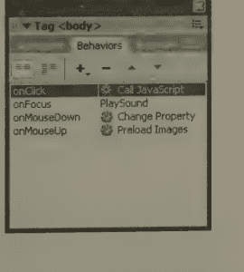

## dreamweaver.behaviorInspector.moveBehaviorDown()

### 可用性

Dreamweaver 3.

### 描述

通过在事件范围内改变执行顺序，将行为动作在序列中向下移动。

### 参数

`positionIndex`

- `positionIndex` 参数是行为面板中动作的位置。列表中的第一个动作位于位置 0。

### 返回值

无。

### 示例

如果行为面板的设置如下图所示，调用 `dreamweaver.behaviorInspector.moveBehaviorDown(2)` 函数会交换 `onMouseDown` 事件上 Preload Images 和 Change Property 两个动作的位置。对任何其他位置调用 `dreamweaver.behaviorInspector.moveBehaviorDown()` 函数均无效，因为 `onClick` 和 `onFocus` 事件各自只有一个关联的行为，而位置 3 处的动作已经处于 `onMouseDown` 事件组的底部。

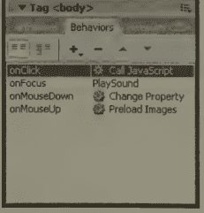

## dreamweaver.behaviorInspector.moveBehaviorUp()

### 可用性

Dreamweaver 3。

### 描述

通过在事件范围内改变执行顺序，将行为在序列中向上移动。

### 参数

`positionIndex`

- `positionIndex` 参数是行为面板中动作的位置。列表中的第一个动作位于位置 0。

### 返回值

无。

### 示例

如果行为面板的设置如下图所示，调用 `dreamweaver.behaviorInspector.moveBehaviorUp(3)` 函数会交换 `onMouseOver` 事件上 Preload Images 和 Change Property 两个动作的位置。对任何其他位置调用 `dreamweaver.behaviorInspector.moveBehaviorUp()` 函数均无效，因为 `onClick` 和 `onFocus` 事件各自只有一个关联的行为，而位置 2 处的动作已经处于 `onMouseDown` 事件组的顶部。

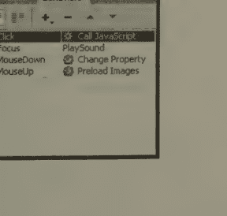

## dreamweaver.behaviorInspector.setSelectedBehavior()

### 可用性

Dreamweaver 3。

### 描述

选择行为面板中指定位置的动作。

### 参数

`positionIndex`

- `positionIndex` 参数是行为面板中动作的位置。列表中的第一个动作位于位置 0。若要取消选择所有动作，请指定 `positionIndex` 为 –1。指定的位置不存在动作时，等效于指定 –1。

### 返回值

无。

### 示例

如果行为面板的设置如下图所示，调用 `dreamweaver.behaviorInspector.setSelection(2)` 函数会选择与 `onMouseDown` 事件关联的 Change Property 动作：

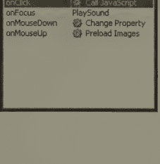

## 剪贴板函数

剪贴板函数与剪切、复制和粘贴相关。在 Macintosh 上，某些剪贴板函数也可以应用于对话框和浮动面板中的文本字段。能在文本字段中操作的函数既实现为 `dreamweaver` 对象的方法，也实现为 DOM 对象的方法。`dreamweaver` 版本的函数对活动窗口中的选定内容进行操作：即当前的文档窗口、代码检查器或站点面板。在 Macintosh 上，该函数也可以对当前字段中文本框的选定内容进行操作。DOM 版本的函数则始终对指定文档中的选定内容进行操作。

## dom.clipCopy()

### 可用性

Dreamweaver 3。

### 描述

将选定内容（包括定义该选定内容的任何 HTML 标记）复制到剪贴板。

### 参数

无。

### 返回值

无。

## dom.clipCopyText()

### 可用性

Dreamweaver 3。

### 描述

将选定的文本复制到剪贴板，忽略任何 HTML 标记。

### 参数

无。

### 返回值

无。

### 启用器

参见第 1056 页的 `dom.canClipCopyText()`。

## dom.clipCut()

### 可用性

Dreamweaver 3。

### 描述

将选定内容（包括定义该选定内容的任何 HTML 标记）移除到剪贴板。

### 参数

无。

### 返回值

无。

## dom.clipPaste()

### 可用性

Dreamweaver 3。

### 描述

将剪贴板的内容粘贴到当前文档的当前插入点或当前选定内容的位置。如果剪贴板中包含 HTML，则会将其作为 HTML 进行解释。

### 参数

无。

### 返回值

无。

### 启用器

参见第 1057 页的 `dom.canClipPaste()`。

### 示例

如果剪贴板中包含 **ABC Widgets**，调用 `dw.getDocumentDOM().clipPaste()` 的结果如下图所示：

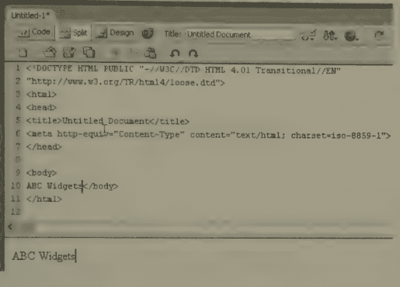

## dom.clipPasteText()（已弃用）

### 可用性

Dreamweaver 3。在 Dreamweaver 8 中已弃用。请改用 `dom.clipPaste("text")` 函数。

### 描述

将剪贴板的内容粘贴到当前文档的插入点或当前选定内容的位置。它会将剪贴板内容中的任何换行符替换为 BR 标签。如果剪贴板中包含 HTML，则不会对其进行解释；尖括号会粘贴为 `&lt;` 和 `&gt;`。

### 参数

无。

### 返回值

无。

### 启用器

参见第 1057 页的 `dom.canClipPasteText()`。

### 示例

如果剪贴板中包含 `<code>return true;</code>`，调用 `dw.getDocumentDOM().clipPasteText()` 的结果如下图所示：

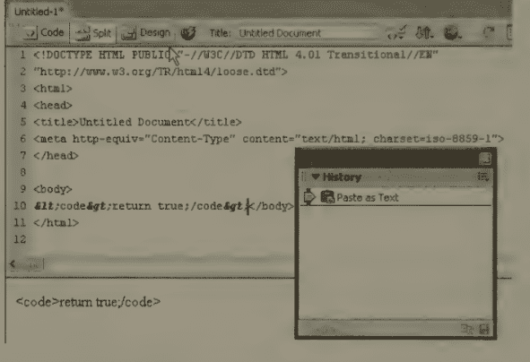

## dreamweaver.clipCopy()

### 可用性

Dreamweaver 3。

### 描述

从活动的文档窗口、对话框、浮动面板或站点面板中将当前选定内容复制到剪贴板。

### 参数

无。

### 返回值

无。

### 启用器

参见第 1068 页的 `dreamweaver.canClipCopy()`。

## dreamweaver.clipCut()

### 可用性

Dreamweaver 3。

### 描述

从活动的文档窗口、对话框、浮动面板或站点面板中将选定内容移除到剪贴板。

### 参数

无。

### 返回值

无。

### 启用器

参见第 1069 页的 `dreamweaver.canClipCut()`。

## dreamweaver.clipPaste()

### 可用性

Dreamweaver 3。在 Dreamweaver 8 中添加了 `strPasteOption` 参数。

### 描述

将剪贴板的内容粘贴到当前文档、对话框、浮动面板或站点面板中。

### 参数

`[strPasteOption]`

- `strPasteOption` 参数为可选参数，指定要执行的粘贴类型。取值包括：`"text"`、`"structured"`、`"basicFormat"` 和 `"fullFormat"`。

### 返回值

无。

### 启用器

参见第 1069 页的 `dreamweaver.canClipPaste()`。

### 示例

以下示例将剪贴板的内容作为文本粘贴：

```javascript
dw.clipPaste("text");
```

## dreamweaver.getClipboardText()

### 可用性

Dreamweaver 3。

### 描述

获取剪贴板上存储的所有文本。

### 参数

`{bAsText}`

- `bAsText` 布尔值为可选参数，指定是否以文本形式检索剪贴板内容。如果 `bAsText` 的值为 true，则以文本形式检索剪贴板内容。如果 `bAsText` 的值为 false，则内容保留格式。此参数默认为 false。

### 返回值

一个包含剪贴板内容的字符串（如果剪贴板包含文本（可以是 HTML））；否则返回空值。

### 示例

如果 `dreamweaver.getClipboardText()` 返回 `"text <b>bold</b> text"`，`dreamweaver.getClipboardText(true)` 返回 `"text bold text"`。

## 库和模板函数

库和模板函数处理与库项目和模板相关的操作，例如创建、更新以及断开文档与模板或库项目之间的链接。`dreamweaver.libraryPalette` 对象的方法控制或作用于资源面板中的库项目选择，而非当前文档中的选择。同样，`dreamweaver.templatePalette` 对象的方法控制或作用于资源面板中的模板对象选择。

## dom.applyTemplate()

### 可用性

Dreamweaver 3。

### 描述

将模板应用于当前文档。如果未提供参数，将显示"选择模板"对话框。此函数仅对具有焦点的文档有效。

### 参数

`templateURL`、`bMaintainLink`

- `templateURL` 参数是当前站点中模板的路径，以 file:// URL 形式表示。
- `bMaintainLink` 参数是一个布尔值，指示是否保持与原始模板（`true`）的链接或断开（`false`）。

### 返回值

无。

### 启用器

参见第 1056 页的 `dom.canApplyTemplate()`。

## dom.detachFromLibrary()

### 可用性

Dreamweaver 3。

### 描述

通过移除选定内容周围的锁定标签，将选定的库项目实例与其关联的 LBI 文件分离。此函数等效于在属性检查器中单击"从源文件分离"。

### 参数

无。

### 返回值

无。

## dom.detachFromTemplate()

### 可用性

Dreamweaver 3。

### 描述

将当前文档与其关联的模板分离。

### 参数

无。

### 返回值

无。

## dom.getAttachedTemplate()

### 可用性

Dreamweaver 3。

### 描述

获取与文档关联的模板的路径。

### 参数

无。

### 返回值

一个字符串，包含模板的路径，以 file:// URL 形式表示。

## dom.getEditableRegionList()

### 可用性

Dreamweaver 3。

### 描述

获取文档正文中所有可编辑区域的列表。

### 参数

无。

### 返回值

一个元素节点数组。

### 示例

参见第 891 页的“`dom.getSelectedEditableRegion()`”。

## dom.getIsLibraryDocument()

### 可用性

Dreamweaver 3。

### 描述

确定文档是否为库项目。

### 参数

无。

### 返回值

一个布尔值，指示文档是否为 LBI 文件。

## dom.getIsTemplateDocument()

### 可用性

Dreamweaver 3。

### 描述

确定文档是否为模板。

### 参数

无。

### 返回值

一个布尔值，指示文档是否为 DWT 文件。


## `dom.getSelectedEditableRegion()`

### 可用性

Dreamweaver 3。

### 描述

如果选区或插入点位于可编辑区域内，此函数获取该可编辑区域在文档正文所有可编辑区域中的位置。

### 参数

无。

### 返回值

一个索引值，指向`dom.getEditableRegionList()`函数返回的数组。更多信息，请参见第 890 页的“`dom.getEditableRegionList()`”。

### 示例

以下代码显示一个对话框，其中包含所选可编辑区域的内容：

```javascript
var theDOM = dw.getDocumentDOM();
var edRegs = theDOM.getEditableRegionList();
var selReg = theDOM.getSelectedEditableRegion();
alert(edRegs[selReg].innerHTML);
```

## `dom.insertLibraryItem()`

### 可用性

Dreamweaver 3。

### 描述

将库项目的实例插入到文档中。

### 参数

`libraryItemURL`

- `libraryItemURL`参数是 LBI 文件的路径，以`file://` URL 形式表示。

### 返回值

无。

## `dom.markSelectionAsEditable()`

### 可用性

Dreamweaver 3。

### 描述

显示“新建可编辑区域”对话框。当用户点击“新建区域”时，Dreamweaver 将选区标记为可编辑，且不更改任何文本。

### 参数

无。

### 返回值

无。

### 启用条件

参见第 1063 页的“`dom.canMarkSelectionAsEditable()`”。

## `dom.newEditableRegion()`

### 可用性

Dreamweaver 3。

### 描述

显示“新建可编辑区域”对话框。当用户点击“新建区域”时，Dreamweaver 将区域名称（用花括号`{ }`包围）插入到文档的插入点位置。

### 参数

无。

### 返回值

无。

### 启用条件

参见第 1062 页的“`dom.canMakeNewEditableRegion()`”。

## `dom.removeEditableRegion()`

### 可用性

Dreamweaver 3。

### 描述

从文档中移除一个可编辑区域。如果该可编辑区域包含任何内容，则内容会被保留；仅移除可编辑区域标记。

### 参数

无。

### 返回值

无。

### 启用条件

参见第 1064 页的“`dom.canRemoveEditableRegion()`”。

## `dom.updateCurrentPage()`

### 可用性

Dreamweaver 3。

### 描述

更新文档的库项目、模板或两者。此函数仅对活动文档有效。

### 参数

`{typeOfUpdate}`

- 可选的`typeOfUpdate`参数必须为`"library"`、`"template"`或`"both"`。如果省略此参数，默认值为`"both"`。

### 返回值

无。

## `dreamweaver.updatePages()`

### 可用性

Dreamweaver 3。

### 描述

打开“更新页面”对话框并选择指定的选项。

### 参数

`typeOfUpdate`

- 可选的`typeOfUpdate`参数，如果指定，必须为`"library"`、`"template"`或`"both"`。如果省略此参数，默认值为`"both"`。

### 返回值

无。

### 代码片段面板功能

使用 Dreamweaver，Web 开发者可以在“代码片段”面板中编辑和保存可重用的代码块，并根据需要进行检索。

“代码片段”面板将每个代码片段存储在`Configuration/Snippets`文件夹中的一个 CSN 文件中。Dreamweaver 附带的代码片段存储在以下文件夹中：

- `Accessible`
- `Comments`
- `Content_tables`
- `Filelist.txt`
- `Footers`
- `Form_elements`
- `Headers`
- `Javascript`
- `Meta`
- `Navigation`
- `Text`

代码片段文件是 XML 文档，因此您可以在 XML 指令中指定编码，如以下示例所示：

```xml
<?XML version="1.0" encoding="utf-8">
```

以下示例展示了一个代码片段文件：

```xml
<snippet name="Detect Flash" description="VBScript to check for Flash ActiveX control" preview="code" factory="true" type="wrap" >
    <insertText location="beforeSelection">
        <![CDATA[ ....... code ....... ]]>
    </insertText>
    <insertText location="afterSelection">
        <![CDATA[ ....... code ....... ]]>
    </insertText>
</snippet>
```

CSN 文件中的代码片段标签具有以下属性：

| 属性 | 描述 |
| --- | --- |
| `name` | 代码片段的名称 |
| `description` | 代码片段的描述 |
| `preview` | 预览类型：`"code"`在预览区域显示代码片段，或`"design"`在预览区域以 HTML 渲染方式显示代码片段。 |
| `type` | 如果代码片段用于包裹用户选区，则为`"wrap"`；如果代码片段应在选区之前插入，则为`"block"`。 |

您可以使用以下方法将“代码片段”面板功能添加到您的扩展中。

## `dreamweaver.snippetPalette.getCurrentSnippetPath()`

### 可用性

Dreamweaver MX 2004。

### 描述

返回“代码片段”面板中当前选定代码片段的路径。

### 参数

无。

### 返回值

相对于 Snippets 文件夹的路径，指向“代码片段”面板中选定的代码片段。如果没有选定代码片段，则返回空字符串。

## `dreamweaver.snippetPalette.newFolder()`

### 可用性

Dreamweaver MX。

### 描述

创建一个名为`untitled`的新文件夹，并在该默认名称周围显示一个文本框。

### 参数

无。

### 返回值

无。

## `dreamweaver.snippetPalette.newSnippet()`

### 可用性

Dreamweaver MX。

### 描述

打开“添加代码片段”对话框并使其获得焦点。

### 参数

无。

### 返回值

无。

## `dreamweaver.snippetPalette.editSnippet()`

### 可用性

Dreamweaver MX。

### 描述

打开“编辑代码片段”对话框并使其获得焦点，允许编辑所选元素。

### 参数

无。

### 返回值

无。

### 启用条件

参见第 1089 页的“`dreamweaver.snippetPalette.canEditSnippet()`”。

## `dreamweaver.snippetPalette.insert()`

### 可用性

Dreamweaver MX。

### 描述

将“代码片段”面板中选定的代码片段应用于当前选区。

### 参数

无。

### 返回值

无。

### 启用条件

参见第 1089 页的“`dreamweaver.snippetPalette.canInsert()`”。

## `dreamweaver.snippetPalette.insertSnippet()`

### 可用性

Dreamweaver MX。

### 描述

将指定的代码片段插入到当前选区。

### 参数

- 一个字符串，指定相对于 Snippets 文件夹的代码片段路径。

### 返回值

一个布尔值。

### 启用条件

参见第 1089 页的“`dreamweaver.snippetPalette.canInsert()`”。

### 示例

以下对`dw.snippetPalette.insertSnippet()`函数的调用将参数指定的代码片段插入到当前文档的插入点：

```javascript
dw.snippetPalette.insertSnippet('Text\\Different_Link_Color.csn');
```

## `dreamweaver.snippetPalette.rename()`

### 可用性

Dreamweaver MX。

### 描述

在选定的文件夹名称或文件昵称周围激活一个文本框，并允许您编辑所选元素。

### 参数

无。

### 返回值

无。

## `dreamweaver.snippetPalette.remove()`

### 可用性

Dreamweaver MX。

### 描述

从“代码片段”面板中删除所选元素或文件夹，并从磁盘上删除该文件。

### 参数

无。

### 返回值

无。

## 动态文档

Macromedia Dreamweaver 8 中的动态文档功能执行与 Web 服务器页面相关的操作。这些操作包括返回“组件”面板中所选节点的属性、获取用户文档中所有数据源的列表、在设计视图中显示动态内容、向文档应用服务器行为，或获取所有当前已定义服务器模型的名称。

### 服务器组件函数

服务器组件函数让您可以访问出现在“组件”面板中的服务器组件树控件的当前所选节点。使用这些函数，您还可以刷新组件树视图。

```javascript
dreamweaver.serverComponents.getSelectedNode()
```

### `dreamweaver.serverComponents.getSelectedNode()`

#### 可用性

Dreamweaver MX。

#### 说明

返回服务器组件树控件中当前所选定的 ComponentRec 属性。

#### 参数

无。

#### 返回值

ComponentRec 属性。

### `dreamweaver.serverComponents.refresh()`

#### 可用性

Dreamweaver MX。

#### 说明

刷新组件树视图。

#### 参数

无。

#### 返回值

无。

### 数据源函数

数据源文件存储在`Configuration/DataSources`文件夹中。每个服务器模型都有自己的文件夹：`ASP.Net/C#`、`ASP.Net/VisualBasic`、`ASP/JavaScript`、`ASP/VBScript`、`ColdFusion`、`JSP`和`PHP/MySQL`。每个服务器模型子文件夹包含与该服务器模型数据源相关联的 HTML 和 EDML 文件。

有关在 Dreamweaver 中使用数据源的更多信息，请参阅 *Extending Dreamweaver* 中的“数据源”（Data Sources）。

### `dreamweaver.dbi.getDataSources`

#### 可用性

Dreamweaver UltraDev 4。

#### 说明

为`Configuration/DataSources`文件夹中的每个文件调用`findDynamicSources()`函数。您可以使用此函数生成用户文档中所有数据源的列表。此函数遍历`Configuration/DataSources`文件夹中的所有文件，在每个文件中调用`findDynamicSources()`函数，将所有返回的数组连接起来，并返回连接后的数据源数组。

#### 参数

无。

#### 返回值

一个包含用户文档中所有数据源连接列表的数组。数组中的每个元素都是一个对象，每个对象具有以下属性：

- `title`属性是显示在每个父节点图标右侧的标签字符串。`title`属性始终有定义。

- `imageFile`属性是包含图标（GIF 图像）的文件路径，该图标代表动态数据或动态文本对话框或绑定面板中的父节点。`imageFile`属性始终有定义。

- `allowDelete`属性是可选的。如果此属性设置为`false`，当用户单击绑定面板中的此节点时，减号（`-`）按钮将被禁用。如果设置为`true`，减号（`-`）按钮将被启用。如果未定义该属性，当用户单击该项时减号（`-`）按钮将被启用（如同属性设置为`true`）。

- `dataSource`属性是定义`findDynamicSources()`函数的文件的简单名称。例如，`Session.htm`文件（位于`Configuration/DataSources/ASP_Js`文件夹中）中的`findDynamicSources()`函数将`dataSource`属性设置为`session.htm`。此属性始终有定义。

- `name`属性是与数据源`dataSource`相关联的服务器行为的名称（如果存在）。`name`属性始终有定义，但如果数据源没有相关联的服务器行为（如会话变量），则可以是一个空字符串（`""`）。

### 扩展数据管理器函数

本节中的 API 构成了扩展数据管理器（EDM）。您可以通过调用这些函数以编程方式访问和操作组和参与者文件中包含的数据。EDM 的工作方式如下：

- EDM 执行组和参与者文件的所有 EDML 文件输入/输出。

- EDM 作为服务器模型过滤器，执行当前服务器模型的所有数据请求。

### `dreamweaver.getExtDataValue()`

#### 可用性

Dreamweaver UltraDev 4。

#### 说明

此函数从 EDML 文件中检索指定节点的字段值。

#### 参数

`qualifier(s)`

- `qualifier(s)`参数是一个可变长度列表（取决于您需要的详细程度），由逗号分隔的节点限定符组成，包括组或参与者名称、子块（如有）和字段名称。

#### 返回值

Dreamweaver 返回一个字段值。如果未指定值，Dreamweaver 将使用默认值。

#### 示例

以下示例检索`recordset_main`参与者的`insertText`标签的`location`属性值：

```javascript
dw.getExtDataValue("recordset_main", "insertText", "location");
```

### `dreamweaver.getExtDataArray()`

#### 可用性

Dreamweaver UltraDev 4。

#### 说明

此函数从 EDML 文件中检索指定节点的值数组。

#### 参数

`qualifier(s)`

- `qualifier(s)`参数是一个可变长度列表，由逗号分隔的节点限定符组成，包括组或参与者名称、子块（如有）和字段名称。

#### 返回值

Dreamweaver 返回子节点名称的数组。

### `dreamweaver.getExtParticipants()`

#### 可用性

Dreamweaver UltraDev 4。

#### 说明

此函数从 EDML 组文件或参与者文件中检索参与者列表。

`orchestra`。

#### 参数

`value, qualifier(s)`

- `value`参数是一个属性值，或者留空而被忽略。例如`dreamweaver.getExtParticipants("", "participant")`。

- `qualifier(s)`参数是一个可变长度列表，由所需属性的逗号分隔节点限定符组成。

#### 返回值

Dreamweaver 返回具有指定属性的参与者名称数组（如果提供了属性），并且该属性与指定的值匹配（如果提供了值）。

### `dreamweaver.getExtGroups()`

#### 可用性

Dreamweaver UltraDev 4。

#### 说明

从 EDML 组文件中检索组名称，这相当于服务器行为的名称。

#### 参数

`value, qualifier(s)`

- `value`参数是一个属性值，或留空以忽略。

- `qualifier(s)`参数是一个可变长度列表，由所需属性的逗号分隔节点限定符组成。

#### 返回值

Dreamweaver 返回具有指定属性的组名称数组（如果提供了属性），并且该属性与指定的值匹配（如果提供了值）。

### `dreamweaver.refreshExtData()`

#### 可用性

Dreamweaver UltraDev 4。

#### 说明

重新加载所有扩展数据文件。

> **注意**
>
> 这是一个新的注意表格。它附加到`ta Table_anchor`段落标签。要创建一个，请从参考页面复制并粘贴。

> **提示**
>
> 您可以从此函数创建一个有用的命令，让对服务器行为 EDML 文件的编辑在不重新启动 Dreamweaver 的情况下被重新加载。

#### 参数

无。

#### 返回值

Dreamweaver 返回重新加载的数据。

### 实时数据函数

您可以使用以下实时数据函数来模拟菜单功能：

- `showLiveDataDialog()`函数用于“查看”>“实时数据设置”菜单项。

- `setLiveDataMode()`函数用于“查看”>“实时数据”和“查看”>“刷新实时数据”菜单项。

- `getLiveDataMode()`函数用于确定实时数据模式是否处于活动状态。

在实现翻译器 API `liveDataTranslateMarkup()`函数时，您可以使用其余的实时数据函数。

### `dreamweaver.getLiveDataInitTags()`

#### 可用性

Dreamweaver UltraDev 1。

#### 说明


返回当前活动文档的初始化标签。初始化标签是用户在实时数据设置对话框中提供的 HTML 标签。此函数通常从翻译器的 `liveDataTranslateMarkup()` 函数调用，以便翻译器可以将标签传递给 `liveDataTranslate()` 函数。

## 参数

无。

## 返回值

一个包含初始化标签的字符串。

# `dreamweaver.getLiveDataMode()`

## 可用性

Dreamweaver UltraDev 1。

## 说明

确定实时数据窗口当前是否可见。

## 参数

无。

## 返回值

一个布尔值：如果实时数据窗口可见则为 `true`；否则为 `false`。

# `dreamweaver.getLiveDataParameters()`

## 可用性

Dreamweaver MX。

## 说明

获取指定为实时数据设置的 URL 参数。

实时数据模式让你在设计阶段查看网页（就像它已被应用服务器翻译并返回一样）。在“设计”视图中生成动态内容进行显示，可以让你使用实时数据查看页面布局，并在必要时进行调整。

在查看实时数据之前，必须为文档中引用的任何 URL 参数输入实时数据设置。这可以防止 Web 服务器在模拟过程中返回未定义参数的错误。

你需要以名称-值对的形式输入 URL 参数。例如，如果在文档的服务器脚本中引用 URL 变量 `ID` 和 `Name`，则必须在查看实时数据之前设置这些 URL 参数。

你可以通过以下方式在 Dreamweaver 中输入实时数据设置：

- 通过“实时数据设置”对话框，可以从“视图”菜单激活。
- 在单击工具栏上的“实时数据视图”按钮时，出现在文档顶部的 URL 文本字段中。

对于 `ID` 和 `Name` 参数，你可以输入以下对：

| 参数 | 值 |
|---|---|
| `ID` | `22` |
| `Name` | `Samuel` |

在 URL 中，这些参数将如以下示例所示：

```text
http://someURL?ID=22&Name=Samuel
```

此功能允许你通过 JavaScript 获取这些实时数据设置。

## 参数

无。

## 返回值

一个包含当前文档 URL 参数的数组。该数组包含偶数个参数字符串。每两个元素构成一个 URL 参数名称-值对。偶数元素是参数名称，奇数元素是值。例如，对于前面示例中的 `ID` 和 `Name` 参数，`getLiveDataParameters()` 返回以下数组：`['ID','22','Name','Samuel']`。

## 示例

以下示例返回指定为实时数据设置的参数，并将其存储在 `paramsArray` 中：

```javascript
var paramsArray = dreamweaver.getLiveDataParameters();
```

# `dreamweaver.liveDataTranslate()`

## 可用性

Dreamweaver UltraDev 1。

## 描述

将整个 HTML 文档发送到应用服务器，要求服务器执行文档中的脚本，并返回生成的 HTML 文档。此函数只能从翻译器的 `liveDataTranslateMarkup()` 函数调用；如果尝试在其他时间调用它，将会发生错误。`dreamweaver.liveDataTranslate()` 函数执行以下操作：

- 播放动画图像（出现在实时数据窗口右边缘附近）。
- 监听用户输入。如果单击了“停止”图标，函数立即返回。
- 接受来自调用者的单个字符串参数。（此字符串通常是用户文档的整个源代码。它与下一操作中使用的字符串相同。）
- 将用户文档中的 HTML 字符串保存为实时数据服务器上的临时文件。
- 使用“实时数据设置”对话框中指定的参数，向实时数据服务器发送 HTTP 请求。
- 接收来自实时数据服务器的 HTML 响应。
- 从实时数据服务器删除临时文件。
- 停止播放动画图像。
- 将 HTML 响应返回给调用者。

## 参数

- 单个字符串，通常是用户当前文档的整个源代码。

## 返回值

一个 `httpReply` 对象。此对象与 `MMHttp.getText()` 函数返回的值相同。如果用户单击“停止”图标，返回值的 `httpReply.statusCode` 等于 `200`（状态正常），其 `httpReply.data` 等于空字符串。有关 `httpReply` 对象的更多信息，请参阅第 2 章“HTTP API”第 533 页。

# `dreamweaver.setLiveDataError()`

## 可用性

Dreamweaver UltraDev 1。

## 描述

指定当 `liveDataTranslateMarkup()` 函数在翻译器中执行时发生错误而显示的错误消息。如果 Dreamweaver 传递给 `liveDataTranslate()` 的文档包含错误，服务器将返回使用 HTML 格式化的错误消息。如果翻译器（调用 `liveDataTranslate()` 的代码）确定服务器返回了错误消息，它会调用 `setLiveDataError()` 以在 Dreamweaver 中显示该错误消息。此消息在 `liveDataTranslateMarkup()` 函数执行完毕后显示；Dreamweaver 在错误对话框中显示该描述。`setLiveDataError()` 函数只能从 `liveDataTranslateMarkup()` 函数调用。

## 参数

- `source` 参数是一个包含源代码的字符串，该代码在错误对话框中解析并渲染。

## 返回值

无。

# `dreamweaver.setLiveDataMode()`

## 可用性

Dreamweaver UltraDev 1。

## 描述

切换实时数据窗口的可见性。

## 参数

- `bIsVisible` 参数是一个布尔值，指示实时数据窗口是否应可见。如果向此函数传递 `true` 且 Dreamweaver 当前显示实时数据窗口，效果与单击“刷新”按钮相同。

## 返回值

无。

# `dreamweaver.setLiveDataParameters()`

## 可用性

Dreamweaver MX。

## 描述

设置在文档中引用的 URL 参数，以用于实时数据模式。

实时数据模式让你在设计阶段查看网页（就像它已被应用服务器翻译并返回一样）。在“设计”视图中生成动态内容进行显示，可以让你使用实时数据查看页面布局，并在必要时进行调整。

在查看实时数据之前，必须为文档中引用的任何 URL 参数输入实时数据设置。这可以防止 Web 服务器在模拟过程中返回未定义参数的错误。

你需要以名称-值对的形式输入 URL 参数。例如，如果在文档的服务器脚本中引用 URL 变量 `ID` 和 `Name`，则必须在查看实时数据之前设置这些 URL 参数。

此功能允许你通过 JavaScript 设置实时数据值。

## 参数

- `liveDataString` 参数是一个字符串，包含你要设置的 URL 参数，以名称-值对形式表示。

## 返回值

无。

## 示例

```javascript
dreamweaver.setLiveDataParameters("ID=22&Name=Samuel")
```

# `dreamweaver.showLiveDataDialog()`

## 可用性

Dreamweaver UltraDev 1。

## 描述

显示“实时数据设置”对话框。

## 参数

无。

## 返回值

无。

# 服务器行为函数

服务器行为函数让你可以操作“服务器行为”面板，可通过选择“窗口”>“服务器行为”显示该面板。使用这些函数，你可以查找页面上的所有服务器行为，并以编程方式将新行为应用到文档或修改现有行为。

> **注意**：你可以将 `dw.serverBehaviorInspector` 缩写为 `dw.sbi`。

# `dreamweaver.getParticipants()`

## 可用性

Dreamweaver UltraDev 4。

## 描述

JavaScript 函数 `dreamweaver.getParticipants()` 从用户文档中获取参与者列表。Dreamweaver 找到所有行为的参与者后，会存储这些列表。通常，你将此函数与 `findServerBehaviors()` 函数配合使用（有关更多信息，请参阅 *Extending Dreamweaver* 中的“服务器行为”）以定位用户文档中的行为实例。

## 参数

`edmlFilename`

- `edmlFilename` 参数是组或参与者文件的名称，该文件包含要在用户文档中定位的参与者名称。此字符串是文件名，不含 `.edml` 扩展名。

## 返回值

此函数返回一个数组，其中包含用户文档中出现的指定参与者（或者，对于组文件，组中任何参与者的任何实例）的所有实例。该数组包含 JavaScript 对象，数组中的每个元素对应于在用户文档中找到的每个参与者的每个实例。数组按参与者出现在文档中的顺序排序。每个 JavaScript 对象具有以下属性：

- `participantNode` 属性是指向用户文档中参与者节点的指针。
- `participantName` 属性是参与者 EDML 文件的名称（不含 `.edml` 扩展名）。
- `parameters` 属性是一个 JavaScript 对象，存储所有参数/值对。
- `matchRangeMin` 属性定义从文档参与者节点到参与者内容开头的字符偏移量。
- `matchRangeMax` 属性是一个整数，定义从参与者节点开头到参与者内容最后一个字符的偏移量。

# `dreamweaver.serverBehaviorInspector.getServerBehaviors()`

## 可用性

Dreamweaver UltraDev 1。

## 描述

获取页面上所有行为的列表。当 Dreamweaver 确定服务器行为的内部列表可能已过期时，它会为每个当前安装的行为调用 `findServerBehaviors()` 函数。每个函数返回一个数组。Dreamweaver 将所有数组合并为一个数组，并根据每个行为的 `selectedNode` 对象出现在文档中的顺序进行排序。Dreamweaver 在内部存储合并后的数组。`getServerBehaviors()` 函数返回指向该合并数组的指针。

## 参数

无。

## 返回值

一个 JavaScript 对象数组。`findServerBehaviors()` 调用返回数组中的对象。这些对象按其在“服务器行为”面板中出现的顺序排序。

# `dreamweaver.popupServerBehavior()`

## 可用性

Dreamweaver UltraDev 1。

## 描述

将新的服务器行为应用到文档，或修改现有行为。如果用户必须为行为指定参数，则会显示对话框。

## 参数

`behaviorName` 或 `behaviorObject`

- `behaviorName` 参数是可选的，是一个字符串，表示行为的名称、文件的标题标签或文件名。
- `behaviorObject` 参数是可选的，是一个行为对象。

如果省略该参数，Dreamweaver 将运行当前选定的服务器行为。如果参数是服务器行为的名称，Dreamweaver 会将该行为添加到页面中。如果参数是 `getServerBehaviors()` 函数返回的数组中的某个对象，则会显示一个对话框，让用户可以修改该行为的参数。

## 返回值

无。

# 服务器模型函数

在 Macromedia Dreamweaver 中，每个文档都有一个关联的文档类型。对于动态文档类型，Dreamweaver 还会关联一个服务器模型（例如 ASP-JS、ColdFusion 或 PHP-MySQL）。

服务器模型用于分组特定于服务器技术的功能。不同的服务器行为、数据源等，会根据与文档关联的服务器模型而显示。

使用服务器模型函数，您可以确定当前定义的服务器模型集合；当前服务器模型的名称、语言和版本；以及当前服务器模型是否支持指定的字符集（例如 UTF-8）。

> **注意**：Dreamweaver 在首次加载服务器模型时会读取服务器模型 HTML 文件中的所有信息并存储这些信息。因此，当扩展调用 `dom.serverModel.getServerName()`、`dom.serverModel.getServerLanguage()` 和 `dom.serverModel.getServerVersion()` 等函数时，这些函数会返回存储的值。

# `dom.serverModel.getAppURLPrefix()`

## 可用性

Dreamweaver MX。

## 描述

返回站点在测试服务器上的根文件夹的 URL。此 URL 与“站点定义”对话框中“高级”选项卡上为测试服务器指定的 URL 相同。

当 Dreamweaver 与您的测试服务器通信时，它使用 HTTP（与浏览器相同的方式）。这样做时，它使用此 URL 来访问您站点的根文件夹。

## 参数

无。

## 返回值

一个字符串，其中包含用于实时数据和调试目的的应用程序服务器的 URL。

## 示例

如果用户创建一个站点并指定测试服务器位于本地计算机上，且根文件夹名为 `employeeapp`，则调用 `dom.serverModel.getAppURLPrefix()` 函数将返回以下字符串：

```text
http://localhost/employeeapp/
```

# `dom.serverModel.getDelimiters()`

## 可用性

Dreamweaver MX。

## 描述

让 JavaScript 代码获取每个服务器模型的脚本分隔符，从而将服务器模型代码的管理与用户脚本代码的管理分开。

## 参数

无。

## 返回值

一个对象数组，其中每个对象包含以下三个属性：

- `startPattern` 属性是一个正则表达式，匹配开头的脚本分隔符。
- `endPattern` 属性是一个正则表达式，匹配结尾的脚本分隔符。
- `participateInMerge` 模式是一个布尔值，用于指定列在分隔符中的内容应该（`true`）还是不应该（`false`）参与块合并。

# `dom.serverModel.getDisplayName()`

## 可用性

Dreamweaver MX。

## 描述

获取在用户界面（UI）中显示的服务器模型的名称。

## 参数

无。

## 返回值

一个字符串，其值为服务器模型的名称。

# `dom.serverModel.getFolderName()`

## 可用性

Dreamweaver MX。

## 描述

获取 Configuration 文件夹中用于此服务器模型的文件夹名称（例如在 `ServerModels` 子文件夹中）。

## 参数

无。

## 返回值

一个字符串，其值为文件夹的名称。

# `dom.serverModel.getServerExtension()`（已弃用）

## 可用性

Dreamweaver UltraDev 4；在 Dreamweaver MX 中已弃用。

## 描述

返回使用当前服务器模型的文件的默认文件扩展名。（默认文件扩展名是列表中的第一个。）如果当前未选择用户文档，则 `serverModel` 对象将设置为当前选定站点的服务器模型。

## 参数

无。

## 返回值

一个表示支持文件扩展名的字符串。

# `dom.serverModel.getServerIncludeUrlPatterns()`

## 可用性

Dreamweaver MX。

## 描述

返回以下属性列表，让您可以访问：

- 转换器 URL 模式
- 文件引用
- 类型

## 参数

无。

## 返回值

一个对象列表，每个 `searchPattern` 对应一个对象。每个对象具有以下三个属性：

| 属性 | 描述 |
|---|---|
| `pattern` | 在 EDML 文件的 `searchPattern` 字段中指定的 JavaScript 正则表达式。（正则表达式由一对正斜杠（`//`）分隔。） |
| `fileRef` | 与包含的文件引用对应的正则表达式子匹配的基于 1 的索引。 |
| `type` | 删除 `_includeUrl` 后缀后 `paramName` 值的剩余部分。此类型被分配给 `<MM:BeginLock>` 标记的 `type` 属性。有关示例，请参见 `Configuration/Translators` 文件夹中的 `Server Model SSI.htm`。 |

## 示例

以下代码片段来自参与者文件，显示了一个转换器 `searchPatterns` 标签：

```xml
<searchPatterns whereToSearch="comment">
    <searchPattern paramName="ssi_comment_includeUrl">
        <![CDATA[<!--\s*#include\s+(file|virtual)\s*=\s*"([^"]*)"\s*-->/i]]>
    </searchPattern>
</searchPatterns>
```

搜索模式包含一个 JavaScript 正则表达式，该表达式指定了两个子匹配（两者都包含在括号内）。第一个子匹配用于文本字符串 `file` 或 `virtual`。第二个子匹配是文件引用。

要访问转换器 URL 模式，您的代码应类似于以下示例：

```javascript
var serverModel = dw.getDocumentDOM().serverModel;
var includeArray = new Array();
includeArray = serverModel.getServerIncludeUrlPatterns();
```

对 `serverModel.getServerIncludeUrlPatterns()` 的调用返回以下三个属性：

| 属性 | 返回值 |
|---|---|


| pattern | `/<!--\s*#include\s+(file\|virtual)\s*=\s*"([^"]*)"\s*-->/i` |
| fileRef | 2 |
| type | `ssi_comment` |

# `dom.serverModel.getServerInfo()`

**可用性**

Dreamweaver MX。

**描述**

返回特定于当前服务器模型的信息。此信息定义在位于`Configuration/ServerModels`文件夹中的服务器模型的 HTML 定义文件中。

您可以修改 HTML 定义文件中的信息，或在文件中放置其他变量值或函数。例如，您可以修改`serverName`、`serverLanguage`和`serverVersion`属性。`dom.serverModel.getServerInfo()`函数返回服务器模型作者添加到定义文件中的信息。

> 注意：在默认服务器模型文件中定义的其他值仅供内部使用。

`serverName`、`serverLanguage`和`serverVersion`属性是特殊的，因为开发人员可以使用以下相应的函数直接访问它们：

- `dom.serverModel.getServerName()`
- `dom.serverModel.getServerLanguage()`
- `dom.serverModel.getServerVersion()`

**参数**

无。

**返回值**

一个 JavaScript 对象，其中包含各种特定于当前服务器模型的信息。

# `dom.serverModel.getServerLanguage()`（已弃用）

**可用性**

UltraDev 1；在 Dreamweaver MX 中已弃用。

**描述**

确定与文档关联的服务器模型并返回该值。站点的服务器语言来自"站点定义"对话框中"应用服务器信息"选项卡上的"默认脚本语言"设置。要获取返回值，此函数调用服务器模型 API 中的`getServerLanguage()`函数。

> 注意："默认脚本语言"列表仅存在于 Dreamweaver 4 及更早版本中。对于 Dreamweaver MX 或更高版本，"站点定义"对话框不列出支持的脚本语言。此外，对于 Dreamweaver MX 或更高版本，`dom.serverModel.getServerLanguage()`函数读取服务器模型 API 中调用`getServerInfo()`函数返回的对象的`serverLanguage`属性。

## Arguments

无。

## Returns

包含支持的脚本语言的字符串。

## `dom.serverModel.getServerName()`

### Availability

Dreamweaver 1；在 Dreamweaver MX 中增强。

### Description

检索与文档关联的服务器名称并返回该值。服务器名称用于区分服务器技术（如 ASP.NET 和 JSP），但不会区分同一服务器技术上的不同语言（如 ASP.NET VB 和 ASP.NET C#）。可能的值包括 ASP、ASP.NET、Cold Fusion、JSP 和 PHP。

要检索与文档关联的服务器模型名称，请参阅第 916 页的`dom.serverModel.getDisplayName()`或第 916 页的`dom.serverModel.getFolderName()`。

> NOTE: 对于 Dreamweaver MX 及更高版本，`dom.serverModel.getServerName()`读取由 Server Models API 中调用`getServerInfo()`函数返回的对象的`serverName`属性。

### Arguments

无。

### Returns

包含服务器名称的字符串。

## `dom.serverModel.getServerwithoutSupportsCharset()`

### Availability

Dreamweaver MX。

### Description

确定与文档关联的服务器模型是否支持指定的字符集。

> NOTE

> 除了允许您从 JavaScript 层调用此函数外，当用户在页面属性对话框中更改编码时，Dreamweaver 也会调用此函数。如果服务器模型不支持新的字符编码，此函数将返回 false，Dreamweaver 会弹出一个警告对话框，询问用户是否要进行转换。这种情况的一个例子是当用户尝试将 ColdFusion 4.5 文档转换为 UTF-8 时，因为 ColdFusion 不支持 UTF-8 编码。

### Arguments

`metaCharSetString`

- `metaCharSetString`参数是一个字符串值，用于命名特定的字符集。该值与文档关联的 meta 标签的`charset=`属性相同。给定服务器模型的支持值在服务器模型的 HTML 定义文件中定义，该文件位于`Configuration/ServerModels`文件夹中。

### Returns

布尔值：如果服务器模型支持指定的字符集，则为 true；否则为 false。

## `dom.serverModel.getServerVersion()`

### Availability

UltraDev 1；在 Dreamweaver MX 中增强。

### Description

确定与文档关联的服务器模型并返回该值。每个服务器模型都有一个`getVersionArray()`函数，如 Server Models API 中所定义，该函数返回一个名称-版本对表。

> NOTE

> 对于 Dreamweaver，`dom.serverModel.getServerVersion()`首先读取由 Server Models API 中调用`getServerInfo()`返回的对象的`serverVersion`属性。如果该属性不存在，`dom.serverModel.getServerVersion()`将从`getVersionArray()`函数中读取。

### Arguments

`name`

- `name`参数是一个字符串，表示服务器模型的名称。

### Returns

包含指定服务器模型版本的字符串。

## `dom.serverModel.testAppServer()`

**Availability**

Dreamweaver MX。

**Description**

测试是否可以与应用程序服务器建立连接。

**Arguments**

无。

**Returns**

一个布尔值，指示连接应用程序服务器的请求是否成功。

## `dreamweaver.getServerModels()`

**Availability**

Dreamweaver MX。

**Description**

获取所有当前定义的服务器模型的名称。该名称集与站点定义对话框中服务器模型文本字段中显示的名称相同。

**Arguments**

无。

**Returns**

字符串数组。每个字符串元素包含当前定义的服务器模型的名称。

## `dom.serverModel.getServerVersion()`

### Availability

UltraDev 1；在 Dreamweaver MX 中增强。

### Description

确定与文档关联的服务器模型并返回该值。每个服务器模型都有一个`getVersionArray()`函数，如 Server Models API 中所定义，该函数返回一个名称-版本对表。

> NOTE

> 对于 Dreamweaver，`dom.serverModel.getServerVersion()`首先读取由 Server Models API 中调用`getServerInfo()`返回的对象的`serverVersion`属性。如果该属性不存在，`dom.serverModel.getServerVersion()`将从`getVersionArray()`函数中读取。

### Arguments

`name`

- `name`参数是一个字符串，表示服务器模型的名称。

### Returns

包含指定服务器模型版本的字符串。

## `dom.serverModel.testAppServer()`

**Availability**

Dreamweaver MX。

**Description**

测试是否可以与应用程序服务器建立连接。

**Arguments**

无。

**Returns**

一个布尔值，指示连接应用程序服务器的请求是否成功。

## `dreamweaver.getServerModels()`

**Availability**

Dreamweaver MX。

**Description**

获取所有当前定义的服务器模型的名称。该名称集与站点定义对话框中服务器模型文本字段中显示的名称相同。

**Arguments**

无。

**Returns**

字符串数组。每个字符串元素包含当前定义的服务器模型的名称。

## Design

Macromedia Dreamweaver 8 中的设计函数执行与设计文档外观相关的操作。这些操作包括应用指定的层叠样式表（CSS）样式、垂直或水平拆分选定的框架、对齐选定的层或热点、播放选定的插件项目、创建布局单元格或操作表格行或列的函数。

## CSS functions

CSS 函数处理应用、移除、创建和删除 CSS 样式。`dreamweaver.cssRuleTracker`对象的方法可以控制或作用于选择检查器中 CSS 规则跟踪器面板的选择。`dreamweaver.cssStylePalette`对象的方法可以控制或作用于样式面板中的选择，而不是当前文档中的选择。

```
cssStylePalette.getInternetExplorerRendering()
```

**Availability**

Dreamweaver 8。

**Description**

此函数确定 Dreamweaver 是否正在为 Internet Explorer 进行渲染。

**Arguments**

无。

**Returns**

布尔值：如果 Dreamweaver 正在为 Internet Explorer 进行渲染，则为`true`；如果 Dreamweaver 正在按照 CSS 规范进行渲染，则为`false`。

### Example

以下示例关闭为 Internet Explorer 的渲染：

```
if (cssStylePalette.getInternetExplorerRendering()){
    cssStylePalette.setInternetExplorerRendering(false);
}
```

## `cssStylePalette.setInternetExplorerRendering()`

### Availability

Dreamweaver 8。

### Description

此函数指示 Dreamweaver 为 Internet Explorer 或 CSS 规范进行渲染。

### Arguments

`internetExplorerRendering`

- `internetExplorerRendering`参数是必需的，指示是否要为 Internet Explorer 进行渲染（`true`）或要为 CSS 规范进行渲染（`false`）。

### Returns

无。

### Example

请参阅第 923 页的`cssStylePalette.getInternetExplorerRendering()`。

## `dom.applyCSSStyle()`

### Availability

Dreamweaver 4。

### Description

将指定的样式应用于指定的元素。此函数仅对活动文档有效。

### Arguments

`elementNode`, `styleName`, {`classOrID`}, {`bForceNesting`}

- `elementNode`参数是 DOM 中的元素节点。如果`elementNode`参数为`null`值或空字符串（`""`），则该函数对当前选择进行操作。

- `styleName`参数是 CSS 样式的名称。

- `classOrID`参数是可选的，是应用样式时应使用的属性（`"class"`或`"id"`）。如果`elementNode`参数为 null 值或空字符串，并且没有标签完全包围选择，则使用 SPAN 标签应用样式。如果选择是一个插入点，Dreamweaver 将使用启发式方法确定样式应应用于哪个标签。

- `bForceNesting`参数是可选的，是一个布尔值，指示是否允许嵌套。如果指定了`bForceNesting`标志，Dreamweaver 将插入一个新的 SPAN 标签，而不是尝试修改文档中的现有标签。如果未指定，此参数默认为`false`值。

### Returns

无。

### Example

以下代码将`red`样式应用于选择，可以通过用 SPAN 标签包围选择，或将 CLASS 属性应用于包围选择的标签：

```
var theDOM = dreamweaver.getDocumentDOM('document');
theDOM.applyCSSStyle('','red');
```

## `dom.getElementView()`

**Availability**

Dreamweaver 8。

**Description**

此函数获取文档中当前选定元素的 Element 视图。如果当前选定元素是 normal，则`getElementView()`函数查找选定元素的第一个 full 或 hidden 祖先元素。

**Arguments**

无。

**Returns**

指示选定元素状态的字符串。值包括：

- `"hidden"`，指示元素具有可能导致内容在设计视图中部分或完全隐藏的 CSS 属性。支持的 CSS include:
  - `overflow: hidden`, `scroll`, or `auto`
  - `display: none`
- `"full"`，指示元素默认为`"hidden"`，但当前通过`setElementView("full")`函数设置为`"full"`视图。
- `"normal"`，指示元素既不是`"hidden"`也不是`"full"`。

**Example**

以下示例将选定元素的状态更改为`"full"`（如果它是`"hidden"`）：

```
var currentDOM = dw.getDocumentDOM();
if (currentDOM && getElementView() == "hidden"){
    currentDOM.setElementView("full");
}
```

## `dom.getShowDivBackgrounds()`

**Availability**

Dreamweaver 8。

**Description**

此函数获取布局块背景可视化辅助工具的状态。

**Arguments**

无。

**Returns**

布尔值；如果布局块背景可视化辅助工具开启，则为`true`；否则为`false`。

**Example**

以下示例检查布局块背景可视化辅助工具是否开启，如果没有，则将其开启：

```
var currentDOM = dw.getDocumentDOM();
if (currentDOM.getShowDivBackgrounds() == false){
    currentDOM.setShowDivBackgrounds(true);
}
```

## `dom.getShowDivBoxModel()`

**Availability**

Dreamweaver 8。

**Description**

此函数获取布局块盒模型可视化辅助工具的状态。

## `dom.getShowDivOutlines()`

**可用性**

Dreamweaver 8。

**描述**

此函数获取布局块轮廓线视觉辅助的状态。

**参数**

无。

**返回值**

布尔值；如果布局块轮廓线视觉辅助处于开启状态，则返回`true`；否则返回`false`。

**示例**

以下示例检查布局块轮廓线视觉辅助是否开启，如果未开启，则将其打开：

```
var currentDOM = dw.getDocumentDOM();
if (currentDOM.getShowDivOutlines() == false) {
    currentDOM.setShowDivOutlines(true);
}
```

## `dom.removeCSSStyle()`

**可用性**

Dreamweaver 3。

**描述**

从指定元素中移除 CLASS 或 ID 属性，或者移除完全包围指定元素的 SPAN 标签。此函数仅对活动文档有效。

**参数**

`elementNode`, {`classOrID`}

- `elementNode`参数是 DOM 中的一个元素节点。如果`elementNode`参数指定为空字符串（`" "`），则该函数对当前选择内容生效。

- `classOrID`参数是可选的，表示应移除的属性（`"class"`或`"id"`）。如果未指定`classOrID`参数，则默认为`"class"`。如果`elementNode`参数未定义 CLASS 属性，则移除包围`elementNode`参数的 SPAN 标签。

**返回值**

无。

## `dom.resetAllElementViews()`

**可用性**

Dreamweaver 8。

**描述**

此函数通过移除所有内部生成的 CSS，将文档中所有元素的元素视图重置为原始视图。

**参数**

`forceRefresh`


- `forceRefresh` 参数是可选的，是一个布尔值，用于指定在没有内部 CSS 可移除时是否刷新整个文档的渲染。值为 `true` 时将导致刷新。默认值为 `false`。

## 返回值

无。

### 示例

以下示例重置文档中所有元素的元素视图，但不强制刷新渲染：

```
var currentDOM = dw.getDocumentDOM();
currentDOM.resetAllElementViews(false);
```

## `dom.setElementView()`

### 可用性

Dreamweaver 8。

### 描述

此函数为文档中当前选定的元素设置元素视图。如果当前选定的元素为 `"normal"`，则 `setElementView()` 函数查找当前选定元素的第一个处于 `"full"` 或 `"hidden"` 状态的祖先元素。

### 参数

`view`

- `view` 参数是必需的，是一个字符串，用于将当前选定的元素设置为 `"full"` 或 `"hidden"`。如果当前选定的元素是 `"normal"`，则 `setElementView()` 函数查找当前选定元素的第一个处于 `"full"` 或 `"hidden"` 状态的祖先元素。有关其他信息，请参阅第 925 页的 `dom.getElementView()`。可能的值有：

  - `"full"` — 移除使元素处于 `"full"` 视图的内部 CSS，从而使元素恢复其原始状态。

  - `"hidden"` — 如果当前选定的元素处于 `"hidden"` 视图，Dreamweaver 将生成 CSS 以使所有内容都可查看，然后将该 CSS 作为内部设计时样式表应用。

### 返回值

无。

### 示例

请参阅第 925 页的 `dom.getElementView()`。

## `dom.setShowDivBackgrounds()`

### 可用性

Dreamweaver 8。

### 描述

此函数打开或关闭布局块背景视觉辅助。

### 参数

`show`

- `show` 参数是必需的，是一个布尔值，用于指定是否打开布局块背景视觉辅助。将 `show` 设置为 `true` 将打开布局块背景视觉辅助。

### 返回值

无。

### 示例

请参阅第 926 页的 `dom.getShowDivBackgrounds()`。

## `dom.setShowDivBoxModel()`

### 可用性

Dreamweaver 8。

### 描述

此函数打开或关闭布局块盒模型视觉辅助。

### 参数

`show`

- `show` 参数是必需的，是一个布尔值，用于指定是否打开布局块盒模型视觉辅助。将 `show` 设置为 `true` 将打开布局块盒模型视觉辅助。

### 返回值

无。

### 示例

请参阅第 926 页的 `dom.getShowDivBoxModel()`。

## `dom.setShowDivOutlines()`

### 可用性

Dreamweaver 8。

### 描述

此函数打开或关闭布局块轮廓线视觉辅助。

### 参数

`show`

- `show` 参数是必需的，是一个布尔值，用于指定是否打开布局块轮廓线视觉辅助。将 `show` 设置为 `true` 将打开布局块轮廓线视觉辅助。

### 返回值

无。

### 示例

请参阅第 927 页的 `dom.getShowDivOutlines()`。

## `dreamweaver.cssRuleTracker.editSelectedRule()`

### 可用性

Dreamweaver MX 2004。

### 描述

允许用户编辑规则跟踪器中当前选定的规则。此函数在 CSS 属性网格中显示选定的规则，如有必要，还会显示属性网格及其包含的浮动面板。

### 参数

无。

### 返回值

无。

### 启用器

请参阅第 1078 页的 `dreamweaver.cssRuleTracker.canEditSelectedRule()`。

## `dreamweaver.cssRuleTracker.newRule()`

### 可用性

Dreamweaver MX 2004。

### 描述

打开“新建 CSS 样式”对话框，以便用户创建新规则。

### 参数

无。

### 返回值

无。

## `dreamweaver.cssStylePalette.applySelectedStyle()`

### 可用性

Dreamweaver MX。

### 描述

根据“样式”面板中的选择，将选定的样式应用于当前活动文档或其附加的样式表。

### 参数

`{ pane }`

- `pane` 参数是可选的，是一个字符串，用于指定此函数应用到的“样式”面板窗格。可能的值有：`"stylelist"`，即“全部”模式中的样式列表；`"cascade"`，即“当前”模式中适用的相关规则列表；`"summary"`，即“当前”模式中当前选择内容的属性列表；以及 `"ruleInspector"`，即“当前”模式中的可编辑属性列表或网格。默认值为 `"stylelist"`。

### 返回值

无。

### 启用器

请参阅第 1079 页的 `dreamweaver.cssStylePalette.canApplySelectedStyle()`。

## `dreamweaver.cssStylePalette.attachStyleSheet()`

### 可用性

Dreamweaver 4。

### 描述

显示一个对话框，允许用户将样式表附加到当前活动文档或其附加的样式表之一，具体取决于“样式”面板中的选择。

### 参数

无。

### 返回值

无。

## `dreamweaver.cssStylePalette.deleteSelectedStyle()`

### 可用性

Dreamweaver 3。

### 描述

从文档中删除“样式”面板中当前选定的样式。

### 参数

`{ pane }`

- `pane` 参数是可选的，是一个字符串，用于指定此函数应用到的“样式”面板窗格。可能的值有 `"stylelist"`，即“全部”模式中的样式列表；`"cascade"`，即“当前”模式中适用的相关规则列表；`"summary"`，即“当前”模式中当前选择内容的属性列表；以及 `"ruleinspector"`，即“当前”模式中的可编辑属性列表或网格。默认值为 `"stylelist"`。

### 返回值

无。

## `dreamweaver.cssStylePalette.duplicateSelectedStyle()`

### 可用性

Dreamweaver 3。

### 描述

复制“样式”面板中当前选定的样式，并显示“复制样式”对话框，以便用户为新样式指定名称或选择器。

### 参数

`{ pane }`

- `pane` 参数是可选的，是一个字符串，用于指定此函数应用到的“样式”面板窗格。可能的值有 `"stylelist"`，即“全部”模式中的样式列表；`"cascade"`，即“当前”模式中适用的相关规则列表；`"summary"`，即“当前”模式中当前选择内容的属性列表；以及 `"ruleInspector"`，即“当前”模式中的可编辑属性列表或网格。默认值为 `"stylelist"`。

### 返回值

无。

### 启用器

请参阅第 1080 页的 `dreamweaver.cssStylePalette.canDuplicateSelectedStyle()`。

## `dreamweaver.cssStylePalette.editSelectedStyle()`

### 可用性

Dreamweaver 3。

### 描述

为“样式”面板中当前选定的样式打开“样式定义”对话框。

### 参数

`pane`

- `pane` 参数为可选参数，是一个字符串，用于指定本函数所应用的样式面板窗格。可能的值包括：`"stylelist"`，对应“所有”模式下的样式列表；`"cascade"`，对应“当前”模式下适用的相关规则列表；`"summary"`，对应“当前”模式下当前选定内容的属性列表；以及 `"ruleInspector"`，对应“当前”模式下可编辑的属性列表或网格。默认值为 `"stylelist"`。

### 返回值

无。

### 启用条件

请参阅第 1081 页的 `dreamweaver.cssStylePalette.canEditSelectedStyle()`。

## `dreamweaver.cssStylePalette.editSelectedStyleInCodeview()`

### 可用性

Dreamweaver 8。

### 描述

此函数切换到代码视图，并将鼠标指针移动到样式面板中当前选定样式对应的代码处。

### 参数

`pane`

- `pane` 参数为可选参数，是一个字符串，用于指定本函数所应用的样式面板窗格。可能的值包括：`"stylelist"`，对应“所有”模式下的样式列表；`"cascade"`，对应“当前”模式下适用的相关规则列表；`"summary"`，对应“当前”模式下当前选定内容的属性列表；以及 `"ruleInspector"`，对应“当前”模式下可编辑的属性列表或网格。默认值为 `"stylelist"`。

### 返回值

无。

### 启用条件

请参阅第 1081 页的 `dreamweaver.cssStylePalette.canEditSelectedStyleInCodeview()`。

## `dreamweaver.cssStylePalette.editStyleSheet()`

### 可用性

Dreamweaver 3。

### 描述

打开“编辑样式表”对话框。

### 参数

无。

### 返回值

无。

### 启用条件

请参阅第 1082 页的 `dreamweaver.cssStylePalette.canEditStyleSheet()`。

## `dreamweaver.cssStylePalette.getDisplayStyles()`

### 可用性

Dreamweaver 8。

### 描述

此函数用于确定 CSS 样式是否正在被渲染。默认值为 `true`。

### 参数

无。

### 返回值

一个布尔值：如果 CSS 样式正在被渲染，则返回 `true`；否则返回 `false`。

### 示例

```
var areStylesRendered = dw.cssStylePalette.getDisplayStyles();
```

## `dreamweaver.cssStylePalette.getMediaType()`

### 可用性

Dreamweaver MX 2004。

### 描述

获取用于渲染的目标媒体类型。默认媒体类型为 `"screen"`。

### 参数

无。

### 返回值

一个指定目标媒体类型的字符串值。

### 示例

```
var mediaType = dw.cssStylePalette.getMediaType();
```

## `dreamweaver.cssStylePalette.getSelectedStyle()`

### 可用性

Dreamweaver 3；`fullSelector` 在 Dreamweaver MX 中可用。

### 描述

获取样式面板中当前选定样式的名称。

### 参数

`fullSelector`

- `fullSelector` 参数是一个布尔值，用于指示是返回完整选择器还是仅返回类名。如果未指定，则仅返回类名。例如，`p.class1` 是一个选择器，表示该样式应用于任何 `class1` 的 `p` 标签，但不适用于 `class1` 的 `div` 标签。如果不使用 `fullSelector` 参数，`dreamweaver.cssStylePalette.getSelectedStyle()` 函数将仅为该选择器返回类名 `class1`。`fullSelector` 参数告知函数返回 `p.class1` 而不是 `class1`。

### 返回值

当 `fullSelector` 参数为真值时，函数返回完整选择器；如果选定的是样式表节点，则返回空字符串。

当 `fullSelector` 参数为假值或被省略时，函数返回一个表示所选样式类名的字符串。如果所选样式没有类，或者选定的是样式表节点，则返回空字符串。

### 示例

如果样式 `red` 被选中，调用 `dw.cssStylePalette.getSelectedStyle()` 函数将返回 `"red"`。

## `dreamweaver.cssStylePalette.getSelectedTarget()`（已弃用）

### 可用性

Dreamweaver 3；在 Dreamweaver MX 中已弃用，因为样式面板中不再有“应用到”菜单。

### 描述

此函数获取样式面板底部“应用到”弹出菜单中选定的元素。

### 参数

无。

### 返回值

一个已弃用的函数；始终返回 `null` 值。

## `dreamweaver.cssStylePalette.getStyles()`

### 可用性

Dreamweaver 3。

### 描述

获取活动文档中所有类样式的列表。如果不带参数，则仅返回类选择器名称。如果 `bGetIDs` 参数为 `true`，则仅返回 ID 选择器名称。在任何情况下，如果 `bGetFullSelector` 参数为 `true`，则返回完整的选择器名称。

例如，对于一个包含以下代码的 HTML 文件：

```
<style>
.test{ background:none };
p.foo{ background:none };
#bar {background:none };
div#hello p.world {background:none};
</style>
```

下表中的函数调用将返回“结果”列中的值。

| 函数调用 | 结果 |
| --- | --- |
| `dw.cssStylePalette.getStyles()` | `foo,test,world` |
| `dw.cssStylePalette.getStyles(true)` | `bar,hello` |
| `dw.cssStylePalette.getStyles(false, true)` | `p.foo,.test,div#hello p.world` |
| `dw.cssStylePalette.getStyles(true, true)` | `#bar,div#hello p.world` |

### 参数

`{bGetIDs, bGetFullSelector}`

- `bGetIDs` 参数是可选的。它是一个布尔值，如果为 `true`，则函数仅返回 ID 选择器名称（“#”后面的部分）。默认值为 `false`。

- `bGetFullSelector` 参数是可选的。它是一个布尔值，如果为 `true`，则返回完整的选择器字符串，而不仅仅是名称。默认值为 `false`。

### 返回值

一个字符串数组，表示文档中所有类样式的名称。

### 示例

如果样式面板的设置如以下图所示，调用 `dreamweaver.cssStylePalette.getStyles()` 函数将返回一个包含以下字符串的数组：`"BreadcrumbEnd"`、`"change"`、`"doctitle"`、`"heading"` 和 `"highlight"`：

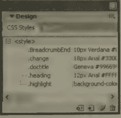

## `dreamweaver.cssStylePalette.newStyle()`

### 可用性

Dreamweaver 3。

### 描述

打开“新建样式”对话框。

### 参数

无。

### 返回值

无。

## `dreamweaver.cssStylePalette.renameSelectedStyle()`

### 可用性

Dreamweaver 3。

### 描述

重命名样式面板中当前选定规则中使用的类名，以及该选定规则中所有该类名的实例。

### 参数

`[pane]`

- `pane` 参数为可选参数，是一个字符串，用于指定本函数所应用的样式面板窗格。可能的值包括：`"stylelist"`，对应“所有”模式下的样式列表；`"cascade"`，对应“当前”模式下适用的相关规则列表；`"summary"`，对应“当前”模式下当前选定内容的属性列表；以及 `"ruleInspector"`，对应“当前”模式下可编辑的属性列表或网格。默认值为 `"stylelist"`。

### 返回值

无。

### 启用条件

请参阅第 1082 页的 `dreamweaver.cssStylePalette.canRenameSelectedStyle()`。

## `dreamweaver.cssStylePalette.setDisplayStyles()`

### 可用性

Dreamweaver 8。

### 描述

此函数用于确定是否渲染 CSS 样式，并刷新所有打开文档的渲染效果。

### 参数

`display`

- `display` 参数是一个布尔值：`true` 表示渲染 CSS 样式；`false` 表示不渲染。

### 返回值

无。

### 示例

以下示例关闭 CSS 样式的渲染：

```
dw.cssStylePalette.setDisplayStyles(false);
```

## `dreamweaver.cssStylePalette.setMediaType()`

### 可用性

Dreamweaver MX 2004。

### 描述

设置用于渲染的目标媒体类型。刷新所有打开文档的渲染效果。

### 参数

`mediaType`

- `mediaType` 参数指定新的目标媒体类型。

### 返回值

无。

### 示例

```
dw.cssStylePalette.setMediaType("print");
```

## `dreamweaver.getBlockVisBoxModelColors()`

### 可用性

Dreamweaver 8。

### 描述


此函数获取当布局块盒模型辅助功能开启时，用于渲染选定块盒模型的颜色。

### 参数

无。

### 返回值

一个包含两个字符串的字符串数组：

- `marginColor`，RGB 颜色的十六进制值，格式为 `#RRGGBB`
- `paddingColor`，RGB 颜色的十六进制值，格式为 `#RRGGBB`

## 示例

以下示例检查边距和填充颜色的值；如果其中任何一个不是白色，则将它们都设置为白色：

```javascript
var boxColors = dreamweaver.getBlockVisBoxModelColors();
if ((boxColors[0] != "#FFFFFF") || (boxColors[1] != "#FFFFFF")){
    currentDOM.setBlockVisBoxModelColors("#FFFFFF", "#FFFFFF");
    }
```

## `dreamweaver.getBlockVisOutlineProperties()`

### 可用性

Dreamweaver 8。

### 描述

此函数获取块可视化可视化辅助工具的轮廓属性。

### 参数

`forWhat`

- `forWhat`参数是必需的，为字符串类型。可能的值为`"divs"`、`"selectedDiv"`或`"layers"`。如果`forWhat`参数为`"divs"`，则函数返回用于轮廓化所有布局块的可视化辅助工具的属性。如果`forWhat`为`"selectedDiv"`，则函数返回用于轮廓化所选布局块的可视化辅助工具的属性。`"layers"`值指定图层。

### 返回值

一个字符串数组，包含三个字符串：

- `color`，即RGB颜色的十六进制值，格式为`#RRGGBB`
- `width`，表示以像素为单位的宽度
- `style`，为`"SOLID"`、`"DOTTED"`、`"DASHED"`或`"OUTSET"`

### 示例

以下示例获取`"divs"`的轮廓属性，并将轮廓样式设置为`"SOLID"`：

```javascript
var outlineStyle = dw.getBlockVisOutlineProperties("divs");
if (outlineStyle[2] != "SOLID"){
    dw.setBlockVisOutlineProperties("divs", outlineStyle[0],
    outlineStyle[1], "SOLID");
    }
```

## `dreamweaver.getDivBackgroundColors()`

### 可用性

Dreamweaver 8。

### 描述

此函数获取布局块背景可视化辅助工具使用的颜色。

### 参数

无。

### 返回值

一个字符串数组，包含16种颜色，每种颜色由RGB颜色的十六进制值表示，格式为`#RRGGBB`。

### 示例

以下示例获取布局块背景可视化辅助工具使用的背景颜色：

```javascript
var backgroundColors = dreamweaver.getDivBackgroundColors();
```

## `dreamweaver.setBlockVisOutlineProperties()`

### 可用性

Dreamweaver 8。

### 描述

此函数设置块可视化可视化辅助工具的轮廓属性。

### 参数

`forWhat`、`color`、`width`、`[style]`

- `forWhat`参数是必需的，为字符串类型，指定指定的颜色和宽度用于什么。可能的值为`"divs"`、`"selectedDiv"`或`"layers"`。如果值为`"layers"`，则指定的颜色和宽度用于在布局块轮廓可视化辅助工具开启时轮廓化所有图层。如果值为`"divs"`，则`color`和`width`参数用于轮廓化所有div和其他布局块。如果值为`"selectedDiv"`，则`color`和`width`参数用于轮廓化任何选中的div或布局块。
- `color`参数是必需的，为字符串类型，包含表示RGB颜色的十六进制值，格式为`#RRGGBB`。
- `width`参数是必需的，为整数类型，表示以像素为单位的轮廓宽度。
- `style`参数是可选的，为字符串类型，表示轮廓的样式。可能的值为`"SOLID"`、`"DOTTED"`、`"DASHED"`和`"OUTSET"`。`"OUTSET"`值仅适用于图层。当`forWhat`参数的值为`"selectedDiv"`时，此参数将被忽略。

### 返回值

无。

### 示例

参见第942页的`"dreamweaver.getBlockVisOutlineProperties()"`。

## `dreamweaver.setDivBackgroundColors()`

### 可用性

Dreamweaver 8。

### 描述

此函数设置布局块背景可视化辅助工具使用的颜色。

### 参数

`colors`

- `colors`参数是必需的，为字符串数组，包含所有颜色，以`#RRGGBB`格式的十六进制值表示。该数组必须包含16种颜色。

### 返回值

无。

### 示例

以下示例确保指定为div背景颜色的颜色不超过16种，如果是这样，则将用作背景颜色的颜色设置为灰度 shades：

```javascript
var currentDOM = dw.getDocumentDOM();
var divColors = currentDOM.getDivBackgroundColors("divs");
var shadesOfGray = new Array["#000000", "#111111", "#222222", "#333333", "#444444", "#555555", "#666666", "#777777", "#888888", "#999999", "#AAAAAA", "#BBBBBB", "#CCCCCC", "#DDDDDD", "#EEEEEE", "#FFFFFF"];
var howManyColors = divColors.length;
if howManyColors <= 16{
    for (var i = 0; i < howManyColors; i++)
        currentDOM.setDivBackgroundColors("divs", shadesOfGray[i]);
```

## 框架和框架集函数

框架和框架集函数处理两个任务：获取框架集中框架的名称以及将框架拆分为两个。

## `dom.getFrameNames()`

### 可用性

Dreamweaver 3。

### 描述

获取框架集中所有命名框架的列表。

### 参数

无。

### 返回值

一个字符串数组，其中每个字符串都是当前框架集中框架的名称。未命名的框架将被跳过。如果框架集中的任何框架都没有命名，则返回空数组。

### 示例

对于包含四个框架（其中两个已命名）的文档，调用`dom.getFrameNames()`函数可能会返回包含以下字符串的数组：

- `"navframe"`
- `"main_content"`

## `dom.isDocumentInFrame()`

### 可用性

Dreamweaver 4。

### 描述

识别当前文档是否在框架集中查看。

### 参数

无。

### 返回值

布尔值：如果文档在框架集中，则为`true`；否则为`false`。

## `dom.saveAllFrames()`

### 可用性

Dreamweaver 4。

### 描述

如果文档是框架集或在框架集中，此函数从文档窗口保存所有框架和框架集。如果指定文档不在框架集中，此函数保存该文档。此函数为任何先前未保存的文档打开`"另存为"`对话框。

### 参数

无。

### 返回值

无。

## `dom.splitFrame()`

### 可用性

Dreamweaver 3。

### 描述

垂直或水平拆分选定的框架。

### 参数

`splitDirection`

- `splitDirection`参数是一个字符串，必须指定以下方向之一：`"up"`、`"down"`、`"left"`或`"right"`。

### 返回值

无。

### 启用器

参见第1066页的`"dom.canSplitFrame()"`。

## 图层和图像映射函数

图层和图像映射函数处理对齐、调整大小以及移动图层和图像映射热点。函数描述指示它适用于图层还是热点。

## `dom.align()`

### 可用性

Dreamweaver 3。

### 描述

将选定的图层或热点左对齐、右对齐、顶部对齐或底部对齐。

### 参数

`alignDirection`

- `alignDirection`参数是一个字符串，指定要对齐图层或热点的边缘（`"left"`、`"right"`、`"top"`或`"bottom"`）。

### 返回值

无。

### 启用器

参见第1055页的`"dom.canAlign()"`。

## `dom.arrange()`

### 可用性

Dreamweaver 3。

### 描述

在指定方向上移动选定的热点。

### 参数

`toBackOrFront`

- `toBackOrFront`参数是热点必须移动的方向，向前或向后。

### 返回值

无。

### 启用器

参见第1056页的`"dom.canArrange()"`。

## `dom.makeSizesEqual()`

### 可用性

Dreamweaver 3。

### 描述

使选定的图层或热点在高度、宽度或两者上相等。最后选定的图层或热点是参考标准。

### 参数

`bHoriz`、`bVert`

- `bHoriz`参数是一个布尔值，指示是否水平调整图层或热点的大小。
- `bVert`参数是一个布尔值，指示是否垂直调整图层或热点的大小。

### 返回值

无。

## `dom.moveSelectionBy()`

### 可用性

Dreamweaver 3。

### 描述

按指定的像素数水平和垂直移动选定的图层或热点。

### 参数

`x`、`y`

- `x`参数是选择必须水平移动的像素数。
- `y`参数是选择必须垂直移动的像素数。

## `dom.resizeSelectionBy()`

### 可用性

Dreamweaver 3。

### 说明

调整当前选中的图层或热区的大小。

### 参数

`left`、`top`、`bottom`、`right`

- `left`参数是图层或热区左边界的新位置。
- `top`参数是图层或热区上边界的新位置。
- `bottom`参数是图层或热区下边界的新位置。
- `right`参数是图层或热区右边界的新位置。

### 返回值

无。

### 示例

如果所选图层具有Left、Top、Width和Height属性，调用`dw.getDocumentDOM().resizeSelectionBy(-10,-30,30,10)`等同于将Left重新设置为40，Top为20，Width为240，Height为240。

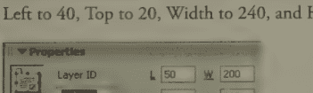

## `dom.setLayerTag()`

### 可用性

Dreamweaver 3。

### 说明

指定定义所选图层的HTML标签。

### 参数

`tagName`

- `tagName`参数必须是`"layer"`、`"ilayer"`、`"div"`或`"span"`。

### 返回值

无。

## 布局环境函数

布局环境函数处理与文档工作设置相关的操作。它们影响跟踪图像的来源、位置和不透明度；获取和设置标尺原点和单位；打开和关闭网格并更改其设置；以及开始或停止播放插件。

## `dom.getRulerOrigin()`

### 可用性

Dreamweaver 3。

### 说明

获取标尺的原点。

### 参数

无。

### 返回值

一个包含两个整数的数组。第一个数组项是原点的`x`坐标，第二个数组项是原点的`y`坐标。两个值均以像素为单位。

## `dom.getRulerUnits()`

### 可用性

Dreamweaver 3。

### 说明

获取当前标尺单位。

### 参数

无。

### 返回值

包含以下值之一的字符串：

- `"in"`
- `"cm"`
- `"px"`

## `dom.getTracingImageOpacity()`

### 可用性

Dreamweaver 3。

### 说明

获取文档跟踪图像的不透明度设置。

### 参数

无。

### 返回值

0到100之间的值，如果未设置不透明度则返回空。

### 启用器

请参阅第1067页的`"dom.hasTracingImage()"`。

## `dom.loadTracingImage()`

### 可用性

Dreamweaver 3。

### 说明

打开`"选择图像来源"`对话框。如果用户选择图像并点击`"确定"`，则会打开`"页面属性"`对话框，并且`"跟踪图像"`字段已填写。

### 参数

无。

### 返回值

无。

## `dom.playAllPlugins()`

### 可用性

Dreamweaver 3。

### 说明

播放文档中的所有插件内容。

### 参数

无。

### 返回值

无。

## `dom.playPlugin()`

### 可用性

Dreamweaver 3。

### 说明

播放选中的插件项目。

### 参数

无。

### 返回值

无。

### 启用器

请参阅第1063页的`"dom.canPlayPlugin()"`。

## `dom.setRulerOrigin()`

### 可用性

Dreamweaver 3。

### 说明

设置标尺的原点。

### 参数

`xCoordinate`、`yCoordinate`

- `xCoordinate`参数是水平轴上以像素表示的值。
- `yCoordinate`参数是垂直轴上以像素表示的值。

### 返回值

无。

## `dom.setRulerUnits()`

### 可用性

Dreamweaver 3。

### 说明

设置当前标尺单位。

### 参数

`units`

- `units`参数必须是`"px"`、`"in"`或`"cm"`。

### 返回值

无。

## `dom.setTracingImagePosition()`

### 可用性

Dreamweaver 3。

### 说明

将跟踪图像的左上角移动到指定坐标。如果省略参数，将出现`"调整跟踪图像位置"`对话框。

### 参数

`x`、`y`

- `x`参数是指定水平坐标的像素数。
- `y`参数是指定垂直坐标的像素数。

### 启用器

请参阅第1067页的`"dom.hasTracingImage()"`。

## `dom.setTracingImageOpacity()`

### 可用性

Dreamweaver 3。

### 说明

设置跟踪图像的不透明度。

### 参数

`opacityPercentage`

- `opacityPercentage`参数必须是0到100之间的数字。

### 返回值

无。

### 启用器

请参阅第1067页的`"dom.hasTracingImage()"`。

### 示例

以下代码将跟踪图像的不透明度设置为30%：

`dw.getDocumentDOM().setTracingOpacity('30');`

## `dom.snapTracingImageToSelection()`

### 可用性

Dreamweaver 3。

### 说明

将跟踪图像的左上角与当前选区的左上角对齐。

### 参数

无。

### 返回值

无。

### 启用器

请参阅第1067页的`"dom.hasTracingImage()"`。

## `dom.stopAllPlugins()`

### 可用性

Dreamweaver 3。

### 说明

停止文档中当前正在播放的所有插件内容。

### 参数

无。

### 返回值

无。

## `dom.stopPlugin()`

### 可用性

Dreamweaver 3。

### 说明

停止选中的插件项目。

### 参数

无。

### 返回值

一个布尔值，指示选区当前是否正在使用插件播放。

### 启用器

请参阅第1066页的`"dom.canStopPlugin()"`。

## `dreamweaver.arrangeFloatingPalettes()`

### 可用性

Dreamweaver 3。

### 说明

将可见的浮动面板移动到其默认位置。

### 参数

无。

### 返回值

无。

## `dreamweaver.showGridSettingsDialog()`

### 可用性

Dreamweaver 3。

### 说明

打开`"网格设置"`对话框。

### 参数

无。

### 返回值

无。

## 布局视图函数

布局视图函数处理更改文档内布局元素的操作。它们影响表格、列和单元格的设置，包括位置、属性和外观。

### `dom.addSpacerToColumn()`

### 可用性

Dreamweaver 4。

### 说明

在当前所选表格的指定列底部创建一个1像素高的透明间隔图像。如果当前选区不是表格或操作不成功，则此函数失败。

### 参数

`colNum`

- `colNum`参数是要在其底部创建间隔图像的列。

### 返回值

无。

### `dom.createLayoutCell()`

### 可用性

Dreamweaver 4。

### 说明

在文档中指定位置和尺寸创建布局单元格，可以在现有布局表格内或页面现有内容下方的区域。如果在现有布局表格中创建单元格，则不得与任何其他布局单元格或嵌套布局表格重叠或包含它们。如果矩形不在现有布局表格内，Dreamweaver会尝试创建一个布局表格来容纳新单元格。此函数不会强制文档进入布局视图。如果无法创建单元格，此函数失败。

### 参数


`left`、`top`、`width`、`height`

- `left` 参数是单元格左边框的 `x` 位置。
- `top` 参数是单元格上边框的 `y` 位置。
- `width` 参数是单元格的宽度，以像素为单位。
- `height` 参数是单元格的高度，以像素为单位。

**返回值**

无。

## `dom.createLayoutTable()`

### 可用性

Dreamweaver 4。

### 说明

在文档中指定位置和尺寸创建布局表格，可以在现有表格内或页面现有内容下方的区域。如果在现有布局表格中创建表格，则不得与其他布局单元格或嵌套布局表格重叠，但可以包含其他布局单元格或嵌套布局表格。此函数不会强制文档进入布局视图。如果无法创建表格，此函数失败。

### 参数

`left`、`top`、`width`、`height`

- `left` 参数是表格左边框的 `x` 位置。
- `top` 参数是表格上边框的 `y` 位置。
- `width` 参数是表格的宽度，以像素为单位。
- `height` 参数是表格的高度，以像素为单位。

### 返回值

无。

## `dom.doesColumnHaveSpacer()`

### 可用性

Dreamweaver 4。

### 说明

确定列是否包含 Dreamweaver 生成的间隔图像。如果当前选区不是表格，则此函数失败。

## `dom.doesGroupHaveSpacers()`

### 可用性

Dreamweaver 4。

### 描述

判断当前选中的表格是否包含 Dreamweaver 生成的间隔图像行。如果当前所选内容不是表格，则此函数会失败。

### 参数

无。

### 返回值

如果表格包含间隔图像行，则返回 `true`；否则返回 `false`。

## `dom.getClickedHeaderColumn()`

### 可用性

Dreamweaver 4。

### 描述

如果用户在布局视图中的表格标题栏内点击了菜单按钮并导致表格标题菜单出现，此函数将返回用户点击的列的索引。如果表格标题菜单不可见，则结果未定义。

### 参数

无。

### 返回值

代表列索引的整数。

## `dom.getShowLayoutTableTabs()`

### 可用性

Dreamweaver 4。

### 描述

判断在当前文档的布局视图中是否显示布局表格的标签。

### 参数

无。

### 返回值

如果当前文档在布局视图中显示布局表格的标签，则返回 `true`；否则返回 `false`。

## `dom.getShowLayoutView()`

### 可用性

Dreamweaver 4。

### 描述

判断当前文档的视图；布局视图或标准视图。

### 参数

无。

### 返回值

如果当前文档处于布局视图，则返回 `true`；如果文档处于标准视图，则返回 `false`。

## `dom.isColumnAutostretch()`

### 可用性

Dreamweaver 4。

### 描述

判断列是否设置为根据文档大小自动扩展和收缩。如果当前所选内容不是表格，则此函数会失败。

### 参数

- `colNum` - `colNum` 参数是要自动调整大小或固定宽度的列。

### 返回值

如果当前选中表格中给定索引处的列设置为自动伸展，则返回 `true`；否则返回 `false`。

## `dom.makeCellWidthsConsistent()`

### 可用性

Dreamweaver 4。

### 描述

在当前选中的表格中，此函数将 HTML 中每一列的宽度设置为与列的当前渲染宽度匹配。如果当前所选内容不是表格或操作未成功，则此函数会失败。

### 参数

无。

### 返回值

无。

## `dom.removeAllSpacers()`

### 可用性

Dreamweaver 4。

### 描述

从当前选中的表格中移除 Dreamweaver 生成的所有间隔图像。如果当前所选内容不是表格或操作未成功，则此函数会失败。

### 参数

无。

### 返回值

无。

## `dom.removeSpacerFromColumn()`

### 可用性

Dreamweaver 4。

### 描述

从指定列中移除间隔图像，如果没有更多 Dreamweaver 生成的间隔图像，则删除间隔行。如果当前所选内容不是表格或操作未成功，则此函数会失败。

### 参数

- `colNum` - `colNum` 参数是要从中移除间隔图像的列。

### 返回值

无。

## `dom.setColumnAutostretch()`

### 可用性

Dreamweaver 4。

### 描述

在自动调整和固定宽度之间切换列。如果 `bAutostretch` 为 `true`，则当前选中表格中给定索引处的列设置为自动伸展；否则将其设置为当前渲染宽度的固定宽度。如果当前所选内容不是表格或操作未成功，则此函数会失败。

### 参数

- `colNum` - `colNum` 参数是要自动调整大小或设置为固定宽度的列。
- `bAutostretch` - `bAutostretch` 参数指定是否将列设置为自动伸展（`true`）或固定宽度（`false`）。

### 返回值

无。

## `dom.getShowBlockBackgrounds()`

### 可用性

Dreamweaver 8。

### 描述

此函数获取强制为所有块或 `div` 添加背景颜色的视觉辅助工具的状态。

### 参数

- `allblocks` - `allblocks` 参数为必需，是一个布尔值。将值设置为 `true` 表示仅应用于 `div` 标签。将值设置为 `false` 表示应用于所有块元素。

### 返回值

一个布尔值。如果为 `true`，则表示正在强制添加背景；如果为 `false`，则表示未强制添加背景。

### 示例

以下示例检查是否正在强制为所有块添加背景颜色，如果没有，则强制为所有块添加背景颜色：

```
var currentDOM = dw.getDocumentDOM();
if (currentDOM.getShowBlockBackgrounds(false) == false){
  currentDOM.setShowBlockBackgrounds(false);
}
```

## `dom.getShowBlockBorders()`

### 可用性

Dreamweaver 8。

### 描述

此函数获取为所有块或所有 `div` 绘制边框的视觉辅助工具的状态。

### 参数

- `allblocks` - `allblocks` 参数为必需，是一个布尔值。将值设置为 `true` 表示仅获取 `div` 标签的状态。将值设置为 `false` 表示获取所有块元素的状态。

### 返回值

一个布尔值；如果为 `true`，则显示边框；如果为 `false`，则不显示边框。

### 示例

以下示例检查块边框视觉辅助工具是否已开启，如果没有，则将其开启：

```
var currentDOM = dw.getDocumentDOM();
if (currentDOM.getShowBlockBorders(false) === false){
    currentDOM.setShowBlockBorders(true);
}
```

## `dom.getShowBlockIDs()`

### 可用性

Dreamweaver 8。

### 描述

此函数获取显示所有块或 `div` 的 ID 和类信息的视觉辅助工具的状态。

### 参数

- `allblocks` - `allblocks` 参数为必需，是一个布尔值。将值设置为 `true` 表示仅显示 `div` 标签的 ID 和类。将值设置为 `false` 表示显示所有块元素的 ID 和类。

### 返回值

一个布尔值：如果为 `true`，则显示 ID；如果为 `false`，则不显示 ID。

### 示例

以下示例检查块 ID 是否已显示，如果没有，则显示它们：

```
var currentDOM = dw.getDocumentDOM();
if (currentDOM.getShowBlockIDs(false) === false){
    currentDOM.setShowBlockIDs(true);
}
```

## `dom.getShowBoxModel()`

### 可用性

Dreamweaver 8。

### 描述

此函数开启或关闭为所选块完整盒模型着色的视觉辅助工具。

### 参数

无。

### 返回值

无。

### 示例

以下示例检查所选框的完整盒模型是否以彩色显示，如果没有，则为其着色：

```
var currentDOM = dw.getDocumentDOM();
if (currentDOM.getShowBoxModel() == false){
    currentDOM.setShowBoxModel(true);
}
```

## `dom.setShowBlockBackgrounds()`

### 可用性

Dreamweaver 8。

### 描述

此函数开启或关闭强制为所有块或所有 `div` 添加背景颜色的视觉辅助工具。

### 参数

- `allblocks` - `allblocks` 参数为必需，是一个布尔值。将值设置为 `true` 表示仅将背景颜色应用于 `div` 标签。将值设置为 `false` 表示将背景颜色应用于所有块元素。

### 返回值

无。

### 示例

参见“`dom.getShowBlockBackgrounds()`”（第 963 页）。

## `dom.setShowBlockBorders()`

### 可用性

Dreamweaver 8。

### 描述

此函数开启或关闭为所有块或 `div` 绘制边框的视觉辅助工具。

### 参数

- `allblocks` - `allblocks` 参数为必需，是一个布尔值。将值设置为 `true` 表示仅将边框应用于 `div` 标签。将值设置为 `false` 表示将边框应用于所有块元素。

### 返回值

无。

### 示例

参见“`dom.getShowBlockBorders()`”（第 963 页）。

## `dom.setShowBlockIDs()`

### 可用性

Dreamweaver 8。

### 描述

此函数开启或关闭显示所有块或 `div` 的 ID 和类的视觉辅助工具。

### 参数

- `allblocks` - `allblocks` 参数为必需，是一个布尔值。将值设置为 `true` 表示仅显示 `div` 标签的 ID 和类。将值设置为 `false` 表示显示所有块元素的 ID 和类。

### 返回值

无。

### 示例

参见第 964 页的“`dom.getShowBlockIDs()`”。

## `dom.setShowBoxModel()`

### 可用性

Dreamweaver 8。

### 描述

此函数设置对选中的块进行完整盒模型着色的可视化辅助的状态。

### 参数

无。

### 返回值

布尔值：如果盒模型已显示则为 `true`；如果盒模型未显示则为 `false`。

### 示例

参见第 965 页的“`dom.getShowBoxModel()`”。

## `dom.setShowLayoutTableTabs()`

### 可用性

Dreamweaver 4。

### 描述

设置当前文档处于布局视图时显示布局表格标签。此函数不会强制文档进入布局视图。

### 参数

- `bShow`: `bShow` 参数指示当当前文档处于布局视图时是否显示布局表格标签。如果 `bShow` 为 `true`，Dreamweaver 显示标签；如果 `bShow` 为 `false`，Dreamweaver 不显示标签。

### 返回值

无。

## `dom.setShowLayoutView()`

### 可用性

Dreamweaver 4。

### 描述

如果 `bShow` 为 `true`，则将当前文档置于布局视图。

### 参数

- `bShow`: `bShow` 参数是一个布尔值，用于在当前文档的布局视图和标准视图之间切换。如果 `bShow` 为 `true`，当前文档处于布局视图；如果 `bShow` 为 `false`，当前文档处于标准视图。

### 返回值

无。

# 缩放函数

缩放函数用于在设计视图中放大和缩小。

## `dreamweaver.activeViewScale()`

### 可用性

Dreamweaver 8。

### 描述

此函数获取或设置一个可变的浮点属性。获取值时，Dreamweaver 返回活动视图的缩放比例，如缩放组合框中所示，除以 100。例如，100% 为 1.0；50% 为 0.5，依此类推。设置值时，Dreamweaver 在缩放组合框中设置该值。该值可以在 0.06 到 64.00 之间，对应 6% 到 6400%。

### 示例

以下示例获取当前视图的缩放值，并在可以缩放且缩放比例小于或等于 100% 时进行放大：

```
if (canZoom() && dreamweaver.activeViewScale <= 1.0) {
  zoomIn();
}
```

以下示例将当前视图的缩放值设置为 50%：

```
dreamweaver.activeViewScale = 0.50;
```

## `dreamweaver.fitAll()`

### 可用性

Dreamweaver 8。

### 描述

此函数放大或缩小，使整个文档适合设计视图中当前可见的部分。

### 参数

无。

### 返回值

无。

### 启用器

参见第 1078 页的“`dreamweaver.canZoom()`”。

### 示例

```
if (canZoom()){
  fitAll();
}
```

## `dreamweaver.fitSelection()`

### 可用性

Dreamweaver 8。

### 描述

此函数放大或缩小，使当前选区适合设计视图中当前可见的部分。

### 参数

无。

### 返回值

无。

### 启用器

参见第 1072 页的“`dreamweaver.canFitSelection()`”。

### 示例

```
if (canFitSeletion()){
    fitSelection();
}
```

## `dreamweaver.fitWidth()`

### 可用性

Dreamweaver 8。

### 描述

此函数放大或缩小，使整个文档宽度适合设计视图中当前可见的部分。

### 参数

无。

### 返回值

无。

### 启用器

参见第 1078 页的“`dreamweaver.canZoom()`”。

### 示例

```
if (canZoom()){
    fitWidth();
}
```

## `dreamweaver.zoomIn()`

### 可用性

Dreamweaver 8。

### 描述

此函数放大当前活动的设计视图。缩放级别是放大菜单中的下一个预设值。如果没有下一个预设值，此函数不执行任何操作。

### 参数

无。

### 返回值

无。

### 启用器

参见第 1078 页的“`dreamweaver.canZoom()`”。

### 示例

```
if (canZoom()){
    zoomIn();
}
```

## `dreamweaver.zoomOut()`

### 可用性

Dreamweaver 8。

### 描述

此函数缩小当前活动的设计视图。缩放级别是放大菜单中的下一个预设值。如果没有下一个预设值，此函数不执行任何操作。

### 参数

无。

### 返回值

无。

### 启用器

参见第 1078 页的“`dreamweaver.canZoom()`”。

### 示例

```
if (canZoom()){
    zoomOut();
}
```

# 参考线函数和属性

参考线函数和属性让您可以显示、操作和删除参考线，以便用户测量和布局其 HTML 页面上的元素。

## `dom.clearGuides()`

### 可用性

Dreamweaver 8。

### 描述

此函数确定是否删除文档中的所有参考线。

### 参数

无。

### 返回值

无。

### 示例

以下示例在文档至少有一条参考线时删除所有参考线：

```
var currentDOM = dw.getDocumentDOM();
if (currentDOM.hasGuides() == true) {
    currentDOM.clearGuides();
}
```

## `dom.createHorizontalGuide()`

### 可用性

Dreamweaver 8。

### 描述

此函数在文档的当前位置创建一条水平参考线。

### 参数

- `location`: `location` 参数是参考线的位置，数值和单位作为一个字符串，数值和单位之间没有空格。可能的单位有 `"px"`（像素）和 `"%"`（百分比）。例如，要指定 10 像素，`location = "10px"`；要指定 50%，`location = "50%"`。

### 返回值

无。

### 示例

以下示例在文档的当前位置创建一条水平参考线：

```
var currentDOM = dw.getDocumentDOM();
currentDOM.createHorizontalGuide("10px");
```

## `dom.createVerticalGuide()`

### 可用性

Dreamweaver 8。

### 描述

此函数在文档的当前位置创建一条垂直参考线。

### 参数

- `location`: `location` 参数是参考线的位置，数值和单位作为一个字符串，数值和单位之间没有空格。可能的单位有 `"px"`（像素）和 `"%"`（百分比）。例如，要指定 10 像素，`location = "10px"`；要指定 50%，`location = "50%"`。

### 返回值

无。

### 示例

以下示例在文档的当前位置创建一条垂直参考线：


```javascript
var currentDOM = dw.getDocumentDOM();
currentDOM.createVerticalGuide("10px");
```

# `dom.deleteHorizontalGuide()`

## 可用性

Dreamweaver 8。

## 描述

此函数删除指定位置的水平参考线。

## 参数

- `location`：`location` 参数是一个字符串，表示要测试的文档位置，数值和单位作为一个字符串，数值和单位之间没有空格。可能的单位有 `"px"`（像素）和 `"%"`（百分比）。例如，要指定 10 像素，`location = "10px"`；要指定 50%，`location = "50%"`。

## 返回值

无。

## 示例

以下示例删除文档中指定位置的水平参考线：

```javascript
var currentDOM = dw.getDocumentDOM();
if (currentDOM.hasHorizontalGuide("10px") == true) {
    currentDOM.deleteHorizontalGuide("10px");
}
```

# `dom.deleteVerticalGuide()`

## 可用性

Dreamweaver 8。

## 描述

此函数删除指定位置的垂直参考线。

## 参数

- `location`：`location` 参数是一个字符串，表示要测试的文档位置，数值和单位作为一个字符串，数值和单位之间没有空格。可能的单位有 `"px"`（像素）和 `"%"`（百分比）。例如，要指定 10 像素，`location = "10px"`；要指定 50%，`location = "50%"`。

## 返回值

无。

## 示例

以下示例删除文档中指定位置的垂直参考线：

```javascript
var currentDOM = dw.getDocumentDOM();
if (currentDOM.hasVerticalGuide("10px") == true) {
   currentDOM.deleteVerticalGuide("10px");
}
```

# `dom.guidesColor`

## 可用性

Dreamweaver 8。

## 描述

此可变的颜色属性确定文档中参考线的颜色。您可以设置和获取此属性。

## 参数

无。

## 返回值

无。

## 示例

以下示例将参考线设为灰色：

```javascript
var currentDOM = dw.getDocumentDOM();
if (currentDOM.guidesColor != "#444444"){
   currentDOM.guidesColor = "#444444";
}
```

# `dom.guidesDistanceColor`

## 可用性

Dreamweaver 8。

## 描述

此可变的颜色属性确定文档中参考线的距离反馈颜色。您可以设置和获取此属性。

## 参数

无。

## 返回值

无。

## 示例

以下示例将参考线的距离反馈颜色设为灰色：

```javascript
var currentDOM = dw.getDocumentDOM();
if (currentDOM.guidesDistanceColor != "#CCCCCC"){
  currentDOM.guidesDistanceColor = "#CCCCCC";
}
```

# `dom.guidesLocked`

## 可用性

Dreamweaver 8。

## 描述

此可变布尔属性决定文档中的参考线是否被锁定。您可以设置和获取此属性。

## 参数

无。

## 返回值

无。

## 示例

以下示例在参考线未被锁定时将其锁定：

```javascript
var currentDOM = dw.getDocumentDOM();
if (currentDOM.guidesLocked == false) {
  currentDOM.guidesLocked = true;
}
```

# `dom.guidesSnapToElements`

## 可用性

Dreamweaver 8。

## 描述

此可变布尔属性决定参考线是否吸附到文档中的元素。您可以设置和获取此属性。

## 参数

无。

## 返回值

无。

## 示例

以下示例使文档中的参考线吸附到元素：

```javascript
var currentDOM = dw.getDocumentDOM();
if (currentDOM.guidesSnapToElements == false) {
  currentDOM.guidesSnapToElements = true;
}
```

# `dom.guidesVisible`

## 可用性

Dreamweaver 8。

## 描述

此可变布尔属性决定文档中的参考线是否可见。您可以设置和获取此属性。

## 参数

无。

## 返回值

无。

## 示例

以下示例在参考线不可见时将其打开：

```javascript
var currentDOM = dw.getDocumentDOM();
if (currentDOM.guidesVisible == false) {
  currentDOM.guidesVisible = true;
}
```

# `dom.hasGuides()`

## 可用性

Dreamweaver 8。

## 描述

此函数确定文档是否至少有一条参考线。您可以设置和获取此属性。

## 参数

无。

## 返回值

无。

## 示例

以下示例在文档至少有一条参考线时删除所有参考线：

```javascript
var currentDOM = dw.getDocumentDOM();
if (currentDOM.hasGuides() == true) {
  currentDOM.clearGuides();
}
```

# `dom.hasHorizontalGuide()`

## 可用性

Dreamweaver 8。

## 描述

此函数确定文档在指定位置是否有水平参考线。

## 参数

`location`

- `location` 参数是一个字符串，表示要测试的文档位置，其值和单位为一个字符串，值和单位之间没有空格。可能的单位是用于像素的 `"px"` 和用于百分比的 `"%"`。例如，要指定 10 像素，`location = "10px"`；要指定 50%，`location = "50%"`。

## 返回值

布尔值：如果指定位置有水平参考线，则返回 `true`；否则返回 `false`。

## 示例

以下示例在文档指定位置有水平参考线时删除所有参考线：

```javascript
var currentDOM = dw.getDocumentDOM();
if (currentDOM.hasHorizontalGuide("10px") == true) {
  currentDOM.clearGuides();
}
```

# `dom.hasVerticalGuide()`

## 可用性

Dreamweaver 8。

## 描述

此函数确定文档在当前位置是否有垂直参考线。

## 参数

`location`

- `location` 参数是一个字符串，表示要测试的文档位置，其值和单位为一个字符串，值和单位之间没有空格。可能的单位是用于像素的 `"px"` 和用于百分比的 `"%"`。例如，要指定 10 像素，`location = "10px"`；要指定 50%，`location = "50%"`。

## 返回值

布尔值：如果指定位置有垂直参考线，则返回 `true`；否则返回 `false`。

## 示例

以下示例在文档指定位置有垂直参考线时删除所有参考线：

```javascript
var currentDOM = dw.getDocumentDOM();
if (currentDOM.hasVerticalGuide("10px") == true) {
    currentDOM.clearGuides();
}
```

# `dom.snapToGuides`

## 可用性

Dreamweaver 8。

## 描述

此可变布尔属性决定元素是否吸附到文档中的参考线。您可以设置和获取此属性。

## 参数

无。

## 返回值

无。

## 示例

以下示例使文档中的元素吸附到参考线：

```javascript
var currentDOM = dw.getDocumentDOM();
if (currentDOM.snapToGuides == false) {
    currentDOM.snapToGuides = true;
}
```

# 表格编辑函数

表格函数用于添加和删除表格行和列、更改列宽和行高、将测量值从像素转换为百分比以及执行其他标准的表格编辑任务。

## `dom.convertWidthsToPercent()`

### 可用性

Dreamweaver 3。

### 描述

此函数将当前表格中所有 `WIDTH` 属性从像素转换为百分比。

### 参数

无。

### 返回值

无。

## `dom.convertWidthsToPixels()`

### 可用性

Dreamweaver 4。

### 描述

此函数将当前表格中所有 `WIDTH` 属性从百分比转换为像素。

### 参数

无。

### 返回值

无。

## `dom.decreaseColspan()`

### 可用性

Dreamweaver 3。

### 描述

此函数将列跨度减一。

### 参数

无。

### 返回值

无。

### 启用条件

参见第 1058 页的 `dom.canDecreaseColspan()`。

## `dom.decreaseRowspan()`

### 可用性

Dreamweaver 3。

### 描述

此函数将行跨度减一。

### 参数

无。

### 返回值

无。

### 启用条件

参见第 1059 页的 `dom.canDecreaseRowspan()`。

## `dom.deleteTableColumn()`

### 可用性

Dreamweaver 3。

### 描述

此函数删除选中的表格列。

### 参数

无。

### 返回值

无。

### 启用条件

参见第 1059 页的 `dom.canDeleteTableColumn()`。

## `dom.deleteTableRow()`

### 可用性

Dreamweaver 3。

### 描述

此函数删除选中的表格行。

### 参数

无。

### 返回值

无。

### 启用条件

参见第 1060 页的 `dom.canDeleteTableRow()`。

## `dom.doDeferredTableUpdate()`

### 可用性

Dreamweaver 3。

### 描述

如果在常规首选项中选择了“快速表格编辑”选项，此函数将强制表格布局反映最近的更改，而不会将选择移动到表格外。如果未选择“快速表格编辑”选项，此函数无效。

### 参数

无。

### 返回值

无。

## `dom.getShowTableWidths()`

### 可用性

Dreamweaver MX 2004。

### 描述

返回在标准或扩展表格模式（非布局模式）下是否显示表格宽度。有关 Dreamweaver 是否在布局模式下显示表格选项卡的信息，请参见第 960 页的 `dom.getShowLayoutTableTabs()`。

### 参数

无。

### 返回值

布尔值：如果 Dreamweaver 在标准或扩展表格模式下显示表格宽度，则返回 `true`；否则返回 `false`。

## `dom.getTableExtent()`

### 可用性

Dreamweaver 3。

### 描述

此函数获取所选表格的列数和行数。

### 参数

无。

### 返回值

一个包含两个整数的数组。第一个数组项是列数，第二个数组项是行数。如果未选中表格，则不返回任何内容。

## `dom.increaseColspan()`

### 可用性

Dreamweaver 3。

### 描述

此函数将列跨度加一。

### 参数

无。

### 返回值

无。

### 启用条件

参见第 1061 页的 `dom.canIncreaseColspan()`。

## `dom.increaseRowspan()`

### 可用性

Dreamweaver 3。

### 描述

此函数将行跨度加一。

### 参数

无。

### 返回值

无。

### 启用条件

参见第 1059 页的 `dom.canDecreaseRowspan()`。

## `dom.insertTableColumns()`

### 可用性

Dreamweaver 3。

### 描述

此函数将指定数量的表格列插入到当前表格中。

### 参数

`numberOfCols, bBeforeSelection`

- `numberOfCols` 参数是要插入的列数。

- `bBeforeSelection` 参数是一个布尔值：`true` 表示应在包含选择的列之前插入列；否则为 `false`。

### 返回值

无。

### 启用条件

参见第 1061 页的 `dom.canInsertTableColumns()`。

## `dom.insertTableRows()`

### 可用性

Dreamweaver 3。

### 描述

此函数将指定数量的表格行插入到当前表格中。

## `dom.mergeTableCells()`

### 适用版本

Dreamweaver 3。

### 描述

此函数合并选中的表格单元格。

### 参数

无。

### 返回值

无。

### 启用条件

参见第 1063 页的 `dom.canMergeTableCells()`。

## `dom.removeAllTableHeights()`

### 适用版本

Dreamweaver 3。

### 描述

此函数从选中的表格中移除所有 `HEIGHT` 属性。

### 参数

无。

### 返回值

无。

## `dom.removeAllTableWidths()`

### 适用版本

Dreamweaver 3。

### 描述

此函数从选中的表格中移除所有 `WIDTH` 属性。

### 参数

无。

### 返回值

无。

## `dom.removeColumnWidth()`

### 适用版本

Dreamweaver MX 2004.

### 描述

此函数从选中的单列中移除所有 `WIDTH` 属性。

### 参数

无。

### 返回值

无。

## `dom.selectTable()`

### 适用版本

Dreamweaver 3。

### 描述

选中整个表格。

### 参数

无。

### 返回值

无。

### 启用条件

参见第 1064 页的 `dom.canSelectTable()`。

## `dom.setShowTableWidths()`

### 适用版本

Dreamweaver MX 2004.

### 描述

在标准或扩展表格模式（非布局模式）下切换表格宽度的显示与隐藏。此函数为当前文档以及*任何未来*的文档设置该值，除非另有指定。有关在布局模式下设置表格标签显示的信息，参见第 967 页的 `dom.setShowLayoutTableTabs()`。

### 参数

`bShow`

- `bShow` 是一个布尔参数，指示在当前文档处于标准或扩展表格模式（非布局模式）时是否显示表格宽度。如果 `bShow` 为 `true`，Dreamweaver 将显示宽度。如果 `bShow` 为 `false`，Dreamweaver 将不显示宽度。

### 返回值

无。

## `dom.setTableCellTag()`

### 适用版本

Dreamweaver 3。

### 描述

此函数为选中的单元格指定标签。

### 参数

`tdOrTh`

- `tdOrTh` 参数必须是 `"td"` 或 `"th"`。

### 返回值

无。

## `dom.setTableColumns()`

### 适用版本

Dreamweaver 3。

### 描述

此函数设置选中的表格的列数。

### 参数

`numberOfCols`

- `numberOfCols` 参数指定要设置的表格列数。

### 返回值

无。

## `dom.setTableRows()`

### 适用版本

Dreamweaver 3。

### 描述

此函数设置选中的表格的行数。

### 参数

`numberOfRows`

- `numberOfRows` 参数指定要设置的表格行数。

### 返回值

无。

## `dom.showInsertTableRowsOrColumnsDialog()`

### 适用版本

Dreamweaver 3。

### 描述

此函数打开"插入行或列"对话框。

### 参数

无。

### 返回值

无。

### 启用条件

参见第 1061 页的 `dom.canInsertTableColumns()`或第 1062 页的 `dom.canInsertTableRows()`。

## `dom.splitTableCell()`

### 适用版本

Dreamweaver 3。


### 描述

此函数将当前表格单元格拆分为指定数量的行或列。如果省略了一个或两个参数，将显示“拆分单元格”对话框。

### 参数

`[colsOrRows]`、`[numberToSplitInto]`

- `colsOrRows` 参数是可选的，必须是 `"columns"` 或 `"rows"`。
- `numberToSplitInto` 参数是可选的，指定单元格将拆分成的行数或列数。

### 返回值

无。

### 启用条件

参见第 1066 页的 `dom.canSplitTableCell()`。

# 第 17 章

## 代码

代码功能让你可以对代码视图中显示的文档执行操作。这些操作包括向代码提示菜单添加新的菜单或函数标签、查找和替换字符串模式、从文档中删除当前选中的内容、打印全部或选中的代码、编辑标签，或对选中的代码应用语法格式化。

## 代码函数

代码提示是 Macromedia Dreamweaver 8 在你于代码视图中输入某些字符模式时打开的菜单。代码提示通过提供一个可能补全你正在输入的字符串的列表来提供输入快捷方式。如果你正在输入的字符串出现在菜单中，你可以滚动到该字符串并按 Enter 或 Return 来完成输入。例如，当你输入 `<` 时，弹出菜单会显示一个标签名称列表。你可以从菜单中选择标签将其包含到你的文本中，而无需输入标签名称的其余部分。

你可以通过在 `CodeHints.xml` 文件中定义来向 Dreamweaver 添加代码提示菜单。有关 `Code_hints.xml` 文件的信息，请参见 *Extending Dreamweaver*。

你还可以在 Dreamweaver 加载 `Code_hints.xml` 文件的内容后，通过 JavaScript 动态添加新的代码提示菜单。例如，JavaScript 代码会在“绑定”面板中填充会话变量列表。你可以使用相同的代码来添加代码提示菜单，这样当用户在代码视图中输入 `Session` 时，Dreamweaver 就会显示一个会话变量菜单。

`CodeHints.xml` 文件和 JavaScript API 公开了代码提示引擎的一个有用子集，但某些 Dreamweaver 功能无法访问。例如，没有用于打开颜色选择器的 JavaScript 钩子，因此 Dreamweaver 无法使用 JavaScript 表达“属性值”菜单。你只能打开一个文本项目菜单，从中可以插入文本。

代码着色让你可以指定代码颜色样式，并修改现有代码着色方案或创建新的方案。你可以通过修改 `Colors.xml` 和代码着色方案文件来指定代码着色样式和方案。有关这些文件的更多信息，请参见 *Extending Dreamweaver*。

代码提示和代码着色的 JavaScript API 包含以下函数。

## `dreamweaver.codeHints.addMenu()`

### 适用版本

Dreamweaver MX。

### 描述

动态定义 `CodeHints.xml` 文件中的一个新菜单标签。如果存在具有相同模式和文档类型的现有菜单标签，此函数会向现有菜单添加项目。

### 参数

`menuGroupId, pattern, labelArray, {valueArray}, {iconArray}, {doctypes}, {casesensitive}`

- `menuGroupId` 参数是其中一个 `menugroup` 标签的 ID 属性。
- `pattern` 参数是新菜单标签的 `pattern` 属性。
- `labelArray` 参数是一个字符串数组。每个字符串是弹出菜单中单个菜单项的文本。
- `valueArray` 参数是可选的，是一个字符串数组，其长度应与 `labelArray` 参数相同。当用户从弹出菜单中选择一个项目时，此数组中的字符串将被插入到用户的文档中。如果要插入的字符串始终与菜单标签相同，此参数的值可以为 `null`。
- `iconArray` 参数是可选的，可以是一个字符串或字符串数组。如果是一个字符串，它指定 Dreamweaver 用于菜单中所有项目的单个图像文件的 URL。如果是字符串数组，其长度必须与 `labelArray` 参数相同。每个字符串是相对于 Dreamweaver Configuration 文件夹的图像文件的 URL，Dreamweaver 将其用作相应菜单项的图标。如果此参数为 `null` 值，Dreamweaver 将不带图标显示菜单。
- `doctypes` 参数是可选的，指定此菜单仅对某些文档类型有效。你可以将 `doctypes` 参数指定为逗号分隔的文档类型 ID 列表。有关 Dreamweaver 文档类型的列表，请参见 `Dreamweaver Configuration/Documenttypes/MMDocumentTypes.xml` 文件。
- `casesensitive` 参数是可选的，指定模式是否区分大小写。`casesensitive` 参数的可能值是布尔值 `true` 或 `false`。如果省略此参数，默认值是 `false`。如果 `casesensitive` 参数为 `true` 值，只有当用户输入的文本与 `pattern` 属性指定的模式完全匹配时，代码提示菜单才会出现。如果 `casesensitive` 参数为 `false` 值，即使模式是小写而文本是大写，菜单也会出现。

### 返回值

无。

### 示例

如果用户创建了一个名为 `"myRs"` 的记录集，以下代码将为 `myRS` 创建一个菜单：

```javascript
dw.codeHints.addMenu(
  "CodeHints_object_methods",  // 如果启用了对象方法，则启用此菜单
  "myRS.",                     // 如果用户输入"myRS."则弹出菜单
  new Array("firstName", "lastName"),  // myRS 下拉菜单中的项目
  new Array("firstName", "lastName"),  // 实际插入文档中的文本
  null,                              // 此菜单没有图标
  "ASP_VB, ASP_JS"); // 特定于 ASP 文档类型
```

## `dreamweaver.codeHints.addFunction()`

### 适用版本

Dreamweaver MX。

### 描述

动态定义一个新的 `function` 标签。如果存在具有相同模式和文档类型的现有 `function` 标签，此函数将替换现有的 `function` 标签。

### 参数

`menuGroupId`、`pattern`、`[doctypes]`、`[casesensitive]`

- `menuGroupId` 参数是 `menugroup` 标签的 ID 字符串属性。
- `pattern` 参数是一个字符串，指定新 `function` 标签的 `pattern` 属性。
- `doctypes` 参数是可选的，指定此函数仅对某些文档类型有效。你可以将 `doctypes` 参数指定为逗号分隔的文档类型 ID 列表。有关 Dreamweaver 文档类型的列表，请参见 `Dreamweaver Configuration/Documenttypes/MMDocumentTypes.xml` 文件。
- `casesensitive` 参数（可选）指定模式是否区分大小写。`casesensitive` 参数的可能值为布尔值 `true` 或 `false`。如果省略此参数，该值默认为 `false`。如果 `casesensitive` 参数为 `true` 值，则只有当用户输入的文本与模式属性指定的模式完全匹配时，代码提示菜单才会出现。如果 `casesensitive` 参数为 `false` 值，即使模式为小写而文本为大写，菜单也会出现。

## 返回值

无。

## 示例

以下 `dw.codeHints.addFunction()` 函数示例将函数名模式 `out.newLine()` 添加到代码提示菜单组 `CodeHints_Object_Methods` 中，并使其仅对 JSP 文档类型有效：

```javascript
dw.codeHints.addFunction(
    "CodeHints_Object_Methods",
    "out.newLine()",
    "JSP")
```

## `dreamweaver.codeHints.resetMenu()`

### 可用性

Dreamweaver MX。

### 描述

将指定的菜单标签或函数标签重置为 Dreamweaver 读取 `CodeHints.xml` 文件后立即的状态。换句话说，调用此函数会消除之前调用 `addMenu()` 和 `addFunction()` 函数的效果。

### 参数

`menuGroupId`、`pattern`、`{doctypes}`

- `menuGroupId` 参数是 `menugroup` 标签的 ID 字符串属性。
- `pattern` 参数是一个字符串，指定要重置的新菜单或函数标签的模式属性。
- `doctypes` 参数（可选）指定此菜单仅对某些文档类型有效。您可以将 `doctypes` 参数指定为以逗号分隔的文档类型 ID 列表。有关 Dreamweaver 文档类型列表，请参阅 `Dreamweaver Configuration/Documenttypes/MMDocumentTypes.xml` 文件。

### 返回值

无。

### 示例

您的 JavaScript 代码可能构建一个包含用户定义会话变量的代码提示菜单。每次会话变量列表发生变化时，该代码需要更新菜单。在代码将新的会话变量列表加载到菜单之前，需要先移除旧列表。调用此函数可以移除旧的会话变量。

## `dreamweaver.codeHints.showCodeHints()`

### 可用性

Dreamweaver MX。

### 描述

当用户打开“编辑 > 显示代码提示”菜单项时，Dreamweaver 会调用此函数。该函数在代码视图中当前选择位置打开代码提示菜单。

### 参数

无。

### 返回值

无。

### 示例

以下示例在文档处于代码视图时，在当前插入点打开代码提示菜单。

```javascript
dw.codeHints.showCodeHints()
```

## `dreamweaver.reloadCodeColoring()`

### 描述

从 `Dreamweaver Configuration/Code Coloring` 文件夹重新加载代码着色文件。

### 参数

无。

### 返回值

无。

### 示例

```javascript
dreamweaver.reloadCodeColoring()
```

## 查找/替换函数

查找/替换函数用于处理查找和替换操作。它们涵盖了基本功能，例如查找搜索模式的下一个实例，以及不需要用户交互的复杂替换操作。

## `dreamweaver.findNext()`

### 可用性

Dreamweaver 3；在 Dreamweaver MX 2004 中进行了修改。

### 描述

查找由 `dreamweaver.setUpFind()`、`dreamweaver.setUpComplexFind()` 或用户在查找对话框中先前指定的搜索字符串的下一个实例，并在文档中选择该实例。

### 参数

`{bUseLastSetupSearch}`

- `bUseLastSetupSearch` 参数（可选）是一个布尔值。如果 `bUseLastSetupSearch` 的值为 `true`（这是未给出参数时的默认值），该函数将使用之前调用 `dreamweaver.setupComplexFind()` 函数或 `dreamweaver.setupComplexFindReplace()` 函数指定的参数执行查找下一个操作。如果将 `bUseLastSetupSearch` 设置为 `false`，该函数将忽略先前设置的搜索，并对文档中当前选中文本的下一个实例执行搜索。

### 返回值

无。

### 启用器

参见第 1071 页的 `dreamweaver.canFindNext()`。

## `dreamweaver.replace()`

### 可用性

Dreamweaver 3。

### 描述

验证当前选择是否与 `dreamweaver.setUpFindReplace()`、`dreamweaver.setUpComplexFindReplace()` 或用户在替换对话框中指定的搜索条件匹配；然后该函数将选择内容替换为搜索请求指定的替换文本。

### 参数

无。

### 返回值

无。

## `dreamweaver.replaceAll()`

### 可用性

Dreamweaver 3。

### 描述

将当前文档中与 `dreamweaver.setUpFindReplace()`、`dreamweaver.setUpComplexFindReplace()` 或用户在替换对话框中指定的搜索条件匹配的每个部分替换为指定的替换内容。

### 参数

无。

### 返回值

无。

## `dreamweaver.setUpComplexFind()`

### 可用性

Dreamweaver 3。

### 描述

通过加载指定的 XML 查询，为高级文本或标签搜索做准备。

### 参数

`xmlQueryString`

- `xmlQueryString` 参数是以 `dwquery` 开头并以 `/dwquery` 结尾的 XML 代码字符串。（要获取正确格式的字符串，请在查找对话框中设置查询，单击“保存查询”按钮，在文本编辑器中打开查询文件，然后复制从 `dwquery` 标签开头到 `/dwquery` 标签结尾的所有内容。）

### 返回值

无。

### 示例

以下示例的第一行设置了一个标签搜索并指定搜索范围为当前文档。第二行执行搜索操作。

```javascript
dreamweaver.setUpComplexFind('<dwquery><queryparams matchcase="false" ignorewhitespace="true" useregexp="false"/><find>
<qtag qname="a"><qattribute qname="href" qcompare="="
qvalue="#">
</qattribute><qattribute qname="onMouseOut" qcompare="=" qvalue=""
qnegate="true"></qattribute></qtag></find></dwquery>');
dw.findNext();
```

## `dreamweaver.setUpComplexFindReplace()`

### 可用性

Dreamweaver 3。

### 描述

通过加载指定的 XML 查询，为高级文本或标签搜索做准备。

### 参数

`xmlQueryString`

- `xmlQueryString` 参数是以 `dwquery` 标签开头并以 `/dwquery` 标签结尾的 XML 代码字符串。（要获取正确格式的字符串，请在查找对话框中设置查询，单击“保存查询”按钮，在文本编辑器中打开查询文件，然后复制从 `dwquery` 标签开头到 `/dwquery` 标签结尾的所有内容。）

### 返回值

无。

### 示例

以下示例中的第一条语句设置了一个标签搜索并指定搜索范围为四个文件。第二条语句执行搜索和替换操作。

```javascript
dreamweaver.setUpComplexFindReplace('<dwquery><queryparams matchcase="false" ignorewhitespace="true" useregexp="false"/><find><qtag qname="a"><qattribute qname="href" qcompare="=" qvalue="#"></qattribute><qattribute qname="onMouseOut" qcompare="=" qvalue="" qnegate="true"></qattribute></qtag></find><replace action="setAttribute" param1="onMouseOut" param2="this.style.color=\'#000000\';this.style.fontWeight=\'normal\'"/></dwquery>');
dw.replaceAll();
```

## `dreamweaver.setUpFind()`

### 可用性

Dreamweaver 3。

### 描述

通过定义后续 `dreamweaver.findNext()` 操作的搜索参数，为文本或 HTML 源搜索做准备。

### 参数

`searchObject`

`searchObject` 参数是一个对象，可以定义以下属性：

- `searchString` 是要搜索的文本。
- `searchSource` 属性是一个布尔值，指示是否搜索 HTML 源代码。
- `matchCase` 属性（可选）是一个布尔值，指示搜索是否区分大小写。如果未显式设置此属性，其默认值为 `false`。
- `ignoreWhitespace` 属性（可选）是一个布尔值，指示是否忽略空白差异。如果 `useRegularExpressions` 属性的值为 `true`，`ignoreWhitespace` 属性默认为 `false`；如果 `useRegularExpressions` 属性为 `false`，则默认为 `true`。
- `useRegularExpressions` 属性是一个布尔值，指示 `searchString` 属性是否使用正则表达式。如果未显式设置此属性，其默认值为 `false`。

### 返回值

无。

### 示例

以下代码演示了创建 `searchObject` 对象的三种方式：


```
var searchParams;
searchParams.searchString = 'bgcolor="#FFCCFF"';
searchParams.searchSource = true;
dreamweaver.setUpFind(searchParams);

var searchParams = {searchString: 'bgcolor="#FFCCFF"', searchSource: true};
dreamweaver.setUpFind(searchParams);

dreamweaver.setUpFind({searchString: 'bgcolor="#FFCCFF"', searchSource: true});
```

## `dreamweaver.setUpFindReplace()`

### 可用性

Dreamweaver 3。

### 描述

通过定义搜索参数和范围，为后续的 `dreamweaver.replace()` 或 `dreamweaver.replaceAll()` 操作做文本或 HTML 源搜索准备。

### 参数

`searchObject`

`searchObject` 参数是一个对象，可以定义以下属性：

- `searchString` 属性是要搜索的文本。
- `replaceString` 属性是用来替换选择内容的文本。
- `searchSource` 属性是一个布尔值，用于指示是否搜索 HTML 源代码。
- `matchCase` 属性（可选）是一个布尔值，用于指示搜索是否区分大小写。如果未显式设置该属性，则默认为 `false`。
- `ignoreWhitespace` 属性（可选）是一个布尔值，用于指示是否忽略空白差异。如果 `useRegularExpressions` 属性的值为 `true`，则 `ignoreWhitespace` 属性默认为 `false`；如果 `useRegularExpressions` 属性的值为 `false`，则默认为 `true`。
- `useRegularExpressions` 属性是一个布尔值，用于指示 `searchString` 属性是否使用正则表达式。如果未显式设置该属性，则默认为 `false`。

### 返回值

无。

### 示例

以下代码演示了创建 `searchObject` 对象的三种方式：

```javascript
var searchParams;
searchParams.searchString = 'bgcolor="#FFCCFF"';
searchParams.replaceString = 'bgcolor="#CCFFCC"';
searchParams.searchSource = true;
dreamweaver.setUpFindReplace(searchParams);

var searchParams = {searchString: 'bgcolor="#FFCCFF"', replaceString: 'bgcolor="#CCFFCC"', searchSource: true};
dreamweaver.setUpFindReplace(searchParams);

dreamweaver.setUpFindReplace({searchString: 'bgcolor="#FFCCFF"', replaceString: 'bgcolor="#CCFFCC"', searchSource: true});
```

## `dreamweaver.showFindDialog()`

### 适用版本

Dreamweaver 3。

### 说明

打开“查找”对话框。

### 参数

无。

### 返回值

无。

### 启用条件

参见第 1077 页的 `dreamweaver.canShowFindDialog()`。

## `dreamweaver.showFindReplaceDialog()`

### 适用版本

Dreamweaver 3。

### 说明

打开“查找和替换”对话框。

### 参数

无。

### 返回值

无。

### 启用条件

参见第 1077 页的 `dreamweaver.canShowFindDialog()`。

## 常规编辑函数

你在文档窗口中处理常规编辑功能。这些功能包括插入文本、HTML 和对象；应用、更改和删除字体及字符标记；修改标签和属性等。

## `dom.applyCharacterMarkup()`

### 适用版本

Dreamweaver 3。

### 说明

将指定类型的字符标记应用于当前选区。如果选区是一个插入点，则该函数会将指定的字符标记应用于后续输入的文本。

### 参数

`tagName`

- `tagName` 参数是与字符标记关联的标签名称。它必须是以下字符串之一：“b”、“cite”、“code”、“dfn”、“em”、“i”、“kbd”、“samp”、“s”、“strong”、“tt”、“u” 或 “var”。

### 返回值

无。

## `dom.applyFontMarkup()`

### 适用版本

Dreamweaver 3。

### 说明

将 FONT 标签及指定的属性和值应用于当前选区。

### 参数

`attribute`、`value`

- `attribute` 参数必须是 “face”、“size” 或 “color”。
- `value` 参数是要分配给该属性的值；例如 “Arial, Helvetica, sans-serif”、“5” 或 “#FF0000”。

### 返回值

无。

## `dom.deleteSelection()`

### 适用版本

Dreamweaver 3。

### 说明

删除文档中的当前选区。

### 参数

无。

### 返回值

无。

## `dom.editAttribute()`

### 适用版本

Dreamweaver 3。

### 说明

显示用于编辑指定文档属性的相应界面。在大多数情况下，该界面是一个对话框。此函数仅对活动文档有效。

### 参数

`attribute`

- `attribute` 是一个字符串，用于指定要编辑的标签属性。

### 返回值

无。

## `dom.exitBlock()`

### 适用版本

Dreamweaver 3。

### 说明

退出当前段落或标题块，将插入点置于所有块元素之外。

### 参数

无。

### 返回值

无。

## `dom.getCharSet()`

### 适用版本

Dreamweaver 4。

### 说明

返回文档 meta 标签中的 `charset` 属性。

### 参数

无。

### 返回值

文档的编码标识。例如，对于 Latin1 文档，该函数返回 `iso-8859-1`。

## `dom.getFontMarkup()`

### 适用版本

Dreamweaver 3。

### 说明

获取当前选区的 FONT 标签指定属性的值。

### 参数

`attribute`

- `attribute` 参数必须是 “face”、“size” 或 “color”。

### 返回值

一个包含指定属性值的字符串；如果未设置该属性，则返回空字符串。

## `dom.getLineFromOffset()`

### 适用版本

Dreamweaver MX。

### 说明

查找文件文本（HTML 或 JavaScript 代码）中特定字符偏移量所在的行号。

### 参数

`offset`

- `offset` 参数是一个整数，表示从文件开头算起的字符位置。

### 返回值

一个表示文档中行号的整数。

## `dom.getLinkHref()`

### 适用版本

Dreamweaver 3。

### 说明

获取包围当前选区的链接。此函数等同于遍历当前节点的父级和祖先级节点直到找到链接，然后在该链接上调用 `getAttribute('HREF')`。

### 参数

无。

### 返回值

一个包含链接文件名称的字符串，以 `file://` URL 形式表示。

## `dom.getLinkTarget()`

### 适用版本

Dreamweaver 3。

### 说明

获取包围当前选区的链接的目标。此函数等同于遍历当前节点的父级和祖先级节点直到找到链接，然后在该链接上调用 `getAttribute('TARGET')` 函数。

### 参数

无。

### 返回值

一个包含链接 `TARGET` 属性值的字符串；如果未指定目标，则返回空字符串。

## `dom.getListTag()`

### 适用版本

Dreamweaver 3。

### 说明

获取选定列表的样式。

### 参数

无。

### 返回值

一个包含与列表关联的标签（“ul”、“ol” 或 “dl”）的字符串；如果列表没有关联的标签，则返回空字符串。该值始终以小写字母返回。

## `dom.getTextAlignment()`

### 适用版本

Dreamweaver 3。

### 说明

获取包含选区的块的对齐方式。

### 参数

无。

### 返回值

一个包含与该块关联的标签的 `ALIGN` 属性值的字符串；如果标签未设置 `ALIGN` 属性，则返回空字符串。该值始终以小写字母返回。

## `dom.getTextFormat()`

### 适用版本

Dreamweaver 3。

### 说明

获取选定文本的块格式。

### 参数

无。

### 返回值

一个包含与文本关联的块标签（例如 “p”、“h1”、“pre” 等）的字符串；如果没有块标签与选区关联，则返回空字符串。该值始终以小写字母返回。

## `dom.hasCharacterMarkup()`

### 适用版本

Dreamweaver 3。

### 说明

检查选区是否已包含指定的字符标记。

### 参数

`markupTagName`

- `markupTagName` 参数是要检查的标签名称。它必须是以下字符串之一：“b”、“cite”、“code”、“dfn”、“em”、“i”、“kbd”、“samp”、“s”、“strong”、“tt”、“u” 或 “var”。

### 返回值

一个布尔值，指示整个选区是否具有指定的字符标记。如果只有部分选区具有指定标记，则函数返回 `false`。

## `dom.indent()`

### 适用版本

Dreamweaver 3。

### 说明

使用 BLOCKQUOTE 标签对选区进行缩进。如果选区是列表项，此函数会通过将选定项转换为嵌套列表来缩进选区。此嵌套列表与外层列表类型相同，并包含一个项目，即原始选区。

### 参数

无。

### 返回值

无。

## `dom.insertHTML()`

### 适用版本

Dreamweaver 3。

### 说明

在文档的当前插入点处插入 HTML 内容。

### 参数

`contentToInsert`、`bReplaceCurrentSelection`（可选）

- `contentToInsert` 参数是要插入的内容。
- `bReplaceCurrentSelection` 参数（可选）是一个布尔值，用于指示内容是否应替换当前选区。如果 `bReplaceCurrentSelection` 参数的值为 `true`，则内容替换当前选区。如果值为 `false`，则内容插入到当前选区之后。

### 返回值

无。

### 示例

以下代码将 HTML 字符串 `<b>130</b>` 插入到当前文档中：

```javascript
var theDOM = dw.getDocumentDOM();
theDOM.insertHTML('<b>130</b>');
```

结果将显示在文档窗口中，如下图所示：

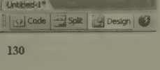

130

## `dom.insertObject()`

### 可用性

Dreamweaver 3。

### 描述

插入指定的对象，如有必要会提示用户输入参数。

### 参数

`objectName`

- `objectName` 参数是 Configuration/Objects 文件夹中一个对象的名称。

### 返回值

无。

### 示例

调用 `dom.insertObject('Button')` 函数会在当前选区之后，将一个表单按钮插入到活动文档中。如果未选中任何内容，此函数会在当前插入点处插入该按钮。

> **注意** 虽然对象文件可以存储在不同的文件夹中，但这些文件具有唯一名称非常重要。如果 Forms 文件夹和 MyObjects 文件夹中都存在一个名为 Button.htm 的文件，Dreamweaver 将无法区分它们。

## `dom.insertText()`

### 可用性

Dreamweaver 3。

### 描述

在当前插入点处将文本内容插入到文档中。

### 参数

`contentToInsert`、`bReplaceCurrentSelection`

- `contentToInsert` 参数是你想要插入的内容。
- `bReplaceCurrentSelection` 参数是可选的，是一个布尔值，指示内容是否应替换当前选区。如果 `bReplaceCurrentSelection` 参数的值为 `true`，则内容替换当前选区。如果值为 `false`，则内容插入在当前选区之后。

### 返回值

无。

### 示例

以下代码将文本：`<b>130</b>` 插入到当前文档中：

```javascript
var theDOM = dreamweaver.getDocumentDOM();
theDOM.insertText('<b>130</b>');
```

结果显示在文档窗口中，如下图所示：

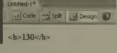

## `dom.newBlock()`

### 可用性

Dreamweaver 3。

### 描述

创建一个新的块，其标签和属性与包含当前选区的块相同，或者如果指针在所有块之外，则创建一个新的段落。

### 参数

无。

### 返回值

无。

### 示例

如果当前选区位于一个居中对齐的段落内，调用 `dom.newBlock()` 函数会在当前段落之后插入 `<p align="center">`。

## `dom.notifyFlashObjectChanged()`

### 可用性

Dreamweaver 4。

### 描述

通知 Dreamweaver 当前的 Flash 对象文件已更改。Dreamweaver 会更新预览显示，根据需要调整其大小，同时保持原始大小的宽高比。例如，Flash 文本使用此功能在用户通过命令对话框更改其属性时，更新布局视图中的文本。

### 参数

无。

### 返回值

无。

## `dom.outdent()`

### 可用性

Dreamweaver 3。

### 描述

减少选区的缩进。

### 参数

无。

### 返回值

无。

## `dom.removeCharacterMarkup()`

### 可用性

Dreamweaver 3。

### 描述

从选区中移除指定类型的字符标记。

### 参数

`tagName`

- `tagName` 参数是与字符标记关联的标签名。它必须是以下字符串之一：“b”、“cite”、“code”、“dfn”、“em”、“i”、“kbd”、“samp”、“s”、“strong”、“tt”、“u” 或 “var”。

### 返回值

无。

## `dom.removeFontMarkup()`

### 可用性

Dreamweaver 3。

### 描述

从 FONT 标签中移除指定的属性及其值。如果移除属性后只剩下 FONT 标签，则 FONT 标签也会被移除。

### 参数

`attribute`

- `attribute` 参数必须是 “face”、“size” 或 “color”。

### 返回值

无。

## `dom.removeLink()`

### 可用性

Dreamweaver 3。

### 描述

从选区中移除超链接。

### 参数

无。

### 返回值

无。

## `dom.resizeSelection()`

### 可用性

Dreamweaver 3。

### 描述

将选中的对象调整为指定的尺寸。

### 参数

`newWidth`、`newHeight`

- `newWidth` 参数指定函数将选中对象设置为新的宽度。
- `newHeight` 参数指定函数将选中对象设置为新的高度。

### 返回值

无。

## `dom.setAttributeWithErrorChecking()`

### 可用性

Dreamweaver 3。

### 描述

为当前选区设置指定的属性为指定的值，如果值类型错误或超出范围，则提示用户。此函数仅对活动文档有效。

### 参数

`attribute`、`value`

- `attribute` 参数指定要为当前选区设置的属性。
- `value` 参数指定要为属性设置的值。

### 返回值

无。

## `dom.setLinkHref()`

### 可用性

Dreamweaver 3。

### 描述

将选区设置为超链接，或更改包含当前选区的 HREF 标签的 URL 值。

### 参数

`linkHREF`

- `linkHREF` 参数是构成链接的 URL（文档相对路径、根相对路径或绝对 URL）。如果省略此参数，将显示“选择 HTML 文件”对话框。

### 返回值

无。

### 启用条件

请参见第 1065 页的 `dom.canSetLinkHref()`。

## `dom.setLinkTarget()`

### 可用性

Dreamweaver 3。

### 描述

设置包围当前选区的链接的目标。此函数等同于循环遍历当前节点的父节点和祖父节点，直到找到链接，然后在该链接上调用 `setAttribute('TARGET')` 函数。

### 参数


`{linkTarget}`

- `linkTarget` 参数是可选的，是一个表示框架名称、窗口名称或保留目标（`"_self"`、`"_parent"`、`"_top"` 或 `"_blank"`）之一的字符串。如果省略此参数，将显示“设置目标”对话框。

### 返回值

无。

## `dom.setListBoxKind()`

### 可用性

Dreamweaver 3。

### 描述

更改所选 SELECT 菜单的类型。

### 参数

`kind`

- `kind` 参数必须是 `"menu"` 或 `"list box"`。

### 返回值

无。

## `dom.showListPropertiesDialog()`

### 可用性

Dreamweaver 3。

### 描述

打开“列表属性”对话框。

### 参数

无。

### 返回值

无。

### 启用条件

请参见第 1065 页的 `dom.canShowListPropertiesDialog()`。

## `dom.setListTag()`

### 可用性

Dreamweaver 3。

### 描述

设置所选列表的样式。

### 参数

`listTag`

- `listTag` 参数是与列表关联的标签。它必须是 `"ol"`、`"ul"`、`"dl"` 或空字符串。

### 返回值

无。

## `dom.setTextAlignment()`

### 可用性

Dreamweaver 3。

### 描述

将包含选区的块的 ALIGN 属性设置为指定的值。

### 参数

`alignValue`

- `alignValue` 参数必须是 `"left"`、`"center"` 或 `"right"`。

### 返回值

无。

## `dom.setTextFieldKind()`

### 可用性

Dreamweaver 3。

### 描述

设置所选文本字段的格式。

### 参数

`fieldType`

- `fieldType` 参数必须是 `"input"`、`"textarea"` 或 `"password"`。

### 返回值

无。

## `dom.setTextFormat()`

### 可用性

Dreamweaver 4。

### 描述

设置所选文本的块格式。

### 参数

`blockFormat`

- `blockFormat` 参数是一个字符串，指定以下格式之一：`""`（无格式）、`"p"`、`"h1"`、`"h2"`、`"h3"`、`"h4"`、`"h5"`、`"h6"` 或 `"pre"`。

### 返回值

无。

## `dom.showFontColorDialog()`

### 可用性

Dreamweaver 3。

### 描述

打开“颜色选择器”对话框。

### 参数

无。

### 返回值

无。

## `dreamweaver.deleteSelection()`

### 可用性

Dreamweaver 3。

### 描述

删除活动文档或站点面板中的选区；在 Macintosh 上，它会删除对话框或浮动面板中具有焦点的文本框。

### 参数

无。

### 返回值

无。

### 启用条件

请参见第 1070 页的 `dreamweaver.canDeleteSelection()`。

## `dreamweaver.editFontList()`

### 可用性

Dreamweaver 3。

### 描述

打开“编辑字体列表”对话框。

### 参数

无。

### 返回值

无。

## `dreamweaver.getFontList()`

### 可用性

Dreamweaver 3。

### 描述

获取文本属性检查器和“样式定义”对话框中显示的所有字体组的列表。

### 参数

无。

### 返回值

一个字符串数组，表示字体列表中的每个项目。

### 示例

对于 Dreamweaver 的默认安装，`dreamweaver.getFontList()` 函数返回一个包含以下项目的数组：

- `"Arial, Helvetica, sans-serif"`
- `"Times New Roman, Times, serif"`
- `"Courier New, Courier, mono"`
- `"Georgia, Times New Roman, Times, serif"`
- `"Verdana, Arial, Helvetica, sans-serif"`

## `dreamweaver.getFontStyles()`

### 可用性

Dreamweaver 4。

### 描述

返回指定 TrueType 字体支持的样式。

### 参数

`fontName`

- `fontName` 参数是一个字符串，包含字体的名称。

### 返回值

一个包含三个布尔值的数组，用于指示字体支持的内容。第一个值指示字体是否支持粗体，第二个值指示字体是否支持斜体，第三个值指示字体是否同时支持粗体和斜体。

## `dreamweaver.getKeyState()`

### 可用性

Dreamweaver 3。

### 描述

判断指定的修饰键是否被按下。

### 参数

`key`

- `key` 参数必须是以下值之一：`"Cmd"`、`"Ctrl"`、`"Alt"` 或 `"Shift"`。在 Windows 中，`"Cmd"` 和 `"Ctrl"` 指的是控制键；在 Macintosh 上，`"Alt"` 指的是 Option 键。

### 返回值

一个布尔值，指示该键是否被按下。

### 示例

以下代码在执行操作之前检查 Shift 和控制键（Windows）或 Shift 和 Command 键（Macintosh）是否同时被按下：

```javascript
if (dw.getKeyState("Shift") && dw.getKeyState("Cmd")){
  // execute code
}
```

## `dreamweaver.getNaturalSize()`

### 可用性

Dreamweaver 4。

### 描述

返回图形对象的宽度和高度。

### 参数

`url`

- `url` 参数指向需要获取尺寸的图形对象。Dreamweaver 必须支持此对象（GIF、JPEG、PNG、Flash 和 Shockwave）。提供给 `getNaturalSize()` 函数的参数 URL 必须是绝对 URL，指向本地文件；不能使用相对 URL。

### 返回值

一个包含两个整数的数组，其中第一个整数定义对象的宽度，第二个定义高度。

## `dreamweaver.getSystemFontList()`

### 可用性

Dreamweaver 4。

### 描述

返回系统字体列表。此函数可以获取所有字体或仅 TrueType 字体。这些字体是 Flash 文本对象所需的。

### 参数

`fontTypes`

- `fontTypes` 参数是一个字符串，包含 `"all"` 或 `"TrueType"`。

### 返回值

一个包含所有字体名称的字符串数组；如果未找到字体，则返回 `null`。

## 打印函数

打印函数允许用户从代码视图打印代码。

## `dreamweaver.printCode()`

### 可用性

Dreamweaver MX。

### 描述

在 Windows 中，此函数打印代码视图中的全部或选定部分代码。在 Macintosh 上，它打印所有代码或某个页码范围的代码。

### 参数

`showPrintDialog, document`

- `showPrintDialog` 参数为 `true` 或 `false`。如果此参数设置为 `true`，在 Windows 中，`dreamweaver.PrintCode()` 函数会显示“打印”对话框，询问用户是要打印所有文本还是选定的文本。在 Macintosh 上，`dreamweaver.PrintCode()` 函数会显示“打印”对话框，询问用户是要打印所有文本还是某个页码范围。

  如果参数设置为 `false`，`dreamweaver.PrintCode()` 将使用用户的先前选择。默认值为 `true`。

- `document` 参数是要打印的文档的 DOM。有关如何获取文档的 DOM 的信息，请参阅第 815 页的 `dreamweaver.getDocumentDOM()`。

### 返回值

一个布尔值：如果代码可以打印则为 `true`；否则为 `false`。

### 示例

以下示例调用 `dw.PrintCode()` 来为用户文档调出“打印”对话框。如果函数返回值为 `false`，代码将显示一个警告框，通知用户无法执行打印请求。

```javascript
var theDOM = dreamweaver.getDocumentDOM("document");
if(!dreamweaver.PrintCode(true, theDOM))
{
  alert("Unable to execute your print request!");
}
```

## 快速标签编辑器函数

快速标签编辑器函数可导航当前选区内及周围的标签。它们可移除层级结构中的任何标签，将选区包裹在新标签内，并显示快速标签编辑器以让用户编辑标签的特定属性。

## `dom.selectChild()`

### 可用性

Dreamweaver 3。

### 描述

选择当前选区的子元素。调用此函数等效于在文档窗口底部的标签选择器中选择右侧的下一个标签。

### 参数

无。

### 返回值

无。

## `dom.selectParent()`

### 可用性

Dreamweaver 3。

### 描述

选择当前选区的父元素。调用此函数等效于在文档窗口底部的标签选择器中选择左侧的下一个标签。

### 参数

无。

### 返回值

无。

## `dom.stripTag()`

### 可用性

Dreamweaver 3。

### 描述

移除当前选区周围的标签，保留任何内容。如果选区没有标签或包含多个标签，Dreamweaver 会报告错误。

### 参数

无。

### 返回值

无。

## `dom.wrapTag()`

### 可用性

Dreamweaver 3。

### 描述

将指定的标签包裹在当前选区周围。如果选区不平衡，Dreamweaver 会报告错误。

### 参数

`startTag`

- `startTag` 参数是与开始标签相关联的源代码。

### 返回值

无。

### 示例

以下代码在当前选区周围包裹一个链接：

```javascript
var theDOM = dw.getDocumentDOM();
var theSel = theDOM.getSelectedNode();
if (theSel.nodeType == Node.TEXT_NODE){
  theDOM.wrapTag('<a href="foo.html">');
}
```

## `dreamweaver.showQuickTagEditor()`

### 可用性

Dreamweaver 3。

### 描述

为当前选区显示快速标签编辑器。

### 参数

`(nearWhat), (mode)`

- 可选的 `nearWhat` 参数，如果指定，必须是 `"selection"` 或 `"tag selector"`。如果省略此参数，默认值为 `"selection"`。

- 可选的 `mode` 参数，如果指定，必须是 `"default"`、`"wrap"`、`"insert"` 或 `"edit"`。如果 `mode` 为 `"default"` 或省略，Dreamweaver 将使用启发式方法确定用于当前选区的模式。如果 `nearWhat` 为 `"tag selector"`，则忽略 `mode` 参数。

### 返回值

无。

## 代码视图函数

代码视图函数包括与编辑文档源代码相关的操作（这些操作会对设计视图产生后续影响）。本节中的函数允许您在拆分文档视图或代码检查器窗口内的代码视图中添加导航控件。

## `dom.formatRange()`

### 可用性

Dreamweaver MX。

### 描述

根据“首选参数”>“代码格式”对话框中的设置，将 Dreamweaver 的自动语法格式应用于代码视图中的指定字符范围。

### 参数

`startOffset`, `endOffset`

- `startOffset` 参数是一个整数，表示从文档开头算起的指定范围的起始偏移量。

- `endOffset` 参数是一个整数，表示从文档开头算起的指定范围的结束偏移量。

### 返回值

无。

## `dom.formatSelection()`

### 可用性

Dreamweaver MX。

### 描述

根据“首选参数”>“代码格式”对话框中的设置，将 Dreamweaver 的自动语法格式应用于选定的内容（与选择“命令”>“应用源格式到所选内容”选项相同）。

### 参数

无。

### 返回值

无。

## `dom.getShowNoscript()`

### 可用性

Dreamweaver MX。

### 描述

获取 `noscript` 内容选项的当前状态（来自“查看”>“Noscript 内容”菜单选项）。默认开启，`noscript` 标签用于标识可在浏览器中渲染或不渲染（由用户选择）的页面脚本内容。

### 参数

无。

### 返回值

一个布尔值：如果 `noscript` 标签内容当前正在渲染则为 `true`；否则为 `false`。

## `dom.getAutoValidationCount()`

### 可用性

Dreamweaver MX 2004。

### 描述

获取文档上次自动验证（也称为内联验证）的错误、警告和信息消息的数量。目前，自动验证期间仅执行目标浏览器检查（请参阅第 826 页的 `dom.runValidation()`）。

**注意：** 此函数仅返回当前在文档的结果窗口中的结果。如果您想确保计数是最新的，可以在调用此函数之前调用 `dom.runValidation()`。

### 参数

无。

### 返回值

一个具有以下属性的对象：

- `numError` 属性，即错误的数量。
- `numWarning` 属性，即警告的数量。
- `numInfo` 属性，即信息消息的数量。

### 示例

```javascript
theDom = dw.getDocumentDOM();
theDom.runValidation();
theDom.getAutoValidationCount();
```

## `dom.isDesignViewUpdated()`

### 可用性

Dreamweaver 4。

### 描述

确定对于需要有效文档状态的 Dreamweaver 操作，设计视图和文本视图内容是否已同步。

### 参数

无。

### 返回值

布尔值：如果设计视图（WYSIWYG）与文本视图中的文本同步，则为 `true`；否则为 `false`。

## `dom.isSelectionValid()`

### 可用性

Dreamweaver 4。

### 描述

确定选择是否有效，即当前是否与设计视图同步，或者是否需要在操作发生之前移动。

### 参数

无。

### 返回值

布尔值：如果当前选择处于有效的代码片段中，则为 `true`；如果文档尚未同步，因为选择未更新，则为 `false`。

## `dom.setShowNoscript()`

### 可用性

Dreamweaver MX。

### 描述

设置 `noscript` 内容选项的打开或关闭状态（与选择“视图”>“Noscript 内容”选项相同）。默认情况下为打开，`noscript` 标签标识可在浏览器中渲染或不渲染（可选择）的页面脚本内容。

### 参数

`{bShowNoscript}`

- `bShowNoscript` 参数是可选的，是一个布尔值，指示是否应渲染 `noscript` 标签内容；如果应渲染 `noscript` 标签内容，则为 `true`，否则为 `false`。

### 返回值

无。

## `dom.source.arrowDown()`

### 可用性

Dreamweaver 4。

### 描述

在代码视图文档中将插入点逐行向下移动。如果内容已被选中，此函数会逐行扩展选择范围。

### 参数

`{nTimes}, {bShiftIsDown}`

- `nTimes` 参数是可选的，是插入点必须移动的行数。如果省略 `nTimes`，默认值为 1。

- `bShiftIsDown` 参数是可选的，是一个布尔值，指示是否正在选择内容。如果 `bShiftIsDown` 为 `true`，则内容被选中。

### 返回值

无。

## `dom.source.arrowLeft()`

### 可用性

Dreamweaver 4。

### 描述

在代码视图的当前行中将插入点向左移动。如果内容已被选中，此函数会向左扩展选择范围。

### 参数

`[nTimes], [bShiftIsDown]`

- `nTimes` 参数是可选的，是插入点必须移动的字符数。如果省略 `nTimes`，默认值为 1。

- `bShiftIsDown` 参数是可选的，是一个布尔值，指示是否正在选择内容。如果 `bShiftIsDown` 为 `true`，则内容被选中。

### 返回值

无。

## `dom.source.arrowRight()`

### 可用性

Dreamweaver 4。

### 描述

在代码视图的当前行中将插入点向右移动。如果内容已被选中，此函数会向右扩展选择范围。

### 参数

`[nTimes], [bShiftIsDown]`

- `nTimes` 参数是可选的，是插入点必须移动的字符数。如果省略 `nTimes`，默认值为 1。

- `bShiftIsDown` 参数是可选的，是一个布尔值，指示是否正在选择内容。如果 `bShiftIsDown` 为 `true`，则内容被选中；否则不被选中。

### 返回值

无。

## `dom.source.arrowUp()`

### 可用性

Dreamweaver 4。

### 描述

在代码视图文档中将插入点逐行向上移动。如果内容已被选中，此函数会逐行扩展选择范围。

### 参数

`nTimes`, `bShiftIsDown`


- `nTimes` 参数是插入点必须移动的行数。如果省略 `nTimes`，默认值为 1。
- `bShiftIsDown` 参数是一个布尔值，指示是否正在选择内容。如果 `bShiftIsDown` 为 true，则内容被选中。

**返回值**

无。

## dom.source.balanceBracesTextView()

**可用性**

Dreamweaver 4。

**描述**

此函数是一个代码视图扩展，可实现括号平衡。您可以调用 `dom.source.balanceBracesTextView()` 将当前高亮显示的选择范围或插入点从周围括号语句的开头扩展到语句末尾，以平衡以下字符：`[ ]`、`( )` 和 `{ }`。后续调用会通过进一步的标点嵌套层级扩展选择范围。

**参数**

无。

**返回值**

无。

## dom.source.endOfDocument()

**可用性**

Dreamweaver 4。

**描述**

将插入点放置在当前代码视图文档的末尾。如果内容已被选中，此函数会将选择范围扩展到文档末尾。

**参数**

`bShiftIsDown`

- `bShiftIsDown` 参数是一个布尔值，指示是否正在选择内容。如果 `bShiftIsDown` 为 true，则内容被选中。

**返回值**

无。

## dom.source.endOfLine()

**可用性**

Dreamweaver 4。

**描述**

将插入点放置在当前行的末尾。如果内容已被选中，此函数会将选择范围扩展到当前行的末尾。

**参数**

`bShiftIsDown`

- `bShiftIsDown` 参数是一个布尔值，指示是否正在选择内容。如果 `bShiftIsDown` 为 true，则内容被选中。

**返回值**

无。

## dom.source.endPage()

**可用性**

Dreamweaver 4。

**描述**

将插入点移动到当前页的末尾，或者如果插入点已经在页末，则移动到下一页的末尾。如果内容已被选中，此函数会逐页扩展选择范围。

**参数**

`[nTimes]`, `[bShiftIsDown]`

- `nTimes` 参数是可选的，是插入点必须移动的页数。如果省略 `nTimes`，默认值为 1。
- `bShiftIsDown` 参数是可选的，是一个布尔值，指示是否正在选择内容。如果 `bShiftIsDown` 为 true，则内容被选中。

**返回值**

无。

## dom.source.getCurrentLines()

**可用性**

Dreamweaver 4。

**描述**

返回从文档开头算起的指定偏移位置所在的行号。

**参数**

无。

**返回值**

当前选择的行号。

## dom.source.getSelection()

### 描述

获取当前文档中的选择，该选择以文档代码视图中字符偏移量的形式表示。

### 参数

无。

### 返回值

一对整数，表示从源文档开头算起的偏移量。第一个整数是选择的开头；第二个是选择的结尾。如果两个数字相等，则选择是一个插入点。如果源文档中没有选择，则两个数字均为 -1。

## dom.source.getLineFromOffset()

### 可用性

Dreamweaver MX。

### 描述

获取源文档中的偏移量。

### 参数

无。

### 返回值

关联的行号，如果偏移量为负数或超出文件末尾，则返回 -1。

## dom.source.getText()

### 可用性

Dreamweaver 4。

### 描述

返回源文档中指定偏移量之间的文本字符串。

### 参数

`startOffset`, `endOffset`

- `startOffset` 参数是一个整数，表示从文档开头算起的偏移量。
- `endOffset` 参数是一个整数，表示文档的结尾。

### 返回值

一个字符串，表示源代码中 `start` 和 `end` 偏移量之间的文本。

## dom.source.getValidationErrorsForOffset()

### 可用性

Dreamweaver MX 2004。

### 描述

返回指定偏移量处的验证错误列表，或从该偏移量开始搜索下一个错误。如果未找到任何错误，函数返回 `null`。

### 参数

`offset`, `[searchDirection]`

- `offset` 参数是一个数字，指定函数将返回错误的代码中的偏移量。
- `searchDirection` 参数是可选的，是一个字符串，指定 "empty"、"forward" 或 "back"。如果指定，函数会从给定偏移量向前或向后搜索到下一个有错误的字符并返回它们。如果未指定，函数仅检查给定偏移量处的错误。

### 返回值

对象数组或值 `null`。数组中的每个对象具有以下属性：

- `message` 对象是一个字符串，包含错误消息。
- `floaterName` 对象是一个字符串，包含结果窗口的名称。您可以将此值传递给 `showResults()` 或 `setFloaterVisibility()` 函数。
- `floaterIndex` 对象是浮动结果列表中项目的索引。
- `start` 对象是下划线代码的起始索引。
- `end` 对象是下划线代码的结束索引。

### 示例

以下示例调用 `getValidationErrorsForOffset()` 来检查当前选择位置处是否存在任何错误。如果该函数返回错误，代码会调用 `alert()` 函数向用户显示错误消息。

```javascript
var offset = dw.getDocumentDOM().source.getSelection()[0];
var errors =
    dw.getDocumentDOM().source.getValidationErrorsForOffset(offset);
if ( errors && errors.length > 0 )
    alert( errors[0].message );
```

## dom.source.indentTextview()

**可用性**

Dreamweaver 4。

**描述**

将选中的代码视图文本向右移动一个制表位。

**参数**

无。

**返回值**

无。

## dom.source.insert()

**可用性**

Dreamweaver 4。

**描述**

将指定字符串插入到源代码中距离源文件开头指定偏移量的位置。如果偏移量小于零，则插入失败，函数返回 `false`。

**参数**

`offset`, `string`

- `offset` 参数是距离文件开头必须插入字符串的偏移量。
- `string` 参数是要插入的字符串。

**返回值**

布尔值：成功返回 `true`；否则返回 `false`。

## dom.source.nextWord()

**可用性**

Dreamweaver 4。

**描述**

将插入点移动到代码视图中下一个单词（如果指定了，则为多个单词）的开头。如果内容已被选中，此函数会将选择范围向右扩展。

**参数**

`[nTimes]`, `[bShiftIsDown]`

- `nTimes` 参数为可选，是插入点必须移动的单词数。如果省略 `nTimes`，默认值为 1。
- `bShiftIsDown` 参数为可选，是一个布尔值，指示是否正在选择内容。如果 `bShiftIsDown` 为 true，则内容被选中。

**返回值**

无。

## dom.source.outdentTextview()

**可用性**

Dreamweaver 4。

**描述**

将选中的代码视图文本向左移动一个制表位。

**参数**

无。

**返回值**

无。

## dom.source.pageDown()

**可用性**

Dreamweaver 4。

**描述**

在代码视图文档中逐页向下移动插入点。如果内容已被选中，此函数会逐页扩展选择范围。

**参数**

`{nTimes}`, `{bShiftIsDown}`

- `nTimes` 参数为可选，是插入点必须移动的页数。如果省略 `nTimes`，默认值为 1。
- `bShiftIsDown` 参数为可选，是一个布尔值，指示是否正在选择内容。如果 `bShiftIsDown` 为 true，则内容被选中。

**返回值**

无。

## dom.source.pageUp()

**可用性**

Dreamweaver 4。

**描述**

在代码视图文档中逐页向上移动插入点。如果内容已被选中，此函数会逐页扩展选择范围。

**参数**

`{nTimes}`, `{bShiftIsDown}`

- `nTimes` 参数为可选，是插入点必须移动的页数。如果省略 `nTimes`，默认值为 1。
- `bShiftIsDown` 参数为可选，是一个布尔值，指示是否正在选择内容。如果 `bShiftIsDown` 为 true，则内容被选中。

**返回值**

无。

## dom.source.previousWord()

**可用性**

Dreamweaver 4。

**描述**

将插入点移动到代码视图中前一个单词（如果指定了，则为多个单词）的开头。如果内容已被选中，此函数会将选择范围向左扩展。

**参数**

`{nTimes}`, `{bShiftIsDown}`

- `nTimes` 参数为可选，是插入点必须移动的单词数。如果省略 `nTimes`，默认值为 1。
- `bShiftIsDown` 参数为可选，是一个布尔值，指示是否正在选择内容。如果 `bShiftIsDown` 为 true，则内容被选中。

**返回值**

无。

## dom.source.replaceRange()

**可用性**

Dreamweaver 4。

**描述**

用 `string` 替换 `startOffset` 和 `endOffset` 之间的源代码文本范围。如果 `startOffset` 大于 `endOffset`，或者任一偏移量不是正整数，则不做任何操作并返回 `false`。如果 `endOffset` 大于文件中的字符数，则替换 `startOffset` 到文件末尾之间的范围。如果 `startOffset` 和 `endOffset` 都大于文件中的字符数，则在文件末尾插入文本。

**参数**

`startOffset`, `endOffset`, `string`

- `startOffset` 参数是指示要替换的块的起始偏移量。
- `endOffset` 参数是指示要替换的块的结束偏移量。
- `string` 参数是要插入的字符串。

**返回值**

布尔值：`true` 表示成功；`false` 表示失败。

## dom.source.scrollEndFile()

**可用性**

Dreamweaver 4。

**描述**

将代码视图滚动到文档文件底部，但不移动插入点。

**参数**

无。

**返回值**

无。

## dom.source.scrollLineDown()

**可用性**

Dreamweaver 4。

**描述**

逐行向下滚动代码视图，但不移动插入点。

**参数**

`nTimes`

- `nTimes` 参数是要滚动的行数。如果省略 `nTimes`，默认值为 1。

**返回值**

无。

## dom.source.scrollLineUp()

**可用性**

Dreamweaver 4。

**描述**

逐行向上滚动代码视图，但不移动插入点。

**参数**

`nTimes`

- `nTimes` 参数是要滚动的行数。如果省略 `nTimes`，默认值为 1。

**返回值**

无。

## dom.source.scrollPageDown()

**可用性**

Dreamweaver 4。

**描述**

逐页向下滚动代码视图，但不移动插入点。

**参数**

`nTimes`

- `nTimes` 参数是要滚动的页数。如果省略 `nTimes`，默认值为 1。

**返回值**

无。

## dom.source.scrollPageUp()

**可用性**

Dreamweaver 4。

**描述**

逐页向上滚动代码视图，但不移动插入点。

**参数**

`nTimes`

- `nTimes` 参数是要滚动的页数。如果省略 `nTimes`，默认值为 1。

**返回值**

无。

## dom.source.scrollTopFile()

**可用性**

Dreamweaver 4。

**描述**

将代码视图滚动到文档文件顶部，但不移动插入点。

**参数**

无。

**返回值**

无。

## dom.source.selectParentTag()

**可用性**

Dreamweaver 4。

**描述**

此函数是代码视图扩展，用于标签平衡。您可以调用 `dom.source.selectParentTag()` 将当前高亮显示的选择范围或插入点从周围的开始标签扩展到结束标签。后续调用会将选择范围扩展到其他周围的标签，直到没有更多包含标签为止。

**参数**

无。

**返回值**

无。

## dom.source.setCurrentLine()

**可用性**

Dreamweaver 4。

**描述**

将插入点置于指定行的开头。如果 `lineNumber` 参数不是正整数，则函数不做任何操作并返回 `false`。如果 `lineNumber` 大于源代码的行数，则将插入点置于最后一行的开头。

**参数**

`lineNumber`

- `lineNumber` 参数是要放置插入点的行号。

**返回值**

布尔值：`true` 表示成功；`false` 表示失败。

## dom.source.startOfDocument()

**可用性**

Dreamweaver 4。

**描述**

将插入点置于代码视图文档的开头。如果内容已被选中，此函数会将选择范围扩展到文档开头。

**参数**

`bShiftIsDown`

- `bShiftIsDown` 参数是一个布尔值，指示是否正在选择内容。如果 `bShiftIsDown` 为 `true`，则内容被选中。

**返回值**

无。

## dom.source.startOfLine()

**可用性**

Dreamweaver 4。

**描述**

将插入点移动到当前行的开头。如果已有内容被选中，此函数会将选区扩展到当前行的开头。

**参数**

`bShiftIsDown`

- `bShiftIsDown` 参数是一个布尔值，指示是否正在选择内容。如果 `bShiftIsDown` 为 `true`，则选择内容。

**返回值**

无。

## dom.source.topPage()

**可用性**

Dreamweaver 4。

**描述**

将插入点移动到当前页面的顶部；如果插入点已经在页面顶部，则移动到上一页的顶部。如果已有内容被选中，此函数会逐页扩展选区。

**参数**

`{nTimes}`、`{bShiftIsDown}`

- `nTimes` 参数为可选参数，是插入点需要移动的页数。如果省略 `nTimes`，默认值为 1。
- `bShiftIsDown` 参数为可选参数，是一个布尔值，指示是否正在选择内容。如果 `bShiftIsDown` 为 `true`，则选择内容。

**返回值**

无。

## dom.source.wrapSelection()

**可用性**

Dreamweaver 4。

**描述**

在当前选区之前插入 `startTag` 的文本，在当前选区之后插入 `endTag` 的文本。然后该函数会选中被插入标签之间（包括标签本身）的整个范围。如果当前选区是一个插入点，则该函数会将插入点置于 `startTag` 和 `endTag` 之间。(`startTag` 和 `endTag` 不一定是标签；它们可以是任意文本。)

**参数**

`startTag`、`endTag`

- `startTag` 参数是在选区开头插入的文本。
- `endTag` 参数是在选区末尾插入的文本。

**返回值**

无。

## dom.synchronizeDocument()

**可用性**

Dreamweaver 4。

**描述**

同步设计视图和代码视图。

**参数**

无。

**返回值**

无。

# 标签编辑器和标签库函数

你可以使用标签编辑器来插入新标签、编辑现有标签，以及访问关于标签的参考信息。标签选择器让用户能够组织自己的标签，以便轻松选择常用的标签。Dreamweaver 自带的标签库存储了关于基于标准的标记语言和大多数广泛使用的基于标签的脚本语言中使用的标签的信息。当你需要在扩展中访问和使用标签编辑器及标签库时，可以使用 JavaScript 标签编辑器、标签选择器和标签库函数。

## dom.getTagSelectorTag()

**可用性**

Dreamweaver MX。

**描述**

此函数获取文档窗口底部标签选择器中当前选中的标签的 DOM 节点。

**参数**

无。

**返回值**

当前选中标签的 DOM 节点；如果没有选中任何标签，则返回 `null`。

## dreamweaver.popupInsertTagDialog()

**可用性**

Dreamweaver MX。

**描述**

此函数检查 VTM 文件，看是否已为该标签定义了标签编辑器。如果有，则弹出该标签的编辑器并接受起始标签。如果没有，则将起始标签不加修改地插入到用户的文档中。

**参数**

一个起始标签字符串，包含以下类型之一的初始值：

- 一个标签，例如 `<input>`
- 一个带属性的标签，例如 `<input type='text'>`
- 一个指令，例如 `<%= %>`

**返回值**

一个布尔值：如果文档中插入了任何内容则为 `true`；否则为 `false`。

## dreamweaver.popupEditTagDialog()

**可用性**


# Dreamweaver MX

## 描述

如果选中了一个标签，此函数会打开该标签的编辑器，以便你可以编辑该标签。

## 参数

无。

## 返回值

无。

## 启用器

参见第 1073 页的`dreamweaver.canPopupEditTagDialog()`。

# dreamweaver.showTagChooser()

## 可用性

Dreamweaver MX。

## 描述

此函数显示标签选择器对话框，将其置于前景并设置为焦点。

## 参数

无。

## 返回值

无。

# dreamweaver.showTagLibraryEditor()

## 可用性

Dreamweaver MX。

## 描述

此函数打开标签库编辑器。

## 参数

无。

## 返回值

无。

# dreamweaver.tagLibrary.getTagLibraryDOM()

## 可用性

Dreamweaver MX。

## 描述

给定一个`filename.vtm`文件的 URL，此函数返回该文件的 DOM，以便可以编辑其内容。此函数仅在标签库编辑器处于活动状态时才应被调用。

## 参数

`fileURL`

- `fileURL`参数是`filename.vtm`文件的 URL，相对于 Configuration/Tag Libraries 文件夹，如以下示例所示：

`"HTML/img.vtm"`

## 返回值

指向 TagLibraries 文件夹中新生成或先前已存在的文件的 DOM 指针。

# dreamweaver.tagLibrary.getSelectedLibrary()

## 可用性

Dreamweaver MX。

## 描述

如果在标签库编辑器中选中了某个库节点，此函数会获取该库的名称。

## 参数

无。

## 返回值

一个字符串，即标签库编辑器中当前选中的库的名称；如果未选中任何库，则返回空字符串。

# dreamweaver.tagLibrary.getSelectedTag()

## 可用性

Dreamweaver MX。

## 描述

如果当前选中了属性节点，此函数会获取包含该属性的标签的名称。

## 参数

无。

## 返回值

一个字符串，即标签库编辑器中当前选中的标签的名称；如果未选中任何标签，则返回空字符串。

# dreamweaver.tagLibrary.importDTDOrSchema()

## 可用性

Dreamweaver MX。

## 描述

此函数从远程服务器导入 DTD 或 schema 文件到标签库中。

## 参数

`fileURL`、`Prefix`

- `fileURL`参数是 DTD 或 schema 文件的路径，采用本地 URL 格式。
- `Prefix`参数是应该添加到此标签库中所有标签的前缀字符串。

## 返回值

导入的标签库的名称。

# dreamweaver.tagLibrary.getImportedTagList()

## 可用性

Dreamweaver MX。

## 描述

此函数从导入的标签库生成一个 tagInfo 对象列表。

## 参数

`libname`

- `libname`参数是导入的标签库的名称。

## 返回值

tagInfo 对象的数组。

tagInfo 对象包含标签库中包含的单个标签的信息。tagInfo 对象中定义了以下属性：

- `tagName`属性，是一个字符串
- `attributes`属性，是一个字符串数组。每个字符串都是为该标签定义的属性的名称。

## 示例

以下示例展示了使用`dw.tagLibrary.getImportedTagList()`函数可以从`libName`库中获取标签数组：

```
// "fileURL" 和 "prefix" 已由用户输入。
// 让标签库导入 DTD/Schema
var libName = dw.tagLibrary.importDTOrSchema(fileURL, prefix);

// 获取此库的标签数组
// 这是 TagInfo 对象
var tagArray = dw.tagLibrary.getImportedTagList(libName);

// 现在我有了一个 tagInfo 对象数组。
// 我可以从中获取信息。这会从第一个对象中获取信息。
// 注意：这里假设数组中至少有一个 TagInfo。
var firstTagName = tagArray[0].name;
var firstTagAttributes = tagArray[0].attributes;
// 注意 firstTagAttributes 是一个属性数组。
```

# 第 18 章 启用器

Macromedia Dreamweaver 8 启用器函数用于确定在当前上下文中另一个函数是否可以执行特定操作。函数规范描述了每个函数返回`true`值的一般情况。然而，这些描述并不全面，可能排除了函数会返回`false`值的一些情况。

## 启用器

JavaScript API 中的启用器函数包括以下函数。

### dom.canAlign()

**可用性**

Dreamweaver 3。

**描述**

检查 Dreamweaver 是否可以执行左对齐、右对齐、顶部对齐或底部对齐操作。

**参数**

无。

**返回值**

一个布尔值，指示是否已选中两个或更多图层或热点。

### dom.canApplyTemplate()

**可用性**

Dreamweaver 3。

**描述**

检查 Dreamweaver 是否可以执行“应用到页面”操作。此函数仅对活动文档有效。

**参数**

无。

**返回值**

一个布尔值，指示文档是否为库项目或模板，以及选区是否在 NOFRAMES 标签内。

### dom.canArrange()

**可用性**

Dreamweaver 3。

**描述**

检查 Dreamweaver 是否可以执行“移至最前”或“移至最后”操作。

**参数**

无。

**返回值**

一个布尔值，指示是否选中了热点。

### dom.canClipCopyText()

**可用性**

Dreamweaver 3。

**描述**

检查 Dreamweaver 是否可以执行“复制为文本”操作。

**参数**

无。

**返回值**

一个布尔值：如果选区的起始和结束偏移量不同，则为`true`；否则为`false`，表示未选中任何内容。

### dom.canClipPaste()

**可用性**

Dreamweaver 3。

**描述**

检查 Dreamweaver 是否可以执行“粘贴”操作。

**参数**

无。

**返回值**

一个布尔值：如果剪贴板中包含可粘贴到 Dreamweaver 的任何内容，则为`true`；否则为`false`。

### dom.canClipPasteText()

**可用性**

Dreamweaver 3。

**描述**

检查 Dreamweaver 是否可以执行“粘贴为文本”操作。

**参数**

无。

**返回值**

一个布尔值：如果剪贴板中包含可作为文本粘贴到 Dreamweaver 的任何内容，则为`true`；否则为`false`。

### dom.canConvertLayersToTable()

**可用性**

Dreamweaver 3。

**描述**

检查 Dreamweaver 是否可以执行“将层转换为表格”操作。

**参数**

无。

**返回值**

一个布尔值：如果文档 BODY 部分中的所有内容都包含在层中，则为`true`；否则为`false`。

### dom.canConvertTablesToLayers()

**可用性**

Dreamweaver 3。

**描述**

检查 Dreamweaver 是否可以执行“将表格转换为层”操作。

**参数**

无。

**返回值**

一个布尔值：如果文档 BODY 部分中的所有内容都包含在表格中，且文档不是基于模板的，则为`true`；否则为`false`。

### dom.canDecreaseColspan()

**可用性**

Dreamweaver 3。

**描述**

检查 Dreamweaver 是否可以执行“减小列跨度”操作。

**参数**

无。

**返回值**

一个布尔值：如果当前单元格具有`COLSPAN`属性且该属性的值大于或等于 2，则为`true`；否则为`false`。

### dom.canDecreaseRowspan()

**可用性**

Dreamweaver 3。

**描述**

检查 Dreamweaver 是否可以执行“减小行跨度”操作。

**参数**

无。

**返回值**

一个布尔值：如果当前单元格具有`ROWSPAN`属性且该属性的值大于或等于 2，则为`true`；否则为`false`。

### dom.canDeleteTableColumn()

**可用性**

Dreamweaver 3。

**描述**

检查 Dreamweaver 是否可以执行“删除列”操作。

**参数**

无。

**返回值**

一个布尔值：如果插入点在单元格内，或选中了单元格或列，则为`true`；否则为`false`。

### dom.canDeleteTableRow()

**可用性**

Dreamweaver 3。

**描述**

检查 Dreamweaver 是否可以执行“删除行”操作。

**参数**

无。

**返回值**

一个布尔值：如果插入点在单元格内，或选中了单元格或行，则为`true`；否则为`false`。

### site.canEditColumns()

**描述**

检查是否存在站点。

**参数**

无。

**返回值**

一个布尔值：如果存在站点，则为`true`；否则为`false`。

### dom.canEditNoFramesContent()

**可用性**

Dreamweaver 3。

**描述**

检查 Dreamweaver 是否可以执行“编辑无框架内容”操作。

**参数**

无。

**返回值**

一个布尔值：如果当前文档是框架集或在框架集内，则为`true`；否则为`false`。

### dom.canIncreaseColspan()

**可用性**

Dreamweaver 3。

**描述**

检查 Dreamweaver 是否可以执行“增大列跨度”操作。

**参数**

无。

**返回值**

一个布尔值：如果当前单元格右侧存在任何单元格，则为`true`；否则为`false`。

### dom.canIncreaseRowspan()

**可用性**

Dreamweaver 3。

**描述**

检查 Dreamweaver 是否可以执行“增大行跨度”操作。

**参数**

无。

**返回值**

一个布尔值：如果当前单元格下方存在任何单元格，则为`true`；否则为`false`。

### dom.canInsertTableColumns()

**可用性**

Dreamweaver 3。

**描述**

检查 Dreamweaver 是否可以执行“插入列”操作。

**参数**

无。

**返回值**

一个布尔值：如果选区在表格内，则为`true`；如果选区是整个表格或不在表格内，则为`false`。

### dom.canInsertTableRows()

**可用性**

Dreamweaver 3。

**描述**

检查 Dreamweaver 是否可以执行“插入行”操作。

**参数**

无。

**返回值**

一个布尔值：如果选区在表格内，则为`true`；如果选区是整个表格或不在表格内，则为`false`。

### dom.canMakeNewEditableRegion()

**可用性**

Dreamweaver 3。

**描述**

检查 Dreamweaver 是否可以执行“新建可编辑区域”操作。

**参数**

无。

**返回值**

一个布尔值：如果当前文档是模板（DWT）文件，则为`true`。

### dom.canMarkSelectionAsEditable()

**可用性**

Dreamweaver 3。

**描述**

检查 Dreamweaver 是否可以执行“将选区标记为可编辑”操作。

**参数**

无。

**返回值**

一个布尔值：如果存在选区且当前文档为 DWT 文件，则为`true`；否则为`false`。

### dom.canMergeTableCells()

**可用性**

Dreamweaver 3。

**描述**

检查 Dreamweaver 是否可以执行“合并单元格”操作。

**参数**

无。

**返回值**

一个布尔值：如果选区是相邻的表格单元格组，则为`true`；否则为`false`。

### dom.canPlayPlugin()

**可用性**

Dreamweaver 3。

**描述**

检查 Dreamweaver 是否可以执行“播放”操作。此函数仅对活动文档有效。

**参数**

无。

**返回值**

一个布尔值：如果选区可以使用插件播放，则为`true`。

### dom.canRedo()

**可用性**

Dreamweaver 3。

**描述**

检查 Dreamweaver 是否可以执行“重做”操作。

**参数**

无。

**返回值**

一个布尔值：如果仍有步骤可以重做，则为`true`；否则为`false`。

### dom.canRemoveEditableRegion()

**可用性**

Dreamweaver 3。

**描述**

检查 Dreamweaver 是否可以执行“取消标记可编辑区域”操作。

**参数**

无。

**返回值**

一个布尔值：如果当前文档是模板，则为`true`；否则为`false`。

### dom.canSelectTable()

**可用性**

Dreamweaver 3。

**描述**

检查 Dreamweaver 是否可以执行“选择表格”操作。

**参数**

无。

**返回值**

一个布尔值：如果插入点或选区在表格内，则为`true`；否则为`false`。

### dom.canSetLinkHref()

**可用性**

Dreamweaver 3。

**描述**

检查 Dreamweaver 是否可以更改当前选区周围的链接，或在必要时创建一个链接。

**参数**

无。

**返回值**

一个布尔值：如果选区是图像、文本，或插入点在链接内，则为`true`；否则为`false`。文本选区是指会出现文本属性检查器的选区。

### dom.canShowListPropertiesDialog()

**可用性**

Dreamweaver 3。

**描述**

检查 Dreamweaver 是否可以显示“列表属性”对话框。

**参数**

无。

**返回值**

一个布尔值：如果选区在 LI 标签内，则为`true`；否则为`false`。

### dom.canSplitFrame()

**可用性**

Dreamweaver 3。

**描述**

检查 Dreamweaver 是否可以执行“拆分框架[左|右|上|下]”操作。

**参数**

无。

**返回值**

一个布尔值：如果选区在框架内，则为`true`；否则为`false`。

### dom.canSplitTableCell()

**可用性**

Dreamweaver 3。

**描述**

检查 Dreamweaver 是否可以执行“拆分单元格”操作。

**参数**

无。

**返回值**

一个布尔值：如果插入点在表格单元格内或选区是表格单元格，则为`true`；否则为`false`。

### dom.canStopPlugin()

**可用性**

Dreamweaver 3。

**描述**

检查 Dreamweaver 是否可以执行“停止”操作。

**参数**

无。

**返回值**

一个布尔值：如果选区当前正通过插件播放，则为`true`；否则为`false`。

### dom.canUndo()

**可用性**

Dreamweaver 3。

**描述**

检查 Dreamweaver 是否能执行撤销操作。

**参数**

无。

**返回值**

一个布尔值：如果有任何步骤可撤销，则为`true`；否则为`false`。

### dom.hasTracingImage()

**可用性**

Dreamweaver 3。

**描述**

检查文档是否有描摹图像。

**参数**

无。

**返回值**

一个布尔值：如果文档有描摹图像，则为`true`；否则为`false`。

### dreamweaver.assetPalette.canEdit()

**可用性**

Dreamweaver 4。

**描述**

启用“资源”面板中的菜单项以进行编辑。

**参数**

无。

**返回值**

返回一个布尔值：如果资源可以编辑，则为`true`；否则为`false`。对于站点列表中的颜色和 URL，返回`false`；对于收藏夹列表中多个选定的颜色和 URL，也返回`false`。

### dreamweaver.assetPalette.canInsertOrApply()

**可用性**

Dreamweaver 4。

**描述**

检查选定元素是否可以被插入或应用。返回`true`或`false`值，以便为插入或应用操作启用或禁用相应的菜单项。

**参数**

无。

**返回值**

返回一个布尔值：如果选定元素可以被插入或应用，则为`true`；如果当前页面是模板且当前类别是“模板”，则为`false`。如果未打开任何文档，或者文档中选定了一个库项目且当前类别是“库”，该函数也返回`false`。

### dreamweaver.canClipCopy()

**可用性**

Dreamweaver 3。

**描述**

检查 Dreamweaver 是否可以执行“复制”操作。

**参数**

无。

**返回值**

一个布尔值：如果选区可以复制，则为`true`；否则为`false`。


检查 Dreamweaver 是否能执行复制操作。

### 参数

无。

### 返回值

一个布尔值：如果有任何选定内容可以复制到剪贴板，则为 `true`；否则为 `false`。

## `dreamweaver.canClipCut()`

### 可用性

Dreamweaver 3。

### 描述

检查 Dreamweaver 是否能执行剪切操作。

### 参数

无。

### 返回值

一个布尔值：如果有任何选定内容可以剪切到剪贴板，则为 `true`；否则为 `false`。

## `dreamweaver.canClipPaste()`

### 可用性

Dreamweaver 3。

### 描述

检查 Dreamweaver 是否能执行粘贴操作。

### 参数

无。

### 返回值

一个布尔值：如果剪贴板包含可以粘贴到当前文档或“站点”面板中活动窗口（在 Macintosh 上，是浮动面板或对话框中的文本字段）中的任何内容，则为 `true`；否则为 `false`。

## `dreamweaver.canDeleteSelection()`

### 可用性

Dreamweaver 3。

### 描述

检查 Dreamweaver 是否能删除当前选区。根据具有焦点的窗口，删除可能发生在文档窗口或“站点”面板中（在 Macintosh 上，是对话框或浮动面板中的文本字段）。

### 参数

无。

### 返回值

一个布尔值：如果选区的开始和结束偏移量不同，则为 `true`，表示存在选区；如果偏移量相同，则为 `false`，表示只有一个插入点。

## `dreamweaver.canExportCSS()`

### 可用性

Dreamweaver 3。

### 描述

检查 Dreamweaver 是否能执行“导出 CSS 样式”操作。

### 参数

无。

### 返回值

一个布尔值：如果文档包含在 HEAD 部分定义的任何类样式，则为 `true`；否则为 `false`。

## `dreamweaver.canExportTemplateDataAsXML()`

### 可用性

Dreamweaver MX。

### 描述

检查 Dreamweaver 是否能将当前文档导出为 XML。

### 参数

无。

### 返回值

一个布尔值：如果可以对当前文档执行导出操作，则为 `true`；否则为 `false`。

### 示例

以下示例调用 `dw.canExportTemplateDataAsXML()` 来确定 Dreamweaver 是否可以将当前文档导出为 XML，如果返回 `true`，则调用 `dw.ExportTemplateDataAsXML()` 进行导出：

```
if(dreamweaver.canExportTemplateDataAsXML())
{
  dreamweaver.exportTemplateDataAsXML("file:///c|/dw_temps/
mytemplate.txt")
}
```

## `dreamweaver.canFindNext()`

### 可用性

Dreamweaver 3。

### 描述

检查 Dreamweaver 是否能执行“查找下一个”操作。

### 参数

无。

### 返回值

一个布尔值：如果已经建立了搜索模式，则为 `true`；否则为 `false`。

## `dreamweaver.canFitSelection()`

### 可用性

Dreamweaver 8。

### 描述

检查活动的设计视图中是否有选区，这意味着可以调用 `fitSelection()`。

### 参数

无。

### 返回值

一个布尔值：如果活动的设计视图中存在选区，则为 `true`；否则为 `false`。

## `dreamweaver.canOpenInFrame()`

### 可用性

Dreamweaver 3。

### 描述

检查 Dreamweaver 是否能执行“在框架中打开”操作。

### 参数

无。

### 返回值

一个布尔值：如果选区或插入点位于框架内，则为 `true`；否则为 `false`。

## `dreamweaver.canPasteSpecial()`

### 可用性

Dreamweaver 8。

### 描述

检查 Dreamweaver 是否能执行“选择性粘贴”操作。

### 参数

无。

### 返回值

一个布尔值：如果剪贴板上有文本、HTML 或 Dreamweaver HTML，并且焦点在代码视图、设计视图或代码检查器中，则为 `true`；否则为 `false`。

## `dreamweaver.canPlayRecordedCommand()`

### 可用性

Dreamweaver 3。

### 描述

检查 Dreamweaver 是否能执行“播放录制的命令”操作。

### 参数

无。

### 返回值

一个布尔值：如果存在一个活动文档和一个先前录制的、可以播放的命令，则为 `true`；否则为 `false`。

## `dreamweaver.canPopupEditTagDialog()`

### 可用性

Dreamweaver MX。

### 描述

检查当前选区是否为一个标签，以及“编辑标签”菜单项是否活动。

### 参数

无。

### 返回值

当前选定标签的名称，如果未选择标签，则返回 `null` 值。

## `dreamweaver.canRedo()`

### 可用性

Dreamweaver 3。

### 描述

检查 Dreamweaver 是否能在当前上下文中执行重做操作。

### 参数

无。

### 返回值

一个布尔值，指示是否有任何操作可以重做。

## `dreamweaver.canRevertDocument()`

### 可用性

Dreamweaver 3。

### 描述

检查 Dreamweaver 是否能执行“恢复”（到上次保存的版本）操作。

### 参数

- `documentObject`：`documentObject` 参数是文档 DOM 树根部的对象（即 `dreamweaver.getDocumentDOM()` 函数返回的值）。

### 返回值

一个布尔值，指示文档是否处于未保存状态，并且在本地驱动器上存在该文档的已保存版本。

## `dreamweaver.canSaveAll()`

### 可用性

Dreamweaver 3。

### 描述

检查 Dreamweaver 是否能执行“全部保存”操作。

### 参数

无。

### 返回值

一个布尔值，指示是否有一个或多个未保存的文档处于打开状态。

## `dreamweaver.canSaveDocument()`

### 可用性

Dreamweaver 3。

### 描述

检查 Dreamweaver 是否能对指定文档执行“保存”操作。

### 参数

- `documentObject`：`documentObject` 参数是文档 DOM 的根（与 `dreamweaver.getDocumentDOM()` 函数返回的值相同）。

### 返回值

一个布尔值，指示文档是否有任何未保存的更改。

## `dreamweaver.canSaveDocumentAsTemplate()`

### 可用性

Dreamweaver 3。

### 描述

检查 Dreamweaver 是否能对指定文档执行“另存为模板”操作。

### 参数

- `documentObject`：`documentObject` 参数是文档 DOM 的根（与 `dreamweaver.getDocumentDOM()` 函数返回的值相同）。

### 返回值

一个布尔值，指示文档是否可以另存为模板。

## `dreamweaver.canSaveFrameset()`

### 可用性

Dreamweaver 3。

### 描述

检查 Dreamweaver 是否能对指定文档执行“保存框架集”操作。

### 参数

- `documentObject`：`documentObject` 参数是文档 DOM 的根（与 `dreamweaver.getDocumentDOM()` 函数返回的值相同）。

### 返回值

一个布尔值，指示文档是否为具有未保存更改的框架集。

## `dreamweaver.canSaveFramesetAs()`

### 可用性

Dreamweaver 3。

### 描述

检查 Dreamweaver 是否能对指定文档执行“框架集另存为”操作。

### 参数

- `documentObject`：`documentObject` 参数是文档 DOM 的根（与 `dreamweaver.getDocumentDOM()` 函数返回的值相同）。

### 返回值

一个布尔值，指示文档是否为框架集。

## `dreamweaver.canSelectAll()`

### 可用性

Dreamweaver 3。

### 描述

检查 Dreamweaver 是否能执行“全选”操作。

### 参数

无。

### 返回值

一个布尔值，指示是否可以执行“全选”操作。

## `dreamweaver.canShowFindDialog()`

### 可用性

Dreamweaver 3。

### 描述

检查 Dreamweaver 是否能执行查找操作。

### 参数

无。

### 返回值

一个布尔值：如果“站点”面板或文档窗口处于打开状态，则为 `true`。当选区位于 HEAD 部分时，此函数返回 `false`。

## `dreamweaver.canUndo()`

### 可用性

Dreamweaver 3。

### 描述

检查 Dreamweaver 是否能在当前上下文中执行撤消操作。

### 参数

无。

### 返回值

一个布尔值，指示是否有任何操作可以撤消。

## `dreamweaver.canZoom()`

### 可用性

Dreamweaver 8。

### 描述

检查是否存在活动的设计视图，这意味着可以应用基本缩放命令。

### 参数

无。

### 返回值

一个布尔值：如果存在活动的设计视图，则为 `true`；否则为 `false`。

## `dreamweaver.cssRuleTracker.canEditSelectedRule()`

### 可用性

Dreamweaver MX 2004。

### 描述

检查是否可以将属性网格编辑器应用于选定规则。由于属性网格可以显示锁定文件中的规则，因此返回值为 `true` 并不能保证可以修改该规则。

### 参数

无。

### 返回值

一个布尔值：如果可以将属性网格编辑器应用于选定规则，则为 `true`；否则为 `false`。

### 示例

以下代码在允许编辑选定规则之前，检查启用函数是否已设置为 `true`：

```
if(dw.cssRuleTracker.canEditSelectedRule()){
   dw.cssRuleTracker.editSelectedRule();
}
```

## `dreamweaver.cssStylePalette.canApplySelectedStyle()`

### 可用性

Dreamweaver MX。

### 描述

检查当前活动文档，以确定是否可以应用选定样式。

### 参数

`{ pane }`

- `pane` 参数是可选的字符串，用于指定此函数所应用到的样式面板窗格。可能的值包括：
  - `"styleList"`：处于“全部”模式的样式列表。
  - `"cascade"`：处于“当前”模式的适用相关规则列表。
  - `"summary"`：处于“当前”模式的当前选区属性列表。
  - `"ruleInspector"`：处于“当前”模式的可编辑属性列表或网格。
- 默认值为 `"styleList"`。

### 返回值

一个布尔值：如果选定样式具有类选择器，则为 `true`；否则为 `false`。

## `dreamweaver.cssStylePalette.canDeleteSelectedStyle()`

### 可用性

Dreamweaver MX。

### 描述

检查当前选区，以确定是否可以删除选定样式。

### 参数

`{ pane }`

- `pane` 参数是可选的字符串，用于指定此函数所应用到的样式面板窗格。可能的值包括：
  - `"stylelist"`：处于“全部”模式的样式列表。
  - `"cascade"`：处于“当前”模式的适用相关规则列表。
  - `"summary"`：处于“当前”模式的当前选区属性列表。
  - `"ruleInspector"`：处于“当前”模式的可编辑属性列表或网格。
- 默认值为 `"stylelist"`。

### 返回值

一个布尔值：如果可以删除选区，则为 `true`；否则为 `false`。

## `dreamweaver.cssStylePalette.canDuplicateSelectedStyle()`

### 可用性

Dreamweaver MX。

### 描述

检查当前活动文档，以确定是否可以复制选定样式。

### 参数

`{ pane }`


## dreamweaver.canSelectAll()

**Availability**

Dreamweaver 3.

**Description**

检查 Dreamweaver 是否可以执行“全选”操作。

**Arguments**

无。

**Returns**

一个布尔值，指示是否可以执行“全选”操作。

## dreamweaver.canShowFindDialog()

**Availability**

Dreamweaver 3.

**Description**

检查 Dreamweaver 是否可以执行查找操作。

**Arguments**

无。

**Returns**

一个布尔值：如果“站点”面板或文档窗口处于打开状态，则为 `true`。当选择位于 HEAD 部分时，此函数返回 `false`。

## dreamweaver.canUndo()

**Availability**

Dreamweaver 3.

**Description**

检查 Dreamweaver 是否可以在当前上下文中执行撤销操作。

**Arguments**

无。

**Returns**

一个布尔值，指示是否有任何操作可以撤销。

## dreamweaver.canZoom()

**Availability**

Dreamweaver 8.

**Description**

检查是否存在活动的“设计”视图，这意味着可以应用基本的缩放命令。

**Arguments**

无。

**Returns**

一个布尔值：如果存在活动的“设计”视图，则为 `true`；否则为 `false`。

## dreamweaver.cssRuleTracker.canEditSelectedRule()

**Availability**

Dreamweaver MX 2004.

**Description**

检查属性网格编辑器是否可以应用于所选规则。由于属性网格可以显示锁定文件中的规则，返回值为 `true` 并不能保证该规则可以被修改。

**Arguments**

无。

**Returns**

一个布尔值：如果属性网格编辑器可以应用于所选规则，则为 `true`；否则为 `false`。

### Example

以下代码检查启用函数是否已设置为 true，然后才允许编辑所选规则：

```
if(dw.cssRuleTracker.canEditSelectedRule()){
   dw.cssRuleTracker.editSelectedRule();
}
```

## dreamweaver.cssStylePalette.canApplySelectedStyle()

**Availability**

Dreamweaver MX.

**Description**

检查当前活动文档，查看所选样式是否可以应用。

**Arguments**

`{ pane }`

- `pane` 参数为可选参数，是一个字符串，指定此函数应用于样式面板的哪个窗格。可能的值包括：`"styleList"`，即“全部”模式下的样式列表；`"cascade"`，即“当前”模式下适用的相关规则列表；`"summary"`，即“当前”模式下当前选择的属性列表；以及 `"ruleInspector"`，即“当前”模式下可编辑的属性列表或网格。默认值为 `"styleList"`。

**Returns**

一个布尔值：如果所选样式具有类选择器，则为 `true`；否则为 `false`。

## dreamweaver.cssStylePalette.canDeleteSelectedStyle()

**Availability**

Dreamweaver MX.

**Description**

检查当前选择，以确定所选样式是否可以删除。

**Arguments**

`{ pane }`

- `pane` 参数为可选参数，是一个字符串，指定此函数应用于样式面板的哪个窗格。可能的值包括：`"stylelist"`，即“全部”模式下的样式列表；`"cascade"`，即“当前”模式下适用的相关规则列表；`"summary"`，即“当前”模式下当前选择的属性列表；以及 `"ruleInspector"`，即“当前”模式下可编辑的属性列表或网格。默认值为 `"stylelist"`。

**Returns**

一个布尔值：如果选择可以删除，则为 `true`；否则为 `false`。

## dreamweaver.cssStylePalette.canDuplicateSelectedStyle()

**Availability**

Dreamweaver MX.

**Description**

检查当前活动文档，查看所选样式是否可以复制。

**Arguments**

`{ pane }`

- `pane` 参数为可选参数，是一个字符串，指定此函数应用于样式面板的哪个窗格。可能的值包括：`"stylelist"`，即“全部”模式下的样式列表；`"cascade"`，即“当前”模式下适用的相关规则列表；`"summary"`，即“当前”模式下当前选择的属性列表；以及 `"ruleInspector"`，即“当前”模式下可编辑的属性列表或网格。默认值为 `"stylelist"`。

**Returns**

一个布尔值：如果所选样式可以复制，则为 `true`；否则为 `false`。

## dreamweaver.cssStylePalette.canEditSelectedStyle()

**Availability**

Dreamweaver MX.

**Description**

检查当前活动文档，查看所选样式是否可以编辑。

**Arguments**

`{ pane }`

- `pane` 参数为可选参数，是一个字符串，指定此函数应用于样式面板的哪个窗格。可能的值包括：`"stylelist"`，即“全部”模式下的样式列表；`"cascade"`，即“当前”模式下适用的相关规则列表；`"summary"`，即“当前”模式下当前选择的属性列表；以及 `"ruleInspector"`，即“当前”模式下可编辑的属性列表或网格。默认值为 `"stylelist"`。

**Returns**

一个布尔值：如果所选样式可编辑，则为 `true`；否则为 `false`。

## dreamweaver.cssStylePalette.canEditSelectedStyleInCodeview()

**Availability**

Dreamweaver SOAP 此功能在 Dreamweaver MX 中可用。

**Description**

检查当前活动文档，查看所选样式是否可以在“代码”视图中编辑。

**Arguments**

`{ pane }`

- `pane` 参数为可选参数，是一个字符串，指定此函数应用于样式面板的哪个窗格。可能的值包括：`"stylelist"`，即“全部”模式下的样式列表；`"cascade"`，即“当前”模式下适用的相关规则列表；`"summary"`，即“当前”模式下当前选择的属性列表；以及 `"ruleInspector"`，即“当前”模式下可编辑的属性列表或网格。默认值为 `"stylelist"`。

**Returns**

一个布尔值：如果所选样式可编辑，则为 `true`；否则为 `false`。

## dreamweaver.cssStylePalette.canEditStyleSheet()

**Availability**

Dreamweaver MX.

**Description**

检查当前选择，查看其中是否包含可编辑的样式表元素。

**Arguments**

无。

**Returns**

一个布尔值：如果所选内容是样式表节点或样式表节点内的样式定义，且该样式表既未隐藏也不位于本文档中，则为 `true`；如果所选内容被隐藏或位于本文档中，则为 `false`。

## dreamweaver.cssStylePalette.canRenameSelectedStyle()

**Availability**

Dreamweaver MX.

**Description**

检查当前活动文档，查看所选样式是否可以重命名。

**Arguments**

`{ pane }`

- `pane` 参数为可选参数，是一个字符串，指定此函数应用于样式面板的哪个窗格。可能的值包括：`"stylelist"`，即“全部”模式下的样式列表；`"cascade"`，即“当前”模式下适用的相关规则列表；`"summary"`，即“当前”模式下当前选择的属性列表；以及 `"ruleInspector"`，即“当前”模式下可编辑的属性列表或网格。默认值为 `"stylelist"`。

**Returns**

一个布尔值：如果所选样式可以重命名，则为 `true`；否则为 `false`。

## dreamweaver.isRecording()

**Availability**

Dreamweaver 3.

**Description**

报告 Dreamweaver 当前是否正在录制命令。

**Arguments**

无。

**Returns**

一个布尔值，指示 Dreamweaver 是否正在录制命令。

## dreamweaver.htmlStylePalette.canEditSelection()

**Availability**

Dreamweaver 3.

**Description**

检查 Dreamweaver 是否可以编辑、删除或复制“HTML 样式”面板中的所选内容。

**Arguments**

无。

**Returns**

一个布尔值：如果 Dreamweaver 可以编辑、删除或复制“HTML 样式”面板中的所选内容，则为 `true`；如果未选择任何样式或选择了任一清除样式，则为 `false`。

## dreamweaver.resultsPalette.canClear()

**Availability**

Dreamweaver MX.

**Description**

检查是否可以清除当前处于焦点状态的“结果”面板的内容。

**Arguments**

无。

**Returns**

一个布尔值：`true` 表示可以清除；`false` 表示不能。

## dreamweaver.resultsPalette.canCopy()

**Availability**

Dreamweaver MX.

**Description**

检查当前结果窗口是否可以显示其内容中的“已复制”消息。

**Arguments**

无。

**Returns**

一个布尔值：`true` 表示内容可以显示；`false` 则表示不能。

## dreamweaver.resultsPalette.canCut()

**Availability**

Dreamweaver MX.

**Description**

检查当前结果窗口是否可以显示其内容中的“已剪切”消息。

**Arguments**

无。

**Returns**

一个布尔值：`true` 表示内容可以显示；`false` 则表示不能。

## dreamweaver.resultsPalette.canPaste()

**Availability**

Dreamweaver MX.

**Description**

检查当前结果窗口是否可以显示其内容中的“已粘贴”消息。

**Arguments**

无。

**Returns**

一个布尔值：`true` 表示内容可以显示；`false` 则表示不能。

## dreamweaver.resultsPalette.canOpenInBrowser()

**Availability**

Dreamweaver MX.

**Description**

检查当前报告是否可以在浏览器中显示。

**Arguments**

无。

**Returns**

一个布尔值：`true` 表示内容可以显示；`false` 则表示不能。

## dreamweaver.resultsPalette.canOpenInEditor()

**Availability**

Dreamweaver MX.

**Description**

检查当前报告是否可以在编辑器中显示。

**Arguments**

无。

**Returns**

一个布尔值：`true` 表示内容可以显示；`false` 则表示不能。

## dreamweaver.resultsPalette.canSave()

**Availability**

Dreamweaver MX.

**Description**

检查当前面板是否可以打开“保存”对话框。目前，站点报告、目标浏览器检查、验证和链接检查面板支持“保存”对话框。

**Arguments**

无。

**Returns**

一个布尔值：`true` 表示“保存”对话框可以出现；`false` 则表示不能。

## dreamweaver.resultsPalette.canSelectAll()

**Availability**

Dreamweaver MX.

**Description**

检查是否可以向当前获得焦点的窗口发送“全选”消息。

**Arguments**

无。

**Returns**

一个布尔值：`true` 表示可以发送“全选”消息；`false` 则表示不能。

## dreamweaver.siteSyncDialog.canCompare()

**Availability**

Dreamweaver 8.

**Description**

此函数检查“站点同步”对话框中的“比较”上下文菜单是否可以显示。

**Arguments**

无。

**Returns**

一个布尔值：`true` 表示“比较”上下文菜单可以显示；`false` 则表示不能。

## dreamweaver.siteSyncDialog.canMarkDelete()

**Availability**

Dreamweaver 8.

**Description**

此函数检查“站点同步”对话框中的“将操作更改为删除”上下文菜单是否可以显示。

**Arguments**

无。

**Returns**

一个布尔值：`true` 表示“将操作更改为删除”上下文菜单可以显示；`false` 则表示不能。

## dreamweaver.siteSyncDialog.canMarkGet()

**Availability**

Dreamweaver 8.

**Description**

此函数检查“站点同步”对话框中的“将操作更改为获取”上下文菜单是否可以显示。

**Arguments**

无。

**Returns**

一个布尔值：`true` 表示“将操作更改为获取”上下文菜单可以显示；`false` 则表示不能。

## dreamweaver.siteSyncDialog.canMarkIgnore()

**Availability**

Dreamweaver 8.

**Description**

此函数检查“站点同步”对话框中的“将操作更改为忽略”上下文菜单是否可以显示。

**Arguments**

无。

**Returns**

一个布尔值：`true` 表示“将操作更改为忽略”上下文菜单可以显示；`false` 则表示不能。

## dreamweaver.siteSyncDialog.canMarkPut()

**Availability**

Dreamweaver 8.

**Description**

此函数检查“站点同步”对话框中的“将操作更改为上传”上下文菜单是否可以显示。

**Arguments**

无。

**Returns**

一个布尔值：`true` 表示“将操作更改为上传”上下文菜单可以显示；`false` 则表示不能。


无。

## dreamweaver.siteSyncDialog.canMarkUploaded()

### 返回值

一个布尔值：`true` 表示“将操作更改为上传”上下文菜单可以显示；`false` 则表示不能。

## dreamweaver.siteSyncDialog.canMarkSynced()

### 可用性

Dreamweaver 8。

### 描述

此函数检查“站点同步”对话框中的“将操作更改为已同步”上下文菜单是否可以显示。

### 参数

无。

### 返回值

一个布尔值：`true` 表示“将操作更改为已同步”上下文菜单可以显示；`false` 则表示不能。

## dreamweaver.snippetpalette.canEditSnippet()

### 可用性

Dreamweaver MX。

### 描述

检查是否可以编辑当前选定的项目，并返回 `true` 或 `false` 值，以便你可以启用或禁用用于编辑的菜单项。

### 参数

无。

### 返回值

一个布尔值：`true` 表示可以编辑当前选定的项目；`false` 则表示不能。

## dreamweaver.snippetpalette.canInsert()

### 可用性

Dreamweaver MX。

### 描述

检查是否可以插入或应用选定的元素，并返回 `true` 或 `false` 值，以便你可以启用或禁用用于插入或应用的菜单项。

### 参数

无。

### 返回值

一个布尔值：`true` 表示可以插入或应用选定的元素；`false` 则表示不能。

## site.browseDocument()

### 可用性

Dreamweaver 4。

### 描述

在浏览器窗口中打开所有选定的文档。这与使用“在浏览器中预览”命令相同。

### 参数

`browserName`

- `browserName` 参数是“在浏览器中预览”首选项中定义的浏览器名称。如果省略，此参数默认为用户的主要浏览器。

### 返回值

无。

## site.canAddLink()

### 可用性

Dreamweaver 3。

### 描述

检查 Dreamweaver 是否可以执行“向[现有文件 | 新建文件]添加链接”操作。

### 参数

无。

### 返回值

一个布尔值：`true` 表示站点地图中选定的文档是 HTML 文件；`false` 则表示不是。

## site.canChangeLink()

### 可用性

Dreamweaver 3。

### 描述

检查 Dreamweaver 是否可以执行“更改链接”操作。

### 参数

无。

### 返回值

一个布尔值：`true` 表示一个 HTML 或 Flash 文件链接到站点地图中的选定文件；`false` 则表示没有。

## site.canCheckIn()

### 可用性

Dreamweaver 3。

### 描述

确定 Dreamweaver 是否可以执行“签入”操作。

### 参数

`siteOrURL`

- `siteOrURL` 参数必须是 `site` 关键字，这表示该函数应作用于“站点”面板中的选择内容或单个文件的 URL。

### 返回值

一个布尔值：如果满足以下所有条件，则返回 `true`；否则返回 `false`：

- 已定义一个远程站点。
- 如果文档窗口具有焦点，则该文件已保存在本地站点中；或者，如果“站点”面板具有焦点，则选择了一个或多个文件或文件夹。
- 该站点已启用“签入/签出”功能。

## site.canCheckOut()

### 可用性

Dreamweaver 3。

### 描述

确定 Dreamweaver 是否可以对指定的文件执行“签出”操作。

### 参数

`siteOrURL`

- `siteOrURL` 参数必须是 `site` 关键字，这表示该函数应作用于“站点”面板中的选择内容或单个文件的 URL。

### 返回值

一个布尔值：如果满足以下所有条件，则返回 `true`；否则返回 `false`：

- 已定义一个远程站点。
- 如果文档窗口具有焦点，则该文件是本地站点的一部分且尚未签出；或者，如果“站点”面板具有焦点，则选择了一个或多个文件或文件夹，并且至少有一个选定的文件尚未签出。
- 该站点已启用“签入/签出”功能。

## site.canCloak()

### 可用性

Dreamweaver MX。

### 描述

确定 Dreamweaver 是否可以执行“隐藏”操作。

### 参数

`siteOrURL`

- `siteOrURL` 参数必须是 `site` 关键字，这表示 `canCloak()` 函数应作用于“站点”面板中的选择内容；或者是特定文件夹的 URL，这表示 `canCloak()` 函数应作用于该文件夹及其所有内容。

### 返回值

一个布尔值：`true` 表示 Dreamweaver 可以对当前站点或指定的文件夹执行隐藏操作；`false` 则表示不能。

## site.canCompareFiles()

### 可用性

Dreamweaver 8。

### 描述

此函数检查 Dreamweaver 是否可以对选定的文件执行比较功能。

### 参数

无。

### 返回值

一个布尔值：`true` 表示选择了两个文件（一个本地文件和一个远程文件，两个本地文件，或两个远程文件）；`false` 则表示不是。

## site.canConnect()

### 可用性

Dreamweaver 3。

### 描述

检查 Dreamweaver 是否可以连接到远程站点。

### 参数

无。

### 返回值

一个布尔值：`true` 表示当前远程站点是一个 FTP 站点；`false` 则表示不是。

## site.canFindLinkSource()

### 可用性

Dreamweaver 3。

### 描述

检查 Dreamweaver 是否可以执行“查找链接源”操作。

### 参数

无。

### 返回值

一个布尔值，表示站点地图中选中的链接不是主页。

## site.canGet()

### 可用性

Dreamweaver 3。

### 描述

确定 Dreamweaver 是否可以执行“获取”操作。

### 参数

`siteOrURL`

- `siteOrURL` 参数必须是 `site` 关键字，这表示该函数应对“站点”面板中的选择或单个文件的 URL 执行操作。

### 返回值

如果参数是 `site`，则返回一个布尔值，表示“站点”面板中是否选中了一个或多个文件或文件夹，并且是否已定义了远程站点。如果参数是 URL，则返回一个布尔值，表示该文档是否属于一个已定义了远程站点的站点。

## site.canLocateInSite()

### 可用性

Dreamweaver 3。

### 描述

确定 Dreamweaver 是否可以执行“在本地站点中定位”或“在远程站点中定位”操作（取决于参数）。

### 参数

```text
localOrRemote, siteOrURL
```

- `localOrRemote` 参数必须是 `local` 或 `remote`。
- `siteOrURL` 参数必须是 `site` 关键字，这表示该函数应对“站点”面板中的选择或单个文件的 URL 执行操作。

### 返回值

以下值之一：

- 如果第一个参数是关键字 `local` 且第二个参数是 URL，则返回一个布尔值，表示该文档是否属于一个站点。
- 如果第一个参数是关键字 `remote` 且第二个参数是 URL，则返回一个布尔值，表示该文档是否属于一个已定义了远程站点的站点，并且如果服务器类型是“本地/网络”，则表示驱动器是否已挂载。
- 如果第二个参数是关键字 `site`，则返回一个布尔值，表示两个窗口是否都包含站点文件（而非站点地图），以及选择是否位于与参数相对的窗格中。

## site.canMakeEditable()

### 可用性

Dreamweaver 3。

### 描述

检查 Dreamweaver 是否可以执行“关闭只读”操作。

### 参数

无。

### 返回值

一个布尔值：如果 Dreamweaver 可以执行“关闭只读”操作，则为 `true`；如果选中的一个或多个文件被锁定，则为 `false`。

## site.canMakeNewFileOrFolder()

### 可用性

Dreamweaver 3。

### 描述

检查 Dreamweaver 是否可以在“站点”面板中执行“新建文件”或“新建文件夹”操作。

### 参数

无。

### 返回值

一个布尔值：如果“站点”面板的选中窗格中可见任何文件，则为 `true`；否则为 `false`。

## site.canOpen()

### 可用性

Dreamweaver 3。

### 描述

检查 Dreamweaver 是否可以打开当前在“站点”面板中选中的文件或文件夹。

### 参数

无。

### 返回值

一个布尔值：如果“站点”面板中选中了任何文件或文件夹，则为 `true`；否则为 `false`。

## site.canPut()

### 可用性

Dreamweaver 3。

### 描述

确定 Dreamweaver 是否可以执行“上传”操作。

### 参数

`siteOrURL`

- `siteOrURL` 参数必须是 `site` 关键字，这表示该函数应对“站点”面板中的选择或单个文件的 URL 执行操作。

### 返回值

以下值之一：

- 如果参数是关键字 `site`，则当“站点”面板中选中了任何文件或文件夹且已定义了远程站点时，返回值 `true`；否则返回 `false`。
- 如果参数是 URL，则当该文档属于一个已定义了远程站点的站点时，返回值 `true`；否则返回 `false`。

## site.canRecreateCache()

### 可用性

Dreamweaver 3。

### 描述

检查 Dreamweaver 是否可以执行“重新创建站点缓存”操作。

### 参数

无。

### 返回值

一个布尔值：如果为当前站点启用了“使用缓存加速链接更新”选项，则为 `true`。

## site.canRefresh()

### 可用性

Dreamweaver 3。

### 描述

检查 Dreamweaver 是否可以执行“刷新 [本地 | 远程]”操作。

### 参数

`localOrRemote`

- `localOrRemote` 参数必须是 `local` 或 `remote` 关键字。

### 返回值

如果 `localOrRemote` 参数是 `local` 关键字，则返回值为 `true`；否则返回一个布尔值，表示是否已定义了远程站点。

## site.canRemoveLink()

### 可用性

Dreamweaver 3。

### 描述

检查 Dreamweaver 是否可以执行“移除链接”操作。

### 参数

无。

### 返回值

一个布尔值，表示一个 HTML 或 Flash 文件是否链接到站点地图中的选定文件。

## site.canSetLayout()

### 可用性

Dreamweaver 3。

### 描述

确定 Dreamweaver 是否可以执行“布局”操作。

### 参数

无。

### 返回值

一个布尔值：如果站点地图可见，则为 `true`；否则为 `false`。

## site.canSelectAllCheckedOutFiles()

### 可用性

Dreamweaver 4。

### 描述

确定当前工作站点是否启用了“签入/签出”功能。

### 参数

无。

### 返回值

一个布尔值：如果站点允许“签入/签出”，则为 `true`；否则为 `false`。

## site.canSelectNewer()

### 可用性

Dreamweaver 3。

### 描述

确定 Dreamweaver 是否可以执行“选择较新的 {远程 | 本地}”操作。

### 参数

`localOrRemote`

- `localOrRemote` 参数必须是 `local` 或 `remote` 关键字。

### 返回值

一个布尔值，表示该文档是否属于一个已定义了远程站点的站点。

## site.canShowPageTitles()

### 可用性

Dreamweaver 3。

### 描述

确定 Dreamweaver 是否可以执行“显示页面标题”操作。

### 参数

无。

### 返回值

一个布尔值：如果站点地图可见，则为 `true`；否则为 `false`。

## site.canSynchronize()

### 可用性

Dreamweaver 3。

### 描述

确定 Dreamweaver 是否可以执行“同步”操作。

### 参数

无。

### 返回值

一个布尔值，表示是否已定义了远程站点。

## site.canUncloak()

### 可用性

Dreamweaver MX。

### 描述

确定 Dreamweaver 是否可以执行取消隐藏操作。

### 参数

`siteOrURL`

- `siteOrURL` 参数必须是 `site` 关键字，这表示 `canUncloak()` 函数应对“站点”面板中的选择执行操作；或者是特定文件夹的 URL，这表示 `canUncloak()` 函数应对该文件夹及其所有内容执行操作。

### 返回值

一个布尔值：如果 Dreamweaver 可以对当前站点或指定文件夹执行取消隐藏操作，则为 `true`；否则为 `false`。

## site.canUndoCheckOut()

### 可用性

Dreamweaver 3。

### 描述

确定 Dreamweaver 是否可以执行“撤销签出”操作。

### 参数

`siteOrURL`

- `siteOrURL` 参数必须是 `site` 关键字，这表示该函数应对“站点”面板中的选择或单个文件的 URL 执行操作。

### 返回值

一个布尔值：如果指定的文件或至少一个选中的文件已签出，则为 `true`。

## site.canViewAsRoot()

### 可用性

Dreamweaver 3。

### 描述

确定 Dreamweaver 是否可以执行“作为根查看”操作。

### 参数

无。

### 返回值

一个布尔值：如果指定的文件是 HTML 或 Flash 文件，则为 `true`；否则为 `false`。

## 索引

### A

- 关于对话框 661
- `activeViewScale()` 968
- `addBehavior()` 872
- `addDebugContextData()` 701
- `addItem()` 689
- `addLinkToExistingFile()` 767
- `addLinkToNewFile()` 767
- `addResultItem()` 690
- `addSpacerToColumn()` 957
- 警报 660
- `align()` 947
- 对齐
  - 图层 947
  - 跟踪图像 954
- API 类型
  - 数据库 573
  - 数据库连接对话框 607
  - 设计备注 544
  - 文件 I/O 521
  - Fireworks 集成 557
  - Flash 对象 567
  - HTTP 533
  - JavaBeans 615
  - 源代码管理集成 623
- 应用程序函数
  - 外部 651
  - 全局 659
- 应用程序
  - 打开文件 657
  - 选择 658
- `applyCharacterMarkup()` 1004
- `applyComment()` 755
- `applyConnection()` 610
- `applyCSSStyle()` 924
- `applyFontMarkup()` 1005
- 应用样式 924
- `applySelectedStyle()` 932
- `applyTemplate()` 889
- `arrange()` 947
- `arrangeFloatingPalettes()` 956
- 排列
  - 浮动面板 956
  - 热点 947
- `arrowDown()` 677, 1031
- `arrowLeft()` 678, 1032
- `arrowRight()` 678, 1032
- `arrowUp()` 679, 1033
- `assetPalette.addToFavoritesFromDocument()` 859
- `assetPalette.addToFavoritesFromSiteAssets()` 860
- `assetPalette.addToFavoritesFromSiteWindow()` 860
- `assetPalette.canEdit()` 1067
- `assetPalette.canInsertOrApply()` 1068
- `assetPalette.copyToSite()` 861
- `assetPalette.edit()` 861
- `assetPalette.getSelectedCategory()` 862
- `assetPalette.getSelectedItems()` 862
- `assetPalette.getSelectedView()` 863
- `assetPalette.insertOrApply()` 863
- `assetPalette.locateInSite()` 864
- `assetPalette.newAsset()` 864
- `assetPalette.newFolder()` 865
- `assetPalette.recreateLibraryFromDocument()` 865
- `assetPalette.refreshSiteAssets()` 865
- `assetPalette.removeFromFavorites()` 866
- `assetPalette.renameNickname()` 866


- `assetPalette.setSelectedCategory()` 867
- `assetPalette.setSelectedView()` 867
- 资源面板（调色板）函数 859
- `attachExternalStylesheet()` 933
- 属性
  - 获取 524
  - 设置文件属性 529
  - 代码片断标签 896
- 音频警报 660

## B

- 退格键，按键 679
- `backspaceKey()` 679
- `balanceBracesTextView()` 1033
- `beep()` 660, 662, 760, 761, 798
- 文档开头 684
- 行为函数 872
  - 服务器 912
- 块
  - 边框 963, 966
  - 着色 963, 965
  - ID 964, 966
- 边框 963
  - 块 966
  - div 966
- 盒模型，着色 965
- `bringAttentionToFloater()` 735
- `bringDWToFront()` 557
- `bringFWToFront()` 558
- 将 Dreamweaver 带到前台 557
- 将 Fireworks 带到前台 558
- `browseDocument()` 651, 1090
- `browseForFileURL()` 809
- `browseForFolderURL()` 810
- 浏览器
  - 在浏览器中检查文档 825
  - 列表 652
  - 打开 URL 651
  - 主要 655
  - 次要 655
  - 目标 696

## C

- `canAddLinkToFile()` 1090
- `canAlign()` 1055
- `canApplyTemplate()` 1056
- `canArrange()` 1056
- `canChangeLink()` 1091
- `canCheckIn()` 1091
- `canCheckOut()` 1092
- `canClear()` 1083
- `canClipCopy()` 1068
- `canClipCopyText()` 1056
- `canClipCut()` 1069
- `canClipPaste()` 1057, 1069
- `canClipPasteText()` 1057
- `canCloak()` 1092
- `canConnect()` 1093
- `canConvertLayersToTable()` 1058
- `canConvertTablesToLayers()` 1058
- `canCopy()` 1084
- `canCut()` 1084
- `canDecreaseColspan()` 1058
- `canDecreaseRowspan()` 1059
- `canDeleteTableColumn()` 1059
- `canDeleteTableRow()` 1060
- `canEditColumns()` 1060
- `canEditNoFramesContent()` 1060
- `canEditSelectedRule()` 1078
- `canEditSelection()` 1083
- `canExportCSS()` 1070
- `canExportTemplateDataAsXML()` 1071
- `canFindLinkSource()` 1094
- `canFindNext()` 1071
- `canGet()` 1094
- `canIncreaseColspan()` 1061
- `canIncreaseRowspan()` 1061
- `canInsertTableColumns()` 1061
- `canInsertTableRows()` 1062
- `canLocateInSite()` 1095
- `canMakeEditable()` 1095
- `canMakeNewEditableRegion()` 1062
- `canMakeNewFileOrFolder()` 1096
- `canMarkSelectionAsEditable()` 1063
- `canMergeTableCells()` 1063
- `canOpen()` 1096
- `canOpenInBrowser()` 1085
- `canOpenInEditor()` 1085
- `canOpenInFrame()` 1072
- `canPaste()` 1084
- `canPlayPlugin()` 1063
- `canPlayRecordedCommand()` 1073
- `canPopupEditTagDialog()` 1073
- `canPut()` 1097
- `canRecreateCache()` 1097
- `canRedo()` 1064, 1074
- `canRefresh()` 1098
- `canRemoveEditableRegion()` 1064
- `canRemoveLink()` 1098
- `canRevertDocument()` 1074
- `canSave()` 1085
- `canSaveAll()` 1074
- `canSaveDocument()` 1075
- `canSaveDocumentAsTemplate()` 1075
- `canSaveFrameset()` 1076
- `canSaveFramesetAs()` 1076
- `canSelectAll()` 1077, 1086
- `canSelectAllCheckedOutFiles()` 1099
- `canSelectNewer()` 1099
- `canSelectTable()` 1064
- `canSetLayout()` 1099
- `canSetLinkHref()` 1065
- `canShowFindDialog()` 1077
- `canShowListPropertiesDialog()` 1065
- `canSplitFrame()` 1066
- `canSplitTableCell()` 1066
- `canStopPlugin()` 1066
- `canSynchronize()` 1100
- `canUncloak()` 1101
- `canUndo()` 1067, 1077
- `canUndoCheckOut()` 1101
- `canViewAsRoot()` 1102
- `cascade()` 735
- 级联文档窗口 735
- 将层叠样式表转换为 HTML 标记 803
- `changeLink()` 768
- `changeLinkSitewide()` 768
- 签出的名称 633
- `checkIn()` 768
- 在浏览器中检查文档 825
- 签入 633
- 签入文件 633, 647
- 签出 634
- 签出文件 634
  - 编号 635
  - 撤销 634
- 拼写检查 825
- `checkLinks()` 769
- `checkOut()` 770
- `checkSpelling()` 825
- `checkTargetBrowsers()` 770, 825
- 类名，JavaBeans 615
- 类，内省 JavaBeans 616, 617, 618
- 清理，XHTML 文档 806
- `cleanupXHTML()` 806
- `clear()` 696
- `clearGuides()` 972
- 清除历史记录面板 670
- `clearServerScriptsFolder()` 534
- `clearSteps()` 669
- `clearTemp()` 535
- 剪贴板函数 883
- `clipCopy()` 883, 886
- `clipCopyText()` 883
- `clipCut()` 884, 887
- `clipPaste()` 884, 887
- `clipPasteText()` 885
- `cloak()` 771
- `closeDocument()` 810
- `CloseNotesFile()` 550
- 关闭
  - 设计备注文件 544, 550
  - 文档 810
- 代码着色 997
- 代码函数
  - 代码提示和着色 993
  - 代码视图 1028
  - 代码片段面板 895
- 代码检查器
  - 自动缩进 720
  - 无效 HTML 718, 720
  - 行号 719
  - 语法着色 719
  - 自动换行 719, 722
- 代码视图 734
  - 自动缩进 704
  - 无效 HTML 704
  - 行号 707, 714
  - 切换到 935
  - 语法着色 707
  - 自动换行 709, 716
- `codeHints.addFunction()` 995, 997
- `codeHints.addMenu()` 994
- `codeHints.resetMenu()` 996
- `codeHints.showCodeHints()` 997
- ColdFusion 管理器 587
- ColdFusion 组件资源管理器 777, 778, 782
- ColdFusion 数据源名称 575
- ColdFusion 数据源 585
- `collapseFullTag()` 749
- `collapseSelectedCodeFragment()` 747
- `collapseSelectedCodeFragmentInverse()` 747, 751
- `collapseSelectedCodeFragment()` 750
- 着色
  - 块 963, 965
  - 盒模型 941
  - 盒模型 965, 967
  - 代码 993, 997
  - div 963, 965
  - 参考线 975
  - 布局块背景 943
- 列跨度，减少 982
- 列 591, 592, 593
  - 从语句获取 590, 591
  - 从存储过程获取 596, 597
  - 从表获取 593
  - 在 SQL SELECT 中 590
  - 名称 593
  - 结果集 596, 597
  - 大小调整 960, 961, 962
  - 类型 590
  - 结果窗口中的宽度 693
- 命令菜单函数 804
- 命令
  - 执行 805
  - 录制的 667
- 注释，应用 755
- `compare()` 763
- `compareFiles()` 762
- 比较，远程和本地文件 640
- 配置文件 521
- 配置文件夹路径 837
- 配置/临时文件夹 535, 537
- 连接到源代码管理系统 624
- 连接定义文件 613
- 连接处理，数据库 574
- 连接管理器 577, 585, 587
- 连接名称 577
- 连接对象 575
  - 属性 608
- 连接字符串 577, 578
  - 测试 589
- 连接类型
  - 创建 605
  - 运行时 582
- `connection_includefile.edml` 613
- 连接 585
  - 定义 610
  - 检测 608
  - 生成 HTML 610
  - 获取列表 577, 590
  - 获取特定名称 577
  - JDBC 579
  - 源代码管理系统 624, 630
- 连接性概述 605
- 约定，本书中 517
- 转换函数 803
- 转换
  - 文件 URL 到本地驱动器路径 547, 554
  - 从百分比到像素 981
  - 从像素到百分比 981
  - 本地驱动器路径到文件 URL 544
  - 本地驱动器路径到文件 URL 550
  - 本地文件路径到站点相对 URI 761
  - 站点相对 URI 到本地文件路径 761
- 转换为 XHTML 807
- `convertLayersToTable()` 803
- `convertTablesToLayers()` 804
- `convertToXHTML()` 807
- `convertWidthsToPercent()` 981
- `convertWidthsToPixels()` 981
- `Copy()` 697
- `copy()` 521
- 复制
  - 文件 522
  - 历史记录步骤 670
  - 选择 883
- `copySteps()` 670
- `createDocument()` 811
- `createFolder()` 522
- `createHorizontalGuide()` 972
- `createLayoutCell()` 957
- `createLayoutTable()` 958
- `createResultsWindow()` 688
- `createVerticalGuide()` 973
- `createXHTMLDocument()` 812
- `createXMLDocument()` 813
- 创建
  - 文档 811
  - 文件夹 522, 628
  - 结果窗口 688
  - XML 文件 813, 814
- CSS 样式函数 923
- CSS 到 HTML 标记，转换 803
- `cssRuleTracker.canEditSelectedRule()` 1078
- `cssRule.canEditSelectedStyle()` 1081
- `cssStylePalette.canApplySelectedStyle()` 1079
- `cssStylePalette.canDeleteSelectedStyle()` 1079
- `cssStylePalette.canEditStyleSheet()` 1082
- `cssStylePalette.getInternetExplorerRendering()` 923
- `cssStylePalette.setInternetExplorerRendering()` 924
- `cut()` 697

## D

- 数据管理器 903
- `httpReply` 对象的 `data` 属性 533
- ColdFusion 中的数据源名称 575
- 数据源
  - ColdFusion 585
  - ODBC 588
- 数据库 API
  - 关于 573
  - 访问函数 590
  - 连接函数 574
  - `MMDB.deleteConnection()` 574
  - `MMDB.getColdFusionDsnList()` 575
  - `MMDB.getColumnAndTypeList()` 590
  - `MMDB.getColumnList()` 591
  - `MMDB.getColumns()` 591
  - `MMDB.getColumnsOfTable()` 593
  - `MMDB.getConnection()` 575
  - `MMDB.getConnectionList()` 577
  - `MMDB.getConnectionName()` 577
  - `MMDB.getConnectionString()` 578
  - `MMDB.getDriverName()` 579
  - `MMDB.getDriverUrlTemplateList()` 579
  - `MMDB.getLocalDsnList()` 580
  - `MMDB.getPassword()` 580
  - `MMDB.getPrimaryKeys()` 593
  - `MMDB.getProcedures()` 594
  - `MMDB.getRdsPassword()` 581
  - `MMDB.getRdsUserName()` 581
  - `MMDB.getRemoteDsnList()` 582
  - `MMDB.getRuntimeConnectionType()` 582
  - `MMDB.getSPColumnList()` 596
  - `MMDB.getSPColumnListNamedParams()` 597
  - `MMDB.getSPParameters()` 598
  - `MMDB.getSPParametersAsString()` 599
  - `MMDB.getTables()` 599
  - `MMDB.getUserName()` 583
  - `MMDB.getViews()` 600
  - `MMDB.hasConnectionWithName()` 584
  - `MMDB.needToPromptForRdsInfo()` 584
  - `MMDB.needToRefreshColdFusionDsnList()` 585
  - `MMDB.popupConnection()` 585
  - `MMDB.setRdsPassword()` 586
  - `MMDB.setRdsUserName()` 586
  - `MMDB.showColdFusionAdmin()` 587
  - `MMDB.showConnectionMgrDialog()` 587
  - `MMDB.showOdbcDialog()` 587
  - `MMDB.showRdsUserDialog()` 588
  - `MMDB.showRestrictDialog()` 588
  - `MMDB.showResultset()` 601
  - `MMDB.showSPResultset()` 602
  - `MMDB.showSPResultsetNamedParams()` 603
  - `MMDB.testConnection()` 589
- 数据库连接 (MMDB) 函数 574
- 数据库连接对话框 API
- 数据库连接类型定义文件 613
- 数据库连接 585
- 数据库连接性 API。*请参阅*数据库连接对话框 API
- 数据库连接性概述 605
- 数据库
- `decreaseColspan()` 982
- `decreaseRowspan()` 982
- 减少
- `defineSites()` 772


- 定义文件，用于连接类型 613
- `Delete`键 680
- `deleteConnection()` 574
- `deleteHorizontalGuide()` 974
- `deleteKey()` 680
- `deleteSelectedItem()` 867
- `deleteSelectedStyle()` 933
- `deleteSelectedTemplate()` 871
- `deleteSelection()` 772, 1005, 1020
- `deleteTableColumn()` 983
- `deleteTableRow()` 983
- `deleteVerticalGuide()` 974
- 删除
- `deployFilesToTestingServerBin()` 773
- `description`属性 896
- 设计函数 923
- 设计备注键 637
- 设计备注
- 设计备注文件
  - 关于 607
  - `applyConnection()` 610
  - 定义文件 613
  - `findConnection()` 608
  - 生成的包含文件 611
  - `inspectConnection()` 609
  - 访问函数 590
  - 连接对话框 API 607
  - 连接函数 574
  - 连接类型定义文件 613
  - 数据库 API 573
  - 视图 600
  - 列跨度 982
  - 行跨度 982
  - 数据库连接 574
  - 文件夹 534
  - 选择 1005
  - 样式 933
  - C API 549
  - 文件结构 543
  - 长度 638
  - 源代码管理系统 638, 639
  - 关闭 550
  - 创建键/值对 549, 556

## 设计说明函数

- `MMNotes.close()` 544
- `MMNotes.filePathToLocalURL()` 544
- `MMNotes.get()` 545
- `MMNotes.getKeyCount()` 545
- `MMNotes.getKeys()` 546
- `MMNotes.getSiteRootForFile()` 546
- `MMNotes.getVersionName()` 547
- `MMNotes.getVersionNum()` 547
- `MMNotes.localURLToFilePath()` 547
- 获取键/值对 545, 546, 550
- 键/值对的数量 552
- 打开 548, 555
- 删除键 548, 556
- 保存 544
- 站点根目录 546, 553

## 菜单

- 另存为模板 823
- 选择外部编辑器 658
- 选择图像源 951
- 大小定义 701
- 样式定义 934
- 系统 ODBC 管理 588
- 标签选择器 664
- 目标浏览器 836

## 从版本控制系统断开连接

624

## 显示

- 键码 685
- 可视辅助 703

## div

- 边框 963, 966
- 背景着色 963, 965
- ID 964, 966

## 设计视图

- 设置显示/隐藏 734
- 可见 734

## 文档函数，全局

825

## 文档信息

815

## 焦点中的文档选择

733

## 文档

- 起始位置 684
- 关闭 810
- 创建 811, 818
- 打开 818, 819
- 还原 821
- 保存 822
- 验证 827

## `detachFromLibrary()`

889

## `detachFromTemplate()`

890

## 对话框

- 关于 661
- 选择文件夹 810
- ColdFusion 管理员 587
- 连接管理器 587
- 将层转换为表格 803
- 将表格转换为层 804
- 动态数据 662
- 动态文本 662
- 编辑命令列表 804
- 编辑样式表 936
- 将可编辑区域导出为 XML 814
- 将样式导出为 CSS 文件 813
- 查找 1003
- 网格设置 956
- 新建 CSS 样式 932
- 新建文档 818
- 新建样式 939
- ODBC 数据源管理器 588
- 在框架中打开 820
- 页面属性 829
- 选择性粘贴 662
- 首选项 658, 660, 663
- 替换 1004
- 限制 588
- 另存为 822, 823
- 另存为命令 673

## `doDeferredTableUpdate()`

984

## `doesColumnHaveSpacer()`

958

## `doesGroupHaveSpacers()`

959

## `dom`

- `addBehavior()` 872
- `addSpacerToColumn()` 957
- `align()` 947
- `applyCharacterMarkup()` 1004
- `applyCSSStyle()` 924
- `applyFontMarkup()` 1005
- `applyTemplate()` 889
- `arrange()` 947
- `arrowDown()` 677
- `arrowLeft()` 678
- `arrowRight()` 678
- `arrowUp()` 679
- `backspaceKey()` 679
- `canAlign()` 1055
- `canApplyTemplate()` 1056
- `canArrange()` 1056
- `canClipCopyText()` 1056
- `canClipPaste()` 1057
- `canClipPasteText()` 1057
- `canConvertLayersToTable()` 1058
- `canConvertTablesToLayers()` 1058
- `canDecreaseColspan()` 1058
- `canDecreaseRowspan()` 1059
- `canDeleteTableColumn()` 1059
- `canDeleteTableRow()` 1060
- `canEditNoFramesContent()` 1060
- `canIncreaseColspan()` 1061
- `canIncreaseRowspan()` 1061
- `canInsertTableColumns()` 1061
- `canInsertTableRows()` 1062
- `canMakeNewEditableRegion()` 1062
- `canMarkSelectionAsEditable()` 1063
- `canMergeTableCells()` 1063
- `canPlayPlugin()` 1063
- `canRedo()` 1064
- `canRemoveEditableRegion()` 1064
- `canSelectTable()` 1064
- `canSetLinkHref()` 1065
- `canShowListPropertiesDialog()` 1065
- `canSplitFrame()` 1066
- `canSplitTableCell()` 1066
- `canStopPlugin()` 1066
- `canUndo()` 1067
- `checkSpelling()` 825
- `checkTargetBrowsers()` 825
- `cleanupXHTML()` 806
- `clearGuides()` 972
- `clipCopy()` 883
- `clipCopyText()` 883
- `clipCut()` 884
- `clipPaste()` 884
- `clipPasteText()` 885
- `collapseSelectedCodeFragment()` 747
- `collapseSelectedCodeFragmentInverse()` 747
- `convertLayersToTable()` 803
- `convertTablesToLayers()` 804
- `convertToXHTML()` 807
- `convertWidthsToPercent()` 981
- `convertWidthsToPixels()` 981
- `createHorizontalGuide()` 972
- `createLayoutCell()` 957
- `createLayoutTable()` 958
- `createVerticalGuide()` 973
- `decreaseColspan()` 982
- `decreaseRowspan()` 982
- `deleteHorizontalGuide()` 974
- `deleteKey()` 680
- `deleteSelection()` 1005
- `deleteTableColumn()` 983
- `deleteTableRow()` 983
- `deleteVerticalGuide()` 974
- `detachFromLibrary()` 889
- `detachFromTemplate()` 890
- `doDeferredTableUpdate()` 984
- `doesColumnHaveSpacer()` 958
- `doesGroupHaveSpacers()` 959
- `editAttribute()` 1006
- `endOfDocument()` 680
- `endOfLine()` 681
- `exitBlock()` 1006
- `expandAllCodeFragments()` 748
- `expandSelectedCodeFragments()` 749
- `forceToolbarUpdate()` 726
- `formatRange()` 1028
- `formatSelection()` 1028
- `getAttachedTemplate()` 890
- `getAutoValidationCount()` 1029
- `getBehavior()` 873
- `getCharSet()` 1006
- `getClickedHeaderColumn()` 959
- `getEditableRegionList()` 890
- `getEditNoFramesContent()` 702
- `getElementView()` 925
- `getFocus()` 733
- `getFontMarkup()` 1007
- `getFrameNames()` 945
- `getHideAllVisualAids()` 703
- `getIsLibraryDocument()` 891
- `getIsTemplateDocument()` 891
- `getIsXHTMLDocument()` 808
- `getLineFromOffset()` 1007
- `getLinkHref()` 1008
- `getLinkTarget()` 1008
- `getListTag()` 1009
- `getOpenPathName()` 753
- `getParseMode()` 826
- `getPreventLayerOverlaps()` 703
- `getRulerOrigin()` 950
- `getRulerUnits()` 950
- `getSelectedEditableRegion()` 891
- `getSelectedNode()` 840
- `getSelection()` 841
- `getShowAutoIndent()` 704
- `getShowBlockBackgrounds()` 963
- `getShowBlockBorders()` 963
- `getShowBoxIDs()` 964
- `getShowBoxModel()` 965
- `getShowDivBackgrounds()` 926
- `getShowDivBoxModel()` 926
- `getShowDivOutlines()` 927
- `getShowFrameBorders()` 704
- `getShowGrid()` 704
- `getShowHeadView()` 705
- `getShowHiddenCharacters()` 753
- `getShowImageMaps()` 705
- `getShowInvalidHTML()` 705
- `getShowInvisibleElements()` 706
- `getShowLayerBorders()` 706
- `getShowLayoutTableTabs()` 960
- `getShowLayoutView()` 960
- `getShowLineNumbers()` 706
- `getShowNoscript()` 1029
- `getShowRulers()` 707
- `getShowSyntaxColoring()` 707
- `getShowTableBorders()` 708
- `getShowTableWidths()` 984
- `getShowToolbar()` 708
- `getShowToolbarIconLabels()` 727
- `getShowTracingImage()` 708
- `getShowWordWrap()` 709
- `getSnapToGrid()` 709
- `getTableExtent()` 985
- `getTagSelectorTag()` 1048
- `getTextAlignment()` 1009
- `getTextFormat()` 1009
- `getToolbarIdArray()` 727
- `getToolbarItemValue()` 728
- `getToolbarLabel()` 729
- `getToolbarVisibility()` 729
- `getTracingImageOpacity()` 951
- `getView()` 734
- `getWindowTitle()` 734
- `guidesColor()` 975
- `guidesDistanceColor()` 975
- `guidesLocked` 976
- `guidesSnapToElements` 977
- `guidesVisible` 977
- `hasCharacterMarkup()` 1010
- `hasGuides` 978
- `hasHorizontalGuide()` 978
- `hasTracingImage()` 1067
- `hasVerticalGuide()` 979
- `hideInfoMessagePopup()` 826
- `increaseColspan()` 985
- `increaseRowspan()` 985
- `indent()` 1010
- `insertFlashElement()` 567, 675
- `insertHTML()` 1011
- `insertLibraryItem()` 892
- `insertObject()` 1012
- `insertTableColumns()` 986
- `insertTableRows()` 986
- `insertText()` 1012
- `isColumnAutostretch()` 960
- `isDesignViewUpdated()` 1030
- `isDocumentInFrame()` 945
- `isSelectionValid()` 1030
- `loadTracingImage()` 951
- `makeCellWidthsConsistent()` 961
- `makeSizesEqual()` 948
- `markSelectionAsEditable()` 893
- `mergeTableCells()` 987
- `moveSelectionBy()` 948
- `newBlock()` 1013
- `newEditableRegion()` 893
- `nextParagraph()` 681
- `nextWord()` 682
- `nodeToOffsets()` 841
- `notifyFlashObjectChanged()` 1014
- `offsetsToNode()` 842
- `outdent()` 1014
- `pageDown()` 682
- `pageUp()` 683
- `playAllPlugins()` 952
- `playPlugin()` 952
- `previousParagraph()` 683
- `previousWord()` 684
- `reapplyBehaviors()` 873
- `redo()` 665
- `removeAllSpacers()` 961
- `removeAllTableHeights()` 987
- `removeAllTableWidths()` 988
- `removeBehavior()` 874
- `removeCharacterMarkup()` 1014
- `removeColumnWidth()` 988
- `removeCSSStyle()` 928
- `removeEditableRegion()` 894
- `removeFontMarkup()` 1015
- `removeLink()` 1015
- `removeSpacerFromColumn()` 962
- `resetAllElementViews()` 928
- `resizeSelection()` 1016
- `resizeSelectionBy()` 949
- `runTranslator()` 853
- `runValidation()` 826
- `saveAllFrames()` 946
- `selectAll()` 843
- `selectChild()` 1025
- `selectParent()` 1026
- `selectTable()` 988
- `serverModel.getAppURLPrefix()` 915
- `serverModel.getDelimiters()` 915
- `serverModel.getDisplayName()` 916
- `serverModel.getFolderName()` 916


- `serverModel.getServerExtension()` 917
- `serverModel.getServerIncludeUrlPatterns()` 917
- `serverModel.getServerInfo()` 918
- `serverModel.getServerLanguage()`（已弃用） 919
- `serverModel.getServerName()` 920
- `serverModel.getServerSupportsCharset()` 920
- `serverModel.getServerVersion()` 921
- `serverModel.testAppServer()` 922
- `setAttributeWithErrorChecking()` 1016
- `setColumnAutostretch()` 962
- `setEditNoFramesContent()` 709
- `setElementView()` 929
- `setHideAllVisualAids()` 710
- `setLayerTag()` 949
- `setLinkHref()` 1017
- `setLinkTarget()` 1017
- `setListBoxKind()` 1018
- `setListTag()` 1018
- `setPreventLayerOverlaps()` 710
- `setRulerOrigin()` 952
- `setRulerUnits()` 953
- `setSelectedNode()` 843
- `setSelection()` 844
- `setShowBlockBackgrounds()` 965
- `setShowBlockBorders()` 966
- `setShowBlockIDs()` 966
- `setShowBoxModel()` 967
- `setShowDivBackgrounds()` 930
- `setShowDivBoxModel()` 930
- `setShowDivOutlines()` 931
- `setShowFrameBorders()` 711
- `setShowGrid()` 711
- `setShowHeadView()` 712
- `setShowHiddenCharacters()` 754
- `setShowImageMaps()` 713
- `setShowInvalidHTML()` 712
- `setShowInvisibleElements()` 713
- `setShowLayerBorders()` 713
- `setShowLayoutTableTabs()` 967
- `setShowLayoutView()` 968
- `setShowLineNumbers()` 714
- `setShowNoscript()` 1031
- `setShowRulers()` 714
- `setShowSyntaxColoring()` 715
- `setShowTableBorders()` 715
- `setShowTableWidths()` 989
- `setShowToolbar()` 715
- `setShowToolbarIconLabels()` 731
- `setShowTracingImage()` 716
- `setShowWordWrap()` 716
- `setSnapToGrid()` 717
- `setTableCellTag()` 989
- `setTableColumns()` 990
- `setTableRows()` 990
- `setTextAlignment()` 1019
- `setTextFieldKind()` 1019
- `setTextFormat()` 1020
- `setToolbarItemAttribute()` 730
- `setToolbarPosition()` 731
- `setToolbarVisibility()` 732
- `setTracingImageOpacity()` 954
- `setTracingImagePosition()` 953
- `setView()` 734
- `showFontColorDialog()` 1020
- `showInfoMessagePopup()` 828
- `showInsertTableRowsOrColumnsDialog()` 991
- `showListPropertiesDialog()` 1018
- `showPagePropertiesDialog()` 829
- `snapToGuides()` 980
- `snapTracingImageToSelection()` 954
- `source.applyComment()` 755
- `source.arrowDown()` 1031
- `source.arrowLeft()` 1032
- `source.arrowRight()` 1032
- `source.arrowUp()` 1033
- `source.balanceBracesTextView()` 1033
- `source.endOfDocument()` 1034
- `source.endOfLine()` 1034
- `source.endPage()` 1035
- `source.getCurrentLines()` 1035
- `source.getLineFromOffset()` 1036
- `source.getSelection()` 1036
- `source.getText()` 1036
- `source.getValidationErrorsForOffset()` 1037
- `source.indentTextView()` 1038
- `source.insert()` 1038
- `source.nextWord()` 1039
- `source.outdentTextView()` 1039
- `source.pageDown()` 1040
- `source.pageUp()` 1040
- `source.previousWord()` 1041
- `source.removeComment()` 755
- `source.replaceRange()` 1041
- `source.scrollEndFile()` 1042
- `source.scrollLineDown()` 1042
- `source.scrollLineUp()` 1043
- `source.scrollPageDown()` 1043
- `source.scrollPageUp()` 1043
- `source.scrollTopFile()` 1044
- `source.selectParentTag()` 1044
- `source.setCurrentLine()` 1045
- `source.startOfDocument()` 1045
- `source.startOfLine()` 1046
- `source.topPage()` 1046
- `source.wrapSelection()` 1047
- `splitFrame()` 946
- `splitTableCell()` 991
- `startOfDocument()` 684
- `startOfLine()` 685
- `stopAllPlugins()` 955
- `stopPlugin()` 955
- `stripTag()` 1026
- `synchronizeDocument()` 1047
- `undo()` 666
- `updateCurrentPage()` 894
- `wrapTag()` 1026
- `DOM`，获取 815
- `doURLDecoding()` 829
- `doURLEncoding()` 848

### Dreamweaver

- 置于顶层 557
- 退出 661

### dreamweaver

- `activeViewScale()` 968
- `arrangeFloatingPalettes()` 956
- `assetPalette.addToFavoritesFromDocument()` 859
- `assetPalette.addToFavoritesFromSiteAssets()` 860
- `assetPalette.addToFavoritesFromSiteWindow()` 860
- `assetPalette.canEdit()` 1067
- `assetPalette.canInsertOrApply()` 1068
- `assetPalette.copyToSite()` 861
- `assetPalette.edit()` 861
- `assetPalette.getSelectedCategory()` 862
- `assetPalette.getSelectedItems()` 862
- `assetPalette.getSelectedView()` 863
- `assetPalette.insertOrApply()` 863
- `assetPalette.locateInSite()` 864
- `assetPalette.newAsset()` 864
- `assetPalette.newFolder()` 865
- `assetPalette.recreateLibraryFromDocument()` 865
- `assetPalette.refreshSiteAssets()` 865
- `assetPalette.removeFromFavorites()` 866
- `assetPalette.renameNickname()` 866
- `assetPalette.setSelectedCategory()` 867
- `assetPalette.setSelectedView()` 867
- `beep()` 660、662、760、761、798
- `behaviorInspector` 对象 872
- `behaviorInspector.getBehaviorAt()` 878
- `behaviorInspector.getBehaviorCount()` 878
- `behaviorInspector.getSelectedBehavior()` 879
- `behaviorInspector.moveBehaviorDown()` 880
- `behaviorInspector.moveBehaviorUp()` 881
- `behaviorInspector.setSelectedBehavior()` 882
- `bringAttentionToFloater()` 735
- `browseDocument()` 651
- `browseForFileURL()` 809
- `browseForFolderURL()` 810
- `canClipCopy()` 1068
- `canClipCut()` 1069
- `canClipPaste()` 1069
- `canExportCSS()` 1070
- `canExportTemplateDataAsXML()` 1071
- `canFindNext()` 1071
- `canOpenInFrame()` 1072
- `canPlayRecordedCommand()` 1073
- `canPopupEditTagDialog()` 1073
- `canRedo()` 1074
- `canRevertDocument()` 1074
- `canSaveAll()` 1074
- `canSaveDocument()` 1075
- `canSaveDocumentAsTemplate()` 1075
- `canSaveFrameset()` 1076
- `canSaveFramesetAs()` 1076
- `canSelectAll()` 1077
- `canShowFindDialog()` 1077
- `canUndo()` 1077
- `cascade()` 735
- `clipCopy()` 886
- `clipCut()` 887
- `clipPaste()` 887
- `closeDocument()` 810
- `codeHints.addFunction()` 995、997
- `codeHints.addMenu()` 994
- `codeHints.resetMenu()` 996
- `codeHints.showCodeHints()` 997
- `compareFiles()` 762
- `createDocument()` 811
- `createResultsWindow()` 688
- `createXHTMLDocument()` 812
- `createXMLDocument()` 813
- `cssRuleTracker.canEditSelectedRule()` 1078
- `cssRuleTracker.editSelectedRule()` 931
- `cssRuleTracker.newRule()` 932
- `cssStyle.canEditSelectedStyle()` 1081
- `cssStylePalette` 对象 923
- `cssStylePalette.applySelectedStyle()` 932
- `cssStylePalette.canApplySelectedStyle()` 1079
- `cssStylePalette.canDeleteSelectedStyle()` 1079
- `cssStylePalette.canDuplicateSelectedStyle()` 1080
- `cssStylePalette.canEditStyleSheet()` 1082
- `cssStylePalette.deleteSelectedStyle()` 933
- `cssStylePalette.duplicateSelectedStyle()` 934
- `cssStylePalette.editSelectedStyle()` 934
- `cssStylePalette.editSelectedStyleInCodeview()` 935
- `cssStylePalette.editStyleSheet()` 936
- `cssStylePalette.getDisplayStyles()` 936
- `cssStylePalette.getMediaType()` 936
- `cssStylePalette.getSelectedStyle()` 937
- `cssStylePalette.getSelectedTarget()` 938
- `cssStylePalette.getStyles()` 938
- `cssStylePalette.newStyle()` 939
- `cssStylePalette.setDisplayStyles()` 940
- `cssStylePalette.setMediaType()` 941
- `dbi.getDataSources()` 902
- `deleteSelection()` 1020
- `doURLDecoding()` 829
- `doURLEncoding()` 848
- `editCommandList()` 804
- `editFontList()` 1021
- `editLockedRegions()` 853
- `exportCSS()` 813
- `exportEditableRegionsAsXML()` 814
- `exportTemplateDataAsXML()` 814
- `findNext()` 998
- `fitAll()` 969
- `fitSelection()` 969
- `fitWidth()` 970
- `getActiveWindow()` 736
- `getBehaviorElement()` 874
- `getBehaviorEvent()` 876
- `getBehaviorTag()` 876
- `getBlockVisBoxModelColors()` 941
- `getBlockVisOutlineProperties()` 942
- `getBrowserList()` 652
- `getClipboardText()` 888
- `getConfigurationPath()` 837
- `getDivBackgroundColors()` 943
- `getDocumentDOM()` 815
- `getDocumentList()` 736
- `getDocumentPath()` 838
- `getElementRef()` 830
- `getExtDataArray()` 904
- `getExtDataValue()` 904
- `getExtensionEditorList()` 653
- `getExternalTextEditor()` 653
- `getExtGroups()` 905
- `getExtParticipants()` 905
- `getFlashPath()` 654
- `getFloaterVisibility()` 737
- `getFocus()` 738
- `getFontList()` 1021
- `getFontStyles()` 1022
- `getHideAllFloaters()` 717
- `getKeyState()` 1022
- `getLiveDataInitTags()` 907
- `getLiveDataMode()` 907
- `getLiveDataParameters()` 907
- `getMenuNeedsUpdating()` 686
- `getNaturalSize()` 1023
- `getNewDocumentDOM()` 816
- `getObjectRefs()` 831
- `getObjectTags()` 832


- `getParticipants()` 912
- `getPreferenceInt()` 833
- `getPreferenceString()` 834
- `getPrimaryBrowser()` 654
- `getPrimaryExtensionEditor()` 655
- `getPrimaryView()` 739
- `getRecentFileList()` 817
- `getRedoText()` 666
- `getSecondaryBrowser()` 655
- `getSelection()` 844
- `getServerModels()` 922
- `getShowDialogsOnInsert()` 660
- `getShowStatusBar()` 718
- `getSiteRoot()` 838
- `getSnapDistance()` 739
- `getSystemFontList()` 1024
- `getTempFolderPath()` 839
- `getTokens()` 848
- `getTranslatorList()` 854
- `getUndoText()` 667
- `historyPalette` 对象 665
- `historyPalette.clearSteps()` 669
- `historyPalette.copySteps()` 670
- `historyPalette.getSelectedSteps()` 670
- `historyPalette.getStepCount()` 671
- `historyPalette.getStepsAsJavaScript()` 671
- `historyPalette.getUndoState()` 672
- `historyPalette.replaySteps()` 673
- `historyPalette.saveAsCommand()` 673
- `historyPalette.setSelectedSteps()` 674
- `historyPalette.setUndoState()` 674
- `htmlInspector.collapseFullTag()` 749
- `htmlInspector.collapseSelectedCodeFragment()` 750
- `htmlInspector.collapseSelectedCodeFragmentInverse()` 751
- `htmlInspector.expandAllCodeFragments()` 752
- `htmlInspector.expandSelectedCodeFragments()` 752
- `htmlInspector.getShowAutoIndent()` 718
- `htmlInspector.getShowHiddenCharacters()` 756
- `htmlInspector.getShowHighlightInvalidHTML()` 718
- `htmlInspector.getShowLineNumbers()` 719
- `htmlInspector.getShowSyntaxColoring()` 719
- `htmlInspector.getShowWordWrap()` 719
- `htmlInspector.setShowAutoIndent()` 720
- `htmlInspector.setShowHiddenCharacters()` 757
- `htmlInspector.setShowHighlightInvalidHTML()` 720
- `htmlInspector.setShowLineNumbers()` 721
- `htmlInspector.setShowSyntaxColoring()` 721
- `htmlInspector.setShowWordWrap()` 722
- `htmlStylePalette.canEditSelection()` 1083
- `importXMLIntoTemplate()` 817
- `isRecording()` 1083
- `isReporting()` 759
- `latin1ToNative()` 849
- `libraryPalette` 对象 888
- `libraryPalette.deleteSelectedItem()` 867
- `libraryPalette.getSelectedItem()` 868
- `libraryPalette.newFromDocument()` 868
- `libraryPalette.recreateFromDocument()` 869
- `libraryPalette.renameSelectedItem()` 869
- `liveDataTranslate()` 909
- `loadSitesFromPrefs()` 763
- `mapKeyCodeToChar()` 685
- `minimizeRestoreAll()` 739
- `nativeToLatin1()` 850
- `newDocument()` 818
- `newFromTemplate()` 818
- `nodeExists()` 845
- `nodeToOffsets()` 846
- `notifyMenuUpdated()` 686
- `objectPalette.getMenuDefault()` 675
- `objectPalette.setMenuDefault()` 676
- `offsetsToNode()` 846
- `openDocument()` 819
- `openDocumentFromSite()` 819
- `openInFrame()` 820
- `openWithApp()` 657
- `openWithBrowseDialog()` 658
- `openWithExternalTextEditor()` 658
- `openWithImageEditor()` 658
- `playRecordedCommand()` 667
- `popupAction()` 877
- `popupCommand()` 805
- `popupEditTagDialog()` 1049
- `popupInsertTagDialog()` 1048
- `popupServerBehavior()` 914
- `PrintCode()` 1024
- `quitApplication()` 661
- `redo()` 668
- `referencePalette.setFontSize()` 870
- `referencePalette.setFontSize()` 870
- `refreshExtData()` 906
- `relativeToAbsoluteURL()` 839
- `releaseDocument()` 820
- `reloadCodeColoring()` 997
- `reloadMenus()` 687
- `reloadObjects()` 677
- `replace()` 999
- `replaceAll()` 999
- `resultsPalette.canClear()` 1083
- `resultsPalette.canCopy()` 1084
- `resultsPalette.canCut()` 1084
- `resultsPalette.canOpenInBrowser()` 1085
- `resultsPalette.canOpenInEditor()` 1085
- `resultsPalette.canPaste()` 1084
- `resultsPalette.canSave()` 1085
- `resultsPalette.canSelectAll()` 1086
- `resultsPalette.clear()` 696
- `resultsPalette.Copy()` 697
- `resultsPalette.cut()` 697
- `resultsPalette.debugWindow.addDebugContextData()` 701
- `resultsPalette.openInBrowser()` 698
- `resultsPalette.openInEditor()` 699
- `resultsPalette.paste()` 698
- `resultsPalette.save()` 699
- `resultsPalette.selectAll()` 700
- `revertDocument()` 821
- `runCommand()` 805
- `saveAll()` 822
- `saveDocument()` 822
- `saveDocumentAs()` 823
- `saveDocumentAsTemplate()` 823
- `saveFrameset()` 824
- `saveFramesetAs()` 824
- `saveSitesToPrefs()` 763
- `scanSourceString()` 850
- `selectAll()` 847
- `serverBehaviorInspector.getServerBehaviors()` 913
- `serverComponents.getSelectedNode()` 901
- `serverComponents.refresh()` 902
- `setActiveWindow()` 740
- `setBlockVisOutlineProperties()` 943
- `setDivBackgroundColors()` 944
- `setFloaterVisibility()` 740
- `setHideAllFloaters()` 722
- `setLiveDataError()` 910
- `setLiveDataMode()` 910
- `setLiveDataParameters()` 911
- `setPreferenceInt()` 835
- `setPreferenceString()` 836
- `setPrimaryView()` 742
- `setShowStatusBar()` 722
- `setSnapDistance()` 742
- `setUpComplexFind()` 1000
- `setUpComplexFindReplace()` 1000
- `setUpFind()` 1001
- `setUpFindReplace()` 1002
- `showAboutBox()` 661
- `showDynamicData()` 661
- `showFindDialog()` 1003
- `showFindReplaceDialog()` 1004
- `showGridSettingsDialog()` 956
- `showLiveDataDialog()` 911
- `showPreferencesDialog()` 663
- `showProperties()` 743
- `showQuickTagEditor()` 1027
- `showReportsDialog()` 760
- `showResults()` 688
- `showTagChooser()` 664, 1049
- `showTagLibraryEditor()` 1050
- `showTargetBrowsersDialog()` 836
- `siteSyncDialog.compare()` 763
- `siteSyncDialog.markDelete()` 764
- `siteSyncDialog.markGet()` 764
- `siteSyncDialog.markIgnore()` 765
- `siteSyncDialog.markPut()` 765
- `siteSyncDialog.markSynced()` 766
- `siteSyncDialog.toggleShowAllFiles()` 766
- `snippetPalette.editSnippet()` 897
- `snippetPalette.getCurrentSnippetPath()` 896
- `snippetPalette.insert()` 898
- `snippetPalette.insertSnippet()` 898
- `snippetPalette.newFolder()` 897
- `snippetPalette.newSnippet()` 897
- `snippetPalette.remove()` 899
- `snippetPalette.rename()` 899
- `startRecording()` 668
- `stopRecording()` 669
- `stylePalette.attachExternalStylesheet()` 933
- `tagLibrary.getImportedTagList()` 1052
- `tagLibrary.getSelectedLibrary()` 1051
- `tagLibrary.getSelectedTag()` 1051
- `tagLibrary.getTagLibraryDOM()` 1050
- `tagLibrary.importDTDOrSchema()` 1052
- `templatePalette` 对象 888
- `templatePalette.deleteSelectedTemplate()` 871
- `templatePalette.getSelectedTemplate()` 871
- `templatePalette.renameSelectedTemplate()` 872
- `tileHorizontally()` 743
- `tileVertically()` 744
- `toggleFloater()` 744
- `undo()` 669
- `updatePages()` 895
- `updateReference()` 745
- `useTranslatedSource()` 854
- `validateFlash()` 659
- `zoomIn()` 970
- `zoomOut()` 971
- 驱动程序名称 579
- 驱动程序，`JDBC` 579, 580
- `DSN`，`ODBC` 580, 582
- `duplicateSelectedStyle()` 934
- 复制样式 934
- `DWfile` DLL 521
- `DWfile.copy()` 521
- `DWfile.createFolder()` 522
- `DWfile.exists()` 523
- `DWfile.getAttributes()` 523
- `DWfile.getCreationDate()` 525
- `DWfile.getCreationDateObj()` 526
- `DWfile.getModificationDate()` 524
- `DWfile.getModificationDateObj()` 526
- `DWfile.getSize()` 527
- `DWfile.listFolder()` 527
- `DWfile.read()` 528
- `DWfile.remove()` 529
- `DWfile.setAttributes()` 529
- `DWfile.write()` 530
- “动态数据”对话框 662
- “动态文本”对话框 662

## E

- `editAttribute()` 1006
- `editColumns()` 773
- `editCommandList()` 804
- `editFontList()` 1021
- `editLockedRegions()` 853
- 编辑器，列表 653
- `editSelectedRule()` 931
- `editSelectedStyle()` 934
- `editSnippet()` 897
- `editStyleSheet()` 936
- EDML 文件函数 903
- 启用器函数，关于 1055
- `endOfDocument()` 680, 1034
- `endOfLine()` 681, 1034
- `endPage()` 1035
- 勘误 517
- 错误消息 636
  - JavaBeans 616
  - 长度 源代码控制系统 636
  - 源代码控制系统 637
- 事件，JavaBeans 616
- `execJsInFireworks()` 558
- 存在性，数据库连接 584
- `exists()` 523
- `exitBlock()` 1006
- `expandAllCodeFragments()` 748, 752
- `expandSelectedCodeFragments()` 749, 752
- `exportCSS()` 813
- `exportEditableRegionsAsXML()` 814
- `exportSite()` 773
- `exportTemplateDataAsXML()` 814
- 扩展数据管理器 903
- 外部应用程序函数 651
- 外部文本编辑器 653, 658
- `DWfile.remove()` 529
- `DWfile.setAttributes()` 529
- `DWfile.write()` 530
- 文件操作函数 806
- 文件 URL
  - 转换为本地驱动器路径 547, 554
  - 转换为本地文件路径 544
- `FilePathToLocalURL()` 550
- 文件
  - 属性 529
  - 签出的 636
  - 签入 633, 647
  - 签出 634
  - 比较 762
  - `connection_includefile.edml` 613
  - 复制 521, 522
  - 创建（HTML 文件）811
  - 创建（非-HTML 文件）530
  - 创建（XHTML 文件）812
  - 创建（XML 文件）813


- 删除 535, 628
- 获取属性 524
- 获取内容 538
- 帮助 656
- 传入文件夹中的 626
- 包含, 生成的 611
- 签出数量 635
- 使用指定应用程序打开 657
- 使用指定图像编辑器打开 659
- 主编辑器 655
- 处理 695
- 上传 628, 647
- 读取 528
- 将内容读入字符串 528
- 最近的 817
- 移除 529
- 重命名 629
- "结果"窗口 694
- 保存 535, 537
- 大小 527
- 代码片段 895
- 源代码控制系统 626, 627
- 测试存在性 630
- 测试存在性 523
- 创建时间 525
- 修改时间 524
- 撤销签出 634
- 将字符串写入 530
- 写入 530
- `findConnection()` 608

## F

- 收藏夹列表
  - 添加到 859, 860
  - 从...移除 866
- 功能, 源代码控制系统 631, 632
- 文件 I/O API
  - 关于 521
  - `DWfile.copy()` 521
  - `DWfile.createFolder()` 522
  - `DWfile.exists()` 523
  - `DWfile.getAttributes()` 523
  - `DWfile.getCreationDate()` 525
  - `DWfile.getCreationDateObj()` 526
  - `DWfile.getModificationDate()` 524
  - `DWfile.getModificationDateObj()` 526
  - `DWfile.getSize()` 527
  - `DWfile.listFolder()` 527
  - `DWfile.read()` 528
- `findLinkSource()` 776
- `findNext()` 998
- Fireworks
  - 置于最前 558
  - 执行 JavaScript 559
  - 优化会话 560, 561
  - 传递 JavaScript 到 558
  - 版本 562
- Fireworks 集成 API
  - 关于 557
  - `bringDWToFront()` 557
  - `bringFWToFront()` 558
  - `execJsInFireworks()` 558
  - `getJsResponse()` 559
  - `mayLaunchFireworks()` 560
  - `optimizeInFireworks()` 561
  - `validateFireworks()` 562
- `fitAll()` 969
- `fitSelection()` 969
- `fitWidth()` 970
- Flash 内容, 自然大小 569
- Flash 元素, 插入 566, 675
- Flash MX, 确定版本 659
- Flash 对象文件
  - 生成 567
  - 读取 570
- Flash 对象类型 570
- Flash 对象 API
  - 关于 567
  - `SWFFile.createFile()` 567
  - `SWFFile.getNaturalSize()` 569
  - `SWFFile.getObjectType()` 570
  - `SWFFile.readFile()` 570
- Flash, 路径 654
- 浮动面板函数 733
- 浮动面板, 排列 956
- 文件夹
  - `_mmServerScripts` 534
  - 签入 633
  - 签入/签出 源代码控制系统 634
  - 配置 521
  - `Configuration/Temp` 535, 537
  - 内容 527
  - 创建 522, 628
  - 删除 628
  - 获取属性 524
  - 上传 628
  - 移除 534
  - 源代码控制系统 626, 627
  - 测试存在性 630
- 字体标签 1005
- `forceToolbarUpdate()` 726
- `formatRange()` 1028
- `formatSelection()` 1028
- 表单, 提交 539, 540
- 框架和框架集函数 945
- 框架
  - 列出 945
  - 拆分 946
- 框架集 945
  - 保存 946
- 最前
  - 将 Dreamweaver 置于 557
  - 将 Fireworks 置于 558
- FTP 日志记录 696
- 函数, 传递文件内容到 538
- `FWLaunch.bringDWToFront()` 557
- `FWLaunch.bringFWToFront()` 558
- `FWLaunch.execJsInFireworks()` 558
- `FWLaunch.getJsResponse()` 559
- `FWLaunch.mayLaunchFireworks()` 560
- `FWLaunch.optimizeInFireworks()` 561
- `FWLaunch.validateFireworks()` 562

## G

- 生成 Flash 对象文件 567
- `get()` 776
- `getActiveWindow()` 736
- `getAppServerAccessType()` 777
- `getAppServerPathToFiles()` 777
- `getAppURLPrefix()` 915
- `getAppURLPrefixForSite()` 778
- `getAttachedTemplate()` 890
- `getAttributes()` 523
- `getAutoValidationCount()` 1029
- `getBehavior()` 873
- `getBehaviorAt()` 878
- `getBehaviorCount()` 878
- `getBehaviorElement()` 874
- `getBehaviorEvent()` 876
- `getBehaviorTag()` 876
- `getBlockVisBoxModelColors()` 941
- `getBlockVisOutlineProperties()` 942
- `getBrowserList()` 652
- `getCharSet()` 1006
- `getCheckOutUser()` 779
- `getCheckOutUserForFile()` 779
- `getClasses()` 615
- `getClassesFromPackage()` 619
- `getClickedHeaderColumn()` 959
- `getClipboardText()` 888
- `getCloakingEnabled()` 780
- `getColdFusionDsnList()` 575
- `getColumnAndTypeList()` 590
- `getColumnList()` 591
- `getColumns()` 591
- `getColumnsOfTable()` 593
- `getConfigurationPath()` 837
- `getConnection()` 575
- `getConnectionList()` 577
- `getConnectionName()` 577
- `getConnectionState()` 780
- `getConnectionString()` 578
- `getCreationDate()` 525
- `getCreationDateObj()` 526
- `getCurrentLines()` 1035
- `getCurrentSite()` 780
- `getDataSources()` 902
- `getDelimiters()` 915
- `getDisplayName()` 916
- `getDivBackgroundColors()` 943
- `getDocumentDOM()` 815
- `getDocumentList()` 736
- `getDocumentPath()` 838
- `getDriverName()` 579
- `getDriverUrlTemplateList()` 579
- `getDynamicBindings()` 573
- `getEditableRegionList()` 890
- `getEditNoFramesContent()` 702
- `getElementRef()` 830
- `getErrorMessage()` 619
- `getEvents()` 616
- `getExtDataArray()` 904
- `getExtDataValue()` 904
- `getExtensionEditorList()` 653
- `getExternalTextEditor()` 653
- `getExtGroups()` 905
- `getExtParticipants()` 905
- `getFile()` 535
- `getFileCallback()` 537
- `getFlashPath()` 654
- `getFloaterVisibility()` 737
- `getFocus()` 733, 738, 781
- `getFolderName()` 916
- `getFontList()` 1021
- `getFontMarkup()` 1007
- `getFontStyles()` 1022
- `getFrameNames()` 945
- `getHideAllFloaters()` 717
- `getHideAllVisualAids()` 703
- `getImportedTagList()` 1052
- `getInternetExplorerRendering()` 923
- `getIsLibraryDocument()` 891
- `getIsTemplateDocument()` 891
- `getIsXHTMLDocument()` 808
- `getItem()` 691
- `getItemCount()` 692
- `getJsResponse()` 559
- `getKeyState()` 1022
- `getLineFromOffset()` 1007, 1036
- `getLinkHref()` 1008
- `getLinkTarget()` 1008
- `getLinkVisibility()` 781
- `getListTag()` 1009
- `getLiveDataInitTags()` 907
- `getLiveDataMode()` 907
- `getLiveDataParameters()` 907
- `getLocalDsnList()` 580
- `getLocalPathToFiles()` 782
- `getMediaType()` 936
- `getMenuDefault()` 675
- `getMenuNeedsUpdating()` 686
- `getMethods()` 617
- `getModificationDate()` 524
- `getModificationDateObj()` 526
- `getNaturalSize()` 1023
- `getNewDocumentDOM()` 816
- `GetNote()` 550
- `GetNoteLength()` 551
- `GetNotesKeyCount()` 552
- `GetNotesKeys()` 552
- `getObjectRefs()` 831
- `getObjectTags()` 832
- `getOpenPathName()` 753
- `getParseMode()` 826
- `getParticipants()` 912
- `getPassword()` 580
- `getPreferenceInt()` 833
- `getPreferenceString()` 834
- `getPreventLayerOverlaps()` 703
- `getPrimaryBrowser()` 654
- `getPrimaryExtensionEditor()` 655
- `getPrimaryKeys()` 593
- `getPrimaryView()` 739
- `getProcedures()` 594
- `getProperties()` 615
- `getRdsPassword()` 581
- `getRdsUserName()` 581
- `getRecentFileList()` 817
- `getRedoText()` 666
- `getRemoteDsnList()` 582
- `getRulerOrigin()` 950
- `getRulerUnits()` 950
- `getRuntimeConnectionType()` 582
- `getSecondaryBrowser()` 655
- `getSelectedBehavior()` 879
- `getSelectedEditableRegion()` 891
- `getSelectedItem()` 692, 868
- `getSelectedLibrary()` 1051
- `getSelectedNode()` 840, 901
- `getSelectedSteps()` 670
- `getSelectedStyle()` 937
- `getSelectedTag()` 1051
- `getSelectedTarget()` 938
- `getSelectedTemplate()` 871
- `getSelection()` 782, 841, 844, 1036
- `getServerBehaviors()` 913
- `getServerExtension()` 917
- `getServerIncludeUrlPatterns()` 917
- `getServerInfo()` 918
- `getServerLanguage()` (已弃用) 919
- `getServerModels()` 922
- `getServerName()` 920
- `getServerSupportsCharset()` 920
- `getServerVersion()` 921
- `getShowAutoIndent()` 704
- `getShowBlockBackgrounds()` 963
- `getShowBlockBorders()` 963
- `getShowBlockIDs()` 964
- `getShowBoxModel()` 965
- `getShowDependents()` 723
- `getShowDialogsOnInsert()` 660
- `getShowFrameBorders()` 704
- `getShowGrid()` 704
- `getShowHeadView()` 705
- `getShowHiddenCharacters()` 753, 756
- `getShowHiddenFiles()` 723
- `getShowImageMaps()` 705
- `getShowInvalidHTML()` 705
- `getShowInvisibleElements()` 706
- `getShowLayerBorders()` 706
- `getShowLayoutTableTabs()` 960
- `getShowLayoutView()` 960
- `getShowLineNumbers()` 706
- `getShowNoscript()` 1029
- `getShowPageTitles()` 724
- `getShowRulers()` 707
- `getShowStatusBar()` 718
- `getShowSyntaxColoring()` 707
- `getShowTableBorders()` 708
- `getShowTableWidths()` 984
- `getShowToolbar()` 708
- `getShowToolbarIconLabels()` 727
- `getShowToolTips()` 724
- `getShowTracingImage()` 708
- `getShowWordWrap()` 709
- `getSiteForURL()` 783
- `getSiteRoot()` 838
- `GetSiteRootForFile()` 553
- `getSites()` 783
- `getSize()` 527
- `getSnapDistance()` 739
- `getSnapToGrid()` 709
- `getSPColumnList()` 596
- `getSPColumnListNamedParams()` 597
- `getSPParameters()` 598
- `getSPParamsAsString()` 599
- `getStepCount()` 671
- `getStepsAsJavaScript()` 671
- `getStyles()` 938
- `getSystemFontList()` 1024
- `getTableExtent()` 985
- `getTables()` 599
- `getTagLibraryDOM()` 1050
- `getTagSelectorTag()` 1048
- `getTempFolderPath()` 839
- `getText()` 538
- `getTextAlignment()` 1009
- `getTextCallback()` 538


- `getTextFormat()` 1009
  - 获取
    - 当前 DOM 815
    - 命名连接对象 575
- `getTokens()` 848
- `getToolbarIdArray()` 727
- `getToolbarItemValue()` 728
- `getToolbarLabel()` 729
- `getToolbarVisibility()` 729
- `getTracingImageOpacity()` 951
- `getTranslatorList()` 854
- `getUndoState()` 672
- `getUndoText()` 667
- `getUserName()` 583
- `getValidationErrorsForOffset()` 1037
- `GetVersionName()` 553
- `GetVersionNum()` 554
- `getView()` 734
- `getViews()` 600
- `getWindowTitle()` 734
- `getXMLSchema()` 855
- `getXMLSourceURI()` 856
- 全局应用程序函数 659
- 全局文档函数 825
- 文件组 645, 646
- 参考线函数 972
- 参考线
  - 锁定 976
  - 使用 972
- `guidesColor()` 975
- `guidesDistanceColor()` 975
- `guidesLocked` 976
- `guidesSnapToElements` 977
- `guidesVisible` 977

## H

- `hasCharacterMarkup()` 1010
- `hasConnectionWithName()` 584
- `hasGuides()` 978
- `hasHorizontalGuide()` 978
- `hasTracingImage()` 1067
- `hasVerticalGuide()` 979
- 帮助文件，打开 656
- 隐藏文件 529
- 隐藏工具栏 715
- `hideInfoMessagePopup()` 826
- 提示，代码 993
- 历史记录函数 665
- 历史记录面板 670
  - 步骤 671
- 历史记录步骤
  - 复制 670
  - JavaScript 等效 671
  - 重放 673
  - 选择 674
- 热点函数 947
- 热点
  - 排列 947
  - 移动 948
  - 调整大小 948, 949
- HTML
  - 层叠样式表 803
  - 连接 610
  - 转换为 XHTML 807
  - 创建新文档 811
  - 插入 1011
  - 显示无效内容 705
  - 标记 949
- `htmlInspector.collapseFullTag()` 749
- `htmlInspector.collapseSelectedCodeFragment()` 750
- `htmlInspector.collapseSelectedCodeFragmentInverse()` 751
- `htmlInspector.expandAllCodeFragments()` 752
- `htmlInspector.expandSelectedCodeFragments()` 752
- `htmlInspector.getShowAutoIndent()` 718
- `htmlInspector.getShowHiddenCharacters()` 756
- `htmlInspector.getShowHighlightInvalidHTML()` 718
- `htmlInspector.getShowLineNumbers()` 719
- `htmlInspector.getShowSyntaxColoring()` 719
- `htmlInspector.getShowWordWrap()` 719
- `htmlInspector.setShowAutoIndent()` 720
- `htmlInspector.setShowHiddenCharacters()` 757
- `htmlInspector.setShowHighlightInvalidHTML()` 720
- `htmlInspector.setShowLineNumbers()` 721
- `htmlInspector.setShowSyntaxColoring()` 721
- `htmlInspector.setShowWordWrap()` 722
- HTTP API
  - 关于 533
  - `MMHttp.clearServerScriptsFolder()` 534
  - `MMHttp.clearTemp()` 535
  - `MMHttp.getFile()` 535
  - `MMHttp.getFileCallback()` 537
  - `MMHttp.getTextCallback()` 538
  - `MMHttp.postText()` 539
  - `MMHttp.postTextCallback()` 540
- HTTP post 539, 540

## I

- ID 字符串，移除 675
- 图像编辑器 659
- 图像映射函数 947
- `importDTDOrSchema()` 1052
- `importSite()` 784
- `importXMLIntoTemplate()` 817
- 包含文件
  - 连接类型定义 613
  - 生成的 611
- `increaseColspan()` 985
- `increaseRowspan()` 985
- 缩进 720
- `indent()` 1010
- 缩进 704
- `indentTextView()` 1038
- InfoPrefs 结构 553
- 文档信息 815
- 插入栏
  - 菜单 676
  - 重新加载对象 677
- 插入对象函数 675
- `insert()` 898, 1038
- `insertFlashElement()` 567, 675
- `insertHTML()` 1011
- 插入
  - Flash 元素 566, 675
  - 字符串到文档 662
  - 标签 664
- 插入页面 683
- 插入点
  - 文档开头 684
  - 行首 685
  - 下一段落开头 681
  - 向下翻页 682
  - 文档末尾 680
  - 行尾 681
  - 移动 677, 678, 679
  - 下一个词 682
  - 上一段落 683
  - 上一个词 684
- `insertLibraryItem()` 892
- `insertObject()` 1012
- `insertSnippet()` 898
- `insertTableColumns()` 986
- `insertTableRows()` 986
- `insertText()` 1012
- `inspectConnection()` 609
- Internet Explorer 渲染 924
- 无效 HTML 704, 705, 720
- `invertSelection()` 785
- `isCloaked()` 785
- `isColumnAutostretch()` 960
- `isDesignViewUpdated()` 1030
- `isDocumentInFrame()` 945
- `isRecording()` 1083
- `isReporting()` 759
- `isSelectionValid()` 1030
- itemInfo 结构 626

## J

- JavaBeans
  - 类名 615
  - 类 616
  - 错误消息 616
  - 事件 616
  - 内省类 618
  - 内省类 616, 617, 618
  - 方法 618
  - 属性 617, 618
  - 只读属性 619
  - 只写属性 619
- JavaBeans API
  - 关于 615
  - `MMJB.getClasses()` 615
  - `MMJB.getClassesFromPackage()` 619
  - `MMJB.getErrorMessage()` 619
  - `MMJB.getEvents()` 616
  - `MMJB.getMethods()` 617
  - `MMJB.getProperties()` 615
- JavaScript
  - 在 Fireworks 中执行 559
  - 传递到 Fireworks 558
- JavaScript 等效，历史记录步骤 671
- JDBC 连接 579
- JDBC 驱动程序 579, 580

## K

- 键码，转换为字符 685
- 键/值对
  - 创建 556
  - 在 Design Notes 文件中创建 549
  - 在 Design Notes 文件中 545
  - 数量 552
- 键盘函数 677
- 键
  - Backspace 679
  - Delete 680
  - 获取值 551
  - 在 Design Notes 中 545
  - 在 Design Notes 文件中 546, 550
  - 列表 552
  - Page Down 682
  - Page Up 683
  - 主键 593
  - 从 Design Notes 文件中移除 548

## L

- `latin1ToNative()` 849
- `launchXMLSourceDialog()` 857
- 图层函数 947
- 图层 949
  - 对齐 947
  - HTML 标记 949
  - 移动 948
  - 调整大小 948, 949
- 图层到表格，转换 803
- 布局环境函数 950
- 布局视图 960, 968
- 布局视图函数 957
- 库和模板函数 888
- 行号 707, 714, 719, 721
- 行，开头 685
- 链接检查 696
- `listFolder()` 527
- 列表
  - 浏览器 652
  - 编辑器 653
  - 打开的文档 736
  - 最近的文件 817
- 实时数据函数 906
- `liveDataTranslate()` 909
- `loadSitesFromPrefs()` 763
- `loadTracingImage()` 951
- 本地驱动器路径
  - 从文件 URL 转换 547
  - 转换为文件 URL 544, 550
- 本地文件路径，转换为站点相对 URI 761
- 本地根文件夹 838
- `LocalURLToFilePath()` 554
- `locateInSite()` 786
- 锁定，参考线 976
- 登录信息，RDS 584, 588

## M

- `makeCellWidthsConsistent()` 961
- `makeEditable()` 786
- `makeNewDreamweaverFile()` 787
- `makeNewFolder()` 787
- `makeSizesEqual()` 948
- `mapKeyCodeToChar()` 685
- `markDelete()` 764
- `markGet()` 764
- `markIgnore()` 765
- `markPut()` 765
- `markSelectionAsEditable()` 893
- `markSynced()` 766
- `mayLaunchFireworks()` 560
- 菜单函数
  - 命令菜单 804
  - 使用实时数据函数模拟 906
  - 优化和重新加载菜单 686
- 菜单项
  - 签入 643
  - 删除 644
  - 新建文件夹 644
  - 重做 670
  - 重命名 644
  - 撤销 670
  - 撤销签出 643
- 菜单
  - 签出 642
  - 连接 641
  - 获取 641
  - 插入栏 676
  - 上传 642
  - 重新加载 687
  - 更新 686
- `menus.xml` 文件 687
- `mergeTableCells()` 987
- 方法，JavaBeans 618
- `minimizeRestoreAll()` 739
- 最小化窗口 739
- `MMDB.deleteConnection()` 574
- `MMDB.getColdFusionDsnList()` 575
- `MMDB.getColumnAndTypeList()` 590
- `MMDB.getColumnList()` 591
- `MMDB.getColumns()` 591
- `MMDB.getColumnsOfTable()` 593
- `MMDB.getConnection()` 575
- `MMDB.getConnectionList()` 577
- `MMDB.getConnectionName()` 577
- `MMDB.getConnectionString()` 578
- `MMDB.getDriverName()` 579
- `MMDB.getDriverUrlTemplateList()` 579
- `MMDB.getLocalDsnList()` 580
- `MMDB.getPassword()` 580
- `MMDB.getPrimaryKeys()` 593
- `MMDB.getProcedures()` 594
- `MMDB.getRdsPassword()` 581
- `MMDB.getRdsUserName()` 581
- `MMDB.getRemoteDsnList()` 582
- `MMDB.getRuntimeConnectionType()` 582
- `MMDB.getSPColumnList()` 596
- `MMDB.getSPColumnListNamedParams()` 597
- `MMDB.getSPParameters()` 598
- `MMDB.getSPParamsAsString()` 599
- `MMDB.getTables()` 599
- `MMDB.getUserName()` 583
- `MMDB.getViews()` 600
- `MMDB.hasConnectionWithName()` 584
- `MMDB.needToPromptForRdsInfo()` 584
- `MMDB.needToRefreshColdFusionDsnList()` 585
- `MMDB.popupConnection()` 585
- `MMDB.setRdsPassword()` 586
- `MMDB.setRdsUserName()` 586
- `MMDB.showColdFusionAdmin()` 587
- `MMDB.showConnectionMgrDialog()` 587
- `MMDB.showOdbcDialog()` 587
- `MMDB.showRdsUserDialog()` 588
- `MMDB.showRestrictDialog()` 588
- `MMDB.showResultset()` 601
- `MMDB.showSPResultset()` 602
- `MMDB.showSPResultsetNamedParams()` 603
- `MMDB.testConnection()` 589
- `MMHttp.clearServerScriptsFolder()` 534
- `MMHttp.clearTemp()` 535
- `MMHttp.getFile()` 535
- `MMHttp.getFileCallback()` 537
- `MMHttp.getTextCallback()` 538
- `MMHttp.postText()` 539
- `MMHttp.postTextCallback()` 540
- `MMJB.getClasses()` 615
- `MMJB.getClassesFromPackage()` 619
- `MMJB.getErrorMessage()` 619
- `MMJB.getEvents()` 616
- `MMJB.getMethods()` 617
- `MMJB.getProperties()` 615
- MMNotes DLL 543
- MMNotes 对象 544
- MMNotes 共享库
  - 版本名称 547, 553
  - 版本号 547, 554
- `MMNotes.open()` 548
- `MMNotes.remove()` 548
- `MMNotes.set()` 549
- `MMXSLT.getXMLSchema()` 555
- `MMXSLT.getXMLSourceURI()` 856
- `MMXSLT.launchXMLSourceDialog()` 857
- `moveBehaviorDown()` 880
- `moveBehaviorUp()` 881
- `moveSelectionBy()` 948
- 移动
  - 热点 948
  - 插入点 677, 678, 679
  - 图层 948
- 签出 633
- 列 593
- 源代码管理系统 623
- `nativeToLatin1()` 850
- `needToPromptForRdsInfo()` 584
- `needToRefreshColdFusionDsnList()` 585
- 新建文档 818
- `newBlock()` 1013
- `newDocument()` 818
- `newEditableRegion()` 893
- `newFromDocument()` 868
- `newFromTemplate()` 818


`newHomePage()` 788

`newRule()` 932

`newSite()` 788

`newSnippet()` 897

`newStyle()` 939

下一段落 681

下一个单词 682

`nextParagraph()` 681

`nextWord()` 682, 1039

`nodeExists()` 845

`nodeToOffsets()` 841, 846

噪点 660

`_notes` 文件夹 543

`notifyFlashObjectChanged()` 1014

`notifyMenuUpdated()` 686

已签出文件的数量 635

## N

`name` 属性 896

命名连接 578

- 存储过程 594

命名存储过程 598

名称

## O

对象类型，Flash 570

ODBC 管理 588

ODBC DSN 580, 582

`offsetsToNode()` 842, 846

不透明度，描摹图像 951

打开的文档，列表 736

`open()` 548, 788

`openDocument()` 819

`openDocumentFromSite()` 819

`openInBrowser()` 698

`openInEditor()` 699

`openInFrame()` 820

打开

- 设计笔记文件 548, 555
- 文档 818, 819
- 在外部文本编辑器中打开文档 658
- 使用指定应用程序打开文件 657
- 使用指定应用程序打开文件 658
- 使用指定图像编辑器打开文件 659
- 帮助文件 656

`OpenNotesFile()` 555

`OpenNotesFilewithOpenFlags()` 555

`openWithApp()` 657

`openWithBrowseDialog()` 658

`openWithExternalTextEditor()` 658

`openWithImageEditor()` 658

优化会话，Fireworks 560, 561

`optimizeInFireworks()` 561

选项，插入对象时显示对话框 660

`outdent()` 1014

`outdentTextView()` 1039

大纲属性 942, 943

## P

包，JavaBeans 类 616

页面内容函数 859

Page Down 682

Page Up 683

`pageDown()` 682, 1040

`pageUp()` 683, 1040

参数，存储过程 599

传入的文件夹，文件 626

向 Fireworks 传递 JavaScript 558

密码

- 数据库连接 580
- 数据库连接 581
- RDS 581, 586, 588

选择性粘贴对话框 662

`paste()` 698

粘贴 662

路径函数 837

路径

- 配置文件夹 837
- 文档 838
- 次要浏览器 655
- 临时文件夹 839
- Flash MX 应用程序路径 654

`playAllPlugins()` 952

播放

- 插件内容 952
- 插件项目 952
- 录制的命令 667

`playPlugin()` 952

`playRecordedCommand()` 667

插件内容

- 播放 952
- 停止 955

插件项目，播放 952

`popupAction()` 877

`popupCommand()` 805

`popupConnection()` 585

`popupEditTagDialog()` 1049

`popupInsertTagDialog()` 1048

`popupServerBehavior()` 914

发送

- 数据 539
- 文本 540

`postText()` 539

`postTextCallback()` 540

首选项对话框 663

`preview` 属性 896

上一段落 683

上一个单词 684

`previousParagraph()` 683

`previousWord()` 684, 1041

主要浏览器 655

主键 593

`PrintCode()` 1024

存储过程，命名连接 594

处理文件 694, 695

属性，JavaBeans 617, 618, 619

`put()` 789

放置文件 628, 647

## Q

`quitApplication()` 661

退出 Dreamweaver 661

## R

RDS

- 登录信息 584, 588
- 密码 581, 586
- 用户名 581, 586

`read()` 528

只读文件 529

读取，Flash Object 文件 570

`reapplyBehaviors()` 873

录制的命令 667

录制

- 步骤 668
- 停止 669

`recreateCache()` 790

`recreateFromDocument()` 869

重做 668, 674

`redo()` 665, 668

重做操作 666

重做步骤 665

`referencePalette.getFontSize()` 870

`referencePalette.setFontSize()` 870

`refresh()` 790, 902

`refreshExtData()` 906

`relativeToAbsoluteURL()` 839

`releaseDocument()` 820

`reloadCodeColoring()` 997

重新加载 997

- 插入栏上的对象 677

`reloadMenus()` 687

`reloadObjects()` 677

远程文件 640

`remoteIsValid()` 791

`remove()`（`dreamweaver.snippetPalette.remove`）899

`remove()`（`DWfile.remove`）529

`remove()`（`MMNotes.remove`）548

`removeAllSpacers()` 961

`removeAllTableHeights()` 987

`removeAllTableWidths()` 988

`removeBehavior()` 874

`removeCharacterMarkup()` 1014

`removeColumnWidth()` 988

`removeComment()` 755

`removeCSS` pname 928

`removeEditableRegion()` 894

`removeFontMarkup()` 1015

`removeLink()` 791, 1015

`RemoveNote()` 556

`removeSpacerFromColumn()` 962

移除

- ID 字符串 675
- 间距 961
- 样式 928

从设计笔记文件中移除键 556

`rename()` 899

重命名的站点 631

`renameSelectedItem()` 869

`renameSelectedTemplate()` 872

`renameSelection()` 791

重命名

- 文件 629
- 样式 940

渲染

- Internet Explorer 924
- 样式 936

`replace()` 999

`replaceAll()` 999

`replaceRange()` 1041

重放历史步骤 673

`replaySteps()` 673

报告

- 函数 759
- 在结果面板中 696

`resizeSelection()` 1016

`resizeSelectionBy()` 949

限制对话框 588

结果集 596, 597, 601, 602, 603

结果浮动面板 688

结果面板

- 清除 696
- 消息 697

结果面板组 696

结果窗口

- 添加 689
- 添加结果条目 690
- 调用 `processFile()` `processFile()` 693
- 列宽 693
- 创建 688
- 函数 687
- 处理文件 694, 695
- 检索所选项目的索引 692
- 检索项目数组 691
- 检索项目数量 692
- 设置按钮 693
- 设置所选项目 694
- 标题 695

`resultsPalette.canClear()` 1083

`resultsPalette.canCopy()` 1084

`resultsPalette.canCut()` 1084

`resultsPalette.canOpenInBrowser()` 1085

`resultsPalette.canOpenInEditor()` 1085

`resultsPalette.canPaste()` 1084

`resultsPalette.canSave()` 1085

`resultsPalette.canSelectAll()` 1086

`resultsPalette.clear()` 696

`resultsPalette.Copy()` 697

`resultsPalette.cut()` 697

`resultsPalette.debugWindow.addDebugContextData()` 701

`resultsPalette.openInBrowser()` 698

`resultsPalette.openInEditor()` 699

`resultsPalette.paste()` 698

`resultsPalette.save()` 699

`resultsPalette.selectAll()` 700

`resWin.addItem()` 689

`resWin.addResultItem()` 690

`resWin.setCallbackCommands()` 693

`resWin.setColumnWidths()` 693

`resWin.setFileList()` 694

`resWin.setTitle()` 695

`resWin.startProcessing()` 695

`resWin.stopProcessing()` 695

`revertDocument()` 821

恢复

- 签出 634
- 文档 821

根文件夹名称 625

行跨距，减少 982

标尺

- 原点 950
- 单位 950

`runCommand()` 805

运行时连接类型 582

`runTranslator()` 853

`runValidation()` 792, 826

## S

另存为命令对话框 673

`save()` 699

`saveAll()` 822

`saveAllFrames()` 946

`saveAsCommand()` 673

`saveAsImage()` 792

`saveDocument()` 822

`saveDocumentAs()` 823

`saveDocumentAsTemplate()` 823

`saveFrameset()` 824

`saveFramesetAs()` 824

`saveSitesToPrefs()` 763

保存

- 设计笔记文件 544
- 文档 822
- 历史步骤 673

视图缩放比例 968

`scanSourceString()` 850

`scrollEndFile()` 1042

`scrollLineDown()` 1042

`scrollLineUp()` 1043

`scrollPageDown()` 1043

`scrollPageUp()` 1043

`scrollTopFile()` 1044

SCS API。参见源代码控制集成 API

`SCS_AfterPut()` 646, 647

`SCS_BeforeGet()` 645

`SCS_BeforePut()` 646

`SCS_canCheckin()` 643

`SCS_canCheckout()` 642

`SCS_canConnect()` 641

`SCS_canDelete()` 644

`SCS_canGet()` 641

`SCS_canNewFolder()` 644

`SCS_canPut()` 642

`SCS_canRename()` 644

`SCS_CanUndoCheckout()` 643

`SCS_Checkin()` 633

`SCS_Checkout()` 634

`SCS_Connect()` 624

`SCS_Delete()` 628

`SCS_Disconnect()` 624

`SCS_Get()` 627

`SCS_GetAgentInfo()` 623

`SCS_GetCheckoutName()` 633

`SCS_GetConnectionInfo()` 630

`SCS_GetDesignNotes()` 638

`SCS_GetErrorMessage()` 637

`SCS_GetErrorMessageLength()` 636

`SCS_GetFileCheckoutList()` 636

`SCS_GetFolderList()` 626

`SCS_GetFolderListLength()` 626

`SCS_GetMaxNoteLength()` 638

`SCS_GetNewFeatures()` 632

`SCS_GetNoteCount()` 637

`SCS_GetNumCheckedOut()` 635

`SCS_GetNumNewFeatures()` 631

`SCS_GetRootFolder()` 625

`SCS_GetRootFolderLength()` 625

`SCS_IsConnected()` 624

`SCS_IsRemoteNewer()` 640

`SCS_ItemExists()` 630

`SCS_NewFolder()` 628

`SCS_Put()` 628

`SCS_Rename()` 629

`SCS_SetDesignNotes()` 639

`SCS_SiteDeleted()` 631

`SCS_SiteRenamed()` 631

`SCS_UndoCheckout()` 634

搜索 696

次要浏览器 655

SELECT 590, 591

`selectAll()` 700, 793, 843, 847

`selectChild()` 1025

`selectHomePage()` 793

选择，历史步骤 674

选区 733

## `set()`

`setActiveWindow()` 740

`setAsHomePage()` 795

`setAttributes()` 529

`setAttributeWithErrorChecking()` 1016

`setBlockVisOutlineProperties()` 943

`setButtons()` 692

`setCallbackCommands()` 693

`setCloakingEnabled()` 795

`setColumnAutostretch()` 962

`setColumnWidths()` 693

`setConnectionState()` 795

`setCurrentLine()` 1045

`setCurrentSite()` 796


`setDivBackgroundColors()` 944

`setEditNoFramesContent()` 709

`setFileList()` 694

`setFloaterVisibility()` 740

`setFocus()` 796

`setHideAllFloaters()` 722

`setHideAllVisualAids()` 710

`setLayerTag()` 949

`setLayout()` 797

`setLinkHref()` 1020

`setLinkTarget()` 1021

`setLinkVisibility()` 797

`setListBoxKind()` 1018

`setListTag()` 1018

`setLiveDataError()` 911

`setLiveDataMode()` 911

`setLiveDataParameters()` 912

`setMediaType()` 941

`setMenuDefault()` 676

`SetNote()` 557

`setPreferenceInt()` 836

`setPreferenceString()` 837

`setPreventLayerOverlaps()` 710

`setPrimaryView()` 743

`setRdsPassword()` 587

`setRdsUserName()` 587

`setRulerOrigin()` 953

`setRulerUnits()` 953

`setSelectedBehavior()` 883

`setSelectedItem()` 694

`setSelectedNode()` 843

`setSelectedSteps()` 674

`setSelection()` 798, 844, 848

`setShowBlockBackgrounds()` 965

`setShowBlockBorders()` 967

`setShowBlockIDs()` 967

`setShowBoxModel()` 968

`setShowDependents()` 725

`setShowFrameBorders()` 712

`setShowGrid()` 712

`setShowHeadView()` 713

`setShowHiddenCharacters()` 755, 758

`setShowHiddenFiles()` 726

`setShowImageMaps()` 714

`setShowInvalidHTML()` 713

`setShowInvisibleElements()` 714

`setShowLayerBorders()` 714

`setShowLayoutTableTabs()` 968

`setShowLayoutView()` 969

`setShowLineNumbers()` 715

`setShowNoscript()` 1032

`setShowPageTitles()` 726

`setShowRulers()` 715

`setShowStatusBar()` 723

`setShowSyntaxColoring()` 716

`setShowTableBorders()` 716

`setShowTableWidths()` 990

`setShowToolbar()` 716

`setShowToolbarIconLabels()` 732

`setShowToolTips()` 727

`setShowTracingImage()` 717

`setShowWordWrap()` 717

`setSnapDistance()` 743

`setSnapToGrid()` 718

`setTableCellTag()` 990

`setTableColumns()` 991

`setTableRows()` 991

`setTextAlignment()` 1020

`setTextFieldKind()` 1020

`setTextFormat()` 1021

`setTitle()` 696

`setToolbarItemAttribute()` 731

`setToolbarPosition()` 732

`setToolbarVisibility()` 733

`setTracingImageOpacity()` 955

`setTracingImagePosition()` 954

`setUndoState()` 675

`setUpComplexFind()` 1001

`setUpComplexFindReplace()` 1001

`setUpFind()` 1002

`setUpFindReplace()` 1003

`setView()` 735

`Show Dialog When Inserting Object` 661

`show Toolbar` 716

`showAboutBox()` 662

`showColdFusionAdmin()` 588

`showConnectionMgrDialog()` 588

`showDynamicData()` 662

`showFindDialog()` 1004

`showFindReplaceDialog()` 1005

`showFontColorDialog()` 1021

`showGridSettingsDialog()` 957

`showInfoMessagePopup()` 829

`showInsertTableRowsOrColumnsDialog()` 992

`showListPropertiesDialog()` 1019

`showLiveDataDialog()` 912

`showOdbcDialog()` 589

`showPagePropertiesDialog()` 830

`showPreferencesDialog()` 664

`showProperties()` 744

`showQuickTagEditor()` 1028

`showRdsUserDialog()` 589

`showReportsDialog()` 761

`showRestrictDialog()` 589

`showResults()` 689

`showResultset()` 602

`showSPResultset()` 603

`showSPResultsetNamedParams()` 604

`showTagChooser()` 665, 1050

`showTagLibraryEditor()` 1051

`showTargetBrowsersDialog()` 837

## site

- `addLinkToExistingFile()` 768
- `addLinkToNewFile()` 768
- `browseDocument()` 1092
- `canAddLinkToFile()` 1092
- `canChangeLink()` 1093
- `canCheckIn()` 1093
- `canCheckOut()` 1094
- `canCloak()` 1094
- `canConnect()` 1095
- `canEditColumns()` 1062
- `canFindLinkSource()` 1096
- `canGet()` 1096
- `canLocateInSite()` 1097
- `canMakeEditable()` 1097
- `canMakeNewFileOrFolder()` 1098
- `canOpen()` 1098
- `canPut()` 1099
- `canRecreateCache()` 1099
- `canRefresh()` 1100
- `canRemoveLink()` 1100
- `canSelectAllCheckedOutFiles()` 1101
- `canSelectNewer()` 1101
- `canSetLayout()` 1101
- `canSynchronize()` 1102
- `canUncloak()` 1103
- `canUndoCheckOut()` 1103
- `canViewAsRoot()` 1104
- `changeLink()` 769
- `changeLinkSitewide()` 769
- `checkIn()` 769
- `checkLinks()` 770
- `checkOut()` 771
- `checkTargetBrowsers()` 771
- `cloak()` 772
- `defineSites()` 773
- `deleteSelection()` 773
- `deployFilesToTestingServerBin()` 774
- `editColumns()` 774
- `exportSite()` 774
- `findLinkSource()` 777
- `get()` 777
- `getAppServerAccessType()` 778
- `getAppServerPathToFiles()` 778
- `getAppURLPrefixForSite()` 779
- `getCheckOutUser()` 780
- `getCheckOutUserForFile()` 780
- `getCloakingEnabled()` 781
- `getConnectionState()` 781
- `getCurrentSite()` 781
- `getFocus()` 782
- `getLinkVisibility()` 782
- `getLocalPathToFiles()` 783
- `getSelection()` 783
- `getShowDependents()` 724
- `getShowHiddenFiles()` 724
- `getShowPageTitles()` 725
- `getShowToolTips()` 725
- `getSiteForURL()` 784
- `getSites()` 784
- `importSite()` 785
- `invertSelection()` 786
- `isCloaked()` 786
- `locateInSite()` 787
- `makeEditable()` 787
- `makeNewDreamweaverFile()` 788
- `makeNewFolder()` 788
- `newHomePage()` 789
- `newSite()` 789
- `open()` 789
- `put()` 790
- `recreateCache()` 791
- `refresh()` 791
- `remoteIsValid()` 792
- `removeLink()` 792
- `renameSelection()` 792
- `runValidation()` 793
- `saveAsImage()` 793
- `selectAll()` 794
- `selectHomePage()` 794
- `selectNewer()` 794, 795
- `setAsHomePage()` 796
- `setCloakingEnabled()` 796
- `setConnectionState()` 796
- `setCurrentSite()` 797
- `setFocus()` 797
- `setLayout()` 798
- `setLinkVisibility()` 798
- `setSelection()` 799
- `setShowDependents()` 725
- `setShowHiddenFiles()` 726
- `setShowPageTitles()` 726
- `setShowToolTips()` 727
- `synchronize()` 800
- `uncloak()` 800
- `uncloakAll()` 801
- `undoCheckOut()` 801
- `viewAsRoot()` 802

## site functions

- 站点面板选择函数 761
- 站点报告 697
- 站点根目录，设计备注文件 547, 554
- 站点，所有站点的信息 764

## sites

- 已删除 632
- 本地根文件夹 839
- 已重命名 632

## siteSyncDialog

- `compare()` 764
- `markDelete()` 765
- `markGet()` 765
- `markIgnore()` 766
- `markPut()` 766
- `markSynced()` 767
- `toggleShowAllFiles()` 767

## size

- Flash 内容 570
- 文件大小 528

## sizing

- 热点区域 950
- 层 949, 950

## `snapToGuides()`

981

## `snapTracingImageToSelection()`

955

## snippet tag

- 属性 897

## snippetPalette

- `getCurrentSnippetPath()` 897
- `newFolder()` 898

## Snippets panel functions

896

## Source Control Integration API

- 关于 622
- `SCS_AfterGet()` 647
- `SCS_AfterPut()` 648
- `SCS_BeforeGet()` 646
- `SCS_BeforePut()` 647
- `SCS_canCheckin()` 644
- `SCS_canCheckout()` 643
- `SCS_canConnect()` 642
- `SCS_canDelete()` 645
- `SCS_canGet()` 642
- `SCS_canNewFolder()` 645
- `SCS_canPut()` 643
- `SCS_canRename()` 645
- `SCS_CanUndoCheckout()` 644
- `SCS_Checkin()` 634
- `SCS_Checkout()` 635
- `SCS_Connect()` 625
- `SCS_Delete()` 629
- `SCS_Disconnect()` 625
- `SCS_Get()` 628
- `SCS_GetAgentInfo()` 624
- `SCS_GetCheckinName()` 634
- `SCS_GetConnectionInfo()` 631
- `SCS_GetDesignNotes()` 639
- `SCS_GetErrorMessage()` 638
- `SCS_GetErrorMessageLength()` 637
- `SCS_GetFileCheckoutList()` 637
- `SCS_GetFolderList()` 627
- `SCS_GetFolderListLength()` 627
- `SCS_GetMaxNoteLength()` 639
- `SCS_GetNewFeatures()` 633
- `SCS_GetNoteCount()` 638
- `SCS_GetNumCheckedOut()` 636
- `SCS_GetNumNewFeatures()` 632
- `SCS_GetRootFolder()` 626
- `SCS_GetRootFolderLength()` 626
- `SCS_IsConnected()` 625
- `SCS_IsRemoteNewer()` 641
- `SCS_ItemExists()` 631
- `SCS_NewFolder()` 629
- `SCS_Put()` 629
- `SCS_Rename()` 630
- `SCS_SetDesignNotes()` 640
- `SCS_SiteDeleted()` 632
- `SCS_SiteRenamed()` 632
- `SCS_UndoCheckout()` 635

## source control systems

634

- 添加注释 646
- 检出名称 634
- 连接到 625
- 连接 631
- 创建文件夹 629
- 已删除站点 632
- 删除文件 629
- 设计备注键 638
- 设计备注 639, 640
- 设计备注长度 639
- 断开连接 625
- 错误消息 638
- 文件 628
- 文件夹项 627
- 文件组 646, 647, 648
- 名称 624
- 新功能 632, 633
- 传入的文件夹 627
- 放置文件 629
- 远程文件 641
- 已重命名站点 632
- 重命名文件 630
- 根文件夹名称长度 626
- 根文件夹名称 626
- 测试连接 625
- 测试文件存在性 631
- 版本 624

## source validation

697

## source

- `applyComment()` 756
- `removeComment()` 756

## spacers

- 创建 958
- 移除 962

## spelling, checking

826

## `splitFrame()`

947

## `splitTableCell()`

992

## splitting frames

947

## SQL SELECT

591, 592

## SQL statements

602

- 从中获取列 591, 592
- 显示结果 602

## Standard view

961

## `startOffDocument()`

685, 1046

## `startOfLine()`

686, 1047

## `startProcessing()`

696

## `startRecording()`

669

## statusCode property

534

## steps

- 在历史面板中 672
- 保存 674

## `stopAllPlugins()`

956

## stopping

- 插件内容 956
- 停止录制 670

## `stopPlugin()`

956

## `stopProcessing()`

696

## `stopRecording()`

670

## stored procedures

597, 598, 599, 603, 604

- 关于 591
- 从中获取列 597, 598
- 获取参数 600
- 参数 600
- 显示结果 603, 604

## strings

- 文件内容 529


- 写入文件 531

### `stripTag()`

1027

### style sheets

934

### styles

- 应用 925, 933
- 删除 934
- 复制 935
- 获取名称 938
- 列出 939
- 移除 929
- 重命名 941
- 渲染 937, 941

### `SWFFile`

- `createFile()` 568
- `getNaturalSize()` 570
- `getObjectType()` 571
- `readFile()` 571

### `synchronize()`

800

### `synchronizeDocument()`

1048

### syntax coloring

722

### system beep

661

## T

- table editing functions 表格编辑功能 981
- tables 表格
  - columns in 列 592, 593
  - converting to layers 转换为图层 803
  - database tables 数据库表 600
  - getting columns of 获取列 593
  - getting list of 获取列表 599
  - layout 布局 958
  - spacers in 间隔工具 957, 959
- Tag Chooser dialog box 标签选择器对话框 664
- tag editor and tag library functions 标签编辑器和标签库功能 1048
- tag, layers 标签，图层 949
- tags 标签
  - font 字体 1005
  - inserting 插入 664
- template and library functions 模板和库功能 888
- `testAppServer()` 922
- `testConnection()` 589
- testing, connection strings 测试，连接字符串 589
- text 文本
  - editing operation 编辑操作 667
  - getting 获取 666
  - posting 发布 540
- text editor, external 外部文本编辑器 653
- `tileHorizontally()` 743
- `tileVertically()` 744
- time 时间
  - file created 文件创建 525
  - file modified 文件修改 524
- toggle functions 切换功能 702
- `toggleFloater()` 744
- `toggleShowAllFiles()` 766
- toolbar functions 工具栏功能 726
- Toolbar, show 显示工具栏 715
- `topPage()` 1046
- tracing image 描摹图像
  - aligning 对齐 954
  - opacity 不透明度 951
- translation functions 翻译功能 853
- type attribute 类型属性 896
- types, columns 类型，列 590
- typographical conventions 排版约定 517

## U

- `uncloak()` 799
- `uncloakAll()` 800
- undo 撤销 666, 667, 668, 669, 674
  - redoing 重做 665
  - state 状态 672
- `undo()` 666, 669
- `undoCheckOut()` 800
- undoing, checking out files 撤销签出文件 634
- unique identifier 唯一标识符 593
- up one page 向上翻一页 683
- `updateCurrentPage()` 894
- `updatePages()` 895
- `updateReference()` 745
- updating 更新
  - key/value pairs in Design Notes files 设计备注文件中的键/值对 549
  - menus 菜单 686
- URLs
  - absolute file URL 绝对文件网址 839
  - decoding 解码 829
  - getting contents of files at 获取文件内容 538
  - getting files at 获取文件 535, 537
  - opening in browser 在浏览器中打开 651
  - posting data to 向……发布数据 539
  - relative 相对 839
  - to Flash MX application 指向 Flash MX 应用程序 654
- user names 用户名 583
  - checkout names 签出名称 633
  - RDS 581, 586, 588
- user's configuration files 用户配置文件 521
- users, checking out files 用户，签出文件 636
- `useTranslatedSource()` 854

## V

- `validateFireworks()` 562
- `validateFlash()` 659
- validating documents 验证文档 827
- validator method 验证器方法 696
- version name, MMNotes shared library 版本名称，MMNotes 共享库 547, 553
- version number, MMNotes shared library 版本号，MMNotes 共享库 547, 554
- versions 版本
  - Fireworks 562
  - Flash MX 659
  - source control system 源代码控制系统 623
- view 视图
  - determining 确定 734
  - selecting 选择 734
  - visible 可见 739
- view tables 视图表格 600
- `viewAsRoot()` 801
- views 视图 600
- visible 可见 734
- visible files 可见文件 529
- visual aids 可视化辅助 703, 709, 942, 943
  - Layout Block Backgrounds 布局块背景 926, 930
  - Layout Block Backgrounds 布局块背景 943
  - Layout Block Box Model 布局块盒模型 926, 930, 941
  - Layout Block Outlines 布局块轮廓 927, 931

## W

- web page content functions 网页内容功能 859
- window functions 窗口功能 733
- windows 窗口
  - cascading 层叠 735
  - minimizing 最小化 739
- word wrap 自动换行 716, 719, 722
- `wrapSelection()` 1047
- `wrapTag()` 1026
- writable files 可写文件 529
- `write()` 530

## X

- XHTML
  - cleaning up 清理 806
  - converting to 转换为 807
  - creating 创建 812
  - testing document 测试文档 808
- XHTML documents, cleaning up XHTML 文档，清理 806
- XML files XML 文件
  - creating 创建 813
  - importing 导入 817
  - snippets 片段 895

## Z

- zoom 缩放 968
- zoom functions 缩放功能 968
- `zoomIn()` 970
- `zoomOut()` 971

# Training from the Source 来自官方的培训

Macromedia's *Training from the Source* series is one of the best-selling series on the market. This series offers you a unique self-paced approach that introduces you to the major features of the software and guides you step by step through the development of real-world projects.

Macromedia *来自官方的培训*系列是市场上最畅销的系列之一。该系列为您提供独特的自定进度学习方法，向您介绍软件的主要功能，并逐步指导您完成真实项目的开发。

Each book is divided into a series of lessons. Each lesson begins with an overview of the lesson's content and learning objectives and is divided into short tasks that break the skills into bite-size units. All the files you need for the lessons are included on the CD that comes with the book.

每本书分为一系列课程。每节课以课程内容和学习目标的概述开始，并分为简短的任务，将技能分解为小单元。课程所需的所有文件都包含在随书附带的 CD 中。

# Developing Extensions for Macromedia® Dreamweaver® 8 为 Macromedia® Dreamweaver® 8 开发扩展

Powerful development and design tools require thorough and authoritative technical advice and documentation. When it comes to Macromedia Dreamweaver, there is no one more authoritative than the Macromedia Development and writing teams. Now their official documentation is available to you in printed book form. As you work, keep this authoritative guide by your side for ready access to information on using Dreamweaver. We've designed it so that it's easy to annotate as you progress.

强大的开发和设计工具需要详尽而权威的技术建议和文档。说到 Macromedia Dreamweaver，没有比 Macromedia 开发和写作团队更权威的了。现在，他们的官方文档以印刷书籍的形式提供给您。工作时，请将这本权威指南放在手边，以便随时查阅有关使用 Dreamweaver 的信息。我们设计它是为了方便您在进度中做注解。

This book describes how to customize the Dreamweaver user interface to suit your working style, and to build Dreamweaver extensions to add functionality. It explains how each type of extension works and describes the application programming interface (API) functions that Dreamweaver calls in order to implement its various objects, menus, floating panels, server behaviors, and so on, providing a simple example for each type. The book also describes the utility API and the JavaScript API, which let you perform various supporting tasks when developing Dreamweaver extensions.

本书介绍如何自定义 Dreamweaver 用户界面以适应您的工作风格，以及如何构建 Dreamweaver 扩展来添加功能。它解释了每种类型的扩展如何工作，并描述了 Dreamweaver 为实现其各种对象、菜单、浮动面板、服务器行为等而调用的应用程序编程接口 (API) 函数，为每种类型提供了简单的示例。本书还介绍了实用程序 API 和 JavaScript API，它们让您在开发 Dreamweaver 扩展时执行各种支持任务。

Includes the following books in the Macromedia online documentation:

包括 Macromedia 在线文档中的以下书籍：

- Extending Dreamweaver 扩展 Dreamweaver
- Dreamweaver API Reference Dreamweaver API 参考

Anne Sandstrom and Bob Berry are members of the Instructional Media Development team at Macromedia.

Anne Sandstrom 和 Bob Berry 是 Macromedia 教学媒体开发团队的成员。

**Content reviewed for technical accuracy by the Dreamweaver engineering team.**

**内容由 Dreamweaver 工程团队审核以确保技术准确性。**

Macromedia Press books are published by Peachpit

1249 Eighth Street • Berkeley, CA 94710

510-524-2178 • 510-524-2221 fax

Find us on the World Wide Web:

www.peachpit.com • www.macromedia.com

Macromedia 出版社图书由 Peachpit 出版

1249 Eighth Street • Berkeley, CA 94710

510-524-2178 • 510-524-2221 传真

在世界范围网上找到我们：

www.peachpit.com • www.macromedia.com

Computer Book Categories: Dreamweaver/Web Development

计算机图书类别：Dreamweaver/网页开发

$54.99 USA • $75.99 Canada • £39.99 UK

ISBN 0-321-39540-9

$54.99 美国 • $75.99 加拿大 • £39.99 英国

ISBN 0-321-39540-9

## OFFICIAL MACROMEDIA DOCUMENTATION

## 官方 MACROMEDIA 文档
