# 使用 HTML、CSS 和 JavaScript 构建 iPhone 动态应用的混合应用开发指南

## 对《开发 iPhone 混合应用》的赞誉

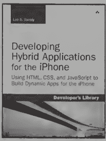

> "对于那些尚未准备好应对 Objective-C 复杂性的开发者来说，这是入门 iPhone 应用开发的绝佳途径。如果你掌握 HTML、JavaScript 和 CSS 的基础知识，很快就能开始构建应用。"
>
> —August Trometer，FoggyNoggin Software 创始人，www.foggynoggin.com

> "Lee S. Barney 将 iPhone 应用创建的复杂性化解于无形，运用简洁且时常妙趣横生的示例和语言，使本书成为一次愉悦而有益的阅读体验。这并非简单的入门指南，但如果你具备一定的网页编程背景和一个好点子，这本书能为你打下坚实基础，助你开发出精良、可维护且实用的 iPhone 应用。"
>
> —William Dalton

> "这是一本杰出的著作！如果你有意为 iPhone 构建应用，这就是你要找的书。Lee S. Barney 化繁为简，让一切变得易于理解。他从第一章就带你创建自定义应用，然后循序渐进，直到你能够使用 iPhone 的高级功能——如加速计、GPS 和嵌入式地图——来构建应用。本书写作精良，易于追随，实为上乘之作。"
>
> —Joey Skinner，Rodeo Software 首席执行官兼总裁

> "Lee S. Barney 凭借其在 JavaScript 和 Xcode 方面的扎实背景，展示了构建 iPhone 混合应用的实用技巧。我欣赏他的坦诚，他分享了可能困扰新手的陷阱，这为他的解决方案提供了有力支撑。如果你拥有扎实的 JavaScript 背景，并希望进军 iPhone 应用开发领域，这本书将是一个理想的过渡。"
>
> —A. Scott Mikolaitis


## 文档标题页眉

副标题或补充信息。

提供文档内容背景的介绍性段落文字。

| 第 1 列 | 第 2 列 | 第 3 列 |
|---|---|---|
| 数据 1 | 数据 2 | 数据 3 |
| 数据 4 | 数据 5 | 数据 6 |

详细分析段落，描述上表呈现的数据并提供进一步见解。

总结性段落，解释前述过程的成果及后续步骤。

谨以此书献给我可爱的妻子 Joan 和我们的五个儿子，在本书创作期间他们忍受着我过于忙碌的状态。与你们相伴，`eternity` 亦嫌短暂。

## 前言

本书将向你展示如何创建一种新型的 iPhone 应用程序：使用 HTML、CSS 和 JavaScript 编写的混合应用程序。混合 iPhone 应用程序是独立的应用程序，可以像普通应用程序一样在你的 iPhone 上运行，但不需要将文件存放在互联网服务器上。

创建混合 iPhone 应用程序可以减少开发时间以及让你的应用程序进入客户手中的学习曲线，因为你不必学习 Objective-C，也不必对 Cocoa 框架有深入的了解。

### 混合应用程序开发工具

本书涵盖了为 iPhone 和 iPod touch 设备编写应用程序最常用的两个开源 JavaScript 软件包：`QuickConnectiPhone` 和 `PhoneGap`。这些软件包使你能够构建直接从 JavaScript 访问原生设备功能的应用程序，例如振动、GPS 位置信息、加速度计以及许多其他功能——所有这些都无需编写一行 Objective-C 或 Cocoa 代码。

`QuickConnectiPhone` 可从 `http://sourceforge.net/projects/quickconnect` 下载，它暴露了最多的原生设备行为，并为开发使用提供了一个高度工程化、功能全面的框架。`QuickConnectiPhone` 显著缩短了你的应用程序的上市时间，因为该框架的一部分包含了你通常必须用 Objective-C、Cocoa 和 JavaScript 编写的粘合代码。最重要的是，它不需要远程服务器来托管 JavaScript、HTML 和 CSS 文件。

第二个软件包是 `PhoneGap`，可从 `http://phonegap.com` 下载。`PhoneGap` 暴露的原生行为较少，它是一个库，而不是一个完整的框架。作为一个库，`PhoneGap` 使你能够以任何你想要的方式设计你的应用程序。然而，它确实需要一个远程服务器来托管文件。

为了减少学习曲线并加深你的理解，本书通篇使用了良好、扎实的示例。

如果你想创建可安装的 iPhone 应用程序，拥有所需的 Web 技能，并且想创建动态的、引人入胜的解决方案供人们使用，本书将向你展示如何使用这两个软件包来实现。

表 P.1 比较了在撰写本书时每个软件包能做什么。

### 表 P.1 QuickConnectiPhone 与 PhoneGap 功能对比

| 可用行为/数据 | QuickConnectiPhone | PhoneGap |
|---|---|---|
| GPS | 是 | 是 |
| 加速度计 | 是 | 是 |
| 振动 | 是 | 是 |
| 系统声音 | 是 | 是 |
| 临时（Bonjour）网络 | 是 | 否 |
| 同步电缆网络 | 是 | 否 |
| 基于浏览器的数据库访问 | 是 | 否 |
| 预装数据库访问 | 是 | 否 |
| 拖放库 | 是 | 否 |
| AJAX 包装器 | 是 | 否 |
| 录制/播放音频文件 | 是 | 是 |
| 嵌入式谷歌地图 | 是 | 否 |
| 图表库 | 是 | 否 |

## 如何使用本书

每一章都分为两部分。第一部分向你展示如何使用 `QuickConnectiPhone` 或 `PhoneGap` 的相关功能来完成特定任务，例如获取设备的当前地理位置。第二部分展示 JavaScript 调用背后的代码是如何编写和工作的。你可以自行决定想深入 JavaScript 和 Objective-C 的程度。本书的组织结构如下：

- 第 1 章，“使用 Dashcode 和 Xcode 进行开发”，教你如何将 Dashcode 和 Xcode 与 `QuickConnectiPhone` 和 `PhoneGap` 结合使用，快速创建在 iPhone 上运行的有趣应用。本章包括基本的 Dashcode 使用方法，以及将你的 Dashcode 应用程序移至 Xcode 进行编译和在设备上运行的方法。
- 第 2 章，“JavaScript 模块化与 iPhone 应用程序”，教你如何通过利用 `QuickConnectiPhone` 框架的模块性显著缩短上市时间。解释了代码中如何使用前端控制器、应用程序控制器和 JavaScript 反射。
- 第 3 章，“创建 iPhone 用户界面”，帮助确保 Apple App Store 分发批准你的应用程序。它描述了创建高度可用的 iPhone 应用程序的最佳实践。还描述了通常为 iPhone 创建的不同类型的应用程序，以及需要警惕的陷阱。
- 第 4 章，“使用 QuickConnectiPhone 实现 GPS、加速和其他原生功能”，向你展示如何获取 GPS、加速和设备描述信息，并教你如何振动手机以及播放和录制音频文件。你将使用 `QuickConnectiPhone` 框架来访问和使用这些设备行为。这些能力让你的应用程序具有真正的原生、有趣的感觉。
- 第 5 章，“使用 PhoneGap 实现 GPS、加速和其他原生功能”，向你展示如何获取 GPS、加速和设备描述信息，以及如何振动手机和播放录制音频文件。你将使用 `PhoneGap` 库来访问和使用这些原生设备行为。这些能力让你的应用程序具有真正的原生、有趣的感觉。
- 第 6 章，“嵌入谷歌地图”，向你展示如何使用 `QuickConnectiPhone` 在你的应用程序中放入谷歌地图。这是请求最多的功能之一，意味着你不必将用户发送到地图应用程序！
- 第 7 章，“数据库访问”，向你展示如何从使用 `QuickConnectiPhone` 框架创建的应用程序中内置的 SQLite 数据库获取信息和存储数据。你是否需要在新应用程序中附带一个预定义的数据集？请阅读本章。
- 第 8 章，“远程数据访问”，向你展示如何使用一个包装器，让你能够轻松地从安装的应用程序中访问和使用远程服务器和/或服务的数据。也许你需要从在线博客获取数据并与 Twitter 动态源合并。`QuickConnectiPhone` 的远程数据访问模块使这一切变得简单。

本书还包含以下附录：

- 附录 A，“JSON 简介”，为你简要介绍 JavaScript 对象表示法。JSON 是最常用和最简单的数据传输方式之一，可以将你的数据传输到任何需要的地方。
- 附录 B，“QuickConnect 系列开发路线图”，概述了 `QuickConnectiPhone` 未来的发展。如果你计划为 iPhone 和其他平台（如谷歌 Android 手机、诺基亚手机、黑莓手机以及 Mac OS X、Linux 和 Windows 等桌面系统）创建应用程序，你应该看看这个附录。
- 附录 C，“PhoneGap 开发路线图”，概述了 `PhoneGap` 未来的发展。如果你计划为 iPhone 和其他平台（如谷歌 Android 手机、诺基亚手机、黑莓手机以及 Mac OS X、Linux 和 Windows 等桌面系统）创建应用程序，你应该看看这个附录。

## 在线资源

`QuickConnectiPhone` 和 `PhoneGap` 正在快速发展。为了跟上新功能和能力并了解更多，请使用以下链接。

### QuickConnectiPhone

- 从 `https://sourceforge.net/projects/quickconnect/` 下载示例和框架
- 在 `http://tetontech.wordpress.com` 查看开发博客
- 在 `http://quickconnect.pbwiki.com/FrontPage` 阅读 Wiki
- 在 `http://groups.google.com/group/quickconnectiPhone/` 找到 Google 群组
- Twitter 在 `http://twitter.com/quickconnect`

### PhoneGap

- 从 `https://sourceforge.net/projects/phonegapinstall/` 下载示例和框架
- 访问网站 `http://www.phonegap.com/`
- 在 `http://phonegap.pbwiki.com/` 阅读 Wiki
- 在 `http://groups.google.com/group/phonegap` 找到 Google 群组
- Twitter 在 `http://twitter.com/phonegap`

### 先决条件

你需要对 HTML、CSS 和 JavaScript 有基本的了解，才能有效地使用本书。如果你曾使用这些工具创建过网页，那么你已经具备了创建 iPhone 应用程序的良好基础。如果你需要 `QuickConnect-iPhone` 和 `PhoneGap` 中 Objective-C 方面的帮助，本书也会提供。本书不打算作为 Objective-C 或如何使用它开发 iPhone 应用程序的入门书籍。

你需要从 iPhone 开发者网站 `http://developer.apple.com/iphone` 下载并安装 Apple 的 Xcode 工具。这需要 Mac OS X 10.5 或更高版本以及基于 Intel 的 Mac。

虽然不是必需的，但你也应该拥有 iPhone 或 iPod touch，以便在这些设备上测试和运行应用程序。

### 致谢

特别感谢 Daniel Barney 参与并调试了嵌入式谷歌地图代码。同时感谢我在杨百翰大学爱达荷分校计算机信息技术系的同事们的倾听和建议。

## 关于作者

李·S·巴尼（爱达荷州雷克斯堡）是杨百翰大学-爱达荷分校商业与传播学院计算机信息技术系的教授。他曾在 `@HomeSoftware` 公司担任首席信息官和首席技术官，该公司为家庭医疗保健行业开发基于网络的移动数据和排程应用程序。在此之前，他在 `AutoSimulations, Inc.`（面向半导体行业领先的规划与排程软件供应商）担任程序员、高级软件工程师、质量保证经理、开发经理和项目经理超过七年。他是 *Oracle Database AJAX & PHP Web Application Development* 一书的作者。

## 联系作者

如需通过电子邮件联系作者，请使用 `quickconnectfamily@gmail.com`。其他联系方式请使用先前提供的 Twitter、Wiki 和 Google Group 链接。

## 文档分析报告

本节概述了系统架构及数据处理流程中涉及的主要组件。

- 组件 A：输入模块
- 组件 B：处理引擎
- 组件 C：输出接口

| 指标 | 数值 | 状态 |
|---|---|---|
| 延迟 | 20 毫秒 | 最优 |
| 吞吐量 | 500 请求/秒 | 稳定 |
| 错误率 | 0.01% | 低 |

## 系统性能评估

性能指标表明，系统在峰值负载条件下运行在预期参数范围内。

对内存分配模式的详细分析显示，在初始启动阶段，垃圾回收开销略有增加。

建议对缓存层进行进一步优化，以减少冗余的磁盘 I/O 操作。

参考：第 4.2 节

结论：稳定

# 第 1 章 使用 Dashcode 和 Xcode 进行开发

当一起使用时，Dashcode 和 Xcode 提供了创建独特、令人兴奋的混合 iPhone 应用程序所需的强大功能和易用性。由于这两个工具都通过针对混合 iPhone 应用程序的自定义模板进行了扩展，因此您不必“从头编写”自己的 Objective-C 包装器。在前三节中，您将学习如何为 Dashcode 和 Xcode 使用现有的混合 iPhone 应用程序模板。使用这些模板可以让您快速创建混合 iPhone 应用程序。第 4 至 8 节还简要讨论了基本的 Objective-C 以及 Objective-C iPhone 应用程序在两种最常用的混合应用程序工具——`QuickConnectiPhone` 和 `PhoneGap` 中的结构。

## 第 1 节：使用 Dashcode 和自定义 QuickConnect 模板

由于 iPhone 混合应用程序的大部分用户界面和交互都是使用 HTML、JavaScript 和 CSS 创建的，因此 Dashcode 是您进行大部分开发和调试的地方。Dashcode 的拖放界面构建器在其范围和易用性方面是独一无二的。Dashcode 用于创建应用程序的大部分内容，也用于使用模拟器和内置调试工具对其进行调试。

由于 iPhone 混合应用程序的大部分代码是相似的，因此创建一个包含公共代码的模板可以避免每次启动新项目时重写或导入它的需要。有关公共代码的讨论，请参见第 2 章“JavaScript 模块化与 iPhone 应用程序”。

`QuickConnectiPhone` 下载可从 `http://sourceforge.net/projects/quickconnect` 获取，其中包含一个 Dashcode 模板，可帮助您创建混合 iPhone 应用程序。QuickConnectFamily 安装程序会将此模板插入 Dashcode 中。不幸的是，在撰写本书时，替代方案 `PhoneGap` 的创建者并未提供 Dashcode 模板。

# 第 1 章 使用 Dashcode 和 Xcode 进行开发

运行 QuickConnectFamily 安装程序并启动 Dashcode 后，您可以在 Dashboard Widget 模板选择对话框的底部找到 `QuickConnectIPhone` 模板。双击 `QuickConnectIPhone` 图标将直接进入 Dashcode 主屏幕。空白用户界面将显示在屏幕上。图 1.1 展示了运行中的 Dashcode 应用程序的外观。

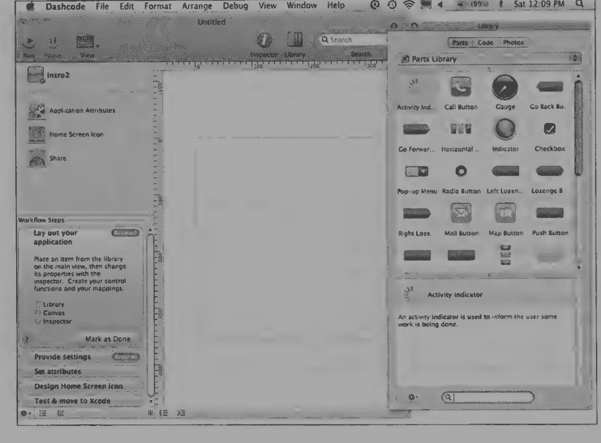

图 1.1 在 Dashcode 中使用 `QuickConnectIPhone` 模板。显示了标准的 Library 对话框。

要理解并轻松使用框架中包含的文件，您必须首先使用 Dashcode 创建一个简单的用户界面，并使用 Xcode 将其部署到您的 iPhone 上。此处创建的用户界面仅包含一个按钮和一个文本字段。当按钮被点击时，文本字段显示“You did it!”。

## 混合应用程序与 Alert 对话框

习惯使用 JavaScript 编写代码的人经常使用 Alert 对话框来调试应用程序或通知用户信息。JavaScript 中的 `alert` 函数实际上是调用包含浏览器的原生代码，而不是由 JavaScript 引擎处理。

这在 `QuickConnectIPhone` 应用程序中未实现，因为使用对话框违反了 Apple 提供的 iPhone 用户界面标准。对于调试，您可以使用 Dashcode 调试器。如果将应用程序转移到 Xcode，您可以使用 `debug` 函数在 Xcode 控制台中显示消息。

`PhoneGap` 确实提供了 Alert 对话框功能，但它不提供 Xcode `debug` 函数。

无论使用哪种工具，要通知用户重要信息，请将它们插入 HTML `div` 或其他元素中。

请记住，要保持警觉，但不要使用 `alert`。

要创建此用户界面，请确保 Library 对话框已打开。如果没有打开，请单击 Dashcode 顶部栏中的 Library 图标。然后，在部件库底部找到 Text 部件，并将其拖放到空白应用程序屏幕上。您的应用程序界面顶部将显示一个新的文本区域，其中包含单词“Text”。默认情况下，此文本的宽度为 100%。Dashcode 已动态地在应用程序的底层 `index.html` 文件中插入了一个 HTML `div` 标签以及一些 JavaScript，用于根据您选择的内容、背景颜色等填充它。

在本示例中，您将文本 `div` 的 `id` 更改为“display”并清空文本字段。这是使用界面实体检查器完成的。选择 Dashcode 顶部栏中的 Inspector 图标将激活此对话框。选择检查器左上角的红白标签，将 ID 字段更改为“display”，然后清除 Label 字段。


通过拖放将`Push`按钮添加到界面中，放置在文本字段之外。检查器现在显示按钮而不是文本字段的信息。选择检查器对话框右上角的蓝色立方体。这将使 Behaviors 标签出现。此标签使您能够为列出的任何用户界面事件类型定义 JavaScript 函数作为处理程序。请注意，许多标准的 JavaScript 鼠标事件未被看到。它们已被`ongesturestart`、`ongesturechange`和`ongestureend`取代。

在`onclick`事件的处理程序部分输入`changeText`。这将在`main.js`文件中插入一个`changeText`函数，将其显示给您，并使您能够定义当`onclick`事件触发时应发生什么。在这个简单的例子中，在`changeText`函数中放入以下代码：

```javascript
document.getElementById('display').innerHTML = 'You did it!';
```

示例应用程序现在可以在 iPhone 模拟器中运行了。选择 Dashcode 左上角的 Run 图标。这将启动模拟器并在其中运行您的应用程序。图 1.2 显示了在模拟器中运行的简单示例应用程序。

完成并调试了应用程序的创建后，现在可以将代码转移到 Xcode 中，以便作为可安装的应用程序进行部署。

首先，使用 Dashcode 部署当前应用程序。如果不这样做，代码将隐藏在您的 Dashcode 项目中，并且包含只有 Dashcode 才能理解的指令。单击 Dashcode 左侧部分的 Share 图标以显示部署屏幕。这使您可以将完成的 HTML、CSS 和 JavaScript 保存到磁盘中，其格式已准备好嵌入到您的应用程序中。在 Path 字段中输入新目录的名称，以在您计算机的硬盘驱动器上创建一个目录。然后这些文件将存储在这个新目录中。它们也可以被导入到 Xcode 中。图 1.3 显示了部署界面。

> 图 1.2 简单的示例应用程序在点击按钮后在 Dashcode 模拟器中运行。

有关此模板中包含的 JavaScript 文件及其如何简化应用程序创建的更多信息，请参阅第 2 章。

## 第 2 节：使用 Xcode 和自定义 QuickConnect 模板

由于您运行了 QuickConnectFamily 安装程序，Xcode QuickConnectiPhone 应用程序模板已经为您安装完毕。请使用它来为您的 QuickConnectiPhone 混合应用程序创建 Xcode 项目。本节将引导您完成具体操作。QuickConnectFamily 维基包含一个演示该过程的视频（`http://quickconnect.pbwiki.com/Moving-Dashcode-projects-to-Xcode`）。

为此，选择 New → Project。选择 iPhone OS Applications，随后会显示 QuickConnect iPhone Application 图标。双击该图标，为您的项目命名，然后在硬盘上选择或创建一个目录来存放它。Xcode 会创建一个项目，其中包含运行 JavaScript 应用程序所需的 Objective-C 文件，使得应用无需网络或互联网连接即可直接在设备上运行。在应用程序的 Resources 组中，有一系列 HTML、CSS 和 JavaScript 占位文件。

> 图 1.3 部署界面显示已完成的应用程序正被部署到 Chapter1Example Web 服务器目录。

这些占位文件之一是`index.html`。它包含一个可直接运行的示例应用程序的 HTML、CSS 和 JavaScript。图 1.4 显示该示例作为已安装的应用程序在模拟器中运行。

要将之前在 Dashcode 中创建的文件包含在此项目中，请删除以下文件：

- `index.html`
- `main.css`
- `main.js`
- Parts 组中的文件
- Images 组中的文件

删除这些文件后，导入`index.html`、`main.css`和`main.js`文件。具体操作是右键点击 Resources 组，然后选择 Add → Existing Files。浏览到您部署 Dashcode 应用程序的目录，并选择`index.html`、`main.css`和`main.js`。您可以将文件复制到 Xcode 项目中，或者在它们当前的位置直接使用。在本示例中，每次出现提示时，请勾选“Copy items into destination group’s folder”复选框。

> 图 1.4 默认的 QuickConnect 应用程序

### 复制还是不复制，这是一个问题

是将现有文件复制过来，还是让 Xcode 使用对它们的引用，取决于您自己。如何决定？每种方法都有其优点。

如果您复制文件，项目目录就是完整的，可以交给其他开发人员，而他们不需要在机器上复制持有现有文件的目录结构。

如果您使用引用方法，您可以回到 Dashcode 中进行修改，然后导出项目以覆盖文件。您无需再次将它们导入到 Xcode 中。

接下来，右键点击 Parts 组并导入 Parts 文件夹中的文件。对 Images 组和 Images 文件夹重复此操作，您就几乎准备好运行应用程序了。

由于向 Resources 组添加了文件，需要告知 Xcode 将其包含在应用程序使用的资源中。展开屏幕底部的 Targets 选择项，然后展开您的应用程序以及 Copy Bundle Resources 列表。您现在可以看到应用程序运行所需的资源文件。将您刚刚添加到项目的文件（注意是文件而非组）选择并拖动到此 Copy Bundle Resources 列表中。然后，展开 Compile Sources 列表并删除任何 JavaScript 文件。显然，它们不会被编译。具体操作是右键点击它们，然后选择 Delete。这将从编译列表中移除这些文件，但不会从项目或磁盘中删除文件。

由于 Dashcode 使用目录，而 Xcode 使用组，您需要进行另外两项更改才能运行应用程序。第一项是在`index.html`文件的`<head>`部分。因为 JavaScript 文件和任何其他被引用的文件都存在于最终应用程序的资源目录中，因此必须删除对`Parts`和`Q CiPhone`的目录引用。例如，在删除引用之前，`<script>`标签看起来像这样：

```html
<script type="text/javascript" src="Parts/utilities.js" charset="utf-8"></script>
```

修改后，它应该像这样：

```html
<script type="text/javascript" src="utilities.js" charset="utf-8"></script>
```

由于您在 Dashcode 中创建的任何按钮等都使用了图像，您还需要在整个项目中查找字符串`Images/`的实例，并将其替换为空字符串。这可以通过选择 Edit 下拉菜单，选择 Find → Find in Project，然后搜索`Images/`来轻松完成。图 1.5 显示了在修改`PushButton.js`文件之前，本示例的搜索结果。

> 图 1.5 搜索界面显示了在整个项目中搜索 Images/ 的结果。

您现在可以通过选择 Build and Go 图标来安装并运行您的应用程序。该图标位于 Xcode 应用程序的顶部栏中。如果您收到“No provisioned iPhone OS device is connected”错误，您可以选择在模拟器中而不是在设备上安装并运行应用程序。点击 Xcode 窗口右下角的 Succeeded，在显示的对话框左上角选择 Device | Debug 下拉列表，然后点击 Simulator 选项。请注意，您还可以在下拉列表的下方选择 Release 或 Debug。在开发过程中，请经常使用此对话框进行此类更改。图 1.6 显示了安装并在模拟器中运行的应用程序。

恭喜。您刚刚完成了您的第一个 iPhone 混合应用程序。

> 图 1.6 `simpleExample`应用程序已安装并在 iPhone 模拟器中运行。

### 配置文件（Provisioning）？那是什么？

配置文件（Provisioning）是一个多步骤的过程，您或代表您的人员必须完成此过程，才能使您能够在设备上安装并运行应用程序。

要为您的 iPhone 配置，您需要成为 Apple Developer Connection（ADC）的成员并注册使用 Program Portal。如果您是团队的一部分，配置可能已经完成；如果是这种情况，您只需要将配置信息上传到您的 iPhone。

关于如何进行配置的详细信息可在 ADC 上找到。请务必遵循列出的所有步骤。任何偏差都可能导致失败，从而无法在设备上测试应用程序。

## 第 3 节：使用 Xcode 和自定义 PhoneGap 模板

现有一个 Xcode 自定义 PhoneGap 应用程序模板可供使用，可以从`https://sourceforge.net/projects/phonegapinstall`下载。与 QuickConnectiPhone 安装程序一样，自定义模板可在 New → Project 对话框中找到；它被称为 PhoneGap Application。双击此图标，为您的项目命名，并将其保存到磁盘上的某个位置，就像您处理 QuickConnectiPhone Application 模板时一样。

### 区别

QuickConnectiPhone 和 PhoneGap 之间的一个主要区别是，PhoneGap 应用程序在安装的应用程序中不包含 HTML、CSS 和 JavaScript 文件。这些文件必须驻留在可通过互联网访问的 Web 服务器上，并由其提供服务。

如果您选择使用 PhoneGap，只有当用户通过设备访问互联网时，您的应用程序才能运行。对于 iPhone 用户来说，这通常不是问题，但对于 iPod Touch 用户来说可能是一个主要障碍，因为他们需要靠近开放的 WiFi 接入点才能访问互联网。

如果您希望应用程序安装是完整的，请使用 QuickConnectiPhone。如果您希望 CSS、HTML 和 JavaScript 远程存储，可以使用 PhoneGap。

由于 PhoneGap 应用程序在安装的应用程序中不包含 CSS、HTML 和 JavaScript 文件，您需要将其指向包含这些文件的 Web 服务器。最简单且临时的方法是在您自己的开发机上实现。

打开您的“共享”系统偏好设置对话框，确保已激活 Web 共享。这将使您的机器成为一台 Web 服务器。在您的`<UserHome> → Sites`目录中，创建一个`pg_hello`目录，并在其中放入一个包含以下代码的`index.html`文件：

```html
<!DOCTYPE HTML PUBLIC "-//W3C//DTD HTML 4.01//EN"
	"http://www.w3.org/TR/html4/strict.dtd">
<html xmlns="http://www.w3.org/1999/xhtml">
<head>
	<title>pg_example</title>
	<meta http-equiv="content-type" content="text/html; charset=utf-8">
	<meta name="viewport" content="minimum-scale=1.0, width=device-width, maximum-scale=1.6">
</head>
<body>
Congratulations. You have just loaded this web page from the Internet.
</body>
</html>
```

您必须通过修改 Resources 组中的`url.txt`文件来告知 PhoneGap 应用程序 Web 服务器的位置。由于您将此文件放在了自己的机器上，请将文件中的文本替换为`http://localhost/~<user>/pg_hello`，其中`<user>`是你的登录名。当你在 Xcode 中选择 Build and Go 图标时，你的应用程序会编译并显示 HTML 页面，如图 1.7 所示。


> 图 1.7 运行中的 PhoneGap 应用程序

也可以使用 Dashcode 为 PhoneGap 应用程序创建 HTML、CSS 和 JavaScript。这可以通过启动 Dashcode 并双击“自定义 Web 应用程序”模板来完成。添加相同的文本和按钮元素，并以与 QuickConnectiPhone 简单示例应用程序相同的方式为按钮创建监听器。

要使其成为正式的 PhoneGap 应用程序，你需要包含 PhoneGap 下载包中 JavaScript 目录下的`gap.js`文件。在 Dashcode 中，右键点击`index.html`文件列表，然后选择“添加文件”。

浏览到解压后的 PhoneGap 下载位置并选择`gap.js`文件。在 Dashcode 项目的`index.html`文件的`<head>`标签中，添加以下代码行：

```html
<script type="text/javascript" src="gap.js" charset="utf-8"></script>
```

在 Dashcode 中运行和调试代码后，你可以将其部署到开发机器 Web 服务器上的`phoneGap-SimpleExample`，运行之前创建的 PhoneGap Xcode 应用程序，并查看在嵌入式应用程序中运行的 HTML 页面（参见图 1.8）。


> 图 1.8 运行中的 PhoneGapSimpleExample 应用程序

PhoneGap 应用程序在配置和运行到开发设备上的问题与 QuickConnectiPhone 应用程序相同。有关这些主题的更多信息，请参见第 2 节。

## 第 4 节：Objective-C 基础入门

本节不是深入的 Objective-C 教程，也不是关于如何使用 Objective-C 编写 iPhone 应用程序的深入讨论。它旨在帮助你理解模板中使用的 Objective-C 类如何交互和行为，以便你能在 iPhone 混合应用程序中利用这些知识。它还假设你已基本了解对象、方法和属性。如果你想了解更多关于 JavaScript 框架的内容，或者不想了解 Objective-C 代码，请跳过本章的其余部分，直接转到第 2 章。要更深入地理解 Objective-C iPhone 开发，请参阅 Erica Sadun 的《iPhone 开发者手册：使用 iPhone SDK 构建应用程序》。

## 第 1 章 使用 Dashcode 和 Xcode 进行开发

Objective-C 是一种有趣的语言。对于有 JavaScript、PHP、Java、Perl 和其他语言背景的读者来说，乍一看可能会觉得令人生畏、难以理解。尽管如此，它确实值得再看一眼——不仅因为它是 iPhone 的“原生”语言。

Objective-C 是 C 语言的面向对象变体。你可以进行各种强大而危险的 C/C++ 类型编程，比如指针运算，也可以做一些让生活更轻松的事情，比如自动内存管理。在面向对象语言中，你需要做的第一件事之一就是实例化一个对象。如果源代码中有一个名为`Mammal`（哺乳动物）的对象，它有两个属性，`furColor`（毛色）和`milkFatRatio`（乳脂比），在 JavaScript 中，它的实例化方式如下所示：

```javascript
var aMammal = new Mammal("orange", 0.15);
```

你可能认为这很正常，并期望其他语言也以同样的方式运作。如果你有这样的预期，Objective-C 的实例化最初看起来会很奇怪。相同的行为在 Objective-C 中看起来像这样：

```objectivec
Mammal *aMammal = [[Mammal alloc] initWithColor: @"orange" andMilkFatRatio: 0.15];
```

有些部分看起来可以理解，有些则不能。仔细想想，`alloc`是有道理的，因为它是为`Mammal`对象在 RAM 中分配空间的方式。即使是`initWithColor`和`andMilkFatRatio`作为设置器或两个所需参数的传递者也说得通。然而，实际发生了什么，所有这些方括号是什么意思？

Objective-C 使用消息传递来与对象进行所有交互，以及与其他语言中本可能不是对象的项进行交互（而在 Objective-C 中它们是对象）。检查这行代码：

```objectivec
[Mammal alloc]
```

前面暗示过，这个代码片段是为`Mammal`类型的对象在 RAM 中分配空间的地方。确实如此。`Mammal`和`alloc`周围的方括号表示，要向应用程序中代表`Mammal`类的对象发送`alloc`消息。这个代码片段读作：“向`Mammal`类对象传递`alloc`消息。”向`Mammal`类对象传递此`alloc`消息的结果是，返回指向新`Mammal`对象的指针。

### 指针？那是什么？

指针很有趣。很多人害怕它们，因为不理解它们或者不知道它们是什么。

要理解它们，这里有个类比：想象一大群人，人群中有两个人是 Alma 和 John。他们彼此认识，Alma 知道 John 在人群中的位置。你走近 Alma，问她 John 在哪里。她用手指着 John 说：“他在那里。”

在这一瞬间，Alma 就是一个 John 指针。如果你把指针理解为知道对象在内存中位置的东西，你就理解了。

这个新实例化的`Mammal`对象随后可以接收消息。前面的代码片段包含了这个新`Mammal`对象的另一个消息。


这个新消息由`initWithColor`和`andMilkFatRatio`组合而成。你可以判断这个两部分的消息是一条消息，因为它和新分配的`Mammal`被方括号包围，表示正在传递消息。多部分消息由空格分隔。消息的两部分之间有一个空格。

此外，消息部分和传递的值通过冒号字符（`:`）链接在一起。每个消息部分最多可以有一个与之关联的参数。这条传递的消息返回指向新分配的`Mammal`对象的指针，以便可以将其本地存储供以后使用。在 Objective-C 中，这些消息指示符，无论是单部分还是多部分消息，都称为*选择器*，因为它们指示编译器选择并运行对象的哪些方法。

返回你在第 2 节中创建的`SimpleExample` Xcode 项目。查看模板为你生成的`SimpleExampleAppDelegate.m`文件中的`applicationDidFinishLaunching`方法。不要担心代码做什么。将其视为消息传递的示例。

```objectivec
1    - (void)applicationDidFinishLaunching:(UIApplication *)application {
2        // this helps in debugging, so that you know "exactly" where your views
3        // are placed;
4        // if you see "red", you are looking at the bare window.
5        window.backgroundColor = [UIColor redColor];
6
7    
8    QuickConnectViewController
9    *aBrowserViewController=[[QuickConnectViewController alloc] init];
10
11       // add the CreateViewController view to the window as subview
12       [window addSubview:aBrowserViewController.view];
13
14       [window makeKeyAndVisible];
15 }
```

第 8 行应该看起来很熟悉。它不涉及哺乳动物，但使用了你之前看到的`alloc`和`init`消息。在这种情况下，分配并初始化了一个名为`QuickConnectViewController`的东西。它的类对象被传递了`alloc`消息，返回指向新分配的`QuickConnectViewController`的指针。这个新对象通过其指针被发送了`init`消息。

这条消息实现了与`Mammal`的多部分`initWithColor:andMilkFatRatio`消息相同的功能，但要简单得多。它是一个单部分消息，没有参数。在本章后面，你将看到如何创建初始化方法和其他方法，以便你的对象在收到消息时可以执行它们。

第 11 行向`window`发送了一条消息。这个`addSubview`消息带有一个参数，即`aBrowserViewController`对象的包含`view`属性。

现在你已经看到了一个可用的示例，关于如何实例化一个对象、如何存储指向该新对象的局部作用域指针、如何访问对象的属性，以及如何向对象传递有参数和无参数消息的示例。这就是理解`QuickConnectiPhone`和`PhoneGap`模板文件中的代码所需要掌握的大部分 Objective-C 基础知识。接下来，你需要了解 Objective-C 应用程序是如何构建的。

## 第 5 节：Objective-C QuickConnectiPhone 应用程序结构

虽然本节涵盖了`QuickConnectiPhone`应用程序模板中的一些基础代码，但`PhoneGap`和所有其他混合应用程序实现中采用的是同样的方法。你可以直接使用这些现有的实现，或者通过研究它们来创建你自己的版本。

想象一下，你在一家成功的公司拥有大量股份（这可能是事实）。想象一下，公司举行股东大会选举董事会主席，但因为你在巴哈马度假而无法参加。在这种情况下，你如何才能行使投票权？

如果你合法地指定某人替你投票，这个人被称为你的“代理（proxy）”。作为你的代理，他们在会议上拥有代表你行事的全部权力。你的代理也可以被称为你的“委托者（delegate）”。而这位委托者会将你称为“委托人（principal）”，因为你才是真正的股东。图 1.9 展示了这种关系。Objective-C iPhone 应用程序在对象之间使用委托关系，其中一个对象是委托人，另一个是委托者。


Objective-C iPhone 应用程序大量使用这种委托关系。值得关注的委托关系包括：

- `UIApplication`/`UIApplicationDelegate`

- `UIWebView`/`UIWebViewDelegate`

- `UIAccelerometer`/`UIAccelerometerDelegate`

此时，你需要理解的是，为这些委托者实现协议方法（protocol methods）是为了告诉你的应用程序、视图或加速度计，当特定事件发生时，你希望由委托者来处理这些事件，而不是由其自身处理。每个协议方法都与一个事件相关联。

### 协议 (Protocols)

协议是一系列可以添加到类中的方法，使得该类能够响应特定的消息。

带着这些新鲜的委托概念，让我们来看一个作为委托者的类。以下是`SimpleExampleAppDelegate`类的头文件，该类是在你使用`QuickConnectiPhone`应用程序模板并在第 2 节中创建`SimpleExample`应用程序时生成的。

Objective-C 的头文件（以`.h`结尾的文件）用于声明类。请查看`SimpleExampleAppDelegate`类的头文件，但不必担心它的实现文件：

```
1 //SimpleExampleAppDelegate.h
2 #import <UIKit/UIKit.h>
3 #import "QuickConnectViewController.h"
4
5 @interface SimpleExampleAppDelegate : NSObject
6 <UIApplicationDelegate> {
7     IBOutlet UIWindow *window;
8     QuickConnectViewController *browserViewController;
9 }
10
11 @property (nonatomic, retain) UIWindow *window;
12 @property (nonatomic, retain) QuickConnectViewController
*browserViewController;
13
14 @end
```

看第 5 行。如果你熟悉 Java，请不要被`@interface`标识符误导。它并不意味着这个类像 Java 的接口（interface）。它的意思是该文件包含此类的接口定义。这个头文件声明了`SimpleExampleAppDelegate`具有哪些属性、如何访问这些属性，以及在独立的实现文件中需要实现哪些方法。这个类本身没有定义方法。

如果它不是类似 Java 的接口声明，那么第 5 行的作用是什么？它声明了类的名称为`SimpleExampleAppDelegate`，并使用冒号分隔符表示它继承自`NSObject`类。因此，它是一个`NSObject`，可以接收任何`NSObject`定义的消息。如果你在 Xcode 帮助菜单的 API 文档中查看`NSObject`类，你会发现它有一个`description`方法；因此，由于`SimpleExampleAppDelegate`通过继承成为了`NSObject`，它也拥有一个`description`方法。

在`NSObject`继承声明旁边，你可以看到`<UIApplicationDelegate>`。这就是告诉`SimpleExampleAppDelegate`类要作为应用程序的委托者，并使你能够在`SimpleExampleAppDelegate`的实现文件中实现`UIApplicationDelegate`协议消息的方法。该协议的一个方法是`applicationDidFinishLaunching`。

第 1 章 使用 Dashcode 和 Xcode 进行开发

该方法在应用程序完成加载并准备运行之时被调用。该方法允许你自定义应用程序，或者在需要时向用户查询更多信息。

在接下来的代码中，第 11 行是实现文件中`QuickConnectiPhone`对`applicationDidFinishLaunching`的定义。它以减号（`-`）开头，这表明它是一个对象方法。`(void)`表示该方法不返回任何值，而`:(UIApplication *)application`表示向该方法传递了一个`UIApplication`类型参数。

```
1 //
2 //  SimpleExampleAppDelegate.m
3 //  SimpleExample
4 //
5 #import "SimpleExampleAppDelegate.h"@implementation
6 SimpleExampleAppDelegate
7
8 @synthesize window;
9 @synthesize browserViewController;
10
11 - (void)applicationDidFinishLaunching:(UIApplication *)application {
12     // this helps in debugging, so that you know
13     // "exactly" where your views are placed;
14     // if you see "red", you are looking at the
15     // bare window, in your distributed applications
16     // use black
17     window.backgroundColor = [UIColor redColor];
18             QuickConnectViewController
19     *aBrowserViewController=[[QuickConnectViewController alloc] init];
20         // add the aBrowserViewController view to the
21     // window as a subview
22         [window addSubview:aBrowserViewController.view];
23     //[window makeKeyAndVisible];
24 }
```

作为应用程序委托类的一部分，这个`applicationDidFinishLaunching`方法在应用程序完成加载后会自动调用。正因如此，它可以用来实例化应用程序中可能需要的其他项。在这种情况下，你可以在第 18 行和 19 行看到由模板包含在应用程序中的另一个类（`QuickConnectViewController`）的分配和初始化。

iPhone 应用程序是基于视图的，任何`UIWindow`或`UIView`对象都可以包含`UIView`对象。因此，在视图中嵌套视图、再嵌套视图是可能的。但不建议在 iPhone 应用程序中使用这种设计。与其采用这种层级方法，大多数开发社区会根据用户的需求，在尽可能高的层级上用一个子视图替换另一个子视图。

交换子视图还可以扁平化并降低应用程序视图结构的复杂度。幸运的是，你用来创建此应用程序的模板已经为你放置了恰到好处的嵌套视图，用于显示你的 Web 内容。事实上，正如后面所见，它在刚刚添加到窗口对象的视图中插入了一个 Web 子视图。

`QuickConnectViewController`类将其在应用程序窗口中显示内容的实际视图对象作为其属性之一。此属性需要作为子视图添加到主窗口中，这在第 22 行完成。

除了包含内容视图外，`QuickConnectViewController`类本身也是一个委托者。它是 GPS 位置、加速度计、WebView 以及其他类型事件的委托者。

## 第 6 节：Objective-C PhoneGap 应用程序结构

作为 iPhone 应用程序，PhoneGap 应用程序同样遵循与 QuickConnectiPhone 应用程序相同的委托结构。详见第 5 节。你需要理解的委托类名为`GlassAppDelegate`。就像在第 4 节中研究的`SimpleExampleAppDelegate`一样，它拥有定义文件和实现文件，分别称为`GlassAppDelegate.h`和`GlassAppDelegate.m`。

PhoneGap 应用程序中的`GlassAppDelegate`类不仅仅是一个应用程序委托。它是所有类型行为的委托者，因此其`.h`和`.m`文件要复杂得多。

在接下来的代码中，你可以看到`GlassAppDelegate`类是 WebView 显示、GPS 位置管理器、加速度计等多个功能的委托者。这是因为在从第 16 行开始的接口声明中，这些委托者是以逗号分隔的形式列出的。

```
1 #import <UIKit/UIKit.h>
2 #import <CoreLocation/CoreLocation.h>
3 #import <UIKit/UINavigationController.h>
4
5 #import "Vibrate.h"
6 #import "Location.h"
7 #import "Device.h"
8 #import "Sound.h"
9 #import "Contacts.h"
10
11
12 @class GlassViewController;
13 @class Sound;
14 @class Contacts;
15
16 @interface  GlassAppDelegate : NSObject <
17 UIApplicationDelegate,
```

## 第1章 使用Dashcode和Xcode进行开发

```objectivec
18 UIWebViewDelegate,
19 CLLocationManagerDelegate,
20 UIAccelerometerDelegate,
21 UIImagePickerControllerDelegate,
22 UIPickerViewDelegate,
23 UINavigationControllerDelegate
24 {
25 
26 
27 
28     IBOutlet UIWindow *window;
29     IBOutlet GlassViewController *viewController;
30     IBOutlet UIWebView *webView;
31     IBOutlet UIImageView *imageView;
32     IBOutlet UIActivityIndicatorView *activityView;
33 
34     CLLocationManager *locationManager;
35     CLLocation *lastKnownLocation;
36 
37     UIImagePickerController *imagePickerController;
38 
39     NSURLConnection *callBackConnection;
40     Sound *sound;
41     Contacts *contacts;
42     NSURL *appURL;
43 }
44 
45 @property (nonatomic, retain) CLLocation *lastKnownLocation;
46 @property (nonatomic, retain) UIWindow *window;
47 @property (nonatomic, retain) GlassViewController *viewController;
48 @property (nonatomic, retain) UIImagePickerController *imagePickerController;
49 
50 
51 - (void)imagePickerController:(UIImagePickerController *)picker
52     didFinishPickingImage:(UIImage *)image2 editingInfo:(NSDictionary *)editingInfo;
53 - (void)imagePickerControllerDidCancel:(UIImagePickerController *)picker;
54 @end
```

尽管`GlassAppDelegate`更为复杂，但这个类与前一小节中的`SimpleExampleAppDelegate`类相似。它是应用程序的委托，也是其他类型事件的委托，而`QuickConnectiPhone`实现则使用`QuickConnectViewController`类作为除应用程序委托事件之外任何事件的委托。

`SimpleExampleAppDelegate`方法与前述在`SimpleExampleAppDelegate`中实现的方法相同。为了清晰起见，以下仅展示了`applicationDidFinishLaunching`方法的部分 PhoneGap 源代码。省略的源代码在第 9 节和第 7 章“数据库访问”中有详细介绍。


```objectivec
1 -(void)applicationDidFinishLaunching:
.
.
.
2    webView.delegate = self;
.
.
.
3    [window addSubview:viewController.view];
.
.
.
4 }
```

代码的第2行很有趣。与第6节中看到的`SimpleExampleAppDelegate`实现一样，这里将`UIWebView`设置为主窗口的子视图。这意味着`UIWebView`被用作整个应用程序的显示。

既然已经看到了`QuickConnectiPhone`和`PhoneGap`中主应用程序委托方法的实现，你就可以了解如何使用`UIWebView`来显示和运行JavaScript应用程序了。

## 第7节 嵌入Web内容：QuickConnectiPhone

要在应用程序中显示Web内容（例如JavaScript应用程序或简单的网页），您必须使用`UIWebView`类。所有混合应用程序的实现，包括`QuickConnectiPhone`和`PhoneGap`，都使用这个类。如果您想在应用程序中进行任何花哨的字体控制——即多种字体和/或大小和颜色——您必须使用`UIWebView`，除非您愿意经历自己绘制文本的繁琐过程。`UIWebView`使用起来要容易得多，因为它除了解释JavaScript外，还能解释HTML和CSS。这使您能够轻松地进行复杂的文本和其他类型的布局。

`UIWebView`类实际上是WebKit渲染引擎的包装器，该引擎用于Safari浏览器、Adobe Air、Android和Nokia手机，以及OSX附带的其他几个应用程序中，如Mail。Dashcode也是WebKit引擎的重度使用者。

如前两节所述，要在应用程序中包含网页视图，必须将`UIWebView`对象作为子视图添加到应用程序的另一个视图中。这是在`QuickConnectViewController`类的`loadView`方法中完成的。

`loadView`方法包含许多项目，这些项目使基于JavaScript的应用程序能够表达行为。例如，`loadView`方法包含将应用程序的用户界面缩放到适合屏幕大小的代码。此功能默认被注释掉，因为用户界面应该设计为合适的尺寸。

`loadView`中有趣的部分是显示您在本章前面使用Dashcode创建的界面。下面的代码片段展示了iPhone如何将此内容插入到应用程序中。它从计算`UIWebView`显示的大小和原点位置开始。这是通过检索应用程序显示框架的大小和位置来完成的。

名为`webFrame`的`CGRect`结构包含这些信息，它通过向应用程序的主屏幕发送`applicationFrame`消息来生成。所有`CGRect`结构都包含两项：一个称为`origin`的`CGPoint`，表示左上角的x和y位置；以及一个`CGSize`，表示矩形的大小。这由高度和宽度表示：

```objectivec
CGRect webFrame = [[UIScreen mainScreen] applicationFrame];
webFrame.origin.y = 20.0;
```

`CGRect`的x、y、width和height是用于存储像素计数的浮点数。前面代码中的第二行展示了如何更改存储在`webFrame`变量中的垂直位置的当前值。它将原点向上移动20像素。这样做是为了覆盖视图中为非存在的工具栏留下的空白空间，该工具栏位于显示窗口的顶部。

这个工具栏可以在许多标准应用程序中看到，例如您用来配置Wi-Fi连接的设置应用程序。它已从模板中移除，以最大化应用程序可用的有限屏幕空间。如果您希望拥有此栏的下一个和上一个行为，您应该使用Dashcode将其作为应用程序的一部分来创建。

当`webFrame`具有了所需的Web内容显示位置和大小后，它用于初始化一个名为`aWebView`的`UIWebView`对象。在以下代码中，第1行和第2行展示了如何完成此操作。请注意，这与本章前面检查的`QuickConnectViewController`分配类似。主要区别是`alloc`消息被发送到`UIWebView`类，并且刚刚分配的`UIWebView`对象被发送了`initWithFrame`消息，并传入了在前一个代码片段中创建和修改的`webFrame`结构。`aWebView`对象根据`webFrame`中包含的值进行定位和定大小。

```objectivec
1 UIWebView *aWebView = [[UIWebView alloc]
2     initWithFrame:webFrame];
3 self.webView = aWebView;
4 aWebView.autoresizingSubviews = YES;
5 aWebView.autoresizingMask = (UIViewAutoresizingFlexibleHeight
6     | UIViewAutoresizingFlexibleWidth);
7 //set the web view delegate for the web view to be itself
8 [aWebview setDelegate:self];
```

这个新的`UIWebView`通过第4行的代码存储在`QuickConnectViewController`的`webView`属性中，以便其他`QuickConnectViewController`方法稍后访问。这在第4章"使用QuickConnect实现GPS、加速度计和其他原生功能"中描述的加速度、GPS位置和其他功能时变得至关重要。

第5行和第6行指示了`aWebView`对象在重绘自身时具有的灵活程度。如果可以的话，避免添加子视图。第4行说明随着`aWebView`改变大小，子视图也应该改变。按照所写的代码，如果`aWebView`的宽度由于旋转而改变，它包含的任何子视图也应该按相同的缩放因子改变宽度。

第5行和第6行指示`aWebView`的宽度和高度也会改变。当iPhone旋转时，当前视图通常会旋转到或从横屏模式旋转，并且当前视图会调整自身大小以匹配设备可用的新宽度和高度。如果删除或注释掉第5行和第6行，应用程序仍然会旋转，但不会改变`aWebView`的宽度和高度。这会导致在横屏模式下应用程序右侧出现大面积的空白区域。很少应该允许应用程序的视图在旋转时不调整自身大小。

前面代码的第8行向`aWebView`发送了一条消息，说明当前的`QuickConnectViewController`（称为`self`）充当`aWebView`对象的委托。这使得`QuickConnectViewController`类中可以实现几个可选的`UIWebViewDelegate`方法。表1.1指示了这些方法是什么。

如果您有需要，请将这些可选方法中的每一个添加到`QuickConnectViewController`类中。模板已经添加了`webView:shouldStartLoadWithRequest`、`webView:DidStartLoad`、`webView:DidFinishLoad`和`webView:didFailLoadWithError`。

准备好`aWebView`后，现在可以指示它应该加载什么内容，然后触发加载。为此，必须确定位于应用程序资源中的`index.html`文件的位置。值得庆幸的是，如代码片段的第3行和第4行所示，代表磁盘上应用程序的`NSBundle`类有一个名为`pathForResource:ofType`的方法。

`pathForResource:ofType`方法接受两个字符串作为参数。第一个是文件名，显示为字符串`"index"`，第二个是文件扩展名`"html"`。此调用的结果是在您的计算机上生成文件的完整路径，并存储在`filePathString`局部变量中。然后，此字符串可用于创建一个表示文件URL的对象，然后是表示您要加载的项目的`NSURLRequest`对象`aRequest`，如第7行和第8行所示：

```objectivec
1 //determine the path to the index.html file in the
2 //Resources directory
3 NSString *filePathString = [[NSBundle mainBundle]
4             pathForResource:@"index" ofType:@"html"];
5 //build the URL and the request for the index.html file
6 NSURL *aURL = [NSURL fileURLWithPath:filePathString];
7 NSURLRequest *aRequest = [NSURLRequest
8                 requestWithURL:aURL];
```

## 第1章 使用 Dashcode 和 Xcode 进行开发

表 1.1   UIWebView API

| 方法签名 | 调用时机 | 参数 |
| :--- | :--- | :--- |
| `- (BOOL)webView:(UIWebView *) webView shouldStartLoadWithRequest: (NSURLRequest *) request navigationType: (UIWebViewNavigationType) navigationType` | 在视图开始加载内容之前 | `webView`—即将加载内容的视图。<br>`request`—要加载的内容的位置。<br>`navigationType`—导致页面加载的用户操作类型。<br>`UIWebViewNavigationType` 选项—`LinkClicked`、`FormSubmitted`、`BackForward`、`Reload`、`FormResubmitted` 和 `Other`。 |
| `- (void)webViewDidStartLoad: (UIWebView *) webView` | 在视图开始加载内容之后 | `webView`—加载内容的视图。 |
| `- (void)webViewDidFinishLoad: (UIWebView *) webView` | 在视图成功完成内容加载之后 | `webView`—加载内容的视图。 |
| `- (void)webView:(UIWebView *) webView didFailLoadWithError:(NSError *) error` | 如果视图加载内容失败 | `webView`—尝试加载内容的视图。<br>`error`—表示所发生错误的错误对象。 |

```objectivec
 9    //load the index.html file into the web view.
10   [aWebView loadRequest:aRequest];
11    //add the web view to the content view
12   [contentView addSubview:aWebView];
```

在第 6 行，`NSURL` 对象接收了`fileURLWithPath`消息。因为文件是从磁盘直接加载的，所以这是合适的消息。对于`QuickConnectiPhone`混合应用程序，这是唯一需要的操作，但如果你使用其他实现方式并直接从网络加载页面，则使用`URLWithString`消息。它接收完整的URL参数，例如`http://www.byui.edu`。

创建完`NSURLRequest`对象后，通过向`UIWebView`对象`aWebView`发送`loadRequest`消息来触发实际加载请求的URL。`NSURLRequest`对象`aRequest`作为该消息的唯一参数被传递。

请求加载完成后，通过向`aWebView`发送`addSubview`消息并将`UIWebView`对象作为参数传递，将`aWebView`添加到主内容视图中。如果不执行此操作，页面虽然已加载并完全运行，但不会显示。

## 第 8 节：嵌入 Web 内容：PhoneGap

与`QuickConnectiPhone`不同，`PhoneGap`在第 6 节讨论的`applicationDidFinishLaunching`委托方法中设置HTML文件的位置。不过，在应用程序中显示Web内容的大部分操作是相同的。

就像上一节关于`QuickConnectiPhone`的讨论一样，`PhoneGap`必须获取应用程序分发包中文件的路径。这次文件是`url.txt`，而不是`QuickConnect`的`index.html`。这在以下代码的第 8-12 行中完成。

首先，如上一节所述，创建代表磁盘上应用程序的`NSBundle`对象。然后将`pathForResource`消息传递给它，参数值为`url`和`txt`。如果该文件被成功定位，则将`theURLString`局部变量赋值为`url.txt`文件内容的字符串，如第 14 行和第 15 行所示。

```objectivec
1  NSString * htmlFileName;
2  NSString * urlFileName;
3      htmlFileName = @"index";
4  urlFileName = @"url";
5      NSString * urlPathString;
6  NSBundle * thisBundle = [NSBundle bundleForClass:
7                            [self class]];
8      if (urlPathString = [thisBundle
9          pathForResource:urlFileName    ofType:@"txt"]) {
10     NSString * theURLString =
11             [NSString stringWithContentsOfFile:
12              urlPathString];
13     appURL = [NSURL URLWithString:theURLString];
14     [appURL retain];
15     NSURLRequest * aRequest =
16         [NSURLRequest requestWithURL:appURL];
17     [webView loadRequest:aRequest];
18 }
```

第 13 行将从`url.txt`文件中检索到的字符串转换为`NSURL`对象，该对象可用于创建请求。这个请求，正如我们在上一节中看到的，通过`loadRequest`消息作为参数传递给`webView`。

通过这两种不同的行为实现，你可以看到虽然它们略有不同，但大部分是相同的。所有混合应用程序的实现都使用以下方法：

1. 获取URL字符串。
2. 从字符串创建`NSURL`。
3. 从`NSURL`创建`NSURLRequest`。
4. 使用`UIWebView`的`loadRequest`消息，并将`NSURLRequest`作为参数。

如果你选择编写自己的实现，请遵循相同的步骤。

## 总结

要创建混合iPhone应用程序，你需要为HTML、CSS和JavaScript应用程序编写一个小型Objective-C包装器。Dashcode是一个强大的工具，使你能够快速轻松地创建动态JavaScript应用程序，这些程序可以通过这样的包装器嵌入。Dashcode和Xcode的`QuickConnectiPhone`应用程序模板以及Xcode的`PhoneGap`模板通过在项目中包含混合应用程序使用的重复代码来加速你的应用程序创建。如第 3、4、6、7 和 8 章所示，Xcode模板提供了编写混合应用程序所需的Objective-C和JavaScript，其中包括对以下功能的JavaScript访问：

### PhoneGap

- 加速度计数据
- GPS位置数据
- 设备振动

### QuickConnectiPhone

- 加速度计数据
- GPS位置数据
- 设备振动
- 自定义系统声音
- 音频录制和播放
- 显示标准日期和日期/时间选择器
- SQLite数据库访问，支持应用程序随附的数据库以及应用程序运行时`UIWebView`中的数据库

通过Dashcode和Xcode模板，你可以比以往更快地在iPhone上创建应用程序。

---

# JavaScript 模块化与 iPhone 应用程序

通常，编写JavaScript时，会想到两个词：跨浏览器兼容性和复杂性。本章向你展示如何避免混合iPhone应用程序中的复杂性，并提供源代码，使你能够快速轻松地实现复杂行为而不牺牲灵活性。对于iPhone混合应用程序，你不需要担心跨浏览器兼容性，因为只使用了名为WebKit的Safari引擎。这使得编写有趣且好玩的JavaScript应用程序变得更加容易。

## 第 1 节：模块化

模块化的概念在计算机和非计算机行业中已经存在了很长时间。模块化的精髓可以用一句话来概括："用可互换的组件来构建它。"如果组件是真正可互换的模块，它们必须能够相互替换，而不需要对与它们交互的项目进行任何或几乎没有改变。在软件中，这通常是一个通用的、定义良好的、不会改变的API。

娱乐产业将会一片混乱，因为每部电影都使用不同的介质制作，需要不同的放映机来放映每部电影。如果汽车制造商没有标准化发动机与变速器的连接方式，每种发动机-变速器组合都必须手工制作。成本将飙升，质量也容易下降。在软件行业，人们已经多次尝试创建模块化的可重用代码。今天，这些被称为框架。

> **模块定义**
>
> 一个模块要存在，必须具备两个特征：高内聚和低耦合。高内聚意味着模块化的项具有明确定义的角色，并且它完成了履行该角色所需的一切。它存在的目的是为这个目的而行动，例如处理一项活动。

低耦合意味着模块不依赖于了解其他模块的内部工作机制，其他模块也不了解它的内部工作机制。这需要创建和使用强大的接口。

当这两个特征都满足时，一个模块就诞生了。

牛排是一个模块；意大利面则不是。

框架是值得研究的。框架的易用性和灵活性之间通常存在权衡。如果框架开发者不够谨慎，他可能会让使用框架做不重要的事情变得容易，而让工程师或程序员需要做的事情变得困难。


通常，在尝试使框架易于使用和灵活的过程中，执行可伸缩性被牺牲了，这就是 Ruby on Rails 存在的问题。它使用起来很好，但如果没有大量的集群硬件，就无法扩展到企业规模，这降低了它的可支持性并增加了成本。那么，一个框架如何才能既可伸缩、易用又灵活呢？答案是应用得当且精心设计的模块化。

虽然通常不被教授或强调，但某些类型的模块有助于简化软件开发。这些有些鲜为人知的模块被称为前端控制器和应用程序控制器。

本章中的示例向你展示如何创建和使用这些模块，以及它们如何使你的应用程序创建更轻松、更快捷。

## 第 2 节：QuickConnect JavaScript 框架——模块化示例

Dashcode 和 Xcode 模板中的 JavaScript 框架旨在最大限度地减少 CPU 和内存使用，同时保持易于使用。由于该框架设计为高度模块化，每个组件只做一件事，做得好，且做得快。

该设计使用命令-响应范式。当你发送命令时，模块会运行与该命令相关的必要函数。图 2.1 展示了使用这种设计方法时，处理流程如何在应用程序中流转。处理从步骤 1 开始，沿着编号箭头穿过框架。

流程中唯一尚未创建的项是特定于你的应用程序行为的验证函数、业务函数和视图控制函数。这些特定于应用程序的模块示例将在本书的其余部分中给出。

要验证用户输入，请使用验证控制函数（ValCF）。使用业务控制函数（BCF）从数据库、Web 服务器或其他源检索数据，或将数据存入存储。使用视图控制函数（VCF）更新用户可见的屏幕。

例如，你可能想通过一个包含提交按钮的表单式界面来收集用户信息。然后，你可以将此信息存储在 SQLite 数据库中，并向用户指示数据已成功存储。

为此，请创建三个控制函数：一个验证控制函数，用于确保输入的数据满足应用程序要求的最低标准；一个业务控制函数用于将信息存储到数据库中，而 VCF 则用于触发一个可查看的成功消息。

并非所有功能都需要与所有三种类型的控制函数相关联。像游戏这样的应用程序，通常不需要每次用户触发某种行为时都拥有一个 ValCF。

图 2.1 表明你不需要让这些不同的控制函数彼此通信。框架模块被设计来完成这项工作。你只需要编写你的控制函数并将它们与命令关联起来。由于这种设计，每个控制函数只需要很少的代码行，并且能立即发挥功能。

因为设计是模块化的，你可以轻松应用分工协作的概念。如果你在一个团队中按命令或按类型来分配这些控制函数的创建，独立的工作可以快速推进。有关每种控制函数是什么以及如何创建它们的更多信息，请参见第 4 节和第 5 节。

控制函数如果编写得当，可以被多个命令重用。例如，你可能使用多个命令来更新屏幕的同一部分。这种设计使你能够将一个更新视图特定部分的 VCF 与任意数量的命令相关联。

如表 2.1 所示，应用程序的前端控制器是所有执行请求必须通过的门户。通过强制所有请求通过前端控制器，可以更容易地预定义应用程序中的执行顺序。

### 表 2.1 前端控制器 API

| 方法签名 | 返回值 | 参数 |
| --- | --- | --- |
| `handleResult(aCmd, paramArray)` | void | `aCmd`—一个代表你想要处理的行为的唯一字符串。例如 `"displayBlogEntries"`。`paramArray`—一个可选的参数，由处理过程中可能需要的变量数组组成。 |

前端控制器非常像一个古代设防城镇的围墙：只有一个入口和一个出口。通过减少进入城镇的可能通道，它更容易防守，居民也能生活得更安全。在你的应用程序中包含一个前端控制器使其更容易保障安全。

QuickConnectiPhone JavaScript 框架中前端控制器模块的实现是 `handleRequest` 函数。这个实现在 Xcode 你的应用程序的 QCiPhone 组或 Dashcode 中的 QCiPhone 文件夹里的 `QuickConnect.js` 文件中。通过检查代码，你可以看到它如何执行其安全功能和执行顺序功能。

当 `handleRequest` 函数被调用时，它接收一个命令和一个参数数组。命令参数是必需的，而 `paramArray` 是可选的。

以下代码位于 `simpleCalc` 应用程序的 `functions.js` 文件的第 17–20 行，是响应用户操作调用 `handleRequest` 函数的一个示例。这里，用户点击了加号按钮。图 2.2 展示了用户按下乘号按钮后的 `simpleCalc` 应用程序。

```javascript
function add(event)
{
    handleRequest('math',new Array('+'));
}
```

`math` 命令作为第一个参数传递，一个包含单个字符 `+` 的数组作为第二个参数传递。在这个例子中使用数组作为第二个参数可能看起来不必要，但由于设计要求第二个参数是一个数组，正如你将在本章后面看到的，它更灵活。

图 2.2 `simpleCalc` 示例应用程序显示了按下乘号按钮的结果。

`add` 函数是一个按钮的 onclick 监听器。当关联的按钮被选中时，所有映射到 `math` 命令的 ValCF、BCF 和 VCF 都会被执行，参数数组会传递给它们。注意 `subtract`、`multiply` 和 `divide` 监听器函数也使用与 `add` 相同的命令，但在数组中传递了不同的字符。

在这种情况下，应用程序为每个功能重用了相同的 ValCF、BCF 和 VCF 代码。也可以为每个监听器使用不同的命令和不同的 BCF，然后重用 ValCF 和 VCF。在这种情况下，需要为每种所需的算术操作创建不同的 BCF，但它们会很相似。因此，设计决策是在这种情况下只创建一个 BCF。

图 2.3 显示了当用户在用户界面中选择任何算术按钮时 `simpleCalc` 示例中的应用程序流程。在这个例子中，两个 ValCF 被执行以确定是否可以安全地继续处理。请记住，这里展示的模块化设计强制执行了函数调用的顺序。

第一个 ValCF 检查以确保用户输入的两个值都是数字。第二个 `divisionByZeroValCF` 确保不会发生除以零的情况。

通过两个验证后，`calculateSolutionsBCF` 函数被调用。这个 BCF 执行用户请求的算术计算。然后 `displaySolutionVCF` 显示结果（参考图 2.2）。

然而，如果请求未能通过任何一个 ValCF，所呈现的模块化设计有控制函数来处理这种情况。

错误控制函数（ECF）被定义为用于处理错误情况的控制函数。如果任何一个 ValCF 失败，`entryECF` 函数将被调用（见图 2.4）。此函数通知用户一个或多个输入存在错误。

那么，`math` 命令是如何映射到需要执行的四个命令函数上的呢？QuickConnectiPhone 对此设计的实现提供了四个实用函数。如表 2.2 所示，每个函数都将一个命令映射到一个控制函数。

### 表 2.2 映射函数 API

| 方法签名 | 返回值 | 参数 |
| :--- | :--- | :--- |
| `MapCommandToValCF(command, validationControlFunction)` | Void | `command`—一个代表你想要处理的行为的唯一字符串。例如 `math`。<br>`validationControlFunction`—当 `handleRequest` 函数接收到命令时要执行的验证函数。 |
| `MapCommandToBCF(command, businessControlFunction)` | Void | `command`—一个代表你想要处理的行为的唯一字符串。例如 `math`。<br>`businessControlFunction`—当 `handleRequest` 函数接收到命令时要执行的业务函数。 |
| `MapCommandToVCF(command, viewControlFunction)` | Void | `command`—一个代表你想要处理的行为的唯一字符串。例如 `math`。<br>`viewControlFunction`—当 `handleRequest` 函数接收到命令时要执行的视图函数。 |
| `MapCommandToECF(command, errorControlFunction)` | Void | `command`—一个代表你想要处理的行为的唯一字符串。例如 `divZero`。<br>`errorControlFunction`—当 `handleRequest` 函数接收到命令时要执行的错误函数。 |

以下代码位于 `mappings.js` 文件的第 24–27 行，展示了如何为 `math` 命令和两个错误命令 `badNum` 与 `divZero` 将命令映射到控制函数。

```javascript
//mapping one command to multiple functions
MapCommandToValCF('math', checkNumbersValCF);
MapCommandToValCF('math', divisionByZeroValCF);
MapCommandToBCF('math', calculateSolutionBCF);
MapCommandToVCF('math', displaySolutionVCF);

//multiple commands mapped to one function
MapCommandToECF('badNum', entryECF);
MapCommandToECF('divZero', entryECF);
```

一个设计良好的前端控制器只需要编写一次，并且可以在多个应用程序中重用。本章提出的特定前端控制器-应用程序控制器设计也为设计你的应用程序的特定行为提供了一种简单的方法。

因为这种完整设计确保了所有验证控制函数先执行，然后才是所有 BCF 和 VCF，所以很容易布局应用程序的函数级设计（见图 2.4）。

这种完整的框架设计还确保了控制函数按照它们映射到命令的顺序执行。在先前的映射代码中，`checkNumbersValCF` 函数总是在 `divisionByZeroValCF` 之前被调用。

## 应用程序控制器

应用程序控制器基于标准的应用程序控制器模式，用于将命令映射到特定功能。因此，该模式的实现通常由一个映射组成，其中以命令作为键，功能目标作为值。

在本章的设计中，与映射键关联的值是函数列表。这使得控制器能够按指定顺序执行多个函数，并提高控制功能目标的模块化和可重用性。

设计良好的应用程序控制器使您的应用程序具有可扩展性，因为可以在不重新编写应用程序的函数间通信的情况下添加功能。

QuickConnectiPhone 应用程序控制器实现就是一个例子。

现在您已经了解了命令如何映射到控制函数，是时候来研究控制函数的创建了。`checkNumbersValCF` 函数是典型的 ValCF。它是单一任务导向的，只确保用户输入的值为数值。如果不是数值，它会调用应用程序控制器之一 `dispatchToECF` 来处理错误：

```javascript
function checkNumbersValCF(parameters){
    //make sure both a and b are numbers
    var a = document.getElementById('a').value;
    var b = document.getElementById('b').value;
    if(isNaN(a) || isNaN(b)){
        dispatchToECF('badNum','Enter numbers only.');
        return false;
    }
    return true;
}
```

如果情况验证正确，ValCF 返回 true；否则返回 false。这使得处理在失败时立即停止，从而提高了应用程序的安全性。

在本节前面，`calculateSolutionBCF` 将 BCF 映射到 `math` 命令。与大多数 BCF 一样，它检索要操作的数据。在本例中，它从用户界面提取数据。在其他情况下，BCF 可能会从数据库提取值，或者使用 AJAX 从互联网上的服务器提取数据。以下代码展示了此 BCF 的实现：

```javascript
function calculateSolutionBCF(parameters){
    var a = document.getElementById('a').value;
    var b = document.getElementById('b').value;
    if(a == ''){
        a = 0;
    }
    if(b == ''){
        b = 0;
    }
    //evaluate the result of the calculation
    var expression = a+parameters[0]+b;
    var result = eval(expression);
    return new Array(a, b, result);
}
```

BCF 返回一个信息数组，而不是 ValCF 的布尔值。此数组可以包含您选择包含的任何信息。在本例中，用户输入的两个值和计算结果都被返回，因为每一项都需要在稍后用于生成显示给用户的信息，如图 2.2 所示。

结果的实际计算使用 JavaScript 的 `eval` 函数。该函数尝试执行任何字符串，仿佛它包含有效的 JavaScript 代码。在本例中，如果用户输入 3 和 5 作为值，并选择“Multiply”按钮，`expression` 变量包含字符串 `"3*5"`。当此字符串传递给 `eval` 时，返回的结果是 15。

使用 `eval` 函数时要小心，因为它会执行给定的任何字符串。在 `simpleCalc` 示例应用程序中，使用它是安全的，因为确保 `a` 和 `b` 值都是数值的 ValCF 已经通过。如果未对 `eval` 调用中使用的元素进行验证，用户可以发现应用程序的内部结构并执行恶意行为，例如如果 BCF 具有数据库访问权限，则可能进行 SQL 注入攻击。

`displaySolutionVCF` 是 VCF 的一个简单示例。与其他控制函数一样，它只做一件事：用显示执行的算术函数和计算结果的字符串更新显示 div：

```javascript
function displaySolutionVCF(data, parameters){
    var result = data[0][0]+' + parameters[0]
                + ' + data[0][1]+' + data[0][2];
    document.getElementById('display').innerHTML = result;
}
```

通常，VCF 以某种方式更新主页面的 HTML。视图重大变更的一个例子是更换整个可查看 UI。本例做了一个小变更。它显示了执行的算术运算，并保持 UI 的其余部分不变。ECF 也可以是简单或复杂的。它们可能涉及更改存储数据等行为，或者像下面的 `entryECF` 示例一样简单。它接收一个字符串作为其唯一参数并将其显示给用户：

```javascript
function entryECF(message){
    document.getElementById('display').innerHTML = message;
}
```

由于其简单性，此 ECF 可以在本示例应用程序的两个 ValCF 中出现验证失败时使用。

通过使用前端控制器-应用程序控制器设计的良好实现，您可以将应用程序设计和实现集中在实际期望的行为上，而不是函数间通信/数据传递。下一节展示了前端控制器和应用程序控制器的实现。

## 第 3 节：QuickConnectiPhone 的模块化设计实现

`handleRequest` 函数与本节中设计实现的大部分其他部分一样，体积很小。它及其作为外观的方法共包含 21 行代码，其中只有 15 行是活动的。在以下代码中，感兴趣的行 7–21 为粗体。

由于 `handleRequest` 是前一节讨论的设计中前端控制器部分的实现，它负责调用四个应用程序控制器。每个应用程序控制器负责处理一种类型的控制函数。如下列代码第 7 行所示的 `dispatchToValCF` 是第一个被调用的应用程序控制器。（表 2.3 描述了每个应用程序控制器函数。）

### 表 2.3 应用程序控制器 API

| 方法签名 | 返回值 | 参数 |
| :--- | :--- | :--- |
| `dispatchToValCF(aCmd, paramArray)` | 布尔值。成功返回 true；失败返回 false。 | `aCmd`—一个唯一字符串，表示您希望处理的行为。例如，`displayBlogEntries`。<br>`paramArray`—一个可选参数，由处理过程中需要的变量数组组成。 |
| `dispatchToBCF(aCmd, paramArray, callBackData)` | 准备显示的数据或 stop。如果返回 stop，则对指示命令不再进行进一步计算。 | `aCmd`—一个唯一字符串，表示您希望处理的行为。例如，`displayBlogEntries`。<br>`paramArray`—一个可选参数，由处理过程中需要的变量数组组成。<br>`callBackData`—一个可选参数，如果与命令关联的任何 BCF 中进行异步调用，则由框架生成。 |
| `dispatchToVCF(aCmd, data, paramArray)` | 无 | `aCmd`—一个唯一字符串，表示您希望处理的行为。例如，`displayBlogEntries`。<br>`data`—一个数组，由对 BCF 的所有调用生成的数据组成。<br>`paramArray`—一个可选参数，由处理过程中需要的变量数组组成。 |
| `dispatchToECF(aCmd, errorMessage)` | 无 | `aCmd`—一个唯一字符串，表示您希望处理的行为。例如，`databaseDown`。<br>`errorMessage`—一条消息，用于通过日志通知开发人员或通过显示通知用户。此消息应该具有描述性，并且对其面向的目标用户类型有帮助。 |


`dispatchToValCF`调用您映射到送给你问题中的所有`ValCF`。如果映射的验证函数通过，它返回布尔值`true`；如果任何一个`ValCF`失败，它返回`false`。

由于此`dispatchToValCF`调用包装在`if`语句中，只有在返回`true`时才会进一步处理您的请求。如果返回`false`，您的请求仅当您已将`ECF`映射到主命令时才会进入错误处理例程。如前所示的`simple-Calc`示例应用程序没有这样的映射。

```javascript
1 function handleRequest(aCmd, paramArray){
2   requestHandler(aCmd, paramArray, null);
3 }
4
5 function requestHandler(aCmd, paramArray, callBackData){
6   if(aCmd != null){
7     if(dispatchToValCF(aCmd, paramArray)){
8       try{
9         var data = dispatchToBCF(aCmd,
10            paramArray, callBackData);
11         if(data != 'stop'){
```

## 第 2 章 JavaScript 模块化与 iPhone 应用程序

```javascript
12     dispatchToVCF(aCmd, data, paramArray);
13 }    
14 }
15 catch(err){
16     logError(err);
17 }
18 }
19 else{
20     dispatchToECF(aCmd, 'validation failed');
21 }
22 }
23 }
```

在您的请求通过验证后，前置控制器（front controller）模块将调用下一个应用程序控制器`dispatchToBCF`。该控制器函数会调用您与该命令关联的`BCF`，以检索或存储您所需的任何数据。

如果您的`BCF`返回的不是`stop`，前置控制器将调用您同样与该命令关联的`VCF`。它通过调用第三个应用程序控制器`dispatchToVCF`来实现这一点。关于`BCF`和`VCF`的更多信息，请参阅第 4 节。

前述前置控制器模块的目的是提供一种快速且简便的方法，以确保应用程序中计算流的稳定与安全。当流程被一致地使用时，创建和调试应用程序会变得更加容易。因此，当您使用该设计的`QuickConnectiPhone`实现时，如果您希望应用程序中发生某些操作，请调用`handleRequest`函数。

表 2.3 中的每个应用程序控制函数都承担不同的角色，并根据您在`ValCF`和`BCF`中做出的决定，决定您的命令处理是继续还是停止。它们被称为“模块”，是因为它们具有可重用性、松耦合且高内聚的特点。

`dispatchToValCF`函数是一个外观（façade）。该函数与`dispatchToSCF`函数在行为上是相同的，但它们处理的数据集不同。使用`ValCF`来验证来自用户的输入。安全控制函数（`SCF`）用于确保从远程源（如网站）检索的数据不包含恶意代码。由于功能的相似性，最好将核心工作代码集中化，并使用外观函数来调用底层的检查函数。

以下代码位于`QuickConnect.js`文件中，展示了`dispatchToValCF`外观函数及其底层的检查函数。如您所见，`dispatchToValCF`函数调用`check`函数，并向其传递自身两个参数以及一个额外参数。这个额外参数是一个字符串，用于描述检查函数应使用的映射（map）类型。该映射（或关联数组）包含命令与`ValCF`数组之间的所有关联。有关如何创建命令并将其与`ValCF`关联，请参阅本章第 2 节。

```javascript
1 function dispatchToValCF(validationCommand, paramArray){
2     return check(validationCommand, 'validation', paramArray);
3 }
4
```

```javascript
5 /*
6  * This function is not intended to be called directly by the programmer. Do
not use it.
7  */
8  function check(command, type, data){
9      var retVal = true;
10     /*
11      * execute all of the default functions that apply to all commands if
there are any default functions defined.
12      */
13     var map = securityMap;
14     if(type == 'validation'){
15             map = validationMap;
16     }
17     var defaultFuncs = map['default'];
18     if(defaultFuncs){
19             var numFuncs = defaultFuncs.length;
20             for(var i = 0; i < numFuncs; i++){
21                     retVal = defaultFuncs[i](command, data);
22                     if(retVal == false){
23                             break;
24                     }
25             }
26     }
27     /*
28      * if the default functions have passed, then do those specifically for
the command
29      */
30     if(retVal == true){
31             commandFuncs = map[command];
32 
33             if(commandFuncs){
34                     var numFuncs = commandFuncs.length;
35                     for(var i = 0; i < numFuncs; i++){
36                             retVal = commandFuncs[i](data);
37                             if(retVal == false){
38                                     break;
39                             }
40                     }
41             }
42     }
43     return retVal;
44 }
```

在第 17 行中，代码尝试检索与默认命令关联的控制函数数组。检索这些控制函数意味着您可以创建一个`VCF`，如果将其映射到`default`，则您发送到`handleRequest`的每个命令都会调用它。

一个常见的`defaultValCF`是确保被传递的命令在`BCF`映射、`VCF`映射或两者中至少存在一个映射。如果该命令在这些函数中不存在，则没有理由继续处理该命令，因此它会停止所有进一步的验证检查并返回`false`。

通过返回`false`，它会导致`dispatchToValCF`函数也立即返回`false`。这反过来又会导致前置控制器停止进一步处理。这个`ValCF`在未映射的错误命令导致应用程序后续出现问题之前将其拦截。

如果没有`defaultValCF`，或者命令通过了所有与默认命令关联的验证，`check`方法将继续检索与传入的特定命令关联的`ValCF`列表，并按顺序执行其中的每一个。

正如第 2 节中所讨论的，对所有类型输入进行这种预检查是`dispatchToValCF`函数以及您创建的`ValCF`的目的之一。预检查还使您能够将验证代码与执行代码分离。通过这种分离，您可以使验证代码和执行代码都更加清晰，从而简化应用程序的维护能力。它还能通过简化设计过程来辅助软件创建（见第 2 节）。

## 第 4 节：业务与视图应用程序控制器的实现

在这两个应用程序控制器中，业务（business）控制器较为复杂，而视图（view）控制器较为简单。`dispatchToBCF`函数会调用所有映射到某个命令的`BCF`，即使其中一个或多个`BCF`进行了异步调用。`dispatchToVCF`函数要简单得多，因为它在结构上与`dispatchToValCF`函数非常相似，且`VCF`永远不是异步的。尽管这两个函数行为相似，但它们的实现方式截然不同。

正如第 2 节所述，只有当您定义并映射的`ValCF`指示可以安全地继续处理时，才会调用`dispatchToBCF`业务应用程序控制函数。虽然此函数使用了一些相同的理念，但它与`checkValidation`方法有显著不同。

`dispatchToBCF`函数由两个主要部分组成。第一部分包含第 18-40 行，处理`callBackData`数组。该数组代表在进行异步调用时累积的数据。如果您的`BCF`没有进行异步调用，此数组为`null`。如果它进行了调用（例如`AJAX`调用或从数据库检索数据的调用），则此数组包含继续调用映射到该命令的其余`BCF`所需的数据。第 25 行和第 31 行显示，该`callBackData`数组包括在异步调用之前调用的所有`BCF`的结果以及异步调用本身生成的数据。

### 异步定义

在计算领域，您习惯于同步思考。同步意味着按照定义的顺序一次执行一个操作。在调用函数时，通常的预期是函数的每个步骤按顺序执行。当所有步骤完成后，函数返回某个值或空值（void）。

异步行为则与此不同。它更像是一场足球赛。在足球赛中，每个球员都在忙于完成需要做的事情，而不管其他人是否也在忙碌。如果不是这样就太傻了。想象一场比赛，所有球员在开始移动之前都要等待其他球员完成他们正在做的事情。太荒谬了。

异步计算行为意味着您可以告诉一个函数去做某事，但处理过程会继续进行，而无需等待从该函数获取任何结果。

在没有之前的`BCF`调用时，第 34 行将异步调用生成的数据添加到`results`数组中。因此，在这一行执行之后，对于其余的代码来说，`results`数组看起来就像是没有进行过异步调用一样。

第 37 行检索发起异步调用的`BCF`的索引号；否则，`dispatchToBCF`函数的剩余部分将无法知道映射到该命令的`BCF`中已经执行了多少个。异步调用在映射到命令的`BCF`执行过程中制造了一个“断点”。除非从异步调用结果接收的数据中包含一个指示符，否则`dispatchToBCF`函数无法知道哪些`BCF`已经被执行。

在第 7 章“数据库访问”中，这由`DataAccessObject`的`getData`、`setData`、`getNativeData`和`setNativeData`方法为您完成。如果您创建自己的支持异步调用的框架，请编写一套类似于以下的代码：

```javascript
function dispatchToBCF(aCmd, paramArray, callBackData){

    if(event == null){
        event = window.event;
    }
    if(event != null){
        stopDefault(event);
    }
    window.curCmd = aCmd;
    if(paramArray){
        window.globalParamArray = paramArray;
    }
    else{
        window.globalParamArray = new Array();
    }
    var results = new Array();
    window.numFuncsCalled = 0;
    if(callBackData){
        if(callBackData[0]){
            if(callBackData[1]){
```

## 第2章 JavaScript 模块化与 iPhone 应用程序

```javascript
21                     var accumulatedDataFromCallback =
22                             callBackData[1][3];
23                     if(accumulatedDataFromCallback &&
24                         accumulatedDataFromCallback.length > 0){
25                         results = accumulatedDataFromCallback;
26                     }
27                 }
28                 if(results.length == 0){
29                     //results should always be an array.
30                         //The [] make sure that it is.
31                     results = [callBackData[0]];
32                 }
33                 else{
34                     results.push(callBackData[0]);
35                 }
36             }
37             if(callBackData[1]){
38                 window.numFuncsCalled = callBackData[1][1];
39             }
40         }
41     var stop = false;
42        if(aCmd){
43             var commandList = businessMap[aCmd];
44             var callFunc = function(data){
44                 if(data){
45                     results.append(data);
46                 window.globalBCFResults = results;
47                 }
48                 if(window.numFuncsCalled < commandList.length){
49                     var funcToCall =
50                         commandList[window.numFuncsCalled];
51                     window.numFuncsCalled++;
52                     var result = null;
53                     try{
54                         result = funcToCall(paramArray,
55                             results);
56                     }
57                     catch(err){
58                         dispatchToECF('runFailure',
59                             err.message);
60                     }
61                     
62                     if(result != null){
63                         results[results.length] = result;
64                         callFunc();
65                     }
66                 else{
67         stop = true;
68     }
69   }
70 }
71     if(commandList && commandList.length > 0){
72         callFunc();
73     }
74 }
75 if(stop){
76     return 'stop';
77 }
78 return results;
79 }
```

`dispatchToBCF`应用控制函数中的第41-80行说明了如何实现三件事：

- 创建并使用匿名 JavaScript 函数
- 在 JavaScript 中进行递归
- 调用与命令关联的`BCF`


匿名函数是指在另一个函数内部“即时”创建的函数。前述代码中的示例是第44-71行找到的`callFunc`函数。此函数在`dispatchToBCF`函数外部不存在。与所有匿名函数一样，它严格受限于其声明所在函数的作用域。另一方面，在包含函数中声明的任何变量，如果在匿名函数声明之前声明，仍然处于作用域内，可以在匿名函数中使用，即使它们没有作为参数传递。

第43行和第44行就是这方面的例子。`commandList`变量在`callFunc`函数外部定义，没有传递给`callFunc`，但却在函数内部使用。它在第50行和第51行用于检索要执行的下个BCF。第55行和第56行执行此BCF并存储调用结果。

作为递归的示例，`callFunc`在第65行调用自身。这种情况发生在函数末尾，仅当对BCF的调用结果未返回null时。这种递归称为尾递归，因为检查在函数末尾。如果检查在函数开头，它将是头递归的示例。由`callFunc`触发的完整递归级联由第73行的调用启动。

## 递归

> 递归是指函数调用自身。

当调用`dispatchToVCF`函数时，会检索映射到命令的控制函数列表，如下代码所示。与验证应用控制函数不同，`dispatchToVCF`会传递一个数据参数，该参数是一个数组，其元素是调用每个BCF的各自结果。

与`dispatchToBCF`函数一样，如果任何VCF返回`stop`，则不再执行后续的VCF。这使程序员能够在调用`dispatchToECF`时终止进一步执行。

```
function dispatchToVCF(aCmd, data, paramArray){
    if(aCmd){
        var vcfFuncList = viewMap[aCmd];
        if(vcfFuncList == null){
            vcfFuncList = new Array();
        }
        var numFuncs = vcfFuncList.length;
        for(var i = 0; i < numFuncs; i++){
            try{
                retVal = vcfFuncList[i](data, paramArray);
            }
            catch(err){
                debug(errorMessage(err));
            }
            if(retVal && retVal == 'stop'){
                break;
            }
        }
    }
}
```

检索到每个VCF时，会调用它并传递BCF结果数据和应用程序发送给`handleRequest`函数的原始参数`paramArray`。此实现旨在使您能够将信息传递到业务和视图应用控制器调用的BCF和VCF中。

## 第5节：错误应用控制器实现

与第3节和第4节涵盖的其他应用控制器不同，QuickConnectiPhone框架中的错误应用控制器实现仅允许一个ECF映射到命令。这意味着每个ECF必须完全处理错误，包括更改存储的数据、更新视图以通知用户等。

以下实现是一个简单错误应用控制器的示例：

```
function dispatchToECF(errorCommand, errorMessage){
    var errorFunc = errorMap[errorCommand];
    if(errorFunc){
        return errorFunc(errorMessage);
    }
}
```

此实现仅检索要执行的ECF并将错误消息传递给ECF。要以这种方式激活错误处理，必须直接调用`dispatchToECF`，而不能通过调用`handleRequest`。以下代码行位于`checkNumbersValCF`函数中：

```
dispatchToECF('badNum', 'Enter numbers only.');
```

此对`dispatchToECF`的调用传递了一条消息，该消息将插入用户界面显示中，告知用户只有数字是可接受的输入值。

## 第6节：应用功能创建步骤

第3-5节解释了使用Quick-ConnectiPhone框架的前端和应用控制器设计实现时，幕后发生的情况。编写大多数应用功能需要执行哪些步骤？如下所示：

1. 创建任何BCF以检索或存储数据，如第4节所示。
2. 创建任何VCF以修改用户界面，如第4节所示。
3. 创建任何用户输入所需的ValCF，如第3节所示。
4. 创建任何处理可能错误条件所需的ECF，如第5节所示。
5. 使用匹配的`mapCommandTo***`函数将所有新CF映射到命令。

完成这五个步骤后，新功能就已成为您应用程序的一部分。

## 总结

模块化在适当时使您的代码更易于编写、更易于维护，并且体积更小。牢记这一点以及执行速度目标，QuickConnectiPhone框架在您使用QuickConnectiPhone应用模板创建的每个应用程序中提供的实现使您的生活更加轻松。您可以专注于您想做的事情，即为您的用户创建和提供功能。框架为您处理函数间通信和控制。

通过创建ValCF、BCF、VCF和ECF，您可以轻松界定工作范围以提高生产力；同时，您还能提高代码的质量和安全性。

## 创建iPhone用户界面

iPhone为独特的用户交互方式提供了机遇。传统的界面设计方法在这一新媒介中已不足够。您的应用程序可以为用户提供iPhone用户所需求的直观界面交互和界面元素。本章将讨论如何实现这一点。本章还将讨论Apple的《人机界面指南》（Human Interface Guide），该指南用于评估应用程序是否能被纳入App Store。文中还将展示并解释一个“拖拽-旋转-缩放”模块，以帮助您了解如何在JavaScript中处理触摸和手势事件。这些新型JavaScript事件对于iPhone用户界面设计至关重要。

## 第1节：Apple的人机界面指南

为了给iPhone用户提供一致的体验，Apple创建了一份指南，规定了iPhone应用程序用户界面中应使用哪些元素。本节将以简明直观的方式向您介绍iPhone《人机界面指南》（HIG）的风格和要点。完整的iPhone HIG可在`http://developer.apple.com/iphone/library/library/documentation/UserExperience/Conceptual/MobileHIG/Introduction/chapter_1_1.html`找到。iPhone HIG继承自早先为OS X和iPhone Web开发创建的界面指南。这些指南与iPhone HIG之间有很多共同之处。新指南在继承前代优势的基础上，增加了针对iPhone应用程序的特定覆盖内容。在iPhone屏幕上，空间非常有限，向用户输出的文本很容易使其感到不堪重负。对于主功能并非阅读文本数据的应用程序，应尽可能使用图像和图标向用户传达想法和功能。摆脱文本提示是iPhone的核心所在。iPhone没有下拉菜单或功能区，您的应用程序也不应实现它们。如果设计良好，其使用应该是直观的。如果不直观，那么您的应用程序就不是为iPhone设计的。如果设计得当，用户指南将不再必要。

下拉菜单在许多应用程序中泛滥的一个原因是，这些应用程序已从单一用途演变为多用途。如果您观察现有的办公软件，很容易发现它们是如何从最初简单、目标明确的应用程序演变成如今的庞然大物的。

文字处理器不再仅仅是文字处理器。它们必须能进行复杂的排版，能够包含来自完全不同应用程序的项目，甚至提供开发环境。虽然这种“功能蔓延”（functionality creep）使应用程序在某种程度上保持了生命力，但同时也使它们变得臃肿且笨重。

您的每个iPhone应用程序应该有且只有一个目的或功能。它应该是易于定义且易于用户掌握的。通过支持Apple的标准，您的应用程序将更容易被理解，并产生更愉快的用户体验。

应用程序控制是任何设计的关键组成部分。您所有的应用程序都应尽可能让用户拥有更多的控制权。这意味着您的应用程序不应强迫用户执行特定的行为。在iPhone应用程序中，限制选项是不受欢迎的。为了实现这一点，您的应用程序视图应采用扁平化排列。深层级结构的视图排列将控制权交给了计算机，应尽量避免。

由于触摸和多点触控等手势是iPhone的交互方式，您的应用程序应支持这些操作。每个触摸区域的大小应适当，以便用户能够选中。按照标准，触摸区域的宽和高应约为34像素。如果您为了腾出屏幕空间而将其设置得更小，用户在选择屏幕项目时会遇到困难，从而导致糟糕的用户体验。

虽然划动（swipe）和捏合（pinch）是支持的行为，但用户可能难以发现它们。如果您打算包含这些功能，请提供有关其可用性的视觉提示。例如，在电子书应用程序中，可以在视觉显示中加入卷曲的页角作为提示。

HIG通常不鼓励使用拖放（drag-and-drop）功能，因为同样的用户交互通常用于滚动或平移。然而，很容易找到使用拖放而成功的应用程序示例。Apple甚至提供了一个过于复杂的示例，演示如何在JavaScript中实现它。本章的第二部分将向您展示如何简洁且轻松地实现拖放、捏合缩放以及旋转界面元素。

表3.1列出了每种支持的用户手势及其相关的标准行为。遵循这些定义可以降低用户学习您应用程序的难度。相反，重新定义相关行为会使学习曲线变得更陡峭。

### 表3.1 iPhone手势与标准化行为

| 手势 | 行为 |
| :--- | :--- |
| 点击 (Tap) | 用户界面项目选择。 |
| 拖拽 (Drag) | 滚动或平移以进一步查看。 |
| 快速划动 (Flick) | 快速滚动或平移。这种滚动或平移在手势完成后必须包含持续的行为。 |
| 划动 (Swipe) | 显示隐藏组件，例如表视图行的删除按钮或附加视图。 |
| 双击 (Double tap) | 居中，然后放大或缩小。 |
| 展开捏合 (Expanding pinch) | 放大。 |
| 收缩捏合 (Contracting pinch) | 缩小。 |
| 长按 (Touch and hold) | 显示放大视图。 |

iPhone确实是一款惊人的设备，但与标准键盘数据输入相比，文本用户输入可能非常笨重且缓慢。请尽量确保尽可能使用数据选择器而不是直接输入。在混合应用程序中，当用户选择HTML `<option>` 标签时，会弹出称为“选择器”（pickers）的选择工具。在应用程序中使用选择器可以提高用户控制速度并降低其挫败感。第4章“使用QuickConnect实现GPS、加速计和其他原生功能”将向您展示如何在混合应用程序中包含标准日期/时间选择器。

标准的iPhone应用程序HIG指出，应避免使用复选框（check boxes）和单选按钮（radio buttons）；而应使用开关（switches）。每台iPhone和iPod touch上都预装了“设置”应用程序，其中大量使用了开关。图3.1展示了在“设置”应用程序中可修改的Safari选项。对于混合应用程序开发者来说，避免使用单选按钮和复选框是一个难题。

用于开发混合应用程序UI的Dashcode应用程序不包含开关组件；不过，它可以很容易地创建出来。它由一个内边框方框和两个文本元素（OFF和ON）组成，其中还包含一个按钮。

利用按钮的手势事件，您可以使其向左向右滑动，从而产生这个新开关的两种状态。您为按钮定义的`ongestureend`回调函数用于检测并存储它处于ON还是OFF状态。图3.1向您展示了用户用于修改Safari应用程序设置的开关。请让您的开关看起来像那样。

通过遵循这些基本设计规则，您的应用程序将满足Apple Store分发的requirements，并符合用户对应用程序运行方式的预期。违反这些概念会使您的应用程序面临被Apple以及潜在用户拒绝的风险。

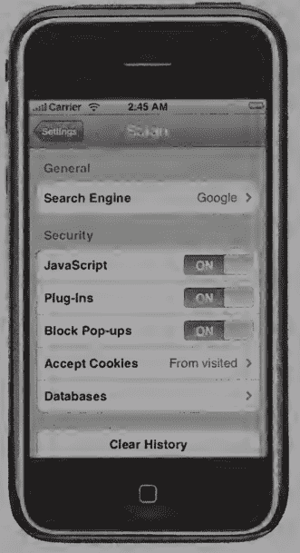

**图3.1 Safari设置应用程序中的开关。**

## 第2节：基于列表和浏览器的界面

iPhone应用程序用户界面的一种基本类型是使用列表来组织界面显示。HistoryExample应用程序就是其中之一。在Dashcode中，这种界面有两种创建方式。最快捷的方式是使用Browser部分。

可以在零件库（Parts Library）中找到Browser部分，并将其直接拖到您的应用程序中。这将创建一个独立视图栈。视图（Views）是用户交互的主要显示单元；它们经常被错误地称为“屏幕”。当向应用程序添加Browser部分时，会自动添加两个默认视图，但不会添加在视图之间切换的代码。此外，还会自动添加一个带有导航按钮的页眉。图3.2显示了添加Browser部分后的Dashcode界面。

页眉中自动添加的按钮不需要修改，因为Browser部分会自动将按钮显示的文本更改为前一个视图页眉中的文本（如果存在）。在创建应用程序时，请修改页眉文本而非按钮文本，以反映应用程序的名称或其他适当的显示内容。

图3.2 添加Browser部件后的Dashcode应用程序

当向应用程序添加Browser部件时，两个默认命名的视图会被插入到项目中。通过选择第一个红色检查器标签页，你可以看到这些视图并为其重命名。图3.3展示了History示例应用程序在视图被重命名为`mainView`和`presidentsView`后的样子。请注意Subviews列表旁边有+和-选项。这些按钮使你能够添加额外的视图并移除任何不需要的视图。

应用程序中的所有视图都在Subviews列表中进行管理。请注意，尽管应用程序的导航路径是`mainView` → `ContinentsView` → `SouthAmericanView`，但所有视图都是堆栈布局的直接子项。这才是这类应用程序应有的开发方式。

在圆角矩形和边缘到边缘列表中，在Dashcode UI设计视图中，只有第一个列表项是可选的。这个第一个元素被用作列表中其他项目的模板。你对此元素所做的任何颜色、内容或大小更改都会应用到列表中的所有其他元素。这包括你分配的事件监听器。History应用程序列表中的所有元素共享相同的`onclick`事件监听器，即`changeView`函数。

`changeView`函数位于`main.js`文件中，可以在接下来的代码中看到。它使用在视图检查器的属性屏幕中输入的标签和值来确定要显示的新视图。要查看此函数，请选择视图本身，而不是第一个标签元素。在你的应用程序中，这是你添加静态列表项的地方，如图3.4所示。

图3.3 HistoryExample应用程序，主视图中添加了视图和两个圆角矩形列表

```
function changeView(event)
{
    var subViewName = event.target.object.value;
    var displayName = event.target.innerText;
    var browser = document.getElementById('browser').object;
    browser.goForward(subViewName+'View', displayName);
}
```

通过使用这些值并适当地命名视图，浏览器对象的`goForward`方法可以适当地切换到下一个视图。这个`goForward`方法有两个参数。第一个是要切换到的视图名称，第二个是要在视图标题中显示的文本。如果你尝试切换到一个视图，标题发生了变化但视图没有变化，那么你尝试切换的视图名称不是你应用程序中的视图名称。

在创建基于列表和视图的应用程序时，请确保正确组织数据。如果信息包含在太多的视图中，用户会觉得导航过于繁琐。事实上，如果你不小心，你可能会重新发明20世纪70年代和80年代基于DOS的导航控件。

基于列表和视图的应用程序有许多用途，但它们在视觉吸引力上不是最好的。有时需要使用列表以外的东西来触发视图更改。这些应用程序被称为非列表视图应用程序。

## 第3节：非列表视图应用程序

尽管基于列表和视图的应用程序有许多用途，但没有规则规定所有基于视图的应用程序必须使用列表来访问信息。其他视觉线索可以表明，通过触摸某个项目，可以显示附加信息。QuickConnectiPhone下载中的PictureExample示例应用程序就是一个这样的例子。

通过在屏幕上指示某物需要被触摸，用户倾向于触摸项目以查看它们是否处于活动状态。如果你选择这种方法，请注意不要用这些指示器或应该触摸什么来控制你的应用程序，以免混淆你的目标受众。

以下代码与之前的代码有几个不同之处。首先，每个图像都需要一个`onclick`或`ontouchstart`监听器来触发对子视图的更改。在此示例中，使用单个函数`goSub`来处理两个可触摸的图像。

# 第3章 创建iPhone用户界面

```
function goSub(event)
{
    var stackLayout = document.getElementById('stackLayout').object;
    stackLayout.setCurrentView(event.target.id+'View'
        , false);
}
```

通过为每个图像设置一个与其所代表的视图名称相似的`id`，可以很容易地使用一个方法来更改视图。如前面的示例所示，堆栈布局对象有一个`setCurrentView`方法。此方法接受两个参数：要更改为的视图的`id`和一个标志。如果标志设置为`true`，则表示预期进行向后更改。`id`和标志参数使程序员或工程师能够控制从一个视图到另一个视图的过渡行为。


与由预构建列表、视图和导航标题组成的`HistoryExample`应用程序列表类型应用程序不同，`PictureExample`应用程序没有内置的、自动化的导航栏。因此，导致视图从子视图向后更改为超视图的程序员或工程师必须编写代码。

与主视图中找到的图像不同，返回图像旨在导致更改为返回视图。因为向后的方向过渡与向前过渡具有相同的视觉行为是不合适的，所以`setCurrentView`函数的第二个参数传递了`true`。这表示需要反向视觉过渡。

以下`goMain`代码作为`onclick`监听器与返回按钮关联。它传递`true`作为第二个参数。这导致与`mainView`关联的过渡以与标准行为相反的方向发生。因此，可以使用户认为先前的操作正在被撤销。

```
function goMain(event)
{
    // 设置 StackLayout 的当前视图
    var stackLayout = document.getElementById('stackLayout').object;
    stackLayout.setCurrentView('mainView', true);
}
```

与基于浏览器的应用程序的另一个区别是，当视图更改时，可以选择使用哪种类型的过渡动画。这些就像提供给用户的任何其他信息一样。如果移动到一个视图与移动到其他视图使用不同的过渡类型，那么该视图就有所不同。图 3.5 显示了 Dashcode 中的子视图列表和`goMain`函数。

如表 3.2 所示，你可以在应用程序中使用多种类型的过渡。虽然在应用程序中使用许多不同的过渡是可能的，但这将是不明智的。

图 3.5 堆栈布局属性屏幕，显示选定的过渡选项。

来源：http://creativecommons.org/licenses/by-sa/3.0/

表 3.2 Dashcode 中默认可用的过渡

| 过渡类型 | 行为 |
| --- | --- |
| `push`（推进） | 一种二维过渡，要显示的视图移入可见区域，而旧视图移出。 |
| `dissolve`（溶解） | 一种二维过渡，要显示的视图变得不透明，而旧视图变得更透明。因为它们相互重叠，看起来就像旧视图逐渐变成了新视图。 |
| `slide`（滑动） | 一种类似于推进的二维过渡。在这种情况下，旧视图保持原位，而新视图似乎在其顶部滑动。这给用户一种在一堆视图中移动的印象。在这种情况下，"向后"更改，滑出，将是深入应用程序视图，而"向前"更改，滑入，将是向上移动视图堆栈。 |
| `fade`（淡入淡出） | 一种类似于溶解的二维过渡。在这种情况下，旧视图保持不透明，因此在转换完成时两个视图都可见。当此过渡"向后"进行时，新视图变得不透明，原始视图完全显示。此过渡用于向现有视图添加新信息或功能，因为两个视图都可以接受触摸事件。 |

### 表 3.2 Dashcode 中默认可用的过渡效果

| 过渡类型 | 行为描述 |
| --- | --- |
| `flip` | 一种三维过渡效果，使视图围绕设备 y 轴旋转，旋转中心位于旧视图和新视图的中心。对用户而言，旧视图仿佛是应用程序的正面，而新视图是背面。这种过渡通常仅用于只有两个视图的应用程序中。 |
| `cube` | 一种三维过渡效果，对用户而言，所有视图都位于立方体的各个面上，而立方体在前后旋转。 |
| `swap` | 一种三维过渡效果，旧视图会滑向一侧，然后移到新视图下方。在过渡期间，新视图的背景是透明的。过渡结束时，新视图的背景变为不透明。 |
| `revolve` | 一种三维过渡效果，旧视图和新视图看起来围绕设备显示屏的 y 轴沿其中一边缘旋转。视觉效果类似于旋转门。 |

从 Dashcode 界面来看，似乎只有从右到左和从左到右两种方向可用于那些会移动的过渡效果。但事实并非如此。从上到下或从下到上的移动也是可能的。

以下代码来自`HistoryExample`的`setup.js`文件，由 Dashcode 生成。如你所见，所有视图的过渡类型及其方向都在这里。如果你想修改这些设置，必须首先关闭代码生成。在 Dashcode 中执行此操作，请使用下拉菜单选项：视图 → 停止代码生成。

```
var dashcodePartSpecs = {

    .
    .
    .

"stackLayout": { "creationFunction": "CreateStackLayout",
"subviewsTransitions": [{ "direction": "right-left", "duration": "",
"timing": "ease-in-out", "type": "push" }, { "direction": "right-left",
"duration": "", "timing": "ease-in-out", "type": "push" }, {
"direction": "right-left", "duration": "", "timing": "ease-in-out",
"type": "push" }, { "direction": "right-left", "duration": "",
"timing": "ease-in-out", "type": "push" }, { "direction": "right-left",
"duration": "", "timing": "ease-in-out", "type": "push" }] }

    .
    .
    .

};
```

由于 Dashcode 会为你生成大量代码，并定期替换`setup.js`文件的内容，因此你不应在应用程序完成之前修改此文件。最简便的修改时机是在将该文件放入 Xcode QuickConnectiPhone 模板之后，因为此时 Dashcode 不再参与。由于它不再参与，也就不会覆盖你所做的任何更改。

上述代码包含四个 JavaScript 对象的声明。每个对象以`{`字符开头，以`}`结尾，并包含`direction`（方向）、`duration`（持续时间）、`timing`（时间函数）和`type`（类型）属性。其中一个对象，即第二个，被加粗以帮助你将其与其他对象区分开。

这些匿名对象中的每一个都定义了从一个视图到另一个视图的过渡行为。加粗的代码对象声明了一个推入（`push`）类型的过渡，如表 3.2 所述。它以缓入缓出（`ease-in-out`）的方式从左向右推入。缓入缓出意味着它在过渡完成过程中逐渐加速然后减速。

其他时间函数选项包括`ease-in`（缓入）、`ease-out`（缓出）和默认值。默认值是恒定速度的时间函数，当过渡定义对象的`timing`属性未设置时使用。

如前所述，过渡方向还有其他选项，即`top-bottom`（从上到下）和`bottom-top`（从下到上）。这些方向并非适用于所有过渡类型。滑动（`slide`）和推入（`push`）过渡接受这些方向，但其他类型则不接受。

如果你选择修改这些对象声明，请注意，如果你的应用程序较为复杂，这些修改可能会导致问题。似乎苹果省略了选择某些过渡定义选项的功能，因为它们会导致 Safari 中使用的 webkit 引擎以及混合应用程序中的`UIWebView`对象出现异常。

## 第 4 节：沉浸式应用程序

沉浸式应用程序与使用视图来分组信息展示和控制有着显著的不同。这类应用程序最常见的形式是游戏，但目前 iPhone 医疗应用程序的例子也采用了这种方法。其核心思想是，用户与应用程序的交互应该是自然的、流畅的，并且尽可能在单一视图内完成。

尽管这种极端形式的方法主要用于游戏，但它也可以在其他方面应用。例如，医学影像应用程序就采用了这种方法，并利用 iPhone 的触摸功能，极大地改变了医生与医学图像交互的方式。

创新的应用程序工程师没有理由不能在商业或科学领域采用同样的方法。之所以做出糟糕的商业决策，原因之一是使用当今简单的图表和图形难以显示相关且复杂的信息片段。要以不同的方式查看数据，就必须使用新的数据展示方式。

如果数据可以以非线性的形式在整个屏幕上进行可视化展示，那么相关数据可以作为叠加层覆盖在上面，以便发现关联性。这种方法的一个简单形式是地图应用程序的功能，它不仅能显示从一个地点到另一个地点的路线，还能显示路线上及附近的交通密度。这样，两条信息被叠加在一起，用户就能发现有用的模式。

## 第 3 章 创建 iPhone 用户界面

本书并不假装提供一种如何操作数据以供展示的方法。它只是建议这样做是可行的，而且正在发生。本节中的例子是一个游戏。

`DollarStash`游戏是苹果 Leaves 示例 Web 应用程序的变体。在该应用程序中，一系列图像被插入到页面中，逐渐落向屏幕底部，下落过程中不断旋转。为了将其变成一个游戏，树叶被改成了代表钱的图标。

当用户触摸一张钞票时，他账户中的金额增加一元。如果一张钞票在未被触摸的情况下完全消失，玩家的账户金额减少一元。成组的钞票以波浪形式显示在屏幕顶部。每一波比前一波多一张钞票。当玩家的余额降至零以下时，游戏结束。图 3.6 展示了游戏进行中的画面。虽然这个游戏是快速拼凑起来的，但它显著地指出了这类应用程序在混合环境中的局限性之一。


图 3.6 进行中的`DollarStash`游戏

`UIWebView`使用与 Safari 和其他应用程序相同的 WebKit 引擎来渲染屏幕。这个引擎和它类似的引擎近年来取得了长足进步。它们的一个常见问题是，当 CPU 负荷过重时，用户界面事件（如点击和触摸）会被忽略。当你在实际设备上（而非模拟器上）玩`DollarStash`游戏时，你会发现情况正是如此。

随着钞票数量的增加，引擎错过的触摸数量也随之增加。让用户遭受这种困扰违反了本章第一部分提到的用户界面设计的基本规则：对用户输入的快速响应。

这类应用程序中用户交互密集的部分最好用 Objective-C 编写。这并不意味着应用程序不能使用`UIWebView`来进行复杂的文本布局和简单的图像显示。它确实意味着，在 iPhone 和 iPod touch 的 CPU 获得大幅提升之前，使用原生级联样式表（CSS）变换和动画来创建复杂的游戏是不可行的。

了解设备的局限性可以引导你朝着更好的设计方向前进。虽然高 CPU 占用率在混合应用程序中不可行，但使用 CSS 变换和动画来实现拖放、缩放和旋转行为，在仅用于单个界面元素时是可行的。

## 第 5 节：创建和使用自定义 CSS 变换

本节将向你展示如何使用 Safari 和`UIWebView`所使用的 WebKit 引擎内置的新 CSS 变换来创建拖放、缩放和旋转功能。要了解更多关于 CSS 过渡、变换和动画的信息，请参阅苹果的用户指南，网址为 http://developer.apple.com/documentation/InternetWeb/Conceptual/SafariVisualAffectsProgGuide/Introduction/chapter_1_1.html#//apple_ref/doc/uid/TP40008032-CH1-SW1。

拖放类型行为的几种实现可供下载，它们是用 JavaScript 编写的。这些实现非常适合在桌面机器上跨浏览器使用。它们在 iPhone 和 iPod touch 上会失败，因为这些实现是 CPU 密集型的。然而，一个不错的替代方案是使用 CSS 变换。

WebKit 是 Safari 和混合应用程序中的`UIWebView`所使用的引擎，它包含在 CSS 中定义过渡的功能。这些过渡是硬件加速的，因此比其他库使用 JavaScript 进行更改更加高效。

一个简单的例子是将 HTML `div`的位置向下移动屏幕。使用传统的 JavaScript 来实现这一点，你需要修改`div`样式的`top`属性。假设一个`div`被分配了一个 CSS 类，将`top`属性设置为距离页面顶部 50 像素。再向下移动 50 像素可以通过将同一属性设置为 100 像素来实现，如下所示：

```
adiv.style.top = '100px';
```

这个声明被解释为 JavaScript 命令，由引擎以与其他任何 JavaScript 命令相同的速度和 CPU 资源执行。

CSS 变换的替代方法有所不同。

使用 CSS 变换来实现相对于原始声明位置 50 像素的位移，同样需要使用`div`的`style`声明。不过，在这种情况下，使用的是完全不同的属性。

添加到 CSS 类中的新属性之一，因此也是 JavaScript 中`Element`对象`style`属性的新属性，是`webkitTransform`。该属性在正确设置时，会调用硬件加速的原生函数。它不是作为 JavaScript 来解析的。正因如此，任何定义的 CSS 属性变更的执行速度都比使用前面 JavaScript 示例快得多。

这里展示的`transform`示例也只需要一行代码：

```javascript
adiv.style.webkitTransform = 'translateY(50px)';
```

乍一看，`transform`属性似乎像`onclick`、`ontouch`以及其他事件监听器一样是一个函数指针。事实上，并非如此。

`webkitTransform`与监听器之间的主要区别在于，不会分配内联声明的 JavaScript 函数或窗口函数。取而代之的是，分配一个描述要调用哪个标准函数及其参数的字符串。然后，该字符串由 WebKit 引擎在其代码中区别于 JavaScript 解析的部分进行解析。

还要注意，声明的平移量是相对于`div`的原始位置的。要将元素向下额外移动 50 像素，传递给`translateY`的参数就是`50px`。同样重要的是要理解，原始位置定义并没有被更改。该`div`仍然被分配了原始的`top`值`50px`。只有其渲染的位置发生了变化。如果你在平移发生后查询该对象并打印`top`值，它仍然会是`50px`，而不是`100px`。

Drag 示例应用程序展示了如何使用`translate`函数让`div`在屏幕上移动。为此，需要为要拖动的`div`分配`ontouchstart`、`ontouchmove`和`ontouchend`事件的监听器。

触摸事件不同于传统桌面拖放 JavaScript 实现中使用的标准`onclick`、`onmousedown`、`onmousemove`和`onmouseup`事件。因为一次触摸可能包含两个或多个独立的触摸点，例如当用户将两根或三根手指放在屏幕上时，触摸事件需要包含关于每个触摸点的信息。

每个独立的触摸点及其信息都存储在一个数组中，该数组是作为事件对象属性的`targetTouches`。该数组的大小根据用户触摸设备屏幕上的元素所用的手指数量而定。因此，如果是一根手指，数组大小为一；两根手指，大小为二。

数组中存储的每个对象都是`Touch`类型，具有许多通常与 JavaScript 中鼠标事件相关的属性。表 3.3 描述了这些属性。

这里展示的拖放实现使用`clientX`和`clientY`属性，因为示例应用程序中不允许滚动。如果允许滚动，则会使用`pageX`和`pageY`属性。

### 表 3.3 Touch 类的属性

| 属性 | 描述 |
|-----------|-------------|
| `pageX` | 相对于整个文档左侧的水平偏移量，包含水平滚动信息 |
| `pageY` | 相对于整个文档顶部的垂直偏移量，包含垂直滚动信息 |
| `screenX` | 相对于设备屏幕左侧的水平偏移量 |
| `screenY` | 相对于设备屏幕顶部的垂直偏移量 |
| `clientX` | 相对于应用程序窗口左侧的水平偏移量 |
| `clientY` | 相对于应用程序窗口顶部的垂直偏移量 |
| `target` | 表示被触摸的 HTML 元素的 DOM 对象 |

实现拖放时遇到的一个问题是元素在开始拖动时发生的"跳动"。这种跳动是因为用户通过触摸元素的某处边界来选中对象，然而，设备的平移却是应用于左上角。如果不处理这种不匹配，被拖动对象的左上角会在拖动开始时"跳动"到用户手指的位置。

显然，用户会觉得这是不正常的。例如，如果用户选择对象的中心来开始拖动，他会合理地期望在拖动过程中手指始终保持在对象的中心。如果并非如此，就会令人不安。图 3.7 展示了运行中的 Drag 示例应用程序。

为了解决这个问题，拖放示例应用程序将`setStartLocation`函数分配给`ontouchstart` JavaScript 事件处理器。该函数（见下列代码及示例中的`main.js`文件）获取并存储原始触摸事件的位置，以像素为单位，在 x 和 y 方向上从应用程序窗口的左上角算起。

```javascript
function setStartLocation(event)
{
    var element = event.target;
    element.offsetX = event.targetTouches[0].clientX;
    element.offsetY = event.targetTouches[0].clientY;
}
```

通过将这个距离存储为被触摸元素的`offsetX`和`offsetY`属性，稍后在拖动元素时可以使用它来阻止跳动发生。元素的实际移动不是发生在`setStartLocation`函数中，而是在分配给`ontouchmove`事件监听器的`drag`函数中。`drag`函数同样在`main.js`文件中。

## 第 3 章 创建 iPhone 用户界面

*(图 3.7 绿色 div 被移动后的 Drag 示例应用程序)*

`drag`函数中的第 3 行（如下列代码所示）对于 iPhone 和 iPod touch 上的任何拖放实现都至关重要。当触摸变更事件被触发时，Safari 浏览器或`UIWebView`会滚动。要关闭这种行为，必须告知事件不要触发其标准行为。这是通过调用事件的`preventDefault`方法实现的。如果在`ontouchmove`监听器中调用此方法，当手指在监听器所分配的元素内移动时，视图将不会滚动。


脱离默认滚动行为后，你可以使用`webkitTransform`来改变元素的渲染位置。为此，需要找到当前触摸位置，并与`setStartLocation`函数中存储的原始触摸位置进行比较。

```javascript
function drag(event)
{
    event.preventDefault();
    var element = event.target;
    element.x = event.targetTouches[0].clientX
              - event.target.offsetX;
    element.y = event.targetTouches[0].clientY
              - event.target.offsetY;
    if(element.lastX || element.lastY){
        element.x += element.lastX;
        element.y += element.lastY;
    }
    element.style.webkitTransform = 'translate('
        + element.x + 'px, '
        + element.y + 'px)';
}
```

前面代码中第 5–8 行的代码计算了元素渲染需要在 x 和 y 两个方向上偏移的量。这些以像素为单位的偏移量存储在当前元素的 x 和 y 属性中，以备后用，然后在第 13–15 行中使用它们，通过前面提到的 translate 函数来实现显示变化。

由于这可能不是用户对某个元素执行的第一次拖动，因此需要跟踪并使用先前应用的偏移量。这些偏移量在前面代码的第 9–11 行中应用，并存储在下面的`done`方法中。该方法被分配为`ontouchend`监听器。

```javascript
function done(event)
{
    var element = event.target;
    element.lastX = element.x;
    element.lastY = element.y;
}
```

`done`方法存在的唯一原因是：存储当前偏移量以便用户再次拖动元素时复用。它通过将元素的当前 x 和 y 属性存储在其`lastX`和`lastY`属性中来实现这一点。这样做可以确保在用户手指在屏幕上移动时，每次触发`ontouchmove`事件时这些值都可用。

通过将这三个方法作为监听器添加到你的用户界面元素上，用户可以以简单的方式拖动它们。在下一节中，你将学习如何创建和使用一个更易于使用、更加完善的拖放模块。

除了拖放之外，iPhone 应用程序通常还需要缩放和旋转界面元素的能力。这些元素可能是 div、按钮、图像或任何其他组织或视觉元素。有趣的是，实现这一功能所需的代码比拖放少得多。显然，Apple 希望工程师和开发人员在他们的应用程序中包含这种行为。

gestures 示例应用程序展示了如何轻松实现缩放和旋转。它不使用触摸，而是使用手势。手势与触摸的区别在于，手势总是假设使用了多于一根手指，并且包含诸如捏合等用户行为。

要表示这些手势，`GestureEvent` 会被传递给任何手势监听函数。因为它们表示的是手势，所以不像 `TouchEvent` 那样包含位置信息。但它们包含三个重要信息，如表 3.4 所示。

**表 3.4 GestureEvent 的重要属性**

| 属性 | 描述 |
|---|---|
| scale | 一个正或负的双精度值，表示手势中使用的两根手指之间距离的变化。负值表示手指已经交叉。该属性用于捏合手势处理。 |
| rotation | 一个正或负的双精度值，以度为单位，表示手势中使用的两根手指的位置与一条垂直线之间的旋转差异。该属性用于旋转手势处理。 |
| target | 表示发生手势的 HTML 元素的 DOM 对象。 |

手势示例应用使用这三个事件来缩放和旋转一个 div。这是通过将名为 `changeIt` 的 `ongesturechange` 事件处理程序添加到 div 本身来实现的。事件处理程序的添加是通过检查器窗口的 Behaviors 选项卡完成的。此方法的代码为：

```javascript
function changeIt(event)
{
    event.preventDefault();
    var element = event.target;

    element.style.webkitTransform=
        'rotateZ('+event.rotation
        +'deg) scale('+event.scale+')';
}
```

请注意，与拖放示例应用一样，必须关闭事件的默认行为以防止滚动。与拖放示例应用不同的是，旋转和缩放信息不会被存储。旋转信息不需要存储，因为它是相对于基线的，而不是相对于被变换的对象。

缩放信息应该被存储，以便在下一次手势中使用，因为它是相对于被变换的元素的，并且具有累积效果。在手势示例应用和前面的代码中省略了缩放信息的存储，以便向你展示如果不存储缩放信息，应用用户将会看到的缩放错误。下一节将向你展示如何存储和重用缩放信息。

请注意，在定义 `webkitTransform` 的字符串中使用了两个函数。这使你可以在一次调用中旋转和缩放 div。它们可以被分开并有条件地使用。

在创建应用时，有三个旋转函数可供使用。它们分别将你选择的元素围绕手机的其中一个轴进行旋转。x 轴是水平的，y 轴是垂直的，z 轴则从屏幕中延伸出来。当前面的代码指定 `rotateZ` 时，它表示 div 应该在设备的 x-y 平面上旋转，如图 3.8 所示。

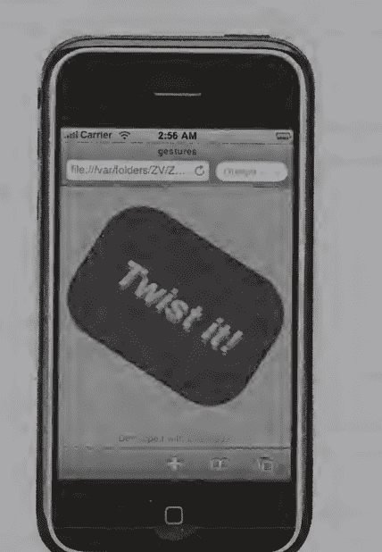

**图 3.8** `webkitTransform` 的 `rotateZ` 函数的应用

你可以轻松地更改旋转方式，使 div 以不同的方式旋转。如果在示例中使用 `rotateY`，div 将围绕 y 轴旋转，并且在显示 div 的背面之前看起来会变窄。如果将旋转更改为 `rotateX`，div 将围绕 x 轴旋转，并且在显示 div 的背面之前看起来会变短。

你可能会考虑使用旋转来创建封面流（cover flow）实现。在撰写本书时，这种实现是不可取的。因为实现类似封面流的行为需要大量的变换，任何实现都会使 iPhone 或 iPod touch 的 CPU 过载，导致用户体验不佳。

现在你已经看到了拖放、缩放和旋转的简单实现，接下来可以理解一个实现了这些功能的高级模块。

## 第 6 节：使用和创建拖放/缩放/旋转模块

模块，如第 2 章"JavaScript 模块化与 iPhone 应用"所述，在功能上是完整且独立的。换句话说，它们被认为与应用中的其余代码松散耦合，并具有紧密的内聚性。设计良好的模块总是附带一个 API。本节中实现的 API 如表 3.5 所示。

### 表 3.5 拖放缩放旋转 API

| 函数 | 参数 | 描述 |
|----------|-----------|-------------|
| makeDraggable | element（必需）—要拖动的 DOM 元素。 | 此函数为传入的元素设置事件监听器，使用户可以拖动它。 |
| | startDragCmd（可选）—映射到控制函数的命令，在 ontouchstart 事件结束时调用。 | |
| | dragCmd（可选）—映射到控制函数的命令，在所有 ontouchmove 事件结束时调用。 | |
| | dropCmd（可选）—映射到控制函数的命令，在 ontouchend 事件结束时调用。 | |
| makeChangeable | element（必需）—要缩放和旋转的 DOM 元素。 | 此函数为传入的元素设置事件监听器，使用户可以缩放它并围绕 z 轴旋转它。 |
| | startChangeCmd（可选）—映射到控制函数的命令，在 ongesturestart 事件结束时调用。 | |
| | dragCmd（可选）—映射到控制函数的命令，在所有 ongesturechange 事件结束时调用。 | |
| | doneChangeCmd（可选）—映射到控制函数的命令，在 ongestureend 事件结束时调用。 | |

你的代码只需要调用这两个函数，就可以为用户提供拖放功能以及缩放和旋转功能（见图 3.9）。dragAndGesture 示例应用可以在 Examples 目录中找到。它可以从 https://sourceforge.net/project/showfiles.php?group_id=213586 作为 QuickConnect-iPhone 的一部分下载。这些函数可以在同一下载包中框架的 QCUtilities.js 文件中找到。

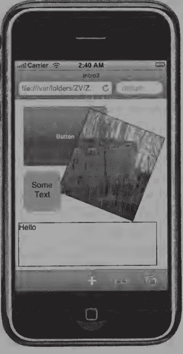

**图 3.9** dragAndGesture 示例应用运行时，一个元素被旋转和移动。

main.js 文件中的 load 函数以及下面的代码展示了如何在用户界面中使用这些函数。

```javascript
function load()
{
	.
	.
	.
	.
	var anElement = document.getElementById('button');
	makeDraggable(anElement);
	makeChangeable(anElement);

	anElement = document.getElementById('imageBaseBox');
	makeDraggable(anElement);
	makeChangeable(anElement);

	anElement = document.getElementById('box');
	makeDraggable(anElement);
	makeChangeable(anElement);

	anElement = document.getElementById('stuff');
	makeDraggable(anElement);
}
```

在前面的示例中，三个不同的 UI 元素被修改为可以拖动、缩放和旋转，而第四个只能拖动。请注意，在获取 UI 元素的引用后，将其传递给 API 的相应函数。这就是使 UI 元素变得活跃所需的全部操作。

本节前面看到的拖放、缩放和旋转的简单实现是独立工作的。如你所见，前面的示例表明它们应该能够协同工作。为此，它们需要了解其他实现对元素产生的影响（如果有的话）。这一更改始于 `makeDraggable` 和 `makeChangeable` 函数。

`makeDraggable` API 函数处理 `ontouchstart` 事件监听器的设置和管理，以及可能为事件后处理发送的任何命令。

```javascript
function makeDraggable(anElement, startDragCmd,
                                  dragCmd, dropCmd){
    anElement.ontouchstart = prepareDrag;
    anElement.isDraggable = true;
    if(startDragCmd){
        anElement.startDragCmd = startDragCmd;
    }
    if(dragCmd){
        anElement.dragCmd = dragCmd;
    }
    if(dropCmd){
        anElement.dropCmd = dropCmd;
    }
}
```

请注意，元素的 `isDraggable` 属性被设置为 true。这是为使两个功能协同工作而存储的第一条信息。还要注意，在此函数中只设置了一个触摸监听器 `ontouchstart`。这样做的原因是在元素被缩放或旋转时忽略触摸事件；这将在本节后面讨论。

`makeChangeable` 函数与之类似。它设置了手势监听器，将 `isChangeable` 属性设置为 true，并存储事件后的命令以供后续使用。与 `makeDraggable` 函数不同的是，此函数设置了手势监听器。这是因为在拖拽的单次触摸触发触摸事件时，不会触发手势事件。如果元素可拖拽且发生了拖拽操作，则会触发并处理触摸事件。如果元素可缩放且发生了手势操作，则会同时触发触摸和手势事件，触摸事件会被忽略，手势事件则会被处理。

```javascript
function makeChangeable(anElement, startChangeCmd,
                        changeCmd, doneChangeCmd) {
    anElement.ongesturestart = prepareGesture;
    anElement.ongesturechange = changeIt;
    anElement.ongestureend = gestureDone;
    anElement.isChangeable = true;
    anElement.oldRotation = 0;
    anElement.oldScale = 1;
    anElement.startChangeCmd = startChangeCmd;
    anElement.changeCmd = changeCmd;
    anElement.doneChangeCmd = doneChangeCmd;
}
```

`makeChangeable` 方法中还初始化了另外两项信息。它们分别是用于累积缩放和旋转值的累加器，分别名为 `oldScale` 和 `oldRotation`。

使用手势示例应用时，每次元素被旋转或缩放后，它会立即恢复到原始大小。这是因为应用程序无法自动存储已完成的缩放信息。元素的 `oldScale` 属性就是用来解决这个问题的。

`oldScale` 属性初始化为 1，因为缩放是应用于元素宽度和高度的乘数；本节稍后将对此进行讨论。如果缩放量在 0（含）和 1（不含）之间，元素会变小。如果缩放量为 1，元素保持不变；在其他任何情况下，元素会变大。

当元素被缩放一次后，必须将已有的缩放量与新的缩放量结合使用，才能正确调整元素大小。例如，如果元素第一次被缩放时大小翻倍，则 `oldScale` 值会被设置为 2。如果用户捏合元素使其变为原始大小的 90%，则当前缩放值应为 2 * .9，等于 1.8。如果未保留 `oldScale` 值，大小会立即变为 .9，这与执行捏合操作的用户意图不符。

之前，`prepareDrag` 函数被分配给了 `ontouchstart` 事件监听器。如下列代码所示，此函数包含几个值得注意的功能。第一个功能是存储 `Touch` 对象数组，本节前面已对此进行描述。这样做是为了让手势事件监听函数能够访问特定的触摸信息。例如，触摸事件可能需要知道有多少次触摸触发了手势事件。而这些信息无法从传递给手势监听器的事件中获取。

```javascript
function prepareDrag(event) {
    stopDefault(event);
    this.touches = event.targetTouches;
    var self = this;
    this.timeout = setTimeout(function() {
        if(self.changing) {
            return;
        }
        self.dragging = true;
        self.ontouchmove = dragIt;
        self.ontouchend = dragDone;
        self.offsetX = event.targetTouches[0].clientX;
        self.offsetY = event.targetTouches[0].clientY;
        self.oldZIndex = self.style.zIndex;
        self.style.zIndex = 50;
        if (self.startDragCmd) {
            var params = new Array();
            params.push(event);
            params.push(self);
            handleRequest(self.startDragCmd, params);
        }
    }, 75);
}
```

上述代码中另一个值得注意的地方在第 5 行。它没有立即将触摸的初始位置存储为被拖拽元素的 `offsetX` 和 `offsetY` 属性，而是使用计时器延迟设置这些值。这样做是因为 `prepareDrag` 函数可能是由用户执行手势操作触发的。

由手势触发的触摸事件总是先于手势事件被触发。如果传递给 `prepareDrag` 的事件确实是手势的结果，则不应设置 `ontouchmove` 和 `ontouchend` 事件监听器，否则它们会在手势变化和结束时被调用。如果这些监听器被调用，它们会执行拖拽行为，导致手势行为出现故障。

创建的计时器需要延迟足够长的时间，以便手势监听函数 `prepareGesture` 能够被调用，因为它会更新正在被更改的元素的 `changing` 属性。

第 22 行表明延迟时间应为 75 毫秒。这为手势监听器提供了足够的时间来被调用和执行（如果发生了手势操作），同时又足够短，不会在发生拖拽时让用户感到困扰。如果延迟时间过长，用户可能会在元素移动之前就将手指拖出了元素。最后一个值得注意的地方是 `params` 数组的填充和对 `handleRequest` 的调用。

第 20 行的 `handleRequest` 函数调用使你能够创建回调函数，这些函数在每次触摸事件为拖拽时执行。这些回调函数使用映射文件中的 `mapCommandTo*` 函数定义，如第 2 章所述。当拖拽开始时，你可以调用任意数量的业务控制函数（BCF）和视图控制函数（VCF）。例如，你可能希望借此将元素从其父元素中移除、更改其背景色或边框，或用于其他目的。


由于不知道你将如何使用或是否会使用这些回调函数，因此在传递的`param`数组中包含了某些信息。如上述代码所示，该数组包含被拖拽的元素和拖拽事件。虽然不确定你在创建的回调函数中是否需要这些信息，但为了方便起见还是将它们添加了进来。

当用户在屏幕上移动手指时，`ontouchmove`事件监听器`dragIt`会被反复调用。此函数与拖放示例应用中的`drag`函数一样，其目的是使元素跟随用户手指的移动。然而，你可以看到之前在手势监听函数和`prepareDrag`中存储的信息得到了应用。

由于使用变换来实现拖放功能，当拖拽完成时，除了平移之外，还必须应用之前已执行的任何旋转和缩放。这是因为`style`的`webkitTransform`每次使用时都会被重置。如果变换字符串中不包含旋转和缩放信息，元素在被拖拽时会立即恢复到原始大小和方向。

一个完整的变换字符串在完全组装后包含多个函数，用于实现平移、旋转和缩放，如下所示：

```
"translate(-1px, 5px) rotateZ(21deg) scale(0.9)"
```

这行代码将元素向左移动 1 像素，向下移动 5 像素。然后围绕 z 轴旋转该元素。接着将其缩小为原始大小的 90%。

函数描述的顺序很重要。如果旋转被放在平移左侧的字符串中，则旋转会先执行，平移会沿与 x 轴和 y 轴成一定角度的方向进行，而不是沿轴方向。这会导致拖放行为异常，因为被拖拽的元素会沿与用户手指移动方向成一定角度的方向移动，而不是与之同向。

用于组装该模块字符串的代码位于第 13–25 行。这些行由拼接一个子字符串到包含`translate`函数声明的字符串组成。

```
function dragIt(event){
    stopDefault(event);

    this.x = event.targetTouches[0].clientX - this.offsetX;
    this.y = event.targetTouches[0].clientY - this.offsetY;

    if(this.lastX || this.lastY){
        this.x += this.lastX;
        this.y += this.lastY;
    }
    this.style.webkitTransformOriginX = '50%';
    this.style.webkitTransformOriginY = '50%';
    var modStringFragment = '';
```

## 第3章 创建 iPhone 用户界面

```javascript
14    if(this.isChangeable){
15        if(this.rotation){
16            modStringFragment +=
17                ' rotateZ('+this.oldRotation+'deg)';
18        }
19        if(this.oldScale){
20            modStringFragment +=
21                ' scale('+this.oldScale+')';
22        }
23    }
24    var modString = 'translate(' + this.x + 'px, '
25                    + this.y + 'px) '+modStringFragment;
26
27    this.style.webkitTransform = modString;
28    if(this.dragCmd){
29        var params = new Array();
30        params.push(event);
31        params.push(this);
32        handleRequest(this.dragCmd, params);
33    }
34 }
```

另一个重要事项发生在第11和12行。`webkitTransformOriginX`和`webkitTransformOriginY`属性被设置为它们的默认值。如果存在任何旋转或缩放操作，这步操作必须完成，稍后在本节中你会看到这一点。如果不这样做，当用户拖动某个元素时，该元素会发生跳动，且用户的手指将不再位于元素上最初触摸的同一位置。

当用户将手指从设备屏幕上抬起时，会触发`ontouchend`事件，并调用`dragDone`监听器函数。该函数的目的如下所示（在`QCUtilities.js`文件中可以找到），即将元素的某些属性重置为原始值，并将其他信息存储起来以备后用。

```javascript
function dragDone(event){
    this.dragging = false;
    this.ontouchmove = null;
    this.ontouchend = null;
    this.lastX = this.x;
    this.lastY = this.y;
    this.style.zIndex = this.oldZIndex;

    if(this.dropCmd){
        var params = new Array();
        params.push(event);
        params.push(this);
        handleRequest(this.dropCmd, params);
    }
}
```

## 第6节：使用和创建拖放/缩放/旋转模块

在该函数中，`ontouchmove`和`ontouchend`监听器被重置为清除状态，以免干扰手势处理，这一点前面已经讨论过。事件的当前 x 和 y 值被存储起来，如果设置了命令，则执行该命令。

在了解了复杂的拖放方法的完整流程之后，相应的手势处理就更容易理解了。正如手势处理会影响实现拖放所需代码一样，拖放处理也会影响实现缩放和旋转所需代码。

下面代码中所示的`prepareGesture`函数（位于`QCUtilities.js`文件中）比本节前面讨论的`prepareDrag`函数更简单。它设置了一些属性，但不需要像另一个准备函数那样进行延迟。该函数不需要延迟的原因在本节前面已经讨论过。

```javascript
function prepareGesture(event) {
    stopDefault(event);
    this.changing = true;
    this.oldZIndex = this.style.zIndex;
    this.style.zIndex = 50;

    if(this.startChangeCmd) {
        var params = new Array();
        params.push(event);
        params.push(this);
        handleRequest(this.startChangeCmd, params);
    }
}
```

与所有手势事件处理函数一样，该函数通过调用`handleRequest`函数来指示框架处理命令。在任何手势事件监听器完成后，你可以执行任意数量的回调函数。有关如何将命令映射到函数的讨论，请参见第2章。

当用户在屏幕上移动手指时，会重复触发`ongesturechange`事件，导致下面代码中所示的`changeIt`函数（在`QCUtilities.js`文件中）被调用。该函数负责根据用户与设备的交互来缩放和旋转元素。

```
"rotateZ(21deg) scale(0.9) translate(-1px, 5px)"
```

请注意，用户可能用两个或多个手指在不同的元素上执行手势操作。这通常是用户的误操作，因此，第5-8行的存在是为了阻止元素在被触摸时作出反应。

用户也可能进行捏合操作，这可能导致元素变得太小而无法容纳两个手指。如果允许这种情况发生，用户就无法调整该元素的大小，从而使该元素无法被修改。第14-19行阻止用户意外地将元素缩得过小而无法放大。

如前所述，变换字符串中函数声明的顺序很重要。要成功地旋转和缩放元素，必须先进行平移转换，但它必须在字符串的末尾声明。

如果在用户尝试旋转元素时先执行平移转换，元素会在旋转过程中逐渐移动。如果不包含平移转换，元素将围绕其原始左上角进行旋转，这是在其指定 CSS 类中定义的。无论哪种情况，都是不可接受的行为。

```javascript
function changeIt(event){
    stopDefault(event);
    //the user may have only put
    //one finger inside of the target.
    if(this.dragging
          || (this.touches && this.touches.length < 2)){
        return;
    }

    this.rotation = event.rotation;
    var rotationValue = this.rotation + this.oldRotation;
    var scaleValue = event.scale * this.oldScale;
    //don't let it get to small to allow two touches
    if(this.offsetWidth * scaleValue < 150){
        scaleValue = 150/this.offsetWidth;
    }
    else if(this.offsetHeight * scaleValue < 150){
        scaleValue = 150/this.offsetHeight;
    }
    this.scale = scaleValue;

    var modString = 'rotateZ('+rotationValue+
                        'deg) scale('+scaleValue+')';
    if(this.lastX || this.lastY){
        modString += ' translate(' + this.lastX + 'px, '
                          + this.lastY + 'px)';
        //update the center of rotation
        this.xCenterOffset = 50
                             + (this.lastX/this.offsetWidth)
                             * 100;

        this.yCenterOffset = 50
                             + (this.lastY/this.offsetHeight)
                             * 100;

        this.style.webkitTransformOriginX =
                        (this.xCenterOffset)+'%';
        this.style.webkitTransformOriginY =
                        (this.yCenterOffset)+'%';
```

```javascript
39 }
40     this.style.webkitTransform = modString;
41 
42     if(this.changeCmd){
43         var params = new Array();
44         params.push(event);
45         params.push(this);
46         handleRequest(this.changeCmd, params);
47     }
48 }
```

第22-39行创建变换字符串并设置`webkitTransformOrigin`值，以便基于被更改元素的视觉中心进行缩放和旋转。前面代码中看到的原点更改，正是为什么需要在前面讨论的`dragIt`方法中重置它们的原因。变换原点被设置为元素的中心，基于其相对于原始位置的当前偏移量。

当用户抬起手指时，会触发`ongestureend`事件，并调用下面所示的`gestureDone`事件处理器。它与`dragDone`方法类似，但有一个主要区别；它也像`prepareDrag`函数一样有一个定时器。

```javascript
1 function gestureDone(event){
2     this.style.zIndex = this.oldZIndex;
3     //the user may not have done a rotation.
4     //if they did not rotation is undefined
5     if(this.rotation){
6         this.oldRotation += this.rotation;
7     }
8     //the user may not have done a pinch.
9     //if they did not scale is undefined
10    if(this.scale){
11        this.oldScale = this.scale;
12    }
13
14    if(this.doneChangeCmd){
15        var params = new Array();
16        params.push(event);
17        params.push(this);
18        handleRequest(this.doneChangeCmd, params);
19    }
20    var self = this;
21    this.timeOut = setTimeout(function(){
22        self.changing = false;
23    }, 75);
24 }
```

第21-23行中的这个定时器，其存在的原因与`prepareDrag`中的定时器类似。当`ongestureend`事件触发时，某些触摸事件尚未处理。如果元素的更改属性立即被设置为 false（见第 222 行），那么根据之前看到的`prepareDrag`中的代码，拖拽的事件监听器将被激活。如果这些拖拽监听器在缩放或旋转手势中被激活，元素会在屏幕上异常跳动，从而对用户体验产生负面影响。虽然拖拽、缩放和旋转行为必须相互感知，但它们的行为必须严格隔离。否则，会出现令人困惑且随机的应用程序行为。本节以及`QCUtilities.js`文件中的代码为您提供了一个可直接使用的、开箱即用的拖拽、缩放和旋转行为实现。

## 总结

从用户的角度来看，应用程序的界面即是应用程序本身。糟糕的用户界面设计（例如 DollarStash 游戏反面示例中的设计）可能会在您的应用程序有机会被改进或修正之前就将其摧毁。如本章所述，明智的界面设计利用了三个基本原则：

- 不要让用户感到惊讶。使用通用的交互行为。

- 使界面直观化。用户不应该需要阅读关于如何使用该应用程序的说明。

- 不要对设备提出它们无法处理的要求。您的 CPU 和内存资源有限，请明智地使用它们。

如果您遵循这些基本规则以及 Apple 的 HIG（人机界面指南），您的应用程序将有更大的成功机会。虽然这些规则看起来很严格，但它们仍然允许创造力的发挥，正如拖拽、缩放和旋转模块所示。如果能够明智地创建和使用该模块，它可以显著提升应用程序的用户体验，因为它基于 iPhone 和 iPod touch 设备固有的多点触控能力以及 Apple 的 HIG。

## 4 使用 QuickConnect 调用 GPS、加速计和其他原生函数

iPhone 拥有许多独特的端能力，您可以将其应用于应用程序中。这些能力包括使手机振动、播放系统声音、访问加速计以及使用 GPS 位置信息。在编写应用程序时，还可以将调试消息写入 Xcode 控制台。访问这些能力并不局限于 Objective-C 应用程序，您的混合应用程序可以通过 JavaScript 实现这些功能。本章的第一节将解释如何使用 QuickConnect JavaScript API 来调用这些以及其他原生 iPhone 功能。第二节将展示 QuickConnect JavaScript 库底层的 Objective-C 代码。

### 第一节：JavaScript 设备激活

iPhone 是一款具有变革性的设备。原因之一是开发人员可以访问加速计等硬件。这些原生 iPhone 函数使您能够创建创新型应用程序。您可以决定应用程序如何响应加速或 GPS 位置的变化，也可以决定手机何时振动或播放某种音频。

`QuickConnectiPhone.com.js`文件包含一个函数，使您能够以简单、易用的方式访问这些行为。`makeCall`函数用于在应用程序中向手机发起请求。要使用`makeCall`，您需要传递两个参数：第一个是命令字符串，第二个是执行该命令可能所需的任何参数的字符串版本。表 4.1 列出了每个标准命令、其所需的参数以及手机执行该命令时的行为。

**表 4.1 MakeCall 命令 API**

| 命令字符串 | 消息字符串 | 行为 |
| :--- | :--- | :--- |
| logMessage | 任何要记录在 Xcode 终端中的信息。 | 代码运行时，消息出现在 Xcode 终端中。 |


| `rec` | 一个 JavaScript 数组的 JSON 字符串，第一个元素包含要创建的音频文件名。数组的第二个元素根据您是希望开始还是停止记录音频数据而为 `start` 或 `stop`。 | 创建一个名称由消息字符串定义的 caf 音频文件。 |

| `play` | 一个 JavaScript 数组的 JSON 字符串，第一个元素包含要播放的音频文件名。数组的第二个元素根据您是希望开始还是停止播放音频文件而为 `start` 或 `stop`。 | 如果 caf 音频文件存在，则通过设备的扬声器或耳机播放。 |

| `loc` | 无 | 触发设备的 Core Location 行为，并将经度、纬度和高度信息传回 JavaScript 应用程序。 |

| `playSound` | -1 | 设备振动。 |

| `playSound` | 0 | 播放 laser 音频文件。 |

| `showDate` | DateTime | 显示原生日期和时间选择器。 |

| `showDate` | Date | 显示原生日期选择器。 |

DeviceCatalog 示例应用程序包含一个 `vibrate` 按钮，点击后会使手机抖动。该按钮的 `onclick` 事件处理函数名为 `vibrateDevice`，如下例所示。该函数调用 `makeCall` 函数，并传递 `playSound` 命令，同时将 -1 作为附加参数传递。此次调用会使手机振动。它使用 `playSound` 命令是因为 iPhone 将振动和短促的系统声音都视为“声音”。

```javascript
function vibrateDevice(event)
{
    //the -1 indicator causes the phone to vibrate
    makeCall("playSound", -1);
}
```

由于振动和系统声音被同等对待，播放系统声音与使手机振动几乎完全相同。Sound 按钮的 `onclick` 事件处理函数名为 `playSound`。如以下代码所示，它与 `vibrateDevice` 唯一的区别在于第二个参数。

如果传递 0 作为第二个参数，则会播放 DeviceCatalog 项目资源中包含的 `laser.wav` 文件作为系统声音。系统声音音频文件必须短于五秒，否则无法作为系统声音播放。超过此长度的音频文件使用 `play` 命令播放，这将在本节稍后部分介绍。

```javascript
function playSound(event)
{
    //the 0 indicator causes the phone to play the laser sound
    makeCall("playSound", 0);
}
```

在前述代码中使用的 `makeCall` 函数完全存在于 JavaScript 中，可见于以下代码。`makeCall` 函数由两部分组成：第一部分在无法立即发送消息时将其排队；第二部分将消息发送给底层的 Objective-C 代码进行处理。传递消息的方法是将 `window.location` 属性更改为一个不存在的 URL `call`，并将传递给函数的两个参数都作为 URL 的参数。

```javascript
function makeCall(command, dataString){
    var messageString = "cmd="+command+"&msg="+dataString;
    if(storeMessage || !canSend){
        messages.push(messageString);
    }
    else{
        storeMessage = true;
        window.location = "call?"+messageString;
    }
}
```

通过这种方式设置 URL，会将包含 URL 及其参数的消息发送给底层 QuickConnectiPhone 框架中的一个 Objective-C 组件。该 Objective-C 组件旨在终止新页面的加载，并将接收到的命令和消息传递给框架的命令处理代码。有关此过程的详细实现，请参阅第二节。

`playSound` 以及 `logMessage`、`rec` 和 `play` 命令是单向的，这意味着通信仅从 JavaScript 到 Objective-C，且不期望返回数据。其余的单向标准命令都会导致数据从 Objective-C 组件传回 JavaScript。

将数据传回 JavaScript 的处理方式有两种。第一种示例是通过调用 `handleRequest` JavaScript 函数（详见第 2 章“JavaScript 模块化与 iPhone 应用程序”）来传输 x、y 和 z 坐标的加速信息。该调用使用 `accel` 命令以及 x、y 和 z 坐标，这些坐标是以 JavaScript 对象的形式从框架的 Objective-C 组件传递过来的。

# 第 4 章 使用 QuickConnect 实现 GPS、加速度计及其他原生功能

`mappings.js` 文件表明 `accel` 命令被映射到 `displayAccelerationVCF` 函数，如下行所示：

```
mapCommandToVCF('accel', displayAccelerationVCF);
```

这导致每当加速度计检测到运动时，都会调用 `displayAccelerationVCF`。该函数负责处理所有加速度事件。在 DeviceCatalog 示例应用程序中，该函数只需将 x、y 和 z 加速度值插入到 HTML div 中。您应该修改此函数，以便在您的应用程序中使用这些值。

向 JavaScript 发送数据的第二种方式是调用 `handleJSONRequest` JavaScript 函数。它的工作方式与第 2 章中描述的 `handleRequest` 函数非常相似，但它期望第二个参数为 JSON 字符串。该函数是 `handleRequest` 函数的一个外观（façade）。如下代码所示，它只需将其第二个参数（JSON 字符串）转换为 JavaScript 对象，然后将命令和新对象传递给 `handleRequest` 方法。这种数据传输方法用于响应由 `makeCall("loc")` 调用发起的 GPS 位置请求，以及显示日期和时间选择器的请求。

```
function handleJSONRequest(cmd, parametersString){
    var paramsArray = null;
    if(parametersString){
        var paramsArray = JSON.parse(parametersString);
    }
    handleRequest(cmd, paramsArray);
}
```

在这两种情况下，结果数据都被转换为 JSON 字符串，然后传递给 `handleJSONRequest`。有关 JSON 的更多信息，请参阅附录 A，“JSON 简介”。

由于 JavaScript 和 Objective-C 都有可用的 JSON 库，因此 JSON 成为在应用程序的两种语言之间传递复杂信息的良好方式。一个简单的例子是用于启动和停止录音以及回放音频文件的 `onclick` 处理程序。

`playRecording` 处理程序是所有激活设备行为的用户界面按钮处理程序的典型代表。如下例所示，它创建了一个 JavaScript 数组，添加了两个值，将数组转换为 JSON 字符串，然后使用 `play` 命令执行 `makeCall` 函数。

```
function playRecording(event)
{
    var params = new Array();
    params[0] = "recordedFile.caf";
    params[1] = "start";
    makeCall("play", JSON.stringify(params));
}
```

要停止播放录音，同样需要像前例那样发出带有 `play` 命令的 `makeCall`，但第二个参数不再是 `start`，而是设置为 `stop`。`main.js` 文件中的 `terminatePlaying` 函数实现了这一行为。

启动和停止音频文件的录制与 `playRecording` 和 `terminatePlaying` 的方式相同，不同之处在于使用了 `rec` 命令而不是 `play` 命令。使这些相关功能的启动和停止实现保持相似，可以让你更轻松地将这些行为添加到应用程序中。

如本节前面所述，某些设备行为（如震动）仅需要从 JavaScript 到 Objective-C 处理程序的单向通信。而其他行为（如获取当前 GPS 坐标或选择器的结果）则需要双向通信。图 4.1 显示了带有 GPS 信息的 `DeviceCatalog` 应用程序。

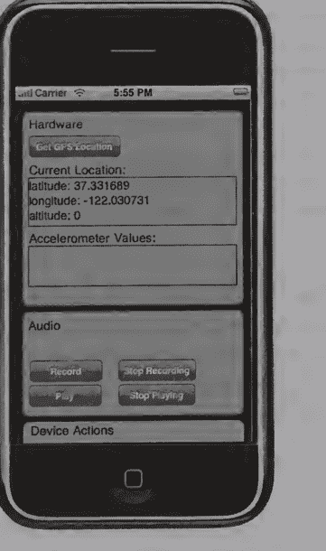

图 4.1 显示 GPS 信息的 `DeviceCatalog` 示例应用程序。

与已经研究过的某些单向示例一样，通信始于应用程序的 JavaScript。`main.js` 文件中的 `getGPSLocation` 函数使用 `makeCall` 函数发起通信。请注意，与之前的示例一样，`makeCall` 不返回任何值。即使在双向通信中，`makeCall` 也使用异步通信协议与库的 Objective-C 端进行通信，因此没有返回值可用。

```
function getGPSLocation(event)
{
    document.getElementById('locDisplay').innerText = '';
    makeCall("loc");
}
```

由于通信是异步的（类似于 AJAX），因此需要创建并调用一个回调函数来接收 GPS 信息。在 QuickConnectiPhone 框架中，这是通过在映射文件中创建映射来实现的，将 `showLoc` 命令映射到一个函数：

```
mapCommandToVCF('showLoc', displayLocationVCF);
```

在这种情况下，它被映射到 `displayLocationVCF` 视图控制函数。这个简单的示例函数仅用于在屏幕上的 div 中显示当前的 GPS 位置。显然，这些值还可以用于计算存储在数据库中的距离，或者使用第 8 章“远程数据访问”中描述的 `ServerAccessObject` 发送到服务器。

```
function displayLocationVCF(data, paramArray){
    document.getElementById('locDisplay').innerText = 'latitude:
'+paramArray[0]+'\nlongitude: '+paramArray[1]+'\naltitude:
'+paramArray[2];
}
```

显示选择器（例如标准的日期和时间选择器）然后显示选定结果的过程与之前的示例类似。此过程同样始于从 JavaScript 到设备处理代码的调用。在这种情况下，按钮的事件处理函数是 `main.js` 文件中的 `showDateSelector` 函数。

```
function showDateSelector(event)
{
    makeCall("showDate", "DateTime");
}
```

与 GPS 示例一样，还需要一个映射。该映射将 `showPickResults` 命令映射到 `displayPickerSelectionVCF` 视图控制函数，如下所示：

```
mapCommandToVCF('showPickResults', displayPickerSelectionVCF);
```

命令映射到的函数将用户选择的结果插入到一个简单的 div 中，如下代码所示。显然，这些信息可以用很多种方式来利用。

```
function displayPickerSelectionVCF(data, paramArray){
    document.getElementById('pickerResults').innerHTML = paramArray[0];
}
```

`makeCall` 的某些用法（如本节之前的示例）是从 JavaScript 到 Objective-C 设备处理程序的单向通信。刚才研究的那些则使用与处理程序之间的双向通信。设备上还可能存在另一种通信类型，即从设备到 JavaScript 代码的单向通信。一个例子就是加速度计信息的使用。

加速度事件的 Objective-C 处理程序（代码请参阅第 2 节）直接通过传递 `accel` 命令来调用 JavaScript 的 `handleRequest`。下面的 `accel` 命令被映射到 `displayAccelerationVCF` 视图控制函数。

```
mapCommandToVCF('accel', displayAccelerationVCF);
```

与其他 VCF 一样，这个 VCF 将加速度值插入到 div 中。

```
function displayAccelerationVCF(data, param){
    document.getElementById('accelDisplay').innerText ='x: '+param.x+'\ny: '+param.y+'\nz: '+param.z;
}
```

此函数与其它函数的区别之一在于，它传递的不是数组，而是将一个对象作为其 `param` 参数传递。第 2 节显示了如何从 Objective-C 加速度事件处理程序传递的信息中创建此对象。

本节向您展示了如何将一些最常用的 iPhone 行为添加到基于 JavaScript 的应用程序中。第 2 节展示了支持此功能的框架的 Objective-C 部分。

## 第 2 节：Objective-C 设备激活

本节假设您熟悉 Objective-C 以及如何使用它来创建 iPhone 应用程序。如果您不熟悉，可以参考 Pearson 出版社出版的 Erica Sadun 的书 *The iPhone Developer's Cookbook*。如果您只想使用 QuickConnectiPhone 框架为 iPhone 编写 JavaScript 应用程序，则无需阅读本节。

使用 Objective-C 使 iPhone 震动是最容易实现的行为之一。如果您在项目的资源中包含 AudioToolbox 框架，可以通过以下单行代码实现：

```
AudioServicesPlaySystemSound(kSystemSoundID_Vibrate);
```

那么问题变成了：“当 UIWebView 被告知更改其位置时，我如何让 `AudioServicesPlaySystemSound` 函数被调用？”

`QuickConnectViewController` 实现了 `shouldStartLoadWithRequest` 代理方法。由于嵌入式 UIWebView（称为 `aWebView`）的代理被设置为 `QuickConnectViewController`，因此每当嵌入式 UIWebView 被告知更改其位置时，此方法都会被调用。以下代码和 `QuickConnectViewController.m` 文件的第 90 行显示了此代理的设置。

```
[aWebView setDelegate:self];
```

`shouldStartLoadWithRequest` 函数的基本行为非常简单直接。它的设计目的是让您能够编写代码，以决定请求的新页面是否应该实际加载。QuickConnectiPhone 框架利用这种决策能力，可以禁止由第 1 节中所示的 JavaScript 调用所发起的任何请求加载页面，转而执行其他的 Objective-C 代码。

`shouldStartLoadWithRequest` 方法有几个可用的参数，包括：

- `curWebView` —— 包含 JavaScript 应用程序的 `UIWebView`。

- `request` —— 一个包含新 URL 及其他项目的 `NSURLRequest`。

- `navigationType` —— 一个 `UIWebViewNavigationType`，可用于确定请求是用户选择链接的结果，还是由某些其他操作生成的。

```
-(BOOL)webView:(UIWebView *)curWebView
 shouldStartLoadWithRequest:(NSURLRequest *)request
 navigationType:(UIWebViewNavigationType)navigationType
```

由 `makeCall` JavaScript 函数组装的、用于使设备震动的 URL `call?cmd=playSound&msg=-1` 包含在 `request` 对象中，可以通过向其发送 URL 消息轻松地将其检索为字符串。该消息返回一个 `NSURL` 类型的对象，然后对其调用 `absoluteString` 消息。这样就得到了一个代表 URL 的 `NSString` 指针。这个字符串（在以下代码中表现为 `url`）随后可以使用 `?` 作为分隔符拆分为一个数组，从而产生一个 `NSString` 指针数组。

```
NSString *url = [[request URL] absoluteString];
NSArray *urlArray = [url componentsSeparatedByString:@"?"];
```

`urlArray` 包含两个元素。第一个是 URL 的 `call` 部分，第二个是命令字符串 `cmd=playSound&msg=-1`。为了确定要执行哪个命令以及可能需要使用的任何参数（在本例中为 -1），需要对命令字符串进行进一步解析。这是通过在 `&` 字符处拆分 `commandString` 来实现的，这将创建另一个名为 `urlParamsArray` 的数组。


```objectivec
NSString *commandString = [urlArray objectAtIndex:1];
NSArray *urlParamsArray = [commandString
 componentsSeparatedByString:@"&"];
//the command is the first parameter in the URL
cmd = [[[urlParamsArray objectAtIndex:0]
 componentsSeparatedByString:@"="] objectAtIndex:1];
```

在这种情况下，请求设备震动，`urlParamsArray`数组的第一个元素变为`cmd=playSound`，第二个是`msg=-1`。因此，拆分`urlParamsArray`的元素可以检索到要执行的命令和参数。`=`字符是拆分`urlParamsArray`每个元素的定界符。

以下示例中的第 1-3 行将 URL 中与`msg`键相关联的值作为`NSString`类型的`parameterArrayString`检索出来。由于组装 URL 的 JavaScript 将所有该值项目转换为 JSON，因此这个`NSString`是一个已转换为 JSON 格式的对象。这包括数字（如本例）、字符串、数组或从 JavaScript 传递的其他参数。此外，如果数据中出现空格或其他特殊字符，`UIWebView`会将它们作为 URL 的一部分进行转义。因此，以下代码的第 6-8 行用于取消转义 JSON 字符串中的任何特殊字符。

```objectivec
1 NSString *parameterArrayString = [[urlParamsArray
2 objectAtIndex:1] componentsSeparatedByString:@"="];
3 objectAtIndex:1];
4 //remove any encoding added as the UIWebView has
5 //escaped the URL characters.
6 parameterArrayString = [parameterArrayString
7 stringByReplacingPercentEscapesUsingEncoding:
8 NSASCIIStringEncoding];
9 SBJSON *generator = [SBJSON alloc];
10 NSError *error;
11 paramsToPass = [[NSMutableArray alloc]
12 initWithArray:[generator
13 objectWithString:parameterArrayString
14 error:&error]];
15 if([paramsToPass count] == 0) {
16 //if there was no array of data sent then it must have
17 //been a string that was sent as the only parameter.
18 [paramsToPass addObject:parameterArrayString];
19 }
20 [generator release];
```

上述代码的第 9-14 行包含将 JSON 字符串`parameterArrayString`转换为原生 Objective-C `NSArray`的代码。第 9 行分配一个`SBJSON`生成器对象。然后向生成器对象发送如下所示的`objectWithString`消息：

```objectivec
-(id)objectWithString:(NSString*)jsonrep error:(NSError**)error;
```

这个多部分消息传递了一个 JSON 字符串（在本例中为`parameterArrayString`）和一个`NSError`指针`error`。如果在转换过程中发生错误，则给错误指针赋值；如果没有错误发生，它则为`nil`。

在这种情况下，该消息的返回值是数字 -1。如果是一个 JavaScript 数组被字符串化，它将是一个`NSArray`指针；如果是一个 JavaScript 字符串，它将是一个`NSString`指针。如果传递的是 JavaScript 自定义对象类型，返回的对象则是一个`NSDictionary`指针。

此时，在检索到命令和执行命令所需的任何参数后，可以使用`if`或`case`语句来进行实际的计算。

## 第 4 章 使用 QuickConnect 实现 GPS、加速度计和其他原生功能

然而，这样的一组条件判断并不是最优的，因为每次添加或删除命令时都必须对其进行修改。在第 2 章中，同样的问题在 QuickConnectiPhone 架构的 JavaScript 部分通过实现一个名为`handleRequest`的前端控制器函数来解决，该函数包含对应用程序控制器实现的调用。由于这里的问题相同，一个 Objective-C 版本的`handleRequest`应该能解决当前的问题。第 3 节涵盖了 Objective-C 中前端控制器和应用程序控制器的实现。以下代码行检索 QuickConnect 对象的实例，并向其传递`handleRequest:withParameters:`多重消息。在`shouldStartLoadWithRequest`代理方法中不再需要进一步的计算。

```objectivec
[[QuickConnect getInstance] handleRequest:cmd withParameters:paramsToPass];
```

因为使用了 QuickConnect 对象的`handleRequest`消息，必须有一种方法将命令映射到所需的功能，就像第 2 章中使用 JavaScript 所展示的那样。在 QCObjC 组的`QCCommandMappings.m`和`.h`文件中找到的`QCCommandMappings`对象包含了本例中所有业务控制对象（BCO）和视图控制对象（VCO）的映射。

以下代码是`QCCommandMappings`对象的`mapCommands`方法，该方法在应用程序启动时被调用。它被传递一个应用程序控制器的实现，用于创建命令到功能的映射。关于`mapCommandToVCO`消息的代码说明以及`mapCommands`的调用可以在第 3 节中找到。

```objectivec
1 + (void) mapCommands:(QCAppController*)aController{
2    [aController mapCommandToVCO:@"logMessage" withFunction:@"LoggingVCO"];
3    [aController mapCommandToVCO:@"playSound" withFunction:@"PlaySoundVCO"];
4    [aController mapCommandToBCO:@"loc" withFunction:@"LocationBCO"];
5    [aController mapCommandToVCO:@"sendloc" withFunction:@"LocationVCO"];
6    [aController mapCommandToVCO:@"showDate" withFunction:@"DatePickerVCO"];
7    [aController mapCommandToVCO:@"sendPickResults"
        withFunction:@"PickResultsVCO"];
8    [aController mapCommandToVCO:@"play" withFunction:@"PlayAudioVCO"];
9    [aController mapCommandToVCO:@"rec" withFunction:@"RecordAudioVCO"];
10 }
```

上述代码的第 3 行与当前设备震动的示例相关。正如本节前面所见，从应用程序 JavaScript 部分接收到的命令是`playSound`。通过将此命令作为`mapCommandToVCO`消息的第一个参数，并将`PlaySoundVCO`作为第二部分`withFunction`的参数，从而建立起一个链接，使得应用程序控制器向`PlaySoundVCO`类发送一个带有参数 -1 的`doCommand`消息。如您所见，DeviceCatalog 示例中所有从 JavaScript 发送的其他命令都在这里进行了映射。

`playSound`命令所映射的`PlaySoundVCO`代码可以在`PlaySoundVCO.m`和`PlaySoundVCO.h`文件中找到。`doCommand`方法包含了该对象的所有行为。

要播放系统声音，必须使用预定义的声音（在撰写本书时，振动是唯一可选的），或者必须从声音文件生成系统声音。`PlaySoundVCO`类的`doCommand`方法展示了这两种行为类型的示例。

```objectivec
1 + (id) doCommand: (NSArray*) parameters{
2     SystemSoundID aSound = 
3         [((NSNumber*)[parameters objectAtIndex:1]) intValue];
4     if(aSound == -1){
5         aSound = kSystemSoundID_Vibrate;
6     }
7     else{
8         NSString *soundFile = 
9             [[NSBundle mainBundle] pathForResource:@"laser"
10                     ofType:@"wav"];
11         NSURL *url = [NSURL fileURLWithPath:soundFile];
12         //if the audio file takes too long to play
13         //you will get a -1500 error
14         OSStatus error = AudioServicesCreateSystemSoundID(
15             (CFURLRef) url, &aSound );
16     }
17     AudioServicesPlaySystemSound(aSound);
18     return nil;
19 }
```

如上例第 4 行所示，如果索引为 1 的参数值为 -1，则将`SystemSoundID aSound`变量设置为预定义的`kSystemSoundID_Vibrate`值。如果不是，则从应用程序资源组中的`laser.wav`文件创建一个系统声音，并将`aSound`变量设置为为新系统声音生成的标识符。

无论哪种情况，都会调用 C 函数`AudioServicesPlaySystemSound`，播放声音或使设备振动。如果设备是 iPod Touch，设备会忽略振动请求。在拥有多种声音的实际应用程序中，可以通过传递其他数字作为应播放哪种声音的指示符来轻松扩展此函数。

由于`SystemSoundID`类型的变量实际上是数字类型，因此系统声音应在应用程序启动时生成，并将每个声音的`SystemSoundID`传递给应用程序的 JavaScript 部分以供后续使用。这避免了每次需要声音时重新创建系统声音的计算开销，因此，由于没有声音播放延迟，提高了用户体验的质量。

现在我们已经了解了从 JavaScript 向 Objective-C 传递命令的过程，以及如何使设备振动或播放短音，现在可以很容易地看到并理解如何向 Objective-C 传递命令，并将结果返回到应用程序的 JavaScript 部分。

## 第 4 章 使用 QuickConnect 的 GPS、加速及其他原生功能

由于这些类型的通信行为相似，因此以 iPhone 应用程序中流行的 GPS 位置检测为例进行说明。它使用了 QuickConnectiPhone 框架的这种双向、JavaScript-Objective-C 通信能力。

与处理从 JavaScript 框架发送的所有命令一样，必须为`loc`命令建立映射，以便检索数据并发送回响应。

```objectivec
[aController mapCommandToBCO:@"loc" withFunction:@"LocationBCO"];
[aController mapCommandToVCO:@"sendloc" withFunction:@"LocationVCO"];
```

在这种情况下，有两个映射：第一个映射到 BCO，第二个映射到 VCO。如第 2 章所讨论的，BCO 用于数据检索，VCO 用于数据呈现。

由于 QuickConnectiPhone 框架会先执行给定命令的所有 BCO，然后才执行 VCO，因此首先向`LocationBCO`类发送`doCommand`消息，该类检索并返回 GPS 数据。以下`doCommand`方法属于`LocationBCO`类。它发出启动设备查找其 GPS 位置所需的调用。

```objectivec
+ (id) doCommand: (NSArray*) parameters({
    QuickConnectViewController *controller = (QuickConnectViewController*)[parameters objectAtIndex:0];
    [[controller locationManager] startUpdatingLocation];
    return nil;
}
```

此方法通过检索传入方法的参数数组中的第一项并通知其启动硬件，来启动 GPS 位置硬件。框架始终将第一个参数设置为`QuickConnectViewController`，以便任何命令关联的 BCO 或 VCO 在需要时可以使用它。在所有 Objective-C BCO 和 VCO 中，从 JavaScript 发送的任何参数都从索引 1 开始。

`QuickConnectViewController`对象具有一个内置的`CLLocationManager`属性，称为`locationManager`，它根据应用程序的需要开启和关闭。重要的是不要让此管理器运行超过所需时间，因为它会消耗大量电池电量。因此，上面的代码通过在每次需要位置时向其发送`startUpdatingLocation`消息来打开位置硬件。一旦找到位置，位置硬件就会关闭。

`CLLocationManager`对象以异步方式运行。这意味着当请求位置信息时，在确定位置后会调用一个预定义的回调函数。此预定义函数允许您访问位置管理器和两个位置：先前确定的位置和当前位置。

位置管理器通过逐步细化设备的位置来工作。当它这样做时，会多次调用`didUpdateToLocation`。以下代码示例计算确定新位置所需的时间。第 9 行确定这是否小于 5.0 秒，如果是，则终止位置搜索。

```objectivec
1  (void)locationManager:(CLLocationManager *)manager
2      didUpdateToLocation:(CLLocation *)newLocation
3      fromLocation:(CLLocation *)oldLocation
4  {
5      // If it's a relatively recent event, turn off updates to save power
6      NSDate* eventDate = newLocation.timestamp;
7      NSTimeInterval howRecent =
8          [eventEvent timeIntervalSinceNow];
9      if (abs(howRecent) < 5.0){
10         [manager stopUpdatingLocation];
11         NSMutableArray *paramsToPass =
12             [[NSMutableArray alloc] initWithCapacity:2];
13         [paramsToPass addObject:self];
14         [paramsToPass addObject:newLocation];
15         [[QuickConnect getInstance]
16             handleRequest:@"sendloc"
17             withParameters:paramsToPass];
18     }
19     // else skip the event and process the next one.
20 }
```

终止位置搜索后，代码随后向 QuickConnect 前端控制器类发送一条消息，声明它应该处理一个`sendloc`请求，并将`QuickConnectViewController`（即`self`）和新位置作为附加参数传递。

`sendloc`命令映射到`LocationVCO`处理器，其`doCommand`方法在以下示例中可见。此方法从发出原始 GPS 位置信息请求的`QuickConnectViewController`中检索名为`webView`的`UIWebView`。然后将 GPS 信息放入名为`passingArray`的`NSArray`中。

要将 GPS 信息传回`webView`对象，必须将其所在的`NSArray`转换为 JSON 字符串。与之前用于从 JSON 字符串创建数组的相同`SBJSON`类现在用于从`NSArray`创建`NSString`。这在第 21 和 22 行完成：


将GPS位置信息转换为表示数字数组的JSON字符串后，会调用`webView`对象内的JavaScript引擎。这是通过首先创建一个`NSString`作为要执行的JavaScript来完成的。在这个例子中，它是一个`handleJSONRequest`，将`showLoc`作为命令传递，将JSON GPS信息作为字符串传递。如第1节所示，此请求会导致GPS数据出现在正在显示的HTML页面的`div`中。

看过这个示例后，现在可以查看`DeviceCatalog`示例中的`DatePickerVCO`和`PickResultsVCO`，看看如何使用相同的方法来显示标准日期和时间选择器（称为picker）。虽然`UIWebView`中可以使用JavaScript预定义的picker，但从用户的角度来看，它们不如Objective-C中可用的标准picker自由。通过使用这些标准picker以及您可能选择定义的任何自定义picker，您的混合应用程序将拥有更流畅的用户体验。

## 第3节：QuickConnectiPhone架构的Objective-C实现

第1节和第2节中显示的代码严重依赖于第2章中解释的相同架构的Objective-C实现。本节展示如何用Objective-C实现该架构。要查看每个组件的完整说明，请参见第2章，其中包含JavaScript实现。

与JavaScript实现一样，所有应用行为的请求都通过前端控制器处理。前端控制器由`QuickConnect`类实现，其源代码位于`QuickConnect.m`和`QuickConnect.h`文件中。由于可能需要从应用程序的许多不同位置向`QuickConnect`发送消息，因此该类是一个单例。

单例类的设计使得在应用程序中只能分配该类的一个实例化对象。如果实现正确，始终可以从应用程序中的任何位置获取指向这个单一对象的指针。对于`QuickConnect`单例对象，这是通过实现一个类方法`getInstance`来完成的，该方法返回在首次调用时分配的唯一`QuickConnect`实例。

由于它是一个类方法，可以在不实例化`QuickConnect`对象的情况下向该类发送`getInstance`消息。调用时，它返回指向底层`QuickConnect`实例的指针。如以下代码所示，这通过将类的一个实例赋值给一个静态定义的`QuickConnect`指针来实现。

```
+ (QuickConnect*)getInstance{
    //since this line is declared static
    //it will only be executed once.
    static QuickConnect *mySelfQC = nil;

    @synchronized(QuickConnect class) {
        if (mySelfQC == nil) {
            mySelfQC = [QuickConnect singleton];
            [mySelfQC init];
        }
    }
    return mySelfQC;
}
```

在`init`之前发送的`singleton`消息使用了`QuickConnect`对象的超类`FTSWAbstractSingleton`中定义的行为。该超类分配了内置的单例行为，例如重写`new`、`clone`以及其他可能被误用来分配另一个`QuickConnect`实例的方法。因此，只有`getInstance`方法可用于创建和使用`QuickConnect`对象。与Objective-C中所有格式良好的对象一样，`QuickConnect`对象被分配后必须进行初始化。

对象的分配和初始化仅在没有`QuickConnect`对象被赋值给`mySelfQC`属性时才会发生。此外，由于检查已实例化的`QuickConnect`对象时使用了同步调用，因此检查和初始化是线程安全的。

`- (void) handleRequest:(NSString*) aCmd withParameters:(NSArray*) parameters`是`QuickConnect`类的另一个方法。就像第2章中的JavaScript函数`handleRequest(aCmd, parameters)`一样，此方法是请求在应用程序中执行功能的方式。

一个命令字符串和一个参数数组被传递给该方法。在下面的示例中，第3–9行显示了一系列消息被发送给应用控制器。第3行和第4行首先执行与该命令关联的所有VCO。如果命令和参数通过验证，则通过`dispatchToBCO`消息执行与该命令关联的所有BCO。此消息返回一个`NSMutableArray`，其中包含原始参数数组数据以及可能被调用的任何BCO对象累积的任何数据。

```
1 - (void) handleRequest: (NSString*) aCmd
2             withParameters: (NSArray*) parameters{
3     if([self->theAppController dispatchToValCO:aCmd
4         withParameters:parameters] != nil){
5         NSMutableArray *newParameters =
6             [self->theAppController dispatchToBCO:aCmd
7                 withParameters:parameters];
8         [self->theAppController dispatchToVCO:aCmd
9                 withParameters:newParameters];
10    }
11 }
```

在调用`dispatchToBCO:withParameters`完成后，会发送`dispatchToVCO:withParameters`消息。这会导致也与给定命令关联的任何VCO被执行。

通过对所有功能请求使用`handleRequest:withParameters`方法，每个请求都会经过一个三步流程。

1. 验证。
2. 执行业务规则（BCO）。
3. 执行视图更改（VCO）。

与JavaScript实现一样，每个`dispatchTo`方法都是一个外观。在本例中，底层的Objective-C方法是`dispatchToCO:withParameters`。

该方法首先从传递的参数`aMap`中检索与默认命令关联的所有命令对象。`aMap`包含BCO、VCO或ValCO，具体取决于调用了哪个外观方法。这些默认命令对象（如果有的话）会被检索出来，并用于所有命令。如果你希望某些命令对象用于所有命令，不需要将它们映射到每个单独的命令。只需将它们映射到默认命令一次即可。

为了让检索到的命令对象被使用，必须向它们发送消息。要发送的消息是`doCommand`。下面示例中的第19–23行显示了该消息作为选择器被检索，并传递了`performSelector`消息。这会导致你在`QCCommandObject`中实现的`doCommand`消息被执行。

```
1 - (id) dispatchToCO: (NSString*)command withParameters:
2              (NSArray*)parameters andMap: (NSDictionary*)aMap{
3         //create a mutable array that contains all of
4         // the existing parameters.
5         NSMutableArray *resultArray;
6         if(parameters == nil){
7             resultArray = [[NSMutableArray alloc]
8                                     initWithCapacity:0];
9         }
10        else{
11            resultArray = [NSMutableArray
12                                    arrayWithArray:parameters];
13        }
14        //set the result to be something so
15        //that if no mappings are made the
16        //execution will continue.
17        id result = @"Continue";
18        if([aMap objectForKey:@"default"] != nil){
19            SEL aSelector = @selector(doCommand);
20            while((result = [((QCCommandObject*)
21                [aMap objectForKey:@"default"])
22                performSelector:aSelector
23                    withObject:parameters]) != nil){
24                if(aMap == self->businessMap){
25                    [resultArray addObject:result];
26                }
27            }
28        }
29        //if all of the default command objects' method calls
30        //return something, execute all of the custom ones.
31        if(result != nil && [aMap objectForKey:command] !=
32            nil){
33            NSArray *theCommandObjects =
34                [aMap objectForKey:command];
35            int numCommandObjects = [theCommandObjects count];
36            for(int i = 0; i < numCommandObjects; i++){
37                QCCommandObject *theCommand =
38                    [theCommandObjects objectAtIndex:i];
39                result = [theCommand doCommand:parameters];
40                if(result == nil){
41                    resultArray = nil;
42                    break;
43                }
44                if(aMap == self->businessMap){
45                    [resultArray addObject:result];
46                }
47            }
48        }
49        if(aMap == self->businessMap){
50            return resultArray;
51        }
52        return result;
53    }
```

在向你映射到默认命令的所有`QCCommandObject`发送完`doCommand`消息后，对映射到作为参数传入该方法的命令的`QCCommandObject`执行相同的操作。这些`QCCommandObject`与JavaScript实现中的控制函数存在的理由相同。由于`QCCommandObject`包含应用程序的所有行为代码，提供一个示例有助于理解它们是如何创建的。

`QCCommandObject`是`LoggingVCO`的父类。因此，`LoggingVCO`必须实现`doCommand`方法。以下是`DeviceCatalog`示例中`LoggingVCO.m`文件的完整内容。其`doCommand`方法将内容写入正在运行的应用程序的日志文件。此VCO记录从应用程序的JavaScript代码内部生成的调试消息。图4.2展示了实现此功能所需的调用。

`LoggingVCO`类的`doCommand`方法很小。不同命令对象类型的所有`doCommand`方法都应该始终保持较小。它们应该只做一件事并把它做好。如果你发现正在编写的`doCommand`方法变得很大，你可能需要考虑将其拆分为逻辑组件，并创建多个命令对象类。原因是如果这些方法变得很长，它们可能正在做不止一件事。

## 第3节：QuickConnectiPhone架构的Objective-C实现

在接下来的示例中，`LoggingVCO`所做的“一件事”是将消息记录到Xcode的调试控制台中。显然，这个小型组件可以与许多命令以及其他命令对象结合重复使用。

该VCO的行为由一行执行`NSLog`函数的代码组成。在此过程中，参数数组中的第一个对象被附加到一个静态字符串并输出。

```objc
#import "LoggingVCO.h"

@implementation LoggingVCO

+ (id) doCommand:(NSArray*) parameters{
    NSLog(@"JavaScriptMessage: %@",
          [parameters objectAtIndex:1]);
    return nil;
}

@end
```

为了实现此日志记录，必须在`logMessage`命令和`LoggingVCO`类之间建立映射。与JavaScript实现类似，这是通过将`logMessage`作为键，将`LoggingVCO`类的名称作为值添加到映射表中来完成的。

映射在`QCCommandMappings.m`文件中完成。接下来的代码来自`DeviceCatalog`示例中的该文件，它将`logMessage`映射到`LoggingVCO`类。

```objc
[aController mapCommandToVCO:@"logMessage"
    withFunction:@"LoggingVCO"];
```

应用程序控制器接收`mapCommandToVCO:withFunction`消息，其中第一个参数是命令，第二个参数是VCO名称。此方法以及用于映射其他命令对象类型的类似方法都是外观（façades）。每个此类外观方法都会调用底层的`mapCommandToCO`方法。


这个`mapCommandToCO`方法通过将命令映射到`NSMutableArray`，使得多个命令对象可以映射到单个命令。然后，该数组用于包含与作为第二个参数传递的类名相匹配的`Class`对象。以下代码展示了`mapCommandToCO`方法的实现。

```objc
- (void) mapCommandToCO:(NSString*) aCommand
        withFunction:(NSString*) aClassName
        toMap:(NSMutableDictionary*) aMap{
    NSMutableArray *controlObjects =
        [[aMap objectForKey:aCommand] retain];
    if(controlObjects == nil){
        NSMutableArray *tmpCntrlObjs =
            [[NSMutableArray alloc] initWithCapacity:1];
        [aMap setObject: tmpCntrlObjs forKey:aCommand];
        controlObjects = tmpCntrlObjs;
        [tmpCntrlObjs release];
    }
    //Get the control object's class
    //for the given name and add an object
    //of that type to the array for the command.
    Class aClass = NSClassFromString(aClassName);
    if(aClass != nil){
        [controlObjects addObject:aClass];
    }
    else{
        MESSAGE(@"Unable to find the %@ class. Make sure that it exists under this name and try again.*", aClass);
    }
}
```

将`Class`对象添加到`NSMutableArray`中，使得任意数量的同类型命令对象（VCO、BCO或其他）可以映射到同一个命令，并按照发送`mapCommandTo`消息的顺序依次执行。因此，您可以让多个VCO按顺序执行。

例如，您可以使用一个显示`UIView`的VCO，随后使用另一个改变`UIView`不透明度的VCO，然后记录一条消息。通过发送三个具有相同命令但具有三个不同命令对象名称的`mapCommandToVCO`消息即可实现。

`DeviceCatalog`示例中还存在其他几个BCO和VCO的例子。每当从应用程序的JavaScript部分发出请求时，它们就会被激活。

## 总结

本章向您展示了如何从JavaScript应用程序中激活iPhone或iPod Touch设备的若干实用功能。使用GPS定位、加速度计数值、手机震动以及播放声音和音频等功能，可以增加应用程序的丰富度。

通过查看`DeviceCatalog`中包含的示例，如果您使用Objective-C开发，您应该能够添加更多功能，例如扫描Bonjour网络以查找附近设备、在联系人应用程序中添加、删除和检索联系人，或者添加、删除和检索Objective-C应用程序中可用的其他内置行为。

您的JavaScript应用程序可以使用本章描述的方法，完成纯Objective-C应用程序几乎能做的任何事情。第8章中有一个示例，您将学习如何在不损失Apple地图应用程序外观和感觉的情况下，将Google地图嵌入到任何应用程序中。

# 使用PhoneGap实现混合应用程序、GPS、加速度及其他原生函数

PhoneGap库为第4章“使用QuickConnect实现GPS、加速度及其他原生函数”中讨论的QuickConnect框架提供了一种替代方案。虽然它不具备QuickConnect的全部功能，但它与QuickConnect一样，是访问设备信息和行为的热门选择。本章的第一节解释了如何使用PhoneGap JavaScript API访问这些原生iPhone功能。第二节将展示PhoneGap JavaScript API底层的JavaScript和Objective-C代码。

## 第1节：JavaScript设备激活

由于在撰写本书时PhoneGap仍在开发中，因此可用的原生行为数量有限。本节仅涵盖在应用程序的Javascript和Objective-C两端都有支持的行为。对于目前在PhoneGap中尚未完成或无法运行的行为代码，代码中设有占位符。这些行为不在讨论范围内。

表5.1列出了作为可用API的方法、函数和属性。与QuickConnectiPhone不同，这些并不属于一个更大的框架。因此，您负责直接调用它们。由于活动代码中的安全检查很少，请确保传递给这些函数的参数有效且不为null。

正如第4章所述，QuickConnectiPhone将HTML、CSS和JavaScript包含在设备上安装的应用程序中。PhoneGap则不然。相反，在启动时，一个被重命名为您的应用程序的通用Objective-C应用程序，会临时从之前发布这些文件的Web服务器加载这些文件（见图5.1）。要运行该应用程序，您的设备必须具有网络连接。因此，不要期望用户在飞机上或在没有网络连接的地方能正确运行您的应用程序。

### PhoneGap应用程序启动流程

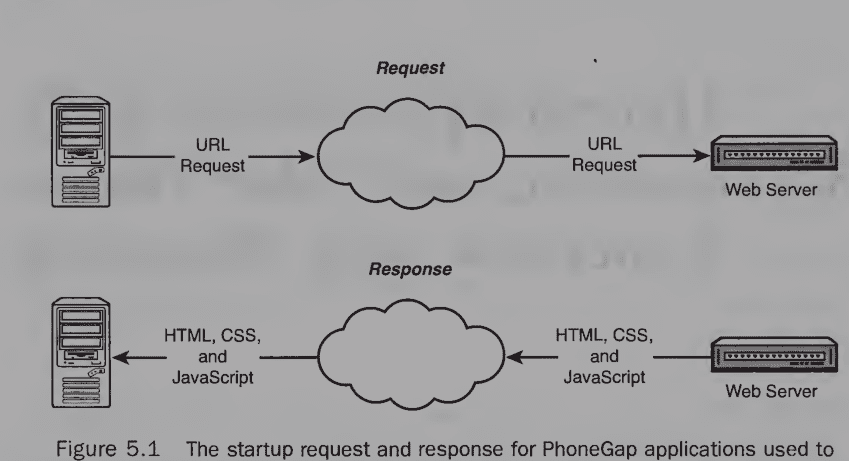

*图5.1 PhoneGap应用程序用于获取定义应用程序的HTML、CSS和JavaScript的启动请求和响应*

当PhoneGap应用程序开始从服务器加载其Web组件时，通用Objective-C应用程序会向JavaScript发出调用。此调用设置了一系列描述应用程序运行设备的全局变量。JavaScript API的`Device.init`方法（通常在被指定为`onload`事件监听器的函数中调用）的作用是收集由应用程序Objective-C部分设置的全局变量，并将它们存储在PhoneGap`Device`对象的属性中。设置这些设备变量的Objective-C代码将在第2节中讨论。

```javascript
init: function(model, version) {
    .
    .
    .
        Device.available = __gap;
        Device.model = __gap_device_model;
        Device.version = __gap_device_version;
        Device.gapVersion = __gap_version;
        Device.uuid = __gap_device_uniqueid;
    .
    .
    .
}
```

上面的示例显示了与iPhone和iPod Touch设备相关的代码。每个全局变量名都以`__`（双下划线）开头并具有唯一值。`__gap`变量被用作标志，以指示JavaScript是否在PhoneGap应用程序内部运行。这是必需的，因为在撰写本书时，应用程序的HTML、CSS和JavaScript文件并未包含在任何编译安装的PhoneGap应用程序中，而是由包装器（wrapper）从互联网下载。如果您的应用程序文件是通过Web浏览器而非PhoneGap应用程序访问的，那么`__gap`变量将为null，之后可用作代码中的标志。

`__gap_device_model`变量包含一个描述应用程序运行设备的字符串，例如iPhone、iPod Touch或iPhone模拟器。此变量还包括设备的OS版本，该版本位于`__gap_device_version`全局变量中。设备的全局唯一ID位于`__gap_device_uniqueid`变量中，PhoneGap的版本则在`__gap_version`中。这些值既可以通过代码片段中看到的公共设备属性使用，也可以在代码中的任何位置通过全局变量使用。表5.1描述了允许您访问设备行为的每个JavaScript函数。

### 表5.1 PhoneGap JavaScript API

| 元素 | 参数 | 行为 |

| :--- | :--- | :--- |

| `gotAcceleration()` | `x`—沿x轴的加速度值。`y`—沿y轴的加速度值。`z`—沿z轴的加速度值。 | 此函数并非预定义。要接收加速度计信息，请在应用程序的某个位置创建此函数。创建后，Objective-C库即可调用它并传递参数值。 |

| `Device.init()` | 无 | 从应用程序启动时设置的全局变量中收集设备信息。此信息被放入`Device`对象中，包括：设备类型 (iPhone/iPodTouch)、设备OS版本、设备唯一ID、PhoneGap版本 |

| `Device.vibrate()` | 无 | 使手机在标准时间内震动。 |

## 第5章 使用PhoneGap的混合应用、GPS、加速度计及其他原生功能

### 表5.1 PhoneGap JavaScript API

| 元素 | 参数 | 行为 |

| :--- | :--- | :--- |

| `Device.sound()` | `clip`—一个字符串，表示要播放的声音文件的名称和类型。示例："tweet.wav" | 具有此名称的声音文件必须位于应用程序的资源中，否则将发生执行错误。 |

| `Device.Location.init()` | 无 | 将应用程序Objective-C端已有的位置信息发送到JavaScript端进行处理和/或显示。 |

| `Device.Location.callback` | | `Location`对象的此属性在设置为自定义回调函数时，会在GPS信息可用时执行该回调函数。 |

| `Device.Location.wait()` | `func`—当GPS信息可用时执行的回调函数。 | 这是`Device.Location.init()`函数的替代方案。 |

| `Device.exec()` | `command`—传递给应用程序Objective-C端进行处理的命令字符串。示例："vibrate"、"sound"和"getLoc" | 这是处理与应用程序Objective-C端所有通信的函数。发送的每个命令都会触发不同的原生设备行为。如果你创建了希望执行的自定义Objective-C代码，可以从JavaScript调用此方法。 |

`PGDeviceCatalog`示例应用程序包含一个"振动"按钮，点击时会使手机震动。该按钮的`onclick`事件处理函数名为`vibrateDevice`。此函数调用`Device.vibrate`方法，使设备产生振动。

```javascript
function vibrateDevice(event)
{
    Device.vibrate();
}
```

以下`Device.vibrate`方法是`Device`对象的`exec`方法的façade（门面）。它调用`Device.exec`并传递`vibrate`命令。所有PhoneGap设备行为方法实际上都是`Device.exec`的façade，这与`Device.vibrate`类似。

```javascript
vibrate: function() {
    return Device.exec("vibrate")
}
```

前面代码中使用的`Device.exec`函数完全存在于JavaScript中，如下面的代码所示。与QuickConnectiPhone类似，PhoneGap设置URL并创建一条由URL和命令（如`vibrate`）组成的消息，该消息被发送给作为底层PhoneGap框架一部分的Objective-C组件。该组件被编程为终止新页面的加载并评估已发送的命令。有关此过程的更多信息，请参见第2节。

```javascript
exec: function(command) {
    if (Device.available) {
        try {
            document.location = "gap:" + command;
        } catch(e) {
            console.log("Command '" + command +
            "' has not been executed, because of exception: "
            + e);
            alert("Error executing command '" +
            command + "'.")
        }
    }
}
```

在前面的代码的`catch`部分，有两种方式通知用户发生了错误。第一种是`console.log`调用，它将消息写入Dashcode的控制台，仅在Dashcode中运行时有效，在设备上无效。

第二种消息使用`alert`对话框。由于PhoneGap已在Objective-C中实现了`alert`行为，这在设备上是有效的，但根据苹果公司的建议，绝不应在iPhone应用程序中使用。有关iPhone应用程序用户界面设计的更多信息，请参见第3章"创建iPhone用户界面"。

`playsound`和`vibrate`方法都是单向的，这意味着从JavaScript到Objective-C有通信，但不期望返回数据。`Device.Location.init`方法是双向的，因此期望从Objective-C PhoneGap库接收数据。如下面的代码所示，此`init`方法也是`Device.exec`方法的façade。在这种情况下，传递的命令是`getloc`，而不是前面显示的`vibrate`命令。

图5.2展示了一个运行中的PhoneGap应用程序，该程序已请求GPS位置信息。GPS信息也是通过一个调用`Device.exec`的façade来访问的。

```javascript
init: function() {
.
.
Device.exec("getloc");
}
```

在`PGDeviceCatalog`示例中，`Device.Location.init`方法是从下面代码中的`getGPS`监听器函数内部调用的。它由四行代码组成。第三行调用`init`函数并通知Objective-C库需要其存储的GPS数据。

```javascript
function getGPS(event){
    Device.Location.callback = updateLocation;
    Device.Location.init();
}
```

`getGPS`的第二行告知`Device.Location`对象，当GPS数据检索完成后，将调用同样在`main.js`中找到的`updateLocation`函数。在PhoneGap中，此过程比QuickConnectiPhone快得多。

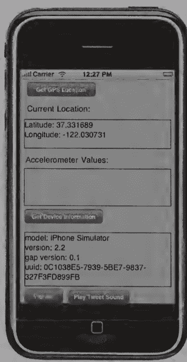

因为PhoneGap Objective-C库在应用程序启动时立即启动设备的GPS硬件，并在应用程序退出时将其关闭。

由于使用GPS硬件，在整个应用程序运行期间，所有PhoneGap应用程序都会消耗大量电池电量，即使它们不使用收集和存储的GPS数据。GPS硬件消耗的电量如此之大，以至于苹果公司声明在应用程序运行期间一直开启GPS构成了"糟糕的iPhone邻居"行为。使用这种策略很容易耗尽设备电池，导致没有足够的电量用于电话通话和其他应用程序的运行。因此，PhoneGap应用程序应设计为仅适用于短时间段运行，即使它们不使用GPS数据。由于QuickConnectiPhone在请求GPS信息时启动GPS硬件，并在找到位置后将其关闭，因此它们可以设计为运行更长的时间段。

要接收加速度计数据，必须在应用程序的某个位置实现名为`gotAcceleration(x, y, z)`的函数。在`PGDeviceCatalog`示例应用程序中，这可以在`main.js`文件中找到，如下所示。

```javascript
function gotAcceleration(x, y, z){
    document.getElementById('accelDisplay').innerHTML =
        'X: '+x+'<br/>Y: '+y+' <br/>Z: '+z;
}
```

此`gotAcceleration`函数的实现仅显示加速度计值。在你的实现中，你可能想要对数据进行一些评估，例如低通滤波，或者使用它来引起UI的某种变化，而不是仅仅显示数值数据。

由于模拟器无法访问加速度计来查看此信息显示，你必须在实际设备上运行应用程序。当你这样做时，每当其中一个加速度计检测到变化时，就会调用`gotAcceleration`函数。

还可以使用PhoneGap库从JavaScript播放音频文件。下面的代码展示了`playTweetSound`函数的示例。它调用`Device.playSound`方法，这是前面提到的`Device.vibrate`方法类似的`Device.exec`façade。


# 使用 PhoneGap 开发混合应用

## 播放声音

```javascript
function playTweetSound(event)
{
    Device.playSound('bird.mp3');
}
```

`playSound` 方法始终需要一个参数：要播放的音频文件的完整名称。此文件必须位于 Xcode 中应用程序的 `Resources` 组中。它不能放置在你的 HTML、JavaScript 和 CSS 文件所在的 Web 服务器上。如果此文件未包含在应用程序的资源中，它将无法播放。

在此示例中，`bird.mp3` 被传递给 `Device` 对象的 `playSound` 方法，并按下面的代码所示进行处理。请注意，文件名 `clip` 被附加到 `sound` 命令之后。在 PhoneGap 开发的现阶段，`playSound` 是唯一一个随命令一起传递参数的有效方法。随着 PhoneGap 团队添加更多功能，这种情况似乎将会改变。有关 PhoneGap 路线图的信息，请参见附录 C“PhoneGap 开发路线图”。

```javascript
playSound: function(clip) {
    return Device.exec('sound:' + clip);
}
```

本节向你展示了如何通过 PhoneGap 激活可用的设备行为。第 2 节展示了支持此功能的 PhoneGap 库的 Objective-C 部分。

## 第 2 节：Objective-C 设备激活

如果你不熟悉 Objective-C 以及如何使用它创建 iPhone 应用程序，请参考 Erica Sadun 的著作《The iPhone Developer's Cookbook》，以获取本节描述的 Objective-C 的更多信息。如果你只想使用 PhoneGap 库为 iPhone 编写 JavaScript 应用程序，则无需阅读本节。

在从 Web 服务器获取应用程序的 Web 组件（HTML、CSS 和 JavaScript）之后，iPhone API 会触发一个事件，该事件由 `GlassAppDelegate` 对象的 `webViewDidStartLoad` 方法捕获和处理。此方法（如下面的代码所示）初始化一个 PhoneGap `Device` 对象。

```objective-c
//when web application loads pass it device information
- (void)webViewDidStartLoad:(UIWebView *)theWebView {
    [theWebView stringByEvaluatingJavaScriptFromString:
        [[Device alloc] init]];
}
```

下面 `Device` 对象的 `init` 方法创建一个字符串，该字符串是一系列 JavaScript 调用。这些调用中的每一个都设置一个特定的全局变量。这些变量包括设备型号、其唯一标识、iPhone 或 iPod Touch，以及设备操作系统的版本。

在 JavaScript 组装完成后，它从 `init` 方法返回，以便可以被 `UIWebView` 对象的 `stringByEvaluatingJavaScriptFromString` 方法使用。通过使用 `UIWebView` 评估 JavaScript 字符串，全局 JavaScript 变量（如 `__gap_device_uniqueid`）稍后会被设置。在本章中，这些全局变量被组装到一个 JavaScript 对象中。

```objective-c
@implementation Device

- (NSString *)init{
    jsCallBack = nil;
    myCurrentDevice = [UIDevice currentDevice];
```

## 第 5 章 使用 PhoneGap 开发混合应用、GPS、加速计及其他原生功能

```objective-c
return jsCallback = [[NSString alloc] initWithFormat:@"\

__gap = true; \

__gap_version='0.1'; \

__gap_device_model='%s'; \

__gap_device_version='%s';\

__gap_device_uniqueid='%s';",

[[myCurrentDevice model] UTF8String],

[[myCurrentDevice systemVersion] UTF8String],

[[myCurrentDevice uniqueIdentifier] UTF8String]

];
```

```objective-c
- (void)dealloc {
    [jsCallback release];
    [myCurrentDevice release];
    [super dealloc];
}
```

```objective-c
@end
```

这些全局变量在无需发送请求的情况下即可设置。而其他行为则需要你编写代码来触发所需的行为。

使用 Objective-C 让 iPhone 振动是最容易实现的行为之一。如果你在项目的资源中包含了 `AudioToolbox` 框架，只需使用以下单行代码即可完成：

```objective-c
AudioServicesPlaySystemSound(kSystemSoundID_Vibrate);
```

如何让 `AudioServicesPlaySystemSound` 函数在 `UIWebView` 被告知更改位置时被调用？

`GlassAppDelegate` 实现了 `webView:shouldStartLoadWithRequest:navigationType` 方法。由于嵌入的 `UIWebView`（名为 `webView`）的委托被设置为 `GlassAppDelegate`（如以下代码及 `GlassAppDelegate.m` 的第 36 行所示），因此每次嵌入的 `UIWebView` 被告知更改位置时，该方法都会被调用。

```objective-c
webView.delegate = self;
```

`webView:shouldStartLoadWithRequest:navigationType` 函数的基本行为非常简单。它的设计目的是让你能够编写代码，以决定请求的新页面是否应该实际加载。PhoneGap 库利用这种决策能力，来拦截第 1 节中所示的 JavaScript 调用所发出的任何命令请求，并执行其他 Objective-C 代码。

`shouldStartLoadWithRequest` 方法有几个可用参数，包括：

- `curWebView`——包含你的 JavaScript 应用程序的 `UIWebView`
- `request`——一个包含新 URL 及其他项目的 `NSURLRequest`
- `navigationType`——一个 `UIWebViewNavigationType`，用于确定请求是用户选择链接的结果，还是由某些其他操作产生的结果

```objective-c
- (BOOL)webView:(UIWebView *)curWebView
        shouldStartLoadWithRequest:(NSURLRequest *)request
        navigationType:(UIWebViewNavigationType)navigationType
```

由 `Device.exec` JavaScript 方法组装的、导致设备振动的 URL（`gap:vibrate`）包含在 `request` 对象中，可以通过向其传递 `URL` 消息轻松地将其检索为字符串。该消息返回一个 `NSURL` 类型的对象，然后对其传递 `absoluteString` 消息。这样就得到了一个代表 URL 的 `NSString` 指针。

```objective-c
NSString *url = [[request URL] absoluteString];
NSArray *urlArray = [url componentsSeparatedByString:@"?"];
```

在 PhoneGap 中，需确定请求的 URL 是否相对于第 1 章“开发 Dashcode 和 Xcode”中讨论的 `url.txt` 文件中发现的应用程序 URL。如果不是，则启动 Safari 浏览器显示该 URL 的页面。这会导致你的应用程序退出，因为 iPhone 一次仅允许运行一个应用程序。以下代码检索 `url` 参数中请求的当前主机以及 `appURL` 中发现的应用程序主机。这是通过向这两个 `NSURL` 对象传递 `host` 消息完成的。第 3 行和第 4 行向 `urlHost` 变量发送 `rangeOfString` 消息。这类似于使用 JavaScript `String` 对象的 `indexOf` 方法。以下代码确定应用程序的主机值是否可以在请求的 URL 中找到。

```objective-c
1 NSString* urlHost = [url host];
2 NSString* appHost = [appURL host];
3 NSRange range = [urlHost rangeOfString:appHost
4 options:NSCaseInsensitiveSearch];
5 if (range.location == NSNotFound)
6 [[UIApplication sharedApplication] openURL:url];
7 
8 NSString * jsCallBack = nil;
9 NSArray * parts = [urlString
10 componentsSeparatedByString:@":"];
```

第 5 行检查 `rangeOfString` 方法的结果，以查看 `urlHost` 中是否找到了 `appHost`。如果没有，则向应用程序发送 `openURL` 消息。每当传递此 `openURL` 消息时，你的应用程序将退出，并启动相应的处理程序。如果传递以 `map:` 开头的 URL，iPhone 的地图应用程序将启动并显示地图 URL 的结果。其他可能的类型包括启动 Safari 的 `http`；启动电话拨号盘的 `tel`；启动邮件应用程序的 `mailto`；以及启动 YouTube 应用程序的 `youtube.com` URL。无论如何，你的应用程序都会退出。

第 9 行和第 10 行将 URL 分割为其组成命令，并将每个命令放入名为 `parts` 的数组中。然后对这个 `parts` 数组进行评估，以确定发送了哪个命令及其可能携带的任何参数。

PhoneGap 使用 if-then-else 条件语句来评估 `parts` 数组。每个命令激活一个不同的条件。在下面的 `vibrate` 命令条件中，实例化了一个 `Vibrate` 对象并传递了 `vibrate` 消息。

```objective-c
else if([(NSString *)[parts objectAtIndex:1]
    isEqualToString:@"vibrate"]){
    Vibrate *vibration = [[Vibrate alloc] init];
    [vibration vibrate];
    [vibration release];
    NSLog(@"vibrating");
}
```

在 `Vibrate.m` 中找到的 `Vibrate` 对象的 `vibrate` 方法内部，执行了 `AudioServicesPlaySystemSound(kSystemSoundID_Vibrate);` 调用。

处理 GPS 信息请求的方式有所不同。该命令被直接处理，而不是传递给一个对象来处理。第 5--7 行组装了一个包含 JavaScript 调用的字符串，即 `gap.js` 文件中找到的 `gotLocation(lat, lon)` 函数，其中 `lat` 和 `lon` 被替换为自应用程序启动以来不断采集的当前纬度和经度。

```objective-c
1 if([(NSString *)[parts objectAtIndex:1]
2                     isEqualToString:@"getloc"]){
3         NSLog(@"location request!");
4 
5         jsCallBack = [[NSString alloc]
6             initWithFormat:@"gotLocation('%f','%f');"
7             , lat, lon];
8         NSLog(@"%@", jsCallBack);
9         [theWebView
10             stringByEvaluatingJavaScriptFromString:
11                 jsCallBack];
12 
13         [jsCallBack release];
14 }
```

为了使这个 JavaScript 字符串 `jsCallBack` 执行，必须向传递给 `shouldStartLoadWithRequest` 函数的参数 `theWebView` (`UIWebView`) 发送 `stringByEvaluatingJavaScriptFromString` 消息，并将 JavaScript 字符串作为其参数。至此，库的 Objective-C 部分已完成其任务。

如以下代码所示，`gotLocation` JavaScript 函数现在调用 `Device.Location.set` 方法：

```javascript
function gotLocation(lat, lon) {
    return Device.Location.set(lat, lon)
}
```

`Device.Location.set` 方法将纬度和经度存储在 `Device.Location` 对象中，然后，如果存在，则调用第 1 节中描述的回调函数。请注意，在调用回调方法后，第 6 行将回调方法设置为 `null`。这意味着每次请求位置信息时，你都必须设置回调方法：

```javascript
1 set: function(lat, lon) {
2     Device.Location.lat = lat;
3     Device.Location.lon = lon;
4     if(Device.Location.callback != null) {
5         Device.Location.callback(lat, lon)
6         Device.Location.callback = null;
7     }
8 }
```

如果你选择在每次请求位置信息时不设置回调方法，则不会调用任何回调函数。

处理 `sound` 命令与处理 `getloc` 命令类似。主要区别在于应用程序的 JavaScript 部分不需要数据，因此不会向 `UIWebView` 发送 `stringByEvaluatingJavaScriptFromString` 消息。相反，会创建一个 `Sound` 对象，类似于处理 `vibrate` 命令的代码。

```objective-c
1 else if ([[NSString *)parts objectAtIndex:1]
2             isEqualToString:@"sound"]) {
3     NSLog(@"playing sound");
4     NSLog([parts objectAtIndex:2]);
5     NSString *ef = (NSString *)[parts objectAtIndex:2];
6     NSArray *soundFile = [ef componentsSeparatedByString:@"."];
7 
8     NSString *file = (NSString *)[soundFile objectAtIndex:0];
9     NSString *ext = (NSString *)[soundFile objectAtIndex:1];
10    NSLog(@"about to allocate %@, %@",file, ext);
11    sound = [[Sound alloc] initWithContentsOfFile:
12                 [mainBundle pathForResource:file ofType:ext]];
13    NSLog(@"sound allocated");
14    [sound play];
15 }
```

这个位于 `Sound.m` 中的 `Sound` 对象使用声音文件的路径进行初始化。如第 1 节所述，该文件必须位于 Xcode 项目的 `Resources` 组中。因为文件在 `Resources` 组中，代表你的已安装的应用程序可以发送 `pathForResource:ofType` 消息，该消息返回设备上声音文件的完整路径，如前一段代码的第 11 行和第 12 行所示。第 14 行向 `Sound` 对象发送播放消息，以便用户听到声音。

`Sound` 对象的 `initWithContentsOfFile` 方法展示了如何将音频文件（如 mp3 文件）转换为系统声音。为此，音频文件必须非常短。事实上，Apple 建议其时长不超过五秒。每个系统声音都是通过指向其位置的 URL 创建的。下面代码的第 1 行展示了如何使用任意路径字符串来实现这一点。第 3 行是需要关注的一行。

```objective-c
1 - (id) initWithContentsOfFile: (NSString *)path
2 {
    .
    .
    .
3 NSURL *filePath = [NSURL fileURLWithPath:path isDirectory:NO];
4 AudioServicesCreateSystemSoundID((CFURLRef)filePath, &soundID);
    .
    .
    .
5 }
```


# 第 4 行将音频文件修改为系统声音

系统声音与标准音频文件播放不同，因为它们会被重新解释并存储在操作系统本身中。当需要播放时，不需要媒体播放器。调用`AudioServicesCreateSystemSoundID`函数来完成此操作。

注意它接受两个参数。第一个是音频文件的 URL，第二个是指向`SystemSoundID`的指针。在这种情况下，`SystemSoundID`是`Sound`对象的`soundID`属性，稍后用于在`Sound`对象的`play`方法中播放声音。

如下代码所示，`Sound`对象的`play`方法只包含一行代码。不使用媒体播放器来播放声音；而是调用`AudioServicesPlaySystemSound`。当调用此方法并传入`SystemSoundID`时，用户就能听到声音。

```
- (void) play {
    AudioServicesPlaySystemSound(soundID);
}
```

无论你想使用什么声音作为系统声音，其创建和使用的步骤始终相同。

1. 获取一个表示设备上音频文件位置的 URL。
2. 生成系统声音并存储其 ID。
3. 播放系统声音。

## 108 第 5 章 使用 PhoneGap 的混合应用、GPS、加速计及其他原生功能

在 PhoneGap 中，系统声音在每次请求播放时都会重新生成，这是不必要的。你可以只创建一次系统声音，然后多次播放。

如本节前面所述，GPS 硬件在你的应用程序启动时会在 PhoneGap 中被激活。这通过`GlassAppDelegate`的`applicationDidFinishLaunching`方法代码的前三行来完成。如下代码所示，这三行代码初始化一个`CLLocationManager`，将其存储在`GlassAppDelegate`类的`locationManager`属性中，并告知其开始更新 GPS 信息。

```
locationManager = [[CLLocationManager alloc] init];
locationManager.delegate = self;
[locationManager startUpdatingLocation];
```

这个`CLLocationManager`是封装了用于确定设备当前位置的 GPS 和 WiFi 硬件的类。它使用来自 GPS 芯片和任何开放 WiFi 热点的输入来确定当前的纬度和经度。

前面代码中的第二行告诉`locationManager`对象在每次检测到位置变化时调用`GlassAppDelegate`的`didUpdateToLocation`方法。它通过将`locationManager`对象的 delegate 设置为当前的`GlassAppDelegate`（在此处以`self`关键字表示）来实现这一点。有关 delegate 的更多信息，请参阅 Erica Sadun 的著作 *The iPhone Developer's Cookbook*（第 2 章和第 4 章）。

每次检测到位置变化时调用的 delegate 方法是`didUpdateToLocation`，可以在`GlassAppDelegate.m`文件中找到。如下代码所示，它释放任何已存储的位置，然后将作为`newLocation`参数传递给方法的当前位置存储起来。此存储的参数由`shouldStartLoadWithRequest`中的`getloc`条件使用，如前所示。

```
-(void)locationManager:(CLLocationManager *)manager
    //作者注：此处存在一个潜在的 bug。
    //如果 newLocation == lastKnown，
    //则 newLocation 对象会被释放。
     //应在调用 [lastKnownLoation release]
     //之前调用 [newLocation retain]。
    //此处所示的代码与 PhoneGap 产品中的
    //原始代码一致。
     didUpdateToLocation:(CLLocation *)newLocation
     fromLocation:(CLLocation *)oldLocation
{
     [lastKnownLocation release];
     lastKnownLocation = newLocation;
     [lastKnownLocation retain];
}
```

加速计的激活方式与 GPS 硬件的激活方式非常相似。下面代码中的三行告诉加速计每 1/40 秒存储一次加速信息，然后将加速计的 delegate 设置为当前的`GlassAppDelegate`对象，就像位置管理器一样。

```
[[UIAccelerometer sharedAccelerometer] setUpdateInterval:1.0/40.0];
[[UIAccelerometer sharedAccelerometer] setDelegate:self];
```

在这种情况下，调用的方法不是`didUpdateToLocation`而是`didAccelerate`。如下代码所示，`didAccelerate`方法与`didUpdateToLocation`方法非常相似。它获取加速计信息，但不是将其本地存储在库的 Objective-C 端，而是将其发送到 JavaScript 端，类似于本节前面介绍的`gotLoc`命令的处理方式。

```
- (void)accelerometer:(UIAccelerometer *)accelerometer didAccelerate:(UIAcceleration *)acceleration {
    NSString * jsCallBack = nil;
    NSLog(@"accelerating");
    jsCallBack = [[NSString alloc]
        initWithFormat:
            @"gotAcceleration('%f','%f','%f');",
            acceleration.x,
            acceleration.y,
            acceleration.z];

    [webView stringByEvaluatingJavaScriptFromString:jsCallBack];
}
```

虽然其他命令也在`shouldStartLoadWithRequest`方法中处理，但在撰写本文时它们都没有正常工作，因此未做介绍。本节介绍的内容目前可以正常工作，并且在 PhoneGap 应用程序的 Xcode 模板安装器中可用。

## 总结

本章向你展示了如何在 JavaScript 应用程序中使用 PhoneGap 库激活 iPhone 或 iPod Touch 设备的一些理想功能。使用 GPS 定位、加速计数值、手机振动和声音等功能可以增加应用程序的丰富性。

回顾`PGDeviceCatalog`中包含的示例并使用 Objective-C 进行开发，应该能让你添加更多功能，例如在 Bonjour 网络中扫描附近设备、从通讯录应用程序中添加、删除和检索联系人，或任何其他 Objective-C 应用程序可用的内置行为。

使用本章描述的方法，你的 JavaScript 应用程序可以完成纯 Objective-C 应用程序能做的大多数事情。

所提供的图像过于模糊且分辨率太低，无法提取可辨认的文字或识别标题、列表、表格或代码块等特定结构元素。内容无法识别。

# 6 嵌入 Google 地图

iPhone 应用程序经常需要的一项功能是使用地图。有多种方式可以显示地图，从关闭应用程序并启动标准的 iPhone 地图应用程序到使用标准的 Google 地图。这两种方法都有局限性。本章讨论如何创建和使用基于 Google 的地图，使其外观和行为类似于 iPhone 地图应用程序，而无需关闭应用程序。

## 第 1 节：在你的 QuickConnect JavaScript 应用程序中显示地图

iPhone 使工程师或程序员可以通过几种方式在混合应用中使用地图。最简单的方法是在显示中添加一个以`http://maps.google.com`开头并包含所需地图信息的链接。当用户选择这样的链接时，应用程序会退出，标准地图应用程序启动并显示所请求的地图。

这种方法使用简单且创建快捷。缺点是你的应用程序会关闭，这通常被认为是糟糕的软件设计。应用程序最终会给人一种拼凑的感觉，用户通常期望一种更集成的方式。

另一个缺点是，虽然 Google 可以响应"披萨"之类的请求并放置多个标记，但目前无法在你定义的特定位置放置多个标记。例如，创建应用程序时，你可能想在城镇的各个地点放置标记。如果这些地点没有像"披萨"这样的可搜索分组，就无法通过发送给 Google 的 URL 请求指定多个带描述的标记位置。如果你想使用标记放置位置的经纬度，这个限制可能会令人沮丧。

另一种方法是在你的应用程序中做与标准网页中基本相同的事情。在这种情况下，使用 Google 的 AJAX API 在显示的 HTML 中的 div 里嵌入地图。然后你可以继续使用 Google 的 JavaScript API 来独立放置每个标记。

虽然这种方法使你可以将用户留在你的应用程序中，但它也有缺点。首先，显示地图的 UIWebView 不支持在内部进行滚动。

## 第 6 章 嵌入 Google 地图

divs。触摸和移动事件在较低层级被处理，不会发送给与嵌入地图交互的 Google 提供的 JavaScript。这意味着你可以显示地图，但无法更改地图显示的坐标位置。

另一个缺点是 Google 标准位置信息气泡的大小。它们是为在全尺寸机器的浏览器中显示而设计的。当气泡在 iPhone 上显示时，往往会占据地图的大部分区域。由于前文提到的滚动问题，气泡的大部分通常显示在屏幕之外，因此无法阅读。虽然可以调整这类气泡的内容大小，但无法调整标准 Google 气泡的大小。

显然，更优的选择是将地图嵌入到应用程序中，像第二个选项那样显示多个图钉，但同时具备第一个选项的滚动和显示能力。QuickConnectiPhone 框架提供了一个组件，允许你通过一次简单的 JavaScript 调用来实现这一点。

MapExample Xcode 项目展示了具体实现方法。你可以从 http://sourceforge.net/projects/quickconnect/ 下载此项目（作为 QuickConnectiPhone zip 文件的一部分）。MapExample 项目位于 Examples 目录下。

该示例的主屏幕由一个显示的 HTML 按钮组成，如图 6.1 所示。该按钮的 onclick 监听器被设置为项目 main.js 文件中的`showTheMap`函数，如下代码所示。它设置了三个位置：爱达荷州雷克斯堡（Rexburg, Idaho）、怀俄明州（Wyoming）以及一个荒野地区。

```javascript
function showTheMap(event)
{
    //a location consists of a latitude,
    //a longitude, and a description
    var locationsArray = new Array();
    rexburg = new Array();
    rexburg.push(43.82211);
    rexburg.push(-111.76860);
    rexburg.push("County Court House");
    locationsArray.push(rexburg);

    var wyoming = new Array();
    wyoming.push(42.86);
    wyoming.push(-109.45);
    wyoming.push("Wyoming Place");
    locationsArray.push(wyoming);

    var wilderness = new Array();
    wilderness.push(45.35);
    wilderness.push(-115);
    wilderness.push("River of No Return Wilderness");
    locationsArray.push(wilderness);

    var sandwichShop = new Array();
    sandwichShop.push(42.86);
    sandwichShop.push(-112.45);
    sandwichShop.push("Somewhere Sandwiches");
    locationsArray.push(sandwichShop);

    showMap(event, locationsArray);
}
```

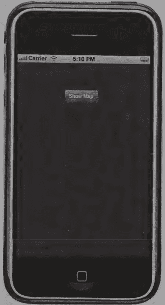

图 6.1 MapExample 应用程序的主屏幕，显示了 HTML 按钮

每个位置都是一个由三个元素组成的数组：纬度、经度和为每个图钉显示的简短描述。这些位置被添加到`locationsArray`中。虽然添加到每个位置的值的顺序是固定的，但`locationsArray`本身与顺序无关。

在实际应用程序中，每个位置使用的值可能存储在数据库中，从 RSS 馈送中检索，或存储在其他位置。你甚至可以在应用程序运行期间检索它们。如果你知道街道地址，可以使用 Google 的地理编码 JavaScript API 来获取它们的纬度和经度：http://code.google.com/apis/maps/documentation/services.html#Geocoding_Object。在运行时执行此操作速度较慢。更好的做法是在设计阶段使用批处理过程获取感兴趣位置的纬度和经度，然后在发布应用程序之前将其存储起来。

在创建包含所有所需位置的 JavaScript 数组后，该数组将与触发`showTheMap`函数调用的事件一起传递给框架的`showMap`函数。此时，框架接管操作，并使用第 4 章“使用 QuickConnect 实现 GPS 加速和其他原生功能”中描述的`makeCall`函数，指示框架的 Objective-C 部分显示一张在每个位置都放置了图钉的地图，如图 6.2 所示。

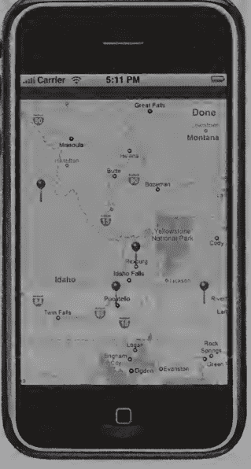

图 6.2 MapExample 应用程序为每个位置显示一个图钉

框架在 Objective-C 的`MapView`对象中显示地图。这个在第 2 节中描述的`MapView`类允许用户像在 Apple 的地图应用程序中一样，使用触摸和滑动手势来控制地图。通过双击地图上的某个位置，地图会以此位置为中心并放大。用户也可以双击图钉，使地图以该图钉为中心并放大。

当用户单击图钉时，一个简短的描述会显示在一个小黑框中，非常像图 6.3 所示的地图应用程序。如果用户触摸并拖动图钉，它会重新定位到地图上的新位置。

当用户不再需要地图时，选择“完成”（Done）按钮，`MapView`随即消失。应用程序的视图将恢复到显示地图之前的状态。这解决了因关闭应用程序 → 启动地图应用 → 关闭地图应用 → 重新启动应用程序而导致的可用性和状态恢复问题。

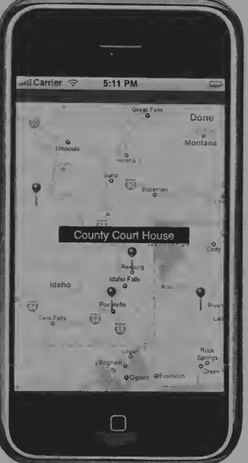

图 6.3 MapExample 应用程序显示简短描述

通过调用框架的`showMap` JavaScript 函数，你的应用程序就拥有了内置地图。第 2 节详细介绍了 Objective-C `MapView`及框架中其他类是如何设计和使用的。

### 第 2 节：QuickConnect 地图模块的 Objective-C 实现

QuickConnect 地图模块由三个类组成：

- `MapView` —— 包含地图图像的主要显示元素
- `Pin` —— 在特定位置显示的自定义图钉
- `InfoWindow` —— 用于显示与特定图钉相关联的简短描述的类

图 6.4 显示了这些类之间的关系。每个`MapView`可以有多个`Pin`，而每个`Pin`必须至少有一个`MapView`。`Pin`和`InfoWindow`之间也存在一对一的关系。换句话说，每个`Pin`必须对应一个`InfoWindow`；每个`InfoWindow`必须对应一个`Pin`。

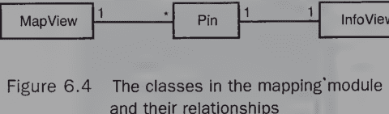

由于其模块化的特性，Objective-C 应用程序需要直接与`MapView`类及其 API 交互。该 API 包含一个方法：`initWithFrame:andLocations`。当调用此方法时，会生成一张地图，在地图上放置图钉，并且用户在触摸图钉时可以看到简短描述。除此之外，如果用户双击图钉或地图上的某个位置，地图会放大并以该位置为中心。以下代码展示了此`MapView` API 在 QuickConnect 框架中是如何使用的。


与第 2 章“JavaScript 模块化和 iPhone 应用程序”中描述的 GPS 定位、调试和其他请求一样，调用显示嵌入式地图的操作使用了前置控制器（front controller）和应用程序控制器。与这些功能类似，`showMap` 命令通过 `QCCommandMappings.m` 文件与 `showMapVCO` 相关联。此 VCO 的 `doCommand` 方法很小，主要工作是将随 JavaScript 请求发送的纬度、经度和描述放入一个数组中。这是通过跳过参数数组的第一个元素来实现的，因为第一个元素是应用程序的 `QuickConnectViewController`。如下代码所示的 `doCommand` 方法位于 MapExample Xcode 项目中，该项目可从 http://sourceforge.net/projects/QuickConnect 下载。

```objectivec
+ (id) doCommand:(NSArray*) parameters{
    NSRange aRange = NSMakeRange(1, [parameters count]-1);
    NSArray *locations = [parameters subarrayWithRange:aRange];
    //size the MapView to fill the screen
    MapView *aMapView = [[MapView alloc] initWithFrame:[[UIScreen mainScreen] applicationFrame]
                                         andLocations:locations];
    QuickConnectViewController *theController = [parameters objectAtIndex:0];
    //add the map view to the application's main view
    [[[theController webView] superview] addSubview:aMapView];
    return nil;
}
```

由于 `QuickConnectViewController` 持有显示并运行应用程序的 `UIWebView` 的引用，因此可以使用它来获取主应用程序视图的指针。这通过向 `UIWebView` 发送 `superview` 消息来实现。然后，通过将新创建的 `MapView` 作为 `addSubview` 消息的参数传递，将其添加到主应用程序视图中。

## 第 2 节：QuickConnect 映射模块的 Objective-C 实现

当发送 `addSubview` 消息时，MapView 出现并填满屏幕，隐藏了 UIWebView 的显示。

由于 MapView 功能是一个自包含的模块，它易于在许多不同的应用程序中重复使用（关于模块化的讨论，请参见第 2 章）。它甚至可以用于混合型 Macintosh 应用程序，只需对地图显示进行微小的内部修改即可。

所有 Google 地图，无论显示什么，都是网页。因此，MapView 对象有一个属性，即其自身的 UIWebView，名为 `webMapView`。它不是显示你应用程序的同一个 UIWebView 实例。

如下所示的代码所示，这个 `webMapView` 显示在 Resources MapView 组中的 `mapView.html` 文件，并且其委托被设置为 MapView 类。MapView 组包含一个可嵌入的 UIView 和一个 WebViewDelegate，后者处理 UIWebView 的所有事件。

```objectivec
1  (id)initWithFrame:(CGRect)frame
2             andLocations:(NSArray*)aLocationList {
3      if (self = [super initWithFrame:frame]) {
4          OKToTouch = NO;
5          self.locations = aLocationList;
6          frame.origin.y -= 20;
7          UIWebView *aWebView = [[UIWebView alloc]
8  initWithFrame:frame];
9          self.webMapView = aWebView;
10         [aWebView release];
11
12         aWebView.userInteractionEnabled = NO;
13         //set the web view delegate
14         //for the web view to be itself
15         [aWebView setDelegate:self];
16
17         //determine the path to the mapView.html file
18         //in the Resources directory
19         NSString *filePathString = [[NSBundle mainBundle]
 pathForResource:@"mapView" ofType:@"html"];
20         MESSAGE(@"%@", filePathString);
21         //build the URL and the request for the
22         //mapView.html file
23         NSURL *aURL = [NSURL fileURLWithPath:filePathString];
24         NSURLRequest *aRequest =
25  [NSURLRequest requestWithURL:aURL];
26
27         //load the mapView.html file into the web view.
28
29         [aWebView loadRequest:aRequest];
30
31         //add the web view to the content view
32         [self addSubview:self.webMapView];
33     }
34     return self;
35 }
```

## 第 6 章：嵌入 Google 地图

有些人可能认为，出于简单性的原因，不需要 MapView 类。事实并非如此。因为 UIWebView 消耗所有触摸事件，并且不允许其显示的 HTML 元素消费这些事件，所以在第 1 节中描述的滚动问题就会发生。

为了解决这个问题，前面代码的第 12 行关闭了包含的 UIWebView 的所有事件消费。这使得包含它的 MapView 对象可以作为其委托消费所有事件。然后，委托负责向 UIWebView 表示其包含的页面应该被滚动。

要滚动地图，需要确定触摸在开始后发生了移动。为此，必须实现 MapView 的标准 `touchesMoved:withEvent` 方法。

```objectivec
- (void)touchesMoved: (NSSet *)touches
             withEvent:(UIEvent *)event{
    if(OKToTouch){
        if([touches count] == 1){
            UITouch *touch = [touches anyObject];
            CGPoint prevLoc =
                [touch previousLocationInView:self];
            CGPoint curLoc =
                [touch locationInView:self];
            double touchDeltaX = curLoc.x - prevLoc.x;
            double touchDeltaY = curLoc.y - prevLoc.y;

            NSString *javaScriptCall =
                [[NSString alloc]
                    initWithFormat:@"scroll(%f, %f)"
                    ,touchDeltaX, touchDeltaY];
            NSString *result = [webMapView
                stringByEvaluatingJavaScriptFromString
                javaScriptCall];

            if([result compare:@"true"] == 0){
                int numPins = [pins count];
                for(int i = 0; i < numPins; i++){
                    Pin *aPin =
                        [pins objectAtIndex:i];
                    [aPin moveX:touchDeltaX
                        andY:touchDeltaY];
                    [aPin.info moveX:touchDeltaX
                             andY:touchDeltaY];
                }
            }
        }
    }
}
```

## 第 2 节：QuickConnect 映射模块的 Objective-C 实现

```objectivec
else if([touches count] == 2){
    //pinch
}
}
```

`touchesMoved:withEvent` 的这个实现首先确定触摸移动了多少。它通过查找当前事件位置和上一个事件位置之间的差异（即增量）来完成此操作，然后将这个差异传递给 `webMapView` 中的 HTML 页面。为此，发送 `stringByEvaluatingJavaScriptFromString` 消息，并附带对 `scroll` 函数的 JavaScript 函数调用。

如下所示代码中的 JavaScript `scroll` 函数（位于 Resources MapView 组的 `map.js` 文件中），使用 JavaScript Google 地图 API 重新居中可查看的地图。它通过将所需的 x 和 y 值变化应用于地图的当前中心点来实现，然后通知地图对象以这个新位置为中心。

```javascript
function scroll(deltaX, deltaY){
    try{
        var centerPoint = map.fromLatLngToDivPixel(map.getCenter());
        centerPoint.x -= deltaX;
        centerPoint.y -= deltaY;
        var centerLatLng =
            map.fromDivPixelToLatLng(centerPoint);
        map.setCenter(centerLatLng);
    }
    catch(error){
        return false;
    }
    return true;
}
```

当这个 JavaScript 函数成功完成时，它返回 `true`，以便 `touchesMoved:withEvent` 方法的剩余部分可以通知每个显示的图钉也更改其位置。

因为底层的 UIWebView 的消费（为了实现地图滚动）被关闭了，所以标准的 Google 地图图钉无法检测到它们被触摸了。由于这种无法检测的情况，这些图钉的标准 Google 地图描述气泡无法显示和隐藏。因此，有必要创建一个自定义的 Pin 类。

这个类可以在 Classes:MapView 分组中找到，使用 `pinInserted.png` 图像进行显示。Pin 类在 Resources:Images 中使用此文件进行视觉显示；你可以轻松地将其替换为你选择的任何图像文件。

Pin 类的对象在应用程序从 JavaScript 端发送的每个位置时初始化。为此，调用如下所示代码中的 `initWithFrame:andImage:andLocation` 方法。它为图钉的图像创建一个 UIImageView，设置图钉的位置，并通过将其 `userInteractionEnabled` 属性设置为 `true` 来开启事件消费。

```objectivec
-(id)initWithFrame:(CGRect)frame
         andImage:(NSString*)anImage
       andLocation:(MapViewLocation)aLocation{

    if (self = [super initWithFrame:frame]) {
        UIImageView *pinImage = [[UIImageView alloc]
            initWithImage:[UIImage imageNamed:anImage]];
        [self addSubview:pinImage];
        [pinImage release];
        location = aLocation;
        self.userInteractionEnabled = YES;
        self.backgroundColor = [UIColor clearColor];
    }
    return self;
}
```

通过启用 Pin 对象的用户交互，图钉就可以捕获和消费事件。如果图钉被触摸，Pin 对象的 `touchesBegan:withEvent` 方法会被调用，并用于修改显示。

这个函数的实现在 `Pin.m` 中，如下所示代码所示。它检查以确保当前和先前事件在屏幕上的位置相同。此检查确保如果用户在屏幕上以类似滑动的动作拖动手指，则不会执行此方法中的代码。

假设没有发生滑动，`touchesBegan:withEvent` 处理两种情况。第一种是如果用户单次点击图钉。在这种情况下，期望的行为是显示从应用程序的 JavaScript 端随位置一起发送的简单消息。为此，使用 Objective-C 的反射功能向图钉本身传递 `singleTouch` 消息。

`performSelector:withObject:afterDelay` 消息被发送到图钉，而不是直接调用。这允许区分单次点击和双次点击。如第 13 行所示，用户有 0.4 秒的时间完成双次点击。如果双次点击没有发生，则第一次触摸被消费，第二次触摸被视为与之不同。

另一方面，如果用户在 0.4 秒的时间限制内双次点击图钉，则传递 `cancelPreviousPerformRequestsWithTarget:selector:object` 消息以停止传递 `singleTouch` 消息。这种延迟/执行或取消的方法是检测触摸点击次数的标准方法。

在这种情况下，如果检测到单次点击，则传递 `singleTouch` 消息并显示图钉的简短描述。如果检测到双次点击，则地图会缩放并居中于图钉的位置。

```objectivec
1 -(void)touchesBegan:(NSSet *)touches
2             withEvent:(UIEvent *)event{
```


```objectivec
UITouch *touch = [touches anyObject];
CGPoint prevLoc = [touch previousLocationInView:self];
CGPoint curLoc = [touch locationInView:self];

if (CGPointEqualToPoint(prevLoc, curLoc)) {
    NSEteger tapCount = [touch tapCount];
    switch (tapCount) {
        case 1:
            [self performSelector:
                @selector(singleTouch)
                withObject:nil
                afterDelay:.4];
            break;
        case 2:
            [NSObject cancelPreviousPerformRequestsWithTarget:self
                selector:@selector(singleTouch)
                object:nil];
            // 缩放并居中到该图钉
            MESSAGE(@"double tap pin %i, %i",
                location.x, location.y);

            double latOffset =
                (location.y + 42) /
                ((MapView *)self.superview).pixelsPerDegLatitude;
            double lngOffset =
                (location.x + 10) /
                ((MapView *)self.superview).pixelsPerDegLongitude;
            double latitude =
                [[((MapView *)self.superview).northWest objectAtIndex:0]
                    doubleValue] - latOffset;
            double longitude =
                [[((MapView *)self.superview).northWest objectAtIndex:1]
                    doubleValue] + lngOffset;
            MESSAGE(@"latitude: %f longitude: %f northWest: %@",
                latitude,
                longitude,
                ((MapView *)self.superview).northWest);

            NSString *javaScriptCall = [[NSString alloc]
                initWithFormat:@"zoomTo(%f, %f)", latitude, longitude];
            NSString *mapDescription =
                [((MapView *)self.superview).webMapView
                    stringByEvaluatingJavaScriptFromString:javaScriptCall];

            [((MapView *)self.superview)
                setMapLatLngFrameWithDescription:mapDescription];
            [((MapView *)self.superview) updatePinLocations];

            break;
        default:
            break;
    }
}
```

通过启用对图钉或地图的双指触摸缩放和居中功能，可以提升应用程序的可用性。标准地图应用在双指触摸这两项内容中的任一项时并不会居中，它只是进行缩放。如果用户执行双指触摸，通常还需要再滑动才能查看感兴趣区域周围的内容。而本应用程序没有这个限制。

你也可以通过拖动来移动地图中的图钉。这是通过以下代码中展示的`touchesMoved:withEvent:`方法实现的，与前面展示的地图滚动类似。不同之处在于，这里再次发送了`cancelPreviousPerformRequestsWithTarget:selector:object:`消息，以避免显示简短描述，因为在`touchesMoved`之前会先调用`touchesBegan`方法。如果未发送取消消息，简短消息就会显示出来，同时图钉也会被移动。这会造成糟糕的用户体验。

```objectivec
1  -(void)touchesMoved:(NSSet *)touches
2      withEvent:(UIEvent *)event{
3          if([touches count] == 1){
4
5              [NSObject cancelPreviousPerformRequestsWithTarget:self selector:@selector(singleTouch) object:nil];
6              moved = YES;
7              UITouch *touch = [touches anyObject];
8              CGPoint prevLoc = [touch previousLocationInView:self];
9              CGPoint curLoc = [touch locationInView:self];
10             double touchDeltaX = curLoc.x - prevLoc.x;
11             double touchDeltaY = curLoc.y - prevLoc.y;
12             [self moveX:touchDeltaX andY:touchDeltaY];
13             MapViewLocation mapLoc = self.location;
14             mapLoc.x += touchDeltaX;
15             mapLoc.y += touchDeltaY;
16             self.location = mapLoc;
17             if(self.info != nil){
18                 self.info.hidden = TRUE;
19                 self.info.label.text = @"Unknown";
20             }
21         }
22 }
```

与地图滚动非常类似，图钉的移动也是通过使用前一个位置和当前位置来更新位置信息。在地图滚动的情况下，位置是地图的中心。在图钉移动的情况下，被更新的位置是图钉的左上角显示点及其经纬度。

由于图钉不再代表最初指定的地图位置，因此最初提供的与该图钉关联的简短描述很可能已失效。所以将其设置为`"Unknown"`。此外，如果用户拖动图钉时简短消息仍然显示，为了降低同时绘制图钉和消息的 CPU 开销，系统会将其关闭。这是通过第 18 行实现的。

`Pin`类的`info`属性用于显示应用程序 JavaScript 部分提供的简短描述。它是一个`InfoWindow`对象，本身就是一个`UIView`，具有一个属性：`label`。

`InfoWindow`的`initWithFrame:andDescription:`方法（如下代码所示，可在`Classes:MapView`中的`InfoWindow.m`文件中找到）展示了在视图窗口中设置可显示描述的位置及其内容。用于显示简短描述的用户界面组件是一个`UILabel`。

```objectivec
-(id)initWithFrame:(CGRect)frame
andDescription:(NSString*)description{
    if (self = [super initWithFrame:frame]) {
        [self setBackgroundColor:[UIColor blackColor]];
        CGRect labelFrame = CGRectMake(0, 0,
                                       frame.size.width,
                                       frame.size.height);
        label = [[UILabel alloc]
                    initWithFrame:labelFrame];
        label.text = description;
        label.backgroundColor = [UIColor clearColor];
        label.textColor = [UIColor whiteColor];
        label.textAlignment = UITextAlignmentCenter;
        [self addSubview:label];
        [label release];
    }
    return self;
}
```

通过使用`UILabel`来显示简短描述，你可以获得丰富的功能。现在你可以设置字体、对齐方式、大小、颜色以及阴影等许多其他属性。也可以不使用`UILabel`而直接绘制文本，但这样需要更多的代码。使用预先构建的`UILabel`可以使你的应用程序更加易于维护。

这三个类——`MapView`、`Pin`和`InfoWindow`——共同构成了`MapView`模块。它们包含了显示基本 Google 地图所需的所有源代码，但也可以轻松修改以展示更复杂的行为。

例如，可以对`InfoWindow`类进行修改，通过更改其显示大小或显示另一个完整的`UIView`（如 Apple 的标准地图应用）来展示更多细节。或者可以修改`MapView`类来获取驾车路线，就像标准应用一样。虽然这两种修改都需要掌握 Objective-C 知识，但在技术上并不困难。

另一个尚未涉及的有趣内容是：在滚动或缩放地图时，如何调整所有`Pin`对象及其`InfoWindow`的位置。这些类中的每一个都有一个`moveX:andY:`方法。这些方法的参数是沿 x 和 y 方向移动图钉或信息窗口的像素数，如下代码所示。

## 第 6 章 嵌入 Google 地图

一个 Objective-C 新手可能会尝试通过一行代码来修改位置，例如`[self frame].origin.x += xChange`。这行代码不会抛出异常，不会产生编译错误，但也不会改变`Pin`或`InfoWindow`的位置。

在 Objective-C 的`UIView`类（如`Pin`和`InfoWindow`）中，表示左上角位置以及宽度和高度的`frame`仅在两种情况下会被应用。第一种是通过`initWithFrame`消息初始化时，此时作为参数传入的`frame`结构用于设置视图的大小。第二种是当`frame`属性被替换为另一个值时，如`moveX:andY:`方法中所示。

```objectivec
- (void) moveX:(double) xChange andY:(double)yChange{
    CGRect frame = [self frame];
    frame.origin.x += xChange;
    frame.origin.y += yChange;
    self.frame = frame;
}
```

由于这种有限的可修改性，直接操作视图的`frame`属性是无效的。

每次地图滚动或缩放时都需要调用`moveX:andY:`方法。在`MapView`类的`touchesMoved:withEvent:`方法中，每个捕获的事件都会向所有图钉发送此消息。

```objectivec
for(int i = 0; i < numPins; i++){
    Pin *aPin = [pins objectAtIndex:i];
    [aPin moveX:touchDeltaX andY:touchDeltaY];
    [aPin.info moveX:touchDeltaX andY:touchDeltaY];
}
```

地图缩放是在`MapView`类的`touchesEnded:withEvent:`方法中处理的。在所有`touchesBegan`和`touchesMoved`消息处理完毕后，设备会向`MapView`对象发送此消息。

在以下代码中，请注意在确定触摸由两次点击组成后，会确定触摸在地图中的位置。随后调用 JavaScript 函数`zoomTo`，就像前面在图钉缩放示例中所示的那样。

```objectivec
1  -(void)touchesEnded:(NSSet *)touches
2       withEvent:(UIEvent *)event{
3
4         if(OKToTouch){
5              UITouch *touch = [touches anyObject];
6              if ([touch tapCount] == 2){
7                  // 缩放并居中
8                  CGPoint curLoc = [touch locationInView:self];
9
10                 double latOffset = curLoc.y/self.pixelsPerDegLatitude;
11                 double lngOffset = curLoc.x/self.pixelsPerDegLongitude;
```

## 第 2 节：QuickConnect 映射模块的 Objective-C 实现

```objectivec
12
13
14
15
16
17
18
19
20
21
22
23
24
25 }                            double latitude = [[northWest objectAtIndex:0] doubleValue] - latOffset;
                           double longitude = [[northWest objectAtIndex:1] doubleValue] + lngOffset;
                           NSString *javaScriptCall = [[NSString alloc] initWithFormat:@"zoomTo(%f, %f)",latitude, longitude];
                           NSString *mapDescription = [webMapView stringByEvaluatingJavaScriptFromString:javaScriptCall];

                           [self setMapLatLngFrameWithDescription:mapDescription];
                           [self updatePinLocations];
                        }
                        else{
                            NSLog(@"touched");
                        }
                    }
```

在完成缩放之后，无论是针对`Pin`（大头针）还是`MapView`（地图视图）对象的双击操作，都会向`MapView`对象传递一个`updatePinLocations`消息，如前段代码的第 19 行所示。如下代码所示，该调用会导致每个大头针的位置根据其自身的纬度和经度以及地图的缩放量而更新。

此缩放比例由`MapView`类的`pixelsPerDegLatitude`和`pixelsPerDegLongitude`属性表示，这些属性在之前调用`setMapLatLngFrameWithDescription`方法时已设置。


```objectivec
-(void) updatePinLocations{
      int numPins = [pins count];
      for(int i = 0; i < numPins; i++){
            Pin *aPin = (Pin*)[pins objectAtIndex:i];
            double latitudeDelta = [[northWest objectAtIndex:0] doubleValue] - aPin.location.latitude;
            double longitudeDelta =  aPin.location.longitude - [[northWest objectAtIndex:1] doubleValue];

            double yPixels = latitudeDelta * pixelsPerDegLatitude;
            double xPixels = longitudeDelta * pixelsPerDegLongitude;
           MapViewLocation aPinLocation = aPin.location;
           aPinLocation.x = xPixels - 10 - 4;
           //the visual pin is ten pixels into the image
           //from the left
           aPinLocation.y = yPixels - 42 + 10;
           //the visual pin is 10 pixels into the image
           //from the bottom

           CGRect pinFrame = aPin.frame;
        pinFrame.origin.x = aPinLocation.x;
        pinFrame.origin.y = aPinLocation.y;
        aPin.frame = pinFrame;
        aPin.location = aPinLocation;

        CGRect infoFrame = aPin.info.frame;
        infoFrame.origin.x = aPinLocation.x - 100;
        infoFrame.origin.y = aPinLocation.y - 30;
        aPin.info.frame = infoFrame;
    }
}
```

与`moveX:andY`方法一样，需要先获取`frame`（框架/位置范围），对其进行修改，然后重新设置。在前段代码的第 18-22 行中对大头针执行了此操作，第 24-27 行对`Pin`对象关联的`InfoWindow`（信息窗口）执行了此操作。

每次缩放时，每个`Pin`和`InfoWindow`对象的位置都会更新。可能会出现其中某些对象不再位于当前`MapView`边界内的情况，但这并不是问题。它们被渲染在屏幕之外的不可见空间中，代码不需要特意地隐藏它们。

## 总结

本章向您展示了如何将 Google 地图嵌入到您的应用程序中，以及如何创建地图查看模块。它还向您展示了如何操作自定义视图和标准视图的位置。

通过在`UIWebView`中显示的 Google 地图中巧妙地调用 JavaScript，可以使用 Google JavaScript API 来实现缩放和居中。

所有这些功能都包含在 QuickConnect 框架中，因此您只需在 JavaScript 中进行一次调用即可显示一个功能完备的 Google 地图。尽管使用简单，但从该框架的 JavaScript 端来看，在您选择编写的任何 iPhone Objective-C 应用程序中使用该映射模块同样轻而易举。事实上，仅需编写几行代码即可完成。

自定义的嵌入式 Google 地图现在在您的 iPhone 应用程序中已成为可能。iPhone OS 3.0 版本将使这一切变得更加简单。

# 7 数据库访问

大多数基于 JavaScript 的应用程序需要一台 Web 服务器来存储数据。凭借 iPhone OS 2.0 或更高版本以及`UIWebView`类，您可以在无需任何网络访问的情况下将数据存储在 iPhone 上。这意味着您创建的应用程序在 iPhone 上是一个“一等公民”。本章将向您展示如何存储和检索数据，以及如何创建数据库和表。本章为您提供了一个易于使用的 JavaScript 封装类，用于操作 iPhone 上使用的 SQLite 数据库。前面的章节将向您展示如何开始使用数据库，后面的章节将讨论如何理解封装类中使用的代码。

## 第 1 节：BrowserDBAccess 示例应用程序

创建 BrowserDBAccess 示例是为了帮助您理解数据库如何在 JavaScript 应用程序中使用。它位于 QuickConnectFamily 文件夹的 Examples 目录下，您可以从 http://sourceforge.net/projects/quickconnect/ 下载。

这个示例应用程序创建了一个名为`sampleDB`的 SQLite 数据库，其中包含一个名为`score`的表。该数据库存在于`UIWebView`中，允许用户查询信息。以这种方式创建的数据库在应用程序运行之间驻留在机器上，即使它们在安装应用程序时并未被安装。因此，如果您将数据存储在数据库中，当应用程序再次运行时，数据依然存在。图 7.1 展示了该示例应用程序在向数据库发送查询之前的运行状态。

BrowserDBAccess 应用程序中的`score`表包含两个字段。第一个是名为`player_name`的基于字符的主键。第二个是名为`score`的整数字段。主键字段不是自动递增的，因此每次插入记录时必须提供一个值。BrowserDBAccess 应用程序使用几个预构建的 JavaScript 类、方法和函数来访问`sampleDB`数据库中的数据。

（图 7.1 执行查询之前的 BrowserDBAccess 应用程序）

### 数据库，到处都是数据库

数据库使用其独特的词汇。**表 (Tables)** 被用作相似项的分组。每个此类相似项被称为一条**记录 (record)**。记录由输入到所谓**字段 (fields)** 中的值组成。字段由其名称和类型定义。如果您将记录视为电子表格中的行，将字段视为列，那么您的理解就非常接近了。表类似于工作表。如果您在数据库的`dogs`表中添加一条新记录，就类似于在`dogs`电子表格中添加一行。虽然并不完全一样，但足以帮助我们理解。

**主键 (primary key)** 是能够唯一标识表中特定记录的内容。它可以是整数或文本，但不能重复。主键类似于您在 Apple Developer Connection 的用户名和密码组合。显然，如果两个人拥有相同的登录信息，那将是非常糟糕的。

**外键 (foreign key)** 则是完全不同的东西。它们用于将两个表的数据链接在一起。想象两个表：`owners`（所有者）和`dogs`（狗）。`owners`表为每条记录都有一个主键。为了知道哪只狗属于哪个所有者，`dog`表中包含一个外键。这个外键包含了`owners`表中所有者的主键。这就像狗项圈上佩戴的标签注册号，如果狗被送到了收容所，可以通过它追踪到狗的所有者。

## 第 2 节：使用 WebView SQLite 数据库

有时，使用数据库看起来可能令人望而生畏。程序员或工程师在存储或检索信息时需要考虑无数个潜在的陷阱。很多时候，这些潜在的陷阱阻碍了程序员将数据库用于简单的存储。

在 iPhone 上，为应用程序存储数据的原生方式是使用嵌入式 SQLite 数据库，而不是文本或二进制文件。能够快速且轻松地使用该数据库引擎可以决定您应用程序的成功。为了加快开发速度，QuickConnectiPhone 框架中包含了一个 JavaScript 类，这样您就不必担心与使用数据库相关的问题。

`DataAccessObject.js`文件（位于 Dashcode 和 Xcode 模板的 QCiPhone 组中）包含了一个用于访问 SQLite 数据库代码的封装类。无论是在 Xcode 还是 Dashcode 模板中，这个 JavaScript 文件都会被自动包含在应用程序的`index.html`文件中。这个封装类`DataAccessObject`由一个构造函数和四个方法组成，如表 7.1 所示。

### 表 7.1 DataAccessObject API

| 属性/方法 | 返回值 | 描述 | 参数 |

| --- | --- | --- | --- |

| `DataAccessObject(dbName, dbVersion, dbDescription, dbSize)` | `DataAccessObject` | 使用`new`关键字调用时创建`DataAccessObject`。 | `dbName`—用于引用特定数据库的唯一标识字符串。 `dbVersion`—通常为浮点数形式的字符串。 `dbDescription`—说明数据库用途的字符串。 `dbSize`—分配给数据库的最小磁盘空间（字节）。如果传递 null 或不传递，默认值相当于 5 MB。 |

| `getData(SQL, parameterArray)` | 无 | 用于根据传递的 SQL 从`UIWebView`创建的数据库中检索信息的方法。 | `SQL`—有效的 SQL 命令字符串。 `parameterArray`—如果 SQL 命令是预处理语句，则使用此值数组。 |

| `setData(SQL, parameterArray)` | 无 | 用于根据传递的 SQL 将信息存储到`UIWebView`创建的数据库中的方法。 | `SQL`—有效的 SQL 命令字符串。 `parameterArray`—如果 SQL 命令是预处理语句，则使用此值数组。 |

### 表 7.1 DataAccessObject API

| 属性/方法 | 返回值 | 描述 | 参数 |

|---|---|---|---|

| `getNativeData(SQL, parameterArray)` | 无 | 用于根据传递的 SQL 从安装在应用程序中的数据库检索信息的方法。 | `SQL`—有效的 SQL 命令字符串。`parameterArray`—如果 SQL 命令是预处理语句（prepared statement），则使用该值数组。 |

| `setNativeData(SQL, parameterArray)` | 无 | 用于根据传递的 SQL 将信息存储到安装在应用程序中的数据库的方法。 | `SQL`—有效的 SQL 命令字符串。`parameterArray`—如果 SQL 命令是预处理语句，则使用该值数组。 |

这个 JavaScript 包装类用于应用程序模板中包含的`databaseDefinition.js`文件。`databaseDefinition.js`是你声明应用程序使用哪个或哪些数据库的地方。

以下代码摘自 BrowserDBAccess 示例应用程序的`databaseDefinition.js`文件，展示了如何使用构造函数来创建一个由混合 iPhone 应用程序中使用的 WebKit 引擎处理的数据库。当所有所需数据在应用程序安装后由应用程序生成时，使用引擎内置的数据库支持是合适的。

```javascript
var sampleDatabase = new DataAccessObject("sampleDB", "1.0", "a sample database", 2000);
```

前面的代码创建了一个名为`sampleDB`的数据库，如果该数据库已存在则将其打开。由于 WebKit 引擎处理该数据库的创建和使用，因此它需要一些信息。首先是数据库的版本号，可以设置为任何你喜欢的值；这里设置为 1.0。数据库还被初始化为最大 2000 字节。你可以根据需要选择数据库的大小。

前面构造函数调用的返回值是一个`DataAccessObject`，它已连接到底层的 SQLite 数据库并准备好使用。现在可以对数据库进行修改，接下来的代码中有一个此类示例。它展示了`DataAccessObject`的`setData`方法的使用。

```javascript
sampleDatabase.setData("CREATE TABLE IF NOT EXISTS score ('player_name' VARCHAR PRIMARY KEY, 'score' INTEGER);");
```

这条 SQL 是用于创建表的，但`setData`方法用于所有修改数据库表、插入或删除数据或以任何方式更改数据库的 SQL 请求。

正如第 2 章“JavaScript 模块化与 iPhone 应用程序”中所述，业务控制函数 (BCF) 的一个用途是从数据库获取数据。BCF`getScoresBCF`（在以下代码中显示）就是这样做的；它位于任一示例的`functions.js`文件中。

此 BCF 使用`DataAccessObjects`的`getData`方法从 score 表中检索记录。第 3 行显示了实际的`getData`调用。

```javascript
1 function getScoresBCF(parameters){
2    var SQL = 'SELECT * FROM score';
3    sampleDatabase.getData(SQL);
4 }
```

图 7.2 显示了使用此 BCF 检索到的数据。请注意，`getScoresBCF`不返回任何内容，因为`getData`方法是异步的。由于它是异步的，它不会返回 SQL 查询的结果数据。QuickConnectiPhone 框架负责接收数据，并将其传递给任何你映射到与 BCF 相同命令的其他控制对象。`functions.js`文件中的`displayScoresVCF`视图控制函数映射到了与`getScoresBCF`相同的命令，因此框架在数据可用时将其传递给它。

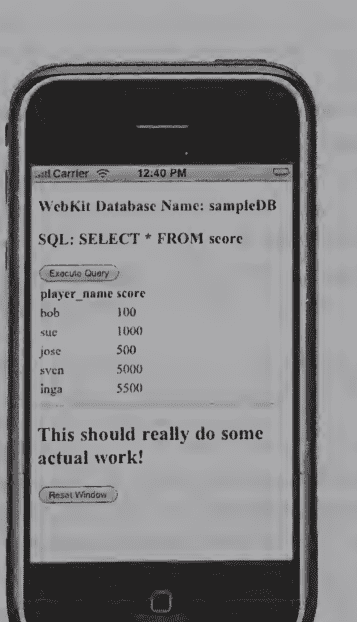

图 7.2 点击“Execute Query”按钮后的 browserAccessExample 应用程序

向表中插入数据的处理方式基本相同。如果要插入一个名为 Jane 的个人记录，则使用`setData`调用，如下所示：

```javascript
sampleDatabase.setData("INSERT INTO score VALUES('Jane', 250)");
```

将值硬编码到 SQL 语句中是不寻常的。通常，这些值源自用户输入。虽然可以根据用户提供的信息构建像前一个那样的 SQL 语句，但这样做可能是危险的。接下来的代码展示了如何通过使用预处理语句来避免这种危险。

```javascript
function setScoresBCF(parameters) {
    var name = document.getElementById('nameField').value;
    var score = document.getElementById('scoreField').value;
    var statementParameters = [ name, score];
    var SQL = 'INSERT INTO score VALUES(?, ?)';
    sampleDatabase.setData(SQL, statementParameters);
}
```

请注意，它看起来与用于创建 score 表的`setData`调用不同。在 SQL 字符串中原本预期出现姓名和分数的部分，现在变成了问号。这些是预处理语句中的占位符，用于指示`statementParameters`数组中的数据应插入的位置。程序员有责任将要插入的值按其在 SQL 字符串中出现的顺序放入数组中。这就是为什么`name`变量在`score`变量之前被添加到`statementParameters`数组的原因。

### 什么是预处理语句？

预处理语句极大地提高了存储用户输入数据的 SQL 安全性。事实上，它们是防止 SQL 注入攻击的一种有效方法，应当被更广泛地使用。

假设你想将一条记录插入到名为`user_preferences`的表中，其中包含位置、颜色和歌曲字段。你可以像这样将其拼接起来：

```javascript
"SELECT * FROM user_preferences WHERE name = " + name
```

这样拼接 SQL 语句是非常糟糕的。无论怎么强调其糟糕程度都不为过。它会将整个数据库暴露在所谓的 SQL 注入攻击之下。这些攻击被用来渗透数据库。不要拼接 SQL 语句。

安全的方法是创建如下形式的 SQL 字符串：

```javascript
"SELECT * FROM user_preferences WHERE name = ?"
```

同时创建一个包含你想用来替代问号的值或值组的数组。`setData`和`getData`的调用会处理其余工作，因为它们使用预处理语句。

从本质上讲，当使用预处理语句时，SQL 会在问号被值替换之前进行解析。这意味着如果任何变量中插入了恶意 SQL，它将不会被解析；对于数据库来说，它看起来就像 SQL 语句包含了一个奇怪的字符串。像前面那样使用问号的调用将不会返回任何结果。而拼接而成的语句则可以轻易地返回黑客想要看到的任何表中的所有内容。

预处理语句保护数据库免受被称为 SQL 注入攻击的入侵。虽然保护这样一个小型数据库免受入侵似乎很傻，但事实并非如此。对于那些不应该访问设备或设备上运行代码的人来说，总有办法造成破坏。所有的计算都应该以安全的方式进行。


从数据库中删除数据的操作方式基本相同。因为数据库正在被修改，所以使用`setData`方法。由于用户提供了要删除的名称，出于安全原因，采用了预处理语句。

```javascript
function deleteScoreBCF(parameters) {
    var name = document.getElementById('nameField').value;
    var statementParameters = [name];
    database.setData('DELETE FROM score where name = ?',
                    statementParameters);
}
```

## 第 3 节：使用原生 SQLite 数据库

除了能够在每个混合 iPhone 应用程序的 WebKit 引擎中创建和使用数据库外，还可以使用原生数据库。这些数据库允许应用程序创建者在安装的应用程序中包含现有数据。例如，你可能想在旨在帮助用户在零售市场中查找物品的应用程序中包含一系列标准 GPS 位置。你可以直接在应用程序的安装包中包含一个 SQLite 数据库文件，而不是在应用程序启动时下载并存储数据。

`nativeDBAccess`示例应用程序在功能上与`browser DBAccess`示例相同，但它使用一个名为`sample.sqlite`的 SQLite 数据库文件。图 7.3 显示了该文件被包含在 Xcode 项目的 Resources 组中。

创建用于包装对原生不同数据库调用的`DataAccessObject`所需的 JavaScript 代码，与第 2 节中看到的基于 WebKit 引擎的数据库所使用的代码不同。与 WebKit 数据库一样，定义是在`databaseDefinition.js`文件中完成的。然而，在原生数据库的情况下，仅需要数据库文件的名称。版本和大小参数是多余的，因为原生数据库的大小没有限制（在合理范围内），且版本控制是应用程序所有者的构建和分发过程的一部分。

```javascript
var sampleDatabase = new DataAccessObject("sample.sqlite");
```

请注意，这里没有创建表的调用，因为`score`表已经存在于`sample.sqlite`文件中。在原生数据库中创建表是可能的，但很不寻常。表通常在应用程序被放置到 Apple App Store 之前就已添加到数据库文件中。

## 第 7 章 数据库访问

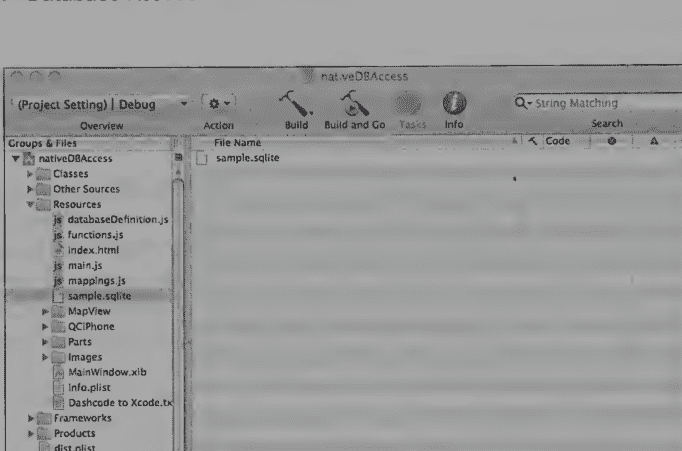

图 7.3 `nativeDBAccess`示例应用程序的资源

从原生数据库检索数据与从 WebKit 引擎管理的数据库获取数据几乎完全相同。唯一的区别（如以下代码所示）是，使用的是`getNativeData`方法而不是`getData`方法。从应用程序创建者的角度来看，这两个方法的行为是完全一致的。

```javascript
function getScoresBCF(parameters){
    debug('getting scores from database');
    var SQL = 'SELECT * FROM score';
    sampleDatabase.getNativeData(SQL);
}
```

`getNativeData`方法与第 2 节中讨论的`getData`方法一样，是异步的。因此，当数据可用时，框架会将收集到的数据传递给映射到与 BCF 相同命令的其他控制对象。与 WebKit 引擎管理的示例一样，这里是`displayScoresVCF`视图控制函数（View Control Function）。图 7.4 显示了`nativeDBAccess`示例应用程序中由该 VCF 生成的显示界面。

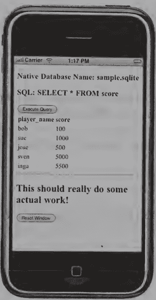

图 7.4 触摸“执行查询”按钮后的`nativeDBAccess`示例应用程序

添加、删除数据以及修改数据库的方式与第 2 节中看到的一模一样，唯一的区别是使用`setNativeData`方法代替`setData`方法。作为应用程序的创建者，行为上的差异对您来说应该是透明的。

## 第 4 节：在 WebKit 引擎数据库中使用`DataAccessObject`

前面的章节介绍了如何使用`DataAccessObject`来避免深入了解 SQLite WebKit 引擎及其原生实现的复杂细节。本节将向您展示这些细节是什么以及如何使用它们。如果您只想使用`DataAccessObject`而不想知道它的工作原理，可以跳过本节。

位于`QCiPhone/DataAccessObject.js`文件中的`DataAccessObject`的目的是尽可能减少程序员或工程师对 SQLite 知识的需求。为此，它在设计时使其方法和构造函数尽可能地像第 8 章“远程数据访问”中介绍的`ServerAccessObject` AJAX 封装器。通过简化 API，它使不熟悉 SQLite 的程序员能够存储数据而无需经历陡峭的学习曲线。

`DataAccessObject`的构造函数是其所有方法中最简单的。其行为是将对象的方法设置为匿名函数并进行定义。这意味着不需要任何属性来存储传递给构造函数的参数。

### 匿名函数

当一个人是匿名的，意味着你不知道她的名字。当一个函数是匿名的，意味着它没有名字。在 JavaScript 中，一个标准函数在如下行中声明一个名称：

```javascript
function bark(){}
```

在这种情况下，函数的名称是`bark`。当一个函数需要传递给另一个函数时，通常使用没有声明名称的函数。这些被称为匿名函数。

如果将一个匿名函数传递给`bark`，它看起来像这样：

```javascript
bark(new function(){
    //do something here
});
```

请注意，匿名函数的范围运算符`{}`被包含在`bark`函数的参数运算符`()`中。现在`bark`函数可以根据需要随意调用或存储此函数。

所有匿名函数都可以访问可能传递给声明该函数的本地变量。因此，以下代码是有效的：

```javascript
String type = 'doberman';
bark(new function(){
    if(type == 'boxer'){
    }
    else if(type == 'doberman'){
    }
    .
    .
    .
});
```

当函数或方法将函数作为参数时（如此节后面所示），此功能非常有用。

与任何强大的工具一样，重要的是在不需要时不要过度使用匿名函数。

如表 7.1 所示并在第 2 节和第 3 节中讨论的那样，`DataAccessObject`有两组主要方法。一组处理使用基于 WebKit 引擎的数据库存储或检索的数据，另一组处理您的 JavaScript 应用程序与分发应用程序中包含的 SQLite 数据库文件之间的数据传输。基于 WebKit 的方法使用了最多的 JavaScript，因此首先介绍。

`getData`和`setData`方法都是外观（façades）。它们进行最少的计算，并依赖第三个方法来完成大部分繁重的工作。这两个方法唯一真正的计算涉及在接下来的代码中看到的`passThroughParameters`变量中存储值的组装。

```javascript
this.getData = function(SQL, preparedStatementParameters){
    var passThroughParameters =
              generatePassThroughParameters();
    this.dbAccess(SQL, preparedStatementParameters,
                  false, passThroughParameters);
}
```

由于负责 HTML 5 规范的 W3C 标准机构要求所有对 WebKit 引擎数据库功能的调用必须是异步的，因此必须将有关应用程序当前状态的一些信息随请求一起传递，以便稍后使用。`QCUtilities.js`中的`generatePassThroughParameters`函数负责收集这些值。

如下代码所示，====================

## 第 7 章 数据库访问

| 属性/方法 | 返回值 | 描述 | 参数 |
| --- | --- | --- | --- |
| `openDatabase(dbName, dbVersion, dbDescription, dbSize)` | `Database`对象 | 一个工厂函数，用于创建以后使用的`Database`对象。 | `dbName`—用于引用特定数据库的唯一标识字符串。`dbVersion`—一个字符串，通常为浮点数形式。`dbDescription`—说明数据库用途的字符串。`dbSize`—分配给数据库的最大磁盘空间（字节）。如果传递`null`或不传递，则使用默认值 5 MB。 |
| `transaction(executionCallback, errorCallback, successCallback)` | `SQLTransaction`对象 | 一个用于执行数据库更新和查询的`SQLTransaction`对象创建方法。 | `executionCallback`—包含执行 SQL 所需代码的函数。`errorCallback`—一个可选函数，在事务失败时调用。此方法不执行数据库回滚，因为在失败时回滚行为是自动的。`successCallback`—一个在事务成功时调用的可选函数。 |

根据标准文档，`openDatabase`的所有参数都是可选的；然而，不声明数据库名称是不明智的。如果您在各种应用程序中使用多个数据库，每个数据库都应该有一个不同的名称。将`dbName`留空可能会导致所有应用程序共享同一个数据库，并且很容易被他人编写的恶意应用程序获取。为了保护您的数据库，这里使用了类似于浏览器中限制 AJAX 调用的同源规则。

应用于数据库的保护规则是一项限制，规定数据库只能由来自同一源（origin）的应用程序访问。如果您在由`www.yourplace.com`提供服务的 Web 应用程序中使用数据库，而在由`web.yourplace.com`提供服务的应用程序中使用另一个，那么不同 Web 应用程序中使用的数据库将对两者都可见。换句话说，任何由`yourplace.com`源提供的内容都可以访问该源提供的所有数据库，无论该数据库是由运行中的应用程序创建的，还是由`yourplace.com`中另一个子域名的应用程序创建的。

在混合应用程序中，您使用的是`UIWebView`对象而不是 Web 浏览器，因此不存在限制 AJAX 的同源规则。目前尚不清楚，但它可能## 第 7 章 数据库访问

| 属性/方法 | 返回值 | 描述 | 参数 |
| --- | --- | --- | --- |
| `openDatabase(dbName, dbVersion, dbDescription, dbSize)` | `Database`对象 | 一个工厂函数，用于创建以后使用的`Database`对象。 | `dbName`—用于引用特定数据库的唯一标识字符串。`dbVersion`—一个字符串，通常为浮点数形式。`dbDescription`—说明数据库用途的字符串。`dbSize`—分配给数据库的最大磁盘空间（字节）。如果传递`null`或不传递，则使用默认值 5 MB。 |
| `transaction(executionCallback, errorCallback, successCallback)` | `SQLTransaction`对象 | 一个用于执行数据库更新和查询的`SQLTransaction`对象创建方法。 | `executionCallback`—包含执行 SQL 所需代码的函数。`errorCallback`—一个可选函数，在事务失败时调用。此方法不执行数据库回滚，因为在失败时回滚行为是自动的。`successCallback`—一个在事务成功时调用的可选函数。 |

根据标准文档，`openDatabase`的所有参数都是可选的；然而，不声明数据库名称是不明智的。如果您在各种应用程序中使用多个数据库，每个数据库都应该有一个不同的名称。将`dbName`留空可能会导致所有应用程序共享同一个数据库，并且很容易被他人编写的恶意应用程序获取。为了保护您的数据库，这里使用了类似于浏览器中限制 AJAX 调用的同源规则。

应用于数据库的保护规则是一项限制，规定数据库只能由来自同一源（origin）的应用程序访问。如果您在由`www.yourplace.com`提供服务的 Web 应用程序中使用数据库，而在由`web.yourplace.com`提供服务的应用程序中使用另一个，那么不同 Web 应用程序中使用的数据库将对两者都可见。换句话说，任何由`yourplace.com`源提供的内容都可以访问该源提供的所有数据库，无论该数据库是由运行中的应用程序创建的，还是由`yourplace.com`中另一个子域名的应用程序创建的。

在混合应用程序中，您使用的是`UIWebView`对象而不是 Web 浏览器，因此不存在限制 AJAX 的同源规则。目前尚不清楚，但它可能

可以假设数据库的来源限制（origin restriction）同样是不生效的。因此，保护你的数据库不被其他应用程序访问的唯一手段，可能就是其他应用程序的编写者不知道你的数据库名称和版本。请务必为你的数据库指定名称和版本。

事务方法（transaction method）被所有的 SQL 调用所使用。事实上，如果不使用由事务方法创建的`SQLTransaction`对象，就无法对 WebKit 引擎数据库执行 SQL。正因如此，iPhone 混合应用程序中所有的 JavaScript 数据库调用在事务上都是自动安全的。

开发者通常关心的一个问题是何时回滚（roll back）数据库。这通常发生在程序员编写的代码检测到事务以某种方式失败时。在使用 JavaScript 数据库功能时，你不需要担心回滚问题，因为事务在失败时会处理自己的回滚。

如果事务失败，请勿发送`ROLLBACK` SQL 语句。它已经被处理过了，发送该语句反而会引起麻烦。传递给事务方法的`errorCallBack`函数并非用于此目的，它仅用于故障通知。

`SQLTransaction`对象只有一个方法：`executeSQL`（见表 7.3）。该方法接受你选择发送的任何 SQL。拼接 SQL 语句然后执行是不明智的，你应该使用内置的预处理语句（prepared statement）功能。如果你不确定什么是预处理语句以及如何创建，请参阅第 2 节。

### 表 7.3 `SQLTransaction`对象 API

| 属性/方法 | 返回值 | 描述 | 参数 |
| :--- | :--- | :--- | :--- |
| `executeSQL(sqlStatement, arguments, successCallback, errorCallback);` | `void` | 执行任意 SQL 语句字符串的方法。 | `sqlStatement`—包含有效 SQL 语句的字符串。如果要将其作为预处理语句处理，可以使用`?`（问号）占位符。`arguments`—一个可选的值数组，用于替换预处理语句中的`?`（问号）占位符。`successCallback`—在`sqlStatement`成功执行时调用的可选函数。`errorCallback`—在`sqlStatement`执行失败时调用的可选函数。 |

除了 SQL 语句之外，还会传递一个名为`arguments`的可选参数。这是一个字符串数组，用于替换 SQL 语句中包含的任何问号。这些内容被用作通过调用`executeSql`创建的预处理语句中的变量。所有对`executeSql`的调用都会创建预处理语句，即使没有占位符也是如此。这样使用是安全的，这也意味着如果你不使用占位符，速度也不会更快。最后两个参数是回调函数，在语句（而非事务）成功或失败时执行。成功函数由`executeSql`方法传递一个`SQLResultSet`对象。`SQLResultSet` API 见表 7.4。失败函数被传递一个`SQLError`对象（其 API 见表 7.6）。为了处理 SQL 语句的执行结果，你应该实现这些函数并将它们包含在`executeSql`方法调用中。

### 表 7.4 `SQLResultSet`对象 API

| 属性/方法 | 返回值 | 描述 | 参数 |
| :--- | :--- | :--- | :--- |
| `insertID` | 无 | 一个只读整数属性，如果 ID 字段是自增的，则包含插入记录的 ID。 | 无 |
| `rowsAffected` | 无 | 一个只读整数属性，包含在更新类语句期间添加或更改的行数。 | 无 |
| `rows` | 无 | 一个`SQLResultSetRowList`属性，包含查询类语句返回的所有结果行。 | 无 |

`SQLResultSet`对象包含你通过 SQL 语句请求的信息。它还包含两个非常有用的项：`insertID`和`rowsAffected`属性。如果一个表具有自增主键且你向该表插入了一条记录，那么`SQLResultSet`的`insertID`属性将包含自动生成的键值。当你需要将与该键值相关联的数据插入其他表时，这非常方便。在成功执行插入或更新 SQL 语句后，`rowsAffected`属性包含插入或更改的行数。这可用于验证复杂 SQL 语句的行为。`SQLResultSet`的第三个属性是`rows`属性。该属性包含一个`SQLResultSetRowList`，它是对记录数组的封装。如表 7.5 所示，它具有`length`属性，包含一个代表 SELECT 类语句结果中记录数量的数字。该数字与嵌入数组中的行数一致。

### 表 7.5 `SQLResultSetRowList`对象 API

| 属性/方法 | 返回值 | 描述 | 参数 |


| :--- | :--- | :--- | :--- |

| `length` | 无 | 一个只读属性，包含查询类语句获取的记录数量。 | 无 |

| `item(index)` | `Array` | 一个将记录作为 JavaScript 关联数组或 `Map` 返回的方法。 | `index`—要返回的结果集记录编号。 |

它还有一个名为`item`的方法，用于访问结果中的单个行。该方法和属性使得使用嵌入的`for`循环迭代行及其值变得非常简单。执行此类迭代的标准方法如下代码所示。

```
for( var i = 0; i < aResultSet.length; i++){
    var aRow = aResultSet.item(i);
    for(key in aRow) {
        var aValue = aRow[key];
        //do something with the key and the value
    }
}
```

虽然上述`for`循环代码被许多人认为是标准方法，但其执行并非最优，因为在第 1 行中，每次代码进入外层循环时都会检索结果集的长度。另一个浪费点是第 3 行中`for-each`循环的重复使用。

JavaScript 的`for-each`循环在 CPU 周期方面尤其浪费，而当它们被用于其他循环内部时，情况尤为糟糕。在本节稍后部分，对`dbAccess`方法的解释将展示如何修改此代码以使其执行更加优化。

如果在执行 SQL 语句时出现任何错误——无论是由于语句失败——都会生成一个`SQLError`对象而不是`SQLResultSet`对象。正如`SQLResultSet`被传递给用作`executeSql`方法参数的成功函数一样，`SQLError`也会被传递给失败函数。

你的成功函数永远不会接收到`SQLError`，你的错误函数也永远不会接收到`SQLResultSet`。这使得这两个函数各司其职，从而使这些函数更容易创建、编写和维护。

`SQLError`对象包含两个属性，分别包含错误代码数字和由 SQLite 生成的错误消息（见表 7.6）。

### 表 7.6 SQLError 对象 API

| 属性/方法 | 返回值 | 描述 | 参数 |

| :--- | :--- | :--- | :--- |

| `code` | 无 | 一个只读属性，包含错误代码编号。可能的代码为：0—因未知原因导致事务失败。 1—因未知原因导致语句失败。 2—语句失败，因为数据库的预期版本与实际版本不符。 3—语句失败，因为返回的数据过多。请尝试使用 SQL "LIMIT" 修饰符。 4—语句失败，因为达到了内存限制且用户未同意增加内存限制。 5—语句因事务中的锁定失败而失败。 6—INSERT、UPDATE 或 REPLACE 语句失败，因为它违反了约束（如重复唯一键）。 | 无 |

| `message` | 无 | 一个只读属性，包含相应的错误消息。 | 无 |

这两个项`code`和`message`对程序员或工程师很有用，但不应显示给用户，因为用户无法理解其含义。请使用这些指标记录错误，并向用户显示一些有帮助的信息。

关于如何使用这些对象的示例位于`DataAccessObject`的`dbAccess`方法中。如本节前面所述，`dbAccess`方法有五个参数，是`getData`和`setData`门面方法背后的工作方法。它的第四个参数指示请求的访问是修改数据库还是查询数据库。该参数由调用`dbAccess`的门面函数设置。

在检查`dbAccess`方法时，你会发现它使用了几个匿名函数。其中第一个在第 3 行作为数据库`transaction`方法的第一个且唯一参数传递。将其定义为代码其他地方的常规函数并作为第一个参数传递似乎更容易。然而，这会使剩余代码产生冲突甚至无法实现，因为那些由于使用匿名函数而处于作用域内的变量将不再处于作用域内。以下代码的第 2 行实例化了`QueryResult`对象，该对象被用作`dbAccess`方法的返回值。

为了让`QueryResult`对象真正发挥作用，它必须在事务的`executeSql`函数内部可用。除了使用匿名函数之外，使该`QueryResult`对象在该底层函数中可用的唯一方法就是将其设为全局变量。

## 第 4 节：在 WebKit 引擎数据库中使用 DataAccessObject 中的使用

如果其作用域是全局的，那么一次只能进行一次数据库访问。由于所有数据库访问都是异步的，这无法保证。因此，最好的方法是使用匿名函数。同样的逻辑也适用于传递给事务本身`executeSql`方法的函数。

`Transaction`对象的`executeSql`方法可以接收两个函数作为参数。始终这样做是一项最佳实践。如表 7.6 所示，第二个参数旨在作为在一切顺利时处理查询结果的函数。该函数声明始于后续代码的第 10 行。

在成功函数中，由 SQL 生成的任何插入 ID 都存储在第 7 行实例化的`QueryResult`中。如果数据库中的行发生了更改，受影响的行数也会被设置。但这仅在`dbAccess`方法的`treatAsChangeData`参数设置为`true`时才会执行。

如果数据没有改变，则必定执行了查询。第 23-51 行处理这种情况。在这些代码行中，创建了一个二维 JavaScript 数组，该数组附加到`QueryResult`返回值上，并存储在`SQLResult`集中找到的所有数据。通过将数据传输到标准 JavaScript 数组，您可以在无需了解`SQLResult`对象的结构或查询返回的字段的情况下，在其他代码中访问数据。如果您想知道字段名称，它们也存储在`QueryResult`对象中以备后用。字段名称和字段值保留了它们在`SQLResult`中被发现的顺序。

```
 1 this.dbAccess = function(SQL, preparedStatementParameters,
 2                          treatAsChangeData, passThroughParameters){
 3     if(!this.db){
 4         this.db = openDatabase(dbName, dbVersion,
 5                                  dbDescription, dbSize);
 6     }
 7     var queryResult = new QueryResult();
 8     this.db.transaction(function(tx) {
 9         tx.executeSql(SQL, preparedStatementParameters,
10        function(tx, resultSet) {
11            if(treatAsChangeData){
12                try{
13                queryResult.insertedID = resultSet.insertId;
14                queryResult.rowsAffected =
15                    resultSet.rowsAffected;
16
17                }
18                catch(ex){
19                //then must have been an update
20                queryResult.rowsAffected =
21                    resultSet.rowsAffected;
22                }
23            }
24            else{
25                //not a change to the database.
                //must be a query
                queryResult.numRowsFetched =
                    resultSet.rows.length;
                var dataArray = new Array();
                queryResult.numResultFields = 0;
                queryResult.fieldNames = new Array();
                if(queryResult.numRowsFetched > 0){
                    //retrieve the field ids in the result set
                    firstRecord = resultSet.rows.item(0);
                    var numFields = 0;
                    for(key in firstRecord){
                        queryResult.fieldNames.push(key);
                        numFields++;
                    }
                    queryResult.numResultFields = numFields;
                    var numRecords =
                        queryResult.numRowsFetched;
                    for(var i = 0; i < numRecords; i++){
                        var record = resultSet.rows.item(i);
                        var row = new Array();
                        dataArray.push(row);
                        for(var j = 0; j < numFields; j++){
                            row.push(
                                record[queryResult.fieldNames[j]]);
                        }
                    }
                }
                queryResult.data = dataArray;
                if(window.callFunc){
                    var theResults = new Array();
                    theResults.push(queryResult);
                    theResults.push(passThroughParameters);
                    requestHandler(passThroughParameters[0],
                        passThroughParameters[2], theResults);
                }
            }//end of sql execute success callback function
            , function(tx, error) {
                queryResult.errorMessage = error.message;
                if(window.callFunc){
                    var theResults = new Array();
                    theResults.push(queryResult);
                    theResults.push(passThroughParameters);
                    requestHandler(passThroughParameters[0],
                        passThroughParameters[2], theResults);
                }
            }
```

```
71 71 //end of main sql execute fail callback function
72 );//end of main executeSql call
73 ));//end of transaction callback function
74 })//end of dbAccess method
```

无论执行的 SQL 语句是数据库更改还是查询，函数调用开始时创建的`QueryResult`对象都会由框架分发给所有剩余的、未调用的控制函数。这在第 58 行和 59 行中使用第 2 章讨论的`requestHandler`函数完成。

第 62 行是`Transaction`对象方法错误处理函数声明的开始。它的职责是将 SQLite 生成的错误消息插入到`QueryResult`中，然后将其分发到您的其余控制函数中。有关控制函数的更多信息，请参阅第 2 章。

## 第 5 节：在原生数据库中使用 DataAccessObject

访问原生数据库所需的 JavaScript 代码比访问 WebKit 引擎数据库所需的要少。大部分工作是在框架的 Objective-C 端完成的。

与前一节描述的`getData`和`setData`方法一样，`getNativeData`和`setNativeData`方法是外观（façades）。在这种情况下，它们不调用`DataAccessObject`的`dbAccess`方法，而是调用`GCUtilities.js`文件中的`getDeviceData`函数。

```
this.getNativeData =
	function(SQL, preparedStatementParameters) {
		getDeviceData(dbName, SQL,
			preparedStatementParameters);
	}

this.setNativeData =
	function(SQL, preparedStatementParameters) {
		setDeviceData(dbName, SQL,
			preparedStatementParameters);
	}
```

`getDeviceData`函数具有两个主要功能。第一个（如第 4-16 行所示）是组装一个在 Objective-C 中执行查询所需的信息数组。该数组中包含了前一节讨论的透传参数（pass-through parameters）。这些透传参数是必需的，因为与处理 WebKit 引擎数据库请求一样，此请求是异步的。有关异步计算的更多信息，请参阅第 2 章。

正在创建的数组包含数据库名称、要执行的 SQL、SQL 所需的任何预处理语句参数以及透传参数。关于预处理语句的信息在本章的前一节中可见。

```
function getDeviceData(dbName, SQL,
            preparedStatementParameters, callBackParams){
        if(dbName && SQL){
            var dataArray = new Array();
            dataArray.push(dbName);
            dataArray.push(SQL);
            if(preparedStatementParameters){
                dataArray.push(preparedStatementParameters);
            }
            else{
                //put in a placeholder
                dataArray.push(new Array());
            }
            var callBackParameters =
                generatePassThroughParameters();
            dataArray.push(callBackParameters);
            var dataString = JSON.stringify(dataArray);
            makeCall("getData", dataString);
        }
        return null;
    }
```

数据准备好后，它被转换为 JSON 字符串并传递给`makeCall`函数。这个`makeCall`函数会触发框架的 Objective-C 端，如第 4 章“使用 QuickConnect 实现 GPS、加速和其他原生功能”中所见。这是第二个主要功能。没有它，将无法访问原生数据库。有关 JSON 的更多信息，请参阅附录 A“JSON 简介”。

与第 4 章中访问原生数据的函数一样，需要 Objective-C 控制对象来处理数据库数据的实际检索。这两个对象——`SetDataBCO`和`GetDataBCO`——在数据库被修改或查询时与数据库进行交互。这类似于`getData`和`setData` JavaScript 函数。


```objectivec
+ (id)doCommand:(NSArray*)parameters {
    if ([parameters count] >= 3) {
        NSString *dbName = [parameters objectAtIndex:1];
        NSString *SQL = [parameters objectAtIndex:2];
        NSArray *perparedStatementValues = nil;
        if ([parameters count] == 4) {
            perparedStatementValues = [parameters objectAtIndex:3];
        }
        SQLiteDataAccess *aDBAccess = [SQLiteDataAccess
                                        getInstance:dbName
                                        isWriteable:YES];
        return [aDBAccess getData:SQL
                    withParameters:perparedStatementValues];
    }
    return nil;
}
```

```objectivec
@end.
```

此外，与 JavaScript 的 `get` 和 `setData` 函数类似，这些 BCO 执行的实际计算很少。`doCommand` 方法会从 JavaScript 请求中检索数据库名称、SQL 语句以及任何预处理语句参数。

在这些信息都准备好后，会调用 `SQLiteDataAccess` 对象的 `getData` 方法。这个对象本质上是 JavaScript 的 `DataAccess-Object` 的镜像。它有 `getData` 和 `setData` 方法，但与 JavaScript 版本不同的是，Objective-C 版本是一个单例。如果需要关于单例的更多信息，请参阅第 4 章。

`SQLiteDataAccess` 的 `getData` 和 `setData` 方法，就像它们的 JavaScript 对应物一样，是 `dbAccess` 方法的外观。像 JavaScript 的 `dbAccess` 方法一样，Objective-C 版本特别复杂。这是因为在每台 iPhone 和 iPod touch 上都附带的 `libsqlite3.0.dylib` 动态库中，SQLite API 非常复杂，如表 7.7 所示。

### 表 7.7 SQLite3 API

| 对象/函数 | 返回值 | 描述 | 参数 |
| :--- | :--- | :--- | :--- |
| `sqlite3` | 无 | 一个表示内存中 SQLite 数据库的对象。 | 无 |
| `sqlite3_open(filePath, &aDatabase)` | 成功打开则返回 `SQLITE_OK` | 打开位于 `filePath` 的数据库文件，并将指针存储在 `aDatabase` 指针中。 | `filePath`—机器上 SQLite 数据文件的完整路径。`aDatabase`—一个指向表示内存数据库的 SQLite3 指针的指针引用。 |
| `sqlite3_close(aDatabase)` | `void` | 关闭与 SQLite 数据库文件的连接。 | `aDatabase`—在 `sqlite3_open` 函数中设置的 SQLite3 指针。 |
| `sqlite3_errmsg(aDatabase)` | `const char *` | 获取最后生成的错误。 | `aDatabase`—一个指向需要错误信息的数据库的 SQLite3 指针。 |
| `sqlite3_stmt` | 无 | 一个单独的 SQL 预处理语句。 | 无 |
| `sqlite3_prepare_v2(aDatabase, SQLChar, -1, &statement, NULL)` | 成功返回 `int SQLITE_OK` | 解释 SQL。 | `aDatabase`—一个指向数据库的 SQLite3 指针。`SQLChar`—UTF8 字符的 `const char *`，即 SQL 字符串。 |
| `sqlite3_column_count(statement)` | `int` | 计算查询结果集中的字段数量。 | `statement`—一个 SQLite3_stmt 指针。 |
| `sqlite3_column_name(statement, i)` | `const char *` | 获取字段的名称。 | `statement`—一个 `sqlite3_stmt` 指针。`i`—表示字段编号的整数。 |
| `sqlite3_changes(database)` | `int` | 获取对表进行更改所影响的记录数。 | `aDatabase`—一个指向数据库的 `sqlite3` 指针。 |
| `sqlite3_step(statement)` | 有行可用时返回 `int SQLITE_ROW` | 将结果集中的光标移动到下一条记录。 | `statement`—一个 SQLite3_stmt 指针。 |
| `sqlite3_column_type(statement, i)` | `int`，可能的值：`SQLITE_INTEGER`、`SQLITE_FLOAT`、`SQLITE_BLOB`、`SQLITE_NULL`、`SQLITE_TEXT` | 获取语句结果集中字段（列）的类型。 | `statement`—一个 `sqlite3_stmt` 指针。`i`—需要数据的字段编号。 |
| `sqlite3_column_int(statement, i)` | `int` | 从整数类型字段中获取值。 | `statement`—一个 `sqlite3_stmt` 指针。`i`—需要数据的字段编号。 |
| `sqlite3_column_double(statement, i)` | `double` | 从 `double` 类型字段中获取值。 | `statement`—一个 SQLite3_stmt 指针。`i`—需要数据的字段编号。 |
| `sqlite3_column_text(statement, i)` | `const unsigned char *` | 从字符串类型字段中获取值。 | `statement`—一个 `sqlite3_stmt` 指针。`i`—需要数据的字段编号。 |
| `sqlite3_column_blob(statement, i)` | `byte *` | 从二进制大对象（BLOB）类型字段中获取字节。 | `statement`—一个 `sqlite3_stmt` 指针。`i`—需要数据的字段编号。 |
| `sqlite3_column_bytes(statement, i)` | `int` | 获取 BLOB 类型字段值中的字节数。 | `statement`—一个 `sqlite3_stmt` 指针。`i`—需要数据的字段编号。 |
| `sqlite3_finalize(statement)` | `void` | 释放与该语句关联的资源。 | `statement`—一个 SQLite3_stmt 指针。 |
| `sqlite3_bind_blob(statement, parameterIndex, aVariable, byteLength, transienceKey)` | `int` | 将指向字节数组的指针绑定到预处理语句占位符。 | `statement`—一个 SQLite3_stmt 指针。`parameterIndex`—预处理语句占位符的索引编号。`aVariable`—指向要存储在数据库中的字节数组的指针。`byteLength`—要存储的字节数。`transienceKey`—一个指示符，表示插入的数据是否应在插入前被复制，以防止数据在存储期间发生变化。 |
| `sqlite3_bind_double(statement, parameterIndex, aVariable)` | `int` | 将一个 `double` 绑定到预处理语句占位符。 | `statement`—一个 SQLite3_stmt 指针。`parameterIndex`—预处理语句占位符的索引编号。`aVariable`—要存储在数据库中的 `double` 值。 |
| `sqlite3_bind_int(statement, parameterIndex, aVariable)` | `int` | 将一个整数绑定到预处理语句占位符。 | `statement`—一个 SQLite3_stmt 指针。`parameterIndex`—预处理语句占位符的索引编号。`aVariable`—要存储在数据库中的整数。 |

这个 C 库包含所有用于访问 SQLite 数据库的函数，并包括事务和预处理语句等功能。下面的代码展示了如何使用 API 进行预处理语句操作。它位于 `SQLiteDataAccess` 对象的 `dbAccess` 方法中。如 API 所述，`sqlite3_prepare_v2` 函数必须传递指向数据库的指针、要执行的 SQL，以及一个指向 `sqlite3_stmt` 变量的指针指针。如果在执行 SQL 时发生错误，`sqlite3_prepare_v2` 会返回一个数字错误代码。

```objectivec
int numResultColumns = 0;
sqlite3_stmt *statement = nil;
const char* SQLChar = [SQL UTF8String];
if (sqlite3_prepare_v2(database, SQLChar, -1,
                     &statement, NULL) == SQLITE_OK) {
    .
    .
    .
}
```

在前面代码中传入的 `sqlite3_stmt` 变量是在 `sqlite3_prepare_v2` 函数执行期间设置的，它包含的 `sqlite3_stmt` 随后用于从已执行的 SQL 查询的结果集中检索各个数据元素。多次调用 `sqlite3_step` 函数会移动一个跟踪结果集中行位置的光标。因此，如果结果集为空，或者不包含任何行，`sqlite3_step` 不会返回 `SQLITE_ROW`，而是返回 `SQLITE_DONE`。这使你可以使用 `while` 语句从光标所指向的行中检索数据。

```objectivec
while (sqlite3_step(statement) == SQLITE_ROW) {
    .
    .
    .
}
```

在这个 `while` 循环中，创建了一系列的 `NSMutableArrays`，如 `SQLiteDataAccess.m` 文件的第 218 行及其后的行所示。这些数组中的每一个都表示检索到的一行结果，因此被称为 `row`。

```objectivec
NSMutableArray *row = [[NSMutableArray alloc]
    initWithCapacity:numResultColumns];
```

要从结果集每条记录的字段中获取各个值，必须调用相应的函数以正确的类型获取数据。表 7.7 列出了可用于获取这些不同类型的函数，下面的代码展示了对这些函数的逐一调用。

```objectivec
int type = [[[theResult columnTypes]
    objectAtIndex:i] intValue];
if (type == SQLITE_INTEGER) {
    NSNumber *aNum = [[NSNumber alloc]
        initWithInt:sqlite3_column_int(statement, i)];
    [row addObject:aNum];
    [aNum autorelease];
}
```

```objectivec
else if (type == SQLITE_FLOAT) {
    NSNumber *aFloat = [[NSNumber alloc]
        initWithFloat
            :sqlite3_column_double(statement, i)];
    [row addObject:aFloat];
    [aFloat autorelease];
}
```

```objectivec
else if (type == SQLITE_TEXT) {
    NSString *aText = [[NSString alloc]
        initWithCString:sqlite3_column_text(statement, i)
        encoding:NSASCIIStringEncoding];
    [row addObject:aText];
    [aText autorelease];
}
```

```objectivec
else if (type == SQLITE_BLOB) {
    NSData *aData = [[NSData alloc]
        dataWithBytes:sqlite3_column_blob(statement, i)
            length:sqlite3_column_bytes(statement, i)];
    [row addObject:aData];
    [aData autorelease];
}
```

```objectivec
}
else { // SQLITE_NULL
    [row addObject:@"null"];
}
```

为了调用正确的函数，必须已经确定了相关字段的类型。为了方便实现，在进行这些调用之前，会先探测并存储字段类型，如 `SQLiteDataAccess.m` 文件的第 199-205 行以及随后的代码所示。

```objectivec
NSMutableArray *columnTypes = [[NSMutableArray alloc]
    initWithCapacity:0];
for (int i = 0; i < numResultColumns; i++) {
    NSNumber *columnType = [NSNumber numberWithInt:
        sqlite3_column_type(statement, i)];
    [columnTypes addObject:columnType];
}
[theResult setColumnTypes:columnTypes];
```

单个列的类型是使用 `sqlite3_column_type` 函数从语句的结果集中检索的。将语句指针和需要获取类型的字段编号传递给该函数，它将返回该字段类型的数字指示符。可能的类型包括：

- `SQLITE_INTEGER`
- `SQLITE_FLOAT`
- `SQLITE_BLOB`
- `SQLITE_NULL`
- `SQLITE_TEXT`

`dbAccess`、`setData` 和 `getData` 方法的返回类型是一个 `DataAccessResult` 指针。该对象包含对 SQLite 数据库执行任何 SQL 字符串的结果。以下代码来自 `DataAccessResult.h` 文件，展示了用于存储单次 SQL 执行结果的字段。

```objectivec
@interface DataAccessResult : NSObject {
    NSArray *fieldNames;
    NSArray *columnTypes;
    NSArray *results;
    NSString *errorDescription;
    NSInteger rowsAffected;
    NSInteger insertedID;
}
@property (nonatomic, retain) NSArray *fieldNames;
@property (nonatomic, retain) NSArray *columnTypes;
@property (nonatomic, retain) NSArray *results;
@property (nonatomic, retain) NSString *errorDescription;
@property (nonatomic) NSInteger rowsAffected;
@property (nonatomic) NSInteger insertedID;

- (NSString*)JSONStringify;

@end
```

正如第 4 章中所讨论的，由于框架负责数据传递，所有通过调用 `SQLiteDataAccess` 对象生成的 `DataAccessResult` 对象都会包含在发送给视图控制对象（VCO）的参数中。由于是从 JavaScript 发起调用以在“原生”数据库中获取或设置数据，因此查询的最终结果必须传递回 JavaScript 应用程序。这由 `SendDBResultVCO` 对象完成。

与所有命令对象一样，`SendDBResultVCO` 拥有一个 `doCommand` 方法。由于需要将数据传回 JavaScript，结果会被转换为 JSON 字符串。以下代码的第 8-11 行展示了具体实现方式。每个结果首先被转换为 JSON 字符串并添加到 `NSMutableArray retVal` 中。然后，`retVal` 数组被转换为一个 JSON 字符串。由于 Objective-C JSON 库的限制，无法直接创建对象数组并一次性调用 JSON 字符串创建函数。JSON 库不会遍历数组中的对象以进行精确转换。因此，每个 `DataAccessResult` 对象都需要额外调用一次 `JSONStringify`。


```objectivec
1  + (id) doCommand:(NSArray*) parameters{
2    NSArray *results = [parameters subarrayWithRange:aRange];
3    int numResults = [results count];
4    NSMutableArray *retVal = [[NSMutableArray alloc] init];
5    for(int i = 0; i < numResults; i++){
6        DataAccessResult * aResult =
7            (DataAccessResult*)[results objectAtIndex:i];
8        NSString* resultString = [aResult JSONStringify];
9        [retVal addObject:resultString];
10   }
11   [retVal addObject:[parameters objectAtIndex:4]];
12 
13   SBJSON *generator = [SBJSON alloc];
14   NSError *error;
15   NSString *dataString = [generator stringWithObject:retVal error:&error];
16   [generator release];
17   dataString = [dataString
18       stringByReplacingOccurrencesOfString:@"\"" withString:@"\\\""];
19   NSString *jsString = [[NSString alloc]
20       initWithFormat:
21           @"handleRequestCompletionFromNative('%@')"]
22					, dataString];
23	QuickConnectViewController *controller =
24				[parameters objectAtIndex:0];
25	[controller.webView
26		stringByEvaluatingJavaScriptFromString:jsString]);
27	return nil;
28 }
```

正如第 4 章中将结果转换为 JSON 字符串一样，这里发起了一个调用，将它们传递给应用程序的 JavaScript 端进行进一步处理。这就是之前看到的对`stringByEvaluatingJavaScriptFromString`的调用。它执行`handleRequestCompletionFromNative` JavaScript 函数，以确保其余的 BCO 和 VCO 能够映射回原始命令。关于具体实现，请参阅第 5 章“使用 PhoneGap 构建混合应用、GPS、加速计及其他原生功能”。

## 总结

`DataAccessObject` JavaScript 模块显著简化了在 WebKit 引擎中与 SQLite 数据库的交互。由于该模块仅接受标准的 JavaScript 类型（如字符串和数组），因此比直接调用 WebKit 引擎本身的 JavaScript SQLite 函数更容易。`DataAccessObject` 还是一个外观（façade），用于访问随应用程序一起分发的“原生”数据库文件。通过发起 JavaScript 调用，您可以访问数据库中的数据。这使得您的 JavaScript 应用程序成为一个功能完备的应用，就像是用 Objective-C 编写的一样。

与 JavaScript 中的`DataAccessObject`类似，Objective-C 的`SQLiteDataAccess`类极大地简化了从随应用分发的 SQLite 数据库中提取或存入数据的过程。它遵循与 JavaScript `DataAccessObject`相同的设计，因此即使您不熟悉 Objective-C，也更容易学习并理解其工作原理。

由于来自 WebKit 引擎或发往“原生”数据库的所有查询结果都是包含标准 JavaScript 类型的对象，因此您无需了解 SQLite、基于 WebKit 或“原生”的内部实现细节。

`DataAccessObject`和`SQLiteDataAccess`类都为您提供了事务安全性，防止异步调用干扰您的请求。您可以安全地发起任意数量的并发数据库调用，而无需担心破坏数据库中的数据。下一章将介绍如何为 AJAX 调用创建一个在外观和行为上都与`DataAccessObject`非常相似的包装器。

## 远程数据访问

有时，您的应用程序可能需要访问远程数据库或一个或多个 Web 服务中的数据。您甚至可能希望将手机上的数据与远程存储的数据进行同步。

混合 iPhone 应用使这一切变得简单。由于它们是混合应用，因此可以完全访问 JavaScript 中的`XMLHttpRequest`对象。本章将向您展示如何从 RSS Feed 中检索数据并将其显示在应用程序中。

与第 7 章“数据库访问”中讨论的数据库访问一样，第一节将介绍一个易于使用的`XMLHttpRequest`对象包装器。随后的章节将解释该包装器是如何创建的及其内部工作原理。

## 第 1 节：BrowserAJAXAccess 示例应用程序

在第 7 章中，`nativeDBAccess`示例应用程序展示了在设备上使用 SQLite 数据库存储和检索数据的过程。本章使用一个类似的应用程序与 Web 服务和服务器交互以检索数据。您可以在从 sourceforge.net/projects/quickconnect/ 下载的`quickconnectiPhone`文件夹的 Examples 目录下找到`browserAJAXAccess`应用程序文件夹。图 8.1 显示了该示例应用程序的运行情况。

如图 8.2 所示，所有 WordPress 博客都有一个 RSS Feed，用于提供任何托管博客的最新十条博客条目。虽然看起来这个 Feed 不提供完整的博客条目，但实际上它是提供的。`browserAJAXAccess`应用程序仅显示标题，但可以使用第 7 章中所示的方法和代码轻松扩展，以存储标题和正文内容。

庆幸的是，所有 RSS Feed 都是客户端无关的；它们不关心客户端是什么。无论谁或什么请求，Feed 都会接收博客条目请求并以 XML 形式发送。由于`UIWebView`包含 WebKit 引擎，它可以向 Feed 发送请求并解析返回的 XML。用于执行此操作的工具是`XMLHttpRequest`对象，而实现此目的的方法被称为 AJAX。

图 8.1 browserAJAXAccess 应用程序显示 TetonTech 的博客列表

### AJAX 并非希腊语

有史以来最伟大的书面创作之一是*《伊利亚特》*。这部由荷马创作的史诗讲述了希腊人（也称为阿开亚人）与特洛伊人之间的战争。

希腊人最伟大的英雄之一是 AJAX。他屡次击败对手，并且有一次，他单枪匹马地拯救了希腊舰队免于毁灭。

正如希腊舰队一样，传统的网页开发一直以来都面临挑战，现在也仍在受到攻击。人们认为它太慢、太难用、缺乏灵活性。再一次地，AJAX 前来救援，但这次的 AJAX 并非希腊人。此 AJAX 代表 Asynchronous JavaScript and XML（异步 JavaScript 与 XML）。

AJAX 背后的概念很简单。不要让用户每次发出请求时都重新加载页面，从而提供更丰富的用户体验。取而代之的是，发送或检索数据，然后使用动态 HTML 原则来显示结果。所有这些都可以通过在一个 HTML 页面中使用 JavaScript 来完成。

AJAX 对你来说不应该是希腊语（难以理解的事）。

通过将`XMLHttpRequest`对象与一些用于操作网页的简单 JavaScript 相结合，你的混合 iPhone 应用程序可以像使用本地数据一样使用远程数据。这样你就能两全其美：你的应用程序可以在独立模式下运行，也可以在网络模式下运行，并且在有连接可用时同步任何数据差异。QuickConnectiPhone 框架为你提供了一个易于使用的 AJAX 包装器：`ServerAccessObject`。

## 第 2 节：使用 ServerAccessObject

`ServerAccessObject` AJAX 包装器使你能够轻松访问远程数据，而无需了解`XMLHttpRequest`对象 API 的细节。`ServerAccessObject`的 API 与第 7 章讨论的`DataAccessObject`几乎相同。

与其 API 类似，`ServerAccessObject`的 API 有一个构造函数和两个方法。该构造函数存储远程服务器的 URL 并设置对象的方法。这两个方法——`getData`和`setData`——可以从构造函数中定义的远程服务器检索数据和向远程服务器发送数据。表 8.1 显示了`ServerAccessObject`的 API。

## 第 8 章 远程数据访问

表 8.1 **ServerAccessObject API**

| 属性/方法 | 返回值 | 说明 | 参数 |
| :--- | :--- | :--- | :--- |
| `ServerAccessObject (URL)` | `ServerAccessObject` | 使用`new`关键字调用时创建`ServerAccessObject`。 | `URL`——要连接的服务器的 URL。 |
| `getData (dataType, refresh, parameterSequence, HTTPHeaders)` | `void` | 用于从远程服务器检索信息的方法。这是 GET 类型的请求。此方法是线程安全的。 | `dataType`——正在检索的数据类型。它是两个选项之一：`ServerAccessObject.XML`或`ServerAccessObject.TEXT`。<br>`refresh`——一个布尔值，指示是否强制从服务器刷新数据。<br>`parameterSequence`——要添加到 URL 的任何参数。不要在此序列中包含开头的`?`（问号）。<br>`HTTPHeaders`——要与请求一起发送的请求头名称和值的关联数组。 |
| `setData(dataType, parameterSequence, data, HTTPHeaders)` | `void` | 用于修改或创建远程服务器上的信息，或传递安全类型参数的方法。这是 POST 类型的请求。此方法是线程安全的。 | `dataType`——正在检索的数据类型。它是两个选项之一：`ServerAccessObject.XML`或`ServerAccessObject.TEXT`。<br>`parameterSequence`——要添加到 URL 的任何参数。不要在此序列中包含开头的`?`（问号）。<br>`data`——要在发送中包含的任何数据。这可以是大量字符类型信息、文件上传等。<br>`HTTPHeaders`——要与请求一起发送的请求头名称和值的关联数组。 |

在 Dashcode 和 Xcode 模板的 QC iPhone 组中找到的`ServerAccessObject.js`文件包含`ServerAccessObject`包装器。这两个模板都会自动将此 JavaScript 文件包含在你应用程序的`index.html`文件中。

`getSiteDataBCF`函数在`functions.js`文件中使用此 JavaScript 类。此 JavaScript 文件包含`browserAJAX`示例应用程序的所有控制函数。有关这些类型函数是什么以及如何创建它们的更多信息，请参见第 2 章“JavaScript 模块化和 iPhone 应用程序”。

`getSiteDataBCF`函数的目的是检索作者博客中的博客条目。使用`ServerAccessObject`可以轻松完成此类检索，如以下代码中的第 2–5 行所示。

```
function getSiteDataBCF(parameters){
    var site = new ServerAccessObject(
                   'http://tetontech.wordpress.com/feed/');
    site.getData(ServerAccessObject.XML,
                   ServerAccessObject.REFRESH);
    //由于 AJAX 数据访问调用是异步的
  //此 BCF 不应返回任何内容。

}
```

第 2 行和第 3 行显示了`ServerAccessObject`的构造。它接收要消费的 RSS 源的 URL。在本例中，使用的是作者博客的 URL：`http://TetonTech.wordpress.com/feed`。要访问另一个 WordPress 博客，请替换此 URL。

第 4 行和第 5 行随后可以使用这个名为`site`的新对象来获取数据。因为这是 RSS 源，并且已知服务器将向 iBlog 应用程序发送 XML 类型数据，所以数据类型设置为`XML`。第二个参数是一个强制刷新数据的标志，而不是使用缓存版本。如果您想确保接收到的数据包含服务器上存储的任何和所有更改，则这是必需的。

不加区分地强制刷新可能会产生不良副作用。在不需要时强制刷新，如果你的应用程序变得流行，可能会导致服务器和网络过载。因此，你应该评估是否需要绝对最新的数据，或者是否可以稍微滞后一些。

与`DataAccessObject`一样，所有对`ServerAccessObject`的调用都是异步的。只要为每个调用创建新的`ServerAccessObject`，就可以同时运行多个调用。如果你使用 QuickConnectiPhone 框架，则不需要像使用 AJAX 时那样定义回调函数。该框架确保执行任何与进行`ServerAccessObject`调用的 BCF 映射到同一命令的剩余业务控制函数（BCF）和视图控制函数（VCF）。

`getSiteDataBCF`和`displaySiteDataVCF`函数都在`mappings.js`文件中映射到`sampleQuery`命令，如第 2 章所述。这意味着框架保证将`getSiteDataBCF`请求的数据传递给`displaySiteDataVCF`。

以下代码中显示了`displaySiteDataVCF`的代码。传递给此函数的`results`参数是一个 JavaScript 对象数组，每个对象对应于映射到`sampleQuery`命令的一个 BCF。`ServerAccessObject`的`getData`方法会创建`QueryResult`对象，就像`DataAccessObject`的`getData`方法一样（有关`QueryResult`对象的信息，请参见第 7 章）。

在清除以下代码中由`container`变量表示的显示项后，在第 9 行检索包含 AJAX 调用结果的`QueryResult`对象。因为`getSiteDataBCF`是映射到`sampleQuery`命令的第一个 BCF，所以其数据调用生成的结果是`results`数组参数中的第一个对象。

如第 7 章所述，`QueryResult`对象有一个名为`data`的属性。在像`getSiteDataBCF`中的 XML 请求的情况下，`data`属性填充了生成的 XML 文档。

因为它与通常在动态 HTML 中使用的 HTML 文档类似，所以处理方式大致相同。可以使用相同类型的方法，例如`getElementById`和`getElementsByTagName`。它也由父、子和兄弟关系的 Node 对象组成。你可以使用所有标准方法和途径来解释数据。

第 9 行还调用了`RSSUtilities.js`文件中的辅助函数`parseWordPressFeed`。它使用这些标准方法来检索名为`entries`的博客发布的二维数组。数组中的每个条目都由发布日期、发布内容和发布标题组成。


```
1 function displaySiteDataVCF(results, parameters){
2 	 var container =
3 	 	 document.getElementById('queryResults');
4 	 //clear the contents of the container
5 	 while(container.lastChild){
6 	 	 container.removeChild(container.lastChild);
7 	 }
8 	 //use a wordpress parser to create entry objects
9 	 var entries = parseWordPressFeed(results[0].data);
10 	 var numEntries = entries.length;
11 	 //for each entry insert the title and date
12 	 	 //into the container div
13 	 for (var i = numEntries-1; i >= 0; i --){
14 	 	 var entry = entries[i];
15 	 	 var publishDate = entry.date;
16 	 	 var title = entry.title;

17 	 	 var titleElement = document.createElement('h2');
18 	 	 titleElement.innerText = entry.title;
19 	 	 container.appendChild(titleElement);

20 	 	 var dateElement = document.createElement('h3');
21 	 	 titleElement.innerText = entry.date;
22 	 	 container.appendChild(dateElement);
23 }
```

```javascript
26     var hardRule = document.createElement('hr');
27     container.appendChild(hardRule);
28   }
29 }
```

随着`parseWordPressFeed`辅助函数生成的每个条目被访问，第 13-28 行创建 HTML 元素对象并将其插入到容器中。这使得显示内容包含每个博客条目的标题和日期。随后添加一条水平线（hard rule）以分隔每个显示的条目。

此示例展示了如何处理 RSS 馈送，但其他类型的访问同样简单，甚至更简单。您可以发起一个`TEXT`类型的请求并检索 HTML 以将其插入到应用程序的用户界面中，尽管出于安全原因不建议这样做。您也可以发起一个`TEXT`类型的调用来检索 JSON。

## JSON 也并非难懂

JSON 的发音像 “Jason”（如《杰森与金羊毛》中的 Jason）。有趣的是，杰森和他的同伴们以远航寻找金羊毛而闻名。

JSON 是 JavaScript 对象在网络上进行长距离传输的方式。它代表 JavaScript Object Notation（JavaScript 对象表示法）。这是一个为早已存在之物而起的华丽名称。

以下代码展示了如何创建 JavaScript 对象并在其中存储名（first name）和姓（last name）：

```javascript
var anObject = new Object();
anObject.fName = 'bob';
anObject.lName = 'jones';
```

或者，以下代码展示了如何使用对象表示法：

```javascript
var anObject = {fName:'bob', lName:'jones'};
```

哪种是正确的？两者实现了相同的功能。第二种选项很可能更快，但当对象变得庞大时，第一种选项更具可读性和可维护性。

对象表示法的优势在于它可以作为一个字符字符串发送到任何地方，例如：

```javascript
" {fName:'bob', lName:'jones'} "
```

随后可以通过将其传递给标准 JavaScript 函数`eval`来将其转换为对象，但这样做很危险。有关更安全且易于使用的 methodology，请参阅附录 A “JSON 简介”。

AJAX 和 JSON 这两个以希腊英雄命名的术语都在挽救 Web 类型开发，这难道是个巧合吗？这留给您来决定。

无论您需要检索哪种类型的数据，`ServerAccessObject`都能使其变得简单。只需实例化该对象，然后调用`getData`进行 GET 类型调用，或调用`setData`进行 POST 类型调用。无论哪种方式，QuickConnectiPhone 框架都会将信息传递给您映射到命令的所有后续控制对象。

## 第 3 节：ServerAccessObject

前一节介绍了如何使用`ServerAccessObject`来避免必须掌握 AJAX 和`XMLHttpRequest` API。本节将向您介绍这些是什么以及如何使用它们。如果您只想使用`ServerAccessObject`而不想知道其工作原理，可以跳过本节。

位于`QciPhone/ServerAccessObject.js`文件中的`ServerAccessObject`的目的是尽可能减少程序员或工程师对 AJAX 知识的需求。为此，它在设计上使其方法和构造函数与第 7 章中介绍的`DataAccessObject` JavaScript 数据库封装类类似。通过提供简化的 API，它使不熟悉 AJAX 的程序员能够发送和检索远程数据，而无需面对陡峭的学习曲线。如果您熟悉其中一个访问对象的 API，那么您也就知道如何使用另一个。

`ServerAccessObject`的构造函数是所有方法中最简单的。其行为是存储远程服务器的 URL，然后设置并定义对象的方法。如以下代码所示，构造函数中唯一的功能行是将 URL 存储在对象的`URL`属性中以便后续使用。

```javascript
this.URL = URL;
```

程序员永远不会直接访问这个`URL`属性。程序员和工程师还应将`makeCall`方法与`URL`属性一样视为私有的。

`makeCall`方法是`ServerAccessObject`的核心与灵魂。当对象被要求执行任何形式的服务器访问时，它负责处理所有工作。它的前端是两个外观（façade）方法：`getData`和`setData`。表 8.2 中的 API 描述阐述了它们的基本用途。

正如您在下一节中看到的，这些外观方法采用了将方法分配给对象的多种标准 methodology 之一。这种 methodology 通过使用函数构造函数调用来创建函数对象，并将结果分配给由`this`关键字表示的当前对象的属性。

这两个外观方法`getData`和`setData`几乎完全相同。它们接收四个参数，然后将这些参数加上另外三个参数传递给底层的`makeCall`方法。额外的参数在`getData`调用中是第一、第五和第七个，在`setData`调用中是第一、第三和第七个。`makeCall`方法的第五个参数是要作为 POST 类型请求的一部分传递给服务器的数据。这在`getData`方法中显然是不需要的，因此传递了`null`。

```javascript
this.getData = function(dataType, refresh,
                    parameterSequence, HTTPHeaders) {

    var passThroughParameters =
                    generatePassThroughParameters();
    this.makeCall('GET', dataType, refresh,
        parameterSequence, null, HTTPHeaders,
        passThroughParameters);
}
this.setData = function(dataType, parameterSequence,
                         data, HTTPHeaders){
    var passThroughParameters =
            generatePassThroughParameters();
    this.makeCall('POST', dataType, true,
                  parameterSequence, data, HTTPHeaders,
                  passThroughParameters);
}
```

`generatePassThroughParameters`函数调用汇集了所有必要的信息，使框架能够继续处理通过`ServerAccessObject`映射到 BCF 的 BCF 和 VCF。有关在`QCUtilities.js`文件中发现的此函数的更多信息，请参阅第 5 章 “使用 PhoneGap 开发混合应用程序、GPS、加速度计和其他原生函数”。

### 表 8.2 私有 makeCall 方法 API

| 属性/方法 | 返回值 | 描述 | 参数 |
| --- | --- | --- | --- |
| `makeCall(callType, dataType, refresh, parameterSequence, data, HTTPHeaders, passThroughParameters)` | Void | 应被视为私有的方法。此方法向服务器发起实际的 AJAX 调用并处理结果。 | `callType`—GET 或 POST。`dataType`—TEXT 或 XML。`refresh`—指示是否应强制刷新数据的布尔标志。`parameterSequence`—包含请求中使用的 URL 参数的字符串。`data`—随请求发送的字符或二进制数据。用于 POST 请求。`HTTPHeaders`—HTTP 请求头名称和值的关联数组。`passThroughParameters`—框架在从服务器接收数据后继续处理所需的数值数组。 |

`makeCall`方法的第三个参数是一个布尔标志，指示客户端（在这种情况下是`UIWebView`）的缓存行为应该是激活还是不激活。在`setData`方法的情况下，缓存显然是一种非常糟糕的行为，因此将其硬编码为`true`以关闭此缓存。

通过将这些参数包含在`makeCall`的方法签名中，它现在可以有效地封装检索和向远程服务器发送数据所需的行为。这种外观辅助函数模式经常被使用（如本例所示），当两个或多个方法/函数的大部分（但非全部）代码相同时，如果不使用外观方法，将会产生大量的代码重复。

要理解`makeCall`方法，您必须理解底层 JavaScript `XMLHttpRequest`对象的 API。该 API 在混合应用程序和 Mobile Safari 所使用的`UIWebView`中实现。

此 API 中唯一的对象是`XMLHttpRequest`对象（见表 8.3）。

### 表 8.3 XMLHttpRequest API

| 属性/方法 | 返回值 | 描述 | 参数 |
| --- | --- | --- | --- |
| `XMLHttpRequest()` | XMLHttpRequest | 对象的构造函数。 | 无 |
| `abort()` | void | 终止其所属的请求。 | 无 |
| `getAllResponseHeaders()` | String | 此调用将返回一个包含所有响应头名称和值的字符串。 | 无 |
| `getResponseHeader(aHeaderName)` | String | 返回包含指定名称的响应头值的字符串；如果不存在该头，则返回 null。 | `aHeaderName`—您想要获取关联值的 HTTP 响应头名称。 |

## 表8.3 XMLHttpRequest对象API

| 属性/方法 | 返回类型 | 描述 | 参数 |
| --- | --- | --- | --- |
| `open(type, URL, asynch, userName, passWord)` | void | 打开并准备与所需服务器的连接。 | `type`—一个值为GET或POST的字符串。<br><br>`asynch`—一个布尔标志，指示请求是否应异步发出。此参数应始终传递为`true`。<br><br>`userName`—一个可选参数，用于获取访问URL中指定文件或目录的用户名。<br><br>`password`—一个可选参数，用于指定用户名的密码，以获取访问URL中指定文件或目录的权限。 |
| `send(data)` | void | 用于将字符或二进制数据附加到请求的方法。用于POST类型的请求，例如上传文件。 | `Data`—附加到请求的信息。 |
| `setRequestHeader(name, value)` | void | 可以覆盖标准头值或向请求添加自定义头名称和值的方法。 | `Name`—作为头标识符键的字符串。<br><br>`Value`—与名称关联的字符串值。 |
| `onreadystatechange` | | 设置为函数的属性。设置的函数在`onreadystatechange`事件触发时被调用。每次`readyState`变化时都会发生。 | |
| `readyState` | | 表示所发出请求状态的一系列整数。可能的值有：<br>0—尚未调用`send`方法。<br>1—请求正在发送到服务器。<br>2—服务器已接收到请求。<br>3—已从服务器接收到部分响应。<br>4—已从服务器接收到完整的响应。 | |
| `responseText` | | 从服务器作为文本发送的数据，不包括任何HTTP响应头。 | |
| `responseXML` | | 从服务器作为XML DOM发送的数据。如果数据不是有效的XML，则此值为null。 | |
| `status` | | 服务器发送的数字，指示请求的成功或失败状态：404—未找到，200—成功，这是最常见的两个。完整列表请参阅 http://www.w3.org/Protocols/rfc2616/rfc2616-sec10.html。 | |
| `statusText` | | 服务器生成的字符串，包含与状态码匹配的任何消息。 | |

该API的常用方法是构造函数、`open`和`send`方法。以下代码展示了使用这些方法和其他常用属性的简单示例。它由以文本形式请求开源WebKit项目的主页组成。

请注意此简单示例中的两点。第一点是`request`对象在全局作用域中。它可在`handleResponse`函数中使用，该函数在`readyState`变化时由浏览器引擎自动调用。这使得代码很简单，但如果两个请求需要在重叠的时间内发送或意外发送，则会出现大问题。

```javascript
var request = new XMLHttpRequest();
request.onreadystatechange = handleResponse;
request.open('GET', 'http://webkit.org/', true);
request.send('');
```

```javascript
function handleResponse(){
    if(request.readyState == 4){
        if(request.status == 200){
            var result = request.responseText;
            //对结果进行一些处理。
        }
    }
}
```

由于此`request`变量的全局作用域，这个简单示例不是线程安全的。因为这些请求是异步的，请求相互覆盖是可能的且经常可能发生的。`ServerAccessObject`封装了这个全局变量来解决这个问题。

第二点需要注意的是，请求是发送到完整的URL。在标准浏览器中，XMLHttpRequest对象只能从它发起的服务器请求数据。混合应用程序中的`UIWebView`没有这个限制。因为它不是浏览器，所以可以从任何服务器请求数据，这既是优点也是缺点。

浏览器限制的原因是为了阻止跨站脚本攻击。如果恶意JavaScript被插入到您的应用程序请求的无害HTML中，就可能发生这种情况。因为UIWebView不是浏览器，您现在负责保护应用程序免受此类攻击。值得庆幸的是，Quick-Connect iPhone框架为您提供了映射安全控制函数的能力，`ServerAccessObject`在将请求结果传递给您的VCF之前会调用它们。

这些SCF的创建方式与VCF类似，并使用`mapCommandToSCF`函数进行映射。有关创建和使用SCF的示例，请参见第4节。

`XMLHttpRequest`对象API不包含强制刷新的指示器。`ServerAccessObject`通过设置一个标准HTTP请求头来处理这个问题。

```javascript
if(refresh){
    /*
     * 如果我们要禁用缓存并强制调用服务器，那么'If-Modified-Since'头需要
     * 设置为过去的某个时间。
     */
    http.setRequestHeader( "If-Modified-Since", "Sat, 1 Jan 2000 00:00:00 GMT" );
}
```

`If-Modified-Since`头告诉服务器，如果请求项目的修改日期晚于头值中包含的日期，则应发送数据。通过将值设置为过去的日期和时间，可以保证不使用缓存数据。


另一方面，`ServerAccessObject` API没有允许用户将请求定义为同步或异步的标志。人们普遍认为所有AJAX调用都应该是异步的。这使Web引擎能够响应用户的进一步输入。如果它们是同步的，当用户旋转iPhone时，`UIWebView`将变成空白屏幕。如果用户在向服务器发出请求时决定滚动视图，也会发生这种情况，这将导致糟糕的用户体验。因为同步使用`XMLHttpRequest`对象是一个非常糟糕的主意，所以`ServerAccessObject`将所有请求硬编码为异步。

与之前的简单示例不同，`ServerAccessObject`不使用独立函数来处理`onreadystatechange`事件。相反，它使用匿名函数。选择使用匿名函数是因为此类函数能够存在于外部函数的作用域中。

在这种情况下，在`makecall`方法中声明的所有局部变量在`onreadystatechange`匿名函数中也可用。因此，前面讨论的全局变量问题得到了解决。通过声明一个变量`http`作为在`makecall`方法中使用的新创建的`XMLHttpRequestObject`，当`onreadystatechange`匿名函数被调用时，它自动仍在作用域内。

对于那些不熟悉匿名函数概念的人来说，这似乎违反直觉。对于那些习惯使用它们的人来说，这可能看起来像是您在做一些本不应该能做的事情。以下代码包含整个匿名函数。

```javascript
1 http.onreadystatechange = function(){
2 
3 	if(http.readyState == ServerAccessObject.COMPLETE){
4 		//所有类型数据查询的标准持有者
5 		var queryResult = new QueryResult();
6 		//这些是自定义错误头，如果您选择，
7 		//可以从服务器代码发送。
8 		queryResult.errorNumber =
9 			http.getResponseHeader('QC-Error-Number');
10 		queryResult.errorMessage =
11 			http.getResponseHeader('QC-Error-Message');
12 		if(http.status != ServerAccessObject.HTTP_OK
13 			&& http.status != ServerAccessObject.HTTP_LOCAL
14 			&& http.status != 
15 				ServerAccessObject.OSX_HTTP_File_Access){
16 				queryResult.errorNumber = http.status;
17 				queryResult.errorMessage = "Bad access type.";
18 			}
19 		}
20 
21 	/*
22 		如果服务器返回请求处理成功，
23 	* 或者请求是直接针对服务器磁盘上的文件，
24 	* 则检索数据。
25 	* 将其作为文本或XML获取
26 	*/
27 		if(queryResult.errorNumber == null){
28 			queryResult.data = http['response'+dataType];
29 			if(!dispatchToSCF(passThroughParameters([0],
30 					queryResult.data)){
31 					queryResult.errorNumber =
32 						ServerAccessObject.INSECURE_DATA_RECEIVED;
33 						queryResult.errorMessage =
34 							"Insecure data received.";
35 				}
36 		}
37 	/*
38 	* 通过传递resultData调用列表中的下一个控制函数
39 	*/
40 		if(window.callFunc){
41 		/*
42 	* 这可能是从外部调用的
```

上一代码段中第 30 至 36 行包含了前面提到的 SCF 和 VCF 调用。第 30 行的代码看起来与第 2 章中前端控制器中的代码类似。事实上，它与前面描述的`checkValidation`函数调用几乎完全相同，行为也一致。

正如用户可能输入错误数据一样，服务器也可能发送错误数据。`checkSecurity`函数是一个应用控制器类型的函数，与`checkValidation`类似。它会调用你在`mapping.js`文件中映射到与 BCF 相同命令的所有 SCF，并使用`ServerAccessObject`来执行。这样，你就可以对从服务器接收到的数据应用任意数量的安全检查，从而帮助你解决跨站脚本攻击的问题。

检查完数据后，数据会被添加到`QueryResults`对象中，以便你的应用程序可以继续处理。这是通过调用`requestHandler`函数来完成的。这里使用了`passThroughParameters`，因为它们包含触发对你的 BCF 调用的命令，以及接下来应该调用的控制函数。通过调用`requestHandler`，`ServerAccessObject`的`makeCall`方法确保你所有的控制函数按照你在`mapping.js`文件中映射的顺序被依次调用。因为结果对象`theResults`也被传递了，所以它对所有后续的控制函数都是可用的。这意味着你可以以任何你认为合适的方式使用这些数据。

因为`onreadystatechange`匿名函数包含了这两个应用控制器类型的函数调用，而且它是服务器向其发送数据的唯一函数，所以它充当了应用程序的另一个前端控制器。这意味着如果你对所有的远程数据访问都使用`ServerAccessObject`，你就能获得第 2 章中讨论的标准应用程序远程通信的所有优势。

双前端控制器模式在你的应用程序中提供了所需的安全性，同时使你能够灵活地从任何服务器获取数据。图 8.3 展示了这两个前端控制器如何保护你的应用程序和数据。

## 第 4 节：安全控制函数

SCF 由`ServerAccessObject`调用，以确保从服务器检索到的数据的有效性和安全性。它们的行为方式和角色与第 2 章中介绍的 ValCF 非常相似，也遵循与所有其他控制函数相同的模式。

要调用一个 SCF，它必须被映射到一个命令。例如，你的应用程序可能要求用户登录才能在成功时发回 JSON 类型的数据。这样一个映射的示例如下：

```
mapCommandToSCF('login', checkForFunctions);
```

这意味着你还需要有一个可以被`checkSecurity`调用的`checkForFunctions`函数。

由于`QciPhone/json2.js`文件中提供了`json2`库，这个函数变得很容易编写。

```javascript
function checkForFunctions(data) {
    if (data == JSON.stringify(JSON.parse(data))) {
        return true;
    }
    return false;
}
```

当数据被解析时，`JSON.parse`方法如果遇到函数声明或函数调用，会在字符串中插入额外的字符。这会导致这些试图定义或进行函数调用的操作失败，从而提供了急需的跨站脚本（XSS）攻击安全防护。

你的检查可以利用这一点，将新创建的 JavaScript 对象转换回字符串，并与原始字符串进行比较。如果比较测试失败，应用程序就知道从服务器检索到的数据包含恶意代码。

这意味着发送给你的 JSON 文本不能包含函数定义或函数调用。这实际上是非常好的。如果不是这样，你就永远无法判断 JSON 中的 JavaScript 函数是你的代码还是在 XSS 攻击中插入的恶意代码。

## 总结

`ServerAccessObject`为你提供了一种简单、安全的方式，将远程数据检索到你的混合应用程序中。它为你提供了一个易于使用的 API，与`DataAccess` API类似，以降低你的学习曲线。

通过添加 SCF，你可以对检索到的代码进行尽可能彻底的检查。

`ServerAccessObject`可以检索远程数据，并通过`DataAccessObject`存储以供后续使用，或者像`browserAJAXExample`应用程序那样直接使用。它还开启了将本地机器上存储的数据与远程机器上存储的数据进行同步的可能性。

`ServerAccessObject`使你能够创建在应用程序代码失败时自动通知 Web 服务器的代码。你还可以使用它从你的 iPhone 应用程序中收集指标并发送到服务器，以帮助使应用程序更快、更易于使用。

所有这些现在都可以通过`ServerAccessObject`在你安装的混合 iPhone 应用程序中轻松获得。

# 附录 A：JSON 简介

JavaScript 对象表示法（JSON）是一种有趣的创造。它使你能够将 JavaScript 对象和数组转换为字符串，这些字符串可以通过网络传递或存储在数据库中。之后，这些字符串可以在另一台计算机上或在数据库检索后重新构建。这种序列化和解压 JavaScript 对象和数组的能力开启了无限可能。本附录向你展示了一个广受认可的 JavaScript JSON 库的应用程序编程接口（API），并提供简单的示例来展示该库的实际应用。

## 第 1 节：背景

将信息从一个系统传递到另一个系统始终是一个问题。这在 Web 应用程序开发中尤为明显，因为服务器可以用几乎任何语言编写，并在许多不同类型的计算机上运行。XML 是早期提出的解决此问题的设备、操作系统和语言无关的格式之一，它有一些好的用途。对于某些数据传输来说，使用 XML 是大材小用，特别是使用 AJAX 发送的那些小片段信息。如果你只想发送一个小数字数组或一个键/值映射，XML 就变得冗长。这个问题的解决并非通过发明新技术，而是利用了解释型语言中已经内置的功能。

所有主要的松散类型解释型语言都有一个`eval`类型的功能，可以将字符串作为源代码执行。这个`eval`功能是一个强大而危险的能力。如果被滥用，它可以使应用程序完全暴露在黑客攻击和滥用之下。此外，所有主要的松散类型解释型语言都有能力在不调用类似`new`的实例化关键字的情况下定义数组和对象。

如果你查看 JavaScript 示例，你可以很容易地看到如何创建数组。第一个示例是面向对象的方法：

```javascript
var array = new Array();
array.push(5);
array.push(13);
array.push('hello');
```

第二个示例是非面向对象的方法：

```javascript
var array = [5, 13, 'hello'];
```

这两个示例创建的数组完全相同。第二个示例对 JSON 的讨论很有意义。它与 JavaScript 将字符串作为代码进行求值的能力相结合，使 JSON 成为可能。

以下代码创建了一个与程序员使用第二个示例创建数组方式相匹配的字符串。它不是数组本身，而是对数组应该是什么的描述。

```javascript
var someString = "[5, 13, 'hello']";
// evaluate the string
var array = eval(someString);
```

上一个示例的最后一行将字符串解析为 JavaScript 源代码，解释 JavaScript 并执行它。在这个简单的示例中，字符串与`eval`调用在同一个应用程序中，因此这个过程是多余的。然而，如果字符串来自 QuickConnectiPhone 应用程序的 Objective-C 端，或者按照传统方式来自服务器，那么`eval`调用就合理得多了。

对象的创建类似。面向对象的方法如下所示，创建一个对象然后添加属性：

```javascript
var object = new Object();
object.width = 5;
object.height = 13;
object.message = 'hello';
```

相应的非面向对象的方法是：

```javascript
var object = {"width": 5, "height": 13, "message": "hello"};
```

以下是类似 JSON 的代码：

```javascript
var someString = '{"width":5,"height":13,"message":"hello"}';
// evaluate the string
var object = eval(someString);
```

尽管这是 JSON 的核心，但自行实现是危险的。例如，如果字符串从 JavaScript 传递到 QuickConnectiPhone 的 Objective-C 端，并且字符串以某种方式包含复杂指令，它可能会删除硬盘上的所有内容。

已经创建了 JSON 库来为你处理这个安全问题。在 JavaScript 端使用的是 Json2，可以在`json2.js`文件中找到。Json2 是最常用的 JavaScript JSON 解析器之一。由于你需要经常在基于 QuickConnectiPhone 的应用程序的 JavaScript 端和 Objective-C 端之间传递和接收数据，你需要了解这个库的 API。

## 第2节：JSON JavaScript API

Json2 API（见表A.1）简单直接。它仅包含两个函数：一个用于将对象或数组转换为字符串，另一个用于将字符串转换为对象。第一个称为stringify。

| 函数 | 参数 |
| :--- | :--- |
| `JSON.stringify(entity, replacer, space, linebreak)` | **必需参数：**<br>**entity**—要转换的JavaScript对象、数组或原始值。<br>**可选参数：**<br>**replacer**—一个函数或数组，用于覆盖与JavaScript实体键关联的值的默认字符串生成。<br>**space**—一个数字或字符，如`'\t'`或`'&nbsp'`，用于缩进存储在其他实体中键下的JavaScript实体值。<br>**linebreak**—一个或多个字符，用于覆盖默认的`'\n'`，如`'\r\n'`或`<br/>`。 |
| `JSON.parse(string, reviver)` | **必需参数：**<br>**string**—要转换为JavaScript对象或数组的JSON字符串。<br>**可选参数：**<br>**reviver**—一个函数，其行为与stringify方法中使用的replacer相反。 |

stringify函数有多个参数，但对于 QuickConnectiPhone，你只需使用第一个参数。它是一个要转换为字符串的对象或数组。一个通用示例如下：

```javascript
var JSONString = JSON.stringify(object);
```

将字符串转换为对象同样简单：

```javascript
var object = JSON.parse(someString);
```

数组的处理方式完全相同。

使用 Json2 对对象进行 stringify 和 parse 的完整示例`object_JSON_example.html`，可在 QuickConnectiPhone 下载的`Examples/JSON`目录中找到。图A.1展示了将对象转换为字符串、再转换回对象，然后打印对象`size`属性的结果。

## 附录A：JSON简介

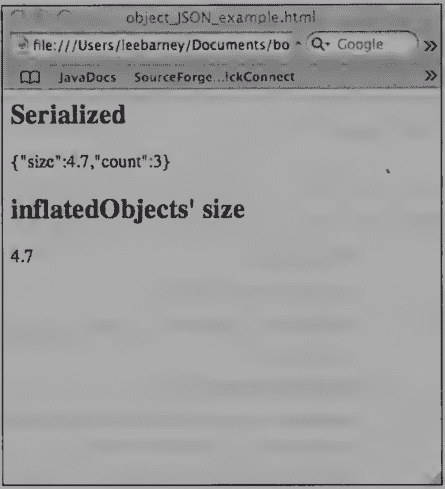

`Examples/JSON`目录中还有一个名为`array_JSON_example.html`的示例。它展示了如何使用 Json2 对数组进行 stringify 和 parse。图A.2展示了一个示例。

请注意，这两个示例都使用行业标准术语`serialize`和`inflate`分别表示`stringify`和`parse`函数的结果。

Json2 库还允许你传递原始值（如数字）。字符串对象也能很好地处理。并非所有语言中的所有 JSON 库都是如此。图A.3展示了该示例的运行结果。

使用 Json2 库，你可以将任何内容传递给`stringify`和`parse`，它都会正确处理。Objective-C 端的 JSON 库也能正确处理原始值和字符串。

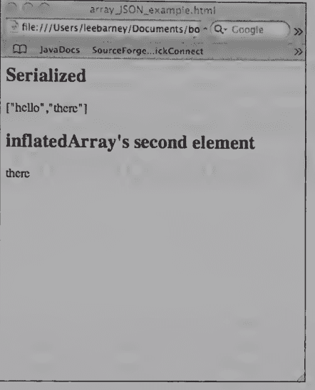

图A.2 对数组进行 stringify 然后 parse 的结果

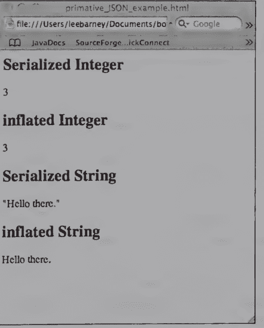

图A.3 对原始值和字符串进行 stringify 然后 parse 的结果

## 小结

JSON 是一种传递信息的绝佳方式。它与设备、操作系统和语言无关。所有常用语言中都有免费的开源解析器，其中一些（如 PHP）还自带解析器。

QuickConnectiPhone 附带的 Json2 库易于使用，使你能够向混合应用的 Objective-C 端发送数据并从中接收数据。

## 附录B：QuickConnectFamily开发路线图

由于 QuickConnectiPhone 尚处于开发周期的早期阶段，它正在快速变化中。因此，密切关注开发更新非常重要。表B.1显示了截至 2009 年 2 月 23 日可下载的内容。

*Yes*表示该功能已发布。*In Development*表示该功能正在积极开发中。*Development Planned*表示该功能可行但尚未开始开发。*Not Possible*表示该设备上不提供此功能。虚线单元格表示本书撰写时未在进行的工作。

### 注意

虽然已计划针对 Windows 和 Windows Mobile 进行开发，但由于目前尚未进行任何开发工作，表B.1未列出它们。

| | iPhone | Android | Mac | Linux | Symbian |
|---|---|---|---|---|---|


| Geolocation | Yes | Yes | Not Possible | Not Possible | — |
|---|---|---|---|---|---|
| Accelerometer | Yes | Yes | In Development | — | — |
| Vibration | Yes | Yes | Not Possible | Not Possible | — |
| Ad-hoc networking | Yes | In Development | In Development | In Development | In Development |
| JavaScript Database wrapper (SQLite) | Yes | Not Possible | Yes | In Development | In Development |
| Installed Native Database wrapper (SQLite) | Yes | Yes | Yes | Yes | In Development |
| AJAX wrapper | Yes | In Development | Yes | Yes | In Development |
| Drag and Drop Library | Yes | — | Yes | Development Planned | — |
| Synch cable networking | In Development | — | — | — | — |
| Camera access | In Development | In Development | In Development | — | — |
| Image Geolocation | In Development | — | — | — | — |
| System Sounds (Play) | Yes | Yes | Yes | In Development | In Development |
| Record/Play audio files | Yes | Yes | In Development | Development Planned | Development Planned |
| Native Date/Time pickers | Yes | — | — | — | — |
| Embedded Google maps | Yes | In Development | — | — | — |
| Charting and graphing | Yes | — | Yes | — | — |

表B.1 2009年2月23日的QuickConnectFamily开发路线图

### 定义

- `Geolocation`—获取当前GPS位置坐标数据。
- `Accelerometer`—获取x、y和z方向的变化。
- `Vibration`—使设备振动。
- `Ad-hoc networking`—查找并与附近运行相同应用程序的其他设备通信。
- `JavaScript Database wrapper (SQLite)`—使用内置的HTML 5数据库。
- `Native Database wrapper (SQLite)`—使用随应用程序提供的SQLite数据库。
- `AJAX wrapper`—一个易于使用的AJAX库，用于检索远程数据。
- `Drag and Drop Library`—一个易于使用的库，使用户能够移动、旋转和调整屏幕项目的大小。
- `Synch cable networking`—使用同步电缆访问和传输数据到桌面计算机。
- `Camera access`—拍摄和存储照片。
- `Image Geolocation`—访问使用设备拍摄的照片中嵌入的地理位置信息。
- `System Sounds (Play)`—播放短（少于5秒）的声音。
- `Record/Play audio files`—使用设备录制音频，并播放这些文件和作为应用程序一部分提供的音频文件。
- `Native Date/Time pickers`—显示和使用基于Objective-C的选择器，而不是有限的JavaScript选择器。
- `Embedded Google maps`—在应用程序中使用自定义Google地图，而不是标准地图，或显示地图应用程序。
- `Charting and graphing`—一个易于使用的图表库，用于显示折线图、柱状图、饼图和其他图表。

## 附录C：PhoneGap开发路线图

由于PhoneGap尚处于开发周期的早期阶段，它正在快速变化中。因此，密切关注开发更新非常重要。表C.1来自PhoneGap wiki。它显示了开发人员声称的功能可用性，以及本书撰写时已确认的内容。

`Confirmed`表示截至2009年2月23日，JavaScript函数已在PhoneGap中找到。作者无法评论Blackberry平台的可用性。`In Work`表示PhoneGap团队正在努力使此功能可用。`Claimed`表示PhoneGap团队声称该功能可用，但作者在下载的代码中找不到证据。虚线单元格表示未在进行的工作且目前不存在。`Not Possible`表示开发人员认为所指功能在设备上无法访问。

> **注意**
>
> 已计划针对Symbian和Windows Mobile进行开发，但尚未进行任何工作；因此，它们不在表C.1中。

表C.1 2009年2月23日的PhoneGap开发路线图

| | iPhone | Android | Blackberry (OS 4.5) |
|---|---|---|---|
| Geolocation | Confirmed | Confirmed | Claimed |
| Accelerometer | Confirmed | Confirmed | Available in OS 4.7 |
| Camera | In Work | In Work | In Work |
| Vibration | Confirmed | Confirmed | Claimed |
| Offline (local files) | In Work | Claimed | In Work |
| Contacts API | Claimed | — | Claimed |
| SQLite wrapper | Claimed | — | Not Possible |
| XMPP API | — | — | — |
| 文件系统 IO | — | 开发中 | 开发中 |
| 手势/多点触控 | 确认为基本 UIWebView 的一部分 | — | — |
| 短信 API | — | 开发中 | — |
| 电话 API | 开发中 | 开发中 | 开发中 |
| 复制/粘贴 | 不可能 | — | 已声称 |
| 系统声音（播放） | 已确认 | — | — |
| 声音（录制） | — | — | — |
| 蓝牙 | — | — | — |
| Wifi ad-hoc 连接 | — | — | — |
| 地图 | 已声称 | 开发中 | 开发中 |
| 方向变更 | 已确认 | — | — |
| 网络可用性 | — | — | — |

# 定义

- 地理位置—获取 GPS 位置坐标数据。
- 加速计—获取 x、y 和 z 方向的变化。
- 摄像头—拍摄和存储图片。
- 振动—使设备振动。
- 离线（本地文件）—已安装的 HTML、CSS 和 JavaScript 文件（它们不在网络服务器上）。
- 通讯录 API—访问通讯录应用程序中的信息。
- XMPP API—类似 Jabber 的即时消息传递。
- 文件系统 IO—读取和写入纯文本或二进制文件。
- 手势/多点触控—使用一根或多根手指进行复杂数据输入。
- 短信 API—即时消息传递。
- 电话 API—拨打电话。
- 复制/粘贴—复制输入内容。
- 系统声音（播放）—播放音频文件。
- 声音（录制）—使用设备录制音频。
- 蓝牙—使用蓝牙连接其他设备。
- Wifi ad-hoc 连接—查找并与其他设备通信。
- 地图—使用 Google 地图。
- 方向变更—检测设备的竖屏和横屏变化。
- 网络可用性—检测设备是否有网络访问。

# 索引

## A

- `abort` method, 164
- `accel` command, 78
- 加速计, PhoneGap, 109
- access. 另请参见 database access; remote data access
- ADC (Apple Developer Connection), 8
- `add` function, 29
- alert 行为, PhoneGap, 99
- Alert 对话框, 混合应用程序与, 2
- 匿名函数, 136
- API, Json2 API, 175-176
- Apple Developer Connection. 另请参见 ADC (Apple Developer Connection)
- 应用程序控制器, 32
- `applicationDidFinishLaunching` method, 16, 19
- 应用程序
  - BrowserAJAXAccess 示例应用程序, 155-157
  - BrowserDBAccess 示例应用程序, 127
  - 混合应用程序, Alert 对话框与, 2
  - 沉浸式应用程序, 55-57
  - 非列表视图应用程序, 51-55
- 数组
  - 转换为字符串, 175
  - 创建, 173-174
- `passThroughParameters`, 137
- `retVal`, 153
- 异步, 39
- `AudioServicesPlaySystemSound` function, 103

## B

- BCF (业务控制函数), 26, 29, 32-33, 39
- 浏览器部分, 48-50
- BrowserAJAXAccess 示例应用程序, 155-157
- BrowserDBAccess 示例应用程序, 127
- 业务应用程序控制器, 38-41
- Business Control Functions (BCF), 26

## C

- `calculateSolutionsBCF`, 30
- `callback` method, 106
- `callFunc` function, 41
- `changeView` function, 49
- `checkNumbersValiCF` function, 32
- `checkSecurity` function, 170
- 类
  - `DataAccessObject`
    - 方法, 129-130
    - 与原生 SQLLite 数据库, 133-134
    - 与 WebKit 引擎数据库, 135-145
    - 与 WebView SQLLite 数据库, 130-133
  - `GlassAppDelegate`, 17
  - `QuickConnectViewController`, 17
  - 单例类, 89
  - `SQLiteDataAccess`, 145-154
- `code` 属性 (SQLError), 142
- 控制函数, 28
- 转换对象/字符串, 175
- 复制文件, 6
- CSS 变换，创建自定义, 57-63
- 立方体过渡, 54
- 自定义 PhoneGap 模板, 9-11

## D

- Dashcode, 1
  - 目录, 7
  - QuickConnectiPhone 模板, 1-3
  - 过渡效果, 52-54
- 数据，检索, 26
- `DataAccessObject` 类
  - 方法, 129-130
    - 与原生 SQLLite 数据库, 133-134
    - 与 WebKit 引擎数据库, 135
      - Database 对象, 137-139
      - `dbAccess` method, 137
      - `generatePassThroughParameters` function, 137
      - `getData` method, 136
      - `passThroughParameters` array, 137
      - 示例代码清单, 143-145
      - `setData` method, 136
      - SQLError 对象, 141-142
      - SQLResultSetRowList 对象, 140-141
      - SQLResultSet 对象, 140
      - SQLTransaction 对象, 139-140
    - 与 WebView SQLLite 数据库, 130-133
- `DataAccessObject` method, 129
- `DataAccessObject.js` 文件, 129
- 数据库访问
  - BrowserDBAccess 示例应用程序, 127
  - 数据库术语, 128
  - 原生数据库, 145-154
    - `getDeviceData` method, 145-146
    - `getNativeData` method, 145
    - `makeCall` function, 146
    - `SendDBRresultVCO` 对象, 153
    - `setNativeData` method, 145
  - SQLite3 API, 147-150
  - 原生 SQLite 数据库, 133-134
  - 概述, 127
  - WebKit 引擎数据库, 135
    - Database 对象, 137-139
    - `dbAccess` method, 137
    - `generatePassThroughParameters` function, 137
    - `getData` method, 136
    - `passThroughParameters` array, 137
    - 示例代码清单, 143-145
    - `setData` method, 136
    - SQLError 对象, 141-142
    - SQLResultSetRowList 对象, 140-141
    - SQLResultSet 对象, 140
    - SQLTransaction 对象, 139-140
  - WebView SQLite 数据库, 129-133
- Database 对象, 137-139
- `dbAccess` method, 137, 142
- 委托, 14
- `deleteScoreBCF` function, 133
- 开发路线图
  - PhoneGap 的, 183-185
  - QuickConnectiPhone 的, 179-181
- 开发工具
  - PhoneGap, 183-185
  - QuickConnectiPhone, 179-181
- 设备激活
  - JavaScript, 75-81, 95-102
  - Objective-C, 81-88, 102-109
- `Device.exec` function, 99
- `Device.init` method, 96
- `Device.Location.init` method, 100
- `Device.Location.set` method, 106
- `Device.vibrate` method, 98
- `didAccelerate` method, 109
- `didUpdateToLocation` method, 109
- 目录, Dashcode, 7
- `dispatchToBCF` function, 38-39
- `dispatchToECF` function, 43
- `dispatchToValCF` function, 35
- `dispatchToVCF` function, 41-42
- 显示
  - 在 QuickConnect JavaScript 应用程序中显示地图, 111-115
  - 选择器, 80
- `displayScoresVCF` 视图控制函数, 131, 134
- `displaySiteDataVCF` function, 159-161
- `displaySolutionVCF` function, 30
- 溶解过渡效果, 53
- `doCommand` method, 86, 92, 116, 153
- DollarStash 游戏, 56
- `done` method, 61
- 双下划线 (`__<u>`), 97
- 拖放, 46
  - 跳跃元素, 59
  - 模块, 64-74
- 拖放缩放旋转 API, 64
- `dragAndGesture` 示例, 65

## E

- ECF (错误控制函数), 30, 33, 42-43
- 嵌入
  - Google Maps, 111-115
  - Web 内容
    - PhoneGap, 23-24
    - QuickConnectiPhone, 19-23
- `entryECF` function, 30
- 错误应用程序控制器, 42-43
- `eval` function, 33
- `eval` 类型, 173


- `executeSQL method`, 139, 143

### F

- 淡入淡出过渡效果, 54
- 字段（数据库）, 128
- 文件
  - 复制, 6
  - `DataAccessObject.js`, 129
  - `ServerAccessObject.js`, 159
- 翻转过渡效果, 54
- 外键, 128
- 框架, 25-26
- `FrontController API`, 28
- 函数。另请参见特定函数
  - 匿名函数, 136
  - `SCF`（安全控制函数）, 171-172
- 未来开发
  - `PhoneGap` 的, 183-185
  - `QuickConnectiPhone` 的, 179-181

### G

- `gap_device_model` 变量, 97
- `gap` 变量, 97
- `generatePassThroughParameters` function, 137
- `GestureEvent`, 62
- 手势, 46, 62
- `getAllResponseHeaders` method, 164
- `getData` method, 129, 131, 136, 158, 162-163
- `getDeviceData` method, 145-146
- `getGPSLocation` function, 79
- `getInstance` method, 89
- `getNativeData` method, 130, 134, 145
- `getResponseHeader` method, 164
- `getSiteDataBCF` function, 159
- `GlassAppDelegate` class, 17
- `goForward` method, 50
- Google Maps，在 `QuickConnect JavaScript` 应用程序中显示, 111-115
- `goSub` function, 52
- `gotAcceleration` function, 101
- GPS
  - JavaScript, 79-80
  - Objective-C, 86-87
  - PhoneGap, 99-101, 105-106
- 组，Xcode, 7

### H

- `handleRequest` function, 28, 34
- `handleRequestCompletionFromNative` method, 154
- HIG（人机界面指南）, 45-47
- `HistoryExample` 应用程序, 48
- 跳跃元素, 59
- 混合应用程序，Alert 对话框与, 2

### I

- 沉浸式应用程序, 55-57
- `InfoWindow`, 115, 126
- `initWithContentsOffFile` method, 107
- `initWithFrame` method, 116
- `insertID` 属性（`SQLResultSet`）, 140
- 实例化对象, 12
- 界面
  - CSS 变换, 57-63
  - 基于列表的界面, 48-50
  - 基于视图的应用程序, 49-51
  - 视图, 80
- `isDraggable`, 66
- `item` method, 141

## J-K-L

- JavaScript
  - 设备激活, 75-81, 95-102
  - 模块化, 25-34
  - 滚动功能, 119
- JSON（JavaScript 对象表示法）, 78, 161
  - `Json2 API`, 175-176
  - Objective-C 设备激活, 83
  - 概述, 173-174
- `Json2 API`, 175-176
- `JSONStringify` 方法, 153

## L

- `length` 属性（`SQLResultSetRowList`）, 141
- 基于列表的接口, 48-50
- `loadView` 方法, 20

## M

- `makeCall` 函数, 75-77, 146, 162-164
- `makeChangeable` 函数, 64, 67
- `makeDraggable` 函数, 64-66
- `mapCommands` 方法, 84
- `mapCommandToCo` 方法, 93
- 映射函数 API, 30
- 地图
  - 在 `QuickConnect JavaScript` 应用程序内显示, 111-115
  - 使用 Objective-C 实现 QuickConnect 映射模块, 115-126
  - 缩放, 122-125
- `MapView`, 115
- 数学命令, 28-31
- 医学成像应用, 55
- `message` 属性（`SQLError`）, 142
- 方法。请参阅具体方法
- 模块化
  - 控制函数, 28
  - JavaScript, 25-26
    - 在 `QuickConnectiPhone` 中实现, 34-38
    - `QuickConnect JavaScript` 框架示例, 26-34
- 模块
  - 定义, 25
  - 拖放, 64-74
  - 旋转, 67-74
  - 缩放, 67-74
- `moveX:andY` 方法, 124

## N

- 访问本地数据库, 145-154
  - `getDeviceData` 方法, 145-146
  - `getNativeData` 方法, 145
  - `makeCall` 函数, 146
  - `SendDBResultVCO` 对象, 153
  - `setNativeData` 方法, 145
  - SQLite 数据库, 133-134
  - `SQLite3 API`, 147-150
- 非基于列表的视图应用程序, 51-55
- `NSLog` 函数, 93

## O

- Objective-C, 11-14
  - 设备激活, 81-88, 102-109
  - 实现 `QuickConnectiPhone` 架构, 88-94
  - 实现 QuickConnect 映射模块, 115-126
  - 实例化对象, 12
  - `PhoneGap` 应用程序结构, 17-19
  - 选择器, 88
  - `QuickConnectiPhone` 应用程序结构, 14-17
- 对象。也请参阅具体对象
- 将字符串转换为, 175
- 转换为字符串, 175
- 创建, 174
- 使用 Objective-C 实例化, 12
- `oldScale` 属性, 67
- `ongesturechange` 事件, 71
- `onreadystatechange` 匿名函数, 168-170
- `onreadystatechange` 属性, 165
- `ontouchchange` 监听器, 59
- `ontouchend` 监听器, 61
- `open` 方法, 165
- `openDatabase` 方法, 138

## P

- `parse` 函数, 175
- `passThroughParameters` 数组, 137
- `pathForResource:ofType` 方法, 21
- `PhoneGap`, 1-3, 97-98
  - 加速计, 109
  - 警报行为, 99
  - 自定义 `PhoneGap` 模板，Xcode, 9-11
  - 开发路线图, 183-185
  - 嵌入 Web 内容, 23-24
  - GPS, 99-101, 105-106
  - JavaScript 设备激活, 95-102
  - 通知用户出现错误, 99
  - Objective-C 应用程序结构, 17-19
  - Objective-C 设备激活, 102-109
  - 系统声音, 107-108
  - 与 `QuickConnectiPhone` 比较, 9
- 选择器
  - 显示, 80
  - Objective-C, 88
- `Pin`, 115, 120
- 捏合, 46
- `play` 命令, 77
- 播放
  - 录音, 78
  - 系统声音, 85
- `playSound` 方法, 76, 101
- `playTweetSound` 函数, 101
- 指针, 12
- 预处理语句, 132-133
- `prepareDrag` 函数, 67
- `prepareGesture` 函数, 71
- 主键, 128
- 委托关系, 14
- 委托, 14
- 协议, 15
- 配置, 8
- 代理, 14
- 推动转场, 53

## Q

- `QCCommandObjects`, 92
- `QuickConnect JavaScript` 框架
  - 从该框架显示地图, 111-115
  - 模块化示例, 26-34
- 使用 Objective-C 实现 QuickConnect 映射模块, 115-126
- `QuickConnectFamily` 安装程序, 1
- `QuickConnectiPhone`
  - 开发路线图, 179-181
  - 嵌入 Web 内容, 19-23
  - 实现模块化设计, 34-38
  - Objective-C 应用程序结构, 14-17
  - Objective-C 实现, 88-94
  - 与 `PhoneGap` 比较, 9
- `QuickConnectiPhone` 模板
  - Dashcode, 1-3
  - Xcode, 4-8
- `QuickConnectViewController` 类, 17

## R

- `rangeOfString` 方法, 104
- `readyState` 方法, 166
- 录音
  - 播放, 78
  - 停止, 79
- 记录, 128
- 递归, 41
- 远程数据访问
  - `BrowserAJAXAccess` 示例应用程序, 155-157
  - 概述, 155
  - `SCF`（安全控制函数）, 171-172
  - `ServerAccessObject`, 157
    - `displaySiteDataVCF` 函数, 159-161
    - `getData` 方法, 158, 162-163
    - `getSiteDataBCF` 函数, 159
    - `makeCall` 方法, 162-164
    - `onreadystatechange` 匿名函数, 168-170
    - `ServerAccessObject` 方法, 158
    - `setData` 方法, 158, 162-163
    - `XMLHttpRequest` 对象, 164-167
- `requestHandler` 函数, 170
- `responseText` 方法, 166
- `responseXML` 方法, 166
- 检索数据, 26
- `retVal` 数组, 153
- 旋转转场, 54
- 旋转函数, 63
- 旋转, 67-74
- `rows` 属性（`SQLResultSet`）, 140
- `rowsAffected` 属性（`SQLResultSet`）, 140

## S

- 缩放模块, 67-74
- `SCF`（安全控制函数）, 171-172
- 滚动功能, 119
- 安全控制函数（`SCF`）, 171-172
- `send` 方法, 165
- `SendDBResultVCO` 对象, 153
- `sendloc` 命令, 87
- `ServerAccessObject`, 157
  - `displaySiteDataVCF` 函数, 159-161
  - `getData` 方法, 158, 162-163
  - `getSiteDataBCF` 函数, 159
  - `makeCall` 方法, 162-164
  - `onreadystatechange` 匿名函数, 168-170
  - `ServerAccessObject` 方法, 158
  - `setData` 方法, 158, 162-163
  - `XMLHttpRequest` 对象, 164-167
- `ServerAccessObject` 方法, 158
- `ServerAccessObject.js` 文件, 159
- `setData` 方法, 129-132, 136, 158, 162-163
- `setMapLatLngFrameWithDescription` 方法, 125
- `setNativeData` 方法, 130, 145
- `SetRequestHeader` 方法, 165
- `setStartLocation` 函数, 59
- `shouldStartLoadWithRequest` 函数, 82
- `showDateSelector` 函数, 80
- `showMap` 函数, 114
- `showPickResults` 命令, 80
- `SimpleExampleAppDelegate` 方法, 19
- 单例类, 89
- `singleTouch` 消息, 120
- 滑动转场, 53
- `SQLError` 对象, 141-142
- 访问 SQLite 数据库
  - 本地 SQLite 数据库, 133-134
  - WebKit 引擎数据库, 135
    - `Database` 对象, 137-139
    - `dbAccess` 方法, 137
    - `generatePassThroughParameters` 函数, 137
    - `getData` 方法, 136
    - `passThroughParameters` 数组, 137
    - 示例代码清单, 143-145
    - `setData` 方法, 136
    - `SQLError` 对象, 141-142
    - `SQLResultSetRowList` 对象, 140-141
    - `SQLResultSet` 对象, 140
    - `SQLTransaction` 对象, 139-140
  - WebView SQLite 数据库, 129-133
- `SQLite3 API`, 147-150
- `sqlite3_bind_blob` 方法, 149
- `sqlite3_bind_double` 方法, 150
- `sqlite3_bind_int` 方法, 150
- `sqlite3_changes` 方法, 148
- `sqlite3_close` 方法, 147
- `sqlite3_column_blob` 方法, 149
- `sqlite3_column_bytes` 方法, 149
- `sqlite3_column_count` 方法, 148
- `sqlite3_column_double` 方法, 148
- `sqlite3_column_int` 方法, 148
- `sqlite3_column_name` 方法, 148
- `sqlite3_column_text` 方法, 149
- `sqlite3_column_type` 方法, 148
- `sqlite3_errmsg` 方法, 147
- `sqlite3_finalize` 方法, 149
- `sqlite3` 对象, 147
- `sqlite3_open` 方法, 147
- `sqlite3_prepare_v2` 方法, 148
- `sqlite3_step` 方法, 148
- `sqlite3_stmt` 方法, 147
- `SQLiteDataAccess` 类, 145-154
- `SQLResultSetRowList` 对象, 140-141
- `SQLResultSet` 对象, 140
- `SQLTransaction` 对象, 139-140
- 标准行为, 46
- 语句，预处理, 132-133
- 状态消息（`XMLHttpRequest`）, 166
- `statusText` 字符串（`XMLHttpRequest`）, 165-167
- 停止播放录音, 79
- `stringByEvaluatingJavaScriptFromString` 方法, 154
- `stringify` 函数, 175
- 字符串，转换, 175
- 子视图, 21
- 子视图列表, 49
- 交换转场, 54
- 滑动, 46
- 开关, 47
- 同步, 39
- 系统声音
  - JavaScript, 76-77
  - `PhoneGap`, 107-108
  - 使用 Objective-C 播放, 85
- 表格, 128
- 模板
  - 自定义 `PhoneGap` 模板, 9-11
  - Dashcode, 1-3


# QuickConnectiPhone，4-8

## T

- **terminatePlaying 函数**，79
- **文本用户输入**，47
- **Touch 类**，58
- **触摸事件**，58
- **触摸位置**，46
- **可触摸图像**，51
- **touchesBegan 方法**，122
- **touchesMoved:withEvent 方法**，118，142
- **事务方法**，138，142
- **变换 (CSS)**，57-63
- **转场**，52-55
- **translate 函数**，61
- **翻译**，72
- **类型，求值**，173

## U

- **UIWebView API**，21
- **UIWebView 类**，19-20
- **更新用户可查看的屏幕**，26
- **验证用户输入**，26
- **用户可查看的屏幕，更新**，26

## V

- **ValCF**，29，33，38
- **ValCF (验证控制函数)**，26
- **验证用户输入**，26
- **VCF (视图控制函数)**，26，29，33，38，42
- **振动**，76，82，99-109，103-104
- **视图应用程序控制器**，38-39，41-42
- **基于视图的应用程序**，49-51
- **视图**，50

## W

- **嵌入 Web 内容**
  - 使用 PhoneGap，23-24
  - 使用 QuickConnectiPhone，19-23
- **访问 WebKit 引擎数据库**，135
  - Database 对象，137-139
  - dbAccess 方法，137
  - generatePassThroughParameters 函数，137
  - getData 方法，136
  - passThroughParameters 数组，137
  - 示例代码清单，143-145
  - setData 方法，136
  - SQLError 对象，141-142
  - SQLResultSetRowList 对象，140-141
  - SQLResultSet 对象，140
  - SQLTransaction 对象，139-140
- **webkitTransform**，58-60
- **webMapView**，117
- **webView:shouldStartLoadWithRequest:navigationType 函数**，103
- **访问 WebView SQLite 数据库**，123-133
- **webViewDidStartLoad 方法**，102

## X-Y-Z

- **Xcode**
  - 自定义 PhoneGap 模板，9-11
  - 分组，7
  - QuickConnect 模板，4-8
- **XMLHttpRequest 方法**，164
- **XMLHttpRequest 对象**，164-167
- **地图缩放**，122-125

注册您拥有的Addison-Wesley、Exam Cram、Prentice Hall、Que和Sams产品，即可解锁丰厚福利。

要开始注册流程，只需访问 **informit.com/register** 登录或创建账户。然后，系统会提示您输入产品背面封底上的10位或13位ISBN。

注册您的产品可以解锁以下福利：

- 获取补充内容，包括额外章节、源代码或项目文件。
- 获得下次购买时使用的优惠券。

注册福利因产品而异。福利将在您账户页面的“已注册产品”下列出。

## 关于InformIT——值得信赖的技术学习资源

**INFORMIT** 是领先的科技出版品牌之家，包括 **Addison-Wesley Professional**、**Cisco Press**、**Exam Cram**、**IBM Press**、**Prentice Hall Professional**、**Que** 和 **Sams**。在此，您将获得来自技术领域的作者、创作者、创新者和领导者提供的高质量、可信赖的内容与资源。无论您是寻找关于新技术的书籍、实用的文章、及时的资讯，还是想访问Safari Books Online数字图书馆，InformIT都能为您提供解决方案。

## 免费在线版

购买 **《Developing Hybrid Applications for the iPhone》** 可通过Safari Books Online订阅服务免费访问在线版45天。几乎所有 **Addison-Wesley Professional** 的书籍都可通过Safari Books Online在线阅读，同时还包含来自Cisco Press、Exam Cram、IBM Press、O'Reilly、Prentice Hall、Que和Sams等出版商的5,000多本其他技术书籍和视频。

**SAFARI BOOKS ONLINE** 允许您搜索特定答案、剪切和粘贴代码、下载章节，并随时掌握新兴技术。

### 在 www.informit.com/safarifree 激活您的免费在线版

- **第1步：** 输入优惠券代码：QDVUNCB。
- **第2步：** 新Safari用户，请完成简短的注册表。Safari订阅者，只需登录即可。

如果您在Safari上注册或访问在线版时遇到问题，请发送电子邮件至 customer-service@safaribooksonline.com

## Apple开发者必备资源

### Cocoa® Programming for Mac® OS X, Third Edition

作者：Aaron Hillegass | ISBN-13: 978-0-321-50361-9

最畅销的Cocoa入门指南——现已修订！

### Mac OS X Internals

作者：Amit Singh | ISBN-13: 978-0-321-27854-8

首本剖析Mac OS X系统内部原理的著作。

### Xcode 3 Unleashed

作者：Fritz Anderson | ISBN-13: 978-0-321-55263-1

为Mac开发者提供的全面Xcode入门指南。

### OpenGL® ES 2.0 Programming Guide

作者：Aaftab Munshi, Dan Ginsburg, Dave Shreiner | ISBN-13: 978-0-321-50279-7

从入门到精通的指导，帮助您在广泛的高性能应用中最大化OpenGL® ES 2.0的价值。

## 开发者图书馆

**编程专业人士必备参考**

**Cocoa Design Patterns**

作者：Erik M. Buck, Donald Yacktman

ISBN-13: 978-0-321-53502-3

**Programming in Objective-C 2.0, Second Edition**

作者：Stephen G. Kochan

ISBN-13: 978-0-321-56615-7

**The iPhone Developer's Cookbook**

作者：Erica Sadun

ISBN-13: 978-0-321-55545-8

### 开发者图书馆其他书目

| 书名 | 作者 | ISBN-13 |
|---|---|---|
| Programming in Python 3 | Mark Summerfield | 978-0-13-712929-4 |
| Creating Visual Experiences with Flex 3.0 | Juan Sanchez / Andy McIntosh | 978-0-321-54537-4 |
| Dojo: Using the Dojo JavaScript Library to Build Ajax Applications | James E. Harmon | 978-0-13-235804-0 |
| PHP and MySQL Web Development, Fourth Edition | Luke Welling / Laura Thomson | 978-0-672-32916-6 |

开发者图书馆书籍在大多数实体和在线书店均有售。如需更多信息或直接订购，请访问我们的在线书店 informit.com/store。

所有开发者图书馆书籍的在线版均可通过Safari Books Online订阅获取，网址为 safari.informit.com。

发现构建高质量iPhone应用的更简单、更快捷的方式

## Developing Hybrid Applications for the iPhone

现在，您无需一头扎进Objective-C来为iPhone编写尖端应用。您可以使用您已经熟悉的Web开发工具和技术：JavaScript、HTML和CSS。在这本书中，资深Web和移动应用开发者Lee S. Barney将向您展示如何使用QuickConnect和PhoneGap框架来创建安全、高质量、模块化的混合式iPhone应用。

Lee S. Barney将引导您完成整个混合式iPhone开发流程，从创建出色的用户界面到编译、部署和执行应用。在此过程中，他介绍了旨在简化开发、消除复杂性、优化性能并充分利用iPhone所有原生功能（从加速计和GPS到内置数据库）的技术和示例代码。内容涵盖：

- 结合使用Dashcode和Xcode来创建独特、令人兴奋的混合式iPhone应用
- 使用QuickConnect JavaScript API执行从让手机震动到访问加速计和GPS定位数据等各种任务
- 使用PhoneGap JavaScript API访问iPhone的原生功能
- 在iPhone上存储、检索和管理数据，即使在网络不可用时
- 使用XMLHttpRequest访问或同步远程数据并使用Web服务
- 为您的应用创建基于Google的地图，其工作方式类似于iPhone地图应用中的地图

本书系统地降低了iPhone开发的门槛，使Web开发者能够构建任何他们能想象到的iPhone应用，而无需漫长的开发周期或陡峭的学习曲线！

> “对于那些尚未准备好应对Objective-C复杂性的开发者来说，这是开始构建iPhone应用的绝佳途径。如果您掌握了HTML、JavaScript和CSS的基础知识，您很快就能开始构建应用了。”
>
> ——August Trometer, FoggyNoggin Software创始人，www.foggynoggin.com

**Lee S. Barney** 是基于JavaScript的iPhone开发框架QuickConnect的创建者，也是杨百翰大学-爱达荷分校商业与传播学院计算机信息技术系的教授。他曾担任@HomeSoftware公司的首席信息官/首席技术官，该公司为家庭医疗保健行业开发基于网络的移动数据和调度应用。
