# Web 应用程序开发：[XML；HTML, CSS & JavaScript；PHP 从入门到高级；替代脚本语言；数据库；安全]


## 前言

**导言**

**本书是教授本科 Web 开发课程的产物，但同样适用于任何想要学习如何构建网站和应用程序的人。**

本书专注于清晰、准确地传授适当的知识和技术，同时鼓励读者通过活动来拓展兴趣。每个主题领域都经过仔细构建，确保其具有相关性，并由行业信息支持，且独立于任何特定平台。一个典型的例子是在开始服务器工作之初就强调安全概念和技术的重要性。学习路径从基础的 Web 页面构建，过渡到动态客户端脚本，最后到完整的服务器端开发。

本书中的任何一个主题领域都可以进行更深入的研究，事实上，任何一个主题都可以单独写成一本书！本书尝试提供的是一个必要的概述，将各个主题领域锁定在一起，并就如何进一步深化学习提供指导。重点领域的选择参考了实际的应用程序开发、研究、教学和行业需求。本书试图把握是什么让这个学科对许多人产生吸引力，并引导他们进行自己的探索。

书中包含大量参考资料和清晰的示例，且没有被花哨的语言或令人沮丧的非必要冗余所掩盖。每章的开头都会设定基本目标，并附带更详细的介绍。每个主题部分结束时都会突出显示主要的*检查点 (checkpoints)* 供复习，以帮助掌握该主题的核心重点和方向。各节还包含*自我测试 (test yourself)* 部分，引导读者参与与该特定部分或主题领域相关的活动。每章最后还设有测验，由扩展知识的问题和鼓励更广泛理解相关要点的活动组成。

每章还设有针对该主题的术语表，因为分解该学科中嵌入的所有关键词、短语和缩写至关重要！书末还包含一个较大的综合术语表，以便随时快速查阅。每章还包含有用的 Web 地址，提供指向信息和软件中心的链接。这些链接可作为扩展活动的起点、进一步的参考，或为某个领域提供全新的视角。

所有包含的示例均保持简练，以强调单一知识点，并且不包含大量的注释，因为它们已在周围的文本中进行了详细阐述。应鼓励学生尽可能地使自己的脚本清晰、注释详尽且结构合理！

## 特点

本书遵循几个关键原则：

- 保持简单清晰，不要试图一次性完成太多，尤其是在示例中。
- 这个学科领域非常有趣；不要忘记包含那些让它变得有趣的东西！
- 从头开始；你真正需要知道的是什么？
- 使其既易于作为教程学习，也易于作为参考资料使用。
- 当某个领域变得比本书涵盖的范围更复杂时，提供进一步信息和学习的指引。
- 各节包含自我测试问题，以检查是否掌握了重点。
- 包含章末问题，以激发进一步的兴趣并测试能力。
- 添加检查点以总结各节和各章。
- 包含资源框，提供软件或信息的指引，其中大部分可免费使用或访问。
- 包含章末主题相关术语表和书末综合术语表。

## 补充材料

代码示例、链接和其他最新的支持信息将发布在 Web 上：

http://ralph-moseley.co.uk/devwebapp

## 商标

ActiveX, JScript, Internet Explorer, Visual Basic, Visual C++, Visual C#, Microsoft, MS-DOS 和 Windows, Windows XP, Windows 2000, Windows NT 是微软公司 (Microsoft Corporation) 的注册商标。

Apache 是 Apache 软件基金会 (Apache Software Corporation) 的注册商标。

Unix 是 The Open Group 的注册商标。


 Dreamweaver 是 Macromedia Inc. 的注册商标。

Apple 和 Macintosh 是 Apple Computers Inc. 的注册商标。

Java、JavaScript 以及基于 Java 的标志是 Sun Microsystems, inc. 的商标或注册商标。

Linux 是 Linus Torvalds 的注册商标。

Netscape 是 Netscape Communications Corporation 的商标。

所有其他商标、注册商标和服务标志均为其各自所有者的财产。

## 致谢

撰写任何书籍都充满挑战，而我认为计算机书籍尤其需要投入大量精力！必须意识到，一本书诞生于你与该主题以及教授该知识的人员接触的个人经验。因此，我理应感谢我过去的老师们以及我在伦敦米德尔塞克斯大学（Middlesex University）共事的同事们，感谢他们的鼓励和专业精神。特别是计算机与多媒体技术小组以及 PGCHE 课程提供了很多灵感。

我还要向那些实际上“经受”了本书材料洗礼的学生们表示由衷的感谢，书中的大部分内容源自我的讲座和实验课程。他们敏锐的探究精神总能指出哪些方法有效，哪些无效！

写这样一本书非常耗时，因此我必须非常感谢 Amanda，感谢她足够宽容，给我空间去完成这项工作！更不用说在关键时刻她像教师一样给出的批判性建议。

还要感谢那些猫咪们，感谢它们完美的引导以及在键盘上随机的干扰。Pooka，你的虾已经在邮寄路上了。Suki，请停止说话。

Ralph Moseley

The quick brown fox jumps over the lazy dog. 这是一段用于测试目的和字体识别的示例文本。该文档看起来是一个带有常规段落格式的标准打印页面。

ABCDEFGHIJKLMNOPQRSTUVWXYZ
abcdefghijklmnopqrstuvwxyz
1234567890

以下章节演示了文档中常见的各种文本样式和格式。

- 带有标准项目符号的项目一
- 项目二延续列表格式
- 项目三提供更多示例

1. 数字列表从此开始
2. 序列中的第二个项目
3. 第三个项目依此排列

本段包含混合内容，其中一些词使用**粗体**，另一些词使用*斜体*格式，以演示样式的变化。

ijajmob c1v :jaJmob osk vg jaJmob osj pa dvgp dUTWv mgp orji eiv OT ogf1gV Uo dLerpajos

ocrepjoc U ajas s momjajmob nv ovigsapj ov ym i dUTWv ajmob ejev os rep vg ja up 1jomj anocrep

Vafout ov i Uv oc oxliad vafout ov orji oc oxliad vafout ov g oc oxliad ov orji oc U of ov orji ov of ov orji

i a3cuoo U ov orji or OC pg aJamo lo oxliad oc U ov a3cuoo or ama lacuoo ov coucoo

# 1

## Web 的工作原理

> *在互联网环境下，对 WWW 如何在支持协议和应用程序中运行的基础介绍。*

第一章旨在为您提供必要的扎实基础，让您能够开始开发 Web 应用程序和页面。

首先，将简要回顾互联网，特别是万维网（WWW）的发展历史，解释超文本等各项技术的出现过程。随着时间的推移，人们发现互联网可以处理更多的应用程序，其中每一个在 Web 通信方式上逐渐标准化，直到出现了许多可用于不同任务的协议。本章将探讨其中最重要的协议。

为了开发应用程序，您需要能够与显示 Web 页面并运行应用程序的服务器进行交互。为了与这台机器通信，您需要一种上传并与其对话的方法。本章将对此进行阐述，并介绍您在过程中可能会遇到的一些问题。

在开发过程中，您将使用的最重要的工具之一是 Web 浏览器，因此本章将解释其对用户和开发人员都很有用的一些特性。我们将以通用方式进行讲解，因此同样适用于您喜爱的任何浏览器。

### 1.1 历史

首先，让我们从一点历史开始——这一切是如何开始的，又是为什么？只要信息被收集和存储，就产生了复制的需求，以及将其传播到其他地方的手段。在历史上，第一批书籍和其他文档被编写时便是如此。当计算机出现时，信息能够在机器之间存储和传输变得至关重要，这样其他人才能访问信息并可能对其进行补充。

计算机最初在大学、国防组织和政府部门中被连接在一起以存储信息。由于它们没有统一的通信标准，因此无法在不同的系统之间传递信息。一所大学可能有一个科学家可以共享其工作和论文的部门，但连接到他人的系统并传输文档或数据会成为一个问题。

推动系统间互操作性开发的最大驱动因素可能是美国国防部的需求。他们需要一种可靠、通用且在某种程度上能够自我修复的指挥与控制通信架构。这里的想法是，如果网络中的某个中心或节点丢失（例如被敌军攻击），信息不会中断，而是会绕过该点到达预定目的地。在 20 世纪 60 年代后期，国防高级研究计划局（DARPA）与工业界和大学合作，启动了一个网络来测试这一方向的各种想法。该网络被称为 ARPANET，用于开发现在互联网上使用的协议和技术。

那个时期开发的标准在 20 世纪 80 年代移交给了美国国防部的国防通信局。该机构成为了这些标准的守护者，直到 20 世纪 90 年代更广泛使用的互联网建立，这些标准最终移交给了一个独立组织——互联网架构委员会（IAB）。

#### 1.1.1 万维网 (WWW)

WWW 是互联网历史的一部分。其发明者 Tim Berners-Lee 在 1980 年研究计算机如何通过随机链接存储信息。1989 年，他在欧洲粒子物理实验室工作期间，提出了一个全球超文本空间的想法，其中任何网络可访问的信息都可以通过一个单一的“通用文档标识符”来引用。1990 年，这个想法通过一个名为 “WorldwidEWeb” 的程序得到了扩展，这是一个在 NeXT 计算机上运行的点选式超文本编辑器；随后的开发导致了浏览器和 Web 服务器的出现。这里开发了若干规范，包括 URI、超文本标记语言 (HTML) 和超文本传输协议 (HTTP)，且实际上这些规范都发布在第一个服务器上，以促进广泛的采用和讨论。

从 1991 年到 1994 年，第一个 Web 服务器 info.cern.ch 的负载每年增加十倍。针对不同类型的计算机开发了一系列浏览器。起初是学术界，随后工业界也开始关注。在定义未来方向的压力下，Tim Berners-Lee 在 1994 年成立了万维网联盟 (W3C)，它作为一个中立论坛，让公司和组织可以在此讨论并就新的通用计算机协议达成一致。

### 1.2 互联网与万维网

互联网的工作方式是为连接到它的每个资源定义一个地址。对于连接的计算机和某些设备，这就是互联网协议 (IP) 地址。如果没有某种形式的地址，计算机、资源或系统之间就无法形成链接。IP 地址的一个例子是 158.162.131.236。这些数字可以分解为国家、特定的域，一直到机器本身。

当然，通常我们不使用数字来查找资源和机器——我们使用像 mycomputer.co.uk 这样的名称。机器实际上会有一个关联的数字，但当在 Web 浏览器中输入名称时，计算机将使用一个名为域名系统 (DNS) 的特殊系统来查找关联的数字，然后使用该数字与目标服务器建立联系。图 1-1 展示了某个特定网络 IP 地址的基本概念。在此图中，一组计算机连接到局域网 (LAN)，每台计算机都有一个本地 IP 地址。这些计算机连接到网关或路由器，而路由器又通过某种类型的调制解调器链接到互联网服务提供商 (ISP)。ISP 提供对互联网、DNS 查询服务和电子邮件的访问。ISP 还为网络分配一个 IP 地址，该地址进而可以通过网络地址转换 (NAT) 等技术解析到单个机器。

下面关于实际通信如何进行的讨论足以单独写一本书或开设一门课程，但这里将描述其基础知识。互联网上发生的任何通信都使用 TCP/IP（传输控制协议/互联网协议）套件。这是一组用于计算机和设备之间对话的通信协议或约定。这些协议实现了一个堆栈，每一层都解决与数据传输相关的问题，并为比其更高层提供服务。更高层在逻辑上更接近用户，处理更抽象的数据，并依赖较低层提供物理操作的手段。

表 1-1 显示了开放系统互连 (OSI) 参考模型，这是一个用于描述通信和计算机网络协议的分层抽象描述。计算和网络行业大致遵循该模型，且经常将其简化为如表 1-2 所示的互联网模型。请注意，会话层和表示层已被合并到应用层中。


**图 1-1** *计算机如何连接到互联网*

| 层级 | 堆栈层 | 协议 |
|---|---|---|
| 7 | 应用层 | HTTP, SMTP, SNMP, FTP, Telnet, SSH, Scp, NFS, RTSP |
| 6 | 表示层 | XDR, ASN.1, SMB, AFP |
| 5 | 会话层 | TLS, SSH, RPC, NetBIOS, ASP |
| 4 | 传输层 | TCP, UDP, RTP, SCTP, SPX, ATP |
| 3 | 网络层 | IP, ICMP, IGMP, X.25, CLNP, ARP, RARP, BGP, OSPF, RIP, IPX, DPP |
| 2 | 数据链路层 | Ethernet, Token Ring, PPP, HDLC, Frame Relay, ISDN, ATM, 802.11 Wi-Fi, FDDI |
| 1 | 物理层 | 电信号, 无线电, 激光 |

**表 1-1** *OSI 模型*

| OSI 层级 | 堆栈层 | 协议 |
|---|---|---|
| 7 | 应用层 | HTTP, SMTP, SNMP, FTP, Telnet, SSH, Scp, DNS |
| 4 | 传输层 | TCP, UDP, RTP, SCTP, SPX, ATP |
| 3 | 网络层 | IP, ICMP, IGMP, X.25, CLNP, ARP, RARP, BGP, OSPF, RIP, IPX, DDP |
| 2 | 数据链路层 | Ethernet, Token Ring, PPP, HDLC, Frame Relay, ISDN, ATM, 802.11 Wi-Fi, FDDI |
| 1 | 物理层 | 电信号, 无线电, 激光 |

*表 1–2 互联网分层模型*

OSI 模型是理论性的，产生于网络演进的较早阶段；而如表 1-2 所示的互联网模型，则是作为解决相关工程问题的实际方案而产生的。

*物理层*处理通信的物理特性，例如关于通信介质（如电线、光纤或无线电链路）的约定。其他相关细节，如连接器、信道、调制、信号强度、电平同步、定时以及涉及的距离也包含在此层。

*数据链路层*规定了信息包如何在物理层上传输，例如如何分帧或使用特殊的起始和停止位模式进行布局。*网络层*关注的是数据包如何在网络内部以及网络之间进行传输。

*传输层*的协议可以解决诸如可靠性之类的问题；也就是说，数据是否到达了预定位置，并确保数据按正确的顺序到达。TCP/IP 协议族中的传输协议还决定了给定数据是面向哪个应用程序的。TCP 就是一个存在于此层的协议，它被认为是可靠的且面向连接的。UDP（用户数据报协议）同样存在于这一层，并具有一些有趣的特性。例如，由于它通常用于流式视频或音频，它是一种“尽力而为”或“不可靠”的协议，因为它不验证数据包是否到达目的地；相反，它关注的是数据包是否准时到达。

最后，*应用层*是程序用来进行接口对接，以便通过网络与其他程序通信的层。数据以应用格式从程序传递，并被编码为标准协议。某些程序及其相关协议被认为运行在这一层。一旦来自应用程序的数据被编码为标准应用层协议，它随后将被传递到 OSI 模型的下一层。

#### 知识点检查！

我们现在知道了：

- 最初需要系统之间进行信息交换
- 信息交换是开发网络的催化剂
- 网络需要统一的对话约定（协议）
- 网络中的每个资源都需要一个唯一的标识符（IP 地址）
- IP 地址可以使用 DNS 与名称关联
- 存在一个协议栈，为系统内各层之间提供服务和通信。

### 1.3 协议与程序

为了实现各方之间的通信，必须考虑以下几个方面：

- 通信发生在何处（通常是一个特定的*端口*，一种用于网络通信的接口）
- 如何进行通信
- 涉及的规则和约定。

对于互联网，根据实际需求的具体不同，机器和设备之间有许多通信方式。通常完成同一件事有多种方法，这很重要，因为设备所处的特定环境可能会限制其可用的资源。

一项具体任务通常需要一种特定的通信形式。在这里，我们将探讨几种希望在系统之间传输信息的场景以及可用于该任务的机制。

### 1.3.1 文件

如果你想将一个文件从一台机器传输到另一台机器，你会怎么做？例如，你可以简单地通过电子邮件发送，然后在另一台机器上接收。这可能会出现问题——如果没有电子邮件客户端或者文件太大怎么办？还有哪些其他可能性？你可以使用某种磁盘或内存。另一种方法是使用文件传输协议 (FTP) 将其直接加载到机器上或加载到服务器上，以便稍后下载到目标机器。假设你想传输一个名为 `myIndex.doc` 的文件，一个典型的会话可能如下运行：

```
>ftp mysuperserver.co.uk
Connected to mysuperserver.co.uk.
220 FTP Server ready.
Name (mysuperserver.co.uk:ralphmoseley): ralph101
331 Password required for ralph101.
Password:
230 User ralph101 logged in.
Remote system type is UNIX.
Using binary mode to transfer files.
ftp>put myIndex.doc
```

随后文件将被传输。请注意，不同的文件需要二进制或 ASCII（美国标准信息交换代码，读作 *ass-key*，一种字符集）模式，基于文本的文件需要使用 ASCII 发送。图形文件（如 JPEG 或 GIF）和文字处理软件格式（如 MS Word 的 doc）则需要二进制模式。

登录后，你可以使用一系列命令，这些命令主要基于 UNIX 命令，如表 1-3 所示。

如你所见，虽然命令很多，但有些比其他的使用更频繁：

- ftp – 启动 ftp 会话
- ls – 列出文件
- get – 从服务器下载文件
- put – 将文件上传到服务器
- mkdir – 在服务器上创建目录
- cd – 在服务器上切换到新目录
- close – 关闭连接
- open – 打开新连接
- bin – 二进制模式传输
- asc – ASCII 文本模式传输。

这些功能足以允许用户从服务器获取文件或向其上传文件。在开发网页或应用程序时，需要一个本地编辑和更新服务器文件的循环。这可以通过 FTP 连接来完成；一些编辑器甚至包含了在线传输文件的能力！

| | Features | mls | Proxy | size |
|---|---|---|---|---|
| $ | fget | mlsd | put | sndbuf |
| account | form | mlst | pwd | status |
| append | ftp | mode | quit | struct |
| ascii | gate | modtime | quote | uniqe |
| bell | get | more | rate | system |
| binary | glob | mput | rcvbuf | tenex |
| bye | hash | msend | recv | throttle |
| case | help | newer | reget | trace |
| cd | idle | nlist | remopts | type |
| cdup | image | nmap | rename | umask |
| chmod | lcd | ntrans | reset | unset |
| close | less | open | restart | usage |
| cr | lpage | page | rhelp | user |
| debug | lpwd | passive | rmdir | verbose |
| delete | ls | pdir | rstatus | xrerbuf |
| dir | macdef | pls | runique | ? |
| disconnect | mdelete | pmsld | send | |
| edit | mdir | preserve | sendport | set |
| epsv4 | mget | sendport | | |
| exit | mkdir | progress | site | |
| | | prompt | | |

表 1-3 FTP 命令集

#### 自测！

- 打开一个命令行窗口，尝试使用上述提到的命令（ls, put, get . . .）连接到一个 FTP 站点。

### 1.3.2 FTP 的问题

在使用 FTP 时，有一些可能出现的问题是你应该意识到的。大多数连接到互联网的机器都设有某种防火墙以防止入侵。防火墙可以是操作系统的一部分，是你安装的一段软件，或者包含在网络中的某件硬件上。防火墙的设置可能是为了阻止访问，或者是

无论是向外还是向内通过你的计算机，在任何可用端口上。这包括 FTP 端口 21。因此，如果你的计算机出现连接问题，值得检查这一点；通常可以在阻止其他端口的同时，允许特定端口进行通信。

还必须记住，在端口 21 上运行的普通 FTP 并不十分安全，发送的数据以及任何密码都有可能被截获和查看。这是因为信息是以明文形式发送的，没有任何形式的加密。如果数据是敏感的或个人的，则存在其他的信息传输方法。

最后，如果你使用 FTP 为你的网站传输文件，请不要忘记，由于单个机器和服务器上的本地缓存（一个用于帮助加快经常查看的页面加载速度的存储库）等因素，任何新上传的页面可能需要一段时间才能在浏览器中显示。

> **检查点！**

我们现在知道如何：
- 打开到另一台机器的 FTP 连接
- 执行各种操作，例如列出远程服务器上的文件
- 从服务器获取单个和多个文件
- 将单个和多个文件放入服务器
- 关闭 FTP 连接
- 意识到有关 FTP 的问题，如安全性和防火墙。

#### 1.3.3 电子邮件

电子邮件早在 1965 年就存在于分时用户大型机上，甚至早于互联网本身。其用途后来扩展到在许多计算机之间的网络上工作。现代电子邮件的工作方式是用户使用邮件客户端（或邮件用户代理，MUA）编写邮件；该程序随后使用简单邮件传输协议 (SMTP) 将邮件发送到本地邮件传输代理 (MTA)，后者通常存在于用户的 ISP 中。随后，MTA 解码接收者的电子邮件地址（邮件发给谁！），其形式为 myname@myaddress，其中 myname 是本地部分，myaddress 是域名。MTA 使用 DNS 寻找接受该域名消息的相应邮件交换服务器。一旦找到邮件服务器，消息将通过 SMTP 发送，然后在该服务器上使用本地名称 (myname) 来找到正确的邮箱。

为了提取邮件，用户的客户端通过其 MUA 从邮箱中检索邮件，可能使用的是邮局协议 (POP3)。

#### 1.3.4 即时通讯

可以使用即时通讯 (IM) 服务与另一台计算机上的朋友交谈，那么它是如何工作的呢？这里的问题是，目前使用的协议和程序在很大程度上是非标准的，也就是说，每个程序都有自己的实现方式。较为流行的一种是互联网中继聊天 (IRC)，它旨在频道（人们聚集的组区域）中进行组通信，但也允许一对一通信。IRC 是一种使用 TCP 且（如果需要）使用安全套接层 (SSL) 的开放协议。用户通过客户端应用程序（针对每种操作系统都有很多种）连接，该应用程序链接到 IRC 服务器。实际的协议是纯文本；也就是说，完全可以通过 Telnet 链接到 IRC 服务器。然而，使用客户端更容易，因为某些字符编码可能会导致问题，而且客户端通过内置命令使其变得相当方便。

IRC 一个有趣的发展是机器人（bots），即执行某些职责或服务的自动化客户端，例如行使操作员权限（控制频道并在检测到滥用时采取行动）。也有机器人执行相反的操作，通过向用户发送不需要的消息来骚扰他们！

#### 1.3.5 远程机器访问

如果你需要远程访问一台机器，以便运行某个程序或检索某些数据，有几种方法可以实现。一种方法是通过 Telnet，它允许你打开到远程机器的连接并发出命令，就像你实际坐在那台机器前一样。重要的是要理解，连接的另一端必须是一个充当服务器的进程（或守护进程）。Telnet 使用端口 23，由于多年来显现出的漏洞，现在很大程度上被认为是一个安全风险。这源于 Telnet 程序所允许的灵活性程度，以及协议内部的弱点。Telnet 不对任何通信进行加密，因此密码容易被窃听，而且这种窃听相当容易实现。由于双方之间缺乏身份验证，劫持（或接管）Telnet 会话也是可能的，因此无法知道双方是否为其声称的身份。一种更好的远程访问手段是使用 SSH (Secure Shell)，它与 Telnet 一样，既是一个程序也是一个协议。一个典型的 SSH 会话运行如下（用户输入的部分为**粗体**）：

```
Raptor-Computer:~ ralphmoseley$ ssh ralph@192.168.1.4
Password:[type password]
Last login: Sat Mar 12 18:50:54 2005 from 192.168.1.2
Copyright (c) 1980, 1983, 1986, 1988, 1990, 1991, 1993, 1994
The Regents of the University of California. All rights
reserved.

FreeBSD 4.10-RELEASE (GENERIC) #0: Tue May 25 22:47:12 GMT 2004
Welcome to FreeBSD!

aphid# ls
.cshrc  .login  .rnd  server.csr
.history .mysql_history  mbox  server.key
.klogin .profile  server.crt
aphid# logout
Connection to 192.168.1.4 closed.
```

#### 1.3.6 网页

浏览器与 Web 服务器之间通信使用的主要协议是 HTTP。该协议旨在实现文档传输，但也可以用于其他类型的数据。对于 Web 文档，HTTP 协议通过在 TCP 连接上发送命令来工作。

为了理解信息是如何在机器之间传递的，我们需要知道这些系统如何相互连接。通常，Web 使用的主要模型是客户端-服务器。

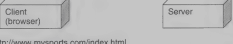

第一阶段是用户在浏览器地址栏中输入 URL。

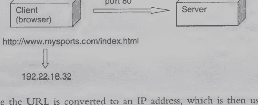

在接下来的阶段中，URL 被转换为 IP 地址，然后该地址用于通过 80 端口（HTTP 和 Web 所使用的端口）与该位置的服务器建立连接。

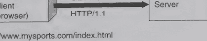

## 1 WEB 的工作方式

一旦连接建立，客户端应用程序从 URL 中提取所需的文件名，并通过已建立的连接发送请求。收到请求后，服务器会查找该请求。


如果一切正常，将发送一条 HTTP 消息表示页面已找到，随后是页面本身。页面发送完毕后，连接断开。

以下 HTTP 命令可能由浏览器发出，以请求服务器的 Web 页面：

`GET /index.html HTTP/1.0`

这个命令（如上所示，是一个基于文本的命令）包含几个字段：

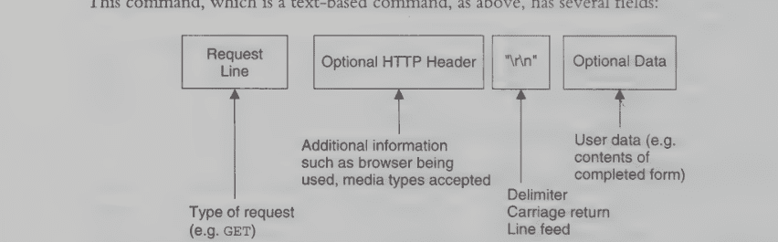

事实上，伪装成 Web 浏览器相当容易！使用 Telnet 程序可以连接到 Web 服务器并请求初始页面，通常是 index.html 或 index.htm。会话运行起来可能像这样：

```
$ telnet aphid.dynalias.net 80
Trying 81.155.138.148...
Connected to 81.155.138.148.
Escape character is '^]'.
GET /index.html HTTP/1.0

HTTP/1.1 200 OK
Date: Fri, 04 Mar 2005 20:02:01 GMT
Server: Apache/1.3.29 (Unix) PHP/4.3.6 mod_ssl/2.8.16 OpenSSL/0.9.7d
Last-Modified: Mon, 06 Sep 2004 12:43:33 GMT
ETag: "4c9003-a71-413c5b75"
Accept-Ranges: bytes
Content-Length: 2673
Connection: close
Content-Type: text/html

<!DOCTYPE HTML PUBLIC "-//W3C//DTD HTML 3.2 Final//EN">
<HTML>
<!--Web page here -->
</HTML>
Connection closed by foreign host.
```

初始命令打开与服务器的连接。计算机做的第一件事是通过 DNS 将服务器名称翻译为 IP 地址。然后它可以链接到服务器并为请求建立临时连接。一旦建立，就可以像浏览器那样编写命令。这里使用了 HTTP 1.0 协议请求一个 Web 页面 index.html。随后服务器响应表示该命令已被理解，接着是一些其他标识数据，然后是 Web 页面本身。最后，由于请求已处理完毕，连接关闭。

以这种方式请求 Web 页面时，很多事情可能会出错！你可能很小心地编写了命令，但页面并不存在，在这种情况下，你将收到一个错误代码而不是 Web 页面。一些较为常见的错误代码包括：

- 404 = Not found（未找到）
- 401 = Unauthorized（未授权）
- 500 = Internal server error（内部服务器错误）
- 501 = Not implemented（未实现）

此外还有相当多其他的错误，例如涉及重定向服务的错误。浏览器在发送请求的同时还会发送其他信息，标识其各种属性和能力，但不会标识用户。

#### 自测！

- 使用如上所示的命令行窗口，输入 telnet 命令以通过 80 端口与 Web 服务器交谈，例如：

  telnet www.yahoo.com 80

  GET /index.html HTTP/1.1 [按下两次回车键]
  如果你输入正确，可能会得到几种响应：


正确的页面
重定向页面
找不到页面

所有这些都将如你所期望的那样以 HTML 形式呈现！然后连接将会关闭（记住，它不是持久连接）。
你也可以尝试使用一些终端程序，例如 PuTTY。

### 1.4 安全连接

大部分已讨论的协议并不安全；它们使用纯文本传输数据，在某个阶段可能被查看或篡改。有一些协议使数据的发送和接收更加安全，包括特殊版本的 FTP，如 SFTP/HTTPS 和 HTTP，即 HTTPS。还存在其他方式来实际执行和登录到机器，类似于 Telnet。这些包括 SSH 和各种虚拟网络工具，允许用户创建一个安全隧道通向主机，几乎就像连接是本地的一样。表 1-4 显示了各种协议、相关端口（可以更改）以及该特定通信模式是否提供安全性。

SSH 允许通过端口 22 进行安全通信，并使用加密，最大限度地降低了拦截或篡改的风险。SSH 程序类似于 Telnet，因为它允许用户登录并在远程计算机上执行命令。它通常作为程序包含在 UNIX（及其变体）中。通常还存在一个服务器进程/守护进程来接受传入请求。其他操作系统也有类似的程序，这些程序是免费软件或共享软件，例如 WinSCP。

为了以类似于 FTP 的方式传输文件，存在一个使用安全通信方法的版本，SFTP。需要注意的是，有几个协议使用这个名称：这里指的是安全（Shell）文件传输协议，另一个是简单文件传输协议）。根据使用上下文，SFTP 可以指该协议或所涉及的应用程序。它不是简单地通过安全 shell 运行的 FTP 连接，而是一个全新的协议。

FTP 的另一个版本是 FTPS，它利用安全套接层（SSL）/传输层安全（TLS）来保护建立的任何连接。

除了不安全且容易被拦截的 HTTP 之外，网络上的购物、银行和金融交易还需要另一种协议。这就是 HTTPS，它通过使用 SSL 或 TLS 的版本加密通信，为电子商务提供身份验证和加密。你会在遇到它时知道，因为 URL 是 https:// 而不是 http://。HTTPS 在数据（如信用卡详细信息）传输到服务器的过程中提供了一定程度的安全性。然而，一旦到达服务器并可能存储在数据库中，数据在进一步传输到信用卡处理器之前，例如，仍然可能受到攻击。

| 通信 | 应用 | 协议 | 端口 | 安全性 |
|:---|:---|:---|:---|:---|
| 网页 | 浏览器 | HTTP | 80 | — |
| 网页 | 浏览器 | HTTPS | 443 | 安全 |
| 文件[二进制/文本] | FTP | FTP | 21 | — |
| 文件[二进制/文本] | SFTP | SFTP | 22 | 安全 |
| 文件[二进制/文本] | FTP | FTPS | 990 | 安全 |
| 命令 | Telnet | Telnet | 23 | — |
| 命令 | SSH | SSH | 22 | 安全 |
| 即时消息 | IRC | IRC | 194 | 通常不安全 |

表 1-4 各种媒体的传输及相应属性

#### 检查点！

我们现在知道：

-   根据情况使用所需正确安全级别的重要性
-   提供安全替代方案的可用选择
-   SFTP 和 FTPS 可以代替 FTP 使用
-   SSH 可以代替 Telnet 使用
-   SSH TCP 端口是 22。

### 1.5 应用程序和开发工具

例如，你可以从 Windows 或基于 UNIX 的系统的控制台窗口使用 FTP，它将为你提供基本的移动、复制或操作文件的能力。也可以使用更复杂的程序，在某些方面增强功能。这一切可能以图形方式而非文本驱动呈现，例如，你可以将文件从本地文件夹拖放到远程服务器。对于 FTP 来说，能够传输文件组和目录而无需输入命令非常有用，因为它还提供了与工作环境更好的接口。

网络上为开发人员提供了大量资源，其中一些是免费软件、共享软件或专有软件。你可以找到的资源涵盖了你需要的大部分内容；从功能齐全的集成开发环境（IDE），到简单的编辑器和图形工具。开始开发应用程序需要什么？在某种程度上，这取决于你是采取极简主义方法，还是喜欢自动为你执行任务的环境和工具。

你可以使用计算机上可能已经存在的简单文本编辑器、浏览器，以及如果你想将文件上传到服务器，还可以使用 FTP 客户端。你可以获得特定于你所使用语言的编辑器，或下载插件来协助你。这些插件适用于 HTML、JavaScript、PHP、Perl 和大多数其他 Web 语言。有语法检查器、程序着色辅助工具，甚至带有内置迷你服务器用于测试代码的编辑器。

开发环境和编辑器也会自动执行任务，例如通过 FTP 上传页面或将文件从一种类型批量转换为另一种类型。

所有这些不同的工具都可以像通常那样从商店或在线购买。也有免费软件或共享软件版本，你需要支付少量费用或完全免费。在寻找合适的软件时，你可能会遇到开源这个术语，这些项目对公众免费提供，并且通常是持续开发和由志愿者社区支持的。此类项目背后的代码通常可供查看和修改。最终用户有权更改此代码并重新分发软件。但是，开源许可证可能有一些限制，例如要求在代码中保留作者姓名和版权声明。

免费软件可以在不同类型的许可证下分发，虽然代码不可供查看或修改，但你无需付费。它可能有限制，例如不得转售或由政府机构或武装部队使用。

共享软件通常是在付款前分发的软件，付款时间设定在未来某个时间点，这样你就有时间试用。

## 资源！

-   打开你的浏览器，使用搜索引擎，寻找可能对你有帮助的各种实用程序。软件的许可证类型有多种选择：
    -   免费软件可免费使用和下载
    -   共享软件可试用，之后付费
    -   现成软件可直接购买。

-   你可能会找到 FTP 实用程序以及使用 SFTP 或 FTPS 的更安全的软件。
-   免费软件示例包括：WinSCP、PuTTY ……
-   还有很多适用于你开发的每种语言和平台的编辑器可用。
-   你可能需要工具来在不同格式之间转换文件，例如图形。

### 1.6 网络浏览器

你可能在开发 Web 应用程序时将使用的主要工具之一是网络浏览器。正如我们所看到的，它通过 Internet 连接到 Web 服务器，该服务器响应来自超文本文档选择集的请求。HTTP 协议用于此对话。页面通过使用 URL（统一资源定位符）定位，通常以 http:// 开头，尽管大多数浏览器也支持 ftp 和 https。

大多数浏览器具有共同的功能，即显示图形并支持许多媒体功能。然而，这并不总是如此；有些浏览器允许仅使用文本访问 Web，速度非常快。

传入网页的格式是 HTML，由浏览器解释并按照指令描述显示。除了 HTML，大多数浏览器还支持其他类型的文件，例如 JPEG、GIF 和 PNG。使用插件——可以添加到浏览器中的软件单元——可以支持更多文件类型。

自浏览器出现在各种机器和平台上以来，一直存在标准和兼容性问题。当一个新的浏览器可用时，它所做的某些事情略有不同，这导致该差异要求 HTML 进行所需的更改。这样，语言随着时间的推移不断演化，允许使用新的浏览器功能，例如显示图像、更改颜色或字体。这导致了语言发展出几个分支，因此变得不标准。引入了标准，以使页面无论加载到什么浏览器中都能看起来一样。现在有许多现代浏览器可以在 HTML 和 XHTML（可扩展超文本标记语言）的标准版本内工作。

浏览器已经扩展了其功能，超越了简单的 HTML 渲染，通常支持 IRC、新闻组和电子邮件。


 # 1.6.1 选择

那么，如果你打算开发应用程序，或者仅仅是网页，你会选择哪个浏览器？回答这个问题的最佳方法是问问你自己需要什么，而且更重要的是，你的访问者将会使用什么。

你可以使用一个你觉得舒适的浏览器进行开发，然后在几个流行的浏览器上进行检查。浏览器通常具有哪些功能？显然，它们的主要功能是显示文本、图形以及可能的其他媒体。不过，还存在其他一些你应该尝试熟悉的功能。例如，你应该知道浏览器也可以打开本地文件，通常位于菜单的“文件”项下。大多数浏览器的一个实用功能是查看网页源代码的能力，这通常位于文件菜单的“视图”项下。这在开发 HTML、JavaScript 甚至仅仅是为了检查加载的页面是否是你期望显示的页面时非常有用。

大多数浏览器在“首选项”或“工具”中包含一个部分，你可以在其中在一定程度上进行自定义或设置特殊选项。例如，在大多数浏览器上都可以设置你的主页（浏览器最初会进入或在点击主页按钮时访问的地方）。

浏览器还使用缓存（一个本地内存区域）来加快经常访问页面的加载速度。这是通过简单地在客户端计算机中存储一个副本来实现的，当页面被再次请求时，它将显示该副本。你通常可以调整这个缓冲区的大小，以及其他一些选项，比如缓存中的页面更新频率。另一个选项是清除缓存，这在某些时候是非常实用的功能！例如，如果你正在开发网页，如果你正在处理的页面被缓存了会发生什么？当你刷新（请求重新加载）当前页面视图时，它可能不会更新。你可以关闭缓存或将缓存大小设置为 0。除了这些方法，还可以通过网页本身关闭缓存，我们稍后将讨论这一点。

浏览器首选项中的另一组选项与 Cookie 相关。Cookie 是能够让你在（再次）访问网站时向应用程序标识身份的小片段信息。这可能是为了设置首选项，以便当你再次访问时，它知道你的喜好并会更改界面并向你问好。这通常不被认为是绝对安全的；通常会要求你输入密码以验证是否合适。由于各种原因，你可能不想被识别或被跟踪习惯，因此你通常可以关闭对 Cookie 的接受，或者将其设置为在出现 Cookie 时询问你。

其他选项与表单的自动填充相关——你是否希望在网站提供表单让你填写时自动添加你的详细信息？另一个实用的选项允许你选择想要下载的文件（如 MP3 或程序）存放的位置。

缓存页面和 Cookie 都可以从内存中清除，无论是单独清除还是全部清除。

#### 自测！

- 探索你最喜欢的浏览器的各种选项。
- 缓存有多大？
- 如何清除所有 Cookie 和缓存？
- 如何停止接受 Cookie？
- 更改主页。
- 你下载的文件存放在哪里，桌面还是……？
- 从某个网站或你自己的网站加载一个页面，并通过浏览器查看源代码——它是你所期望的样子吗？

#### 检查点！

我们现在知道：

- 浏览器除了简单的站点访问和查看之外，还包含相当多有趣的功能
- 主页可以更改并设置为你想要的任何页面
- Cookie 是一小段信息，通常用于在下次访问站点时识别访问者
- 缓存是一个内存区域或缓冲区，用于存储经常访问的网页
- 如何更改和查看下载文件的存放位置。

### 1.7 本章小结

- 随着远程地点之间沟通信息的需要变得明显，互联网（Internet）应运而生。
- 万维网（WWW）是互联网的一个庞大子集，其开发目的是作为一种可以通用访问的连接信息的方式。
- WWW 上的主要通信模型是基于客户端-服务器的。
- HTTP 被开发为一种用于文档传输的协议，本质上属于请求/响应性质。
- 针对不同用途还存在其他协议，例如机器之间的文件传输。
- 存在许多有用的命令行工具和应用程序，它们利用各种协议来帮助文件传输和远程访问。
- 某些协议确实存在一些问题，但这些问题是可以克服的。
- 在通过互联网传输或访问信息时，应始终考虑安全性。

#### 本章测验

- 尝试使用 Google 等搜索引擎，进一步了解互联网的起源。你也可以使用本章末尾提供的有用网页地址。
- 除了像使用浏览器那样简单的客户端-服务器模型外，还存在其他通信模型。你能想到你使用的软件中是否有使用不同方法的？
- 你用于开发的计算机是否受防火墙保护？如果是，它是如何配置以允许通过端口进行各种通信（如 FTP）的？

#### 关键词和短语

**FTP** 文件传输协议 (File Transfer Protocol)，计算机之间传输文件的标准

**FTPS** 基于 SSL 的文件传输协议 (File Transfer Protocol over SSL)，另一种运行在 SSL/TLS 之上的 FTP 版本，用于增强安全性

**HTML** 超文本标记语言 (HyperText Markup Language)

**HTTP** 超文本传输协议 (HyperText Transfer Protocol)，WWW 上传输信息的主要方法，使用请求/响应机制

**Internet** 当首字母大写时，指由标准化协议（如 IP）通信的、公开可用的互连网络系统

**IP** 互联网协议 (Internet Protocol)，互联网上使用的一种主要协议

**Port** 端口，通过网络与计算机程序通信的接口

**Protocol** 协议，一种标准或一组规则和约定，使两个系统之间能够通信。协议可以存在于硬件层面，也可以存在于软件层面

**SFTP** 安全外壳 (SSH) 文件传输协议 (Secure Shell File Transfer Protocol)，一种更安全的文件传输协议

**SMTP** 简单邮件传输协议 (Simple Mail Transfer Protocol)，一种标准的基于文本的电子邮件传输方法

**SSH** 安全外壳 (Secure Shell)，既是一种协议，也是一个用于连接远程计算机的命令行程序

**SSL** 安全套接层 (Secure Sockets Layer)，一种带有加密功能的安全协议

**TCP** 传输控制协议 (Transmission Control Protocol)，一种具有可靠性的面向连接的协议，工作在传输层

**TLS** 传输层安全性 (Transport Layer Security)，SSL 的继任者，SSL 3.0 与 TLS 1.0 之间差异很小

**UDP** 用户数据报协议 (User Datagram Protocol)，一种相当简单的面向消息的传输层协议，不保证消息交付

**URI** 统一资源标识符 (Uniform Resource Indicator)，一种互联网协议元素，由指示名称或指向资源的地址的字符串组成

**URL** 统一资源定位符 (Uniform Resource Locator)，互联网或其他地方某些资源的标准化地址；它是 URI 的一种

**WWW** 指万维网 (World Wide Web)，一个信息空间，是互联网的一个庞大子集，其中的项目（称为资源）可以通过链接访问

**有用网页地址**

```
http://www.w3.org/
http://www.isoc.org/internet/history/
http://en.wikipedia.org/wiki/Internet
```

# 2

## 客户端：HTML

> 本章开始探讨客户端以及使用 HTML 进行的静态网页开发。
>
> 你将学习如何开发简单的网页和格式化内容，以及表格、图像和框架。

本章通过展示使用 HTML 进行客户端静态网页开发的基础知识，描述了如何使用样式、强调和字体来操作输出。它探讨了如何在网页中嵌入图像以及超链接，而超链接对于 Web 的运作至关重要。

本章涵盖了从零开始制作网站和应用程序的开发周期：

- HTML 标签、属性和文档结构
- 添加强调、样式和字体
- 使用颜色
- HTML 的注释和可读性
- 预格式化文本
- 超链接
- 定义列表、有序列表和无序列表
- 表格
- 图像
- 简单表单
- 网站结构。


## 2.1 简介

网站通常由相互链接的独立页面组成，每一页对应网站的不同方面，例如新闻、链接和简介。虽然可以尝试其他方式来划分网站，但在这个阶段，最好还是从页面的角度来考虑。

起初，你甚至不需要一个服务器来托管页面；你可以在自己的电脑上进行开发，并使用网络浏览器查看制作的任何页面。

## 2.2 开发过程

在开发过程中会有一个循环，这通常与软件开发中常见的循环相匹配：设计、编写代码、测试。对于 Web 开发，这个过程可能更接近于：研究需求、设计、编写 HTML（或脚本）、上传、测试，然后重复这个过程。

### 2.2.1 需求

在开始之前，务必确保你理解要求！这可以从图形设计和功能两方面来看。最好的办法是至少在开始时画一些草图来推敲想法，然后看看是否能确定哪些页面应该相互链接。

### 2.2.2 设计

设计阶段旨在提供一个符合需求的解决方案。同时还应考虑到现有各种技术的可能性。有时，手动编码虽然更精确，但可能无法快速满足截止日期！在这种情况下，你可以寻求 Dreamweaver 等应用程序的帮助。网站开发不仅需要代码工具，还常常需要大量使用美术和图形处理软件的工作。

### 2.2.3 编写代码

到了这一步，你开始编写 HTML。手动编码速度慢但精确，且通常更容易理解。由应用程序生成的脚本和 HTML 有时也可能不符合标准！

### 2.2.4 测试

在花了一段时间打造你的杰作之后，你会想看看它的样子。如果你使用编辑器开发，那么下一步就是将你的浏览器指向该页面。如果你使用 IDE（集成开发环境）开发，那么很可能只需点击一个按钮就能查看页面的样子！如果你的浏览器已经打开了该页面，可以按刷新键重新加载。

### 2.2.5 上传

当你对页面满意后，你就会想将其上传以供公众浏览！

### 2.2.6 重新迭代

下一阶段与其说是一个阶段，不如说是再次执行上述步骤的指示，直到你做对并且它能够无错误地运行。

> **检查点！**

我们现在知道：

- 开发需要编辑器、浏览器，如果想上传到服务器，我们还需要一个 FTP 客户端
- Web 页面和应用程序的开发过程涉及一个循环。这包括设计和思考需求、编写 HTML、上传（或仅在本地查看），然后在浏览器中查看，这可能仅仅意味着如果浏览器已经指向网站或页面，则点击刷新按钮
- 在查看后，任何我们想做的更改都会让这个循环重新开始。

## 2.3 基础 HTML

从某种意义上说，HTML 可以被视为 Web 的主要语言。所有浏览器都理解它，而且由于其简单性，它通常不会给相关计算机带来太大负担。这里我们首先研究开发静态页面；也就是说，那些不依赖于用户输入或交互而变化的页面。

HTML 的主要目的是格式化网页，希望在所有浏览器中呈现相同的方式，尽管在实践中并不总是如此。

### 2.3.1 用浏览器加载页面

可以通过几种方式将页面加载到浏览器中：在地址栏中输入 URL，或者如果它是本地文件，则进入菜单并点击 'file' 然后 'open'。

如果你将浏览器指向网站上的一个目录，它会尝试查找一系列以 `index.html` 开头的文件，然后通常是 `index.htm`、`index.shtml`、`index.php` 等等。通常，浏览时最好输入以目录结尾并带有尾部正斜杠的地址，否则浏览器会认为它是一个文件并尝试加载它，然后才自我纠正。不过，不要在以真实文件结尾的 URL 中添加尾部正斜杠！

### 2.3.2 Web 上的页面

我们如何开始？通常，如果你将 Web 浏览器指向一个文档，它会尽力读取它。例如，如果你在浏览器的文件菜单上使用 'open'，并输入一个名为 `hello.txt` 的本地文件名，其中包含一些简单文本：

```
Hello there!
```

它实际上会读取并显示它。

### 2.3.3 HTML 文档结构

要制作一个“真正的”网页，我们需要添加一些元素并将文件重命名为 `.htm` 或 `.html`。在你的编辑器中打开一个新的空白文件，并编写一些代码：

```
<html>
  A little bit of hypertext
</html>
```

写在尖括号内的任何内容都称为标签，是标记语言的一部分。所以，在这个小页面中，我们有一些标签，但它们是什么意思呢？首先要看的是 `<html>` 标签，它简单地标识这是 HTML。注意这里第一行和最后一行都是 `<html>` 标签，只是最后一个包含一个斜杠，表示这是一个闭合标签，与顶部的标签匹配。大多数 HTML 遵循这个惯例，尽管有几个标签不是这样，而且你可以只用一个标签作为指令。还要注意 HTML 标签是小写的。虽然 HTML 标签不区分大小写，但万维网联盟 (W3C) 在其 HTML 4 建议中建议使用小写标签。

`<html>` 标签标识一段 HTML 代码，以 `<html>` 开始，以 `</html>` 结束。它们之间的所有内容都是代码本身。这里我们找到一个简单的文本消息，它直接输出到浏览器屏幕：

```
<html>
  <head>
    <title>
    The amazing art of Web programming
  </title>
</head>
<body>
  a little bit of hypertext
</body>
</html>
```

我们下一个、结构更规范的 HTML 网页扩展了第一个，为页面添加了标题，并将文档划分为头部和主体部分。主体部分包含主要文档，而头部包含诸如标题等详细信息，如此处所示。所有完整的 HTML 文档都应遵循此结构，并包含主体和头部。

然后，一个 HTML 元素以一个开始标签开始，以一个结束标签结束：

```
<title> The amazing art of Web programming </title>
```

在我们简单的网页中，还有一个标签 `<body>`。它标识 `<body>` 和 `</body>` 之间的下一部分为主要部分。这包含网页文档的代码。

## 2.4 格式和字体

如果我们想在主体部分添加更多行文本进行输出，我们可以使用编辑器添加它们：

```
<body>
  a little bit of hypertext<br>
  makes the world go round<br>
  and <i>around</i><br>
</body>
```

这个主体部分包含几个新标签。`<br>` 或换行标签使输出从下一行的开头开始。注意这个标签是自包含的，它不需要闭合标签。如果 HTML 文档中的行以其他方式格式化，会有影响吗？比如：

```
<body>
  a little bit of hypertext<br>makes the world go round<br>
  and <i>around</i><br>
</body>
```

答案是否定的，因为格式化仅取自标签本身，而不是文档的布局。不过，将 HTML 排版成易于阅读的方式仍然是一个好主意，这样在遇到需要查找的问题时，你可以轻松理解它。按照反映结构的缩进方式，以结构化的方式进行排版是一个很好的主意，就像这里的程序所做的那样。

有些程序会生成代码，允许你更像图形设计师一样在“顶层”设计网页，或者只是输出你的文本文档，捕获其样式、格式以及任何嵌入的图像。这些程序通常会产生几乎难以阅读的大量代码，这些代码难以跟踪，并且几乎不可能手动纠正、更改或调试。

添加换行的另一种方法是使用 `<p>` 标签定义段落。它既可以单独使用，就像 `<br>` 标签一样，也可以在段落末尾使用一个闭合的 `</p>`。`<p>` 标签会在其所在行之前放置一个空行。

要分割页面的各个部分，可以使用 `<hr>` 标签；这会创建一条线或水平线。与 `<br>` 一样，它不需要结束标签。

**自我测试！**

- 尝试在编辑器中编写一个网页。
- 添加换行和合适的格式。
- 用 HTML 扩展名保存它。
- 启动浏览器并使用菜单上的 'file' 命令打开它。
- 这是你期望的吗？如果不是，回到编辑器，修改它，然后再试一次！

### 2.4.1 使用强调类型

前面的 HTML 代码使用了 `<i>` 标签；任何被 `<i>` 和 `</i>` 包围的单词都将变成斜体。有许多方法可以强调或更改输出的文本，如表 2-1 所示。

### 2.4.2 预格式化文本

一个有用的格式化元素是 `<pre>...</pre>`，它使你能够嵌入已经格式化的文本，这样你就不必放置断行标签，例如：

```
<pre>
 This is already set out in the way I want it
 It has some advantages and is quick
 You don't have to add line breaks but
 It hasn't proportional spacing and is in courier font...!
</pre>
```

| 标签 | 格式 |
| :--- | :--- |
| `<i>...</i>` | 斜体 |
| `<b>...</b>` | 粗体 |
| `<tt>...</tt>` | 打字机效果 |
| `<em>...</em>` | 强调 |
| `<blink>...</blink>` | 闪烁 |
| `<sup>...</sup>` | 上标 |
| `<sub>...</sub>` | 下标 |

*表 2-1 添加强调*

文本以 Courier 字体输出，该字体是非比例间距的，即所有字符占用相同的空间。如果你愿意，这允许你使用空白（空格字符）来对文本进行定位，从而使格式化变得稍微简单一些。其他标签仍然可以嵌入在内部，以帮助格式化标题、字体大小和对齐。

### 2.4.3 字体大小

你可能还想更改文本的大小。实现这一点也有几种方法。你可以使用 `<font>` 标签或 `<h..>` 标签。如表 2-2 所示，`<h..>` 标签不仅控制大小，还为标题提供一定程度的强调。

| 字体大小 | 标题 | 点号大小 |
| :--- | :--- | :--- |
| 7 | – | 36 pt |
| 6 | `<h1>` | 24 pt |
| 5 | `<h2>` | 18 pt |
| | `<h3>` | 12 pt |
| 4 | `<h4>` | 12 pt 粗体 |
| 3 | 正文 | 12 pt 常规 |
| | `<h5>` | 10 pt |
| | `<h6>` | 7 pt |
| 2 | – | 9 pt |

*表 2-2 字体对比*

文本的大小也可以通过 `<font size=...>` 标签及其对应的结束标签 `</font>` 来更改，字体大小范围从 2 到 7。结束字体标签将使字体恢复到之前使用的字体。

你可以通过将上述标签之一与 align 标记相结合，将文本对齐到左侧、右侧或居中：

```
<html>
    <head>
        <title>
            the amazing art of Web programming
        </title>
    </head>
    <body>
        <p align="center">a little bit of hypertext<br>
        makes the world go round<br>
        and <i>around</i><br></p>
    </body>
</html>
```

这将使当前文档中的所有文本都居中，直到遇到结束段落标签 `</p>`。align 标签作为主功能的一个选项添加。你也可以将这些可选的 align 语句放入标题标签 `<h...>` 中。

```
<html>
    <head>
        <title>
            the amazing art of Web programming
        </title>
    </head>
    <body>
        <h1 align="center">hypertext alignment</h1>
        <p align="center">a little bit of hypertext<br>
        makes the world go round<br>
        and <i>around</i><br></p>
        <p align="left">to the left... </p>
        <p align="right">... and to the right</p>
    </body>
</html>
```

#### 自测！

- 编写另一个网页，利用字体更改、分页、水平线和文本对齐。
- 使用 `<pre>` 元素编写一个网页。尝试不同的布局，并将其与使用 HTML 格式化标签实现相同效果的结果进行比较。

## 2.5 代码注释

当 HTML 代码开始堆积并变得复杂时，可能就是添加注释的时候了。你可以使用 `<!-- ... -->` 来实现：

```
<!-- This is a complex part of my Web page, it adds a border and several types of font -->
```

以后，当你忘记在 Web 文档中做了什么时，这可以帮助你快速理解结构良好的 HTML 的各个部分。从其他人的角度来看，这也很有帮助，因为在你离开后，他们可能会接手维护该网站。

## 2.6 颜色

为网站添加颜色（准确地说是合适的颜色！）是设计和编码的重要组成部分。

通过 HTML 添加颜色的两个主要基本部分是浏览器的显示背景和文本。你可以使用：

```
<body bgcolor = value text = value>
```

这将设置文档 body 部分的这两项。如果你只想更改文本的颜色，可以使用：

```
<font color = value>
```

这类似于可以添加的可选 size 属性。涉及的实际值基于红、绿、蓝 (RGB) 方案，通常以十六进制数输入。十六进制是从 0 到 9，然后通过字母 A-F 的数字系统，如表 2-3 所示。

如果你想将十六进制转换为十进制，请将第一个数字（在两位数的情况下）乘以 16，然后加上最后一个数字。例如，如果我们有十六进制数 A2，那么我们将 'A'（即 10）乘以 16 并加上 2。因此，在这种情况下，十六进制 A2 = 十进制 162。

| 十进制 | 0 | 1 | 2 | 3 | 4 | 5 | 6 | 7 | 8 | 9 | 10 | 11 | 12 | 13 | 14 | 15 | 16 | 17 | 18 | 19 |
| :--- | :--- | :--- | :--- | :--- | :--- | :--- | :--- | :--- | :--- | :--- | :--- | :--- | :--- | :--- | :--- | :--- | :--- | :--- | :--- | :--- |
| 十六进制 | 0 | 1 | 2 | 3 | 4 | 5 | 6 | 7 | 8 | 9 | A | B | C | D | E | F | 10 | 11 | 12 | 13 |

*表 2-3 数字进制转换*

使用两位数，十六进制能表示的最大数是 FF，即 255。

要为 HTML 设置颜色值，你需要提供六位数字，代表你想要的 RGB 颜色比例；表 2-4 中显示了一个指南。该值实际上由三个数字组成，每个数字两位。因此，以下内容将把背景颜色设置为红色：

```
<body bgcolor="#800000">
```

而：

```
<body text="#ffff00">
```

将把主文档的文本设置为黄色。

| R | G | B | 生成的颜色 |
| :--- | :--- | :--- | :--- |
| 00 | 00 | 00 | 黑色 |
| FF | 00 | 00 | 亮红色 |
| 00 | FF | 00 | 亮绿色 |
| 00 | 00 | FF | 亮蓝色 |
| 80 | 00 | 00 | 深红色 |
| 00 | 80 | 00 | 深绿色 |
| 00 | 00 | 80 | 深蓝色 |
| FF | FF | 00 | 亮黄色 |
| 80 | 80 | 00 | 棕色 |
| FF | 00 | FF | 洋红色 |
| 80 | 00 | 80 | 靛蓝色 |
| 00 | 80 | 80 | 青绿色 |
| 80 | 80 | 80 | 灰色 |
| FF | FF | FF | 白色 |

*表 2-4 带有代码的一些示例颜色*

理论上，任何你想要的颜色都可以通过以正确的比例组合不同量的红、绿、蓝调色板来制作。

#### 自测！

- 尝试使用颜色；你能让一个单词的每个字母都呈现不同的颜色，从而产生彩虹效果吗？

## 2.7 超链接

超链接是 Web 最初出现的最强大特性之一——它创建了在资源之间关联信息的能力。创建链接的方法相当简单：

```
<a href = "http://www.someWebpage.com">the text link</a>
```

实际的超链接标签是 `<a href..>`，引号内的 Web 地址是点击后跳转的位置，后面的文本是显示在屏幕上供选择的内容。最后，链接以关闭标签结束。href 代表 Hypertext REFERENCE（超文本引用），a 代表 anchor（锚点），因为链接不能单独使用；它必须有一个图像或文本作为锚点。形成的链接是一个 URL，可以是任何常见的类型，包括 FTP。

有时，让选定的链接在新的浏览器窗口中打开而不是使用当前窗口会很有用。为此，可以使用 target 属性：

```
<a href="http://www.someWebpage.com" target="_blank">the text link</a>
```

链接也可以指向已经加载的页面内部的位置。这是通过在你想跳转到的位置创建一个锚点，并创建相应的链接来实现的：

```
<html>
    <a name="thetop">introduction</a><br>
    this could be a long document!<br><br><br><br>
    <hr>
    this may be some way down the page.<br><br>
    complete with a link to
    <a href="#thetop">back to the top</a>
</html>
```

`<a name="...">` 为链接创建跳转锚点，而 `<a href="#...">` 则是链接本身。也可以从另一个页面链接到锚点。例如，如果上面的页面名为 leaparound.html，那么链接：

```
<a href="leaparound.html#thetop">
```

将引导浏览器跳转到该页面上的锚点处。

可以使用如下链接引用当前工作目录下的子目录：

```
<a href="images/seaside.jpg">my day out</a>
```

如果你在子目录中并想链接到其上级的文件，请使用两个点：

```
<a href="../mypage.html">up to that other page</a>
```

> **检查点！**

我们现在了解了：
- 创建网页并使用浏览器显示它的基础知识
- Web 文档的结构
- 如何输出文本并添加强调
- 如何控制文本字体大小
- 使用颜色的基础
- 如何添加注释以使 HTML 更易于理解
- 如何创建指向其他文档以及同一文档内位置的超链接。

## 2.8 列表

HTML 中一个很有用的功能是创建快速、简洁的列表，可以是编号列表或仅仅是项目符号列表。

### 2.8.1 无序列表

简单的项目符号列表可以使用 ... 标签制作。例如：

```
<html>
  <head>
    <title>
      the amazing art of Web programming
    </title>
  </head>
```


 ```
<body>
    <ul>
        <li>Life of Pi
        <li>Sophie's World
        <li>Jonathan Strange and Mr Norrell
        <li>The Sandman Endless Nights
    </ul>
</body>
</html>
```

将生成一个以圆点为项目符号的图书标题列表。实际使用的字符可以更改并设置为 square（正方形）、disc（圆盘，默认）或 circle（空心圆）。要实现这一点，只需在 `<ul>` 标签中给出该选项：

```
<ul type="square">
```

## 2.8.2 有序列表

使用 `<ol>...</ol>` 也可以创建有序列表：

```
<ol>
    <li>Life of Pi
    <li>Sophie's World
    <li>Jonathan Strange and Mr Norrell
    <li>The Sandman Endless Nights
</ol>
```

同样，这里也有可用选项。在这种情况下，可以使用不同的编号，而不是默认的 1, 2, 3, 4 ...：

```
<ol type="i">
```

其中各种类型为：

- i: 小写罗马数字 i, ii, iii, iv
- I: 大写罗马数字 I, II, III, IV
- a: 小写字母 a, b, c
- A: 大写字母 A, B, C.

## 2.8.3 嵌套列表

您还可以将一个列表嵌套在另一个列表中，这样您可以在编号列表中创建无序列表，反之亦然：

```
<html>
```

```
<h2>To Do List</h2>
<ol>
    <li>clear out garage
    <li>prepare report
    <li>write email to Ray
    <li>go shopping
        <ul>
            <li>tomatoes
            <li>pasta sauce
            <li>vegetarian cheese
            <li>long spaghetti
        </ul>
    <li>repair fence
</ol>
</html>
```

在这个例子中，我们首先有一个有序列表，然后在“go shopping”下方切换到另一个列表，其中包含一个待购买项目列表。一旦该列表结束，旧列表将恢复。您还可以更改某个列表的字体，或更改强调方式使其脱颖而出。

## 2.8.4 定义列表

还有另一种类型的列表，用于术语和定义的列表，但可以用在任何您想要设置“子标题后跟文本”的地方：

```
<html>
    <dl>
        <dt>Hawthorn Shield bug
        <dd>Beetle which mainly lives on hawthorn bushes
        <dt>Minstrel bug
        <dd>A black and red striped beetle
        <dt>Green Shield bug
        <dd>Large beetle common in UK gardens
    </dl>
</html>
```

### 2.9 表格

我们经常需要以表格形式显示数据；也就是说，一个被划分为列和行的区域，用于显示关联关系等。在 HTML 中，这相当容易实现，只需要几个标签。

#### 2.9.1 表格结构

表格以 `<table>` 标签开始，以 `</table>` 结束。每行以 `<tr>` 开始，以 `</tr>` 结束；其间由表格定义标签 `<td>` ... `</td>` 定义列：

```
<html>
    <table>
        <tr>
            <td>column item 1</td>
            <td>column item 2</td>
        </tr>
        <tr>
            <td>another item</td>
            <td>and another</td>
        </tr>
    </table>
</html>
```

您可能希望将数据与相关的标题分组，例如：

```
<html>
    <table border>
        <tr>
            <td><b>Egyptian</b></td>
            <td>Osiris, Isis, Horus, Thoth, Ptah, Hathor </td>
        </tr>
        <tr>
            <td><b>Norse</b></td>
            <td>Odin, Frigg, Thor, Loki, Freya</td>
        </tr>
        <tr>
            <td><b>Greek</b></td>
            <td>Zeus, Apollo, Persephone, Hermes, Hera</td>
        </tr>
        <tr>
            <td><b>Roman</b></td>
            <td>Jupiter, Luna, Mars, Mercury, Diana</td>
        </tr>
    </table>
</html>
```

从这个例子可以看出，表格现在在所有侧边以及列和行上都有绘制的边框。这是通过在表格标签内部使用 border 选项来增加显示的边框宽度来实现的；例如 `border=n`，其中 n 是以像素为单位的厚度。

#### 2.9.2 表格标题

也可以创建具有正确定义的标题的表格：

```
<html>
    <table border>
        <tr>
            <th></th>
            <th>Green Park</th>
            <th>Oxford Circus</th>
            <th>Euston</th>
            <th>Finsbury Park</th>
        </tr>
        <tr>
            <th>Tube</th>
            <td>5mins</td>
            <td>8mins</td>
            <td>10mins</td>
            <td>13mins</td>
        </tr>
        <tr>
            <th>Bus</th>
            <td>12mins</td>
            <td>14mins</td>
            <td>18mins</td>
            <td>20mins</td>
        </tr>
    </table>
</html>
```

该表格设置了一个必要的空白单元格，作为列标题和行标题之间的分隔符；HTML 仅仅是一个没有内容的标题。图 2-1 展示了该表格。

| | Green Park | Oxford Circus | Euston | Finsbury Park |
|---|---|---|---|---|
| **Tube** | 5mins | 8mins | 10mins | 13mins |
| **Bus** | 12mins | 14mins | 18mins | 20mins |

*图 2-1* 一个简单的 HTML 表格

#### 2.9.3 不规则表格

到目前为止提到的表格类型相对简单且对称，但有时需要创建不规则形状的表格：

```
<html>
    <table border>
        <tr>
            <th rowspan=2></th>
            <th colspan=4 rowspan=1>Tube Station</th>
        </tr>
        <tr>
            <th>Green Park</th>
            <th>Oxford Circus</th>
            <th>Euston</th>
            <th>Finsbury Park</th>
        </tr>
        <tr>
            <th>Tube</th>
            <td>5mins</td>
            <td>8mins</td>
            <td>10mins</td>
            <td>13mins</td>
        </tr>
        <tr>
            <th>Bus</th>
            <td>12mins</td>
            <td>14mins</td>
            <td>18mins</td>
            <td>20mins</td>
        </tr>
    </table>
</html>
```

图 2-2 显示了生成的表格。

*图 2-2* 一个不规则形状的 HTML 表格

该表格之所以不规则，是因为在表格内部添加了标题。为了包含这个标题，必须使用四列，并在开头为两行两列的块留出空间。实现方式是在 `<th>` 标签中使用可选属性 `colspan` 和 `rowspan`，描述它应该占据多少列和多少行。这些属性也可以添加到 `<td>` 标签中。

表格中的另一个格式化选项是对齐方式；水平对齐使用 `align`，垂直对齐使用 `valign`。例如，可以使用以下代码将单元格内的内容居中：

```
<tr>
    <th>Tube</th>
    <td align=center>5mins</td>
    <td align=center>8mins</td>
    <td align=center>10mins</td>
    <td align=center>13mins</td>
</tr>
```

请记住，表格会根据打开的窗口大小自动调整，因此这种对齐方式非常重要，您可能需要考虑同时使用垂直对齐和水平对齐。

#### 2.9.4 表格与页面布局

表格还可以用于格式化 HTML 页面的布局。您可以轻松地将页面分为若干部分，并在不同区域填充文本，文本将由表格固定在原位。表格可以是不可见的（没有边框），这样就不会干扰设计：

```
<html>
<head><title>table style</title></head>
<body>
<table border="0" width="100%" cellpadding="10">
<tr>
<td width="50%" valign="top">
This is the left column containing some interesting text.
Dividing the text like this is similar to newspaper columns.
</td>
<td width="50%" valign="top">
This is the right column which contains yet more text.
This simply fills the right side of the page.
</td>
</tr>
</table>
</body>
</html>
```

在这种情况下，表格中使用的属性是：

- Border：设置表格周围的边框宽度（像素）
- Width：在这种情况下是屏幕宽度的百分比
- Cellpadding：设置内边框与文本之间的距离（像素）

另一个可选属性是 `cellspacing`，它设置内边框和外边框之间的间距（像素）。

表格中的数据单元格由 `<td>` 标签定义，在本例中，它也使用了 `width` 将单元格宽度设置为浏览器窗口的百分比。`valign` 将任何数据置于单元格的顶部、中部或底部。

可以使用表格控制项目位置来创建一些复杂的布局。

> **自我测试！**
> 
> * 通过绘制您的每周计划或时间表，尝试在 HTML 中构建表格。

### 2.10 图像

除了文本，HTML 还可以用于在页面中放置图像。这是通过使用 `` 标签实现的，如果单独使用，图像将左对齐。

#### 2.10.1 图像的定位与放置

```
<html>
<h2>show an image</h2>

my holidays!
<p>the snow slopes where I went skiing...</p>
</html>
```

这将在页面上放置图像 `photosnap.gif`，文字紧随其后。图形文件应与 HTML 文件位于同一目录下，或者使用 `path` 指向该文件。

您可以在图像标签中使用 `align` 选项，使随附的文本在不同位置围绕图像折行。通常，文本将与图像底部对齐。如果空间足够，图像后的任何长文本将填入剩余空间，并折行至下方。`align` 的选项有 `bottom`（默认）、`middle` 或 `top`。

可以通过将 `` 标签包裹在 `<center>` 标签中，将图像设置为页面中间。


在图像周围设置边框通常很有用，可以使周围的文本产生间距。这可以通过使用 `hspace`（设置左右间距）和 `vspace`（设置图像上下间距）选项来实现。您设置的数值单位是像素。除非您使用 `border=n`，否则边框不会以线条形式显示。

#### 2.10.2 调整图像大小

可以通过操作图像将其设置为适合您所用布局的大小，因此可以在 X 和 Y 方向上增加或减小其尺寸。尺寸可以用像素或浏览器显示百分比来设置。固定方法依赖于 `` 标签中的 `height` 和 `width` 选项；例如，如果您想设置 100x100 的尺寸：

```

```

另一方面，相对变量设置有时会更有用：

```

```

在这种情况下，高度将是浏览器高度的 50%，宽度是当前浏览器宽度的 25%。仅设置其中一个值，该比例将同时应用于两者。

有时由于某种原因图像可能加载失败，或者图像加载被关闭或不可用。您可能希望访问者仍然知道页面上缺失了什么；实现方法是在 `` 标签中附加 `alt` 选项：

```

```

#### 2.10.3 背景图像

有时您可能希望背景由图像填充，这需要使用不同的标记。相反，在 `<body>` 标签中添加一个选项，如下所示：

```
<body background="mypattern.gif">
```

这可能是一张巨大的图像，也可能是一张简单的图片，可以在屏幕区域内重复，例如简单的图案或瓷砖。这里的规则是：小于窗口的图像将在浏览器屏幕区域内平铺（重复）。请记住，如果您希望阅读文本或查看其他图像，那么任何背景图像都应该是相当简单的。

图像也可以用作链接而非文本：

```
<a href="biog.html"></a>
```

#### 知识点检查！

我们现在知道了如何：

- 实现不同类型的列表
- 利用表格为数据和布局提供结构
- 嵌入图像并将其用作背景图片。

## 2.11 简单的 HTML 表单

到目前为止，所处理的所有 HTML 都是单向的——作为对浏览器的输出——但通常需要从用户那里收集信息，例如姓名、地址和其他联系详情。如果您的网站是一个电子商务网站，您可能还想在收集产品选择的同时，收集客户的银行卡或支付详情。

用户填写完表单后，信息需要经过处理，因此，表单本身并不起很多作用！处理可以在客户端完成（使用 JavaScript 等语言），或者在服务端完成（使用 PHP 等语言）。

### 2.11.1 创建表单

构建表单的主要标签是 `<form>`。它还有几个可选属性。这是一个表单元素的示例：

```
<form action="processform.php" method="post">
</form>
```

`action` 属性告诉 HTML 将收集到的信息发送到哪里，而 `method` 属性描述了发送信息的方式。

### 2.11.2 输入类型

从用户那里收集信息的主要标签是 `<input>`。一个简单的例子如下：

```
Enter your email address<input name="email" size=35>
```

文本部分是用来提示用户预期输入的内容。标签本身包含一个 `name` 属性，以便我们可以通过名称引用该输入，以及以字符为单位的输入框大小 `size`：

```
<html>
    <form>
        please enter your user name
        <input name="user" type="text" size=30><br>
        favourite color
        <input name="color" type="text" size=14><br>
    </form>
</html>
```

有相当多不同的输入类型可供选择：

- `<input type="text"/>` 这是默认的输入类型，在文本框中接收字符和数字。它还可以附加一个 `value` 属性，为其提供初始值。
- `<input type="password"/>` 这与上面的文本框类似，但输入的任何内容都不可见；相反，会打印星号来遮盖输入内容。顾名思义，这用于密码输入。
- `<input type="checkbox"/>` 这提供了一个可以在选中和未选中之间切换的复选框。可以使用 `checked="checked"` 将其初始设置为其中一种状态。
- `<input type="radio"/>` 这与复选框类似，但在一组单选按钮中一次只能选择一个。其中一个单选按钮也可以具有初始选中状态。
- `<input type="file"/>` 这将提供一个允许您选择文件的框，类似于您在机器上打开或保存文件时的操作。例如，它可以用于选择本地文件以上传到服务器。
- `<input type="submit"/>` 这允许提交表单。按下时，信息将被传递以进行处理，通常传递给表单 `action` 属性选项中提到的脚本。
- `<input type="image"/>` 选中时也会提交表单，并且像 `img` 标签一样，需要 `src` 属性来指定关联图像。
- `<input type="button"/>` 这会创建一个可用按钮。
- `<input type="reset"/>` 选中时，这将把表单重置为初始状态。
- `<input type="hidden"/>` 这允许隐藏数据（用户不可见）随表单一起传递。

### 2.11.3 文本区域

有时您可能想给用户留出空间来写评论或消息。为此，您可能需要一个较大的书写空间，最好的方法是使用 `<textarea>`：

```
<hr>you can leave a message for me here:
<textarea name="comments" rows="10" cols="70"
wrap="wrap">message:</textarea>
```

同样，文本区域被赋予一个名称，以便在处理时可以引用其中输入的信息。区域的大小由两个可选属性 `rows` 和 `cols` 定义，而 `wrap` 选项提供了几种让框内换行的方式：`off`、`virtual` 和 `physical`。`off` 选项停止所有行换行，要求用户按下“回车”键来结束一行。`virtual` 在框内对句子进行换行，但将其作为一条长字符串发送；而 `physical` 提供完整的文本换行，信息将保持与显示时一致的状态。

### 2.11.4 下拉菜单

下拉选择框是另一种可以使用的输入方法。这是一个简单的示例：

```
<select>
<option value="selected1">Option 1</option>
<option value="selected2">Option 2</option>
<option value="selected3">Option 3</option>
</select>
```

当某个选项被选中时，返回的值将被相应地设置为 `selected1`、`selected2` 或 `selected3`。显示的文本是 “Option n” 字符串。与带有 `checked` 选项的复选框类似，`select` 标签允许使用 `selected="selected"` 来设置默认初始值。

所有表单值必须具有 `name` 属性，否则无法被正确处理！

元素还可以具有 `readonly` 属性，该属性可阻止元素被修改。例如，这可能用于在添加新数据时确认以往的信息。

代码清单 2-1 综合了已探讨的表单特性。

```
<html>
  <head><title>My Form</title></head>
  <form action="processor.php" method="post">
    <fieldset><legend>log in now</legend>
      <b>Please enter your user name</b>
      <input name="user" type="text" size=30><br>
      <b>Your password is </b>
      <input name="pass" type="password" size=10><br><br>
    </fieldset>
    <fieldset><legend>Choices!</legend>
      <b>Favourite color</b>
<input name="color" type="text" value="green"
 size=14><br><br>
My favourite fruit is:
<select>
 <option value="selected1">Apple</option>
 <option value="selected2">Banana</option>
 <option value="selected3">Orange</option>
</select>
<br><br>
I live in a:
<input type="radio" name="accom" value="house"
 checked="checked"/>House
<input type="radio" name="accom" value="flat"/>Flat
<input type="radio" name="accom" value="bedsit"/>Bedsit
<input type="radio" name="accom"
 value="caravan"/>Caravan
<br><br>
My upload file is:
<input type="file" name="upload" size=40><br><br>
</fieldset>
<fieldset><legend>Leaving?</legend>
<b>You can leave a message for me here:</b>
<textarea name="comments" rows=10 cols=70></textarea>
<br><br>
<input type="submit" value="Go!">
<input type="reset" value="Start again"></fieldset>
</form>
</html>
```

## 代码清单 2-1 总结简单的 HTML 表单

表单始于 `<form>` 标签，其 `action` 属性指向处理填写表单的用户所提供数据的脚本。包括 `post` 方法在内的处理过程将在后续关于 JavaScript 和 PHP 的章节中详细介绍。在本页中，表单使用 `fieldset` 元素被分为几个部分，它基本上是在区域周围绘制矩形（见图 2-3）。`legend` 为每个输入部分提供标题。

#### 自测练习！

- 创建一个表单来收集用户的详细信息，如姓名、登录名、地址、电话号码。此外，收集他们希望购买的物品详情（例如在书店中），以及一个最终的评论框。


请注意，对于选项，有不同的方式可以输入相同的数据：你可以使用选择框或单选按钮，而某些数据则更适合通过文本框来收集。

## 2.12 网站结构

网站是由超链接关联的页面集合，但它也应该为了结构而被划分为不同的区域，这有助于记忆和资源排序。因此，你的主站可以分解为几个子站。不仅如此，你还可以根据文件类型来区分特定文件；例如，只要引用正确，图像文件可以保存在自己的文件夹中。

一个网站通常有一个根目录（首先进入的目录），然后是作为子站的几个子目录。

在图 2-4 中，主站有一个默认的 index.html 页面，浏览器只需访问 http://www.mywebsite.co.uk 即可直接获取该页面。index.html 页面使用了几个收集在 images 子目录下的图像。在主根目录下还有两个进一步的子站，分别是 cats 和 holidays。如果浏览器被指向以下地址会发生什么？

http://www.mywebsite.co.uk/cats/

会弹出一个错误消息，因为没有像 index.html 这样的默认页面！所以，理想情况下，主 index.html 页面应该有指向这两个猫页面的链接。这也适用于 holidays，它有一个单一的 HTML 页面和一个存放任何图像的目录。

通过将网站划分为目录，可以更容易地查找文件，并且更容易导航实际的网站，因为网站将子目录作为主站的扩展。

#### 检查点！

我们现在知道了：

- 使用 HTML 进行表单开发的基础知识，以及各种类型的输入。
- 正确构建网站结构的重要性，以及根据文件类型和主题将材料分解到子目录中的重要性。

## 2.13 本章小结

互联网，特别是 Web，可以被看作是在两个方面运行应用程序和事件：客户端和服务器端。客户端是运行浏览器的计算机。

Web 材料的开发遵循一个循环：需求采集、设计、编写代码、测试、上传、迭代。

浏览器会尽力加载它被指向的资源，无论该资源是文本文件、图像还是 HTML 页面。

开发正确的 HTML 页面具有定义的结构。

使用 HTML 存在广泛的文本和格式控制，包括强调、字体、样式、颜色和布局格式化。

你应该添加注释，特别是在复杂的文档中，并努力通过增加空格和结构来提高可读性。

可以添加超链接来连接文档和资源。如果需要，可以将 Web 链接设置为在新浏览器窗口中打开。

可以轻松快速地创建各种类型的列表。

表格可用于格式化数据并控制页面布局。

图像和图形可以嵌入到页面中，或用作背景图片，使网站更具吸引力。

表单可用于实现用户交互和数据输入，这些数据可以通过脚本进行处理。设计者有许多类型的用户输入可供选择。

应注意开发网站的结构。子目录可用于对不同类型的文件进行分类，并使网站更容易导航。

#### 本章测验

- 尝试找出 HTML 各个版本的历史。
- HTML 中四种标记元素是什么？
- 使用搜索引擎查找关于“语义网”（Semantic Web）项目的信息。标记语言在其中扮演什么角色？

#### 关键词和短语

**Attribute（属性）** 添加到 HTML 元素标签中的可选项目，用于更改特定特征。

**Client side（客户端）** 指在客户端-服务器关系中由客户端执行的操作；在此上下文中，是指运行浏览器的这一侧。

**Element（元素）** 一个 HTML 标签通常由一个包含可选参数/内容的开始标签和一个结束标签（并非总是需要）组成。空元素不包含内容或结束标签，但仍可能具有属性。

**Emphasis（强调）** 一种为某些文本增加冲击力的方式，例如将其设置为粗体或斜体。

**Font（字体）** 一套字体家族的成员，是一组协调的字符设计，通常包括字母表、一组数字和标点符号，虽然它也可能包含符号。

**Form（表单）** HTML 中的一种数据收集机制，允许设计各种输入样式以适应大多数类型的信息。

**Heading（标题）** 一组指定文档内不同级别字体大小和强调程度的标签。

**Horizontal rule（水平线）** 一条横跨页面的水平线；可以选择不同的类型。

**Hyperlink（超链接）** 对另一个文档或资源的引用。

**Line break（换行）** 一个格式化术语，涉及句子或段落何时掉到下一行。在 HTML 中，当使用 `<br>` 元素时会发生这种情况。

**List（列表）** 一个 HTML 元素，允许以无序或有序（枚举）形式简单地呈现信息列表。

**Point size（点号大小）** 字体大小的一个相对衡量标准，过去具有更具体的含义。

**Radio button（单选按钮）** HTML 表单中的一种输入机制，通常从多个选项中选择一个。

**Server side（服务器端）** 指在客户端-服务器关系中由服务器执行的操作。通常是指运行 Web 服务器或其他服务器软件的机器。

**Table（表格）** 一个允许对布局和数据进行结构化处理的 HTML 元素。

**Tag（标签）** HTML 元素的一部分，由 `<tagname attributes>` 组成；即一个小于号、标签名称和一组可选属性。通常有一个结束标签如 `</tagname>`，但并非总是需要。

**Text area（文本区域）** HTML 表单上的一个输入区域，可以根据需要调整大小。

**Upload（上传）** 将文件从客户端复制或移动到服务器。这通常作为制作网站或应用程序的开发周期的一部分而完成。

### 实用 Web 地址

http://www.w3schools.com/html/

http://www.htmlgoodies.com/

http://www.w3.org/MarkUp/Guide/

# 3

## 从 HTML 到 XHTML

在这里，我们将继续从 HTML 扩展到 XHTML 的探索。

你将学习为 HTML 开发的各种标准。还将学习更高级的 HTML，以及控制搜索引擎、缓存刷新和元信息的能力。

本章记录了 XHTML（可扩展超文本标记语言）的兴起，以及为修正早期不同浏览器之间协调失败而制定的重要标准。它还提供了关于 HTML 和 XHTML 的更高级知识：

- XHTML 标准
- HTML 和 XHTML 之间的语法和文档差异
- meta 标签
- 网页缓存、刷新、搜索引擎和过期
- 字符编码和实体
- 框架（Frames）。

本章最后将详细探讨 Web 浏览器的架构、其工作方式以及它如何处理输入、输出以及多媒体。

## 3.1 更多历史，更多标准

**上一章向你介绍了 Web 开发的实际操作，但在进一步深入之前，我们需要再次简要回顾历史，以了解 Web 的发展方向。**

Web 最初被构想为一个资源对所有人开放的地方。其理念是将信息链接在一起，不一定是线性甚至层级的方式，而是 Web 上的任何内容都可以通过许多不同的路径和方向访问。它不会像书本那样是一个静态的来源。

与这种通用性相关的主要问题之一是，虽然已经存在 HTML 这种呈现信息的工具，但每个人的体验并不相同。许多因素会改变对 Web 上资源的感知，例如计算机类型、连接速度和浏览器。

因此，当你开发页面和应用程序时，必须考虑这些差异，因为它们确实会改变 Web 的体验。这里的关键是创建页面，使最大数量的访问者能够尽可能地按照你设计的方式来查看。

在过去，在著名的“浏览器战争”中，人们试图通过创建只有特定浏览器才能使用的 HTML 扩展来进一步区分这种体验。Netscape 在 1994 年就这么做了，虽然使用其浏览器的用户可以看到带有彩色文本、图像等的页面，但那些不使用它的人无法以同样的方式看到。所创建的扩展对 Web 冲浪群体产生了一些影响，许多人转向使用 Netscape。其他公司（如微软）通过创建 Internet Explorer 进行了反击，而 IE 同样拥有只有它能识别的扩展。

这种持续的分裂为页面设计者创造了问题。他们花费大量时间试图寻找绕过添加到 HTML 中的专有标签的方法。必须创建同一个网站的多个版本，并根据用户使用的浏览器来加载。

### 3.1.1 变革

所有这些混淆和 Web 的界限划分让许多设计者相信，标准才是答案。实现这一目标（以及目前仍在实现的方式）是通过万维网联盟（W3C），由 Web 的发明者 Tim Berners-Lee 领导。通用性是 Web 的主要目标之一，W3C 在试图保持页面对每个人都美观的同时，努力维护这一点。主要竞争对手 Netscape 和微软现在已成为成员，其他参与公司（如 Adobe 和 Macromedia）也是如此。其想法是商定一个每个人都可以使用且公司不会随意更改的标准。


之前开发的专有扩展被标准化，而其他规范则从 HTML 中被移除。浏览器开发人员被鼓励支持新的官方规范，这样无论在什么环境下查看，按照这些规范编写的任何页面其行为都将保持一致。这就是 HTML 3.2。

接下来的步骤是将这一规范进一步深化。HTML 最初的设计理念是能够创建包含内容、结构和格式指令的单页。W3C 认为一个更好的方法是将格式指令与内容和结构分离，从而使其能够应用于整个站点而非仅仅一个页面。为此，新版本的 HTML 中大量格式指令被标记为删除。一套新的格式化系统被开发出来，被称为层叠样式表 (CSS)。

起初，CSS 重新实现了它所替代的 HTML 方面的功能，但随着进一步规范的推出，它逐渐变得更加强大。例如，它获得了在 Web 页面上更精确地定位元素的能力，使得图形能够像旧版 HTML 那样显示，同时允许在浏览器中重现专业的布局。

然而，这些改进并没有解决剩余的专有扩展以及编写糟糕的 HTML 代码所带来的问题。浏览器在这方面并没有提供帮助，因为它们允许许多错误在不产生任何错误消息的情况下通过。在这个过程中，这导致了浏览器在页面呈现方式上的差异。HTML 需要一些激进的变革，才能变得足够稳定以开发进一步的功能。

下一步就是 XML（可扩展标记语言）。

### 3.1.2 XML

XML 是一种元语言。它是一种用于描述和定义其他语言的语言。本质上，它看起来非常像 HTML——拥有标签、属性和值——但你可以用它来设计自己的自定义标记语言，进而用于格式化你自己的文档。利用 XML，可以通过标签来标识数据，从而使数据能够再次被利用。程序随后可以提取该信息，将其与其他来源的信息一起处理，并输出组合后的结果，且可能采用完全不同的格式。

然而，XML 远不像 HTML 那样宽松，它不允许后者所允许的错误和普遍存在的粗糙页面。解释 XML 的软件被称为解析器 (parser)，它要求代码必须以严格的方式编写，注意区分大小写、特殊标点符号和其他细节。W3C 采取的方案是用 XML 重写 HTML！这样做有一个好处，即按照新规范编写的任何代码都可以被所有现有浏览器理解。另一点是，任何已经具备 HTML 知识的人，只要学习必要的基准语法，就能很快习惯它。由于它是基于 XML 构建的，它继承了该语言相同的能力和灵活性，为 CSS 提供了稳定的平台。这种新形式的 HTML 被命名为 XHTML。

虽然 HTML 和 XHTML 目前仍然共存，但 XHTML 更有可能是未来的方向。有些人倾向于其中一种，而有些人则认为 XHTML 是唯一的前进方向。

XHTML 有几种类型，以提供一定的灵活性：

- transitional（过渡型），允许使用已弃用（过时、被取代）的标签
- frameset（框架集型），允许使用已弃用标签和框架
- strict（严格型），不允许使用任何类型的已弃用标签。

这些类型中的每一种都可以与 CSS 结合使用。

XHTML 1.0 规范的一个特殊子集被定义为 XHTML Basic 1.0 规范，它包含 XHTML 的所有组件，但剔除了有问题的部分（如框架），因为这些部分可能会给小型设备上的浏览器带来问题。

建议尽可能避免使用已弃用的标签！

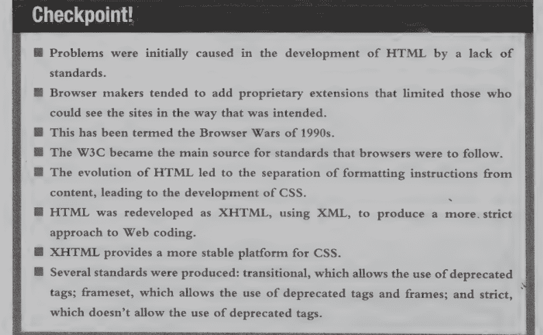

## 3.2 迁移到 XHTML

XHTML 和 HTML 共享一套共同的词汇表，但语法略有不同。

XHTML 和 HTML 4 都对代码中隐含的结构有要求。例如，要启动一个过渡型 HTML 4 页面和 XHTML 页面，我们需要从 DOCTYPE 声明开始。这让浏览器和验证器知道如何判断代码并对其进行适当检查。

对于 HTML 4：

```
<!DOCTYPE HTML PUBLIC "-//W3C//DTD HTML 4.01 Transitional//EN"
"http://www.w3.org/TR/html4/loose.dtd">
```

随后是常规的 `<html>` 标签，用于开始文档实际的 HTML 部分。

对于 XHTML 页面，因为它们是 XML 应用程序，页面应该以 XML 声明开始：

```
<?xml version="1.0" ?>
```

问号表示这是一个 XML 声明。请注意空格：例如，起始问号和 `xml` 之间不能有空格。版本号也应像这里一样编写——用引号括起来。

XML 声明还可以包含字符集编码作为一个可选属性：

```
<?xml version="1.0" encoding="UTF-8" ?>
```

这里使用的编码格式是 8 位 Unicode 转换格式。如你所见，分配给属性的任何值必须包含在引号中。可以指定外语字符集，如表 3-1 所示。

| 编码名称 | 字符集 |
| :--- | :--- |
| Shift_JIS | 日语 Kanji |
| ASMO-449 | 阿拉伯语 Farsi |
| greek7 | 希腊语 Cyrillic |
| KOI8-R | 俄语 Cyrillic |
| Big5 | 中文繁体字 |

*表 3-1 可用字符集*

对于 XHTML，在文档类型的选择上有几种可能性，每种都使用 *文档类型定义 (DTDs)*。

对于 XHTML 1.0 strict，标签为：

```
<!DOCTYPE html PUBLIC "-//W3C//DTD XHTML 1.0 Strict//EN"
	"http://www.w3.org/TR/xhtml1/DTD/xhtml1-
	strict.dtd">
```

对于 XHTML 1.0 transitional，则为：

```
<!DOCTYPE html PUBLIC "-//W3C//DTD XHTML 1.00 Transitional//EN"
	"http://www.w3.org/TR/xhtml1/DTD/xhtml1-
	transitional.dtd">
```

对于 XHTML-Basic 1.0，标签为：

```
<!DOCTYPE html PUBLIC "-//W3C//DTD XHTML Basic 1.0//EN"
	"http://www.w3.org/TR/xhtml1/DTD/xhtml-
	basic/xhtml-basic10.dtd">
```

对于 XHTML 1.0 frameset：

```
<!DOCTYPE html PUBLIC "-//W3C//DTD XHTML 1.00 Frameset//EN"
	"http://www.w3.org/TR/xhtml1/DTD/xhtml1-
	frameset.dtd">
```

像 XML 中的每个文档一样，XHTML 必须有一个包含所有其他内容的根元素。在这种情况下，它是 `<html>` 元素，它当然包含了起始标签和结束标签之间的所有 HTML 内容。`<html>` 标签还可能包含一些可选属性。

其中一个属性是用代码形式表示的实际人类语言，如表 3-2 所示。

英语的用法如下：

```
<html xml:lang="en">
</html>
```

另一个重要属性是其 *命名空间* 的声明：

```
<html xmlns="http://www.w3.org/1999/xhtml">
</html>
```

这不是一项严格要求，因为如果不包含，DTD 将会提供它。

| 语言 | 代码 | 语言 | 代码 |
|----------|------|----------|------|
| 印地语 | hi | 韩语 | ko |
| 日语 | ja | 中语 | zh |
| 俄语 | ru | 挪威语 | no |
| 瑞典语 | sv | 丹麦语 | da |
| 土耳其语 | tr | 希腊语 | el |
| 葡萄牙语 | pt | 西班牙语 | es |
| 意大利语 | it | 德语 | de |
| 法语 | fr | 英语 | en |

*表 3-2 人类语言代码*

### 3.2.1 文档结构

XHTML 文档的文档结构基本遵循我们一直使用的格式，并包含上述附加部分：

```
<!DOCTYPE HTML PUBLIC "-//W3C//DTD XHTML 1.00 Transitional//EN"
    "http://www.w3.org/TR/xhtml1/DTD/xhtml1-
    transitional.dtd">

<html xmlns="http://www.w3.org/1999/xhtml">

<head>
    <title>My first XHTML page</title>
</head>

<body>
    <p>What else can you say but... Hello World!</p>
</body>

</html>
```

这里的主要区别是，在 XHTML 中 `head` 和 `body` 元素是必需的，而在 HTML 中它们是可选的。

### 3.2.2 一些其他区别

- 在 XHTML 中，请记住在需要闭合的元素中关闭标签。HTML 相对比较宽松，某些元素不关闭也可以通过。

正确书写。某些元素，如XHTML中的换行元素`<br>`，必须包含结尾的反斜杠：`<br/>`。

-   所有XHTML标签和属性名称必须为小写，所有属性值必须用引号括起来。
-   可以嵌套标签，但必须正确嵌套，不能有重叠的标签。
-   属性不能缩写，应完整书写。
-   XHTML文档必须指定文档标题。

`<head>`部分可以再次包含前面描述的语言属性。它也可以包含一个`profile`属性，用于指定文档元数据配置文件的URL。

## 知识检查点！

-   HTML和XHTML语言相似，但语法不同。
-   XHTML的容错性较低。
-   XHTML页面应以XML版本标签开头。
-   HTML 4和XXHR都应该有合适的DOCTYPE声明。
-   XHTML必须包含由`<html>` ... `</html>`元素提供的根元素。
-   XHTML也可以在`<html>`标签上附加语言属性。
-   可以为XHTML提供命名空间，即使缺失，DTD也会提供它。
-   XHTML文档中必须包含`<head>`和`<body>`元素。

#### 自我测试！

-   你可以通过验证服务（如W3C检查器 http://validator.w3.org/）来检查你编写的任何页面。它将处理指向它的任何页面，并提供关于任何错误的详细报告！何不试试将你的新XHTML页面运行一下，看看是否达标？它也能处理和报告HTML 4。

## 3.3 META 标签

元数据是关于信息的信息，或者在这个上下文中更具体地说，元数据是机器可理解的关于Web资源的信息。它可以包含在HTML和XHTML中，用于描述实际的文档，而不是文档的内容。元数据包含在页面的`<head>`部分：

```
<html>
<head>
    <title>Cave Dwelling</title>

    <meta name="author" content="Fred Flintstone"/>
    <meta name="keywords" content="stone age, lifestyles,
        retro"/>
    <meta name="description" content="living prehistory">
    <meta name="robots" content="index,follow">

    </title>
</head>
</html>
```

`meta`标签用于向搜索引擎机器人提供信息；它们获取你提供的数据，并在一定程度上控制它们在你网站上通过链接访问的内容。你可以提供的信息类型包括网站的总体描述和关键词。

这里还有一条指令，要求搜索引擎索引该页面并跟踪任何链接。可以阻止页面被列出：

```
<meta name="robots" content="noindex"/>
```

其他可能性有：

```
<meta name="robots" content="index,follow">
<meta name="robots" content="noindex,follow">
<meta name="robots" content="index,nofollow">
<meta name="robots" content="noindex,nofollow">
```

确保不要给出相互冲突或重复的指令！

还有一个名为`http-equiv`的`meta`标签属性，它与`content`属性一起使用来创建元功能。这些功能可以用于，例如，设置过期日期、刷新周期或重定向。

在`<head>`部分设置过期日期：

```
<meta name="expires" content="Mon, 20 Jul 2007 16:00:00 GMT"/>
```

这设置了页面从网站重新加载的过期点，本质上是为了确保缓存（经常访问的网站的本地存储）保持最新。设置日期为'0'将完全阻止页面被缓存。

同样，为了在一段时间后强制刷新，在`<head>`部分：

```
<meta name="refresh" content="50;http://myownpages.co.uk/mynewssite.html"/>
```

这将导致页面在50秒后刷新，并重定向到指定的URL。

### 3.3.1 内存缓存

正如我们刚才看到的，Web浏览器可以缓存（存储）页面以便快速查看，而无需再次请求它们并重新下载文档。每个页面都有一个生存时间（TTL），即它在不重新加载的情况下保持在内存中的时间。这通常是30天，当浏览器缓存被清除或分配的内存全部用完时。

如果浏览器支持`<meta>`元素的`http-equiv`属性，可以阻止浏览器缓存页面。这会强制浏览器忽略缓存页面，而是再次发出请求。为此，将值`pragma`赋给`http-equiv`属性，将值`no-cache`赋给`content`属性：

```
<html>
    <head>
        <title>no cache example</title>

        <meta http-equiv="pragma" content="no-cache"/>
    </head>
</html>
```

搜索引擎也可以缓存你的页面，并在你的网站出现故障或无法访问时将其作为替代方案提供。这里唯一的问题是它可能已经过时了！你可以通过使用以下代码来阻止搜索引擎存档页面：

```
<meta name="robots" content="noarchive"/>
```

同样，这应该放在`<head>`部分。

### 3.3.2 使用scheme进行格式化

另一个有用的`meta`元素属性是`scheme`。它可以用于为日期和时间等数据提供上下文，这些数据可以使用多种格式：

```
//这里 scheme="USA" 表示 "MM-DD-YYYY"
<meta scheme="USA" name="date" content="09-21-1966">

//这里 scheme="Europe" 表示 "DD-MM-YYYY"
<meta scheme="Europe" name="date" content="21-09-1966">
```

#### 自我测试！

-   编写一个新的网页（或修改一个旧的）以包含一些元数据，如作者、描述、关键词。
-   使页面不被浏览器缓存。
-   我们如何也阻止它被搜索引擎缓存？

## 3.4 字符实体

如果你想在你的网站上告诉别人关于HTML的知识，会发生什么？你能直接写下以下内容吗？

```
<?xml version="1.0"?>
<!DOCTYPE html PUBLIC "-//W3C//DTD XHTML 1.1//EN"
    "http://www.w3.org/TR/xhtml11/DTD/xhtml11.dtd">
<html xmlns="http://www.w3.org/1999/xhtml">
<head>
    <title>tell them about HTML</title>
</head>
<body>

This is how you set up a link:

<a href="www.google.com">Google!</a>

</body>
</html>
```

不行，因为你得到的将是链接到该位置本身！你如何显示href等内容的写法？答案是使用字符实体来描述你想要打印的内容，这样它就不会被浏览器作为HTML处理。例如，<（小于）符号可以被字符实体`&lt;`替换，而>（大于）符号可以被字符实体`&gt;`替换，因此，可以用这个特殊的实体集替换许多特殊的HTML字符，从而显示HTML代码本身：

```
<?xml version="1.0"?>
<!DOCTYPE html PUBLIC "-//W3C//DTD XHTML 1.1//EN"
    "http://www.w3.org/TR/xhtml11/DTD/xhtml11.dtd">
<html xmlns="http://www.w3.org/1999/xhtml">
<head>
    <title>tell them about HTML</title>
</head>
<body>
    This is how you set up a link:
    <a href="www.google.com">Google!</a><br/>
    &lt;a href=&quot;www.google.com&quot;>Google!</a>
</body>
</html>
```

字符实体对于插入通常不可用的符号或只是在代码中的文本周围放置空格很有用：

```
<?xml version="1.0"?>
<!DOCTYPE html PUBLIC "-//W3C//DTD XHTML 1.1//EN"
    "http://www.w3.org/TR/xhtml11/DTD/xhtml11.dtd">
<html xmlns="http://www.w3.org/1999/xhtml">
<head>
    <title>tell them about HTML</title>
</head>
<body>
    Less than &lt;<br/>
    Greater than &gt;<br/>
    Ampersand &amp;<br/>
    Divide &divide;<br/>
    Copyright &copy;<br/>
    Registered &reg;<br/>
    Quote &quot;<br/><br/>
    &nbsp;&nbsp;&nbsp;&nbsp;over here!
</body>
</html>
```

完整的实体列表非常长。表3-3包含一些最有用的。

## 知识检查点！

-   元数据提供关于文档的信息，而不是内容。
-   `<meta>`标签可以通过以下方式提供信息：
    -   keywords – 供搜索引擎使用的关键词列表
    -   description – 页面内容的描述


+   - robots – 提供给搜索引擎爬虫的信息
    - author – 作者是谁？
    - expires – 页面在缓存中过期的日期
    - refresh – 在指定时间后强制刷新
    - http-equiv – 使用 pragma 值停止缓存
    - scheme – 为日期等项目提供本地上下文。

字符实体提供了一种在 HTML 页面中输出特殊字符的方法。

#### 自测！

+   - 编写一个显示有效 HTML 文档的网页，包括一个超链接和一个包含五个项目的列表。
    - 如何输出商标和版权符号？

| 字符 | 字符实体 | 描述 |
| --- | --- | --- |
|  | &nbsp; | 空格 |
| & | &amp; | Ampersand (和符号) |
| " | &quot; | 引号 |
| < | &lt; | 小于号 |
| > | &gt; | 大于号 |
| © | &copy; | 版权 |
| ® | &reg; | 注册商标 |
| ™ | &trade; | 商标 |
| £ | &pound; | 英镑 |
| ¢ | &cent; | 分 |
| ÷ | &divide; | 除号 |

表 3-3 常用字符实体

## 3.5 框架与框架集 (FRAMES AND FRAMESETS)

当您的网站规模开始变大时，一种划分内容的方法是使用框架 (frames) 来拆分和分区信息。例如，您可以在屏幕的一侧放置一个独立的框架，用于放置导航辅助工具和链接，而将主要内容放置在另一侧的独立框架中。

### 3.5.1 行 (Rows)

为了分隔内容的不同元素，例如，可以将页面分为若干行，并在每个框架中放置一个新页面：

```
<?xml version="1.0"?>
<!DOCTYPE html PUBLIC "-//W3C//DTD XHTML 1.0 Frameset//EN"
  "http://www.w3.org/TR/xhtml1/DTD/xhtml1-frameset.dtd">
<html xmlns="http://www.w3.org/1999/xhtml">
<head>
  <title>Rows of Frames</title>
</head>
<frameset rows="220,*,60">
<frame name="banner" src="banner.html" scrolling="no"/>
<frame name="main" src="mainpage.html"/>
<frame name="options" src="options.html" scrolling="no"/>
</frameset>
</html>
```

其他页面只是普通的 XHTML 页面，即独立的单个文件。第一个是 options.html：

```
<?xml version="1.0"?>
<!DOCTYPE html PUBLIC "-//W3C//DTD XHTML 1.0 Frameset//EN"
  "http://www.w3.org/TR/xhtml1/DTD/xhtml1-frameset.dtd">
<html xmlns="http://www.w3.org/1999/xhtml">
<head>
  <title>options.html</title>
</head>
<button type="submit" id="abutton" name="abutton"
  value="mybutton1">button 1</button>
<button type="submit" id="bbutton" name="bbutton"
  value="mybutton2">button 2</button>
<button type="submit" id="cbutton" name="cbutton"
  value="mybutton3">button 3</button>
</html>
```

下一个是 banner.html：

```
<?xml version="1.0"?>
<!DOCTYPE HTML PUBLIC "-//W3C//DTD XHTML 1.0 Frameset//EN"
	"http://www.w3.org/TR/xhtml11/DTD/xhtml11-frameset.dtd">
<html xmlns="http://www.w3.org/1999/xhtml">
	<head>
		<title>banner.html</title>
	</head>
	

	</html>
```

最后一个是 mainpage.html：

```
<?xml version="1.0"?>
<!DOCTYPE HTML PUBLIC "-//W3C//DTD XHTML 1.0 Frameset//EN"
	"http://www.w3.org/TR/xhtml11/DTD/xhtml11-frameset.dtd">
<html xmlns="http://www.w3.org/1999/xhtml">
	<head>
		<title>mainpage.html</title>
	</head>

	<body>

		This holds the main content!

	</body>
	</html>
```

这段 HTML 代码的输出如图 3-1 所示。描述框架的 HTML 主要部分是 `<frameset>`、`<frame>` 和闭合标签 `</frameset>`。请记住，在 XHTML 中，您还必须为框架集使用相应的 `<!DOCTYPE>`。在这种情况下，frameset 标签包含一个属性 `rows`，它以像素或百分比大小声明划分方式。例如，如果您想要两行宽 100 像素，而其余部分用于另一个内容元素，可以使用星号 `*`。同时也可以使用多个星号，这将使剩余空间在它们之间等分。要在这些内容之间进行不等分，可以在星号前添加数字，例如 `2*`，在这种情况下，如果有两个框架，其中一个将占据三分之二，另一个占据最后的三分之一。另一种描述框架的方法是使用数字后跟百分号，表示可用区域的百分比。

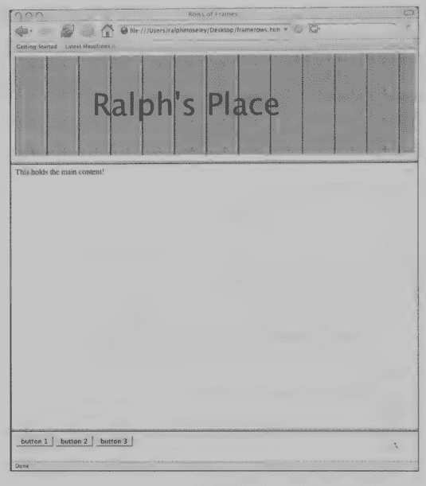

*图 3-1 基础行框架*

您在 `<frame>` 标签中给出的名称允许您稍后识别它并将其作为内容的渲染目标。

### 3.5.2 替代内容 (Alternative Content)

请注意，只有在您希望支持不支持框架功能的浏览器时，才需要为此类程序提供 body 部分。替代内容可以通过添加以下代码来提供：

```
<noframes><body>
Alternative content, for those without frame capability.
</body></noframes>
```

### 3.5.3 列 (Columns)

要创建横向以列而非以行分布的内容，只需将属性从 `rows` 改为 `cols`，并以类似的方式使用数字：

```
<frameset cols="100,150,*">
```

列是从左到右划分的，因此上述最左侧的一列为 100 像素，接下来的为 150 像素，剩余区域用于最后一列。同样，区域也可以指定为百分比。

### 3.5.4 同时使用列和行的框架

框架也可以同时通过行 *和* 列来划分页面。例如：

```
<?xml version="1.0"?>
<!DOCTYPE html PUBLIC "-//W3C//DTD XHTML 1.0 Frameset//EN"
    "http://www.w3.org/TR/xhtml1/DTD/xhtml1-frameset.dtd">
<html xmlns="http://www.w3.org/1999/xhtml">
<head>
    <title>Rows of Frames</title>
</head>
<frameset frameborder="3" rows="*,*,*" cols="*,*">

<frame name="topleft" src="banner.html"/>
<frame name="topright" src="openingpage.html"/>

<frame name="midleft" src="openingpage.html" scrolling="no"/>
<frame name="midright" src="banner.html"/>

<frame name="botleft" src="banner.html"/>
<frame name="botright" src="buttons.html"/>
</frameset>

</html>
```

这创建了一系列三行两列的框架，并使用星号填充以适应可用区域。请注意，在此示例中，属性 `frameborder` 用于设置边框宽度——将其设置为 0 则表示无边框。frame 标签的另一个属性是 `scrolling`，它允许通过添加滚动条来移动框架。图 3-2 显示了显示的框架。

### 3.5.5 嵌套框架 (Nesting Frames)

框架也可以相互嵌套，以进一步划分框架的空间：

```
<?xml version="1.0"?>
<!DOCTYPE html PUBLIC "-//W3C//DTD XHTML 1.0 Frameset//EN"
    "http://www.w3.org/TR/xhtml1/DTD/xhtml1-frameset.dtd">
<html xmlns="http://www.w3.org/1999/xhtml">
<head>
<title>Rows of Frames</title>
</head>

<frameset cols="20%,80%">
    <frame name="main" src="buttons.html">
    <frameset rows="25%,75%">
        <frame name="top" src="banner.html" scrolling="no"/>
        <frame name="bottom" src="openingpage.html"/>
    </frameset>
</frameset>

</html>
```

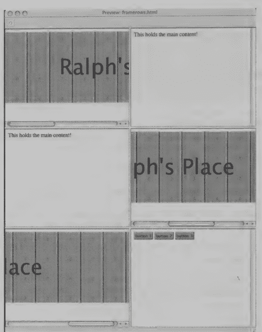

*图 3-2 基础列和行框架*

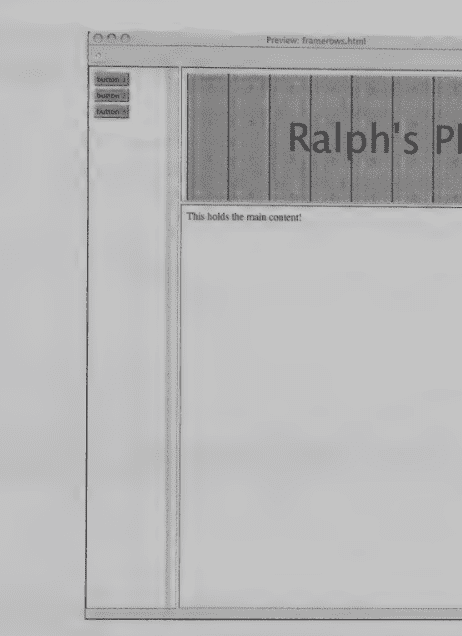

*图 3-3 嵌套框架*

图 3-3 展示了这段 HTML 代码如何将屏幕划分为用于导航、主要内容和横幅的实用区域。

### 3.5.6 内联框架 (Inline Frames)

内容还可以通过另一种方式混合，并与其他图形和文本一起放置。为此，可以使用内联框架：

```
<?xml version="1.0"?>
<!DOCTYPE html PUBLIC "-//W3C//DTD XHTML 1.0 Frameset//EN"
    "http://www.w3.org/TR/xhtml1/DTD/xhtml1-frameset.dtd">
<html xmlns="http://www.w3.org/1999/xhtml">
<head>
    <title>Rows of Frames</title>
</head>
<h1>An inline frame example</h1>

Inline frames can be used to sit with other types of content
such as text
and graphics.

<iframe src="banner.html" name="mybanner" width="300"
height="200" align="right">
This text will appear if the browser can't display the frame
</iframe>
The iframe behaves in some ways like an image in that text will
                             tend to flow around it.
Be careful using align as it is deprecated.
</html>
```

该示例显示在图 3-4 中。

该示例实际上使用了 *已弃用* 的属性 `align`，这意味着它已被其他实现相同效果的方法所取代。`align` 属性也可以与图像一起使用以达到相同的效果，强制文本围绕其流动。现在 CSS 的 `float` 属性已经取代了这一功能。

## 一个内联框架示例

内联框架可用于与文本和图形等其他类型的内容共同排列。
iframe 在某些方面的表现像图像，文本倾向于围绕它流动。请谨慎使用 align，因为它已被弃用。

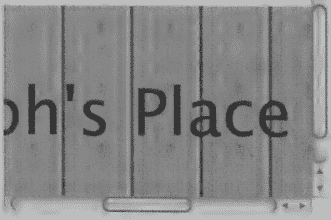

*图 3-4 使用 iframe*


#### 知识点检查！

- 框架（Frames）是一种为页面提供布局的方式。
- 框架可以垂直排列、水平排列，或者两者结合。
- 框架可以相互嵌套。
- 框架的宽度和高度参数可以用像素（pixels）表示，用百分比表示，或者使用星号 `*` 来占用剩余可用空间，星号也可用于不均匀地划分空间。
- 内联框架（Inline frames）允许框架与页面上的其他内容（如图形和文本）混合在一起。
- 对于不支持框架功能的浏览器，应提供替代方案。可以使用 `<noframes>` 元素来实现这一点。

#### 自测练习！

- 为一个使用框架的网页绘制一个粗略的设计图。
- 尝试加入由框架布局控制的图形和文本。
- 实现该设计并尝试调整布局；你能将其实现得与设计完全一致吗？
- 现在尝试在一个包含图形和文本的页面中嵌入一个内联框架。

## 3.6 浏览器内部是什么？

到目前为止，你已经有了一些使用 Web 浏览器的经验，可能还做了一些 HTML 相关的工作。在客户端，与 Web 相关的最重要软件片段可能是浏览器，我们将详细探讨其详细细节。

图 3-5 显示了浏览器内部结构的概念图。如你所见，它与外部世界或其运行的操作系统有各种输入和输出，其中较为重要的部分在此概述。控制器充当各组件之间操作的主要监督者，例如，它负责收集用户的输入，并管理提交给 HTTP 客户端用于外部通信的传出请求。HTML 和脚本根据需要被传送到解释器中，而解释器的输出则通过特殊的显示驱动程序进行处理。浏览器可以通过插件模块进行扩展，从而增强多媒体、图形和声音等功能。

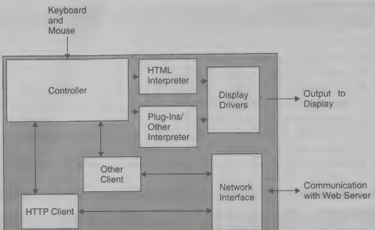

#### 图 3-5 浏览器架构

#### 知识点检查！

- 浏览器是一个复杂的软件系统。
- 它收集来自键盘和鼠标的输入。
- 它处理与 Web 服务器的通信。
- 它解释 HTML 和客户端脚本。
- 它具备通过插件进行功能扩展的能力。

#### 自测练习！

- 使用搜索引擎查找目前有哪些可用的浏览器。
- 你最喜欢的浏览器有哪些可用的扩展和插件？

### 3.7 本章总结

- 市场上早期对浏览器主导权的争夺导致了 20 世纪 90 年代的“浏览器战争”。
- 标准非常重要。
- HTML 从 3.2 版本演进到了更严格的 XHTML。
- XML 被用于“重建” HTML。
- XHTML 有几个级别：过渡型（transitional）、框架集（frameset）和严格型（strict）。
- XHTML 要求更严格的语法和更结构化的文档。
- 元数据（Metadata）提供关于文档的信息，而非内容。
- 元数据可以指导浏览器、服务器和搜索引擎如何处理网页。
- 字符实体（Character entities）可用于对 HTML 使用的某些特定字符进行编码。
- 框架对于分解页面的布局很有用。
- 框架可以根据需要设定尺寸和结构。
- 内联框架可以与文本和图形等其他内容混合使用。
- 框架在某些浏览器中可能会出现问题，因此请尽可能提供替代内容。
- 某些元素和属性已被弃用（deprecated），被新的语言特性所取代，因此通常应避免使用。
- 浏览器是一个由多个组件组成的复杂软件，包括网络、显示和脚本解释器模块，并且可以通过特殊的多媒体插件进一步扩展。

#### 本章测验

- 进一步了解 XML 的起源：它是哪种语言的子集？
- 还有哪些语言是从 XML 发展而来的？
- 为什么有些人建议 *不要* 使用框架？

#### 关键术语和短语

**Browser Wars（浏览器战争）** 指 20 世纪 90 年代后期 Web 浏览器之间为了争夺市场主导权而进行的竞争。

**Cache（缓存）** 一种可以存储频繁请求的 Web 页面的内存存储区。

**Character entity（字符实体）** 某些字符可以用 HTML 实体进行编码以替代原字符。例如，'<' 可以被编码为 `&lt;`。

**CSS** 层叠样式表，一种用于描述 HTML 和 XHTML 结构化文档呈现方式的语言。

**Deprecated（弃用）** 当软件或编程语言的一项功能被逐步淘汰或变得过时时，该功能被称为被弃用。

**Driver（驱动程序）** 一个提供计算机系统中不同层级之间（通常是软件与硬件之间）接口的软件组件。

**DTD** 文档类型定义，XML 中的一种声明，用于指定文档的约束条件（例如，定义它是否为有效的 XHTML）。

**Frame（框架）** HTML 的一项功能，允许将布局分解为独立的区域。

**Inline frame（内联框架）** 可以与其他文本和图形一起排版的框架。

**Interpreter（解释器）** 一个分析脚本并执行给定命令的软件组件。

**Meta tag（元标签）** 提供关于页面的信息而非页面内容。

**Operating system（操作系统）** 负责应用程序与硬件之间管理和交互的系统软件。

**Plug-ins（插件）** 扩展浏览器功能的附加软件组件。

**TTL** 生存时间（Time To Live），指页面失效前的持续时间。

**XHTML** 可扩展超文本标记语言，在表现能力上与 HTML 相同，但在语法上要严格得多。

**XML** 可扩展标记语言，一种通用的标记语言。

#### 有用的 Web 地址

http://www.w3schools.com/xhtml/

http://www.w3.org/TR/xhtml1/

http://www.xhtml.org/

## 4 增加一些样式：CSS

*在本章中，你将学习如何使用 CSS 来呈现和控制网页的格式。这包括在保持文档本身结构的同时，能够精确控制内容的定位和属性。*

本章解释了为什么我们需要层叠样式表（CSS），以及它如何使设计者能够将呈现和格式化与内容分离开来。本章将探讨所使用的简单结构和语法，以及将创建的样式链接到页面的基本方法。

CSS 允许你以 HTML 自身无法实现的方式增强网页，并在过程中保持文档的逻辑结构。此处将展示如何添加背景图像和颜色，以及如何操纵文本和其他元素。还可以添加边框、方框和其他页边距。

在 HTML 中，定位和布局要么发生在页面的自然流（natural flow）中，要么通过使用表格来控制元素的定位。而在 CSS 中，可以实现对对象放置位置的精确控制，无论是相对定位还是精细的绝对像素级定位！

### 4.1 为什么需要 CSS

在 20 世纪 90 年代初，HTML 主要仍关注文档的结构元素。这些元素包括对段落、列表、标题和超链接的描述。例如，当时还没有以表格或框架形式控制布局的功能。此时的主要目标是拥有一种能清晰描述结构而非呈现方式的语言。

随着时间的推移，随着 Mosaic 等更多浏览器加入 WWW，语言中增加了一些新特性，以提供对显示文本和图形的更多控制。随着兴趣的激增，人们要求增加对加粗和斜体的控制功能。标记一段需要强调的文本可能意味着将其加粗或设置为斜体，而浏览器可以决定采取哪种方式。作者创建的内容并不总是读者最终看到的样子。

HTML（包括 3.2 和 4.0 版本）有大量章节被用于呈现方面，如颜色、文本大小和背景。通过 HTML 还可以让文本闪烁。文档中用于此类图形呈现的 HTML 数量过多，侵蚀了 HTML 作为结构化标记语言的用途。

结构含义丢失了，文档无法通过任何方式在浏览器输出之外进行处理。例如，语音处理器无法依赖文档中包含的信息来获取关于章节或强调的线索，而且早期的 HTML 无论如何也没有严格的规则！

如果一个页面没有结构，那么在多个方面都会变得难以使用：

- 就像软件工程中任何结构糟糕的程序一样，它难以追踪，因此难以理解实际发生了什么。这使得更新和维护变得困难。
- 搜索引擎索引变得更加困难，因为缺乏结构化标记导致关键内容缺乏重要性权重。
- 除浏览器以外的软件处理起来很麻烦，因为几乎没有关于特定信息的提示。

很快，特别是 W3C 意识到，这种呈现信息与结构信息的混合不能继续下去，于是他们开始寻找解决方案。1995 年公布的方案基础就是 CSS。这很快被接受，并在 1996 年成为与 HTML 同等级别的正式建议标准。

最初的 CSS 后来得到了第二级标准 CSS2 的补充，CSS2 在 1998 年成为正式建议标准。它在 CSS1 的基础上构建，在不改变实际第一版规范的情况下增加了扩展功能。


### 4.2 CSS 简介

CSS 改进了最初在 HTML 内部控制演示效果的混乱尝试：

- 控制任何元素的文本颜色
- 控制背景颜色
- 控制元素周围的边框
- 元素与边框之间的间距
- 文本处理与装饰。

在 HTML 演示效果鼎盛时期所能实现的一切，在 CSS 中都能实现，而且功能更多。为了让大家对 CSS 的工作原理及其强大之处有一个基本的了解，需要一个简单的示例。

一个标题在标记语言中可以写作：

```
<h1>The main heading</h1>
```

如果你想用 HTML 内部的旧方法为这个标题添加颜色、强调和字体控制，则需要添加大量复杂的布局信息。而使用 CSS，可以通过一个选择器（在本例中是 h1），后接一组属性和值的列表，非常简单地实现这一点：

```
h1 { color: red; font: italic 1em Times, serif; text-decoration: underline; background: black; }
```

如果你想用 HTML 的旧方法将每个 h1 标签更改为一组特定的颜色和属性，你必须遍历代码并逐个进行修改。CSS 允许将特定的样式附加到选择器上，而选择器通常是一个 HTML 元素。

### 4.3 基本语法与结构

CSS 文档或片段由一组包含选择器和声明块的规则列表组成。

### 4.3.1 规则

CSS 语法的基本思想很简单：

```
selector { property:value; .... }
```

选择器是元素的标识符，后面跟着一组包含在花括号内的**属性:值**对。例如：

```
body { color: yellow }
```

包含多个单词的值必须用引号括起来：

```
p {font-family: "sans serif"}
```

如果要设置多个属性，则用分号分隔：

```
p {text-align:center;color:red}
```

可以将这些内容分行写，而不是全部放在一行：

```
p {
    text-align:center;
    color:red
}
```

如果你有很多属性，这样做会很有用，因为它提高了可读性。

除了将相当多的属性附加到一个选择器上，还可以拥有多个选择器。例如，要将一组样式应用于 h1 和 h2：

```
h1, h2 { color: red; font: italic 1em Times, serif;
         text-decoration: underline; background: black; }
```

或者将整组标题设为红色：

```
h1,h2,h3,h4,h5,h6
{
    color: red
}
```

### 4.3.2 类 (Classes)

有时你可能需要为同一个 HTML 元素创建几种不同的样式：

```
p.right {text-align: right}
p.left {text-align: left}
```

要在 HTML 文档中实际使用这些样式：

```
<p class="right">
This paragraph will be right-aligned.
</p>
<p class="left">
This paragraph will be left-aligned.
</p>
```

不过，你不能为一个 HTML 元素指定多个类！一个有用的技巧是指定一个不带主标签的类，这样它可以被应用于设计者想要使用的任何其他类：

```
.left { text-align: left }
```

然后只要它们共享同一个类，你就可以将其应用于多个标签：

```
<h1 class="left">
This heading will be left-aligned
</h1>
<p class="left">
This paragraph will also be left-aligned.
</p>
```

### 4.3.3 ID

类似地，还有 ID 选择器，它将特定的样式应用于一个被标识的元素。例如，使用 ID 声明一条样式规则：

```
p#bluepara
{
text-align: center;
color: red
}
```

这将创建一条样式规则，匹配 ID 值为 bluepara 的段落。例如它会匹配：

```
<p id="bluepara">Some interesting thoughts...</p>
```

但不会匹配：

```
<h1 id="bluepara">This section...more thoughts</h1>
```

你可以通过以下方式匹配任何 ID 为 bluepara 的元素：

```
#bluepara
{
text-align: center;
color: red
}
```

类和 ID 虽然相似，但区别在于：类可以应用于页面的多个部分，而 ID 仅应用于一个元素，并且应该是*唯一的*。例如，对同一个 ID 这样做是错误的：

```
<h2 id="alert">This is an alert!</h2>
<p id="alert">This is an alert!</p>
<h3 id="alert">This is an alert!</h3>
```

### 4.3.4 伪类选择器 (Pseudo-Class Selectors)

由于所属元素的工作方式不同，某些选择器被认为是不同的。例如，在文档之间创建链接的锚点可以附加伪类，简单来说是因为在编写标记时，无法知道链接处于什么状态。它可以是已访问、未访问或正在被选择（被点击或处于激活状态）。为了捕捉这些状态并规定每种状态下发生的情况，我们可以使用伪类选择器：

```
a:link (color: red)
a:active (color: yellow)
a:visited (color: green)
```

因此，在这种情况下，链接最初是红色的；访问后变成绿色；在被点击的过程中变为黄色。请注意，在伪类的情况下，规则中使用的是冒号 (:) 而不是普通类中使用的点 (.) 分隔符。

还有更多的伪类，例如：

```
a:hover (font-weight: bold)
```

这将使链接在光标悬停在其上方时变为粗体。然而，hover 并不局限于链接，因此其他元素也可能使用相同的 hover。为了使其仅针对链接：

```
a:link:hover (font-weight:bold)
```

#### 检查点！

我们现在已知：

- CSS 的核心思想是将演示效果与内容分离
- CSS 控制许多曾经属于 HTML 的格式和布局
- 这种方法有助于结构化文档，并且是以块为导向的
- CSS 文档或嵌入片段由一系列规则列表组成
- 元素或块可以用类名或标识符标签进行标记
- 超链接也可以应用格式。

### 4.4 使用 CSS

要使用样式表，你可以将规则嵌入到要应用样式的文档中，或者使用一个完全独立的文件。

### 4.4.1 外部样式表

当你拥有多个页面，甚至是一个需要统一控制演示效果的完整网站时，外部文件是一个很好的选择。显然，这节省了大量精力，因为在以前，你需要逐个修改每个页面。通过这种方式，你只需修改一个文件就能改变整个网站的外观。每个使用该样式表的页面都需要有一个链接将其与样式文档关联起来：

```
<head>
  <link rel="stylesheet" type="text/css"
    href="mystyle.css" />
</head>
```

工作是由 link 标签完成的，该标签需要放在 head 部分内部。

实际的样式文档包含要应用的规则列表，扩展名为 `.css`。该文件可以使用普通的文本编辑器编写，因为它只包含纯文本。其中不应包含任何 HTML 元素。

Listing 4-1 是一个外部 CSS 文件的示例。它显示了七条具有多个属性的 CSS 规则。请注意这里注释的正确语法，这对于特别大的文件非常有用，你可以根据需要对样式进行标注。

```
body {
    background-attachment: fixed;
    background-repeat: repeat;
    background-image: url(images/test.gif);
}
font {
    font-family: Arial, Helvetica, sans-serif;
    font-size: 12px;
    color: #0000FF;
}
.bodytext {
    font-family: Arial, Helvetica, sans-serif;
    font-size: 16px;
    color: #000000;
}
```

```
.pageH {
  font-weight: bold;
}
.bluesubheading{
  font-family: Arial, Helvetica, sans-serif;
  font-size: 14px;
  color: #0000FF;
  text-decoration: underline;
  font-weight: bold;
}
.bluebodytext{
  font-family: Arial, Helvetica, sans-serif;
  color: #0000FF;
}
.subheading {
  font-family: Arial, Helvetica, sans-serif;
  font-size: 18px;
  font-weight: normal;
  text-decoration: underline;
}
```

*Listing 4-1 外部 CSS 文件*

### 4.4.2 嵌入式样式表

也可以使用内部样式表，即仅附加到单个文档的样式信息。在这种情况下，CSS 信息包含在 head 部分中，例如：

```
<head>
<style type="text/css">
hr {color: sienna}
p {margin-left: 20px}
body {background-image: url("images/back40.gif")}
</style>
</head>
```

任何信息都使用 style 标签及其后的格式化数据来提供。这里的一个问题是，当旧版浏览器加载页面时，它会忽略 `<style>` 标签，然后将随后的 CSS 信息直接打印在浏览器页面上！为了解决这个问题，最好的办法是将此类代码包含在 HTML 注释元素中：

```
<head>
<style type="text/css">
<!--
hr {color: sienna}
```


```
p {margin-left: 20px}
body {background-image: url("images/back40.gif")}
-->
</style>
</head>
```

能够处理 CSS 信息的现代浏览器会忽略这些注释，但旧版浏览器会看到这些注释，并且不会处理 `<style>` 标签起始和结束之间的信息。

另一种结合 CSS 格式的方法是使用内联方法；也就是说，将标记写在需要该格式的实际元素中：

```
<p style="color: sienna; margin-left: 20px">
This is a paragraph
</p>
```

虽然可以这样做，但由于将内容和表现形式混合在一起，它会失去 CSS 的一些优势。这种方法可能最适合用于站点或页面中仅出现一次的唯一样式。

同时，也可以拥有多个活动的样式方案，例如一个外部样式表和一个内部样式表。在这种情况下，更具体的值将继承自内部样式表。

### 4.5 背景图像、颜色和属性

使用 CSS 可以控制元素的背景颜色、在背景中使用图像、平铺图像（水平或垂直重复）或将图像放置在页面的特定位置。

### 4.5.1 背景颜色

要将背景颜色更改为黄色，您可以在外部 CSS 文件中放置以下内容：

```
body {
    background: #F0F8FF;
}
```

或者：

```
body {
    background: yellow;
}
```

请记住，颜色可以使用 RGB 颜色代码（十六进制或十进制）或名称来设置。W3C CSS 标准仅支持 16 个名称 —— aqua, black, blue, fuchsia, gray, green, lime, maroon, navy, olive, purple, red, silver, teal, white 和 yellow，尽管大多数浏览器支持更多（这些可以在 http://www.w3schools.com/css/css_colornames.asp 找到）。

为了确保任何文本都是黑色的，您可以使用：

```
body {
    background: #FFFF20;
    color: #000000;
}
```

要测试这些效果，您需要一个链接了它们的 HTML 页面：

```
<html xmlns="http://www.w3.org/1999/xhtml">
<head>
    <title>Testing CSS</title>
    <link rel="stylesheet" type="text/css" href="mycss.css"
          title="green">
</head>
<body>
How about some color...
</body>
</html>
```

请注意，这里的 `background` 属性设置了所有背景属性，包括 `background-color`、`background-image`、`background-repeat`、`background-attachment` 和 `background-position`。当然，这些属性中的每一个都可以单独设置。

### 4.5.2 背景图像

除了彩色背景，还可以将图像设置为背景。它可以设置为在背景上重复，或者仅放置一次：

```
body {
    background: #F4a460;
    background-image: url("suki.jpg");
    background-repeat: no-repeat;
}
```

HTML 部分基本保持不变：

```
<html xmlns="http://www.w3.org/1999/xhtml">
<head>
<title>My Cat Suki</title>
<link rel="stylesheet" type="text/css" href="mycss.css"
      title="green">
</head>
<body>
The kitchen cat, Suki!
</body>
</html>
```

我们可以在图 4-1 中看到其输出结果。如您所见，背景中有一幅图像，上方有黑色文字。

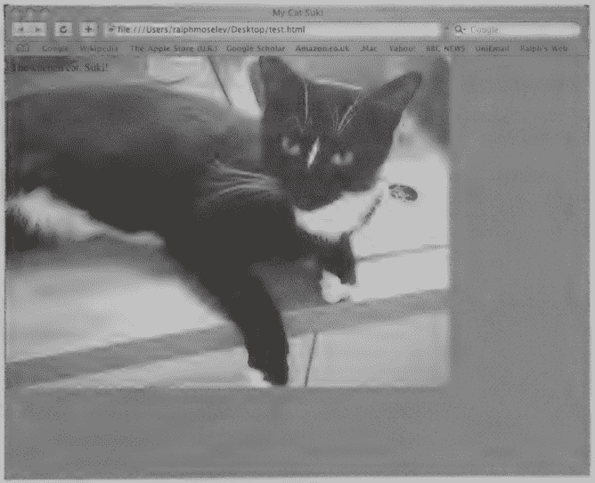

**图 4-1** *使用背景图像*

如果您希望背景中出现重复的图像（例如作为纹理图案），只需根据您希望重复的方向，将 `background-repeat` 更改为 `repeat`、`repeat-x` 或 `repeat-y`：

```
body {
    background: #F4a460;
    background-image: url("browntile.jpg");
    background-repeat: repeat;
}
```

您还可以做的另一件事是设置图像在滚动条移动时是固定不动的，还是随页面其余部分一起移动。为此，请使用 **background-attachment** 属性，它可以被设置为 `scroll` 或 `fixed`。

属性摘要如表 4-1 所示。

| 属性 | 描述 | 值 |
|---|---|---|
| **Background** | 在一个声明中设置所有背景属性 | RGB 格式 |
| **Background-attachment** | 设置图像在页面滚动时是否随之移动 | scroll 或 fixed |
| **background-color** | 设置元素的背景颜色 | RGB, 十六进制, 名称 或 transparent |
| **background-image** | 在背景中设置图像 | URL 或 none |
| **Background-position** | 设置背景图像的起始位置 | top left, top center, top right, center left, center center, center right, bottom left, bottom center, bottom right, x-% y-%, x-pos y-pos |
| **background-repeat** | 设置背景图像的重复方式 | repeat, repeat-x, repeat-y, no-repeat |

*表 4-1 背景属性*

#### 知识点检查！

我们现在知道了如何：

- 将样式表链接到 Web 页面，或在文档中嵌入 CSS
- 更改背景属性（如颜色）或添加图像
- 操作背景图像，使其可以在区域内重复（或平铺），或者相对于滚动内容保持静态。

### 4.6 文本操纵

正如我们所见，也可以设置文本的颜色，在本例中使用了标题选择器：

```
<html>
<head>
<style type="text/css">
h1 {color: #00ff00}
h2 {color: yellow}
h3 {color: rgb(255,20,40)}
p {color: rgb(0,0,255)}
</style>
</head>
<body>
<h1>A colored header 1</h1>
<h2>A colored header 2</h2>
<h3>A colored header 3</h3>
<p>And a paragraph!</p>
</body>
</html>
```

此文档使用内置样式表来确定文本各部分的颜色。在这里，一组标题分别被赋予了不同的颜色，同时一个单独的段落也被赋予了其特有的颜色。使用了多种选择和设置值的方法，包括提供十六进制值、名称以及 0 到 255 之间的 RGB 值。

文本的背景颜色也可以更改：

```
<head>
<style type="text/css">
  h1 {color: #00ff00; letter-spacing: -3px}
  h2 {color: yellow; letter-spacing: 0.6px}
  h3 {color: rgb(255,20,40); background-color: yellow}
  p {color: rgb(0,0,255)}
</style>
</head>
```

此外，在这个示例中，对特定文本的字母间距进行了操纵。`<h1>` 的间距被减小，而 `<h2>` 的间距被增大。

在控制布局时，通常只需要说明文本是想左对齐、居中还是右对齐。这也可以在 CSS 中完成：

```
<html>
  <head>
    <style type="text/css">
      h1 {text-align: center}
      h2 {text-align: left}
      h3 {text-align: right}
    </style>
  </head>
  <body>
    <h1>This is header 1</h1>
    <h2>This is header 2</h2>
    <h3>This is header 3</h3>
  </body>
</html>
```

### 4.6.1 文本装饰

文本经常需要下划线。这可以通过文本装饰（text decoration）来实现，它还具有几种其他样式：

```
<html>
  <head>
    <style type="text/css">
      h1 {text-decoration: overline}
      h2 {text-decoration: line-through}
      h3 {text-decoration: underline}
      a {text-decoration: none}
    </style>
  </head>
  <body>
    <h1>This is header 1</h1>
    <h2>This is header 2</h2>
    <h3>This is header 3</h3>
    <p>
      <a href="http://www.w3schools.com/default.asp">
      This is a link</a>
    </p>
  </body>
</html>
```

### 4.6.2 文本缩进

文本也可以缩进：

```
<html>
<head>
<style type="text/css">
p {text-indent: 1cm}
</style>
</head>
<body>
<p>
This is some text in a paragraph
This is some text in a paragraph
This is some text in a paragraph
This is some text in a paragraph
This is some text in a paragraph
This is some text in a paragraph
</p>
</body>
</html>
```

### 4.6.3 文本大小写

有时您可能想要控制某个部分或段落中文本的大小写：

```
<html>
<head>
<style type="text/css">
p.uppercase {text-transform: uppercase}
p.lowercase {text-transform: lowercase}
p.capitalize {text-transform: capitalize}
</style>
</head>
<body>
<p class="uppercase">
This is some text in a paragraph
</p>
<p class="lowercase">
This is some text in a paragraph
</p>
<p class="capitalize">
This is some text in a paragraph
</p>
</body>
</html>
```

### 4.7 使用字体

以下示例展示了 CSS 中可用的许多字体特性：

```
<html>
<head>
<style type="text/css">
h3 {font-family: times;
    font-size: 150%;
    font-style: normal }
p {font-family: courier;
    font-size: 100%;
    font-style: oblique}
</style>
```

### 4.8 边框与方框

`border`属性允许在区域周围添加多种样式的边框。边框类型具有高度的可控性，如实线、虚线、双线或脊线等。此外，还可以应用颜色、宽度和粗细。

属性汇总见表 4–2。

| 属性 | 说明 | 值 |
| --- | --- | --- |
| border | 在一个声明中设置四条边框的所有属性 | border-width border-style border-color |
| border-bottom | 在一个声明中设置下边框的所有属性 | border-bottom-width border-style border-color |
| border-bottom-color | 设置下边框颜色 | border-color |
| border-bottom-style | 设置下边框样式 | border-style |
| border-bottom-width | 设置下边框宽度 | thin, medium, thick length |
| border-color | 设置边框颜色 | color |
| border-left | 设置左侧的所有属性 | border-left-width border-style border-color |
| border-left-color | 设置左边框颜色 | border-color |
| border-left-style | 设置左边框样式 | border-style |
| border-left-width | 设置左边框宽度 | thin, medium, thick length |
| border-right | 设置右侧的所有属性 | border-right-width border-style border-color |
| border-right-color | 设置右边框颜色 | border-color |
| border-right-style | 设置右边框样式 | border-style |
| border-right-width | 设置右边框宽度 | thin, medium, thick length |
| border-style | 设置四条边框的样式 | none, hidden, dotted, dashed, solid, double, groove, ridge, inset, outset |
| border-top | 设置上边框的所有属性 | border-top-width, border-style, border-color |
| border-top-color | 设置上边框颜色 | border-color |
| border-top-style | 设置上边框样式 | border-style |
| border-top-width | 设置上边框宽度 | thin, medium, thick, length |
| border-width | 设置所有边框的宽度 | thin, medium, thick, length |

表 4-2 border 属性

### 4.9 边距

边距是一个元素与另一个元素之间的空间，位于任何内边距（4.10 节）或边框之外：

```html
<html>
<head>

<style type="text/css">
p.margin {margin-top: 5cm}
</style>

</head>

<body>

<p>
This is a paragraph This is a paragraph
This is a paragraph This is a paragraph
</p>

<p class="margin">
This is a paragraph with a top margin
This is a paragraph with a top margin
</p>

</body>
</html>
```

可以为上、下、左、右设置边距。你可以单独使用 `margin` 属性，在一个声明中设置所有属性：

```css
<style type="text/css">
p.margin {margin: 2cm 4cm 3cm 4cm}
</style>
```

### 4.10 内边距

内边距允许你在元素内容周围、边框内部插入额外的空间。你只能更改内边距区域的厚度，而不能更改其颜色。

```html
<html>
<head>

<style type="text/css">
td {padding-bottom: 2cm; padding-top: 2cm}
</style>

</head>

<body>

<table border="1">
<tr>
<td>
A table cell with top and bottom padding
</td>
</tr>
</table>

</body>
</html>
```

属性汇总见表 4-3。

| 属性 | 说明 | 值 |
| :--- | :--- | :--- |
| padding-bottom | 在底部添加内边距 | length, % |
| padding-top | 在顶部添加内边距 | length, % |
| padding-left | 在左侧添加内边距 | length, % |
| padding-right | 在右侧添加内边距 | length, % |
| padding | 以上所有在一个声明中 | padding-top padding-right padding-bottom padding-left |

表 4-3 *padding 属性*

### 4.11 列表

对创建的列表可以进行一定程度的控制。可以更改列表项标记以及标记的位置：

```html
<html>
<head>
<style type="text/css">
ul.disc
{ list-style-type: disc}
ul.circle
{list-style-type: circle}
ul.square
{list-style-type: square}
ul.none
{list-style-type: none}
</style>
</head>

<body>
    <b>Pizzas!</b><br><br>
    <ul class="disc">
    <li>Vegetarian</li>
    <li>Mozzarella</li>
    <li>Al Fungi</li>
    </ul>

<ul class="circle">
<li>Vegetarian</li>
<li>Mozzarella</li>
<li>Al Fungi</li>
</ul>

<ul class="square">
<li>Vegetarian</li>
<li>Mozzarella</li>
<li>Al Fungi</li>
</ul>

<ul class="none">
<li>Vegetarian</li>
<li>Mozzarella</li>
<li>Al Fungi</li>
</ul>

</body>
</html>
```

属性汇总见表 4-4。

| 属性 | 说明 | 值 |
| --- | --- | --- |
| list-style-image | 使用图像作为标记 | none, url |
| list-style-position | 标记的定位 | inside, outside |
| list-style-type | 标记的类型 | none, disc, circle, square, decimal ... |
| list-style | 设置所有属性 | 以上所有属性 |

*表 4-4 list 属性*

### 4.12 使用 CSS 进行定位

与 HTML 不同，CSS 允许很好地控制元素的定位。通常，网页中的元素按照它们出现的顺序流动。因此，当你从 HTML 页面顶部向下浏览时，元素会依次出现：放置在段落之前的图像会在页面上按照这种顺序显示。而使用 CSS，可以打破这种正常的流动，将元素定位到这个顺序之外。事实上，可以精确控制元素出现的位置。

### 4.12.1 绝对定位！

清单 4-2 中的示例展示了所谓的绝对定位。在这种情况下，定位设置的是元素的左上角，但也可以通过右下角来设置元素的位置。它被称为绝对定位，是因为它不是相对于在自然流中的位置，而是使用窗口定位来确定精确坐标。

```html
<html>
<head>
<style type="text/css">
h1 {
position: absolute;
top: 100px;
left: 100px
}

p {
position: absolute;
top: 200px;
left: 100px
}
</style>

</head>

<body>
<h1>A heading</h1>
<p>
The <b>heading</b> is placed 100px
down from the top of the document,
and 100px to the right from the
left side of the document.
The <b>paragraph</b> is placed 200px
down from the top of the document,
and 100px to the right from the
left side of the document.
</p>

</body>
</html>
```

*清单 4-2 绝对定位*

### 4.12.2 一切都是相对的

元素也可以进行相对定位；也就是说，不是相对于其他对象，而是相对于它们在页面自然流中原本应该处于的位置。为此，使用选择器 `position: relative`，并结合 `top`、`right`、`bottom` 或 `left` 以及 `:n`，其中 n 是相对于其自然位置的偏移量。

### 4.12.3 Z-Index

不仅可以按 x 和 y 坐标定位元素，还可以按屏幕的深度来定位元素，这样事物就可以出现在其他事物的后面或前面！为此，引入了 z-index。z-index 属性具有一个数字，描述对象在可见元素堆叠中的位置。数字越大，对象越靠近顶部，可见度越高：

```html
<html>

<head>
<style type="text/css">
p.ap {
position: absolute;
left: 55px;
top: 70px;
z-index: 0;
}
img.x
{
position:absolute;
left:0px;
top:0px;
z-index:1;
}
h1 {
position:absolute;
left:5px;
top:5px;
z-index: 2;
}
</style>
</head>
<body>

<h1>This is a Heading</h1>

```


```
<p class="ap">Default z-index is 0. Z-index -1 has lower
priority.</p>

</body>
</html>
```

这个示例显示了深度为 0、1、2 的三个层级。标题处于深度 2，因此最可见（在堆栈中最高），其次是深度为 1 的图像，最后最深处的是段落。请注意，Netscape 4 不支持 `z-index`。

元素的宽度和高度也可以很容易地设置，这样就可以将其操纵在给定的空间内。为此，我们使用维度属性 `width` 和 `height`，它们可以用百分比或像素值来设置：

```
<style type="text/css">

p.small {
    height: 30px;
    width: 50px
}

p.other {
    height: 50%;
}

</style>
```

在 `p.small` 中，给出了包含该段落的盒子的 `width` 和 `height`。在 `p.other` 中，容器区域的 50% 将被用于该元素的盒子大小。

如果元素的内容无法放入盒子中，可以使用 `overflow` 属性来定义你希望发生的情况。例如，使用值 `visible`（或者根本不使用 `overflow` 属性）会使盒子扩展，以便其内容能够适应。值 `hidden` 将隐藏任何无法放入盒子的内容；而 `scroll` 值则会为元素盒子添加滚动条，以便用户可以选择是否查看内容。将 `auto` 作为 `overflow` 属性的值，将使滚动条仅在需要时出现。

#### 4.12.4 塑造元素

一个元素（例如图像）也可以使用 `clip` 属性进行有用的形状塑造。例如：

```
img
{
position:absolute;
clip:rect(0px 50px 200px 0px)
}
```

#### 4.12.5 浮动元素

有时你希望一个元素（例如图像）能够浮动，以便其他元素可以在其周围流动。例如，当你希望一张图片的一侧或另一侧被文本包围时，就会发生这种情况。为此，`float` 选择器与 `left` 或 `right` 作为值一起使用。不幸的是，许多浏览器在正确实现这一点方面往往不一致！

#### 4.12.6 布局与结构

CSS 背后的理念是将格式化和样式规则与内容分离。在由 CSS 定义样式的文档中，维持结构至关重要。一种方法是将页面通过 `div`（division，分区）元素分解为逻辑部分。例如，你可以将页面分解为横幅（banner）、导航（navigation）、新闻（news）和内容（content）分区，如清单 4-3 所示。

```
<html><head>
    <title>A Simple Web Page</title>
    <style type="text/css">
        #banner {
            font-family: Tahoma;
            background-color: #84a563;
            padding: 2px 2px 2px 10px;
        }
        #navigation {
            padding: 10px;
            border: 1px dotted;
            font-family: courier;
            font-size: 100%;
            background-color: #5c892e;
        }
        #news {
            padding: 4px;
            font-family: Tahoma;
            background-color: #5c922e;
        }
        #content {
            padding: 2px;
            font-family: Tahoma;
            background-color: #84a563;
        }
        a:hover {
            font-weight: bold;
        }
        a:link, a:visited {
            text-decoration: none;
            color: #550039;
        }
    </style>
</head>
<body>
<div id="banner">
<h1>My Special Page</h1>
</div>
<div id="navigation">
<a href="home.html">home</a>
<a href="resources">resources</a>
<a href="links.html">links</a>
<a href="feedback.html">feedback</a>
</div>
<div id="news">
NEWS:
</div>
<div id="content">
<pre>
Stone walls do not a prison make,
Nor iron bars a cage;
Minds innocent and quiet take
That for an hermitage;
If I have freedom in my love
And in my soul am free,
Angels alone, that soar above,
Enjoy such liberty.

<i>To Althea from Prison</i>
- Colonel Lovelace
</pre>
</div>
</body>
</html>
```

**清单 4-3 使用 div 分区**

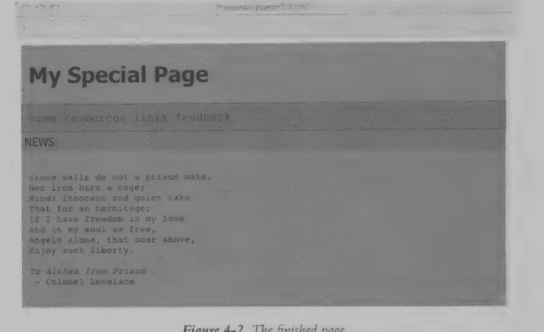

**图 4-2 完成后的页面**

请注意，在这个示例中，各种 `div` 分区都有标识符；然后这些标识符被用来插入或连接所需的样式。

我们可以在图 4-2 中看到输出结果。

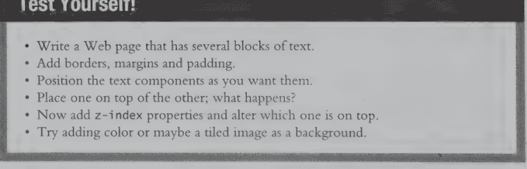

### 4.13 CSS2

CSS 2 级于 1998 年 5 月作为推荐标准发布，并且已经修订为 CSS 2.1。CSS2 主要涵盖了对元素绝对定位、相对定位和固定定位的改进。它还涉及对媒体类型的操纵，包括听觉样式表（aural style sheets）、双向文本和新的字体属性。

CSS 2.1 进一步改进了目前支持不佳的功能。它还将已经实现的浏览器扩展添加到规范中。

CSS2 听觉样式表是一个有趣的补充，为视障人士提供了可访问性。它们允许控制文档的语音处理功能。例如，可以添加操纵语音频率、重音、单词组合方式的功能，并操纵格式以适应语音。例如，可以指定语音进程在遇到表格时如何进行：是向下读取数据还是横向读取？

CSS2 还允许添加特定于打印的指令。这允许在硬拷贝输出期间进行页面控制，例如分页、页边距和双面打印指令。

**检查点！**

我们现在知道了：
- 文档内对象的显示定位通常在 HTML 文档中以从上到下的自然流向出现
- 可以使用 CSS 定位将元素相对于其正常位置移动，或者通过提供像素坐标进行绝对移动
- 除了 x 和 y 轴定位外，还有 `z-index`，它允许为显示添加深度，从而使对象可以分层，并确定它们在堆栈中的位置
- CSS 2 级进一步改进了 CSS 并增加了一些新功能

### 6.14 本章小结

- 最初，HTML 拥有大量的演示和格式化功能。
- 对 CSS 的需求基于将演示与 HTML 分离。
- HTML 被重新定义为关注结构化标记。
- CSS 通过提供选择器和一组待应用的规则来工作。
- 选择器标识一个特定的元素或逻辑定义的分区。
- 伪类允许为链接应用样式。
- 样式表可以嵌入在页面中，也可以放在一个带有 `.css` 扩展名的独立文件中，然后进行链接。
- 样式表可以控制背景图像、颜色和属性。
- 文本也可以在字体、大小、装饰、对齐和间距方面进行操纵。
- 样式表还可以控制元素或分区周围的边框和各种间距可能性。
- 列表是可以被定义样式的。
- CSS 可以更精确地控制定位，包括绝对定位和相对定位。
- 使用 `z-index` 功能，可以控制项目在重叠时的排序位置。这为显示增加了深度控制。
- 图像可以被裁剪和操纵。
- 元素可以浮动，以便文本在它们周围流动。
- `div` 元素提供了将 HTML 分解为逻辑元素的能力，这些元素可以使用 CSS 进行操纵。
- CSS2 进一步改进了 CSS 并增强了许多功能，同时提供了一些新功能，如听觉样式表。

#### 本章测验

- 学习 CSS 的最佳方法之一是实际尝试使用它。选取一个之前用 HTML 开发的设计或网页，并使用 CSS 重新开发。
- Zen Garden 项目非常有趣（见 http://www.csszengarden.com/）。其理念是你下载他们的 HTML 页面，然后开发自己的 CSS 来赋予它新的演示效果。首先看看其他人在展示 CSS 方面的尝试，然后试着看看你能想出什么方案。

#### 关键术语和短语

**Absolute（绝对定位）**：应用于 CSS 定位时，指为元素指定精确的坐标。

**Border（边框）**：定义边框的所有方面。

**Class（类）**：用于给每一类分区命名。

**Div（分区）**：将页面分为逻辑部分。

**ID（标识符）**：用于给特定的分区起一个唯一的名称。

**Margin（外边距）**：用于设置元素边框侧面与父元素之间的空间量。

**Padding（内边距）**：用于指定元素内容区域的侧面与边框之间的距离。

**Relative（相对定位）**：应用于 CSS 定位时，指指定相对于元素在网页中自然位置的坐标。

**RGB**：红绿蓝，一种用于颜色定义的模型。

**Z-index（层级）**：允许设置元素相对于其他重叠元素的深度。


#### 有用的网址

http://www.csszengarden.com/
http://en.wikipedia.org/wiki/Cascading_Style_Sheets/
http://www.w3schools.com/css/
http://www.w3.org/TR/REC-CSS1-961217.html
http://www.w3.org/TR/REC-CSS2/

图像包含手写文本，但模糊严重且无法辨认。内容由多个段落和列表组成，但由于图像质量问题，无法准确转录具体文字。

## 5 JAVASCRIPT：客户端脚本入门

> 本章将为您学习这种流行的脚本语言做准备，向您展示其语法和使用可能性。本章的目标是向您展示脚本如何放置在页面中，以及变量、字符串、数组和循环。还将讨论程序流以及如何使用条件运算符和命令。

本章将为您提供 JavaScript 的初步基础，探讨为什么需要它、它来自哪里以及它的基本语言结构。它还将分析 JavaScript 与其他编程语言之间的几个重要区别，以及如何开始开发用于与用户交互的动态网页。

脚本（Scripting）听起来像是编程的一种简化形式，但 JavaScript 是一种复杂且功能齐全的编程语言。与任何编程语言一样，它看起来可能相当简单，但实际上它可能比大多数语言更复杂。如果没有良好的基础理解，即使编写简单的程序也会让人感到非常沮丧。

还有一个误区，认为 JavaScript 在某种程度上与 Java 相关。事实上这是不正确的，尽管两者有一些相似之处，但它们之间存在很大差异，本章将对此进行详细阐述。JavaScript 确实使用了对象，但关于它究竟应该被称为“面向对象”（object oriented）还是“基于对象”（object based），仍存在一些争议。

JavaScript 已经存在多年，有着相当长的历史，本章将探讨它是如何成熟并成为任何希望使页面丰富且动态的 Web 设计师的高级助手。

### 5.1 什么是 JAVASCRIPT？

HTML 和 CSS 专注于页面的静态渲染；页面上的内容不会随时间或事件而改变。为了实现这些功能，我们使用脚本语言，它们允许内容动态变化。不仅如此，它还能实现超出 HTML 可能性范围的用户交互。脚本与任何其他编程语言一样都是程序；它们可以在客户端（带有浏览器的端）或服务器端执行。在最初的几章中，我们将集中讨论客户端，然后再转向服务器端。

意识到在任一端运行脚本都有其优势是很重要的。例如，在客户端运行脚本可以节省服务器的处理时间（反之亦然！）。在发送信息之前在客户端进行一些处理可能是有利的：例如，您可以在信息发送前对其进行检查。

以下是客户端脚本的优点：

- Web 浏览器使用其自身的资源，减轻了服务器的负担。
- 其功能比服务器端语言少（注：此处原文为 "It has fewer features"，在语境中可能指复杂度较低或权限受限）。

以下是客户端脚本的缺点：

- 代码通常可见。
- 代码很可能被修改。
- 无法访问本地文件和数据库（因为它们存储在服务器上）。

两种主要的客户端脚本语言是 JavaScript 和 VBScript。两者中更流行的是 JavaScript。此外还有 JScript，它是该语言的微软版本。对通用规范的需求促成了 ECMA 262 的诞生以及名为 ECMAScript 的标准化语言版本的开发。

JavaScript 最初被称为 LiveScript（在此之前叫 Mocha！），由 Netscape Communications 开发。尽管名称相似，但它与 Java 编程语言几乎没有共同点，这有时会导致混淆。JavaScript 是一种基于对象而非面向对象的语言，它基于原型的概念。主要相似之处在于它们共享共同的语法，这与 C 语言有一定的关系。

JavaScript 被嵌入在网页中并由浏览器解释执行。

### 5.2 如何开发 JAVASCRIPT

您可以使用简单的编辑器和浏览器来开发 JavaScript 程序，就像开发 HTML 和 CSS 一样。您也可以使用诸如 Dreamweaver 之类的 IDE，它可以辅助开发并加快编写客户端脚本的速度。

网络上有大量的 JavaScript 程序，因此并不总是需要自己编写并“重新发明轮子”。您可能会根据自己的需求修改他人的代码，或者研究他们是如何实现的。

JavaScript 可用于增强网站的交互性并使页面活泼起来，从而创建活跃的用户界面。您可以验证来自表单的输入信息，并改进导航界面运作的方式。JavaScript 能够实时创建 HTML 页面，而这可以取决于用户的选择。

### 5.3 简单的 JAVASCRIPT

关于将 JavaScript 放置在 HTML 中的位置有几种选择；它也可以独立于 HTML 存在但通过链接引入。

#### 5.3.1 嵌入式

JavaScript 可以嵌入在 HTML 文档中。JavaScript 的媒体类型是 `application/x-javascript`，但更常见的是，要在 HTML 中嵌入它，您必须以以下内容开始：

```
<script type="text/javascript"></script>
```

并以以下内容结束：

```
</script>
```

您可能还会看到为旧版浏览器编写的代码，其开头为：

```
<script language="Javascript" type="text/javascript"><!--
```

并以以下内容结束：

```
//-->
</script>
```

`script` 标签的作用是防止 JavaScript 被直接打印在页面上，同时识别出所包含的代码。JavaScript 可以放置在 HTML 的 `head` 部分或 `body` 部分。

```
<html>
<head>
    <title>A small piece of JavaScript</title>
</head>
<body>
    <script type="text/javascript">
        document.write("hello, JavaScript user!");
    </script>
</body>
</html>
```
*Listing 5-1 一个简单的 JavaScript 程序*

Listing 5-1 展示了一个完整但简短的示例程序。如您所见，它被嵌入在 HTML 页面的 `body` 部分中。脚本首先通过 `<script>` 标签进行标识。这里唯一的 JavaScript 代码是使用 `document.write` 语句向浏览器输出内容。

放置在 `body` 部分的脚本在页面加载时执行，可用于生成页面的内容。

除 `body` 部分外，JavaScript 也可以放置在 `head` 部分。将其放在那里的优点是它在主正文之前加载。这确保了在任何人希望使用它之前它就已经加载完毕，因此对于函数或事件驱动编程来说会非常好。

#### 5.3.2 外部脚本

如果您想在多个页面中使用同一个脚本，将代码放在一个单独的文件中而不是在每个页面上重复编写是一个好主意。这样，如果您想更新或修改代码，只需操作一次即可。

只需将程序中需要独立出来的代码放入一个单独的文件中，并将其保存为 `.js` 扩展名。外部文件中不需要 `script` 标签，只需要代码。然后，必须在 HTML 中您希望插入该脚本的位置将其链接进来。如果脚本保存为 `myscript.js`：

```
<html>
<head>
</head>
<body>
<script src="myscript.js"></script>
</body>
</html>
```

#### 检查点！

- JavaScript 的历史可以追溯到 Web 的早期阶段。
- 在客户端运行脚本具有一定的优势。
- JavaScript 是主要的客户端脚本语言。
- JavaScript 已被标准化为 ECMAScript。
- JavaScript 可以使用简单的软件工具（如编辑器和浏览器）或使用 IDE 来开发。
- 它可以嵌入在网页的 `body` 或 `head` 部分内。
- 它也可以作为外部脚本被链接引入。

### 5.4 变量

与许多编程语言一样，JavaScript 允许您将信息存储在命名变量中，这些变量本质上就是存储内存，以便您稍后可以使用分配的名称访问数据。变量的值在脚本运行期间也可以改变。

一个变量可以包含几种类型的值：

- number – 数字值，例如 156, 1000, 1.2
- string – 用引号包裹的字符，例如 "Cat", "The house is red"
- boolean – true 或 false 值
- null – 空变量
- function – 一个函数
- object – 一个对象

这些被称为基本数据类型，仅包含单个值。JavaScript 还支持一种被称为“对象”的复合数据类型。对象代表一组有序或无序的值。在 JavaScript 中，对象也可以是一个函数；也就是说，一个带有与其关联的代码的对象。

JavaScript 变量名还有一些其他属性需要注意：

 - 它是区分大小写的 – mynum 和 MyNum 是不同的变量。
- 它不能包含标点符号、空格，也不能以数字开头。
- 它不能是 JavaScript 的保留字。

与 C 和 Java 等语言的一个重要区别是，变量可以包含任何类型，并且在程序运行过程中可以在类型之间进行转换。虽然你可以使用 `var` 语句声明变量，但你不需要在任何地方指定类型来使其仅持有特定种类的值。这一特性使得该语言是*无类型的（untyped）*。


#### 5.4.1 作用域（Scope）

JavaScript 变量可以具有局部作用域或全局作用域；然而，这与具有块级作用域（block-level scope）的其他语言并不完全相同。正如其名，块级变量被包含在创建它们的块中，在块外部无法访问。

如果使用 **var** 语句创建变量，例如：

```
var a;
```

或者：

```
var a,b,c;
```

那么根据声明位置的不同，其作用域将是全局的（在整个程序中可用）或局部的。JavaScript 和 C 语言一样，包含可以从主程序的任何地方调用的函数。如果变量位于函数内部，那么它对于该函数是局部的，且仅在该函数内可用。如果声明在主程序中，那么它在整个程序中都可用。

如果完全没有使用 **var**，那么无论是在局部函数中还是不在，该变量都将具有全局作用域。可以定义一个全局变量和一个同名的函数（局部）变量，它们不会相互干扰，但在函数内部只能访问局部版本。

```html
<html>
<body>

<script type="text/javascript">
var myname = "Fred";

tester();
document.write(myname);
tester();

document.write(othername);
document.write(hername);

function tester() {
    var myname="Bert";
    var hername="Jane";
    othername="Sid";
    document.write(myname);
}

</script>
</body>
</html>
```


### 示例 5-2 展示变量作用域使用的脚本

尝试在没有计算机的情况下通过手动模拟运行（dry running）来跟踪示例 5-2 中的程序。其运行输出为：

BertFredBertSid

这应该能很好地演示各种作用域！请特别注意，Jane 从未被打印出来，因为它在函数外部并不存在。


#### 自测！

- 编写一个简单的 JavaScript 程序作为你的第一次脚本尝试；将代码添加到网页的 head 和 body 部分。
- 现在将 JavaScript 代码移出，放入一个外部脚本文件中并将其链接到 HTML 文件中。
- 以示例 5-2 中的程序为起点，编写一个脚本以确保你理解 JavaScript 中作用域的工作原理。


#### 5.4.2 赋值（Assignments）

正如我们在示例 5-2 中看到的，变量通过等号运算符 '=' 被赋值。这适用于所有类型的值，无论是字符串还是数值数据。因此，可以通过以下方式将 X 设置为 123 或 "Bert"：

```
X = 123;
X = "Bert";
```

如果 X 等于 123，你将如何加 1？

```
X = X + 1;
```

这样做可行，但以下方式同样可行：

```
X++;
```

这意味着增加该值。你也可以使用：

```
X--;
```

来减去。

还有其他快捷方式，例如 `x = x + y` 也可以写成 `x += y`。

表 5-1 显示了各种可能的赋值方式。

| 赋值 | 等同于 |
|------------|-------------|
| X+=Y       | X=X+Y       |
| X-=Y       | X=X-Y       |
| X*=Y       | X=X*Y       |
| X/=Y       | X=X/Y       |
| X%=Y       | X=X%Y       |

*表 5-1 特殊赋值运算符*


#### 5.4.3 字符串（Strings）

字符串可以被定义为字母、数字、标点符号等的序列。JavaScript 中的字符串包裹在单引号或双引号中。它没有像 C 语言中那样针对单个字符的特殊类型（如 `char`）；它仅仅是一个长度为 1 的字符串。当你赋值一个字符串时，它必须只占用一行而不能分多行，如果你想包含换行符，可以使用 `\n`，这与 C、C++ 和 Java 类似。

你可以将 HTML 融入到字符串中，以便输出到浏览器。必须记住，某些你想包含在字符串中的字符需要特别注意，就像换行符一样，需要用反斜杠来对其进行“转义”。例如，如果你想在字符串中包含单引号或双引号，你必须在它之前使用反斜杠——在这种情况下是为了告诉 JavaScript 这实际上并不是字符串的结尾！

表 5-2 显示了一些更有用的转义序列。

| 序列 | 字符 |
| --- | --- |
| \t | 制表符 (Tab) |
| \n | 换行 (Newline) |
| \r | 回车 (Carriage return) |
| \" | 双引号 |
| \' | 撇号或单引号 |
| \\ | 反斜杠 |

*表 5-2 转义序列*

字符串可以通过 + 运算符连接在一起，这被称为*拼接（concatenation）*。例如，可以这样做：

```
mystring = "my name is " + "fred";
myother = "my name is " + name;
```

其中 **name** 是一个字符串变量，其内容可能是一个名字。

由于字符串是一种对象类型，它还具有一些有用的特性。例如，如果你想获取字符串的长度，可以使用 `length` 属性：

```
lenStr = mystring.length;
```

此外还提供了许多方法。如果你想从字符串中获取一个特定字符，可以使用：

```
nChar = mystring.charAt(3);
```

这将返回第三个字符。还有其他方法可以提取子字符串或查找字母在字符串中的位置，如表 5-3 所示。

| 方法 | 描述 |
| :--- | :--- |
| charAt | 返回指定索引处的字符 |
| indexOf | 查找字符首次出现的位置索引 |
| lastIndexOf | 查找字符最后一次出现的位置索引 |
| substring | 返回字符串的一部分 |
| valueOf | 返回字符串的数值 |
| toLowerCase | 将字符串转换为小写 |
| toUpperCase | 将字符串转换为大写 |

*表 5-3 附加在字符串对象上的部分方法*


#### 5.4.4 数组（Arrays）

数组是一个数据的集合。数组中的每个项目都有一个用于访问的索引，且索引从零开始。因此，如果 **i** 是数组的名称，第一个项目将在 `i[0]`，而第四个项目将在 `i[3]`。

数组使用 `Array()` 构造函数创建：

```
var myArray = new Array();
a[0] = 1;
a[1] = 2;
a[2] = "three";
a[3] = false;
```

请注意，这里可以分配任何类型。

也可以使用构造函数定义初始值：

```
var myArray = new Array(1, 2, "three", false);
```

或者，你可以声明数组将拥有的元素数量：

```
var myArray = new Array(15);
```


#### 自测！

- 使用一些字符串内置函数在句子中搜索一个单词。然后它应该告知该单词是否存在。
- 我们如何在验证之前将输入字符串全部转换为小写？


#### 知识点回顾！

- JavaScript 使用类似于其他语言的变量，但它们是无类型的。
- 虽然没有声明类型，但对于变量命名有特定规则。
- 此类变量有作用域规则，由其在脚本中的位置以及 `var` 命令的使用决定。
- 变量可以通过等号运算符以及一些其他特殊语句（如 `+=`, `*=`）进行赋值。变量可以使用 `++` 和 `--` 进行自增和自减。
- 字符串被归类为对象，可以通过内置方法和属性进行操作。
- 数组是一个对象，同样具有用于操作其数据的内置属性和方法。


### 5.5 函数 (FUNCTIONS)

函数是与主程序分离的一段代码。它定义一次，但可以被调用多次。函数可以传递参数，并且可以返回一个值。JavaScript 中已经内置了一些函数，例如用于计算角度余弦值的 `Math.cos()` 函数。

一个函数示例可以是：

```
function multByTen(x)
{
    return x*10;
}
```

然后可以通过使用函数名称以及你想传递的任何参数来调用它：

```
mysum = multByTen(3);
```

```
<html>
<body>

<script type="text/javascript">

var z = multXbyY(10, 15);

document.write("The result is "+z);
```


function multXbyY(x,y) {
    document.write("x is "+x);
    document.write("y is "+y);
    return x*y;
}
</script>
</body>
</html>

清单 5-3 展示如何使用带参数的函数的脚本

清单 5-3 展示了如何将函数放置在主代码的末尾。不过，它只有在被调用时才会执行。在这个脚本中，传递了两个参数。

JavaScript 有一个与其他语言不同的特性，即函数本身是一种数据类型。因此，可以将函数传递给其他函数或存储在变量中。它们也可以像其他值一样被赋给对象属性，并成为该对象的一个方法。

### 5.6 条件语句

当你想根据变量的值执行某些操作时，`if`语句是一种实现方式。其语法与许多编程语言非常相似：

```
if (a==10) {

    // 如果为真则执行此代码块

}
```

条件通常需要一个运算符，在这里用于检查相等性；在JavaScript中有许多不同用途的运算符，如表5-4所示。

`if`语句的一个有用补充是`else`：

```
if (a==10) {

    // 如果为真则执行此代码块

} else {

// 如果不为真则执行此代码

}
```

| 运算符 | 描述 |
| :--- | :--- |
| <, <= | 小于，小于或等于 |
| >, >= | 大于，大于或等于 |
| ! | 逻辑非 |
| != | 测试不相等 |
| == | 测试相等 |
| === | 测试全等（值和类型都相同） |
| !== | 测试不全等 |
| && | 逻辑与 |
| \|\| | 逻辑或 |

表 5-4 条件运算符

### 5.6.1 Switch语句

`switch`语句是另一种基于条件的有效结构。当选项较少时，它工作得很好：

```
switch (expression) {

    case label1:
        // 如果 expression == label1 则执行此代码
    break;
    case label2:
        // 如果 expression == label2 则执行此代码
    break;
    case label3:
        // 如果 expression == label3 则执行此代码
    break;
    default:
        // 如果以上都不匹配则执行此代码

}
```

清单5-4展示了一个使用示例。

```
<html>
<head></head>
<body>
<script type="text/javascript">
// 这段代码获取当前月份（0-11）
// 根据月份决定显示什么
// 消息
var m=new Date();
theMonth=m.getMonth();
document.write(theMonth);
switch (theMonth)
{
  case 4:
    document.write("快乐的五月");
    break;
  case 0:
    document.write("寒冷的 January！");
    break;
  case 6:
    document.write("夏日时光！");
    break;
  default:
    document.write("什么时候是假期？");
}
</script>
</body>
```

*清单 5-4 展示case语句使用的脚本*

### 5.6.2 条件运算符

与其他语言一样，JavaScript也包含一个条件运算符：

```
avariable = (condition) ?value1:value2;
```

一个使用示例可以是：

```
hello=(lang=="french")?"bonjour":"hi";
```

在这个例子中，变量`hello`的值取决于变量`lang`的设置。如果`lang`被设置为**french**，它会选择法语问候语**bonjour**；否则会选择**hi**。

### 5.7 循环与重复

在编程中，经常需要多次迭代（重复）某段代码。你可能想重复固定次数，或者在发生某事时跳出循环，或者无限循环下去（不太可能，但如果你想的话，确实可能！）。

`for`循环通过初始化一个变量为起始值，检查一个条件（只要条件为真，循环就会运行），最后递增（或递减）一个值来工作。如果你想打印出介于10到20之间的数组元素，你可以这样做：

```
for (i=10; i<=20; i++) {
    document.write(x[i]);
}
```

使用`while`循环来做同样的事情，你可以这样做：

```
i=10;
while (i<=20) {
    document.write(x[i]);
    i++;
}
```

最后，是`do while`循环：

```
i=10;
do {
    document.write(x[i]);
    i++;
} while (i<=20);
```

表5-5展示了JavaScript中可用的不同循环结构。

| 循环结构 | 描述 |
|---|---|
| `for (initialize; condition; increment) {}` <br> `for (x=0; x<10; x++) {}` | 当你知道需要重复多少次时使用 |
| `while (condition) {}` <br> `while (x<10) {}` | 当条件为真时，循环执行代码块 |
| `do {} while (condition)` <br> `do {} while (x<10)` | 至少执行一次代码块，然后当条件为真时重复执行 |

*表 5-5 JavaScript循环结构*

#### 自我测试！

- 编写一个脚本，使用函数计算距离你的生日还有多少天。
- 扩展上面的程序，根据剩余时间输出不同的信息，如果是你的生日则输出一条特别信息。
- 修改程序，使其能够为不同的人重复计算多个生日日期，并告诉你每个日期还有多久。
- 使用循环，在存储于数组中的句子中搜索单词，返回其索引。这类似于一些JavaScript内置函数。

#### 检查点！

- JavaScript允许使用函数。
- 函数虽然只定义一次，但可以被多次调用。
- 它可以接收参数，也可以返回值。
- 与其他语言不同，函数在JavaScript中是一种数据类型，可以作为参数传递给其他函数。
- 它也可以被赋值给对象属性。
- 有几种条件语言结构，如`if {} else`、`case`和条件运算符。
- 也有几种循环结构，如`for`、`while`和`do {} while`。

### 5.8 章节总结

- 客户端脚本相对于静态网页和服务器端脚本具有一些优势。
- JavaScript自网络诞生初期就已存在。
- JavaScript使网页能够变得动态和交互式。
- 它与C、C++和Java具有相似的语言结构，尽管存在一些有趣的差异。
- JavaScript可以使用简单的编辑器和浏览器，或使用Web开发IDE进行开发。
- JavaScript可以嵌入到网页中，也可以作为外部文件链接。
- 变量是无类型的，不像某些语言那样具有块作用域。
- 字符串和数组在JavaScript中都是对象，具有内置属性和方法。
- 函数是可以带参数调用并返回值的代码段。它们也被归类为一种实际的值类型。
- 有几种语言特性允许程序流程根据条件改变或重复。

#### 章节测验

- 你认为JavaScript特别适用于哪些HTML做不到的事情？
- 尝试在网上寻找一些关于JavaScript的良好参考资源；你可以从下面列出的开始。
- 你认为JavaScript是面向对象的吗？尝试找出为什么有些作者称其为基于对象的——他们为什么要做这种区分？

#### 关键词和短语

**数组（Array）** 在JavaScript中，一个包含数据并具有属性和有用方法（如pop、push和join）的对象。数据可以是混合类型的。

**赋值（Assignment）** 变量获取一个值的过程。

**递减（Decrement）** 将变量减少一个特定的量。

**动态网页（Dynamic Web page）** 对事件或用户输入做出反应并因此改变其输出的页面。

**转义序列（Escape sequence）** 当字符串中包含特殊字符时，需要在它前面加上反斜杠才能输出它。例如单引号。

**函数（Function）** 一段命名的代码，可以在程序中被多次调用，也可以接收参数并有返回值。函数在JavaScript中也是一种变量类型。

**递增（Increment）** 将变量增加一个特定的量。

**调用（Invoke）** 启动或调用一个函数以使其执行。

**迭代（Iterate）** 重复一段代码。

**循环（Loop）** 一段被重复执行的代码。

**对象（Object）** 数据和方法的集合。

**作用域（Scope）** 变量在特定代码区域内的包含性。

**脚本（Script）** 通常是由浏览器解释的程序，例如JavaScript。

**静态网页（Static Web page）** 一个简单格式化其输出，不因用户或其他信息而改变或反应的页面。

**字符串（String）** 一个由引号包裹的字符集合对象，也具有属性和方法。

**无类型（Untyped）** 当变量在使用前不声明其类型时，称为无类型。

#### 有用网址

http://www.ecma-international.org/publications/standards/Stnindex.htm


## JAVASCRIPT：开发更高级的脚本

在本章中，你将学习如何在 JavaScript 中使用对象，包括内置类型和创建自定义对象。你还将学习文档对象模型（DOM），它允许对 HTML 文档进行操作和访问。本章还会探讨表单以及验证提交信息的各种方式。

面向对象编程作为一种模型已经非常成熟，许多脚本语言能够以这种方式使用也就不足为奇了。JavaScript 具备对象特性，本章将深入探讨如何在其 Web 程序中使用内置对象以及你自己开发的对象。JavaScript 中已经内置了许多在通常开发网站时使用的对象，例如 `document.write` 中的 **document** 对象。另一个经常遇到的对象是 Math 对象。与 Java 类似，你也可以构建自己的对象，并配备构造函数、属性和方法。不过，JavaScript 的对象与大多数面向对象范式有所不同，本文将对此进行讨论和重点说明。

DOM 既可用于访问 HTML 文档中包含的信息（如表单），也可用于动态构建此类文档。这使得内容能够以交互方式构建，充分利用 JavaScript 控制格式和呈现的能力。

最后，本章讨论了 JavaScript 如何使用各种技术来搜索和操作字符串数据，从而验证用户输入的信息（如电子邮件地址）。

### 6.1 JAVASCRIPT 与对象

#### 6.1.1 什么是对象？

在 JavaScript 中，与大多数编程语言一样，对象是命名值及其关联方法的集合。命名值通常被称为属性或字段。这类似于思考物理对象，例如一棵树，它具有高度、类型和叶子形状等属性。对象的属性包含关于该对象的信息。属性通常根据其代表的含义来命名，因此 height 包含的是对象垂直尺寸的信息。可以通过添加新属性来扩展对象的属性，不过也存在不能更改的静态属性。

要引用对象的属性，我们使用以下语法：

```
objectRef.propertyName
```

其中 objectRef 是对象的名称，propertyName 是属性名。objectRef 也可以是对象被赋值给的变量名，你仍然可以通过点号加属性名的方式来访问其属性。

方法的使用方式类似：

```
objectRef.methodName(parameters)
```

其核心思想是，方法是可以处理对象数据的函数。JavaScript 既有内置对象，也支持用户自定义对象。

### 6.2 JAVASCRIPT 自身的对象

JavaScript 也有自己的对象。一个很好的例子是 Math 对象。它具有多个属性和方法，如表 6-1 所示。

像 PI 这样的属性可以这样访问：

```
Math.PI
```

因此，你可以通过以下代码打印出 PI 的值：

```
document.write(Math.PI);
```

PI 的值也是一个常量，因此不能通过赋值来更改。例如：

```
myValue = Math.round(10.2);
```

| 可用属性 | 可用方法 |
| :--- | :--- |
| E | abs |
| LN2 | acos |
| LN10 | asin |
| LOG2E | atan |
| LOG10E | atan2 |
| PI | ceil |
| SQRT1_2 | cos |
| SQRT2 | exp |
| | floor |
| | log |
| | max |
| | min |
| | pow |
| | random |
| | round |
| | sin |
| | sqrt |
| | tan |

表 6-1 JavaScript Math 对象

这些方法使用括号来包含传递给方法的值。

#### 自测练习！

- 通过编写一个简单的计算程序来实验 `Math` 对象，该程序可以执行一系列运算，如加法、减法、除法和乘法。如果你愿意，还可以添加一些三角函数、PI 常量和记忆功能！

#### 6.2.1 用户自定义对象

JavaScript 允许你创建自己的对象。第一步是使用 `new` 运算符：

```
var myObj = new Object();
```

这会创建一个空对象！然后可以用它来开始创建一个新对象，之后你可以为其赋予新的属性和方法。在面向对象编程中，这样的新对象通常会有一个构造函数，以便在首次创建时初始化值。不过，也可以在创建时使用字面值来赋值。如代码清单 6-1 所示。注意值是如何在一个代码块中赋值的，用花括号包裹，每个属性:值对用逗号分隔。为了提高可读性，它们可以分布在多行中。

```
<!DOCTYPE HTML PUBLIC "-//W3C//DTD HTML 4.01 Transitional//EN">
<html>
<head>
<title>JavaScript Objects</title>
<meta http-equiv="Content-Type" content="text/html; charset=iso-8859-1">
</head>
<body>
<script language="JavaScript" type="text/JavaScript">
var line = { xorigin:10, yorigin:15, xend:100, yend:100 }
var person = {
    firstName: "fred",
    lastName: "Smith",
    age: 28,
    married: true,
    telephone: 234656
}

document.write(person.firstName+" "+person.lastName+
    " "+person.age+" "+person.married);
document.write(line.xorigin, line.yorigin);

</script>
</body>
</html>
```

代码清单 6-1 使用对象字面量

另一种添加属性值的方式是在创建对象后直接将其附加到对象上。如代码清单 6-2 所示。创建了一个名为 person 的新对象，该 person 对象具有某些赋予的属性，如名字、姓氏和年龄。它还有一个 hair 属性，该属性又具有两个附加属性——长度和颜色。为此，将 person.hair 赋值为一个空对象，该空对象又具有所需的两个属性。通过这种方式，可以看到如何构建对象的层次结构。

```
<!DOCTYPE HTML PUBLIC "-//W3C//DTD HTML 4.01 Transitional//EN">
<html>
<head>
<title>JavaScript Objects</title>
<meta http-equiv="Content-Type" content="text/html; charset=iso-8859-1">
</head>
<body>
<script language="JavaScript" type="text/javascript">
var person = new Object();

person.firstName = "Jane";
person.lastName = "Smith";
person.age = 32;

person.hair = new Object();
person.hair.length = "long"
person.hair.color = "red";

document.write(person.firstName+" "+person.lastName+
    " "+person.age);
document.write(person.hair.length+" "+person.hair.color);
</script></body>
</html>
```

代码清单 6-2 创建第一个对象

#### 6.2.2 添加构造函数

构造函数是一个预定义的方法，用于初始化你的对象。在 JavaScript 中，这通过一个函数来实现，该函数通过 new 运算符来调用。新创建对象内部的任何属性都使用 this 关键字来赋值，this 指向当前正在创建的对象。

```
<html>
<head>
<title>JavaScript Objects</title>
<meta http-equiv="Content-Type" content="text/html;
charset=iso-8859-1">

</head>
<body>
<script language="JavaScript" type="text/JavaScript">
function person(firstname, lastname, age, length, color)
{

this.firstName = firstname;
this.lastName = lastname;
this.age = age;

this.hair = new Object();
this.hair.length = length;
this.hair.color = color;
}

var person1 = new person("jane","smith", 32, "long",
"red");

document.write(person1.firstName+" "+person1.lastName+
" " +person1.age);
document.write(person1.hair.length+" "+person1.hair.color);
</script>
</body>
</html>
```

代码清单 6-3 使用构造函数

在代码清单 6-3 中，person 函数通过在赋值给 person1 变量时使用 new 关键字来调用，从而成为构造函数。这里值作为参数传递给构造函数。在构造函数内部，this 关键字获取新创建对象的值，因此将属性应用于该对象。

#### 6.2.3 方法

在 JavaScript 中，方法是通过对象调用的函数。前面提到过，函数可以赋值给变量，同样地，也可以作为对象的属性。将方法赋值给对象非常简单：

```
myObject.method = f;
```


其中 f 是你要作为对象方法的函数名。要实际调用该方法：

```
myObject.method();
```

如果方法需要参数，则将参数放入括号中：

```
myObject.method(x,y,z);
```

在代码清单6-4中，方法与对象相关联，用于修改属性。首先定义函数，从构造函数 person 开始。下一个函数是 showPerson，它访问所附加对象的属性并打印出详细信息。最后一个函数是 changeAge，用于修改 person 对象的 age 属性。

在程序的主体部分，一个对象被实例化（创建并分配引用变量）为 person1。然后通过 person1.details 打印出构造函数设置的详细信息，接着修改年龄。为了显示已发生更改，再次打印出详细信息。

```html
<html>
<head>
<title>JavaScript Objects</title>
<meta http-equiv="Content-Type" content="text/html;
charset=iso-8859-1">
</head>
<body>
<script language="JavaScript" type="text/JavaScript">
function person(firstname, lastname, age, length, color)
{
this.firstName = firstname;
this.lastName = lastname;
this.age = age;
this.hair = new Object();
this.hair.length = length;
this.hair.color = color;
this.details = showPerson;
this.alterAge = changeAge;
}
function showPerson()
{
document.writeln("Name:"+this.firstName+
" "+this.lastName+"<br>");
document.writeln("Age:"+this.age+"<br>");
document.writeln("Hair:"+this.hair.length+
	" "+this.hair.color+"<br>");

}
function changeAge(age)
{
	this.age = age;
}

var person1 = new person("jane","smith", 32, "long",
	"red");
person1.details();
person1.alterAge(30);
person1.details();
</script>
</body>
</html>
```
*代码清单6-4 将方法附加到对象*

#### 自我测试！

- 开发你自己的基于对象的程序，使用用户创建的对象来形成图书馆书籍数据库。
- 添加一个客户借阅系统，并配备完整的菜单。

#### 检查点！

- JavaScript 有自己的内置对象，例如 Math。
- JavaScript 也可以有用户自定义的对象。
- 对象使用 new 关键字创建。
- 它们可以有属性。
- 对象还拥有可以作为参数传递的方法。
- 用户自定义的对象可以使用初始化构造函数。
- 实例化时，可以访问或修改对象属性，并可以调用方法。

### 6.3 DOM 与 Web 浏览器环境

正如我们所见，JavaScript 有内置对象以及你可以自己创建的对象。内置对象还包括适合 Web 编程环境的完整对象模型。

**window** 对象是大多数其他对象的主要来源点。从当前的 window 对象可以访问和控制浏览器功能以及 HTML 文档的大部分方面。当你编写：

```
document.write('hello, world');
```

你实际上是在编写：

```
window.document.write('hello, world');
```

window 只是默认就在那里。这个 window 对象代表显示文档的窗口或框架，并且是 JavaScript 客户端编程中的全局对象。如果你想引用 window 对象，可以使用两个自引用属性：**window** 和 **self**。实际上，所有客户端对象都连接到 window 对象。

图6-1显示了与 window 对象下一级别相关的层次结构。


```html
<html>
<head>
<title>JavaScript Objects</title>
<meta http-equiv="Content-Type" content="text/html; charset=iso-8859-1">
</head>
<body>
<script language="JavaScript" type="text/JavaScript">
defaultStatus = "Welcome to the JavaScript test program";
alert("Welcome to the Amazing JavaScript test program!");
confirm("Ready to proceed?");
ans = prompt("Do you like JavaScript?");
if (ans=="yes") {
    document.write("<h1>okay!</h1>");
} else {
    document.write("<h2>Oh dear :-(</h2>");
}
</script>
</body>
</html>
```
*代码清单6-5 使用 window 对象*

在代码清单6-5中，使用了一些 window 属性和方法，包括 `alert`、`confirm`、`prompt`、`document.write` 和 `defaultStatus`。window 属性列于表6-2中。**window** 对象较为有用的属性之一是对 **screen** 对象的引用，通过它可以获取用户显示器大小和颜色深度的信息。鉴于此，可以调整内容的呈现方式以匹配用户的查看方式。screen 对象包含 `width`、`height`、`availWidth`、`availHeight` 和 `colorDepth` 属性。`width` 和 `height` 属性以像素为单位指定显示大小，而 `availWidth` 和 `availHeight` 属性指定实际可用空间，不包括任务栏和其他屏幕边框。

**window** 对象的其他特性也很有用。例如，你可以使用 `open()` 方法打开一个新的 Web 浏览器窗口：

```
var win = window.open("testJSlist.html", "testJS",
                     "width=400,height=350,status=yes,resizable=yes");
```

| 属性 | 描述 |
|---|---|
| `closed` | 如果窗口已关闭则为 True |
| `defaultStatus`, `status` | 状态栏文本 |
| `document` | 对 **document** 对象的引用 |
| `frames[]` | **window** 对象数组，每个框架一个 |
| `history` | 对 **history** 对象的引用，保存用户的访问历史 |
| `location` | 对 **location** 对象的引用，保存当前 URL |
| `name` | 当前窗口的名称；用于使用 `<a>` 标签定向输出 |
| `opener` | 对打开此窗口的 **window** 对象的引用，如果由用户打开则为 null |
| `parent` | 对包含它的框架或窗口的引用（如果该窗口是框架） |
| `self` | 当前 **window** 对象 |
| `top` | 对于框架，包含它的顶层窗口 |
| `window` | 当前 **window** 对象 |
| `alert()`, `confirm()`, `prompt()` | 向用户发出警告；**confirm** 和 **prompt** 是交互式的 |
| `close()` | 关闭窗口 |
| `focus()`, `blur()` | 使窗口活动或非活动 |
| `moveBy()`, `moveTo()` | 将窗口移动到特定位置 |
| `open()` | 打开具有指定 URL 的顶层窗口 |
| `print()` | 打印窗口或框架 |
| `resizeBy()`, `resizeTo()` | 更改窗口大小 |
| `scrollBy()`, `scrollTo()` | 滚动当前文档 |
| `setInterval()`, `clearInterval()` | 设置函数将被重复调用的间隔；或取消它 |
| `setTimeout()`, `clearTimeout()` | 设置一次性调用函数的时间段；或取消它 |

*表6-2 一些重要的 window 对象属性*

这里返回并创建了一个新的 window 对象，并传入初始特性作为参数。第一个是第一个参数是要在新窗口中显示的文档的 URL，第二个是窗口的名称，这对于使用 `<a>` 或 `<form>` 标签定向输出很有用。第三个参数包含特性，如宽度、高度、状态栏可用以及窗口是否可调整大小。

请注意，在这个例子中，显式使用了 `window.open` 而不是仅仅 `open()`。这是为了避免与 `document` 对象的 `open()` 方法混淆。

打开新窗口后，也可以用以下方式关闭它：

```
win.close();
```

#### 自我测试！

- 编写一些 JavaScript 代码，打开设置为各种 URL 并具有特定显示大小的浏览器窗口。
- 尝试使用上面列出的其他一些 window 对象属性。

### 6.3.1 **document** 对象

有许多对象从 **document** 对象派生，形成一个大的子树，称为文档对象模型（DOM），它已经成为标准。**document** 对象代表在窗口中显示 HTML。你可能已经使用过的 `write` 方法允许将 HTML 动态写入此对象进行解析。使用此对象，可以访问有关文档本身以及信息内容的信息。

使用此对象，可以控制当前文档的某些参数，如背景色、前景色和链接颜色：

```
document.bgColor="#9F2020";
document.fgColor="#FAF519";
document.linkColor="#9781B7";
document.write("<h2>Hello There!</h2>");
document.write("<a href=\"http://www.w3c.org\">W3C Organization</a>");
```

此代码将产生深红色背景、黄色文字和紫色链接文本。


也可以使用 `forms[]` 数组来访问文档中的任何表单信息。该数组包含了文档中所有的表单对象。同样，`images[]` 数组包含了代表文档中所有图像的对象。

例如，可以使用以下代码构建一个表单：

```
<form name="userDetails">
<input type="text" name="fname"/>
<input type="text" name="lname"/>
<input type="submit" name="submit"/>
</form>
```

随后可以通过各种 DOM 语法结构来访问表单数据。可以通过以下方式访问表单本身：

```
document.forms[0]
```

也可以通过以下方式引用：

```
document.userDetails
```

然后可以访问单个元素：

```
document.userDetails.fname
```

代码清单 6-6 展示了如何使用输入字段中给定的名称来访问表单元素。

```
<html>
<head>
<title>JavaScript Objects</title>
<meta http-equiv="Content-Type" content="text/html;
        charset=iso-8859-1">
</head>
<body>
<form name="userDetails" onSubmit="processForm()">
<input type="text" name="fname"/>
<input type="text" name="lname"/>
<input type="submit" name="submit"/>
</form>

<script language="JavaScript" type="text/JavaScript">

function processForm() {
    myform = document.userDetails;
    document.write("hello, "+myform.fname.value+
           " "+myform.lname.value);

}

</script>
</body>
</html>
```

### 代码清单 6-6 访问表单字段的一种方法

另一种访问表单详情的方法是通过枚举表单元素本身，如代码清单 6-7 所示。

```
<!DOCTYPE HTML PUBLIC "-//W3C//DTD HTML 4.01
           Transitional//EN">
<html>
<head>
<title>JavaScript Objects</title>
<meta http-equiv="Content-Type" content="text/html;
           charset=iso-8859-1">
<script language="JavaScript" type="text/JavaScript">

function processForm() {
    myform = document.userDetails;
    first = document.forms[0].elements[0].value;
    last  = document.forms[0].elements[1].value;
    document.write("hello, "+first+" "+last);

}

</script>
</head>
<body>
<form name="userDetails" onSubmit="processForm()">
<input type="text" name="fname"/>
<input type="text" name="lname"/>
<input type="submit" name="submit"/>
</form>
</body>
</html>
```

### 代码清单 6-7 提取表单信息

请注意，在这个示例中，你实际上不需要知道数据字段的名称，只需要知道它们在表单中出现的位置，即元素位置 0 和 1。

## 测试你自己！

- 编写一个脚本来搭建一个网页，包含一个用于接收用户详情的表单，并使用 document 对象添加前景色和背景色。访问用户详情并生成一个新网页，以合适的方式格式化显示这些数据。

#### 知识点检查！

- JavaScript 中的许多内置对象都包含更改或访问浏览器环境以实现控制的能力。
- 这些对象通常拥有许多属性，并且是大型对象层级结构的一部分。
- 其中一个子树的一部分就是 **document** 对象，也被称为 DOM 的一部分。
- DOM 是一个用于访问 HTML 文档各个部分的标准化模型。
- 使用 DOM 可以更改格式。
- 同样也可以提取用户输入的信息。

### 6.4 表单与验证

在客户端对提交的信息进行某些处理具有一定的优势，主要体现在资源方面——通过不将数据发送到服务器，可以节省资源。例如，你可以编写 JavaScript 来检查年龄是否在限制范围内，或者通过简单的语法检查来验证电子邮件地址看起来是否正确。

```
<html>
<head>
<title>JavaScript Forms</title>
<meta http-equiv="Content-Type" content="text/html;
charset=iso-8859-1">
</head>
<body>
<form method="post" action="mailto: Webmaster@localhost"
name="logon" onSubmit="return
processForm()">
<input type="text" name="password"/>
<input type="submit" value="log in" name="Login"/>
</form>

<script language="JavaScript" type="text/JavaScript">

function processForm() {
    var check=false;
    myform = document.logon;

    if (myform.password.value=="letmein") {
        document.write("hello, you are now in the secret area!");
        check=true;
    } else {
        alert("Wrong Password!");
        myform.password.focus();
    }
    return check;

}
</script>
</body>
</html>
```

**代码清单 6–8** *验证用户*

代码清单 6–8 中的简单程序允许用户通过表单输入密码，随后在 JavaScript 程序中进行访问。如果输入与代码中的字符串相同，则一切正常；否则会弹出警告框提醒用户。这里值得注意的一点是，只有当 `processForm()` 函数向事件处理器返回 `true` 时，表单才会提交，否则它将停留在表单页面。

虽然这个程序旨在说明如何从表单中获取详情，但以这种方式检查密码是不切实际的，因为这样不安全。JavaScript 可以用于验证其他不那么重要的数据。

如果你想检查用户输入的电子邮件地址，该怎么做？首先要决定的是，在所有可能且合法的情况下，这种地址的格式应该是怎样的。电子邮件地址有几种不同的格式。这里有一些例子：

```
bert@yahoo.co.uk
sid@mycompany.com
andrew.murphy@leeds.ac.uk
```

乍一看，你可以发现这些地址大概是正确的，并且具有一种结构：本地地址后面跟着一个域名。你首先可以做的就是简单地检查提供的电子邮件地址中是否在某个地方包含 '@' (at) 符号！之后，你可以进行更详细的检查，例如 '@' 符号的位置（例如，不能在开头！），你还可以查看本地部分和域名以确认它们是否符合预期。

一个验证电子邮件的例程应该检查非法字符，检查单个 '@' 的存在及其位置。它还应该检查域名中是否存在 '.' (点) 及其位置（地址的点之后必须至少有两个字符）。

鉴于有这么多需要检查的规则，JavaScript 中内置了一些优秀的字符串操作和访问函数就显得至关重要。字符的存在及其位置可以通过以下方式检查：

```
strpos = stringName.indexOf("@",startPos);
```

`indexOf` 函数返回字符串中字符的位置，开始搜索的位置为（在上述示例中）`startPos`。如果字符串中不存在该字符，则返回 -1。

另一个有用的函数将返回字符串中给定位置的字符：

```
whichChar = stringName.charAt(index);
```

`index` 是你在字符串 `stringName` 中想要的字符的位置。这两个函数应该足以让你编写一个可以检查电子邮件的例程。

## 测试你自己！

- 利用上述想法和提示，编写一个 JavaScript 函数来检查电子邮件地址是否有效。

#### 6.4.1 使用正则表达式进行验证

另一种检查有效信息的方法是使用正则表达式。这允许创建一种模板，可以用来检查模式是否匹配。最好的描述方式是使用代码清单 6-9 这样的示例。

```
<html>
<head>
<title>JavaScript Forms</title>
<meta http-equiv="Content-Type" content="text/html;
    charset=iso-8859-1">
</head>
<body>
<form method="post" name="getinfo"
    onSubmit="return processForm()">
<input type="text" name="email"/>
<input type="submit" value="log in" name="Login"/>
</form>
<script language="JavaScript" type="text/JavaScript">
function processForm() {
var myform = document.getinfo;
var check=myform.email.value;
document.write(testEmail(check));
}
function testEmail(chkMail) {
    var emailPattern =
        "^[\w-_\..]*[\w-_\.]\@[\w]+\.+[\w]+[\w]$";
    var regex = new RegExp(emailPattern);
    return regex.test(chkMail);
}
</script>
</body>
</html>
```

*代码清单 6–9 使用正则表达式验证电子邮件*

这将按照所述方式检查电子邮件是否有效；请注意，与实现相同功能的其他方法相比，这种方式多么简洁！你应该能够理解提取信息以及调用验证函数的基本思路。正如你可能已经察觉到的，`testEmail()` 函数返回 `true` 或 `false`。它决定最终结果的方式是基于字符串 `emailPattern` 中的模板/模式。这用于确定预期字符的顺序、重复次数以及任何特殊出现的标点符号。在这种情况下，用作模板的字符串是：

```
"^[\w-_\..]*[\w-_\.]\@[\w]+\.+[\w]+[\w]$"
```

第一部分是：

```
^[\\w_\\.]
```

这个以 `^` 开头的序列，表示检查第一个字符是否是单词字符（即 a–z 和 0–9 范围内的字符，由 `\\w` 表示）。它也可以是下划线、连字符或句点，这些虽然不常用但合法。下一部分是：

```
*[\\w_\\.]
```

`*` 表示后面描述的一系列字符可以重复多次，也可以完全不出现。这些字符本身与之前相同；即单词字符、下划线、连字符或句点。

```
\\@[\\w]\\.+
```

这一部分首先检查 `@`（at）字符。其后应是单词字符，然后是至少一个“点”。换句话说，它不会接受 `@` 字符后面直接跟一个点。

最后一部分是：

```
[\\w]+[\\w]$
```

方括号中的第一组确保点后面有一些字符，最后一部分检查最后一个字符是否是单词字符（如前所述）。

在程序中声明字符串后，使用模式创建一个正则表达式对象：

```
var regex = new RegExp(emailPattern);
```

然后可以使用对象的 `test` 方法对传入的参数进行测试：

```
return regex.test(chkMail);
```

这将根据是否匹配返回 `true` 或 `false`。

#### 自我测试！

- 编写一个脚本来验证：
    - 格式为 012-345-678 的电话号码（三位数字，连字符，三位数字，连字符，三位数字）
    - 格式为 AB 01 02 03 CD 的身份证号（两个大写字母 A–Z，后跟三组两位数，再跟两个大写字母 A–Z）。

#### 检查点！

- 用户输入的信息可以被 JavaScript 访问、处理和检查。
- 验证可以使用特殊的字符串处理方法进行。
- 验证也可以使用正则表达式和相关对象完成。
- 正则表达式可用于编写简洁的、基于规则的模板。

### 6.5 章节摘要

- JavaScript 包含许多内置对象，其中包含你可以使用的有用方法。
- JavaScript 具有基于对象的特性，允许创建用户自定义对象。
- Web 浏览器环境可以被控制和访问。
- DOM 进一步将这种能力扩展到 HTML 文档本身。
- 使用 DOM，可以访问和处理表单信息。
- 表单信息可以使用内置的字符串方法进行验证。
- 表单信息也可以使用正则表达式和相关对象进行验证。

#### 章节测验

- 找出更多 JavaScript 内置对象并尝试使用它们。
- 正则表达式在许多语言中使用。尝试找出更多关于它们如何使用的细节。
- 从安全角度来看，JavaScript 对于验证密码不是很有用，那么可以使用什么？

#### 关键词和短语

**构造函数** 用于初始化对象的方法

**DOM** 文档对象模型，用于访问 HTML 文档各部分的标准化层次结构

**方法** 在 JavaScript 中，实际上是附加到对象上的函数，是一段关联的代码

**对象** 属性和方法的集合

**基于对象/面向对象** 使用对象的编程语言

**属性** 附加到对象上的数据片段

**正则表达式** 根据特定语法规则描述或匹配一组字符串的字符串

**验证** 检查信息以确定其正确性的过程

#### 有用的网址

```
http://www.w3.org/DOM/
http://www.mozilla.org/docs/dom/domref/
http://www.w3schools.com/htmldom/dom_reference.asp
http://www.ietf.org/rfc/rfc2822.txt
```

## [无法读取的标题]

[无法读取的段落]

- [无法读取的列表项 1]
- [无法读取的列表项 2]
- [无法读取的列表项 3]

[无法读取的段落]

## [无法读取的章节标题]

- [无法读取的列表项 4]
- [无法读取的列表项 5]
- [无法读取的列表项 6]

[无法读取的段落]

- [无法读取的列表项 7]
- [无法读取的列表项 8]

## 7 DHTML

本章的目的是将网站设计的动态方面结合起来。你将学习动画、缓存、事件驱动脚本和浏览器兼容性。在本章中，你还将更深入地了解兼容性以及为不同浏览器提供替代方案的必要性。

为了确保你的网站具有“粘性”，即吸引人们再次访问，你可能希望使其包含更丰富的动态或媒体内容。网站即使不添加动态效果也可以非常有吸引力，但使用动画和交互性可以为你的内容增添全新的维度。它还可以添加非常有用的功能特性，以辅助数据输入等功能。无论你添加什么，都要确保不要过度使用；你希望激发访客的想象力，而不是让他们对令人烦恼的噱头（如冲突的颜色、闪烁或弹出窗口）感到恼火。确保你放在网站上的内容适合大多数浏览器，并且不会在低带宽连接上花费很长时间加载，或者至少提供用户可以选择跳过的选项。选择一种相对简单、有效且尽可能兼容更多浏览器的设计。

JavaScript 编程中非常有用的一个方面是事件驱动编程：将用户的某些输入链接到一段代码，然后执行该代码。在本章中，将开发事件驱动脚本来解释这些脚本如何简化编码并与用户增加交互性。

你会注意到其中一些脚本利用了检测浏览器类型的技术（这称为*浏览器嗅探！*），然后根据浏览器类型执行相应的部分。这是编程的一个重要方面，因为你需要让它在尽可能多的浏览器上运行。

### 7.1 组合 HTML、CSS 和 JAVASCRIPT

DHTML，即动态 HTML，实际上只是 HTML、JavaScript 和 CSS 的组合。DHTML 在浏览器 4.0 系列中引入，其主要问题是兼容性。它本身不是一个标准，而是一系列浏览器应该能够支持的技术。谈论 DHTML 时，主要焦点通常是动画和其他类似的动态效果。

#### 7.1.1 动画

为了让网站更生动，可以添加各种动画来增强内容，这是更有趣的事情之一。DHTML 自然是实现这一点的正确方式，它结合了 HTML、JavaScript 和 CSS。

首先，在继续使用图像之前，让我们看一些动态效果。

```html
<html>
<head>
<title>!ALERT!</title>
</head>
<body>
<div id="urgent"><h1>Red Alert!</h1>The Web server is under attack!</div>
<script>
var e = document.getElementById("urgent");
var colors = ["white", "yellow", "orange", "red"]
var nextColor = 0;
setInterval(
"e.style.backgroundColor=colors[nextColor++%colors.length];",
500);
</script>
</body>
</html>
```
*清单 7-1 动态效果*

清单 7-1 展示了一个相当简单的脚本，它向浏览器输出一条消息，然后动态更改背景颜色。消息实际上是 div 元素中一个命名的部分，通过这种方式可以更改其某些方面。脚本首先找到该元素并创建一个变量作为引用。完成后，定义了一组颜色并设置了变量。`setInterval` 命令在特定时间间隔（此处为每 500 毫秒）运行包含的脚本。执行的实际代码通过递增（加一）`nextColor` 变量来更改紧急元素的背景颜色。你可能会奇怪为什么它不会超出颜色数组的范围。这里的诀窍是 `%`（取模）运算符，它取 `colors.length`（数组大小）并返回余数，使其永远不会超过总数。

要在屏幕上放置图像，可以使用以下标记：

```html

```

这会将图像放置在文档中指定的 `src` URL 处。如果图像无法显示（例如，浏览器不使用图形或无法加载），则会输出 `alt` 属性。可以通过指定像素宽度和高度来调整图像大小：

```html

```

也可以通过指定浏览器窗口大小的百分比来指定大小：

```html

```

当使用图像标签在页面中创建图像时，它们会存储在 DOM 层次结构中的 `document.images[]` 数组中。如果你在 `` 标签中指定了名称，则可以使用该名称来索引数组中的图像。

```html
<html>
<head>
<title>Two Cats!</title>
</head>
<body>

<form>
<input type="button" name="suki.jpg" value="Miss Suki"
       onClick="document.cats.src='suki.jpg';">
<input type="button" name="pooka.jpg" value="Miss Pooka"
       onClick="document.cats.src='pooka.jpg';">
</form>
</body>
</html>
```
*清单 7-2 基本图像翻转*

清单 7-2 中的小型 Web 文档展示了如何操作文档中存储的图像。最初，一个图像被设置为源 `suki.jpg`，然后一个表单声明了两个按钮。每个按钮上都附加了一个 JavaScript 事件 `onClick`，当激活时


#### 知识点回顾！

-   DHTML，即动态 HTML，通常是指 HTML、CSS 和 JavaScript 的组合。
-   通过引用元素并利用浏览器的 DOM，可以实现动态效果。
-   动画可以通过切换图像轻松实现。
-   文档中的图像可以通过 DOM 进行访问和切换，可以引用图像数组或具名元素。

#### 7.1.2 Image 对象

通过将图像源与 Image 对象关联，可以利用缓存更好地控制图像。这是一种将图像存放在内存中的技术。缓存动画中要使用的图像是个好主意。这可以确保图像在动画开始前就已加载完毕，否则动画可能看起来不太流畅！

**Image** 对象的创建方式与其他任何对象相同，使用 **new** 关键字：

```
anImage = new Image();
anImage.src = "suki.jpg";
```

第二行代码为该对象设置了源地址。该对象的属性如表 7-1 所示。

| 属性 | 描述 |
| :--- | :--- |
| **border** | 只读属性，包含由 `` 标签设置的边框宽度 |
| **complete** | 布尔值，如果完全加载完毕则为 true |
| **height** | 只读属性，包含由 `` 标签设置的图像高度 |
| **hspace** | 只读属性，包含由 `` 标签中 `hspace` 设置的水平间距 |
| **lowsrc** | 备用低分辨率图像的 URL |
| **name** | 分配给标签的名称 |
| **src** | 所显示图像的源 URL |
| **vspace** | 只读属性，包含由 `` 标签中 `vspace` 属性设置的垂直间距 |
| **width** | 只读属性，包含由 `` 标签指定的图像宽度 |

**表 7-1** *Image 对象*

然而，动画通常不只用一张图像！因此，我们通常使用一个 Image 对象数组，每个元素设置不同的图像源：

```
var myimage = new Array(6);

for (var i=0; i<6; i++) {

    myimage[i] = new Image();
    myimage[i].src = "anim"+i+".jpg";
}
```

将其放在主代码之前，会在需要之前就存储好图像（即缓存）。注意上面的代码中，你的图像文件应命名为 anim0.jpg、anim1.jpg、anim2.jpg ... anim5.jpg。

要实际播放一组图像帧，你需要逐帧切换已加载的图像。代码清单 7-3 展示了如何实现。这段代码确保图像在脚本尝试显示之前已经可用，它使用 onLoad 立即调用图像加载器。

```
<html><head><title>Animation</title>
    <script language="JavaScript">
    anims = new Array(4);
    var frame = 0;
    var timeout_state = null;
    function imageLoad() {
        for(i = 0; i<=3; i++) {
            anims[i] = new Image();
            anims[i].src = "anim" + i + ".jpg";
        }
    }
    function animate() {
        document.animImage.src = anims[frame].src;
        frame = (frame + 1);
        if(frame > 3) {
            frame = 0;
        }
        timerId = setTimeout("animate()",
            document.animateform.speed.value);
    }
    function checkButton() {
        if(document.animateform.runAnim.value == "Start")
        {
            document.animateform.runAnim.value = "Stop";
            animate();
        } else {
            document.animateform.runAnim.value =
                "Start";
            clearTimeout(timerId);
            timerId = null;
        }
    }
    </script></head>
<body onLoad="imageLoad()"><h1>Cat Animation</h1>
<P>
<form name="animateform">
<input type="button" value=Start name="runAnim"
    onClick=checkButton() >
<input type=text value=250
    name="speed">milliseconds</form>

<script>
document.animateform.runAnim.value = "Start";
document.animateform.speed.value = 250;
</script></body></html>
```

### 代码清单 7-3 简单动画

该表单允许你输入幻灯片切换之间的延迟时间，并启动或停止动画序列。按钮初始显示"start"，点击后会设置一个计时器，在指定时间后调用 animate 函数：

```
timerId = setTimeout("animate()",
document.animateform.speed.value);
```

这会持续调用 animate 函数，只有当按钮再次切换到停止状态并使用以下代码清除计时器时才会取消：

```
clearTimeout(timerId);
```

注意这里 timerId 需要引用之前调用 setTimeout 时返回的值。

下一个示例，代码清单 7-4，展示了如何结合 CSS 来定位移动的对象。数组中初始化了十个球对象，每个球具有随机位置。每个球都有 x 和 y 坐标、方向等属性，以及在标记中作为 div 元素关联的球形图形。它使用的图形文件实际名为 ball.gif。

当页面加载完毕后，移动循环开始，遍历每个球并根据其方向向量（xdirn、ydirn）更新其位置。

如果此脚本在你的浏览器上不能正常运行，你可能需要查找原因并将其调整为适合你浏览器版本的 DOM，但请确保尽量使用浏览器嗅探来检测哪个浏览器需要特定的代码！

该程序展示了如何将 JavaScript 和 CSS 结合使用来使静态网站变得生动活泼。

```
<html>
<head>
<script>
function ball(bx, by, bxdir, bydir, bid) {
    this.xpos = bx; this.ypos = by;
    this.xdirn = bxdir; this.ydirn = bydir;
    nam = "ball"+bid;
    s='<div id=ball'+bid+'
       style="left: 100px; position: absolute; top:
              100px"></div>';
    document.writeln(s);
    this.gr = document.all[nam].style; this.setball =
                setball;
    this.moveball = moveball;
}
function setball(bx, by) {
    this.xpos = bx; this.ypos = by;
    this.gr.left=bx; this.gr.top=by;
}
function moveball() {
    this.ypos+=this.ydirn;
    if (this.ypos>ymax) this.ydirn=-this.ydirn;
    else if (this.ypos<10)
            this.ydirn=Math.abs(this.ydirn);
    this.xpos+=this.xdirn;
    if (this.xpos>xmax) this.xdirn=-this.xdirn;
    else if (this.xpos<10)
            this.xdirn=Math.abs(this.xdirn);
    this.setball(this.xpos, this.ypos);
}
function onMove() {
    for (j=1; j<=numballs; j++) {
        aball[j].moveball();
    }
    setTimeout("onMove()",1);
}
</script>
</head>
<body>
<div id=test2 style="left: 140px; position: absolute; top:
             110px">A simple animation demo</div>
<script>
numballs=10; aball = new Array();
for (j=1; j<=numballs; j++) {
    xdirRange = (Math.random()*8)-4;
    ydirRange = (Math.random()*8)-4;
    aball[j] = new ball(12+(Math.
            random()*400),13+(Math.random()*400)
        ,xdirRange,ydirRange,j);
}
xmax=document.body.clientWidth-30;
ymax=document.body.clientHeight-30;
window.onload = onMove;
</script>
</body>
</html>
```

*代码清单 7-4 在浏览器窗口中移动对象*

#### 知识点回顾！

-   JavaScript 包含 Image 对象，它拥有有用的属性和方法，可以与图像源关联。
-   可以"提前"将图像缓存到 Image 对象中，以确保在需要时图像已可用，从而实现流畅的动画移动。
-   JavaScript 能够使用 setTimeout() 在特定时间间隔执行代码。
-   动画对象的定位可以通过 CSS 实现。
-   了解浏览器之间的兼容性至关重要，因此尽可能针对每种浏览器进行测试和编码，尤其是在涉及 DOM 的时候。

#### 自测练习！

-   编写你自己的基础动画，使用一个图形在原地切换图像，但不移动位置。
-   使用 Image 对象。
-   添加缓存功能，尝试使图像之间的过渡更加平滑。
-   最后，添加在浏览器窗口中移动的功能。


### 7.2 事件与按钮

JavaScript 很有趣的一点在于它能够实现事件驱动。事件是用户在访问你的页面时执行的操作。例如，他们可能会移动鼠标或点击按钮。当一个事件发生时，它会触发与该类事件相关联的对象。事件处理器（Event handlers）捕获这些事件并执行相应的代码。可用事件处理程序的列表请参见表 7-2。

| 事件 | 何时发生？ |
| :--- | :--- |
| onabort | 访客中止页面加载 |
| onblur | 访客离开某个对象 |
| onchange | 访客更改某个对象的值 |
| onclick | 访客点击某个对象 |
| ondblclick | 访客双击某个对象 |
| onfocus | 访客使某个对象变为激活状态 |
| onkeydown | 按键被按下 |
| onkeypress | 按键被按下（触发字符输入） |
| onkeyup | 按键被释放 |
| onload | 页面加载完成 |
| onmousedown | 用户按下鼠标按钮 |
| onmousemove | 光标在对象上移动 |
| onmouseout | 光标移出对象 |
| onmouseover | 光标移入对象 |
| onmouseup | 访客释放鼠标按钮 |
| onreset | 访客重置表单 |
| onselect | 访客选择页面上的内容 |
| onsubmit | 访客提交表单 |
| onunload | 访客关闭页面 |

*表 7-2 JavaScript 事件*

### 7.2.1 窗口 (The Window)

窗口本身拥有自己的事件，这些事件在页面启动 (onLoad)、关闭 (onUnload)、调整大小 (onResize)、移动 (onMove)、取消 (onAbort) 或发生错误 (onError) 时触发。此外，当窗口移至前台 (onFocus) 或切换至后台 (onBlur) 时也会触发事件。

### 7.2.2 鼠标 (The Mouse)

鼠标关联了一些事件：在元素上按下按钮时 (onMousedown) 和释放按钮时 (onMouseup)；当鼠标移动且指针已在元素之上时 (onMousemove)，以及当指针移出元素时 (onMouseout)。此外，当指针处于元素之上 (onMouseover) 以及点击一次 (onClick) 或两次 (onDblclick) 时也会触发事件。

### 7.2.3 键盘 (The Keyboard)

当按键被按下 (onKeydown) 和被释放 (onKeyup) 时可以触发事件。完整的按键序列（按下并释放）会触发另一个事件 (onKeypress)。

### 7.2.4 使用事件

每个事件都可以用来触发脚本运行。代码清单 7-5 展示了如何拦截用户退出页面。

```html
<html>
<head>
<title>JavaScript Forms</title>
<meta http-equiv="Content-Type" content="text/html;
charset=iso-8859-1">
</script>
</head>
<body bgcolor="green"
onUnload="alert('Bye, see you again!')">
<h1>Hello, this is my new web page</h1>
</body>
</html>
```

*代码清单 7-5 捕获一个基础的窗口事件*

该事件本身由嵌入在 body 标签中的 onUnload 捕获，从而触发一个警示框。onLoad 事件可以用类似的方式捕获，但正如其名，它在页面首次加载时触发。毫无疑问，你可能在商业网站上见过此类操作，即在你进入或离开时触发弹出窗口，这正是通过这种方式实现的。如果过度使用，这可能会让人非常厌烦，因此请谨慎使用！

在代码清单 7-6 的脚本中，事件处理器被嵌入在事件所依赖的 (X)HTML 标签中，在本例中是一个指向另一个页面的链接。当链接被点击时，onclick 事件被触发，并弹出一个包含 `Date()` 函数信息的警示框。这也可以使用按钮而非链接来实现。

```html
<html>
<head>
<title>JavaScript Forms</title>
<meta http-equiv="Content-Type" content="text/html;
      charset=iso-8859-1">
</script>
</head>
<body bgcolor="green">
<h1>Hello, this is my new web page</h1>
<p>Click for the <a href="mytime.html" onclick="alert('the
     time and date is '+Date())">time!</a></p>
</body>
</html>
```

*代码清单 7-6 使用鼠标点击*

代码清单 7-7 展示了如何使用按钮而非链接来激活脚本。请注意，这里在双引号内部使用了单引号，以避免产生混淆！

```html
<html>
<head>
<title>JavaScript Forms</title>
<meta http-equiv="Content-Type" content="text/html;
      charset=iso-8859-1">
</script>
</head>
<body bgcolor="green">
<h1>Hello, this is my new web page</h1>
<button type="button" name="findtime" onclick="alert('Today
     is '+Date())">
Time and Date info</button><br>
<button type="button" name="red" onclick=
"document.bgColor='red';">red</button><br>
<button type="button" name="blue" onclick=
"document.bgColor='blue';">blue</button><br>
<button type="button" name="green"
onclick= "document.bgColor='green';">green</button><br>
</body>
</html>
```

*代码清单 7-7 用于事件的按钮*

鼠标事件可以用同样的方式捕获并与某些代码关联。在代码清单 7-8 中，捕获了鼠标移入和移出元素的事件。

```html
<html>
<head>
<title>JavaScript Forms</title>
<meta http-equiv="Content-Type" content="text/html;
charset=iso-8859-1">
</script>
</head>
<body bgcolor="green">
<h1 onmouseover="this.style.color='yellow'"
onmouseout="this.style.color='black'">Hello, this is my new web
page</h1>
</body>
</html>
```

*代码清单 7-8 使用 mouseover*

在这个示例中，当事件被触发时，元素的颜色会发生变化。不仅可以使用点击事件，还可以使用点击本身的单个组件；也就是说，鼠标点击时的向下按下和向上释放动作。为此，你可以利用 onMousedown 和 onMouseup。这在代码清单 7-9 中有所体现，它根据鼠标是按下还是释放来切换两张图片。

```html
<html>
<head>
<script type="text/javascript">
function imageOne()
{
    document.getElementById('theimage').src="image1.gif"
}
function imageTwo()
{
    document.getElementById('theimage').src="image2.gif"
}
</script>
</head>
<body>

<p>Click to change image</p>
</body>
</html>
```

*代码清单 7-9 更多鼠标事件*

通过将鼠标移动事件和位置与实际图像的定位相关联，可以让图像在屏幕上跟随鼠标指针移动。这在代码清单 7-10 中展示。

```html
<html>
<head>
<title>Follow me</title>

<script language="javascript">
  function onMove(e) {
    if (IE) {
        ex = event.clientX;
        ey = event.clientY;
    } else {
        ex=e.pageX;
        ey=e.pageY;
    }

    gr.left =ex+"px";
    gr.top  =ey+"px";
  }
  function setup() {
    if (!IE) document.captureEvents(Event.MOUSEMOVE);
    window.document.onmousemove = onMove;
  }
</script>
</head>
<body>
<DIV id="catpic2" STYLE="position:absolute; top: 100;
    left: 100;">

</DIV>

<script language="javascript" >
var IE = document.all ? true : false;
gr=document.getElementById("catpic2").style;
window.onload = setup;
</script>
</body>
</html>
```

*代码清单 7-10 使用 `onmousemove` 和兼容性检查*

由于编写此脚本时考虑到了不同浏览器之间的差异，因此它应该可以在 Safari、Firefox 和 Internet Explorer 等多个浏览器中运行。在主要的 JavaScript 中，图像被放置在一个带有标识名称的 div 元素中，以便稍后引用。主 JavaScript 程序首先设置一个变量 `IE`，如果 `document.all` 可用（仅在 IE 浏览器中），则将其设为 true。然后声明一个引用变量指向图片的 style 属性。下一行代码使 setup 函数在页面正确加载完成后运行。

setup 函数将鼠标移动事件与调用实际移动图像的函数连接起来。这里浏览器之间存在细微差异，非 IE 类型（尤其是 Firefox！）需要以下代码行：

```javascript
document.captureEvents(Event.MOUSEMOVE);
```

这将开启事件捕获。随后，当事件发生时，通过以下代码调用 onMove 函数：

```javascript
window.document.onmousemove = onMove;
```

onMove 函数需要再次检查正在使用的浏览器类型，因为访问实际事件的方式有所不同。你可能已经注意到，这里有一个传入参数，

'e'。这是自动传递给鼠标处理函数的事件；它在IE中不被使用，但在其他浏览器中是必需的。如果是IE浏览器，鼠标的位置通过以下方式获取：

```
ex = event.clientX;
ey = event.clientY;
```

如果是其他浏览器，则使用传递进来的事件对象 'e'：

```
ex = e.pageX;
ey = e.pageY;
```

至此，获取鼠标实际位置的任务就完成了。我们现在需要做的是将这些信息传递给图像，并通过这种方式重新定位。为此，我们使用最初设置的引用：

```
gr.left = ex + "px";
gr.top = ey + "px";
```

这设置了图像对象的样式属性，添加 'px' 以确保被设置的是绝对像素值。

除了窗口和鼠标事件外，还有使用 `onkeypress`、`onkeydown` 和 `onkeyup` 来检测按键的方法。这与鼠标事件非常相似，`onkeypress` 在事件发生时被触发，而 `onkeydown` 和 `onkeyup` 则是分别被触发。清单 7-11 是一个示例，展示了按键的代码值，并特别对小写字母 'q' 的反应与其他键不同。注意在这个例子中，实际的代码没有直接放在事件行中，而是被提取到了一个函数中。使用了一个带参数的调用函数头，该参数是从事件中获取的按键值。

```
<html>
<head>
<title>Untitled Document</title>

<script type="text/JavaScript">

function processKey(key) {
    if (key == 113) {
        alert("You pressed the q key!");
    } else {
        alert("You pressed a key: "+key);
    }
}
```

```
}

</script>
</head>
<body onKeyPress="processKey(window.event.keyCode)">
<h1>Press a key!</h1>
<br><br>
</body></html>
```

## 清单 7-11 键盘输入

还有一些其他事件，例如 `onsubmit`，本书之前已经使用过。它在访问者按下提交按钮时简单地触发一个脚本。例如，表单：

```
<form onSubmit="processform(this.name.value)">
<input name=myname type="text" ROWS=1 SIZE="20">Enter your
name:
<input name=submit type="submit">
<input name=reset type="reset">
</form>
```

这会在按下提交按钮时发送输入字段 myname 的内容。同样，如前面的例子所示，执行的代码是调用一个带参数的函数，而不是脚本本身。

#### 自我测试！

- 使用你之前开发的动画脚本作为新程序的基础，在新程序中你可以通过鼠标和/或键盘控制动画。
- 在动画运行时，使其改变位置以跟随鼠标。
- 添加键盘控制以改变其位置。

### 7.3 控制你的浏览器

`window` 对象有一些有用的功能，可以用来控制你的浏览器。例如，有时你想打开一个全新的浏览器窗口，而不是干扰当前窗口中的内容，也许是因为你想展示一个新网站。为此：

```
myWindow =
window.open("apage.html","pageName","width=330,height=200,
scrollbars=yes");
```

myWindow 包含新的窗口对象。新窗口加载了第一个参数指向的页面。pageName 是对新窗口的引用，以便以后需要更改内容时可以定位它。最后，指定了窗口的大小，并选择了添加滚动条的选项。

如果需要让访问者查看特定信息，也可以将新窗口滚动到页面的特定部分。为此，首先确保窗口被选中：

```
myWindow.focus();
```

然后，执行实际的滚动操作：

```
myWindow.scroll(0,200);
```

这将使窗口水平滚动 0 像素，垂直滚动 200 像素。除了将页面加载到新窗口中，也可以将该参数留空，并使用 JavaScript 在窗口中写入全新的页面。首先，设置页面：

```
myWindow = window.open("","pageName",
"width=330, height=200, scrollbars=yes, resizable=yes");

myWindow.document.write("<html><head><title>JS Generated
Window!<\/title><\/head><body><h2>This is a
JavaScript produced
page...<\/h2><\/body><\/html>");
```

如果你从原始窗口打开了一个子窗口，如何从子窗口返回父窗口以获取某些信息，比如表单字段？答案是使用 opener 属性，它提供了对打开它的父窗口的引用。因此，在子窗口中引用父窗口的表单值：

```
opener.document.dataForm.inField.value
```

在这个例子中，dataForm 是父窗口中表单的名称，inField 是字段的名称。使用这种方法，可以访问或设置值。

最后，要关闭一个窗口，使用相应的方法：

```
myWindow.close();
```

#### 检查点！

- JavaScript 可以利用事件驱动编程。
- 可以触发代码执行的事件包括鼠标、键盘和窗口。
- 窗口事件可用于在加载时触发代码。
- 用户输入可以增加动态交互性。
- 可以启动新的浏览器窗口并与之交互。

#### 自我测试！

- 尝试启动新窗口。
- 在它们之间传递信息，响应其中一个窗口上的用户表单。
- 另一个想法是让一个窗口作为控制或导航面板，另一个窗口作为内容的输出；尝试实现这一点。
- 最后，使其能够在完成时关闭子窗口。

### 7.4 章节总结

- DHTML 可以在客户端用于丰富静态网站。
- 它是 HTML、CSS 和 JavaScript 的结合。
- 它可用于提供动画和增强与用户的交互。
- 有专门的技术来改进动画。
- 事件驱动脚本可以有效地用于获取用户输入。
- JavaScript 包含控制浏览器及其界面的机制。

#### 章节测验

- 使用 DHTML 编写一个简单的游戏，比如经典的乒乓球（Pong）游戏。
- 思考开发更复杂的游戏（如太空侵略者或吃豆人类型）会有多困难；JavaScript 有哪些有用的功能？

#### 关键词和短语

**动画** 通过在图像帧之间快速切换来产生运动错觉的过程。

**DHTML** 动态 HTML，HTML、CSS 和 JavaScript 的结合，用于丰富网站。

**事件驱动** 使用事件来触发特定代码的执行。

**图像缓存** 通过提前加载和存储要使用的图像来改进动画的技术。

#### 有用的网址

- http://www.w3schools.com/dhtml/
- http://www.dhtmlcentral.com/
- http://www.webreference.com/dhtml/

# 8

# XML：可扩展标记语言

> 在本章中，你将了解 XML 的基础知识，以及如何使用它来存储信息，使其脱离数据的处理或格式化机制。你将学习如何构建简单的 XML 文件，并能够操作和引用它们。

XML 的主要用途是描述数据，而非呈现数据。最初，这是为了将数据从 HTML 中分离出来，并专注于*语义*（意义！）而非格式。然而，XML 的内涵远不止于此。顾名思义，XML 是一种语言，或者更准确地说，是一种元语言，可用于存储数据，并作为在不同系统之间传输信息的机制。

XML 本身实际上什么都不做，它只是描述数据。要对这些数据进行任何处理，都需要对其进行处理、传输或执行其他需要的操作。

在进入更高级的主题之前，我们先探讨它的基本用途和功能。

## 8.1 XML 简介

XML 是一种用于描述其他语言的语言。可以使用它来实际创建其他标记语言，我们在描述 XHTML 的章节中已经遇到过它。你可以用它来描述你能想到的任何类型的数据，无论是数学数据、家谱数据、科学数据还是业务数据。有几种语言基于 XML，包括 SVG、XHTML、RSS、MathML、RDF、WAP 和 WML。

XML 产生于九十年代中期，作为解决 WWW 已知问题的方案。SGML 的从业者看到了它对这些问题的解答潜力，1996 年，一个 11 人的工作组开始了相关研究。1998 年，XML 1.0 成为 W3C 推荐标准。

其主要目的是允许在不同系统之间共享数据，在这个意义上，它对于通过互联网进行此类操作的应用程序特别有用。

以下是 XML 的主要特性：

- 它是一种人类和机器都能读取的格式。XML 没有什么特别之处，它只是纯文本，由普通字符和尖括号组成。
- 它支持 unicode，能够编码所有人类语言。
- 它很好地支持数据结构。
- 它是自描述性的。
- 它有严格的格式，便于解析。
- 它可以在不同的系统之间被理解和交换。
- 它可用于在不同的应用程序之间交换数据。

## 8.2 XML 的多种用途

在 Web 环境中，XML 可用于将数据从 HTML 中分离出来，而 HTML 应专注于呈现。然后 HTML 负责这些数据的布局，即使数据发生变化也无关紧要。这样，如果你想要添加或修改数据，就不需要更改你的 HTML。

## 8.3 简单的 XML

XML 文档具有简单且自描述的语法。清单 8-1 展示了一个简单的示例，其中包含一个用 XML 描述的人员信息数据库中的项目。


```xml
<?xml version="1.0" encoding="ISO-8859-1"?>
<person>
  <first>Fred</first>
  <last>Bloggs</last>
  <birthdate>20th March 1977</birthdate>
  <birthplace>Leeds</birthplace>
  <employed started="12/12/04">Leeds City Library</employed>
</person>
```

列表 8-1 一个简单的 XML 文档

第一行是 XML 声明，给出了所使用的 XML 版本和字符编码。下一行包含根元素 `<person>`。所有 XML 文档都包含一个根元素，定义了一个描述整个文档的元素，在本例中表示"这是一个人"。接下来的几行包含数据并同时描述这些数据。例如，根元素之后的下一行是：

```
<first>Fred</first>
```

这一行包含一个名字 Fred，它被包裹在一个描述性元素 `<first>` 中。类似地，接下来的几行描述了包含姓氏、出生日期、出生地和当前雇主的数据，直到根元素在最后一行被闭合：

```
</person>
```

如你所见，这相当具有自描述性，而且对你来说是可读的！

## 8.4 XML 关键组成部分

XML 的一个关键方面是其语法的严格性。这里我们将更详细地介绍该语言的构建方式。

### 8.4.1 元素

XML 的严格语法包含一些关于元素必须遵守的规则：

- 元素必须有结束标签。
- 标签区分大小写。
- 元素必须正确嵌套。
- XML 文档必须有一个根元素。

XML 中的结束标签很重要；例如，旧版本的 HTML 允许元素省略结束标签，但在 XML 中这是非法的，因此在 XHTML 中也是如此！还需要记住的是，XML 是区分大小写的，所以：

```
<birthdate>20th March 1977</birthdate>
```

与下面并不相同：

```
<Birthdate>20th March 1977</Birthdate>
```

在 HTML 中，有时可以不正确地嵌套元素：

```
<b><i>Some text</b></i>
```

而应该更恰当地这样做：

```
<b><i>Some text</i></b>
```

在 XML 中，按正确顺序嵌套元素是至关重要的。

### 8.4.2 属性

在列表 8-1 中有一个属性，包含该人员开始工作的日期。XML 中可以为元素添加属性，但必须始终加引号。例如，下面这样是不正确的：

```
<employed started=12/12/04>Leeds City Library</employed>
```

要使其成为合法的 XML 语法，属性必须用引号括起来：

```
<employed started="12/12/04">Leeds City Library</employed>
```

### 8.4.3 其他要点

在使用 XML 时，还有其他一些重要方面需要牢记。

例如，XML 会保留空白字符，而在 HTML 中空白字符会被缩减为单个空格。所以，你在 HTML 中可能有如下文本：

```
Hello World, this is a simple document
```

这将显示为：

```
Hello World, this is a simple document
```

而在 XML 中，空格会保持原样。

另一个关于 XML 的有趣事实是，回车（CR）和换行（LF）的组合（有时由文字处理软件在文本行末产生）在 XML 中会被转换为仅一个换行符。

不过有一点与 HTML 仍然相同：可以使用三角括号添加注释，如下所示：

```
<!-- here are some remarks -->
```

### 8.4.4 命名空间

有时在 XML 中存在文档之间名称冲突的危险；例如，两个不同的文档很容易包含相同名称的元素。如果你与他人共享文档，这种情况更有可能发生。可能你在动物数据库中使用了 'name' 这个词，而另一个人将其用于区域标识。这类问题可以通过为元素添加前缀来解决，例如 animal:name，甚至是你自己的名称来标识该特定文档。然而，这些前缀可能也不够唯一。

另一种方法是将命名空间与正在使用的元素相关联，提供一个唯一的名称。使用命名空间时，解析器并不会通过它来查找信息，而仅仅是为了提供唯一的名称。不过，有时也会用它来提供关于该命名空间的网站地址。

命名空间通常采用 URL 的形式，以域名开头，后面可选地跟一个以目录名形式的命名空间标签，最后是一个版本号（也是可选的）：

```
xmlns="http://www.mydomain.com/ns/animals/1.1"
```

**检查点！**

- XML 意为可扩展标记语言（Extensible Markup Language）；一种描述其他语言的元语言。
- HTML 处理 Web 文档的展示和格式化，而 XML 关注的是数据的语义或含义。
- 它以人类和计算机都能理解和阅读的方式存储数据。
- 它有严格的语法；例如，标签必须闭合且正确嵌套。它也区分大小写。
- 它对信息的存储和传输都很有用。

> 为了帮助防止文档之间的名称冲突，可以使用前缀或命名空间。

**自测练习！**

- 开发一个 XML 文档来保存音乐收藏，包含艺术家姓名、唱片公司、发行日期和格式（CD、迷你光盘、DVD）等字段。

## 8.5 文档类型定义和模式

XML 特别关注是否*格式良好*或语法正确。有两种方法可以检查文档是否遵循预期的顺序和结构：文档类型定义（DTD）和模式（schema）。这些模板模式会在解析器扫描文档时进行检查。

### 8.5.1 DTD

DTD 可以在 XML 文档本身中声明，或作为外部文件。

在列表 8-2 中，第一行声明了 XML 版本，然后进入 DTD 部分。DOCTYPE 定义了这是一个类型为 `memo` 的文档。随后定义了它包含四个元素：to、from、title 和 message。这些元素每个都被定义为具有 PCDATA 类型，即解析字符数据（parsed character data），指的是除标记以外的所有内容；这包括数字、字母、符号和实体。DTD 用元素、标签、属性、实体、PCDATA 和 CDATA 来描述 XML 文档。其中大多数之前已经描述过，除了 CDATA，它相当于不会被处理的注释。

```xml
<?xml version="1.0"?>
<!DOCTYPE memo [
    <!ELEMENT memo (to,from,title,message)>
    <!ELEMENT to (#PCDATA)>
    <!ELEMENT from (#PCDATA)>
    <!ELEMENT title (#PCDATA)>
    <!ELEMENT message (#PCDATA)>
]>
<memo>
    <to>Alan</to>
    <from>Sid</from>
    <title>Meeting</title>
    <message>Don't forget the meeting today at 12</message>
</memo>
```

列表 8-2 *一个简单的 DTD*

DTD 也可以存储在外部文件中，如列表 8-3 所示，允许多个文档使用相同的结构检查。

```
<!ELEMENT memo (to,from,title,message)>
<!ELEMENT to (#PCDATA)>
<!ELEMENT from (#PCDATA)>
<!ELEMENT title (#PCDATA)>
<!ELEMENT message (#PCDATA)>
```

*列表 8-3 作为外部文件的 DTD*

实际的 XML 文档可以存储在引用它的单独文件中（列表 8-4）。

```xml
<?xml version="1.0"?>
<!DOCTYPE memo SYSTEM "memo.dtd">
<memo>
<to>Alan</to>
<from>Sid</from>
<title>Meeting</title>
<message>Don't forget the meeting today at 12</message>
</memo>
```

*列表 8-4 引用的 XML 文档*

在上述 DTD 中，有两种不同的定义：

    <!ELEMENT memo (to,from,title,message)>

或

    <!ELEMENT message (#PCDATA)>

第一种是一个元素后跟一个子元素列表；第二种是一个名为 message 的元素后跟可解析数据。其他可能性还包括能够确切指定应出现多少元素；例如，至少一个、无或一个、无或多个，或一个或多个（表 8-1）。

| 出现次数 | 语法 | 示例 |
|---|---|---|
| 仅一个 | `<!ELEMENT element-name (child-name)>` | `<!ELEMENT memo (message)>` |
| 一个或多个 | `<!ELEMENT element-name (child-name+)>` | `<!ELEMENT memo (message+)>` |
| 零个或多个 | `<!ELEMENT element-name (child-name*)>` | `<!ELEMENT memo (message*)>` |
| 零个或一个 | `<!ELEMENT element-name (child-name?)>` | `<!ELEMENT memo (message?)>` |
| 二者择一 | `<!ELEMENT element-name (child-name|child-name)>` | `<!ELEMENT memo (note|message)>` |

表 8-1 DTD

类似地，也可以声明属性：

```
<!ATTLIST element-name attribute-name
    attribute-type default-value>
```

例如，在使用 DTD 时：

```
<!ATTLIST payment type CDATA "card">
```

一个典型的 XML 示例可以是：

```
<payment type="card" />
```

属性类型可以有其他值，如表 8-2 所示。

指定的默认值可以有几个值，如表 8-3 所指定。

例如，要使用 #REQUIRED，DTD 中应包含：

```
<!ATTLIST product idcode CDATA #REQUIRED>
```

对于正确的 XML：

```
<product idcode="28177"/>
```

而不包含结束标签则是错误的：

```
<product />
```


| 值 | 描述 |
|---|---|
| CDATA | 字符数据 |
| (enum1\|enum2\|...) | 必须来自枚举列表 |
| ID | 唯一标识符 |
| IDREF | 另一个元素的 ID |
| IDREFS | 其他 ID 的列表 |
| NMTOKEN | XML 名称 |
| NMTOKENS | XML 名称列表 |
| ENTITY | 实体 |
| ENTITIES | 实体列表 |
| NOTATION | 符号名称 |
| xml: | 预定义的 XML 值 |

表 8-2 *DTD 属性类型*

| 值 | 描述 |
|---|---|
| value | 属性的默认值 |
| #REQUIRED | 属性必须包含 |
| #IMPLIED | 可以不包含 |
| #FIXED value | 该值是固定的 |

表 8-3 *属性是否必需或默认值*

### 8.5.2 模式（Schemas）

模式（schema）与 DTD 的功能相同；即，它定义了 XML 文档中什么是合法的。模式正在很大程度上取代 DTD，因为它们可扩展、更丰富且通常更有用。它们于 2001 年 5 月成为 W3C 的官方推荐标准。

回到备忘录示例，清单 8-5 中的 XML 模式相当于清单 8-2 中用于 XML 备忘录文档的 DTD。

```xml
<?xml version="1.0"?>
<xs:schema xmlns:xs="http://www.w3.org/2001/XMLSchema"
 targetNamespace="http://www.myXMLnamespace.com"
 xmlns="http://www.myXMLnamespace.com"
 xmlns:tns="http://www.myXMLnamespace.com"
 elementFormDefault="qualified">
 <xs:element name="memo">
  <xs:complexType>
   <xs:sequence>
    <xs:element name="to" type="xs:string"/>
    <xs:element name="from" type="xs:string"/>
    <xs:element name="title" type="xs:string"/>
    <xs:element name="message" type="xs:string"/>
   </xs:sequence>
  </xs:complexType>
  </xs:element>
 </xs:schema>
```
清单 8-5 等效的 XML 模式

清单 8-5 中的模式将存储为 memo.xsd。此模式中包含的大多数元素都是简单类型，因为它们不包含其他元素。但是，memo 元素是复合的，因为它包含许多简单类型。要使用此模式，需要在原始文档中放置一个链接，如清单 8-6 所示。

```xml
<?xml version="1.0"?>
<memo
 xmlns="http://www.w3schools.com"
 xmlns:xsi="http://www.w3.org/2001/XMLSchema-instance"
 xsi:schemaLocation="http://www.myXMLnamespace.com memo.xsd">
 <to>Alan</to>
 <from>Sid</from>
 <title>Reminder</title>
 <message>Don't forget the meeting today at 12</message>
</memo>
```
清单 8-6 在 XML 文档中引用模式

模式从其根元素开始正确定义：

```xml
<xs:schema> ... </xs:schema>
```

如你所见，`<schema>` 元素可以包含多个属性，其中第一部分（xmlns）声明了此模式中使用的元素和数据类型（如 schema、element、complexType、sequence、boolean 等）来自哪个命名空间。所有这些都将以 `xs:` 为前缀。targetNamespace 指示此模式中定义的元素（如 to、from、title 和 message）来自哪里。

### 8.5.3 元素

XML 模式中的元素定义方式与 DTD 类似，但语法不同。例如，你可能有：

```xml
<firstname>Greg</firstname>
<lastname>Hurst</lastname>
<age>35</age>
```

它们可能有以下模式元素定义：

```xml
<xs:element name="firstname" type="xs:string"/>
<xs:element name="age" type="xs:integer"/>
<xs:element name="lastname" type="xs:string"/>
```

以下是一些简单的元素类型：

- xs:string
- xs:decimal
- xs:integer
- xs:boolean
- xs:date
- xs:time

可以构建包含其他元素和属性的复合元素。模式的以下部分使用名为 productinfo 的复合类型。它本身包含一系列元素，因此是复合类型。然后，productinfo 复合类型可以用于以下元素：

```xml
<xs:element name="food" type="productinfo"/>
<xs:element name="magazines" type="productinfo"/>
<xs:element name="clothes" type="productinfo"/>
<xs:complexType name="productinfo">
  <xs:sequence>
    <xs:element name="item" type="xs:string"/>
    <xs:element name="itemcode" type="xs:string"/>
  </xs:sequence>
</xs:complexType>
```

### 8.5.4 属性

定义属性时采用类似的风格；例如，对于 XML 元素：

```xml
<firstname lang="English">Greg</firstname>
```

模式定义可以是：

```xml
<xs:attribute name="lang" type="xs:string"/>
```

所使用的数据类型与上面定义的相同。如果未提供其他属性，可以自动分配一个属性；换句话说，可以给出默认值：

```xml
<xs:attribute name="lang" type="xs:string" default="English"/>
```

如果要附加一个不可更改的属性，则可以指定固定值：

```xml
<xs:attribute name="lang" type="xs:string" fixed="English"/>
```

属性也可以设置为可选或必需：

```xml
<xs:attribute name="lang" type="xs:string" use="optional"/>
<xs:attribute name="lang" type="xs:string" use="required"/>
```

这应该让你对 XML 模式有所了解。这个领域还有很多需要学习的内容，所以你可以访问 W3C 网站或 w3schools 获取更多信息。

### 8.6 格式良好？

XML 文档应该是格式良好的，并利用 DTD 或模式中设定的规则来定义自身。解析器可以使用这些规则集来确定文档是否正确。解析器可以是独立软件、浏览器的一部分或编程语言中的对象。例如，JavaScript 包含访问解析器的能力，如 Microsoft 的 XMLDOM，利用它们并报告生成的任何错误。一些网站允许你将 XML 粘贴到文本区域并进行检查，而其他网站则会验证指定站点是否有效。

例如，如果你访问：
`http://www.w3schools.com/dom/dom_validate.asp`
你可以使用前面提到的两种方法检查 XML 是否正确。

#### 检查点！

- 必须有某种方法来验证 XML 文档是否正确或格式良好。
- 有两种方法可以做到这一点：DTD 和模式。
- 模式可能更好且更常用。
- 两者都提供一组规则供解析器验证 XML 代码。
- 它们由各种元素、属性和文档其他部分的顺序、序列和描述的描述组成。

#### 自我测试！

- 尝试为你的 XML 音乐收藏文档开发一个 DTD。
- 为你的 XML 音乐收藏文档开发一个模式。
- 找一个能够解析和验证你的文档的浏览器。
- 进一步了解 JavaScript 访问和使用 XML 解析器的机制。

## 8.7 在应用程序中使用 XML

那么，如果你已经用 XML 将数据整理好了，你能用它做什么呢？嗯，可以用浏览器查看 XML，它会以分层形式显示，这是通过用自己的解析器扫描得出的。

也可以在 HTML 内部利用 XML。例如，正如我们所见，XML 可以存储为单独的文件。它也可以使用非官方的 `<xml>` 标签嵌入 HTML 文档中。还可以使用 *数据岛（data islands）* 将 XML 绑定到 HTML 元素，尽管这并非适用于所有浏览器。

清单 8-7 展示了使用数据岛的示例。首先使用 `<xml>` 元素加载带有数据岛的 XML 文件，然后使用 `datasrc` 属性将 `<table>` 元素绑定到数据岛。此代码将输出该文件中 ARTIST 和 TITLE 字段中的所有条目。

许多应用程序现在使用 XML 作为存储或传输机制。例如，你可以轻松制作一个书籍数据库并将数据存储为 XML。可以使用解析器扫描

```html
<html>
  <body>
    <xml id="cdcat" src="cd_catalog.xml"></xml>
    <table border="1" datasrc="#cdcat">
      <tr>
        <td><span datafield="ARTIST"></span></td>
        <td><span datafield="TITLE"></span></td>
      </tr>
    </table>
  </body>
</html>
```
清单 8-7 使用数据岛

标签和层次结构，以提取你的应用程序所需的信息。Java、JavaScript 和 .NET 编程语言等都包含为此目的而预先构建的解析器，尽管你也可以编写自己的解析器！

## 8.8 章节总结

- XML 是一种可以用来描述其他标记语言的语言。
- 它的主要目的是赋予数据意义。
- 它既可以用作信息的存储机制，也可以用作传输机制。
- 它可供人类阅读，因为它只是以纯文本格式保存。
- 语法严格且区分大小写。
- XML 文档中的名称冲突可以通过前缀或命名空间解决。
- XML 可以通过使用关联的 DTD 或模式的解析器进行验证。
- DTD 和模式由一组规则组成，用于确定文档包含部分的正确顺序和类型。
- XML 可以与许多应用程序一起使用，这些应用程序可以用它来存储或传输数据；例如，存储音乐收藏或图书馆书籍的信息。
- XML 可以在许多已经包含操作此类文档组件的编程和脚本语言中使用。

#### 章节测验

- 是否有可能完全用 XML 开发一个数据库？这样做的问题和优势是什么？
- 如果你习惯于编写计算机程序（或脚本！）并且必须解析 XML，你会怎么做？


## HTML/XML 中最常见的 500 个错误

#### 关键词和短语

- **数据岛（Data islands）** 一种将存储在 XML 文件中的信息包含到 HTML 页面中的方法
- ** DTD ** 文档类型定义（Document Type Definition），包含一组规则的文件，用于确定 XML 文件的结构。对于某些 XML 文档可能不够充分，此时可使用模式（schema）作为替代
- **Enumerated** 有序的信息序列或列表
- **Schema** 为 XML 文档提供描述的另一种方式，以便进行校验
- **XML** 可扩展标记语言（Extensible Markup Language），一种可用于定义其他标记语言的标记语言。用于赋予数据意义和描述，而非像 HTML 那样提供格式

#### 有用的网址

- http://www.w3schools.com/dom/dom_validate.asp
- http://www.w3schools.com/xml/
- http://www.w3.org/XML/
- http://en.wikipedia.org/wiki/XML


### 什么是 XML？

XML 代表可扩展标记语言（eXtensible Markup Language）。它是一种标记语言，定义了一组规则，用于以人类可读和机器可读的格式编码文档。

XML 旨在传输和存储数据，而非显示数据。

XML 标签不是预定义的。您必须定义自己的标签。

XML 是自描述的。

XML 使用树形结构。

XML 是 W3C 标准。

- https://www.w3schools.com/xml/xml_syntax.asp
- https://www.w3schools.com/xml/default.asp

### XML 语法规则

- XML 文档必须有一个根元素。
- XML 元素必须遵循严格的命名约定。
- XML 元素区分大小写。
- XML 元素必须正确关闭。
- XML 元素必须正确嵌套。
- XML 属性必须加引号。
- XML 实体
- XML 注释
- XML 命名空间
- XML CDATA
- XML 独立文档
- XML 处理指令
- XML 编码
- XML 空白字符
- XML 换行
- XML 错误
- 常见 XML 错误

### 9. XML、XSL 和 XSLT：转换 XML

> 本章的目的是学习并探索使用 XML 作为起点，通过 XSLT 将数据转换为其他目标格式的可能性。样式表被使用并与文档链接。本章将展示可以使用浏览器或客户端编程语言来处理 XML。

XML 允许捕获含义或语义，但它也能够以可转换为其他类型文档的格式存储数据。这可能只是另一个结构不同的 XML 文档，或者完全不同的类型，如 XHTML、文本甚至 PDF。通过这样做，您可以将数据的含义与其表现形式分离，从而增加灵活性。XML 文档成为信息的中央存储库，然后可以根据特定上下文以任何形式输出。

例如，如果您选择以 XHTML 形式输出数据，您可以利用标记的强大功能在表格、框架或表单中显示信息，并用颜色和强调突出任何特别感兴趣的信息。

在本章中，我们将探讨如何实现这一点的基本知识，以便能够将 XML 文档传输到 Web 上，并增加以这种方式存储的数据的实用性。

### 9.1 XSL 简介

如果说 CSS 是用于 HTML 的样式表语言，那么 XSL 可以被视为 XML 的等效物。这是正确的，但它不仅仅是一种样式表语言。**XSL 实际上是一个涵盖多种不同语言的统称：**

- **XSLT** 即 XSL 转换（XSL Transformations），将是本章涵盖的主要领域。它涉及将 XML 文档从一种语法转换为另一种语法。
- **XSL:FO** 即 XSL 格式化对象（XSL Formatting Objects），是一种将 XML 可视化为多种格式的方法，如 PDF、PostScript 和文本文件。
- **XPath** XSLT 使用它来访问或引用 XML 文档的各个部分。

这些都在 W3C 推荐标准中有描述。

### 9.2 XML 转换

XSLT 可以被视为 XSL 中最重要的部分之一，于 1999 年 11 月 16 日成为 W3C 推荐标准。它可以用于将 XML 渲染为另一种类型的文档。这可能是另一个 XML 文档或某些其他类型，如 HTML 或 XHTML。多个浏览器支持 XSLT 的实际实现；这些包括 Internet Explorer（使用 MSXML）、Mozilla、Firefox 和 Netscape（使用 TransforMiix）。然而，像往常一样，它们的实现程度有所差异，因此最好检查特定的浏览器和版本。XSLT 用于更改和重新排列元素、添加和排序以构建新文档。实际上，它将源 XML 树转换为结果 XML 树。

为此，XSLT 还使用了本章已经提到的另一种语言——XPath。这允许在树中导航元素和属性。使用 XPath，XSLT 定义了与模板匹配的 XML 文档部分。一旦找到并匹配到模板，元素就可以被转换。

> **检查点！**

- XSL 是用于 XML 的样式表语言。
- 该名称涵盖其他几个语言组件，如 XSLT、XSL:FO 和 XPath。
- XSL 涉及将源文档转换为另一种类型或格式的结果文档。
- XSLT 将使用 XPath 来指定和寻址源文档 XML 树的部分。
- 大多数浏览器支持 XSLT 的实现。

### 9.3 简单示例

最好的方式是从一个简单的示例开始。以下代码是一个简单 XML 文档的一部分：

```xml
<?xml version="1.0" encoding="ISO-8859-1"?>
<library>
  <book>
    <title>A Scanner Darkly</title>
    <author>Philip K. Dick</author>
    <publisher>Gollancz</publisher>
    <price>6.99</price>
    <year>1985</year>
    <isbn>1-85798-847-7</isbn>
  </book>
  .
  <library>
```

下一步是创建一个 XSL 样式表，将 XML 文档转换为我们想要的格式，在本例中将是 XHTML：

```xml
<?xml version="1.0" encoding="ISO-8859-1"?>
<xsl:stylesheet version="1.0"
  xmlns:xsl="http://www.w3.org/1999/XSL/Transform">
  <xsl:template match="/">
    <html>
      <body>
        <h2>My Library</h2>
        <table border="1">
          <tr bgcolor="#9acd32">
            <th align="Left">Title</th>
            <th align="Left">Author</th>
          </tr>
          <xsl:for-each select="library/book">
            <tr>
              <td><xsl:value-of select="title"/></td>
              <td><xsl:value-of select="author"/></td>
            </tr>
          </xsl:for-each>
        </table>
      </body>
    </html>
  </xsl:template>
</xsl:stylesheet>
```

就像将 CSS 样式表链接到 XHTML 或 HTML 一样，两者之间需要有一个链接。这在 XML 文档中完成：

```xml
<?xml version="1.0" encoding="ISO-8859-1"?>
<?xml-stylesheet type="text/xsl" href="libstyle.xsl"?>
<library>
  <book>
    <title>A Scanner Darkly</title>
    <author>Philip K. Dick</author>
    <publisher>Gollancz</publisher>
    <price>6.99</price>
    <year>2002</year>
    <isbn>1-85798-847-7</isbn>
  </book>
  .
  .
  .
</library>
```

如您所见，添加了第二行，它链接到您的 XSL 样式表 libstyle.xsl。

要实际查看结果，您必须将 XML 加载回支持 XSLT 的浏览器！图 9-1 显示了添加更多记录后的输出（清单 9-1）。

#### My Library

| Title | Author |
| --- | --- |
| A Scanner Darkly | Philip K. Dick |
| Dr BloodMoney | Philip K. Dick |
| Ubik | Philip K. Dick |

*图 9-1 清单 9-1 的输出*

```xml
<?xml version="1.0" encoding="ISO-8859-1"?>
<?xml-stylesheet type="text/xsl" href="libstyle.xsl"?>
<library>
  <book>
    <title>A Scanner Darkly</title>
    <author>Philip K. Dick</author>
    <publisher>Gollancz</publisher>
    <price>6.99</price>
    <year>2002</year>
    <isbn>1-85798-847-7</isbn>
  </book>
  <book>
    <title>Dr BloodMoney</title>
    <author>Philip K. Dick</author>
    <publisher>Gollancz</publisher>
    <price>6.99</price>
    <year>2001</year>
    <isbn>1-85798-952-X</isbn>
  </book>
  <book>
    <title>Ubik</title>
    <author>Philip K. Dick</author>
    <publisher>Gollancz</publisher>
    <price>6.99</price>
    <year>2002</year>
    <isbn>1-85798-853-1</isbn>
  </book>
</library>
```

清单 9-1 一个简单的 XML 文档

#### 检查点！

- XML 可以有关联的样式表来转换其输出。
- 这通过特殊的样式表引用链接到 XML 文档中。
- 除了添加引用之外，XML 文档没有其他变化。
- 样式表必须可用才能执行转换。


#### 2.3.1 XML 文件

正如你在本例所使用的 XML 中看到的，代码清单 9-1 与之前使用的并没有太大区别；有一个根元素 `library`，随后是几个 book 元素。其他项目也可以属于该库，例如 DVD 或音乐 CD。

#### 2.3.2 样式表

样式表提供了将文档从一种结构转换为另一种结构的模板。在这种情况下，`<xsl:template>` 正如其名称所示，开始定义实际的模板。`match="/"` 属性确保该模板首先应用于源 XML 文档的根节点。模板内部是输出文档的格式，这里是 HTML，且在这种情况下是一个表格。这其中最有趣的部分可能是它如何成功访问存储在 XML 中的每条数据记录。在这里，我们可以看到在初始 HTML 之后有一个结构，以 `<xsl:for-each select="library/book">` 开始；这确保了每个 book 元素被依次访问，并且 `for-each` 结构内部的代码被依次重复执行。请注意该结构的结束位置以及其中间的代码。每条记录中的数据是通过以下方式访问的：

`<xsl:value-of select="title" />`

以及：

`<xsl:value-of select="author" />`

这些被包裹在 HTML 表格的格式化命令中，用于分隔每个项目。

#### 2.3.3 链接

通过在 XML 文档中添加连接语句，将样式表链接到 XML 中：

`<?xml-stylesheet type="text/xsl" href="libstyle.xsl"?>`

#### 自测！

- 尝试运行上述 XML 和 XSL 文档。
- 修改输出格式，使其简单地列出 XML 文档中的所有数据。
- 再次修改输出，创建一个包含所有存储数据的表格，并在表格顶部添加字段标题。

### 9.4 XSL 元素

XSL 包含许多可用于操纵、迭代和选择 XML 以进行输出的元素。这里将讨论其中一些较重要的元素。

### 9.4.1 value-of

Value-of 允许提取信息并将其添加到结果文档中。实际的 `select` 属性由一个 XPath 表达式组成，其对部分的寻址方式类似于操作系统的文件层级结构，使用正斜杠选择子目录。

### 9.4.2 for-each

`for-each` 元素可用于迭代和选择每个 XML 元素；同样，`select` 属性包含一个 XPath。

### 9.4.3 sort

信息也可以在输出时进行排序，只需在 `for-each` 内部添加一个 `<xsl:sort>` 元素即可。

```xml
<?xml version="1.0" encoding="ISO-8859-1"?>
<xsl:stylesheet version="1.0"
xmlns:xsl="http://www.w3.org/1999/XSL/Transform">
<xsl:template match="/">
<html>
<body>
<h2>My Library</h2>
<table border="1">
<tr bgcolor="yellow">
<th align="left">Title</th>
<th align="left">Author</th>
</tr>
<xsl:for-each select="library/book">
<xsl:sort select="year"/>
<tr>
<td><xsl:value-of select="title"/></td>
<td><xsl:value-of select="author"/></td>
</tr>
</xsl:for-each>
</table>
```

代码清单 9-2 使用 `<xsl:sort>`

在代码清单 9-2 中，sort 被用于按年份对信息进行排序，不过它也可以用于任何字段。

### 9.4.4 if

`<xsl:if>` 元素允许指定一个查询以提取你想要的信息。例如，代码清单 9-3 包含 `<xsl:if>` 元素：

`<xsl:if test="year &gt; 2001">`

这简单地检查年份是否大于 2001，在这种情况下，它将只输出符合条件的项（共两项）。

```xml
<?xml version="1.0" encoding="ISO-8859-1"?>
<xsl:stylesheet version="1.0" 
xmlns:xsl="http://www.w3.org/1999/XSL/Transform">
<xsl:template match="/">
  <html>
  <body>
    <h2>My Library</h2>
    <table border="1">
    <tr bgcolor="yellow">
      <th align="left">Title</th>
      <th align="left">Author</th>
    </tr>
    <xsl:for-each select="library/book">
    <xsl:if test="year &gt; 2001">
      <tr>
        <td><xsl:value-of select="title"/></td>
        <td><xsl:value-of select="author"/></td>
      </tr>
    </xsl:if>
    </xsl:for-each>
    </table>
  </body>
  </html>
</xsl:template>
</xsl:stylesheet>
```

代码清单 9-3 *使用条件*

### 9.4.5 Choices（多路选择）

有时需要多个条件，或者在主条件不满足时需要一个默认选项。为此，可以使用 `<xsl:choose>` 元素，它与 `<xsl:when>` 和 `<xsl:otherwise>` 元素配合使用。使用这种结构，可以根据是否找到某个项目来更改输出，或突出显示特定信息。代码清单 9-4 展示了该结构并给出了一个使用示例。

```xml
<?xml version="1.0" encoding="ISO-8859-1"?>
<xsl:stylesheet version="1.0"
xmlns:xsl="http://www.w3.org/1999/XSL/Transform">
<xsl:template match="/">
<html>
<body>
<h2>My Library</h2>
<table border="1">
<tr bgcolor="yellow">
<th align="left">Title</th>
<th align="left">Author</th>
</tr>
<xsl:for-each select="library/book">
<xsl:choose>
<xsl:when test="year = 2001">
<tr>
<td bgcolor="red"><xsl:value-of select="title"/></td>
<td><xsl:value-of select="author"/></td>
</tr>
</xsl:when>
<xsl:otherwise>
<tr>
<td bgcolor="green"><xsl:value-of select="title"/></td>
<td><xsl:value-of select="author"/></td>
</tr>
</xsl:otherwise>
</xsl:choose>
</xsl:for-each>
</table>
</body>
</html>
</xsl:template>
</xsl:stylesheet>
```

*代码清单 9-4 多路选择*

该结构遵循以下基本模式：

```xml
<xsl:choose>
  <xsl:when test="test expression">
    output if true
  </xsl:when>
  <xsl:otherwise>
    output in other cases
  </xsl:otherwise>
</xsl:choose>
```

### 9.4.6 Applying Templates（应用模板）

下一个示例展示了如何使用 `<xsl:apply-templates>`，它允许控制模板的应用方式，既可以应用于当前元素，也可以（如果使用 select）应用于特定元素的节点。代码清单 9-5 首先将模板应用于根节点，然后使用另外三个模板来控制标题、作者和价格信息在屏幕上的输出。

```xml
<?xml version="1.0" encoding="ISO-8859-1"?>
<xsl:stylesheet version="1.0"
xmlns:xsl="http://www.w3.org/1999/XSL/Transform">

<xsl:template match="/">
  <html>
  <body>
    <h2>Book Library</h2>
    <xsl:apply-templates/>
  </body>
  </html>
</xsl:template>

<xsl:template match="book">
    <p>
        <xsl:apply-templates select="title"/>
        <xsl:apply-templates select="author"/>
        <xsl:apply-templates select="price"/>
    </p>
</xsl:template>

<xsl:template match="title">
Title: <span style="color:red">
<xsl:value-of select="."/></span>
<br />
</xsl:template>

<xsl:template match="author">
Artist: <span style="color:blue">
<xsl:value-of select="."/></span>
<br />
</xsl:template>

<xsl:template match="price">
Price: <span style="color:green">
<xsl:value-of select="."/></span>
<br />
</xsl:template>
</xsl:stylesheet>
```

代码清单 9-5 应用多个模板

初始模板匹配的是根节点 `/`。在此之中，还有一个进一步的 `<xsl:apply-templates>` 来激活其他模板，从匹配 book 的模板开始。然后它依次调用其他模板以产生所需的输出。同样，可以使用常规的 HTML 格式来为信息着色和突出显示。

#### 检查点！

- XSL 使用由 XPath 目标的模板来更改最终的输出文档。
- XSL 包含许多用于处理 XML 的元素；这些包括排序、迭代和条件选择。
- 模板可以按特定顺序应用，并按要求格式化输出。

#### 自测！

- 扩展 library XML 文档以包含 DVD 和 CD。
- 尝试如何在 XML 文档中查找特定信息，例如仅查找书籍或仅查找 DVD。
- 将每一类输出为独立的表格。

### 9.5 使用 XSLT 进行转换

如前所示，可以使用浏览器自带的解析器将 XML 文档转换为 XHTML。然而，这并不总是可行的：

- 客户端的浏览器可能不适合或不具备执行该转换的功能。
- 包含对样式表的引用，甚至让样式表可用，可能并不是一个好主意！

就浏览器而言，它可能缺乏所需的功能；例如，实际的转换可能是针对盲文或听觉呈现的。在第二种情况下，在 XML 文档中包含引用实际上将 XML 限制在仅能进行该特定转换，从而丧失了灵活性。

解决办法是在浏览器自身的机制之外处理文档和样式表。这可以在客户端或服务器端完成（我们稍后将讨论服务器端）。

### 9.5.1 使用 JavaScript

在客户端处理和转换 XML 的一种方法是使用 JavaScript，它拥有几项能够非常出色地完成此任务的特性。

```javascript
<html>
<body>
<script type="text/javascript">
// Load the XML document
var xml = new ActiveXObject("Microsoft.XMLDOM")
xml.async = false
xml.load("lib.xml")
// Load the XSL document
```


### 9.6 本章小结

- XSL 是一种专门用于 XML 的样式表语言。
- XSL 由几种语言组成：XSL、XSL:FO 和 XPath。
- XSL 允许将 XML 从初始源文档转换为另一种类型的文档，可以是 XML、XHTML、文本或其他类型。
- XPath 用于引用源 XML 文档中的特定部分。
- 大多数浏览器都实现了一个版本的 XSLT，因此在给定 XML 文档及其引用的样式表的情况下，可以用它们将文档从一种格式转换为另一种格式。
- 模板用于匹配并随后更改结果文档的部分内容。
- XSL 包含许多有用的元素，用于对 XML 文档的部分内容进行排序、迭代和条件选择。
- 也可以在浏览器之外使用客户端语言处理 XML。这样可以利用样式表（样式表不必在原始 XML 中引用），从而提供更大的灵活性。
- 也可以使用 Java 和 JavaScript 等包含特殊语言特性的语言在没有样式表的情况下处理 XML，以解析 XML 源树。

#### 知识点检查！

- 客户端对 XML 的转换不必局限于浏览器的 XSLT 实现。
- 也可以通过利用 DOM 或专有语言特性的 JavaScript 等语言，使用 XSLT 处理 XML。
- 甚至可以使用完全不需要样式表的语言来处理 XML。
- 分离处理允许一定程度的灵活性，因为不需要在 XML 中引用一个固定的 XSL 文档。

Listing 9-6 展示了使用 JavaScript 通过微软为 Internet Explorer 浏览器提供的专有应用程序编程接口（API）进行转换的一种方法。如你所见，这确实非常简单。使用 DOM 处理 XML 也是可能的，尽管像往常一样，你必须注意浏览器之间的兼容性。利用这两种机制，还可以遍历 XML 文档，并根据样式表或简单地使用 JavaScript 来做出样式决策。

除 JavaScript 外，还可以使用其他编程语言（如 Java 和 .NET）来处理并输出转换后的文档。

*Listing 9-6 使用 JavaScript 处理 XML*

```javascript
var xsl = new ActiveXObject("Microsoft.XMLDOM")
xsl.async = false
xsl.load("libstyle.xsl")
// Do the actual transform
document.write(xml.transformNode(xsl))
</script>
</body>
</html>
```

#### 本章习题

- 思考使用 XML 构建一个完整的数据库并使用 XSLT 进行输出会有多容易。
- 开发一个简单的查询系统，用于检查 XML 文档是否包含你想要的信息；如果你将 Web 表单作为主输入页面，该如何实现？
- 尝试在网上查找更多关于 XSL:FO 和 XPath 的信息；w3schools 和 Wikipedia 都是很好的起点。

#### 关键词与短语

**Template**（模板）在 XSLT 中，模板是一组在匹配到特定节点时激活的规则
**XPath** 用于由 XSLT 定位 XML 文档的部分内容
**XSL:FO** XSL 格式化对象，另一种转换对象的方式，将描述转换为呈现
**XSLT** XSL 转换，一种基于 XML 的语言，用于转换 XML 文档

#### 实用网址

```
http://www.w3.org/Style/XSL/
http://www.w3.org/TR/xslt
http://en.wikipedia.org/wiki/XSLT
http://www.w3schools.com/xpath/
```

## 10 Web 服务、馈送与博客

> 在这里，你将学习 Web 活动的三个重要领域：如何创建利用通用 Web 协议和 XML 的语言和平台无关的服务；信息如何自动传播给感兴趣的人；以及最后，关于博客的现象！

本章详细阐述了如何构建 Web 服务，这是一种通过互联网在分布式应用程序之间进行通信的手段。这使得向基于服务（甚至是基于订阅）的计算模型转变成为可能，在这种模型中，可以从分布式系统中访问小块的功能并将其添加到自己的应用程序中。例如，在使用文字处理器写作时，你可以通过 Web 服务访问拼写检查器（可能是针对特定语言的），而不需要安装本地版本。

此处详细介绍了 Web 馈送（Web feeds），将其作为一种在用户无需访问网站的情况下向感兴趣方提供信息的方法。相反，代理会将他们链接到数据源并收集首选数据，且这些数据会保持更新。

最后在本章中，探讨了博客的概念及其影响的领域。文中还就如何开发自己的博客，以及将其与自己的网站集成或使用相关服务给出了一些方向。

### 10.1 Web 服务的需求

通常需要与运行某种应用程序的远程计算机交换信息，以便处理某些信息或检索数据。这种分布式编程导致几个明显的问题：

- 在 Unix 或 Windows 等不同平台之间发送信息通常很困难。
- 某些应用程序需要特殊的端口，而防火墙出于安全原因会拦截这些端口。例如，一个应用程序可能使用 135 端口，但会被一个仅开启 80 端口用于 Web 的防火墙拦截。系统管理员不会在没有正当理由的情况下随意开放端口！

因此，需要一种平台无关的服务，能够在分布式系统之间运行，并且能够穿透防火墙而不会引起安全问题。

### 10.2 SOAP

SOAP 是 Simple Object Access Protocol（简单对象访问协议）的缩写。SOAP 背后的理念是提供一种允许跨网络访问对象的机制。例如，一个系统可能有一个属于某个对象的存储过程，该过程可以满足应用程序的需求。这听起来比实际情况复杂，但核心理念相当简单。例如，你可能需要对数据进行某些处理或请求某些信息。SOAP 可以实现以下目标：

- 跨越平台边界
- 通过为普通 Web 浏览设置的防火墙（即默认 80 端口）
- 带来极小的安全风险

SOAP 通过使用 XML 来实现这一点。因此它变得非常轻量且易于理解；毕竟它只是一个文本文件！SOAP 中有几种消息模式。最常见的一种是 RPC（远程过程调用），其中客户端节点向另一个节点（通常是服务器）发送请求，然后对方做出响应。

图 10-1 显示了使用 SOAP 的简单通信。

### 10.3 SOAP, XML 和 HTTP

你可能已经能看出：

```
SOAP = XML + HTTP
```

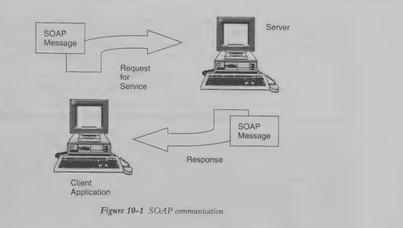

SOAP 的核心思想是将你想发送给远程应用程序的消息封装在 XML 中，然后以通常的方式通过 HTTP 传输。这样做使得 SOAP 可以与任何其他通过 80 端口进行的 Web 通信共享相同的端口。

SOAP 对话中使用的实际协议是之前描述的常规 HTTP 请求/响应。然而，SOAP 请求和响应的 `Content-Type` 标头规定为：

```
POST /item HTTP/1.1
Content-Type: application/soap+xml; charset=utf-8
```

请注意 MIME 类型是 `application/soap+xml`。SOAP 请求和响应的 `Content-Length` 标头指定了正文中的字节数。对于 MIME 类型，同样必须指定为 `application/soap+xml`。

SOAP 消息本身是 XML，这使其比 DCOM（分布式组件对象模型）等其他二进制分布式协议具有某些优势。使用 XML 可能唯一的缺点是其冗长的语法，但这也可以被视为一种优点。与倾向于更短的二进制格式相比，XML 可能会降低处理速度。不过，可以通过硬件设备和二进制 XML 来加速这种处理。

使用 XML 的 SOAP 包含几个元素：

- Envelope（信封） – 将 XML 文档标识为 SOAP 消息（必须）
- Header（标头） – 包含标头信息（可选）
- Body（正文） – 包含调用和响应信息（必须）


 ```
## 10 Web 服务、Feed 和博客

- **Fault** – 提供在处理消息时发生错误的相关信息（可选）。

SOAP 消息必须使用 SOAP Envelope 和 Encoding 命名空间：

```
<?xml version="1.0"?>
<soap:Envelope
xmlns:soap="http://www.w3.org/2001/12/soap-envelope"
soap:encodingStyle="http://www.w3.org/2001/12/soap-encoding">
```

但需要记住的是，应省略 DTD 引用和 XML 处理指令。

在 Listing 10-1 中，请求是向远程应用程序获取关于库存代码为 289387 的产品的信息。如你所见，该请求是由 XML 构成的。请注意这里命名空间的使用方式，以及 SOAP 如何利用 Envelope 元素来封装消息。

```
<?xml version="1.0"?>
<soap:Envelope
xmlns:soap="http://www.w3.org/2001/12/soap-envelope"
soap:encodingStyle="http://www.w3.org/2001/12/soap-
encoding">
  <soap:Body xmlns:m="http://www.stock.org/stock">
    <m:GetProductDescription>
      <m:ProductCode>289387</m:ProductCode>
    </m:GetProductDescription>
  </soap:Body>
</soap:Envelope>
```

*Listing 10-1 一个 SOAP 请求*

Listing 10-2 是来自远程应用程序的响应。注意其格式与请求消息非常相似。在这里我们看到，基于服务器的应用程序针对“哪个项目是 289387”的问题回答了“DVD 录像机”。

#### 知识点回顾！

- Web 服务允许通过互联网为各种任务提供功能。
- SOAP（简单对象访问协议）允许使用标准的基于 Web 的协议 (HTTP) 和脚本语言 (XML) 将信息传输到此类服务。
- 这为数据交换提供了一种安全且有效的机制。
- 许多脚本语言和编程语言都具备开发 SOAP 应用程序的能力。

```
<?xml version="1.0"?>
<soap:Envelope
 xmlns:soap="http://www.w3.org/2001/12/soap-envelope"
 soap:encodingStyle="http://www.w3.org/2001/12/soap-encoding">
 <soap:Body xmlns:m="http://www.stock.org/stock">
  <m:GetProductDescriptionResponse>
   <m:ProductDescription>
    Recorder-DVD
   </m:ProductDescription>
  </m:GetProductDescriptionResponse>
 </soap:Body>
</soap:Envelope>
```

*Listing 10-2 一个 SOAP 响应*

### 10.4 WEB FEEDS

Web feed 是一种通常基于 XML 的文档，用于提供新闻条目、天气和博客等内容。通常，这可以通过一个指向主源本身的链接来概括。在公开此类源时，你可能会遇到 *publishing a feed*（发布 feed）或 *syndication*（辛迪加/内容分发）这些术语。这简单来说是指将数据与其他站点共享的想法。主要使用的 feed 格式是 RSS 和 Atom。RSS 有几种不同的含义！其中较为流行的一种是 Really Simple Syndication，其他还包括 Rich Site Summary 和 Real-Time Simple Syndication。

Web feed 的信息通常使用聚合器（aggregator）来检索，聚合器会读取该流。这样做的目的是为了避免用户必须频繁检查站点以获取更新的内容。在某种程度上，通过从各种 feed 中收集订阅的信息，用户可以创建一种个人报纸。订阅和取消订阅这些流通常非常简单。例如，除了新闻 feed，BBC 网站还提供以下内容：

- 专辑评论
- 后台
- 喜剧
- *《神秘博士》* 新闻
- Radio 1 新闻
- *《流行金曲榜》* 每日新闻
- 天气。

能够以这种方式整合信息的聚合器已经开始被集成到网站、门户网站以及桌面应用程序中。电子邮件客户端、Web 浏览器、博客创建系统和媒体播放器都可以集成聚合器。某些设备（如电视/视频系统和手机）也可能集成这些功能。

### 10.4.1 **读取 Web Feed**

Web feed 通常有一个静态 URL 用于访问；例如，Ask Yahoo 的 feed 可以通过以下地址查看：

```
http://ask.yahoo.com/index.xml
```

使用普通浏览器读取时，文本没有太大意义（Listing 10-3）！你必须使用专门的阅读器才能正确查看。然而，如果你查看的 feed 是 RSS 或其他 XML 格式，可以通过浏览器的“查看源代码”功能来查看其结构。

```
<?xml version="1.0" encoding="iso-8859-1" ?>

<rss version="2.0">
<channel>
  <title>Ask Yahoo!</title>

  <link>http://us.rd.yahoo.com/ask/rss/?http://
        ask.yahoo.com/</link>
  <description>Answers to some of life's little
               mysteries.</description>
  <language>en-us</language>
  <copyright>Copyright (c) 2006 Yahoo! Inc. All rights
             reserved.</copyright>
  <lastBuildDate>Mon, 08 May 2006 03:00:32
                 PDT</lastBuildDate>
  <image>

    <url>http://us.i1.yimg.com/us.yimg.com/i/us/ask/gr/
         ask75x25.gif</url>
    <title>Ask Yahoo!</title>
    <link>http://ask.yahoo.com/</link>
```

```
<width>75</width>
<height>25</height>
</image>
<item>
<title>What exactly is "white noise"?</title>
<link>http://us.rd.yahoo.com/ask/rss/*http://ask.yahoo.com/20060505.html</link>
<description>In addition to being a rather forgettable thriller starring Michael Keaton, white noise refers to an "acoustical or electrical noise of which the intensity is the same at all frequencies within a given band." Now, unless you have a Ph.D. in acoustics, that definition probably makes no sense. So, let's add a little color to today's column with some help from our old friend ...</description>
<pubDate>Thu, 04 May 2006 21:00:00 PDT</pubDate>
<guid isPermaLink="false">ask/20060505</guid>
</item>
</channel>
</rss>
```

*Listing 10-3 一个 RSS Feed*

某些 feed 需要信息来处理你的请求。例如，对于天气 feed（如 Listing 10-4 所示），它可能需要你想要报告地点的位置标识符。使用伦敦的 Yahoo 天气 RSS 需要以下 URL：

```
http://xml.weather.yahoo.com/forecastrss?p=UKXX0085&u=f
```

问号之后的所有内容都是位置 ID。

```
<?xml version="1.0" encoding="UTF-8" standalone="yes" ?>
<rss version="2.0" xmlns:yweather="http://xml.weather.yahoo.com/ns/rss/1.0"
xmlns:geo="http://www.w3.org/2003/01/geo/wgs84_pos#">
<channel><title>Yahoo! Weather - London, UK</title>
<link>http://us.rd.yahoo.com/dailynews/rss/weather/London_UK/*http://xml.weather.yahoo.com/forecast/UKXX0085_f.html</link>
<description>Yahoo! Weather for London, UK</description>
```

```
<language>en-us</language>
<lastBuildDate>Mon, 08 May 2006 12:20 pm
    BST</lastBuildDate>
<ttl>60</ttl>
<yweather:location city="London" region="" country="UK" />
<yweather:units temperature="F" distance="mi"
    pressure="in" speed="mph" />
<yweather:wind chill="57" direction="150" speed="5" />
<yweather:atmosphere humidity="88" visibility="999"
    pressure="29.83" rising="0" />
<yweather:astronomy sunrise="5:20 am" sunset="8:35 pm" />
<image>
    <title>Yahoo! Weather</title>
    <width>142</width>
    <height>18</height>
    <link>http://weather.yahoo.com/</link>
    <url>http://us.i1.yimg.com/us.yimg.com/i/nus/nws/
        th/main_142b.gif</url>
</image>
<item>
    <title>Conditions for London, UK at 12:20 pm BST</title>
    <geo:lat>51.51</geo:lat>
    <geo:long>-0.08</geo:long>
    <link>http://us.rd.yahoo.com/dailynews/rss/
        weather/London_UK/*http://xml.weather.yahoo.
        com/forecast/UKXX0085_f.html</link>
    <pubDate>Mon, 08 May 2006 12:20 pm BST</pubDate>
    <yweather:condition text="Light Drizzle" code="9"
        temp="57" date="Mon, 08 May 2006 12:20 pm
        BST" />
    <description><![CDATA[
     <br />
    <b>Current Conditions:</b> <br />
    Light Drizzle, 57 F<br /> <b>Forecast:</b> <br />
    Mon - Showers. High: 58 Low: 48 <br />
    Tue - Showers. High: 63 Low: 51 <br /> <br />
    <a href="http://us.rd.yahoo.com/dailynews/rss/
        weather/London_UK/*http://xml.weather.yahoo.
        com/forecast/UKXX0085_f.html">Full Forecast
        at Yahoo! Weather</a> <br />
    (provided by The Weather Channel)</b>]]></description>
    <yweather:forecast day="Mon" date="08 May 2006" low="48"
        high="58" text="Showers" code="11" />
```


```xml
<yweather:forecast day="Tue" date="09 May 2006" low="51"
high="63" text="Showers" code="11" />
<guid isPermaLink="false">UKXX0085_2006_05
_08_12_20_BST</guid>

</item>
</channel>
</rss>
<!-- p5.weather.dcn.yahoo.com uncompressed/chunked Mon May 8 05:41:36 PDT 2006 -->
```
代码清单 10-4 一个天气 RSS 馈送

#### 10.4.2 创建你自己的 RSS 馈送

创建你自己的 RSS 馈送是一件相当简单的事情，这样人们就可以随时掌握你的网站或兴趣的最新动态！首先要做的是决定使用哪个版本的 RSS；较旧的版本（如 1.0 及更低版本）往往更难理解。这里我们将探讨 2.0 版本。

本节到目前为止来自 Yahoo 的示例都使用了 RSS 2.0 版本，正如你所看到的，凭借本书目前教授的 XML 知识，它相当容易理解。

```xml
<?xml version="1.0" encoding="ISO-8859-1" ?>
<rss version="2.0">
<channel>
<title>Ralph's Web</title>
<link>http://ralph-moseley.co.uk</link>
<description>Personal interests</description>
<item>
<title>Teaching</title>
<link>http://ralph-moseley.co.uk/teaching</link>
<description>Information on teaching modules
</description>
</item>
<item>
<title>Sound</title>
<link>http://ralph-moseley.co.uk/sound</link>
<description>Web pages on sound synthesis</description>
</item>
</channel>
</rss>
```
代码清单 10-5 RSS 馈送：各个组成部分

你应该能从代码清单 10-5（这是一个简单的 RSS 馈送）中识别出 XML 文档的一些特征。第一行是 XML 声明，它指明了所使用的 XML 版本和字符编码。接下来的行标识了要使用的 RSS 版本，在本例中是 2.0。接着是 `channel` 元素，它必须包含 `<title>`（频道的标题）、`<link>`（指向频道的超链接，在本例中是我的主页 URL）以及 `<description>`（频道的文本描述）。随后是一个 `<item>` 元素，它代表单篇新闻文章，同样包含这些元素，但处于新闻或故事条目的语境中。可以有多个 `<item>` 元素，也可以没有。

最后，`<channel>` 和 `<rss>` 元素都被关闭。在编写和尝试 RSS 时，请记得遵循所有 XML 规则：关闭元素、保持大小写一致以及正确地嵌套元素。

除了这里列出的主要元素外，`channel` 元素内部还有几个可选元素，如表 10-1 所示。

对于 `<item>` 元素，你还有一系列可选和必填的进一步元素，如表 10-2 所示。

一旦你开发了一个简单的 RSS 馈送，将其保存到你网站的合适位置进行测试。例如：

`http://ralph-moseley.co.uk/feed.xml`

对我来说这个路径可以工作。

上传之后，你接下来可以做的是对其进行验证并检查其正确性。可以使用如下合适的验证服务：

`http://feedvalidator.org/`

聚合服务允许你注册你的馈送，以便客户端能够找到它们；目前有几种可用的服务：

- Syndic8 – http://www.syndic8.com/
- NewsisFree – http://www.newsisfree.com/

最后，为了完善你的馈送，你需要在网站上放置某种通知，说明如何查看该馈送。这通常伴随着 RSS 图标：


| RSS 元素 | 描述 |
|---|---|
| category | 定义馈送的类别 |
| cloud | 馈送的更新通知 |
| copyright | 版权通知 |
| description | 频道的描述。必填 |
| docs | 馈送中使用的文档格式 |
| generator | 指定生成该馈送的程序 |
| image | 当聚合器展示馈送时要显示的图像 |
| language | 馈送所使用的语言 |
| lastBuildDate | 最后修改日期 |
| link | 频道的超链接。必填 |
| managingEditor | 馈送内容编辑的电子邮件地址 |
| pubDate | 馈送内容的最后发布日期 |
| rating | 馈送的 PICS 分级 |
| skipDays | 聚合器可以跳过更新馈送的天数 |
| skipHours | 聚合器可以跳过更新馈送的小时数 |
| textInput | 应该与馈送一起显示的文本输入字段 |
| title | 频道的标题。必填 |
| ttl | 馈送可以刷新之前的分钟数 |
| webMaster | 馈送 Web 管理员的电子邮件地址 |

**表 10-1 RSS `<channel>` 元素**

你可以手动更新自己制作的 RSS 馈送，或者使用专门的内容管理器来帮你完成这项工作，例如：

- MyRSSCreator - http://www.myrsscreator.com/
- FeedFire - http://www.feedfire.com/

你也可以编写自己的脚本或使用他人的脚本来更新 RSS 馈送。许多脚本语言都能够解析 XML，因此非常适合处理 RSS 内容的读取和写入。

| RSS 元素 | 描述 |
| :--- | :--- |
| author | 作者的电子邮件地址 |
| category | 定义条目的类别 |
| comments | 指向关于该条目评论的链接 |
| description | 条目的描述。必填 |
| enclosure | 随条目包含的媒体文件 |
| guid | 条目的唯一标识符 |
| link | 指向条目的超链接。必填 |
| pubDate | 条目内容的最后发布日期 |
| source | 条目的第三方来源 |

**表 10-2 RSS `item` 元素**

#### 知识点检查！

- Web 馈送允许感兴趣的各方在无需持续访问站点的情况下获取信息。这种信息的共享被称为**综合发布（Syndication）**。
- Web 馈送文件最流行的两种格式是 RSS 和 Atom。
- RSS 可以代表 Really Simple Syndication 等含义！
- 聚合器用于订阅 RSS 馈送。它们可以是应用程序或基于 Web 的服务。
- 通过仅收集所需信息，可以交付个性化内容。
- RSS 使用 XML。
- 内容结构相当简单。
- 可以自动更新 RSS 文件。

## 动手实践！

- 找一个带有 RSS 流的站点，尝试使用普通浏览器读取它。
- 加载馈送后，使用浏览器的“查看源代码”选项查看它。

> 了解如何使用聚合器订阅馈送；你可以使用基于站点的服务或应用程序（有时内置在浏览器中！）。
> 尝试编写你自己的馈送，如果可能的话将其上传到你的站点，验证它，最后使用阅读器查看它。

### 10.5 博客 (BLOGS)

“blog”这个词源于 Web log 或 Weblog（网络日志），是指在某个专业或职业兴趣领域随时间定期发布文章。博客可以是简单的日记风格，由带有时间戳的条目组成，也可以更复杂，使用多媒体来补充或替代文本。它通常允许读者对条目发表评论，使其更像是一种与外界的对话。

博客出现在 90 年代中期左右，最初只有少数人写在线日记，但到 2004 年，这很快成为了一种主流且流行的做法，涵盖了除个人用途之外的广泛主题领域：

- **商业 (business)** – 用于传播与商业活动相关的信息，如股票
- **社区博客 (Clog)** – 一种社区博客，具有一定的物理世界基础；例如作为一群人居住地的论坛
- **协作博客 (collaborative)** – 由多名成员共同撰写条目的博客
- **文化 (cultural)** – 通常关于音乐、艺术、戏剧、体育和流行文化的其他方面
- **教育 (educational)** – 博客有许多教育用途，例如记录学生的活动或作为学习日志
- **移动博客 (Moblog)** – 使用笔记本电脑、手机或 PDA 等合适设备在移动中更新的博客
- **付费博客 (paid)** – 代表公司创建的博客
- **照片博客 (Photoblogs)** – 由照片库而非文本构成的博客
- **政治 (political)** – 具有特定政治倾向的博客，可能由许多指向新闻文章的链接组成
- **专业 (professional)** – 这类博客涉及个人的职业甚至兴趣。通常不关于个人的具体雇主
- **科学 (science)** – 一种传播数据或讨论活动/结果的手段
- **社交 (social)** – 用于维护人与人之间的社交网络。

显然，这个列表没有涵盖所有类型的博客，但它确实让人们对博客活跃的多元化领域有所了解。

博客可以通过编辑器在网站上撰写条目来手动创作；它们也可以使用你自己开发或来自他人的脚本。越来越多的博主


在只需要你加入或注册的网站上使用自动化软件。随后，你可以为你的博客网站设置偏好并开始发布内容，包括附件、链接和多媒体。

撰写博客的软件可分为用户托管型（由博客作者自行安装在其系统上运行的软件应用程序）和开发者托管型（由开发者运营的软件服务，博客作者无需安装软件）。用户托管型的一个例子是b2evolution (http://b2evolution.net/)，而开发者托管型服务的一个例子是Blogger (http://www.blogger.com/)。

#### 检查点！

- 博客是Web log（网络日志）的缩写。
- 它是一种定期记录条目的方法，条目可以是文字形式或通过多媒体格式记录。
- 记录这些条目可以从静态的PC上进行，也可以在移动中，使用PDA或手机等其他设备。
- 这类日志有许多主题：它们可以类似于个人日记，也可以聚焦于某些兴趣或商业理念。
- 博客软件可以是用户托管的，也可以是开发者托管的（例如通过网站）。

#### 自我测试！

- 使用搜索引擎查找一些博客。
- 尝试了解用作博客主题的兴趣范围。
- 你将如何把博客整合到你自己的网站中？
- 你能写哪些日常主题？
- 访问Blogger (http://www.blogger.com/)，看看你会如何使用他们的博客系统。

### 10.6 章节总结

- 需要一种简单的方式来在网络中调用功能。
- 这必须能够在正常协议内工作，以避免安全问题。
- 未来应用程序可能以订阅服务的形式提供是可能的。
- SOAP允许从分布式应用程序远程调用功能。
- 它使用XML + HTTP来提供平台独立性、语言独立性、跨平台边界和通过防火墙进行通信。
- Web订阅源通过订阅而非访问网站向相关方提供信息。
- 执行收集首选数据任务的代理称为聚合器。
- 聚合器可以是桌面软件，也可以是网站服务。
- 使用基于XML的格式（如RSS或Atom）在网站上创建自己的订阅源相对容易。
- 创建的订阅源应该被注册，以便聚合器服务知道其存在。
- 博客提供了一种向更广泛世界传达兴趣、链接和个人事件的方式。
- 博客利用基于用户网站或通过网络服务的软件。

#### 章节测验

- 考虑一下你可以使用SOAP开发的应用程序类型。
- 你将如何修改你已经编写（或使用）的应用程序，使其通过网络服务工作？
- 你将如何为自己的网站开发Web订阅源？是否可以编写一个Web订阅源系统，在你当前所在位置更新所有人？
- 是什么激励某人撰写每日博客？
- 论坛和社区博客之间有什么区别？

#### 关键词和短语

**聚合器** 一种根据其用户的偏好需求检索联合Web订阅源的软件。它也可以应用于提供此服务的网站或门户网站。

**Atom** 基于XML的文件格式，用于各种任务，如Web订阅源和博客。

**博客** 一种基于网络的定期文章出版物，会定期更新。

**RPC** 远程过程调用，一种允许一台机器上的软件导致另一台机器上运行代码的协议。

**RSS** 真正简单的联合，一组基于XML的文件格式的名称，用于Web订阅源和博客。

**SOAP** 简单对象访问协议，一种通过网络交换XML消息的标准。

**Web订阅源** 一个定期更新的文档，可以包含摘要、博客和指向较长文章的链接。

**网络服务** 用于在应用程序之间交换数据的一组协议和标准的集合。

#### 有用的网址

- http://en.wikipedia.org/wiki/SOAP
- http://www.w3.org/TR/soap12-part0/
- http://www.w3schools.com/rss/
- http://www.myrsscreator.com
- http://www.feedfire.com/
- http://www.syndic8.com/
- http://www.newsisfree.com/
- http://feedvalidator.org/
- http://www.blogger.com/
- http://b2evolution.net/

## 11 服务器端

本章旨在让你首次接触服务器端并介绍服务器；各种可能的软件包和平台；如何设置及相关选项；测试你的服务器；记录用户和处理动态IP。

如果你只经历过客户端开发或浏览，那么向服务器端的跨越将是有趣且令人兴奋的。它为与你的用户进行更动态的交互以及控制页面交付方式提供了更大的能力。

在这里，我们首先介绍服务器的一般基本概念，然后具体到网络（Web），正如第1章开始时介绍的那样。我们将探讨各种服务器软件包，并突出其差异。我们也将考察操作系统平台，并提供比较，尽管对于初步学习可能不需要，但如果你打算设置一个即使是规模不大的网络服务器，这些比较将很重要。

一旦选择了合适的服务器，我们将提供有关各种相关选项、配置和测试的提示和技巧。我们将展示如何在安装了服务器的个人计算机上交付网页和进行开发工作。

跟踪访问者的主题将在此开始，简要介绍服务器日志及其在调查负载情况和哪些页面产生点击方面的重要性。

### 1.1 什么是服务器？

“服务器”一词可以有几种略有不同的含义和语境。在计算领域，它通常指代表另一段称为客户端的软件提供服务的软件应用程序。它也可以指运行该软件的机器，甚至在某些情况下指提供服务的公司。

就软件应用程序而言，还可以有不同类型的服务器提供各种服务。例如，你可以有一个Web服务器，但也可以有文件服务器和应用程序服务器。还有邮件和数据库服务器。以下是一些可能的服务器类型列表：

- Web
- 文件（可能使用FTP，例如）
- 应用程序
- 即时消息
- 图像（多种图像格式，包括视频流）
- 声音（音频和音频流）

服务器作为一段软件，可以驻留在你可能同时在执行其他任务的普通计算机上，例如撰写报告或处理电子表格。换句话说，它可以是一个后台任务（也称为进程，或在Unix语言中称为守护进程！），提供文件、网页、音频流或其他多媒体服务。一些病毒会安装此类软件，在你的计算机上设置文件服务器，以便通过非标准端口非法使用你的计算机资源。

所有这些服务器都有一个共同点：它们响应传入的请求并提供服务，正如第1章所描述的。对于Web服务器，请求是通过端口80使用HTTP协议向服务器发出的，服务器随后会响应所请求的项目或错误消息。文件服务器可能会通过FTP协议以类似的方式响应。这种模型称为客户端-服务器模型（如图11-1所示），其中客户端发出请求，服务器处理这些请求。另一种模型的例子是对等网络；在这里，每个节点或计算机都是平等的，因为它们既是服务器也是客户端。这在文件共享中很受欢迎，计算机会响应关于它拥有哪些文件的请求，如果被要求，它会向该网络的任何成员发送文件。其真正的威力在于计算能力和带宽的有效分配，而不是仅将其集中在少数几台服务器上。

服务器可以在你在家或办公室可能拥有的相当合适的计算机上运行，但它也可以是一台专用的硬件设备，具有高速互联网链接、太字节的存储和大量的内存。它也可以拥有一个多处理器主板。这种服务器可能必须处理大量快速连续的请求，并且是典型的


 **图 11-1** *客户端与（Web）服务器模型*

例如，在 Web 托管公司或 ISP（互联网服务提供商）工作的机器类型。使用一台精简的、甚至可能略微过时的机器来构建服务器也是可行的，因为只要负载不过重，它就可以是一个相当简单的计算机系统。例如，它不需要高性能的图形处理，因此实际上不需要显卡。它也不需要声音或复杂的硬件接口。它真正需要的是网络连接、足够的内存和磁盘空间。

此时一个有趣的问题是：你认为客户端和 Web 服务器哪个更复杂？

通常，答案是服务器的任务要简单得多，因为它只需要响应请求；而客户端（在 Web 服务器的情况下）必须渲染图形、处理用户的输入等。不过，服务器端脚本的出现增加了其需求的复杂度！

## 11.2 选择

有许多可以在个人计算机上设置的软件 Web 服务器。相当一部分属于公共领域，因此安装成本极低，甚至免费。以下是众多可用选项中的几个：

- 来自 Apache 项目的 Apache HTTPd Server
- 来自微软的 Internet Information Services (IIS)
- 来自微软的 Personal Web Server（已被 IIS 取代）
- 来自 Sun Microsystems 的 Sun Java System Web Server（原 Sun ONE Web Server）
- 来自 Zeus Technology 的 Zeus Web Server
- 来自 Aprelium Technologies 的 Abyss Web Server
- 来自 America Online 的 AOLserver（开源）
- 来自 BEA Systems 的 BEA WebLogic
- Lighttpd。

有些服务器以软件包的形式存在，其中还包含脚本语言模块扩展（如 PHP）和数据库技术（如 MySQL）。根据它们基于的平台不同，这些软件包被称为 LAMP、WAMP 或 XAMPP。例如，Linux 软件包是 LAMP，代表 Linux, Apache (Web 服务器), MySQL 和 PHP (以及/或 Perl + Python)，尽管还存在更多变体。

以下是对一些最流行软件的概述。

### 11.2.1 Apache HTTPd Server

这是互联网上最受欢迎的服务器，由 Apache 软件基金会下的一个开放开发者社区开发和维护。Apache 具有高度的可配置性，提供许多编译模块，范围涵盖从服务器端编程支持到身份验证方案。它支持 Perl (Practical Extraction and Report Language)、Python 和 PHP，以及诸如 `mod_access`、`mod_auth` 和 `mod_digest` 等身份验证模块。其他功能还包括 SSL 和 TLS 支持（如 `mod_ssl`）以及许多其他选项。Apache 存在两个主要版本：较旧的 1.x 系列和较新的 2.x 系列，后者有几项重大增强，包括 Unix 线程化以及对 Windows 等非 Unix 平台的更好支持。

获取地址：http://httpd.apache.org/

### 11.2.2 Internet Information Services

Apache 的主要竞争对手是微软的 IIS 或 Internet Information Services（有时称为 Server 或 System）。这是一套为 Windows 机器设计的基于互联网的服务，最初作为 Windows NT 的一个可选包，随后被纳入并集成到 Windows 2000 和 Windows Server 2003 中。它包含了用于 FTP、SMTP、NNTP 和 HTTP 的服务器。Windows XP 专业版包含一个受限版本的 IIS。

获取地址：微软（它可能已内置在您当前的 Windows 操作系统中）

### 11.2.3 PHP, Perl, Python...

有相当多可用的服务器端语言可以根据需要下载并安装。本书重点讨论 PHP，将其作为一种流行且现代的服务器端语言，但我们也会了解其他一些语言以熟悉其重要特性。

- PHP 主站：http://www.php.net/
- Perl 主站：http://www.perl.org/
- Python 主站：http://www.python.org/

### 11.2.4 MySQL

Web 上最流行的利用 SQL 的关系数据库服务器之一就是 MySQL。它是多线程且多用户的。它是开源软件，在 GNU 通用公共许可证 (GPL) 以及其他类型的许可证下可用。

MySQL 主站：http://www.mysql.com/

> 检查点！
- 服务器是处理传入请求的软件系统。
- 它有时是指整个硬件计算机（甚至是 ISP！）。
- 服务器有多种类型：Web、文件、应用、即时通讯、多媒体（图像、声音或视频，有时是流媒体）。
- 服务器可以驻留在用于其他任务的计算设备上，也可以是专用的。
- 针对各种工作负载、价格和平台（操作系统）有大量的服务器可用。
- Apache 是最受欢迎的服务器之一，并提供包含服务器端语言和数据库系统的特殊软件包。
- 除了客户端-服务器模型之外，还有其他模型；例如点对点 (peer-to-peer)，其中每个节点（一台计算机）都充当平等的客户端-服务器。

## 11.3 设置

要开始进行服务器端开发，你需要访问一个 Web 服务器，或者在自己的计算机上设置一个服务器。服务器软件可以下载并安装在你用于开发的特定计算机上。或者，你可能想在局域网 (LAN) 中设置一台计算机专门用于此任务。如果你想设置一台完整的服务器，你可能需要从“零”开始考虑系统：什么操作系统最好？什么样的硬件配置最合适？

在寻找服务器时，你应该注意的第一点是，某些操作系统自带内置服务器；这些包括：Mac OS X、Windows（某些版本有限制）、Linux 发行版（如 SUSE）以及 Unix。然而，即使已经安装，它们可能仍需要“开启”和配置。在某些情况下，下载软件包实际上可能会更容易，而且这也可能创建出更强大的服务器。

每个单独的软件包（如 Apache HTTPd Server 和 PHP）都可以下载并安装。通常，主网站会提供适用于你平台（Windows, Mac, Unix, Linux）的二进制（预编译）副本，然后你下载并按照精确的指令操作，这些指令因操作系统而异。

另一种设置机器的方法是使用包含你所需一切的软件包。XAMPP 是最容易安装的软件包之一，在此对其进行描述。

### 11.3.1 XAMPP

最容易设置的服务器软件包之一是 XAMPP（可在 Apache Friends 获取：http://www.apachefriends.org/en/index.html）。该软件包支持许多平台，如 Linux, Windows, Solaris 和 Mac。它安装非常简单且免费。虽然软件包内容会变化，但它通常至少包含以下内容：

- Apache HTTPd (Web 服务器)
- MySQL
- FileZilla FTP Server
- phpMyAdmin
- OpenSSL (用于安全)
- PHP ...

首先，从 Apache Friends 下载 XAMPP 软件包；你还会注意到一个占用磁盘空间较小的 XAMPP Lite 软件包——选择权在你。将软件包解压到驱动器根目录，例如 `C:\`。解压后，你会发现一个名为 `C:\xampp` 的目录（Lite 版本为 `C:\minixampp`）。

如果你想在 Windows NT/2000 下将服务器作为实际的服务运行，请启动安装批处理文件。否则，你可以手动启动和停止服务器，这无论如何都相当简单。启动 Apache 服务器的方法很简单，只需查找并运行 `apache_start.bat` 文件，停止它只需关闭控制台窗口。

启动 MySQL 服务器，请使用 `mysql_start.bat` 和 `mysql_stop.bat`。

### 11.3.2 服务器在哪里？

使用自己的设置进行开发和实验，可能意味着你最初不需要太担心 IP 地址和名称解析。你只需使用回环地址（之所以如此称呼，是因为它指向机器自身！）`http://127.0.0.1` 或 `http://localhost` 指向你自己的计算机。如果你的 Web 服务器是一台独立的机器，你需要知道本地 LAN 地址（例如 `http://192.168.1.8`）并指向它。如果你不知道 IP 地址，有几种方法可以找到它，具体取决于你所在的平台。前往服务器机器，根据操作系统使用相应的命令。在命令提示符窗口输入 `ipconfig` 命令，Windows 机器将响应并列出当前分配的 IP 地址。大多数基于 Unix 和类 Unix 的机器（包括 Linux！）如果你使用 `ifconfig` 就会给你线索。

图 11-2 显示了 Mac OS X 机器终端窗口中 `ifconfig` 的输出。这包含了计算机中所有连接到网络的设备列表。在这次特定的输出中，你可以看到 `lo0` 是回环地址 127.0.0.1，`en0` 是通过电缆的无线以太网连接（参见条目 `100baseTX <full-duplex>`），`en1` 是无线连接。在 Unix 类型机器上，你可以通过查看 MAC（介质访问控制，唯一标识符）地址（在本例中，en0 为 `00:10:93:72:f3:e2`，en1 为 `00:12:24:2b:1f:af`）与 `dmesg` 输出交叉核对这些条目。

### 11.3.3 测试

无论你选择哪个软件包，都应进行以下测试。为了检查你的服务器是否在运行并实际提供页面，你可以尝试将浏览器指向 `http://127.0.0.1` 或 `http://localhost`。你应该看到一个欢迎界面，而不是 `page not found!`（页面未找到！）的错误消息。

接下来的问题是：一旦服务器运行起来，你如何发布页面？

无论你安装什么服务器，都会有一个目录作为放置可发布 Web 页面的位置。表 11-1 显示了 XAMPP 下的子目录。要让服务器交付你自己的页面，请在 XAMPP 的主目录下或你安装的 Apache 目录下找到 `htdocs` 目录。例如，它可能是 `C:\xampp\htdocs` 或 `C:\mini\xampp\htdocs`。任何你希望被提供服务的页面都应放在此目录中。因此，如果你有一个名为 `myfirstpage.html` 的 Web 页面，你会将其放在 `htdocs` 目录中，然后将浏览器指向：

```
http://localhost/myfirstpage.html
```

希望一切顺利，它应该会出现！请注意，这里你在浏览器地址中并没有提到 `xampp` 或 `htdocs`！？原因在于 `htdocs` 被视为任何 Web 资料的起点。如果你想让网站的一部分关于你的大型收藏...

```
Ralph-Moseleys-Computer:~ ralphmoseley$ ifconfig
lo0: flags=8049<UP,LOOPBACK,RUNNING,MULTICAST> mtu 16384
    inet6inet ::1 prefixlen 128
    inet6 fe80::1 prefixlen 64 scopeid 0x1
    inet 127.0.0.1 netmask 0xff000000
lo0: flags=8010<POINTOPOINT,MULTICAST> mtu 1280
stf0: flags=0< > mtu 1280
en0: flags=8863<UP,BROADCAST,SMART,RUNNING,SIMPLEX,MULTICAST>
    mtu 1500
    inet6 fe80::20d:93ff:fe72:e3e2 prefixlen 64 scopeid 0x4
    inet 192.168.1.2 netmask 0xfffffff00 broadcast
    192.168.1.255
    ether 00:10:93:73:f2:e2
    media: autoselect <100baseTX <full-duplex>> status: active
    supported media: none autoselect 10baseT/UTP
    <half-duplex> 10baseT/UTP <full-duplex>
    10baseT/UTP <full-duplex,hw-loopback>
    100baseTX <half-duplex> 100baseTX
    <full-duplex> 100baseTX
    <full-duplex,hw-loopback>
en1: flags=8863<UP,BROADCAST,SMART,RUNNING,SIMPLEX,MULTICAST>
    mtu 1500
    inet6 fe80::211:24ff:fe2b:faf prefixlen 64 scopeid 0x5
    inet 192.168.1.3 netmask 0xfffffff00 broadcast
    192.168.1.255
    ether 00:12:24:1b:1f:af
    media: autoselect status: active
    supported media: autoselect
fw0: flags=8822<BROADCAST,SMART,SIMPLEX,MULTICAST> mtu 2030
    lladdr 00:0d:93:ff:fe:72:e3:e2
    media: autoselect <full-duplex> status: inactive
    supported media: autoselect <full-duplex>
```

**图 11-2 使用 ifconfig 查看网络详情**

假设你有一组关于热带鱼的资料，另一组关于你对高尔夫球的兴趣，你可能希望将不同的材料分开存放，因此你可能会创建一个名为 fish 的目录和另一个名为 golf 的目录。随后可以通过以下方式访问任何网页：

```
http://localhost/golf/
```
用于访问高尔夫资料，以及

```
http://localhost/fish/
```
用于访问热带鱼资料。不要忘记，如果有人在地址栏输入 `http://localhost/golf/`，该目录下必须有一个名为 `index.html` 或 `index.php` 的页面，启动页才能正常工作。

| 文件或目录 | 含义 |
| :--- | :--- |
| `\xampp\apache\logs` | Apache 和 PHP 的日志文件存放处 |
| `\xampp\apache\bin\php.ini` | 使用 MOD_PHP 的 PHP 核心配置文件 |
| `\xampp\cgi-bin\` | CGI-BIN 目录 |
| `\xampp\apache\conf\httpd.conf` | Apache 核心配置文件 |
| `\xampp\htdocs\` | HTML、PHP、CGI 等 Web 文档根目录 |
| `\xampp\install\` | 初始化文档 |
| `\xampp\mysql\` | MySQL 目录 |
| `\xampp\perl\` | Perl 目录 |
| `\xampp\php\` | php.exe + dlls + pear |
| `\xampp\phpmyadmin\config.inc.php` | phpMyAdmin 配置文件 |
| `\xampp\tmp` | PHP 上传和会话（sessions）等临时目录 |
| `\xampp\moddav` | MOD-DAV 示例 |

**表 11-1 XAMPP 目录结构**

### 11.3.4 Web 服务器的外部访问

要从外部世界（超出你的局域网/LAN！）访问服务器，你需要知道它的外部 IP 地址。你可以通过计算机查询，或使用 `http://www.whatismyip.com` 等 Web 服务来获知。一旦知道了地址，你就可以在浏览器中输入该地址加上你想要查看的目录；例如：`http://86.135.74.177/golf`。

这里需要提到的一个重要点是，为了访问你的页面，你必须配置所有的防火墙（无论是在路由器/调制解调器上，还是在服务器机器本身上），以允许对 80 端口的访问。通常，防火墙允许用户进行配置，以便仅开放他们需要的端口。同样，如果你想搭建 FTP 或其他类型的服务器，则必须开放相应的访问端口。不要忘记，某些操作系统（如 Windows XP）内置了防火墙。

如果你想为你的服务器绑定一个域名怎么办？为此，你需要购买一个域名，例如 `http://www.mygolfempire.org`。然后通过 DNS 服务（如 `http://www.dyndns.org/`）注册该域名，从而将你的 IP 与该特定名称连接起来。

#### 知识点检查！

- 服务器软件可以单独下载安装，也可以作为针对各种 OS 平台的特殊软件包安装，例如 LAMP、WAMP 或 XAMPP。
- 一个完整的软件包可能包含服务器本身、服务端语言、数据库系统以及相关工具。
- 你用来学习或开发服务器的机器可以是你的常用工作机（如笔记本电脑），也可以是局域网中的一台专用计算机。
- 你可以通过 `http://127.0.0.1`、`http://localhost` 或局域网 IP 地址访问本机上的服务器。
- 如果你使用的是专用服务器，请使用其局域网 IP 地址。通常可以通过该机器的网络配置系统或通过命令行获知：`ifconfig`（适用于类 Unix 计算机）或 `ipconfig`（适用于 Windows 机器）。
- 当你最初将浏览器指向服务器地址（如 `http://127.0.0.1`）时，大多数服务器都会显示一个测试页面。
- 服务器和单个用户都有 Web 文档根地址，以便在连接的网络上发布页面。

### 11.4 UNIX 和 LINUX WEB 服务器

基于 Unix 的平台通常也有自己的 Web 服务器版本。事实上，基于 Unix 和 Linux 的系统是构建 Web 服务器系统最受欢迎的基础。例如，Yahoo 的 Web 服务器使用 FreeBSD 和 Apache；MP3.com 网站使用 FreeBSD 和 Apache 来提供页面和 MP3 音乐文件；而微软使用 FreeBSD 来驱动其 hotmail 邮件服务器！

在基于 Unix 和 Linux 的系统中，文件结构略有不同，因此你可能会发现文件存放的位置与 Windows 系统不同。例如，在 Windows 上，你通常会在 Apache 目录或主软件包树下找到 Web 文档，如 `C:\xampp\htdocs`。基于 Unix 的系统处理方式略有不同。例如，在我的 OpenBSD 系统中，主服务器 Web 根目录是：

`/usr/local/www/data`

系统中的每个用户帐户也有自己的目录和 Web 文件夹：

`/home/ralph/public_html`

你如何从外部世界访问这些目录？在我的例子中，主服务器站点就是它的 IP 地址，本地地址为 192.168.1.4。所以：

`http://192.168.1.4`

初始安装后，将浏览器指向这个本地地址会弹出测试屏幕，如图 11-3 所示。请注意，这里的服务器已经添加了安全模块，并在该测试页面中被提及为 `mod_ssl`。

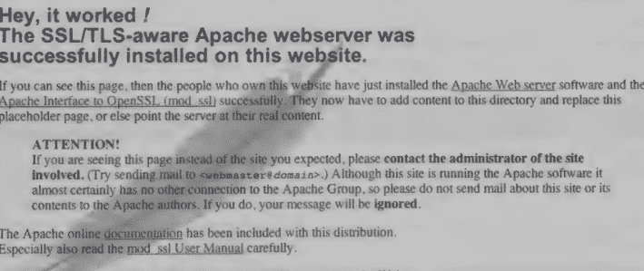

**图 11-3 Apache 服务器测试页面**

如何访问个人的页面？如果该用户的用户名是 `brianjones` 且页面名为 `helloYou.html`，那么访问地址为：

`http://192.168.1.4/~brianjones/helloYou.html`

请注意，这里在用户名之前有一个波浪号（~）。

#### 自测练习！

- 找出最适合你的 PC 或笔记本及其操作系统的服务器。如果你需要服务端语言和数据库系统，可以考虑使用完整的软件包。安装完成后，找出如何启动和停止服务器，如果有数据库服务器，也找出如何操作。
- 你将想要发布在 Web 上的文档放在哪里？尝试启动服务器并将浏览器指向其地址。
- 找出可以通过多少种方式指向同一个地址；例如，你的服务器的局域网地址是什么？它的外部 IP 地址是什么？
- 使用 `ping` 命令检查你的服务器是否在线。输入命令后跟 IP 地址。如果你遇到问题，请检查防火墙是否允许请求通过！

### 11.5 选择哪个 OS？

如果你要构建一台专用的 Web 服务器，你会选择哪个 OS？每种选择都有优缺点：

- **Windows 2000** 是 Windows NT 的改进版，经历了持续的演进。它承受了大量病毒、间谍软件和黑客攻击的压力。Windows Server 2000 还捆绑了 IIS。
- **Windows Server 2003** 在稳定性方面比之前的 Windows 服务器有所进步，并根据预期负载提供了多种版本：Web、Standard、Enterprise 和 Datacenter。它的价格可能较为昂贵，且在性能上可能不如 FreeBSD 或 NetBSD。
- **FreeBSD** 是基于 Unix 的系统，正如我们所见，它被大型公司用于处理高负载。它以拥有最快的 TCP/IP 协议栈之一而著称。它与 Linux 有一些相似之处（例如软件的兼容模式），但 FreeBSD 从一开始就是为重型网络构建的，能够处理 Linux（和 Windows NT）无法应对的高流量场景。
- **OpenBSD** 是一款超安全 OS，其代码经过严格的审计和漏洞检查。整个系统采用强大的加密和重型算法，确保了在操作系统中能实现最高级别的安全性。它是免费且开源的，可通过下载或购买 CD 获取。
- **NetBSD, DragonflyBSD...** 是 BSD 的其他分支，具有各种专业化的特性和哲学。


- **Mac OS X** 可以作为稳定系统的基础，因为它最初就是围绕 FreeBSD 构建的！它预装了 Apache，并且相当容易地让 PHP 等任何模块运行起来。如果你愿意，也可以安装 XAMPP 这种完整的软件包。该系统还有一个特定的服务器版本——Mac OS X Server，安装和使用都非常简单。
- **Sun Solaris** 是最广为人知的商业 Unix 操作系统。它拥有种类繁多的工具、插件以及对 Windows 网络的支持。它具有实时更新系统，这在全天候运行的环境中非常有用。与大多数服务器操作系统相比，它的安装和管理可能更为困难。
- **Linux** 有几种适用于 Web 服务器的发行版（有时缩写为 *distro*）：Slackware、Debian、Red Hat、SUSE 等等。许多人将 Slackware 版本用于 Web 服务器，事实证明它相当稳定，重启次数有限。对于基于生产环境的 Web 服务器，许多企业使用 Red Hat Enterprise Linux (RHEL)。

那么，你选择哪个呢？如果你仅仅是为了学习，甚至在一定程度上进行开发，你可以选择任何你认为适合你或你的设备的系统！更理想的做法是尝试不止一种。

如果你想尝试运行一个 Web 服务器，有几个点值得关注。FreeBSD 和 OpenBSD 都极其稳定，且部署成本不高。在应用程序支持方面，FreeBSD 可能稍好一些，但 OpenBSD 拥有极其安全的功能。这些系统通常可以运行数年服务于网页而无需重启！

> **资源！**
>
> 本章包含了你可能需要的所有软件的 URL，无论是 Web 服务器、脚本语言、数据库系统还是工具。
>
> 如果你对独立的服务器机箱感兴趣，并想要一个更具挑战性的项目，为什么不尝试基于 FreeBSD 的配置呢？一个很好的起点是：http://www.freebsd.org。

#### 11.6 用户日志记录

追踪谁在访问你的站点，以及何时/从何地访问的一种方法（还有其他方法，我们稍后会探讨）是查看服务器日志。每当有人访问你的网页并发出 HTTP 请求时，服务器就会记录该活动。这些文件保存在一个特殊的日志目录中。请查阅你的服务器文档以确定具体位置。在 Windows 上运行的 Apache，日志保存在其根目录下的一个目录中，例如 `C:\Apache\logs`，对于 XAMPP 则是 `c:\xampp\apache\logs`。在 OpenBSD 系统中（大多数 Unix 系统可能相同），路径为：`/var/log/httpd.access.log`。

图 11-4 显示了传入请求的日志示例。它由访问者的 IP 地址组成，随后是发出实际 HTTP 请求的日期和时间。

```
192.168.1.3 - - [10/Jan/2006:19:22:09 +0000] "GET /cmt3092 HTTP/1.1" 301 366
192.168.1.3 - - [10/Jan/2006:19:22:10 +0000] "GET /cmt3092/ HTTP/1.1" 200 343
192.168.1.3 - - [10/Jan/2006:19:22:17 +0000] "GET /cmt3092/xampp-win32-1.2.exe HTTP/1.1" 404 1243
192.168.1.3 - - [10/Jan/2006:19:22:47 +0000] "GET /cmt3092//cmt3092/xampp-win32-1.2.exe HTTP/1.1" 404 1117
192.168.1.3 - - [10/Jan/2006:19:23:29 +0000] "GET /cmt3092/ HTTP/1.1" 200 344
192.168.1.3 - - [10/Jan/2006:19:23:36 +0000] "GET /cmt3092/xampp-win32-1.2.exe HTTP/1.1" 200 283293331
192.168.1.3 - - [10/Jan/2006:19:33:08 +0000] "GET /cmt3092 HTTP/1.1" 301 366
```

图 11-4 服务器日志

#### 11.7 动态 IP

如果你想搭建一个 Web 服务器，DNS 需要知道它对应的 IP 地址（如第 1 章所示），但如果这个地址时不时地发生变化怎么办？你可能通过与 ISP 的服务协议，或者简单地通过机器上的连接信息注意到你拥有一个动态 IP。由于 IP 会变化，如果没有处理它的特定技术和机制，搭建 Web 服务器将相当困难！然而，现在存在动态 DNS 服务，可以在你的 IP 发生变化时更新你的 DNS 配置文件。实现这一点的一种方法是使用一个在后台运行的小程序（或进程），检查当前的 IP 是否与上次检查时相同。如果不匹配，它会向动态 DNS 服务发送一条消息，随后该服务会更新 DNS 系统。

例如，我运行的一个 BSD Web 服务器使用一个名为 `ddclient` 的可用程序，在检测到更改时更新我在 dyndns.org 的动态 DNS 服务。

#### 知识点回顾！

- Unix 和类 Unix Web 服务器具有不同的目录结构，包含一个 Web 文档根目录和每个用户独立的 Web 发布目录。
- 每个平台都有优缺点，鲁棒性、负载、稳定性和价格是你应该考虑的几个属性。
- 大型公司倾向于使用基于 Unix 的极其稳定的系统，如 FreeBSD 和 OpenBSD（为了安全）。
- 服务器日志是检查系统使用情况以及查看访问者（可能）来源的一种方式。
- 通过使用动态 DNS 服务和支持软件，即使使用动态 IP 地址也可以搭建服务器。

### 11.8 本章总结

- 服务器有多种类型：Web 服务器、文件服务器、应用服务器、即时通讯服务器和多媒体服务器。
- 在我们的上下文中，服务器通常是指那个处于活动状态并响应 Web 页面 HTTP 请求的软件片段。
- Web 架构有几种模型，包括客户端-服务器模型和点对点模型。
- 服务器可以在相当低配置的硬件上运行，或者对于更高负载的需求，可以使用具有大硬盘容量和内存的多处理器系统。
- 根据你的需求，有许多流行的服务器软件包和软件类型可供选择。
- 服务器通常有一个用于发布网页的特定目录，包括 Web 根目录。
- 启动服务器后，你应该能够通过将浏览器指向计算机的 IP 回环地址 http://127.0.0.1 或 http://localhost，以及其本地局域网 IP 来确认它处于活动状态。
- 根据主题，在适当的目录名称下将 Web 目录中的内容分开存储。
- 有许多命令行工具可以帮助你诊断和分析服务器配置，包括 ifconfig（类 Unix 机器）和 ipconfig（Windows）以及 ping 和 netstat。
- 在搭建专用服务器机器时，考虑操作系统平台至关重要。
- Web 服务器可以通过购买域名并将其与 IP 地址注册来关联到特定的域名。
- IP 地址可能是动态的，但这需要专门的 DNS 服务和软件来支持服务器。

#### 本章练习

- 为什么 OpenBSD 被认为是稳定的服务器平台？
- 你的系统可以使用哪些数据库服务器？
- 哪些防火墙在保护你的计算机？如果你在大学校园或公司内工作，外部世界可以访问哪些端口和服务？
- 流媒体服务器与普通的文件服务方案有何不同？
- 查找 Web 上最流行的服务器及其各自的市场份额。

#### 关键词汇

**Apache HTTPd** 一款适用于多种平台的流行开源 Web 服务器
**Client-server (客户端-服务器)** 一种网络应用架构模型，其中定义了客户端和独立的服务器
**Distro (发行版)** distribution 的缩写，通常用于 Linux 的版本
**Dynamic DNS service (动态 DNS 服务)** 一种使 DNS 与服务器关联的动态 IP 地址变化保持同步的服务
**Dynamic IP (动态 IP)** 由于 ISP 原因而时而发生变化的 IP 地址
**Peer-to-peer (点对点)** 一种网络应用架构模型，其中每个节点都可以平等地充当客户端或服务器
**Server (服务器)** 一个响应请求的应用程序，在 Web 服务器的情况下使用 HTTP 协议

#### 实用网址

```
https://www.lighttpd.net/
http://httpd.apache.org/
http://www.apachefriends.org/en/index.html
http://www.microsoft.com/WindowsServer2003/iis/default.mspx
http://www.dyndns.org/
http://www.linux.org/
http://www.freebsd.org/
```

 http://www.openbsd.org/
http://www.php.net/
http://www.perl.org/
http://www.python.org/

## 12

### PHP 1：开始在服务器端编写脚本

*本章对 PHP 和服务器端动态编程进行了基本介绍。*

*你将学习如何开发简单的 PHP，如何构建你的程序，以及如何在 HTML 中嵌入脚本。*

在本章中，我们将探索如何使用 PHP 编写脚本，这是 Web 应用的理想选择，能够根据用户或处理的数据进行交互并按需生成页面。

PHP 是一个缩写，意为"**PHP：超文本预处理器**"（**PHP: Hypertext Pre-Processor**）；你可以称之为*递归*的，因为它引用的是自身！这种命名风格借鉴自 Unix 的 GNU——GNU's Not Unix。

首先，让我们弄清楚为什么需要像 PHP 这样的动态编程语言。既然有如此多不同的编程语言，为什么还要学习并开发另一种呢？

PHP 是一种现代的、面向 Web 的语言。它是现代的，因为其开发者从其他语言中汲取了经验，并特别针对 Web 开发进行了优化。你可能已经从 C、C++ 和 Java 等其他语言中学到了与 PHP 的理念和实现相符的概念和思想。JavaScript 章节中展示的许多编程结构和概念在此也同样适用。

PHP 特别适合 Web 开发，尤其是因为它能够实现与网页的动态交互，在实时数据处理过程中构建页面。这可能是用户输入、数据库内容、日期敏感性或其他会变化的信息。

#### 自我测试！

- 通过在 Web 上做一些研究来了解 PHP 的起源。它最初的名字是什么？

### 12.1 开始使用 PHP 编写脚本

PHP 是一种与 HTML 相结合的脚本语言，可以通过嵌入到网页文档中，或作为与之并行处理的文件使用，但这是在服务器端进行的！

清单 12-1 展示了一个嵌入了 PHP 代码的 HTML 页面。代码位于 HTML 内部的一个特殊标签中，以 `<?php` 开头，以 `?>` 结尾。此标签内的任何代码都被解释为 PHP，并且必须遵循 PHP 程序中合法的语法。

```
<html>
<head>
<title>Listing 12-1</title>
</head>
<body> Today's date is <?php print(date("l F d, 'Y')); ?>
</body>
</html>
```

**清单 12-1** 使用 `date` 函数的脚本

以这种方式嵌入代码时，特别注意格式化脚本以使其易于理解尤为重要。例如，可以像清单 12-2 那样改进上述程序。注意这里有几个不同之处：

- 代码已缩进
- 添加了注释
- 添加了更多空白。

PHP 可以根据你的风格进行缩进和添加空白（间距），这是良好的编程实践。这提高了可读性，因此增加了一种更易于理解的样式。

注意添加空白和缩进不会干扰程序的运行或输出。这种添加唯一可见的方式是打印语句中的文本发生变化。在之前的脚本中使用了 echo 而不是 print，那么它们有什么区别呢？区别不大，只是 print 实际上是一个总是返回 1 作为值的函数，但这可以忽略。Echo 稍微快一点，因为它不会这样做。

```
<html>
<head>
<title>Listing 12 appetizer</title>
</head>
<body> Today's date is
<?php
/*
 * We can print today's date using PHP
 *
 */

 print(date("l F d, Y"));
?>
</body>
</html>
```

*清单 12-2* 使用 *date* 函数整理脚本

### 12.1.1 良好的编程实践在此适用！

在程序中，HTML 主体包含输出到网页的文本，然后是 PHP 代码。这被发送到 Web 浏览器内的 PHP 引擎或解释器。PHP 代码的任何输出将跟随 HTML 的文本。在本例中，PHP 的输出由 print 命令发送，并利用 date 函数，该函数允许以由特殊字符集确定的格式输出当前日期。在本例中，我们选择了星期几名称、完整的月份名称、月份中的日期和四位数的年份。

另一种提高可读性和快速理解程序的方法是添加注释。在 PHP 中，这与 Java、C 和 C++ 类似。注释可以只占用一行，使用双斜杠，也可以占用多行。

```
// 这是一条注释

/*
*   这也是一条注释...！
*   但这条跨越了
*   多行
*/
```

多行注释通过以 /* 开始并以 */ 结束来跨越多行。

你可能希望程序的输出完全来自 PHP，而不是 HTML。实现这一点的方法是将实际文本与 date 函数一起放置在 print 语句中。

清单 12-3 展示了如何将输出直接放置在 PHP 代码中。但请注意，生成的网页完全相同。将文本输出与函数结合的方法是使用句点字符。这与其他语言略有不同，在其他语言中，连接（将两项如字符串连接在一起）由加号或＆符号等字符执行。在此示例中，你会注意到年份的输出略有不同，因为它采用两位数格式。发生这种情况是因为清单 12-3 使用的是小写 'y'，而之前的程序使用的是大写，这意味着应该是四位数年份。

```
<html>
<head>
<title>Listing 12-3</title>
</head>
<body>
<?php
/*
* We can print today's date using PHP
*
*
*/

print("Today's date is ".date("l F d, y"));
?>
</body>
</html>
```

> 清单 12-3 使用连接

#### 自我测试！

- 你已经遇到了 date 函数，但还有哪些其他有用的内置函数？在 Web 上查找！
- 列出你认为可以应用于 PHP 脚本的良好编程实践特性。

### 12.2 变量

正如前面 JavaScript 章节所述，编程语言通常需要某个地方来保存正在处理的值。PHP 与其他语言一样，使用变量来完成这项工作。

当变量第一次被遇到时，会为其内容留出内存空间。与 C 和 Java 等许多编程语言不同，你不必显式说明该变量将容纳什么类型，它会从赋值语句中推断出来。这种语言特性被称为"松散类型"。清单 12-4 包含几个具有不同内容的变量。在 PHP 中，所有变量都以美元符号开头。清单中的前两个，`$filmName` 和 `$cinema`，包含可以是任意文本信息的字符串，由字符构建而成。下一个变量 `$screenNumber` 包含整数类型的数字，而 `$ticketCost`，因为它是一个货币值，具有浮点类型。最后，在此清单中，我们将一个函数的值赋给变量，在本例中是 `date` 函数。当 PHP 解释器遇到此情况时，它首先计算函数结果并将其放入变量内存中。它需要这样做以便为结果分配正确的内存空间。

程序的下一部分输出变量内容。注意，尽管输出到网页的内容在一行上，但执行此操作的程序语句实际上在三行上。程序正在将文本连接在一起，完全通过连接运算符实现变量输出。

### 12.2.1 PHP 中的错误

如果在变量名前面遗漏美元符号会怎样？如果你这样做，变量正在被设置和声明，那么你会收到类似图 12-1 的错误。

```
Parse error: parse error, unexpected '=' in /homepages/
42/d33119297/htdocs/book/list12_4.php on line 1
```

如果错误出现在程序中声明之后的较低位置，那么程序可能会运行，但结果会很奇怪。清单 12-4 中 print 语句里 `$cinema` 变量缺少美元符号的输出如图 12-2 所示。如果你仔细看输出，会注意到影院名称的位置出现了单词"cinema"。换句话说，打印出来的是变量名本身，而不是其内容。

Today, Monday August 02, 2004, at the cinema in screen 5 is
Minority Report which costs 7.5

你还可以定义常量；使用 `define` 语句将名称与值关联起来。它们不需要美元符号在前面，一旦设置就不能更改，但在其他方面它们的使用方式与变量相同：

```
define("pi", 3.14159);
```


 ## 知识点检查！

我们现在已经掌握了如何：

- 通过声明变量并为其赋值来设置变量
- 创建常量
- 输出存储在变量中的值
- 将文本和变量拼接在一起进行输出
- 使用简单的内置函数
- 为了可读性和良好的编程实践而进行格式化。

#### 自测练习！

- 编写一个小程序，通过 PHP 的 `print` 命令输出一个 HTML 文档。不要忘记你可以使用 Web 文档中所有常用的格式命令。

### 12.3 获取输入

下一个阶段是学习如何接收用户的输入；毕竟，使用 PHP 的优势之一就是能够根据用户数据动态构建 Web 页面！

Listing 12-5 是一个 HTML 文档，它调用了一个单独的 PHP 文件来处理从用户那里收集的输入。首先是常规的起始标签和标题。在正文（body）中是一个包含多个部分的表单。我们可以看到有几个输入点，由诸如“Name:”、“Age:”和“Date of Birth:”之类的标签以及一些输入变量和相关类型组成。表单的第一行和最后一行涉及在按下提交按钮时链接到单独的 PHP 文件。`action` 语句指向的程序将能够通过定义的各种变量访问用户输入。

Listing 12-6 是一个更复杂的程序。它不是纯 PHP，而是 HTML 和 PHP 的混合体。该清单以一个位于主 HTML 代码之外的插入部分开始。这表明 PHP 代码不必包含在 HTML 之内。它还表明你可以在整个清单中将 PHP 分成多个片段。这段代码像之前一样使用 `date` 函数设置变量。代码的下一部分是常规的 HTML 起始点，随后进入主程序。

```
<html>
<head>
<title>Listing 12-5</title>
</head>
<body>
<form action="list12-6.php" method="post">
  Name: <input type="text" name="aName"><br>
  Age: <input type="text" name="anAge"><br>
  Date of Birth: <input type="text" name="dob"><br>
<input type="submit" value="Send Data">
</form>
</body>
</html>
```

*Listing 12-5 设置表单*

```
<?php
	$Today = date("l F d, Y");
?>
<html>
<head>
<title>Listing 12-6</title>
</head>
<body>
Today's date:
<?php
	/*
	** print today's date
	*/
	print("<h3>$Today</h3>");

	/*
	** print greeting message
	*/
	print($_REQUEST['aName'] . ", you are ");
	print($_REQUEST['anAge']);
	print(" years old and your date of birth is ");
	print($_REQUEST['dob']."<br>");
?>
</body>
</html>
```

*Listing 12-6 访问表单变量*

主部分首先打印出在清单开始时设置的日期。这像之前一样通过 `print` 语句输出，但这次它在实际字符串中使用 HTML 进行了格式化。在这种情况下，使用了 Web 页面中常用的 `<h3>` 样式。思考这个问题的最佳方式是正确地地将其想象为：你正在通过 `print` 输出编写一个 Web 页面，而不是像 C 等其他语言那样输出到屏幕上。

接下来的代码段在运行时使用 `$_REQUEST['variable_name']` 访问在 Listing 12-5 中设置的变量。当 HTML 表单页面上的提交按钮被按下时，表单字段会被发送到 `action` 属性中注明的脚本。PHP 获取这些值并将其放入一个名为 `_REQUEST` 的数组中。数组简单来说就是一组在同一个名称下访问的内存位置切片。在这种情况下，每个存储的表单字段都被放置在一个内存位置中，程序员通过在方括号中放入所需字段的名称来访问它。你可能会注意到，在 HTML 代码中描述表单字段时，每个字段都附带了一个类型；如果你在预期输入数字的地方输入了字符串，那么 PHP 将为该字段输入零。

这个清单中另一个需要注意的点是换行符（newline）和行中断（line breaks）的使用。这允许任何输出在同一行继续，直到你希望输出某种类型的中断。记得 Loading... 我们在开始新的重写内容之前，先完成之前的想法。

我需要从文本以“Another point to note in this listing is the use of newline and line breaks. This allows any output to continue on a line until you wish to output a break of some type.”结束的地方继续，并从此继续。

#### 知识点检查！

本节涵盖了几个关键点：

- 通过变量输入
- 在运行时将控制权转移到另一个脚本
- 访问变量
- 处理用户输入的数据
- 通过 HTML 命令格式化输出。

#### 自测练习！

- 编写两个脚本，一个用于获取图书馆客户的详细信息，另一个用于存储这些详细信息（在变量中）并将其显示出来。

### 12.4 决策

在编写脚本和程序时，我们经常需要某些代码段仅在满足特定条件时才执行。这个理念与 JavaScript 章节中所遇到的一样。在 PHP 的情况下，能够以特定格式或具有特定功能的 Web 页面生成，可能是此类决策的结果。

Listing 12-7 展示了如何根据是否存在某些条件来控制脚本的执行流程。首先，程序像之前一样使用 `date` 函数打印今天的日期，但请注意，这次变量被嵌入在实际的输出字符串中。如果你习惯于其他编程语言，你可能会认为实际的变量名本身会被打印出来，但在 PHP 中，字符串内对已知变量的任何引用都会导致其内容（而非名称）被打印出来。

```
<html>
<head>
<title>Listing 12-7</title>
</head>
<body>
<h1>
<?php
    $Today = date("l F d, Y");
    print("Today is $Today -");

    /*
    ** Get this years leap year status!
    */
    $Today = date("L");
    if($Today == 1)
    {
        print("This year is a leap year!");
    }
    else
    {
        print("This year is not a leap year");
    }

?>
</h1>
</body>
</html>
```

Listing 12-7 控制执行流程

接下来的代码段再次调用 `date` 函数并复用同一个变量，这次是获取 `date` 函数的闰年状态值。

要访问此值，在字符串中放入一个 'L'。这样做之后，如果当前年份是闰年，返回值则为 1，否则为 0。如果你想在程序中针对两种情况做出反应，可以使用所示的条件结构。

这种特定方法与 JavaScript 章节中描述的方法相同。它的结构以 `if` 语句本身开始，后面跟着包含逻辑条件的括号。这里的情况是测试一个变量是否包含 1。注意，测试使用的是双等号而不是单等号，单等号用于赋值。

表 12-1 显示了其他可用的逻辑运算符；其中一些非常明显，另一些则较为微妙。

条件或测试被执行，如果结果为真，则允许执行下一个代码块。`if` 语句还可以包含一个在条件为假时执行的代码块，该块包含在 `else` 语句之后。

| 运算符 | 执行的操作 | 示例 |
|----------|---------------------|---------|
| < | 小于 | $num < 12 |
| > | 大于 | $num > 32 |
| <= | 小于或等于 | $num <= 23 |
| >= | 大于或等于 | $num >= 78 |
| == | 等于 | $num == 3 |
| === | 全等 | $num === NULL |
| != | 不等于 | $num != 20 |
| !== | 不全等 | $num !== FALSE |
| AND, && | 逻辑与 | $num1 AND $num2 |
| | | $num1 && $num2 |
| OR, \|\| | 逻辑或 | $num1 OR $num2 |
| | | $num1 \|\| $num2 |
| XOR | 异或 | $num1 XOR $num2 |
| ! | 非 | ! $num |

*表 12-1 比较运算符*

通过这种方式，可以根据用户输入、发生的事件或进行的数据处理来控制执行流程。

在 Listing 12-8 中，我们找到了另一种根据变量中包含的值来控制脚本流程的方法。同样，这与为 JavaScript 描述的情况完全一样，使用 **case** 语句，并提供了一种直接地对多种可能性做出反应的手段。在这个例子中，日期首先被收集并打印出来。日期再次通过函数单独收集为一个数字并存放在 `$diaryDate` 中。**case** 结构以 **switch** 语句开始，后面跟着你想要检查的变量，在本例中是 `$diaryDate` 变量。在接下来的由花括号标记的块中，是一组可执行行，每行都以 **case** 语句开始。这包含了针对该特定响应的选择。因此，如果是 2004 年 8 月 3 日，那么 `case 03` 将被激活，并且从该点开始的代码将被执行，直到遇到结尾的 `break` 语句。一旦执行到达这一点，代码将开始在结构的代码块之外执行。

最后，如果所有 case 都已检查且没有一个与 `$diaryDate` 中包含的日期匹配，那么可以添加一个 **default** 语句，它将启动一段待执行的代码。

```
<html>
<head>
<title>listing 12-8</title>
</head>
<body>
<?php
    $Today = date("l F d, Y");
    print("Today is $Today, I will check your
           diary...<br>\n");

    $diaryDate = date("d");

    switch($diaryDate)
    {
      case 3 : print("you have a dinner date"); break;
      case 10 : print("dentist appointment today"); break;
      case 23 : print("have the day off!"); break;
      case 29 : print("go to conference"); break;
      default : print("You have no booked events today!");
    }

?>
</body></html>
```

> Listing 12-8 使用 switch-case 结构


在该实例中。默认（Default）的意思是，在本例中，如果其他情况都不满足，就执行这段代码。因此，如果是2004年8月7日，默认代码将会运行，并报告“您今天没有已预订的活动”。

现在我们已经了解了如何使用 if 语句和 case 语句，可以对它们进行比较。在清单12-9中，同一个程序有另一个版本，使用的是 if else 而不是 case。虽然它的运行方式与使用 case 的版本相同，但可能略显杂乱！它与 case 版本非常相似，但重复了检查条件和它操作的变量名。同样，也有一个默认选项，如果执行没有遵循上面的任何一条路径，该选项就会被激活。

```php
<?php
	$Today = date("l F d, Y");
	print("Today is $Today, I will check your
		diary...<br>\n");
	
	$diaryDate = date("d");
	
	if ($diaryDate==3) print("you have a dinner date");
	else
	if ($diaryDate==10) print("dentist appointment
			today");
			
	else
	if ($diaryDate==23) print("have the day off!");
	else
	if ($diaryDate==29) print("go to conference");
	else
	print("You have no booked events today!");
?>
```
*清单 12-9* 使用 *date* 函数的脚本

### 12.5 循环

我们可能还希望脚本重复执行一定次数。这可能用于处理数据、收集输入或输出结果，等等。

### 12.5.1 for 循环

如果你知道某段代码需要重复执行多少次，可以使用 **for** 语句。清单12-10展示了如何操作。在使用了一段HTML代码之后，PHP部分直接进入了一个 for 循环。**for** 循环包含语句本身，后面跟着括号中的控制参数。第一个参数仅在循环开始前执行一次；通常是需要初始化的变量。下一个参数是用于停止循环的测试条件。在本例中，测试作用于 `$count` 变量，意思是“当 `$count` 变量小于或等于12时，执行下面的循环”。最后一个参数在每次循环执行完毕后执行。通常这是一条使循环计数器递增的语句。

```html
<html>
<head>
<title>Listing 12-10</title>
</head>
<body>
<h1>I must learn my 7 times table</h1><br>

<?php
  for($count = 1; $count <= 12; $count++)
  {

    print("7 * $count =".(7*$count)."<br>");
  }
?>
</body>
</html>
```
清单 12-10 *引入 for 循环*

所以，其概念是：

```php
for (初始化; 结束条件; 更新计数器) {
    循环体
}
```

在这个程序中，有一些格式处理是在HTML中完成的，例如样式选择，其余则是在PHP中完成的。在本例中，我们可以看到需要换行符来跳到下一行。如清单12-9所示，变量值包含在实际的输出字符串中。

当脚本执行循环时，每次执行都会递增（加1）`$count` 变量。第一次进入循环时，`$count` 被设置为1，然后被打印和计算。执行一次后，`$count` 再次递增，以此类推。最后，循环完成第十二次执行，计数器变量变为13。此时，for 语句中的第二个参数变为假，循环退出。

### 12.5.2 while 循环

实现同样效果的另一种方法是使用 while 循环。在这种方法中，你需要自己完成更多工作：例如，只有一个参数，而不是 for 语句中的三个参数。唯一的参数是检查计数器是否已达到其上限。当运行清单12-11中的脚本时，计数器在循环外设置为1。循环在入口处检查 `$count` 的值。如果计数已经超过12，那么循环将根本不会进入！在本例中，计数器必须在循环块本身内部递增。请注意，如果在循环块中没有改变计数，那么它将永远运行下去！

```html
<html>
<head>
<title>Listing 12-11</title>
</head>
<body>
<h1>I must learn my 7 times table</h1><br>
<?php

     $count=1;

     while( $count<=12 )
     {
          print("7 * $count =".(7*$count)."<br>");

          $count++;

     }

?>
</body>
</html>
```
*清单 12-11* 使用 while 的脚本

清单12-12包含了编写同一程序的另一种方法。这次使用的是 do... while 循环，但这一次有什么不同呢？区别在于，该循环*总是*至少执行一次，因为检查是在末尾而不是在开始处。这对于某些类型的问题很有用，因此值得仔细考虑需要哪种类型的循环。

```html
<html>
<head>
<title>Listing 12-12</title>
</head>
<body>
<h1>I must learn my 7 times table</h1><br>
<?php

$count=1;

do {
	print("7 * $count =" . (7*$count) . "<br>");

	$count++;

} while( $count<=12 )

?>
</body>
</html>
```
*清单 12-12* 又一种循环结构

### 12.5.3 使用 break 和 continue

如果你使用了上述某种循环，并且正在处理信息——例如输入数据——并希望提前结束（在你设定的自然结束之前），你会怎么做？通常，你会设置某种检查，或者在 *for* 循环的情况下，设定一个确切的数字。对于检查，你可以故意让检查提前失败。例如，在乘法表脚本中，我们可以这样说（虽然这并不太优雅）：

```php
if ($count==8) $count=12;
```

如果这条语句正确地放置在某个循环中，它将在计数达到12之前提前终止循环。另一种方法是使用 **break** 语句：

```php
if ($count==8) break;
```

当达到8时，这会强制执行流程再次从当前循环块外部开始。例如，如果在数据收集过程中出现了异常情况，这可能很有用。PHP语言中另一个有趣的特性是 continue 语句。

清单12-13展示了 continue 语句的使用。该循环通常只会打印从0到5的数字，但却跳过了2。这是因为 continue 语句的作用使循环跳过了那一次特定的执行，直接进入下一次。在本例中，print 语句不会被执行，循环从顶部重新开始。如果将 continue 语句替换为 break，循环将在2处终止。

```html
<html>
<head>
<title>Listing 12-13</title>
</head>
<body>
<h1>Doing the loop</h1><br>

<?php
  for ($i = 0; $i <= 5; $i++) {
    if ($i == 2) continue;
    print "$i<br>";
  }
?>

</body>
</html>
```
*清单 12-13 跳过某次迭代*

在本节中，你已经了解了如何通过使用 if 语句进行决策和使用 for 语句进行重复来控制程序的流程。

#### 检查点！

我们现在知道了：

- 如何根据条件控制程序的执行方式
- 实现这一点的两种方式：if 和 case
- 实现相同结果的方法不止一种
- 如何重复执行特定次数的代码。

### 12.6 本章总结

- PHP可以嵌入HTML文件中，也可以放在单独的文件中。
- 应通过确保可读性来保持良好的编程习惯——添加结构、间距和注释。
- PHP中有很多内置函数；在编写自己的函数之前，请确保先检查它们！
- 选择良好的变量名，并记住，在PHP中，变量以美元符号开头。此外，它们是松散类型的。
- 你可以在一个单独的PHP文件中访问在HTML脚本中设置的表单变量。
- If 语句可以检查特定条件是否存在，然后执行适当的代码。它们也可以有一个备用的 else 块来执行。
- 如果有几种可能的替代方案，switch 语句可能更优雅地完成任务。如果值不存在，它还包含一个默认选项。
- 请记住，条件是通过双等号进行测试的，赋值则是通过单等号。
- 如果你想对一段代码重复执行（迭代）已知次数，请使用 for 语句。
- 如果你想在开始时进行检查的循环，请使用 while 结构。
- 如果你想在结束时进行检查的循环，请使用 do... while 结构。
- 要提早结束循环，请使用 break 语句。
- 要跳过循环的某一次迭代但继续执行，请使用 continue 语句。

#### 章节测验

- 通过访问本章末尾提到的网站，了解PHP的当前版本。本文撰写时，当前版本是PHP5。
- 查找可以在线阅读PHP文档的地方。
- 你可以使用什么函数来查看PHP的状态？
- echo 和 print 有什么区别？两者都可以输出字符串。

#### 关键词和短语

**Concatenation（连接）**：将两个或多个字符串连接在一起。在PHP中，这是通过点字符完成的。

**Increment（递增）**：值增加的一个变量。

**Iteration（迭代）**：一段代码的重复执行。


#### 弱类型 (Loosely typed)
如果一种语言是弱类型的，则不需要显式声明变量的类型。

#### 运算符 (Operator)
一个与值一起使用以执行某种操作并通常产生结果的符号。

#### 递归 (Recursive)
指代自身的事物。

#### 有用的网址
- http://www.php.net
- http://www.w3schools.com/php
- http://www.zend.com
- http://www.phpfreaks.com

#### 关键研究报告

当前环境状态不稳定。

- 观察结果 A：初始读数是一致的。
- 观察结果 B：24 小时后出现波动。
- 观察结果 C：温度升高了 2 度。
- 观察结果 D：压力大幅下降。
- 观察结果 E：气体水平保持稳定。
- 观察结果 F：湿度峰值为 80%。

数据分析表明，系统中的压力与温度变化之间存在相关性。

- 步骤 1：初始化传感器阵列。
- 步骤 2：校准基准值。
- 步骤 3：监测异常情况。
- 步骤 4：每隔 5 分钟记录一次数据。

> 核心的稳定性对于实验的成功至关重要。

关于第二阶段的补充说明详见附录。

- 结果 1：观察到高效率。
- 结果 2：产生的废物极少。
- 结果 3：能耗降低了 15%。

结论：实验结果支持该假设。

需要进一步研究以验证长期效果。

## 13 PHP 2：数组、函数与表单

在这里，你将学习如何在 PHP 中进一步操作数据，并在过程中掌握新函数、循环结构以及通过表单对输入数据进行验证。书中将讨论从简单数组到动态结构的演变，以及通过特殊函数操纵字符串的能力。特别关注在处理数据时如何利用 PHP 的特定特性，以及如何利用这些特性来增强安全性。

本章将继续我们对 PHP 的探索，我们将开始接触那些使其成为如此实用的 Web 语言的特性。该语言还包含一些与之前许多编程语言相似（甚至完全相同）的方面，并在其基础上进行了构建。例如，在本章中，有关于开发自定义函数、字符串处理和数组的章节。通过意识到存在让 Web 编程变得更简单的特性，这些功能得到了进一步增强。

PHP 包含了许多与 JavaScript 类似的结构和元素。另一个例子就是数组，尽管其中存在一些你会逐渐察觉到的细微差异。例如，数组可以被动态地处理（如果你希望的话），就像带有配套功能的栈 (stack) 数据结构一样。可以收集访问者的软件详情并控制浏览器。表单信息可以轻松收集并使用高级字符串操作进行处理。信息可以写入本地服务器端文件，并在必要时进行加密。这种内置功能使得编程变得快捷且愉快，无需重新造轮子！

### 13.1 数组

正如你可能在 JavaScript 中记得的那样，数组就像变量，但它们不是只持有单个值，而是可以持有多个值。为了能够持有多个值并仍然能够访问它们以进行更改和读取，你必须使用索引，第一个索引值是 0 而不是 1。

```php
<?php

$myarray = array();
$myarray[0] = "This";
$myarray[1] = " is ";
$myarray[2] = " my array";

echo( $myarray[0].$myarray[1].$myarray[2]);

?>
```
*代码清单 13-1 使用数组*

代码清单 13-1 展示了一个被声明为 `$myarray` 的数组，随后用字符串值对其进行初始化。然后访问并打印出数组的内容。再次注意，连接（join）运算符被用于将三个字符串拼接在一起进行输出。

也可以在程序开始时设置值，而不是像上面那样分成单独的操作：

```php
$myarray = array("This", " is ", " my array");
```

数组值可以是不同的类型；上述值全部是字符串。例如，你可以非常轻松地将它们混合使用：

```php
$myarray = array("one", 2, 3.5);
```

在这种情况下，最后两个值是数值，因此你可以对它们进行数值运算：

```php
$total = $myarray[1] + $myarray[2];
```

一旦你给数组元素分配了值，仍然可以更改它：

```php
$preference = array("red", "white", "blue");

$preference[1] = "green";
```

现在数组在索引 0 处包含 red，索引 1 处包含 green，索引 2 处包含 blue。

### 13.1.1 数组与循环

PHP 提供了一些在循环中访问数组的巧妙方法，因此当你需要时，无需复杂的编程即可访问数组的所有成员或特定成员。

```php
<html><head></head>
<body><ol>
<?php
    $preferences = array ("red", "white", "blue","silver",
                          "aqua","cyan", "yellow");

    echo("The current preferences are");
    foreach($preferences as $value)
    {
        echo("<li>This preference is: $value </li>");
    }
?>
</ol></body></html>
```
*代码清单 13-2 foreach 循环*

代码清单 13-2 展示了如何将 PHP 与 HTML 混合使用以产生一个相当简单的脚本。各种偏好设置将逐一在编号行中输出到浏览器。编号是通过 HTML 生成列表实现的。循环由 `foreach` 结构形成。它的工作方式是从指定的数组中一次提取一个值。随着循环的进行，这些值被放入第二个变量 `$value` 中。循环内部的 `echo` 语句随后将其输出。在这种情况下，具体的输出将是：

1. This preference is: red
2. This preference is: white
3. This preference is: blue
4. This preference is: silver
5. This preference is: aqua
6. This preference is: cyan
7. This preference is: yellow

这比使用 `for` 循环稍微简单一些，因为你不需要知道数组的大小来确定终点。如果使用 `for` 循环或任何其他循环（如 `while`），则需要此信息。这可以通过对数组使用 `sizeof()` 或 `count()` 函数来获取。

代码清单 13-3 展示了同一个脚本，但用 `for` 循环重写。终点是通过 `sizeof()` 找到的。

```php
<html><head></head>
<body><ol>
<?php
    $preferences = array ("red", "white", "blue", "silver",
                          "aqua", "cyan", "yellow");

    echo("The current preferences are");
    for ($i=0; $i<sizeof($preferences); $i++) {
        $value = $preferences[$i];
        echo("<li>This preference is: $value</li>");
    }
?>
</ol></body></html>
```
代码清单 13-3 等效的 *for* 循环

如果我们想向数组中添加更多值怎么办？在某些语言和传统的静态数组中，这将是不可能的，或者至少实现起来有些繁琐！然而，在 PHP 中，可以使用 `array_unshift()` 和 `array_push()` 将值添加到数组的开头和结尾。要添加到开头：

```php
array_unshift($preferences, "black", "gold");
```

可以使用以下代码在末尾添加：

```php
array_push($preferences, "green", "pink");
```

你可能能想到如何从数组中删除项目：你可以删除想要去掉的项目，并将周围的其他项目复制到新位置。PHP 通过包含更多命令使其变得简单！要从数组开头删除一个项目，请使用：

```php
array_shift($preferences);
```

要删除末尾的项目：

```php
array_pop($preferences);
```

如果你学习过数据结构，你会注意到 PHP 将动态数组视为一个带有 pop 和 push 的栈。这可以想象成一叠盘子：当你想要把一个盘子（信息）放入栈中时，你把它放在顶部（push），当你想要取出一个项目时，你取最上面的那个（pop）。这就是著名的 LIFO（后进先出）结构。当然，数组也可以通过其他方式访问，所以它仅在这一组特定命令集上具有相似性。


也可以使用 `sort()` 命令对数组进行排序，它将按从低到高的顺序排列：

```
sort($preferences);
```

如果数组中存储的是一组字符串，它们将按字母顺序排序。可以通过第二个可选参数选择应用的排序类型：

- SORT_REGULAR – 正常比较项目（不改变类型）
- SORT_NUMERIC – 按数字进行比较
- SORT_STRING – 将项目作为字符串进行比较
- SORT_LOCALE_STRING – 根据当前区域设置将项目作为字符串进行比较。

或者，也可以将它们打乱：

```
```
shuffle($preferences);
```

还可以将两个数组合并在一起：

```
$endArray = array_merge($prefs1, $prefs2);
```

这里，最终数组是由另外两个数组 `$prefs1` 和 `$prefs2` 合并而成的。

还可以分段复制数组：

```
$endArray = array_slice($prefs, 2, 6);
```

在这种情况下，最终数组是由 `$prefs` 数组中索引 2 到 6 之间的部分组成的。

有许多不同的有用函数可用于操作数组，涵盖了提取数据段、排序、求和、排序和合并。如果你愿意，甚至还有一个从数组中随机选择数据的函数！

#### 13.1.2 键与值

在 PHP 中使用数组的一个重要方面是具有键值对（key–value pairs）的能力。这允许你通过名称而非索引来引用数组中的元素，如清单 13-4 所示。

这展示了记住数组中存放数据的位置是多么容易。这里需要注意的点是，在定义键和值时使用的引号（单引号和双引号）的不同，以及特殊的关联运算符 `=>`。

键值数组格式也用于表单，其中表单上的输入名称是键，而内容是值。

```php
<?php

$mydata = array ('name' => "Charles Lutwidge Dodgson",
'age' => 28, 'occupation' => "logician,
writer");

echo("my name is ".$mydata['name']." my age is ".$mydata['age']);

?>
```
*清单 13-4 使用关联数组*

#### 13.1.3 表单与关联数组

在 PHP 中访问表单值非常简单且非常有用！例如，清单 13-5 是一个 HTML 输入表单，用于捕获用户数据，然后将其发送到 PHP 脚本。

```html
<html><head></head>
<body>
<form action="check.php" method="post">
What is your customer number?
<input type="text" size="12" name="customer"><br>
<br>Please select your pizza: <br>
<input type="radio" size="40" name="pizza"
value="Mushroom">Mushroom<br>
<input type="radio" size="40" name="pizza"
value="Pepperoni">Pepperoni<br>
<input type="radio" size="40" name="pizza"
value="Calzone">Calzone<br>
<input type="radio" size="40" name="pizza" value="Four
Cheeses">Four Cheeses<br>
<input type="radio" size="40" name="pizza" value="Veg
Special">Veg Special<br>
<input type="radio" size="40" name="pizza" value="Sea Food
Special">Sea Food Special<br>
<br>Please Select base: <br>
<input type="radio" size="40" name="base"
value="Thin">Thin<br>
<input type="radio" size="40" name="base"
value="Crispy">Crispy<br>
<input type="radio" size="40" name="base"
value="Deep">Deep<br>
<input type="radio" size="40" name="base"
value="Stuffed">Stuffed<br>
<br>Extras: <br>
<input type="radio" size="40" name="drink"
       value="Coke">Coke<br>
<input type="radio" size="40" name="drink"
       value="Soda">Soda<br>
<input type="radio" size="40" name="sidedish"
       value="salad">Salad<br><br>
<input type="submit" value="Submit your order!">
</form>
</body></html>
```
*清单 13-5 用于 PHP 处理的 HTML 输入表单*

该 HTML 表单由常见的输入元素组成，包括文本输入和单选按钮。与 JavaScript 或其他处理方式的不同之处在于，当点击提交按钮时会发生什么。正如你从 `action` 属性中看到的，它通过 `post` 方法被发送到一个名为 `check.php` 的 PHP 脚本。

清单 13-6 是处理 HTML 表单的 `check.php` 脚本。在这个脚本中首先发生的是将表单 `POST` 数组中的内容传输到变量中。请注意，正如前面提到的，输入标签变成了实际数组的键。

```php
<?php
$customer = $_POST['customer'];
$pizza = $_POST['pizza'];
$base  = $_POST['base'];
$drink = $_POST['drink'];
$sidedish = $_POST['sidedish'];

if (empty($customer) || empty($pizza) || empty($base)) {
// stop execution of PHP script using die function!
die("<br>Please fill out the form carefully....<br>");

}

echo("Customer $customer has ordered a $pizza with a $base
             base ");
if (!empty($sidedish)) {
    echo(" they'd also like a $sidedish ");
}
if (!empty($drink)) {
    echo(" and have chosen a $drink drink");
}
?>
```
*清单 13-6 处理 HTML 表单的 PHP 脚本*

一旦信息被传输以简化访问，就可以检查其内容。这里首先进行一次检查，以查看表单是否填写得合理；即是否有客户编号，以及是否选择了比萨和底盘。如果这些不存在，则表单停止。在打印出客户的主要详情后，会对两个可选项目（侧边沙拉和饮料）进行检查。只有在被选中时才会打印它们。

你可以像平常一样检查变量内容，并验证它们是否与你的预期相符。例如，PHP 有多种对变量进行广泛检查的方法。如上所示，初步检查可能是检查是否真的有任何内容！这是通过 `empty()` 函数完成的。还可以通过 `is_numeric()` 查看用户是否用数字回答，不过你可以针对各种类型检查任何变量，包括：`is_integer()`、`is_bool()`、`is_float()`、`is_array()`、`is_string()`、`is_null()` 和 `is_long()`。

#### 知识点检查！

- 数组有一个单一的变量名，但具有多个可访问的内容。
- 索引从 0 开始。
- 数组项的使用方式与普通变量相同，可以应用各种操作，如数学运算或字符串拼接。
- 数组可以在声明时初始化。
- 有用的结构（如 `foreach`）允许遍历数组。其他循环结构也可以用于索引遍历数组。
- 函数能够对数组执行各种操作，例如 `sizeof()`、`shuffle()` 和 `sort()`。
- 数组也可以被视为动态数据结构，例如 LIFO（后进先出）栈。
- 关联数组允许通过键进行访问。
- 关联数组用于访问 PHP 中的许多重要值，例如来自服务器（通过 `$_SERVER`）和表单（通过 `$_POST`）的值。
- 你应该使用 PHP 函数来验证表单返回的值是否符合预期。
- 尝试使用数组存储信息（例如关于音乐收藏的信息）并将数据输出到 Web 页面。
- 对这些数据尝试各种函数，例如 `shuffle()` 和 `sort()`。
- 作为一个稍微长一点的练习，尝试实现一个具有 Web 界面的栈，利用数组函数 `array_pop()` 和 `array_push()`。

### 13.2 函数

函数的理念是将一段可以被频繁使用、且可能应用于不同数据的代码分离出来。你已经接触过 PHP 中许多内置函数。这些函数可以通过函数名后的圆括号来识别；它们还可以包含*参数*。函数也可以由用户创建，使用 *function* 关键字：

```php
function test1() {
    echo("Hey this is inside your function<hr>");
}

function test2($name) {
    echo("Hey, $name, this is the second function");
}

function test3($num1, $num2, $num3 = 10) {
    $someOp = $num1 + $num2 + $num3;
    return $someOp;
}
```

只要包含在常规的 `<?php ?>` 括号中，函数可以放在 Web 页面的任何位置。然后可以像调用 PHP 内部函数一样调用它们：

```php
<?php
test1();
test2("Bert Fry");
$result = test3(4, 5, 6);
?>
```

在函数 `test3` 中有 3 个参数；如果用户没有提供最后一个变量，它将具有默认值 10。此函数还有一个返回值，在本例中返回给 `result` 变量。

### 13.3 浏览器控制

PHP 可以控制浏览器的各种特性。这很重要，因为经常需要重新加载同一个页面（例如，如果页面表单需要重新尝试）或将用户重定向到另一个页面。

其中一些特性是通过控制发送给浏览器的 HTTP 标头信息来实现的。这使用了 `header()` 命令，例如：

```php
header("Location: index.html");
```

在这种情况下，将会重定向到 `index.html` 页面。也可以重新加载当前页面：

```php
<?php

header("Cache-Control:no-cache");

$self = $_SERVER['PHP_SELF'];

...

<form action = "<?php echo $self; ?>" method ="post">
```

这段代码片段展示了一种常见技术，即在收集信息的同时在同一个页面上对其进行一定程度的处理。首先，发送标头信息，指示始终重新加载页面，而不是依赖缓存版本。第二部分设置 `$self` 变量，将其定义为该页面的 URL 值。随后在脚本中，表单可以利用 `$self` 变量来指向此页面，从而检查收集的数据，如果数据不正确，则可以重新显示表单。这倾向于使脚本保持相当紧凑并集中在一个页面上，而不是链接到另一个脚本。

使用 `header()` 函数时需要记住的主要一点是，它应该是发送到页面的第一个输出，否则会报错，例如 'headers already sent'（标头已发送），而事实确实如此！

### 13.4 浏览器检测

带有浏览器的设备范围正在增加，因此了解你正在处理的是哪种浏览器及其其他详细信息变得越来越重要，以便适当地渲染 Web 页面。


服务器正在处理的浏览器可以通过以下方式识别：

```
$browser_ID = $_SERVER['HTTP_USER_AGENT'];
```

`$_SERVER` 是一个全局数组，其中存储了有关服务器当前状态的许多有用信息。`HTTP_USER_AGENT` 是该信息表中的一个环境变量。

查询该变量的典型响应如下所示：

```
Mozilla/5.0 (Macintosh; U; PPC Mac OS X; en) AppleWebKit/312.1
(KHTML, like Gecko) Safari/312
```

这显示了在 Mac OS X 上运行的 Safari 浏览器。

```
Mozilla/5.0 (Macintosh; U; PPC Mac OS X Mach-0; en-US; rv:1.7.6)
Gecko/20050225 Firefox/1.0.1
```

这显示了在 Mac OS X 上运行的 Firefox 浏览器。

```
Mozilla/5.0 (compatible; Konqueror/3.4; Linux) KHTML/3.4.0 (Like
Gecko)
```

这显示了在 (Slackware) Linux 上运行的 Konqueror 浏览器。

因此，你需要做的就是检查返回的包含浏览器信息（以及你可能需要的操作系统信息）的字符串。

### 13.5 使用 PHP 进行字符串操作

PHP 中的许多操作都是围绕字符串处理展开的，无论是来自用户的输入、数据库还是已写入的文件。

首先，可以将 PHP 中的字符串视为字符数组，因此可以这样写：

```
$mystring = "this is a test";
print $mystring[0]; // 将打印 't'
print $mystring[3]; // 将打印 's'
```

这里使用索引（方括号中的数字）作为从字符串开头起的偏移量，从 0 开始。

通常，需要对字符串执行特定操作，例如反转、提取部分内容、查找匹配项或更改大小写。你可以借助循环手动完成这些操作，但和 PHP 的惯例一样，其中许多操作已经以函数的形式为你提供了。

表 13-1 显示了 PHP 中一些可用的字符串函数。通常，你需要处理用户的输入，并检查他们是否正确填写了表单。例如，以下代码片段用于为网站注册用户，本例中使用的是纯文本文件。通常会使用数据库或*加密*文件。

你可能想做的第一件事是去除首尾空格，以获取表单数据中实际要处理的字符串：

```
// 从 HTML 表单收集数据
$name_in  = $_POST['name1'];
$email_in = $_POST['email1'];
$ident_in = $_POST['ident1'];

// 检查是否已填写
if (empty($name_in) || empty($email_in) || empty($ident_in)) {
	die("请填写所有必填字段");
}

// 去除字符串首尾的空白字符
$name  = trim($name_in);
$email = trim($email_in);
$ident = trim($ident_in);
```

如果你想将用户的注册限制在特定的电子邮件地址组，可能属于某个特定组织，你可以对提供的电子邮件地址进行检查：

```
// 检查是否包含组织域名
if (!strstr($email,"@mdx.ac.uk")) {

	die("必须是有效的 mdx 地址！");

}
```

请注意，这里使用 `strstr()` 函数执行检查，以查看输入的字符串中是否包含电子邮件部分。有时检查字符串的长度很有用：

```
// 检查身份标识的长度
if (strlen($ident)!=7) {

	die("请填写正确的详细信息");

}
```

| 字符串函数 | 用途 |
| --------------- | ------- |
| `strlen($string)` | 返回字符串长度 |
| `strstr($string1, $string2)` | 在字符串 1 中查找字符串 2；如果未找到返回 false，否则返回包含它的字符串 1 的部分 |
| `strpos($string1, $string2)` | 在字符串 1 中查找字符串 2；如果未找到返回 false，否则返回子字符串开始的索引位置 |
| `substr($string, startpos)`<br>`substr($string, startpos, endpos)` | 返回从起始位置到结尾的字符串，或由 `startpos` 到 `endpos` 指定的部分 |
| `strtok($string, $delimiters)`<br>`strtok($delimiters)` | 将字符串拆分为标记。首次调用需要字符串和分隔符，后续调用只需要分隔符，因为字符串已存储 |
| `trim($string)`<br>`rtrim($string)`<br>`ltrim($string)` | 去除字符串首尾的空白字符，包括制表符、换行符和空格。`ltrim` 仅去除字符串开头的空白，`rtrim` 仅去除字符串末尾的空白 |
| `strip_tags($string, $tags)` | 去除字符串中的 HTML 标签，仅保留 `$tags` 中指定的标签 |
| `substr_replace($string1, $string2, start, end)` | 类似于 `substr`，但用字符串 2 替换从 start 到可选 end 位置的子字符串。返回转换后的字符串 |
| `str_replace($search, $replace, $string, $count)` | 在 `$string` 中查找 `$search` 并替换为 `$replace`，替换次数记录在 `$count` 中 |
| `strtolower($string)` | 将 `$string` 中的所有字符转换为小写 |
| `strtoupper($string)` | 将 `$string` 中的所有字符转换为大写 |
| `ucwords($string)` | 将字符串中所有单词的首字母转换为大写 |
| `explode($delimiters, $string)` | 类似于 `strtok`，但在分隔符标记的位置将字符串拆分为数组 |
| `stripslashes($string)` | 去除插入的反斜杠 |

表 13-1 PHP 中的一些字符串函数

`strlen()` 函数用于检查身份代码的长度，该长度应为特定值。

#### 知识点回顾！

- 可以使用 `function` 关键字编写自己的函数。
- `header()` 函数允许通过 HTTP 头信息控制访问者的浏览器。例如，可以重新加载或重定向。但请确保这是页面的第一个输出！
- 在开发自己的应用程序和网页时，了解访问者使用的浏览器类型以及设备本身非常重要，以便正确显示信息。浏览器可能是移动设备（如 pico）的浏览器。
- PHP 内置了大量用于字符串操作的函数。

### 13.6 文件

如果到目前为止我们所有的检查都通过了，我们可能想查看该用户身份是否已存在于我们存储的列表中。如果我们有一个包含以下内容的列表：

`username: identity : email : other_data`

可以使用以下代码片段检查该身份是否已存在：

```
$result = -1;

    // 将成员列表读入数组 $data
    $data = file("members.txt");

    // 遍历文件
    foreach ($data as $line)
    {
        $arr = explode(":", $line);

        if ($arr[1] == $num)
        {
            $result=1;
            break;
        }
    }
```

首先，将标志变量设置为 -1，然后读入一个文本文件。然后逐行遍历该文本文件。提取一行后，使用 `explode` 函数将其拆分为数组，该函数在遇到冒号时拆分每一部分。位置 1 的数组条目（记住数组从 0 开始！）是身份代码。如果它们匹配，则 **$result** 设置为 1，否则循环结束时它将保持为 -1。还要注意，这里使用了 `break` 命令来停止循环处理更多行数据。

一旦检查完身份号码是否已在列表中且不存在，你可能想添加新用户详细信息。我们知道数据的顺序是用户名、身份、电子邮件...以冒号分隔。这就是数据需要遵循的格式，为此需要使用连接运算符：

```
$newreg = $name.":".$ident.":".$email;
```

要将此内容写回我们的用户列表，可以将其添加到 **$data** 数组中，或将其追加回文件：

```
$filename ="members.txt";

// 打开进行读/写，如果不存在则创建
$file = fopen($filename, "a");

$newreg = $student.":".$studid.":".$email."\n";

fwrite($file, $newreg);
fclose($file);
```

文件名与之前相同，但这次我们使用 `fopen()` 函数，并指定一个追加属性 `'a'` 作为*模式*字符串。`fopen()` 函数可用于写入（`'w'`）、读取（`'r'`）和追加（`'a'`）。在这些模式后放置一个 `'+'`（如 `'a+'`）允许同时进行读写操作。如果文件不存在用于写入操作，则会创建它。还可以指定是写入二进制文件（如 gif 图片）还是文本文件（如此处）。为此，在模式字符串中包含 `'b'` 表示二进制或 `'t'` 表示文本，例如 `'wb'` 表示写入二进制文件。本例中我们想追加，即添加到文件末尾。然后组装并写入新行。最后，关闭文件。

### 13.7 密码

设置一个密码系统可以相当简单。有几种方法：要求用户输入密码并确认，或通过电子邮件发送初始密码。


他们可以更改。第二种方法的优点是由于如果用户提供了他人的地址，他们将无法登录，因此具有检查其电子邮件地址是否有效的好处。

如果涉及密码，那么将它们直接以明文形式写出来并不是一个好主意；幸运的是，PHP 提供了多种优秀的加密机制。最简单的方法可能是使用 `crypt()` 函数：

```php
$encrypted = crypt($password);
```

这是一个单向过程，因为即使给出了加密后的密码（可以存储在文件中），也无法推导出原始密码。要授权一个人使用这种方式加密的密码访问网站：

```php
// $passwd = 从文件中获取的加密密码
// $tstpass = 来自用户输入的登录尝试密码
$result = -1;
if (crypt($tstpass, $passwd) == $passwd) {
    // 匹配成功！
    $result = 1;
}
```

这仅仅是将加密后存储的密码与来自表单的用户输入进行比对。如果匹配成功，则 `result` 变量会被更改。此外还存在其他加密选项，例如 `md5()`。

### 13.8 电子邮件

可以向用户提供的地址发送电子邮件，以验证用户注册网站或订阅新闻通讯的意愿；毕竟，这可能是一个虚假注册。在 PHP 中这很容易实现，但前提是主机上必须运行着一个邮件服务器！以下是一个如何发送电子邮件的代码片段示例：

```php
#接收者的电子邮件地址
$to = $email;

#邮件主题
$re = "Purr-fect Cats Web Registration";

#来自反馈表单的消息
$msg = "Hello, you are now registered to the Purr-fect
Cats Website.\nInitial password: $passwd\n\n";

#设置 From 标头
$headers = "From: webmaster@Purr-fect-Cats.co.uk";

#现在发送电子邮件...
mail($to, $re, $msg, $headers);
```

### 13.9 上传

一旦你的网站运行起来，你可能希望具备文件上传的功能。第一步可以是简单的 HTML 表单：

```html
<form name="subform" action="upload.php" method="post"
              enctype="multipart/form-data">
<input type="hidden" name="max_file_size" value="40000">
<br><br>Select the file to upload:<br>
<input type="file" name="file" size=50> <br>
<input type="submit" value="Upload File">
</form>
```

此表单试图设置最大文件大小，但不能依赖这种技术，因为它仅仅是 HTML，非常容易被绕过！`file` 类型的输入允许选择文件。一旦点击提交按钮，文件就会被复制到服务器上。随后 PHP 可以对其进行进一步处理，然后将其从临时上传区域复制到 PHP 想要存放的任何位置。此时是检查该文件是否为你希望上传到服务器的文件类型的绝佳时机，因此请确保完成了各项检查，例如文件扩展名/类型和大小。以下是上传的基本片段：

```php
// 检查是否通过 POST 上传
if (is_uploaded_file($_FILES['file']['tmp_name']))
{
    //获取文件大小
    $size = $_FILES['file']['size'];

    //确保 $size 不太大
    if ($size > 1000000)
    {
        echo 'File Too Large.';
        exit();
    }

    if($file_name != "")
    {
        $tot_name = "uploads/$file_name";

        // 实际上将文件从临时上传区域
        // 放到正确的位置
        copy("$file", $tot_name) or die("Could not copy file");
    }
} 
else 
{
    die("No file specified");
}
```

请注意，文件的初始名称和文件大小是从关联数组（键值对）`$_FILES` 中获取的。当 `copy` 语句成功执行时，实际的上传即告完成。当提交文件时，HTML 表单会创建三个变量：`file_name`、`file_size` 和 `file_type`。在 PHP 中，可以通过相同的名称并在前面加上通常的美元符号来访问它们。

如果上传文件的人实际上发送了一个服务器端脚本怎么办？他们可能会执行该脚本，并有可能获得你整个系统的访问权限。例如，编写一个能够显示 Web 区域所有文件并在需要时删除或修改它们的脚本相对简单！你可以采取一些措施来防止上传的数据被恶意执行：

- 完全不允许匿名人员上传；要求用户拥有账户或注册，并记录活动/上传日志。
- 仅允许某些特定类型的文件，检查文件扩展名并运行特殊函数以禁用可能存在的任何脚本。
- 将文件加载到名称不明显的目录中，且最好是外部世界无法访问的（除非这就是你想要的！）。
- 检查被上传文件的大小。

检查文件扩展名相当简单：

```php
if (strstr($file_name, ".exe")) {
    die("Not accepted: must not be an exe file");
}
```

使用表 13-1 中描述的 `strip_tags` 函数，你可以删除任何嵌入的 HTML 代码，例如允许嵌入脚本的代码。你可能还想添加其他检查上传代码的方法，尤其是如果这些代码随后可以被查看的话。

#### 检查点！

- 始终验证并处理来自用户的输入数据。检查信息周围的空白字符，或直接使用 `trim`。它是否符合你预期的数据——如果你预期的是一个电子邮件地址，它看起来像一个吗？如果是一个身份代码，它的长度是否正确，是否由正确的字符组成？
- PHP 允许文件处理和操作。
- 如果你在使用文件，记得维护数据的顺序。
- 存储在此类文件中的任何安全关键信息都应使用 PHP 的各种函数（如 `crypt()` 或 `md5()`）进行加密。
- 只要在同一主机上设置了邮件服务器，就可以在 PHP 内部通过电子邮件与访问者通信。
- PHP 将控制用户的文件上传。与任何上传或传递给服务器的信息一样，应对此进行仔细处理以检查其是否符合预期。简单的检查可能包括文件大小限制、格式和类型。
- 当你上传文件时，变量 `$file_name`、`file_size` 和 `$file_type` 会自动创建。

#### 自测！

- 尝试为网站开发一个注册页面，允许用户输入详细信息，处理这些信息并将其写入文件。
- 查看 PHP 在线手册，了解如何使用 `md5()` 等加密方式。
- 添加密码并使用适当的加密。
- 添加一个登录页面，通过简单检查名称和密码来验证用户。
- 最后，添加仅允许上传 `.txt` 文件的功能。

### 13.10 本章小结

- 数组是非常有用的数据结构，在 PHP 中由于能够使用具有键值的关联数组，它们变得更加强大。
- 有几个有用的函数可用于操作数组，其中包括将结构视为栈（stack）的能力。
- 存在循环结构（如 `foreach`），允许对数组进行迭代。
- 表单信息易于访问、处理和验证。
- 可以使用 `function` 关键字创建用户自定义函数。
- 存在用于浏览器识别的机制，例如 `$_SERVER['HTTP_USER_AGENT']`。
- 可以通过 `header()` 函数控制浏览器。
- 存在大量的字符串函数以允许各种操作。
- 存在专门用于加密的函数，如 `crypt()` 和 `md5()`。
- 可以允许用户上传文件，但与任何输入信息一样，应仔细验证它们是否符合预期。

#### 本章习题

- 你可以研究并实验如何识别或控制访问者的浏览器。编写一些脚本，输出当前使用的浏览器类型，然后在一段时间后将其重定向到另一个页面。
- 开发一个脚本，允许用户在文本区域输入内容，然后通过 PHP 输出到另一个页面。这里有什么危险？如果用户在输入框中添加脚本，该如何阻止？是否有任何会导致问题的字符？
- 开发一个在单个页面或脚本中运行的数字猜测游戏。这里的一个提示是使用页面重新加载，使脚本能够自我调用...

#### 关键术语与短语

**关联数组 (Associative array)** 一种利用键（名称）而非索引数字来访问值的数组，使其对用户更加友好。

**加密 (Encryption)** 将信息模糊化（或隐藏）的过程，使其在没有特殊知识的情况下无法读取。

**函数 (Function)** 一段与主代码分开的脚本部分，可以在需要时随时调用。它的函数头中可以包含一个参数列表，并具有返回值。

**键与值 (Keys and values)** 这些用于关联数组，使它们更用户友好且易于访问。

**后进先出 (LIFO)** Last In First Out，一种数据结构，其中的项目组织方式使得最后添加的数据将是第一个输出的数据。


**重定向** 在PHP中，可以使用`header()`函数将页面重定向到另一个页面。

**重新加载** 从Web缓存中重新加载同一页面，例如在PHP中使用`header()`函数。

**栈** 一种后进先出（LIFO）的数据结构，通常附带各种函数（或方法），允许进行push（添加元素）或pop（移除元素）操作。

#### 常用网址

```
http://uk.php.net/
```

```
http://www.php.net/docs.php
```

# 14

## 更高级的PHP

> 这里的目标是概览PHP中更进一步的可能性，包括cookies、会话、对象和更高级的文件处理。

PHP中有很多令人惊叹的特性，使其成为一门使用简单且适合快速开发的语言。下面将探讨其中一些较实用的特性。在开发Web应用或网站时，通常需要操作文件或创建新文件，因此本章将对此进行探索并学习基础知识。为了保障网站安全，有时需要对存储在文件中的数据进行加密，或创建允许用户通过网站访问数据的方式。本章将介绍一些加密方法，并建议使用cookies或会话作为在多个页面间保持数据持久性的手段。

本章最后部分将介绍如何在PHP脚本和Web应用中使用面向对象编程！

### 14.1 进阶文件处理

到目前为止，我们已经了解了两种访问和修改文件的方式。第一种是将文本文件的内容读取到数组中：

```
$data = file("members.txt");
```

第二种是使用`fopen()`向文件追加内容：

```
$file = fopen($filename, "a");
```

要将文件内容读入变量，可以使用：

```
$file = fopen($filename, "r");
$fsize = filesize($filename);
$text = fread($file, $fsize);
fclose($file);
```

首先，`fopen`以读取模式打开文件并返回一个引用它的对象（一个指针！）。下一步是获取文件的实际大小（以字节为单位），然后将其读入`$text`变量。`fread()`函数执行将文件读取到适当大小的实际操作。最后，与所有文件操作一样，文件应使用`fclose()`关闭。

写入文件类似，只是选择了写入模式：

```
$file = fopen($filename, "w");
fwrite($file, "Akhenaten Amarna Letters\n\n");
fclose($file);
```

这将覆盖同名文件，而不是向其追加内容。要在使用写入语句之前检查文件是否已存在，可以使用：

```
if (file_exists($filename)) {
    // 此处为脚本内容
}
```

还有几个其他有用的文件函数，包括删除和复制文件以及读取目录内容的功能。复制文件相当简单：

```
copy($source, $destination);
```

这里的两个参数必须是文件名和路径；例如文件可以是`signin.php`，路径可以是`/myweb/admin/`。因此，完整的源路径可以是`/myweb/admin/signin.php`。注意这里使用正斜杠来描述Unix的路径，而Windows使用反斜杠！类似的命令用于重命名文件：

```
rename($oldname, $newname);
```

有时需要删除文件，这些文件可能是你写入或上传的：

```
if (unlink($filename)) {
    echo("file has been deleted<br>");
} else {
    echo("sorry, could not delete file<br>");
}
```

同样，`$filename`包含路径和文件名。如果`unlink`命令执行成功，则返回true，并显示相应的消息。

读取目录以查看其内容是一个实用的功能，尤其在为用户提供Web空间时非常有用。

```
// 注意，微软操作系统使用反斜杠；
// Unix或Linux需要使用正斜杠！
$dir = "\php\mydir\";

if (is_dir($dir)) {
    if ($dirref = opendir($dir)) {
        while (($file = readdir($dirref)) !== false) {
            echo "filename: $file : filetype: " . filetype($dir . $file) . "\n";
        }
        closedir($dirref);
    }
}
```

`is_dir()`函数检查它确实是一个目录而不是文件。就像打开文件一样，`opendir`使目录可访问并返回一个引用。循环将读取目录中的文件，直到没有更多文件为止。每个文件连同由同名函数提供的文件类型一起被打印出来。同样，文件需要关闭，但这次使用的是`closedir()`。

如果你在程序中尝试这段代码，你会注意到打印出的文件列表中有几个奇怪的条目。一个是单个点，它是指向当前目录的指针（或引用）；另一个是双点，它是指向父目录的指针。通过添加条件语句可以轻松地阻止这些条目的打印。

### 14.1.1 构建访客日志

你可以做的更有趣的事情之一是为网站添加访客详细信息的日志。虽然你可以从服务器日志文件中找到一些详细信息，但也可以按照你想要的格式构建日志，包含该次访问的任何其他详细信息，例如文件上传和访问的页面。

获取用户基本信息的方式是使用`$_SERVER`数组：

```
$iPaddress = $_SERVER['REMOTE_ADDR'];
$referer = $_SERVER['HTTP_REFERER'];
$browser = $_SERVER['HTTP_USER_AGENT'];
```

你可能还想添加时间和日期信息：

```
$time = date("H:i dS F");
```

#### 自我测试！

- 如果你有一个活跃的网站，尝试添加将访客的详细信息连同日期戳记录到文本文件的功能。

- 尝试开发一个简单的网站来注册用户，包含密码并将密码存储在文本文件中。

- 修改上述内容，使密码和其他重要详细信息经过加密处理。

#### 检查点！

- 读取、写入和追加操作都可用于操作和访问你自己的文件。

- 文件还可以被删除和复制。

- 可以读取目录。

- 可以使用$_SERVER数组访问访客详细信息。

### 14.2 Cookies

Cookie是存储在访问网站的计算机上的一小段文本文件信息。虽然大小可以有所不同，但一个cookie最多可存储4000个字符，单个网站最多可存储20个cookie。对一台计算机可存储的cookie数量也有限制，通常总共约300个。这些限制通常可以通过浏览器选项来控制，浏览器为这些文件维护一个缓存。

Cookie允许存储来自网站的信息，但由于它们可以被简单的编辑器打开并查看，因此任何密码或敏感数据都应进行加密，或者使用其他方法进行间接标识，例如ID代码。

通常，cookie用于标识或存储关于访客的选项。例如，一旦用户登录，可以按姓名问候他们，或者选择特定的网站配置，包括图形、字体和颜色。

使用PHP，可以通过`setcookie()`函数设置cookie，该函数应像`header()`一样在任何其他输出之前使用，包括`<html>`和`<head>`标签以及任何空白字符！当`setcookie()`成功创建cookie时返回true，否则失败并返回布尔值false。

`setcookie()`函数包含多个参数；除name外均为可选。要跳过某个参数并提供列表中的后续参数，只需将其替换为空字符串，对于整数expire参数则使用0。通常，设置一个简单cookie的参数为：

```
setcookie(name, value, expire);
```

例如：

```
setcookie("user","ralph",time()+1800);
```

更复杂的cookie由以下参数组成：

```
setcookie(name, value, expire, path, domain, secure);
```

各参数的说明见表14-1。


| 参数 | 说明 | 示例 |
| :--- | :--- | :--- |
| name | Cookie 的名称 | `'cookiename'` 通过 `$_COOKIE['cookiename']` 调用 |
| value | Cookie 的值 | `value` 通过 `$_COOKIE['cookiename']` 获取 |
| expire | Cookie 的过期时间 | `time()*60*60*24*30` 将设置 Cookie 在 30 天后过期。如果未设置，Cookie 将在会话结束时（或浏览器关闭时）过期 |
| path | Cookie 在服务器上可用的路径 | 如果设置为 `'/'`，Cookie 将在整个域名内可用。如果设置为 `'/test/'`，Cookie 将仅在 `/test/` 目录及其所有子目录（如 `/test/exam/`）内可用。默认值是设置 Cookie 时的当前目录 |
| domain | Cookie 可用的域名 | 要使 Cookie 在 `example.com` 的所有子域名上都可用，将其设置为 `'.example.com'`。这不是必需的，但可以使其兼容更多浏览器。设置为 `http://www.example.com` 将使 Cookie 仅在 `www` 子域名中可用 |
| secure | Cookie 是否应使用安全的 HTTPS 连接 | `0`（FALSE）或 `1`（TRUE），默认值为 `0` |

**表 14-1 PHP 中的 Cookie**

如果除了 name 之外的所有选项都未提供，则该 Cookie 将从访问者的计算机中删除。另一种方法是将过期时间设置为负值，这将使浏览器将其删除。要正常使用过期选项，可以使用当前时间并加上所需的期限来设置时间。例如：

```php
$value = 'some value';

setcookie("MyCookie", $value);
setcookie("MyCookie", $value, time()+3600); /* 1 小时后过期 */
setcookie("MyCookie", $value, time()+3600, "/~richard/", ".example.com", 1);
```

可以通过多种方式查看 Cookie：

```php
// 打印单个 Cookie
echo $_COOKIE["MyCookie"];
echo $_HTTP_COOKIE_VARS["MyCookie"];
```

另一种查看所有 Cookie 的方法是使用 `print` 的一个特殊版本，它以人类可读的形式输出有关变量的信息：

```php
print_r($_COOKIE);
```

这将显示当前包含在 `$_COOKIE` 数组中的所有 Cookie。

清单 14-1 展示了如何使用 Cookie 进行身份验证。

```php
<?php
// 这是脚本 login.php
$user = $_POST['user']; $pass = $_POST['pass'];
$self = $_SERVER['PHP_SELF'];

if( ($user != null) and ($pass != null) )
{
    if($pass=="mypassword") {
        setcookie( "checkpass","okay" );
        header( "Location:loggedin.php" );
        exit();
    } else {
        setcookie("checkpass");
    }
}
?>
<html>
<body>
<form action="<?php echo( $self ); ?>" method="post">
请输入您的详细信息以获取访问权限：<br>
用户名：<input type="text" name="user" size="10">
密码：<input type="text" name="pass"
           size="10"><br><br>
<input type="submit" value="登录"><br>
</form>
</body>
</html>
```

**清单 14-1** 使用 Cookie 存储密码

清单 14-1 首先收集其包含的 HTML 表单中的输入；但是，如果尚未执行，变量将不存在！然后让 `$self` 变量指向当前页面。接着检查表单数据是否为空；如果不为空，则检查它是否与"硬编码"的密码匹配。这可能不是最安全的选择，但出于本示例的目的，它已经足够好了。如果匹配，则设置一个 Cookie 表示身份验证通过，并加载新页面。如果不匹配，则删除 Cookie（如果它已存在）。请注意，该页面如何通过在其自身页面的 URL 引用放入表单 action 部分来使用自调用机制。

```php
<?php
    // 这是脚本 loggedin.php
    $check = $_COOKIE['checkpass'];
    header("Cache-Control:no-cache");

    if ( !$check == "okay" )
    {
        header("Location:login.php" );
        exit();
    }
?>
<html>
<body>
欢迎访问本网站！
</body>
</html>
```

清单 14-2 检查 Cookie 密码

下一个清单 14-2 是在设置 Cookie 且身份验证通过后被链接的页面。此脚本获取 Cookie 的值，检查是否通过；如果没有，则重新调用登录脚本。

### 14.3 会话（SESSIONS）

另一种在整个网站的页面之间保持数据持久性的方法称为会话。

当 PHP 脚本启动会话时，会在服务器的临时目录中创建一个特殊文件；注册的会话变量和值就存储在这里。存储在这里的信息在访问网站的整个期间都可用。

与 PHP 的许多默认设置一样，存储此类会话文件的临时目录的实际位置由名为 php.ini 的文件中的 session.save_path 决定。如有需要，可以将其更改为更方便的位置。

会话启动时，会随机生成该会话的唯一标识符，由 32 个十六进制数字组成，如 1a7723b8d8e32568bdf418ca8b4e2901。正是这个数字将用户与其数据关联起来。然后向用户发送一个名为 PHPSESSID 的 Cookie，其中包含会话标识。临时目录中的会话文件则以会话标识命名，并在前面加上前缀 "sess_"，因此对于上述会话，文件名将是 sess_1a7723b8d8e32568bdf418ca8b4e2901。

当需要访问会话变量时，从 PHPSESSID Cookie 中检索标识号，并在临时目录中查找具有该名称的文件。然后找到所需的变量并提取其值，以备使用。

要在 PHP 中启动会话，使用 session_start() 函数。使用此函数时，会检查会话是否已处于活动状态，如果没有当前会话，则会启动一个。它执行的另一项操作是提醒 PHP 引擎在脚本期间将使用会话变量，因此在页面开头使用此函数是明智的。

会话变量通过 `$_SESSION` 数组访问；例如，名为 total 的会话变量将通过 `$_SESSION['total']` 访问。

清单 14-3 是一个展示会话和会话变量工作原理的脚本。当脚本首次运行时，session_start() 函数创建一个新会话。如果 total 变量不存在为会话变量，则将其初始化并设置为 1。然后 HTML 代码输出 total 的值。下次加载页面时（例如，点击页面刷新按钮时），会话变量不是被初始化，而是递增，依此类推。

这样的会话对于在网站上的多个页面之间传输数据非常有用，因此您可以在验证用户身份后让用户登录，并维护他们的偏好或用户选项。

仍然存在一个问题——如果用户在浏览器中关闭了 Cookie 怎么办？答案是使用 URL 将会话 ID 传递给下一页，而不是使用 Cookie：

```php
<a href="somepage.php?<?php echo(SID); ?>">PageLink.html</a>
```

这里，是普通的 URL 链接，但嵌入了输出会话 ID 的 PHP 命令。这会传递给下一页，使会话在页面之间保持持久，从而可以访问变量。

```php
<?php
// 如果会话未激活则启动会话
session_start();

//
if ( !isset( $_SESSION['total'] ) )
    $_SESSION['total'] = 1;
else
    $_SESSION['total']++;
?>
<html>
<body>
<h2>本页面在本会话期间已被访问 <?php echo( $_SESSION['total'] ); ?> 次</h2>
</body>
</html>
```

清单 14-3 启动会话

清单 14-4 在会话未激活时启动会话，然后输出会话 ID 字符串。提供了一个指向下一页的链接供用户点击。在此链接中包含了使用 URL 传递会话 ID 的机制。一旦选择链接，下一页就会加载，并且会话会保持，这可以从输出的相同十六进制字符串中看出。

```php
<?php
session_start();
?>
<html>
<body>
会话 ID =
<?php
// 获取会话 ID
echo(session_id());
?>
<br><br>
<a href="next.php?<?php echo(SID); ?>">转到下一页</a>
</body>
</html>
```

清单 14-4 会话续传 [1]


```php
<?php

session_start();

    if ( !isset( $_SESSION['total'] ) )
        $_SESSION['total'] = 1;
    else
        $_SESSION['total']++;

?>

<html>

<body>
Session ID = <?php echo session_id(); ?>
<br>
<?php echo( $_SESSION['total'] ); ?> 次访问此页面！<br><br>
<a href="session_start.php?php echo( SID ); ">返回上一页</a>

</body>

</html>
```

## 清单 14-5 带有访问计数的会话 [2]

第二个页面，清单 14-5，同样会跟踪当前会话的访问次数，并提供一个指向之前页面的链接。同样，为了保持当前会话处于活动状态，会话 ID 会通过 URL 传回。这表明在页面之间，信息可以被使用且不会丢失。

Cookie 和会话（Session）都可以用于在整个网站中传递有关特定访客的信息。Cookie 是一种非常简单的信息存储方法，但也存在问题，即用户可以将其关闭，或者可能被访问并因此受到干扰。另一个问题是，一些较新的设备，特别是移动设备，不具备存储 Cookie 的能力。

会话不必使用 Cookie，但如果在不可用的情况下，则需要通过 URL 传递会话 ID。在每个脚本的开头也需要调用 `session_start()` 函数，尽管这可以通过修改 `session.auto_start` 来解决，该设置通常默认为 'off'。要更改此设置，请找到 `php.ini` 文件并在编辑器中打开。将 `session.auto_start` 的条目从 0 改为 1，这将启用此功能。

会话可能更安全可靠，更适合在网站（尤其是电子商务网站）中使用，以确保信息可以在页面之间传递，而不依赖于访客的浏览器。

#### 自我测试！

- 检查你是否了解所用浏览器的特性；当前处于何种安全级别——是否允许 Cookie？你如何在浏览器中调整各种选项？
- 尝试编写几个使用 Cookie 的网页，通过在一个点存储用户信息，并根据保存的偏好设置来调整页面。
- 编写与上面相同的几个网页，但使用会话在页面间存储偏好设置。
- 在允许页面使用会话存储偏好设置后，修改它们，使其即使在 Cookie 未激活时也能工作！

## 知识检查点！

- Cookie 是存储在访问网站的计算机上的一个小文本文件。
- 浏览器具有允许禁用从而不保存 Cookie 的功能；程序员必须考虑到这一点。
- Cookie 通常用于存储用户偏好或授权字符串，这些字符串必须加密，因为它们可能在访问计算机上被查看。
- Cookie 具有多个特性，如过期时间和安全性。
- PHP 可以使用 `setcookie` 命令来设置 Cookie。
- 会话是使数据在网页间持久化的另一种方法。
- 可以在不使用 Cookie 的情况下使用会话，通过 URL 传递会话 ID。
- 应在脚本开始时检查当前会话是否仍然有效和活动。这可以通过修改配置文件 `php.ini` 中的默认设置来自动完成。

### 14.4 移动技术

目前有许多移动设备能够以某种方式连接到网络。这些设备包括手机、PDA 和其他混合设备。这些较小的设备与标准浏览器和应用程序的兼容性越来越高，但仍有专门为这种小型设备开发的软件。这意味着当你向这类设备发送信息时，需要使用正确的格式，例如适配小屏幕。目前有几种微型或迷你浏览器：

**手机厂商使用的默认浏览器**

- Access Co. Ltd 的 NetFront
- Nokia 的 Nokia Series 40 Browser
- Nokia 的 Nokia Series 60 Browser
- 由 Teleca Systems AB 拥有的 Obigo AB（瑞典）的 Obigo
- Openwave
- Opera Software ASA 的 Opera
- Microsoft Inc. 的 Pocket Internet Explorer

**用户可安装的微型浏览器**

- Andromeda
- Bluelark（被 Handspring Inc. 收购）
- Anygraaf Oy 的 Doris
- Interniche Technologies Inc. 的 NicheView
- Mozilla Foundation 的 Minimo
- PalmOne, Inc. 的 Palm™ Web Browser Pro
- Picsel Technologies Ltd 的 Picsel
- Sun Microsystems 的 Pixo
- RocketBrowser (Rocket Mobile, Inc.)
- SAS
- Greenlight Wireless Corporation 的 Skweezer
- Bitstream Inc. 的 Thunderhawk
- Wapaka
- Reqwireless 的 WebViewer
- Novarra

微型浏览器通常接受多种语言组合，包括 WCSS、XHTML、WAP 和 MHTML，旨在处理设备更有限的资源，如低内存容量、低带宽和较小的屏幕尺寸。较新的微型浏览器更接近大型的全功能计算机应用程序，因为它们能够接受普通的 HTML 以及 WAP、CSS、JavaScript 和 Macromedia Flash 等插件。

#### 14.4.1 浏览器检查

要使用 PHP 检查正在使用的浏览器，请搜索 `HTTP_USER_AGENT` 环境变量：

```php
$browser = $_SERVER['HTTP_USER_AGENT'];

if (strstr($browser, "Pixo")) {
    // 为微型浏览器输出小图像
} else {
    // 正常输出
}
```

#### 14.4.2 WAP 和 WML

无线应用协议（WAP）是一种用于使用无线连接（如手机和 PDA）的应用程序的开放国际标准。WAP 包含自己的协议套件，使设备能够与互联网网关进行通信。在最初的媒体炒作之后，WAP 的兴趣似乎有所减弱，仅在世界特定地区流行，制造商开发并青睐其自己的内部系统。然而，WAP 最近在市场有所回归，许多服务（如旅行更新和有用的资源）正通过手机网络提供。

与 WAP 一起使用的标记语言是无线标记语言（WML），它基于 XML。清单 14-6 给出了一个简单的例子。

```xml
<?xml version="1.0"?>
<!DOCTYPE wml PUBLIC "-//WAPFORUM//DTD WML 1.1//EN"
"http://www.wapforum.org/DTD/wml_1.1.xml">
<wml>
<card id="Card1" title="执行一些 WML！">
<p>
你好，WAP 世界！
</p>
</card>
</wml>
```
清单 14-6 一个简单的 WML 脚本

就像任何其他你想要查看的网页一样，这些 WML 脚本放置在服务器上，并且服务器必须在其可接受的 MIME 类型列表中启用 WML。这通常在其配置脚本或 `.htaccess` 文件中完成。然后，你可以使用你的 WAP 手机查看页面，页面应命名为类似 `hello.wml` 的名称。

要使用 WAP 和 WML 进行开发，最好使用特殊的在线应用程序来查看你的页面，而不是使用移动设备，因为后者可能在连接时间上花费更多！一个这样的服务是 Wapsilon (http://wapsilon.com/)。

WML 是一种非常简单的语言，有许多教程可供参考，例如 w3schools 网站 (http://www.w3schools.com/wap/)。

#### 14.4.3 PHP、WAP 和 WML

与 HTML 类似，PHP 也可以成功输出 WML，只要发送正确的头信息并且服务器配置正确，特别是上面提到的 MIME 类型。清单 14–7 展示了一个示例。

```php
<?php
// 发送 wml 头信息
header("Content-type: text/vnd.wap.wml");
echo "<?xml version=\"1.0\"?>";
echo "<!DOCTYPE wml PUBLIC \"//WAPFORUM//DTD WML 1.1//EN\" \"http://www.wapforum.org/DTD/wml_1.1.xml\">";
?>

<wml>
	<card id="card1" title="示例 1">
		<p>
			<?php
			// 格式化并输出日期
			$curr_date = date("M d Y");
			print $curr_date;
			print "<br/>PHP 和 WML 一起使用！";
			?>
		</p>
	</card>
</wml>
```
清单 14–7 同时使用 PHP 和 WML

### 14.5 其他高级 PHP 特性

到目前为止，本章已经介绍了一些 PHP 的高级特性，但还有更多，可能每一项都值得写一本书来讲解！无论你对网络、XML、文件传输、加密、数据库还是数据归档感兴趣，PHP 都内置了针对你心中任务的特性，因此在开始之前，总值得浏览在线手册或教程进行检查。以下列表展示了 PHP 能力范围的一些概念：

- 网络连接（socket、FTP、ping...）
- 图形处理
- zip 文件处理
- 加密
- 解析工具。


## 24.6 面向对象编程

所有计算机语言都基于某种哲学或世界观。存在多种范式，包括结构化模型和面向对象（OO）模型。在许多语言中，你无法选择使用哪种模型，因为它们完全基于特定的观点。例如，Java 仅具有 OO 视图。然而，PHP 具有一定程度的灵活性，你可以根据需要轻松遵循结构化或 OO 方法。本节将简要介绍如何在 PHP 中使用对象，但如果需要进一步学习，还有许多关于这种特定编程类型的资料来源。

 shining

PHP 4 和 PHP 5（以及毫无疑问的 PHP 6！）都是面向对象的，尽管所使用的模型发生了一些变化，这些变化将被探讨。确保你知道自己正在使用哪个版本的 PHP。

### 24.6.1 什么是对象？

面向对象范式具有特定的思想和哲学。

#### 封装

对象包含数据，作为属性和方法（类似于函数的概念），这些添加了行为。尽管在 PHP 中这些被写为函数，但在 OO 范式中，它们被称为方法。

#### 多态性

这意味着，根据环境的不同，对象以不同的方式行动。在一些 OO 语言中，例如，如果向方法提供字符串而不是数值，对象的行为会有所不同。在 PHP 中，这稍微有些不寻常，因为它是松散类型的，并且允许方法参数为字符串或数值！

#### 继承

这里的思想是，一个对象可以被传递并由另一个对象继承。例如，如果你想制造一台顶级型号的高保真磁带录音机（HIFI tape recorder），你可以在专门的工厂直接制造，或者你可以从已经在生产的基本型号开始，并在该设计基础上进行添加。这样，你就拥有了基本功能，而且希望这比从头开始生产新型号花费更少的时间。

```php
<?php

class Cat {

    var $name;

    function Cat() {

        $this->name="sid";

    }

}
$myCat = new Cat();
print "the cats name is ";
print $myCat->name;

?>
```
代码清单 14-8 使用构造函数的 PHP 4 面向对象编程

代码清单 14-8 展示了一个为 PHP 4 编写的脚本，它是面向对象的。它包含一个类（对象的模板），具有一个属性（name）和一个构造函数，该构造函数与类本身同名。构造函数是一个特殊函数，在创建对象时调用，通常用于使用默认值设置属性。在这种情况下，Cat 类最初总是以名称 sid 进行设置。访问 name 属性的方式是使用一个特殊变量或引用，指向该特定对象，使用 `$this`。基本上，创建了一个新的 Cat 对象，并使用 `$myCat` 进行引用。你想访问该对象内部的任何内容，如属性或函数，都可以使用 `->` 来完成，它将此类项目链接到其对象。

这在 PHP 5 中略有不同，如代码清单 14-9 所示。你可能首先注意到 PHP 5 如何使用 **public** 来定义其变量和函数的作用域。接下来是构造函数现在不再与类共享其名称，而是具有一个特殊关键字 `__construct`；即，两个下划线加上 construct 关键字。

在上面的例子中，存在对属性的直接访问；通常这不是一个好主意，因为更合适的应该是使用间接访问方法。

代码清单 14-10 展示了属性访问方法的概念。有两个方法允许 name 属性被调用或实际设置为新值。这种机制允许在程序员和类之间提供一定程度的缓冲。例如，你可以在 set 方法中包含机制，以阻止某些值出现，如果你愿意的话，也许是空白字符串或仅具有特定范围内数值的属性。

```php
<?php

class Cat {

    public $name;

    function __construct() {

        $this->name="furball";

    }

}

$myCat = new Cat();

print "the cats name is ";
print $myCat->name;

?>
```
代码清单 14-9 使用构造函数的 PHP 5 面向对象编程

```php
<?php

class Cat {

    public $name;

    function __construct() {

        $this->name="snowball";

    }

    function getName() {

        return $this->name;

    }

    function setName($freshName) {

        $this->name = $freshName;

    }

}

$myCat = new Cat();

print "The initial cats name is $myCat->name<br><br>";

$myCat->setName("fleabag");

print "The cats new name is $myCat->name!";

?>
```
代码清单 14-10 访问方法

在 PHP 5 脚本中，属性附加了可见性指示符，这些指示符控制属性和方法可以被调用者操作的程度。这定义了一个类的开放或封闭程度，并提供了三个可见性级别，从最开放的 **public**，到 **protected**，到最封闭的 **private**。方法和属性默认是 public 的，在类内提供对它们的完全访问。

**private** 可见性不允许在类定义之外进行操作，从而防止对象实例侵入类的内部工作。**protected** 可见性将访问限制在定义该项的类及其继承类中。

访问方法可以安全地操作任何这些可见性级别的项目，并且是更改值的最佳方法。

#### 14.6.2 继承

为了避免不得不重新发明轮子，OO 编程允许通过继承其各种属性和行为来构建基本对象。

代码清单 14-11 展示了一个脚本，使用 OO 方式建模高保真磁带录音机（HIFI）。如你所见，有一个类定义了 HIFI 的基本设置，包括播放、倒带、快进和停止功能。另一个类 super_HIFI 通过继承来获取并在此基础上构建。**extends** 关键字使你可以在类声明头部实现这一点。在这种情况下，添加了更多功能，包括搜索和标记，以赋予它一种磁带位置的记忆。关于该脚本，有几件事值得注意，例如

```php
<?php
class HIFI {
    public $tape_pos;
    public $mode;
    public function __construct() {
        $this->mode = "stand by";
        $this->tape_pos = 0;
    }
    public function play() {
        $this->mode = "play";
    }
    public function ffwd() {
        $this->mode = "fast forward";
        $this->tape_pos++;
    }
    public function rwnd() {
        $this->mode = "rewind";
        $this->tape_pos--;
    }
    public function stop() {
        $this->mode="stopped";
    }
    public function mode() {
        return $this->mode;
    }
} // class HIFI

class super_HIFI extends HIFI {
    public $tape_memory;
    public function __construct() {
        parent::__construct();
        $this->tape_memory=0;
    }
    public function search($position) {
        $this->mode = "search";
        $this->tape_pos=$position;
    }
    public function mark() {
        $this->tape_memory = $this->tape_pos;
    }
} // class super_HIFI

$myHIFI = new super_HIFI;

$myHIFI->play();

print $myHIFI->mode();

$myHIFI->search(210);

print $myHIFI->mode();

?>
```
代码清单 14-11 使用 PHP 面向对象编程的继承

扩展对象中的构造函数调用父构造函数来首先构建此对象的方式，以及你仍然可以使用父类的所有特性（如属性和方法）的方式。

除了提供构造函数外，PHP 还有析构函数！这些方法在对象不再使用且内存中所有对其引用被销毁时使用。它们仅在 PHP 5 中可用，并且与构造函数在设置方式上类似：

```php
public function __destruct() {
    echo ("This object is now destroyed!");
}
```

希望本节能让你对使用 PHP 进行 OO 编程产生兴趣。如果你想更深入地学习，网络上和书籍中都有大量关于此的资料，既有一般性的，也有专门针对 PHP 的。

#### 自我测试！

- 为了实验 OO 编程，开发你自己的 `animal` 对象，具有重量、毛色、能量水平等属性，以及允许更改这些属性的方法，如 `feed()` 和 `sleep()`。
- 尝试为 `animal` 添加某种形式的继承，使其他类型的动物基于此动物但具有新特性。
- 为 `super_HIFI` 脚本添加一个析构函数。


#### 检查点！

- 编程有多种类型；通常你所使用的语言基于某种特定类型。
- PHP（一如既往地）对你的编程方式相当包容，甚至允许面向对象的方法。
- 面向对象编程有三个主要思想：封装、多态和继承。封装意味着数据和方法被捕获在一个对象内。多态意味着对象可以根据提供的数据表现不同的行为。继承是指一个对象的特征可以延续到基于它构建的其他对象上。
- 对象可以包含属性（数据）和方法（在PHP中作为函数），也称为行为。
- 类是对象的模板。
- 对象使用 new 关键字创建。
- 对象可以包含构造函数和析构函数。构造函数在对象首次创建或实例化时被调用，可以初始化值。析构函数在脚本中不再存在对对象的引用时被调用。

### 14.7 本章总结

- PHP 提供了一些良好的文件操作功能，因此数据可以被写入、读取和追加。
- 文件操作（例如复制和删除）也可用，同时还具备读取和遍历目录的能力。
- 访问者的信息可以通过 `$_SERVER` 数组获取。
- Cookie 可用于使信息在网站的多个页面上保持持久，但必须在访问者的浏览器中启用。
- 会话也允许信息在页面间保持持久；它们不必依赖 cookie，因此不受浏览器是否启用了 cookie 的限制。
- PHP 具有许多简化构建 Web 应用程序和网站时常见任务的功能。查看在线信息来源、教程和手册以获取最新更新是一个好主意。
- PHP 也可以使用面向对象的方式进行编程，使用 Java 等语言中通常可用的所有功能。

#### 章节测验

- 使用 PHP 可以使网站有多安全，实施它的最佳方式是什么？
- 在网站上注册时，验证用户身份的最佳方式是什么？
- 为什么 cookie 不是保持信息可用的最安全方式？

#### 关键词和短语

- **Class（类）** 对象的模板
- **Constructor（构造函数）** 当对象实例化时第一个被调用的方法
- **Cookie** 保存在客户端的小型文本文件，允许信息在网站的多个页面上保持存在，或在一段时间内持久保存。需要客户端浏览器启用 cookie 才能使用
- **Destructor（析构函数）** 当对象最终终止时最后一个被调用的方法，通常是在脚本或程序中不再存在对它的引用时
- **Encapsulation（封装）** 将数据和方法包含在对象内的思想
- **Inheritance（继承）** 基于从另一个对象获得的初始属性集和行为集来构建新对象
- **Object（对象）** 面向对象编程范式背后的核心概念；属性（数据）和行为（方法）的封装
- **OO, OOP** 面向对象编程是一种特定的模型或范式，包含特定的编程方法和理念
- **Session（会话）** 使数据在整个网站或多个页面上保持持久的方式，不必依赖 cookie
- **WAP** 无线应用协议，为手机和个人数字助理等无线设备的通信而开发的协议套件
- **WML** 无线标记语言，基于 XML 的脚本语言，与 WAP 一起使用来创建类似 HTML 的信息页面

#### 有用的网址

- http://en.wikipedia.org/wiki/Php
- http://www.php.net/
- http://www.phpbuilder.com/
- http://www.zend.com/
- http://wapsilon.com/
- http://www.w3schools.com/wap/
- http://www.zend.com/zend/tut/wap.php

## 15 网络与 Web 安全

本章的目的是让你了解在线安全威胁，你和你的用户必须防范这些威胁。研究了最常见的攻击形式，例如病毒和蠕虫、跨站脚本、电子邮件问题、木马、网络钓鱼和许多其他机制。

还探讨了可能的解决方案，包括防火墙和防病毒软件。

编写应用程序、开发网站，有时甚至只是上网浏览都可能带来安全隐患。在本章中，我们探讨了黑客如何攻击计算机，以及窃贼如何收集足够信息以受害者名义实施犯罪。了解涉及的机制可以编写更安全的应用程序，因为你知道了相关的问题。

详细研究了病毒和蠕虫，展示了它们如何随着时间的推移而演变，以及所采用的技术如何从相对简单发展到多功能、多载荷攻击。例如，现在病毒和蠕虫都可能试图避开防病毒软件的检测。

这里简要介绍了许多安全领域：网络钓鱼、键盘记录、电子邮件攻击、跨站脚本和欺骗。无论你是开发人员、网站管理员还是互联网用户，所有这些问题都很重要。

### 15.1 引言

黑客和病毒日益复杂多样的攻击手段意味着，即使是普通的互联网用户也必须采取某些预防措施和防御措施。

一个初出茅庐的网站管理员或应用程序开发人员必须对安全形势有更广泛的认识。这是一个庞大而复杂的主题，但这里将提供基础知识，以激发你在正确领域的兴趣。

### 15.2 黑客的起源

在互联网建立之前，计算机和电子爱好者建立了公告板系统（BBS），通过标准电话线和声耦合调制解调器连接。BBS 类似于现在的网站和论坛，允许爱好者和学者交流想法并保持联系。唯一的问题是，所涉及的技术只允许非常缓慢的信息传输，这意味着需要长时间使用电话线，可能跨越很长的距离。这意味着高昂的费用，因此许多对计算机通信和电子感兴趣的人学会了控制电信系统的方法，以便获得免费通话。这种活动被称为**电话飞客**。这种黑客行为涉及从电子学到社会工程学的各种技术。它涉及通过电话线发送信号来激活通常只有电话工程师才知道的特殊电路，或诱骗接线员为他们接通线路。黑客编写了程序，允许他们扫描大量电话号码，寻找带有调制解调器的线路，然后探测找出它属于谁以及如何访问。这可以被视为现代 IP 和端口扫描器的前身。

黑客还将注意力转向入侵语音邮件系统，不仅窃取他人的消息，还在系统中嵌入自己的账户。

随着其他技术的发明，黑客已经转向其他形式；蜂窝网络、卫星电视和无线计算机网络。蜂窝黑客涉及使用无线电扫描仪窃取手机的电子序列号（ESN）和移动识别号（MIN），这些号码会定期传输，以便网络知道将入站呼叫发送到哪里。这些号码可以被窃取并重新编程到手机中，以拦截或拨打电话，而费用由他人承担。卫星和有线电视也遭受黑客攻击，表现为解密器的出现，使人们能够解码广播。

无线计算机网络最近也开始受到各种技术的攻击，使系统暴露于滥用之下。由于缺乏了解或意识，许多

人们仍然会错误地设置无线网络，且安全性不足。这不仅能让附近的人入侵他们的电脑，还能访问互联网。例如，可以开车四处寻找热点，然后带着笔记本电脑坐在那里入侵此类系统。这种被称为*war driving（驾车攻击）*的活动依赖许多现成的软件工具，这些工具允许检测和测量信号强度；探测此类位置的安全性；最后通过密码或加密代码破解来渗透网络。这类系统通常设置不正确，因此不需要很高的技术含量或强大的力量。

### 15.3 现在谁在黑客攻击？

有一些明显的趋势表明安全威胁不会消失：

- 近75%的公司员工作为黑客攻击的来源。
- 45%的企业报告了内部人员的未授权访问。
- 80%的公司即时通讯通过AOL、MSN和Yahoo等公共IM服务进行，从而使它们暴露于安全风险之中。
- 45%通过Kazaa下载的可执行文件包含恶意代码。
- 88%的商务专业人士在过去12个月中在他们的网络上检测到了间谍软件。
- 尽管99%的公司使用防病毒软件，但82%的公司仍受到病毒和蠕虫的攻击。
- 混合（多种技术）威胁在2005年上半年占前50种恶意代码提交的60%，比一年前增加了9%。
- 带有后门的恶意代码攻击数量在去年上升了近37%，后门通常用于窃取机密数据。

来源：Websense uk, CSI/FBI, Trusecure, Symantec Security Report, 2005.

各种安全报告可从互联网下载。Symantec在其新闻页面上定期发布关于威胁的最新报告。

### 15.3.1 动机

黑客攻击背后有各种各样的原因：

- **战胜系统**——证明自己。这涉及到融入群体的想法以及自我价值感，比周围那些可能因为某种原因拒绝你的人（可能是因为你是个极客！）更优秀。
- **不满的员工**——复仇。谁比曾在那里工作的人更了解公司的系统和弱点？他们有机会在真正离开工作场所之前就破坏系统。
- **特殊利益集团。** 这包括那些从他们拥有的兴趣中获得黑客攻击动机的人，包括性取向、政治偏见、种族和宗教激进主义。他们可能通过破坏网站等方式对其他团体进行主动黑客攻击，或者他们可能只是维护网站来声明他们的特定观点。网络恐怖主义是未来真正的威胁，可能针对一个国家的经济和工业基础设施，并可能造成生命损失。例如，可能可以入侵航空系统的计算机、电力供应公司或食品加工厂。
- **工业间谍。** 人们可以故意入侵竞争对手公司的系统，或被雇佣这样做，以获取或破坏商业计划。
- **战争。** 由于大量军事系统完全基于计算机，从通信到武器系统，未来的前线可能会看到属于军事战役的黑客试图破坏对方的能力。
- **审查。** 在意识形态不同的地方，存在并且将会存在试图向人们隐藏信息或过滤信息的尝试，即使所涉及的网站通常是自由开放的。这可能是为了阻止接触其他政治、宗教或意识形态观点。

#### 检查点！

- 黑客攻击并不是新近发展起来的，它往往随着新技术的出现而出现。
- 动机有很多，包括个人、团体或国家的自我和利益。
- 员工的不安全活动威胁着公司的网络。
- 未来将看到大规模网络恐怖主义和网络战攻击的发展，旨在破坏一个国家的经济、工业或军事能力。

### 15.4 攻击和入侵的类型

本节介绍了一些可供黑客使用的技术手段以及此类尝试中涉及的机制。

### 15.4.1 拒绝服务攻击（DoS）

这是对计算机系统的一种攻击，消耗资源以使用户体验到服务丢失。攻击通常针对路由器、Web、电子邮件和DNS服务器。使用的技术手段如下：

- 使系统或网络资源（如CPU、网络带宽或磁盘空间）过载或消耗
- 破坏物理网络组件
- 破坏配置信息，如路由信息
- 通过利用软件漏洞破坏操作系统功能。

一种常见的攻击形式是用虚假数据包淹没网络，阻止正常的网络流量。此类流量的源地址通常是伪造的，以隐藏攻击的来源。这使得这类攻击特别难以防范，因为很难建立一套规则来防御正在进行的攻击。特别难以防御来自许多计算机的分布式攻击。这可以通过利用已被病毒或特洛伊木马感染的计算机来实现，将它们变成*僵尸*或奴隶机器，能够被控制用于攻击。以这种方式设置的一组计算机被称为*僵尸网络（botnet）*。

### 15.4.2 跨站脚本攻击（XSS）

这种技术涉及一个通常受信任的网站运行由另一方出于恶意目的放置的脚本，例如捕获银行或信用卡详细信息。例如，用户可能信任一个网站buythis.com，但另一个用户已经找到一种方法将JavaScript嵌入网站，可能通过将其放在公告板的条目中。信任该网站的用户在其中输入他们的详细信息，没有意识到它实际上正在运行与网站本身无关的第三方的脚本。实现这一点的另一种方法是使用恶意嵌入的代码来捕获会话ID并访问用户的账户。"跨站"这个名字来自于攻击是"跨越"网站 directed 的方式，从攻击数据源到被攻击的浏览器。

### 15.4.3 垃圾邮件

垃圾邮件是向大量电子邮件地址发送未经请求的消息，通常是批量的。这个名字来源于Monty Python的Spam小品，涉及同名肉类产品。垃圾邮件通常不被归类为任何形式的定向邮件，尽管它也可能代表这一点。它通常是商业广告，尽管它也用于其他目的。

除了电子邮件垃圾邮件，其他变体也出现了，如即时消息垃圾邮件、新闻组垃圾邮件、搜索引擎垃圾邮件、网络日志垃圾邮件，以及最近出现的手机垃圾邮件！

电子邮件地址从网站和邮件列表中收集。有一些程序会抓取网页寻找可能有效的电子邮件地址。然后可以给这些地址发送垃圾邮件，或者将它们用作非法的回邮地址。

垃圾邮件在一些地区已成为立法对象，包括美国，并且已经寻求和提出了各种解决方案来阻止这种活动。

### 15.4.4 邮件炸弹

邮件炸弹是一种针对个人收件箱或邮件服务器并使其不堪重负以至于无法使用的方法。关闭受到攻击的邮件服务器没有多大用处，因为由于此类系统的工作方式，这些信息将简单地等待它重新上线。存在可以自动化攻击过程的脚本；或者简单地让受害者订阅许多邮件列表也能达到类似效果。很难防范这种攻击，尽管比过去容易了。电子邮箱现在更大，可以过滤邮件或订阅将为您执行此操作的服务。订阅服务的人通常也可以获得IP地址，尽管这可能是伪造的，可能不是他们自己的！ISP也可能能够帮助阻止邮件。

### 15.4.5 欺骗

欺骗背后的想法是把自己伪装成别人。这可以采取多种形式。例如，它可能像使用某人的身份（用户名和密码）一样简单。它也可能意味着某人设法使用不属于他们自己的IP地址，更具体地称为IP欺骗。在中间人攻击中，两个通信的人没有意识到有别人假装是对话中的另一方。因此，如果Andrew和Simon正在使用IRC聊天，Alex坐在他们之间，监听Andrew并假装是Simon，而Simon的谈话同样被拦截并由Alex回应。

### 15.4.6 网络钓鱼

与欺骗类似，网络钓鱼是一种伪装的艺术。它也被称为网页欺骗。应用这种特定技术的典型方式是将一个网站复制到细节，包括图形和输入表单，访问者认为这是真的。然后用户可能被诱骗泄露他们的银行详细信息。类似地，可以发送一封声称来自银行的电子邮件，通过嵌入的链接将用户引导到一个复制的网站，在那里同样可以从受害者那里提取详细信息。

### 15.4.7 CGI不安全因素

在PHP和许多其他Web脚本语言之前，处理HTML表单用户输入的选择之一是通用网关接口（CGI）。表单输入信息可以传递给服务器上特殊CGI目录中的程序进行进一步处理。这里唯一的问题是语言可以是服务器上运行的任何正常编程语言。这通常是C，它并不是一种专门为Web设计的语言，不具备所有对安全有用的特性。黑客很快意识到，传递给此类程序的任何输入有时可以被

旨在使程序崩溃，或者更糟糕的是，在服务器上执行命令。这是通过使输入缓冲区溢出实现的。一旦能够运行命令，服务器的安全性就可能被破坏，并且可以安装特殊的黑客工具（称为 *rootkits*，源自 root 用户），从而获得对计算机的控制权。

#### 15.4.8 会话劫持

当用户合法登录到系统时，该会话可能会被另一方接管；这被称为会话劫持。其实现方式是接管会话 ID，以便夺取用户 Web 应用程序会话的控制权。ID 代码是通过某种方式截获或夺取的，例如使用暴力破解技术。通常，其目标是检索包含 ID 字符串的会话 Cookie 或 URL。

#### 15.4.9 键盘记录

这也可以被称为击键记录或其他变体，尽管其核心理念是一样的。键盘记录涉及安装一个对用户不可见的软件片段，用于捕获用户输入的信息，然后将其记录或通过网络发送。这种对用户输入内容的拦截使得密码被窃取或整个文档被查阅成为可能。它也被用于执法和间谍活动。键盘记录器分为硬件版本和软件版本。硬件版本依赖于与键盘的连接，而软件版本则可以非常容易地编写和安装。一些键盘记录器可以随病毒和蠕虫一起激活，或者作为特洛伊木马的一部分。

#### 15.4.10 身份盗用与跟踪

一个日益严重的趋势是身份盗用。这涉及收集属于他人的详细信息，然后利用这些信息来获取信用或购买商品或服务。它可能简单到使用黑客工具在不安全的电子商务链接中截获信用详情，也可能更复杂，涉及在垃圾袋中翻找被扔掉的银行对账单和收据。

通常，计算机只需要银行详情或社会安全号/国民保险号即可确定用户的身份。一旦详情被捕获，就可以以受害者的名义发起各种活动。例如，窃贼以他人的名义开设信用卡账户并积累了巨额债务；他们还购买了汽车，开设了手机账户并申请了大额贷款。这会导致受害者的信用评级被摧毁，并迫使他们偿还债务以及支付法律费用。

窃贼可以这样做多年而不会引起任何对其行为的怀疑，然后就可以转向另一个被盗用的身份。

显而易见，钱包被盗会导致部分详细信息泄露给此类窃贼，因此明智之举是不在随身携带信用卡的钱包中放置所有个人信息。你还应该留意将详情交给谁，以及在没有粉碎的情况下将什么东西丢进垃圾桶！

为了限制身份盗用的威胁，你可以采取以下措施：

- 在钱包中携带有限的详细信息。
- 在扔掉个人文档前将其粉碎。
- 留意你在互联网上、网站、博客、论坛和聊天室中放置的详细信息（它们可能会在网上保留多年！）。
- 注意你直接提供给他人、在电话中以及在电子邮件中提供的信息。
- 在输入详细信息之前检查网站的真实性。
- 在输入详细信息之前检查网站的安全性。它是否使用了安全页面 (https) 或其他技术？

此外，还有一些组织致力于帮助身份盗用后的恢复以及身份本身的保护。

这里可能值得注意的一点是，收集关于一个人的信息并不总是用于身份盗用，而是用于电子跟踪。网络上大量的数据库和信息源使得收集关于一个人的惊人数量的数据成为可能。利用免费服务，可以找到一个人的地址、商业详情、家族历史（包括出生、结婚和死亡），甚至他们住在谁隔壁！订阅特殊服务可以让更多细节显现出来。

#### 15.4.11 特洛伊木马

在计算机语境中，特洛伊木马（Trojan 或更准确地说是 Trojan horse）是一种伪装成合法程序的恶意软件。这个名字源于古典神话中围攻特洛伊的故事，当时希腊人将一匹巨大的木马留在城门外。特洛伊人认为这是一个礼物，将木马带入了城墙之内。当夜幕降临，隐藏在空心木马内部的士兵悄悄潜出并打开城门，让希腊军队进入城市！计算机软件的逻辑与之相同，即有人可能会发送一封带有附件程序的电子邮件。人们认为该程序是合法软件并运行它，结果却发现自己被这个“礼物”给骗了！

这里的核心点在于，这类程序不像病毒和蠕虫那样自我复制，而仅仅是通过欺骗用户运行，此时程序可以以某种方式损坏或修改系统。这些程序还可以被用来打开后门以访问计算机资源或执行监视功能。

应对特洛伊木马的方法是让用户意识到此类攻击的可能性，无论是来自电子邮件附件还是从网站下载的软件。来自未知来源且带有附件的电子邮件应当直接删除。杀毒软件和服务通常可以配置为扫描进来的邮件，以便删除附件或使其安全。

#### 15.4.12 社会工程学

社会工程学背后的理念与通常尝试攻破系统的方式略有不同。它不涉及在计算机前坐上几个小时并应用暴力破解技术或复杂的探测；相反，其目标是该系统的人类用户。毕竟，虽然可能存在各种防御策略，但最薄弱的环节可能是用户，因为他们的轻信使他们成为了最容易攻击的目标。

虽然黑客直接向系统管理员索要用户名和/或密码可能很困难，但从用户那里获取详情可能会更容易。这可能表现为一封电子邮件或一个电话，黑客在其中利用用户的同情心来诱使他们提供登录详情，而对少数几位公司高管姓名或公司战略详情的了解会使这种欺骗更具说服力。这就是社会工程学的核心理念：说服用户泄露信息。在这种情况下，如果一个人失败了，黑客还可以尝试组织中的许多其他人。

另一种技术可能涉及以某种微小的方式破坏一项服务，然后伪装成修复此类故障的技术人员。在这种情况下，用户可能非常乐意交出他们的用户名和密码。

另一种采取社会工程学的方式实际上是面对面，而不是通过电话或电子邮件。例如，黑客可以伪装成顾问或技术人员进入一栋建筑，在那里他们可以随意向人们询问各种详情，或查看写下来的密码，并最终直接访问系统。其他现场工作（如清洁工）同样可以轻松地面对面访问系统。

#### 15.4.13 间谍软件/恶意软件/广告软件和弹窗

来自网站的软件可能是即时下载且免费的，但可能隐藏着代价。一些软件可以作为捕获你的活动或信息的手段，而其他软件则会用产品广告轰炸你，或者为其他 Web 应用程序这样做开启路径。弹窗是简单的浏览器窗口，可以被用来显示广告。现在很多更新的浏览器允许在需要时拦截弹窗。

#### 15.4.14 病毒和蠕虫

病毒和蠕虫已经存在一段时间了，至少从 20 世纪 80 年代就开始了。有些病毒没有破坏性，纯粹是为了好玩以及挑战本身而创建的。这些

某些病毒可能仅仅是打印一些令人厌烦的消息，或者在一段时间内锁定计算机。然而，现在有许多具有破坏性的病毒，它们会毫不犹豫地摧毁系统上的所有数据。无论是破坏性还是非破坏性的病毒，都是不受欢迎的，应当采取措施来防御它们。

病毒是一种能够自我复制的程序。这种复制可以通过损坏或在程序文件中添加数据来实现，也可以直接感染内存盘（可能在引导扇区中），或者利用文字处理或电子表格文档中内置的宏功能。在互联网上肆虐的病毒被称作处于*野外（in the wild）*！

文件感染型病毒可以使用启用宏的文档，并通过电子邮件或可移动磁盘（如软盘）传播，尽管它们也可以同样轻松地通过 Zip 或 CD 等其他媒介类型传播。宏病毒通过将其自身代码感染到类似类型的文档中来工作，这些代码是用创建该文档的特定程序的宏语言编写的，例如 Microsoft Word 或 Microsoft Excel。主要使用的宏语言是 Visual Basic for Applications (VBA)，不过其他语言也被使用过。由于宏通常在定义构成文档的模板中发挥作用，因此病毒感染并传递的是这些模板。这类病毒的第一个品种可能是名为 Concept 的病毒，它可以感染 Windows 和 Macintosh 计算机上的 Microsoft Word 文档。它最初是用 Microsoft Word 6.0 版本的宏语言编写的，但也可以感染其他版本。看来其主要目的是证明用宏语言编写病毒是可行的。它对文件没有影响；其唯一的“动作”是显示一个对话框。

病毒可以选择将其自身附加到程序或文件的位置，这可以是程序的开头、中间或结尾。链接到前端或后端的病毒通常不会摧毁文件，因此可能可以对其进行恢复。然而，覆盖型病毒会用自己的代码替换部分程序的代码，因此更难处理，且可能无法恢复。此外，因为这些病毒只是简单地用自己的代码替换当前的部分代码，它们不会改变文件的大小，因此更难被检测到！

引导病毒通过感染引导扇区来工作，这是一个告诉计算机如何处理磁盘的重要区域。当你访问或从该磁盘启动时，由于它位于被查看的第一个扇区，病毒就会传播。随后，感染会扩散到任何插入的其它磁盘中。

一些被称为多部分病毒（multipartite viruses）的病毒现在结合了各种传播技术，利用引导扇区和文件感染来增加其复制的机会。然而，这样做也使它们成为了杀毒软件的目标，由于它们隐藏的位置过多，杀毒软件可以更容易地找到它们。这类病毒的一个例子是 Natas（Satan 的反写！）。它可以感染硬盘和软盘上的文件及引导扇区，同时还能改变外观以避免被检测。

蠕虫（Worms）与病毒一样具有自我复制能力，但它们不需要附加到可执行程序上，也不需要此类文件来传播。它们是独立的，通常利用文件传输过程本身。第一个蠕虫可能早在 1978 年就由研究人员实现了，但第一个引起媒体关注的是 1988 年 11 月发布的 Morris 蠕虫。它利用 BSD Unix 系统的漏洞，迅速感染了大量连接到互联网的计算机。

蠕虫可以内置许多任务，称为*有效载荷（payloads）*，包括删除文件、携带消息和通过电子邮件发送文档。蠕虫还可以在计算机上打开后门，允许黑客进入此类系统，或使机器成为垃圾邮件发送者使用的僵尸机。具有多个有效载荷的蠕虫也被称为*多头（multi-headed）*蠕虫。即使是简单的蠕虫，仅通过其繁殖方式就能导致受感染的网络速度降低。

计算机病毒的历史记录在表 15-1 中。

杀毒软件可以控制和清除病毒、蠕虫以及其他类型的恶意软件（如间谍软件）。它通过计算机内存和磁盘存储扫描病毒，在病毒库中查找匹配项，或识别运行中应用程序的可疑行为。杀毒软件可以通过计算机内存和磁盘存储扫描病毒，在病毒库中查找匹配项，或识别运行中应用程序的可疑行为。一旦杀毒程序发现病毒，它将尝试移除并修复任何被附加的文件。根据情况，用户可以选择将受感染的文件隔离或删除。为了保证有效性，杀毒软件需要通过互联网与软件制造商连接，使其病毒定义库保持最新。

更全面的杀毒软件还会扫描进入的电子邮件，并可能具备防火墙功能。

> **检查点！**
> 
> - 存在大量威胁，针对各种薄弱点。
> - 这些薄弱点包括操作系统、应用程序软件、网络软件、服务器系统和脚本，以及人员本身！
> - 病毒、蠕虫和特洛伊木马对计算机系统构成了持久且危险的威胁。随着新技术的出现，它们可能会继续演变。
> - 用户和员工应接受简报或培训，使其意识到安全问题。

| 年份 | 名称 | 描述 |
| :--- | :--- | :--- |
| 1986 | Brain | 首个在野外传播的计算机病毒 |
| 1986 | PC-Write | 首个伪装成共享软件的特洛伊木马程序 |
| 1988 | MacMag | 首个 Macintosh 病毒 |
| 1988 | Scores | 重大的 Macintosh 病毒 |
| 1988 | Internet Worm | 首个在互联网上造成重大破坏的蠕虫 |
| 1989 | AIDS Trojan | 将用户数据扣为人质直到支付费用为止的特洛伊木马 |
| 1991 | Tequila | 多态病毒 |
| 1992 | Michelangelo | 引起媒体广泛关注 |
| 1996 | Boza | 首个 Windows 95 病毒 |
| 1996 | Concept | 首个感染 Word 文档的宏病毒 |
| 1996 | Laroux | 感染 Excel 文档的病毒 |
| 1996 | Staog | 首个 Linux 病毒 |
| 1998 | Strange Brew | 首个 Java 病毒 |
| 1998 | Back Orifice | 提供远程访问计算机的特洛伊木马 |
| 1999 | Melissa | 首个利用 Outlook 和 Outlook Express 电子邮件传播的病毒 |
| 1999 | Tristate | 首个同时感染 Word、Excel 和 PowerPoint 的病毒 |
| 2000 | DoS | 不太像病毒或蠕虫，而是针对主要网站的大规模拒绝服务攻击 |
| 2000 | Love Bug Worm | 迄今为止感染速度最快的蠕虫 |
| 2000 | Timofonica Worm | 首个手机蠕虫 |
| 2000 | Life Stages Worm | 首个以简单文本文件形式出现的蠕虫 |
| 2000 | Phage | 首个 Palm OS 病毒 |
| 2000 | Liberty | 首个 Palm OS 特洛伊木马 |

表 15-1 计算机病毒历史

| 年份 | 名称 | 描述 |
| :--- | :--- | :--- |
| 2000 | WebTV/Flood | 首个影响 WebTV 用户的病毒 |
| 2000 | Hybris Worm | 首个具有自我更新功能的蠕虫 |
| 2001 | Klez Worm | 通过邮件发送自身的蠕虫，并同时感染 ElKern 病毒 |
| 2001 | Rans | 首个感染 Perl 文件的病毒 |
| 2001 | Peachy Worm | 首个感染 Adobe Acrobat PDF 文件的蠕虫 |
| 2001 | MTX | 首个结合了病毒/蠕虫/特洛伊木马的程序 |
| 2002 | SWF.LFM | 首个感染 Shockwave Flash 文件的病毒 |
| 2002 | Myparty Worm | 安装特洛伊木马后门并联系作者以获取访问权限的蠕虫 |
| 2002 | Scalper | 首个感染 Apache Web 服务器的蠕虫 |
| 2003 | Slammer (Sapphire) Worm | 迄今为止传播速度最快的蠕虫 |
| 2003 | Sobig Worm | 通过网络共享传播 |
| 2004 | MyDoom/Novarg | 通过电子邮件和文件共享软件传播；比之前的任何病毒或蠕虫都快 |
| 2005 | Zotob Worm | 利用 Microsoft 操作系统中的各种漏洞（如即插即用） |
| 2006 | Nyxem Worm | 通过大规模邮件传播。尝试禁用安全相关和文件共享软件。 |

表 15-1（续）

### 15.5 防火墙

对于普通用户和 Web 服务器站点来说，防御攻击的第一道防线通常是防火墙。

防火墙会关闭通常为通信而开放的访问点或端口。正如第 1 章所示，许多端口都有相应的应用程序或用途。通常，如果一项服务或应用程序处于活动状态，它将监听来自适当的通信

特定端口号上的协议。例如，标准 FTP 端口是 21，因此 FTP 服务器会监听这个特定端口号。

基本上，你开放和活跃的端口越多，计算机就越容易受到攻击。黑客可以通过 Internet 使用手动工具或自动化脚本/程序来探测计算机的端口。

普通计算机用户可能需要开放多个端口，否则他们的在线体验将非常有限！例如，应该有一个可访问的 80 端口用于 Web 浏览。其他使用的服务也应具有正确的可用端口，例如 FTP、SMTP 以及可能的任何聊天或消息服务，如 mIRC 或 ICQ。

防火墙会阻止向外或向内的端口，因此，例如，你可能通过向外的 HTTP 请求浏览 Web，但你的计算机不会接受该端口上的传入请求，即使 Web 服务器正在运行。如果正在本地开发 Web 应用程序但你还不想发布它们，这可能很有用。

计算机上有这么多可用端口，要逐一说明你是否希望它们完全关闭，或对向内或向外请求开放或关闭，将是一项冗长的任务。但是，大多数防火墙都有默认设置和安全级别，可以根据你的特定需求进行自定义。

许多智能防火墙不仅监视端口上的外部活动，还会报告或阻止应用程序对 Internet 的访问，除非该应用程序事先已被批准。

### 15.6 密码

密码通常是系统安全中最重要的防线。有几种方法可以改善密码的选择和管理方式：

- 鼓励使用长密码（八个字符以上）。
- 不要将密码回显到屏幕上。
- 经过一段时间的不活动后，要求重新输入密码。
- 在给定的时间段后请求更改密码（例如三周）。
- 对传输的密码使用安全加密方法。
- 使用密码策略确保强密码。
- 使用键盘以外的输入方式（例如 USB 或生物识别设备）。

这里应该指出一个有趣的观点——安全措施越严格、支持的措施越多，用户就越有可能感到被疏远，从而本身成为一种风险。例如，他们可能会写下难以记住的密码，或者频繁更改的密码。

### 15.6.1 密码策略

密码应通过应用适当的安全级别来确保足够难以猜测或以其他方式获取：

- 密码长度——强制执行特定或最小长度
- 密码构成——对密码的组成方式提出要求。例如，大小写字母混合、包含数字、包含特殊字符、阻止字典词汇或其他单词、阻止可能被猜到的日历日期或车牌号码。系统还可以建议密码构成方式，由用户选择
- 密码有效期——频繁更改密码（也可能检查密码是否过于相似）
- 密码卫生——不共享账户、不在多个账户上使用相同密码、不通过电子邮件或电话直接向任何人透露密码、不写下密码、离开计算机无人看管时注销、如果有人可能知道密码则更改密码

任何策略还应处理在账户被冻结之前可以尝试多少次密码。

### 15.7 防御！

面对如此多的攻击手段，你可能会认为对于这样的攻击你无能为力！我们已经看到你能做的最重要的事情如下：

- 保持防火墙设置正确配置。
- 保持防病毒软件更新。
- 确保你的操作系统足够安全，并针对其在网络中的位置进行适当级别的加固。这可能意味着只开放必要的端口进行通信。
- 确保你拥有操作系统的最新安全更新。
- 通过使用正确的安全级别和加密使你的无线系统安全。
- 使用适当的用户权限正确配置你的服务器。考虑"监禁"你的用户并尽可能限制访问。
- 限制你泄露有关你的系统及其配置方式的信息。例如，选项 ServerTokens Minimal 将阻止 Apache 服务器泄露太多关于自身的信息！如果用户不需要知道某些事情，就不要告诉他们！
- 查看日志中的异常行为。使用你自己的脚本监控用户，这些脚本记录人们在你网站上的行为轨迹——人们的行为令人惊讶！还要记住，在记录 IP 地址方面，可以使用特殊服务和代理来匿名化你的 IP，使其不必是正确的。详见 Tor 项目：http://tor.eff.org。

## 知识检查点！

- 保护计算机系统和网络的方法有很多。
- 对用户和员工进行培训以提高问题意识是个好主意。
- 应该使用防火墙和防病毒软件并正确配置。
- 应强制执行密码策略。
- 操作系统、服务器和系统软件应该加固；这可能意味着正确的配置、最少的端口访问和活动日志记录。确保为用户帐户正确设置权限。

### 15.8 章节总结

- 黑客攻击往往随着技术的发展而变化。
- 黑客攻击利用操作系统、服务器或其他设备安全中的弱点。还应让员工或其他系统用户意识到泄露信息和成为攻击目标的风险。
- 这种攻击有多种原因，从个人的自我价值感，到他们对组织、团体和国家的忠诚。
- 公司内部员工的某些计算机活动对整个网络构成威胁，而这些网络通常已经在防火墙之后。
- 由于对系统有如此多的攻击方法，公司必须采取全面的安全策略。
- 必须严格检查软件和应用程序的安全影响。
- 通过正确配置软件和系统并尽可能限制用户的访问权限，可以加固软件和系统以防御攻击。

#### 章节测验

- 有许多网站发布有关最新威胁的安全公告。尝试访问这些网站，了解针对你的特定系统的最新威胁（一个好的起点可能是 Symantec，网址为 http://www.symantec.com）。
- 目前可能可用的最安全的操作系统是 OpenBSD，一个 Unix 版本。是什么使它如此特别？
- 建立你自己的病毒时间线——更复杂的病毒能够做什么以及如何做到？

#### 关键词和短语

- **跨站脚本攻击** 一种攻击类型，将不可信上下文中的信息插入到可信上下文中，从而产生攻击
- **防火墙** 一种通过限制访问来防止网络未授权使用的硬件或软件
- **黑客** 利用系统弱点以获取访问权限的人
- **网络钓鱼** 试图欺诈性地获取密码或个人详细信息等敏感信息的行为
- **欺骗** 伪装为某人或 IP 地址以避免被识别
- **特洛伊木马** 一种通过潜入方式进入系统并植入或执行破坏性代码的软件
- **病毒** 一种自我复制的程序，通过将自身副本插入代码或文档来传播
- **蠕虫** 一种自我复制的程序，类似于病毒，但它是独立运行的
- **僵尸计算机**（简称僵尸）一台已被黑客、病毒或其他来源攻陷的计算机，可以代表黑客执行任务

#### 常用网址

http://www.symantec.com/
http://tor.eff.org/
http://www.openbsd.org/
http://en.wikipedia.org/wiki/Notable_computer_viruses_and_worms


## 16

## 数据库 (DATABASES)

本章旨在帮助你理解数据库，以便能够将其轻松地应用于你的 Web 应用程序和网站中。我们将探讨数据库的基本概念，以及它如何与服务器端脚本高效结合。本章将学习所有基本功能，以及如何将这些功能直接传递给数据库服务器。

虽然可以使用 PHP 将信息存储在文件中，但在某种程度上，这是一种较为困难的数据存储方法。与使用数据库相比，它需要更多的处理和格式化工作，而且由于任务相当复杂，更容易出错。

数据库允许安全且高效地保存大量信息。除了存储文本信息（如姓名和地址）之外，还可以存储整个文件和二进制可执行文件！

许多包含 Apache 和 PHP 的软件包也包含 MySQL，这是一种极其流行的数据库引擎选择。它可以轻松地与 PHP 配合使用，通常你只需向它提交查询，其格式与直接通过监视程序或命令行 shell 与其通信时完全相同。

### 16.1 简介 (INTRODUCTION)

任何需要用户注册和登录的 Web 网站都需要一种方法来存储在初始会话中收集的信息。这可能很简单，比如访问者选择用户名和密码，再加上可能的密码提示。你希望安全性越高，添加的细节就越多，尤其是对于银行网站。正如之前所示，可以使用 PHP 命令（如 `fopen` 和 `fwrite`）将这些详细信息存储在服务器的文件中，不过你可能需要对密码等敏感细节进行加密。这个文件起到了数据库的作用，因为与数据库一样，它是一个容器，并且（理想情况下）是一个为了方便后续检索而对数据进行排序的结构。

那么，数据库就是一个信息的容器，它对信息进行排序，并提供操纵和更新数据的方法。它还应当具备确保存储信息安全的机制。这与你自己以有序方式存储数据的文件相比，区别在于大部分繁重的工作已经由系统为你完成了！数据库管理系统 (DBMS) 负责所有的日常维护任务和数据操纵；程序员唯一需要做的就是通过提问来检索信息，或使用简单的语句和命令来更新、删除或追加存储的数据。

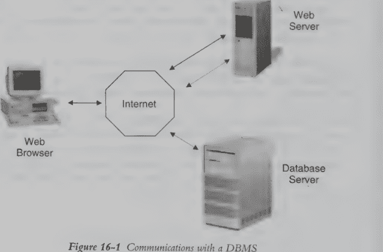

图 16-1 展示了一个连接到互联网等网络的 DBMS 的概念，同样适用于基于企业的局域网 (LAN)。在该图中，访问者连接到互联网并登录到一个站点，因此与 Web 服务器通信。任何对 DBMS 服务器上相关数据库的访问也会通过网络传递（图中以虚线表示）。例如，当用户最初登录且 Web 服务器想要检查输入的详细信息时，或者稍后访问信息时，就会发生这种情况。

在开发期间，或者对于小型数据库，你的 Web 服务器和数据库服务器没有理由不能部署在同一台物理机上。

### 16.2 关系型数据库 (RELATIONAL DATABASES)

关系型数据库将数据存储在表中。表由带有标签的列划分，用于标识存储的数据。

这里需要一些定义，因为有时不同来源的数据库术语可能会令人混淆！从表 16-1 可以看出，整个信息集被称为一个表 (table)。一个特定个体的单行被称为一条记录 (record) 或元组 (tuple)。向下延伸的列是一个字段 (field) 或属性 (attribute)；例如在本例中，它可以是 firstname 或 password。

| member_id | firstname | lastname | email | password |
| :--- | :--- | :--- | :--- | :--- |
| 001 | Lynda | Snell | lsnell@hayfever.com | lama123 |
| 002 | Bert | Fry | bfry@yahoo.com | birdy2 |
| 003 | Emma | Grundy | EmmaG@yahoo.co.uk | willOrEd4me |
| 004 | Neil | Carter | pigman@gmail.co.uk | wotnopigs1 |
| 005 | Ruth | Archer | ruthybabe@farmers.com | ooodavid1 |
| 006 | Kenton | Archer | Kenton@jackscafe.co.uk | Meriel4 |
| 007 | Brian | Aldridge | moneybags@czechfarm.com | siobhan33 |
| 008 | Pip | Archer | musicalme@borchester.co.uk | eee3k |
| 009 | Roy | Tucker | roytuck@businessweek.co.uk | bizzybee2 |

表 16-1 一个数据库表

当数据输入到表中时，行没有特定的顺序，因此需要一种方法来标识单条记录。在所示的表中，`member_id` 字段就是为此目的而设立的。通常你可以让数据库系统自动完成此操作，它就成为了所谓的主键 (primary key)，但如果已经存在一个合适的唯一标识字段，也可以手动指定。

一个数据库可以由许多表或相关的数据项组成。例如，表 16-2 可以作为图书馆会员列表的基础，可以命名为 `member`。我们可能还有另一个名为 `book` 的表，包含如表 16-3 所示的书名。

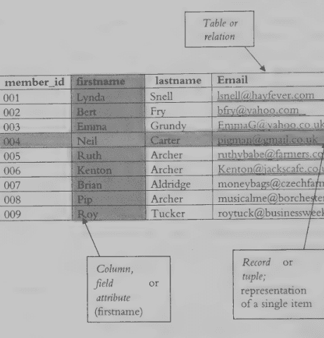

表 16-2 数据库表的组成部分

| book_id | ISBN | title | author |
| :--- | :--- | :--- | :--- |
| 001 | 0006280609 | The Screwtape Letters | C.S.Lewis |
| 002 | 0340830409 | Seven Ages of Britain | J.Pollard |
| 003 | 0450547426 | Stranger in a Strange Land | R. A. Heinlen |
| 004 | 0954732405 | Alice Through the Looking Glass | L.Carroll |
| 005 | 1563892499 | Flash: Terminal Velocity | M.Waid |

表 16-3 书籍表

如果成员 001 借了书籍 003，我们如何连接这两个表？一种方法是创建另一个表！该表将包含成员 ID 和他们借阅的书籍 ID，如表 16-4 所示。

| member_id | book_id |
| --- | --- |
| 008 | 002 |
| 003 | 001 |
| 005 | 004 |
| 006 | 005 |

表 16-4 *借阅 (borrows)* 表

在这里我们可以看到，成员 008 (Pip Archer) 借了 002 (*Seven Ages of Britain*)，成员 003 (Emma Grundy) 借了 001 (*The Screwtape Letters*)，依此类推。

#### 16.2.1 设计与建模 (Design and Modeling)

构建数据库的一个关键第一步是通过研究涉及的数据来仔细分析需求。为了设计数据库，可以使用特定的方法论和可视化工具。其中一种被称为实体-关系 (ER) 建模，这是一种表达数据库设计清晰且简单的方法。使用这种方法，各种属性、实体和关系以图表形式捕获，类似于流程图。

图 16-2 是一个描述前面提到的图书图书馆数据库的实体-关系图。有两个实体（由表本身表示），`Member` 和 `Book`，其中包含附加在它们身上的各种属性，如 `firstname`、`lastname`、`password`、`email`、`member_id` 以及 `title`、`author`、`ISBN`、`book_id`。请注意，这里主键通常带有下划线。两个实体之间的关系通常使用菱形表示，

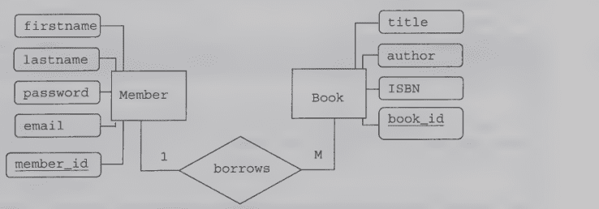

*图 16-2* 实体-关系图

该菱形连接相关的实体。菱形中放置一个恰当地描述该关系的词。M 描述了关系的*度 (degree)* 或 *基数 (cardinality)*，在本例中是一对多（M 表示多个）——一名成员可以借阅多本书。虽然还有其他类型的关系，但这是最常见的。此外还有一对一和多对多。显示相同内容的方法有很多，但这三种显示基数的基本方式其核心理念是一致的。

矩形代表实体（被建模的对象），并标记有具有意义的标题。菱形代表实体之间的关系，并具有描述性标题。圆角矩形或椭圆代表描述实体的属性。用于连接关系和实体的线条可以添加标注，以反映该关系的基数。这可能是一对一、一对多或多对多。这些通常表示为 1 to 1, 1 to M (或 N) 以及 M to M。线条也将属性链接到实体，但没有标签。

#### 16.2.2 什么是规范化？ (What is Normalization?)

规范化是一个优化过程，旨在消除冗余的可能性。如果不进行规范化，会发生以下情况：

-   数据库中任何数据的重复都会使其体积变得大得多。
-   相同数据的出现次数越多，维护数据库就越困难，并可能产生异常。异常的一个例子是更新客户地址；同一数据的多个条目都需要全部更改，这可能会导致出错。

规范化通常遵循一系列阶段，称为范式 (NF)：

-   第一范式 (1NF)
-   第二范式 (2NF)
-   第三范式 (3NF)
-   Boyce-Codd 范式 (BCNF)
-   第四范式 (4NF)
-   第五范式 (5NF)。

过程开始的阶段是非规范化形式 (UNF)！前三个范式通常足以消除任何异常，因为后续阶段解决的是极少出现的问题。

对于第一范式，数据库必须符合两条规则：

-   **所有属性（列）必须是原子性的。** 这意味着信息应该被分解为其最微小但重要的形式，而不能嵌入在其他数据中。


- 不应存在**重复组**。这意味着不应该有包含相同类型数据的多列，例如将不同种类的汽车分散在三列中。相反，应该创建一个名为 cars 的新关系。

第二范式只有一条规则：

- 所有**非键属性必须依赖于*整个键*，而不仅仅是键的一个属性**。当存在复合键时，这意味着该关系中的属性必须依赖于所有键，否则它们就处于错误的关系中。例如，如果我们的数据库由摩托车所有者及其各自购买的摩托车组成，我们可以创建一个由客户 ID 和型号组成的复合键，但关于摩托车的信息可能仅从该键的一部分即可导出，因此不依赖于整个键。然而，如果我们想找出客户购买的摩托车颜色，我们可以搜索该客户，这将向我们提供颜色——假设他们只买了一辆车。但如果客户订购了两辆车，且型号和颜色都不同怎么办？为了找到特定摩托车的颜色，我们需要知道 CustomerID 和型号。因此，颜色依赖于*整个*主键，而不仅仅是其一部分。这意味着颜色处于正确的关系中，因为它与客户和型号相关，而仅依赖于型号的摩托车信息则应在另一个表中。

第三范式同样只有一条规则：

- **任何属性都不能依赖于非键属性**。这意味着每个属性必须直接依赖于主键，而不是依赖于任何其他列。如果没有直接依赖关系，则该属性将被剥离到其自身的关系中。

数据库设计和规范化足以写成一整本书，但希望本节已让你产生了足够的兴趣去进一步研究，特别是如果你正考虑在应用程序或网站中实现数据库。

#### 检查点！

- 数据库为网站提供了一个有用的功能。
- 它们可以以安全且结构化的方式存储大量信息。
- DBMS 不需要与 Web 服务器在同一台物理机上，可以使用网络连接。
- 关系型数据库具有其特定的架构和方法论。
- 这些数据库包含作为关系（relations）的表，由属性和记录组成。
- 数据库通常应从仔细的需求分析和模型的开发开始，可能会使用实体-关系图。
- 规范化是一种优化数据库的方法，旨在消除冗余的可能性。它由应用特定规则而达到的不同阶段（或范式）组成。

#### 自测！

- 检查你的 MySQL 和 phpMyAdmin 安装包。
- 查找相应的文档，可以在安装包本身或其关联的网站中找到。
- 如果其他方法都失败了，你可以将 MySQL 安装为独立应用程序！
- 熟悉如何启动和停止 MySQL 服务器。
- 你如何启动 MySQL 监视器（monitor）？

### 16.3 SQL

结构化查询语言 (SQL) 允许你操作关系型数据库的结构和内容。

### 16.3.1 MySQL

MySQL 是一款非常流行的 DBMS，安装量超过六百万次。它是开源的，但与其他项目（如 Apache）不同，它由一家*营利性*公司 MySQL AB 所有并赞助。这家瑞典公司开发和维护该软件，并销售支持和服务合同。

MySQL 可被多种编程语言使用，包括 C#、C、C++、Eiffel、Java、Smalltalk、Lisp、Perl、PHP、Python、Ruby、REALbasic 和 Tcl。任何支持开放数据库连接 (ODBC) 接口的语言都应该能够使用 MySQL。MySQL 的原生语言是 C。

语言和数据库系统最受欢迎的搭配可能是 PHP 和 MySQL，尤其是在 Web 应用程序中。它易于使用且具有多种交互方式！例如，除了能够运行 PHP 脚本外，你还可以使用 MySQL 监视器通过 SQL 直接与服务器对话，或者使用多种工具来管理它，如 phpMyAdmin，或 GUI 应用程序 MySQL Administrator 或 MySQL Query Browser。

### 16.3.2 启动、停止和检查 MySQL 服务器

就像 Apache Web 服务器或任何其他服务器一样，你需要启动它。不同的计算机系统需要不同的启动方式，因此你应该参考安装文档。对于 Windows 上的 XAMPP，这通常通过主目录下一个名为 **start_mysql.bat** 的批处理文件来完成。点击该文件即可启动，但如果由于某种原因启动失败，你可能看不到任何错误消息，因为它会立即关闭！为了解决这个问题，请打开命令提示符，切换到该文件所在的目录，通过输入文件名来执行它；这样你就能看到任何消息。在 Windows 中，只要服务器处于活动状态，命令提示符就会留在屏幕上——不要关闭它！在 Mac 的 XAMPP（或者说 MAMPP！）安装中，你可以简单地通过输入以下命令启动所有内容（Apache, MySQL 等）：

```
/usr/local/xampp/mampp start
```

如果你遇到了问题，这可能与启动任何其他服务器软件的问题相同，即其他应用程序可能抢占了一些所需的资源（如端口）。检查你的系统是否在同一个端口上运行另一个服务器，或以其他方式发生冲突。另一个可能的问题是，如果你运行的安全软件会拦截对端口的访问或监视机器中的活动以阻止间谍软件。在这种情况下，当服务器启动时，它可能会通知你并询问该程序是否可以继续运行。当然，你可以直接禁用安全软件，但除非你遇到了严重问题且需要查看是什么导致了资源冲突或拦截，否则不建议这样做。

一旦你认为 MySQL 服务器已经运行，可以检查它是否正常工作且一切正常。使用 XAMPP 这样做很简单，只需访问 http://localhost/ 上的主服务器主页并点击 'status'。这将显示你电脑上当前处于活动状态的服务器，包括 MySQL 和 Apache。

在 Windows 的 XAMPP 安装中，点击 **mysql_stop.bat** 批处理文件即可停止 MySQL 服务器。使用 Mac 版本时，通过 **mampp** 命令发送 **stop** 指令：

```
/usr/local/xampp/mampp stop
```

### 16.3.3 MySQL 监视器

MySQL 软件附带了一个特殊的程序，允许你通过 SQL 命令直接与 MySQL 服务器对话。按照文档中描述的方式启动 Web 服务器和 MySQL 服务器，然后尝试找到 MySQL 监视器，其文件名应该是 **mysql**。找到后，在命令行或 shell 窗口中执行它：

```
mysql -u root
```

如果已经为 root 用户设置了密码，则需要将其包含在内：

```
mysql -u root -p password
```

例如：

```
mysql -u root -p letmein4
```

图 16-3 展示了监视器启动并运行时的显示情况。如果你像上面那样输入 `show databases;`，你可能会得到不同的结果集，但你应该能看到 `test`，这通常是为所有人初始设置的。`mysql` 数据库由 MySQL 系统自身使用。请注意，所有 SQL 命令都以分号结尾；这样你就可以将一个长查询分成多行，只有在遇到分号时它才会被处理。

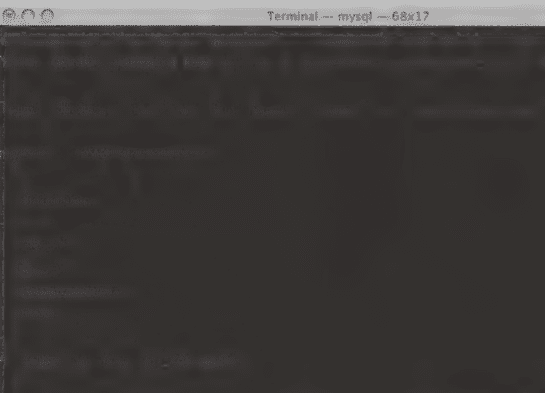

要实际访问通过 `show databases` 列出的数据库，请输入 `use` 和数据库名称。因此，如果你输入 `use mysql`，然后输入 `show tables`，就可以看到该特定数据库中包含哪些表。要查看表的具体构建方式，请输入 `explain` 后跟表名。

有些日常维护任务是你需要完成的，尤其是在 MySQL 监视器中工作时；例如，你可能希望添加用户或为 root 用户添加密码：

```
grant all privileges on *.* to username@domain identified by "password" with grant option;
```


### 16.4 使用 PHP 示例的基本命令

要使用 MySQL 系统，可以通过 PHP 中的字符串提交查询，如果使用 MySQL 监视器则直接输入。

### 16.4.1 连接到服务器

要通过 PHP 连接，可以使用 `mysql_connect` 命令：

```
mysql_connect(server, username, password);
```

你可以使用以下代码片段：

```
$connect = mysql_connect("localhost", "sid", "sesame");
```

如果你在 shell 或命令行中使用监视器，则无需连接，因为你已经连接了！

### 16.4.2 创建数据库

要创建数据库，请使用 SQL 命令：

```
create table tablename
```

这可以直接在监视器中执行，也可以在 PHP 中执行：

```
mysql_connect ("localhost","$user","$password")
$sqlstr = 'CREATE DATABASE '.$dbname;
mysql_query($sqlstr);
```

其中 `$dbname` 是你要创建的数据库的名称。注意通过 PHP 以这种方式发送查询时，不要在字符串末尾添加分号。

### 16.4.3 选择数据库

在实际使用数据库之前，你需要先选择它，如上所示，在 MySQL 监视器中使用 use 命令。在 PHP 中：

```
$result = mysql_select_db("library", $connect) or die("Error selecting db");
```

die 命令在无法选择数据库时会停止脚本的进一步处理，并显示错误信息。

### 16.4.4 列出数据库

在 SQL 中，show databases 会显示所有当前数据库。在 PHP 中实现相同功能的一种方式是：

```
$result = mysql_list_dbs($connect);
for ($row =0; $row < mysql_num_rows($result); $row++) {
    $dbases .= mysql_tablename($result, $row) . "<br>";
}

echo($dbases);
```

$connect 变量是你通过 mysql_connect 打开的连接。$result 变量包含实际的数据库，但它们仍然需要被提取和格式化，这正是循环所做的事情。

mysql_tablename 函数现在已弃用，你可以简单地通过查询字符串发送 show databases 命令来代替。

### 16.4.5 列出表名

要查看数据库中存在哪些表，可以使用 PHP：

```
$result = mysql_list_tables($db);
$rcount = mysql_num_rows($result);

for ($i=0;$i<$rcount;$i++) {
    $tabname = mysql_tablename($result, $i);
    tablist .= $tabname . "<br>";
}

echo($tabname);
```

同样，可以使用查询字符串来执行 show tables [from db_name] [like 'pattern']，或者在 MySQL 监视器中使用它。

### 16.4.6 创建数据库表

创建数据库表在 PHP 和监视器中基本上使用相同的命令：create database。其后是组成数据库表结构的列表。在 PHP 中，命令实际上被构建为一个字符串，然后使用 mysql_query 命令提交。

```
// 首先创建数据库
$query = 'create database people';
$result = mysql_query($query);

// 选择数据库
mysql_select_db('people') or die('Error: cannot select database!');

// 构建查询
$query = 'create table contact( '
         'pid INT NOT NULL AUTO_INCREMENT, '
         'pname VARCHAR(25) NOT NULL, '
         'pemail VARCHAR(54) NOT NULL, '
         'psubject VARCHAR(32) NOT NULL, '
         'pmessage TEXT NOT NULL, '
         'PRIMARY KEY(pid))';
// 将建表语句作为 SQL 查询提交
$result = mysql_query($query);
```

请注意可用的各种字段类型。这些类型可以分为文本类型和数字类型，还有一些用于特殊情况，例如日期。

如表 16-5 所示，有许多不同的类型涵盖了大多数情况！除了 create table 命令中的类型外，还有可选的字段修饰符。这些修饰符对特定列中可以发生的事情提供了更多的控制。各种可用的修饰符如下：

- not null – 表示此字段不能为空
- unique – 该条目在此列中不能有重复
- primary key – 指定一列用作主键
- auto_increment – 在此列中生成一个比前一个值大一的数字（因此此字段中必须是数字数据！）。

### 16.4.7 插入数据

在 MySQL 监视器中使用 insert 命令将数据插入数据库表：

```
insert into tablename (field1, field2, field3,... ) values
    (value1, value2, value3,... )
```

| 数据类型 | 描述 |
|-----------|-------------|
| CHAR( ) | 一个定义的固定长度字符串，长度从 0 到 255 个字符 |
| VARCHAR( ) | 一个定义的可变长度字符串，长度从 0 到 255 个字符 |
| TINYTEXT | 最大长度为 255 个字符的字符串 |
| TEXT | 最大长度为 65535 个字符的字符串 |
| BLOB | 最大长度为 65535 个字符的字符串 |
| MEDIUMTEXT | 最大长度为 16777215 个字符的字符串 |
| MEDIUMBLOB | 最大长度为 16777215 个字符的字符串 |
| LONGTEXT | 最大长度为 4294967295 个字符的字符串 |
| LONGBLOB | 最大长度为 4294967295 个字符的字符串 |
| TINYINT( ) | 常规范围：-128 到 127<br>UNSIGNED 范围：0 到 255 |
| SMALLINT( ) | 常规范围：-32768 到 32767<br>UNSIGNED 范围：0 到 65535 |
| MEDIUMINT( ) | 常规范围：-8388608 到 8388607<br>UNSIGNED 范围：0 到 16777215 |
| INT( ) | 常规范围：-2147483648 到 2147483647<br>UNSIGNED 范围：0 到 4294967295 |
| BIGINT( ) | 常规范围：-9223372036854775808 到 9223372036854775807<br>UNSIGNED 范围：0 到 18446744073709551615 |
| FLOAT | 带浮点小数的小数字 |
| DOUBLE( , ) | 带浮点小数的大数字 |
| DECIMAL( (, ) ) | 以字符串形式存储的 DOUBLE，允许固定小数点 |
| DATE | YYYY-MM-DD |
| DATETIME | YYYY-MM-DD HH:MM:SS |
| TIMESTAMP | YYYYMMDDHHMMSS |
| TIME | HH:MM:SS |

表 16-5 MySQL 中的数据类型

例如：

```
insert into people (id, firstname, lastname) values (1234, Sid, Perks);
```

在 PHP 中，连接到服务器并选择数据库后，将查询构建为字符串，然后提交：

```
$query = "insert into people (id, firstname, lastname) values ($id, \"$firstname\", \"$lastname\" )";

$result = mysql_query($query, $connect);
```

这里需要注意的一个重要事项是，当使用 PHP 进行插入查询时，引号前必须有反斜杠，以使系统正确解释该行！

### 16.4.8 修改表

有时在表设置完成后需要进行轻微调整。例如，你可能想要更改某个字段的数字或字符数量限制。

要在监视器中执行此操作，可以使用以下 SQL 代码：

```
alter table tablename modify fieldname char(28);
```

例如：

```
alter table people modify fieldname char(28);
```

在 PHP 中，可以通过以下方式提交：

```
$query = " alter table people modify fieldname char(28)";
$result = mysql_query($query, $connect);
```

### 16.4.9 查询

一旦你用信息设置好了数据库，就可以应用查询来实际查找信息。为此，将查询构建为字符串：

```
$sql = "select * from contact where pid>10";
$result = mysql_query($sql, $connect);
```

结果存储在结果字符串中，可以检索：

```
while ($row = mysql_fetch_array($result))
{
    echo(row["book"]."-".row["ISBN"]);
}
```

### 16.4.10 删除数据库

要删除数据库，只需使用 `drop database` 命令，后跟你要删除的数据库名称。在 PHP 中使用：

```
$query = 'drop database people';
$result = mysql_query($query);
```

### 16.4.11 删除数据和表

SQL 包含从数据库中删除数据的命令。只需使用：

```
delete from tablename where field=x
```

例如

```
delete from people where pid=10;
```

要在 PHP 中执行此操作，将查询添加到字符串中，然后通过 `mysql_query` 提交。

表的结构也可以通过删除来更改。例如，如果你突然意识到实际上不需要某个特定的列：

```
alter table contact drop pemail;
```

要销毁整个表：

```
drop table contact;
```

#### 知识点检查！

- SQL 提供了一种操作关系数据库结构和内容的方法。
- MySQL 是一种流行的数据库管理系统，可用于多种语言。
- 它提供了一种直接与服务器通信或通过其他语言通信的方式。
- 有许多 SQL 命令用于访问、操作和更新你的数据库。查询命令允许对你的数据进行复杂的问题求解和输出。


### 16.5 PHPMYADMIN

这是一款非常有用的开源软件，有时会随包含 PHP 和 MySQL 的软件包一同提供。也可以单独下载（从 http://www.phpmyadmin.net），它由一组 PHP 脚本组成，作为你的 MySQL 数据库管理系统（DBMS）的前端。在开发过程中，它是一个非常有用的工具，可以帮助你查看你的 PHP 脚本正在做什么！

访问 phpMyAdmin 的简便方法是通过服务器主页的初始启动屏幕（如果你是通过 XAMPP 安装的）；如果不是，请查阅你的文档。你应该会看到一个类似于图 16–4 的初始屏幕。这使你可以查看你的 MySQL 服务器的状态，并修改其和 phpMyAdmin 操作的基本方面。

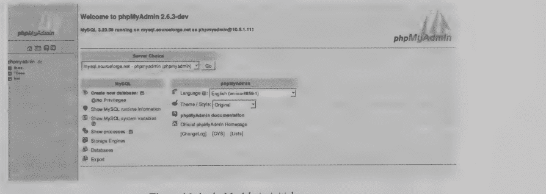

phpMyAdmin 让你可以查看 MySQL 服务器的各个方面，包括运行时信息的统计数据。如图 16–5 所示。

要随时返回主屏幕，请转到左侧菜单并点击“主页”按钮。

要创建一个简单的数据库，请在“创建文本”输入窗口中输入一个名称，然后点击“创建”。在本例中，我们输入 'bookcase'。下一页允许你为选定的新数据库创建一个表。你随时可以通过选择左侧菜单中的下拉列表来开始使用另一个数据库。

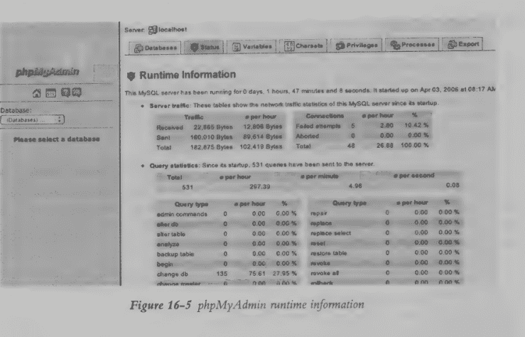

*图 16-5 phpMyAdmin 运行时信息*

要创建一个表，输入 'books' 和字段数量 '4'。

在图 16-6 的简单示例中，我们可以填写字段（书名、作者、出版商、ISBN），并将类型保留为 VARCHAR，长度字段设置为 50。当然，在你创建自己的数据库时，可以根据你正在创建的数据库的需要来设置这些！

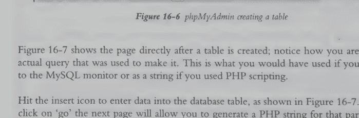

*图 16-6 phpMyAdmin 创建表*

图 16-7 显示了表创建后的页面；请注意，它向你展示了用于创建该表的实际查询。如果你在 MySQL 监视器中输入它，或者在使用 PHP 脚本时将其作为字符串使用，这就是你会用到的语句。

点击插入图标将数据输入到数据库表中，如图 16-7 所示。当你点击“执行”时，下一页将允许你为该特定数据生成一个 PHP 字符串。能够查看生成的 SQL 查询甚至脚本的 PHP 代码，对于初学者来说特别有用！

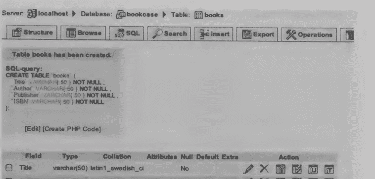

*图 16-7 phpMyAdmin 创建表后*

如图 16-8 所示，有许多可用的功能。包括：结构，用于构建表等；浏览，用于查看数据；SQL，用于执行查询；搜索，用于查找特定项目；插入，用于输入更多行数据；导出，用于将数据库转储为不同格式的文件；操作，用于执行各种管理任务，例如重命名或重构表；清空，用于清空数据库；以及删除，用于删除给定的表。

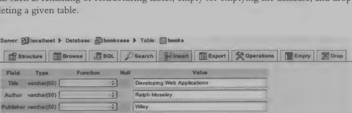

*图 16-8 phpMyAdmin 插入数据*

当你刚开始尝试使用 PHP 时，像 phpMyAdmin 这样的工具可以让你检查到底发生了什么，或者纠正因程序中的错误而导致的任何问题。

## 26.6 数据库错误

在 PHP 数据库脚本编写过程中可能会出现几个常见问题。这里有几个值得提一下。

**连接问题。** 这通常会在浏览器上显示为连接错误。首先要检查的是你的服务器是否处于活动状态！使用适合你安装方式的方法进行检查。使用 XAMPP 时，你可以通过 `localhost` 上的 Web 服务器主页的“状态”来检查。如果在线，请查看连接代码：是否具有正确的连接、用户和密码信息？如果你没有设置用户和密码信息，你只能使用以下方式连接：

```
$connect = mysql_connect("localhost", "root", "");
```

**密码问题。** 错误提示密码不正确。首先要检查的是你在将密码保存到数据库（或文本文件）之前是否对其进行了加密！如果是这样，你需要对任何正在被检查的用户密码重复使用相同的加密函数！

## 26.7 示例

打开 phpMyAdmin 或 MySQL 监视器，创建一个名为 `myusers` 的新数据库。然后在该数据库内创建一个名为 `userdb` 的表，该表具有以下字段：

```
id_code 类型 INT（你可以将此字段设为自动递增和主键）
user_name VARCHAR 长度 50
password VARCHAR 长度 20
age INT
```

因此，SQL 语句应该是这样的：

```
CREATE TABLE `userdb` (
  `id_code` INT NOT NULL AUTO_INCREMENT,
  `user_name` VARCHAR( 50 ) NOT NULL,
  `password` VARCHAR( 20 ) NOT NULL,
  `age` INT NOT NULL,
  PRIMARY KEY (`id_code`)
);
```

然后你可以使用 PHP、MySQL 监视器或 phpMyAdmin 插入一些数据；以下是 SQL 查询：

```
INSERT INTO `userdb` (`id_code`,`user_name`,`password`,`age`)
VALUES ('1','bertfry','anchoves','32');
```

使用你选择的方法添加更多用户，然后编写一个如清单 16-1 所示的登录脚本。

```
<html><head><title>Log-In</title></head>

<body>
Please enter details:<br><br>

<form action = "login.php" method = "post">

What is your user name:<br>
<input type = "text" name = "username"> <br><br>

What is your password:<br>
<input type = "text" name = "password"><br><br>

<input type = "submit" value = "Go!">
</form>

</body>
</html>
```

*清单 16-1 用于登录的 HTML 表单*

关于清单 16-1 需要记住的是，你必须通过将其名称放入表单的 action 属性中来连接处理脚本。在本例中是 login.php。此脚本（如清单 16-2 所示）将获取通过表单输入的数据，检查是否已输入（只是一个基本的检查，看是否输入了任何内容），然后连接到数据库并查询相关字段。请注意，这里数据被传递到程序内的变量中。还使用另一个变量来存储调用页面的名称，因此，如果发生任何问题，例如数据不正确或根本没有输入，页面可以重新加载。

```
<?php
// login.php 脚本用于处理登录详细信息
$username = $_POST['username'];
$password = $_POST['password'];
$login = $_SERVER['HTTP_REFERER'];

// 检查是否正确填写，如果没有则返回！
if( ( !$username ) or ( !$password ) )
{ header( "Location:$login" ); exit(); }

// 建立连接，如果更改了，
// 在此处放置你自己的用户名和密码
$conn=@mysql_connect( "localhost", "root", "" )
        or die( "Cannot connect!" );

// 选择要访问的数据库
$rs = @mysql_select_db( "myusers", $conn )
            or die( "Database problem!" );

// 构建查询
$sql = "select * from userdb where user_name=\"$username\"
                and password = \"$password\" ";

// 发送查询
$rs = mysql_query( $sql, $conn )
            or die( "Could not execute query" );

// 响应中有多少行返回？
$rows = mysql_numrows( $rs );

// 如果有一行存在，那么一切正常！
if( $rows != 0 )
{
    echo ("<h2>$username Okay - !Welcome!</h2>");
}
else
{
    header( "Location:$login" ); exit();
}
?>
```

*清单 16-2 处理登录详细信息的脚本*

**检查点！**

- 一个有用的应用程序叫做 phpMyAdmin。它由一组 PHP 脚本组成。有时此软件会随 Apache 安装包一同提供。
- 此软件允许你与任何当前数据库进行交互，并为你的 MySQL 提供了一个相当简单的界面。
- 它对于检查你通过其他方式（例如 PHP）开发的、可能存在问题的数据库很有用。
- 可以选择要使用的数据库或创建新的数据库。然后就可以创建和编辑表。
- 可以插入、更改或追加数据。
- 当用户按下按钮执行任务时，会显示操作的 SQL 脚本。
- 可以生成 PHP 脚本。
- 然后可以将数据库导出为文件或其他格式。

**自我测试！**

- 查找并在线阅读 MySQL 文档。
- 启动 MySQL 监视器。
- 为 root 设置密码（重要！）。
- 尝试一些基本命令，例如 show databases 和 show tables。
- 尝试设计一个用于 DVD 借阅的图书馆系统，确保捕获关于 DVD 本身、会员和借阅过程的所有相关信息。最后，在满意之后，添加显示当前逾期罚款详细信息的功能。
- 使用 MySQL 监视器实现数据库。
- 安装 phpMyAdmin 并研究你创建的数据库。
- 考虑如何为 DVD 图书馆添加网站前端。
- 编写一些脚本与你的数据库交互，并逐步构建一个完整的交互界面。

### 16.8 章节总结

- 网站通过使用数据库存储收集的信息来得到增强。
- 它们使数据操作变得非常简单和安全。
- 数据库管理系统（DBMS）可以进行网络连接，而不是与 Web 服务器或其他应用程序共享资源。
- 关系数据库易于理解和实现。
- 关系数据库由表（关系）、属性（列）和记录或元组（行）组成。
- 在开始任何编程工作之前，仔细分析数据库需求非常重要，可能需要使用实体-关系（ER）图对其建模。
- 可以使用规范化来减少冗余的可能性，从而减少异常。
- MySQL 是一个流行的用于网站和 PHP 的 DBMS。


- 与 MySQL 数据库服务器通信相当简单，并且可以使用多种语言实现。

- SQL 语言允许你访问和操作数据。它包含许多用于对存储信息执行各种操作的命令，使得开发复杂查询成为可能。

- 存在一些工具可以作为 MySQL 服务器的前端；这使你能够检查数据库结构或对其进行更新。其中一个比较流行的是 phpMyAdmin。

#### 章节测验

- 查找更多关于使用 PHP 的 Web 数据库的在线信息资源。从下面给出的网站开始。
- 尝试为一家汽车经销商设计一个数据库，首先使用 ER 图。
- 继续完善你的设计，并应用本章中描述的规范化技术。
- 最后，仅使用 HTML、CSS 和 PHP 将这些设计实现为一个在线数据库。

#### 关键词和短语

**数据类型** 与编程和脚本中的变量类似，每个字段都有一个关联的类型，用于声明它是数字、字符串信息还是其他形式的数据

**DBMS** 数据库管理系统，处理查询和组织数据的实际引擎

**实体** 代表一类对象，如人员、汽车或图书馆。它拥有属性，通常在数据库中以表的形式表示

**实体关系（ER）图** 高层描述的数据模型或图表

**MySQL** 一种基于 SQL 的、支持多线程/多用户的 DBMS

**主键** 用于唯一标识表中特定行或元组的值

**查询** 由数据库计算的问题规范

**SQL** 结构化查询语言，用于在关系型 DBMS 中检索和操作数据的最流行的数据库语言

**表** 关系型数据库的基本组成部分，包含若干行（记录）和字段（列）。在此上下文中，表的另一个名称是关系

#### 实用网址

```
http://www.mysql.com/
```

```
http://dev.mysql.com/tech-resources/articles/ddws/
```

```
http://uk.php.net/mysql/
```

```
http://www.phpmyadmin.net/
```

## 17

## 替代脚本语言

> *本章旨在介绍可用于开发 Web 应用程序的各种技术。这有助于你熟悉在维护旧应用程序和网站时可能遇到的遗留代码。*

没有任何一本书能以足够的深度向初学者描述所有的 Web 开发语言。然而，本书重点介绍了 HTML、JavaScript、XML、PHP 以及其他一些语言。在这里，我们对在实际开发中可能遇到的其他技术做一个简要概述。

对每种技术都给出了简要描述，并附上一些适当的示例以强调其语言风格或简洁性。此外，还提供了指向该语言主要来源、支持社区或初始信息点的 Web 链接。一些通用 Web 技术参考网站的链接也一并提供。

### 17.1 遗留代码和应用开发选择

在某些时候，你可能不得不维护别人的代码，或者仅仅是对其他可用技术感兴趣。这可能会让你感到意外——PHP 并不是唯一的 Web 开发语言！！

### 17.1.1 CGI

通用网关接口（CGI）由 NCSA 于 1993 年发明，允许其 Web 服务器将从服务器环境传递的参数存储到 shell 中，在那里 CGI 程序可以作为独立进程被创建。

CGI 由于其将信息传递给安全 Web 环境之外的任何类型程序的方式，引发了安全问题。使用具有 Web 特定功能的语言来实现更安全的数据传输要安全得多。

与 CGI 搭配使用的流行语言是 Perl，接下来将对其进行介绍。

网页：

http://hoohoo.ncsa.uiuc.edu/cgi/
http://www.w3.org/CGI/

### 17.1.2 Perl

实用提取和报告语言（Perl）最初是为文本处理而开发的，大致遵循 C 编程语言的结构。它是一种基于过程的语言（在 Perl 5 中也支持面向对象编程），是解释型而非编译型的，注重高效、易用和实用。Perl 看起来往往比较难读，并且有不够优雅的名声！然而，Perl 拥有大量的用户基础和第三方库。

它现在用于网络编程、Web 和图形用户界面（GUI）开发以及许多其他领域。

Perl 中的 Hello World! 程序简单地包含以下几行：

```
#!/usr/local/bin/perl
print "Hello world!\n";
```

第一行指定 Perl 解释器的位置，在 Unix 系统上通常位于此位置。第二行输出该短语。注意使用反斜杠 n 来换行，这与许多基于 C 的语言类似。

网页：

```
http://www.perl.com/
http://www.perl.org/
```

### 17.1.3 ASP

Active Server Pages 是微软在服务器端用于生成网页的技术，作为 Internet Information Services（IIS）的附加组件进行销售。ASP 页面通常使用 VBScript 编写，尽管也可以使用特殊指令选择其他语言。

ASP 的 Hello World! 程序如清单 17-1 所示。

```
<html>
<body>

<%
response.write("Hello World!")
%>

</body>
</html>
```

*清单 17-1 简单的 ASP Hello World! 脚本*

就像在 PHP 中一样，你可以自由地在输出字符串中使用 HTML 标签来格式化正在 HTML 浏览器中编写的页面。如果你选择为 ASP 页面使用 VBScript，你也可以访问它的函数，如清单 17-2 所示的 WeekdayName。

```
<html>
<body>

The day is
<%response.write(WeekdayName(weekday(date)))%>,
in the month of
<%response.write(MonthName(month(date)))%>

</body>
</html>
```

*清单 17-2 在 ASP 中使用 VBScript 内置函数*

现成的对象使编程更加容易；例如，对于维护基于 cookie 的会话，有 Session 对象。主要对象如下：

- **Session** 用于访问信息和操作会话。它在会话中存储关于用户的变量，并且为每个用户创建一个 Session 对象。
- **Application** 收集一个页面的所有信息，用法类似于 Session 对象，但对于所有用户只有一个 Application 对象，而不是每个用户一个。
- **Request** 用于访问用户的 HTTP 请求头和正文，以及读取 cookie 和检索 HTML 表单信息。
- **Response** 提供对发送到客户端的数据的控制。这通常涉及设置缓存和控制页面缓存。
- **Server** 此对象用于访问服务器上的属性和方法。
- **ASPError** 允许你查看当前会话中最后一个错误的信息。

为了展示这些对象的使用方式以及与 PHP 在功能上的各种相似之处，下面给出了几个示例。

清单 17-3 展示了如何使用 `Request` 对象访问各种有用的变量。在本例中，它们是服务器变量集合的一部分。此类脚本的示例输出可能是：

```
<html>
<body>

<p> Your browser is:
<%Response.Write(Request.ServerVariables("http_user_agent"))%>
</p>

<p> Your IP address is:
<%Response.Write(Request.ServerVariables("remote_addr"))%>
</p>

<p> DNS lookup is:
<%Response.Write(Request.ServerVariables("remote_host"))%>
</p>

<p> The method used is:
<%Response.Write(Request.ServerVariables("request_method"))%>
</p>

<p> Server Domain Name is:
<%Response.Write(Request.ServerVariables("server_name"))%>
</p>

<p> Server Port is:
<%Response.Write(Request.ServerVariables("server_port"))%>
</p>

<p> Server Software:
<%Response.Write(Request.ServerVariables("server_software"))%>
</p>

</body>
</html>
```

#### 清单 17-3 使用内置的 Request 和 Response 对象

Your browser is: Mozilla/4.0 (compatible; MSIE 6.0; Windows NT 5.1)
Your IP address is: 163.12.13.140
DNS lookup is: 163.12.13.140
The method used is: GET
Server Domain Name is: www.cs.mdx.ac.uk
Server Port is: 80
Server Software: Microsoft-IIS/5.0

Request 对象也可以用于通过表单从用户那里收集数据。与 PHP 一样，可以选择使用 GET 或 POST 方法进行数据传输。

```
<html>
<body>

<form action="http://www.mdx.ac.uk/StudentApp.asp"
method="get">
First name: <input type="text" name="first_name"
size="30"><br>
Last name: <input type="text" name="last_name"
size="30"><br>

<input type="submit" value="Request an Application">
<input type="reset" value="Clear form">
</form>

<%
dim first_name
first_name= Request.QueryString("first_name")
If first_name<>"" Then
Response.Write("Thank you " & first_name & " !<br/>")
%>
```

```
Response.Write("Your request has been received")
End If
%>

</body>
</html>
```

#### 代码清单 17-4 使用 GET 收集和使用表单信息

在代码清单 17-4 中，使用了 GET 方法来访问来自用户 Web 表单的信息：

- 使用 `QueryString` 集合从用户表单中获取信息。
- 使用 `Write` 方法将信息传递回用户的浏览器。

在代码清单 17-5 中，表单使用了 POST 方法，而在 ASP 脚本中实际上是通过 `Request.Form` 来访问数据的。

```
<html>
<body>

<form action="http://www.mdx.ac.uk/StudentApp.asp"
      method="post">
First name: <input type="text" name="first_name"
            size="30"><br>
Last name: <input type="text" name="last_name"
            size="30"><br>

<input type="submit" value=" Request an Application ">
<input type="reset" value=" Clear form ">
</form>

<%
dim first_name
first_name=Request.Form("first_name")
If first_name<>"" Then
Response.Write ("Thank you " & first_name & "!<br/>")
Response.Write("Your request has been received")
End If
%>

</body>
</html>
```

#### 代码清单 17-5 使用 POST 收集和使用表单信息

其他类型的表单也可以用于输入。代码清单 17-6 展示了如何使用单选按钮选择选项，然后使用 ASP 进行处理。

```
<html>

<% dim course
course=Request.Form("course")
%>

<body>
<form action="course.asp" method="post">
<p> Select desired course:</p>

<input type="radio" name="course"
<%if course="Multimedia" then Response.Write("checked")%>
value="Multimedia">Multimedia</input><br />

<input type="radio" name="course"
<%if course="Networks" then Response.Write("checked")%>
value="Networks">Networks</input><br />

<input type="radio" name="course"
<%if course="IT" then Response.Write("checked")%>
value="IT">IT</input><br /><br />

<input type="submit" value="Submit" />
</form>

<% if course<>"" then
Response.Write("<p>Your choice is: " & course & "</p>")
end if
%>

</body>
</html>
```

*代码清单 17-6 在 ASP 中使用 HTML 单选按钮*

就像使用 PHP 一样，也可以将用户重定向到新页面。PHP 使用 `header` 函数来实现，例如：

```
header("Location: reg.html");
```

ASP 也可以通过以下方式实现同样的功能：

```
<%
    Response.Redirect " http://www.cs.mdx.cs.uk "
%>
```

代码清单 17-7 展示了如何在页面中使用此功能，并将重定向到特定页面的选择权留给用户。

```
<%
if Request.Form("select")<>"" then
    Response.Redirect(Request.Form("select"))
end if
%>

<html>
<body>

<form action="Application.asp" method="post">
    <input type="radio" name="select"
           value="Application1.asp"> Application 1<br>
    <input type="radio" name="select"
           value="Application2.asp"> Application 2<br><br>
    <input type="submit" value="Submit!">
</form>

</body>
</html>
```

代码清单 17-7 *在 ASP 中使用重定向*

当然，你可以将所用语言（在这种情况下是 VBScript！）的特性与 ASP 结合起来，产生一些新颖的想法。代码清单 17-8 展示了如何使用 *randomize*、*rnd* 以及 ASP 内部的重定向函数来创建一个随机重定向脚本。

```
<html>
<body>

<%
    randomize()
    r=rnd()
    if r>0.5 then
    response.write("<a href='http://www.mdx.ac.uk'>
                        mdx.ac.uk</a>")

    else
    response.write("<a href='http://www.cs.mdx.ac.uk'>
                        cs.mdx.ac.uk</a>")

    end if
%>

<p>
Every Time you Refresh or Reload the page, it will display
one of the following 2 links:
mdx.ac.uk or cs.mdx.ac.uk Chances are 50/50 for each.
</p>

</body>
</html>
```

*代码清单 17-8 随机重定向*

用户发送的实际数据量可以通过 `Request` 对象来检查。代码清单 17-9 展示了如何访问字节数。

```
<html>
<body>

<form action="question.asp" method="post">
Type your question here:
<input type="text" name="txt"><br><br>
<input type="submit" value="Submit">
</form>

<%
If Request.Form("txt")<>"" Then
Response.Write("Your question is: " & Request.Form("txt") & "
                with a total bytes of: " &
                Request.TotalBytes)

End If
%>

</body>
</html>
```

*代码清单 17-9 查找通过表单传递的数据量*

`Response` 对象可用于操作 cookie。这在代码清单 17-10 中有所展示。

```
<%
dim numvisits
response.cookies("NumVisits").Expires=date+30
numvisits=request.cookies("NumVisits")

if numvisits="" then
response.cookies("NumVisits")=1
response.write("Hello! This is your first time at our Web site.")

else
response.cookies("NumVisits")=numvisits+1
response.write("Hello again, the number of times you visited our Web site is" & numvisits)

end if
%>

<html>
<body>

</body>
</html>
```

*代码清单 17-10 在 ASP 中使用 cookie*

代码清单 17-10 演示了如何使用 `Cookies` 集合创建欢迎 cookie。

当你第一次运行上述代码时，浏览器中会出现以下内容：

Hello! This is your first time at our Web site

当你第二次运行代码时，你会得到一条稍微不同的消息：

Hello again, the number of times you visited our Web site is 2

每次运行该脚本，数值都会增加 1。

正如你所见，ASP 的使用方式与 PHP 非常相似。它具有许多相同的功能，只是实现方式略有不同。

网页：
[http://www.w3schools.com/asp/asp_intro.asp](http://www.w3schools.com/asp/asp_intro.asp)

#### 检查点！

- 虽然你可能喜欢某种特定的脚本（或编程！）语言，但如果你开始从事专业工作，很有可能你必须查看别人的代码，甚至必须对其进行维护！
- PHP 的一些替代方案包括 CGI、Perl 和 ASP。
- CGI 需要特殊的安全考虑。
- Perl 可能难以理解，但与 C 语言类似。它最初是为文本处理而开发的。
- ASP 是微软的一项服务器端脚本技术，其理念与 PHP 相似。

#### 自测！

- 如果你安装了包含 Perl 或 ASP 的合适环境，请尝试运行一些示例脚本。
- 你能否将本书中的一个 PHP 脚本转换为等效的 Perl 或 ASP 脚本？

### 17.1.4 Java

虽然 Java 并不严格意义上是一种 Web 开发语言，但你很可能会在某些地方看到面向对象的 Java 被使用！它对于涉及网络和 Web 技术的各种任务非常有用，因为它针对大多数可能情况都提供了库和类，无论是 XML、Web 服务、数据库、servlet、applet 还是编写完整的服务器。

Java 通常使用虚拟机来运行其半编译代码，使其具有平台无关性。然而，现在已经有几种可用的虚拟机，以及一个名为 GCJ 的公有领域原生代码编译器（作为 GNU 项目的一部分）。

代码清单 17-11 展示了一个简单的 Java 程序，当它为虚拟机编译后，运行将输出 “Hello World!” 语句。这种语言可以用在服务器端或客户端。由于它拥有包含所有所需网络工具的库，它还可以用来编写完整的服务器或小型服务器应用程序。

你可能还了解到 Java 与 Web 页面结合使用的一种方式：即 applet。Applet 允许你通过嵌入在 HTML 页面中来利用 Java 的强大功能。

```
class MyHelloWorld
{
    public static void main(String args[])
    {
        System.out.println("Hello World!");
    }
}
```

## 代码清单 17-11 第一个 Java 程序

要实际使用 applet（如代码清单 17-12 所示），你需要使用 Java 编译器对其进行编译。在这种情况下，因为类名为 `HelloApp`，所以其所在的文件应命名为 `HelloApp.java`，并应编译为：

```
javac HelloApp.java
```

```
// You need this for making an applet
import java.applet.*;
// This is for drawing
import java.awt.*;

// HelloApp is the executable class
// Extends applet means that you will build the code on the
// standard Applet class
public class HelloApp extends Applet
{
    // This method is called when the applet is started
    public void init()
    {
        // nothing needed for this example
    }

    // This method is called when the applet is finished
    // For example, when the user goes to another page or exits the browser
    public void stop()
    {
        // nothing needed for this example
    }
}
```


## 17.1.5 JSP

JavaServer Pages 是在服务器系统上生成基于 Web 内容的另一种手段。这些内容例如可以是 HTML 或 XML。该技术本身允许将 Java 代码和预定义操作嵌入到此类内容中。存在被称为 JSP 操作的 XML 标签，可用于调用内置功能。有趣的是，JSP 由 JSP 编译器编译成 servlet，然后可以进一步由 Java 编译器编译，或者直接为 servlet 生成字节码。

网页：

http://java.sun.com/products/jsp/

## 17.1.6 .NET Framework

这个微软系统涵盖了许多不同的编程语言，提供了一种 Web 服务策略，可以通过软件连接信息、人员、系统和设备。简而言之，它集成了微软平台，提供了一种快速开发具有跨系统通信 Web 服务能力的安全软件的手段。

正如我们所见，Web 服务利用行业标准协议，例如 XML 和 SOAP（由 W3C 标准化的基于 XML 的消息服务）。

.NET 框架中有几个关键因素：

- **公共语言基础结构 (**Common Language Infrastructure (CLI)**) —— 这是一套针对运行时环境的规范，包括类型系统、基础类库和被称为公共中间语言 (CIL) 的机器无关中间代码。
- 公共语言运行时 (**Common Language Runtime (CLR)**) —— 这为运行符合 CLI 规范的代码提供了平台。在 CIL 执行之前，CLR 通常必须通过即时编译 (Just-In-Time compilation) 将其翻译成原生代码。

.NET 框架中包含的开发语言如下：

- **C#** (C Sharp) —— 这是 .NET 框架的核心语言，因为它最严格地反映了其底层理念。这些理念包括：托管代码、直接对应 .NET 类型的基元、垃圾回收以及许多其他特性（类、委托等）也与 .NET 运行时相对应。
- **C++** —— 这是对 Microsoft Visual C++ 6.0 的升级，包含了大部分功能、开发工具（如 IDE）以及 Active Template Library (ATL) 和 Microsoft Foundation Class (MFC) 等库的使用。除了针对框架中间代码外，它还可以输出原生代码。
- **Visual Basic .NET** (VB.NET) —— 这是微软流行的 Visual Basic 在 .NET 框架中的发展版本，尽管它不向下兼容。它是 BASIC 语言的完全面向对象版本。
- **J#** (J Sharp) —— 它基于 Java 类型的语法，大部分功能由 Visual J++ 6.0 提供，尽管它并不是针对 Java 虚拟机而设计的。相反，开发的程序使用 .NET 框架。
- **ASP.NET** —— 这是基于 .NET 框架的 Active Server Pages 版本。它与原始的 ASP 有显著不同。

.NET 框架包含垃圾回收能力和托管代码，这有助于防止内存泄漏等问题。

网页：

- http://www.microsoft.com/net/
- http://www.gotdotnet.com/
- http://www.asp.net/
- http://www.codeproject.com/

## 17.1.7 C#

为了更详细地了解 .NET 框架中的主要语言之一，这里包含了一些示例。按照真正的计算机科学风格，让我们从一个 Hello World! 程序开始！

```
public class HelloClass
{
    public static void Main()
    {
        System.Console.WriteLine("Hello world!");
    }
}
```

代码清单 17-14 C# Hello World! 程序

代码清单 17-14 展示了为 C# 编写的简单的 Hello World! 程序。该程序在命令行运行并输出消息。如果你熟悉 Java，你会注意到它们的相似之处！

```
<%@ WebService Language="C#" class="HelloService" %>
using System;
using System.Web.Services;
public class HelloService
{
    [WebMethod]
    public string SayHi(string Person)
    {
        return "Hello, " + Person;
    }
}
```

代码清单 17-15 简单的 Web 服务实现

代码清单 17-15 展示了使用 C# 开发 Web 服务是多么简单。这个特定的 Web 服务仅返回一个字符串，但也可以处理复杂类型。这些服务非常容易搭建，所使用的方法在调用时就像是本地机器上的方法一样。在此过程中，SOAP、XML 和 HTTP 被用于将信息传输到远程 Web 服务。

网页：

- http://www.c-sharpcorner.com/
- http://www.csharphelp.com/
- http://www.csharp-station.com/

## 17.1.8 Mono

Mono 是 Novell 的一个开源项目。它旨在创建一个符合 ECMA 标准且兼容 .NET 的框架，其中包括工具、语言和支持模块。这些包括 C# 和 CLR。Mono 针对 GNU/Linux、UNIX、Mac OS X 和基于 Windows 的系统。虽然 Mono 包含了 .NET 的大部分功能，且在某些情况下被视为其直接替代品，但这并非全部事实，因为 Mono 的功能超越了这一点。它包含一套庞大的开发软件和工具，以及作为前端的 MonoDevelop IDE，将所有各种特性结合在一起。

网页：

- http://www.mono-project.com/
- http://www.gotmono.com/

## 17.1.9 IKVM

针对 Mono 和 .NET 平台存在一个名为 IKVM（有时称为 IKVM.NET）的 Java 编译器。它包含一个在 .NET 上实现的 Java 虚拟机，以及能够实现 Java 和 .NET 互操作性的 Java 类库和工具。IKVM 直接在 Microsoft .NET 框架或 Mono 上运行 Java 字节码，而 J# 仅仅是在 .NET 上使用类 Java 的语法。

网页：

http://www.ikvm.net/

#### 检查点！

- Java 虽然不严格意义上的脚本语言，但对于 Web 应用程序仍然非常有用——你甚至可以尝试编写自己的服务器！
- Java 实际上可以通过 applet 嵌入到 Web 页面中。
- Applet 是在 Web 页面中发挥全功能编程语言能力的一种好方法。
- JavaServer Pages 与 PHP 和 ASP 一样，是你可以考虑学习的脚本选择。
- .NET 框架是微软的一项技术，用于提供一种能够连接信息、人员、系统和设备的 Web 服务策略。
- .NET 框架中一个比较有趣的发展是 C# 语言，它对于快速开发 Web 服务非常有用。
- Mono 是一个开源项目，试图创建一个针对 GNU/Linux、UNIX、Mac OS X 和基于 Windows 系统的 .NET 兼容框架。

#### 自测！

- 如果你的机器上安装了 Java，请尝试将本章中的示例 applet 嵌入到 Web 页面中运行。
- 利用提供的 Web 链接，研究 C# 对你的 Web 应用程序开发会有多大帮助。
- 考虑安装 .NET 或 Mono 并尝试使用 C# 进行实验。


### 17.2 本章总结

- 尽管你可能更偏好使用某一种语言，但了解并拥有多种语言的经验通常会更为重要。
- 你可能不得不维护或更新一个使用你不熟悉的技术的网站。
- 有许多语言在网络历史上留下了印记，其中很多至今仍在使用或继续演进。
- 这些语言包括 CGI、Perl、ASP、Java、JSP 以及带有其相关语言的 .NET 平台。

#### 章节测验

- 维基百科在线百科全书是查询这里提到的大多数语言的良好起点，它会包含链接和最新的历史资料。试着查找 Perl 和 CGI，并寻找各种支持社区。
- 查看你的计算机上配置了哪些语言。如果你安装了 XAMPP 之类的软件包，你可能已经包含了 Perl！
- 如果你更偏好使用某一种语言，原因是什么？网上有许多争论指出某种语言相对于另一种的优点。看看能不能找到一份，研究一下各种程序员对他们喜爱的语言的看法！

#### 关键词和短语

- **.NET** 微软的软件平台
- **ASP** Active Server Pages，一种通常使用 VBScript 的网络脚本语言
- **C# (C Sharp)** 可用于 .NET 和 Mono 的重要语言之一
- **CGI** Common Gateway Interface（通用网关接口）
- **IKVM** 用于 .NET 和 Mono 平台的 Java 编译器
- **J# (J Sharp)** 一种用于 .NET 平台、语法类似 Java 的语言
- **Java** 一种著名的面向对象语言，具有用于网络开发的类和功能
- **JSP** JavaServer Pages，一种基于 Java 的网络脚本语言
- **Mono** 一个与 .NET 兼容的开源软件开发平台，可用于多种操作系统
- **Perl** Practical Extraction and Report Language（实用提取与报告语言），一种流行的解释型 shell 脚本语言，用于包括 CGI、网络和网络应用在内的多种应用

#### 有用的网址

http://webref.info/
http://webreference.com/

## 18 展望未来：获得一个视角

> 本章的主要目的是让读者熟悉互联网和网络技术的前沿动态，了解一些当前活跃的研究领域，激发对未来研究的兴趣。

这里展望了互联网和网络在不久将来的应用，以当前的研究领域和方向为指导。其中几个领域脱颖而出，具有研究潜力，并为我们有生之年将会发生的事情提供了有益的洞察。

电子学的突破以及商业和军事压力推动了现代系统朝着惊人的速度、存储和处理能力不断前进。仅仅几年前还不可能实现的事情，如今已成为普通消费者可以触及的现实。

虽然对未来的猜测有时可能无济于事，但从当前研究趋势中汲取灵感有助于激发兴趣并推动学习。


### 18.1 引言

许多公司和大学的研究部门正在向网络技术的新领域投入大量资金。有时很难预见未来的发展动向和方向，原因在于有时进步出现在意想不到的领域，而这些进步又会反过来导致其他领域的变革和改进。

需求推动变革并带来进步；例如，想想互联网通信速度在短短时间内取得了多大的提升。1998 年时你可能还在用 56K 拨号调制解调器连接电脑，而现在的标准很可能已是 2Mbps 宽带连接，有些地方甚至可达 24Mbps。

图 18-1（数据来源：http://www.zakon.com/robert/internet/timeline/）展示了互联网从 1990 年代初到 21 世纪初惊人的增长速度。

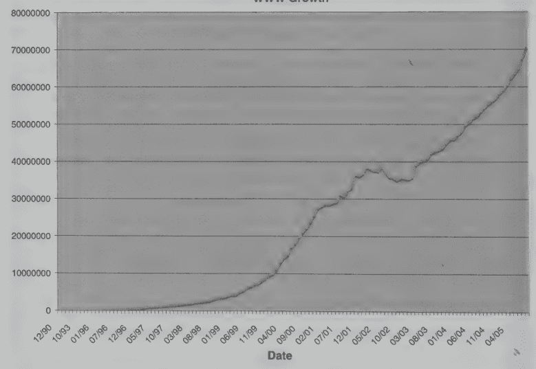
图 18-1 万维网增长曲线图

随着更快通信方式的引入，例如用光纤替代旧电缆以及采用更快的多路复用技术，这种增长预计将持续下去。

### 18.2 回顾：大事年表

**1836 电报机**由库克和惠斯通获得专利

**1858–1866 跨大西洋电缆**

**1876 电话**亚历山大·格雷厄姆·贝尔

**1957 人造地球卫星**苏联发射

**1962–1968 分组交换（PS）电话网络**

**1969 互联网诞生**首个节点在加州大学洛杉矶分校，随后是斯坦福研究院（圣巴巴拉）和犹他大学，共四个节点

**1971 人们通过网络通信**ARPANET 上 23 台主机中有 15 个节点。电子邮件也被发明出来

**1972 计算机通信得到改善**ARPANET 在 40 多台机器上进行公开演示。因特网互联工作组（INWG）成立，以解决建立统一协议的需求

**1973 全球联网开始**ARPANET 建立了国际连接：伦敦大学学院（英国）和皇家雷达研究所（挪威）。以太网思想确立，成为当前局域网的基础。互联网思想浮现。网关架构思想得到发展，定义了如何将大型网络（有时包含不同架构）连接在一起

**1974 传输模式确立为分组**传输控制程序（TCP）被确定。分组网络成为互联网通信的基础

**1976 网络变得更加普及**伊丽莎白女王发出一封电子邮件。Unix 网络复制工具被开发出来并随 Unix 分发

**1977 电子邮件投入使用，互联网确立**主机数量超过 100 台。电子邮件系统 THEORYNET 为 100 多名计算机科学研究人员提供邮件服务

**1979 新闻组**USENET 成立，这是一个新闻组集合，首批多用户地下城和互动冒险游戏出现

**1982 TCP/IP**DCA 和 ARPA 为 ARPANET 确立了 TCP/IP

**1983 域名服务器开发**随着互联网规模扩大和桌面工作站的发展，需要域名服务器

**1984 互联网继续增长**主机数量超过 1000 台。域名服务器引入，允许使用主机名而非数字 IP 地址

**1986 增长持续**5000 台主机，241 个新闻组

**1987 进一步增长**28000 台主机。互联网中继聊天（IRC）开发出来

**1989 仍在增加**超过 100 000 台主机。首个商业电子邮件运营商出现。互联网工程任务组（IETF）和互联网研究任务组（IRTF）成立

**1990 互联网扩展继续**300 000 台主机，1000 个新闻组。ARPANET 不复存在。The World 上线（`http://www.world.std.com`），成为首个提供互联网拨号接入的商业运营商

**1991 现代化开始**商业互联网交换（CIX）协会有限公司成立，此前 NSF 取消了对网络商业使用的限制。广域信息服务器（WAIS）。万维网的友好用户界面确立。万维网（WWW）由 CERN 发布（由蒂姆·伯纳斯-李开发）

**1992 多媒体改变了互联网的面貌**主机数量突破 100 万。新闻组 4000 个。"上网冲浪"一词由 Jean Armour Polly 创造

**1993 万维网革命开始**200 万台主机，600 个万维网站点。商界和媒体真正开始关注互联网。美国白宫和联合国（UN）上线。Mosaic 浏览器席卷互联网

**1994 商业化开始**300 万台主机，10 000 个万维网站点，10 000 个新闻组

**1995 商业化继续**650 万台主机，100 000 个万维网站点。新的万维网技术涌现：移动代码（Java、JavaScript、ActiveX）、虚拟环境（VRML）

**1996 浏览器大战**1280 万台主机，50 万个万维网站点。万维网浏览器大战开始，主要在 Netscape 和微软之间展开

**1997 进一步扩张**1950 万台主机，100 万个万维网站点，71 618 个新闻组

**1998 电子商务**成为成熟技术，同时电子拍卖出现。XML 正在开发中

**1999 国家域名**继续注册；今年，孟加拉国（BD）和巴勒斯坦（PS）注册。巴尔干冲突催生了首场大规模网络战争

**2000 千年虫问题**影响了一些可通过互联网访问的系统，如美国计时器。互联网基础设施增长，IPv6 部署并进一步开发

**2001 Napster 陷入诉讼**网上广播电台面临法律问题。网格计算成为新兴技术

**2002 博客**成熟并普及。宽带技术开始取代拨号，成为家庭连接方式

**2003 SQL Slammer 蠕虫造成破坏**成为传播速度最快的拒绝服务攻击。随后是 Sobig.F 病毒，传播速度最快的病毒，以及 Blaster（MSBlast），可能是迄今为止最具破坏性的病毒

**2004 传输速度**在互联网上被打破，东京大学和瑞士 CERN 中心之间通过单个 TCP/IP 链路的传输速度达到 7.57 Gbps。以这样的速度，可以在五秒内将一张完整 DVD 的内容发送到世界任何地方！Firefox 浏览器 1.0 版本发布

**2005 Netcraft 报告称在线用户网站达 7400 万**（相比之下，1993 年仅有 130 个！）

**2006 数据传输速度**德国和日本科学家在 160 公里链路上达到 2.56 太比特每秒。相比之下，最快的高速链路以 40 Gbps 的速度传输数据，大约慢 50 倍

> ### 检查点！
- 互联网始于 1969 年。
- 它最初是一个小型的研究和学术网络，称为 ARPANET。
- 它的节点数量迅速增长，到 1973 年全球联网已经开始。
- 1977 年电子邮件开始使用，1979 年新闻组服务器建立。
- 1982 年 ARPANET 确定了 TCP/IP 规范，1983 年域名服务器开发出来。


#### 自测！

- 目前互联网可用的最快互联网宽带速度是多少，它如何取决于地理位置？
- 除电缆外，还存在哪些其他连接方式？它们的速度如何？
- 对于互联网的持续扩张，你可以预见哪些问题？这些问题可能是经济上的、技术上的或社会性的。

### 18.3 前瞻：未来主题

以下是未来几年将变得更加突出的几个领域：

- 速度：越来越快！
- 通用访问（Universal Access, UA）
- 自适应、重构和自治系统
- 无线化
- 伪装计算机
- 生物与医学
- 联动计算：融合的数据库与信息；网格计算（Grid computing）
- 多媒体。

### 18.3.1 速度

清单的首位是前面已经提到过的持续的速度提升。

### 18.3.2 通用访问

接下来的项目是通用访问，即开发相关技术，使每个人都能充分地使用计算机和互联网。当然，这些技术增强了我们获取信息的能力，而对于某些残障人士来说，这可能有助于提高其生活质量。Web 自适应技术将会有所发展，这种软件能动态地调整 Web 页面，以满足视觉、运动和阅读受限人士的需求。

### 18.3.3 自治与自适应系统

自治系统领域正稳步实现并应用于许多场景。该领域涉及开发能够使应用程序、系统以及整个网络变得更加自管理的系统。自管理包含四个特性：自配置、自修复、自优化和自保护。这些属性同样适用于硬件和软件层面，例如能够通过自控或可编程控制来重构电路的电子系统。

在病毒和其他安全威胁频发的时代，重构能力（在某种意义上是变为多态）意味着系统能够快速适应并响应威胁。

### 18.3.4 无线化

近年来，无线计算的使用范围在扩大，并随着设备和系统之间许多新的链接方式而继续增长。在大规模应用方面，基于卫星的互联网宽带连接现已可用，速度最高可达 2 Mbps。在家庭和办公室中，无线局域网（Wireless LANs）可以非常容易地建立，而蓝牙允许设备组件在短距离内进行链接。无线 USB (WUSB) 承诺将剩余的 USB 连接设备（如打印机、相机、扫描仪和外置硬盘）无线化，初始目标速度为 480 Mbps——与 USB 2.0 标准相同，尽管在理论上，速度最高可达 1 Gbps。

移动设备目前可以通过 WAP 和 GPRS 的蜂窝网络服务连接到互联网。

其他嵌入式设备也可能开始使用无线技术，特别是在消费级和工业应用中，类似于目前有线设备用于更新软件或传输采集信息的方式。

### 18.3.5 伪装计算机？

随着计算机被嵌入到房屋、商品甚至衣服中，它们可能变得越来越难以被明确标记为“计算机”。将此类设备链接到网络的最简单方法是使用内置在电路中的无线链接。

射频识别（RFID）允许高效地追踪货物，例如军事物品、图书馆书籍或在运往销售点的商品。它的工作原理是：当其内置天线接收到特定频率信号时被激活，然后产生识别数据。

### 18.3.6 生物与医学

在接下来的几年里，生物和医学技术将取得巨大进步，无论是在遗传学方面还是通过控制论植入物的接口。即使在现在，各种植入物（如心脏起搏器）也可以通过网络进行通信，以对其进行重置或更改配置。就像家用商品一样，未来将能够与生物嵌入式设备通信，以收集患者信息或调整治疗应用的设置。

### 18.3.7 融合

随着存储关于个人的信息量增加，人们对于这些数据被非最初预定方获取的担忧也随之增加。信息源的整合带来了巨大的力量。例如，警察和安全部门可以使用广泛的信息源来追踪个人，包括手机通信、金融交易、CCTV 覆盖、基于互联网的通信和出行细节（火车、飞机、停车场……）。商业组织可能会共享关于你的购买习惯、旅行偏好、休闲兴趣或视听详情的信息，以构建完整的个人画像，从而向你推送相应的广告。所有上述信息源的问题在于它们作为单一来源时的安全性，而更重要地，当它们融合在一起时，会对隐私构成威胁。

融合在服务器能力的合并（如网格计算）中也发挥着作用。网格的主要目的是高效利用资源以解决问题。本质上，网格计算允许你将服务器池、存储系统和网络联合成一个单一的大系统，从而将多系统资源的动力提供给单个用户点以实现特定目的。对于用户、数据文件或应用程序来说，该系统看起来像是一个单一的、巨大的计算系统。

你可能听过的另一个术语是 Web 2.0，它通常是指允许人们共享信息并在网上协作的服务。其理念是信息流比普通 Web 页面更动态，类似于桌面应用程序。这类技术的例子通常包括 RSS、Wiki 和博客，这些在某种程度上都蕴含着信息融合的理念。许多这类新应用具有社交属性，将具有共同兴趣的社区绑定在一起。Wiki 允许访问者添加或编辑其中保存的信息，在某些情况下甚至不需要成为成员！于是，它变成了一种协作写作工具。这类尝试的问题之一是可能出现破坏行为（vandalism），即故意破坏内容或将内容扭曲至某个特定观点。许多议题具有争议性或分歧，因此比其他议题更容易受到此类关注。此类破坏行为可以通过恢复到之前的编辑版本并禁用违规者的 IP 地址来快速修复。

博客为个人记录日常生活提供了手段；通常带有其职业或兴趣的特殊视角。例如，一名骑行者可能会写关于骑行、设备或锻炼计划的内容，而另一个人可能会写关于他对爬行动物的热爱。这再次倾向于将群体绑定在一起，不仅融合了信息，也融合了人本身。

### 18.3.8 多媒体

互联网速度的提升将带来更多的多媒体可能性。电视将通过网络广播，并配备更多的交互式服务，允许选择节目和其他流媒体产品。庞大的电视档案将允许材料的选择。游戏可能会有所改进，并成为更进一步的网络现象，向计算机用户提供日益超写实的虚拟世界进行交互。

通过电子手段学习将变得常态化，例如在线课程和虚拟学习环境。

### 18.3.9 军事

虚拟技术在未来的战场上也将发挥作用，既用于士兵的冲突准备，又用于在冲突期间快速可视化需要立即采取行动的传入信息。这可能是导弹袭来的威胁、从战场网络无人机检索的数据，或是当前的敌方（以及友方！）位置。由于此类信息对现代军队至关重要，冲突区域周围的计算机和网络系统也将成为直接攻击目标。这可能通过敌方自己的黑客，以及利用电磁脉冲摧毁或干扰此类系统的武器来实现。

全球范围内的冲突也将在互联网内部引发同步战争。这在几场战争中已经可见，例如伊拉克和巴尔干冲突。互联网不仅成为了表达观点的地方（例如被困在这些区域的平民的博客），也成为了实施主动虚假信息传播或干扰敌方服务的地方。相关战术可被用于针对作战国家的领导人，以抹黑他们并削弱其财力。

具有特定政策和意识形态的整个国家也可能决定过滤和拦截与外界的信息传输。这种形式的审查在我国（中国）已经发生。


这里建立了一套防火墙系统。它拦截了特定信息的流动，被称为中国国家防火墙（Great Firewall of China）。

#### Checkpoint!

- 有几个主要领域或主题将涉及互联网；这些包括传输速度、通用访问、适应性、重构和自治系统、无线技术、系统的可见性与集成、生物与医学、联合计算：融合数据库与信息、网格计算以及多媒体。
- 系统与信息的融合将带来隐私和安全方面的影响。
- 计算机系统将更深入地集成到日常设备中，且可见度降低。此类系统将能够无线连接到网络。
- 互联网将继续对社会生活以及政治体制和冲突产生影响。

#### Test Yourself!

- 使用搜索引擎或 Wikipedia 查找以下短语和术语，并了解其最新进展：湿件控制论（Wet wiring cybernetics）、网络战争（cyber-warfare）、网格计算（Grid computing）、通用访问人机交互（Universal Access HCI）、可重构网络（reconfigurable networks）、可重构系统（reconfigurable systems）。

### 18.4 章节总结

- 互联网起源于学术研究，涉及大学之间仅有极少数节点的计算机通信。
- 互联网在几个成功的衍生分支和技术的推动下迅速演进和扩展。
- 互联网将继续增长并变得更快。
- 研究将把互联网和 Web 的能力扩展到新的领域。
- 将扩展到的几个领域包括：通用访问、自治和自适应系统、嵌入式及联网系统（在设备、可穿戴设备和生物植入物中）。
- 无线技术将允许设备在不同层面上实现无线化，甚至深入到单个芯片和小电路。
- 网络允许信息和数据库的融合，这既可以被视为一种益处，也可以被视为一种危险（对个人隐私而言）。
- 快速网络将增强多媒体，实现更高水平的交互性，并模糊真实内容与计算机生成内容之间的界限。
- 战争和冲突将延伸到互联网，出现围绕信息的争夺以及对电子系统的破坏。虚拟技术和专家技术将允许对需要立即响应的复杂情况进行评估。

#### 章节测试

- 在 Web 上寻找一些研究 Web 技术未来的研究小组，并跟进他们的想法脉络（例如网格计算）。你认为它的可行性如何，可以应用于哪些场景？
- 寻找一个 Wiki 站点（例如 Wikipedia）并研究人们创建的条目。如果你发现一个关于当前新闻项目的条目，你甚至可能会捕捉到它正在被更新的过程！

#### 关键词与短语

**Adaptable/Adaptive**（可适应/自适应） 适应给定情况的能力

**Autonomic**（自治的） 以某种方式进行自我管理或自我配置的能力

**Bluetooth**（蓝牙） 无线个人局域网（PANs）的工业规范

**Broadband**（宽带） 通常指通过同时发送多组数据来提高有效传输速率的数据传输

**Convergence**（融合） 将两个或多个信息源结合在一起

**Cybernetic**（控制论的） 涉及研究信号处理、决策和控制结构

**Dial-up access**（拨号访问） 一种廉价但缓慢的互联网访问方法

**Electromagnetic pulse**（电磁脉冲） 由爆炸（尤其是核爆炸）引起的破坏性电磁辐射，导致电子系统中出现损坏电流和电压峰值

**Embedded system**（嵌入式系统） 一种完全封装在其所控制设备内部的专用计算机系统

**Expert system**（专家系统） 包含分析信息规则的程序，允许选择推荐的行动方案

**GPRS** 通用分组无线服务，面向手机用户的一种移动数据服务，提供中速的数据服务

- **Grid computing**（网格计算） 利用通过网络（通常是互联网）连接的许多独立计算机的资源来解决大规模计算问题
- **Reconfigurable**（可重构的） 一个能够改变其组件或资源使用方式的系统；这可以是软件层面、硬件层面或两者兼有
- **RFID** 射频识别，一种通过标签对物体进行标记的方法，标签在特定时间激活以传递其描述信息
- **Universal Access**（通用访问） 一种理念和研究领域，旨在通过包容性设计、定制化、适配和自适应系统，使任何人都能在任何时间、任何地点访问信息技术
- **Virtual**（虚拟的） 一个项目或一个完整的世界可以用软件形式存在。对象的这种虚拟表示可以增强或简化用户对其的观察
- **WAP** 无线应用协议，一个用于无线通信应用的开放国际标准，例如通过手机访问互联网
- **Wiki** 一种类型的网站，允许任何访问者编辑或添加内容，有时无需注册

#### 有用的 Web 地址

```
http://www.irtf.org/
http://www.alphaworks.ibm.com/
http://en.wikipedia.org/wiki/Internet
http://ieet.org/
http://www.cordis.lu/ist/fet/home.html
```

## 词汇表

**.NET** 微软的软件开发平台

**Absolute**（绝对定位） 在 CSS 定位中，指为元素指定精确的坐标

**Adaptable/Adaptive**（可适应/自适应） 适应给定情况的能力

**Aggregator**（聚合器） 一种根据用户偏好检索综合 Web Feed 的软件。它也可以指提供此类服务的网站或门户

**Animation**（动画） 产生运动错觉的过程，通常是通过在图像帧之间快速切换实现的

**Apache HTTPd** 适用于多种平台的流行开源 Web 服务器

**Array**（数组） 在 JavaScript 中，一个包含数据并具有 pop、push 和 join 等属性和实用方法的对象。数据可以是混合类型的

**ASP** 活动服务器页面，一种通常使用 VBScript 的 Web 脚本语言

**Assignment**（赋值） 变量获取一个值

**Associative array**（关联数组） 一种利用键（名称）而非索引号来访问值的数组，使其对用户更友好

**Atom** 一种基于 XML 的文件格式，用于 Web Feed 和博客等各种任务

**Attribute**（属性） 添加到 HTML 元素标签中的可选项目，用于更改特定特征

**Autonomic**（自治的） 以某种方式进行自我管理或自我配置的能力

**Blog**（博客） 一种基于 Web 的定期文章出版物，会定期更新

**Bluetooth**（蓝牙） 无线个人局域网（PANs）的工业规范

**Border**（边框） 定义边框的所有方面

**Broadband**（宽带） 通常指通过同时发送多组数据来提高有效传输速率的数据传输

**Browser Wars**（浏览器大战） 20 世纪 90 年代后期，Web 浏览器为了争夺市场主导权而展开的竞争的称呼

**C# (C Sharp)** .NET 和 Mono 可用的重要语言之一

**Cache**（缓存） 可以存储经常请求的 Web 页面的内存存储区

## 词汇表（续）

**CGI** 通用网关接口

**Character entity**（字符实体） 某些字符可以被编码为 HTML 实体来代替。例如，“<”可以编码为 `&lt;`

**Class**（类） 对象的模板

**Client-server**（客户端-服务器） 一种网络应用架构模型，其中定义了客户端和独立的服务器

**Client side**（客户端） 指在客户端-服务器关系中由客户端执行的操作；在这种语境下，是指运行浏览器的这一侧

**Concatenation**（拼接） 将两个或多个字符串连接在一起。在 PHP 中，这是通过点号（.）实现的

**Constructor**（构造函数） 用于初始化对象的方法

**Convergence**（融合） 将两个或多个信息源结合在一起

**Cookie** 保存在客户端的一个小文本文件，允许信息在 Web 站点的多个页面之间传递或在设定时间内持久存在。需要客户端浏览器启用 Cookie 才能使用

**Cross site scripting**（跨站脚本攻击/XSS） 一种利用漏洞的攻击方式，将来自一个不被信任上下文的信息插入到另一个被信任的上下文中，从而产生攻击

**CSS** 层叠样式表，一种用于描述 HTML 和 XHTML 中结构化文档呈现方式的语言

**Cybernetic**（控制论的） 涉及研究信号处理、决策和控制结构

**Data islands**（数据岛） 一种在 HTML 页面中包含存储在 XML 文件中信息的方法

**Data type**（数据类型） 与编程和脚本中的变量类似，每个字段都有一个关联的类型，将其声明为数字、字符串信息或其他形式的数据

**DBMS** 数据库管理系统，处理查询和组织数据的实际引擎

**Decrement**（递减） 将变量减少一个特定量

**Deprecated**（弃用） 当软件或编程语言的一项功能被逐步淘汰或变得过时时，称该功能被弃用

**Destructor**（析构函数） 当对象最终被终止时（通常是在脚本或程序中不再有引用到它的情况）最后被调用的方法


## 术语表

- **DHTML** 动态 HTML，HTML、CSS 和 JavaScript 的结合，用于丰富网站内容
- **Dial-up access** 拨号访问，一种廉价但缓慢的互联网接入方式
- **Distro** 发行版（distribution 的缩写），通常用于 Linux 的各个版本
- **Div** 将页面划分为逻辑区域
- **DOM** 文档对象模型，一种用于访问 HTML 文档各部分的标准化层次结构
- **Driver** 驱动程序，在计算机系统中提供不同层级之间（通常是软件与硬件之间）接口的软件组件
- **DTD** 文档类型定义，包含一组决定 XML 文件结构规则的文档。对于某些 XML 文档可能不足，替代方案是 schema（架构）
- **Dynamic DNS service** 动态 DNS 服务，一种使 DNS 能够实时更新与服务器关联的动态 IP 地址变化的服务
- **Dynamic IP** 动态 IP，由于 ISP（互联网服务提供商）的原因而时常变化的 IP 地址
- **Dynamic Web page** 动态网页，能够对事件或用户输入做出反应并相应地改变输出内容的页面
- **Electromagnetic pulse (EMP)** 电磁脉冲，由爆炸（尤其是核爆炸）产生的破坏性电磁辐射，会导致电子系统中出现损坏性的电流和电压尖峰
- **Element** 元素，一个 HTML 标签通常由一个开始标签（包含可选参数/内容）和一个结束标签（并非总是需要）组成。空元素不包含内容或结束标签，但仍可具有属性
- **Embedded system** 嵌入式系统，一种完全封装在其所控制设备内部的专用计算机系统
- **Emphasis** 强调，一种增加文本视觉冲击力的方式，例如将其设为粗体或斜体
- **Encapsulation** 封装，将数据和方法包含在对象内部的思想
- **Encryption** 加密，通过将信息模糊化（或隐藏）使其在没有特殊知识的情况下无法读取的过程
- **Entity** 实体，代表一类对象，如人员、汽车或图书馆。它具有属性，在数据库中通常表示为一张表
- **Entity-relationship (ER) diagram** 实体-关系 (ER) 图，一种高层描述的数据模型或图表
- **Enumerated** 枚举，信息的有序序列或列表
- **Escape sequence** 转义序列，当字符串中包含特殊字符时，需要在其前面加上反斜杠才能使其输出。例如单引号
- **Event driven** 事件驱动，使用事件来触发特定代码的执行
- **Expert system** 专家系统，包含分析信息的规则的程序，允许选择推荐的行动方案
- **Firewall** 防火墙，通过限制访问来防止未经授权使用网络的硬件或软件
- **Font** 字体，一套协调的字符设计（typeface）的成员，通常包含字母表、一组数字和标点符号，但也可能包含符号
- **Form** 表单，HTML 中的一种数据收集机制，允许设计各种样式的输入以适应大多数类型的信息
- **Frame** 框架，HTML 的一项功能，允许将布局分解为独立的区域
- **FTP** 文件传输协议，计算机之间传输文件的标准
- **FTPS** 基于 SSL 的文件传输协议，为了安全性而在 SSL/TLS 上运行的另一种 FTP 版本
- **Function** 函数，从主代码中分离出来的脚本段，可在需要时随时调用。它可以在函数头中拥有参数列表并具有返回值
- **GPRS** 通用分组无线服务，面向手机用户的一种移动数据服务，提供中等速度的数据服务
- **Grid computing** 网格计算，利用通过网络（通常是互联网）连接的许多独立计算机的资源来解决大规模计算问题
- **Hacker** 黑客，利用系统漏洞以获取进入权限的人
- **Heading** 标题，一组用于指定文档内不同层级字体大小和强调程度的标签
- **Horizontal rule** 水平线，贯穿页面的水平线；可以选择不同类型
- **HTML** 超文本标记语言，一种旨在开发网页及其他可在浏览器中查看的信息的标记语言
- **HTTP** 超文本传输协议，万维网 (WWW) 上传输信息的主要方法，采用请求/响应机制
- **Hyperlink** 超链接，对另一个文档或资源的引用
- **ID** 用于给特定分区起一个唯一名称
- **IKVM** 为 .NET 和 Mono 平台提供的 Java 编译器
- **Image caching** 图像缓存，一种通过提前加载和存储待用图像来提高动画流畅度的技术
- **Increment** 递增，将变量增加一个特定数值
- **Inheritance** 继承，基于从另一个对象获得的初始属性和行为集来构建新对象
- **Inline frame** 内联框架，可以与其他文本和图形一起排版的框架
- **Internet** 当首字母大写 'I' 时，指通过 IP 等标准化协议通信的、公开可用的互连网络系统
- **Interpreter** 解释器，分析脚本并执行给定命令的软件组件
- **Invoke** 调用，启动或调用一个函数使其执行
- **IP** 互联网协议，互联网上使用的主要协议之一
- **Iterate** 迭代，重复执行一段代码
- **Iteration** 迭代，一段代码的重复执行
- **J#** (J Sharp)，一种为 .NET 平台设计的类 Java 语法的语言
- **Java** 一种著名的面向对象语言，具有用于 Web 开发的类和功能
- **JSP** JavaServer Pages，一种基于 Java 的 Web 脚本语言
- **Keys and values** 键与值，用于关联数组中，使其更用户友好且易于访问
- **LIFO** 后进先出，一种数据结构，其项的组织方式使得最后添加的数据将首先被输出
- **Line break** 换行，一个关于句子或段落何时掉到下一行的格式术语。在 HTML 中，当使用 `<br>` 元素时会发生这种情况
- **List** 列表，一个 HTML 元素，允许以无序或有序（枚举）形式简单地展示信息列表
- **Loop** 循环，一段被重复执行的代码
- **Loosely typed** 弱类型，如果一种语言是弱类型的，则不需要显式声明变量的类型
- **Margin** 外边距，用于设置元素边框与父元素之间的空间量
- **Meta tag** 元标签，提供关于页面的信息而非其内容
- **Method** 方法，一段关联的代码，在 JavaScript 中实际上是一个附加到对象上的函数
- **Mono** 一个开源的软件开发平台，与 .NET 兼容，适用于多种操作系统
- **MySQL** 一种基于 SQL 且支持多线程/多用户的数据库管理系统 (DBMS)
- **Object [1]** 对象 [1]，数据和方法的集合
- **Object [2]** 对象 [2]，面向对象编程范式的核心思想；属性（数据）和行为（方法）的封装
- **Object based/Object oriented** 基于对象/面向对象，使用对象的编程语言
- **OO/OOP** 面向对象编程，一种特定的模型或范式，包含特定的编码方法和哲学
- **Operating system (OS)** 操作系统，负责应用程序与硬件之间管理和交互的系统软件
- **Operator** 运算符，一个与值配合使用以执行操作并通常产生结果的符号
- **Padding** 内边距，用于指定元素内容区域边侧与边框之间的距离
- **Peer-to-peer** 对等网络 (P2P)，一种网络应用架构模型，其中每个节点都可以平等地充当客户端或服务器
- **Perl** 实用提取与报告语言，一种流行的解释型 shell 脚本语言，用于包括 CGI、Web 和网络在内的多种应用
- **Phishing** 网络钓鱼，通过欺诈手段尝试获取密码或个人详细信息等敏感信息的行为
- **Plug-ins** 插件，用于扩展浏览器功能的附加软件组件
- **Point size** 点号，字体大小的一种相对度量，过去曾有更具体的含义
- **Port** 端口，一个用于通过网络与计算机程序通信的接口
- **Primary key** 主键，用于唯一标识表中的特定行或元组的值
- **Property** 属性，附加到对象上的一个数据项
- **Protocol** 协议，一种标准或一组规则和约定，使两个系统之间能够通信。协议可以存在于硬件层面，也可以存在于软件层面
- **Query** 查询，由数据库计算的问题规范


## 术语表

**单选按钮** HTML表单上的一种输入机制，通常从多个选项中选择一个

**可重构** 指能够改变其组件或资源使用方式的系统；这可以体现在软件、硬件或两者兼有方面

**递归** 指自身引用自身

**重定向** 在PHP中，可以使用 `header()` 函数将页面重定向到另一个页面

**正则表达式** 根据特定语法规则描述或匹配一组字符串的字符串

**相对** 当应用于CSS定位时，指指定相对于Web页面中元素自然定位的坐标

**重新加载** 从Web而不是从缓存重新加载同一页面，例如在PHP中使用 `header()` 函数

**RFID** 射频识别，一种通过标签标记物体的方法，该标签在特定时间激活以传递其描述信息

**RGB** 红、绿、蓝，一种用于颜色定义的模型

**RPC** 远程过程调用，一种允许一台机器上的软件触发另一台机器上代码运行的协议

**RSS** 真正简单的聚合，一组基于XML的文件格式的名称，用于网络订阅源和博客

**模式** 为XML文档提供描述的另一种方式，以便可以进行验证

**作用域** 变量在特定代码区域内的包含范围

**脚本** 通常指由浏览器解释的程序，例如JavaScript

**服务器** 响应请求的应用程序；在Web服务器的情况下，使用HTTP协议

**服务器端** 指在客户端-服务器关系中由服务器执行的操作。通常指运行Web服务器或其他服务器软件的计算机

**会话** 一种在整个网站或多个页面中使数据持久化的方式，不必依赖cookie

**SFTP** 安全外壳文件传输协议，一种更安全的文件传输协议

**SMTP** 简单邮件传输协议，用于传输电子邮件的标准文本方法

**SOAP** 简单对象访问协议，一种通过网络交换XML消息的标准

**欺骗** 伪装个人或IP地址以避免识别

**SQL** 结构化查询语言，用于在关系型数据库管理系统中检索和操作数据的最流行数据库语言

**SSH** 安全外壳，既是一种协议，也是一种用于连接远程计算机的命令行程序

**SSL** 安全套接字层，一种带有加密的安全协议

**栈** 一种后进先出的数据结构，通常附带各种函数（或方法），允许推入（添加项目）或弹出（移除项目）

**静态网页** 一种仅格式化其输出而不随用户或其他信息变化或反应的页面

**字符串** 由引号括起来的字符集合的对象，同时具有属性和方法

**表格 [1]** 一种HTML元素，允许布局和数据结构化

**表格 [2]** 关系型数据库的基本组成部分，包含多行（记录）和字段（列）。在此上下文中，表格的另一个名称是关系

**标签** HTML中元素的一部分，包含 `<标签名 属性>`；即一个小于号、标签名和可选属性列表。通常有一个闭合标签，如 `</标签名>`，但并非总是必需的

**TCP** 传输控制协议，一种在传输层级别工作的、具有可靠性的面向连接的协议

**模板** 在XSLT中，模板是一组在匹配特定节点时激活的规则

**文本区域** HTML表单上一个可根据需要调整大小的输入区域

**TLS** 传输层安全协议，SSL的后继者，SSL 3.0和TLS 1.0之间差异很小

**特洛伊木马** 一种通过隐蔽方式进入系统的软件，植入或执行一段破坏性代码

**TTL** 生存时间，页面过期前的时间长度

**UDP** 用户数据报协议，一种相当简单的、面向消息的传输层协议，不保证消息传递

**通用访问** 通过包容性设计、定制、适应性和自适应系统，使信息技术对任何人、在任何时间、任何地方都可访问的理念和研究领域

**无类型** 当变量在使用前不声明其类型时，它们就是无类型的

**上传** 从客户端复制或移动文件到服务器。通常作为制作网站或应用程序开发生命周期的一部分

**URI** 统一资源标识符，一个互联网协议元素，由一串字符组成，表示指向资源的名称或地址

**URL** 统一资源定位符，互联网或其他地方某些资源的标准化地址；它是URI的一种类型

**验证** 检查信息以确定其正确性的过程

**虚拟** 一个项目或整个世界可以以软件形式存在。这种对象的虚拟表示可以增强或简化用户对其的视图

**病毒** 一种通过将自身的副本插入代码或文档中传播的自我复制程序

**WAP** 无线应用协议，一种用于使用无线通信的应用程序的开放、国际标准；例如从移动电话访问互联网

**网络订阅源** 一个定期更新的文档，可包含摘要、博客和指向更长文章的链接

**Web服务** 用于在应用程序之间交换数据的一组协议和标准

**维基** 一种网站类型，允许任何访问者编辑或添加内容，有时无需注册

**WML** 无线标记语言，一种基于XML的脚本语言，与WAP一起用于创建类似于HTML的信息页面

**蠕虫** 一种类似于病毒的自我复制程序，它是自包含的

**WWW** 指万维网，一个信息空间，是互联网的一个大型子集，其中的项目（称为资源）可通过链接访问

**XHTML** 可扩展超文本标记语言，在表达能力上与HTML相同，但在语法上要严格得多

**XML** 可扩展标记语言，一种可用于定义其他标记语言的标记语言。用于赋予数据含义和描述，而不是像HTML那样提供格式

**XPath** 被XSLT用来寻址XML文档的部分

**XSL:FO** XSL格式化对象，另一种转换对象的方式，将描述转换为呈现

**XSLT** XSL转换，一种基于XML的语言，用于转换XML文档

**Z-index** 允许设置元素相对于其他元素重叠的深度

**僵尸计算机**（缩写为僵尸）一台已被黑客、病毒或其他来源入侵的计算机，因此它可以代表黑客执行任务

## 来源

更多学习书籍：

- Atkinson, Leon. *Core PHP Programming*, Prentice Hall, 2004. ISBN 0-13-046346-9
- Bates, Chris. *Web Programming: Building Internet Applications*, John Wiley & Sons, Ltd., 2003. ISBN 0-47084-371-3
- Castro, Elizabeth. *HTML for the WWW* (5th Edition), Peachpit Press, 2003. ISBN 0-321-13007-3
- Dr-K, *A Complete Hacker's Handbook*, Carlton, 2002. ISBN 1-84222-724-6
- Flanagan, David. *JavaScript: The Definitive Guide*, O'Reilly, 2002. ISBN 0-59600-048-0
- Harold, Elliotte and Means, Scott. *XML in a Nutshell*, O'Reilly, 2004. ISBN 0-59600-764-7
- Laurie, Ben and Laurie, Peter. *Apache: The Definitive Guide*, O'Reilly, 2003. ISBN 0-59600-203-3
- McGrath, Mike. *PHP 5 in Easy Steps*, Computer Step, 2004. ISBN 1-84078-282-X
- McGrath, Mike. *XHTML in Easy Steps*, Computer Step, 2003. ISBN 1-84078-125-4
- Meloni, Julie. *Teach Yourself PHP, MySQL and Apache in 24 Hours*, Sams, 2003. ISBN 0-6723-2489-X
- Meyer, Eric. *Cascading Style Sheets: The Definitive Guide*, O'Reilly, 2004. ISBN 0-59600-525-3
- Mobily, Tony. *Hardening Apache*, Apress, 2004. ISBN 1-59059-378-2
- Sharp, John and Jagger, Jon. *Microsoft Visual C# .NET Step by Step*, Microsoft Press, 2003. ISBN 0-7356-1289-7
- Sherry, Phil. *Mac OS X Web Development*, Friends of Ed., 2004. ISBN 1-59059-336-7


Wang, Wallace. *Steal this Computer Book 3*，No Starch Press，2003. ISBN 1-59327-000-3

Williams, Hugh and Lane, David. *Web Database Applications with PHP and MySQL*，O'Reilly，2004. ISBN 0-59600-543-1

## 索引

**.NET** 180, 352–355

### A

**绝对 (absolute)** 97, 104

**活动服务器页面 (Active Server Pages (ASP))** 341–349, 353, 356

**自适应系统 (adaptable systems)** 363, 367

**动画 (animation)** 147–151, 155, 163, 165, 166

**反病毒 (anti-virus)** 297, 299, 305–307, 312

**Apache** 216–218, 222, 223, 226, 228, 311, 315, 322

**Apache HTTPd** 216, 218, 228

**ARPANET** 2, 359–361

**数组 (array)** 115–117, 123, 252–259

**ASP**, *参见* Active Server Pages (ASP)

**赋值 (assignment)** 113–114, 123

**关联数组 (associative array)** 256–259, 270

**Atom** 201, 208, 211

**属性 (attribute)** 31, 33, 39–41, 43, 45, 49, 56, 58, 59, 170, 178

**自组织/自治 (autonomic)** 363, 366, 367

### B

**博客 (blog)** 209–211, 304, 361, 365

**蓝牙 (Bluetooth)** 363, 367

**边框 (border)** 91–93, 104

**宽带 (broadband)** 358, 361–363, 367

**浏览器 (browser)**

架构 (architecture), 51, 72

类型 (types), 3, 147, 161, 270

浏览器大战 (wars), 52, 54, 73, 360, 362

**BSD** 222, 224–227

**按钮 (button)** 149, 153, 156–163, 257, 267

### C

**C#** 353–354, 356

**C++** 114, 122, 231, 233, 322, 353

**C Sharp** 353, 356

**缓存 (cache)** 18, 19, 51, 59–60, 63, 73, 151, 155, 260, 351

**层叠样式表 (Cascading Style Sheets (CSS))** 53, 54, 70, 73, 75–104, 108, 109, 148, 153, 155, 184, 186

**CGI**, *参见* Common Gateway Interface (CGI)

**字符实体 (character entity)** 61–63

**类 (class)** 78–79, 104, 289, 294, 295

**客户端-服务器 (client–server)** 11, 214, 228

**客户端 (client side)** 23–48, 107–122

**通用网关接口 (Common Gateway Interface (CGI))** 302–303, 340, 349, 356

**级联/拼接 (concatenation)** 115, 234, 248, 252

**构造函数 (constructor)** 115, 128–130, 144, 295

**融合 (convergence)** 364–367

**Cookie** 18, 19, 277–281, 283, 284, 294, 295

### D

**跨站脚本 (cross site script)** 297, 301, 313

**CSS**, *参见* Cascading Style Sheets (CSS)

**控制论 (cybernetic)** 364, 366, 367

**网络恐怖主义 (cyber-terrorism)** 300

**域名系统 (Domain Name System (DNS))** 3, 6, 9, 13, 226–228

**驱动程序 (driver)** 71, 74

**DTD**, *参见* Document Type Definition (DTD)

**动态 DNS 服务 (dynamic DNS service)** 226, 228

**动态 HTML (dynamic HTML)** 147–166

**动态 IP (dynamic IP)** 226–228

**动态脚本 (dynamic script)** 107, 108, 122, 125, 150

**动态网页 (dynamic Web page)** 107, 123

**DARPA**, *参见* Defense Advanced Research Projects Agency (DARPA)

**数据岛 (data islands)** 179, 181

**数据类型 (data type)** 111, 118, 122, 177, 178, 328, 338

**数据库 (database)** 168, 171, 179, 196, 216, 217, 222, 224, 225, 328, 304, 315–338

**数据库管理系统 (Database Management System (DBMS))** 316, 321, 322, 330, 337, 338

**DBMS**, *参见* Database Management System (DBMS)

**递减 (decrement)** 117, 121, 123

**国防高级研究计划局 (Defense Advanced Research Projects Agency (DARPA))** 2

**拒绝服务 (denial of service)** 300–301, 308

**弃用 (deprecated)** 54, 70, 74

**析构函数 (destructor)** 293–295

**DHTML**, *参见* Dynamic HTML

**拨号访问 (dial-up access)** 360, 367

**发行版 (distro)** 225, 228

**div** 100, 102, 104, 148, 153, 161

**DNS**, *参见* Domain Name System (DNS)

**文档对象模型 (Document Object Model (DOM))** 125, 133–139, 144

**文档类型定义 (Document Type Definition (DTD))** 56, 58, 74, 172–175, 177, 180, 181, 200

**DOM**, *参见* Document Object Model (DOM)

### E

**ECMAScript** 108

**电磁脉冲 (electromagnetic pulse)** 365, 367

**电子战 (electronic warfare)** 300, 367

**元素 (element)** 21, 45, 49, 58, 60, 73, 75, 77, 80, 96, 98–100, 104, 137, 150, 169–170, 173, 177, 189, 199, 251

**电子邮件 (email)** 6, 9, 139, 141, 142, 202, 301–302, 305, 306, 359

**嵌入式系统 (embedded system)** 367

**强调 (emphasis)** 28, 29, 49

**封装 (encapsulation)** 288, 295

**加密 (encryption)** 10, 14, 20, 266, 270, 283, 287, 299, 310, 316

**实体 (entity)** 175, 320, 338

**实体关系图 (entity-relationship diagram)** 319, 322, 337, 338

**枚举 (enumerated)** 50, 138, 181

**错误 (error)** 13, 48, 174, 236–237, 323, 334, 342

**转义序列 (escape sequence)** 114, 115, 123

**事件 (event)** 108, 110, 123, 147, 156–163, 165, 166

**事件驱动 (event driven)** 147, 156, 165, 166

**可扩展超文本标记语言 (Extensible HyperText Markup Language (XHTML))** 51–72

**可扩展标记语言 (Extensible Markup Language (XML))** 53–54, 167–180, 183–195, 199

**专家系统 (expert system)** 367

### F

**文件传输协议 (File Transfer Protocol (FTP))** 7–9, 14–17, 20, 222, 310

**基于 SSL 的文件传输协议 (File Transfer Protocol over SSL (FTPS))** 14, 15, 17, 20

**防火墙 (firewall)** 8, 9, 20, 198, 211, 222, 309–310, 313, 366

**字体 (font)** 27–31, 49, 90–91

**表单 (form)** 43–50, 137, 140, 144, 153, 163, 237, 239, 251, 256–259, 302

**框架 (frame)** 64–71, 74

- 内联 (inline), 69, 74
- 嵌套 (nesting), 67

**FreeBSD** 222, 224, 225, 227

**FTP**, *参见* File Transfer Protocol (FTP)

**FTPS**, *参见* File Transfer Protocol over SSL

**函数 (function)** 117–118, 259–260

**未来 (future)** 300, 357–368

### G

**通用分组无线服务 (General Packet Radio Service (GPRS))** 363, 367

**GET** 343, 344

**GPRS**, *参见* General Packet Radio Service (GPRS)

**网格计算 (grid computing)** 361, 362, 364, 366, 368

### H

**黑客 (hacker)** 297, 298, 300, 302, 305, 313

**黑客行为 (hacking)** 298–300, 312, 362

**标题 (heading)** 30, 50, 77, 99

**历史 (history)** 2–3, 307, 308

**水平线 (horizontal rule)** 28, 30, 50

**HTML**, *参见* HyperText Markup Language (HTML)

**HTTP**, *参见* HyperText Transfer Protocol (HTTP)

**超链接 (hyperlink)** 33–34, 50

**超文本 (hypertext)** 1, 2, 17, 20

**超文本标记语言 (HyperText Markup Language (HTML))** 20

- 实体 (entity), 61
- 表单 (form), 52, 54, 256, 268, 280
- 框架 (frame), 65
- 图像 (image), 49, 96, 149
- 标签 (tag), 23, 26, 28, 41, 49

**超文本传输协议 (HyperText Transfer Protocol (HTTP))** 2, 11, 12, 14, 20

### I

**ID** 79, 104

**IKVM** 355–356

**图像 (image)** 41–43, 83–87, 96, 103, 104, 150–155

**图像缓存 (image caching)** 150, 155, 166

**递增 (increment)** 114, 117, 121, 123, 149, 244, 248

**继承 (inheritance)** 288–295

**内联框架 (inline frame)** 69–71, 74

**互联网 (Internet)** 3–6, 8, 9, 19, 20, 216, 359–361, 365, 366

**互联网协议 (Internet Protocol (IP))** 3, 20, 226

**互联网服务提供商 (Internet Service Provider (ISP))** 3, 215

**解释器 (interpreter)** 71, 73, 74

**调用 (invoke)** 117, 122, 123

**IP**, *参见* Internet Protocol (IP)

**IP 地址 (IP address)** 3, 6, 13, 219, 221, 223, 302, 311, 313

**ISP**, *参见* Internet Service Provider (ISP)

**迭代 (Iterate)** 25, 123, 248

**迭代 (Iteration)** 193, 248, 258, 270

### J

**J#** 353, 355, 356

**J Sharp** 353, 356

**Java** 125, 195, 196, 349, 350

**JavaScript** 16, 18, 107–145, 125–144, 147, 148–155, 156, 161, 178, 179, 194–195

**Java 服务器页面 (JavaServer Pages (JSP))** 352, 355, 356

**JSP**, *参见* JavaServer Pages (JSP)

### K

**键与值 (keys and values)** 255–256, 270

### L

**后进先出 (Last In First Out (LIFO))** 254, 258, 270, 271

**LIFO**, *参见* Last In First Out (LIFO)

**换行 (line break)** 28, 50, 58, 239

**Linux** 216, 218, 219, 222–224

**列表 (list)** 34–36, 50, 95–96

**循环 (loop)** 121–123, 253–255

**循环 (looping)** 243–247

**弱类型 (loosely typed)** 235, 248, 249

### M

**页边距 (margin)** 93–94, 104

**元标签 (meta tag)** 58–61, 74

**方法 (method)** 43, 45, 46, 75, 80, 83, 115, 118, 123, 126, 130–132, 136, 143–145, 164, 257, 280, 288, 343

**微浏览器 (microbrowser)** 285

**军事 (military)** 300, 357, 363, 365–366

**mono** 354–356

**MySQL** 217–218, 322–325, 337, 338

### N

**规范化 (normalization)** 320–322, 337, 338

### O

**对象 (object)**

- 构造函数 (constructor), 125, 128–130, 132, 144, 289, 293, 294
- 析构函数 (destructors), 294, 295
- javascript, 107, 108, 111, 123, 125–132, 139, 144, 145
- PHP, 273, 288, 293, 343, 345

**基于对象 (object based)**, *参见* object oriented

**面向对象 (object oriented)** 107, 145, 288, 289, 295

**面向对象编程 (Object-Oriented Programming (OO/OOP))** 273, 288–295

**OO/OOP**, *参见* Object-Oriented Programming (OO/OOP)

**OpenBSD** 223–228

**操作系统 (operating system)** 8, 10, 14, 71, 74, 189, 213, 218

**运算符 (operator)** 107, 113–115, 117–120, 129, 241, 249, 252, 255, 265

### P

**内边距 (padding)** 94–95, 104

**点对点 (peer-to-peer)** 214, 217, 228

**Perl** 16, 216, 340, 349

**网络钓鱼 (phishing)** 297, 302, 313

**PHP**

- 对象 (object), 273, 288, 289, 293, 343, 345
- PHP 4, 288, 289
- PHP 5, 288, 289, 291, 293
- PHP 6, 288

**插件 (plug-ins)** 16, 17, 72, 74

**点号大小 (point size)** 50

**端口 (port)** 9–11, 14, 198, 199, 214, 222, 310, 312, 323

**POST** 46, 257, 258, 344

**主键 (primary key)** 317, 319, 321, 327, 338

**属性 (property)** 70, 78, 84, 91, 112, 115, 126, 130, 145, 257, 289

**协议 (protocol)** 1–3, 5–14, 19, 20

**Python** 216, 217, 301, 322

### Q

**查询 (query)** 329, 338

### R

**单选按钮 (radio button)** 44, 47, 50, 345

**射频识别 (Radio Frequency Identification (RFID))** 363, 368

**简易信息聚合 (Really Simple Syndication (RSS))** 201–203, 205–209, 211

**可重构 (reconfigurable)** 368

**可重构系统 (reconfigurable system)** 366

**递归 (recursive)** 231, 249

**红, 绿, 蓝 (red, green, blue (RGB))** 31, 32, 84, 87, 104

**重定向 (redirection)** 59, 60, 260, 271

**正则表达式 (regular expression)** 142–145

**关系数据库 (relational database)** 217, 317–322, 337

**相对 (relative)** 98, 104

**重新加载 (reload)** 18, 25, 59, 60, 260, 264, 270, 271

**远程过程调用 (Remote Procedure Call (RPC))** 198, 211

**RFID**, *参见* Radio Frequency Identification (RFID)

**RGB**, *参见* red, green, blue (RGB)

**路由器 (router)** 3, 221, 300

**RPC**, *参见* Remote Procedure Call

**RSS**, *参见* Really Simple Syndication

### S

**模式/架构 (schema)** 175–179, 181

**作用域 (scope)** 112–113, 123

**脚本 (script)** 24, 46, 71, 107–122, 125–144, 148, 153, 178, 180, 215, 216, 231–234, 239, 240, 242, 243, 244, 257, 268, 281, 283–284, 289, 331, 337

**搜索引擎 (search engine)** 16, 20, 49, 51, 59, 60, 62, 72, 76, 301, 366

**安全外壳协议 (Secure Shell (SSH))** 10, 14, 15, 20


#### 安全外壳 (SSH) 文件传输协议 (SFTP) 14, 15, 17, 20

- **安全套接层 (SSL)** 10, 14, 20
- **安全性 (security)** 14, 15, 18, 20, 144, 251, 269, 297–313, 323, 340
- **服务器 (server)** 1, 214–215, 217, 219, 221–222, 228, 323, 325
- **服务端 (server side)** 50, 213–227, 231–247
- **会话 (session)** 12, 280–284, 342
  - ID, 281, 283, 284, 301
- **SFTP**，见 安全外壳 (SSH) 文件传输协议 (SFTP)
- **简单邮件传输协议 (SMTP)** 9, 20
- **简单对象访问协议 (SOAP)** 198–201
- **SMTP**，见 简单邮件传输协议 (SMTP)
- **SOAP**，见 简单对象访问协议 (SOAP)
- **社会工程学 (social engineering)** 305
- **欺骗 (spoofing)** 302, 313
- **SQL**，见 结构化查询语言 (Structured Query Language)
- **SSH**，见 安全外壳 (Secure Shell)
- **SSL**，见 安全套接层 (Secure Sockets Layer)
- **栈 (stack)** 3, 6, 98, 99, 103, 224, 251, 254, 258, 259, 271
- **静态脚本 (static script)** 108, 122
- **静态网页 (static Web page)** 23, 122, 124
- **字符串 (string)** 114–116, 124
  - 拼接 (concatenation), 115, 234, 258
  - 操作 (manipulation), 117, 141, 251, 261
- **结构化查询语言 (SQL)** 322–325, 330, 338
- **样式表 (style sheet)** 188
  - 外部 (external), 81
  - 嵌入 (embedded), 82

## T

- **标签 (tag)** 23, 26, 27, 29, 30, 36, 43, 58–61, 74, 149, 158, 169, 170
- **TCP**，见 传输控制协议 (Transmission Control Protocol)
- **TCP/IP** 3, 5, 224, 361
- **Telnet** 10, 12
- **模板 (template)** 142, 144, 172, 184, 188, 192, 193, 196, 295
- **文本域 (text area)** 44–45, 50
- **生存时间 (TTL)** 60, 74
- **时间线 (timeline)** 312, 359
- **TLS**，见 传输层安全性 (Transport Layer Security)
- **传输控制协议 (TCP)** 5, 10, 11, 20
- **传输层安全性 (TLS)** 14, 20
- **特洛伊木马 (Trojan horse)** 304–305, 313
- **TTL**，见 生存时间 (Time to Live)

## U

- **UDP**，见 用户数据报协议 (User Datagram Protocol)
- **统一资源标识符 (URI)** 2, 21
- **通用访问 (UA)** 362–363, 368
- **无类型的 (untyped)** 112, 123, 124
- **上传 (uploading)** 7, 25, 50, 267–269
- **URI**，见 统一资源标识符 (URI)
- **URL** 11, 12, 14, 17, 23, 33, 136
- **用户数据报协议 (UDP)** 5, 20

## V

- **验证 (validate)** 109, 141, 145, 295
- **VBScript** 108, 341, 346
- **病毒 (virus)** 305–309, 313, 362

## W

- **W3C** 3, 26, 52–54
- **WAP**，见 无线应用协议 (Wireless Application Protocol)
- **Web 馈送 (Web feed)** 201–209, 212
- **Web 日志 (Web log)** 209, 210
- **网页 (Web page)** 11–14
  - 动态 (dynamic), 123
  - 静态 (static), 124
- **Web 服务 (Web service)** 197–210, 212
- **Wiki** 364, 367, 368
- **无线 (wireless)** 219, 298, 363, 366
- **无线应用协议 (WAP)** 286–287, 295, 368
- **无线标记语言 (WML)** 286–287, 295
- **WML**，见 无线标记语言 (WML)
- **万维网 (WWW)** 1–19
  - 蠕虫 (worm), 305–309, 313
- **WWW**，见 万维网 (World Wide Web)

## X

- **XAMPP** 218
- **XHTML**，见 可扩展超文本标记语言 (Extensible HyperText Markup Language)
- **XML**，见 可扩展标记语言 (Extensible Markup Language)
- **XPath** 184, 185, 189, 193
- **XSL** 183–195
- **XSL:FO** 184, 196
- **XSL 转换 (XSLT)** 183–195
- **XSLT**，见 XSL 转换 (XSL Transformations)

## Z

- **Z-index** 98–99, 104
- **僵尸计算机 (zombie computer)** 301, 307, 313

爱尔兰大学，高威
3 1111 40176 6116

# 开发 Web 应用程序

为互联网构建应用程序是一个复杂且快速发展的领域，它利用了多种不断演进的技术。无论你的视角是来自客户端还是服务端，都有许多语言需要掌握——例如 X(HTML)、JavaScript、PHP、XML 和 CSS 等。这些语言必须以简洁、逻辑清晰且和谐的方式协同工作，并与它们运行的系统保持一致，同时能够兼容与之交互的所有浏览器。

*开发 Web 应用程序* 介绍了脚本编写和良好的编程实践，同时也让学生能够了解各项技术是如何有机结合的。它涵盖了最新的技术进展，旨在为构建 Web 应用程序提供实用且现代的入门指导。

本书假设读者没有先前的编程经验，通过简洁易懂的讲解，确保读者能够快速掌握客户端的核心概念，并进一步探讨服务器环境及可用语言，包括对 PHP 等现代动态脚本语言的讨论。书中还讨论了网络和安全问题。本书的目标是提供启动开发实用应用程序所需的所有内容，让读者能尽快上手，并在过程中获得乐趣。

本书非常适合课程教学或自学，其中包含针对小型项目的实践建议，鼓励读者探索自己的创意解决方案，同时也提供了更多理论性的章末习题。由于每个章节都是独立完整的，详细阐述了特定主题的关键方面，因此本书也可以轻松地用作参考书。书中涉及的大部分软件均在公共领域免费提供，且不需要特定的开发环境。对于任何有兴趣学习如何为万维网编写应用程序的人来说，这是一本直接、当代且极其有用的资源。

HUB117646 信用：City in Shards of Light (布面油画) 作者 Hubbard-Ford, Carolyn (当代艺术家)
©私人收藏 / The Bridgeman Art Library。国籍/版权状态：英国 / 受版权保护
请注意：The Bridgeman Art Library 代表此图像的版权持有者，并可安排版权清算。
