# DHTML 与 JavaScript：层叠样式表、JavaScript 样式表、JavaScript 图层及高级 JavaScript 1.2 与 1.3


## 前言

本书旨在指导读者开发能够使用样式表和图层新特性和功能的网站，这些新特性和功能体现在 Netscape Navigator 4.0+ 浏览器中的层叠样式表语法和 JavaScript 语法中。此外，本书涵盖了 JavaScript 1.2 的所有新功能，包括图层对象以及用于捕获事件的高级事件处理，并使用它们来动态更改文档的外观和内容。还有一章专门介绍 JavaScript 1.3 的新功能以及从 1.2 版本以来的变更。

如果您是完全的初学者，请查看第四部分的附录 A，它将向您介绍使用 HTML 元素设计网页的所有基础知识，包括图像、区域地图、表格、框架、表单以及用于 VRML、QTVR、QD3D 和音频文件等高级内容的嵌入式对象。附录 A 包含精简版的 HTML 元素入门，但 CD-ROM 上有更完整的版本，提供 HTML 和 PDF 两种格式。这两种在线䇖线版本都有大约 100 个额外的示例，这些示例链接到来自单独文件的文档。如果您已经深入进行网站设计，那么附录 A 可以在您需要快速回忆时作为参考。

第一部分介绍样式和图层。它首先介绍使用层叠样式表（CSS）语法以及用于定义元素样式的属性。第 2 章演示如何定位图层（即内容块），并介绍与图层相关的附加属性。第 3 章继续介绍使用 JavaScript 语法创建的样式表，重点介绍在真实示例中使用 JavaScript 操作图层。

JavaScript 中的图层对象是全新的，具有许多属性和方法，有助于通过编程方式以及根据用户输入动态地操作图层。许多其他 JavaScript 对象的方法和属性可以增强这一过程，这些在理论和示例清单中都有涵盖，这些清单既在书中，也在 CD-ROM 上的单独文件中以供您运行。一般来说，如果在浏览器中运行示例，您可以更快地理解概念。

第二部分涵盖了 JavaScript 1.2 的所有大量新功能以及对之前对象功能的更改。有新的语句需要考虑，许多需要构造函数的对象现在可以使用字面量表示法创建。字符串对象、数组对象和事件对象已通过大量新属性和方法得到极大增强。有一个新的 RegExp 对象，它使用正则表达式在文本搜索中执行模式匹配，这开辟了一系列全新的可能性。


 # 前言

此外，第二部分涵盖了许多使用 JavaScript 的基本工具，包括基础和高级对象理论、语句与运算符、函数、方法、表达式、变量和属性。

第三部分介绍 JavaScript 1.3 的新特性和细微改动。1.2 版是一次重大升级，但 1.3 版不是。然而，1.3 版中一个非常实用的功能是 JavaScript 控制台，你可以通过 Navigator/Communicator 使用它来调试代码。

本书中的大多数示例都要求你使用 Navigator 4.0 版本的浏览器，并确保在首选项对话框中启用了 JavaScript。本书遵循标准惯例，使用固定宽度字体（Courier 或 Geneva）显示 North 和 JavaScript 代码，除非代码出现在普通段落中。在这种情况下，代码以粗体显示。通常 HTML 代码全部大写显示，而 JavaScript 要么全部小写，要么采用首字母大写（interCap）格式。

第四部分的附录 E 包含一组图表，其中包含大量浓缩信息，可作为语法参考。这些图表都在一个名为：

```
Charts.pdf
```

的 CD-ROM 文件中。建议你打印出整个文件，在学习和编写自己的代码时使用。

总之，本书通过理论和示例全面涵盖了 CSS 样式表和 JavaScript 样式表，以及 JavaScript 1.2 和 1.3 版的所有新特性。它还可以作为这些主题的语法参考。最重要的是，在学习理论之后，本书演示了如何有效地将 JavaScript 与 DHTML 集成，以创建创新和先进的网站。最后，本书非常注重以示例作为学习机制；书中有超过 400 个可运行的示例，CD-ROM 上还有更多。

祝你玩得开心！！

Gilorien

## 关于作者

Gilorien 是一位自由艺术家，涉足 2D 和 3D 领域，同时也是 3D 动画师、音乐家和高级网站设计师及顾问。他的公司 DreamPlay Studios 为各种项目提供内容和咨询服务，目前正在制作一部完全在 3D 数字领域创作的长篇动画电影。他的艺术作品静态图像以及他 2 张 CD 中的音乐片段，可以在以下网址查看/收听和购买：

http://www.erols.com/gilorien  联系方式：gilorien@erols.com

## 关于 HTML 语法

本书中语法（你的 HTML 代码）的排列方式是：首先是元素名称，在本例中是 BODY。然后是属性名称列表及其相应的值可能性，这些值组成了前面提到的 NAME="**value**" 对。当你在**值**之间看到竖线（|）时，这意味着你可以从**值**类型中进行选择。字符（|）的意思就是（或）。对于第一个属性名称 TEXT，你可以选择使用十六进制颜色或颜色名称。

引号之间的**值**占位符名称（如 **colorName**）仅用于描述，只是试图解释你应该用什么样的**值**来替换它，除非它是全部大写的，这表示它是一个可以按原样使用的关键字。其中一个例外是 "URL"（或者如果你想走在前沿的话，"URI"）。

大多数属性是可选的，用于按你自己的喜好修改元素。当某个属性对于元素正常工作<u>必需</u>时，我会通知你。

## 关于 JavaScript 语法

本书中 JavaScript 代码语法的显示方式与刚才提到的 HTML 语法类似，但有以下补充。当使用方括号 [] 时，在大多数情况下，它们表示所包围的内容是可选的参数。唯一的例外是当它们用于创建具有字面量表示法的数组时。

花括号用于在函数和其他类型的特殊语句（如 **if()**）中包围语句块。它们也用于创建具有字面量表示法的对象。

首字母大写的单词（interCap），如 **statementsIfTrue**，通常表示这是你应该用自己的规范替换的参数。然而，不要将其与使用首字母大写拼写的关键字、属性、方法或函数名等混淆。

有关字符和符号的更多信息，请参阅第 9 章和第 10 章关于 JavaScript 特殊字符的内容。

本书中章节标题名称的大小写方案有些非传统。为了使读者尽可能容易地识别主题或他/她正在寻找的内容，我实施了以下一般规则：

1. 每个章节标题的第一个单词在所有情况下都大写。
2. 所有其他普通单词都使用小写字母，这是该方案中最不典型的方面。这样做的原因是为了快速识别代码词。
3. 所有 CSS、JSS、HTML 和 JavaScript 关键字、属性、属性和对象等，在实际代码中使用时都具有适合该特定单词的大小写。如果在标题中使用 JavaScript 对象（如 **layers[i]** 数组），则单词 **layers** 通常后面跟着 **[i]**，这立即表明它是一个数组。

同样，CSS 属性通常这样标识：{ **font-size:** }

4. 通常，如果有下划线的单词，表示它们是将要讨论的主题的主要焦点。给单词加下划线也表示这肯定是一个代码词，这对于像关键字 **all** 这样的小写代码词特别有用。如果你想知道为什么我不像普通段落中那样把它们加粗，答案很简单：整个标题已经是粗体了。

5. 某些单词如 Element，虽然严格来说不是代码词，但重要到足以始终 warrant 首字母大写。实际的 HTML 元素始终全部大写，通常用尖括号（<>）包围，如：<SCRIPT>。

6. 最后，有些单词根据似乎已被采用或发起的惯例进行大写。例如，Netscape 开始对所有上下文选择标准（CONTEXTUAL SELECTION CRITERIA）使用全部大写，我延续了这个传统。

7. 关于单词 Layer 的大小写：Layer 和 LAYER 仅用于强调，在大多数情况下应视为可互换；虽然我在使用 <LAYER> 元素时使用 LAYER，但这仍然是常规选择，因为 HTML 不区分大小写。当 LAYER 用于涉及 CSS 语法的主题时，它很可能指的是命名层（NAMED LAYER），但并非总是如此。有时这样使用只是为了在周围文本中引起注意。当使用 Layer 时，通常指的是通用用法。

单词 "Layer" 的拼写有两种情况是区分大小写的。第一种是访问 **layers[i]** 数组时，第二种是使用 **Layer()** 构造函数和关键字 **new** 创建新 Layer 时，如下所示：

```
myContainer = new Layer(500);
```

有关 **layers[i]** 数组请参阅第 199 页，有关 **new Layer()** 请参阅第 240-241 页。

## 关于 CD-ROM

书中 400 多个示例都在 CD-ROM 的 `DHTML-JS Book-Main Files` 文件夹中有一个关联的 BBEdit HTML 示例文件。每个文件都以 "Sample" 开头，旨在在 Netscape Navigator/Communicator 浏览器上运行。你也可以在任何文本编辑器中查看源代码进行复制/粘贴或修改。如果你在 Macintosh 上工作，你可能想从 Bare Bones Software 获取 BBEdit 文本编辑器，它是专门为处理 HTML 和其他类型的编码而设计的。

Netscape 的主页网址是：

```
http://home.netscape.com/
```

Netscape 的 "DevEdge"（开发者前沿）网址是：

```
http://developer.netscape.com/index_home.html?cp=hom07cnde
```

Netscape 的 "DevEdge - 库" 网址是：

```
http://developer.netscape.com/docs/manuals/index.html
```

Bare Bones Software 的主页网址是：

```
http://www.bbedit.com/
```

CD-ROM 还包含大量关于各种主题的技术信息，包括 HTML 4.0 白皮书、Netscape 最终 HTML 4.0 指南、JavaScript 1.2 和 1.3 参考和指南。

有关 CD-ROM 内容的更多信息，请参阅本书索引后的最后两页。

## 致谢

感谢 Prentice Hall PTR 部门的许多人员，他们的建议和贡献使本书尽可能完善。在 PTR 特别值得提及的有：Greg Doench、Nicholas Radhuber、Mary Traecy 和 Kathy Finch。特别感谢我的父母，感谢他们的支持和耐心。本书献给所有富有创造力和探索精神的人。


# 第一部分
动态 HTML

## 第一章
样式表

### 目录

- 样式表简介 4
  - 1.1) 样式表概述 4
  - 1.2) 样式的黄金法则 6
  - 1.3) 层叠样式表与 JavaScript 样式表 8
- 层叠样式表 8
  - 1.4) CSS 语法属性图表 11
  - 1.5) CSS 与 JavaScript 语法属性对比图 12
  - 1.6) CSS 层属性与 <LAYER> 属性图表 13
  - 1.7) JavaScript 层对象属性图表 14
  - 1.8) 通用 [ font-family: ] 名称图表 14
  - 1.9) HTML 元素样式图表 15
- <STYLE> 元素 16
  - 1.10) 处理样式中的注释 18
  - 1.11) <STYLE> 元素样式 20
- 层叠样式表属性 23
  - 1.12) [ font-size: ] 属性 23
  - 1.13) [ font-family: ] 属性 24
  - 1.14) [ font-weight: ] 属性 25
  - 1.15) [ font-style: ] 属性 25
  - 1.16) [ line-height: ] 属性 27
  - 1.17) [ text-decoration: ] 属性 28
  - 1.18) [ text-transform: ] 属性 28
  - 1.19) [ text-align: ] 属性 28
  - 1.20) [ text-indent: ] 属性 29
  - 1.21) 外边距概述 30
  - 1.22) [ margin: ] 属性 31
  - 1.23) [ margin-top: ] 属性 32
  - 1.24) [ margin-right: ] 属性 32
  - 1.25) [ margin-bottom: ] 属性 32
  - 1.26) [ margin-left: ] 属性 32
  - 1.27) 内边距概述 34
  - 1.28) [ padding: ] 属性 34
  - 1.29) [ padding-top: ] 属性 35
  - 1.30) [ padding-right: ] 属性 35
  - 1.31) [ padding-bottom: ] 属性 35
  - 1.32) [ padding-left: ] 属性 35
  - 1.33) 颜色概述 37
  - 1.34) [ color: ] 属性 38
  - 1.35) [ background-color: ] 属性 40
  - 1.36) [ background-image: ] 属性 42
  - 1.37) 设置边框概述 46
  - 1.38) [ border-style: ] 属性 46
  - 1.39) [ border-color: ] 属性 48
  - 1.40) 边框宽度 52
  - 1.41) [ border-width: ] 属性 52
  - 1.42) [ border-top-width: ] 属性 53
  - 1.43) [ border-right-width: ] 属性 53
  - 1.44) [ border-bottom-width: ] 属性 53
  - 1.45) [ border-left-width: ] 属性 53
  - 1.46) [ width: ] 属性 59
  - 1.47) 水平对齐、浮动与清除 62
  - 1.48) [ float: ] 属性 62
  - 1.49) [ clear: ] 属性 64
  - 1.50) [ white-space: ] 属性 66
  - 1.51) [ list-style-type: ] 属性 68

### 在 <STYLE> 元素中使用样式

- 1.52) <STYLE> 元素与 STYLE 类 72
- 1.53) 为你的 STYLE 类命名 74
- 1.54) 定义一个未附加到元素的 STYLE 类 75
- 1.55) 关键字 all 75
- 1.56) 将同一个类附加到多个元素 78
- 1.57) 带边框链接的变通方案示例 81
- 1.58) <STYLE> 元素与用于类例外的 ID 定义 83
- 1.59) 样式与表格 85
- 1.60) <STYLE> 元素与上下文选择标准 93
- 1.61) 上下文样式的继承问题 98
- 1.62) 使用样式类与命名独立样式的上下文选择 99

#### 更多样式用途

- 1.63) STYLE 属性 104
- 1.64) <SPAN> 元素 105
- 1.65) <SPAN> 元素与 STYLE 属性 106
- 1.66) <SPAN> 元素与 CLASS 属性 110
- 1.67) <SPAN> 元素与用于类例外的 ID 属性 112
- 1.68) 使用 <LINK> 元素的外部样式表 114
- 1.69) <LINK> 元素 114
- 1.70) 一个文档中的多个外部样式表 121
- 1.71) 外部样式表的优先级问题 121
- 1.72) 一个文档中的多个 <STYLE> 元素 123

# 第一部分 — 动态 HTML

### 样式表简介

#### 样式表概述

层叠样式表与脚本语言结合使用的 JavaScript 样式表，正是为动态 HTML 注入活力的关键。它允许你精确地格式、修饰和定位文档中的内容，而不是被动接受每个浏览器渲染方式的摆布。你还可以创建能自动变化或根据用户交互进行响应的文档，并包含内联动画。内联是这里的关键词，因为它意味着更快的下载速度，无需加载插件，避免了兼容性问题或因用户系统缺少你的内容所需的插件而引发的困扰。它还意味着你可以拥有一个不仅能播放动画，还能在页面上移动而不局限于固定矩形空间的图像。

你通过选择影响文本标记颜色、大小、字体、粗细等方面的样式来修饰内容，并可以为文本创建页边距和边框。然后你可以将内容精确定位到页面上的任意位置，而不是采用旧的内联流式布局。现在，你可以使用透明或不透明的内容块，这些块可以动态更改、移动、调整大小、显示或隐藏，或者响应用户输入。如果愿意，你甚至可以让每位用户自定义他们看到的网站外观。

如果你为整个网站或某个部分统一使用特定样式，那么只需创建一次样式表并将其保存为独立文件，然后通过一行代码多次引用，这无疑会节省大量时间。当你需要将样式应用于特定页面时，只需链接到该样式表即可。

样式表的文本排版范式直接移植自桌面出版领域，像 QuarkXPress 这样的程序多年前就已具备样式表功能。如果你熟悉这一点，那么理解 HTML 中的层叠样式表就已成功了一半。Quark 中使用的样式表与 Navigator 中使用的样式表主要有两个区别。首先，在 Quark 中你是在一个“所见即所得”的环境中工作，只需从对话窗口中的单选按钮、文本框和弹出菜单中进行选择，然后 Quark 会为你完成所有的 PostScript 编码。在 HTML 中使用层叠样式表，你必须自己编写代码，但你对内容所做的操作是相同的，并且会得到非常相似的结果。事实上，让 HTML 页面表现得更像出版领域的文档，正是目的之一。另一个区别则远远超出了桌面出版的范畴，即层叠样式表的动态和交互特性。


## 第一章 — 样式表

### 使用 <STYLE> 元素的 TYPE 属性

当你使用 <STYLE> 元素时，必须通过 TYPE 属性声明它是什么类型的样式表，即 TYPE="text/CSS" 或 TYPE="text/JavaScript"。

为清晰简洁起见，CSS 语法（级联样式表语法）指的是声明为：

```
TYPE="text/CSS"
```

的语法。

当使用术语 JavaScript 语法时，它指的是声明为：

```
TYPE="text/JavaScript"
```

的语法。

### 创建样式

你可以通过多种方式为内容创建样式。通过使用 <STYLE> 元素、STYLE 属性、CLASS 属性、带 CLASS 属性的 ID 属性，或 <SPAN> 元素。

一旦你熟悉了新术语以及它们如何配合使用，特别是知道有 STYLE 元素和 STYLE 属性这一事实后，这就很容易了。

以下是使用样式时相关的新元素（标签）：

- <STYLE> 指定样式、图层或内联图层
- <SPAN> 在 BODY 元素中对一部分内容即时应用样式
- <LINK> 从另一个文档加载样式表
- <LAYER> 指定图层
- <ILAYER> 指定内联图层或偏移内联图层

以下是你在创建样式时，与所有熟悉的旧元素一起使用的新属性：

- STYLE 在 BODY 元素的起始和结束标签之间，一次仅为一个元素即时应用样式
- CLASS 在 BODY 元素的起始和结束标签之间，一次仅为一个元素即时应用样式，该属性引用在 HEAD 元素中创建的命名样式类
- ID 在 BODY 元素的起始和结束标签之间，一次仅为一个元素即时应用命名个体样式例外，该属性针对由 CLASS 属性引用的样式类

# 第一部分 — 动态 HTML

### 样式的黄金法则

这是一份特性和通用参数的参考列表，你需要熟练掌握它们，直到通过突触将其牢记于心。

| 规则 | 语言/样式 |
| :--- | :--- |
| 元素名称始终不区分大小写。 | HTML |
| 属性名称始终不区分大小写。 | HTML |
| 属性值通常不区分大小写。 | HTML |
| CLASS 名称区分大小写。 | HTML / CSS 样式 |
| ID 名称区分大小写。 | HTML / CSS 样式 |
| 样式属性名称始终区分大小写。 | CSS / JavaScript 样式 |
| 样式属性值通常区分大小写。 | CSS / JavaScript 样式 |
| JavaScript 类名称始终区分大小写。 | JavaScript 样式 |
| JavaScript ID 名称始终区分大小写。 | JavaScript 样式 |
| 图层对象属性始终区分大小写。 | JavaScript |
| 图层对象方法名称始终区分大小写。 | JavaScript |

STYLE 既用作元素，又用作其他元素的属性。

每个 HTML 元素只能应用一个 STYLE 类。

有多种方式可以将样式应用于文档内容。它们是：

- STYLE 作为元素
- STYLE 作为大多数元素的属性
- CLASS 作为大多数元素的属性
- ID 作为 CLASS 属性的例外属性
- 带上下文选择条件的 STYLE
- 带 STYLE 属性的 SPAN 元素
- 带 CLASS 属性的 SPAN 元素
- 带 CLASS 属性和 CLASS 的 ID 例外属性的 SPAN 元素

可以这样理解：

- STYLE 作为元素 是指级联样式表或 JavaScript 样式表，你在其中设置整个文档的全局样式属性，它始终放在 HEAD 元素中。
- STYLE 作为属性 是一种即时添加样式的方式，通过特定属性为 BODY 起始和结束标签之间的单个元素添加样式。

## 第一章 — 样式表

[CLASS 作为属性](#) 是一种通过引用样式类的名称，为 BODY 起始和结束标签之间的单个元素即时添加样式的方式。

[ID 作为属性](#) 是一种通过引用命名个体样式，为单个元素即时添加样式的方式，该命名个体样式用于创建样式类的例外。[带上下文选择条件的 STYLE](#) 创建一种样式，仅当指定元素按照样式定义规定的方式嵌套在其他元素中时才适用。

这些不同的可能性在适用范围上有所不同，换句话说，在全局性上有所不同。

切勿在级联样式表属性的[值](#)周围加双引号。正确的做法是：

```
H2 { color: red; }
```

双引号规则的唯一例外是，当你指定由多个单词组成并用空格分隔的 **font-family** 值名称时，如下所示：

```
H2 { font-family:"Brush Script"; }
```

如果你对元素和属性[名称](#)使用小写字母，HTML 文档通常加载得更快，因为浏览器软件使用的压缩算法在存储出现频率更高的数据模式时效率更高。一般情况下，小写字母的出现频率高于大写字母。

请记住，级联样式表语法是一种脚本语言，有其自身的规则，与 HTML 和 JavaScript 不同，但旨在与 HTML 和 JavaScript 交互。预计语法上会有细微差别，以及新的功能和术语。使用 JavaScript 语法的样式表也是如此。

为了区分 HTML 语法和样式表语法，并遵循传统：当使用术语*属性*时，它指的是 HTML 元素的属性；当使用术语*属性*时，它指的是样式表语法属性。只要记住，从广义上讲，它们实现相同的功能，但指向不同类型的代码。*属性*也指 JavaScript 对象的属性。

所有示例在 CD-ROM 上都有对应的示例 HTML 文件，因此你可以在浏览器中查看结果。它们位于名为以下文件夹中：

```
DHTML-JS_BOOK-Main_Files
```

示例文件的名称始终列在示例编号右侧和源代码上方。这些示例文件已在 Navigator 4.0 版中测试，但不能保证在其他浏览器中工作。

## 级联样式表和 JavaScript 样式表

第一章介绍使用级联样式表（CSS）语法创建样式表的基础。然后在第二章中，我们解释使用样式表或 LAYER 元素创建的图层如何在浏览器窗口中定位。第三章涵盖 JavaScript 样式表以及使用 JavaScript 动态操作图层。

当你使用 <STYLE> 元素时，必须通过 TYPE 属性声明它是什么类型的样式表，即：`TYPE="text/CSS"` 或 `TYPE="text/JavaScript"`。在本书中，术语：

**CSS 语法**（级联样式表语法）指的是声明为：

```
TYPE="text/CSS"
```

的语法，而当使用术语 **JavaScript 语法**时，它指的是声明为：

```
TYPE="text/JavaScript"
```

的语法。

#### 级联样式表

要创建级联样式表，你需要使用 CSS 语法来定义样式的参数，首先指定要分配样式的 HTML 元素，然后在花括号 {} 内列出属性名称和值对或多个属性名值对。你用冒号将每个名称和值分开，像这样：NAME:VALUE。然后用分号将每个 NAME:VALUE 对分开，即使只有一对，像这样：

```
{ NAME:VALUE; }
{ NAME:VALUE; NAME:VALUE; NAME:VALUE; }
```

以下是三个不同NAME:VALUE对的实际示例：

```
{ color:red; }
{ text-align:left; float:right; }
{ background-color:purple; margin:10pt; border-style:ridge; }
```

综合起来，以下是一个简单的样式，它使所有 H2 元素标题以 14 磅大小和水绿色的字体显示：

```
H2 { font-size:14pt; color:aqua; }
```

## 第一章 — 样式表

以下是使用 STYLE 标签的完整语法，这些标签始终位于 HEAD 元素中：

```
<HEAD>

<STYLE TYPE="text/CSS">

H2 { font-size: 14pt; color: aqua科学知识目标: }

</STYLE>

</HEAD>
```

还有一件事：虽然这不是必需的，但大多数人将 CSS 样式定义参数放在注释标签（<!-- ... -->）内，以便对不认识样式表或 STYLE 标签的浏览器隐藏它们。但是，请注意不要将 STYLE 标签本身放在注释标签内，否则即使是 Navigator 等支持样式的浏览器也会忽略它们。以下是最后一个示例正确放置在注释标签内时的样子：

```
<HEAD>

<STYLE TYPE="text/CSS">

<!--

H2 { font-size: 14pt; color: aqua; }

-->

</STYLE>

</HEAD>
```

#### 特别注意：

正确编写语法绝对至关重要。特别注意你的冒号和分号，确保它们在正确的位置。这是浏览器知道如何区分普通文本和 CSS 名称:值语法的方式。不要将值选项放在双引号中，就像你对常规 HTML 属性所做的那样。样式表属性名称区分大小写。


## 10 第一部分 — 动态 HTML

到目前为止，我们已经创建了一个样式表，但尚未将其应用到文档 BODY 中的任何元素。这部分很简单，因为它就像你平时用的普通 HTML 一样。最后，在上面的示例基础上进一步扩展，以下是将样式表中为 H2 定义的样式应用到文档 BODY 部分中实际 H2 标题时的样子。

#### 示例 1-1：Sample201.html

```html
<!DOCTYPE HTML PUBLIC "-//W3C//DTD HTML 3.2//EN">
<HTML>
  <HEAD> <TITLE> Sample 201 — CSS Example 1-1 </TITLE>

  <STYLE TYPE="text/CSS">

    <!--
      H2 { font-size: 14pt; color: aqua; }
    -->

  </STYLE>
  </HEAD>

  <BODY>
    <P>
    Style Sheet Use:

    <H2>This is a level-two heading that is aqua and sized at 14 points.</H2>

    Notice that this text which is not inside the H2 tags is rendered with the default colors of the BODY Tag.

    </BODY>
  </HTML>
```

我在下面附上这些图表，是因为当你试图在脑中整理所有这些理论时，手边备有你在现实世界中使用的选项，对于改善你记住这些内容如何组合在一起非常有帮助。只需浏览一遍，感受一下有哪些可能性，然后在需要快速唤起记忆时用作参考。如果你想要所有这些图表的打印版，请打印 CD-ROM 中 PDF-Files 文件夹里的 Charts.pdf。其他图表位于 Charts 文件夹中，格式为 HTML。

#### CSS 语法属性图表

以下是所有属性名称和值的列表，它们用于使用层叠样式表语法来格式化样式表中的内容。如果一开始解读这张图表显得棘手，请查看第 13 页顶部的说明注释。

## 第 1 章 — 样式表

| 属性名称 CSS 语法 | 所有可能的类别 | 所有可能的值 |
| :--- | :--- | :--- |
| font-size | *absolute-size*<br>*relative-size*<br>*length* | *percentage*<br>xx-small, x-small, small, medium, large, x-large, xx-large<br>larger, smaller<br>10pt, 12pt, 14pt, 20pt, 24pt, ...<br>20%, 25%, 50%, 80%, 120%, 150%, 200%, ... |
| font-family | *any system font* | Helvetica, Times, Geneva, Courier, ... |
| font-weight | *keyword* | *number*<br>normal, bold, bolder, lighter<br>100-900 |
| font-style | *keyword* | normal, italic |
| line-height | *number*<br>*length* | *percentage*<br>*keyword*<br>乘以数字或小数<br>em, ex, px, pt, pc, in, mm, cm<br>1%-1000%, ...n%<br>normal |
| text-decoration | *keyword* | none, underline, line-through, blink |
| text-transform | *keyword* | capitalize, uppercase, lowercase, none |
| text-align | *keyword* | left, right, center, justify |
| text-indent | *length* | *percentage*<br>em, ex, px, pt, pc, in, mm, cm<br>1%-1000%, ...n% |
| margin | *length* | *percentage*<br>*keyword*<br>em, ex, px, pt, pc, in, mm, cm<br>1%-1000%, ...n%<br>auto (适用于全部 5 个 margin 属性) |
| margin (示例) | `{ margin: 24pt 30pt 30pt 17pt; }` | 分别设置每条边距为不同值<br>顺序为：上 右 下 左 |
| margin-top | *length* | *percentage*<br>em, ex, px, pt, pc, in, mm, cm<br>1%-1000%, ...n% |
| margin-right | *length* | *percentage*<br>em, ex, px, pt, pc, in, mm, cm<br>1%-1000%, ...n% |
| margin-bottom | *length* | *percentage*<br>em, ex, px, pt, pc, in, mm, cm<br>1%-1000%, ...n% |
| margin-left | *length* | *percentage*<br>em, ex, px, pt, pc, in, mm, cm<br>1%-1000%, ...n% |
| padding | *length* | *percentage*<br>em, ex, px, pt, pc, in, mm, cm<br>1%-1000%, ...n% |
| padding (示例) | `{ padding: 25px 20px 45px 35px; }` | 分别设置每条内边距为不同值 |
| padding-top | *length* | *percentage*<br>em, ex, px, pt, pc, in, mm, cm<br>1%-1000%, ...n% |
| padding-right | *length* | *percentage*<br>em, ex, px, pt, pc, in, mm, cm<br>1%-1000%, ...n% |
| padding-bottom | *length* | *percentage*<br>em, ex, px, pt, pc, in, mm, cm<br>1%-1000%, ...n% |
| padding-left | *length* | *percentage*<br>em, ex, px, pt, pc, in, mm, cm<br>1%-1000%, ...n% |
| color | *colorvalue* | none, <ins>name</ins>, #$$$$$$, rgb(0-255,0-255,0-255), rgb(?%,?%,?%) |
| background-color | *colorvalue* | none, <ins>name</ins>, #$$$$$$, rgb(0-255,0-255,0-255), rgb(?%,?%,?%) |
| 16 种颜色名称 | aqua, black, blue, fuchsia, gray, green, lime, maroon, navy, olive, purple, red, silver, teal, white, yellow |
| background-image | *imageurl* | url( ) { background-image: url(JPEG-Images/ExampleImage.jpeg); } |
| border-style | *keyword* | none, solid, double, inset, outset, groove, ridge |
| border-color | *colorvalue* | none, <ins>name</ins>, #$$$$$$, rgb(0-255,0-255,0-255), rgb(?%,?%,?%) |
| border-width | *length* | *percentage*<br>em, ex, px, pt, pc, in, mm, cm<br>1%-1000%, ...n% |
| border-width | same | { border-width: 20px 30px 40px 50px; } 分别设置每条边框宽度为不同值 |
| border-top-width | *length* | *percentage*<br>em, ex, px, pt, pc, in, mm, cm<br>1%-1000%, ...n% |
| border-right-width | *length* | *percentage*<br>em, ex, px, pt, pc, in, mm, cm<br>1%-1000%, ...n% |
| border-bottom-width | *length* | *percentage*<br>em, ex, px, pt, pc, in, mm, cm<br>1%-1000%, ...n% |
| border-left-width | *length* | *percentage*<br>em, ex, px, pt, pc, in, mm, cm<br>1%-1000%, ...n% |
| width | *length* | *percentage*<br>*keyword*<br>em, ex, px, pt, pc, in, mm, cm<br>1%-1000%, ...n%<br>auto |
| float | *keyword* | left, right, center, none |
| clear | *keyword* | none, left, right, both |
| display | *keyword* | block, inline, list-item |
| list-style-type | *keyword* | disc, circle, square, decimal, lower-roman, upper-roman, lower-alpha,<br>upper-alpha, none |
| white-space | *keyword* | normal, pre { white-space: pre; } { white-space: normal; } |

# 第一部分 — 动态 HTML

#### CSS 与 JavaScript 语法属性对比图表

| 属性名称 (CSS 语法) | 属性名称 (JavaScript 语法) | 简单 CSS 语法示例 |
| :--- | :--- | :--- |
| font-size | fontSize | { font-size: 14pt; } |
| font-family | fontFamily | { font-family: Helvetica, Times, Geneva, Courier; } |
| font-weight | fontWeight | { font-weight: bold; } |
| font-style | fontStyle | { font-style: italic; } |
| line-height | lineHeight | { line-height: 22pt; } |
| text-decoration | textDecoration | { text-decoration: underline; } |
| text-transform | textTransform | { text-transform: uppercase; } |
| text-align | textAlign | { text-align: right; } |
| text-indent | textIndent | { text-indent: 40px; } |
| margin | margins() | { margin: 75px; } *将 4 条边距设置为相同值* |
| margin | margins() | { margin: 24pt 30pt 30pt 17pt; } *分别设置每条边距为不同值。顺序为：上 右 下 左* |
| margin-top | marginTop | { margin-top: 40mm; } |
| margin-right | marginRight | { margin-right: 4cm; } |
| margin-bottom | marginBottom | { margin-bottom: 12pc; } |
| margin-left | marginLeft | { margin-left: 1in; } |
| padding | paddings() | { padding: 25px; } |
| padding | paddings() | { padding: 25pt 20px 45pt 35px; } |
| padding-top | paddingTop | { padding-top: .5in; } |
| padding-right | paddingRight | { padding-right: 25pt; } |
| padding-bottom | paddingBottom | { padding-bottom: 15pt; } |
| padding-left | paddingLeft | { padding-left: 5pt; } |
| color | color | { color: blue; } { color: #0000ff; } |
| color | color | { color: rgb(0%, 0%, 100%); } { color: rgb(0, 20, 255); } |
| background-color | backgroundColor | { background-color: maroon; } *与 color 的选项相同* |
| background-image | backgroundImage | { background-image: url(JPEG-Images/ExampleImage.jpeg); } |
| border-style | borderStyle | { border-style: groove; } |
| border-color | borderColor | { border-color: #335a77; } |
| border-color | borderColor | { border-color: rgb(20%, 50%, 70%); } |
| border-color | borderColor | { border-color: rgb(255, 20, 150); } |
| border-width | borderWidths() | { border-width: 20px; } |
| border-width | borderWidths() | { border-width: 20px 30px 40px 50px; } |
| border-top-width | borderTopWidth | { border-top-width: 20px; } |
| border-right-width | borderRightWidth | { border-right-width: 30px; } |
| border-bottom-width | borderBottomWidth | { border-bottom-width: 40px; } |
| border-left-width | borderLeftWidth | { border-left-width: 50px; } |
| width | width | { width: 50%; } { width: 500px; } { width: 7in; } |
| float | align | { float: left; } { float: right; } { float: center; } |
| clear | clear | { clear: left; } { clear: right; } { clear: both; } |
| display | display | { display: block; } { display: list-item; } |
| list-style-type | listStyleType | { list-style-type: square; } { list-style-type: upper-roman; } |
| white-space | whiteSpace | { white-space: pre; } { white-space: normal; } |

| 绝对单位 | 相对单位 |
| :--- | :--- |
| pt -- 磅 | em -- 元素字体的高度 |
| px -- 像素 | ex -- 元素字体高度的一半 |
| mm -- 毫米 | px -- 像素，相对于渲染表面 |
| pc -- 派卡 | |
| in -- 英寸 | |
| cm -- 厘米 | |


## 第一章 — 样式表 13

请注意，在第 11 页和第 195 页的图表中，对于任何具有以下情形的属性：

| 可能的类别 | 可能的值 |
|---|---|
| length \| percentage | em, ex, px, pt, pc, in, mm, cm \| 1%-1000%, ...n% |

这意味着如果你使用长度类型的值，那么它应该是一个后缀为以下计量单位之一的数字：em、ex、px、pt、pc、in、mm、cm，例如："200px"。

如果你使用百分比类型的值，那么它应该是一个后跟百分号（%）的数字，例如："75%"。

## CSS 图层属性与 \<LAYER\> 属性对照表

请注意，前面两个图表未包含用于**定位**内容的属性。这些属性列于下方图层模型的表格中。

另请注意，对于 LAYER 属性 PAGEX、PAGEY、ABOVE 和 BELOW，或五个事件处理程序，在 CSS 语法中不存在对应的属性。

| CSS 语法属性名称 | \<LAYER\> 语法属性名称 | CSS 简单语法示例 | \<LAYER\> 简单语法示例 |
|---|---|---|---|
| position | | { position: absolute; } | \<LAYER\>\</LAYER\> |
| position | | { position: relative; } | \<ILAYER\>\</ILAYER\> |
| #myLayerName | ID | { position: absolute; } | ID="myLayerName" |
| left | LEFT | { left: 40px; } | LEFT=40 |
| top | TOP | { top: 20px; } | TOP=20 |
| | PAGEX | | PAGEX=72 |
| | PAGEY | | PAGEY=144 |
| width | WIDTH | { width: 550px; } | WIDTH=550 |
| height | HEIGHT | { height: 400px; } | HEIGHT=400 |
| clip | CLIP | { clip: rect('10, 20, 30, 40'); } | CLIP="10, 20, 30, 40" |
| z-index | Z-INDEX | { z-index: 3; } | Z-INDEX=3 |
| | ABOVE | | ABOVE="myLayerName5" |
| | BELOW | | BELOW="myLayerName7" |
| visibility | VISIBILITY | { visibility: show; } | VISIBILITY="SHOW" |
| background-color | BGCOLOR | { background-color: purple; } | BGCOLOR="#0000ff" |
| layer-background-color | | { layer-background-color: blue; } | |
| background-image | BACKGROUND | { background-image:url('image1.jpg'); } | BACKGROUND="image3.jpg" |
| layer-background-image | | { layer-background-image:url('image2.jpg'); } | |
| include-source | SRC | { include-source: url('myPage.html'); } | SRC="myPage.html" |
| | onMouseOver | | onMouseOver="JSCode" |
| | onMouseOut | | onMouseOut="JSCode" |
| | onFocus | | onFocus="JSCode" |
| | onBlur | | onBlur="JSCode" |
| | onLoad | | onLoad="JSCode" |

## 14 第一部分 — 动态 HTML

#### JavaScript 图层对象属性对照表

| JavaScript 语法图层对象属性名称 | JavaScript 简单语法示例（假设存在一个名为 myLayer1 的图层） | 只读或读/写 |
|---|---|---|
| document | document.write(document.myLayer1.document); | 只读 |
| name | myVar=document.name; | 只读 |
| left | document.myLayer1.left=20; | 读/写 |
| top | document.myLayer1.top=30; | 读/写 |
| pageX | document.myLayer1.pageX=10; | 读/写 |
| pageY | document.myLayer1.pageY=15; | 读/写 |
| zIndex | document.myLayer1.zIndex=7; | 读/写 |
| visibility | document.myLayer1.visibility="hide"; | 读/写 |
| clip.top | document.myLayer1.clip.top=50; | 读/写 |
| clip.left | document.myLayer1.clip.left=-200; | 读/写 |
| clip.right | document.myLayer1.clip.right=700; | 读/写 |
| clip.bottom | document.myLayer1.clip.bottom=500; | 读/写 |
| clip.width | document.myLayer1.clip.width=640; | 读/写 |
| clip.height | document.myLayer1.clip.height=480; | 读/写 |
| background.src | document.myLayer1.background.src="myImage.jpeg"; | 读/写 |
| bgColor | document.myLayer1.bgColor = "#ff0000"; | 读/写 |
| | document.myLayer1.bgColor = "green"; | 读/写 |
| | document.myLayer1.bgColor = null; | 读/写 |
| siblingAbove | document.myLayer1.siblingAbove; | 只读 |
| siblingBelow | document.myLayer1.siblingBelow; | 只读 |
| above | document.myLayer1.above; | 只读 |
| below | document.myLayer1.below; | 只读 |
| parentLayer | document.myLayer1.parentLayer; | 只读 |
| src | document.myLayer1.src="myFile.html"; | 读/写 |

#### 通用 font-family 名称对照表

以下是 **font-family** 属性的*通用*名称值，其后附有浏览器可能从用户系统字体中选择的相应示例：

| 通用 font-family 名称 | 示例 |
|---|---|
| serif | Times |
| sans-serif | Helvetica |
| cursive | Zapf-Chancery |
| fantasy | Western |
| monospace | Courier |

## 第一章 — 样式表

#### HTML 元素样式表

以下是可以使用 STYLE 属性、CLASS 属性或 ID 属性的所有元素列表，包括 HTML 4.0 中的元素：

| | | | |
|---|---|---|---|
| A | ACRONYM | ADDRESS | B |
| BIG | BLOCKQUOTE | BODY | BR |
| BUTTON | CAPTION | CENTER | CITE |
| CODE | COL | COLGROUP | DD |
| DEL | DFN | DIR | DIV |
| DL | DT | EM | FIELDSET |
| FORM | H1 | H2 | H3 |
| H4 | H5 | H6 | HR |
| I | IMG | INPUT | INS |
| ISINDEX | KBD | LABEL | LEGEND |
| LI | LINK | MAP | MENU |
| OBJECT | OL | OPTION | P |
| PRE | Q | S | SAMP |
| SELECT | SMALL | SPAN | STRIKE |
| STRONG | SUB | SUP | TABLE |
| TBODY | TD | TEXTAREA | TFOOT |
| TH | THEAD | TR | TT |
| U | UL | VAR | XMP |

你也可以将以下元素与它们一起使用，但在撰写本文时，它们仅在 Navigator 4.0+ 中有效，不过很可能当你阅读本文时，所有其他主流浏览器也都能识别它们。如果你使用前沿代码，那么你应该创建并行代码，将其包含在 \<NOLAYER\> 和 \<NOSCRIPT\> 等元素以及带有替代内容的附加页面中，以涵盖所有跨浏览器兼容性问题。请注意，Internet Explorer 不支持使用 JavaScript 语法的样式表。

| | |
|---|---|
| ILAYER | LAYER |

##### 特别提示：

默认情况下，LAYER 是透明的，这意味着其下方的其他 LAYER 会透明显示，除非在实际内容（如文本或图像）所在的位置。

## \<STYLE\> 元素

\<STYLE\> 元素用于声明和定义样式表。它始终置于文档的头部，即 \<HEAD\> 元素的起始标签和结束标签之间。它只有一个必需属性，名为 TYPE，其默认值为 "text/CSS"，用于指定采用层叠样式表语法的样式表。你也可以将其声明为 TYPE="text/JavaScript"，以使用 JavaScript 语法创建样式表。

有一些特定的关键字能让生活变得更加轻松。关键字 **all** 用于你想一次性为所有可能的 HTML 元素定义相同样式的时候。你可以在 STYLE 元素内为任意数量的元素定义样式，因此称为"样式表"。每个属性在第一章和第二章中分别介绍。

#### 语法：

```
<STYLE
 TYPE="text/CSS" | "text/JavaScript"
 SRC="URL">

  [ Element { PropertyName: Value; } ]
  [ Element.className { PropertyName: Value; } ]
  [ #IDName { PropertyName: Value; } ]
  [ Element Element ... { PropertyName: Value; } ]

  ...
</STYLE>
```

##### 属性定义：

TYPE="text/CSS" 指定采用层叠样式表语法的样式表。

TYPE="text/JavaScript" 指定采用 JavaScript 语法的样式表。

SRC="URL" 指定要加载的外部样式表的 URL。参见第 116-123 页。

###### 参数定义：

Element 指定要应用样式的 HTML 元素。

PropertyName 指定 CSS 属性名称，后跟冒号和值，该值是该属性的特定值参数，后跟分号，二者共同构成一个 Name:Value; 对，置于花括号内以定义一个样式。如果你使用多个 Name:Value; 对来定义一个样式，它们都将置于花括号内，作为该元素的完整样式定义。

className 指定可通过大多数 HTML 元素的 CLASS 属性访问的样式类别。

IDname 指定一个命名样式例外，由前面的井号（#）标识，可通过 ID 属性调用以应用于元素。

Element Element ... 这是一种特殊的样式应用方式，称为**上下文应用**，或者你可以说它通过指定**上下文选择标准**来实现。当定义中存在顺序排列的元素时，换句话说，一个元素后跟另一个元素，像这样：

```
DIV BLOCKQUOTE
```

那么你定义的样式将仅适用于包含在 DIV 元素内的 BLOCKQUOTE 元素。以下迷你示例通过定义一个样式来演示这一点，该样式创建 20 像素粗的边框，并将 DIV 元素内 BLOCKQUOTE 元素的文本设为蓝色。（参见 CD-ROM 中的 Sample202.html。）

```
DIV BLOCKQUOTE { color: blue; border-width: 20px; }
```

下一个示例定义了三个样式。首先为所有 PARAGRAPH 元素创建一个样式，其文本为绿色，字号为 20pt。接着，一个样式为所有 BLOCKQUOTE 元素创建粗体红色文本，另一个样式为所有同时位于 DIV 元素内的 BLOCKQUOTE 元素创建 10 像素粗的紫色边框，并将文本设为蓝色。

```
P { color: green; font-size: 20pt; }
BLOCKQUOTE { color: red; font-weight: bold; }
DIV BLOCKQUOTE { color: blue; border-width: 10px; border-color: purple; }
```

以下是完整代码：

##### 示例 1-3：Sample203.html

```html
<!DOCTYPE HTML PUBLIC "-//W3C//DTD HTML 3.2//EN">
<HTML>
<HEAD><TITLE> 示例 203 — CSS 示例 1-3</TITLE>

<STYLE TYPE="text/CSS">

<!--

  P { color: green; font-size: 20pt; }
  BLOCKQUOTE { color: red; font-weight: bold; }
  DIV BLOCKQUOTE { color: blue; border-width: 10px; border-color: purple; }

-->

</STYLE>
```


## 18 第一部分 — 动态 HTML

```
</HEAD>

<BODY>
<P>
样式表用于上下文选择标准: <BR><BR>
注意 P 元素如何将文本颜色设为绿色，字号为 20 点。
</P>

<BLOCKQUOTE>
本示例中有两个块引用。这是第一个，如该样式所示，所有 BLOCKQUOTE 元素的文本均为粗体和红色。
</BLOCKQUOTE>

<DIV><BLOCKQUOTE>
此样式创建了一个 10 像素厚的紫色边框，并覆盖了上面的红色文本设置，但没有改变粗体参数，该参数适用于所有 BLOCKQUOTE 元素，甚至包括上下文块引用。结果是，对于像本示例这样位于 DIV 元素内部的所有 BLOCKQUOTE 元素，文本为粗体和蓝色。
</BLOCKQUOTE>
</DIV>

</BODY>
</HTML>
```

**上下文选择标准**的概念在本章后面从第 93 页开始有更详细的介绍。

#### 特别说明：

在样式表中添加注释与在 HTML 代码中添加注释不同。首先，它们不是元素，不能放在自己的标签内。语法也有所不同：对于 CSS 语法，注释的写法如下：

```
/* 这是一条注释。它可以有
   任意多行。 */
```

对于 JavaScript 语法，你有两种选择，注释的写法如下：

```
/* 这是一条注释。它可以有
   任意多行。 */
// 这是一条只能在一行的注释
```

以防你忘记，这里是一个 HTML 注释元素：

```
<!-- 这是一条注释。 -->
```

##### 示例 1-3 Sample203.html

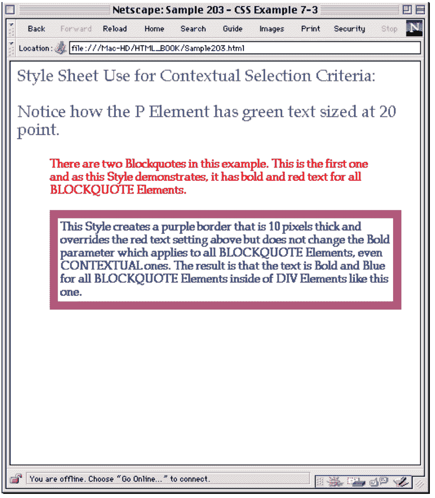

# 第一部分 — 动态 HTML

有多种方法可以将 CSS 样式应用到你的文档中：

- <STYLE> 元素样式
- 带 CLASS 样式的 <STYLE> 元素
- 带 ID 定义用于 CLASS 例外的 <STYLE> 元素
- 带上下文选择标准的 <STYLE> 元素
- STYLE 属性
- 带 CLASS 属性的 <SPAN> 元素
- 带 ID 属性用于 CLASS 例外的 <SPAN> 元素
- <LINK> 元素用于加载包含外部样式表的另一个文档
- <LINK> 元素用于加载多个外部样式表
- 一个文档中的多个 <STYLE> 元素

现在我们将通过大量示例详细探讨这些可能性。查阅第 11-15 页的属性图表以便快速参考，以及本章后面更深入的属性解释，可能会很有帮助。属性的功能才是真正的创意 possibilities 所在。为此，我们先查看格式化属性，然后在第 2 章继续介绍定位属性。

#### <STYLE> 元素样式

这一点在示例 1-1 中已经演示过，只是让你知道这并非全新的主题。事实上，它只是在之前章节"**<STYLE> 元素**"中包含的基本语法基础上进行扩展。

在下面的示例中，我们为三个不同的元素创建了单独的样式：BODY、H2 和 DIV。

这是 BODY 元素的样式：

```
BODY  { margin: 50px 20px 25px 72px;
        font-family: Helvetica, Times, Geneva;
        font-size: 12pt;
        font-style: plain;
        background-color: yellow;
      }
```

你应该立即注意到，可以用一个属性声明所有四个边距，而且它们之间不用逗号分隔。

边距顺序为：上-右-下-左，因此：

- 上边距为 50 像素宽，
- 右边距为 20 像素宽，
- 下边距为 25 像素宽，
- 左边距为 72 像素宽。

## 第 1 章 — 样式表

接下来，通过只包含你想使用的字体名称来声明字体。提供多个字体名称的原因是，如果第一种字体不在用户的系统中，Navigator 会检查并查看列出的第二种字体是否可用，依此类推。列出几种与你的首选字体外观非常相似的字体将增加视觉匹配的机会。如果没有列出的字体可用，那么 Navigator 将使用用户偏好设置中指定的默认字体。

确保你指定的字体是真正被使用的唯一方法是：使用**可下载字体**。一些比较保险的选择是 Helvetica、Courier 和 Times。有五种通用 font-family 属性值名称可以从用户的系统字体中选择相近的字体，它们是 **serif**、**sans-serif**、**cursive**、**fantasy** 和 **monospace** 字体族。有关每个类别中单独字 Kapl 示例，请参见第 13 页底部的图表。

接下来，使用 font-size 属性将字体大小指定为 12 点，然后 font-style 属性指定它为普通样式。最后，使用 background-color 属性将整个文档的背景颜色设置为黄色。

接下来，H1 元素的样式指定为使用 Moonlight 字体，粗体，紫色，大小为 24 点，文本将居中对齐。

DIV 元素使用 14 点 Clarendon 字体（如果可用），它将是粗体、绿色，并且首行仅缩进 72 像素，这就像编码了一个制表符。

##### 示例 1-4：Sample204.html

```
<!DOCTYPE HTML PUBLIC "-//W3C//DTD HTML 3.2//EN">
<HTML><HEAD>   <TITLE>          Sample 204 - CSS 示例 1-4  </TITLE>

<STYLE TYPE="text/CSS">
<!--
/*      边距顺序为:  上 右 下 左           */

BODY   { margin: 50px 20px 25px 72px;
         font-family: Helvetica, Times, Geneva;
         font-size: 12pt;
         font-style: plain;
         background-color: yellow;
       }

H1     { font-family: Moonlight, Clarendon, Palatino, Helvetica;
         font-size: 24pt;
         text-align: center;
         font-style: bold;
         color:#8800cc;      /*           真正的紫色          */
       }

DIV    { font-family: Clarendon, Palatino, Helvetica;
         font-size: 14pt;
         font-style: bold;
         color: green;
         text-indent: 72px;
       }
-->
</STYLE>
```

##### 示例 1-4

##### Sample204.html

##### Netscape：示例 204 - CSS 示例 7-4

这是示例 204

Division 元素的样式是 Clarendon 字体，粗体，绿色，大小为 14 点。如你在上面所见，居中对齐的 H1 元素使用 Moonlight 字体，备选字体为 Clarendon、Palatino 和 Helvetica。大小为 24 点，粗体，紫色。BODY 元素首选 Helvetica 字体，为 12 点普通样式，背景颜色为黄色。

还要注意 DIV 元素的样式中 text-indent 属性设置为 72 像素，这使得每次出现 DIV 元素时，文本的首行缩进 1 英寸。我们终于有了简便的制表符。

最后这段文本不在 H1 和 DIV 元素之内，因此它由 BODY 元素覆盖。注意 BODY 元素中设置的边距。如果你调整窗口大小，可以看到底边距。

您处于离线状态。选择"上线..."以连接。

## 第 1 章 — 样式表

```
</STYLE>
</HEAD>

<BODY>

<H1>这是示例 204</H1>

<DIV>
Division 元素的样式是 Clarendon 字体，粗体，绿色，大小
为 14 点。如你在上面所见，居中对齐的 H1 元素使用 Moonlight 字体，
备选字体为 Clarendon、Palatino 和 Helvetica。大小为 24 点，
粗体，紫色。BODY 元素首选 Helvetica 字体，为 12
点普通样式，背景颜色为黄色。
</DIV><BR><BR><HR>

<DIV>还要注意 DIV 元素的样式中 text-indent 属性设置
为 72 像素，这使得每次出现 DIV 元素时，文本的首行缩进 1 英寸。我们终于有了简便的制表符。
</DIV><BR><BR><HR>

最后这段文本不在 H1 和 DIV 元素之内，因此它由
BODY 元素覆盖。注意 BODY 元素中设置的边距。如果你调整
窗口大小，可以看到底边距。

</BODY>
</HTML>
```

#### 层叠样式表属性

### { font-size: } 属性

**font-size** 属性用于通过以下四种方式之一指定文本大小：**absolute**（绝对）、**relative**（相对）、**length**（长度）或 **percentage**（百分比）。这四种类别各有其特有的应用优势，详细语法如下。我个人发现使用 **length** 点大小是最简单的。默认大小是 **absolute** 值 **medium**。如果你使用 12、14、18 或 24 等标准字体大小，或者使用 **relative** 或 **percentage** 值，你将获得更一致的输出，特别是在打印时。

###### CSS 语法：

```
{ font-size: absolute|relative|length|percentage; }
```


# 第一部分 — 动态 HTML

-   absolute（绝对）使用以下七个关键字选项之一作为固定大小：
    xx-small, x-small, small, medium, large, x-large, xx-large

-   relative（相对）使用以下两个关键字之一创建相对于父元素字体更大或更小的大小。
    larger, smaller

-   length（长度）是一个数字后跟一个测量单位缩写。CSS 语法识别的测量单位有：
    -   px 像素
    -   in 英寸
    -   cm 厘米
    -   mm 毫米
    -   pt 点
    -   pc 派卡
    -   em 字体高度
    -   en 字体高度的一半

-   percentage（百分比）是一个数字后跟一个百分号，创建相对于父元素字体大小的相对百分比大小。

以下是每个类别的用法示例：

```
* absolute { font-size: xx-large; }
* relative { font-size: smaller; }
* length { font-size: 24pt; }
* percentage { font-size: 150%; }
```

##### { font-family: } 属性

**font-family** 属性用于按名称指定任何字体，就像你正常系统文件夹/字体文件夹中的字体名称一样。你只需指定一个字体名称，但始终建议列出几个类似的选项，因为字体必须存在于用户的系统中，Navigator 才能使用它，除非你使用可下载字体。更多信息请参见 CD-ROM 上的 Dynamic HTML Guide。

还有五个 `generic`（通用）安全字体族名称，它们不具体且依赖系统，但在外观上提供了更多选择。它们是：`sans-serif`、`serif`、`cursive`、`fantasy` 和 `monospace`。如果你不想依赖用户的选择（这是默认设置），请将它们作为列表中的最后一个字体作为备用字体。当你列出多个字体时，用逗号和空格分隔每个字体，如下所示：

```
{ font-family: Helvetica, Times, TimesRoman, serif; }
```

如果你要列出的字体名称由两个或多个带空格的单词组成，那么你需要将整个**字体名称**用引号或双引号括起来，如下所示：

```
{ font-family: "Brush Script"; }
```

###### CSS 语法：

```
{ font-family: fontName; }
{ font-family: fontName1, fontName2, fontNameN; }
```

##### { font-weight: } 属性

**font-weight** 属性用于指定文本的粗细。你可以使用关键字名称如 **bold**（粗体）或 **lighter**（更细），或者一个从 100 到 900 的整数（以 100 为增量），数字越大，文本越粗。

```
{ font-weight:bolder; }
{ font-weight:lighter; }
{ font-weight:500; }
```

###### CSS 语法：

```
{ font-weight: normal|bold|bolder|lighter|
            100|200|300|400|500|600|700|800|900; }
```

##### { font-style: } 属性

**font-style** 属性用于用斜体修饰文本或将其恢复正常，如下所示：

```
{ font-style:italic; }
{ font-style:normal; }
```

###### CSS 语法：

```
{ font-style: normal|italic; }
```

示例 1-5 重点介绍了刚刚解释的四个字体属性。

## 26 第一部分 — 动态 HTML

##### 示例 1-5: Sample205.html

```
<!DOCTYPE HTML PUBLIC "-//W3C//DTD HTML 3.2//EN">
<HTML>
<HEAD>
<TITLE>       Sample 205 - CSS Example 1-5    </TITLE>

<STYLE TYPE="text/CSS">

<!--

H1     { color: olive;
         font-family: Palatino, Moonlight, Clarendon, Helvetica;
         font-size: 30pt;
         font-style: italic;
         font-weight: lighter;
       }
DIV    { color: silver;
         background-color: black;
         font-family: Clarendon, Helvetica;
         font-size: 24pt;
         font-weight: bolder;
       }

-->

</STYLE>
</HEAD>

<BODY>

<H1>This is Sample 205</H1>

<DIV>
      This example focuses on demonstrating font Property characteristics.
</DIV>                                      <BR><HR>

<DIV>


<H1>   Sky Sphere   </H1>                                                      <BR><HR>
      Check out the Image in the Division.
</DIV>                                                                         <BR><HR>

<H1>   Do you see the inheritance of the black background color from the DIV Style
to the H1 Element that's inside the DIV Tags which is not applied to this H1.
</H1>

</BODY>

</HTML>
```

### { line-height: } 属性

**line-height** 属性的使用方式与页面布局程序中的行距相同：用于设置相邻文本行基线之间的垂直距离。你只能将此属性与块级元素一起使用。它通过一个值来指定，该值可以是关键字 **normal**、**数字**、**长度** 或 **百分比**。默认值是关键字 **normal**，它是当前所用字体的正常值。你不能将负数与此属性的任何值类型一起使用。

**数字** 当你指定一个不带测量单位的**数字**值时，它与将当前字体大小乘以该**数字**并将乘积作为 **line-height** 属性的值相同。这个**数字**值可以是浮点小数，可以小于一，但不能是负数。这种值类型与**百分比**值之间的唯一真正区别在于子元素继承值的方式。当使用不带单位的**数字**值时，子元素将继承实际的**数字**值，而不是乘法后的计算值。当使用**百分比**值时，子元素将继承乘法后的值。

**长度** 使用**长度**类型值意味着它是一个测量值。这意味着它是一个数字后跟一个测量单位，如 **pt** 表示点或 **px** 表示像素。
有关所有可用单位类型的更多信息，请参见第 11、12 和 14 页的测量单位图表。

**百分比** 使用**百分比**类型值意味着你提供的值乘以当前字体的字体大小，并将该值作为 **line-height** 值返回。**百分比**值后面总是跟着一个百分号 (%)。

###### 小示例：

以下是使用 **line-height** 属性的几个小例子：

```
{ line-height: normal; }
{ line-height: 1.5; }
{ line-height: 24pt; }
{ line-height: .25in; }
{ line-height: 150%; }
```

###### CSS 语法：

```
{ line-height: normal|number|length|percentage; }
```

##### { text-decoration: } 属性

`text-decoration` 属性用于用以下值之一修饰文本：
`underline`（下划线）、`line-through`（删除线）、`blink`（闪烁）或默认值 `none`（无），如下所示：

```
小示例：`{ text-decoration: underline; }`
```

###### CSS 语法：

```
{ text-decoration: none|underline|line-through|blink; }
```

##### { text-transform: } 属性

`text-transform` 属性用于以下四种方式之一更改文本，并附有示例。默认值是 `none`。

-   `capitalize` 使每个单词的第一个字母大写
-   `uppercase` 使所有文本大写
-   `lowercase` 使所有文本小写
-   `none` 使文本恢复正常，意味着继承的值（如果有）将被阻止。

```
小示例：`{ text-transform: uppercase; }`
```

###### CSS 语法：

```
{ text-transform: capitalize|uppercase|lowercase|none; }
```

##### { text-align: } 属性

`text-align` 属性用于使用 `left`（左对齐）、`right`（右对齐）关键字水平对齐文本，或者可以使用 `center`（居中）使文本居中，或使用 `justify`（两端对齐）使其两端对齐。默认值是 left。这是一个小例子：

```
小示例：`{ text-align: right; }`
```

###### CSS 语法：

```
{ text-align: left|right|center|justify; }
```


##### { text-indent: } 属性

**text-indent** 属性用于仅缩进元素内的第一行文本。它可以通过**长度**类型的值（即数字后跟度量单位）或**百分比**类型的值（即数字后跟百分号（%））来指定。当值指定为百分比时，它表示父元素宽度的百分比。默认值是 0。它只适用于块级元素，并且该值会被继承。有关所有可用度量单位的更多信息，请参阅第 11、12 和 14 页上的度量单位图表。

```
{ text-indent: 40px; }  { text-indent: 200%; }
```

###### CSS 语法：

```
{ text-indent: length|percentage; }
```

本示例重点演示 `text-decoration`、`text-transform`、`text-align`、`text-indent` 和 `line-height` 属性。

##### 示例 1-6：Sample206.html

```
<!DOCTYPE HTML PUBLIC "-//W3C//DTD HTML 3.2//EN">
<HTML> <HEAD> <TITLE> Sample 206 - CSS Example 1-6 </TITLE>
<STYLE TYPE="text/css">
<!--
H1
{
    text-align: center;
    line-height: 50pt;
    text-decoration: line-through;
    text-transform: uppercase;
    text-indent: 40px;
    color: red;
    font-family: Clarendon, Palatino, Helvetica;
    font-size: 24pt;
}
DIV
{
    text-align: right;
    line-height: 32pt;
    text-decoration: underline;
    text-transform: capitalize;
    text-indent: 100px;
    color: blue;
    font-family: Palatino, Clarendon, Helvetica;
    font-size: 14pt;
}
-->
</STYLE>
</HEAD>
```

## 30 第一部分 —— 动态 HTML

```
<BODY>

<H1>this is sample 206</H1>

<DIV>  This example focuses on demonstrating text-decoration, text-transform,
text-align, text-indent and line-height.
</DIV>
          <BR><HR>

<DIV>  Notice that the line-height parameter causes the space between the lines to
be greater than normal leading in the DIV tags. The DIV Elements are text-aligned
to the right, blue, underlined and the first letter of each word is capitalized.
</DIV>
          <BR><HR>

<DIV>  Also Notice that the text in the H1 element is all in uppercase letters even
though when it was typed in they were all in lowercase letters.
</DIV>

</BODY>
</HTML>
```

#### 边距

##### 边距概述

这是五个用于设置样式边距的属性的概述。每个单独的边距类型属性将在概述之后单独介绍。这组边距类型属性的行为方式可能与初看时的预期不同。它们在元素的<u>外部</u>添加不可见的空间，从而在相邻元素<u>之间</u>创建间距。使用 **margin** 属性时，你可以将四个边距设置为相同的值，也可以让每个边距具有不同的值。不要使用负边距，否则可能会得到不可预测的结果。

你还可以通过 **margin-top**、**margin-right**、**margin-bottom** 和 **margin-left** 属性分别设置每个边距。这些属性通常用于你不需要在一个或多个侧面设置边距的情况，因为不必全部设置；你可以根据需要挑选使用。

通过使用以下五个属性，有六种不同的方式可以为特定样式设置边距的厚度：

- **margin** 同时设置所有边距
- **margin-top** 设置上边距
- **margin-right** 设置右边距
- **margin-bottom** 设置下边距
- **margin-left** 设置左边距

##### { margin: } 属性

**margin** 属性用于全局设置边距的厚度。你可以通过只指定一个值来将四个边距设置为相同的值，如下所示：

```
{ margin: 20px; }
```

或者当你想要不同大小的边距时，你可以通过声明四个不同的值，每个值之间用空格分隔，如下所示：

```
{ margin: 72px 35px 20px 50px; }
```

这样：

- 上边距为 72 像素厚
- 右边距为 35 像素厚
- 下边距为 20 像素厚
- 左边距为 50 像素厚

边距的顺序始终相同，如前面的代码片段所示，即：

```
top-right-bottom-left
```

只需将顺序想象为顺时针方向，从顶部开始。注意边距列表中没有逗号。可能的值类型有 `length`、`percentage` 和关键字 `auto`。注意，如果将 **margin** 属性分配给一个不含内容的元素，则该元素的边距将被忽略，除非随后通过动态修改使其……使其包含内容，此时边距才会生效。

###### CSS 语法：

```
{ margin: length|percentage|auto; }
```

###### 参数定义：

**percentage** 是任何以百分号结尾的正数，如：

```
1%-1000%, ...n%
```

**length** 是一个数字，后跟以下度量单位之一：

```
em, ex, px, pt, pc, in, mm, cm
```

更多信息请参阅第 11、12 和 14 页的图表。

##### { margin-top: } 属性

`margin-top` 属性用于设置上边距的厚度，如下所示：

```
{ margin-top: 50px; } { margin-top: 20%; }
```

###### CSS 语法：

```
{ margin-top: length|percentage; }
```

##### { margin-right: } 属性

`margin-right` 属性用于设置右边距的厚度，如下所示：

```
{ margin-right: 20px; } { margin-right: 25%; }
```

###### CSS 语法：

```
{ margin-right: length|percentage; }
```

##### { margin-bottom: } 属性

`margin-bottom` 属性用于设置下边距的厚度。

```
{ margin-bottom: .5in; } { margin-bottom: 50%; }
```

###### CSS 语法：

```
{ margin-bottom: length|percentage; }
```

##### { margin-left: } 属性

`margin-left` 属性用于设置左边距的厚度，如下所示：

```
{ margin-left: 24pt; } { margin-left: 40%; }
```

###### CSS 语法：

```
{ margin-left: length|percentage; }
```

以下示例演示了单个边距可以具有不同大小或完全省略的能力。这是通过在样式中设置 **margin-top、margin-right、margin-bottom** 或 **margin-left** 属性的唯一长度值，或者在使用这四个属性时省略一个或多个属性来实现的。

### 示例 1-7：Sample207.html

```
<!DOCTYPE HTML PUBLIC "-//W3C//DTD HTML 3.2//EN">
<HTML><HEAD><TITLE> Sample 207 - CSS Example 1-7 Margins </TITLE>

<STYLE TYPE="text/css">

<!--

H1
{
    margin: 10px;
    text-transform: capitalize; color: red;
    border-style: ridge; border-width: 20px; border-color: purple; }

H2
{
    margin: 10px 30px 50px 70px;
    text-transform: capitalize; color: red;
    border-style: ridge; border-width: 20px; border-color: blue; }

H3
{
    margin-top: 35px;
    text-transform: capitalize; color: red;
    border-style: ridge; border-width: 20px; border-color: aqua; }

H4
{
    margin-right: 177px;
    text-transform: capitalize; color: red;
    border-style: ridge; border-width: 20px; border-color: green; }

H5
{
    margin-bottom: 2in;
    text-transform: capitalize; color: red;
    border-style: ridge; border-width: 20px; border-color: yellow; }

H6
{
    margin-left: 100px;
    text-transform: capitalize; color: red;
    border-style: ridge; border-width: 20px; border-color: fuchsia; }

P
{
    margin-left: 55px; margin-top: 1in; font-size: 17pt;
    border-style: ridge; border-width: 20px; border-color: red; }

-->
</STYLE>
</HEAD>

<BODY>

<H1> This is Sample 207 </H1>

<P>Notice that the P Element is set to a left margin of 55 pixels and a top margin of 1 inch.</P>

<H1> H1- This is a margin at 10 pixels on all four sides </H1>
<H2> H2- This is a margin at 10 30 50 70 pixels for top right bottom left </H2>
<H3> H3- This is a top margin of 35 pixels </H3>
<H4> H4- This is a right margin of 177 pixels </H4>
<H5> H5- This is a bottom margin of 2 inches </H5>
<H6> H6- This is a left margin of 100 pixels </H6>

</BODY>
</HTML>
```


## 内边距

当你想要在元素的边缘或周长与其内部内容之间创建空间时，可以使用五种内边距属性之一。这与 TABLE 元素中的 CELLADDING 属性效果相同。可以将任何元素想象成一个由外部、边缘和内部组成的矩形块。为了让文本、图像或其他内容从距离边缘一定距离的内部开始和结束，你需要添加内边距空间，就像一个只适用于该特定元素的内部边距。回顾上一节，外边距属性在元素外部添加空间，从而在不同元素之间创建距离。而内边距属性在元素内部添加空间，从而在元素边缘与元素内容之间创建空间。

使用 **padding** 属性时，你可以将所有四个内边距设置为相同的值，也可以为它们设置不同的值。你也可以通过使用 **padding-top**、**padding-right**、**padding-bottom** 和 **padding-left** 属性来单独设置每一个内边距。以下有六种不同的方式来设置特定样式的内边距厚度，通过使用以下五种属性（稍后将逐一介绍）：

- **padding** 一次性设置所有内边距
- **padding-top** 设置顶部内边距
- **padding-right** 设置右侧内边距
- **padding-bottom** 设置底部内边距
- **padding-left** 设置左侧内边距

##### { padding: } 属性

**padding** 属性用于全局设置内边距的厚度。你可以通过只指定一个值来一次性设置它们全部为相同的值，如下所示：

```
{ padding: 20px; }
```

当你需要不同大小的内边距时，可以通过声明四个不同的值（每个值之间用空格隔开）来一次性设置所有内边距，注意没有逗号，且它们的顺序是：上-右-下-左：

```
{ padding: 72px 80px 22px 50px; }
```

这样：

| 顶部内边距 | 是 | 72 像素厚 |
| 右侧内边距 | 是 | 80 像素厚 |
| 底部内边距 | 是 | 22 像素厚 |
| 左侧内边距 | 是 | 50 像素厚。 |

###### CSS 语法：

```
{ padding: length|percentage; }
```

**length** 是一个数字，后缀为以下单位之一：em、ex、px、pt、pc、in、mm、cm
**percentage** 是任何正数，后跟百分号，例如：1%-1000%，...n%

##### { padding-top: } 属性

**padding-top** 属性用于设置顶部内边距的厚度，如下所示：

```
{ padding-top: 50px; } { padding-top: 20%; }
```

###### CSS 语法：

```
{ padding-top: length|percentage; }
```

##### { padding-right: } 属性

**padding-right** 属性用于设置右侧内边距的厚度。

```
{ padding-right: 20px; } { padding-right: 25%; }
```

###### CSS 语法：

```
{ padding-right: length|percentage; }
```

##### { padding-bottom: } 属性

**padding-bottom** 属性用于设置底部内边距的厚度。

```
{ padding-bottom: .5in; } { padding-bottom: 50%; }
```

###### CSS 语法：

```
{ padding-bottom: length|percentage; }
```

##### { padding-left: } 属性

**padding-left** 属性用于设置左侧内边距的厚度。

```
{ padding-left: 24pt; } { padding-left: 40%; }
```

###### CSS 语法：

```
{ padding-left: length|percentage; }
```

# 第一部分 — 动态 HTML

这个示例演示了可以设置单独的内边距为不同大小或完全省略的能力。这通过为 **padding-top**、**padding-right**、**padding-bottom** 或 **padding-left** 属性设置唯一的 **长度** 值，或者在样式中使用这四个属性时省略其中一个或多个属性来实现。

## 示例 1-8：Sample208.html

```
<!DOCTYPE HTML PUBLIC "-//W3C//DTD HTML 3.2//EN">
<HTML><HEAD><TITLE>   Sample 208 - CSS Example 1-8 Paddings     </TITLE>
<STYLE TYPE="text/CSS">
<!--
H1      { padding: 10px;
          text-transform: capitalize; color: red;
          border-style: ridge; border-width: 20px; border-color: purple; }

H2      { padding: 10px 30px 50px 70px;
          text-transform: capitalize; color: red;
          border-style: ridge; border-width: 20px; border-color: blue; }
H3     { padding-top: 35px;
          text-transform: capitalize; color: red;
          border-style: ridge; border-width: 20px; border-color: aqua; }

H4      { padding-right: 177px;
          text-transform: capitalize; color: red;
          border-style: ridge; border-width: 20px; border-color: green; }

H5      { padding-bottom: 2in;
          text-transform: capitalize; color: red;
          border-style: ridge; border-width: 20px; border-color: yellow; }

H6      { padding-left: 100px;
          text-transform: capitalize; color: red;
          border-style: ridge; border-width: 20px; border-color: fuchsia; }

P       { padding-left: 55px; padding-top: 1in; font-size: 17pt;
          border-style: ridge; border-width: 20px; border-color: red; }
-->
</STYLE>
</HEAD>
<BODY>       <H1>   这是示例 208   </H1>
<P>注意 P 元素设置为左侧内边距 55 像素，顶部内边距 1 英寸。</P>

<H1>H1- 这是所有四边均为 10 像素的内边距</H1>
<H2>H2- 这是顶部、右侧、底部、左侧分别为 10、30、50、70 像素的内边距</H2>
<H3>H3- 这是 35 像素的顶部内边距</H3>
<H4>H4- 这是 177 像素的右侧内边距</H4>
<H5>H5- 这是 2 英寸的底部内边距</H5>
<H6>H6- 这是 100 像素的左侧内边距</H6>
</BODY>
</HTML>
```

#### 颜色

在 CSS 语法中，有三种属性允许你直接操作样式中的颜色。它们的工作方式完全相同，但作用于文档的不同方面。**color** 属性控制前景色，即它所应用的元素中的文本颜色。**background-color** 属性控制它所应用的元素的背景颜色。最后是 **border-color** 属性，它改变边框的颜色，覆盖从 BODY 元素的前景色继承的默认颜色。

在 CSS 语法中，你有比 HTML 更多的方式来指定颜色。你可以使用公认的颜色名称，包括所有 JavaScript 颜色名称（参见附录 B）、十六进制三元组，也可以使用 **rgb()** 函数来表示颜色。

**rgb()** 函数接受三个参数：**redArg**、**greenArg** 和 **blueArg**，它们代表一种颜色的红色、绿色和蓝色分量。它们由逗号分隔，可以是 0 到 255 之间的数字，也可以是 0 到 100% 之间的百分比。如果使用百分比，则每个参数的数字后都必须跟有百分号（%）。

###### CSS 语法：

```
rgb(redArg, greenArg, blueArg)
rgb(redArg%, greenArg%, blueArg%)
```

在 0-255 的度量方案中，使用的数字从最低（代表无颜色）到 255（代表全色），因此：

| rgb ( 255, 0, 0 ) | 意味着： | 全红、无绿、无蓝 | = | 红色 |
| rgb ( 255, 0, 255 ) | 意味着： | 全红、无绿、全蓝 | = | 梅红色 |
| rgb ( 0, 0, 255 ) | 意味着： | 无红、无绿、全蓝 | = | 蓝色 |
| rgb ( 0, 255, 255 ) | 意味着： | 无红、全绿、全蓝 | = | 水绿色 |
| rgb ( 0, 255, 0 ) | 意味着： | 无红、全绿、无蓝 | = | 酸橙绿 |
| rgb ( 255, 255, 0 ) | 意味着： | 全红、全绿、无蓝 | = | 黄色 |
| rgb ( 255, 255, 255 ) | 意味着： | 全红、全绿、全蓝 | = | 白色 |
| rgb ( 0, 0, 0 ) | 意味着： | 无红、无绿、无蓝 | = | 黑色 |
| rgb ( 100%, 0%, 0% ) | 意味着： | 全红、无绿、无蓝 | = | 红色 |
| rgb ( 100%, 0%, 100% ) | 意味着： | 全红、无绿、全蓝 | = | 梅红色 |
| rgb ( 0%, 0%, 100% ) | 意味着： | 无红、无绿、全蓝 | = | 蓝色 |
| rgb ( 0%, 100%, 100% ) | 意味着： | 无红、全绿、全蓝 | = | 水绿色 |
| rgb ( 0%, 100%, 0% ) | 意味着： | 无红、全绿、无蓝 | = | 酸橙绿 |
| rgb ( 100%, 100%, 0% ) | 意味着： | 全红、全绿、无蓝 | = | 黄色 |
| rgb ( 100%, 100%, 100%) | 意味着： | 全红、全绿、全蓝 | = | 白色 |
| rgb ( 0%, 0%, 0% ) | 意味着： | 无红、无绿、无蓝 | = | 黑色 |


 ## { color: } 属性

`color` 属性非常简单直观；它让你选择元素的前景色，这会改变文本的颜色。以下是表示前景色的四种方式：

```
{ color: silver; }			{ color: #e35a77; }
{ color: rgb(5, 220, 250); }	{ color: rgb(38%, 43%, 69%); }
```

###### CSS 语法：

```
{ color: colorname | #$$$$$ | rgb(0-255,0-255,0-255) |
	rgb(0-100%,0-100%,0-100%); }
```

> 本示例重点介绍如何使用 **color** 属性来指定前景色。

##### 示例 1-9：Sample209.html

```
<!DOCTYPE HTML PUBLIC "-//W3C//DTD HTML 3.2//EN">
<HTML>
<HEAD>
<TITLE> Sam 209 - CSS 示例 1-9 color 属性 </TITLE>

<STYLE TYPE="text/CSS">
<!--

H1 { color: blue;
	border-style: ridge; border-width: 20px; border-color: purple; }

H2 { color: rgb(155,0,255);
	border-style: ridge; border-width: 20px; border-color: blue; }

H3 { color: rgb(0,57,155);
	border-style: ridge; border-width: 20px; border-color: aqua; }

H4 { color: rgb(0%, 50%,0%);
	border-style: ridge; border-width: 20px; border-color: green; }

H5 { color: rgb(90%,0%,5%);
	border-style: ridge; border-width: 20px; border-color: yellow; }

H6 { color:#7705dd;
	border-style: ridge; border-width: 20px; border-color: fuchsia; }

P { color:#ef4499;
	font-size: 17pt;
	border-style: ridge; border-width: 20px; border-color: red; }

-->
</STYLE>
```

```
</HEAD>

<BODY>

<H1>This is Sample 209</H1>

<P>Notice that the all the different heading types have unique foreground colors
which controls the text color.</P>

<H1>        This is a H1 Heading    </H1>
<H2>        This is a H2 Heading    </H2>
<H3>        This is a H3 Heading    </H3>
<H4>        This is a H4 Heading    </H4>
<H5>        This is a H5 Heading    </H5>
<H6>        This is a H6 Heading    </H6>

</BODY>
</HTML>
```

| 示例 1-9 | Sample209.html |

##### { background-color: } 属性

**background-color** 属性让你选择每个元素的背景颜色。你可以使用公认的颜色名称、十六进制三元组，或者使用 `rgb()` 函数，该函数允许你使用常规数字或百分比来指定 rgb 三元组，这对于艺术家、平面设计师、Phot oshop 用户以及其他图像编辑爱好者来说可能更为熟悉。以下是通过 `background-color` 属性为元素样式指定背景颜色的四种示例：

```
{ background-color: olive; }
{ background-color:#aaca77; }
{ background-color: rgb(155, 120, 50); }
{ background-color: rgb(50%, 0%, 90%); }
```

###### CSS 语法：

```
{ background-color: colorname | #$$$$$$ | rgb(0-255,0-255,0-255) |
 rgb(0-100%,0-100%,0-100%); }
```

示例 1-10 重点介绍 **background-color** 属性。

##### 示例 1-10：Sample210.html

```
<!DOCTYPE HTML PUBLIC "-//W3C//DTD HTML 3.2//EN">
<HTML>
<HEAD>

<TITLE> Sample 210 - CSS 示例 1-10 background-color 属性 </TITLE>

<STYLE TYPE="text/CSS">
<!--

H1 { background-color: blue;
 border-style: ridge; border-width: 20px; border-color: purple; }

H2 { background-color: rgb(155,0,255);
 border-style: ridge; border-width: 20px; border-color: blue; }

H3 { background-color: rgb(0,57,155);
border-style: ridge; border-width: 20px; border-color: aqua; }

H4 { background-color: rgb(0%,50%,0%);
border-style: ridge; border-width: 20px; border-color: green; }

H5 { background-color: rgb(90%,0%,5%);
border-style: ridge; border-width: 20px; border-color: yellow; }

H6 { background-color: #7705dd;
border-style: ridge; border-width: 20px; border-color: fuchsia; }

P { background-color:#ef4499;
font-size: 17pt;
border-style: ridge; border-width: 20px; border-color: red; }

-->
</STYLE>
</HEAD>
<BODY TEXT="#eeeeee" BGCOLOR="#000000">
<H1>This is Sample 210</H1>
```

<P>本示例与 Sample 208 完全相同，只是所使用的颜色用于背景而非前景。由于没有指定前景色，所有标题元素都从 BODY 元素继承该属性，因为它们包含在 BODY 元素内。</P>

```
<H1> This is a H1 Heading </H1>
<H2> This is a H2 Heading </H2>
<H3> This is a H3 Heading </H3>
<H4> This is a H4 Heading </H4>
<H5> This is a H5 Heading </H5>
<H6> This is a H6 Heading </H6>
```

```
</BODY>
</HTML>
```

请查看附录 B 第 1033-1037 页的颜色图表，其中列出了所有 JavaScript 颜色名称及其十六进制、rgb 数值和百分比值等价物。这些信息也包含在 CD-ROM 中的一个名为 AppendixB-ChartOnly.html 的文件中，该文件位于 HTML_BOOK-Online 文件夹中，而 HTML_BOOK-Online 文件夹位于 DHTML-JS BOOK-Main Files 文件夹中。它使用了数组、for() 循环和 document.write() 在 JavaScript 脚本中输出数据，并在文本后面渲染实际颜色。在附录 B 中还有一篇关于加色理论的论述，如果你感兴趣可见光光谱中颜色的工作原理。第 340-350 页还有一个颜色转换计算器，使用 JavaScript 将颜色在多种格式之间进行转换。

##### { background-image: } 属性

`background-image` 属性让你选择一张图像显示在元素内容后面。你可以为创建的每个元素样式设置不同的图像。此背景图像将根据需要平铺多次，以填充分配给该元素的空间。以下是将背景图像编码到样式中的示例，注意 (JPEG-FILES) 是包含实际图像的文件夹，图像文件具有相对路径 `urlName` (ExampleImage.jpeg)：

```
{ background-image: url(JPEG-FILES/ExampleImage.jpeg); }
```

在语法中请注意，`url` 中的 "[" 和 `左括号` "(" 在 (`urlName`) 之间不能有任何空格，并且 `urlName` 不用引号括起来。

###### CSS 语法：

```
{ background-image: url(urlName); }
```

本示例重点介绍 `background-image` 属性。

##### 示例 1-11：Sample211.html

```
<!DOCTYPE HTML PUBLIC "-//W3C//DTD HTML 3.2//EN">
<html>
<HEAD>
<TITLE>Sample 211 - CSS 示例 1-11 背景图像 </TITLE>
<STYLE TYPE="text/CSS">
<!--
BODY { font-size: 36pt; }
 H1 { background-image: url(./JPEG-FILES/icon-BG-asteroids.jpg);
border-style: ridge; border-width: 20px; border-color: purple; padding: 30px;
background-color: white; }
H2 { background-image: url(./JPEG-FILES/icon-Clouds.jpg);
border-style: ridge; border-width: 20px; border-color: blue; padding: 72px; }
H3 { background-image: url(./JPEG-FILES/icon-BG-stars.jpg);
border-style: ridge; border-width: 20px; border-color: aqua; padding: 144px; }

H4 { background-image: url(/JPEG-FILES/Icon-FieldStone-Purple.jpeg);
border-style: ridge; border-width: 20px; border-color: green; padding: 100px; }

H5 { background-image: url(/JPEG-FILES/Icon-Paint-Palette.jpg);
border-style: ridge; border-width: 20px; border-color: yellow; padding: 144px; }

H6 { background-image: url(/dreamplay-website/JPEG-FILES/J2-JERRY_GARCIA-2-RS.jpg);
border-style: ridge; border-width: 20px; border-color: fuchsia; padding: 50px;
color: white; }

P { background-color:#ccccff;
font-size:12pt;
border-style: ridge; border-width: 20px; border-color: red; }
```

```
-->

</STYLE>

</HEAD>

<BODY TEXT="#0000ff" BGCOLOR="#000000">

<H1> This is Sample 21 </H1>

<P> Make sure that there are no blank spaces between the last letter of (url)
and the first parenthesis containing the urlName. This is correct: url(urlName) and
this is wrong: url (urlName) <BR><BR>
Also notice that the image tiles or repeats to fill up the available or assigned
space.</P>

<H1> This is a H1 Heading </H1>
<H2> This is a H2 Heading </H2>
<H3> This is a H3 Heading </H3>
<H4> This is a H4 Heading </H4>
<H5> This is a H5 Heading </H5>
<H6> This is a H6 Heading </H6>

</BODY>
</HTML>
```

示例 1-12 使用了到目前为止已讨论的许多属性。查看一下，确保其中所有内容都熟悉。需要注意的一些细节是：BODY 元素分配了 **margin** 属性，这导致包含在 BODY 中的每个元素周围也有 20 像素的外边距。

由于 CITE 元素也分配了 **margin** 属性，效果是累积的；也就是说，所有 CITE 元素将拥有来自 BODY 元素的 20 像素外边距，加上其自身的 10 像素外边距。

如果你在浏览器中查看该示例，你会看到与 CITE 元素相邻的元素之间的距离，比其他在样式定义中没有显式 **margin** 属性的元素更大。还要记住，H1 和 PRE 元素是块级元素，具有内置的换行符，而 CITE 和 XMP 元素则没有。


 # 示例 1-12：Sample212.html

```
<!DOCTYPE HTML PUBLIC "-//W3C//DTD HTML 3.2//EN">
<HTML>
<HEAD>
<TITLE> Sample 212 - CSS Example 1-12 Compilation </TITLE>

<STYLE TYPE="text/CSS">

<!--

BODY { margin: 20px; background-color:#7777cc; }

H3 { font-family: Clarendon, Moonlight, Palatino, Helvetica;
    font-size: 30pt;
    text-align: center;
    font-style: bold;
    color: blue;
    border-width: 25in;
    border-style: groove;
    border-color:#835a77;
    margin: 20px;
    background-color:#755f11; /* metallic gold */
    }

PRE { font-family: Brush Script, Geneva, Palatino, Helvetica;
    font-size: 19pt;
    font-style: plain;
    color: black;
    text-indent: 45px;
    line-height: 30pt;
    border-width: 25in;
    border-width: 25in;
    border-style: inset;
    border-color: blue;
    background-color: aqua;
    margin: 15px;
    }

CITE { font readership: Bellevue, New York, Geneva, Times;
    font-size: 25pt;
    font-style: italic;
    text-align: center;
    color: red;
    line-height: 45pt;
    border-width: 10mm;
    border-style: outset;
    border-color: lime;
    background-color: yellow;
    margin: 10px;
    margin: 20px;
    }

XMP { font-family: Helvetica, Times, New York, Geneva;
    font-size: 18pt;
    font-style: bold;
    text-align: center;
    color: maroon;
    border-width: 10mm;
    border-style: ridge;
    border-color: purple;
    background-color: gray;
    margin: 40px;
    white-space: pre;
    }

-->
</STYLE>
</HEAD>
<BODY>
<H3> This is Sample 212 </H3>

<PRE>
There are a lot of Properties in this example.

The Site still has their website. You should email them to let the powers
that be know that they should reinstate the show. Bring back Dev.

This example has a lot of
borders in it but the
next example is the one with
all border style possibilities.

If you don't
explicitly code in the
white-space Property to "pre" then even
with an XMP Tag or a PRE Tag the
white-space will collapse because in
Style Sheet syntax white-space is
collapsed by default.

Below are all the
Properties used in the
Style for the XMP Element.

{ font-family: Helvetica, Times, New York, Geneva;
font-size: 18pt;
font-style: bold;
text-align: center;
color: maroon;
border-width: 10mm;
border-style: ridge;
border-color: purple;
background-color: gray;
margin: 40px;
white-space: pre;
}

</PRE>
</BODY>
</HTML>
```

## 第 1 章 — 样式表

#### 设置边框

##### { border-style: } 属性

通过使用 **border-style** 属性，你可以选择用二维或三维凸起边框来包围内容，从而突出显示内容。**solid** 和 **double** 样式是二维的，而 **inset**、**outset**、**groove** 和 **ridge** 样式则都是三维阴影效果。如果你想尝试图形创新，还可以选择创建少于四条边的边框。尝试将内容嵌套在所有边框的元素中，会产生非常有趣的效果。默认值是 **none**，如果你正在创建动态变化的样式，也可以通过 JavaScript 来选择该值。请记得在样式定义中包含 <u>border-width</u> 属性值，否则它将不可见，因为其默认值为零。有关设置边框宽度的更多信息，请参阅第 52-58 页。

这是一个 3D **border-style** 的示例：

```
{ border-style: groove }
```

###### CSS 语法：

```
{ border-style: none|solid|double|inset|outset|groove|ridge; }
```

本示例涵盖了 **border-style** 属性的所有值，但不包括 **none**。

**示例 1-13：**&nbsp;&nbsp;&nbsp;&nbsp;&nbsp;&nbsp;&


 ## 示例 1-15：Sample215.html

```
<!DOCTYPE HTML PUBLIC "-//W3C//DTD HTML 3.2//EN">
<HTML><HEAD><TITLE> Sample 215 - CSS Example 1-15 Nested Borders </TITLE>

<STYLE TYPE="text/css">
<!--

H1 { border-style: solid;
    border-width: 20px;
    border-color: rgb(155, 0, 255);
    background-color: blue;        /* orange */
}

H2 { border-style: double;
    border-width: 20px;
    border-color: blue;            /* medium green */
    background-color: rgb(0%, 100%, 100%); /* metallic gold */
}

H3 { border-style: inset;
    border-width: 20px;
    border-color: rgb(0%, 100%, 100%); /* purple */
    background-color: rgb(0, 255, 0 );   /* dark blue */
}

H4 { border-style: outset;
    border-width: 20px;
    border-color: rgb(0, 255, 0 );    /* water green green */
    background-color: rgb(100%, 100%, 0%); /* red */
}

H5 { border-style: groove;
    border-width: 20px;
    border-color: rgb(100%, 100%, 0%); /* lime green */
    background-color: rgb(255, 0, 0 );  /* red metallic gold */
}

H6 { border-style: ridge;
    border-width: 20px;
    border-color: rgb(255, 0, 0 );    /* plum */
    background-color: red;            /* metallic aqua */
    font-size: 24pt;
}

-->
</STYLE>
</HEAD>

<BODY>
<H1><H2><H3><H4><H5><H6>Rainbow Land</H6></H5></H4></H3></H2></H1>
</BODY>
</HTML>
```

示例 1-16 展示了两个嵌套元素的实例，每个元素都具有 **border-style** 属性，从而创建了嵌套的彩虹多重边框，这些边框继承了 BODY 元素的白色背景，而不是显式指定背景色。

##### 示例 1-16：Sample216.html

```
<!DOCTYPE HTML PUBLIC "-//W3C//DTD HTML 3.2//EN">
<HTML>
<HEAD>
<TITLE>Sample 216 - CSS Example 1-16 Nested Rainbow Borders</TITLE>

<STYLE TYPE="text/CSS">

<!--
                                                        /*  Remember these are CSS comments  */

H1      { border-style: solid;
          border-width: 20px;
          border-color: rgb(255, 0, 255);              /*      plum              */
        }
H2      { border-style: double;
          border-width: 20px;
          border-color: blue;                          /*      medium green      */
        }
H3      { border-style: inset;
          border-width: 20px;
          border-color: rgb(0%, 100%, 100%);           /*      purple            */
        }
H4      { border-style: outset;
          border-width: 20px;
          border-color: rgb(0, 255, 0);                /*      water green       */
        }
H5      { border-style: groove;
          border-width: 20px;
          border-color: rgb(100%, 100%, 0%);           /*      lime green        */
        }
H6      { border-style: ridge;
          border-width: 20px;
          border-color: rgb(255, 0, 0);                /*      red               */
          font-size: 24pt;
        }

-->

</STYLE>
</HEAD>

<BODY>

<H1><H2><H3><H4><H5><H6>Rainbow Land</H6></H5></H4></H3></H2></H1>

<H6><H5><H4><H3><H2><H1>Rainbow Land</H1></H2></H3></H4></H5></H6>

</BODY>
</HTML>
```

#### 边框宽度

当你使用 **border-style** 属性为内容添加图形化边框时，无论是 **solid、double、inset、outset、groove** 还是 **ridge** 样式，你还必须指定以下五种边框宽度属性之一。这样做的原因是边框默认厚度为零，直到你为其指定宽度。你可以将所有边框设置为相同的厚度，也可以让边框的每条边具有唯一的宽度。你甚至可以创建三边框，其中每条边的宽度各不相同。共有六种不同的方式来设置厚度，即边框的宽度，通过使用以下任意属性：

- border-width
- border-top-width
- border-right-width
- border-bottom-width
- border-left-width

##### { border-width: } 属性

**border-width** 属性用于全局设置边框的厚度。你可以通过只指定一个值来将所有边框设置为相同的厚度，如下所示：

```
{ border-width: 20px; }
```

或者你可以通过声明四个不同的值，并在每个值之间用空格隔开，如下所示：

```
{ border-width: 10px 20px 30px 40px; }
```

在这种情况下，边框的顺序是<u>上-右-下-左</u>；可以将此顺序理解为从顶部开始顺时针方向。

###### CSS 语法：

```
{ border-width: length|percentage; }
```

**length** 是一个数字，后缀为以下计量单位之一：

```
em, ex, px, pt, pc, in, mm, cm
```

有关计量单位的更多信息，请参见第 11-12、14 页的图表。

**percentage** 是任何正数，后缀为百分号，例如：1%-100%，...n%

## { border-top-width: } 属性

**border-top-width** 属性用于设置边框顶部的厚度，如下所示：
{ border-top-width: 20px; }

###### CSS 语法：

```
{ border-top-width: length|percentage; }
```

## { border-right-width: } 属性

**border-right-width** 属性用于设置边框右侧的厚度，如下所示：
{ border-right-width: 20px; }

###### CSS 语法：

```
{ border-right-width: length|percentage; }
```

## { border-bottom-width: } 属性

**border-bottom-width** 属性用于设置边框底部的厚度，如下所示：
{ border-bottom-width: 20px; }

###### CSS 语法：

```
{ border-bottom-width: length|percentage; }
```

## { border-left-width: } 属性

**border-left-width** 属性用于设置边框左侧的厚度，如下所示：
{ border-left-width: 20px; }

###### CSS 语法：

```
{ border-left-width: length|percentage; }
```

这是一个示例，演示了如何让一个总边框的各条边具有不同的尺寸或完全省略。这是通过为以下属性设置唯一的 *length* 值，或在样式中使用四个属性时省略一个或多个属性来实现的：

```
border-top-width: length;
border-right-width: length;
border-bottom-width: length;
border-left-width: length;
```

它还演示了 **border-width** 属性。

##### 示例 1-17：Sample217.html

```
<!--DOCTYPE HTML PUBLIC "-//W3C//DTD HTML 3.2//EN">
<HTML>
<HEAD><TITLE> Sample 217 - CSS Example 1-17</TITLE>

<STYLE TYPE="text/CSS">
<!--

BODY { margin: 10px; font-size: 30pt; background-color:#aaccbb;
border-style: ridge; border-width: 10px;
font-family: Bellevue, Clarendon, Moonlight, Helvetica;
}

H1 { border-style: solid;
border-top-width: 5px;
border-right-width: 10px;
border-bottom-width: 20px;
border-left-width: 25px;
border-color:#f0000;
margin: 10px;
background-color:#665599; /* metallic purple */
}

H2 { border-style: double;
border-top-width: 20px;
border-right-width: 20px;
border-bottom-width: 20px;
border-color: blue;
margin: 10px;
background-color:#665599; /* metallic purple */
}

H3 { border-style: inset;
border-top-width: 20px;
border-right-width: 20px;
border-color: green;
margin: 10px;
background-color:#665599; /* metallic purple */
}

H4  { border-style: outset;
     border-right-width: 20px;
     border-left-width: 25px;
     border-color: aqua;
     margin: 10px;
     background-color:#665599;        /*      metallic purple      */
}
H5  { border-style: groove;
     border-top-width: 20px;
     border-bottom-width: 20px;
     border-color: purple;
     margin: 10px;
     background-color:#665599;        /*      metallic purple      */
}
H6  { border-style: ridge;
     border-left-width: 20px;
     border-right-width: 20px;
     border-bottom-width: 20px;
     border-color: marroovy;
     margin: 10px;
     background-color:#665599;        /*      metallic purple      */
}
P   { font-size: 18pt;
     border-style: none;
     border-width: 20px;
     border-color: maroon;
     margin: 10px;
     background-color:#665599;        /*      metallic purple      */
}

-->

</STYLE>
</HEAD>

<BODY>

<P>   This example demonstrates the ability to have the sides of your borders be
of different sizes or omitted. Netscape doesn't seem to have nailed the math down
on getting the borders to match up precisely when certain sides of certain styles
are used, at least on the Mac Platform. If the size of your text in the headings is
not all 30pt, try holding the Shift Key down and hitting the reload button in your
browser.                                      </P>

    <H1>   This is a solid border       </H1>
    <H2>   This is a double border      </H2>
    <H3>   This is an inset border      </H3>
    <H4>   This is an outset border     </H4>
    <H5>   This is a groove border      </H5>
    <H6>   This is a ridge border       </H6>

</BODY>
</HTML>
```

此示例展示了 16 种通用公认颜色名称的图表。在 CD-ROM 上的 Sample43.html 中有一个颜色图表，展示了这些颜色。这是该示例的一个变体，它为 TABLE 元素内的 HEADING 元素应用了边框样式，并包含了每种颜色的 rgb() 函数值。查看代码时，请注意每个表格行（TABLE ROW）有 8 个单元格（CELL），但每个单元格在其代码编辑器中各占一行。在插入 FONT 元素的各个实例处，它们提供了单元格背景色与文本颜色之间的对比。

##### 示例 1-18：Sample218.html

```
<!DOCTYPE HTML PUBLIC "-//W3C//DTD HTML 3.2//EN">
<HTML>

<HEAD>
<TITLE> Sample 218 - Example 1-18 - Color Chart 2 </TITLE>

<STYLE type="text/CSS">
<!--

H1
{
  border-style: ridge;
  border-width: 10px;
  font-size: 24pt;
  border-color: rgb(255, 0, 0);
  float: center;
}

H2
{
  border-style: groove;
  border-width: 15px;
  border-color: rgb(55, 0, 255);
  color: rgb(255, 255, 255);
  background-color: rgb(175, 175, 25);
  padding: 15px;
  font-size: 30pt;
  float: center;
  font-family: Brush Script, Moonlight, Clarendon;
}

-->
</STYLE>
</HEAD>

<BODY BGCOLOR="#ffffff" TEXT="#000000">

<H2>CSS COLOR CHART</H2>

<TABLE BORDER="15" CELLSPACING="4" CELLPADDING="10"
  BGCOLOR="#00ffff" BORDERCOLOR="#7700ff" ALIGN="CENTER">
```

## 第 1 章 — 样式表

```
<TR>
<TH COLSPAN="8">
<FONT SIZE="6">          <H1>THE 16 COLORS RECOGNIZED BY NAME</H1>   </FONT></TH>
</TR>
```

```
<TR WIDTH="140" BGCOLOR="#755f11">
<TH> COLOR </TH>
<TH> HEX<BR>rrggbb </TH>
<TH> rgb(r#,g#,b#)<BR>Function </TH>
<TH> rgb(r%,g%,b%)<BR>Function </TH>
<TH> COLOR </TH>
<TH> HEX<BR>rrggbb </TH>
<TH> rgb(r#,g#,b#)<BR>Function </TH>
<TH> rgb(r%,g%,b%)<BR>Function </TH>
</TR>
```

```
<TR>
<TH></TH>     <!-- This creates the White Bar under the Table Headings -->
 terminate
</TR>
```

```
<TR WIDTH="140">
<TD BGCOLOR="#000000"><FONT COLOR="#ffffff">Black</FONT></TD>
<TD BGCOLOR="#000000"><FONT COLOR="#ffffff">000000</FONT></TD>
<TD BGCOLOR="#000000"><FONT COLOR="#ffffff">(0,0,0)</FONT></TD>
<TD BGCOLOR="#000000"><FONT COLOR="#ffffff">(0%,0%,0%)</FONT></TD>
<TD BGCOLOR="#008000">Green</TD>
<TD BGCOLOR="#008000">008000</TD>
<TD BGCOLOR="#008000">(0,127,0)</TD>
<TD BGCOLOR="#008000">(0%,50%,0%)</TD>
</TR>
```

```
<TR WIDTH="140">
<TD BGCOLOR="#c0c0c0">Silver</TD>
<TD BGCOLOR="#c0c0c0">c0c0c0</TD>
<TD BGCOLOR="#c0c0c0">(207,207,207)</TD>
<TD BGCOLOR="#c0c0c0">(80%,80%,80%)</TD>
<TD BGCOLOR="#00ff00">Lime</TD>
<TD BGCOLOR="#00ff00">00ff00</TD>
<TD BGCOLOR="#00ff00">(0,255,0)</TD>
<TD BGCOLOR="#00ff00">(0%,100%,0%)</TD>
</TR>
```

```
<TR WIDTH="140">
<TD BGCOLOR="#808080">Gray</TD>
<TD BGCOLOR="#808080">808080</TD>
<TD BGCOLOR="#808080">(127,127,127)</TD>
<TD BGCOLOR="#808080">(50%,50%,50%)</TD>
<TD BGCOLOR="#808000">Olive</TD>
<TD BGCOLOR="#808000">808000</TD>
<TD BGCOLOR="#808000">(127,127,0)</TD>
<TD BGCOLOR="#808000">(50%,50%,0%)</TD>
</TR>
```

```
<TR WIDTH="140">
<TD BGCOLOR="#ffffff">White</TD>
<TD BGCOLOR="#ffffff">ffffff</TD>
<TD BGCOLOR="#ffffff">(255,255,255)</TD>
```

# 第一部分 — 动态 HTML

```
<TD BGCOLOR="#ffffff">(100%,100%,100%)</TD>
<TD BGCOLOR="#ffff00">Yellow</TD>
<TD BGCOLOR="#ffff00">ffff00</TD>
<TD BGCOLOR="#ffff00">(255,255,0)</TD>
<TD BGCOLOR="#ffff00">(100%,100%,0%)</TD>
</TR>

<TR WIDTH="140">
<TD BGCOLOR="#800000">Maroon</TD>
<TD BGCOLOR="#800000">800000</TD>
<TD BGCOLOR="#800000">(127,0,0)</TD>
<TD BGCOLOR="#800000">(50%,0%,0%)</TD>
<TD BGCOLOR="#000080"><FONT COLOR="#ffffff">Navy</FONT></TD>
<TD BGCOLOR="#000080"><FONT COLOR="#ffffff">000080</FONT></TD>
<TD BGCOLOR="#000080"><FONT COLOR="#ffffff">(0,0,127)</FONT></TD>
<TD BGCOLOR="#000080"><FONT COLOR="#ffffff">(0%,0%,50%)</FONT></TD>
</TR>

<TR WIDTH="140">
<TD BGCOLOR="#ff0000">Red</TD>
<TD BGCOLOR="#ff0000">ff0000</TD>
<TD BGCOLOR="#ff0000">(255,0,0)</TD>
<TD BGCOLOR="#ff0000">(100%,0%,0%)</TD>
<TD BGCOLOR="#0000ff"><FONT COLOR="#ffffff">Blue</FONT></TD>
<TD BGCOLOR="#0000ff"><FONT COLOR="#ffffff">0000ff</FONT></TD>
<TD BGCOLOR="#0000ff"><FONT COLOR="#ffffff">(0,0,255)</FONT></TD>
<TD BGCOLOR="#0000ff"><FONT COLOR="#ffffff">(0%,0%,100%)</FONT></TD>
</TR>

<TR WIDTH="140">
<TD BGCOLOR="#800080">Purple</TD>
<TD BGCOLOR="#800080">800080</TD>
<TD BGCOLOR="#800080">(127,0,127)</TD>
<TD BGCOLOR="#800080">(50%,0%,50%)</TD>
<TD BGCOLOR="#008080">Teal</TD>
<TD BGCOLOR="#008080">008080</TD>
<TD BGCOLOR="#008080">(0,127,127)</TD>
<TD BGCOLOR="#008080">(0%,50%,50%)</TD>
</TR>

<TR WIDTH="140">
<TD BGCOLOR="#ff00ff">Fuchsia</TD>
<TD BGCOLOR="#ff00ff">ff00ff</TD>
<TD BGCOLOR="#ff00ff">(255,0,255)</TD>
<TD BGCOLOR="#ff00ff">(100%,0%,100%)</TD>
<TD BGCOLOR="#00ffff">Aqua</TD>
<TD BGCOLOR="#00ffff">00ffff</TD>
<TD BGCOLOR="#00ffff">(0,255,255)</TD>
<TD BGCOLOR="#00ffff">(0%,100%,100%)</TD>
</TR>
</TABLE>

</BODY>
</HTML>
```

#### { width: } 属性

**width** 属性用于指定元素的水平尺寸。它可以表示为*长度*、可用窗口空间的*百分比*，或者用关键字 *auto* 来表示，后者为默认值。如果你设置像素等绝对值，且与 **margin** 属性中设置的值发生冲突，则边距的值会优先分配，剩余的部分再用于 width 属性。以下是一些即时的 **width** 示例：

```
{ width: 500px; }
{ width: 7in; }
{ width: 100%; }
{ width: auto; }
```

###### CSS 语法：

```
{ width: length|percentage|auto; }
```

示例 1-19 着重介绍几个元素的初级 **width** 属性参数。下一个示例将着重介绍与 **width** 和 **margin** 属性相关的冲突和优先级问题。

##### 示例 1-19：Sample219.html

```
<!DOCTYPE HTML PUBLIC "-//W3C//DTD HTML 3.2//EN">
<HTML>
<HEAD>
<TITLE> Sample 219 - CSS Example 1-19 Widths</TITLE>

<STYLE TYPE="text/CSS">

<!--

H1 { width: 300px; 
    text-transform: capitalize; color: red; 
    border-style: ridge; border-width: 20px; border-color: purple; }

H2 { width: 5in; margin: 10px 30px 50px 70px; 
    text-transform: capitalize; color: red; 
    border-style: ridge; border-width: 20px; border-color: blue; }

H3 { width: 100%; margin-top: 35px; 
    text-transform: capitalize; color: red; 
    border-style: ridge; border-width: 20px; border-color: aqua; }

H4 { width: 50mm; margin-right: 177px; 
    text-transform: capitalize; color: red; 
    border-style: ridge; border-width: 20px; border-color: green; }
```

```
H5	{ width: 10cm; margin-bottom: 2in;
	  text-transform: capitalize; color: red;
	  border-style: ridge; border-width: 20px; border-color: yellow; }

H6	{ width: 50%; margin-left: 100px;
	  text-transform: capitalize; color: red;
	  border-style: ridge; border-width: 20px; border-color: fuchsia; }

P	{ width: auto; margin-left: 55px; margin-top: 1in; font-size: 17pt;
	  border-style: ridge; border-width: 20px; border-color: red; }

-->

</STYLE>
</HEAD>
<BODY>

<H1>this is sample 219</H1>

<P>	This Example is similar to Example 207. It adds different WIDTH sizes to the
various Heading Elements. Notice that the P Element is set to a left margin of 55
pixels and a top margin of 1 inch. It has its WIDTH set to AUTO.
</P>

<H1>	This is a H1 Heading with margins at 10 pixels on all four sides with a
WIDTH set to 300 pixels.
</H1>

<H2>	This is a margin at (10 30 50 70) pixels for (top right bottom left) and a
WIDTH set to 5 inches.
</H2>

<H3>	This is a top margin of 35 pixels with a WIDTH set to 100 percent of the
window. If you resize the window the border will change width.
</H3>

<H4>	This is a right margin of 177 pixels with a WIDTH set to 50 millimeters.
</H4>

<H5>	This is a bottom margin of 2 inches with a WIDTH set to 10 centimeters.
</H5>

<H6>	This is a left margin of 100 pixels with a WIDTH set to 50 percent of the
window.
</H6>

</BODY>
</HTML>
```

示例 1-20 研究了当 **width** 属性的设置与 **margin** 属性交互时可能出现的一些冲突，这些冲突可能因用户调整窗口大小而有所变化。运行该示例时，请调整窗口大小并观察其对显示效果的影响。


## 第一章 — 样式表

示例 1-20: Sample220.html

```
<!DOCTYPE HTML PUBLIC "-//W3C//DTD HTML 3.2//EN">
<HTML><HEAD><TITLE> 示例 220 - CSS 示例 1-20 宽度与边距</TITLE>
<STYLE TYPE="text/CSS">
<!--
H1 { width: 300px; margin-left: 250px; margin-right: 250px;
    text-transform: capitalize; color: red;
    border-style: ridge; border-width: 20px; border-color: purple; }
H2 { width: 5in; margin: 10px 200px 50px 200px;
    text-transform: capitalize; color: red;
    border-style: ridge; border-width: 20px; border-color: blue; }
H3 { width: 100%; margin-right: 435px;
    text-transform: capitalize; color: red;
    border-style: ridge; border-width: 20px; border-color: aqua; }
H4 { width: 400mm; margin-right: 177px;
    text-transform: capitalize; color: red;
    border-style: ridge; border-width: 20px; border-color: green; }
H5 { width: 100cm; margin-left: 4in; margin-right: 144px;
    text-transform: capitalize; color: red;
    border-style: ridge; border-width: 20px; border-color: yellow; }
H6 { width: 50%; margin-left: 400px;
    text-transform: capitalize; color: red;
    border-style: ridge; border-width: 20px; border-color: fuchsia; }
P { width: auto; margin-left: 355px; margin-top: 1in; font-size: 17pt;
    border-style: ridge; border-width: 20px; border-color: red; }
-->
</STYLE>
</HEAD>
<BODY> <H1> 这是示例 220 </H1>
<P> 此示例与示例 219 类似。它展示了将 `WIDTH` 大小和 `MARGINS` 应用于各种标题元素时，两者冲突的一些创造性用法和不良后果。注意，`P` 元素的左外边距设置为 355 像素，上外边距设置为 1 英寸。其 `WIDTH` 设置为 `AUTO`，这可以避免冲突问题。 </P>
<H1> 这是一个 H1 标题，左右外边距均设置为 250 像素，宽度设置为 300 像素。 </H1>
<H2> 这是一个外边距属性设置为（上 右 下 左）边距（10 200 50 200）像素，宽度设置为 5 英寸。 </H2>
<H3> 这是一个上外边距为 435 像素，宽度设置为窗口 100% 的标题。如果调整窗口大小，边框宽度将会改变。 </H3>
<H4>这是一个右外边距为 177 像素，宽度设置为 400 毫米的标题。</H4>
<H5> 这是一个左外边距为 4 英寸，右外边距为 144 像素，宽度设置为 100 厘米的标题。 </H5>
<H6> 这是一个左外边距为 400 像素，宽度设置为窗口 50% 的标题。 </H6>
</BODY>
</HTML>
```

#### 水平对齐、浮动和清除

元素的水平对齐、元素浮动以及清除浮动元素都是相互关联的。当前的语法规则不算太复杂，但直观性本可以更好。以下是规则概述；每个属性都将在后续章节中详细讲解。

你使用 **float** 属性来对齐元素。如果你将其对齐为 **left** 或 **right**，那么它也会 *浮动*。如果你将其对齐为 **center** 或 **none**，那么它不会 *浮动*，而是会排斥其他元素。如果你为一个紧邻 **float** 元素的元素指定 **clear** 属性，那么带有 **clear** 属性的元素将排斥 **float** 元素，这类似于说 **clear** 的优先级高于 **float**。第 64 页有一个图表，有助于更轻松地理解这些规则的影响。

如果你指定一个 **clear** 元素紧邻一个 *非浮动对齐* 属性为 **none** 或 **center** 的元素，那么 **clear** 元素也将排斥另一个元素。

##### { float: } 属性

**float** 属性用于指定元素的水平对齐方式。它可以用以下四个关键字中的任何一个来表示：**left**、**right**、**center** 或 **none**。默认值是 **none**。

如果你将其值指定为 **left** 或 **right**，那么元素会浮动，这意味着文本将环绕该元素流动，而不是立即从其下方开始。一个向左浮动的元素将与页面或左页边距（如果存在）的左边缘齐平，并且文本将环绕其右侧流动。

如果一个元素向右浮动，那么它将与页面或右页边距（如果存在）的右边缘齐平，并且文本将环绕其左侧流动。

切勿为浮动元素分配 *Margin*，因为文本环绕效果将被禁用或产生异常结果。解决方法是，当你想让浮动元素拥有外边距时，只需将其放入另一个元素（如 `<P>` 或 `<DIV>`）内，并为该父元素指定带有外边距的样式。

当你指定 **float** 属性的值为 **center** 或 **none** 时，它将只对元素应用对齐，被称为取消浮动；也就是说，侧面不会有文本流动，文本将始终从该元素下方开始。

以下是所有 **float** 可能性的示例：

```
{ float: left; }        { float: right; }
{ float: center; }      { float: none; }
```

###### CSS 语法：

```
{ float: left|right|center|none; }
```

此处应注意，供未来参考，当我们讨论 JavaScript 语法时，CSS 语法属性 **float** 与 JavaScript 语法属性 **align** 相同。使用不同词语表示同一属性的原因是，在 JavaScript 中，术语 **float** 已经是一个具有不同功能的关键字。

此示例展示了使用 **float** 属性对齐和/或浮动元素的几种方式。

##### 示例 1-21: Sample221.html

```
<!DOCTYPE HTML PUBLIC "-//W3C//DTD HTML 3.2//EN">
<HTML><HEAD>
<TITLE>   示例 221 - CSS 示例 1-21 浮动与对齐    </TITLE>

<STYLE TYPE="text/CSS">
<!--

H1     { float: right; color: red;
         border-style: ridge; border-width: 20px; border-color: purple; }

H2     { float: left; color: black;
         border-style: ridge; border-width: 20px; border-color: blue; }
H3     { float: none; color: blue;
         border-style: ridge; border-width: 20px; border-color: aqua; }

H4     { float: center; color: lime;
         border-style: ridge; border-width: 20px; border-color: green; }

P      { font-size: 17pt; }
-->
</STYLE>
</HEAD>
<BODY>
<P>   此示例演示了使用 float 属性进行对齐。     </P>

<H1>  这是一个向右浮动的 H1 标题。                            </H1>

<P>   此示例演示了使用 float 属性进行对齐。     </P>

<H2>  这是一个向左浮动的 H2 标题。                             </H2>

<P>   此示例演示了使用 float 属性进行对齐。     </P>

<H3>  这是一个未设置对齐的 H3 标题。                    </H3>

<P>   此示例演示了使用 float 属性进行对齐。     </P>

<H4>  这是一个居中对齐的 H4 标题。                            </H4>
</BODY>
</HTML>
```

##### { clear: } 属性

`clear` 属性用于强制一个紧邻浮动元素的元素从浮动元素下方的下一行开始。其工作原理取决于两点：一个元素中 `clear` 属性的值，以及与之相邻的另一个元素中 `float` 属性的值。

在下表中，假设你有两个在文档中相邻的元素，其中一个指定了 `clear` 属性，另一个指定了 `float` 属性。那么它们的交互行为在右列中列出。

当一个 `cleared` 元素 `接受` 一个 `floated` 元素时，意味着它被允许让其文本环绕该 `floated` 元素流动或环绕。如果一个 `cleared` 元素 `拒绝` 一个 `floated` 元素，那么它会导致带有 `clear` 属性的元素从 `floated` 元素 `下方` 的下一行开始。

| 元素 1 | 元素 2 | 交互方式： |
| :--- | :--- | :--- |
| 如果：`clear=none` 且 | `float=left` | 那么：clear 元素接受左右浮动 |
| 如果：`clear=none` 且 | `float=right` | 那么：clear 元素接受左右浮动 |
| 如果：`clear=left` 且 | `float=left` | 那么：clear 元素接受右浮动并拒绝左浮动 |
| 如果：`clear=left` 且 | `float=right` | 那么：clear 元素接受左浮动并拒绝右浮动 |
| 如果：`clear=right` 且 | `float=left` | 那么：clear 元素接受左浮动并拒绝右浮动 |
| 如果：`clear=right` 且 | `float=right` | 那么：clear 元素接受右浮动并拒绝左浮动 |
| 如果：`clear=both` 且 | `float=left` | 那么：clear 元素拒绝左右浮动 |
| 如果：`clear=both` 且 | `float=right` | 那么：clear 元素拒绝左右浮动 |

以下是 `clear` 属性的四种可能值：

```
{ clear: none; } { clear: both; }
{ clear: left; } { clear: right; }
```

###### CSS 语法：

```
{ clear: none|left|right|both; }
```

示例 1-22 重点介绍了 `clear` 属性如何与 `float` 属性交互。


 ## 第1章 — 样式表

## 示例 1-22：

###### Sample222.html

```
<!DOCTYPE HTML PUBLIC "-//W3C//DTD HTML 3.2//EN">
<HTML>
<HEAD><TITLE>  Sample 222 - CSS Example 1-22 Clear, Float & Align</TITLE>

<STYLE TYPE="text/CSS">
<!--

H1      { float: right; color: red;
          border-style: ridge; border-width: 20px; border-color: purple; }

H2      { float: left; color: aqua;
          border-style: ridge; border-width: 20px; border-color: blue; }
H3      { float: right; color: blue;
          border-style: ridge; border-width: 20px; border-color: aqua; }

H4      { float: left; color: lime;
          border-style: ridge; border-width: 20px; border-color: green; }

P       { font-size: 17pt; clear: left; color: red; }

DIV     { font-size: 22pt; clear: right; color: blue; }

-->

</STYLE>

</HEAD>

<BODY>

<P>    This Example demonstrates how to Clear a floated Element.                   </P>

<H1>   This is a H1 Heading floated right.                                       </H1>

<DIV>  This Example demonstrates how to Clear a floated Element.                  </DIV>

<H2>   This is a H2 Heading floated left.                                         </H2>

<P>    This Example demonstrates how to Clear a floated Element.                   </P>

<H3>   This is a H3 Heading floated right.                                        </H3>

<DIV>  This Example demonstrates how to Clear a floated Element.                  </DIV>

<H4>   This is a H4 Heading floated left.                                          </H4>

<P>    This Example demonstrates how to Clear a floated Element.                   </P>

</BODY>
</HTML>
```

##### { white-space: } 属性

**white-space** 属性用于指定单词之间的空白在水平和垂直方向上是被折叠为单个字符空格，还是保留原样。`pre` 值会保留空白，而 `normal` 值会折叠空白，这是默认值。由于99%的元素默认值为 normal，因此只有在想要保留空白时才会使用这个属性。

需要注意的是，使用 `pre` 值来格式化表格内容是一种非常不精确且不可靠的方式，尽管它很快。如果外观比时间更重要，那么对于面向表格的数据（如图表），请使用 TABLE。**white-space** 属性用于块级元素。它可以非常有用，能够快速让段落按照你最初输入的方式渲染，缩进和换行保持完整。

以下是使用 `white-space` 属性的两个简短示例：

```
{ white-space : normal; }
{ white-space : pre; }
```

###### CSS 语法：

```
{ white-space: normal|pre; }
```

本示例重点介绍样式中如何处理空白。值得注意的是一些可能的注意事项以及不太明显的交互可能性所产生的结果。运行 `Sample223.html` 文件查看结果，并查看示例中的注释以获取更多信息。

##### 示例 1-23：Sample223.html

```
<!DOCTYPE HTML PUBLIC "-//W3C//DTD HTML 3.2//EN">
<HTML>
<HEAD>
<TITLE> Sample 223 - CSS Example 1-23 White Space </TITLE>
<STYLE TYPE="text/CSS">
<!--
```

## 第1章 — 样式表

```
BLOCKQUOTE    { white-space: normal; font-size: 14pt; color: purple; }

P       { white-space: pre; font-size: 10pt; color: red; font-family: Courier; }

DIV           { white-space: pre; font-size: 20pt; color: blue; }

PRE           { white-space: pre; font-size: 22pt; color: green; }

-->

</STYLE>

</HEAD>

<BODY>

<BLOCKQUOTE>          This is a blockquote with
                      white space set to normal
                      which is the default.
</BLOCKQUOTE>
```

```
<P>    This is a Paragraph with white space set to pre. It is boring with
a small chart of Property Values.

margin-top     length | percentage          em, ex, px, pt, pc, in, mm, cm  |  %
margin-right   length | percentage          em, ex, px, pt, pc, in, mm, cm  |  %
margin-bottom  length | percentage          em, ex, px, pt, pc, in, mm, cm  |  %
margin-left    length | percentage          em, ex, px, pt, pc, in, mm, cm  |  %
</P>
```

```
<DIV>                               If you set the white-space Property to
<B>pre</B> for the <B>Paragraph</B> Element it will automatically render
the text in a <B>variable-width</B> font.  If you want it to be in a
<B>fixed-width</B> font like <B>Courier</B> you have to specify that with the
font-family Property.  The same thing is true for the
Division Element.  If you specify the <B>pre</B> Property for the
<B>PRE</B> Element the opposite is true.  It's a good idea to write and
test the pre text with the same font family and size that
it will be rendered at so you will know that the tabs will
match up.  <I><B>Tables are an infinitely more reliable way to display
tabular data.</B></I>
</DIV>
```

```
<PRE>
1	2	3	4	5
6	7	8	9	10
11	12	13	14	15
16	17	18	19	20
</PRE>

</BODY>
</HTML>
```

##### { list-style-type: } 属性

**list-style-type** 属性用于设置将用于 <LI> 列表项元素的项目符号或枚举序列的类型。你可能从之前的 HTML 知识中记得，或者如果你查看了附录A，列表可以包含各种数据类型，从文本和段落到图像，甚至其他嵌套列表。它们用于枚举和缩进列表内容，或者用图形项目符号来装饰。如果你想变得更花哨，可以尝试符号字体或 dingbat 字体，看看会出现什么。使用样式，你可以更改列表中项目的标记或视觉特征，例如字体颜色或字体名称，如果你想让它们真正突出。

以下是选择项目符号或枚举序列的九种可能性：

| 类型 | 说明 | 示例 |
| :--- | :--- | :--- |
| disc | 实心圆点。Navigator 的默认值 |  |
| square | 空心方块，带边缘颜色 |  |
| circle | 空心圆点，带边缘颜色 |  |
| decimal | 阿拉伯数字将垂直枚举如下： | 1, 2, 3, 4, 5... |
| upper-alpha | 大写字母将垂直枚举如下： | A, B, C, D, E... |
| lower-alpha | 小写字母将垂直枚举如下： | a, b, c, d, e... |
| upper-roman | 大写罗马数字垂直枚举： | I, II, III, IV, V... |
| lower-roman | 小写罗马数字垂直枚举： | i, ii, iii, iv, v... |
| none | 无前置项目符号或枚举序列 |  |

###### CSS 语法：

```
{ list-style-type: disc|square|circle|decimal|upper-roman|
  lower-roman|upper-alpha|lower-alpha|none; }
```

在以下三个示例 1-24、1-24B 和 1-24C 中，有多种 **list-style-type** 属性的实现方式。示例 1-24 重点介绍在无序列表中使用 **disc** 项目符号。示例 1-24B 重点介绍有序列表中的 **upper-roman** 编号序列。示例 1-24C 演示了一个 **square** 项目符号样式，位于一个无序列表内部，该无序列表嵌套在一个有序列表的第一个列表项中，该有序列表的 **list-style-type** 属性值为 **lower-alpha** 序列。

你还可以查看示例 1-41，了解在样式中使用 **list-style-type** 属性的高级演示，这些样式使用了上下文选择标准。

## 第1章 — 样式表

##### 示例 1-24：Sample224.html

```
<!DOCTYPE HTML PUBLIC "-//W3C//DTD HTML 3.2//EN">
<HTML>
<HEAD>
<TITLE>       Sample 224 - CSS  Example 1-24    Lists  </TITLE>

<STYLE TYPE="text/CSS">

<!--

LI     { list-style-type: disc; color: red; }

H1     { float: center; }

UL     { float: center; font-size: 24pt; color: green; text-transform: capitalize;}

P      { color: purple; float: center; font-size: 14pt; }

-->

</STYLE>

</HEAD>

<BODY>

<H1>This is Sample 224</H1>

<P>The following Unordered list is floated Center.</P>

<UL>
       <LI>   item 1
       <LI>   item 2
       <LI>   item 3
       <LI>   item 4
       <LI>   item 5
</UL>

</BODY>
</HTML>
```

示例 1-24B 演示了两个有序列表，其中包含在样式中指定了 **list-style-type** 属性的 <LI> 元素。


 ## 示例 1-24B：Sample224B.html

```
<!DOCTYPE HTML PUBLIC "-//W3C//DTD HTML 3.2//EN">
<HTML>
<HEAD><TITLE>  Sample 224B - CSS Example 1-24B Lists</TITLE>

<STYLE TYPE="text/CSS">

<!--

H1     { float: center; color: red; }

OL     { list-style-type: upper-roman; color: purple; font-size: 14pt; }

H2     { color: olive; font-size: 24pt; background-color: aqua;}

-->

</STYLE>

</HEAD>

<BODY>

<H1>This is Sample 224B</H1>

<OL>
	<LI>   item 1
	<LI>   item 2
	<LI>   item 3
	<LI>   item 4
	<LI>   item 5
</OL>

<H2>   Gads, is this possible?
	<OL>
	<LI>   item 1 nested in H2
	<LI>   item 2 nested in H2
	<LI>   item 3 nested in H2
	<LI>   item 4 nested in H2
	<LI>   item 5 nested in H2
	</OL>
</H2>

</BODY>
</HTML>
```

示例 1-24C 演示了嵌套的 `<LI>` 元素，其样式中指定了 **list-style-type** 属性。

##### 示例 1-24C：Sample224C.html

```
<!DOCTYPE HTML PUBLIC "-//W3C//DTD HTML 3.2//EN">
<HTML>
<HEAD>
<TITLE> Sample 224C - CSS Example 1-24C Nested Lists </TITLE>

<STYLE TYPE="text/CSS">
<!--

H1 { float:center; color:red; }

OL { list-style-type:lower-alpha; color:green; font-size:24pt; }

UL { list-style-type:square; color:blue; font-size:17pt; }

-->

</STYLE>


</HEAD>

<BODY>

<H1>This is Sample 224C</H1>

<OL>
  <LI>item 1 has a nested list
    <UL>
      <LI> item Alpha nested in LI
      <LI> item Beta nested in LI
      <LI> item Gamma nested in LI
      <LI> item Delta nested in LI
      <LI> item Epsilon nested in LI
    </UL>
  <LI> item 2
  <LI> item 3
  <LI> item 4
  <LI> item 5
  <LI> item 6
  <LI> item 7
</OL>

</BODY>
</HTML>
```

#### 在 `<STYLE>` 元素中使用样式

##### 带 CLASS 的 `<STYLE>` 元素

到目前为止，所有的理论和示例都是将样式应用于某个元素，该样式会应用于文档中该元素的所有实例；也就是说，每次使用该元素时都会附带该样式。

通过在头部样式表定义中定义一个命名样式，您可以创建一个 **CLASS**（类）样式，用于在每次使用特定元素类型时为同一元素类型应用不同的样式。

其工作原理如下：

首先，定义一个命名的 CLASS 样式，将其命名为 bigRed，并使用点符号将其附加到 H3 元素，如下所示：


 ## 示例 1-27：Sample227.html

```
<!DOCTYPE HTML PUBLIC "-//W3C//DTD HTML 3.2//EN">
<HTML>
<HEAD>
<TITLE> Sample 227 - Example 1-27 CLASS of STYLE</TITLE>

<STYLE TYPE="text/CSS">

<!--

all1.GLOBAL { color: black; background-color: white; margin: 2em;
               font-size: 14pt; font-family: Palatino, Clarendon, serif;
               text-indent: 40px; line-height: 200% ; }

H1.greenSpeak { color: green; background-color: lime; padding: 15px;
                font-size: 24pt; font-family: Clarendon, serif }

H1.aquaSpeak { color: aqua; background-color: blue; padding: 20px;
                font-size: 24pt; font-family: Blackoat, serif }

A.fancyLink { color: red; background-color: yellow; padding: 40px;
               font-size: 28pt;
               font-family: Moonlight, Clarendon, serif; line-height: 125% }

-->

</STYLE>

</HEAD>

<BODY>

<H1 CLASS="greenSpeak">This is Sample 227<BR> and has CLASS greenSpeak</H1>

<H1 CLASS="aquaSpeak">This has CLASS aquaSpeak.</H1>

<A CLASS="fancyLink" HREF="Sample226.html">This takes you to the last Sample 226</A>

<P CLASS="GLOBAL">CHECK the Link and GLOBAL settings.</P>

</BODY>

</HTML>
```

如果你想为整个文档设置默认属性，那么为 **BODY** 元素定义一个 **STYLE**，因为 **BODY** 元素内包含的所有元素都会继承这些 **STYLE** 属性。这在下面的示例 1-28 中进行了演示。

##### 示例 1-28：Sample228.html

```
<!DOCTYPE HTML PUBLIC "-//W3C//DTD HTML 3.2//EN">
<HTML>
<HEAD>
<TITLE> Sample 228 — Example 1-28 CLASS of STYLE</TITLE>

<STYLE TYPE="text/CSS">

<!--

BODY		{ color: aqua; background-color: gray; margin: 2em; font-size: 14pt;
		font-family: Palatino, Clarendon, serif; text-indent: 40px;
		line-height: 125% } 

H1.greenSpeak	{ color: green; background-color: lime; font-size: 24pt;
		font-family: Clarendon, serif; line-height: 125% } 

H1.aquaSpeak	{ color: aqua; background-color: blue; font-size: 24pt;
		font-family: Blackoak, serif; line-height: 150% } 

-->

</STYLE>

</HEAD>

<BODY>

<P>
This example shows STYLE inheritance from the parent BODY Element to the child
Elements it contains. Notice that only the first two H1 Headings have a CLASS Style
applied to them and all the other Elements inherit the STYLE from the BODY Element.
Also notice the amount of space between the lines of text in this paragraph and
that it's 125% bigger than the size of the font. Regarding the text-indent
Property, you should remember that by definition only the first line of the first
Element will be indented which in this case is this paragraph because it's the
first item to occur in the BODY Element.
</P>

<H1 CLASS="greenSpeak"> This is Sample 228<B> and has CLASS greenSpeak </H1>

<H1 CLASS="aquaSpeak"> This has CLASS aquaSpeak. </H1>

<H1> This Heading has Style inherited from the BODY Element. </H1>

<A HREF="Sample227.html">This takes you to the last Sample 227 and also has STYLE
inherited from the BODY Element.</A>

</BODY>

</HTML>
```

##### 将同一个 CLASS 附加到多个元素

你可以将同一个 **CLASS** 附加到多个元素。当你想要这样做时，定义一个命名的 **STYLE CLASS**，不将其附加到特定元素，这样它就具有更广泛的可用性：只需将 **CLASS** 的名称放在点号(.)的右侧，并省略左侧的元素 mailto 元素，就像这样：

```
.unAttached1 { color: blue; font-size: 22pt; }
or like this: .meUnAttached2 { color: purple; font-size: 44pt; }
```

这与前面示例中使用关键字 **all** 放在点号(.)前面的效果完全相同，所以请任选一个。

此示例演示如何创建可应用于任何元素的 **STYLE CLASS**，方法是在 **CLASS** 定义中用点号(.)开头，但不在其前面加上元素名称（否则会将其仅分配给该元素）。查看示例中 `<P>` `</P>` 标签内的文本以获取更多提示。

##### 示例 1-29：Sample229.html

```
<!DOCTYPE HTML PUBLIC "-//W3C//DTD HTML 3.2//EN">
<HTML>
<HEAD>
<TITLE> Sample 229 — Example 1-29 CLASS of STYLE </TITLE>
<STYLE TYPE="text/CSS">
<!--
.navySpeak { color: navy; background-color: aqua; font-size: 15pt; font-family: Blackoak, serif; line-height: 150% }
.tealSpeak { color: teal; background-color: blue; font-size: 22pt; font-family: Clarendon, serif; line-height: 125% }
.graySpeak { color: gray; background-color: yellow; font-size: 17pt; font-family: Helvetica, serif; line-height: 125% }
.redSpeak { color: red; background-color: silver; font-size: 30pt; font-family:"Brush Script", serif; line-height: 125% }
-->
</STYLE>
```

##### 重新审视关键字 all

让我们重新回顾一下关键字 `all`，看看另一种实用的用法。如前所述，它用于使 **STYLE CLASS** 对所有元素可用。你可以在今天的样式定义中多次使用关键字 `all`，以定义多个可分配给文档中所有元素的 **Style CLASS**。为此，只需用点号表示法定义一个 **CLASS**，并在其前面加上 `all`，然后根据需要重复此操作，如下所示：

```
all.firstClass { border-width-left: 10px; border-style: double; }

all.deuxClass { border-width-right: 30px; border-style: groove; }

all.thirdClass { border-width-bottom: 40px; border-style: ridge; }
```

示例 1-30 演示了关键字 `all` 的多种用法。

```
</HEAD>

<BODY>

<H1 CLASS="redSpeak">This is Sample 229 with CLASS redSpeak</H1>

<P CLASS="graySpeak">This example shows how to define CLASSES of STYLE that can
be used by any Element simply by not assigning them to a specific Element. Notice
that in the code the four CLASSES are each preceded by a dot(.) which is what
makes them applicable to any Element. Remember that in previous examples the same
thing was accomplished by preceding the dot with the keyword (all). They are
functionally equivalent.</P>

<P>Notice in the CLASS redspeak that the font-family name of Brush Script is
enclosed in quote marks because this is a special case where the font name is
composed of two words instead of one.</P>

<P>It is also recommended that you use one of the generic font-family <B>families</B>/B
like <B>serif</B> as the last resort font choice to enhance accurate display of your
document.</P>

<H1 CLASS="tealSpeak">This has CLASS tealSpeak.</H1>

<H1 CLASS="navySpeak">This has CLASS navySpeak.</H1>

<A CLASS="redSpeak" HREF="Sample228.html">
This takes you to the last Sample 228 and also has CLASS redSpeak.</A>

</BODY>
</HTML>
```

**80**

**第一部分 —— 动态 HTML**

##### 示例 1-30：Sample230.html

```
<!DOCTYPE HTML PUBLIC "-//W3C//DTD HTML 3.2//EN">
<HTML>
<HEAD><TITLE>  Sample 230 - Example 1-30 CLASS of STYLE</TITLE>

<STYLE TYPE="text/CSS">

<!--

all.classOne   { border-bottom-width: 30px; border-left-width: 40px;
               border-style: groove;
               color: teal; background-color: blue; font-size: 15pt;
               font-family: Clarendon, serif; line-height: 125%; }

all.classDeux  { border-width: 20px; border-style: double;
               border-color: rgb(50%, 10%, 100%);
               background-color: rgb(100%, 90%, 15%); }

all.class3     { border-width: 25px; border-style: ridge;
               border-color: rgb(250, 120, 100);
               background-color: rgb(100, 90, 15); }

all.class4     { color: rgb(20, 10, 250); font-size: 32pt;
               margin: 20px; background-color: rgb(200, 0, 15); }

.graySpeak      { color: gray; background-color: yellow; font-size: 17pt;
               font-family: Times, serif; line-height: 125%; }

-->

</STYLE>
</HEAD>

<BODY>

<H1 CLASS="classOne">This is Sample 230 with CLASS classOne</H1>

<DIV CLASS="graySpeak">This example shows how to define CLASSes of STYLE that can
be used by any Element simply by using the keyword <B>(all)</B> or by not assigning
them to a specific Element like with CLASS graySpeak. It also demonstrates that you
can repeat the use of the keyword <B>(all)</B> to define more than one CLASS of
STYLE that will be available for <B>(all)</B> Elements.</DIV>

<P CLASS="classDeux">This is a Paragraph Element with CLASS classDeux.</P>

<BLOCKQUOTE CLASS="class3">This BLOCKQUOTE has CLASS class3 assigned to it. It is
still recommended that you use one of the generic font-family <B>families</B> like
(<B>serif</B>)烟草 the last resort font choice to enhance accurate display of your
document.</BLOCKQUOTE>

<H2 CLASS="graySpeak">This has CLASS graySpeak in a H2 Heading.</H2>

<CENTER CLASS="classDeux">This has CLASS classDeux assigned to the CENTER Element.
</CENTER>
```


## 第一章 — 样式表

&lt;A CLASS="class4" HREF="Sample229.html"&gt;
此链接确实有效，可带你跳转到示例 229，并且具有 class4 类。&lt;/A&gt;

&lt;A CLASS="classOne" HREF="Sample229.html"&gt;
此链接&lt;BLINK&gt;无法</BLINK>正常工作，因为浏览器存在一个错误。因此，如果你想让花哨的链接正常工作，在使用关键字&lt;B&gt;all&lt;/B&gt;时，请不要将它们放在作为样式定义一部分的带边框的类中。&lt;/A&gt;

&lt;BR&gt;&lt;BR&gt;&lt;BR&gt;

```
<TABLE BORDER="5" CELLPADDING="5" CELLSPACING="5" WIDTH="200">
<TR>
<TH CLASS="graySpeak">哇</TH>
</TR>
<TR>
<TH CLASS="graySpeak">你甚至可以为 TH 元素分配一个 CLASS。</TH>
</TR>
</TABLE>
```

&lt;/BODY&gt;
&lt;/HTML&gt;

#### 带边框链接的变通方法示例

需要注意的是，官方 CSS 语法不允许你通过任何类型样式或类样式（其定义中包含边框）直接为 &lt;A&gt; 元素创建花哨的链接。如果你这样做，文本会渲染出边框和其他属性，但链接将无法正常工作。

然而，这里有一个变通方法。定义一个样式或类样式（其定义中包含边框），然后将该样式应用于像 H1 元素这样的元素，但将链接（即 &lt;A&gt; 元素）嵌套在该带有边框的父级 H1 元素内部，这样你就能得到一个带边框的链接。

示例 1-31 演示了这种变通方法。它也演示了当尝试直接将样式附加到 &lt;A&gt; 元素时链接无法工作的情况。关于此示例的更多信息，请查看其源代码。请注意，一个边框只有两条边，这是故意为之的。

# 第一部分 — 动态 HTML

### 示例 1-31：Sample231.html

```
<!DOCTYPE HTML PUBLIC "-//W3C//DTD HTML 3.2//EN">
<HTML><HEAD>
<TITLE>        示例 231 - 示例 1-31 带边框的链接    </TITLE>

<STYLE TYPE="text/CSS">
<!--

H1.CLASSONE      { border-bottom-width: 30px; border-left-width: 40px;
                    border-style: groove; border-color: rgb(100%, 0%, 50%);
                    color: teal; background-color: blue; font-size: 15pt;
                    font-family: Clarendon, serif; line-height: 125%; }

.CLASSDEUX       { border-width: 20px; border-style: double;
                    border-color: rgb(50%, 10%, 100%);
                    background-color: rgb(100%, 90%, 15%); }

.GRAYTALK        { color: aqua; background-color: gray; font-size: 17pt;
                    font-family: Times, serif; line-height: 125%;
                    text-indent: 40px; }

A.LINK2          { color: yellow; }
-->
</STYLE>
</HEAD>
<BODY>
<H1 CLASS="CLASSONE">
<A HREF="Sample229.html">
此链接确实有效。注意它被嵌套在 H1 元素内部。          </A>
                                                          </H1>      <BR><BR><BR>

<H1 CLASS="CLASSONE">
<A CLASS="LINK2" HREF="Sample230.html">
此链接确实有效。注意它被嵌套在 H1 元素内部。          </A>
                                                          </H1>      <BR><BR><BR>

<A CLASS="CLASSDEUX" HREF="Sample230.html">
此链接 <BLINK>无法</BLINK>正常工作，因为浏览器存在一个错误。因此，如果你想让花哨的链接正常工作，请不要将它们放在带有边框的类中。而是将其嵌套在另一个带有边框的元素内部。          </A>

<P CLASS="GRAYTALK">
请注意，第一个链接使用了来自首选项的常规链接颜色。如果你想更改它，那么你必须通过样式更改前景色，并将其直接应用于 A 元素，就像第二个链接那样。第三个链接是为了向你展示需要避免的陷阱。                                        </P>

<P CLASS="GRAYTALK">
提醒一下，如果你认为顶部两个 H1 标题周围的边框没有正常工作，请查看代码，你会注意到为了有所变化，只指定了左边和下边的边框宽度。请注意，只指定了左边和下边的边框宽度，这是故意为之的。</P>
</BODY>
</HTML>
```

## 第一章 — 样式表

### 使用 ID 定义以处理 CLASS 异常的 &lt;STYLE&gt; 元素

这真的很酷，而且有很多实际用途。假设你定义了一个类样式，你想在很多元素上使用它，但有些时候你只想为某些情况更改该类样式中的一项或几项。为此，你可以创建一个命名的个体样式，大多数元素的 ID 属性都可以引用它。

你创建命名个体样式的方式与创建类样式几乎相同，唯一的区别是它用井号（#）作为前缀，如下所示：

```
#REDEXCEPTION { color: red; }
```

现在，为了使其成为一个例外，必须有一个包含其将遵循的通用参数的类样式。所以你创建一个类样式，然后创建一个命名个体样式，如下所示：

```
all.GREENTEXT { color: green; background-color: black;
                font-size: 20pt; }

#REDEXCEPTION { color: red; }
```

然后你可以在下面的示例中像这样调用这些样式。

在这个例子中，你应该注意到，首先使用了关键字 **all** 来指定所有元素都可以使用 **GREENTEXT** 类。然后，如果你查看下方的 H1 和 DIV 元素，你会看到它们都调用了 **GREENTEXT** 类，但 DIV 元素还设置了其 ID 属性，以指定调用 **REDEXCEPTION** 样式来修改 **GREENTEXT** 类，导致文本变为红色而不是绿色。

##### 示例 1-32：Sample232.html

```
<!DOCTYPE HTML PUBLIC "-//W3C//DTD HTML 3.2//EN">
<HTML><HEAD>
<TITLE> 示例 232 - 示例 1-32 命名个体样式  </TITLE>

<STYLE TYPE="text/CSS">
<!--
    all.GREENTEXT { color: green; background-color: black; font-size: 20pt; }

    #REDEXCEPTION { color: red; }
-->
</STYLE>
</HEAD>
<BODY>
<H1 CLASS="GREENTEXT"> 这是带有 GREENTEXT 类的示例 232</H1>
<DIV CLASS="GREENTEXT" ID="REDEXCEPTION">
这个 DIV 元素具有 GREENTEXT 类样式和名为 REDEXCEPTION 的命名个体样式。你应该注意到背景颜色保持黑色，字体大小仍然是 20 点，就像 GREENTEXT 类一样，唯一的区别是 REDEXCEPTION 样式中指定的红色文本颜色。 </DIV>
</BODY>
</HTML>
```

此示例通过一些关于背景图像和文本对比度注意事项的选项，扩展了命名个体样式异常的应用。查看当 P 元素和 DIV 元素都具有背景图像样式时，将 P 元素嵌套在 DIV 元素内部的效果。

##### 示例 1-33：Sample233.html

```
<!DOCTYPE HTML PUBLIC "-//W3C//DTD HTML 3.2//EN">
<HTML><HEAD>
<TITLE> 示例 233 - 示例 1-33 命名个体样式 </TITLE>

<STYLE TYPE="text/CSS">
<!--

all.RAINBOW { color: black; font-size: 15pt; text-indent: 45px;
               padding: 30px; float: center;  text-align: center;
               background-image: url(./JPEG-FILES/ICON-HorizontalRainbow1.jpg); }

#WHITETEXT { color: white; }

#RAINBOW2 { color: white;
            background-image: url(./JPEG-FILES/ICON-HorizontalRainbow4.jpg); }

P.GENERAL  { color: lime; background-color: white; font-size: 14pt;
             margin-right: 2px;
             padding: 20px; float: center; text-align: center;
             background-image: url(./JPEG-FILES/icon-BG-stars.jpg); }
-->
</STYLE>
</HEAD>

<BODY>

<H1 CLASS="RAINBOW">这是带有 RAINBOW 类的示例 233</H1>

<DIV CLASS="RAINBOW" ID="WHITETEXT">
这个 DIV 元素具有 RAINBOW 类样式和名为 WHITETEXT 的命名个体样式。你应该注意到唯一的区别是 WHITETEXT 样式中指定的文本颜色。</DIV>
```

## 第一章 — 样式表

```
<DIV CLASS="RAINBOW" ID="RAINBOW2">
<P CLASS="GENERAL">
这个示例展示了一些使用命名个体样式的方法。你应该注意到在某些示例中文本难以阅读，你可能想避免这种效果。
</P></DIV>

<BLOCKQUOTE CLASS="RAINBOW" ID="RAINBOW2">
这个引用块具有 RAINBOW 类样式和名为 RAINBOW2 的命名个体样式。你应该注意到唯一的区别是 RAINBOW2 样式中指定的文本颜色和背景图像。</BLOCKQUOTE>

</BODY>
</HTML>
```

#### 样式与表格

这是一个表格示例，它使用了附加到 TH 和 TD 元素的常规样式，一个对所有元素都可用的名为 **GENERAL** 的类样式，以及两个名为 **LARGERTEXT** 和 **RAINBOW2** 的命名个体样式。

它们主要用于展示如何在表格单元格内使用多个图像作为背景以获得有趣的效果，并演示 ID 异常。

##### 示例 1-34：Sample234.html

```
<!DOCTYPE HTML PUBLIC "-//W3C//DTD HTML 3.2//EN">
<HTML><HEAD>
<TITLE> 示例 234 - 示例 1-34 命名个体样式</TITLE>

<STYLE TYPE="text/CSS">
<!--

TH              { color: yellow; font-size: 44pt; background-color: blue; }

TD              { color: white; font-size: 34pt;
                  background-image: url(./JPEG-FILES/ICON-HorizontalRainbow4.jpg); }

#LARGERTEXT     { font-size: 40pt; }

#RAINBOW2       { color: white;
                  background-image: url(./JPEG-FILES/ICON-HorizontalRainbow2.jpg); }

.GENERAL        { color: lime; font-size: 34pt;
                  padding: 5px; float: center; text-align: center;
                  background-image: url(./JPEG-FILES/icon-BG-stars.jpg); }
-->
</STYLE>
</HEAD>
```


 ## 第一部分 —— 动态 HTML

```
<BODY BGCOLOR="GRAY">

<H1 CLASS="GENERAL">This is Sample 234</H1>

<TABLE BORDER="15" CELLPADDING="5" CELLSPACING="5" WIDTH="500">
  <TR>
    <TH> 1 </TH> <TH> 2 </TH> <TH> 3 </TH> <TH> 4 </TH> <TH> 5 </TH>
  </TR>
  <TR>
    <TD> 6 </TD> <TD> 7 </TD> <TD> 8 </TD> <TD> 9 </TD> <TD> 10 </TD>
  </TR>
</TABLE>

<TABLE BORDER="15" CELLPADDING="5" CELLSPACING="5" WIDTH="500"
       BORDERCOLOR="RED">
  <TR>
    <TH>
      <BLOCKQUOTE CLASS="GENERAL" ID="RAINBOW2">
        Sing me.
      </BLOCKQUOTE>
    </TH>
    <TH> 2 </TH>
  </TR>
  <TR>
    <TD>
      <DIV CLASS="GENERAL" ID="LARGERTEXT">
        Sing Me Again
      </DIV>
    </TD>
    <TD> 4 </TD>
  </TR>
</TABLE>
</BODY>
</html>
```

当你自行尝试 TABLE 相关实验时，请注意 Navigator 的样式属性对 TABLE 的应用确实存在一定限制。例如，你无法直接将带有 **background-image** 属性的 STYLE 或 CLASS 应用于 TR 或 TH 元素，但可以应用于 TD 元素。如果你像最后一个示例那样巧妙一些，将带有 **background-image** 属性的 CLASS 放在一个 BLOCKQUOTE 中，然后将该 BLOCKQUOTE 置于 TH 元素内部，就可以绕过这一限制。如果你返回浏览器查看最后一个示例，会发现写着 "Sing Me" 的单元格就是如此实现的。

## 第 1 章 —— 样式表

# 87

以下是在 TABLE 中使用_SU3中使用 STYLE 时需要注意避免的其他限制和情况：

- TH 元素可以拥有自己的 STYLE、CLASS 或 ID，只要样式定义中没有 **background-image** 属性。参见示例 1-35。
- TD 元素可以拥有自己的 STYLE、CLASS 或 ID，其中**可以包含** **background-image** 属性。参见示例 1-35 和 1-36。
- TR 元素**不能**拥有自己的 STYLE、CLASS 或 ID。参见示例 1-37。
- 如果你在样式表定义中为所有 TD 元素分配了 STYLE，然后对某个单独的 TD 应用 CLASS，则该 TD 会继承原始 STYLE，同时加上 CLASS 带来的任何变化。参见示例 1-38。

本示例演示了 TH 元素如何在样式定义中没有 **background-image** 属性的情况下拥有自己的 STYLE、CLASS 或 ID。它展示了当你尝试将 **background-image** 属性放入 TH 时会出现空白单元格的情况，同时也展示了在 TD 单元格中的成功实现。该表格有 3 行，前两行是 TH 单元格，最后一行全是 TD 单元格。接下来的三个示例都非常相似，以便你能专注于继承的细微差别和需要避免的问题。

##### 示例 1-35：Sample235.html

```
<!DOCTYPE HTML PUBLIC "-//W3C//DTD HTML 3.2//EN">
<HTML>
<HEAD><TITLE> Sample 235 - Example 1-35 Table Style Caveats 1 </TITLE>

<STYLE TYPE="text/CSS">
<!--

TH           { color: red; font-size: 44pt; background-color: black; }

all.BLUETEXT { color: blue; font-size: 34pt; background-color: aqua; }

all.GENERAL  { color: lime; font-size: 34pt;
              padding: 5px; float: center; text-align: center;
              background-image: url(./JPEG-FILES/icon-BG-stars.jpg); }

all.RAINBOW1 { color: white; font-size: 74pt;
              background-image: url(./JPEG-FILES/ICON-HorizontalRainbow1.jpg); }

#YELLOWTEXT  { color: yellow; font-size: 64pt; background-color: blue; }

#RAINBOW4    { color: black; font-size: 44pt;
              background-image: url(./JPEG-FILES/ICON-HorizontalRainbow4.jpg); }

P            { color: white; font-size: 14pt; text-indent: 45px;}
```

```
-->

</STYLE>
</HEAD>

<BODY BGCOLOR="GRAY">

<H1 CLASS="GENERAL">This is Sample 235</H1>

<TABLE BORDER="15" CELLPADDING="5" CELLSPACING="5" WIDTH="500">

<TR>

<TH> 1 </TH>
<TH> 2 </TH>
<TH CLASS="BLUETEXT"> 3 </TH>
<TH> 4 </TH>
<TH CLASS="BLUETEXT" ID="YELLOWTEXT"> 5 </TH>

</TR>

<TR>

<TH CLASS="GENERAL"> 6 </TH>
<TH CLASS="RAINBOW1"> 7 </TH>
<TH CLASS="RAINBOW1" ID="YELLOWTEXT"> 8 </TH>
<TH CLASS="RAINBOW1" ID="RAINBOW4"> 9 </TH>
<TH CLASS="GENERAL" ID="YELLOWTEXT"> 10 </TH>

</TR>

<TR>

<TD CLASS="GENERAL"> 11 </TD>
<TD CLASS="RAINBOW1"> 12 </TD>
<TD CLASS="RAINBOW1" ID="YELLOWTEXT"> 13 </TD>
<TD CLASS="RAINBOW1" ID="RAINBOW4"> 14 </TD>
<TD CLASS="GENERAL" ID="YELLOWTEXT"> 15 </TD>

</TR>

</TABLE>
```

<P> 第一行显示 TH 单元格正确地为单元格 1、2 和 4 实现了分配给 TH 元素的样式。单元格 3 中的 CLASS BLUETEXT 和单元格 5 中的 ID YELLOWTEXT 也都能正确工作。</P>

<P> 第二行显示 TH 单元格无法正确实现 CLASS 或 ID 属性，因为它们的样式定义中包含了背景图片。</P>

<P> 第三行使用了与第二行完全相同的 CLASS 和 ID，但单元格是 TD 单元格，能够有效处理背景图片。如果你研究代码，就能看到继承关系和例外情况。</P>

```
</BODY>
</HTML>
```

## 第 1 章 —— 样式表

本示例主要关注 TD 元素，它们可以拥有自己的 STYLE、CLASS 或 ID，其中可以包含 **background-image** 属性。它还演示了 ID 样式的例外操作如何与 CLASS 的属性继承相关联。希望你在 Navigator 中查看与书中示例代码配套的 SAMPLE HTML 文件。一张图片真的胜过千言万语。示例代码中的 <P> 元素里有很多关于该示例的细节。

如果你是从书中间开始阅读，还不知道的话：所有书中的示例在 CD-ROM 上都有对应的示例 HTML 文件，你可以在浏览器中查看结果。它们位于名为 DHTML-JS_BOOK-Main_Files 的文件夹中。示例文件名称总是列在示例编号右侧，如下面的 Sample236.html 所示。

##### 示例 1-36：Sample236.html

```
<!DOCTYPE HTML PUBLIC "-//W3C//DTD HTML 3.2//EN">
<HTML>
<HEAD><TITLE> Sample 236 - Example 1-36 Table Style Caveats 2</TITLE>
<STYLE TYPE="text/CSS">
<!--
TD              { color: red; font-size: 44pt; background-color: black; }
all.BLUETEXT    { color: blue; font-size: 34pt; background-color: aqua; }

all.GENERAL     { color: lime; font-size: 34pt;
                  padding: 5px; float: center; text-align: center;
                  background-image: url(./JPEG-FILES/icon-BG-stars.jpg); }

all.RAINBOW1    { color: white; font-size: 74pt;
                  background-image: url(./JPEG-FILES/ICON-HorizontalRainbow1.jpg); }

#YELLOWTEXT     { color: yellow; font-size: 64pt; background-color: blue; }
#RAINBOW4       { color: black; font-size: 44pt;
                  background-image: url(./JPEG-FILES/ICON-HorizontalRainbow4.jpg); }

P               { color: black; font-size: 14pt; text-indent: 45px;}

#GREENTEXT      { color: green; }

#FUCHSIATEXT    { color: fuchsia; }
-->
</STYLE></HEAD>

<BODY BGCOLOR="GRAY">

<H1 CLASS="GENERAL">This is Sample 236</H1>
```

```
<TABLE BORDER="15" CELLPADDING="5" CELLSPACING="5" WIDTH="500">
  <TR>
    <TD> 1 </TD>
    <TD CLASS="BLUETEXT"> 2 </TD>
    <TD CLASS="BLUETEXT" ID="YELLOWTEXT"> 3 </TD>
    <TD CLASS="BLUETEXT" ID="GREENTEXT"> 4 </TD>
    <TD CLASS="BLUETEXT" ID="RAINBOW4"> 5 </TD>
  </TR>
  <TR>
    <TD CLASS="GENERAL"> 6 </TD>
    <TD CLASS="GENERAL" ID="YELLOWTEXT"> 7 </TD>
    <TD CLASS="RAINBOW1" ID="GREENTEXT"> 8 </TD>
    <TD CLASS="RAINBOW1" ID="RAINBOW4"> 9 </TD>
    <TD CLASS="RAINBOW1" ID="FUCHSIATEXT"> 10 </TD>
  </TR>
</TABLE>
```

<P> 第一个单元格获得附加到所有 TD 单元格的样式，即代码中的第一个样式。其余 9 个单元格都有覆盖性的 CLASS 和 ID。单元格 2 到 5 有单元格边框，使它们显示为 34 磅蓝色文本，背景为 aqua，但单元格 3 因为有 ID YELLOWTEXT 而覆盖了 CLASS BLUETEXT，将文本改为 64 磅黄色，背景为蓝色。单元格 4 有 ID GREENTEXT，仅将文本颜色改为绿色，CLASS BLUETEXT 的其余部分保持不变。单元格 5 有 ID RAINBOW4，将文本改为 44 磅黑色，并添加背景图片。</P>

<P> 在第二行中，单元格 6 有 CLASS GENERAL。单元格 7 用 ID YELLOWTEXT 覆盖了 CLASS GENERAL 的部分内容，使文本变为 64 磅黄色。注意框的背景颜色没有显示，因为 CLASS GENERAL 的背景图片具有优先权。单元格 8 有 ID GREENTEXT，仅将文本颜色改为绿色，CLASS RAINBOW1 的所有其他属性保持不变。在单元格 9 中，ID RAINBOW4 的背景图片覆盖了 CLASS RAINBOW1 的背景图片，文本改为 44 磅黑色。单元格 10 的 FUCHSIATEXT 仅将文本颜色从白色覆盖为 fuchsia，因此 CLASS RAINBOW1 的其余部分得以实现。</P>

```
</BODY>
</html>
```

示例 1-37 重点说明，实际上你无法将 CLASS 或 STYLE 分配给表格行（TR）元素。它展示了当你这样做时会发生什么：CLASS 的背景颜色确实会得到实现，但其他什么都没有。如果你只需要背景颜色，那就可以这样做，但 TH 或 TD 元素会更有用。


 ## 第 1 章 — 样式表

例 1-37：Sample237.html

```
<!DOCTYPE HTML PUBLIC "-//W3C//DTD HTML 3.2//EN">
<HTML>
<HEAD>
<TITLE> Sample 237 - Example 1-37 Table Style Caveats 3</TITLE>

<STYLE TYPE="text/CSS">

<!--

all.OLIVETEXT     { color: olive; font-size: 24pt; background-color: white; }

all.REDTEXT       { color: red; font-size: 54pt; background-color: black; }

all.BLUETEXT      { color: blue; font-size: 74pt; background-color: aqua; }

P                 { color: black; font-size: 14pt; text-indent: 45px;}
-->

</STYLE>

</HEAD>

<BODY BGCOLOR="GRAY">

<H1 CLASS="REDTEXT">This is Sample 237</H1>

<TABLE BORDER="15" CELLPADDING="5" CELLSPACING="5" WIDTH="500">

<TR CLASS="OLIVETEXT">
<TH>                      1     </TH>
<TH>                      2     </TH>
<TH CLASS="REDTEXT">      3     </TH>
<TH>                      4     </TH>
<TH CLASS="BLUETEXT">     5     </TH>
</TR>

</TABLE>

<P>     Notice that TH Cells with 1,2 and 4 inherit the background color of white from the OLIVETEXT CLASS but not the text color or font size. Realistically this severely limits the usefulness of a CLASS for a TR.
</P>

<P>     However the CLASSes in the TH Cells of 3 and 5 work just fine. Remember that if you want to use a background image in a TH you have to nest it inside another Element like a BLOCKQUOTE or CITE Element. Use an Element that you won't need for anything else. The TD Element does not have this limitation so you can include a background image Property directly in its CLASS.
</P>

</BODY>
</HTML>
```

## 第 I 部分 — 动态 HTML

本例在样式表定义中为所有 TH 元素赋予一种样式，为所有 TD 元素赋予另一种样式，然后再对单个 TH 和 TD 单元格应用类，使 TH 和 TD 单元格继承原始样式以及由类带来的任何更改。这类似于 ID 的工作方式，但此处利用的是子 TH 和 TD 单元格对父 TABLE 元素的继承来完成任务。

## 例 1-38：Sample238.html

```
<!DOCTYPE HTML PUBLIC "-//W3C//DTD HTML 3.2//EN">
<HTML>
<HEAD>
<TITLE> Sample 238 - Example 1-38 Tricksie Table Style Inheritance</TITLE>

<STYLE TYPE="text/CSS">

<!--

TH                  { color: red; }

TD              { color: blue; font-size: 20pt; text-decoration: line-through;
                  font-style: italic; font-family: Helvetica;
                  background-color: lime; }

all.FONT54          { font-size: 54pt; }

all.AQUABACK        { background-color: aqua; }

all.TEXTINDENT45    { text-indent: 45px; }

all.TTRANSUP        { text-transform: uppercase; }

P                   { color: black; font-size: 14pt; text-indent: 45px;}
-->

</STYLE>

</HEAD>

<BODY BGCOLOR="SILVER">

<H1 CLASS="FONT54">This is Sample 238</H1>

<TABLE BORDER="15" CELLPADDING="5" CELLSPACING="5" WIDTH="600">

<TR>
<TH>                     1                   </TH>
<TH CLASS="FONT54">     2                   </TH>
<TH CLASS="AQUABACK">   3                   </TH>
<TH CLASS="TEXTINDENT45"> indented 4       </TH>
<TH CLASS="TTRANSUP">   uppercase 5        </TH>
</TR>
```

93

```
<TR>
  <TD>              6              </TD>
  <TD CLASS="FONT54">              7              </TD>
  <TD CLASS="AQUABACK">            8              </TD>
  <TD CLASS="TEXTINDENT45">  indented 9     </TD>
  <TD CLASS="TRANSUP">  uppercase 10     </TD>
</TR>
```

```
</TABLE>
```

在第一行中，TH 单元格在样式定义中直接应用了样式，如单元格 1 所示。然后第一行中其余的每个单元格都有为其指定的不同样式类，这些类会对其进行细微更改，但原始的红色文本仍然应用于所有 TH 单元格。

在第二行中，TD 单元格应用了包含大量属性的样式，只有当样式类中的属性显式覆盖全局设置时才会发生更改。例如，单元格 7 的字号被改为 54 磅，但 TD 样式的其余属性保持不变。

```
</P>
</BODY>
</HTML>
```

#### 具有上下文选择条件的 <STYLE> 元素

好的，这看起来有些令人生畏，而且解释起来也稍微有些 tricky，但一旦看到演示，就会发现它其实非常简单，而且这是一种非常强大的技术，你会经常用它来实现精确的创意控制。在本书这一部分的开头，这个概念已经被定义过了，我在这里再重复一遍作为复习：这是一种特殊的样式应用方式，称为**上下文应用**，或者你可以说它是通过指定**上下文选择条件**来实现的。当你在样式定义中有顺序排列的元素，或者换一种说法，一个元素后面跟着另一个元素，那么只有当该元素以该顺序出现在文档的 BODY 中时，该样式才会被应用；也就是说，该元素必须被*嵌套*。

当你想将样式应用于仅位于另一个或多个元素内部的特定元素时，这称为具有**上下文选择条件**的样式，因为该样式只有在元素被嵌套在另一个元素的上下文中时才会被应用。条件方面是指嵌套元素的实际顺序，这你在样式定义中指定。

假设你想创建一个文本颜色为紫色的 STRONG 元素，但仅限于它在 CENTER 元素内部时；当它在 CENTER 元素外部时，它将是红色的。首先你定义一个每次出现 STRONG 元素时都会应用的样式：

```
STRONG { color: red; }
```

## 第 I 部分 — 动态 HTML

然后你定义一个仅当 STRONG 元素出现在 CENTER 元素内部时才会应用的样式：

```
CENTER STRONG  { color: purple; }
```

这种方法有效的原因是，**上下文**样式总是比普通样式具有更高的优先级，因此紫色会覆盖红色。记住要用空格或制表符分隔元素，而不是逗号。

让我们把它组合到一个示例中：

## 例 1-39：Sample239.html

```
<!DOCTYPE HTML PUBLIC "-//W3C//DTD HTML 3.2//EN">
<HTML>
<HEAD>
<TITLE>Sample 239 - CSS Example 1-39 Contextual Selection Criteria</TITLE>

<STYLE TYPE="text/CSS">

<!--

STRONG         { color: red; }

CENTER STRONG  { color: purple; }

-->

</STYLE>

</HEAD>

<BODY>

<H1>This is Sample 239</H1>

<STRONG>
     This is an Element with Strong Emphasis. It's red and bold.
</STRONG><BR><BR>

<CENTER>
<STRONG>
     This is an Element with Strong Emphasis that's contained within a Center Element therefore it's purple and centered and bold.
</STRONG>
</CENTER>

</BODY>
</HTML>
```

例 1-40 重点介绍嵌套在一个或多个其他元素内部的元素。例 1-41 展示了带有**上下文**样式的嵌套列表元素，并在第 97 页的示例代码之后有详尽的解释。

## 例 1-40：Sample240.html

```
<!DOCTYPE HTML PUBLIC "-//W3C//DTD HTML 3.2//EN">
<HTML>
<HEAD>
<TITLE> Sample 240 - CSS Example 1-40 Contextual Selection Criteria </TITLE>

<STYLE TYPE="text/CSS">

<!--

H4              { color: green; font-size: 40pt; }

DIV H4          { color: navy; font-size: 30pt; }

CITE DIV H4     { color: fuchsia; font-size: 24pt;
                  font-family:"Brush Script", cursive; }

-->

</STYLE>

</HEAD>

<BODY>

<H4>
This is Sample 240.                <BR><BR>
It's green and has 40 point text.
</H4>

<DIV><H4>
This is an H4 Element nested inside a Division Element that is 30 point navy.
</H4></DIV>
                                    <BR><BR>

<CITE><DIV><H4>

   This is an H4 Element nested inside a Division Element which is then inside
   of a Citation Element therefore it is fuchsia, sized at 24 point and is in the
   Brush Script font-family.

</H4></DIV></CITE>

</BODY>
</HTML>
```

## 第 I 部分 — 动态 HTML

## 例 1-41：Sample241.html

```
<!DOCTYPE HTML PUBLIC "-//W3C//DTD HTML 3.2//EN">
<HTML><HEAD>
<TITLE>Sample 241 - CSS Example 1-41 Advanced Lists & Contextual Selection</TITLE>

<STYLE TYPE="text/CSS">
<!--
H1				{ float: center; color: red; }

B				{ color: blue; font-size: 17pt; }

DIV				{ color: purple; font-size: 17pt; }

PRE				{ color: green; font-size: 17pt; }

B UL LI			{ list-style-type: disc; color: red; }

DIV UL LI			{ list-style-type: circle; color: blue; }

PRE UL LI			{ list-style-type: square; color: navy; }
-->
</STYLE>
</HEAD>

<BODY>
<H1>This is Sample 241</H1>
<B>	<UL>
			<LI>	item 1
			<LI>	item 2
			<LI>	item 3
			<LI>	item 4
			<LI>	item 5
		</UL>
</B>
<DIV>	<UL>
			<LI>	item A
			<LI>	item B
			<LI>	item C
			<LI>	item D
			<LI>	item E
		</UL>
</DIV>
<PRE>	<UL>
			<LI>	item i
			<LI>	item ii
			<LI>	item iii
			<LI>	item iv
			<LI>	item v
		</UL>
</PRE>
</BODY>
</HTML>
```


 ## 第1章 — 样式表

前面的示例1-41重点介绍了创建多个列表（LISTS），每个列表都有自己的项目符号类型，并且项目符号颜色与列表中的文本颜色不同。首先，你需要为三个元素（Elements）分配样式（STYLES），每个元素将包含一个列表。然后，你使用上下文选择条件（CONTEXTUAL SELECTION CRITERIA）为同时包含在UL元素和父元素（如本例中的DIV）中的LI元素分配样式。

**list-style-type**属性设置为**circle**值，用于包含在DIV元素内的LI元素，这样当UL元素和LI元素位于其他父元素（如B和PRE）内部时，它们将具有不同的值。

示例1-42的解释如下面的代码所示。

##### 示例 1-42：Sample242.html

```
<!DOCTYPE HTML PUBLIC "-//W3C//DTD HTML 3.2//EN">
<HTML>
<HEAD>
<TITLE>Sample 242 - CSS Example 1-42 Contextual Selection Criteria</TITLE>

<STYLE TYPE="text/CSS">
<!--

CITE           { color: red; font-size: 20pt; background-color: yellow; }

DIV            { color: navy; font-size: 30pt; background-color: aqua;
                 text-decoration: line-through; font-family: Helvetica; }

H4             { color: green; font-size: 40pt; }

CITE DIV H4    { color: fuchsia; font-size: 24pt; font-family: cursive;
                 text-decoration: none; }
-->
</STYLE>
</HEAD>
<BODY>
<H4>             This is Sample 242.                  </H4>
<CITE> This is the CITE part.
<DIV>  This is the DIVISION part.
<H4>
       This is an H4 Element nested inside a Division Element which is then inside
       of a Citation Element therefore it is fuchsia, sized at 24 point and is in a
       generic cursive font-family. Notice how it inherits the aqua background-color from
       the DIV Element but the text-decoration Property of line-through has been
       overridden and set to none.
</H4>
</DIV>
</CITE>

</BODY>
</HTML>
```

#### 上下文样式（CONTEXTUAL STYLES）的继承问题

示例1-42展示了如果创建嵌套元素并使用样式的上下文应用（CONTEXTUAL APPLICATION），而嵌套元素在另一个元素开始之前没有通过结束标签终止时会发生什么情况。

如果你查看文档BODY中的元素，你会看到句子"This is the CITE part."后面并没有立即跟CITE结束标签；因此，分配给CITE元素的样式属性将继续应用到DIV和H4元素，除非它们在分配给DIV和H4元素的属性中被明确覆盖。这展示了从一个嵌套在另一个元素内的元素继承属性的过程。

#### 兄弟元素、祖先元素和其他关系

在继续之前，你需要了解一些术语。

- **Ancestor（祖先）**：是包含一个或多个元素的元素。
- **Parent（父）**：是包含一个或多个元素的元素（与祖先相同）。
- **Descendant（后代）**：是被另一个元素包含的元素。
- **Child（子）**：是被另一个元素包含的元素（与后代相同）。
- **Sibling（兄弟）**：是包含在同一父元素中的另一个子元素。

#### 嵌套与继承

子元素、兄弟元素和后代元素可以被深度嵌套，属性值的继承仍然会继续传递。

#### 上下文选择器

当你引用带有上下文选择器（CONTEXTUAL SELECTOR）的样式时，这与说它具有上下文选择条件（CONTEXTUAL SELECTION CRITERIA）是一样的。这不是一个新概念，只是一个不同的术语，以便在下面的示例中更容易讨论。

就像之前在最近的小型示例中展示的那样，那个示例演示了带有上下文选择条件的样式，这是一个包含上下文选择器的样式示例，它仅适用于嵌套在H4元素内部的CITE元素：

```
H4 CITE { color: green; font-size: 40pt; }
```

#### 与样式类和命名个体样式一起使用的上下文选择

现在，上下文选择器可以被分配为同时包含样式类（CLASSES of STYLE）和命名个体样式（NAMED INDIVIDUAL STYLE），以及到目前为止已经展示过的常规分配样式。

#### 小型示例：

这里有四个快速的小型示例，后面跟着解释：

```
all.BLUETEXT CITE   { color: blue; text-transform: capitalize;} 
.redText PRE        { color: red; font-weight: bold; font-size: 20pt; } 
DIV.greenText H2    { font-size: 14pt; } 
#PurpleBack H5      { color: aqua; }
```

#### 小型示例解释：

在第一个小型示例中，所有同时具有**BLUETEXT**类（CLASS）的CITE元素的文本将为蓝色且首字母大写。参见示例1-43。

在第二个中，所有同时具有**redText**类的PRE元素将具有粗体20磅红色文本。参见示例1-44。

在第三个中，所有包含在祖先为DIV元素且该DIV元素具有**greenText**类的H2元素将具有14磅文本。如果**greenText**类实际将文本指定为绿色，如示例1-45所示，那么H2元素确实会具有绿色文本，但不会是绿色的鸡蛋和火腿，尽管史麦戈（Smeagol）能闻到它的气味。

在第四个中，所有具有**PurpleBack**ID的任何元素的后代H5元素将具有青色文本。参见示例1-46。

接下来的四个示例将分别选取这四个小型示例中的一个进行完整演示。示例将按照与小型示例相同的顺序进行。

示例1-43重点介绍上下文选择器**lint** **all.BLUETEXT CITE**，它使用了多个为CITE元素创建的样式实例，当CITE元素在各种元素的上下文中使用时。

##### 示例 1-43：Sample243.html

```
<!DOCTYPE HTML PUBLIC "-//W3C//DTD HTML 3.2//EN"
<HTML><HEAD>
<TITLE>Sample 243 - CSS Example 1-43 Contextual Selection Criteria</TITLE>

<STYLE TYPE="text/CSS">
<!--

CITE                { color: red; font-size: 20pt; background-color: yellow; }

.BLUETEXT           { color: blue; }

all.BLUETEXT CITE  { color: blue; text-transform: capitalize; }

H4                  { color: green; font-size: 40pt; }

H5                  { font-family: Moonlight, Helvetica; }
-->
</STYLE>
</HEAD>

<BODY>

<H4>          This is Sample 243.              </H4>

<CITE> This is a regular CITE.    </CITE>         <BR><BR>

<DIV CLASS="BLUETEXT"> This is the DIVISION part with blue text.
<CITE>
      This is a CITE Element nested inside a Division Element which has
 capitalized blue text because it overrides the color red, but retains the rest of
 the 20 point text and yellow background Properties of the simple Selector CITE
Style.
</CITE>
</DIV>                                      <BR><BR>

<H5><CITE>
      This is a CITE inside of a H5 Heading. Notice that the font is either
Moonlight if it was available or Helvetica because it was inherited and not
 overriden by the CITE Element.
</CITE></H5>

</BODY>
</HTML>
```

示例1-44扩展了第99页上下文选择器部分中的第二个小型示例。更多信息请参见示例代码中的注释。

##### 示例 1-44：Sample244.html

```
<!DOCTYPE HTML PUBLIC "-//W3C//DTD HTML 3.2//EN">
<HTML>
<HEAD>
<TITLE>Sample 244 - CSS Example 1-44 Contextual Selection Criteria</TITLE>

<STYLE TYPE="text/CSS">

<!--

PRE                  { font-family: Courier, monospace; white-space: normal; }

.redText             { color: red; }

.redText      PRE    { color: red; font-weight: bold; font-size: 20pt; }

.BLUECAPS            { color: blue; text-transform: capitalize; }

.BLUECAPS     PRE    { color: blue; font-size: 24pt; }

H4                   { color: green; font-size: 30pt; }

-->

</STYLE>
</HEAD>

<BODY>

<H4>   This is Sample 244.      </H4>                      <HR>

<PRE>  This is a regular PRE.    </PRE>      <BR><BR>       <HR>

<DIV CLASS="redText"> This is the DIVISION part with red text.
<PRE>
      This is a PRE Element nested inside a Division Element with a CLASS of
      'redText' so the CONTEXTUAL STYLE gives it a bold size of 20 point red text. It
      also is specified to have white-space set to normal环卫, that is collapsed.
</PRE>
</DIV>                                    <BR><BR>        <HR>

<H4 CLASS="BLUECAPS">This is the H4 part with 30 point blue capitalization.
<PRE>
      This is a PRE inside of a H5 Heading. notice that the text is not
      capitalized  because capitalization was not inherited by the PRE Element but the
      text is sized at 24 points. Also notice that the text color is not green or 40
      points because the H4 simple Selector is not used because the CLASS BLUECAPS is
      addressed.
</PRE>
</H4>                                                      <HR>

</BODY>
</HTML>
```


 # 第一部分 — 动态 HTML

示例 1-45 聚焦于第 99 页的迷你示例 3。字号 14 仅应用于嵌套在 DIV 元素内部的 H2 标题，且该 DIV 元素还应用了 **greenText** 样式类。

##### 示例 1-45：Sample245.html

```
<!DOCTYPE HTML PUBLIC "-//W3C//DTD HTML 3.2//EN">
<HTML>
<HEAD>
<TITLE>Sample 245 - CSS Example 1-45 Contextual Selection Criteria</TITLE>

<STYLE TYPE="text/CSS">
<!--

.greenText        { color: green; }

DIV.greenText  H2    { font-size: 20pt; }

H4              { color: blue; font-size: 30pt; }

-->
</STYLE>
</HEAD>

<BODY>

<H4>          This is Sample 245.          </H4>        <HR>

<H2>    This is a regular H2. </H2>        <BR><BR>    <HR>

<DIV CLASS="greenText">
        This is the DIVISION part with green text from CLASS 'greenText'.
<H2>
        This is a H2 Element nested inside a Division Element with a CLASS of 'greenText' so the CONTEXTUAL STYLE gives it a size of 20 point with inherited green text.
</H2>
</DIV>

</BODY>
</HTML>
```

示例 1-46 聚焦于第 99 页的迷你示例 4，并指出 Navigator 在元素继承某些属性方面的缺陷。它展示了使用上下文选择（CONTEXTUAL SELECTION）的两种方式，包括样式类（CLASS）和命名独立样式（NAMED INDIVIDUAL STYLE）的完整引用写法。请参阅示例中的注释和说明，并注意你可以同时使用简写和完整引用。

##### 示例 1-46：Sample246.html

```
<!DOCTYPE HTML PUBLIC "-//W3C//DTD HTML 3.2//EN">
<HTML>
<HEAD>
<TITLE>Sample 246 - CSS Example 1-46 Contextual Selection Criteria</TITLE>
<STYLE TYPE="text/CSS">
<!--
DIV.indent100		{ text-indent: 100px; font-size: 20pt; font-style: italic; }
#PurpleBack		{ background-color: purple; }
#PurpleBack	H5	{ color: aqua; }
	/*	Technically you would only have to write the following Style:
		DIV.indent100.#PurpleBack	H2		like this:
		#PurpleBack	H2
		but the long hand version shows the actual sequence better.
	*/
DIV.indent100.#PurpleBack	H2	{ color: yellow; }
H4									{ color: blue; font-size: 30pt; }
-->
</STYLE>
</HEAD>
```

```
<BODY>
<H4>		This is Sample 246.										</H4>  <HR>
<H5>	This is a regular H5. </H5>									<BR><BR><HR>
<DIV CLASS="indent100" ID="PurpleBack">
	This is the DIVISION part with 20 point indented text of 100 pixels from 
	CLASS 'indent100' and a purple background color from ID 'PurpleBack'.
<H5>	This is a H5 Element nested inside a Division Element with a CLASS of 
	'indent100' and an ID of 'PurpleBack' so the CONTEXTUAL STYLE gives it aqua text
	on a purple background and it inherits text that has a size of 20 points. <BR>
The reason that the text-indent Property and font-style Properties are not 
inherited is because Navigator is not sophisticated enough yet.				</H5>
<H2>	This is a H2 Test Heading that has this						<BR>
		"DIV.indent100.#PurpleBack	H2	{ color: yellow; }"			<BR>
		CONTEXTUAL STYLE applied.									</H2>
</DIV>
</BODY>
</HTML>
```

## 更多样式用法

### STYLE 属性

STYLE 属性用于以一种即时（on-the-fly）的方式直接为文档主体（BODY）中的元素应用样式。它主要适用于那些只需使用一次或两次的样式。需要说明的是，STYLE 属性的工作方式与其他元素属性类似，不同之处在于：在引号之间，你需要指定一个或多个`属性名: 值`对。所有可以使用 STYLE 属性的完整元素列表见第 15 页。以下是一些迷你示例。

```
<FORM STYLE="float:center; font-size:14pt;">
<CITE STYLE="color:olive; font-size:12pt;">
<B1 STYLE="border-style:ridge; border-color:yellow; border-width:25px;">
<TD STYLE="background-color:blue; color:white; font-size:15pt;">
<DIV STYLE="text-indent:50px; font-size:13pt;">
<BODY STYLE="margin:20px; font-size:14pt;">
<A STYLE="color:red; font-weight:bold;">
```

#### 语法：

```
<ELEMENT STYLE="PropertyName: VALUE; PropertyName: VALUE; ...">

***

</ELEMENT>
```

本示例演示了在不同元素中使用 STYLE 属性的几种方式。注意，页面头部（HEAD）完全没有使用 Style 元素。STYLE 属性是在本地逐个元素实现样式的。

#### 示例 1-47：Sample247.html

```
<!DOCTYPE HTML PUBLIC "-//W3C//DTD HTML 3.2//EN">
<html><head>
<title>Sample 247 – CSS Example 1-47 Style as Attribute</title>
</head>

<body style="margin: 20px; font-size: 19pt;
	border-style: ridge; border-width: 25px;
	border-color: aqua; color: purple;">
```

```
<P>
Just a regular paragraph. Notice that there is no STYLE Element Style Sheet in the
Header. Also notice that this paragraph did not inherit the font-size of 19 pt or
the text color of purple from the BODY Element.
</P>

<CITE STYLE="color: olive; font-size: 22pt;">
The Citation
</CITE>

<H1 STYLE="border-style: ridge; color: blue; border-width: 25px;"> <BR>
The H1.                                                      <BR><BR>
</H1>

<DIV STYLE="text-indent: 50px; font-size: 29pt;">
The Division.
</DIV>                                                      <BR><BR>

<A STYLE="color: red; font-weight: bold;" HREF="Sample248.html">
The Link to the next Sample 248.
</A>

</BODY>
</HTML>
```

## <SPAN> 元素

<SPAN> 元素的应用方式与我们目前使用的任何技术都不同，其目的也有所区别：它用于为内容块本身创建样式，而不是为控制内容块的元素创建样式。当你使用 SPAN 元素时，样式将仅应用于其开始标签和结束标签之间的内容。SPAN 元素需要成对的开始标签和结束标签。

你可以仅将 STYLE 属性用于 SPAN 元素，或者它可以包含样式类（CLASS），这些类可能有也可能没有 ID 例外。在 SPAN 元素中使用 STYLE 属性是应用样式的快捷方式，但仅适用于短期内不会频繁需要的样式。

使用 SPAN 元素的常用技术之一是通过改变颜色、大小或字体来突出显示特定单词或短语，或者创建一个首字下沉效果（Initial DropCap）来开始一个段落，这在示例 1-51 中有演示。

显然，你必须使用下列语法中列出的三个属性之一，SPAN 元素才能发挥作用。

#### 语法：

```
<SPAN
      STYLE="PropertyName: Value; PropertyName: Value;..."
      CLASS="ClassName"
      CLASS="ClassName" ID="idName"
>
 ***
</SPAN>
```

## 使用 STYLE 属性的 <SPAN> 元素

现在我们将探索 SPAN 元素的一些技术，通过使用其 STYLE、CLASS 和 ID 属性。正如前面语法中所示，当你将 STYLE 属性与 SPAN 元素配合使用时，需要以`属性名: 值`对的形式指定特定的 CSS 语法属性，各对之间用分号分隔，这些属性构成了你的样式，并将它们放在双引号之间，就像任何其他属性值一样。开始标签和结束标签都是必需的。

这里有一个使用 <SPAN> 元素与 STYLE 属性配合的快速迷你示例。

```
<SPAN STYLE="color:blue;"> This text will be blue. </SPAN>
```

这是另一个：

```
<SPAN STYLE="background-color: red; font-size: 24pt;">
This text will be on a red background and sized at 24 point.
</SPAN>
```

你应该注意，列出的整个属性组都包含在一组双引号中，而不是错误地将每个属性放在自己的双引号中。另外，最好检查并确保已包含属性值的计量单位，例如：

```
font-size:24pt;
```

很容易忘记包含它们，因为在常规 HTML 属性语法中它们不是必需的。如果你在浏览器中测试代码时绞尽脑汁也想不出缺了什么，首先检查这一点，然后检查冒号和分号是否都在，并且位置正确。有时候，正是这些小捣蛋鬼破坏了操作。


 # 第 1 章 —— 样式表 107

本示例演示了带有 STYLE 属性的 SPAN 元素，用于更改文本的颜色和大小，同时改变背景颜色，并创建标题周围的边框。

#### 示例 1-48：Sample248.html

```
<!DOCTYPE HTML PUBLIC "-//W3C//DTD HTML 3.2//EN">
<HTML>
<HEAD>
<TITLE>Sample 248 - CSS Example 1-48 SPAN Element with STYLE</TITLE>
</HEAD>

<BODY STYLE="margin: 10px; border-color: lime;
            border-style: groove; border-width: 20px;">

<P>
Just a regular paragraph. Notice that there is no STYLE Element Style Sheet in the Header. Also notice that

<SPAN STYLE="color:red; background-color:yellow; font-size:24pt;">
this part of the paragraph has the SPAN Element with the STYLE Attribute applied to it but
</SPAN>

this part does not.
</P>                                                <BR>

<H1>
The H1 without SPAN.                                         <BR>
<SPAN STYLE="border-style: ridge; color: blue; border-width: 25px;">
The H1 with SPAN.
</SPAN>
</H1>                                                 <BR>

<A HREF="Sample249.html">
<SPAN STYLE="color: purple; font-weight: bold;
    font-size:28pt; background-color:aqua;">
The Link to the next Sample 249 and it is SPAN enhanced.
</SPAN>
</A>

</BODY>
</HTML>
```

本示例展示了如何使用带有 STYLE 属性的 SPAN 元素来创建首字下沉（Initial DropCaps）和词首大写（WordCaps）。

108 第一部分 —— 动态 HTML

## 示例 1-49：Sample249.html

```
<!DOCTYPE HTML PUBLIC "-//W3C//DTD HTML 3.2//EN">
<HTML>
<HEAD>
<TITLE>Sample 249 - CSS Example 1-49 SPAN Element with STYLE</TITLE>
</HEAD>

<BODY STYLE="border-color: red; margin:0px;
                border-style: double; border-width: 20px;">

<P STYLE="font-size: 20pt; color: blue;">

<SPAN STYLE="color: red; background-color: yellow; font-size: 70pt;">
T
</SPAN>
he first letter has the SPAN Element specified to create an initial-drop-cap that
is often used in the publishing world to start an article but has been a pain to
create up till now.
</P>                <BR>

<H1>
<SPAN STYLE="border-style: double; color: blue; border-width: 10px;
              font-size: 150pt; background-color: red; float: left;">
W
</SPAN>

<SPAN STYLE="font-size: 24pt; background-color: red; color: white;">
oah maaaan, that's a big double-u.
</SPAN>
</H1>                <BR>

<SPAN STYLE="color: yellow; font-size: 88pt;
             background-color: lime; float: left;">
W
</SPAN>

<SPAN STYLE="font-size: 24pt; background-color: blue; color: white;">
ow another big double-u man.
</SPAN>

<BR CLEAR="ALL"><BR>

<A HREF="Sample250.html">
<SPAN STYLE="color: navy; font-size: 22pt; background-color: silver;">
The Link to the next Sample 250 and it is SPAN enhanced.
</SPAN>
</A>

</BODY>
</HTML>
```

109

本示例展示了如何使用带有 STYLE 属性的 SPAN 元素来更改艺术作品标题的文本颜色和大小。它还通过使用 BODY 元素的 STYLE 属性为文档主体设置默认样式，从而在整个可视区域周围添加边框。

## 示例 1-50：Sample250.html

```
<!DOCTYPE HTML PUBLIC "-//W3C//DTD HTML 3.2//EN">
<HTML>
  <HEAD>
    <TITLE>Example 250 — CSS Example 1-50 SPAN Element with STYLE</TITLE>
  </HEAD>

  <BODY STYLE="border-color: rgb(55%,10%,100%); background-color:#bbbbee;
               border-style: outset; border-width: 15px;">

  <P STYLE="font-size: 20pt; color: blue;">

    <SPAN STYLE="color: rgb(50%,0%,100%); font-size: 30pt;">
    

    SpaceDome
    </SPAN>
    <BR>
    This is a Sci-Fi painting by Gilorien set on a far distant world of the
    imagination.
    <BR>
    <!-- *********************************************************** -->

    <SPAN STYLE="color: rgb(50%,0%,100%); font-size: 30pt;">
    

    <SPACER TYPE="VERTICAL" SIZE="100">

    Sedona Winter Sphere<BR><BR>
    </SPAN>
    This is a Surreal painting by Gilorien inspired by Sedona Arizona.
    <BR>
  </P>

  <!-- *********************************************************** -->

  <A HREF="Sample251.html">
    <SPAN STYLE="text-transform: uppercase; color: rgb(255,0,0)">
    go to the next sample.
    </SPAN>
    </A>

  </BODY>
</HTML>
```

## 带有 CLASS 属性的 <SPAN> 元素

使用 CLASS 属性来指定样式类的 <SPAN> 元素与前面的示例仅在一点上不同：显然你需要使用 STYLE 元素创建一个样式表，这样才能拥有样式类。你需要先在头部的 STYLE 元素中创建并命名一个样式类，然后在元素的 CLASS 属性中引用它，以便为文档主体中的内容部分创建即时样式。请记住，SPAN 元素需要同时包含开始标签和结束标签。

以下是使用带有样式类的 SPAN 元素的一些迷你示例：

```
<SPAN CLASS="NameMe42"> 42 </SPAN>
<SPAN CLASS="blueText"> Blues </SPAN>
<SPAN CLASS="DropCap88"> M </SPAN>
```

假设你已经创建了以下 CSS 样式：

```
.NameMe42 { font-size: 42pt; background-color: yellow; color: navy; }
.blueText { color: rgb(0, 0, 255); }
.DropCap88 { font-size: 88pt; line-height: 50%; color: rgb(255, 0, 0); }
```

本示例侧重于前面首字下沉示例的一个变体，但这一次它通过 SPAN 元素中的样式类而不是 STYLE 属性来实现相同的效果。它还使用了 rgb() 函数来设置一些颜色，并且 SPAN 元素中还有多处其他样式类的使用。

## 示例 1-51：Sample251.html

```
<!DOCTYPE HTML PUBLIC "-//W3C//DTD HTML 3.2//EN">
<HTML>
<HEAD>
<TITLE>Sample 251 - CSS Example 1-51 SPAN Element with CLASS of STYLE</TITLE>

<STYLE TYPE="text/CSS">
<!--
BODY { border-color: rgb(15%,0%,80%); background-color:#eeaadd;
border-style: outset; border-width: 15px; margin: 0px;
padding: 0px; width: 555px; }
```

111

```
H1 { float:center; color:red; background-color: black;
    font-size: 42pt; }
```

```
P { color:purple; font-size:17pt; margin: 0px; padding: 0px;
    font-family: Clarendon, sans-serif; }
```

```
.NameMe42 { font-size: 42pt; background-color: yellow;
    float: center; color: navy; }
```

```
.blueText { color: rgb(0, 0, 255); font-size: 44pt; }
```

```
.DropCap88 { font-size: 88pt; float: left; padding: 0px;
    color: rgb(255, 0, 0); }
```

```
-->

</STYLE>
</HEAD>

<BODY>

<H1>Sample 251</H1> <BR><BR><HR>

<!-- ******** The bold text is what is rendered ******** -->

<SPAN CLASS="DropCap88"> W</SPAN> <BR><BR><BR><BR>

<P>hat is the secret of life, the universe and everything according to

<SPAN CLASS="blueText"> Deep Thought </SPAN>

in the hitch-hiker's guide to the galaxy?</P>

<SPAN CLASS="NameMe42"> 42 </SPAN> <BR><HR>

<!-- ***************************************************** -->

<P>Play me some</P>
<SPAN CLASS="blueText"> Blues. </SPAN><BR><BR>

<!-- ***************************************************** -->

<A HREF="Sample252.html">
<SPAN STYLE="font-style: italic; font-size: 24pt; color: rgb(255,0,250)">
go to the next sample.
</SPAN>
</A>

</BODY>
</HTML>
```

## 带有 ID 属性用于样式类例外的 <SPAN> 元素

这与上一节的工作方式完全相同，只是你添加了 ID 属性来为应用于内容的样式类的继承属性创建例外。

你会发现，如果将 SPAN 元素嵌套在其他元素内部，如 Division（分区）、Paragraph（段落）、Preformatted（预格式化）或 Heading（标题）元素，通常会获得更可预测、更一致的结果。这似乎是由于 Navigator 的编码方式所致，不过当你读到这时，这些不一致性可能已经被消除了。请自行实验，看看会发生什么。

如果你发现任何可以获得可重复结果的怪异现象，请给我发送电子邮件，说明导致该现象的参数，我将把它收录到每隔几个月发布一次的在线后续更新中。

以下是一个迷你示例：

```
<SPAN   CLASS="redText" ID="Larger">   Bigger Red   </SPAN>
```

基于以下样式类：

```
.redText { color: red; font-size: 12pt; }
```

基于以下 ID 例外样式：

```
#Larger    { font-size: 39pt; }
```

上述 SPAN 用法将创建红色的 "Bigger Red" 文本，字号为 39pt，使用 ID 例外来覆盖样式类中设置的 12pt 文本大小。

本示例侧重于上述迷你示例的简单实现。

## 示例 1-52：Sample252.html

```
<!DOCTYPE HTML PUBLIC "-//W3C//DTD HTML 3.2//EN">
<HTML>
<HEAD>

<TITLE>
Sample 252 - CSS Example 1-52 SPAN with ID Exception to CLASS of STYLE
</TITLE>
```


 ## 第 1 章 — 样式表

```
<STYLE TYPE="text/CSS">

<!--
BODY		{ border-color: rgb(75%,0%,40%); background-color:#cceeff;
		  border-style: inset; border-width: 10px; margin: 0px;
		  padding: 0px; width: 555px; }

H1		{ float:center; color:lime; background-color: gray;
		  font-size: 42pt; }

P		{ color:purple; font-size:17pt; margin: 0px; padding: 0px;
		  font-family: Clarendon, sans-serif; }

all.blueText	{ color: rgb(0, 0, 255); font-size: 20pt; }

all.redText	{ color: red; font-size: 12pt; }

#Larger		{font-size: 39pt; }

-->

</STYLE>

</HEAD>

<BODY>

<H1>Sample 252</H1>					<BR><BR>	<HR>

<!--	********************************************* -->

<P><SPAN CLASS="blueText">
```

**提示**：如果将 SPAN 元素嵌套在 Division、Paragraph、Preformatted 或 Heading 等其他元素内部，您将获得更一致的结果。

```
</SPAN> </P><HR>

<P><SPAN CLASS="redText">	This is CLASS redText.	</SPAN> </P>

<P><SPAN CLASS="redText" ID="Larger">Big Red	</SPAN> </P>

<P><SPAN CLASS="redText">	had the larger size.	</SPAN> </P>

<!--	********************************************* -->

<A HREF="Sample253.html">
<SPAN STYLE="font-style: italic; font-size: 24pt; color: rgb(255,0,250)">
go to the next sample.
</SPAN>
</A>

</BODY>
</HTML>
```

## 使用 <LINK> 元素的外部样式表

使用外部样式表有一些主要优势，因为您可以在多个文档中反复使用相同的样式表，而无需重新编写所有内容。如果您有一个非常大的网站，其中大量页面使用完全相同的样式表，即使需要进行一些内联修改，这也能为您节省大量时间。如果提前规划，您可以创建一个主外部样式表或多个样式表，将所有默认值全局设置，使其适用于每个页面或网站的某个部分，然后仅为需要它们的特定页面进行小的补充或例外处理。

有效管理大型网站的典型方法是在外部样式表中设置全局默认值，然后使用内联 SPAN 和 ID 作为这些默认值的例外。这种情况下的一个小缺点是，如果需要修改外部样式表，样式不会触手可及；但是话又说回来，它们能有多远呢？您损失的秒数将得到数小时的节省来补偿。

这种操作模式的另一个显著优势是，您只需修改外部样式表，而无需更改包含内容的文档。注意 document 一词的复数形式。如果您的网站有 1000 个页面，这并不是很大，想象一下对单个外部样式表进行哪怕三个修改，与对 1000 个内容文档进行修改相比，时间差异会有多大。对于一个 5 分钟就能完成的 1000 页修正，这将转化为 83 小时 20 分钟。

显然，反过来说，如果您有很多仅适用于少数页面的不同样式表，那么跟踪外部样式表就不值得了。只需评估您的需求，了解您的选项，并明智地选择。

## <LINK> 元素

<LINK> 元素用于访问包含在另一个文档中的外部样式表。REL 和 TYPE 属性是必需的。TITLE 属性（指 LINK 元素的 TITLE 属性，而非 TITLE 元素）是可选的，仅在您想声明一个默认样式表时使用，该样式表随后可以由用户选择性地激活或停用。您在文档的 HEAD 部分使用 LINK 元素，但不要在 STYLE 元素内部使用，甚至不需要声明 STYLE 元素，但如果您想创建额外的样式表，也是允许的。单个文档中允许存在多个样式表，我们将在下一节中介绍。您只使用开始标签，结束标签是禁止的。

这是您指定 <LINK> 元素的典型方式：

```
<LINK REL="STYLESHEET" TYPE="text/CSS" HREF="globalStyles1.html">
```

## 第 1 章 — 样式表

这是您实现 <LINK> 元素的典型方式：

```
<HEAD>

<TITLE> My Home Page 2 	 </TITLE>

<LINK REL="STYLESHEET" TYPE="text/CSS" HREF="globalStyles1.html">

</HEAD>
```

注意 HEAD 元素内部没有 <STYLE> 元素。<STYLE> 元素之所以不必要，是因为通常由它传达给浏览器的信息，例如 TYPE="text/CSS" 以及它是一个样式表的事实，都已包含在 LINK 元素的属性中。

#### 语法：

```
<LINK
REL="STYLESHEET" | "ALTERNATE STYLESHEET"
TYPE="text/CSS" | "text/javaScript"
TITLE="name"
HREF="URL">
```

##### 属性定义：

REL="STYLESHEET" | "ALTERNATE STYLESHEET" 持久、默认或替代

此属性用于声明样式表的关系，无论它是持久的、默认的样式表，还是替代样式表。如果您将 REL 指定为：

STYLESHEET，那么它被认为是：

- **持久**：将应用于文档，无论用户选择哪种样式表进行显示（假设您提供了选项）。
- **默认**：状态是另一种可能性，但仅当您同时包含 TITLE 属性时才会发生。如果存在 TITLE 属性，则此外部样式表将成为文档加载时使用的初始样式表，但用户可以通过 ALTERNATE STYLESHEET 更改它。

ALTERNATE STYLESHEET 指定此样式表可作为用户的备选方案，以替代默认样式表。要使此属性生效，必须同时存在 TITLE 属性。

# 第一部分 — 动态 HTML

TYPE="text/CSS" | "text/JavaScript" 的作用与在 STYLE 元素中相同。如果您正在创建层叠样式表，则指定 "text/CSS"。如果您正在使用 JavaScript 语法创建样式表，则指定 "text/JavaScript"。

TITLE="name" 为您的外部样式表指定一个名称，当 REL 属性设置为 STYLESHEET 时，它将成为默认样式表。当 REL 属性设置为 AL


这是示例 1-54 的外部样式表，它通过常规的元素赋值展示了 **BODY**、**P** 和 **DIV** 元素的简单样式。

## 示例 1-54 第二部分：Sample254-External-CSS-2.html

```
BODY   { borderchapter: rgb(0%,0%,100%); background-color:#ccffcc;
         border-style: inset; border-width: 10px; margin: 0px;
         padding: 0px; width: 555px; }

P      { font-size: 24pt; color: red; }

DIV    { font-size: 14pt; color: black; }
```

本示例向你展示了已分配样式的典型用法，这些样式可以作为元素的一组全局默认属性，保存在外部样式表中，然后加载到多个文档中使用。

## 示例 1-55 第一部分：Sample255.html

```
<!DOCTYPE HTML PUBLIC "-//W3C//DTD HTML 3.2//EN">
<HTML>
<HEAD>
<TITLE>示例 255 —— CSS 示例 1-55 链接样式表     </TITLE>

<LINK REL="STYLESHEET" TYPE="text/CSS" HREF="Sample255-External-CSS-3.html">

</HEAD>

<BODY>

我只是悬浮在 Body 中，没有其他元素。

<P>嘿，我有个段落可以一起待着。</P>
<DIV> 那很酷，但我在一个 div 里。天哪，蝙蝠侠，这听起来绝对是数学意义上的划分。</DIV>

<H1>没问题，我有主要的 H1 标题。</H1>

<H2>是啊，但我宁愿蓝色而不是大。</H2>

<H3>我可能更小，但我的自尊不需要手术。</H3>

</BODY>
</HTML>
```

## 第 1 章 —— 样式表

这是本示例的外部样式表部分，它展示了一组假设的全局属性，可用于定义大多数基本元素，然后可以根据你的具体需求进行增强。

稍加润色后，你可能会发现这可以作为你文档的模板。这些全局参数大多设置为渲染正常 HTML 2.0 文档的外观。显然，最后五个已分配的元素样式是非典型的。（是的，在一个样式定义中可以为同一元素分配多个样式。）

## 示例 1-55 第二部分：Sample255-External-CSS-3.html

```
BODY    {
                margin: 5px;
                font-family: serif;
                line-height: 1.1;
                background: white;
                color: black;
                font-size: 14pt;
            }

H1, H2, H3, H4, H5, H6, P, UL, OL, DIR, MENU,
DIV, DT, DD, ADDRESS, BLOCKQUOTE, PRE, BR, HR     { display: block }

B, STRONG, I, EM, CITE, VAR, TT,
CODE, KBD, SAMP, IMG, SPAN                          { display: inline }

LI                                                  { display: list-item }

H5, H6                                              { margin-top: 1em }
H1                                                  { text-align: center }
H1, H2, H4, H6                                      { font-weight: bold }
H3, H5                                              { font-style: italic }
H1                                                  { font-size: xx-large }
H2                                                  { font-size: x-large }
H3                                                  { font-size: large }

B, STRONG                                           { font-weight: bolder }
I, CITE, EM, VAR, ADDRESS, BLOCKQUOTE               { font-style: italic }
PRE, TT, CODE, KBD, SAMP                            { font-family: monospace }
PRE                                                 { white-space: pre }

ADDRESS                                             { margin-left: 3em }
BLOCKQUOTE                                          { margin-left: 3em; margin-right:3em }

UL, DIR                                             { list-style: disc }
OL                                                  { list-style: decimal }
```

## 120 第一部分 —— 动态 HTML

```
MENU  { margin: 0 }
LI    { margin-left: 3em }

DT    { margin-bottom: 0 }
DD    { margin-top: 0; margin-left: 3em }

P     { text-indent: 40px; color: purple;
        font-size: 14pt; line-height: 1.2em;
        font-family: Palatino, "New York", Times, serif; }

DIV   { text-indent: 40px; color: navy;
        font-size: 14pt; line-height: 1.2em;
        font-family: Helvetica, Times, "New York", Palatino, serif; }

H1    { color: red; font-size: 30pt; background-color: black;
        border-style: ridge; border-color: #ff5555; border-width: 20px;
        font-family: BlackOak, Moonlight, Clarendon, Cloister, fantasy; }

H2    { color: blue; font-size: 35pt;
        border-style: groove; border-color: aqua; border-width: 20px;
        font-family: Moonlight, BlackOak, Clarendon, Cloister, fantasy; }

H3    { color: green; font-size: 25pt;
        border-style: double; border-color: lime; border-width: 20px;
        font-family: Clarendon, Moonlight, BlackOak, Cloister, fantasy; }
```

## 在一个文档中使用多个外部样式表

你可以通过为每个外部样式表使用一个 LINK 元素，将多个外部样式表加载到一个文档中。这样做的一个原因是，你可能希望拥有一个网站，其中有几个不同的外部样式表，每个都用于特定类型的格式化目的（过去为其他单个文档创建的），现在你想在新文档中的各个位置将它们整合进来。下面是一个小示例：

```
<LINK REL="STYLESHEET" TYPE="text/CSS" HREF="Sample256-External-CSS-4.html">
<LINK REL="STYLESHEET" TYPE="text/CSS" HREF="Sample256-External-CSS-5.html">
<LINK REL="STYLESHEET" TYPE="text/CSS" HREF="Sample256-External-CSS-6.html">
```

## 外部样式表的优先级问题

**外部样式表加载得越晚，在覆盖其所分配到的各种元素的样式属性方面就越有优先权。** 换句话说，代码序列中最后一个外部样式表将覆盖所有之前的样式表。*本地定义的样式*，即在相关文档中定义的样式，将完全优先于所有外部样式表中的任何冲突样式。请务必注意，这可能很难在脑海中跟踪，而且在尝试调试大型复杂站点的代码时可能会很棘手。

本示例使用三个不同的 LINK 元素加载三个不同的外部样式表，然后将它们全部应用到文档 Sample256.html 中，这是一个非常基础的示例，只是为了让你理解这个概念。通常它们要复杂得多。只是提醒一下，注意 LINK 元素在 HEAD 元素中，但不在 STYLE 元素内。

## 示例 1-56 第一部分：Sample256.html

```
<!DOCTYPE HTML PUBLIC "-//W3C//DTD HTML 3.2//EN">
<html>
<HEAD>
  <TITLE>示例 256 —— CSS 示例 1-56 链接多个样式表</TITLE>
  <LINK REL="STYLESHEET" TYPE="text/CSS" HREF="Sample256-External-CSS-4.html">
  <LINK REL="STYLESHEET" TYPE="text/CSS" HREF="Sample256-External-CSS-5.html">
  <LINK REL="STYLESHEET" TYPE="text/CSS" HREF="Sample256-External-CSS-6.html">
```

## 第一部分 —— 动态 HTML

```
<STYLE TYPE="text/CSS">

<!--

H4     { color: silver; font-size: 50pt;
         border-style: solid; border-color: navy; border-width: 20px;
         font-family: Clarendon, Moonlight, BlackOak, Cloister, fantasy; }

-->

</STYLE>

</HEAD>

<BODY>

<P>嘿，有人能帮我离开这个段落吗？</P>

<DIV> 我以为你喜欢待在那个段落里。</DIV>

<H1>那么激情无法弥补你的知性偏好。</H1>

<H2>总是觉得别人的草地更绿，是吧？</H2>

<H3>等等，那是我的台词。</H3>

<H4>H4 测试。</H4>
```

如果前面带边框的 H4 标题是带有 50 磅银色文本的海军蓝，那么你就知道本地文档中的属性已经覆盖了来自 External-CSS-6 样式表的属性。

```
</BODY>
</HTML>
```

这是示例 1-56 第一部分中使用的第一外部样式表。第二部分通过第一部分中包含的第一个 LINK 元素加载到第一部分中。

## 示例 1-56 第二部分：Sample256-External-CSS-4.html

```
P              { text-indent: 40px; color: purple;
               font-size: 14pt; line-height: 1.2em;
               font-family: Palatino, "New York", Times, serif; }

DIV            { text-indent: 40px; color: navy;
               font-size: 17pt; line-height: 1.2em;
               font-family: Helvetica, Times, "New York", Palatino, serif; }
```

 这是示例 1-56 第 1 部分中使用的第二个外部样式表。第 3 部分通过第 1 部分中包含的第二个 LINK 元素加载到第 1 部分中。

# 示例 1-56 第 3 部分：Sample256-External-CSS-5.html

```
H1 { color: red; font-size: 25pt; background-color: black;
  border-style: ridge; border-color: #FF5555; border-width: 20px;
  font-family: BlackOak, Moonlight, Clarendon, Cloister, fantasy; }

H2 { color: blue; font-size: 35pt;
  border-style: groove; border-color: aqua; border-width: 20px;
  font-family: Moonlight, BlackOak, Clarendon, Cloister, fantasy; }
```

这是示例 1-56 第 1 部分中使用的第三个外部样式表。第 4 部分通过第 1 部分中包含的第一个 LINK 元素加载到第 1 部分中。

# 示例 1-56 第 4 部分：Sample256-External-CSS-6.html

```
H3 { color: green; font-size: 25pt;
  border-style: double; border-color: lime; border-width: 20px;
  font-family: Clarendon, Moonlight, BlackOak, Cloister, fantasy; }

H4 { color: purple; font-size: 20pt;
  border-style: inset; border-color: olive; border-width: 20px;
  font-family: Clarendon, Moonlight, BlackOak, Cloister, fantasy; }
```

# 一个文档中的多个 <STYLE> 元素

你可以在文档的 HEAD 中包含多个 STYLE 元素。其预期目的是使用 SRC 属性加载外部样式表，从而通过多个 STYLE 元素在一个文档中使用多个样式表。然而，在撰写本文时，它对外部 CSS 样式表不起作用，但对外部 JavaScript 样式表有效。

你也可以在一个文档中使用多个不带 SRC 属性的 STYLE 元素，它们可以是 CSS 语法或 JavaScript 语法。如果你想快速将一组样式从一个文档复制到另一个文档，这具有有限的用途。

这只是一个非常简单的示例，向你展示在一个文档中包含多个 STYLE 元素是可能的。它还演示了 **SRC** 属性可以用于加载外部 JavaScript 样式表，但不能用于加载外部 CSS 样式表。如果它对 CSS 样式表有效，那么 H2 标题将会是蓝色的。

# 示例 1-57：Sample257.html

```
<!DOCTYPE HTML PUBLIC "-//W3C//DTD HTML 3.2//EN">
<HTML>
<HEAD>
<TITLE>Sample 257 - CSS Example 1-57 Multiple STYLE Elements       </TITLE>

<STYLE TYPE="text/JavaScript" SRC="Sample257-External-JSSS.html"></STYLE>

<STYLE TYPE="text/CSS" SRC="Sample256-External-CSS-5.html"></STYLE>


<STYLE TYPE="text/CSS">

<!--

        H3     { color: red; font-size: 55pt; }

-->

</STYLE>

<STYLE TYPE="text/CSS">

<!--

        H4     { color: purple; font-size: 25pt; }
-->

</STYLE>

</HEAD>

<BODY>

<H5>THE H5 TEST.</H5>

<H2>THE H2 TEST.</H2>

<H3>THE H3 TEST.</H3>

<H4>THE H4 TEST.</H4>

</BODY>
</HTML>
```

# 第 1 章 — 样式表

# 总结与展望

关于使用 CSS 语法创建的样式表的讨论到此结束。你现在拥有了创建自己的文档样式表所需的所有信息，以及大量可以从 CD-ROM 中提取代码的示例。请随意重用任何示例中的代码片段。

关于浏览器和样式表的最后一句话：Navigator 和 Internet Explorer 对官方样式表规范的渲染有不同的响应。不幸的是，对于编码者来说，它们的解释都是正确的，所以至少目前，如果你想在文档中包含样式表并实现跨平台的流畅性，你将不得不研究 Explorer 中固有的差异，并创建并行代码来适应它们。

第 2 章涉及内容块的定位，这些内容块称为层，通过在样式定义中分配一个名为 **position** 属性的新属性来创建，其值为 **absolute** 或 **relative**。还有许多其他新属性需要学习和用于层，所以让我们继续吧。

# # 第一部分
## Dynamic HTML

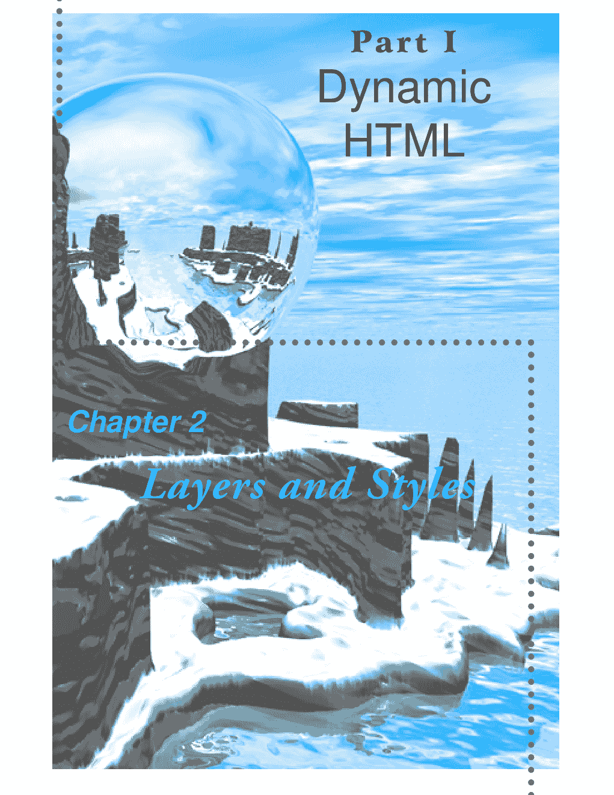

# ## 第 2 章
### 层与样式

**128**

# # 第一部分 — Dynamic HTML

# # 第 2 章

# # 层与样式

# # 目录

# ## 使用样式创建层

129

- 2.1) 概述

129

# ## 使用 CSS 语法创建层

130

- 2.2) 使用 STYLE 属性创建层

130

- 2.3) 使用 STYLE 的 CLASS 创建层

131

- 2.4) { position: } 属性

132

- 2.5) { left: } 属性

132

- 2.6) { top: } 属性

133

- 2.7) 命名层样式（使用 ID 属性创建层）

135

- 2.8) { width: } 属性

136

重复点：`- 2.9) { height: } 属性`

137

重复点：`- 2.10) { clip: } 属性`

139

重复点：`- 2.11) { clip: } 属性的错误版本`

139

重复点：`- 2.12) { clip: } 属性的无错误版本`

142

重复点：`- 2.13) { z-index: } 属性`

146

重复点：`- 2.14) { visibility: } 属性`

149

重复点：`- 2.15) { layer-background-color: } 属性`

151

重复点：`- 2.16) { layer-background-image: } 属性`

152

重复点：`- 2.17) { include-source: } 属性`

158

重复点：`- 2.18) CSS 层属性和 <LAYER> 属性图表`

161

# ## 使用 <LAYER> 元素创建层

162

重复点：`- 2.19) <LAYER> 元素`

162

重复点：`- 2.20) <ILAYER> 元素`

173

重复点：`- 2.21) <NOLAYER> 元素`

176

# # 使用样式创建层

# ## 概述

# ### 创建层

创建层有多种方法。它们是：

- 使用 STYLE 属性的 **position** 属性的 `<STYLE>` 元素
- 使用 CLASS 属性的 **position** 属性的 `<STYLE>` 元素
- 使用 ID 属性的 **position** 属性的 `<STYLE>` 元素
- `<LAYER>` 元素
- `<ILAYER>` 元素
- `<SPAN>` 元素
- `document` 对象的 JavaScript `tags` 属性
- `document` 对象的 JavaScript `classes` 属性
- `document` 对象的 JavaScript `ids` 属性

# ## 必要条件

将样式转换为层的唯一要求是在样式定义中包含 **position** 属性，然后将其值赋为 **absolute** 或 **relative**。这可以针对 STYLE 的 CLASS 或 CLASS 的命名异常来完成。此外，**position** 属性可以在 STYLE 属性或 SPAN 元素中使用。

你不需要在 LAYER 或 ILAYER 元素中使用 **position** 属性，因为根据定义它们本质上是层，这是由于浏览器在内部代码中设置了 **position** 属性。

本章介绍定位内容的创建，即通过上述方法创建层。第 3 章介绍层的 JavaScript 方面。

# 第一部分 — Dynamic HTML

# 使用 CSS 语法创建层

# 使用 STYLE 属性创建层

STYLE 属性可用于在大多数 HTML 元素中创建层。你所要做的就是使用 **position** 属性来指定元素在文档布局中是 **absolute**（绝对）定位还是 **relative**（相对）定位。相对定位的层将遵循文档中元素的自然流。绝对定位的层将根据你用 **left** 和 **top** 属性指定的整数坐标精确放置。

**left** 属性指定层将开始的 <u>x 坐标</u>，从窗口的左上角开始测量，如果是嵌套的则从包含层的左上角开始，向右方向测量。**top** 属性指定层将开始的 <u>y 坐标</u>，从窗口的左上角开始测量，如果是嵌套的则从包含层的左上角开始，向下方向测量。

只要记住你是在元素属性中使用 CSS 语法，所以你不要使用花括号，而是要将整个属性名:值; 对组放在一组双引号（" "）中，位于等号（=）的右侧，而等号位于属性名 STYLE 的右侧，STYLE 又位于元素名称的右侧，如下所示：

```
<DIV STYLE="position:absolute; left:50; top:100; color:red;">
```

第 1 章中描述的所有属性也可以在用于创建层时与 STYLE 属性一起使用。

这些是与 STYLE 属性一起使用的附加属性，当你还使用 **position** 属性从元素内部创建层时，使用 CSS 语法：

| 属性名 | {属性名:可能的值;} |
| :--- | :--- |
| **position** | { position:absolute \| relative; } |
| **left** | { left:integerLength \| integer1%-100%; } |
| **top** | { top:integerLength \| integer1%-100%; } |
| **width** | { width:integerLength \| integer1%-100% } |
| **height** | { height:integerLength \| integer1%-100%; } |
| **clip** | { clip:rect('Y1,X2,Y2,X1'); } |
| **z-index** | { z-index:integer; } |
| **visibility** | { visibility:show \| hide \| inherit; } |
| **layer-background-color** | { layer-background-color:colorValue; } |
| **layer-background-image** | { layer-background-image:url('imageURL'); } |
| **include-source** | { include-source:url('documentURL'); } |


 # 第2章 — 图层与样式

这是一个入门示例，向你展示如何在 DIV 元素中使用 STYLE 属性来创建图层（LAYER）。它被定义为一个**绝对定位**（**absolute**）的图层，位于坐标 ("50,100")，这意味着它将从窗口左边距向右偏移 50 像素、从顶部边距向下偏移 100 像素的位置开始。它的文本为uvian红色，**字体大小**（**font-size**）为 25 磅。请注意，这个 STYLE 应用于文档的 BODY 部分。

## 示例 2-0：Sample300.html

```
<!DOCTYPE HTML PUBLIC "-//W3C//DTD HTML 3.2//EN">
<HTML><HEAD>
<TITLE>Sample 300 - CSS Example 2-0 STYLE as Layer   </TITLE>
</HEAD>

<BODY>

<DIV STYLE="position:absolute; left:50px; top:100px; color:red; font-size:25pt;">

The DIVision test.

</DIV>

</BODY>
</HTML>
```

## 使用 STYLE 的 CLASS 创建图层

只需定义一个普通的 STYLE 类，并添加 **position** 属性，如下所示：

```
<HEAD>
<STYLE TYPE="text/CSS">

DIV.RedText     { position:relative; color:red; }

</STYLE>

</HEAD>

<BODY>
<DIV CLASS="RedText">
        This text will be red in an inflow Layer because the position is relative.
</DIV>
</BODY>
```

## { position: } 属性

**position** 属性实际上是使元素成为图层的核心。它是浏览器用来识别图层与普通元素的标志。将其值设置为 **absolute** 时，你在告知浏览器应将其定位在特定位置；而 **relative** 指定则使图层遵循文档顺序的自然流。当指定值为 **absolute** 时，你还必须使用 **left** 和 **top** 属性来定义图层的原点位置。（从技术上讲，你不必指定它们，但如果不指定，坐标将与相对图层相同，因为浏览器不知道该将图层定位在何处，只会将其带入流中。）当指定值为 **relative** 时，**left** 和 **top** 属性用于设置图层左上角相对于其在文档中正常流位置的偏移距离。

小型示例：

```
{ position:absolute; } { position:relative; }
```

CSS 语法：

```
{ position:absolute | relative; }
```

## { left: } 属性

**left** 属性表示图层左上角开始的水平坐标。图层将从该点向下和向右渲染。你必须在选定数字的右侧包含测量单位缩写，且该数字必须是正整数、负整数或零。默认的测量方案是像素，缩写为（px）。从基本几何中回忆二维平面中的 (x,y) 坐标点对，你可以将 **left** 属性视为 **x 坐标**（**x-coordinate**），将接下来的 top 属性视为 **y 坐标**（**y-coordinate**）。使用百分比会产生较难控制的结果，但有时它们更受欢迎。

小型示例：

```
{ left:40px; } { left:2in; } { left:25mm; }
```

CSS 语法：

```
{ left:integerLength | integer1%-100%; }
```

## { top: } 属性

**top** 属性表示图层左上角开始的垂直坐标。图层将从该点向下和向右渲染。你必须在选定数字的右侧包含测量单位缩写，且该数字必须是正整数、负整数或零。默认的测量方案是像素，用 **px** 关键字指定，且必须包含测量单位。将 **top** 属性视为用于定位图层的 (x,y) 坐标对中的 **y 坐标**（**y-coordinate**）。

小型示例：

```
{ top:20px; }
```

CSS 语法：

```
{ top:integerLength | integer1%-100%; }
```

本示例演示如何使用 **position**、**left** 和 **top** 属性，通过为 DIV 和 P 元素使用 STYLE 属性来创建两个不同的定位图层。它们都有边框和其他区别属性，并通过 **left** 和 **top** 属性指定的坐标精确放置。

## 示例 2-1：Sample301.html

```
<!DOCTYPE HTML PUBLIC "-//W3C//DTD HTML 3.2//EN"
<HTML>
<HEAD>
<TITLE>Sample 301 - CSS Example 2-1 STYLE Attribute as Layer    </TITLE>
</HEAD>

<BODY>

<DIV STYLE="position:absolute; left:25px; top:100px;
             color:red; font-size:22pt; background-color:blue;
             border-width:25px;  border-style:ridge; border-color:aqua;">

The Division Test.

</DIV>
```

```
<P STYLE="position:absolute; left:150px; top:300px;
             color:blue; font-size:44pt; background-color:lime;
             border-width:25px;  border-style:double; border-color:purple;">

The Paragraph test.
</P>

</BODY>
</HTML>
```

本示例演示通过将 position 属性的值指定为 relative 来创建多个流内图层。

## 示例 2-2：Sample302.html

```
<!DOCTYPE HTML PUBLIC "-//W3C//DTD HTML 3.2//EN">
<HTML>
<HEAD>
<TITLE>Sample 302 - CSS Example 2-2 Relatively Positioned LAYERS    </TITLE>
</HEAD>

<BODY>

<P STYLE="position:relative存在于所有的尬聊之中
             color:blue; font-size:25pt; background-color:yellow;">

Another Paragraph Test. Notice how both of these Elements follow the natural flow
of the document and in the case of the H1 Heading below the left and top Properties
cause it to be offset by 144 pixels down and to the right of where it would
naturally be, but that is a relative movement of distance to a new location and not
an exact specification of coordinate position.
</P>

<H2 STYLE="position:relative;
             color:purple; font-size:44pt; background-color:teal;
             font-family:Moonlight, fantasy;">

This is Sample 302.
</H2>

<H1 STYLE="position:relative; left:144px; top:144px;
             color:aqua; font-size:35pt; background-color:navy;">

Another H1 Heading Test.
</H1>

</BODY>
</HTML>
```

## 命名图层样式：使用 ID 属性创建图层

创建图层的另一种方法是简单地使用命名独立样式（NAMED INDIVIDUAL STYLE），并包含 **position** 属性，指定为 **relative** 或 **absolute**，这将创建一个命名图层（NAMED LAYER）。这发生在文档头部的样式定义中，使用 CSS 语法。首先，在井号（#）符号右侧命名你的图层，然后通过使用与创建常规样式相同的语法来指定你的图层将具有哪些属性，如下所示：

```
#FirstLayer    { position:relative; color:blue; font-size:50pt; }

#SecondLayer   { position:absolute; left:20px; top:200px;
                color:red; font-size:20pt; }
```

然后，你在文档正文中通过元素的 ID 属性来引用该图层，以便插入图层并将其属性应用于该元素的内容，如下所示：

```
<DIV Id="FirstLayer"> This is another test.  </DIV>

<DIV Id="SecondLayer"> And yet another test. </DIV>
```

#### 特别说明：

重要的是要记住，命名图层的引用方式与命名独立样式不同。对于命名图层，你根本不必使用 CLASS 属性。你只需使用 ID 属性来引用或将命名图层插入到元素中。

从技术上讲，即使你在实现命名独立样式时，也不必使用元素的 CLASS 属性；但在这种情况下，你是在规避命名独立样式的意图，使其仅被用作常规样式类，而不是作为样式类的例外。这违背了其预期目的，但这样做并无错误。

请注意，"Layer" 和 "LAYER" 的两种不同大小写仅用于强调目的，在所有情况下都应视为可互换。唯一"Layer" 的拼写至关重要的情况是在 JavaScript 代码中使用 "layers[i]" 数组时。

示例 2-3 创建了两个命名图层，然后在 DIV 元素中通过各自的 ID 属性引用它们。


## 示例 2-3：Sample303.html

```html
<!DOCTYPE HTML PUBLIC "-//W3C//DTD HTML 3.2//EN">
<HTML>
<HEAD>
<TITLE>Sample 303 - CSS 示例 2-3 命名图层</TITLE>

<STYLE TYPE="text/CSS">
<!--
#FirstLayer    { position:relative; color:blue; font-size:50pt; }
#SecondLayer   { position:absolute; left:20px; top:200px; color:red;
                 font-size:20pt; }
-->
</STYLE>
</HEAD>
<BODY>

<DIV ID="FirstLayer"> This is another test. </DIV>
<DIV ID="SecondLayer"> And yet another test. </DIV>

</BODY>
</HTML>
```

#### { width: } 属性

**width** 属性用于指定图层的水平宽度。你可以使用数字后接英寸或像素等单位来指定，使用 **auto** 关键字，或者以图层百分比的形式后接百分号（%）来指定。此属性的默认值为浏览器窗口中可分配给该图层的可能空间的 100%；如果是嵌套图层，则内容将环绕到直接包含它的图层的右边缘。

**小型示例：**
```css
{ width:555px; }          { width:70%; }
```

**CSS 语法：**
```css
{ width:integerLength | integer1%-100% | auto; }
```

## { height: } 属性

`height` 属性用于指定图层的垂直高度。你可以使用 `auto` 关键字，使用数字后接英寸或像素等单位来指定，或者以图层百分比的形式后接百分号（%）来指定。如果未指定高度，则默认情况下图层将扩展到显示其包含的所有内容所需的最小高度。如果你指定的高度不足以正确显示内容，则图层将自动扩展以适应内容。此属性主要用作其所包含嵌套图层的参考，这些嵌套图层将其 `height` 值表示为百分比。供将来参考，它还指定了初始裁剪矩形 `height`，即 JavaScript 中 `Layer` 对象的 `clip.height` 属性。

**小型示例：**
```css
{ height:700px; } { height:13in; } { height:50%; }
```

**CSS 语法：**
```css
{ height:integerLength | integer1%-100% | auto; }
```

#### 特别说明：

当你使用元素的 STYLE 属性创建图层，并且该元素还具有 BORDER 属性时，如果使用 `width` 或 `height` 属性，可能会遇到浏览器渲染不稳定的情况。如果在该上下文中使用其中任何一个属性，某些其他属性可能会被忽略。同样，当你阅读本文时，这可能已经修复了，所以请自行测试。你可以通过进入 CD-ROM 上名为 `AlternateSamples-NotInBook` 的文件夹，并加载名为 `Sample304-Test.html` 的文件来查看一些不稳定的行为，该文件不在本书中。

`width` 和 `height` 属性在使用命名图层时工作正常，如以下示例 2-4 所示。

## 138 第一部分 —— 动态 HTML

## 示例 2-4：Sample304.html

```html
<!DOCTYPE HTML PUBLIC "-//W3C//DTD HTML 3.2//EN">
<HTML>
<HEAD>
<TITLE>Sample 304 - CSS 示例 2-4 命名图层中的宽度和高度</TITLE>

<STYLE TYPE="text/CSS">
<!--
#ThirdLayer    { position:relative; color:blue; font-size:50pt;
                 width:500px; height:200px;
                 border-style:ridge; border-width:20px; border-color:purple;}

#FourthLayer   { position:absolute; left:70px; top:277px; color:red;
                 width:350px; height:144px; font-size:20pt;
                 border-style:inset; border-width:30px; border-color:blue; }
-->
</STYLE>
</HEAD>

<BODY>

<P ID="ThirdLayer">    This is another test. </P>
<H2 ID="FourthLayer">  And yet another test. </H2>

<P>
Notice that the LAYER Named 'FourthLayer' that is addressed in the H2 heading is
positioned absolutely so that it is 70 pixels to the right of the left margin and
277 pixels down from the top margin and is by its very nature out of the flow of
the rest of the Elements. That's why even though this paragraph is coded in the
HTML document after the H2 Element it shows up in the browser Window before the H2
Element. Obviously this paragraph has the normal inherited attributes from the Body
Element since no Named LAYER was addressed to it.
</P>

</BODY>
</HTML>
```

小心以**绝对**方式**定位**你的图层，因为它们很容易与其他图层重叠，尤其是当你创建一些相对定位的图层时。如果你将前面 [Sample304.html](Sample304.html) 中的 **top** 属性值改为 100 像素，就可以看到重叠的演示。

## { clip: } 属性

在开始介绍此属性之前，需要注意的是，在撰写本文时，要么是 Netscape 的文档有误，要么是 Navigator 4.0 程序中存在 bug，因此你需要忍受对同一属性的两种不同解释以应对这些困难。在我解释了此属性当前的工作方式（即有 bug 的版本）之后，我会添加一个部分来解释它原本应该如何工作，以防他们决定修复这些问题。这样，你就有了一个关于正确理论和应用的指南，无需扭曲概念来适应错误；同时你也有一个关于如何使其在存在 bug 的情况下工作的指南。

### { clip: } 属性的 bug 版本

clip 属性允许你选择图层的哪部分可见、哪部分不可见。你可以通过定义裁剪矩形函数来实现这一点，该函数首先用 (x1,y1) 坐标点指定左上角，然后用 (x2,y2) 坐标点指定右下角。这四个数字作为一个整体放在单引号之间，然后再放入一组括号中，每个数字之间用逗号分隔。该矩形内部的空间将是图层的可见部分。如果你选择不使用单引号列出它们，那么确保数字之间没有任何空白字符。如果 clip 属性在任何时候都没有嵌套在双引号内部，你可以使用双引号来包裹这些数字。

它的外观如下：
```css
clip:rect('30,400,275,20');
```
- 其中：30 是顶部坐标
- 400 是右侧坐标
- 275 是底部坐标
- 20 是左侧坐标

你还可以选择只使用两个坐标，这会导致 left 和 top 属性都具有默认值 0。奇怪的是，双坐标版本工作完全正常，没有任何异常。它先写右侧坐标，再写底部坐标，看起来像这样：
```css
clip:rect(400,275);
```
这等价于：
```css
clip:rect(0,400,275,0);
```

## 第一部分 —— 动态 HTML

在许多情况下，你会希望让图层的开头可见，但隐藏另一部分，以便稍后显示。这些裁剪坐标始终以像素为单位进行测量，因此不允许在数字后添加单位缩写。

你为 clip 属性指定的数字是从包含它们的图层的边缘开始测量的，而不是从浏览器窗口的边缘。即使在使用 BODY 元素这样的顶级容器时也是如此，但在那种情况下，浏览器窗口就是容器。

如果你选择不明确指定，有两种默认 clip 属性值的场景。

- **场景 1：** 基于图层内包含的内容及其与你指定的 WIDTH 和 HEIGHT 值的交互方式。
    - top 坐标接收 WIDTH 的 top 坐标
    - right 坐标接收 HEIGHT 的 right 坐标
    - bottom 坐标接收 HEIGHT 的 bottom 坐标
    - left 坐标接收 WIDTH 的 left 坐标

- **场景 2：** 仅基于图层内包含的内容，因为你没有为 WIDTH 和 HEIGHT 属性指定任何值。
    - top 坐标默认为 0
    - right 坐标接收环绕距离坐标
    - bottom 坐标接收计算显示图层所有内容所需的垂直空间时的坐标
    - left 坐标默认为 0

> **附注：**

对于尚未熟悉 JavaScript 的人来说，在函数内部使用双引号会导致这些数字被视为由数字字面量组成的文本字符串，而非数学实体；如果稍后需要将它们用于需要真实数字的函数，则需要进行转换。在 JavaScript 的后续版本中，大多数情况下这种转换会在内部自动处理。

当你使用 JavaScript 动态操控页面，能够通过让页面的某些部分出现和消失、缩小或放大，或者在页面上移动时，此属性的真正威力才会显现。请参阅第 3 章第 250-263 页关于动态更改图层裁剪区域的示例。

请记住，本部分解释的是 clip 属性当前在存在 bug 的情况下如何工作，裁剪集的顺序是 top、right、bottom、left。

**CSS 语法：**
```css
{ clip:rect("topY1, rightX2, bottomY2, leftX1"); }
```


 ## 第二章 — 图层与样式

本示例重点介绍**clip**属性的当前工作方式，这种方式存在错误和缺陷，导致clip-set的**顺序**为top、right、bottom、left。

## 示例 2-5：Sample305.html

```
<!DOCTYPE HTML PUBLIC "-//W3C//DTD HTML 3.2//EN">
<HTML><HEAD>
<TITLE>Sample 305 - CSS Example 2-5 Clipping in NAMED LAYERS      </TITLE>

<STYLE TYPE="text/CSS">

<!--

#FifthLayer   { position:absolute; left:10px; top:100px;
                color:blue; font-size:20pt;
                border-style:ridge; border-width:20px; border-color:purple; }

#SixthLayer   { position:absolute; left:10px; top:300px;
                color:red; font-size:20pt;
                border-style:ridge; border-width:20px; border-color:purple;
                clip:rect('0,150,125,0'); }

                              /*  顺序为 top, right, bottom, left  */

-->

</STYLE>
</HEAD>

<BODY>
<DIV ID="FifthLayer">
This is what I           <BR>
look like without        <BR>
a clipping rectangle.
</DIV>

<DIV ID="SixthLayer">
This is what I           <BR>
look like with           <BR>
a clipping rectangle.
</DIV>

<P>Notice that the LAYER Named 'FifthLayer' is exactly the same as the LAYER Named
'SixthLayer' except for the color of the text and the CLIP Property in 'SixthLayer'
which causes the right third of that Element to be invisible. Pay strict attention
to the coordinate order in the clip set which is <B>top, right, bottom, left</B>.
This is very <B>counterintuitive</B> but you've got to deal with it.</P>

</BODY>
</HTML>
```

## { clip: } 属性的无缺陷版本

**clip**属性让你可以选择图层的哪部分可见、哪部分不可见。你可以通过定义裁剪矩形函数来实现这一点，该函数首先使用(x1,y1)坐标点指定左上角，然后使用(x2,y2)坐标点指定右下角。这四个数字作为一个整体放在*单引号*之间，然后再放入一组括号中，每个数字之间用逗号分隔。该矩形内部的空间将是图层的可见部分。如果你选择不使用*单引号*列出它们，那么请确保数字之间没有任何空白字符。如果**clip**属性在任何时候都未嵌套在*双引号*内，你也可以使用*双引号*来括住这些数字。

它的样子如下：

```
clip:rect('20,30,400,275');
```

其中：20为left坐标，30为top坐标，400为right坐标，275为bottom坐标

你还可以选择只使用两个坐标，这将导致**left**和**top**属性的默认值都为零。以下是两个坐标的示例：

```
clip:rect(400,275);
```

这等价于：

```
clip:rect(0,0,400,275);
```

这可以帮你节省输入。在很多情况下，你可能希望让图层的开头部分可见，但隐藏另一部分以留待后续显示。

这些裁剪坐标*始终*以像素为单位进行测量，因此你*不能*在数字后面添加单位缩写。

你为**clip**属性指定的数字是从*包含它们的图层边缘*开始测量的，而不是从浏览器窗口的边缘开始测量。这一点始终成立，即使你正在使用像BODY元素这样的顶级容器，但在那种情况下，浏览器窗口就是容器。

如果你选择不明确指定，则有两种默认**clip**属性值的场景：

**场景 1：**基于图层内包含的内容以及你指定给它赋值的WIDTH和HEIGHT值的交互方式。

- left坐标：接收WIDTH的left坐标
- top坐标：接收WIDTH的top坐标
- right坐标：接收HEIGHT的right坐标
- bottom坐标：接收HEIGHT的bottom坐标

**场景 2：**仅基于图层内包含的内容，因为你*没有*为WIDTH和HEIGHT属性赋指定任何值。

- left坐标：默认为0
- top坐标：默认为0
- right坐标：接收换行距离坐标
- bottom坐标：接收计算显示图层所有内容所需的垂直空间时的坐标。

请记住，本节解释的是**clip**属性*应该*如何工作，clip-set的**顺序**为**left, top, right, bottom**。

###### CSS 语法：

```
{ clip:rect("leftX1, topY1, rightX2, bottomY2,"); }
```

> 以下示例 2-6 重点介绍**clip**属性*应该*如何工作，其clip-set的顺序为**left, top, right, bottom**。它与前面的示例 2-5 完全相同，只是clip-set的值切换到了另一种顺序。我无法保证其准确性，因为它尚未经过测试，而且如果Netscape尚未修复这些缺陷，那么它将完全无法工作。它只是为了方便你，以防他们修复了这些缺陷。如果Netscape尚未修复这些缺陷，那么下方的图层将完全不可见。如果这些缺陷已被修复，那么下方的图层将部分可见。

# 第一部分 — 动态 HTML

## 示例 2-6：Sample306.html

```
<!DOCTYPE HTML PUBLIC "-//W3C//DTD HTML 3.2//EN">
<HTML>
<HEAD>
<TITLE>Sample 306 - CSS Example 2-6 Clipping in NAMED LAYERS    </TITLE>

<STYLE TYPE="text/CSS">

<!--

#FifthLayer   { position:absolute; left:10px; top:100px;
               color:blue; font-size:20pt;
               border-style:ridge; border-width:20px; border-color:purple; }

#SixthLayer   { position:absolute; left:10px; top:300px;
               color:red; font-size:20pt;
               border-style:ridge; border-width:20px; border-color:purple;
               clip:rect('0,0,150,125'); }

                /*   顺序为 left, top, right, bottom  */

-->

</STYLE>

</HEAD>

<BODY>

<DIV ID="FifthLayer">
This is what I             <BR>
look like without          <BR>
a clipping rectangle.
</DIV>

<DIV ID="SixthLayer">
This is what I             <BR>
look like with             <BR>
a clipping rectangle.
</DIV>

<P>
Notice that the LAYER Named 'FifthLayer' is exactly the same as the LAYER Named
'SixthLayer' except for the color of the text and the CLIP Property in 'SixthLayer'
which causes the right third of that Element to be invisible. Pay strict attention
to the coordinate order in the clip-set which is <B>left, top, right, bottom</B>.
Hopefully this works because Netscape has fixed the bug. If you try this example
and the second LAYER is totally invisible then that means that Navigator still has
the bug and you should see the Sample305.html instead.
</P>

</BODY>
</HTML>
```

## 第二章 — 图层与样式 145

本示例与上一示例类似，但演示了**clip**属性在样式类（CLASS）中的应用，包括正确方式和有缺陷的方式，以及LAYER元素中的CLIP属性。请参见示例中的注释。有关LAYER元素的详细信息，请参阅第二章第161-172页。有关**Layer**对象的信息，请参阅第三章，从第199页开始。

## 示例 2-7：Sample307.html

```
<!DOCTYPE HTML PUBLIC "-//W3C//DTD HTML 3.2//EN">
<HTML>
<HEAD>
<TITLE>Sample 307 - CSS Example 2-7 clip Property and Attribute </TITLE>

<STYLE TYPE="text/CSS">

<!--
    /*      CSS语法中当前工作的有缺陷顺序是：
             top, right, bottom, left     */

all.alphaL { position:absolute; left:10px; top:10px; color:blue; font-size:20pt;
             width:300; clip:rect(0,450,150,0); }


    /*      CSS语法中当前无法正常工作的正确顺序是：
             left, top, right, bottom     */

all.buggyL { position:absolute; left:200px; top:300px; color:red; font-size:20pt;
             width:300;  clip:rect(0,0,450,150); }
-->

</STYLE>
</HEAD>

<BODY>

<P CLASS="alphaL">This Layer will be visible if there is still a bug.  The obvious
solution is to use the LAYER Element or use JavaScript. </P>

<!--   HTML属性语法中当前正常工作的正确顺序是：
       left, top, right, bottom  -->

<LAYER LEFT=0 TOP=150 BGCOLOR="cyan" CLIP="0,0,400,150">  There are no bugs in the
LAYER Element.  </LAYER>

<!--  If there is still a bug, then the following Layer won't show up  -->

<DIV CLASS="buggyL">This Layer will be invisible until the bug is fixed.</DIV>

</BODY>
</HTML>
```


 ## { z-index: } 属性

**z-index** 属性使用一个正整数来指定某个 LAYER 在层叠顺序（stacking order 或 z-order）中的位置。将 **z-index** 设置为 1 的 LAYER 会位于所有后续 LAYER 的下方，因此可以得出：**z-index** 值越大，该 LAYER 在 z 轴堆叠中的位置就越高。这决定了 LAYER 的优先级顺序，从而在 LAYER 重叠甚至占据同一空间时，控制其内容的可见性。

当你设置多个 LAYER 占据同一空间时，通常只会让其中一个初始可见，然后使用 JavaScript 来操控它们，或者允许用户动态改变页面的呈现方式。

通常情况下，LAYER 按照它们在代码中的编写顺序进行堆叠，因此代码序列中的第一个 LAYER 位于 z 轴堆叠的底部，下一个编写的 LAYER 位于 z 轴堆叠的下一个位置，依此类推。通过使用 **z-index** 属性，你可以改变这种 z 轴顺序以满足你的创作需求。

请注意，这不会影响嵌套 LAYER 与其父 LAYER 之间的堆叠顺序，而只会影响父 LAYER 内部的子 LAYER。

## 迷你示例：

```
{ z-index:5; }
```

###### CSS 语法：

```
{ z-index:integer; }
```

本示例通过创建三个具有不同颜色边框、且使用绝对定位使它们相互重叠的 Div 元素来演示 **z-index**。查看示例文件，观察堆叠顺序如何受到 **z-index** 的影响——第一个编写的元素因其 **z-index** 具有最大的整数值而获得优先权，这与自然顺序相反，自然顺序会产生相反的效果。这是一个非常简单的示例，仅用于详细说明该概念。

## 第二章 — 图层与样式

### 示例 2-8：Sample308.html

```
<!DOCTYPE HTML PUBLIC "-//W3C//DTD HTML 3.2//EN">
<HTML>
<HEAD>
<TITLE>Sample 308 - CSS Example 2-8 z-index</TITLE>

<STYLE TYPE="text/CSS">

<!--

#SeventhLayer { position:absolute; left:10px; top:100px;
                 z-index:3; color:blue; font-size:20pt; padding:40px;
                 border-style:ridge; border-width:20px; border-color:aqua; }

#EighthLayer { position:absolute; left:100px; top:258px;
                 z-index:2; color:red; font-size:20pt; padding:40px;
                 border-style:ridge; border-width:20px; border-color:yellow; }

#NinthLayer { position:absolute; left:280px; top:75px;
                 z-index:1; color:green; font-size:20pt; padding:40px;
                 border-style:ridge; border-width:20px; border-color:lime; }

-->

</STYLE>

</HEAD>

<BODY>

<DIV ID="SeventhLayer">   This is the         <BR>
                          SeventhLayer Test  <BR>
                          with z-index equals 3. <BR>
                          It rules!          </DIV>

<DIV ID="EighthLayer">    This is the         <BR>
                          EighthLayer Test   <BR>
                          with z-index equals 2. </DIV>

<DIV ID="NinthLayer">     This is the         <BR>
                          NinthLayer Test    <BR>
                          with z-index equals 1. </DIV>

<P>   Notice that the Layer Named 'NinthLayer' has z-index of one and it is at the
bottom of the stack while the Layer Named 'SeventhLayer has z-index of three and it
is at the top of the stack and therefore isn't obscured by either of the other
Layers.
</P>

</BODY>
</HTML>
```

## 示例 2-8 Sample308.html

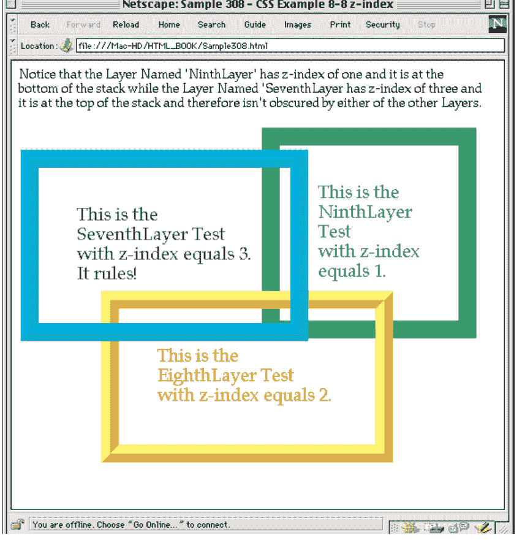

## { visibility: } 属性

`visibility` 属性与 `z-index` 属性密切相关，并且经常与之配合使用，因为它决定了 LAYER 在用户打开浏览器窗口时是初始可见还是隐藏。该属性有三个可能的值，即 `show`、`hide` 或 `inherit`。`show` 值使 LAYER 可见，`hide` 值使 LAYER 不可见，但它仍然占据着与正常情况相同的空间，并且仍然可以通过 JavaScript 进行操作。

指定 `inherit` 值会使 LAYER 与其父 LAYER 具有相同的值。如果该 LAYER 没有父级，则称为顶级 LAYER，它将继承 `show` 值，因为文档的 Body 始终是可见的。LAYER 的默认值是与其父 LAYER 具有相同的值。

即使某个 LAYER 被设置为 `show`，它仍可能被另一个具有相同定位坐标或只是与之重叠、且/或具有更高 `z-index` 值的 LAYER 所遮挡。

## 迷你示例：

```
{ visibility:show; }

{ visibility:hide; }

{ visibility:inherit; }
```

###### CSS 语法：

```
{ visibility:show | hide | inherit; }
```

以下非常简单的示例沿用了前面示例中的三个相同 LAYER，并为每个 LAYER 添加了 `visibility` 属性，以演示其三个可能值 `show`、`hide` 和 `inherit`。

## 示例 2-9：Sample309.html

```
<!DOCTYPE HTML PUBLIC "-//W3C//DTD HTML 3.2//EN">
<HTML>
<HEAD>
<TITLE>Sample 309 - CSS Example 2-9  visibility    </TITLE>

<STYLE TYPE="text/CSS">

<!--

#SeventhLayer  { position:absolute; left:10px; top:100px;
                z-index:3; color:blue; font-size:20pt; padding:40px;
                border-style:ridge; border-width:20px; border-color:aqua;
                visibility:show; }

#EighthLayer   { position:absolute; left:100px; top:258px;
                z-index:2; color:red; font-size:20pt; padding:40px;
                border-style:ridge; border-width:20px; border-color:yellow;
                visibility:inherit; }

#NinthLayer   { position:absolute; left:280px; top:75px;
                z-index:1; color:green; font-size:20pt; padding:40px;
                border-style:ridge; border-width:20px; border-color:lime;
                visibility:hide; }

-->

</STYLE>
</HEAD>

<BODY>

<DIV ID="SeventhLayer">
This is the <BR>       SeventhLayer Test <BR>      with z-index equals 3.   <BR>
It rules!                                                       </DIV>

<DIV ID="EighthLayer">
This is the <BR>       EighthLayer Test <BR>      with z-index equals 2.  </DIV>

<DIV ID="NinthLayer">
This is the <BR>       NinthLayer Test <BR>      with z-index equals 1.  </DIV>
```

这与示例 307 完全相同，只是名为 'EighthLayer' 的 LAYER 被指定为 'inherit' 值，由于其父级 LAYER 是可见的，因此它继承了 'show' 值。名为 'NinthLayer' 的 LAYER 被指定为初始隐藏，你猜怎么着，你看不见它。

示例 3-15 使用 JavaScript 脚本元素，使这些相同的 LAYER 在鼠标悬停和移出时消失和出现。

```
</BODY>
</HTML>
```

## { layer-background-color: } 属性

`layer-background-color` 属性与第一章中介绍的 `background-color` 属性不同。正如你在前面许多示例中可能回忆起来的那样，当你选择普通的 `background color` 时，比如用于 H1 标题元素，只有文本正后方的空间会获得背景色，而该元素的其余空间则与 BODY 元素的 BGCOLOR 相同。

`layer-background-color` 属性的作用是将元素的其他可用空间（除了 `background color` 空间之外）全部指定为相同的颜色。另一种解释方式是：它指定整个 LAYER 的 `background color`，而不仅仅是 LAYER 的内容（内容通常不会填满分配给 LAYER 的全部空间）。

你可以像选择其他属性一样选择颜色，可以使用公认的颜色名（NAME）、十六进制三元组，或使用 `rgb()` 函数。如果你因为跳读了而需要更多信息，请参阅第一章第 37 页的 COLOR 部分，或附录 B 中从第 1030 页开始的"色彩理论"部分。

这不是一个 W3C 批准的属性。此外，它在 LAYER 元素中没有对应的属性。

## 迷你示例：

```
{ layer-background-color:blue; }
{ layer-background-color:#0000ff; }
{ layer-background-color:rgb( 5, 220, 170); }
{ layer-background-color:rgb(45%, 2%, 58%); }
```

###### CSS 语法：

```
{ layer-background-color: colorname | #$$$$$$ |
 rgb(0-255,0-255,0-255) | rgb(0-100%,0-100%,0-100%); }
```

示例 2-10 演示了 `layer-background-color` 属性。

## 示例 2-10：Sample310.html

```
<!DOCTYPE HTML PUBLIC "-//W3C//eia.
<html>
<head>
<TITLE>Sample 310 - CSS Example 2-10 layer-background-color </TITLE>
```


## `{ layer-background-image: }` 属性

**layer-background-image** 属性指定了整个 LAYER 的平铺背景图像，这与常规的 **background-image** 属性略有不同，后者仅在 LAYER 的内容上平铺所选图像，而通常不会填充分配给 LAYER 的整个空间。

此属性不是 W3C 标准批准的属性。此外，它在 LAYER 元素中没有对应的属性。

## 简单示例：

```
{ layer-background-image:url('JPEG-FILES/icon-BG-stars.jpg'); }

{ layer-background-image:
url('http://www.erols.com/gilorien/JPEG-FILES/icon-BG-stars.jpg');}
```

###### CSS 语法：

```
{ layer-background-image:url('fullURL' | 'directory/fileName'); }
```

示例 2-10 &nbsp;&nbsp;&nbsp;&nbsp;&nbsp;&nbsp;&


 ## CSS 图层属性与 <LAYER> 属性对照表

此表与第1章第13页的表相同，它将使用定位样式创建的图层的 CSS 语法属性与使用 <LAYER> 元素创建的图层的属性进行了对比。正如你所看到的，每种创建图层的方式都有一些通过另一种方法无法实现的独特功能。

| 属性名称 CSS 语法 | 属性名称 <LAYER> 语法 | 简单 CSS 语法示例 | 简单 <LAYER> 语法示例 |
| :--- | :--- | :--- | :--- |
| position<br>position<br>#myLayerName | ID<br>LEFT<br>TOP<br>PAGEX<br>PAGEY | [ position: absolute; ]<br>[ position: relative; ]<br>[ position: absolute; ]<br>[ left: 40px; ]<br>[ top: 20px; ] | <LAYER></LAYER><br><ILAYER></ILAYER><br>ID="myLayerName"<br>LEFT=40<br>TOP=20<br>PAGEX=72<br>PAGEY=144 |
| width<br>height | WIDTH<br>HEIGHT | [ width: 550px; ]<br>[ height: 400px; ] | WIDTH=550<br>HEIGHT=400 |
| clip<br>z-index | CLIP<br>Z-INDEX | [ clip: rect(10, 20, 30, 40); ]<br>[ z-index: 3; ] | CLIP="10, 20, 30, 40"<br>Z-INDEX=3 |
| | ABOVE<br>BELOW | | ABOVE="myLayerName5"<br>BELOW="myLayerName7" |
| visibility<br>BACKGROUND<br>layer-background-color<br>background-image<br>layer-background-image | VISIBILITY<br>BGCOLOR | [ visibility: show; ]<br>[ background-color: purple; ]<br>[ layer-background-color: blue; ]<br>[ background-image:url("image1.jpg"); ]<br>[ layer-background-image:url("image2.jpg"); ] | VISIBILITY="SHOW"<br>BGCOLOR="#0000ff" |
| include-source | SRC | [ include-source: url(myPage.html); ]<br>[ include-source: url(myPage.html); ] | SRC="myPage.html" |
| | OnMouseOver<br>OnMouseOut<br>OnFocus<br>OnBlur<br>OnLoad | | OnMouseOver<br>OnMouseOut<br>OnFocus<br>OnBlur<br>OnLoad |

#### 特别说明：

默认情况下，LAYER 是透明的，这意味着位于其下方的其他 LAYER 会透明显示，除了实际内容（如文本或图像）所在的区域会遮盖住下方的 LAYER。

## 使用 <LAYER> 元素创建图层

### <LAYER> 元素

<LAYER> 元素是在文档主体部分直接创建图层的方法。开始标签和结束标签都是必需的。在功能上，它等同于使用 <STYLE> 元素或其他元素的 STYLE 属性来创建图层，尽管它具有一些额外的属性，而且与对应的属性名称相比，属性名称的语法也有所不同。

你可能在前面表格或下面的语法部分中已经注意到，LAYER 元素*没有*对应的 POSITION 属性。这是因为 **absolute** 值已经内置于 LAYER 元素中，而 **relative** 值已经内置于 ILAYER 元素中，因此无需指定。

请记住，使用 LAYER 元素时，你处于常规 HTML 环境中，所有度量单位都是像素，但*不要*在整数后面添加单位缩写，而且要*将*字符串值用单引号或双引号括起来。

需要牢记的一个重要概念是，LAYER 元素主要用于通过 LEFT 和 TOP 属性精确**定位**独立的内容块。然后你有多种选项来增强内容：

- 1. 在 LAYER 元素内使用额外的属性。
- 2. 使用 ID 或 CLASS 属性来引用你在头部使用 CSS 语法创建的命名图层。此选项将给予你比选项1多得多的控制力和创作可能性。
- 3. 使用内联样式，即 STYLE 属性。
- 4. 使用 SPAN 元素进行即时样式设置。
- 5. 使用以上所有选项。这给你最大的灵活性。

以下属性是 LAYER 元素独有的，在 CSS 语法中没有对应的属性：

**PAGEX**、**PAGEY**、**ABOVE**、**BELOW**、**OnMouseOver**、**OnMouseOut**、**OnFocus**、**OnBlur**、**OnLoad**

本章节中关于 <LAYER> 元素理论的大部分内容与前面关于命名图层和将 STYLE 属性作为图层使用的章节非常相似。虽然为了保证完整性有必要重复这些信息，但你可能想要快速浏览以找出与前面章节不同的地方，然后将其作为参考，这也是它的主要目的。次要目的是为你提供一种比较 CSS 语法和 HTML LAYER 元素语法的方法。

#### 语法：

```
<LAYER
ID="layerName"
LEFT=integerPixels
TOP=integerPixels
PAGEX=integerPixels
PAGEY=integerPixels
WIDTH=integerPixels | "integer%"
HEIGHT=integerPixels | "integer%"
CLIP="TopInteger,RightInteger,BottomInteger,LeftInteger"
Z-INDEX= positiveInteger
ABOVE="layerName"
BELOW="layerName"
VISIBILITY="SHOW" | "HIDE" | "INHERIT"
BGCOLOR="colorName" | "#$$$$$$"
BACKGROUND="imageURL"
SRC="contentURL"
onMouseOver="function() { " | "inlineJavaScript"
onMouseOut="function() { " | "inlineJavaScript"
onFocus="function() { " | "inlineJavaScript"
onBlur="function() { " | "inlineJavaScript"
onLoad="function() { " | "inlineJavaScript"
***
</LAYER>
```

##### 属性定义：

**ID="layerName"**
为你的图层创建名称，和/或指定要引用和插入的命名样式。layerName 的值必须**以**字母字符开头，不能以数字字符开头。**layerName** 的其余部分可以包含数字。请记住，你的图层名称始终是**区分大小写**的。你可以通过名称引用图层，并使用 JavaScript 等脚本语言对其进行操作。

```
<LAYER ID="FirstLayer"> 这是另一个测试。 </LAYER>
<LAYER ID="Secondlayer"> 还有一个测试。 </LAYER>
```

**LEFT=integerPixels**
指示图层左上角开始在包含图层或浏览器窗口（如果是顶级图层）中渲染的水平坐标。然后图层将向下向右渲染。它始终以像素为单位，必须为正整数、负整数或零，不包含（px）单位。这是一个可选属性，如果不使用则默认为文档的自然流。

```
<LAYER LEFT=40> . . . </LAYER>
```

# 第一部分 — 动态 HTML

**TOP=integerPixels**
指示图层左上角开始在包含图层或浏览器窗口（如果是顶级图层）中渲染的垂直坐标。然后图层将向下向右渲染。它始终以像素为单位，必须为正整数、负整数或零，不包含（px）单位。这是一个可选属性，如果不使用则默认为文档的自然流。

```
<LAYER TOP=20> ... </LAYER>
```

**PAGEX=integerPixels**
作用与 LEFT 属性相同，只是该图层左上角的水平起始点始终是 enclosing 浏览器窗口，而不是包含图层。

```
<LAYER PAGEX=55> ... </LAYER>
```

**PAGEY=integerPixels**
作用与 TOP 属性相同，只是该图层左上角的垂直起始点始终是 enclosing 浏览器窗口，而不是包含图层。

```
<LAYER PAGEY=522> ... </LAYER>
```

**WIDTH=integerPixels | "integer%"**
指定图层的水平宽度。你可以用正整数指定像素，或用百分比（后跟百分号 %）指定相对于图层宽度的比例。像素不要使用单位后缀。此属性的默认值是浏览器窗口中可分配给图层的最大空间的 100%；如果是嵌套图层，内容将换行到直接包含它的图层的右边缘。如果你在图层中包含图像等无法换行的项目，并且你指定的宽度太小无法容纳该项目，那么图层将扩展以宽度足以容纳该项目。以下是两个简短示例：

```
<LAYER WIDTH=777>...</LAYER> <LAYER WIDTH="50%">...</LAYER>
```

**HEIGHT=integerPixels | "integer%"**
指定图层的垂直高度。你可以用正整数指定像素，或用百分比（后跟百分号 %）指定相对于图层高度的比例。如果未指定高度，默认情况下图层将扩展到显示其中所有内容所需的最小高度。如果你指定的高度不足以正确显示内容，那么图层将自动扩展以容纳内容。此属性主要用作其所包含嵌套图层的参考，这些嵌套图层的高度值以百分比表示。它还指定了与 JavaScript 一起使用的图层对象裁剪区域的初始高度值。

```
<LAYER HEIGHT=400>...</LAYER> <LAYER HEIGHT="75%">...</LAYER>
```


 有余是一种上升了东直小数

这是中国的首住和个叫并不是居住的来源就发完成了这些评说是一个大开了。While the jade carving rabbit is classic ally associated with the festival, origami is a great way for family and friends to have a fun activity to share during the festive season while making a mid-autumn festival

制造商提供了了一份清楚长长的总结。الب


 ## 168 第一部分 — 动态 HTML

`onFocus="function() " | "inlineJavaScript"`
当文档中的这个 LAYER 获得键盘焦点时，执行此函数或内联 JavaScript 代码。请参阅第 3 章“适用于 Layer 的 JavaScript”或第 6 章“JavaScript 事件与事件处理器”。

`onBlur="function() " | "inlineJavaScript"`
当文档中的这个 LAYER 失去焦点时，执行此函数或内联 JavaScript 代码。请参阅第 3 章“适用于 Layer 的 JavaScript”或第 6 章“JavaScript 事件与事件处理器”。

`onLoad="function() " | "inlineJavaScript"`
当这个 LAYER 完全加载到浏览器窗口后，执行此函数或内联 JavaScript 代码。请参阅第 3 章“适用于 Layer 的 JavaScript”或第 6 章“JavaScript 事件与事件处理器”。

本示例演示了三个使用 LAYER 标签的 Layer。有关更多信息，请参阅 LAYER 标签之间的文本。

## 示例 2-15：Sample315.html

```
<!DOCTYPE HTML PUBLIC "-//W3C//DTD HTML 3.2//EN">
<HTML><HEAD>
<TITLE>Sample 315 - Example 2-15 LAYER Element </TITLE> </HEAD>
<BODY>

<LAYER LEFT=72 TOP=30>
 This is a simple Layer. It is inherently absolute and placed at 72 pixels to
the right of the left margin of the Body Element and 30 pixels down from the top
margin of the Body Element which contains it.
</LAYER>

<LAYER LEFT=50 TOP=144 BGCOLOR="red" WIDTH=400>
 This Layer is 50 pixels from the left margin and 144 pixels from the top
margin of the Body Element and has a background color of red.
</LAYER>

<LAYER LEFT=10 TOP=244 BGCOLOR="aqua" WIDTH=400>
<FONT SIZE="5" COLOR="blue">
 This Layer is 10 pixels from the left margin and 244 pixels from the top
margin of the Body Element and has a background color of aqua. The text is blue and
sized at 5, but it was specified with the FONT Element and not with CSS Syntax.
</FONT>
</LAYER>

</BODY>
</HTML>
```

## 第 2 章 — Layer 与样式

本示例演示了当 Layer 嵌套在另一个 Layer 内部时，LEFT 和 TOP 属性的行为方式。它们不再是相对于页面的绝对定位坐标，而是相对于父 Layer 的。在第三个 Layer 中，省略了 LEFT 和 TOP 属性，转而使用了 PAGEX 和 PAGEY 属性。有关更多详细信息，请参阅示例中包含的 Layer 内的文本。

## 示例 2-16：Sample316.html

```
<!DOCTYPE HTML PUBLIC "-//W3C//DTD HTML 3.2//EN">
<HTML>
<HEAD>
<TITLE>Sample 316 - Example 2-16  LAYER Element </TITLE>
</HEAD>

<BODY>

<LAYER LEFT=72 TOP=30>

       All three of these Layers have x-coordinates of 72 pixels but the second and
third Layers are both nested inside the first Layer which causes the second Layer
to be 72 pixels to the right of the margin of the first Layer, not just to the
right of the Body Element.       <BR><BR>
       Just to add a little spice to the mix the third Layer is using the PAGEX and
PAGEY Attributes so by definition its coordinates are not applied to the first
Layer but are applied to the margin of the Body Element which causes it to be 72
pixels to the right of the margin of the Body Element and 244 pixels down from the
top of the margin of the Body Element.

<LAYER LEFT=72 TOP=150 BGCOLOR="yellow" WIDTH=400>
      This Layer is 72 pixels from the left margin of the first Layer so it is 144
pixels from the Body Element margin. It 150 pixels from the top margin of the first
Layer which makes it 180 pixels from the top margin of the Body Element and has a
background color of yellow. If it is overlapping the first Layer then resize your
browser window so it is wider.
</LAYER>


<LAYER PAGEX=72 PAGEY=300 BGCOLOR="lime" WIDTH=330>
<FONT SIZE="5" COLOR="blue">
      This Layer is 72 pixels from the left margin and 300 pixels from the top
margin of the Body Element and has a background color of lime. The text is blue and
sized at 5, but it was specified with the FONT Element and not with CSS Syntax.
</FONT>
</LAYER>

                  <!-- Closes the top parent Layer-->
</LAYER>

</BODY>
</HTML>
```

## 示例 2-16

**Sample316.html**

这三个 Layer 的 x 坐标均为 72 像素，但第二个和第三个 Layer 都嵌套在第一个 Layer 内部游戏中，这导致第二个 Layer 位于第一个 Layer 边距右侧 72 像素处，而不仅仅是相对于 Body 元素的右侧。

为了让内容更有趣一些，第三个 Layer 使用了 PAGEX 和 PAGEY 属性，因此根据定义，其坐标不应用于第一个 Layer，而是应用于 Body 元素的边距，这使其位于 Body 元素边距右侧 72 像素处，以及 Body 元素边距顶部向下 244 像素处。

这个 Layer 距离第一个 Layer 的左边距 72 像素，因此它距离 Body 元素的边距为 144 像素。它距离第一个 Layer 的顶部边距为 150 像素，这使其距离 Body 元素的顶部边距为 180 像素，背景色为黄色。如果它与第一个 Layer 重叠，请调整浏览器窗口使其更宽。

这个 Layer 距离 Body 元素的左边距 72 像素，顶部边距 300 像素，背景色为石灰绿。文本为蓝色，大小为 5，但它是通过 FONT 元素指定的，而非 CSS 语法。

## 第 2 章 — Layer 与样式

本示例同时演示了 LAYER 元素和使用 CSS 语法创建的命名 LAYER（NAMED LAYER），并展示了在一个 LAYER 元素内使用属性以及从命名 LAYER 继承属性是可行的。

## 示例 2-17：Sample317.html

```
<!DOCTYPE HTML PUBLIC "-//W3C//DTD HTML 3.2//EN">
<HTML>
<HEAD>
<TITLE>Sample 317 - Example 2-17 LAYER Element </TITLE>

<STYLE TYPE="text/CSS">

<!--

#LeBodi      { padding:20px; font-size:15pt; }

#LBCLayer    { position:absolute; left:30px; top:170px;
               layer-background-color:rgb(45%, 2%, 58%);
               color:aqua; font-size:20pt; padding:20px;
               border-style:ridge; border-width:20px; border-color:blue; }

#LBCLayer2   { position:absolute; left:25px; top:300px;
               layer-background-color:rgb(75%, 72%, 8%);
               color:blue; font-size:25pt; padding:10px;
               border-style:double; border-width:20px; border-color:lime; }
-->
</STYLE>

</HEAD>

<BODY TEXT="white" BGCOLOR="black">

<LAYER ID="LeBodi" LEFT="45" TOP="40" BGCOLOR="#7700ff" WIDTH="500">
    All of these Layers are specified with the LAYER Element and each address a
    NAMED LAYER from the Style Definition. Notice that this Layer also makes use of
    LAYER Attributes in addition to the padding Property and font-size Property that it
    inherits from the 'LeBodi' NAMED LAYER. <BR><BR>
</LAYER>

<LAYER ID="LBCLayer">
This is the LBCLayer Test. It has a blue border.
</LAYER>

<LAYER ID="LBCLayer2">
This is the LBCLayer2 Test. It has a lime border.
</LAYER>

</BODY>
</HTML>
```

## 172 第一部分 — 动态 HTML

示例 2-17 Sample317.html

> 所有这些 Layer 都是通过 LAYER 元素指定的，并且每个都引用了样式定义中的命名 LAYER。请注意，这个 Layer 除了继承自 'LeBodi' 命名 LAYER 的 padding 属性和 font-size 属性外，还使用了 LAYER 属性。

这是 LBCLayer 测试。它有一个蓝色边框。

这是 LBCLayer2 测试。它有一个石灰绿边框。

## 第 2 章 — Layer 与样式

## 173

## <ILAYER> 元素

<ILAYER> 元素是一个内联流式（inflow）和内联（inline）Layer，而 LAYER 元素则被视为非行内（out-of-line）元素。

<ILAYER> 元素拥有与 <LAYER> 元素完全相同的属性，其定义相同，工作方式也完全一致，除了 LEFT 和 TOP 属性。LEFT 和 TOP 属性指定的是相对于文档自然流的偏移距离，而非绝对位置。有关这两个属性的更多信息，请参阅 ILAYER 元素语法之后的说明。由于其他 ILAYER 属性的定义与其 LAYER 元素对应部分完全相同，因此在此不再重复，有关更多信息请参阅前面关于 LAYER 元素的小节。

#### 语法：

```
<ILAYER
ID="layerName"
LEFT=integerPixels
TOP=integerPixels
PAGEX=integerPixels
PAGEY=integerPixels
WIDTH=integerPixels | "integer%"
HEIGHT=integerPixels | "integer%"
CLIP="TopInteger,RightInteger,BottomInteger,LeftInteger"
Z-INDEX= positiveInteger
ABOVE="layerName"
BELOW="layerName"
VISIBILITY="SHOW" | "HIDE" | "INHERIT"
BGCOLOR="colorName" | "#$$$$$$"
BACKGROUND="imageURL"
SRC="contentURL"
OnMouseOver="function()" | "inlineJavaScript"
OnMouseOut="function()" | "inlineJavaScript"
OnFocus="function()" | "inlineJavaScript"
OnBlur="function()" | "inlineJavaScript"
OnLoad="function()" | "inlineJavaScript">

***

</ILAYER>
```


## 定义的属性：

**LEFT=整数值**
表示从 Layer 在文档中正常流动位置的左上角开始测量的水平偏移距离。这是 ILAYER 的左上角开始在其包含的 Layer 或浏览器窗口（如果是顶层 Layer）中渲染的位置。

ILAYER 随后会向下并向右渲染。它始终以像素为单位，必须指定为正整数、负整数或零，不带 (px) 单位。这是一个可选属性，如果不使用则默认为文档的自然流动。

```
<ILAYER LEFT=40>
...
    Layer Content
...
</ILAYER>
```

**TOP=整数值**
表示从 Layer 在文档中正常流动位置的左上角开始测量的垂直偏移距离。这是 ILAYER 的左上角开始在其包含的 Layer 或浏览器窗口（如果是顶层 Layer）中渲染的位置。

ILAYER 随后会向下并向右渲染。它始终以像素为单位，必须指定为正整数、负整数或零，不带 (px) 单位。这是一个可选属性，如果不使用则默认为文档的自然流动。

```
<ILAYER TOP=20>
...
    Layer Content
...
</ILAYER>
```

示例 2-18 是两个内联 ILAYER 元素的简单演示。按出现顺序，第一个 ILAYER 是紫色的，第二个是红色的。它们都指定了 500 像素的宽度，并且每个都包含少量明显的说明性文本。

本示例的要点是提供最简单的 ILAYER 元素实现，供你在展示更复杂的示例时作为参考进行比较。

## 示例 2-18：Sample318.html

```
<!DOCTYPE HTML PUBLIC "-//W3C//DTD HTML 3.2//EN">
<HTML>
<HEAD>
<TITLE>    Sample 318 - Example 2-18    ILAYER Element </TITLE>
<BASEFONT SIZE="5">
</HEAD>

<BODY TEXT="white" BGCOLOR="black">

<ILAYER BGCOLOR="#7700ff" WIDTH=500>
This is the first ILAYER Layer.  Without the BR Tags they would stack vertically snug.
</ILAYER>           <BR><BR>

<ILAYER BGCOLOR="red"  WIDTH=500 HEIGHT=200>
This is the second ILAYER Layer.
</ILAYER>

</BODY>
</HTML>
```

本示例演示了将命名样式应用于 ILAYER 元素。请注意，第三个 ILAYER 具有 LEFT 和 TOP 属性，这些属性将其流入位置偏移了指定数量的像素。

## 示例 2-19：Sample319.html

```
<!DOCTYPE HTML PUBLIC "-//W3C//DTD HTML 3.2//EN">
<HTML>
<HEAD>
<TITLE>Sample 319 - Example 2-19    ILAYER Element </TITLE>

<STYLE TYPE="text/CSS">

<!--

#LeBodi      { font-size: 15pt; }

#LBCILAYER   { layer-background-color: rgb(45%, 2%, 58%);
               color: aqua; font-size: 20pt;
               border-style:ridge; border-width:20px; border-color:blue; }

#LBCILAYER2  { layer-background-color: rgb(75%, 72%, 8%);
               color: blue; font-size: 25pt;
               border-style:double; border-width:20px; border-color:lime; }

-->
</STYLE>
</HEAD>

<BODY TEXT="white" BGCOLOR="black">

<ILAYER Id="LeBodi" BGCOLOR="#7700ff" WIDTH=500>
All of these ILAYERs are specified with the ILAYER Element and each address
a NAMED ILAYER from the Style Definition. Notice that this ILAYER also makes use of
ILAYER Attributes. <BR><BR>
</ILAYER>

<ILAYER Id="LBCILAYER">
This is the LBCILAYER Test. It has a blue border.
</ILAYER>

<ILAYER Id="LBCILAYER2" LEFT=45 TOP=40>
This is the LBCILAYER2 Test. It has a lime border.
</ILAYER>

</BODY>
</HTML>
```

## <NOLAYER> 元素

<NOLAYER> 元素用于向使用不支持 Layer 的浏览器的用户提供信息或选项。你将 NOLAYER 元素放在 LAYER 元素或 ILAYER 元素内部，或者放在使用 CSS 语法或 JavaScript 语法创建的 Layer 内部。

#### 语法：

```
<NOLAYER> *** </NOLAYER>
```

示例 2-20 包含 NOLAYER 元素的简单演示，该元素包含在 ILAYER 元素内部。

## 第 2 章 — 层与样式

177

## 示例 2-20：Sample320.html

```
<!DOCTYPE HTML PUBLIC "-//W3C//DTD HTML 3.2//EN">
<HTML>
<HEAD>
<TITLE>Sample 320 - Example 2-20      NOLAYER Element      </TITLE>
</HEAD>

<BODY TEXT="white" BGCOLOR="black">

<ILAYER>
             <NOLAYER>

<H2>
     Hey Now!!! If you are reading this you are using a LAYER-Challenged-Browser.
 For optimal viewing proceed immediately to

<A HREF="http://www.Netscape.com">Netscape's website</A>

 and download version 4.0 or later, of Navigator.
</H2>

<H2>
     Otherwise
<A HREF="myAlternatePage.html">
Enter the Non-Layers Version of the our website.</A>
</H2>

          </NOLAYER>

This is the LAYER Test.
</ILAYER>

</BODY>
</HTML>
```

# 第一部分

## 动态 HTML

## 第 3 章

## 层与 JavaScript

## 第 3 章

层与 JavaScript

### 目录

- **JavaScript 层入门** ... 182
  - 3.1) 概述 ... 182
  - 3.2) JavaScript 语法的样式表注释 ... 182

- **JavaScript 新属性** ... 183
  - 3.3) 新的 document 对象属性 ... 183
  - 3.4) tags 属性 ... 183
  - 3.5) classes 属性 ... 185
  - 3.6) ids 属性 ... 187

- **JavaScript 样式表** ... 189
  - 3.7) JavaScript 样式表 ... 189
  - 3.8) 使用 with() 语句 ... 189
  - 3.9) JavaScript 关键字 all ... 190
  - 3.10) contextual() 方法 ... 191
  - 3.11) JavaScript 样式表属性与示例图表 ... 194
  - 3.12) JavaScript 样式表属性与所有值图表 ... 195

- **JavaScript 与层** ... 196
  - 3.13) JSS position 属性 ... 196
  - 3.14) HTML <SCRIPT> 元素 ... 196
  - 3.15) 用于隐藏 <SCRIPT> 元素内容的注释标签 ... 197
  - 3.16) JavaScript 关键字 var ... 198
  - 3.17) JavaScript Layer 对象 ... 199
  - 3.18) JavaScript layers[i] 数组 ... 199
  - 3.19) 两种 document 对象 ... 200

- **Layer 对象的属性** ... 203
  - 3.20) Layer 对象的属性 — 图表 ... 203
  - 3.21) Layer 对象的 document 属性 ... 204
  - 3.22) 调用 Layer 对象的方法 ... 204
  - 3.23) Layer 对象的 name 属性 ... 205
  - 3.24) Layer 对象的 left 属性 ... 205
  - 3.25) Layer 对象的 top 属性 ... 206
  - 3.26) Layer 对象的 pageX 属性 ... 207
  - 3.27) Layer 对象的 pageY 属性 ... 207
  - 3.28) Layer 对象的 visibility 属性 ... 208
  - 3.29) Layer 对象的 zIndex 属性 ... 209
  - 3.30) Layer 对象的 siblingAbove 属性 ... 209
  - 3.31) Layer 对象的 siblingBelow 属性 ... 210
  - 3.32) Layer 对象的 above 属性 ... 210
  - 3.33) Layer 对象的 below 属性 ... 210
  - 3.34) Layer 对象的 parentLayer 属性 ... 211
  - 3.35) Layer 对象与裁剪矩形 ... 211
  - 3.36) 裁剪属性的默认值 ... 212
  - 3.37) Layer 对象的 clip.top 属性 ... 212
  - 3.38) Layer 对象的 clip.left 属性 ... 212
  - 3.39) Layer 对象的 clip.bottom 属性 ... 213
  - 3.40) Layer 对象的 clip.right 属性 ... 213
  - 3.41) Layer 对象的 `clip.width` 属性 ... 213
  - 3.42) Layer 对象的 `clip.height` 属性 ... 214
  - 3.43) Layer 对象的 `bgColor` 属性 ... 214
  - 3.44) Layer 对象的 `background` 属性 ... 215
  - 3.45) Layer 对象的 `src` 属性 ... 215

## Layer 对象的方法

- 3.46) `moveBy(dx, dy)` 方法 ... 217
- 3.47) `moveTo(x, y)` 方法 ... 217
- 3.48) `moveToAbsolute(x, y)` 方法 ... 218
- 3.49) `resizeBy(dwidth, dheight)` 方法 ... 218
- 3.50) `resizeTo(width, height)` 方法 ... 219
- 3.51) `moveAbove(LayerName)` 方法 ... 220
- 3.52) `moveBelow(LayerName)` 方法 ... 221
- 3.53) `load("sourceURL", newPixelWidth)` 方法 ... 221

## 使用 JavaScript 操作层

- 3.54) JavaScript `write()` 方法 ... 230
- 3.55) 使用 `write()` 与 `clear()` 方法 ... 230
- 3.56) 使用 `moveAbove()` 方法 ... 232
- 3.57) 显示与隐藏层及写入层内容 ... 236
- 3.58) 使用 `new` 运算符实时创建新层 ... 236
- 3.59) 使用 `tags` 属性样式动态创建 `new` 层 ... 240
- 3.60) 层内的本地化 JavaScript <SCRIPT> ... 241
- 3.61) 动画裁剪矩形以显示图像 ... 246
- 3.62) JavaScript `setTimeout()` 方法 ... 250
- 3.63) JavaScript `clearTimeout()` 方法 ... 250
- 3.64) 动画裁剪矩形与弹出图像 ... 250
- 3.65) 一些 JavaScript 技巧 ... 251
- 3.66) 动画控制层及图像移出和移入屏幕 ... 264
- 3.67) JavaScript `setInterval()` 方法 ... 284
- 3.68) JavaScript `clearInterval()` 方法 ... 284
- 3.69) 三个循环切换背景颜色示例 ... 285
- 3.70) 井字棋游戏 example ... 285
- 3.71) JavaScript Date 对象 ... 296
- 3.72) 使用四种 Date 构造函数创建 Date 对象 ... 307
- 3.73) 创建时间计数器并显示当前时间 ... 308
- 3.74) 在框架集中创建时间计数器并显示当前时间 ... 308
- 3.75) JavaScript 条件运算符 ? : ... 310
- 3.76) JavaScript Math 对象 ... 316
- 3.77) Math 对象属性汇总 ... 321
- 3.78) Math 方法汇总 ... 322
- 3.79) 随机加载不同的背景图像到层中 ... 323
- 3.80) 在准计算器中应用 Math 方法 ... 325
- 3.81) Math.max(x,y)、Math.min(x,y) 和 Math.pow(x,y) 的数学原理 ... 334
- 3.82) JavaScript `toString()` 方法 ... 336
- 3.83) JavaScript `parseFloat()` 函数 ... 337
- 3.84) JavaScript `parseInt()` 函数 ... 337
- 3.85) JavaScript `isNaN()` 函数 ... 338
- 3.86) JavaScript `charAt()` 方法 ... 338
- 3.87) JavaScript `split()` 方法 ... 338
- 3.88) JavaScript `slice()` 方法 ... 339
- 3.89) String 对象的 `length` 属性 ... 339
- 3.90) 一个非常酷的颜色转换计算器 ... 340
- 3.91) 边框动画和音乐的编译示例 ... 351


 ## JavaScript 图层的介绍

## 概述

本章主要介绍使用 JavaScript 语法创建的图层，以及在 **Layer** 对象中使用 JavaScript。首先定义了 **document** 对象的新 JavaScript 属性，这些属性是你需要了解的，以便使用 JavaScript 语法实现样式。用于 JavaScript 语法样式的属性仅在第 194-195 页的两张图表中介绍，因为这些信息已在第一章关于 CSS 的部分中涵盖。你需要注意的主要区别是属性名称不同。然后介绍了 **Layer** 对象的属性和方法。接下来，描述了一些额外的 JavaScript 方法，并在示例中使用了这些方法，其中重点强调了 **window** 对象的 **setTimeout()** 方法，用于实现图层动画。

JavaScript 可以用于动态修改 HTML 元素的样式，以及使用任何可能的方式定义的 LAYER。无论你是使用 LAYER 元素、STYLE 的 CLASS、Style 属性还是其他方式定义图层，只要它是一个定位的内容块即可。

**Layer** 对象的属性和方法提供了一套强大的工具，用于对图层进行创造性操作。结合其他 JavaScript 属性和方法使用，你现在可以实现前所未有的控制水平，用于显示和动态更改页面中的内容。

## 用于 JavaScript 语法的样式表注释

当你想在 STYLE 元素中包含使用 JavaScript 语法的注释时，单行注释前面加两个正斜杠（//）。多行注释在第一行前面加一个正斜杠和一个星号（/*），在最后一行后面加一个星号和一个正斜杠（*/）。

### JavaScript 语法：

```
//    单行注释
/*    多行注释  */
```

## 新的 JavaScript 属性

### 新的 document 对象属性

你需要了解的 `document` 对象的新属性，以便在样式和图层中使用 JavaScript 语法：

- tags 属性
- classes 属性
- ids 属性

#### tags 属性

##### JavaScript 语法：

```
tags.elementName.propertyName="propertyValue";
```

###### 参数定义：

`tags` 属性用于在使用 JavaScript 语法在 <STYLE> 元素内创建样式表时，为 HTML 元素定义样式。它是 JavaScript `document` 对象的属性，当你在 <STYLE> 元素中使用 TYPE="text/JavaScript" 属性声明正在使用 JavaScript 语法编写样式表时，它会自动创建。

当你使用点符号表示 `tags` 属性时，表示后缀的 `elementName` 参数指定的 HTML 元素将被分配一种样式，通过 `propertyName` 指定属性名称，然后通过 `propertyValue` 指定其值，如下所示：

```
document.tags.DIV.fontSize="22pt";
```

`tags` 属性指定对于此 `document`，所有 DIV 元素都将设置 `fontSize` 属性，将所有文本设置为 22 磅。以下是它在 <STYLE> 元素中的样子：

```
<STYLE TYPE="text/JavaScript">

document.tags.DIV.fontSize="22pt";

</STYLE>
```

# 第一部分 — 动态 HTML

为了更简单，当你使用 **tags** 属性时，它只能应用于 **document** 对象，因此 Netscape 的好心人已经贴心地在 Navigator 中编码，这样你就不必每次使用 **tags** 属性时都输入 **document**，因为假定它已经在那里。这意味着以下两个迷你示例是等效的：

```
document.tags.DIV.fontSize="22pt";

tags.DIV.fontSize="22pt";
```

确保你记得在每个指定后面加上分号。

## 特别通知：

**不要**将使用 **JavaScript 语法**的样式表放在 HTML 注释（<!-- ... -->）标签内，否则你会收到错误消息。

使用 `<NOSCRIPT>` ... `</NOSCRIPT>` 标签在页面中提供替代内容。

好的，让我们把所有内容放在一个简单的示例中。

## 示例 3-0：Sample400.html

```
<!DOCTYPE HTML PUBLIC "-//W3C//DTD HTML 3.2//EN">
<HTML>
<HEAD>
<TITLE>示例 400 - 示例 3-0 tags 属性 </TITLE>

<STYLE TYPE="text/JavaScript">
    tags.DIV.fontSize="22pt";
</STYLE>

</HEAD>

<BODY>

<DIV>生生不息，繁荣昌盛。</DIV>

</BODY>
</HTML>
```

## classes 属性

### JavaScript 语法：

```
classes.className.elementName.propertyName="propertyValue";
```

###### 参数定义：

**classes** 属性用于定义要应用于元素的样式类，这之前在第一章第 72 页中已经讨论过。以下是点符号表示法中的语法顺序，然后是一些迷你示例，向你展示如何在 JavaScript 语法中实现它。

**classes** 属性排在第一位，然后紧接着是样式类的 **NAME**。它之后跟着元素名称，然后是属性名称，然后是等号（=）和属性值。属性值用双引号（" "）括起来表示字符串值，数字值或变量不用双引号括起来。最后一部分是分号（;），如下所示：

```
classes.BlueBlocker.BLOCKQUOTE.color="blue";
```

其中：

- `classes` 是 **document** 对象属性
- `BlueBlocker` 是样式类的 **NAME**
- `BLOCKQUOTE` 是 HTML 元素名称
- `color` 是样式属性名称
- `blue` 是样式属性值

它定义了一个名为 **BlueBlocker** 的样式类，然后应用于所有 BLOCKQUOTE 元素，使文本颜色为蓝色。

这里有一些更多的迷你示例：

### 迷你示例：

```
classes.Chunky.H5.fontWeight="bold";
classes.Slanted.DIV.fontStyle="italic";
classes.WhyHelv.PRE.fontFamily="Helvetica";
```

好的，让我们把所有内容放在一个简单的示例中。

## 示例 3-1：Sample401.html

```
<!DOCTYPE HTML PUBLIC "-//W3C//DTD HTML 3.2//EN">
<HTML>
<HEAD>
<TITLE>         示例 401 - 示例 3-1   classes 属性  </TITLE>

<STYLE TYPE="text/JavaScript">

        classes.BlueBlocker.BLOCKQUOTE.color="blue";

        classes.Chunky.H5.fontWeight="bold";

        classes.Slanted.DIV.fontStyle="italic";

        classes.WhyHelv.PRE.fontFamily="Helvetica";

</STYLE>

</HEAD>

<BODY>

<BLOCKQUOTE CLASS="BlueBlocker">

BLOCKQUOTE 测试。

</BLOCKQUOTE>

<H5 CLASS="Chunky">

H5 测试。

</H5>

<DIV CLASS="Slanted">

DIV 测试。

</DIV>

<PRE CLASS="WhyHelv">
PRE
测试。</PRE>

</BODY>

</HTML>
```

## ids 属性

### JavaScript 语法：

```
ids.namedStyleName.propertyName="propertyValue";
```

###### 参数定义：

`ids` 属性用于创建一个 **INDIVIDUAL NAMED STYLE**，作为样式类的例外。你这样定义它：

```
ids.PurplishText.color="#7700ff";
```

其中 `PurplishText` 是 **namedStyleName** 参数，它可以是任何名称，只要以大写或小写字母或下划线（_）字符开头，然后跟着任何字母数字字符序列。在这种情况下，**propertyName** 参数是 `color`，这是 JavaScript 语法中有效的样式表属性。

然后你将 **namedStyleName** 值用作 ID 属性的值。它通常与元素中的 CLASS 属性结合使用，如下所示：

```
<BLOCKQUOTE CLASS="BlueBlocker" ID="PurplishText">
```

这里我们使用了来自前面示例的 "BlueBlocker" 样式类。

```
classes.BlueBlocker.BLOCKQUOTE.color="blue";
```

### 附加属性的分配

当你想为特定的样式类或命名个体样式分配另一个属性时，只需对相同的 **namedStyleName** 参数重复该过程并添加额外的属性。

为了下一个示例做准备，我们为 "BlueBlocker" 类定义了第二个属性，使其为 48 磅，如下所示：

```
classes.BlueBlocker.BLOCKQUOTE.fontSize="48pt";
```

将所有内容放在一起，我们有以下示例 3-2：


 ## 示例 3-2：Sample402.html

```
<!DOCTYPE HTML PUBLIC "-//W3C//DTD HTML 3.2//EN">
<HTML>
<HEAD>
<TITLE>  Sample 402 - Example 3-2  ids Property  </TITLE>

<STYLE TYPE="text/JavaScript">

       classes.BlueBlocker.BLOCKQUOTE.color="blue";

       classes.BlueBlocker.BLOCKQUOTE.fontSize="48pt";

       ids.PurplishText.color="#7700ff";

</STYLE>

</HEAD>

<BODY>

<BLOCKQUOTE CLASS="BlueBlocker" ID="PurplishText">
Another Purple Example.
</BLOCKQUOTE>

</BODY>
</HTML>
```

## 动态更改属性

你也可以在 SCRIPT 元素中通过 **ids** 属性动态更改属性，如下所示：

```
<SCRIPT LANGUAGE="JavaScript1.2">

       document.ids.PurplishText.fontsize="14pt";

</SCRIPT>
```

##### 特别提示：

JavaScript **ids** 名称区分大小写。

此外，为了参考和比较，应该注意 **ids** 属性在 JavaScript 语法中等价于在 CSS 语法中通过在名称前添加井号（#）来表示一个*命名单独样式*或*命名层*的用法。

## JavaScript 样式表

本节的部分内容在理论上将是复习，但在使用的语法上是新的。到目前为止我们使用过的大多数 **CSS 样式表属性** 都将使用 JavaScript 样式表语法进行演示。

当使用术语 JavaScript 语法时，它指的是声明为如下形式的 &lt;STYLE&gt; 语法：

```
TYPE="text/JavaScript"
```

通常，当你使用 JavaScript 定义样式时，必须为要分配给每个元素的每个属性使用完整的声明语句，这可能非常单调，如下所示：

```
tags.DIV.fontSize="25pt";
tags.DIV.color="aqua";
tags.DIV.textIndent="72px";
tags.DIV.lineHeight="40pt";
tags.DIV.backgroundColor="blue";
```

### 使用 with() 语句

另外，你可以使用关键字 **with** 并通过 `with()` 语句一次性定义所有属性，其语法为：

#### JavaScript 语法：

```
with (tags.elementName) {
    propertyName1="propertyValue1";
    propertyName2="propertyValue2";
    propertyNameN="propertyValueN";
}
```

因此，重写前面的样式属性声明，我们有：

```
with (tags.DIV) {
    fontSize="25pt";
    color="aqua";
    textIndent="72px";
    lineHeight="40pt";
    backgroundColor="blue";
}
```

将其组合起来，我们有下面这个简单的示例，它使用 **with()** 语句的 **tags.DIV** 参数为所有 DIV 元素创建样式。

## 示例 3-3：Sample403.html

```
<!DOCTYPE HTML PUBLIC "-//W3C//DTD HTML 3.2//EN">
<HTML>
<HEAD>
<TITLE> Sample 403 - Example 3-3   the with() Statement   </TITLE>

<STYLE TYPE="text/JavaScript">

        with (tags.DIV) {

                fontSize="25pt";
                color="aqua";
                textIndent="72px";
                lineHeight="40pt";
                backgroundColor="blue";
        }

</STYLE>

</HEAD>

<BODY>
        <DIV>   Another Division Example.     </DIV>
        <DIV>   Make sure that you remember to enclose the Properties inside of
curly braces and that each Property is suffixed with a semicolon.   </DIV>

</BODY>
</HTML>
```

## JavaScript 关键字 **all**

关键字 **all** 也可以在 JavaScript 中使用，以指定所有元素都可以应用一个样式类，如下所示：

```
classes.UpperRed.all.fontSize="30pt";
classes.UpperRed.all.color="red";
classes.UpperRed.all.textTransform="capitalize";
classes.UpperRed.all.textDecoration="underline";
```

这在下面的示例中演示：

## 示例 3-4：Sample404.html

```
<!DOCTYPE HTML PUBLIC "-//W3C//DTD HTML 3.2//EN">
<HTML>
<HEAD>
<TITLE>       Sample 404 - Example 3-4 Keyword all </TITLE>

<STYLE TYPE="text/JavaScript">

       classes.UpperRed.all.fontSize="30pt";
       classes.UpperRed.all.color="red";
       classes.UpperRed.all.textTransform="capitalize";
       classes.UpperRed.all.textDecoration="underline";

</STYLE>
</HEAD>
<BODY>
      <P CLASS="UpperRed">
This Paragraph has Properties assigned with the keyword 'all' in conjunction with
the CLASS of STYLE Named 'UpperRed'.       </P>

</BODY>
</HTML>
```

## contextual() 方法

如你在第 1 章中所回忆的，我们介绍了*上下文选择标准*的概念，即样式仅在元素处于嵌套上下文时才会应用。要使用 JavaScript 语法实现这一点，你需要使用预定义的 **contextual()** 方法，它可以在括号内的逗号分隔列表中查找 **tags**、**classes**、**ids** 或它们的组合。使用点符号来分配属性 **PropName** 和样式应用于该上下文中元素的**值**。下面列出了一些可能的组合语法，但并非全部。

### JavaScript 语法：

```
contextual(tags.Element1, ..., tags.ElementN).PropName=Value;
contextual(classes.className.Element1, ..., tags.ElementN).PropName=Value;
contextual(ids.IDName, ..., tags.ElementN).PropName=Value;
contextual(classes.className.Element1, ..., classes.className.Element1).PropName=Value;
contextual(tags.Element1, ..., ids.IDName).PropName=Value;
```

示例 3-5 演示了 **contextual()** 方法的各种用法。

## 示例 3-5：Sample405.html

```
<!DOCTYPE HTML PUBLIC "-//W3C//DTD HTML 3.2//EN">
<HTML>
<HEAD>
<TITLE>Sample 405 - Example 3-5 contextual() Method </TITLE>

<STYLE TYPE="text/JavaScript"

  classes.UpperRed.all.fontSize="14pt";
  classes.UpperRed.all.color="red";
  classes.UpperRed.all.textTransform="capitalize";
  classes.GetLarge.all.fontSize="24pt";

  tags.P.backgroundColor="yellow";

  ids.GetBigger.fontSize="40pt";

  contextual(classes.UpperRed,P, tags.H1).color="blue";
  contextual(tags.P, tags.H2).color="green";
  contextual(ids.GetBigger, tags.H3).color="cyan";
  contextual(classes.UpperRed,P, classes.GetLarge,CITE, tags.H4).color="purple";
  contextual(classes.UpperRed,P, classes.OliveText.H1).color="olive";
  contextual(tags.DIV, ids.GoLime).color="lime";

</STYLE>
</HEAD>

<BODY>

<P CLASS="UpperRed">
  This Paragraph has Style Properties assigned to it with the CLASS of STYLE
  Named 'UpperRed' which is defined so that the keyword 'all' allows it to be
  addressed by any Element.
  <H1> This is the blue Heading.</H1> </P>

<P>Hello. <H2> This is the green Heading.</H2> </P>

<P ID="GetBigger"> Hello Again. <H3> This is the cyan Heading.</H3> </P>

<P CLASS="UpperRed"> The P Element
<CITE CLASS="GetLarge"> The CITE Element.
  <H4>This is the purple Heading.</H4> </CITE> </P>

<P CLASS="UpperRed"> Another P Element.
  <H1 CLASS="OliveText">This is the olive Heading.</H1> </P>

<DIV>
  <BLOCKQUOTE ID="GoLime">This is the Lime Blockquote Element.</BLOCKQUOTE>
</DIV>

</BODY>
</HTML>
```

## JavaScript 样式表层属性

下表列出了所有专门与使用 JavaScript 样式表语法在 STYLE 元素中创建的层相关联的属性。首先列出属性名称，然后是可以使用的所有可能值，最后演示每个属性的示例。

| JSS 层语法属性 | 所有可能的值 | 简单示例 |
| :--- | :--- | :--- |
| position= | "absolute" \| "relative" | tags.DIV.position="absolute" |
| left= | integer em, ex, px, pt, in, mm, cm "[integer]" | tags.DIV.left="25px" |
| top= | integer em, ex, px, pt, in, mm, cm "[integer]" | tags.DIV.top="50px" |
| width= | integer em, ex, px, pt, in, mm, cm "[integer]" | tags.DIV.width="500px" |
| zindex= | integer | tags.DIV.zindex=2 |
| visibility= | "show" \| "hide" \| "inherit" | tags.DIV.visibility="show" |
| clip= | "rect(top,right,bottom,left)" | tags.DIV.clip="rect(0,500,300,0)" |

## JavaScript 样式表属性与示例图表

第 194 页的下图列出了所有用于使用 JavaScript 语法创建样式的 JavaScript 属性。大多数随属性名称列出的简单示例使用 DIV 元素作为分配样式的元素。显然，图表中还可以使用许多其他元素，但如果使用相同的元素名称，会使图表更易于快速参考阅读，所以我选择了这种方式。

## JavaScript 样式表属性与所有值图表

第二个图表在第 195 页，左侧是相同的 JavaScript 属性名称，右侧是相应的所有可能属性值列表。

我没有重写使用 JavaScript 语法创建样式的属性的大部分理论，因为它们与 CSS 语法中使用的属性几乎相同，而是包含了这些图表，然后继续使用 JavaScript 语法展示示例。有些地方的实现或能力存在细微差异，需要一些额外的理论说明，这些都在各自的章节中进行了介绍。

这两个图表可以从 CD-ROM 上的以下文件中打印：

PDF-Files 文件夹中的 Charts.pdf。

有关使用 JavaScript 语法创建样式或层的特定属性的更多信息，请返回查看第 1 章中关于该属性的 CSS 版本的信息，或参见 CD-ROM 上的 Dynamic HTML 指南，或访问 Netscape 网站上的 DevEdge（也就是 Developer' s Edge 部门），网址为：

```
http://developer.netscape.com/library/documentation/index.html
```


 ## 194 第一部分 — 动态 HTML

| 属性名称 JavaScript 语法 | 简单 JavaScript 语法示例 |
|---|---|
| fontSize | tags.DIV.fontSize="14pt"; |
| fontFamily | tags.DIV.fontFamily="Helvetica, Times, Geneva, Courier"; |
| fontWeight | tags.DIV.fontWeight="bold"; |
| fontStyle | tags.DIV.fontStyle="italic"; |
| lineHeight | tags.DIV.lineHeight="22pt"; |
| textDecoration | tags.DIV.textDecoration="underline"; |
| textTransform | tags.DIV.textTransform="uppercase"; |
| textAlign | tags.DIV.textAlign="right"; |
| textIndent | tags.DIV.textIndent="40px"; |

| 属性名称 JavaScript 语法 | 简单 JavaScript 语法示例 | 备注 |
|---|---|---|
| margins() | tags.DIV.margins("75px"); | 将 4 个边距设置为相同的值 |
| margins() | tags.DIV.margins("24pt", "30pt", "30pt", "17pt"); | 每个边距使用不同的值；顺序为：上 右 下 左 |

| 属性名称 JavaScript 语法 | 简单 JavaScript 语法示例 |
|---|---|
| marginTop | tags.DIV.marginTop="40mm"; |
| marginRight | tags.DIV.marginRight="4cm"; |
| marginBottom | tags.DIV.marginBottom="12pc"; |
| marginLeft | tags.DIV.marginLeft="1in"; |
| paddings() | tags.DIV.paddings("25px"); |
| paddings() | tags.DIV.paddings("25pt", "20px", "45pt", "35px"); |
| paddingTop | tags.DIV.paddingTop="2in"; |
| paddingRight | tags.DIV.paddingRight="25pt"; |
| paddingBottom | tags.DIV.paddingBottom="15pt"; |
| paddingLeft | tags.DIV.paddingLeft="5pt"; |

| 属性名称 JavaScript 语法 | 简单 JavaScript 语法示例 | 替代语法 |
|---|---|---|
| color | tags.DIV.color="blue"; | tags.DIV.color="#0000ff"; |
| color | tags.DIV.color="rgb(0%, 0%, 100%)"; | tags.DIV.color="rgb(0, 20, 255)"; |
| backgroundColor | tags.DIV.backgroundColor="maroon"; | |

| 属性名称 JavaScript 语法 | 简单 JavaScript 语法示例 |
|---|---|
| backgroundImage | tags.DIV.backgroundImage="JPEGImages/ExampleImage.jpeg"; |

| 属性名称 JavaScript 语法 | 简单 JavaScript 语法示例 |
|---|---|
| borderStyle | tags.DIV.borderStyle="groove"; |
| borderColor | tags.DIV.borderColor="#335a77"; |
| borderColor | tags.DIV.borderColor="rgb(20%, 50%, 70%)"; |
| borderColor | tags.DIV.borderColor="rgb(255, 20, 150)"; |
| borderWidths() | tags.DIV.borderWidths("20px"); |
| borderWidths() | tags.DIV.borderWidths("20px", "30px", "40px", "50px"); |
| borderTopWidth | tags.DIV.borderTopWidth="20px"; |
| borderRightWidth | tags.DIV.borderRightWidth="30px"; |
| borderBottomWidth | tags.DIV.borderBottomWidth="40px"; |
| borderLeftWidth | tags.DIV.borderLeftWidth="50px"; |

| 属性名称 JavaScript 语法 | 简单 JavaScript 语法示例 | 替代语法 |
|---|---|---|
| width | tags.DIV.width="50%"; | tags.DIV.width="500px"; |
| align | tags.DIV.align="left"; | tags.DIV.align="right"; |
| align | tags.DIV.align="center"; | tags.DIV.align="none"; |
| clear | tags.DIV.clear="left"; | tags.DIV.clear="right"; |
| clear | tags.DIV.clear="both"; | tags.DIV.clear="none"; |
| display | tags.DIV.display="block"; | tags.LI.display="listitem"; |
| listStyleType | tags.LI.listStyleType="upperroman"; | tags.LI.listStyleType="square"; |
| whiteSpace | tags.DIV.whiteSpace="normal"; | tags.PRE.whiteSpace="pre"; |

## 第  chapter 3 章 — 层与 JavaScript

| 属性名称 | 所有可能的类别 | 所有可能的值 |
| :--- | :--- | :--- |
| `fontSize` | `colorvalue` <br> `absolute-size` <br> `relative-size` <br> `length \| percentage` | `xx-small, x-small, small, medium, large, x-large, xx-large` <br> `larger, smaller` <br> `10pt, 12pt, 14pt, 16pt, 20pt, 24pt, ..., 20%, 25%, 50%, 80%, 120%, 150%, 200%, ...` <br> `em, ex, px, pt, pc, in, mm, cm` \| `1-100%, ...n%` |
| `fontFamily` | `keyword` | `Times, Georgia, Courier... (or any available System font)` |
| `fontWeight` | `any system font` <br> `keyword \| number` | `normal, bold, bolder, lighter` \| `100-900` |
| `fontStyle` | `keyword` | `normal, italic` |
| `style` | `number` | `number by a number or decimal` |
| `lineHeight` | `length \| percentage` <br> `keyword` | `em, ex, px, pt, pc, in, mm, cm` \| `1-100%, ...n%` <br> `normal` |
| `textDecoration` | `keyword` | `none, underline, line-through, blink` |
| `textTransform` | `keyword` | `capitalize, uppercase, lowercase, none` |
| `textAlign` | `keyword` | `left, right, center, justify` |
| `textIndent` | `length \| percentage` | `em, ex, px, pt, pc, in, mm, cm` \| `1-100%, ...n%` |
| `margins()` | `length \| percentage` <br> `keyword` | `auto` (is available for all 5 margin Properties) <br> `em, ex, px, pt, pc, in, mm, cm` \| `1-100%, ...n%` |
| `margins()` (example) | `keyword` | `margins("24pt", "30pt", "30pt", "17pt");` 顺序为：上 右 下 左 |
| `marginTop` | `sets each margin to auto` <br> `length \| percentage` | `em, ex, px, pt, pc, in, mm, cm` \| `1-100%, ...n%` |
| `marginRight` | `length \| percentage` | `em, ex, px, pt, pc, in, mm, cm` \| `1-100%, ...n%` |
| `marginBottom` | `length \| percentage` | `em, ex, px, pt, pc, in, mm, cm` \| `1-100%, ...n%` |
| `marginLeft` | `length \| percentage` | `em, ex, px, pt, pc, in, mm, cm` \| `1-100%, ...n%` |
| `paddings()` | `length \| percentage` | `em, ex, px, pt, pc, in, mm, cm` \| `1-100%, ...n%` |
| `padding()` (example) | `keyword` | `paddings("24px", "30px", "35px", "17px"); 将每个内边距设置为不同的值` |
| `paddingTop` | `length \| percentage` | `em, ex, px, pt, pc, in, mm, cm` \| `1-100%, ...n%` |
| `paddingRight` | `length \| percentage` | `em, ex, px, pt, pc, in, mm, cm` \| `1-100%, ...n%` |
| `paddingBottom` | `length \| percentage` | `em, ex, px, pt, pc, in, mm, cm` \| `1-100%, ...n%` |
| `paddingLeft` | `length \| percentage` | `em, ex, px, pt, pc, in, mm, cm` \| `1-100%, ...n%` |
| `color` | `colorvalue` | `none, name, #$$$$$$, rgb(0-255,0-255,0-255), rgb(%,%,%)` |
| `backgroundColor` <br> (the 16 color names are) | `colorvalue` | `none, name, #$$$$$$, rgb(0-255,0-255,0-255), rgb(%,%,%)` <br> `aqua, blue, blue-gray, gray, green, lime, maroon, silver, navy, olive, purple, red, slate, white, yellow, white` \| `url` |
| `backgroundImage` | `url` | `background image="JPEG-Images/ExampleImage.jpeg";` |
| `backgroundImage` (example) | `keyword` | `none, solid, double, inset, outset, groove, ridge, valley` |
| `borderStyle` | `colorvalue` | `none, name, #$$$$$$, rgb(0-255,0-255,0-255), rgb(%,%,%)` |
| `borderColor` | `borderWidths()` | `em, ex, px, pt, pc, in, mm, cm` \| `1-100%, ...n%` |
| `borderWidths()` | `same` | `borderWidths("20px", "40px", "50px");` |
| `borderTopWidth` | `length \| percentage` | `em, ex, px, pt, pc, in, mm, cm` \| `1-100%, ...n%` |
| `borderRightWidth` | `length \| percentage` | `em, ex, px, pt, pc, in, mm, cm` \| `1-100%, ...n%` |
| `borderBottomWidth` | `length \| percentage` | `em, ex, px, pt, pc, in, mm, cm` \| `1-100%, ...n%` |
| `borderLeftWidth` | `length \| percentage` | `em, ex, px, pt, pc, in, mm, cm` \| `1-100%, ...n%` |
| `width` | `length \| percentage` | `em, ex, px, pt, pc, in, mm, cm` \| `1-100%, ...n%` |
| `align` | `keyword` | `auto` |
| `clear` | `keyword` | `left, right, center, justify` |
| `display` | `keyword` | `none, left, right, both` |
| `listStyleType` | `keyword` | `block, inline, list-item` |
| `whiteSpace` | `keyword` <br> `keyword` | `disc, circle, square, decimal, lower-roman, upper-roman, lower-alpha, upper-alpha, none` <br> `normal, pre` |

## 196 第一部分 — 动态 HTML

## JavaScript 与层

### JSS position 属性

要使用 JavaScript 样式表语法创建层，只需在样式定义中包含 **position** 属性。以下是使用 **ids** 属性的一种方法：

```
<STYLE type="text/JavaScript">
    ids.testLayer.position="absolute";
    ids.testLayer.left="200px";
    ids.testLayer.top="100px";
    ids.testLayer.width="400px";
</STYLE>
```

然后通过 **ID** 属性将命名为 **testLayer** 的层分配给元素，如下所示：

```
<DIV ID="testLayer"> 我的新层在这里。 </DIV>
```

### HTML <SCRIPT> 元素

<SCRIPT> 元素是放置 JavaScript 或其他脚本语言的地方。它需要起始标签和结束标签。可以将此元素放在文档的主体（body）或头部（head）中，但通常推荐使用头部，因为您希望 JavaScript 在用户有机会操作之前完全加载，以避免因缺少内容而出现错误。关于此规则的例外情况，请参阅第 246 页的本地化层脚本。如果需要引用代码中的 HTML 元素，请将脚本放在主体中，因为编译器需要在使用脚本之前读取该元素。

请注意，尽管 TYPE 属性在 HTML 4.0 中是必需的，但大多数浏览器对其支持不佳，它们继续支持已弃用的 LANGUAGE 属性，因为该属性能够指定版本号，而 TYPE 不能。本书中的所有示例都忽略 TYPE 属性，除了第 10 章中的那些示例。

#### 语法：

```
<SCRIPT
TYPE="text/JavaScript"|"text/otherMediaType"
LANGUAGE="JavaScript[versionNumber]"|"otherLanguageName"
SRC="URL">
***
</SCRIPT>
```


## 第三章 — 层与 JavaScript

## 定义的属性：

**TYPE="text/JavaScript" | "text/otherMediaType"** 指定媒体类型。

**LANGUAGE="JavaScript[versionNumber]" | "otherLanguageName"**
标识将包含在此元素中的编程语言。默认值是 JavaScript。如果你的网站是自定义设计的，需要考虑到不同版本 JavaScript 的能力和限制，并指定文档适用于哪个版本的 JavaScript，那么你可以指定 JavaScript 的版本号。如果没有指定版本号，Navigator 将会将其视为针对最早版本的 JavaScript 编写的代码。

JavaScript1.3 适用于 Navigator 4.0.6+     JavaScript1.2 适用于 Navigator 4.0-4.0.5
JavaScript1.1 适用于 Navigator 3.0     JavaScript1.0 适用于 Navigator 2.0

**SRC="URL"**
指定一个外部文件，该文件包含要加载并执行的 JavaScript 或其他脚本语言。你应该在 JavaScript 文件末尾添加后缀 `(js)` 以向浏览器表明这是一个 JavaScript 文件，例如：`MyExternalJavaScript.js`

## 用于隐藏 <SCRIPT> 元素内容的注释标签

如果你想对无法解释 JavaScript 脚本的浏览器隐藏 <SCRIPT> 元素的内容，那么请将开始和结束标签内的文本包裹在 HTML 注释标签内。请注意，由于注释语法的复杂性，你必须在多行注释的最后一行前加上两个正斜杠（//），如下例所示。

还要注意 DIV 结束标签（<\/DIV>）中反斜杠（\\）字符位于正斜杠（/）字符之前。当在 **document.write()** 方法中使用 HTML 结束标签时，如果它们位于 HTML 注释标签内，其正斜杠字符必须用反斜杠字符转义。原因在于，从技术上讲，第一个左尖括号后跟正斜杠（</），然后跟任何字母的出现，都被视为 SCRIPT 元素的结束标签。如果你的脚本行为异常，应该首先检查这一点。更多关于注释标签的信息，请参见第 918 页。

```
<SCRIPT LANGUAGE="JavaScript1.2">
<!--BEGIN HIDING FROM NON-JAVASCRIPT SAVVY BROWSERS

    document.write("<DIV>Good Morning All.<\/DIV>");

//END HIDING FROM NON-JAVASCRIPT SAVVY BROWSERS-->
</SCRIPT>
```

这只是一个最简单的例子，用以展示你可以在 Body 或 Head 元素中使用 SCRIPT 元素。

## 示例 3-6：Sample406.html

```
<!DOCTYPE HTML PUBLIC "-//W3C//DTD HTML 3.2//EN">
<HTML>
<HEAD>
<TITLE>Sample 406 - Example 3-6        Script </TITLE>

<SCRIPT LANGUAGE="JavaScript1.2"><!--BEGIN HIDING

                    document.write("<DIV>Good Morning All.<\/DIV>");
                    document.close();
//END HIDING-->
</SCRIPT>

</HEAD>

<BODY>

<SCRIPT LANGUAGE="JavaScript1.2"><!--BEGIN HIDING

                    document.write("<DIV>Smile and live longer.<\/DIV>");
                    document.close();
//END HIDING-->
</SCRIPT>

</BODY>
</HTML>
```

## JavaScript 的 var 关键字

当你要在函数内部定义一个变量时，你必须使用 **var** 关键字。在函数外部定义变量只需要你赋值即可，但使用 **var** 关键字仍然是良好的实践。

以下表达式定义了变量：

```
var myString        = "Hellow World";
var Showcase1       = document.Showcase1;
var myNumber        = 2;
var myBoolean       = true;
var MyText          = document.Showcase1.document.form1.MyText;
var getText         = document.Showcase1.document.form1.MyText.value;
```

## 第三章 — 层与 JavaScript

## JavaScript 的 Layer 对象

你在 HTML 文档中创建的每个层，都对应一个 JavaScript **Layer** 对象，它在 Navigator 的 JavaScript 编译器中在幕后虚拟创建。每一个这样的对象都是可操作的。如果你是新手，请不要认为这是一个可以随意在浏览器窗口中显示出来的并行**层**。它是一个编程实体，具有相关的属性、方法、事件和事件处理程序。这，连同创建自己的函数的能力，使你能够动态地修改和转换你的文档。还有很多其他内容，但让我们现在不要讲得太超前。

当你将 HTML 文件加载到浏览器中时，JavaScript 会自动创建一个顶级 **document** 对象。对于每个 **document** 对象，都有一个固有的 **layers[i] 数组**，其中包含该文档中所有顶级层的从零开始的整数索引列表，这被称为 **document** 对象的 **layers[i]** 数组属性。

接下来，**layers[i] 数组**中的每个 **Layer** 都有其对应的 **document** 对象，该对象又有其单独的 **layers** 属性，其中包含其所有顶级层的 **layers[i] 数组**，对于所有嵌套的层也是如此。

**document** 对象还有许多其他属性和数组，用于跟踪幕后发生的情况。现在，我们将专注于如何从 JavaScript 内部访问一个层，一旦我们知道如何访问它，我们就可以用各种有趣和创造性的方式来修改它。

如果你使用 ID 属性命名你的层元素，那么你可以用 **layerName** 参数通过以下语法引用该层：

```
document.layerName;
```

因此，对于一个名为 **ID="DreamLayer1"** 的层，我们将有以下表达式来访问该层元素的 JavaScript **Layer** 对象：

```
document.DreamLayer1;
```

## JavaScript 的 layers[i] 数组

你也可以使用 **layers** 数组来引用同一个层，其语法如下：

```
document.layers ["layerName"];
```

对于名为 "**DreamLayer1**" 的层，其示例如下：

```
document.layers ["DreamLayer1"];
```

# 200 第一部分 — 动态 HTML

确保使用双引号括起层的名称，然后将其放在方括号内。方括号向编译器表明你正在访问 **layers[i]** 数组中的一个单独的层。

## **layers[i]** 数组的 **index**（索引）号

引用层的第三种方式是通过其 **layers[i]** 数组的 **index** 号进行访问，语法如下：

```
document.layers[index];
```

如果一个特定的层索引为 5，那么其表达方式如下：

```
document.layers[5];
```

你可以将层的 **index** 号想象为类似于但不等同于你之前学到的 **z-index**。最底层的层的数组 **index** 为 0（零），第二个层的索引为 1，后续每个层的 **index** 号按从后到前的顺序递增。显然，使用这种编号方案，在 0 之后的整数必须是正整数。

因为你可以有嵌套层，所以你可以在同一个文档中拥有多个具有相同 **z-index** 号的层，因为你可以自己指定 **z-index** 号。你**永远**不能在同一个文档中拥有两个具有相同 **layers[i]** 数组 **index** 号的层。

当你开始处理大型和复杂的文档时，你会发现跟踪并在创建层时记下它们的 **index** 号很有用，如果你需要通过 **layers[i]** 数组的 **index** 来访问它们的话。一个层的 **index** 号是基于它在 HTML 中出现的顺序。HTML 代码中的第一个层的 **index** 为 0（零），依此类推。

通过 **index** 号访问层通常用于那些包含 **for()** 语句的函数，其中 **var i** 循环遍历 **layers[i]** 数组。如果你想操作单个层，通常更容易通过名称而不是 **index** 来引用它。

## 两种类型的 **document** 对象

现在回到实际的 **Layer** 对象。一个 **Layer** 对象具有许多可用于修改它的属性，就像一个元素具有许多属性一样。你访问这些属性的方式是使用点表示法，语法如下：

```
document.layerName.propertyName;
```


 # 第3章 —— 图层与JavaScript

或者像这样使用嵌套图层：

```
document.layerName.document.layerName2.propertyName;
```

或者像这样为嵌套图层中的属性赋值：

```
document.layerName.document.layerName2.propertyName="Value";
```

其中 `layerName` 是顶层 `document` 对象中的一个 `Layer` 对象，`layerName2` 是嵌套在 `layerName` 内部的一个 `Layer` 对象。然后，`propertyName` 是你想要使用的属性名称，比如 `bgColor`、`visibility` 或 `left`，而 `Value` 是你想要赋给该属性的值，例如 "**blue**"、**300** 或 "**show**"。请记住，有一个 `document` 对象是 window 对象的属性，还有一个 `document` 对象是 Layer 对象的属性。请记住，你*需要*用引号将字符串值括起来，但*不要*将数字或变量用引号括起来。

当一个表达式中有多个 `layerName` 时，比如上面的第一个嵌套图层语法示例，你应该从左到右阅读为："包含 `layerName2` 的 `layerName`，你访问其 `propertyName` 的值。"

看上面的第二个嵌套图层表达式，你应该从左到右阅读为："包含 `layerName2` 的 `layerName`，其 `propertyName` 被赋值为某个值。"

#### 小型示例：

以下是一些小型示例来帮助阐明这一切。以下表达式中 `layerName` 为 `DreamLayer1`，`propertyName` 为 `bgColor`，它返回 `DreamLayer1` 图层的 `bgColor` 属性的*值*，以便你可以在后续代码中使用该颜色值：

```
document.DreamLayer1.bgColor;
```

下一个小示例中 `layerName` 为 `DreamLayer1`，拥有一个 `visibility` 属性，其值被赋为 "**show**"，这样当该属性以这种方式设置为 "**show**" 时，名为 `DreamLayer1` 的 LAYER 就会可见。

```
document.DreamLayer1.visibility = "show";
```

现在让我们把这些内容组合到一个简单的示例中，该示例有两个 LAYER，分别用 ID 属性命名为 "`DreamLayer1`" 和 "`Dream2`"。它们随后通过 SCRIPT 元素进行修改，将 `DreamLayer1` 放置在距文档顶部边距 72 像素的位置，背景色为 aqua。`Dream2` LAYER 距离顶部边距 288 像素，背景色为 lime。

# 第 I 部分 —— 动态 HTML 第202页

# 示例 3-7：Sample407.html

```
<!DOCTYPE HTML PUBLIC "-//W3C//DTD HTML 3.2//EN">
<HTML>
<HEAD>
<TITLE>Sample 407 - Example 3-7       Script         </TITLE>
</HEAD>

<BODY>

<LAYER ID="DreamLayer1">

<P>     This is a Layer named 'DreamLayer1'.           </P>

<P>     It's important to note that if you put the following JavaScript that is
contained in the SCRIPT Element before the 'DreamLayer1' LAYER then you will get an
error message because the compiler in the browser will not have read the name of
the LAYER with the ID Attribute so it won't know what the layerObject 'DreamLayer1'
within the Script is and the compiler will tell you that it has no Properties.
</P>

</LAYER>


<LAYER ID="Dream2">

<DIV ALIGN=LEFT>
Notice that the Values for top, bgColor and visibility are all specified with the
SCRIPT Element using JavaScript and not within the LAYER Element. The reason that I
didn't include an expression with a visibility Property for the 'Dream2' LAYER was
to demonstrate that the default Value for that Property is 'show', so for simple
uses it isn't needed.
</DIV>

</LAYER>

<SCRIPT LANGUAGE="JavaScript1.2"><!--BEGIN HIDING

                  document.DreamLayer1.top = 72;

                  document.DreamLayer1.bgColor = "aqua";

                  document.DreamLayer1.visibility  = "show";

                  document.Dream2.top = 288;

                  document.Dream2.bgColor = "lime";

//END HIDING-->
</SCRIPT>

</BODY>
</HTML>
```

第3章 —— 图层与JavaScript

## Layer 对象的属性

### Layer 对象属性 —— 图表

以下图表列出了所有 JavaScript **Layer** 对象的属性，并在小型示例中假设 **L1** 是一个名为 ID="L1" 的图层，**L2** 是一个名为 ID="L2" 的图层，并且是嵌套在图层 L1 内部的图层：

| 属性 | 小型示例 | 可修改 |
| :--- | :--- | :--- |
| **document** | document.L1.document.form1.text1.value= "any Text"; | 否 |
| **name** | document.L1; | 否 |
| **left** | document.L1.document.L2.left=200; | 是 |
| **top** | document.L1.document.L2.top=300; | 是 |
| **pageX** | document.L1.pageX=100; | 是 |
| **pageY** | document.L1.pageX=150; | 是 |
| **visibility** | document.L1.visibility="hide"; | 是 |
| **zIndex** | document.L1.document.L2.zIndex=5; | 是 |
| **siblingAbove** | document.L1.document.L2.siblingAbove; | 否 |
| **siblingBelow** | document.L1.document.L2.siblingBelow; | 否 |
| **above** | document.L1.above; | 否 |
| **below** | document.L1.below; | 否 |
| **parentLayer** | document.L2.parentLayer; | 否 |
| **clip.top** | document.L1.clip.top=50; | 是 |
| **clip.left** | document.L1.clip.left=30; | 是 |
| **clip.bottom** | document.L1.clip.bottom=450; | 是 |
| **clip.right** | document.L1.clip.right=690; | 是 |
| **clip.width** | document.L1.clip.width=555; | 是 |
| **clip.height** | document.L1.clip.right=444; | 是 |
| **bgColor** | document.L1.bgColor="blue"; | 是 |
| **background.src** | document.L1.background.src="myImage.jpg"; | 是 |
| **src** | document.L1.src="AnotherPage.html"; | 是 |

##### 特别提示：

JavaScript **Layer** 对象的属性名称是区分大小写的。

## Layer 对象的 document 属性

每个 Layer 对象的 document 属性本身就是一个对象，用于访问图层内部包含的元素，如图像、嵌入内容、链接、锚点、表单、嵌套图层，以及 JavaScript 属性和值。例如，假设你在名为 MyLayer1 的图层中有一个名为 MyImage1 的图像。如果你想通过 Image 对象的 src 属性来更改该图像，你可以使用以下代码：

```
document.MyLayer1.document.MyImage1.src = "NextImage.jpg"
```

下一个小示例不是 Layer 对象 document 属性的示例，但在这里是为了说明一个常见的编程错误，即混淆 Window 的 document 对象更改与 Layer 的 document 对象更改。如果你想更改图层的背景颜色，你会使用以下代码：

```
document.MyLayer1.bgColor = "purple";
```

好的，你可能已经注意到前面两个小型示例中的第一个有第二个 document。以下是关于如何引用 document 的规则，理解这一区别至关重要：

如果你在图层内部更改某些内容，也就是说，更改图层内部的内容，那么你需要在代码中使用第二个 document 引用。

如果你通过为 Layer 的属性赋新值或调用方法来更改 Layer 本身，则不需要第二个 document 引用，因为你并没有访问 Layer 的 document 对象，你只是访问了 window 对象的顶层 document 对象的 Layer 对象。请记住，window 对象是默认存在的，所以你不必每次都显式引用它。

## 调用 Layer 对象的方法

你可以在 Layer 对象上调用方法，以动态实现对图层或其内容的更改，或者扩展在 LAYER 标签中建立的属性之外的功能。所有 Layer 对象方法的完整描述从第216页开始。以下是一个小型示例，通过顶层 document 对象引用名为 MyLayer1 的图层，并将 MyLayer1 移动到新位置，其中 x 坐标为距离窗口左边缘 300 像素，y 坐标为距离窗口顶部 400 像素：

```
document.MyLayer1.moveTo(300,400);
```

##### 特别提示：

有两个 **Layer** 对象属性的名称与它们的样式表属性对应名称不同，在调试代码时应当注意。它们是：

| Layer 对象属性 | JavaScript 样式表属性 |
| :--- | :--- |
| bgcolor | backgroundColor |
| background | backgroundImage |

## Layer 对象的 `name` 属性

`Layer` 对象的 `name` 属性用于标识你想要操作的图层，你可以在图层元素的 ID 或 NAME 属性中指定该名称，或者在使用样式表语法创建图层时指定。以下表达式中有一个名为 **L1** 的图层，其 `visibility` 属性被设置为 "**hide**"：

```
document.L1.visibility = "hide";
```

## Layer 对象的 `left` 属性

`Layer` 对象的 `left` 属性指定图层左边缘的水平位置。它主要用于嵌套图层，但如果你将其用于非嵌套图层，它将产生与使用 `pageX` 属性相同的结果。

你可以使用正数和负数，但它们必须是整数。当你指定正值时，Navigator 会将图层的左边缘向右移动该值。当你指定负值时，Navigator 会将图层的左边缘向左移动该值。默认的测量单位是像素，你不需要附加 'px' 后缀。该值也可以指定为百分比，此时你需要附加 '%' 符号。不能有负的百分比值。

负值会将左边缘置于父图层的外部，但如果图层的宽度延伸到父图层内部，你仍然可以看到部分图层。要完全隐藏图层，需要在计算时考虑图层的宽度。

如果图层是嵌套的且具有绝对定位，那么它会从父图层的左边缘开始水平偏移指定的值。如果图层是嵌套的且其 **position** 属性设置为 **relative**，那么它会从父图层中图层的自然流开始水平偏移指定的值。


# 206 第一部分 — 动态 HTML

## 迷你示例：

在以下三个迷你示例中，第一个示例包含一个名为 **L2** 的嵌套 Layer，它相对于父 Layer **L1** 的右边缘向右偏移 100 像素。第二个示例包含一个名为 **L2** 的嵌套 Layer，它相对于父 Layer **L1** 向左偏移 320 像素，因此其 320 像素的宽度被隐藏。第三个示例包含一个名为 **L2** 的嵌套 Layer，它相对于父 Layer 的左边缘向右偏移父 Layer 宽度的 50%，因此它从父 Layer 的中间开始，但并非居中。

```
document.L1.document.L2.left = 100;
document.L1.document.L2.left = -320;
document.L1.document.L2.left = "50%";
```

## Layer 对象的 top 属性

**Layer** 对象的 **top** 属性指定了 Layer 上边缘的垂直位置。它旨在用于嵌套 Layer，但如果您将其用于非嵌套 Layer，其效果将与使用 **pageY** 属性相同。

您可以同时使用正值和负值，但它们必须是整数。当指定正值时，Navigator 会将 Layer 的上边缘向下移动该数值。当指定负值时，Navigator 会将 Layer 的上边缘向上移动该数值。默认的度量单位是像素，您不需要附加 'px' 后缀。该值也可以指定为百分比，并且您需要附加 '%' 符号。不能使用负百分比。

负值会将上边缘放置在父 Layer 之外，但如果 Layer 的高度延伸到父 Layer 内，您仍然可以看到部分 Layer。如果要完全隐藏 Layer，则需要在计算中考虑 Layer 的高度。

如果 Layer 是嵌套的且具有绝对位置，则它将从父 Layer 的上边缘开始垂直偏移指定的数值。如果 Layer 是嵌套的且具有**相对位置**，则它将从父 Layer 中 Layer 的自然流开始垂直偏移指定的数值。

## 迷你示例：

在以下三个迷你示例中，第一个示例包含一个名为 **L2** 的嵌套 Layer，它相对于父 Layer **L1** 的边缘向下偏移 400 像素。第二个示例包含一个名为 **L2** 的嵌套 Layer，它相对于父 Layer **L1** 向上偏移 320 像素，因此其 320 像素的宽度被隐藏。第三个示例包含一个名为 **L2** 的嵌套 Layer，它相对于父 Layer 的上边缘向下偏移父 Layer 高度的 25%。

```
document.L1.document.L2.top = 400;
document.L1.document.L2.top = -320;
document.L1.document.L2.top = "25%";
```

## Layer 对象的 pageX 属性

**Layer** 对象的 **pageX** 属性指定了 Layer 相对于 **window** 对象坐标的水平位置。如果 Layer 具有绝对位置，则它从 Window 的左边缘开始水平偏移指定的数值。如果 Layer 具有相对位置，则它从文档中 Layer 的自然流开始水平偏移指定的数值。

您可以同时使用正值和负值，但它们必须是整数。当指定正值时，Navigator 会将 Layer 的左边缘移动到 Window 左边缘的右侧该数值处。当指定负值时，Navigator 会将 Layer 的左边缘移动到 Window 左边缘的左侧该数值处。

负值会将左边缘放置在 Window 的可见区域之外，但如果 Layer 的宽度延伸到 Window 内，您仍然可以看到该 Layer。如果要完全隐藏 Layer，则需要在计算中考虑 Layer 的宽度。

默认的度量单位是像素，您不需要附加 'px' 后缀。该值也可以指定为百分比，并且您需要附加 '%' 符号。注意，由于 '%' 符号在 JavaScript 中也是取模运算符，因此您必须将包含 '%' 的百分比值用引号括起来。不能使用负百分比。目前，使用百分比时存在 bug，因此在修复之前请坚持使用像素。

## 迷你示例：

将名为 **L1** 的 Layer 定位在 Window 左边缘右侧 300 像素处：

```
document.L1.pageX = 300;
```

将名为 **L1** 的 Layer 定位在 Window 左边缘左侧 400 像素处：

```
document.L1.pageX = -400;
```

将 **L1** Layer 定位在 Window 左边缘右侧 Window 宽度的 75% 处：

```
document.L1.pageX = "75%";
```

## Layer 对象的 pageY 属性

**Layer** 对象的 **pageY** 属性指定了 Layer 相对于 **window** 对象坐标的垂直位置。

如果 Layer 具有绝对位置，则它从 Window 的上边缘开始垂直偏移指定的数值。如果 Layer 具有相对位置，则它从文档中 Layer 的自然流开始垂直偏移指定的数值。

您可以同时使用正值和负值，但它们必须是整数。当指定正值时，Navigator 会将 Layer 的上边缘从 Window 上边缘向下移动该数值。当指定负值时，Navigator 会将 Layer 的上边缘从 Window 上边缘向上移动该数值。

负值会将上边缘放置在 Window 的可见区域之外，但如果 Layer 的高度延伸到 Window 内，您仍然可以看到该 Layer。如果要完全隐藏 Layer，则需要在计算中考虑 Layer 的高度。

默认的度量单位是像素，您不需要附加 'px' 后缀。该值也可以指定为百分比，并且您需要附加 '%' 符号。不能使用负百分比。

## 迷你示例：

将名为 L1 的 Layer 定位在 Window 上边缘下方 111 像素处：

```
document.L1.pageY = 111;
```

将名为 L1 的 Layer 定位在 Window 上边缘上方 250 像素处：

```
document.L1.pageY = -250;
```

将 L1 Layer 定位在 Window 上边缘下方 Window 高度的 15% 处：

```
document.L1.pageY = "15%";
```

## Layer 对象的 visibility 属性

Layer 对象的 visibility 属性使 Layer 在 Window 或父 Layer 中可见或不可见。将 visibility 值设置为 "show" 使 Layer 可见，设置为 "hide" 使其不可见。第三种选择是将值设置为 "inherit"，这使 Layer 继承其父 Layer 的 visibility 值。

如果 Layer 中包含表单元素，那么即使 Layer 不可见，表单元素仍然可见。要完全隐藏这些元素，您必须使用 pageX 和/或 pageY 属性将 Layer 移出屏幕。对于嵌套 Layer，使用 left 和 top 属性将 Layer 移出视野。

如果 Layer 设置为 "hide"，则它无法捕获事件，即使它仍会在文档布局中占据空间。

## 迷你示例：

```
document.L1.visibility = "show";
document.L1.visibility = "hide";
document.L1.visibility = "inherit";
```

## Layer 对象的 zIndex 属性

**Layer** 对象的 **zIndex** 属性允许您更改 Layer 相对于父 Layer 内同级 Layer 的堆叠顺序。对于顶层 Layer，它是相对于 Window 中所有顶层 Layer 的 z 顺序。该值必须是正整数。所有 **zIndex** 低于特定 Layer 的同级 Layer 将被堆叠在该 Layer 下方，因此被遮挡。对于顶层 Layer 来说也是相对如此。注意，JavaScript **Layer** 对象的 **zIndex** 属性与 CSS 样式语法中的 **z-index** 属性拼写不同。

请记住，Layer 默认是透明的，而且大小可以不同，因此仅使用 **zIndex** 属性可能无法完全遮挡一个 Layer。设置背景颜色并确保您的 Layer 大小完全相同，或者同时使用 **visibility** 属性，可以解决许多编程中的怪异问题。

## 迷你示例：

这是一个必要的迷你示例，**zIndex** 属性设置为 5，将名为 **L1** 的 Layer 放置在 **zIndex** 值为 1 到 4 的所有 Layer 之上，以及 **zIndex** 值大于 5 的所有 Layer 之下。

```
document.L1.zIndex = 5;
```

## Layer 对象的 siblingAbove 属性

**Layer** 对象的 **siblingAbove** 属性将**返回**同一父 Layer 内所有 Layer 的 z 顺序中位于指定 Layer 上方的下一个 **Layer** 对象。如果父 Layer 中没有 **siblingAbove**，则表达式将**返回 null**，这意味着该 Layer 是父 Layer 中最顶层的 Layer。

## 迷你示例：

查看以下迷你示例，名为 **L2** 的 Layer 包含在名为 **L1** 的父 Layer 中。为了说明问题，假设还有另一个名为 **L3** 的 Layer，它是包含在 **L1** 内的 z 顺序中位于上方的下一个 Layer。此表达式将**返回** Layer **L3**，因为它是位于 Layer **L2** 上方的同级 Layer。

```
document.L1.document.L2.siblingAbove;
```

 ## Layer 对象的 `siblingBelow` 属性

Layer 对象的 `siblingBelow` 属性会**返回**在同级父 Layer 的 z-order 顺序中，位于指定 Layer 下方紧邻的 Layer 对象。如果在父 Layer 中没有 `siblingBelow`，则该表达式会**返回 null**，这意味着该 Layer 是父 Layer 中最底层的 Layer。

迷你示例：

请看下面的迷你示例，名为 `L2` 的 Layer 包含在名为 `L1` 的父 Layer 中。为了便于说明，假设还有另一个名为 `MyLayerA` 的 Layer，它是 `L1` 内 z-order 顺序中位于 `L2` 下方紧邻的 Layer。此表达式将**返回** Layer `MyLayerA`，因为它是位于 Layer `L2` 下方的同级 Layer。

```
document.L1.document.L2.siblingBelow; //返回 MyLayerA
```

## Layer 对象的 `above` 属性

Layer 对象的 `above` 属性会**返回**在 `document` 对象的所有 Layer 的 z-order 顺序中，位于指定 Layer 上方紧邻的 Layer 对象。如果此 Layer 是最顶层的 Layer，则 `above` 属性会**返回**包含它的 **window** 对象。

迷你示例：

```
document.L1.above;
```

## Layer 对象的 `below` 属性

Layer 对象的 `below` 属性会**返回**在 `document` 对象的所有 Layer 的 z-order 顺序中，位于指定 Layer 下方紧邻的 Layer 对象。如果此 Layer 是最底层的 Layer，则 `below` 属性会**返回 null**。

迷你示例：

```
document.L1.below;
```

## Layer 对象的 parent property

**Layer** 对象的 **parentLayer** 属性会**返回**包含指定嵌套 Layer 的容器 **Layer** 对象。如果该 Layer 未嵌套在另一个 Layer 中，则 **parentLayer** 属性会**返回**包含该 Layer 的 **window** 对象。

```
document.L1.parentLayer;
```

## Layer 对象与裁剪矩形

接下来的六个属性用于操作 Layer 的裁剪矩形（Clipping Rectangle），它决定了 Layer 的哪个区域可见，哪个区域隐藏。只有位于裁剪矩形内的 Layer 部分才会显示。将这个矩形想象为叠加在实际 Layer 之上的一个不透明度矩形，它可以让你控制可查看区域，而无需重新布局 HTML。其明显的基本用途是初始时隐藏部分 Layer，以便稍后通过脚本显示内容。你也可以使裁剪矩形大于 Layer 的实际尺寸。

裁剪值必须是负整数、正整数或零。这些值是 **Layer** 对象坐标系统的内置属性的一部分，你可以通过 **Boolean** 语句访问和测试它们。

## 迷你示例：

在下面的迷你示例中，为裁剪属性赋值，然后使用 **write()** 方法将 **DreamLayer1** Layer 对象写入屏幕：

```
<HTML>
<HEAD>
<TITLE>Sample 407A - Example 3-7A    Clipping Rectangle </TITLE>
</HEAD>
<BODY>

<LAYER ID="DreamLayer1" LEFT=100 TOP=150 WIDTH=500 HEIGHT=400>

</LAYER>

<SCRIPT LANGUAGE="JavaScript1.2"><!--BEGIN HIDING

	document.DreamLayer1.clip.top = 20;
	document.DreamLayer1.clip.left = 30;
	document.DreamLayer1.clip.bottom = 420;
	document.DreamLayer1.clip.right = 530;
	document.DreamLayer1.clip.width = 500;
	document.DreamLayer1.clip.height = 400;

	document.write(document.DreamLayer1);

//END HIDING-->
</SCRIPT>
</BODY>
</HTML>
```

上述迷你示例在浏览器中产生以下输出：

`{clip:{top:20, left:30, bottom:420, right:530, width:500, height:400}, document:}`

通过使用 **write()** 方法渲染 **DreamLayer1 Layer** 对象的内部代码，其中包含属性名称及其当前值。

## 裁剪属性的默认值

默认值如下：

- `clip.top` 为 0
- `clip.left` 为 0
- `clip.bottom` 为 Layer 的高度
- `clip.right` 为 Layer 的宽度

## Layer 对象的 **clip.top** 属性

可以修改 **Layer** 对象的 **clip.top** 属性，通过从 Layer 裁剪矩形的上边缘减去或添加像素来显示或隐藏部分 Layer。

## 迷你示例：

```
document.L1.clip.top = 25; //隐藏从上边缘 0 到 25 像素的部分
```

## Layer 对象的 **clip.left** 属性

可以修改 **Layer** 对象的 **clip.left** 属性，通过从 Layer 裁剪矩形的左边缘减去或添加像素来显示或隐藏部分 Layer。

## 迷你示例：

```
document.L1.clip.left = 72; //隐藏从左边缘 0 到 72 像素的部分
```

## Layer 对象的 clip.bottom 属性

可以修改 **Layer** 对象的 `clip.bottom` 属性，通过从 Layer 裁剪矩形的下边缘减去或添加像素来显示或隐藏部分 Layer。

迷你示例：

```
// 隐藏从下边缘 300 到 clip.height 的部分
document.L1.clip.bottom = 300;
```

## Layer 对象的 clip.right 属性

可以修改 **Layer** 对象的 `clip.right` 属性，通过从 Layer 裁剪矩形的右边缘减去或添加像素来显示或隐藏部分 Layer。

迷你示例：

```
// 隐藏从右边缘 400 到 clip.width 的部分
document.L1.clip.right = 400;
```

## Layer 对象的 clip.width 属性

**Layer** 对象的 `clip.width` 属性是裁剪矩形的宽度（以像素为单位）。修改它会同时改变 `clip.right` 属性，但对 `clip.left` 属性没有影响。

迷你示例：

```
document.L1.clip.width = 640;
```

`clip.right` 属性通过以下公式改变，这可以在 `Sample407A.html` 中观察到：

```
clip.right = clip.left + clip.width
```

## Layer 对象的 clip.height 属性

**Layer** 对象的 **clip.height** 属性是裁剪矩形的高度（以像素为单位）。修改它会同时改变 **clip.bottom** 属性，但对 **clip.top** 属性没有影响。

## 迷你示例：

```
document.L1.clip.height = 480;
```

**clip.bottom** 属性通过以下公式改变，这可以在 [Sample407A.html](#) 中观察到：

```
clip.bottom = clip.top + clip.height
```

## Layer 对象的 bgColor 属性

**Layer** 对象的 **bgColor** 属性指定 Layer 的背景颜色，它是 JavaScript 样式表语法中 **backgroundColor** 属性的 JavaScript 等效属性。可以自由地更改 Layer 的背景颜色，而无需重新加载文档。

该值可以是 **"null"**（使 Layer 透明）、可识别的颜色名称或 RGB 十六进制颜色。你也可以使用包含预定义颜色的**变量**，该变量基于用户操作（如 MOUSEOVER 或 CLICK 事件）或表单元素输入，或者基于时间或随机数的动态演变的脚本。

## 迷你示例：

```
document.L1.bgColor = "cyan";      //颜色名称 cyan

document.L1.bgColor = "#8800ff";    //纯紫色

document.L1.bgColor = "null";       //创建透明 Layer
document.L1.bgColor = MyColor;      //动态颜色变量
```

## Layer 对象的 **background** 属性

**Layer** 对象的 **background** 属性指定 Layer 的平铺背景图像，它是 JavaScript 样式表语法中 **backgroundImage** 属性的 JavaScript 等效属性。你必须使用点记法附加 **src** 属性来访问图像，因此你的语法将始终是：

### JavaScript 语法：

```
background.src = "imageURL";
```

###### 参数定义：

其中 **imageURL** 是图像的实际 URL，或者如果想移除背景图像则使用 "**null**"，或者使用包含预定义图像 URL 的 **var**。记住，变量不要放在引号内。

### 迷你示例：

```
document.L1.background.src = "./JPEG-FILES/icon-Sun.jpg";
document.L1.background.src = "null";
document.L1.background.src = myBackgroundImageVariable;
```

## Layer 对象的 **src** 属性

**Layer** 对象的 **src** 属性用于指定包含 Layer 内容的外部文档的来源。该值是文档的 URL。它可以是相对 URL 或绝对 URL。其语法如下：

### JavaScript 语法：

```
document.layerName.src = "URL";
```

### 迷你示例：

```
document.L1.src = "Sample406.html";

document.L1.src = "http://www.dreamplay.com/Sample406.html";
```


 ## Layer 对象的方法

所有适用于 Layer 对象的 JavaScript 方法，均可用于通过 LAYER 元素、JavaScript 样式表语法或 CSS 样式表语法创建的 Layer，且方法名称完全相同。

目前，有八种专门用于调用 Layer 对象以访问或修改它的方法。它们分别是：

| 方法 | 迷你示例 |
| :--- | :--- |
| `moveBy(dx, dy)` | `document.L1.moveBy(30, -40)` |
| `moveTo(x, y)` | `document.L1.moveTo(20, 90)` |
| `moveToAbsolute(x, y)` | `document.L1.moveToAbsolute(420, 340)` |
| `resizeBy(dwidth, dheight)` | `document.L1.resizeBy(-20, 30)` |
| `resizeTo(width, height)` | `document.L1.resizeTo(550, 350)` |
| `moveAbove(layerName)` | `document.L1.moveAbove(MyLayer5)` |
| `moveBelow(layerName)` | `document.L1.moveBelow(MyLayer3)` |
| `load("sourceURL", newPixelWidth)` | `document.L1.load("Sample400.html", 500)` |

调用 Layer 对象方法的 JavaScript 语法为：

## JavaScript 语法：

```
layerObjectName.methodName(arguments)
```

###### 参数定义：

**layerObjectName** Layer 的名称，或计算结果为 Layer 对象的表达式

**methodName** 方法名称

**arguments** 方法的逗号分隔参数列表

#### 特别说明：

JavaScript Layer 对象的方法名称区分大小写。

## moveBy(dx, dy) 方法

`moveBy(dx, dy)` 方法按指定的像素数移动 Layer，该值必须是正整数、负整数或 0。你也可以使用变量或计算结果为像素的表达式来指定 `dx` 或 `dy`。Layer 的定位方式是取一组 (x, y) 坐标，将 Layer 的左上角置于这些坐标处，然后从该点向右下方绘制 Layer。当你调用 `moveBy()` 方法时，你提供一组 `(dx, dy)` 坐标，这些坐标将被加到当前坐标上。显然，如果你提供一个负数，则 Layer 将朝相反方向移动。使用：

| 第 1 列 | 第 2 列 | 第 3 列 |
| :--- | :--- | :--- |
| 正数 | dx 像素 | 将 Layer 向右移动 |
| 负数 | dx 像素 | 将 Layer 向左移动 |
| 0（零） | dx 像素 | 不移动 Layer |
| 正数 | dy 像素 | 将 Layer 向下移动 |
| 负数 | dy 像素 | 将 Layer 向上移动 |
| 0（零） | dy 像素 | 不移动 Layer |

## 迷你示例：

```
document.L1.moveBy(0, 20);  // 将 Layer L1 向下移动 20 像素
document.L1.moveBy(0, -30);  // 将 Layer L1 向上移动 30 像素
document.L1.moveBy(40, 0);   // 将 Layer L1 向右移动 40 像素
document.L1.moveBy(-50, 0);  // 将 Layer L1 向左移动 50 像素
document.L1.moveBy(-70, 80); // 将 Layer L1 向左移动 70 像素，向下移动 80 像素
```

## 迷你示例：

```
document.L1.moveBy(document.L1.clip.width, 0); // 如果 document.L1.clip.width
                                                // 即裁剪矩形的宽度
                                                // 计算结果为
                                                // 400 像素，则 Layer L1
                                                // 向右移动 400 像素
```

## moveTo(x, y) 方法

`moveTo(x, y)` 方法将具有绝对定位的 Layer 重新定位到父 Layer 坐标系统的指定坐标，如果它是非嵌套的顶级 Layer，则定位到文档坐标系统。对于具有相对定位的 Layer，它将按指定量从 Layer 的自然流坐标进行偏移。

通过调用 `moveTo(x, y)` 方法，你可以同时重置 Layer 对象的 **top** 和 **left** 属性。

## Part I — Dynamic HTML

负数会将具有绝对定位的 Layer 的原点坐标置于视图之外，但仍可用于 JavaScript 代码引用，大正数也是如此，具体取决于用户监视器屏幕的大小。

坐标必须是正整数、负整数或 0。它们也可以是变量或计算结果为正整数、负整数或 0 的表达式。

## 迷你示例：

前两个迷你示例将 Layer **L1** 移动到相对于 **window** 对象的坐标。第三和第四个迷你示例将 Layer **L2** 移动到相对于 Layer **L1** 的坐标。

```
document.L1.moveTo(0, 20)
document.L1.moveTo(0, -30)
document.L1.document.L2.moveTo(200, 100)
document.L1.document.L2.moveTo(-500, -200)
```

## moveToAbsolute(x, y) 方法

**moveToAbsolute(x, y)** 方法与 **moveTo()** 方法相同，只是你是基于 **window** 对象的坐标系统而非父 Layer 的坐标系统来移动 Layer。这相当于同时设置 **Layer** 对象的 **pageX** 和 **pageY** 属性。即使 Layer 被移出父 Layer 的可视区域之外，子 Layer 仍然由父 Layer 包含。

坐标必须是正整数、负整数或 0。它们也可以是变量或计算结果为正整数、负整数或 0 的表达式。

## 迷你示例：

在以下迷你示例中，有一个名为 **L2** 的 Layer 嵌套在 Layer **L1** 内部。**L2** Layer 被移动到新的 **pageX**、**pageY** 坐标 (10, 20)。

```
document.L1.document.L2.moveToAbsolute(10, 20)
```

## resizeBy(dwidth, dHeight) 方法

**resizeBy(dwidth, dheight)** 方法通过指定的 **dwidth** 和 **dheight** 参数（以像素为单位），向 **Layer** 对象的 **width** 和 **height** 属性添加（正整数）或减去（负整数）。

(50, 30) (Layerwidth, Layerheight)
(100, 200) + (dwidth, dheight)
(150, 230) = (newLayerwidth, newLayerheight)

## CHAPTER 3 — Layers & JavaScript

然而，由于它不会自动刷新 HTML，结果实际上是一个有更多或更少内容可见的 Layer，具体取决于你使用正整数还是负整数。这相当于同时向 Layer 对象的 **clip.width** 属性添加 **dwidth**，向 **clip.height** 属性添加 **dheight**。

即使你使用 **document.open()**、**document.write()** 和 **document.close()** 方法让 Navigator 重新布局你的 HTML 页面内容，你的 Layer 的 **width** 和 **height** 仍然会以原始的 **width** 和 **height** 值进行视觉渲染。然而，裁剪矩形将反映新的 **clip.width** 和 **clip.height** 值，因此在 **dwidth** 和 **dheight** 参数的添加或减去操作之后，你将能够看到该指定区域的 Layer。

此方法特别适用于以较小的增量（比如每次几个像素，但快速重复该过程，每 10 到 100 毫秒是一个有效的范围）使 Layer 的部分或全部可见或不可见，从而实现 Layer 随时间溶解或显示的动画效果。

## **迷你示例：**

```
document.L1.resizeBy(50, 0);
document.L1.resizeBy(0, -70);
document.L1.resizeBy(-50, 100);
```

## **resizeTo(width, height)** 方法

**resizeTo(width, height)** 方法将 Layer 对象的 **width** 和 **height** 属性更改为指定的 **width** 和 **height** 参数（以像素为单位），这些参数应为正整数或零，因为 Layer 不能占据负空间。

然而，由于它不会自动刷新 HTML，实际上你得到的是一个有更多或更少内容可见的 Layer，具体取决于 Layer 的新边缘。这相当于同时将 Layer 对象的 **clip.width** 属性更改为 **width** 参数，将 **clip.height** 属性更改为 **height** 参数。

此方法适用于快速使 Layer 内容的部分或全部可见或不可见，尤其是当你需要保持 Layer 的 **visibility** 属性设置为 "show" 以便 Layer 可以接收事件时。使用 **resizeTo(0, 0)** 方法将 Layer 的裁剪矩形设置为 (0, 0) 可以使 Layer 的内容隐藏，但 Layer 仍然可以接收事件，无论是通过编程还是从用户那里。

## **迷你示例：**

请注意，在以下迷你示例中，**clip.width** 属性也设置为 500 像素，**clip.height** 属性也设置为 400 像素。

```
document.L1.resizeTo(500, 400);
```


## `moveAbove(layerName)` 方法

`moveAbove(layerName)` 方法会改变调用该方法的图层的 Z 轴顺序，使其位于 `layerName` 参数指定的图层之上。提供的 `layerName` 参数的值必须是一个有效的图层对象。请记住，此操作对水平或垂直位置坐标没有影响。

在 `moveAbove(layerName)` 方法执行后，两个图层将共享同一个父图层，其中 `layerName` 参数指定的图层的父图层将成为这两个图层的父图层。我们来澄清一下。

###### 小示例：

假设你有以下图层场景，其中：

// L1 是 L2 和 L3 的父图层

```
<LAYER ID=L1>
<LAYER ID=L2>    </LAYER>
<LAYER ID=L3>    </LAYER></LAYER>
```

// L4 是 L5 和 L6 的父图层

```
<LAYER ID=L4>
<LAYER ID=L5>    </LAYER>
<LAYER ID=L6>    </LAYER></LAYER>
```

然后，如果你使用以下代码将 L2 移动到 L5 上方：

```
document.L1.document.L2.moveAbove(document.L4.document.L5);
```

那么 L4 将成为图层 L5、L2 和 L6 的父图层。

请参阅 Sample411.html，即示例 3-11。

###### 小示例：

一个简单的场景是将图层 L1 移动到图层 L4 上方，如下所示：

```
document.L1.moveAbove(document.L4);
```

## `moveBelow(layerName)` 方法

**moveBelow(layerName)** 方法会改变调用该方法的图层的 Z 轴顺序，使其位于 **layerName** 参数指定的图层之下。提供的 **layerName** 参数的值必须是一个有效的 **Layer** 对象。请记住，此操作对水平或垂直位置坐标没有影响。

在 **moveBelow(layerName)** 方法执行后，两个图层将共享同一个父图层，其中 **layerName** 参数指定的图层的父图层将成为这两个图层的父图层。

**小示例：**

```
document.L5.moveBelow(document.L2);
```

## load("sourceURL", newPixelWidth) 方法

**load("sourceURL", newPixelWidth)** 方法通过加载由 URL 字符串 "**sourceURL**" 指定的外部文件来改变图层的内容。它还通过第二个参数 **newPixelWidth** 改变图层的宽度，此参数是必需的，并且**必须**以像素为单位指定。请记住，你的 "**sourceURL**" **必须**用引号括起来，而 **newPixelWidth** 的值**不能**用引号括起来。

**小示例：**

```
document.L1.load("./Sample406.html", 555);
```

**小示例：**

如果你在表单元素中有一个按钮，并且有按钮被点击时要执行的 JavaScript 代码，它可能看起来像这样，其中调用了先前在其他地方定义的 **getIt1()** 函数：

```
<INPUT TYPE="button" VALUE="Load External Layer"
      onClick='getIt1(); return false;'>
```

有关 FORM 或 INPUT 元素的快速语法，请参阅附录 A，从第 1004 页开始。有关 FORM 或 INPUT 元素的详细信息和示例，请参阅 HTML_Book-Online 文件夹中的 CH6.html，或 Docs_for_Book 文件夹中 CD-ROM 上的任何 HTML 规范。有关事件处理程序的更多信息，请参阅第 6 章，从第 524 页开始。

此示例演示了如何使用 `moveTo()` 方法将 LAYER 从文档中的一个位置移动到另一个位置，然后再移回来。首先创建两个 LAYER，然后将调用 SCRIPT 元素中函数的按钮添加到 FORM 元素中，最后使用 SCRIPT 元素定义简单的函数，这些函数使用 `moveTo()` 方法来移动 LAYER。

## 示例 3-8: Sample408.html

```
<!DOCTYPE HTML PUBLIC "-//W3C//DTD HTML 3.2//EN">
<HTML><HEAD>
<TITLE>Sample 408 - Example 3-8 Move Layers with Buttons </TITLE>

<STYLE TYPE="text/JavaScript"

    with(tags.BODY) {
        color="aqua";
        fontFamily="Palatino, cursive";
        fontSize="24pt";
        textAlign="center";
    }

</STYLE>

</HEAD>
<BODY>
<LAYER ID="DreamLayer1" LEFT=30 TOP=350 BGCOLOR="fuchsia">
    <P>
        This is a Layer named DreamLayer1.
    </P>
</LAYER>
<!-- *********************************************************** -->

<LAYER ID="DreamLayer2" LEFT=72 TOP=288 BGCOLOR="navy">
    <P>
        This is a Layer named DreamLayer2.
    </P>
</LAYER>
<!-- *********************************************************** -->

<LAYER ID="DreamLayer3" LEFT=10 TOP=15 BGCOLOR="blue">
    <P>
        This is Sample 408.
    </P>
    <FORM NAME="form2">
        <INPUT TYPE=button VALUE="Move Me"
            onClick="GoThere1();return false;"
        >
        <INPUT TYPE=button VALUE="Move Me Again"
            onClick="GoThere2();return false;"
        >
    </FORM>
</LAYER>
```

```
<INPUT TYPE=button VALUE="No, Move Me Instead!"

	onClick='GoThere3();return false;'>

<INPUT TYPE=button VALUE="Put Me Back!"

	onClick='GoBack4();return false;'>


</FORM>

</LAYER>

<!-- ************************************************************************** -->

<SCRIPT LANGUAGE="JavaScript1.2"> <!--BEGIN HIDING


function GoThere1() {


	document.DreamLayer1.moveTo(50, 150);

}

function GoThere2() {


	document.DreamLayer1.moveTo(175, 222);

}

function GoThere3() {


	document.DreamLayer2.moveTo(200, 440);

}

function GoBack4() {


	document.DreamLayer1.moveTo(30, 350);


	document.DreamLayer2.moveTo(72, 288);

}

<!--END HIDING-->

</SCRIPT>

</body>

</html>
```

以下示例 3-9 演示了如何使用 `resizeTo()` 方法将 LAYER 从一个尺寸改变为另一个尺寸，然后再改回来。首先创建两个 LAYER，然后将调用 SCRIPT 元素中函数的按钮添加到 FORM 元素中，最后使用 SCRIPT 元素定义调整 LAYER 大小以显示隐藏内容的函数。请注意，在代码后面的四个屏幕截图中，显示的是点击该图像中箭头光标所在的特定按钮的结果。

## 示例 3-9: Sample409.html

```
<!DOCTYPE HTML PUBLIC "-//W3C//DTD HTML 3.2//EN">
<HTML>
<HEAD>
<TITLE>Sample 409 - Example 3-9     Resize Layers with Buttons</TITLE>

<STYLE TYPE="text/JavaScript">

	with(tags.BODY) {
		color="lime";
		fontFamily="Palatino, cursive";
		fontSize="24pt";
		textAlign="center";
	}

</STYLE>

</HEAD>
<!--  ***************************************************************  -->

<BODY>

<LAYER ID="DreamLayer1" LEFT=10 TOP=150 BGCOLOR="green">

	<P>This is a Layer named DreamLayer1.</P><BR><BR>
	<P>I'm the part that you don't see until later.</P>

</LAYER>

<!--  ***************************************************************  -->

<LAYER ID="DreamLayer2" LEFT=10 TOP=350 BGCOLOR="olive">

	<P>   This is a Layer named DreamLayer2.   </P>

</LAYER>

<!--  ***************************************************************  -->

<LAYER ID="DreamLayer3" LEFT=10 TOP=15 BGCOLOR="teal">

	<P>
	This is Sample 409.
	</P>

	<FORM NAME="form2">

		<INPUT TYPE=button VALUE="Resize Me"

		onClick='GoThere1();return false;'>

		<INPUT TYPE=button VALUE="Resize Me Again"

			onClick='GoThere2();return false;'>
```

```
<INPUT TYPE=button VALUE="No, Resize Me Instead!"

	onClick='GoThere3();return false;'>

<INPUT TYPE=button VALUE="Put Me Back!"

	onClick='GoBack4();return false;'>

</FORM>

</LAYER>

<!--  ***********************************************************  -->

<SCRIPT LANGUAGE="JavaScript1.2"><!--BEGIN HIDING

	document.DreamLayer1.resizeTo(72, 72);

	document.DreamLayer2.resizeTo(72, 72);

//END HIDING-->
</SCRIPT>

<!--  ***********************************************************  -->

<SCRIPT LANGUAGE="JavaScript1.2"><!--BEGIN HIDING

	function GoThere1() {

		document.DreamLayer1.resizeTo(500, 100);
	}

	function GoThere2() {

		document.DreamLayer1.resizeTo(500, 170);
	}

	function GoThere3() {

		document.DreamLayer2.resizeTo(500, 100);
	}

	function GoBack4() {

		document.DreamLayer1.resizeTo(72, 72);

		document.DreamLayer2.resizeTo(72, 72);
	}

//END HIDING-->
</SCRIPT>

</BODY>
</HTML>
```


 # 第3章 — 层与JavaScript

## 示例 3-9 Sample409.html

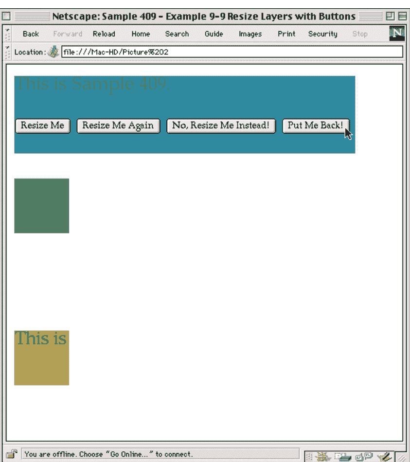

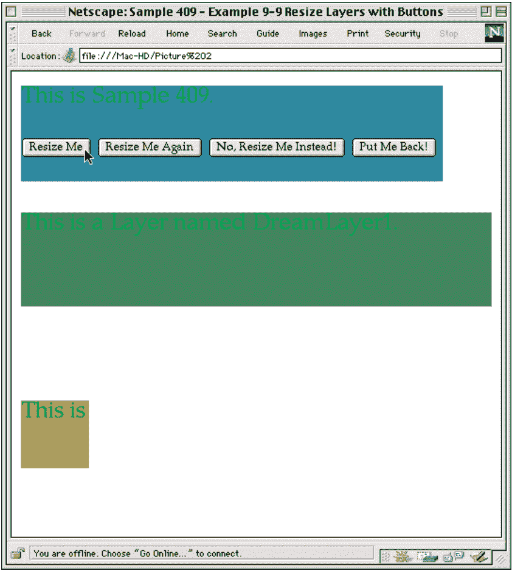


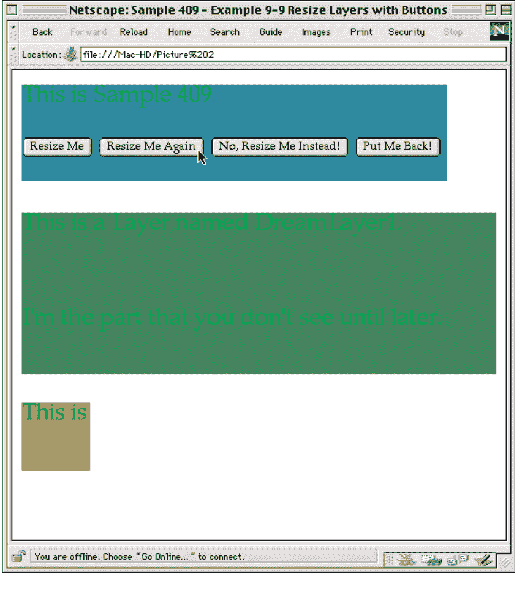

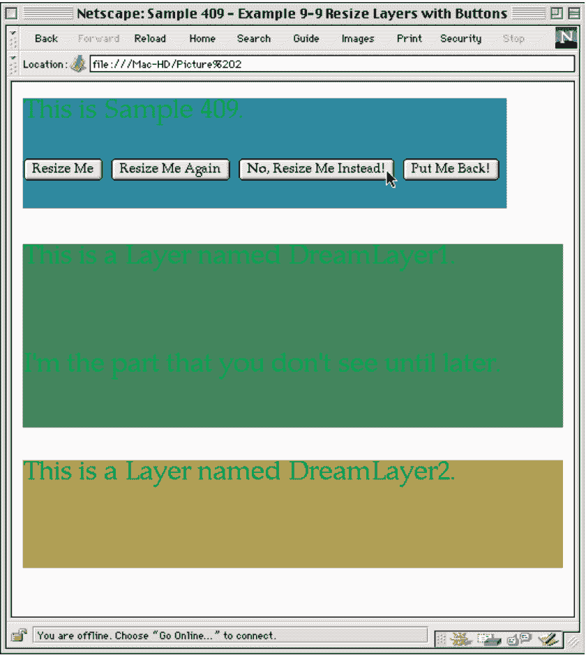

## 在层中使用JavaScript

### JavaScript 的 write() 方法

这是简要版本。其余内容请参见 JavaScript 指南。当你想在 SCRIPT 元素中使用 JavaScript 将内容包含到层中时，可以使用 **write()** 方法，其语法如下：

```
document.LayerName.document.write (arg, arg | "arg, arg");
```

其中第一个 **document** 指定了窗口的 **document** 对象，该窗口包含你以 **LayerName** 为名称指定的 **Layer** 对象。**LayerName** 随后拥有其自己的 **document** 对象，由第二个 **document** 指定。这就是你真正使用 **write()** 方法创建内容的地方，该方法的参数可以是引号括起来的文本或 HTML 标签，也可以是 JavaScript 表达式。

此处包含的 HTML 标签将表现得如同它们不在 SCRIPT 元素中一样；也就是说，如果你在 H1 标签内有文本，你将在浏览器窗口中看到 H1 标题被渲染出来，如果你为 H1 标题附加了样式，该样式也会被渲染。

关于可在 **write()** 方法中使用的其他 JavaScript 表达式，你可以使用点符号实现字符串、数字或逻辑表达式。你可以使用 **tags** 属性为元素创建新样式，或在该层中嵌套另一个层。一旦你理解了 JavaScript 的能力范围，可能性是无限的。

只需确保在使用完 **write()** 方法后，使用 **close** 方法关闭文档数据流，如下所示：

```
document.LayerName.document.close();
```

最后一点提示：使用 **write()** 方法时，请确保将所有参数保持在括号内的同一行中，否则可能会出现错误。要么关闭软换行功能，要么使用变量将文本字符串赋值，并不断使用 += 运算符向该变量追加内容。参见第319、441页。

### 使用 write() 与 close() 方法

示例 3-10 演示了如何使用 **write()** 方法在层中创建新内容，当用户点击按钮时，该方法会同时清除先前的内容。请注意 FORM 和 SCRIPT 元素，不要过多关注样式，它们只是锦上添花。在 SCRIPT 元素中创建的函数由 FORM 元素中包含的按钮的 **onClick** 事件处理程序调用，因此当用户点击按钮时，内容会被写入层。

## 示例 3-10：Sample410.html

```
<!DOCTYPE HTML PUBLIC "-//W3C//DTD HTML 3.2//EN">
<HTML>
<HEAD>
<TITLE>Sample 410 -  示例 3-10 write() 方法</TITLE>

<STYLE TYPE="text/JavaScript">

        with(tags.BODY) {
                color="purple";
                fontFamily="Moonlight, cursive";
                fontSize="34pt";
                textAlign="center";
        }

        with(tags.H1) {
                color="navy";
                fontFamily="Helvetica, serif";
                fontSize="40pt";
                textAlign="center";
                backgroundColor="red";
                borderWidths("25px");
                borderStyle="double";
                borderColor="fuchsia";
        }

        classes.UpperRed.all.fontSize="30pt";
        classes.UpperRed.all.color="red";
        classes.UpperRed.all.textTransform="capitalize";
        classes.UpperRed.all.backgroundColor="yellow";

        classes.Global.all.width="100%";
        classes.Global.all.backgroundColor="lime";
        classes.Global.all.borderWidths("25px");
        classes.Global.all.borderStyle="groove";
        classes.Global.all.textAlign="center";
        classes.Global.all.align="center";
        classes.Global.all.borderColor="green";
        classes.Global.all.color="blue";
        classes.Global.all.fontFamily="Moonlight, cursive";
        classes.Global.all.fontSize="22pt";

</STYLE>

</HEAD>
<BODY>

<P>A Tricky Example 410</P>

<!--  *************************************************  -->

<LAYER CLASS="Global" ID="layer2" LEFT=20 TOP=75>

Central

<FORM NAME="form2">
    <INPUT TYPE=button VALUE="Site 1"
           onClick='changeSite1();return false;''>
    <INPUT TYPE=button VALUE="Site 2"
           onClick='changeSite2();return false;''>
</FORM>

Command

</LAYER>

<!-- ************************************************* -->

<LAYER CLASS="UpperRed" ID="layer1" LEFT=20 TOP=275>
    <P>Pick a Site, any Site for a change of view.<P>
</LAYER>

<!-- ************************************************* -->

<SCRIPT LANGUAGE="JavaScript1.2"><!--BEGIN HIDING

function changeSite1() {
    document.layer1.document.write("<H1>New Site 1.</H1>");
    document.layer1.document.close();
}

function changeSite2() {
    document.layer1.document.write("<H1>The not much New Site 2.</H1>");
    document.layer1.document.close();
}

//END HIDING-->
</SCRIPT>

</BODY>
</HTML>
```

### 使用 moveAbove() 方法

以下示例演示了 **moveAbove()** 方法，用于将一个层移动到 z 顺序堆栈中另一个层的上方，同时更改被移动到另一层上方的层的父层。

## 示例 3-10 Sample410.html

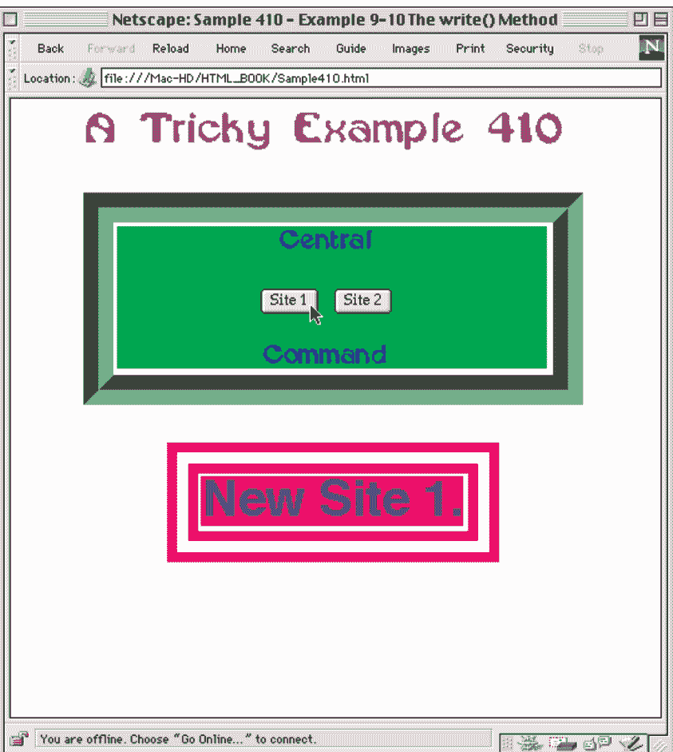

## 示例 3-11：Sample411.html

```
<!DOCTYPE HTML PUBLIC "-//W3C//DTD HTML 3.2//EN">
<HTML>
<HEAD>

<TITLE>Sample 411 - 示例 3-11 moveAbove() 方法更改父层</TITLE>
</HEAD>

<BODY>

<!-- L1 是 L2 和 L3 的父层 -->

<LAYER ID=L1 BGCOLOR="blue" LEFT=10 TOP=10 WIDTH=500 HEIGHT=200>
<H1>This is Layer L1</H1>

<LAYER ID=L2 BGCOLOR="red" LEFT=10 TOP=50 WIDTH=300 HEIGHT=50>
<H1>This is Layer L2. It gets moved above Layer L5 and is relocated so that Layer L4 is its parent Layer.</H1></LAYER>

<LAYER ID=L3 BGCOLOR="olive" LEFT=30 TOP=110 WIDTH=200 HEIGHT=80>
<H1>This is Layer L3</H1></LAYER>

</LAYER>

<!-- ******************************************************************* -->
<!-- L4 是 L5 和 L6 的父层 -->

<LAYER ID=L4 BGCOLOR="lime" LEFT=10 TOP=240 WIDTH=500 HEIGHT=250>
<H1>This is Layer L4</H1>

<LAYER ID=L5 BGCOLOR="cyan" LEFT=250 TOP=10 WIDTH=220 HEIGHT=100>
<H1>This is Layer L5</H1></LAYER>

<LAYER ID=L6 BGCOLOR="magenta" LEFT=270 TOP=140 WIDTH=190 HEIGHT=70>
<H1>This is Layer L6</H1></LAYER>

</LAYER>

<!-- ******************************************************************* -->

<SCRIPT LANGUAGE="JavaScript1.2"><!--BEGIN HIDING

// 然后如果你使用以下代码将 L2 移动到 L5 上方：

document.L1.document.L2.moveAbove(document.L4.document.L5);

// 那么 L4 将成为层 L5、L2、L6 的父层。

//END HIDING-->
</SCRIPT>

</BODY>
</HTML>
```

## 示例 3-11 Sample411.html

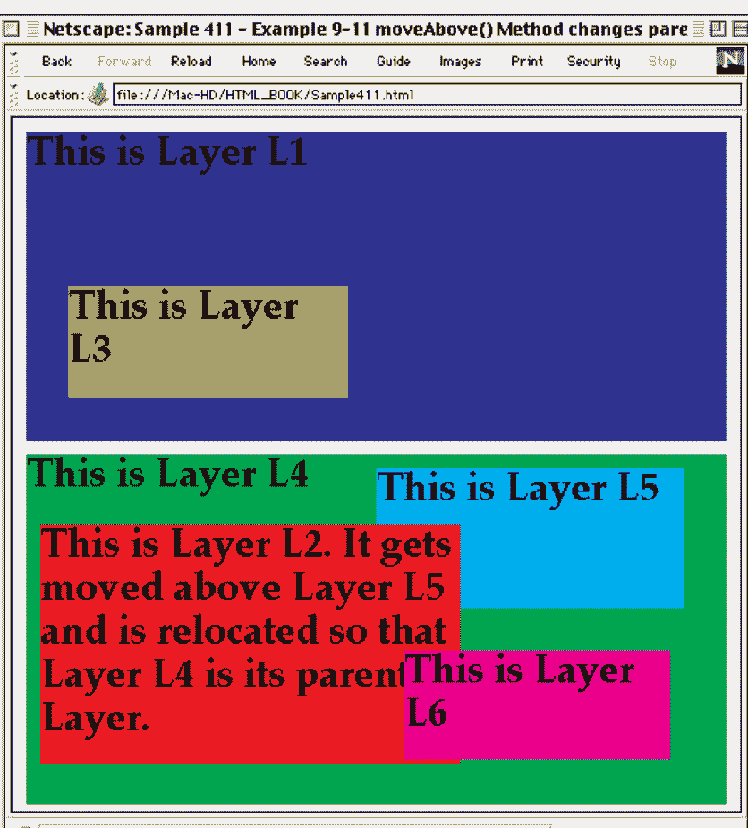

## 显示与隐藏层及写入层内容

示例 3-12 演示了 **write()** 和 **close()** 方法，以及 **visibility** 属性的 "show" 和 "hide" 值，用于向层中写入内容并使其显示或消失。

## 示例 3-12：Sample412.html

```
<!DOCTYPE HTML PUBLIC "-//W3C//DTD HTML 3.2//EN">
<HTML>
<HEAD>
<TITLE>Sample 412 -  示例 3-12    write() 方法与 visibility 属性</TITLE>

<STYLE TYPE="text/JavaScript">

	with(tags.BODY) {
		color="purple";
		fontFamily="Moonlight, cursive";
		fontSize="34pt";
		textAlign="center";
	}

	with(tags.H1) {
		color="navy";
		fontFamily="Helvetica, serif";
		fontSize="34pt";
		textAlign="center";
		backgroundColor="red";
		borderWidths("25px");
		borderStyle="double";
		borderColor="fuchsia";
	}

	with(tags.H2) {
		textAlign="left";
		borderWidths("30px");
		borderStyle="outset";
		borderColor="green";
	}

	with(tags.H3) {
		color="lime";
		fontFamily="Palatino, sans-serif";
		fontSize="20pt";
		textAlign="right";
		backgroundColor="gray";
		borderWidths("15px");
		borderStyle="inset";
		borderColor="blue";
	}
```


 OCR已识别完成，以下是后处理后的文本：

---

## CHAPTER 3 — 图层与 JavaScript

```
classes.Navy30.all.fontSize="30pt";
classes.Navy30.all.color="navy";
```

```
classes.Global.all.fontSize="20pt";
classes.Global.all.fontFamily="Moonlight, Clarendon, serif";
classes.Global.all.width="100%";
classes.Global.all.backgroundColor="blue";
classes.Global.all.borderWidths("20px");
classes.Global.all.borderStyle="groove";
classes.Global.all.textAlign="center";
classes.Global.all.align="center";
classes.Global.all.borderColor="purple";
classes.Global.all.color="yellow";
```

```
</STYLE>
```

```
</HEAD>
```

```
<!-- ************************************************** -->
```

```
<BODY>
```

```
<LAYER CLASS="Global" ID="layer2" LEFT=20 TOP=20>
```

```
<FORM NAME="form1">
    Central

    <INPUT TYPE=button VALUE="Site 1"
    onClick='changeSite1(); return false;'>

    <INPUT TYPE=button VALUE="Site 2"
    onClick='changeSite2(); return false;'>

    <INPUT TYPE=button VALUE="Site 3"
    onClick='changeSite3(); return false;'>

    <INPUT TYPE=button VALUE="Site 4"
    onClick='changeSite4(); return false;'>

    <INPUT TYPE=button VALUE="Site 5"
    onClick='changeSite5(); return false;'>

    Command
</FORM>
```

```
</LAYER>
```

238 第一部分 —— 动态 HTML

```
<!-- ***************************************************************** -->

<LAYER CLASS="Navy30" ID="layer1" LEFT=20 TOP=135 VISIBILITY="SHOW">

<P> Pick a Site, any Site for a change of view. <P>

</LAYER>

<!-- ***************************************************************** -->

<LAYER ID="layer3" LEFT=20 TOP=135 VISIBILITY="HIDE"> </LAYER>
<LAYER ID="layer4" LEFT=20 TOP=135 VISIBILITY="HIDE"> </ LAYER>
<LAYER ID="layer5" LEFT=20 TOP=135 VISIBILITY="HIDE"> </LAYER>

<!-- ***************************************************************** -->

<SCRIPT LANGUAGE="JavaScript1.2"><!--BEGIN HIDING

function changeSite1() {

document.layer1.document.write("*<H1><P>New Site 1.<BR>

You should notice that not only do you have to
show the layer but you also have to hide all
the other layers so they don't get in the
way. Of course this is only true if they
occupy the same space.</P></H1>");

document.layer1.visibility = 'show';
document.layer3.visibility = 'hide';
document.layer4.visibility = 'hide';
document.layer5.visibility = 'hide';

document.layer1.document.close();

}

/*-------------------------------------------------------------------->*/
```

```
function changeSite2() {

document.layer3.document.write("*<H2><P>Do not forget your curly braces or
 your semicolons.</P></H2>");

document.layer1.visibility = 'hide';
document.layer3.visibility = 'show';
document.layer4.visibility = 'hide';
document.layer5.visibility = 'hide';

document.layer3.document.close();

}

/*--------------------------------------------------------------------->*/
```

```
/*--------------------------------------------------------------------*/

function changeSite3() {

        document.layer4.document.write("<H3><P>The Vorlons always ask,     <BR>
                                                        WHO are you???<\/P><\/H3>");

        document.layer1.visibility = 'hide';
        document.layer3.visibility = 'hide';
        document.layer4.visibility = 'show';
        document.layer5.visibility = 'hide';

        document.layer4.document.close();

}

/*--------------------------------------------------------------------*/

function changeSite4() {

        document.layer5.document.write("<H3><P>The Shadows always ask, <BR>
                                                        WHAT do you want???<\/P><\/H3>");

        document.layer1.visibility = 'hide';
        document.layer3.visibility = 'hide';
        document.layer4.visibility = 'hide';
        document.layer5.visibility = 'show';

        document.layer5.document.close();

}

/*--------------------------------------------------------------------*/

function changeSite5() {

        document.layer5.document.write("<H1><P>New Site 5.<BR>
                                                Imagine the Possibilities. <\/P><\/H1>");

        document.layer1.visibility = 'hide';
        document.layer3.visibility = 'hide';
        document.layer4.visibility = 'hide';
        document.layer5.visibility = 'show';

        document.layer5.document.close();

}

/*--------------------------------------------------------------------*/

//END HIDING-->
</SCRIPT>

</BODY>

</HTML>
```

## 使用 **new** 运算符在运行时创建新图层

当你想要在页面加载到浏览器之后动态创建图层时，可以使用 **new** 运算符和 **Layer()** 构造函数，其语法如下：

## JavaScript 语法：

```
LayerName = new Layer (pixelsWidth, ["optionalParentLayerName"]);
```

### 参数说明：

**LayerName** 是你图层的名称，**pixelsWidth** 参数指定图层的像素宽度，第二个参数（"可选"）**"optionalParentLayerName"** 是包含新图层的父图层名称。如果你未指定父图层，则新图层将默认成为顶级图层。请记住，**new Layer** 必须完全按照所示拼写，使用大写的 L。如果你使用小写的 'l'，将会报错。例如：

```
Blue1 = new Layer (400);
```

这将创建一个名为 **Blue1** 的新图层，其宽度为 400 像素，由于未指定父图层，**Blue1** 图层将成为顶级图层。

以下是三种将内容放入新图层的方法：

- 在图层的 **document** 对象上使用 **write()** 方法。参见示例 3-13。
- 使用 **src** 属性加载包含内容的外部文档。参见示例 3-14。
- 使用 **load()** 方法加载包含内容的外部文档。参见示例 3-14。

#### 特别说明：

- 必须等待文档完全加载到浏览器后，才能动态创建 **新图层**。
- 必须等待文档完全加载到浏览器窗口后，才能打开新图层的 **document** 对象并使用 **write()** 方法创建内容。
- 在 **document** 对象上使用 **write()** 方法后，必须使用 **close()** 方法关闭该 **document** 对象。
- 使用 **write()** 方法时，一次只能打开一个 **document** 对象。

## 使用 tags 属性样式动态创建新图层

以下示例演示如何在用户点击表单元素中的按钮时创建 **新** 图层。只有少数 **Layer** 对象属性可以直接应用于图层，本例中指定了其中几个。

它还展示了如何使用 JavaScript 通过 **tags** 属性更改图层中所使用元素的属性，在这种情况下，它们会立即应用于名为 **Blue1** 的新图层。这就是你如何解决并非所有样式属性都可作为 **Layer** 对象属性使用的限制，当你想要让用户实时定义他们自己的样式时，这将更为关键。

此示例中最重要的一个特性是，**visibility** 属性必须设置为 **show**，你的 **新** 图层 **Blue1** 才能在文档中可见，因为编译器不会自动使其可见。

### 示例 3-13：Sample413.html

```
<!DOCTYPE HTML PUBLIC "-//W3C//DTD HTML 3.2//EN">
<HTML>
<HEAD>
<TITLE>Sample 413 - Example 3-13     使用 new 运算符创建新图层</TITLE>

<STYLE TYPE="text/JavaScript">

     with(tags.BODY) {
          color="purple";
          fontFamily="Moonlight, cursive";
          fontSize="34pt";
          textAlign="center";
     }

     with(tags.H1) {
          color="navy";
          fontFamily="Helvetica, serif";
          fontSize="34pt";
          textAlign="center";
          backgroundColor="red";
          borderWidths("25px");
          borderStyle="double";
          borderColor="fuchsia";
     }

     classes.Navy17.all.fontSize="17pt";
     classes.Navy17.all.color="navy";
```


 ```
classes.Global.all.fontSize="20pt";
classes.Global.all.fontFamily="Moonlight, Clarendon, serif";
classes.Global.all.width="100%";
classes.Global.all.backgroundColor="blue";
classes.Global.all.borderWidths("20px");
classes.Global.all.borderStyle="groove";
classes.Global.all.textAlign="center";
classes.Global.all.align="center";
classes.Global.all.borderColor="purple";
classes.Global.all.color="yellow";

</STYLE>

</HEAD>
<!-- ******************************************************************** -->
<BODY>

<LAYER CLASS="Global" ID="layer2" LEFT=20 TOP=20>

        <FORM NAME="form1">

                Central

                <INPUT TYPE=button VALUE="Make new Layer"

                onClick='newlayer1(); return false;'>

                <INPUT TYPE=button VALUE="Change new Layer"

                onClick='changelayer1(); return false;'>

                Command

        </FORM>

</LAYER>

<!-- ******************************************************************** -->

<LAYER CLASS="Navy17" ID="layer1" LEFT=20 TOP=135 VISIBILITY="SHOW">

 <P>Click <B>'Make new Layer'</B> first or you will get an error.<P>

</LAYER>

<!-- ******************************************************************** -->

<SCRIPT LANGUAGE="JavaScript1.2"><!--BEGIN HIDING

function newlayer1() {

        document.Blue1 = new Layer(200);
        document.Blue1.left = 20;
        document.Blue1.top = 275;
        document.Blue1.visibility = "show";
        document.Blue1.document.write("<H1>Hi! What's New?<\/H1>");
        document.Blue1.document.close();
}

function changelayer1() {

    document.Blue1.left = 250;
    document.Blue1.top = 175;
    document.Blue1.bgColor = "blue";

    document.tags.H1.fontSize = "50pt";
    document.tags.H1.fontFamily = "times, Palatino, serif";
    document.tags.H1.color = "yellow";
    document.tags.H1.backgroundColor = "aqua";
    document.tags.H1.borderColor = "lime";
    document.tags.H1.borderStyle = "groove";

    document.Blue1.document.write("<h1>ok so i'm changed.</h1>");

    document.Blue1.document.close();

}

//END HIDING-->
</SCRIPT>

</body>
</html>
```

示例 3-14 包含三个部分。第 1 部分包含代码的基本部分，第 2 和第 3 部分是在用户点击文档中的按钮时加载到文档中的外部文件。第 1 部分演示了一种使用 `new` 运算符动态创建图层的直接方法，设置图层的 left 和 top 属性，然后通过使用第一个名为 getL1() 的函数中的 `src` 属性，以及在第二个名为 getL2() 的函数中使用 `load()` 方法，从外部文件加载内容。其结构与上一个示例类似，但没有太多修饰。

## 示例 3-14 第 1 部分：Sample414.html

```
<!DOCTYPE HTML PUBLIC "-//W3C//DTD HTML 3.2//EN">
<html>
<HEAD>
<TITLE>Sample 414 - 示例 3-14 使用 new 运算符即时创建图层</TITLE>

<STYLE TYPE="text/JavaScript">

    with(tags.BODY) {
        color="purple";
        fontFamily="Moonlight, cursive";
        fontSize="22pt";
        textAlign="center";
    }

</STYLE>
</HEAD>
```

```text
<!-- ************************************************************************* -->
<BODY>

<LAYER ID="layer2" LEFT=20 TOP=20>

    <FORM NAME="form1">

        中央命令

        kt
        onClick='getIt1(); return false;'>

        <INPUT TYPE=button VALUE="加载另一个外部图层"
        onClick='getIt2(); return false;'>

    </FORM>

</LAYER>
<!-- ************************************************************************* -->

<LAYER ID="layer1" LEFT=20 TOP=135 VISIBILITY="SHOW">

    <P>点击按钮以创建新图层并加载其内容。</P>

</LAYER>
<!-- ************************************************************************* -->

<SCRIPT LANGUAGE="JavaScript1.2"><!--BEGIN HIDING

function getIt1() {

    document.ExternalOne = new Layer(200);
    document.ExternalOne.left = 50;
    document.ExternalOne.top = 200;
    document.ExternalOne.src = "Sample414ExternalA.html";
    document.ExternalOne.visibility = "show";

}

function getIt2() {

    document.ExternalTwo = new Layer(50);
    document.ExternalTwo.left = 280;
    document.ExternalTwo.top = 225;
    document.ExternalTwo.load ("Sample414ExternalB.html" , 300);
    document.ExternalTwo.visibility = "show";

}

//END HIDING-->
</SCRIPT>

</BODY>
</HTML>
```

## 第 3 章 — 图层与 JavaScript

## 示例 3-14 第 2 部分：Sample414ExternalA.html

```
<!DOCTYPE HTML PUBLIC "-//W3C//DTD HTML 3.2//EN">
<HTML>
<HEAD>
<TITLE>Sample 414ExternalA - 示例 3-A    </TITLE>

<STYLE TYPE="text/JavaScript">

        with(tags.BODY) {
            color="blue";
            fontFamily="Helvetica, serif";
            fontSize="44pt";
            textAlign="center";
        }
</STYLE>
</HEAD>
<BODY>
<P>     第一个外部内容。    <P>
</BODY>
</HTML>
```

## 示例 3-14 第 3 部分：Sample414ExternalB.html

```
<!DOCTYPE HTML PUBLIC "-//W3C//DTD HTML 3.2//EN">
<HTML>
<HEAD>
<TITLE>Sample 414ExternalB - 示例 3-B    </TITLE>

<STYLE TYPE="text/JavaScript">

        with(tags.BODY) {
            color="red";
            fontFamily="Clarendon, Times, fantasy";
            fontSize="24pt";
            textAlign="center";
        }

        classes.darkness.all.color="black";
        classes.greenword.all.color="green";
</STYLE>
</HEAD>
<BODY>
<P>     第二个外部内容，使用

<SPAN CLASS="darkness">        load ( )       </SPAN>

<SPAN CLASS="greenword">       方法        </SPAN>

 将图层的宽度设置从 50 像素覆盖为 300 像素。 </P>
</BODY>
</HTML>
```

## 图层内的本地化 JavaScript <SCRIPT>

当你在 LAYER 中使用 <SCRIPT> 元素时，也就是说，在 LAYER 元素的开始和结束标签之间，使用 JavaScript 修改该 LAYER 时，该 SCRIPT 被称为**本地化**的，因为 JavaScript 只会作用于该特定的 LAYER。这种固有限制在大型文档中非常有用，当你想要一种简便的方式来管理鼠标移动和点击的事件处理程序时。参见示例 1-15，可在 Sample415.html 中查看，作为一个简单示例；以及示例 6-，可在 Sample713-Chess.html 中查看，作为更复杂的示例。CD-ROM 上还有一个书中未包含的附加文件，可以在 Sample774-Chess-Images.html 中查看。

本示例重点介绍如何使用 **visibility** 属性和 **z-index** 属性以及一些简单的 JavaScript 来使图层显示和消失。实际上，它与示例 2-8（来自第 2 章）完全相同，只是增加了额外的函数来处理本地化 SCRIPT 元素内的鼠标事件。示例 3-15 的样式使用 CSS 语法编写，这与第 3 章中的所有其他示例不同，那些示例使用 JavaScript 语法编写。它还展示了图层默认是透明的，这相当于将 **backgroundColor** 属性设置为 "null"。在源代码末尾的 <P> 元素附近有一些额外的注释。

**示例 3-15：** Sample415.html

```
<!DOCTYPE HTML PUBLIC "-//W3C//DTD HTML 3.2//EN">
<HTML>
<HEAD>
<TITLE>Sample 415 - 示例 3-15     本地化脚本、可见性和鼠标事件
</TITLE>

<STYLE TYPE="text/CSS">
<!--

#SeventhLayer  { position: absolute; left: 10px; top: 100px;
                    z-index: 3; color: blue; font-size: 20pt; padding: 40px;
                    border-style:ridge; border-width:20px; border-color:aqua;
                    visibility: show; }

#EighthLayer  { position: absolute; left: 100px; top: 258px;
                    z-index: 2; color: red; font-size: 20pt; padding: 40px;
                    border-style:ridge; border-width:20px; border-color:yellow;
                    visibility: show; }
#NinthLayer  { position: absolute; left: 280px; top: 75px;
                    z-index: 1; color: green; font-size: 20pt; padding: 40px;
                    border-style:ridge; border-width:20px; border-color:lime;
                    visibility: show; }
-->
</STYLE>
</HEAD>
```


 ## 第 3 章 —— 层与 JavaScript

```
<BODY>
<DIV ID="SeventhLayer">      这是                          <BR>
                             第七层测试                     <BR>
                             z-index 等于 3。               <BR>
                             它主宰一切！

<SCRIPT LANGUAGE="JavaScript1.2"><!--BEGIN HIDING

        function onMouseOver() { seeNoSee("hide"); }
        function onMouseOut () { seeNoSee("show"); }

        function seeNoSee (WhereAmI) {
               visibility=WhereAmI;
               return false;
        }

//END HIDING-->
</SCRIPT>
</DIV>

<DIV ID="EighthLayer">       这是                          <BR>
                             第八层测试                     <BR>
                             z-index 等于 2。

<SCRIPT LANGUAGE="JavaScript1.2"><!--BEGIN HIDING

        function onMouseOver() { seeNoSee("hide"); }
        function onMouseOut () { seeNoSee("show"); }

        function seeNoSee (WhereAmI) {
               visibility=WhereAmI;
               return false;
        }

//END HIDING-->
</SCRIPT>
</DIV>

<DIV ID="NinthLayer">        这是                          <BR>
                             第九层测试                     <BR>
                             z-index 等于 1。

<SCRIPT LANGUAGE="JavaScript1.2"><!--BEGIN HIDING

        function onMouseOver() { seeNoSee("hide"); }
        function onMouseOut () { seeNoSee("show"); }

        function seeNoSee (WhereAmI) {

               visibility=WhereAmI;
               return false;
        }

//END HIDING-->
</SCRIPT>

</DIV>
```

<P>
这与示例 307 完全相同，只是每个 LAYER 中都有一个局部化 SCRIPT，当鼠标放置在其上时会使其隐藏，当鼠标移出其空间时会重新出现。这有点不稳定，所以请稳住你的鼠标。如果你的鼠标位于 2 个或更多 LAYER 重叠的区域，那么 z-index 较高的 LAYER 将会接收鼠标事件并消失。
</P>
</BODY>
</HTML>

示例 3-16 处理 LAYER 元素内的局部化 SCRIPT，以展示具有不同值的相同功能可以独立应用于各个层。当鼠标移动到层上时，**Layer** 对象的 **clip.right** 和 **clip.bottom** 属性会使层的一部分消失，当鼠标移离层指定的空间时，该部分会重新出现。

## 示例 3-16：Sample416.html

```
<!DOCTYPE HTML PUBLIC "-//W3C//DTD HTML 3.2//EN">
<HTML>
<HEAD>
<TITLE>示例 416 —— 示例 3-16       局部脚本与 clip 属性</TITLE>

<STYLE TYPE="text/JavaScript">

    with(tags.BODY) {
        color="purple";
        fontFamily="Moonlight, cursive";
        fontSize="22pt";
        textAlign="center";
    }

    classes.Blue22.all.fontSize="22pt";
    classes.Blue22.all.color="blue";
    classes.Blue22.all.width="500px";
    classes.Blue22.all.backgroundColor="aqua";
    classes.Blue22.all.borderWidths("20px");
    classes.Blue22.all.borderStyle="groove";
</STYLE>

</HEAD>

<BODY>
```

```
<!-- ******************************************************************** -->

<LAYER CLASS="Blue22" ID="layer1" LEFT=20 TOP=35 VISIBILITY="SHOW">

<P>将鼠标移到我上面，我就会缩小。 </P>
<P>将鼠标移离我 </P>
<P>我就会恢复原状。 </P>

<SCRIPT LANGUAGE="JavaScript1.2"> <!--BEGIN HIDING

function onMouseOver() { seeNoSee(370, 130); }

function onMouseOut() { seeNoSee(500, 200); }

function seeNoSee (ShrinkingLeft, ShrinkingUp) {

clip.right=ShrinkingLeft;
clip.bottom=ShrinkingUp;
return falseIndepent;
}

//END HIDING-->
</SCRIPT>

</LAYER>
```

```
<!-- ******************************************************************** -->

<LAYER CLASS="Blue22" ID="layer2" LEFT=20 TOP=222 VISIBILITY="SHOW">

<P>将鼠标移到我上面，我就会缩小。 </P>
<P>将鼠标移离我 </P>
<P>我就会恢复原状。 </P>

<SCRIPT LANGUAGE="JavaScript1.2"> <!--BEGIN HIDING

function onMouseOver() { seeNoSee(211, 100); }

function onMouseOut() { seeNoSee(500, 200); }

function seeNoSee (ShrinkingLeft, ShrinkingUp) {

clip.right=ShrinkingLeft;
clip.bottom=ShrinkingUp;
return false;
}

//END HIDING-->
</SCRIPT>

</LAYER>

</BODY>
</HTML>
```

## 动画裁剪矩形以显示图像

## JavaScript setTimeout() 方法

**setTimeout()** 方法有两种不同的语法结构。一种是在经过指定的 **毫秒** 数后计算一个 *表达式*。另一种是在经过指定的 **毫秒** 数后调用一个 *函数*。单独使用时，**setTimeout()** 方法不会像 **setInterval()** 方法那样重复执行。要使其重复执行，必须将包含 **setTimeout()** 方法的同一函数显式地作为 **functionName** 参数调用，这通常在 **if ()** 等条件语句中完成，如示例 3-17 至 3-22 所示。**anyExpression** 或 **functionName** 参数必须放在引号内，否则会立即被计算。指定函数时，该函数的逗号分隔的 **arg** 参数是可选的，因此即使你的函数没有任何参数，也可以使用 **setTimeout()**。

### JavaScript 语法：

```
setTimeout("anyExpression", milliseconds);
setTimeout("functionName()", milliseconds[, arg1, ..., argN]);
```

如果你计划将 **setTimeout()** 方法与 **clearTimeout()** 方法结合使用，则必须将 **setTimeout()** 方法赋值给一个 **timeoutID**，如下所示：

```
timeoutID=setTimeout("functionName()", millisecs);
```

或者如下所示：

```
timeoutID=setTimeout("functionName()", millisecs, arg1, ...,argN);
```

这样你就可以用 **clearTimeout()** 方法引用它，如下所示：

```
clearTimeout(timeoutID);
```

## JavaScript clearTimeout() 方法

**clearTimeout()** 方法用于取消先前启动的、已赋值给 **timeoutID** 的 **setTimeout()** 方法调用。

#### 语法：

```
clearTimeout(timeoutID);
```

## 动画裁剪矩形与弹出图像

在下面的示例 3-17 中，通过点击三个按钮之一，可以逐步显示、隐藏或弹出显示图像。它使用了 **setTimeout()** 方法、**resizeBy()** 方法和 **resizeTo()** 方法。

**RevealImage()** 此函数使用条件性 **if ()** 语句来测试 **layer1** 的 **clip.right** 属性是否小于 700。如果为真，则调整 **layer1** 的大小，使其宽度增加 5 像素，高度增加 4 像素。然后 **setTimeout()** 方法通过再次调用 **RevealImage()** 函数来重新调用该过程，并且每 20 毫秒继续这样做，直到 **layer1** 的 **clip.right** 属性大于或等于 700 像素宽。需要注意的是，重新调用之所以继续，是因为 **setTimeout()** 方法显式地调用了 **RevealImage()** 函数，这导致函数在该点中断并重新开始循环。这与 **setInterval()** 方法（见第 284 页）形成对比，后者具有 **setTimeout()** 方法所不具备的固有重新调用能力。

**HideImage()** 此函数只是使用 **resizeTo()** 方法将 **layer1** 重置回其原始裁剪 **宽度** 和 **高度**，这只会使左上角的一小部分可见。

**PopImage()** 此函数使用 **resizeTo()** 方法瞬时改变裁剪矩形的 **宽度** 和 **高度**，使整个层可见。

## 示例 3-17：Sample417.html

```
<!DOCTYPE HTML PUBLIC "-//W3C//DTD HTML 3.2//EN">
<HTML>
<HEAD>
<TITLE>示例 417 —— 示例 3-17				使用 SetTimeout 方法显示图像</TITLE>

<STYLE TYPE="text/JavaScript">

			classes.Blue22.all.fontSize="22pt";
			classes.Blue22.all.color="blue";
			classes.Blue22.all.width="100%";
			classes.Blue22.all.backgroundColor="aqua";
			classes.Blue22.all.borderWidths("20px");
			classes.Blue22.all.borderStyle="groove";

</STYLE>

</HEAD>

<BODY>
```


 # 252 第一部分 —— 动态 HTML

```
<!-- ******************************************************************* -->

<LAYER CLASS="Blue22" ID="layer2" LEFT=50 TOP=10 VISIBILITY="SHOW">

<FORM NAME="form1">

Central Command

<INPUT TYPE=button VALUE="Reveal Image"
onClick='RevealImage(); return false;'>

<INPUT TYPE=button VALUE="Hide Image"
onClick='HideImage(); return false;'>

<INPUT TYPE=button VALUE="Pop Image"
onClick='PopImage(); return false;'>

</FORM>

</LAYER>
```

```
<!-- ******************************************************************* -->

<LAYER CLASS="Blue22" ID="layer1" LEFT=20 TOP=130 CLIP="0,0,100,50"
VISIBILITY="SHOW">

Wow!<BR><BR>

<CENTER>


</CENTER>

</LAYER>
```

```
<!-- ******************************************************************* -->

<SCRIPT LANGUAGE="JavaScript1.2"><!--BEGIN HIDING

function RevealImage() {

var layer1 = document.layer1;

if (layer1.clip.right < 700) {
layer1.resizeBy(5,4);
setTimeout('RevealImage()', 20);
}

return false;
}

</SCRIPT>
```

```
/* ------------------------------------------------------------------------- */
```

# 第 3 章 —— Layer 与 JavaScript 253

```
/*------------------------------------------------------------------*
    function HideImage() { 

        var layer1 = document.layer1;

        if (layer1.clip.right > 100) {
            layer1.resizeTo(100,50);
        }

        return false;
    }
*/
```

```
/*------------------------------------------------------------------*
    function PopImage() { 

        var layer1 = document.layer1;

        if (layer1.clip.right < 700) {
            layer1.resizeTo(700,500);
        }

        return false;
    }
*/
```

```
//END HIDING-->
</SCRIPT>

</BODY>
</HTML>
```

在示例 3-18 中，`setTimeout()` 方法用于显示一张图像，与上一个例子类似，并且增加了使用 `visibility` 属性的功能，用于隐藏和显示其他已经预加载到页面中的图像，这些图像的 `VISIBILITY 属性` 在 LAYER 元素中初始设置为 "HIDE"。

# 示例 3-18：Sample418.html

```
<!DOCTYPE HTML PUBLIC "-//W3C//DTD HTML 3.2//EN">
<HTML>
<HEAD>
<TITLE>Sample 418 - Example 3-18 SetTimeout Method to Reveal Image</TITLE>

<STYLE TYPE="text/JavaScript">

    classes.Blue22.all.fontSize="1pt";
    classes.Blue22.all.color="blue";
    classes.Blue22.all.width="100%";
    classes.Blue22.all.backgroundColor="aqua";
    classes.Blue22.all.borderWidths("20px");
    classes.Blue22.all.borderStyle="groove";

</STYLE>
</HEAD>
```

# 第一部分 —— 动态 HTML

```
<BODY>
<!--  **********************************************************************************  -->

<LAYER CLASS="Blue22" ID="layer2" LEFT=20 TOP=10 VISIBILITY="SHOW">

<FORM NAME="form1">
            Central Command

            <INPUT TYPE=button VALUE="Reveal Image"

            onClick='RevealImage(); return false;'>

            <INPUT TYPE=button VALUE="Hide Image"

            onClick='HideImage(); return false;'>      <BR>

            <INPUT TYPE=button VALUE="Pop Image 1"

            onClick='PopImage(); return false;'>

            <INPUT TYPE=button VALUE="Pop Image 2"

            onClick='PopImage2(); return false;'>

            <INPUT TYPE=button VALUE="Pop Image 3"

            onClick='PopImage3(); return false;'>

            <INPUT TYPE=button VALUE="Pop Image 4"

            onClick='PopImage4(); return false;'>

        </FORM>

</LAYER>
<!--  **********************************************************************************  -->

<LAYER CLASS="Blue22" ID="layer1" LEFT=20 TOP=130
CLIP="0,0,100,50" VISIBILITY="SHOW">

Wow!

<CENTER>
 
</CENTER>

</LAYER>
<!--  **********************************************************************************  -->

<LAYER CLASS="Blue22" ID="layer3" LEFT=20 TOP=130 VISIBILITY="HIDE">

Wow!

<CENTER>
 
</CENTER>

</LAYER>
<!--  **********************************************************************************  -->
```

# 第 3 章 —— Layer 与 JavaScript 255

```
<!-- ****************************************************************** -->

<LAYER CLASS="Blue22" ID="layer4" LEFT=20 TOP=130 VISIBILITY="HIDE">

Wow!

<CENTER>

</CENTER>

</LAYER>
<!-- ****************************************************************** -->

<LAYER CLASS="Blue22" ID="layer5" LEFT=20 TOP=130 VISIBILITY="HIDE">

Wow!

<CENTER>

</CENTER>

</LAYER>
<!-- ****************************************************************** -->

<SCRIPT LANGUAGE="JavaScript1.2"><!--BEGIN HIDING

function PopImage2() {

    document.layer1.visibility = 'hide';
    document.layer4.visibility = 'hide';
    document.layer5.visibility = 'hide';
    document.layer3.visibility = 'show';
}

/*                                                                   */

function PopImage3() {

    document.layer1.visibility = 'hide';
    document.layer3.visibility = 'hide';
    document.layer5.visibility = 'hide';
    document.layer4.visibility = 'show';
}

/*                                                                   */

function PopImage4() {

    document.layer1.visibility = 'hide';
    document.layer3.visibility = 'hide';
    document.layer4.visibility = 'hide';
    document.layer5.visibility = 'show';
}

//END HIDING-->
</SCRIPT>
<!-- ****************************************************************** -->
```

```
<SCRIPT LANGUAGE="JavaScript1.2"><!--BEGIN HIDING

function RevealImage () {

document.layer1.visibility = 'show';

var layer1 = document.layer1;

if (layer1.clip.right < 700) {
layer1.resizeBy(5,4);
setTimeout('RevealImage()', 20);
}

document.layer3.visibility = 'hide';
document.layer4.visibility = 'hide';
document.layer5.visibility = 'hide';
document.layer1.visibility = 'show';
}

return false;
}

/*---------------------------------------------------------------------------*/

function HideImage () {

var layer1 = document.layer1;

if (layer1.clip.right > 100) {
layer1.resizeTo(100,50);
}

document.layer3.visibility = 'hide';
document.layer4.visibility = 'hide';
document.layer5.visibility = 'hide';
document.layer1.visibility = 'show';
}

return false;
}

/*---------------------------------------------------------------------------*/

function PopImage () {

document.layer1.visibility = 'show';

var layer1 = document.layer1;
layer1.clip.right=0; // resets to zero to avoid button conflicts

if (layer1.clip.right < 700) {
layer1.resizeTo(700,500);
}

document.layer3.visibility = 'hide';
document.layer4.visibility = 'hide';
document.layer5.visibility = 'hide';
document.layer1.visibility = 'show';
}

return false;
}

//END HIDING-->
</SCRIPT>
</BODY>
</HTML>
```

# 第 3 章 —— Layer 与 JavaScript

示例 3-19 使用 **setTimeout()** 方法通过移动其包含的名为 **layer1** 的 Layer 来移动一张图像，只要 **layer1** 的 **left** 属性小于 500 像素。**VALUE="Move Image"** 的按钮在点击时调用 **MoveImage()** 函数，该函数实现了 **setTimeout()** 方法。

# 示例 3-19：Sample419.html

```
<!DOCTYPE HTML PUBLIC "-//W3C//DTD HTML 3.2//EN">
<HTML>
<HEAD>
<TITLE>Sample 419 - Example 3-19    SetTimeout Method to Animate Image</TITLE>

<STYLE TYPE="text/JavaScript">

	classes.Blue22.all.fontSize="22pt";
	classes.Blue22.all.color="blue";
	classes.Blue22.all.width="100%";
	classes.Blue22.all.backgroundColor="lime";
	classes.Blue22.all.borderWidths("20px");
	classes.Blue22.all.borderStyle="groove";
	classes.Blue22.all.borderColor="green";

</STYLE>

</HEAD>

<BODY>

<!--  ****************************************************************  -->

<LAYER CLASS="Blue22" ID="layer2" LEFT=50 TOP=10 VISIBILITY="SHOW">

	<FORM NAME="form1">

		Central Command

		<INPUT TYPE=button VALUE="Move Image"

		onClick='MoveImage(); return false;'>

		<INPUT TYPE=button VALUE="Return Image"

		onClick='ReturnImage(); return false;'>

	</FORM>

</LAYER>

<!--  ****************************************************************  -->
```


 ## 258

##第3章 — 图层与JavaScript

## 第一部分 — 动态HTML

```
<LAYER ID="layer1" LEFT=20 TOP=130 VISIBILITY="SHOW">

      

</LAYER>

<!--  ************************************************************  -->

<SCRIPT LANGUAGE="JavaScript1.2"><!--BEGIN HIDING

      function MoveImage (layer1) {

            var layer1 = document.layer1;

            if (layer1.left < 500)  {
                  layer1.moveBy(5,1);
                  setTimeout('MoveImage()', 20);
            }

            return false;
            }
/*------------------------------------------------------------------------*/
            function ReturnImage (layer1) {

                  var layer1 = document.layer1;

                  if (layer1.left > 20)  {
                        layer1.moveTo(20,130);
                  }

            return false;
            }

//END HIDING-->
</SCRIPT>

</BODY>
</HTML>
```

在示例3-20中，一个包含图像的图层以顺时针矩形运动反复进行动画，另一个图层水平进行动画。每次动画在单击按钮时实现。

**MoveUpperImage()** 此函数测试UpperLayer的**left**和**top**属性坐标的值，并在条件为真时使用**moveBy()**方法按指定像素移动它。

**MoveLowerImage()** 此函数测试LowerLayer的**left**属性坐标的值，并在条件为真时使用**moveBy()**方法按指定像素移动它。

**ChaseLowerImage()** 此函数使用**moveTo()**方法重新定位**LowerLayer**。


## 第3章 — 图层与JavaScript 259

## 示例 3-20：Sample420.html

```
<!DOCTYPE HTML PUBLIC "-//W3C//DTD HTML 3.2//EN">
<HTML>
<HEAD>
<TITLE>Sample 420 - 示例 3-20     使用SetTimeout方法动画图像</TITLE>

<STYLE TYPE="text/JavaScript">
	classes.Blue22.all.fontSize="14pt";
	classes.Blue22.all.color="blue";
	classes.Blue22.all.width="100%";
	classes.Blue22.all.backgroundColor="lime";
	classes.Blue22.all.borderWidths("20px");
	classes.Blue22.all.borderStyle="groove";
	classes.Blue22.all.borderColor="green";

</STYLE>
</HEAD>
<BODY>
<!-- ************************************************** -->

<LAYER CLASS="Blue22" ID="layer1" LEFT=50 TOP=10 VISIBILITY="SHOW">
	<FORM NAME="form1">
		Central Command
		<INPUT TYPE=button VALUE="Move Upper Image"
		onClick='MoveUpperImage(); return false;'>
		<INPUT TYPE=button VALUE="Move Lower Image"
		onClick='MoveLowerImage(); return false;'>
		<INPUT TYPE=button VALUE="Chase Lower Image"
		onClick='ChaseLowerImage(); return false;'>
	</FORM>
</LAYER>
<!-- ************************************************** -->

<LAYER ID="UpperLayer" LEFT=20 TOP=130 VISIBILITY="SHOW">
	
</LAYER>
<!-- ************************************************** -->

<LAYER ID="LowerLayer" LEFT=20 TOP=300 VISIBILITY="SHOW">
	
</LAYER>
```

# # 260

## 第一部分 — 动态HTML

```
<!-- ******************************************************* -->

<SCRIPT LANGUAGE="JavaScript1.2"><!--BEGIN HIDING

function MoveUpperImage() {

	var UpperLayer = document.UpperLayer;

	if (UpperLayer.left < 500 && UpperLayer.top == 130) {
		UpperLayer.moveBy(5,0);		//向右移动
	}
	if (UpperLayer.left == 500 && UpperLayer.top < 300) {
		UpperLayer.moveBy(0,5);		//向下移动
	}
	if (UpperLayer.left > 20 && UpperLayer.top == 300) {
		UpperLayer.moveBy(-5,0);		//向左移动
	}
	if (UpperLayer.left == 20 && UpperLayer.top > 130) {
			UpperLayer.moveBy(0,-5);	//向上移动
	}

	setTimeout('MoveUpperImage()', 20);
}
/*------------------------------------------------------------------------*/
function MoveLowerImage() {

	var LowerLayer = document.LowerLayer;

	if (LowerLayer.left < 500) {
			LowerLayer.moveBy(5,0);
	}
	else {
		LowerLayer.left = 20;
	}

	setTimeout('MoveLowerImage()', 20);
}
/*------------------------------------------------------------------------*/
function ChaseLowerImage() {

	var LowerLayer = document.LowerLayer;

	if (LowerLayer.left > 20) {

//将下方图像移动到上方图像的垂直位置

		LowerLayer.moveTo(20,130);
	}
return false;
}

//END HIDING-->
</SCRIPT>

</BODY>
</HTML>
```

## 第3章 — 图层与JavaScript

示例3-21有四个图层，每个图层内部都包含一个图像。带有太阳图像的图层保持静止，而带有旋转地球Gif89a动画的图层和彗星静态图像的图层分别通过重新调用**MoveEarth()**函数和**MoveComet()**函数来进行动画。其中两个图层各有一个旋转地球的图像。**EarthLayer**图层在页面上半部分可见，**SecondEarthLayer**图层在页面下半部分可见。

**MoveEarth()** 此函数基本上将页面划分为四个部分的网格，并使用条件**if()**语句测试**EarthLayer**和**SecondEarthLayer**两个图层的位置坐标，并使用**moveBy()**方法相应地移动它们，同时使用**visibility**属性来隐藏或显示它们。然后，**setTimeout()**方法持续重新调用**MoveEarth()**函数，因为其中一个if()语句中的条件始终为真。这使得地球图像持续移动。

**MoveComet()** 此函数将名为**CometLayer**的图层及其中的彗星图像从右上方向左下方对角移动。到达某一点后，图像重置到原始起始点，动画重复。

## 示例 3-21：Sample421.html

```
<!DOCTYPE HTML PUBLIC "-//W3C//DTD HTML 3.2//EN">
<HTML><HEAD>
<TITLE>Sample 421 - 示例 3-21     太阳地球动画</TITLE>

<STYLE TYPE="text/JavaScript">

    classes.Blue22.all.fontSize="14pt";
    classes.Blue22.all.color="navy";
    classes.Blue22.all.width="100%";
    classes.Blue22.all.backgroundColor="yellow";

</STYLE>
</HEAD>

<BODY BGCOLOR="black">
<!-- ***************************************** -->

<LAYER CLASS="Blue22" ID="layer1" LEFT=10 TOP=10 VISIBILITY="SHOW" Z-INDEX=1>

<FORM NAME="form1">
    C&amp;C
    <INPUT TYPE=button VALUE="Start Gravity"
        onClick='MoveEarth(); MoveComet(); return false;'>
</FORM>

</LAYER>
```

## 262 第一部分 — 动态HTML

```
<!-- ********************************************************************* -->

<LAYER ID="EarthLayer" LEFT=599 TOP=170 VISIBILITY="SHOW" Z-INDEX=3>


</LAYER>

<!-- ********************************************************************* -->

<LAYER ID="SecondEarthLayer" LEFT=30 TOP=195 VISIBILITY=HIDE Z-INDEX=6>


</LAYER>

<!-- ********************************************************************* -->

<LAYER ID="SunLayer" LEFT=300 TOP=170 VISIBILITY="SHOW" Z-INDEX=4>


</LAYER>

<!-- ********************************************************************* -->

<LAYER ID="CometLayer" LEFT=1000 TOP=100 VISIBILITY="SHOW" Z-INDEX=5>


</LAYER>

<!-- ********************************************************************* -->

<SCRIPT LANGUAGE="JavaScript1.2"> <!--BEGIN HIDING

function MoveEarth() {

    var EarthLayer = document.EarthLayer;
    var SecondEarthLayer = document.SecondEarthLayer;

    //右上网格
    if (EarthLayer.left > 320 && EarthLayer.top > 0) {
        EarthLayer.moveBy(-5,-3);
    }

    //左上网格
    else if (EarthLayer.left <= 320 && EarthLayer.top >= 0) {
        EarthLayer.moveBy(-5,3);
    }

    if (EarthLayer.left > 20 && EarthLayer.left <= 30) {
        EarthLayer.visibility='hide';
        SecondEarthLayer.left = 30;
        SecondEarthLayer.top = 170;
        SecondEarthLayer.visibility='show';
    }
}
```


# 第三章 — 层与 JavaScript 263

```
//lower-left grid

if (SecondEarthLayer.left <= 320 && SecondEarthLayer.top >= 169) {
    SecondEarthLayer.moveBy(5,3);
}
```

```
//lower-right grid

else if (SecondEarthLayer.left > 320 && SecondEarthLayer.top >= 169 ) {
    SecondEarthLayer.moveBy(5,-3);
}
```

```
if (SecondEarthLayer.left > 598 && SecondEarthLayer.left <= 610 &&
    SecondEarthLayer.top >= 169) {
    SecondEarthLayer.visibility='hide';
    EarthLayer.left = 599;
    EarthLayer.top = 170;
    EarthLayer.visibility='show';
}
```

```
setTimeout('MoveEarth()', 20);
}
```

```
/*--------------------------------------------------------------------------*/

function MoveComet() {

    var CometLayer = document.CometLayer;

    if (CometLayer.left > -200) {
        CometLayer.moveBy(-7,3);
    }

    else {
        //resets the comet to starting point
        CometLayer.left = 600;
        CometLayer.top = 100;
    }
}
```

```
setTimeout('MoveComet()', 20);
}
```

```
//END HIDING-->
</SCRIPT>
```

```
</body>
</html>
```

## 一些 JavaScript 技巧

以下是来自实战经验的一些小贴士。Navigator 会根据最初设定的背景色对字体进行抗锯齿处理，因此，如果你想稍后更改背景色，在做选择时请记住明暗度因素，以免字体周围出现难看的抗锯齿色带。同样好的做法是，使用 JavaScript 属性来声明任何背景色，并且如果可能，尝试设置你的元素，使其无需不断覆盖背景色，这样你就能获得更好且更可预测的结果。你使用层元素属性声明的越少，而使用 JavaScript 属性声明的越多，你遇到的麻烦就会越少。

如果你正在创作具有最小或零内边距的页面，你可能会发现由于文本编辑器中的制表符和换行符，你的文本并未完全居中。是的，我知道这本不该发生，但它确实会发生，所以如果这种微小的差异很关键，那么在文本编辑器中折叠所有空白，它应该就能平衡了。

或者，如果你想避免在文本编辑器中折叠空白，可以使用方便的不间断空格代码 `&nbsp;` 来精确居中或平衡文本的内边距。如果这对你是新知识，它是一个 HTML 实体，其中的`&`和`;`是代码的一部分。这个不间断空格会强制浏览器插入一个不会折叠的空格，无论你连续放置多少个这样的空格。

设置全局变量的主要原因之一是，当查看变量而非每个表达式的长串点号表示法时，代码更易于阅读和调试。你还会发现，当你创建非常长且复杂的页面时，全局变量声明实际上为你节省了时间和空间。

如果你正在预加载大型图片，请考虑你的目标受众，并记住压缩图片。显然，如果你是为使用 T1 线路的客户制作网站，或者你的观众期望大量图形，这就不是问题了。

## 动画控制层以及屏幕外与屏幕内的图像

在示例 3-22 中，屏幕被划分为三个视觉上相互融合的区域。左侧有一个细长的垂直区域，顶部有一个细长的水平区域，其余屏幕则被视为主视图区域。名为 **layerA** 的层位于左侧，它是主控制面板。它控制位于顶部区域的两个层 **Group1** 和 **Group2**，将它们动画地移入和移出视图。在这两个层内，有一些按钮用于控制页面内容，这些内容是包含在层中的艺术图像，可以以预览和大尺寸两种方式动画地移入和移出视图。

名为 **Group1** 的层最初在窗口顶部可见，并可以通过左侧名为 **layerA** 层中名为 **BGroup1** 的按钮将其召回视图。名为 **Group2** 的层最初位于屏幕外坐标 (120,-110) 处，其 **visibility** 属性设置为 hide。可以通过点击名为 **BGroup2** 的按钮将其带入视图，该按钮使用 **moveBy()** 方法和条件 **if ()** 内的 **setTimeout()** 方法将其滑入，并使用 **moveTo()** 方法重新定位层 **Group1**。

# 第三章 — 层与 JavaScript 265

对于下面的所有函数描述，脚本中应用于它的不止一个函数，唯一的区别是名称中的数字。例如，有 ShowHideGroup10 函数和 ShowHideGroup20 函数，下面的描述适用于两者，它们只有细微差别。

**ShowHideGroup1()** 函数，用于更改名为 **Group1** 和 **Group2** 的层的 **visibility**、**zIndex** 和 (x,y) 坐标。这些层包含主要按钮组，用于操作包含图像的 **Showcase**、**ShowcaseSmall** 和 **ShowcaseLarge** 系列层。

**MoveGroup1()** 函数，使用 **moveBy()** 方法和 **setTimeout()** 方法，将 **Group1** 层从其屏幕外坐标动画地移入视图。

接下来的三个函数都通过点击名为 **BPreview1** 的按钮（该按钮聚焦于第一张预览小图像）来实现。

**HideShowLarge1()** 函数，控制所有层的 **visibility** 属性，并为主父层设置定位坐标。

**HideShowSmall1()** 函数，进一步调整用户所选层内同级层的 **visibility** 属性和 **zIndex** 属性，使得包含小图像的同级层可见，而包含大图像的同级层隐藏。

**MoveShowcase1()** 函数，使用 **setTimeout()** 方法与条件 **if ()** 内的 **moveBy()** 方法，将父层 **Showcase1** 动画地移入可查看位置。

接下来的三个函数都通过点击名为 **BLargeView1** 的按钮（该按钮聚焦于第一张大型艺术图像）来实现。

**JumpLargeView1()** 函数，使父层 **Showcase1** 突出显示，并更改同级层的 **visibility** 和 **zIndex** 属性，使得包含大图像的名为 **Showcase1Large** 的层堆叠在顶层。它还使用 **moveTo()** 方法将 **Showcase1** 重新定位到可查看坐标 (120,100)。

**HideShowLarge1()** 函数，控制所有层的 **visibility** 属性，并为主父层设置定位坐标。请注意，这是在与 **BPreview1** 按钮相关联的函数组中定义的相同函数，但在本例中，当 **BLargeView1** 按钮被点击时调用。

**LargeView1()** 函数，使用 **setTimeout()** 方法与条件 **if ()** 内的 **moveBy()** 方法，逐步揭示层 **Showcase1Large** 中包含的大图像。

# 266 第一部分 — 动态 HTML

## 示例 3-22 Sample422.html

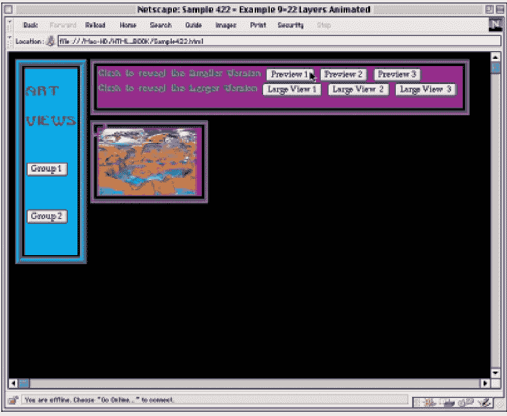

# 第三章 — 层与 JavaScript

## 示例 3-22

## Sample422.html

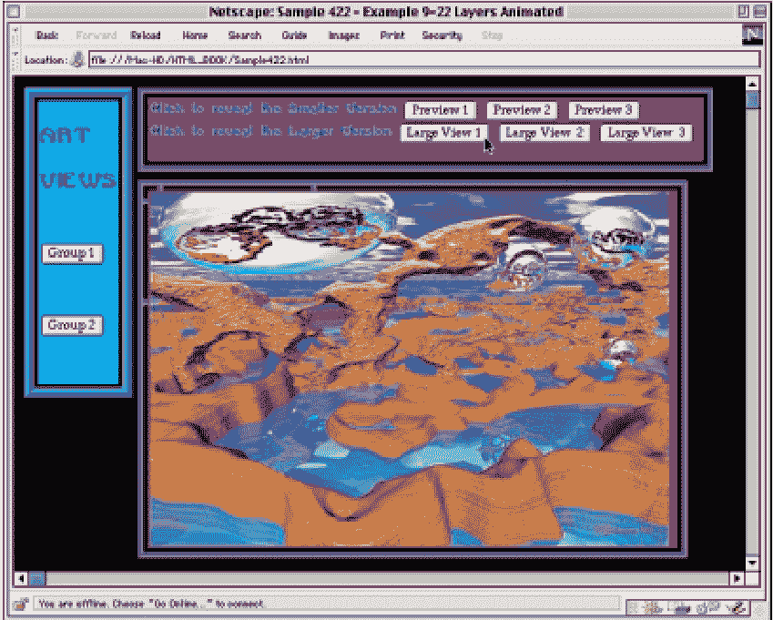

# 268 第一部分 — 动态 HTML

## 示例 3-22: Sample422.html

```
<!DOCTYPE HTML PUBLIC "-//W3C//DTD HTML 3.2//EN">
<HTML>
<HEAD>
<TITLE>Sample 422 - Example 3-22        Layers Animated</TITLE>

<STYLE TYPE="text/JavaScript">

        classes.Blue22.all.fontSize="22pt";
        classes.Blue22.all.color="navy";
        classes.Blue22.all.backgroundColor="aqua";
        classes.Blue22.all.borderWidths("10px");
        classes.Blue22.all.borderStyle="ridge";
        classes.Blue22.all.borderColor="#0077ff";

        with(tags.LAYER) {
                color="lime";
                fontFamily="Moonlight, Helvetica, serif";
                fontSize="14pt";
                borderWidths("7px");
                borderStyle="groove";
                borderColor="#3300ff";
                backgroundColor="#8800ff";
                paddings("2px");
        }

</STYLE>

</HEAD>

<BODY BGCOLOR="black" TEXT="aqua">

<!--  ***************************************************************  -->

<LAYER CLASS="Blue22" ID="layerA" LEFT=10 TOP=10 Z-INDEX=20 WIDTH=100 HEIGHT=500>

<FORM NAME="formA">

                                                     <BR>
        ART                                          <BR><BR>
        VIEWS                                        <BR><BR>

        <INPUT TYPE=button NAME="BGroup1" VALUE="Group 1"

                onClick='ShowHideGroup1(); MoveGroup1(); return false;'>   <BR><BR>

        <INPUT TYPE=button NAME="BGroup2" VALUE="Group 2"

                onClick='ShowHideGroup2(); MoveGroup2(); return false;'>   <BR><BR>

        </FORM>

</LAYER>

<!--  ***************************************************************  -->
```

# 第 3 章 — 层与 JavaScript 269

```
<LAYER ID="Group1" LEFT=120 TOP=10 Z-INDEX=10 WIDTH=600 HEIGHT=72>

<FORM NAME="form1">

单击以显示较小版本

<INPUT TYPE=button NAME="BPreview1" VALUE="预览 1"

onClick='HideShowLarge1(); HideShowSmall1(); MoveShowcase1(); return false;'>

<INPUT TYPE=button NAME="BPreview2" VALUE="预览 2"

onClick='HideShowLarge2(); HideShowSmall2(); MoveShowcase2(); return false;'>

<INPUT TYPE=button NAME="BPreview3" VALUE="预览 3"

onClick='HideShowLarge3(); HideShowSmall3(); MoveShowcase3(); return false;'><BR>

<!-- ********************************************************* -->

单击以显示较大版本

<INPUT TYPE=button NAME="BLargeView1" VALUE="大视图 1"

onClick='JumpLargeView1(); HideShowLarge1(); LargeView1(); return false;'>

<INPUT TYPE=button NAME="BLargeView2" VALUE="大视图 2"

onClick='JumpLargeView2(); HideShowLarge2(); LargeView2(); return false;'>

<INPUT TYPE=button NAME="BLargeView3" VALUE="大视图 3"

onClick='JumpLargeView3(); HideShowLarge3(); LargeView3(); return false;'>

</FORM>

</LAYER>

<!-- ********************************************************* -->

<LAYER ID="Group2" LEFT=120 TOP=110 VISIBILITY="HIDE" Z-INDEX=9 WIDTH=600
HEIGHT=72>

<FORM NAME="form2">

单击以显示较小版本

<INPUT TYPE=button NAME="BPreview4" VALUE="预览 4"

onClick='HideShowLarge4(); HideShowSmall4(); MoveShowcase4(); return false;'>

<INPUT TYPE=button NAME="BPreview5" VALUE="预览 5"

onClick='HideShowLarge5(); HideShowSmall5(); MoveShowcase5(); return false;'>

<INPUT TYPE=button NAME="BPreview6" VALUE="预览 6"

onClick='HideShowLarge6(); HideShowSmall6(); MoveShowcase6(); return false;'><BR>
```

# 270 第一部分 — 动态 HTML

```
<!-- *********************************************************** -->

单击以显示较大版本

<INPUT TYPE=button NAME="BLargeView4" VALUE="大视图 4"

onClick='JumpLargeView4(); HideShowLarge4(); LargeView4(); return false;'>

<INPUT TYPE=button NAME="BLargeView5" VALUE="大视图 5"

onClick='JumpLargeView5(); HideShowLarge5(); LargeView5(); return false;'>

<INPUT TYPE=button NAME="BLargeView6" VALUE="大视图 6"

onClick='JumpLargeView6(); HideShowLarge6(); LargeView6(); return false;'>

</FORM>

</LAYER>

<!-- *********************************************************** -->

<LAYER ID="Showcase1" LEFT=120 TOP=700 VISIBILITY="HIDE" Z-INDEX=19 WIDTH=700
HEIGHT=600>

<LAYER ID="Showcase1Small" Z-INDEX=2>


</LAYER>

<LAYER ID="Showcase1Large" Z-INDEX=1 CLIP="0,0,0,0" WIDTH=600>


</LAYER>

</LAYER>

<!-- *********************************************************** -->

<LAYER ID="Showcase2" LEFT=120 TOP=700 VISIBILITY="HIDE" Z-INDEX=18 WIDTH=700
HEIGHT=600>

<LAYER ID="Showcase2Small" Z-INDEX=2>


</LAYER>

<LAYER ID="Showcase2Large" Z-INDEX=1 CLIP="0,0,0,0" WIDTH=600>


</LAYER>

</LAYER>
```

# 第 3 章 — 层与 JavaScript 271

```
<!-- ************************************************************************ -->

<LAYER ID="Showcase3" LEFT=1200 TOP=100 VISIBILITY="HIDE" Z-INDEX=17 WIDTH=700 HEIGHT=600>

<LAYER ID="Showcase3Small" Z-INDEX=2>


</LAYER>

<LAYER ID="Showcase3Large" Z-INDEX=1 CLIP="0,0,0,0" WIDTH=600>


</LAYER>
</LAYER>

<!-- ************************************************************************ -->

<LAYER ID="Showcase4" LEFT=120 TOP=700 VISIBILITY="HIDE" Z-INDEX=16 WIDTH=700 HEIGHT=600>

<LAYER ID="Showcase4Small" Z-INDEX=2>


</LAYER>

<LAYER ID="Showcase4Large" Z-INDEX=1 CLIP="0,0,0,0" WIDTH=600>


</LAYER>
</LAYER>

<!-- ************************************************************************ -->

<LAYER ID="Showcase5" LEFT=120 TOP=700 VISIBILITY="HIDE" Z-INDEX=15 WIDTH=700 HEIGHT=600>

<LAYER ID="Showcase5Small" Z-INDEX=2>


</LAYER>

<LAYER ID="Showcase5Large" Z-INDEX=1 CLIP="0,0,0,0" WIDTH=600>


</LAYER>
</LAYER>
```

# 272 第一部分 — 动态 HTML

```
<!-- *************************************************** -->

<LAYER ID="Showcase6" LEFT=120 TOP=700 VISIBILITY="HIDE" Z-INDEX=14 WIDTH=700 HEIGHT=600>

<LAYER ID="Showcase6Small" Z-INDEX=2>


</LAYER>
<LAYER ID="Showcase6Large" Z-INDEX=1 CLIP="0,0,0,0" WIDTH=600>


</LAYER>
</LAYER>
```

```
<!-- *************************************************** -->
<!-- *************************************************** -->
<!-- ****** 接下来的 4 个函数控制顶部层  ********* -->

<SCRIPT LANGUAGE="JavaScript1.2"><!--BEGIN HIDING

		var Showcase1 = document.Showcase1;
		var Showcase2 = document.Showcase2;
		var Showcase3 = document.Showcase3;
		var Showcase4 = document.Showcase4;
		var Showcase5 = document.Showcase5;
		var Showcase6 = document.Showcase6;

		var Showcase1Small = document.Showcase1.document.Showcase1Small;
		var Showcase2Small = document.Showcase2.document.Showcase2Small;
		var Showcase3Small = document.Showcase3.document.Showcase3Small;
		var Showcase4Small = document.Showcase4.document.Showcase4Small;
		var Showcase5Small = document.Showcase5.document.Showcase5Small;
		var Showcase6Small = document.Showcase6.document.Showcase6Small;

		var Showcase1Large = document.Showcase1.document.Showcase1Large;
		var Showcase2Large = document.Showcase2.document.Showcase2Large;
		var Showcase3Large = document.Showcase3.document.Showcase3Large;
		var Showcase4Large = document.Showcase4.document.Showcase4Large;
		var Showcase5Large = document.Showcase5.document.Showcase5Large;
		var Showcase6Large = document.Showcase6.document.Showcase6Large;

		var Group2 = document.Group2;
		var Group1 = document.Group1;

/*-------------------------------------------------------------*/

function ShowHideGroup1() {

Group2.zIndex=9;      Group2.visibility='hide';     Group2.moveTo(120,-110);
Group1.zIndex=10;     Group1.visibility='show';

return false;
}
```

# 第 3 章 — 层与 JavaScript 273

```
/*---------------------------------------------------------*/

function MoveGroup1() {

				if (document.Group1.top < 10)  {

						document.Group1.moveBy(0,20);
						setTimeout('MoveGroup1()', 20);
				}
return false;
}

/*-----------------------------------------------------------------------------------------*/

function ShowHideGroup2() {

Group2.zIndex=10;     Group2.visibility='show';
Group1.zIndex=8;      Group1.visibility='hide';    Group1.moveTo(120,-110);

return false;
}

/*---------------------------------------------------------*/

function MoveGroup2(Group2) {

				if (document.Group2.top < 10)  {

						document.Group2.moveBy(0,20);
						setTimeout('MoveGroup2()', 20);
				}

return false;
}

/*-----------------------------------------------------------------------------------------*/
/*-----------------------------------------------------------------------------------------*/
/*    接下来的 18 个函数控制小图和大图    */

function HideShowSmall1() {

	Showcase1.visibility='show';
	Showcase1Small.visibility='show';
	Showcase1Small.zIndex=2;
	Showcase1Large.visibility='hide';
	Showcase1Large.zIndex=1;
}

/*---------------------------------------------------------*/

function HideShowLarge1() {

	Showcase2.moveTo(120, 700);
	Showcase3.moveTo(1200, 100); //this is correct
	Showcase4.moveTo(120, 700);
	Showcase5.moveTo(120, 700);
	Showcase6.moveTo(120, 700);
```


274

# 第一部分 — 动态 HTML

```
Showcase1.visibility='show';
Showcase2.visibility='hide';
Showcase3.visibility='hide';
Showcase4.visibility='hide';
Showcase5.visibility='hide';
Showcase6.visibility='hide';

Showcase1Small.visibility='show';
Showcase2Small.visibility='hide';
Showcase3Small.visibility='hide';
Showcase4Small.visibility='hide';
Showcase5Small.visibility='hide';
Showcase6Small.visibility='hide';

Showcase1Large.visibility='show';
Showcase2Large.visibility='hide';
Showcase3Large.visibility='hide';
Showcase4Large.visibility='hide';
Showcase5Large.visibility='hide';
Showcase6Large.visibility='hide';
```

```
return false;
}
```

```
/*-------------------------------------------*/
```

```
function MoveShowcase1() {

					if (document.Showcase1.top > 100) {

						document.Showcase1.moveBy(0,-20);
						setTimeout('MoveShowcase1()', 20);
					}
}
```

```
return false;
}
```

```
/*-------------------------------------------*/
```

```
function HideShowSmall2() {

		Showcase2.visibility='show';
		Showcase2Small.visibility='show';
		Showcase2Small.zIndex=2;
		Showcase2Large.visibility='hide';
		Showcase2Large.zIndex=1;
}
```

```
/*-------------------------------------------*/
```

```
function HideShowLarge2() {

		Showcase1.moveTo(120,700);
		Showcase3.moveTo(1200,100);  //this is correct
		Showcase4.moveTo(120,700);
		Showcase5.moveTo(120,700);
		Showcase6.moveTo(120,700);
```

## 第三章 — 图层与 JavaScript

```
Showcase1.visibility='hide';
Showcase2.visibility='show';
Showcase3.visibility='hide';
Showcase4.visibility='hide';
Showcase5.visibility='hide';
Showcase6.visibility='hide';

Showcase1Small.visibility='hide';
Showcase2Small.visibility='show';
Showcase3Small.visibility='hide';
Showcase4Small.visibility='hide';
Showcase5Small.visibility='hide';
Showcase6Small.visibility='hide';

Showcase1Large.visibility='hide';
Showcase2Large.visibility='show';
Showcase3Large.visibility='hide';
Showcase4Large.visibility='hide';
Showcase5Large.visibility='hide';
Showcase6Large.visibility='hide';

return false;
}

/*-------------------------------------*/

function MoveShowcase2() {

            if (document.Showcase2.top > 100)  {

                        document.Showcase2.moveBy(0,-20);
                        setTimeout('MoveShowcase2()', 20);

            }

return false;
}

/*-------------------------------------*/

function HideShowSmall3() {

            Showcase3.visibility='show';
            Showcase3Small.visibility='show';
            Showcase3Small.zIndex=2;
            Showcase3Large.visibility='hide';
            Showcase3Large.zIndex=1;

}

/*----------------------------------------------------------------------*/

function HideShowLarge3() {

            Showcase1.moveTo(120,700);
            Showcase2.moveTo(120,700);
            Showcase4.moveTo(120,700);
            Showcase5.moveTo(120,700);
            Showcase6.moveTo(120,700);
}
```

```
Showcase1.visibility='hide';
Showcase2.visibility='hide';
Showcase3.visibility='show';
Showcase4.visibility='hide';
Showcase5.visibility='hide';
Showcase6.visibility='hide';

Showcase1Small.visibility='hide';
Showcase2Small.visibility='hide';
Showcase3Small.visibility='show';
Showcase4Small.visibility='hide';
Showcase5Small.visibility='hide';
Showcase6Small.visibility='hide';

Showcase1Large.visibility='hide';
Showcase2Large.visibility='hide';
Showcase3Large.visibility='show';
Showcase4Large.visibility='hide';
Showcase5Large.visibility='hide';
Showcase6Large.visibility='hide';

return false;
}
```

```
/*--------------------------------------*/

function MoveShowcase3() {

            if (document.Showcase3.left > 120)  {

                        document.Showcase3.moveBy(-40,0);
                        setTimeout('MoveShowcase3()', 20);

            }

return false;
}
```

```
/*------------------------------------------------------------------*/
function HideShowSmall4() {

            Showcase4.visibility='show';
            Showcase4Small.visibility='show';
            Showcase4Small.zIndex=2;
            Showcase4Large.visibility='hide';
            Showcase4Large.zIndex=1;

}
```

```
/*--------------------------------------*/

function HideShowLarge4() {

            Showcase1.moveTo(120,700);
            Showcase2.moveTo(120,700);
            Showcase3.moveTo(1200,100);   //this is correct
            Showcase5.moveTo(120,700);
            Showcase6.moveTo(120,700);
}
```

```
Showcase1.visibility='hide';
Showcase2.visibility='hide';
Showcase3.visibility='hide';
Showcase4.visibility='show';
Showcase5.visibility='hide';
Showcase6.visibility='hide';

Showcase1Small.visibility='hide';
Showcase2Small.visibility='hide';
Showcase3Small.visibility='hide';
Showcase4Small.visibility='show';
Showcase5Small.visibility='hide';
Showcase6Small.visibility='hide';

Showcase1Large.visibility='hide';
Showcase2Large.visibility='hide';
Showcase3Large.visibility='hide';
Showcase4Large.visibility='show';
Showcase5Large.visibility='hide';
Showcase6Large.visibility='hide';

return false;
}
```

```
/*-----------------------------------*/

function MoveShowcase4() {
	if (document.Showcase4.top > 100) {

		document.Showcase4.moveBy(0, -20);
			setTimeout('MoveShowcase4()', 20);
	}
}
```

```
return false;
}
```

```
/*-------------------------------------------------------------------*/

function HideShowSmall5() {
	Showcase5.visibility='show';
	Showcase5Small.visibility='show';
	Showcase5Small.zIndex=2;
	Showcase5Large.visibility='hide';
	Showcase5Large.zIndex=1;

}
```

```
/*-----------------------------------*/

function HideShowLarge5() {
	Showcase1.moveTo(120, 700);
	Showcase2.moveTo(120, 700);
	Showcase3.moveTo(1200, 100); //this is correct
	Showcase4.moveTo(120, 700);
	Showcase6.moveTo(120, 700);
}
```

```
Showcase1.visibility='hide';
Showcase2.visibility='hide';
Showcase3.visibility='hide';
Showcase4.visibility='hide';
Showcase5.visibility='show';
Showcase6.visibility='hide';

Showcase1Small.visibility='hide';
Showcase2Small.visibility='hide';
Showcase3Small.visibility='hide';
Showcase4Small.visibility='hide';
Showcase5Small.visibility='show';
Showcase6Small.visibility='hide';

Showcase1Large.visibility='hide';
Showcase2Large.visibility='hide';
Showcase3Large.visibility='hide';
Showcase4Large.visibility='hide';
Showcase5Large.visibility='show';
Showcase6Large.visibility='hide';

return false;
}
```

```
/*---------------------------------------------*/

function MoveShowcase5() {

    if (document.Showcase5.top > 100)  {

        document.Showcase5.moveBy(0,-20);
        setTimeout('MoveShowcase5()', 20);
    }

    return false;
}
```

```
/*---------------------------------------------*/

function HideShowSmall6() {

    Showcase6.visibility='show';
    Showcase6Small.visibility='show';
    Showcase6Small.zIndex=2;
    Showcase6Large.visibility='hide';
    Showcase6Large.zIndex=1;
}
```

```
/*---------------------------------------------*/

function HideShowLarge6() {

    Showcase1.moveTo(120,700);
    Showcase2.moveTo(120,700);
    Showcase3.moveTo(1200,100);  //this is correct
    Showcase4.moveTo(120,700);
    Showcase5.moveTo(120,700);
```

```
Showcase1.visibility='hide';
Showcase2.visibility='hide';
Showcase3.visibility='hide';
Showcase4.visibility='hide';
Showcase5.visibility='hide';
Showcase6.visibility='show';

Showcase1Small.visibility='hide';
Showcase2Small.visibility='hide';
Showcase3Small.visibility='hide';
Showcase4Small.visibility='hide';
Showcase5Small.visibility='hide';
Showcase6Small.visibility='show';

Showcase1Large.visibility='hide';
Showcase2Large.visibility='hide';
Showcase3Large.visibility='hide';
Showcase4Large.visibility='hide';
Showcase5Large.visibility='hide';
Showcase6Large.visibility='show';

return false;
}

/*---------------------------------------------*/

function MoveShowcase6() {

    if (document.Showcase6.top > 100) {

        document.Showcase6.moveBy(0,-20);
        setTimeout('MoveShowcase6()', 20);
    }
}

return false;
}

/*---------------------------------------------*/
/*---------------------------------------------*/
/*   以下 12 个函数控制带有大图的主图层   */

function JumpLargeView1() {

    Showcase1.visibility='show';
    Showcase1Small.visibility='hide';
    Showcase1Small.zIndex=1;
    Showcase1Large.visibility='show';
    Showcase1Large.zIndex=2;

                //如果组未首先被点击，则向上移动包含的图层
                //这是正确的，它来自页面的左侧

    if (Showcase1.top > 100) {

        Showcase1.moveTo(120,100);
    }
    return false;
}
```


 # 第一部分 —— 动态 HTML

```
/*----------------------------------------------------------------------*/

function LargeView1() {

    //reveals image by resizing the clipping rectangle

    if (ShowcaseLarge.clip.right < 1000) {

        ShowcaseLarge.resizeBy(7,0);

    }

    if (ShowcaseLarge.clip.top < 800) {

        ShowcaseLarge.resizeBy(0,5);

    }

    setTimeout('LargeView1()', 20);
    return false;
}

/*----------------------------------------------------------------------*/

/*----------------------------------------------------------------------*/

function JumpLargeView2() {

    Showcase2.visibility='show';
    Showcase2Large.visibility='show';
    Showcase2Small.zIndex=1;
    Showcase2Large.zIndex=2;
    Showcase2Small.visibility='hide';

    if (Showcase2.top > 100) {

        Showcase2.moveTo(120,100);

    }

    return false;
}

/*----------------------------------------------------------------------*/

function LargeView2() {

    if (Showcase2Large.clip.right < 1000) {

        Showcase2Large.resizeBy(7,0);

    }

    if (Showcase2Large.clip.top < 800) {

        Showcase2Large.resizeBy(0,5);

    }

    setTimeout('LargeView2()', 20);
    return false;
}

/*----------------------------------------------------------------------*/
```

```
/*----------------------------------------------------------------------------------------*/

function JumpLargeView3() {

    Showcase3.visibility='show';
    Showcase3Large.visibility='show';
    Showcase3Small.zIndex=2;
    Showcase3Large.zIndex=2;
    Showcase3Small.visibility='hide'; //this is correct, it's coming from right
    if (Showcase3.left > 120) {

        Showcase3.moveTo(120,100);
    }

    return false;
}
/*----------------------------------------------------------------------------------------*/

function LargeView3() {

    if (Showcase3Large.clip.right < 1000) {

        Showcase3Large.resizeBy(7,0);
    }
    if (Showcase3Large.clip.top < 800) {

        Showcase3Large.resizeBy(0,5);
    }

    setTimeout('LargeView3()', 20);
    return false;
}
```

```
/*----------------------------------------------------------------------------------------*/

function JumpLargeView4() {

    Showcase4.visibility='show';
    Showcase4Large.visibility='show';
    Showcase4Small.zIndex=2;
    Showcase4Large.zIndex=2;
    Showcase4Small.visibility='hide';
    if (Showcase4.top > 100) {

        Showcase4.moveTo(120,100);
    }

    return false;
}
/*----------------------------------------------------------------------------------------*/
```

282 第一部分 —— 动态 HTML

```
/*------------------------------------------------------------------------*/

function LargeView4() {
    if (Showcase4Large.clip.right < 1000) {
        Showcase4Large.resizeBy(7,0);
    }
    if (Showcase4Large.clip.top < 800) {
        Showcase4Large.resizeBy(0,5);
    }
}

setTimeout('LargeView4()', 20);
return false;
```

```
/*------------------------------------------------------------------------*/

function JumpLargeView5() {
    Showcase5.visibility='show';
    Showcase5Large.visibility='show';
    Showcase5Small.zIndex=1;
    Showcase5Large.zIndex=2;
    Showcase5Small.visibility='hide';

    if (Showcase5.top > 100) {
        Showcase5.moveTo(120,100);
    }
}

return false;
```

```
/*------------------------------------------------------------------------*/

function LargeView5() {
    if (Showcase5Large.clip.right < 1000) {
        Showcase5Large.resizeBy(7,0);
    }
    if (Showcase5Large.clip.top < 800) {
        Showcase5Large.resizeBy(0,5);
    }
}

setTimeout('LargeView5()', 20);
return false;
```

```
/*------------------------------------------------------------------------*/
```

## 第 3 章 —— 图层与 JavaScript

283

```
/*-------------------------------------------------------------*/

function JumpLargeView6() {

    Showcase6.visibility='show';
    Showcase6Large.visibility='show';
    Showcase6Small.zIndex=1;
    Showcase6Large.zIndex=2;
    Showcase6Small.visibility='hide';

    if (Showcase6.top > 100) {

        Showcase6.moveTo(120,100);
    }

    return false;
}

/*-------------------------------------------------------------*/

function LargeView6() {

    if (Showcase6Large.clip.right < 1000) {

        Showcase6Large.resizeBy(7,0);
    }

    if (Showcase6Large.clip.top < 800) {

        Showcase6Large.resizeBy(0,5);
    }

    setTimeout('LargeView6()', 20);
    return false;
}

/*-------------------------------------------------------------*/

//END HIDING-->
</SCRIPT>

</BODY>
</HTML>
```

## JavaScript setInterval() 方法

setInterval() 方法具有两种不同的语法结构。一种是在指定的毫秒数后持续计算一个*表达式*，另一种是在指定的毫秒数后持续调用一个*函数*。

在下面的语法中，`anyExpression` 参数指定了你要计算的表达式。在替代语法中，`functionName` 参数指定了你要调用的*函数名称*。函数所需的任何可选参数都在 `milliseconds` 参数之后以逗号分隔的列表形式指定。你的表达式或函数必须放在引号内，否则将立即被计算。函数名后面的括号是必需的。

setInterval() 被激活后，将持续触发，直到你调用 clearInterval() 方法，或者用户退出窗口或框架、使用 window.close() 方法将其销毁，或使用以下三种方法将其清除：

document.open(), document.write(), document.close();

### JavaScript 语法：

```
setInterval("anyExpression", milliseconds);
setInterval("functionName()", milliseconds[, arg1, ..., argN]);
```

## JavaScript clearInterval() 方法

clearInterval() 方法用于取消先前启动的、已分配给 intervalID 的 setInterval() 方法调用。例如，如果你有一个在其他地方创建的名为 myFunction() 的函数，那么你将 setInterval() 方法赋值给 myTesterIntervalID，之后它可以作为 clearInterval() 方法的参数被调用，如下两行代码所示：

### 迷你示例：

```
myTesterIntervalID = setInterval("myFunction()", 200);
clearInterval(myTesterIntervalID);
```

### JavaScript 语法：

```
clearInterval(intervalID);
```

第 3 章 —— 图层与 JavaScript 		285

## 三个重复循环背景颜色的示例

示例 3-23 使用 `setInterval()` 方法重复调用函数 `changeColor()`，该函数使用条件 if () 语句来设置图层 L1 和 L2 的 `bgColor` 图层对象属性的变化循环。`setInterval()` 方法被放置在 `timeColor()` 函数内部，该函数由 BODY 元素的 `onLoad` 事件处理程序调用，以便在文档完全加载后立即启动。

### 示例 3-23：	Sample423.html

```
<!DOCTYPE HTML PUBLIC "-//W3C//DTD HTML 3.2//EN">
<HTML><HEAD>
<TITLE>Sample 423 - Example 3-23 	setInterval Method to cycle bgColors</TITLE>
</HEAD>

<BODY onLoad="timeColor();">

<LAYER ID="L1" LEFT=0 TOP=0 WIDTH=40 HEIGHT=400> </LAYER>

<LAYER ID="L2" LEFT=40 TOP=0 WIDTH=400 HEIGHT=40> </LAYER>
<!-- 	******************************						 -->

<SCRIPT LANGUAGE="JavaScript1.2"><!--BEGIN HIDING

		var i=1;
		
		function changeColor() {
			
			if (i<9999) {
			
			document.L1.bgColor = '#ff' + i;
			document.L2.bgColor = '#' + i + 'aa';
			
			i+=25;
							//resets i to repeat the cycle
			if (i>=9973) i=1;
			}
		}
/*------------------------------------*/

		function timeColor() {
			setInterval('changeColor()', 100);
		}
/*------------------------------------*/
//END HIDING-->
</SCRIPT>
</BODY>
</HTML>
```

# 第一部分 —— 动态 HTML

示例 3-24 和示例 3-25 产生了完全相同的 results，但使用了不同的编码技术。示例 3-24 使用了 **setInterval()** 和 **clearInterval()** 方法，而示例 3-25 使用 **setTimeout()** 和 **clearTimeout()** 方法来为顺序图层设置背景颜色的动画。这两个示例将有助于阐明这四种方法之间的差异以及你必须使用的技巧。

创建了一个名为 **colorArray** 的新数组，其中包含 13 种不同的已识别颜色名称，这些颜色名称以相同的顺序重复，总共 26 个数组项。这是由于 **changeColor()** 函数中使用条件 **if ()** 语句来循环遍历数组中的颜色并将其分配给八个**图层**对象的 **bgColor** 属性的方式。

**setInterval()** 方法被放置在 **timeColor()** 函数内部，然后该函数被赋值给 BODY 元素的 **onLoad** 事件处理程序以启动循环。值为"GO"的按钮的 **onClick** 事件处理程序重新启动循环。值为"STOP"的按钮通过将变量 **booleanTest** 更改为 false 来停止循环，这会触发 **timeColor()** 函数内部的 **clearInterval()** 方法。

### 示例 3-24：Sample424.html

```
<!DOCTYPE HTML PUBLIC "-//W3C//DTD HTML 3.2//EN">
<HTML>
<HEAD>
<TITLE>Sample 424 - Example 3-24    setInterval and clearInterval Methods</TITLE>
</HEAD>

<BODY onLoad="timeColor();">

<LAYER ID="L8" LEFT=20 TOP=200 WIDTH=100 HEIGHT=100>

<FORM NAME="form1">

<INPUT TYPE="button" NAME="b1" VALUE="STOP" onClick="booleanTest=false;">

<INPUT TYPE="button" NAME="b2" VALUE="GO" onClick="booleanTest=true; timeColor();">

</FORM>

</LAYER>

<!--  ************************************************************  -->

<LAYER ID="L1" LEFT=0 TOP=0 WIDTH=40 HEIGHT=40> </LAYER>

<LAYER ID="L2" LEFT=40 TOP=0 WIDTH=40 HEIGHT=40> </LAYER>

<LAYER ID="L3" LEFT=80 TOP=0 WIDTH=40 HEIGHT=40> </LAYER>

<LAYER ID="L4" LEFT=120 TOP=0 WIDTH=40 HEIGHT=40> </LAYER>

<LAYER ID="L5" LEFT=160 TOP=0 WIDTH=40 HEIGHT=40> </LAYER>
```


 ## 第三章 — 图层与 JavaScript

```
<LAYER ID="L6" LEFT=200 TOP=0 WIDTH=40 HEIGHT=40> </LAYER>
<LAYER ID="L7" LEFT=240 TOP=0 WIDTH=40 HEIGHT=40> </LAYER>
<LAYER ID="L8" LEFT=280 TOP=0 WIDTH=40 HEIGHT=40> </LAYER>
<!-- ************************************************************ -->
<SCRIPT LANGUAGE="JavaScript1.2"><!--BEGIN HIDING

var booleanTest=true;
var i=13;

colorArray = new Array ('blue','red','yellow','lime','cyan','olive',
'green', 'steelblue','purple','maroon', 'orange', 'navy', 'black',
'blue','red','yellow','lime','cyan','olive',
'green', 'steelblue','purple', 'maroon', 'orange', 'navy', 'black');

/* ------------------------------------------------------------------ */

function changeColor() {
	if (booleanTest == true) {
		if (i<27) {
			document.L1.bgColor = colorArray[i-1];
			document.L2.bgColor = colorArray[i-2];
			document.L3.bgColor = colorArray[i-3];
			document.L4.bgColor = colorArray[i-4];
			document.L5.bgColor = colorArray[i-5];
			document.L6.bgColor = colorArray[i-6];
			document.L7.bgColor = colorArray[i-7];
			document.L8.bgColor = colorArray[i-8];
			i++;
		}
		
		if (i==26) i=13;
	}
	else clearInterval(myInterval);
}

/* ------------------------------------------------------------------ */

function timeColor() {
	myInterval = setInterval('changeColor()', 500);
}

/* ------------------------------------------------------------------ */
//END HIDING-->
</SCRIPT>
```

```
</body>
</html>
```

示例 3-25 与上一个示例的主要区别在于，本示例使用了 **setTimeout()** 方法而非 **setInterval()** 方法，且它包含在 **colorChange()** 函数内部，而不是作为参数位于调用它的同一个函数中。**colorChange()** 函数再次通过 BODY 元素的 **onLoad** 事件处理程序调用，并且在"STOP"按钮停止循环后，可以通过"GO"按钮再次调用它。更多信息请参见第 286 页。

## 示例 3-25：Sample425.html

```
<!DOCTYPE HTML PUBLIC "-//W3C//DTD HTML 3.2//EN">
<HTML>
<HEAD>
<TITLE>Sample 425 - Example 3-25     clearTimeout and setTimeout Methods</TITLE>
</HEAD>

<BODY onLoad="changeColor();">

<LAYER ID="L8" LEFT=20 TOP=200 WIDTH=100 HEIGHT=100>

<FORM NAME="form1">

<INPUT TYPE="button" NAME="b1" VALUE="STOP" onClick="booleanTest=false;">

<INPUT TYPE="button" NAME="b2" VALUE="GO" onClick="booleanTest=true; changeColor();">

</FORM>

</LAYER>

<!--  *******************************************************  -->

<LAYER ID="L1" LEFT=0 TOP=0 WIDTH=40 HEIGHT=40> </LAYER>

<LAYER ID="L2" LEFT=40 TOP=0 WIDTH=40 HEIGHT=40> </LAYER>

<LAYER ID="L3" LEFT=80 TOP=0 WIDTH=40 HEIGHT=40> </LAYER>

<LAYER ID="L4" LEFT=120 TOP=0 WIDTH=40 HEIGHT=40> </LAYER>

<LAYER ID="L5" LEFT=160 TOP=0 WIDTH=40 HEIGHT=40> </LAYER>

<LAYER ID="L6" LEFT=200 TOP=0 WIDTH=40 HEIGHT=40> </LAYER>

<LAYER ID="L7" LEFT=240 TOP=0 WIDTH=40 HEIGHT=40> </LAYER>

<LAYER ID="L8" LEFT=280 TOP=0 WIDTH=40 HEIGHT=40> </LAYER>

<!--  *******************************************************  -->
```

## 第三章 — 图层与 JavaScript 289

```
<SCRIPT LANGUAGE="JavaScript1.2"><!--BEGIN HIDING

var booleanTest=true;
var i=13;
var i=13;
myTimeout = setTimeout('changeColor()', 500);

colorArray = new Array('blue','red','yellow','lime','cyan','olive',
'green','steelblue','purple','maroon','orange','navy','black',
'blue','red','yellow','lime','cyan','olive',
'green','steelblue','purple','maroon','orange','navy','black');

/*-------------------------------------------------------------------*/

function changeColor() {
    if (booleanTest == true) {
        if (i<27) {
            document.L1.bgColor = colorArray[i-1];
            document.L2.bgColor = colorArray[i-2];
            document.L3.bgColor = colorArray[i-3];
            document.L4.bgColor = colorArray[i-4];
            document.L5.bgColor = colorArray[i-5];
            document.L6.bgColor = colorArray[i-6];
            document.L7.bgColor = colorArray[i-7];
            document.L8.bgColor = colorArray[i-8];

            i++;

            if (i==26) i=13;
            setTimeout('changeColor()', 500);
        }
    }
    else clearTimeout(myTimeout);
}

//END HIDING-->
</SCRIPT>

</BODY>
</HTML>
```

下面的示例 3-26 演示了如何使用 **src** 属性和 **load()** 方法为图层加载内容，以加载包含图像和带有 JavaScript STYLE 类的图层的外部文件。请注意，包含最后三张大图像的图层具有不同的宽度，这些宽度通过 **load()** 方法的第二个参数指定，并且始终以像素为单位。

290

# 第一部分 — 动态 HTML

### 示例 3-26 第一部分：Sample426.html

```
<!DOCTYPE HTML PUBLIC "-//W3C//DTD HTML 3.2//EN">
<HTML>
<HEAD>
<TITLE>Sample 426 - Example 3-26    Layers Loading External Files</TITLE>

<STYLE TYPE="text/JavaScript">

    classes.Lime30.all.color="lime";
    classes.Lime30.all.fontFamily="Moonlight, Helvetica, serif";
    classes.Lime30.all.fontSize="22pt";
    classes.Lime30.all.borderWidths("15px");
    classes.Lime30.all.borderStyle="groove";
    classes.Lime30.all.borderColor="#3300ff";
    classes.Lime30.all.backgroundColor="#8800ff";
    classes.Lime30.all.paddings("2px");

</STYLE>

</HEAD>

<BODY BGCOLOR="black">

<!--   ***************************************** -->
<!--   顶部图层，包含加载外部文件的按钮   -->

<LAYER CLASS="Lime30" ID="Group1" LEFT=5 TOP=5 WIDTH=700 HEIGHT=72>

<FORM NAME="form1">

                展示艺术

                <INPUT TYPE=button NAME="BPreview1" VALUE="Previews"
                onClick='LoadPreviews(); return false;'>

<!--   ***************************************** -->

                <INPUT TYPE=button NAME="BLargeView1" VALUE="Art 1"
                onClick='LoadArt1(); return false;'>

                <INPUT TYPE=button NAME="BLargeView2" VALUE="Art  2"
                onClick='LoadArt2(); return false;'>

                <INPUT TYPE=button NAME="BLargeView2" VALUE="Art  3"
                onClick='LoadArt3(); return false;'>

                <INPUT TYPE=button NAME="BLargeView4" VALUE="Art  4"
                onClick='LoadArt4(); return false;'>
```

## 第三章 — 图层与 JavaScript

```
<INPUT TYPE=button NAME="BLargeView5" VALUE="Art  5"
onClick='LoadArt5(); return false;'>
<INPUT TYPE=button NAME="BLargeView6" VALUE="Art  6"
onClick='LoadArt6(); return false;'>
</FORM>
</LAYER>
<!-- *********************************************************** -->
<!--  包含外部文件中图像的容器图层  -->
<LAYER ID="Showcase1" LEFT=5 TOP=100 WIDTH=700 HEIGHT=600
SRC="Sample426ExternalGroup.html">
</LAYER>
<!-- *********************************************************** -->
<SCRIPT LANGUAGE="JavaScript1.2"><!--BEGIN HIDING

/*-----------------------------------------------------------------------*/
/*  以下 7 个函数加载包含图像的外部文件  */

function LoadPreviews() {

       document.Showcase1.src = ('Sample426ExternalGroup.html') ;
}
/*-----------------------------------------------------------------------*/
function LoadArt1() {

       document.Showcase1.src = ('Sample426External1.html') ;
}
/*-----------------------------------------------------------------------*/
function LoadArt2() {

       document.Showcase1.src = ('Sample426External2.html') ;
}
/*-----------------------------------------------------------------------*/
function LoadArt3() {

       document.Showcase1.src = ('Sample426External3.html') ;
}
/*-----------------------------------------------------------------------*/
function LoadArt4() {

       document.Showcase1.load('Sample426External4.html', 600) ;
}
/*-----------------------------------------------------------------------*/
function LoadArt5() {

       document.Showcase1.load('Sample426External5.html', 600) ;
}
```

```
/*-----------------------------------------------------------------------------------*/

function LoadArt6() {

    document.Showcase1.load('Sample426External6.html', 750) ;

}

/*-----------------------------------------------------------------------------------*/
```

```
//END HIDING-->
<SCRIPT>
</BODY>
</HTML>
```

这是包含六幅艺术作品小图预览的外部文件。

## 示例 3-26 第二部分：Sample426ExternalGroup.html

```
<!DOCTYPE HTML PUBLIC "-//W3C//DTD HTML 3.2//EN">
<HTML>
<HEAD>
<TITLE>
    Example 426 External Group - Example 3-26 Part 2 Layers in External Files</TITLE>

<STYLE TYPE="text/JavaScript">

    classes.Royalblue30.all.fontSize="90px";
    classes.Royalblue30.all.color="darkblue";
    classes.Royalblue30.all.borderTopWidth="0px";
    classes.Royalblue30.all.borderRightWidth="20px";
    classes.Royalblue30.all.borderBottomWidth="20px";
    classes.Royalblue30.all.borderLeftWidth="20px";
    classes.Royalblue30.all.borderStyle="ridge";
    classes.Royalblue30.borderColor="slateblue";
    classes.Royalblue30.all.fontFamily="Moonlight, Helvetica, serif";
    classes.Royalblue30.all.backgroundColor="Royalblue";
    classes.Royalblue30.all.paddingTop="10px";
    classes.Royalblue30.all.paddingRight="10px";
    classes.Royalblue30.all.paddingBottom="10px";
    classes.Royalblue30.all.paddingLeft="10px";

</STYLE>
</HEAD>

<BODY>
<LAYER CLASS="Royalblue30">

艺术作品预览 <BR><BR>


```


## 第三章 — 层与JavaScript

```
<BR><BR>


</LAYER>

</BODY>
</HTML>
```

这是六个包含艺术作品大图的外部文件之一。其余的大图分别位于各自的外部文件中，这些文件在随书CD-ROM上，但未收录在书中，因为它们过于相似。唯一的区别显然是源图像的URL。

### 示例 3-26 第三部分：Sample426External1.html

```
<!DOCTYPE HTML PUBLIC "-//W3C//DTD HTML 3.2//EN">
<HTML>
<HEAD>
<TITLE>Sample 426 External 1 - Example 3-26A     外部文件中的层</TITLE>

<STYLE TYPE="text/JavaScript">

     classes.Aqua30.all.fontSize="30pt";
     classes.Aqua30.all.color="#0033aa";
     classes.Aqua30.all.borderWidths("15px");
     classes.Aqua30.all.borderStyle="ridge";
     classes.Aqua30.all.borderColor="#0077ff";
     classes.Aqua30.all.fontFamily="Moonlight, Helvetica, serif";
     classes.Aqua30.all.width="100%";
     classes.Aqua30.all.backgroundColor="aqua";

</STYLE>
</HEAD>

<BODY>

<LAYER CLASS="Aqua30">


沙漠拱门

</LAYER>

</BODY>
</HTML>
```

## 示例 3-26 Sample426.html

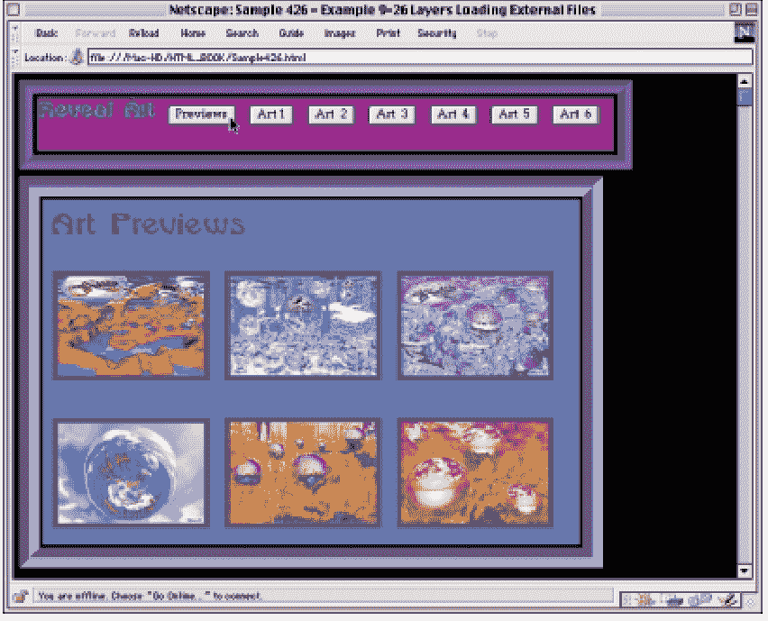

## 示例 3-26 Sample426.html

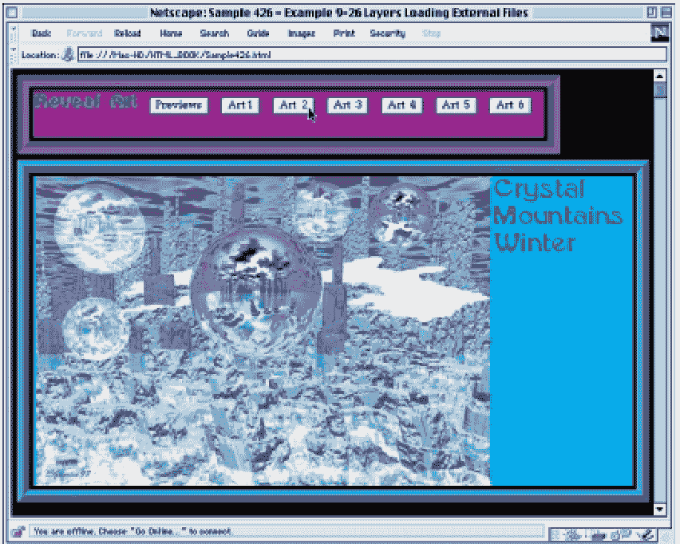

# 井字棋游戏示例

这是大家熟悉的老式井字棋游戏，但有一个小改动。包含X和O的层最初是隐藏的，当左侧名为**控制**的层中的一个按钮被点击时，它们会动画显示出来。

**revealChoice1X()** 到 **revealChoice9X()** 以及 **revealChoice1O()** 到 **revealChoice9O()** 这些函数控制着层的 **visibility** 属性和位置坐标。

**AnimateChoice1X()** 到 **AnimateChoice9X()** 以及 **AnimateChoice1O()** 到 **AnimateChoice9O()** 这些函数则使用 **moveBy()** 和 **setTimeout()** 方法来控制层的动画。

那九个设置了 BGCOLOR 属性为黑色的层，用于遮盖其父层的黄色，使得传统的游戏棋盘线能够显示出来。这个程序还有一个版本，其编程方案截然不同，允许从键盘进行操作。该版本的代码位于第6章第580-585页，可以在 [Sample714-TTT-Keys.html](Sample714-TTT-Keys.html) 文件中查看。

## 示例 3-27：Sample427-TTT.html

```
<!DOCTYPE HTML PUBLIC "-//W3C//DTD HTML 3.2//EN">
<HTML><HEAD>
<TITLE>Sample 427-TTT - Example 3-27    井字棋动画</TITLE>    </HEAD>

        <!--  注意此示例使用了CSS语法来即时设置局部样式  -->

<BODY STYLE='color:white; background-color:black; font-family:Palatino, Moonlight, serif;'>

         <!--  控制层                                     -->

<LAYER ID="Control" LEFT=5 TOP=5 WIDTH=120 HEIGHT=470 BGCOLOR="LIME">
<FORM NAME="form1">

<SPAN STYLE="font-size:22pt; text-align:center; font-family:Moonlight, cursive;">
<BR><BR>选择一个  <BR>         X 或 O  <BR>                   </SPAN> <HR>

<SPAN STYLE="float:center;">

<INPUT TYPE="button" NAME="ChooseX1" VALUE="X1"
onClick='revealChoice1X(); AnimateChoice1X(); return false;'>

<INPUT TYPE="button" NAME="ChooseO1" VALUE="O1"
onClick='revealChoice1O(); AnimateChoice1O(); return false;'>		<BR>

<INPUT TYPE="button" NAME="ChooseX2" VALUE="X2"
onClick='revealChoice2X(); AnimateChoice2X(); return false;'>

<INPUT TYPE="button" NAME="ChooseO2" VALUE="O2"
onClick='revealChoice2O(); AnimateChoice2O(); return false;'>		<BR>

<INPUT TYPE="button" NAME="ChooseX3" VALUE="X3"
onClick='revealChoice3X(); AnimateChoice3X(); return false;'>

<INPUT TYPE="button" NAME="ChooseO3" VALUE="O3"
onClick='revealChoice3O(); AnimateChoice3O(); return false;'>		<BR><BR>      	<HR>
```

## 第三章 — 层与JavaScript

```
<INPUT TYPE="button" NAME="ChooseX3" VALUE="X4"
onClick='revealChoice4X(); AnimateChoice4X(); return false;'>

<INPUT TYPE="button" NAME="ChooseO3" VALUE="O4"
onClick='revealChoice4O(); AnimateChoice4O(); return false;'>       <BR>

<INPUT TYPE="button" NAME="ChooseX3" VALUE="X5"
onClick='revealChoice5X(); AnimateChoice5X(); return false;'>

<INPUT TYPE="button" NAME="ChooseO3" VALUE="O5"
onClick='revealChoice5O(); AnimateChoice5O(); return false;'>       <BR>

<INPUT TYPE="button" NAME="ChooseX3" VALUE="X6"
onClick='revealChoice6X(); AnimateChoice6X(); return false;'>

<INPUT TYPE="button" NAME="ChooseO3" VALUE="O6"
onClick='revealChoice6O(); AnimateChoice6O(); return false;'>       <BR><BR>           <HR>

<INPUT TYPE="button" NAME="ChooseX3" VALUE="X7"
onClick='revealChoice7X(); AnimateChoice7X(); return false;'>

<INPUT TYPE="button" NAME="ChooseO3" VALUE="O7"
onClick='revealChoice7O(); AnimateChoice7O(); return false;'>       <BR>

<INPUT TYPE="button" NAME="ChooseX3" VALUE="X8"
onClick='revealChoice8X(); AnimateChoice8X(); return false;'>

<INPUT TYPE="button" NAME="ChooseO3" VALUE="O8"
onClick='revealChoice8O(); AnimateChoice8O(); return false;'>       <BR>

<INPUT TYPE="button" NAME="ChooseX3" VALUE="X9"
onClick='revealChoice9X(); AnimateChoice9X(); return false;'>

<INPUT TYPE="button" NAME="ChooseO3" VALUE="O9"
onClick='revealChoice9O(); AnimateChoice9O(); return false;'>       <BR><BR>           <HR>

<INPUT TYPE="button" NAME="StartOver" VALUE="New Game" onClick='StartGame(); return false;'>

</SPAN>
</FORM>
</LAYER>

<!--      父层               -->

<LAYER ID="MainBoard" LEFT=150 TOP=5 WIDTH=470 HEIGHT=470 BGCOLOR="YELLOW">

<!--  9个用于遮盖主网格以仅显示网格条的黑色层  -->

<LAYER LEFT=0 TOP=0 WIDTH=150 HEIGHT=150 BGCOLOR="black"></LAYER>

<LAYER LEFT=160 TOP=0 WIDTH=150 HEIGHT=150 BGCOLOR="black"></LAYER>

<LAYER LEFT=320 TOP=0 WIDTH=150 HEIGHT=150 BGCOLOR="black"></LAYER>

<LAYER LEFT=0 TOP=160 WIDTH=150 HEIGHT=150 BGCOLOR="black"></LAYER>

<LAYER LEFT=160 TOP=160 WIDTH=150 HEIGHT=150 BGCOLOR="black"></LAYER>

<LAYER LEFT=320 TOP=160 WIDTH=150 HEIGHT=150 BGCOLOR="black"></LAYER>

<LAYER LEFT=0 TOP=320 WIDTH=150 HEIGHT=150 BGCOLOR="black"></LAYER>

<LAYER LEFT=160 TOP=320 WIDTH=150 HEIGHT=150 BGCOLOR="black"></LAYER>

<LAYER LEFT=320 TOP=320 WIDTH=150 HEIGHT=150 BGCOLOR="black"></LAYER>
<!-- ************************************************** -->
```

## 第一部分 298 页 — 动态HTML

```
<!-- ***************************************************************************** -->

<!-- 构成带有X和O字母的网格的18个层 -->

<LAYER ID="Grid1X" LEFT=0 TOP=0 WIDTH=150 HEIGHT=150 BGCOLOR="blue" VISIBILITY="hide">
<SPAN STYLE="color:white; font-size:11sp; text-align:center;">X</SPAN>
</LAYER>

<LAYER ID="Grid1O" LEFT=0 TOP=0 WIDTH=150 HEIGHT=150 BGCOLOR="red" VISIBILITY="hide">
<SPAN STYLE="color:navy; font-size:11sp; text-align:center;">O</SPAN>
</LAYER>

<!-- ***************************************************************************** -->

<LAYER ID="Grid2X" LEFT=160 TOP=0 WIDTH=150 HEIGHT=150 BGCOLOR="blue" VISIBILITY="hide">
<SPAN STYLE="color:white; font-size:11sp; text-align:center;"> X</SPAN>
</LAYER>

<LAYER ID="Grid2O" LEFT=160 TOP=0 WIDTH=150 HEIGHT=150 BGCOLOR="red" VISIBILITY="hide">
<SPAN STYLE="color:navy; font-size:11sp; text-align:center;">O</SPAN>
</LAYER>

<!-- ***************************************************************************** -->

<LAYER ID="Grid3X" LEFT=320 TOP=0 WIDTH=150 HEIGHT=150 BGCOLOR="blue" VISIBILITY="hide">
<SPAN STYLE="color:white; font-size:11sp; text-align:center;">X</SPAN>
</LAYER>

<LAYER ID="Grid3O" LEFT=320 TOP=0 WIDTH=150 HEIGHT=150 BGCOLOR="red" VISIBILITY="hide">
<SPAN STYLE="color:navy; font-size:11sp; text-align:center;">O</SPAN>
</LAYER>

<!-- ***************************************************************************** -->

<LAYER ID="Grid4X" LEFT=0 TOP=160 WIDTH=150 HEIGHT=150 BGCOLOR="blue" VISIBILITY="hide">
<SPAN STYLE="color:white; font-size:11sp; text-align:center;">X</SPAN>
</LAYER>

<LAYER ID="Grid4O" LEFT=0 TOP=160 WIDTH=150 HEIGHT=150 BGCOLOR="red" VISIBILITY="hide">
<SPAN STYLE="color:navy; font-size:11sp; text-align:center;">O</SPAN>
</LAYER>

<!-- ***************************************************************************** -->

<LAYER ID="Grid5X" LEFT=160 TOP=160 WIDTH=150 HEIGHT=150 BGCOLOR="blue" VISIBILITY="hide">
<SPAN STYLE="color:white; font-size:11sp; text-align:center;">X</SPAN>
</LAYER>

<LAYER ID="Grid5O" LEFT=160 TOP=160 WIDTH=150 HEIGHT=150 BGCOLOR="red" VISIBILITY="hide">
<SPAN STYLE="color:navy; font-size:11sp; text-align:center;">O</SPAN>
</LAYER>

<!-- ***************************************************************************** -->

<LAYER ID="Grid6X" LEFT=320 TOP=160 WIDTH=150 HEIGHT=150 BGCOLOR="blue" VISIBILITY="hide">
<SPAN STYLE="color:white; font-size:11sp; text-align:center;">X</SPAN>
</LAYER>

<!-- ***************************************************************************** -->
<!-- ***************************************************************************** -->

<LAYER ID="Grid6O" LEFT=320 TOP=160 WIDTH=150 HEIGHT=150 BGCOLOR="red" VISIBILITY="hide">
<SPAN STYLE="color:navy; font-size:11sp; text-align:center;">O </SPAN>
</LAYER>
```


# 第三章 — 层级与 JavaScript 299

```
<!-- *************************************************************************** -->

<LAYER ID="Grid7X" LEFT=0 TOP=320 WIDTH=150 HEIGHT=150 BGCOLOR="blue" VISIBILITY="hide">
<SPAN STYLE="color:white; font-size:115pt; text-align:center;">X</SPAN>
</LAYER>

<LAYER ID="Grid7O" LEFT=0 TOP=320 WIDTH=150 HEIGHT=150 BGCOLOR="red" VISIBILITY="hide">
<SPAN STYLE="color:navy; font-size:115pt; text-align:center;">O</SPAN>
</LAYER>

<!-- *************************************************************************** -->

<LAYER ID="Grid8X" LEFT=160 TOP=320 WIDTH=150 HEIGHT=150 BGCOLOR="blue" VISIBILITY="hide">
<SPAN STYLE="color:white; font-size:115pt; text-align:center;">X</SPAN>
</LAYER>

<LAYER ID="Grid8O" LEFT=160 TOP=320 WIDTH=150 HEIGHT=150 BGCOLOR="red" VISIBILITY="hide">
<SPAN STYLE="color:navy; font-size:115pt; text-align:center;">O</SPAN>
</LAYER>

<!-- *************************************************************************** -->

<LAYER ID="Grid9X" LEFT=320 TOP=320 WIDTH=150 HEIGHT=150 BGCOLOR="blue" VISIBILITY="hide">
<SPAN STYLE="color:white; font-size:115pt; text-align:center;">X</SPAN>
</LAYER>

<LAYER ID="Grid9O" LEFT=320 TOP=320 WIDTH=150 HEIGHT=150 BGCOLOR="red" VISIBILITY="hide">
<SPAN STYLE="color:navy; font-size:115pt; text-align:center;">O</SPAN>
</LAYER>

<!-- *************************************************************************** -->

</LAYER>

<!-- *************************************************************************** -->

<SCRIPT LANGUAGE="JavaScript1.2">
<!--BEGIN HIDING

/* ---------------------------------------------------------------------------------- */
/* 此部分处理显示 X 和 O 字母的函数 ------------------ */

var Grid1X = document.MainBoard.document.Grid1X;
var Grid1O = document.MainBoard.document.Grid1O;

var Grid2X = document.MainBoard.document.Grid2X;
var Grid2O = document.MainBoard.document.Grid2O;

var Grid3X = document.MainBoard.document.Grid3X;
var Grid3O = document.MainBoard.document.Grid3O;

var Grid4X = document.MainBoard.document.Grid4X;
var Grid4O = document.MainBoard.document.Grid4O;

var Grid5X = document.MainBoard.document.Grid5X;
var Grid5O = document.MainBoard.document.Grid5O;

var Grid6X = document.MainBoard.document.Grid6X;
var Grid6O = document.MainBoard.document.Grid6O;

var Grid7X = document.MainBoard.document.Grid7X;
var Grid7O = document.MainBoard.document.Grid7O;

var Grid8X = document.MainBoard.document.Grid8X;
var Grid8O = document.MainBoard.document.Grid8O;

var Grid9X = document.MainBoard.document.Grid9X;
var Grid9O = document.MainBoard.document.Grid9O;

/* ---------------------------------------------------------------------------------- */
```

300

# 第一部分 — 动态 HTML

```
/*--------------------------------------------------*/

function revealChoice1X () {

			Grid1X.visibility="show";
			Grid1O.visibility="hide";
			Grid1X.moveTo(-160,0);
}

function AnimateChoice1X() {

			if (Grid1X.left < 0)  {

						Grid1X.moveBy(20,0);
						setTimeout('AnimateChoice1X()', 20);
			}
return false;
}
```

```
/*-------------------------------------*/

function revealChoice1O () {

			Grid1O.visibility="show";
			Grid1X.visibility="hide";
			Grid1O.moveTo(-160,0);
}

function AnimateChoice1O() {

			if (Grid1O.left < 0)  {

						Grid1O.moveBy(20,0);
						setTimeout('AnimateChoice1O()', 20);
			}
return false;
}
```

```
/*--------------------------------------------------*/

function revealChoice2X () {

						Grid2X.visibility="show";
						Grid2O.visibility="hide";
						Grid2X.moveTo(160,-160);
}

function AnimateChoice2X() {

						if (Grid2X.top < 0)  {

									Grid2X.moveBy(0,20);
									setTimeout('AnimateChoice2X()', 20);
						}
return false;
}
```

```
/*-------------------------------------*/

function revealChoice2O () {

						Grid2O.visibility="show";
						Grid2X.visibility="hide";
						Grid2O.moveTo(160,-160);
}

function AnimateChoice2O() {
    if (Grid2O.top < 0) {
        Grid2O.moveBy(0, 20);
        setTimeout('AnimateChoice2O()', 20);
    }
    return false;
}
```

```
/*-------------------------------------------------------------------*/

function revealChoice3X() {
    Grid3X.visibility="show";
    Grid3O.visibility="hide";
    Grid3X.moveTo(320, -160);
}

function AnimateChoice3X() {
    if (Grid3X.top < 0) {
        Grid3X.moveBy(0, 20);
        setTimeout('AnimateChoice3X()', 20);
    }
    return false;
}
```

```
/*------------------------------------------------------*/

function revealChoice3O() {
    Grid3O.visibility="show";
    Grid3X.visibility="hide";
    Grid3O.moveTo(320, -160);
}

function AnimateChoice3O() {
    if (Grid3O.top < 0) {
        Grid3O.moveBy(0, 20);
        setTimeout('AnimateChoice3O()', 20);
    }
    return false;
}
```

```
/*-------------------------------------------------------------------*/

function revealChoice4X() {
    Grid4X.visibility="show";
    Grid4O.visibility="hide";
    Grid4X.moveTo(-160, 160);
}

function AnimateChoice4X() {
    if (Grid4X.left < 0) {
        Grid4X.moveBy(20, 0);
        setTimeout('AnimateChoice4X()', 20);
    }
    return false;
}
```

```
/*------------------------------------------------------*/
```

```
/*--------------------------------------------*/

function revealChoice4O () {
    Grid4O.visibility="show";
    Grid4X.visibility="hide";
    Grid4O.moveTo(-160,160);
}

function AnimateChoice4O() {
    if (Grid4O.left < 0)  {
        Grid4O.moveBy(20,0);
        setTimeout('AnimateChoice4O()', 20);
    }
    return false;
}

/*--------------------------------------------*/

function revealChoice5X () {
    Grid5X.visibility="show";
    Grid5O.visibility="hide";
    Grid5X.moveTo(-160,160);
}

function AnimateChoice5X() {
    if (Grid5X.left < 160)  {
        Grid5X.moveBy(20,0);
        setTimeout('AnimateChoice5X()', 20);
    }
    return false;
}

/*--------------------------------------------*/

function revealChoice5O () {
    Grid5O.visibility="show";
    Grid5X.visibility="hide";
    Grid5O.moveTo(-160,160);
}

function AnimateChoice5O() {
    if (Grid5O.left < 160)  {
        Grid5O.moveBy(20,0);
        setTimeout('AnimateChoice5O()', 20);
    }
    return false;
}

/*--------------------------------------------*/

function revealChoice6X () {
    Grid6X.visibility="show";
    Grid6O.visibility="hide";
    Grid6X.moveTo(480,160);
}
```

```
function AnimateChoice6X() {
    if (Grid6X.left > 320) {
        Grid6X.moveBy(-20,0);
        setTimeout('AnimateChoice6X()', 20);
    }
    return false;
}
```

```
/*-------------------------------------------------------------------*/
```

```
function revealChoice6O () {
    Grid6O.visibility="show";
    Grid6X.visibility="hide";
    Grid6O.moveTo(480,160);
}

function AnimateChoice6O() {
    if (Grid6O.left > 320) {
        Grid6O.moveBy(-20,0);
        setTimeout('AnimateChoice6O()', 20);
    }
    return false;
}
```

```
/*-------------------------------------------------------------------*/
```

```
function revealChoice7X () {
    Grid7X.visibility="show";
    Grid7O.visibility="hide";
    Grid7X.moveTo(-160,320);
}

function AnimateChoice7X() {
    if (Grid7X.left < 0) {
        Grid7X.moveBy(20,0);
        setTimeout('AnimateChoice7X()', 20);
    }
    return false;
}
```

```
/*-------------------------------------------------------------------*/
```

```
function revealChoice7O () {
    Grid7O.visibility="show";
    Grid7X.visibility="hide";
    Grid7O.moveTo(-160,320);
}

function AnimateChoice7O() {
    if (Grid7O.left < 0) {
        Grid7O.moveBy(20,0);
        setTimeout('AnimateChoice7O()', 20);
    }
    return false;
}
```

304 第一部分 — 动态 HTML

```
/*--------------------------------------------------*/

function revealChoice8X () {

    Grid8X.visibility="show";
    Grid8O.visibility="hide";
    Grid8X.moveTo(160,480);

}

function AnimateChoice8X() {

    if (Grid8X.top > 320) {

        Grid8X.moveBy(0,-20);
        setTimeout('AnimateChoice8X()', 20);

    }

    return false;
}
```

```
/*--------------------------------------------------*/

function revealChoice8O () {

    Grid8O.visibility="show";
    Grid8X.visibility="hide";
    Grid8O.moveTo(160,480);

}

function AnimateChoice8O() {

    if (Grid8O.top > 320) {

        Grid8O.moveBy(0,-20);
        setTimeout('AnimateChoice8O()', 20);

    }

    return false;
}
```

```
/*--------------------------------------------------*/

function revealChoice9X () {

    Grid9X.visibility="show";
    Grid9O.visibility="hide";
    Grid9X.moveTo(480,320);

}

function AnimateChoice9X() {

    if (Grid9X.left > 320) {

        Grid9X.moveBy(-20,0);
        setTimeout('AnimateChoice9X()', 20);

    }

    return false;
}
```

```
/*--------------------------------------------------*/

function revealChoice9O () {

    Grid9O.visibility="show";
    Grid9X.visibility="hide";
    Grid9O.moveTo(480,320);

}

function AnimateChoice9O() {

    if (Grid9O.left > 320) {

        Grid9O.moveBy(-20,0);
        setTimeout('AnimateChoice9O()', 20);

    }

    return false;
}
```


## 第三章 — 层与 JavaScript

```javascript
function AnimateChoice90() {
    if (Grid90.left > 320) {
        Grid90.moveBy(-20, 0);
        setTimeout('AnimateChoice90()', 20);
    }
    return false;
}
```

```javascript
function StartGame() {
    Grid1X.visibility = "hide";
    Grid10.visibility = "hide";
    Grid2X.visibility = "hide";
    Grid20.visibility = "hide";
    Grid3X.visibility = "hide";
    Grid30.visibility = "hide";
    Grid4X.visibility = "hide";
    Grid40.visibility = "hide";
    Grid5X.visibility = "hide";
    Grid50.visibility = "hide";
    Grid6X.visibility = "hide";
    Grid60.visibility = "hide";
    Grid7X.visibility = "hide";
    Grid70.visibility = "hide";
    Grid8X.visibility = "hide";
    Grid80.visibility = "hide";
    Grid9X.visibility = "hide";
    Grid90.visibility = "hide";
}
```

```javascript
//END HIDING-->
</SCRIPT>
</BODY>
</HTML>
```

## 示例 3-27 Sample427.html

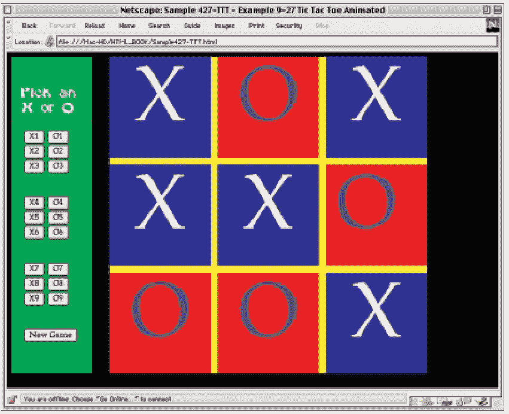

## JavaScript Date 对象

**Date** 对象提供了一组用于处理日期和时间的方法。JavaScript 在内部将 **Date** 对象存储为自 1970 年 1 月 1 日午夜以来经过的毫秒数。因此，当您想要操作 **Date** 数据时，您必须擦去突触中的数学蛛网，才能获得有用的输出。在 JavaScript 1.2 中不允许使用 1970 年 1 月 1 日之前的日期，但在版本 1.3 中可以使用。

JavaScript 1.2 中可用的 **Date** 对象的属性和方法如下所列。请注意，在第 10 章（从第 863 页开始），JavaScript 1.3 中有更多可用于 **Date** 对象的方法。另请参阅第 862-879 页。

| Date 属性 | 属性描述 |
|-------------|---------------------|
| prototype | 允许您在创建 **Date** 对象的新实例时添加和分配自己的属性和方法。 |

| Date 方法 | 方法描述/结果 |
|-----------|---------------------------|
| getDate() | 返回指定 **Date** 对象的月份中的日期。 |
| getDay() | 返回指定 **Date** 对象的星期几。 |
| getHours() | 返回指定 **Date** 对象的小时。 |
| getMinutes() | 返回指定 **Date** 对象的分钟。 |
| getMonth() | 返回指定 **Date** 对象的月份。 |
| getSeconds() | 返回指定 **Date** 对象的秒。 |
| getTime() | 返回与指定 **Date** 对象的时间对应的数值。 |
| getTimezoneOffset() | 返回指定 **Date** 对象相对于当前地理位置的以分钟为单位的时区偏移量。 |
| getYear() | 返回指定 **Date** 对象的年份。 |
| parse() | 返回 **Date** 对象字符串自 1970 年 1 月 1 日 00:00:00 本地时间以来的毫秒数。 |
| setDate(integer) | 设置指定 **Date** 对象的月份中的日期。 |
| setHours(integer) | 设置指定 **Date** 对象的小时。 |
| setMinutes(integer) | 设置指定 **Date** 对象的分钟。 |
| setMonth(integer) | 设置指定 **Date** 对象的月份。 |
| setSeconds(integer) | 设置指定 **Date** 对象的秒。 |
| setTime(integer) | 设置 **Date** 对象的值。 |
| setYear(integer) | 设置指定 **Date** 对象的年份。 |
| toGMTString() | 使用互联网 GMT 惯例将 **Date** 对象转换为字符串。 |
| toLocaleString() | 使用当前地理位置的惯例将 **Date** 对象转换为字符串。 |
| UTC() | 返回 **Date** 对象自 1970 年 1 月 1 日 00:00:00 协调世界时 (GMT) 以来的毫秒数。 |

## 使用四个 Date 构造函数创建 Date 对象

有四个不同的 **Date 构造函数**可用于创建 **Date** 对象的实例，如下所列。如果您不提供参数，则使用默认版本，其中包含 GMT 格式的当前日期和时间。第二个 **Date 构造函数**接受一个 **String** 作为参数，格式如语法中所列，或由静态 **parse()** 方法识别。第三个和第四个 **Date 构造函数**接受 **整数** 作为参数。**小时**、**分钟** 和 **秒** 参数是可选的，如果省略则为零。

### Date 构造函数语法：

```javascript
new Date()                                                   //默认版本
new Date("month day, year [hours:minutes:seconds]")          //字符串值
new Date(year, month, day)                                   //整数值
new Date(year, month, day[, hours, minutes, seconds])        //整数值
```

## 创建时间计数器并显示当前时间

示例 3-28 是一个简单的示例，它创建一个显示，包含当前日期和时间以及用户在站点上已停留的时间。

**initializeTime()** 函数使用 **new** 运算符和 **Date()** 构造函数构造一个新的 **Date** 对象实例，并使用 **toLocaleString()** 方法将其从自 1970 年 1 月 1 日以来经过的毫秒数转换为任何特定地理区域通用可用格式。然后通过调用 **output()** 函数将其分配给名为 **TextTime** 的文本字段的 **value** 属性。然后重复该过程，以便通过使用 **setTimeout()** 方法每秒更新一次时间，该方法每 1000 毫秒调用一次 **initializeTime()** 函数，这当然是每秒一次。

最后，**BeenHereXT()** 函数构造一个名为 **later** 的新 **Date** 对象实例，它总是当前时间，因为 **setTimeout()** 方法每次调用 **BeenHereXT()** 函数时都会构造一个新的 **Date** 对象，而它每秒调用一次。

有第三个 **Date** 对象实例，名为 **startTime**，它在文档加载时构造并保持不变。通过从 **later** 中减去 **startTime**，您会得到用户在站点上已停留的时间，该时间被分配给名为 **Visited** 的文本字段的 **value** 属性。您将该数字除以 60000，将其从毫秒转换为分钟（60 秒 x 1000 毫秒 = 1 分钟）。

**setTimeout()** 方法通过将 **milliseconds** 参数设置为 60000 来每分钟更新一次在站点上花费的时间。它调用 **BeenHereXT()** 函数，后者又调用 **visitedUs()** 函数，该函数使用 **TimeHere** 变量更新 **Visited** 文本字段的值。

请注意，**Date** 对象默认以 24 小时军用格式显示时间，其中下午 2 点将显示为 14，这就是本示例中时间显示的方式。要将时间转换为更熟悉的格式，您必须使用一些创造性的编码，如示例 3-30 所示。

## 示例 3-28：Sample428.html

```html
<!DOCTYPE HTML PUBLIC "-//W3C//DTD HTML 3.2//EN">
<HTML>
<HEAD>
<TITLE>Sample 428 - Example 3-28  时间计数器     </TITLE>

<STYLE TYPE="text/JavaScript">
tags.BODY.backgroundColor = "black";
classes.Patrol.all.fontSize = "24pt";
classes.Patrol.all.fontFamily = "Moonlight, fantasy";
classes.Patrol.all.color = "blue";
classes.Patrol.all.backgroundColor = "#8800ff";
</STYLE>
</HEAD>
<!--  ********************************************  -->
<BODY>
<DIV ALIGN=LEFT CLASS="Patrol">

<FORM NAME="formA">
你好 <BR>
时间是: <BR>
<INPUT TYPE="text" SIZE="22" NAME="TextTime" VALUE=""> <BR>

你已经 <BR>
在这里待了: <BR>

<INPUT TYPE="text" SIZE="22" NAME="Visited" VALUE=""> <BR>

分钟
</FORM>
</DIV>
<!--  ***************************************************************  -->

<SCRIPT LANGUAGE="JavaScript1.2">
//BEGIN HIDING
startTime = new Date();

function output(t) {
    document.formA.TextTime.value = t;
}

/*-------------------------------------------*/
function visitedUs(t2) {
    document.formA.Visited.value = t2;
}

/*-------------------------------------------*/
function initializeTime() {
    var today = new Date();
    var todayDateTime = today.toLocaleString();
    output(todayDateTime);
    setTimeout('initializeTime()', 1000);
}
```

```markdown
# 在框架集中创建时间计数器并显示当前时间

示例 3-29 在上一示例的基础上进行扩展，使用 `parent.display.document.write()` 中的 `write()` 方法，动态地向当前 FRAMESET 中包含的外部框架文档写入 HTML 内容、JavaScript 样式语法和 JavaScript。在前面的句子中，`parent` 调用 `display` 的容器 FRAMESET，而 `display` 是包含要 `write()` 的 `document` 的 FRAME 的名称。URL 为 `Sample429A.html` 的外部文档只是一个空白文档，用作 FRAME 的 SRC 属性的占位符，该属性不能省略。其所有内容均由 `Sample429.html` 中的 JavaScript 代码动态生成。`outputTime()` 和 `initializeTime()` 函数是此示例的核心。

`outputTime()` 该函数使用 `parent.display.document.write()` 方法创建 HTML 代码和 JavaScript 样式，然后接受参数 `t`，并在被 `initializeTime()` 函数调用时，将其渲染到名为 `display` 的 FRAME 所包含的文档中。

`initializeTime()` 该函数与上一示例中的使用方式相比有三处主要不同。首先，它有一个条件判断 `if 0`，根据任何复选框元素是否选中，减慢或加快 `setTimeout()` 方法的刷新速率。其次，它包含 HTML `FONT` 元素，将“Been Here”文本的颜色更改为*红色*。第三，两个包含文本字符串的变量 `todayDateTime` 和 `TimeHere` 通过 `outputTime()` 函数提供的样式进行渲染，而不是渲染到文本字段的 Value 参数中。该函数作为 BODY 元素中包含的 SCRIPT 元素中的唯一项被调用。

## 使用 write() 方法时的编程技巧

如果你相对较新接触 JavaScript，在设计自己的页面时有几件事需要注意。首先，使用 **document.write()** 方法时，必须确保引号之间的代码在文本编辑器中都在同一行，否则很可能会遇到某种难以理解的错误。

如果有很长的代码需要写入，要么将其拆分成较小的块，如果这不可取的话，至少要确保文本编辑器没有自动换行，因为那会导致问题（在大多数其他情况下，这不会造成影响）。如果你使用的是 BBEdit，请进入编辑菜单中的窗口选项，取消勾选“Soft Wrap Text”复选框。如果你不使用 BBEdit，那你就是在浪费自己的时间。

此外，在括号内包含字符串时必须使用单引号或双引号，而在字符串内部包含的属性值和/或属性值则使用另一种类型的引号。

参见第 197 页，了解 **write()** 方法中一个经常被忽视但至关重要的反斜杠（\\）字符用法。

## 示例 3-29 第 1 部分：Sample429.html

```html
<!DOCTYPE HTML PUBLIC "-//W3C//DTD HTML 3.2//EN">
<HTML>
<HEAD>
<TITLE>Sample 429 - Example 3-29  Time Counter</TITLE>

<STYLE TYPE="text/JavaScript">

       classes.Mainbody.BODY.margins("0px");
       classes.Mainbody.BODY.paddings("0px");
       classes.Mainbody.BODY.backgroundColor="black";
       classes.Mainbody.BODY.color="white";

       classes.SteelBlu.all.margins("0px");
       classes.SteelBlu.all.backgroundColor="steelblue";
       classes.SteelBlu.all.color="navy";
       classes.SteelBlu.all.width="700";
       classes.SteelBlu.all.fontSize="22pt";
       classes.SteelBlu.all.fontFamily="Clarendon, Helvetica, serif";
       classes.SteelBlu.all.paddings("7px");
       classes.SteelBlu.all.borderTopWidth="10px";
       classes.SteelBlu.all.borderRightWidth="30px";
       classes.SteelBlu.all.borderBottomWidth="10px";
       classes.SteelBlu.all.borderLeftWidth="30px";
       classes.SteelBlu.all.borderStyle="inset";
       classes.SteelBlu.all.borderColor="#5555ff";
       classes.SteelBlu.all.lineHeight="28pt";

       classes.RedBox.P.backgroundColor="red";
       classes.RedBox.P.fontSize="17pt";

</STYLE>
```

### 312 第一部分 —— Dynamic HTML

```html
<!-- *********************************************************** -->
<SCRIPT LANGUAGE="JavaScript1.2"><!--BEGIN HIDING

function outputTime(t){

//Note that you don't have to use the document.open() Method because the
//write() Method does an implicit open for the MIME type for HTML and text.

parent.display.document.write("<HTML><HEAD><TITLE>")
parent.display.document.write("<CLOCK DISPLAY>")
parent.display.document.write("<\/TITLE>")

parent.display.document.write("<STYLE TYPE='text/JavaScript'>")

parent.display.document.write("classes.Mainbody.BODY.margins('0px');")
parent.display.document.write("classes.Mainbody.BODY.paddings('0px');")
parent.display.document.write("classes.Mainbody.BODY.backgroundColor='black.';")
parent.display.document.write("classes.Mainbody.BODY.color='white.';")

parent.display.document.write("classes.SteelBlu.all.margins('0px');")
parent.display.document.write("classes.SteelBlu.all.backgroundColor='darkblue.';")
parent.display.document.write("classes.SteelBlu.all.color='cyan.';")
parent.display.document.write("classes.SteelBlu.all.width='700.';")
parent.display.document.write("classes.SteelBlu.all.fontSize='24pt.';")
parent.display.document.write("classes.SteelBlu.all.fontFamily='Moonlight,
                                    Clarendon, Helvetica, serif.';")
parent.display.document.write("classes.SteelBlu.all.paddings('7px.');")
parent.display.document.write("classes.SteelBlu.all.borderTopWidth='15px.';")
parent.display.document.write("classes.SteelBlu.all.borderRightWidth='40px.';")
parent.display.document.write("classes.SteelBlu.all.borderBottomWidth='15px.';")
parent.display.document.write("classes.SteelBlu.all.borderLeftWidth='40px.';")
parent.display.document.write("classes.SteelBlu.all.borderStyle='groove.';")
parent.display.document.write("classes.SteelBlu.all.borderColor='#8800ff.';")
parent.display.document.write("classes.SteelBlu.all.lineHeight='24pt.';")

parent.display.document.write("<\/STYLE>")
parent.display.document.write("<\/HEAD>")
parent.display.document.write("<BODY CLASS='Mainbody'>")

parent.display.document.write("<LAYER CLASS='SteelBlu' ID='Readout' LEFT=10 TOP='0'
                                                             HEIGHT=100>")
parent.display.document.write("<CENTER>")

      parent.display.document.write(t)

parent.display.document.write("<\/CENTER>")
parent.display.document.write("<\/LAYER>")
parent.display.document.write("<\/BODY>")
parent.display.document.write("<\/HTML>")

      parent.display.document.close();

}
```

### 第 3 章 —— 图层与 JavaScript

```javascript
startTime = new Date();
var booleanTest = true;

/*---------------------------------------------*/

function initializeTime() {

    var today = new Date();
    var todayDateTime = today.toLocaleString();
    later = new Date();
    TimeHere = Math.round( (later - startTime) / 60000 );

    if (booleanTest == true) {

    outputTime(todayDateTime +
               " <FONT COLOR='RED'>&nbsp;&nbsp; Been Here </FONT> " +
               TimeHere + " Minutes");

    setTimeout('initializeTime()', 1000);
    }

    else {
    outputTime(todayDateTime +
               " <FONT COLOR='RED'>&nbsp;&nbsp; Been Here </FONT> " +
               TimeHere + " Minutes");

    setTimeout('initializeTime()', 60000);
    }
}

/*---------------------------------------------*/

function slowItDownMon() {

    booleanTest = false;
    }
/*---------------------------------------------*/

function speedItUpMon() {

    booleanTest = true;
    }

//END HIDING-->
</SCRIPT这是我们找到的关于您提问的答案:
1. 来源分类: 译文
翻译内容: [content]
```markdown
# 在框架集中创建时间计数器并显示当前时间

示例 3-29 在上一示例的基础上进行扩展，使用 `parent.display.document.write()` 中的 `write()` 方法，动态地向当前 FRAMESET 中包含的外部框架文档写入 HTML 内容、JavaScript 样式语法和 JavaScript。在前面的句子中，`parent` 调用 `display` 的容器 FRAMESET，而 `display` 是包含要 `write()` 的 `document` 的 FRAME 的名称。URL 为 `Sample429A.html` 的外部文档只是一个空白文档，用作 FRAME 的 SRC 属性的占位符，该属性不能省略。其所有内容均由 `Sample429.html` 中的 JavaScript 代码动态生成。`outputTime()` 和 `initializeTime()` 函数是此示例的核心。

`outputTime()` 该函数使用 `parent.display.document.write()` 方法创建 HTML 代码和 JavaScript 样式，然后接受参数 `t`，并在被 `initializeTime()` 函数调用时，将其渲染到名为 `display` 的 FRAME 所包含的文档中。

`initializeTime()` 该函数与上一示例中的使用方式相比有三处主要不同。首先，它有一个条件判断 `if 0`，根据任何复选框元素是否选中，减慢或加快 `setTimeout()` 方法的刷新速率。其次，它包含 HTML `FONT` 元素，将“Been Here”文本的颜色更改为*红色*。第三，两个包含文本字符串的变量 `todayDateTime` 和 `TimeHere` 通过 `outputTime()` 函数提供的样式进行渲染，而不是渲染到文本字段的 Value 参数中。该函数作为 BODY 元素中包含的 SCRIPT 元素中的唯一项被调用。

## 使用 write() 方法时的编程技巧

如果你相对较新接触 JavaScript，在设计自己的页面时有几件事需要注意。首先，使用 **document.write()** 方法时，必须确保引号之间的代码在文本编辑器中都在同一行，否则很可能会遇到某种难以理解的错误。

如果有很长的代码需要写入，要么将其拆分成较小的块，如果这不可取的话，至少要确保文本编辑器没有自动换行，因为那会导致问题（在大多数其他情况下，这不会造成影响）。如果你使用的是 BBEdit，请进入编辑菜单中的窗口选项，取消勾选“Soft Wrap Text”复选框。如果你不使用 BBEdit，那你就是在浪费自己的时间。

此外，在括号内包含字符串时必须使用单引号或双引号，而在字符串内部包含的属性值和/或属性值则使用另一种类型的引号。

参见第 197 页，了解 **write()** 方法中一个经常被忽视但至关重要的反斜杠（\\）字符用法。

## 示例 3-29 第 1 部分：Sample429.html

```html
<!DOCTYPE HTML PUBLIC "-//W3C//DTD HTML 3.2//EN">
<HTML>
<HEAD>
<TITLE>Sample 429 - Example 3-29  Time Counter</TITLE>

<STYLE TYPE="text/JavaScript">

       classes.Mainbody.BODY.margins("0px");
       classes.Mainbody.BODY.paddings("0px");
       classes.Mainbody.BODY.backgroundColor="black";
       classes.Mainbody.BODY.color="white";

       classes.SteelBlu.all.margins("0px");
       classes.SteelBlu.all.backgroundColor="steelblue";
       classes.SteelBlu.all.color="navy";
       classes.SteelBlu.all.width="700";
       classes.SteelBlu.all.fontSize="22pt";
       classes.SteelBlu.all.fontFamily="Clarendon, Helvetica, serif";
       classes.SteelBlu.all.paddings("7px");
       classes.SteelBlu.all.borderTopWidth="10px";
       classes.SteelBlu.all.borderRightWidth="30px";
       classes.SteelBlu.all.borderBottomWidth="10px";
       classes.SteelBlu.all.borderLeftWidth="30px";
       classes.SteelBlu.all.borderStyle="inset";
       classes.SteelBlu.all.borderColor="#5555ff";
       classes.SteelBlu.all.lineHeight="28pt";

       classes.RedBox.P.backgroundColor="red";
       classes.RedBox.P.fontSize="17pt";

</STYLE>
```

### 312 第一部分 —— Dynamic HTML

```html
<!-- *********************************************************** -->
<SCRIPT LANGUAGE="JavaScript1.2"><!--BEGIN HIDING

function outputTime(t){

//Note that you don't have to use the document.open() Method because the
//write() Method does an implicit open for the MIME type for HTML and text.

parent.display.document.write("<HTML><HEAD><TITLE>")
parent.display.document.write("<CLOCK DISPLAY>")
parent.display.document.write("<\/TITLE>")

parent.display.document.write("<STYLE TYPE='text/JavaScript'>")

parent.display.document.write("classes.Mainbody.BODY.margins('0px');")
parent.display.document.write("classes.Mainbody.BODY.paddings('0px');")
parent.display.document.write("classes.Mainbody.BODY.backgroundColor='black.';")
parent.display.document.write("classes.Mainbody.BODY.color='white.';")

parent.display.document.write("classes.SteelBlu.all.margins('0px');")
parent.display.document.write("classes.SteelBlu.all.backgroundColor='darkblue.';")
parent.display.document.write("classes.SteelBlu.all.color='cyan.';")
parent.display.document.write("classes.SteelBlu.all.width='700.';")
parent.display.document.write("classes.SteelBlu.all.fontSize='24pt.';")
parent.display.document.write("classes.SteelBlu.all.fontFamily='Moonlight,
                                    Clarendon, Helvetica, serif.';")
parent.display.document.write("classes.SteelBlu.all.paddings('7px.');")
parent.display.document.write("classes.SteelBlu.all.borderTopWidth='15px.';")
parent.display.document.write("classes.SteelBlu.all.borderRightWidth='40px.';")
parent.display.document.write("classes.SteelBlu.all.borderBottomWidth='15px.';")
parent.display.document.write("classes.SteelBlu.all.borderLeftWidth='40px.';")
parent.display.document.write("classes.SteelBlu.all.borderStyle='groove.';")
parent.display.document.write("classes.SteelBlu.all.borderColor='#8800ff.';")
parent.display.document.write("classes.SteelBlu.all.lineHeight='24pt.';")

parent.display.document.write("<\/STYLE>")
parent.display.document.write("<\/HEAD>")
parent.display.document.write("<BODY CLASS='Mainbody'>")

parent.display.document.write("<LAYER CLASS='SteelBlu' ID='Readout' LEFT=10 TOP='0'
                                                             HEIGHT=100>")
parent.display.document.write("<CENTER>")

      parent.display.document.write(t)

parent.display.document.write("<\/CENTER>")
parent.display.document.write("<\/LAYER>")
parent.display.document.write("<\/BODY>")
parent.display.document.write("<\/HTML>")

      parent.display.document.close();

}
```

### 第 3 章 —— 图层与 JavaScript

```javascript
startTime = new Date();
var booleanTest = true;

/*---------------------------------------------*/

function initializeTime() {

    var today = new Date();
    var todayDateTime = today.toLocaleString();
    later = new Date();
    TimeHere = Math.round( (later - startTime) / 60000 );

    if (booleanTest == true) {

    outputTime(todayDateTime +
               " <FONT COLOR='RED'>&nbsp;&nbsp; Been Here </FONT> " +
               TimeHere + " Minutes");

    setTimeout('initializeTime()', 1000);
    }

    else {
    outputTime(todayDateTime +
               " <FONT COLOR='RED'>&nbsp;&nbsp; Been Here </FONT> " +
               TimeHere + " Minutes");

    setTimeout('initializeTime()', 60000);
    }
}

/*---------------------------------------------*/

function slowItDownMon() {

    booleanTest = false;
    }
/*---------------------------------------------*/

function speedItUpMon() {

    booleanTest = true;
    }

//END HIDING-->
</SCRIPT>

</HEAD>
<!-- ************************************************** -->
<BODY CLASS="Mainbody">

<SCRIPT LANGUAGE="JavaScript1.2"><!--BEGIN HIDING

    initializeTime();

//END HIDING-->
</SCRIPT>
<!-- ************************************************** -->
```


```
<FORM NAME="form3">

<P CLASS="RedBox">点击我让时间变慢。<INPUT TYPE="checkbox" NAME="Slowdown"
onClick="slowItDownMon()"> </P>

<P CLASS="RedBox">点击我加快速度。根据 setTimeout 在其周期中的位置，可能需要长达 59 秒才能重新启动。<INPUT
TYPE="checkbox" NAME="Speedup" onClick="speedItUpMon()"> </P>

<DIV ALIGN=CENTER CLASS="SteelBlu">
如果你觉得这和我一样烦人，在最初的新鲜感过后，请点击复选框将时钟的刷新率从秒降低到分钟。我一开始设置为每秒刷新，这样你就不用等待结果。
</DIV>

</FORM>
</BODY>
</HTML>
```

这只是示例 3-29 的 FRAMESET 代码。当然，这是你需要在浏览器中运行的文件，以便让示例工作。

## 示例 3-29 第二部分：Sample429Frameset.html

```
<!DOCTYPE HTML PUBLIC "-//W3C//DTD HTML 3.2//EN">
<HTML>
<HEAD> <TITLE>示例 429 的框架</TITLE> </HEAD>

<FRAMESET ROWS="150,*">

<FRAME MARGINHEIGHT=0 SCROLLING="no" NAME="display" SRC="Sample429A.html">

<FRAME SCROLLING="auto" NAME="main" SRC="Sample429.html">

</FRAMESET>

</HTML>
```

## JavaScript 条件运算符 ? :

**条件**运算符 `? :` 基本上是条件 **if** () 语句的简写版本。以下是它的语法及工作原理。

## JavaScript 语法：

```
((booleanCondition) ? expression1 : expression2)
```

###### 参数定义：

**booleanCondition** 是一个表达式，其结果为 true 或 false
**expression1** 和 **expression2** 是具有任意类型值的表达式。

如果你的 **booleanCondition** 求值为 **true**，那么运算符返回 **expression1** 的值；如果求值为 **false**，则返回 **expression2** 的值。

### 迷你示例：

例如，假设你用 **Date()** 构造函数定义一个变量，再用 **getHours()** 方法提取当前小时数。现在，由于 Navigator 内部将小时数从 0 到 23 分配，就像军用时间一样，你必须将原始小时数转换为更常规的格式。所以你测试变量 **todaysHours**，如果它大于 12，就从中减去 12，否则保持不变。

然后再测试它，以确定是给变量 **beforeAfterNoon** 赋 PM 还是 AM。最后，使用 **write()** 方法来显示带有后缀的小时数。

```
var today           = new Date();

var todaysHours     = today.getHours();

todaysHours = ((todaysHours > 12)  ?  todaysHours - 12  :  todaysHours);

var beforeAfterNoon  = ((todaysHours >= 12)  ?  " PM"  :  " AM");

document.write(todaysHours  +  beforeAfterNoon);
```

### 浏览器输出：

如果时间恰好是 22 点，那么输出将如下所示：

10 PM

仅用于比较，以下是如果你使用 **if ()** 语句，前面的代码会是什么样子：

```
todaysHours = ((todaysHours > 12)  ?  todaysHours - 12  :  todaysHours);

if (todaysHours > 12)   todaysHours = todaysHours - 12;
else todaysHours;
```

这个示例与示例 3-29 非常相似，只是这里多次使用 **比较运算符 ? :** 来修改 **Date** 对象的原始参数，并且使用了相当多的 **Date** 对象方法来提取有用的数据片段，然后以更具美感且更易阅读的方式显示它们。

**showTime** 变量被赋值的方式也与之前使用的不同，它是通过重复追加数据来赋值的，这有助于在文本编辑器中将代码保持在一行，而且这样阅读起来更容易。

## 示例 3-30：Sample430.html

```
<!DOCTYPE HTML PUBLIC "-//W3C//DTD HTML 3.2//EN">
<HTML>
<HEAD>
<TITLE>示例 430 - 示例 3-30   高级显示 2 时间计数器 </TITLE>

<STYLE TYPE="text/JavaScript">

     classes.Mainbody.BODY.margins("0px");
     classes.Mainbody.BODY.paddings("0px");
     classes.Mainbody.BODY.backgroundColor="black";
     classes.Mainbody.BODY.color="white";

     classes.SteelBlu.all.margins("0px");
     classes.SteelBlu.all.backgroundColor="steelblue";
     classes.SteelBlu.all.color="navy";
     classes.SteelBlu.all.width="700";
     classes.SteelBlu.all.fontSize="22pt";
     classes.SteelBlu.all.fontFamily="Clarendon, Helvetica, serif";
     classes.SteelBlu.all.paddings("7px");
     classes.SteelBlu.all.borderTopWidth="10px";
     classes.SteelBlu.all.borderRightWidth="30px";
     classes.SteelBlu.all.borderBottomWidth="10px";
     classes.SteelBlu.all.borderLeftWidth="30px";
     classes.SteelBlu.all.borderStyle="inset";
     classes.SteelBlu.all.borderColor="#5555ff";
     classes.SteelBlu.all.lineHeight="28pt";

     classes.RedBox.P.backgroundColor="red";
     classes.RedBox.P.fontSize="17pt";

</STYLE>
```

```
<!-- **************************************************************** -->

<SCRIPT LANGUAGE="JavaScript1.2"><!--BEGIN HIDING

function outputTime(t){

	//Note that you don't have to use the document.open() Method because the
	//write() Method does an implicit open for the MIME type for HTML and text.

	parent.display.document.write("<HTML><HEAD><TITLE>")
	parent.display.document.write("<CLOCK DISPLAY>")
	parent.display.document.write("<\/TITLE>")

	parent.display.document.write("<STYLE TYPE='text/JavaScript'>")

	parent.display.document.write("classes.Mainbody.BODY.margins('0px');")
	parent.display.document.write("classes.Mainbody.BODY.paddings('0px');")
	parent.display.document.write("classes.Mainbody.BODY.backgroundColor='black';")
	parent.display.document.write("classes.Mainbody.BODY.color='white';")

	parent.display.document.write("classes.SteelBlu.all.margins('0px');")
	parent.display.document.write("classes.SteelBlu.all.backgroundColor='darkblue';")
	parent.display.document.write("classes.SteelBlu.all.color='cyan';")
	parent.display.document.write("classes.SteelBlu.all.width='700';")
	parent.display.document.write("classes.SteelBlu.all.fontSize='24pt';")
	parent.display.document.write("classes.SteelBlu.all.fontFamily='Moonlight,
				Clarendon, Helvetica, serif';")
	parent.display.document.write("classes.SteelBlu.all.paddings('7px');")
	parent.display.document.write("classes.SteelBlu.all.borderTopWidth='15px';")
	parent.display.document.write("classes.SteelBlu.all.borderRightWidth='40px';")
	parent.display.document.write("classes.SteelBlu.all.borderBottomWidth='15px';")
	parent.display.document.write("classes.SteelBlu.all.borderLeftWidth='40px';")
	parent.display.document.write("classes.SteelBlu.all.borderStyle='groove';")
	parent.display.document.write("classes.SteelBlu.all.borderColor='#8800ff';")
	parent.display.document.write("classes.SteelBlu.all.lineHeight='24pt';")

	parent.display.document.write("<\/ד>\")
	parent.display_lc.js,,")
	parent.display.document.write("<\/HEAD>")
	parent.display.document.write("<BODY CLASS='Mainbody'>")

	parent.display.document.write("<LAYER CLASS='SteelBlu' ID='Readout' LEFT='10'
TOP='0' HEIGHT='100'>")
	parent.display.document.write("<CENTER>")

		parent.display.document.write(t)

	parent.display.document.write("<\/CENTER>")
	parent.display.document.write("<\/LAYER>")
	parent.display.document.write("<\/BODY>")
	parent.display.document.write("<\/HTML>")

		parent.display.document.close();

}

/*--------------------------------------------------------------------*/
/*--------------------------------------------------------------------*/
```

```
startTime = new Date();
var booleanTest = true;
```

```
/*-----------------------------------------------------------------------------------------------------------*/

/*-----------------------------------------------------------------------------------------------------------*/

//The getMonth() Method returns a zero to eleven numbering scheme for months
//such that January = 0, February = 1, ..., December = 11,
//so you have to increment the month by 1 if you need January to be 1 instead of 0
//which is used for the todayMonth variable, below.
```

```
function initializeTime() {

    var today
    var todayMonth
    var todayDay
    var todayYear
    var todayHours
    var todayMinutes
    var todaySeconds
    var later
    var TimeHere

    today = new Date();
    todayMonth = today.getMonth() +1;
    todayDay = today.getDate();
    todayYear = today.getFullYear();
    todayHours = today.getHours();
    todayMinutes = today.getMinutes();
    todaySeconds = today.getSeconds();
    later = new Date();
    TimeHere = Math.round((later - startTime) / 60000);

    todayHours = ((todayHours > 12) ? todayHours - 12 : todayHours);

    var showTime = "日期是 ***** <FONT COLOR='RED'>"+ todayMonth +"/"
    showTime += "todayDay " + "/"
    showTime += "todayYear " + "<FONT> <BR>
    showTime += " 时间是 ***** <FONT COLOR='RED'> " + todayHours
    showTime += ((todayMinutes > 9) ? ":" + " :0" + ")"
    showTime += todayMinutes
    showTime += ((todaySeconds > 9) ? ":" + " :0" + ")"
    showTime += todaySeconds
    showTime += ((todayHours >= 12) ? " PM" : " AM") + "<\</FONT><BR>
    showTime += "你已经在这里 ***** <FONT COLOR='RED'>"
    showTime += TimeHere + " 分钟。<\</FONT>"

    if (booleanTest == true) {

        outputTime(showTime);

        setTimeout('initializeTime()', 1000);
    }

    else {
        outputTime(showTime);

        setTimeout('initializeTime()', 60000);
    }
}
```

```
/*-----------------------------------------------------------------------------------------------------------*/

function slowItDownMon() {

    booleanTest = false;
}
```

```
/*-----------------------------------------------------------------------------------------------------------*/
```

# 320 第一章 — 动态 HTML

```javascript
/*-------------------------------------------------*/

function speedItUpMon() {

    booleanTest = true;
    }

//END HIDING-->
</SCRIPT>

</HEAD>

<!--  ******************************************************  -->

<BODY CLASS="Mainbody">

<SCRIPT LANGUAGE="JavaScript1.2"><!--BEGIN HIDING

    initializeTime();

//END HIDING-->
</SCRIPT>

<!--  ******************************************************  -->

<FORM NAME="form3">

<P CLASS="RedBox">

点击我减慢时间。<INPUT TYPE="checkbox" NAME="Slowdown" onClick="slowItDownMon()">

</P>

<P CLASS="RedBox">

点击我加快速度。取决于 setTimeout 在其循环中的位置，可能需要长达 59 秒才能重新启动。<INPUT TYPE="checkbox" NAME="SpeedUp" onClick="speedItUpMon()">

</P>

<DIV ALIGN=CENTER CLASS="SteelBlu">

    如果你发现这和我当初一样，在最初的新奇感之后感到厌烦，那就勾选复选框，
    将时钟的刷新率从秒改为分钟。我一开始设置为秒刷新，
    这样你就不用等待结果了。

</DIV>

</FORM>

</BODY>
</HTML>
```

# JavaScript 的 Math 对象

Math 对象是核心对象，这意味着它是一个顶级预定义 JavaScript 对象，你可以自动访问它，而无需使用构造函数创建或通过方法调用。它内置了用于处理数学常量（如 PI 和 2 的平方根）的属性，以及用于处理计算实体（如余弦或数字的绝对值）的方法。

Math 对象的所有属性和方法都是静态的，这意味着它们是只读的，你无法修改它们。Math 对象的常量始终全部用大写字母书写，这与事件的处理方式相同。当你想引用 Math 对象常量如 PI 时，应这样编写代码：

```javascript
Math.PI
```

当你想调用余弦函数并为方法传递参数 X 时，应这样编写代码：

```javascript
Math.cos(x)
```

# 对 Math 对象使用 with() 语句

你可以使用 with() 语句自动将 Math 应用到你的常量和方法上，以减少重复输入。例如：

```javascript
with (Math) {
    a = PI * r * r;
    y = tan(theta);
    x = r * cos(theta);
    z = abs(beta);
}
```

在功能上等效于：

```javascript
a = Math.PI * r * r;
y = Math.tan(theta);
x = r * Math.cos(theta);
z = Math.abs(beta);
```

##### 特别提示：

注意，JavaScript 足够智能，能够识别与 Math 对象相关的关键字名称，如 PI 和 cos，因此它不会将 Math 应用到非 Math 变量上。

# Math 对象属性汇总

| Math 属性 | 说明 | 近似值 |
| :--- | :--- | :--- |
| E | 欧拉常数 | 2.7182818284590450901 |
| LN10 | 10 的自然对数 | 2.3025850929940459091 |
| LN2 | 2 的自然对数 | 0.6931471805599452862 |
| LOG10E | E 的以 10 为底的对数 | 0.4342944819032518167 |
| LOG2E | E 的以 2 为底的对数 | 1.442695040888963387 |
| PI | 圆周长与其直径之比 | 3.141592653589793116 |
| SQRT1_2 | 1/2 的平方根 | 0.7071067811865475727 |
| SQRT2 | 2 的平方根 | 1.414213562373095145 |

# Math 对象方法汇总

| Math 方法 | 说明 |
| :--- | :--- |
| abs(x) | 返回 x 的绝对值。 |
| acos(x) | 返回 x 的反正弦值（以弧度计）。 |
| asin(x) | 返回 x 的反正弦值（以弧度计）。 |
| atan(x) | 返回 x 的反正切值（以弧度计）。 |
| atan2(y,x) | 返回其参数商 y/x 的反正切值。换句话说，它返回极坐标 (y,x) 的角度。 |
| ceil(x) | 返回大于或等于 x 的最小整数。 |
| cos(x) | 返回 x 的余弦值。 |
| exp(x) | 返回 e^x，其中 x 为参数，e 为欧拉常数，即自然对数的底数。 |
| floor(x) | 返回小于或等于 x 的最大整数。 |
| log(x) | 返回 x 的自然对数（以 E 为底）。 |
| max(x,y) | 返回两个数字 x 和 y 中的较大者。 |
| min(x,y) | 返回两个数字 x 和 y 中的较小者。 |
| pow(x,y) | 返回 x^y，即传统的底数的指数次幂，也就是底数^指数。 |
| random() | 返回 0 到 1 之间的伪随机数。 |
| round(x) | 返回 x 四舍五入到最近整数的值，以 .50 为分界点。 |
| sin(x) | 返回 x 的正弦值。 |
| sqrt(x) | 返回 x 的平方根。 |
| tan(x) | 返回 x 的正切值。 |

# 第三章 — 层与 JavaScript 323

# 随机加载不同的背景图像到层中

本示例演示了 **Math.random()** 方法和 **setTimeout()** 方法，通过生成随机数使层 **L1** 的背景图像和层 **L2** 的背景颜色定期自动更改。出于演示目的，时间设置得相对较快，但在许多实际应用中，你可能希望使用更长的延迟时间。

由于 **Math.random()** 方法始终返回 0 到 1 之间的数字，因此必须将其乘以一个有用的数字，在函数 **randomActs1()** 中这个值是 7，因为数组 **a1** 中有 7 个元素。由于你将使用这个随机数作为数组的 **索引** 来调用特定的数组元素，因此必须使用 **Math.round()** 方法将浮点数转换为整数。

最后，函数 **randomActs1()** 和 **randomActs2()** 通过 BODY 元素的 **onLoad** 事件处理程序调用，以便在文档完全加载时启动。有关数组的更多信息，请参阅第 7 章。

# 示例 3-31：Sample431.html

```html
<!DOCTYPE HTML PUBLIC "-//W3C//DTD HTML 3.2//EN">
<HTML>
<HEAD>
<TITLE>示例 431 - 示例 3-31  随机背景          </TITLE>

<STYLE TYPE="text/JavaScript">

    classes.Mainbody.BODY.margins("0px");
    classes.Mainbody.BODY.paddings("0px");
    classes.Mainbody.BODY.backgroundColor="black";

    tags.LAYER.color="yellow";
    tags.LAYER.fontSize="22pt";

</STYLE>

</HEAD>
<!--    ************************************************* -->
<BODY CLASS="Mainbody" onLoad="randomActs1(); randomActs2();">

<LAYER ID="L1" LEFT=10 TOP=10 WIDTH=200 HEIGHT=200>
目前 setTimeout() 方法设置为每 5 秒随机更新此层的背景图像。</LAYER>

<LAYER ID="L2" LEFT=220 TOP=10 WIDTH=200 HEIGHT=200>
目前 setTimeout() 方法设置为每 3 秒随机更新此层的背景颜色。</LAYER>

<!--    ************************************************* -->
```

# 示例 3-31 Sample431.html

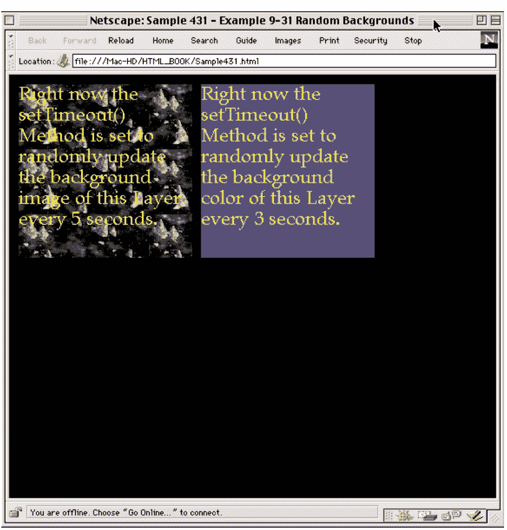

为避免混淆，示例 3-31 的其余代码在下一页。

# 第三章 — 层与 JavaScript 325

```javascript
<SCRIPT LANGUAGE="JavaScript1.2"><!--BEGIN HIDING

var L1 = document.L1;
var L2 = document.L2;
al = new Array("/JPEG_FILES/icon-BG-asteroids.jpg",
                "/JPEG_FILES/icon-Sun.jpg",
                "/JPEG_FILES/ICON-HorizontalRainbow4.jpg",
                "/JPEG_FILES/icon-BG-stars.jpg",
                "/JPEG_FILES/icon-CoarseTurf.jpeg",
                "/JPEG_FILES/icon-Fieldstone-Purple.jpeg",
                "/JPEG_FILES/ICON-HorizontalRainbow2.jpg");

a2 = new Array("blue", "red", "purple", "green", "navy", "olive", "gold", "black");

/*--------------------------------------------------------------------------------*/

function randomActs1() {
    L1.background.src = al[Math.round(Math.random() * 7)];
    setTimeout('randomActs1()', 5000);
}

/*--------------------------------------------------------------------------------*/

function randomActs2() {
    L2.bgColor = a2[Math.round(Math.random() * 8)];
    setTimeout('randomActs2()', 3000);
}

/*--------------------------------------------------------------------------------*/

//END HIDING-->
</SCRIPT>
```

```html
</body>
</html>
```

# 在准计算器中应用 Math 方法

在下面的示例 Sample432.html 中，所有接受单个参数的 Math 方法都在一个表格中进行了演示，该表格通过使用 document.write() 方法创建 HTML 和 JavaScript 代码来更新用户生成的输出，从而在不同的框架中显示数字。

我们首先使用关键字 new 构造一个名为 numArray 的数组，并将其长度设为 1，然后在函数 initiateParam() 中将 numArray [0] 的值设置为数字字符串 "0"。使用字符串而非数字的原因是为了提供一种简单的方式，将通过表格中的按钮添加到数组的额外值进行追加。


# 第一部分 — 动态 HTML

接着，创建了函数**getNum(num)**，它将函数**appendNum(num1,num2)**的**返回值**赋给**numArray[0]**，然后调用函数**output(numerals)**将结果渲染到名为**display**的框架中。这是**output(numerals)**函数中实际显示数组内容的关键代码行：

`parent.display.document.write(numerals.toString())`

## 示例 3-32 第1部分：Sample432.html

```html
<!DOCTYPE HTML PUBLIC "-//W3C//DTD HTML 3.2//EN">
<HTML>
<HEAD>
<TITLE>示例 432 - 示例 3-32 JavaScript 数学方法</TITLE>

<STYLE TYPE="text/JavaScript">

        classes.Mainbody.BODY.margins("0px");
        classes.Mainbody.BODY.paddings("0px");
        classes.Mainbody.BODY.backgroundColor="black";
        classes.Mainbody.BODY.color="white";

</STYLE>

<!--  ************************************************************  -->

<SCRIPT LANGUAGE="JavaScript1.2"><!--BEGIN HIDING

numArray = new Array(1);

/*------------------------------------------------------*/
function initiateParam(){

        numArray[0] = "0";

}

/*------------------------------------------------------*/

function getNum(num) {

        numArray[0] = appendNum(numArray[0], num);
        output(numArray[0]);

}

/*----------------------------------------------*/

function appendNum(num1,num2){

    if (num1 == "0") return ""+num2;

    var numerals="";
    numerals += num1;
    numerals += num2;
    return numerals;
}
/*----------------------------------------------*/
/*----------------------------------------------*/

function output(numerals){

parent.display.document.write("<HTML>")
parent.display.document.write("<HEAD><TITLE>计算器读数<\/TITLE>")
parent.display.document.write("<STYLE TYPE='text/JavaScript'>")

parent.display.document.write("classes.Mainbody.BODY.margins('0px');")
parent.display.document.write("classes.Mainbody.BODY.paddings('0px');")
parent.display.document.write("classes.Mainbody.BODY.backgroundColor='black';")
parent.display.document.write("classes.Mainbody.BODY.color='white';")

parent.display.document.write("classes.SteelBlu.all.margins('0px');")
parent.display.document.write("classes.SteelBlu.all.backgroundColor='steelblue';")
parent.display.document.write("classes.SteelBlu.all.color='lime';")
parent.display.document.write("classes.SteelBlu.all.width='100%';")
parent.display.document.write("classes.SteelBlu.all.fontSize='40pt';")
parent.display.document.write("classes.SteelBlu.all.fontFamily='Moonlight, Clarendon, Helvetica, serif';")
parent.display.document.write("classes.SteelBlu.all.paddings('7px');")
parent.display.document.write("classes.SteelBlu.all.borderTopWidth='10px';")
parent.display.document.write("classes.SteelBlu.all.borderRightWidth='50px';")
parent.display.document.write("classes.SteelBlu.all.borderBottomWidth='10px';")
parent.display.document.write("classes.SteelBlu.all.borderLeftWidth='50px';")
parent.display.document.write("classes.SteelBlu.all.borderStyle='ridge';")
parent.display.document.write("classes.SteelBlu.all.borderColor='#5555ff';")
parent.display.document.write("classes.SteelBlu.all.lineHeight='40pt';")

parent.display.document.write("<\/STYLE>")
parent.display.document.write("<\/HEAD>")
parent.display.document.write("<BODY CLASS='Mainbody'>")

parent.display.document.write("<LAYER CLASS='SteelBlu' ID='Readout' LEFT=10 TOP=-25 HEIGHT=100>")
parent.display.document.write("<CENTER>")

        parent.display.document.write(numerals.toString())

parent.display.document.write("<\/CENTER>")
parent.display.document.write("<\/LAYER>")
parent.display.document.write("<\/BODY>")
parent.display.document.write("<\/HTML>")

        parent.display.document.close();
}

/*---*/

function showConstant(theConstant){
    numArray[0] = theConstant;
    output(numArray[0]);
}
/*---*/

function calcSin() {
    numArray[0] = Math.sin(numArray[0]);
    output(numArray[0]);
}
/*---*/

function calcCos() {
    numArray[0] = Math.cos(numArray[0]);
    output(numArray[0]);
}
/*---*/

function calcTan() {
    numArray[0] = Math.tan(numArray[0]);
    output(numArray[0]);
}
/*---*/

function calcAsin() {
    numArray[0] = Math.asin(numArray[0]);
    output(numArray[0]);
}
/*---*/

function calcAcos() {
    numArray[0] = Math.acos(numArray[0]);
    output(numArray[0]);
}
/*---*/

function calcAtan() {
    numArray[0] = Math.atan(numArray[0]);
    output(numArray[0]);
}
/*---*/

function calcLog() {
    numArray[0] = Math.log(numArray[0]);
    output(numArray[0]);
}
/*---*/

/* -------------------------------------------------------------------- */

function calcExp() {

    numArray[0] = Math.exp(numArray[0]);
    output(numArray[0]);
}

/* -------------------------------------------------------------------- */

function calcSqrt() {

    numArray[0] = Math.sqrt(numArray[0]);
    output(numArray[0]);
}

/* -------------------------------------------------------------------- */

function calcAbs() {

    numArray[0] = Math.abs(numArray[0]);
    output(numArray[0]);
}

/* -------------------------------------------------------------------- */

function calcRound() {

    numArray[0] = Math.round(numArray[0]);
    output(numArray[0]);
}

/* -------------------------------------------------------------------- */

function calcRandom() {

    numArray[0] = Math.random(numArray[0]);
    output(numArray[0]);
}

/* -------------------------------------------------------------------- */

function calcCeil() {

    numArray[0] = Math.ceil(numArray[0]);
    output(numArray[0]);
}

/* -------------------------------------------------------------------- */

function calcFloor() {

    numArray[0] = Math.floor(numArray[0]);
    output(numArray[0]);
}

/* -------------------------------------------------------------------- */

function calcRandom100() {

    numArray[0] = Math.round((Math.random(numArray[0]) * 100));
    output(numArray[0]);
}

/* -------------------------------------------------------------------- */

function calcPercent() {

    numArray[0] = (parseFloat(numArray[0])) / 100;
    output(numArray[0]);
}
/*--------------------------------------------------------------------*/

function resetOutput() {

    initiateParam();
    output(numArray[0]);
}
```

```
//END HIDING-->
</SCRIPT>
</HEAD>

<!-- ******************************************************************* -->
<BODY CLASS="Mainbody">

<SCRIPT LANGUAGE="JavaScript1.2"><!--BEGIN HIDING

    initiateParam();

//END HIDING-->
</SCRIPT>
<!-- ******************************************************************* -->

<LAYER ID="MainLayer" LEFT=10 TOP=10>

<FORM NAME="Form2">

<TABLE BORDER=10 CELLPADDING=0 CELLSPACING=5 WIDTH="100%" HEIGHT=300
BGCOLOR="yellow" BORDERCOLOR="red">

<TR>
    <TH><INPUT TYPE="button" NAME="One" VALUE="1" onClick="getNum(1);"></TH>
    <TH><INPUT TYPE="button" NAME="Two" VALUE="2" onClick="getNum(2);"></TH>
    <TH><INPUT TYPE="button" NAME="Three" VALUE="3" onClick="getNum(3);"></TH>
    <TH BGCOLOR="purple"><INPUT TYPE="button" NAME="thePi" VALUE="π" onClick="showConstant(Math.PI);">π</TH>
    <TH BGCOLOR="purple"><INPUT TYPE="button" NAME="theE" VALUE="e" onClick="showConstant(Math.E);">e</TH>
    <TH BGCOLOR="cyan"><INPUT TYPE="button" NAME="sin" VALUE="sin" onClick="calcSin();"></TH>
    <TH BGCOLOR="cyan"><INPUT TYPE="button" NAME="cos" VALUE="cos" onClick="calcCos();"></TH>
    <TH BGCOLOR="cyan"><INPUT TYPE="button" NAME="tan" VALUE="tan" onClick="calcTan();"></TH>
</TR>
<!-- ******************************************************************* -->
<!--  *********************************************************  -->
<TR>
<TH><INPUT TYPE="button" NAME="Four" VALUE="4" onClick="getNum(4);"></TH>
<TH><INPUT TYPE="button" NAME="Five" VALUE="5" onClick="getNum(5);"></TH>
<TH><INPUT TYPE="button" NAME="S0" VALUE="6" onClick="getNum(6);"></TH>
<TH BGCOLOR="purple"><INPUT TYPE="button" NAME="theLog2" VALUE="log2"
                onClick="showConstant(Math.LN2);"></TH>
<TH BGCOLOR="purple"><INPUT TYPE="button" NAME="theLog10" VALUE="log10"
                onClick="showConstant(Math.LN10);"></TH>
<TH BGCOLOR="cyan"><INPUT TYPE="button" NAME="theAsin" VALUE="asin"
                onClick="calcAsin();"></TH>
<TH BGCOLOR="cyan"><INPUT TYPE="button" NAME="theAcos" VALUE="acos"
                onClick="calcAcos();"></TH>
<TH BGCOLOR="cyan"><INPUT TYPE="button" NAME="theAtan" VALUE="atan"
                onClick="calcAtan();"></TH>
</TR>
```

```
<!--  *********************************************************  -->
<TR>
<TH><INPUT TYPE="button" NAME="Seven" VALUE="7" onClick="getNum(7);"></TH>
<TH><INPUT TYPE="button" NAME="Eight" VALUE="8" onClick="getNum(8);"></TH>
<TH><INPUT TYPE="button" NAME="Nine" VALUE="9" onClick="getNum(9);"></TH>
<TH BGCOLOR="purple"><INPUT TYPE="button" NAME="theLog2e" VALUE="log2e"
                onClick="showConstant(Math.LOG2E);"></TH>
<TH BGCOLOR="purple"><INPUT TYPE="button" NAME="theLog10e" VALUE="log10e"
                onClick="showConstant(Math.LOG10E);"></TH>
<TH BGCOLOR="#7700ff"><INPUT TYPE="button" NAME="theLog" VALUE="log"
                onClick="calcLog();"></TH>
<TH BGCOLOR="#7700ff"><INPUT TYPE="button" NAME="theExp" VALUE="exp"
                onClick="calcExp();"></TH>
<TH BGCOLOR="#7700ff"><INPUT TYPE="button" NAME="thesqrt" VALUE="sqrt"
                onClick="calcSqrt();"></TH>
</TR>
```

```
<!--  *********************************************************  -->
<TR>
<TH><INPUT TYPE="button" NAME="Zero" VALUE="0" onClick="getNum(0);"></TH>
<TH COLSPAN="2" BGCOLOR="navy"><INPUT TYPE="button" NAME="Equals" VALUE="."
                onClick="getNum('.');"></TH>
```

 ## 332 第一部分 — 动态 HTML

```
<TH BGCOLOR="purple"><INPUT TYPE="button" NAME="theSqrt1_2" VALUE="sqrt1/2"
                           onClick="showConstant(Math.SQRT1_2);"></TH>

<TH BGCOLOR="purple"><INPUT TYPE="button" NAME="theSqrt2" VALUE="sqrt2"
                           onClick="showConstant(Math.SQRT2);"></TH>

<TH BGCOLOR="lime"><INPUT TYPE="button" NAME="theAbs" VALUE="abs"
                          onClick="calcAbs();"></TH>

<TH BGCOLOR="lime"><INPUT TYPE="button" NAME="theRound" VALUE="round"
                          onClick="calcRound();"></TH>

<TH BGCOLOR="lime"><INPUT TYPE="button" NAME="theRandom" VALUE="random"
                          onClick="calcRandom();"></TH>
</TR>
<!--  ***************************************************  -->

<TR>
<TH COLSPAN="5" BGCOLOR="blue"><INPUT TYPE="button" NAME="ClearAll" VALUE="Clear"
                                       onClick="resetOutput();"></TH>

<TH BGCOLOR="steelblue"><INPUT TYPE="button" NAME="theCeil" VALUE="ceil"
                               onClick="calcCeil();"></TH>

<TH BGCOLOR="steelblue"><INPUT TYPE="button" NAME="theFloor" VALUE="floor"
                               onClick="calcFloor();"></TH>

<TH BGCOLOR="lime">Rounded<BR>
<INPUT TYPE="button" NAME="MyRandom100" VALUE="random*100"
       onClick="calcRandom100();"></TH>
</TR>
<!--  ***************************************************  -->
</TABLE>
</FORM>
</LAYER>

</BODY>
</HTML>
```

## 示例 3-32 第二部分：Sample432Frameset.html

```
<!DOCTYPE HTML PUBLIC "-//W3C//DTD HTML 3.2//EN">
<HTML>
<HEAD> <TITLE>Frame for Sample 432</TITLE> </HEAD>

<FRAMESET ROWS="100,*">

        <FRAME MARGINHEIGHT="0" SCROLLING="no" NAME="display" SRC="Sample432A.html">

        <FRAME SCROLLING="auto" NAME="main" SRC="Sample432.html">

</FRAMESET>

</HTML>
```

## 第 3 章 — 图层与 JavaScript

## 示例 3-32

### Sample432Frameset.html

## Math.max(x,y)、Math.min(x,y) 和 Math.pow(x,y) 的数学方法

这是一个简单的示例，用于演示 **Math.max(x,y)**、**Math.min(x,y)** 和 **Math.pow(x,y)** 的数学方法。用户在文本框中输入的数字字符串首先分别赋值给 x 和 y，然后通过 **parseFloat()** 方法转换为浮点数。接着根据点击的按钮调用上述相应的数学方法进行计算。

## 示例 3-33：Sample433.html

```
<!DOCTYPE HTML PUBLIC "-//W3C//DTD HTML 3.2//EN">
<HTML>
<HEAD>
<TITLE>Sample 433 - Example 3-33 Math max, min, pow Methods</TITLE>

<STYLE TYPE="text/JavaScript">

         classes.Mainbody.BODY.margins("0px");
         classes.Mainbody.BODY.paddings("0px");
         classes.Mainbody.BODY.backgroundColor="black";
         tags.LAYER.color="yellow";
         tags.LAYER.fontSize="22pt";

</STYLE>
</HEAD>

<BODY CLASS="Mainbody">

<LAYER ID="L1" LEFT=10 TOP=10 WIDTH=500>

max(x,y)       <BR>Returns the greater of the two numbers x and y.<BR><BR>
min(x,y)       <BR>Returns the lesser of the two numbers x and y.<BR><BR>
pow(x,y)       <BR>Returns x to the power of y, that is; x<SUP>y</SUP>.<BR><BR>

<HR>
<FORM NAME="form1">
Input X value        <INPUT TYPE="text" NAME="text1" SIZE=25 VALUE="">   <BR>
Input Y value        <INPUT TYPE="text" NAME="text2" SIZE=25 VALUE="">   <BR>
And the results are: <INPUT TYPE="text" NAME="text3" SIZE=25 VALUE="">   <BR>

<INPUT TYPE="button" NAME="b1" Value="max(x,y)" onClick="doMax();">
<INPUT TYPE="button" NAME="b2" Value="min(x,y)" onClick="doMin();">
<INPUT TYPE="button" NAME="b3" Value="pow(x,y)" onClick="doPow();">
<INPUT TYPE="button" NAME="b4" Value="Clear All" onClick="clearAll();">

</FORM>
<HR>

</LAYER>
<!--  **************************************************************** -->
```

## 第 3 章 — 图层与 JavaScript

```
<!-- ******************************************************************** -->

<SCRIPT LANGUAGE="JavaScript1.2"><!--BEGIN HIDING

function doMax() {
    var x = document.L1.document.form1.text1.value;
    var y = document.L1.document.form1.text2.value;
    x = parseFloat(x);
    y = parseFloat(y);
    document.L1.document.form1.text3.value = Math.max(x,y);
}

/*--------------------------------------------------------------------*/

function doMin() {
    var x = document.L1.document.form1.text1.value;
    var y = document.L1.document.form1.text2.value;
    x = parseFloat(x);
    y = parseFloat(y);
    document.L1.document.form1.text3.value = Math.min(x,y);
}

/*--------------------------------------------------------------------*/

function doPow() {
    var x = document.L1.document.form1.text1.value;
    var y = document.L1.document.form1.text2.value;
    x = parseFloat(x);
    y = parseFloat(y);
    document.L1.document.form1.text3.value = Math.pow(x,y);
}

/*--------------------------------------------------------------------*/

function clearAll() {
    document.L1.document.form1.text1.value = "";
    document.L1.document.form1.text2.value = "";
    document.L1.document.form1.text3.value = "";
}

/*--------------------------------------------------------------------*/

//END HIDING-->
</SCRIPT>

</BODY>
</HTML>
```

# 第一部分 — 动态 HTML

以下内容将简要介绍，它们与 Sample434.html 中的下一个示例相关。如需更完整的信息，请参阅第 8 章关于 **String** 对象的内容，或 CD-ROM 上的 JavaScript 参考手册。

| 方法/属性 | 描述 | 参考 |
| --- | --- | --- |
| toString() | 所有对象的核心方法 | 参见 JavaScript 参考手册 |
| parseFloat() | 核心函数 | 参见 JavaScript 参考手册 |
| parseInt() | 核心函数 | 参见 JavaScript 参考手册 |
| isNaN() | 核心函数 | 参见 JavaScript 参考手册 |
| charAt() | **String** 对象的方法 | 参见第 759 页 |
| split() | **String** 对象的方法 | 参见第 782 页 |
| slice() | **String** 对象的方法 | 参见第 788 页 |
| length | **String** 对象的属性 | 参见第 750 页 |

## JavaScript toString() 方法

**toString()** 方法用于将对象转换为其 **文本** 等价形式。对于 **Number** 对象，可以使用 **radix** 指定一个介于 2 到 16 之间的 **基数**，将值转换为你选择的数字系统。**radix** 参数的默认值是 10。

在 Sample434.html 中，它用于将数组元素 **numArray[0]** 转换为字符串，以便在浏览器中显示，代码如下：

```
parent.display.document.write(numerals.toString())
```

其中 **numerals** 是传递给 **output(numerals)** 函数的参数。它还用于 **rgbArray[]** 的元素 **rgbArray[0]**、**rgbArray[1]** 和 **rgbArray[2]**，将数值转换为十六进制颜色值。以下代码展示了如何将一个数组元素转换为 16 进制数，并替换原始元素。

```
rgbArray[0] = (rgbArray[0]).toString(16)
```

如果原始值为 **14**，则 16 进制转换后的值为 **e**。
如果原始值为 **45**，则 16 进制转换后的值为 **2d**。
如果原始值为 **255**，则 16 进制转换后的值为 **ff**。

### JavaScript 语法：

```
objectName.toString()
numberObjectName.toString(radix)
```

## JavaScript parseFloat() 函数

parseFloat() 函数接受 myString 字符串参数，并将其转换为浮点数（带有小数点的数字）。如果字符串中包含除数字 0-9、小数点、正负号或指数之外的任何字符，它将返回直到违规字符之前的所有字符，并省略该字符及其之后的所有字符。如果字符串中的第一个字符就是违规字符，则返回 'NaN'。例如，如果 numArray[0] 的值为数字字符串 "255"，则：

- `parseFloat(numArray[0])` 返回浮点数 255
- `parseFloat("142.47@39")` 返回浮点数 142.47
- `parseFloat("-77.25m,g")` 返回浮点数 -77.25
- `parseFloat("ff7725")` 返回 NaN

### JavaScript 语法：

```
parseFloat("myString")
```

## JavaScript parseInt() 函数

parseInt() 函数接受 myString 字符串参数，并根据 radix 参数将其转换为整数。radix 参数是一个整数，用于指定要使用的数字系统的基数。2 进制是二进制，16 进制是十六进制，10 进制是日常数学。对于大于 10 的基数，字母表中的字母用于替代大于 9 的数字；例如，在十六进制中，字母 A-F 用于表示数字 10-15。从左到右读取字符串时，如果字符串中包含任何不在指定基数中的字符，它们将被省略，同时第一个违规字符及其右侧的任何数字也将被省略。这自然产生了所有合法值都将被截断为整数的结果，因为小数点将是一个违规字符。

如果 radix 被省略或设置为 '零'，则默认值为 10，除非字符串中的第一个字符是 '0'，这会将基数转换为 8，或者如果前两个字符是 '0x'，则基数为 16。如果 numArray[0] = "ff"，则：

- `parseInt(numArray[0], 16)` 返回 16 进制的整数 255
- `parseInt("FF", 16)` 返回 16 进制的整数 255
- `parseInt("42.57", 10)` 返回 10 进制的整数 42

### JavaScript 语法：

```
parseInt("myString", radix)
```


Welcome to the repository of a minimalist demo of **WebGPU**, where it demonstrates how you write a basic triangle on [KIMI](https://kimi.ai). This project is a **boilerplate** of **WGPU** real-time rendering, focusing on explanatory comments. 

1. As it is crafted for clarity, our main purpose is to help developers get into WebGPU via a practical, distraction-free example.

    > Start by cloning the repo using the commands in `README.md`, and switching to the version you are looking for.

2. If you wonder what is different between `PresentMode` and `rendertarget`, check the **table** below for explanation.

| Name  | PresentOnSurface | RenderToTexture | Supports IME Input | Purpose of Design |
| :---- | :-------- | :--------- | :------ | :------- |
| **Examples: `present`** | Does not take over. | Shows rendering result through an off-screen texture. | *Yes* | Illustrates the **low-level** *WebGPU* screen pipeline. |
| **Examples: `texture`** | Take over. | Renders to a surface directly on screen. | *No* | Designed for **real-time** rendering as well as **post-processing**. |

3. The `present` examples are recommended for beginners, as they let you focus on pure **shading** language without worrying about the windowing system or advanced topics.

    ```shader
    // shader.wgsl
    @vertex
    fn vs_main(@builtin(vertex_index) in_vertex_index: u32) -> @builtin(position) vec4<f32> {
        // ...
    }
    ```

4. If you are ready to dive deeper, please head over to [Extended Resources](https://github.com/xxx/yyy) documented in `ADVANCED.md`.


 为了更清晰起见，如果：

```
rgbArray[0] = 2    rgbArray[1] = 7    rgbArray[2] = 15
```

那么你的新十六进制颜色将是：

```
"27f"  not  "02070f"
```

这才是你想要的结果。当任意分量为零时，情况会更加复杂。这就是为什么你要用变量 `a0`、`a1` 和 `a2` 对所有零值进行测试，以便知道何时以及有多少个零需要手动编码到输出中。1 到 15 的数字需要手动编码一个零，而颜色分量为零时需要手动编码两个零。当你在浏览器中查看此示例时，请注意当用户输入逗号时，背景颜色仅在单击值为 `Full3` 的按钮时才会更新。

**clearLastEntry()** 此函数使用 `slice(0,-1)` 方法提取 **numArray[0]** 元素中字符串除最后一个字符外的所有字符。然后调用 **output(numArray[0])** 函数显示结果。它在用户单击值为 "Clear Entry" 的按钮时触发。

**resetOutput()** 此函数只是将两个数组中的所有数组元素重新初始化为空字符串并显示结果。

最后，**initiateParam()** 函数在文档加载时在单独的 SCRIPT 元素中被调用。其余代码只是设置表格的 HTML、按钮以及按钮元素的事件处理程序。

## 示例 3-34 第 1 部分：Sample434.html

```
<!DOCTYPE HTML PUBLIC "-//W3C//DTD HTML 3.2//EN">
<html>
<head>
<TITLE>Sample 434 - Example 3-34 Multiple Color Conversion Calculator</TITLE>
<STYLE TYPE="text/JavaScript">

classes.MainBody.BODY.margins="0px";
classes.MainBody.BODY.padding="0px";
classes.MainBody.BODY.backgroundColor="black";
classes.MainBody.BODY.color="white";

</STYLE>
<!-- *********************************************************** -->

<SCRIPT LANGUAGE="JavaScript1.2">
numArray = new Array(3);
rgbArray = new Array(3);
/*
```

## 第 3 章 — 图层与 JavaScript

```
function initiateParam(){

    numArray[0] = "";
    numArray[1] = "";
    numArray[2] = "";
    rgbArray[0] = "";
    rgbArray[1] = "";
    rgbArray[2] = "";
}
/*-------------------------------------------*/

function getNum(num){

    numArray[0] = appendNum(numArray[0],num);
    output(numArray[0]);
}
/*-------------------------------------------*/

function appendNum(num1,num2){

    var numerals="";
    numerals+=num1;
    numerals+=num2;
    return numerals;
}
/*-------------------------------------------*/
/*-------------------------------------------*/

function output(numerals){

parent.display.document.write("<HTML>")
parent.display.document.write("<HEAD><TITLE>Calculator Readout<\/TITLE>")
parent.display.document.write("<STYLE TYPE='text/JavaScript'>")

parent.display.document.write("classes.Mainbody.BODY.margins('0px');")
parent.display.document.write("classes.Mainbody.BODY.paddings('0px');")
parent.display.document.write("classes.Mainbody.BODY.backgroundColor='black';")
parent.display.document.write("classes.Mainbody.BODY.color='white';")

parent.display.document.write("classes.SteelBlu.all.margins('0px');")
parent.display.document.write("classes.SteelBlu.all.backgroundColor='steel以自我lue';")
parent.display.document.write("classes.SteelBlu.all.color='lime';")
parent.display.document.write("classes.SteelBlu.all.width='100%';")
parent.display.document.write("classes.SteelBlu.all.fontSize='40pt';")
parent.display.document.write("classes.SteelBlu.all.fontFamily='Moonlight, Clarendon, Helvetica, serif';")
parent.display.document.write("classes.SteelBlu.all.paddings('7px');")
parent.display.document.write("classes.SteelBlu.all.borderTopWidth='10px';")
parent.display.document.write("classes.SteelBlu.all.borderRightWidth='50px';")
parent.display.document.write("classes.SteelBlu.all.borderBottomWidth='10px';")
parent.display.document.write("classes.SteelBlu.all.borderLeftWidth='50px';")
parent.display.document.write("classes.SteelBlu.all.borderStyle='ridge';")
parent.display.document.write("classes.SteelBlu.all.borderColor='#5555ff';")
parent.display.document.write("classes.SteelBlu.all.lineHeight='40pt';")

parent.display.document.write("<\/STYLE>")
parent.display.document.write("<\/HEAD>")
parent.display.document.write("<BODY CLASS='Mainbody'>")

parent.display.document.write("<LAYER CLASS='SteelBlu' ID='Readout' LEFT='10' TOP='-25' HEIGHT='100'>")
parent.display.document.write("<CENTER>")

//这一行实际将数组数据写入文档。

    parent.display.document.write(numerals.toString())

    var getColor = numArray[0].toString();

//这在完整颜色转换使用逗号时禁用颜色更新

    if (getColor.charAt(1) == ',' || getColor.charAt(2) == ','
    ||  getColor.charAt(3) == ',' || getColor.charAt(4) == ','
    ||  getColor.charAt(5) == ',' || getColor.charAt(6) == ','
    ||  getColor.charAt(7) == ',' || getColor.charAt(8) == ',') {

    parent.display.document.bgColor='black';
    }
```

```
//允许对每个字符输入进行连续的颜色更新。

else
    if (getColor.length == 6)
        ( parent.display.document.bgColor = "#" + getColor; )
    else if (getColor.length == 7)
        ( parent.display.document.bgColor = "#" + getColor + "0"; )
    else if (getColor.length == 8)
        ( parent.display.document.bgColor = "#" + getColor + "00"; )
    else if (getColor.length == 9)
        ( parent.display.if (getColor.length == 10)
        ( parent.display.document.bgColor = "#" + getColor + "0000"; )
    else if (getColor.length == 11)
        ( parent.display.document.bgColor = "#" + getColor + "00000"; )

parent.display.document.write("\</CENTER>");
parent.display.document.write("\</LAYER>");
parent.display.document.write("\</BODY>");
parent.display.document.write("\</HTML>");

parent.display.document.close();

}
```

```
/*------------------------------------------------------------------------*/

function TurnHexToRGB255() {
    numArray[0] = parseInt(numArray[0] , 16);

    output(numArray[0]);

}
```

```
/*------------------------------------------------------------------------*/

function TurnHexToRGB100() {
    numArray[0] = parseInt(numArray[0] , 16);
    numArray[0] = Math.round((numArray[0] / 255 ) * 100);

    output(numArray[0]);

}
```

```
/*------------------------------------------------------------------------*/

function TurnRGB255ToHex() {
    if (numArray[0] > 250) {
        alert("Please like following conversion will be accurate, if you want a *\nuseable color you must pick a number from 0 to 255");
    }
    else if (isNaN(numArray[0])) {
        alert("Err! The sign said from 0 to 255. You chose: " + numArray[0]);
    }
    else if (numArray[0] == '0' || numArray[0] == '00' || numArray[0] == '000') {
        output("00");
    }
    else if (numArray[0] < 16 && numArray[0] > 0) {
        numArray[1] = parseInt(numArray[0], 10);
        numArray[0] = (numArray[0]).toString(16);
        output("0" + numArray[0] + numArray[1]);
    }
    else {
        numArray[0] = parseInt(numArray[0] , 10);
        numArray[0] = (numArray[0]).toString(16);
        output(numArray[0]);
    }

}
```

```
/*------------------------------------------------------------------------*/

function TurnRGB100ToHex() {
    if (numArray[0] > 100 || isNaN(numArray[0]) == true) {
        alert("*YO! The sign said from 0 to 100. You chose: " + numArray[0]);
    }
    else if (numArray[0] == '0' || numArray[0] == '00' || numArray[0] == '000') {
        output("00");
    }
```

## 第 3 章 — 图层与 JavaScript

```
else {
	numArray[0] = parseFloat(numArray[0]);
	numArray[0] = Math.round((numArray[0] * 255) / 100);

		if (numArray[0] < 16 && numArray[0] >0){

			numArray[0] = (numArray[0]).toString(16);
			output('0' + numArray[0]);

		}
		else {
			numArray[0] = (numArray[0]).toString(16);
			output(numArray[0]);
		}
	}
}
```

```
/*------------------------------------------------*/

function TurnRGB255to100() {

	if (numArray[0] >255 || isNaN(numArray[0]) == true) {
	alert("YO! The sign said from 0 to 100. You chose: " + numArray[0]);
	}

else {
	numArray[0] = parseFloat(numArray[0]);
	numArray[0] = Math.round((numArray[0] / 255) * 100);

	output(numArray[0].);
	}
}
```

```
/*------------------------------------------------*/

function TurnRGB100to255() {

	if (numArray[0] >100 || isNaN(numArray[0]) == true) {
	alert("YO! The sign said from 0 to 100. You chose: " + numArray[0]);
	}

else {
	numArray[0] = parseFloat(numArray[0]);
	numArray[0] = Math.round((numArray[0] * 255) / 100);

	output(numArray[0]);
	}
}
```

```
/*------------------------------------------------*/
/*------------------------------------------------*/

function Full() {

	var getChar = numArray[0].toString();

	if (getChar.length == 6) {
		rgbArray[0] = getChar.charAt(0) + getChar.charAt(1);
		rgbArray[1] = getChar.charAt(2) + getChar.charAt(3);
		rgbArray[2] = getChar.charAt(4) + getChar.charAt(5);
		rgbArray[0] = parseInt(rgbArray[0] , 16);
		rgbArray[1] = parseInt(rgbArray[1] , 16);
		rgbArray[2] = parseInt(rgbArray[2] , 16);
		output(numArray[0] + ' = ' + rgbArray[0] + ', ' + rgbArray[1] + ', ' + rgbArray[2]);
	}
	else if (getChar.length == 5) {
		rgbArray[0] = getChar.charAt(0) + getChar.charAt(1);
		rgbArray[1] = getChar.charAt(2) + getChar.charAt(3);
		rgbArray[2] = getChar.charAt(4);
		rgbArray[0] = parseInt(rgbArray[0] , 16);
		rgbArray[1] = parseInt(rgbArray[1] , 16);
		rgbArray[2] = parseInt(rgbArray[2] , 16);
		output(numArray[0] + ' = ' + rgbArray[0] + ', ' + rgbArray[1] + ', ' + rgbArray[2]);
	}
	else if (getChar.length == 4) {
		rgbArray[0] = getChar.charAt(0) + getChar.charAt(1);
		rgbArray[1] = getChar.charAt(2) + getChar.charAt(3);
		rgbArray[0] = parseInt(rgbArray[0] , 16);
		rgbArray[1] = parseInt(rgbArray[1] , 16);
		output(numArray[0] + ' = ' + rgbArray[0] + ', ' + rgbArray[1] + ', 0');
	}
}
```


 else if (getChar.length == 3) {
            rgbArray[0] = getChar.charAt(0) + getChar.charAt(1);
            rgbArray[1] = getChar.charAt(2);
            rgbArray[0] = parseInt(rgbArray[0], 16);
            rgbArray[1] = parseInt(rgbArray[1], 16);
            output(numArray[0] + ' = ' + rgbArray[0] + ', ' + rgbArray[1] + ', 0');
        }

else if (getChar.length == 2) {
            rgbArray[0] = getChar.charAt(0) + getChar.charAt(1);
            rgbArray[0] = parseInt(rgbArray[0], 16);
            output(numArray[0] + ' = ' + rgbArray[0] + ', 0' + ', 0');
        }

else {
            rgbArray[0] = getChar.charAt(0);
            rgbArray[0] = parseInt(rgbArray[0], 16);
            output(numArray[0] + ' = ' + rgbArray[0] + ', 0' + ', 0');
        }

```
function Full3() {
    var getRGB = numArray[0].toString();

    rgbArray = getRGB.split(',');

    var a0 = parseInt(rgbArray[0], 10);
    var a1 = parseInt(rgbArray[1], 10);
    var a2 = parseInt(rgbArray[2], 10);

    rgbArray[0] = parseInt(rgbArray[0], 10);
    rgbArray[0] = (rgbArray[0]).toString(16);
    rgbArray[1] = parseInt(rgbArray[1], 10);
    rgbArray[1] = (rgbArray[1]).toString(16);
    rgbArray[2] = parseInt(rgbArray[2], 10);
    rgbArray[2] = (rgbArray[2]).toString(16);

    /*-----------------------------------------*/

    if (isNaN(a1)) {rgbArray[1] = '00'; alert('You forgot the green value');}
    if (isNaN(a2)) {rgbArray[2] = '00'; alert('You forgot the blue value');}

    /*-----------------------------------------*/

    if ((a0 == 0 || a0 == 00 || a0 == 000) && (a1 == 0 || a1 == 00 || a1 == 000) && (a2 == 0 || a2 == 00 || a2 == 000)) {

        output(numArray[0] + ' = ' + '000000');
        parent.display.document.bgColor='#000000';
    }

    /*-----------------------------------------*/

    else if ((a0 == 0 || a0 == 00 || a0 == 000) && (a1 == 0 || a1 == 00 || a1 == 000) && (a2 < 16 && a2 > 0)) {

        output(numArray[0] + ' = ' + '0000' + '0' + rgbArray[2]);
        parent.display.document.bgColor='#0000' + '0' + rgbArray[2];
    }

    else if ((a0 == 0 || a0 == 00 || a0 == 000) && (a2 == 0 || a2 == 00 || a2 == 000) && (a1 < 16 && a1 > 0)) {

        output(numArray[0] + ' = ' + '00' + '0' + rgbArray[1] + '00');
        parent.display.document.bgColor='#00' + '0' + rgbArray[1] + '00';
    }

    else if ((a1 == 0 || a1 == 00 || a1 == 000) && (a2 == 0 || a2 == 00 || a2 == 000) && (a0 < 16 && a0 > 0)) {

        output(numArray[0] + ' = ' + '0' + rgbArray[0] + '0000');
        parent.display.document.bgColor='#0' + rgbArray[0] + '0000';
    }

    /*-----------------------------------------*/

    else if ((a0 == 0 || a0 == 00 || a0 == 000) && (a1 < 16 && a1 > 0) && (a2 < 16 && a2 > 0)) {

        output(numArray[0] + ' = ' + '00' + '0' + rgbArray[1] + '0' + rgbArray[2]);
        parent.display.document.bgColor='#00' + '0' + rgbArray[1] + '0' + rgbArray[2];
    }
```

## 第三章 —— 图层与 JavaScript 347

```
else if ((a1 == 0 || a1 == 00 || a1 == 000) && (a0 < 16 && a0 > 0) && (a2 < 16 && a2 > 0)) {
    output(numArray[0] + ' = ' + '00' + rgbArray[0] + '00' + '0' + rgbArray[2]);
    parent.display.document.bgColor='#00' + rgbArray[0] + '00' + '0' + rgbArray[2];
}
else if ((a2 == 0 || a2 == 00 || a2 == 000) && (a0 < 16 && a0 > 0) && (a1 < 16 && a1 > 0)) {
    output(numArray[0] + ' = ' + '00' + rgbArray[0] + '0' + rgbArray[1] + '00');
    parent.display.document.bgColor='#00' + rgbArray[0] + '0' + rgbArray[1] + '00';
}
```

```
/*----------------------------------------------------------------------------------------*/

else if ((a0 == 0 || a0 == 00 || a0 == 000) && a1 < 16 && a1 > 0) {
    output(numArray[0] + ' = ' + '00' + rgbArray[1] + rgbArray[2]);
    parent.display.document.bgColor='#00' + rgbArray[1] + rgbArray[2];
}
else if ((a0 == 0 || a0 == 00 || a0 == 000) && a2 < 16 && a2 > 0) {
    output(numArray[0] + ' = ' + '00' + rgbArray[1] + '0' + rgbArray[2]);
    parent.display.document.bgColor='#00' + rgbArray[1] + '0' + rgbArray[2];
}
else if ((a1 == 0 || a1 == 00 || a1 == 000) && a0 < 16 && a0 > 0) {
    output(numArray[0] + ' = ' + '0' + rgbArray[0] + '00' + rgbArray[2]);
    parent.display.document.bgColor='#0' + rgbArray[0] + '00' + rgbArray[2];
}
```

```
else if ((a1 == 0 || a1 == 00 || a1 == 000) && a2 < 16 && a2 > 0) {
    output(numArray[0] + ' = ' + '0' + rgbArray[0] + '00' + '0' + rgbArray[2]);
    parent.display.document.bgColor='#' + rgbArray[0] + '00' + '0' + rgbArray[2];
}
else if ((a2 == 0 || a2 == 00 || a2 == 000) && a0 < 16 && a0 > 0) {
    output(numArray[0] + ' = ' + '0' + rgbArray[0] + rgbArray[1] + '00');
    parent.display.document.bgColor='#0' + rgbArray[0] + rgbArray[1] + '00';
}
else if ((a2 == 0 || a2 == 00 || a2 == 000) && a1 < 16 && a1 > 0) {
    output(numArray[0] + ' = ' + '0' + rgbArray[0] + '0' + rgbArray[1] + '00');
    parent.display.document.bgColor='#' + rgbArray[0] + '0' + rgbArray[1] + '00';
}
```

```
/*----------------------------------------------------------------------------------------*/

else if ((a0 < 16 && a0 > 0 && a1 < 16 && a1 > 0)) {
    output(numArray[0] + ' = ' + '0' + rgbArray[0] + '0' + rgbArray[1] + rgbArray[2]);
    parent.display.document.bgColor='#0' + rgbArray[0] + '0' + rgbArray[1] + rgbArray[2];
}
else if ((a0 < 16 && a0 > 0 && a2 < 16 && a2 > 0)) {
    output(numArray[0] + ' = ' + '0' + rgbArray[0] + rgbArray[1] + '0' + rgbArray[2]);
    parent.display.document.bgColor='#0' + rgbArray[0] + rgbArray[1] + '0' + rgbArray[2];
}
else if ((a1 < 16 && a1 > 0 && a2 < 16 && a2 > 0)) {
    output(numArray[0] + ' = ' + rgbArray[0] + '0' + rgbArray[1] + '0' + rgbArray[2]);
    parent.display.document.bgColor='#' + rgbArray[0] + '0' + rgbArray[1] + '0' + rgbArray[2];
}
```

```
/*----------------------------------------------------------------------------------------*/

else if ((a0 == 0 || a0 == 00 || a0 == 000) && (a1 == 0 || a1 == 00 || a1 == 000)) {
    output(numArray[0] + ' = ' + '00000' + rgbArray[2]);
    parent.display.document.bgColor='#00000' + rgbArray[2];
}
else if ((a0 == 0 || a0 == 00 || a0 == 000) && (a2 == 0 || a2 == 00 || a2 == 000)) {
    output(numArray[0] + ' = ' + '00' + rgbArray[1] + '00');
    parent.display.document.bgColor='#00' + rgbArray[1] + '00';
}
```

## 第一部分 —— 动态 HTML

```
else if ((a1 == 0 || a1 == 00 || a1 == 000) && (a2 == 0 || a2 == 00 || a2 == 000)) {
    output(numArray[0] + ' = ' + rgbArray[0] + '0000');
    parent.display.document.bgColor='#'+ rgbArray[0] + '0000';
    }
/*----------------------------------------------------------*/
else if (a0 == 0 || a0 == 00 || a0 == 000) {
    output(numArray[0] + ' = ' + '00' + rgbArray[ade结案ntityValue.Array[1] + rgbArray[2]);
    parent.display.document.bgColor='#00' + rgbArray[1] + rgbArray[2];
    }
else if (a1 == 0 || a1 == 00 || a1 == 000) {
    output(numArray[0] + ' = ' + rgbArray[0] + '00' + rgbArray[2]);
    parent.display.document.bgColor='#' + rgbArray[0] + '00' + rgbArray[2];
    }
else if (a2 == 0 || a2 == 00 || a2 == 000) {
    output(numArray[0] + ' = ' + rgbArray[0] + rgbArray[1] + '00');
    parent.display.document.bgColor='#' + rgbArray[0] + rgbArray[1] + '00';
    }
/*----------------------------------------------------------*/
else if (a0 < 16 && a0 > 0) {
    output(numArray[0] + ' = ' + '0' + rgbArray[0] + rgbArray[1] + rgbArray[2]);
    parent.display.document.bgColor='#0' + rgbArray[0] + rgbArray[1] + rgbArray[2];
    }
else if (a1 < 16 && a1 > 0) {
    output(numArray[0] + ' = ' + rgbArray[0] + '0' + rgbArray[1] + rgbArray[2]);
    parent.display.document.bgColor='#' + rgbArray[0] + '0' + rgbArray[1] + rgbArray[2];
    }
else if (a2 < 16 && a2 > 0) {
    output(numArray[0] + ' = ' + rgbArray[0] + rgbArray[1] + '0' + rgbArray[2]);
    parent.display.document.bgColor='#' + rgbArray[0] + rgbArray[1] + '0' + rgbArray[2];
    }
/*----------------------------------------------------------*/
else {
    output(numArray[0] + ' = ' + rgbArray[0] + rgbArray[1] + rgbArray[2]);
    parent.display.document.bgColor='#' + rgbArray[0] + rgbArray[1] + rgbArray[2];
    }
}
/*----------------------------------------------------------*/
/*----------------------------------------------------------*/

function clearLastEntry() {
    numArray[0] = numArray[0].toString();
    numArray[0] = numArray[0].slice(0,-1);
    output(numArray[0]);
}

function resetOutput() {
    initiateParam();
    output(numArray[0]);
}

//END HIDING-->
</SCRIPT>

</HEAD>
<!--  ***************************************************  -->
<BODY CLASS="Mainbody">

<SCRIPT LANGUAGE="JavaScript1.2"><!--BEGIN HIDING

initiateParam();

//END HIDING-->
</SCRIPT>
<!--  ***************************************************  -->
```


 ## 第三章 —— 图层与 JavaScript

```
<LAYER ID="MainLayer" LEFT="10" TOP="10">
  <FORM NAME="Form1">
    <TABLE BORDER="10" CELLPADDING="0" CELLSPACING="0" WIDTH="100%" HEIGHT="300" BGCOLOR="yellow" BORDERCOLOR="red">
      <TR>
        <TD WIDTH="50%" TYPE="INPUT" TYPE="button" NAME="One" VALUE="1" onclick="getSum(1);"></TD>
        <TD WIDTH="50%" TYPE="INPUT" TYPE="button" NAME="Two" VALUE="2" onclick="getSum(2);"></TD>
      </TR>
      <TR>
        <TD WIDTH="50%" BGCOLOR="purple" TYPE="INPUT" TYPE="button" NAME="LetterA" VALUE="A" onclick="getSum('a');"></TD>
        <TD WIDTH="50%" BGCOLOR="purple" TYPE="INPUT" TYPE="button" NAME="LetterB" VALUE="B" onclick="getSum('b');"></TD>
      </TR>
      <TR>
        <TD WIDTH="50%" TYPE="INPUT" TYPE="button" NAME="Four" VALUE="4" onclick="getSum(4);"></TD>
        <TD WIDTH="50%" TYPE="INPUT" TYPE="button" NAME="Five" VALUE="5" onclick="getSum(5);"></TD>
        <TD WIDTH="50%" TYPE="INPUT" TYPE="button" NAME="Six" VALUE="6" onclick="getSum(6);"></TD>
        <TD WIDTH="50%" BGCOLOR="purple" TYPE="INPUT" TYPE="button" NAME="letterb" VALUE="b" onclick="getSum('b');"></TD>
        <TD WIDTH="50%" BGCOLOR="purple" TYPE="INPUT" TYPE="button" NAME="lettera" VALUE="a" onclick="getSum('a');"></TD>
      </TR>
      <TR>
        <INPUT TYPE="button" NAME="HexRGB100" VALUE=" RGB 0-255 to % RGB 0-100%" onclick="TurnHexToRgbRGB255();">
      </TR>
      <TR>
        <INPUT TYPE="button" NAME="Full255" TYPE="button" NAME="Full255" Full255 Value="1" onclick="Full1();">
      </TR>
      <TR>
        <INPUT TYPE="button" NAME="Four" VALUE="4" onclick="getSum(4);"></TD>
        <INPUT TYPE="button" NAME="Five" VALUE="5" onclick="getSum(5);"></TD>
        <INPUT TYPE="button" NAME="Six" VALUE="6" onclick="getSum(6);"></TD>
        <INPUT TYPE="button" NAME="letterb" VALUE="b" onclick="getSum('b');"></TD>
        <INPUT TYPE="button" NAME="lettera" VALUE="a" onclick="getSum('a');"></TD>
      </TR>
      <TR>
        <INPUT TYPE="button" NAME="HexRGB255toHex" VALUE=" RGB 0-255 to % Hex" onclick="TurnRgb255toHex();">
        <INPUT TYPE="button" NAME="Full255" Value="3" onclick="Full3();">
      </TR>
      <TR>
        <INPUT TYPE="button" NAME="Seven" VALUE="7" onclick="getSum(7);"></TD>
        <INPUT TYPE="button" NAME="Eight" VALUE="8" onclick="getSum(8);"></TD>
        <INPUT TYPE="button" NAME="Nine" VALUE="9" onclick="getSum(9);"></TD>
        <INPUT TYPE="button" NAME="letterf" VALUE="f" onclick="getSum('f');"></TD>
        <INPUT TYPE="button" NAME="lettere" VALUE="e" onclick="getSum('e');"></TD>
      </TR>
      <TR>
        <INPUT TYPE="button" NAME="HexRGB255toHex" VALUE=" RGB 0-255 to % Hex" onclick="TurnRgb255toHex();">
        <INPUT TYPE="button" NAME="Full255" Value="3" onclick="Full3();">
      </TR>
      <TR>
        <INPUT TYPE="button" NAME="Zero" VALUE="0" onclick="getSum(0);"></TD>
        <INPUT TYPE="button" NAME="Comma" VALUE="," onclick="getSum(',');"></TD>
      </TR>
      <TR>
        <TD COLSPAN="2" BGCOLOR="blue">
        <INPUT TYPE="button" NAME="ClearEntry" VALUE="Clear Entry" onclick="clearLastEntry();"></TD>
        <INPUT TYPE="button" NAME="Reset" TYPE="button" NAME="ClearAll" VALUE="ClearAll" onclick="resetOutput();"></TD>
      </TR>
      <TR>
        <INPUT TYPE="button" NAME="HexRGB100toHex" VALUE=" RGB 0-100% to % Hex" onclick="TurnRgb100toHex();">
      </TR>
      <TR>
        <TD COLSPAN="2" BGCOLOR="#7700ff">
        <FONT SIZE="2" COLOR="white">These are conversions for sole colors:
        Either 0 to 255, or 0 - 100% <BR> <FONT/>
        <INPUT TYPE="button" NAME="RGB255to100" VALUE=" RGB 0-255 to % RGB 0-100%" onclick="TurnRgb255to100();">
      </TR>
      <TR>
        <TD COLSPAN="2" BGCOLOR="#1500ff">
        Buttons 
        Full 1 <FONT/> and Full 3 <FONT/>
        <FONT SIZE="2" COLOR="white">Full 1 
        <FONT SIZE="2" COLOR="white">Full 3
        <FONT/> are full conversions.
        Hex to rgb: click six sequential digits like #ff0000
        rgb to Hex: separate colors by a comma like this: 42,127,255
        <INPUT TYPE="button" NAME="RGB100to255" VALUE=" RGB 0-100% to % RGB 0-255" onclick="TurnRgb100to255();">
      </TR>
    </TABLE>
  </FORM>
</LAYER>
</BODY>
</HTML>
```

## 示例 3-34 Sample434Frameset.html

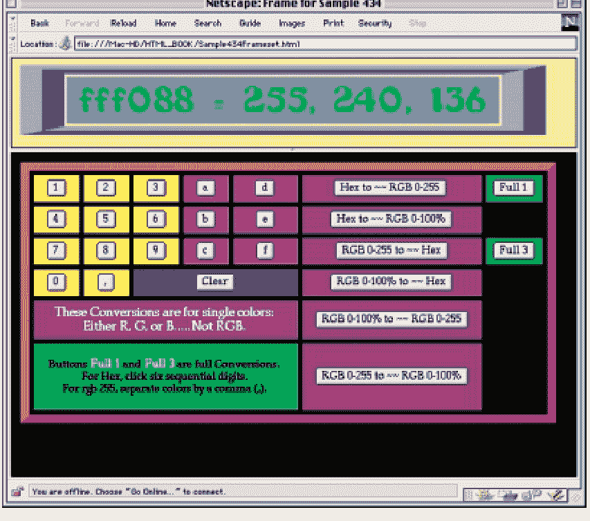

示例 3-34 的框架集代码见下一页。

所有已识别的 JavaScript 颜色名称及其 HEX、rgb% 和 rgb 数值等效值均收录于附录 B 的图表中，自第 1033 页起。相同信息也包含在 CD-ROM 的示例文件中：

```
Sample1100-AllColorValues.html
```

如果你只想查看所有实际显示的颜色及其名称，请查看 Sample1100-AllColorNames.html。

## 示例 3-34 第二部分：Sample434Frameset.html

```
<!DOCTYPE HTML PUBLIC "-//W3C//DTD HTML 3.2//EN">
<HTML>
<HEAD> <TITLE>Frame for Sample 434</TITLE> </HEAD>

<FRAMESET ROWS="140,*">

    <FRAME MARGINHEIGHT=0 SCROLLING="no" NAME="display" SRC="Sample434A.html">

    <FRAME SCROLLING="auto" NAME="main" SRC="Sample434.html">

</FRAMESET>

</HTML>
```

## 一个包含边框动画和音乐的综合示例

示例 3-35 的主要目的是将目前涵盖的一些主题整合到一个你可能在实际网页中见到的页面中，除了 60 MB 的音效文件大小之外。在真实网站中，你通常会看到链接，并且很可能只提供一段音效预览并附带购买选项，但由于这是放在 CD-ROM 上的，因此我收录了整首歌曲——由我**创作、演奏、混音**并**录制**。希望你喜欢。

本示例具有以下特性：窗口状态栏中显示自动更新的日期、时间以及在网站停留时长；内嵌了歌曲《*Journeys of Illumination*》的音效文件；页面边缘有动画彩虹条形成移动边框；页面四角有旋转的地球仪。

两个按钮控制一个图层，该图层会动画显示一个横幅，上面列出歌曲不同乐章的名称。另外两个按钮控制包含 CD 图像和 CD 曲目列表的两个图层的动画。鼠标悬停和移出事件也可以显示和隐藏这两个图层。

音频文件设置为自动播放，通过将宽度和高度属性分别设为 144 和 60（所需的最小值）来显示 Navigator 音频控制控件。屏幕截图见第 361 页。

## 示例 3-35 第一部分：Sample435.html

```
<!DOCTYPE HTML PUBLIC "-//W3C//DTD HTML 3.2//EN">
<HTML>
<HEAD>
<TITLE>Sample 435 - Example 3-35 Border Animation and Music        </TITLE>
```

## 第一部分 —— 动态 HTML

```
<STYLE TYPE="text/JavaScript">
	classes.Mainbody.BODY.margins("0px");
	classes.Mainbody.BODY.paddings("0px");
	classes.Mainbody.BODY.backgroundColor="black";
	classes.Mainbody.BODY.color="white";

	classes.SteelBlu.all.margins("0px");
	classes.SteelBlu.all.backgroundColor="steelblue";
	classes.SteelBlu.all.color="navy";
	classes.SteelBlu.all.fontSize="22pt";
	classes.SteelBlu.all.fontFamily="Clarendon, Helvetica, fantasy";
	classes.SteelBlu.all.paddings("15px");
	classes.SteelBlu.all.borderTopWidth="10px";
	classes.SteelBlu.all.borderRightWidth="30px";
	classes.SteelBlu.all.borderBottomWidth="10px";
	classes.SteelBlu.all.borderLeftWidth="30px";
	classes.SteelBlu.all.borderStyle="inset";
	classes.SteelBlu.all.borderColor="#5555ff";
	classes.SteelBlu.all.lineHeight="28pt";

	classes.RedBox.all.backgroundColor="yellow";
	classes.RedBox.all.fontSize="22pt";
	classes.RedBox.all.color="red";

	ids.L3.fontSize="20pt";
	ids.L3.fontFamily="Moonlight, 'Brush Script', Cloister, cursive";
	ids.L3.color="#8800ff";
	ids.L3.backgroundColor="cyan";

	classes.PurpleBox.all.width="420px";
	classes.PurpleBox.all.borderWidths("15px");
	classes.PurpleBox.all.borderColor="#8800ff";
	classes.PurpleBox.all.fontSize="17pt";
	classes.PurpleBox.all.borderStyle="groove";
	classes.PurpleBox.all.fontFamily="'Brush Script', fantasy";
	classes.PurpleBox.all.paddings("3px");
	classes.PurpleBox.all.color="yellow";
	classes.PurpleBox.all.backgroundColor="mediumblue";

	tags.H1.fontSize="23pt";
	tags.H1.color="red";

	tags.H4.fontSize="14pt";
	tags.H4.color="#007700";
	tags.H4.backgroundColor="#00ff44";
	tags.H4.fontFamily="Palatino, Times, Helvetica, serif";

	classes.LimeIt.all.color="lime";
	classes.LimeIt.all.fontSize="14pt";

	classes.Turqy.all.color="turquoise";

</STYLE>

<!--  ***********************************************************************************  -->
```


 # 第三章 — 图层与 JavaScript

```
<SCRIPT LANGUAGE="JavaScript1.2"><!--BEGIN HIDING

	startTime = new Date();

/*------------------------------------------------*/
//The getMonth() Method returns a zero to eleven numbering scheme for months
//such that January = 0, February = 1, ..., December = 11,
//so you have to increment the month by 1 if you need January to be 1 instead of 0
//which is used for the todayMonth variable, below.

function initializeTime()  {

	var today		= new Date();
	var todayMonth		= today.getMonth() +1;
	var todayDay		= today.getDate();
	var todayYear		= today.getYear();
	var todaysHours		= today.getHours();
	var todaysMinutes	= today.getMinutes();
	var todaysSeconds	= today.getSeconds();
	var later		= new Date();
	var TimeHere		= Math.round((later - startTime) / 60000);

	todaysHours = ((todaysHours > 12)  ?  todaysHours - 12  :  todaysHours);

	var showTime= "The Date is:  "+ todayMonth +"/"
	showTime += todayDay +"/"
	showTime += todayYear
	showTime += " *****  The Time is:   " + todaysHours
	showTime += ((todaysMinutes > 9)  ?  " :"  :  " :0")
	showTime += todaysMinutes
	showTime += ((todaysSeconds > 9)  ?  " :"  :  " :0")
	showTime += todaysSeconds
	showTime += ((todaysHours >= 12)  ?  " PM"  :  " AM")
	showTime += " ***** You have been here "
	showTime += TimeHere + " Minutes."

	window.status = showTime;

	setTimeout('initializeTime()', 1000);
}
/*------------------------------------------------*/
//END HIDING-->
</SCRIPT>

</HEAD>
<!--  *************************************************************  -->
<BODY CLASS="Mainbody" onLoad="initializeTime();"
BACKGROUND="JPEG-FILES/icon-BG-asteroids.jpg">

<LAYER CLASS="SteelBlu" ID="L1" LEFT=0 TOP=-10 WIDTH="100%">

<LAYER CLASS="RedBox" ID="L2" LEFT=55 TOP=28>
<NOBR>HI!
<FONT COLOR="#7700ee">Journeys of Illumination</FONT>
has 5 movements. It starts with
<FONT COLOR="#7700ee">Fanfare of Twilight</FONT>
which blends into
<FONT COLOR="#7700ee">Dance of Awakening</FONT>.
```

## 354
# 第一部分 — 动态 HTML

```
<FONT COLOR="#7700ee">Thought-Travel Meandering in a Time-Free Space-Like Domain</FONT>
is the third movement which melds into
<FONT COLOR="#7700ee">Dimensional Freefall</FONT>
and the song concludes with
<FONT COLOR="#7700ee">Wanderjahr Ever Onward</FONT>.</NOBR>
</LAYER>

<LAYER CLASS="RedBox" ID="L3" LEFT=0 TOP=80 WIDTH=340>
<FORM NAME="form3">Click to:
<INPUT TYPE="button" NAME="b1" VALUE="Move Banner" onClick="StartBanner();">
<INPUT TYPE="button" NAME="b2" VALUE="Stop Banner" onClick="StopBanner();"><BR><BR>
<EMBED SRC="./Sample-ETOC/Journeys-Of-Illumination.aiff" AUTOSTART="true" WIDTH=144 HEIGHT=60>
<INPUT TYPE="button" NAME="b7" VALUE="Slide Album" onClick="showAlbumText(); slideAlbum();">
<INPUT TYPE="button" NAME="b8" VALUE="Slide Back" onClick="slideAlbumBack(); slideAlbumText(); hideAlbumText();"><BR><BR>

The song that is playing is called <BR>
<FONT COLOR="#2200cc">Journeys of Illumination</FONT> <BR>
which is the title track of the album and was composed, played and recorded in Sedona, Arizona in 1992.<BR><BR>
<H4>The Date, Time and Length of Stay at this site are down here in the status bar.</H4>
</FORM></LAYER>

<!--  **********************************  -->
<LAYER CLASS="PurpleBox" ID="L4Text" LEFT=350 TOP=80 VISIBILITY="hide" WIDTH=370 onMouseOut="bringAlbumBack();">
<H1>Journeys of Illumination</H1>
Journeys of Illumination <SPAN CLASS="LimeIt">Song Time 11:02</SPAN><BR>
<SPAN CLASS="Turqy">
Fanfare of Twilight<BR>
Dance of Awakening<BR>
Thought-Travel Meandering in a Time-Free Space-Like Domain<BR>
Dimensional Freefall<BR>
Wanderjahr Ever Onward<BR></SPAN>
Sagacity in Solitude<BR>
Musing Spirals<BR>
Furthur<BR><BR>
</LAYER>

<LAYER CLASS="PurpleBox" ID="L4" LEFT=350 TOP=80 WIDTH=350 onMouseOver="revealAlbumText();">

</LAYER>
<!--  **********************************  -->

</LAYER>

<!--  This layer is necessary to have the border on top of the scrolling banner -->

<LAYER CLASS="SteelBlu" ID="L7" LEFT=0 TOP=-10 WIDTH="100%">
</LAYER>

<!--  ***************************************************************  -->
```

## 第三章 — 图层与 JavaScript

```
<SCRIPT LANGUAGE="JavaScript1.2"><!--BEGIN HIDING

	var booleanTest = true;

function ScrollBanner() {

	if (booleanTest == true) {

			if (document.L1.document.L2.left > -
document.L1.document.L2.clip.width)
					document.L1.document.L2.moveBy(-10,0);
			else document.L1.document.L2.moveTo(document.L7.clip.width, 28);

			setTimeout('ScrollBanner()', 100);
	}
	else document.L1.document.L2.moveTo(document.L1.document.L2.left, 28);
}

function StopBanner() {
	booleanTest = false;
}

function StartBanner() {
	booleanTest = true;
	ScrollBanner();
}

/*--------------------------------------------------------------------*/
/*--------------------------------------------------------------------*/

function revealAlbumText() {

	document.L1.document.L4.moveTo(1000,80);
	document.L1.document.L4Text.visibility="show";
	document.L1.document.L4Text.moveTo(350,80);
}

function bringAlbumBack() {

	document.L1.document.L4.visibility="show";
	document.L1.document.L4Text.visibility="hide";
	document.L1.document.L4.moveTo(350,80);
}
/*-------------------------------------------------*/

function showAlbumText() {

	document.L1.document.L4Text.visibility="show";
	document.L1.document.L4Text.moveTo(350,80);
}
function slideAlbum() {

		if (document.L1.document.L4.top < 600) {
		document.L1.document.L4.moveBy(0,20);
		setTimeout('slideAlbum()', 100);
	}
}
/*-------------------------------------------------*/
```

```
function slideAlbumBack()  {

        if (document.L1.document.L4.top > 80) {
        document.L1.document.L4.moveBy(0,-20);
        setTimeout('slideAlbumBack()', 100);
        }
}

function slideAlbumText()  {

        if (document.L1.document.L4Text.top < 600) {
        document.L1.document.L4Text.moveBy(0,20);
        setTimeout('slideAlbumText()', 100);
        }
}

function hideAlbumText()  {

        if (document.L1.document.L4Text.top >= 600) {
        document.L1.document.L4Text.moveTo(350,80);
        document.L1.document.L4Text.visibility="hide";
        }
}
/*-----------------------------------------------------------------------*/
//END HIDING-->
</SCRIPT>
</BODY>
</HTML>
```

本示例的这部分包含一个旋转的地球，主框架集将其加载四次，使其显示在页面的四个角落。

## 示例 3-35 第二部分：

## Sample435-1.html

```
<!DOCTYPE HTML PUBLIC "-//W3C//DTD HTML 3.2//EN">
<HTML><HEAD>  <TITLE> Sample 435-1 - Example 3-35-1   globe in corners    </TITLE>

<STYLE TYPE="text/JavaScript">

        classes.Mainbody.BODY.margins("0px");
        classes.Mainbody.BODY.paddings("0px");
        tags.LAYER.width="100%";
</STYLE>
</HEAD>
<BODY CLASS="Mainbody">

<LAYER ID="L1" LEFT=0 TOP=0>

</LAYER>

</BODY></HTML>
```

本示例的这部分包含一个动画彩虹，位于顶部中间框架中，从左向右移动。

## 示例 3-35 第三部分：Sample435-2.html

```
<!DOCTYPE HTML PUBLIC "-//W3C//DTD HTML 3.2//EN">
<HTML>
<HEAD>
<TITLE>Sample 435-2 - Example 3-35-2 top rainbow </TITLE>

<STYLE TYPE="text/JavaScript">

  classes.MainBody.BODY.margins("0px");
  classes.MainBody.BODY.paddings("0px");
  classes.MainBody.BODY.backgroundImage="/JPEG-FILES/icon-BG-stars.jpg";

</STYLE>

<SCRIPT LANGUAGE="JavaScript1.2"><!--BEGIN HIDING

function MoveIt2() {

  if (document.L2.left < document.L2.clip.width) document.L2.moveBy(20,0);
  else document.L2.moveTo(-504,0);
  setTimeout("MoveIt2()", 10);

}

//END HIDING-->
</SCRIPT>

</HEAD>

<BODY CLASS="Mainbody">

<LAYER ID="L2" LEFT=0 TOP=0 WIDTH="100%">


</LAYER>

</BODY>
</HTML>
```

本示例的这部分包含一个动画彩虹，位于左侧中间框架中，从下向上移动。


 ## 示例 3-35 第4部分：Sample435-4.html

```
<!DOCTYPE HTML PUBLIC "-//W3C//DTD HTML 3.2//EN">
<HTML><HEAD>  <TITLE>Sample 435-4 - Example 3-35-4  left rainbow </TITLE>
<STYLE TYPE="text/JavaScript">
      classes.Mainbody.BODY.margins("0px");
      classes.Mainbody.BODY.paddings("0px");
      classes.Mainbody.BODY.backgroundImage="./JPEG-FILES/icon-BG-stars.jpg";
</STYLE>
<SCRIPT LANGUAGE="JavaScript1.2"><!--BEGIN HIDING
function MoveIt4() {
      if (document.L4.top > -504) document.L4.moveBy(0,-20);
      else document.L4.moveTo(0, document.L4.clip.height);
      setTimeout('MoveIt4()', 10);
}
//END HIDING-->
</SCRIPT>
</HEAD>
<BODY CLASS="Mainbody">
<LAYER ID="L4" LEFT=0 TOP=0 WIDTH="100%">

</LAYER>
</BODY></HTML>
```

本示例部分展示了右侧中间框架中从顶部到底部移动的动画彩虹。

## 示例 3-35 第5部分：Sample435-7.html

```
<!DOCTYPE HTML PUBLIC "-//W3C//DTD HTML 3.2//EN">
<HTML><HEAD><TITLE>Sample 435-7 - Example 3-35-7  right rainbow  </TITLE>
<STYLE TYPE="text/JavaScript">
      classes.Mainbody.BODY.margins("0px");
      classes.Mainbody.BODY.paddings("0px");
      classes.Mainbody.BODY.backgroundImage="./JPEG-FILES/icon-BG-stars.jpg";
</STYLE>
<SCRIPT LANGUAGE="JavaScript1.2"><!--BEGIN HIDING

function MoveIt7() {

	if (document.L7.top < document.L7.clip.height) document.L7.moveBy(0,20);
	else document.L7.moveTo(0, -504);
	setTimeout('MoveIt7()', 10);
}

//END HIDING-->
</SCRIPT>
</HEAD>

<BODY CLASS="Mainbody">

<LAYER ID="L7" LEFT=0 TOP=0 WIDTH="100%">

</LAYER>

</BODY>
</HTML>
```

本示例部分展示了底部中间框架中从右到左移动的动画彩虹。

## 示例 3-35 第6部分：Sample435-9.html

```
<!DOCTYPE HTML PUBLIC "-//W3C//DTD HTML 3.2//EN">
<HTML>
<HEAD>
<TITLE>Sample 435-9 - Example 3-35-9   bottom rainbow        </TITLE>

<STYLE TYPE="text/JavaScript">

	classes.Mainbody.BODY.margins("0px");
	classes.Mainbody.BODY.paddings("0px");
	classes.Mainbody.BODY.backgroundImage="./JPEG-FILES/icon-BG-stars.jpg";

</STYLE>

<SCRIPT LANGUAGE="JavaScript1.2"><!--BEGIN HIDING

function MoveIt9() {

	if (document.L9.left > -504) document.L9.moveBy(-20,0);
	else document.L9.moveTo(document.L9.clip.width, 0);
	setTimeout('MoveIt9()', 10);
}

//END HIDING-->
</SCRIPT>
</HEAD>
```

```
<BODY CLASS="Mainbody">

<LAYER ID="L9" LEFT=0 TOP=0 WIDTH="100%">


</LAYER>

</BODY>
</HTML>
```

本示例部分包含主框架集（Frameset）。

## 示例 3-35 第7部分：Sample435-Frameset.html

```
<!DOCTYPE HTML PUBLIC "-//W3C//DTD HTML 3.2//EN">
<HTML><HEAD>
<TITLE>Frameset for Sample 435 </TITLE> </HEAD>

<FRAMESET ROWS="24%,24%" BORDER="0">

<FRAMESET COLS="24%,24%"
<FRAME SCROLLING="no" NAME="F1" SRC="Sample435-1.html">
<FRAME SCROLLING="no" NAME="F2" SRC="Sample435-2.html">
<FRAME SCROLLING="no" NAME="F3" SRC="Sample435-1.html">
</FRAMESET>

<FRAMESET COLS="24%,24%"
<FRAME SCROLLING="no" NAME="F4" SRC="Sample435-4.html">
<FRAME SCROLLING="no" NAME="F5" SRC="Sample435.html">
<FRAME SCROLLING="no" NAME="F7" SRC="Sample435-7.html">
</FRAMESET>

<FRAMESET COLS="24%,24%"
<FRAME SCROLLING="no" NAME="F8" SRC="Sample435-1.html">
<FRAME SCROLLING="no" NAME="F9" SRC="Sample435-9.html">
<FRAME SCROLLING="no" NAME="F10" SRC="Sample435-1.html">
</FRAMESET>

</FRAMESET>
</HTML>
```

由于涉及层（Layers）和事件（Events）的信息相当长且复杂，我决定将其放在第6章中，以避免重复并 hopefully 简化学习过程。如果您对 JavaScript 对象、函数、语句、运算符和表达式有充分的了解，或者您只是想立即学习事件，那么请直接跳到第6章，我们将在那里介绍与层和 JavaScript 事件对象模型相关的事件。

## 示例 3-35 Sample435Frameset.html

---

## 第二部分
### JavaScript 1.2

## 第4章
### 对象与函数

---

## 第4章
### 对象与函数

### 目录

### JavaScript 对象
- 4.1) JavaScript 对象层级结构
- 4.2) 使用 JavaScript 对象
- 4.3) 对象属性与方法

### JavaScript 函数
- 4.4) 使用 Function 语句定义函数
- 4.5) 通过属性赋值调用函数
- 4.6) 通过名称调用函数
- 4.7) 在函数内部调用函数
- 4.8) 通过属性赋值调用函数
- 4.9) JavaScript 核心函数对象
- 4.10) 函数的 arguments[i] 数组属性
- 4.11) 在函数中嵌套函数

### 汇总图表
- 4.12) 预定义 JavaScript 对象
- 4.13) 预定义 JavaScript 数组作为对象属性
- 4.14) 预定义 JavaScript 核心对象
- 4.15) 预定义 JavaScript 核心函数

### JavaScript 核心对象
- 4.16) JavaScript 核心对象概述
- 4.17) 使用其构造函数创建对象
- 4.18) 为对象创建方法
- 4.19) 在对象定义中将对象作为属性
- 4.20) 使用 prototype 属性为对象类型添加方法
- 4.21) 在定义后向对象实例添加属性
- 4.22) 使用 prototype 属性为对象类型添加属性
- 4.23) 对象的属性索引
- 4.24) 使用字面量表示法创建对象
- 4.Prost) 删除对象
- 4.26) 核心对象的 watch() 方法
- 4.27) 核心对象的 unwatch() 方法

### 预定义 JavaScript 对象
- 4.28) JavaScript **window** 对象
- 4.29) **window** 对象的 **open()** 方法
- 4.30) **window** 对象的 **close()** 方法
- 4.31) **window** 对象的 **scrollBy()** 方法
- 4.32) JavaScript **document** 对象
- 4.33) **document** 对象的 **cookie** 属性
- 4.34) JavaScript **screen** 对象
- 4.35) JavaScript **Location** 对象
- 4.36) JavaScript **History** 对象
- 4.37) JavaScript **navigator** 对象
- 4.38) 动态创建框架
- 4.39) JavaScript **Number** 核心对象
- 4.40) JavaScript **select** 对象
- 4.41) JavaScript **options[i]** 数组
- 4.42) JavaScript **option** 对象

### 新的 JavaScript 核心函数
- 4.43) JavaScript **Number** 核心函数
- 4.44) JavaScript **String** 核心函数

---

## JavaScript 对象

### JavaScript 对象层级结构

---

## 使用 JavaScript 对象

请将本章视为 JavaScript 对象的概述。本章旨在阐明对象运作的一般框架，以及它们如何相互关联并与 JavaScript 的其他方面相互作用。本章不会详述每个对象的所有细节。有关该信息，请参阅 CD-ROM 中的 JavaScript 参考手册。本章将阐明对象的基本参数，并演示某些对象中更有趣和有用的特性。

每次您将页面加载到 Navigator 中时，JavaScript 编译器会根据您编写的 HTML 创建某些对象。这个最小对象集由 **navigator**、**window**、**document**、**location** 和 **history** 对象组成。根据您编写的页面内容，显然还可能有其他由编译器生成的对象。所有这些对象都存在于一个对象层级结构中，可以通过点号表示法调用对象来访问。前一页上的图表展示了该结构。

## 对象属性与方法

这些对象都具有与其各自对象相关联的特定属性和方法，它们可以被访问和操作。对象的属性基本上是一个预定义的变量，您可以使用简单的点号表示法语法为其赋值，如下所示：

```
objectName.propertyName = value
```

例如，如果您想将 **document** 对象的背景颜色改为蓝色，您可以访问 **bgColor** 属性并将字符串 "blue" 赋值给它，如下所示：

```
document.bgColor = "blue"
```

对象的方法只是 Netscape 已经分配给对象的一个预定义函数。您可以使用相同的点号表示法在对象上调用方法，如下所示：

```
objectName.methodName()
```

**window** 对象是页面中所有其他对象的父对象，这意味着它位于所有页面内容层级结构的顶部，包括那些具有 FRAMESET 和 FRAME 的页面。这意味着所有其他对象都是它的后代或子对象。某些子对象如 **document** 对象也是层级结构中更低层其他对象的父对象或容器对象。所有子对象都被说成是其各自父对象的属性，因此它们可以使用 JavaScript 进行引用和操作。


 ## 第二部分 — JavaScript 1.2

假设你想在脚本中的某个时刻让窗口获得焦点。你可以通过引用 **window** 对象并调用 **focus()** 方法来实现，如下所示：

```
window.focus();
```

现在需要说明的是，由于 **window** 对象始终是最顶层的父对象，Netscape 允许你在涉及其他对象的表达式中省略它，因为它总是被默认为存在。这样可以减少你的输入量。

**document** 对象是层级结构中的下一个主要父级单元。它是大多数其他 JavaScript 对象的祖先。它不包含 **navigator**、**frame**、**location**、**history** 或 **mimeType** 对象。

假设你有一个名为 **myImage1** 的 **image** 对象，并且你想通过将其设置为一个不同的 URL 来更改 **src** 属性。要访问 **image** 对象，你可以通过名称调用它或使用 **images[i]** 数组，但你还需要通过层级结构来访问它。还有另一种思考方式。将图像想象成具有一个名称和在页面中的特殊位置，这些由其层级名称指定，就像家谱一样。这个名称由它所有的祖先追溯到 **document** 对象组成（实际上是 **window** 对象，但请记住你可以省略它）。因此，对于 **document** 中名为 **myImage1** 的 **image**，你可以这样更改其 **src** 属性：

```
document.myImage1.src = "nextImage2.jpg"
```

如果这是 **document** 中的第一个图像，你可以使用 **images[i]** 数组这样引用它：

```
document.images[0].src = "nextImage2.jpg"
```

或者通过 **images[i]** 数组中的名称这样引用它：

```
document.images["myImage1"].src = "nextImage2.jpg"
```

## 更改 text 对象的值

假设你有一个名为 **myForm1** 的 **form**，其中包含一个 INPUT TYPE="text" 且名为 **myText1** 的对象。要更改显示在该 **text** 对象中的文本字符串，你需要设置 **text** 对象的 **value** 属性，如下所示：

```
document.myForm1.myText1.value = "the new text string";
```

## 在 form 对象中引用对象

这里会会稍微复杂一些。如果你有一个 **link** 对象位于 **form** 对象中，而该对象实际上并不需要放在 **form** 对象中，你在引用 **link** 对象时仍然必须引用 **form** 对象。例如，如果你想更改文档中第三个 **link** 的 **target** 属性，而该链接恰好位于名为 **myForm1** 的 **form** 中，你需要使用 2 作为索引来访问 **links[i]** 数组中的第三个元素，并使用以下代码：

## 引用 Layer 对象

当你引用 **Layer** 对象时会更加复杂，因为每个 **Layer** 对象内部都有自己版本的 **document** 对象，该对象包含与其外部大兄弟相同类型的数据，但其参数仅适用于其直接的父 **Layer**。当你引用 **Layer** 对象时，你总是必须引用其父 **document** 对象。当你想要引用 **Layer** 对象的属性时，你不需要引用 **Layer** 的内部 **document** 对象。当你想要引用包含在 **Layer** 对象内部的对象时，你总是必须引用 **Layer** 对象的内部 **document** 对象。以下是对这三种可能性的演示。

假设你有一个名为 **myLayer1** 的 **Layer**，你可以这样引用它：

```
document.myLayer1
```

现在假设你想用 **bgColor** 属性更改该 **Layer** 的背景颜色，你可以这样编写代码：

```
document.myLayer1.bgColor = "blue";
```

现在假设你想更改位于名为 **myLayer1** 的 **Layer** 内部、名为 **myForm1** 的 **form** 对象中、名为 **myText1** 的 **text** 对象的文本字符串。你必须像这样访问 **myLayer1** 对象的 **document** 对象：

```
document.myLayer1.document.myForm1.myText1.value = "Hey Now.";
```

## 引用 select 对象

最后一个例子。假设你有一个名为 **getColor** 的 **select** 对象，并且你想将当前选中的颜色选项赋值给你定义为 **bcolorSel** 的变量。现在，如果 **select** 对象包含在名为 **form1** 的 **form** 中，而 **form1** 又位于名为 **L2** 的 **Layer** 的 **document** 对象内部，那么如果你一次性全部写出来，你将会写出非常长的一行代码。请记住，你必须使用 **select** 对象的 **selectedIndex** 属性作为 **options[index]** 数组的 **index**，而这个数组本身也有很长的引用链。以下是在一行代码中引用这些对象的方式：

```
var bcolorSel = document.L2.document.form1.getColor.options[document.L2.document.form1.getColor.selectedIndex].value;
```

你可以看到将其分解成更小的块并将这些块赋值给不同的变量，然后适当地替换变量的优势，如下所示：

```
var L2 = document.L2;
var getColor = L2.document.form1.getColor;
var sel = getColor.selectedIndex;
var bcolorSel = getColor.options[sel].value;
```

你可以在 [Sample724.html](Sample724.html) 中看到这段代码非常相似的实现，它在第 6 章的示例 6-24 中解释，位于第 650-656 页。

有关 **select** 对象的更多信息，请参阅本章后面的第 462-465 页。

## 图表及其他即将讨论的主题

在第 386-388 页，有四张图表列出了 Netscape 为你创建的所有预定义 JavaScript 对象、预定义 JavaScript 数组、预定义 JavaScript 核心对象和预定义 JavaScript 核心函数，供你在脚本中使用。新加入 JavaScript 1.2 的对象以及一些更重要或更晦涩的对象在本书中有所介绍。详细检查和审视 JavaScript 中所有可用的对象超出了本书的范围，事实上这需要一本专门的书才能做到。本章将向你展示如何使用现有对象、JavaScript 运行时引擎如何创建它们，以及如何用它们的属性和方法操作内容。有关本书未涵盖的 JavaScript 对象的更多详细信息，请参阅 CD-ROM 上的 JavaScript 参考资料。

除了 JavaScript 的预定义对象外，你还可以创建自己的对象并为其定义属性和方法。这个过程在汇总图表之后有详细介绍。

你还可以创建自己的函数，这是有效利用 JavaScript 的基本工具之一。在下一部分中，将介绍定义函数的过程，然后是调用函数的三种方式，即你可以执行函数中包含的语句的方式。

其他主题包括核心 JavaScript **Function** 对象、**arguments[i]** 数组，以及将一个函数嵌套在另一个函数内部的能力，这样外部函数的参数就可以被内部函数使用（但反之则不行）。这是 Navigator 4.0 的新功能。

在本章的最后，介绍了用于 Navigator 4 的 **Number** 和 **String** 两个新函数。

# JavaScript 函数

## 概述

基本上，函数是一个过程，它包含一系列 JavaScript 语句以完成某项任务。要将函数集成到你的文档中，你必须首先在 SCRIPT 中定义它，通常包含在 HEAD 元素中。然后你必须调用该函数。调用函数可以通过多种方式实现，包括从另一个函数内部调用函数。在许多情况下，函数被用作 HTML 元素的事件处理程序的值来调用，这称为属性赋值。调用函数最简单的方法是直接使用其名称作为语句。你可以使用 **return** 语句通过函数返回值。

通常建议将你的函数定义在文档的 HEAD 中，这样函数会先加载，然后再加载 BODY 中的任何 HTML 元素。这可以避免由于文档某部分的脚本试图与尚未加载的另一个脚本交互而产生许多 JavaScript 运行时错误。这通常发生在用户尝试在页面完全加载之前点击按钮对象，而该按钮需要尚未加载的代码才能工作。由于所需的代码尚未加载，你会得到运行时错误。HEAD 脚本也有例外情况。请参阅第 367、392-401 页了解方法及其与函数的区别。

## 使用 Function 语句定义函数

定义函数首先使用 **function** 关键字，后跟函数名称，然后是用括号括起来的、以逗号分隔的参数列表。你可以定义一个不带参数的函数，但你仍然需要包含括号。接下来是用分号分隔并用花括号 {} 括起来的一系列语句。例如，以下函数 **setColor()** 不带参数，并在调用时将背景颜色设置为紫色：

```
function setColor() {
    document.bgColor = "purple";
}
```

#### 语法：

```
function functionName(argument1, argument2, ..., argumentN) {
    statement1;
    statement2;
    ...
    statementN;
}
```


 ## 通过属性赋值调用函数

定义函数只是让函数执行其语句的第一步。接下来，你必须在 SCRIPT 中调用该函数，或者将其赋值给 HTML 元素的某个事件处理程序，如下面的场景所示：

要启动此场景的过程，你可以为之前定义的 **setColor()** 函数添加一个 **color** 参数，使其更加实用，就像这样：

```
function setColor(color) {
    document.bgColor = color;
}
```

这样，当 **setColor()** 函数被调用时，背景色将会更改为当时提供的 **color** 参数，而且每次调用函数时该参数可以不同。例如，假设你定义了三个按钮对象，每个按钮都将其各自的 **onClick** 事件处理程序赋值为 **setColor()** 函数，就像这样：

```
<INPUT TYPE="button" VALUE="Blue it" onClick="setColor('blue');">
<INPUT TYPE="button" VALUE="Lime it" onClick="setColor('lime');">
<INPUT TYPE="button" VALUE="Red it" onClick="setColor('red');">
```

那么，如果用户点击第一个按钮，**setColor()** 函数会使用字符串 'blue' 作为 **color** 参数，将背景色更改为蓝色。如果用户点击第二个按钮，**onClick** 事件处理程序使用相同的 **setColor()** 函数，但提供了不同的字符串值作为 **color** 参数，从而使背景色更改为绿色（lime）。对于以 'red' 作为 **color** 参数的按钮也是如此。

## 函数中的语句

函数内部的语句几乎可以是任何类型的 JavaScript 表达式，可以包括（但不限于）：变量、字面量、数组、字符串、数字、关键字、对象、正则表达式、运算符，以及任何特殊的 JavaScript 语句，如 **if()…else** 和 **for()**，这些在第 5 章中都有介绍。正如前面提到的，你甚至可以在函数中嵌套函数，或者在函数内部调用同一个函数，这被称为*递归*函数。后一种可能性在使用 **setTimeout()** 和 **setInterval()** 方法、创建执行 JavaScript 动画的脚本，以及使用 **Date** 对象显示或使用日期和时间数据时非常有用。详见第 3 章的示例和详细信息。

## 函数中的参数

函数中的参数是变量的占位符，用于传递给函数的值，可以是字符串、数字、日期，甚至是其他完整的对象。

## 通过名称调用函数

通过名称调用函数有几种场景。我们要处理的第一个场景是当你想要更改页面的 HTML 布局时。在这种情况下，你必须通过名称调用函数，即在文档 BODY 中的 SCRIPT 内包含函数的名称，前提是它所引用的 HTML 已经加载到文档中。注意，当你使用函数来初始布局文档时（例如使用 write() 方法）并非如此；只有当你想要更改页面中的某些内容时才是这样。

例如：通过在文档的 HEAD 中定义之前相同的 setColor() 函数，然后在 BODY 中的单独脚本中通过名称调用它来执行它。注意，括号是包含在内的。

### 示例 4-0：Sample500.html

```
<!DOCTYPE HTML PUBLIC "-//W3C//DTD HTML 3.2//EN">
<HTML>
<HEAD>
<TITLE>Sample 500 - Example 4-0 Define and Call a Function </TITLE>

<SCRIPT LANGUAGE="JavaScript1.2"><!--BEGIN HIDING

		function setColor() {
			document.bgColor = "purple";
		}

//END HIDING-->
</SCRIPT>

</HEAD>

<BODY>

<SCRIPT LANGUAGE="JavaScript1.2"><!--BEGIN HIDING

		setColor();

//END HIDING-->
</SCRIPT>

<H2>			在第二个脚本中调用 setColor() 函数实际上
会改变背景颜色。如果没有显式调用，该函数只在
HEAD 中定义，而不会执行。
</H2>

</BODY>

</HTML>
```

在示例 4-1 中，`setText()` 函数既在文档的 HEAD 中定义，随后也在 HEAD 中被调用。实际上你可以在文档的 BODY 中调用该函数，但最佳做法是将尽可能多的脚本放在 HEAD 中，以避免运行时错误。你可以在 HEAD 中调用 `setText()` 函数的原因是，它是在为页面布局做出贡献，而不是在 HTML 渲染后更改页面。

这是你在调试代码时需要注意的一个区别点。

### 示例 4-1：Sample501.html

```
<!DOCTYPE HTML PUBLIC "-//W3C//DTD HTML 3.2//EN">
<HTML>
<HEAD>
<BASEFONT SIZE="7">

<TITLE>Sample 501 - Example 4-1 Define and Call a Function </TITLE>

<SCRIPT LANGUAGE="JavaScript1.2"><!--BEGIN HIDING

function setText()
{

document.write("Hello out there.");

}

setText();

//END HIDING-->
</SCRIPT>

</HEAD>

<BODY>

<H2>
<FONT COLOR="#FF0000">

注意，在这种情况下，函数是在文档的 HEAD 中被调用的，因为它<U>不是在更改</U>布局，而是<U>在贡献于初始布局</U>。

</FONT>

</H2>

</BODY>
</HTML>
```

## 在函数内部调用函数

此示例演示了如何在另一个函数内部调用函数。由于 **setText()** 和 **setDiffText()** 函数都要引用由 JavaScript 解释器创建的 JavaScript 对象，而这些对象是在 BODY 中创建这些元素的 HTML 加载后才创建的，因此脚本包含在 BODY 中相关 HTML 之后。**setText()** 函数首先被定义，然后在 **setDiffText()** 函数中被调用。这两个函数还分别赋值给两个链接的事件处理程序，以便文本框中的文本会根据光标悬停和离开哪个链接而发生变化。

### 示例 4-2：Sample502.html

```
<!DOCTYPE HTML PUBLIC "-//W3C//DTD HTML 3.2//EN">
<HTML>          <HEAD>          <BASEFONT SIZE="5">
<TITLE>Sample 502 - Example 4-2 Call a Function within a Function</TITLE>  </HEAD>
<BODY BGCOLOR="lime">

<A HREF="Sample502.html" onMouseOver="setText('blue');"
onMouseOut="setDiffText();">
        Test Link Number 1.   </A>   <BR><BR>

<A HREF="Sample502.html" onMouseOver="setText('yellow');"
onMouseOut="setDiffText();">
        Test Link Number 2.   </A>   <BR><BR>

<FORM NAME="form1">   <INPUT TYPE="text" NAME="text1" SIZE=50>     </FORM>

Two Test Links to Change Text in the Text box by moving the mouse over a link and
away from the link.

<SCRIPT LANGUAGE="JavaScript1.2"><!--BEGIN HIDING

function setText(getText) {
        document.form1.text1.value = getText;
}

function setDiffText() {

        var t = document.form1.text1.value;

        if (t == 'blue')     { document.form1.text1.value = 'red'; }

        else { setText('purple'); }
}

//END HIDING-->
</SCRIPT>
</BODY></HTML>
```

## 通过属性赋值调用函数

通过属性赋值调用函数与属性赋值类似，但有几个重要区别。下面是一个快速的小示例，解释紧随其后。

```
<SCRIPT LANGUAGE="JavaScript1.2"><!--BEGIN HIDING

    function setColor() {
        document.bgColor = "purple";
    }

    document.onmouseup=setColor;

//END HIDING-->
</SCRIPT>
```

你应该立即注意到，当通过属性赋值将定义的 `setColor()` 函数赋值给 `document` 对象的 `onmouseup` 事件处理程序时，名称后面没有附带括号。这意味着函数在定义时括号内的任何参数都会由 JavaScript 解释器在函数内部自动转发。在某些情况下，尤其是在处理 `Event` 对象时，这可能是一个优势。事实上，这种不需要手动编写 `event` 关键字参数的能力，是处理事件和事件处理时使用它的主要原因。

另一方面，如果你的函数中有参数，你想在脚本的不同点手动更改它，这可能是一个明显的劣势，至少在一定程度上，你将不得不以不同于你习惯的算法方案来编写函数。例如，如果你稍微修改 `setColor()` 函数，使其接受一个名为 `color` 的参数，就像这样：

```
function setColor(color) {
    document.bgColor = color;
}
```

这是很多作者通常定义函数的方式，当他们计划像这样在属性赋值中使用它时：

```
<INPUT TYPE="button" VALUE="Do it" onClick="setColor('blue')";>
```

你可能已经看到了尝试对此函数使用属性赋值的直接问题，因为没有办法将 'blue' 字符串附加到 `color` 参数上。为了解决这个问题，你需要提前计划，并以不同的方式定义你的函数，以适应替代的语法要求。一个解决方案在下面的示例 4-3 中演示。


## 第4章 — 对象与函数

这是一种通过分配事件参数 `e` 而不是 **color** 参数来定义函数的不同方式，然后设置 `if()` 语句，根据事件参数的值来更改背景颜色。核心 **String** 对象的 **fromCharCode()** 方法用于从 **Event** 对象 `e` 的 **which** 属性中提取字符串值，然后将其赋给 **theKey** 变量。

接着，**theKey** 变量在 `if()` 语句中与字符串字面量进行布尔测试，当测试为真时执行背景颜色更改。最后，**setColor()** 函数被赋给 **document** 对象的 **onkeypress** 事件处理程序。如果你决定在浏览器中运行此脚本，请确保按下 1、2 或 3 键时，主浏览器窗口获得焦点，而不是地址 URL 栏。

第6章"事件"中还有许多此类编码场景的额外示例。

## 示例 4-3：Sample503.html

```html
<!DOCTYPE HTML PUBLIC "-//W3C//DTD HTML 3.2//EN">
<HTML>
<HEAD>
<BASEFONT SIZE="5">
<TITLE>Sample 503 - Example 4-3     Function Call by Property Assignment</TITLE>

<SCRIPT LANGUAGE="JavaScript1.2"><!--BEGIN HIDING

//Press either the 1, 2 or 3 Key to change the background color.

     function setColor(e) {

          theKey = String.fromCharCode(e.which);

          if (theKey == "1") { document.bgColor = "purple"; }
          if (theKey == "2") { document.bgColor = "red"; }
          if (theKey == "3") { document.bgColor = "blue"; }
     }

     document.onkeypress=setColor;

//END HIDING-->
</SCRIPT>

</HEAD>

<BODY BGCOLOR="lime" onLoad="window.focus();">

Press either the 1, 2 or 3 Key to change the background color.

</BODY>
</HTML>
```

## JavaScript 核心函数对象

### JavaScript 语法：

```javascript
functionObjectName = new Function(["arg1", "arg2", ..., "argN"], "functionBody")
```

###### 参数定义：

**functionObjectName**

此参数可以是以下三种情况之一：
- 1) 一个变量名。
- 2) 已有对象的一个属性。
- 3) 一个对象后跟一个事件处理程序名称，该名称必须全部使用小写字符，例如 **document.onclick**。在这种情况下，不允许使用参数。

**arg1, arg2, ..., argN**

这些参数是可选参数，必须是字符串，用作函数的形式参数名称。

**functionBody**

这是一个字符串，包含要执行的 JavaScript 代码语句。这与使用函数语句定义的函数中花括号内包含的语句相同。

### 函数对象的来源差异

使用 **Function 构造函数** 创建的 **Function** 对象与使用 **Function** 语句声明的 **Function** 类似，但有两个非常重要的区别需要注意。首先，当一个 **Function** 对象被赋值给一个变量时，该变量被认为包含一个对使用 **Function 构造函数** 创建的 **Function** 的引用，该引用可以通过编程更改为包含不同的值，而声明的 **Function** 是静态的，即一旦声明，它将始终是该确切的 **Function**。

其次，**Function** 对象每次调用时都会被求值，这比只编译一次的声明式 **Function** 效率低。

以下是用于创建 **Function** 对象及其对应的声明式 **Function** 的代码示例，供比较之用：

### 函数对象

```javascript
myFunction = new Function("document.write('Tennis Rocks');")
```

### 声明式函数语句

```javascript
function myFunction() {
    document.write('Tennis Rocks');
}
```

## 第4章 — 对象与函数

### 函数对象

```javascript
setColor = new Function("color", "document.bgColor=color;")
```

### 声明式函数

```javascript
function setColor(color) {
	document.bgColor=color;
}
```

本示例演示了核心 **Function** 对象的两种实现方式。第一个名为 **setFGColor** 的 **Function** 对象使用 **color** 参数，该参数被赋给 **document** 对象的 **fgColor** 属性。当在下一行调用它时，使用 'red' 字符串作为 **color** 参数。第二个 **Function** 对象被赋给 **document** 对象的 **onclick** 事件处理程序，以便在点击时将 **document** 的背景颜色更改为石灰绿。

## 示例 4-4：Sample504.html

```html
<!DOCTYPE HTML PUBLIC "-//W3C//DTD HTML 3.2//EN">
<HTML>
<HEAD>
<BASEFONT SIZE="5">
<TITLE>Sample 504 - Example 4-4     Function Object</TITLE>

<SCRIPT LANGUAGE="JavaScript1.2"><!--BEGIN HIDING

	setFGColor = new Function("color", "document.fgColor=color;")

	setFGColor('red');

	document.onclick = new Function("document.bgColor='lime';")

//END HIDING-->
</SCRIPT>

</HEAD>

<BODY>

Click in the window to change the background color.

</BODY>
</HTML>
```

## 函数属性

| 属性 | 描述 |
| :--- | :--- |
| arguments[i] | 一个数组，包含传递给函数的所有参数以及函数的局部变量。 |
| arity | 指定函数期望的参数数量。 |
| caller | 返回调用当前正在执行的嵌套函数的外部函数的名称。caller 属性仅在函数体内已知。如果在函数体外部访问，该值为 null。 |
| prototype | 允许你为函数对象创建自定义属性。 |

## 函数方法

| 方法 | 描述 |
| :--- | :--- |
| toString() | 返回一个包含指定函数内部代码的字符串。 |

## 函数的 arguments[i] 数组属性

### JavaScript 语法：

```javascript
arguments[i]
arguments.argName
arguments.varName
```

### 内部嵌套函数的 JavaScript 语法：

```javascript
functionName.arguments[i]
functionName.arguments.argName
functionName.arguments.varName
```

arguments[i] 数组是函数的一个属性，其中 `i` 是从 0 到 `n` 的零基索引整数，`n=arguments.length-1`，每个数组元素包含函数的一个参数。在语法中，`functionName` 参数是包含参数的函数名称，该参数仅在从内部嵌套函数访问外部函数的属性时才需要。`argName` 是任意参数的名称，`varName` 是你访问的任意局部变量的名称。

你只能在函数声明时从函数体内部访问 arguments[i] 数组。如果你尝试在函数声明外部访问 arguments[i] 数组，将会发生 JavaScript 运行时错误。

## 第4章 — 对象与函数

在引用函数和 **Function** 对象时，必须始终通过名称引用它们，即使在函数体内也是如此，因为 **this** 关键字并不指向当前正在执行的函数。

如果你调用一个函数并传递给它的参数多于函数语句声明中正式声明接受的参数数量，你可以使用参数数组通过访问数组的每个元素来处理额外的参数。

例如，在以下脚本中，**tester()** 函数只声明了一个参数，即 **color**。然后它在 `for()` 语句中使用参数数组将调用时传递给它的每个参数写入屏幕。

## 示例 4-5：Sample505.html

```html
<!DOCTYPE HTML PUBLIC "-//W3C//DTD HTML 3.2//EN">
<HTML>
<HEAD>
<BASEFONT SIZE="5">
<TITLE>Sample 505 - Example 4-5 arguments Array</TITLE>

<SCRIPT LANGUAGE="JavaScript1.2"><!--BEGIN HIDING

function tester(color) {

    for (var i=0; i<tester.arguments.length; i++) {

        document.write(arguments[i] + "<BR>");
    }
}

tester("blue", "red", "green", "yellow");

//END HIDING-->
</SCRIPT>

</HEAD>

<BODY>
</BODY>
</HTML>
```

此脚本在浏览器中产生以下输出：

- blue
- red
- green
- yellow


 ## arguments[i] 数组属性

| 属性 | 说明 |
| :--- | :--- |
| length | 函数中的参数数量。 |
| argName1, argName2, ..., argNameN | 函数中的每个参数都是 arguments 数组的一个属性。请注意，此功能仅在 Navigator 4.0 中可用。在 JavaScript 1.3 和 Navigator 4.5 中，它不仅仅是被弃用，对它的支持已被完全移除且不可用。 |
| varName1, varName2, ..., varNameN | 函数中的每个局部变量都是 arguments 数组的一个属性。请注意，此功能仅在 Navigator 4.0 中可用。在 JavaScript 1.3 和 Navigator 4.5 中，它不仅仅是被弃用，对它的支持已被完全移除且不可用。 |
| caller | 外层函数的 arguments 数组。如果没有外层函数，则值为 undefined。在 JavaScript 1.3 中已被弃用。 |
| callee | 指向包含该 arguments 数组的函数的引用。 |

## 在函数中嵌套函数

从 JavaScript 1.2 开始，在 Navigator 4.0 中，使用函数声明时可以在另一个函数中嵌套函数。请注意，这与从函数内部调用另一个函数不同，后者已经可以实现相当一段时间了。嵌套函数意味着外层函数的参数和变量可以被内部嵌套函数使用。但是，反过来不成立；即内部嵌套函数的参数和变量不能被外层函数使用。内部函数在外部函数之外是未知的，不能被独立调用。下表比较了嵌套函数与从函数内部调用的函数。

| 嵌套函数 | 从函数内部调用的函数 |
| :--- | :--- |
| `function outerTest1() { function innerTest2() { statements2 } statements1 }` | `function myTest1() { statements1 } function myTest2() { statements2 myTest1() }` |

## 第 4 章 — 对象与函数

示例 4-6 演示了如何让名为 **getColor()** 的外层函数的变量 **x** 被名为 **setBGColor()** 的内部嵌套函数使用。每个局部变量都是 **arguments** 数组的一个属性，因此要访问变量 **x**，你需要先通过变量所在函数的名称，再通过 **arguments** 数组，使用点号表示法来访问。

当你运行 Sample506.html 时，只需输入一个颜色名称并点击按钮即可更改文档的背景颜色。Sample506-Extra.html（仅在 CD-ROM 上）使用了类似的代码，但*没有*使用嵌套函数。比较两者的差异。请注意，由于不被支持，此示例在 Navigator 4.0 中有效，但在 4.5+ 版本中无效。

### 示例 4-6：Sample506.html

```
<!DOCTYPE HTML PUBLIC "-//W3C//DTD HTML 3.2//EN">
<HTML><HEAD>
<TITLE>Sample 506 - Example 4-6    Nesting Functions</TITLE>
</HEAD>

<BODY>
<FORM NAME="form1">

<INPUT TYPE="text" NAME="text1" SIZE=30> <BR> Type in a Color Name

<INPUT TYPE="button" NAME="b1" VALUE="Do it" onClick="getColor();">
</FORM>

<SCRIPT LANGUAGE="JavaScript1.2"><!--BEGIN HIDING

//Remember that each local variable is a Property of the arguments Array.
//In this case the variable x is the called Property from the outer Function
//and assigned to the variable named color in the inner Function.
//This example works in Navigator 4.0, but not 4.5.

function getColor() {

      var x = document.form1.text1.value;

            function setBGColor() {

                  var color = getColor.arguments.x;

                  document.bgColor = color;
            }

      setBGColor();
}

//END HIDING-->
</SCRIPT>
</BODY>
</HTML>
```

## arguments[i] 数组属性演示

本示例演示了 **arguments[i]** 数组的所有属性，通过在<u>外层</u>函数 **outerTest()** 中使用名为 **innerTest()** 的<u>内部</u>嵌套函数来实现。

**outerTest()** 函数声明了两个参数 **arg1** 和 **arg2** 以及一个名为 **myVar2** 的字符串变量。通过访问函数的 **arguments[i]** 数组属性的 **callee** 属性的相应属性，将参数和变量写入屏幕。

然后声明 **innerTest()** 函数，它有两个参数 **arg3** 和 **arg4** 以及一个名为 **myVar** 的字符串变量。然后使用 **write()** 方法在屏幕上显示 **length** 属性以及 **arguments[i]** 数组的两个元素。

接下来，通过将 **innerTest()** 函数的两个参数 **arg3** 和 **arg4** 以及字符串变量 **myVar** 作为 **arguments[i]** 数组的属性按名称访问来显示它们。然后使用 **caller** 属性访问外层函数 **outerTest()** 的 **arguments[i]** 数组以显示其参数和变量。最后，使用 **callee** 属性显示 **innerTest()** 函数的相同参数和变量。

然后，从 **outerTest()** 函数内部调用 **innerTest()** 函数，以便将所有 **write()** 方法的内容写入屏幕。最后，直接调用 **outerTest()** 函数以执行它。此示例在 Navigator 4.0 中运行良好，但在 4.5+ 版本中仅部分支持。

### 示例 4-7：Sample507.html

```
<!DOCTYPE HTML PUBLIC "-//W3C//DTD HTML 3.2//EN">
<HTML><HEAD>
<TITLE>Sample 507 - Example 4-7 arguments Array Properties</TITLE>

<SCRIPT LANGUAGE="JavaScript1.2"><!--BEGIN HIDING

function outerTest(arg1, arg2) {

    var myVar2 = "A test Variable for the outer Function";

    document.write(arguments.callee.arg1 + "<BR>");
    document.write(arguments.callee.arg2 + "<BR>");
    document.write(arguments.callee.myVar2 + "<P>");

    function innerTest(arg3, arg4) {

        var myVar = "A test Variable for the inner Function";

        document.write(arguments.length + "<P>");

        document.write(arguments[0] + "<BR>");
        document.write(arguments[1] + "<P>");

        document.write(arguments.arg3 + "<BR>");
        document.write(arguments.arg4 + "<BR>");
```

## 第 4 章 — 对象与函数 385

```
document.write(arguments.myVar + "<P>");
document.write(arguments.caller.arg1 + "<BR>");
document.write(arguments.caller.arg2 + "<BR>");
document.write(arguments.caller.myVar2 + "<P>");

document.write(arguments.callee.arg3 + "<BR>");
document.write(arguments.callee.arg4 + "<BR>");
document.write(arguments.callee.myVar + "<P>");
}

innerTest("third", "fourth");
}

/*---...---*/

outerTest("first", "second");

//END HIDING-->
</SCRIPT>
</HEAD>
<BODY>
</BODY>
</HTML>
```

在浏览器中产生以下输出：

first
second
A test Variable for the outer Function

2

third
fourth

third
fourth
A test Variable for the inner Function

first
second
A test Variable for the outer Function

third
fourth
A test Variable for the inner Function

有关数组的更多信息，请查看第 7 章Referral Program.

## 汇总图表

### 预定义 JavaScript 对象

以下是所有预定义 JavaScript 对象的按字母排序列表：

| 对象 | 参考 | 页码 | 备注 |
|--------|-----------|-------|-------|
| anchor | | | |
| applet | | | |
| area | | | |
| Array | 参见第 7 章 | | |
| Boolean | | | |
| button | | | |
| checkbox | | | |
| Date | 参见第 3 章， | 第 307 页 | |
| document | 参见第 4 章， | 第 432 页 | |
| Event | 参见第 6 章 | | |
| fileupload | | | |
| form | | | |
| frame | | | |
| Function | 参见第 4 章， | 第 371-385 页，以及第 5 章，第 505 页 | |
| hidden | | | |
| History | 参见第 4 章， | 第 452 页 | |
| image | | | |
| Layer | 参见第 3 章， | 第 199 页 | JavaScript 1.2 新增 |
| link | | | |
| Location | 参见第 4 章， | 第 447 页 | |
| Math | 参见第 3 章， | 第 321 页 | |
| mimetype | | | |
| navigator | 参见第 4 章， | 第 455 页 | |
| Number | 参见第 4 章， | 第 460 页 | |
| Object | 参见第 4 章， | 第 389 页 | |
| option | 参见第 4 章， | 第 465 页 | |
| password | | | |
| Plugin | | | |
| radio | | | |
| RegExp | 参见第 9 章 | | |
| reset | | | |
| screen | 参见第 4 章， | 第 444 页 | JavaScript 1.2 新增 |
| select | 参见第 4 章， | 第 462 页 | |
| String | 参见第 8 章 | | |
| submit | | | |
| text | | | |
| textarea | | | |
| window | 参见第 4 章， | 第 416 页 | |


 ## 作为对象属性的预定义 JavaScript 数组

某些 JavaScript 对象具有实际上是对象数组的属性，这些数组由 JavaScript 编译器在页面加载时定义，并且基于你提供的内容。下表列出了相应对象的数组属性，其中 i 是从零开始的整数索引。这些数组也是核心对象。

| 对象 | 属性 | 描述 |
| --- | --- | --- |
| document | anchors[i] | 一个数组，反映文档中按源代码顺序排列的包含 NAME 属性的 <A> 标签。 |
| document | applets[i] | 一个数组，反映文档中按源代码顺序排列的 <APPLET> 标签。 |
| document | embeds[i] | 一个数组，反映文档中按源代码顺序排列的 <EMBED> 标签。 |
| document | forms[i] | 一个数组，反映文档中按源代码顺序排列的 <FORM> 标签。 |
| document | images[i] | 一个数组，反映文档中按源代码顺序排列的  标签。（这不包括使用 Image() 构造函数创建的图像。） |
| document | layers[i] | 一个数组，反映文档中按源代码顺序排列的 <LAYER> 标签或样式表层。 |
| document | links[i] | 一个数组，反映文档中按源代码顺序排列的 <A HREF="..."> 标签、<AREA HREF="..."> 标签以及使用 link() 方法创建的 Link 对象。 |
| Function | arguments[i] | 一个数组，反映函数的参数。 |
| form | elements[i] | 一个数组，反映表单中按源代码顺序排列的元素。 |
| select | options[i] | 一个数组，反映选择对象中按源代码顺序排列的 <OPTION> 标签。 |
| window | frames[i] | 一个数组，反映包含 <FRAMESET> 标签的窗口中按源代码顺序排列的所有 <FRAME> 标签。 |
| window | history[i] | 一个数组，反映窗口的 URL 历史记录条目。 |
| navigator | mimeTypes[i] | 一个数组，反映客户端支持的所有 MIME 类型，包括内部类型、辅助应用程序或插件。 |
| navigator | plugins[i] | 一个数组，反映客户端上按源代码顺序排列的所有已安装插件。 |

## 预定义 JavaScript 核心对象

某些 JavaScript 对象被称为"顶层"核心对象，因为它们内置于语言本身。它们是：

### 预定义核心对象

- **Array**：参见第 7 章
- **Boolean**：参见 JavaScript 参考手册
- **Date**：参见第 3 章
- **Function**：参见第 4 章
- **Math**：参见第 3 章
- **Number**：参见第 4 章
- **RegExp**：参见第 9 章
- **String**：参见第 8 章

### 预定义核心函数

某些 JavaScript 函数被称为"顶层"核心函数，因为它们内置于语言本身。它们是：

- **escape()**：参见第 4 章，第 439 页
- **unescape()**：参见第 4 章，第 439、442-443 页
- **eval()**
- **isNaN()**：参见第 3 章，第 338 页
- **Number()**：参见第 4 章，第 467 页
- **parseFloat()**：参见第 3 章，第 337 页
- **parseInt()**：参见第 3 章，第 337 页
- **String()**：参见第 4 章，第 468 页
- **taint()**
- **untaint()**

## JavaScript 核心对象

### JavaScript 核心对象概述

你可以创建自己的 JavaScript **对象** 对象，然后在对象上调用 JavaScript 属性和方法。你还可以为自己创建的对象定义自己的属性和方法，这些方法可以在你创建的对象上调用，就像 JavaScript 的预定义属性和方法一样。奇怪的是，JavaScript 对象与 HTML OBJECT 元素完全不同，所以务必不要混淆它们。

要创建自己的对象，你可以使用 `Object()` 构造函数函数或字面量表示法，这两种方法都将在下面的章节中介绍。

对象没有参数。

### 对象属性

| 属性 | 描述 |
| :--- | :--- |
| constructor | 指定用于创建特定对象的函数。 |
| prototype | 让你为对象创建自己的属性。 |

### 对象方法

| 方法 | 描述 |
| :--- | :--- |
| watch(propertyName, handlerFunction) | 为对象的属性添加一个**观察点**，每次属性接收值时都会调用 **handlerFunction** 函数。 |
| unwatch(propertyName) | 从对象的属性中移除一个**观察点**。 |
| toString() | 返回包含指定对象内部代码的字符串。 |
| valueOf() | 返回指定对象的原始值。 |
| eval() | 计算包含任何 JavaScript 表达式的字符串。在 Navigator 2.0 和 4.0 中，`eval()` 是一个顶层函数。在 Navigator 3.0 中，`eval()` 是每个对象的方法。 |

## 使用其构造函数创建对象

### JavaScript 语法：第 1 部分

```
function objectName (arg1, arg2, ..., argN) {
    propertyName1=value1;
    propertyName2=value2;
    propertyNameN=valueN;
    [methodName1=mValue1;
    methodName2=mValue2;
    methodNameN=mValueN];
}
```

### JavaScript 语法：第 2 部分

```
objectInstance = new objectName();
```

要使用构造函数创建新的 JavaScript 对象，有一个包含两个步骤的序列。首先，你必须定义一个包含对象名称和可选属性的函数。其次，你必须使用关键字 **new** 创建对象的实例。例如：

```
<SCRIPT LANGUAGE="JavaScript1.2"><!--BEGIN HIDING

function myObject() {
    this.color = "blue";
    this.size = 42;
    this.time = "now";
}

testObject = new myObject();
document.write(testObject);

//END HIDING-->
</SCRIPT>
```

这将在浏览器中产生以下输出：

```
{color:"blue", size:42, time:"now"}
```

## 第 4 章 — 对象与函数

以下脚本通过定义一个具有五个参数的函数来创建对象，并将传递给这些参数的值赋值给五个属性。注意关键字 **this** 的使用，以避免在创建属性时必须声明变量。然后使用关键字 **new** 创建 **myArtObject** 对象的<u>实例</u>，并命名为 **art1**。最后，**art1** 被输出到屏幕，并且它的每个属性也被输出到屏幕，主要是为了向你们展示，你可以像访问预定义对象的属性一样访问自己创建的对象属性。

```
<SCRIPT LANGUAGE="JavaScript1.2"><!--BEGIN HIDING

function myArtObject(title, author, width, height, year) {
    this.title = title;
    this.author = author;
    this.width = width;
    this.height = height;
    this.year = year;
}

art1 = new myArtObject("Pinnacles", "Gilorien", 24, 36, 1996);

document.write(art1          + "<P>");

document.write(art1.title    + "<BR>");
document.write(art1.author   + "<BR>");
document.write(art1.width    + "<BR>");
document.write(art1.height   + "<BR>");
document.write(art1.year     + "<BR>");

//END HIDING-->
</SCRIPT>
```

该脚本在浏览器中产生以下输出：

```
{title:"Pinnacles", author:"Gilorien",width:24, height:36, year:1996}

Pinnacles
Gilorien
24
36
1996
```

## 为对象创建方法

### JavaScript 语法：第 1 部分

```
function functionName(arg1, arg2, ..., argN) {
    statements1;
    statements2;
    statementsN;
}
```

### JavaScript 语法：第 2 部分

```
//将函数赋值给方法
objectName.methodName = functionName;
```

### JavaScript 语法：第 3 部分

```
//调用方法
objectName.methodName([parameters]);
```

### 步骤

方法只是与特定对象相关联的函数。创建方法的原因是，当你期望对特定对象频繁使用某个函数时，将其转换为方法会更加高效，尽管最初需要额外花费一些时间。

为对象创建并使用方法涉及一个三部分的序列。首先，你使用标准函数语法定义一个函数。其次，你使用 **objectName** 将 **functionName** 赋值给对象实例的 **methodName**。注意，你可以为方法名和函数名使用相同的名称。

第三部分是当你实际在对象的实例上调用该方法时，就像调用任何其他方法一样。

你还可以将方法作为对象定义的一部分赋值给对象。此步骤将在接下来的三个示例中的第三个中演示。

示例 4-8 将演示为对象创建方法然后在该对象上调用该方法所必需的所有步骤。它首先定义函数 **artMethod1**，该函数将用作上一个迷你示例中脚本里 **myArtObject** 对象的方法，该对象在此示例中重新定义。

接下来，实例化名为 **art1** 的 **myArtObject** 实例及其相关参数。然后，将名为 **artMethod1** 的函数赋值为 **art1** 对象的方法，方法名与函数名相同。

最后，在 **art1** 对象上调用 **artMethod1** 方法，结果将对象的属性显示输出到屏幕。请查看代码注释。


 # 第 4 章 — 对象与函数

# 示例 4-8：Sample508.html

```
<!DOCTYPE HTML PUBLIC "-//W3C//DTD HTML 3.2//EN">
<HTML><HEAD>
<BASEFONT SIZE="5">
<TITLE>Sample 508 - Example 4-8     Method Creation for Object</TITLE>

<SCRIPT LANGUAGE="JavaScript1.2"><!--BEGIN HIDING
                                      //The function that defines the Method
function artMethod1(obj) {

     this.obj = obj;

     document.write(obj.title + "<BR>");
     document.write(obj.author + "<BR>");
     document.write(obj.width + "inches x " + obj.height + "inches" + "<BR>");
     document.write(obj.year);
}
/*--------------------------------------------------------------------------*/
                                      //The function that defines the Object
function myArtObject(title, author, width, height, year) {

     this.title = title;
     this.author = author;
     this.width = width;
     this.height = height;
     this.year = year;
}
/*--------------------------------------------------------------------------*/
                                      //Creates an Instance of the Object

     art1 = new myArtObject("Pinnacles", "Gilorien", 24, 36, 1996);

     art1.artMethod1 = artMethod1;    //Assigns the Method to the Object

     art1.artMethod1(art1);           //Invokes the Method on the Object

//END HIDING-->
</SCRIPT>

</HEAD>
<BODY>
</BODY>
</HTML>
```

上述示例在浏览器中生成如下输出：

**Pinnacles**
**Gilorien**
**24inches x 36inches**
**1996**

本示例与上例基本相同，不同之处在于它使用了关键字 `this` 将 `art1` 对象的参数传递给 `artMethod1` 方法，而不是通过 `obj` 参数将整个对象传递给方法。浏览器输出结果相同。示例 4-8 中的注释与示例 4-9 相关。

# 示例 4-9：Sample509.html

```
<!DOCTYPE HTML PUBLIC "-//W3C//DTD HTML 3.2//EN">
<html>
<head>
<basefont size="5">
<title>Sample 509 Example 4-9 Method Creation for Object</title>

<script language="JavaScript1.2"><!--BEGIN HIDING

function artMethod2() {

    document.write(this.title + "<br>");
    document.write(this.author + "<br>");
    document.write(this.width + " inches x " + this.height + "inches" + "<br>");
    document.write(this.year);

}

/*----------------------------------------------------------------------*/

function myArtObject(title, author, width, height, year) {

    this.title = title;
    this.author = author;
    this.width = width;
    this.height = height;
    this.year = year;

}

/*----------------------------------------------------------------------*/

    art1 = new myArtObject("Pinnacles", "Gilorien", 24, 36, 1996);

    art1.artMethod2 = artMethod2;

崇祯艺术方法调用示例

    art1.artMethod2();

<!--END HIDING-->
</script>
</head>

<body>
</body>
</html>
```

本示例演示了将方法作为对象定义的一部分包含进来。它与示例 4-9 完全相同，只是通过在赋值语句中使用 **this** 关键字，科院艺术方法科的示例

将函数 **artMethod2()** 作为 **myArtObject** 对象定义中的一个方法包含进来。浏览器输出结果与示例 4-8 相同。CD-ROM 上的文件 [Sample510-Extra.html](Sample510-Extra.html) 中有该过程的另一个示例。

# 示例 4-10：Sample510.html

```
<!DOCTYPE HTML PUBLIC "-//W3C//DTD HTML 3.2//EN">
<HTML>
<HEAD>
<BASEFONT SIZE="5">
<TITLE>Sample 510 - Example 4-10    Method in Object Definition</TITLE>

<SCRIPT LANGUAGE="JavaScript1.2"><!--BEGIN HIDING

function artMethod2() {

	document.write(this.title + "<BR>");
	document.write(this.author + "<BR>");
	document.write(this.width + "inches x " + this.height + "inches" + "<BR>");
	document.write(this.year);
}
/*--------------------------------------------------------------------------*/

function myArtObject(title, author, width, height, year) {

	this.title = title;
	this.author = author;
	this.width = width;
	this.height = height;
	this.year = year;
	this.artMethod2 = artMethod2;    //includes the Method here
}
/*--------------------------------------------------------------------------*/

	art1 = new myArtObject("Pinnacles", "Gilorien", 24, 36, 1996);

	art1.artMethod2();         //崇祯艺术方法调用

//END HIDING-->
</SCRIPT>

</HEAD>

<BODY>
</BODY>
</HTML>
```

# 作为对象定义中的属性的对象

要将一个对象作为属性包含在另一个对象的定义中，只需定义要包含的对象，然后创建该对象的实例并为其命名。随后，你就可以将该命名的实例对象作为另一个对象的属性包含在其定义中。

下面的示例演示了上述概念，换言之，就是将一个对象的实例作为另一个对象的参数进行传递。它扩展了前面几个示例中使用的相同代码。新增的内容是一个使用对象函数构造器创建的第二个对象定义，名为 `includedObject`。它接受三个参数，并使用 `this` 关键字定义了三个属性，这些属性被设置为三个参数的值。

接下来，`includedObject` 对象有两个实例，分别名为 `myIO1` 和 `myIO2`。然后，在定义 `myArtObject()` 对象时，有一个名为 `createdBy` 的额外参数，它通过 `this` 关键字像下面这样赋值给 `createdBy` 属性：

```
this.createdBy = createdBy;
```

然后，当用 `art1` 和 `art2` 的名称实例化 `myArtObject()` 对象的两个实例时，如下所示：

```
art1 = new myArtObject("Pinnacles", "Gilorien", 24, 36, 1996, myIO1);
art2 = new myArtObject("Chakra Fractal Space", "Gilorien", 17, 11, 1995, myIO2);
```

`includedObject()` 的 `myIO1` 和 `myIO2` 实例化现在分别成为 `art1` 和 `art2` 对象的一部分。

在 `artMethod2()` 方法定义中，以下三行代码被添加到该方法中，与之前示例中的用法相同：

```
document.write(this.createdBy.artProgram + " ");
document.write(this.createdBy.version + "<BR>");
document.write(this.createdBy.platform + "<P>");
```

这演示了从 `artMethod2()` 方法内部访问 `includedObject` 对象各个属性所需的点符号表示法。

作为替代方案，示例中未进行演示，你可以使用以下六行代码从 `artMethod2()` 方法外部显示 `includedObject()` 对象的各个属性，如下所示：

```
document.write(art1.createdBy.artProgram);
document.write(art1.createdBy.version);
document.write(art1.createdBy.platform);
document.write(art2.createdBy.artProgram);
document.write(art2.createdBy.version);
document.write(art2.createdBy.platform);
```

注意，在上述代码中：

- **art1** 和 **art2** 是 **myArtObject()** 的实例。
- **createdBy** 是 **art1** 和 **art2** 对象的一个属性，它本身也是一个对象。
- **artProgram** 是 **createdBy** 对象属性的一个属性。
- **version** 是 **createdBy** 对象属性的一个属性。
- **platform** 是 **createdBy** 对象属性的一个属性。

# 示例 4-11：Sample511.html

```
<!DOCTYPE HTML PUBLIC "-//W3C//DTD HTML 3.2//EN">
<HTML>
<HEAD>
<BASEFONT SIZE="3">
<TITLE>Sample 511 - Example 4-11 Include an Object in Object Definition</TITLE>

<SCRIPT LANGUAGE="JavaScript1.2"><!--BEGIN HIDING

function artMethod2() {
    document.write(this.title + "<BR>");
    document.write(this.author + "<BR>");
    document.write(this.width + "inches x " + this.height + "inches" + "<BR>");
    document.write(this.year + "<P>");

    document.write(this.createdBy.artProgram + " ");
    document.write(this.createdBy.version + "<BR>");
    document.write(this.createdBy.platform + "<P>");
}
/*----------------------------------------------------------------------*/

function includedObject(artProgram, version, platform) {
    this.artProgram = artProgram;
    this.version = version;
    this.platform = platform;
}
```


 ```myIO1 = new includedObject("Bryce", 3.0, "Macintosh");
myIO2 = new includedObject("Photoshop", 4.0, "Macintosh");

/*------------------------------------------------------------------------*/

function myArtObject(title, author, width, height, year, createdBy) {

    this.title = title;
    this.author = author;
    this.width = width;
    this.height = height;
    this.year = year;
    this.artMethod2 = artMethod2;   //includes the Method here
    this.createdBy = createdBy;     //includes the Object Property here
}

/*------------------------------------------------------------------------*/

//Creates Object Instances

art1 = new myArtObject("Pinnacles", "Gilorien", 24, 36, 1996, myIO1);
art2 = new myArtObject("Chakra Fractal Space", "Gilorien", 17, 11, 1995, myIO2);

    art1.artMethod2();             //invokes the Method on an Object Instance
    art2.artMethod2();             //invokes the Method on an Object Instance

//END HIDING-->
</SCRIPT>

</HEAD>

<BODY>
</BODY>

</HTML>
```

上述示例在浏览器中会产生以下输出：

Pinnacles
Gilorien
24inches x 36inches
1996

Bryce 3
Macintosh

Chakra Fractal Space
Gilorien
17inches x 11inches
1995

Photoshop 4
Macintosh

## 使用 prototype 属性向对象类型添加方法

### JavaScript 语法：

```
objectName.prototype.methodName;
objectName.prototype.methodName = functionName;
```

在上一节中，展示了在对象定义中向对象添加方法的过程。在本节中，介绍向对象类型添加方法的步骤；也就是说，在对象定义创建之后向对象定义添加方法。这意味着该对象类型的所有实例都可以调用这个特定的新增方法，包括在方法通过 **prototype** 属性创建**之前**就已经创建的对象实例。

需要注意的是，**prototype** 属性可用于为您创建的对象以及预定义的 JavaScript 对象（如 **document** 对象或 Layer 对象等）创建方法和属性。您还可以使用 **prototype** 属性向对象添加新属性。这将在下一节中介绍。事实上，每个可以通过构造函数创建的对象也都可以使用 **prototype** 属性为其类创建方法和属性。

使用核心对象的 **prototype** 属性向对象添加方法的步骤，首先从使用构造函数定义方法开始。然后，在由 **objectName** 指定的对象上调用 **prototype** 属性，将您要分配的新方法分配给它，通常是将由 **functionName** 定义的方法分配给 **methodName**，如下所示：

```
objectName.prototype.methodName = functionName;
```

因此，对于前面示例中定义的 **myArtObject** 对象，您可以使用函数构造函数定义以下方法，该方法将作为上述语法中的 **functionName** 参数，如下所示：

```
function addMethod() {
    if (this.title == "Pinnacles")
        document.bgColor="magenta";
}
```

然后使用 **prototype** 属性将其添加到 **myArtObject** 中，如下所示：

```
myArtObject.prototype.myAddMethod = addMethod;
```

本示例演示了如何使用 `prototype` 属性向对象类型添加方法。

## 示例 4-12：Sample512.html

```
<!DOCTYPE HTML PUBLIC "-//W3C//DTD HTML 3.2//EN">
<HTML><HEAD>
<TITLE>Sample 512 - Example 4-12 add Method to Object with prototype</TITLE>

<SCRIPT LANGUAGE="JavaScript1.2"><!--BEGIN HIDING

function artMethod2() {

    document.write(this.title + "<BR>");
    document.write(this.author + "<P>");
}

}

                                                                -->

function addMethod() {
    if (this.title == "Pinnacles")    document.bgColor="magenta";
    if (this.title == "Sedona Winter") document.bgColor="steelblue";
}

                                                                -->

function myArtObject(title, author) {

    this.title = title;
    this.author = author;
    this.artMethod2 = artMethod2;
}

                                                                -->

myArtObject.prototype.myAddMethod = addMethod; //adds the Method here

    art1 = new myArtObject("Pinnacles", "Gilorien");
    art2 = new myArtObject("Sedona Winter", "Gilorien");

    art1.artMethod2();
    art2.artMethod2();

//END HIDING-->
</SCRIPT>
</HEAD>
<BODY>
<FORM NAME="form1">

<INPUT TYPE="button" NAME="b1" VALUE="Test 1" onClick="art1.myAddMethod();">
<INPUT TYPE="button" NAME="b2" VALUE="Test 2" onClick="art2.myAddMethod();">

</FORM>
</BODY>
</HTML>
```

本示例演示了如何使用 **prototype** 属性向 **Number** 对象（这是一个预定义的 JavaScript 对象）添加方法。首先，定义要用作新增方法的 **addNum()** 函数，然后将该方法命名为 **changeIt()** 并使用 **prototype** 属性将其添加到 **Number** 对象中。最后，在 **doIt()** 函数内部调用 **changeIt()** 方法。注意使用点符号来调用方法。此脚本将文本框中的数字加到之前的总和上，并将得到的总和返回到文本框中。

## 示例 4-13：Sample513.html

```
<!DOCTYPE HTML PUBLIC "-//W3C//DTD HTML 3.2//EN">
<HTML><HEAD>
<TITLE>Sample 513 - Example 4-13    add a Method to Number Object</TITLE>
</HEAD>

<BODY onLoad="document.form1.t1.focus();">

<FORM NAME="form1">
<INPUT TYPE="text" NAME="t1" VALUE="" SIZE=40>
<INPUT TYPE="button" NAME="b2" VALUE="Add a Number" onClick="doIt();">
</FORM>

<SCRIPT LANGUAGE="JavaScript1.2"><!--BEGIN HIDING

var myNum = new Number(0);

function addNum(n) {

    myNum+=n;
    return myNum;
}
/*-----------------------------------------------*/

Number.prototype.changeIt = addNum;

function doIt() {

    var nextNum =0;                                    //converts a String to a Number
    nextNum = myNum.changeIt(parseInt(document.form1.t1.value));

    document.form1.t1.value = nextNum;
    document.form1.t1.select();
}

//END HIDING-->
</SCRIPT>
</BODY>
</HTML>
```

## 在定义后向对象实例添加属性

要在**对象类型**定义后向单个**对象实例**添加**属性**，您只需使用简单的点符号按名称分配**属性**，并可选择使用以下语法为其赋值。请注意，这不会将**属性**添加到对象类型中。

### JavaScript 语法：

```
myObjectInstance.myNewProperty;
myObjectInstance.myNewProperty = value;
```

例如，假设您有一个名为 **myBook** 的对象，并且想向其中添加一个名为 **chapter** 的属性，您可以使用以下两行代码中的任意一行来实现：

```
myBook.chapter;
myBook.chapter = 5;
```

## 使用 prototype 属性向对象类型添加属性

### JavaScript 语法：

```
objectName.prototype.propertyName;
objectName.prototype.propertyName = value;
```

要在对象已经定义后向对象类型添加属性，您必须使用其函数构造函数的 **prototype** 属性。这是一个相对简单的过程，在以下示例中演示。然而，这种情况中有一个方面并不直观：当您创建对象的新实例时，无法传递基于新属性的参数。您必须在创建对象的新实例后，手动为每个对象的属性赋值。

本示例使用 **prototype** 属性将两个属性 **chapter** 和 **pages** 添加到使用 **myBook()** 函数构造函数创建的对象类型中。有两个 **myBook** 对象的实例，名为 **ch7** 和 **ch10**。然后使用 **write0()** 方法显示 **ch7** 的属性值，以及实际的 **ch7** 和 **ch10** 对象。

## 示例 4-14：Sample514.html

```
<!DOCTYPE HTML PUBLIC "-//W3C//DTD HTML 3.2//EN">
<html>
<head>
<title>Sample 514 - Example 4-14 add a Property to an Object</title>

<script language="JavaScript1.2"><!--BEGIN HIDING

function myBook(title, author) {

    this.title = title;
    this.author = author;

}

/*

    ch7 = new myBook("Dynamic HTML", "Gilorien");

    myBook.prototype.chapter;
    myBook.prototype.pages;

    ch7.chapter = 7;
    ch7.pages = 124;

    document.write(ch7.title + "<br>");
    document.write(ch7.author + "<br>");
    document.write(ch7.chapter + "<br>");
    document.write(ch7.pages + "<p>");

    ch10 = new myBook("New JavaScript", "Gil");

    ch10.chapter = 10;
    ch10.pages = 55;

    document.write(ch7 + "<p>");
    document.write(ch10 + "<p>");

*/

<!--END HIDING-->
</script>
</head>
<body>
</body>
</html>
```


 # Part II — JavaScript 1.2

前面的示例在浏览器中产生以下输出：

Dynamic HTML
Gilorien
7
124

{title:"Dynamic HTML", author:"Gilorien", chapter:7, pages:124}

{title:"New JavaScript", author:"Gil", chapter:10, pages:55}

## 对象的属性索引

当你为创建的对象创建属性时，可以通过名称或其从零开始的**索引**编号来定义这些属性。例如，在前面的示例中，**pages**属性可以通过以下三种方式中的任何一种为**myBook**对象的**ch7**实例定义：

```
ch7.pages = 7;           //通过名称定义
ch7["pages"] = 7;        //通过名称定义
ch7[3] = 7;              //通过索引编号定义
```

需要记住的重要一点是，当你引用一个属性时，必须以定义它的相同方式来引用它，即通过名称或**索引**编号。如果你通过名称来**定义**它，那么你必须通过名称来**引用**它。如果你通过**索引**编号来**定义**它，那么你必须通过**索引**编号来**引用**它。上面所示的两种通过名称引用的方式被认为是等效的，因此可以互换使用。

同样重要的是，上述情况对于从HTML反射而来的对象并不适用，例如JavaScript解释器加载页面时的**layers[i]**数组或**images[i]**数组。这些数组的元素总是可以通过名称或其**索引**编号来**引用**。例如，如果你有一个名为**myLayer3**的层，并且它是文档中的第三个层，你可以通过以下三种方式中的任何一种来引用它：

```
document.myLayer3;
document.layers["myLayer3"];
document.layers[2];
```

# 第4章 — 对象与函数

以防你已经忘记，这些数组实际上是其他对象的属性。例如，`layers[i]`数组是`document`对象的一个属性，`arguments[i]`数组是`Function`对象的一个属性。

示例4-15演示了几种为对象实例定义属性的方式，以及如何正确地引用它们。请注意，在这个示例中（与前面的示例类似），没有使用`prototype`属性。在`myBook`对象定义之后创建的属性是为`myBook`对象的各个实例（名为`ch7`和`ch8`）定义的。因此，`chapter`属性必须为`myBook`对象的每个实例定义。

对于`ch7`，该对象的第四个属性被命名为`pages`。对于`ch8`，第四个属性没有命名，而是使用`index`3来定义的，如下所示：

```
ch8[3]=111;
```

你应该在浏览器输出中注意JavaScript是如何在内部编码`ch7`和`ch8`的实例的，这就解释了为什么必须以定义对象属性的相同方式来引用它们。具体来说，代码：

```
document.write(ch7 + "<P>");
```

在浏览器中产生以下输出：

> [title:"Dynamic HTML", author:"Gilorien", chapter:7, pages:124]

而这段代码：

```
document.write(ch8 + "<P>");
```

在浏览器中产生以下输出：

> [title:"Layers", author:"Gilorien", chapter:8, 3:111]

请注意加粗文本中，`ch7`使用了`pages`名称，而`ch8`使用了`index`编号`3`。

示例4-15与示例4-14非常相似。概括来说，它首先使用函数构造函数定义一个名为`myBook`的对象，然后创建该对象的两个实例并命名为`ch7`和`ch8`。接着将`ch7`和`ch8`的各个属性写入屏幕，最后还将两个完整的对象实例也写入屏幕。

## 示例 4-15：Sample515.html

```
<!DOCTYPE HTML PUBLIC "-//W3C//DTD HTML 3.2//EN">
<HTML>
<HEAD>
<TITLE>Sample 515 - Example 4-15      indexing Object Properties</TITLE>

<SCRIPT LANGUAGE="JavaScript1.2"><!--BEGIN HIDING

    function myBook(title, author) {
        this.title = title;
        this.author = author;
    }

/*----------------------------------------------*/

    ch7 = new myBook("Dynamic HTML", "Gilorien");

    ch7.chapter = 7;
    ch7.pages = 124;

    document.write(ch7.title + "<BR>");
    document.write(ch7.author + "<BR>");
    document.write(ch7.chapter + "<BR>");
    document.write(ch7.pages + "<P>");

    document.write(ch7 + "<P>");
/*----------------------------------------------*/

    ch8 = new myBook("Layers", "Gilorien");

    ch8["chapter"] = 8;         //this is the third Property of the Object
    ch8[3] = 111;               //this is the fourth Property of the Object

    document.write(ch8.title + "<BR>");
    document.write(ch8.author + "<BR>");
    document.write(ch8.chapter + "<BR>");
    document.write(ch8[3] + "<P>");

    document.write(ch8 + "<P>");

//END HIDING-->
</SCRIPT>
</HEAD>

<BODY>
</BODY>
</HTML>
```

前面的示例在浏览器中产生以下输出：

## 使用__字面量__表示法创建对象

## JavaScript 语法：

```
objectName = {property1:value1, property2:value2, ..., propertyN:valueN}
```

## __参数定义：__

使用JavaScript 1.2，你还可以通过字面量表示法来创建新对象。它采用的语法与前面示例中对象写入屏幕时的语法相同。它以**objectName**参数开头，这是对象的名称。**objectName**随后被赋予对象字面量。整个对象字面量用大括号{}括起来。它由逗号分隔的**property:value**对列表组成。每个**property**与其**value**之间用冒号分隔。

对于每个**property1**到**propertyN**参数，你为属性选择一个标识符。它可以是名称、数字或字符串字面量。**value1**到**valueN**参数可以是字符串、数字、变量、你创建的另一个对象，或任何有效的JavaScript表达式。

尽管语法使用冒号分隔**property**和**value**对，但其行为是将**value**赋值给**property**，就像使用等号（=）一样。以下是一个使用字面量表示法创建对象的简单示例：

```
myObject = {color:"blue", size:42, year:1999}
```

408 Part II — JavaScript 1.2

为了进行比较，本示例重写了前面的示例，使得对象**ch7**和**ch8**通过字面量表示法来定义。输出到浏览器的结果与前面的示例完全相同。请注意使用字面量表示法要容易多少。

## 示例 4-16：Sample516.html

```
<!DOCTYPE HTML PUBLIC "-//W3C//DTD HTML 3.2//EN">
<HTML>
<HEAD>
<TITLE>Sample 516 - Example 4-16  Creating Objects with Literal notation</TITLE>

<SCRIPT LANGUAGE="JavaScript1.2"><!--BEGIN HIDING

ch7 = {title:"Dynamic HTML", author:"Gilorien", chapter:7, pages:124}

/*---------------------------------------------------------*/
    document.write(ch7.title + "<BR>");
    document.write(ch7.author + "<BR>");
    document.write(ch7.chapter + "<BR>");
    document.write(ch7.pages + "<P>");

    document.write(ch7 + "<P>");
/*---------------------------------------------------------*/

ch8 = {title:"Layers", author:"Gilorien", chapter:8, 3:111}

    document.write(ch8.title + "<BR>");
    document.write(ch8.author + "<BR>");
    document.write(ch8.chapter + "<BR>");
    document.write(ch8[3] + "<P>");

    document.write(ch8 + "<P>");

//END HIDING-->
</SCRIPT>
</HEAD>

<BODY>
</BODY>
</HTML>
```

本示例演示了一个通过字面量表示法创建的对象，其属性本身也是一个对象。**myCycle**对象定义了**motorcycle、model、year**和**owner**四个属性。**owner折价**对象具有**firstName、lastName**和**location**三个属性。你应该注意访问**owner**对象属性的语法。

## 示例 4-17：Sample517.html

```
<!DOCTYPE HTML PUBLIC "-//W3C//DTD HTML 3.2//EN">
<HTML>
<HEAD>
<TITLE>Sample 517 – Example 4-17 – Creating Objects with Literal notation</TITLE>
<SCRIPT LANGUAGE="JavaScript1.2">
<!--BEGIN HIDING

myCycle = {motorcycle:"Yamaha", model:"YZ-250", year:1997, owner:{firstName:"John",
lastName:"Anderson", location:"Los Angeles"}};

document.write(myCycle.motorcycle + " ");
document.write(myCycle.model + "--");
document.write(myCycle.year + "<BR>");
document.write(myCycle.owner.firstName + " ");
document.write(myCycle.owner.lastName + "<BR>");
document.write(myCycle.owner.location + "<BR>");

<!--END HIDING-->
</SCRIPT>
</HEAD>

<BODY>
</BODY>
</HTML>
```

前面的示例在浏览器中产生以下输出：

Yamaha YZ–250–1997
John Anderson
Los Angeles


 410 第二部分 — JavaScript 1.2

本示例演示了一个使用字面量表示法创建的对象，该对象有一个名为 **test1** 的属性，其值为表达式 x+y。**test2** 属性的值为变量 z。由于表达式计算结果为 13，因此将 **myObj** 的属性及对象 **myObj** 本身写入屏幕的语句得以执行。

## 示例 4-18：Sample518.html

```
<!DOCTYPE HTML PUBLIC "-//W3C//DTD HTML 3.2//EN">
<HTML>
<HEAD>
<TITLE>Sample 518 - Example 4-18    Creating Objects with Literal notation</TITLE>

<SCRIPT LANGUAGE="JavaScript1.2"><!--BEGIN HIDING

var x=5;
var y=8;
var z=13;

myObj = {test1:x+y, test2:z}

if (myObj.test1 == 13) {

    document.write(myObj.test1 + "<BR>");
    document.write(myObj.test2 + "<BR>");
    document.write(myObj);
}

//END HIDING-->
</SCRIPT>
</HEAD>

<BODY>
</BODY>
</HTML>
```

上述示例在浏览器中产生以下输出：

```
13
13
{test1:13, test2:13}
```

411

## 第 4 章 — 对象与函数

## 删除对象

要从脚本中删除对象，只需将其受害者对象引用设置为 **null**，如下所示：

`myObject = null;`

这会立即作为赋值表达式的一部分移除该对象。需要注意的是，后续不应再引用已删除的对象；也就是说，将对象引用设置为 **null** 必须是对该对象的最后一次引用。

删除对象在大型复杂脚本中很有用，因为它可以在内存紧张时释放系统资源，而且对于大多数用户来说，下载时间仍然非常缓慢。

## 核心对象的 watch() 方法

### JavaScript 语法：

```
objectName.watch(propertyName, handlerFunction)
```

### 参数说明：

**watch()** 方法为由 **objectName** 指定的对象的、由 **propertyName** 指定的属性添加一个**观察点**，每当该属性接收值时，都会调用由 **handlerFunction** 指定的函数。这是 Navigator 4.0 的新方法。

这有点棘手。如果你熟悉内置函数作为方法一部分的 **sort()** 方法，那么你在理解上就有优势。

### 使用 handlerFunction 参数

**handlerFunction** 采用特定格式，但有很大的空间可以根据自己的目的进行自定义设计。注意，在语法中，**handlerFunction** 没有命名。**handlerFunction** 的语法为：

### JavaScript 语法：

```
function (id, oldvalue, newvalue) {
    return somevalue;
}
```

### 参数说明：

其中：

**id** 是由 **propertyName** 指定的属性的名称。

**oldvalue** 最初是为属性分配的初始值，随后每次为属性分配新值时，它都是属性的前一个值。

**newvalue** 接收分配给属性的第一个新值，随后接收分配给属性的每个新值。每次为属性分配新值时，当前 **newvalue** 被发送到 **oldvalue** 参数，以便 **newvalue** 参数可以接收分配给属性的下一个新值。这种典型场景假设 **return** 语句中的 **somevalue** 参数被设置为 **newvalue**。

**somevalue** 通常设置为 **newvalue**，但你也可以将其设置为 **oldvalue**，或以任何你想要的方式修改 **somevalue**。

在最简单的格式中，**handlerFunction** 只会将 **newvalue** 值返回给使用字面量表示法创建的对象 **o** 中的属性 **p**，如下所示：

```
o = {p:1}
o.watch("p", function (id, oldvalue, newvalue) {return newvalue ;})
o.p = 2;
document.write(o.p);
```

这将在浏览器中显示：2。

只需对 **return** 语句稍作修改，浏览器的输出就会变成 77，如下所示：

```
o = { obligatory{p:1}
o.watch("p", function (id, oldvalue, newvalue) {return newvalue + 75 ;})
o.p = 2;
document.write(o.p);
```

**观察点**仍然有效，即使你删除了它被分配监视的属性。如果你在脚本后面重新创建该属性，**观察点**仍将像该属性一直在那里一样继续工作。要移除**观察点**，必须使用 **unwatch()** 方法。

要删除属性，请使用 **delete** 语句，如下所示：

```
delete o.p;
```

## 第 4 章 — 对象与函数

要移除**观察点**，请使用 **unwatch()** 方法，如下所示：

```
o.unwatch("p");
```

本示例演示了 **watch()** 方法的简单用法，首先使用字面量表示法定义了一个名为 **o** 的对象，该对象有一个名为 **p** 的属性，值为 1。然后调用 **watch()** 方法，以便每次为 **p** 属性分配值时，都会调用三个 **write()** 方法，并将 **newvalue** 参数作为 **p** 属性的值返回。

## 示例 4-19：Sample519.html

```
<!DOCTYPE HTML PUBLIC "-//W3C//DTD HTML 3.2//EN">
<HTML><HEAD>
<TITLE>Sample 519 - Example 4-19    watch Method  </TITLE>

<SCRIPT LANGUAGE="JavaScript1.2"><!--BEGIN HIDING

o = {p:1}
o.watch("p",
       function (id, oldvalue, newvalue) {
            document.write("For the Object o with Property " + id)
            document.write(", the old Value was: " + oldvalue)
            document.write(" and the new Value is: " + newvalue + "<P>")
       return newvalue;
       })

o.p = 2;
o.p = 3;
o.p = 4;

//END HIDING-->
</SCRIPT>
</HEAD>
<BODY>
</BODY>
</HTML>
```

上述示例在浏览器中产生以下输出：

For the Object o with Property p, the old Value was: 1 and the new Value is: 2

For the Object o with Property p, the old Value was: 2 and the new Value is: 3

For the Object o with Property p, the old Value was: 3 and the new Value is: 4

## 第二部分 — JavaScript 1.2

本示例演示了 **watch()** 方法的简单用法，首先使用字面量表示法定义了一个名为 **o** 的对象，该对象有一个名为 **p** 的属性，值为 1。然后调用 **watch()** 方法，以便每次为 **p** 属性分配值时，**newvalue** 参数都会被 **if()** 语句测试，如果等于 7，则加上 500，否则加上 100，两种情况下都作为 **p** 属性的值返回。

## 示例 4-20：Sample520.html

```
<!DOCTYPE HTML PUBLIC "-//W3C//DTD HTML 3.2//EN">
<HTML>
<HEAD>
<TITLE>Sample 520 - Example 4-20    watch Method</TITLE>

<SCRIPT LANGUAGE="JavaScript1.2"><!--BEGIN HIDING

o = {p:1}

o.watch("p",
   function (id, oldvalue, newvalue) {

        if (newvalue == 7) {
              document.write("<B>" + "Found the value of 7" + "<\/B><P>");
              return newvalue + 500;
        }
        else {
              document.write("o." + id + " had old Value of " + oldvalue);
              document.write(", now has " + newvalue + "<BR>");
              return newvalue + 100;
        }
   })

o.p = 2;
o.p = 3;
o.p = 4;
o.p = 5;
o.p = 6;
o.p = 7;
o.p = 8;

//END HIDING-->
</SCRIPT>
</HEAD>

<BODY>
</BODY>
</HTML>
```

上述示例在浏览器中产生以下输出：

```
o.p had old Value of 1, now has 2
o.p had old Value of 102, now has 3
o.p had old Value of 103, now has 4
o.p had old Value of 104, now has 5
o.p had old Value of 105, now has 6
Found the value of 7

o.p had old Value of 507, now has 8
```

## 核心对象的 unwatch() 方法

### JavaScript 语法：

```
objectName.unwatch("propertyName")
```

### 参数说明：

**unwatch()** 方法从由 **objectName** 指定的对象的、由 **propertyName** 指定的属性中移除一个**观察点**。

###### 小示例：

例如，要为对象 **o** 的属性 **p** 移除**观察点**，可以使用以下代码：

```
o.unwatch("p");
```

## 展望

关于你自己创建的对象的部分到此结束。下一部分将介绍一些作为 JavaScript 语言组成部分的预定义对象。第一个介绍的预定义对象是 **window** 对象。在 JavaScript 1.2 中，有新的属性和方法可用于增强功能。


 ## 预定义的 JavaScript 对象

## JavaScript window 对象

**window** 对象涵盖的范围非常广泛。它是 JavaScript 对象层次结构中的顶层对象。具体来说，它是每个 **document**、**location** 和 **history** 对象的顶层对象。JavaScript 运行时引擎会为每个 BODY 或 FRAMESET 标签创建一个顶层 **window** 对象。此外，每个非顶层窗口的 FRAME 标签也会创建一个 **window** 对象。对于由 FRAME 标签创建的窗口而言，FRAMESET 窗口是其顶层窗口。最后，每个通过 **window.open()** 方法创建的窗口也会生成一个 **window** 对象，该方法在第 422-426 页有详细说明。

## 关于 Frame（帧/框架）

从技术角度讲，FRAME 是一种行为与其他窗口略有不同的 **window** 对象。并不存在单独的 Frame 对象，但 **window** 对象有一个 **frames[i]** 数组属性。由 FRAME 标签创建的 **window** 对象在功能上的差异如下：

1. 顶层窗口的 **parent** 和 **top** 属性指向的是同一个窗口。对于帧窗口（Frame Window），**parent** 属性指向的是 **parent** 帧集窗口。对于帧窗口，**top** 属性指向的是最顶层的窗口。
2. 对于帧窗口，设置 **defaultStatus** 或 **status** 属性时，只有当光标位于该帧上方时，文本消息才会显示在状态栏中。
3. 对于帧窗口，**onfocus** 和 **onblur** 事件处理器只能通过属性赋值的方式设置，并且必须全部使用小写字母。你无法在 Frame 的 HTML 标签中设置这些事件处理器。
4. 对于帧窗口，**close()** 方法不可用。
5. 对于同时包含 SRC 和 NAME 属性的帧，你可以通过以下三种方式中的任意一种，从兄弟帧引用该帧：

```
parent.frameName
```

```
parent.frames[i]
```

```
parent.frames["frameName"]
```

例如，如果你有一个名为 **myFrame3** 的帧，它是帧集中的第三个帧，你可以从该帧集中的另一个帧通过以下方式引用它：

```
parent.myFrame3

parent.frames[2]

parent.frames["myFrame3"]
```

如果你想通过兄弟帧改变名为 **myFrame3** 的帧的背景颜色，可以这样做：

```
parent.myFrame3.document.bgColor = "blue";
```

#### 特别说明：

需要注意的是，虽然你可以使用 **open()** 方法创建 **window** 对象，但你无法从 JavaScript 内部将帧（Frame）或帧集（Frameset）创建为 **window** 对象。它们只能通过 HTML 创建。你可以通过使用 **document** 对象的 **write()** 方法将 HTML 直接写入页面来绕过此限制，在这种情况下你可以创建 FRAMESET 和 FRAME 元素。有关帧创建的详细信息，请参阅本章稍后的第 456 页和示例 4-34。有关 **write()** 方法的详细信息，请参阅第 230-232 页、434 页。

以下是 **window** 对象的事件处理器。定义和示例请参阅第 6 章"事件"部分。

## Window 事件处理器

- onBlur
- onDragDrop
- onError
- onFocus
- onLoad
- onMove
- onResize
- onUnload

**window** 对象的属性和方法如下：

## Window 属性

| 属性 | 说明 |
|----------|-------------|
| closed | 布尔值，如果已打开的窗口现在已关闭，则为 true。一旦关闭窗口，就不应再引用它，当然，除非你使用 **open()** 方法重新打开它。 |
| defaultStatus | 一个可设置的属性，用于指定当没有 **status** 属性指定的优先消息需要显示时在窗口底部状态栏中显示的默认消息，例如在 onMouseOver 事件发生时。 |
| document | 访问 **document** 对象的属性和方法，以将输出渲染到浏览器。请参阅下一节关于 **document** 对象的内容。 |
| frames[i] | 一个数组，按源码顺序反映窗口中的所有帧。你可以通过名称属性或索引编号来访问帧。对于名为 **myFrame3** 的帧，它是帧集中的第三个帧：`parent.frames["myFrame3"]` 等价于：`parent.frames[2]` 并且等价于：`parent.myFrame3`。其 **length** 属性反映窗口中帧的数量。**name** 属性反映每个数组元素对应的帧名称。 |
| history[i] | 一个数组，按源码顺序反映用户访问过的窗口 URL 历史记录条目。访问 **History** 对象。请参阅示例 4-33。 |
| innerHeight | 以像素为单位指定为窗口内容插入预留空间的垂直大小。 |
| innerWidth | 以像素为单位指定为窗口内容插入预留空间的水平大小。 |
| length | 一个只读整数，反映窗口中帧的数量。**window.length** 等价于 **parent.frames.length** |
| location | 反映窗口当前 URL 的信息，该信息包含在窗口关联的 **Location** 对象中。引用 **Location** 对象时，必须使用 **window.location**，而不能仅使用 **location**。 |
| locationbar | 表示窗口的地址栏，当前文档的 URL 在此显示。它有一个 **visible** 属性，可以设置为 "false" 以隐藏地址栏，设置为 "true" 以显示地址栏。** |
| menubar | 表示窗口的菜单栏，File、Edit、View 和 Go 等下拉菜单位于此处。它有一个 **visible** 属性，可以设置为 "false" 以隐藏菜单栏，设置为 "true" 以显示菜单栏。** |
| name | 唯一标识符，即用于引用窗口的名称。从 Navigator 3.0 开始，这是一个可读写的属性。 |

** 使用此属性需要为安全目的获取 **UniversalBrowserWrite** 权限。有关更多信息，请参阅《JavaScript 指南》中的 JavaScript 安全部分或《JavaScript 参考手册》中的 **window** 对象部分。

| 属性 | 说明 |
| :--- | :--- |
| **opener** | 指定使用 **open()** 方法打开新窗口时调用文档的窗口名称。Navigator 允许同时打开最多 100 个窗口。为了释放系统资源，如果已完成对调用窗口的使用，请务必将 **opener** 属性设置为 **null**。 |
| **outerHeight** | 以像素为单位指定窗口总外边缘的垂直大小，包括状态栏、滚动条、菜单栏和工具栏，这些被称为窗口的 "chrome" 元素。 |
| **outerWidth** | 以像素为单位指定窗口总外边缘的水平大小，包括状态栏、滚动条、菜单栏和工具栏，这些被称为窗口的 "chrome" 元素。 |
| **pageXOffset** | 指定当前页面位置相对于文档左上角原点 (0,0) 的水平偏移距离。一个可正可负可为零的整数，以像素为单位。 |
| **pageYOffset** | 指定当前页面位置相对于文档左上角原点 (0,0) 的垂直偏移距离。一个可正可负可为零的整数，以像素为单位。 |
| **parent** | 包含当前帧的帧集窗口的通用同义词。这允许你从一个帧内部操作另一个帧的内容。对于多层嵌套的帧集，每增加一层嵌套就多使用一个 **parent**，例如：对于 1 层嵌套使用 **parent.parent.frameName**。 |
| **personalbar** | 表示窗口的个人栏，用户可以从中快速访问书签。它有一个 **visible** 属性，可以设置为 "**false**" 以隐藏个人栏，设置为 "**true**" 以显示个人栏。** |
| **scrollbars** | 表示窗口的滚动条，用户可以通过它水平或垂直滚动页面。它有一个 **visible** 属性，可以设置为 "**false**" 以隐藏滚动条，设置为 "**true**" 以显示滚动条。** |
| **self** | 引用当前窗口。此属性与下面的 **window** 属性相同，但名称 arguably 更加直观。 |
| **status** | 一个可设置的属性，用于指定要在窗口底部状态栏中显示的优先消息。这是一条临时消息，当发生 onMouseOut 等事件时，会暂时覆盖 **defaultstatus** 消息。 |
| **statusbar** | 引用浏览器窗口底部的状态栏，默认状态消息和状态消息在此显示，其他图标也位于此处。 |
| **toolbar** | 表示窗口的工具栏，后退、前进、主页等按钮位于此处。它有一个 **visible** 属性，可以设置为 "**false**" 以隐藏工具栏，设置为 "**true**" 以显示工具栏。** |
| **top** | 引用最顶层的窗口，即页面中所有其他子窗口或帧的祖先。 |
| **window** | 引用当前窗口。 |

> ** 使用此属性需要为安全目的获取 **UniversalBrowserWrite** 权限。有关更多信息，请参阅《JavaScript 指南》中的 JavaScript 安全部分或《JavaScript 参考手册》中的 **window** 对象部分。


 Window 方法

| 方法 | 描述 |
|--------|-------------|
| alert("message") | 在包含“确定”按钮的警告对话框中向用户显示指定的**消息**字符串，无需用户决策或反馈。若要自定义设计自己的警告对话框，请使用 **open()** 方法。 |
| back() | 加载顶层 Window 的上一个 URL。若要加载当前 Window 或 Frame 的上一个 URL，请使用 **history.back()**。 |
| blur() | 从指定的 Window 或 Frame 移除焦点。 |
| captureEvents(Event.EVENTNAME [\| Event.EVENTNAME]) | 使 Window 捕获所有指定类型的事件。注意，EVENTNAME（如 KEYPRESS 或 CLICK）必须全部大写，前面始终带 **Event.**，如果使用多个事件则用 (\|) 分隔。详见第 6 章“事件”。 |
| clearInterval(intervalID) | 取消由 **intervalID** 指定的、通过 **setInterval()** 方法设置的定时器。详见第 284、286–287 页。 |
| clearTimeout(timeoutID) | 取消由 **timeoutID** 指定的、通过 **setTimeout()** 方法设置的定时器。详见第 250、288–289 页。 |
| close() | 关闭由 **windowReference** 指定的 Window，例如：**myWindow.close()**。如果未指定 **windowReference**，则关闭当前 Window。详见第 427 页。 |
| confirm("message") | 在包含“确定”和“取消”按钮的确认对话框中向用户显示指定的 **message** 字符串，需要用户做出决策。 |
| disableExternalCapture() | 禁用由 **enableExternalCapture()** 方法设置的外部事件捕获。 |
| enableExternalCapture() | 允许捕获来自不同服务器位置的页面所在的 Frame 中的事件。 |
| find(["searchString"][, casesensitive][, backward]) | 如果在指定 Window 或 Frame 的内容中找到指定的 **searchString**，则返回 true。**backward** 参数为一个布尔值，如果包含该参数，则向页面开头方向搜索，同时要求必须包含 **casesensitive** 布尔值。详见 CD-ROM 中的 JavaScript 参考手册。 |
| focus() | 将焦点赋予指定的 Window 或 Frame。对于 Frame，通常以视觉提示表示，如大多数平台下的青色边框。 |
| forward() | 模拟用户单击浏览器导航栏中的“前进”按钮，即加载历史列表中的下一个 URL。若要加载当前 Window 或 Frame 的上一个 URL，请使用 **history.forward()**。 |

**handleEvent(eventArg)** 调用指定 **eventArg** 的事件处理程序。此方法始终与 **routeEvent()** 方法配合使用。详见第 6 章第 668–677 页“事件”的完整细节。

**home()** 加载用户在浏览器偏好设置中指定的主页 URL。

**moveBy(x, y)** 按指定的水平 x 和垂直 y 像素数移动 Window，可为正整数、负整数或零。

**moveTo(x, y)** 将 Window 的左上角移动到指定的水平 x 和垂直 y 屏幕坐标，其中 (x, y) 从屏幕左上角 (0, 0) 原点开始，若为正则向下、向右测量，若为负则向上、向左测量。要将 Window 的任何部分移出屏幕外，需要在签名脚本中获取 **UniversalBrowserWrite** 权限。

**open("URL", "windowName", "windowFeatures")** 打开一个新的浏览器 Window。详见第 422–428 页。

**print()** 打印当前具有焦点的 Window 或 Frame 的内容。

**prompt("message", [defaultInput])** 在提示对话框中向用户显示指定的消息字符串，对话框包含用户响应数据的输入字段。“确定”和“取消”按钮分别允许或禁止将数据纳入脚本，但脚本最终控制数据的使用方式。

**releaseEvents(EventName | EventName)** 释放由 **captureEvents()** 方法设置为捕获的指定事件类型，使其继续在事件层次结构中传递。详见第 6 章“事件”的完整细节。

**resizeBy(x, y)** 按指定的水平 x 和垂直 y 像素数调整 Window 右下角的大小，可为正整数、负整数或零。

**resizeTo(x, y)** 按指定的水平 x 和垂直 y 像素数调整整个 Window 的大小，分别表示外部宽度和外部高度尺寸。

**routeEvent(eventArg)** 使通过 **captureEvents()** 方法捕获的事件沿正常事件层次结构传递到其原始目标，除非沿途有其他对象捕获该事件。详见第 6 章“事件”的完整细节。

**scroll(x, y)** 已弃用，建议使用 **scrollBy()** 和 **scrollTo()**，它们具有更大的灵活性且命名更直观。

**scrollBy(x, y)** 按指定的水平 x 和垂直 y 像素数滚动 Window 的可见区域，可为正数、负数或零。

**scrollTo(x, y)** 滚动 Window 的可见区域，使指定的 (x, y) 坐标成为 Window 当前的左上角。

**setInterval('expression', milliseconds)**
**setInterval('functionName()', milliseconds, [arg1, arg2, ..., argN])**
**setInterval()** 方法有两种语法格式。可以在指定的毫秒数过去后重复计算 **expression** 或调用由 **functionName()** 指定的函数。
详见第 284、286–287 页的细节和示例。

**setTimeout('expression', milliseconds)**
**setTimeout('functionName()', milliseconds, [arg1, arg2, ..., argN])**
**setTimeout()** 方法有两种语法格式。可以在指定的毫秒数过去后计算 **expression** 或调用由 **functionName()** 指定的函数一次。
详见第 250、288–289 页的细节和示例。

**stop()**
停止当前正在下载的 URL。

## window 对象的 open() 方法

可以使用 **open()** 方法创建新的浏览器 Window。您可以包含大量功能来自定义设计 Window，从功能完备的常规 Navigator Window 到简单的准警报对话框。可以在 **open()** 方法中包含要加载到 Window 中的 URL，也可以先打开 Window，然后使用 **document** 对象的 **write()** 方法向 Window 添加内容，就像对待任何其他页面一样。您甚至可以从刚打开的 Window 中再打开另一个 Window，并重复此过程，最多可同时打开 100 个 Window。

由于 JavaScript 中静态对象的作用域特性，在事件处理程序中使用此方法时，必须指定 **window.open()** 或 **windowName.open()**。如果不这样做，即如果只指定 **open()** 而不带 **window** 对象，JavaScript 会将其解释为 **document.open()**。

## JavaScript 语法：

```
window.open("URL", "windowName", ["windowFeatures"]);
windowVarName=window.open("URL", "windowName", ["windowFeatures"]);
```

###### 参数定义：

**URL**		一个字符串，指定要加载到新 Window 中的 URL。如果不想加载现有文档（例如要创建自定义设计的警告或提示 Window），则指定由两个相邻双引号组成的空字符串，如下所示："""。

**windowName**

可以在脚本中引用的 Window 名称。

**windowFeatures**

一个字符串，包含以逗号分隔的功能列表，用于自定义 Window。**windowFeatures** 字符串中不要包含任何空格。Window 打开后，无法使用 JavaScript 更改任何功能。以下列出了所有可用的功能及其描述。

对于只需设置为 yes 或 no 的功能，可以用 1 代替 yes，用 0 代替 no。对于这些功能，也可以只包含功能名称，它将被视为布尔值 true，从而开启该功能。

如果创建的 Window 的 **windowName** 参数未指定已有的 Window，并且省略了 **windowFeatures** 参数，则所有具有 **yes/no** 值选项的功能默认设置为 **yes**。

Nav4-- 表示该功能是 Navigator 4.0 新增的。

* 表示该功能是安全的，必须在签名脚本中设置。

- **alwaysLowered** — Nav4--* 如果为 yes 或 1，新 Window 将浮动在其他 Window 下方，无论活动状态如何。在 Macintosh 平台上，它浮动在所有浏览器 Window 下方，但不一定在其他应用程序的 Window 下方。在 Windows 95 平台上，它浮动在所有其他 Window 下方。

- **alwaysRaised** — Nav4--* 如果为 yes 或 1，新 Window 将浮动在其他 Window 上方，无论活动状态如何。在 Macintosh 平台上，它浮动在所有浏览器 Window 上方，但不一定在其他应用程序的 Window 上方。在 Windows 95 平台上，它浮动在所有其他 Window 上方。

- **dependent** — Nav4-- 如果为 yes 或 1，新 Window 是当前 Window 的同级 Window，当父 Window 关闭时它也会关闭。

- **directories** — 如果为 yes 或 1，将创建包含 What's Cool 和 Yellow Pages 等按钮的标准目录栏。在 Navigator 4.0 中，某些平台上目录按钮已被弃用，相关数据已放入书签菜单下的 Guides Folder 中。

- **hotkeys** — Nav4-- 如果为 no 或 0，大多数热键（即新 Window 的命令键）将被禁用。它也将没有菜单栏。但 **security** 和 **quit** 热键始终处于启用状态。

- **innerHeight** — Nav4-- 以像素为单位指定 Window 内容可视区域的高度。

- **innerWidth** — Nav4-- 以像素为单位指定 Window 内容可视区域的宽度。

- **location** — 如果为 yes 或 1，为 Window 创建地址栏，显示当前 URL 并可直接从用户处接收 URL，通过 Return 或 Enter 键激活。

- **menubar** — 如果为 yes 或 1，将创建屏幕顶部的菜单。


**outerHeight**
Nav4-- 以像素为单位，指定窗口外边缘的垂直高度。

**outerWidth**
Nav4-- 以像素为单位，指定窗口外边缘的水平宽度。

**resizable**
如果值为 yes 或 1，用户可以通过拖动窗口右下角来调整窗口大小。

**screenX**
Nav4-- 以像素为单位，指定窗口距离用户屏幕左边缘的距离。若要将窗口的任意部分置于屏幕外，请在签名脚本中设置此特性。

**screenY**
Nav4-- 以像素为单位，指定窗口距离用户屏幕顶边缘的距离。若要将窗口的任意部分置于屏幕外，请在签名脚本中设置此特性。

**scrollbars**
如果值为 yes 或 1，当文档内容超出窗口可视区域时，会显示水平和垂直滚动条。

**status**
如果值为 yes 或 1，将在窗口底部创建状态栏，用于显示优先级消息。

**titlebar**
Nav4--* 如果值为 yes 或 1，将为窗口创建标题栏。

**toolbar**
如果值为 yes 或 1，将为窗口创建工具栏。

**z-lock**
Nav4--* 如果值为 yes 或 1，新创建的窗口将始终位于其他窗口后面。

## 迷你示例：

下面是一个简单的迷你示例，在 **b1** 按钮的 **onClick** 事件处理程序中调用 **myWindow()** 函数，打开一个新窗口并加载相对 URL 为 "Sample1.html" 的文件。请注意 **windowFeatures** 参数中的特性之间没有空格。

```
<SCRIPT LANGUAGE="JavaScript1.2"><!--BEGIN HIDING

function myWindow() {

    myMsg=open("Sample1.html", "myWin",
        "screenX=100,screenY=120,resizable=yes,outerwidth=400,outerheight=300");
}

//END HIDING-->
</SCRIPT>

<FORM NAME="form1">
点击以打开一个新窗口，其中加载了来自第1章的 Sample1.html。

<INPUT TYPE="button" NAME="b1" VALUE="Open Me Up" onClick="myWindow();">

</FORM>
```

此示例演示了如何使用 `window` 对象的 `open()` 方法，在点击名为 `b1` 的按钮时调用 `myWindow()` 函数来打开一个名为 `myMsg` 的窗口。然后对 `myMsg` 调用 `document` 对象的 `write()` 和 `close()` 方法来显示消息。请务必记得在自己的脚本中使用 `close()` 方法，否则数据流将不会关闭，`write()` 方法的内容也将无法显示。

## 示例 4-21：Sample521.html

```
<!DOCTYPE HTML PUBLIC "-//W3C//DTD HTML 3.2//EN">
<html>
<HEAD>
<TITLE>Sample 521 - 示例 4-21 window 对象的 open 方法</TITLE>

<SCRIPT LANGUAGE="JavaScript1.2">
<!--BEGIN HIDING

function myWindow() {

myMsg=open("", "myWin", "resizable=yes,innerWidth=300,innerHeight=200");

myMsg.document.write("<HTML><HEAD><TITLE>My Window Message</TITLE></HEAD>");
myMsg.document.write("<BODY> My first Window Message. </BODY></HTML>");

myMsg.document.close();

}

//END HIDING-->
</SCRIPT>

</HEAD>

<BODY>

<FORM NAME="form1">

点击以打开窗口。

<INPUT TYPE="button" NAME="b1" VALUE="Open Me Up" onClick="myWindow();">

</FORM>

</BODY>
</html>
```

## 第二部分 — JavaScript 1.2

本示例重点介绍 **window** 对象的 **opener** 属性。当点击 **b1** 按钮时，它会打开 **myMsg** 窗口，该窗口中包含另一个名为 **b2** 的按钮，该按钮使用 **myMsg** 窗口的 **opener** 属性来更改原始文档（即 **opener** 窗口）的背景颜色。请注意使用反斜杠 (\) 字符对双引号进行转义，以便为 "red" 提供字面双引号。

## 示例 4-22：Sample522.html

```
<!DOCTYPE HTML PUBLIC "-//W3C//DTD HTML 3.2//EN">
<HTML>
<HEAD>
<TITLE>Sample 522 - 示例 4-22     window 对象的 opener 属性</TITLE>

<SCRIPT LANGUAGE="JavaScript1.2"><!--BEGIN HIDING

function myWindow() {

	myMsg=open("", "myWin", "resizable=yes,innerwidth=300,innerheight=200");

	myMsg.document.write("<HTML><HEAD><TITLE>My Window<\/TITLE><\/HEAD>");
	myMsg.document.write("<BODY>");
	myMsg.document.write("<FORM NAME='form2'>");
	myMsg.document.write("<INPUT TYPE='button' NAME='b2' VALUE='Red It'
		onClick='window.opener.document.bgColor=\"red\";'>")
	myMsg.document.write("<\/FORM>");
	myMsg.document.write("<\/BODY><\/HTML>");

	myMsg.document.close();

}

//END HIDING-->
</SCRIPT>

</HEAD>

<BODY>

<FORM NAME="form1">

点击以打开消息窗口。
<INPUT TYPE='button' NAME='b1' VALUE='Open Me Up' onClick='myWindow();'>

</FORM>

</BODY>
</HTML>
```

## window 对象的 close() 方法

## JavaScript 语法：

```
close();
window.close();
windowName.close();
```

## 参数说明：

`close()` 方法用于关闭由 `windowName` 指定的窗口。如果未提供 `windowName` 引用，则关闭当前窗口。当 `close()` 方法在事件处理程序 `外部` 使用时，`close()` 在功能上等同于 `window.close()`，即关闭当前窗口。

在事件处理程序 `内部` 使用时，必须使用 `window.close()` 或 `windowName.close()`，因为仅使用 `close()` 而不带窗口引用等同于 `document.close()`，这是由于 JavaScript 中静态对象的作用域所致。

没有 `UniversalBrowserWrite` 权限时，您只能关闭由 JavaScript 使用 `open()` 方法打开的窗口。您仍然可以在代码中使用 `close()` 方法来关闭这些其他窗口而不会报错，但 JavaScript 会自动生成一个 `confirm` 对话框，让用户选择是否关闭窗口。这是一项安全特性。

此规则的例外情况是：当窗口的 `history` 数组属性中只有一项，且该文档是当前文档时；您可以在不生成 `confirm` 对话框的情况下关闭该窗口。这使得您可以创建一个能够打开一个或多个窗口的文档，然后自我销毁以释放系统内存和资源。

有关 `UniversalBrowserWrite` 权限、签名脚本和 JavaScript 安全性的更多信息，请参阅 CD-ROM 中 JavaScript 指南的第 1 章。

以下示例演示了以两种方式使用 `close()` 方法来关闭在点击 `b1` 按钮时打开的 `myMsg` 窗口。点击 `b2` 按钮或 `b3` 按钮都会关闭该窗口，但请注意每种情况下使用的不同代码。

## 第二部分 — JavaScript 1.2

## 示例 4-23：Sample523.html

```
<!DOCTYPE HTML PUBLIC "-//W3C//DTD HTML 3.2//EN">
<HTML>
<HEAD>
<TITLE>Sample 523 - 示例 4-23 window 对象的 close 方法</TITLE>

<SCRIPT LANGUAGE="JavaScript1.2"><!--BEGIN HIDING

function myWindow() {

			myMsg=open("", "myWin", "resizable=yes,innerwidth=300,innerheight=200");

			myMsg.document.write("<HTML><HEAD><TITLE>My Window<\/TITLE><\/HEAD>");
			myMsg.document.write("<BODY>");
			myMsg.document.write("<FORM NAME='form2'>");
			myMsg.document.write("<INPUT TYPE='button' NAME='b3' VALUE='Close Me Now'
									onClick='window.close();'>");
			myMsg.document.write("<\/FORM>");
			myMsg.document.write("<\/BODY><\/HTML>");

			myMsg.document.close();
}

//END HIDING-->
</SCRIPT>

</HEAD>

<BODY>

<FORM NAME="form1">

点击以打开或关闭窗口。

<INPUT TYPE='button' NAME='b1' VALUE='Open Me Up' onClick='myWindow();'>

<INPUT TYPE='button' NAME='b2' VALUE='Close it' onClick='myMsg.close();'>

</FORM>

</BODY>
</HTML>
```

## 第 4 章 — 对象与函数

本示例演示了 `window` 对象的 `resizeBy()`、`resizeTo()`、`moveBy()` 和 `moveTo()` 方法。同时演示了如何在 `onClick` 事件处理程序中使用 `status` 属性。在 `onMouseOver` 事件处理程序中使用 `status` 属性时，还必须包含 `return true` 语句才能使其生效。

## 示例 4-24：Sample524.html

```
<!DOCTYPE HTML PUBLIC "-//W3C//DTD HTML 3.2//EN">
<HTML>
<HEAD>
<TITLE>Sample 524 - 示例 4-24 一些 window 方法</TITLE>
</HEAD>

<BODY>
<FORM>

<INPUT TYPE='button' VALUE='Wider' onClick='resizeBy(100,0);'>
<INPUT TYPE='button' VALUE='Taller' onClick='resizeBy(0,100);'>
<INPUT TYPE='button' VALUE='Thinner' onClick='resizeBy(-100,0);'>
<INPUT TYPE='button' VALUE='Shorter' onClick='resizeBy(0,-100);'> <BR>

<INPUT TYPE='button' VALUE='400x300' onClick='resizeTo(400,300);'>
<INPUT TYPE='button' VALUE='640x480' onClick='resizeTo(640,480);'>
<INPUT TYPE='button' VALUE='832x624' onClick='resizeTo(832,624);'> <BR>

<INPUT TYPE='button' VALUE='Go Right' onClick='moveBy(50,0);'>
<INPUT TYPE='button' VALUE='Go Left' onClick='moveBy(-50,0);'>
<INPUT TYPE='button' VALUE='Go Down' onClick='moveBy(0,50);'>
<INPUT TYPE='button' VALUE='Go Up' onClick='moveBy(0,-50);'> <BR>

<INPUT TYPE='button' VALUE='Down Right' onClick='moveBy(50,50);'>
<INPUT TYPE='button' VALUE='Down Left' onClick='moveBy(-50,50);'>
<INPUT TYPE='button' VALUE='Up Right' onClick='moveBy(50,-50);'>
<INPUT TYPE='button' VALUE='Up Left' onClick='moveBy(-50,-50);'> <BR>

<INPUT TYPE='button' VALUE='Move To 0,0' onClick='moveTo(0,0);'>
<INPUT TYPE='button' VALUE='Move To 200,100' onClick='moveTo(200,100);'> <P>

<INPUT TYPE='button' VALUE='Status Bar Message' onClick='window.status="Hi There"'> <BR>

<A HREF="Sample525.html" onMouseOver="status='Notice that (return true) must be included in the Event Handler.'; return true;"> Next Sample- Note Status Message. </A>

</FORM>

</BODY>
</HTML>
```


 430 第二部分 — JavaScript 1.2

## window 对象的 scrollBy() 方法

JavaScript 语法：

```
self.scrollBy(x,y);
window.scrollBy(x,y);
windowName.scrollBy(x,y);
```

参数定义：

**scrollBy()** 方法按指定的像素数滚动窗口内容。**x** 参数在水平方向上滚动。正的 x 整数向左滚动，负的 x 整数向右滚动。**y** 参数在垂直方向上滚动。正的 y 整数使页面从底部向顶部滚动，就像你按住页面底部的滚动箭头等一样。负的 y 整数从上到下滚动。

其工作原理是，当 Navigator 将文档加载到浏览器窗口时，文档的最左上角具有 (x,y) 坐标 (0,0)。在从正常左上角位置开始的简单文档中，**pageXOffset** 和 **pageYOffset** 值将为 0 和 0。因此，如果你将这两个属性视为坐标，你可以说 **scrollBy()** 方法通过将其 (x,y) 参数加到 (pageXOffset,pageYOffset) 坐标上来创建文档的新坐标。

如果你在通过 **open()** 方法打开的窗口引用上使用 **scrollBy()** 方法，你必须确保 **scrollbars** 的 **windowFeatures** 参数设置为 "YES"，并且 **scrollbars** 的 **visibility** 属性必须设置为 "true"。**scrollbars** 的 **visibility** 属性默认为 "true"，所以你不必太担心它，尤其是因为更改它需要 **UniversalBrowserWrite** 权限。你只需要在开始涉及安全问题的要求时意识到这一点。

示例 4-25 重点介绍与 **setInterval()** 方法结合使用的 **scrollBy()** 方法，通过自动从上到下滚动来动画窗口内容。通常，当 **scrollBy()** 方法单独使用时，它只滚动窗口一次，滚动指定的像素数。通过使用 **setInterval()** 方法，你可以重复调用 **scrollDown()** 函数，直到 **pageYOffset** 属性小于 1000。有两个按钮使用 **clearInterval()** 方法来停止滚动过程，另外两个按钮从其当前位置重新启动。你可以使用这种技术来使用 **open()** 方法创建一个精美的消息窗口。

其他示例在第 487、622-624 和 626 页。

431

## 示例 4-25：Sample525.html

```
<!DOCTYPE HTML PUBLIC "-//W3C//DTD HTML 3.2//EN">
<HTML>
<HEAD>
<TITLE>Sample 525 - Example 4-25       scrollBy and setInterval Methods</TITLE>

<SCRIPT LANGUAGE="JavaScript1.2"><!--BEGIN HIDING

        function scrollDown() {
            if (window.pageYOffset < 1100) {
                window.scrollBy(0,2);
            }
        }

//END HIDING-->
</SCRIPT>

</HEAD>

<BODY onLoad="t = setInterval('scrollDown()', 50);">
<H1>This is Sample 525</H1>

<ILAYER TOP=50 WIDTH=300 HEIGHT=300 BGCOLOR="red">
<H1>   This page scrolls by itself but you can still use the scrollbars to move the page.            </H1>  </ILAYER>

<ILAYER WIDTH=300 HEIGHT=300 BGCOLOR="cyan">
<H1>         This speed is designed so that even slow readers could read the text and it has start and stop buttons for perusal if you include thought provoking content in your page. </H1>  </ILAYER>

<FORM> <INPUT TYPE='button' VALUE='Stop Scroll' onClick='clearInterval(t);'>

<INPUT TYPE='button' VALUE='Continue Scroll'
onClick="t=setInterval('scrollDown()', 50);">                                          </FORM>

<ILAYER WIDTH=200 HEIGHT=300 BGCOLOR="yellow">
<H1>You might want to put the buttons in a different Frame so that you would only need one set of them and so the user doesn't have to chase them, even though the speed is slow enough that this isn't a problem.</H1> </ILAYER>

<FORM> <INPUT TYPE='button' VALUE='Stop Scroll' onClick='clearInterval(t);'>

<INPUT TYPE='button' VALUE='Continue Scroll'
onClick="t=setInterval('scrollDown()', 50);">

<INPUT TYPE='button' VALUE='Go to Top' onClick="scrollTo(0,0);">                         </FORM>

<LAYER LEFT=10 TOP=1050>        <H1>        THE END          </H1>                  </LAYER>

</BODY>
</HTML>
```

## JavaScript document 对象

JavaScript 语法：

```
document.propertyName;
document.methodName;
```

**document** 对象是 JavaScript 中基本对象之一。尽管它是 **window** 对象的后代，但你不必在 **document** 对象前加上 **window** 对象，因为 JavaScript 假定 **window** 对象就在那里。

每个 HTML 页面只有一个主要的 **document** 对象，而且它只能由 JavaScript 运行时引擎从页面的 BODY 元素创建。正如 BODY 元素包含页面的主要内容一样，**document** 对象也包含引用从该内容创建的对象的属性，例如 **forms[i]** 数组和 **layers[i]** 数组，这些数组可以被操作。

还有一些更直接的属性，例如 **bgColor** 属性，可以通过 **document.bgColor="blue";** 设置。这是在文档初始加载后改变文档的少数方法之一，无需重新加载文档即可显示更改。你还可以更改文本框或文本区域元素的 **value** 属性，而无需重新加载页面。此过程无法更改显示文本的颜色，但你可以使用 **open()**、**write()** 和 **close()** 方法按顺序来实现对 **fgColor** 属性的更改。

当你使用 **open()** 方法时，它会导致页面中所有先前的 HTML 被清除。然后你使用 **write()** 方法创建要在页面中显示的内容，然后使用 **close()** 方法将 **write()** 方法的内容实际显示到屏幕上。从技术上讲，当你在 **write()** 方法中创建文本或生成 HTML 或 JavaScript 时，不必使用 **open()** 方法，因为 **write()** 方法会默认对该类内容进行隐式的 **open()** 方法。

很多时候，你想从作为文档原始加载的一部分的脚本中向页面写入内容。在这种情况下，你只需要使用 **write()** 方法，因为你不需要重新加载页面。请务必注意字符串中引号、双引号和转义引号的使用。

随着 Navigator 4 中 **Layers** 的加入，也加入了次要的 **document** 对象。每个 Layer 都有自己的 **document** 对象，其行为与用 BODY 标签创建的 **document** 对象完全相同，只是它仅适用于其特定的 **Layer**，并且还有额外的属性和方法可用。请参阅关于 **Layers** 的第 2 章和第 3 章。

## Document  属性

| 属性 | 描述 |
| :--- | :--- |
| **alinkColor** | 包含 ALINK 属性值的字符串。 |
| **anchors[i]** | 反映文档中每个锚点按源代码顺序排列的数组。 |
| **applets[i]** | 反映文档中每个小程序按源代码顺序排列的数组。 |
| **bgColor** | 包含 BGCOLOR 属性值的字符串。 |
| **cookie** | 一个 Cookie。详细信息和示例请参见第 436-443 页。 |
| **domain** | 指定提供当前文档的服务器的域名。 |
| **embeds[i]** | 反映文档中每个嵌入对象按源代码顺序排列的数组。 |
| **fgColor** | 包含 TEXT 属性值的字符串。 |
| **formName** | 对于文档中的每个命名表单，都有一个由该表单的 NAME 属性值指定的 **formName** 属性。例如，对于 `<FORM NAME="myForm1">`，**formName** 属性设置为 **myForm1**。对于文档中的第二个表单，也有一个 **formName** 属性，因此对于 `<FORM NAME="theForm2">`，**formName** 属性是 **theForm2**。 |
| **forms[i]** | 反映文档中每个表单按源代码顺序排列的数组。 |
| **images[i]** | 反映文档中每个图像按源代码顺序排列的数组。 |
| **lastModified** | 包含文档最后修改日期的字符串。 |
| **layers[i]** | 反映文档中每个 Layer 按源代码顺序排列的数组。 |
| **linkColor** | 包含 LINK 属性值的字符串。 |
| **links[i]** | 反映文档中每个链接按源代码顺序排列的数组。 |
| **plugins[i]** | 反映文档中每个插件按源代码顺序排列的数组。 |
| **referrer** | 包含调用文档 URL 的字符串。 |
| **title** | 包含 TITLE 标签之间内容的字符串。 |
| **URL** | 包含文档完整 URL 的字符串。 |


 ## Document Properties (continued)

| Property | Description |
| --- | --- |
| vlinkColor | A String that contains the Value of the VLINK Attribute. |

以下方法前面带有三个星号（***）的是 Navigator 4.0 新增的方法，详细信息和示例请参阅第 6 章的 Event Object 部分。

## Document Methods

| Method | Description |
| --- | --- |
| captureEvents() | ***Captures all Events of the specified type for the document Object. |
| close() | Closes a data stream and forces the contents of the write() or writeln() Methods to display. |
| getSelection() | Returns a string containing the currently selected text that is highlighted by the user or selected by the Script. New for Navigator 4.0. |
| handleEvent() | ***Calls the Event Handler for the specified Event. |
| open() | Opens a data stream to collect the contents of the write() or writeln() Methods. |
| releaseEvents() | ***Releases the specified Event Types that were set to be captured by the captureEvents() Method of the document Object so that they will progress naturally in the Event hierarchy. |
| routeEvent() | ***Forwards a captured Event through the normal Event hierarchy unless it is captured by another Object. Used in conjunction with handleEvent(). |
| write() | Renders HTML expressions, including Dynamic HTML and regular text to the document Object for the specified Window or Frame. It will also execute JavaScript code within the context of the newly created HTML. Additionally you can include JavaScript within one or more SCRIPT Elements for the page. Remember that HTML and regular text Strings must be enclosed in quotes or double quotes while executable JavaScript Expressions and Variables are not. This is an extremely useful Method. |
| writeln() | Same as the write() Method with the addition of an automatically appended new line (carriage return) character. |

# CHAPTER 4 — 对象与函数

本示例演示了多种使用 **write()** 方法向屏幕显示内容的方式，以及如何在简单场景中使用 **fgColor** 属性更改文本颜色。在复杂的页面中，你需要在 **write()** 方法中包含页面正常运行所需的所有常规 HTML 标签。

## 示例 4-26：**Sample526.html**

```
<!DOCTYPE HTML PUBLIC "-//W3C//DTD HTML 3.2//EN">
<HTML>
<HEAD>
<TITLE>       Sample 526 - Example 4-26  write Method    </TITLE>

<SCRIPT LANGUAGE="JavaScript1.2"><!--BEGIN HIDING

document.fgColor="green";
document.write("<H1>This is Sample 526<\/H1>");

function blueText() {
    document.write("<SCRIPT>");
    document.write(document.fgColor='blue');
    document.write("<\/SCRIPT>");
    document.write("<H1>");
    document.write("Now I'm Blue.");
    document.write("<\/H1>");
    document.close();
}

function redText() {
    document.write("<BODY TEXT='red'>");
    document.write("<H1>");
    document.write("Now I'm Red.");
    document.write("<\/H1>");
    document.write("<\/BODY>");
    document.close();
}

//END HIDING-->
</SCRIPT>
</HEAD>

<BODY>
<FORM>

<INPUT TYPE='button' VALUE='Blue It Now' onClick='blueText();'>
<INPUT TYPE='button' VALUE='Red It Now' onStripe='redText();'>

</FORM>

</BODY>
</HTML>
```

## 文档对象的 cookie 属性

**cookie** 是一种从连接客户端存储和检索小段持久数据的方法，这些数据可以在多个浏览器会话之间保持。持久数据意味着在用户断开与 WWW 的连接后，数据仍然可用，以便在下一次会话或多次会话中重复使用（如果在 cookie 的过期日期之前）。

cookie 最初被引入时，通常用于存储需要用户名和密码的网站的登录信息，作为一种方便用户的方式，这样用户每次登录网站时就不需要重新提交这些信息。作者们还为 cookie 创造了许多其他用途，例如存储用户对文本大小和颜色等的偏好设置。在从事商业交易的网站上，cookie 可以用来存储用户选择购买的商品，就像你可能见过的购物车比喻一样。

在 Macintosh 平台上，cookie 存储在用户磁盘上一个名为 **MagicCookie** 的文件中，该文件位于 *System:Preferences:Netscape* 文件夹中。在 Windows 和 Unix 平台上，它们位于 *Navigator* 目录中名为 **cookies.txt** 的文件中。

cookie 的语法与大多数传统 JavaScript 有所不同，因此我使用了不同的语法标题来指出这一点。要为文档创建 **cookie** 属性，你需要通过一个简单的赋值语句，按照以下格式将字符串赋值给它。赋值给 **cookie** 属性的整个字符串必须用引号括起来。另外请注意，用于分隔 cookie 参数的分号是必需的。

### Cookie 语法：

```
document.cookie = "cookieName=cookieValue
                  [; EXPIRES=GMTDateString]
                  [; PATH=pathName]
                  [; DOMAIN=domainName]
                  [; SECURE]"
```

###### 参数定义：

**cookieName=cookieValue**

使用 **cookieName** 参数为 cookie 指定名称，使用 **cookieValue** 参数为 cookie 指定值。它们可以是除分号、逗号或任何空白字符之外的任何字符序列。

**PATH=pathName**

一个可选参数，用于指定路径名称。

**DOMAIN=domainName**

一个可选参数，用于指定域名。

**SECURE**

一个可选参数，如果包含该参数，则指定 cookie 仅通过安全服务器发送。

# CHAPTER 4 — 对象与函数

- **EXPIRES=GMTDateString**：设置 cookie 的过期时间和日期。这是一个可选参数，如果省略，则 cookie 在当前会话结束时过期。为 **GMTDateString** 值指定的字符串格式为：

  `Weekday, DD-Mon-YY HH:MM:SS GMT`

  其中：
  - **Weekday**：星期几，如 Monday。
  - **DD**：月份的日期，用两位整数表示，如 05 或 22。
  - **Mon**：月份的三字母缩写。
  - **YY**：年份的最后两位数字，如 99。
  - **HH**：24 小时制的小时数，从 0 到 23。
  - **MM**：分钟，如 04 或 33，小于 10 时需要补零。
  - **SS**：秒，小于 10 时需要补零。

  请注意，逗号、短横线、冒号和空格都是语法的必要组成部分。

## 使用 Cookie

Navigator 最多可以存储和检索 300 个 cookie，每个域或服务器最多可以有 20 个 cookie。每个 cookie 的最大大小为 4 千字节。一旦达到 cookie 的最大数量，再创建新的 cookie 将导致最早创建的 cookie 被删除，以便存储新的 cookie。

创建 cookie 非常简单。但使用和操作 cookie 数据却十分困难。以下是创建 cookie 的一个简单示例：

```
document.cookie="myCookie1=Eat_A_Cookie";
```

如果你像下面这样将 cookie 写入屏幕：

```
document.write(document.cookie);
```

它将在浏览器中产生以下输出：

```
myCookie1=Eat_A_Cookie
```

## 处理 Cookie 数据

在脚本中使用 cookie 需要对 cookie 字符串中包含的文本进行一些巧妙的操作。例如，如果你为 **document.cookie** 赋值多个值，那么它将包含一个单一的字符串，其中每个值之间用分号分隔。以后访问其中一个 cookie 值的一种方法是使用 **String** 对象的 **split(";")** 方法，以分号字符作为分隔符参数，这将返回一个字符串数组。然后，根据需要访问单独的数组元素，以下示例演示了这一点。

此示例创建了三个 Cookie，然后将 **document** 对象的 **cookie** 属性赋值给名为 **cookieString** 的变量。接着使用 **split()** 方法创建一个 Cookie 字符串数组，并将其赋值给 **cookieArray** 变量。最后，将整个 **cookie** 属性输出到屏幕，并将每个数组元素输出到屏幕，以便查看结果。

## 示例 4-27：Sample527.html

```
<!DOCTYPE HTML PUBLIC "-//W3C//DTD HTML 3.2//EN">
<HTML>
<HEAD>
<TITLE>Sample 527 - Example 4-27	cookie	</TITLE>

<SCRIPT LANGUAGE="JavaScript1.2"><!--BEGIN HIDING

document.cookie="myCookie1=Eat_A_Cookie";
document.cookie="myCookie2=Eat_Another_Cookie";
document.cookie="myCookie3=Throw_A_Cookie";

cookieString = document.cookie;

cookieArray = cookieString.split(";");

document.write(document.cookie + "<P>");

document.write(cookieArray[0] + "<BR>");
document.write(cookieArray[1] + "<BR>");
document.write(cookieArray[2] + "<BR>");

//END HIDING-->
</SCRIPT>
</HEAD>

<BODY>
Make sure that your browser can accept Cookies or this won't work.
</BODY>
</HTML>
```

前面的示例产生以下输出：

```
myCookie1=Eat_A_Cookie; myCookie2=Eat_Another_Cookie; myCookie3=Throw_A_Cookie

myCookie1=Eat_A_Cookie
myCookie2=Eat_Another_Cookie
myCookie3=Throw_A_Cookie
```

## 进一步处理 Cookie 数据

为了使存入 cookie 的数据易于管理，需要对其进行处理以去除空白字符，因为浏览器有一个讨厌的习惯，会将空白字符转换成 **%20**。还记得第 1 章中关于不要在文件名中使用空白字符的警告吧，同样的原则在这里也适用。还需要去除任何分号和逗号，因为它们在 **cookieName** 或 **cookieValue** 中是不允许的。可以使用 **escape()** 和 **unescape()** 函数来完成此操作，也可以创建自己的方法。

根据脚本的需求，可能需要将 **cookieValue** 中的数据转换成更合适的格式。由于 **document.cookie** 属性是一个可能包含多个 Cookie 的字符串，每个 Cookie 之间用分号隔开，因此可能需要去除这些分号，以便从 **document.cookie** 字符串中提取单个 Cookie。

此外，还需要进一步处理以从 **cookieName=cookieValue** 对中提取 **cookieValue**。可以使用 **split()** 方法，它同时也能从 **cookieName=cookieValue** 对中提取等号（=）。

还有其他方法可以执行这些操作，它们将在后面的其他示例中进行探讨。下一个示例演示one种执行上述操作的方式。

示例 4-28 能够将用户在名为 **t1** 的文本框中输入的文本存储到一个 **cookieName** 为 **testCookie** 的 Cookie 中。经过一些文本转换处理后，脚本会在名为 **ta1** 的文本区域中显示 **testCookie** Cookie、**cookieValue** 以及修改后的 **cookieValue**，以验证脚本的执行结果。所有这些操作都在用户点击按钮时执行。

三个函数 **encodeCookieValue()**、**updateCookie()** 和 **processCookie()** 完成了所有主要处理工作。当按钮被点击时，它将 **t1** 的 **value** 属性中包含的文本作为参数传递给 **encodeCookieValue()** 函数，并将其赋值给字符串变量 **str1**。然后使用正则表达式 **re1** 在 **replace()** 方法中对 **str1** 执行全局搜索，查找任何分号或逗号并将其替换为空字符串（""）。接着使用正则表达式 **re2** 搜索任何空白字符并将其替换为下划线（**_**）字符。此函数的结果是对原始文本字符串进行处理，并通过 **str3** 变量返回，然后在 **updateCookie()** 函数中将其赋值给 **cookieString1** 变量。

**updateCookie()** 函数随后创建一个 **cookieName** 为 **testCookie**、**cookieValue** 为 **cookieString1** 的 Cookie，代码如下：

```
document.cookie = "testCookie="+cookieString1;
```

然后调用 **processCookie()** 函数。注意，对于您自己的脚本，可能只需要此函数的一部分，但具体需要哪部分取决于您想要实现的目标，因此有所变化。此函数使用 **split()** 方法从 **cookieString2** 中提取分号，并返回一个字符串数组，赋值给 **cookieArray1**。此数组中的每个元素现在都包含一个 Cookie。

要利用 **testCookie** 中包含的 **cookieValue**，首先需要通过设置 **for()** 循环来定位该 Cookie，然后使用 RegExp 对象的 **test()** 方法检测正则表达式 **re3** 中是否包含字符串字面量 **testCookie**。如果找到匹配项，则条件求值为 **true**，并继续处理该特定数组元素。使用 **split('=')** 方法提取等号并返回一个数组，其中前两个元素分别是 **testCookie** 的 **cookieName** 和 **cookieValue**。

此时，可以将这些值输出到屏幕，在某些情况下，这就是您需要做的全部，例如，如果您知道从用户或脚本提供的原始文本中不会包含空白字符的话。在本例中，还需要进行一些额外处理，将每个下划线字符替换为空白字符，以使文本字符串显示正常。这是通过 **re4** 正则表达式和 **replace()** 方法实现的。

最后，数据在 **ta1** 文本区域中显示到屏幕，展示处理过程中不同位置的数据，以便您可以进行比较，并验证脚本是否按预期工作。

## 示例 4-28：Sample528.html

```
<!DOCTYPE HTML PUBLIC "-//W3C//DTD HTML 3.2//EN">
<HTML>
<HEAD>

<TITLE>Sample 528 - Example 4-28    cookie maneuvering  </TITLE>

<BASEFONT SIZE="4">
</HEAD>

<BODY>

<FORM NAME="form1">

Type in some text and click the button to create a cookie.     <BR>

<INPUT TYPE='text' NAME='t1' SIZE=50>                          <BR><BR>

The results are displayed in the Textarea.                        <BR>
The testCookie is first.                                        <BR>
The cookie Value is next.                                       <BR>
The altered cookie Value is last.                               <BR>

<TEXTAREA NAME="ta1" ROWS=7 COLS=50></TEXTAREA>                 <BR><BR>

<INPUT TYPE='button' VALUE='Update the Cookie named testCookie'
onClick='updateCookie(this.form.t1.value);'>

</FORM>
```

```
<SCRIPT LANGUAGE="JavaScript1.2"><!--BEGIN HIDING

function encodeCookieValue(s) {
    var str1 = s;
    var re1 = /;+|,+/g;
    var re2 = /\s+/g;
    var str2 = str1.replace(re1, "");
    var str3 = str2.replace(re2, "_");
    return str3;
}

function updateCookie(s) {
    var cookieString1 = encodeCookieValue(s);
    document.cookie = "testCookie="+cookieString1;
    processCookie();
}

function processCookie() {
    var re3 = /testCookie/;
    var cookieString2 = document.cookie;
    cookieArray1 = cookieString2.split(";");
    for (i=0; i<cookieArray1.length; i++) {
        if (re3.test(cookieArray1[i])) {
            cookieArray2 = cookieArray1[i].split("=");
            var re4 = /_/g;
            var str4 = cookieArray2[1].replace(re4, " ");
            var showStr = cookieArray1[i] + "\r";
            showStr += cookieArray2[1] + "\r" + str4;
            document.form1.ta1.value = showStr;
        }
    }
}

//END HIDING-->
</SCRIPT>

</BODY>
</HTML>
```

## 示例 4-30：Sample530.html

## 第二部分 — JavaScript 1.2

示例 4-29 与上一个示例的两个主要区别是：在 **updateCookie()** 函数中，有额外的代码为 Cookie 设置过期日期，该日期赋值给 **EXPIRES** 参数。**myTime** 变量使您能轻松输入要添加到当前时间的时长，然后将其用作过期日期。**myMonth** 变量也是类似的情况。

另一个区别是在 **encodeCookieValue()** 函数中使用 **escape()** 和 **unescape()** 全局函数对 **cookieValue** 进行编码，然后在 **processCookie()** 函数中进行解码。使用这些全局函数的优点是所需的输入更少，更加简洁高效，并且它们以独特的方式编码每个能处理的字符。缺点是它们不能处理所有可能的字符，并且如果您需要以独特的方式进一步处理数据，则更难跟踪。不过，对于大多数用途来说，它们工作得很好。

## 示例 4-29：Sample529.html

```
<!DOCTYPE HTML PUBLIC "-//W3C//DTD HTML 3.2//EN">
<HTML>
<HEAD>
<TITLE>Sample 529 - Example 4-29     cookie EXPIRES  </TITLE>
<BASEFONT SIZE="4">
</HEAD>

<BODY>

<H2>This Cookie has an Expiration Date.</H2>

<FORM NAME="form1">
First and Last Name.                                                  <BR>
<INPUT TYPE='text' NAME='t1' SIZE=70>                                  <BR><BR>

The results are displayed in the Textarea.                            <BR>
The testCookie is first and shows escaped characters.                 <BR>
The cookie Value is next which is now unescaped.                      <BR>

<TEXTAREA NAME="ta1" ROWS=7 COLS=70></TEXTAREA>                        <BR><BR>

<INPUT TYPE='button' VALUE='Update the Cookie named testCookie'
onClick='updateCookie(this.form.t1.value);'>

</FORM>

<SCRIPT LANGUAGE="JavaScript1.2"><!--BEGIN HIDING

function encodeCookieValue(s) {

       return escape(s);
}
```


## 第二部分 — JavaScript 1.2

```
function updateCookie(s) {

    var cookieString1 = encodeCookieValue(s);
    var now = new Date();
    var expDate = new Date();
    // Fill in your own time numbers here.
    // day hr min sec millisec

    myTime = now.getTime() + (1 * 24 * 60 * 60 * 1000);

    //Add your month here.
    //Put 0 or delete + 2 if you don't want
    //that much time added.

    myMonth = now.getMonth() + 2;
    expDate.setTime(myTime);
    expDate.setMonth(myMonth);
    expDate.toGMTString();

    document.cookie = "testCookie=" + cookieString1 + ";EXPIRES=" + expDate;

    processCookie();

}
```

```
function processCookie() {

    var re3 = /testCookie/;
    var cookieString2 = document.cookie;

    cookieArray = cookieString2.split(";");

    for (i=0; i<cookieArray.length; i++) {
        if (re3.test(cookieArray[i])) {

            cookieArray2 = cookieArray[i].split("=");

            var showStr = cookieArray[i] + "\r";
                showStr += unescape(cookieArray2[1]) + "\r";

        }
    }

    document.form1.tal.value = showStr;

}
```

```
//END HIDING-->
</SCRIPT>
</BODY>
</HTML>
```

有关 Cookie 语法的更详细信息，请参阅 JavaScript 指南附录 C 中 Netscape 的 *Cookie* 文档。你也可以查阅以下资源：

| | |
|---|---|
| Cookie 规范；RFC 2109，地址： | http://www.ietf.org/rfc/rfc2109.txt |
| 关于 Cookie 的更多信息，请访问： | http://www.cookiecentral.com |
| 公共域 Cookie 脚本，请访问： | http://www.hidaho.com/cookies/cookies.html |

## 第四章 — 对象与函数

## JavaScript screen 对象

**screen** 对象由 JavaScript 运行时引擎自动创建，它包含只读属性，用于传递用户显示监视器屏幕的相关信息。如果你想根据每个用户监视器的能力和限制来自定义设计文档，这将非常有用。例如，如果监视器只有 14 英寸的可视空间，你可能选择不实现基于框架的网站，或者选择一种替代的框架配置来适应有限的屏幕空间。如果用户使用的是 20 英寸的监视器，你就可以实现一个更加宽敞的网站版本，充分利用额外的空间。

## Screen 属性

| 属性 | 描述 |
| --- | --- |
| **availHeight** | 以像素为单位指定显示屏幕的高度，已减去分配给操作系统中永久或半永久图形用户界面（GUI）功能的空间。 |
| **availWidth** | 以像素为单位指定显示屏幕的宽度，已减去分配给操作系统中永久或半永久图形用户界面（GUI）功能的空间。 |
| **colorDepth** | 如果正在使用调色板，则指定其位深度。如果没有使用调色板，则由 **screen.pixelDepth** 提供值。 |
| **height** | 以像素为单位指定显示屏幕的高度。 |
| **pixelDepth** | 以每像素位数为单位指定显示屏幕的分辨率。 |
| **width** | 以像素为单位指定显示屏幕的宽度。 |

## Screen 方法

**screen** 对象没有方法。

## 第二部分 — JavaScript 1.2

示例 4-30 演示了如何使用 `availWidth` 和 `availHeight` 属性，根据用户监视器的可用屏幕大小以及用户当前是否正在使用 **toolbar** 和/或 **locationbar** 来将窗口调整为所需的大小。**width** 属性也用于通过 **location** 属性决定加载哪个文档。

## 示例 4-30：Sample530.html

```
<!DOCTYPE HTML PUBLIC "-//W3C//DTD HTML 3.2//EN">
<HTML>
<HEAD>

<TITLE>Sample 530 - Example 4-30 screen Object</TITLE>

<BASEFONT SIZE="4">

<SCRIPT LANGUAGE="JavaScript1.2"><!--BEGIN HIDING

var aw = window.screen.availWidth;
var ah = window.screen.availHeight;

window.moveTo(0, 0);

if (window.toolbar && window.locationbar)
{
    window.resizeTo(aw - 30, ah - 120);
}
else if (window.locationbar)
{
    window.resizeTo(aw - 30, ah - 100);
}

if (window.screen.width >= 832)
{
    window.location.href = "./dreamplay-website/index.html"
}
else if (window.screen.width < 832)
{
    window.location.href = "./dreamplay-website/welcome2.html"
}

//END HIDING-->
</SCRIPT>

</HEAD>

<BODY>
</BODY>
</HTML>
```

## 第四章 — 对象与函数 447

## JavaScript Location 对象

### JavaScript 语法：

```
location.propertyName;
window.location.propertyName;
windowName.location.propertyName;
```

### 使用 Location 对象

**Location** 对象包含加载到给定 **window** 对象中的完整 URL。URL 由不同的组件组成，可以通过 **Location** 对象的属性单独访问。通常，你使用 **href** 属性来设置位置，即加载新文档，因为使用其他属性（如 **host** 或 **hostname**）来实现此目的可能会产生错误。

要访问 **Location** 对象的属性或方法，你需要通过 **window** 对象的 **location** 属性来实现，例如：**window.location.hash**。例如，如果你想通过 **href** 属性将文档加载到当前窗口中：

```
window.location.href = "http://www.dreamplay.com/welcome.html";
```

你应该注意，由于假定为当前窗口，以下代码行与上面的代码行功能等效：

```
location.href = "http://www.dreamplay.com/welcome.html";
```

但是，如果你想在你创建的 **window** 对象上调用 **Location** 对象的属性，你必须通过名称引用 **window** 对象，如下所示：

```
myWindow.location.href = "http://www.dreamplay.com/welcome.html";
```

#### 特别注意：

需要注意的是，**Location** 对象不是 **document** 对象的属性。尽管当前 **document** 对象有一个 **location** 属性，但你不应该使用它，因为它已被弃用，取而代之的是 **URL** 属性，并且将在未来版本中完全淘汰，且不会有向后兼容性。

替代方案是使用 **document.URL** 属性，它是 **document.location** 属性的同义词。

## 在事件处理程序中使用 location 属性

在事件处理程序中使用 `location` 属性时，你必须指定 `window.location` 或 `myWindowName.location`；否则，如果你只指定 `location` 而没有窗口引用，由于 JavaScript 中静态对象的作用域规则，它在功能上等效于 `document.location`。

## 将 URL 解析为组件

URL 可以被解析为不同的部分，然后可以对这些部分进行测试和设置。以下是 URL 的通用语法，后面跟着一个简单的示例和一个图表，展示了最常用的 `protocol` 属性值及其用途。

有关 URL 每个组件及其关联的 `location` 属性的完整分解，请参见示例 4-31。

### 通用 URL 语法：

```
protocol://host:port/pathname#hash?search
```

###### 小示例：

```
http://www.dreamplay.com/Examples/Sample1.html#anchor1?x=5&z=8";
```

### URL 协议和类型图表

| 协议 | URL 类型 | 示例 |
| :--- | :--- | :--- |
| about: | Navigator 信息 | about:（与菜单中的关于 Communicator 相同）about:cache about:plugins |
| file:/ | 文件 | file:///myBook/testFiles/Sample22.html |
| ftp: | FTP | ftp://ftp.myDomainName.com/myFolder/myFile |
| gopher: | Gopher | gopher.myHost.com |
| http: | 万维网 | http://www.myDomainName.com/ |
| javascript: | JavaScript 代码 | javascript:document.bgColor="blue" |
| mailto: | 邮件 | mailto:glorien@erols.com |
| news: | Usenet | news://news.erols.com/vrml |
| view-source: | 源代码查看器 | view-source:wysiwyg://0/file:/c1/temp/myDoc.html |


 ## 第4章 — 对象与函数 449

## Location 属性

| 属性 | 说明 |
|---|---|
| **hash** | 一个字符串，指定 URL 中锚点名称部分，包括井号（#）。设置 **hash** 属性会将页面跳转到该锚点而不重新加载文档，但如果找不到该锚点，将会产生错误；因此，使用 **href** 属性更安全，如果找不到锚点，它只会弹出一个警告窗口。**hash** 属性仅适用于 HTTP 类型的 URL。 |
| **host** | 一个字符串，指定网络主机，由服务器名称、子域名和域名组成。这是 **hostname** 属性的子字符串。 |
| **hostname** | 一个字符串，指定 URL 的 host:port 部分，包括冒号。 |
| **href** | 一个字符串，指定完整的 URL。 |
| **pathname** | 一个字符串，指定 URL 的路径名部分。 |
| **port** | 一个字符串，指定 URL 的端口部分，即服务器使用的通信端口。 |
| **protocol** | 一个字符串，指定 URL 的协议部分，即 URL 的开头，包括冒号。 |
| **search** | 一个字符串，指定搜索查询，以问号开头，后跟由与号（&）分隔的 **variable=value** 对。例如：`?x=2&y=5&z=7`。**search** 属性仅适用于 HTTP 类型的 URL。 |

## Location 方法

| 方法 | 说明 |
|---|---|
| **reload([forceGet])** | 将当前文档重新加载到窗口中。与 **history(0)** 相同。如果将可选的 **forceGet** 布尔值设置为 **true**，则强制服务器无条件重新加载页面。否则，根据用户首选项决定是从缓存还是服务器重新加载页面。 |
| **replace("URL")** | 加载指定的 URL 替代当前文档。 |

# 第二部分 — JavaScript 1.2

本示例通过将每个属性的值写入名为 myWin 的窗口屏幕，来演示 Location 对象的属性。像这样在打开窗口后为其分配 URL，只是为了演示 Location 属性。

## 示例 4-31：Sample531.html

```
<!DOCTYPE HTML PUBLIC "-//W3C//DTD HTML 3.2//EN">
<HTML>
<HEAD>
<TITLE>Sample 531 - Example 4-31  Location Object Properties</TITLE>

<SCRIPT LANGUAGE="JavaScript1.2"><!--BEGIN HIDING

myWin = window.open("", "myWin");

myWin.location.href =
            "http://www.dreamplay.com/Examples/Sample1.html#anchor1?x=5&z=8%22;";

document.write("href= " + myWin.location.href + "<BR>");
document.write("protocol= " + myWin.location.protocol + "<BR>");
document.write("port= " + myWin.location.port + "<BR>");
document.write("host= " + myWin.location.host + "<BR>");
document.write("hostname= " + myWin.location.hostname + "<BR>");
document.write("pathname= " + myWin.location.pathname + "<BR>");
document.write("hash= " + myWin.location.hash + "<BR>");
document.write("search= " + myWin.location.search + "<BR>");

//END HIDING-->
</SCRIPT>

</HEAD>
<BODY>
</BODY>
</HTML>
```

上述示例在浏览器中产生以下输出：

```
href= http://www.dreamplay.com/Examples/Sample1.html#anchor1?x=5&z=8%22;
protocol= http:
port=
host= www.dreamplay.com
hostname= www.dreamplay.com
pathname= /Examples/Sample1.html
hash= #anchor1
search= ?x=5&z=8%22;
```

## 第4章 — 对象与函数 451

本示例演示 **Location 对象**的 `reload()` 和 `replace()` 方法。它还演示了链接中的 `javascript protocol`，代码如下：

`<A HREF="javascript:window.location.replace(me2);">` 替换为 Sample 525 `</A>`

你应该注意到，当使用 `replace()` 方法时，**history[i] 数组** 中的 URL 条目也会被替换，这可以通过检查"转到"菜单来验证。

**mailto protocol** 在 Navigator 4.0 中新增了 **body 字段**，允许你在邮件正文中包含默认消息。注意每个字段由与号（&）分隔，但电子邮件地址与所有字段之间由问号分隔。

**示例 4-32：Sample532.html**

```
<!DOCTYPE HTML PUBLIC "-//W3C//DTD HTML 3.2//EN">
<HTML>
<HEAD>
<TITLE>Sample 532 - Example 4-32 replace and reload Methods </TITLE>
<BASEFONT SIZE="4">

<SCRIPT LANGUAGE="JavaScript1.2"><!--BEGIN HIDING

me1 = "Sample524.html";
me2 = "Sample525.html";

//END HIDING-->
</SCRIPT>
</HEAD>

<BODY>

<FORM NAME="form1">

<INPUT TYPE="button" VALUE="Replace it" onClick="window.location.replace(me1);">

<INPUT TYPE="button" VALUE="Reload it" onClick="window.location.reload(true);">

<A HREF="javascript:window.location.replace(me2);"> Replace with Sample 525 </A>

<P馆内人员继续翻译：

<P>
<A HREF="mailto:gilorien@erols.com?subject=Just Saying Hi&body=This is where you put the starter message if any. If you want to include a linebreak %0A in this message you need to use Hex Encoding %0A which in this case was a 'PercentSign followed by 0A'."> 向我们发送反馈。 </A>

</FORM>

</BODY>
</HTML>
```

## JavaScript History 对象

### JavaScript 语法：

```
window.history;
windowName.history;
```

**History** 对象是一个数组，反映用户在一个会话中访问过的 URL。它通过 **window** 对象的 **history** 属性访问。你可以通过数组中元素的 **index** 编号来引用特定的 URL。

### History 属性

| 属性 | 说明 |
|----------|-------------|
| current | 指定 **history**[i] 数组中的当前 URL。 |
| length | 反映 **history**[i] 数组中 URL 条目的数量。 |
| next | 指定 **history**[i] 数组中的下一个 URL。 |
| previous | 指定 **history**[i] 数组中的上一个 URL。 |

### History 方法

| 方法 | 说明 |
|--------|-------------|
| back() | 从 **history**[i] 数组中加载上一个 URL。 |
| forward() | 从 **history**[i] 数组中加载下一个 URL。 |
| go("location") | 从 **history**[i] 数组中加载一个 URL，其中 **location** 是一个字符串，指定完整或部分 URL。 |
| go(integer) | 从 **history** 数组中加载一个 URL，其中 **integer** 是零或正整数或负整数，指定 **history**[i] 数组中的相对位置。如果为零，则重新加载当前页面。如果为正，则加载从当前 URL 位置偏移 **integer** 个位置的 URL。如果为负，则偏移方向相反。 |

## 第4章 — 对象与函数

### History 属性的 JavaScript 语法

```
window.history.propertyName;
windowName.history.propertyName;
```

### History 方法的 JavaScript 语法：

```
window.history.methodName;
windowName.history.methodName;
```

示例 4-33 演示了通过 **window** 对象的 **history** 属性访问的 **History** 对象的 **back()** 和 **forward()** 方法。它还演示了 **window** 对象的 **parent** 属性。由于这两个方法用于控制加载到兄弟框架中的 URL，因此在本示例中，你必须使用 **window** 对象的 **parent** 属性，然后是要加载 URL 的框架名称，在本例中是 **Upper**。

```
parent.Upper.history.back();
parent.Upper.history.forward();
```

本示例的主要代码在名为 Sample533.html 的文件中。要查看此示例，请加载名为 Sample533Frameset.html 的文件。

#### 示例 4-33 第1部分：Sample533.html

```
<!DOCTYPE HTML PUBLIC "-//W3C//DTD HTML 3.2//EN">
<HTML>
<HEAD>
<TITLE> Sample 533 - Example 4-33 back and forward Methods of history</TITLE>
</HEAD>

<BODY>

<FORM>
后退
<INPUT TYPE="button" VALUE="&lt;&lt;Upper"
onClick="parent.Upper.history.back();">

前进
<INPUT TYPE="button" VALUE="Upper&gt;&gt;"
onClick="parent.Upper.history.forward();">

后退
<INPUT TYPE="button" VALUE="&lt;&lt;Lower"
onClick="parent.Lower.history.back();">
```


前进

```
<INPUT TYPE="button" VALUE="Lower&gt;" 
onClick="parent.Lower.history.forward();">

</FORM>
```

这些链接在上部框架中加载。

```
<A HREF="Sample1.html" TARGET="Upper"> Sample 1 </A>
<A HREF="Sample2.html" TARGET="Upper"> Sample 2 </A>
<A HREF="Sample3.html" TARGET="Upper"> Sample 3 </A>
```

这些链接在下部框架中加载。

```
<A HREF="Sample4.html" TARGET="Lower"> Sample 4 </A>
<A HREF="Sample5.html" TARGET="Lower"> Sample 5 </A>
<A HREF="Sample6.html" TARGET="Lower"> Sample 6 </A>
```

```
</BODY>
</HTML>
```

## 示例 4-33 第二部分：Sample533Frameset.html

```
<!DOCTYPE HTML PUBLIC "-//W3C//DTD HTML 3.2//EN">
<HTML>
<HEAD>
<TITLE>Frameset for Sample 533</TITLE>
</HEAD>

<FRAMESET COLS="100,*">

<FRAME SCROLLING="no" NAME="Left" SRC="Sample533.html">

<FRAMESET ROWS="50%,50%">

<FRAME SCROLLING="auto" NAME="Upper" SRC="Sample7.html">

<FRAME SCROLLING="auto" NAME="Lower" SRC="Sample8.html">

</FRAMESET>

</FRAMESET>

</HTML>
```

CD-ROM 中还有其他在框架上下文中使用这些方法的示例。加载名为 welcomeETOC3Bkgd.html 的文件，该文件位于 Sample-ETOC 文件夹中。它在该框架集中以及该网站的更深层使用；如果你点击 "Mats" 链接，然后点击 "Crescent Mats" 或 "Bainbridge Mats"，你可以看到使用这些方法处理未在主页面初始存在的框架的示例。在设置你自己的版本时，只需注意框架的名称。

## JavaScript navigator 对象

## navigator 属性的 JavaScript 语法：

```
navigator.propertyName;
```

## navigator 方法的 JavaScript 语法：

```
navigator.methodName;
```

**navigator** 对象包含有关客户端当前使用的浏览器的数据，它具有可以访问这些数据的属性。此外，它还有两个属性，即 **mimeTypes[i]** 数组和 **plugins[i]** 数组，分别包含有关当前支持的 MIME 类型和当前配置的插件的信息。

所有这些属性都是只读的。**navigator** 对象仅在运行时才由 JavaScript 引擎创建，它不是 **window** 对象的后代。

## Navigator 属性

| 属性 | 说明 |
|---|---|
| **appCodeName** | 指定浏览器的代码名称。 |
| **appName** | 指定浏览器的名称。 |
| **appVersion** | 指定 Navigator 的版本号。 |
| **language** | 指定显示内容的语言翻译，如英语。 |
| **mimeTypes[i]** | 反映用户支持的每种 MIME 类型的数组。 |
| **platform** | 指定 Navigator 编译所针对的机器类型，而非操作系统。一些可能的值包括：Mac68k、MacPPC、Win16、Win32。 |
| **plugins[i]** | 反映用户当前配置的每个插件的数组。 |
| **userAgent** | 指定用户代理标头。 |

## Navigator 方法

| 方法 | 说明 |
| :--- | :--- |
| `javaEnabled()` | 如果启用了 Java 则返回 true。<br>如果未启用 Java 则返回 false。 |
| `plugins.refresh(false)` | 如果提供 `false`，则使新安装的插件可用。 |
| `plugins.refresh(true)` | 如果提供 `true`，则使新安装的插件可用，并重新加载任何带有 EMBED 元素的打开文档。 |
| `preference("prefName")` | 返回 `prefName` 首选项的值。 |
| `preference("prefName", setValue)` | 使用 `setValue` 参数设置 `prefName` 首选项的值，并返回该值。这必须在签名脚本中设置。 |

## 动态创建框架

此示例演示如何使用 `navigator` 对象的 `appName` 和 `appVersion` 属性来确定要加载到页面中的框架集。你可以使用从这些属性返回的值来确定客户端使用的浏览器是否可以解释框架，以及是否可以实现 Navigator 4.0 的 `window` 对象的方法和属性。它使用 `document.write()` 方法根据先前从用户浏览器和显示器收集的数据动态创建这些框架。

`screen` 对象的 `width` 属性用于确定用户显示器的大小，并相应地渲染框架集。如果用户在首选项中禁用了 JavaScript，则会生成标准的 HTML 框架集渲染。最后，作为最后的预防措施，标准 HTML 框架集和 NOFRAMES 元素被 enclosed 在 NOSCRIPT 元素内。这非常直接，应该能给你一些自己页面的想法。

CD-ROM 中有一个名为 `Sample534-NavBUGGED.html` 的并行文件。它具有一些在 Navigator 4.0 版本中有效的额外小功能，但由于一个无法解释的原因，在 Navigator 4.5 版本中会出现故障。Navigator 5.0 发布时，检查一下看看是否能正常工作。`Sample534.html` 中的所有代码都非常可靠。

## 示例 4-34：Sample534.html

```
<!DOCTYPE HTML PUBLIC "-//WC//DTD HTML 3.2//EN">
<HTML>
<HEAD>
<TITLE>Sample 534 - Example 4-34 navigator Object plus </TITLE>
<BASEFONT SIZE="4">

<SCRIPT LANGUAGE="JavaScript1.2"><!--BEGIN HIDING

var leftP = "../dreamplay-website/DP-toc1.html";
var viewP = "../dreamplay-website/welcome2.html";
var upperP = "../dreamplay-website/BANNER1.html";
var leftP2 = "../dreamplay-website/DP-toc2.html";
var aw = window.screen.availWidth;
var ah = window.screen.availHeight;

var brN = navigator.appName;
var ie = "Microsoft Internet Explorer";
var brV = parseFloat(navigator.appVersion);

if (brN == "Netscape" && brV >= 4.0) {
    window.moveTo(0, 0);

    if (window.toolbar && window.locationbar)
        ( window.resizeTo(aw - 30, ah - 120) );

    else if ( window.locationbar)
        ( window.resizeTo(aw - 30, ah - 100) );
}
```

```
if (window.screen.width > 832) {

    document.writeln('<FRAMESET COLS="200,*">');
    document.writeln('  <FRAME NAME="toc-icons" SRC="' + leftP + '" ');
    document.writeln('  SCROLLING=auto MARGINHEIGHT=3 MARGINWIDTH=3>');

    document.writeln('  <FRAMESET ROWS="80,*">');
    document.writeln('    <FRAME NAME="banner" SRC="' + upperP + '" ');
    document.writeln('    SCROLLING=auto MARGINHEIGHT=5 MARGINWIDTH=5>');

    document.writeln('    <FRAME NAME="view" SRC="' + viewP + '" ');
    document.writeln('    SCROLLING=auto MARGINHEIGHT=10 MARGINWIDTH=10>');
    document.writeln('  </FRAMESET>');
    document.writeln('</FRAMESET>');
}
else {

    document.writeln('<FRAMESET COLS="150,*">');
    document.writeln('  <FRAME NAME="toc-icons" SRC="' + leftP2 + '" ');
    document.writeln('  SCROLLING=auto MARGINHEIGHT=1 MARGINWIDTH=1>');

    document.writeln('  <FRAME NAME="view" SRC="' + viewP + '" ');
    document.writeln('  SCROLLING=auto MARGINHEIGHT=5 MARGINWIDTH=5>');
}
```

## 第二部分 -- JavaScript 1.2

```
document.writeln('</FRAMESET>')
}
}

//***************************************************

else if ((brN == "Netscape" || brN == ie) && brV >= 2.0) {

    document.writeln('<FRAMESET COLS="150,*">')
    document.writeln('    <FRAME NAME="toc-icons" SRC="' + leftP2 + '" ')
    document.writeln('        SCROLLING=AUTO MARGINHEIGHT=1 MARGINWIDTH=1>')

    document.writeln('    <FRAME NAME="view" SRC="' + viewP + '" ')
    document.writeln('        SCROLLING=AUTO MARGINHEIGHT=5 MARGINWIDTH=5>')
    document.writeln('</FRAMESET>')
}

else if ((brN == "Netscape" || brN == ie) && brV < 2.0) {

    document.write('If you do not have access to a browser that ')
    document.write('supports frames, you can view the ')
    document.write('non-frames version of the page by opening')
    document.write('<A HREF="../dreamplay-website/welcome2.html">')
    document.write('the alternate homepage.</A>.')
}

//END HIDING-->
</SCRIPT>
</HEAD>

<!-- *************************************************** -->

<!-- IF THE USER HAS JAVASCRIPT DISABLED, DISPLAY DEFAULT FRAMESET -->

<NOSCRIPT>

<FRAMESET COLS="150,*">

    <FRAME NAME="toc-icons" SRC="../dreamplay-website/DP-toc1.html"
           SCROLLING=AUTO MARGINHEIGHT=1 MARGINWIDTH=1>

    <FRAME NAME="view" SRC="../dreamplay-website/welcome2.html"
           SCROLLING=AUTO MARGINHEIGHT=3 MARGINWIDTH=3>

    <NOFRAMES>

To view this page, your browser must support frames.

<A HREF="http://home.netscape.com/comprod/mirror/index.html">Download</A>
Netscape Navigator 2.0 or later for frames support.

If you do not have access to a browser that supports frames,
you can view the non-frames version of the page by opening
<A HREF="../dreamplay-website/welcome2.html">the alternate homepage.</A>.

    </NOFRAMES>

</FRAMESET>
```


# 第4章 — 对象与函数

示例4-34 Sample534.html

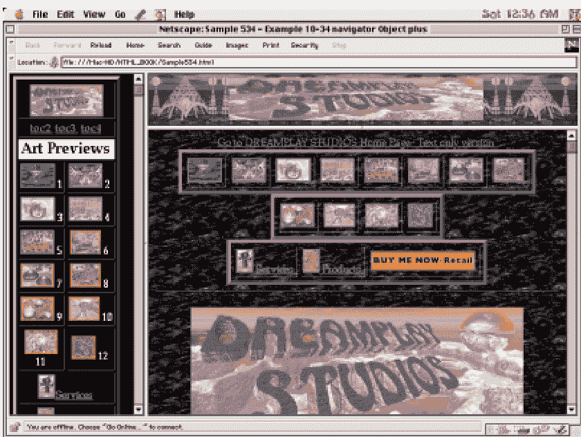

## JavaScript Number 核心对象

### JavaScript 语法：

```
new Number(value);
numberName = new Number(value);
```

要创建一个 `Number` 对象，你需要使用关键字 **new** 和 Number 构造函数，其中 *value* 是该对象的数值。这是一个使用场景有限的对象，主要在你需要获取该对象提供的特殊数学属性时使用。

### Number 属性

| 属性 | 描述 |
| :--- | :--- |
| MAX_VALUE | 其值为 JavaScript 能表示的最大数字，约为 1.79E+308。它是 Number 的一个只读静态属性，始终以 **Number.MAX_VALUE** 的形式调用，而非作为你创建的 Number 对象的属性。更大的数字会溢出为 Infinity。 |
| MIN_VALUE | 其值为 JavaScript 能表示的最接近零的最小数字，约为 2.22E-308。注意这不是最小的负数。它是 Number 的一个只读静态属性，始终以 **Number.MIN_VALUE** 的形式调用。更小的数字会溢出为零。 |
| NaN | 其值为 NaN，表示"非数字"，它是一个不加引号的字面量。它始终不等于任何数字，甚至不等于自身。你不能在条件判断中将 NaN 作为测试参数，但可以使用全局函数 **isNaN(value)** 来测试某个值是数字还是 NaN。 |
| NEGATIVE_INFINITY | 其值为 "-Infinity"，表示并表现得像数学中的负无穷大。溢出时返回此值。它是 Number 的一个只读静态属性，始终以 **Number.NEGATIVE_INFINITY** 的形式调用。 |
| POSITIVE_INFINITY | 其值为 "Infinity"，表示并表现得像数学中的正无穷大。溢出时返回此值。它是 Number 的一个只读静态属性，始终以 **Number.POSITIVE_INFINITY** 的形式调用。 |
| prototype | 允许你为 `Number` 对象创建自定义属性。 |

### Number 方法

| 方法 | 描述 |
| :--- | :--- |
| `toString([radix])` | 将 **Number** 对象转换为字符串并返回该字符串。可选参数 **radix** 指定一个 2 到 16 之间的数字，作为转换的进制基数。如果未指定，默认值为 10。你不能在数字字面量上使用此方法。 |

此示例演示了 **Number** 对象的一些属性。

### 示例 4-35：Sample535.html

```
<!DOCTYPE HTML PUBLIC "-//W3C//DTD HTML 3.2//EN">
<HTML>
<HEAD>
<TITLE>Sample 535 - Example 4-35 Number Object </TITLE>
<SCRIPT LANGUAGE="JavaScript1.2"><!--BEGIN HIDING

myNumber1 = new Number(55);
myNumber2 = Number.MAX_VALUE + 10;
myNumber3 = Number.MIN_VALUE / 100000000000000000000;
myNumber4 = Number.MIN_VALUE / 1000000000000000000000;
myNumber5 = Number.MAX_VALUE;
myNumber6 = Number.MIN_VALUE

document.write("myNumber1 = " + myNumber1 + "<BR>");
document.write("myNumber2 = " + myNumber2 + "<BR>");
document.write("myNumber3 = " + myNumber3 + "<BR>");
document.write("myNumber4 = " + myNumber4 + "<BR>");
document.write("myNumber5 = " + myNumber5 + "<BR>");
document.write("myNumber6 = " + myNumber6 + "<BR>");

//END HIDING-->
</SCRIPT>
</HEAD>
<BODY>
<P>
注意在 Macintosh 平台上，你可以创建小于 <B>Number.MIN_VALUE</B> 且接近零的数字。<B>myNumber3</B> 和 <B>myNumber4</B> 的值就演示了这一点。理论上，任何大于 1 的数去除 Number.MIN_VALUE 都应导致结果溢出为零，但看看实际上需要多大的数才会导致溢出。（1000000000000000000000）
</P>
</BODY>
</HTML>
```

## JavaScript select 对象

### JavaScript 语法：

```
document.formName.selectName;
document.formName.elements[index];
```

**select** 对象是一个可供用户选择的选项列表。根据配置不同，它可以是可滚动列表或弹出菜单。有关 SELECT 元素及其属性定义的更多信息，请参阅 CD-ROM 上的 HTML 40 指南，或仅查看语法请参阅第 1011 页的附录 A。有关示例请参阅索引。

**select** 对象是 **form** 对象的属性，而 **options[i]** 数组是 **select** 对象的属性。**select** 对象不能用 JavaScript 创建。你必须使用 HTML 语法来创建 **select** 对象，以及任何可选的事件处理程序。然后 **select** 对象将由 JavaScript 解释器自动创建，并反映该 SELECT 元素。你可以使用 **document.write()** 方法直接在 JavaScript SCRIPT 中创建 SELECT 元素。

当 JavaScript 解释器从 HTML 代码创建 **select** 对象时，它还会创建 **options[i]** 数组作为 **select** 对象的属性。**options[i]** 数组的每个元素包含一个反映 HTML OPTION 元素的 **option** 对象。它们按源代码顺序加载到数组中。然后你可以通过 **options[i]** 数组中的 **index** 索引号来访问各个 **option** 对象。

**option** 对象本身是<u>只读</u>属性，这意味着你不能通过赋值来更改 **option**。但是，你可以更改 **option** 的 **text** 属性的值，这将导致浏览器中显示新的文本字符串。**options[i]** 数组将在下一节中详细介绍。有关 **Array** 对象的更多信息，请参阅第 7 章。

由于 **select** 和 **option** 对象在对象层次结构中位置较深，用代码访问它们可能会非常麻烦，即引用它们并访问其属性和方法。因此，通常建议为这些对象及其属性的不同方面设置变量，以提高代码的可读性。有关示例，请参阅第 501 页和第 650-657 页。

### Select 事件处理程序

- onBlur
- onChange
- onFocus

### Select 属性的 JavaScript 语法：

```
document.formName.selectName.propertyName;
document.formName.elements[index].propertyName;
```

### Select 属性

| 属性 | 描述 |
|---|---|
| form | 只读属性，反映包含当前 **select** 对象的 **form** 对象。 |
| length | 反映 **options[i]** 数组中 **option** 对象元素的数量。 |
| name | 反映 **select** 对象的 NAME 属性。 |
| options[i] | 一个数组，其每个数组元素反映一个 **option** 对象。 |
| selectedIndex | 一个整数，指定当前选中的 **option** 对象的从零开始的索引。如果选中了多个 **option** 对象，则反映列表中的第一个。你可以设置此属性，这会使不同的 **option** 对象被当前选中。 |
| type | 如果对象是 **select** 对象，则 **type** 的值为 "select-one"。如果对象是 **select** 对象且 HTML SELECT 元素中包含布尔型 MULTIPLE 属性，则 **type** 的值为 "select-multiple"。这是一个只读属性。 |

### Select 方法的 JavaScript 语法：

```
document.formName.selectName.methodName(parameters)
document.formName.elements[index].methodName(parameters)
```

### Select 方法

| 方法 | 描述 |
|---|---|
| blur() | 移除 **select** 对象的焦点。 |
| focus() | 将焦点赋予 **select** 对象。 |
| handleEvent() | 调用指定事件的事件处理程序。 |

## JavaScript options[i] 数组

### JavaScript 语法：

```
document.formName.selectName.optionName;
document.formName.selectName.options[index1];
document.formName.elements[index2].options[index1]
```

options[i] 数组是 select 对象的属性。它由 JavaScript 解释器从 HTML 自动创建，使得每个 HTML OPTION 元素成为 options[i] 数组中各自数组元素中的一个 option 对象。

### 删除 option 对象

要从 select 对象中删除一个 option 对象，请使用以下语法：

### JavaScript 语法：

```
document.formName.selectName.options[index1] = null;
```

### 删除多个 option 对象

要从 select 对象的 options 数组末尾删除多个 option 对象，请使用以下语法，通过指定一个整数来截断数组：

### JavaScript 语法：

```
document.formName.selectName.options.length = integer;
```

### options[i] 数组属性的 JavaScript 语法：

```
document.formName.selectName.optionName.propertyName;
document.formName.selectName.options[index1].propertyName;
document.formName.elements[index2].options[index1].propertyName;
```

### options[i] 数组属性

| 属性 | 描述 |
|----------|-------------|
| length | 反映数组中选项的数量。 |
| selectedIndex | 反映当前选中选项的从零开始的索引号。 |


## options[i] 数组元素属性

| 属性 | 描述 |
| :--- | :--- |
| `defaultSelected` | 反映一个 `option` 是否具有 SELECTED 属性。如果具有，其值为 `true`，否则为 `false`。 |
| `index` | 反映 `option` 的基于零的 `index` 编号。 |
| `selected` | 反映 `option` 当前是否被选中。这是一个布尔属性，如果 `option` 被选中，则值为 `true`；如果未被选中，则为 `false`。 |
| `text` | 反映包含在 `option` 的 VALUE 属性中的文本字符串。 |
| `value` | 反映 `option` 当前的 VALUE 属性，如果提交表单，该属性将作为 VALUE=value 对返回到服务器。 |

## JavaScript option 对象

`option` 对象是通过 `Option()` 构造函数创建的。

要创建一个新的 `option` 对象，请使用以下语法：

## JavaScript 语法：

```
new Option(text, value, defaultSelected, selected);
optionName = new Option(text, value, defaultSelected, selected);
```

###### 参数定义：

| 参数 | 描述 |
| :--- | :--- |
| `text` | 指定要显示的文本字符串的参数，与 HTML 代码中 OPTION 元素的开始和结束标签之间出现的文本相同。 |
| `value` | 指定 VALUE 属性值的参数。 |
| `defaultSelected` | 可选参数，指定 `option` 是否初始选中。 |
| `selected` | 可选参数，指定 `option` 当前是否被选中。 |
| `optionName` | 分配给 `option` 对象的变量名。 |

## 将 option 对象添加到 select 对象

要将一个 **option** 对象添加到 **select** 对象，请使用以下语法：

## JavaScript 语法：

```
document.formName.selectName.options[indexN] = optionName;
```

## option 对象属性

| 属性 | 描述 |
|----------|-------------|
| defaultSelected | 指定 **option** 的初始选择状态，如果选中，值为 **true**；如果未选中，值为 **false**。 |
| index | 指定 **option** 的基于零的 **index** 编号。 |
| prototype | 允许你为 **option** 对象创建新属性。 |
| selected | 指定 **option** 的当前选择状态。这是一个布尔属性，如果 **option** 被选中，值为 **true**；如果未选中，值为 **false**。 |
| text | 指定显示在 **select** 对象中的 **option** 文本字符串。 |
| value | 指定 **option** 当前的 VALUE 属性，如果提交表单，该属性将作为 Value=value 对返回到服务器。 |

以下是使用了 **select** 对象的示例文件列表。如果你想将示例与书中的代码交叉引用，请参阅附录 C（第 1039 页及之后），以获取示例的页码。

| 示例文件名，行号 | 示例用法 |
|-------------------------------|---------------|
| Sample71-SimpleForm.html，第 63 行： | <SELECT NAME="UPSshippingoptions" SIZE=1> |
| Sample71-OrderForm.html，第 147 行： | <SELECT NAME="creditcardtype" SIZE=1> |
| Sample73.html，第 15 行： | <SELECT NAME="select2" SIZE=3 MULTIPLE> |
| Sample724.html，第 23 行： | <SELECT NAME="getBackColor" SIZE="1" onChange="changeEverything(); return false;"> |

## 新的 JavaScript 核心函数

JavaScript 1.2 为 Navigator 4.0 引入了两个新的核心函数。它们是 `Number` 函数和 `String` 函数。你也可以将这些函数视为不属于任何特定对象，而是 JavaScript 语言本身一部分的全局函数。请确保不要将它们与对应的 Number 对象和 String 对象混淆。

## JavaScript Number 核心函数

## JavaScript 语法：

```
Number(x);
```

Number 函数是一个核心函数，它将 x 参数（可以是任何对象）转换为一个数字。如果 x 对象是一个无法转换为可接受数字的字符串，则返回 `NaN`。例如，以下脚本：

###### 小示例：

```
<SCRIPT LANGUAGE="JavaScript1.2">

today = new Date();
dateConversion = Number(today);

myMinutes = today.getMinutes();
minutesConversion = Number(myMinutes);

document.write("dateConversion in milliseconds = " + dateConversion + "<BR>");
document.write("minutesConversion = " + minutesConversion + "<BR>");

</SCRIPT>
```

在 1998 年 2 月 16 日凌晨 3:22，浏览器中的输出如下：

```
dateConversion in milliseconds = 887617357173
minutesConversion = 22
```

## JavaScript String 核心函数

## JavaScript 语法：

```
String(x);
```

**String** 函数是一个核心函数，它将 **x** 参数（可以是任何对象）转换为一个字符串。

此示例展示了多个对象转换为字符串后的输出。

## 示例 4-36：Sample536.html

```
<!DOCTYPE HTML PUBLIC "-//W3C//DTD HTML 3.2//EN">
<HTML>
<HEAD>
<TITLE>Sample 536 - Example 4-36    String Function  </TITLE>
</HEAD>

<BODY>
<H2>Sample 536</H2>

<LAYER ID="L1" LEFT="20" TOP="370" WIDTH=400 HEIGHT=40 BGCOLOR="cyan">
Test Layer </LAYER>

<SCRIPT LANGUAGE="JavaScript1.2"><!--BEGIN HIDING

today = new Date();
todayString = String(today);

dateConversion = Number(today);
dateString = String(dateConversion);

myWindow = String(window);
myLayer = String(document.L1);

	document.write("dateConversion = " + dateConversion + "<BR>");
	document.write("todayString = " + todayString + "<BR>");
	document.write("dateString = " + dateString + "<P>");
	document.write("myWindow = " + myWindow + "<P>");
	document.write("myLayer = " + myLayer + "<P>");

//END HIDING-->
</SCRIPT>

</BODY>
</HTML>
```

上一个示例在浏览器中的输出如下：

## 示例 536

```
dateConversion = 887619422650
todayString = Mon Feb 16 03:57:02 1998
dateString = 887619422650

myWindow = {length:undefined, frames:undefined, parent:undefined, top:undefined, self:undefined, name:undefined, status:undefined, defaultStatus:undefined, opener:undefined, closed:undefined, innerWidth:undefined, innerHeight:undefined, outerWidth:undefined, outerHeight:undefined, screenX:undefined, screenY:undefined, pageXOffset:undefined, pageYOffset:undefined, secure:undefined, frameRate:undefined, offscreenBuffering:undefined, document:, history:, location:file:///Mac-HD/HTML_BOOK/Sample536.html, crypto:{}, menubar:{visible:undefined}, toolbar:{visible:undefined}, locationbar:{visible:undefined}, personalbar:{visible:undefined}, statusbar:{visible:undefined}, scrollbars:{visible:undefined}, today:Mon Feb 16 03:57:02 1998, todayString:"Mon Feb 16 03:57:02 1998", dateConversion:887619422650, dateString:"887619422650"}

myLayer = {clip:{left:undefined, top:undefined, right:undefined, bottom:undefined, height:undefined, width:undefined}, document:}
```

# # 第二部分
## JavaScript 1.2

## ## 第 5 章
### 语句与运算符

# 第 5 章

# 语句与运算符

### 目录

- **JavaScript 语句** 473
  - 5.1) 什么是 JavaScript 语句 473
  - 5.2) 语句的类别 473
  - 5.3) 所有 JavaScript 语句的图表 474

- **条件语句** 475
  - 5.4) JavaScript `if` 语句 475
  - 5.5) JavaScript `if...else` 语句 477
  - 嵌套 `if()` 语句 478
  - 嵌套 `if()...else` 语句 479
  - 5.8) `!?` 条件运算符语句 480
  - 5.9) `switch()` 语句 481

- **循环语句** 484
  - 5.10) `for()` 语句 484
  - 5.11) `while()` 语句 486
  - 5.12) `do while()` 语句 488
  - 5.13) `labeled` 语句 490
  - 5.14) `break` 语句 491
  - 5.15) `continue` 语句 494

- **对象操作语句** 498
  - 5.16) 操作语句 498
  - 5.17) `for...in` 语句 500
  - 5.18) `with()` 语句 502
  - 5.18) `<STYLE>` 元素中的 `with()` 语句 502
  - 5.19) `var` 语句 503
  - 5.20) `function` 语句 505
  - 5.21) `return` 语句 506
  - 5.22) `export` 语句 506
  - 5.23) `throw` 语句 507
  - 5.24) `delete` 语句 508

- **注释语句** 508
  - 5.25) 单行与多行注释语句 508

- **JavaScript 运算符** 509
  - 5.26) 什么是 JavaScript 运算符？ 509
  - 5.27) 运算符的类别 510
  - 5.28) 特殊运算符 510
  - 5.29) 关键字 `new` 运算符 510
  - 5.30) 关键字 `this` 运算符 512
  - 5.31) 关键字 `typeof` 运算符 512
  - 5.32) 关键字 `void` 运算符 514
  - 5.33) `,` (逗号) 运算符 514
  - 5.34) 比较运算符 515
  - 5.35) 算术运算符 515
  - 5.36) 字符串运算符 516
  - 5.37) 逻辑运算符 516
  - 5.38) 赋值运算符 517
  - 5.39) 位运算符 517

**JavaScript 表达式** 518


 ## JavaScript 语句

## JavaScript 语句是什么？

JavaScript 语句是“幕后的动作”，交互性和强大的脚本潜力正 lurking 在你的想象边缘等待发掘。你越深入其中，就越能发现语句所固有的、并非立即显现的各种能力。语句的主要用途之一是让你编写脚本，当某个条件为真时执行一个动作，而当该条件为假时执行另一个动作。循环语句允许你在条件为真时重复执行相同的动作。在许多情况下，该动作会对数组中的所有元素进行迭代。

## JavaScript 语句的分类

JavaScript 语句可以按以下方式分类：

| 条件语句 | 循环语句 | 对象操作语句 | 注释语句 |
| :--- | :--- | :--- | :--- |
| if | for | for...in | //单行注释 |
| if...else | while | with | /*多行 ... |
| switch | do while | var | ... 注释*/ |
| ?: | labeled | function | |
| | break | return | |
| | continue | export | |
| | | import | |
| | | delete | |

以下三种语句没有名称，因此通常不会这样列出，但它们仍然是语句。

| 语句 | 简明定义 | 微型示例 |
| :--- | :--- | :--- |
| 属性访问 | 访问对象的属性 | myArray1.length |
| 方法调用 | 调用对象上的方法 | window.open() |
| 赋值 | 将表达式的值赋给变量 | a = b + c |

## 所有 JavaScript 语句一览表

| 语句 | 简明定义 |
| :--- | :--- |
| `break` | 结束包含它的当前 **while** 或 **for** 循环，并将程序控制权转移到终止循环后面的语句。 |
| `comment` | 解释性的作者注释，JavaScript 解释器会忽略这些注释。 |
| `continue` | 暂停 **while** 循环中的语句块，并跳回到条件判断。暂停 **for** 循环中的语句块，并跳回到更新表达式。 |
| `delete` | 销毁对象的属性或数组中的元素。 |
| `do...while` | 只要条件为真，就执行前面的语句块，并且在判断条件之前至少执行一次。 |
| `export` | 将签名脚本中的函数、对象和属性提供给其他签名或未签名脚本使用。 |
| `for` | 循环语句，根据其三个可选表达式（在括号内并用分号分隔）的参数执行语句块。 |
| `for...in` | 对象操作语句，使用指定变量对对象的每个属性执行语句块。 |
| `function` | 定义逗号分隔的、括号括起来的参数和一个命名语句块的语句，该语句块用大括号括起来，调用时作为一个单元执行。参数可以是字符串、数字或对象。参见第 371-385、505 页。 |
| `if` | 如果指定条件为真或表达式求值为真，则执行一次语句块。如果为假，则不执行任何操作。 |
| `if...else` | 如果指定条件为真或表达式求值为真，则执行一次语句块。如果条件为假，则执行备选的语句块。 |
| `? :` | 条件运算符语句。if...else 的简写形式。 |
| `import` | 脚本用于从先前导出这些内容的签名脚本中导入函数、对象和属性的语句。 |
| `labeled` | 一个命名语句，其名称通过冒号与其语句块分隔开。**break** 或 **continue** 语句使用该名称作为程序继续执行语句的跳转点。 |
| `return` | 指定函数调用应返回的值的语句。 |
| `switch` | 条件循环语句，根据求值表达式是否与 case 标签的值匹配来执行相应的语句。 |
| `var` | 声明变量并可选择为其赋值的语句。 |
| `while` | 循环语句，只要判定表达式求值为真，就执行语句块。 |
| `with` | 指定默认对象以便将语句块应用于该对象的语句。 |

## 条件语句

## JavaScript if () 语句

## JavaScript 语法：

```
if (condition) {
    statementsIfTrue;
}
```

###### 参数定义：

好的，严格从技术角度来说并不存在 if 语句，因为严格来讲，所有这些都是 if...else 语句，只是省略了可选的 else 部分。出于教学目的，这样开始更容易理解，而且在实际使用中 else 也常被省略。

if 语句将在括号内的条件求值为真时，执行语法中由 statementsIfTrue 指定并用大括号括起来的语句块。条件可以是一个表达式，如 (x >= 5) 或 (booleanTest)。

你甚至可以像这样测试页面中是否存在某个对象：

```
(myLayer1)
```

其中，只要文档中存在名为 myLayer1 的图层，语句就会执行。

你也可以像这样测试多个条件：

```
if (x >= 0 && x <= 77)
```

或者像这样：

```
if (myLayer.top > 0 || myLayer.clip.right < myLayer.width)
```

如果条件求值为假，则语句块不会执行，程序控制权返回到 if 语句之后的语句。如果只有一条语句要执行，则可以省略大括号 { }。如果想在同一行编写多条语句，则需要用分号隔开。除此之外，用分号分隔语句是可选的。只需选择一种方式并坚持下去，使你的代码更易于调试。

以下是一个简单的示例，当变量 x 小于或等于 4 时，包含在 if () 语句中的更改文档背景颜色的语句将会执行，这将导致 **condition** 求值为真。由于只有一条可执行语句，if() 语句的大括号是可选的，在本例中被省略。如果这样有助于你阅读代码，可以使用它们。但是请记住，对于函数声明，清查大括号始终是必需的。

```
function changeColor() {
    if (x <= 4)
        document.bgColor = 'purple';
}
```

以下是一个简单的示例，当布尔变量 **booleanTest** 求值为真时，if () 语句中的语句块将会执行：

```
function changeColor() {

    if (booleanTest) {
        document.myLayer1.clip.width = 500;
        document.myLayer1.clip.height = 400;
        document.myLayer1.visibility = 'show';
        document.myLayer2.visibility = 'hide';
    }
}
```

在这里，**clip.right** 属性必须小于 800，且名为 **layer1** 的 **Layer** 的 **clip.bottom** 属性必须小于 400，**condition** 才能求值为真。

```
function LargeView3() {

    if (layer1.clip.right < 800 && layer1.clip.bottom < 400) {
        document.layer1.moveTo(20, 10);
        document.layer1.resizeBy(8, 4);
        document.layer1.moveAbove(document.layer2);
    }
}
```

你也可以通过使用 **logical not** 运算符 ! 来测试假的 **condition**，像这样：

## JavaScript 语法：

```
if (! condition) {
    statementsIfFalse;
}
```

## JavaScript if ()...else 语句

`if ()...else` 语句测试一个 **condition**，如果该 **condition** 是求值为真的 **Expression**，则执行大括号内括起来的 **statementsIfTrue** 语句块。如果 **condition** 求值为假，则执行 else 后面的 **statementsIfFalse** 语句块。这些语句块中的任何一个都可以包含进一步嵌套的 `if ()...else` 语句，这种可能性在后面的章节中会涉及。你将在自己的代码中大量运用 `if ()...else` 语句。

## JavaScript 语法：

```
if (condition) {
    statementsIfTrue;
}
else {
    statementsIfFalse;
}
```

## 微型示例：

在这个微型示例中，如果 **myBoolean** 变量为真，则更改名为 **myLayer1** 的图层。如果 **myBoolean** 变量为假，则更改另一个名为 **myOtherLayer2** 的图层。显然，需要有其他 JavaScript 代码来更改 **myBoolean** 变量的值，以便使 **changeColor()** 函数具有实际意义。

```
function changeColor() {
    if (myBoolean) {
        document.myLayer1.bgColor = 'purple';
        document.myLayer1.visibility = 'show';
    }
    else {
        document.myOtherLayer2.bgColor = 'green';
        document.myOtherLayer2.visibility = 'show';
    }
}
```


## 嵌套 if () 语句

**JavaScript 语法：**

```
if (condition) {
    statementsIfTrue;

    if (condition2) {
        statementsIfTrue2;
    }
}
```

**参数说明：**

有时在一个 if () 语句中同时测试两个**条件**会显得不够直观、不方便或根本行不通，因此实际的解决方案是将一个 **if ()** 嵌套在另一个内部。这样程序会先测试第一个**条件**，如果**表达式**求值为 true，则继续执行相应的语句块，此处的语句块包含第二个 **if ()** 语句，进而测试第二个**条件 condition2**。如果第二个**条件 condition2** 也为 true，则执行 **statementsIfTrue2** 语句块。如果两个**条件**中任意一个求值为 false，则脚本将跳出 **if ()**，并继续执行紧跟在 **if ()** 之后的下一条语句。

在这种情况下，第二个 **if ()** 语句充当第一个**条件**求值为 true 时要执行的语句块。你也可以在第二个 **if ()** 语句之前或之后添加其他要执行的语句，如下一节关于嵌套 **if ()...else** 语句的第二个示例所示。

**小示例：**

在本示例中，如果两个布尔变量都为 true，则使用 **document.write()** 方法写入文本字符串。

```
if (badHairDayBoolean) {
    if (seriousHangoverBoolean) {
        document.write("Reality Bytes, Stay in Bed Today");
    }
}
```

通常认为用 (&&) 编写此代码是更好的编程风格，但有时在测试按键事件和修饰键时，这样做并不现实：

```
if (badHairDayBoolean  &&  seriousHangoverBoolean)
    {document.write("Reality Bytes, Stay in Bed Today"); }
```

## 嵌套 if ()...else 语句

**JavaScript 语法：**

```
if (condition) {
    statementsIfTrue;

    if (condition2) {
        statementsIfTrue2;
    }
    else {
        statementsIfFalse2;
    }
}
else  {
    statementsIfFalse;
}
```

**参数说明：**

在使用嵌套 **if ()** 或 **if ()...else** 语句时，需要知道它们可以是 **if ()** 或 **if ()...else** 语句的任意嵌套组合或多重嵌套组合，最多可以有 255 层。如果在一个 **if ()...else** 语句内部嵌套另一个 **if ()...else** 语句，其工作流程如下。

如果第一个**条件**求值为 true，则执行随后的语句块。如果其中某个语句是 **if ()...else** 语句，则测试其 **condition2**，如果求值为 true，则执行 **statementsIfTrue2** 语句块，否则执行 **statementsIfFalse2** 语句块。

如果第一个**条件**求值为 false，则脚本跳转到 **else** 并执行 **statementsIfFalse** 语句块。

本书使用术语 **if ()** 作为 **if ()...else** 语句的简写，这是传统做法，也能为作者节省一些打字时间。

**小示例：**

在以下示例中，如果布尔变量 **myBoolean1** 为 true，则 **document** 的背景色改为黄色。如果 **myBoolean1** 为 false，则背景色改为红色。

如果布尔变量 **myBoolean1** 为 true 且 **x 大于或等于 5**，则 **myLayer1** 的背景色改为橄榄色。如果布尔变量 **myBoolean1** 为 true 且 **x 小于 5**，则 **myLayer1** 的背景色改为黑色。

```
if (myBoolean1) {
    document.bgColor = 'yellow';
    if (x >= 5) {
        document.myLayer1.bgColor = 'olive';
    }
    else {
        document.myLayer1.bgColor = 'black';
    }
} else {
    document.bgColor = 'red';
}
```

## () ? : 条件运算符语句

**JavaScript 语法：**

```
evaluatedResult = (condition) ? expression1 : expression2
```

**参数说明：**

这被非正式地称为条件运算符语句，基本上是 **if ()** 语句的简写版本。如果条件为 true，则返回 expression1 并将其赋值给 evaluatedResult 变量。如果条件为 false，则返回 expression2 并将其赋值给 evaluatedResult 变量。条件可以是求值为 true 或 false 的表达式。expression1 和 expression2 可以是任何类型的值，包括但不限于：字符串、变量、数字和对象。

两个表达式之间用冒号分隔。条件可选地放在括号内，但建议使用括号。

**小示例：**

在以下小示例中，如果 wonTheLottery 为 true，则将文本字符串 "congratulations" 赋值给 myString 变量。如果 wonTheLottery 为 false，则将文本字符串 'condolences' 赋值给 myString 变量。

```
myString = (wonTheLottery) ? "congratulations" : "condolences";
```

## switch( ) 语句

### JavaScript 语法：

```
switch (expression) {
    case label1 :
        statements;
        [break;]
    case label2 :
        statements;
        [break;]
        ...
    [default :
        statements;]
}
```

### 参数说明：

**switch( )** 语句是 Navigator 4 的新功能，非常酷。其语法与 Java 完全相同。它最好的用途之一是测试 ASCII 键值，第 6 章中有大量示例，如第 588 页的 6-15、第 623 页的 6-20、第 628 页的 6-21、第 632 页的 6-22 和第 648 页的 6-23，展示了这种技术的各种实用变体。以下是其工作原理。

首先，在以下语法中，关键词 **switch**、**case**、**break** 和 **default** 未被 RWS 替代，即完全等同地编写。其余术语是供你填写的占位符。**标签**通过冒号与**语句**分隔。**break** 和 **default** 语句是可选的。**break** 语句和**语句**各自用分号分隔，而不是冒号。

你以名称 **switch** 开头，然后是括号内的**表达式**。然后在大括号内包含以下内容：对于每个 **case**，以 **label1** 开头，与括号内的**表达式**进行匹配。如果它们相等，则执行该 case 的**语句**。该 **case** 的**语句**是紧跟在 **case label1** 后面冒号后面的语句。如果有可选的 **break** 语句，则程序跳转到 **switch ()** 语句的末尾。如果没有 **break** 语句，**switch ()** 语句中的其余**语句**将继续执行。

如果 **label1** 与**表达式**不匹配，则 **switch ()** 将测试 **label2** 是否与**表达式**匹配。如果是，则执行与 **label2** 关联的**语句**，如果有 **break** 则跳出。这个过程持续进行，直到所有 **case 标签**都被测试完毕。

如果所有 **case 标签**都不与**表达式**匹配，则调用可选的 **default** 语句并执行与其关联的**语句**。

在以下示例中，假设变量 **myColor** 有某些其他 JavaScript 处理会将其更改为不同的颜色。**switch ()** 语句使用 **myColor** 作为与 **case 标签**匹配的表达式。如果 **myColor** 为 'blue'，则执行语句 **document.layer1.bgColor = 'blue';** 将 layer1 的背景色改为蓝色，由于 **break** 语句而退出 **switch ()** 语句。

如果 **myColor** 不等于 'blue'，则 **switch ()** 继续测试直到找到匹配项，或到达 **default** 语句并将 **layer1** 的背景色改为白色。

请确保你理解以下语句中包含的 'blue'：

```
document.layer1.bgColor = 'blue';
```

与作为表达式的变量 **myColor** 和 **case 标签** 'blue' 之间的测试匹配没有关联。

```
var myColor;

function changeColor() {

    switch (myColor) {

        case 'blue' :
            document.layer1.bgColor = 'blue';
            break;

        case 'red' :
            document.layer1.bgColor = 'red';
            break;

        case 'purple' :
            document.layer1.bgColor = 'purple';
            break;

        case 'green' :
            document.layer1.bgColor = 'green';
            break;

        default :
            document.layer1.bgColor = 'white';
    }
}
```


 ## 参数定义：

当你希望两个 case 标签中的**任一**一个与*表达式*匹配时执行相同的**语句**块，可以使用以下语法。这两个 case 标签之间用冒号分隔。如果你需要两个以上的 case，可以按需添加，并用冒号将每个 case 分隔开。

## JavaScript 语法：

```
switch (expression) {
    case label1 : case label2 :
        statements;
        [break;]
    case label3 : case label4 :
        statements;
        [break;]
    ...
    [default :
        statements;]
}
```

#### 小型示例：

以下两个 case，例如 `case '188' : case '48'`，涵盖了按下关联数字键时可能出现的两种 ASCII 值。这是为了兼容拥有扩展键盘的用户。*表达式 e.which.toString()* 的计算结果为一个数字字符串。完整版本请参见 Sample721.html，有关按键事件的更多信息请参见第 6 章。

```
function scrollLayers(e) {
    switch (e.which.toString()) {
        //按下 ALT + 0 键
        case '188' : case '48' :
            document.Layer2.moveTo(150,250);
            break;

        //按下 ALT + 1 键
        case '193' : case '49' :
            document.Layer2.moveBy(-30,30);
            break;

        //按下 ALT + 2 键
        case '170' : case '50' :
            document.Layer2.moveBy(0,30);
            break;

        default : return false;
    }
}
```

# 循环语句

## for( ) 语句

**JavaScript 语法：**

```
for ([initialExpression]; [condition]; [updateExpression]) {
    statements;
}
```

###### 参数定义：

for( ) 语句需要一些时间适应，但一旦掌握，你会发现它非常强大，能为你节省大量输入和时间。括号内包含的三个可选表达式中，前两个后面都跟有一个分号。如果不明显说明一下，**condition（条件）** 本身也是一个表达式。它们后面跟着一个由花括号括起的语句块，这些语句会根据这些表达式来执行。

作者使用 **for( )** 语句最常见的方式是利用 **initialExpression（初始表达式）** 来声明并初始化一个变量，像这样：

```
var i=0;
```

然后声明 **condition（条件）** 表达式，它告诉 **for( )** 语句在哪些情况下允许继续循环。以下是一个典型的实现：

```
i<4;
```

最后，使用 **updateExpression（更新表达式）** 来递增在 **initialExpression（初始表达式）** 中声明的变量，像这样：

```
i++
```

如果你忘记了运算符术语：

```
i++      在此处的意思是在变量 i 的基础上增加 1。
```

将所有内容组合在一起，并添加一个要执行的语句，我们得到：

```
for (var i=0; i<4; i++) {
    document.write('The number iterated is ' + i + '<BR>');
}
```

这将在浏览器中产生以下输出：

```
The number iterated is 0
The number iterated is 1
The number iterated is 2
The number iterated is 3
```

前面的 `for()` 语句可以这样理解：对于从值零开始的变量 `i`，只要 `i` 小于 4，就执行 `document.write()` 语句。每次迭代后，将 `i` 的值增加一，并从 `condition（条件）` 开始重复循环，这样如果 `i` 仍然小于四，则循环继续。

一旦 `condition（条件）` 的计算结果为 false，循环就会终止，控制权返回到 `for()` 语句结束处的程序。

## 编程技巧

许多作者在 `for()` 语句中声明变量 `i` 的原因是这样：该变量只在包含 `for()` 循环的函数内部有效，相同的变量可以在其他函数中重复使用，在那里它将具有独立的值，且各实例之间互不影响。

当你需要在同一个函数中使用多个 `for()` 语句时，一种选择是在函数的第一个 `for()` 语句中使用变量 `i`，在第二个 `for()` 语句中使用变量 `j`，在第三个中使用变量 `k`。这对于在处理多级数组时帮助跟踪调试和排错很有用。`i`、`j` 和/或 `k` 变量可用于通过数组 `index（索引）` 号访问和操作数组元素。有关数组的更多信息，请参见第 7 章。

如果你想最大化内存分配效率，可以在同一个函数中的多个顺序 `for()` 循环中重复使用相同的变量 `i`。

#### 小型示例：

本示例只是声明了一个名为 `myArray` 的数组，并使用 `for()` 语句将每个数组元素写在自己的行上。

```
function writeClients() {

  var myArray = new Array('Name', 'Address', 'City', 'State');

  for (var i=0; i<myArray.length; i++) {
    document.write(myArray[i] + '<BR>');
  }
}
```

# while() 语句

## JavaScript 语法：

```
while (condition) {
    statements;
}
```

###### 参数定义：

**while( )** 语句创建一个循环，只要 **condition（条件）** 参数中的表达式计算结果为 true，循环就会继续。确定 **condition（条件）** 为 true 后，循环将执行 **statements（语句）** 块，然后检查 **condition（条件）** 是否仍为 true 并重复循环。当 **condition（条件）** 计算结果为 **false** 时，循环终止，脚本在 **while ()** 语句的末尾继续执行。

在许多情况下，你会使用此语句并在可执行的 **statements（语句）** 块中提供自己的递增语句。**至关重要**的是，你必须在 **statements（语句）** 中提供某种机制，使循环最终变为 **false**，否则你将陷入无限循环。

#### 小型示例：

在以下示例中，**i** 初始化为零，**x** 初始化为 5。只要 **i** 小于 4，循环就会将 **i** 增加 1，然后将 **x** 和 **i** 相加并将结果赋值给 **x**。

第一次循环后，x = 6 且 i = 1
第二次循环后，x = 8 且 i = 2
第三次循环后，x = 11 且 i = 3
第四次循环后，x = 15 且 i = 4

在第五次循环时，由于 **i** 在循环开始时等于 4，这使得 **condition（条件）** 计算结果为 **false**，循环终止，**x** 的最终值保持为 15。

```
i = 0;
x = 5;

while (i < 4) {
    i++;
    x += i;            //意思是        x = x + i;
}
```

# 第 5 章 — 语句与运算符 487

#### 小型示例：

只要 booleanTest 变量为 true，本示例就会继续将 x 的值增加 1。当 x 等于 7 时，这将导致 booleanTest 被改为 false，从而使条件变为 false，进而停止循环。

```
function myWhileTest() {
    booleanTest = true;
    x = 0;
    while (booleanTest) {
        x = x + 1;
        if (x == 7) {
            booleanTest = false;
        }
    }
}
```

#### 小型示例：

本示例在同时按下 ALT 和控制修饰键以及 5 键时，将窗口向下滚动 50 像素。

注意 ALT_MASK + CONTROL_MASK 的 ASCII 值为 3，这正是 e.modifiers 表达式所测试的值。

```
document.captureEvents(Event.KEYPRESS)
document.onkeypress=scrollWindow;

function scrollWindow(e) {
    while (e.modifiers == 3 && e.which == 5) {
        window.scrollBy(0, 50);
    }
}
```

# **do while( )** 语句

## JavaScript 语法：

```
do {
    statements;
} while (condition)
```

## **参数定义：**

**do while( )** 语句与 **while()** 语句非常相似。主要区别在于 **statements（语句）** 保证至少执行一次，因为它们在首次测试 **condition（条件）** 之前就已经执行。第一次执行 **statements（语句）** 后，会对 **condition（条件）** 进行求值。如果计算结果为 **true**，则再次执行 **statements（语句）**。

此循环持续进行，直到 **condition（条件）** 计算结果为 **false**，这会导致循环终止，控制权返回到 **do while()** 语句结束点之后的脚本位置。同样重要的是，你必须在 **statements（语句）** 中提供某种机制，使循环最终变为 **false**，否则你将陷入无限循环。

## **小型示例：**

让我们采用前面的示例，并使用 **do while()** 重写它。结果相同，唯一的区别是 **booleanTest** 在 **statements（语句）** 执行后才被求值。

```
function myDoWhileTest()  {

booleanTest = true;
x = 0;

     do {
           x = x + 1;

           if (x == 7) {
                booleanTest = false;
           }
     }
     while (booleanTest)
}
```


 ## 第 5 章 — 语句与运算符

#### 小型示例：

这里有一个更简单的例子，说明尽管 **while() 条件** 规定 x 必须小于零，并且在第一次计算时就返回 **false**，但 **statements** 仍然会执行一次。变量 x 被初始化为值 1，然后它被增加 2，并以值 3 写入屏幕。因为 3 不等于 1，循环随即立即终止。

```
x = 1;

do {
			n   ,       = x + 2;
		     document.write(x);
}
while (x == 1)
```

#### 小型示例：

这个例子展示了 **do while()** 语句在 **doItNow()** 函数内部的使用，其中包含一个安全警报对话框，用于弥补代码缺陷，为将来的脚本埋下一颗种子。下面是浏览器输出，然后是代码。

```
z=10
z=15
z=20
z=25
```

```
function doItNow() {

	x = 0;
	y = 10;
	z = 0;

	do {
					z = x + y;
					document.write("z=" + z + "<BR>");
					x+=2;
					y+=3;
					if (x >= 50 || y >= 50) {
							alert("Logic Malfunction! Reevaluate.");
							break;
					}
	}
	while (x <= 10 && y <= 20)
}
```

## labeled 语句

## JavaScript 语法：

```
label : {
    statements;
}
```

## 参数说明：

**labeled** 语句不是循环语句，但它与 **break** 或 **continue** 语句结合使用在循环语句中。将 **labeled** 语句视为一个由 **statements** 组成的块，该块被分配给一个标识 **label**，但不用等号进行赋值，语法要求在 **label** 和被大括号括起来的 **statements** 块之间使用冒号。

当你使用 **break** 语句跳出 **labeled** 循环时，你可以选择包含 **labeled** 语句的 **label** 标识符。这会导致程序跳出由 **label** 指定的 **labeled** 语句。当你在一个循环语句中有多个 **labeled** 语句时，这变得非常有用，因为你可以告诉循环你想跳出哪个 **labeled** 语句，而不仅仅是只能跳出整个循环。

当你在 **labeled** 循环语句内部使用 **continue** 语句时，你现在可以选择包含 **labeled** 语句的 **label** 标识符。这会导致程序终止执行当前的 **labeled** 语句，并在指定的 **labeled** 语句处继续执行。这让你可以精确选择希望继续执行重新启动的位置，而不仅仅是只能在循环开头继续。

记住，要使用 **break** 或 **continue** 语句的 **label**，包含 **break** 或 **continue** 语句的语句首先必须是 **labeled** 语句。是的，这听起来像是循环逻辑，但当你查看示例并思考时，它是有道理的。

在以下关于 **break** 和 **continue** 语句的章节中，有几个使用 **labeled** 语句的示例。

## break 语句

## JavaScript 语法：

```
break;
break label;
```

## 参数说明：

`break` 语句不是循环语句，但它可以在 `for()` 循环或 `while()` 循环内部使用，以终止该循环的执行，将程序控制权返回到循环后面的语句。如果 `break` 语句在 `labeled` 语句内部使用，那么可选的 `label` 可以用来指定你想要跳出的特定 `labeled` 语句。

可以将 `break` 语句用作可执行 `statements` 的一部分，用于 `if()` 语句，但前提是 `if()` 语句包含在 `for()` 或 `while()` 等循环语句内部，或者 `labeled` 语句内部。有关 `break` 语句的其他用法，请参阅 `switch()` 语句部分。

#### 小型示例：

这个示例将 x 增加 1 直到 x == 5，然后给 x 加上 100，然后跳出 `while()` 循环。

```
x = 0;

while (x <= 10) {
    if (x == 5) {
        x = x + 100;
        break;
    }
    else x = x + 1;
}
```

#### 小型示例：

因为下面的 `if()` 语句包含一个 `break` 语句，而 `if()` 并未在循环语句内部使用，它将在运行时产生错误。

```
if (x=3) {
    document.write(x + 5);
    break;
}
```

这个示例只是展示了两个 **labeled** 语句的使用，它们的 **label 参数** 分别为 myLabeled1 和 **myLabeled2**。**break** 语句的使用也得到了展示，它利用了 **label** 参数选项来跳出特定的 **labeled** 语句。查看示例后的输出以理解逻辑。

## **示例 5-0：** **Sample600.html**

```
<!DOCTYPE HTML PUBLIC "-//W3C//DTD HTML 3.2//EN">
<HTML>
<HEAD>
<TITLE>Sample 600 - Example 5-0       break and labeled Statements    </TITLE>

<SCRIPT LANGUAGE="JavaScript1.2"><!--BEGIN HIDING

x=0;

myLabeled1 :
        while (x < 7) {
                document.write(x + "<BR>");

                myLabeled2 :
                        if (x == 5) {
                                document.write("<B>"+ (x + 5000) +"</B>");
                                break myLabeled1;
                        }
                        else {
                                document.write(x + 10 + "<BR>");
                                break myLabeled2;
                        }
                x++;
        }

//END HIDING-->
</SCRIPT>

</HEAD>

<BODY>
</BODY>
</HTML>
```

## 第 5 章 — 语句与运算符

前面的示例产生以下输出：

0
10
1
11
2
12
3
13
4
14
5
5005

#### 小型示例：

如果你将前面的示例用 **for()** 循环重写，替代 **while()** 循环，结果将完全相同，看起来像这样：

```
<SCRIPT LANGUAGE="JavaScript1.2"><!--BEGIN HIDING

myLabeled1 :
     for (x=0; x<7; x++) {
          document.write(x + "<BR>");

          myLabeled2 :
               if (x == 5) {
                    document.write("<B>"+ (x + 5000) +"<\/B>");
                    break myLabeled1;
               }
               else {
                    document.write(x + 10 + "<BR>");
                    break myLabeled2;
               }
     }

//END HIDING-->
</SCRIPT>
```

## continue 语句

## JavaScript 语法：

```
continue;
continue label;
```

## 参数说明：

continue 语句可以在 for() 循环或 while() 循环内部使用，以终止循环内 block of statements 的执行，然后继续执行循环的下一次迭代。不要将其与 break 语句混淆，后者会完全跳出循环。使用 continue 语句时，循环不会退出，只有循环内部的 block of statements 会退出。

在 for() 循环内部使用时，continue 语句将程序控制跳转到 updateExpression。在 while() 循环内部使用时，continue 语句将程序控制跳转到 condition。

如果 continue 语句在 labeled 语句内部使用，那么你可以跳出该 labeled 语句，并使用可选的 label 来指定你想要跳转到的特定 labeled 语句。

你可以将 continue 语句用作可执行 statements 的一部分，用于 if() 语句，但前提是 if() 语句包含在 for() 或 while() 等循环语句内部，或者 labeled 语句内部。

#### 小型示例：

这个示例仅在 myArray 元素等于 5 时写入该元素：

```
myArray = [2, 7, 13, 11, 5];

for (var i = 0; i < myArray.length; i++) {
    if (myArray[i] == 5) {
        document.write(myArray[i] + "<BR>");
        continue;
    }
}
```

示例 5-1 是前面示例 5-0 的轻微变体。它只是用 continue 语句替换了 break 语句以进行比较。比较输出的差异，并比较这些示例之间语句进展的逻辑。


# 第五章 —— 语句与运算符 495

示例 5-1：Sample601.html

```
<!DOCTYPE HTML PUBLIC "-//W3C//DTD HTML 3.2//EN">
<HTML>
<HEAD>
<TITLE>Sample 601 - Example 5-1   continue 语句 </TITLE>

<SCRIPT LANGUAGE="JavaScript1.2"><!--BEGIN HIDING

        for (x=0; x<7; x++) {
                document.write(x + "<BR>");

                if (x == 5) {
                        document.write("<B>"+ (x + 5000) +"</B><BR>");
                        continue;
                }
                else {
                        document.write(x + 10 + "<BR>");
                        continue;
                }
        }

//END HIDING-->
</SCRIPT>

</HEAD>

<BODY>
</BODY>
</HTML>
```

上面的例子产生以下输出：

0
10
1
11
2
12
3
13
4
14
5
**5005**
6
16

###### 小示例：

这个例子使用 `break` 语句，当 `x` 等于 7 时终止 `while()` 循环；否则，`continue` 语句会使 `while()` 循环再次执行。

```
x = 0;

while (x <= 10) {
    x = x + 1;
    if (x == 7) {
        x = x + 10;
        document.write("x=" + x + "<BR>");
        break;
    }
    else {
        document.write("x=" + x + "<BR>");
        continue;
    }
}
```

上面的例子产生以下输出：

```
x=1
x=2
x=3
x=4
x=5
x=6
x=17
```

这个示例演示了使用带标签的语句，其中包含带有带标签 `continue` 语句的 `while()` 语句。第一次使用 `continue` 语句会跳转到 `myLabeled1` 语句，第二次使用会跳转到 `myLabeled2` 语句。查看代码后的输出，以帮助理解脚本的执行顺序。

# 第五章 —— 语句与运算符

示例 5-2：Sample602.html

```
<!DOCTYPE HTML PUBLIC "-//W3C//DTD HTML 3.2//EN">
<HTML><HEAD>
<TITLE>Sample 602 - Example 5-2     continue 和带标签的语句  </TITLE>

<SCRIPT LANGUAGE="JavaScript1.2"><!--BEGIN HIDING

x=0;
y=0;

myLabeled1 :
    while (x < 10) {
        document.write("x=" + x + "<BR>");

        myLabeled2 :
            while (y < 8) {
                if (y == 5) {
                    document.write("y=" + (y + 10) + "<BR>");
                    y++;
                    continue myLabeled1;
                }
                else {
                    document.write("y=" + (y + 100) + "<BR>");
                    y++;
                    continue myLabeled2;
                }
            }
        x+=3;
    }

//END HIDING-->
</SCRIPT>
</HEAD><BODY></BODY></HTML>
```

上面的例子产生以下输出：

```
x=0
y=100
y=101
y=102
y=103
y=104
y=15
x=0
y=106
y=107
x=3
x=6
x=9
```

# 对象操作语句

## for...in 语句

### JavaScript 语法：

```
for (var variable in object) {
    statements;
}
```

###### 参数定义：

这个语句在进入高级脚本编写之前，其实际价值有限。**for...in** 语句在技术上是一个循环语句，但它有一个特殊目的，即专门操作对象的**属性**。指定的 **variable**（变量）参数会遍历指定 **object**（对象）的所有属性。然后，对于 **object** 的每个唯一属性，执行 **statements**（语句）块。

将指定的 **object** 想象成，该对象的每个属性都会依次由 **variable** 参数表示，就像一个自动化的数组。

此外，每个属性的**值**可以表示为一个数组元素，其中 **variable** 参数可以通过将该 **variable** 替换为其数组元素的**索引**整数来单独遍历数组元素。通过查看一个示例，这将变得更加清晰。

请注意，**object** 参数是对对象本身的引用，而不是对对象字符串名称的引用。这意味着不要用引号将 **object** 参数括起来。

###### 小示例：

首先，使用字面表示法创建一个名为 **myObj** 的对象，它有三个属性，分别名为 **title**、**author** 和 **pages**。然后使用 for...in 语句将每个属性 `i` 写入屏幕，接着将每个属性值 **myObj[i]** 写入屏幕。

```
<SCRIPT LANGUAGE="JavaScript1.2"><!--BEGIN HIDING

myObj =  {title:"My Book", author:"Gilorien", pages:1100}

for (var i in myObj) {

     document.write("Prop Name = <B>" + i + "<\/B> has Value= ");
     document.write("<B>" + myObj[i] + "<\/B><BR>");
}

//END HIDING-->
</SCRIPT>
```

# 第五章 —— 语句与运算符 499

前面的脚本产生以下输出：

属性名称 = **title**，值为 **My Book**
属性名称 = **author**，值为 **Gilorien**
属性名称 = **pages**，值为 **1100**

###### 小示例：

在下一个脚本中，前面的脚本稍作修改，以输出 **document** 对象的属性和值：

```
<SCRIPT LANGUAGE="JavaScript1.2"><!--BEGIN HIDING

for (var i in document) {

    document.write("Prop Name = <B>" + i + "<\/B> has Value= ");
    document.write("<B>" + document[i] + "<\/B><BR>");
}

//END HIDING-->
</SCRIPT>
```

这在浏览器中产生以下输出：

属性名称 = **forms**，值为 {length:undefined}
属性名称 = **links**，值为 {length:undefined}
属性名称 = **anchors**，值为 {length:undefined}
属性名称 = **applets**，值为 {length:undefined}
属性名称 = **embeds**，值为 {length:undefined}
属性名称 = **images**，值为 {length:undefined}
属性名称 = **title**，值为 **Sample 604 - Example 5-4 for...in 语句**
属性名称 = **URL**，值为 **file:///Mac-HD/HTML_BOOK/Sample604.html**
属性名称 = **referrer**，值为
属性名称 = **lastModified**，值为 **Jan 13 14:12:23 1928**
属性名称 = **cookie**，值为 **testCookie=Gil_Lorien**
属性名称 = **domain**，值为
属性名称 = **bgColor**，值为 **#ffffff**
属性名称 = **fgColor**，值为 **#000000**
属性名称 = **linkColor**，值为 **#0000ff**
属性名称 = **vlinkColor**，值为 **#9323fd**
属性名称 = **alinkColor**，值为 **#ff0000**
属性名称 = **width**，值为 **519**
属性名称 = **height**，值为 **296**

## with() 语句

**with( )** 语句非常实用，可以在编写时节省大量输入。它用于一次性指定脚本在后续 **statements**（语句）中引用的对象，这样你就不必在块中为每个语句重复指定完整的对象引用。**object** 参数指定该语句块的默认对象。它可以是浏览器运行时引擎自动创建的任何有效对象，也可以是作者创建的任何对象。

你应该基本上将 **with()** 语句视为一种简写方式，用于编写对 **statements** 块中引用的属性的对象引用。

请注意，**object** 参数是对对象本身的引用，而不是对对象字符串名称的引用。这意味着不要用引号将 **object** 参数括起来。

## JavaScript 语法：

```
with (object) {
    statements;
}
```

###### 小示例：

这个示例使用 **with()** 语句，其中 **document** 对象是默认对象，用于为 **bgColor** 和 **fgColor** 属性赋值。如果不使用 **with()** 语句，它们必须这样写：

```
document.bgColor = "blue";
document.fgColor = "white";
```

然后使用 **with()** 语句重写它们：

```
with (document) {

    bgColor = "blue";
    fgColor = "white";
}
```

###### 小示例：

这个示例使用 `with()` 语句，其中 `document.form1` 是默认对象。它用于向名为 `form1` 的表单对象中名为 `select1` 的选择对象添加三个 `option` 对象。

```
<FORM NAME="form1">
  <SELECT NAME="select1" >
    <OPTION VALUE="purple" SELECTED>   选择紫色
    <OPTION VALUE="orange">           选择橙色
    <OPTION VALUE="yellow">          选择黄色
    <OPTION VALUE="green">           选择绿色
  </SELECT>
</FORM>
```

```
<SCRIPT LANGUAGE="JavaScript1.2"><!--BEGIN HIDING

  option5 = new Option("选择蓝色", "blue");
  option6 = new Option("选择红色", "red");
  option7 = new Option("选择酸橙色", "lime");

  with (document.form1) {

    select1[4] = option5;
    select1[5] = option6;
    select1[6] = option7;

  }

//END HIDING-->
</SCRIPT>
```

###### 小示例：

如果上面名为 `form1` 的表单位于名为 `main` 的框架中，你可以使用 `parent.main.document.form1` 作为 `with()` 语句中的默认对象，从同一框架集内不同的文档中为选择对象添加选项。

```
with (parent.main.document.form1) {

  select1[4] = option5;
  select1[5] = option6;
  select1[6] = option7;

}
```


# `<STYLE>` 元素中的 `with()` 语句

JavaScript 语法：

```
with (tags.elementName) {
    stylePropertyName1 = stylePropertyValue1;
    stylePropertyName2 = stylePropertyValue2;
    ...
    stylePropertyNameN = stylePropertyValueN;
}
```

参数定义：

如前几章关于样式的讨论所述，你可以在 **tags** 对象作为默认对象时使用 **with()** 语句，并通过 **elementName** 指定你想要分配样式的特定 HTML 元素的名称。在这种情况下，语句块全部是 **stylePropertyName1 = stylePropertyValue1** 的赋值对。请记住，这只能在 `<STYLE>` 元素内部进行，并且 TYPE 属性必须设置为 "**text/JavaScript**"。

小示例：

这里有一个快速回顾示例，这样你就不用翻页了：

```
<STYLE TYPE="text/JavaScript">
    with (tags.H2) {
        fontSize="42pt";
        color="blue";
        borderStyle="groove";
        borderWidths("25px");
        borderColor="aqua";
    }
</STYLE>
```

# `var` 语句

## JavaScript 语法：

```
var identifier;
var identifier = expression;
identifier = expression;
```

###### 参数定义：

基本上，变量是你脚本中用于保存值的命名容器，就像一个饼干盒是一个装着饼干、外面标着名字（salines）的容器。

`var` 关键字用于声明变量。如果在函数内部使用，则必须使用 `var` 关键字。如果在函数外部使用，则它是可选的，并且被称为全局变量。在函数内部声明的变量被称为局部变量，在该函数外部无法识别。如果你选择在函数外部不使用 `var` 关键字，那么你必须在声明时为其赋值一个表达式。注意，表达式参数可以是一个简单的值。

实际上，你可以将任何内容赋值给变量，包括但不限于：字符串、数字、布尔值、对象和数字字面量。

`identifier` 是变量的名称。它必须以大写或小写字母或下划线 (_) 字符开头。此后，后续字符也可以是数字。请记住，JavaScript 是区分大小写的，与 HTML 不同，因此当你引用一个变量时，引用的拼写必须与声明时完全一致，否则会产生错误。

## 数据类型转换

另一方面，JavaScript 是一种弱类型语言。你可以用一种类型的值（如字符串）定义一个变量，然后在脚本的后面将同一个变量赋值为一个数字，而不会产生错误。这意味着在声明变量时不必声明其数据类型。（实际上，即使你想，也无法声明数据类型。）JavaScript 在内部自动进行数据类型转换。请注意，这与 Java 不同，Java 是一种强类型语言。

## 变量的外部引用

你可以通过指定包含框架或窗口的名称（使用普通的对象层次结构引用）从另一个框架或窗口按名称引用变量。例如，如果你在一个名为 `myFrame1` 的框架中有一个名为 `myVar1` 的变量，并且你想从同一框架集中的另一个框架为其赋一个新值，你可以使用以下代码：

```
parent.myFrame1.myVar1 = "whatever value";
```

###### 小示例：

以下是几个声明变量的例子：

```
var myColor = "blue";
var myNumber = 42;
var x;
var myOtherNumber = x + 55;
var myNumericString = "7777";
myAlbum = "Wake of the Flood";
```

此示例演示了全局变量。

### 示例 5-3：Sample603.html

```
<!DOCTYPE HTML PUBLIC "-//W3C//DTD HTML 3.2//EN">
<HTML>
<HEAD>
<TITLE>Sample 603 - Example 5-3  Global Variables  </TITLE>
<BASEFONT SIZE="7">
</HEAD>
<BODY TEXT="#ffffff">

<LAYER ID="layer1" LEFT="10" TOP="200" WIDTH="300" BGCOLOR="magenta">
        Test Layer 1   </LAYER>

<LAYER ID="layer2" LEFT="10" TOP="300" WIDTH="450" BGCOLOR="navy">
        Test Layer 2   </LAYER>

<FORM NAME="form1">
<INPUT TYPE="button" VALUE="Hide L1" onClick="hideLayers(L1);">
<INPUT TYPE="button" VALUE="Hide L2" onClick="hideLayers(L2);">

<INPUT TYPE="button" VALUE="Show L1" onClick="showLayers(L1);">
<INPUT TYPE="button" VALUE="Show L2" onClick="showLayers(L2);">
</FORM>

<SCRIPT LANGUAGE="JavaScript1.2"><!--BEGIN HIDING

        var L1 = document.layer1;
        var L2 = document.layer2;

function hideLayers(h)  { h.visibility = "hide"; }

function showLayers(s)  { s.visibility = "show"; }

//END HIDING-->
</SCRIPT>
</BODY>
</HTML>
```

# `function` 语句

## JavaScript 语法：

```
function functionName([argument1, argument2, ..., argumentN]) {
       statements;
}
```

###### 参数定义：

`function` 语句在第4章已经介绍过，但为了完整性，这里也进行回顾，并补充一些信息。请记住第4章的内容，声明函数的方式不止使用 `function` 语句一种，但这里只介绍这一种。`return` 语句在第4章只是简单提及，因此将在 `function` 语句的上下文中进行探讨。

参数 `argument1` 到 `argumentN` 是可选的，用作占位符，在调用函数时将数据值传递给函数内的语句块。你必须使用 `functionName` 参数来命名你的函数。

###### 小示例：

以下函数返回 `z`，在这种情况下，`z` 的值是 1024，因为传递给函数的两个参数是 24 和 1000。当 `write()` 方法调用 `calculate(24,1000)` 函数时，它将两个数字值 24 和 1000 分别作为参数 `a` 和 `b` 传递。然后，`a` 和 `b` 分别被赋值给变量 `x` 和 `y`。变量 `z` 被声明为 `x + y` 的和。最后，变量 `z` 作为 `calculate(24,1000)` 函数的最终结果被返回。

请确保你理解，是 `write()` 方法（而不是 `calculate()` 函数）实际上将数字 1024 渲染到屏幕上。`calculate()` 函数只是返回 1024。

```
function calculate(a,b) {

      var x = a;
      var y = b;
      var z = x + y;

      return z;
}

      document.write(calculate(24,1000));
```

# `return` 语句

## JavaScript 语法：

```
return expression;
```

###### 参数定义：

**return** 语句用于指定函数要返回的值。**expression** 参数可以是任何有效的表达式。

###### 小示例：

以下是在 **return** 语句中可以使用的有效表达式的一些例子：

```
return x + y;
return true;
return false;
return myArray[1];
return myStringVariable;
return 0;
return 5;
return "Have a Good One";
```

# `export` 语句

## JavaScript 语法：

```
export name1, name2, ..., nameN;
export *;
```

###### 参数定义：

**export** 语句用于已签名的脚本中，以导出对象、属性和函数，使其可在其他外部已签名或未签名的脚本中使用。**name1** 到 **nameN** 参数是一个逗号分隔的列表，包含你要导出的任何对象、属性或函数的名称。你也可以选择使用星号 (*) 代替各个名称，这将导出整个脚本中的所有对象、属性和函数。

为了使接收的脚本能使用导出的数据，它必须使用 **import** 语句。**import** 语句将在下一节介绍。

有关签名脚本的更多信息，请参见 CD-ROM 上 JavaScript 参考中关于 JavaScript 安全性的章节。

# `import` 语句

## JavaScript 语法：

```
import objectName.name1, objectName.name2, ..., objectName.nameN;
import objectName.*;
```

###### 参数定义：

`import` 语句用于使通过 `export` 语句从外部已签名脚本导出的对象、属性和函数在当前脚本中可用。在语法中，`objectName` 参数是用于赋值导入的对象、属性和函数的对象的名称，这些导入项分别由 `name1` 到 `nameN` 参数指定。或者，你可以使用星号 (*) 代替 `nameN` 参数，一次性将导出脚本中的所有对象、属性和函数赋值给一个对象。

为了使用 `import` 语句，你首先必须将包含 `export` 语句的整个脚本加载到层、框架或窗口中。只有这样，你才能使用 `import` 语句导入之前导出的对象、属性或函数。

有关签名脚本的更多信息，请参见 CD-ROM 上 JavaScript 参考中关于 JavaScript 安全性的章节。

###### 小示例：

例如，如果你使用 `export` 语句导出以下函数和属性：

```
export myFunction1, myFunction2, myProperty1;
```

那么对于接收脚本中的一个名为 `myObject1` 的对象和另一个名为 `myObject2` 的对象，你可以按以下方式使用 `import` 语句：

```
import myObject1.myFunction1, myObject1.myProperty1;
import myObject2.myFunction2;
```

或者，如果你想将所有导出项赋值给 `myObject3`，可以这样做：

```
import myObject3.*;
```


 ## delete 语句

### JavaScript 语法：

```
delete objectName.propertyName;
delete objectName[index];
delete arrayName[index];
```

### 参数说明：

**delete** 语句在技术层面是一个 delete 运算符，在 Navigator 4 中新增。它用于删除对象的属性或数组的元素。它不能用于删除对象本身或变量。要删除一个对象，只需将其对象引用设为 null 即可。详见第 4 章"对象"，第 411 页。

**objectName** 参数是你想要从中删除属性的对象名称，该属性由 **propertyName** 指定。**arrayName** 参数是你想要从中删除元素的数组名称，该元素由 **index** 参数指定，**index** 是数组从零开始的整数索引。

第四种语法形式也可以使用，但只能在 **with()** 语句的上下文中使用，如下所示：

### JavaScript 语法：

```
with(objectName) { delete propertyName; }
```

## 注释语句

### 单行与多行注释语句

### JavaScript 语法：

```
//在此处输入你的单行注释
/*在此处输入你的多行注释*/
```

注释语句是作者用于在脚本中标明某一行或某一段代码的目的，或对整个脚本进行概述的说明性文字。这些注释会被浏览器忽略。注释语句有两种类型。只能放在一行的注释由两个连续的正斜杠（//）开头。多行注释由一个正斜杠和一个星号开头（/*），并以一个星号和一个正斜杠结尾（*/）。这与 Java 的注释完全相同。

## JavaScript 运算符

### 什么是 JavaScript 运算符？

运算符最基本的定义是：对一个或多个称为操作数的接收者执行的动作。通常它们是符号字符，如（+, -, *, /），但也有一些特殊的文本运算符作为 JavaScript 语言中的关键字被创建，如 `new` 和 `this`。在 JavaScript 中，有一元运算符和二元运算符，以及一个三元运算符（( ? ) :），本章前面已经介绍过。

二元运算符必须有两个操作数才能工作，如下所示：

```
操作数1 运算符 操作数2
```

例如：

```
a + b
2 * 5
```

一元运算符只需要一个操作数即可工作。在这种情况下，运算符可以放在操作数之前或之后，如下所示：

```
操作数 运算符
```

或者这样：

```
运算符 操作数
```

例如：

```
i++
--j
-22
```

不要对有两个加号感到困惑。这只是一个简写方式，表示你给该操作数加一。

JavaScript 运算符分为几个类别，在以下图表中列出，并在本节中进一步说明：

## JavaScript 运算符类别

- 特殊运算符
- 比较运算符
- 算术运算符
- 字符串运算符
- 逻辑运算符
- 赋值运算符
- 位运算运算符

## 特殊运算符

### new 关键字运算符

你可以将 **new** 关键字作为运算符来使用，用每个对象独有的构造函数创建对象，或者创建你自己的 **object** 对象。以下是所有预定义的 **objectType** 对象类型：

```
Array, Boolean, Date, Function, Image, Number,
Object, Option, RegExp, String
```

### 迷你示例：

以下是使用 **new** 运算符创建几种不同类型对象的示例。

```
myDate = new Date();
myString = new String("My text goes here");
myArray = new Array(1, 2, 3, 4, 5);
```

### JavaScript 语法：

```
objectName = new objectType ( [param1] [,param2] ...[,paramN] )
```

## this 关键字语句

**this** 关键字用于引用当前对象或当前对象的可选指定属性。通常情况下，**this** 关键字用于在方法调用中引用调用对象。

### JavaScript 语法：

```
this.object
this.object[.propertyName]
```

本示例演示了使用 **this** 关键字引用当前 **form** 对象，该对象命名为 **form1**。该语句进一步指定了该 **form** 中 **t1** 文本框的 **value** 作为参数传递给 **doIt()** 函数，然后该函数将 **document** 的背景色改为该值。

### 示例 5-4：Sample604.html

```
<!DOCTYPE HTML PUBLIC "-//W3C//DTD HTML 3.2//EN">
<HTML>
<HEAD>
<TITLE>Sample 604 - Example 5-4  this Statement    </TITLE>
</HEAD>
<BODY>
<FORM NAME="form1">

输入有效的颜色。                                  <BR>

<INPUT TYPE='text' NAME='t1' SIZE=40>                   <BR><BR>

<INPUT TYPE='button' VALUE='立即更改背景颜色'
onClick='doIt(this.form.t1.value);'>

</FORM>

<SCRIPT LANGUAGE="JavaScript1.2"><!--BEGIN HIDING

      function doIt (c) {

            document.bgColor = c;
      }

//END HIDING-->
</SCRIPT>
</BODY>
</HTML>
```

## typeof 关键字运算符

**JavaScript 语法：**

```
typeof operand;
typeof (operand);
```

**参数说明：**

你可以使用 **typeof** 运算符返回一个字符串，该字符串表示未求值的 **operand** 参数的 JavaScript 类类型。未求值意味着在此上下文中，**operand** 参数不会被 JavaScript 运行时引擎求值，而仅用于让 **typeof** 运算符指定其类类型。

**operand** 参数可以是布尔值、数字、字符串、函数、变量、数组或任何有效的 JavaScript 对象。大多数关键字也可以使用。括号是可选的，但为了可读性建议使用。

**迷你示例：**

以下是 **typeof** 对各种操作数返回的字符串示例：

| typeof | 操作数 | 返回的字符串 |
|---|---|---|
| typeof | true | boolean |
| typeof | false | boolean |
| typeof | null | object |
| typeof | this | object |
| typeof | 777 | number |
| typeof | "test message" | string |
| typeof | "555" | string |
| typeof | document.form1.text1.value | string |
| typeof | document.bgColor | string |
| typeof | window.width | number |
| typeof | window | object |
| typeof | document | object |
| typeof | Date | function |
| typeof | Function | function |
| typeof | Array | function |
| typeof | Number | function |
| typeof | window.moveTo | function |
| typeof | moveTo | function |

## typeof 返回值的一般规则

对于方法、函数和预定义对象，**typeof** 返回 **function**。

对于对象实例，**typeof** 返回 **object**。

对于属性，**typeof** 返回该属性中特定值的类型。

对于变量，**typeof** 返回该变量中包含的特定数据类型，当然，这可以变化。

### 迷你示例：

对于以下变量：

```
var myArray = [1,2,3,4,5];
var myString ="Hi there.";
var myNumber = 5;
var booleanTest = true;
var myDate = new Date();
var to2 = typeof (myString);
```

**typeof** 返回以下字符串：

| typeof | var 操作数 | 返回的字符串 |
| :--- | :--- | :--- |
| typeof | myArray | object |
| typeof | myString | string |
| typeof | myNumber | number |
| typeof | booleanTest | boolean |
| typeof | myDate | object |
| typeof | to2 | string |

## void 关键字运算符

你可以使用 **void** 运算符来求值表达式而不返回值。这主要用于你想利用链接的事件处理器，而不让链接实际跳转到新页面。在这种情况下，你会包含一个如 0 这样的表达式，当 **void** 关键字用作 HREF 属性的值时，它对链接没有影响。例如：

### 迷你示例：

```
<A HREF="javascript:void(0)"
onMouseOver="window.status='Put Message Here'; return true;">
Mouse me for status info.</A>
```

注意，JavaScript **void** 不具备与 Java **void** 相同童子鸡相同的能力，使用方式也不相同。

### JavaScript 语法：

```
javascript:void (expression);
javascript:void expression;
```

## ( , ) 逗号运算符

逗号运算符（,）仅由逗号字符（,）指定，不是由单词 comma 指定或与其一起使用。它对两个操作数都进行求值，并返回第二个操作数的值。它的主要用途是在 **for()** 语句中，当你想在同一个语句中递增两个不同的变量时。例如：

### 迷你示例：

```
for(var i=0, j=0; j<5; i++, j++) {
    document.write(i + j);
}
```

注意，你也可以使用逗号字符（,）通过单个 **var** 关键字声明多个变量，如下所示：

```
var myNum1=5, myNum2=42, myNum3=77;
```


第 5 章 — 语句与运算符 515

## 比较运算符

比较运算符用于比较两个操作数，并根据比较结果返回一个布尔值 true 或 false。操作数可以是数字、字符串，或求值为数字或字符串的表达式。由于它们返回的是布尔值，因此经常在 `if()` 语句中作为条件的一部分使用。

| 运算符 | 描述 |
| --- | --- |
| == | 等于<br>如果操作数相等则返回 true。 |
| != | 不等于<br>如果操作数不相等则返回 true。 |
| > | 大于<br>如果左操作数大于右操作数则返回 true。 |
| >= | 大于或等于<br>如果左操作数大于或等于右操作数则返回 true。 |
| < | 小于<br>如果左操作数小于右操作数则返回 true。 |
| <= | 小于或等于<br>如果左操作数小于或等于右操作数则返回 true。 |

## 算术运算符

算术运算符对两个操作数执行特定运算后返回单个值。在这种情况下，操作数可以是数字或变量。

| 运算符 | 描述 |
| --- | --- |
| + | 加法<br>普通加法运算 |
| - | 减法<br>普通减法运算 |
| - | 一元取反<br>将正数变为负数，反之亦然。请注意，在对负数取反时，必须将带负号的操作数放在括号内，否则 JavaScript 将执行自减（`--`）运算。 |
| * | 乘法<br>普通乘法运算 |
| / | 除法<br>普通除法运算 |
| % | 取模<br>返回两个操作数做除法运算的余数，其中第一个操作数除以第二个操作数。 |
| ++ | 自增<br>一元运算符，将其操作数加一。<br>当放在操作数前面时，如：**++x**<br>返回加一之前的值。<br>当放在操作数后面时，如：**x++**<br>返回加一之后的值。 |
| -- | 自减<br>一元运算符，将其操作数减一。<br>当放在操作数前面时，如：**--x**<br>返回减一之前的值。<br>当放在操作数后面时，如：**x--**<br>返回减一之后的值。 |

## 字符串运算符

字符串运算符接受两个字符串操作数，将它们连接在一起并返回连接后的字符串。例如，如果：

**myString1** = "Hello"，**myString2** = "there"

那么：

`myString1 + myString2 = "Hello there"`

| 运算符 | 描述 |
| --- | --- |
| + | 字符串连接<br>连接两个 **String** 对象。 |
| += | 连接并赋值<br>连接两个 **String** 对象，并将新的连接后的 **String** 对象赋值给第一个操作数。这只是 `x = x + y` 的简写形式。 |

## 逻辑运算符

逻辑运算符根据所求值的两个布尔操作数返回 true 或 false 的布尔值。

| 运算符 | 描述 |
| --- | --- |
| && | 逻辑与<br>如果两个逻辑操作数都为 true，则返回 true。<br>如果任一逻辑操作数为 false，则返回 false。 |
| \|\| | 逻辑或<br>如果任一逻辑表达式为 true，则返回 true。<br>如果两者都为 false，则返回 false。 |
| ! | 逻辑非<br>如果其唯一的操作数为 false，则返回 true。<br>如果其唯一的操作数为 true，则返回 false。 |

第 5 章 — 语句与运算符

517

## 赋值运算符

基本赋值运算符是等号（=）。等号右侧的操作数被赋值给等号左侧的操作数。其余的赋值运算符遵循这一范式，是标准运算的简写形式。

| 运算符 | 描述 |
| --- | --- |
| = | 将第二个操作数的值赋给第一个操作数。 |
| += | 将两个操作数相加，并将结果赋给第一个操作数。 |
| -= | 用第一个操作数减去第二个操作数，并将结果赋给第一个操作数。 |
| *= | 将两个数字相乘，并将结果赋给第一个操作数。 |
| /= | 用第一个操作数除以第二个操作数，并将结果赋给第一个操作数。 |
| %= | 计算两个数字的取模，并将结果赋给第一个操作数。 |
| &= | 执行按位与运算，并将结果赋给第一个操作数。 |
| ^= | 执行按位异或运算，并将结果赋给第一个操作数。 |
| \|= | 执行按位或运算，并将结果赋给第一个操作数。 |
| <<= | 执行左移运算，并将结果赋给第一个操作数。 |
| >>= | 执行带符号位传播的右移运算，并将结果赋给第一个操作数。 |
| >>>= | 执行零填充右移运算，并将结果赋给第一个操作数。 |

## 位运算符

位运算符对由位（即 0 和 1）组成的操作数进行运算。但它们返回的是标准的 JavaScript 数字。你可能在很长一段时间内都不会实际使用这些东西，甚至永远都不用。

| 运算符 | 描述 |
| --- | --- |
| &（按位与） | 如果两个操作数的对应位都是 1，则在每个位位置上返回 1。 |
| ^（按位异或） | 如果其中一个但不是两个操作数的对应位都是 1，则在该位位置上返回 1。 |
| \|（按位或） | 如果任一操作数的对应位为 1，则在该位上返回 1。 |
| ~（按位非） | 翻转其操作数的各位。（位翻转器） |
| <<（左移） | 第二个操作数将第一个操作数向左移动指定位数，使用二进制表示，即从右侧移入零。 |
| >>（带符号位传播的右移） | 第二个操作数将第一个操作数向右移动指定位数，使用二进制表示，即丢弃移出的位。 |
| >>>（零填充右移） | 第二个操作数将第一个操作数向右移动指定位数，使用二进制表示，即丢弃移出的位，并从左侧移入零。 |

## JavaScript 表达式

表达式是由变量、字面量、运算符，甚至其他表达式组成的任意序列，最终求值为单个值。它们的值可以是字符串、数字、数字字符串或布尔值。你甚至可以将一个数组元素赋值给一个变量。此外，你还可以让一个变量具有 **null** 值，这与未被赋值的变量不同，未被赋值的变量的值是 **undefined**。

请注意，如果你有一个 **undefined** 的变量，而在脚本执行过程中你不小心试图将其当作实际有数字值来使用，你将产生一个运行时错误。在复杂的脚本中，你应该设置好代码以应对错误的产生。

尚未被赋值的数组元素的求值结果为 **false**，而不是 **undefined**。

###### 小示例：

以下是一些表达式的示例：

```
x = 5
x = y + 2
myVariable == false
22 + 55
myStr = myStr2 + myStr3
myString = "hi" + "there"
e.which == 7
```

# 第二部分

# JavaScript 1.2

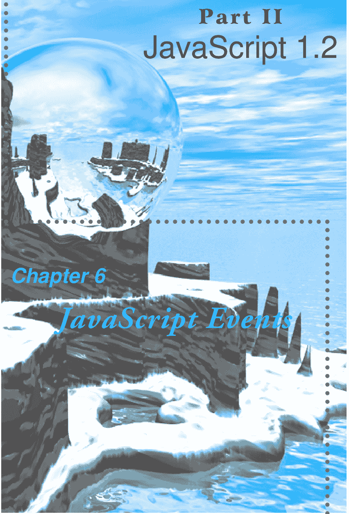

# 第 6 章

# JavaScript 事件

第二部分 — JavaScript 1.2

# 第 6 章

# JavaScript 事件

### 目录

事件对象与处理器 524

- 6.1) JavaScript 事件模型 524
- 6.2) JavaScript 事件对象和事件处理器 525
- 6.3) 事件属性摘要图表 526
- 6.4) 修饰键和 ASCII 值图表 527
- 6.5) 事件对象的结构 527
- 6.6) 使用点号表示法按名称指定事件 528
- 6.7) 每个事件对象的可用事件属性 529
- 6.8) 定义事件处理器 530
- 6.9) 通过属性赋值定义事件处理器 530
- 6.10) 在条件语句中检测修饰键 530
- 6.11) 通过属性赋值定义事件处理器 532
- 6.12) JavaScript 的 event 关键字 532
- 6.13) 在条件语句中检测多个修饰键 534
- 6.14) 检测鼠标事件期间按下的修饰键 535
- 6.15) Layer 对象的 load() 方法与按键事件 536
- 6.16) String 对象的 fromCharCode() 方法与按键事件 538
- 6.17) 使用修饰键与普通按键组合触发事件 540
- 6.18) 确定按键的 ASCII 值 541

捕获与释放事件 543

- 6.19) JavaScript 的 captureEvents() 方法 543
- 6.20) 在嵌套层中捕获事件 543
- 6.21) JavaScript 的 releaseEvents() 方法 544
- 6.22) 在层上使用 type 属性和 captureEvents() 方法 544


 ## JavaScript 事件

- 6.23) 用鼠标拖动图像 547
- 6.24) `Event` 对象的 `target` 属性的 `name` 属性 549
- 6.25) 为 `window` 对象捕获事件以拖动图像 553
- 6.26) 使用本地化脚本拖动图像 556
- 6.26.1) 国际象棋游戏示例 556
- 6.27) 捕获和使用 KEYPRESS 与 KEYUP 事件 580
- 6.27.1) 从键盘下 tic tac toe 棋 580
- 6.28) 使用 JavaScript `switch()` 语句与 KEYDOWN、KEYPRESS 和 KEYUP 事件 586
- 6.29) 用 `switch()` 语句移动层 588
- 6.30) 为层和图像添加动画 590
- 6.31) 自动以及通过点击图像为层添加动画 591
- 6.32) 用 `e.target.name` 属性为层添加动画 595
- 6.33) 在框架集环境中为层添加动画 604
- 6.34) 用 JavaScript 控制外部框架文档 609
- 6.35) JavaScript 的 `alinkColor`、`alinkColor` 和 `vlinkColor` 属性 610
- 6.36) 使用按键事件 `隐藏` 和 `显示` 层 610

## 使用按键事件滚动、调整大小和移动窗口 622

- 6.37) JavaScript 的 `scrollBy()` 方法 622
- 6.38) JavaScript 的 `scrollTo()` 方法 622
- 6.39) 用各种方法控制窗口 623
- 6.40) 事件对象的 `which` 属性的 ASCII 值 628
- 6.41) 使用按键事件打开新窗口 648
- 6.42) 创建用户可自定义的文档 650
- 6.43) 在层上拖动以调整其大小 661

## 事件的路由与处理 663

- 6.44) JavaScript 的 `routeEvent()` 函数 663
- 6.45) 使用 JavaScript 的 `routeEvent()` 函数 663
- 6.46) JavaScript 的 `handleEvent()` 方法 668
- 6.47) 使用 JavaScript 的 `handleEvent()` 方法 669
- 6.48) 在嵌套和非嵌套层中处理与路由事件 673

## 事件对象与处理程序

## JavaScript 事件模型

如果你完全不了解事件模型，可能需要参考 Netscape 的 JavaScript 1.2 指南或 JavaScript 1.2 参考手册，这些资料都可以从其网站免费下载。Netscape 始终会提供最新版本，但如果你需要快速查阅，附赠 CD-ROM 中也包含了 JavaScript 指南 1.2 和 1.3 版、JavaScript 1.2 和 1.3 参考手册以及 DHTML 指南。

本文档是对事件模型的概述，对其中一些更有趣且实用的功能进行了更详细的解释，尤其是 1.2 版中的新特性。这并不是一部完整的 JavaScript 参考著作。

## 概述

所有事件，如 CLICK 或 KEYPRESS，在 JavaScript 中都是事件对象，因此它们都有与之关联的属性，提供有关该事件的信息。事件对象没有与之关联的方法，但其他对象（如 document 对象）有可用的方法，例如 `captureEvent()`，用于操纵事件。还有事件处理程序，如 onClick 和 onKeyPress，它们基本上指定了事件发生时要执行的一个动作或一系列动作。

除了样式上的修饰外，JavaScript 本质上是**事件驱动**的，也就是说，你使用事件和事件处理程序来操纵你的文档。当用户点击链接或表单元素中的按钮，或者当用户将鼠标移动到图像或链接上方或移开时，事件就会发生。借助新的 `captureEvent()` 方法，你可以在事件到达包含窗口或其预期目标之前，在层或框架中捕获事件，并为其编写脚本操作。

本章为理解事件和事件处理程序的工作原理奠定了基础。它包括对事件对象的详细解释，以及大量实用的示例和示例文件，向你展示如何在你的代码中实现事件。还有一些示例会涉及一些繁琐的工作，即确定有效使用事件所必需的幕后信息，但这些信息在其他地方并不容易获得。

你可以创建允许用户拖动并重新定位层的代码，以便页面可以完全自定义设计，或者在玩国际象棋等游戏时操纵页面内容。（本章包含一个可运行的国际象棋程序。）你可以编写页面脚本，让用户使用按键来完成菜单命令，就像在普通程序中一样。可能性几乎无穷无尽，所以让我们开始吧。

最后一点注意：第 526 页事件属性表中列出的属性是所有事件所有可能属性的完整列表。并非所有属性对每个事件都可用。请查阅第 529 页的后续图表，了解哪些属性与特定事件相关联且可用。

## JavaScript 事件对象和事件处理程序

以下是 JavaScript **Event** 对象和 **Event** 处理程序的列表。请记住 JavaScript 是区分大小写的；如果你编写的代码专门用于 1.2 版之前的 JavaScript 版本，那么 **Event** 对象和 **Event** 处理程序都必须全部使用小写。Netscape 声称从 JavaScript 1.2 开始，你可以用更熟悉的 interCap 方式编写 **Event** 处理程序，如下所示，但我发现对于通过[属性赋值](https://example.com/property)分配的事件，这样做是有问题且不可靠的。对于通过[属性赋值](https://example.com/attribute)分配的事件，这样写仍然没问题。有关事件[属性赋值](https://example.com/property)和[属性赋值](https://example.com/attribute)的信息，请参见第 530-533 页。请注意，`dblclick` 事件在 Macintosh 平台上未实现。

| 事件对象 | 事件处理程序 | 内置该事件的对象（未捕获）： |
| :--- | :--- | :--- |
| abort | onAbort | 图像 |
| blur | onBlur | 窗口（`<BODY>`）、层、表单元素 |
| change | onChange | 文本字段、文本区域、选择列表 |
| click | onClick | 所有类型的按钮、文档、链接、复选框 |
| dblclick | onDblClick | 文档、区域、链接 |
| dragdrop | onDragDrop | 窗口 |
| error | onError | 图像、窗口 |
| focus | onFocus | 窗口（`<BODY>`）、层、表单元素 |
| keydown | onKeyDown | 文档、图像、 Library、文本区域 |
| keypress | onKeyPress | 文档、图像、 Library、文本区域 |
| keyup | onKeyUp | 文档、图像、 Library、文本区域 |
| load | onLoad | 窗口（`<BODY>`）、图像、层 |
| mousedown | onMouseDown | 文档、按钮、链接 |
| mousemove | onMouseMove | 默认无 |
| mouseout | onMouseOut | 区域、链接、层 |
| mouseover | onMouseOver | 区域、链接、层 |
| mouseup | onMouseUp | 文档、按钮、链接 |
| move | onMove | 窗口 |
| reset | onReset | 表单 |
| resize | onResize | 窗口 |
| select | onSelect | 文本字段、文本区域 |
| submit | onSubmit | 表单 |
| unload | onUnload | 窗口（`<BODY>`） |

### JavaScript 语法：

```
event.propertyName
```

## 事件属性汇总表

### 事件属性：

| 属性 | 描述 |
| --- | --- |
| **type** | 返回一个字符串，表示事件的类型，如 "click"、"mousedown" 或 "keypress"。 |
| **target** | 返回一个引用，表示事件最初被发送到的对象。对于名为 "b1" 的按钮，当该按钮被点击时，`(event.target.name == "b1")` 将返回 true。注意，你通过其 **name** 属性来访问 **target** 属性。 |
| **layerX** | 返回一个数字，指定鼠标光标的水平 x 坐标（以像素为单位），相对于事件发生所在的层，除非发生 **resize** 事件。在这种情况下，它与 **resize** 事件一起传递时，会传递对象的宽度。 |
| **layerY** | 返回一个数字，指定鼠标光标的垂直 y 坐标（以像素为单位），相对于事件发生所在的层，除非发生 **resize** 事件。在这种情况下，它与 **resize** 事件一起传递时，会传递对象的高度。 |
| **width** | 与 **layerX** 相同，但对于 **resize** 事件来说，语法更直观。 |
| **height** | 与 **layerY** 相同，但对于 **resize** 事件来说，语法更直观。 |
| **x** | 与 **layerX** 相同。 |
| **y** | 与 **layerY** 相同。 |
| **pageX** | 返回一个数字，指定鼠标光标的水平 x 坐标（以像素为单位），相对于页面。 |
| **pageY** | 返回一个数字，指定鼠标光标的垂直 y 坐标（以像素为单位），相对于页面。 |
| **screenX** | 返回一个数字，指定鼠标光标的水平 x 坐标（以像素为单位），相对于屏幕。 |
| **screenY** | 返回一个数字，指定鼠标光标的垂直 x 坐标（以像素为单位），相对于屏幕。 |
| **data** | 返回一个字符串数组，包含所有拖放到窗口中的对象的 URL，并将它们与 **dragdrop** 事件一起传递。 |
| **which** | 返回一个整数，指定被按下的键的 ASCII 值，或被按下的鼠标按钮的 ASCII 值。 |
| **modifiers** | 返回一个整数，指定与鼠标或按键事件一起按下的 **修饰键** 的 ASCII 值。**修饰键** 的常量值为：ALT_MASK、CONTROL_MASK、SHIFT_MASK 和 META_MASK。它们各自的 ASCII 整数值，无论是单独使用还是各种组合使用，都在下表中列出。 |


 ## 修饰键与 ASCII 值对照表

此表展示了当发生鼠标或键盘事件时，返回给 `modifiers` 属性的 ASCII 值。如果未使用修饰键，则 `modifiers=0`。

| 修饰键和/或组合 | ASCII 值 |
| :--- | :--- |
| `ALT_MASK`（苹果 Option 键） | 1 |
| `CONTROL_MASK` | 2 |
| `ALT_MASK` + `CONTROL_MASK` | 3 |
| `SHIFT_MASK` | 4 |
| `ALT_MASK` + `SHIFT_MASK` | 5 |
| `CONTROL_MASK` + `SHIFT_MASK` | 6 |
| `ALT_MASK` + `CONTROL_MASK` + `SHIFT_MASK` | 7 |
| `META_MASK`（苹果 Command 键） | 8 |
| `META_MASK` + `ALT_MASK` | 9 |
| `META_MASK` + `CONTROL_MASK` | 10 |
| `META_MASK` + `ALT_MASK` + `CONTROL_MASK` | 11 |
| `META_MASK` + `SHIFT_MASK` | 12 |
| `META_MASK` + `SHIFT_MASK` + `ALT_MASK` | 13 |
| `META_MASK` + `SHIFT_MASK` + `CONTROL_MASK` | 14 |
| `META_MASK` + `SHIFT_MASK` + `CONTROL_MASK` + `ALT_MASK` | 15 |
| 如果事件未使用任何修饰键，则 `modifiers` | 0 |

## 事件对象的结构

以下是 Navigator 中 JavaScript 解释器生成的典型 *mouseup 事件*对象的样子，展示了其属性和值：

```
({type:"mouseup", x:385, y:235, width:undefined, height:undefined, layerX:385, layerY:235, which:1, modifiers:0, data:undefined, pageX:395, pageY:245, screenX:494, screenY:323, target:})
```

这是一个在按下 META 和 CONTROL 修饰键并按下 "T" 键以产生事件 `e` 时的典型 *keyup 事件*：

```
({type:"keyup", x:329, y:116, width:undefined, height:undefined, layerX:329, layerY:116, which:20, modifiers:10, data:undefined, pageX:329, pageY:116, screenX:428, screenY:194, target:})
```

其中 `e.which = 20`，因为 20 是 "T" 的 ASCII 整数值。
其中 `e.modifiers = 10`，因为 10 是 META+CONTROL 的 ASCII 整数值。

了解事件的组织结构，有助于在需要根据事件来编写代码逻辑时，更容易理解如何在语句中测试条件。

例如，你可以使用事件的 **modifiers** 属性来测试 ALT 键是否被按下，并在条件为真时执行相应代码，如下所示：

```
if (e.modifiers == Event.ALT_MASK)
        alert ("The Alt key was down for the event.");
```

这假设你正在函数中使用 "e" 作为事件参数，以便将事件传递给函数。例如：

```
function myEventTester(e) {
        if (e.modifiers == Event.CONTROL_MASK)
            alert ("The CONTROL key was pressed.");
}
```

以下是另外两种测试 ALT 键是否被按下的方法，第一种使用按位与 "&" 运算符，第二种使用更熟悉的比较等于 "==" 运算符：

```
if (e.modifiers & Event.ALT_MASK)

if (e.modifiers == 1)
```

如果你记得前面修饰键表中的内容，当 ALT 键被按下时，返回给 **modifiers** 属性的 ASCII 值是 **1**。

## 使用点表示法按名称指定事件

你通过点表示法指定事件，即在表达式中引用一个 **事件常量** 来调用事件。**事件常量** 必须始终大写，*不是* 驼峰式，并且必须在前面加上 **Event** 一词，如下所示：

```
Event.MOUSEDOWN
Event.MOUSEUP
Event.MOUSEMOVE
Event.KEYPRESS
```

例如，当为名为 **myLayer** 的层捕获事件（参见第 543+ 页的 **captureEvents()** 方法）时，你需要指定要捕获的一个或多个事件（用竖线字符 | 分隔），如下所示：

```
document.myLayer.document.captureEvents(Event.CLICK)
document.myLayer.document.captureEvents(Event.KEYUP|Event.KEYDOWN)
```

## 每个事件对象可用的属性

下表列出了每个事件对象可用的事件对象属性。再次说明，dblclick 事件在 Macintosh 上未实现。

| 事件对象 | 可用的事件属性 |
| :--- | :--- |
| abort | type, target |
| blur | type, target |
| change | type, target |
| click | type, target, which, modifiers |
| dblclick | type, target, which, modifiers, layerX, layerY, pageX, pageY, screenX, screenY |
| dragdrop | type, target, data |
| error | type, target |
| focus | type, target |
| keydown | type, target, which, modifiers, layerX, layerY, pageX, pageY, screenX, screenY |
| keypress | type, target, which, modifiers, layerX, layerY, pageX, pageY, screenX, screenY |
| keyup | type, target, which, modifiers, layerX, layerY, pageX, pageY, screenX, screenY |
| load | type, target |
| mousedown | type, target, which, modifiers, layerX, layerY, pageX, pageY, screenX, screenY |
| mousemove | type, target, layerX, layerY, pageX, pageY, screenX, screenY |
| mouseout | type, target, layerX, layerY, pageX, pageY, screenX, screenY |
| mouseover | type, target, layerX, layerY, pageX, pageY, screenX, screenY |
| mouseup | type, target, which, modifiers, layerX, layerY, pageX, pageY, screenX, screenY |
| move | type, target, screenX, screenY |
| reset | type, target |
| resize | type, target, width, height |
| select | type, target |
| submit | type, target |
| unload | type, target |

> 注意：当点击链接、层或文档/窗口时，以下六个属性表示鼠标光标位置，但如果点击的是按钮，则它们未被使用：
layerX, layerY, pageX, pageY, screenX, screenY

## 定义事件处理器

你可以使用属性赋值或 HTML 元素属性方法来定义事件处理器。后一种方法更常被作者使用，并具有灵活性更高的优点。这两种技术之间有一个必须记住的主要区别：当你通过 JavaScript 属性将函数赋值给事件处理器时，事件参数是自动包含的。而当你在 HTML 标签中添加事件处理器作为属性时，你必须用 `event` 关键字自己提供函数的事件参数。属性赋值在示例 6-0 中演示，属性赋值在示例 6-1 中演示。

#### 特别说明：

我发现使用属性赋值方法时，采用驼峰式拼写事件处理器可能会导致程序中出现一些小错误，因此目前请坚持使用全小写拼写，例如：`onmousedown`，直到 Netscape 修复此问题。

## 通过属性赋值定义事件处理器

当你通过属性赋值将函数赋值给事件处理器时，这是一个非常直接的过程。只需写出事件处理器的名称，并将其设置为要赋值给它的函数，确保不包含通常出现的括号。省略括号的原因是，提供给事件处理器的是对函数的引用，因为事件处理器不能接受参数。例如，示例 6-0 中的函数 `keyTest()` 被赋值给文档对象的 `onmousedown` 事件处理器，如下所示：

```
document.onmousedown = keyTest;
```

## 在条件语句中测试修饰键

在下面的示例 6-0 中，函数 `keyTest()` 用于在按下每个修饰键与 mousedown 事件结合时触发带有不同消息的警报窗口。函数 `keyTest2()` 用于触发包含关于 keydown 事件的 `type`、`which`、`layerX`、`layerY` 和 `modifiers` 属性信息的警报窗口。这两个函数最初都在文档 `<HEAD>` 中的 `<SCRIPT>` 标签内定义，然后在文档 `<BODY>` 中的另一个 `<SCRIPT>` 标签内分配给各自的事件属性。

## 第6章 — JavaScript 事件

## 示例 6-0：Sample700.html

```
<!DOCTYPE HTML PUBLIC "-//W3C//DTD HTML 3.2//EN">
<html>
<head>
 <TITLE>Sample 700 - Example 6-0 Key Events, Modifier Keys and Alerts </TITLE>

 <SCRIPT LANGUAGE="JavaScript1.2"><!--BEGIN HIDING

 function keyTest(e) {

   if (e.modifiers == Event.ALT_MASK)
     alert ("The Alt key was down for the event which is the option key to Macs.");

   else if (e.modifiers == Event.CONTROL_MASK)
     alert ("The Control key was down for the event.");

   else if (e.modifiers == Event.SHIFT_MASK)
     alert ("The Shift key was down for the event.");

   else if (e.modifiers == Event.META_MASK)
     alert ("The Meta key was down for the event which is the Command key to Macs.");

   else
     alert ("There was no modifiers key held down for the event.");

   return true;
 }

 /*------------------------------------------------------------------------*/
 /*------------------------------------------------------------------------*/

 function keyTest2(e) {

   if (e.modifiers == Event.ALT_MASK && e.which) {
     alert ("Your Document got an Event of type: " + e.type);
     alert ("Your Document also had the key pressed with the value of: " + e.which);
     alert ("The modifiers key used was: " + e.modifiers);
   }

   else {
     alert ("Your Document got an Event of type: " + e.type);
     alert ("The modifiers key used was: " + e.modifiers);
     alert ("The x position of the Mouse was: " + e.layerX);
     alert ("The y position of the Mouse was: " + e.layerY);
   }

   return true;
 }

 /*------------------------------------------------------------------------*/

 //END HIDING-->
 </SCRIPT>

 </head>
```


# 532 第二部分 — JavaScript 1.2

```
<BODY BGCOLOR="BLACK" TEXT="WHITE">

<LAYER ID="TestLayer" LEFT="10" TOP="10" WIDTH="400" BGCOLOR="red">
<SPAN STYLE="color:black; font-size:22pt;">
    这是一个简单的示例，它向你展示如何测试和使用修饰键来控制 onMouseDown 和 onKeyDown 事件发生时的行为。尝试点击鼠标

<SPAN STYLE="color:white;">   在外部          </SPAN>

红色背景图层的外部，或者按下键盘上的一个键，同时按下或不按下 Alt、Control、Shift 或 Command 键，看看会发生什么。

</SPAN>
</LAYER>

<!--  *************************************************************  -->

<SCRIPT LANGUAGE="JavaScript1.2"><!--BEGIN HIDING

        document.onmousedown = keyTest;
        document.onkeydown = keyTest2;

//END HIDING-->
</SCRIPT>

</BODY>
</HTML>
```

## 通过属性赋值定义事件处理程序

## JavaScript 的 event 关键字

当你将一个带有事件参数的函数赋值给 HTML 元素的属性时，你必须使用 **event** 关键字作为参数来手动提供**事件**对象。原因是**事件**对象引用不会由 JavaScript 编译器自动传递，所以你必须显式地完成这一步。

以下示例展示了这一点，其中函数 **buttonTest1(e)** 测试 ALT 和 SHIFT 修饰键，如果在点击按钮 **b1** 时按下了其中任何一个，文档的背景色就会更改为不同的颜色。

## 示例 6-1：Sample701.html

```
<!DOCTYPE HTML PUBLIC "-//W3C//DTD HTML 3.2//EN">
<HTML>
<HEAD>
<TITLE>Sample 701 - 示例 6-1       按键事件 </TITLE>

<SCRIPT LANGUAGE="JavaScript1.2"><!--BEGIN HIDING

function buttonTest1(e) {

			if (e.modifiers == Event.ALT_MASK)
				document.bgColor = "blue";

			if (e.modifiers == Event.SHIFT_MASK)
				document.bgColor = "#7700ff";

	return true;
}
/*-----------------------------------------------------------------*/
//END HIDING-->
</SCRIPT>
</HEAD>

<BODY BGCOLOR="BLACK" TEXT="WHITE">

<LAYER ID="TestLayer" LEFT="10" TOP="10" WIDTH="400" BGCOLOR="steelblue">
<SPAN STYLE="color:black; font-size:22pt;">

	按住 Option/Alt 键并点击按钮，将背景色更改为

<SPAN STYLE="color:blue;">     蓝色     </SPAN>。<BR><BR>

	按住 Shift 键并点击按钮，将背景色更改为真正的

<SPAN STYLE="color:#7700ff;"> 紫色 </SPAN>。</SPAN>

<!--重要的是要注意，事件参数是通过
		buttonTest1(event)
		为 onClick 事件处理程序提供的，并且必须全部小写！！！-->
<HR>
<FORM NAME="form1">

<INPUT TYPE="button" NAME="B1" VALUE="更改背景色"
onClick="buttonTest1(event);">

</FORM>
<HR>
</LAYER>

</BODY>
</HTML>
```

**534**

**第二部分 — JavaScript 1.2**

## 在条件语句中测试多个修饰键

此示例在前面示例的基础上进行扩展，测试**多个**修饰键的按下以改变图层的背景色。它使用名为 **b1** 的按钮的 **onMouseDown** 事件处理程序中的 **event** 关键字，将事件对象传递给函数 **buttonTest2(e)** 进行处理。

### 示例 6-2：

### Sample702.html

```
<!DOCTYPE HTML PUBLIC "-//W3C//DTD HTML 3.2//EN">
<HTML><HEAD>
<TITLE>Sample 702 - 示例 6-2 按键事件 </TITLE></HEAD>

<BODY BGCOLOR="BLACK" TEXT="WHITE">

<HR>
<FORM NAME="form1">

<INPUT TYPE="button" NAME="b1" VALUE="更改图层背景色"
onMouseDown="buttonTest2(event);">
</FORM> <HR>

<LAYER ID="TestLayer" LEFT="10" TOP="150" WIDTH="550" BGCOLOR="cyan">
<SPAN STYLE="color:black; font-size:15pt; text-align:right;">

按以下修饰键之一并点击按钮，以更改 TestLayer 图层的背景色。<BR><BR>

ALT_MASK                                    =        1       红色背景         <BR>
META_MASK + SHIFT_MASK                      =       12       黄色背景      <BR>
META_MASK + SHIFT_MASK + ALT_MASK           =       13       酸橙色背景        <BR>
META_MASK + SHIFT_MASK + CONTROL_MASK =       14       蓝色背景    <BR></SPAN>

</LAYER>
<!--  ****************************************************************  -->

<SCRIPT LANGUAGE="JavaScript1.2"><!--BEGIN HIDING

function buttonTest2(e) {

        if (e.modifiers == Event.ALT_MASK) {document.TestLayer.bgColor= 'red';}
        if (e.modifiers == 12) {document.TestLayer.bgColor= 'yellow';}
        if (e.modifiers == 13) {document.TestLayer.bgColor= 'lime';}
        if (e.modifiers == 14) {document.TestLayer.bgColor= 'blue';}

 return true;
}
//END HIDING-->
</SCRIPT>
</BODY>
</HTML>
```

## 测试鼠标事件期间按下的修饰键

此示例使用属性赋值方法将 **keyTest(e)** 函数分配给 **document** 对象的 **onmousedown** 事件处理程序。**keyTest(e)** 函数测试 **modifiers** 属性值，并根据 **mousedown** 事件发生时按下的**修饰键**来更改名为 **TestLayer** 的图层的背景色。

**示例 6-3：** &nbsp;&nbsp;&nbsp;&nbsp;&nbsp;&nbsp;&nbsp;&nbsp;&nbsp;&nbsp;&nbsp;&nbsp;&nbsp;&nbsp;&nbsp;&nbsp;&nbsp;&nbsp;&nbsp;&nbsp;&nbsp;&nbsp;&nbsp;&nbsp;&nbsp;&nbsp;&nbsp;&nbsp;&nbsp;&nbsp;&nbsp;&nbsp;&nbsp;&nbsp;&nbsp;&nbsp;&nbsp;&nbsp;&nbsp;&nbsp;&nbsp;&nbsp;&nbsp;&nbsp; **Sample703.html**

```
<!DOCTYPE HTML PUBLIC "-//W3C//DTD HTML 3.2//EN">
<HTML><HEAD>
<TITLE>Sample 703 - 示例 6-3 按键事件与 MouseDown 更改背景色 </TITLE>
</HEAD>
<BODY BGCOLOR="BLACK" TEXT="white">

<LAYER ID="TestLayer" LEFT="10" TOP="70" WIDTH="400" BGCOLOR="LIME">

<SPAN STYLE="color:black; font-size:22pt;">
      这是一个简单的示例，它向你展示如何使用修饰键来
      控制此图层的背景色。在图层
<SPAN STYLE="color:white;">    外部        </SPAN>
      的某处点击鼠标，然后在按下 Alt、Shift、Control 或
      Command 键中的任意一个时点击鼠标，或者直接点击鼠标以获取结果。        </SPAN>
</LAYER>
<!--  ******************************************************************************** -->
<SCRIPT LANGUAGE="JavaScript1.2"><!--BEGIN HIDING

function keyTest(e) {
       if (e.modifiers == Event.ALT_MASK)
              document.TestLayer.bgColor="blue";

else if (e.modifiers == Event.META_MASK)
              document.TestLayer.bgColor="gray";

else if (e.modifiers == Event.SHIFT_MASK)
              document.TestLayer.bgColor="purple";

else if (e.modifiers == Event.CONTROL_MASK)
              document.TestLayer.bgColor="red";

else  document.TestLayer.bgColor="olive";

return true;
}
/*-----------------------------------------------------------------------------------*/
              document.onmousedown = keyTest;
/*-----------------------------------------------------------------------------------*/
//END HIDING-->
</SCRIPT>
</BODY></HTML>
```

## Layer 对象的 load() 方法与按键事件

在此示例中，**keyTest(e)** 函数通过 **e.modifiers** 测试是否按下了任何修饰键，并相应地执行代码。它已通过属性赋值分配给 **document** 对象的 **onclick** 事件处理程序。**keyTest2(e)** 函数测试是否同时按下了 CONTROL 键和 'z' 键，如果为真，则执行代码。此函数已分配给 **document** 对象的 **onkeypress** 事件处理程序。请注意，当同时按下 CONTROL 键时，'z' 键的 ASCII 值为 26。要回顾 **load()** 方法，请从第 221 页开始。

```
<!DOCTYPE HTML PUBLIC "-//W3C//DTD HTML 3.2//EN">
<HTML><HEAD>
<TITLE>Sample 704 - 示例 6-4 按键事件更改背景色 </TITLE></HEAD>

<BODY BGCOLOR="BLACK" TEXT="white">

<LAYER ID="TestLayer" LEFT="10" TOP="10" WIDTH="400" BGCOLOR="LIME">
<SPAN STYLE="color:black; font-size:17pt; padding-top:30px; padding-right:30px; padding-bottom:50px; padding-left:50px;">
    这是一个简单的示例，它向你展示如何使用修饰键来
    控制此图层的背景色。在图层
<SPAN STYLE="color:white;"> 外部 </SPAN>
    的某处点击鼠标，看看会发生什么，然后在按下任何修饰键（Control 键除外）时点击，以获取不同的结果。
</SPAN>
</LAYER>
<!-- **************************************************** -->
<LAYER ID="TestLayer2" LEFT="10" TOP="200" WIDTH="500" HEIGHT="200"
BGCOLOR="green">
<SPAN STYLE="font-size:30pt;">嘿，我想要另一份工作。</SPAN>
</LAYER>
<!-- **************************************************** -->
<LAYER ID="TestLayer3" LEFT="10" TOP="200" WIDTH="500" HEIGHT="200" BGCOLOR="aqua">
<SPAN STYLE="font-size:30pt;">在 keyTest 函数中没有使用 CONTROL 键的原因是 Navigator 中存在一个 bug，如果 CONTROL 键与 onClick 事件结合使用，会导致 JavaScript 被忽略。</SPAN>
</LAYER>
<!-- **************************************************** -->
<LAYER ID="TestLayer4" LEFT="10" TOP="200" WIDTH="500" HEIGHT="200"
BGCOLOR="steelblue">
```


# 第6章 — JavaScript 事件

只是为了向你展示 CONTROL 键并非无用，请点击 CONTROL 键和 'z' 键来将 TestLayer3 的背景色更改为红色。

```
<!-- ========================================================================= -->

<SCRIPT LANGUAGE="JavaScript1.2">

function keyTest(e) {

    if (e.modifiers == Event.ALT_MASK) {
        document.TestLayer.load('Sample406.html', 500);
    }
    else if (e.modifiers == Event.META_MASK) {
        document.TestLayer.load('Sample405.html', 500);
        document.TestLayer2.zIndex="4";
        document.TestLayer4.zIndex="3";
        document.TestLayer2.zIndex="3";
        document.TestLayer2.zIndex="5";
        document.TestLayer2.bgColor="blue";
    }
    else if (e.modifiers == Event.SHIFT_MASK) {
        document.TestLayer.zIndex="1";
        document.TestLayer4.zIndex="4";
        document.TestLayer3.zIndex="5";
        document.TestLayer3.bgColor="purple";
    }
    else {
        document.TestLayer2.zIndex="4";
        document.TestLayer3.zIndex="3";
        document.TestLayer4.zIndex="4";
        document.TestLayer4.bgColor="olive";
    }

    return true;
}
/*-----------------------------------------------------------------------------------*/

function keyTest2(e) {

    if (e.modifiers == Event.CONTROL_MASK && e.which == 26) {
        document.TestLayer2.zIndex="3";
        document.TestLayer4.zIndex="4";
        document.TestLayer3.zIndex="5";
        document.TestLayer3.bgColor="red";
    }
}
/*-----------------------------------------------------------------------------------*/

    document.onclick = keyTest;
    document.onkeypress = keyTest2;

</SCRIPT>
```

```
</body>
</html>
```

538 **第二部分 — JavaScript 1.2**

## 带有按键事件的 **String** 对象的 **fromCharCode()** 方法

你可以使用此示例来确定按下 ALT 键的同时按下的任何键的 ASCII 值。它还使用 **String** 对象的 **fromCharCode()** 方法来提取按键的实际字母、数字或符号。一个 **alert** 消息会向你显示两个值以便进行比较。有关 **fromCharCode()** 方法的更多信息，请参阅第 8 章关于 **String** 对象的第 763-765 页。

函数 **keyTest2(e)** 在脚本末尾通过属性赋值分配给 **document** 对象的 **onkeydown** 事件处理程序。在 BODY 标签的 **onLoad** 事件处理程序中调用了 **window** 对象的 **focus()** 方法，这样你就不必在第一次使用该函数之前点击窗口。

### 示例 6-5: Sample705.html

```
<!DOCTYPE HTML PUBLIC "-//W3C//DTD HTML 3.2//EN">
<HTML><HEAD> <TITLE> Sample 705 - Example 6-5 get ALT Key numbers </TITLE>
</HEAD>
<BODY BGCOLOR="BLACK" onLoad="window.focus();">

<LAYER ID="TestLayer" LEFT="10" TOP="10" WIDTH="400" BGCOLOR="red">
<SPAN STYLE="font-size:22pt;">
Press the Alt or Option Key along with any other regular key to get an alert
with the key that was pressed and the ASCII number that represents it which you can
use in other functions. </SPAN>
</LAYER>
<!-- **************************************************** -->

<SCRIPT LANGUAGE="JavaScript1.2"><!--BEGIN HIDING

function keyTest2(e) {
    if (e.modifiers == Event.ALT_MASK) {

//Make sure the alert String is all on one line in your text editor

        if (e.which) {
            alert ("Your Document also had the: " +
            String.fromCharCode(e.which) + "\r\r" +
            "key pressed with the ASCII Value of: " + e.which)
        }
    }
    return true;
}
/*-----------------------------------------------------------------*/
    document.onkeydown = keyTest2;
/*-----------------------------------------------------------------*/
//END HIDING-->
</SCRIPT>
</BODY></HTML>
```

# 第6章 — JavaScript 事件

此示例完成与上一个示例相同的功能，但它测试的是 CONTROL 键而不是 ALT 键。

### 示例 6-6: Sample706.html

```
<!DOCTYPE HTML PUBLIC "-//W3C//DTD HTML 3.2//EN">
<HTML>
<HEAD>
<TITLE> Sample 706 - Example 6-6 get CONTROL Key numbers </TITLE>
</HEAD>

<BODY BGCOLOR="black" onLoad="window.focus();">

<LAYER ID="TestLayer" LEFT="10" TOP="10" WIDTH="400" BGCOLOR="purple">

<SPAN STYLE="color:white; font-size:22pt;">

Press the Control Key along with any other regular key to get an alert with the key that was pressed and the ASCII number that represents it which you can use in other functions.

</SPAN>
</LAYER>

<!-- ************************************************************ -->

<SCRIPT LANGUAGE="JavaScript1.2"><!--BEGIN HIDING

function keyTest2(e) {

		if (e.modifiers == Event.CONTROL_MASK && e.which) {

			alert ("Key pressed: " + String.fromCharCode(e.which) + "\r\r" +
				"ASCII Value: " + e.which)
	}

	return true;
}

/*----------------------------------------------*/

			document.onkeyup = keyTest2;

/*----------------------------------------------*/

//END HIDING-->
</SCRIPT>

</BODY>
</HTML>
```

## 使用修饰键与常规键触发事件

此示例演示了当同时按下 CONTROL 和 ALT 键以及另一个常规键时如何执行代码。你必须在 if () 语句中测试 CONTROL + ALT 的 ASCII 值，该值等于 3。反斜杠 '\\' 键加上 'r' 键 ('\\r') 只是回车符的简写。

### 示例 6-7: Sample707.html

```
<!DOCTYPE HTML PUBLIC "-//W3C//DTD HTML 3.2//EN">
<HTML><HEAD>
<TITLE> Sample 707 - Example 6-7 get ALT + CONTROL Key numbers </TITLE> </HEAD>

<BODY BGCOLOR="BLACK" TEXT="WHITE" onLoad="window.focus();">

<LAYER ID="TestLayer" LEFT="10" TOP="10" WIDTH="400" BGCOLOR="olive">
<SPAN STYLE="font-size:22pt;">

     Press the ALT and CONTROL Keys along with any other regular key to get an
alert with the Key that was pressed and the ASCII Value that represents that Key
and the ASCII Value of the MODIFIERS Keys.

</SPAN>
</LAYER>

<!-- ******************************************************************* -->

<SCRIPT LANGUAGE="JavaScript1.2"><!--BEGIN HIDING

function keyTest2(e) {

//e.modifiers Tests for Event.ALT_MASK &&  Event.CONTROL_MASK == 3
    if (e.modifiers == 3) {
         if (e.which) {
              alert ("Key Pressed = " + String.fromCharCode(e.which) +
                     "\r\r" + "e.which = " + e.which +
                     "\r\r" + "e.modifiers = " + e.modifiers)
         }
    }
 return true;
}

/*--------------------------------------------------------------------*/
              document.onkeydown = keyTest2;
/*--------------------------------------------------------------------*/

//END HIDING-->
</SCRIPT>
</BODY>
</HTML>
```

# 第6章 — JavaScript 事件

## 确定按键的 ASCII 值

此示例演示了如何通过测试按键的 ASCII 值来测试当按下 ALT 或 CONTROL 键时同时按下的特定按键。然后执行 JavaScript 代码，根据按下的键将各种外部文档加载到名为 TestLayer 的层中。更多详细信息，请参阅示例中的说明。

### 示例 6-8: Sample708.html

```
<!DOCTYPE HTML PUBLIC "-//W3C//DTD HTML 3.2//EN">
<HTML>
<HEAD>
<TITLE>Sample 708 - Example 6-8 MODIFIERS and Key Events to load documents</TITLE>
</HEAD>

<BODY BGCOLOR="BLACK" TEXT="white">

<LAYER ID="TestLayer" LEFT="10" TOP="10" BGCOLOR="cyan"></LAYER>
<LAYER ID="staticLayer" LEFT="10" TOP="200" WIDTH="500" BGCOLOR="lime">

<SPAN STYLE="color:black; font-size:17pt; padding-top:20px; padding-right:20px; padding-bottom:20px; padding-left:20px;">

        This is a simple example which shows you how to use the ALT or CONTROL
        Modifier Keys to load in an external document.  Press the ALT key or CONTROL key
        and either the z, x, c, or v key to load a document into the Layer named TestLayer.

<P><HR> <SPAN STYLE="color:blue;">
Ignore the text in the documents that are loaded in because they are from previous
Examples.
</SPAN><HR>      </P>

</SPAN>
</LAYER>

<!--  ******************************************************* -->

<SCRIPT LANGUAGE="JavaScript1.2"><!--BEGIN HIDING

function keyTest2(e) {

        //      189 is the ASCII Event number for the ALT or OPTION key + z key
        //      197 is the ASCII Event number for the ALT or OPTION key + x key
        //      141 is the ASCII Event number for the ALT or OPTION key + c key
        //      195 is the ASCII Event number for the ALT or OPTION key + v key

        //      26 is the ASCII Event number for the CONTROL key + z key
        //      24 is the ASCII Event number for the CONTROL key + x key
        //      3 is the ASCII Event number for the CONTROL key + c key
        //      22 is the ASCII Event number for the CONTROL key + v key
/*----------------------------------------------------*/
```

/* ------------------------------------------------------------------ */

    if (e.modifiers == Event.ALT_MASK && e.which == 189)
        document.TestLayer.load('Sample400.html', 500);

    if (e.modifiers == Event.ALT_MASK && e.which == 197)
        document.TestLayer.load('Sample401.html', 500);

    if (e.modifiers == Event.ALT_MASK && e.which == 141)
        document.TestLayer.load('Sample402.html', 500);

    if (e.modifiers == Event.ALT_MASK && e.which == 195)
        document.TestLayer.load('Sample404.html', 500);

/* ------------------------------------------------------------------ */

    if (e.modifiers == Event.CONTROL_MASK && e.which == 26)
        document.TestLayer.load('Sample400.html', 300);

    if (e.modifiers == Event.CONTROL_MASK && e.which == 24)
        document.TestLayer.load('Sample401.html', 300);

    if (e.modifiers == Event.CONTROL_MASK && e.which == 3)
        document.TestLayer.load('Sample402.html', 300);

    if (e.modifiers == Event.CONTROL_MASK && e.which == 22)
        document.TestLayer.load('Sample404.html', 300);
}

/* ------------------------------------------------------------------ */

    document.onkeydown = keyTest2;

/* ------------------------------------------------------------------ */

//END HIDING-->
</SCRIPT>

</body>
</html>

诚然最后八个示例相当乏味，但它们奠定了基础性的重要信息，这些信息将在您自己更复杂的作品中频繁使用。

下一节将教您如何捕获和释放事件，以便您可以对它们以及您的图层进行操控，从而获得以前在 JavaScript 中从未有过的效果。您将能够使用鼠标拖动图像和图层，并通过键盘或按钮点击来控制它们。现在，无需借助 Java，就可以实现一个国际象棋游戏，棋子可以在棋盘上实时移动位置，而无需刷新页面。该国际象棋游戏从第 556 页开始。

## 第 6 章 — JavaScript 事件 543

## 捕获与释放事件

### JavaScript 的 captureEvents() 方法

**captureEvents()** 方法适用于 **window**、**document** 和 **Layer** 对象，允许您在事件到达其预期目标之前捕获它们。这样做的结果是，您可以使用 JavaScript 来弥补某些您想要操控的 JavaScript 事件处理程序或 HTML 属性事件处理程序的不足。例如，LAYER 没有 **onClick** 事件处理程序，所以要让 LAYER 响应 **click** 事件，您可以使用 **captureEvents()** 方法在 **click** 事件到达其自然目标之前捕获它。例如，如果您有一个名为 L1 的 Layer：

```
document.L1.captureEvents(Event.CLICK)
```

这将导致所有 **click** 事件都被路由到 Layer **L1** 进行处理，直到按如下方式调用 **releaseEvents()**：

```
document.L1.releaseEvents(Event.CLICK)
```

要同时捕获多个事件，您可以使用竖线（'|'）字符将每个事件分隔开，如下所示（记住事件常量都是大写的）：

```
window.captureEvents(Event.MOUSEDOWN | Event.MOUSEUP)
```

### JavaScript 语法：

```
window.captureEvents(Event.eventName | Event.eventName)
document.captureEvents(Event.eventName | Event.eventName)
document.layerName.captureEvents(Event.eventName | Event.eventName)
document.layerName.document.layerName2.captureEvents(Event.eventName| Event.eventName)
```

### 在嵌套图层中捕获事件

要捕获名为 **L1** 的 Layer 内部嵌套的名为 **L2** 的 Layer 的所有 **click** 事件，您可以使用以下代码：

```
document.L1.document.L2.captureEvents(Event.CLICK)
```

## 第二部分 — JavaScript 1.2

### JavaScript 的 releaseEvents() 方法

**releaseEvents()** 方法适用于 **window**、**document** 和 **Layer** 对象，允许您关闭 **captureEvents()** 方法，使事件能够自然地在层次结构中传递。在许多情况下，您会希望创建一个函数，在函数开头调用 **captureEvents()**，用酷炫的代码处理事件，然后在函数末尾调用 **releaseEvents()**。

例如，如果您想要释放先前为名为 **myLayer** 的 Layer 捕获的 **keydown** 和 **keyup** 事件，您可以使用以下代码：

```
document.myLayer.releaseEvents(Event.KEYDOWN | Event.KEYUP)
```

### JavaScript 语法：

```
window.releaseEvents(Event.eventName | Event.eventName)
document.releaseEvents(Event.eventName | Event.eventName)
document.layerName.releaseEvents(Event.eventName | Event.eventName)
document.layerName.document.layerName2.releaseEvents(Event.eventName| Event.eventName)
```

### 在 Layer 上使用 type 属性和 captureEvents() 方法

在以下示例中，使用 **captureEvents()** 方法捕获名为 L1 的 Layer 的所有 **mousedown** 事件，代码如下：

```
document.L1.captureEvents(Event.MOUSEDOWN);
```

接下来，将 **L1** 的 **onmousedown** 事件处理程序赋值为 **getL1Events(e)** 函数，代码如下：

```
document.L1.onmousedown = getL1Events;
```

**getL1Events(e)** 函数通过将 **Event** 对象与 **type** 属性进行比较来测试它，如果它是 **mousedown** 事件且没有按下 **modifiers** 键，则调用 **changeL1()** 函数，该函数将 L1 的背景颜色改为蓝色，并将 **裁剪宽度（clipping width）** 改为 400。如果按下了 ALT 键，则调用 **changeL1Back()** 函数，该函数将 L1 的背景颜色改回紫色，并将 **裁剪宽度** 改回 200。

## 示例 6-9 Sample709.html

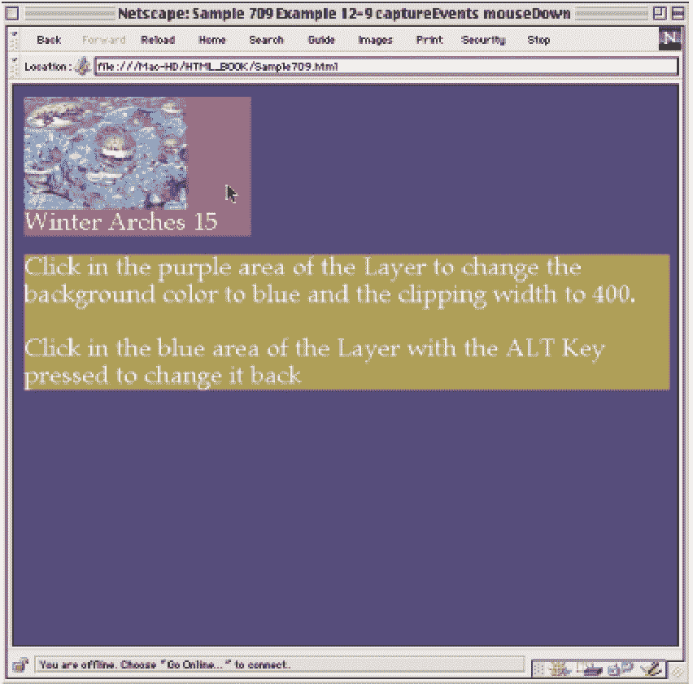

## 第二部分 — JavaScript 1.2

示例 6-9：Sample709.html

```
<!DOCTYPE HTML PUBLIC "-//W3C//DTD HTML 3.2//EN">
<HTML><HEAD><TITLE> 示例 709 示例 6-9 captureEvents mouseDown</TITLE>

<STYLE TYPE="text/JavaScript">

	classes.Mainbody.BODY.margins("0px");
	classes.Mainbody.BODY.paddings("0px");
	classes.Mainbody.BODY.backgroundColor="navy";
	classes.Mainbody.BODY.color="white";
	classes.Mainbody.BODY.fontSize="22pt";

</STYLE>
</HEAD>

<BODY CLASS="Mainbody">

<LAYER ID="L1" LEFT="10" TOP="10" WIDTH="200" BGCOLOR="purple">
<BR>
Winter Arches 15</LAYER>

<LAYER ID="L2" LEFT="10" TOP="150" WIDTH="570" BGCOLOR="olive">
Click in the purple area of the Layer to change the background color to blue and
the clipping width to 400.<BR><BR>
Click in the blue area of the Layer with the ALT Key pressed to change it back
</LAYER>
<!-- ************************************************************ -->

<SCRIPT LANGUAGE="JavaScript1.2"><!--BEGIN HIDING

document.L1.captureEvents(Event.MOUSEDOWN);
document.L1.onmousedown = getL1Events;

/*---------------------------------------------------------------*/

function getL1Events(e) {

	if (e.type == 'mousedown' && e.modifiers == 0) { //make sure no modifiers key pressed
		changeL1();
		return false;
	}
	else if (e.type == 'mousedown' && e.modifiers == 1) { //test for ALT Key
		changeL1Back();
		return false;
	}
}
/*---------------------------------------------------------------*/

function changeL1() {

	document.L1.bgColor = 'blue';
	document.L1.clip.width = 400;
}
/*---------------------------------------------------------------*/

function changeL1Back()  {

    document.L1.bgColor = 'purple';
    document.L1.clip.width = 200;
}
/*--- ----------------------------------------------------------*/

//END HIDING-->
</SCRIPT>
</BODY>
</HTML>
```

## # 用鼠标拖动图像

此示例向您展示如何用鼠标拖动图像并将其重新定位到浏览器窗口中的不同位置。您可以通过设置代码来拖动包含图像的 Layer，使用 **captureEvents()** 和 **releaseEvents()** 方法来实现这一点。

首先，您使用 **ids** 属性创建一个名为 **division** 的样式，并将其分配给具有 **ID** 属性的 DIV 元素，由于它具有 **position** 属性且设置为 **absolute**，因此它成为一个 Layer。

接下来，您创建一些全局变量以使代码更易读，并减少一些打字工作。然后，将 **division** Layer 设置为捕获所有 **mousedown** 和 **mouseup** 事件。**division.onmousedown** 事件处理程序被赋值为 **begindrag(e)** 函数，**division.onmouseup** 事件处理程序被赋值为 **enddrag(e)** 函数。

**begindrag(e)** 函数开始该过程，通过测试鼠标左键是否按下，如果为真，则使用 **captureEvents()** 方法捕获 **division** Layer 中发生的所有 **mousemove** 事件。接下来，通过<u>属性赋值</u>将 **division** Layer 的 **onmousemove** 事件处理程序赋值为 **drag(e)** 函数。注意<u>属性赋值</u>中不允许使用括号和 **e** 参数。

**drag(e)** 函数首先测试确保 **mousemove** 事件正在被捕获，如果为真，则使用 **moveBy()** 方法按指定的像素移动 **division** Layer。如果您还记得，**moveBy(x,y)** 方法接受两个参数：x 和 y 方向上的像素数。

通过将 **e.pageX - previousX** 表达式赋给 x 参数，您获取事件的当前 **pageX** 属性并减去事件的先前 **pageX** 属性（该属性已被赋给 **previousX** 变量），然后按该像素数在水平 x 方向上移动 **division** Layer。相同的场景在垂直方向上使用赋给 y 参数的 **e.pageY - previousY** 表达式来实现。

最后，当释放鼠标按钮时，调用 **enddrag(e)** 函数，使用 **releaseEvents()** 方法从 **division** Layer 释放 **mousemove** 事件。**onmousemove** 事件处理程序被设置为 **null** 关键字，以防止在此函数完成操作后调用任何多余的函数。

请注意，在上述三个函数的末尾，它们 **return false**，以停止该点的事件处理。


# 第二部分 — JavaScript 1.2

## 示例 6-10: Sample710.html

```html
<!DOCTYPE HTML PUBLIC "-//W3C//DTD HTML 3.2//EN">
<HTML><HEAD>
<TITLE>Sample 710 - Example 6-10 Drag an Image </TITLE>

<STYLE type="text/JavaScript">

    ids.division.position="absolute";
    ids.division.left="200";
    ids.division.top="200";
    ids.division.width="200";
    ids.division.height="150";
    ids.division.borderWidths("15px");
    ids.division.borderColor="#7700ff";
    ids.division.borderStyle="groove";

</STYLE>

</HEAD>

<BODY BGCOLOR="BLACK" TEXT="white">

<DIV ID="division"> <CENTER>

</CENTER></DIV>

<!--  *************************************************** -->

<SCRIPT LANGUAGE="JavaScript1.2"><!--BEGIN HIDING

var division = document.division;

    division.captureEvents(Event.MOUSEUP|Event.MOUSEDOWN);
    division.onmousedown = begindrag;
    division.onmouseup = enddrag;

var previousX;
var previousY;
var booleanDrag;

/*-------------------------------------------------------------------*/

function begindrag(e) {                     //e.which tests for the left mouse button being pressed
    if (e.which == 1) {
        division.captureEvents(Event.MOUSEMOVE);
        division.onmousemove = drag;
        previousX = e.pageX;
        previousY = e.pageY;
        booleanDrag = true;
        return false;
    }
}
/*-------------------------------------------------------------------*/

function drag(e) {
    //tests to make sure that mousemoves are being captured
    if (booleanDrag) {
        division.moveBy(e.pageX - previousX, e.pageY - previousY);
        previousX = e.pageX;
        previousY = e.pageY;
        return false;
    }
}
/*----------------------------------------------------------------------*/

function enddrag(e) {
    if (e.which == 1) {
        division.releaseEvents(Event.MOUSEMOVE);
        division.onmousemove = null;
        booleanDrag = false;
        return false;
    }
}

//END_HIDING-->
</SCRIPT>

</body>
</html>
```

# 事件对象的 target 属性的 name 属性

你可以通过使用**事件**对象的 **target** 属性的 **name** 属性来检测事件参数的目标对象的名称，如下所示：

```javascript
if (e.target.name == "myImage") execute this JavaScript code
```

其中：**e** 是随函数传递的事件参数
而：**"myImage"** 是一个 `` 元素的唯一 NAME 属性，如下所示：

```html

```

# JavaScript 语法：

```javascript
eventArg.target.name
```

# 第二部分 — JavaScript 1.2

下一个示例只是前一个示例的轻微变体。将其放在这里主要有两个原因：一是向你展示如何在 **if ()** 语句中检测**事件**对象的 **target** 属性的 **name** 属性；二是展示在使用 **onmousemove** 事件处理程序捕获多个 **Layer** 对象的 **mousemove** 事件时存在的一个固有局限性。这个局限性是 Layer 拥有 **z-Index** 属性的直接结果，当拖拽一个具有较低 **z-Index** 的 Layer 的鼠标被拖入具有较高 **z-Index** 的 Layer 的空间时，事件无法到达其期望的目标。（在示例 3-12 中有一个巧妙的方法来绕过这个局限性。）

通过将 **Sample711.html** 加载到浏览器中，然后尝试将顶部图像拖过其他任意两张图像，可以非常容易地说明这一点。当鼠标在它们的空间内时，它无法移动顶部图像，因为顶部图像的 **z-Index** 最低。

以下这行代码用于检测鼠标左键是否被按下，以及作为事件**目标**的图像的 **name** 属性：

```javascript
if (e.which == 1  &&  e.target.name == "myImage")
```

在这种情况下，通过要求事件的 **target** 是一个图像，你可以防止在鼠标按下图层边框或背景时拖动包含该图像的 Layer。只有当鼠标按下图像所占据的空间时才能拖动。当然，这适用于所有三个图像，因为针对所有三个 **target** 情况都准备了可执行代码。

## 示例 6-11: Sample711.html

```html
<!DOCTYPE HTML PUBLIC "-//W3C//DTD HTML 3.2//EN">
<HTML>
<HEAD>
<TITLE>Sample 711 - Example 6-11     Drag any of three Images </TITLE>

<STYLE type="text/JavaScript">

     tags.DIV.position="absolute";
     tags.DIV.left="10";
     tags.DIV.top="50";
     tags.DIV.width="174";
     tags.DIV.height="135";
     tags.DIV.borderWidths("15px");
     tags.DIV.borderColor="#7700ff";
     tags.DIV.borderStyle="groove";

     ids.division2.left="10";
     ids.division2.top="200";

     ids.division3.left="250";
     ids.division3.top="200";

</STYLE>

</HEAD>

<BODY BGCOLOR="BLACK" TEXT="white">

<DIV ID="division">
</DIV>

<DIV ID="division2">
</DIV>

<DIV ID="division3">
</DIV>

<!--  ******************************************************  -->

<SCRIPT LANGUAGE="JavaScript1.2"><!--BEGIN HIDING

/*---------------------------------------------------------------------*/
var division = document.division

      division.captureEvents(Event.MOUSEDOWN|Event.MOUSEUP);
      division.onmousedown=begindrag;
      division.onmouseup=enddrag;

var division2 = document.division2

      division2.captureEvents(Event.MOUSEDOWN|Event.MOUSEUP);
      division2.onmousedown=begindrag;
      division2.onmouseup=enddrag;

var division3 = document.division3

      division3.captureEvents(Event.MOUSEDOWN|Event.MOUSEUP);
      division3.onmousedown=begindrag;
      division3.onmouseup=enddrag;

var previousX;
var previousY;
var booleanDrag;

/*---------------------------------------------------------------------*/

function begindrag(e) {

      if (e.which == 1  &&  e.target.name == "myImage") {
            division.captureEvents(Event.MOUSEMOVE);
            division.onmousemove=drag;
            previousX=e.pageX;
            previousY=e.pageY;
            booleanDrag=true;
            return false;
      }
      else if (e.which == 1 && e.target.name == "myImage2") {
            division2.captureEvents(Event.MOUSEMOVE);
            division2.onmousemove=drag;
            previousX=e.pageX;
            previousY=e.pageY;
            booleanDrag=true;
            return false;
      }
      else if (e.which == 1 && e.target.name == "myImage3") {
            division3.captureEvents(Event.MOUSEMOVE);
            division3.onmousemove=drag;
            previousX=e.pageX;
            previousY=e.pageY;
            booleanDrag=true;
            return false;
      }
}

function drag(e) {
    if (booleanDrag) {
        if (e.which == 1 && e.target.name == "myImage") {
            division.moveBy(e.pageX-previousX, e.pageY-previousY);
            previousX = e.pageX;
            previousY = e.pageY;
            return false;
        }
        else if (e.which == 1 && e.target.name == "myImage2") {
            division2.moveBy(e.pageX-previousX, e.pageY-previousY);
            previousX = e.pageX;
            previousY = e.pageY;
            return false;
        }
        else if (e.which == 1 && e.target.name == "myImage3") {
            division3.moveBy(e.pageX-previousX, e.pageY-previousY);
            previousX = e.pageX;
            previousY = e.pageY;
            return false;
        }
        return false;
    }
}

function enddrag(e) {
    if (e.which == 1 && e.target.name == "myImage") {
        division.releaseEvents(Event.MOUSEMOVE);
        division.onmousemove=null
        booleanDrag=false;
        return false;
    }
    else if (e.which == 1 && e.target.name == "myImage2") {
        division2.releaseEvents(Event.MOUSEMOVE);
        division2.onmousemove=null
        booleanDrag=false;
        return false;
    }
    else if (e.which == 1 && e.target.name == "myImage3") {
        division3.releaseEvents(Event.MOUSEMOVE);
        division3.onmousemove=null
        booleanDrag=false;
        return false;
    }
}
```

# 第 6 章 — JavaScript 事件


 ```
else if (e.which == 1 && e.target.name == "myImage3") {
    division3.releaseEvents(Event.MOUSEMOVE);
    division3.onmousemove=null
    booleanDrag=false;
    return false;
}

//END HIDING-->
</SCRIPT>

</BODY>
</HTML>
```

## 为 window 对象捕获事件以拖动图像

此示例与上一个示例的唯一区别在于，在 **beginDrag(e)** 和 **endDrag(e)** 函数中，您为 **window** 对象而非三个 **Layer** 对象捕获 **mousemove** 事件。这是上一个示例中的一行代码，其中 **division** 是某个图层的名称：

```
division.captureEvents(Event.MOUSEMOVE);
```

它已被替换为以下代码行：

```
window.captureEvents(Event.MOUSEMOVE);
```

这样做的好处是，可以不受中断地拖动窗口中具有较低 **z-Index** 的图层，*即使*它位于具有*更高 z-Index 值*的图层后面。

## 示例 6-12：Sample712.html

```
<!DOCTYPE HTML PUBLIC "-//W3C//DTD HTML 3.2//EN">
<HTML><HEAD>
<TITLE>Sample 712 – Example 6-12 Drag any of three Images </TITLE>

<STYLE type="text/JavaScript">

tags.DIV.position="absolute";
tags.DIV.left="10";
tags.DIV.top="50";
tags.DIV.width="174";
tags.DIV.height="135";
tags.DIV.borderWidths("15px");
tags.DIV.borderColor="#7700ff";
tags.DIV.borderStyle="groove";
```

```
ids.division2.left="10";
.division2.top="200";

.division3.left="250";
.division3.top="200";

</STYLE>

</HEAD>

<BODY BGCOLOR="BLACK" TEXT="white">

<DIV ID="division">
</DIV>

<DIV ID="division2">
</DIV>

<DIV ID="division3">
</DIV>

<!-- ******************************************************************* -->

<SCRIPT LANGUAGE="JavaScript1.2"><!--BEGIN HIDING

/* ------------------------------------------------------------------------ */

var division = document.division

division.captureEvents(Event.MOUSEDOWN|Event.MOUSEUP);
division.onmousedown=beginDrag;
division.onmouseup=endDrag;

var division2 = document.division2

division2.captureEvents(Event.MOUSEDOWN|Event.MOUSEUP);
division2.onmousedown=beginDrag;
division2.onmouseup=endDrag;

var division3 = document.division3

division3.captureEvents(Event.MOUSEDOWN|Event.MOUSEUP);
division3.onmousedown=beginDrag;
division3.onmouseup=endDrag;

var previousX;
var previousY;
var booleanDrag;

/* ------------------------------------------------------------------------ */

//This is where this example is different from Example 6-11.
//Instead of capturing the MOUSEMOVE Event for the 'Layer'.
//you capture it for the 'window'.
//You do the same thing in the endDrag() Function below.
```

```
function beginDrag(e) {

		if (e.which == 1  &&  e.target.name == "myImage") {
			window.captureEvents(Event.MOUSEMOVE);
			window.onmousemove=drag;
			previousX=e.pageX;
			previousY=e.pageY;
			booleanDrag=true;
			return false;
		}
		else if (e.which == 1 && e.target.name == "myImage2") {
			window.captureEvents(Event.MOUSEMOVE);
			window.onmousemove=drag;
			previousX=e.pageX;
			previousY=e.pageY;
			booleanDrag=true;
			return false;
		}
		else if (e.which == 1  &&  e.target.name == "myImage3") {
			window.captureEvents(Event.MOUSEMOVE);
			window.onmousemove=drag;
			previousX=e.pageX;
			previousY=e.pageY;
			booleanDrag=true;
			return false;
		}
}
```

```
function drag(e) {

		if (booleanDrag) {

			if (e.which == 1  &&  e.target.name == "myImage") {
				division.moveBy(e.pageX-previousX, e.pageY-previousY);
				previousX = e.pageX;
				previousY = e.pageY;
				return false;
			}
			else if (e.which == 1  &&  e.target.name == "myImage2") {
				division2.moveBy(e.pageX-previousX, e.pageY-previousY);
				previousX = e.pageX;
				previousY = e.pageY;
				return false;
			}
			else if (e.which == 1  &&  e.target.name == "myImage3") {
				division3.moveBy(e.pageX-previousX, e.pageY-previousY);
				previousX = e.pageX;
				previousY = e.pageY;
				return false;
			}
		}
}
```

```
function endDrag(e) {

    if (e.which == 1  &&  e.target.name == "myImage") {
        window.releaseEvents(Event.MOUSEMOVE);
        window.onmousemove=null
        booleanDrag=false;
        return false;
    }
    else if (e.which == 1  &&  e.target.name == "myImage2") {
        window.releaseEvents(Event.MOUSEMOVE);
        window.onmousemove=null
        booleanDrag=false;
        return false;
    }
    else if (e.which == 1  &&  e.target.name == "myImage3") {
        window.releaseEvents(Event.MOUSEMOVE);
        window.onmousemove=null
        booleanDrag=false;
        return false;
    }
}

//END HIDING-->
</SCRIPT>
</BODY>
</HTML>
```

## 使用局部化脚本拖动图像

## 国际象棋游戏示例

您可能在示例 6-11 中注意到，如果在拖动过程中鼠标不在图像或图层上（因为默认 **zIndex** 下拖动图层位于另一图层之后），由于 **e.target.name == "myImage"** 代码的存在，拖动会停止。在为图层分配代码时，解决这个问题的一种方法是使用**局部化脚本**。您可能还记得第 3 章中提到过，这是指包含在图层起始标签和结束标签之间的脚本，且仅适用于该特定图层。

下面的示例是一个 JavaScript 国际象棋游戏，演示了如何使用**局部化脚本**拖动包含棋子的图层。这个示例非常长，但很多代码是重复的，它使用了与上一个示例相同的代码结构，但在**局部化脚本**中重复了 32 次，每个棋子一次。

文件 [Sample713-Chess.html](Sample713-Chess.html) 中的代码更容易阅读，因此您可能希望将其打印出来参考。还有一个包含小尺寸棋子图像的国际象棋游戏版本，位于名为 [Sample774-Chess-Images.html](Sample774-Chess-Images.html) 的文件中，书中没有此文件，但在 CD-ROM 的 **DHTML-JS_BOOK-Main_Files** 文件夹中可以找到。

## 示例 6-13：Sample713-Chess.html

```
<!DOCTYPE HTML PUBLIC "-//W3C//DTD HTML 3.2//EN">
<HTML><HEAD>
<TITLE>Sample 713-Chess — Example 6-13 Drag Chess </TITLE>

<STYLE type = "text/JavaScript">

classes.theControl.all.fontSize = "22pt";
classes.theControl.all.fontFamily = "Moonlight, cursive";
classes.theControl.all.textAlign = "center";
classes.theControl.all.align = "center";
classes.Largefont.all.fontFamily = "Courier";
classes.Largefont.all.fontSize = "4pt";
classes.Largefont.all.color = "black";
classes.Largefont.all.textAlign = "center";
classes.Largefont.all.lineHeight = "12pt";
classes.Whitefont.all.fontFamily = "Courier";
classes.Whitefont.all.fontSize = "4pt";
classes.Whitefont.all.color = "white";
classes.Whitefont.all.textAlign = "center";
classes.Whitefont.all.lineHeight = "12pt";

</STYLE>
</HEAD>
<HEAD>
<BODY BGCOLOR="black" TEXT="white">
<!-- ******************* The control layer ******************* -->
<LAYER CLASS="theControl" ID="control" LEFT="5%" TOP="5%" WIDTH="100%" HEIGHT="100%"
BGCOLOR="white">
<FORM NAME="form1" align="center" CHESS <BR>
<INPUT TYPE="Button" Name="StartOver" VALUE="New Game"
onClick="StartGame(); return false;">
</FORM></LAYER>
<!-- ********************************************************* -->
<!-- Notice that Showcase2 through Showcase34 are inside ShowcaseA -->
<LAYER ID="ShowcaseA" LEFT="12%" TOP="30%" WIDTH="700%">
<!-- ********************************************************* -->

<TABLE BORDER="1" CELLSPACING="2" BORDERCOLOR="#8800ff">
<TR BGCOLOR="red">
<TH WIDTH="50" HEIGHT="50"> &nbsp; </TH>
<TH WIDTH="50" HEIGHT="50" BGCOLOR="black"> Q-r8 </TH>
<TH WIDTH="50" HEIGHT="50"> &nbsp; </TH>
<TH WIDTH="50" HEIGHT="50" BGCOLOR="black"> Q-b8 </TH>
<TH WIDTH="50" HEIGHT="50"> &nbsp; </TH>
<TH WIDTH="50" HEIGHT="50" BGCOLOR="black"> QR </TH>
<TH WIDTH="50" HEIGHT="50"> &nbsp; </TH>
<TH WIDTH="50" HEIGHT="50" BGCOLOR="black"> K-b8 </TH>
<TH WIDTH="50" HEIGHT="50"> &nbsp; </TH>
<TH WIDTH="50" HEIGHT="50" BGCOLOR="black"> K-n8 </TH>
<TH WIDTH="50" HEIGHT="50"> &nbsp; </TH>
<TH WIDTH="50" HEIGHT="50" BGCOLOR="black"> K-r8 </TH>
</TR>
<TR BGCOLOR="red">
<TH WIDTH="50" HEIGHT="50" BGCOLOR="black"> Q-r7 </TH>
<TH WIDTH="50" HEIGHT="50"> &nbsp; </TH>
<TH WIDTH="50" HEIGHT="50" BGCOLOR="black"> Q-n7 </TH>
<TH WIDTH="50" HEIGHT="50"> &nbsp; </TH>
<TH WIDTH="50" HEIGHT="50" BGCOLOR="black"> Q-b7 </TH>
<TH WIDTH="50" HEIGHT="50"> &nbsp; </TH>
<TH WIDTH="50" HEIGHT="50" BGCOLOR="black"> Q7 </TH>
<TH WIDTH="50" HEIGHT="50"> &nbsp; </TH>
<TH WIDTH="50" HEIGHT="50" BGCOLOR="black"> K7 </TH>
</TR>
```


 # 第6章 — JavaScript 事件

```
<TH WIDTH="50" HEIGHT="50">                              K-b7                </TH>
<TH WIDTH="50" HEIGHT="50" BGCOLOR="black">                K-n7                </TH>
<TH WIDTH="50" HEIGHT="50">                                K-r7                </TH>
</TR>
<TR BGCOLOR="red">
<TH WIDTH="50" HEIGHT="50">                                Q-r6                </TH>
<TH WIDTH="50" HEIGHT="50" BGCOLOR="black">                Q-n6                </TH>
<TH WIDTH="50" HEIGHT="50">                                Q-b6                </TH>
<TH WIDTH="50" HEIGHT="50" BGCOLOR="black">                Q6                  </TH>
<TH WIDTH="50" HEIGHT="50">                                K6                  </TH>
<TH WIDTH="50" HEIGHT="50" BGCOLOR="black">                K-b6                </TH>
<TH WIDTH="50" HEIGHT="50">                                K-n6                </TH>
<TH WIDTH="50" HEIGHT="50" BGCOLOR="black">                K-r6                </TH>
</TR>
<TR BGCOLOR="red">
<TH WIDTH="50" HEIGHT="50" BGCOLOR="black">                Q-r5                </TH>
<TH WIDTH="50" HEIGHT="50">                                Q-n5                </TH>
<TH WIDTH="50" HEIGHT="50" BGCOLOR="black">                Q-b5                </TH>
<TH WIDTH="50" HEIGHT="50">                                Q5                  </TH>
<TH WIDTH="50" HEIGHT="50" BGCOLOR="black">                K5                  </TH>
<TH WIDTH="50" HEIGHT="50">                                K-b5                </TH>
<TH WIDTH="50" HEIGHT="50" BGCOLOR="black">                K-n5                </TH>
<TH WIDTH="50" HEIGHT="50">                                K-r5                </TH>
</TR>
<TR BGCOLOR="red">
<TH WIDTH="50" HEIGHT="50">                                Q-r4                </TH>
<TH WIDTH="50" HEIGHT="50" BGCOLOR="black">                Q-n4                </TH>
<TH WIDTH="50" HEIGHT="50">                                Q-b4                </TH>
<TH WIDTH="50" HEIGHT="50" BGCOLOR="black">                Q4                  </TH>
<TH WIDTH="50" HEIGHT="50">                                K4                  </TH>
<TH WIDTH="50" HEIGHT="50" BGCOLOR="black">                K-b4                </TH>
<TH WIDTH="50" HEIGHT="50">                                K-n4                </TH>
<TH WIDTH="50" HEIGHT="50" BGCOLOR="black">                K-r4                </TH>
</TR>
<TR BGCOLOR="red">
<TH WIDTH="50" HEIGHT="50" BGCOLOR="black">                Q-r3                </TH>
<TH WIDTH="50" HEIGHT="50">                                Q-n3                </TH>
<TH WIDTH="50" HEIGHT="50" BGCOLOR="black">                Q-b3                </TH>
<TH WIDTH="50" HEIGHT="50">                                Q3                  </TH>
<TH WIDTH="50" HEIGHT="50" BGCOLOR="black">                K3                  </TH>
<TH WIDTH="50" HEIGHT="50">                                K-b3                </TH>
<TH WIDTH="50" HEIGHT="50" BGCOLOR="black">                K-n3                </TH>
<TH WIDTH="50" HEIGHT="50">                                K-r3                </TH>
</TR>
<TR BGCOLOR="red">
<TH WIDTH="50" HEIGHT="50">                                Q-r2                </TH>
<TH WIDTH="50" HEIGHT="50" BGCOLOR="black">                Q-n2                </TH>
<TH WIDTH="50" HEIGHT="50">                                Q-b2                </TH>
<TH WIDTH="50" HEIGHT="50" BGCOLOR="black">                Q2                  </TH>
<TH WIDTH="50" HEIGHT="50">                                K2                  </TH>
<TH WIDTH="50" HEIGHT="50" BGCOLOR="black">                K-b2                </TH>
<TH WIDTH="50" HEIGHT="50">                                K-n2                </TH>
<TH WIDTH="50" HEIGHT="50" BGCOLOR="black">                K-r2                </TH>
</TR>
<TR BGCOLOR="red">
<TH WIDTH="50" HEIGHT="50" BGCOLOR="black">                Q-r1                </TH>
<TH WIDTH="50" HEIGHT="50">                                Q-n1                </TH>
<TH WIDTH="50" HEIGHT="50" BGCOLOR="black">                Q-b1                </TH>
<TH WIDTH="50" HEIGHT="50">                                Q1                  </TH>
<TH WIDTH="50" HEIGHT="50" BGCOLOR="black">                K1                  </TH>
<TH WIDTH="50" HEIGHT="50">                                K-b1                </TH>
<TH WIDTH="50" HEIGHT="50" B很多都是黑色">                K-n1                </TH>
<TH WIDTH="50" HEIGHT="50">                                K-r1                </TH>
</TR>
</TABLE>
```

# 560 第二部分 — JavaScript 1.2

```
<!-- *********************************************** -->
<LAYER CLASS="Largefont" ID="Showcase2" LEFT="13" TOP="10" WIDTH="40" HEIGHT="40">R

<SCRIPT LANGUAGE="JavaScript1.2"><!--BEGIN HIDING

    Showcase2.bgColor = 'white';
    Showcase2.captureEvents(Event.MOUSEDOWN|Event.MOUSEUP);
    Showcase2.onmousedown = beginDrag;
    Showcase2.onmouseup = endDrag;
    var previousX;
    var previousY;
    var booleanDrag;
    /*--------------------------------------------*/
    function beginDrag(e) {
        if (e.which == 1) {
            window.captureEvents(Event.MOUSEMOVE);
            window.onmousemove = drag;
            previousX = e.pageX;
            previousY = e.pageY;
            booleanDrag = true;
            return false;
        }
    }
    /*--------------------------------------------*/
    function drag(e) {
        if (booleanDrag) {
            moveBy(e.pageX - previousX, e.pageY - previousY);
            previousX = e.pageX;
            previousY = e.pageY;
            return false;
        }
    }
    /*--------------------------------------------*/
    function endDrag(e) {
        if (e.which == 1) {
            window.releaseEvents(Event.MOUSEMOVE);
            window.onmousemove = null;
            booleanDrag = false;
            return false;
        }
    }
    /*--------------------------------------------*/
//END HIDING-->
</SCRIPT>
</LAYER>
<!-- *********************************************** -->
<LAYER CLASS="Largefont" ID="Showcase3" LEFT="70" TOP="10" WIDTH="40" HEIGHT="40">N
<SCRIPT LANGUAGE="JavaScript1.2"><!--BEGIN HIDING
Showcase3.bgColor = 'white';
Showcase3.captureEvents(Event.MOUSEDOWN|Event.MOUSEUP);
Showcase3.onmousedown = beginDrag;
Showcase3.onmouseup = endDrag;
    var previousX, previousY, booleanDrag;
/*--------------------------------------------*/
function beginDrag(e) {
  if (e.which == 1) {
    window.captureEvents(Event.MOUSEMOVE);    window.onmousemove = drag;
    previousX = e.pageX;                      previousY = e.pageY;
    booleanDrag = true;                        return false;
  }
}     /*-------------------------------------------*/
function drag(e) {
  if (booleanDrag) {
    moveBy(e.pageX - previousX, e.pageY - previousY);
    previousX = e.pageX;                       previousY = e.pageY;
    return false;
  }
}     /*-------------------------------------------*/
function endDrag(e) {
  if (e.which == 1) {
    window.releaseEvents(Event.MOUSEMOVE);     window.onmousemove = null;
    booleanDrag = false;                        return false;
  }
}     /*-------------------------------------------*/
//END HIDING-->
</SCRIPT>
</LAYER>
<!-- ***********************************  -->
<LAYER CLASS="Largefont" ID="Showcase4" LEFT="125" TOP="10" WIDTH="40" HEIGHT="40">B
<SCRIPT LANGUAGE="JavaScript1.2"><!--BEGIN HIDING
Showcase4.bgColor = 'white';
Showcase4.captureEvents(Event.MOUSEDOWN|Event.MOUSEUP);
Showcase4.onmousedown = beginDrag;
Showcase4.onmouseup = endDrag;
  var previousX, previousY, booleanDrag;
/*-------------------------------------------*/
function beginDrag(e) {
  if (e.which == 1) {
    window.captureEvents(Event.MOUSEMOVE);    window.onmousemove = drag;
    previousX = e.pageX;                      previousY = e.pageY;
    booleanDrag = true;                        return false;
  }
}     /*-------------------------------------------*/
function drag(e) {
  if (booleanDrag) {
    moveBy(e.pageX - previousX, e.pageY - previousY);
    previousX = e.pageX;                       previousY = e.pageY;
    return false;
  }
}     /*-------------------------------------------*/
function endDrag(e) {
  if (e.which == 1) {
    window.releaseEvents(Event.MOUSEMOVE);     window.onmousemove = null;
    booleanDrag = false;                        return false;
  }
}     /*-------------------------------------------*/
//END HIDING-->
</SCRIPT>
</LAYER>
```


 # 第562页 第二部分 — JavaScript 1.2

```
<!-- *************************************************************************

<LAYER CLASS="Largefont" ID="Showcase5" LEFT="182" TOP="10" WIDTH="40" HEIGHT="40">Q
<SCRIPT LANGUAGE="JavaScript1.2">
<!-- BEGIN HIDING
Showcase5.bgColor = 'white';
Showcase5.captureEvents(Event.MOUSEDOWN|Event.MOUSEUP);
Showcase5.onmousedown = beginDrag;
Showcase5.onmouseup = endDrag;

var previousX, previousY, booleanDrag;

function beginDrag(e) {
    if (e.which == 1) {
        window.captureEvents(Event.MOUSEMOVE);
        previousX = e.pageX;
        booleanDrag = true;
        window.onmousemove = drag;
        previousY = e.pageY;
        return false;
    }
}

function drag(e) {
    if (booleanDrag) {
        moveBy(e.pageX - previousX, e.pageY - previousY);
        previousX = e.pageX;
        return false;
        previousY = e.pageY;
    }
}

function endDrag(e) {
    if (e.which == 1) {
        window.releaseEvents(Event.MOUSEMOVE);
        booleanDrag = false;
        window.onmousemove = null;
        return false;
    }
}
//END HIDING-->
</SCRIPT>
</LAYER>
```

```
 *************************************************************************

<LAYER CLASS="Largefont" ID="Showcase6" LEFT="237" TOP="10" WIDTH="40" HEIGHT="40">K
<SCRIPT LANGUAGE="JavaScript1.2">
<!-- BEGIN HIDING
Showcase6.bgColor = 'white';
Showcase6.captureEvents(Event.MOUSEDOWN|Event.MOUSEUP);
Showcase6.onmousedown = beginDrag;
Showcase6.onmouseup = endDrag;

var previousX, previousY, booleanDrag;

function beginDrag(e) {
    if (e.which == 1) {
        window.captureEvents(Event.MOUSEMOVE);
        previousX = e.pageX;
        booleanDrag = true;
        window.onmousemove = drag;
        previousY = e.pageY;
        return false;
    }
}

function drag(e) {
    if (booleanDrag) {
        moveBy(e.pageX - previousX, e.pageY - previousY);
        previousX = e.pageX;
        return false;
        previousY = e.pageY;
    }
}
```

## 第6章 — JavaScript 事件

563

```
function endDrag(e) {
	if (e.which == 1) {
		window.releaseEvents(Event.MOUSEMOVE);	window.onmousemove = null;
		booleanDrag = false;				return false;
	}
}

/* -------------------------------------------------------------------------- */
//-->
</SCRIPT>
</LAYER>
```

```
<!-- ************************************************************************* -->
<LAYER CLASS="LargeFont" ID="Showcase7" LEFT="254" TOP="10" WIDTH="40" HEIGHT="40">
<SCRIPT LANGUAGE="JavaScript 1.2">
<!--BEGIN HIDING
Showcase7.bgColor = 'white';
Showcase7.captureEvents(Event.MOUSEDOWN|Event.MOUSEUP);
Showcase7.onmousedown = beginDrag;
Showcase7.onmouseup = endDrag;
var previousX, previousY, booleanDrag;

/* -------------------------------------------------------------------------- */

function beginDrag(e) {
	if (e.which == 1) {
		window.captureEvents(Event.MOUSEMOVE);	window.onmousemove = drag;
		previousX = e.pageX;				previousY = e.pageY;
		booleanDrag = true;				return false;
	}
}

/* -------------------------------------------------------------------------- */

function drag(e) {
	if (booleanDrag) {
		moveBy(e.pageX - previousX, e.pageY - previousY);
		previousX = e.pageX;				previousY = e.pageY;
		return false;
	}
}

/* -------------------------------------------------------------------------- */

function endDrag(e) {
	if (e.which == 1) {
		window.releaseEvents(Event.MOUSEMOVE);	window.onmousemove = null;
		booleanDrag = false;				return false;
	}
}

/* -------------------------------------------------------------------------- */
//-->
</SCRIPT>
</LAYER>
```

```
<!-- ************************************************************************* -->
<LAYER CLASS="LargeFont" ID="Showcase8" LEFT="350" TOP="10" WIDTH="40 Gaelic" HEIGHT="40">
<SCRIPT LANGUAGE="JavaScript 1.2">
<!--BEGIN HIDING
Showcase8.bgColor = 'white';
Showcase8.captureEvents(Event.MOUSEDOWN|Event.MOUSEUP);
Showcase8.onmousedown = beginDrag;
Showcase8.onmouseup = endDrag;
var previousX, previousY, booleanDrag;

/* -------------------------------------------------------------------------- */

function beginDrag(e) {
	if (e.which == 1) {
		window.captureEvents(Event.MOUSEMOVE);	window.onmousemove = drag;
		previousX = e.pageX;				previousY = e.pageY;
		booleanDrag = true;				return false;
	}
}

/* -------------------------------------------------------------------------- */
```

# 第564页 第二部分 — JavaScript 1.2

```
function drag(e) {
    if (booleanDrag) {
        moveBy(e.pageX - previousX, e.pageY - previousY);
        previousX = e.pageX;
        previousY = e.pageY;
        return false;
    }
}

/* --------------------------------------------------- */

function endDrag(e) {
    if (e.which == 1) {
        window.releaseEvents(Event.MOUSEMOVE);    window.onmousemove = null;
        booleanDrag = false;                    return false;
    }
}

/* --------------------------------------------------- */

//END HIDING-->
</SCRIPT>
</LAYER>
```

```
<!-- **************************************************** -->

<LAYER CLASS="Largefont" ID="Showcase9" LEFT="406" TOP="10" WIDTH="40" HEIGHT="40">R

<SCRIPT LANGUAGE="JavaScript1.2"><!-- BEGIN HIDING
Showcase9.bgColor = 'white';
Showcase9.captureEvents(Event.MOUSEDOWN|Event.MOUSEUP);
Showcase9.onmousedown = beginDrag;
Showcase9.onmouseup = endDrag;
var previousX, previousY, booleanDrag;

/* --------------------------------------------------- */

function beginDrag(e) {
    if (e.which == 1) {
        window.captureEvents(Event.MOUSEMOVE);    window.onmousemove = drag;
        previousX = e.pageX;                    previousY = e.pageY;
        booleanDrag = true;                    return false;
    }
}

/* --------------------------------------------------- */

function drag(e) {
    if (booleanDrag) {
        moveBy(e.pageX - previousX, e.pageY - previousY);
        previousX = e.pageX;                    previousY = e.pageY;
        return false;
    }
}

/* --------------------------------------------------- */

function endDrag(e) {
    if (e.which == 1) {
        window.releaseEvents(Event.MOUSEMOVE);    window.onmousemove = null;
        booleanDrag = false;                    return false;
    }
}

/* --------------------------------------------------- */

//END HIDING-->
</SCRIPT>
</LAYER>
<!-- **************************************************** -->
```

## 第6章 — JavaScript 事件

```
<!-- ************************************************** -->
<LAYER CLASS="Largefont" ID="Showcase10" LEFT="13" TOP="65" WIDTH="40" HEIGHT="40">P
<SCRIPT LANGUAGE="JavaScript1.2"><!--BEGIN HIDING
Showcase10.bgColor = 'white';
Showcase10.captureEvents(Event.MOUSEDOWN|Event.MOUSEUP);
Showcase10.onmousedown = beginDrag;
Showcase10.onmouseup = endDrag;
var previousX, previousY, booleanDrag;
/*--------------------------------------------*/
function beginDrag(e) {
  if (e.which == 1) {
    window.captureEvents(Event.MOUSEMOVE);    window.onmousemove = drag;
    previousX = e.pageX;                     previousY = e.pageY;
    booleanDrag = true;                       return false;
  }
}        /*--------------------------------------------*/
function drag(e) {
  if (booleanDrag) {
    moveBy(e.pageX - previousX, e.pageY - previousY);
    previousX = e.pageX;                     previousY = e.pageY;
    return false;
  }
}        /*--------------------------------------------*/
function endDrag(e) {
  if (e.which == 1) {
    window.releaseEvents(Event.MOUSEMOVE);   window.onmousemove = null;
    booleanDrag = false;                     return false;
  }
}        /*--------------------------------------------*/
//END HIDING-->
</SCRIPT>
</LAYER>
<!-- ************************************************** -->
<LAYER CLASS="Largefont" ID="Showcase11" LEFT="70" TOP="65" WIDTH="40" HEIGHT="40">P
<SCRIPT LANGUAGE="JavaScript1.2"><!--BEGIN HIDING
Showcase11.bgColor = 'white';
Showcase11.captureEvents(Event.MOUSEDOWN|Event.MOUSEUP);
Showcase11.onmousedown = beginDrag;
Showcase11.onmouseup = endDrag;
var previousX, previousY, booleanDrag;
/*--------------------------------------------*/
function beginDrag(e) {
  if (e.which == 1) {
    window.captureEvents(Event.MOUSEMOVE);    window.onmousemove = drag;
    previousX = e.pageX;                     previousY = e.pageY;
    booleanDrag = true;                       return false;
  }
}        /*--------------------------------------------*/
function drag(e) {
  if (booleanDrag) {
    moveBy(e.pageX - previousX, e.pageY - previousY);
    previousX = e.pageX;                     previousY = e.pageY;
    return false;
  }
}        /*--------------------------------------------*/
```


## 第566节 第二部分 — JavaScript 1.2

```javascript
function endDrag() {
    if (e.which == 1) {
        window.releaseEvents(Event.MOUSEMOVE);
        booleanDrag = false;
        window.onmousemove = null;
        return false;
    }
}

/* ----------------------------------------------------------------------------- */
//END HIDING-->
</SCRIPT>
</LAYER>

<!-- *************************************************************************** -->
<LAYER CLASS="Largefont" ID="Showcase12" LEFT="125" TOP="65" WIDTH="40" HEIGHT="40" OP="0">
<SCRIPT LANGUAGE="JavaScript1.2">
<!--BEGIN HIDING
Showcase12.backgroundColor = 'white';
Showcase12.captureEvents(Event.MOUSEDOWN|Event.MOUSEUP);
Showcase12.onmousedown = beginDrag;
Showcase12.onmouseup = endDrag;
var previousX, previousY, booleanDrag;

/* ----------------------------------------------------------------------------- */

function beginDrag() {
    if (e.which == 1) {
        window.captureEvents(Event.MOUSEMOVE);
        previousX = e.pageX;
        booleanDrag = true;
        window.onmousemove = drag;
        previousY = e.pageY;
        return false;
    }
}

/* ----------------------------------------------------------------------------- */

function drag() {
    if (booleanDrag) {
        moveBy(e.pageX - previousX, e.pageY - previousY);
        previousX = e.pageX;
        return false;
        previousY = e.pageY;
    }
}

/* ----------------------------------------------------------------------------- */

function endDrag() {
    if (e.which == 1) {
        window.releaseEvents(Event.MOUSEMOVE);
        booleanDrag = false;
        window.onmousemove = null;
        return false;
    }
}

/* ----------------------------------------------------------------------------- */
//END HIDING-->
</SCRIPT>
</LAYER>

<!-- *************************************************************************** -->
<LAYER CLASS="Largefont" ID="Showcase13" LEFT="182" TOP="65" WIDTH="40" HEIGHT="40" OP="0">
<SCRIPT LANGUAGE="JavaScript1.2">
<!--BEGIN HIDING
Showcase13.backgroundColor = 'white';
Showcase13.captureEvents(Event.MOUSEDOWN|Event.MOUSEUP);
Showcase13.onmousedown = beginDrag;
Showcase13.onmouseup = endDrag;
var previousX, previousY, booleanDrag;

/* ----------------------------------------------------------------------------- */

function beginDrag() {
    if (e.which == 1) {
        window.captureEvents(Event.MOUSEMOVE);
        previousX = e.pageX;
        booleanDrag = true;
        window.onmousemove = drag;
        previousY = e.pageY;
        return false;
    }
}
```

## 第6章 — JavaScript 事件

```javascript
function drag(e) {
	if (booleanDrag) {
		moveBy(e.pageX - previousX, e.pageY - previousY);
		previousX = e.pageX;
		previousY = e.pageY;
		return false;
	}
}

/*----------------------------------------------------------------------*/

function endDrag(e) {
	if (e.which == 1) {
		window.releaseEvents(Event.MOUSEMOVE);
		window.onmousemove = null;
		booleanDrag = false;
		return false;
	}
}

/*----------------------------------------------------------------------*/

//END HIDING-->
</SCRIPT>
</LAYER>

<!--******************************************************************-->
<LAYER CLASS="Largefont" ID="Showcase14" LEFT="237" TOP="65" WIDTH="40" HEIGHT="40">P
<SCRIPT LANGUAGE="JavaScript1.2">
<!--BEGIN HIDING
Showcase14.bgColor = 'white';
Showcase14.captureEvents(Event.MOUSEDOWN|Event.MOUSEUP);
Showcase14.onmousedown = beginDrag;
Showcase14.onmouseup = endDrag;
var previousX, previousY, booleanDrag;
/*----------------------------------------------------------------------*/

function beginDrag(e) {
	if (e.which == 1) {
		window.captureEvents(Event.MOUSEMOVE);
		window.onmousemove = drag;
		previousX = e.pageX;
		previousY = e.pageY;
		booleanDrag = true;
		return false;
	}
}

/*----------------------------------------------------------------------*/

function drag(e) {
	if (booleanDrag) {
		moveBy(e.pageX - previousX, e.pageY - previousY);
		previousX = e.pageX;
		previousY = e.pageY;
		return false;
	}
}

/*----------------------------------------------------------------------*/

function endDrag(e) {
	if (e.which == 1) {
		window.releaseEvents(Event.MOUSEMOVE);
		window.onmousemove = null;
		booleanDrag = false;
		return false;
	}
}

/*----------------------------------------------------------------------*/

//END HIDING-->
</SCRIPT>
</LAYER>
```

## 第568节 第二部分 — JavaScript 1.2

```javascript
<!-- ************************************************************************** -->
<LAYER CLASS="Largefont" ID="Showcase15" LEFT="294" TOP="65" WIDTH="60" HEIGHT="40">P
<SCRIPT LANGUAGE="JavaScript1.2"><!-- BEGIN HIDING
Showcase15.bgColor = 'white';
Showcase15.captureEvents(Event.MOUSEDOWN|Event.MOUSEUP);
Showcase15.onmousedown = beginDrag;
Showcase15.onmouseup = endDrag;
var previousX, previousY, booleanDrag;
/**************************************************************************/
function beginDrag(e) {
    if (e.which == 1) {
        window.captureEvents(Event.MOUSEMOVE);
        previousX = e.pageX;
        booleanDrag = true;
        window.onmousemove = drag;
        previousY = e.pageY;
        return false;
    }
}
/**************************************************************************/
function drag(e) {
    if (booleanDrag) {
        moveBy(e.pageX - previousX, e.pageY - previousY);
        previousX = e.pageX;
        return false;
        previousY = e.pageY;
    }
}
/**************************************************************************/
function endDrag(e) {
    if (e.which == 1) {
        window.releaseEvents(Event.MOUSEMOVE);
        booleanDrag = false;
        window.onmousemove = null;
        return false;
    }
}
/**************************************************************************/
//END HIDING-->
</SCRIPT>
</LAYER>

<!-- ************************************************************************** -->
<LAYER CLASS="Largefont" ID="Showcase16" LEFT="350" TOP="65" WIDTH="60" HEIGHT="40">P
<SCRIPT LANGUAGE="JavaScript1.2"><!-- BEGIN HIDING
Showcase16.bgColor = 'white';
Showcase16.captureEvents(Event.MOUSEDOWN|Event.MOUSEUP);
Showcase16.onmousedown = beginDrag;
Showcase16.onmouseup = endDrag;
var previousX, previousY, booleanDrag;
/**************************************************************************/
function beginDrag(e) {
    if (e.which == 1) {
        window.captureEvents(Event.MOUSEMOVE);
        previousX = e.pageX;
        booleanDrag = true;
        window.onmousemove = drag;
        previousY = e.pageY;
        return false;
    }
}
/**************************************************************************/
function drag(e) {
    if (booleanDrag) {
        moveBy(e.pageX - previousX, e.pageY - previousY);
        previousX = e.pageX;
        return false;
        previousY = e.pageY;
    }
}
/**************************************************************************/
```

## 第6章 — JavaScript 事件

# 569

```javascript
function endDrag(e) {
	if (e.which == 1) {
		window.releaseEvents(Event.MOUSEMOVE);
		window.onmousemove = null;
		booleanDrag = false;
		return false;
	}
}

/* ---------------------------------------------------------------------- */
//END HIDING-->
</SCRIPT>
</LAYER>

<!-- ******************************************************************** -->
<LAYER CLASS="Largefont" ID="Showcase1?" LEFT="406" TOP="65" WIDTH="40" HEIGHT="40"*>
<SCRIPT LANGUAGE="JavaScript1.2">
BEGIN HIDING
Showcase1.bgColor = 'white';
Showcase1.captureEvents(Event.MOUSEDOWN|Event.MOUSEUP);
Showcase1.onmousedown = beginDrag;
Showcase1.onmouseup = endDrag;
var previousX, previousY, booleanDrag;

/* ---------------------------------------------------------------------- */

function beginDrag(e) {
	if (e.which == 1) {
		window.captureEvents(Event.MOUSEMOVE);
		window.onmousemove = drag;
		previousX = e.pageX;
		previousY = e.pageY;
		booleanDrag = true;
		return false;
	}
}

/* ---------------------------------------------------------------------- */

function drag(e) {
	if (booleanDrag) {
		moveBy(e.pageX - previousX, e.pageY - previousY);
		previousX = e.pageX;
		previousY = e.pageY;
		return false;
	}
}

/* ---------------------------------------------------------------------- */

function endDrag(e) {
	if (e.which == 1) {
		window.releaseEvents(Event.MOUSEMOVE);
		window.onmousemove = null;
		booleanDrag = false;
		return false;
	}
}

/* ---------------------------------------------------------------------- */
//END HIDING-->
</SCRIPT>
</LAYER>

<!-- ******************************************************************** -->
<LAYER CLASS="Whitefont" ID="Showcase18" LEFT="13" TOP="390" WIDTH="40" HEIGHT="40"R>
<SCRIPT LANGUAGE="JavaScript1.2">
BEGIN HIDING
Showcase18.bgColor = 'black';
Showcase18.captureEvents(Event.MOUSEDOWN|Event.MOUSEUP);
Showcase18.onmousedown = beginDrag;
Showcase18.onmouseup = endDrag;
var previousX, previousY, booleanDrag;

/* ---------------------------------------------------------------------- */

function beginDrag(e) {
	if (e.which == 1) {
		window.captureEvents(Event.MOUSEMOVE);
		window.onmousemove = drag;
		previousX = e.pageX;
		previousY = e.pageY;
		booleanDrag = true;
		return false;
	}
}
```


# 第二部分 — JavaScript 1.2

```javascript
function drag(e) {
  if (booleanDrag) {
    moveBy(e.pageX - previousX, e.pageY - previousY);
    previousX = e.pageX;
    previousY = e.pageY;
    return false;
  }
}
```

```javascript
function endDrag(e) {
  if (e.which == 1) {
    window.releaseEvents(Event.MOUSEMOVE);
    window.onmousemove = null;
    booleanDrag = false;
    return false;
  }
}
//END HIDING-->
</SCRIPT>
</LAYER>
<!-- ************************************************************ -->
```

```javascript
<LAYER CLASS="Whitefont" ID="Showcase19" LEFT="70" TOP="390" WIDTH="40" HEIGHT="40">N
<SCRIPT LANGUAGE="JavaScript1.2"><!--BEGIN HIDING
Showcase19.bgColor = 'black';
Showcase19.captureEvents(Event.MOUSEDOWN|Event.MOUSEUP);
Showcase19.onmousedown = beginDrag;
Showcase19.onmouseup = endDrag;
var previousX, previousY, booleanDrag;
```

```javascript
function beginDrag(e) {
  if (e.which == 1) {
    window.captureEvents(Event.MOUSEMOVE);
    window.onmousemove = drag;
    previousX = e.pageX;
    previousY = e.pageY;
    booleanDrag = true;
    return false;
  }
}
```

```javascript
function drag(e) {
  if (booleanDrag) {
    moveBy(e.pageX - previousX, e.pageY - previousY);
    previousX = e.pageX;
    previousY = e.pageY;
    return false;
  }
}
```

```javascript
function endDrag(e) {
  if (e.which == 1) {
    window.releaseEvents(Event.MOUSEMOVE);
    window.onmousemove = null;
    booleanDrag = false;
    return false;
  }
}
//END HIDING-->
</SCRIPT>
</LAYER>
<!-- ******************************** -->
```

# 第6章 — JavaScript 事件

```javascript
<LAYER CLASS="Whitefont" ID="Showcase20" LEFT="125" TOP="390" WIDTH="40" HEIGHT="40">B
<SCRIPT LANGUAGE="JavaScript1.2"><!--BEGIN HIDING
Showcase20.bgColor = 'black';
Showcase20.captureEvents(Event.MOUSEDOWN|Event.MOUSEUP);
Showcase20.onmousedown = beginDrag;
Showcase20.onmouseup = endDrag;
var previousX, previousY, booleanDrag;

function beginDrag(e) {
  if (e.which == 1) {
    window.captureEvents(Event.MOUSEMOVE);
    window.onmousemove = drag;
    previousX = e.pageX;
    previousY = e.pageY;
    booleanDrag = true;
    return false;
  }
}

function drag(e) {
  if (booleanDrag) {
    moveBy(e.pageX - previousX, e.pageY - previousY);
    previousX = e.pageX;
    previousY = e.pageY;
    return false;
  }
}

function endDrag(e) {
  if (e.which == 1) {
    window.releaseEvents(Event.MOUSEMOVE);
    window.onmousemove = null;
    booleanDrag = false;
    return false;
  }
}
//END HIDING-->
</SCRIPT>
</LAYER>
<!-- ***************************************************  -->
<LAYER CLASS="Whitefont" ID="Showcase21" LEFT="182" TOP="390" WIDTH="40" HEIGHT="40">Q
<SCRIPT LANGUAGE="JavaScript1.2"><!--BEGIN HIDING
Showcase21.bgColor = 'black';
Showcase21.captureEvents(Event.MOUSEDOWN|Event.MOUSEUP);
Showcase21.onmousedown = beginDrag;
Showcase21.onmouseup = endDrag;
var previousX, previousY, booleanDrag;

function beginDrag(e) {
  if (e.which == 1) {
    window.captureEvents(Event.MOUSEMOVE);
    window.onmousemove = drag;
    previousX = e.pageX;
    previousY = e.pageY;
    booleanDrag = true;
    return false;
  }
}

function drag(e) {
  if (booleanDrag) {
    moveBy(e.pageX - previousX, e.pageY - previousY);
    previousX = e.pageX;
    previousY = e.pageY;
    return false;
  }
}
```

# 第572页 第二部分 — JavaScript 1.2

```javascript
function endDrag(e) {
  if (e.which == 1) {
    window.releaseEvents(Event.MOUSEMOVE);
    window.onmousemove = null;
    booleanDrag = false;
    return false;
  }
}
//END HIDING-->
</SCRIPT>
</LAYER>
<!-- ************************************************************ -->
<LAYER CLASS="Whitefont" ID="Showcase22" LEFT="237" TOP="390" WIDTH="40" HEIGHT="40">K
<SCRIPT LANGUAGE="JavaScript1.2"><!--BEGIN HIDING
Showcase22.bgColor = 'black';
Showcase22.captureEvents(Event.MOUSEDOWN|Event.MOUSEUP);
Showcase22.onmousedown = beginDrag;
Showcase22.onmouseup = endDrag;
var previousX, previousY, booleanDrag;

function beginDrag(e) {
  if (e.which == 1) {
    window.captureEvents(Event.MOUSEMOVE);
    window.onmousemove = drag;
    previousX = e.pageX;
    previousY = e.pageY;
    booleanDrag = true;
    return false;
  }
}

function drag(e) {
  if (booleanDrag) {
    moveBy(e.pageX - previousX, e.pageY - previousY);
    previousX = e.pageX;
    previousY = e.pageY;
    return false;
  }
}

function endDrag(e) {
  if (e.which == 1) {
    window.releaseEvents(Event.MOUSEMOVE);
    window.onmousemove = null;
    booleanDrag = false;
    return false;
  }
}
//END HIDING-->
</SCRIPT>
</LAYER>
<!-- ************************************************************ -->
<LAYER CLASS="Whitefont" ID="Showcase23" LEFT="294" TOP="390" WIDTH="40" HEIGHT="40">B
<SCRIPT LANGUAGE="JavaScript1.2"><!--BEGIN HIDING
Showcase23.bgColor = 'black';
Showcase23.captureEvents(Event.MOUSEDOWN|Event.MOUSEUP);
Showcase23.onmousedown = beginDrag;
Showcase23.onmouseup = endDrag;
var previousX, previousY, booleanDrag;

function beginDrag(e) {
  if (e.which == 1) {
    window.captureEvents(Event.MOUSEMOVE);
    window.onmousemove = drag;
    previousX = e.pageX;
    previousY = e.pageY;
    booleanDrag = true;
    return false;
  }
}
```

# 第6章 — JavaScript 事件

# 第573页

```javascript
function drag(e) {
  if (booleanDrag) {
    moveBy(e.pageX - previousX, e.pageY - previousY);
    previousX = e.pageX;
    previousY = e.pageY;
    return false;
  }
}

function endDrag(e) {
  if (e.which == 1) {
    window.releaseEvents(Event.MOUSEMOVE);
    window.onmousemove = null;
    booleanDrag = false;
    return false;
  }
}
//END HIDING-->
</SCRIPT>
</LAYER>
<!--******************************************-->
<LAYER CLASS="Whitefont" ID="Showcase24" LEFT="350" TOP="390" WIDTH="40" HEIGHT="40">
<SCRIPT LANGUAGE="JavaScript 1.2"><!--BEGIN HIDING
Showcase24.bgColor = 'black';
Showcase24.captureEvents(Event.MOUSEDOWN|Event.MOUSEUP);
Showcase24.onmousedown = beginDrag;
Showcase24.onmouseup = endDrag;
var previousX, previousY, booleanDrag;

function beginDrag(e) {
  if (e.which == 1) {
    window.captureEvents(Event.MOUSEMOVE);
    window.onmousemove = drag;
    previousX = e.pageX;
    previousY = e.pageY;
    booleanDrag = true;
    return false;
  }
}

function drag(e) {
  if (booleanDrag) {
    moveBy(e.pageX - previousX, e.pageY - previousY);
    previousX = e.pageX;
    previousY = e.pageY;
    return false;
  }
}

function endDrag(e) {
  if (e.which == 1) {
    window.releaseEvents(Event.MOUSEMOVE);
    window.onmousemove = null;
    booleanDrag = false;
    return false;
  }
}
//END HIDING-->
</SCRIPT>
</LAYER>
```


## 574

第二部分 — JavaScript 1.2

```html
<!-- ************************************************************ -->
<LAYER CLASS="Whitefont" ID="Showcase25" LEFT="406" TOP="390" WIDTH="40" HEIGHT="40">R
<SCRIPT LANGUAGE="JavaScript1.2"><!--BEGIN HIDING
  Showcase25.bgColor = 'black';
  Showcase25.captureEvents(Event.MOUSEDOWN|Event.MOUSEUP);
  Showcase25.onmousedown = beginDrag;
  Showcase25.onmouseup = endDrag;
   var previousX, previousY, booleanDrag;
/*------------------------------------------------*/
function beginDrag(e) {
  if (e.which == 1) {
        window.captureEvents(Event.MOUSEMOVE);    window.onmousemove = drag;
        previousX = e.pageX;                      previousY = e.pageY;
        booleanDrag = true;                       return false;
  }
}	/*------------------------------------------------*/
function drag(e) {
  if (booleanDrag) {
        moveBy(e.pageX - previousX, e.pageY - previousY);
        previousX = e.pageX;                      previousY = e.pageY;
        return false;
  }
}	/*------------------------------------------------*/
function endDrag(e) {
  if (e.which == 1) {
        window.releaseEvents(Event.MOUSEMOVE);    window.onmousemove = null;
        booleanDrag = false;                      return false;
  }
}	/*-----------------------------------------------------------------------*/
//END HIDING-->
</SCRIPT>
</LAYER>
```

```html
<!-- ************************************************************ -->
<!-- ************************************************************ -->
<!-- ************************************************************ -->
<LAYER CLASS="Whitefont" ID="Showcase26" LEFT="13" TOP="335" WIDTH="40" HEIGHT="40">P
<SCRIPT LANGUAGE="JavaScript1.2"><!--BEGIN HIDING
  Showcase26.bgColor = 'black';
  Showcase26.captureEvents(Event.MOUSEDOWN|Event.MOUSEUP);
  Showcase26.onmousedown = beginDrag;
  Showcase26.onmouseup = endDrag;
   var previousX, previousY, booleanDrag;
/*------------------------------------------------*/
function beginDrag(e) {
  if (e.which == 1) {
        window.captureEvents(Event.MOUSEMOVE);    window.onmousemove = drag;
        previousX = e.pageX;                      previousY = e.pageY;
        booleanDrag = true;                       return false;
  }
}	/*------------------------------------------------*/
function drag(e) {
  if (booleanDrag) {
        moveBy(e.pageX - previousX, e.pageY - previousY);
        previousX = e.pageX;                      previousY = e.pageY;
        return false;
  }
}	/*------------------------------------------------*/
```

## 第6章 — JavaScript 事件

575

```html
function endDrag(e) {
    if (e.which == 1) {
        window.releaseEvents(Event.MOUSEMOVE);    window.onmousemove = null;
        booleanDrag = false;
                                               return false;
    }
}

    /* --------------------------------------------------------------------------- */
    //END HIDING-->
</SCRIPT>
</LAYER>
```

```html
<!-- --------------------------------------------------------------------------- -->
<LAYER CLASS="WhiteFont" ID="Showcase27" LEFT="70" TOP="335" WIDTH="40" HEIGHT="40" >
<SCRIPT LANGUAGE="JavaScript1.2">
<!--BEGIN HIDING
Showcase27.bgColor = 'black';
Showcase27.captureEvent(Event.MOUSEDOWN|Event.MOUSEUP);
Showcase27.onmousedown = beginDrag;
Showcase27.onmouseup = endDrag;
var previousX, previousY, booleanDrag;

    /* --------------------------------------------------------------------------- */
function beginDrag(e) {
    if (e.which == 1) {
        window.captureEvents(Event.MOUSEMOVE);    window.onmousemove = drag;
        previousX = e.pageX;                     previousY = e.pageY;
        booleanDrag = true;                      return false;
    }
}
```

```html
    /* --------------------------------------------------------------------------- */
function drag(e) {
    if (booleanDrag) {
        moveBy(e.pageX - previousX, e.pageY - previousY);
        previousX = e.pageX;                     previousY = e.pageY;
        return false;
    }
}
```

```html
    /* --------------------------------------------------------------------------- */
function endDrag(e) {
    if (e.which == 1) {
        window.releaseEvents(Event.MOUSEMOVE);    window.onmousemove = null;
        booleanDrag = false;                     return false;
    }
}

    /* --------------------------------------------------------------------------- */
    //END HIDING-->
</SCRIPT>
</LAYER>
```

```html
<!-- --------------------------------------------------------------------------- -->
<LAYER CLASS="WhiteFont" ID="Showcase28" LEFT="125" TOP="335" WIDTH="40" HEIGHT="40" >
<SCRIPT LANGUAGE="JavaScript1.2">
<!--BEGIN HIDING
Showcase28.bgColor = 'black';
Showcase28.captureEvent(Event.MOUSEDOWN|Event.MOUSEUP);
Showcase28.onmousedown = beginDrag;
Showcase28.onmouseup = endDrag;
var previousX, previousY, booleanDrag;

    /* --------------------------------------------------------------------------- */
function beginDrag(e) {
    if (e.which == 1) {
        window.captureEvents(Event.MOUSEMOVE);    window.onmousemove = drag;
        previousX = e.pageX;                     previousY = e.pageY;
        booleanDrag = true;                      return false;
    }
}
```

## 576

## 第二部分 — JavaScript 1.2

```html
function drag(e) {
  if (booleanDrag) {
        moveBy(e.pageX - previousX, e.pageY - previousY);
        previousX = e.pageX;                      previousY = e.pageY;
        return false;
  }
}	/*---------------------------------------------------*/
function endDrag(e) {
  if (e.which == 1) {
        window.releaseEvents(Event.MOUSEMOVE);    window.onmousemove = null;
        booleanDrag = false;                      return false;
  }
}	/*------------------------------------------------------------------*/
//END HIDING-->
</SCRIPT>
</LAYER>
<!-- *********************************************************** -->
<LAYER CLASS="Whitefont" ID="Showcase29" LEFT="182" TOP="335" WIDTH="40" HEIGHT="40">P
<SCRIPT LANGUAGE="JavaScript1.2"><!--BEGIN HIDING
 Showcase29.bgColor = 'black';
 Showcase29.captureEvents(Event.MOUSEDOWN|Event.MOUSEUP);
 Showcase29.onmousedown = beginDrag;
 Showcase29.onmouseup = endDrag;
 var previousX, previousY, booleanDrag;
/*---------------------------------------------------*/
function beginDrag(e) {
  if (e.which == 1) {
        window.captureEvents(Event.MOUSEMOVE);    window.onmousemove = drag;
        previousX = e.pageX;                      previousY = e.pageY;
        booleanDrag = true;                       return false;
  }
}	/*---------------------------------------------------*/
function drag(e) {
  if (booleanDrag) {
        moveBy(e.pageX - previousX, e.pageY - previousY);
        previousX = e.pageX;                      previousY = e.pageY;
        return false;
  }
}	/*---------------------------------------------------*/
function endDrag(e) {
  if (e.which == 1) {
        window.releaseEvents(Event.MOUSEMOVE);    window.onmousemove = null;
        booleanDrag = false;                      return false;
  }
}	/*------------------------------------------------------------------*/
//END HIDING-->
</SCRIPT>
</LAYER>
```

## 第6章 — JavaScript 事件

```html
<!-- ************************************** -->
<LAYER CLASS="Whitefont" ID="Showcase30" LEFT="237" TOP="335" WIDTH="40" HEIGHT="40">P
<SCRIPT LANGUAGE="JavaScript1.2"><!--BEGIN HIDING
 Showcase30.bgColor = 'black';
 Showcase30.captureEvents(Event.MOUSEDOWN|Event.MOUSEUP);
 Showcase30.onmousedown = beginDrag;
 Showcase30.onmouseup = endDrag;
  var previousX, previousY, booleanDrag;
/*----------------------------------------*/
function beginDrag(e) {
  if (e.which == 1) {
      window.captureEvents(Event.MOUSEMOVE);    window.onmousemove = drag;
      previousX = e.pageX;                      previousY = e.pageY;
      booleanDrag = true;                       return false;
  }
}       /*----------------------------------------*/
function drag(e) {
  if (booleanDrag) {
      moveBy(e.pageX - previousX, e.pageY - previousY);
      previousX = e.pageX;                      previousY = e.pageY;
      return false;
  }
}       /*----------------------------------------*/
function endDrag(e) {
  if (e.which == 1) {
      window.releaseEvents(Event.MOUSEMOVE);   window.onmousemove = null;
      booleanDrag = false;                      return false;
  }
}       /*----------------------------------------*/
//END HIDING-->
</SCRIPT>
</LAYER>
<!-- ************************************** -->
<LAYER CLASS="Whitefont" ID="Showcase31" LEFT="294" TOP="335" WIDTH="40" HEIGHT="40">P
<SCRIPT LANGUAGE="JavaScript1.2"><!--BEGIN HIDING
 Showcase31.bgColor = 'black';
 Showcase31.captureEvents(Event.MOUSEDOWN|Event.MOUSEUP);
 Showcase31.onmousedown = beginDrag;
 Showcase31.onmouseup = endDrag;
  var previousX, previousY, booleanDrag;
/*----------------------------------------*/
function beginDrag(e) {
  if (e.which == 1) {
      window.captureEvents(Event.MOUSEMOVE);    window.onmousemove = drag;
      previousX = e.pageX;                      previousY = e.pageY;
      booleanDrag = true;                       return false;
  }
}       /*----------------------------------------*/
function drag(e) {
  if (booleanDrag) {
      moveBy(e.pageX - previousX, e.pageY - previousY);
      previousX = e.pageX;                      previousY = e.pageY;
      return false;
  }
}       /*----------------------------------------*/
function endDrag(e) {
  if (e.which == 1) {
      window.releaseEvents(Event.MOUSEMOVE);   window.onmousemove = null;
      booleanDrag = false;                      return false;
  }
}       /*----------------------------------------*/
//END HIDING-->
</SCRIPT>
</LAYER>
```


578 第二部分 — JavaScript 1.2

```
<!-- ********************************* -->
<LAYER CLASS="Whitefont" ID="Showcase32" LEFT="350" TOP="335" WIDTH="40" HEIGHT="40">P
<SCRIPT LANGUAGE="JavaScript1.2"><!--BEGIN HIDING
Showcase32.bgColor = 'black';
Showcase32.captureEvents(Event.MOUSEDOWN|Event.MOUSEUP);
Showcase32.onmousedown = beginDrag;
Showcase32.onmouseup = endDrag;
var previousX, previousY, booleanDrag;
/*------------------------------------------*/
function beginDrag(e) {
    if (e.which == 1) {
        window.captureEvents(Event.MOUSEMOVE);    window.onmousemove = drag;
        previousX = e.pageX;                      previousY = e.pageY;
        booleanDrag = true;                        return false;
    }
}         /*------------------------------------------*/
function drag(e) {
    if (booleanDrag) {
        moveBy(e.pageX - previousX, e.pageY - previousY);
        previousX = e.pageX;                      previousY = e.pageY;
        return false;
    }
}         /*------------------------------------------*/
function endDrag(e) {
    if (e.which == 1) {
        window.releaseEvents(Event.MOUSEMOVE);   window.onmousemove = null;
        booleanDrag = false;                      return false;
    }
}         /*------------------------------------------*/
//END HIDING-->
</SCRIPT>
</LAYER>
<!-- ********************************* -->
<LAYER CLASS="Whitefont" ID="Showcase33" LEFT="406" TOP="335" WIDTH="40" HEIGHT="40">P
<SCRIPT LANGUAGE="JavaScript1.2"><!--BEGIN HIDING
Showcase33.bgColor = 'black';
Showcase33.captureEvents(Event.MOUSEDOWN|Event.MOUSEUP);
Showcase33.onmousedown = beginDrag;
Showcase33.onmouseup = endDrag;
var previousX, previousY, booleanDrag;
/*------------------------------------------*/
function beginDrag(e) {
    if (e.which == 1) {
        window.captureEvents(Event.MOUSEMOVE);    window.onmousemove = drag;
        previousX = e.pageX;                      previousY = e.pageY;
        booleanDrag = true;                        return false;
    }
}         /*------------------------------------------*/
function drag(e) {
    if (booleanDrag) {
        moveBy(e.pageX - previousX, e.pageY - previousY);
        previousX = e.pageX;                      previousY = e.pageY;
        return false;
    }
}         /*------------------------------------------*/
function endDrag(e) {
    if (e.which == 1) {
        window.releaseEvents(Event.MOUSEMOVE);   window.onmousemove = null;
        booleanDrag = false;                      return false;
    }
}         /*------------------------------------------*/
//END HIDING-->
</SCRIPT>
</LAYER>
<!-- ********************************* -->
</LAYER>
```

## 第 6 章 — JavaScript 事件

579

```
<!-- ***************************************************** -->
<SCRIPT LANGUAGE="JavaScript1.2"><!--BEGIN HIDING
/*-----------------------------------------------------------*/
/*-----------      本节处理新游戏按钮      -----------*/
function StartGame() {
          document.ShowcaseA.                document.Showcase2.moveTo (13, 10);
          document.ShowcaseA.                document.Showcase3.moveTo (70, 10);
          document.ShowcaseA.                document.Showcase4.moveTo (125, 10);
          document.ShowcaseA.                document.Showcase5.moveTo (182, 10);
          document.ShowcaseA.                document.Showcase6.moveTo (237, 10);
          document.ShowcaseA.                document.Showcase7.moveTo (294, 10);
          document.ShowcaseA.                document.Showcase8.moveTo (350, 10);
          document.ShowcaseA.                document.Showcase9.moveTo (406, 10);
          document.ShowcaseA.                document.Showcase10.moveTo (13, 65);
          document.ShowcaseA.                document.Showcase11.moveTo (70, 65);
          document.ShowcaseA.                document.Showcase12.moveTo (125, 65);
          document.ShowcaseA.                document.Showcase13.moveTo (182, 65);
          document.ShowcaseA.                document.Showcase14.moveTo (237, 65);
          document.ShowcaseA.                document.Showcase15.moveTo (294, 65);
          document.ShowcaseA.                document.Showcase16.moveTo (350, 65);
          document.ShowcaseA.                document.Showcase17.moveTo (406, 65);
          document.ShowcaseA.                document.Showcase18.moveTo (13, 390);
          document.ShowcaseA.                document.Showcase19.moveTo (70, 390);
          document.ShowcaseA.                document.Showcase20.moveTo (125, 390);
          document.ShowcaseA.                document.Showcase21.moveTo (182, 390);
          document.ShowcaseA.                document.Showcase22.moveTo (237, 390);
          document.ShowcaseA.                document.Showcase23.moveTo (294, 390);
          document.ShowcaseA.                document.Showcase24.moveTo (350, 390);
          document.ShowcaseA.                document.Showcase25.moveTo (406, 390);
          document.ShowcaseA.                document.Showcase26.moveTo (13, 335);
          document.ShowcaseA.                document.Showcase27.moveTo (70, 335);
          document.ShowcaseA.                document.Showcase28.moveTo (125, 335);
          document.ShowcaseA.                document.Showcase29.moveTo (182, 335);
          document.ShowcaseA.                document.Showcase30.moveTo (237, 335);
          document.ShowcaseA.                document.Showcase31.moveTo (294, 335);
          document.ShowcaseA.                document.Showcase32.moveTo (350, 335);
          document.ShowcaseA.                document.Showcase33.moveTo (406, 335);
}
//END HIDING-->
</SCRIPT>
</BODY>
</HTML>
```

580

第二部分 — JavaScript 1.2

## 捕获并使用 KEYPRESS 和 KEYUP 事件

## 从键盘操控井字棋游戏

从现在起，本书中的事件将全部以大写字母书写，以便更容易识别。只需记住，它们实际上使用的是小写语法，并且为了获得最佳效果，你的事件处理程序也应使用小写语法。

本示例重点介绍 KEYPRESS 和 KEYUP 事件，包含从键盘操控井字棋游戏的代码。它使用 document 对象上的 `captureEvents()` 方法，如下所示：

```
document.captureEvents(Event.KEYPRESS);
document.captureEvents(Event.KEYUP);
```

然后将 `keyJump(e)` 函数分配给 KEYPRESS 事件，将 `keyNewGame(e)` 函数分配给 KEYUP 事件，如下所示：

```
document.onkeypress = keyJump;
document.onkeyup = keyNewGame;
```

`keyJump(e)` 函数通过检查 modifiers 属性来判断是否按下了 ALT 键或 CONTROL 键，并检查 which 属性来判断是否按下了 1 到 9 中的某个键，从而控制图层中的 X 和 O 图像。在以下代码中，如果按下了 CONTROL 键并且按下了数字 1 键（按下 CONTROL 键时，"1" 键的 ASCII 值为 49），则 Showcase2 图层将移动到坐标 (10,10)，并将其移动到 zindex 堆叠顺序中 Showcase3 的上方，使其成为可见图层。

```
if (e.modifiers == Event.CONTROL_MASK && e.which == 49)
{ Showcase2.moveTo(10,10); Showcase2.moveAbove(Showcase3); }
```

同样的原理适用于接下来的两行代码，不同之处在于你检查的是 ALT 键，并且需要检查 "1" 键的两个不同 ASCII 值，因为扩展键盘上有两个不同的 "1" 键，每个都有唯一的 ASCII 值。位于 "!" 键上的 "1" 的 ASCII 值为 193，而键盘最右侧小键盘上的 "1" 在与 ALT 键配合使用时的值为 49。

```
if (e.modifiers == Event.ALT_MASK && (e.which == 193 || e.which == 49))
{ Showcase3.moveTo(10,10); Showcase3.moveAbove(Showcase2); }
```

此过程对所有包含 X 和 O 图像的图层重复执行。最后，`keyNewGame(e)` 函数用于在按下 CONTROL 键和 "n" 键时，将所有图层重置为原始坐标以开始新游戏。


## 第6章 — JavaScript 事件 581

## 示例 6-14: Sample714-TTT-Keys.html

```html
<!DOCTYPE HTML PUBLIC "-//W3C//DTD HTML 3.2//EN">
<HTML><HEAD>
<TITLE>示例 714 - 示例 6-14 使用 Control 和 Alt 键的井字棋 </TITLE>

<STYLE type = "text/JavaScript">
    classes.theControl.all.fontSize = "16pt";
    classes.theControl.all.fontFamily = "Moonlight, cursive";
    classes.theControl.all.textAlign = "center";
    classes.theControl.all.align = "center";
    classes.theControl.all.color = "blue";
    classes.theControl.all.backgroundColor = "lime";
</STYLE>

</HEAD>

<BODY BGCOLOR="BLACK" TEXT="blue">

<!-- **************** 控制层 **************** -->
<LAYER CLASS="theControl" ID="Control" LEFT="0" TOP="0" WIDTH="100"> <BR>
<FORM NAME="form1">

CONTROL 键加 1-9 <BR>显示 X <BR><BR><HR>
ALT <BR>键加 1-9 <BR>显示 O <BR><HR>
CONTROL 键加 'n' <BR>开始新游戏 <BR><HR>

<INPUT TYPE="button" NAME="StartOver" VALUE="New Game"
onClick='StartGame(); return false;'>

</FORM>
</LAYER>

<!-- ******************************************************************************** -->
<!-- 注意 Showcase2 到 Showcase11 嵌套在 ShowcaseA 内部 -->
<LAYER ID="ShowcaseA" LEFT="100" TOP="5" WIDTH="700" HEIGHT="470" BGCOLOR="yellow">

<!-- 9 个层用于遮住主网格，只显示网格线 -->
<LAYER LEFT="0" TOP="0" WIDTH="150" HEIGHT="150" BGCOLOR="black"> </LAYER>

<LAYER LEFT="160" TOP="0" WIDTH="150" HEIGHT="150" BGCOLOR="black"> </LAYER>

<LAYER LEFT="320" TOP="0" WIDTH="150" HEIGHT="150" BGCOLOR="black"> </LAYER>

<LAYER LEFT="0" TOP="160" WIDTH="150" HEIGHT="150" BGCOLOR="black"> </LAYER>

<LAYER LEFT="160" TOP="160" WIDTH="150" HEIGHT="150" BGCOLOR="black"> </LAYER>

<LAYER LEFT="320" TOP="160" WIDTH="150" HEIGHT="150" BGCOLOR="black"> </LAYER>

<LAYER LEFT="0" TOP="320" WIDTH="150" HEIGHT="150" BGCOLOR="black"> </LAYER>

<LAYER LEFT="160" TOP="320" WIDTH="150" HEIGHT="150" BGCOLOR="black"> </LAYER>

<LAYER LEFT="320" TOP="320" WIDTH="150" HEIGHT="150" BGCOLOR="black"> </LAYER>

<LAYER LEFT="470" TOP="0" WIDTH="230" HEIGHT="470" BGCOLOR="black"> </LAYER>

<!-- ************************************************************************* -->
<!-- ************************************************************************* -->

<LAYER ID="Showcase2" LEFT="480" TOP="10" WIDTH="130" HEIGHT="130">

</LAYER>

<LAYER ID="Showcase3" LEFT="480" TOP="10" WIDTH="130" HEIGHT="130">

</LAYER>

<LAYER ID="Showcase4" LEFT="480" TOP="10" WIDTH="130" HEIGHT="130">

</LAYER>

<LAYER ID="Showcase5" LEFT="480" TOP="10" WIDTH="130" HEIGHT="130">

</LAYER>

<LAYER ID="Showcase6" LEFT="480" TOP="10" WIDTH="130" HEIGHT="130">

</LAYER>

<LAYER ID="Showcase7" LEFT="480" TOP="10" WIDTH="130" HEIGHT="130">

</LAYER>

<LAYER ID="Showcase8" LEFT="480" TOP="10" WIDTH="130" HEIGHT="130">

</LAYER>

<LAYER ID="Showcase9" LEFT="480" TOP="10" WIDTH="130" HEIGHT="130">

</LAYER>

<LAYER ID="Showcase10" LEFT="480" TOP="10" WIDTH="130" HEIGHT="130">

</LAYER>

<LAYER ID="Showcase11" LEFT="480" TOP="310" WIDTH="130" HEIGHT="130">

</LAYER>

<LAYER ID="Showcase12" LEFT="480"ACY TOP="10" WIDTH="130" HEIGHT="130">

</LAYER>

<LAYER ID="Showcase13" LEFT="480" TOP="310" WIDTH="130" HEIGHT="130">

</LAYER>

<LAYER ID="Showcase14" LEFT="480" TOP="10" WIDTH="130" HEIGHT="130">

</LAYER>

<LAYER ID="Showcase15" LEFT="480" TOP="310" WIDTH="130" HEIGHT="130">

</LAYER>

<LAYER ID="Showcase16" LEFT="480" TOP="10" WIDTH="130" HEIGHT="130">

</LAYER>

<LAYER ID="Showcase17" LEFT="480" TOP="310" WIDTH="130" HEIGHT="130">

</LAYER>

<LAYER ID="Showcase18" LEFT="480" TOP="10" WIDTH="130" HEIGHT="130">

</LAYER>

<LAYER ID="Showcase19" LEFT="480" TOP="310" WIDTH="130" HEIGHT="130">

</LAYER>

</LAYER>
<!-- ************************************************************************* -->

<SCRIPT LANGUAGE="JavaScript1.2"><!--BEGIN HIDDEN

var Showcase2 = document.ShowcaseA.document.Showcase2
var Showcase3 = document.ShowcaseA.document.Showcase3
var Showcase4 = document.ShowcaseA.document.Showcase4
var Showcase5 = document.ShowcaseA.document.Showcase5
var Showcase6 = document.ShowcaseA.document.Showcase6
var Showcase7 = document.ShowcaseA.document.Showcase7
var Showcase8 = document.ShowcaseA.document.Showcase8
var Showcase9 = document.ShowcaseA.document.Showcase9
var Showcase10 = document.ShowcaseA.document.Showcase10
var Showcase11 = document.ShowcaseA.document.Showcase11
var Showcase12 = document.ShowcaseA.document.Showcase12
var Showcase13 = document.ShowcaseA.document.Showcase13
var Showcase14 = document.ShowcaseA.document.Showcase14
var Showcase15 = document.ShowcaseA.document.Showcase15
var Showcase16 = document.ShowcaseA.document.Showcase16
var Showcase17 = document.ShowcaseA.document.Showcase17
var Showcase18 = document.ShowcaseA.document.Showcase18
var Showcase19 = document.ShowcaseA.document.Showcase19

/*-----------------------------------------------------------------------------*/

// 接下来这两条语句是新手作者容易忘记但至关重要的。

// 如果不捕获事件，那么你的 keyNewGame() 和 StartGame() 函数将无法工作。

document.captureEvents(Event.KEYPRESS);
document.captureEvents(Event.KEYUP);
/*-----------------------------------------------------------------------------*/

document.onkeypress = keyJump;
document.onkeyup = keyNewGame;

function keyJump(e) {

 if (e.modifiers == Event.CONTROL_MASK && e.which == 49)
 { Showcase2.moveTo(10,10); Showcase2.moveAbove(Showcase3); }              //网格 1

                                        //检测扩展键盘上的数字

 if (e.modifiers == Event.ALT_MASK  &&  (e.which == 193 || e.which == 49))
 { Showcase3.moveTo(10,10); Showcase3.moveAbove(Showcase2); }

 if (e.modifiers == Event.CONTROL_MASK && e.which == 50)
 { Showcase4.moveTo(170,10); Showcase4.moveAbove(Showcase5); }            //网格 2

 if (e.modifiers == Event.ALT_MASK  &&  (e.which == 170 || e.which == 50))
 { Showcase5.moveTo(170,10); Showcase5.moveAbove(Showcase4); }

 if (e.modifiers == Event.CONTROL_MASK && e.which == 51)
 { Showcase6.moveTo(330,10); Showcase6.moveAbove(Showcase7); }            //网格 3

 if (e.modifiers == Event.ALT_MASK  &&  (e.which == 163 || e.which == 51))
 { Showcase7.moveTo(330,10); Showcase7.moveAbove(Showcase6); }

 if (e.modifiers == Event.CONTROL_MASK && e.which == 52)
 { Showcase8.moveTo(10,170); Showcase8.moveAbove(Showcase9); }            //网格 4

 if (e.modifiers == Event.ALT_MASK  &&  (e.which == 162 || e.which == 52))
 { Showcase9.moveTo(10,170); Showcase9.moveAbove(Showcase8); }

 if (e.modifiers == Event.CONTROL_MASK && e.which == 53)
 { Showcase10.moveTo(170,170); Showcase10.moveAbove(Showcase11); }          //网格 5

 if (e.modifiers == Event.ALT_MASK  &&  (e.which == 176 || e.which == 53))
 { Showcase11.moveTo(170,170); Showcase11.moveAbove(Showcase10); }

 if (e.modifiers == Event.CONTROL_MASK && e.which == 54)
 { Showcase12.moveTo(330,170); Showcase12.moveAbove(Showcase13); }           //网格 6

 if (e.modifiers == Event.ALT_MASK  &&  (e.which == 164 || e.which == 54))
 { Showcase13.moveTo(330,170); Showcase13.moveAbove(Showcase12); }

 if (e.modifiers == Event.CONTROL_MASK && e.which == 55)
 { Showcase14.moveTo(10,330); Showcase14.moveAbove(Showcase15); }            //网格 7

 if (e.modifiers == Event.ALT_MASK  &&  (e.which == 166 || e.which == 55))
 { Showcase15.moveTo(10,330); Showcase15.moveAbove(Showcase14); }

 if (e.modifiers == Event.CONTROL_MASK && e.which == 56)
 { Showcase16.moveTo(170,330); Showcase16.moveAbove(Showcase17); }            //网格 8
```


# 第6章 — JavaScript 事件

```javascript
if (e.modifiers == Event.ALT_MASK && (e.which == 165 || e.which == 56))
{ Showcase17.moveTo(170,330); Showcase17.moveAbove(Showcase16); }

if (e.modifiers == Event.CONTROL_MASK && e.which == 57)
{ Showcase18.moveTo(330,330); Showcase18.moveAbove(Showcase19); }    //grid 9

if (e.modifiers == Event.ALT_MASK && (e.which == 187 || e.which == 57))
{ Showcase19.moveTo(330,330); Showcase19.moveAbove(Showcase18); }
}

/*--------------------------------------------------------------*/

function keyNewGame(e) {

// the Character code for letter 'n' with the CONTROL key pressed is 14

    if (e.modifiers == Event.CONTROL_MASK && e.which == 14 )
    {StartGame();}
}

/*--------------------------------------------------------------*/
/*--------------------------------------------------------------*/
/*----------   This section deals with the New Game Button   ----------*/

function StartGame() {

    document.ShowcaseA.document.Showcase2.moveTo(480, 10);
    document.ShowcaseA.document.Showcase3.moveTo(480, 310);
    document.ShowcaseA.document.Showcase4.moveTo(480, 10);
    document.ShowcaseA.document.Showcase5.moveTo(480, 310);
    document.ShowcaseA.document.Showcase6.moveTo(480, 10);
    document.ShowcaseA.document.Showcase7.moveTo(480, 310);
    document.ShowcaseA.document.Showcase8.moveTo(480, 10);
    document.ShowcaseA.document.Showcase9.moveTo(480, 310);
    document.ShowcaseA.document.Showcase10.moveTo(480, 10);
    document.ShowcaseA.document.Showcase11.moveTo(480, 310);
    document.ShowcaseA.document.Showcase12.moveTo(480, 10);
    document.ShowcaseA.document.Showcase13.moveTo(480, 310);
    document.ShowcaseA.document.Showcase14.moveTo(480, 10);
    document.ShowcaseA.document.Showcase15.moveTo(480, 310);
    document.ShowcaseA.document.Showcase16.moveTo(480, 10);
    document.ShowcaseA.document.Showcase17.moveTo(480, 310);
    document.ShowcaseA.document.Showcase18.moveTo(480, 10);
    document.ShowcaseA.document.Showcase19.moveTo(480, 310);
}

//END HIDING-->
</SCRIPT>

</BODY>
</HTML>
```

# 使用 JavaScript 的 switch() 语句以及 KEYDOWN、KEYPRESS 和 KEYUP 事件

使用 **switch()** 语句是一种极为便捷的方式来检测 KEYUP、KEYPRESS 和 KEYDOWN 事件。典型的实现方式是先设置一个字符串变量，然后使用 **String.fromCharCode()** 字符串方法从事件的 **which** 属性中提取一个字符串，并将该字符串赋值给变量，如下所示：

```javascript
var whichKey = String.fromCharCode(e.which);
```

然后，你可以在函数内部使用 **switch()** 语句来检测发生了哪个 KEYPRESS 事件，如下所示：

```javascript
function moveALayer(e) {
    var whichKey    = String.fromCharCode(e.which);
    var Layer1      = document.Layer1;

    switch (whichKey) {
        case '1' : Layer1.moveBy(-20,20);      break;
        case '2' : Layer1.moveBy(0,20);        break;
        case '3' : Layer1.moveBy(20,20);       break;
        default : return false;
    }
}
```

### 使用 return false 作为 default 情况

通过将 **return false** 作为 **default** 情况，当按下的键不在你分配了代码的键之中时，就会终止该事件的事件处理。当然，请记住，你必须使用 **captureEvents()** 方法捕获 KEYPRESS 事件，并将它们分配给 **onkeypress** 事件处理器，如下所示：

```javascript
document.captureEvents(Event.KEYPRESS);
document.onkeypress = moveALayer;
```

# 第6章 — JavaScript 事件

587

## 示例 6-15 Sample715.html

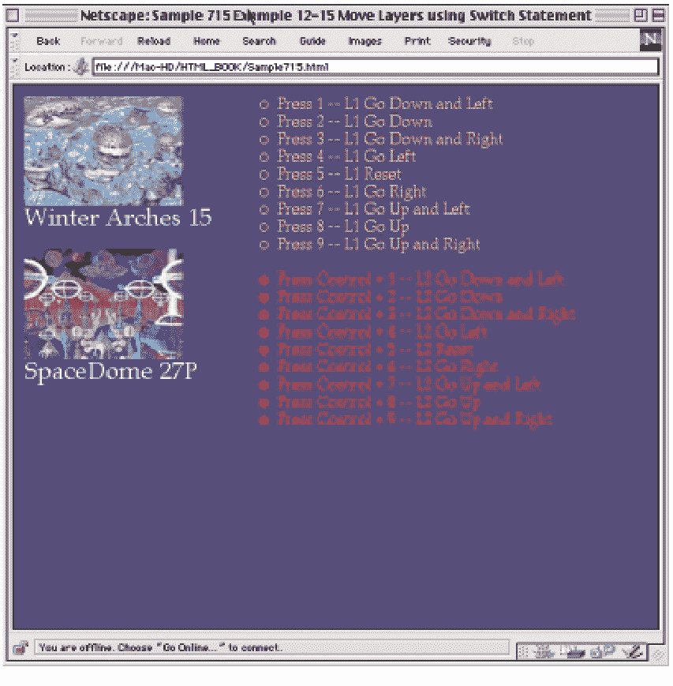

# 使用 switch() 语句移动图层

本示例通过定义 **moveALayer(e)** 函数来演示上述概念，该函数用于检测 **modifiers** 控制键以及按键 1-9 的 KEY preventable 的 KEYPRESS 事件。根据按下的不同按键，代码将使用 **moveBy()** 和 **moveTo()** 方法移动名为 **L1** 和 **L2** 的图层。请查看示例代码中的说明，了解各按键控制图层移动方向的详细解释。示例 6-15 的屏幕截图见上一页。

## 示例 6-15：Sample715.html

```html
<!DOCTYPE HTML PUBLIC "-//W3C//DTD HTML 3.2//EN">
<HTML>
<HEAD>
<TITLE> Sample 715    Example 6-15 Move Layers using Switch Statement</TITLE>

<STYLE TYPE="text/JavaScript">

    classes.Mainbody.BODY.margins("0px");
    classes.Mainbody.BODY.paddings("0px");
    classes.Mainbody.BODY.backgroundColor="navy";
    classes.Mainbody.BODY.color="white";
    classes.Mainbody.BODY.fontSize="22pt";

    ids.L3.fontSize="14pt";
    ids.L3.color="yellow";
    ids.L3.fontSize="14pt";

    tags.DIR.color="red";

</STYLE>

<!-- *************************************************************************** -->

<SCRIPT LANGUAGE="JavaScript1.2"><!--BEGIN HIDING

function moveALayer(e)  {

    var whichKey    = String.fromCharCode(e.which);
    var L1          = document.L1;
    var L2          = document.L2;

//The moveBy numbers make sense if you use the number pad on the right side of the keyboard.
```

# 第6章 — JavaScript 事件 589

```javascript
/*
	if (e.modifiers == Event.CONTROL_MASK) {

		switch (whichKey) {
			case '1': L2.moveBy(-20,20); break;//press the CONTROL + 1 keys
			case '2': L2.moveBy(0,20); break;//press the CONTROL + 2 keys
			case '3': L2.moveBy(20,20); break;//press the CONTROL + 3 keys
			case '4': L2.moveBy(-20,-20); break;//press the CONTROL + 4 keys
			case '5': L2.moveTo(10,150); break;//press the CONTROL + 5 keys
			case '6': L2.moveBy(20,0); break;//press the CONTROL + 6 keys
			case '7': L2.moveBy(0,-20); break;//press the CONTROL + 7 keys
			case '8': L2.moveBy(-20,0); break;//press the CONTROL + 8 keys
			case '9': L2.moveBy(20,-20); break;//press the CONTROL + 9 keys
		}
	} else {

		switch (whichKey) {
			case '1': L1.moveBy(-20,20); break;//press the 1 key
			case '2': L1.moveBy(0,20); break;//press the 2 key
			case '3': L1.moveBy(20,20); break;//press the 3 key
			case '4': L1.moveBy(-20,-20); break;//press the 4 key
			case '5': L1.moveTo(10,10); break;//press the 5 key
			case '6': L1.moveBy(20,0); break;//press the 6 key
			case '7': L1.moveBy(0,-20); break;//press the 7 key
			case '8': L1.moveBy(-20,0); break;//press the 8 key
			case '9': L1.moveBy(0,-20); break;//press the 9 key
			default: return false;
		}
	}
}
*/
```

```javascript
/*
	document.captureEvents(Event.KEYPRESS);
	document.onkeypress = moveALayer;
	*/
```

```html
//END HIDING-->
</SCRIPT>

</HEAD>

<BODY CLASS="Mainbody">

<LAYER ID="L1" LEFT="10" TOP="10">

<BR>
Winter Arches 15

</LAYER>

<LAYER ID="L2" LEFT="10" TOP="150">

<BR>
SpaceDome 27P

</LAYER>
```

```html
<!-- This just contains directions on how to use the Keys -->
<LAYER ID="L3" LEFT="200" TOP="10">
<UL TYPE=circle>
	<LI>Press 1 -- L1 Go Down and Left
	<LI>Press 2 -- L1 Go Down
	<LI>Press 3 -- L1 Go Down and Right
	<LI>Press 4 -- L1 Go Left
	<LI>Press 5 -- L1 Reset
	<LI>Press 6 -- L1 Go Right
	<LI>Press 7 -- L1 Go Up and Left
	<LI>Press 8 -- L1 Go Up
	<LI>Press 9 -- L1 Go Up and Right
</UL>
<DIR>
	<LI>Press Control + 1 -- L2 Go Down and Left
	<LI>Press Control + 2 -- L2 Go Down
	<LI>Press Control + 3 -- L2 Go Down and Right
	<LI>Press Control + 4 -- L2 Go Left
	<LI>Press Control + 5 -- L2 Reset
	<LI>Press Control + 6 -- L2 Go Right
	<LI>Press Control + 7 -- L2 Go Up and Left
	<LI>Press Control + 8 -- L2 Go Up
	<LI>Press Control + 9 -- L2 Go Up and Right
</DIR>
</LAYER>
</BODY>
</HTML>
```

# 动画图层和图像

通过使用一些创造性的 JavaScript 以及 **captureEvents()** 方法，你可以对包含在图层中的图像进行动画处理，设置一个预设脚本化的演示，仍然依赖于用户的选择。你可以对图层进行动画处理，使其向任意方向移出屏幕。对于向上或向左消失的情况，你必须使用负数。

本部分包含多个可轻松适应您自身需求的工作示例。其中一个示例包含的图层中附加了额外的控件，这些控件初始时不在屏幕内，只能通过点击兄弟框架中的图像来访问。


## 通过点击图像自动执行图层动画

示例6-16是系列示例中的第一个，该系列使用了鼠标点击和七个函数中的多种方法，来展示如何用艺术图像（由作者创建）进行图层动画和揭示效果。

运行脚本后，你应该会看到以下效果：当你点击屏幕左上角的图像图标时，一个带边框的小预览图会开始从屏幕右下角向左移动。然后它会开始垂直上升，直到停止并开始消失，仿佛被逐渐“吃掉”。当它完全消失后，艺术图像的大图开始显现，仿佛一层无形的面纱被揭开。最后，如果你再次点击该图标，大图将从视野中擦除，整个过程将从头开始重复。

JavaScript 代码首先定义了三个布尔变量。接着，定义了四个变量，每个变量都分配了一个图层。然后，当控制图层调用 `captureEvents()` 方法时，会同时捕获 `MOUSEDOWN` 和 `MOUSEDOWN` 事件。接着，`booleanTest1(e)` 函数被应用于 `onmousedown` 事件处理程序，而 `hideLargeClippedImage()` 函数被应用于 `onclick` 事件处理程序。

```
Control.captureEvents(Event.MOUSEDOWN | Event.MOUSEUP);
Control.onmousedown = booleanTest1;
Control.onclick = hideLargeClippedImage;
```

**booleanTest1(e)**
此函数为控制图层捕获点击事件。如果鼠标按下且事件目标是名为 `myImage1` 的图像，则 `imageBoolean = true` 且 `imageBoolean3 = false`；图层 L1 的 `visibility` 属性被设置为 'show'，并通过 `moveTo(main.clip.width, main.clip.height-120)` 方法将其移动到屏幕右下角几乎不可见的位置。将 `moveTo()` 方法的 `y` 参数设置为比主图层裁剪高度少 120 像素，是为了让它在从右向左水平滑入浏览器窗口底部时保持可见。最后，它调用 `revealSmallImage()` 函数。

**revealSmallImage()**
此函数测试 L1 图层的 `clip.right` 和 `clip.top` 属性。由于这些值总是小于或等于零，因此当它被调用时，总是会将 L1 调整为宽 180 像素、高 120 像素。

**hideLargeClippedImage()**
每当 L1 图层捕获到点击事件时，就会调用此函数。如果 `imageBoolean3 == false`，那么如果裁剪的顶部或右侧属性任一大于零，它就会通过 `(-20, -12)` 来调整裁剪矩形的大小，使其缩小。然后，`setTimeout()` 方法调用其包含的函数，即 `hideLargeClippedImage()`，该过程会重复，直到图像被隐藏。当裁剪矩形缩小到 `(0,0)` 时，`imageBoolean` 被设置为 'true'，并调用 `timeWasterLeft()` 函数。

**timeWasterLeft()** 当 **setTimeout()** 方法反复重新调用 **timeWasterLeft()** 函数时，此函数将图层 L1 向窗口**左**侧滑动，直到其 **left** 属性小于或等于零。然后它调用 **timeWasterTop()** 函数。

**timeWasterTop()** 此函数将图层 L1 从 **main** 图层的大致左下角向上滑动，同时其 **top** 属性大于零，这是通过 **setTimeout()** 方法不断调用 **timeWasterTop()** 函数实现的。当图层到达其最终的左上角目标位置时，会调用 **clipSmallImage()** 函数。

**clipSmallImage()** 此函数通过测试 **clip.right** 和 **clip.top** 属性的值，并结合 **setTimeout()** 方法使用 **resizeBy()** 方法，不断减小裁剪矩形的大小，直到小图像消失。一旦小图像被隐藏，包含艺术图像大图的 LL1 图层的 **visibility** 属性就被设置为 'show'。此时，图层 LL1 仍然不可见，因为其裁剪矩形之前已被 **hideLargeClippedImage()** 函数设置为 `(0,0)`。这就是为什么此时需要调用 **revealLargeClippedImage()** 函数的原因。

**revealLargeClippedImage()** 此函数通过测试图层 LL1 的 **clip.right** 和 **clip.top** 属性来揭示其包含的艺术大图。只要它们仍然隐藏图层的任何部分，就会通过 **setTimeout()** 方法调用其包含的函数（即 **revealLargeClippedImage()**）来扩展它们。

## 示例 6-16: Sample716.html

```
<!DOCTYPE HTML PUBLIC "-//W3C//DTD HTML 3.2//EN">
<HTML>
<HEAD>
<TITLE>Sample 716 - Example 6-16   Click an Image to start sequence </TITLE>

<STYLE type = "text/JavaScript">

    classes.Largefont.all.fontSize = "120pt";

    classes.theControl.all.fontSize = "22pt";
    classes.theControl.all.fontFamily = "Moonlight, cursive";
    classes.theControl.all.borderWidths("7px");
    classes.theControl.all.borderColor="#7700ff";
    classes.theControl.all.borderStyle="groove";

</STYLE>
</HEAD>

<BODY BGCOLOR="BLACK" TEXT="white">
<!-- *********************************************************************************** -->

<LAYER CLASS="theControl" ID="Control" LEFT="5" TOP="5" WIDTH="100" HEIGHT="100">

</LAYER>

<!-- ******************************************************** -->

<LAYER ID="main" LEFT="110" TOP="5" WIDTH="540" HEIGHT="380">

<LAYER CLASS="theControl" ID="L1" LEFT="5" TOP="5" VISIBILITY="hide">
 </LAYER>

<LAYER CLASS="theControl" ID="LL1" LEFT="5" TOP="5" CLIP="0,0">
 </LAYER>

</LAYER>

<!-- ******************************************************************** -->

<SCRIPT LANGUAGE="JavaScript1.2"><!-- BEGIN HIDING

var imageBoolean;
var imageBoolean2;
var imageBoolean3;
var Control = document.Control; //Layer ID=Control
var main = document.main; //Layer ID=main
var L1 = document.main.document.L1; //Layer ID=L1
var LL1 = document.main.document.LL1; //Layer ID=LL1

Control.captureEvents( Event.MOUSEDOWN | Event.MOUSEUP);
Control.onmousedown = booleanTest1;
Control.onclick = hideLargeClippedImage;

/*--------------------------------------------------------------------*/

function booleanTest1( e ) {

    Control.captureEvents(Event.CLICK);

    if (e.which == 1 && e.target.name == "myImage1") {

        imageBoolean = true;
        imageBoolean3 = false;

        L1.visibility = 'show';
        L1.moveTo(main.clip.width, main.clip.height-120);
        revealSmallImage();
    }
}

/*--------------------------------------------------------------------*/

function revealSmallImage() {
    if (L1.clip.right <= 0 || L1.clip.top <= 0) {
        L1.resizeTo(180,120);
    }
}

/*--------------------------------------------------------------------*/

function hideLargeClippedImage() {

	if (imageBoolean3 == false) {

		if (LL1.clip.right > 0 || LL1.clip.top > 0) {
			LL1.resizeBy(-20,-12);
			setTimeout('hideLargeClippedImage()', 20);
		}
		else if (LL1.clip.right <= 0 || LL1.clip.top <= 0) {
			imageBoolean = true;
			timeWasterLeft();
		}
	}
}

/*------------------------------------------------------------------------*/

function timeWasterLeft() {

	if (imageBoolean == true) {

		if (L1.left > 0) {
			L1.moveBy(-20,0);
			setTimeout('timeWasterLeft()', 20);
		}
		else if (L1.left <= 0) {
			timeWasterTop();
		}
	}
}

/*-------------------------------------------*/

function timeWasterTop() {

	if (imageBoolean == true) {

		if (L1.top > 0) {
			L1.moveBy(0,-20);
			setTimeout('timeWasterTop()', 20);
		}
		else if (L1.top <= 0) {
			imageBoolean2 = true;
			clipSmallImage();
		}
	}
}

/*------------------------------------------------------------------------*/

function clipSmallImage() {

	if (imageBoolean2 == true) {

		if (L1.clip.right > 0 || L1.clip.top > 0) {
			L1.resizeBy(-10,-6);
			setTimeout('clipSmallImage()', 20);
		}
		else if (L1.clip.right <= 0 && L1.clip.top <= 0) {
			imageBoolean2 = false;
			imageBoolean3 = true;
			revealLargeClippedImage();
		}
	}
}
```


## 使用 e.target.name 属性为图层添加动画

本示例在上一个示例的基础上进行了扩展，提供了四张可选图片，并使用 `CLICK 事件` 对象的 `target` 属性的 `name` 属性来确定点击了哪张图片，从而执行相应的代码，如下所示：

```javascript
if (e.which == 1 && e.target.name == "MyImage1")
```

主要函数与上一个示例几乎相同，只是需要根据点击的图片来改变图层的 `visibility` 属性，而且 `boolean Test(e)` 函数决定调用哪个 `revealSmallImage()` 函数。这六个函数各有四个版本，在前面的示例 6-16（第 591 和 592 页）中有完整的说明：

- `revealSmallImage()`
- `hideLargeClippedImage()`
- `timeWaterLeft()`
- `timeWaterTop()`
- `clipSmallImage()`
- `revealLargeClippedImage()`

## 示例 6-17：Sample717.html

```html
<!DOCTYPE HTML PUBLIC "-//W3C//DTD HTML 3.2//EN">
<HTML>
<HEAD>
<TITLE>Sample 717 - Example 6-17     Click to Reveal Images </TITLE>

<STYLE type = "text/JavaScript">

        classes.Largefont.all.fontSize = "120pt";

        classes.theControl.all.fontSize = "22pt";
        classes.theControl.all.fontFamily = "Moonlight, cursive";
        classes.theControl.all.borderWidths("7px");
        classes.theControl.all.borderColor="#7700ff";
        classes.theControl.all.borderStyle="groove";

</STYLE>

</HEAD>

<BODY BGCOLOR="BLACK" TEXT="white">

<!--  ******************************************************  -->

<LAYER CLASS="theControl" ID="Control" LEFT="5" TOP="5" WIDTH="100" HEIGHT="500">


</LAYER>


<LAYER ID="main" LEFT="110" TOP="5" WIDTH="540" HEIGHT="380">

<LAYER CLASS="theControl" ID="L1" LEFT="5" TOP="5" VISIBILITY="hide">

</LAYER>

<LAYER CLASS="theControl" ID="LLi1" LEFT="5" TOP="5" CLIP="0,0">

</LAYER>


<LAYER CLASS="theControl" ID=" Satisfaction " LEFT="5" TOP="5" VISIBILITY="hide">

</LAYER>

<LAYER CLASS="theControl" ID="LLi2" LEFT="5" TOP="5" CLIP="0,0">

</LAYER>

<LAYER CLASS="theControl" ID="L3" LEFT="5" TOP="5" VISIBILITY="hide">

</LAYER>

<LAYER CLASS="theControl" ID="LL3" LEFT="5" TOP="5" CLIP="0,0">

</LAYER>

<LAYER CLASS="theControl" ID="L4" LEFT="5" TOP="5" VISIBILITY="hide">

</LAYER>

<LAYER CLASS="theControl" ID="LL4" LEFT="5" TOP="5" CLIP="0,0">

</LAYER>

</LAYER>
<!-- ******************************************************************* -->
<SCRIPT LANGUAGE="JavaScript1.2"><!--BEGIN HIDING

var imageBoolean;
var imageBoolean2;
var imageBoolean3;

var Control = document.Control;
var main = document.main;
var L1 = document.main.document.L1;
var LL1 = document.main.document.LL1;
var L2 = document.main.document.L2;
var LL2 = document.main.document.LL2;
var L3 = document.main.document.L3;
var LL3 = document.main.document.LL3;
var L4 = document.main.document.L4;
var LL4 = document.main.document.LL4;

Control.captureEvents(Event.MOUSEDOWN | Event.MOUSEUP);
Control.onmousedown = booleanTest();

/*

function booleanTest1() {

Control.captureEvents(Event.CLICK);

if (e.which == 1 && e.target.name == "MyImage1") {

imageBoolean3 = false;
L1.visibility = 'show';
L2.visibility = 'hide';
L3.visibility = 'hide';
L4.visibility = 'hide';
L1.moveTo(main.clip.width, main.clip.height-120);
revealSmallImage();

}

if (e.which == 1 && e.target.name == "myImage2") {
    imageBoolean3 = false;
    L1.visibility = 'hide';
    L2.visibility = 'show';
    L3.visibility = 'hide';
    L4.visibility = 'hide';
    L2.moveTo(main.clip.width, main.clip.height-120);
    revealSmallImage2();
}

if (e.which == 1 && e.target.name == "myImage3") {
    imageBoolean3 = false;
    L1.visibility = 'hide';
    L2.visibility = 'hide';
    L3.visibility = 'show';
    L4.visibility = 'hide';
    L3.moveTo(main.clip.width, main.clip.height-120);
    revealSmallImage3();
}

if (e.which == 1 && e.target.name == "myImage4") {
    imageBoolean3 = false;
    L1.visibility = 'hide';
    L2.visibility = 'hide';
    L3.visibility = 'hide';
    L4.visibility = 'show';
    L4.moveTo(main.clip.width, main.clip.height-120);
    revealSmallImage4();
}
}

/*-------------------------------------------------------*/

function revealSmallImage() {
    hideLargeClippedImage();
    if (L1.clip.right <= 0 || L1.clip.top <= 0) {
        L1.resizeTo(180, 120);
    }
}

function hideLargeClippedImage() {
    if (imageBoolean3 == false) {
        LLi2.visibility = 'hide';
        LLi3.visibility = 'hide';
        LLi4.visibility = 'hide';
        LLi1.resizeTo(0, 0);
        LLi1.visibility = 'hide';
        imageBoolean = true;
        timeWasterLeft();
    }
}

function timeWasterLeft()  {

    if (imageBoolean == true)  {

        if (L1.left > 0) {
            L1.moveBy(-20,0);
            setTimeout('timeWasterLeft()', 20);
        }
        else if (L1.left <= 0) {
            timeWasterTop();
        }
    }
}

function timeWasterTop()  {

    if (imageBoolean == true)  {

        if (L1.top > 0) {
            L1.moveBy(0,-20);
            setTimeout('timeWasterTop()', 20);
        }
        else if (L1.top <= 0)  {
            imageBoolean2 = true;
            clipSmallImage();
        }
    }
}

function clipSmallImage()  {

    if (imageBoolean2 == true)  {

        if (L1.clip.right > 0  ||  L1.clip.top > 0)  {
            L1.resizeBy(-10,-6);
            setTimeout('clipSmallImage()', 20);
        }
        else if (L1.clip.right <= 0  &&  L1.clip.top <= 0)  {
            imageBoolean2 = false;
            imageBoolean3 = true;
            LLi1.visibility = 'show';
            revealLargeClippedImage();
        }
    }
}

function revealLargeClippedImage()  {

    if (imageBoolean3 == true)  {

        if (LLi1.clip.right < main.clip.width
        ||  LLi1.clip.top < main.clip.height)  {

            LLi1.resizeBy(20,12);
            setTimeout('revealLargeClippedImage()', 20);
        }
    }
}

/*----------------------------------------------------------------------*/

function revealSmallImage2() {

    hideLargeClippedImage2();

    if (L2.clip.right <= 0 || L2.clip.top <= 0) {
        L2.resizeTo(180,120);
    }

}

function hideLargeClippedImage2() {

    if (imageBoolean3 == false) {

        L1L1.visibility = 'hide';
        L1L3.visibility = 'hide';
        L1L4.visibility = 'hide';
        L1L2.resizeTo(0,0);
        L1L2.visibility = 'hide';
        imageBoolean = true;
        timeMasterLeft2();
    }

}

function timeWaterLeft2() {

    if (imageBoolean == true) {

        if (L2.left > 0) {
            L2.moveBy(-20,0);
            setTimeout('timeWaterLeft2()', 20);
        }
        else if (L2.left <= 0) {
            timeWaterTop2();
        }

    }

}

function timeWaterTop2() {

    if (imageBoolean == true) {

        if (L2.top > 0) {
            L2.moveBy(0,-20);
            setTimeout('timeWaterTop2()', 20);
        }
        else if (L2.top <= 0) {
            imageBoolean2 = true;
            clipSmallImage2();
        }

    }

}
```


## 第 6 章 — JavaScript 事件

```
function clipSmallImage2() {
    if (imageBoolean2 == true) {
        if (L2.clip.right > 0 || L2.clip.top > 0) {
            L2.resizeBy(-10, -6);
            setTimeout('clipSmallImage2()', 20);
        }
        else if (L2.clip.right <= 0 && L2.clip.top <= 0) {
            imageBoolean2 = false;
            imageBoolean3 = true;
            LLi2.visibility = 'show';
            revealLargeClippedImage2();
        }
    }
}
```

```
function revealLargeClippedImage2() {
    if (imageBoolean3 == true) {
        if (LLi2.clip.right < main.clip.width || LLi2.clip.top < main.clip.height) {
            LLi2.resizeBy(20, 12);
            setTimeout('revealLargeClippedImage2()', 20);
        }
    }
}
```

```
function revealSmallImage3() {
    hideLargeClippedImage3();
    if (L3.clip.right <= 0 || L3.clip.top <= 0) {
        L3.resizeTo(180, 120);
    }
}
```

```
function hideLargeClippedImage3() {
    if (imageBoolean3 == false) {
        LLi1.visibility = 'hide';
        LLi2.visibility = 'hide';
        LLi4.visibility = 'hide';
        LLi3.resizeTo(0, 0);
        LLi3.visibility = 'hide';
        imageBoolean = true;
        timeWasterLeft3();
    }
}
```

## 602 第二部分 — JavaScript 1.2

```
function timeWasterLeft3() {
    if (imageBoolean == true) {
        if (L3.left > 0) {
            L3.moveBy(-20,0);
            setTimeout('timeWasterLeft3()', 20);
        }
        else if (L3.left <= 0) {
            timeWasterTop3();
        }
    }
}
```

```
function timeWasterTop3() {
    if (imageBoolean == true) {
        if (L3.top > 0) {
            L3.moveBy(0,-20);
            setTimeout('timeWasterTop3()', 20);
        }
        else if (L3.top <= 0) {
            imageBoolean2 = true;
            clipSmallImage3();
        }
    }
}
```

```
function clipSmallImage3() {
    if (imageBoolean2 == true) {
        if (L3.clip.right > 0 || L3.clip.top > 0) {
            L3.resizeBy(-10,-6);
            setTimeout('clipSmallImage3()', 20);
        }
        else if (L3.clip.right <= 0 && L3.clip.top <= 0) {
            imageBoolean2 = false;
            imageBoolean3 = true;
            L3.visibility = 'show';
            revealLargeClippedImage3();
        }
    }
}
```

```
function revealLargeClippedImage3() {
    if (imageBoolean3 == true) {
        if (L3.clip.right < main.clip.width ||
            L3.clip.top < main.clip.height) {
            L3.resizeBy(20,12);
            setTimeout('revealLargeClippedImage3()', 20);
        }
    }
}
```

## 第 6 章 — JavaScript 事件

```
/*------------------------------------------*/

function revealSmallImage4() {
    hideLargeClippedImage4();
    if (L4.clip.right <= 0 || L4.clip.top <= 0) {
        L4.resizeTo(180,120);
    }
}

function hideLargeClippedImage4() {
    if (imageBoolean3 == false) {
        LLi1.visibility = 'hide';
        LLi2.visibility = 'hide';
        LLi3.visibility = 'hide';
        LLi4.resizeTo(0,0);
        LLi4.visibility = 'hide';
        imageBoolean = true;
        timeWasterLeft4();
    }
}

function timeWasterLeft4() {
   elsiusif(imageBoolean==true){if(L4.left>0){L4.moveBy(-20,0);setTimeout('timeWasterLeft4()',20);}else if(L4.left<=0){timeWasterTop4();}}}

function timeWasterTop4() {
    if (imageBoolean == true) {
        if (L4.top > 0) {
            L4.moveBy(0,-20);
            setTimeout('timeWasterTop4()', 20);
        }
        else if (L4.top <= 0) {
            imageBoolean2 = true;
            clipSmallImage4();
        }
    }
}
```

## 604 第二部分 — JavaScript 1.2

```
function clipSmallImage4() {
    if (imageBoolean2 == true) {
        if (L4.clip.right > 0 || L4.clip.top > 0) {
            L4.resizeBy(-10,-6);
            setTimeout('clipSmallImage4()', 20);
        }
        else if (L4.clip.right <= 0 && L4.clip.top <= 0) {
            imageBoolean2 = false;
            imageBoolean3 = true;
            LLi4.visibility = 'show';
            revealLargeClippedImage4();
        }
    }
}
function revealLargeClippedImage4() {
    if (imageBoolean3 == true) {
        if (LLi4.clip.right < main.clip.width ||
            LLi4.clip.top < main.clip.height) {
            LLi4.resizeBy(20,12);
            setTimeout('revealLargeClippedImage4()', 20);
        }
    }
}
//END HIDING-->
</SCRIPT>
</BODY>
</HTML>
```

## 在框架集环境中动画化图层

示例 6-18 实现了与前面示例相同的功能，但它是在 FRAMESET 环境中完成的。`Sample718Frameset.html` 包含将窗口分成两个 FRAME 的 FRAMESET，左侧 FRAME 名为 **display**，加载 `Sample718.html` 文档；右侧 FRAME 名为 **view**，加载 `Sample718A.html` 文档。**display** FRAME 包含 ID 为 **Control** 的 Layer，并捕获 CLICK、MOUSEDOWN 和 MOUSEUP 事件，根据点击的哪个图像图标来处理这些事件。同样，**booleanTest1(e)** 函数被分配给 **Control** Layer 的 **onmousedown** 事件处理程序，但这次它使用 **view** FRAME 的 **location** 属性来加载外部文档，基于 **e.target.name** 条件（用户点击的图像），如下所示：

```
if (e.which == 1 && e.target.name == "myImage1") {
    view.location.href = 'Sample718A.html';
    ...
}
```

## 第 6 章 — JavaScript 事件

需要注意的是，**view** 之前已被定义为：

```
var view = parent.view;
```

否则，前面的代码必须写成：

```
parent.view.location.href = 'Sample718A.html';
```

可以加载到 **view** FRAME 中的四个外部文件每个都有自己的动画 SCRIPT，与前面的示例相同。详见示例 6-16（从第 591 页开始）和示例 6-17（从第 595 页开始）。

## 示例 6-18 第一部分：Sample718.html

```
<!DOCTYPE HTML PUBLIC "-//W3C//DTD HTML 3.2//EN">
<HTML>
<HEAD>
<TITLE>Sample 718 - Example 6-18     Click to Reveal Images </TITLE>

<STYLE type = "text/JavaScript">

      classes.theControl.all.fontSize = "22pt";
      classes.theControl.all.fontFamily = "Moonlight, cursive";
      classes.theControl.all.borderWidths("7px");
      classes.theControl.all.borderColor="#22ffff";
      classes.theControl.all.borderStyle="groove";

</STYLE>
</HEAD>

<BODY BGCOLOR="BLACK" TEXT="white"
BACKGROUND="JPEG-FILES/ICON-HorizontalRainbow4.jpg">

<LAYER CLASS="theControl" ID="Control" LEFT="5" TOP="5" WIDTH="100" HEIGHT="500">


</LAYER>

<SCRIPT LANGUAGE="JavaScript1.2"><!--BEGIN HIDING

var imageBoolean;
var imageBoolean2;
var imageBoolean3;
var Control   = document.Control;
var view      = parent.view;
```

## 606 第二部分 — JavaScript 1.2

```
Control.captureEvents(Event.MOUSEDOWN | Event.MOUSEUP);
Control.onmousedown = booleanTest1;

function booleanTest1(e) {

    Control.captureEvents(Event.CLICK);

    if (e.which == 1  &&  e.target.name == "myImage1")  {

        view.location.href ='Sample718A.html';
    }

    if (e.which == 1  &&  e.target.name == "myImage2")  {

        view.location.href ='Sample718B.html';
    }

    if (e.which == 1  &&  e.target.name == "myImage3")  {

        view.location.href ='Sample718C.html';
    }

    if (e.which == 1  &&  e.target.name == "myImage4")  {

        view.location.href ='Sample718D.html';
    }
}

//END HIDING-->
</SCRIPT>

</BODY>
</HTML>
```

这是加载到 view 框架中的四个外部文档之一。另外三个是 [Sample718B.html](Sample718B.html)、[Sample718C.html](Sample718C.html) 和 [Sample718D.html](Sample718D.html)，它们在 CD-ROM 上，但书中未包含，因为它们几乎完全相同。在这个版本的动画序列中，大图像没有被逐渐消隐，这节省了一些时间。因此，**hideLargeClippedImage()** 函数被省略了。在对这一函数省略进行极少的代码补偿之后，动画序列的其余函数与前面的示例 6-17 完全相同。

## 示例 6-18 第二部分：Sample718A.html

```
<!DOCTYPE HTML PUBLIC "-//W3C//DTD HTML 3.2//EN">
<HTML>
<HEAD>
<TITLE>Sample 718A – Example 6-18A Click to Reveal Images </TITLE>

<STYLE type = "text/JavaScript">
```


 # 第6章 — JavaScript事件

```
classes.theControl.all.fontSize = "22pt";
classes.theControl.all.fontFamily = "Moonlight, cursive";
classes.theControl.all.borderWidths("7px");
classes.theControl.all.borderColor="#7700ff";
classes.theControl.all.borderStyle="groove";

</STYLE>
</HEAD>
<BODY BGCOLOR="BLACK" TEXT="white" onLoad="revealSmallImage();"
BACKGROUND="JPEG-FILES/icon-BG-asteroids.jpg">

<LAYER ID="main" LEFT="5" TOP="5" WIDTH="540" HEIGHT="380">

<LAYER CLASS="theControl" ID="L1" LEFT="5" TOP="5" VISIBILITY="hide">

</LAYER>

<LAYER CLASS="theControl" ID="LLi1" LEFT="5" TOP="5" CLIP="0,0">

</LAYER>

</LAYER>

<SCRIPT LANGUAGE="JavaScript1.2"><!--BEGIN HIDING

var imageBoolean;
var imageBoolean2;
var imageBoolean3;
var main = document.main;
var L1 = document.main.document.L1;
var LLi1 = document.main.document.LLi1;
/*---------------------------------------*/

function revealSmallImage() {

    L1.moveTo(main.clip.width, main.clip.height-120);
    L1.visibility = 'show';

    if (L1.clip.right <= 0  ||  L1.clip.top <= 0) {
        L1.resizeTo(180,120);
    }
    imageBoolean = true;
    timeWasterLeft();
}

function timeWasterLeft() {

    if (imageBoolean == true) {

        if (L1.left > 0) {
            L1.moveBy(-20,0);
            setTimeout('timeWasterLeft()', 20);
        }
        else if (L1.left <= 0) {
            timeWasterTop();
        }
    }
}
```

```
function timeWasterTop() {

    if (imageBoolean == true) {

        if (L1.top > 0) {
            L1.moveBy(0,-20);
            setTimeout('timeWasterTop()', 20);
        }
        else if (L1.top <= 0) {
            imageBoolean2 = true;
            clipSmallImage();
        }

    }
}
```

```
function clipSmallImage() {

    if (imageBoolean2 == true) {

        if (L1.clip.right >  || L1.clip.top > 0) {
            L1.resizeBy(-10,-6);
            setTimeout('clipSmallImage()', 20);
        }
        else if (L1.clip.right <= 0 && L1.clip.top <= 0) {
            imageBoolean2 = false;
            imageBoolean3 = true;
            LLi1.visibility = 'show';
            revealLargeClippedImage();
        }

    }
}
```

```
function revealLargeClippedImage() {

    if (imageBoolean3 == true) {

        if (LLi1.clip.right < main.clip.width ||
            LLi1.clip.top < main.clip.height) {
            LLi1.resizeBy(20,12);
            setTimeout('revealLargeClippedImage()', 20);
        }

    }
}
```

```
//END HIDING-->
</SCRIPT>

</BODY>
</HTML>
```

这是示例6-18的框架集。

# 示例 6-18 第3部分：Sample718Frameset.html

```
<!DOCTYPE HTML PUBLIC "-//W3C//DTD HTML 3.2//EN">
<HTML>
<HEAD>

<TITLE>Frameset for Sample 718</TITLE>

</HEAD>

<FRAMESET COLS="120,*">

      <FRAME SCROLLING="no" NAME="display" SRC="Sample718.html">

      <FRAME SCROLLING="auto" NAME="view" SRC="Sample718A.html">

</FRAMESET>

</HTML>
```

# 使用JavaScript控制外部框架文档

当你想要从一个框架操作另一个位于同一框架集中的框架所包含的文档内容时，你必须通过其**name**属性及其容器框架集的**parent**关键字来引用外部框架，如下所示：

```
parent.view.document.bgColor = "blue";
```

其中**view**是要更改的框架的名称，**bgColor**属性将被更改为蓝色。

现在假设你有一个名为**view**的框架，其中包含一个名为**main**的层。如果代码位于与**view**框架同一框架集中的名为**display**的框架内，你可以通过以下方式将**visibility**属性更改为'**show**'：

```
parent.view.document.main.visibility = 'show';
```

# 第二部分 — JavaScript 1.2

现在假设你有一个名为**view**的框架和一个名为**main**的层，其中包含一个名为**L2**的嵌套层。以下是如何使用**moveTo()**方法从外部框架将层**L2**移动到新的坐标(240,20)：

```
parent.view.document.main.document.L2.moveTo(240,20);
```

最后，假设你有一个名为**view**的框架和一个名为**main**的层，其中包含一个名为**form1**的表单元素，该表单元素包含一个名为**text1**的文本输入元素。要更改显示在**text1**中的文本字符串，你需要更改其**value**属性。要从外部框架执行此操作，请使用以下代码：

```
parent.view.document.main.document.form1.text1.value = "Hi there.";
```

# JavaScript的linkColor、alinkColor和vlinkColor属性

你可以使用**linkColor**、**alinkColor**和**vlinkColor**属性来更改链接、活动链接和已访问链接的颜色，只需通过以下语法中的**color**参数分配新颜色即可。这在第619页示例6-19的HEAD元素中的小脚本中有演示。

# JavaScript语法：

```
document.linkColor = color;
document.alinkColor = color;
document.vlinkColor = color;
```

# 使用按键事件隐藏和显示图层

这是该系列中的最后一个示例，涉及通过图层捕获事件来动画化其他图层的图像。它使用与上一个示例相同的框架集环境，并具备额外的功能，即在**display**框架中的**document**对象捕获KEYPRESS事件时隐藏和显示图层。

此示例的一个显著特点是每个图像图标都包含在其自己独立的层中，因此你必须为每个层捕获MOUSEDOWN、MOUSEUP和CLICK事件。还有四个处理加载外部文档的函数：分别对应四个带有图标的层的**onmousedown**事件处理程序。它们本质上与上一个示例中的**booleanTest1(e)**函数平行。

它们是：

**loadItUp1(e)** **loadItUp2(e)** **loadItUp3(e)** **loadItUp4(e)**

以下十一个函数处理KEYPRESS事件，最显著地演示了如何深入外部框架并根据用户从键盘的输入操作其内容，如上文所述。

**keyJump(e)**

由于有四个不同的文档可以加载到**display**框架中，此函数通过使用**if()**条件语句来测试加载了哪个文档，这些条件语句仅在特定层存在时才执行，因为该层对每个文档来说是唯一的。例如：

```
if (parent.view.document.main.document.LLi1)
```

测试层**main**中的名为**LLi1**的层是否存在于名为**view**的框架中。这可以防止因错误的文档加载到框架中而尝试操作不存在的层所导致的JavaScript错误。这样理解：如果包含**LLi2**层的文档加载到了框架中，而代码尝试访问框架中文档所没有的**LLi1**层，就会出现错误。使用上面的**if()**条件可以防止这种情况发生，因为它拒绝执行与未加载到**view**框架中的层相关的任何代码。

在测试该条件后，如果返回**true**，则继续测试CONTROL键与1、2、3或4键中的任何一个同时按下。（编程提示：如果你不喜欢测试数值，可以使用**String.fromCharCode(x)**方法。就我个人而言，我喜欢使用数字，因为这样更容易阅读代码和跟踪值，但这不过是各有所好。找到最适合你思维习惯的方式。）

因此，如果**view**框架中有**LLi1**层且**e.which == 49**，即**1**键，则：将层**LLi1**的**visibility**属性设置为**'show'**。

如果**e.which == 50**，即**2**键，则调用**previewImageA()**函数。
如果**e.which == 51**，即**3**键，则调用**previewAllImages()**函数。
如果**e.which == 52**，即**4**键，则调用**hideAllPreviewImages()**函数。

此过程对可以加载到**view**框架中的其他三个文档重复执行。

**previewAllImages()**

此函数将包含小预览图像的四个图层的**visibility**属性设置为**'show'**，将它们调整大小并重新定位到网格中。

**hideAllPreviewImages**

此函数只是隐藏所有小预览图像。

**previewImageA()、previewImageB()、previewImageC()、previewImageD()**

这四个函数使用**visibility**属性以及**moveTo()**和**resizeTo()**方法来显示所需的预览图像，基于按下的键或任意图层**L1、L2、L3**或**L4**的**onMouseOver**属性事件处理程序。


 # 612 第二部分 — JavaScript 1.2

## hidePreviewImageA(), hidePreviewImageB(), hidePreviewImageC(), hidePreviewImageD()

这四个函数根据按下的键或任意一个图层的 L1、L2、L3 或 L4 **onMouseOut** 属性事件处理程序，将其相应图层的**可见性**属性改为 "hide"。

本示例还包含一个帮助文档，点击链接时会在新的浏览器窗口中加载。其 URL 为 [Sample719HELP.html](Sample719HELP.html)，位于 CD-ROM 上。

## 示例 6-19 第 1 部分：Sample719.html

```
<!DOCTYPE HTML PUBLIC "-//W3C//DTD HTML 3.2//EN">
<HTML>
<HEAD>
<TITLE>Sample 719 - Example 6-19     点击图片显示 </TITLE>

<STYLE type = "text/JavaScript">

    classes.theControl.all.fontSize = "22pt";
    classes.theControl.all.fontFamily = "Moonlight, cursive";
    classes.theControl.all.borderWidths("7px");
    classes.theControl.all.borderColor = "#00ff00";
    classes.theControl.all.borderStyle = "groove";
    classes.theControl.all.width = "120px";

    ids.LayerA.borderColor = "cyan";
    ids.LayerB.borderColor = "#00ccff";
    ids.LayerC.borderColor = "#0088ff";
    ids.LayerD.borderColor = "#0022ff";

    ids.LayerA.width = "90px";
    ids.LayerB.width = "90px";
    ids.LayerC.width = "90px";
    ids.LayerD.width = "90px";

    ids.LayerH.width = "100px";
    ids.LayerH.borderColor = "yellow";
    ids.LayerH.backgroundColor = "yellow";
    ids.LayerH.paddings("4px");

</STYLE>

<SCRIPT LANGUAGE="JavaScript1.2"><!--BEGIN HIDING

    document.linkColor = "lime";
    document.alinkColor = "darkblue";
    document.vlinkColor = "red";

//END HIDING-->
</SCRIPT>
</HEAD>
```

# 第 6 章 — JavaScript 事件

# 613

```
<!--左框架必须获得焦点，键盘按下事件才能生效。-->

<BODY BGCOLOR="BLACK" TEXT="white" onLoad="window.focus();"
BACKGROUND="JPEG-FILES/ICON-HorizontalRainbow4.jpg">

<LAYER CLASS="the-CONTROL" ID="LayerA" LEFT="15" TOP="15"
onMouseOver="PreviewImageA();" onMouseOut="hidePreviewImageA();">
</LAYER>

<LAYER CLASS="the-CONTROL" ID="LayerB" LEFT="15" TOP="90"
onMouseOver="PreviewImageB();" onMouseOut="hidePreviewImageB();">
</LAYER>

<LAYER CLASS="the-CONTROL" ID="LayerC" LEFT="15" TOP="165"
onMouseOver="PreviewImageC();" onMouseOut="hidePreviewImageC();">
</LAYER>

<LAYER CLASS="the-CONTROL" ID="LayerD" LEFT="15" TOP="240"
onMouseOver="PreviewImageD();" onMouseOut="hidePreviewImageD();">
</LAYER>

<LAYER CLASS="the-CONTROL" ID="LayerE" LEFT="15" TOP="325">
<A HREF="../Sample719HELP.html" TARGET="_blank">
HELP!! </A> </LAYER>
```

```
<SCRIPT LANGUAGE="JavaScript1.2"><!--BEGIN HIDING

    var LayerA = document.LayerA;
    var LayerB = document.LayerB;
    var LayerC = document.LayerC;
    var LayerD = document.LayerD;

    var view = parent.view;

    LayerA.captureEvents(Event.MOUSEDOWN | Event.MOUSEUP);
    LayerA.onmousedown = loadItUp1;

    LayerB.captureEvents(Event.MOUSEDOWN | Event.MOUSEUP);
    LayerB.onmousedown = loadItUp2;

    LayerC.captureEvents(Event.MOUSEDOWN | Event.MOUSEUP);
    LayerC.onmousedown = loadItUp3;

    LayerD.captureEvents(Event.MOUSEDOWN | Event.MOUSEUP);
    LayerD.onmousedown = loadItUp4;

    document.captureEvents(Event.KEYPRESS); //-------这是关键代码
    document.onkeypress = keyJump; //-------这是关键代码

/*----------------------------------------------------------------------*/
```

# 第二部分 — JavaScript 1.2

```
function loadItUp1(e) {
    LayerA.captureEvents(Event.CLICK);
    if (e.which == 1 && e.target.name == "myImage1")
        { view.location.href = 'Sample719A.html'; }
}

function loadItUp2(e) {
    LayerB.captureEvents(Event.CLICK);
    if (e.which == 1 && e.target.name == "myImage2")
        { view.location.href = 'Sample719B.html'; }
}

function loadItUp3(e) {
    LayerC.captureEvents(Event.CLICK);
    if (e.which == 1 && e.target.name == "myImage3")
        { view.location.href = 'Sample719C.html'; }
}

function loadItUp4(e) {
    LayerD.captureEvents(Event.CLICK);
    if (e.which == 1 && e.target.name == "myImage4")
        { view.location.href = 'Sample719D.html'; }
}

/* ----------------------------------------------------------------------- */

function keyJump(e) {
    if (parent.view.document.main.document.LLil) {
        if (e.modifiers == Event.CONTROL_MASK && e.which == 49) {
            parent.view.document.main.document.LLil.visibility = 'show';
        }
        else if (e.modifiers == Event.CONTROL_MASK && e.which == 50) {
            previewImageA();
        }
        else if (e.modifiers == Event.CONTROL_MASK && e.which == 51) {
            parent.view.document.main.document.LLil.visibility = 'hide';
            previewAllImages();
        }
        else if (e.modifiers == Event.CONTROL_MASK && e.which == 52) {
            hideAllPreviewImages();
        }
    }
    if (parent.view.document.main.document.LLi2) {
        if (e.modifiers == Event.CONTROL_MASK && e.which == 49) {
            parent.view.document.main.document.LLi2.visibility = 'show';
        }
        else if (e.modifiers == Event.CONTROL_MASK && e.which == 50) {
            previewImageB();
        }
    }
}
```

# 第 6 章 — JavaScript 事件

```
else if (e.modifiers == Event.CONTROL_MASK &&  e.which == 51 ) {
	parent.view.document.main.document.LLi2.visibility = 'hide';
	previewAllImages();
}
else if (e.modifiers == Event.CONTROL_MASK &&  e.which == 52 ) {
	hideAllPreview BergPreviewImages();
}
}
if (parent.view.document.main.document.LLi3)  {

	if (e.modifiers == Event.CONTROL_MASK &&  e.which == 49 ) {
		parent.view.document.main.document.LLi3.visibility = 'show';
	}
	else if (e.modifiers == Event.CONTROL_MASK &&  e.which == 50 ) {
		previewImageC();
	}
	else if (e.modifiers == Event.CONTROL_MASK &&  e.which == 51 ) {
		parent.view.document.main.document.LLi3.visibility = 'hide';
		previewAllImages();
	}
	else if (e.modifiers == Event.CONTROL_MASK &&  e.which == 52 ) {
		hideAllPreviewImages();
	}
}
if (parent.view.document.main.document.LLi4)  {

	if (e.modifiers == Event.CONTROL_MASK &&  e.which == 49 ) {
		parent.view.document.main.document.LLi4.visibility = 'show';
	}
	else if (e.modifiers == Event.CONTROL_MASK &&  e.which == 50 ) {
		previewImageD();
	}
	else if (e.modifiers == Event.CONTROL_MASK &&  e.which == 51 ) {
		parent.view.document.main.document.LLi4.visibility = 'hide';
		previewAllImages();
	}
	else if (e.modifiers == Event.CONTROL_MASK &&  e.which == 52 ) {
		hideAllPreviewImages();
	}
}
}
/*---------------------------------------------------------------*/

function previewAllImages()  {

	parent.view.document.main.document.L2.visibility = 'show';
	parent.view.document.main.document.L3.visibility = 'show';
	parent.view.document.main.document.L4.visibility = 'show';
	parent.view.document.main.document.L1.visibility = 'show';

	parent.view.document.main.document.L1.resizeTo(180,120);
	parent.view.document.main.document.L1.moveTo(20,20);

	parent.view.document.main.document.L2.resizeTo(180,120);
	parent.view.document.main.document.L2.moveTo(240,20);

	parent.view.document.main.document.L3.resizeTo(180,120);
	parent.view.document.main.document.L3.moveTo(20,240);
```

# 616 第二部分 — JavaScript 1.2

```
parent.view.document.main.document.L4.resizeTo(180,120);
parent.view.document.main.document.L4.moveTo(240,240);
```

```
function hideAllPreviewImages()  {
    parent.view.document.main.document.L1.visibility = 'hide';
    parent.view.document.main.document.L2.visibility = 'hide';
    parent.view.document.main.document.L3.visibility = 'hide';
    parent.view.document.main.document.L4.visibility = 'hide';
}
```

```
/*--------------------------------------------*/
```

```
function previewImageA()  {
    if (parent.view.document.main.document.LLi1)  {
        parent.view.document.main.document.LLi1.visibility = 'hide';
        parent.view.document.main.document.L2.visibility = 'hide';
        parent.view.document.main.document.L3.visibility = 'hide';
        parent.view.document.main.document.L4.visibility = 'hide';
        parent.view.document.main.document.L1.visibility = 'show';
        parent.view.document.main.document.L1.resizeTo(180,120);
        parent.view.document.main.document.L1.moveTo(100,100);
    }
}
```

```
function hidePreviewImageA()  {
    parent.view.document.main.document.L1.visibility = 'hide';
}
```

```
/*--------------------------------------------*/
```

```
function previewImageB()  {
    if (parent.view.document.main.document.LLi2)  {
        parent.view.document.main.document.LLi2.visibility = 'hide';
        parent.view.document.main.document.L1.visibility = 'hide';
        parent.view.document.main.document.L3.visibility = 'hide';
        parent.view.document.main.document.L4.visibility = 'hide';
        parent.view.document.main.document.L2.visibility = 'show';
        parent.view.document.main.document.L2.resizeTo(180,120);
        parent.view.document.main.document.L2.moveTo(100,100);
    }
}
```

```
function hidePreviewImageB()  {
    parent.view.document.main.document.L2.visibility = 'hide';
}
```

```
/*--------------------------------------------*/
```


 ## 第6章 — JavaScript 事件 617

```
function previewImageC() {

    if (unday could feel your presence here with me; it gives me strength. The mistake I made that day still haunts me, but I know that I must move forward and learn from it. Life is too short to dwell on the past, and I want to make the most of every moment.

parent.view.document.main.document.LLi4.visibility = 'hide';
    parent.view.document.main.document.L1.visibility = 'hide';
    parent.view.document.main.document.L2.visibility = 'hide';
    parent.view.document.main.document.L4.visibility = 'show';
    parent.view.document.main.document.L4.resizeTo(180,120);
    parent.view.document.main.document.L4.moveTo(100,100);
    }
}

function hidePreviewImageD() {
    parent.view.document.main.document.L4.visibility = 'hide';
}

//END HIDING-->
</SCRIPT>

</BODY>
</HTML>
```

这是可以加载到显示 FRAME 中的四个外部文档之一。`revealSmallImage()` 函数在 BODY 元素的 onLoad 事件处理器中被指定为属性，以便动画序列在页面（包括图像）完全加载后立即开始。本文档与上一个示例中使用的 Sample718A.html 之间唯一真正的区别是，四个小型预览图像都预先加载，并且在所有四个外部文档中最初都是隐藏的。因此，四个预览中的三个必须在动画序列期间隐藏，这由 `hideLargeClippedImage()` 函数处理。它还会隐藏大型艺术图像。

# 618 第二部分 — JavaScript 1.2

## 示例 6-19 第2部分：Sample719A.html

```
<!DOCTYPE HTML PUBLIC "-//W3C//DTD HTML 3.2//EN">
<HTML><HEAD>
<TITLE>Sample 719A - Example 6-19A    Click to Reveal Images </TITLE>
<STYLE type = "text/JavaScript">

classes.theControl.all.fontSize = "22pt";
classes.theControl.all.fontFamily = "Moonlight, cursive";
classes.theControl.all.borderwidths("7px");
classes.theControl.all.borderColor="#7700ff";
classes.theControl.all.borderstyle="groove";
</STYLE>
</HEAD>
<!--onLoad="revealSmallImage();"  Starts the animation sequence.-->

<BODY BGCOLOR="BLACK" TEXT="white" onLoad="revealSmallImage();"
BACKGROUND="JPEG-FILES/icon-BG-asteroids.jpg">

<LAYER ID="main" LEFT="5" TOP="5" WIDTH="540" HEIGHT="380">

<LAYER CLASS="theControl" ID="L1" LEFT="5" TOP="5" VISIBILITY="hide">
</LAYER>

<LAYER CLASS="theControl" ID="L2" LEFT="5" TOP="5" VISIBILITY="hide">
</LAYER>

<LAYER CLASS="theControl" ID="L3" LEFT="5" TOP="5" VISIBILITY="hide">
</LAYER>

<LAYER CLASS="theControl" ID="L4" LEFT="5" TOP="5" VISIBILITY="hide">
</LAYER>

<LAYER CLASS="theControl" ID="LLi1" LEFT="5" TOP="5" CLIP="0,0">
</LAYER>

</LAYER>

<SCRIPT LANGUAGE="JavaScript1.2"><!--BEGIN HIDING

var imageBoolean;
var imageBoolean2;
var imageBoolean3;
var main = document.main;
var L1 = document.main.document.L1;
var L2 = document.main.document.L2;
var L3 = document.main.document.L3;
var L4 = document.main.document.L4;
var LLi1 = document.main.document.LLi1;
```

# 第6章 — JavaScript 事件

# 619

```
/*----------------------------------------------------------------------*/

function revealSmallImage() {

    imageBoolean3 = false;
    hideLargeClippedImage();

    LL.moveTo(main.clip.width, main.clip.height-120);
    LL.visibility = 'show';

    if (LL.clip.right <= 0 || LL.clip.top <= 0) {
        LL.resizeTo(180,120);
    }
}

function hideLargeClippedImage() {

    if (imageBoolean3 == false) {

        L2.visibility = 'hide';
        L3.visibility = 'hide';
        L4.visibility = 'hide';
        L11.resizeTo(0,0);
        L11.visibility = 'hide';
        imageBoolean = true;
        timeWasteLeft();
    }
}

function timeWasteLeft() {

    if (imageBoolean == true) {

        if (LL.left > 0) {
            LL.moveBy(-20,0);
            setTimeout('timeWasteLeft()', 20);
        }
        else if (LL.left <= 0) {
            timeWasteTop();
        }
    }
}

function timeWasteTop() {

    if (imageBoolean == true) {

        if (LL.top > 0) {
            LL.moveBy(0,-20);
            setTimeout('timeWasteTop()', 20);
        }
        else if (LL.top <= 0) {
            imageBoolean2 = true;
            clipSmallImage();
        }
    }
}
```

```
function clipSmallImage() {
    if (imageBoolean2 == true) {
        if (LL1.clip.right > 0 || LL1.clip.top > 0) {
            LL1.resizeBy(-10, -6);
            setTimeout('clipSmallImage()', 20);
        } else if (LL1.clip.right <= 0 && LL1.clip.top <= 0) {
            imageBoolean2 = false;
            imageBoolean3 = true;
            LL1L.visibility = 'show';
            revealLargeClippedImage();
        }
    }
}
```

```
function revealLargeClippedImage() {
    if (imageBoolean3 == true) {
        if (LL1L.clip.right < main.clip.width || LL1L.clip.top < main.clip.height) {
            LL1L.resizeBy(20, 12);
            setTimeout('revealLargeClippedImage()', 20);
        }
    }
}
```

```
//END HIDING-->
</SCRIPT>
</body>
</html>
```

这是该示例的框架集部分。

## 示例 6-19 第3部分：Sample719Frameset.html

```
<!DOCTYPE HTML PUBLIC "-//W3C//DTD HTML 3.2//EN">
<html>
<HEAD> <TITLE>Frameset for Sample 719</TITLE> </HEAD>

<FRAMESET COLS="130,*">
    <FRAME SCROLLING="no" NAME="display" SRC="Sample719.html">
    <FRAME SCROLLING="auto" NAME="view" SRC="Sample719A.html">
</FRAMESET>

</html>
```

## 示例 6-19 Sample719Frameset.html

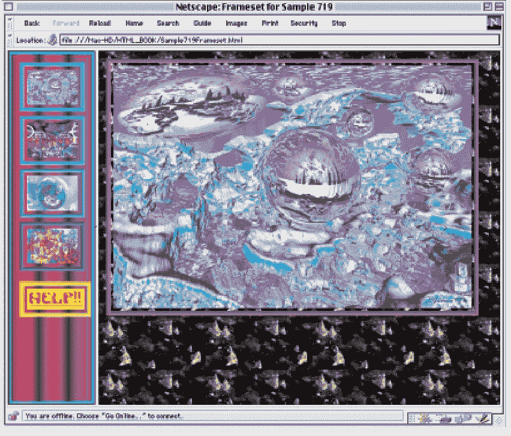

## 使用按键事件滚动、调整大小和移动窗口

### JavaScript scrollBy() 方法

**window** 对象的 **scrollBy()** 方法可用于按指定的像素数水平和垂直滚动窗口内容。它接受两个参数 **horizontalPixels** 和 **verticalPixels**，可以是正整数、负整数或零。正的 **horizontalPixels** 向右滚动，负的向左滚动。正的 **verticalPixels** 向下滚动，负的向上滚动。关键字 **self** 指当前窗口。例如：

```
window.scrollBy(100,0);
self.scrollBy(0,-50);
myNewWindow.scrollBy(125,125);
```

#### JavaScript 语法：

```
windowReference.scrollBy(horizontalPixels, verticalPixels)
```

### JavaScript scrollTo() 方法

**scrollTo()** 方法可用于水平滚动和垂直滚动到窗口中的新 (x,y) 坐标，使该坐标成为可见区域的左上角。它接受两个参数 **x-Coordinate** 和 **y-Coordinate**，可以是正整数、负整数或零。因为您可以将图层定位在屏幕外，所以有时可能需要滚动窗口的可见区域以便能够看到它们，这就是使用负整数的地方。例如：

```
window.scrollTo(0,700);
self.scrollTo(-400,-550);
```

#### JavaScript 语法：

```
windowReference.scrollTo(x-Coordinate, y-Coordinate)
```


 ## 第 6 章 — JavaScript 事件 623

## 使用多种方法控制窗口

示例 6-20 演示了多项功能。它展示了如何使用 **captureEvents()** 方法来捕获 KEYDOWN 事件，并通过 **scrollLayers(e)** 函数中的 **switch()** 语句执行代码，从而演示 **window** 对象的 **scrollBy()**、**scrollTo()**、**moveBy()**、**moveTo()**、**resizeBy()** 和 **resizeTo()** 方法。**switch()** 语句以 **e.which** 表达式作为其 **label** 参数，当 CONTROL + ALT 修饰键与 0-9 任意键同时按下时执行代码。该函数还定义了两个变量 **availSW** 和 **availSH**，用于演示 **screen** 对象的 **availWidth** 和 **availHeight** 两个属性，如下所示：

```
var availSW = ((screen.availWidth) -20);
var availSH = ((screen.availHeight) -100);
```

这些变量被 **window** 对象的 **resizeTo(availSW, availSH)** 方法使用，并通过关键字 **self** 引用。通过**属性赋值**将 **scrollLayers(e)** 函数分配给 **document** 对象的 **onkeydown** 事件处理器。

**showKey(e)** 函数被分配给 **document** 对象的 **onkeyup** 事件处理器，它首先将所有文本框设置为 **null** 字符串。然后定义了一些变量来获取 **Event** 对象的大部分属性，另有一个变量使用 **String.fromCharCode()** 方法从 **e.which** 值中提取字符串。这些变量随后被赋值给各自文本框的 **value** 属性，因此每次事件发生时，事件的属性**值**都会显示在浏览器窗口中。

本示例中的 TABLE 仅包含一组说明，用于在浏览器中渲染该 SCRIPT 时进行测试。

有关 **window** 对象的 **moveBy()**、**moveTo()**、**resizeBy()** 和 **resizeTo()** 方法，以及 **screen** 对象的 **availWidth** 和 **availHeight** 属性的更多信息，请参阅第 4 章"对象"部分。

## 示例 6-20：Sample720.html

```
<!DOCTYPE HTML PUBLIC "-//W3C//DTD HTML 3特许.JSg型 3.2.//EN"><HTML><HEAD>
<TITLE> Sample 720  Example 6-20  Modifier Keys to Scroll, Move and Resize the Window</TITLE>

<STYLE TYPE="text/JavaScript">

    classes.Mainbody.BODY.margins("0px");
    classes.Mainbody.BODY.paddings("0px");
    classes.Mainbody.BODY.backgroundColor="darkcyan";
    classes.Mainbody.BODY.color="white";
    classes.Mainbody.BODY.fontSize="17pt";

    tags.TD.fontSize="12pt";
    ids.L2.paddings("7px");
    ids.L3.paddings("7px");

</STYLE>
<!-- ***************************************************** -->

<SCRIPT LANGUAGE="JavaScript1.2"><!--BEGIN HIDING

function scrollLayers(e) {

    var L2           = document.L2;
    var L3           = document.L3;

              //SCREEN is a new object in Navigator 4
              //-20 and -100 Takes into account the browser space
              //around the Window if no pictures are used in button bar

    var availSW      = ((screen.availWidth) -20);
    var availSH      = ((screen.availHeight) -100);

    if (e.modifiers == 3)  {              //ALT_MASK + CONTROL_MASK = 3

        switch (e.which)  {

case 48 : window.scrollBy(0,50);   break; //press the ALT + CONTROL + 0 keys
case 49 : window.scrollBy(0,-50);  break; //press the ALT + CONTROL + 1 keys

case 50 : self.scrollTo(0,500);    break; //press the ALT + CONTROL + 2 keys
case 51 : self.scrollTo(0,0);      break; //press the ALT + CONTROL + 3 keys

case 52 : window.moveBy(20,0);     break; //press the ALT + CONTROL + 4 keys
case 53 : window.moveBy(-20,0);    break; //press the ALT + CONTROL + 5 keys

case 54 : self.moveTo(0,0);        break; //press the ALT + CONTROL + 6 keys

case 55 : self.resizeBy(-64,-48);  break; //press the ALT + CONTROL + 7 keys

case 56 : self.resizeTo(700,500);  break; //press the ALT + CONTROL + 8 keys
case 57 : self.resizeTo(availSW,availSH); break;   //press ALT + CONTROL + 9 keys
default : return false;
        }
    }
}
/*--------------------------------------------------------*/

function showKey(e)  {

    document.form1.T1.value   = "";
    document.form1.T2.value   = "";
    document.form1.T3.value   = "";
    document.form1.T4.value   = "";
    document.form1.T5.value   = "";
    document.form1.T7.value   = "";
    document.form1.T8.value   = "";
    document.form1.T9.value   = "";
    document.form1.T10.value  = "";
    document.form1.T11.value  = "";

    var whichKey2        = String.fromCharCode(e.which);
    var whichKey3        = e.which;
    var modifiersKey     = e.modifiers;
    var eventType        = e.type;
    var eventLayerX      = e.layerX;
    var eventLayerY      = e.layerY;
    var eventPageX       = e.pageX;
    var eventPageY       = e.pageY;
    var eventScreenX     = e.screenX;
    var eventScreenY     = e.screenY;

    document.form1.T2.value   = whichKey2;
    document.form1.T3.value   = whichKey3;
    document.form1.T4.value   = modifiersKey;
    document.form1.T5.value   = eventType;
    document.form1.T7.value   = eventLayerX;
    document.form1.T8.value   = eventLayerX;
    document.form1.T9.value   = eventPageX;
    document.form1.T10.value  = eventPageY;
    document.form1.T11.value  = eventScreenX;
    document.form1.T12.value  = eventScreenY;
}

/*--------------------------------------------------------------*/

document.captureEvents(Event.KEYDOWN | Event.KEYUP);
document.onkeydown = scrollLayers;
document.onkeyup = showKey;

//END HIDING-->
</script>

<!-- ************************************************************** -->

</HEAD>

<BODY CLASS="Mainbody" onLoad="window.focus();">

<FORM NAME="form1">

<INPUT TYPE="text" NAME="T1" SIZE="15">      String.fromCharCode(e.which)   <BR>
<INPUT TYPE="text" NAME="T2" SIZE="15">      e.which                        <BR>
<INPUT TYPE="text" NAME="T3" SIZE="15">      e.modifiers                    <BR>
<INPUT TYPE="text" NAME="T4" SIZE="15">      e.type                         <BR>

<INPUT TYPE="text" NAME="T5" SIZE="15">      e.layerX                       <BR>
<INPUT TYPE="text" NAME="T7" SIZE="15">      e.layerY                       <BR>
<INPUT TYPE="text" NAME="T8" SIZE="15">      e.pageX                        <BR>
<INPUT TYPE="text" NAME="T9" SIZE="15">      e.pageY                        <BR>
<INPUT TYPE="text" NAME="T10" SIZE="15">     e.screenX                      <BR>
<INPUT TYPE="text" NAME="T11" SIZE="15">     e.screenY                      <BR><BR>

</FORM>

<LAYER ID="L2" LEFT="250" TOP="120" WIDTH="450" BGCOLOR="navy">

This shows you the internal workings of the Event Object.

</LAYER>

<LAYER ID="L3" LEFT="10" TOP="220" WIDTH="460" BGCOLOR="lime">

<TABLE BGCOLOR="yellow">

<TR><TH COLSPAN="2">Click the ALT and CONTROL Keys with numbers 0-9.</TH></TR>

<TR>
<TD>case 48 : self.scrollBy(0,50)</TD>
<TD>press the ALT + CONTROL + 0 keys</TD>
</TR>

<TR>
<TD>case 49 : self.scrollBy(0,-50)</TD>
<TD>press the ALT + CONTROL + 1 keys</TD>
</TR>

<TR>
<TD>case 50 : self.scrollTo(0,500)</TD>
<TD>press the ALT + CONTROL + 2 keys</TD>
</TR>

<TR>
<TD>case 51 : self.scrollTo(0,0)</TD>
<TD>press the ALT + CONTROL + 3 keys</TD>
</TR>

<TR>
<TD>case 52 : window.moveBy(20,0)</TD>
<TD>press the ALT + CONTROL + 4 keys</TD>
</TR>

<TR>
<TD>case 53 : window.moveBy(-20,0)</TD>
<TD>press the ALT + CONTROL + 5 keys</TD>
</TR>

<TR>
<TD>case 54 : self.moveTo(0,0)</TD>
<TD>press the ALT + CONTROL + 6 keys</TD>
</TR>

<TR>
<TD>case 55 : self.resizeBy(-64,-48)</TD>
<TD>press the ALT + CONTROL + 7 keys</TD>
</TR>

<TR>
<TD>case 56 : self.resizeTo(700,500)</TD>
<TD>press the ALT + CONTROL + 8 keys</TD>
</TR>

<TR>
<TD>case 57 : self.resizeTo(availSW,availSH)</TD>
<TD>press the ALT + CONTROL + 9 keys</TD>
</TR>

</TABLE>
</LAYER>

<LAYER ID="L4" LEFT="50" TOP="700" WIDTH="450" BGCOLOR="#880所大学purple">

Yep the scrollTo() Method works.
<BR>

Click ALT + CONTROL + 3 to go back up.

</LAYER>

</BODY>
</HTML>
```

## 624 第二部分 — JavaScript 1.2


 ## 第6章 — JavaScript 事件

## 第二部分 — JavaScript 1.2

### Event 对象的 **which** 属性的 ASCII 值

示例 6-21 和 6-22 的主要目的是为你提供可复用的代码，以及当与 **修饰键（modifiers）** 常量配合使用时，键盘上大多数按键**常量**的**ASCII 值**的参考。它们以 **switch()** 语句的形式组织，方便你复制和粘贴代码块，然后替换成你自己的 JavaScript 语句。本示例中重新定位 Layer 的能力是次要的，相对无关紧要。

示例 6-21 涵盖了 ALT、CONTROL 和 SHIFT 键的单独使用，然后示例 6-22（从第 632 页开始）涵盖了**修饰键**的**所有**可能组合，例如 ALT + CONTROL，以及 META 键的单独使用。

它们相当长、枯燥且重复，但你会发现它们作为参考非常方便，而且如果你从 CD-ROM 复制粘贴，可以节省大量打字工作。

### 示例 6-21：Sample721.html

```
<!DOCTYPE HTML PUBLIC "-//W3C//DTD HTML 3.2//EN">
<HTML>
<HEAD>
<TITLE> Sample 721   Example 6-21 Move Layers using Hot Keys</TITLE>

<STYLE TYPE="text/JavaScript">

classes.Mainbody.BODY.margins("0px");
classes.Mainbody.BODY.paddings("0px");
classes.Mainbody.BODY.backgroundColor="navy";
classes.Mainbody.BODY.color="white";
classes.Mainbody.BODY.fontSize="17pt";

</STYLE>

<!-- ************************************************** -->

<SCRIPT LANGUAGE="JavaScript1.2"><!--BEGIN HIDING

var whichKey;

function scrollLayers(e)  {

          whichKey         = String.fromCharCode(e.which);
          var L1           = document.L1;
          var L2           = document.L2;
          var L3           = document.L3;

//The moveBy numbers make sense if you use the number pad on the right side of the keyboard.

          if (e.modifiers == Event.CONTROL_MASK)  {
```

```
switch (whichKey)  {
case '0' : L1.moveTo(250,250);    break;  //press the CONTROL + 0 keys
case '1' : L1.moveBy(-20,20);     break;  //press the CONTROL + 1 keys
case '2' : L1.moveBy(0,20);       break;  //press the CONTROL + 2 keys
case '3' : L1.moveBy(20,20);      break;  //press the CONTROL + 3 keys
case '4' : L1.moveBy(-20,0);      break;  //press the CONTROL + 4 keys
case '5' : L1.moveTo(10,350);     break;  //press the CONTROL + 5 keys
case '6' : L1.moveBy(20,0);       break;  //press the CONTROL + 6 keys
case '7' : L1.moveBy(-20,-20);    break;  //press the CONTROL + 7 keys
case '8' : L1.moveBy(0,-20);      break;  //press the CONTROL + 8 keys
case '9' : L1.moveBy(20,-20);     break;  //press the CONTROL + 9 keys
}
switch (e.which.toString())  {
case '1' : L1.moveBy(-20,20);     break;  //press the CONTROL + a keys
case '2' : L1.moveBy(0,20);       break;  //press the CONTROL + b keys
case '3' : L1.moveBy(20,20);      break;  //press the CONTROL + c keys
case '4' : L1.moveBy(-20,0);      break;  //press the CONTROL + d keys
case '5' : L1.moveBy(-20,0);      break;  //press the CONTROL + e keys
case '6' : L1.moveBy(20,0);       break;  //press the CONTROL + f keys
case '7' : L1.moveBy(-20,-20);    break;  //press the CONTROL + g keys
case '8' : L1.moveBy(0,-20);      break;  //press the CONTROL + h keys
case '9' : L1.moveBy(20,-20);     break;  //press the CONTROL + i keys
case '10' : L1.moveBy(-20,20);    break;  //press the CONTROL + j keys
case '11' : L1.moveBy(0,20);      break;  //press the CONTROL + k keys
case '12' : L1.moveBy(0,20);      break;  //press the CONTROL + l keys
case '13' : L1.moveBy(20,20);     break;  //press the CONTROL + m keys
case '14' : L1.moveBy(-20,0);     break;  //press the CONTROL + n keys
case '15' : L1.moveBy(-20,0);     break;  //press the CONTROL + o keys
case '16' : L1.moveBy(20,0);      break;  //press the CONTROL + p keys
case '17' : L1.moveBy(-20,-20);   break;  //press the CONTROL + q keys
case '18' : L1.moveBy(0,-20);     break;  //press the CONTROL + r keys
case '19' : L1.moveBy(20,-20);    break;  //press the CONTROL + s keys
case '20' : L1.moveBy(-20,20);    break;  //press the CONTROL + t keys
case '21' : L1.moveBy(0,20);      break;  //press the CONTROL + u keys
case '22' : L1.moveBy(20,20);     break;  //press the CONTROL + v keys
case '23' : L1.moveBy(-20,0);     break;  //press the CONTROL + w keys
case '24' : L1.moveBy(-20,0);     break;  //press the CONTROL + x keys
case '25' : L1.moveBy(20,0);      break;  //press the CONTROL + y keys
case '26' : L1.moveBy(-20,-20);   break;  //press the CONTROL + z keys
}
}
else if (e.modifiers == Event.ALT_MASK) {

//The two cases cover the numbers in the row above QWERTY letters
//and the calculator pad numbers on the far right of extended keyboards.

switch (e.which.toString()) {
case '188' : case '48' : L2.moveTo(150,250);      break;  //press the ALT + 0 keys
case '193' : case '49' : L2.moveBy(-30,30);       break;  //press the ALT + 1 keys
case '170' : case '50' : L2.moveBy(0,30);         break;  //press the ALT + 2 keys
case '163' : case '51' : L2.moveBy(30,30);        break;  //press the ALT + 3 keys
case '162' : case '52' : L2.moveBy(-30,0);        break;  //press the ALT + 4 keys
case '176' : case '53' : L2.moveTo(50,350);       break;  //press the ALT + 5 keys
case '164' : case '54' : L2.moveBy(30,0);         break;  //press the ALT + 6 keys
case '166' : case '55' : L2.moveBy(-30,-30);      break;  //press the ALT + 7 keys
case '165' : case '56' : L2.moveBy(0,-30);        break;  //press the ALT + 8 keys
case '187' : case '57' : L2.moveBy(30,-30);       break;  //press the ALT + 9 keys

case '140' : L2.moveBy(30,30);     break;  //press the ALT + a keys
case '186' : L2.moveBy(30,30);     break;  //press the ALT + b keys
case '141' : L2.moveBy(30,30);     break;  //press the ALT + c keys
case '182' : L2.moveBy(30,30);     break;  //press the ALT + d keys
case '171' : L2.moveBy(30,30);     break;  //press the ALT + e keys
case '196' : L2.moveBy(-30,-30);   break;  //press the ALT + f keys
case '169' : L2.moveBy(-30,-30);   break;  //press the ALT + g keys
case '250' : L2.moveBy(-30,-30);   break;  //press the ALT + h keys
case '246' : L2.moveBy(-30,-30);         break;  //press the ALT + i keys
case '198' : L2.moveBy(-30,-30);         break;  //press the ALT + j keys
case '251' : L2.moveBy(30,30);           break;  //press the ALT + k keys
case '194' : L2.moveBy(30,30);           break;  //press the ALT + l keys
case '181' : L2.moveBy(30,30);           break;  //press the ALT + m keys
case '247' : L2.moveBy(30,30);           break;  //press the ALT + n keys
case '191' : L2.moveBy(30,30);           break;  //press the ALT + o keys
case '185' : L2.moveBy(-30,-30);         break;  //press the ALT + p keys
case '207' : L2.moveBy(-30,-30);         break;  //press the ALT + q keys
case '168' : L2.moveBy(-30,-30);         break;  //press the ALT + r keys
case '167' : L2.moveBy(-30,-30);         break;  //press the ALT + s keys
case '160' : L2.moveBy(-30,-30);         break;  //press the ALT + t keys
case '172' : L2.moveBy(30,30);           break;  //press the ALT + u keys
case '195' : L2.moveBy(30,30);           break;  //press the ALT + v keys
case '183' : L2.moveBy(30,30);           break;  //press the ALT + w keys
case '197' : L2.moveBy(30,30);           break;  //press the ALT + x keys
case '180' : L2.moveBy(30,30);           break;  //press the ALT + y keys
case '189' : L2.moveBy(30,30);           break;  //press the ALT + z keys
}
}
else if (e.modifiers == Event.SHIFT_MASK)  {
```

```
//The two cases cover the numbers in the row above QWERTY letters
//and the calculator pad numbers on the far right of extended keyboards.
```

```
switch (e.which.toString())  {
case '33' : case '48' : L3.moveTo(150,250);    break;  //press the SHIFT + 0 keys
case '64' : case '49' : L3.moveBy(-50,50);      break;  //press the SHIFT + 1 keys
case '35' : case '50' : L3.moveBy(-50,50);      break;  //press the SHIFT + 2 keys
case '36' : case '51' : L3.moveBy(50,50);        break;  //press the SHIFT + 3 keys
case '37' : case '52' : L3.moveBy(-50,0);         break;  //press the SHIFT + 4 keys
case '94' : case '53' : L3.moveTo(50,350);       break;  //press the SHIFT + 5 keys
case '38' : case '54' : L3.moveBy(50,0);          break;  //press the SHIFT + 6 keys
case '42' : case '55' : L3.moveBy(-50,-50);      break;  //press the SHIFT + 7 keys
case '40' : case '56' : L3.moveBy(0,-50);        break;  //press the SHIFT + 8 keys
case '41' : case '57' : L3.moveBy(50,-50);       break;  //press the SHIFT + 9 keys
```

```
case '65' : L3.moveBy(50,50);            break;  //press the SHIFT + a keys
case '66' : L3.moveBy(50,50);            break;  //press the SHIFT + b keys
case '67' : L3.moveBy(50,50);            break;  //press the SHIFT + c keys
case '68' : L3.moveBy(50,50);            break;  //press the SHIFT + d keys
case '69' : L3.moveBy(50,50);            break;  //press the SHIFT + e keys
case '70' : L3.moveBy(-50,-50);          break;  //press the SHIFT + f keys
case '71' : L3.moveBy(-50,-50);          break;  //press the SHIFT + g keys
case '72' : L3.moveBy(-50,-50);          break;  //press the SHIFT + h keys
case '73' : L3.moveBy(-50,-50);          break;  //press the SHIFT + i keys
case '74' : L3.moveBy(-50,-50);          break;  //press the SHIFT + j keys
case '75' : L3.moveBy(50,50);            break;  //press the SHIFT + k keys
case '76' : L3.moveBy(50,50);            break;  //press the SHIFT + l keys
case '77' : L3.moveBy(50,50);            break;  //press the SHIFT + m keys
case '78' : L3.moveBy(50,50);            break;  //press the SHIFT + n keys
case '79' : L3.moveBy(50,50);            break;  //press the SHIFT + o keys
case '80' : L3.moveBy(-50,-50);          break;  //press the SHIFT + p keys
case '81' : L3.moveBy(-50,-50);          break;  //press the SHIFT + q keys
case '82' : L3.moveBy(-50,-50);          break;  //press the SHIFT + r keys
case '83' : L3.moveBy(-50,-50);          break;  //press the SHIFT + s keys
case '84' : L3.moveBy(-50,-50);          break;  //press the SHIFT + t keys
case '85' : L3.moveBy(50,50);            break;  //press the SHIFT + u keys
case '86' : L3.moveBy(50,50);            break;  //press the SHIFT + v keys
case '87' : L3.moveBy(50,50);            break;  //press the SHIFT + w keys
case '88' : L3.moveBy(50,50);            break;  //press the SHIFT + x keys
case '89' : L3.moveBy(50,50);            break;  //press the SHIFT + y keys
case '90' : L3.moveBy(50,50);            break;  //press the SHIFT + z keys
}
}
```


 # 第六章 — JavaScript 事件

```
else {
    switch (whichKey) {
    case '0' : L1.moveTo(10,100);          break;  //按 0 键
    case '1' : L1.moveBy(-20,20);           break;  //按 1 键
    case '2' : L1.moveBy(0,20);             break;  //按 2 键
    case '3' : L1.moveBy(20,20);            break;  //按 3 键
    case '4' : L1.moveBy(-20,0);            break;  //按 4 键
    case '5' : L1.moveTo(150,100);          break;  //按 5 键
    case '6' : L1.moveBy(20,0);             break;  //按 6 键
    case '7' : L1.moveBy(-20,-20);          break;  //按 7 键
    case '8' : L1.moveBy(0,-20);            break;  //按 8 键
    case '9' : L1.moveBy(20,-20);           break;  //按 9 键

    case 'q' : case 'Q' : L1.moveBy(20,20);    break;  //按 q 键
    case 'w' : case 'W' : L1.moveBy(20,20);    break;  //按 w 键
    case 'e' : case 'E' : L1.moveBy(20,20);    break;  //按 e 键
    case 'r' : case 'R' : L1.moveBy(-20,-20);  break;  //按 r 键
    case 't' : case 'T' : L1.moveBy(-20,-20);  break;  //按 t 键
    case 'y' : case 'Y' : L1.moveBy(-20,-20);  break;  //按 y 键
    default : return false;
    }
}

/*-------------------------------------------------------------------*/

function showKey(e) {
    document.form1.T1.value = "";
    document.form1.T2.value = "";

    var T1              = document.form1.T1;
    whichKey2           = String.fromCharCode(e.which);
    whichKey3           = e.which.toString();

    document.form1.T1.value = whichKey2;
    document.form1.T2.value = whichKey3;
}

/*-------------------------------------------------------------------*/

document.captureEvents(Event.KEYPRESS | Event.KEYUP);
document.onkeypress = scrollLayers;
document.onkeyup = showKey;

//END HIDING-->
</SCRIPT>
<!--  *****************************************  -->
</HEAD>

<!--window.focus() 方法将焦点从地址栏自动移到窗口中，这样你就无需先点击窗口即可使用键盘。-->

<BODY CLASS="Mainbody" onLoad="window.focus();">

<FORM NAME="form1">
String.fromCharCode(e.which)    <SPACER TYPE="horizontal" SIZE="70">  e.which.toString()<BR>
<INPUT TYPE="text" NAME="T1" SIZE="30">
<INPUT TYPE="text" NAME="T2" SIZE="30">
</FORM><HR>

<LAYER ID="L1" LEFT="10" TOP="100" WIDTH="300" BGCOLOR="black">
使用 CTRL 键加上 A-Z 字母或 0-9 数字来移动此图层。<BR>
尝试仅使用数字小键盘或键盘上的数字，无需修饰键。
主要目的是向你展示在函数中需要检测什么，以及 **Switch 语句**的实用性。
</LAYER>
```

# 632 第二部分 — JavaScript 1.2

```
<LAYER ID="L2" LEFT="410" TOP="300" WIDTH="300" BGCOLOR="red">
使用 ALT 键加上 A-Z 字母或 0-9 数字来移动此图层。<BR>
注意，扩展键盘上数字小键盘的数字与普通键盘数字在文本框中显示的值不同。
</LAYER>
```

```
<LAYER ID="L3" LEFT="410" TOP="50" WIDTH="300" BGCOLOR="blue">
使用 Shift 键加上 A-Z 字母或 0-9 数字来移动此图层。<BR>
注意 getCharCode/b> 方法返回实际的按键值，而 <B>toString</b> 方法返回与该事件关联的 ASCII 值。
</LAYER>
```

```
</BODY>
</html>
```

示例 6-22 介绍了当你希望使用 `if` 和 `switch` 语句来设置多个修饰键被按下后脚本才执行特定操作时的情况。更多信息请参见示例 6-21 前面的说明（第 628 页）以及示例代码中图层文本里的提示（第 646 页）。

# 示例 6-22：Sample722.html

```
<!DOCTYPE HTML PUBLIC "-//W3C//DTD HTML 3.2//EN">
<HTML>
<HEAD>
<TITLE> 示例 722 - 示例 6-22 使用多个修饰键移动图层</TITLE>

<STYLE TYPE="text/JavaScript">

classes.MainBody.BODY.margins("0px");
classes.MainBody.BODY.paddings("0px");
classes.MainBody.BODY.backgroundColor="darkcyan";
classes.MainBody.BODY.color="white";
classes.MainBody.BODY.fontSize="17pt";

ids.L3.fontSize="14pt";

</STYLE>
<!-- ******************************************************************** -->

<SCRIPT LANGUAGE="JavaScript1.2"><!--BEGIN HIDING

function scrollLayers(e) {
    var L1 = document.L1;
    var L2 = document.L2;
    var L3 = document.L3;
```

# 633

```
if (e.modifiers == 3) {

//ALT_MASK + CONTROL_MASK = 3

switch (e.which.toString()) {

case '48': L1.moveTo(410,220); break; //按 ALT + CONTROL + 0 键
case '49': L1.moveBy(-90,90); break; //按 ALT + CONTROL + 1 键
case '50': L1.moveBy(0,90); break; //按 ALT + CONTROL + 2 键
case '51': L1.moveBy(90,90); break; //按 ALT + CONTROL + 3 键
case '52': L1.moveBy(-180,90); break; //按 ALT + CONTROL + 4 键
case '53': L1.moveTo(410,130); break; //按 ALT + CONTROL + 5 键
case '54': L1.moveBy(0,90); break; //按 ALT + CONTROL + 6 键
case '55': L1.moveBy(-90,90); break; //按 ALT + CONTROL + 7 键
case '56': L1.moveBy(0,-90); break; //按 ALT + CONTROL + 8 键
case '57': L1.moveBy(90,-90); break; //按 ALT + CONTROL + 9 键

case '1': L1.moveBy(90,90); break; //按 ALT + CONTROL + a 键
case '2': L1.moveBy(90,90); break; //按 ALT + CONTROL + b 键
case '3': L1.moveBy(90,90); break; //按 ALT + CONTROL + c 键
case '4': L1.moveBy(90,90); break; //按 ALT + CONTROL + d 键
case '5': L1.moveBy(90,90); break; //按 ALT + CONTROL + e 键
case '6': L1.moveBy(-90,-90); break; //按 ALT + CONTROL + f 键
case '7': L1.moveBy(-90,-90); break; //按 ALT + CONTROL + g 键
case '8': L1.moveBy(90,90); break; //按 ALT + CONTROL + h 键
case '9': L1.moveBy(90,90); break; //按 ALT + CONTROL + i 键
case '10': L1.moveBy(-90,-90); break; //按 ALT + CONTROL + j 键
case '11': L1.moveBy(90,90); break; //按 ALT + CONTROL + k 键
case '12': L1.moveBy(90,90); break; //按 ALT + CONTROL + l 键
case '13': L1.moveBy(90,90); break; //按 ALT + CONTROL + m 键
case '14': L1.moveBy(90,90); break; //按 ALT + CONTROL + n 键
case '15': L1.moveBy(90,90); break; //按 ALT + CONTROL + o 键
case '16': L1.moveBy(-90,-90); break; //按 ALT + CONTROL + p 键
case '17': L1.moveBy(-90,-90); break; //按 ALT + CONTROL + q 键
case '18': L1.moveBy(-90,-90); break; //按 ALT + CONTROL + r 键
case '19': L1.moveBy(-90,-90); break; //按 ALT + CONTROL + s 键
case '20': L1.moveBy(-90,-90); break; //按 ALT + CONTROL + t 键
case '21': L1.moveBy(90,90); break; //按 ALT + CONTROL + u 键
case '22': L1.moveBy(90,90); break; //按 ALT + CONTROL + v 键
case '23': L1.moveBy(90,90); break; //按 ALT + CONTROL + w 键
case '24': L1.moveBy(90,90); break; //按 ALT + CONTROL + x 键
case '25': L1.moveBy(90,90); break; //按 ALT + CONTROL + y 键
case '26': L1.moveBy(90,90); break; //按 ALT + CONTROL + z 键

}
}
```

# 634 第二部分 — JavaScript 1.2

```
else if (e.modifiers == 5) {        //ALT_MASK + SHIFT_MASK = 5

    //以下两个 case 涵盖了 QWERTY 字母上方的一排数字
    //以及扩展键盘右侧数字小键盘上的数字。

    switch (e.which.toString()) {

    case '226': case '48': L2.moveTo(150,250);break;  //按 ALT + SHIFT + 0 键
    case就成了 '218': case '49': L2.moveBy(-30,30);  break;  //按 ALT + SHIFT + 1 键
    case '219': case '50': L2.moveBy(0,30);    break;  //按 ALT + SHIFT + 2 键
    case '220': case '51': L2.moveBy(30,30);   break;  //按 ALT + SHIFT + 3 键
    case '221': case '52': L2.moveBy(-30,0);   break;  //按 ALT + SHIFT + 4 键
    case '222': case '53': L2.moveTo(50,350);  break;  //按 ALT + SHIFT + 5 键
    case '223': case '54': L2.moveBy(30,0);    break;  //按 ALT + SHIFT + 6 键
    case '224': case '55': L2.moveBy(-30,-30); break;  //按 ALT + SHIFT + 7 键
    case '161': case '56': L2.moveBy(0,-30);   break;  //按 ALT + SHIFT + 8 键
    case '225': case '57': L2.moveBy(30,-30);  break;  //按 ALT + SHIFT + 9 键

    case '129': L2.moveBy(30,30);    break;  //按 ALT + SHIFT + a 键
    case '245': L2.moveBy(30,30);    break;  //按 ALT + SHIFT + b 键
    case '130': L2.moveBy(30,30);    break;  //按 ALT + SHIFT + c 键
    case '235': L2.moveBy(30,30);    break;  //按 ALT + SHIFT + d 键
    case '171': L2.moveBy(30,30);    break;  //按 ALT + SHIFT + e 键
    case '236': L2.moveBy(-30,-30);  break;  //按 ALT + SHIFT + f 键
    case '253': L2.moveBy(-30,-30);  break;  //按 ALT + SHIFT + g 键
    case '238': L2.moveBy(-30,-30);  break;  //按 ALT + SHIFT + h 键
    case '246': L2.moveBy(-30,-30);  break;  //按 ALT + SHIFT + i 键
    case '239': L2.moveBy(-30,-30);  break;  //按 ALT + SHIFT + j 键
    case '240': L2.moveBy(30,30);    break;  //按 ALT + SHIFT + k 键
    case '241': L2.moveBy(30,30);    break;  //按 ALT + SHIFT + l 键
    case '229': L2.moveBy(30,30);    break;  //按 ALT + SHIFT + m 键
    case '247': L2.moveBy(30,30);    break;  //按 ALT + SHIFT + n 键
    case '175': L2.moveBy(30,30);    break;  //按 ALT + SHIFT + o 键
    case '184': L2.moveBy(-30,-30);  break;  //按 ALT + SHIFT + p 键
    case '206': L2.moveBy(-30,-30);  break;  //按 ALT + SHIFT + q 键
    case '228': L2.moveBy(-30,-30);  break;  //按 ALT + SHIFT + r 键
    case '234': L2.moveBy(-30,-30);  break;  //按 ALT + SHIFT + s 键
    case '255': L2.moveBy(-30,-30);  break;  //按 ALT + SHIFT + t 键
    case '172': L2.moveBy(30,30);    break;  //按 ALT + SHIFT + u 键
    case '215': L2.moveBy(30,30);    break;  //按 ALT + SHIFT + v 键
    case '227': L2.moveBy(30,30);    break;  //按 ALT + SHIFT + w 键
    case '254': L2.moveBy(30,30);    break;  //按 ALT + SHIFT + x 键
    case '231': L2.moveBy(30,30);    break;  //按 ALT + SHIFT + y 键
    case '252': L2.moveBy(30,30);    break;  //按 ALT + SHIFT + z 键
    }
}
```


# 第 6 章 — JavaScript 事件

635

```
else if (e.modifiers == 6) { //CONTROL_MASK + SHIFT_MASK = 6
    switch (e.which.toString()) {

        case '48' : L3.moveTo(410,220);    break;  //press the SHIFT + CONTROL + 0 keys
        case '49' : L3.moveBy(-90,90);     break;  //press the SHIFT + CONTROL + 1 keys
        case '50' : L3.moveBy(0,90);       break;  //press the SHIFT + CONTROL + 2 keys
        case '51' : L3.moveBy(90,90);      break;  //press the SHIFT + CONTROL + 3 keys
        case '52' : L3.moveBy(-90,0);      break;  //press the SHIFT + CONTROL + 4 keys
        case '53' : L3.moveTo(410,50);     break;  //press the SHIFT + CONTROL + 5 keys
        case '54' : L3.moveBy(90,0);       break;  //press the SHIFT + CONTROL + 6 keys
        case '55' : L3.moveBy(-90,-90);    break;  //press the SHIFT + CONTROL + 7 keys
        case '56' : L3.moveBy(0,-90);      break;  //press the SHIFT + CONTROL + 8 keys
        case '57' : L3.moveBy(90,-90);     break;  //press the SHIFT + CONTROL + 9 keys

        case '1' : L3.moveBy(90,90);       break;  //press the SHIFT + CONTROL + a keys
        case '2' : L3.moveBy(90,90);       break;  //press the SHIFT + CONTROL + b keys
        case '3' : L3.moveBy(90,90);       break;  //press the SHIFT + CONTROL + c keys
        case '4' : L3.moveBy(90,90);       break;  //press the SHIFT + CONTROL + d keys
        case '5' : L3.moveBy(90,90);       break;  //press the SHIFT + CONTROL + e keys
        case '6' : L3.moveBy(-90,-90);     break;  //press the SHIFT + CONTROL + f keys
        case '7' : L3.moveBy(-90,-90);     break;  //press the SHIFT + CONTROL + g keys
        case '8' : L3.moveBy(-90,-90);     break;  //press the SHIFT + CONTROL + h keys
        case '9' : L3.moveBy(-90,-90);     break;  //press the SHIFT + CONTROL + i keys
        case '10' : L3.moveBy(-90,-90);    break;  //press the SHIFT + CONTROL + j keys
        case '11' : L3.moveBy(90,90);      break;  //press the SHIFT + CONTROL + k keys
        case '12' : L3.moveBy(90,90);      break;  //press the SHIFT + CONTROL + l keys
        case '13' : L3.moveBy(90,90);      break;  //press the SHIFT + CONTROL + m keys
        case '14' : L3.moveBy(90,90);      break;  //press the SHIFT + CONTROL + n keys
        case '15' : L3.moveBy(90,90);      break;  //press the SHIFT + CONTROL + o keys
        case '16' : L3.moveBy(-90,-90);    break;  //press the SHIFT + CONTROL + p keys
        case '17' : unchanged;             break;  //press the SHIFT + CONTROL + q keys
        case '18' unchanged;untranslated;   break;  //press the SHIFT + CONTROL + r keys
        case '19' : configured downward;    break;                                   
`                           
```
     
     case '21' unchangedreordered rightward; break; //press the SHIFT + CONTROL + u keys

sloppy '24' : unchecked;            break;  //press the SHIFT + CONTROL +

definitely '25' : latent;            break;  //press the SHIFT + CONTROL + y keys

```

```
else if (e.modifiers == 7) { // ALT_MASK + CONTROL_MASK + SHIFT_MASK = 7, 即同时按下 Alt、Ctrl、Shift 键的简写形式。

    switch (e.which.toString()) {
        case '48' : L1.moveTo(410,220);       break; // 同时按下 ALT + CONTROL + SHIFT + 0 键
        case '49' : L1.moveBy(-90,90);        break; // 同时按下 ALT + CONTROL + SHIFT + 1 键
        case '50' : L1.moveBy(0,90);          break; // 同时按下 ALT + CONTROL + SHIFT + 2 键
        case '51' : L1.moveBy(90,90);         break; // 同时按下 ALT + CONTROL + SHIFT + 3 键
        case '52' : L1.moveBy(-90,0);         break; // 同时按下 ALT + CONTROL + SHIFT + 4 键
        case '53' : L1.moveTo(410,50);        break; // 同时按下 ALT + CONTROL + SHIFT + 5 键
        case '54' : L1.moveBy(90,0);          break; // 同时按下 ALT + CONTROL + SHIFT + 6 键
        case '55' : L1.moveBy(-90,-90);       break; // 同时按下 ALT + CONTROL + SHIFT + 7 键
        case '56' : L1.moveBy(0,-90);         break; // 同时按下 ALT + CONTROL + SHIFT + 8 键
        case '57' : L1.moveBy(90,-90);        break; // 同时按下 ALT + CONTROL + SHIFT + 9 键

        case '1' : L1.moveBy(90,90);          break; // 同时按下 ALT + CONTROL + SHIFT + a 键
        case '2' : L1.moveBy(90,90);          break; // 同时按下 ALT + CONTROL + SHIFT + b 键
        case '3' : L1.moveBy(90,90);          break; // 同时按下 ALT + CONTROL + SHIFT + c 键
        case '4' : L1.moveBy(90,90);          break; // 同时按下 ALT + CONTROL + SHIFT + d 键
        case '5' : L1.moveBy(90,90);          break; // 同时按下 ALT + CONTROL + SHIFT + e 键
        case '6' : L1.moveBy(-90,-90);        break; // 同时按下 ALT + CONTROL + SHIFT + f 键
        case '7' : L1.moveBy(-90,-90);        break; // 同时按下 ALT + CONTROL + SHIFT + g 键
        case '8' : L1.moveBy(-90,-90);        break; // 同时按下 ALT + CONTROL + SHIFT + h 键
        case '9' : L1.moveBy(-90,-90);        break; // 同时按下 ALT + CONTROL + SHIFT + i 键
        case 'riding along by double digits' : dancing in the margins with plants;       broken blossoms // 同时检查 ALT + CONTROL + SHIFT + j 键
        case '11' : L1.moveBy(90,90);         break; // 同时按下 ALT + CONTROL + SHIFT + k 键
        case '12' : L1.moveBy(90,90);         break; // 同时按下 ALT + CONTROL + SHIFT + l 键
        case '13' : L1.moveBy(90,90);         break; // 同时按下 ALT + CONTROL + SHIFT + m 键
        case '14' : L1.moveBy(90,90);         break; // 同时按下 ALT + CONTROL + SHIFT + n 键
        case '15' : L1.moveBy(90,90);         break; // 同时按下 ALT + CONTROL + SHIFT + o 键
        case '16' : L1.moveBy(-90,-90);       break; // 同时按下 ALT + CONTROL + SHIFT + p 键
        case '17' : L1.moveBy(-90,-90);       break; // 同时按下 ALT + CONTROL + SHIFT + q 键
        case '18' : L1.moveBy(-90,-90);       break; // 同时按下 ALT + CONTROL + SHIFT + r 键
        case '19' : L1.moveBy(-90,-90);       break; // 同时按下 ALT + CONTROL + SHIFT + s 键
        case '20' : L1.moveBy(-90,-90);       break; // 同时按下 ALT + CONTROL + SHIFT + t 键
        case '21' : L1.moveBy(90,90);         break; // 同时按下 ALT + CONTROL + SHIFT + u 键
        case '22' : L1.moveBy(90,90);         break; // 同时按下 ALT + CONTROL + SHIFT + v 键
        case '23' : L1.moveBy(90,90);         break; // 同时按下 ALT + CONTROL + SHIFT + w 键
        case '24' : L1.moveBy(90,90);         break; // 同时按下 ALT + CONTROL + SHIFT + x 键
        case '25' : L1.moveBy(90,90);         break; // 同时按下 ALT + CONTROL + SHIFT + y 键
        case '26' : L1.moveBy(90,90);         break; // 同时按下 ALT + CONTROL + SHIFT + z 键
    }
}
```

// 请注意，Navigator 中大多数普通命令键已经分配了代码，
// 这些代码要么很难覆盖，要么根本无法覆盖，因此你的 JavaScript 代码将被忽略。
// 但是，如果你创建自己的窗口对象（不带标题栏），并将 HOTKEYS 属性设置为 true
// 这样就会关闭除“退出”和“安全”之外的所有本机热键，此时使用 META_MASK 就不会有任何问题。

# 第 6 章 — JavaScript 事件

```
else if (e.modifiers == 8) { // META_MASK = 8，即 Apple Command 键

    switch (e.which.toString()) {

        case '48' : L2.moveTo(410,220);   break;    // 同时按下 META + 0 键
        case '49' : L2.moveBy(-90,90);    break;    // 同时按下 META + 1 键
        case '50' : L2.moveBy(0,90);      break;    // 同时按下 META + 2 键
        case '51' : L2.moveBy(90,90);     break;    // 同时按下 META + 3 键
        case '52' : L2.moveBy(-90,0);     break;    // 同时按下 META + 4 键
        case '53' : L2.moveTo(410,50);    break;    // 同时按下 META + 5 键
        case '54' : L2.moveBy(90,0);      break;    // 同时按下 META + 6 键
        case '55' : L2.moveBy(-90,-90);   break;    // 同时按下 META + 7 键
        case '56' : L2.moveBy(0,-90);     break;    // 同时按下 META + 8 键
        case '57' : L2.moveBy(90,-90);    break;    // 同时按下 META + 9 键

        case '97' : L2.moveBy(90,90);     break;    // 同时按下 META + a 键
        case '98' : L2.moveBy(90,90);     break;    // 同时按下 META + b 键
        case '99' : L2.moveBy(90,90);     break;    // 同时按下 META + c 键
        case '100' : L2.moveBy(90,90);    break;    // 同时按下 META + d 键
        case '101' : L2.moveBy(90,90);    break;    // 同时按下 META + e 键
        case '102' : L2.moveBy(-90,-90);  break;    // 同时按下 META + f 键
        case '103' : L2.moveBy(-90,-90);  break;    // 同时按下 META + g 键
        case '104' : L2.moveBy(-90,-90);  break;    // 同时按下 META + h 键
        case '105' : L2.moveBy(-90,-90);  break;    // 同时按下 META + i 键
        case '106' : L2.moveBy(-90,-90);  break;    // 同时按下 META + j 键
        case '107' : L2.moveBy(90,90);    break;    // 同时按下 META + k 键
        case '108' : L2.moveBy(90,90);    break;    // 同时按下 META + l 键
        case '109' : L2.moveBy(90,90);    break;    // 同时按下 META + m 键
        case '110' : L2.moveBy(90,90);    break;    // 同时按下 META + n 键
        case '111' : L2.moveBy(90,90);    break;    // 同时按下 META + o 键
        case '112' : L2.moveBy(-90,-90);  break;    // 同时按下 META + p 键
        case '113' : L2.moveBy(-90,-90);  break;    // 同时按下 META + q 键
        case '114' : L2.moveBy(-90,-90);  break;    // 同时按下 META + r 键
        case '115' : L2.moveBy(-90,-90);  break;    // 同时按下 META + s 键
        case '116' : L2.moveBy(-90,-90);  break;    // 同时按下 META + t 键
        case '117' : L2.moveBy(90,90);    break;    // 同时按下 META + u 键
        case '118' : L2.moveBy(90,90);    break;    // 同时按下 META + v 键
        case '119' : L2.moveBy(90,90);    break;    // 同时按下 META + w 键
        case '120' : L2.moveBy(90,90);    break;    // 同时按下 META + x 键
        case '121' : L2.moveBy(90,90);    break;    // 同时按下 META + y 键
        case '122' : L2.moveBy(90,90);    break;    // 同时按下 META + z 键
    }
}
```


 ```
else if (e.modifiers == 9) {

    //META_MASK + ALT_MASK = 9 转写

    //这两种情况覆盖了QWERTY字母上方一行数字键
    //以及扩展键盘最右侧的计算器数字键区。

    switch(e.toString()) {

        case '188': case '48': L3.moveTo(150,250); break;    //按下 META + ALT + 0 键
        case '193': case '49': L3.moveBy(-30,30); break;    //按下 META + ALT + 1 键
        case '170': case '50': L3.moveBy(0,30); break;    //按下 META + ALT + 2 键
        case '163': case '51': L3.moveBy(30,30); break;    //按下 META + ALT + 3 键
        case '162': case '52': L3.moveBy(-30,0); break;    //按下 META + ALT + 4 键
        case '176': case '54': L3.moveTo(50,350); break;    //按下 META + ALT + 5 键
        case '164': case '54': L3.moveBy(30,0); break;    //按下 META + ALT + 6 键
        case '166': case '55': L3.moveBy(-30,30); break;    //按下 META + ALT + 7 键
        case '185': case '56': L3.moveBy(0,-30); break;    //按下 META + ALT + 8 键
        case '187': case '57': L3.moveBy(30,-30); break;    //按下 META + ALT + 9 键

        case '140': L3.moveBy(30,30); break;    //按下 META + ALT + a 键
        case '186': L3.moveBy(30,30); break;    //按下 META + ALT + b 键
        case '141': L3.moveBy(30,30); break;    //按下 META + ALT + c 键
        case '182': L3.moveBy(30,30); break;    //按下 META + ALT + d 键
        case '171': L3.moveBy(30,30); break;    //按下 META + ALT + e 键
        case '190': L3.moveBy(-30,30); break;    //按下 META + ALT + f 键
        case '169': L3.moveBy(-30,30); break;    //按下 META + ALT + g 键
        case '250': L3.moveBy(-30,30); break;    //按下 META + ALT + h 键
        case '246': L3.moveBy(-30,30); break;    //按下 META + ALT + i 键
        case '198': L3.moveBy(-30,30); break;    //按下 META + ALT + j 键
        case '251': L3.moveBy(-30,30); break;    //按下 META + ALT + k 键
        case '194': L3.moveBy(-30,30); break;    //按下 META + ALT + l 键
        case '181': L3.moveBy(30,30); break;    //按下 META + ALT + m 键
        case '247': L3.moveBy(30,30); break;    //按下 META + ALT + n 键
        case '191': L3.moveBy(30,30); break;    //按下 META + ALT + o 键
        case '185': L3.moveBy(-30,30); break;   .quietly

// 服务器设置与配置
// 提供初始服务器创建和管理概览
// 包括频道组织、角色分配和安全协议

else if (e.modifiers == 11) {

    //META_MASK + ALT_MASK + CONTROL_MASK = 11

    switch (e.which.toString()) {

        case '48': Lz.moveTo(410,220); break; //按下 META + ALT + CONTROL + 0 键
        case '49': Lz.moveBy(-90,90); break; //按下 META + ALT + CONTROL + 1 键
        case '50': Lz.moveBy(-90,90); break; //按下 META + ALT + CONTROL + 2 键
        case '51': Lz.moveBy(90,90); break; //按下 META + ALT + CONTROL + 3 键
        case '52': Lz.moveBy(-90,0); break; //按下 META + ALT + CONTROL + 4 键
        case '53': Lz.moveBy(0,1030); break; //按下 META + ALT + CONTROL + 5 键
        case '54': Lz.moveBy(0,90); break; //按下 META + ALT + CONTROL + 6 键
        case '55': Lz.moveBy(-90,-90); break; //按下 META + ALT + CONTROL + 7 键
        case '56': Lz.moveBy(0,-90); break; //按下 META + ALT + CONTROL + 8 键
        case '57': Lz.moveBy(90,-90); break; //按下 META + ALT + CONTROL + 9 键

        case '1': Lz.moveBy(90,90); break; //按下 META + ALT + CONTROL + a 键
        case '2': Lz.moveBy(90,90); break; //按下 META + ALT + CONTROL + b 键
        case '3': Lz.moveBy(90,90); break; //按下 META + ALT + CONTROL + c 键
        case '4': Lz.moveBy(90,90); break; //按下 META + ALT + CONTROL + d 键
        case '5': Lz.moveBy(90,90); break; //按下 META + ALT + CONTROL + e 键
        case '6': Lz.moveBy(-90,-90); break; //按下 META + ALT + CONTROL + f 键
        case '7': Lz.moveBy(-90,-90); break; //按下 META + ALT + CONTROL + g 键
        case '8': Lz.moveBy(90,90); break; //按下 META + ALT + CONTROL + h 键
        case '9': Lz.moveBy(90,90); break; //按下 META + ALT + CONTROL + i 键
        case '10': Lz.moveBy(-90,-90); break; //按下 META + ALT + CONTROL + j 键
        case '11': Lz.moveBy(90,90); break; //按下 META + ALT + CONTROL + k 键
        case '12': Lz.moveBy(90,90); break; //按下 META + ALT + CONTROL + l 键
        case '13': Lz.moveBy(90,90); break; //按下 META + ALT + CONTROL + m 键
        case '14': Lz.moveBy(90,90); break; //按下 META + ALT + CONTROL + n 键
        case '15': Lz.moveBy(90,90); break; //按下 META + ALT + CONTROL + o 键
        case '16': Lz.moveBy(-90,-90); break; //按下 META + ALT + CONTROL + p 键
        case '17': Lz.moveBy(-90,-90); break; //按下 META + ALT + CONTROL + q 键
        case '18': Lz.moveBy(-90,-90); break; //按下 META + ALT + CONTROL + r 键
        case '19': Lz.moveBy(-90,-90); break; //按下 META + ALT + CONTROL + s 键
        case '20': Lz.moveBy(-90,-90); break; //按下 META + ALT + CONTROL + t 键
        case '21': Lz.moveBy(90,90); break; //按下 META + ALT + CONTROL + u 键
        case '22': Lz.moveBy(90,90); break; //按下 META + ALT + CONTROL + v 键
        case '23': Lz.moveBy(90,90); break; //按下 META + ALT + CONTROL + w 键
        case '24': Lz.moveBy(90,90); break; //按下 META + ALT + CONTROL + x 键
        case '25': Lz.moveBy(90,90); break; //按下 META + ALT + CONTROL + y 键
        case '26': Lz.moveBy(90,90); break; //按下 META + ALT + CONTROL + z 键

    }
}
```


 ## 第 6 章 — JavaScript 事件

```
else if (e.modifiers == 12) { //META_MASK + SHIFT_MASK = 12

    switch (e.which.toString()) {

        case '48': L3.moveTo(410,220); break; //press the META + SHIFT + 0 keys
        case '49': L3.moveBy(-90,90); break; //press the META + SHIFT + 1 keys
        case '50': L3.moveBy(0,90); break; //press the META + SHIFT + 2 keys
        case '51': L3.moveBy(90,90); break; //press the META + SHIFT + 3 keys
        case '52': L3.moveBy(-90,0); break; //press the META + SHIFT + 4 keys
        case '53': L3.moveBy(0,103); break; //press the META + SHIFT + 5 keys
        case '54': L3.moveBy(90,0); break; //press the META + SHIFT + 6 keys
        case '55': L3.moveBy(-90,-90); break; //press the META + SHIFT + 7 keys
        case '56': L3.moveBy(0,-90); break; //press the META + SHIFT + 8 keys
        case '57': L3.moveBy(90,-90); break; //press the META + SHIFT + 9 keys

        case '97': L3.moveBy(90,90); break; //press the META + SHIFT + a keys
        case '98': L3.moveBy(90,90); break; //press the META + SHIFT + b keys
        case '99': L3.moveBy(90,90); break; //press the META + SHIFT + c keys
        case '100': L3.moveBy(90,90); break; //press the META + SHIFT + d keys
        case '101': L3.moveBy(90,90); break; //press the META + SHIFT + e keys
        case '102': L3.moveBy(-90,-90); break; //press the META + SHIFT + f keys
        case '103': L3.moveBy(-90,-90); break; //press the META + SHIFT + g keys
        case '104': L3.moveBy(-90,-90); break; //press the META + SHIFT + h keys
        case '105': L3.moveBy(-90,-90); break; //press the META + SHIFT + i keys
        case '106': L3.moveBy(-90,-90); break; //press the META + SHIFT + j keys
        case '107': L3.moveBy(90,90); break; //press the META + SHIFT + k keys
        case '108': L3.moveBy(90,90); break; //press the META + SHIFT + l keys
        case '109': L3.moveBy(90,90); break; //press the META + SHIFT + m keys
        case '110': L3.moveBy(90,90); break; //press the META + SHIFT + n keys
        case '111': L3.moveBy(90,90); break; //press the META + SHIFT + o keys
        case '112': L3.moveBy(90,90); break; //press the META + SHIFT + p keys
        case '113': L3.moveBy(-90,-90); break; //press the META + SHIFT + q keys
        case '114': L3.moveBy(-90,-90); break; //press the META + SHIFT + r keys
        case '115': L3.moveBy(-90,-90); break; //press the META + SHIFT + s keys
        case '116': L3.moveBy(-90,-90); break; //press the META + SHIFT + t keys
        case '117': L3.moveBy(-90,-90); break; //press the META + SHIFT + u keys
        case '118': L3.moveBy(90,90); break; //press the META + SHIFT + v keys
        case '119': L3.moveBy(90,90); break; //press the META + SHIFT + w keys
        case '120': L3.moveBy(90,90); break; //press the META + SHIFT + x keys
        case '121': L3.moveBy(90,90); break; //press the META + SHIFT + y keys
        case '122': L3.moveBy(90,90); break; //press the META + SHIFT + z keys
    }
}
```

```
else if (e.modifiers == 13) {		//META_MASK + SHIFT_MASK + ALT_MASK = 13

	//The two cases cover the numbers in the row above QWERTY letters
	//and the calculator pad numbers on the far right of extended keyboards.

	switch (e.which.toString()) {

	case '226' :.case '48' : L1.moveTo(150,250);break;	//press the META + SHIFT + ALT + 0 keys
	case '218' : case '49' : L1.moveBy(-30,30);	break;	//press the META + SHIFT + ALT + 1 keys
	case '219' : case '50' : L1.moveBy(0,30);	break;	//press the META + SHIFT + ALT + 2 keys
	case '220' : case '51' : L1.moveBy(30,30);	break;	//press the META + SHIFT + ALT + 3 keys
	case '221' : case '52' : L1.moveBy(-30,0);	break;	//press the META + SHIFT + ALT + 4 keys
	case '222' : case '53' : L1.moveTo(50,350);	break;	//press the META + SHIFT + ALT + 5 keys
	case '223' : case '54' : L1.moveBy(30,0);	break;	//press the META + SHIFT + ALT + 6 keys
	case '224' : case '55' : L1.moveBy(-30,-30);	break;	//press the META + SHIFT + ALT + 7 keys
	case '161' : case '56' : L1.moveBy(0,-30);	break;	//press the META + SHIFT + ALT + 8 keys
	case '225' : case '57' : L1.moveBy(30,-30);	break;	//press the META + SHIFT + ALT + 9 keys

	case '129' : L1.moveBy(30,30);			break;	//press the META + SHIFT + ALT + a keys
	case '245' : L1.moveBy(30,30);			break;	//press the META + SHIFT + ALT + b keys
	case '130' : L1.moveBy(30,30);			break;	//press the META + SHIFT + ALT + c keys
	case '235' : L1.moveBy(30,30);			break;	//press the META + SHIFT + ALT + d keys
	case '171' : L1.moveBy(30,30);			break;	//press the META + SHIFT + ALT + e keys
	case '236' : L1.moveBy(-30,-30);			break;	//press the META + SHIFT + ALT + f keys
	case '253' : L1.moveBy(-30,-30);			break;	//press the META + SHIFT + ALT + g keys
	case '238' : L1.moveBy(-30,-30);			break;	//press the META + SHIFT + ALT + h keys
	case '246' : L1.moveBy(-30,-30);			break;	//press the META + SHIFT + ALT + i keys
	case '239' : L1.moveBy(-30,-30);			break;	//press the META + SHIFT + ALT + j keys
	case '240' : L1.moveBy(30,30);			break;	//press the META + SHIFT + ALT + k keys
	case '241' : L1.moveBy(30,30);			break;	//press the META + SHIFT + ALT + l keys
	case '229' : L1.moveBy(30,30);			break;	//press the META + SHIFT + ALT + m keys
	case '247' : L1.moveBy(30,30);			break;	//press the META + SHIFT + ALT + n keys
	case '175' : L1.moveBy(30,30);			break;	//press the META + SHIFT + ALT + o keys
	case '184' : L1.moveBy(-30,-30);			break;	//press the META + SHIFT + ALT + p keys
	case '206' : L1.moveBy(-30,-30);			break;	//press the META + SHIFT + ALT + q keys
	case '228' : L1.moveBy(-30,-30);			break;	//press the META + SHIFT + ALT + r keys
	case '234' : L1.moveBy(-30,-30);			break;	//press the META + SHIFT + ALT + s keys
	case '255' : L1.moveBy(-30,-30);			break;	//press the META + SHIFT + ALT + t keys
	case '172' : L1.moveBy(30,30);			break;	//press the META + SHIFT + ALT + u keys
	case '215' : L1.moveBy(30,30);			break;	//press the META + SHIFT + ALT + v keys
	case '227' : L1.moveBy(30,30);			break;	//press the META + SHIFT + ALT + w keys
	case '254' : L1.moveBy(30,30);			break;	//press the META + SHIFT + ALT + x keys
	case '231' : L1.moveBy(30,30);			break;	//press the META + SHIFT + ALT + y keys
	case '252' : L1.moveBy(30,30);			break;	//press the META + SHIFT + ALT + z keys
	}
	}
```

```
else if (e.modifiers == 14) { //META_MASK + SHIFT_MASK + CONTROL_MASK = 14

	switch (e.which.toString()) {

	case '48': L2.moveTo(410,220); break; //press the META + SHIFT + CONTROL + 0 keys
	case '49': L2.moveBy(-90,90); break; //press the META + SHIFT + CONTROL + 1 keys
	case '50': L2.moveBy(0,90); break; //press the META + SHIFT + CONTROL + 2 keys
	case '51': L2.moveBy(90,90); break; //press the META + SHIFT + CONTROL + 3 keys
	case '52': L2.moveBy(-90,0); break; //press the META + SHIFT + CONTROL + 4 keys
	case '53': L2.moveTo(410,50); break; //press the META + SHIFT + CONTROL + 5 keys
	case '54': L2.moveBy(90,0); break; //press the META + SHIFT + CONTROL + 6 keys
	case '55': L2.moveBy(-90,-90); break; //press the META + SHIFT + CONTROL + 7 keys
	case '56': L2.moveBy(0,-90); break; //press the META + SHIFT + CONTROL + 8 keys
	case '57': L2.moveBy(90,-90); break; //press the META + SHIFT + CONTROL + 9 keys

	case '1': L2.moveBy(90,90); break; //press the META + SHIFT + CONTROL + a keys
	case '2': L2.moveBy(90,90) 
```
看起来是有问题的。让我重新输出：

```
else if (e.modifiers == 14) { //META_MASK + SHIFT_MASK + CONTROL_MASK = 14

	switch (e.which.toString()) {

	case '48': L2.moveTo(410,220); break; //press the META + SHIFT + CONTROL + 0 keys
	case '49': L2.moveBy(-90,90); break; //press the META + SHIFT + CONTROL + 1 keys
	case '50': L2.moveBy(0,90); break; //press the META + SHIFT + CONTROL + 2 keys
	case '51': L2.moveBy(90,90); break; //press the META + SHIFT + CONTROL + 3 keys
	case '52': L2.moveBy(-90,0); break; //press the META + SHIFT + CONTROL + 4 keys
	case '53': L2.moveTo(410,50); break; //press the META + SHIFT + CONTROL + 5 keys
	case '54': L2.moveBy(90,0); break; //press the META + SHIFT + CONTROL + 6 keys
	case '55': L2.moveBy(-90,-90); break; //press the META + SHIFT + CONTROL + 7 keys
	case '56': L2.moveBy(0,-90); break; //press the META + SHIFT + CONTROL + 8 keys
	case '57': L2.moveBy(90,-90); break; //press the META + SHIFT + CONTROL + 9 keys

	case '1': L2.moveBy(90,90); break; //press the META + SHIFT + CONTROL + a keys
	case '2': L2.moveBy(90,90); break; //press the META + SHIFT + CONTROL + b keys
	case '3': L2.moveBy(90,90); break; //press the META + SHIFT + CONTROL + c keys
	case '4': L2.moveBy(90,90); break; //press the META + SHIFT + CONTROL + d keys
	case '5': L2.moveBy(90,90); break; //press the META + SHIFT + CONTROL + e keys
	case '6': L2.moveBy(-90,-90); break; //press the META + SHIFT + CONTROL + f keys
	case '7': L2.moveBy(-90,-90); break; //press the META + SHIFT + CONTROL + g keys
	case '8': L2.moveBy(-90,-90); break; //press the META + SHIFT + CONTROL + h keys
	case '9': L2.moveBy(-90,-90); break; //press the META + SHIFT + CONTROL + i keys
	case '10': L2.moveBy(-90,-90); break; //press the META + SHIFT + CONTROL + j keys
	case '11': L2.moveBy(90,90); break; //press the META + SHIFT + CONTROL + k keys
	case '12': L2.moveBy(90,90); break; //press the META + SHIFT + CONTROL + l keys
	case '13': L2.moveBy(90,90); break; //press the META + SHIFT + CONTROL + m keys
	case '14': L2.moveBy(90,90); break; //press the META + SHIFT + CONTROL + n keys
	case '15': L2.moveBy(90,90); break; //press the META + SHIFT + CONTROL + o keys
	case '16': L2.moveBy(-90,-90); break; //press the META + SHIFT + CONTROL + p keys
	case '17': L2.moveBy(-90,-90); break; //press the META + SHIFT + CONTROL + q keys
	case '18': L2.moveBy(-90,-90); break; //press the META + SHIFT + CONTROL + r keys
	case '19': L2.moveBy(-90,-90); break; //press the META + SHIFT + CONTROL + s keys
	case '20': L2.moveBy(-90,-90); break; //press the META + SHIFT + CONTROL + t keys
	case '21': L2.moveBy(90,90); break; //press the META + SHIFT + CONTROL + u keys
	case '22': L2.moveBy(90,90); break; //press the META + SHIFT + CONTROL + v keys
	case '23': L2.moveBy(90,90); break; //press the META + SHIFT + CONTROL + w keys
	case '24': L2.moveBy(90,90); break; //press the META + SHIFT + CONTROL + x keys
	case '25': L2.moveBy(90,90); break; //press the META + SHIFT + CONTROL + y keys
	case '26': L2.moveBy(90,90); break; //press the META + SHIFT + CONTROL + z keys
	}
}
```


 ## 第二部分 — JavaScript 1.2

```
//META_MASK + SHIFT_MASK + CONTROL_MASK + ALT_MASK = 15

else if (e.modifiers == 15) {
{

    switch (e.which.toString()) {

        case '48': L3.moveTo(410,220); break; //按下 META + SHIFT + CONTROL + ALT + 0 键
        case '49': L3.moveBy(-90,90); break; //按下 META + SHIFT + CONTROL + ALT + 1 键
        case '50': L3.moveBy(0,90); break; //按下 META + SHIFT + CONTROL + ALT + 2 键
        case '51': L3.moveBy(90,90); break; //按下 META + SHIFT + CONTROL + ALT + 3 键
        case '52': L3.moveBy(-90,0); break; //按下 META + SHIFT + CONTROL + ALT + 4 键
        case '53': L3.moveTo(410,50); break; //按下 META + SHIFT + CONTROL + ALT + 5 键
        case '54': L3.moveBy(90,0); break; //按下 META + SHIFT + CONTROL + ALT + 6 键
        case '55': L3.moveBy(-90,0); break; //按下 META + SHIFT + CONTROL + ALT + 7 键
        case '56': L3.moveBy(0,-90); break; //按下 META + SHIFT + CONTROL + ALT + 8 键
        case '57': L3.moveBy(90,-90); break; //按下 META + SHIFT + CONTROL + ALT + 9 键

        case '1': L3.moveBy(90,90); break; //按下 META + SHIFT + CONTROL + ALT + a 键
        case '2': L3.moveBy(90,90); break; //按下 META + SHIFT + CONTROL + ALT + b 键
        case '3': L3.moveBy(90,90); break; //按下 META + SHIFT + CONTROL + ALT + c 键
        case '4': L3.moveBy(90,90); break; //按下 META + SHIFT + CONTROL + ALT + d 键
        case '5': L3.moveBy(90,90); break; //按下 META + SHIFT + CONTROL + ALT + e 键
        case '6': L3.moveBy(-90,-90); break; //按下 META + SHIFT + CONTROL + ALT + f 键
        case '7': L3.moveBy(-90,-90); break; //按下 META + SHIFT + CONTROL + ALT + g 键
        case '8': L3.moveBy(-90,-90); break; //按下 META + SHIFT + CONTROL + ALT + h 键
        case '9': L3.moveBy(-90,-90); break; //按下 META + SHIFT + CONTROL + ALT + i 键
        case '10': L3.moveBy(-90,-90); break; //按下 META + SHIFT + CONTROL + ALT + j 键
        case '11': L3.moveBy(90,90); break; //按下 META + SHIFT + CONTROL + ALT + k 键
        case '12': L3.moveBy(90,90); break; //按下 META + SHIFT + CONTROL + ALT + l 键
        case '13': L3.moveBy(90,90); break; //按下 META + SHIFT + CONTROL + ALT + m 键
        case '14': L3.moveBy(90,90); break; //按下 META + SHIFT + CONTROL + ALT + n 键
        case '15': L3.moveBy(90,90); break; //按下 META + SHIFT + CONTROL + ALT + o 键
        case '16': L3.moveBy(-90,-90); break; //按下 META + SHIFT + CONTROL + ALT + srk 键
        case '17': L3.moveBy(-90,-90); break; //按下 META + SHIFT + CONTROL + ALT + q 键
        case '18': L3.moveBy(-90,-90); break; //按下 META + SHIFT + CONTROL + ALT + r 键
        case '19': L3.moveBy(-90,-90); break; //按下 META + SHIFT + CONTROL + ALT + s 键
        case '20': L3.moveBy(-90,-90); break; //按下 META + SHIFT + CONTROL + ALT + t 键
        case '21': L3.moveBy(90,90); break; //按下 META + SHIFT + CONTROL + ALT + u 键
        case '22': L3.moveBy(90,90); break; //按下 META + SHIFT + CONTROL + ALT + v 键
        case '23': L3.moveBy(90,90); break; //按下 META + SHIFT + CONTROL + ALT + w 键
        case '24': L3.moveBy(90,90); break; //按下 META + SHIFT + CONTROL + ALT + x 键
        case '25': L3.moveBy(90,90); break; //按下 META + SHIFT + CONTROL + ALT + y 键
        case '26': L3.moveBy(90,90); break; //按下 META + SHIFT + CONTROL + ALT + z 键
        default: return false;
    }
}
```

## 第六章 — JavaScript 事件

```
/*------------------------------------------------------------*/

function showKey(e) {

	document.form1.T1.value = "";
	document.form1.T2.value = "";
	document.form1.T3.value = "";

//我保留了 toString() 方法以免混淆，但就显示目的而言，你不需要它。
//在上面的 Switch 语句中是必需的，因为你必须将
//与 CASE 标签中的字符串进行比较。

	var whichKey2	= String.fromCharCode(e.which);
	var whichKey3	= e.which.toString();
	var modifiersKey = e.modifiers.toString();

	document.form1.T1.value = whichKey2;
	document.form1.T2.value = whichKey3;
	document.form1.T3.value = modifiersKey;
}

document.captureEvents(Event.KEYPRESS | Event.KEYUP);
document.onkeypress = scrollLayers;
document.onkeyup = showKey;

//END HIDING-->
</SCRIPT>

</HEAD>
```

<!--window.focus() 方法将自动焦点从地址栏转移到窗口，这样你就不必先点击窗口才能让按键生效。-->

```
<BODY CLASS="Mainbody" onLoad="window.focus();">

<FORM NAME="form1">

String.fromCharCode(e.which)    <SPACER TYPE="horizontal" SIZE="75"> e.which
<SPACER TYPE="horizontal" SIZE="145">e.modifiers<BR>

<INPUT TYPE="text" NAME="T1" SIZE="33">
<INPUT TYPE="text" NAME="T2" SIZE="30">
<INPUT TYPE="text" NAME="T3" SIZE="30">

</FORM>
```

```
<Layer ID="L1" LEFT="550" TOP="50" WIDTH="144" BGCOLOR="magenta">
<FONT COLOR="navy">
注意，<b>fromCharCode</b> 方法给出的是实际按键值，而 <b>toString</b> 方法给出的是与该事件关联的 HTML 数字。
</FONT><BR><BR>
将 META、SHIFT、ALT 和 CONTROL 键与字母 A-Z 及数字 0-9 组合使用。注意，对于某些修饰键组合，扩展键盘上数字小键盘的数字与普通键盘上的数字在文本字段显示中的值是不同的。
</Layer>
```

```
<Layer ID="L2" LEFT="10" TOP="370" WIDTH="450" BGCOLOR="navy">
Switch 语句对于测试与修饰键关联的 HTML 数字以确定是否应执行 JavaScript 代码特别有用，如本例所示。你可以从这个示例和上一个示例中提取代码片段，以节省大量输入和测试工作。为避免麻烦，请不要使用 META 键，因为它会访问 Navigator 命令代码，即使它不应该这样做。
</Layer>
```

```
<Layer ID="L3" LEFT="10" TOP="50" WIDTH="520" BGCOLOR="green">
以下是修饰键单独使用和组合使用时对应的数字。<BR><BR>
<UL TYPE="DISC">
<LI>1 = ALT_MASK
<LI>2 = CONTROL_MASK
<LI>3 = ALT_MASK + CONTROL_MASK
<LI>4 = SHIFT_MASK
<LI>5 = ALT_MASK + SHIFT_MASK
<LI>6 = CONTROL_MASK + SHIFT_MASK
<LI>7 = ALT_MASK + CONTROL_MASK + SHIFT_MASK
<LI>8 = META_MASK
<LI>9 = META_MASK + ALT_MASK
<LI>10 = META_MASK + CONTROL_MASK
<LI>11 = META_MASK + ALT_MASK + CONTROL_MASK
<LI>12 = META_MASK + SHIFT_MASK
<LI>13 = META_MASK + SHIFT_MASK + ALT_MASK
<LI>14 = META_MASK + SHIFT_MASK + CONTROL_MASK
<LI>15 = META_MASK + SHIFT_MASK + CONTROL_MASK + ALT_MASK
</UL>
</Layer>
```

```
</body>
</html>
```

## 示例 6-22

### Sample722.html

## 使用按键事件打开新窗口

本示例定义了一个名为 **openSesame(e)** 的函数，该函数使用 **switch()** 语句在按下 ALT + CONTROL + 1 键时，通过 **open()** 方法创建并打开一个新的 **window** 对象。请记住，逗号分隔的 **windowfeatures** 列表中各特性之间不能有空格。有关 **open()** 方法的更多信息（从第 422 页开始），请参阅第四章"JavaScript 对象"中关于 **window** 对象的部分（从第 416 页开始）。

KEYPRESS 事件通过 **captureEvents()** 方法为 **document** 对象捕获，**openSesame(e)** 函数被分配给 **document** 对象的 **onkeypress** 事件处理程序。

**window.focus()** 方法被分配给 BODY 元素的 **onLoad** 事件处理程序，以便在文档完全加载后立即将焦点赋予 **window**。

```
<!DOCTYPE HTML PUBLIC "-//W3C//DTD HTML 3.2//EN">
<HTML>
<HEAD>
<TITLE> 示例 723 例 6-23 创建新窗口 </TITLE>

<STYLE TYPE="text/JavaScript">

    classes.Mainbody.BODY.margins("0px");

    classes.Mainbody.BODY.paddings("0px");

    classes.Mainbody.BODY.backgroundColor="lightsteelblue";

    classes.Mainbody.BODY.color="white";

    classes.Mainbody.BODY.fontSize="17pt";

    ids.L1.paddings("7px");

</STYLE>

<!-- **************************************************** -->

<SCRIPT LANGUAGE="JavaScript1.2"><!--BEGIN HIDING

/*--------------------------------------------------------*/
```


 # 第6章 — JavaScript 事件 649

```
function openSesame(e) {
    var L1 = document.L1;
    var W1;
    if (e.modifiers == 3) {    //ALT_MASK + CONTROL_MASK = 3
        switch (e.which.toString()) {
            case '49' :    //按下 ALT + CONTROL + 1 键
                W1 = window.open('Sample406.html', 'testWindow', 'menubar=no, scrollbars=no,hotkeys=no,status=no,innerWidth=400,innerHeight=200,screenX=20, screenY=100,resizable=no');
                break;
            default : return false;
        }
    }
}

/* -------------------------------------------------------- */

document.captureEvents(Event.KEYPRESS);

document.onkeypress = openSesame;

/* -------------------------------------------------------- */

//结束隐藏-->
</SCRIPT>

</HEAD>

<BODY CLASS="Mainbody" onLoad="window.focus();">

<LAYER ID="L1" LEFT="100" TOP="5" WIDTH="270" BGCOLOR="red">
    尝试点击 ALT + CONTROL + 1 来打开一个新窗口。
</LAYER>

</BODY>

</HTML>
```

## 第二部分 — JavaScript 1.2

## 创建用户可自定义的文档

示例 6-24 涉及允许用户选择样式表属性参数以实时创建自定义网页的函数。为此，你需要大量使用 **document.write()** 方法。基本上，你为用户提供了一些 SELECT 菜单元素，以便选择背景颜色、文本颜色、图层背景颜色、字体、字体磅值、边框粗细和边框颜色。当用户做出选择时，名为 **display** 的主查看框架中的文档将通过 **changeEverything()** 函数进行更新，该函数被分配给所有 SELECT 元素的所有 **onChange** 事件处理程序。

此示例包含四个部分。框架集将窗口分成三个框架。左侧名为 **display** 的框架包含所有用于用户偏好的选择元素。顶部名为 **input** 的框架包含用于用户文本输入的文本字段，底部名为 **main** 的框架是偏好设置和文本输入被渲染显示的区域。

**changeEverything()** 该函数通过向 **display** 框架写入内容来实现更改，首先定义所有将包含用户从 SELECT 元素中选择的变量。例如，变量 **getBackColor** 被赋值为在名为 **form1** 的表单元素中的、在名为 **L2** 的图层中的、名为 **getBackColor** 的 SELECT 元素。然后，**sel** 变量被赋值为 **getBackColor** SELECT 元素的 **selectedIndex** 属性的整数值。接着它被用作 **options[index]** 数组的 **index**，以获取当前选择的 **value** 并将其赋给 **bcolorSel** 变量。

```
var getBackColor = L2.document.form1.getBackColor;
var sel = getBackColor.selectedIndex;
var bcolorSel = getBackColor.options[sel].value;
```

以这种 somewhat 迂回的方式编写代码的原因是使其更容易理解发生了什么。它也可以像下面这样用一个语句完成：

```
var bcolorSel=document.L2.document.form1.getBackColor.options[document.L2.document.form1.getBackColor.selectedIndex].value;
```

但这要难读和理解得多。

在函数的后续部分，**bcolorSel** 变量（包含用户为背景颜色选择的颜色）通过以下代码行实现：

```
parent.main.document.bgColor = bcolorSel;
```

这访问了名为 main 的框架并使用 bgColor 属性来实现新的背景颜色。此过程对于前景颜色完全相同。其余用户选择也遵循此过程，只是在变量设置方式上有一个小差异。基本上，前两行代码已合并为一行，因此总共只有两行，如下所示：

```
var sel3 = L2.document.form1.fontSelection.selectedIndex;
var c3 = L2.document.form1.fontSelection.options[sel3].value;
```

函数的其余部分只是使用 document.write() 方法来创建文档的 HTML 并实现用户偏好设置。示例中有一些注释部分，你可以查看以便获得一些补充说明。

## 示例 6-24 的替代版本

有一个名为 Sample724B-hasLayerBGColor.html 的并行文件，具有一些附加的次要功能。用户可以在以下实现方式之间进行选择：

```
parent.main.document.L1.bgColor = c4;
```

这实际上会使图层的背景颜色表现得像 CSS 的 layer-background-color 属性；或者选择另一种方式：

```
parent.main.document.ids.L1.backgroundColor = c4;
```

这会使其表现正常。这是在 whichTypeBG() 函数中通过名为 chbx1 的复选框完成的。

如果你想运行该版本，请确保加载名为 Sample724-B-Frameset.html 的文件，而不是 Sample724Frameset.html。其他功能说明如下：

**whichTypeBG()** 该函数根据名为 chbx1 的复选框元素是否被选中来更改布尔变量。如果 booleanTest 为 false，则 changeEverything() 函数为图层 L1 实现 backgroundColor 选择，如下所示：

```
parent.main.document.ids.L1.backgroundColor = c4;
```

如果 booleanTest 为 true，则：

```
parent.main.document.L1.bgColor = c4;
```

**showPoem()** 该函数只是让用户决定是否应该在用户文本旁边显示一首小诗。这首诗放在这里是为了让你在测试脚本时，不必持续在文本区域中输入文本以获得结果。

## 示例 6-24 第一部分：Sample724.html

```
<!DOCTYPE HTML PUBLIC "-//W3C//DTD HTML 3.2//EN">
<HTML>
<HEAD>
<TITLE> 示例 724 示例 6-24 用户可自定义站点</TITLE>

<STYLE TYPE="text/JavaScript">

	classes.Mainbody.BODY.margins("0px");
	classes.Mainbody.BODY.paddings("0px");
	classes.Mainbody.BODY.backgroundColor="purple";
	classes.Mainbody.BODY.color="white";
	classes.Mainbody.BODY.fontSize="12pt";

</STYLE>
</HEAD>

<BODY CLASS="Mainbody">

<LAYER ID="L2" LEFT="10" TOP="10">

<FORM NAME="form1">

选择新的 <BR>	背景颜色	<BR>

<SELECT NAME="getBackColor" SIZE="1" onChange="changeEverything(); return false;">

<OPTION VALUE="cornsilk" SELECTED>		cornsilk		</OPTION>
<OPTION VALUE="bisque">			bisque			</OPTION>
<OPTION VALUE="black">			black			</OPTION>
<OPTION VALUE="blue">			blue			</OPTION>
<OPTION VALUE="blueviolet">			blueviolet		</OPTION>
<OPTION VALUE="coral">			coral			</OPTION>
<OPTION VALUE="cornflowerblue">			cornflowerblue		</OPTION>
<OPTION VALUE="crimson">			crimson			</OPTION>
<OPTION VALUE="cyan">			cyan			</OPTION>
<OPTION VALUE="darkblue">			darkblue			</OPTION>
<OPTION VALUE="darkcyan">			darkcyan			</OPTION>
<OPTION VALUE="darkgoldenrod">			darkgoldenrod		</OPTION>
<OPTION VALUE="darkgreen">			darkgreen			</OPTION>
<OPTION VALUE="darkkhaki">			darkkhaki			</OPTION>
<OPTION VALUE="darkmagenta">			darkmagenta		</OPTION>
<OPTION VALUE="darkturquoise">			darkturquoise		</OPTION>
<OPTION VALUE="darkviolet">			darkviolet			</OPTION>
<OPTION VALUE="goldenrod">			goldenrod			</OPTION>
<OPTION VALUE="gray">			gray			</OPTION>
<OPTION VALUE="green">			green			</OPTION>
<OPTION VALUE="indianred">			indianred			</OPTION>
</SELECT>

<!-- ******************************************************************* -->
<BR><HR>

选择新的 <BR>		前景颜色<BR>
```

## 第6章 — JavaScript 事件

653

```
<SELECT name="getForeColor" SIZE="1" onChange="changeEverything(); return false;">

  <OPTION VALUE="lightseagreen" SELECTED>lightseagreen</OPTION>
  <OPTION VALUE="lightskyblue">    lightskyblue</OPTION>
  <OPTION VALUE="lightslategray"> lightslategray</OPTION>
  <OPTION VALUE="lightsteelblue"> lightsteelblue</OPTION>
  <OPTION VALUE="mediumblue">    mediumblue</OPTION>
  <OPTION VALUE="mediumorchid">  mediumorchid</OPTION>
  <OPTION VALUE="mediumpurple">  mediumpurple</OPTION>
  <OPTION VALUE="mediumseagreen"> mediumseagreen</OPTION>
  <OPTION VALUE="mediumslateblue"> mediumslateblue</OPTION>
  <OPTION VALUE="mediumspringgreen">mediumspringgreen</OPTION>
  <OPTION VALUE="mediumturquoise"> mediumturquoise</OPTION>
  <OPTION VALUE="mediumvioletred"> mediumvioletred</OPTION>
  <OPTION VALUE="midnightblue">  midnightblue</OPTION>
  <OPTION VALUE="plum">         plum</OPTION>
  <OPTION VALUE="powderblue">   powderblue</OPTION>
  <OPTION VALUE="purple">       purple</OPTION>
  <OPTION VALUE="red">          red</OPTION>
  <OPTION VALUE="rosybrown">    rosybrown</OPTION>
  <OPTION VALUE="royalblue">    royalblue</OPTION>
  <OPTION VALUE="steelblue">   steelblue</OPTION>
  <OPTION VALUE="tan">          tan</OPTION>
  <OPTION VALUE="teal">         teal</OPTION>
  <OPTION VALUE="thistle">     thistle</OPTION>
  <OPTION VALUE="tomato">      tomato</OPTION>
</SELECT>

<!-- ********************************************************************* -->
<HR>
选择新的 <BR>   字体   <BR>

<SELECT name="fontSelection" SIZE="1" onChange="changeEverything(); return false;">

  <OPTION VALUE="Helvetica" SELECTED> Font Helvetica</OPTION>
  <OPTION VALUE="Helvetica">      Helvetica</OPTION>
  <OPTION VALUE="Times">          Times</OPTION>
  <OPTION VALUE="Western">        Western</OPTION>
  <OPTION VALUE="Courier">       Courier</OPTION>
  <OPTION VALUE="Palatino">      Palatino</OPTION>
  <OPTION VALUE="Moonlight">    Moon Light</OPTION>
  <OPTION VALUE="Clarendon">     Clarendon</OPTION>
  <OPTION andard003cCURVALUE="cursive">      cursive generic</OPTION>
  <OPTION VALUE="fantasy">      fantasy generic</OPTION>
  <OPTION VALUE="serif">        serif generic</OPTION>
</SELECT>

<!-- ********************************************************************* -->
<HR>
选择新的 <BR>  图层背景颜色 背景颜色 <BR>

<SELECT name="getLayerBackColor" SIZE="1" onChange="changeEverything(); return false;">

  <OPTION VALUE="navajowhite" SELECTED> navajowhite</OPTION>
  <OPTION VALUE="bisque">         bisque</OPTION>
  <OPTION VALUE="black">          black</OPTION>
  <OPTION VALUE="blue">           blue</OPTION>
  <OPTION VALUE="blueviolet">    blueviolet</OPTION>
  <OPTION VALUE="coral">         coral</OPTION>
  <OPTION VALUE="cornflowerblue"> cornflowerblue</OPTION>
```


 ```html
<OPTION VALUE="cornsilk">		cornsilk	</OPTION>
<OPTION VALUE="crimson">		crimson		</OPTION>
<OPTION VALUE="cyan">			cyan			</OPTION>
<OPTION VALUE="darkblue">		darkblue		</OPTION>
<OPTION VALUE="midnightblue">	midnightblue		</OPTION>
<OPTION VALUE="mintcream">		mintcream		</OPTION>
<OPTION VALUE="mistyrose">		mistyrose		</OPTION>
<OPTION VALUE="moccasin">		moccasin		</OPTION>
<OPTION VALUE="navy">			navy			</OPTION>
<OPTION VALUE="powderblue">	powderblue		</OPTION>
<OPTION VALUE="purple">			purple			</OPTION>
<OPTION VALUE="red">			red			</OPTION>
</SELECT>
<BR>
```

```
<!--
<HR>
Pick a new <BR> <FONT Size="1"> Font Size </FONT> <BR>
-->
```

```
<SELECT NAME="getFontSize" SIZE="1" onChange="changeEverything(); return false;">
```

```
<OPTION VALUE="22" SELECTED>	Font Size		</OPTION>
<OPTION VALUE="12">			12			</OPTION>
<OPTION VALUE="14">			14			</OPTION>
<OPTION VALUE="18">			18			</OPTION>
<OPTION VALUE="20">			20			</OPTION>
<OPTION VALUE="22">			22			</OPTION>
<OPTION VALUE="24">			24			</OPTION>
<OPTION VALUE="26">			26			</OPTION>
<OPTION VALUE="28">			28			</OPTION>
<OPTION VALUE="30">			30			</OPTION>
<OPTION VALUE="32">			32			</OPTION>
<OPTION VALUE="34">			34			</OPTION>
<OPTION VALUE="40">			40			</OPTION>
<OPTION VALUE="48">			48			</OPTION>
<OPTION VALUE="55">			55			</OPTION>
<OPTION VALUE="60">			60			</OPTION>
<OPTION VALUE="77">			77			</OPTION>
<OPTION VALUE="111">			111			</OPTION>
</SELECT>
```

```
<!--
<HR>
Pick a new <BR> <FONT Size="1"> Border Color </FONT> <BR>
-->
```

```
<SELECT NAME="getBorderColor" SIZE="1" onChange="changeEverything(); return false;">
```

```
<OPTION VALUE="blueviolet" SELECTED>blueviolet	</OPTION>
<OPTION VALUE="lightseagreen">	lightseagreen		</OPTION>
<OPTION VALUE="lightskyblue">	lightskyblue		</OPTION>
<OPTION VALUE="lightslategray">	lightslategray		</OPTION>
<OPTION VALUE="lightsteelblue">	lightsteelblue		</OPTION>
<OPTION VALUE="lightyellow">	lightyellow		</OPTION>
<OPTION VALUE="limegreen">		limegreen		</OPTION>
<OPTION VALUE="linen">			linen			</OPTION>
<OPTION VALUE="magenta">			magenta			</OPTION>
<OPTION VALUE="mediumaquamarine">	mediumaquamarine	</OPTION>
<OPTION VALUE="purple">			purple			</OPTION>
```

## 第 6 章 — JavaScript 事件

655

```
<OPTION VALUE="red">					red					</OPTION>
<OPTION VALUE="seagreen">				seagreen					</OPTION>
<OPTION VALUE="seashell">				seashell					</OPTION>
<OPTION VALUE="sienna">				sienna					</OPTION>
<OPTION VALUE="silver">				silver					</OPTION>
<OPTION VALUE="skyblue">				skyblue					</OPTION>
<OPTION VALUE="slateblue">			slateblue					</OPTION>
<OPTION VALUE="slategray">			slategray					</OPTION>
<OPTION VALUE="snow">					snow					</OPTION>
<OPTION VALUE="springgreen">			springgreen					</OPTION>
<OPTION VALUE="steelblue">			steelblue					</OPTION>
<OPTION VALUE="tan">					tan					</OPTION>
<OPTION VALUE="teal">					teal					</OPTION>
<OPTION VALUE="thistle">				thistle					</OPTION>
</SELECT>
```

```
<!-- ******************************************************************* -->
<HR>
Pick a new <BR> Border Width <BR>
<SELECT NAME="getBorderWidths" SIZE="1" onChange="changeEverything(); return false;">

<OPTION VALUE="2" SELECTED>		Border Widths			</OPTION>
<OPTION VALUE="5">					2					</OPTION>
<OPTION VALUE="7">					5					</OPTION>
<OPTION VALUE="10">					7					</OPTION>
<OPTION VALUE="12">					10					</OPTION>
<OPTION VALUE="14">					12					</OPTION>
<OPTION VALUE="20">					14					</OPTION>
<OPTION VALUE="22">					20					</OPTION>
<OPTION VALUE="25">					22					</OPTION>
<OPTION VALUE="28">					25					</OPTION>
<OPTION VALUE="30">					28					</OPTION>
<OPTION VALUE="32">					30					</OPTION>
<OPTION VALUE="35">					32					</OPTION>
<OPTION VALUE="40">					35					</OPTION>
<OPTION VALUE="50">					40					</OPTION>
<OPTION VALUE="55">					50					</OPTION>
							55					</OPTION>
</SELECT>
```

```
</FORM>
</LAYER>
```

```
<!-- ******************************************************************* -->
<SCRIPT LANGUAGE="JavaScript1.2"><!--BEGIN HIDING

	if (booleanTest == false) { booleanTest = true; }
	else if (booleanTest == true) { booleanTest = false; }

}

</SCRIPT>
```

```
/* *********************************************************************** */
```

**656** **第二部分 — JavaScript 1.2**

```
function changeEverything()  {

    var L2 = document.L2;

    var getBackColor = L2.document.form1.getBackColor;
    var sel = getBackColor.selectedIndex;
    var bcolorSel = getBackColor.options[sel].value;

    var getForeColor = L2.document.form1.getForeColor;
    var sel2 = getForeColor.selectedIndex;
    var fcolorSel = getForeColor.options[sel2].value;

    var sel3 = L2.document.form1.fontSelection.selectedIndex;
    var c3 = L2.document.form1.fontSelection.options[sel3].value;

    var sel4 = L2.document.form1.getLayerBackColor.selectedIndex;
    var c4 = L2.document.form1.getLayerBackColor.options[sel4].value;

    var sel5 = L2.document.form1.getFontSize.selectedIndex;
    var c5 = L2.document.form1.getFontSize.options[sel5].value;

    var sel7 = L2.document.form1.getBorderColor.selectedIndex;
    var c7 = L2.document.form1.getBorderColor.options[sel7].value;

    var sel8 = L2.document.form1.getBorderWidths.selectedIndex;
    var c8 = L2.document.form1.getBorderWidths.options[sel8].value;

    var c11 = parent.input.document.form3.textArea1.value;


    parent.main.document.open();
    parent.main.document.write('<HTML><HEAD><TITLE> Test Layer <\/TITLE>');

    parent.main.document.write('<STYLE TYPE="text/JavaScript">');


    parent.main.document.write('tags.BODY.fontSize = "10pt";');
    parent.main.document.write('ids.L1.width="100%";');
    parent.main.document.write('ids.L1.paddingRight="20px";');
    parent.main.document.write('ids.L1.paddingLeft="20px";');
    parent.main.document.write('ids.L1.borderWidths("30px");');
    parent.main.document.write('ids.L1.borderStyle="groove";');

    parent.main.document.write('<\/STYLE>');

    parent.main.document.write('<\/HEAD>');
    parent.main.document.write('<\/BODY>');
```

> //注意接下来的代码行中没有写入方法
//在下文的变量中，这些变量用于更改属性

## 第 6 章 — JavaScript 事件

657

```
//这是实现背景色更改的行

    parent.main.document.bgColor = bcolorSel;
/*------------------------------------------------------------------*/

//这是实现前景色更改的行

    parent.main.document.fgColor = fcolorSel;
/*------------------------------------------------------------------*/

//这是实现字体族更改的行

    parent.main.document.ids.L1.fontFamily = c3;
/*------------------------------------------------------------------*/

//这是实现 LAYER 背景色更改的行

    parent.main.document.ids.L1.backgroundColor = c4;
/*------------------------------------------------------------------*/

//这是实现字体大小更改的行

    parent.main.document.ids.L1.fontSize = c5;
/*------------------------------------------------------------------*/

//这是实现边框颜色更改的行

    parent.main.document.ids.L1.borderColor = c7;
/*------------------------------------------------------------------*/

//这是实现边框宽度更改的行

    parent.main.document.ids.L1.borderWidths($1);
/*------------------------------------------------------------------*/

    parent.main.document.write('<LAYER ID="L1" LEFT="0" TOP="0">');

    parent.main.document.writeln('<BR>' + c11 + '<BR><BR>');

    parent.main.document.write('\/LAYER>');

/*------------------------------------------------------------------*/

    parent.main.document.write('\/BODY><\/HTML>');
    parent.main.document.close();
}

/*------------------------------------------------------------------*/

//END HIDING-->
</SCRIPT>

</BODY>
</HTML>
```

这只是放入名为 **input** 的顶部 FRAME 中的文档代码。它包含一个名为 **textArea1** 的 TEXTAREA，供用户输入文本。

## 示例 6-24 第 2 部分：Sample724A.html

```
<!DOCTYPE HTML PUBLIC "-//W3C//DTD HTML 3.2//EN">
<HTML>
<HEAD>
<TITLE>       Sample 724A     Example 6-24A    </TITLE>
</HEAD>

<BODY>

<FORM NAME="form3">

<TEXTAREA NAME="textArea1" ROWS=8 COLS=55 WRAP="hard">

把你的诗歌或文本放在这里，然后从左侧框架的弹出选择菜单中进行选择，以渲染结果。

</TEXTAREA>

</FORM>

</BODY>
</HTML>
```

此文档最初加载到名为 **main** 的 FRAME 中，基本上只是作为用户选择后被覆盖的一个*占位符*文档。

## 示例 6-24 第 3 部分：Sample724Right.html

```
<!DOCTYPE HTML PUBLIC "-//W3C//DTD HTML 3.2//EN">
<HTML>
<HEAD>
<TITLE>       Sample 724Right     Example 6-24Right    </TITLE>
</HEAD>

<BODY>

<H1>              Children speak the ancient rhyme...   </H1>

</BODY>
</HTML>
```


 # 第6章 — JavaScript 事件

这只是示例6-24的FRAMESET框架。

## 示例 6-24 第4部分：Sample724Frameset.html

```
<HTML>
<HEAD>
<TITLE>       示例724的框架集    </TITLE>
</HEAD>

<FRAMESET COLS="220,*">

       <FRAME MARGINHEIGHT=0 SCROLLING="no" NAME="display" SRC="Sample724.html">

       <FRAMESET ROWS="100,*">

              <FRAME MARGINHEIGHT="0" SCROLLING="auto" NAME="input"
                            SRC="Sample724A.html">

              <FRAME SCROLLING="auto" NAME="main" SRC="Sample724Right.html">

       </FRAMESET>

</FRAMESET>

</HTML>
```

## 示例 6-24 Sample724Frameset.html

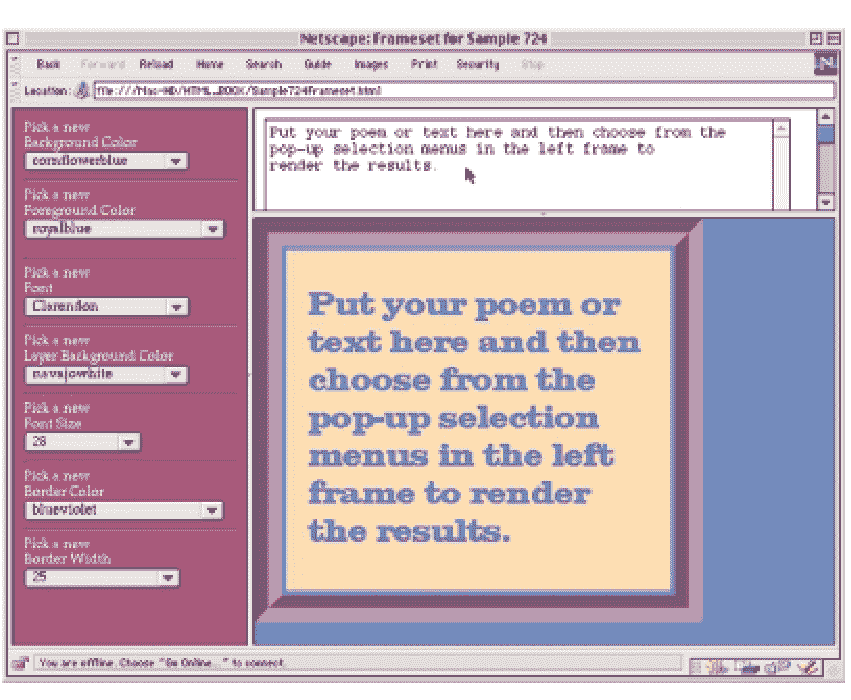


# 第6章 — JavaScript 事件

## 在图层上拖动以调整其大小

在Netscape的Dynamic HTML指南中，有一个示例在理论上是正确的，但其中存在一些编码错误，导致其行为不稳定。我已经修复了这些异常，并以重新处理的形式呈现在[Sample725.html](Sample725.html)中。

基本结构与本章前面处理通过拖动[重新定位](repositioning)图层的示例类似。在这种情况下，**pageX**坐标不是由**mousemove**事件不断更新，然后传入**moveBy()**方法中进行修改，而是将**pageX**坐标传入**changeWidth()**函数，在那里它被赋值给**layerWidth**变量，并与**delta**参数结合处理，从而在使用**Layer**对象的**load()**方法重新加载到文档时改变图层的**width**。

请记住，**load()**方法接受URL参数，并有一个可选的第二参数，用于在加载时为URL指定新的宽度，本例中正是使用了这一特性。加载的外部文件的URL为[Sample725A.html](Sample725A.html)，该书并未包含此文件。请注意，它最初通过**SRC**属性加载到名为**Showcase1**的图层中。如果你想比较两种不同类型的示例，请查看第548页的示例6-10。

### 示例 6-25：Sample725.html

```
<!DOCTYPE HTML PUBLIC "-//W3C//DTD HTML 3.2//EN">
<HTML>
<HEAD>
<TITLE>示例 725 - 示例 6-25       拖动鼠标调整图层大小</TITLE>

</HEAD>

<BODY BGCOLOR="black" TEXT="white">

    <!--   加载外部文件的容器图层   -->

<LAYER ID="Showcase1" LEFT="5" TOP="100" BGCOLOR="blue" SRC="Sample725A.html">
</LAYER>

<!--  *************************************************   -->

<SCRIPT LANGUAGE="JavaScript1.2"><!--BEGIN HIDING

/*---*/
```

```
var layerWidth = 800;
var oldX;
var Showcase1 = document.Showcase1;

Showcase1.captureEvents(Event.MOUSEDOWN|Event.MOUSEUP);

Showcase1.onmousedown=begindrag;
Showcase1.onmouseup=enddrag;
Showcase1.onLoad=resetcapture;
/*-----------------------------------------------*/

function resetcapture() {
  Showcase1.captureEvents(Event.MOUSEDOWN|Event.MOUSEUP|Event.MOUSEMOVE);
}

/*-----------------------------------------------*/

function begindrag(e) {
    Showcase1.captureEvents(Event.MOUSEMOVE);
    Showcase1.onmousemove=drag;
    oldX=e.pageX;
  return false;
}

/*-----------------------------------------------*/

function drag(e) {
    changeWidth(Showcase1, e.pageX - oldX);
    oldX = e.pageX;
  return false;
}

/*-----------------------------------------------*/

function changeWidth(thelayer, delta) {
    layerWidth = layerWidth + delta;
    if (delta != 0)
    Showcase1.load('Sample725A.html', layerWidth);
}

/*-----------------------------------------------*/

function enddrag(e) {
    Showcase1.onmousemove=0;
    Showcase1.releaseEvents(Event.MOUSEMOVE);
  return false;
}

//END HIDING-->
</SCRIPT>

</BODY>
</HTML>
```

## 事件的路由与处理

## JavaScript [routeEvent(e)](routeEvent(e)) 函数

首先回顾一下，以下方法可用于**window**、**document**和**Layer**对象：

```
window.captureEvents(e)
window.releaseEvents(e)
document.captureEvents(e)
document.releaseEvents(e)
layerObject.captureEvents(e)
layerObject.releaseEvents(e)
```

**routeEvent(e)**函数用于调用事件层次结构中下一个事件处理器。例如，如果你在页面中使用**captureEvents()**方法为**window**、**document**以及名为**L1**的图层捕获了**onclick**事件处理器，那么当CLICK事件发生时，它将首先被**window**对象捕获。如果分配给**window.onclick**的JavaScript代码中恰当地包含了**routeEvent(e)**，那么它将会把事件**e**路由到**document**对象的onclick事件处理器进行进一步处理，依此类推，最终到达**Layer**对象。

一旦事件被所有使用**captureEvents()**将事件强制引入其作用域的对象处理完毕，JavaScript会查找事件原始目标（如链接或按钮）的事件处理器，并完成处理。

这种层级推进过程可能看起来有些倒退，确实如此，但JavaScript与HTML一样，是从上而下设计的，这样同级对象可以从它们的父对象继承，而事件处理遵循这一范式。在使用这些方法时要小心，不要 inadvertently 路由事件导致形成事件反馈循环，这可能会彻底崩溃你的系统。

## 使用 JavaScript [routeEvent(e)](routeEvent(e)) 函数

本示例演示了**routeEvent(e)**函数的使用。按钮**B1**位于图层**L1**内部，按钮**B2**位于图层**L2**内部。两个按钮都有自己的**onClick**事件处理器代码作为HTML属性。**document**对象被设置为捕获CLICK事件，图层**L1**也被设置为捕获CLICK事件。**myClicker(e)**函数分配给**document**对象的**onclick**事件处理器，**myLayerClicker(e)**函数分配给图层**L1**的**onclick**事件处理器。

# 第二部分 — JavaScript 1.2

**myClicker(e)** 此函数旨在引导你了解事件进程的开始，首先在任何CLICK事件发生时显示一个**alert**。在此页面中，**document**对象具有最高优先级，因为**window**未设置为捕获事件。

然后，如果你在文档背景中点击，第二个**alert**将会激活。如果点击的是按钮**B1**，事件将通过**routeEvent(e)**路由到图层**L1**进行处理。

如果点击的是按钮**B2**，事件将通过**routeEvent(e)**直接路由到按钮**B2**的**onClick**事件处理器，因为**B2**位于图层**L2**内部；因此，它不会从图层**L1**继承事件。请注意，图层**L2**未设置为捕获事件。

```
function myClicker(e) {

     alert ("This event was captured by the document first and may be routed to... ");

                     //防止事件反馈循环
     if (e.target == document)  {
          alert ("The 'if' Statement prevents an Event Feedback
               Loop if you click in the document.");
          return;
     }

routeEvent(e);
}
```

**myLayerClicker(e)** 此函数通过**alert**窗口以及图层**L2**背景色的变化向用户显示它已被激活。然后它将事件路由到下一个可能的目的地（如果有的话）。如果点击了按钮**B1**，那么**routeEvent(e)**将会把事件路由到该按钮的**onClick**事件处理器进行处理。在本示例中，这是该函数中唯一实现**routeEvent(e)**的地方。

```
function myLayerClicker(e) {

     alert ("This event was captured second, by Layer L1; it turns
               Layer L2 to cyan and may be routed to... ");
     document.L2.bgColor = 'cyan';
     routeEvent(e);
}
```

## 示例 6-26：Sample726.html

```
<!DOCTYPE HTML PUBLIC "-//W3C//DTD HTML 3.2//EN">
<html>
<head>
<title> 示例 726 示例 6-26 routeEvent() 函数 </title>
<script language="JavaScript1.2"> <!--BEGIN HIDING

function myClicker(e) {
    alert ("This event was captured by the document first and may be routed to... ");
    //防止事件反馈循环
    if (e.target == document) {
        alert ("The 'if' Statement prevents an Event Feedback Loop if you
        click in the document.");
        return;
    }
}

routeEvent(e);
}

document.captureEvents(Event.CLICK);
document.onclick=myClicker;

<!--END HIDING-->
</script>
</head>
<body>
<layer id="L1" left="25" top="10">

<form name="form1">

<input type="button" name="B1" value="Button 1"
onClick="alert('me. I am Button 1, at your service.); return false;"> <br>

</form>
</layer>
<layer id="L2" left="25" top="70" bgcolor="#8888ff">
<h3>事件顺序如下：</h3>

<B>按钮 1：</B> document首先捕获事件并将其路由到图层L1，然后路由到按钮B1<BR><BR>

<B>按钮 2：</B> document首先捕获事件并将其路由到按钮B2。

<BR><BR>
```


 ## 666 第二部分 — JavaScript 1.2

<B>此层 L2：</B>文档首先捕获事件，事件处理到此结束。<BR><BR>

<B>文档：</B>文档首先捕获事件，事件处理到此结束。
<BR><BR><HR><BR>

### 需要注意的是，在设置自己的文档时，不要为了让事件形成反馈循环而进行路由。如果层 L1 的背景足够大，可以在其背景上点击，而不仅仅是在按钮上点击，就会产生事件反馈循环。接下来的两个示例展示了如何防止反馈循环。如果你创建了这样的东西并且不得不多次强制退出 Navigator，你可能会损坏 Finder 的偏好设置文件，而你需要将其丢弃。

```
<BR><BR>
<FORM NAME="form2">

<INPUT TYPE="button" NAME="B2" VALUE="Button 2"
onClick="alert('me. I am Button 2, at your service.'); return false;">

<BR>

</FORM>

</LAYER>
```

```
<SCRIPT LANGUAGE="JavaScript1.2"> <!--BEGIN HIDING

function myLayerClicker(e) {

    alert ("This event was captured second, by Layer L1; it turns Layer L2 to cyan and may be routed to... ");

    document.L2.bgColor = 'cyan';
    routeEvent(e);
}

/*------------------------------------------------------------------------*/

    document.L1.captureEvents(Event.CLICK);

    document.L1.onclick=myLayerClicker;

/*------------------------------------------------------------------------*/

//END HIDING-->
</SCRIPT>
```

```
</BODY>
</HTML>
```

# 第 6 章 — JavaScript 事件

667

## 示例 6-26 Sample726.html

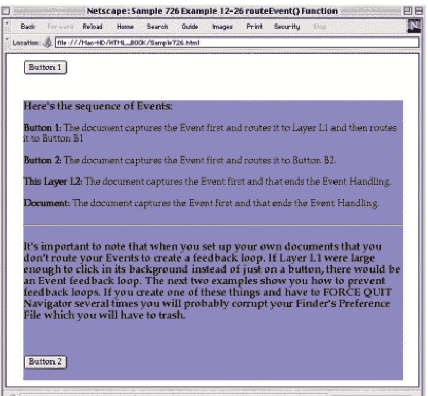

## JavaScript handleEvent(e) 方法

`handleEvent(e)` 方法由事件接收器使用，以通过显式调用特定事件的事件处理程序来绕过事件捕获层次结构。想象一个事件正在其自然捕获事件链中传递。当它遇到 `handleEvent(e)` 方法时，它会跳出流程，跳转到使用 `handleEvent()` 方法调用它的对象，并在那里继续处理。例如，假设你在名为 `form1` 的表单中定义了一个名为 `B2` 的按钮，如下所示：

```
<INPUT TYPE="button" NAME="B2" VALUE="Button 2" 
onClick="alert('I am Button 2, at your service.')";>
```

然后你可以使用条件 `if ()` 来测试该按钮是否被点击，如果为真，则调用 `handleEvent(e)` 以立即调用其 `onClick` 事件处理程序来触发 `alert`，如下 Popup：

```
if (e.target.name == "B2") {
    e.target.handleEvent(e);
}
```

因为条件 `if ()` 要求目标始终是按钮 `B2`，所以你可以使用上述代码中演示的简写方式在事件的 `target` 属性上调用 `handleEvent(e)`。你也可以用更熟悉的方式编写，如下所示：

```
if (e.target.name == "B2") {
    document.form1.B2.handleEvent(e);
}
```

或者这样：

```
if (e.target.name == "B2") {
    document.form1.elements["B2"].handleEvent(e);
}
```

当你开始使用多层嵌套的元素时，你可以看到简写编码方式的优势。

# 第 6 章 — JavaScript 事件

669

## 使用 JavaScript handleEvent(e) 方法

示例 6-27 演示了 **handleEvent(e)** 方法和 **routeEvent(e)** 函数。它在结构上与上一个示例相似，但更为复杂。它从两个名为 **limeLayer1** 和 **L2** 的层开始。在 **limeLayer1** 内部创建了三个名为 **B1**、**B2** 和 **B3** 的按钮。**document** 对象和 **limeLayer1** 层都使用 **captureEvents()** 来捕获 CLICK 事件。

**myClicker(e)** 函数被分配给 **document** 对象的 **onclick** 事件处理程序，而 **myLayerClicker(e)** 函数被分配给 **limeLayer1** 的 **onclick** 事件处理程序。**buttonColors(event)** 函数被分配给 **B2** 和 **B3** 两个按钮的 **onClick** 事件处理程序属性。请注意，在属性中调用函数时，必须显式传递 **event** 关键字参数。

**myClicker(e)** 此函数相比上一个示例增加了功能，当事件的 **target** 是按钮 **B2** 时，在 **target** 属性上调用 **handleEvent(e)** 方法。它以 **routeEvent(e)** 结束，将事件转发到 **limeLayer1** 的 **onclick** 事件处理程序。

**myLayerClicker(e)** 此函数也执行了比上一个示例更多的处理。如果点击了按钮 **B3**，则调用 **handleEvent(e)** 将事件直接转发到 **B3**；否则，事件由 **limeLayer1** 处理，使用 **alert** 并将背景颜色更改为 **L2** 的背景。事件处理到此结束，因为在此函数中没有调用 **routeEvent(e)**。

**buttonColors(event)** 此函数根据点击的是按钮 **B2** 还是 **B3** 来更改 **L2** 层的背景颜色。

```
<!DOCTYPE HTML PUBLIC "-//W3C//DTD HTML 3.2//EN">
<HTML>
<HEAD>
<TITLE> Sample 727 Example 6-27 routeEvent and handleEvent Method</TITLE>

<SCRIPT LANGUAGE="JavaScript1.2"> <!--BEGIN HIDING

function myClicker(e) {

    if (e.target == document) {
        alert ("The document captures CLICK Events first in the hierarchy. The 'return false' in this 'if' ends the Event Handling.");
        return false;
    }
}
```

# 670 第二部分 — JavaScript 1.2

```
alert ("This event was captured by the document first and may be routed to...");

	if (e.target.name == "B2") {
		e.target.handleEvent(e);
		return false;
	}

routeEvent(e);
return false;
}

document.captureEvents(Event.CLICK);
document.onclick=myClicker;

//END HIDING-->
</SCRIPT>

</HEAD>

<BODY>
<LAYER ID="limeLayer1" LEFT="25" TOP="10" BGCOLOR="lime" WIDTH="500">
<FORM NAME="form1">

<INPUT TYPE="button" NAME="B1" VALUE="Button 1">    <BR>

<INPUT TYPE="button" NAME="B2" VALUE="Button 2"
onClick="alert('me. I am Button 2, at your service.'); buttonColors(event); return false;">    <BR>

<INPUT TYPE="button" NAME="B3" VALUE="Button 3"
onClick="alert('me. I am Button 3, at your service.'); buttonColors(event); return false;">    <BR>

</FORM>
</LAYER>

<LAYER ID="L2" LEFT="25" TOP="120" BGCOLOR="#8888ff">
Here's the sequence of Events:          <BR><BR>

<B>Button 1:</B> The document captures the Event first and routes it to limeLayer1 where the Event ends so that in this scenario Button B1 never gets the Event because limeLayer1 does not route Events and there is no handleEvent for Button B1.<BR><BR>

<B>Button 2:</B> The document captures the Event first and Button 2 handles the Event directly with handleEvent.<BR><BR>

<B>Button 3:</B> The document captures the Event first and routes it to limeLayer1 and then Button 3 handles the Event directly with handleEvent.<BR><BR>

<B>This Layer L2:</B> The document captures the Event first and that ends the Event Handling.<BR><BR>

<B>Document:</B> The document captures the Event first and that ends the Event Handling. <BR><BR><HR><BR>
```

# 第 6 章 — JavaScript 事件 671

<h3>请注意 <b>'limeLayer1'</b> 正在捕获点击事件，而不是此层 L2。</h3>

<h3>需要注意的是，在设置自己的文档时，不要为了让事件形成反馈循环而进行路由。</h3>
</LAYER>

```
<SCRIPT LANGUAGE="JavaScript1.2"><!--BEGIN HIDING

function myLayerClicker(e) {

    if (e.target.name == "B3") {
        alert ("This event was captured second, by the Layer limeLayer1. It changes Layer L2 to cyan and then uses e.target.handleEvent to send the event directly to...");
        document.L2.bgColor = 'cyan';
        document.limeLayer1.document.form1.B3.handleEvent(e);
        return false;
    }
    else {
        alert ("This event was captured second, by the Layer limeLayer1. It changes Layer L2 to cyan and is not routed.");
        document.L2.bgColor = 'cyan';
        return false;
    }

    return false;
}

/*----------------------------------------------------------------------*/

function buttonColors(e) {
    if (e.target.name == 'B2') { document.L2.bgColor='orange'; }
    if (e.target.name == 'B3') { document.L2.bgColor='yellow'; }
}

/*----------------------------------------------------------------------*/

document.limeLayer1.captureEvents(Event.CLICK);
document.limeLayer1.onclick=myLayerClicker;

/*----------------------------------------------------------------------*/

//END HIDING-->
</SCRIPT>
```

</body>
</html>


 # 示例 6-27 Sample727.html

以下是事件顺序：

**按钮 1：** 文档首先捕获事件，并将其路由到 limeLayer1，事件在此结束，因此在这种情况下按钮 1 永远收不到事件，因为 limeLayer1 不进行事件路由，且按钮 1 没有 handleEvent。

**按钮 2：** 文档首先捕获事件，按钮 2 直接使用 handleEvent 处理事件。

**按钮 3：** 文档首先捕获事件，将其路由到 limeLayer1，然后按钮 3 直接使用 handleEvent 处理事件。

**此层 L2：** 文档首先捕获事件，事件处理在此结束。

**文档：** 文档首先捕获事件，事件处理在此结束。

请注意，捕获点击事件的是 *limeLayer1*，而不是此层 L2。

**务必注意，** 在设置自己的文档时，不要通过路由事件来创建反馈循环。

## 在嵌套和非嵌套层中处理与路由事件

本示例与上一个示例非常相似。区别在于**窗口**对象也设置为捕获事件，按钮 **B1** 位于**文档**对象中，而非 **limeLayer1** 中。还有一个名为 **B4** 的额外按钮，位于层 L2 内部。

**myWindowClicker(e)** 此函数被分配给 **window** 对象的 **onclick** 事件处理器，由于它位于事件层级的最顶层，所有事件都会首先到达此处，这触发 **alert** 消息，然后事件被路由到 **文档** 对象的 **onclick** 事件处理器，它在层级中排第二位。

**myClicker(e)** 和 **myLayerClicker(e)** 函数与前一个示例中使用的函数等效，从第 669 页开始会详细解释。

你应该注意当位于层 **L2** 内部的 **B4** 按钮被点击时的事件顺序。事件首先被发送到 **窗口**，其次到 **文档** 对象，但*不会*从 **文档** 对象转发到 **limeLayer1** 层。从 **文档** 对象开始，事件被路由到 **B3** 按钮。这种推进过程并不完全直观明显，因此在你自己的脚本中要注意这一点。

## 示例 6-28：Sample728.html

```
<!DOCTYPE HTML PUBLIC "-//W3C//DTD HTML 3.2//EN">
<HTML>
<HEAD>
<TITLE> Sample 728  Example 6-28  Handling Events in Nested Layers</TITLE>

<SCRIPT LANGUAGE="JavaScript1.2"> <!--BEGIN HIDING

function myWindowClicker(e) {

alert ("This event was captured by the window first and may be routed to... ");

routeEvent(e);
return false;
}

/*------------------------------------------------------------------------*/

window.captureEvents(Event.CLICK);
window.onclick=myWindowClicker;

/*------------------------------------------------------------------------*/
```

```
function myClicker(e) {

    if (e.target == document) {
        alert ("The document captures CLICK Events second in the hierarchy.");
        The 'return false' in this 'if' ends the Event Handling.");
        return false;
    }

    alert ("This event was captured by the document second and may be routed
to...");

    if (e.target.name == "B2") {
        e.target.handleEvent(e);
        return false;
    }

}
```

```
routeEvent(e);
return false;
}
```

```
/*--------------------------------------------------------------------------------------------------*/

document.captureEvents(Event.CLICK);
document.onclick=myClicker;

//END HIDING-->
</SCRIPT>

</HEAD>

<BODY>

<FORM NAME="form1">

<INPUT TYPE="Button" NAME="B1" VALUE="Button 1"
onclick="alert('me. I am Button 1, at your service.'); buttonColors(event);
return false;">
<BR>
</FORM>
```

```
<!-- *********************************************************************************** -->

<LAYER ID="limeLayer1" LEFT="25" TOP="50" BGCOLOR="lime" WIDTH="500">
<FORM NAME="form2">

<INPUT TYPE="button" NAME="B2" VALUE="Button 2"
onclick="alert('me. I am Button 2, at your service.'); buttonColors(event);
return false;">
<BR>

<INPUT TYPE="button" NAME="B3" VALUE="Button 3"
onClick="alert('me. I am Button 3, at your service.'); buttonColors(event);
return false;">
<BR>
</FORM>

</LAYER>

<!-- *********************************************************************************** -->
```

## 第 6 章 — JavaScript Events

```
<!-- *************************************************************** -->

<LAYER ID="L2" LEFT="25" TOP="120" BGCOLOR="#8888ff">

<FORM NAME="form3">

<INPUT TYPE="button" NAME="B4" VALUE="Button 4"
onClick="alert('me. I am Button 4, at your service.'); buttonColors(event); return
false;">         <BR>
</FORM>
<!-- ********************************************** -->
```

**以下是事件顺序：**

**按钮 1：** 窗口首先捕获事件并进行路由，使文档其次捕获事件，最终到达按钮 B1，显示其警告框并将层 2 变为洋红色。

**按钮 2：** 窗口首先捕获事件并进行路由，使文档其次捕获事件，并使用 handleEvent 将其发送到按钮 B2。

**按钮 3：** 窗口首先捕获事件并进行路由，使文档其次捕获事件，并将其路由到 limeLayer1，后者使用 handleEvent 将其发送到按钮 B3。

**按钮 4：** 窗口首先捕获事件并进行路由，使文档其次捕获事件，并将其路由到按钮 B4。

**层 limeLayer1：** 窗口首先捕获事件并进行路由，使文档其次捕获事件，并将其路由到 limeLayer1，在处理后结束。

**此层 L2：** 窗口首先捕获事件并进行路由，使文档其次捕获事件，事件处理在此结束。

**文档：** 窗口首先捕获事件并进行路由，使文档其次捕获事件，事件处理在此结束。

### 请注意，捕获点击事件的是 *limeLayer1*，而不是此层 L2。

### **务必注意，** 在设置自己的文档时，不要通过路由事件来创建反馈循环 clarification loop。

```
</LAYER>

<!-- *************************************************************** -->
```

## 第 II 部分 — JavaScript 1.2 第 676 页

```
<!-- ****************************************************************** -->

<SCRIPT LANGUAGE="JavaScript1.2"> <!--BEGIN HIDING

function myLayerClicker(e) {
    if (e.target.name == 'B3') {
        alert ("This event was captured third, by the Layer limeLayerL. It
        changes Layer L2 to cyan and then uses e.target.handleEvent
        to send the event directly to...");
        document.L2.bgColor = 'cyan';
        e.target.handleEvent(e);
        return false;
    }
    else {
        alert ("This event was captured third, by the Layer limeLayerL. It
        changes Layer L2 to cyan and is not routed.");
        document.L2.bgColor = 'cyan';
        return false;
    }
    return false;
}

/*----------------------------------------------------------------------*/

function buttonColors(e) {
    if (e.target.name == 'B1') { document.L2.bgColor='magenta'; }
    if (e.target.name == 'B2') { document.L2.bgColor='orange'; }
    if (e.target.name == 'B3') { document.L2.bgColor='yellow'; }
    if (e.target.name == 'B4') { document.L2.bgColor='pink'; }
}

/*----------------------------------------------------------------------*/

document.limeLayer1.captureEvents(Event.CLICK);
document.limeLayer1.onclick=myLayerClicker;

/*----------------------------------------------------------------------*/

//END HIDING-->
</SCRIPT>

</BODY>
</HTML>
```

## 第 6 章 — JavaScript Events

## 示例 6-28

## Sample728.html

按钮 1：窗口首先捕获事件并进行路由，使文档其次捕获事件，最终到达按钮 B1，显示其警告框并将层 2 变为洋红色。

按钮 不作为：窗口首先捕获事件并进行路由，使文档其次捕获事件，并使用 handleEvent 将其发送到按钮 B2。

按钮 3：窗口首先捕获事件并进行路由，使文档其次捕获事件，并将其路由到 limeLayer1，后者使用 handleEvent 将其发送到按钮 B3。

按钮 4：窗口首先捕获事件并进行路由，使文档其次捕获事件，并将其路由到按钮 B4。

层 limeLayer1：窗口首先捕获事件并进行路由，使文档其次捕获事件，并将其路由到 limeLayer1，在处理后结束。

此层 L2：窗口首先捕获事件并进行路由，使文档其次捕获事件，事件处理在此结束。

文档：窗口首先捕获事件并进行路由，使文档其次捕获事件，事件处理在此结束。


 # 第二部分
JavaScript 1.2

## 第7章
JavaScript 数组

680

第二部分 — JavaScript 1.2

## 第7章
JavaScript 数组

### 目录

## JavaScript 数组对象

- 681
  - 7.1) JavaScript 数组对象 681
  - 7.2) 使用数组对象构造函数创建数组 681
  - 7.3) 创建密集数组 683
  - 7.4) 使用字面量表示法创建数组 685
  - 7.5) 创建二维数组 687
  - 7.6) 创建三维数组 690
  - 7.7) 数组属性汇总 693
  - 7.8) 数组方法汇总 693
  - 7.9) 使用所有数组方法的概述示例 694

## 数组对象方法

- 696
  - 7.10) 数组对象的 concat() 方法 696
  - 7.11) 数组对象的 join() 方法 703
  - 7.12) 数组对象的 pop() 方法 705
  - 7.13) 数组对象的 push() 方法 707
  - 7.14) 数组对象的 shift() 方法 709
  - 7.15) 数组对象的 unshift() 方法 711
  - 7.16) 数组对象的 slice() 方法 713
  - 7.17) 数组对象的 splice() 方法 716
  - 7.18) 数组对象的 toString() 方法 719
  - 7.19) 数组元素的 toString() 方法 719
  - 7.20) reverse() 方法 722
  - 7.21) sort() 方法 722
  - 7.22) compareFunction 函数 723

## 处理返回的数组

- 729
  - 7.23) 处理返回的数组与正则表达式 729
  - 7.24) 字符串对象 match() 方法返回的数组 729
  - 7.25) 使用 "g" 标志时 match() 方法返回的数组 731
  - 7.26) RegExp 对象 exec() 方法返回的数组 733
  - 7.27) 数组对象的 index 属性 735
  - 7.28) 字符串对象 split() 方法返回的数组 736
  - 7.29) 数组对象的 input 属性 739
  - 7.30) 使用数组动态填充 <TABLE> 元素数据 740
  - 7.31) 使用数组的示例文件图表 745

## 第7章 — JavaScript 数组 681

## JavaScript 数组对象

## JavaScript 数组对象

### JavaScript 语法：

```
arrayObjectName = new Array(arrayLength);
arrayObjectName = new Array(element0, element1, ..., elementN);
arrayObjectName = [element0, element1, ..., elementN];
```

**数组**对象是 JavaScript 的预定义核心对象之一。通常，数组在创建时会赋值给一个 **arrayObjectName**。数组由一组有序的值组成，每个值称为一个元素。数组的每个元素都有一个唯一的 **索引** 号，用于引用该特定元素。**索引** 号从零开始，始终为整数，并向正方向递增。因此，数组中的第一个元素的 **索引** 为零，第二个元素的 **索引** 为 1，以此类推。数组中的元素数量没有限制。如果你熟悉 Java，那么注意到 JavaScript 数组更像 Java 的 Vector 而非 Java 数组可能会很有用，因为 JavaScript 数组的 **长度** 是灵活的，基于使用情况而定。数组元素的值可以是任何内容。

数组可以通过 **数组对象构造函数** 或 **字面量** 表示法来创建。使用 **字面量** 表示法是 Navigator 4 和 JavaScript 1.2 中的新特性。

## 使用数组对象构造函数创建数组

要使用 **数组对象构造函数** 创建数组，首先为数组选择一个名称。然后，使用关键字 **new**，要么通过选择将要初始化的元素数量来定义数组的 **长度**，要么使用逗号分隔的元素列表创建一个 **密集** 数组。这是一个常规数组的示例，该数组初始化为具有五个元素，即 **长度** 为 5：

```
myArray1 = new Array(5);
```

然后，你可以选择通过使用元素的 **索引** 号并为该元素赋值来定义数组的每个元素，如下所示：

```
myArray1[0] = "blue";
myArray1[1] = "red";
myArray1[2] = "purple";
myArray1[3] = "lime";
myArray1[4] = "yellow";
```

你会将这五个元素中的第一个读作：数组名为 **myArray1** 中 **索引 0** 处的数组元素，其值为文本字符串 "blue"。现在假设你想将元素 0 的值更改为文本字符串 "gold"；你可以这样编写代码：

```
myArray1[0] = "gold";
```

你还可以通过在 **数组** 对象语法中指定其值来引用数组元素，如下所示：

```
myArray1["blue"]
```

因此，这行代码：

```
myArray1[0] = "gold";
```

等同于：

```
myArray1["blue"] = "gold";
```

你不能像这样在层次结构中引用创建的数组：

```
document.myArray1[0].
```

但是，你不应将此与其他对象的内置核心对象数组混淆。例如，**forms[]** 数组是 **document** 对象的属性，始终按以下方式在对象层次结构中引用：**document.forms[i]**。有关对象数组的更多信息，请参见第 4 章。

你还可以创建 **长度** 等于零的数组，这基本上初始化了一个没有元素的数组，你可以在脚本中稍后为该数组填充值。以下是一个示例：

```
anotherArray = new Array();
```

每次为数组初始化新元素时，JavaScript 会自动扩展数组的 **长度**。即使创建数组时数组的 **长度** 最初是固定的，也是如此。

## 第7章 — JavaScript 数组 683

以下是一个通过数组构造函数创建的数组示例，其 **长度** 为 0，随后通过在 **索引** 7 处初始化一个元素，将其大小扩展为具有八个元素，**长度** 为 8。然后通过在 **索引** 222 处初始化另一个元素再次扩展，使其 **长度** 变为 223，从而具有 223 个元素。以这种方式扩展数组的 **长度** 时，所有未显式赋值的元素的值均为 **undefined**。

```
musicArray = new Array();                        //length=0
musicArray[7] = "Close to the Edge";              //length=8
musicArray[222] = "Yessongs";                    //length=223
```

## 创建密集数组

你可以用一行代码创建一个与前面 **myArray1** 相同的 **密集** 数组，注意逗号是必需的，但空格是可选的：

```
myArray1 = new Array("blue", "red", "purple", "lime", "yellow");
```

## 将数组元素渲染到屏幕

如果你想在浏览器中显示特定的数组元素，可以使用 **document.write()** 方法，通过元素的 **索引** 号引用该元素，如下所示：

```
document.write(myArray1[0]);
```

这将产生以下输出：

```
blue
```

## 将数组渲染到屏幕

如果你仅使用数组名称作为参数使用 **document.write()** 方法，你将得到一个长文本字符串，由方括号括起来，由数组的每个元素组成，如下所示：

```
document.write(myArray1);
```

这将产生以下输出，注意 JavaScript 不存储元素之间的可选空格，但确实存储逗号分隔符：

```
["blue","red","purple","lime","yellow"]
```

如果你想查看此演示，可以查看 [Sample805.html](Sample805.html)。

当数组的元素数量相对较少时，直接声明它们为 **密集** 数组是非常高效的。如果你需要跟踪各个元素的 **索引** 位置，那么你可能希望逐个声明这些元素。

## 将 immediatebenefit 与数组元素

如果你想单独输出数组的每个元素并创建一些额外的标记，可以设置一个 **for ()** 语句，如下所示：

```
for (var i=0;  i < myArray1.length;  i++) {

      document.write(myArray1[i] + "<BR>");
}
```

这将获取数组的每个元素，并在浏览器中单独渲染为一行，因此输出将如下所示：

- blue
- red
- purple
- lime
- yellow

上述概念在示例 7-0 中形式化，可以在 [Sample800.html](Sample800.html) 中查看。


 # 第7章 — JavaScript 数组

# 示例 7-0：Sample800.html

```
<!DOCTYPE HTML PUBLIC "-//W3C//DTD HTML 3.2//EN">
<HTML>
<HEAD>
<TITLE> Sample 800 示例 7-0 数组元素显示</TITLE>

<SCRIPT LANGUAGE="JavaScript1.2"><!--BEGIN HIDING

myArray1 = new Array("blue", "red", "purple", "lime", "yellow");

    for (var i=0; i < myArray1.length; i++) {
        document.write(myArray1[i] + "<BR>");
    }

//END HIDING-->
</SCRIPT>

</HEAD>

<BODY>
</BODY>
</HTML>
```

# 使用字面量记法创建数组

当你使用`字面量`（Literal）记法创建数组时，需要为数组命名，并将其设置为一个用括号括起来的、由逗号分隔的值列表，这些值将成为数组的元素。数组的`长度`（length）等于所列值的数量。然而，在首次创建数组时，你实际上不必指定所有元素。如果你连续输入两个逗号，JavaScript 会在该`索引`（index）位置创建一个空白占位符元素。

以下是如何使用`字面量`记法创建名为 `a2` 的数组，并指定其五个元素：

```
a2 = ["green", "gray", "black", "white", "olive"];
```

# JavaScript 语法：

```
arrayObjectName = [element0, element1, ..., elementN];
```

这只是演示如何使用**字面量**记法创建数组，并通过**for ()** 语句循环遍历元素，以及通过索引引用手动使用 **document.write()** 输出每个元素，从而将元素在浏览器中输出两次。这可以让你比较两种技术。

# 示例 7-1：Sample801.html

```
<!DOCTYPE HTML PUBLIC "-//W3C//DTD HTML 3.2//EN">
<HTML>
<HEAD>
<TITLE> Sample 801  示例 7-1 字面量数组创建</TITLE>

<SCRIPT LANGUAGE="JavaScript1.2"> <!--BEGIN HIDING

a2 = ["green", "gray", "black", "white", "olive"];

	for (var i=0;  i < a2.length;  i++) {

		document.write(a2[i] + "<BR>");
	}

/*---------------------------------------------------------------*/

document.write("<P> 上面的代码以不同的技术输出相同的字面量数组 a2。<P>");

document.write(a2[0] + "<BR>");

document.write(a2[1] + "<BR>");

document.write(a2[2] + "<BR>");

document.write(a2[3] + "<BR>");

document.write(a2[4] + "<BR>");

//END HIDING-->
</SCRIPT>

</HEAD>

<BODY>
</BODY>
</HTML>
```

以下是在数组中编码空白元素的方法，使得**索引 2**、**索引 5** 和 **索引 7** 处存在空白元素。请记住，**索引** 编号从零开始。

```
a2 = ["green", "gray",,"black", "white",,"olive",,];
```

索引提示 *(这不是代码的一部分。)*

0 1 2 3 4 5 6 7

空白元素的值为 **undefined**（未定义）。

#### 特别说明：

当你在顶级 SCRIPT 中使用**字面量**记法创建数组时，每次计算包含**数组字面量**的表达式时，JavaScript 都会解释该**数组**对象。如果**数组字面量**在函数内部使用，则每次调用该函数时都会重新创建它。

# 创建二维数组

数组可以包含同一数组中具有不同值类型的元素，这与其他大多数脚本或编程语言明显不同。例如，一个数组可能有一个元素是文本字符串，另一个元素是变量，第三个元素是数字。数组元素还可以包含对象、布尔型字面量，甚至其他数组。将一个数组作为另一个数组的元素使用，就是创建准多维数组的过程。

要创建二维数组，只需定义两个数组，并将其中一个数组作为另一个数组的元素。要访问嵌套数组的元素，你需要使用第二组**索引**下标，如下例所示：

```
myArray1 = new Array("alpha", "beta", "gamma");
myArray2 = new Array("eeny", "meeny", "miney", myArray1);
```

其中 **myArray2** 的元素为：

```
myArray2[0] = "eeny";
myArray2[1] = "meeny";
myArray2[2] = "miney";
myArray2[3] = myArray1;
```

# 创建二维数组的示例

以下示例使用嵌套的 **for** () 循环，在另一个 **for** () 循环内部创建二维数组。首先从定义名为 **a1**、**长度**为 2 的数组开始，然后使用 **for** () 循环为数组 a1 的每个元素分配一个**长度**为 5 的新数组。接着使用第二个 **for** () 循环为第二维数组的每个元素赋值。

该值由 (i + ", " +j) 组成，使得变量 **i** 和 **j** 的值用逗号分隔，并成为每个元素的单个条目。接下来使用 **document.write()** 方法将第一个数组 **a1** 渲染到屏幕上，但请记住，现在第一个数组 **a1** 是一个数组的数组，其中每个元素都是一个数组。

下一个 **document.write()** 方法用于输出构成数组第二维的一系列嵌套数组元素。它们由第二组下标访问。请记住，嵌套数组元素不是数组，不会以数组语法显示。

**document.write()** 方法中的文本字符串有助于你在浏览器中查看输出时跟踪嵌套数组和二维元素，以便理解逻辑。

# 示例 7-2：Sample802.html

```
<!DOCTYPE HTML PUBLIC "-//W3C//DTD HTML 3.2//EN">
<HTML>
<HEAD>
<TITLE> Sample 802  示例 7-2 嵌套数组</TITLE>

<SCRIPT LANGUAGE="JavaScript1.2"> <!--BEGIN HIDING

a1 = new Array(2);

for (var i=0;  i<2;  i++) {

      //在数组 a1 的每个元素中创建新数组

      a1[i] = new Array(5);

      for (var j=0; j<5; j++)  {

      //为第二维数组的每个元素赋值

            a1[i][j] = i + ", " +j;


      //显示第一维数组的值

document.write(a1[i] + "&nbsp;&nbsp;&nbsp; 第一维数组 <BR>")


      //显示第二维数组元素的值

document.write(a1[i][j] + "&nbsp;&nbsp;&nbsp; 第二维数组元素 <BR><BR>")
      }
}


//END HIDING-->
</SCRIPT>

</HEAD>

<BODY>

</BODY>
</HTML>
```

# 创建三维数组

# 示例 7-3 前言

示例 7-3 首先定义了四个数组，每个数组都有四个文本字符串作为元素。然后有一个名为 **myArray5** 的第五数组，它取先前定义的数组之一作为其每个元素，因此它是一个二维数组。接下来，有一个名为 **myArray6** 的第六数组，其第一个元素是二维数组 **myArray5**，这使得 **myArray6** 成为一个三维数组。**myArray6** 的其他三个元素只是数字。

示例的其余部分只是将数组输出到浏览器，以便你可以看到它们的样子，并更容易看清哪些元素索引编号做什么。

这是写入元素 **myArray6 [0]** 时会得到的输出，因为此特定元素是 **myArray5**，它是 **myArray6** 内部的一个二维数组。

[["alpha", "beta", "gamma", "delta"], ["blue", "red", "gold", "silver"], ["one", "two", "three", "four"], ["www", "xxx", "yyy", "zzz"]]

这是写入元素 **myArray6 [0] [0]** 时会得到的输出，因为此特定元素是数组 **a1**。

["alpha", "beta", "gamma", "delta"]

这是写入元素 **myArray6 [0] [0] [0]** 时会得到的输出

alpha

起初这可能看起来违反直觉，必须使用三个下标来索引似乎是 **myArray6** 的第一个元素，但 alpha 不是 **myArray6** 的第一个元素。它是数组 **a1** 的第一个元素，而 **a1** 是 **myArray5** 的第一个元素，**myArray5** 又是 **myArray6** 的第一个元素。因此你现在可以看到其中的递进关系。

# 示例 7-4 前言

示例 7-4 与示例 7-3 类似。主要区别是 **myArray100** 是一个完整的三维数组，其中每个元素都是数组，而那些数组中的每一个又都有数组作为其每个元素。

```
myArray100 = new Array(myArray10, myArray11, myArray12);
myArray10 = new Array(a1, a2, a3);
myArray11 = new Array(a4, a5, a6);
myArray12 = new Array(a7, a8, a9);
```


 ## 第 7 章 — JavaScript 数组

## 示例 7-3：Sample803.html

```
<!DOCTYPE HTML PUBLIC "-//W3C//DTD HTML 3.2//EN">
<HTML>
<HEAD>
<TITLE> Sample 803 Example 7-3 three-dimensional Array</TITLE>
<SCRIPT LANGUAGE="JavaScript1.2"> <!--BEGIN HIDING

//These four Arrays are all text Strings
a1 = new Array("alpha", "beta", "gamma", "delta");
a2 = new Array("blue", "red", "gold", "silver");
a3 = new Array("one", "two", "three", "four");
a4 = new Array("www", "xxx", "yyy", "zzz");

//myArray5 is composed of the 4 previously Defined Arrays
myArray5 = new Array(a1, a2, a3, a4);

//myArray6 is composed of myArray5 and numbers
myArray6 = new Array(myArray5, 2, 3, 4);

for (var i=0; i<4; i++) {
    document.write(a1[i] + "<P>"); //outputs Array a1
}

for (var i=0; i<4; i++) {
    document.write(myArray5[i] + "<P>"); //outputs Array myArray5
}

for (var i=0; i<4; i++) {
    document.write("<BR><P>" + myArray6[i]); //outputs Array myArray6
}

document.write("<HR><P>" + "The next line is ELEMENT<b>myArray6 [0] [0] [0]</b>";

document.write("<P>" + myArray6[0][0][0]);

document.write("<HR><P>" + "The next line is ELEMENT<b> myArray6 [0] [0]</b>";
document.write("<P>" + myArray6[0][0]);

document.write("<P>" + myArray6[0]);

//END HIDING-->
</SCRIPT>
</HEAD>
<BODY>
</BODY>
</HTML>
```

## 第二部分 — JavaScript 1.2

## 示例 7-4：Sample804.html

```
<!DOCTYPE HTML PUBLIC "-//W3C//DTD HTML 3.2//EN">
<HTML>
<HEAD>
  <TITLE> Sample 804   Example 7-4 three-dimensional Array  </TITLE>

<SCRIPT LANGUAGE="JavaScript1.2"> <!--BEGIN HIDING

      //These nine Arrays all have Strings in their Elements

a1 = new Array("alpha", "beta", "gamma", "delta");
a2 = new Array("blue", "red", "gold", "silver");
a3 = new Array("one", "two", "three", "four");

a4 = new Array("AAA", "BBB", "CCC", "DDD");
a5 = new Array("EEE", "FFF", "GGG", "HHH");
a6 = new Array("WWW", "XXX", "YYY", "ZZZ");

a7 = new Array("111", "222", "333", "444");
a8 = new Array("555", "777", "888", "999");
a9 = new Array("123", "456", "789", "ABC");

      //these 3 Arrays are composed of 3 previously defined Arrays

myArray10 = new Array(a1, a2, a3);
myArray11 = new Array(a4, a5, a6);
myArray12 = new Array(a7, a8, a9);

      //myArray100 is composed of the myArray10, myArray11, myArray12 Arrays

myArray100 = new Array(myArray10, myArray11, myArray12);

document.write("<HR><P>" + "This outputs each Element of Array<B> myArray100 <\/B>");

for (var i=0;  i<3;  i++) {
                               //outputs Array myArray100
      document.write("<BR><P>" + myArray100[i]);
}

document.write("<HR><P>" + "The next line is ELEMENT<B> myArray100 [0]<\/B>");
document.write("<P>" + myArray100[0]);

document.write("<HR><P>" + "The next line is ELEMENT<B> myArray100 [0] [0]<\/B>");
document.write("<P>" + myArray100[0][0]);

document.write("<HR><P>" + "The next line is ELEMENT<B> myArray100 [0] [0] [0]<\/B>");
document.write("<P>" + myArray100[0][0][0]);

//END HIDING-->
</SCRIPT>
</HEAD>
<BODY>
</BODY></HTML>
```

## 数组属性汇总

| 属性 | 描述 |
|---|---|
| index | 对于由正则表达式匹配结果创建的数组，表示匹配到的字符串的从零开始的整数索引。 |
| input | 对于由正则表达式匹配结果创建的数组，表示匹配该正则表达式的原始字符串。 |
| length | 一个整数，精确表示数组中元素的数量。可以将其设置为截断元素，但不能扩展元素数量。 |
| prototype | 用于为脚本中所有 **Array** 对象创建你自己的属性。 |

## 数组方法汇总

| 方法 | 描述 |
|---|---|
| concat() | 合并两个数组，返回一个"浅一层"的新数组。 |
| join() | 获取数组的所有元素，将其转换为一个字符串，其中每个元素用逗号分隔，或者可选地，使用你自己的分隔符。 |
| pop() | 移除并返回数组的最后一个元素，改变其 **length**。 |
| push() | 将元素添加到数组末尾，返回最后添加的元素，并改变数组的 **length**。 |
| reverse() | 反转数组中元素的物理顺序。 |
| shift() | 提取数组的第一个元素并返回该元素。 |
| slice() | 提取数组的可选部分并返回一个新数组。 |
| splice() | 可选择地从数组中添加、删除或<u>添加并删除</u>元素。 |
| sort() | 按字典顺序或根据你的函数对数组元素进行排序。 |
| toString() | 返回表示调用它的 **Array** 对象或元素的字符串。 |
| unshift() | 在数组的第一个元素之前添加一个或多个元素，并返回数组的新 **length**。不返回第一个元素。 |

## 使用所有数组方法的概览示例

本示例是对数组对象所有方法的快速介绍。这些方法在此示例之后会逐一进行更详细的探索和定义。基本上，定义了两个数组并用恰好是颜色的字符串填充。然后对数组调用数组对象的各种方法，并将结果显示在浏览器中。

## 示例 7-5：Sample805.html

```
<!DOCTYPE HTML PUBLIC "-//W3C//DTD HTML 2.0//EN">
<HTML><HEAD>
	<TITLE> Sample 805 Example 7-5 Array Methods</TITLE>

	<STYLE TYPE="text/JavaScript">

		classes.Mainbody.BODY.margins("0px");
		classes.Mainbody.BODY.paddings("0px");
		classes.Mainbody.BODY.backgroundColor="navy";
		classes.Mainbody.BODY.color="white";
		classes.Mainbody.BODY.fontSize="14pt";

		tags.P.color="yellow";
		tags.H3.color="red";
		tags.B.color="lime";

	</STYLE>
	<!-- **************************************************************************** -->

	<SCRIPT LANGUAGE="JavaScript1.2"> <!--BEGIN HIDING

		a1 = new Array("blue", "red", "purple", "lime", "yellow");

		a2 = ["green", "gray", "black", "white", "olive"];

		// ---Note that a2 is an Array created with literal notation.

	</END HIDING-->
	</SCRIPT>
</HEAD>
<BODY CLASS="Mainbody">
	<!-- **************************************************************************** -->

	<SCRIPT LANGUAGE="JavaScript1.2"> <!--BEGIN HIDING

		var str = "";

		str += '<P>Array a1 has these Elements: <B>' + a1 + '</B></P>';
		str += 'Array a2 has these Elements: <B>' + a2 + '</B><BR>';
		str += '<P>Array al concat a2: <B>' + a1.concat(a2) + '</B></P>';

str += '<P>Array a1 with the Join Method: <B>' + a1.join(', ') + '</B></P>';

str += 'Array a2 with the Join Method: <B>' + a2.join(', ') + '</B><BR><BR>';

str += '<P>Array a1 Lexicographically Sorted is: <B>' + a1.sort() + '</B><BR>';
str += 'Array a1 Lex. Sorted and Joined is: <B>' + a1.join(', ') + '</B><BR><BR>';

str += 'Array a1 Sorted and Reversed is: <B>' + a1.reverse() + '</B><BR>';
str += 'Array a1 Sorted, Reversed and Joined is: <B>' + a1.join(', ') + '</B></P>';

str += 'Array a2 with the Push Method: <B>' + a2.push('cyan', 'maroon') +
    '</B><BR>';
str += 'Array a2 after the Push Method: <B>' + a2 + '</B><BR><BR>';

str += '<H3>-----Note that the Unshift Method ';
str += 'returns the number of Elements in the Array</H3>';

str += 'Array a2 with the Unshift Method: <B>' + a2.unshift('navy',"violet") +
    '</B><BR>';

str += 'Array a2 after the Unshift Method: <B>' + a2 + '</B><BR>< Packed tightly, the room was filled with an air of anticipation. ';

str += 'Array a2 with the Pop Method: <B>' + a2.pop() + '</B><BR>';
str += 'Array a2 after the Pop Method: <B>' + a2 + '</B><BR><BR>';

str += 'Array a2 with the Shift Method: <B>' + a2.shift() + '</B><BR>';
str += 'Array a2 after the Shift Method: <B>' + a2 + '</B><BR><BR>';

str += 'Array a2 with the Slice Method: <B>' + a2.slice(2,5) + '</B><BR>';

str += '<H3>-----Note that the Slice Method does not alter ';
str += 'the Array but returns a new Array</H3>';

str += 'Array a2 after the Slice Method: <B>' + a2 + '</B><BR><BR>';

str += 'Array a2 with the Splice Method: <B>' + a2.splice(3,2, 'gold','darkblue')
    + '</B><BR>';

str += '<H3>-----Note that the colors gold and darkblue are ';
str += 'added in place of black and white</H3>';

str += 'Array a2 after the Splice Method: <B>' + a2 + '</B><BR><BR>';

str += 'Array a2 with the Splice Method: <B>' + a2.splice(1,4) + '</B><BR>';

str += '<H3>-----Note that since no new colors are specified, ';
str += 'Elements are simply removed</H3>';

str += 'Array a2 after the Splice Method: <B>' + a2 + '</B><BR><BR>';

document.write(str);

//END HIDING-->
</SCRIPT>
</BODY>
</HTML>
```


 ## Array 对象的方法

## Array 对象的 concat() 方法

### JavaScript 语法：

```
arrayObjectName1.concat(arrayObjectName2);
```

###### 参数定义：

**concat()** 方法返回一个新的 Array，该 Array 由 **arrayObjectName1** 的元素和 **arrayObjectName2** 的元素组成。请注意，这个新 Array 是两个数组原始元素的“浅层”副本，不会以任何方式改变原始数组。

新组合数组的第一个元素等于 **arrayObjectName1** 数组的第一个元素。新组合数组的第二个元素等于 **arrayObjectName1** 数组的第二个元素，依此类推。例如，如果你有两个名为 **a1** 和 **a2** 的数组，如下所示：

```
a1 = new Array(1,2,3);
a2 = new Array(4,5,6);

myNewArray = a1.concat(a2);
```

结果等于：

```
myNewArray = [1,2,3,4,5,6];
```

JavaScript 以不同的方式将原始数组的元素复制到新数组，具体取决于元素的值类型。当原始数组中的元素是 Object 时，JavaScript 复制的是该 Object 的引用而不是 Object 本身，因此原始数组和新数组仍然引用同一个 Object。如果以任何方式修改了该被引用的 Object，那么这些更改将同时反映在原始数组和新数组中。

当 JavaScript 使用 **concat()** 方法将字符串和数字复制到新数组时，复制的是实际的字符串和数字，而不是引用。请注意，这不适用于 **String** 对象和 **Number** 对象，它们适用于前一段中关于 Object 行为的说明。对一个数组中的字符串或数字进行任何更改，不会影响另一个数组。

如果你向新数组或旧数组添加一个元素，那么另一个数组将*不会*拥有该添加的元素，并且完全不受影响。

本示例首先通过在数组构造函数函数中指定它们的元素来定义两个**稠密**数组。它们分别命名为 **a1** 和 **a2**。然后数组 **a1** 调用 **concat()** 方法，以数组 **a2** 作为参数，并将新数组赋值给 **a3**。所有这三个数组随后都被写入浏览器，以便你可以查看结果。

### 示例 7-6：Sample806.html

```
<!DOCTYPE HTML PUBLIC "-//W3C//DTD HTML 3.2//EN">
<HTML><HEAD> <TITLE> Sample 806 Example 7-6 concat Method</TITLE>

<SCRIPT LANGUAGE="JavaScript1.2"> <!--BEGIN HIDING

a1 = new Array("one", "two", "three", "four");

a2 = new Array(1, 2, 3, 4);

a3 = a1.concat(a2);

/*-----------------------------------------------*/

document.write("<H3>The next line is Array a1<\/H3>");
document.write("<P>" + a1 + "<HR>");

document.write("<H3>The next line is Array a2<\/H3>");
document.write("<P>" + a2 + "<HR>");

document.write("<H3>The next line is Array a3 = a1.concat(a2)<\/H3>");
document.write("<P>" + a3 + "<HR>");

/*-----------------------------------------------*/
//END HIDING-->
</SCRIPT>
</HEAD>
<BODY> </BODY></HTML>
```

前面的示例产生以下输出：

```
The next line is Array a1
["one", "two", "three", "four"]

The next line is Array a2
[1, 2, 3, 4]

The next line is Array a3 = a1.concat(a2)
["one", "two", "three", "four", 1, 2, 3, 4]
```

本示例首先通过在数组构造函数函数中指定它们的元素来定义两个**稠密**数组。它们分别命名为 **a1** 和 **a2**。然后数组 **a1** 调用 **concat()** 方法，以数组 **a2** 作为参数，并将新数组赋值给 **a3**。所有这三个数组随后都被写入浏览器，以便你可以查看结果。接下来向 **a2** 添加一个新元素。然后将数组 **a2** 和 **a3** 都写入浏览器，以便你可以看到 **a2** 显示了添加到其数组的元素的变化，但 **a3** 不受影响。

### 示例 7-7：Sample807.html

```
<!DOCTYPE HTML PUBLIC "-//W3C//DTD HTML 3.2//EN">
<HTML>
<HEAD>
<TITLE> Sample 807   Example 7-7 concat Method add Element</TITLE>

<SCRIPT LANGUAGE="JavaScript1.2"> <!--BEGIN HIDING

a1 = new Array("alpha", "beta", "gamma", "delta");

a2 = new Array("blue", "red", "gold", "silver");

a3 = a1.concat(a2);


document.write("<P>" + a1);

document.write("<P>" + a2);

document.write("<P>" + a3);


             //Adds a new Element to a2

a2[4] = "PLATINUM";

            //Notice a2 is changed but a3 is not changed

document.write("<P>" + a2);

document.write("<P>" + a3);


//END HIDING-->
</SCRIPT>
</HEAD>

<BODY>
</BODY>
</HTML>
```

前面的示例产生以下输出：

```
["alpha", "beta", "gamma", "delta"]

["blue", "red", "gold", "silver"]

["alpha", "beta", "gamma", "delta", "blue", "red", "gold", "silver"]

["blue", "red", "gold", "silver", "PLATINUM"]

["alpha", "beta", "gamma", "delta", "blue", "red", "gold", "silver"]
```

让我们通过一个示例来探索这一理论，其中数组 `a1` 调用 `concat()` 方法，以数组 `a2` 作为参数，并将新数组赋值给 `a3`。所有这三个数组随后都被写入浏览器。接下来，使用 `length` 属性将 `a2` 的 `length` 从 4 改为 2，这实际上删除了 `a2` 的最后两个元素。然后再次将 `a2` 和 `a3` 数组写入浏览器，以显示确实 `a2` 发生了变化，但 `a3` 不受影响。请注意，如果你再次将 `a1` 与 `a2` 进行 `concat()`，那么这些更改将反映在 `a3` 中。

### 示例 7-8：Sample808.html

```
<!DOCTYPE HTML PUBLIC "-//W3C//DTD HTML 3.2//EN">
<HTML>
<HEAD>
<TITLE> Sample 808 Example 7-8 concat Method delete Element</TITLE>

<SCRIPT LANGUAGE="JavaScript1.2"> <!--BEGIN HIDING

a1 = new Array("alpha", "beta", "gamma", "delta");
a2 = new Array("blue", "red", "gold", "silver");

a3 = a1.concat(a2);

document.write("<P>" + a1);
document.write("<P>" + a2);
document.write("<P>" + a3);

//changes length from 4 to 2 thus deleting 2 Elements

a2.length = 2;

//Notice a2 is changed but a3 is not changed

document.write("<P>" + a2);
document.write("<P>" + a3);

//END HIDING-->
</SCRIPT>
</HEAD>
<BODY>
</BODY>
</HTML>
```

前面的示例产生以下输出：

```
["alpha", "beta", "gamma", "delta"]

["blue", "red", "gold", "silver"]

["alpha", "beta", "gamma", "delta", "blue", "red", "gold", "silver"]

["blue", "red"]

["alpha", "beta", "gamma", "delta", "blue", "red", "gold", "silver"]
```

本示例涉及 **Array** 对象的 **concat()** 方法，当使用**字面量**表示法创建的对象作为数组元素的值时。如前所述，由于 JavaScript 复制的是被连接对象的引用，因此对对象进行的任何更改都将反映在原始数组和新连接的数组中。

我们首先使用**字面量**表示法创建三种不同类型的对象，通过赋值来命名它们，然后使用属性和值来定义它们，如下所示：

```
stringObject1 = {theString:"my second string object"};
numberObject1 = {theNumber:8};
computerObject = {make:"Mac", model:8100, ram:264, harddrive:"internal 4Gig"};
```

接下来，使用数组构造函数函数创建两个**稠密**数组，并通过将数组 **a1** 和 **a2** 的连接赋值给 **a3** 来创建第三个数组，如下所示：

```
a1 = new Array("one", "two");

a2 = new Array(stringObject1, numberObject1, computerObject);

a3 = a1.concat(a2);
```

接下来，使用 **document.write()** 方法将所有三个数组写入屏幕，以便我们稍后进行比较。然后对对象的属性进行一些更改，如下所示：

```
stringObject1.theString = "MY CHANGED SECOND STRING OBJECT";
numberObject1.theNumber = 777;
computerObject.model = 9600;
computerObject.ram = 512;
computerObject.harddrive = "external 9Gig";
```

最后，再次将数组 **a2** 和 **a3** 写入屏幕，以显示确实对对象所做的更改已同时反映在原始数组 **a2** 和新数组 **a3**（即 **a1.concat(a2)**）中。

### 示例 7-9：Sample809.html

```
<!DOCTYPE HTML PUBLIC "-//W3C//DTD HTML 3.2//EN">
<HTML>
<HEAD>
<TITLE> Sample 809    Example 7-9 concat Method with Objects</TITLE>

<SCRIPT LANGUAGE="JavaScript1.2"> <!--BEGIN HIDING

//Create three Objects with Literal notation.

stringObject1 = {theString:"my second string object"};

numberObject1 = {theNumber:8};

computerObject = {make:"Mac", model:8100, ram:264, harddrive:"internal 4Gig"};


/*--------------------------------------*/

a1 = new Array("one", "two");

a2 = new Array(stringObject1, numberObject1, computerObject);

a3 = a1.concat(a2);

/*--------------------------------------*/

document.write("<H3>The next line is Array a1<\/H3>");
document.write("<P>" + a1);

document.write("<H3>The next line is Array a2<\/H3>");
document.write("<P>" + a2);

document.write("<H3>The next line is Array a3 = a1.concat(a2)<\/H3>");
document.write("<P>" + a3 + "<HR>");
```


 # 702 第二部分 — JavaScript 1.2

```
/*-----------------------------------------------------------------------------------*/

    //注意当 a2 对象被修改时，a3 对象会反映这些变化


stringObject1.theString = "MY CHANGED SECOND STRING OBJECT";

numberObject1.theNumber = 777;

computerObject.model = 9600;

computerObject.ram = 512;

computerObject.harddrive = "external 9Gig";

/*-----------------------------------------------------------------------------------*/

document.write("*<H3>The next line is Array a2 after the <I>OBJECT</I>
changes<\H3>");

document.write("*<P>* + a2);

/*-----------------------------------------------------------------------------------*/

document.write("*<P><H3><FONT COLOR='red'>Notice when a2 * +
    "Objects are changed * +
    "then a3 Objects reflect the change.<\FONT> <\H3>");

/*-----------------------------------------------------------------------------------*/

document.write("*<H3>The next line is Array a3 after the changes<\H3>");

document.write("*<P>* + a3);

//END HIDING-->
</SCRIPT>

</HEAD>

<BODY>

</BODY>
</HTML>
```

上述示例产生如下输出：

# 第 7 章 — JavaScript 数组

下一行是 Array a1
["one", "two"]

下一行是 Array a2
[{theString:"my second string object"}, {theNumber:8}, {make:"Mac", model:8100, ram:264, harddrive:"internal 4Gig"}]

下一行是 Array a3 = a1.concat(a2)
["one", "two", {theString:"my second string object"}, {theNumber:8}, {make:"Mac", model:8100, ram:264, harddrive:"internal 4Gig"}]

下一行是 Array a2 在 OBJECT 更改之后
[{theString:"MY CHANGED SECOND STRING OBJECT"}, {theNumber:777}, {make:"Mac", model:9600, ram:512, harddrive:"external 9Gig"}]

下一行是 Array a3 在更改之后
["one", "two", {theString:"MY CHANGED SECOND STRING OBJECT"}, {theNumber:777}, {make:"Mac", model:9600, ram:512, harddrive:"external 9Gig"}]

## Array 对象的 join() 方法

### JavaScript 语法：

```
arrayObjectName.join();
arrayObjectName.join("separatorString");
```

### 参数说明：

**join()** 方法返回一个由数组中每个元素组成的单一文本字符串。可选的 **separatorString** 用于在文本字符串中分隔每个元素。如果未提供 **separatorString**，JavaScript 默认会用逗号分隔每个元素。请注意，Navigator 4 中存在一个 bug，导致在未提供 **separatorString** 时输出为 **Array 字面量**。如有必要，JavaScript 会将 **separatorString** 参数转换为字符串。请注意，原始数组不会受影响。

本示例仅演示了 **Array** 对象的 **join()** 方法，并对如何使用 **separatorString** 参数做了一些变化说明。没什么特别的，只是创建一个**密集**数组，并多次使用 **join()** 方法配合各种 **separatorString**，将其放入 **write()** 方法中，以便在浏览器中查看结果。

### 示例 7-10：Sample810.html

```
<!DOCTYPE HTML PUBLIC "-//W3C//DTD HTML 3.2//EN">
<HTML>
<HEAD>
    <TITLE> Sample 810   Example 7-10 join Method</TITLE>

<SCRIPT LANGUAGE="JavaScript1.2"> <!--BEGIN HIDING

a1 = new Array("one","two","three","four","five");

var fuzzy1 = "<FONT COLOR='purple'>";
var fuzzy2 = "<\/FONT>";
var fuzzy3 = " _____ ";

document.write("<H3>" + a1.join() + "...NOTE THE BUG<\/H3>");
document.write("<H3>" + a1.join(' + ') + "<\/H3>");
document.write("<H3>" + a1.join(' ***** ') + "<\/H3>");
document.write("<H3>" + a1.join(fuzzy1 + ' plus ' + fuzzy2) + "<\/H3>");
document.write("<H3>" + a1.join(fuzzy3) + "<\/H3>");

//END HIDING-->
</SCRIPT>

</HEAD>
<BODY>
</BODY>
</HTML>
```

上述示例产生如下输出：

```
["one", "two", "three", "four", "five"]...NOTE THE BUG

one + two + three + four + five

one ***** two ***** three ***** four ***** five

one plus two plus three plus four plus five

one _____ two _____ three _____ four _____ five
```

# 第 7 章 — JavaScript 数组

## Array 对象的 pop() 方法

### JavaScript 语法：

```
arrayObjectName.pop();
```

**pop()** 方法将数组中的最后一个元素移出，即移除并返回该元素。这会连带改变数组的 **length**，如您所料，长度比之前少一。

如果您的目的只是移除一个元素，那么只需通过数组名称调用 **pop()** 方法，如下所示：

```
myArray.pop();
```

如果您想使用返回的元素，那么将调用的 **pop()** 方法赋值给一个变量，如下所示：

```
myPopped = myArray.pop();
```

这个简单的示例通过创建一个名为 **a1** 的**密集**数组来演示 **pop()** 方法，将其和 **length** 写入屏幕。接着对 **a1** 执行 **pop()** 方法，并将返回的元素赋值给变量 **myPopped**。然后它将 **myPopped ​​弹出** 写入屏幕，并再次将 **a1** 写入屏幕以显示最后一个元素已被移除。最后，它再次将数组的 **length** 写入屏幕，以显示 **length** 比 **pop()** 之前少了一。

### 示例 7-11：Sample811.html

```
<!DOCTYPE HTML PUBLIC "-//W3C//DTD HTML 3.2//EN">
<HTML>
<HEAD>
<TITLE> Sample 811      Example 7-11 pop Method</TITLE>
<SCRIPT LANGUAGE="JavaScript1.2"> <!--BEGIN HIDING

a1 = new Array("one","two","three","four","five");
```

```
document.write("Before pop <H3>" + a1 + "<\/H3>");

document.write("<H3>The length is: " + a1.length + "<\/H3>");

myPopped = a1.pop();

document.write("popped<H3>" + myPopped + "<\/H3>");

document.write("After pop <H3>" + a1 + "<\/H3>");

document.write("<H3>The length is: " + a1.length + "<\/H3>");

//END HIDING-->
</SCRIPT>
</HEAD>
<BODY>
</BODY>
</HTML>
```

上述示例产生如下输出：

Before pop

["one", "two", "three", "four", "five"]

The length is: 5

popped

five

After pop

["one", "two", "three", "four"]

The length is: 4

# 第 7 章 — JavaScript 数组

707

## Array 对象的 push() 方法

### JavaScript 语法：

```
arrayObjectName.push(element1, element2, ..., elementN);
```

### 参数说明：

**push()** 方法可以向数组的**末尾**添加任意多个元素，并返回最后添加的元素。这会改变数组的 **length**，改变量等于添加的元素个数。和往常一样，每个元素之间必须用逗号分隔，但逗号后的空白是可选的，仅用于提高可读性。

本示例使用**字面量**表示法创建数组 **a1**，然后将其及其 **length** 写入屏幕。接着向 **a1** 添加三个字符串元素，并将最后添加的返回元素赋值给变量 **myPushed**。然后将变量 **myPushed** 写入屏幕，并再次将 **a1** 写入屏幕以显示 **push()** 方法的结果。

### 示例 7-12：Sample812.html

```
<!DOCTYPE HTML PUBLIC "-//W3C//DTD HTML 3.2//EN">
<HTML>
<HEAD>

<TITLE> Sample 812   Example 7-12 push Method</TITLE>

<SCRIPT LANGUAGE="JavaScript1.2"> <!--BEGIN HIDING

a1 = ["one","two","three","four","five"];

document.write("Before push<H3>" + a1 + "<\/H3>");

document.write("<H3>The length is: " + a1.length + "<\/H3>");


myPushed = a1.push("SIX", "SEVEN", "EIGHT");

document.write("myPushed<H3>" + myPushed + "<\/H3>");

document.write("After push<H3>" + a1 + "<\/H3>");
document.write("<H3>The length is: " + a1.length + "<\/H3>");
```

# 708 第二部分 — JavaScript 1.2

```
//END HIDING-->
</SCRIPT>

</HEAD>

<BODY>

</BODY>
</HTML>
```

上述示例产生如下输出：

Before push

```
["one", "two", "three", "four", "five"]
```

**The length is: 5**

myPushed

**EIGHT**

After push

```
["one", "two", "three", "four", "five", "SIX", "SEVEN", "EIGHT"]
```

**The length is: 8**

# 第 7 章 — JavaScript 数组

## Array 对象的 shift() 方法

### JavaScript 语法：

```
arrayObjectName.shift();
```

**shift()** 方法用于移除数组的第一个元素并返回该元素。该元素等同于 **arrayObjectName[0]**。此方法还会将数组的 **length** 改变为方法调用之前少一。

这个简单的示例通过使用字面量表示法创建名为 **a1** 的数组来演示 **shift()** 方法，然后将其和 **length** 写入屏幕。接着对 **a1** 执行 **shift()** 方法，并将返回的元素赋值给变量 **myShifted**。然后将 **myShifted** 写入屏幕，并再次将 **a1** 写入屏幕以显示第一个元素已被移除。最后，它再次将数组的 **length** 写入屏幕，以显示 **length** 比 **shift()** 之前少了一。

### 示例 7-13：Sample813.html

```
<!DOCTYPE HTML PUBLIC "-//W3C//DTD HTML 3.2//EN">
<HTML>
<HEAD>
<TITLE> Sample 813    Example 7-13 shift Method</TITLE>

<SCRIPT LANGUAGE="JavaScript1.2"> <!--BEGIN HIDING

a1 = ["one","two","three","four","five"];

document.write("Before shift:<H3>" + a1 + "<\/H3>");
document.write("<H3>The length is: " + a1.length + "<\/H3>");

myShifted = a1.shift();

document.write("myShifted value is:<H3>" + myShifted + "<\/H3>");

document.write("After shift:<H3>" + a1 + "<\/H3>");
document.write("<H3>The length is: " + a1.length + "<\/H3>");

//END HIDING-->
</SCRIPT>
```


 ```
</HEAD>

<BODY>

</BODY>
</HTML>
```

The previous example produces the following output:

Before shift:

["one", "two", "three", "four", "five"]

The length is: 5

myShifted value is:

one

After shift:

["two", "three", "four", "five"]

The length is: 4

## CHAPTER 7 — JavaScript Arrays

## The unshift() Method of the Array Object

## JavaScript Syntax:

```
arrayObjectName.unshift(element1, element2, ..., elementN);
```

**Parameters Defined:**

The **unshift()** Method is used to add as many Elements as you want before the first Element of an Array specified by **arrayObjectName**. This Method returns the new **length** of the Array, not an Element. The **elementN** Arguments are the Elements to be added to the front of the Array.

This simple example just demonstrates the **unshift()** Method by creating an Array named **a1** with **Literal** notation and then writing it and the **length** to screen. It continues by performing the **unshift()** Method on **a1**, adding three Elements, and assigning the returned **length** to the Variable **myReturnedLength**. Then it writes **myReturnedLength** to screen and writes **a1** to screen again to show that the three added Elements are now in the Array and at the beginning of the Array. Finally, it writes the **length** of the Array to screen again to show that the **length** reflects the current number of Elements after the **unshift()** Method was invoked.

## Example 7-14: Sample814.html

```
<!DOCTYPE HTML PUBLIC "-//W3C//DTD HTML 3.2//EN">
<HTML>
<HEAD>
<TITLE> Sample 814    Example 7-14 unshift Method</TITLE>

<SCRIPT LANGUAGE="JavaScript1.2"> <!--BEGIN HIDING

a1 = ["one","two","three","four","five"];

document.write("Before unshift:<H3>" + a1 + "<\/H3>");
document.write("<H3>The length is: " + a1.length + "<\/H3>");

myReturnedLength = a1.unshift("minusTwo", "minusOne", "zero");

document.write("myReturnedLength value is:<H3>" + myReturnedLength + "<\/H3>");

document.write("After unshift:<H3>" + a1 + "<\/H3>");
document.write("<H3>The length is: " + a1.length + "<\/H3>");
```

```
//END HIDING-->
</SCRIPT>

</HEAD>

<BODY>

</BODY>
</HTML>
```

The previous example produces the following output:

Before unshift:

**["one", "two", "three", "four", "five"]**

**The length is: 5**

myReturnedLength value is:

8

After unshift:

**["minusTwo", "minusOne", "zero", "one", "two", "three", "four", "five"]**

**The length is: 8**

## 712 Part II — JavaScript 1.2

## The slice() Method of the Array Object

## JavaScript Syntax:

```
arrayObjectName.slice(startIndex, [endIndex]);
```

## Parameters Defined:

The **slice()** Method is used to extract a sequential group of Elements from an Array and return a new Array comprised of those Elements. The **startIndex** Argument is an integer that serves as the <u>zero-based</u> **index** at which you start the slice. For instance, if **startIndex** is 0, the **slice()** starts at the first Element, and the first Element is included in the **slice()**. If **startIndex** is 4, the **slice()** starts at the fifth Element, and so on.

The **endIndex** Argument is an optional <u>zero-based</u> **index** that is either a positive or negative integer that is used to end the **slice()**. Pay attention here!! The **slice()** Method extracts up to but does **not** include the Element specified at **endIndex**. For instance, if you have **myArray1.slice(0, 4)**, this would extract the first, second, third, and fourth Elements but not the fifth. If you had **myArray1.slice(2, 5)**, this would extract the third, fourth and fifth Elements, which would be the **myArray[2]**, **myArray[3]** and **myArray[4]** Elements.

If **endIndex** is used as a <u>negative</u> integer, then JavaScript starts the count from the end of the Array and works backward. For instance, if **endIndex** is -1, the **slice()** would extract up to and include the next-to-last Element. So if you had the following Array:

```
a1 = ["one","two","three","four","five"];
```

then for:

```
a1.slice(1, -1)
```

the returned Array would include the Elements "two", "three" and "four".

If you had:

```
a1.slice(0, -2)
```

the returned Array would include the Elements "one", "two" and "three".

If **endIndex** is omitted, then **slice()** will extract from **startIndex** range之外 the end of the Array, <u>including</u> the last Element.

## 714 Part II — JavaScript 1.2

JavaScript copies Array Elements from the original Array into the new Array in different ways depending on what type of Values the Elements are. When an Object is an Element in the original Array, then JavaScript copies a reference of that Object and not the Object itself, and therefore both the original and the new Array still refer to the same Object. If that referenced Object is altered in any way, then those changes are reflected in both the original and new Arrays as well.

When JavaScript copies Strings and Numbers to the new Array with the **slice()** Method, the actual Strings and Numbers are copied, not references. Note that this does not apply to **String** Objects and **Number** Objects, which would be covered under the Object behaviors in the previous paragraph. Any changes to the String or Number in one Array has no effect on the other Array.

If you add an Element to either the new Array or the old Array, then the other Array will *not* have that added Element and is completely unaffected.

Note that there is a **slice()** Method of the **String** Object that extracts Characters from a String and returns a new String. See Chapter 8 on Methods of the **String** Object, starting on page 788.

This example demonstrates four different uses of the **slice()** Method to extract different Elements of the Array named **a1** which is created with **Literal** notation. After each **slice()** Method is invoked, the returned Array is written to screen to check the results.

## Example 7-15: Sample815.html

```
<!DOCTYPE HTML PUBLIC "-//W3C//DTD HTML 3.2//EN"
<HTML>
<HEAD>

<TITLE> Sample 815  Example 7-15 slice Method</TITLE>

<SCRIPT LANGUAGE="JavaScript1.2"> <!--BEGIN HIDING

a1 = ["one","two","three","four","five","six","seven"];

document.write("Before slice:<H3>" + a1 + "<\/H3>");


mySlice = a1.slice(0, 2);

document.write("mySlice Array after slice(0, 2):<H3>" + mySlice + "<\/H3>");
```

## CHAPTER 7 — JavaScript Arrays

```
mySlice = a1.slice(1, -1);

document.write("mySlice Array after slice(1, -1):<H3>" + mySlice + "<\/H3>");

mySlice = a1.slice(0, -3);

document.write("mySlice Array after slice(0, -3):<H3>" + mySlice + "<\/H3>");

mySlice = a1.slice(3);

document.write("mySlice Array after slice(3):<H3>" + mySlice + "<\/H3>");

//END HIDING-->
</SCRIPT>

</HEAD>

<BODY>

</BODY>
</HTML>
```

The previous example produces the following output:

Before slice:

["one", "two", "three", "four", "five", "six", "seven"]

mySlice Array after slice(0, 2):

["one", "two"]

mySlice Array after slice(1, -1):

["two", "three", "four", "five", "six"]

mySlice Array after slice(0, -3):

["one", "two", "three", "four"]

mySlice Array after slice(3):

["four", "five", "six", "seven"]

## The splice() Method of the Array Object

## JavaScript Syntax:

```
arrayObjectName.splice(startIndex, removeQty[, addElt1,..., addEltN])
```

## Parameters Defined:

The **splice()** Method is used to simultaneously remove Elements and add new Elements to an Array. This may change the **length** of the Array.

The **startIndex** Argument is the <u>zero-based</u> index specifying the Element where you want to start removing Elements. This is also where any new Elements specified will start to be inserted.

The **removeQty** Argument is the number of Elements that you want to remove from the Array. It must be a positive integer or zero. If zero is specified, then you should add at least one Element, or errors may occur. If **removeQty** is set to one, then that Element is returned. If **removeQty** is greater than one, then an Array containing all of the removed Elements is returned.

The **addElt1, ..., addEltN** Arguments are a comma-separated list of new Elements that you want to add to the Array. This is optional. If you choose not to add any Elements, then **splice()** will simply remove the specified Elements.

This example demonstrates several implementations of the **splice()** Method on the Array named **a1**. Unlike many of the previous examples, **a1** is continuously changed as the Script progresses, so when you look at the output, keep track of what the previous invocation of the **splice()** Method has done to the Array. Basically, the Array is created and populated with **Literal** notation, then the **splice()** Method is performed and the returned Array is written to screen, and **a1** is written to screen after each **splice()**.

Pay attention to which Elements are being removed and where the new Elements are being inserted. Also, notice that if no Elements are removed with the **removeQty** Argument, then the return Value is **undefined**.


 # 第七章 — JavaScript 数组

## 示例 7-16：Sample816.html

```
<!DOCTYPE HTML PUBLIC "-//W3C//DTD HTML 3.2//EN">
<HTML>
<HEAD>

<TITLE> 示例 816   示例 7-16     splice 方法</TITLE>

<SCRIPT LANGUAGE="JavaScript1.2"> <!--BEGIN HIDING

a1 = ["one","two","three","four","five"];

document.write("Before splice:<H3>" + a1 + "<\/H3>");

/*----------------------------------------------------------------*/

mySplice = a1.splice(0, 2, 'six','seven');

document.write("mySplice Array after splice(0,2,'six','seven'):<H3>" + mySplice +
              "<\/H3>");

document.write("Array a1 after splice(0,2,'six','seven'):<H3>" + a1 + "<\/H3>");

/*----------------------------------------------------------------*/

mySplice = a1.splice(4, 1, 'eight','nine');

document.write("mySplice returns one Element after splice(4,1,'Identity:human_root','nine):" +
              "<H3>" + mySplice + "<\/H3>");

document.write("Array a1 after splice(4,1,'eight','nine'):<H3>" + a1 + "<\/H3>");

/*----------------------------------------------------------------*/

mySplice = a1.splice(3, 0, 'ten','eleven');

document.write("mySplice is undefined if zero Elements are removed " +
              "like splice (3,0,'ten','eleven'):<H3>" + mySplice + "<\/H3>");

document.write("Array a1 after splice(3,0,'ten','eleven'):<H3>" + a1 + "<\/H3>");

//END HIDING-->
</SCRIPT>

</HEAD>

<BODY>

</BODY>
</HTML>
```

上述示例产生以下输出：

splice 之前：

```
["one", "two", "three", "four", "five"]
```

splice(0,2,'six','seven') 后的 mySplice 数组：

```
["one", "two"]
```

splice(0,2,'six','seven') 后的 a1 数组：

```
["six", "seven", "three", "four", "five"]
```

splice(4,1,'eight','nine') 返回一个元素后的 mySplice：

```
five
```

splice(4,1,'eight','nine') 后的 a1 数组：

```
["six", "seven", "three", "four", "eight", "nine"]
```

如果移除零个元素（如 splice(3,0,'ten','eleven')），mySplice 为 undefined：

```
undefined
```

splice(3,0,'ten','eleven') 后的 a1 数组：

```
["six", "seven", "three", "ten", "eleven", "four", "eight", "nine"]
```

# 第七章 — JavaScript 数组

719

## 数组对象的 toString() 方法

### JavaScript 语法：

```
arrayObjectName.toString();
```

### 参数说明：

在 Navigator 4 中，**toString()** 方法与 **Array** 对象一起使用时存在一个已知的 bug，因此请不要使用它。请改用 **join()** 方法。理论上，它应该将数组中的所有元素连接成一个 **String** 对象，每个元素之间用逗号分隔。对于数组 a1 = ["one", "two", "three"]，**toString()** 方法应该渲染出以下字符串：

```
one,two,three
```

但它现在实际渲染出的是：

```
["one","two","three"]
```

这个问题已在 JavaScript1.3 中修复。请参阅第 10 章第 860 页。另请参阅第 859 页关于新的 **toSource()** 方法。

## 数组元素的 toString() 方法

### JavaScript 语法：

```
arrayObjectName[index].toString([optionalRadix]);
(arrayObjectName[index]).toString([optionalRadix]);
arrayObjectName[elementValue].toString([optionalRadix]);
(arrayObjectName[elementValue]).toString([optionalRadix]);
```

### 参数说明：

**toString()** 方法对于数组的单个元素来说工作正常。此方法用于将数组元素中包含的任意类型的值转换为其 **文本** 等价物，即文本字符串。对于 **Number** 对象，可以使用 **optionalRadix** 参数指定 2 到 16 之间的**基数**，将值转换为所选数字系统的表示。如果未指定 **radix**，则 **optionalRadix** 参数的默认值为 10。调用元素时使用的括号，如 **(arrayObjectName[index])** 是可选的，如多种语法格式所示。

# 720 第二部分 — JavaScript 1.2

## 示例 7-17：Sample817.html

```
<!DOCTYPE HTML PUBLIC "-//W3C//DTD HTML 3.2//EN">
<HTML>
<HEAD>
<TITLE> 空调的 817    示例 7-17    数组元素的 toString 方法   </TITLE>

<SCRIPT LANGUAGE="JavaScript1.2"> <!--BEGIN HIDING

a1 = ["one","two","three","four","five"];

a2 = [1,2,3,4,5,14,22,55,222,255,333];

/*---------------------------------------*/

document.write("Array a1:<H3>" + a1 + "<\/H3>");
document.write("Array a2:<H3>" + a2 + "<\/H3>");

/*---------------------------------------*/

var str1 = a1.toString();
var str2 = a2.toString();

var str3 = a2[5].toString();
var str4 = a2[5].toString(16);
var str5 = a2[9].toString(16);

/*---------------------------------------*/

document.write("<H3>" + str1 + ".... THIS IS A BUG DEMO<\/H3>");

document.write("<H3>" + str2 + ".... THIS IS A BUG DEMO<\/H3>");

document.write("<H3>" + str3 + "<\/H3>");

document.write("<H3>" + str4 + "<\/H3>");

document.write("<H3>" + str5 + "<\/H3>");

//END HIDING-->
</SCRIPT>

</HEAD>

<BODY>

</BODY>
</HTML>
```

# CHAPTER 7

上述示例演示了对数组调用 `toString()` 方法以指出该 bug 的情况。它还对单个数组元素调用 `toString()` 方法，并将输出写入屏幕。它使用默认的 `radix` 10，然后使用 `radix` 16 以相同的元素输出为 16 进制数学表示，以便你可以进行比较。请注意，字母 "e" 是 14 的 16 进制等价表示。

上述示例产生以下输出：

```
Array a1:

["one", "two", "three", "four", "five"]

Array a2:

[1, 2, 3, 4, 5, 14, 22, 55, 222, 255, 333]

["one", "two", "three", "four", "five"].... THIS IS A BUG DEMO

[1, 2, 3, 4, 5, 14, 22, 55, 222, 255, 333].... THIS IS A BUG DEMO

14

e

ff
```

有关数组元素使用 `toString()` 方法的更多示例，请参阅：

```
Sample434.html, line 272:  var getRGB = numArray[0].toString();
Sample434.html, line 458:  numArray[0] = numArray[0].toString();
```

分别位于第 346 页和第 348 页的示例 3-34 中。示例 3-34 的前言从第 342 页开始。

## 数组对象的 reverse() 方法

### JavaScript 语法：

```
arrayObjectName.reverse();
```

### 参数说明：

**reverse()** 方法用于转置数组中所有元素的顺序，即最后一个元素变成第一个，第一个元素变成最后一个，依此类推。它不会对元素进行排序，只是反转它们的 **索引** 顺序。例如，在数组 **a1** 中：

```
a1 = new Array("one","two","three","four","five");

a1.reverse();
```

会将元素排列为：

| a1[0] | 值为 | "five" |
| a1[1] | 值为 | "four" |
| a1[2] | 值为 | "three" |
| a1[3] | 值为 | "two" |
| a1[4] | 值为 | "one" |

## 数组对象的 sort() 方法

### JavaScript 语法：

```
arrayObjectName.sort([compareFunction]);
```

### 参数说明：

**sort()** 方法基本上是将数组中的元素按字母顺序排列。**sort** 的实现方式取决于可选的 **compareFunction** 参数。如果未提供 **compareFunction**，则 JavaScript 将按**词典顺序**对元素进行排序，即"字典顺序"。这意味着数字 700 会**排序**在数字 8 之前。除此之外，它遵循字母的正常排序规则。

# 第七章 — JavaScript 数组

例如，假设你有以下数组 **a1**：

```
a1 = ["one","two","three","four",8,700,5,"five","six","seven"];
```

那么：**a1.sort()** 将产生以下输出：

```
[5, 700, 8, "five", "four", "one", "seven", "six", "three", "two"]
```

这种排序基于 ASCII 排序序列，数字根据其字符串值而非数值进行排序，这是因为 JavaScript 在排序前会将数组元素转换为字符串。另一方面，**数值排序**会将 700 排在 8 之后，正如你所期望的那样。

## compareFunction 函数

当你提供 **compareFunction** 参数以增加 **sort()** 方法的灵活性时，它必须有两个参数，通常是 **a** 和 **b**，以便根据 **a** 和 **b** 的比较返回一个值。从此处开始，有多种方式可以继续。例如，以下函数可以处理包含字符串、数字字符串和数字值的元素：

```
function compareSort(a, b) {

    if (a > b)  { return 1; }
    if (a == b) { return 0; }
    if (a < b)  { return -1; }
}
```

上述函数 **compareSort(a, b)** 的效果是使 **sort** 变为"数值"排序而非"字典类型"的词典排序，从而使数字正常排序。当你在 **sort()** 方法中使用 **compareFunction** 参数时，需要去掉括号，并且不需要手动提供 **(a, b)** 参数。基本上，JavaScript 内部会为你处理，因此你可以像下面这样调用上述 **compareSort(a, b)** 函数的 **sort()**：

```
myArray1.sort(compareSort)
```

示例 7-18 通过在 **sort()** 方法中使用 **compareSort(a, b)** 函数对数组 **myArray1** 进行**数值排序**。然后将排序后的数组写入屏幕。接着，使用 **for()** 循环将数组的每个排序后的元素写入屏幕。请注意，**数值排序**将 700 排在 8 之后。

 ## 第二部分 — JavaScript 1.2

## 示例 7-18：Sample818.html

```
<!DOCTYPE HTML PUBLIC "-//W3C//DTD HTML 3.2//EN">
<HTML><HEAD>
<TITLE> Sample 818   Example 7-18 sort Method of Array Object</TITLE>

<SCRIPT LANGUAGE="JavaScript1.2"> <!--BEGIN HIDING

myArray1 = new Array("one","two","three","four",8,700,5,"five","six","seven");

function compareSort(a,b) {

	if (a > b)    { return 1; }
	if (a == b)   { return 0; }
	if (a < b)    { return -1; }
}

document.write(myArray1 + "<P>");

document.write(myArray1.sort(compareSort) + "<P>");

	for (var i=0; i<myArray1.length; i++) {

		document.write(myArray1[i] + "<BR>");
	}

//END HIDING-->
</SCRIPT>
</HEAD>
<BODY>
</BODY>
</HTML>
```

上述示例产生以下输出：

["one", "two", "three", "four", 8, 700, 5, "five", "six", "seven"]

[5, 8, 700, "five", "four", "one", "seven", "six", "three", "two"]

- 5
- 8
- 700
- five
- four
- one
- seven
- six
- three
- two

## 第7章 — JavaScript 数组

## 排序数值

你可以创建一个不同的函数，专门用于处理**数值**，以便在比较时始终返回最小数字，作为 **compareFunction** 参数使用，如下所示：

```
function compareNumbers(a, b) {

    return a - b;
}
```

示例 7-19 使用上述 **compareNumbers(a, b)** 函数作为数组 **myArray1** 的 **sort()** 方法的参数。原始数组、排序后的数组，以及每个排序后的元素都会输出到屏幕，以验证结果。

## 示例 7-19：Sample819.html

```
<!DOCTYPE HTML PUBLIC -//W3C//DTD HTML 3.2//EN>
<HTML>
<HEAD>
<TITLE> Sample 819   Example 7-19 more sort Method</TITLE>

<SCRIPT LANGUAGE="JavaScript1.2"> <!--BEGIN HIDING

myArray1 = new Array(4000,30,33,2,8,700,5,-33,0,10);

    function compareNumbers(a,b) {

            return a - b;
    }

document.write(myArray1 + "<P>");

document.write(myArray1.sort(compareNumbers) + "<P>");

    for (var i=0; i<myArray1.length; i++) {

            document.write(myArray1[i] + "<BR>");
    }

//END HIDING-->
</SCRIPT>
</HEAD>

<BODY>
</BODY>
</HTML>
```

上述示例产生以下输出：

```
[4000, 30, 33, 2, 8, 700, 5, -33, 0, 10]

[-33, 0, 2, 5, 8, 10, 30, 33, 700, 4000]

-33
0
2
5
8
10
30
33
700
4000
```

## 执行反向数字排序

你可以使用以下函数执行反向数字排序，以便在比较时始终返回较大的数字：

```
function reverseCompareNumbers(a,b) {

    return b - a;

}
```

如果数组 `myArray1 = new Array(4000,30,33,2,8,700,5,-33,0,10)`；

那么 `myArray1.sort(reverseCompareNumbers)` 的输出将为：

```
[400 Broadcom 700, 33, 30, 10, 8, 5, 2, 0, -33]
```

如果你想使用 `sort()` 方法将所有奇数放在所有偶数之上，*不* 按数值顺序排列，你可以使用 `compareEvenOdd(a,b)` 比较函数来实现，如下一个示例所示：

```
function compareEvenOdd(a,b) {

    if (a%2 == 0 && b%2 != 0) { return 1; }
    if (a == b) { return 0; }
    if (a%2 != 0 && b%2 == 0) { return -1; }

}
```

## 第7章 — JavaScript 数组

## 示例 7-20：Sample820.html

```
<!DOCTYPE HTML PUBLIC -//W3C//DTD HTML 3.2//EN>
<HTML><HEAD>
<TITLE> Sample 820    Example 7-20 sort odd and even Method</TITLE>

<SCRIPT LANGUAGE="JavaScript1.2"> <!--BEGIN HIDING

myArray1 = new Array(4000,30,33,2,8,701,5,-33,0,111);

document.write(myArray1 + "<P>");

function compareEvenOdd(a,b) {

        if (a%2 == 0  &&  b%2 != 0)  { return 1; }
        if (a == b)                   { return 0; }
        if (a%2 != 0  &&  b%2 == 0)   { return -1; }
}

document.write(myArray1.sort(compareEvenOdd) + "<P>");

        for (var i=0; i<myArray1.length; i++) {

                document.write(myArray1[i] + "<BR>");
        }

//END HIDING-->
</SCRIPT>
</HEAD>
<BODY>
</BODY>
</HTML>
```

上述示例产生以下输出：

[4000, 30, 33, 2, 8, 701, 5, -33, 0, 111]

[5, 33, 701, -33, 111, 2, 30, 0, 8, 4000]

- 5
- 33
- 701
- -33
- 111
- 2
- 30
- 0
- 8
- 4000

## 按字符串长度排序

本示例根据数组中字符串的**长度**进行排序，即每个字符串中的字符数量。字符串中的字符越少，它就越靠近**索引**为 [0] 的元素，即在数组中的位置越低。

**示例 7-21：**    **Sample821.html**

```
<!DOCTYPE HTML PUBLIC ~//W3C//DTD HTML 3.2//EN>
<HTML>
<HEAD>
<TITLE> Sample 821    Example 7-21 sort by length</TITLE>

<SCRIPT LANGUAGE="JavaScript1.2"> <!--BEGIN HIDING

myArray1 = new Array('fffffffff','aaa','a','bbbbb','c','ccccccc','dd','eee',
                     'eeee','gg');

function compareLengths(a,b) {

        if (a.length > b.length)            { return 1; }
        if (a.length == b.length)           { return 0; }
        if (a.length < b.length)            { return -1; }
}

document.write(myArray1 + "<P>");

myLengthArray = myArray1.sort(compareLengths);

document.write(myLengthArray + "<P>");

//END HIDING-->
</SCRIPT>

</HEAD>

<BODY>
</BODY>
</HTML>
```

上述示例产生以下输出：

```
["fffffffff", "aaa", "a", "bbbbb", "c", "ccccccc", "dd", "eee", "eeee", "gg"]

["c", "a", "dd", "gg", "eee", "aaa", "eeee", "bbbbb", "ccccccc", "fffffffff"]
```

## 处理返回的数组

**处理返回的数组和正则表达式**

如果字符串与正则表达式中的模式匹配，有三种方法会返回数组。一种是 **exec()** 方法，它是单个正则表达式的方法。另外两种是字符串对象的 **match()** 和 **split()** 方法。这个返回的数组包含基于匹配结果的元素和属性，但具体内容因调用的方法而异。

对于名为 myArray 的返回数组，其 index 和 input 属性以及 myArray[0] 和 myArray[1] 到 myArray[n] 的元素在以下章节中详细说明。有关返回数组的更多背景信息，请参阅第14章和第15章。

在以下章节中，假设 myString 是一个字符串变量，myRE 是正则表达式的名称。同时假设 myArray 是讨论的方法调用所返回的数组的名称。

### 字符串对象的 match() 方法返回的数组

**JavaScript 语法：**

```
myArray = anyString.match(regularExpression);
```

对于通过调用字符串对象的 **match()** 方法返回的名为 myArray 的数组，索引为零 [0] 的数组元素反映调用字符串 myString 中第一个也是唯一匹配的子字符串，即：

**myArray[0]** = myString 中第一个也是唯一匹配的子字符串

此外，任何记住的带括号子字符串匹配反映在该数组中索引从 [1] 到 [n] 的元素中，如下所示：

**myArray[1]** = myString 中第一个带括号的子字符串匹配
**myArray[2]** = myString 中第二个带括号的子字符串匹配
**myArray[n]** = myString 中最后一个带括号的子字符串匹配

最后，**myArray** 的 **input** 和 **index** 属性如下：

**myArray.input** = 原始字符串 myString
**myArray.index** = myString 中第一个匹配子字符串的从零开始的字符索引

## 第二部分 — JavaScript 1.2

示例 7-22 演示了从 **match()** 方法返回的数组，该数组被赋给 **myArray**。随后将其数组元素与 **input** 和 **index** 属性的值一起写入屏幕。浏览器输出位于代码之后。

## 示例 7-22：Sample822.html

```
<!DOCTYPE HTML PUBLIC -//W3C//DTD HTML 3.2//EN>
<HTML>
<HEAD>
<TITLE> Sample 822    Example 7-22 returned Array of match Method</TITLE>

<SCRIPT LANGUAGE="JavaScript1.2"> <!--BEGIN HIDING

    myString = "aaA+B+cc";

    myRE = /(A) (+) (B)/;

    myArray = myString.match(myRE);

    document.write("myArray = " + myArray +  "<P>");

    document.write("myArray[0] = " + myArray[0] +  "<BR>");
    document.write("myArray[1] = " + myArray[1] +  "<BR>");
    document.write("myArray[2] = " + myArray[2] +  "<BR>");
    document.write("myArray[3] = " + myArray[3] +  "<P>");

    document.write("myArray.input = " + myArray.input +  "<BR>");
    document.write("myArray.index = " + myArray.index +  "<BR>");

//END HIDING-->
</SCRIPT>
</HEAD>
<BODY>
</BODY>
</HTML>
```

上述示例产生以下输出：

```
myArray          =         ["A+B", "A", "+", "B"]

myArray[0]       =         A+B
myArray[1]       =         A
myArray[2]       =         +
myArray[3]       =         B

myArray.input    =         aaA+B+cc
myArray.index    =         2
```

 ## 带有 "g" 标志的 match() 方法返回的数组

## JavaScript 语法：

```
myArray = anyString.match(/regularExpression/g);
```

**参数定义：**

对于名为 **myArray** 的数组，它是在 **String** 对象上调用 **match()** 方法后返回的结果，该方法在整段 **anyString** 中执行<全局搜索>，并通过正则表达式 **myRE** 中的 "g" 标志参数指定搜索范围，适用以下条件：

**myArray[0]** = **myString** 中第一个匹配的子字符串
**myArray[1]** = **myString** 中第二个匹配的子字符串
**myArray[2]** = **myString** 中第三个匹配的子字符串
**myArray[n]** = **myString** 中最后一个匹配的子字符串

此外，数组中不会反映任何<括号内子字符串匹配>。

最后，**myArray** 的 **input** 和 **index** 属性均为 **undefined**。

**myArray.input** = undefined
**myArray.index** = undefined

以下示例 7-23 与前面的示例略有不同。**myString** 中包含的字符串为：

```
"aaA+BccA+B+eeeA+B"
```

而正则表达式 **myRE** 执行由 "g" 标志指示的<全局搜索>。

与前面示例中<返回的数组> **myArray** 包含<括号内子字符串匹配>不同，此示例中完全不包含这些内容，但它确实包含了<全局搜索>中找到的全部三个匹配项。

## 示例 7-23：Sample823.html

```
<!DOCTYPE HTML PUBLIC -//W3C//DTD HTML 3.2//EN>
<HTML>
<HEAD>
<TITLE> Sample 823   Example 7-23 returned Array of match Method with g</TITLE>

<SCRIPT LANGUAGE="JavaScript1.2"> <!--BEGIN HIDING

    myString = "aaA+BccA+B+eeeA+B";

    myRE = /(A)(+)(B)/g;

    myArray = myString.match(myRE);

    document.write("myArray = " + myArray +  "<P>");

    document.write("myArray[0] = " + myArray[0] +  "<BR>");
    document.write("myArray[1] = " + myArray[1] +  "<BR>");
    document.write("myArray[2] = " + myArray[2] +  "<P>");

    document.write("myArray.input = " + myArray.input +  "<BR>");
    document.write("myArray.index = " + myArray.index +  "<BR>");

//END HIDING-->
</SCRIPT>

</HEAD>

<BODY>
</BODY>
</HTML>
```

前一个示例产生以下输出，注意每行中等号及后续文本的垂直对齐是作者为了方便阅读而设计的：

```
myArray       =     ["A+B", "A+B", "A+B"]

myArray[0]     =     A+B
myArray[1]     =     A+B
myArray[2]     =     A+B

myArray.input  =     undefined
myArray.index  =     undefined
```

## RegExp 对象的 exec() 方法返回的数组

## JavaScript 语法：

```
myArray = regExpName.exec([myString]);
```

###### 参数定义：

以下信息在使用 "g" 标志通过 exec() 方法执行全局搜索时成立，在不使用 "g" 标志执行常规搜索时也成立。这与 String 对象的 match() 方法不同，后者的结果数组元素会因是否使用 "g" 标志而有所不同。

对于在名为 myRE 的单个 RegExp 对象上调用 exec() 方法后返回的数组，索引为 0 的元素反映字符串参数 myString 中第一个也是唯一一个匹配的子字符串。

对于索引从 [1] 到 [n] 的数组元素，它们反映正则表达式指定的、在字符串参数中找到的供后续使用的任何括号内子字符串匹配。

上述内容在以下图表中总结：

- myArray[0] = myString 中第一个也是唯一一个匹配的子字符串

此外，任何被记住的括号内子字符串匹配会反映在数组中索引从 [1] 到 [n] 的元素中，具体如下：

- myArray[1] = myString 中第一个括号内子字符串匹配
- myArray[2] = myString 中第二个括号内子字符串匹配
- myArray[n] = myString 中最后一个括号内子字符串匹配

最后，myArray 的 input 和 index 属性如下：

- myArray.input = 原始字符串 myString
- myArray.index = myString 中第一个匹配子字符串的从零开始的字符索引

以下                                               以下信息在以下示例中得到演示，该示例与前面两个示例略有不同。在此示例中，有两个正则表达式，区别仅在于一个执行全局搜索，另一个则不执行。两次调用 exec() 方法的结果数组和元素都会显示在浏览器中，以便您可以看到无论是否使用 "g" 标志，结果都完全相同。

## 示例 7-24：Sample824.html

```
<!DOCTYPE HTML PUBLIC -//W3C//DTD HTML 3.2//EN>
<HTML>
<HEAD>
<TITLE> Sample 824  Example 7-24 returned Array of exec Method</TITLE>

<SCRIPT LANGUAGE="JavaScript1.2"> <!--BEGIN HIDING

      myString = "aaA+BccA+B+eeeA+B";

      myRE = /(A) (+) (B)/;

      myArray = myRE.exec(myString);

      document.write("myArray = " + myArray +  "<P>");

      document.write("myArray[0] = " + myArray[0] +  "<BR>");
      document.write("myArray[1] = " + myArray[1] +  "<BR>");
      document.write("myArray[2] = " + myArray[2] +  "<BR>");
      document.write("myArray[3] = " + myArray[3] +  "<P>");

      document.write("myArray.input = " + myArray.input +  "<BR>");
      document.write("myArray.index = " + myArray.index +  "<P>");

/*---------------------------------------------------------------*/

document.write("<B>This section deals with the global search.<\/B><P>");

      myRE2 = /(A) (+) (B)/g;

      my2Array = myRE2.exec(myString);

      document.write("my2Array = " + my2Array +  "<P>");

      document.write("my2Array[0] = " + my2Array[0] +  "<BR>");
      document.write("my2Array[1] = " + my2Array[1] +  "<BR>");
      document.write("my2Array[2] = " + my2Array[2] +  "<BR>");
      document.write("my2Array[3] = " + my2Array[3] +  "<P>");

      document.write("my2Array.input = " + my2Array.input +  "<BR>");
      document.write("my2Array.index = " + my2Array.index +  "<BR>");

//END HIDING-->
</SCRIPT>

</HEAD>

<BODY>
</BODY>
</HTML>
```

前一个示例产生以下输出：

```
myArray = ["A+B", "A", "+", "B"]

myArray[0] = A+B
myArray[1] = A
myArray[2] = +
myArray[3] = B

myArray.input = aaA+BccA+B+eeeA+B
myArray.index = 2
```

本部分涉及全局搜索。

```
my2Array = ["A+B", "A", "+", "B"]

my2Array[0] = A+B
my2Array[1] = A
my2Array[2] = +
my2Array[3] = B

my2Array.input = aaA+BccA+B+eeeA+B
my2Array.index = 2
```

## Array 对象的 index 属性

**index** 属性表示被搜索字符串中匹配正则表达式*模式*的位置的从零开始的字符**索引**。例如，在以下名为 `myString` 的字符串和名为 `myRegExp` 的正则表达式中：

```
myString = "All the world's a Stage";
myRegExp = /world/;
myArray = myRegExp.exec(myString);
```

那么对于因 `myRegExp` 中的*模式*匹配而返回的数组 `myArray`，`myArray.index` 将等于 8，因为 "world" 的第一个字符位于 `myString` 中字符**索引** 8 的位置，这是从左到右计算 `myString` 中的字符得出的，其中第一个字符的**索引**为 0，第二个字符为 1，依此类推。

## String 对象的 split() 方法返回的数组

## JavaScript 语法：

```
myArray = myString.split([separator], [limit]);
```

###### 参数定义：

对于名为 **myArray** 的数组，它是在 **String** 对象上调用 **split()** 方法后返回的结果，这与前面 **match()** 和 **exec()** 方法的返回数组完全不同。如果正则表达式中没有*括号内子表达式*，那么从 **index** [0] 到 [n] 的数组元素反映名为 **myString** 的调用字符串中正则表达式 **separator** 参数之间的子字符串，如下所示：

```
myArray[0] = 从 **myString** 中提取的第一个子字符串
myArray[1] = 从 **myString** 中提取的第二个子字符串
myArray[2] = 从 **myString** 中提取的第三个子字符串
myArray[n] = 从 **myString** 中提取的最后一个子字符串
```

此外，任何被记住的[括号内子表达式分隔符](Parenthesized SubExpression separators)会反映在从 [0] 到 [n] 索引的数组元素中，它们与**分割**后的子字符串交错排列，按照在原 **myString** 中从左到右读取的顺序出现。

```
myArray[0] = 提取的第一个子字符串*或*记住的分隔符
myArray[1] = 提取的第二个子字符串*或*记住的分隔符
myArray[2] = 提取的第三个子字符串*或*记住的分隔符
myArray[n] = 提取的最后一个子字符串*或*记住的分隔符
```

最后，**myArray** 的 **input** 和 **index** 属性均为 **undefined**。

```
myArray.input = undefined
myArray.index = undefined
```

以下示例演示了两种场景下的 **split()** 方法。第一种处理用作分隔符参数且没有记住的分隔符的正则表达式，第二种正则表达式确实有作为记住的分隔符字符的 "%"，由 (%) 指定。

名为 **myRE** 的正则表达式以 "+" 字符后跟一个空格字符作为分割点。名为 **myRE2** 的正则表达式以被记住的 "%" 字符后跟一个空格字符作为分割点。

**split()** 方法在字符串变量 **str** 和 **str2** 上调用，然后将结果数组 **splitArray** 和 **split2Array** 及其元素渲染到屏幕上。


# 第7章 — JavaScript 数组

## 示例 7-25：Sample825.html

```
<!DOCTYPE HTML PUBLIC "-//W3C//DTD HTML 3.2//EN">
<HTML><HEAD>
<TITLE> Sample 825 Example 7-25 returned Array of split Method</TITLE>

<SCRIPT LANGUAGE="JavaScript1.2"> <!--BEGIN HIDING

str = "1 + 2 + 3 + 4 + 5"

    //myRE splits on "+" followed by a space.

myRE = /\+\s/;

splitArray = str.split(myRE);

document.write("<B>" + splitArray + "<\/B><P>");

document.write(splitArray[0] + "<BR>");
document.write(splitArray[1] + "<BR>");
document.write(splitArray[2] + "<BR>");
document.write(splitArray[3] + "<BR>");
document.write(splitArray[4] + "<P>");
/*-------------------------------------------------------*/

str2 = "1% 2% 3% 4%"

//myRE2 splits on "%" followed by a space and "%" is remembered
//and therefore each occurrence is in an Array Element.
//Note that myRE2 does not match the "%" after "4" because there is no space.

myRE2 = /(%)\s/;

split2Array = str2.split(myRE2);

document.write("<B>" + split2Array + "<\/B><P>");

document.write(split2Array[0] + "<BR>");
document.write(split2Array[1] + "<BR>");
document.write(split2Array[2] + "<BR>");
document.write(split2Array[3] + "<BR>");
document.write(split2Array[4] + "<BR>");
document.write(split2Array[5] + "<BR>");
document.write(split2Array[6] + "<P>");

document.write(split2Array.index + "<BR>");
document.write(split2Array.input + "<BR>");

//END HIDING-->
</SCRIPT>
</HEAD>
<BODY>
</BODY>
</HTML>
```

## 738 第二部分 — JavaScript 1.2

上一个示例在浏览器中产生以下结果。请注意，在名为 **split2Array** 的第二个数组中，**索引 [6]** 处的最后一个元素是 "4%"；正则表达式 **myRE2** 不匹配 "4" 之后的 "%"，因为 "%" 字符后面没有空格。这意味着 "4%" 字符串是被分割的字符串，*而不是*被记住的分隔符。

```
["1 ", "2 ", "3 ", "4 ", "5"]

1

2

3

4

5
```

```
["1", "%", "2", "%", "3", "%", "4%"]

1

%

2

%

3

%

4%

undefined

undefined
```

有关数组以及它们如何与字符串和正则表达式交互的更多信息，请参阅关于 **String** 对象的第8章和关于 **RegExp** 对象的第9章。

## 数组对象的 input 属性

当使用正则表达式的 exec() 方法或字符串对象的 match() 方法时，如果在搜索字符串中找到了与正则表达式中包含的模式匹配的内容，则会返回一个包含最后匹配项的数组，并且某些属性会被设置或更新。这些属性之一是 input 属性，它表示与正则表达式匹配的原始字符串。

###### 小示例：

例如，假设有一个字符串变量 **myString** 设置为：

```
myString = "All the world's a Stage";
```

并且有一个使用 **字面量** 表示法创建的名为 **myRegExp** 的正则表达式：

```
myRegExp = /world/;
```

然后在 **myRegExp** 上使用 **exec()** 方法会返回一个赋值给 **myArray** 的数组：

```
myArray = myRegExp.exec(myString);
```

因此：

```
document.write(myArray);
```

输出到浏览器：

```
["world"]
```

并且：

```
document.write(myArray.input);
```

输出到浏览器：

```
"All the world's a Stage"
```

## 使用数组动态填充 <TABLE> 元素数据

下一个示例使用一个包含两个 FRAME 的 FRAMESET。加载到名为 display 的顶部 FRAME 中的文档包含所有相关代码。加载到名为 main 的 FRAME 中的页面只是一个占位符，因为该 FRAME 的所有相关代码都是通过 makeTable() 函数动态创建的，该函数被分配给名为 B1 的按钮的 onClick 事件处理器。

这个示例做了几件事。它演示了如何使用 JavaScript 动态创建 TABLE 元素，其中表格的行数基于用户输入。表格单元格的数据存储在两个数组中。一个数组包含由 JavaScript 颜色名称组成的元素，另一个数组包含十六进制颜色值。数据被排列在两个数组中，使得一个数组中索引号对应的元素持有其十六进制等效值的颜色名称，而十六进制等效值包含在另一个数组中完全相同的索引号处。例如，在两个数组 Array1 和 Array2 中：

```
Array1[0] = "aqua";
Array2[0] = "00ffff";
```

脚本从 makeTable() 函数开始，该函数为名为 L2 的层、名为 Text6 的文本框和一个名为 NumRows 的整型变量定义变量，NumRows 使用 parseInt() 方法将用户输入的来自 Text6 的 value 属性的数字字符串转换为十进制整数。NumRows 的值用于确定创建的表格中将有多少行。

接下来，使用 Array 构造函数创建两个名为 Array1 和 Array2 的密集数组，所有元素在最初就已定义。

然后，打开主框架的 document 对象，并编写基本的 HTML 代码来启动页面，后面是样式表代码。接下来，编写启动 TABLE 元素的代码。脚本的核心是嵌套在 if() 语句中的 for() 语句，该 if() 语句仅在用户选择的行数大于 0 且小于 16 时才有效。你测试用户输入，因为一个没有行的表格是无关紧要的，并且由于你的数组中只有 15 行数据，你不希望表格中有任何行显示 "undefined"。

for() 语句从 0 到 NumRows 循环变量 var j，并且对于每个 var j，在表格中创建一个有两个 TD 单元格的行。这些 TD 单元格中的每一个都包含一个 <ILAYER>。左边的 <ILAYER> 中是 Array1 的一个数组元素，右边的 <ILAYER> 中是 Array2 的一个数组元素。

如果用户选择除 1 到 15 之外的任何字符，则会弹出一个警告窗口，提示选择一个 1 到 15 的数字。此示例的 FRAMESET 包含在 Sample826Frameset.html 中，有用的代码包含在 Sample826.html 中。

## 示例 7-26 第1部分：Sample826.html

```
<!DOCTYPE HTML PUBLIC "-//W3C//DTD HTML 3.2//EN">
<HTML>
<HEAD>
<TITLE> Sample 826 Example 7-26 Creating a Color Table</TITLE>

<STYLE TYPE="text/JavaScript">

		classes.Mainbody.BODY.margins("0px");
		classes.Mainbody.BODY.paddings("0px");
		classes.Mainbody.BODY.backgroundColor="purple";
		classes.Mainbody.BODY.color="white";
		classes.Mainbody.BODY.fontSize="20pt";

</STYLE>

<SCRIPT LANGUAGE="JavaScript1.2"><!--BEGIN HIDING

function makeTable()  {

		var L2 = document.L2

		var Text6 = L2.document.form1.Text6;
		var NumRows = parseInt(Text6.value);

		var Array1 = new Array("aqua", "blue", "green", "yellow", "red", "purple",
		"orange", "maroon", "black", "white", "plum", "darkgreen", "mediumblue",
		"lightblue", "steelblue");

		var Array2 = new Array("00ffff", "0000ff", "008000", "ffff00", "ff0000",
		"800080", "ffa500", "800000", "000000", "ffffff", "dda0dd", "006400", "0000cd",
		"add8e6", "4682b4");

/*------------------------------------------------------------*/

		parent.main.document.open();
		parent.main.document.write('<HTML><HEAD><TITLE> Test Table <\/TITLE>');
		parent.main.document.write('<STYLE TYPE="text/JavaScript">');

		parent.main.document.write('tags.BODY.fontSize = "6pt";');
		parent.main.document.write('tags.LAYER.borderWidths("20px");');
		parent.main.document.write('tags.LAYER.borderStyle = "groove";');
		parent.main.document.write('tags.LAYER.borderColor = "lime";');

		parent.main.document.write('tags.ILAYER.borderWidths("10px");');
		parent.main.document.write('tags.ILAYER.borderStyle = "ridge";');
		parent.main.document.write('tags.ILAYER.borderColor = "#8800ff";');
		parent.main.document.write('tags.ILAYER.width="200px";');
		parent.main.document.write('tags.ILAYER.fontSize = "20pt";');

		parent.main.document.write('ids.L1.width="450px";');
		parent.main.document.write('ids.L1.margins("0px");');

		parent.main.document.write('<\/STYLE>');
```


 ## 第二部分 — JavaScript 1.2

```
parent.main.document.write('</HEAD>');
parent.main.document.write('<BODY BGCOLOR="mediumblue" TEXT="black">');

parent.main.document.write('<LAYER ID="L1" LEFT="20" TOP="20" BGCOLOR="red">');
parent.main.document.write('<TABLE BORDER="20" WIDTH="420">');
/*------------------------------------------------------------------*/

if (NumRows > 0 && NumRows < 16) {
    for (var j=0; j<NumRows; j++) {
        parent.main.document.write('<TR>');
        parent.main.document.write('<TD>');
        parent.main.document.write('<ILAYER BGCOLOR="yellow">');
        parent.main.document.write(Array1[j]);
        parent.main.document.write('</ILAYER>');
        parent.main.document.write('</TD>');
        parent.main.document.write('<TD>');
        parent.main.document.write('<ILAYER BGCOLOR="orange">');
        parent.main.document.write(Array2[j]);
        parent.main.document.write('</ILAYER>');
        parent.main.document.write('</TD>');
    }
    parent.main.document.write('</TR>');
}
else { alert("Pick a number from 1 to 15") }

/*------------------------------------------------------------------*/

    parent.main.document.write('</TABLE>');
    parent.main.document.write('</LAYER>');
    parent.main.document.write('</BODY></HTML>');
    parent.main.document.close();
}

/*------------------------------------------------------------------*/
//END HIDING-->
</SCRIPT>
</HEAD>
<BODY CLASS="Mainbody">

<LAYER ID="L2" LEFT="20" TOP="20" <FORM NAME="form1">

<INPUT TYPE="button" NAME="B1" VALUE="Create Table" onClick="makeTable();">

<INPUT TYPE="text" NAME="Text6" VALUE="" SIZE="2">

How many Rows of Color Information do you want?<BR>
Pick a number from 1 to 15 and click the button to render the Table. </FORM>

</LAYER>
</BODY>
</HTML>
```

## 第7章 — JavaScript 数组 743

## 示例 7-26 Sample826Frameset.html

[第762页]

这是示例 7-26 的框架集。

## 示例 7-26 第2部分：Sample826-Frameset.html

```
<!DOCTYPE HTML PUBLIC "-//W3C//DTD HTML 3.2//EN">
<html>
<head>
  <title>Frameset for Sample 826</title>
</head>

<frameset rows="*100,*">
  <frame scrolling="auto" name="display" src="Sample826.html">
  <frame scrolling="auto" name="main" src="Sample826Main.html">
</frameset>

</html>
```

这是 Sample826Main.html 的代码，它在 Sample826-Frameset.html 文件中仅用作占位文件，该文件包含示例 7-26 中使用的框架集。请注意，这个占位文件实际上是必需的，因为 FRAME 元素的 SRC 属性是必需的。

## 示例 7-26 第3部分：Sample826Main.html

```
<!DOCTYPE HTML PUBLIC "-//W3C//DTD HTML 3.2//EN">
<html>
<head>
  <title> Sample 826Main Example 13-26Main </title>
</head>

<body>

</body>
</html>
```

## 使用数组的示例文件图表

以下是书中除第7章之外其他一些使用数组的示例。你可以通过附录C中的图表（第1039-1048页）找到示例代码所在的页码，该图表包含书中所有示例和实例的页码参考。

如果你在 BBEdit 等文本编辑器中从 CD-ROM 打开示例，可以通过下面列出的行号轻松找到数组的使用位置。

| 示例文件，行号 | 数组用法 |
|---|---|
| Sample424.html, 第46行: | colorArray = new Array |
| Sample425.html, 第57行: | document.L1.bgColor = colorArray[i-1]; |
| Sample431.html, 第34行: | a1 = new Array("./JPEG-FILES/icon-BG-asteroids.jpg", ... |
| Sample432.html, 第31行: | numArray[0] = appendNum(numArray[0], num); |
| Sample432.html, 第173行: | numArray[0] = Math.round(numArray[0]); |
| Sample434.html, 第20行: | rgbArray = new Array(3); |
| Sample434.html, 第226行: | rgbArray[0] = getChar.charAt(0) + getChar.charAt(1); |
| Sample434.html, 第229行: | rgbArray[0] = parseInt(rgbArray[0] , 16); |
| Sample434.html, 第289行: | if (isNaN(a1)) {rgbArray[1] = '00'; |
| Sample434.html, 第335行: | '#0' + rgbArray[0] + '0' + rgbArray[1] + '00'; |
| Sample456.html, 第59行: | if (Array1[j] == "") alert("You forgot to fill in a field."); |
| Sample456.html, 第62行: | parent.main.document.write(Array2[j]); |
| Sample912.html, 第8行: | gotItArray = str.match(myRegExp); |
| Sample912.html, 第10行: | document.write(gotItArray); |
| Sample1004.html, 第17行: | var myArray = myRE1.exec(); |
| Sample1005.html, 第11行: | myArray = myRE.exec(myStr); |
| Sample1006.html, 第18行: | var myArray = myRE1.exec(str); |
| Sample1007.html, 第14行: | myMatchArray = str1.match(myRE1); |
| Sample1008.html, 第14行: | myExecArray = myRE1.exec(str1); |
| Sample1011.html, 第26行: | var myArray = myRE1.exec(str); |

## 第二部分

## JavaScript 1.2

## 第8章

## JavaScript 字符串

第二部分 — JavaScript 1.2

## 第8章 JavaScript 字符串

### 目录

- ### JavaScript 字符串对象 749
  - 8.1) JavaScript 字符串对象 749
  - 8.2) 字符串对象属性摘要 750
  - 8.3) 字符串对象方法摘要 750
  - 8.4) 使用字符串对象构造函数 752
  - 8.5) 使用字面量表示法创建字符串对象 752
  - 8.6) 字符串中的 JavaScript 特殊字符 753
  - 8.7) 字符串对象字符数组 754
- ### 操作型字符串对象方法 755
  - 8.8) 字符串对象的 concat() 方法 755
  - 8.9) 字符串对象的 charAt() 方法 759
  - 8.10) 字符串对象的 charCodeAt() 方法 761
  - 8.11) 字符串对象的 fromCharCode() 静态方法 763
  - 8.12) 字符串对象的 indexOf() 方法 766
  - 8.13) 字符串对象的 lastIndexOf() 方法 769
- ### 与正则表达式配合使用的字符串对象方法 770
  - 8.14) 字符串对象的 search() 方法 771
  - 8.15) 字符串对象的 match() 方法 774
  - 8.16) 字符串对象的 replace() 方法 778
  - 8.17) 字符串对象的 split() 方法 782
- ### 更多字符串对象方法 788
  - 8.18) 字符串对象的 slice() 方法 788
  - 8.19) 字符串对象的 substring() 方法 790
  - 8.20) 字符串对象的 substr() 方法 792
- ### 创建锚点和链接 794
  - 8.21) 字符串对象的 anchor() 方法 794
  - 8.22) 字符串对象的 link() 方法 795
- ### 字符串对象的装饰性方法 797
  - 8.23) 概述 797
  - 8.24) 字符串对象的 toLowerCase() 方法 797
  - 8.25) 字符串对象的 toUpperCase() 方法 798
  - 8.26) 字符串对象的 fontcolor() 方法 798
  - 8.27) 字符串对象的 fontsize() 方法 798

## JavaScript 字符串对象

## JavaScript 字符串对象

简单来说，`String` 对象由文本组成。有两种方式可以创建 `String` 对象。你可以使用 `String 对象构造函数`，也可以使用 `字面量表示法`。此外，你可以定义一个字符串并将其赋值给变量。使用字面量表示法创建的字符串也被视为 `String 对象`。

每个 `String` 对象有两个属性：`length` 属性和 `prototype` 属性。`length` 属性指定字符串中的字符数，且不可更改，因此被称为 `只读`。`prototype` 属性用于为你的 `String 对象` 创建新属性，你可以根据自己的需求进行定义。

`String` 对象显然由字符组成。这些字符在 JavaScript 中以字符数组的形式存储，你可以通过调用字符数组元素的 `索引号` 来访问。字符在数组中的排列方式是：当字符串从左到右读取时，它们在数组中从上到下出现；也就是说，索引 `0` 处的元素将是字符串中的第一个字符。需要注意的是，这个字符计数包含空白字符，因此字符串 "Hey Now" 有七个字符，而不是六个。

有多种方法可以用于处理你的 `String 对象`。`String` 对象的方法大致分为两类：一类是与 HTML 属性平行的文本装饰方法，另一类是涉及 JavaScript 幕后复杂操作的处理方法。这些操作方法在结束时都会返回一个字符串或字符串数组。`anchor` 和 `link` 方法不属于上述任何一类。

装饰性方法有：

```
`big, blink, bold, fixed, fontcolor, fontsize, italics, small, strike, sub, sup, toLowerCase, toUpperCase`
```

操作方法有：

```
`charAt, charCodeAt, concat, fromCharCode, indexOf, lastIndexOf, match, replace, search, slice, split, substr, substring`
```

以下方法在 Navigator 4.0 中实现或更改：

```
`charCodeAt, concat, fromCharCode, replace, search, slice, split, substr, substring`
```


 ## String 对象属性汇总

| 属性 | 说明 |
| :--- | :--- |
| length | 反映字符串中的字符数量。此为<u>只读</u>属性。 |
| prototype | 允许你为 **String** 对象创建自己的属性。 |

## String 对象方法汇总

| 方法 | 说明 |
| :--- | :--- |
| anchor() | 等价于 `<A>` 标签，创建一个用作超文本目标的锚点。 |
| big() | 等价于 `<BIG>` 标签，显示更大的字符串。 |
| blink() | 等价于 `<BLINK>` 标签，显示闪烁的字符串。 |
| bold() | 等价于 `<B>` 标签，显示粗体字符串。 |
| charAt() | 返回一个字符串，包含调用字符串中指定 **索引** 位置的字符。 |
| charCodeAt() | 返回一个数值，表示调用字符串中指定 **索引** 位置字符的 ISO-Latin-1 编码值。 |
| concat() | 返回一个字符串，是两个指定字符串的组合。 |
| fixed() | 等价于 `<TT>` 标签，显示等宽字符串。 |
| fontcolor() | 等价于 `<FONT COLOR="color">` 标签，更改指定字符串的颜色。 |
| fontsize() | 等价于 `<FONT SIZE=size>` 标签，更改指定字符串的大小。 |
| fromCharCode() | 将一个或多个 ISO-Latin-1 编码值转换为 ASCII 字符，并以字符串形式返回。 |
| indexOf() | 返回一个数值，表示指定模式在调用字符串中<u>首次</u>出现位置的 **索引** 编号。 |
| italics() | 等价于 `<I>` 标签，显示斜体字符串。 |
| lastIndexOf() | 返回一个数值，表示指定模式在调用字符串中*最后*一次出现位置的 **索引** 编号。 |
| link() | 等价于 `<A>` 标签，将字符串转换为指向指定 URL 的 HTML 超文本链接。 |
| match() | 将正则表达式模式与调用字符串进行匹配，并返回反映匹配结果的字符串数组。 |
| replace() | 将正则表达式模式与调用字符串进行匹配，并将匹配到的子串替换为新的子串。 |
| search() | 将正则表达式模式与调用字符串进行匹配，并返回匹配位置在调用字符串中的 **索引**。 |
| slice() | 返回一个包含调用字符串部分内容的新字符串。 |
| small() | 等价于 `<SMALL>` 标签，显示更小的字符串。 |
| split() | 返回一个子字符串数组，该数组基于分隔符（可以是字符串或正则表达式）拆分调用字符串得到。 |
| strike() | 等价于 `<STRIKE>` 标签，显示带删除线的字符串。 |
| sub() | 等价于 `<SUB>` 标签，显示下标字符串。 |
| substr() | 返回一个字符串，包含从调用字符串中按起始 **索引** 和可选的字符数量提取的字符。 |
| substring() | 返回一个字符串，包含从调用字符串中按起始 **索引** 和可选的结束 **索引** 提取的字符。 |
| sup() | 等价于 `<SUP>` 标签，显示上标字符串。 |
| toLowerCase() | 将调用字符串转换为小写字符并返回。 |
| toUpperCase() | 将调用字符串转换为大写字符并返回。 |

第 9 章将详细介绍 **RegExp** 对象及其与 **String** 对象和 **Array** 对象的交互方式。目前，本章仅使用 RegExp 对象的基本方面。

## 使用 String 对象构造函数

要使用 **String** 对象构造函数创建字符串，需要使用关键字 **new** 和 **String** 对象构造函数函数，其中参数 **anyString** 为 **String** 对象的值，如下所示：

### 迷你示例：

```
new String("anyString");
```

通常你会将其赋值给一个变量，如下所示：

```
myString = new String("Let's Play");
```

这样变量 **myString** 的值为 "Let's Play"，**length** 为 10。

## 使用字面量表示法创建 String 对象

**String** 对象可以通过**字面量**表示法创建，只需将文本用双引号或单引号括起来即可。使用哪种引号并不重要，但必须保持一致；如果你开始用双引号括起字符串，那么也必须用双引号结束字符串。概念上非常简单，但当我们在复杂的语句中使用大量两种类型的引号时，我们都曾不得不回头修改，因为在脑海中追踪所有引号是很棘手的。

甚至可以在 **String** 对象中包含数字。如果 **String** 对象完全由数字字符组成，则称为数字字符串。如果字符串包含字母和数字的组合，则称为混合数字字符串。

### 迷你示例：

以下是几个 **String** 对象的例子：

```
"Mountains on the Moon"
'DreamPlay Studios'
'blue'
"555"
"451 Ocean Boulevard"
```

## JavaScript 字符串中的特殊字符

在 JavaScript 中，当某些字符前面有反斜杠字符时，它们具有特殊含义。它们是：

| 字符 | 定义 |
|-----------|------------|
| \b | 退格 |
| \f | 换页 |
| \n | 换行 |
| \r | 回车 |
| \t | 制表符 |
| \\ | 反斜杠字符 |

这些字符的一个典型用途是创建 **alert** 窗口时，你希望增强要显示的文本。**alert** 窗口对从键盘在文本编辑器中输入的 HTML 标签、回车、制表符等没有响应。因此，如果你想格式化 **alert**，就必须使用这些特殊字符标识。

### 迷你示例：

例如，如果你有以下 **alert**：

```
alert("Close to the Edge," +
     " Down by the River.")
```

它在浏览器 **alert** 窗口中会显示为：

Close to the Edge, Down by the River.

但如果你有以下 **alert**：

```
alert("Close to the Edge, \rDown by the River.")
```

它在浏览器 **alert** 窗口中会显示为：

Close to the Edge,
Down by the River.

## String 对象的字符数组

每个 `String` 对象都有一个关联的字符数组，包含字符串中的所有字符，因此字符串的每个字符都被分配到数组的一个元素中。这意味着字符数组中的每个元素恰好包含一个字符。`String` 对象从左到右读取，最左边的字符是字符数组的第一个元素。字符串中的下一个字符是字符数组的下一个元素，依此类推。文本字符串中的空白也算作一个字符。

### 迷你示例：

例如，如果你有以下字符串：

```
myString = new String("DreamPlay Studios");
```

其 **长度为 17**；也就是说，字符数组中有 17 个字符和 17 个元素，因为两个词之间的空白算作一个字符。字符数组中的元素等于以下图表：

```
myString[0] = "D";
myString[1] = "r";
myString[2] = "e";
myString[3] = "a";
myString[4] = "m";
myString[5] = "p";
myString[6] = "l";
myString[7] = "a";
myString[8] = "y";
myString[9] = " ";
myString[10] = "S";
myString[11] = "t";
myString[12] = "u";
myString[13] = "d";
myString[14] = "i";
myString[15] = "o";
myString[16] = "s";
```

##### 特别提示：

需要注意的是，这些字符数组元素是只读的，这意味着你可以测试或显示它们，但不能更改它们。

# 第 8 章 — JavaScript 字符串

## 操作性的 String 对象方法

## String 对象的 concat() 方法

### JavaScript 语法：

```
stringName1.concat(stringName2);
("stringLiteral1").concat("stringLiteral2");
```

###### 参数定义：

**concat()** 方法返回一个新的 **String** 对象，组合了 **stringName1** 和 **stringName2** 的文本。对其中一个 **String** 对象的任何更改都不会影响另一个 **String** 对象。提供两种语法版本的原因只是为了提醒你：如果使用实际文本，用 **stringLiteral1** 和 **stringLiteral2** 表示，而不是文本变量，则需要用引号或双引号将其括起来。忘记给文本加引号是编程中最常见的轻微"走神"之一。

例如，如果你有字符串 "Carpe Diem means: " 和另一个字符串 "Seize the Day."，那么要将这两个字符串连接起来，你需要这样编写代码：

```
("Carpe Diem means: ").concat("Seize the Day.")
```

这将产生以下字符串：

```
Carpe Diem means: Seize the Day.
```

如果你有以下两个赋值给字符串变量的字符串：

```
var str1 = "Tales from "
var str2 = "Topographic Oceans"
```

那么，要使用 **concat()** 方法连接这两个字符串，请这样编写代码：

```
str1.concat(str2)
```

这将返回以下字符串：

```
Tales from Topographic Oceans
```

示例 8-0 创建了一个名为 **concatIt()** 的函数，并定义了两个字符串变量 **myString1** 和 **myString2**，分别通过字符串字面量为它们赋值。接着，它使用 **concat()** 方法将这两个字符串连接起来，并将结果赋给名为 **text1** 的文本框的 **value** 属性。最后，**concatIt()** 函数被分配给名为 **B1** 的按钮的 **onClick** 事件处理程序，当点击该按钮时执行字符串连接并将结果显示在屏幕上。

## 示例 8-0：Sample900.html

```
<!DOCTYPE HTML PUBLIC -//W3C//DTD HTML 3.2//EN>
<HTML> <HEAD> <TITLE> Sample 900    Example 8-0 concat Method </TITLE>

<SCRIPT LANGUAGE="JavaScript1.2"> <!--BEGIN HIDING

    function concatIt() {

        var myString1 = "Have a ";
        var myString2 = "great day.";

        document.form1.text1.value = "";

        document.form1.text1.value = myString1.concat(myString2);
    }

//END HIDING-->
</SCRIPT>
</HEAD>
<BODY>
<FORM NAME="form1">

<INPUT TYPE="button" NAME="B1" VALUE="concat the Strings" onClick="concatIt();">

<INPUT TYPE="text" NAME="text1" SIZE="30" VALUE="Greetings">

</FORM>
</BODY>
</HTML>
```

示例 8-1 在名为 **concatIt()** 的函数中演示了 **concat()** 方法，首先创建了三个字符串变量 **myString1**、**myString2** 和 **myString3**。前两个字符串变量分别被分配了名为 **text1** 和 **text2** 的文本元素的 **value** 属性。接着，**myString3** 被赋值为 **myString1** 与 **myString2** 连接后的结果，然后将其赋给 **text3** 的 **value** 属性。

最后，**concatIt()** 函数被分配给按钮 **B1** 的 **onClick** 事件处理程序，这样当点击按钮时，从前两个文本框中收集文本并将其连接起来，显示在第三个文本框中。**focus()** 方法只是将光标放在第一个文本框中，以开始下一次输入会话。使用 **null** 字符串的原因是为了防止字符串累积。这样，每次连接都从空字符串开始。

## 第八章 — JavaScript 字符串

757

## 示例 8-1：Sample901.html

```
<!DOCTYPE HTML PUBLIC -//W3C//DTD HTML 3.2//EN>
<HTML>
<HEAD>
<TITLE> Sample 901 Example 8-1 concat Method</TITLE>

<SCRIPT LANGUAGE="JavaScript1.2"> <!--BEGIN HIDING

    function concatIt() {

        var myString1 = document.form1.text1.value;
        var myString2 = document.form1.text2.value;
        var myString3 = myString1.concat(myString2);

        document.form1.text1.value = "";
        document.form1.text2.value = "";
        document.form1.text3.value = myString3;
        document.form1.text1.focus();
    }

//END HIDING-->
</SCRIPT>

</HEAD>

<BODY>

<FORM NAME="form1">

First Text String...
<INPUT TYPE="text" NAME="text1" SIZE="30" VALUE="Hey ">                  <BR>

Second Text String...
<INPUT TYPE="text" NAME="text2" SIZE="30" VALUE="Now">                  <BR>

<INPUT TYPE="button" NAME="B1" VALUE="concat the Strings" onClick="concatIt();">

<BR>

<INPUT TYPE="text" NAME="text3" SIZE="30" VALUE="">

</FORM>

</BODY>
</HTML>
```

示例 8-2 非常简单明了地演示了对一个字符串所做的更改不会影响与其连接的另一个字符串，也不会影响最终的连接字符串。

## 示例 8-2：Sample902.html

```
<!DOCTYPE HTML PUBLIC -//W3C//DTD HTML 3.2//EN>
<HTML>
<HEAD>
<TITLE>       Sample 902   Example 8-2    concat Method           </TITLE>

<SCRIPT LANGUAGE="JavaScript1.2"> <!--BEGIN HIDING

     var myString1 = "Hello, ";

     var myString2 = "My Name is ";

     var myString3 = myString1.concat(myString2);

     document.write(myString3 +  "<P>");

//Notice that the change to myString1 does not change myString2 or myString3.

     myString1 = "Greetings ";

     document.write(myString1 +  "<P>");

     document.write(myString2 +  "<P>");

     document.write(myString3 +  "<P>");

//Notice that the change to myString1 does change myString3
//if you concat the two strings again.

     myString3 = myString1.concat(myString2);

     document.write(myString3 +  "<P>");

//END HIDING-->
</SCRIPT>

</HEAD>

<BODY>

</BODY>
</HTML>
```

## String 对象的 charAt() 方法

### JavaScript 语法：

```
stringName.charAt(index);
("stringLiteral").charAt(index);
```

###### 参数定义：

每个 String 对象都有一个与之关联的内在字符数组。`charAt()` 方法访问这个字符数组，并返回由 `index` 参数指定的数组元素中的字符。当 JavaScript 在内部创建字符数组时，它从左到右对字符串进行索引，然后将每个字符分配到各自的元素中，从字符数组的垂直顶部到底部开始。注意，从技术上讲，它们是从下到上开始的，因为数组的底部从索引 0 开始，但由于我们在文本编辑器中是从页面顶部到底部编写代码的，所以这是违反直觉的。第一个字符的索引是 0（零），第二个字符的索引是 1，依此类推。最后一个字符的索引为 `length - 1`。例如，名为 starString 的字符串，其最后一个字符的索引为 `starString.length - 1`。这可以在 `for()` 循环中作为条件来测试，如果你想使用 `charAt()` 方法显示字符串中的所有字符，就像这样：

```
for ( var i=0; i<starString.length-1; i++) {

    document.write(starString.charAt(i) + "<BR>");

}
```

如果 starString 的值为 "STAR"，那么上述 `for()` 循环将输出：

S
T
A
R

以下代码：

```
myString = new String("DreamPlay Studios");

document.write(myString.charAt(0) + "<BR>");
document.write(myString.charAt(1) + "<BR>");
document.write(myString.charAt(2) + "<BR>");
document.write(myString.charAt(3) + "<BR>");
document.write(myString.charAt(4) + "<BR>");
```

将在浏览器中显示如下：

D
r
e
a
m

## 超出边界的 index 属性行为

如果你提供给 **charAt()** 方法的 **index** 大于字符串中字符数量减一，JavaScript 将返回一个空字符串。请记住，**index** 编号从 0 开始，所以如果你有一个包含 13 个字符的字符串，**index** 范围将从 0 到 12。

此示例使用 **charAt()** 方法测试 **index** 0 处的字符值，并在用户点击两个按钮之一时更改文档的背景颜色，该按钮将 **color** 参数提供给 **changeIt()** 函数。

## 示例 8-3：Sample903.html

```
<!DOCTYPE HTML PUBLIC -//W3C//DTD HTML 3.2//EN>
<HTML>
<HEAD>
<TITLE> Sample 903 Example 8-3 charAt Method</TITLE>

<SCRIPT LANGUAGE="JavaScript1.2"> <!--BEGIN HIDING

    function changeIt(color) {

        var myString = color;
        if (myString.charAt(0) == 'b') document.bgColor='blue';
        if (myString.charAt(0) == 'r') document.bgColor='red';
    }

//END HIDING-->
</SCRIPT>
</HEAD>
<BODY>
<FORM NAME="form1">

<INPUT TYPE="button" NAME="B1" VALUE="blue" onClick="changeIt('blue');">
<INPUT TYPE="button" NAME="B2" VALUE="red" onClick="changeIt('red');">

</FORM>

</BODY>
</HTML>
```

## String 对象的 charCodeAt() 方法

### JavaScript 语法：

```
stringName.charCodeAt([index]);
("stringLiteral").charCodeAt([index]);
```

###### 参数定义：

`charCodeAt()` 方法返回一个数字，该数字表示指定 `index` 参数处字符的 ISO-Latin-1 编码值。`index` 参数是可选的，如果未指定，默认值是 0（零）。`index` 的可接受值是从 0 到 `stringName.length - 1` 的整数，即比字符串中的字符数量少一。

ISO-Latin-1 编码数字范围为 0-255，其中数字 0-127 与 ASCII 字符集相同。有关 ISO-Latin-1 和 ASCII 编码值的完整列表，你可以访问 "Best Business Solutions" (BBS) 的网站 http://www.bbsine.com。该图表位于 http://www.bbsine.com/symbol.html，或者在 CD-ROM 的 "Docs for Book" 文件夹中的 "html-Character-Codes" 文件夹里，文件名为 `ISO-Latin-1-Char-Entities.html`。

此示例定义了一个名为 `str` 的字符串变量，并为其赋值为 "abcde"，然后在 `write()` 方法中使用 `charCodeAt()` 方法显示 `str` 中每个字符的 ISO-Latin-1 编码值。接着，它对字符串字面量 "ABCDE" 重复相同的技术。

## 示例 8-4：Sample904.html

```
<!DOCTYPE HTML PUBLIC "-//W3C//DTD HTML 3.2//EN">
<HTML>
<HEAD>
<TITLE> Sample 904 Example 8-4 charCodeAt Method</TITLE>

<SCRIPT LANGUAGE="JavaScript1.2"> <!--BEGIN HIDING

str = "abcde";

document.write(str.charCodeAt(0) + " is the number for 'a'<P>");
document.write(str.charCodeAt(1) + " is the number for 'b'<P>");
document.write(str.charCodeAt(2) + " is the number for 'c'<P>");
```


 # 第二部分 — JavaScript 1.2

```
document.write(str.charCodeAt(3) + " is the number for 'd'<P>");

document.write(str.charCodeAt(4) + " is the number for 'e'");

document.write(("ABCDE").charCodeAt(0) + " is the number for 'A'<P>");

document.write(("ABCDE").charCodeAt(1) + " is the number for 'B'<P>");

document.write(("ABCDE").charCodeAt(2) + " is the number for 'C'<P>");

document.write(("ABCDE").charCodeAt(3) + " is the number for 'D'<P>");

document.write(("ABCDE").charCodeAt(4) + " is the number for 'E'<P>");

//END HIDING-->
</SCRIPT>

</HEAD>

<BODY>
</BODY>
</HTML>
```

上述示例产生如下输出：

65 is the number for 'A'

66 is the number for 'B'

67 is the number for 'C'

68 is the number for 'D'

69 is the number for 'E'

97 is the number for 'a'

98 is the number for 'b'

99 is the number for 'c'

100 is the number for 'd'

101 is the number for 'e'

## String 的 fromCharCode() 静态方法

## JavaScript 语法：

```
String.fromCharCode(num1, num2, ..., numN);
String.fromCharCode(expression);
```

###### 参数定义：

`fromCharCode()` 方法是 String 的静态方法，而非你创建的字符串对象的方法。因此，它的写法始终是前缀 "String"，而绝不是字符串变量或字符串字面量。该方法始终返回一个字符串，而不是字符串对象。`num1` 到 `numN` 参数是表示 ISO-Latin-1 字符集值的整数，范围从 0 到 255。例如，以下代码将返回字母 "d"。

```
String.fromCharCode(100);
```

此示例仅演示了使用 `fromCharCode()` 方法提取多个数字参数的字符串，并将其显示到屏幕上。

## 示例 8-5：Sample905.html

```
<!DOCTYPE HTML PUBLIC "//W3C//DTD HTML 3.2//EN">
<HTML><HEAD>
<TITLE> Sample 905 Example 8-5 fromCharCode Method</TITLE>

<SCRIPT LANGUAGE="JavaScript 1.2">
<!--BEGIN HIDDEN

document.write(String.fromCharCode(65) + " is the character for '65'<P>");
document.write(String.fromCharCode(66) + " is the character for '66'<P>");
document.write(String.fromCharCode(67) + " is the character for '67'<P>");
document.write(String.fromCharCode(68) + " is the character for '68'<P>");
document.write(String.fromCharCode(69) + " is the character for '69'<P>");
document.write(String.fromCharCode(97) + " is the character for '97'<P>");
document.write(String.fromCharCode(98) + " is the character for '98'<P>");
document.write(String.fromCharCode(99) + " is the character for '99'<P>");
document.write(String.fromCharCode(100)+ " is the character for '100'<P>");
document.write(String.fromCharCode(101)+ " is the character for '101'<P>");

//END HIDING-->
</SCRIPT>
</HEAD>
<BODY>
</BODY>
</HTML>
```

上述示例产生如下输出：

- A is the character for '65'
- B is the character for '66'
- C is the character for '67'
- D is the character for '68'
- E is the character for '69'
- a is the character for '97'
- b is the character for '98'
- c is the character for '99'
- d is the character for '100'
- e is the character for '101'

## 检测 ISO-Latin-1 字符集值

当你使用一个求值为 ISO-Latin-1 字符集值的表达式，并在 `if()` 语句或 `switch()` 语句中对其进行检测，根据检测结果执行相应代码时，`fromCharCode()` 方法才真正变得有用。以下示例演示了这一点。

示例 8-6 以两种方式使用 `String.fromCharCode(e.which)` 方法，最终改变文档的背景颜色。首先，让我们解释该方法本身的工作原理。首先，`keyTest2()` 函数被定义为接受一个参数 `e`，当 KEYPRESS 事件发生时，它将获取 `Event` 对象。然后，调用 `Event` 对象的 `which` 属性，它成为 `String.fromCharCode()` 方法的参数，如下所示：

```
String.fromCharCode(e.which)
```

它的作用是这样的：`e.which` 提取按下的键的原始 ASCII 数值，并将其传递给 `fromCharCode()`，然后 `fromCharCode()` 将该 ASCII 数值转换为表示实际键字符的字符串。

然后，该字符在 `if()` 语句的条件中进行相等性检测，因此如果按下的某个键的字符值与 `if()` 的相等参数之一匹配，则执行相应的 `bgColor` 属性更改。

为了向你展示几种实现检测的方法，第一种方法在前五次使用 `String.fromCharCode(e.which)` 时使用显式代码。另一种方式是将 `String.fromCharCode(e.which)` 赋值给变量 `testKey`，然后在 `if()` 语句中使用 `testKey`。

最后，`keyTest2()` 函数被赋值给 `document` 对象的 `onkeypress` 事件处理程序，而 `String.fromCharCode(e.which)` 被赋值给名为 `text1` 的文本框的 `value` 属性，以便在每次按键后显示在浏览器中，以验证结果。

# 第 8 章 — JavaScript 字符串

765

## 示例 8-6：Sample906.html

```
<!DOCTYPE HTML PUBLIC -//W3C//DTD HTML 3.2//EN>
<HTML>
<HEAD>
<TITLE> Sample 906    Example 8-6 fromCharCode Method</TITLE>

<SCRIPT LANGUAGE="JavaScript1.2"><!--BEGIN HIDING

function keyTest2(e) {

    var testKey = String.fromCharCode(e.which);
    document.form1.text1.value = testKey;

    if (String.fromCharCode(e.which) == "a") { document.bgColor = 'red'; }
    if (String.fromCharCode(e.which) == "b") { document.bgColor = 'blue'; }
    if (String.fromCharCode(e.which) == "c") { document.bgColor = 'purple'; }
    if (String.fromCharCode(e.which) == "d") { document.bgColor = 'cyan'; }
    if (String.fromCharCode(e.which) == "e") { document.bgColor = 'lime'; }

    if (testKey == "A") { document.bgColor = 'yellow'; }
    if (testKey == "B") { document.bgColor = 'steelblue'; }
    if (testKey == "C") { document.bgColor = 'gold'; }
    if (testKey == "D") { document.bgColor = 'olive'; }
    if (testKey == "E") { document.bgColor = 'green'; }
}

/*----------------------------------------*/

              document.onkeypress = keyTest2;

/*----------------------------------------*/

//END HIDING-->
</SCRIPT>

</HEAD>

<BODY onLoad="window.focus();">
                                      <FONT POINT-SIZE="17">
        Press any of the: a, b, c, d, e, A, B, C, D, E    <BR><BR>
Keys to change the background color of the document.       <BR>
<P>    Notice that:
<P>    testKey = String.fromCharCode(e.which)              <BR><BR>
        is displayed in the text box.                      </FONT>
<FORM NAME="form1">

<INPUT TYPE="text" NAME="text1" SIZE="30" VALUE=""><BR>

</FORM>

</BODY>
</HTML>
```

有关 **fromCharCode()** 方法的更多示例，请参阅以下示例文档。你可以通过查阅附录 C 中的表格（第 1039-1048 页）来找到示例代码所在的页码。

| 示例文件, 行号 | fromCharCode() 方法用法 |
|---|---|
| Sample705.html, 第 26 行: | String.fromCharCode(e.which) |
| Sample706.html, 第 23 行: | alert ("Key pressed: " + String.fromCharCode(e.which)) |
| Sample707.html, 第 28 行: | alert ("Key Pressed = " + String.fromCharCode(e.which)) |
| Sample715.html, 第 26 行: | var whichKey = String.fromCharCode(e.which); |
| Sample720.html, 第 72 行: | var whichKey2 = String.fromCharCode(e.which); |
| Sample721.html, 第 22 行: | whichKey = String.fromCharCode(e.which); |
| Sample722.html, 第 580 行: | var whichKey2 = String.fromCharCode(e.which); |

接下来的两个方法，**indexOf()** 方法和 **lastIndexOf()** 方法，用于提取有关 **String** 对象的字符内容的信息，即你所查找的字符串特定部分所在的位置。顾名思义，返回的是定位到的匹配项的 **索引** 编号。

## String 对象的 indexOf() 方法

## JavaScript 语法：

```
anyString.indexOf("searchString", [fromIndex]);
```

###### 参数定义：

**indexOf()** 方法返回由 **anyString** 指定的字符串中，**searchString** 参数第一次出现的位置 **索引**。**anyString** 中的每个字符从左到右以 0（零）开始编号，到 **anyString.length - 1** 结束。（读作 **length** 减 1。）

当你提供 **searchString** 时，**indexOf()** 方法将在调用字符串 **anyString** 中查找完全匹配且区分大小写的字符串。如果找到匹配项，它将返回匹配项第一个字符的 **索引** 编号。如果未找到匹配项，该方法返回 -1（负一）。如果 **anyString** 包含空字符串 ("") 或 null 字符串，则 **indexOf()** 返回空字符串。

如果提供了可选的 **fromIndex** 参数，则方法将从该 **索引** 整数开始搜索，并忽略前面的字符。可接受的值是从 0 到 **anyString.length - 1**。默认值为 0（零）。**fromIndex** 参数可以节省一些处理时间，但请确保不要无意中遗漏相关数据。


 ## 第 8 章 — JavaScript 字符串

下面这个示例演示了 **indexOf()** 方法，首先定义字符串变量 **str1**，然后将其作为调用字符串来执行多个 **searchString** 参数搜索。返回的 **index** 整数值通过 **write()** 方法显示出来。请注意，在第二次使用 **indexOf()** 时，返回值是 **-1**，因为区分大小写的搜索未能匹配 'red'。

## 示例 8-7：Sample907.html

```
<!DOCTYPE HTML PUBLIC "-//W3C//DTD HTML 3.2//EN">
<HTML>
<HEAD>
	<TITLE> Sample 907 Example 8-7 indexOf Method </TITLE>
	<SCRIPT LANGUAGE="JavaScript1.2">
		str1 = "The Colors to search for are Lime, Green, Red and Purple";

		document.write(str1.indexOf('Red', 11) + "<BR>");

		document.write(str1.indexOf('red') + "<BR>");

		document.write(str1.indexOf('Purple', 10) + "<BR>");

		document.write(str1.indexOf('Lime') + "<BR>");
	</SCRIPT>
</HEAD>
<BODY>
</BODY>
</HTML>
```

上述示例产生如下输出：

```
42
-1
50
29
```

本示例使用 **changeColor()** 函数，通过获取用户从文本框元素输入的文本来改变文档的背景颜色，并检测该文本是否与 **indexOf()** 方法的任意 **searchString** 参数匹配。例如，如果用户输入 "red"，那么该字符串被 **indexOf()** 方法匹配成功，因为它返回的 **index** 为 **0**，在 **if()** 语句中相当于 (==) 0。由于 **if()** 求值为 **true**，下一条语句被执行，背景颜色变为红色。 "green" 和 "purple" 的情况同样如此，但如果用户输入的颜色未被检测，则不会发生任何变化。

## 示例 8-8：Sample908.html

```
<!DOCTYPE HTML PUBLIC "-//W3C//DTD HTML 3.2//EN">
<HTML>
<HEAD>
    <TITLE> Sample 908   Example 8-8 indexOf Method</TITLE>

<SCRIPT LANGUAGE="JavaScript1.2"><!--BEGIN HIDING

function changeColor() {

      str2 = document.form1.text1.value;

      if ( str2.indexOf('red') == 0)      document.bgColor = "red";
      if ( str2.indexOf('green') == 0)     document.bgColor = "green";
      if ( str2.indexOf('purple') == 0)   document.bgColor = "purple";

      document.form1.text1.value = "";
      document.form1.text1.focus();
}

//END HIDING-->
</SCRIPT>
</HEAD>

<BODY onLoad="document.form1.text1.focus();">     <FONT POINT-SIZE="17">

      Type in the color red, green or purple in all lowercase letters and click
      the button or hit the Tab Key.
</FONT>

<FORM NAME="form1">

<INPUT TYPE="button" NAME="b1" VALUE="Do it Now" onClick="changeColor();"><BR>

<INPUT TYPE="text" NAME="text1" SIZE="30" VALUE=""onBlur="changeColor();"><BR>

</FORM>
</BODY>
</HTML>
```

## String 对象的 lastIndexOf() 方法

### JavaScript 语法：

```
anyString.lastIndexOf("searchString", [fromIndex]);
```

### 参数说明：

**lastIndexOf()** 方法的工作原理与 **indexOf()** 方法完全相同，只不过它返回的是 **searchString** 参数在调用字符串 **anyString** 中*最后*出现位置的 **index**。目前该方法在使用可选的 **fromIndex** 参数时存在一个 Bug，会导致该方法从右向左搜索，而不是从左向右搜索，因此请勿使用该参数。

### 迷你示例：

这演示了该方法中的 Bug。

```
str1 = "AAACCC";

document.write(str1.lastIndexOf('C', 0) + "<BR>");
document.write(str1.lastIndexOf('C', 1) + "<BR>");
document.write(str1.lastIndexOf('C', 2) + "<BR>");
document.write(str1.lastIndexOf('C', 3) + "<BR>");
document.write(str1.lastIndexOf('C', 4) + "<BR>");
document.write(str1.lastIndexOf('C', 5) + "<BR>");
```

这在浏览器中产生如下输出：

```
-1
-1
-1
3
4
5
```

而浏览器中的输出本应该是：

```
5
5
5
5
5
5


 ## 字符串对象的 match() 方法

## JavaScript 语法：

```
anyString.match(regularExpression);
```

## 参数说明：

**match()** 方法用于将 **regularExpression** 参数与调用者 **anyString** 进行匹配。你可以将 **match()** 方法视为 **search()** 方法的高级版本，因为它返回一个字符串匹配或字符串匹配的数组以及其他有用信息，具体取决于你如何设置 **regularExpression**，而不是一个索引整数。如果未找到匹配项，该方法返回 **"null"**（不含引号）。

可以将 RegExp 对象视为在调用字符串中查找的精美搜索模式。你可以用字符串字面量作为模式定义一个极其简单的 RegExp 字面量表示法，并将其赋值给一个变量，如下所示，注意你不需要用引号将 red 括起来：

```
myRegExp = /red/ ;
```

然后可以使用它在字符串变量 str 中搜索文本字符串 red，使用 **match()** 方法，如下例所示，它将 **["red"]** 渲染到屏幕上，作为返回数组 **gotItArray** 中的唯一元素：

## 示例 8-12：Sample912.html

```
<!DOCTYPE HTML PUBLIC --//W3C//DTD HTML 3.2//EN>
<HTML>
<HEAD>
<TITLE> Sample 912 Example 8-12 match Method</TITLE>

<SCRIPT LANGUAGE="JavaScript1.2">
<!--BEGIN HIDING

  str = "The red fox went into the red house";
  myRegExp = /red/;
  gotItArray = str.match(myRegExp);

  document.write(gotItArray);

<!--END HIDING-->
</SCRIPT>

</HEAD>
<BODY>
</BODY>
</HTML>
```

## 第 8 章 — JavaScript 字符串

示例 8-13 探讨了两个 **flags** 参数，***i*** 和 ***g***，它们在 **RegExp** 对象中使用时有特殊含义。**i** 标志表示<u>忽略大小写</u>，指定搜索时**不区分大小写**。**g** 标志表示<u>全局</u>，它使搜索找到特定匹配的所有出现，而不仅仅是第一个。当在 **RegExp** 中使用 **g** 标志与 **match()** 方法配合时，返回的数组包含每个匹配字符串出现的单独元素。

使用以下方式创建的 **RegExp**：

```
re = /red|green|blue/gi
```

表示如果在调用字符串中找到<u>red 或 green 或 blue</u>，无论大小写字母的任意组合，那么对于每个出现，匹配的字符串被赋值到返回数组的一个元素中。<u>red|green|blue **pattern**</u> 符合 <u>x|y</u> 特殊字符序列，意思是"**搜索 *x* 或 *y***"，并且你可以有尽可能多的 <u>or (|)</u> 可能性。有关<u>全局</u>搜索与正则表达式的更多信息，请参见第 9 章第 808 页。

## 示例 8-13：Sample913.html

```
<!DOCTYPE HTML PUBLIC -//W3C//DTD HTML 3.2//EN>
<HTML><HEAD> <TITLE> Sample 913  Example 8-13 match Method</TITLE>

<SCRIPT LANGUAGE="JavaScript1.2"><!--BEGIN HIDING

function changeColor() {
    str = document.form1.ta1.value;
    re = /red|green|blue/gi;
    gotIt = str.match(re);

    if (str.match(re) != null) {
        document.form1.ta1.value = gotIt;
    }
    else document.form1.ta1.value = "Try Again";
}

//END HIDING-->
</SCRIPT>
</HEAD>
<BODY> <FONT POINT-SIZE="17">
    Type in the strings red, green or blue as many times as you want in
lowercase and/or uppercase letters and click outside the Textarea. </FONT>

<FORM NAME="form1">
<TEXTAREA NAME="ta1" ROWS=12 COLS=80 NAME="ta1" onBlur="changeColor();">
rrrrRed green BLUE bluEeeeeeee                          </TEXTAREA>
</FORM>
</BODY>
</HTML>
```

#### 小型示例：

对于使用字面量表示法创建并赋值给变量 **re** 的 **RegExp**：

```
re = /\w* \d+/gi;
```

**RegExp** 特殊字符的含义：

| \w | 匹配 [A-Z a-z 0-9] |
| * | 表示'零次或多次' |
| \d | 匹配数字 0-9 |
| + | 表示'一次或多次' |
| \w* | 匹配 [A-Z a-z 0-9] 零次或多次 |
| \d+ | 匹配数字 0-9 一次或多次 |

上述 RegExp **re** 在下面的示例中被用于函数 **foundIt()** 中，测试用户输入文本并返回匹配的数组。这与前面的示例设置相同，但使用了不同的正则表达式 **pattern**。这个 **pattern** 尝试匹配<u>零次或多次</u>的字母数字字符，后跟一个<u>空格</u>，再后跟<u>一次或多次</u>数字。

### 示例 8-14：Sample914.html

```
<!DOCTYPE HTML PUBLIC -//W3C//DTD HTML 3.2//EN>
<HTML>
<HEAD>
    <TITLE> Sample 914    Example 8-14 match Method</TITLE>

<SCRIPT LANGUAGE="JavaScript1.2"><!--BEGIN HIDING

function foundIt() {

    //Just for reference:
    //Note that    \w     matches [A-Z a-z 0-9]
    //Note that    *      means 'zero or more times'
    //Note that    \d     matches numbers 0-9
    //Note that    +      means 'one or more times'

    str = document.form1.ta1.value;

    //    \w*        matches [A-Z a-z 0-9] zero or more times
    //    \d+        matches numbers 0-9 one or more times
    //    g          means a global search
    //    i          means ignore case

    // ... (code continues beyond visible area)
```

```
re = /\w* \d+/gi;

gotIt = str.match(re);

if (str.match(re) != null)  {
        document.form1.ta1.value = gotIt;
}
else document.form1.ta1.value = "Try Again";

document.form1.ta1.focus();
document.form1.ta1.select();
}
```

```
//END HIDING-->
</SCRIPT>

</HEAD>

<BODY>  <FONT POINT-SIZE="17">

    This Regular Expression pattern recognizes multiple occurrences of any combination of numbers and characters followed by a space and followed by 1 or more numbers. Click outside the Textarea for Array results.    </FONT>

<FORM NAME="form1">

<TEXTAREA NAME="ta1" ROWS=12 COLS=80 NAME="ta1" onBlur="foundIt();">
Sample1
</TEXTAREA>

</FORM>
```

```
<SCRIPT LANGUAGE="JavaScript1.2"><!--BEGIN HIDING

document.form1.ta1.focus();
document.form1.ta1.select();

//END HIDING-->
</SCRIPT>

</BODY>
</HTML>
```

第 9 章第 833、840、845 和 847 页有更多使用 **match()** 方法的示例。这些示例的相关示例文件有：

- [Sample1007.html](Sample1007.html)
- [Sample1012.html](Sample1012.html)
- [Sample1014.html](Sample1014.html)
- [Sample1015-SearchEngine1.html](Sample1015-SearchEngine1.html)

## 字符串对象的 replace() 方法

## JavaScript 语法：

```
anyString.replace(regularExpression, "newSubSystemString");
```

## 参数说明：

**replace()** 方法同时完成两件事。首先，它用于在 **regularExpression** 参数和调用字符串 **anyString** 之间找到匹配。然后，**newSubString** 参数中包含的子字符串用于替换 **anyString** 中匹配 Substring 的子字符串。然而，应注意 **replace()** 方法不会以任何方式改变原始调用字符串 **anyString**。它所做的是返回一个新字符串，该字符串由 **anyString** 及其匹配替换组成。

**regularExpression** 参数可以是字面量或变量名。全局标志 **g** 可用于执行全局搜索，忽略大小写标志 **i** 可用于执行不区分大小写的搜索。它们可以单独使用或一起使用为 **gi**。

**newSubString** 参数可以是字面量、变量名或以下任何 RegExp 属性，这些属性在第 807 页有定义。注意，在 **replace()** 方法的 **newSubString** 参数中使用 **$1** 到 **$9** 时，前面不需要加 RegExp，且必须在引号内。这仅在使用 **replace()** 方法时适用。

| $1, $2, ... $9 | 前面不加 RegExp，且必须在引号内 |
| lastMatch, $& | 前面加 RegExp，在引号外用字符串加法 + |
| lastParen, $+ | 前面加 RegExp，在引号外用字符串加法 + |
| leftContext, $` | 前面加 RegExp，在引号外用字符串加法 + |
| rightContext, $' | 前面加 RegExp，在引号外用字符串加法 + |

以下脚本使用 **replace()** 方法返回一个新字符串，该字符串被赋值给 **replaceIt**，其中子字符串 "Monday, boo!" 替换了字符串变量 str 中的 "Friday" 后跟一个空格，再后跟一个或多个单词字符，再后跟一个句点。

```
<SCRIPT LANGUAGE="JavaScript1.2">

    str = "The day of the week is Friday, yeah.";
    re = /Friday, \s\w+.: /;
    replaceIt = str.replace(re, "Monday, boo!");

    document.write(replaceIt);

</SCRIPT>
```

输出为：The day of the week is Monday, boo!


 ## **Mini-Example:**

下面的脚本使用 **replace()** 方法返回一个新字符串，该字符串被赋值给 **replaceIt**，其中子字符串 "Music" 替换了字符串变量 **str** 中每个 "Rock climbing" 子字符串的出现。如果没有两个 **gi 标志**，第二个 "rock climbing" 将不会被替换。

```
<SCRIPT LANGUAGE="JavaScript1.2">

str = "Rock climbing is fun and rock climbing is challenging.";
re = /Rock climbing/gi;
replaceIt = str.replace(re, "Music");

document.write(replaceIt);

</SCRIPT>
```

输出结果为：Music is fun and Music is challenging.

## **Mini-Example:**

下面的脚本使用 **replace()** 方法返回一个新字符串，该字符串被赋值给 **replaceIt**，其中子字符串 "minus" 替换了字符串变量 **str** 中与正则表达式 **re** 匹配的每个匹配项。如果没有 **g 标志**，只有第一个匹配项会被替换。

正则表达式 **re** 匹配 "+" 符号、单词 "plus" 或 "*" 符号。请注意，由于 "+" 符号通常是一个特殊字符，所以你必须使用反斜杠 "\\" 字符对其进行转义，使其被视为真正的 "+" 符号，而不是表示 "匹配前面字符的一个或多个"。你同样需要转义 "*" 字符。

此正则表达式的形式为：

x | y | z，表示匹配 x 或 y 或 z

```
<SCRIPT LANGUAGE="JavaScript1.2"><!--BEGIN HIDING

    str = "One + Two + Three plus Four * Five.";
    re = /\+|plus|\*/g;
    replaceIt = str.replace(re, "minus");

    document.write(replaceIt);

//END HIDING-->
</SCRIPT>
```

输出结果为：One minus Two minus Three minus Four minus Five.

下面的示例使用 **replace()** 方法返回一个新字符串，该字符串被赋值给 **replaceIt**，其中子字符串 "Sunday, January $1, 19$2" 替换了字符串变量 **str** 中与正则表达式 **re** 匹配的匹配项。正则表达式 **re** 匹配一个或多个数字，接着是一个连字符，接着是一个或多个被记住的数字，接着是一个连字符，接着是一个或多个被记住的数字。

**newSubString** 参数使用第一个被记住的括号子字符串匹配（由 **$1** 指定）和第二个（由 **$2** 指定），来放回月份中的日期和年份的最后两位数字，因此在这个示例中 **$1 = 11**，**$2 = 98**。

## **Example 8-15: Sample915.html**

```
<!DOCTYPE HTML PUBLIC -//W3C//DTD HTML 3.2//EN>
<HTML>
<HEAD>
    <TITLE> Sample 915    Example 8-15 replace Method</TITLE>

<SCRIPT LANGUAGE="JavaScript1.2"><!--BEGIN HIDING

    str = "The date is 1-11-98.";

    re = /\d+-(\d+)-(\d+)/;

    replaceIt = str.replace(re, "Sunday, January $1, 19$2");

    document.write(replaceIt);

//END HIDING-->
</SCRIPT>

</HEAD>

<BODY>
</BODY>
</HTML>
```

在前面的示例中，调用 **replace()** 方法后，字符串 **replaceIt** 等于：

The date is Sunday, January 11, 1998.

# The split() Method of String Object

## JavaScript Syntax:

```
anyString.split([separator], [limit]);
```

### Parameters Defined:

**split()** 方法用于将调用字符串 **anyString** 拆分为子字符串，并返回一个数组，其中数组中的每个元素都是这些子字符串之一。如果提供了可选的 **separator** 参数，则将其用作拆分 **anyString** 的断点；也就是说，每次找到分隔符时，其 succeeding 字符被收集到一个子字符串中并放入数组元素中。

**separator** 被提取出来，不作为放入数组的子字符串的一部分。原始字符串 **anyString** 不会改变，因此其 **separator** 部分也保持不变。如果省略 **separator** 参数，则返回的数组只有一个元素，包含整个 **anyString**。

在 Navigator 4.0 中，**separator** 参数也可以是正则表达式。如果在正则表达式中包含任何括号，它们将导致数组中的子匹配。这样想：正则表达式中的括号使正则表达式记住一个子匹配，即仅与整个正则表达式中包含的代码的一部分相关的匹配。（这就像花一个正则表达式的价钱得到两个或更多正则表达式。）这个子匹配也会被输出到它自己的数组元素中，就像其余完整匹配一样。如果指定：

```
<SCRIPT LANGUAGE="JavaScript1.2">
```

那么：

```
anyString.split(" \\s")
```

将按任何 1 个或多个空白字符序列进行拆分，包括空格、制表符、回车和换行。如果不指定 "JavaScript1.2"，则只会在*单个*空格字符处拆分。

可选的 **limit** 参数也是 Navigator 4.0 新增的，允许你指定一个正整数，对可以发生的拆分次数设置上限。这样做的作用是让你能够避免在[返回的数组](javascript:void(0))中出现空的、因此是 **"undefined"** 的数组元素。

## **Mini-Example:**

考虑以下关于字符串变量 **str** 和在 **str** 上调用 **split()** 方法时返回的数组 **splitArray** 的迷你示例，其中 **separator** 参数为 "&" 符号。

**write()** 方法在调用 **split()** 方法后显示 **splitArray**，你应该会看到所有 "&" 字符都已从 **str** 中提取出来。然后 **splitArray** 的每个元素都被写入屏幕，以便更容易看出做了什么。

```
<SCRIPT LANGUAGE="JavaScript1.2">

    str = "The Characters 1 & 2 & E & 3";

    splitArray = str.split("&");

    document.write("<B>" + splitArray + "<\/B><P>");

    document.write(splitArray[0] + "<BR>");

    document.write(splitArray[1] + "<BR>");

    document.write(splitArray[2] + "<BR>");

    document.write(splitArray[3] + "<BR>");

</SCRIPT>
```

这在浏览器中产生以下输出：

["The Characters 1 ", " 2 ", " E ", " 3 "]

The Characters 1
2
E
3

## **Mini-Example:**

考虑以下关于字符串变量 **str** 和在 **str** 上调用 **split()** 方法时返回的数组 **splitArray** 的迷你示例。使用字面量表示法创建的正则表达式被用作 **separator** 参数。它的意思是搜索字符 "red"，接着是一个空格，接着是一个或多个单词字符。因此 **split()** 方法将从 **str** 中提取 "red rabbit" 和 "red fox"，并返回包含三个元素的 **splitArray**。

```
<SCRIPT LANGUAGE="JavaScript1.2"><!--BEGIN HIDING

str = "The red rabbit ran rapidly from the rabid red fox.";

splitArray = str.split(/red\s\w+/);

document.write("<B>" + splitArray + "<\/B><P>");

document.write(splitArray[0] + "<BR>");
document.write(splitArray[1] + "<BR>");
document.write(splitArray[2]);

//END HIDING-->
</SCRIPT>
```

这在浏览器中产生以下输出。请注意，句子结尾的句点字符有它自己的数组元素。

> ["The "," ran rapidly from the rabid ",""]

The
ran rapidly from the rabid
.


 # 第8章 — JavaScript 字符串

示例 8-17 演示了 **split()** 方法，分别对两个不同的字符串和两个不同的正则表达式进行了两次调用。两个返回的数组及其各自的元素都会输出到屏幕上，并在后面的书中展示。由以下代码指定的正则表达式：

`/\s&\s\D/`

会在空格、"&"、空格以及任意非数字字符处进行分割。由以下代码指定的正则表达式：

`/blue\s\w+/`

会在 "blue"、空格以及一个或多个单词字符处进行分割。

# 示例 8-17：Sample917.html

```
<!DOCTYPE HTML PUBLIC -//W3C//DTD HTML 3.2//EN>
<HTML>
<HEAD> <TITLE> 示例 917  示例 8-17 split 方法</TITLE>

<SCRIPT LANGUAGE="JavaScript1.2"><!--BEGIN HIDING

str = "The Characters 1 & 2 & A & 3 & 4 & B & 5 & 6 & E & 7";
str2 = "The blue bird ate the blue fish flying in blue sky above blue water";

splitArray2 = str.split(/\s&\s\D/);

splitArray3 = str2.split(/blue\s\w+/);

document.write("<B>" + splitArray2 + "<\/B><P>");

document.write(splitArray2[0] + "<BR>");
document.write(splitArray2[1] + "<BR>");
document.write(splitArray2[2] + "<BR>");
document.write(splitArray2[3] + "<P>");

document.write("<B>" + splitArray3 + "<\/B><P>");

document.write(splitArray3[0] + "<BR>");
document.write(splitArray3[1] + "<BR>");
document.write(splitArray3[2] + "<BR>");
document.write(splitArray3[3]);

//END HIDING-->
</SCRIPT>
</HEAD>
<BODY> </BODY>
</HTML>
```

上述示例产生以下输出：

```
["The Characters 1 & 2", " & 3 & 4", " & 5 & 6", " & 7"]
```

The Characters 1 & 2
& 3 & 4
& 5 & 6
& 7

```
["The ", " ate the ", " flying in ", " above "]
```

The
ate the
flying in
above

示例 8-18 演示了 `split()` 方法，其中带括号的记忆子表达式是作为 `separator` 参数使用的正则表达式的一部分。由以下代码指定的正则表达式：

```
/ (\d) \sand/
```

会在任意被记忆的 `数字` 处进行分割，接着是一个 `空格`，然后是 "and"。

- `\d` 匹配一个数字，即 0 到 9 的数
- `(\d)` 记住该数字
- `\s` 匹配一个空格字符
- `and` 匹配普通字符 "and"

因此，`返回的数组` `splitArray` 中，每个 `被记忆的数字` 都会有一个单独的元素。请注意，出现的 `数字` 如果不属于完整的 `正则表达式` 的一部分，则*不会*被记住。在本例中，那是 "3" 和 "7"，它们是最后一个子字符串的一部分。

同样，在 `分隔符` 字符被提取之后，生成的数组 `splitArray` 会被渲染到屏幕上，并且数组的每个元素都会被渲染到屏幕上。

# 示例 8-18：Sample918.html

```
<!DOCTYPE HTML PUBLIC -//W3C//DTD HTML 3.2//EN>
<HTML>
<HEAD>
<TITLE> 示例 918    示例 8-18 split 方法记忆子字符串</TITLE>

<SCRIPT LANGUAGE="JavaScript1.2"><!--BEGIN HIDING

str = "The Characters 1 and blue plus 2 and green plus 3 minus 7."

splitArray = str.split(/(\d)\sand/);

document.write("<B>" + splitArray + "\</B><P>");

document.write(splitArray[0] + "<BR>");
document.write(splitArray[1] + "<BR>");
document.write(splitArray[2] + "<BR>");
document.write(splitArray[3] + "<BR>");
document.write(splitArray[4] + "<BR>");

//END HIDING-->
</SCRIPT>

</HEAD>

<BODY>
</BODY>
</HTML>
```

上述示例产生以下输出，注意 3 和 7 *未被*记住。

```
["The Characters ","1"," blue plus ","2"," green plus 3 minus 7."]

The Characters
1
blue plus
2
green plus 3 minus 7.
```

# 更多 String 对象方法

## String 对象的 slice() 方法

### JavaScript 语法：

```
anyString.slice(startSlice, endSlice);
```

### 参数说明：

**slice()** 方法用于从字符串中提取连续的字符组，并返回由这些字符组成的新字符串。**startSlice** 参数是一个整数，作为开始切片的基于零的索引。例如，如果 **startSlice** 为 0，**slice()** 从第一个字符开始，并且第一个字符包含在 **slice()** 中。如果 **startSlice** 为 4，**slice()** 从第五个字符开始，依此类推。你应该注意，空白字符也被视为一个字符。

**endSlice** 参数是一个可选的基于零的索引，可以是正整数或负整数，用于结束 **slice()**。请注意！！**slice()** 方法提取到 **endSlice** 指定的字符为止，但**不包含**该字符。例如，如果你有 **myString.slice(0, 4)**，这将提取第一、第二、第三和第四个字符，但不包括第五个。如果你有 **myString1.slice(2, 5)**，这将提取第三、第四和第五个字符。

如果 **endSlice** 使用负整数，则 JavaScript 从字符串末尾开始计数，并向后计算。例如，如果 **endSlice** 为 **-1**，**slice()** 将提取到并包含倒数第二个字符。所以如果你有如下字符串：

```
str1 = "one two three four five";
```

那么对于：

```
str1.slice(1, -1)
```

返回的字符串将是：

```
ne two three four fiv
```

如果你有：

```
str1.slice(0, -2)
```

返回的字符串将是：

```
one two three four fi
```

如果省略 **endSlice**，则 **slice()** 将从 **startSlice** 一直提取到字符串末尾，包括最后一个字符。

# 第8章 — JavaScript 字符串 789

本示例演示了 **slice()** 方法的几种实现。

**示例 8-19：**     **Sample919.html**

```
<!DOCTYPE HTML PUBLIC -//W3C//DTD HTML 3.2//EN>
<HTML><HEAD> <TITLE> 示例 919 示例 8-19 slice 方法</TITLE>

<SCRIPT LANGUAGE="JavaScript1.2"><!--BEGIN HIDING

str1 = "one two three four five";

str2 = str1.slice(0, 2);
str3 = str1.slice(0);
str4 = str1.slice(4);
str5 = str1.slice(8, 13);

str6 = str1.slice(3, -1);
str7 = str1.slice(3, -2);
str8 = str1.slice(3, -3);
str9 = str1.slice(3, -4);

document.write(str2 + "<BR>");
document.write(str3 + "<BR>");
document.write(str4 + "<BR>");
document.write(str5 + "<P>");

document.write(str6 + "<BR>");
document.write(str7 + "<BR>");
document.write(str8 + "<BR>");
document.write(str9 + "<BR>");

//END HIDING-->
</SCRIPT>
</HEAD>
<BODY> </BODY>
</HTML>
```

上述示例产生以下输出：

on
one two three four five
two three four five
three

two three four fiv
two three four fi
two three four f
two three four

## String 对象的 substring() 方法

### JavaScript 语法：

```
anyString.substring(indexA, [indexB]);
```

### 参数说明：

**substring()** 方法与 **slice()** 方法有两个主要区别。首先，在 **substring()** 中不能对 **indexA** 和 **indexB** 参数使用负数，但当它们是变量时，JavaScript 处理它们的方式更加灵活，即在脚本运行期间，一个可能比另一个大。

**substring()** 方法提取调用字符串 **anyString** 的一部分，并返回一个新字符串，不会以任何方式改变原始字符串。提取由 **indexA** 和可选的 **indexB** 参数指定。一般来说，提取从 **indexA** 开始，随着字符串中的字符从左到右读取，提取到但不包括 **indexB**。作为提醒，在以下定义中，**length** 属性是字符串中的字符数，包括空白字符。

**indexA** — 是介于 0 到 **anyString.length** 减 1 之间的正整数

**indexB** — 是介于 0 到 **anyString.length** 减 1 之间的正整数

### indexA 和 indexB 的交互表

各种 **indexA** 和 **indexB** 值的交互细节如下：

| 条件 | 结果 |
|---|---|
| 如果 **indexA** < 0 | JavaScript 将 **indexA** 解释为 0。 |
| 如果 **indexA** == **indexB** | **substring()** 返回空字符串。 |
| 如果 **indexB** > anyString.length - 1 | JavaScript 将 **indexB** 解释为 **indexB** == anyString.length -1。 |
| 如果省略 **indexB** | **substring()** 从 **indexA** 提取到 **anyString** 的末尾。 |
| 使用 `<SCRIPT LANGUAGE="JavaScript1.2">` 时 | |
| 如果 **indexA** > **indexB** | JavaScript 产生 "内存不足" 运行时错误。 |
| 不使用 `<SCRIPT LANGUAGE="JavaScript1.2">` 时 | |
| 如果 **indexA** > **indexB** | **substring()** 返回从 **indexB** 开始到 **indexA** - 1 结束的字符串。 |


 # 第8章 — JavaScript 字符串

本示例演示了 **substring()** 方法的几种实现。

## 示例 8-20：Sample920.html

```
<!DOCTYPE HTML PUBLIC -//W3C//DTD HTML 3.2//EN>
<HTML>
<HEAD>
<TITLE> Sample 920 Example 8-20 substring Method</TITLE>

<SCRIPT LANGUAGE="JavaScript1.2"><!--BEGIN HIDING

str1 = "one two three four five";

str2 = str1.substring(0, 2);
str3 = str1.substring(0);
str4 = str1.substring(4);
str5 = str1.substring(8, 13);
str6 = str1.substring(-5, 15);
str7 = str1.substring(3, 3);
str8 = str1.substring(3, 55);

document.write(str2 + "<BR>");
document.write(str3 + "<BR>");
document.write(str4 + "<BR>");
document.write(str5 + "<BR>");
document.write(str6 + "<BR>");
document.write(str7 + ".....Note that str7 is an empty string.<BR>");
document.write(str8 + "<BR>");

//END HIDING-->
</SCRIPT>

</HEAD>

<BODY>
</BODY>
</HTML>
```

上述示例产生以下输出：

```
on
one two three four five
two three four five
three
one two three f
.....Note that str7 is an empty string.
two three four five
```

## String 对象的 substr() 方法

**JavaScript 语法：**

`anyString.substr(startIndex, [characterQuantity]);`

### 参数说明：

**substr()** 方法提取调用字符串 **anyString** 的一部分，并返回一个新字符串，而不以任何方式修改原始字符串。提取由 **startIndex** 和可选的 **characterQuantity** 参数指定。字符串中的字符从左到右进行索引，因此第一个字符的 **索引** 为 0（零），第二个字符的 **索引** 为 1，依此类推，直到最后一个字符，其 **索引** 等于字符串中字符数量减一，相当于表达式 **anyString.length - 1**。**length** 属性指定字符串中的字符数量，包括空格。

**substr()** 方法从 **startIndex** 参数指定的 **索引** 号开始提取，并提取 **characterQuantity** 参数中指定的确切字符数量。如果未指定 **characterQuantity** 参数，则提取将继续到 **anyString** 的末尾。

**startIndex** 是正数、负数或零的整数。
**characterQuantity** 是正数、负数或零的整数。

### startIndex 和 characterQuantity 的交互表

| 条件 | 结果 |
|---|---|
| 如果 **startIndex >= anyString.length** | substr() 不返回任何字符。 |
| 如果 **characterQuantity <= 0** | substr() 不返回任何字符。 |
| 如果 **characterQuantity 被省略** | substr() 从 **startIndex** 提取字符到 **anyString** 的末尾。 |
| 如果 **startIndex < 0** | substr() 使用 **startIndex** 从 **anyString** 的末尾而不是开头开始计算 **索引**。 |
| 如果 **(startIndex < 0 && Math.abs(startIndex) > anyString.length)** | substr() 将 0 用作 **startIndex**。 |

如果 **startIndex = -20** 而字符串中只有 15 个字符，那么如果从末尾倒数，你会在用完 **索引** 数字之前先用完字符串字符，而 JavaScript 无法处理那种类型的负字符实体。

本示例演示了 `substr()` 方法的几种实现。

## 示例 8-21：Sample921.html

```
<!DOCTYPE HTML PUBLIC "-//W3C//DTD HTML 3.2//EN">
<HTML><HEAD><TITLE> Sample 921 Example 8-21 substr Method</TITLE>

<SCRIPT LANGUAGE="JavaScript1.2">

	str1 = "one two three four five";

	str2 = str1.substr(0);
	str3 = str1.substr(0, 15);
	str4 = str1.substr(-5);
	str5 = str1.substr(-19, 13);

	str6 = str1.substr(3, 55);
	str7 = str1.substr(-8, 7);
	str8 = str1.substr(5, 0);
	str9 = str1.substr(5, -7);
	str10 = str1.substr(35);

	document.write(str2 + "<BR>");
	document.write(str3 + "<BR>");
	document.write(str4 + "<BR>");
	document.write(str5 + "<P>");

	document.write(str6 + "<BR>");
	document.write(str7 + "<BR>");
	document.write(str8 + "..... Note that str8 is an empty string.<BR>");
	document.write=str9 + "..... Note that str9 is an empty string.<BR>");
	document.write(str10 + "..... Note that str10 is an empty string.<BR>");

//END HIDING-->
</SCRIPT>
</HEAD><BODY> </BODY></HTML>
```

上述示例产生以下输出：

```
one two three four five
two three four
five
two three fou

two three four five
our five
.....Note that str8 is an empty string.
.....Note that str9 is an empty string.
.....Note that str10 is an empty string.
```

## 创建锚点和链接

### String 对象的 anchor() 方法

**JavaScript 语法：**

`displayString.anchor(anchorName);`

### 参数说明：

**anchor()** 方法让你在脚本中创建 HTML 锚点，然后可以使用 **write()** 或 **writeln()** 方法将其渲染到屏幕上。**anchorName** 参数指定锚点的名称，你可以在脚本中引用它，相当于 <A> 标签中的 NAME 属性值，如下所示：

`<A NAME="anchorName">`

你使用 **displayString** 参数来分配锚点渲染时想要显示的文本，就像出现在 <A> 标签开始和结束之间的文本一样。例如：

```
var myString1 = "I'm the usually hidden anchor.";
var myTopAnchor = "pageTopAnchor";

document.write(myString1.anchor(myTopAnchor));
```

这相当于以下 HTML：

```
<A NAME="pageTopAnchor">I'm the usually hidden anchor.</A>
```

### 创建隐藏锚点

如果你想创建隐藏锚点，则将 **null** 字符串赋值给字符串变量，如下所示：

`var myString1 = "";`

### anchors[i] 数组中的锚点

任何使用 **anchor()** 方法创建的锚点都会自动分配到 **document** 对象的 **anchors[i]** 数组中，对于上述名为 **pageTopAnchor** 的锚点，如果它是 **document** 中的第一个锚点，可以通过以下方式访问：

`document.anchors[0];`

请参阅第 796 页的 Sample922.html，位于 **link()** 方法部分之后，该示例在脚本中同时使用了 **anchor()** 和 **link()** 方法。

## String 对象的 link() 方法

**JavaScript 语法：**

```
displayString.link(href);
```

### 参数说明：

**link()** 方法让你在脚本中创建 HTML 链接，然后可以使用 **write()** 或 **writeln()** 方法将其渲染到屏幕上。**href** 参数指定要链接到的文档的绝对或相对 URL，相当于 <A> 标签中的 HREF 属性值，如下所示：

```
<A HREF="URL">
```

你使用 **displayString** 参数来分配链接渲染时想要显示的文本，就像出现在 <A> 标签开始和结束之间的文本一样。例如：

```
var myString2 = "Go to Gilorien's Home page.";
var myLink2 = "http://www.erols.com/gilorien";
document.write(myString2.link(myLink1));
```

将在浏览器中产生以下输出：

[Go to Gilorien's Home page.]

这相当于以下 HTML：

```
<A HREF="http://www.erols.com/gilorien">
Go to Gilorien's Home page.              </A>
```

### links[i] 数组中的链接

任何使用 **link()** 方法创建的链接都会自动分配到 **document** 对象的 **links[i]** 数组中，对于上述链接，如果它是 **document** 中的第一个链接，可以通过以下方式显示到屏幕上：

```
document.write(document.links[0]);
```

本示例使用 `String` 对象的 `anchor()` 和 `link()` 方法为 `document` 创建一个锚点，然后创建一个链接到前一个锚点的链接。注意变量 `myTopLink` 的值，它使用字符串加法有效地将井号（#）添加到 `myTopAnchor` 变量之前。然后 `myTopLink` 变量在随后的 `link()` 方法中用作 `href` 参数。

当你在浏览器中运行此示例时，SPACER 元素会导致使用 `link()` 方法创建的链接位于页面下方并超出视图。向下滚动到该链接并点击它，将返回到页面顶部的锚点位置。

## 示例 8-22：Sample922.html

```
<!DOCTYPE HTML PUBLIC "-//W3C//DTD HTML 2.0//EN">
<html>
<head>
<TITLE> Sample 922 Example 8-22 anchor and link Methods </TITLE>
<SCRIPT LANGUAGE="JavaScript1.2">
<!--BEGIN HIDING

var myString1 = "I'm the usually hidden anchor.";

var myTopAnchor = "pageTopAnchor";

var myString2 = " Go to the Top of the Page";

var myTopLink = "#"+myTopAnchor;

document.write(myString1.anchor(myTopAnchor) + '<BR><BR>');

document.write("Scroll down to the link and click it.");

document.write('<SPACER TYPE='vertical' SIZE=800>');

document.write(myString2.link(myTopLink));

//END HIDING-->
</SCRIPT>
</head>
<body>

</body>
</html>
```


 ## String 对象的装饰方法

## 概述

以下是 `String` 对象所有rogate 对象的装饰方法`big()`、`blink()`、`bold()`、`fixed()`、`fontcolor("color")`、`fontsize(size)`、`italics()`、`small()`、`strike()`、`sub()`、`sup()`、`toLowerCase()` 和 `toUpperCase()`

以下所有 `String` 对象的装饰方法均接受 `anyString` 参数中包含的 `String`，并将其更改以反映特定的增强特性。下面的语法图表显示了对应的 HTML 元素对应项。使用 `document` 对象的 `write()` 方法或 `writeln()` 方法将文本显示到屏幕上。有关每种装饰方法的示例，请参见 Sample923.html。

| JavaScript 语法： | HTML 语法等效： |
| :--- | :--- |
| `anyString.big();` | `<BIG> anyString </BIG>` |
| `anyString.blink();` | `<BLINK> anyString </BLINK>` |
| `anyString.bold();` | `<B> anyString </B>` |
| `anyString.fixed();` | `<TT> anyString </TT>` |
| `anyString.italics();` | `<I> anyString </I>` |
| `anyString.small();` | `<SMALL> anyString </SMALL>` |
| `anyString.strike();` | `<STRIKE> anyString </STRIKE>` |
| `anyString.sub();` | `<SUB> anyString </SUB>` |
| `anyString.sup();` | `<SUP> anyString </SUP>` |

## String 对象的 toLowerCase() 方法

### JavaScript 语法：

```
`anyString.toLowerCase();`
```

###### 参数定义：

`toLowerCase()` 方法将 `anyString` 参数中包含的文本 `String` 更改为全部小写字符。

## String 对象的 toUpperCase() 方法

### JavaScript 语法：

`anyString.toUpperCase();`

###### 参数定义：

**toUpperCase()** 方法将 **anyString** 参数中包含的文本 String 更改为全部大写字符。

## String 对象的 fontcolor() 方法

### JavaScript 语法：

`anyString.fontcolor("color");`

###### 参数定义：

**fontcolor()** 方法将 **anyString** 参数中包含的文本 String 更改为 **color** 参数中包含的颜色，该颜色可以是可识别的 JavaScript 颜色名称或十六进制三元组。如果使用十六进制三元组，则必须将包括井号 (#) 在内的内容用单引号或双引号括起来。

## String 对象的 fontsize() 方法

### JavaScript 语法：

`anyString.fontsize(size);`

###### 参数定义：

**fontsize()** 方法将 **anyString** 参数中包含的文本 String 的大小更改为 **size** 参数的大小。**size** 参数可以是 1 到 7 之间的整数，也可以是 "-7" 到 "+7" 之间的字符串字面量（即从负 7 到正 7，引号是必需的）。

当 **size** 用作整数时，它将 **anyString** 的大小更改为 7 个预定义大小之一。当 **size** 指定为字符串字面量时，它将相对于 BASEFONT 元素 academy中设置的大小进行更改。BASEFONT 的默认值为 3。

此示例演示了 String 对象的所有装饰方法。

## 示例 8-23：Sample923.html

```
<!DOCTYPE HTML PUBLIC -//W3C//DTD HTML 3.2//EN>
<HTML>
<HEAD>
<TITLE> 示例 923 示例 8-23 装饰性字符串方法 </TITLE>

<BASEFONT SIZE="5">

<SCRIPT LANGUAGE="JavaScript1.2"><!--BEGIN HIDING

    var str1 = "My test string.";

    document.write(str1.big() + '<BR>');
    document.write(str1.blink() + '<BR>');
    document.write(str1.bold() + '<BR>');
    document.write(str1.fixed() + '<BR>');
    document.write(str1.italics() + '<BR>');
    document.write(str1.small() + '<BR>');

    document.write(str1 + str1.sub() + '<BR>');
    document.write(str1 + str1.sup() + '<BR>');

    document.write(str1.toLowerCase() + '<BR>');
    document.write(str1.toUpperCase() + '<BR>');

    document.write(str1.fontcolor('red') + '<BR>');
    document.write(str1.fontcolor('#2244ff') + '<BR>');

    document.write(str1.fontsize('-2') + '<BR>');
    document.write(str1.fontsize('+2') + '<BR>');
    document.write(str1.fontsize(6) + '<BR>');

//END HIDING-->
</SCRIPT>

</HEAD>

<BODY>

</BODY>
</HTML>
```

## 第二部分

## JavaScript 1.2

---

## 第 9 章

## JavaScript 正则表达式

802 第二部分 — JavaScript 1.2

## 第 9 章 JavaScript 正则表达式

### 目录

- **JavaScript RegExp 对象** 803
  - 9.1) 正则表达式对象概述 803
- **预定义 RegExp 对象** 804
  - 9.2) 预定义 RegExp 核心对象 804
  - 9.3) 预定义 RegExp 核心对象的 input 属性 805
  - 9.4) 预定义 RegExp 核心对象的 multiline 属性 806
  - 9.5) 预定义 RegExp 核心对象的属性摘要 807
- **个人 RegExp 对象** 808
  - 9.6) 使用字面量表示法创建的 RegExp 对象 808
  - 9.7) 使用其构造函数创建的 RegExp 对象 809
  - 9.8) 正则表达式中的模式 810
  - 9.9) 正则表达式模式中的字面字符 810
  - 9.10) 正则表达式模式中的特殊字符 811
  - 9.11) 正则表达式模式中的括号 812
    - 9.11.1) 带括号的子字符串 812
  - 9.12) 探索正则表达式 813
  - 9.13) 正则表达式所有特殊字符图表 814
  - 9.14) 个人 RegExp 对象的方法摘要 819
  - 9.15) 与个人 RegExp 对象一起使用的 String 方法摘要 819
  - 9.16) 个人 RegExp 对象的属性摘要 820
  - 9.17) 个人 RegExp 对象的 test() 方法 821
    - 9.17.1) 何时使用 test() 或 exec() 821
  - 9.18) 个人 RegExp 对象的 exec() 方法 825
  - 9.19) 个人 RegExp 对象的 compile() 方法 830
  - 9.20) 个人 RegExp 对象的 lastIndex 属性 832
  - 9.21) 使用正则表达式Lexpression 验证电话号码的示例 838
  - 9.22) exec() 和 match() 方法的差异 840
  - 9.23) 使用正则表达式验证姓名和地址的示例 843
  - 9.24) 完整的正则表达式示例 845
  - 9.25) 创建搜索引擎示例 847

## 第 9 章 — JavaScript 正则表达式

## JavaScript RegExp 对象

## 正则表达式对象概述

正则表达式是 JavaScript 1.2 和 Navigator 4.0 中的新功能。Netscape 根据 Perl 编程语言中正则表达式的规则和语法语法对其 **RegExp** 对象进行了建模。

正则表达式基本上用于在字符串或 **String** 对象中搜索指定文本，然后根据搜索结果操纵文本和脚本。这是编程调色板中极其强大的工具。您可以创建自己的 **RegExp** 对象，这些对象将具有允许您使用正则表达式与 **String** 对象交互的方法和属性。还有一些专门设计用于与正则表达式一起使用的 **String** 对象方法和属性。

## 预定义和个人 RegExp 对象的区别

此外，还有 **预定义 RegExp** 核心对象，它具有每次使用 **个人 RegExp** 对象时都会更新的属性。需要注意的是，这些 **预定义 RegExp** 核心对象属性中除两个之外都是静态的，这意味着即使它们在编译时更新，您也无法自行更改它们，并且它们是只读的。有关只读或读写状态的图表，请参见第 807 页。

理解 **个人 RegExp** 对象与 **预定义 RegExp** 核心对象之间的区别非常重要。一种思考方式是，**预定义 RegExp** 核心对象是主对象，它反映有关在脚本过程中的任何给定时间使用的特定 **个人 RegExp** 对象的信息。随着脚本的进展，**预定义 RegExp** 核心对象将更新其属性以反映当前正在评估的 **个人 RegExp** 对象的当前参数。您可以在一个文档中使用多个正则表达式，并且由于 JavaScript 线程执行的内部结构，每个正则表达式更新时可以确保每个正则表达式的属性值的完整性。

**个人 RegExp** 对象具有与 **预定义 RegExp** 核心对象属性不同的自身属性。**个人 RegExp** 对象具有方法，但 **预定义 RegExp** 核心对象没有方法。

个人正则表达式对象可以使用 **RegExp** 构造函数或字面量表示法创建。本章中的大多数示例将使用字面量表示法创建正则表达式。我交替使用术语 **RegExp** 和 **正则表达式**，但大多数情况下，**正则表达式** 指的是您创建的 **个人** 正则表达式。


## 804 第二部分 — JavaScript 1.2

## 预定义 RegExp 对象

预定义 RegExp 核心对象

## JavaScript 语法：

```
RegExp.propertyName
```

## 概述

浏览器窗口中的每个独立脚本都会被分配一个独立的预定义 RegExp 核心对象，因此当同一个文档中有多个脚本时，预定义 RegExp 核心对象属性中值的数据完整性得以保持，即它们不会被另一个脚本覆盖。之所以能实现这一点，是因为每个脚本都在开发者在 JavaScript 中各自的独立线程内执行。

预定义 RegExp 核心对象与你创建的单独 RegExp 对象协同使用，以在脚本中操作字符串数据。

## 设置属性

预定义 RegExp 核心对象的所有属性都是在执行单独 RegExp 对象的 `exec()`  trial() 方法以及字符串对象 match() 方法的过程中设置的。input 和 multiline 属性可以预先设置。

## 存取属性

预定义 RegExp 核心对象的属性总是这样存取：

```
RegExp.input
RegExp.multiline
RegExp.$2
RegExp.leftContext
RegExp.$+
```

## 关于方法

预定义 RegExp 核心对象没有方法；然而，单独正则表达式有方法。

接下来介绍 input 和 multiline 属性，预定义 RegExp 核心对象的其余属性则在属性摘要中介绍。

## 预定义 RegExp 核心对象的 input 属性

## JavaScript 语法：

```
RegExp.input
RegExp.$_
```

**input** 属性有一个替代的短名称 `$_`，是预定义 **RegExp** 核心对象的读/写属性，总是这样存取：

```
RegExp.input 或像这样：RegExp.$_
```

它反映单独正则表达式中的模式尝试匹配的字符串。如果 `exec()` 或 `test()` 方法没有提供显式的字符串参数来进行匹配，那么**input** 属性值会自动作为默认值调用，前提是它已经被预设为具有值。这是脚本提供值的情况。

## 浏览器提供 input 属性值时

浏览器本身也可以提供 **input** 属性的值。有四种情况会发生这种情况，都取决于没有在 `exec()` 或 `test()` 方法中显式提供字符串参数。它们是：

1.  当为某个文本框调用事件处理程序时，**input** 属性的值被设置为该文本框的 **value** 属性（`<INPUT TYPE="text">` 元素中包含的文本）。
2.  当为某个 TEXTAREA 元素调用事件处理程序时，**input** 属性的值被设置为该 TEXTAREA 元素中包含的当前文本。布尔属性 **multiline** 也会自动设置为 **"true"**。
3.  当为某个 SELECT 元素调用事件处理程序时，**input** 属性的值被设置为该 SELECT 元素当前选中所包含的文本。
4.  当为某个链接对象调用事件处理程序时，例如这样：`<A HREF="url"> the snagged text for input </a>`，**input** 属性的值被设置为 `<a>` 元素开始标签和结束标签之间包含的文本。

应注意，在上述所有四种情况下，**input** 属性的值在事件处理程序完成执行后会被清除。

## 预定义 RegExp 核心对象的 multiline 属性

## JavaScript 语法：

```
RegExp.multiline
RegExp.$*
```

**multiline** 属性有一个替代的短名称 **$***，是**预定义 RegExp** 核心对象的读/写属性，总是这样存取：

```
RegExp.multiline
```

或像这样：

```
RegExp.$*
```

它是一个布尔属性，当设置为 **"true"** 时，指定在脚本或 TEXTAREA 元素中包含的文本中跨多行搜索。如果设置为 **"false"**，则搜索执行到第一行文本的末尾并停止不再继续。

这个属性可以由脚本预设，也可以由浏览器设置。当在 TEXTAREA 元素上调用事件处理程序时，浏览器会将 **multiline** 属性设置为 **"true"**。这是始终会发生的，唯一的解决方法是使用 TEXTAREA 元素的 **select()** 方法选中文本，将其赋值给变量，然后对变量执行搜索，如果你想对 TEXTAREA 元素中包含的文本执行单行搜索的话。

#### 特别说明：

注意事件处理程序结束后，**multiline** 的值会变回之前的状态。如果它在事件之前被预设为 **"false"**，那么事件结束后会被重置为 **"false"**。

## 第九章 — JavaScript 正则表达式 807

## 属性摘要

预定义 RegExp 核心对象

以下六个属性是重复的；也就是说，同一个属性有两个不同的名称，指代完全相同的值。第一个是完整拼写的完整版本，另一个是缩写的简写、"类 Perl" 名称（与 Perl 编程语言并行）。请务必记住，这些是<u>预定义</u> <u>RegExp</u> 核心对象的属性，*不*适用于<u>单独</u>正则表达式，即使它们携带有关<u>单独</u>正则表达式的信息。你可以通过在它们前面加上 <u>RegExp</u> 来存取这些属性，像这样：RegExp.input

| 属性 | 状态 | 描述 |
| :--- | :--- | :--- |
| $_ | 读/写 | 同 **input**。 |
| $* | 读/写 | 同 **multiline**。 |
| $& | 只读 | 同 **lastMatch**。 |
| $+ | 只读 | 同 **lastParen**。 |
| $` | 只读 | 同 **leftContext**。 |
| $' | 只读 | 同 **rightContext**。 |
| input | 读/写 | 包含 **RegExp** 尝试匹配的字符串。 |
| multiline | 读/写 | 布尔属性，如果为 true 则指定跨多行文本搜索，如果为 false 则指定单行文本搜索。 |
| lastMatch | 只读 | 包含最后匹配字符的字符串。 |
| lastParen | 只读 | 包含最后括号化子字符串匹配的字符串。 |
| leftContext | 只读 | 包含最近匹配之前的子字符串。 |
| rightContext | 只读 | 包含最近匹配之后的下一个子字符串。 |
| $1, $2, $3, $4, $5, $6, $7, $8, $9 | 只读 | 最后九个括号化子字符串匹配，如果有的话。要存取任何其他匹配，请使用 **exec()** 方法<u>返回的</u> <u>数组</u>的索引元素。**$9** 是最后一个匹配。如果匹配少于十个，**$1** 将有第一个匹配。括号化子字符串匹配的可能数量是无限的，但<u>预定义</u> <u>RegExp</u> 核心对象只能保存最后九个以便快速存取。 |

## 单独 RegExp 对象

## 使用字面量表示法创建的 RegExp 对象

## JavaScript 语法：

```
regExpName = /pattern/[flags]
```

###### 参数定义：

使用字面量表示法创建的 **RegExp** 对象的语法使用 **pattern** 参数来定义要在 **字符串** 对象中搜索的文本模式。这个 **pattern** 可以是文字字符，如 "abcde" 或 "purple" 或 "The Secret is 42"。**pattern** 也可以包含特殊字符，如：

-   `?` 表示匹配前面的字符零次或一次。
-   `\r` 表示匹配回车符。

特殊字符及其定义的完整列表在第 814-818 页。

使用字面量表示法创建 **RegExp** 对象时，永远不要在 **pattern** 和 **flags** 参数中将字符用引号括起来。使用构造函数时则相反。

可选的 **flags** 参数可以是三种字符指定值之一，由 **i**、**g** 或 **gi** 组成，是对 **RegExp** 对象的特殊指令。

-   **i** 表示忽略大小写，使 **pattern** 搜索不区分大小写。
-   **g** 表示全局，使 **pattern** 搜索查找字符串中所有出现的 **pattern**，而不是在第一次匹配后停止。
-   **gi** 表示全局且忽略大小写。不要使用 ig。

**regExpName** 参数只是正则表达式的名称，以便你可以在表达式中引用它或调用它。

当你使用字面量表示法创建 **RegExp** 对象时，JavaScript 会在正则表达式求值时对其进行一次编译。因此，当你知道正则表达式是什么且它不会变化时，应该使用字面量表示法。就处理时间而言，这是两种可能性中更高效的。例如，如果你在 **for()** 循环中使用 **RegExp**，正则表达式不会在每次循环迭代序列时重新编译。


 ## 通过构造函数创建的 RegExp 对象

JavaScript 语法：

```
regExpName = new RegExp("pattern", ["flags"])
```

参数定义：

通过构造函数创建的 RegExp 对象，其参数与通过字面量表示法创建的 RegExp 对象相同。然而，在编译方式和语法书写上存在一些重要差异。首先，当使用构造函数时，用于包裹 "pattern" 和 "flags" 参数的单引号或双引号是必需的，它们向 RegExp 构造函数表明这些是字符串。

其次，对于在 pattern 参数中使用的特殊字符，必须遵守所有常规的字符串转义规则。你还记得吗，当你希望某个字符按其字面意义解释（即它通常具有特殊含义时），需要在其前面添加反斜杠 "\" 字符。这一点甚至对于反斜杠字符本身也是如此。

例如，注意下面**加粗**的 **pattern**：

**通过字面量表示法创建的 RegExp** 等同于 **通过构造函数创建的 RegExp**

`re = /\d*/`						`re = new RegExp("\\d*")`
`re = /abc\de/`					`re = new RegExp("abc\\de")`
`re = /"abc\de"/`				`re = new RegExp("\"abc\\de\"")`

注意上面第三个小例子中，你正在搜索 **pattern** 开头和结尾处的字面量双引号，使用构造函数时必须对这些引号进行转义。

运行时编译问题

RegExp 对象的构造函数在运行时编译正则表达式。因此，如果你不知道 **pattern** 是什么，因为它是用户提供的，或者你知道 **pattern** 会因脚本中变量的性质而发生变化，那么请使用构造函数来创建你的正则表达式。一旦 **pattern** 在脚本中被设置，你可以使用 compile() 方法对其进行编译以便高效复用。当你使用 compile() 方法强制编译时，可以防止构造函数在每次被调用时自动编译正则表达式。如果你在迭代次数很多的 for() 循环中使用正则表达式，这将节省大量处理时间。有关工作示例和更多信息，请参阅本章后面关于 compile() 方法的部分（第 830 页）。

## 正则表达式中的模式

**模式**基本上就是你在字符串中搜索时想要找到匹配项的文本。你要查找的文本称为原始字符串的子字符串。当你定义用于字面量表示法创建的 **RegExp** 对象中的 **模式** 时，始终要在 **模式** 的开头和结尾用正斜杠 (/) 括起来。切勿在字面量表示法创建的正则表达式中使用引号。做法如下：

```
/pattern/
```

### 正则表达式模式中的字面字符

**模式** 可以包含如下所示的字面字符：

```
/blue/
/12345/
/Arwen/
```

这些是简单的 **模式**，用于当你想要在调用字符串中找到与该字符直接匹配的子字符串时。例如：

| 模式 | 操作 | 值 | 上下文 |
| --- | --- | --- | --- |
| /blue/ | 匹配 | 'blue' | 在 "The blue bird" 中 |
| /12345/ | 匹配 | '12345' | 在 "numbers are 012345678" 中 |
| /Arwen/ | 匹配 | 'Arwen' | 在 "The Lady Arwen" 中 |

注意以下情况：

| 模式 | 操作 | 上下文 |
| --- | --- | --- |
| /blue/ | 无匹配 | 在 "Blue Fish" 中 |

因为小写的 'b' 不能匹配大写的 'B'。

| 模式 | 操作 | 上下文 |
| --- | --- | --- |
| /12345/ | 无匹配 | 在 "numbers are 01234 5" 中 |

因为在 4 和 5 之间有两个空白字符。

| 模式 | 操作 | 上下文 |
| --- | --- | --- |
| /blue bird/ | 无匹配 | 在 "The bluebird flew." 中 |

因为在 'blue' 和 'bird' 之间没有空白字符。

### 正则表达式模式中的特殊字符

当你试图匹配无法直接或难以直接通过字面字符匹配的子字符串时，可以创建包含特殊字符的更复杂的 **模式**。某些特殊字符通过在其前面添加反斜杠 "\" 字符来指定，如下所示：

```
/\r/    此 **模式** 匹配回车符。
/\d/    此 **模式** 匹配任意数字。
```

例如：

```
/\d/    匹配    '4'    在    "The number is 42." 中
```

通常情况下，**模式** 只会从左到右读取字符串时找到第一个匹配项。如果全局 **g 标志** 与正则表达式一起使用，那么 **模式** 将找到它试图匹配的子字符串的所有出现。例如，如果在上述示例中使用 **g 标志**，**模式** 将同时匹配 '4' 和 '2'，如下所示：

```
/\d/g    匹配    '4' 和 '2'    在    "The number is 42." 中
```

其他特殊字符包括方括号 "[ ]" 或花括号 "{ }" 或其他用于特定搜索 **模式** 的各种字符。你也可以在 **模式** 中组合使用字面字符和特殊字符。

```
/[^abc]/    反向 **模式** 匹配除 'abc' 之外的任何内容。
/a{3}/      此 **模式** 精确匹配连续出现三次的 'a'。
```

例如：

```
/a{3}/    匹配    'aaa'    在    "baba waaawa" 中
```

所有特殊字符都在第 814-818 页列出并定义，附带了多个示例。

## 正则表达式模式中的括号

在 *模式* 的一部分周围使用括号会导致该部分 *模式* 被记住，以便后续可以 recalled（召回/引用）。所有带括号的子字符串都被存储，第一个和最后一个可以通过脚本通过预定义 RegExp 对象的 **RegExp.$1**、**$1**、...、**RegExp.$9** 属性来访问。当你使用 `exec()` 方法时，可以通过访问返回数组的单个元素来访问所有带括号的子字符串。

### 带括号的子字符串

让我们来探索一下带括号的子字符串。假设你有以下使用字面量表示法创建的正则表达式，由于 **g 标志** 执行全局搜索，该 *模式* 匹配两个连续的字母 L，后跟一个空白字符，再后跟 0 到 9 之间的任意数字。此外，任何带括号的子字符串匹配（`(\d)`）的 0 到 9 之间的数字都会被记住。

```
`/\LL\s(\d)/g`
```

然后将其赋值给 **myRE** 变量，如下所示：

```
`myRE = /\LL\s(\d)/g`
```

接下来，假设你有以下字符串变量 **myStr**：

```
`myStr = "ALL 5 LLAMAS GO TO HALL 4."`
```

然后，如果你使用 `exec()` 方法来执行在字符串变量 **myStr** 中搜索正则表达式 **myRE** 中的 *模式*，如下所示：

```
`myRE.exec(myStr)`
```

那么第一个带括号的子字符串匹配将是：5

第二个带括号的子字符串匹配将是：4

这可以通过 **RegExp.$1** 和 **RegExp.$2** 属性来访问，因此：

**RegExp.$1** 属性的值为：5

而 **RegExp.$2** 属性的值为：4

## 探索正则表达式

### **小示例：**

考虑以下非常简单的正则表达式，它使用 "purple" 作为在其他文本字符串中搜索的 **模式**：

```
myRE = /purple/
```

如果你有一个如下所示的字符串：

```
"The sky is purple on planet Neon"
```

然后使用 **exec()** 方法在该字符串中搜索 "purple" **模式**，如下所示：

```
myRE.exec("The sky is purple on planet Neon")
```

将返回一个包含一个元素的数组，该元素为字符串 "purple"。

### **小示例：**

考虑以下情况，其中 **模式** L{2} 表示当字符 L 连续恰好出现两次时进行匹配：

```
myString scenarios = "STELLA BLUE."

myRegExp = /L{2}/

myResults = myRegExp.exec(myString)
```

将匹配 STELLA 中的 "LL"，但不匹配 BLUE 中的 "L"，因此 **myResults** 将是一个包含单个元素 "LL" 的数组。

### **小示例：**

假设你有一个布尔变量 **booleanCheck**。你可以为其分配一个表达式，该表达式使用 **test()** 方法来确定 **myRE** 正则表达式中包含的 **模式** "purple" 是否在某个字符串中匹配。在以下代码中，**test()** 方法返回 **true** 值，该值被赋给 **booleanCheck**。

```
myRE = /purple/

booleanCheck = myRE.test("The sky is purple on planet Neon")
```


 ## 正则表达式所有特殊字符表

接下来的几页列出了所有可在正则表达式中使用的特殊字符。左侧列出特殊字符，右侧为描述说明。随后给出若干迷你示例。

| 特殊字符 | 描述 |
| --- | --- |
| \\ | 该字符具有双重用途。如果其前面的字符通常*不是*特殊字符，则将其变为特殊字符，并且*不*按字面意思解释。 |
| | **例如：** |
| | `/d/` 通常匹配字符'd' |
| | `/\d/` 匹配0到9之间的任意数字，因为反斜杠字符'\\'位于'd'之前 |
| | ---或者相反--- |
| | 如果其前面的字符*是*特殊字符，则将其变为*非*特殊字符，并且*应该*按字面意思解释。 |
| | **例如：** |
| | `+` 通常表示匹配前面字符出现一次或多次。 |
| | `/A+/` 通常表示匹配字符'A'出现一次或多次。 |
| | `/A\+/` 匹配字面字符'A+'，如："I got an A+ on my report." |
| ^ | 匹配输入的开头或新行的开始。 |
| | **例如：** `/^A/` |
| | 匹配：'A' 在 "An apple for the teacher." 中 |
| | 不匹配：'A' 在 "I got an A on my report." 中 |
| $ | 匹配输入的结尾或行的结尾。 |
| | **例如：** `/a$/` |
| | 匹配：'a' 在 "On the sea" 中 |
| | 不匹配：'a' 在 "Sailing on water" 中 |
| * | 匹配前面字符零次或多次。 |
| | **例如：** `/he*/` |
| | 匹配：'heeeee' 在 "heeeeey there" 中 |
| | 匹配：'h' 在 "those musicians" 中 |
| | 不匹配任何内容：在 "See bears be free" 中（提示：没有"h"） |

## 第9章 — JavaScript 正则表达式

+ 匹配前面字符一次或多次。与{1,}相同。

例如：/o+/
匹配："Turn on the light" 中的 'o'
匹配："Varooooom" 中的 'oooo'
不匹配："An Orange" 中的 'O'

? 匹配前面字符零次或一次。
例如：/su?/
匹配："submarine" 中的 'su'
匹配："song" 中的 's'
匹配："Black Holes suuuuuck" 中的 'su'

. (点号) 匹配除换行符以外的任意单个字符。
例如：/.m/
匹配："Go home Trevor." 中的 'om'
匹配："A dog named Toby." 中的 'am'
不匹配："^meager delineation." 中的 '^m'

(x) 匹配任意字符序列'x'，并记住该匹配。
例如：/(her)/
匹配并记住："red herring" 中的 'her'

匹配的子字符串可以通过返回数组的元素 [1] 到 [n] 引用，或者通过预定义 RegExp 对象的属性 $1 到 $9 引用。

x | y 匹配'x'或'y'，可以是任意字符序列。
如需更多选项，只需用竖线字符"|"分隔每个选项。
例如：/blue|black/
匹配："I had blueberry pie." 中的 'blue'
匹配："I had blackberry cobbler." 中的 'black'
不匹配："Caution, Black ice ahead." 中的 'Black'

{n} 精确匹配前面字符'n'次，其中'n'为正整数。
例如：/yu{3}/
匹配："Pineapple on pizza is yuuucky." 中的 'yuuu'
匹配："yuuuuuuuuum." 中的 'yuuu'
不匹配："To yum or not to yuum." 中的 'yu' 或 'yuu'

**{n,}** 至少匹配前面字符'n'次，其中'n'为正整数。
例如：`/u{3,}/`
匹配：`'Pineapple on pizza is yuuucky.'` 中的 `'uuu'`
匹配：`'yuuuuuuuum.'` 中的 `'uuuuuuu'`
不匹配：`'To yum or not to yuum.'` 中的 `'u'` 或 `'uu'`

**{n,m}** 至少匹配前面字符'n'次，且不超过'm'次，其中'n'和'm'为正整数。
例如：`/u{2,4}/`
匹配：`'yuucky.'` 中的 `'uu'`
匹配：`'yuum.'` 中的 `'uuu'`
匹配：`'yuuuum.'` 中的 `'uuuu'`
不匹配：`'To yum or not to yuuuum.'` 中的 `'u'` 或 `'uuuuu'`

**[xyz]** 匹配括号内字符集中的任意单个字符。要指定字符范围，请在起始字符和结束字符之间使用连字符。
例如：`/[abcdefg]/` 等同于：`/[a-g]/`
匹配：`'prose'` 中的 `'e'`
匹配：`'goo'` 中的 `'g'`

**[^xyz]** 反向字符集。匹配'^'字符之后括号内未指定的任意字符。要指定字符范围，请在'^'之后于起始字符和结束字符之间使用连字符。
例如：`/[^abcdefg]/` 等同于：`/[^a-g]/`
匹配：`'bear'` 中的 `'r'`
匹配：`'bye'` 中的 `'y'`

**[\b]** 匹配退格字符（不要与`\b`混淆）。

**\b** 匹配单词边界，如制表符或空格（不要与`[\b]`混淆）。
注意：空格等字符会从返回的数组中的字符串里被删除。
例如：`/\bg/`
匹配：`'elliptical galaxy'` 中的 `'g'`
不匹配：`'the shaggy dog'` 中的 `'g'`
例如：`/g\b/`
匹配：`'the dog barked'` 中的 `'g'`
不匹配：`'the shaggy pup'` 中的 `'g'`

**\B** 匹配非单词边界。
例如：`/\Bg/`
匹配：`'Shagrat was an Ork'` 中的 `'g'`
例如：`/g\B\w/`
匹配：`'the shaggy pup'` 中的 `'gg'`

\cX 匹配控制字符，其中X为控制字符。例如：/\cE/ 匹配字符串中的 Ctrl 键 + 'E' 或 'e' 键。参见示例 9-6。

\d 匹配数字字符。等同于[0-9]。例如：/\d/ 或 /[0-9]/ 匹配："Babylon 5" 中的 '5'

\D 匹配任意非数字字符。等同于[^0-9]。例如：/\D/ 或 /[^0-9]/ 匹配："Babylon 5" 中的 'B'

\f 匹配第一个换页符。

\n 匹配换行符。

\r 匹配回车符。

\s 匹配任意单个空白字符，如空格、制表符、垂直制表符、回车符、换页符和换行符。等同于[ \f\n\r\t\v]。例如：/\s\w+/ 匹配："The name of the place is" 中的 'name'

\S 匹配除空白字符以外的任意单个字符。等同于[^ \f\n\r\t\v]。例如：/\S/ 匹配："The name of the place is" 中的 'T' 匹配："rock" 中的 'r'

\t 匹配制表符。

\v 匹配垂直制表符。

\w 匹配任意字母数字字符和下划线字符 '_'。等同于[A-Za-z0-9_]。例如：/\w/ 或 /[A-Za-z0-9_]/ 匹配："blue" 中的 'b' 匹配："#2300fe" 中的 '2' 匹配："_top" 中的 '_'

\W 匹配除下划线以外的任意非字母数字字符。等同于[^A-Za-z0-9_]。例如：/\W/ 或 /[^A-Za-z0-9_]/ 匹配："#8800ff" 中的 '#'

**\n** *其中'n'为正整数。* 当你将正则表达式的一个子部分用括号括起来时，该子部分会被记住，并可以作为子字符串引用。正则表达式中带括号的子部分从左到右计数，从1开始。因此，'n'是对最后一个被记住的子字符串的第n个带括号子部分的反向引用。

（简单解释是，如果你想匹配字符串中你知道会重复出现的文本，那么你可以使用'\n'来查找它，而不是在正则表达式中显式地重复语法。）

例如：`/(red )\1/`
匹配："The colors blue red red green." 中的 'red red '

例如：`/(3)(+)4\2/`
匹配："1+2+3+4+5+6+7" 中的 '3+4+'

例如：`/eagle(\sand)shawk\1/`
匹配："eagle and hawk and emu" 中的 'eagle and hawk and '

注意，如果带括号的子部分数量少于'n'中指定的数字，那么'n'将被解释为下面定义的八进制转义值。

有关此特殊字符的工作示例，请参见第835-836页的 [Sample1009.html](Sample1009.html)。

| 模式 | 描述 |
|---|---|
| **\ooctal** | 匹配'ooctal'，其中'ooctal'为任意八进制转义值。允许你直接将ASCII码值嵌入正则表达式中。 |
| **\xhex** | 匹配'xhex'，其中'xhex'为任意十六进制转义值。允许你直接将ASCII码值嵌入正则表达式中。 |
| **\dec** | 匹配'dec'，其中'dec'为任意十进制转义值。允许你直接将ASCII码值嵌入正则表达式中。 |


 ## 单个正则表达式对象的方法摘要

你创建的单个正则表达式对象的方法如下：

| 方法 | 描述 |
| :--- | :--- |
| test() | 用于搜索正则表达式与指定字符串之间的匹配。如果找到匹配则返回 `true`，如果未找到匹配则返回 `false`。 |
| exec() | 用于搜索正则表达式与指定字符串之间的匹配。如果找到匹配，该方法返回一个子字符串数组，并更新单个正则表达式和预定义 RegExp 对象的属性。如果未找到匹配则返回 `null`。 |
| compile() | 用于提高效率，强制编译使用 **RegExp** 构造函数创建的正则表达式，以避免在执行过程中被反复重新编译。也可用于在执行过程中更改正则表达式。 |

## 与单个正则表达式对象配合使用的字符串方法摘要

你可以用来与单个正则表达式对象交互和操作的字符串对象方法如下：

| 方法 | 描述 |
| :--- | :--- |
| search() | 将正则表达式*模式*与调用字符串进行匹配，并返回调用字符串中匹配的*索引*位置。 |
| match() | 将正则表达式*模式*与调用字符串进行匹配，并返回反映匹配结果的字符串数组。 |
| replace() | 将正则表达式*模式*与调用字符串进行匹配，并将匹配的子字符串替换为新的子字符串。 |
| split() | 企业及使用时既可根据硬技术标准进行，也可根据未加工 |

基于*分隔符*（可以是字符串或正则表达式）将调用字符串拆分，并返回拆分后形成的子字符串数组。

有关这些字符串方法的更多信息和示例，请参阅第 770-787 页的第 8 章关于字符串对象的内容，以及后续第 9 章中的内容。

## 单个正则表达式对象的属性摘要

你创建的单个正则表达式对象的属性如下：

| 属性 | | 描述 |
| --- | --- | --- |
| **global** | 一个只读布尔属性，如果正则表达式中使用了 **g 标志**则值为 'true'，否则为 'false'。**g 标志**指定正则表达式必须在字符串中找到所有可能的匹配。没有 **g 标志**时，正则表达式在找到第一个匹配后即停止。 |

请注意，该属性不能被显式更改，但可能会因调用 **compile()** 方法而被改变。 |
| **ignoreCase** | 一个只读布尔属性，如果正则表达式中使用了 **i 标志**则值为 'true'，否则为 'false'。**i 标志**指定正则表达式应忽略大小写，因此在字符串中查找匹配时不区分大小写。 |

请注意，该属性不能被显式更改，但可能会因调用 **compile()** 方法而被改变。 |
| **lastIndex** | 一个可读写的整数属性，仅在设置了 **g 标志**以指定全局搜索时才适用和被设置。它表示正则表达式应开始下一次搜索的**索引**位置。 |

更多信息请参阅第 832 页。 |
| **source** | 一个只读属性，包含正则表达式的**模式**参数。请注意，该属性*不*包括两端的正斜杠 '/' 或后缀的 **i** 或 **g 标志**。 |

请注意，该属性不能被显式更改，但可能会因调用 **compile()** 方法而被改变。

示例请参阅第 828 页。 |

## **单个**正则表达式对象的 **test()** 方法

### JavaScript 语法：

```
regExpName.test(anyString);
```

### **参数定义：**

**单个**正则表达式对象的 **test()** 方法在字符串 **anyString** 中搜索与 **regExpName** 正则表达式中包含的**模式**匹配的内容。如果找到匹配，该方法返回 **true**。此外，**regExpName** 的属性和**预定义 RegExp** 核心对象的属性会被设置；如果之前已设置则会被更新。如果未找到匹配，该方法返回 **false**。**regExpName** 可以是变量名或 **RegExp** 字面量。

**anyString** 参数是可选的。如果未指定，**test()** 方法将使用 **RegExp.input** 的值作为默认参数值。

### 何时使用 **test()** 或 **exec()**

**test()** 方法主要在你只需要知道是否找到匹配时使用。因此，你通常将其嵌入 **if()** 或 **switch()** 语句中，并基于 **test()** 的布尔返回值来执行相应的语句。该方法在功能上类似于 **String** 对象的 **search()** 方法。

由于 **test()** 方法的执行速度比 **exec()** 方法更快，当你不需要 **exec()** 方法提供的额外属性数据时，它是首选方案。

示例 9-0 演示了 **test()** 方法，首先定义一个字符串变量 **str1**，然后通过将其设置为 /crypt/ 来定义名为 **myRE1** 的正则表达式。接着，定义一个名为 **booleanTest** 的布尔变量，并为其赋值以下表达式，该表达式使用 **test()** 方法来确定正则表达式中包含的**模式**是否在字符串 **str1** 中被找到。

```
booleanTest = myRE1.test(str1);
```

由于**模式**匹配成功，**document.write()** 方法将把 "**true**" 的值输出到屏幕上。

## 第二部分 — JavaScript 1.2

### 示例 9-0：
Sample1000.html

```
<!DOCTYPE HTML PUBLIC -//W3C//DTD HTML 3.2//EN>
<HTML>
<HEAD>
<TITLE>      Sample 1000   Example 9-0 test Method </TITLE>
<BASEFONT SIZE="5">

<SCRIPT LANGUAGE="JavaScript1.2"> <!--BEGIN HIDING

    str1 = "cryptical envelopment";

    myRE1 = /crypt/;

    booleanTest = myRE1.test(str1);

    document.write(booleanTest);

//END HIDING-->
</SCRIPT>

</HEAD>

<BODY>
</BODY>
</HTML>
```

示例 9-1 演示了 **test()** 方法，首先定义一个字符串变量 **str1**，然后通过将其设置为 **/galaxy/** 来定义名为 **myRE1** 的正则表达式。接着，定义一个名为 **booleanTest** 的布尔变量，并为其赋值以下表达式，该表达式使用 **test()** 方法来确定正则表达式中包含的**模式**是否在字符串 **str1** 中被找到。

```
booleanTest = myRE1.test(str1);
```

然后 **booleanTest** 被用作 **if()** 语句的**条件**，由于其值为 **true**，**document** 的背景颜色被更改为蓝色，相应文本被写入屏幕。

## 第 9 章 — JavaScript 正则表达式

### 示例 9-1：Sample1001.html

```
<!DOCTYPE HTML PUBLIC -//W3C//DTD HTML 3.2//EN>
<HTML>
<HEAD>
<TITLE>         Sample 1001    Example 9-1    test Method         </TITLE>

<BASEFONT SIZE="5">
</HEAD>

<BODY TEXT='white'>

<SCRIPT LANGUAGE="JavaScript1.2"> <!--BEGIN HIDING

         str1 = "elliptical galaxy";

         myRE1 = /galaxy/;

         booleanTest = myRE1.test(str1);

         if (booleanTest) {

                   document.bgColor = "blue";
                   document.write("Since true, the document is blue.");
         }

//END HIDING-->
</SCRIPT>

</BODY>
</HTML>
```

示例 9-2 将 **tester()** 函数分配给名为 **b1** 的按钮的 **onClick** 事件处理程序。**tester()** 函数首先将名为 **text1** 的文本字段的值属性赋给名为 **str1** 的字符串变量。接着，定义一个正则表达式以尝试匹配一个或多个数字，并将其赋给变量 **myRE1**。然后，**booleanTest** 变量被赋值为一个表达式，该表达式对 **myRE1** 调用 **test()** 方法，并将 **str1** 作为字符串参数传入，如下所示：

```
var booleanTest = myRE1.test(str1);
```

**booleanTest** 变量被用作 **if()** 语句的**条件**，使得如果 **myRE1** 中的**模式**在 **str1** 中匹配成功，则通过 **RegExp** 核心对象的 **lastMatch** 属性在 **write()** 方法中将匹配的子字符串显示在 **text1** 中。如果没有匹配成功，则在 **text1** 中显示"Try again"消息。


 # 示例 9-2：Sample1002.html

```
<!DOCTYPE HTML PUBLIC -//W3C//DTD HTML 3.2//EN>
<HTML>
<HEAD>
<TITLE>       Sample 1002   Example 9-2     test Method    </TITLE>

<BASEFONT SIZE="5">

<SCRIPT LANGUAGE="JavaScript1.2"> <!--BEGIN HIDING

function tester() {

    var str1 = document.form1.text1.value;

                    //matches 1 or more digits

    var myRE1 = /\d+/;

    var booleanTest = myRE1.test(str1);

    if (booleanTest) {

        document.form1.text1.value = "Congrats, you matched: " +
                                                    RegExp.lastMatch;
    }

    else document.form1.text1.value = "Try again";

    document.form1.text1.focus();
    document.form1.text1.select();
}

//END HIDING-->
</SCRIPT>

</HEAD>

<BODY onLoad="document.form1.text1.focus();">

Type numbers to match \d+ and click the button.

<FORM NAME="form1">

<INPUT TYPE="text" NAME="text1" SIZE="40" VALUE="">                      <BR>

<INPUT TYPE="button" NAME="b1" VALUE="Test it now" onClick="tester();">

</FORM>

</BODY>
</HTML>
```

## 第 9 章 — JavaScript 正则表达式

## 单个 RegExp 对象的 exec() 方法

### JavaScript 语法：

```
regExpName.exec([anyString]);
regExpName.([anyString]);	//快捷版本
```

### 参数说明：

**exec()** 方法用于单个 **RegExp** 对象，在字符串 **anyString** 中搜索与 **regExpName** 正则表达式所包含的 **pattern** 匹配的项。如果找到匹配项，则该方法返回一个子字符串数组，其中数组的每个元素都是一个独立的子字符串；如果存在带括号的子字符串匹配，这些匹配项也会被返回。此外，**regExpName** 的属性以及[预定义](Predefined) RegExp 核心对象的属性会被设置；如果之前已设置，则会更新它们。**exec()** 方法每次调用时都会更新这些属性。事实上，**test()** 方法以及 **String** 对象的 **match()** 和 **replace()** 方法也都会更新这些属性。

如果仅找到一个匹配项，则返回一个只包含一个元素的数组。

如果没有找到匹配项，则该方法返回 **"null"**。**regExpName** 可以是变量名或字面量。

**anyString** 参数是可选的。如果未指定，则 **exec()** 方法使用 **RegExp.input** 值作为默认参数值。

**exec()** 方法比 **test()** 方法功能更强大，但需要更多的处理时间。不过，在你开始编写严肃的数字密集型程序之前，额外的处理时间可以忽略不计。

**i 标志** 导致返回数组中 [0] 元素的匹配字符串被修改，使其只反映 **pattern** 的小写字符。然而，被记住的带括号子字符串会准确反映大写和小写字符。

当 **g 标志** 与 **exec()** 方法一起使用时，[返回数组](returned Array) 中 [0] 元素反映最后匹配的子字符串，并且不包含任何其他匹配的子字符串，除了带括号的子字符串，它们被记住在 [1] 到 [n] 元素中。

当使用 **g 标志** 进行全局搜索时，**String** 对象的 **match()** 方法不会在数组中返回被记住的带括号子字符串，但会返回搜索中找到的所有匹配项。在使用 **match()** 方法时，你仍然可以使用 **RegExp.$1** 到 **RegExp.$9** 属性访问被记住的最后九个带括号子字符串匹配项。参见第 840 页的示例 9-12。

## 第二部分 — JavaScript 1.2

本示例演示了 **exec()** 方法对三个字符串变量使用四种不同正则表达式的情况。在字符串上调用 **exec()** 方法的结果会输出到屏幕，然后在 **document** 的 **BODY** 中，文本显示了字符串的哪一部分与 **pattern** 匹配。

### 示例 9-3：Sample1003.html

```
<!DOCTYPE HTML PUBLIC -//W3C//DTD HTML 3.2//EN>
<HTML>
<HEAD>
<TITLE> Sample 1003  Example 9-3 exec Method</TITLE>

<SCRIPT LANGUAGE="JavaScript1.2"> <!--BEGIN HIDING

        str1 = "elliptical galaxy";
        str2 = "the dog barked";
        str3 = "the shaggy pup";

            myRE1 = /\bg/;
            myRE2 = /g\b/;

            myRE3 = /\w\Bg/;
            myRE4 = /g\B\w/;

        document.write(myRE1.exec(str1) +  "<P>");
        document.write(myRE2.exec(str2) +  "<P>");
        document.write(myRE3.exec(str3) +  "<P>");
        document.write(myRE4.exec(str3) +  "<P>");

//END HIDING-->
</SCRIPT>

</HEAD>

<BODY>
    For instance:   /\bg/                              <BR>
    matches:        ' g'          in     "elliptical galaxy"   <P>

    For instance:   /g\b/                             <BR>
    matches:        'g '          in     "the dog barked"      <P>

    For instance:   /\w\Bg/                           <BR>
    matches:        'ag'          in     "the shaggy pup"      <P>

    For instance:   /g\B\w/                           <BR>
    matches:        'gg'          in     "the shaggy pup"      <BR>
</BODY>
</HTML>
```

## 第 9 章 — JavaScript 正则表达式 827

本示例演示了当为 **input** 属性设置了值，而在 **exec()** 方法中未指定字符串时，**input** 属性值会默认用作字符串参数。如果用户从文本框 **text1** 提供的 **input** 匹配一个或多个数字，则 **lastMatch** 属性显示匹配项；否则，显示 "Try again"。

### 示例 9-4：Sample1004.html

```
<!DOCTYPE HTML PUBLIC -//W3C//DTD HTML 3.2//EN>
<HTML>
<HEAD>
<TITLE> Sample 1004   Example 9-4 exec Method and input Property</TITLE>
<BASEFONT SIZE="5">

<SCRIPT LANGUAGE="JavaScript1.2"> <!--BEGIN HIDING

function tester() {

    RegExp.input = document.form1.text1.value;

                        //matches 1 or more digits
    var myRE1 = /\d+/;
                        //since no String is supplied, RegExp.input is used
    var myArray = myRE1.exec();

    if (myArray != null) {

        document.form1.text1.value = "Congrats, you matched: " +
                                    RegExp.lastMatch;
    }

    else document.form1.text1.value = "Try again";

    document.form1.text1.focus();
    document.form1.text1.select();
}

//END HIDING-->
</SCRIPT>
</HEAD>

<BODY onLoad="document.form1.text1.focus();">
    Type numbers to match \d+ and click the button.

<FORM NAME="form1">
<INPUT TYPE="text" NAME="text1" SIZE="40" VALUE=""><BR>
<INPUT TYPE="button" NAME="b1" VALUE="Test it now" onClick="tester();">

</FORM>
</BODY>
</HTML>
```

828

## 第二部分 — JavaScript 1.2

本示例使用 **exec()** 方法搜索包含 'aa'、后面紧跟恰好两个 b、再跟一个或多个 c 的 **pattern**。本示例后面的输出显示了脚本中执行正则表达式时相关属性和对象的值。

### 示例 9-5：Sample1005.html

```
<!DOCTYPE HTML PUBLIC -//W3C//DTD HTML 3.2//EN>
<HTML><HEAD>
<TITLE> Sample 1005   Example 9-5 exec Method</TITLE>
<BASEFONT SIZE="5">

<SCRIPT LANGUAGE="JavaScript1.2"> <!--BEGIN HIDING

    myStr = "Sizzle your aabbccc's today";

    myRE   = /(aa) (b{2}) (c+)/;

    myArray = myRE.exec(myStr);

    document.write("myArray             = " + myArray             + "<P>");

    document.write("myArray.index       = " + myArray.index       + "<BR>");
    document.write("myArray.input       = " + myArray.input       + "<BR>");

    document.write("myArray[0]          = " + myArray[0]          + "<BR>");
    document.write("myArray[1]          = " + myArray[1]          + "<BR>");
    document.write("myArray[2]          = " + myArray[2]          + "<BR>");
    document.write("myArray[3]          = " + myArray[3]          + "<P>");

    document.write("myRE.global         = " + myRE.global         + "<BR>");
    document.write("myRE.ignoreCase     = " + myRE.ignoreCase     + "<BR>");
    document.write("myRE.lastIndex      = " + myRE.lastIndex      + "<BR>");
    document.write("myRE.source         = " + myRE.source         + "<P>");

    document.write("RegExp.lastMatch    = " + RegExp.lastMatch    + "<BR>");
    document.write("RegExp.lastParen    = " + RegExp.lastParen    + "<BR>");
    document.write("RegExp.leftContext   = " + RegExp.leftContext   + "<BR>");
    document.write("RegExp.rightContext  = " + RegExp.rightContext  + "<BR>");

    document.write("RegExp.$1 = "           + RegExp.$1            + "<BR>");
    document.write("RegExp.$2 = "           + RegExp.$2            + "<BR>");
    document.write("RegExp.$3 = "           + RegExp.$3            + "<BR>");

//END HIDING-->
</SCRIPT>
</HEAD>
<BODY>
</BODY>
</HTML>
```


 上一个示例在浏览器中产生以下数据。在书中已将其展开并添加了制表符，使其更具图表感且更易于阅读。

```
myArray = ["aabbccc", "aa", "bb", "ccc"]

myArray.index = 7
myArray.input = Sizzle aabbccc's today

myArray[0] = aabbccc
myArray[1] = aa
myArray[2] = bb
myArray[3] = ccc

myRE.global = false
myRE.ignoreCase = false
myRE.lastIndex = 0
myRE.source = (aa)(bb)(c+)

RegExp.lastMatch = aabbccc
RegExp.lastParen = ccc
RegExp.leftContext = Sizzle
RegExp.rightContext = 's today
RegExp.$1 = aa
RegExp.$2 = bb
RegExp.$3 = ccc
```

## 个体 RegExp 对象的 compile() 方法

### JavaScript 语法：

```
regExpName.compile("pattern", ["flags"]);
```

###### 参数定义：

**compile()** 方法用于编译通过 **RegExp** 构造函数创建的正则表达式。它强制编译*一次且仅一次*，这样正则表达式就不会在脚本每次调用时被构造函数不断重新编译，而这是构造函数的默认行为。注意在语法中，**pattern** 和可选的 **flags** 参数在 **compile()** 方法中使用时*必须*用引号括起来。

在脚本中接收到正则表达式的 **pattern** 之后，且你知道它将再次使用且后续不会更改时，使用 **compile()** 方法。如果 **pattern** 在脚本后续会改变，你可以在重置后再次 **compile** 它。

**flags** 参数可以使用以下三种之一：

- "g" — 执行全局搜索。
- "i" — 忽略大小写，即执行不区分大小写的搜索。
- "gi" — 执行全局不区分大小写的搜索。（使用 "ig" 是错误的。）

调用此方法时，个体 **RegExp** 对象的 **global**、**ignoreCase** 和 **source** 属性的值会被更新。

示例 9-6 在示例 9-5 的基础上稍有扩展，仅旨在展示使用 **compile()** 方法的基本机制。这不是一个实际的示例，在真正的脚本中它并不会提高效率。

基本上，它让用户在一个名为 **text1** 的文本框中输入字符串，在另一个名为 **reText** 的文本框中输入正则表达式。这些值分别提供给字符串变量 **str** 和 **reStr**。

然后创建一个新的正则表达式并赋值给 **myRE1**，该正则表达式使用 **reStr** 的值作为其 **pattern**。接着对 **myRE1** 调用 **compile()** 方法来编译正则表达式中的 **pattern**。

然后对 **myRE1** 调用 **exec()** 方法，以 **str** 中的值作为字符串参数，并将*返回的数组*赋值给 **myArray**。最后，在 **if()** 语句中，如果找到匹配，**myArray** 的值将不等于 **null**，且 **RegExp.lastMatch** 会在文本框 **text1** 中显示该匹配；否则，显示 "Try again"。

## 示例 9-6：Sample1006.html

```
<!DOCTYPE HTML PUBLIC -//W3C//DTD HTML 3.2//EN>
<HTML>
<HEAD>
    <TITLE> Sample 1006   Example 9-6 compile Method</TITLE>
<BASEFONT SIZE="5">

<SCRIPT LANGUAGE="JavaScript1.2"> <!--BEGIN HIDING

function tester() {

        var str = document.form1.text1.value;
        var reStr = document.form1.reText.value;

        var myRE1 = new RegExp(reStr);

        myRE1.compile(reStr);

        var myArray = myRE1.exec(str);

        if (myArray != null) {

                document.form1.text1.value = "Congrats, you matched: " +
                                      RegExp.lastMatch;
        }

        else document.form1.text1.value = "Try again";

        document.form1.text1.focus();
        document.form1.text1.select();
}

//END HIDING-->
</SCRIPT>
</HEAD>
<BODY onLoad="document.form1.text1.focus();">

<FORM NAME="form1">

Type in a Text String.
<INPUT TYPE="text" NAME="text1" SIZE="40" VALUE=""> <BR>

Type in your Regular Expression.
<INPUT TYPE="text" NAME="reText" SIZE="40" VALUE=""><BR>

<INPUT TYPE="button" NAME="b1" VALUE="Test it now" onClick="tester();">   <BR><BR>

Click the button to see if your Regular Expression finds a match in your Text
String.
</FORM>

</BODY>
</HTML>
```

## 个体 RegExp 对象的 lastIndex 属性

### JavaScript 语法：

```
regExpName.lastIndex;
```

**lastIndex** 属性是<u>个体</u>正则表达式对象的读写属性。只有在指定了 **g** **标志** 以执行全局搜索时，它才会被设置，因此也才相关。

### 读写问题

作为<u>读取</u>属性，即按照其自然发生的方式读取其值时，它指示最近匹配之后紧随的字符**索引**。

作为<u>写入</u>属性，即你选择在脚本中设置其值时，你决定正则表达式应从哪个字符**索引**开始下一次搜索。

### 读取条件表

作为<u>读取</u>属性，以下条件适用于名为 **re** 的任何正则表达式和名为 **str** 的任何字符串：

- 如果：`re.lastIndex > str.length` 则：`re.exec()` **返回** **null**
  `re.test()` **返回** **false**
  `re.lastIndex = 0`
- 如果：`re.lastIndex == str.length` **且** 如果：`re` 匹配空字符串 则：`re` 从 `re.lastIndex` 开始匹配 `re.input`
- 如果：`re.lastIndex == str.length` **且** 如果：`re` 不匹配空字符串 则：`re` 不匹配 `re.input` 且 `re.lastIndex` 重置为 0
- 如果：以上均不成立 **且** 如果：`re.lastIndex` 未显式设置 则：`re.lastIndex` **设置为** 最近匹配之后字符的索引

示例 9-7 使用了特殊字符 \D，它匹配任何非数字字符，以及 {n,m}，其中 **n** 和 **m** 都是正整数，表示前面的字符必须出现至少 **n** 次但不超过 **m** 次。

因此在名为 **str1** 的字符串中，任何非数字字符后跟至少两个 c 且至多四个 c 的情况将匹配名为 **myRE1** 的正则表达式，该表达式还通过 **g 标志**设置为执行全局搜索。

对 **str1** 调用 **String** 对象的 **match()** 方法，并将结果数组赋值给 **myMatchArray** 变量，然后使用 **write()** 方法将其作为数组字面量写入屏幕。

示例 9-7 在浏览器中为 **myMatchArray** 产生以下输出：

`['Acc', 'Bccc', 'Dcccc', 'Ecccc']`

## 示例 9-7：Sample1007.html

```
<!DOCTYPE HTML PUBLIC -//W3C//DTD HTML 3.2//EN>
<HTML>
<HEAD>
<TITLE> Sample 1007 Example 9-7 \D and {n,m} Special Characters</TITLE>

<SCRIPT LANGUAGE="JavaScript1.2"> <!--BEGIN HIDING

    str1 = "aAccaBcccDccccEccccc";

//    \D             matches any non-digit Character
//    c{2,4}         matches c when it occurs at least 2 and at most 4 times

    myRE1 = /\Dc{2,4}/g;

    myMatchArray = str1.match(myRE1);

    document.write(myMatchArray);

//END HIDING-->
</SCRIPT>

</HEAD>

<BODY>
</BODY>
</HTML>
```

本示例演示了特殊字符 `\d`，它匹配任何数字字符，以及特殊字符 {n,}，它匹配前面字符至少 **n** 次出现。在 **myRE1** 正则表达式字面量中，**n=3**，因此前面的字符 "c" 必须出现至少三次。注意它实际上匹配了名为 **str1** 的字符串中所有五个 c，而不仅仅是 "c" 的最少三次出现。

结果数组 **myExecArray** 只有一个元素：

["7cccc"]

## 示例 9-8：Sample1008.html

```
<!DOCTYPE HTML PUBLIC -//W3C//DTD HTML 3.2//EN>
<HTML>
<HEAD>
<TITLE> Sample 1008   Example 9-8     {n,} Special Character     </TITLE>

<SCRIPT LANGUAGE="JavaScript1.2"> <!--BEGIN HIDING

        str1 = "a1ca2cc7ccccc";

//     \d           matches any digit Character
//     {3,}         matches c when it occurs at least 3 times

        myRE1 = /\dc{3,}/;

        myExecArray = myRE1.exec(str1);

        document.write(myExecArray);

//END HIDING-->
</SCRIPT>

</HEAD>

<BODY>
      Note that it matches all five occurrences of c instead of just the required
minimum of three.

</BODY>
</HTML>
```


 ##CENTER CHAPTER 9 — JavaScript RegExps**

此示例演示了特殊字符 \n，其中 **n** 是一个正整数，用于指定在被搜索的字符串中查找已记住的子字符串匹配。

对于 **myRE1**，搜索的**模式**是"red "后跟已记住的"red "子字符串。

对于 **myRE2**，搜索的**模式**是"3"后跟"+"后跟"4"后跟第二个已记住的"+"子字符串。

对于 **myRE3**，搜索的**模式**是"eagle"后跟一个空格后跟"and"后跟一个空格后跟已记住的第一个空格后跟"and"的子字符串。关于此示例的更多信息，包括输出，请参见下一页。

## 示例 9-9：Sample1009.html

```
<!DOCTYPE HTML PUBLIC -//W3C//DTD HTML 3.2//EN>
<HTML>
<HEAD>
	<TITLE> Sample 1009   Example 9-9  Special Character \n </TITLE>

<SCRIPT LANGUAGE="JavaScript1.2"> <!--BEGIN HIDING

	str1 = "The colors blue red red green.";
	str2 = "1+2+3+4+5+6+7";
	str3 = "eagle and hawk and emu";

	myRE1 = /(red )\1/;
	myRE2 = /(3)(\+)4\2/;
	myRE3 = /eagle(\sand)\shawk\1/;

	document.write(myRE1.exec(str1) +  "<P>");
	document.write(myRE2.exec(str2) +  "<P>");
	document.write(myRE3.exec(str3) +  "<P>");

//END HIDING-->
</SCRIPT>
</HEAD>

<BODY>
	For instance:  /(red )\1/						<BR>
	matches:      'red red '						<P>

	For instance:  /(3)(+)4\2/						<BR>
	matches:      '3+4+'							<P>

	For instance:  /eagle(\sand)\shawk\1/				<BR>
	matches:      'eagle and hawk and '

</BODY>
</HTML>
```

`exec()` 方法由 `myRE1` 正则表达式调用，并在 `str1` 字符串中搜索匹配项。请注意，生成的数组未分配给变量，而是直接使用 `write()` 方法写入屏幕。此过程对另外两个字符串和正则表达式重复进行。三次搜索返回的三个数组，包含各自的匹配项和已记住的子字符串，如下所示：

| 此表达式 | 返回 | 此数组 |
| :--- | :--- | :--- | :--- |
| `myRE1.exec(str1)` | 返回 | `["red red ", "red "]` |
| `myRE2.exec(str2)` | 返回 | `["3+4+", "3", "+"]` |
| `myRE3.exec(str3)` | 返回 | `["eagle and hawk and", " and"]` |

示例 9-9 在浏览器中产生以下输出。请查看下面输出中的注释，以获取有关搜索中找到的匹配项的更多信息。

```
["red red ", "red "]

["3+4+", "3", "+"]

["eagle and hawk and", " and"]

For instance:
matches: /(red )\1/
'red red'

For instance:
matches: /(3)(+)\4\2/
'3+4+'

For instance:
matches: /eagle(\sand)\shawk\1/
'eagle and hawk and'
```

## CHAPTER 9 — JavaScript RegExps

示例 9-10 演示了特殊字符 \cX，其中 *X* 是一个控制字符，在此示例中，**X** 等于控制字符 "R"。请查看示例 BODY 中的注释以获取更多有关匹配的信息。

使用 **str1**、**str2** 和 **str3** 三个字符串参数调用 **exec()** 方法后生成的数组如下：

```
myRE1.exec(str1)  =     ["\022"]

myRE1.exec(str2)  =     ["\022"]

myRE1.exec(str3)  =     ["\022"]
```

## 示例 9-10：Sample1010.html

```
<!DOCTYPE HTML PUBLIC -//W3C//DTD HTML 3.2//EN>
<HTML>
<HEAD>
      <TITLE> Sample 1010   Example 9-10 matching Control Characters</TITLE>

<SCRIPT LANGUAGE="JavaScript1.2"> <!--BEGIN HIDING

      str1 = " galaxy";
      str2 = " galaxy";
      str3 = " galaxy";

      myRE1 = /\cR/;

      document.write(myRE1.exec(str1) +  "<P>");
      document.write(myRE1.exec(str2) +  "<P>");
      document.write(myRE1.exec(str3));

//END HIDING-->
</SCRIPT>

</HEAD>

<BODY>

      For instance:  /\cR/                                          <P>

matches:      'control + r'              in:.....    " galaxy"      <P>

matches:      'control + shift + R'      in:.....    " galaxy"      <P>

matches:      'control + CapsLock + R'      in:.....    " galaxy"      <P>

</BODY>
</HTML>
```

## 使用正则表达式验证电话号码示例

此示例使用字面量表示法创建的正则表达式，并赋值给 **myRE1**，如下所示：

`myRE1 = /\(?(\d{3})\)?([-\/\.]*)(\d{3})([-\/\.]*)(\d{4})/`

上面**模式**中的交替普通文本和**粗体**文本是为了让您在查看下面示例代码中的注释时，能够轻松看到**模式**的各个**部分**，这些注释对每个**部分**进行了单独说明。

**tester()** 函数用于验证用户输入到文本框 **text1** 中的电话号码。

如果找到与**模式**的匹配项，那么如果没有使用分隔符字符破折号、句号或正斜杠，则**confirm** 对话框会显示**模式**中记住的数字，并用破折号分隔。如果用户确认数字正确，则它们会显示在 **text1** 中。如果 **confirm** 为假，则在 **text1** 中显示 "Try again"。

如果用户用破折号、句号或正斜杠分隔了数字，则这些字符会被记住，并与记住的数字一起在 **confirm** 对话框中显示。如果用户确认它们准确无误，则五个已记住的子字符串全部显示在 **text1** 中，否则，在 **text1** 中显示 "Try again"。

已记住的子字符串通过 **RegExp.$1** 到 **RegExp.$5** 属性访问。

## 示例 9-11：
## Sample1011.html

```
<!DOCTYPE HTML PUBLIC -//W3C//DTD HTML 3.2//EN>
<HTML><HEAD>
<TITLE> Sample 1011  Example 9-11 match and verify phone number</TITLE>
<BASEFONT SIZE="5">

<SCRIPT LANGUAGE="JavaScript1.2"> <!--BEGIN HIDING

function tester() {

	var str = document.form1.text1.value;

//	In the Regular Expression myRE1, the following sections of the pattern mean:

//	\(?		MEANS			Zero or one parentheses
//	(\d{3})		MEANS REMEMBER		3 sequential digits
//	\(?		MEANS			Zero or one parentheses
//	([-\/\.]*)	MEANS REMEMBER		a dash or forward slash or period
//	(\d{3})		MEANS REMEMBER		3 sequential digits
//	([-\/\.]*)	MEANS REMEMBER		a dash or forward slash or period
//	(\d{4})		MEANS REMEMBER		4 sequential digits
```

## CHAPTER 9 — JavaScript RegExps 839

```
var myRE1 = /^(\d{3})\)?([-\/\.].*)(\d{3})([-\/\.]*)(\d{4})$/;

var myArray = myRE1.exec(str);

if (myArray ! null) {
    if (RegExp.$2 == "" || RegExp.$4 == "") {
        if (confirm("Is your Phone Number: " + RegExp.$1 + "-" + RegExp.$3 + "-" + RegExp.$5)) {
            document.form1.text1.value = RegExp.$1 + "-" + RegExp.$3 + "-" + RegExp.$5;
        } else {
            document.form1.text1.value = "Try again.";
        }
    } else {
        if (confirm("Is your Phone Number: " + RegExp.$1 + RegExp.$2 + RegExp.$3 + RegExp.$4 + RegExp.$5)) {
            document.form1.text1.value = RegExp.$1 + RegExp.$2 + RegExp.$3 + RegExp.$4 + RegExp.$5;
        } else {
            document.form1.text1.value = "Try again.";
        }
    }
    else alert("Try again.");
    document.form1.text1.focus();
    document.form1.text1.select();
}
```

```
//END HIDING-->
</SCRIPT>

</HEAD>

<BODY onLoad="document.form1.text1.focus();">

<FORM NAME="form1">

Type in your Phone Number.

<INPUT TYPE="text" NAME="text1" SIZE="40" VALUE=""> <BR>

<INPUT TYPE="button" NAME="b1" VALUE="Test it now" onClick="tester();"> <BR><BR>

Click the button to verify the phone number.

</FORM>

</BODY>
</HTML>
```

## exec() 与 match() 方法的区别

示例 9-12 演示了正则表达式的 **exec()** 方法与**字符串对象**的 **match()** 方法在使用 **g 标志**指示全局搜索时，返回数组元素中数据返回的差异。

当 **g 标志**与 **exec()** 方法一起使用时，返回数组的元素 [0] 反映最后匹配的子字符串，不包括任何其他匹配的子字符串，除了元素 [1] 到 [n] 中记住的带括号子字符串。

**String** 对象的 **match()** 方法在使用 **g 标志**进行全局搜索时，不会返回数组中记住的带括号子字符串，但会返回搜索中找到的所有匹配项。使用 **match()** 方法时，您仍然可以通过 **RegExp.$1** 到 **RegExp.$9** 属性访问最后九个记住的带括号子字符串匹配项。

首先介绍 **match()** 方法，使用名为 **myRE1** 的正则表达式，它有四个不同的带括号子字符串需要记住。**myMatchArray** 被赋值为执行 **match()** 方法后返回的数组。然后将 **myMatchArray** 写入屏幕，以及该数组的所有元素和带括号子字符串的相应 **$1**、**$2**、**$3** 和 **$4** 属性（核心 **RegExp** 对象的属性）。

接下来，介绍 **exec()** 方法，使用名为 **myRE2** 的正则表达式，它有十二个不同的带括号子字符串需要记住。**myExecArray** 被赋值为执行 **exec()** 方法后返回的数组。然后将 **myExecArray** 写入屏幕，以及该数组的所有元素和所有九个带括号子字符串匹配项。

请注意两个返回数组中输出内容的差异。

### 示例 9-12：Sample1012.html

```
<!DOCTYPE HTML PUBLIC -//W3C//DTD HTML 3.2//EN>
<HTML>
<HEAD>
<TITLE> Sample 1012  Example 9-12  exec vs. match Array Elements </TITLE>

<SCRIPT LANGUAGE="JavaScript1.2"> <!--BEGIN HIDING

     strA = "A+B+A+B+A+B+A+B+A+B+A+4";

     myRE1 = /(A) (+) (B) (+)/g;

     myMatchArray = strA.match(myRE1);

     document.write(myMatchArray +  "<P>");
```


## 第9章 — JavaScript 正则表达式

```
document.write(myMatchArray[0] + "<BR>");
document.write(myMatchArray[1] + "<BR>");
document.write(myMatchArray[2] + "<BR>");
document.write(myMatchArray[3] + "<BR>");
document.write(myMatchArray[4] + "<P>");


document.write(RegExp.$1 + "<BR>");
document.write(RegExp.$2 + "<BR>");
document.write(RegExp.$3 + "<BR>");
document.write(RegExp.$4 + "<P>");
```

```
/*----------------------------------------------------------------------*/


str2 = "1+2+1+2+1+2+1+2+1+2+4444+1+2+1+2+1+2+1+2+1+2+1+2


 ## 第九章 — JavaScript 正则表达式

## 创建搜索引擎示例

示例 9-15 演示了如何创建一个完全由**客户端 JavaScript**实现的搜索引擎；也就是说，不涉及服务器端 JavaScript 或通过与 CGI 脚本交换数据的方式运行。要运行该脚本，请加载 Sample1015Frameset.html，其中包含 FRAMESET，而 Sample1015-SearchEngine1.html 则包含相关代码。

脚本首先定义了一个名为 **a** 的数组，用于存储链接的描述信息；以及一个名为 **a2** 的数组，用于存储链接的 URL。接着，使用 **descriptionsYN()** 函数来根据名为 **ckbx1** 的复选框是否被选中，控制是否显示链接描述信息，这是通过改变布尔变量 **noDescriptions** 的值来实现的。如果 **noDescriptions** 为 false，则 **searchFor()** 函数将数组 **a** 的元素赋值给数组 **b**，以便渲染描述信息；否则，**b** 的元素被赋值为空字符串 ""。

**searchFor()** 函数接收用户在名为 **text1** 的文本框中输入的关键词，并将其赋值给字符串变量 **str**。然后使用正则表达式 **re** 配合 **match()** 方法在 **str** 中测试是否匹配。如果找到匹配，则 **gotIt** 数组将不等于 **null**，**if()** 语句继续执行，打开 **main** FRAME 中承载的 **document**，并使用 **write()** 方法向其写入内容。

**for()** 循环遍历数组 **a2** 中所有链接的 URL，随后一系列 **if()...else** 语句将 **gotIt** 在 **Element [0]** 处的匹配结果与映射到 URL 的各个字符串进行比较。当比较结果相等，且变量 **i** 处于正确范围内时，使用 **String** 对象的 **link()** 方法将链接写入屏幕。

例如：如果 **gotIt[0]** 等于 "layer"，且变量 **i** 大于或等于 8 且小于 10，则会写入一个链接，其中 **a2[i]** 的元素既是链接的字符串也是 URL：

```
else if ((gotIt[0] == "layer") && (i>=8 && i<10))

parent.main.document.write((a2[i]).link(a2[i]) + "<BR>" + b[i] + "<P>");
```

如果 **noDescriptions** 为 false，也就是说复选框 **ckbx1** 未选中，则 **a[i]** 中包含的描述信息会被赋值给 **b[i]**，并同时写入屏幕。

**keyShiftESearch(e)** 函数仅允许你在按下 **Command + Shift + E** 键时使用键盘执行搜索。要实现这一点，你必须确保名为 **display** 的 Frame 具有焦点。这通过在 BODY 元素的 **onLoad** 事件处理程序中对名为 **text1** 的文本框调用 **focus()** 方法来完成，该方法还会将光标设置到搜索关键词输入框处，方便用户操作。

**loadKeywords()** 函数只是为了方便测试脚本，它会重新加载所有在脚本中实际有效的关键词，这样你就不必自己记住它们。

最后，如果你想将此脚本改编为自用，只需将自己的 URL 替换到数组 **a2** 中，将自己的描述信息替换到数组 **a** 中。你还需在嵌套的 **if...else** 语句中替换为自己的匹配关键词，并确保 **i** 变量具有正确的适用范围。一旦你理解了该脚本背后的逻辑，跟踪和维护就会容易得多。


 # 第 9 章 — JavaScript 正则表达式

```
/*-----------------------------------------------------------------------------------*/

function keyShiftESearch(e) {
    
    var theKey = String.fromCharCode(e.which);

                                      //Command + Shift + the "E" or "E" keys
    if (e.modifiers == 12 && ((theKey == "e" || theKey == "E"))) {

        searchFor();

    }
}

/*-----------------------------------------------------------------------------------*/
/*-----------------------------------------------------------------------------------*/

function loadKeywords() {

    parent.main.location.href = "Sample1015Main.html";

}
```

```
//END HIDING-->
</SCRIPT>
</HEAD>
<BODY onload="document.form1.text1.focus();">
<FORM NAME="form1">

Type in a key word to search:

<INPUT TYPE="text" NAME="text1" SIZE="50" VALUE=""
onBlur="parent.display.focus();">
<BR>

<INPUT TYPE="button" NAME="B1" VALUE="Get Sample Links" onClick="searchFor();">

Then click the button or hit Tab and then Command + Shift + E

<INPUT TYPE="button" NAME="B1" VALUE="Reload Keywords" onClick="loadKeywords();">
<BR>
<INPUT TYPE="checkbox" NAME="ckbxl" VALUE="true" onClick="descriptionsYN();">

To repress link descriptions click the checkbox.
</FORM>
</BODY>
</HTML>
```

前面的示例主要是为了展示如何将正则表达式集成到搜索引擎中。在 CD-ROM 的 Sample1016-SearchEngine3.html 中，有一个更好的搜索引擎示例。它更快、更直观，并提供了一种更简单的方法来整合你自己的链接和关键词，用于搜索数据库。加载 Sample1016Frameset.html 文件，该文件包含了示例的 FRAMESET；来运行它。根据其内部注释以及与前面示例的相似性，你应该能够不借助解释就弄清楚它的工作原理。

# 第三部分
JavaScript 1.3

# 第 10 章
新增与变更

# 第 10 章
新增与变更

### 目录

- JavaScript 1.3 新增功能与 JavaScript 1.2 变更 855
  - 10.1) 功能概述 855
  - 10.2) JavaScript 1.3 与 ECMA-262 兼容性 855
  - 10.3) JavaScript 1.3 与 Unicode 856
    - Unicode 字符转义序列 857
- 对象的变更 858
  - 10.4) Array 对象的变更 858
  - 10.5) Array 构造函数的变更 858
  - 10.6) Array 对象 length 属性的变更 859
  - 10.7) Array 对象新增的 tosorted 方法 859
  - 10.8) Array 对象 toString 方法的变更 860
  - 10.9) Array 对象 push 方法的变更 861
  - 10.10) Array 对象 spliced 方法的变更 861
  - 10.11) Date 对象的变更 862
  - 10.12) Date 构造函数的变更 862
  - 10.13) Date 对象的新方法 863
  - 10.14) Date 对象现有方法的变更 875
  - 10.15) Function 对象的变更 880
  - 10.16) Function 对象的 apply 方法 880
  - 10.17) Function 对象的 call 方法 886
  - 10.18) String 对象的变更 888
- 新方法 892
  - 10.19) 多个对象的 toSource 方法 892
- 新增顶层属性 894
  - 10.20) Infinity 属性 894
  - 10.21) NaN 属性 894
  - 10.22) undefined 属性 895
- 新增顶层函数 895
  - 10.23) isFinite 函数 895
- 顶层函数的变更 896
  - 10.24) eval 函数 896
- 新增运算符 896
  - 10.25) === 运算符 896
  - 10.26) !== 运算符 897
- 运算符的变更 897
  - 10.27) == 运算符 897
  - 10.28) != 运算符 897
- 条件测试行为的变更 898
  - 10.29) 赋值行为 898
  - 10.30) 对象的 null 和 undefined 值 898
- 使用 JavaScript 控制台调试代码 898

## JavaScript 1.3 新增功能与 JavaScript 1.2 变更

### 功能概述

第 10 章介绍了 JavaScript 1.3 中的新功能集，以及从 JavaScript 1.2 变更的内容。与 JavaScript 1.2 版本中实现的众多新功能和能力不同，1.3 版本是一次次要升级，提供了相对较少的新增强功能，但主要是对现有标准的完善。

话虽如此，**Date**对象现在提供了大量新方法，以及对先前可用方法的附加参数。在所有以下语法中，应该记住：

```
"JavaScript 1.3 语法"
```

指的是包含在 SCRIPT 元素中的 JavaScript，其 LANGUAGE 属性的值设置为**"JavaScript1.3"**，如下所示：

```
<SCRIPT LANGUAGE="JavaScript1.3">
```

而：

```
"JavaScript 1.2 语法"
```

指的是包含在 SCRIPT 元素中的 JavaScript，其 LANGUAGE 属性的值设置为**"JavaScript1.2"**，如下所示：

```
<SCRIPT LANGUAGE="JavaScript1.2">
```

关于 SCRIPT 元素的 TYPE 和 LANGUAGE 属性的浏览器支持问题，在第 196-197 页有详细说明。

### JavaScript 1.3 与 ECMA-262 兼容性

JavaScript 1.3 完全符合 ECMA-262 标准。欧洲计算机制造商协会制定了一项基于核心 JavaScript 的国际编程语言标准，该版本的 JavaScript 被称为 ECMAScript。有关 ECMA-262 的更多信息，请参阅 CD-ROM 中 Netscape 的 JavaScript 1.3 指南第 1 章。

## JavaScript 1.3 与 Unicode

你现在可以在任何编码中使用 Unicode 字符集，并且所有 Unicode 转义序列现在在字符串字面量中都能被正确识别和解释。但是，Unicode 在**escape()**和**unescape()**顶层函数中不受支持。需要注意的是，在 JavaScript 1.3 之前的任何版本中都不支持 Unicode。

Unicode 字符集是一项通用字符编码标准，它唯一地表示了众多现代和古代语言的字母、符号以及数学和技术符号，包括北美洲、南美洲、欧洲、中东、非洲、印度、亚洲和太平洋地区的语言。尽管 Unicode 2.0 版本包含 38,885 个已识别的字符，但它仍然没有涵盖所有过去和现在的语言。幸运的是，编码方案中仍有足够的空间用于添加新内容。

Unicode 的目的是解决多语言计算的问题。它最初基于美国信息交换标准代码（ASCII）字符集，前 0-127 个字符在两种方案中是相同的。每个字符被赋予一个唯一的四位十六进制数字，前面带有字母 U，以及一个表示该字符的名称。例如：

| Unicode | | 名称 | 字符 |
|---------|---|------|-----------|
| U+0041 | 名称为 | LATIN CAPITAL LETTER A | A |
| U+0042 | 名称为 | LATIN CAPITAL LETTER B | B |
| U+0061 | 名称为 | LATIN SMALL LETTER A | a |
| U+0062 | 名称为 | LATIN SMALL LETTER B | b |
| U+0026 | 名称为 | AMPERSAND | & |
| U+003C | 名称为 | LESS-THAN SIGN | < |
| U+003E | 名称为 | GREATER-THAN SIGN | > |
| U+0030 | 名称为 | DIGIT ZERO | 0 |
| U+0031 | 名称为 | DIGIT ONE | 1 |

要在字符串字面量中使用 Unicode 转义序列，你需要使用一组六个 ASCII 字符。始终以`\u`开头，后面跟着代表你要转义的 Unicode 字符的四位十六进制数字。例如，要转义 & 符号（&），你应该使用：`\u0026`，这样以下赋值给**myString**的代码将返回："Crimson & Clover"。

```
myString = "Crimson \u0026 Clover";
```

有关 Unicode 的更多信息以及查看所有 Unicode 字符的最新版本图表，请访问 Unicode 联盟网站：

http://www.unicode.org


 # Unicode 字符转义序列

以下是超过 38000 个 Unicode 转义序列中较为常用的一些，以及它们的 ASCII 和 HTML 实体等价物。请注意，此列表中仅由两个字符组成的 ASCII 转义序列也是 JavaScript 特殊字符。

| Unicode 转义 | HTML 实体 | ASCII 转义值 | 名称 | 格式名称 |
| :--- | :--- | :--- | :--- | :--- |
| \u0009 | | \t | 制表符 | <TAB> |
| \u000B | | | 垂直制表符 | <VT> |
| \u000C | | \f | 换页符 | <FF> |
| \u0020 | | | 空格 | <SP> |
| \u00A0 | &nbsp; | | 不间断空格 | |
| \u000A | | \n | 换行符 | <LF> |
| \u000D | | \r | 回车符 | <CR> |
| \u0008 | | \b | 退格符 | <BS> |
| \u0022 | | \" | 双引号 | " |
| \u0027 | | \' | 单引号 | ' |
| \u005C | | \\ | 反斜杠 | \ |
| \u0023 | | \x23 | 井号 | # |
| \u0024 | | \x24 | 美元符号 | $ |
| \u0025 | | \x25 | 百分号 | % |
| \u0026 | &amp; | \x26 | 和号 | & |
| \u0028 | | \x28 | 左圆括号 | ( |
| \u0029 | | \x29 | 右圆括号 | ) |
| \u002A | | \x2A | 星号 | * |
| \u002B | | \x2B | 加号 | + |
| \u002C | | | 逗号 | , |
| \u002D | | \x2D | 连字符-减号 | - |
| \u002F | | \x2F | 正斜杠 | / |
| \u003A | | \x3A | 冒号 | : |
| \u003B | | \x3B | 分号 | ; |
| \u003C | &lt; | \x3C | 小于号 | < |
| \u003D | | \x3D | 等号 | = |
| \u003E | &gt; | \x3E | 大于号 | > |
| \u003F | | \x3F | 问号 | ? |
| \u0040 | | \x40 | 商用 at 符号 | @ |
| \u005B | | \x5B | 左方括号 | [ |
| \u005D | | \x5D | 右方括号 | ] |
| \u007B | | \x7B | 左花括号 | { |
| \u007C | | \x7C | 竖线 | \| |
| \u007D | | \x7D | 右花括号 | } |
| \u00B0 | &deg; | \xB0 | 度符号 | ° |
| \u00AE | &reg; | \xAE | 注册符号 | ® |
| \u00A9 | &copy; | \xA9 | 版权符号 | © |

## 对象的变更

### Array 对象的变更

**Array** 对象的变化不多，主要是 **Array** 对象方法的变更。以下方法的功能有细微变化：**push()**、**splice()** 和 **toString()**。**length** 属性也有变化。新增了一个方法，称为 **toSource()** 方法。唯一的变化还包括 Array 构造函数。这些变化下文都将逐一讨论。

请记住，在以下语法中，包围元素列表的方括号（[ ]）是使用字面量表示法创建数组的代码的一部分，它们并不表示参数可选。应当注意，尽管 JavaScript 1.2 和 1.3 版本的 Array 构造函数语法相同，但行为有所不同。

### Array 构造函数的变更

#### JavaScript 1.3 语法：

```
arrayObjectName = new Array(arrayLength);
arrayObjectName = new Array(element0, element1, ..., elementN);
arrayObjectName = [element0, element1, ..., elementN];
```

#### JavaScript 1.2 语法：

```
arrayObjectName = new Array(arrayLength);
arrayObjectName = new Array(element0, element1, ..., elementN);
arrayObjectName = [element0, element1, ..., elementN];
```

在 JavaScript 1.3 版本中，当你使用 Array 构造函数创建新数组并通过一个数值参数指定 **arrayLength** 参数的值时，你声明的是数组的初始 **length**。例如，**arrayLength**=22 的数组初始 **length** 为 22，*不是*初始 **length** 为 1。该数组最初没有元素，也绝对*不会*将第一个 **element0** 设为 22：

```
myArray = new Array(22);
```

在 JavaScript 1.3 版本中，情况相反，当你为 **arrayLength** 参数指定一个非数字的单个参数值时，**length** 为 1，而 **element0** 就是该指定参数，如下例所示为 "butterfly"：

```
myArray = new Array("butterfly");
```

在 JavaScript 1.2 版本中，如果你用一个数值参数（或其他任何参数）指定 **arrayLength** 参数的值，你声明的是一个 **length** 为 1 的数组，该参数是 **element0** 的值。因此，如下数组：

```
myArray = new Array(15);
```

的初始 **length** 为 1，**element0** 为数字 15，这也是数组中唯一的元素。

## Array 对象 **length** 属性的变更

**length** 属性的语法没有变化。

在 JavaScript 1.3 版本中，**length** 属性是一个无符号 32 位整数，为正数，且必须小于 2^32（即 2 的 32 次方），这意味着数组最多可以有 4,294,967,295 个元素。

在 JavaScript 1.2 版本中，**length** 属性没有上限。换句话说，你可以拥有任意数量的数组元素。

## Array 对象新增的 **toSource()** 方法

#### JavaScript 1.3 语法：

```
arrayObjectName.toSource();
```

**Array** 对象的 **toSource()** 新方法返回一个表示数组源代码的字符串。例如：

```
myArray = new Array("one", "two", "three", "four");
myVar = myArray.toSource();
```

返回：

```
["one", "two", "three", "four"]
```

请注意，在 JavaScript 1.2 版本中，此功能是通过使用 **toString()** 方法实现的，该方法在 JavaScript 1.3 中已更改。

## Array 对象 toString() 方法的变更

#### JavaScript 1.3 语法：

```
arrayObjectName.toString();
```

#### JavaScript 1.2 语法：

```
arrayObjectName.toString();
```

在 JavaScript 1.3 版本中，**toString()** 方法进行连接操作；也就是说，它将数组的所有元素连接并返回一个字符串，该字符串由每个元素以逗号分隔的列表组成。在 JavaScript 1.2 版本中，**toString()** 方法返回包含数组源代码的字符串。在 JavaScript 1.3 中，返回数组源代码的功能由 **toSource()** 方法提供。

在以下示例中，名为 **myArray** 的数组有四个元素，当调用 **toString()** 方法时，生成的字符串赋值给 **myString**：

```
myArray = new Array("one", "two", "three", "four");
myString = myArray.toString();
```

以下字符串被赋值给 **myString**：

```
"one,two,three,four"
```

## Array 对象 push() 方法的变更

#### JavaScript 1.3 语法：

```
arrayObjectName.push(element1, element2, ..., elementN);
```

#### JavaScript 1.2 语法：

```
arrayObjectName.push(element1, element2, ..., elementN);
```

在 JavaScript 1.3 中，push() 方法返回在将指定数量的逗号分隔元素添加到数组后数组的新长度。此方法会改变数组的长度。

在 JavaScript 1.2 中，push() 方法返回从指定的逗号分隔元素列表中添加到数组的最后一个元素。

## Array 对象 splice() 方法的变更

#### JavaScript 1.3 语法：

```
arrayObjectName.splice(startIndex, removeQty, addElt1, ..., addEltN)
```

#### JavaScript 1.2 语法：

```
arrayObjectName.splice(startIndex, removeQty, addElt1, ..., addEltN)
```

在 JavaScript 1.3 中，splice() 方法返回一个由从数组中移除的所有元素组成的数组，包括仅移除一个元素的情况。要移除的元素数量由 removeQty 参数指定，从 startIndex 参数指定的序数索引号开始。

在 JavaScript 1.2 中，如果 splice() 方法仅移除了一个元素，则不会返回数组，而是返回被移除的元素。

## Date 对象的变更

Date 对象现在在所有平台上表现一致。

UTC 或通用协调时间，根据自 GMT 位置 1970 年 1 月 1 日 00:00:00 以来已过去的毫秒数来指定时间。

Date 对象现在具有大得多的日期范围。范围从：

- 1970 年 1 月 1 日 UTC 之前的 -100,000,000 天

到：

+1970 年 1 月 1 日 UTC 之后的 +100,000,000 天

应当注意的是，在 JavaScript 1.2 及更早版本中，不能使用 1970 年 1 月 1 日之前的日期。

## Date 构造函数的变更

#### JavaScript 1.3 语法：

```
new Date()
new Date("month day, year hours:minutes:seconds") //字符串值
new Date(milliseconds) //整数值
new Date(year, month, day) //整数值
new Date(year, month, day[, hours, minutes, seconds, milliseconds]) //整数值
```

#### JavaScript 1.2 语法：

```
new Date()
new Date("month day, year hours:minutes:seconds") //字符串值
new Date(year, month, day) //整数值
new Date(year, month, day[, hours, minutes, seconds]) //整数值
```

在 JavaScript 1.3 中，Date 构造函数在创建 Date 对象时可以指定可选的 milliseconds 参数。

编码提示：一天包含 86,400,000 毫秒。你应该始终用四位数字指定日期中的年份，以确保不会出现 Y2K 问题。


 # Date 对象的新方法

在 JavaScript 1.3 中，以下方法被添加到了 `Date Object`：

| Date 方法 | 方法描述/返回值 |
| :--- | :--- |
| `getFullYear()` | 返回指定 `Date Object` 的年份。替代已弃用的 `getYear()` 方法。 |
| `getMilliseconds()` | 返回指定 `Date Object` 的毫秒数。 |
| `setFullYear()` | 设置指定 `Date Object` 的年份。替代已弃用的 `setYear()` 方法。 |
| `setMilliseconds()` | 设置指定 `Date Object` 的毫秒数。 |
| `getUTCFullYear()` | 返回指定 `Date Object` 的 UTC 年份。 |
| `getUTCMonth()` | 返回指定 `Date Object` 的 UTC 月份。 |
| `getUTCDate()` | 返回指定 `Date Object` 的 UTC 月份中的日期。 |
| `getUTCDay()` | 返回指定 `Date Object` 的 UTC 星期中的日期。 |
| `getUTCHours()` | 返回指定 `Date Object` 的 UTC 小时数。 |
| `getUTCMinutes()` | 返回指定 `Date Object` 的 UTC 分钟数。 |
| `getUTCSeconds()` | 返回指定 `Date Object` 的 UTC 秒数。 |
| `getUTCMilliseconds()` | 返回指定 `Date Object` 的 UTC 毫秒数。 |
| `setUTCFullYear()` | 设置指定 `Date Object` 的 UTC 年份。 |
| `setUTCMonth()` | 设置指定 `Date Object` 的 UTC 月份。 |
| `setUTCDate()` | 设置指定 `Date Object` 的 UTC 月份中的日期。 |
| `setUTCHours()` | 设置指定 `Date Object` 的 UTC 小时数。 |
| `setUTCMinutes()` | 设置指定 `Date Object` 的 UTC 分钟数。 |
| `setUTCSeconds()` | 设置指定 `Date Object` 的 UTC 秒数。 |
| `setUTCMilliseconds()` | 设置指定 `Date Object` 的 UTC 毫秒数。 |
| `toUTCString()` | 将指定 `Date Object` 转换为 UTC 格式的字符串。替代已弃用的 `toGMTString()` 方法。 |

`Date Object` 的上述每个新方法现在都将单独进行详细介绍。

## getFullYear() 方法

JavaScript 1.3 语法：

dateObjName.getFullYear();

**getFullYear()** 方法根据本地时间返回指定 **Date** 对象的年份。它始终返回实际完整年份，不像已弃用的 **getYear()** 方法那样返回截断的两位数版本，**getFullYear()** 正是替代该方法的。对于 1000 年到 9999 年之间的日期，**getFullYear()** 方法始终返回四位数字。你应该始终使用此方法，以确保你的代码能够正确处理 2000 年及以后的日期。

**迷你示例：**

这是一个快速示例，如果代码在本书首次出版的年份中在浏览器中运行，将返回数字 1999：

```
var myYear;
myDate = new Date();
myYear = myDate.getFullYear();
```

## getMilliseconds() 方法

JavaScript 1.3 语法：

dateObjName.getMilliseconds();

**getMilliseconds()** 方法根据本地时间返回指定 **Date** 对象的毫秒数。此方法可能返回的值是 0 到 999 之间的整数（含）。

**迷你示例：**

Date 构造函数创建了新的 **Date**：Thu Jun 17 23:59:35 GMT-0400 (1999，并将其赋值给 **myDate**。然后对 **myDate** 调用 **getMilliseconds()** 方法后，**myMilliseconds** 被赋值为 934。

```
var HARD var myMilliseconds;
myDate = new Date();
myMilliseconds = myDate.getMilliseconds();
```

## setFullYear() 方法

JavaScript 1.3 语法：

```
dateObjName.setFullYear(yearInteger[, monthInteger, dayInteger]);
```

**参数说明：**

**setFullYear()** 方法通过必需的 **yearInteger** 参数，根据本地时间设置指定 **Date** 对象 **dateObjName** 的完整年份。如果未指定可选的 **monthInteger** 值，则其内部由 **getMonth()** 方法提供。如果未指定可选的 **dayInteger** 值，则其内部由 **getDay()** 方法提供。

**yearInteger** 参数是一个表示完整年份的整数，1000 年到 9999 年之间的日期必须用四位数字指定。

**monthInteger** 参数是一个 0-11 的整数（含），其中 0 代表一月，1 代表二月，依此类推。

**dayInteger** 参数是一个 1 到 31 的整数（含），表示月份中的日期。如果你指定了 **dayInteger** 参数，则 **monthInteger** 参数是必需的。

如果你为 **monthInteger** 或 **dayInteger** 参数提供的值超出了预期范围，你不会收到错误，但 **setFullYear()** 方法会尝试相应地更新指定的 **Date** 对象。

例如，如果你指定 **dayInteger** 值为 34，则 **monthInteger** 会增加 1，而 **dayInteger** 对于 **Date** 对象参数来说将具有值 3。

**迷你示例：**

在以下示例中，**setFullYear()** 方法用于将名为 **myDate** 的 **Date** 对象设置为 2012 年 8 月 15 日。

```
myDate = new Date();
myDate.setFullYear(2012, 8, 15);
```

## setMilliseconds() 方法

JavaScript 1.3 语法：

```
dateObjName.setMilliseconds(millisecondsInteger);
```

**参数说明：**

**setMilliseconds()** 方法用于通过必需的 **millisecondsInteger** 参数，根据本地时间设置指定 **Date** 对象 **dateObjName** 的毫秒数。值的范围是 0 到 999 的整数（含）。

如果你为 **millisecondsInteger** 参数提供的值超出了预期范围，指定的 **Date** 对象会更新以反映该情况。

例如，如果你指定 **millisecondsInteger** 值为 1022，则 seconds 参数会增加 1，而 **millisecondsInteger** 将具有值 23。

**迷你示例：**

这里 **setMilliseconds()** 方法用于将名为 **myDate** 的 **Date** 对象的毫秒参数设置为 555：

```
myDate = new Date();
myDate.setMilliseconds(555);
```

## getUTCFullYear() 方法

JavaScript 1.3 语法：

```
dateObjName.getUTCFullYear();
```

**参数说明：**

**getUTCFullYear()** 方法根据世界时间返回指定 **Date** 对象的年份。它始终返回表示完整年份的绝对数字，符合 Y2K 标准。对于 1000 年到 9999 年之间的日期，**getUTCFullYear()** 方法始终返回四位数字。你应该始终使用此方法替代已弃用的 **getYear()** 方法，以确保你的代码能够正确处理 2000 年及以后的日期。

**迷你示例：**

这是一个快速示例，根据世界时间将名为 **myDate** 的 **Date** 对象的完整年份数字赋值给名为 **myYear** 的变量：

```
var myYear;
myDate = new Date();
myYear = myDate.getUTCFullYear();
```

## 第 10 章 — 新增与变更内容

## getUTCMonth() 方法

JavaScript 1.3 语法：

```
dateObjName.getUTCMonth();
```

**参数说明：**

**getUTCMonth()** 方法根据世界时间返回一个整数值，表示指定 **Date** 对象的月份参数。此方法可能返回的值是 0 到 11 的整数（含），即：

- 0 代表一月，
- 1 代表二月，依此类推，到
- 11 代表十二月。

**迷你示例：**

这是一个快速示例，根据世界时间将名为 **myDate** 的 **Date** 对象的月份参数赋值给名为 **myMonth** 的变量：

```
myDate = new Date();
var myMonth = myDate.getUTCMonth();
```

## getUTCDate() 方法

JavaScript 1.3 语法：

```
dateObjName.getUTCDate();
```

**参数说明：**

**getUTCDate()** 方法根据世界时间返回 1-31 范围内（含）的整数，表示指定 **Date** 对象的月份中的日期。注意 **getUTCDay()** 方法返回的是星期中的日期。

**迷你示例：**

```
myDate = new Date();
var myDayOfTheMonth = myDate.getUTCDate();
```

 ## getUTCDay() 方法

## JavaScript 1.3 语法：

```
dateObjName.getUTCDay();
```

### 参数说明：

**getUTCDay()** 方法返回一个 0-6 范围内的整数，表示指定 **Date** 对象在通用时间下的星期几。在此规则中，0 表示星期日，1 表示星期一，2 表示星期二，3 表示星期三，4 表示星期四，5 表示星期五，6 表示星期六。

请注意，**getUTCDate()** 方法返回的是月份中的日期。

### 迷你示例：

在以下示例中，如果 **myDate** 的星期五是星期几，则赋给变量 **myDayOfTheWeek** 的值为 5。

```
var myDayOfTheWeek;
myDate = new Date();
myDayOfTheWeek = myDate.getUTCDay();
```

## getUTCHours() 方法

## JavaScript 1.3 语法：

```
dateObjName.getUTCHours();
```

### 参数说明：

**getUTCHours()** 方法返回一个 0-23 范围内的整数，表示指定 **Date** 对象在通用时间下的小时数。在此规则中，0 表示午夜 12:00，1 表示凌晨 1:00，2 表示凌晨 2:00，12 表示中午 12:00，依此类推，23 表示晚上 11:00，这与军事时间相同。

## getUTCMinutes() 方法

## JavaScript 1.3 语法：

```
dateObjName.getUTCMinutes();
```

### 参数说明：

**getUTCMinutes()** 方法返回一个 0-59 范围内的整数，表示指定 Date 对象在通用时间下的分钟数。

## getUTCSeconds()  Bulldogs方法

## JavaScript 1.3 语法：

```
dateObjName.getUTCSeconds();
```

### 参数说明：

**getUTCSeconds()** 方法返回一个 0-59 范围内的整数，表示指定 Date 对象在通用时间下的秒数。

## getUTCMilliseconds() 方法

## JavaScript 1.3 语法：

```
dateObjName.getUTCMilliseconds();
```

### 参数说明：

**getUTCMilliseconds()** 方法返回一个 0-999 范围内的整数，表示指定 Date 对象在通用时间下的毫秒数。

## setUTCFullYear() 方法

## JavaScript 1.3 语法：

```
dateObjName.setUTCFullYear(yrInteger[, monthInteger, dayInteger]);
```

### 参数说明：

**setUTCFullYear()** 方法通过使用必需的 **yrInteger** 参数，为指定 **Date** 对象 **dateObjName** 按通用时间设置完整年份。如果未指定可选的 **monthInteger** 或 **dayInteger** 值，则分别由 **getMonth()** 和 **getDay()** 方法提供。

**yrInteger** 参数是一个表示完整年份的整数，1000 到 9999 年的日期必须用四位数字指定。请记住，日期范围是从 1970 年 1 月 1 日 UTC 午夜起 -100,000,000 到 +100,000,000 天。

**monthInteger** 参数是一个 0 到 11 范围内的整数，其中 0 表示一月，1 表示二月，依此类推。

**dayInteger** 参数是一个 1 到 31 范围内的整数，表示月份中的日期。如果指定了 **dayInteger** 参数，则 **monthInteger** 参数是必需的。

如果您提供的 **monthInteger** 或 **dayInteger** 参数值超出了预期范围，您不会收到错误，但 **setUTCFullYear()** 方法会尝试相应地更新指定的 **Date** 对象。

例如，如果您指定 **dayInteger** 值为 34，则 **monthInteger** 会增加 1，而 **dayInteger** 对于 **Date** 对象参数来说值为 3。

### 迷你示例：

在以下示例中，**setUTCFullYear()** 方法用于将名为 **myDate** 的 **Date** 对象设置为通用时间下的 1999 年 12 月 31 日。

```
myDate = new Date();
myDate.setUTCFullYear(1999, 11, 31);
```

## setUTCMonth() 方法

## JavaScript 1.3 语法：

```
dateObjName.setUTCMonth(monthInteger[, dayInteger]);
```

### 参数说明：

**setUTCMonth()** 方法通过使用必需的 **monthInteger** 参数，为指定 **Date** 对象 **dateObjName** 按通用时间设置月份。

如果未指定可选的 **dayInteger** 值，则它由 **getUTCDate()** 方法在内部提供。

**monthInteger** 参数是一个 0 到 11 范围内的整数，其中 0 表示一月，1 表示二月，依此类推。

**dayInteger** 参数是一个 1 到 31 范围内的整数，表示月份中的日期。

如果您提供的 **monthInteger** 或 **dayInteger** 参数值超出了预期范围，您不会收到错误，但 **setUTCMonth()** 方法会尝试相应地更新指定的 **Date** 对象。

### 迷你示例：

例如，如果您指定 **monthInteger** 值为 20，则年份参数会增加 1，而月份参数的值为 8。

```
myDate = new Date();
myDate.setUTCMonth(2);
```

## setUTCDate() 方法

## JavaScript 1.3 语法：

```
dateObjName.setUTCDate(dayOfMonthInteger);
```

### 参数说明：

**setUTCDate()** 方法通过必需的 **dayOfMonthInteger** 参数，为指定 **Date**对象 **dateObjName** 按通用时间设置月份。

**dayOfMonthInteger** 参数是一个 1 到 31 范围内的整数，表示**月份**中的日期，*而不是*星期几。

如果您提供的 **dayOfMonthInteger** 参数值超出了预期范围，您不会收到错误，但 **setUTCDate()** 方法会尝试相应地更新指定的 **Date** 对象。

### 迷你示例：

例如，如果您指定 **dayOfMonthInteger** 值为 42，则月份参数会增加 1，而 **dateObjName** 的月份日期参数值为 11。

```
myDate = new Date();
myDate.setUTCDate(25);
```

## setUTCHours() 方法

## JavaScript 1.3 语法：

```
dateObjName.setUTCHours(hoursInteger[, minsInt, secsInt, msInt]);
```

### 参数说明：

**setUTCHours()** 方法通过使用必需的 **hoursInteger** 参数，为指定 **Date** 对象 **dateObjName** 按通用时间设置小时数。如果未指定可选的 **minsInt** 值，则它由 **getUTCMinutes()** 方法在内部提供。如果未指定可选的 **secsInt** 值，则它由 **getUTCSeconds()** 方法在内部提供。如果未指定可选的 **msInt** 值，则它由 **getUTCMilliseconds()** 方法在内部提供。

必需的 **hoursInteger** 参数是一个 0 到 23 范围内的整数，指定指定 **Date** 对象的小时数。

可选的 **minsInt** 参数是一个 0 到 59 范围内的整数，指定指定 **Date** 对象的分钟数。

可选的 **secsInt** 参数是一个 0 到 59 范围内的整数，指定指定 **Date** 对象的秒数。如果指定了 **secsInt** 参数，则 **minsInt** 参数是必需的。

可选的 **msInt** 参数是一个 0 到 999 范围内的整数，指定指定 **Date** 对象的毫秒数。如果指定了 **msInt** 参数，则 **secsInt** 参数是必需的。

如果您提供的任何参数值超出了预期范围，您不会收到错误，但 **setUTCHours()** 方法会尝试相应地更新指定的 **Date** 对象。

### 迷你示例：

```
myDate = new Date();
myDate.setUTCHours(2, 15, 30, 500);
```

## setUTCMinutes() 方法

## JavaScript 1.3 语法：

```
dateObjName.setUTCMinutes(minutesInteger[, secsInt, msInt]);
```

### 参数说明：

**setUTCMinutes()** 方法通过必需的 **minutesInteger** 参数，为指定 **Date** 对象 **dateObjName** 按通用时间设置分钟数。如果未指定可选的 **secsInt** 值，则它由 **getUTCSeconds()** 方法在内部提供。如果未指定可选的 **msInt** 值，则它由 **getUTCMilliseconds()** 方法在内部提供。

- **minutesInteger** 参数是一个 0 到 59 范围内的整数。
- 可选的 **secsInt** 参数是一个 0 到 59 范围内的整数，指定指定 **Date** 对象的秒数。
- 可选的 **msInt** 参数是一个 0 到 999 范围内的整数，指定指定 **Date** 对象的毫秒数。如果指定了 **msInt** 参数，则 **secsInt** 参数是必需的。

如果您提供的任何参数值超出了预期范围，您不会收到错误，但 **setUTCMinutes()** 方法会尝试相应地更新指定的 **Date** 对象。

### 迷你示例：

```
myDate = new Date();
myDate.setUTCMinutes(8, 14, 200);
```

## setUTCSeconds() 方法

## JavaScript 1.3 语法：

```
dateObjName.setUTCSeconds(secondsInteger[, millisecondsInteger]);
```

### 参数说明：

**setUTCSeconds()** 方法通过必需的 **secondsInteger** 参数，为指定 **Date** 对象 **dateObjName** 按通用时间设置秒数。如果未指定可选的 **millisecondsInteger** 值，则它由 **getUTCMilliseconds()** 方法在内部提供。

- **secondsInteger** 参数是一个 0 到 59 范围内的整数。
- 可选的 **millisecondsInteger** 参数是一个 0 到 999 范围内的整数，指定指定 **Date** 对象的毫秒数。

如果您提供的任何参数值超出了预期范围，您不会收到错误，但 **setUTCSeconds()** 方法会尝试相应地更新指定的 **Date** 对象。


 874 第三部分 — JavaScript 1.3

## setUTCMilliseconds() 方法

### JavaScript 1.3 语法：

```
dateObjName.setUTCMilliseconds(millisecondsInteger);
```

### 参数说明：

**setUTCMilliseconds()** 方法通过必需的 **millisecondsInteger** 参数，按世界时间为指定的 **dateObjName** 的 **Date** 对象设置毫秒值。

如果为 **millisecondsInteger** 参数提供的值超出了预期范围，你不会收到错误，但 **setUTCMilliseconds()** 方法会尝试相应地更新指定的 **Date** 对象。例如，如果你将 **millisecondsInteger** 参数值设置为 1500，那么秒参数将增加 1，毫秒参数将为 500。

## toUTCString() 方法

### JavaScript 1.3 语法：

```
dateObjName.toUTCString();
```

### 参数说明：

**toUTCString()** 方法按世界时间将指定的 **Date** 对象转换为字符串。该字符串的实际格式可能因平台而异。

在 Macintosh 平台上，格式具有以下结构：

Mon, 22 Feb 1999 13:03:11 GMT

这是以下代码的结果：

```
var myUTCDateString;
myDate = new Date();
myUTCDateString = myDate.toUTCString();
document.write(myUTCDateString);
```

## Date 对象现有方法的更改

以下更改已应用于此前可用于 **Date** 对象的方法。此处简要列出后，将立即逐一详细讨论，同时提供 1.3 版和 1.2 版的语法。

- **day** 参数已添加到 **setMonth()** 方法。
- **minutes**、**seconds** 和 **milliseconds** 参数已添加到 **setHours()** 方法。
- **seconds** 和 **milliseconds** 参数已添加到 **setMinutes()** 方法。
- **milliseconds** 参数已添加到 **setSeconds()** 方法。
- **milliseconds** 参数已添加到 **UTC()** 方法。
- **getYear()**、**setYear()** 和 **toGMTString()** 方法已弃用，分别由 **getFullYear()**、**setFullYear()** 和 **toUTCString()** 方法替代。

有关 **getYear()**、**setYear()** 和 **toGMTString()** 的向后兼容性信息，请参阅 CD-ROM 上 JavaScript 1.3 参考第 1 章中的 **Date** 对象。

有关 **getFullYear()** 的更多信息，请参阅第 864 页。
有关 **setFullYear()** 的更多信息，请参阅第 865 页。
有关 **toUTCString()** 的更多信息，请参阅第 874 页。

## **setMonth()** 方法更改

### JavaScript 1.3 语法：

```
dateObjName.setMonth(monthInteger[, dayInteger]);
```

### JavaScript 1.2 语法：

```
dateObjName.setMonth(monthInteger);
```

### 参数说明：

**setMonth()** 方法将指定的 **Date** 对象设置为按当地时间提供的 **monthInteger** 和可选的 **dayInteger** 参数值。

必需的 **monthInteger** 值是一个从 0 到 11 的整数，代表一月到十二月，其中 0 代表一月，1 代表二月，依此类推。可选的 **dayInteger** 值是一个从 1 到 31 的整数，代表月份中的日期。如果未指定 **dayInteger** 值，则使用 **getMonth()** 方法返回的值。

如果为 **monthInteger** 或 **dayInteger** 参数中的任一或两者提供的值超出了预期范围，你不会收到错误，但 **setMonth()** 方法会尝试相应地更新指定的 **Date** 对象。

例如，如果指定 **monthInteger** 值为 29，那么年份参数将增加 2，月份参数的值将为 5。它通过从 **monthInteger** 值中减去 12 的倍数（假设提供的值大于或等于 12），将这些 12 的倍数加到年份上，并使用余数作为月份参数来实现。

## setHours() 方法更改

### JavaScript 1.3 语法：

```
dateObjName.setHours(hoursInteger[, minsInt, secInt, msInt]);
```

### cmd 语法：

```
dateObjName.setHours(hoursInteger);
```

### 参数说明：

在 JavaScript 1.3 中，可选的 **minutes**、**seconds** 和 **milliseconds** 参数已添加到 **setHours()** 方法。

**setHours()** 方法通过必需的 **hoursInteger** 参数，按当地时间为指定的 **dateObjName** 的 **Date** 对象设置小时值。如果未指定可选的 **minsInt**、**secsInt** 或 **msInt** 值，则分别由 **getMinutes()**、**getSeconds()** 和 **getMilliseconds()** 方法内部提供。

**hoursInteger** 参数是一个从 0 到 11 的整数（含），用于指定指定 **Date** 对象的小时值。

可选的 **minsInt** 参数是一个从 0 到 59 的整数（含），用于指定指定 **Date** 对象的分钟数。

可选的 **secsInt** 参数是一个从 0 到 59 的整数（含），用于指定指定 **Date** 对象的秒数。如果确实指定了 **secsInt** 参数，则 **minsInt** 参数是必需的。

可选的 **msInt** 参数是一个从 0 到 999 的整数（含），用于指定指定 **Date** 对象的毫秒数。如果指定了 **msInt** 参数，则 **secsInt** 参数是必需的。

如果为任何参数提供的值超出了预期范围，你不会收到错误，但 **setHours()** 方法会尝试相应地更新指定的 **Date** 对象。

## setMinutes() 方法更改

### JavaScript 1.3 语法：

```
dateObjName.setMinutes(minutesInteger[, secsInt, msInteger]);
```

### JavaScript 1.2 语法：

```
dateObjName.setMinutes(minutesInteger);
```

### 参数说明：

**seconds** 和 **milliseconds** 参数已添加到 **setMinutes()** 方法。

**setMinutes()** 方法通过必需的 **minutesInteger** 参数，按当地时间为指定的 **dateObjName** 的 **Date** 对象设置分钟值。如果未指定可选的 **secsInt** 或 **msInt** 值，则分别由 **getSeconds()** 和 **getMilliseconds()** 方法内部提供。

**minutesInteger** 参数是一个从 0 到 59 的整数（含），用于指定指定 **Date** 对象的分钟值。

可选的 **secsInt** 参数是一个从 0 到 59 的整数（含），用于指定指定 **Date** 对象的秒数。如果确实指定了 **secsInt** 参数，则 **minsInt** 参数是必需的。

可选的 **msInt** 参数是一个从 0 到 999 的整数（含），用于指定指定 **Date** 对象的毫秒数。如果指定了 **msInt** 参数，则 **secsInt** 参数是必需的。

如果为任何参数提供的值超出了预期范围，你不会收到错误，但 **setMinutes()** 方法会尝试相应地更新指定的 **Date** 对象。

## setSeconds() 方法更改

### JavaScript 1.3 语法：

```
dateObjName.setSeconds(secondsInteger[, msInteger]);
```

### JavaScript 1.2 语法：

```
dateObjName.setSeconds(secondsInteger);
```

### 参数说明：

**milliseconds** 参数已添加到 **setSeconds()** 方法。

**setSeconds()** 方法通过必需的 **secondsInteger** 参数，按当地时间为指定的 **dateObjName** 的 **Date** 对象设置秒数。如果未指定可选的 **msInt** 值，则由其由 **getMilliseconds()** 方法内部提供。

**secondsInteger** 参数是一个从 0 到 59 的整数（含），用于指定指定 **Date** 对象的秒数。

可选的 **msInt** 参数是一个从 0 到 999 的整数（含），用于指定指定 **Date** 对象的毫秒数。

如果为任何参数提供的值超出了预期范围，你不会收到错误，但 **setSeconds()** 方法会尝试相应地更新指定的 **Date** 对象。

## UTC() 方法更改

### JavaScript 1.3 语法：

```
Date.UTC(year, month, day[, hours, mins, secs, milliseconds]);
```

### JavaScript 1.2 语法：

```
Date.UTC(year, month, day[, hours, mins, secs]);
```


 ## 第 10 章 —— 新增与变更内容

###### 参数定义：

在 JavaScript 1.3 中，**milliseconds** 参数已添加到 **UTC()** 方法中。

**UTC()** 方法返回自 1970 年 1 月 1 日午夜 12:00（1970 年 1 月 1 日，00:00:00）以来，在 **Date** 对象中经过的毫秒数，基于所有提供的参数。此整数以世界协调时间（UTC）返回。七个可能的参数中有三个是必需的，另外四个是可选的。所有这些参数都必须是整数。

必需的参数是 **year**、**month** 和 **day**。

可选的参数是 **hours**、**mins**、**secs** 和 **milliseconds**。

您提供的日期参数必须是逗号分隔的列表。

在指定 **year** 参数时，应始终使用完整年份，并且应该是 1899 年之后的年份。如果指定的年份在 0 到 99 之间，**UTC()** 方法会通过将您的年份加上 1900 来将其转换为 1900 年代的年份。

**month** 是一个从 0 到 11 的整数（含），指定月份。

**day** 是一个从 0 到 31 的整数（含），指定月份中的日期。

**hours** 是一个从 0 到 23 的整数（含），指定小时数。

**mins** 是一个从 0 到 59 的整数（含），指定分钟数。

**secs** 是一个从 0 到 59 的整数（含），指定秒数。

**milliseconds** 是一个从 0 到 999 的整数（含），指定毫秒数。

如果您为任何参数提供的值超出了预期范围，**UTC()** 方法将更新您提供的整个参数列表。

**UTC()** 方法是一个静态方法，始终由 (**Date.**) 引导，而不是像您创建的命名 **Date** 对象那样使用，如下所示：

```
Date.UTC()
```

## 迷你示例：

这是一个快速示例，其中 **Date.UTC()** 返回 1329301364555 毫秒：

```
myTimeQtyInMS = Date.UTC(2012, 1, 15, 10, 22, 44, 555);
```

在 JavaScript 1.3 中，**Function** 对象有两个新方法可用：**apply()** 方法和 **call()** 方法。函数的正式参数和局部变量*不是* **arguments[i]** 数组的属性；也就是说，之前的这一功能完全不再受支持。**arguments.caller** 属性已被弃用。

```
callingObject.apply(methodName[, argumentsArray[i]]);
```

**callingObject**

调用 **apply()** 方法的对象（通常是函数或方法）。

**methodName**

您可以使用关键字 **this** 来引用作为调用对象 **callingObject** 的当前对象，或者通过指定名称来引用先前定义的函数/方法。

**argumentsArray[i]**

为 **callingObject** 提供参数的数组。它可以采用以下三种格式之一：

**Array** 对象、**Array** 字面量或 **arguments** 属性。

所有 **Function** 对象的 **arguments** 属性是一个局部变量，允许您在 **apply()** 方法中将 **methodName** 的所有先前指定参数传递给 **callingObject**，而无需单独列出它们。请参阅第 380-385 页以及后续页面中演示 **apply()** 方法的示例。

**apply()** 方法允许您在不同对象的上下文中应用某个对象的方法，这样您就不必重新定义完全相同的重复方法。这意味着您可以定义一次方法，然后该方法可以被任何其他对象继承。**apply()** 和 **call()** 方法之间的唯一区别是，使用 **call()** 方法时，调用对象 **callingObject** 的参数只能通过逗号分隔的列表提供。

## apply() 方法的语法变体

以下是 **apply()** 方法的六种特定语法格式变体：

## JavaScript 1.3 语法：

```
callingObject.apply(this[, new Array(arg1, arg2, ..., argN)]);     //Array Object
callingObject.apply(this[, [arg1, arg2, ..., argN]]);              //Array Literal
callingObject.apply(this[, arguments]);                            //arguments Property
callingObject.apply(methodName[, new Array(arg1, arg2, ..., argN)]);  //Array Obj
callingObject.apply(methodName[, [arg1, arg2, ..., argN]]);        //Array Literal
callingObject.apply(methodName[, arguments]);                    //arguments Property
```

## apply() 方法示例

在以下示例中，**checkX(x)** 函数测试 **x** 参数的值并相应更新，然后返回结果。

然后 **evaluateQ(x, z)** 函数使用 **apply()** 方法调用 **checkX(x)** 函数，将返回的结果加到 **z** 上，并将该结果赋值给变量 **q**。然后 **document.write()** 方法在屏幕上显示 **q** 的值。

最后，创建了两个 **evaluateQ(x, z)** 函数的实例，分别命名为 **testItOut()** 和 **testItOut2()**，然后使用 **toSource()** 方法将它们的源代码显示在屏幕上。请参阅 CD-ROM 上的 [Sample10000.html](Sample10000.html)。

此脚本在 Navigator 4.5 浏览器中产生以下结果：

- 13200
- 8200
- {x:200, z:8000}
- {x:100, z:8000}

```
<SCRIPT TYPE="text/javascript" LANGUAGE="JavaScript1.3">

<!--

function checkX(x) {

    this.x = x;

    if (x < 150) { x = x + 100; }

    else x = x + 5000;

    return x;

}

function evaluateQ(x, z) {

    this.x = x;
    this.z = z;

    var q;

    q = z + checkX.apply(checkX, arguments);

    document.write(q + "<P>");

}

testItOut = new evaluateQ(200, 8000);

testItOut2 = new evaluateQ(100, 8000);

document.write(testItOut.toSource() + "<P>");

document.write(testItOut2.toSource() + "<P>");

//-->

</SCRIPT>
```

## 另一个 apply() 方法示例

此示例演示了使用 **apply()** 方法的功能，使得来自调用对象不同函数的参数可以传递给调用对象。在此示例的上下文中，这意味着在 **evaluateK(x,y)** 函数中，使用以下代码时：

```
i = checkY.apply(checkX, [x]);
```

参数 **x** 的值（在本例中为 75）被传递给 **checkY(y)** 函数并用作 **y** 的值，因此由于 75 大于 50，**y** 随后被赋值为 75 + 3000 = 3075，然后该值被赋值给 **i** 变量。

然后在以下代码中：

```
j = checkX.apply(checkY, [y]);
```

参数 **y** 的值（在本例中为 300）被传递给 **checkX(x)** 函数并用作 **x** 的值，因此由于 300 大于 150，**x** 随后被赋值为 300 + 5000 = 5300，然后该值被赋值给 **j** 变量。

对于 **q** 和 **r** 变量，过程更为直观。在以下代码中：

```
q = checkX.apply(checkX, [x]);
```

参数 **x** 的值（在本例中为 75）被传递给 **checkX(x)** 函数并用作 **x** 的值，因此由于 75 小于 150，**x** 随后被赋值为 75 + 100 = 175，然后该值被赋值给 **q** 变量。

然后在以下代码中：

```
r = checkY.apply(checkY, [y]);
```

参数 **y** 的值（在本例中为 300）被传递给 **checkY(y)** 函数并用作 **y** 的值，因此由于 300 大于 50，**y** 随后被赋值为 300 + 3000 = 3300，然后该值被赋值给 **r** 变量。

示例的其余部分主要用于格式化屏幕输出，以便您可以逐步在浏览器中验证结果。

此脚本在 Navigator 浏览器中的显示结果如脚本代码之后所示。请参阅 CD-ROM 上的 [Sample10001.html](Sample10001.html)。

```
<SCRIPT TYPE="text/javascript" LANGUAGE="JavaScript1.3">
<!--

function checkX(x) {

    this.x = x;

    if (x < 150) { x = x + 100; }

    else x = x + 5000;

    return x;
}

function checkY(y) {

    this.y = y;

    if (y >= 50) { y = y + 3000; }

    else y = y + 44;

    return y;
}

function evaluateS(x, y) {

    this.x = x;
    this.y = y;

    var q;
    var r;
    var s;

    q = checkX.apply(checkX, [x]);
    document.write("q = " + q + "<P>");

    r = checkY.apply(checkY, [y]);
    document.write("r = " + r + "<P>");

    s = q + r;
    document.write("s = q + r = " + s + "<P><BR>");
}
-->
```


```
function evaluateK(x, y) {
    this.x = x;
    this.y = y;

    var i;
    var j;
    var k;

    i = checkY.apply(checkX, [x]);
    document.write("i = " + i + "<P>");

    j = checkX.apply(checkY, [y]);
    document.write("j = " + j + "<P>");

    k = i + j;
    document.write("k = i + j = " + k + "<P><BR>");
}
```

```
testItOut = new evaluateS(75, 300);

testItOut2 = new evaluateK(75, 300);

document.write(testItOut.toSource() + "<P>");

document.write(testItOut2.toSource());

//-->
</SCRIPT>
```

前面的脚本在浏览器中产生以下输出：

```
q = 175
r = 3300
s = q + r = 3475

i = 3075
j = 5300
k = i + j = 8375

[x:75, y:300]
[x:75, y:300]
```

## Function 对象的 call() 方法

### JavaScript 1.3 语法：

```
callingObject.call(methodName[, arg1, arg2, ..., argN]);
```

###### 参数定义：

**callingObject**

调用 **call()** 方法的对象（通常是一个函数或方法规划器）。

**methodName**

可以使用关键字 **this** 来引用作为调用对象 **callingObject** 的当前对象，或者通过指定名称来引用先前定义的函数/方法。

**arg1, arg2, ..., argN**

传递给调用对象的一系列以逗号分隔的参数列表。

### 使用 call() 方法

**call()** 方法让你能够在另一个对象的上下文中应用某个对象的方法，这样你就不必将相同的方法再定义一遍。这意味着你可以只定义一次方法，然后该方法就可以被任何其他对象继承。

**apply()** 和 **call()** 方法之间的唯一区别是，使用 **call()** 方法时，调用对象 **callingObject** 的参数只能通过逗号分隔的列表来提供。而使用 **apply()** 方法时，你有三种选择：使用 **Array** 对象、**Array** 字面量，或所有 **Function** 对象的 **arguments** 属性。

在下面的示例中，函数 **inventoryItem(name, price, saleBoolean)** 使用 **call()** 方法来调用先前定义的 **saleItem(price, saleBoolean)** 函数，以确定某个商品是否在售。如果商品在售，则 **price** 参数乘以 90%（.9）并返回。如果商品不在售，则 **price** 参数保持不变，赋给 **this.price** 然后返回。

然后，根据 **saleBoolean** 参数，**inventoryItem()** 通过 **document.write()** 方法确定向浏览器输出哪种类型。脚本后面的内容展示了浏览器输出。你可以在 Sample10002.html 中查看该示例。

## 第 10 章 — 新增与变更内容

```
<SCRIPT TYPE="text/javascript" LANGUAGE="JavaScript1.3">
<!--

function saleItem(price, saleBoolean)  {

     this.price = price;

     if (saleBoolean) { this.price = price * .9;     }

     else this.price = price;

     return this.price;
}

function inventoryItem(name, price, saleBoolean)  {

     this.name = name;

     this.price = saleItem.call(saleItem, price, saleBoolean);


     if (saleBoolean)

     document.write(this.name + "<BR> Sale Price= $" +
          this.price + ".00 -----Discounted 10% off. <P><BR>");

     else

     document.write(this.name + "<BR> Price= $" +
          this.price + ".00");
}


item1 = new inventoryItem("Power Mac G3/400", 3000, true);

item2 = new inventoryItem("Power Mac G3/350", 2500,  false);


//-->

</SCRIPT>
```

前面的脚本在浏览器中产生以下输出：

```
Power Mac G3/400
Sale Price= $2700.00 -----Discounted 10% off.

Power Mac G3/350
Price= $2500.00
```

## String 对象的变更

在 JavaScript 1.3 中，`String` 对象实现了以下变更。

在 JavaScript 1.3 中，`String` 对象的 `charCodeAt()` 和 `fromCharCode()` 方法现在返回 Unicode 值而非 ISO-Latin-1 值。请注意，Unicode 表示的前 128 个字符，即从 0 到 127，与 ASCII 和 ISO-Latin-1 的前 0-127 个字符相同。

另请注意，共有 65,535 个可能的 Unicode 值，截至 Unicode 2.1 版本，已支持的字符超过 38,000 个。

有关 `charCodeAt()` 方法的更多信息，请参阅第 761-762 页。

有关 `fromCharCode()` 方法的更多信息，请参阅第 763-766 页。

有关 Unicode 的更多信息，请参阅第 856 页，或 CD-ROM 中 Netscape 的 JavaScript 1.3 指南，或访问 Unicode 联盟网站：

```
http://www.unicode.org
```

在 JavaScript 1.3 中，你现在可以将函数嵌套为 `replace()` 方法的第二个参数选项。在下面列出的 `replace()` 方法语法中，这就是 `myFunction` 参数。

`replace()` 方法的这一增强功能及其伴随的新语法，需要进行一些审阅并做大量解释才能涵盖所有细节。那么，我们开始吧。

## String 对象 replace() 方法的变更

### JavaScript 1.3 语法：

```
anyString.replace(regularExpression, "newSubString");
anyString.replace(regularExpression, myFunction);
```

### JavaScript 1.2 语法：

```
anyString.replace(regularExpression, "newSubString");
```

###### 参数定义：

自 JavaScript 1.3 起，replace() 方法可以选择为 myFunction 参数使用一个函数，而不仅仅像 JavaScript 1.2 版本中那样只能提供替换子字符串。

replace() 方法的所有先前功能从 JavaScript 1.2 中保留下来，此处不再重复。如果你需要回顾，请查阅第 8 章中关于字符串的第 778-781 页。不过，一些基本细节应该信手拈来，所以在深入了解 myFunction 参数的复杂性之前，这里先快速回顾一下 replace()。

replace() 方法在 regularExpression 参数和调用字符串 anyString 之间查找匹配。然后，newSubString 参数中包含的子字符串用于替换 anyString 中匹配的子字符串。然而，应该注意，replace() 方法不会以任何方式改变原始调用字符串 anyString。它返回一个新字符串，由 anyString 及其匹配替换组成。

newSubString 参数可以是字面量、变量名，或以下任何 RegExp 属性，这些属性在第 9 章中定义。请注意，$1 - $9 在 replace() 方法的 newSubString 参数中使用时，不添加 RegExp 前缀，且必须放在引号内。这仅适用于使用 replace() 方法时。

| 第 1 列 | 第 2 列 |
| :--- | :--- |
| $1, $2, ... $9 | 不添加 RegExp 前缀，必须放在引号内 |
| lastMatch, $& | 添加 RegExp 前缀，在引号外使用字符串拼接 + |
| lastParen, $+ | 添加 RegExp 前缀，在引号外使用字符串拼接 + |
| leftContext, $` | 添加 RegExp 前缀，在引号外使用字符串拼接 + |
| rightContext, $' | 添加 RegExp 前缀，在引号外使用字符串拼接 + |

regularExpression 参数可以是字面量或变量名。全局标志 g 可用于执行全局搜索，忽略大小写标志 i 可用于执行不区分大小写的搜索。它们可以单独使用或组合使用为 gi。

### 参数定义（续）：

以上就是关于表的回顾。让我们继续讨论 **myFunction** 参数。

当你在 **replace()** 中为第二个参数（即 **myFunction** 参数）指定一个函数时，该函数在 **regularExpression** 和 **anyString** 之间的匹配执行后被调用。**myFunction** 函数用于动态生成替换子字符串，通过使用 **return** 语句将结果返回给 **replace()** 方法，作为函数调用的结束。

在进一步深入之前，让我们对 **myFunction** 参数的语法做更详细的说明。

### JavaScript 1.3 语法：

```
anyString.replace(regularExpression,
      function myFunction(fullMatchedSubString, rememberedSubStr1,
            rememberedSubStr2, ..., rememberedSubStr9, ) {

            Statements;
            return replacementSubString;
      }
);
```

### 参数定义（续）：

当指定 **myFunction** 函数时，其第一个参数 **fullMatchedSubString** 始终保存来自 **regularExpression** 参数的完整子字符串匹配。**myFunction** 的下一个参数是 **rememberedSubStr1**，包含第一个带括号的记忆子字符串。其余可能的参数按顺序从 2 到 9 保存其余带括号的记忆子字符串。

**Statements** 参数是任何有效的 JavaScript 语句，按顺序执行以操作匹配的子字符串及其记忆子字符串，形成最终的 **replacementSubString**，然后通过 **return** 语句返回。**replacementSubString** 是替换调用字符串 **anyString** 中匹配内容的子字符串。

在 **myFunction** 函数内部，即函数中包含的任何语句，可以使用从 **RegExp** 对象的 **exec()** 方法返回的数组。这意味着你可以使用 **RegExp** 属性 **$1-$9** 以高效的方式访问带括号的记忆子字符串，在返回之前处理替换字符串。你也可以使用 **RegExp** 属性 **input**。有关 **RegExp** 属性的更多信息，请参阅第 9 章的第 803-807 页。


 # 第10章 — 新增与变更内容

以下示例通过使用 **replace()** 方法对 **km** 参数中的字符串进行操作，将公里转换为光年。**RegExp** 字面量查找一个匹配项：一个或多个数字，后跟零个或一个小数点，再跟零个或多个数字，该组构成了唯一被记住的子匹配；然后是空白字符，再跟 "Kilometers" 字符。

替换字符串由 **getLightYears()** 函数提供。**$1** 参数保存被记住的子匹配，其值用于计算等效的光年数。**$1** 接下来用于创建一个数值等效值，以确定是否需要将 "Light Years" 变为复数形式。

该脚本包含于 [Sample10003.html](Sample10003.html) 中。

```
<SCRIPT TYPE="text/javascript" LANGUAGE="JavaScript1.3">
<!--

function displayLightYears(km)  {

	var LY = km.replace(
		/(\d+\.?\d*)\sKilometers/,

			function getLightYears(fullMatchedSubString, $1) {

				var lightYears = $1 / (9.46 * 1000000000000);

				checkYear = new Number($1);

				if (checkYear == 9460000000000) {
					return lightYears + " Light Year";
				}
				else {
					return lightYears + " Light Years";
				}
			}
		);

	document.write(LY + "<BR>");

}


displayLightYears("9460000000000 Kilometers");
displayLightYears("9460000000000.0 Kilometers");
displayLightYears("9460000000000.5 Kilometers");
displayLightYears("18920000000000 Kilometers");
displayLightYears("25757500558885555.52 Kilometers");

//-->

</SCRIPT>
```

上述脚本向浏览器输出以下结果：

```
1 Light Year
1 Light Year
1.0000000000000528 Light Years
2 Light Years
2722.7801859287056 Light Years
```

## 新方法

### 多个对象的 toSource() 方法

**toSource()** 方法返回一个字符串，表示调用该方法的对象的源代码。从 JavaScript 1.3 开始，对于以下所有对象，它都是一个新方法：

**Array, Boolean, Date, Function, Number, Object, RegExp,** 和 **String**。

有关 **Array** 对象的 **toSource()** 方法的更多信息，请参见第859-860页。其余可用该方法的各个对象，现分别介绍如下。

#### JavaScript 扩展的语法：

```
Boolean.toSource();
booleanObjectName.toSource();

Date.toSource();
dateObjectName.toSource();

Function.toSource();
functionObjectName.toSource();

Number.toSource();
numberObjectName.toSource();

Object.toSource();
objectObjectName.toSource();

RegExp.toSource();
regExpObjectName.toSource();

String.toSource();
stringObjectName.toSource();
```

**toSource()** 方法通常仅在调试时有用，用于检查问题脚本中各个时刻的对象内容。否则，它通常只由 JavaScript 内部调用，而不会通过代码显式调用。

对于所有上述对象，如果对顶层内置对象调用 **toSource()**，则返回以下格式的字符串，表示本机代码不可显示：具体对于 **RegExp** 对象，**RegExp.toSource()** 将返回以下字符串：

```
function RegExp() {
	[native code]
}
```

对于所有上述对象，如果对对象的实例调用 **toSource()**，则返回该特定实例的源代码，换句话说就是返回对象字面量。例如，如果你有以下的 **RegExp** 对象实例：

```
myRegExp = /(\d+)-(\d+)-(\d+)/;
```

则：

```
myRegExp.toSource();
```

返回 **RegExp** 字面量：

```
/(\d+)-(\d+)-(\d+)/
```

如果你有以下名为 **Computer()** 的对象：

```
function Computer(name,model,speed,ram,year) {
	this.name=name
	this.model=model
	this.speed=speed
	thisUW ram=ram
	this.year=year
}
```

则对于以下名为 **myNewComputer** 的 **Computer()** 实例：

```
myNewComputer = new Computer("PowerMac","G3/",700,"2Gig","2000");
myNewComputer.toSource()
```

返回对象字面量：

```
{name:"PowerMac", model:"G3/", speed:700, ram:"2Gig", year:"2000"}
```

## 新增顶层属性

在 JavaScript 1.3 中，有三个新的顶层属性，它们是核心属性，不与任何特定对象相关联。它们是：

**Infinity**、**NaN** 和 **undefined**。

### Infinity 属性

#### JavaScript 1.3 语法：

```
Infinity;
```

**Infinity** 属性是一个数值，表示数学上的正无穷大。其初始值与 **Number.POSITIVE_INFINITY** 相同。它比任何其他数都大，包括它自己。它的行为也类似于数学上的正无穷大：任何数乘以 **Infinity** 结果为 **Infinity**，任何数除以 **Infinity** 结果为 0（零）。

在 JavaScript 1.2 中，**Infinity** 只能作为 **Number** 对象的属性访问。有关更多信息，请参见第460页的 **Number** 对象。

### NaN 属性

#### JavaScript 1.3 语法：

```
NaN;
```

**NaN** 属性是一个值，表示非数字。在 JavaScript 1.3 中，它是顶层属性，因此可以单独访问，而在 JavaScript 1.2 中，**NaN** 只能作为 **Number** 对象的属性访问，如下所示：**Number.NaN**。有关更多信息，请参见第460页的 **Number** 对象。

### undefined 属性

#### JavaScript 1.3 语法：

```
undefined;
```

**undefined** 属性的值为 **undefined**。对于任何已创建但未赋值的变量，其值为 **undefined**。任何返回未赋值变量的方法、函数或语句都将返回 **undefined**。

你可以将 **undefined** 与变量进行比较，以确定该变量是否有值。

**迷你示例：**

例如，如果你有变量 **myX**：

```
var myX;
```

```
if (myX == undefined) { execute Statements; }
```

## 新增顶层函数

### isFinite() 函数

#### JavaScript 1.3 语法：

```
isFinite(number);
```

**isFinite()** 函数是一个顶层函数，不与任何对象相关联。测试 **number** 参数以确定其是否为有限数。如果是有限数，则返回 **true**。如果 **number** 参数为正无穷大、负无穷大或 **NaN**，则返回 **false**。

## 顶层函数的变更

### eval() 函数

#### JavaScript 1.3 语法：

```
eval("string" | stringVariable);
```

在 JavaScript 1.3 中，**eval()** 函数仍然是顶层函数，仅对其功能有一个细微的更改。你应该始终直接使用它，永远不要以间接方式使用，例如将其赋值给变量。有关 **eval()** 用法的更多信息，请参见 CD-ROM 上的 JavaScript 1.3 参考手册。

## 新增运算符

### === 运算符

在 JavaScript 1.3 中，**===** 运算符称为严格等于运算符，因为它仅在两个操作数相等且类型相同时返回 true。例如，如果将字符串 "5543" 与数字 5543 进行比较，则比较将返回 **false**，因为它们类型不同。

这与等于运算符 == 的行为形成对比，后者会返回 **true**，因为它们具有相同的值，而这是唯一需要的条件。

有关运算符和对象类型的更多信息，请参见 CD-ROM 上 JavaScript 1.3 参考手册中的运算符部分。

### !== 运算符

在 JavaScript 1.3 中，**!==** 运算符称为严格不等于运算符，因为如果两个操作数不相等和/或类型不同，则返回 true。换句话说，只需满足其中一个条件，比较就会返回 true。

## 运算符的变更

### == 运算符

在 JavaScript 1.3 中使用 == 运算符（等于运算符）时，如果两个操作数类型不同，JavaScript 会尝试在内部将它们转换为相同类型以进行比较。这不会更改任一操作数的实际类型。此行为恢复为 JavaScript 1.1 版本中所表现的行为。有关 JavaScript 1.2 实现的更多信息，请参见第515页。

### != 运算符

在 JavaScript 1.3 中使用 != 运算符（不等于运算符）时，如果两个操作数类型不同，JavaScript 会尝试在内部将它们转换为相同类型以进行比较。这不会更改任一操作数的实际类型。此行为恢复为 JavaScript 1.1 版本中所表现的行为。有关 JavaScript 1.2 实现的更多信息，请参见第515页。


## 第三部分 — JavaScript 1.3

## 条件测试行为的变更

### 赋值行为

在 JavaScript 1.3 版本中，如果在条件测试中不慎使用了赋值运算符（Assignment Operator）而非条件运算符（Conditional Operator），将会引发运行时错误。例如：

```
if (a = b) { Statements; }
```

会产生错误。正确的用法应为：

```
if (a == b) { Statements; }
```

在 JavaScript 1.2 及更早版本中，JavaScript 会自动将这种疏忽转换为正确的用法。

### 对象的 null 和 undefined 值

当向条件语句传递一个对象时，该对象的值始终为 **true**，除非它的值为 **null** 或 **undefined**。即使对于值为 **false** 的布尔对象，此规则同样适用。

### 使用 JavaScript 控制台调试代码

JavaScript 控制台是一个单独的窗口，用于显示 JavaScript 代码中的错误。导致错误的字符会被高亮显示为红色，控制台会告诉你错误发生的行号。让 JavaScript 控制台显示出来的最简单方法是在浏览器的地址栏中输入 **javascript:**。请注意冒号是必需的。更多信息请参见 CD-ROM 上的 JavaScript 1.3 指南。

## 第 10 章 — 新增与变更内容

899

## 总结与展望

这真是一段精彩的旅程。如果你理解了本书涵盖的所有内容，那么你就拥有了使用样式、层和高级 JavaScript 创建各种创新、实用且有趣网站的所有工具。表达你自己的创意，天空才是极限。

本书的下一节将为刚接触网站设计或需要快速语法参考的人提供 HTML 入门。请注意，CD-ROM 上的 HTML 入门是一个扩展版本，无论在理论、元素界定还是示例方面都更为全面。仅在普通 HTML 主题上，CD-ROM 就包含超过 70 个带有完整解释的额外示例文件。其中还有 QTVR、VRML、音乐、QuickTime 影片、QD3D 3D EMBED 文件的实际工作示例，以及用于数据收集和订单表单的实际工作表单。具体来说，关于 FORM 元素、EMBED 元素、OBJECT 元素以及可以包含在 FORM 元素中的元素，提供了大量额外信息。

附录 B 包含有关颜色理论的一些有用信息，以及一个包含 JavaScript 认可颜色名称、其十六进制等效值、RGB 百分比值和 RGB 数值的图表。

附录 C 包含一个图表，列出了本书中使用的所有示例和样本文件，以及一些仅在 CD-ROM 上的额外样本。此图表列出了每个示例在本书中开始的页码、示例编号、CD-ROM 上关联的样本文件名称以及涵盖的主题。

附录 D 包含大多数 HTML 元素的 LANGUAGE 属性的语言缩写图表。

附录 E 是一系列图表，在一处汇集了从本书各处收集的大量有用信息。请注意，它可以从 CD-ROM 上名为以下的文件中打印出来：

**Charts.pdf**

你可能会发现在编写自己的代码时，将此文件的打印件放在手边作为参考非常有用。

最后，在索引之后，有一些关于 CD-ROM 中包含文件的信息。整本书以 HTML 和 PDF 两种格式提供，因此你可以选择以交互方式学习材料，并且所有示例都是链接的，以便你可以轻松地在解释中运行它们。

## 第四部分
资源

## 附录 A
**HTML** 入门

## 附录 A 前言

这是 HTML 入门指南。它并非关于所有 HTML 的完整著作，甚至未涵盖 HTML 4.0 的所有可用元素或 Navigator 支持的子集。它所提供的，是 Navigator 4.x 支持的所有 HTML 4.0 元素的语法。

此外，它确实提供了大量有用的信息，这些信息在使用 HTML 元素时具有指导意义，并且在你需要验证特定元素的属性和值，以及它们是否在其他元素中正确使用时，可以作为参考。

某些元素，如 IMG、FRAME、FRAMESET 和 TABLE 元素，比大多数其他元素得到了更详细的介绍，因为它们更复杂，并且通常从经验上看，如何正确使用它们的方法并不那么明显。

CD-ROM 上有更多关于 HTML 4.0 的信息。本书第四部分的 PDF 和 HTML 版本都包含了额外的页面，这些页面原本是原书的一部分，但由于主题聚焦和篇幅考虑而不得不被删减。相信我，这本书本可以轻松超过 2000 页。HTML 和 PDF 版本中都有许多额外的示例和样本文件。HTML 版本从名为以下的文件开始：**CH1.html**，该文件位于名为 **HTML_BOOK-Online** 的文件夹中。

如果你打算打印该文档，请从 PDF 版本打印，因为 HTML 版本包含样式表和层，而目前由于浏览器支持不足，无法打印这些内容。以下文件是本书的第四部分，包含所有附录，包括附录 A（即本 HTML 入门），为 PDF 格式：

**DHTML BOOK-IV-All ApxS.pdf**

Netscape 提供的文件夹包含了 Navigator 4.x 的 HTML 4.0 完整文档，内容更详细，特别是关于 Navigator 特定的扩展。从其文件夹中加载 **index.html** 文档即可开始。

Web Design Group (WDG) 提供的文件夹包含了关于所有 HTML 4.0 元素的补充且有时重叠的数据，包括 Navigator 不支持但属于官方 HTML 4.0 规范的元素。从其文件夹中加载 **index.html** 文档即可开始。

最后，本书的这一部分主要是为刚接触 HTML 的人编写的，所以你这些老手如果只是用作参考，可以跳过显而易见的内容。

### 什么是 HTML？

HTML 是 Hypertext Markup Language（超文本标记语言）的首字母缩略词。它由元素和标签组成，通过向 Web 浏览器建议内容应如何显示来描述或定义文档的内容。需要注意的是，"建议"是这里的关键词；浏览器在显示页面方面有很大的自由裁量权，所有浏览器都有其独特的癖好。

HTML 文档可以包含文本、标签、图像引用、音频引用、动画引用、链接、JavaScript、Java Applet 以及许多其他可以通过万维网访问的酷炫嵌入式内容。

当你保存 HTML 文件时，请记住在文件名后添加后缀（.html）或（.htm）。即使 HTML 规范并非严格要求，后缀中的点（.）对大多数服务器来说也是必需的。

另外——从一开始就了解这一点将为你节省大量麻烦：**不要在文件名中使用空格**，因为服务器会将其转换为百分号（%20）十六进制符号，并且你上传后所有链接都将失效，因为文件名已更改，浏览器将无法找到它们。请改用下划线（_）或连字符（-）。

### 示例 A1-1:

```
Name_That_File.html          正确的文件命名方式
Name-That-File.html          正确的文件命名方式
NameThatFile.html            正确的文件命名方式

Name That File.html          完全错误的文件命名方式
```

## 标签和元素

大多数元素由三个部分组成：开头的开始标签、内容以及结束标签。有些元素，如 <BR>（换行），不包含内容，因此没有结束标签。其他元素，如 <LI>（列表项），让你选择使用结束标签或不使用它，因为结束标签要么由下一个 <LI> 开始标签隐含，要么由列表的实际结束隐含。通常结束标签是必需的，所以除非本书中另有说明禁止或可选，否则请默认需要。

开始标签是一个用尖括号（< >）括起来的名称，它向浏览器表示一个元素的开始。结束标签是相同的名称，前面加了一个斜杠（/），同样用尖括号括起来，表示该元素的结束。开始和结束标签包围了你想要用该特定元素标记的内容。

开始标签、文本和结束标签是在同一行还是在多个不同的行上无关紧要。更简洁地说：HTML 中的间距无关紧要。元素名称始终不区分大小写；所以 <BR> 等于 <bR> 等于 <br> 等于 <Br>。


 ## 附录 A — HTML 入门

## 示例 A1-2：

```
<CENTER>
This text will be in the center of:// of the page.
</CENTER>
```

## 示例 A1-3：

```
<CENTER>This text will also be in the center of the page.</CENTER>
<H1>  This will be a very large heading.  </H1>
```

## HTML 文档类型声明

让我们直接进入主题。每个 HTML 页面都需要声明它遵循的是哪个版本的 HTML，这通过文档类型声明（Document Type Declaration）来实现。如果你是为 HTML 3.2 编写代码，那么可以使用如下 DOCTYPE：

```
<!DOCTYPE HTML PUBLIC "-//W3C//DTD HTML 3.2//EN">
```

然而，如果你是为 HTML 4.0 编写代码，那么有三种风格可供选择，每种都有其独特的 DOCTYPE：

### HTML 4.0 Strict

这个精简版的 HTML 不允许使用框架（frames）、目标链接（targeted links）或任何已弃用的元素或属性，其中大部分是用来说**样式属性**。它在理论上依赖**样式表**（Style Sheets）来完成展示性格式化的工作。但是，许多浏览器对样式表的支持很差，因此建议你使用 HTML 4.0 Transitional，直到样式表获得更广泛的支持。

以下是 HTML 4.0 Strict 的 DOCTYPE：

```
<!DOCTYPE HTML PUBLIC "-//W3C//DTD HTML 4.0//EN"
        "http://www.w3.org/TR/REC-html40/strict.dtd">
```

### HTML 4.0 Transitional

除了包含 HTML 4.0 Strict 的所有功能外，HTML 4.0 Transitional 还包含所有已弃用的元素、**展示性属性**（presentational Attributes）和目标链接。

以下是 HTML 4.0 Transitional 的 DOCTYPE：

```
<!DOCTYPE HTML PUBLIC "-//W3C//DTD HTML 4.0 Transitional//EN"
        "http://www.w3.org/TR/REC-html40/loose.dtd">
```

### HTML 4.0 Frameset

这是 HTML 4.0 Transitional 的一个略有不同的版本，专门用于使用**框架集**（Framesets）而非 `<BODY>` 元素的页面。

以下是 HTML 4.0 Frameset 的 DOCTYPE：

```
<!DOCTYPE HTML PUBLIC "-//W3C//DTD HTML 4.0 Frameset//EN"
        "http://www.w3.org/TR/REC-html40/frameset.dtd">
```

## 基本 HTML 文档结构（扩展版）

所有 HTML 文档都遵循相同的基本结构：

```
<!DOCTYPE HTML PUBLIC "-//W3C//DTD HTML 4.0 Transitional//EN"
        "http://www.w3.org/TR/REC-html40/loose.dtd">
<HTML>
<HEAD>
<TITLE> My Home Page or whatever    </TITLE>
      ***    Put other head content in here    ***
</HEAD>

<BODY>
      ***    Put the body content in here       ***
</BODY>
</HTML>
```

## `<HTML>` 元素

文档类型声明之后的第一个元素是 `<HTML>` 元素。其开始标签和结束标签将整个文档中除 DOCTYPE 之外的所有内容包围起来。这告诉像 Netscape Navigator 这样的浏览器，这些开始标签和结束标签之间的所有 HTML 代码（注释内容和 `<XMP>` 标签的内容除外）都将被解释为 HTML 代码并相应显示。

`<HTML>` 元素中包含的第一个元素是 `<HEAD>` 元素，随后是 `<BODY>` 元素，但用**一个或多个** `<FRAMESET>` 元素替代 `<BODY>` 元素的文档除外。

**内容**

- 在 HTML 4.0 Strict 和 Transitional 中：`HEAD`，然后是 `BODY`
- 在 HTML 4.0 Frameset 中：`HEAD`，然后是 `FRAMESET`

**包含于**  不包含在任何元素中，因为 `HTML` 是最顶层元素

#### 语法：

```
<HTML>
     ***  除 DOCTYPE 外的整个文档都放在这里  ***
</HTML>
```

## `<HEAD>` 元素

`<HEAD>` 元素是 `<HTML>` 元素中包含的第一个元素。通常它用于包含可选的描述性数据，这些数据通过 `<META>` 元素**搜索引擎**有用，或者用于**样式表**（Cascading Style Sheets，通过 `<STYLE>` 元素）或 **JavaScript**（通过 `<SCRIPT>` 元素）等高级选项，我们将在后面介绍这些。

`<HEAD>` 中唯一必需的元素是 `<TITLE>` 元素。

其他可以包含在 `<HEAD>` 元素中的元素有 `<BASE>`、`<BASEFONT>`、`<ISINDEX>` 和 `<OBJECT>` 元素，它们分别在第 1021、925、1024 和 1021 页介绍。`<LINK>` 元素也包含在 `<HEAD>` 元素中，但它在第 1 章的第 114-123 页已经介绍过了。

**内容**  
有且仅有一个必需的 `<TITLE>` 元素，可选的 `<BASE>`、`<BASEFONT>` 和 `<ISINDEX>` 元素，以及零个或多个 `<LINK>`、`<META>`、`<OBJECT>`、`<SCRIPT>` 或 `<STYLE>` 元素

**包含于**  
`HTML` 元素

#### 语法：

```
<HEAD
LANG="ISOLanguageAbbreviation">
     ***   元素   ***
</HEAD>
```

## `<TITLE>` 元素

`<TITLE>` 元素用于描述页面的内容。它将显示在浏览器窗口的标题栏中，而不是文档本身中。

**内容**  
无

**包含于**  
`HEAD` 元素

#### 语法：

```
<TITLE>
     我的主页或随便什么
</TITLE>
```

## `<BODY>` 元素

这是大部分有趣内容发生的地方。`<BODY>` 元素是你放置大部分文档内容的地方，这些内容将显示在浏览器窗口中。内容可以是文本、图像、动画、VRML、QuickTime 电影、QTVR、音乐或其他音频、Shockwave 文件、流式视频等等。你将内容放在 `<BODY>` 的开始标签和结束标签之间。除非你使用**样式表**或生成 HTML 的脚本，否则这就是大部分文本标记发生的地方，也就是说，在这里你用全局参数和其他单个 HTML 元素来格式化和结构化内容。首先我们将向你展示如何设置 `<BODY>` 元素，然后继续介绍文本标记、文档布局、图像和嵌入式对象的操作方法。

到目前为止，所有标签都是在没有任何属性或仅使用未命名的默认属性的情况下使用的。属性只是一种将元素修改为你特定显示需求的方法。你使用 `NAME="value"` 对来实现这一点，其中 `NAME` 是你想要使用的属性的名称，`"value"` 是你选择修改内容的方式。当 `"value"` 包含任何非字母数字字符（例如百分号 `%`）时，始终将其用双引号括起来。当 `"value"` 仅包含字母数字字符时，双引号是可选的。许多人使用小写字母以提高代码可读性，但应注意的是，有些 `"value"` 值是**区分大小写**的。元素和属性名称则始终**不区分大小写**。

## 一些基础色彩理论

在 HTML 中，你可以通过使用十六种被认可的色彩名称之一，或使用**十六进制 RGB 三元组色彩**（这两者都具有更广泛支持的优势，因此在不同平台上更加一致）来指定颜色。（注意，在 Navigator 规范中，你还可以将 JavaScript 色彩名称用于 HTML 颜色值。）有关色彩理论的更多内容，请参阅附录 B。

十六种全球通用的色彩名称是：

aqua、black、blue、fuchsia、gray、green、lime、maroon、navy、olive、purple、red、silver、teal、white、yellow

这是一个简要的色彩概述。为了理解 HTML 中色彩的处理方式，你必须知道十六进制三元组 RGB 色彩建立在**十六进制数学**基础上。第 909 页语法中的美元符号由你替换为数字 0 到 9 和字母 A 到 F，因为在十六进制数学中：

A=10, B=11, C=12, D=13, E=14, F=15

红色值由前两位数字表示。绿色值由中间两位数字表示。蓝色值由最后两位数字表示。

例如：

| #RRGGBB | 颜色 |
| --- | --- |
| #000000 | black |
| #ffffff | white |
| #333333 | darkgray |
| #ff0000 | red |
| #00ff00 | lime |
| #0000ff | blue |
| #ffff00 | yellow |
| #9300ee | purple |

###### 小示例：

这是一个使用 `TEXT` 属性指定类似品红色的十六进制颜色的示例，注意它总是以井号（`#`）开头，如下所示（记住要使用双引号）：

```
TEXT="#fa13de"
```

本书中语法（你的 HTML 代码）的呈现方式是先写出元素名称，在本例中就是 `BODY`。然后是一列属性名称及其可能的值选项，它们构成了前面提到的 `NAME="value"` 对。当你看到值之间的竖线（`|`）时，这意味着你可以选择不同类型的值。字符（`|`）的意思就是（或）。对于第一个属性名称 `TEXT`，你可以选择使用 **HEXADECIMAL Color** 或 **Color Name**。

引号之间的值占位符名称（如 `colorName`）仅为描述性目的，只是为了解释你应该用什么类型的值来替换它，除非它是全大写的，这表示它是一个可以原样使用的**关键字**。一个例外是 `"URL"`。

大多数属性是可选的，用于按照你自己的喜好修改元素。当某个属性是元素正常工作的必要条件时，我会告诉你。`<BODY>` 元素没有必需的属性。对于最基本的默认属性，只需使用 `<BODY>` 的开始标签和结束标签，如下所示：`<BODY>` `</BODY>`

| | |
| --- | --- |
| **内容** | 在 HTML 4.0 Strict 中：任何块级元素或 `SCRIPT` 元素 |
| | 在 HTML 4.0 Transitional 中：任何块级元素或行内元素 |
| **包含于** | 在 HTML 4.0 Strict 或 Transitional 中：`HTML` |
| | 在 HTML 4.0 Frameset 中：`NOFRAMES` |


## 附录 A — HTML 入门

#### 语法：

```html
<BODY
  TEXT="#$$$$$$"|"colorName"
  BGCOLOR="#$$$$$$"|"colorName"
  LINK="#$$$$$$"|"colorName"
  ALINK="#$$$$$$"|"colorName"
  VLINK="#$$$$$$"|"colorName"
  BACKGROUND="imageURL"
  ONFOCUS="focusJavaScriptCode"
  ONBLUR="blurJavaScriptCode"
  ONLOAD="loadJavaScriptCode"
  ONUNLOAD="unloadJavaScriptCode"
  ONUNLOAD="unloadJavaScriptCode"
  LANG="ISOLanguageAbbreviation"
  STYLE="Property:Value; Property:Value; ..."
  CLASS="nameOfClass"
  ID="nameOfClassException"

  *** 元素 ***

</BODY>
```

`TEXT="#$$$$$$"|"colorName"` 指定文档中普通文本的颜色，可以使用公认的颜色名称或十六进制红绿蓝三元组。如果未选择颜色，则默认值为黑色，但用户也可以在浏览器的首选项菜单中将其覆盖。有关颜色理论的更多内容，请参阅第1030页及以后的章节。

`BGCOLOR="#$$$$$$"|"colorName"` 指定文档背景的颜色，默认值为白色，用户也可以在浏览器的首选项菜单中将其覆盖。有关颜色理论的更多内容，请参阅第1030页及以后的章节。

`LINK="#$$$$$$"|"colorName"` 指定文档中未访问**链接**的颜色。其默认值为蓝色并带下划线。用户可以在 Navigator 浏览器的首选项菜单中更改链接颜色并关闭下划线功能，但你无法通过 HTML 禁用下划线功能。除非 BORDER 属性设置为0（此时完全不显示边框），否则 LINK 颜色还会应用于链接图像周围的默认两像素粗边框，或由 IMG 元素的 BORDER 属性设置的边框厚度上。

`ALINK="#$$$$$$"|"colorName"` 指定文档中**活动链接**的颜色，默认值为红色并带下划线。**活动链接**仅在用户点击它的精确时间内处于活动状态，因此只有在该短暂间隔内才能看到颜色变化。

`VLINK="#mondy"colorName"` 指定文档中**已访问链接**的颜色，默认值为洋红色并带下划线。用户可以在浏览器的首选项菜单中更改已访问链接的颜色并关闭下划线功能。**已访问链接**是指用户先前访问过的链接，因此默认情况下它会改变颜色，作为用户的记忆提示。

`BACKGROUND="imageURL"` 指定用作文档背景图像的图片或 GIF89a 动画的 URL。该图像会平铺，即重复填充以覆盖整个**窗口**或**框架**，并且当用户调整**窗口**大小时会重新平铺。

`ONFOCUS="focusJavaScriptCode"` 当文档的**窗口**获得焦点时执行此 JavaScript 代码。**焦点**是指表单的某个组件或功能已被用户选中以进行输入，而在这个例子中，该表单包含在此文档内部。有关事件处理程序的理论和示例，请参阅第6章中 JavaScript 的高级章节。

`ONBLUR="blurJavaScriptCode"` 当此文档失去**焦点**时执行此 JavaScript 代码。有关事件处理程序的理论和示例，请参阅第6章中 JavaScript 的高级章节。

`ONLOAD="loadJavaScriptCode"` 在文档完全加载到浏览器**窗口**后执行此 JavaScript 代码。有关事件处理程序的理论和示例，请参阅第6章中 JavaScript 的高级章节。

`ONUNLOAD="unloadJavaScriptCode"` 在文档完全从浏览器**窗口**中退出后执行此 JavaScript 代码。有关事件处理程序的理论和示例，请参阅第6章中 JavaScript 的高级章节。

`LANG="ISOLanguageAbbreviation"` 由 ISO 缩写指定，例如 "en" 代表英语、"fr" 代表法语，表示该元素及其所有未指示自身 LANG 属性的包含元素所使用的属性值和全部渲染文本的语言。

`STYLE="Property:Value; Property:Value; ..."` 使用一个或多个 Property:Value; 对为元素指定**内联样式**。详情请参阅第一部分 ~ 动态 HTML。

`CLASS="nameOfClass"` 通过引用先前**命名**的样式**类**，为元素指定内联样式**类**。详情请参阅第一部分 ~ 动态 HTML。

`ID="nameOfClassException"` 指定一个**命名**的**独立**样式，作为命名样式**类**的例外 ——或者—— 指定一个位置。详情请参阅第一部分 ~ 动态 HTML。

## <DIV> 元素

用于创建文本分块；通常与其他元素（如段落）一起使用。

**内容** 所有块级元素和内联元素
**包含于** APPLET、BLOCKQUOTE、BODY、CENTER、DD、DIV、FORM、LI、MAP、NOFRAMES、NOSCRIPT、OBJECT、TD、TH 元素

#### 语法：

```html
<DIV
ALIGN="LEFT" | "CENTER" | "RIGHT"
LANG="ISOLanguageAbbreviation"
STYLE="Property:Value; Property:Value; ..."
CLASS="nameOfClass"
ID="nameOfClassException">
...
</DIV>
```

## <P> 元素

用于创建文本段落。

**内容** 所有内联元素
**包含于** ADDRESS、APPLET、BLOCKQUOTE、BODY、CENTER、DD、DIV、FORM、LI、MAP、NOFRAMES、NOSCRIPT、OBJECT、TD、TH 元素

#### 语法：

```html
<P
ALIGN="LEFT|CENTER|RIGHT"                  (已弃用)
LANG="ISOLanguageAbbreviation"
STYLE="Property:Value; Property:Value; ..."
CLASS="nameOfClass"
ID="nameOfClassException">
...
</P>
```

## <PRE> 元素

创建预格式化文本，其中所有空白字符都会被保留。

**内容** 除以下外的内联元素：BASEFONT、APPLET、BIG、FONT、IMG、OBJECT、SMALL、SUB、SUP
**包含于** APPLET、BLOCKQUOTE、BODY、CENTER、DD、DIV、FORM、LI、MAP、NOFRAMES、NOSCRIPT、OBJECT、TD、TH 元素

#### 语法：

```html
<PRE
WRAP
COLS="numberColumns"
LANG="ISOLanguageAbbreviation"
STYLE="Property:Value; Property:Value; ..."
CLASS="nameOfClass"
ID="nameOfClassException">
...
</PRE>
```

## <MULTICOL> 元素

创建多列文本，可以指定列数。这是 Netscape Navigator 的扩展功能，未获得 W3C 批准。

**内容** 大多数块级元素和内联元素
**包含于** 大多数块级元素和内联元素

#### 语法：

```html
<MULTICOL
COLS="number"
WIDTH="pixels"
GUTTER="pixels"
LANG="ISOLanguageAbbreviation"
STYLE="Property:Value; Property:Value; ..."
CLASS="nameOfClass"
ID="nameOfClassException">
...
</MULTICOL>
```

## <SPACER> 元素

创建水平和垂直的空白块，从而在其相邻元素之间产生间距。有关 TYPE 和 ALIGN 属性的实用信息，请参阅在线指南中的 CH1.html。这是 Netscape Navigator 的扩展功能，未获得 W3C 批准。

**内容** 无
**包含于** 大多数块级元素

#### 语法：

```html
<SPACER
TYPE="HORIZONTAL"|"VERTICAL"|"BLOCK"
WIDTH="pix"
HEIGHT="pix"
SIZE="pix"
ALIGN="LEFT"|"RIGHT"|"TOP"|"ABSMIDDLE"|"ABSBOTTOM"|
      "TEXTTOP"|"MIDDLE"|"BASELINE"|"BOTTOM">
```

## <H1> 元素

H1 到 H6 所有元素都用于**标题**，其中 H1 使用最大的字体大小。

**内容** 内联元素
**包含于** APPLET、BLOCKQUOTE、BODY、CENTER、DD、DIV、FORM、LI、MAP、NOFRAMES、NOSCRIPT、OBJECT、TD、TH 元素

#### 语法：

```html
<H1
ALIGN="LEFT"|"CENTER"|"RIGHT"
LANG="ISOLanguageAbbreviation"
STYLE="Property:Value; Property:Value; ..."
CLASS="nameOfClass"
ID="nameOfClassException">
...
</H1>
```

## <H2> 元素

**内容** 内联元素
**包含于** APPLET、BLOCKQUOTE、BODY、CENTER、DD、DIV、FORM、LI、MAP、NOFRAMES、NOSCRIPT、OBJECT、TD、TH 元素

#### 语法：

```html
<H2
ALIGN="LEFT"|"CENTER"|"RIGHT"
LANG="ISOLanguageAbbreviation"
STYLE="Property:Value; Property:Value; ..."
CLASS="nameOfClass"
ID="nameOfClassException">
...
</H2>
```

## <H3> 元素

**内容** 内联元素
**包含于** APPLET、BLOCKQUOTE、BODY、CENTER、DD、DIV、FORM、LI、MAP、NOFRAMES、NOSCRIPT、OBJECT、TD、TH 元素

#### 语法：

```html
<H3
ALIGN="LEFT" | "CENTER" | "RIGHT"
LANG="ISOLanguageAbbreviation"
STYLE="Property:Value; Property:Value; ..."
CLASS="nameOfClass"
ID="nameOfClassException">
...
</H3>
```

## <H4> 元素

**内容** 内联元素
**包含于** APPLET、BLOCKQUOTE、BODY、CENTER、DD、DIV、FORM、LI、MAP、NOFRAMES、NOSCRIPT、OBJECT、TD、TH 元素

#### 语法：

```html
<H4
ALIGN="LEFT" | "CENTER" | "RIGHT"
LANG="ISOLanguageAbbreviation"
STYLE="Property:Value; Property:Value; ..."
CLASS="nameOfClass"
ID="nameOfClassException">
...
</H4>
```

## <H5> 元素

**内容** 内联元素
**包含于** APPLET、BLOCKQUOTE、BODY、CENTER、DD、DIV、FORM、LI、MAP、NOFRAMES、NOSCRIPT、OBJECT、TD、TH 元素


 ## 附录 A — HTML 入门

## <h5> 元素

| 内容 | 行内元素 |
| :--- | :--- |
| 包含于 | APPLET、BLOCKQUOTE、BODY、CENTER、DD、DIV、FORM、LI、MAP、NOFRAMES、NOSCRIPT、OBJECT、TD、TH 元素 |

#### 语法：

```
<H5
ALIGN="LEFT"|"CENTER"|"RIGHT"
LANG="ISOLanguageAbbreviation"
STYLE="Property:Value; Property:Value; ..."
CLASS="nameOfClass"
ID="nameOfClassException">
...
</H5>
```

## <h6> 元素

| 内容 | 行内元素 |
| :--- | :--- |
| 包含于 | APPLET、BLOCKQUOTE、BODY、CENTER、DD、DIV、FORM、LI、MAP、NOFRAMES、NOSCRIPT、OBJECT、TD、TH 元素 |

#### 语法：

```
<H6
ALIGN="LEFT"|"CENTER"|"RIGHT"
LANG="ISOLanguageAbbreviation"
STYLE="Property:Value; Property:Value; ..."
CLASS="nameOfClass"
ID="nameOfClassException">
...
</H6>
```

## <BR> 元素

用于在自然文本流中强制插入换行。只需使用开始标签。

| 内容 | 无 |
| :--- | :--- |
| 包含于 | 所有行内元素和块级元素 |

#### 语法：

```
<BR
CLEAR="LEFT"|"RIGHT"|"ALL"
STYLE="Property:Value; Property:Value; ..."
CLASS="nameOfClass"
ID="nameOfClassException">
```

## <HR> 元素

用于在自然文本流中插入水平分隔线。只需使用开始标签。HR 元素可以通过 SIZE 和 WIDTH 属性分别指定垂直和水平尺寸。添加布尔属性 NOSHADE 以创建不带 3D 阴影效果的 HR。

- **Contents**: 无
- **Contained in**: APPLET、BLOCKQUOTE、BODY、CENTER、DD、DIV、FORM、LI、MAP、NOFRAMES、NOSCRIPT、OBJECT、TD、TH 元素

#### 语法：

```
<HR
  ALIGN="LEFT"|"CENTER"|"RIGHT"
  SIZE="verticalPixels"
  WIDTH="horizontalPixels"
  NOSHADE
  STYLE="Property:Value; Property:Value; ..."
  CLASS="nameOfClass"
  ID="nameOfClassException">
```

## <CENTER> 元素

<CENTER> 元素用于将其开始标签和结束标签之间的元素在窗口或包含层的边距之间水平居中。

- **Contents**: 所有块级元素和行内元素
- **Contained in**: APPLET、BLOCKQUOTE、BODY、CENTER、DD、DIV、FORM、LI、MAP、NOFRAMES、NOSCRIPT、OBJECT、TD、TH 元素

#### 语法：

```
<CENTER
  LANG="ISOLanguageAbbreviation"
  STYLE="Property:Value; Property:Value; ..."
  CLASS="nameOfClass"
  ID="nameOfClassException">
  ...
</CENTER>
```

## <NOBR> 元素

<NOBR> 元素用于防止其开始标签和结束标签之间的文本发生换行。这是 Netscape Navigator 的扩展，未获 W3C 批准。

- 内容：大多数行内元素
- 包含于：所有块级元素

#### 语法：

```
<NOBR
LANG="ISOLanguageAbbreviation"
STYLE="Property:Value; Property:Value; ..."
CLASS="nameOfClass"
ID="nameOfClassException">
  ...
</NOBR>
```

## <WBR> 元素

这是 Netscape Navigator 的扩展，未获 W3C 批准。结束标签可选，通常省略。<WBR> 元素通常用在 <NOBR> 内部，以防止过长的段落变得难以处理。

- 内容：大多数行内元素，但通常为空
- 包含于：所有块级元素和 NOBR

#### 语法：

```
<WBR
LANG="ISOLanguageAbbreviation"
STYLE="Property:Value; Property:Value; ..."
CLASS="nameOfClass"
ID="nameOfClassException">
```

## 空白

空白简单定义为文本编辑器程序（如 BBEdit（Bare Bones Edit）或 WYSIWYG 可视化编辑程序如 CyberStudio）编码环境中单词和标签之间的空白水平和垂直空间。它包括回车符、制表符、换行符以及用空格键创建的多个空格，这些在浏览器渲染时将被折叠为单个字符空格。这样做的目的是让编码者或程序员能够用足够的空白来布局代码，以便代码易于阅读和调试。如前所述，此规则的例外是使用 <PRE> 或 <XMP> 元素时，所有空白都将被保留并按原样由浏览器渲染。作为快速解决方案，对每个要保留的连续空格使用一个 &nbsp;（不间断空格）HTML 实体代码。

## <!-- 注释 --> 标签

注释标签的实际语法相当复杂，但可以用以下规则大致概括：以 (<!--) 开始注释，以 (-->) 结束注释，并且不要在内部使用两个连续连字符 (--)。

当你想将文本放入文档中使其被忽略、不被浏览器渲染时，可以将文本放在注释标签中，如下所示：

```
<!-- 在此输入你的注释 -->
```

你的注释可以是一行或多行。这对于给自己或他人写注释以解释代码的用途、你试图实现的目标，或者仅仅是用一行字符分隔代码区块以使代码更可读并跟踪你正在处理的部分（尤其是在长或非常复杂的文档中）非常有用。

注释标签的传统功能继承自 Java 和 C 等真正的编程语言，在这些语言中，注释代码对于可读性、概念理解、记住你之前编码的内容、让团队中的其他人理解代码以及调试目的来说是绝对必要的。

注释标签的其他相关用途是特殊情况：当你想将 JavaScript <SCRIPT> 代码或层叠样式表 <STYLE> 代码隐藏在注释标签内，以防止不支持 JavaScript 或不支持样式的浏览器将代码显示为普通文本。注释标签在 JavaScript 中有一些额外的功能，这些功能在早期的 JavaScript 章节中已经解释过。

确保不要嵌套注释，也就是说，不要将注释标签放在另一个注释标签内部。

#### 语法：

```
<!--  ...  -->
```

```
<!--  这是多行注释的示例：
将注释放在多行上。  -->
```

## 文本标记

这些元素非常直观。当你想用特定样式（如 *斜体* 或 **粗体**）标记文本时，只需将文本放在适当元素的开始标签和结束标签内。这些标签，例如用于 *斜体* 的 <I> </I> 和用于 **粗体** 的 <B> </B>，可以放在大多数其他标签内部；事实上，它们通常至少放在 <DIV> 或 <P> 标签内。

需要注意的是，闪烁文本被认为非常烦人，是 HTML 中最受唾弃的元素。使用风险自负。诚然，在某些情况下，当它真正用于警告某人注意冒险行为时，它实际上会受到赞赏，但这种情况极为罕见。当然，如果你的目的是明显激怒你的目标受众，那么尽管闪烁吧。

## <B> 元素

<B> 和 </B> 标签用于包围你希望以 **粗体** 显示渲染的文本。

**Contents** 所有行内元素
**Contained in** 所有块级元素和行内元素

#### 语法：

```
<B
LANG="ISOLanguageAbbreviation"
STYLE="Property:Value; Property:Value; ..."
CLASS="nameOfClass"
ID="nameOfClassException">
  ...
</B>
```

## <I> 元素

<I> 和 </I> 标签用于包围你希望以 *斜体* 显示渲染的文本。

**Contents** 所有行内元素
**Contained in** 所有块级元素和行内元素

#### 语法：

```
<I
LANG="ISOLanguageAbbreviation"
STYLE="Property:Value; Property:Value; ..."
CLASS="nameOfClass"
ID="nameOfClassException">
  ...
</I>
```

## <U> 元素

<U> 和 </U> 标签用于包围你希望以 <u>下划线</u> 显示渲染的文本。

**Contents** 所有行内元素
**Contained in** 所有块级元素和行内元素

#### 语法：

```
<U
LANG="ISOLanguageAbbreviation"
STYLE="Property:Value; Property:Value; ..."
CLASS="nameOfClass"
ID="nameOfClassException">
  ...
</U>
```

## <S> 元素

<S> 和 </S> 标签用于包围你希望以 ~~删除线~~ 显示渲染的文本。

**Contents** 所有行内元素
**Contained in** 所有块级元素和行内元素

#### 语法：

```
<S
LANG="ISOLanguageAbbreviation"
STYLE="Property:Value; Property:Value; ..."
CLASS="nameOfClass"
ID="nameOfClassException">
  ...
</S>
```

## <STRIKE> 元素

<STRIKE> 和 </STRIKE> 标签用于包围你希望以 ~~删除线~~ 显示渲染的文本。

**Contents** 所有行内元素
**Contained in** 所有块级元素和行内元素

#### 语法：

```
<STRIKE
LANG="ISOLanguageAbbreviation"
STYLE="Property:Value; Property:Value; ..."
CLASS="nameOfClass"
ID="nameOfClassException">
  ...
</STRIKE>
```

 ## &lt;SUB&gt; 元素

&lt;SUB&gt; 和 &lt;/SUB&gt; 标签用于包围需要以**下标**形式显示的文本，例如 X₂。

**内容** 所有内联元素
**可包含于** 所有块级元素和内联元素

#### 语法：

```html
<SUB
LANG="ISOLanguageAbbreviation"
STYLE="Property:Value; Property:Value; ..."
CLASS="nameOfClass"
ID="nameOfClassException">
  ...
</SUB>
```

## &lt;SUP&gt; 元素

&lt;SUP&gt; 和 &lt;/SUP&gt; 标签用于包围需要以**上标**形式显示的文本，例如 Y²。

**内容** 所有内联元素
**可包含于** 所有块级元素和内联元素

#### 语法：

```html
<SUP
LANG="ISOLanguageAbbreviation"
STYLE="Property:Value; Property:Value; ..."
CLASS="nameOfClass"
ID="nameOfClassException">
  ...
</SUP>
```

附录 A — HTML 入门

## &lt;TT&gt; 元素

&lt;TT&gt; 和 &lt;/TT&gt; 标签用于包围需要以**打字机字体**显示的文本，这是一种固定宽度的等宽字体，如"Courier"，由用户在浏览器首选项中设置。按照惯例，这通常用于作者在文档中显示计算机编程代码或 HTML 代码时。典型的例子就是本书 HTML 在线版本中所使用的任何示例代码。一个直接的例子就是本书中用于显示语法的字体。请注意，该元素*并不*保留空白字符。

**内容** 所有内联元素
**可包含于** 所有块级元素和内联元素

#### 语法：

```html
<TT
LANG="ISOLanguageAbbreviation"
STYLE="Property:Value; Property:Value; ..."
CLASS="nameOfClass"
ID="nameOfClassException">
...
</TT>
```

## &lt;SMALL&gt; 元素

&lt;SMALL&gt; 和 &lt;/SMALL&gt; 标签用于以**小号字体**显示文本。

**内容** 所有内联元素
**可包含于** 所有块级元素和内联元素

#### 语法：

```html
<SMALL
LANG="ISOLanguageAbbreviation"
STYLE="Property:Value; Property:Value; ..."
CLASS="nameOfClass"
ID="nameOfClassException">
...
</SMALL>
```

## &lt;BIG&gt; 元素

&lt;BIG&gt; 和 &lt;/BIG&gt; 标签用于以**大号字体**显示文本。

**内容**

所有内联元素

**可包含于**

所有块级元素和内联元素

#### 语法：

```html
<BIG
LANG="ISOLanguageAbbreviation"
STYLE="Property:Value; Property:Value; ..."
CLASS="nameOfClass"
ID="nameOfClassException">
  ...
</BIG>
```

## &lt;BLINK&gt; 元素

&lt;BLINK&gt; 和 &lt;/BLINK&gt; 标签用于显示**闪烁**的文本。

**内容**

所有内联元素

**可包含于**

所有块级元素和内联元素

#### 语法：

```html
<BLINK
LANG="ISOLanguageAbbreviation"
STYLE="Property:Value; Property:Value; ..."
CLASS="nameOfClass"
ID="nameOfClassException">
  ...
</BLINK>
```

## &lt;BASEFONT&gt; 元素

&lt;BASEFONT&gt; 元素可以放在文档的 HEAD 或 BODY 中，并且可以多次使用。它用于设置文档中文本的初始大小，并覆盖用户首选项中的设置。SIZE 属性的值为 1 到 7 的数字。结束标签是禁止的。

任何后续的 FONT 元素都将相对于 BASEFONT 中设置的 SIZE 进行渲染，但前提是该 FONT 元素使用相对编号系统，根据定义，这包括在数字前加上加号"+"或减号"-"符号。如果 FONT 元素使用 FONT-SIZE 属性或带有 SIZE 属性的`非相对`数字，则文本`不会`相对于 BASEFONT 进行渲染。

- **内容**：无
- **可包含于**：HEAD、BODY 以及除 PRE 之外的所有块级元素和所有内联元素

#### 语法：

```html
<BASEFONT
SIZE="1|2|3|4|5|6|7"
ID="nameOfClassException">
```

## &lt;FONT&gt; 元素

用于指定其包围文本的大小、颜色、粗细和字体。

- **内容**：所有内联元素
- **可包含于**：除 PRE 之外的所有块级元素和所有内联元素

#### 语法：

```html
<FONT
FACE="fontOne, fontTwo, fontThree, . . . , fontLast"
POINT-SIZE="integer"
COLOR="#$$$$$$"|"colorName"
WEIGHT="100-900"
SIZE="1|2|3|4|5|6|7|-7|-6|-5|-4|-3|-2|-1|+0|+1|+2|+3|+4|+5|+6|+7"
LANG="ISOLanguageAbbreviation"
STYLE="Property:Value; Property:Value; . . ."
CLASS="nameOfClass"
ID="nameOfClassException"
. . .
</FONT>
```

## 短语元素

短语元素是特殊情况的文本块，以各种方式渲染以满足不同的出版需求。从技术上讲，它们的功能是为文本片段添加结构信息。

## &lt;BLOCKQUOTE&gt; 元素

该元素通常用于指定较长的引用。引用被视为一个文本块，在纯文本中全部缩进显示。

| | |
|---|---|
| **内容** | 在 HTML4.0 严格型中：块级元素或 SCRIPT |
| | 在 HTML4.0 过渡型中：内联元素或块级元素 |
| **可包含于** | APPLET、BLOCKQUOTE、BODY、CENTER、DD、DIV、FORM、LI、MAP、NOFRAMES、NOSCRIPT、OBJECT、TD、TH |

#### 语法：

```html
<BLOCKQUOTE
LANG="ISOLanguageAbbreviation"
STYLE="Property:Value; Property:Value; ..."
CLASS="nameOfClass"
ID="nameOfClassException">
     ...
</BLOCKQUOTE>
```

## &lt;CITE&gt; 元素

该元素用于指定**短引用**；以*斜体*显示，但不缩进。

| | |
|---|---|
| **内容** | 所有内联元素 |
| **可包含于** | 所有块级元素和内联元素 |

#### 语法：

```html
<CITE
LANG="ISOLanguageAbbreviation"
STYLE="Property:Value; Property:Value; ..."
CLASS="nameOfClass"
ID="nameOfClassException">
     ...
</CITE>
```

## &lt;EM&gt; 元素

&lt;EM&gt; 元素建议将文本块以**强调**方式渲染，即以*斜体*显示。

- **内容** 所有内联元素
- **可包含于** 所有块级元素和内联元素

#### 语法：

```html
<EM
LANG="ISOLanguageAbbreviation"
STYLE="Property:Value; Property:Value; ..."
CLASS="nameOfClass"
ID="nameOfClassException">
...
</EM>
```

## &lt;STRONG&gt; 元素

&lt;STRONG&gt; 元素建议将文本块以** strong 强调**方式渲染，即以**粗体**显示。

- **内容** 所有内联元素
- **可包含于** 所有块级元素和内联元素

#### 语法：

```html
<STRONG
LANG="ISOLanguageAbbreviation"
STYLE="Property:Value; Property:Value; ..."
CLASS="nameOfClass"
ID="nameOfClassException">
...
</STRONG>
```

928

第四部分 — 资源

## &lt;XMP&gt; 元素

&lt;XMP&gt; 元素将实际的 HTML 代码渲染为普通文本。换句话说，这是最方便的机制，让您可以将一整段实际的 HTML 代码放入其中，并让浏览器实际显示标签、空白字符和文本，而不是根据标签来标记文本。代码将以用户在 Navigator 首选项中选择的等宽固定宽度字体显示。开始标签和结束标签都是必需的。这是 Netscape Navigator 的扩展，未经 W3G 批准。

**内容** &nbsp;&nbsp;&nbsp; 所有元素
**可包含于** &nbsp;&nbsp;&nbsp; 所有块级元素

#### 语法：

```html
<XMP
LANG="ISOLanguageAbbreviation"
STYLE="Property:Value; Property:Value; ..."
CLASS="nameOfClass"
ID="nameOfClassException">
    ...
</XMP>
```

## &lt;SAMP&gt; 元素

根据 Netscape 提供的文档，&lt;SAMP&gt; 元素与上述 &lt;XMP&gt; 元素的行为应该完全相同。但*在撰写本文时*，它们*并不*相同。Netscape Navigator 4.0 和 MicroSoft Internet Explorer 3.0 都使用固定宽度字体渲染 &lt;SAMP&gt; 元素中的文本，但这只是与 &lt;XMP&gt; 的相似之处。&lt;SAMP&gt; 元素包围的所有标签都被完整实现，*绝对没有被忽略*。所有空白字符都会被折叠。

**内容** &nbsp;&nbsp;&nbsp; 所有内联元素
**可包含于** &nbsp;&nbsp;&nbsp; 所有块级元素和内联元素

#### 语法：

```html
<SAMP
LANG="ISOLanguageAbbreviation"
STYLE="Property:Value; Property:Value; ..."
CLASS="nameOfClass"
ID="nameOfClassException">
    ...
</SAMP>
```

## &lt;KBD&gt; 元素

&lt;KBD&gt; 元素用于将文本渲染为仿佛是从**键盘**输入的。万维网联盟（W3C）的本意是让代码的输入和输出可以相互区分，但大多数浏览器将其渲染为固定宽度字体，就像 CODE 元素一样。空白字符不会被保留。开始标签和结束标签都是必需的。

**内容** 所有内联元素
**可包含于** 所有块级元素和内联元素

#### 语法：

```html
<KBD
LANG="ISOLanguageAbbreviation"
STYLE="Property:Value; Property:Value; ..."
CLASS="nameOfClass"
ID="nameOfClassException">
	...
</KBD>
```

## &lt;VAR&gt; 元素

&lt;VAR&gt; 元素用于在编程代码或参考资料中显示**变量名**。通常以*斜体*显示。开始标签和结束标签都是必需的。

**内容** 所有内联元素
**可包含于** 所有块级元素和内联元素

#### 语法：

```html
<VAR
LANG="ISOLanguageAbbreviation"
STYLE="Property:Value; Property:Value; ..."
CLASS="nameOfClass"
ID="nameOfClassException">
	...
</VAR>
```


 ## &lt;CODE&gt; 元素

&lt;CODE&gt; 元素用于显示来自 Java、C++ 和 Fortran 等编程语言的真实计算机代码的小片段。空白字符不会被保留，因此如果你需要精确保留代码格式，请改用 &lt;PRE&gt; 标签。如预期的那样，CODE 元素会以用户在浏览器首选项中指定的等宽字体渲染文本。开始标签和结束标签都是必需的。

**内容**  所有内联元素

**可包含于** 所有块级元素和内联元素

#### 语法：

```
<CODE
LANG="ISOLanguageAbbreviation"
STYLE="Property: kidney  "Property:Value; Property:Value; ..."
CLASS="nameOfClass"
ID="nameOfClassException">
    ...
</CODE>
```

## &lt;DFN&gt; 元素

&lt;DFN&gt; 元素用于表示定义，即术语的定义实例，并以**粗体**或*斜体粗体*渲染文本。开始标签和结束标签都是必需的。该元素尚未被广泛实现，目前 Navigator 会忽略它。

**内容**  所有内联元素

**可包含于** 所有块级元素和内联元素

#### 语法：

```
<DFN
LANG="ISOLanguageAbbreviation"
STYLE="Property:Value; Property:Value; ..."
CLASS="nameOfClass"
ID="nameOfClassException">
    ...
</DFN>
```

## &lt;ADDRESS&gt; 元素

&lt;ADDRESS&gt; 元素用于提供作者的地址或商务地址，以及其他联系信息。它还用于传达作者信息，例如文档创建时间，或用于创建图像或其他内容的程序。Navigator 会以斜体渲染这些数据。开始标签和结束标签都是必需的。

| 内容 | 所有内联元素 |
|---|---|
| 可包含于 | 所有块级元素和内联元素 |

#### 语法：

```
<ADDRESS
LANG="ISOLanguageAbbreviation"
STYLE="Property:Value; Property:Value; ..."
CLASS="nameOfClass"
ID="nameOfClassException">

</ADDRESS>
```

## 列表

## &lt;LI&gt; 元素

&lt;LI&gt; 为列表元素指定列表项。

| 内容 | 块级元素（在 DIR 和 MENU 中使用时除外，此时不允许包含块级元素） |
|---|---|
| | 所有的内联元素 |
| 可包含于 | DIR、MENU、OL、UL |

#### 语法：

```
<LI
TYPE= "DISC"|"SQUARE"|"CIRCLE" 仅用于 <UL>
 | "1"|"A"|"a"|"I"|"i" 仅用于 <OL>
VALUE="startNumber" 仅用于 <OL>
LANG="ISOLanguageAbbreviation"
STYLE="Property:Value; Property:Value; ..."
CLASS="nameOfClass"
ID="nameOfClassException">
```

## &lt;OL&gt; 元素

&lt;OL&gt; 元素指定一个有序列表。

**内容**

**可包含于**

一个或多个 LI 元素

APPLET、BLOCKQUOTE、BODY、CENTER、DD、DIV、FORM、LI、MAP、NOFRAMES、NOSCRIPT、OBJECT、TD、TH

#### 语法：

```
<OL
TYPE="1" | "A" | "a" | "I" | "i"
START="number"
COMPACT
LANG="ISOLanguageAbbreviation"
STYLE="Property:Value; Property:Value; ..."
CLASS="nameOfClass"
ID="nameOfClassException">

...
</OL>
```

## &lt;UL&gt; 元素

&lt;UL&gt; 元素指定一个无序列表。

**内容**

**可包含于**

一个或多个 LI 元素

APPLET、BLOCKQUOTE、BODY、CENTER、DD、DIV、FORM、LI、MAP、NOFRAMES、NOSCRIPT、OBJECT、TD、TH

#### 语法：

```
<UL
TYPE="DISC" | "SQUARE" | "CIRCLE"
COMPACT
LANG="ISOLanguageAbbreviation"
STYLE="Property:Value; Property:Value; ..."
CLASS="nameOfClass"
ID="nameOfClassException">

...
</UL>
```

## 附录 A — HTML 入门

## &lt;DL&gt; 元素

&lt;DL&gt; 元素指定一个定义列表。

**内容** 一个或多个 DD 或 DT 元素

**可包含于** APPLET、BLOCKQUOTE、BODY、CENTER、DD、DIV、FORM、LI、MAP、NOFRAMES、NOSCRIPT、OBJECT、TD、TH

#### 语法：

```
<DL
COMPACT
LANG="ISOLanguageAbbreviation"
STYLE="Property:Value; Property:Value; ..."
CLASS="nameOfClass"
ID="nameOfClassException">
...
</DL>
```

## &lt;DT&gt; 元素

&lt;DT&gt; 元素为您的定义列表 &lt;DL&gt; 指定定义术语。

**内容** 内联元素

**可包含于** DL

#### 语法：

```
<DT
LANG="ISOLanguageAbbreviation"
STYLE="Property:Value; Property:Value; ..."
CLASS="nameOfClass"
ID="nameOfClassException">
```

## &lt;DD&gt; 元素

&lt;DD&gt; 元素指定一个定义描述，跟在你的定义术语 &lt;DT&gt; 之后，它们都在你的定义列表 &lt;DL&gt; 内部。

- **内容**：块级元素和内联元素

**可包含于**：DL

#### 语法：

```
<DD
LANG="ISOLanguageAbbreviation"
STYLE="Property:Value; Property:Value; ..."
CLASS="nameOfClass"
ID="nameOfClassException">
```

## &lt;DIR&gt; 元素

&lt;DIR&gt; 元素是一个目录列表，尽管 Netscape 的文档中没有记载，但它的行为类似于定义列表或带有项目符号功能的无序列表。这完全取决于你在其中使用 &lt;LI&gt; 元素，还是使用 &lt;DT&gt; 和 &lt;DD&gt; 元素。

- **内容**：一个或多个 LI 元素（不包含任何块级元素）

**可包含于**：APPLET、BLOCKQUOTE、BODY、CENTER、DD、DIV、FORM、LI、MAP、NOFRAMES、NOSCRIPT、OBJECT、TD、TH

#### 语法：

```
<DIR
LANG="ISOLanguageAbbreviation"
STYLE="Property:Value; Property:Value; ..."
CLASS="nameOfClass"
ID="nameOfClassException">
...
</DIR>
```

## &lt;MENU&gt; 元素

&lt;MENU&gt; 元素的作用与 &lt;UL&gt; 无序列表元素完全相同。

| 内容 | 一个或多个 LI 元素（不包含任何块级元素） |
|---|---|
| 可包含于 | APPLET、BLOCKQUOTE、BODY、CENTER、DD、DIV、FORM、LI、MAP、NOFRAMES、NOSCRIPT、OBJECT、TD、TH |

#### 语法：

```
<MENU
LANG="ISOLanguageAbbreviation"
STYLE="Property:Value; Property:Value; ..."
CLASS="nameOfClass"
ID="nameOfClassException">
...
</MENU>
```

## &lt;A&gt; 元素

### &lt;A&gt; 元素作为锚点

&lt;A&gt; 元素可用于在文档中创建一个锚点，然后另一个被创建为链接并带有正确 HREF 的 &lt;A&gt; 元素可以链接到该锚点。

| 内容 | 除 A 元素外的所有内联元素 |
 Lauri Villoing
| 可包含于 | 除 A 元素外的所有块级元素和内联元素 |

#### 语法：

```
<A
NAME="anchorName"
LANG="ISOLanguageAbbreviation"
STYLE="Property:Value; Property:Value; ..."
CLASS="nameOfClass"
ID="nameOfClassException">
...
</A>
```

## &lt;A&gt; 元素作为链接

当用于创建链接时，&lt;A&gt; 元素创建一个超文本链接，可以应用于文本或图像，点击时会将用户带到不同的文档或同一文档中的不同位置。

关于此元素的更多信息，请参阅 HTML_BOOK-Online 文件夹中的 Ch3.html，该文件夹位于 DHTML-JS_BOOK-Main_Files 文件夹中，在 CD-ROM 上。

- **内容**：除 A 元素外的所有内联元素
- **可包含于**：除 A 元素外的所有块级元素和内联元素

#### 语法：

```
<A
  HREF="locationURL"
  TARGET="frameName"
  NAME="anchorName"
  ONCLICK="clickJavaScriptCode"
  ONMOUSEOUT="mouseOutJavaScriptCode"
  ONMOUSEOVER="mouseOverJavaScriptCode"
  LANG山峰耸翠
  LANG="ISOLanguageAbbreviation"
  STYLE="Property:Value; Property:Value; ..."
  CLASS="nameOfClass"
  ID="nameOfClassException">
...
</A>
```

TARGET="frameName" 是链接文档或对象的目标窗口或 FRAME。链接的文档或对象由 HREF 属性指定。如果你的 FRAMESET 包含三个不同的 FRAME，并且都为它们分配了 NAME，那么你可以通过 TARGET 属性指定 frameName，使链接出现在你选择的 FRAME 中。

TARGET 属性有一些保留字，可以基于关系更容易地将文档加载到各种窗口或 FRAME 中。注意下划线 (_) 字符是名称的一部分，它们是：

- `_parent` 加载到包含当前框架的窗口或框架中
- `_self` 加载到当前框架中
- `_blank` 加载到一个新的额外窗口中
- `_top` 加载到最顶层的窗口中，该窗口不被任何其他窗口或框架包含

## 图像

## 概述

这些是 Netscape Navigator 4.0 当前支持的图像文件格式。

- **GIF**（图形交换格式）
- **JPEG**（联合图像专家组）（技术上这是 JFIF，代表 **JPEG 文件交换格式**）
- **XPM**（X 像素图）
- **XBM**（X 位图）

始终为图像文件名添加后缀，因为这有助于你跟踪所有文件，并加快下载速度。如下所示：

```
image1.jpeg
Image2.jpg
image3.jpe

image4.gif
image5.xpm
image6.xbm
```

在决定特定情况下使用哪种图像文件格式时，主要经验法则是，JPEG 的 JFIF 版本是艺术照片的首选格式，这些照片有大量细节和微妙的颜色渐变，因此需要大型调色板。这种格式具有完整的 24 位颜色，并为通过网络多平台直接访问提供最佳图像质量。然而，应该注意 JPEG 仍然存在非常轻微的图像退化，但与 GIF 相比可以忽略不计。

渐进式 JPEG 的优势在于通过连续的算法遍次下载，因此图像的模糊版本几乎可以即时传输，直到图像的其余部分下载完成，然后最终图像更新为最大清晰度。

GIF 格式仅为 8 位，只应在图像颜色较少、因此有大面积纯色时选择。由于质量较差，这种格式正在迅速过时。


 # 第四部分 — 资源

说来也怪，有一种叫做 GIF89A 的格式，它仍然只以 **.gif** 为后缀，并且能够在 IMAGE 元素而非 EMBED 元素中编码动画。GIF89A 文件被称为交错式 GIF，其下载特性类似于渐进式 JPEG，但与常规 GIF 一样，它们的调色板容量有限。

某些类型的动画非常适合使用 GIF89A 格式，例如动态标志，而且可以为你节省大量的下载时间。请查看 **Sample35Art.html** 中的 DreamPlay 标志动画。有一款名为 **GifBuilder** 的免费软件，可以将你的 QuickTime 影片转换为 GIF89A 动画。你可以从以下地址下载：

```
http://iawww.epfl.ch/Staff/Yves.Piguet/clip2gif-home/GifBuilder.html
```

调色板是指格式算法在编码文件以供后续显示时可用的颜色数量。以 GIF 格式保存图像时，有一个可变的有限调色板可供选择，最多为 256 种颜色，这就是为什么 GIF 文件更小，占用的硬盘空间更少，下载速度更快的原因。

在 Adobe PhotoShop 中将图像转换为 GIF 格式之前，必须将图像从 RGB 模式或其他任何模式转换为索引颜色模式，该选项位于模式菜单中。然而，PhotoShop 中有许多选项可以尝试在平衡文件大小考虑的同时提高图像质量，当使用索引颜色模式然后使用"另存为"命令以 GIF 格式保存文件时。文件也可以使用 Debabelizer 程序批量转换。

相反，JPEG 文件在最大设置下几乎可以无限制地选择调色板颜色，并有多种编码方案可供选择，这将影响图像质量、大小和下载时间。你可以在 PhotoShop 中通过从文件菜单选择"另存为"来进行文件转换，届时会呈现给你一系列选项。在 PhotoShop 5.0 版本中，你可以将图像文件保存为渐进式 JPEG，包括设置图像的扫描 passes 数量。

XBM 文件被称为位图，因为它们只是 1 位文件，仅用于黑白图像。没有灰度功能。只有纯黑和纯白，所有曲线都有锯齿状边缘。文件大小非常小，但对于艺术或任何非矩形的东西来说看起来很糟糕。

XPM 文件（XPixMap）包含 ASCII 图像格式和 C 库。该库提供了一组函数，用于将图像转换、存储和检索到 XPM 格式数据，以及从 XPM 格式数据中恢复图像。该格式定义了如何存储彩色图像。有关 XPM 格式的更多信息，请访问：

```
http://www.inria.fr/koala/lehors/xpm.html
```

## 附录 A — HTML 入门

###  元素

终于，乐趣开始了。图像、图标、小图片、照片、线条艺术、图形、可以单独用 JavaScript 在页面上移动的单张图像，或者在鼠标移动时改变，真正的动画，以及多个超链接图像，只是其中的一些可能性。

一些快速考虑事项。始终为 IMAGE 元素指定 WIDTH 和 HEIGHT 属性，因为这有助于加快下载时间。是的，下载时间：所有没有 T1 连接的网络使用者的祸根。图像文件大小始终是一个考虑因素。压缩还是不压缩。使用 gif 还是 jpeg 或位图。花时间使用 ALT 属性为关闭了图像下载的冲浪者或可能有视觉障碍的人包含替代文本。

请记住，图像元素只使用开始标签，结束标签是严格禁止的。如果你使用了它，图像将不会显示，因为浏览器会忽略它。在 Navigator 中，SRC 属性是唯一必需的属性，但在 HTML 4.0 中，ALT 是必需的。在 HTML 4.0 之前的版本中，诸如 ALT 属性是可选的。

用于修改  元素的属性如下：

| 属性 | 描述 |
|-----------|-------------|
| SRC | 必需的 URL 源位置 |
| SUPPRESS | 布尔标识符，如果存在则为真 |
| WIDTH | 图像宽度，以像素为单位 |
| HEIGHT | 图像高度，以像素为单位 |
| ALIGN | 垂直或水平对齐选项 |
| ALT | 如果图像无法加载则显示的替代文本 |
| BORDER | 图像边框，以像素为单位 |
| HSPACE | 图像周围水平边距 |
| VSPACE | 图像周围垂直边距 |
| ONABORT | 图像中止时的 JavaScript 代码 |
| ONERROR | 发生错误时的 JavaScript 代码 |
| ONLOAD | 图像加载后的 JavaScript 代码 |
| LOWSRC | 低分辨率占位符的 URL 源 |
| USEMAP | 地图坐标的 URL# 源位置 |
| ISMAP | 布尔标识符，如果存在则为真 |
| LANG | 选择文本渲染的语言 |
| STYLE | 为元素选择样式 |
| CLASS | 为元素选择样式类 |
| ID | 重新格式化样式类 |
| NAME | 在 JavaScript、链接中引用的标识符 |

在下面的 IMG 元素语法之后，所有这些属性都将详细介绍。

940

第四部分 — 资源

**内容**  
无

**包含于**  
除 PRE 元素外的所有块级元素，以及所有内联元素

#### 语法：

```

```

**SRC="imageURL"** 指定 IMAGE 的 URL（统一资源定位符）。如果你还记得，URL 是图像文件的网址，可以用两种方式编码，即完整 URL 或相对 URL。图像几乎总是使用相对 URL。如何编码相对 URL 的非技术性描述是从文件名开始，例如：

    MyFirstImage.jpeg    （不要忘记加上后缀，在本例中为
                         jpeg 或 jpg，放在文件名的末尾。）

如果你的图像文件与你的 HTML 文档位于同一文件夹中（或者用网络术语说，同一目录），而该 HTML 文档想要访问它（在文档中使用 IMG 标签编码了该图像），那么只需复制文件名并将其放在引号之间，如下所示：

    

如果你的图像文件嵌套在另一个文件夹中，那么你必须将该文件夹的名称放在图像文件名称的左侧，并用正斜杠字符（/）分隔两个名称。这是一个必需的属性。

假设前面提到的图像位于名为以下文件夹中：

```
JPEG-Images
```

那么你的 URL 将是：

```
JPEG-Images/MyFirstImage.jpeg
```

你的 IMAGE 元素将是：

```

```

SUPPRESS 是一个布尔属性，值为 TRUE 或 FALSE，它告诉 Navigator 在图像下载过程中为图像保留的空间中是否渲染或隐藏占位符图标和相关图像框架（不是 FRAME 或 FRAMESET）。它还决定了工具提示是否激活。如果正在下载渐进式 JPEG 格式的图像，那么此属性的占位符方面就无关紧要了。

此属性的 工作方式很简单，只需在元素中按名称包含它，无需附加等号或值。因此，如果你包含 SUPPRESS，则为 TRUE，占位符图标和图像框架将被隐藏，工具提示将被停用。如果你不在 IMAGE 元素中放入 SUPPRESS，则默认（和缺失）为 FALSE，占位符图标和图像框架将显示，工具提示将启用。

WIDTH="pixelsWidth"|"number%" 设置图像的水平宽度。它可以用像素表示，或者作为包含图像的窗口或框架总宽度的百分比。要确定图像的宽度，请用 PhotoShop 等绘图程序打开它，进入图像菜单并选择图像大小...项目。当对话框弹出时，你会在底部附近看到宽度和高度值。确保宽度值右侧的弹出菜单显示的是像素，因为如果使用测量方案，WIDTH 必须以像素指定（而不是英寸等）。你还应确保分辨率为 72 像素/英寸。如果未指定 WIDTH，则默认情况下 Netscape 将按其实际宽度显示图像，但这会增加下载时间。始终指定 WIDTH 以实现最快下载。

如果你出于某种原因希望以小于或大于其实际宽度的尺寸显示图像，那么只需输入你想要的宽度尺寸，Netscape 将为你调整图像大小。此过程将增加下载时间。

以百分比表示 WIDTH 时，确保在数字右侧包含 % 符号。如果你希望补偿用户拥有的许多不同显示器尺寸，这会很有用。一般来说，你必须确保图像足够大，以便如果使用的百分比值导致图像以最大尺寸显示，不会有任何质量下降。规划你的策略，使图像仅被调整为小于其实际尺寸，以适应较小的显示器环境。

HEIGHT="pixelsHeight"|"number%" 设置图像的垂直高度。它可以用像素表示，或者作为包含图像的窗口或框架总高度的百分比。有关如何确定图像高度的信息，请参阅上面关于 WIDTH 的部分。始终指定 HEIGHT 以实现最快下载。


 ## 第四部分 — 资源

ALIGN="LEFT | RIGHT | TOP | TEXTTOP | MIDDLE | ABSMIDDLE | BOTTOM | ABSBOTTOM | BASELINE" 指定图像相对于周围文本的对齐方式。这种对齐会产生两种截然不同的结果。如果指定了 LEFT 或 RIGHT 值，图像将会浮动，文本会环绕在图像的一侧。如果使用其他任何值，文本将不会浮动，只有在图像顶部和底部之间显示一行文本；在这一行之后，文本会在图像下方继续显示。参见第921页的示例 A1-13。

| 值 | 说明 |
|-------|-------------|
| LEFT | 使图像浮动，并将其与左边距对齐。文本将环绕在图像的右侧。 |
| RIGHT | 使图像浮动，并将其与右边距对齐。文本将环绕在图像的左侧。 |
| TOP | 指定图像顶部与包含图像的行中最高的对象的顶部对齐。 |
| TEXTTOP | 指定图像顶部与包含图像的行中最高的文本顶部对齐。 |
| MIDDLE | 指定图像中部与包含图像的行中文本的基线对齐。 |
| ABSMIDDLE | 指定图像中部与包含图像的行中文本的中部对齐。 |
| BOTTOM | 指定默认值，与 BASELINE 相同。 |
| ABSBOTTOM | 指定图像底部与包含图像的行中最低的对象底部对齐。 |
| BASELINE | 指定图像底部与包含图像的行中文本的基线对齐。 |

如果你想将图像在页面中水平居中，可以将其放在 `<CENTER>` `</CENTER>` 标签之间，或 `<DIV ALIGN="CENTER">` `</DIV>` 标签之间，或者使用样式表。

ALT="alternateText" 用于提供替代文本，当图像正在下载时，或者由于错误导致图像无法下载，或者对于使用纯文本传输的视障用户，会显示该文本来代替图像。请注意，许多用户会关闭浏览器的自动图像下载功能，因为图像下载时间过长，因此提供 ALT 至关重要，尤其是当图像包含说明或图形内的文本标题时，否则这些内容将无法获取。保持文本简短且切中要点。Strict HTML 4.0 要求必须包含此属性，但 Navigator 不要求。

## 附录 A — HTML 入门

**BORDER**="pixelsThick" 围绕图像放置一个二维图形实线边框，颜色与文本颜色相同，即页面的前景色。边框的厚度以像素为单位。严格来说，你无法在 IMAGE 元素内部更改图像 BORDER 的颜色，但有一个巧妙的变通方法。将图像放在一个只有单个单元格的 TABLE 中，并将 TABLE 的 BGCOLOR 设置为你想要的边框颜色。将 CELLPADDING 值设置为你希望图像周围边框的厚度。你实际上是在将 CELLPADDING 的正常用途替代为图像 BORDER 的用途。确保将 TABLE BORDER 设置为零，并且应完全省略 IMAGE BORDER。请仔细注意最后这句话，确保不要将 TABLE BORDER 与 IMAGE BORDER 混淆，以获得只有一个不同颜色的二维 IMAGE BORDER 的图像，而不是同时带有三维 TABLE BORDER 的图像。示例 A3-3 演示了这一点。

### 示例 A3-3：Sample33.html

```
<!DOCTYPE HTML PUBLIC "-//W3C//DTD HTML 3.2//EN">
<HTML>
<HEAD>
<TITLE> Sample 33 - Image Example A1  </TITLE></HEAD>

<BODY BGCOLOR="#ffffff" TEXT="#ff0000">

<DIV ALIGN="LEFT">

<TABLE BORDER="0" CELLPADDING="25" BGCOLOR="#00ff00">
<TR>
<TH>
</TH>
</TR>
</TABLE>

</DIV>
</BODY>
</HTML>
```

**HSPACE**="pixelsHorizontalMargin" 设置围绕图像左右两侧的水平空白空间量，用作缓冲区，使文档看起来不杂乱。它以像素为单位测量，一英寸有72像素。

**VSPACE**="pixelsVerticalMargin" 设置围绕图像顶部和底部的垂直空白空间量，以像素为单位测量。

**ONABORT**="imageAbortJavaScriptCode" 当由于用户操作导致图像停止加载时，执行此 JavaScript 代码。有关事件处理程序的理论和示例，请参见第6章中 JavaScript 的高级部分。

ONERROR="errorJavaScriptCode" 当发生错误且被能够处理该类型事件的先前 JavaScript 代码检测到时，执行此 JavaScript 代码。有关事件处理程序的理论和示例，请参见第6章中 JavaScript 的高级部分。

ONLOAD="imageLoadJavaScriptCode" 指定在图像完全加载后调用的 JavaScript 事件处理程序，然后执行预定的操作。有关事件处理程序的理论和示例，请参见第6章中 JavaScript 的高级部分。

LOWSRC="lowResolutionImageUrl" 指定一个分辨率低得多、因此文件大小极小的图像的 URL 位置，用作高分辨率文件下载期间的代理或替代图像。目前，对于大型 GIF 以外的文件类型，这已有些过时。

此属性是在一些非常聪明的程序员创建渐进式 JPEG 文件格式之前设计的，该格式在图像中内置了下载算法，可以在多次下载过程中以逐渐提高的分辨率显示图像。这样想一下：如果你有一个24位图像，有3个通道，这意味着红、绿、蓝每个通道都有8位颜色信息分配给它。（位是最小的代码信息单位，在二进制中要么为零=关，要么为一=开。）所以8位颜色信息为程序提供了比4位更精确的数据来显示图像。

好的，假设当渐进式 JPEG 保存到磁盘时，描述图像的位以一种让计算机能够快速访问前8位的方式存储，然后计算机显示这8位，这样你就有相当于一个模糊的图像显示，同时计算机再去获取接下来的8位，然后用这额外的8位更新图像，你就得到了一个更清晰的图像。

接下来它再去获取最后8位数据并再次更新图像，现在你就得到了完美显示的最终图像。这里的理论是，看一个不够完美的图像比一个空白矩形更有趣，而且如果你不喜欢正在下载的内容，可以中止进程，而不必等待整个图像下载完成。考虑到图像下载时间的糟糕状况，这是一项极佳的创新。

USEMAP="URL#mapName" 表示该图像将用作客户端图像映射，必须有一个关联的 MAP 文件可用，其中包含映射定义，包括映射类型、坐标和链接。

USEMAP 属性必须包含此关联 MAP 文件的 URL 位置（文件名通常以 .map 为后缀），然后是 # 符号和 MAP 文件的 NAME。请确保理解文件的 URL 和文件的 NAME 之间的区别。如果你翻到本节第984页查看 MAP 元素，会注意到一个名为 NAME="mapName" 的属性。你选择的 "mapName" 就是 USEMAP 属性在此 IMAGE 元素中识别或引用 MAP 文件的依据。

所以如果你的 URL 是：URL=MyFirstMapFile.map

而你的 MAP 的 NAME 是：NAME=TheFirstExampleMap

那么 USEMAP 属性的编码如下：

```
USEMAP="MyFirstMapFile.map#TheFirstExampleMap"
```

记得在 URL 后包含井号（#）。

对于喜欢探索的人来说，这是结合图像、JavaScript 和超链接功能的一个非常酷的组合。大部分设置是在 MAP 和 AREA 元素中完成的，这些将在本附录 A 部分的第984-989页中完整解释和图示。

**ISMAP** 表示该图像将用作服务器端图像映射。这不是创建单个图像内多个超链接的推荐、首选或高效方式。相反，请使用前面提到的 USEMAP 属性，它运行速度更快，并创建客户端图像映射。

**LANG**="ISOLanguageAbbreviation" 指定你希望文本显示的语言。它用两个字母的缩写表示。英语使用 "EN" 或 "en"。有关完整的语言缩写列表，请参见附录 D 的第1050-1051页，或者你可以在以下地址下载当前版本：`http://ds.internic.net/rfc/rfc1766.txt`

**STYLE**="Property:Value; Property:Value; ..." 指定图像的样式。重要的是要理解，这里 STYLE 是作为 IMAGE 元素的属性使用的，而不是作为 STYLE 元素本身。这是两种非常不同的情况。作为属性时，它用于在 IMAGE 标签内修改图像，然后该标签包含在 BODY 元素中。作为 STYLE 元素使用时，它放在 HEAD 元素内，用于设置许多其他元素的样式。有关 STYLE 属性的更多信息，请参见第104页动态 HTML 的高级部分；有关 STYLE 元素的更多信息，请参见第16-103页。

**CLASS**="nameOfClass" 为图像指定一个样式类。有关 CLASS 属性的更多信息，请参见第72-75页动态 HTML 部分。

**ID**="nameOfClassException" 指定对先前格式化样式的例外。有关 ID 属性的更多信息，请参见第83-84页动态 HTML 部分。

**NAME**="imageIdentifierName" 为图像指定一个标识符名称，这与文件名不同，JavaScript 代码在可执行代码序列期间使用它来引用或参考图像。有关使用 NAME 属性的示例，请参见第551、554、582、589、593、596页及其他地方。注意，对于 JavaScript 图像翻转效果，此属性是必需的。


 ## 示例 A3-4：Sample34.html

```
<!DOCTYPE HTML PUBLIC "-//W3C//DTD HTML 3.2//EN">
<HTML>

<HEAD>

<TITLE>Sample 34 - Image Example A3  </TITLE>

<BASEFONT SIZE="5">

</HEAD>

<BODY BGCOLOR="#000000" TEXT="#009900">

<DIV ALIGN="CENTER">


<P>
      This is Gilorien's art referenced as

<BR>

<BR>

<FONT SIZE="7" COLOR="#0000ff">      Desert Arches 15     </FONT>

</P>

</DIV>

</BODY>

</HTML>
```

## 特别说明

你的图像文件在本地硬盘上的实际大小很可能比它们在你的服务器硬盘上的大小要大，因此你可以节省一些空间和传输时间。原因是存在更高级的格式化算法，普通公众通常不会费心去使用，这些算法可以将硬盘格式化为能够接受文件数据的小块比一般情况更小的尺寸。你可以通过将一个小文件从你的硬盘复制到软盘，然后比较文件大小来验证这一点。

## 图像与多重超链接

### `<MAP>` 元素

**内容**

一个或多个 AREA 元素，或一个或多个块级元素

**包含于**

块级元素或内联元素中

#### 语法：

```
<MAP
NAME="mapName"
LANG="ISOLanguageAbbreviation"
STYLE="Property:Value; Property:Value; ..."
CLASS="nameOfClass"
ID="nameOfClassException">
...
</MAP>
```

### `<AREA>` 元素

客户端图像映射（Image MAP）是一种分配了多个超链接的图像，这样当你点击图像中的某个区域时，它会跳转到新的链接；而点击不同的区域时，则会跳转到不同的链接。它由三个主要元素组成：`<MAP>` 元素、`<AREA>` 元素和 `` 元素。

`<AREA>` 元素始终放置在 `<MAP>` 标签之间，你可以拥有任意数量的 `<AREA>` 元素。`` 元素始终位于 `<MAP>` 元素之外。这是图像映射的基本结构：

```
<BODY>
<MAP>

     <AREA>
     <AREA>
     <AREA>

</MAP>

</BODY>
```

这是图像映射及其各元素所需属性的基本结构：

```
<BODY>
<MAP NAME="mapName">

    <AREA SHAPE="shape" COORDS="x1,y1,x2,y2" HREF="URL">
    <AREA SHAPE="shape" COORDS="x1,y1,x2,y2" HREF="URL">
    <AREA SHAPE="shape" COORDS="x1,y1,x2,y2" HREF="URL">

</MAP>


</BODY>
```

在创建图像映射时，先创建图像是有道理的，因为那是你制定策略以有效协同视觉吸引的图形与超链接功能性的地方。将图像视为具有多种功能的控制面板，提前规划好你希望图像做什么，以及如何通过图像向用户直观地传达这些信息。你可能会惊讶地发现，网页上经常使用简单的描述性文字图形，因为这样作者可以控制颜色、字体和大小选择，而且不会干扰他们试图向用户提供的信息。

当图像映射用于一组框架（FRAMES）中时最为有用，因为你可以将映射保留在一个框架中，使其始终对用户可用，并将映射中的链接目标（TARGET）指向另一个框架，以便它们根据用户的选择而变化。

好的，假设你已经准备好了完成的图像，并命名为 "ImageMap1"。例如，假设你设计了一个包含九个区域的图像，每个区域内部都有纯色，图像背景为白色。在这种情况下，有四个矩形、四个圆形和一个三角形，而三角形按定义来说就是一种多边形。

现在你想为这九个区域分别定义一个 `<AREA>` 标签，使得每个区域在用户点击时都会跳转到不同的网页。你可以通过指定 SHAPE 属性，然后用 COORDS 属性提供一组坐标来定义该 SHAPE 在图像映射中出现的位置，从而为一个 `<AREA>` 标签定义一个可点击的区域。

SHAPE 可以是矩形（Rectangle）、圆形（Circle）、多边形（Polygon）或默认值（Default）。多边形可以包括三角形、五边形或任何其他二维多边形。默认的 SHAPE 是一种特殊情况，它是图像中实际上未被特定 SHAPE 定义的部分。将你定义的所有 SHAPES 视为前景，而未定义的部分则是背景，背景就是默认值。

## 附录 A — HTML 入门

### 949

每种 SHAPE 类型使用的坐标如下：

| SHAPE | SHAPE 代码 | 坐标 |
| :--- | :--- | :--- |
| Rectangle | RECT | "x1,y1,x2,y2" |
| Circle | CIRCLE | "xCenter,yCenter,radius" |
| Polygon | POLY | "x1,y1,x2,y2,x3,y3,...,x100,y100" |
| Default | DEFAULT | 无 |

注意，POLY SHAPE 最多可以有 100 条边。

- **内容**：一个或多个 AREA 元素，或一个或多个块级元素
- **包含于**：块级元素或内联元素中

#### 语法：

```
<AREA
  HREF="locationURL"
  TARGET="FrameName"
  NOHREF
  SHAPE="RECT|CIRCLE|POLY|DEFAULT"
  COORDS="x1,y1,x2,y2"|"xCenter,yCenter,radius"|
            "x1,y1,x2,y2,x3,y3..."
  NAME="AreaName"
  ALT="alternateText"
  ONMOUSEOVER="mouseoverJavaScriptCode"
  ONMOUSEOUT="mouseoutJavaScriptCode"
  ONCLICK="onClickJavaScriptCode"
  LANG="ISOlanguageAbbreviation"
  STYLE="Property:Value; Property:Value; ..."
  CLASS="nameOfClass"
  ID="nameOfClassException">
```

## 示例 A3-6：Sample36.html

```
<!DOCTYPE HTML PUBLIC "-//W3C//DTD HTML 3.2//EN">
<HTML>
<HEAD>
  <TITLE>Sample 36 - Image Map Area Example A1</TITLE>
</HEAD>

<BODY>
```

## 950 第四部分 — 资源

```
<MAP NAME="FirstMap">

<!--Purple Rectangle-->
<AREA COORDS="0,0,144,72" HREF="Sample9.html">

<!--Red Rectangle-->
<AREA COORDS="0,216,144,288" HREF="Sample10.html">

<!--Green Rectangle-->
<AREA SHAPE="RECT" COORDS="288,0,432,72" HREF="Sample11.html">

<!--Blue Rectangle-->
<AREA SHAPE="RECT" COORDS="288,216,432,432" HREF="Sample12.html">

<!--Purple Circle-->
<AREA SHAPE="CIRCLE" COORDS="216,216,71" HREF="Sample13.html">

<!--Red Circle-->
<AREA SHAPE="CIRCLE" COORDS="360,144,71" HREF="Sample14.html">

<!--Green Circle-->
<AREA SHAPE="CIRCLE" COORDS="72,144,71" HREF="Sample15.html">

<!--Blue Circle-->
<AREA SHAPE="CIRCLE" COORDS="216,72,71" HREF="Sample16.html">

<!--Cyan Polygon-->
<AREA SHAPE="POLY" COORDS="149,113,186,144,149,168" HREF="Sample17.html">

<!--default-->
<AREA SHAPE="DEFAULT" HREF="Sample30.html" TARGET="TABLE1">

</MAP>
```

<!--This is the Image Map 1
Notice the USEMAP value below is the NAME value of the MAP Element Above-->

```

```

<P><FONT SIZE="5">If you click on the same region of space in either of the two images the same link will be jumped to. The easiest way to check this is by holding the mouse over a section of the image and check the STATUS BAR at the bottom of the window and see the name of the link displayed.</FONT><BR>

```
<!--   This is the Image Map 2
Notice the USEMAP value below is the NAME value of the MAP Element Above.
The same MAP can be used for more than one image but the real point is that it
doesn't matter what the image looks like for it to work but it should make sense to
the user for it to be functional-->
```

```

```

```
</BODY>
</HTML>
```

## 附录 A — HTML 入门

**HREF="locationURL"** 选择 URL，即你想要在用户点击由 SHAPE 属性和 COORDS 属性指定的 AREA 时链接到的文档的网络地址。每个 AREA 应该且只能有一个 URL，通常每个 MAP 元素内至少有两个 `<AREA>` 标签。

**TARGET="FrameName"** 指定链接将被加载到的窗口、框架或层。通常它会加载到框架或层中，因为它们最为实用。

**NOHREF** 要求当用户点击具有此属性的 AREA 时，不加载任何 URL。这在图像映射中创建了一个空白区域。

**SHAPE="RECT | CIRCLE | POLY | DEFAULT"** 指定给定 AREA 元素将具有的形状类型，然后通过 COORDS 属性进一步澄清，该属性指定坐标，每种坐标都有其自身的特性。有四种形状类型可供选择，它们是：

- **RECT** 表示矩形形状。
- **CIRCLE** 表示圆形形状。
- **POLY** 表示多边形形状，可以有 3 到 100 条边。
- **DEFAULT** 表示在所有其他形状创建后剩余的部分。它没有声明的坐标，因此 COORDS 属性不用于此属性。你仍然可以为 DEFAULT 形状分配链接。

**COORDS="x1,y1,x2,y2" | "xCenter,yCenter,radius" | "x1,y1,x2,y2,x3,y3..."** 用逗号分隔的 **x,y** 点指定确切的坐标。

所有图像的 (zero,zero) 坐标都在左上角，向下和向右移动时坐标值增大。这些坐标始终以像素为单位指定，每英寸有 72 像素。

**"x1,y1,x2,y2"** 指定矩形坐标，其中第一个 **x1,y1** 坐标对表示 SHAPE 属性值为 RECT 时的左上角。第二个 **x2,y2** 坐标对表示矩形形状的右下角。你必须恰好使用四个数字来表示矩形。

**"xCenter,yCenter,radius"** 指定圆形（propane/circular CIRCLE）坐标，其中前两个数字表示圆心，第三个数字表示圆的半径。你总共只使用三个数字来表示圆形。

**"x1,y1,x2,y2,x3,y3"** 指定多边形 POLY 坐标，可以少至三条边，多至 100 条边。多边形可以是几何形状，如等边三角形或八边形的停车标志形状，也可以是不规则的，各边长度各不相同。第一对 **x,y** 坐标表示多边形的起点。


# 952 第四部分 — 资源

第二对坐标连接到第一对坐标，形成多边形的一条边。第三对坐标连接到第二对坐标，依此类推。最后一组 x,y 坐标将连接回第一组坐标以闭合图形，因此你无须将第一组坐标重新声明为终点。NetScape 会帮你完成。从哪个角点开始并不重要，但你必须按顺序沿边连接。

一种确定 x,y 坐标的方法（如果不是那些显而易见的、可以在脑中完成的，如 0,0,100,100,0,100）是在 PhotoShop 的不同图层上创建选区，用颜色填充，然后将鼠标放在角点上，记下信息面板中显示的 x,y 坐标。确保信息面板中的读数设置为像素。当然，最简单的方法是使用为你完成计算的所见即所得 HTML 编辑器。

NAME="AreaName" 为 AREA 指定一个 NAME，而不是 Link 的。这个属性很少使用，除了在高级 JavaScript 中由 Area 对象使用。

ALT="alternateText" 用于提供替代图像显示的文本，其使用方式与 IMG 元素相同。参见第 977 页。严格 HTML 要求此项，但 Navigator 不要求。

ONMOUSEOVER="mouseOverJavaScriptCode" 当用户将鼠标光标放置在 AREA 在 IMAGE 中占据的区域上时，执行此 JavaScript 代码。有关事件处理程序的理论和示例，请参见第 6 章的 JavaScript 部分。

ONMOUSEOUT="mouseOutJavaScriptCode" 当用户将鼠标光标放置在 AREA 在 IMAGE 中占据的区域之外时，执行此 JavaScript 代码。有关事件处理程序的理论和示例，请参见第 6 章的 JavaScript 部分。

ONCLICK="clickJavaScriptCode" 当用户点击 AREA 在 IMAGE 中指定的 Link 时，执行此替代 JavaScript 代码。通常，点击 Link 会将其加载到窗口中，但此操作可能被 ONCLICK JavaScript 代码覆盖。有关事件处理程序的理论和示例，请参见第 6 章的 JavaScript 部分。

LANG="ISOLanguageAbbreviation" 由 ISO 缩写指定，如 "en" 代表英语或 "fr" 代表法语，是该元素及所有不包含自身 LANG 属性的子元素用于属性值和所有渲染文本的语言。

STYLE="Property:Value; Property:Value; ..." 使用一个或多个 Property:Value; 对为元素指定内联样式。详情请参见第一部分 — 动态 HTML。

CLASS="nameOfClass" 通过引用先前已命名样式类，为元素指定内联样式类。详情请参见第一部分 — 动态 HTML。

ID="nameOfClassException" 指定一个命名个体样式，作为命名样式类的例外 —— 或者 —— 一个位置。详情请参见第一部分 — 动态 HTML。

## 附录 A — HTML 入门

## 表格与 <TABLE> 元素

<TABLE> 元素用于当你想要精确控制文本、图像以及其他类型数据（如 GIF89a 动画）的结构时。表格可以独立存在，也可以用在 FORM、LAYER、STYLE 中，或用于其他多种元素内。它们几乎可以包含任何东西。你可以将它们设置为不可见，使只有表格的结构或格式影响其包含的对象；或者可见，并控制边框、宽度、表格颜色、单个单元格背景色、文本颜色、对齐方式以及 JavaScript 控制的超链接。

嵌套表格，即包含在另一个表格内的表格，一旦你理解它是通过将一个表格直接放置在包含它的表格的单个单元格中来实现，就不难了（参见示例 A4-2，从第 959 页开始）。它们也可以有不止一列，这是默认值。

基本上，表格由行组成，行包含单元格，单元格包含你要显示的实际文本或对象。让我们倒过来说，从表格最简单的组成部分开始。

<TD> </TD> 元素是表格数据单元格，是表格中最小的容器，你将文本或数据放入其中，像这样：

```
<TD>  我的第一个表格数据单元格     </TD>
```

接下来，你将一个或多个表格数据单元格放在 <TR></TR> 表格行元素内，像这样：

```
<TR>
<TD>  我的第一个表格数据单元格     </TD>
<TD>  我的第二个表格数据单元格    </TD>
</TR>
```

然后你将所有这些元素放在 <TABLE> 元素内，像这样：

```
<TABLE>
<TR>
<TD>  我的第一个表格数据单元格     </TD>
<TD>  我的第二个表格数据单元格    </TD>
</TR>
</TABLE>
```

你就有了一个表格。Granted 它看起来不会特别花哨，因为我们还没有涉及那些花哨的功能，但请放心，表格为你提供了巨大的创意控制空间。在这本书中，尤其是在 CD-ROM 上，有很多表格示例，你可以将其作为模板使用，并修改用于自己的页面。

# 954

# 第四部分 — 资源

当你梳理所有这些理论时，请记住，你正在创建单元格的行，它们垂直堆叠。

TABLES 始终包含在 <BODY> 元素内。好的，一个快速示例让你开始：记住 <!-- … --> 标签内的文本只是注释说明。

```
<TABLE BORDER="10">             <!-- 表格开始标签  -->
<TR>                            <!-- 表格行开始标签  -->
<TD>                            <!-- 表格数据开始标签   -->
我的第一个表格                  <!-- 你的实际文本  -->
</TD>                           <!-- 表格数据结束标签    -->
</TR>                           <!-- 表格行结束标签   -->
</TABLE>                        <!-- 表格结束标签  -->
```

许多作者会按以下方式编写上述表格以提高可读性：

## 示例 A4-0:

### Sample40.html

```
<TABLE BORDER="10" BGCOLOR="#ff0000">
       <TR>  <TD>  我的第一个表格                         </TD> </TR>
</TABLE>
```

<TH></TH> 表格标题元素与表格数据元素完全相同，只是默认值不同。它们都是单元格，可以容纳所有相同的数据类型。HTML 创建这两种类型单元格的唯一原因是，因为两组不同的默认值可以加快编码速度。

表格标题单元格表面上用作第一行中后续列的标题，或整个第一列中图表类型表格的标题，因为它们的默认值使文本在单元格内呈现为粗体且居中。

表格数据单元格的默认值使文本以普通样式呈现并左对齐，这对于通常放入表格中的数据有很多应用。想想你见过的多少图表、价目表或表单，顶行有类别并以某种方式突出显示，下面是有电子表格数据、每件商品价格等的列，这就说得通了。

## 附录 A — HTML 入门

### 示例 A4-1：Sample41.html

```
<TABLE BORDER=25 CELLSPACING=7 CELLPADDING=10
     BGCOLOR="#ff0000" WIDTH=500 HEIGHT=300>

      <TR>   <TH>   这是第1行第1个单元格                 </TH>
             <TH>   这是第1行第2个单元格                 </TH>
             <TH>   这是第1行第3个单元格                 </TH>  </TR>
      <TR>   <TD>   这是第2行第1个单元格                 </TD>
             <TD>   这是第2行第2个单元格                 </TD>
             <TD>   这是第2行第3个单元格                 </TD>  </TR>
      <TR>   <TD>   这是第3行第1个单元格                 </TD>
             <TD>   这是第3行第2个单元格                 </TD>
             <TD>   这是第3行第3个单元格                 </TD>  </TR>
</TABLE>
```

不是特别令人兴奋，但这只是为了让基本思路清晰。注意代码是如何布局的，相似的标签被写成垂直对齐。这不是必需的，而且肯定不会让页面在浏览器或网上的显示效果有任何不同，但它确实使代码更容易阅读，也更容易检查编码错误。

你还会发现，如果你使用非常相似的文件名，并明智地使用复制和粘贴，你可以重复使用大量代码，而不必反复输入重复的代码。

现在是时候指出，如果你不断利用 HTML 演变过程中的创新和改进，那么在某个时候你将手工编写 HTML，可能是在 Mac 上的 "BBEdit" 或 Windows 上的 "HomeSite"。我的理由是：HTML 和 Navigator 不断被扩展和升级，而程序员重写所见即所得程序以实施这些增强功能总是会有大约 7-18 个月的滞后时间。如果你想保持最新，这等待时间实在太长了。没有任何图形界面程序能涵盖所有可能性，但 Adobe 的 Go Live CyberStudio 或 Macromedia 的 DreamWeaver 是不错的选择。

我并不是建议你从不使用所见即所得程序；事实上，大多数作者会根据各自的优
势同时使用两种类型的程序。对于那些刚开始接触 HTML 的人来说，如果你害怕这个概念，请放心，HTML 很容易上手，一旦你掌握了窍门，手工完成大部分工作与在图形环境中完成一样快。注意，为 MAP 元素创建 COORDS 属性不属于这种情况。

*我在这里重复一遍，以防你之前错过了。不要在文件名中放入空格，因为当你上传文件时，你的链接都会断开。*


 ## 第956部分 — 资源

既然你已经了解了 TABLE 的基本布局，在列出语法之后，我们将介绍可用于增强 TABLE 的众多属性。

**内容** 可选的 CAPTION，后跟零个或多个 TR、TH、TD 元素

**包含于** APPLET、BLOCKQUOTE、BODY、CENTER、DD、DIV、FORM、LI、MAP、NOFRAMES、NOSCRIPT、OBJECT、TD、TH

#### 语法：

```
<TABLE
ALIGN="LEFT|RIGHT|CENTER"
BGCOLOR="#$$$$$$"|"colorName"
BORDER="pixelsThick"
BORDERCOLOR="#$$$$$$"|"colorName"
CELLSPACING="pixels"
CELLPADDING="pixels"
COLS="numberColumns"
WIDTH="pixels|number%"
HEIGHT="pixels|number%"
HSPACE="pixelsHorizontalSpace"
VSPACE="pixelsVerticalSpace"
LANG="ISOLanguageAbbreviation"
STYLE="Property:Value; Property:Value; ..."
CLASS="nameOfClass"
ID="nameOfClassException">
...
</TABLE>
```

注意，目前如果你想让 TABLE 内的文本颜色与在 BODY 元素中设置的全局 TEXT 属性不同，除非使用样式表，否则没有全局更改的方法。但是，你可以使用以下方式修改单元格内的选定文本：

```
<FONT COLOR="#$$$$$$">  text  </FONT > 标签
```

有关 FONT 元素和其他文本元素的更多信息，请参阅第930-933页。另请参见 CD-ROM 上在线指南中的 [CH2.html](CH2.html)。有关在 TABLE 内修改文本的示例，请查看 CD-ROM 上的 [Sample43.html](Sample43.html)，或参见第81页的 [Sample230.html](Sample230.html) 和第86页的 [Sample234.html](Sample234.html)。

接下来将介绍 TABLE 元素的属性，其中穿插一些示例，然后介绍专门为在 TABLE 元素中使用而设计的元素。

## 附录 A — HTML 入门

ALIGN="LEFT|RIGHT|CENTER" 指定 TABLE 的水平对齐方式：

- **LEFT** 使 TABLE 与左边距对齐。这是默认值。文本随后将在 TABLE 右侧环绕，距离 TABLE 边缘 72 像素。

- **RIGHT** 使 TABLE 与右边距对齐。文本随后将在 TABLE 左侧环绕，距离 TABLE 边缘 72 像素。

- **CENTER** 使 TABLE 在页面居中，两侧均无文本环绕。仅在 Navigator 4.x 中可用。

如果第一个 TABLE 后面没有文本，且另一个 TABLE 是进入页面的下一项，则下一个 TABLE 会自动定位到新行，使其顶部与第一个 TABLE 的底部对齐。

在为 Navigator 4.x 之前的版本编码时，如果你想将 TABLE 居中对齐，请将 TABLE 放在 <CENTER> </CENTER> 标签之间，或者你也可以使用 <DIV ALIGN="CENTER"></DIV> 标签。

关于使用 CSS 样式表的 **float** 属性来居中对齐 TABLE，请参见第1章；关于使用 JavaScript 样式表的 **align** 属性，请参见第3章。

默认情况下，文本会在 TABLE 周围环绕，这无法通过 ALIGN 属性更改（除非你使用 CENTER 值），所以如果你想让文本从新的一行开始，必须使用换行元素 <BR CLEAR="value"> 并将值设置为 LEFT、RIGHT 或 ALL，或者使用默认版本，像这样：<BR>。

**BGCOLOR="#$$$$$$"|"colorName"** 使用十六进制三元组或大多数浏览器识别的16种颜色名称之一，为整个 TABLE 设置背景色。你可以通过在 <TR>、<TH> 或 <TD> 标签内使用另一个 BGCOLOR 属性来覆盖单个行或单元格的 BGCOLOR。通过将文本颜色与单个单元格的颜色形成对比，可以实现非常出色的图形效果。设置图表时，如果你将 TABLE 的顶行和/或左列的单元格编码为与其余单元格不同的背景色，对查看者来说在视觉上会非常有帮助。有关识别的颜色名称和十六进制颜色理论信息，请参见附录 B 或加载 Sample43.html。

**BORDER="pixelsThick"** 设置边框的厚度，该边框围绕 TABLE 的整个周边，以像素为单位测量。Netscape 以3D阴影模式渲染 TABLE 边框，使其看起来像是从左上角以45度角（从垂直正北逆时针方向）照射在 TABLE 上的光。顶部和左边框以你在 BORDERCOLOR 或 BGCOLOR 属性中指定的颜色渲染，右边和底部边框则比指定颜色更深，好像那里的光线不如现实生活中那么明亮。

如果你将 TABLE BORDER="0"，则 TABLE 将有更多空间显示，该边框空间将分配给 TABLE 空间，并且你的 CELLSPACING 边框也将不可见。如果你想要 TABLE 的格式特性但不需要图形效果，即想要将文本或图像结构化到类似图表的布局中而不需要花哨的效果，这会非常有用。如果你是 HTML 新手，可能会对这个技术的使用频率感到惊讶。

BORDERCOLOR="#$$$$$$ | colorName" 使用十六进制三元组或大多数浏览器识别的16种颜色名称之一，设置边框的颜色。

如果未在此指定颜色，则默认使用 BGCOLOR 属性中设置的颜色。如果未在 TABLE BGCOLOR 中指定颜色，则使用 BODY 标签中设置的 BGCOLOR 属性。如果未指定 BODY BGCOLOR，则默认为用户在浏览器偏好设置中选择的设置。

CELLSPACING="pixels" 设置 TABLE 中各个单元格之间的空间宽度，以像素为单位测量。此空间是透明的，因此如果在 TABLE 或 BODY 标签中指定了 BGCOLOR，它将显示出来并成为 CELLSPACING 宽度的颜色。TABLE BGCOLOR 将覆盖 BODY BGCOLOR 设置。如果在 BODY 标签中指定了背景图像，你将能够通过 CELLSPACING 宽度看到它。默认值为 2 像素。

CELLPADDING="pixels" 设置单元格中文本或对象与单元格边缘之间的空间量。你可以将其视为使用全局单元格值一次性设置每个单元格的所有四个边距，以像素为单位测量。目前无法为单个单元格更改此设置。默认值为 1 像素。

COLS="numberColumns" 设置 TABLE 的列数，主要用于加快显示时间，因为 Netscape 可以在计算如何渲染大量单元格时将该数字作为起点。

WIDTH="pixels"|"number%" 设置整个 TABLE 的水平宽度。你可以用像素指定，或作为包含 TABLE 的窗口或框架的百分比。记住，必须使用 % 符号表示百分比值；否则，纯数字将表示像素。如果未指示 WIDTH，则默认情况下 Netscape 将根据所有单元格的内容以及包含 TABLE 的窗口或框架的参数计算优化的 TABLE。如果用户调整页面大小，Netscape 将重新计算 TABLE 并显示新版本。如果显示所有组合单元格的最小尺寸小于指定的 WIDTH，则 Netscape 将按比例增加每个单元格的空间以填充 TABLE WIDTH。

Navigator 将扫描你的代码，对于每一列，它将找到该列中对象最大或文本最长的单元格，并创建足够宽以容纳它的单元格。接下来，Navigator 将创建一列都具有该最大 WIDTH 的单元格。然后它对下一列重复该事件序列，依此类推。因此，对于任何给定列，该列中的所有单元格将彼此具有相同的宽度。各列仍可在同一 TABLE 中具有不同的 WIDTH。如果你想规避单元格规范化，则使用 WIDTH 属性或在 <TD> 或 <TH> 元素中使用 ROWSPAN 或 COLSPAN 属性。如果所有内容的总宽度大于 TABLE 的 WIDTH，则 Navigator 通常会在最少量的单元格中软换行文本，以适应该 WIDTH 内的 TABLE。请查看第56-58页的示例 1-18 和第325-333页的示例 3-32，或参见 CD-ROM 上的 Sample43.html 或 CH4.html。

如果你无意中在代码中产生错误，例如在设置了小于图像宽度的 WIDTH 的单元格内包含图像等不可破坏的元素，Netscape 将自动扩大该单元格以容纳图像，这反过来会将该列中的所有单元格扩大到更大的尺寸。

另一个错误来源是当你误算了 TABLE 的总 WIDTH 时，你指定的 TABLE WIDTH 小于容纳所有指定单元格和 CELLSPACING 宽度之和所需的值。在这种情况下，如果你指定了 COLS 的数量，Navigator 将调整 TABLE 更大以容纳请求的 WIDTH。如果你未指定 COLS 的数量，则 Navigator 将缩小单元格的大小以保持指定的 TABLE WIDTH。

**HEIGHT="pixels" | "number%"** 设置 TABLE 将被缩放以适应的垂直高度。可以用像素或页面百分比表示。如果你指定的 HEIGHT 小于以最小方式容纳所有单元格中数据所需的值，Navigator 将自动调整 TABLE 的大小，使其能够容纳你所有编码的内容。

**HSPACE="pixelsHorizontalSpace"** 设置围绕 TABLE 的水平空白空间量，用作缓冲区，使你的文档看起来不杂乱。它以像素为单位测量，一英寸有72像素。节省一些时间，记下72乘以3到20的所有乘法结果。

**VSPACE="pixelsVerticalSpace"** 设置围绕 TABLE 的垂直空白空间量，以像素为单位测量。

## 示例 A4-2：Sample42.html

```
<!DOCTYPE HTML PUBLIC "-//W3C//DTD HTML 3.2//EN">
<HTML>
<HEAD>
<TITLE> Sample 42 - Table Example A3 </TITLE>
<BASEFONT SIZE="4">
</HEAD>
<BODY BGCOLOR="#002222" TEXT="#0044ff">
<TABLE ALIGN="RIGHT" BORDER="15" BGCOLOR="#55ff00" WIDTH="400"
        HEIGHT="300" HSPACE="0" BORDERCOLOR="#00ff00">
```


 ## 第四部分 — 资源

```
<TR>    <TH BGCOLOR="#00ffff">

        <!--    This is the nested table inside a TH cell.   -->

        <TABLE BORDER="15" CELLSPACING="4" CELLPADDING=
```html
               BGCOLOR="#ff0000" BORDERCOLOR="#7700ff">
        <TR>  <TH>  Cell 1  </TH>
              <TH>  Cell 2  </TH>
              <TH>  Cell 3  </TH>  </TR>
        <TR>  <TD>  Cell 4  </TD>
              <TD>  Cell 5  </TD>
              <TD>  Cell 6  </TD>  </TR>
        <TR>  <TD>  Cell 7  </TD>
              <TD>  Cell 8  </TD>
              <TD>  Cell 9  </TD>  </TR>
        <TR>  <TD>  Cell 10       </TD>
              <TD>  Cell 11       </TD>
              <TD>  Cell 12       </TD>  </TR>
        </TABLE>

</TH></TR>
</TABLE>
```

若要通过颜色和边框实现一些有趣的效果，可在**外层表格**的第一个`TD`单元格内嵌套`TABLE`，并将外层表格`TD`单元格的`BGCOLOR`或`TABLE`的`BGCOLOR`设置为你希望用作**单元格间距颜色**的颜色，如右侧示例所示。<P>  <BR>

```
<FONT COLOR="#ffff22">
注意，即使 HSPACE 设置为 0，TABLE 与环绕其周围的文本之间仍存在固有的 72 像素垂直和水平间距。
请相应调整你的计算。</FONT><P>
```

```
<FONT COLOR="#ff0055">
注意，文本之所以环绕表格流动，是因为 TABLE 的 ALIGN 属性设置为 RIGHT。</FONT><P>
```

```
<FONT COLOR="#00ff77">
为了获得更灵活的颜色效果，可以进行双重嵌套，即将上述外层表格再嵌套到另一个表格的第一个 TD 单元格中。 </FONT>
```

</BODY>
</HTML>

#### 特别说明：

若在表格旁边编写文本：即使代码中将 HSPACE 和 VSPACE 设置为 0，表格与环绕其周围的文本之间在左侧、右侧和底部仍存在固有的 72 像素垂直和水平间距（顶部除外）。唯一的例外是在 `<TABLE>` 元素内部使用 `<CAPTION ALIGN="TOP">` 元素，这会触发表格上方 72 像素的 VSPACE 边距，并在该边距上方放置标题。如果你希望获得超过一英寸的空间，请相应地调整计算。

## 附录 A — HTML 入门

#### 特别说明：

若两个表格相邻：它们会自动垂直堆叠并在边缘接触，除非你使用 VSPACE 属性添加垂直间距，或者使用换行符 `<BR>`。显然，上方第一个表格的底部会接触到下方第二个表格的顶部。通常表格之间存在间距会更美观，但并非总是如此。

#### 特别说明：

极其复杂的表格通常下载速度较慢，因此为了优化 Netscape 的渲染效率，你应始终为所有 `TABLE`、`TD` 和 `TH` 元素包含 `WIDTH` 属性，并为 `TABLE` 元素包含 `COLS` 属性。确保垂直堆叠在同一列中的单元格 `WIDTH` 属性具有相同的值。当你将多行堆叠在一起时，会形成垂直列。因此，如果某一列中的所有单元格具有相同的 `WIDTH`，则 Netscape 需要重新计算表格以正确显示的需求就会减少。请记住，此 `WIDTH` 设置是作为 `TD` 或 `TH` 的单元格属性完成的，而不是使用 `COL` 属性，`COL` 属性仅用于指定列数，而非宽度。

若速度是问题，请避免嵌套表格。不过，如果你有更多艺术倾向，嵌套表格可以看起来很棒。

#### 特别说明：

若你正在通读本书，则已经阅读过以下段落，请跳过。

若设置 `TABLE BORDER=0`，则表格将有更多显示空间，该边框空间将被分配给表格空间，且 `CELLSPACING` 边框也将不可见。如果你希望获得表格的格式特性但不希望有图形效果，即希望能够在不使用花哨效果的情况下将文本或图像结构化为图表式布局，这会非常有用。如果你刚接触网页或 HTML，可能会对这项技术被使用的频率感到惊讶。

你还可以将 `LAYER` 与 `STYLE SHEET` 结合使用而非 `TABLE`，这将给你更多的控制和灵活性以及更多类型的边框。有关更多信息，请参阅关于 LAYER 的第 2 章和第 3 章，或关于 STYLE SHEET 的第 1 章。

`STYLE SHEET` 和 `LAYER` 是网站设计的下一个重大创新，结合新的 JavaScript 功能，为优雅高效的编码带来了全新的可能性。

### <CAPTION> 元素

`<CAPTION>` 元素用于放置标题，即表格早春你的表格上方或下方。此放置通过 `ALIGN` 属性实现，其默认值为 `TOP`，将标题置于表格上方。编写标题代码时，必须将 `<CAPTION>` 元素放置在 `<TABLE>` 元素内的某个位置，但不能在表格行或表格单元格内。请确保理解此处的区别。当本段第一句中的"caption"以小写字母使用时，指的是 Navigator 渲染的实际标题，如：

"我的第一个表格"

而当 "CAPTION" 以大写字母书写和/或放在 `<>` 字符内时，指的是包裹待标记文本的 `<CAPTION>` 标签。

标题将在指定了 VSPACE 参数的情况下渲染在该参数之外，并根据需要换行以显示完整标题。表格不会调整大小以尝试将标题放在一行上。若未设置 VSPACE 参数，标题将根据 `ALIGN` 属性的指示渲染在表格上方或下方最近的行上。

| **内容** | **所有内联元素** |
| **包含于** | **TABLE** |

#### 语法：

```
<CAPTION
ALIGN="BOTTOM|TOP"
LANG="ISOLanguageAbbreviation"
STYLE="Property:Value; Property:Value; ..."
CLASS="nameOfClass"
ID="nameOfClassException">
...
</CAPTION>
```

`ALIGN="BOTTOM|TOP"` 指示标题的对齐方式，标题放置在表格**边框**之外，但在技术上仍属于整个表格的范围内。它放置在表格上方或下方。若未指定，默认值为 `TOP`。

| **BOTTOM** | 将标题对齐到表格**下方**。 |
| **TOP** | 将标题对齐到表格**上方**。 |

## 附录 A — HTML 入门

### <TR> 元素

`<TR>` 元素每次使用时都会在表格中创建一个新**行**。你可以通过将 `ALIGN` 属性设置为 `LEFT`、`CENTER` 或 `RIGHT` 来指定单行中所有单元格内容的水平对齐方式。类似地，可以通过为任何行中的所有单元格指定 `VALIGN` 属性为 `TOP`、`MIDDLE`、`BOTTOM` 或 `BASELINE` 来设置垂直对齐方式。要为行中的所有单元格设置背景颜色，只需使用 `BGCOLOR` 属性并指定十六进制红绿蓝三元组或使用 16 种 recognized 颜色名称之一。有关颜色理论的信息，请参阅附录 B。你无法全局更改行中文本的颜色，但可以在单个 `<TD>` 或 `<TH>` 单元格中使用 `<FONT COLOR="$$$$$$">` 元素更改文本颜色。有关更多信息，请参阅第 934 页的字体部分。

| **内容** | **一个或多个 TH 或 TD 元素，或两者皆有** |
| **包含于** | **TABLE** |

#### 语法：

```
<TR
ALIGN="LEFT|CENTER|RIGHT"
VALIGN="TOP|MIDDLE|BOTTOM|BASELINE"
BGCOLOR="#$$$$$$|ColorName"
LANG="ISOLanguageAbbreviation"
STYLE="Property:Value; Property:Value; ..."
CLASS="nameOfClass"
ID="nameOfClassException">
...
</TR>
```

**`ALIGN="LEFT|CENTER|RIGHT"`** 设置整行中所有单元格的水平对齐方式。请记住，表格的 `CELLPADDING` 属性决定了单元格边缘与文本或对象开始位置之间的水平和垂直空间量，这实际上使其成为单元格边距。

- **LEFT** 将整行中包含的每个单元格的内容与单元格左边距对齐。此为默认值。

- **CENTER** 将整行中包含的每个单元格的内容在单元格左右边距之间居中对齐。

- **RIGHT** 将整行中包含的每个单元格的内容与单元格右边距对齐。


VALIGN="TOP|MIDDLE|BOTTOM|BASELINE" 设置行（ROW）中所有单元格（Cell）的垂直对齐方式。请记住，CELLPADDING 属性决定了单元格边缘与文本或对象开始位置之间的水平和垂直空间，这实际上就是单元格的边距。

- TOP 将单元格内容与单元格的上边距对齐。
- MIDDLE 将单元格内容垂直居中，这是默认值。
- BOTTOM 将单元格内容与单元格的底线对齐。
- BASELINE 将整行中所有单元格的文本限制在文本的基线上垂直对齐，基线的位置是与单元格边距的底部对齐。实际上，在 HTML 语法中，BASELINE 与 BOTTOM 相同。

> 历史注记：文本基线是文本下方的一条不可见线条，在编程中用于改变文本行之间的垂直间距（行距）。这个术语被沿用到了 HTML 中。

BGCOLOR="#$$$$$$"|"ColorName" 使用十六进制三元组或大多数浏览器都能识别的 16 种颜色名称之一，为整行设置背景颜色。你可以通过在 <TH> 或 <TD> 标签（表头或表格数据）中使用另一个 BGCOLOR 属性来覆盖单个单元格的背景颜色。

## <TH> 元素

<TH> 元素是表格表头单元格（Table HEADER Cell），是文本或其他类型数据（如图像）的最小容器。你可以使用无限数量的表头单元格，它们放置在表格行元素 <TR></TR> 内。你应该始终指定一个 WIDTH 值，这样你的表格加载会更快。

使用 COLSPAN 属性可以强制单元格变宽，从而跨越不止一列。使用 ROWSPAN 属性可以强制单元格变高，从而垂直跨越不止一行。在这里，你可以更改单个单元格的背景颜色，使其与 TR 或 TABLE 元素中使用的全局设置不同。如果你要设置某种图表颜色，这会非常有用。

表格中的文本始终以默认的变宽字体值渲染，该值由用户在 Navigator 的偏好设置中指定，而改变大小或字体的唯一方法是手动在每个单元格内编写更改代码。如果你想更改文本的其他标记或格式，也必须在单元格内进行，你可以使用任何 FONT 元素、H1-H6 元素、标记元素如粗体或斜体，或短语元素如 BLOCKQUOTE。通过 <FONT> 改变颜色和大小特别有用，尽管无法全局设置这些值令人烦恼。

应该指出的是，使用样式（STYLE）已经为大多数元素消除了这个问题，但你不能在 TABLE 或 TR 元素上使用它。然而，样式可以在全局范围内用于 TH 或 TD 元素，方法是在 JavaScript 样式中实现 **document** 对象的 **tags** 属性，或者用 CSS 语法为这些元素分配样式。样式和层（LAYER）是极其强大的工具，具有出色的新功能。参见第 1-3 章。

TH 元素可以为空：也就是说，它们可以不包含任何数据，有时作为占位符或图形构造很有用，因为渲染时它们会添加少量单元格边框在其他单元格之间，就像有一个粗体单元格分隔符一样。这很难用语言解释，但在你看到演示时会非常明显。

运行 CD-ROM 上的 [Sample43.html](Sample43.html)，注意其中一个 CELLSPACING 边框比其他边框要厚。需要澄清的是，CELLSPACING 边框是单元格之间略微凸起的线条或分隔符。

TH 单元格和 TD 单元格的唯一区别在于它们的默认值不同。

| | |
|:---|:---|
| TH 单元格 | 默认设置为**粗体**文本，水平居中。 |
| TD 单元格 | 默认设置为普通文本，水平对齐到各个单元格的左边缘。 |

因此，TH 单元格通常用于第一行或随后每一行的第一个单元格（这实际上会创建第一列），作为图表或表格的标题，因为它们在视觉上更加强调。

| | |
|:---|:---|
| **内容** | 所有块级元素和内联元素 |
| **包含于** | TR |

#### 语法：

```
<TH
COLSPAN="number"
ROWSPAN="number"
WIDTH="pixels"|"number%"
ALIGN="LEFT"|"CENTER"|"RIGHT"
VALIGN="TOP"|"MIDDLE"|"BOTTOM"|"BASELINE"
BGCOLOR="#$$$$$$"|"colorName"
NOWRAP
LANG="ISOLanguageAbbreviation"
STYLE="Property:Value; Property:Value; ..."
CLASS="nameOfClass"
ID="nameOfClassException">
...
</TH>
```

## 第四部分 — 资源

让我们来做一点可视化练习。还记得你小学时的乘法表吗。在脑海中回想一下。记住横向第 5 个、纵向第 5 个，你看到的是 25。好的，现在想象一下，你想把包含 25 的单元格扩展得足够宽，使其位于 5、6、7 列下方，而不是仅仅在第 5 列下方，用表格术语来说这就是它的默认状态。要做到这一点，你需要使用 COLSPAN 属性并将数值设置为 3。就是这样；现在你的单元格是正常大小的三倍。**number** 值应该是一个正整数。

当你有不同数量的奇数和偶数单元格想要放入不同的行时；也就是说，当你编码的两个或多个行由于要显示的数据类型或数量而具有不同数量的单元格时，这种技术非常有用。

当你设置一个表格作为 FORM 元素内的控制面板，或者当你在 FORM 元素内设置一个表格来从客户那里获取订单信息时，这种情况经常发生。

其他巧妙的用途可以是用于图形强调，就像粗体文本比普通文本更具视觉突出性一样。当你想为表格创建标题并使其出现在表格边框内时，这几乎总是会被使用，而使用 CAPTION 元素是无法实现这一点的。

**ROWSPAN="number"** 指定单元格将垂直扩展到跨越的行数。这只是 COLSPAN 的垂直版本。

**WIDTH="pixels" | "number%"** 设置单元格的水平宽度。你可以用像素或总表格宽度的百分比来指定。请记住，必须使用 % 符号来表示百分比值；否则，普通数字将表示像素。如果没有指定 WIDTH，那么默认情况下 Netscape 将根据单元格内容计算创建表格所需的最小宽度。

**ALIGN="LEFT" | "CENTER" | "RIGHT"** 设置单个单元格的水平对齐方式。请记住，CELLPADDING 属性决定了单元格边缘与文本或对象开始位置之间的水平和垂直空间，这实际上就是单元格的边距。默认值是 LEFT。

- **LEFT** — 将单元格内容与单元格的左边缘对齐。
- **CENTER** — 将单元格内容在单元格的左右边缘之间居中。
- **RIGHT** — 将单元格内容与单元格的右边缘对齐。

**VALIGN="TOP" | "MIDDLE" | "BOTTOM" | "BASELINE"** 设置单元格的垂直对齐方式。请记住，CELLPADDING 属性决定了单元格边缘与文本或对象开始位置之间的水平和垂直空间，这实际上就是单元格的边距。默认值是 MIDDLE。

TOP 将单元格内容与单元格的上边距对齐。

MIDDLE 将单元格内容垂直居中，这是默认值。

BOTTOM 将单元格内容与单元格的底线对齐。

BASELINE 将该单元格中的文本限制在文本的基线上垂直对齐，基线的位置是与单元格边距的底部对齐。实际上，在 HTML 语法中，BASELINE 与 BOTTOM 相同。

BGCOLOR="#$$$$$$" | "ColorName" 使用十六进制三元组或大多数浏览器都能识别的 16 种颜色名称之一，为单元格设置背景颜色。你可以通过在 <TH> 或 <TD> 标签（表头或表格数据）中使用另一个 BGCOLOR 属性来覆盖单个单元格的背景颜色。

NOWRAP 强制单元格中的所有文本在一行上显示；即，不允许换行。

## <TD> 元素

TH 单元格和 TD 单元格的唯一区别在于它们的默认值不同。

TD 的默认设置为普通文本，水平对齐到左边缘。

TH 的默认设置为**粗体**文本，水平居中。

因此，TD 单元格通常用于第一行之后或随后每一行的第一个单元格之后（这实际上会创建第一列），因为它们在视觉上不太强调。它们是用于表格大部分内容的通用单元格。

有关 TD 元素属性的更多信息，请参见 TH 属性的定义。

内容 所有块级元素和内联元素

包含于 TR


 ## 第四部分 — 参考资料

#### 语法：

```
<TD
COLSPAN="number"
ROWSPAN="number"
WIDTH="pixels"|"number%"
ALIGN="LEFT"|"CENTER"|"RIGHT"
VALIGN="TOP"|"MIDDLE"|"BOTTOM"|"BASELINE"
BGCOLOR="#$$$$$$"|"colorName"
NOWRAP
LANG="ISOLanguageAbbreviation"
STYLE="Property:Value; Property:Value; ..."
CLASS="nameOfClass"
ID="nameOfClassException">
...
</TD>
```

以下摘自 [Sample43.html](Sample43.html)，该文件仅在 CD-ROM 上。它展示了如何包含 CAPTION 元素，并演示了 TH 和 TD 元素在 TABLE 中的典型用法。

```
<TABLE BORDER="15" CELLSPACING="4" CELLPADDING="10"
       BGCOLOR="#00ffff" BORDERCOLOR="#7700ff" WIDTH="600">
<CAPTION>       <FONT SIZE="6">按名称识别的 16 种颜色</FONT> </CAPTION>
<TR WIDTH="140">
<TH>颜色</TH>         <TH>十六进制<BR>rrggbb</TH>
<TH>颜色</TH>         <TH>十六进制<BR>rrggbb</TH>                       </TR>
<TR WIDTH="140">
<TD>Black（黑色）</TD>         <TD>000000</TD> <TD>Green（绿色）</TD>         <TD>008000</TD> </TR>
<TR WIDTH="140">
<TD>Silver（银色）</TD>        <TD>c0c0c0</TD> <TD>Lime（酸橙色）</TD>          <TD>00ff00</TD> </TR>
<TR WIDTH="140">
<TD>Gray（灰色）</TD>          <TD>808080</TD> <TD>Olive（橄榄色）</TD>         <TD>808000</TD> </TR>
<TR WIDTH="140">
<TD>White（白色）</TD>         <TD>ffffff</TD> <TD>Yellow（黄色）</TD>        <TD>ffff00</TD> </TR>
<TR WIDTH="140">
<TD>Maroon（栗色）</TD>        <TD>800000</TD> <TD>Navy（海军蓝）</TD>          <TD>000080</TD> </TR>
<TR WIDTH="140">
<TD>Red（红色）</TD>           <TD>ff0000</TD> <TD>Blue（蓝色）</TD>          <TD>0000ff</TD> </TR>
<TR WIDTH="140">
<TD>Purple（紫色）</TD>        <TD>800080</TD> <TD>Teal（青色）</TD>          <TD>008080</TD> </TR>
<TR WIDTH="140">
<TD>Fuchsia（紫红色）</TD>       <TD>ff00ff</TD> <TD>Aqua（水绿色）</TD>          <TD>00ffff</TD> </TR>
</TABLE>
```

## 框架与框架集

## 概述

本节介绍 FRAME（框架）的创建，作为一种替代类型的窗口显示系统。当 FRAME 首次被引入时，这是第一次可以将浏览器窗口分割成不同的区域，每个区域都可以包含一个唯一的 URL，这些 URL 可以同时显示，并且允许你单独控制每一个以及控制它们之间的交互方式。

以下是基本场景：FRAME 包含你想要显示的文档的 URL。然后你将创建的每个 FRAME 放在 FRAMESET（框架集）中，FRAMESET 可以包含任意数量的 FRAME。因此，当你加载包含 FRAMESET 的文档时，Navigator 会取每个单独的 FRAME 并将其 URL 加载到浏览器窗口的相应区域中。FRAME 的分割方式取决于 FRAMESET 属性的定义方式。

在创建 FRAMESET 标签时，唯一的要求是你必须包含 COLS 或 ROWS 属性之一。你必须有 COLS 或 ROWS 中的一个，但也可以在同一个 FRAMESET 中同时包含两者。由于 FRAMESET 可以包含其他嵌套的 FRAMESET，因此通常会出现这样的情况：页面中的第一个 FRAMESET 指定了 COLS，而第二个嵌套的 FRAMESET 则指定了 ROWS。

到目前为止，BODY 元素一直包含浏览器显示的大部分内容。为了显示 FRAME，BODY 元素必须被 FRAMESET 元素替换。务必确保包含 FRAMESET 的文档中没有 BODY 元素。如果你不小心将 BODY 标签放在 FRAMESET 内部，它们将被忽略。如果你错误地将 FRAMESET 标签放在 BODY 标签内部，你的 FRAMESET 将被忽略，而且你很可能会在浏览器中看到空白页面。

包含 FRAME 的文档的基本布局如下：

```
<HTML>
<HEAD>
<TITLE></TITLE>
</HEAD>
     <FRAMESET>
          <FRAME>
          <FRAME>
     </FRAMESET>
</HTML>
```

## 第四部分 — 参考资料

## 示例 5-0 Sample50-Frameset-1.html

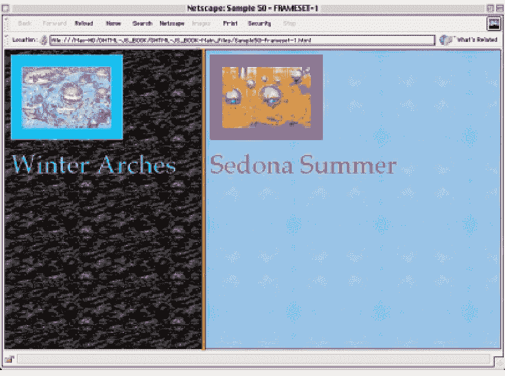

注意 FRAMESET 元素有开始标签和结束标签，而 FRAME 元素只有开始标签。注意这里没有 BODY 元素，它已被 FRAMESET 元素替换。

你的 FRAME 必须使用的唯一必需属性是 SRC 属性，以下示例对此进行了演示，你可以通过从 CD-ROM 加载名为 Sample50-Frameset-1.html 的文件在浏览器中查看。注意，此示例的屏幕截图位于本页顶部。

## 示例 A5-0：Sample50-Frameset-1.html

```
<!DOCTYPE HTML PUBLIC "-//W3C//DTD HTML 3.2//EN">
<HTML>
<HEAD>
<TITLE>示例 50 - FRAMESET-1 </TITLE>
</HEAD>
```

## 附录 A — HTML 入门

```
<FRAMESET COLS="40%,60%" BORDERCOLOR="#ff0000">

      <FRAME SRC="Sample50-A.html">

      <FRAME SRC="Sample50-B.html">

</FRAMESET>

</HTML>
```

COLS 属性设置为指定下面两个 FRAME 元素创建的两列的大小。大小设置如下：第一个 FRAME 将获得可用窗口空间的 40%，第二个 FRAME 将占据剩余 60% 的窗口空间。无论用户将浏览器窗口调整得多小或多大，这些百分比都会被遵循。两个 SRC 属性指向要加载到各自 FRAME 中的页面的 URL。

这可能看起来显而易见，但你编写 FRAME 的顺序就是 FRAME 加载到浏览器窗口中的顺序，而且 FRAME 是从左到右、然后从上到下加载的。遵循这一原则，你为 COLS 属性指定的第一个 WIDTH 值将应用于第一个 FRAME，第二个 WIDTH 值将应用于第二个 FRAME，依此类推。确保理解这一点，因为在本节后面处理嵌套 FRAMESET 时，这将大大简化理解过程。

因此，要创建上述示例，你必须有三个不同的 HTML 文档。第一个文档就是上面的示例，它创建了 FRAMESET，然后通过 FRAME 元素持有并指定其他两个文档的显示方式。以下是同一意思的图示：

实现 FRAME 的最有用的方法之一是在窗口左侧设置一个不太宽（约 144 像素，等于 2 英寸）且从不改变的 FRAME，里面充满链接，这些链接将其内容 TARGET 到填充窗口右侧其余部分的第二个 FRAME 中。这被用户和观察者称为"左框架导航"。将左侧 FRAME 视为目录，用作控制面板，将网站最重要的链接或类别全部放在一个地方以便访问，因为它始终在那里。在 FRAME 出现之前，如果你想让用户始终能够访问重要链接，它们必须包含在网站的每个页面中，当你需要更新 1000 个页面时，这非常烦人。

上述场景的一种变体是在窗口顶部添加另一个也相对较小的 FRAME，水平显示公司徽标或其他图形图像，或者可能是用 JavaScript 编写的帮助导航网站的按钮。你可以通过嵌套 FRAMESET 来实现这一点。参见第 980 页的示例 A5-5。

## <FRAMESET> 元素

<FRAMESET> 元素是 FRAME 的容器元素。如果任何通常包含在 BODY 元素内的标签或元素被放在 FRAMESET 元素之前，那么 FRAMESET 将被完全忽略，你将在 Navigator 中得到一个空窗口，除非你在 FRAMESET 内部有 NOFRAMES 元素；那么，只有 NOFRAMES 元素的内容会被显示。

一个文档中可以有多个 FRAMESET 的唯一情况是在主 FRAMESET 内部包含一个或多个嵌套的 FRAMESET。如果你不小心编写了两个连续的未嵌套 FRAMESET，第二个将被浏览器忽略。

**内容** FRAME、FRAMESET 或 NOFRAMES
**包含于** HTML

#### 语法：

```
<FRAMESET
  COLS="ColumnWidthNumberList"     =     "numberPixels|number%|number*"
  ROWS="RowHeightNumberList"      =     "numberPixels|number%|number*"
  FRAMEBORDER="YES"|"NO"
  BORDER="pixelWidth"
  BORDERCOLOR="color"
  FRAMESPACING="pixels"                              //未记录的属性
  ONLOAD="loadJavaScriptcode"
  ONUNLOAD="unloadJavaScriptcode"
  ONFOCUS="focusJavaScriptcode"
  ONBLUR="blurJavaScriptcode"
  STYLE="Property:Value; Property:Value; ..."
  CLASS="nameOfClass"
  ID="nameOfClassException">

  ...
</FRAMESET>
```


## 附录 A — HTML 入门

COLS="ColumnWidthNumberList" 声明 FRAMESET 中各 FRAME 的宽度。每个 FRAMESET 必须使用 COLS 或 ROWS 之一，也可以同时使用两者。每个宽度之间必须用逗号分隔，有三种测量类型可供选择，分别是：像素（pixels）、百分比（percentage）和相对值（relative），分别通过以下参数指定：**numberPixels**、**number%** 和 **number***。你可以而且通常会在列表中混合使用不同类型的测量方式。

**numberPixels** 当你使用纯数字声明宽度时，它指定 FRAME 的确切像素宽度。你不需要在数字后添加 "pixels" 一词。只能使用正整数，不能使用分数或小数。

**number%** 当你使用以百分号 % 结尾的数字时，该 FRAME 将获得当前窗口空间中对应比例的分配。如果用户调整浏览器窗口大小，FRAME 将按比例缩放。可能的值范围从正 1% 到 100%。如果列表中的所有宽度都是百分比，那么它们应该加起来等于 100%，原因显而易见。如果加起来超过 100%，Netscape 会按相同比例缩小每个宽度，直到总和为 100%。如果加起来不足 100%，Netscape 会按相同比例放大每个宽度，直到总和为 100% — 除非列表中有相对宽度 *，此时多余的空间会分配给它，因为它具有优先权。

**number*** 当你使用以星号 * 结尾的数字时，该 FRAME 将获得当前窗口空间中相对或成比例的分配量。例如：

- "*,2*" 将 1/3 的空间分配给第 1 个 FRAME，2/3 分配给第 2 个 FRAME。
- "3*,1*" 将 3/4 的空间分配给第 Thin person FRAME，1/4 分配给第 2 个 FRAME。
- "2*,3*" 将 2/5 的空间分配给第 1 个 FRAME，3/5 分配给第 2 个 FRAME。
- "4*,3*" 将 4/7 的空间分配给第 1 个 FRAME，3/7 分配给第 2 个 FRAME。
- "*,2*,*" 将 1/4 的空间分配给第 1 个 FRAME，2/4 分配给第 2 个 FRAME，1/4 分配给第 3 个 FRAME。
- "2*,1*,3*" 将 2/6 的空间分配给第 1 个 FRAME，1/6 分配给第 2 个 FRAME，3/6 分配给第 3 个 FRAME。

你看到规律了吗？把所有数字加起来作为分数的下部（被除数），将每个相对宽度的值作为分数的上部（除数）。我没有把 3/6 这样的分数约简为 1/2，因为这样更容易看出规律。

注意上面的第一个迷你示例 "*,2*" 中，星号前面没有数字。这是正常的。1 是可选的，即使你输入了，它也被理解为默认存在。当单个星号 * 被分配给某个 FRAME，并与列表中的其他类型测量方式一起使用时，它会让浏览器将所有未分配的空间分配给带有 * 宽度的 FRAME。假设你有三个 FRAME，你像这样分配 COLS 宽度：

```
COLS="25%, *, 35%"
```

这将给：第 1 个 FRAME 25% 的空间，第 2 个 FRAME 40%，第 3 个 FRAME 35%，因为 40% 是 25% + 35% = 60% 的空间被分配后剩余的所有空间。

另一个例子是：

```
COLS="150, 20%, *"
```

这将给第 1 个 FRAME 150 像素的空间，然后从总窗口空间中减去 150 像素后，剩余空间的 20% 分配给第 2 个 FRAME，所有剩余空间分配给第 3 个 FRAME，这相对于用户调整浏览器窗口大小的选择，因此得名。

如果你在 FRAMESET 中有三个 FRAME，你可以这样声明它们的宽度：

```
FRAMESET COLS="144, 432, 200"
```

即第 1 个 FRAME 144 像素，第 2 个 432 像素，第 3 个 200 像素。这是一种非常不明智的 COLS 指定方式，因为用于查看网页的显示器尺寸多种多样。浏览器几乎总是会调整你的 FRAME 大小，使它们填满整个窗口空间，从而破坏你的像素测量。

更好的方法是全部用百分比声明，或者如果确实有某个 FRAME 需要特定大小，例如，最左侧的 FRAME 通常用作目录，可能需要 144 像素，但其他两个 FRAME 可以指定为百分比，如：

```
FRAMESET COLS="144, 50%, 50%"
```

这为第 1 个 FRAME 保留前 144 像素，然后将剩余的窗口空间平均分配给最后两个 FRAME。

另一种常用的方式是：

```
FRAMESET COLS="150, *"
```

这始终为第 1 个 FRAME 保留前 150 像素，窗口的其余部分分配给第 2 个 FRAME。即使用户调整窗口大小，第 1 个 FRAME 仍保持静态，始终只有 150 像素宽。第 2 个 FRAME 会根据用户的操作放大或缩小。

## 附录 A — HTML 入门（续）

ROWS="RowHeightNumberList" 声明 FRAMESET 中各 FRAME 的高度。每个 FRAMESET 必须使用 ROWS 或 COLS 之一，也可以同时使用两者。每个高度之间必须用逗号分隔，有三种测量类型可供选择，分别是：像素（pixels）、百分比（percentage）和相对值（relative），分别通过以下参数指定：**numberPixels**、**number%** 和 **number***。你可以而且通常会在列表中混合使用不同类型的测量方式。

关于 COLS 属性的所有说明都适用于 ROWS，只是指定的是 FRAME 的高度而不是宽度。

| 参数 | 说明 |
|---|---|
| **numberPixels** | 与 COLS 相同，但指定的是高度而非宽度 |
| **number%** | 与 COLS 相同，但指定的是高度而非宽度 |
| **number*** | 与 COLS 相同，但指定的是高度而非宽度 |

例如，在以下 FRAMESET 中：

```
FRAMESET ROWS="*, 40%, 15%"
```

其中第 1 个 FRAME 获得 45%，第 2 个获得 40%，第 3 个获得 15%：第 1 个 FRAME 获得 45%，因为这是最后两个 FRAME 各自分配了窗口的相应百分比后剩余的部分。

这是一个实用性存疑的准注意事项示例：

```
FRAMESET ROWS="50%, 50%, *"
```

**官方而言，这是不可能的。** 浏览器会将窗口的 100% 分配给前两个 FRAME，然后尝试将剩余的 0% 分配给最后一个 FRAME。

**非官方而言**，如果你尝试这样做，会发现第 3 个 FRAME 在窗口初始加载时不可见，但它实际上存在且被隐藏。如果你通过拖动窗口最底部的 FRAMEBORDER 手动调整 FRAME 的分区，它就会出现。这是未记录的行为，不保证将来可用。它在 Netscape 4.0.1 for Macintosh 中确实有效，如果你想为好奇者设置一个陷阱门的话……

FRAMEBORDER="YES" | "NO" 指定 FRAMESET 中所有 FRAME 的边框是否以 3D 凸起或 2D 平面格式渲染。默认值是 "YES"，表示 3D，但可以通过在 FRAME 元素中设置 FRAMEBORDER 属性来覆盖，这只会影响该特定 FRAME。由于 FRAME 共享边框，出于美观原因，只有当相邻的所有 FRAME 都将 FRAMEBORDER 设置为 "NO" 时，FRAME 才能拥有 2D 边框。

| 值 | 说明 |
|---|---|
| YES | 创建 3D 凸起边框 |
| NO | 创建 2D 平面边框 |

## 第四部分 — 资源

BORDER="pixelsThick" 以像素为单位指定 FRAMESET 中所有 FRAME 以及任何嵌套 FRAMESET 中所有 FRAME 的边框厚度。这是一个全局属性，仅允许在最外层的 FRAMESET 中使用，因此无法被覆盖。默认值是 5 像素，如果你不显式声明此属性，将自动渲染。简而言之，如果你喜欢 5 像素宽的边框，就不必费心编写它。如果你不想让任何 FRAME 有边框，必须将 BORDER 设置为 "0"，这在希望利用 FRAME 的功能而不让明显的图形占据屏幕空间时非常有用。如果你查看一些访问量较高网站的源代码，可能会惊讶于这种做法的频率。有关示例，请参阅第 351 页的 Example 3-35 的 Sample435Frameset.html 文件。当我确实希望显示边框时，我喜欢将 BORDER 设置为 "3"。

最后一点注意；FRAME 上的边框与 TABLE 上的边框完全不同。首先，FRAME 边框不会覆盖围绕整个显示区域的灰色窗口边框，这是一个永久性特征。因此，一个 FRAME 只有在四边都有相邻 FRAME 的情况下，才会在四边都有彩色边框（除了默认的灰色边框）。3D 版本具有圆润的感觉，不同于 TABLE 边框的硬边风格。

BORDERCOLOR="color" 全局确定该 FRAMESET 及其任何嵌套 FRAMESET 中所有 FRAME 的边框颜色，使用十六进制红绿蓝三元组或 Netscape 识别的 16 种颜色名称之一。参见附录 B。

由于 Navigator 为 FRAME 分配空间的方式，边框是共享的，当为相邻边框分配不同颜色时，它们必须遵循层级，以确定哪个 BORDERCOLOR 属性具有优先权。

| 优先级 | 规则 |
|---|---|
| 最低优先级 | 最外层 FRAMESET 中的 BORDERCOLOR |
| 次级优先级 | 嵌套 FRAMESET 中的 BORDERCOLOR |
| 最高优先级 | FRAME 中的 BORDERCOLOR 覆盖所有其他 |
| 未定义 | 两个相邻的 BORDERCOLOR 优先级相等 |

FRAMESPACING="pixels" 指定相邻 FRAME 之间的距离。这是一个未记录的属性，使用风险自负。

ONLOAD="loadJavaScriptcode" 在 FRAMESET 完全加载到浏览器窗口后执行此 JavaScript 代码。有关事件处理程序的理论和示例，请参阅第 6 章中 JavaScript 的高级章节。

ONUNLOAD="unloadJavaScriptcode" 在 FRAMESET 从浏览器窗口卸载（退出）后执行此 JavaScript 代码。一种常见情况是，当用户填写表单并通过 SUBMIT BUTTON 发送时，浏览器没有提供默认行为，因此除非使用 JavaScript 代码将用户带到其他位置，否则会看到空白页面。这种情况的一种解决方案是，作者创建一个对话框，通常感谢用户的互动、信息或交易，并为用户提供一些链接选项。有关事件处理程序的理论和示例，请参阅第 6 章中 JavaScript 的高级章节。


 ## 附录 A — HTML 入门

`ONFOCUS="focusJavascriptcode"` 当此 FRAMESET 获得 **焦点** 时执行该 JavaScript 代码。**焦点** 是指表单（FORM）的某个组件或功能被用户选中以进行输入，而在本例中，该表单将包含在此 FRAMESET 内部。请务必注意最后这句话，因为它只是不严谨的非技术性描述。从技术上讲，表单元素（FORM Element）永远不能直接在 FRAMESET 元素中编码。严格来说，FORM 将被编码到 FRAMESET 的 FRAME SRC 属性所指定的文档中，然后该 FRAME 再被编码到 FRAMESET 中。有关事件处理程序（Event Handlers）的理论和示例，请参阅第 6 章中关于 JavaScript 的高级章节。有关 FORMs 的语法说明，请参见第 1004-1011 页，更多详细信息请参见 CD-ROM 上的 [CH6.html](CH6.html)。

`ONBLUR="blurJavascriptcode"` 当此 FRAMESET 失去 **焦点** 时执行该 JavaScript 代码。有关事件处理程序（Event Handlers）的理论和示例，请参阅第 6 章中关于 JavaScript 的高级章节。

以下非常简单的示例展示了在 COLS 和 ROWS 属性以及 BORDER 属性中编码的各种方式所产生的结果。它们的用意并非作为使用 FRAME 的真实世界示例；而是作为代码的起点，供您扩展使用，以节省您的时间并为您指明一些方向。我使用了完全相同的文件作为 FRAME 的 URL，以便您可以比较不同 FRAMESET 的属性设置。

在以下示例中，ROWS 属性将 50% 的可用窗口空间分配给每个 FRAME，而 BORDERCOLOR 将所有 FRAME 的边框设置为红色。URL 为 [Sample50-A.html](Sample50-A.html) 的文件将加载到第一个 FRAME 中，URL 为 [Sample50-B.html](Sample50-B.html) 的文件将加载到第二个 FRAME 中。用户永远无法滚动第一个 FRAME，而第二个 FRAME 将始终显示滚动条。

## 示例 A5-1：Sample50-Frameset-2.html

```
<HTML>
<HEAD>
    <TITLE>Sample 50 - FRAMESET-2 </TITLE>
</HEAD>

<FRAMESET ROWS="50%,50%" BORDERCOLOR="#ff0000">

     <FRAME SCROLLING="no" SRC="Sample50-A.html">

     <FRAME SCROLLING="yes" SRC="Sample50-B.html">

</FRAMESET>

</HTML>
```

COLS 属性将 25% 的可用窗口空间分配给第一个 FRAME 和第三个 FRAME，星号将剩余的 50% 分配给第二个 FRAME。第一个和第三个 FRAME 仅在需要时才会显示滚动条，这取决于用户将浏览器窗口调整到多大；而第二个 FRAME 则永远无法被用户滚动。

## 示例 A5-2：Sample50-Frameset-3.html

```
<HTML>
<HEAD> <TITLE>Sample 50 - FRAMESET-3 </TITLE>     </HEAD>

<FRAMESET COLS="25%,*,25%" BORDERCOLOR="#ff0000">

        <FRAME SCROLLING="auto" SRC="Sample50-E.html">

        <FRAME SCROLLING="no" SRC="Sample50-B.html">

        <FRAME SCROLLING="auto" SRC="Sample50-C.html">

</FRAME主干文本翻译（按文档工程师规范）：

```markdown
</FRAMESET>
</HTML>
```

COLS 属性将 200 像素的窗口空间分配给第一个 FRAME，并在减去第一个 FRAME 所占空间后，将剩余窗口空间的 35% 分配给第三个 FRAME，而星号将所有剩余的窗口空间分配给第二个 FRAME。所有边框的颜色在 FRAMESET 标签中被全局设置为红色，但随后每个 FRAME 都会覆盖该设置。第一个 FRAME 的边框为黑色，第二个为亮绿色，第三个为蓝色。第一个 FRAME 仅在需要时才会显示滚动条，这取决于用户将浏览器窗口调整到多大；第二个 FRAME 则永远无法被用户滚动，而第三个 FRAME 将始终显示滚动条。

## 示例 A5-3：Sample50-Frameset-4.html

```
<HTML>
<HEAD> <TITLE>Sample 50 - FRAMESET-4 </TITLE>     </HEAD>

<FRAMESET COLS="200,*,35%" BORDERCOLOR="#ff0000">

        <FRAME BORDERCOLOR="#000000" SCROLLING="auto" SRC="Sample50-E.html">
        <FRAME BORDERCOLOR="#00ff00" SCROLLING="no" SRC="Sample50-E.html">
        <FRAME BORDERCOLOR="#0000ff" SCROLLING="yes" SRC="Sample50-E.html">

</FRAMESET>
</HTML>
```

## 嵌套 FRAMESET

嵌套 FRAMESET 是实现精确定位、高度灵活且视觉复杂的网站的真正控制手段。如前所述，在一个文档中允许多个 FRAMESET 的唯一情况是，一个或多个 FRAMESET 被嵌套或包含在另一个 FRAMESET 内部。

您可以拥有任意数量的嵌套 FRAMESET；然而，从实际考虑，范围大约为 1-10 个。如果您有三个 FRAMESET，每个 FRAMESET 中有三到四个 FRAME，那么您就已经耗尽了屏幕空间，除非您的客户计划在 8 英尺的屏幕上进行演示，或者在工业光魔（Industrial Light & Magic）为乔治·卢卡斯（George Lucas）做演示。对于大多数应用而言，您永远只需要两到七个 FRAME，其中两到四个承担了大部分工作。

最清晰的概念是 COLS 和 ROWS 值在嵌套 FRAMESET 中如何相互作用。如果您为最外层的 FRAMESET 选择 COLS，那么必须在 ColumnWidthNumberList 中额外包含一个值，用于指定包含在最外层 FRAMESET 中的整个嵌套 FRAMESET 的宽度，此外还需要分配您在最外层 FRAMESET 中为各个 FRAME 指定的宽度。

在这种上下文中，可将嵌套 FRAMESET 视为一个特殊的 FRAME，它必须像所有其他 FRAME 一样被分配一个宽度值。然后，在该嵌套 FRAMESET 内部，进一步细分分配给它的宽度（通常如果最外层 FRAMESET 使用了 COLS，则使用 ROWS 属性，反之亦然），在本例中使用的是 ROWS 属性。相同的原理也适用于在最外层 FRAMESET 中使用 ROWS 属性的情况。

查看下一页的示例，检查注释，看看您是否理解代码与上一段的关系。

### 示例 A5-5：SAMPLE51-Frameset-DP3.html

```
<!DOCTYPE HTML PUBLIC "-//W3C//DTD HTML 3.2//EN">
<HTML>
<HEAD>
	<TITLE>DreamPlay Studios Framed 3</TITLE>
</HEAD>
```

<!-- 这是最外层的 Frameset。COLS 属性的作用是将窗口分为 2 列，其中第一列获得 27% 的可用窗口空间，第二列获得 73% 的可用窗口空间。第一个 Frame 放入第一列的 27% 中。下一项是一个嵌套 Frameset，放入第二列的 73% 中。 -->

```
<FRAMESET COLS="27%,73%">
```

<!-- 这是第一个 Frame。COLS 中的 27% 值被分配给这个 Frame -->

```
<FRAME SCROLLING="yes" NAME="toc-icons"
SRC="dreamplay-website/DP-TABLE-OF-CONTENTS3TABLE.html">
```

<!-- 这是嵌套的 Frameset。COLS 中的 73% 值被分配给这个 Frameset。现在，这个 Frameset 被细分为两个 ROW，以便第一行获得可用 73% 列空间的顶部 15%，第二行获得剩余的 85% 空间。-->

```
<FRAMESET ROWS="15%,85%">

    <FRAME SCROLLING="no" NAME="banner"
    SRC="dreamplay-website/BANNER1.html">

    <FRAME SCROLLING="yes" NAME="view"
    SRC="dreamplay-website/welcome2.html">

</FRAMESET>

</FRAMESET>

</HTML>
```

为了展示嵌套 FRAMESET 的创造性用途，以下是一些描述性的理论示例以及一些带有代码、解释和 CD-ROM 上示例文件的实际应用。

如果您已经浏览过网页，那么您可能已经看到过左帧导航（Left-Frame Navigation）的示例。这里还有另一个示例，它也使用了嵌套 FRAMESET。请注意左下 FRAME 中的图标（picons）如何被用作主类别或目录，链接到实际包含内容的页面，在本例中是画作的预览，这些预览进一步链接到更大的画作图像。还有文本链接的类别，可以带您到解释公司服务和产品的页面，以及可以购买艺术印刷品的订单表单。

网站顶部的公司徽标是固定的，位于自己的 FRAME 中，无法滚动，而主视图 FRAME 开始时包含大量关于网站内容的一般信息。还大量使用了图形、颜色、图标和背景图像。


 # 示例 A5-6：Sample51-Frameset-6.html

```
<HTML>
<HEAD>
    <TITLE>Sample51- Frameset-6</TITLE>
</HEAD>

<!-- This is the outermost Frameset. What the COLS Attribute does is divide the
Window into 2 columns where the first column gets 27% of the available Window space
and the second column gets 73% of the available Window space. -->

<FRAMESET COLS="27%,73%">

<!-- Because the next item is a Nested Frameset it divides the first column of 27% into
two rows where the first row at the top gets 7% of the first column and the second lower
row gets 93% of the first column. -->

    <FRAMESET ROWS="7%,93%">

        <FRAME SCROLLING="no" NAME="backforward"
        SRC="dreamplay-website/BANNER10A.html">

        <FRAME SCROLLING="yes" NAME="toc-icons"
        SRC="dreamplay-website/DP-TABLE-OF-CONTENTS4TABLE.html">

    </FRAMESET>

<!-- Then the next item is a regular FRAME which gets all of the space reserved for the
second column which is specified in the outermost FRAMESET at 73%. -->

        <FRAME SCROLLING="yes" NAME="view"
        SRC="dreamplay-website/welcome4inFrame.html">

</FRAMESET>

</HTML>
```

如果想查看上述示例的源代码是如何编写的，可以在 CD-ROM 的"dreamplay-website"文件夹中找到。

## <FRAME> 元素

<FRAME> 元素用于定义 FRAME 的所有属性和内容特征，但它必须在 FRAMESET 元素内部使用才能生效。那么，到底什么是 FRAME 呢？FRAME 是一个 HTML 网页文档的行车容器，它能够在 Navigator 浏览器窗口中以一定的（但并非完全的）精度进行定位。

对于 HTML 作者来说，它的革命性在于：多个 FRAME 可以同时放入该窗口中，**而且所有 FRAME 都是独立的实体**，你可以对它们进行高度灵活的单独操控，尤其是在与 JavaScript、样式表和图层结合使用时。

请务必记住：每个 FRAME 都可以拥有自己独立的网页，而且你可以在一个浏览器窗口中放置任意数量的 FRAME，也就是说，你可以同时打开多个网页。

显然，Netscape 已经修复了 Navigator 4.0 版本，使其完全排除了任何错误或故意造成的无限递归 FRAME 被渲染的可能性，但并非所有人都在使用 4.0 版本，所以请注意你的代码，以免你的网站陷入 FRAME 反馈循环并导致用户的系统崩溃。

有一个看似无害但可能耗费大量时间来回修改的错误需要注意：当你链接到一个包含多个 FRAME 的 FRAMESET 时，不小心将其 TARGET 指向了另一个并非为此前设计或无法精确处理的 FRAME。这种情况通常发生在你有多个略有不同版本的同一页面时，比如针对不同浏览器版本或浏览器类型的多个首页，或纯文本首页。

例如，假设你有多个略有不同版本的同一页面，其中某个页面中有一个你一年前编写并遗忘的链接，该链接会将一个包含多个页面的嵌套 FRAMESET 指向一个并非为其设计现有 FRAME 中，结果它被挤压在过小的空间中，但这个页面中又包含同样的链接，会将其更小版本进一步挤压到更小的空间中，如此往复。

严格来说，这并不是无限递归的 FRAMESET，因为它不会自动无限循环直至计算机内存耗尽；用户每次都需要点击链接。我第一次意外看到这种情况时，我的第一想法是它看起来很酷；完全没用，但仍然有趣。肯定会有人尝试这样做，并在网页中放一个提示写道，"**不要点击此链接**"，就为了看看会发生什么。

## 第四部分 — 资源

任何可以放入普通单个 HTML 文档的内容，都可以通过 SRC 属性引入到 FRAME 中。只需指定文档的 URL，瞬间该文档就会出现在 FRAME 中。

一个相当有趣的规定是：你是否可以在 FRAME 中包含一个包含 FRAMESET 的文档？多亏了 Netscape 那些黑客们的卓越远见，你绝对可以，这为创意风格和创新开辟了无限可能。

为了确保你理解上一段的参数和 awesome 含义，让我们详细说明：从你的内部 FRAMESET 开始，在其中放入两个 FRAME，分别命名为 innerframe1 和 innerframe2。接下来创建一个容器 FRAME，将其命名为 containerframe 以容纳第一个 FRAMESET。使用 FRAME 标签和 SRC 属性，将包含第一个 FRAMESET 的文档放入 containerframe 中。现在创建一个外部 FRAMESET，使用 FRAME 标签和 SRC 属性将 containerframe 放入其中。就是这样，不太复杂：只需将其视为带有技巧的嵌套。下面是一个图示说明：

### 文档 4

### 文档 3

```
<!-- This is the exterior frameset -->

<FRAMESET>

<FRAME NAME="containerframe"
SRC="URLOfDocument3">
<FRAME NAME="explainframe"
SRC="URLOfDocument5">

</FRAMESET>
```

```
<!-- This is the interior frameset -->

<FRAMESET>

<FRAME NAME="innerframe1"
SRC="URLofDocument 1">
<FRAME NAME='innerframe2'
SRC="URLOfDocument 2">

</FRAMESET>
```

### 文档 1

### 文档 2

关于上述图示示例，有一点需要快速说明。如果你仔细查看文档 4，可能会想知道文档 5 的用途是什么，因为之前从未提及过它。它之所以存在，只是因为我不希望任何人认为外部 FRAMESET 只能包含一个 FRAME：**不能**。外部 FRAMESET 始终必须至少包含两个 FRAME。然而，内部 FRAMESET 可以选择只包含一个 FRAME，也可以包含多个 FRAME。

示例 A5-7 包含了演示上述概念图示的基本代码。我只包含了上述文档 3 和文档 4 的代码，因为其他两个文档中包含的内容对该示例来说无关紧要。

## 附录 A — HTML 入门

### 示例 A5-7 第 1 部分：Sample52-Frameset-8D4.html

```
<!DOCTYPE HTML PUBLIC "-//W3C//DTD HTML 3.2//EN">
<HTML>
<HEAD>    <TITLE> Sample 52- Frameset-8D4 </TITLE>  </HEAD>

<FRAMESET ROWS="50%,*">

<FRAME NAME="containerframe" SRC="Sample52-Frameset-8D3.html">

<FRAME NAME="explainframe" SRC="Sample52-explain.html">

</FRAMESET>

</HTML>
```

### 示例 A5-7 第 2 部分：Sample52-Frameset-8D3.html

```
<!DOCTYPE HTML PUBLIC "-//W3C//DTD HTML 3.2//EN">
<HTML>
<HEAD>    <TITLE> Sample 52- Frameset-8D3 </TITLE>  </HEAD>

<FRAMESET COLS="20%,*">

<FRAME NAME="innerframe1" SRC="Sample51-A.html">
<FRAME NAME="innerframe2" SRC="Sample51-B.html">

</FRAMESET>

</HTML>
```

如果你想看到一个真实世界中的示例，请进入 **Sample-ETOC** 文件夹，找到文档 **welcomeETOC3Bkgd.html** 并将其加载到 Navigator 中。然后查看左侧的 FRAME，点击标有 Mats 的链接。接下来查看右侧的 FRAME，点击标有 **Crescent Mats** 的链接。然后点击右侧 FRAME 中任何带有暗淡蓝色背景的链接，你就会看到一个包含内部 FRAMESET 的文档加载到屏幕中央的大型显示区域中。

FRAME 的一些非常酷的可视化应用是让冲浪者能够自定义设计网站在他们浏览时的外观。比如提供多个版本的艺术作品或公司标志，让用户可以放置在横幅 FRAME 中，或者提供多种背景音乐选择。这些都是非常简单的选项，只需你为每个想要提供的选项设置一个指向新页面的链接，并将该链接 TARGET 到适当的 FRAME 即可。

假设你有五个不同的公司标志，你想让用户选择最喜欢的一个显示在你的标志 FRAME 中。创建五个不同的网页，每个页面上只放一个标志。然后设置第二个 FRAME，创建五个不同的链接，使每个链接将不同的标志加载到标志 FRAME 中。要实现这一点，你需要做两件事。首先，当你创建两个 FRAME 时，使用（你猜对了）NAME 属性为它们都分配一个 NAME。（尽管对于这个项目你只需要命名你想要 TARGET 的 FRAME，但养成命名所有 FRAME 的习惯是很好的，这样可以方便参考，避免在代码还不够新鲜时回头修改。）其次，当你编写加载每个标志的链接代码时，必须将 TARGET 属性设置为你想要标志加载到的 FRAME 的 NAME。如果你的两个 FRAME 是：

```
<FRAME NAME="logoFrame" SRC="hasLogo1.html">
<FRAME NAME="toc1" SRC="TableOfContents.html">
```

并且文档 "hasLogo1.html" 包含标志版本 1，文档 "TableOfContents.html" 是你的页面，其中包含将新标志加载到名为 "logoFrame" 的 FRAME 中的链接。

你设置一个带有 TARGET 值的链接，将标志加载到名为 "logoFrame" 的 FRAME 中，如下所示：

```
<A HREF="hasLogo1.html" TARGET="logoFrame">  Go Logo 1     </A>
```

然后将该链接放入页面 TableOfContents.html 中，就是这样。

当然，你需要将两个 FRAME 都放在 FRAMESET 中，但这之前已经全部讲过了。这也假设你已经正确编码了标志图像。如果你想看一个包含大量其他花哨功能的夸张示例，那么将 welcomeETOC3Bkgd.html 文件加载到浏览器中，该文件位于 CD-ROM 的 Sample-ETOC 文件夹中的 DHTML-JS BOOK-Main Files 文件夹内。加载后，查看最左侧 FRAME 的底部，点击灰色背景色表格单元格中的任何链接，看看顶部中间的 FRAME 会发生什么。点击 "L1" 或 "L2" 任一链接，然后在标志加载后将鼠标移到标志上方，看看会发生什么。其中包含非常酷的 JavaScript，这在本书的第二部分中已解释。

我想现在应该是一个展示上述理论不那么浮华示例的好时机，所以如下：


 ## 附录A — HTML入门

## 示例 A5-8-第1部分：Sample51-Frameset-7.html

```
<!DOCTYPE HTML PUBLIC "-//W3C//DTD HTML 3.2//EN">
<HTML>
<HEAD>  <TITLE>Sample 51 - FRAMESET-7 </TITLE>     </HEAD>

<FRAMESET COLS="150,*" BORDERCOLOR="#000000">

       <FRAME SCROLLING="no" NAME="toc" SRC="Sample51-toc.html">

       <FRAMESET ROWS="100,*">

       <FRAME SCROLLING="no" NAME="MiddleLogo" SRC="Sample51-C.html">

       <FRAME SCROLLING="auto" NAME="MiddleBottom" SRC="Sample51-main.html">

       </FRAMESET>

</FRAMESET>
</HTML>
```

## 示例 A5-8-第2部分：Sample51-toc.html

```
<!DOCTYPE HTML PUBLIC "-//W3C//DTD HTML 3.2//EN">
<HTML>
<HEAD><BASEFONT SIZE="5">
<TITLE> Sample 51 - Source File toc   </TITLE></HEAD>

<BODY><P><CENTER>

<A HREF="Sample51-A.html" TARGET="MiddleLogo">

       Load Logo 1                       </A><P>

<A HREF="Sample51-B.html" TARGET="MiddleLogo">

       Load Logo 2                       </A>
</CENTER>
</BODY>
</HTML>
```

## 示例 A5-8-第3部分：Sample51-main.html

```
<!DOCTYPE HTML PUBLIC "-//W3C//DTD HTML 3.2//EN">
<HTML>  <HEAD><TITLE>  Sample 51 - Source File main  </TITLE></HEAD>

<BODY BGCOLOR="#23f6ff" BACKGROUND="JPEG-FILES/Icon-Clouds.jpg">
<P><CENTER><H1>This would be the main viewing area.</H1></CENTER>
</BODY>
</HTML>
```

## 示例 A5-8-第4部分：Sample51-A.html

```
<!DOCTYPE HTML PUBLIC "-//W3C//DTD HTML 3.2//EN">
<HTML>
<HEAD><TITLE>  Sample 51 - Source File A    </TITLE></HEAD>

<BODY BGCOLOR="#23f6ff" BACKGROUND="JPEG-FILES/icon-BG-asteroids.jpg">
<P>
<CENTER>


</CENTER>

</BODY>
</HTML>
```

## 示例 A5-8-第5部分：Sample51-B.html

```
<!DOCTYPE HTML PUBLIC "-//W3C//DTD HTML 3.2//EN">
<HTML>
<HEAD><TITLE>  Sample 51 - Source File B    </TITLE></HEAD>

<BODY BGCOLOR="#23f6ff" BACKGROUND="JPEG-FILES/icon-FieldStone-Purple.jpeg">
<P>
<CENTER>


</CENTER>

</BODY>
</HTML>
```

## 示例 A5-8-第6部分：Sample51-C.html

```
<!DOCTYPE HTML PUBLIC "-//W3C//DTD HTML 3.2//EN">
<HTML>
<HEAD><TITLE>  Sample 51 - Source File C    </TITLE></HEAD>

<BODY BGCOLOR="#ff0000">
<P><CENTER>

If you want to see an image here then
click on one of the logo links in the left frame.

</CENTER>

</BODY>
</HTML>
```

## 附录A — HTML入门

在使用FRAME（帧/框架）时需要记住的一点是，你正在处理的是拼图中的许多不同碎片，在这个例子中就是HTML页面，它们只有在正确组合在一起时才能工作。具体来说，你需要注意：

- 为你的框架命名
- 使用逻辑名称，以便容易知道它们的用途
- 以同样的方式命名你的文件
- 正确设置你的链接目标
- URL和其他名称或值放在引号内
- 确保使用正确的文件名和URL路径
- 对于嵌套文件夹中的文件或图像，确保URL中包含文件夹名称，位于文件名之前，并用/符号分隔
- 在纸上为自己写笔记：这比完全靠头脑记忆要容易
- 图表对于小型复杂项目特别高效
- 重用你的代码：复制粘贴并进行少量修改
- FRAMESET替代BODY元素
- FRAME只能放在FRAMESET内部
- 每个文档只允许一个未嵌套的FRAMESET
- 每个文档中允许无限个嵌套FRAMESET
- 每个FRAMESET必须指定COLS或ROWS，或两者都指定
- 每个FRAME必须恰好指定一个SRC="URL"
- 体贴一些，包含NOFRAMES元素
- 享受乐趣，垂直思考，指数级创造

记住，使用FRAME时你只需使用开始标签。

**内容**  
无

**包含于**  
FRAMESET

#### 语法：

```
<FRAME
FRAMEBORDER="YES"|"NO"
BORDERCOLOR="#$$$$$$"|"colorName"
MARGINWIDTH="pixelsMarginWidth"
MARGINHEIGHT="pixelsMarginHeight"
SCROLLING="YES"|"NO"|"AUTO"
NORESIZE
NAME="nameYourFrame"
SRC="URL"
STYLE="Property:Value; Property:Value; ..."
CLASS="nameOfClass"
ID="nameOfClassException">
```

## 990 第四部分 — 资源

FRAMEBORDER="YES" | "NO" 指定该FRAME的边框将以3D凸起格式还是2D平面格式渲染。默认值是"YES"，表示3D，这将覆盖任何FRAMESET元素中先前设置的FRAMEBORDER属性。由于FRAME共享边框，出于美观考虑，只有当所有相邻的FRAME都将它们的FRAMEBORDER设置为"NO"时，FRAME才能拥有2D边框。FRAMEBORDER的默认值是"YES"，这也包含5像素的固有厚度设置，无法从FRAME标签内部更改。

如果你想改变厚度，必须在最外层FRAMESET标签中使用全局设置BORDER="pixelsThick"属性，这将影响所有FRAMEBORDER。不可能让单个FRAME具有不同的厚度设置。如果你完全不使用FRAMEBORDER属性，默认情况下它也会以与Navigator外部窗口边框相同的灰色显示。你可以使用下面的BORDERCOLOR属性更改单个FRAME边框的颜色。

- YES 创建3D凸起边框。
- NO 创建2D平面边框。

BORDERCOLOR="#$$$$$$" | "colorName" 仅决定该FRAME的颜色，并覆盖任何FRAMESET或嵌套FRAMESET的全局设置。它使用熟悉的十六进制红绿蓝三元组，或使用Netscape认可的16种颜色名称之一。参见附录B中的颜色理论部分。

由于Navigator分配空间给FRAME的方式，边框是共享的，当为相邻边框分配不同颜色时，它们必须遵循优先级层次来确定哪个BORDERCOLOR属性具有优先权。

- 最低优先级：最外层FRAMESET中的BORDERCOLOR。
- 次高优先级：嵌套FRAMESET中的BORDERCOLOR。
- 最高优先级：FRAME中的BORDERCOLOR覆盖所有其他。
- 未定义：两个相邻的等优先级BORDERCOLOR。

当未定义情况发生时，Netscape通常会使用最先编码的BORDERCOLOR属性，这很奇怪。

MARGINWIDTH="pixelsMarginWidth" 定义FRAME左右两侧边距的大小，以像素为单位。这允许你在FRAME内容与其边框之间创建空间。不允许使用0（零）或负数，因为你的内容会接触，甚至更严重地，会与FRAMEBORDER重叠，导致渲染噩梦。如果你无意或有意使用负数，Netscape会将其改为1，因为这是最接近的合法数字。任何从1开始的正数都是可以接受的，但请记住屏幕空间有限，因此实际通常范围约为1到20像素。如果你将边距设置得太大，导致文档内容无法放入FRAME中，Netscape会减少边距以容纳内容，但两边的边距不一定相等。

## 附录A — HTML入门

如果你未指定MARGINWIDTH，Netscape默认会创建一个能舒适显示内容的边距，通常大小约为8-10像素。当你需要为内容提供最大可用显示空间时，将所有边距设置为1并关闭边框，这绝对是视觉优雅与笨拙之间的区别。

**MARGINHEIGHT="pixelsMarginHeight"** 定义FRAME顶部和底部边距的大小，以像素为单位。先前针对MARGINWIDTH提到的所有内容都适用于MARGINHEIGHT，只是受影响的区域是FRAME内文档的上方和下方空间，而不是内容的左右空间。

**SCROLLING="YES"|"NO"|"AUTO"** 指定可选滚动条是始终可见、始终隐藏还是除非需要否则不可见。除非你从未使用过GUI计算机，否则你知道水平和垂直滚动条是箭头键以及页上翻和页下翻键的增强图形版本，允许你滚动到文档的隐藏区域。在大多数计算机程序中，它们要么内置要么根本不存在。使用HTML时，选择权在你。每个选项都有其各种应用场景。如果你未包含SCROLLING属性，则Navigator默认使用AUTO。

AUTO设置使浏览器检查FRAME的大小和内容，然后确定是否需要滚动条。如果FRAME的所有内容都能同时看到，即如果内容都能适应FRAME的大小（用户将其调整为此大小），则滚动条将被隐藏。如果有更多内容需要显示而FRAME没有足够的空间可见显示，则需要的滚动条将自动变为可见。

有许多情况下只有垂直滚动条会可见，因为有足够的水平空间来显示内容但垂直空间不足。由于AUTO设置是自适应的，每次用户调整网页大小时，如果需要适应内容布局，它会改变滚动条的状态。

- **YES** 指定滚动条**始终可见**。
- **NO** 指定滚动条**始终隐藏**。
- **AUTO** 指定滚动条除非需要否则不可见。
- **AUTO** 是默认值。

**NORESIZE** 这是一个布尔属性，没有可赋值。如果你将其包含在FRAME标签中，则为真，并阻止用户调整你的FRAME大小。如果你不将其包含在FRAME中，则为假，这是默认值，因此用户可以通过鼠标拖动FRAME边缘来调整其大小。重申一下，所有FRAME默认都是可调整大小的。由于FRAME边缘是共享的，每个FRAME不是两条接触或重叠的边缘，如果你在与其他可调整大小的FRAME相邻的FRAME中包含NORESIZE，共享边缘仍将不可调整大小，因为NORESIZE在代码层次中具有优先权。


 ## Part IV — 资源

**NAME="nameYourFrame"** 是一个非常重要的属性，它为您的 FRAME 指定一个标识符，以便可以通过链接和 JavaScript 进行引用和 TARGET 定位。您可以将其视为 FRAME 的昵称，设计它的目的是为了让您在编码时节省时间、空间和减少混乱。一种非常有用的方法是使用描述 FRAME 用途或功能的名称。当我们进入 STYLE 和 JavaScript 部分，开始需要命名样式 **ids**、**classes** 和 **Functions** 时，记住这一点也非常有用。

**SRC="URL"** 指定您想要加载到此 FRAME 中的文档或对象的 URL。这是唯一必需的属性。如果您需要更多关于 URL 的信息，请查看第 447-452 页的 **Location** 对象，或 CD-ROM 上的 [CH3.html] 文件中关于链接的内容。

示例 A5-10 包含名为 [welcomeETOC-SAMPLE.html] 的示例文件，该文件位于 CD-ROM 上名为 [Sample-ETOC] 的文件夹中。这是一个非常复杂的示例，展示了一个具有四个 FRAME 和两个 FRAMESET 的网站。一个 FRAMESET 嵌套在另一个 FRAMESET 中，[位于] 其两个 FRAME 之间。每个 FRAMESET 都有两个 FRAME，一个有两个 COLS（列），另一个有两个 ROWS（行）。

这样创建的文档是：窗口的左侧和右侧各有一个窄列，顶部有一个包含公司标志的细行，中间是主查看窗口，当在控制列中点击时，大部分文档都在此处显示。左侧 FRAME 用作主目录表，并持续显示在那里。它包含网站的主类别链接，通常被 TARGET 到右侧 FRAME 中并在此打开。右侧 FRAME 包含子类别，通常被 TARGET 到 NAME 属性设置为 **NAME="MiddleBottom"** 的 FRAME 中，这是窗口中间的大型主查看 FRAME。

您确实应该运行这个示例，因为视觉效果使描述更加清晰。它也看起来非常酷。请随意重用本书或 CD-ROM 上示例 HTML 文件中的任何代码。这将为您节省大量时间，并可能为您指明一些创意方向。

在查看第 2 部分的代码时，请注意其中包含 JavaScript，并且 TABLE 包含在 FORM 元素中，这就是带有 JavaScript 的 BUTTON 能够工作的原因。如果您是 HTML 新手，并且从附录 A 开始阅读，如果需要澄清，您可能需要跳转到在线指南的 [CH6.html]（位于 [HTML_BOOK-Online] 文件夹中）。现在，只需知道 [要使 BUTTON 工作，它们必须位于 FORM 内部]。如果您从本书开头开始阅读，那么这已经是旧闻了。

以下是 FRAMESET 的代码，其中包含四个 FRAME，以及随后包含的每个页面进入每个 FRAME 的代码。

## 附录 A — HTML 入门

### 示例 A5-10-第 1 部分-框架集：

welcomeETOC-SAMPLE.html

```
<!DOCTYPE HTML PUBLIC "-//W3C//DTD HTML 3.2//EN">
<HTML>
<HEAD>
       <TITLE>Extra Touch of Class Framed Home Page </TITLE>
</HEAD>

<FRAMESET FRAMESPACING="3层次感" BORDER="3" COLS="145,*,155">

                           <NOFRAMES>
<P><H2>
嘿！！！如果您正在阅读此内容，说明您使用的是不支持框架的浏览器。
为了获得最佳观看效果，请立即前往
<A HREF="http://www.Netscape.com">Netscape 网站</A>
并下载当前版本的 Navigator。
</P>
<P>
否则 <A HREF="ETOCmainWindow5Bkgd.html">
进入 Extra Touch of Class 网站的无框架版本。</A>
</H2></P>
                           </NOFRAMES>

       <FRAME SCROLLING="no" NAME="Left" SRC="etoc-TOC8Bkgd.html">

<FRAMESET  FRAMESPACING="3" BORDER="3" ROWS="90,*">

       <FRAME SCROLLING="no" NAME="MiddleTop" SRC="ETOC-Logo8Bkgd.html">

       <FRAME SCROLLING="yes" NAME="MiddleBottom" SRC="ETOCmainWindow5Bkgd.html">

</FRAMESET>

       <FRAME SCROLLING="yes" NAME="Right" SRC="etoc-ArtByStyle3Bkgd.html">

</FRAMESET>

</BODY>
</HTML>
```

### 示例 A5-10-第 2 部分：

etoc-TOC8Bkgd.html

```
<!DOCTYPE HTML PUBLIC "-//W3C//DTD HTML 3.2//EN">
<HTML>
<HEAD>    <TITLE>目录窗口</TITLE>
       <BASE TARGET="MiddleBottom">
</HEAD>
<BODY BGCOLOR="#060dff" TEXT="#ffffff" BACKGROUND="icon-BG-stars.jpg"
VLINK="#222222" LINK="#000000" ALINK="#2826CF">
<CENTER>
<FORM>
<TABLE BORDER=3 CELLSPACING=2 CELLPADDING=2>

<TR>
<TH>
<INPUT TYPE="button" VALUE="<<B"
   onClick="parent.MiddleBottom.history.back()">
<INPUT TYPE="button" VALUE="F>>"
   onClick="parent.MiddleBottom.history.forward()">

</TH>
</TR>

<TR>
<TH>

<INPUT TYPE="button" VALUE="<<B"
   onClick="parent.Right.history.back()">
<INPUT TYPE="button" VALUE="F>>"
   onClick="parent.Right.history.forward()">
</TH>
</TR>

<TR>
<TH BGCOLOR="#dd00ff">
<A HREF="etoc-ArtByArtist3Bkgd.html" TARGET="Right">艺术品</A>
</TH>
</TR>

<TR>
<TD BGCOLOR="#7300dd">
<A HREF="etocWoodFrames.html" TARGET="Right"><B>木质相框</B></A>
</TD>
</TR>

<TR>
<TD BGCOLOR="#8300ee">
<A HREF="etocMetalFrames.html" TARGET="Right"><B>金属相框</B></A>
</TD>
</TR>

<TR>
<TD BGCOLOR="#9300ff">
<A HREF="etocPolymerFrames.html" TARGET="Right"><B>聚合物相框</B></A>
</TD>
</TR>

<TR>
<TH BGCOLOR="#0066ff">
<A HREF="etocGlass.html" TARGET="Right">玻璃</A>
</TH>
</TR>

<TR>
<TH BGCOLOR="#0099ff">
<A HREF="etocPlexiglass.html" TARGET="Right">亚克力</A>
</TH>
</TR>

<TR>
<TH BGCOLOR="#00ffff">
<A HREF="etocMats.html" TARGET="Right">衬垫</A>
</TH>
</TR>

<TR>
<TH BGCOLOR="#00ff00">
<A HREF="etocMounting.html" TARGET="Right">装裱</A>
</TH>
</TR>

<TR>
<TH BGCOLOR="#00aa00">
<A HREF="etocHardware.html" TARGET="Right">五金</A>
</TH>
</TR>

<TR>
<TH BGCOLOR="#ffff00">
<A HREF="Links.html" TARGET="MiddleBottom">链接</A>
</TH>
</TR>

<TR>
<TH BGCOLOR="#ffbb00">
<A HREF="Foxmans-Calendar97.html" TARGET="MiddleBottom">活动<BR>
日历</A>
</TH>
</TR>

<TR BGCOLOR="#FA5A05">
<TH>电子邮件
</TH>
</TR>

<TR BGCOLOR="#F92807">
<TH>电话订购<BR>
703-354-2905
</TH>
</TR>

<TR BGCOLOR="#ff00aa">
<TH>
<A HREF="ETOC-OrderForm.html" TARGET="_blank">
<FONT SIZE=4> 在线订购</FONT></A>
</TH>
</TR>

<TR>
<TH BGCOLOR="#777777">
<A HREF="ETOC-Logo1Bkgd.html" TARGET="MiddleTop">        L1 </A>
<A HREF="ETOC-Logo2Bkgd.html" TARGET="MiddleTop">        L2 </A>
<A HREF="ETOC-Logo3Bkgd.html" TARGET="MiddleTop">        L3 </A>
<A HREF="ETOC-Logo3A-Bkgd.html" TARGET="MiddleTop">  L4 </A>

</TH>
</TR>

</TABLE>

</FORM>
</CENTER>

</BODY>
</HTML>
```

### 示例 A5-10-第 3 部分：               ETOC-Logo8Bkgd.html

```
<!DOCTYPE HTML PUBLIC "-//W3C//DTD HTML 3.2//EN">
<HTML>
<HEAD>
    <TITLE>    Extra Touch of Class 标志 8 </TITLE>
</HEAD>

<BODY BGCOLOR="#23f6ff" BACKGROUND="icon-FieldStone-Purple.jpeg">
<P>
<CENTER>


</CENTER>
</BODY>
</HTML>
```

### 示例 A5-10-第 4 部分：               ETOCmainWindow5Bkgd.html

```
<!DOCTYPE HTML PUBLIC "-//W3C//DTD HTML 3.2//EN">
<HTML>
<HEAD>

    <TITLE>Extra Touch of Class 主框架</TITLE>
</HEAD>

<BODY BGCOLOR="#000000" TEXT="#FFFFFF" BACKGROUND="GIFA-EARTH-ANIMATION.gif" VLINK="#0000FF" LINK="#000000">

<!------------------------------------------------------------------->

<CENTER>
<TABLE BORDER=5 CELLSPACING=3 CELLPADDING=4>

<TR VALIGN=middle BGCOLOR="#755F11">
<TH COLSPAN=2>欢迎光临</TH>
</TR>

<TR BGCOLOR="#755F11">
<TH COLSPAN=2 VALIGN=middle>
<FONT SIZE=7 COLOR="#000000">Extra Touch of Class</FONT><BR>
<FONT SIZE=4>艺术画廊与装裱工作室</FONT>
</TH>
</TR>

<TR VALIGN middle BGCOLOR="#755F11">
<TH COLSPAN=2>保护性装裱</TH>
</TR>

<TR VALIGN=middle BGCOLOR="#755F11">
<TH> * 木质 * 金属 * 聚合物 * </TH>
<TH> * 衬垫 * 装裱 * 玻璃 * 亚克力 * </TH>
</TR>

</TABLE>           <BR>

</CENTER>

<!-- -------------------------------------------------------------------- -->

<CENTER>
<TABLE BORDER=10 CELLSPACING=10 CELLPADDING=10>

<TR>
<TH BGCOLOR="#755F11">
<A HREF="BV20-CrystalMtsWinter14.html"><BR><BR>
<FONT SIZE="6">进入工作室</FONT></A>
</TH>
</TR>

</TABLE>           <BR>
</CENTER>

<!-- -------------------------------------------------------------------- -->

<CENTER>
<TABLE BORDER=2 CELLSPACING=2 CELLPADDING=5>

<TR VALIGN=middle BGCOLOR="#0000FF">
<TH BGCOLOR="#FFFFFF"><FONT COLOR="#000000">商店 #1</FONT></TH>
<TH BGCOLOR="#FFFFFF"><FONT COLOR="#000000">商店 #2</FONT></TH>
</TR>

<TR VALIGN=middle BGCOLOR="#0000FF">
<TH>5641 -B General Washington Dr.</TH>
<TH>5641 -B General Washington Dr.</TH>
</TR>
```


 # 998 第四部分 — 资源

```
<TR VALIGN=middle BGCOLOR="#0000FF">
<TH>Alexandria, VA  22312</TH>
<TH>Alexandria, VA  22312</TH>
</TR>

<TR VALIGN=middle BGCOLOR="#0000FF">
<TH>703-354-2905</TH>
<TH>703-354-2905</TH>
</TR>

<TR BGCOLOR="#0000FF" VALIGN=MIDDLE>
<TH BGCOLOR="#FFFFFF"><FONT COLOR="#000000">Store #3</FONT></TH>
<TH ROWSPAN=4 BGCOLOR="#00FFFF"><FONT COLOR="#000000">
Barry Broadway -- Proprietor</TH></FONT>
</TR>

<要多表格被截断了(30行上限)> | | |
</TABLE>
</CENTER>

<!-------------------------------------------------------------------->

<BR>
<H3><CENTER><A HREF="FoxmansHELP.html"><BR>
Site Navigation Overview = HELP</A></CENTER>
</H3>

</BODY>
</HTML>
```

# 示例 A5-10-第 5 部分：etoc-ArtByStyle3Bkgd.html

```
<!DOCTYPE HTML PUBLIC "-//W3C//DTD HTML 3.2//EN">
<HTML>
<HEAD>

	<TITLE>Art by Style 3</TITLE>
</HEAD>

<BODY TEXT="#ffffff" BGCOLOR="#94bbef" BACKGROUND="icon-Paint-Palette.jpg"
ALINK="#0000ff" LINK="#ff0000" VLINK="#000000">

<CENTER>
```

# 附录 A — HTML 入门

```
<TABLE BORDER=5 CELLSPACING=2 CELLPADDING=1>

<TR>
<TH BGCOLOR="#ff0000">
<FONT SIZE="5"><BR>Art by<BR>Style<BR>&nbsp;</FONT>
</TH>
</TR>

<TR智斗
<TH BGCOLOR="#00ffff">
<A HREF="etoc-ArtByArtist3Bkgd.html" TARGET="Right">!!Art By Artist!!</A>
</TH>
</TR>

<TR>
<TH BGCOLOR="#00ffff">
<A HREF="etoc-ArtByTitle3Bkgd.html" TARGET="Right">!!Art By Title!!</A>
</TH>
</TR>

<TR>
<TH BGCOLOR="#0000FF">
<A HREF="etoc-3DComputerArt.html" TARGET="Right">3D</A>
</TH>
</TR>

<TR>
<TH BGCOLOR="#0000FF">
Abstract
</TH>
</TR>

<TR>
<TH BGCOLOR="#0000FF">
Cubist
</TH>
</TR>

<TR>
<TH BGCOLOR="#0000FF">
Fantasy
</TH>
</TR>

<TR>
<TH BGCOLOR="#0000FF">
Impressionism
</TH>
</TR>

<TR>
<TH BGCOLOR="#0000FF">
Industrial
</TH>
</TR>
```

# 1000 第四部分 — 资源

```
<TR>
<TH BGCOLOR="#0000FF">
Landscapes
</TH>
</TR>

<TR>
<TH BGCOLOR="#0000FF">

</TH>
</TR>

<TR>
<TH BGCOLOR="#0000FF">
Modern
</TH>
</TR>

<TR>
<TH BGCOLOR="#0000FF">
Post Modern
</TH>
</TR>

<TR>
<TH BGCOLOR="#0000FF">
 Assist kitchen
</TH>
</TR>

<TR>
<TH BGCOLOR="#0000FF">
Psychedelic
</TH>
</TR>

<TR>
<TH BGCOLOR="#0000FF">
Sci-Fi
</TH>
</TR>

<TR>
<TH BGCOLOR="#0000FF">
Still Life
</TH>
</TR>

<TR>
<TH BGCOLOR="#0000FF">
<A HREF="etoc-SurrealArt.html" TARGET="Right">Surreal</A>
</TH>
</TR>

</TABLE>
</CENTER>

</BODY>
</HTML>
```

# 附录 A — HTML 入门

1001

## <NOFRAMES> 元素

<NOFRAMES> 元素，尽管不是必需的，但出于礼貌，应始终在每个页面的一个 FRAMESET 元素内包含它。它为无法渲染 FRAME 的浏览器提供替代内容，以便显示给用户。如果没有 NOFRAMES 元素，不具备帧功能的浏览者只会看到一个空白页面，因为页面的所有 FRAMESET 内容都将被忽略。

像 Navigator 这样能解释 FRAME 内容的支持帧的浏览器，会忽略 NOFRAMES 开始标签和结束标签之间的所有文本、内容和标签。唯一的例外是，如果你在 FRAME 或 FRAMESET 代码中创建了一个错误，比如更改文件的 URL 或名称而忘记更改 SRC=URL 以匹配，或者只是错误地输入了 URL，这会导致 Navigator 无法访问或加载文件，此时 NOFRAMES 内容将会显示。

始终在上传之前测试你的代码。即使你测试过并且它运行完美，然后你决定做一个小改动，并且你心里想，我不可能有哪怕最微小的机会、最遥远的暗示、最微弱的考虑去实际编写一个错errrrrrrrrrrrrr。不要拿生命打赌。在浏览器中重新测试该代码。

你可以在 NOFRAMES 元素中包含几项内容，以展示你多注重"网络礼仪"。你可以提供一个指向 Netscape 主页或软件下载站点的链接，并告诉浏览者，通过下载和使用 Navigator，他们将能够看到网站的原貌。你应该始终包含一个不包含任何 FRAME 的网站入口链接。事实上，如果你的网站是围绕 FRAME 范式设计的，你应该考虑创建一个完全不使用 FRAME 的替代并行版本。这不是绝对的，只是根据你自己的特殊情况来考虑。

许多网页作者正在创建主页，让客户选择他们想进入哪个版本的网站，比如帧版本、非帧版本、纯文本版本，或者新的层与非层版本，这些版本肯定会在某个时候出现，或者可能已经存在很久了，这取决于你什么时候读到这篇文章。

**目录**

在 HTML4.0 Transitional 中：
在 HTML4.0 Frameset 中：

所有块级和内联元素
一个不能包含任何 NOFRAMES 元素的 BODY 元素

**包含于**

APPLET、BLOCKQUOTE、BODY、CENTER、DD、DIV、FORM、FRAMESET、LI、MAP、NOSCRIPT、OBJECT、TD、TH

# 1002 第四部分 — 资源

#### 语法：

```
<NOFRAMES
LANG="ISOLanguageAbbreviation"
STYLE="Property:Value; Property:Value; ..."
CLASS="nameOfClass"
ID="nameOfClassException">
...
</NOFRAMES>
```

这只是 NOFRAMES 元素的典型用法。请注意，它在 FRAMESET 元素内部。通常你还应该在 FRAMESET 内放入 FRAME。

```
<FRAMESET>
  <NOFRAMES>
    <H2>
    嘿！如果你正在阅读这个，说明你正在使用一个不支持帧的浏览器。
    为了获得最佳浏览体验，请立即前往

    <A HREF="http://www.Netscape.com">Netscape 网站</A>

    下载最新版本的 Navigator。
    </H2>

    <H2>
    或者
    <A HREF="welcome3.html">
    进入 DreamPlay Studios 网站的非帧版本。</A>
    </H2>
  </NOFRAMES>
</FRAMESET>
```

FRAMES 的一些可能性包括，例如，左 FRAME 和右 FRAME 导航系统，其中左 FRAME 是主控制面板，包含网站的所有主要分区，点击时会在右 FRAME 控制面板中展开。右 FRAME 中会有网站的可变子分区，这些子分区会在中间的 FRAME 主查看区域中展开。在这种情况下，左和右 FRAMES 可能是较窄的列，大部分可用的窗口空间由中间的 FRAME 占据，大部分信息内容会被 **TARGET** 到该 FRAME。非常大且数据丰富的网站将受益于这种方案。

在下一页是 CD-ROM 中使用 FRAMES 和 FRAMESET 的示例列表，这些示例的代码已在本书中列出。

# 附录 A — HTML 入门

- Sample38frameset.html, 第 5 行：`<FRAMESET COLS="150,*">`
- Sample50-Frameset-1.html, 第 5 行：`<FRAMESET COLS="40%,60%" BORDERCOLOR="#ff0000">`
- Sample50-Frameset-2.html, 第 5 行：`<FRAMESET ROWS="50%,50%" BORDERCOLOR="#ff0000">`
- Sample50-Frameset-3.html, 第 5 行：`<FRAMESET COLS="25%,*,25%" BORDERCOLOR="#ff0000">`
- Sample50-Frameset-4.html, 第 5 行：`<FRAMESET COLS="200,*,35%" BORDERCOLOR="#ff0000">`
- Sample50-Frameset-5.html, 第 5 行：`<FRAMESET COLS="200,200,200">`
- Sample51-Frameset-6.html, 第 10 行：`<FRAMESET COLS="27%,73%">`
- Sample51-Frameset-7.html, 第 5 行：`<FRAMESET COLS="150,*" BORDERCOLOR="#000000">`
- Sample52-Frameset-8D3.html, 第 5 行：`<FRAMESET COLS="20%,*">`
- Sample52-Frameset-8D4.html, 第 5 行：`<FRAMESET ROWS="50%,*">`
- Sample53-Frameset-9.html, 第 5 行：`<FRAMESET ROWS="250,*">`
- Sample54-Frameset-10.html, 第 5 行：`<FRAMESET BORDERCOLOR="#0000ff" COLS="25%,25%,25%,*">`
- Sample56-Frameset-11.html, 第 5 行：`<FRAMESET BORDERCOLOR="#0000ff" COLS="25%,25%,25%,*">`
- Sample56-Frameset-11.html, 第 27 行：`<FRAMESET BORDERCOLOR="#00ff00" ROWS="50%,25%,*">`
- Sample429Frameset.html, 第 5 行：`<FRAMESET ROWS="150,*">`
- Sample430Frameset.html, 第 5 行：`<FRAMESET ROWS="150,*">`
- Sample432Frameset.html, 第 5 行：`<FRAMESET ROWS="100,*">`
- Sample434Frameset.html, 第 5 行：`<FRAMESET ROWS="140,*">`
- Sample435Frameset.html, 第 4 行：`<FRAMESET ROWS="24,*,24" BORDER="0">`
- Sample452Frameset.html, 第 5 行：`<FRAMESET COLS="220,*">`
- Sample453Frameset.html, 第 5 行：`<FRAMESET COLS="220,*">`
- Sample454Frameset.html, 第 5 行：`<FRAMESET ROWS="130,*">`
- Sample455Frameset.html, 第 5 行：`<FRAMESET COLS="220,*">`
- Sample456Frameset.html, 第 5 行：`<FRAMESET COLS="200,*">`
- Sample533Frameset.html, 第 5 行：`<FRAMESET COLS="100,*">`
- Sample534.html, 第 34 行：`document.writeln('<FRAMESET COLS="200,*">')`
- Sample718Frameset.html, 第 5 行：`<FRAMESET COLS="120,*">`
- Sample719Frameset.html, 第 5 行：`<FRAMESET COLS="130,*">`
- Sample724Frameset.html, 第 5 行：`<FRAMESET COLS="220,*">`
- Sample724Frameset.html, 第 10 行：`<FRAMESET ROWS="100,*">`
- Sample826Frameset.html, 第 5 行：`<FRAMESET ROWS="100,*">`
- Sample899Frameset.html, 第 5 行：`<FRAMESET ROWS="120,*">`
- Sample1014Frameset.html, 第 5 行：`<FRAMESET ROWS="40,*">`
- Sample1015Frameset.html, 第 5 行：`<FRAMESET ROWS="100,*">`
- Sample1016Frameset.html, 第 5 行：`<FRAMESET ROWS="100,*">`

请注意，CD-ROM 上大多数包含 FRAMESET 但未在书中的示例文件，其文件名中都包含 "Frameset" 这个词。


 1004 第四部分 — 资源

## <FORM> 元素

| | |
|---|---|
| 内容 | 在 HTML 4.0 Strict 中：SCRIPT 或块级元素，但 FORM 除外 在 HTML 4.0 Transitional 中：块级或内联元素，但 FORM 除外 |
| 可包含于 | APPLET、BLOCKQUOTE、BODY、CENTER、DD、DIV、LI、MAP、NOFRAMES、NOSCRIPT、OBJECT、TD、TH |

#### 语法：

```
<FORM
ACTION="ServerURL"
ENCTYPE="EncodingType"
METHOD="GET" | "POST"
NAME="FormName"
TARGET="WindowName" | "FrameName"
ONRESET="resetJavaScriptCode"
ONSUBMIT="submitJavaScriptCode"
LANG="ISOLanguageAbbreviation"
STYLE="Property:Value; Property:Value; ..."
CLASS="nameOfClass"
ID="nameOfClassException">
...
</FORM>
```

## <INPUT> 元素

| | |
|---|---|
| 内容 | 无 |
| 可包含于 | 所有块级或内联元素 |

#### 语法：

```
<INPUT
TYPE="BUTTON"|"CHECKBOX"|"FILE"|"HIDDEN"|"IMAGE"|"PASSWORD"|"RADIO"|"RESET"|"SUBMIT"|"TEXT"
NAME="typeName"
VALUE="displayText"
LANG="ISOLanguageAbbreviation"
STYLE="Property:Value; Property:Value; ..."
CLASS="nameOfClass"
ID="nameOfClassException">
```

## 附录 A — HTML 入门

| BUTTON | 在表单上创建一个按钮，点击时执行 JavaScript 代码。激活时呈高亮显示。 |
| RESET | 在表单上创建一个按钮，点击时将表单上所有元素重置为其原始值。 |
| SUBMIT | 在表单上创建一个按钮，用于提交，即将表单上所有元素的数据通过服务器传送到目的地。 |
| IMAGE | 在表单上创建一个自定义按钮，以图像作为按钮。 |
| RADIO | 创建一个单选按钮，让用户选择其值。当在一组中使用且都具有相同的 NAME 时，它们让用户从该列表中选择一个值。 |
| CHECKBOX | 创建一个复选框按钮，充当开/关开关，以便用户在两个选项之间进行选择。 |
| FILE | 让用户上传文件，作为表单提交数据的一部分。 |
| HIDDEN | 在表单上放置一个不可见的文本字段，用于在提交表单时向服务器传递数据。 |
| PASSWORD | 从用户处收集密码，在文本字段中通过显示占位字符（如项目符号或星号）来隐藏字符。 |
| TEXT | 一个可设置长度的单行文本字段，用户可以在其中输入文本。 |

## <INPUT TYPE="BUTTON"> 元素

#### 语法：

```
<INPUT
TYPE="BUTTON"
NAME="buttonName"
VALUE="buttonText"
ONCLICK="clickJavaScriptCode"
ONBLUR="blurJavaScriptCode"
ONFOCUS="focusJavaScriptCode"
LANG="ISOLanguageAbbreviation"
STYLE="Property:Value; Property:Value; ..."
CLASS="nameOfClass"
ID="nameOfClassException">
```

1006 第四部分 — 资源

## <INPUT TYPE="RESET"> 元素

#### 语法：

 apachectl configtest
```
<INPUT
TYPE="RESET"
NAME="resetButtonName"
VALUE="resetButtonText"
ONCLICK="clickJavaScriptCode"
ONBLUR="blurJavaScriptCode"
ONFOCUS="focusJavaScriptCode"
LANG="ISOLanguageAbbreviation"
STYLE="Property:Value; Property:Value; ..."
CLASS="nameOfClass"
ID="nameOfClassException">
```

## <INPUT TYPE="SUBMIT"> 元素

#### 语法：

```
<INPUT
TYPE="SUBMIT"
NAME="submitButtonName"
VALUE="submitButtonText"
ONCLICK="clickJavaScriptCode"
ONBLUR="blurJavaScriptCode"
ONFOCUS="focusJavaScriptCode"
LANG="ISOLanguageAbbreviation"
STYLE="Property:Value; Property:Value; ..."
CLASS="nameOfClass"
ID="nameOfClassException">
```

## <INPUT TYPE="IMAGE"> 元素

#### 语法：

```
<INPUT
TYPE="IMAGE"
NAME="imageName"
SRC="imageURL"
ALIGN="LEFT" | "RIGHT" | "TOP" | "TEXTTOP" | "MIDDLE" | "ABSMIDDLE" |
"BOTTOM" | "ABSBOTTOM" | "BASELINE"
LANG="ISOLanguageAbbreviation"
STYLE="Property:Value; Property:Value; ..."
CLASS="nameOfClass"
ID="nameOfClassException">
```

## <INPUT TYPE="RADIO"> 元素

#### 语法：

```
<INPUT
TYPE="RADIO"
NAME="radioButtonName"
VALUE="radioButtonText"
CHECKED
ONCLICK="clickJavaScriptCode"
ONBLUR="blurJavaScriptCode"
ONFOCUS="focusJavaScriptCode"
LANG="ISOLanguageAbbreviation"
STYLE="Property:Value; Property:Value; ..."
CLASS="nameOfClass"
ID="nameOfClassException">
```

## <INPUT TYPE="CHECKBOX"> 元素

#### 语法：

```
<INPUT
TYPE="CHECKBOX"
NAME="checkboxName"
VALUE="checkboxValue"
CHECKED
ONCLICK="clickJavaScriptCode"
ONBLUR="blurJavaScriptCode"
ONFOCUS="focusJavaScriptCode"
LANG="ISOLanguageAbbreviation"
STYLE="Property:Value; Property:Value; ..."
CLASS="nameOfClass"
ID="nameOfClassException">
```

## <INPUT TYPE="FILE"> 元素

#### 语法：

```
<INPUT
TYPE="FILE"
NAME="fileUploadName"
VALUE="value"
ONCHANGE="changeJavaScriptCode"
ONBLUR="blurJavaScriptCode"
ONFOCUS="focusJavaScriptCode"
LANG="ISOLanguageAbbreviation"
STYLE="Property:Value; Property:Value; ..."
CLASS="nameOfClass"
ID="nameOfClassException">
```

## 附录 A — HTML 入门

### <INPUT TYPE="HIDDEN"> 元素

#### 语法：

```
<INPUT
TYPE="HIDDEN"
NAME="hiddenName"
VALUE="hiddenValue"
LANG="ISOLanguageAbbreviation"
STYLE="Property:Value; Property:Value; ..."
CLASS="nameOfClass"
ID="nameOfClassException">
```

### <INPUT TYPE="PASSWORD"> 元素

#### 语法：

```
<INPUT
TYPE="PASSWORD"
NAME="passwordName"
VALUE="passwordValue"
SIZE="charactersLengthInteger"
MAXLENGTH="maximumCharactersInteger"
ONSELECT="selectJavaScriptCode"
ONBLUR="blurJavaScriptCode"
ONFOCUS="focusJavaScriptCode"
LANG="ISOLanguageAbbreviation"
STYLE="Property:Value; Property:Value; ..."
CLASS="nameOfClass"
ID="nameOfClassException">
```

## <INPUT TYPE="TEXT"> 元素

#### 语法：

```
<INPUT
TYPE="TEXT"
NAME="textName"
VALUE="textValue"
SIZE="charactersLengthInteger"
MAXLENGTH="maximumCharactersInteger"
ONFOCUS="focusJavaScriptCode"
ONBLUR="blurJavaScriptCode"
ONCHANGE="changeJavaScriptCode"
ONSELECT="selectJavaScriptCode"
LANG="ISOLanguageAbbreviation"
STYLE="Property:Value; Property:Value; ..."
CLASS="nameOfClass"
ID="nameOfClassException">
```

## <TEXTAREA> 元素

| | |
|---|---|
| 内容 | 纯未格式化文本，可包含实体 |
| 可包含于 | 所有块级或内联元素 |

#### 语法：

```
<TEXTAREA
NAME="textareaName"
COLS="integerColumns"
ROWS="integerRows"
WRAP="OFF" | "HARD" | "SOFT"
ONFOCUS="focusJavaScriptCode"
ONBLUR="blurJavaScriptCode"
ONCHANGE="changeJavaScriptCode"
ONSELECT="selectJavaScriptCode"
LANG="ISOLanguageAbbreviation"
STYLE="Property:Value; Property:Value; ..."
CLASS="nameOfClass"
ID="nameOfClassException">
    ...   initialDisplayText   ...
</TEXTAREA>
```

1011 附录 A — HTML 入门

## <SELECT> 元素

| | |
|---|---|
| 内容 | 一个或多个 OPTION 元素 |
| 可包含于 | 所有块级或内联元素 |

#### 语法：

```
<SELECT
NAME="selectName"
SIZE="integerListLength"
MULTIPLE
ONFOCUS="focusJavaScriptCode"
ONBLUR="blurJavaScriptCode"
ONCHANGE="changeJavaScriptCode"
LANG="ISOLanguageAbbreviation"
STYLE="Property:Value; Property:Value; ..."
CLASS="nameOfClass"
ID="nameOfClassException">
    ...
    <OPTION>      ...     </OPTION>
    ...
</SELECT>
```

## <OPTION> 元素

| | |
|---|---|
| 内容 | 纯未格式化文本，可包含实体 |
| 可包含于 | SELECT 元素 |

#### 语法：

```
<OPTION
VALUE="optionValue"
SELECTED
LANG="ISOLanguageAbbreviation"
STYLE="Property:Value; Property:Value; ..."
CLASS="nameOfClass"
ID="nameOfClassException">
    ...displayText...
</OPTION>
```

### <KEYGEN> 元素

用于安全和加密目的。这是 Navigator 的扩展，未经 W3C 批准。

#### 语法：

```
<KEYGEN
NAME="name"
CHALLENGE="challengeString">
```

在 CD-ROM 上，位于 DHTML-JS_BOOK-Main_Files 文件夹下的 HTML_BOOK-Online 文件夹中的 CH6.html 文件，包含了有关表单元素及表单中包含的元素的丰富附加信息。以下是 CD-ROM 上关于这些主题的部分示例文件列表，但书中未包含：

- Sample60.html
- Sample61.html
- Sample62.html
- Sample63.html
- Sample64.html
- Sample65.html
- Sample66.html
- Sample67.html
- Sample68.html
- Sample69.html
- Sample70.html
- Sample71-Form1.txt
- Sample71-mailsent.htm
- Sample71-OrderForm.html
- Sample71-SimpleForm.html
- Sample72.html
- Sample73.html

请注意，上述所有示例文件都在 CD-ROM 的 CH6.html 文件中有说明，并且从该文档中超链接以便轻松访问。


 ## 用于嵌入对象的 <EMBED> 元素

<EMBED> 元素用于在网页中嵌入对象，例如电影、音频文件、QuickTime VR 影片、VRML 和 Shockwave 多媒体文件。根据嵌入页面的对象类型，可能会向该 MIME 类型的插件传递额外的属性，该插件也能支持这些属性。通常，您应该始终联系创建该插件的公司以获取当前数据。通常，所有公司都会在其网站上提供专门介绍如何实现使用其插件的内容的详细信息，并提供免费下载插件的途径。有关更流行的插件类型的 URL 列表，请参阅第 1022 页，以获取有关其格式的最新信息。

适当的插件或应用程序必须位于 Netscape 插件文件夹中并正确配置。要配置插件，请转到 Navigator 的编辑菜单中的首选项菜单。当首选项窗口出现时，转到 Navigator 类别，然后是应用程序类别。然后滚动到所需的插件并选择它，单击编辑或双击该插件。如果没有您要查找的插件条目，则单击新建按钮并从那里开始。在配置插件和正确命名文件时，拥有正确的后缀至关重要。这是 Navigator 的扩展功能，在大多数浏览器中得到广泛支持，尽管它已被弃用，转而使用 OBJECT 元素，但目前 OBJECT 元素的支持很差且存在很多错误。

#### 语法：

```
<EMBED
  SRC="LocationURL"           <!--Either SRC or TYPE is required-->
  TYPE="MIMEtype"
  HIDDEN="TRUE|FALSE"
  ALIGN="LEFT"|"RIGHT"|"TOP"|"BOTTOM"
  WIDTH="width"               <!--required if TYPE unless HIDDEN="TRUE"-->
  HEIGHT="height"             <!--required unless HIDDEN="TRUE"-->
  UNITS="PIXELS|EN"
  HSPACE="pixelsHorizontalMargin"
  VSPACE="pixelsVerticalMargin"
  BORDER="pixelsBorderThickness"
  FRAMEBORDER="NO"
  NAME="embedName|appletName|pluginName"
  PALETTE="FOREGROUND"|"BACKGROUND"  <!--Windows Platform only-->
  PLUGINSPAGE="instructionsURL"
  PLUGINURL="pluginURL"
  STYLE="Property:Value; Property:Value; ..."
  CLASS="nameOfClass"
  ID="nameOfClassException">
...
</EMBED>
```

**SRC="LocationURL"** 是要加载的文件 URL，供插件处理。由于 URL 必须附加正确的后缀，因此从其确定 MIME 类型。SRC 或 TYPE 属性是必需的。SRC 属性通常是正确的选择。

**TYPE="MIMEtype"** 指定 MIME 类型，以便 EMBED 元素知道要加载哪个插件。您应该只在插件动态获取所有所需数据或插件不需要数据时才使用 TYPE 属性。

**HIDDEN="TRUE|FALSE"** 指定嵌入对象最初是可见还是不可见。默认值为 FALSE，表示对象将可见。这具有比您可能预见的更多实际用途。如果您有音频文件，并且不希望音频控制器（即停止-开始-暂停和音量控制）可见或被用户更改，则将 HIDDEN 设置为 TRUE。您可能有一个电影文件，只想听到声音而看不到图像。您可以使用 Java 并在有限程度上使用 JavaScript 来控制特定插件的各种参数。

**ALIGN="LEFT"|"RIGHT"|"TOP"|"BOTTOM"** 指定对象与文档中该行文本的对齐方式。

- **LEFT** 将文本左对齐。
- **RIGHT** 将文本右对齐。
- **TOP** 将文本与顶部对齐。
- **BOTTOM** 将文本与底部对齐。

**WIDTH="width"** 如果使用 TYPE 属性，则是必需属性，除非使用了 HIDDEN 属性。它指定对象的宽度，以 PIXELS 或 EN 为单位，这在 UNITS 属性中指定（参见第 1014 页的 UNITS）。

对于某些插件，Navigator 会自动缩放对象以适应宽度。对于其他对象，如 QuickTime 电影，如果指定的宽度小于电影的实际宽度，则会被裁剪；如果指定的宽度较大，则会在背景上居中显示。永远不要使用小于 2 像素的宽度，否则会出现问题。默认单位是像素。

**HEIGHT="height"** 除非使用了 HIDDEN 属性，否则是必需属性。它设置对象的高度，以 PIXELS 或 EN 为单位，这在 UNITS 属性中指定（参见第 1014 页的 UNITS）。

如果您希望 QuickTime 电影的控制器可见，则需要在电影高度的基础上增加 24 像素。如果指定的高度小于电影的实际高度，则会被裁剪以适应；如果指定的高度较大，则会在背景上居中显示。永远不要使用小于 2 像素的高度，否则会出现问题。

**UNITS="PIXELS|EN"** 指定 WIDTH 和 HEIGHT 属性的度量单位。默认值为 PIXELS。值 EN 单位是点大小高度的一半。

**HSPACE="pixelsHorizontalMargin"** 指定对象的左右两侧与周围文本和图像之间的不可见边框或边距。它以像素为单位测量。

**VSPACE="pixelsVerticalMargin"** 指定对象的上下边缘与周围文本和图像之间的不可见边框或边距。它以像素为单位测量。

**BORDER="pixelsBorderThickness"** 指定围绕对象的二维边框的厚度，方式与图像可以具有边框相同。它以像素为单位测量，并继承文档的前景色。

**FRAMEBORDER="NO"** 指定对象框架将没有边框。请注意，此属性只有一个可能的值 NO。

**NAME="embedName|appletName|pluginName"** 指定嵌入对象、Applet 或插件的名称，以便 JavaScript 或 Java 引用。

**PALETTE="FOREGROUND"|"BACKGROUND"** 仅适用于 Windows 平台。它对 Macintosh 或 Unix 平台没有影响。默认值为 BACKGROUND，使插件使用背景调色板。如果您想为插件使用前景调色板，则将值设置为 FOREGROUND。

**PLUGINSPAGE="instructionsURL"** 指定一个包含下载和安装插件说明的 URL，当浏览器确定操作文件所需的插件不在 Navigator 的插件文件夹中时。

这被视为对用户的礼貌。适当的 URL 始终可从制作插件的公司获得，通常包含在公司网站的信息中。通常他们有一个特定的 URL 希望您使用，但您应该定期更新此信息，因为随着公司更新其网站，它确实会发生变化。

例如，Apple QuickTime 插件的 PLUGINSPAGE URL 目前为：

```
http://quicktime.apple.com.
```

**PLUGINURL="pluginURL"** 指定 Java 存档文件（JAR）的 URL，JAR 可以是已签名的压缩文件集合。PLUGINURL 优于 PLUGINSPAGE 并取代后者。有关详细信息，请参阅 Netscape 网站上 DevEdge 页面中的 JavaScript 指南，或 CD-ROM 中的 JavaScript 指南中关于使用 JAR 安装管理器的部分。

## <NOEMBED> 元素

<NOEMBED> 元素用于在用户无法渲染 <EMBED> 元素中包含的内容时提供替代内容。

#### 语法：

```
<NOEMBED
LANG="ISOLanguageAbbreviation"
STYLE="Property:Value; Property:Value; ..."
CLASS="nameOfClass"
ID="nameOfClassException">

    ... 要显示的文本和/或 HTML ...

</NOEMBED>
```

## 使用 Whurlplug 插件嵌入 QD3D 文件

#### 语法：

```
<EMBED
SRC="locationURL"
WIDTH="widthPixels"
HEIGHT="heightPixels"
SPIN="TRUE|FALSE"
ACTIVE="TRUE|FALSE"
BGCOLOR="#??????"|"colorName"
TOOLBAR="TRUE|FALSE"
ROTATE="x y z"
RENDER="interactive|wireframe"
LANG="ISOLanguageAbbreviation"
STYLE="Property:Value; Property:Value; ..."
CLASS="nameOfClass"
ID="nameOfClassException">

...

</EMBED>
```


 ## 附录 A — HTML 入门

## QuickTime 插件

### QuickTime 影片与动画

以下 EMBED 语法用于 QuickTime 插件来播放 QuickTime 影片：

#### 语法：

```
<EMBED
HOTSPOT n = "locationURL"
CACHE="value"
VOLUME="value"
SCALE="value"
PLUGINSPAGE="url"
WIDTH="size in pixels"
HEIGHT="size in pixels"
HIDDEN
AUTOPLAY="value"
CONTROLLER="value"
LOOP="value"
PLAYEVERYFRAME="value"
HREF="url"
TARGET="frame"
PAN="integer"
TILT="integer"
FOV="integer"
NODE="integer"
CORRECTION="value"
LANG="ISOLanguageAbbreviation"
STYLE="Property:Value; Property:Value; ..."
CLASS="nameOfClass"
ID="nameOfClassException">
... 
</EMBED>
```

---

## 第四部分 — 资源

## 使用 LiveAudio 插件嵌入音频文件

#### 语法：

```
<EMBED
SRC="locationURL"
HIDDEN="TRUE"
AUTOSTART="TRUE"|"FALSE"
LOOP="TRUE"|"FALSE"|"quantityInteger"
STARTTIME="minutesInteger:secondsInteger"
ENDTIME="minutesInteger:secondsInteger"
VOLUME="0-100"|"MASTERVOLUME"
WIDTH="widthPixels"
HEIGHT="heightPixels"
ALIGN="TOP|BOTTOM|CENTER|BASELINE|LEFT|RIGHT
|TEXTTOP|MIDDLE|ABSMIDDLE|ABSBOTTOM"
CONTROLS="CONSOLE|SMALLCONSOLE|PLAYBUTTON|
PAUSEBUTTON|STOPBUTTON|VOLUMELEVER"
MASTERSOUND
NAME="unique ID to group CONTROLS to control one sound"
LANG="ISOLanguageAbbreviation"
STYLE="Property:Value; Property:Value; ..."
CLASS="nameOfClass"
ID="nameOfClassException">
...
</EMBED>
```

## 使用 WorldView 插件嵌入 VRML 文件

你可以使用 EMBED 元素将 VRML 文件直接嵌入到网页中，通过各种插件获得交互式 3D 体验。WorldView 插件表现非常好，支持 VRML 2，是当前最快的插件，可在 Macintosh、Windows 和 SGI 平台上运行。有关下载网址，请参见第 1022 页。

VRML 是虚拟现实建模语言（Virtual Reality Modeling Language）的缩写，它以特定格式保存 3D 模型和环境，允许用户通过众多 VRML 插件或浏览器应用程序之一，在动态的 3D 虚拟世界中导航。这些 VRML 文件除了包含 3D 模型和光源外，还可以包含指向其他页面、影片和各种格式图像的 HTML 链接。

许多 3D 建模程序，如 Strata Studio Pro，可以将场景保存为 VRML 格式；而有些程序虽然建模功能较弱，如 Virtus Walkthrough Pro，但专门用于创建 VRML 文件，并将内置的 VRML 查看器作为程序的重要组成部分。VRML 目前仍处于起步阶段，但它对丰富网站具有很大潜力，随着网络速度的提升和程序的日益成熟，你会更频繁地看到它在网站中的应用。

要在浏览器中设置 MIME 类型和后缀，请转到 Navigator 编辑菜单中的首选项命令。然后，在 Navigator 选项中点击应用程序选项，选择描述后，点击编辑按钮并输入信息。VRML 文件的 MIME 类型为：

```
"x-world/x-vrml"
```

VRML 文件的后缀为：

```
wrl
```

例如 [Sample79-VRML.wrl](Sample79-VRML.wrl)。

除了所有 EMBED 元素中可用的常规属性外，WorldView 插件还会解释以下用于 VRML 文件的属性。

| 属性 | 值 | 说明 |
| :--- | :--- | :--- |
| **VRML_POPMENU** | FALSE | 禁用鼠标右键菜单 |
| **SGI_POPMENU** | FALSE | 禁用鼠标右键菜单 |
| **VRML_IMAGEQUALITY** | BEST<br>SMOOTH<br>SMOOTHEST | 模型以"平滑着色"渲染<br>模型以"平面着色"渲染<br>模型以 Heat*line 渲染 |
| **SGI_IMAGEQUALITY** | BEST<br>SMOOTH<br>SMOOTHEST | 模型以"平滑着色"渲染<br>模型以"平面着色"渲染<br>模型以 Heat*line 渲染 |
| **VRML_SPLASHSCREEN** | FALSE | 禁用启动时的欢迎屏幕 |
| **SGI_SPLASHSCREEN** | FALSE | 禁用启动时的欢迎屏幕 |
| **VRML_DASHBOARD** | FALSE | 关闭水平和垂直工具栏 |
| **SGI_DASHBOARD** | FALSE | 关闭水平和垂直工具栏 |

---

## 用于 Java 小程序的 <APPLET> 元素

**内容**  PARAM 元素，后跟块级元素或内联元素
**可包含于** 所有块级元素（PRE 除外）和所有内联元素

#### 语法：

```
<APPLET
CODE="classFileName"
CODEBASE="classFileDirectoryURL"
ARCHIVE="archiveFile"
ALT="alternateText"
NAME="appName"
MAYSCRIPT
ALIGN="LEFT"|"RIGHT"|"TOP"|"ABSMIDDLE"|"ABSBOTTOM"|
        "TEXTTOP"|"MIDDLE"|"BASELINE"|"BOTTOM"
WIDTH="pixelsWidth"|"percentWidth%"
HEIGHT="pixelsHeight"|"percentHeight%"
HSPACE="horizontalPixelsMargin"
VSPACE="verticalPixelsMargin"
LANG="ISOLanguageAbbreviation"
STYLE="Property:Value; Property:Value; ..."
CLASS="nameOfClass"
ID="nameOfClassException">
    [<PARAM NAME="parameterName" VALUE="parameterValue">]
    ...
</APPLET>
```

## 用于 Java 参数的 <PARAM> 元素

**内容**  无
**可包含于** Applet 或 Object

#### 语法：

```
<PARAM
NAME="parameterName"
VALUE="parameterValue">
```

---

## <BASE> 元素

**内容**  无  
**可包含于** HEAD

#### 语法：

```
<BASE
HREF="baseURL"
TARGET="WindowName|FrameName"
LANG="ISOLanguageAbbreviation"
STYLE="Property:Value; Property:Value; ..."
CLASS="nameOfClass"
ID="nameOfClassException">
```

## <OBJECT> 元素

**内容**  PARAM 元素，后跟块级元素或内联元素  
**可包含于** HEAD 和所有块级元素（PRE 除外）以及所有内联元素

#### 语法：

```
<OBJECT
CLASSID="classFileURL|pluginURL"
DATA="dataLocationURL"
CODEBASE="classFileDirectoryURL"
TYPE="MIMEtype"
ALIGN="LEFT"|"RIGHT"|"TOP"|"ABSMIDDLE"|"ABSBOTTOM"|
"TEXTTOP"|"MIDDLE"|"BASELINE"|"BOTTOM"
HEIGHT="pixelsHeight"
WIDTH="pixelsWidth"
ID="objectName"
LANG="ISOLanguageAbbreviation"
STYLE="Property:Value; Property:Value; ..."
CLASS="nameOfClass"
ID="nameOfClassException">

	[<PARAM NAME="parameterName" VALUE="parameterValue">]
	...
</OBJECT>
```

---

## 插件 MIME 类型和后缀对照表

| 说明 | 插件名称 | MIME 类型 | 后缀 |
| :--- | :--- | :--- | :--- |
| QuickTime 影片 | QuickTime 插件 | video/quicktime | mov |
| QuickTime VR | QuickTime 插件 | video/quicktime | qtm, moov |
| ULAW 音频 | LiveAudio 插件 | audio/basic | au |
| aiff 音频 | LiveAudio 插件 | audio/aiff | aiff |
| WAV 音频 | LiveAudio 插件 | audio/x-wav | wav |
| midi 音频 | LiveAudio 插件 | audio/midi | mid |
| x-midi 音频 | LiveAudio 插件 | audio/x-midi | mid |
| QuickDraw 3D | WhurlPlug | x-world/x-3dmf | 3dmf, 3dm, qd3d, qd3 |
| VRML | WorldView | x-world/x-vrml | wrl |
| RealAudio 音频 | RealAudio 插件 | audio/x-pn-realaudio-plugin | rpm |

有关适用于 Navigator 的 176 个当前可用插件的更多信息，请访问 Netscape 插件页面：

http://home.netscape.com/comprod/products/navigator/version_2.0/plugins/index.html

有关本书中提到的插件的更多信息或下载插件，请访问开发公司的网站：

| 插件名称 | 网址 |
| :--- | :--- |
| QuickTime plug-in | http://quicktime.apple.com |
| WhurlPlug | http://www.apple.com/quicktime/qd3d/whurlplug.html |
| WorldView | http://www.intervista.com/ |
| RealAudio | http://www.realaudio.com/ |

---

## <META> 元素

<META> 元素位于文档的 HEAD 中。该元素对文档的外观没有影响。该元素主要有两类用途。首先，它可以向外部程序（如搜索引擎）提供有关文档的信息，用于分类或描述目的。它还可以被浏览器用于刷新页面、设置 Cookie 值、更新 Server-Push 和 Client-Pull 代码。

你可以在文档中使用任意数量的 META 标签。NAME 或 HTTP-EQUIV 属性是必需的。CONTENT 属性的值取决于 NAME 或 HTTP-EQUIV 属性的值。可能性很多。

有关 META 元素的更多信息，请参阅 CD-ROM 上 [HTML-Nav4-Final-Docs](HTML-Nav4-Final-Docs) 文件夹中的 Netscape HTML 标签参考文档。有关 Cookie 的更多信息，请参阅第 4 章（从第 436 页开始），或访问：

```
http://www.netscape.com/newsref/std/cookie_spec.html
```

有关 META 元素的更多详细信息，请查看：

```
http://www.stars.com/Seminars/HTML/Head/meta.html
```

有关 NAME 和 HTTP-EQUIV 属性的其他值的更多详细信息，请参见第 1024 页顶部，或查看：

```
http://vancouver-webpages.com/META/
```

他们的网站上有大量相关信息。

| | |
|---|---|
| **内容** | 无 |
| **可包含于** | HEAD |

#### 语法：

```
<META
NAME="name"
HTTP-EQUIV="fieldName"
CONTENT="value"
LANG="ISOLanguageAbbreviation"
>
```


## META 元素属性示例图表

这不是一个详尽的列表，但涵盖了一些较为广为人知的场景。

| NAME 或 HTTP-EQUIV | CONTENT 示例 |
|---|---|
| NAME="keywords" | CONTENT="art, graphics, 3D, VRML, animation" |
| NAME="description" | CONTENT="A 3D art and website design company" |
| NAME="author" | CONTENT="Gilorien" |
| NAME="generator" | CONTENT="BBEdit 4.5" // 创作程序 |
| HTTP-EQUIV="refresh" | CONTENT="5" |
| HTTP-EQUIV="refresh" | CONTENT="1;URL=http://www.dplay.com/nextdoc.html" |
| HTTP-EQUIV="expires" | CONTENT="Mon, 15 Feb 1999 11:11:22 GMT" |
| HTTP-EQUIV="Set-Cookie" | CONTENT="cookievalue=whatever;path=/" |

## `<ISINDEX>` 元素

`<ISINDEX>` 元素是一种表单元素，除非与 CGI 脚本配合使用，即该标签包含在 CGI 脚本生成的页面中，否则没有实际价值。因此，它在这里介绍，而非在表单章节中。

理论上，该元素提供一个文本字段，用户可以在其中输入搜索关键词字符串，然后在文档内部启用搜索功能。由于没有浏览器支持自动搜索，因此需要由 CGI 程序提供搜索代码（或者通过一些巧妙的 Java 或 JavaScript 编程也可以实现）。CGI 编程的详细信息超出了本书的范围。有关 CGI 脚本编码的信息，以下网址是一个不错的起点：

```
http://hoohoo.ncsa.uiuc.edu:80/cgi/overview.html
```

| | |
|---|---|
| 内容 | 无 |
| 可包含于 | APPLET, BLOCKQUOTE, BODY, CENTER, DD, DIV, FORM, HEAD, LI, MAP, NOFRAMES, NOSCRIPT, OBJECT, TD, TH |

#### 语法：

```
<ISINDEX
PROMPT="text">
```

## 按类别划分的 HTML 元素

注释

```
<!-- your comment here -->
```

### 文档结构元素

- HTML
- HEAD
- BODY

### 标题元素

- TITLE
- BASE
- META
- STYLE
- LINK

### 块级文本元素

- ADDRESS
- BLOCKQUOTE
- DIV
- H1
- H2
- H3
- H4
- H5
- H6
- P
- PRE
- XMP

### 格式化元素

- BR
- CENTER
- HR
- MULTICOL
- NOBR
- SPACER
- SPAN
- WBR

### 文本特性元素

- B
- BASEFONT
- BIG
- BLINK
- CITE
- CODE
- EM

**1026** &nbsp;&nbsp;&nbsp;&nbsp; **第四部分 — 资源**

- FONT
- I
- KBD
- PLAINTEXT
- S
- SMALL
- STRIKE
- STRONG
- SUB
- SUP
- TT
- U
- VAR

### 列表元素

- DIR
- DL
- DT
- DD
- MENU
- OL
- UL
- LI

### 锚点和链接元素

- A

### 图像和图像映射元素

- IMG
- AREA
- MAP

### 表格元素

- TABLE
- CAPTION
- TR
- TD
- TH

### 表单元素

- FORM
- INPUT
- SELECT
- OPTION
- TEXTAREA
- KEYGEN
- ISINDEX

## 附录 A — HTML 入门

### 框架和框架集元素

- FRAME
- FRAMESET
- NOFRAMES

### 定位内容

- LAYER
- ILAYER
- NOLAYER

### 脚本

- SCRIPT
- NOSCRIPT
- SERVER

### 小程序和插件

- APPLET
- PARAM
- EMBED
- NOEMBED
- OBJECT

## 第四部分 资源

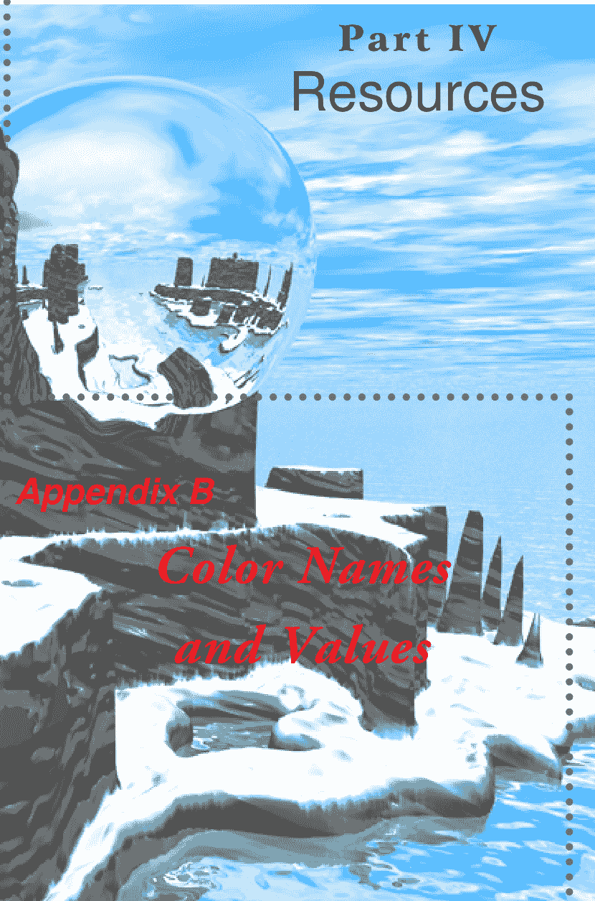

## 附录 B 颜色名称和值

**1030** 第四部分 — 资源

### 颜色理论

这是一篇关于加色法的简短论述，旨在帮助你理解可见光谱以及 Navigator 和浏览器中的 JavaScript 编译器如何处理颜色。对于那些从传统绘画转型的艺术家来说，你们从混合颜料中知道，通过将颜色相加可以创造新的颜色，例如将蓝色和红色相加得到紫色。你们也知道，如果将足够多的差异较大的颜色混合在一起，最终会得到深棕色或黑色。

然而，当处理可见光谱时，你必须将所有这些理论抛诸脑后，因为它的工作原理完全相反。将所有浅色相加得到白色，而去除所有颜色则得到黑色。可以这样理解：如果你关掉房间里的所有灯，房间变暗是因为光线的缺失。如果你通过调光开关将灯光调到最亮，你会得到白光。如果调光开关只是微微开启，光线会呈现出相对灰暗的色调。

现在，当你用棱镜将光分解成其组成部分时，你可以看到光分为红、绿、蓝三种主要组成部分。通过以不同的强度组合这三种成分，你可以创造出数百万种不同的颜色。然而，将这三种颜色组合以达到特定颜色的方式有时可能非常反直觉。例如，要得到最亮、最鲜艳的黄色，你需要将全强度的绿色和全强度的红色相加。要得到青色，你需要将全强度的蓝色和全强度的绿色相加。要得到比青柠色更深的绿色，你需要降低绿色成分的强度。

幸运的是，在 Navigator 中有大量广为人知的颜色名称可供使用，无需指定精确数值来获得你想要的颜色。只需确保拼写正确即可。你可以使用大写字母、小写字母或两者的组合。Navigator 除了识别所有 JavaScript 颜色名称作为 HTML 代码中的属性值外，还识别十六种普遍认可的颜色名称。

十六种普遍认可的颜色名称是：

- aqua, black, blue, fuchsia, gray, green, lime, maroon, navy, olive, purple, red, silver, teal, white, yellow

所有广为人知的 JavaScript 颜色名称，以及它们的 HEX、rgb% 和 rgb 数值等价物都在本概述后面的图表中，从第 1033 页开始。相同的信息也包含在 CD-ROM 的示例文件中：[Sample1100-AllColorValues.html](Sample1100-AllColorValues.html)。如果你只是想查看所有实际显示的颜色及其名称，请查看 [Sample1100-AllColorNames.html](Sample1100-AllColorNames.html)。要转换颜色，或从头开始创建自己的颜色，请查阅第 340 页，其中包含 [Sample434.html](Sample434.html) 中的颜色转换计算器。

### 十六进制三元组颜色

在常规 HTML 中，你也可以将颜色指定为十六进制三元组，前面加井号（#）。在动态 HTML（DHTML）中，使用层叠样式表（CSS）语法或 JavaScript 语法，你还可以选择使用 `rgb()` 函数来指定颜色值。

十六进制三元组 RGB 颜色基于 16 进制数学。当你想在 16 进制数学中表示一个数字时，可以使用字母 "A"—"F"，或者因为 HTML 不区分大小写，你也可以选择使用小写字母 "a"—"f" 来表示数字 10—15，因为这些数字没有单个数字的表示方式。

在 16 进制数学中：

A=10, B=11, C=12, D=13, E=14, F=15
a=10, b=11, c=12, d=13, e=14, f=15

要将颜色表示为 RGB 十六进制三元组，首先需要知道它由六个数字组成，范围从 0-9 或字母从 A-F 或 a-f。井号（#）字符后的前两个值表示红色成分 **RR**，第二组两个值表示绿色成分 **GG**，第三组两个值表示蓝色成分 **BB**，如下表所示：

| #RRGGBB | | 颜色名称等价物 |
|---|---|---|
| #000000 | = | black |
| #FFFFFF | = | white |
| #333333 | = | darkgray |
| #FF0000 | = | red |
| #00FF00 | = | lime |
| #0000FF | = | blue |
| #FFFF00 | = | yellow |
| #9300EE | = | purple |

获得一种未由公认颜色名称指定的颜色，最简单的方法可能是查看第 1033 页开始的图表中名称旁边的数值，将其作为起点并尝试不同的数值，直到获得你想要的效果。

以下示例演示了如何使用 BODY 元素的 TEXT 属性指定一种类似洋红色的 HEX 颜色，注意它始终以井号（#）开头，并用引号或双引号括起来，如下所示：

```
<BODY TEXT="#fa13de">
```


 ## **rgb( )** 函数

在 CSS 语法和 JavaScript 语法中，样式表定义中的颜色指定方式比普通 HTML 更多。除了使用公认的颜色名称（包括所有 JavaScript 颜色名称）或十六进制三色组外，还可以使用 **rgb( )** 函数来表达颜色。

**rgb( )** 函数接受三个参数 **redArg**、**greenArg** 和 **blueArg**，分别代表完整颜色的红、绿、蓝值。它们以逗号分隔，可以是 0 到 255 之间的数字，也可以是 0% 到 100% 之间的百分比。如果使用百分比，则每个参数的数字后必须紧跟百分号（%）。

**rgb( )** 函数的语法在 CSS 语法和 JavaScript 语法样式表中完全相同。

### CSS 语法和 JavaScript 语法：

```
rgb(redArg, greenArg, blueArg)
rgb(redArg%, greenArg%, blueArg%)
```

在 0-255 的计量方案中，数值从最低值（该颜色值为零）到 255（该颜色值为满），因此：

| rgb 值 | 含义 | 描述 | = | 颜色 |
|---|---|---|---|---|
| rgb( 255, 0, 0 ) | 含义： | 全红，无绿，无蓝 | = | 红色 |
| rgb( 255, 0, 255 ) | 含义： | 全红，无绿，全蓝 | = | 紫红色 |
| rgb( 0, 0, 255 ) | 含义： | 无红，无绿，全蓝 | = | 蓝色 |
| rgb( 0, 255, 255 ) | 含义： | 无红，全绿，全蓝 | = | 水绿色 |
| rgb( 0, 255, 0 ) | 含义： | 无红，全绿，无蓝 | = | 酸橙色 |
| rgb( 255, 255, 0 ) | 含义： | 全红，全绿，无蓝 | = | 黄色 |
| rgb( 255, 255, 255 ) | 含义： | 全红，全绿，全蓝 | = | 白色 |
| rgb( 0, 0, 0 ) | 含义： | 无红，无绿，无蓝 | = | 黑色 |
| rgb( 100%, 0%, 0% ) | 含义： | 全红，无绿，无蓝 | = | 红色 |
| rgb( 100%, 0%, 100% ) | 含义： | 全红，无绿，全蓝 | = | 紫红色 |
| rgb( 0%, 0%, 100% ) | 含义： | 无红，无绿，全蓝 | = | 蓝色 |
| rgb( 0%, 100%, 100% ) | 含义： | 无红，全绿，全蓝 | = | 水绿色 |
| rgb( 0%, 100%, 0% ) | 含义： | 无红，全绿，无蓝 | = | 酸橙色 |
| rgb( 100%, 100%, 0% ) | 含义： | 全红，全绿，无蓝 | = | 黄色 |
| rgb( 100%, 100%, 100%) | 含义： | 全红，全绿，全蓝 | = | 白色 |
| rgb( 0%, 0%, 0% ) | 含义： | 无红，无绿，无蓝 | = | 黑色 |

## 附录 B — 颜色名称与值

### 公认颜色名称与值对照表

| 颜色名称 | 十六进制值 | RGB 0-255 值 | RGB 0-100% 值 |
|------------|-----------|-----------------|------------------|
| aliceblue | F0F8FF | 240, 248, 255 | 94, 97, 100 |
| antiquewhite | FAEBD7 | 250, 235, 215 | 98, 92, 84 |
| aqua | 00FFFF | 0, 255, 255 | 0, 100, 100 |
| aquamarine | 7FFFD4 | 127, 255, 212 | 50, 100, 83 |
| azure | F0FFFF | 240, 255, 255 | 94, 100, 100 |
| beige | F5F5DC | 245, 245, 220 | 96, 96, 86 |
| bisque | FFE4C4 | 255, 228, 196 | 100, 89, 77 |
| black | 000000 | 0, 0, 0 | 0, 0, 0 |
| blanchedalmond | FFEBCD | 255, 235, 205 | 100, 92, 80 |
| blue | 0000FF | 0, 0, 255 | 0, 0, 100 |
| blueviolet | 8A2BE2 | 138, 43, 226 | 54, 17, 89 |
| brown | A52A2A | 165, 42, 42 | 65, 16, 16 |
| burlywood | DEB887 | 222, 184, 135 | 87, 72, 53 |
| cadetblue | 5F9EA0 | 95, 158, 160 | 37, 62, 63 |
| chartreuse | 7FFF00 | 127, 255, 0 | 50, 100, 0 |
| chocolate | D2691E | 210, 105, 30 | 82, 41, 12 |
| coral | FF7F50 | 255, 127, 80 | 100, 50, 31 |
| cornflowerblue | 6495ED | 100, 149, 237 | 39, 58, 93 |
| cornsilk | FFF8DC | 255, 248, 220 | 100, 97, 86 |
| crimson | DC143C | 220, 20, 60 | 86, 8, 24 |
| cyan | 00FFFF | 0, 255, 255 | 0, 100, 100 |
| darkblue | 00008B | 0, 0, 139 | 0, 0, 55 |
| darkcyan | 008B8B | 0, 139, 139 | 0, 55, 55 |
| darkgoldenrod | B8860B | 184, 134, 11 | 72, 53, 4 |
| darkgray | A9A9A9 | 169, 169, 169 | 66, 66, 66 |
| darkgreen | 006400 | 0, 100, 0 | 0, 39, 0 |
| darkkhaki | BDB76B | 189, 183, 107 | 74, 72, 42 |
| darkmagenta | 8B008B | 139, 0, 139 | 55, 0, 55 |
| darkolivegreen | 556B2F | 85, 107, 47 | 33, 42, 18 |
| darkorange | FF8C00 | 255, 140, 0 | 100, 55, 0 |
| darkorchid | 9932CC | 153, 50, 204 | 60, 20, 80 |
| darkred | 8B0000 | 139, 0, 0 | 55, 0, 0 |
| darksalmon | E9967A | 233, 150, 122 | 91, 59, 48 |
| darkseagreen | 8FBC8F | 143, 188, 143 | 56, 74, 56 |
| darkslateblue | 483D8B | 72, 61, 139 | 28, 24, 55 |
| darkslategray | 2F4F4F | 47, 79, 79 | 18, 31, 31 |
| darkturquoise | 00CED1 | 0, 206, 209 | 0, 81, 82 |
| darkviolet | 9400D3 | 148, 0, 211 | 58, 0, 83 |
| deeppink | FF1493 | 255, 20, 147 | 100, 8, 58 |
| deepskyblue | 00BFFF | 0, 191, 255 | 0, 75, 100 |
| dimgray | 696969 | 105, 105, 105 | 41, 41, 41 |
| dodgerblue | 1E90FF | 30, 144, 255 | 12, 56, 100 |
| firebrick | B22222 | 178, 34, 34 | 70, 13, 13 |
| floralwhite | FFFAF0 | 255, 250, 240 | 100, 98, 94 |
| forestgreen | 228B22 | 34, 139, 34 | 13, 55, 13 |
| fuchsia | FF00FF | 255, 0, 255 | 100, 0, 100 |
| gainsboro | DCDCDC | 220, 220, 220 | 86, 86, 86 |
| ghostwhite | F8F8FF | 248, 248, 255 | 97, 97, 100 |
| gold | FFD700 | 255, 215, 0 | 100, 84, 0 |
| goldenrod | DAA520 | 218, 165, 32 | 85, 65, 13 |
| gray | 808080 | 128, 128, 128 | 50, 50, 50 |
| green | 008000 | 0, 128, 0 | 0, 50, 0 |
| greenyellow | ADFF2F | 173, 255, 47 | 68, 100, 18 |
| honeydew | F0FFF0 | 240, 255, 240 | 94, 100, 94 |
| hotpink | FF69B4 | 255, 105, 180 | 100, 41, 71 |
| indianred | CD5C5C | 205, 92, 92 | 80, 36, 36 |
| indigo | 4B0082 | 75, 0, 130 | 29, 0, 51 |
| ivory | FFFFF0 | 255, 255, 240 | 100, 100, 94 |
| khaki | F0E68C | 240, 230, 140 | 94, 90, 55 |
| lavender | E6E6FA | 230, 230, 250 | 90, 90, 98 |
| lavenderblush | FFF0F5 | 255, 240, 245 | 100, 94, 96 |
| lawngreen | 7CFC00 | 124, 252, 0 | 49, 99, 0 |
| lemonchiffon | FFFACD | 255, 250, 205 | 100, 98, 80 |
| lightblue | ADD8E6 | 173, 216, 230 | 68, 85, 90 |
| lightcoral | F08080 | 240, 128, 128 | 94, 50, 50 |
| lightcyan | E0FFFF | 224, 255, 255 | 88, 100, 100 |
| lightgoldenrodyellow | FAFAD2 | 250, 250, 210 | 98, 98, 82 |
| lightgreen | 90EE90 | 144, 238, 144 | 56, 93, 56 |
| lightgrey | D3D3D3 | 211, 211, 211 | 83, 83, 83 |
| lightpink | FFB6C1 | 255, 182, 193 | 100, 71, 76 |
| lightsalmon | FFA07A | 255, 160, 122 | 100, 63, 48 |
| lightseagreen | 20B2AA | 32, 178, 170 | 13, 70, 67 |
| lightskyblue | 87CEFA | 135, 206, 250 | 53, 81, 98 |
| lightslategray | 778899 | 119, 136, 153 | 47, 53, 60 |
| lightsteelblue | B0C4DE | 176, 196, 222 | 69, 77, 87 |
| lightyellow | FFFFE0 | 255, 255, 224 | 100, 100, 88 |
| lime | 00FF00 | 0, 255, 0 | 0, 100, 0 |
| limegreen | 32CD32 | 50, 205, 50 | 20, 80, 20 |
| linen | FAF0E6 | 250, 240, 230 | 98, 94, 90 |
| magenta | FF00FF | 255, 0, 255 | 100, 0, 100 |
| maroon | 800000 | 128, 0, 0 | 50, 0, 0 |
| mediumaquamarine | 66CDAA | 102, 205, 170 | 40, 80, 67 |
| mediumblue | 0000CD | 0, 0, 205 | 0, 0, 80 |
| mediumorchid | BA55D3 | 186, 85, 211 | 73, 33, 83 |
| mediumpurple | 9370DB | 147, 112, 219 | 58, 44, 86 |
| mediumseagreen | 3CB371 | 60, 179, 113 | 24, 70, 44 |
| mediumslateblue | 7B68EE | 123, 104, 238 | 48, 41, 93 |
| mediumspringgreen | 00FA9A | 0, 250, 154 | 0, 98, 60 |
| mediumturquoise | 48D1CC | 72, 209, 204 | 28, 82, 80 |
| mediumvioletred | C71585 | 199, 21, 133 | 78, 8, 52 |
| midnightblue | 191970 | 25, 25, 112 | 10, 10, 44 |
| mintcream | F5FFFA | 245, 255, 250 | 96, 100, 98 |
| mistyrose | FFE4E1 | 255, 228, 225 | 100, 89, 88 |
| moccasin | FFE4B5 | 255, 228, 181 | 100, 89, 71 |
| navajowhite | FFDEAD | 255, 222, 173 | 100, 87, 68 |
| navy | 000080 | 0, 0, 128 | 0, 0, 50 |
| oldlace | FDF5E6 | 253, 245, 230 | 99, 96, 90 |
| olive | 808000 | 128, 128, 0 | 50, 50, 0 |
| olivedrab | 6B8E23 | 107, 142, 35 | 42, 56, 14 |
| orange | FFA500 | 255, 165, 0 | 100, 65, 0 |
| orangered | FF4500 | 255, 69, 0 | 100, 27, 0 |
| orchid | DA70D6 | 218, 112, 214 | 85, 44, 84 |
| palegoldenrod | EEE8AA | 238, 232, 170 | 93, 91, 67 |
| palegreen | 98FB98 | 152, 251, 152 | 60, 98, 60 |
| paleturquoise | AFEEEE | 175, 238, 238 | 69, 93, 93 |
| palevioletred | DB7093 | 219, 112, 147 | 86, 44, 58 |
| papayawhip | FFEFD5 | 255, 239, 213 | 100, 94, 84 |
| peachpuff | FFDAB9 | 255, 218, 185 | 100, 85, 73 |
| peru | CD853F | 205, 133, 63 | 80, 52, 25 |
| pink | FFC0CB | 255, 192, 203 | 100, 75, 80 |
| plum | DDA0DD | 221, 160, 221 | 87, 63, 87 |
| powderblue | B0E0E6 | 176, 224, 230 | 69, 88, 90 |
| purple | 800080 | 128, 0, 128 | 50, 0, 50 |
| red | FF0000 | 255, 0, 0 | 100, 0, 0 |
| rosybrown | BC8F8F | 188, 143, 143 | 74, 56, 56 |
| royalblue | 4169E1 | 65, 105, 225 | 25, 41, 88 |
| saddlebrown | 8B4513 | 139, 69, 19 | 55, 27, 7 |
| salmon | FA8072 | 250, 128, 114 | 98, 50, 45 |
| sandybrown | F4A460 | 244, 164, 96 | 96, 64, 38 |


 ## 附录 B — 颜色名称与值

| 颜色名称 | 十六进制值 | RGB 0-255 值 | RGB 0-100% 值 |
|------------|-----------|-----------------|------------------|
| seagreen | 2E8B57 | 46, 139, 87 | 18, 55, 34 |
| seashell | FFF5EE | 255, 245, 238 | 100, 96, 93 |
| sienna | A0522D | 160, 82, 45 | 63, 32, 18 |
| silver | C0C0C0 | 192, 192, 192 | 75, 75, 75 |
| skyblue | 87CEEB | 135, 206, 235 | 53, 81, 92 |
| slateblue | 6A5ACD | 106, 90, 205 | 42, 35, 80 |
| slategray | 708090 | 112, 128, 144 | 44, 50, 56 |
| snow | FFFAFAC | 255, 250, 250 | 100, 98, 98 |
| springgreen | 00FF7F | 0, 255, 127 | 0, 100, 50 |
| steelblue | 4682B4 | 70, 130, 180 | 27, 51, 71 |
| tan | D2B48C | 210, 180, 140 | 82, 71, 55 |
| teal | 008080 | 0, 128, 128 | 0, 50, 50 |
| thistle | D8BFD8 | TRANSLATESTO | 85, 75, 85 |
| tomato | FF6347 | 255, 99, 71 | 100, 39, 28 |
| turquoise | 40E0D0 | 64, 224, 208 | 25, 88, 82 |
| violet | EE82EE | 238, 130, 238 | 93, 51, 93 |
| wheat | F5DEB3 | 245, 222, 179 | 96, 87, 70 |
| white | FFFFFF | 255, 255, 255 | 100, 100, 100 |
| whitesmoke | F5F5F5 | 245, 245, 245 | 96, 96, 96 |
| yellow | FFFF00 | 255, 255, 0 | 100, 100, 0 |
| yellowgreen | 9ACD32 | 154, 205, 50 | 60, 80, 20 |

## 第四部分 — 资源

## 附录 C — 引用的示例文件

## 示例文件与主题

对于仅在 CD-ROM 上的示例，通常可以在在线指南中找到更多相关信息，该指南位于：

"DHTML-JS_BOOK-Main_Files/HTML_BOOK-Online" 文件夹中。

| 页码 | 示例文件名 | 示例#, 例# | 主题 |
|--------|------------------|-------------------|-------|
| CD-ROM | Sample0.html | 示例 0, 例 1-0 | 我的主页或其他 |
| CD-ROM | Sample1.html | 示例 1, 例 1-1 | 我的第一个主页 |
| CD-ROM | Sample2.html | 示例 2, 例 1-2 | PRE 元素 |
| CD-ROM | Sample3.html | 示例 3, 例 1-3 | MULTICOL 元素 |
| CD-ROM | Sample4.html | 示例 4, 例 1-4 | SPACER 元素示例 1 |
| CD-ROM | Sample5.html | 示例 5, 例 1-5 | SPACER 元素示例 2 |
| CD-ROM | Sample6.html | 示例 6, 例 1-6 | H1 至 H6 标题示例 |
| CD-ROM | Sample7.html | 示例 7, 例 1-7 | 换行示例 |
| CD-ROM | Sample8.html | 示例 8, 例 1-9 | 水平线 1 |
| CD-ROM | Sample9.html | 示例 9, 例 1-9 | 水平线 2 |
| CD-ROM | Sample10.html | 示例 10, 例 2-0 | 文本标记示例 |
| CD-ROM | Sample11.html | 示例 11, 例 2-1 | 字体大小示例 1 |
| CD-ROM | Sample12.html | 示例 12, 例 2-2 | 字体大小示例 2 |
| CD-ROM | Sample13.html | 示例 13, 例 2-3 | 字体大小示例 3 |
| CD-ROM | Sample14.html | 示例 14, 例 2-4 | 字体大小示例 4 |
| CD-ROM | Sample15.html | 示例 15, 例 2-5 | BLOCKQUOTE 和 CITE 示例 |
| CD-ROM | Sample16.html | 示例 16, 例 2-6 | EM 示例 |
| CD-ROM | Sample17.html | 示例 17, 例 2-7 | STRONG 示例 |
| CD-ROM | Sample18.html | 示例 18, 例 2-8 | 短语元素示例 |
| CD-ROM | Sample19.html | 示例 19, 例 2-9 | 有序列表示例 1 |
| CD-ROM | Sample20.html | 示例 20, 例 2-10 | 有序列表示例 2 |
| CD-ROM | Sample21.html | 示例 21, 例 2-11 | 无序列表示例 1 |
| CD-ROM | Sample22.html | 示例 22, 例 2-12 | 定义列表示例 1 |
| CD-ROM | Sample23.html | 示例 23, 例 2-13 | 目录列表示例 1 |
| CD-ROM | Sample24.html | 示例 24, 例 2-14 | 目录列表示例 1 |
| CD-ROM | Sample30.html | 示例 30, 例 3-0 | 链接示例 1 |
| CD-ROM | Sample31.html | 示例 31, 例 3-1 | 链接示例 2 |
| CD-ROM | Sample32.html | 示例 32, 例 3-2 | 链接示例 3 |
| 943 | Sample33.html | 示例 33, 例  Midnight 3-3 | 图像示例 1 |
| 946 | Sample34.html | 示例 34, 例 3-4 | 图像示例 2 |
| CD-ROM | Sample35Art.html | 示例 35, 例 3-5 | 显示艺术作品 |
| 949 | Sample36.html | 示例 36, 例 3-6 | 图像映射区域示例 1 |
| CD-ROM | Sample36.map | 示例 36, 例 3-6 | 图像映射区域示例 1- 映射文件 |
| CD-ROM | Sample37.html | 示例 37, 例 3-7 | 图像映射区域示例 2 |
| CD-ROM | Sample38-D-MetalProfiles.html | 示例 38, 例 3-8 | 金属型材 |
| CD-ROM | Sample38-Glass.html | 示例 38, 例 3-8 | 普通画框玻璃 |
| CD-ROM | Sample38-Mats.html | 示例 38, 例 3-8 | Bainbridge Alphamat 衬纸颜色 |
| CD-ROM | Sample38-PlexiGlass.html | 示例 38, 例 3-8 | 普通亚克力玻璃 |
| CD-ROM | Sample38-Polymer.html | 示例 38, 例 3-8 | Eastern Polymer 框架组 1 |
| CD-ROM | Sample38-Wood.html | 示例 38, 例 3-8 | Washington Wood 框架组 1 |
| CD-ROM | Sample38.html | 示例 38, 例 3-8 | 图像映射区域示例 3 |
| CD-ROM | Sample38frameset.html | Sample 38 的框架集 | | |
| 954 | Sample40.html | 示例 40, 例 4-0 | 表格示例 1 |
| 955 | Sample41.html | 示例 41, 例 4-1 | 表格示例 2 |
| 959 | Sample42.html | 示例 42, 例 4-2 | 表格示例 3 |
| CD-ROM | Sample43.html | 示例 43, 例 4-3 | 表格化颜色图表 |

| 页码 | 示例文件名 | 示例#, 例# | 主题 |
|--------|------------------|-------------------|-------|
| CD-ROM | Sample50-A.html | 示例 50, 例 5-0 | 外部源文件 A |
| CD-ROM | Sample50-B.html | 示例 50, 例 5-0 | 外部源文件 B |
| CD-ROM | Sample50-C.html | 示例 50, 例 5-0 | 外部源文件 C |
| CD-ROM | Sample50-D.html | 示例 50, 例 5-0 | 外部源文件 D |
| CD-ROM | Sample50-E.html | 示例 50, 例 5-0 | 外部源文件 E |
| 970 | Sample50-Frameset-1.html | 示例 50, 框架集-1 | |
| 977 | Sample50-Frameset-2.html | 示例 50, 框架集-2 | |
| 978 | Sample50-Frameset-3.html | 示例 50, 框架集-3 | |
| 978 | Sample50-Frameset-4.html | 示例 50, 框架集-4 | |
| CD-ROM | Sample50-Frameset-5.html | 示例 50, 框架集-5 | |
| CD-ROM | Sample50.html | 示例 50, 例 5-0 | 图像映射区域 |
| 988 | Sample51-A.html | 示例 51, 例 5-1 | 源 A |
| 988 | Sample51-B.html | 示例 51, 例 5-1 | 源 B |
| 988 | Sample51-C.html | 示例 51, 例 5-1 | 源 C |
| 982 | Sample51-Frameset-6.html | Sample 51 的框架集-6 | |
| 987 | Sample51-Frameset-7.html | Sample 51 的框架集-7 | |
| CD-ROM | Sample51-Frameset-DP2000.html | Sample 51 的框架集-DP2000 | 带框架的 Welcome 2000 页面 |
| 980 | Sample51-Frameset-DP3.html | Sample 51 的框架集-DP3 | 带框架的 Welcome DP3 页面 |
| 987 | Sample51-main.html | 示例 51, 例 5-1 | 源 main |
| 987 | Sample51-toc.html | 示例 51, 例 5-1 | 源 toc |
| CD-ROM | Sample52-explain.html | 示例 52, 例 5-2 | 说明 |
| 985 | Sample52-Frameset-8D3.html | Sample 52 的框架集-8D3 | |
| 985 | Sample52-Frameset-8D4.html | Sample 52 的框架集-8D4 | |
| CD-ROM | Sample53-explain.html | 示例 53, 例 5-3 | 说明 |
| CD-ROM | Sample53-Frameset-9.html | Sample 53 的框架集 | |
| CD-ROM | Sample54-Frameset-10.html | Sample 54 的框架集 | |
| CD-ROM | Sample55-FramesetMother.html | Sample 55 的框架集 | 带框架的 Welcome 5000 页面 |
| CD-ROM | Sample56-Frameset-11.html | Sample 56 的框架集 | |
| CD-ROM | Sample60.html | 示例 60, 例 6-0 | 按钮 |
| CD-ROM | Sample61.html | 示例 61, 例 6-1 | 重置按钮 |
| CD-ROM | Sample62.html | 示例 62, 例 6-2 | 提交按钮 |
| CD-ROM | Sample63.html | 示例 63, 例 6-3 | Input type=image |
| CD-ROM | Sample64.html | 示例 64, 例 6-4 | 单选按钮 |
| CD-ROM | Sample65.html | 示例 65, 例 6-5 | 单选按钮 |
| CD-ROM | Sample66.html | 示例 66, 例 6-6 | 复选框 |
| CD-ROM | Sample67.html | 示例 67, 例 6-7 | 上传输入 |
| CD-ROM | Sample68.html | 示例 68, 例 6-8 | 隐藏输入 |
| CD-ROM | Sample69.html | 示例 69, 例 6-9 | 密码输入 |
| CD-ROM | Sample70.html | 示例 70, 例 6-10 | 文本框 |
| CD-ROM | Sample71-mailsent.htm | 示例 71, 例 6-11 | Dreamplay Studio 的感谢页面 |
| CD-ROM | Sample71-OrderForm.html | 示例 71, 例 6-11 | DreamPlay 采购订单 |
| CD-ROM | Sample71-SimpleForm.html | 示例 71, 例 6-11 | DreamPlay 采购订单 |
| CD-ROM | Sample72.html | 示例 72, 例 6-12 | Textarea 元素 |
| CD-ROM | Sample73.html | 示例 73, 例 6-13 | Select 元素 |
| CD-ROM | Sample74-Large.html | 示例 74, 例 6-14 | Embed 元素 |
| CD-ROM | Sample74.html | 示例 74, 例 6-14 | Embed 元素 |
| CD-ROM | Sample75-QTVR-2.html | 示例 75, 例 6-15 | 嵌入 QTVR 2 |
| CD-ROM | Sample76-Audio.html | 示例 76, 例 6-16 | 嵌入 Furthur 歌曲的音频文件 |
| CD-ROM | Sample77-QD3D.html | 示例 77, 例 6-17 | 嵌入 QD3D |
| CD-ROM | Sample78-QD3D.html | 示例 78, 例 6-18 | 嵌入 QD3D |
| CD-ROM | Sample79.html | 示例 79, 例 6-19 | 嵌入 VRML |
| CD-ROM | Sample80.html | 示例 80, 例 6-20 | Java Hello World 小程序 |
| CD-ROM | Sample81.html | 示例 81, 例 6-21 | Java 小程序 |
| CD-ROM | Sample82.html | 示例 82, 例 6-22 | 用于嵌入影片的 Object 元素 |


 ## 第四部分 — 资源

| 页码 | 示例文件名 | 样例#, 示例# | 主题 |
|--------|-----------------|-------------------|-------|
| CD-ROM | Sample83.html | 样例 83 | 示例 6-23 | Meta 元素 |
| 10 | Sample201.html | 样例 201 | 示例 1-1 | font-size 和 color 样式属性 |
| CD-ROM | Sample202.html | 样例 202 | 示例 1-2 | 样式的上下文选择条件 |
| 17 | Sample203.html | 样例 203 | 示例 1-3 | 样式的上下文选择条件 |
| 21 | Sample204.html | 样例 204 | 示例 1-4 | 层叠样式表的使用 |
| 26 | Sample205.html | 样例 205 | 示例 1-5 | 字体类型属性 |
| 29 | Sample206.html | 样例 206 | 示例 1-6 | 文本类型属性 |
| 33 | Sample207.html | 样例 207 | 示例 1-7 | 外边距 |
| 36 | Sample208.html | 样例 208 | 示例 1-8 | 内边距 |
| 38 | Sample209.html | 样例 209 | 示例 1-9 | 边框样式 |
| 40 | Sample210.html | 样例 210 | 示例 1-10 | 背景颜色 |
| 42 | Sample211.html | 样例 211 | 示例 1-11 | 背景图片 |
| 44 | Sample212.html | 样例 212 | 示例 1-12 | 编译 |
| 46 | Sample213.html | 样例 213 | 示例 1-13 | 边框样式 |
| 48 | Sample214.html | 样例 214 | 示例 1-14 | 边框样式 |
| 50 | Sample215.html | 样例 215 | 示例 1-15 | 花式嵌套边框样式 |
| 51 | Sample216.html | 样例 216 | 示例 1-16 | 更花哨的嵌套边框样式 |
| 54 | Sample217.html | 样例 217 | 示例 1-17 | 边框边的省略和变体 |
| 56 | Sample218.html | 样例 218 | 示例 1-18 | 颜色表 2 |
| 59 | Sample219.html | 样例 219 | 示例 1-19 | 宽度 |
| 61 | Sample220.html | 样例 220 | 示例 1-20 | 宽度和外边距 |
| 63 | Sample221.html | 样例 221 | 示例 1-21 | 浮动和对齐 |
| 65 | Sample222.html | 样例 222 | 示例 1-22 | 清除、浮动和对齐 |
| 66 | Sample223.html | 样例 223 | 示例 1-23 | 空白 |
| 69 | Sample224.html | 样例 224 | 示例 1-24 | 列表 |
| 70 | Sample224B.html | 样例 224B | 示例 1-24B | 列表 |
| 71 | Sample224C.html | 样例 224C | 示例 1-24C | 嵌套列表 |
| 73 | Sample225.html | 样例 225 | 示例 1-25 | 样式的 CLASS |
| 74 | Sample226.html | 样例 226 | 示例 1-26 | 样式的 CLASS |
| 76 | Sample227.html | 样例 227 | 示例 1-27 | 样式的 CLASS |
| 77 | Sample228.html | 样例 228 | 示例 1-28 | 样式的 CLASS |
| 78 | Sample229.html | 样例 229 | 示例 1-29 | 样式的 CLASS |
| 80 | Sample230.html | 样例 230 | 示例 1-30 | 样式的 CLASS |
| 82 | Sample231.html | 样例 231 | 示例 1-31 | 样式的 CLASS |
| 83 | Sample232.html | 样例 232 | 示例 1-32 | 命名个体样式 |
| 84 | Sample233.html | 样例 233 | 示例 1-33 | 命名个体样式 |
| 85 | Sample234.html | 样例 234 | 示例 1-34 | 命名个体样式 |
| 87 | Sample235.html | 样例 235 | 示例 1-35 | 表格样式注意事项 1 |
| 89 | Sample236.html | 样例 236 | 示例 1-36 | 表格样式注意事项 2 |
| 91 | Sample237.html | 样例 237 | 示例 1-37 | 表格样式注意事项 |
| 92 | Sample238.html | 样例 238 | 示例 1-38 | 巧妙的表格样式继承 |
| 94 | Sample239.html | 样例 239 | 示例 1-39 | 上下文选择条件 |
| 95 | Sample240.html | 样别出心裁翻译示例 240 | 示例 1-40 | 上下文选择条件 |
| 96 | Sample241.html | 样例 241 | 示例 1-41 | 高级列表和上下文选择 |
| 97 | Sample242.html | 样例 242 | 示例 1-42 | 上下文选择条件 |
| 100 | Sample243.html | 样例 243 | 示例 1-43 | 上下文选择条件 |
| 101 | Sample244.html | 样例 244 | 示例 1-44 | 上下文选择条件 |
| 102 | Sample245.html | 样例 245 | 示例 1-45 | 上下文选择条件 |
| 103 | Sample246.html | 样例 246 | 示例 1-46 | 上下文选择条件 |
| 104 | Sample247.html | 样例 247 | 示.例 1-47 | 样式作为属性 |
| 107 | Sample248.html | 样例 248 | 示例 1-48 | 带 STYLE 的 SPAN 元素 |
| 108 | Sample249.html | 样例 249 | 示例 1-49 | 带 STYLE 的 SPAN 元素 |
| 109 | Sample250.html | 样例 250 | 示例 1-50 | 带 STYLE 的 SPAN 元素 |
| 110 | Sample251.html | 样例 251 | 示例 1-51 | 带 CLASS 样式的 SPAN 元素 |

## 附录 C — 示例文件

| 页码 | 示例文件名 | 样例#, 示例# | 主题 |
|--------|------------------|-------------------|-------|
| 112 | Sample252.html | 样例 252 | 示例 1-52 | 带 ID 例外的 SPAN 元素 |
| 117 | Sample253-External-CSS-1.html | 样例 253 | 示例 1-53 | 外部 CSS 1 |
| 116 | Sample253.html | 样例 253 | 示例 1-53 | 链接样式表 |
| 117 | Sample254.html | 样例 254 | 示例 1-54 | 链接样式表 |
| 118 | Sample255.html | 样例 255 | 示例 1-55 | 链接样式表 |
| 121 | Sample256.html | 样例 256 | 示例 1-56 | 链接多个样式表 |
| 124 | Sample257.html | 样例 257 | 示例 1-57 | 多个 STYLE 元素 |
| 131 | Sample300.html | 样例 300 示例 2-0 | STYLE 作为层 |
| 133 | Sample301.html | 样例 301 | 示例 2-1 | STYLE 属性作为层 |
| 134 | Sample302.html | 样例 302 | 示例 2-2 | 相对定位的 LAYER 元素 |
| 136 | Sample303.html | 样例 303 | 示例 2-3 | 命名 LAYER 元素 |
| 138 | Sample304.html | 样例 304 | 示例 2-4 | 命名 LAYER 元素中的宽度和高度 |
| 141 | Sample305.html | 样例 305 | 示例 2-5 | 命名 LAYER 元素中的裁剪 |
| 144 | Sample306.html | 样例 306 | 示例 2-6 | 命名 LAYER 元素中的裁剪 |
| 145 | Sample307.html | 样例 307 | 示例 2-7 | clip 属性和特性 |
| 147 | Sample308.html | 样例 308 | 示例 2-8 | z-index |
| 150 | Sample309.html | 样例 309 | 示例 2-9 | visibility |
| 151 | Sample310.html | 样例 310 | 示例 2-10 | layer-background-color |
| 154 | Sample311.html | 样例 311 | 示例 2-11 | layer-background-image |
| 156 | Sample312.html | 样例 312 | 示例 2-12 | layer-background-image |
| CD-ROM | Sample313-External.html | 样例 313 | 示例 2-13 | include-source 属性的外部文件 |
| 159 | Sample313.html | 样例 313 | 示例 2-13 | include-source 属性 |
| 160 | Sample314.html | 样例 314 | 示例 2-14 | include-source 属性注意事项 |
| 160 | Sample314A.html | 样例 314A | 示例 2-14A | include-source |
| 168 | Sample315.html | 样例 315 | 示例 2-15 | LAYER 元素 |
| 169 | Sample316.html | 样例 316 | 示例 2-16 | LAYER 元素 |
| 171 | Sample317.html | 样例 317 | 示例 2-17 | LAYER 元素 |
| 174 | Sample318.html | 样例 318 | 示例 2-18 | ILAYER 元素 |
| 175 | Sample319.html | 样例 319 | 示例 2-19 | ILAYER 元素 |
| 176 | Sample320.html | 样例 320 | 示例 2-20 | NOLAYER 元素 |
| 184 | Sample400.html | 样例 400 | 示例 3-0 | tags 对象属性 |
| 186 | Sample401.html | 样例 401 | 示例 3-1 | classes 对象属性 |
| 188 | Sample402.html | 样例 402 | 示例 3-2 | ids 对象属性 |
| 190 | Sample403.html | 样例 403 | 示例 3-3 | with 函数 |
| 191 | Sample404.html | 样例 404 | 示例 3-4 | 关键字 all |
| 192 | Sample405.html | 样例 405 | 示例 3-5 | 关键字 all 和 with 函数 |
| 198 | Sample406.html | 样例 406 | 示例 3-6 | Script 元素介绍 |
| 202 | Sample407.html | 样例 407 | 示例 3-7 | 用于更改层属性的 Script 元素 |
| CD-ROM | Sample407A.html | 样例 407A | 示例 3-7A | 裁剪矩形层对象 |
| 222 | Sample408.html | 样例 408 | 示例 3-8 | 使用按钮移动层 |
| 224 | Sample409.html | 样例 409 | 示例 3-9 | 使用按钮调整层大小 |
| 231 | Sample410.html | 样例 410 | 示例 3-10 | 性能 |
| 232 | Sample411.html | 样例 411 | 示例 3-11 | 性能 |
| 237 | Sample412.html | 样例 412 | 示例 3-12 | 性能 |
| 238 | Sample413.html | 样例 413 | 示例 3-13 | 标签与继承性 |
| 240 | Sample414.html | 样例 414 | 示例 3-14 | @import |
| 242 | Sample415.html | 样例 415 | 示例 3-15 | JavaScript 2 类场景 |
| 244 | Sample416.html | 样例 416 | 示例 3-16 | JavaScript 2 类场景 |
| 248 | Sample417.html | 样例 417 | 示例 3-17 | JavaScript 2 类场景 |
| 252 | Sample418.html | 样例 418 | 示例 3-18 | JavaScript 2 类场景 |
| 254 | Sample419.html | 样例 419 | 示例 3-19 | JavaScript 2 类场景 |
| 256 | Sample420.html | 样例 420 | 示例 3-20 | JavaScript 2 类场景 |
| 260 | Sample421.html | 样例 421 | 示例 3-21 | @fontdef 和 @font-face |


 # 第四部分 — 资源

| 页码 | 示例文件名 | 示例#, 例# | 主题 |
|---|---|---|---|
| 261 | Sample421.html | 示例 421 例 3-21 | 太阳地球动画 |
| 268 | Sample422.html | 示例 422 例 3-22 | 图层动画 |
| 285 | Sample423.html | 示例 423 例 3-23 | 使用 setInterval 方法循环背景色 |
| 286 | Sample424.html | 示例 424 例 3-24 | setInterval 和 clearInterval 方法 |
| 288 | Sample425.html | 示例 425 例 3-25 | clearTimeout 和 setTimeout 方法 |
| 290 | Sample426.html | 示例 426 例 3-26 | 加载外部文件的图层 |
| 293 | Sample426External1.html | 示例 426 例 3-26A | 外部文件中的图层 |
| CD-ROM | Sample426External2.html | 示例 426 例 3-26B | 外部文件中的图层 |
| CD-ROM | Sample426External3.html | 示例 426 例 3-26C | 外部文件中的图层 |
| CD-ROM | Sample426External4.html | 示例 426 例 3-26D | 外部文件中的图层 |
| CD-ROM | Sample426External5.html | 示例 426 例 3-26E | 外部文件中的图层 |
| CD-ROM | Sample426External6.html | 示例 426 例 3-26F | 外部文件中的图层 |
| 292 | Sample426ExternalGroup.html | 示例 426 例 3-26 | 外部文件中的图层 |
| 296 | Sample427-TTT.html | 示例 427 例 3-27 | 井字棋动画 |
| 309 | Sample428.html | 示例 428 例 3-28 | 简单计时器 |
| 311 | Sample429.html | 示例 429 例 3-29 | 高级计时器 |
| 314 | Sample429Frameset.html | 示例 429 的框架集 | |
| 317 | Sample430.html | 示例 430 例 3-30 | 高级计时器显示 |
| CD-ROM | Sample430Frameset.html | 示例 430 的框架集 | |
| 323 | Sample431.html | 示例 431 例 3-31 | 随机背景 |
| 326 | Sample432.html | 示例 432 例 3-32 | JavaScript 数学方法 |
| CD-ROM | Sample432A.html | 示例 432A 例 3-32A | 计算器显示 |
| 332 | Sample432Frameset.html | 示例 432 的框架集 | |
| 334 | Sample433.html | 示例 433 例 3-33 | Math max、min、pow 方法 |
| 342 | Sample434.html | 示例 434 例 3-34 | 多色转换计算器 |
| CD-ROM | Sample434A.html | 示例 434A 例 3-34A | 计算器显示 |
| 351 | Sample434Frameset.html | 示例 434 的框架集 | |
| 356 | Sample435-1.html | 示例 435-1 例 3-35-1 | 角落地球 |
| 357 | Sample435-2.html | 示例 435-2 例 3-35-2 | 顶部彩虹 |
| 358 | Sample435-4.html | 示例 435-4 例 3-35-4 | 左侧彩虹 |
| 358 | Sample435-7.html | 示例 435-7 例 3-35-7 | 右侧彩虹 |
| 359 | Sample435-9.html | 示例 435-9 例 3-35-9 | 底部彩虹 |
| 351 | Sample435.html | 示例 435 例 3-35 | 边框动画与音乐 |
| 360 | Sample435Frameset.html | 示例 435 的框架集 | |
| 373 | Sample500.html | 示例 500 例 4-0 | 定义和调用函数 |
| 374 | Sample501.html | 示例 501 例 4-1 | 定义和调用函数 |
| 375 | Sample502.html | 示例 502 例 4-2 | 在函数内调用函数 |
| 377 | Sample503.html | 示例 503 例 4-3 | 通过属性赋值调用函数 |
| 379 | Sample504.html | 示例 504 例 4-4 | 函数对象 |
| 381 | Sample505.html | 示例 505 例 4-5 | arguments 数组 |
| 383 | Sample506.html | 示例 506 例 4-6 | arguments 数组属性 |
| 384 | Sample507.html | 示例 507 例 4-7 | 函数嵌套 |
| 393 | Sample508.html | 示例 508 例 4-8 | 为对象创建方法 |
| 394 | Sample509.html | 示例 509 例 4-9 | 为对象创建方法 |
| CD-ROM | Sample510-Extra.html | 示例 510 例 4-10A | 对象定义中的方法 |
| 395 | Sample510.html | 示例 510 例 4-10 | 对象定义中的方法 |
| 397 | Sample511.html | 示例 511 例 4-11 | 在对象定义中包含对象 |
| 400 | Sample512.html | 示例 512 例 4-12 | 使用 prototype 为对象添加方法 |
| 401 | Sample513.html | 示例 513 例 4-13 | 为 Number 对象添加方法 |
| 403 | Sample514.html | 示例 514 例 4-14 | 为对象添加属性 |
| 406 | Sample515.html | 示例 515 例 4-15 | 索引对象属性 |
| 408 | Sample516.html | 示例 516 例 4-16 | 使用字面量表示法创建对象 |
| 409 | Sample517.html | 示例 517 例 4-17 | 使用字面量表示法创建对象 |
| 410 | Sample518.html | 示例 518 例 4-18 | 使用字面量表示法创建对象 |

## 附录 C — 示例文件

| 页码 | 示例文件名 | 示例#, 例# | 主题 |
|--------|------------------|-------------------|-------|
| 413 | Sample519.html | 示例 519 例 4-19 | watch 方法 |
| 414 | Sample520.html | 示例 520 例 4-20 | watch 方法 |
| 425 | Sample521.html | 示例 521 例 4-21 | window 对象的 open 方法 |
| 426 | Sample522.html | 示例 522 例 4-22 | window 对象的 opener 属性 |
| 428 | Sample523.html | 示例 523 例 4-23 | window 对象的 close 方法 |
| 429 | Sample524.html | 示例 524 例 4-24 | 部分 window 方法 |
| 431 | Sample525.html | 示例 525 例 4-25 | scrollBy 和 setInterval 方法 |
| 435 | Sample526.html | 示例 526 例 4-26 | write 方法 |
| 438 | Sample527.html | 示例 527 例 4-27 | cookie |
| 440 | Sample528.html | 示例 528 例 4-28 | cookie 操作 |
| 443 | Sample529.html | 示例 529 例 4-29 | cookie EXPIRES |
| 446 | Sample530.html | 示例 530 例 4-30 | screen 对象 |
| 450 | Sample531.html | 示例 531 例 4-31 | Location 对象属性 |
| 451 | Sample532.html | 示例 532 例 4-32 | replace 和 reload 方法 |
| 453 | Sample533.html | 示例 533 例 4-33 | history 的 back 和 forward 方法 |
| 454 | Sample533Frameset.html | 示例 533 的框架集 | |
| 457 | Sample534.html | 示例 534 例 4-34 | navigator 对象增强 |
| 461 | Sample535.html | 示例 535 例 4-35 | Number 对象 |
| 468 | Sample536.html | 示例 536 例 4-36 | String 函数 |
| 492 | Sample600.html | 示例 600 例 5-0 | break 和 labeled 语句 |
| 495 | Sample601.html | 示例 601 例 5-1 | continue 语句 |
| 497 | Sample602.html | 示例 602 例 5-2 | continue 和 labeled 语句 |
| 504 | Sample603.html | 示例 603 例 5-3 | this 语句 |
| 511 | Sample604.html | 示例 604 例 5-4 | 全局变量 |
| CD-ROM | Sample605.html | 示例 605 例 5-5 | typeof 运算符 |
| 531 | Sample700.html | 示例 700 例 6-0 | 键盘事件、修饰键和警告框 |
| 533 | Sample701.html | 示例 701 例 6-1 | 键盘事件 |
| 534 | Sample702.html | 示例 702 例 6-2 | KeyPress 事件 |
| 535 | Sample703.html | 示例 703 例 6-3 | 鼠标按下改变背景色的键盘事件 |
| 536 | Sample704.html | 示例 704 例 6-4 | 改变背景色的键盘事件 |
| 538 | Sample705.html | 示例 705 例 6-5 | 获取 ALT 键数值 |
| 539 | Sample706.html | 示例 706 例 6-6 | 获取 CONTROL 键数值 |
| 540 | Sample707.html | 示例 707 例 6-7 | 获取 ALT + CONTROL 键数值 |
| 541 | Sample708.html | 示例 708 例 6-8 | 修饰键和键盘事件加载页面 |
| 546 | Sample709.html | 示例 709 例 6-9 | mouseDown 的 captureEvents 方法 |
| 548 | Sample710.html | 示例 710 例 6-10 | 拖拽图像 |
| 550 | Sample711.html | 示例 711 例 6-11 | 拖拽三幅图像中的任意一幅 |
| 553 | Sample712.html | 示例 712 例 6-12 | 拖拽三幅图像中的任意一幅 |
| 558 | Sample713-Chess.html | 示例 713 例 6-13 | 拖拽国际象棋 |
| 581 | Sample714-TTT-Keys.html | 示例 714 例 6-14 | Control 和 Alt 键井字棋 |
| 588 | Sample715.html | 示例 715 例 6-15 | 使用 Switch 语句移动图层 |
| 592 | Sample716.html | 示例 716 例 6-16 | 点击图像启动序列 |
| 596 | Sample717.html | 示例 717 例 6-17 | 点击显示图像 |
| 605 | Sample718.html | 示例 718 例 6-18 | 点击显示图像 |
| 606 | Sample718A.html | 示例 718A 例 6-18A | 点击显示图像 |
| CD-ROM | Sample718B.html | 示例 718B 例 6-18B | 点击显示图像 |
| CD-ROM | Sample718C.html | 示例 718C 例 6-18C | 点击显示图像 |
| CD-ROM | Sample718D.html | 示例 718D 例 6-18D | 点击显示图像 |
| 609 | Sample718Frameset.html | 示例 718 的框架集 | |
| 612 | Sample719.html | 示例 719 例 6-19 | 点击显示图像 |
| 618 | Sample719A.html | 示例 719A 例 6-19A | 点击显示图像 |
| CD-ROM | Sample719B.html | 示例 719B 例 6-19B | 点击显示图像 |
| CD-ROM | Sample719C.html | 示例 719C 例 6-19C | 点击显示图像 |
| CD-ROM | Sample719D.html | 示例 719D 例 6-19D | 点击显示图像 |


 ## 附录 C — 示例文件

| 页码 # | 示例文件名 | Sample#, Example# | 主题 |
|--------|------------------|-------------------|-------|
| CD-ROM | Sample719E.html | 示例 719E 示例 6-19E | 预览图像 |
| 620 | Sample719Frameset.html | 示例 719 框架集 | |
| CD-ROM | Sample719HELP.html | 示例 719H 示例 6-19H | 包含的帮助文件 |
| 623 | Sample720.html | 示例 720 示例 6-20 | 窗口滚动、移动、调整大小修饰符 |
| CD-ROM | Sample721-Tight.html | 示例 721 示例 6-21 | 使用热键移动图层 |
| 628 | Sample721.html | 示例 721 示例 6-21 | 使用热键移动图层 |
| CD-ROM | Sample722-Tight.html | 示例 722 示例 6-22 | 多修饰符移动图层 |
| 632 | Sample722.html | 示例 722 示例 6-22 | 多修饰符移动图层 |
| 648 | Sample723.html | 示例 723 示例 6-23 | 创建新窗口 |
| CD-ROM | Sample724-B-Frameset.html | 示例 724 框架集 | |
| 652 | Sample724.html | 示例 724 示例 6-24 | 用户可自定义网站 |
|李大|658 | Sample724A.html | 示例 724A 示例 6-24A | |
| CD-ROM | Sample724B-hasLayerBGColor.html | 示例 724B 示例 6-24 | 用户可自定义网站 |
| 659 | Sample724Frameset.html | 示例 724 框架集 | |
| 658 | Sample724Right.html | 示例 724 示例 6-21Right | |
| 661 | Sample725.html | 示例 725 示例 6-25 | 拖拽鼠标调整图层大小 |
| CD-ROM | Sample725A.html | 示例 725A 示例 6-25A | 鼠标事件 |
| 665 | Sample726.html | 示例 726 示例 6-26 | routeEvent() 函数 |
| 669 | Sample727.html | 示例 727 示例 6-27 | routeEvent 和 handleEvent 方法 |
| 673 | Sample728.html | 示例 728 示例 6-28 | 嵌套图层中的事件处理 |
| CD-ROM | Sample729.html | 示例 730 示例 6-30 | 鼠标边框变化 |
| CD-ROM | Sample730.html | 示例 730 示例 6-30 | 鼠标边框变化 |
| CD-ROM | Sample774-Chess-Images.html | 示例 774 示例 6-74 | 国际象棋游戏中拖曳图像 |
| 685 | Sample800.html | 示例 800 示例 7-0 | 数组元素显示 |
| 686 | Sample801.html | 示例 801 示例 7-1 | 字面量数组创建 |
| 689 | Sample802.html | 示例 802 示例 7-2 | 嵌套数组 |
| 691 | Sample803.html | 示例 803 示例 7-3 | 二维数组 |
| 692 | Sample804.html | 示例 804 示例 7-4 | 三维数组 |
| CD-ROM | Sample805-writeln.html | 示例 805 示例 7-5 | 数组方法 |
| 694 | Sample805.html | 示例 805 示例 7-5 | 数组方法 |
| 697 | Sample806.html | 示例 806 示例 7-6 | concat 方法 |
| 698 | Sample807.html | 示例 807 示例 7-7 | concat 方法添加元素 |
| 699 | Sample808.html | 示例 808 示例 7-8 | concat 方法删除元素 |
| CD-ROM | Sample809-COMPARE.html | 示例 807 示例 7-7 | concat 方法 |
| 701 | Sample809.html | 示例 809 示例 7-9 | 对象的 concat 方法 |
| 704 | Sample810.html | 示例 810 示例 7-10 | join 方法 |
| 705 | Sample811.html | 示例 811 示例 7-11 | pop 方法 |
| 707 | Sample812.html | 示例 812 示例 7-12 | push 方法 |
| 709 | Sample813.html | 示例 813 示例 7-13 | shift 方法 |
| 711 | Sample812.html | 示例 814 示例 7-14 | unshift 方法 |
| 714 | Sample815.html | 示例 815 示例 7-15 | slice 方法 |
| 717 | Sample816.html | 示例 816 示例 7-16 | splice 方法 |
| 720 | Sample817.html | 示例 817 示例 7-17 | 数组元素的 toString 方法 |
| 724 | Sample818.html | 示例 818 示例 7-18 | 数组对象的 sort 方法 |
| 725 | Sample819.html | 示例 819 示例 7-19 | 更多 sort 方法 |
| 727 | Sample820.html | 示例 820 示例 7-20 | 奇偶排序方法 |
| 728 | Sample821.html | 示例 821 示例 7-21 | 按长度排序 |
| 730 | Sample822.html | 示例 822 示例 7-22 | match 方法返回的数组 |
| 732 | Sample823.html | 示例 823 示例 7-23 | 带 g 的 match 方法返回的数组 |
| 734 | Sample824.html | 示例 824 示例 7-24 | exec 方法返回的数组 |
| 737 | Sample825.html | 示例 825 示例 7-25 | split 方法返回的数组 |
| 741 | Sample826.html | 示例 826 示例 7-26 | 创建颜色表 |
| CD-ROM | Sample826Frameset.html | 示例 826 框架集 | |
| CD-ROM | Sample826Main.html | 示例 826 示例 7-26Main | |

| 页码 # | 示例文件名 | Sample#, Example# | 主题 |
|--------|------------------|-------------------|-------|
| 756 | Sample900.html | 示例 900 示例 8-0 | concat 方法 |
| 757 | Sample901.html | 示例 901 示例 8-1 | concat 方法 |
| 758 | Sample902.html | 示例 902 示例 8-2 | concat 方法 |
| 760 | Sample903.html | 示例 903 示例 8-3 | charAt 方法 |
| 761 | Sample904.html | 示例 904 示例 8-4 | charCodeAt 方法 |
| 763 | Sample905.html | 示例 905 示例 8-5 | fromCharCode 方法 |
| 765 | Sample906.html | 示例 906 示例 8-6 | fromCharCode 方法 |
| 767 | Sample907.html | 示例 907 示例 8-7 | indexOf 方法 |
| 768 | Sample908.html | 示例 908 示例 8-8 | indexOf 方法 |
| 770 | Sample909.html | 示例 909 示例 8-9 | lastIndexOf 方法 |
| 772 | Sample910.html | 示例 910 示例 8-10 | search 方法 |
| 773 | Sample911.html | 示例 911 示例 8-11 | search 方法 |
| 774 | Sample912.html | 示例 912 示例 8-12 | match 方法 |
| 775 | Sample913.html | 示例 913 示例 8-13 | match 方法 |
| 776 | Sample914.html | 示例 914 示例 8-14 | match 方法 |
| 780 | Sample915.html | 示例 915 示例 8-15 | replace 方法 |
| 781 | Sample916.html | 示例 916 示例 8-16 | replace 方法 |
| 785 | Sample917.html | 示例 917 示例 8-17 | split 方法 |
| 787 | Sample918.html | 示例 918 示例 8-18 | 记住子字符串的 split 方法 |
| 789 | Sample919.html | 示例 919 示例 8-19 | slice 方法 |
| 791 | Sample920.html | 示例 920 示例 8-20 | substring 方法 |
| 793 | Sample921.html | 示例 921 示例 8-21 | substr 方法 |
| 796 | Sample922.html | 示例 922 示例 8-22 | anchor 和 link 方法 |
| 799 | Sample923.html | 示例 923 示例 8-23 | 装饰性字符串方法 |
| 822 | Sample1000.html | 示例 1000 示例 9-0 | test 方法 |
| 823 | Sample1001.html | 示例 1001 示例 9-1 | test 方法 |
| 824 | Sample1002.html | 示例 1002 示例 9-2 | test 方法 |
| 826 | Sample1003.html | 示例 1003 示例 9-3 | exec 方法 |
| 827 | Sample1004.html | 示例 1004 示例 9-4 | exec 方法和 input 属性 |
| 828 | Sample1005.html | 示例 1005 示例 9-5 | exec 方法 |
| 831 | Sample1006.html | 示例 1006 示例 9-6 | compile 方法 |
| 833 | Sample1007.html | 示例 1007 示例 9-7 | \D 和 {n,m} 特殊字符 |
| 834 | Sample1008.html | 示例 1008 示例 9-8 | {n,} 特殊字符 |
| 835 | Sample1009.html | 示例 1009 示例 9-9 | 特殊字符 \n |
| 837 | Sample1010.html | 示例 1010 示例 9-10 | 匹配控制字符 |
| 838 | Sample1011.html | 示例 1011 示例 9-11 | 匹配并验证电话号码 |
| 840 | Sample1012.html | 示例 1012 示例 9-12 | exec 与 match 数组元素对比 |
| 843 | Sample1013.html | 示例 1013 示例 9-13 | 匹配并验证姓名、地址 |
| 845 | Sample1014.html | 示例 1014 示例 9-14 | 简单搜索 |
| CD-ROM | Sample1014Frameset.html | 示例 1014 框架集 | |
| CD-ROM | Sample1014Main.html | 示例 1014Main 示例 9-14 Main | |
| 848 | Sample1015-SearchEngine1.html | 示例 1015 示例 9-15 | 搜索引擎 1 |
| CD-ROM | Sample1015-SearchEngine2.html | 示例 1016 示例 9-16 | 搜索引擎 2 |
| CD-ROM | Sample1015-SearchEngine3.html | 示例 1016 示例 9-16 | 搜索引擎 3 |
| CD-ROM | Sample1015Frameset.html | 示例 1015 框架集 | |
| CD-ROM | Sample1015Main-hasArrayEle.html | 示例 1015 示例 9-15 | 搜索关键词 |
| CD-ROM | Sample1015Main.html | 示例 1015 示例 9-15 Main | |
| CD-ROM | Sample1016Frameset.html | 示例 1016 框架集 | |
| CD-ROM | Sample1016Main.html | 示例 1016Main 示例 9-16 Main | |
| CD-ROM | Sample1100-AllColorNames.html | 示例 1100 | 显示所有颜色格式 |
| CD-ROM | Sample1101-AllColorValues.html | 示例 1101 | 显示所有颜色格式 |
| CD-ROM | Sample-AllColorNames.html | | 颜色图表 - 所有 HTML 颜色名称 |
| 882 | Sample10000.html | 示例 10000 示例 10-0 | apply 方法 |
| 884 | Sample10001.html | 示例 10001 示例 10-1 | apply 方法 | JavaScript 1.3 |
| 887 | Sample10002.html | 示例 10002 示例 10-2 | call 方法 | JavaScript 1.3 |
| 891 | Sample10003.html | 示例 10003 示例 10-3 | replace 方法 | JavaScript 1.3 |


 ## 第四部分 资源

## 附录 D

## 语言缩写

## 语言缩写表

以下是可用作大多数 HTML 元素之 LANGUAGE 属性值的**语言缩写**；它们不区分大小写。

| 缩写 | 语言 | 缩写 | 语言 |
| --- | --- | --- | --- |
| aa | 阿法尔语 | fj | 斐济语 |
| ab | 阿布哈兹语 | fo | 法罗语 |
| af | 南非荷兰语 | fr | 法语 |
| am | 阿姆哈拉语 | fy | 弗里西亚语 |
| ar | 阿拉伯语 | | |
| as | 阿萨姆语 | ga | 爱尔兰语 |
| ay | 艾马拉语 | gd | 苏格兰盖尔语 |
| az | 阿塞拜疆语 | gl | 加利西亚语 |
| | | gn | 瓜拉尼语 |
| ba | 巴什基尔语 | gu | 古吉拉特语 |
| be | 白俄罗斯语 | | |
| bg | 保加利亚语 | ha | 豪萨语 |
| bh | 比哈尔语 | hi | 印地语 |
| bi | 比斯拉马语 | hr | 克罗地亚语 |
| bn | 孟加拉语 | hu | 匈牙利语 |
| bo | 藏语 | hy | 亚美尼亚语 |
| br | 布列塔尼语 | | |
| | | ia | 国际语A |
| ca | 加泰罗尼亚语 | ie | 国际语E |
| co | 科西嘉语 | ik | 伊努皮亚克语 |
| cs | 捷克语 | in | 印度尼西亚语 |
| cy | 威尔士语 | is | 冰岛语 |
| | | it | 意大利语 |
| da | 丹麦语 | iw | 希伯来语 |
| de | 德语 | | |
| dz | 不丹语 | ja | 日语 |
| | | ji | 意第绪语 |
| el | 希腊语 | jw | 爪哇语 |
| en | 英语 | | |
| eo | 世界语 | ka | 格鲁吉亚语 |
| es | 西班牙语 | kk | 哈萨克语 |
| et | 爱沙尼亚语 | kl | 格陵兰语 |
| eu | 巴斯克语 | km | 柬埔寨语 |
| | | kn | 卡纳达语 |
| fa | 波斯语 | ko | 韩语 |
| fi | 芬兰语 | ks | 克什米尔语 |
| ku | 库尔德语 | sg | 桑戈语 |
| ky | 柯尔克孜语 | sh | 塞尔维亚-克罗地亚语 |
| | | si | 僧伽罗语 |
| la | 拉丁语 | sk | 斯洛伐克语 |
| ln | 林加拉语 | sl | 斯洛文尼亚语 |
| lo | 老挝语 | sm | 萨摩亚语 |
| lt | 立陶宛语 | sn | 绍纳语 |
| lv | 拉脱维亚语 | so | 索马里语 |
| | | sq | 阿尔巴尼亚语 |
| mg | 马达加斯加语 | sr | 塞尔维亚语 |
| mi | 毛利语 | ss | 斯瓦蒂语 |
| mk | 马其顿语 | st | 塞索托语 |
| ml | 马拉雅拉姆语 | su | 巽他语 |
| mn | 蒙古语 | sv | 瑞典语 |
| mo | 摩尔达维亚语 | sw | 斯瓦希里语 |
| mr | 马拉地语 | | |
| ms | 马来语 | ta | 泰米尔语 |
| mt | 马耳他语 | te | 泰卢固语 |
| my | 缅甸语 | tg | 塔吉克语 |
| | | th | 泰语 |
| na | 瑙鲁语 | ti | 提格里尼亚语 |
| ne | 尼泊尔语 | tk | 土库曼语 |
| nl | 荷兰语 | tl | 他加禄语 |
| no | 挪威语 | tn | 茨瓦纳语 |
| | | to | 汤加语 |
| oc | 奥克语 | tr | 土耳其语 |
| om | (阿凡)奥罗莫语 | ts | 聪加语 |
| or | 奥里亚语 | tt | 鞑靼语 |
| | | tw | 特威语 |
| pa | 旁遮普语 | uk | 乌克兰语 |
| pl | 波兰语 | ur | 乌尔都语 |
| ps | 普什图语 | uz | 乌兹别克语 |
| pt | 葡萄牙语 | | |
| qu | 克丘亚语 | vi | 越南语 |
| | | vo | 沃拉普克语 |
| rm | 罗曼什语 | | |
| rn | 基隆迪语 | wo | 沃洛夫语 |
| ro | 罗马尼亚语 | | |
| ru | 俄语 | xh | 科萨语 |
| rw | 基尼阿万达语 | yo | 约鲁巴语 |
| sa | 梵语 | zh | 汉语 |
| sd | 信德语 | zu | 祖鲁语 |

## 附录 E

## 图表

## CSS 语法属性所有可能的类别和值

| 属性名称 CSS 语法 | 所有可能的类别 | 所有可能的值 |
| --- | --- | --- |
| font-size | 绝对大小 相对大小 长度 百分比 | xx-small, x-small, small, medium, large, x-large, xx-xx-large larger, smaller 10pt, 12pt, 14pt, 20pt, 24pt,... 20%, 25%, 50%, 80%, 120%, 150%, 200%,... |
| font-family | 任意系统字体 | Helvetica, Times, Geneva, Courier,... |
| font-weight | 关键字 数字 | normal, bold, bolder, lighter | 100-900 |
| font-style | 关键字 | normal, italic |
| line-height | 数字 长度 百分比 关键字 | 乘以数字或小数 em, ex, px, pt, pc, in, mm, cm normal | 1%-1000%, ...n% |
| text-decoration | 关键字 | none, underline, line-through, blink |
| text-transform | 关键字 | capitalize, uppercase, lowercase, none |
| text-align | 关键字 | left, right, center, justify |
| text-indent | 长度 百分比 | em, ex, px, pt, pc, in, mm, cm | 1%-1000%, ...n% |
| margin | 长度 百分比 关键字 | em, ex, px, pt, pc, in, mm, cm auto（适用于全部 5 个 margin 属性） | 1%-1000%, ...n% |
| margin（示例） | | { margin: 24pt 30pt 30pt 17pt; } 顺序为：上 右 下 左 将每个 margin 设置为不同的值 |
| margin-top | 长度 百分比 | em, ex, px, pt, pc, in, mm, cm | 1%-1000%, ...n% |
| margin-right | 长度 百分比 | em, ex, px, pt, pc, in, mm, cm | 1%-1000%, ...n% |
| margin-bottom | 长度 百分比 | em, ex, px, pt, pc, in, mm, cm | 1%-1000%, ...n% |
| margin-left | 长度 百分比 | em, ex, px, pt, pc, in, mm, cm | 1%-1000%, ...n% |
| padding | 长度 百分比 | em, ex, px, pt, pc, in, mm, cm | 1%-1000%, ...n% |
| padding（示例） | | { padding: 25px 20px 45px 35px; } 将每个 padding 设置为不同的值 |
| padding-top | 长度 百分比 | em, ex, px, pt, pc, in, mm, cm | 1%-1000%, ...n% |
| padding-right | 长度 百分比 | em, ex, px, pt, pc, in, mm, cm | 1%-1000%, ...n% |
| padding-bottom | 长度 百分比 | em, ex, px, pt, pc, in, mm, cm | 1%-1000%, ...n% |
| padding-left | 长度 百分比 | em, ex, px, pt, pc, in, mm, cm | 1%-1000%, ...n% |
| color | 颜色值 | none, name, #$$$$$$, rgb(0-255,0-255,0-255), rgb(?,%,?,%) |
| background-color | 颜色值 | none, name, #$$$$$$, rgb(0-255,0-255,0-255), rgb(?,%,?,%) |
| 16 种颜色名称为 | | aqua, black, blue, fuchsia, gray, green, lime, maroon, navy, olive, purple, red, silver, teal, white, yellow |
| background-image | 图片 URL | url( ) { background-image: url(JPEG-Images/ExampleImage.jpeg); } |
| border-style | 关键字 | none, solid, double, inset, outset, groove, ridge |
| border-color | 颜色值 | none, name, #$$$$$$, rgb(0-255,0-255,0-255), rgb(?,%,?,%) |
| border-width | 长度 百分比 | em, ex, px, pt, pc, in, mm, cm | 1%-1000%, ...n% |
| border-width | 同上 | { border-width: 20px 30px 40px 50px; } 将每个宽度设置为不同的值 |
| border-top-width | 长度 百分比 | em, ex, px, pt, pc, in, mm, cm | 1%-1000%, ...n% |
| border-right-width | 长度 百分比 | em, ex, px, pt, pc, in, mm, cm | 1%-1000%, ...n% |
| border-bottom-width | 长度 百分比 | em, ex, px, pt, pc, in, mm, cm | 1%-1000%, ...n% |
| border-left-width | 长度 百分比 | em, ex, px, pt, pc, in, mm, cm | 1%-1000%, ...n% |
| width | 长度 百分比 关键字 | em, ex, px, pt, pc, in, mm, cm auto | 1%-1000%, ...n% |
| float | 关键字 | left, right, center, none |
| clear | 关键字 | none, left, right, both |
| display | 关键字 | block, inline, list-item |
| list-style-type | 关键字 | disc, circle, square, decimal, lower-roman, upper-roman, lower-alpha, upper-alpha, none |
| white-space | 关键字 | normal, pre { white-space: pre; } { white-space: normal; } |

## CSS 与 JavaScript 语法属性对照表

| 属性名称 CSS 语法 | 属性名称 JavaScript 语法 | CSS 语法简单示例 |
| --- | --- | --- |
| font-size | fontSize | { font-size: 14pt; } |
| font-weight | fontWeight | { font-weight: bold; } |
| font-style | fontStyle | { font-style: italic; } |
| line-height | lineHeight | { line-height: 22pt; } |
| text-decoration | textDecoration | { text-decoration: underline; } |
| text-transform | textTransform | { text-transform: uppercase; } |
| text-align | textAlign | { text-align: right; } |
| text-indent | textIndent | { text-indent: 40px; } |
| margin | margins( ) | { margin: 75px; } 将 4 个 margin 设置为相同的值 |
| margin | margins( ) | { margin: 24pt 30pt 30pt 17pt; } 将每个 margin 设置为不同的值 顺序为：上 右 下 左 |
| margin-top | marginTop | { margin-top: 40mm; } |
| margin-right | marginRight | { margin-right: 4cm; } |
| margin-bottom | marginBottom | { margin-bottom: 12pc; } |
| margin-left | marginLeft | { margin-left: 1in; } |
| padding | paddings( ) | { padding: 25px; } |
| padding | paddings( ) | { padding: 25pt 20px 45pt 35px; } |
| padding-top | paddingTop | { padding-top: .5in; } |
| padding-right | paddingRight | { padding-right: 25pt; } |
| padding-bottom | paddingBottom | { padding-bottom: 15pt; } |
| padding-left | paddingLeft | { padding-left: 5pt; } |
| color | color | { color: blue; } { color: #0000ff; } |
| color | color | { color: rgb(0%, 0%, 100%); } { color: rgb(0, 20, 255); } |
| background-color | backgroundColor | { background-color: maroon; } 选项与 color 相同 |
| background-image | backgroundImage | { background-image: url(JPEG-Images/ExampleImage.jpeg); } |
| border-style | borderStyle | { border-style: groove; } |
| border-color | borderColor | { border-color: #335a77; } |
| border-color | borderColor | { border-color: rgb(20%, 50%, 70%); } |
| border-color | borderColor | { border-color: rgb(255, 20, 150); } |
| border-width | borderWidths( ) | { border-width: 20px; } |
| border-width | borderWidths( ) | { border-width: 20px 30px 40px 50px; } |
| border-top-width | borderTopWidth | { border-top-width: 20px; } |
| border-right-width | borderRightWidth | { border-right-width: 30px; } |
| border-bottom-width | borderBottomWidth | { border-bottom-width: 40px; } |
| border-left-width | borderLeftWidth | { border-left-width: 50px; } |
| width | width | { width: 50%; } { width: 500px; } { width: 7in; } |
| float | align | { float: left; } { float: right; } { float: center; } |
| clear | clear | { clear: left; } { clear: right; } { clear: both; } |
| display | display | { display: block; } { display: list-item; } |
| list-style-type | listStyleType | { list-style-type: square; } { list-style-type: upper-roman; } |
| white-space | whiteSpace | { white-space: pre; } { white-space: normal; } |

| 绝对单位 | 相对单位 |
| --- | --- |
| pt -- 点 | em -- 元素字体的高度 |
| px -- 像素 | ex -- 元素字体高度的一半 |
| mm -- 毫米 | px -- 像素，相对于渲染表面 |
| pc -- 皮卡 | |
| in -- 英寸 | |
| cm -- 厘米 | |


请注意，在第11页和第195页的图表中，对于任何具有以下场景的**属性**：

| 可能的类别 | 可能的值 |
|---|---|
| length \| percentage | em, ex, px, pt, pc, in, mm, cm \| 1%-1000%, ...n% |

这意味着，如果你使用*length*（长度）类型的值，那么它应该是一个后缀为以下计量单位之一的数字：em、ex、px、pt、pc、in、mm、cm，像这样："200px"。

如果你使用*percentage*（百分比）类型的值，那么它应该是一个后跟百分号（%）的数字，像这样："75%"。

## CSS 图层属性和 \<LAYER> 属性图表

请注意，前面两个图表不包括用于**定位**内容的**属性**。这些在下方的图层模型图表中列出。

还要注意，对于 LAYER 属性的 PAGEX、PAGEY、ABOVE 和 BELOW 以及五个事件处理程序，CSS 语法中没有对应的属性。

| 属性名称 CSS 语法 | 属性名称 \<LAYER> 语法 | 简单 CSS 语法示例 | 简单 \<LAYER> 语法示例 |
|---|---|---|---|
| position | | { position: absolute; } | \<LAYER>\</LAYER> |
| position | | { position: relative; } | \<ILAYER>\</ILAYER> |
| #myLayerName | ID | { position: absolute; } | ID="myLayerName" |
| left | LEFT | { left: 40px; } | LEFT=40 |
| top | TOP | { top: 20px; } | TOP=20 |
| | PAGEX | | PAGEX=72 |
| | PAGEY | | PAGEY=144 |
| width | WIDTH | { width: 550px; } | WIDTH=550 |
| height | HEIGHT | { height: 400px; } | HEIGHT=400 |
| clip | CLIP | { clip: rect('10, 20, 30, 40'); } | CLIP="10, 20, 30, 40" |
| z-index | Z-INDEX | { z-index: 3; } | Z-INDEX=3 |
| | ABOVE | | ABOVE="myLayerName5" |
| | BELOW | | BELOW="myLayerName7" |
| visibility | VISIBILITY | { visibility: show; } | VISIBILITY="SHOW" |
| background-color | BGCOLOR | { background-color: purple; } | BGCOLOR="#0000ff" |
| layer-background-color | | { layer-background-color: blue; } | |
| background-image | BACKGROUND | { background-image:url('image1.jpg'); } | BACKGROUND="image3.jpg" |
| layer-background-image | | { layer-background-image:url('image2.jpg'); } | |
| include-source | SRC | { include-source: url('myPage.html'); } | SRC="myPage.html" |
| | onMouseOver | | onMouseOver="JSCode" |
| | onMouseOut | | onMouseOut="JSCode" |
| | onFocus | | onFocus="JSCode" |
| | onBlur | | onBlur="JSCode" |
| | onLoad | | onLoad="JSCode" |

## JavaScript 图层对象属性图表

| 图层对象属性名称 JavaScript 语法 | 简单 JavaScript 语法示例（假设存在名为 myLayer1 的图层） | 只读或读写 |
|---|---|---|
| document | document.write(document.myLayer1.document); | 只读 |
| name | myVar=document.name; | 只读 |
| left | document.myLayer1.left=20; | 读写 |
| top | document.myLayer1.top=30; | 读写 |
| pageX | document.myLayer1.pageX=10; | 读写 |
| pageY | document.myLayer1.pageY=15; | 读写 |
| zIndex | document.myLayer1.zIndex=7; | 读写 |
| visibility | document.myLayer1.visibility="hide"; | 读写 |
| clip.top | document.myLayer1.clip.top=50; | 读写 |
| clip.left | document.myLayer1.clip.left=-200; | 读写 |
| clip.right | document.myLayer1.clip.right=700; | 读写 |
| clip.bottom | document.myLayer1.clip.bottom=500; | 读写 |
| clip.width | document.myLayer1.clip.width=640; | 读写 |
| clip.height | document.myLayer1.clip.height=480; | 读写 |
| background.src | document.myLayer1.background.src="myImage.jpeg"; | 读写 |
| bgColor | document.myLayer1.bgColor = "#ff0000"; | 读写 |
| | document.myLayer1.bgColor = "green"; | 读写 |
| | document.myLayer1.bgColor = null; | 读写 |
| siblingAbove | document.myLayer1.siblingAbove; | 只读 |
| siblingBelow | document.myLayer1.siblingBelow; | 只读 |
| above | document.myLayer1.above; | 只读 |
| below | document.myLayer1.below; | 只读 |
| parentLayer | document.myLayer1.parentLayer; | 只读 |
| src | document.myLayer1.src="myFile.html"; | 读写 |

## 通用 { font-family: } 名称图表

这些是 **font-family** 属性的<u>通用</u>名称值，后面跟着浏览器可能从用户系统字体中选择的每种字体的示例：

| 通用 font-family 名称 | 示例 |
|---|---|
| **serif** | Times |
| **sans-serif** | Helvetica |
| **cursive** | Zapf-Chancery |
| **fantasy** | Western |
| **monospace** | Courier |

## HTML 元素的样式图表

这是你可以使用 STYLE 属性或 CLASS 属性或 ID 属性的所有元素列表，包括 HTML 4.0 中的元素：

- A
- ACRONYM
- ADDRESS
- B
- BIG
- BLOCKQUOTE
- BODY
- BR
- BUTTON
- CAPTION
- CENTER
- CITE
- CODE
- COL
- COLGROUP
- DD
- DEL
- DFN
- DIR
- DIV
- DL
- DT
- EM
- FIELDSET
- FORM
- H1
- H2
- H3
- H4
- H5
- H6
- HR
- I
- IMG
- INPUT
- INS
- ISINDEX
- KBD
- LABEL
- LEGEND
- LI
- LINK
- MAP
- MENU
- OBJECT
- OL
- OPTION
- P
- PRE
- Q
- S
- SAMP
- SELECT
- SMALL
- SPAN
- STRIKE
- STRONG
- SUB
- SUP
- TABLE
- TBODY
- TD
- TEXTAREA
- TFOOT
- TH
- THEAD
- TR
- TT
- U
- UL
- VAR
- XMP

你也可以将它们用于以下元素，但在撰写本文时，它们仅在 Navigator 4.0+ 中有效，不过很可能当你读到这时，所有其他主要浏览器也会识别它们。如果你使用前沿代码，那么你应该创建并行代码，以包含在 \<NOLAYER> 和 \<NOSCRIPT> 等元素中，以及包含替代内容的附加页面，以覆盖所有跨浏览器兼容性问题。请注意，Internet Explorer 不支持使用 JavaScript 语法的样式表。

- ILAYER
- LAYER

#### 特别说明：

默认情况下，图层是透明的，这意味着位于其下方的其他图层会透过来，除了实际内容（如文本或图像）所在的位置。

## 附录 E — 图表

| 属性名称 | 简单 JavaScript 语法示例 | |
|---|---|---|
| fontSize | tags.DIV.fontSize="14pt"; | |
| fontFamily | tags.DIV.fontFamily="Helvetica, Times, Geneva, Courier"; | |
| fontWeight | tags.DIV.fontWeight="bold"; | |
| fontStyle | tags.DIV.fontStyle="italic"; | |
| lineHeight | tags.DIV.lineHeight="22pt"; | |
| textDecoration | tags.DIV.textDecoration="underline"; | |
| textTransform | tags.DIV.textTransform="uppercase"; | |
| textAlign | tags.DIV.textAlign="right"; | |
| textIndent | tags.DIV.textIndent="40px"; | |
| margins() | tags.DIV.margins("75px"); | 将所有 4 个边距设置为相同值 |
| margins() | tags.DIV.margins("24pt", "30pt", "30pt", "17pt"); | 每个边距具有唯一值 顺序为：上 右 下 左 |
| marginTop | tags.DIV.marginTop="40mm"; | |
| marginRight | tags.DIV.marginRight="4cm"; | |
| marginBottom | tags.DIV.marginBottom="12pc"; | |
| marginLeft | tags.DIV.marginLeft="1in"; | |
| paddings() | tags.DIV.paddings("25px"); | |
| paddings() | tags.DIV.paddings("25pt", "20px", "45pt", "35px"); | |
| paddingTop | tags.DIV.paddingTop="2in"; | |
| paddingRight | tags.DIV.paddingRight="25pt"; | |
| paddingBottom | tags.DIV.paddingBottom="15pt"; | |
| paddingLeft | tags.DIV.paddingLeft="5pt"; | |
| color | tags.DIV.color="blue"; | tags.DIV.color="#0000ff"; |
| color | tags.DIV.color="rgb(0%, 0%, 100%)"; | tags.DIV.color="rgb(0,20, 255)"; |
| backgroundColor | tags.DIV.backgroundColor="maroon"; | |
| backgroundImage | tags.DIV.backgroundImage="JPEGImages/ExampleImage.jpeg"; | |
| borderStyle | tags.DIV.borderStyle="groove"; | |
| borderColor | tags.DIV.borderColor="#335a77"; | |
| borderColor | tags.DIV.borderColor="rgb(20%, 50%, 70%)"; | |
| borderColor | tags.DIV.borderColor="rgb(255, 20, 150)"; | |
| borderWidths() | tags.DIV.borderWidths("20px"); | |
| borderWidths() | tags.DIV.borderWidths("20px", "30px", "40px", "50px"); | |
| borderTopWidth | tags.DIV.borderTopWidth="20px"; | |
| borderRightWidth | tags.DIV.borderRightWidth="30px"; | |
| borderBottomWidth | tags.DIV.borderBottomWidth="40px"; | |
| borderLeftWidth | tags.DIV.borderLeftWidth="50px"; | |
| width | tags.DIV.width="50%"; | tags.DIV.width="500px"; |
| align | tags.DIV.align="left"; | tags.DIV.align="right"; |
| align | tags.DIV.align="center"; | tags.DIV.align="none"; |
| clear | tags.DIV.clear="left"; | tags.DIV.clear="right"; |
| clear | tags.DIV.clear="both"; | tags.DIV.clear="none"; |
| display | tags.DIV.display="block"; | tags.LI.display="listitem"; |
| listStyleType | tags.LI.listStyleType="upperroman"; | tags.LI.listStyleType="square"; |
| whiteSpace | tags.DIV.whiteSpace="normal"; | tags.PRE.whiteSpace="pre"; |


 1060

## 第四部分 — 资源

| 属性名称<br>JavaScript 语法 | 所有可能的<br>类别 | 所有可能的值 |
|---|---|---|
| fontSize | absolute-size<br>relative-size<br>length \| percentage | xx-small, x-small, small, medium, large, x-large, xx-large<br>larger, smaller<br>10pt, 12pt, 14pt, 20pt, 24pt,... 20%, 25%, 50%, 80%, 120%,150%, 200%,... |
| fontFamily | any system font | Helvetica, Times, Geneva, Courier,... , (or any available Systemfont) |
| fontWeight | keyword \| number | normal, bold, bolder, lighter \| 100-900 |
| fontStyle | keyword | normal, italic |
| lineHeight | number<br>length \| percentage<br>keyword | multiplied by a number or decimal<br>em, ex, px, pt, pc, in, mm, cm \| 1%-1000%, ...n%<br>normal |
| textDecoration | keyword | none, underline, line-through, blink |
| textTransform | keyword | capitalize, uppercase, lowercase, none |
| textAlign | keyword | left, right, center, justify |
| textIndent | length \| percentage | em, ex, px, pt, pc, in, mm, cm \| 1%-1000%, ...n% |
| margins() | length \| percentage<br>keyword | em, ex, px, pt, pc, in, mm, cm \| 1%-1000%, ...n%<br>auto (is available for all 5 margin Properties) |
| margins() (example) | sets each margin to diff. value | margins("24pt", "30pt", "30pt", "17pt");<br>The order is: top right bottom left |
| marginTop | length \| percentage | em, ex, px, pt, pc, in, mm, cm \| 1%-1000%, ...n% |
| marginRight | length \| percentage | em, ex, px, pt, pc, in, mm, cm \| 1%-1000%, ...n% |
| marginBottom | length \| percentage | em, ex, px, pt, pc, in, mm, cm \| 1%-1000%, ...n% |
| marginLeft | length \| percentage | em, ex, px, pt, pc, in, mm, cm \| 1%-1000%, ...n% |
| paddings() | length \| percentage | em, ex, px, pt, pc, in, mm, cm \| 1%-1000%, ...n% |
| paddings() (example) |  | paddings("24px", "30px", "35px", "17px"); sets each padding to diff. value |
| paddingTop | length \| percentage | em, ex, px, pt, pc, in, mm, cm \| 1%-1000%, ...n% |
| paddingRight | length \| percentage | em, ex, px, pt, pc, in, mm, cm \| 1%-1000%, ...n% |
| paddingBottom | length \| percentage | em, ex, px, pt, pc, in, mm, cm \| 1%-1000%, ...n% |
| paddingLeft | length \| percentage | em, ex, px, pt, pc, in, mm, cm \| 1%-1000%, ...n% |
| color | colorvalue | none, name, #$$$$$$, rgb(0-255,0-255,0-255), rgb(?,?,?%) |
| backgroundColor | colorvalue<br>(the 16 color names are) | none, name, #$$$$$$, rgb(0-255,0-255,0-255), rgb(?,?,?%)<br>aqua, black, blue, fuchsia, gray, green, lime, maroon, navy, olive, purple, red, silver, teal, white, yellow |
| backgroundImage | imageurl | "url"; |
| backgroundImage | (example) | backgroundImage="JPEG-Images/ExampleImage.jpeg"; |
| borderStyle | keyword | none, solid, double, inset, outset, groove, ridge |
| borderColor | colorvalue | none, name, #$$$$$$, rgb(0-255,0-255,0-255), rgb(?,?,?%) |
| borderWidths() | length \| percentage | em, ex, px, pt, pc, in, mm, cm \| 1%-1000%, ...n% |
| borderWidths() | same | borderWidths("20px", "30px", "40px", "50px"); |
| borderTopWidth | length \| percentage | em, ex, px, pt, pc, in, mm, cm \| 1%-1000%, ...n% |
| borderRightWidth | length \| percentage | em, ex, px, pt, pc, in, mm, cm \| 1%-1000%, ...n% |
| borderBottomWidth | length \| percentage | em, ex, px, pt, pc, in, mm, cm \| 1%-1000%, ...n% |
| borderLeftWidth | length \| percentage | em, ex, px, pt, pc, in, mm, cm \| 1%-1000%, ...n% |
| width | length \| percentage<br>keyword | em, ex, px, pt, pc, in, mm, cm \| 1%-1000%, ...n%<br>auto |
| align | keyword | left, right, center, none |
| clear | keyword | none, left, right, both |
| display | keyword | block, inline, list-item |
| listStyleType | keyword | disc, circle, square, decimal, lower-roman, upper-roman, lower-alpha, upper-alpha, none |
| whiteSpace | keyword | normal, pre |

## Layer 对象的属性

以下表格列出了所有 JavaScript **Layer** 对象的属性，并在微型示例中假设 **L1** 是一个通过 ID="L1" 命名的层，而 **L2** 是一个通过 ID="L2"UMBJS 命名的层，且是嵌套在 Layer L1 内部的层：

| 属性 | 微型示例 | 可修改 |
| :--- | :--- | :---: |
| **document** | document.L1.document.form1.text1.value= "any Text"; | 否 |
| **name** | document.L1; | 否 |
| **left** | document.L1.document.L2.left=200; | 是 |
| **top** | document.L1.document.L2.top=300; | 是 |
| **pageX** | document.L1.pageX=100; | 是 |
| **pageY** | document.L1.pageY=150; | 是 |
| **visibility** | document.L1.visibility="hide"; | 是 |
| **zIndex** | document.L1.document.L2.zIndex=5; | 是 |
| **siblingAbove** | document.L1.document.L2.siblingAbove; | 否 |
| **siblingBelow** | document.L1.document.L2.siblingBelow; | 否 |
| **above** | document.L1.above; | 否 |
| **below** | document.L1.below; | 否 |
| **parentLayer** | document.L2.parentLayer; | 否 |
| **clip.top** | document.L1.clip.top=50; | 是 |
| **clip.left** | document.L1.clip.left=30; | 是 |
| **clip.bottom** | document.L1.clip.bottom=450; | 是 |
| **clip.right** | document.L1.clip.right=690; | 是 |
| **clip.width** | document.L1.clip.width=555; | 是 |
| **clip.height** | document.L1.clip.height=444; | 是 |
| **bgColor** | document.L1.bgColor="blue"; | 是 |
| **background.src** | document.L1.background.src="myImage.jpg"; | 是 |
| **src** | document.L1.src="AnotherPage.html"; | 是 |

##### 特别提示：

JavaScript **Layer** 对象的属性名是区分大小写的。

## Layer 对象的方法

所有适用于 **Layer** 对象的 JavaScript 方法，都可以用于通过 LAYER 元素或使用 JavaScript 样式表语法或 CSS 样式表语法创建的层，且方法名称完全相同。

目前，有八种方法专门可用于在 **Layer** 对象上进行调用以访问或修改它。它们是：

| 方法 | 微型示例 |
| --- | --- |
| **moveBy**(dx, dy) | document.L1.moveBy(30, -40) |
| **moveTo**(x, y) | document.L1.moveTo(20, 90) |
| **moveToAbsolute**(x, y) | document.L1.moveToAbsolute(420, 340) |
| **resizeBy**(dwidth, dheight) | document.L1.resizeBy(-20, 30) |
| **resizeTo**(width, height) | document.L1.resizeTo(550, 350) |
| **moveAbove**(layerName) | document.L1.moveAbove(MyLayer5) |
| **moveBelow**(layerName) | document.L1.moveBelow(MyLayer3) |
| **load**("sourceURL", newPixelWidth) | document.L1.load("Sample400.html", 500) |

在 JavaScript 中调用 **Layer** 对象方法的语法是：

### JavaScript 语法：

```
layerObjectName.methodName(arguments)
```

###### 参数定义：

| layerObjectName | 层的名称或计算结果为**Layer**对象的表达式 |
| methodName | 方法的名称 |
| arguments | 方法的逗号分隔参数列表 |

##### 特别提示：

JavaScript **Layer** 对象的方法名是区分大小写的。

## 预定义的 JavaScript 对象

以下是按字母顺序排列的所有预定义 JavaScript 对象列表：

- **anchor**
- **applet**
- **area**
- **Array** 参见第 7 章
- **Boolean**
- **button**
- **checkbox**
- **Date** 参见第 3 章，第 307 页
- **document** 参见第 4 章，第 432 页
- **Event** 参见第 6 章
- **fileupload**
- **form**
- **frame**
- **Function** 参见第 4 章，第 371-385 页，以及第 5 章，第 505 页
- **hidden**
- **History** 参见第 4 章，第 452 页
- **image**
- **Layer** 参见第 3 章，第 199 页 JavaScript 1.2 新增
- **link**
- **Location** 参见第 4 章，第底层的少量残余标记 447 页
- **Math** 参见第 3 章，第 321 页
- **mimetype**
- **navigator** 参见第 4 章，第 455 页
- **Number** 参见第 4 章，第 460 页
- **Object** 参见第 4 章，第 389 页
- **option** 参见第 4 章，第 465 页
- **password**
- **Plugin**
- **radio**
- **RegExp** 参见第 9 章
- **reset**
- **screen** 参见第 4 章，第 444 页 JavaScript 1.2 新增
- **select** 参见第 4 章，第 462 页
- **String** 参见第 8 章
- **submit**
- **text**
- **textarea**
- **window** 参见第 4 章，第 416 页

## 预定义的 JavaScript 数组作为对象属性

某些 JavaScript 对象具有实际上是对象数组的属性，这些数组由 JavaScript 编译器在页面加载时定义，它们基于你提供的内容。下表列出了各自对象的数组属性，其中 **i** 是基于零的整数**索引**。这些数组也是核心对象。

### 预定义的 JavaScript 数组

| 对象 | 属性 | 描述 |
|---|---|---|
| **document** | **anchors[i]** | 一个数组，按源顺序反映文档中包含 NAME 属性的 `<A>` 标签。 |
| | **applets[i]** | 一个数组，按源顺序反映文档中的 `<APPLET>` 标签。 |
| | **embeds[i]** | 一个数组，按源顺序反映文档中的 `<EMBED>` 标签。 |
| | **forms[i]** | 一个数组，按源顺序反映文档中的 `<FORM>` 标签。 |
| | **images[i]** | 一个数组，按源顺序反映文档中的 `` 标签（不包括使用 Image() 构造函数创建的图像）。 |
| | **layers[i]** | 一个按源顺序反映文档中的 `<LAYER>` 标签或样式表层（Layer）的数组。 |
| | **links[i]** | 一个数组，按源顺序反映文档中的 `<A HREF="...">` 标签、`<AREA HREF="...">` 标签，以及使用 **link()** 方法创建的 Link 对象。 |
| **Function** | **arguments[i]** | 一个数组，反映函数的参数。 |
| **form** | **elements[i]** | 一个数组，按源顺序反映表单的元素。 |
| **select** | **options[i]** | 一个数组，按源顺序反映 Select 对象中的 `<OPTION>` 标签。 |
| **window** | **frames[i]** | 一个数组，按源顺序反映包含 `<FRAMESET>` 标签的窗口中的所有 `<FRAME>` 标签。 |
| | **history[i]** | 一个数组，反映窗口的 URL 历史记录条目。 |
| **navigator** | **mimeTypes[i]** | 一个数组，反映客户端支持的所有 MIME 类型，包括内部类型、辅助应用程序或插件。 |
| | **plugins[i]** | 一个数组，按源顺序反映客户端上安装的所有插件。 |


 ## 预定义 JavaScript 核心对象

某些 JavaScript 对象被称为“顶层”核心对象，因为它们是内置于语言本身的。它们是：

预定义核心对象

| Array | 参见第 7 章 |
| Boolean | 参见 JavaScript 参考手册 |
| Date | 参见第 9 章 |
| Function | 参见第 4 章 |
| Math | 参见第 3 章 |
| Number | 参见第 4 章 |
| RegExp | 参见第 9 章 |
| String | 参见第 8 章 |

## 预定义 JavaScript 核心函数

某些 JavaScript 函数被称为“顶层”核心函数，因为它们是内置于语言本身的。它们是：

预定义核心函数

| escape() | 参见第 4 章，第 439 页 |
| unescape() | 参见第 4 章，第 439、442-443 页 |
| eval() |  |
| isNaN() | 参见第 3 章，第 338 页 |
| Number() | 参见第 4 章，第 467 页 |
| parseFloat() | 参见第 3 章，第 337 页 |
| parseInt() | 参见第 3 章，第 337 页 |
| String() | 参见第 4 章，第 468 页 |
| taint() |  |
| untaint() |  |

## Window 属性

| 属性 | 说明 |
|----------|-------------|
| closed | 布尔值，如果打开的窗口现已关闭，则值为 true。一旦关闭窗口，就不应再引用它，当然，除非使用 **open()** 方法重新打开它。 |
| defaultStatus | 一个可设置的属性，指定当没有由 **status** 属性指定的优先消息要显示时（例如当发生 onMouseOver 事件时），在窗口底部状态栏中显示的默认消息。 |
| document | 访问 **document** 对象的属性和方法，以向浏览器渲染输出。请参阅下一节关于 **document** 对象的内容。 |
| frames[i] | 一个数组，按源顺序反映窗口中的所有框架。可以通过名称属性或索引编号来访问框架。对于在框架集中是第三个框架的名为 **myFrame3** 的框架：`parent.frames["myFrame3"]` 等价于：`parent.frames[2]` 并且等价于：`parent.myFrame3` 其 **length** 属性反映窗口中框架的数量。每个数组元素的 **name** 属性反映该框架的名称。 |
| history[i] | 一个数组，按源顺序反映用户访问过的窗口 URL 历史条目。访问 **History** 对象。参见示例 4-33。 |
| innerHeight | 以像素为单位，指定为窗口内容插入预留空间的垂直大小。 |
| innerWidth | 以像素为单位，指定为窗口内容插入预留空间的水平大小。 |
| length | 反映窗口中框架数量的只读整数。**window.length** 等价于 **parent.frames.length** |
| location | 反映窗口当前 URL 的相关信息，包含在窗口关联的 **Location** 对象中。引用 **Location** 对象时，必须使用 **window.location** 而不仅仅是 **location**。 |
| locationbar | 表示窗口的位置栏，当前文档的 URL 在此处显示。它有一个 **visible** 属性，可以设置为 "false" 来隐藏位置栏，"true" 来显示它。** |
| menubar | 表示窗口的菜单栏，File、Edit、View 和 Go 等下拉菜单位于此处。它有一个 **visible** 属性，可以设置为 "false" 来隐藏菜单栏，"true" 来显示它。** |
| name | 唯一标识符，即用于引用窗口的名称。这是一个读/写属性（自 Navigator 3.0 起）。 |

** 使用此属性需要为安全目的获取 **UniversalBrowserWrite** 权限。更多信息，请参阅 JavaScript 指南中关于 JavaScript 安全的章节，或 JavaScript 参考手册中关于 **window** 对象的章节。

| 属性 | 说明 |
|----------|-------------|
| opener | 指定当使用 **open()** 方法打开新窗口时，作为调用文档的窗口名称。Navigator 允许同时打开最多 100 个窗口。为了释放系统资源，如果不再需要使用调用窗口，请务必将 **opener** 属性设置为 **null**。 |
| outer冷清失落，我该如何是好？ | 以像素为单位，指定窗口总外部边缘的垂直大小，包括状态栏、滚动条、菜单栏和工具栏，这些都被称为窗口的 "chrome" 元素。 |
| outerWidth | 以像素为单位，指定窗口总外部边缘的水平大小，包括状态栏、滚动条、菜单栏和工具栏，这些都被称为窗口的 "chrome" 元素。 |
| pageXOffset | 指定页面当前位置相对于文档左上原点 (0,0) 的水平偏移距离。可以是正整数、负整数或零，以像素为单位测量。 |
| pageYOffset | 指定页面当前位置相对于文档左上原点 (0,0) 的垂直偏移距离。可以是正整数、负整数或零，以像素为单位测量。 |
| parent | 包含当前框架的框架集窗口的通用同义词。这允许您在一个框架中操作另一个框架的内容。对于多重嵌套的框架集，每嵌套一级就额外使用一个 **parent**，例如：**parent.parent.frameName** 表示 1 级嵌套。 |
| personalbar | 表示窗口的个人栏，用户可以在其中方便地访问书签。它有一个 **visible** 属性，可以设置为 "false" 来隐藏个人栏，"true" 来显示它。** |
| scrollbars | 表示窗口的滚动条，以便用户可以水平和垂直滚动页面。它有一个 **visible** 属性，可以设置为 "**false**" 来隐藏滚动条，"**true**" 来显示它们。** |
| self | 引用当前窗口。此属性与下面的 **window** 属性相同，但名称 arguably 更直观。 |
| status | 一个可设置的属性，指定要显示在窗口底部状态栏中的优先消息。这是一个瞬时消息，当发生诸如 onMouseOut 事件时，临时覆盖 **defaultStatus** 消息。 |
| statusbar | 指向浏览器窗口底部的状态栏，默认状态消息和状态消息在此显示，其他图标也位于此处。 |
| toolbar | 表示窗口的工具栏，后退、前进、主页和其他按钮位于此处。它有一个 **visible** 属性，可以设置为 "**false**" 来隐藏工具栏，"**true**" 来显示它。** |
| top | 指向最顶层的窗口，即页面中所有其他子窗口或框架的祖先。 |
| window | 引用当前窗口。 |

** 使用此属性需要为安全目的获取 **UniversalBrowserWrite** 权限。更多信息，请参阅 JavaScript 指南中关于 JavaScript 安全的章节，或 JavaScript 参考手册中关于 **window** 对象的章节。

## Window 方法

| 方法 | 说明 |
|--------|-------------|
| alert("message") | 在带有确定按钮的警告对话框中向用户显示指定的 **message** 字符串，当不需要决策或用户反馈时使用。要自定义设计自己的警告对话框，请使用 **open()** 方法。 |
| back() | 加载顶层窗口的上一个 URL。要加载当前窗口或框架的上一个 URL，请使用 **history.back()**。 |
| blur() | 从指定的窗口或框架中移除焦点。 |
| captureEvents(Event.EVENTNAME [\| Event.EVENTNAME]) | 使窗口捕获指定类型的所有事件。注意，EVENTNAME 如 KEYPRESS 或 CLICK 始终以大写形式指定，并且始终前面有 **Event.**，如果使用了多个事件则用 (\|) 分隔。详情请参见第 6 章关于事件的内容。 |
| clearInterval(intervalID) | 取消由 **intervalID** 指定的超时，该超时是通过 **setInterval()** 方法设置的。详见第 284、286-287 页。 |
| clearTimeout(timeoutID) | 取消由 **timeoutID** 指定的超时，该超时是通过 **setTimeout()** 方法设置的。详见第 250、288-289 页。 |
| close() | 关闭由 **windowReference** 指定的窗口，如下所示：**myWindow.close()**。如果未指定 **windowReference**，则关闭当前窗口。详见第 427 页。 |
| confirm("message") | 在带有确定和取消按钮的确认对话框中向用户显示指定的 **message** 字符串，当需要用户做出决策时使用。 |
| disableExternalCapture() | 允许您禁用由 **enableExternalCapture()** 方法设置的外部事件捕获。 |
| enableExternalCapture() | 允许您捕获来自不同服务器位置的页面加载的框架中的事件。 |
| find(["searchString"][, casesensitive][, backward]) | 如果在指定窗口或框架的内容中找到指定的 **searchString**，则返回 true。**backward** 参数是一个布尔值，如果包含它，则向页面开头方向执行搜索，同时也需要包含 **casesensitive** 布尔值。有关详细信息，请参阅 CD-ROM 上的 JavaScript 参考手册。 |


## 附录 E — 图表

| 方法 | 说明 |
|---|---|
| **focus()** | 为指定的 Window 或 Frame 赋予焦点。对于 Frame，这通过视觉提示来表示，例如大多数平台上的青色边框。 |
| **forward()** | 模拟用户单击浏览器导航栏中的前进按钮，这等同于加载历史列表中的下一个 URL。要加载当前 Window 或 Frame 的上一个 URL，请使用 **history.forward()**。 |
| **handleEvent(eventArg)** | 为指定的 **eventArg** 调用事件处理程序。此方法始终与 **routeEvent()** 方法配合使用。有关完整详情，请参阅第 6 章第 668-677 页的事件部分。 |
| **home()** | 加载用户在浏览器偏好设置中指定的主页 URL。 |
| **moveBy(x, y)** | 按指定的水平 **x** 和垂直 **y** 像素数移动 Window，可以是正整数、负整数或零。 |
| **moveTo(x, y)** | 将 Window 的左上角移动到指定的水平 **x** 和垂直 **y** 屏幕坐标处，其中 (x, y) 如果为正则向下和向右测量，如果为负则向上和向左测量，原点在屏幕左上角为 (0, 0)。要将 Window 的任何部分移出屏幕，需要在使用签名脚本中确保 **UniversalBrowserWrite** 权限。 |
| **open("URL", "windowName", "windowFeatures")** | 打开一个新的浏览器 Window。详见第 422-428 页。 |
| **print()** | 打印当前具有焦点的 Window 或 Frame 的内容。 |
| **prompt("message", [defaultInput])** | 在提示对话框中向用户显示指定的 **message** 字符串，并带有供用户输入响应数据的输入字段。确定和取消按钮分别允许或禁止数据被合并到脚本中，尽管脚本最终控制数据的使用方式。 |
| **releaseEvents(Event.EVENTNAME \| Event.EVENTNAME)** | 释放由 **captureEvents()** 方法设置为捕获的指定事件类型，使它们能够在事件层次结构中继续传递。有关完整详情，请参阅第 6 章的事件部分。 |
| **resizeBy(x, y)** | 按指定的水平 **x** 和垂直 **y** 像素数调整 Window 右下角的大小，可以是正整数、负整数或零。 |
| **resizeTo(x, y)** | 按指定的水平 **x** 和垂直 **y** 像素数调整整个 Window 的大小，表示外宽和外高尺寸。 |
| **routeEvent(eventArg)** | 使通过 **captureEvents()** 方法捕获的事件沿正常的事件层次结构传递给其原始目标，除非另一个对象在途中捕获它。有关完整详情，请参阅第 6 章的事件部分。 |
| **scroll(x, y)** | 已弃用，建议使用 **scrollBy()** 和 **scrollTo()**，它们具有更高的灵活性且命名更直观。 |
| **scrollBy(x, y)** | 按指定的水平 **x** 和垂直 **y** 正数、负数或零像素数滚动 Window 的可见区域。 |
| **scrollTo(x, y)** | 滚动 Window 的可见区域，使指定的 (x, y) 坐标成为 Window 的当前左上角。 |
| **setInterval('expression', milliseconds)** | **setInterval()** 方法有两种语法格式。它可以在指定的毫秒数过后重复计算 **expression** 或调用由 **functionName()** 指定的函数。详见第 284、286-287 页。 |
| **setTimeout('expression', milliseconds)** | **setTimeout()** 方法有两种语法格式。它可以在指定的毫秒数过后计算 **expression** 或调用由 **functionName()** 指定的函数一次。详见第 250、288-289 页。 |
| **stop()** | 停止当前正在下载的 URL。 |

## Document 属性

| 属性 | 说明 |
|---|---|
| alinkColor | 包含 ALINK 属性值的字符串。 |
| anchors[i] | 反映文档中每个锚点按源代码顺序排列的数组。 |
| applets[i] | 反映文档中每个小程序按源代码顺序排列的数组。 |
| bgColor | 包含 BGCOLOR 属性值的字符串。 |
| cookie | 一个 Cookie。详见第 436–443 页。 |
| domain | 指定提供当前文档的服务器的域名。 |
| embeds[i] | 反映文档中每个嵌入对象按源代码顺序排列的数组。 |
| fgColor | 包含 TEXT 属性值的字符串。 |
| formName | 对于文档中的每个命名表单，都有一个由该表单的 NAME 属性值指定的 **formName** 属性。例如，对于 \<FORM NAME="myForm1"\>，**formName** 属性设置为 **myForm1**。对于文档中的第二个表单，也有 **formName** 属性，因此对于 \<FORM NAME="theForm2"\>，**formName** 属性是 **theForm2**。 |
| forms[i] | 反映文档中每个表单按源代码顺序排列的数组。 |
| images[i] | 反映文档中每个图像按源代码顺序排列的数组。 |
| lastModified | 包含文档最后修改日期的字符串。 |
| layers[i] | 反映文档中每个图层按源代码顺序排列的数组。 |
| linkColor | 包含 LINK 属性值的字符串。 |
| links[i] | 反映文档中每个链接按源代码顺序排列的数组。 |
| plugins[i] | 反映文档中每个插件按源代码顺序排列的数组。 |
| referrer | 包含调用文档的 URL 的字符串。 |
| title | 包含 TITLE 标签之间内容的字符串。 |
| URL | 包含文档完整 URL 的字符串。 |
| vlinkColor | 包含 VLINK 属性值的字符串。 |

以下以三个星号（***）开头的方法是 Navigator 4.0 新增的，您可以参阅第 6 章的 **Event** 对象部分了解详情和示例。

## Document 方法

| 方法 | 说明 |
|---|---|
| captureEvents() | ***捕获 **document** 对象指定类型的事件。 |
| close() | 关闭数据流并强制显示 **write()** 或 **writeln()** 方法的内容。 |
| getSelection() | 返回包含当前选中文本的字符串，该文本由用户高亮显示或由脚本选中。Navigator 4.0 新增。 |
| handleEvent() | ***为指定事件调用事件处理程序。 |
| open() | 打开数据流以收集 **write()** 或 **writeln()** 方法的内容。 |
| releaseEvents() | ***释放由 **document** 对象的 **captureEvents()** 方法设置为捕获的指定事件类型，使它们能够自然地在事件层次结构中继续传递。 |
| routeEvent() | ***将捕获的事件通过正常的事件层次结构转发，除非另一个对象捕获它。与 **handleEvent()** 配合使用。 |
| write() | 将 HTML 表达式（包括动态 HTML 和普通文本）渲染到指定 Window 或 Frame 的 **document** 对象中。它还会在新创建的 HTML 上下文中执行 JavaScript 代码。此外，您可以在页面中包含一个或多个 SCRIPT 元素中的 JavaScript。请记住，HTML 和普通文本字符串必须用引号或双引号括起来，而可执行的 JavaScript 表达式和变量则不需要。这是一个极其有用的方法。 |
| writeln() | 与 **write()** 方法相同，但额外自动附加一个换行（回车）字符。 |

## Screen 属性

| 属性 | 说明 |
|---|---|
| availHeight | 以像素为单位，指定减去操作系统中永久性或半永久性图形用户界面（GUI）功能所占用的空间后，显示屏幕的高度。 |
| availWidth | 以像素为单位，指定减去操作系统中永久性或半永久性图形用户界面（GUI）功能所占用的空间后，显示屏幕的宽度。 |
| colorDepth | 如果使用调色板，则指定其位深度。如果不使用调色板，则 **screen.pixelDepth** 提供该值。 |
| height | 以像素为单位，指定显示屏幕的高度。 |
| pixelDepth | 以位/像素为单位，指定显示屏幕的分辨率。 |
| width | 以像素为单位，指定显示屏幕的宽度。 |

## 通用 URL 语法

```
protocol//host:port/pathname#hash?search
```

| 协议 | URL 类型 | 示例 |
|---|---|---|
| about: | Navigator 信息 | about:（与菜单中的关于 Communicator 相同） about:cache about:plugins |
| file:/ | 文件 | file:///myBook/testFiles/Sample22.html |
| ftp: | FTP | ftp://ftp.myDomainName.com/myFolder/myFile |
| gopher: | Gopher | gopher.myHost.com |
| http: | 万维网 | http://www.myDomainName.com/ |
| javascript: | JavaScript 代码 | javascript:document.bgColor="blue" |
| mailto: | 邮件 | mailto:gilorien@erols.com |
| news: | Usenet | news://news.erols.com/vrml |
| view-source: | 源代码查看器 | view-source:wysiwyg:///O/file:/cI/temp/myDoc.html |


1074 第四部分 — 资源

## Location 属性

| 属性 | 说明 |
|---|---|
| **hash** | 一个字符串，用于指定 URL 中锚点名称部分，包括井号（#）。设置 **hash** 属性会将页面跳转到该锚点，而无需重新加载文档；但如果找不到该锚点，将会产生错误；因此，使用 **href** 属性更安全，它在找不到锚点时只会弹出一个警告窗口。**hash** 属性仅适用于 HTTP 类型的 URL。 |
| **host** | 一个字符串，用于指定网络主机，由服务器名称、子域名和域名组成。这是 **hostname** 属性的一个子字符串。 |
| **hostname** | 一个字符串，用于指定 URL 中的 host:port 部分，包括冒号。 |
| **href** | 一个字符串，用于指定完整的 URL。 |
| **pathname** | 一个字符串，用于指定 URL 的路径名部分。 |
| **port** | 一个字符串，用于指定 URL 的端口部分，即服务器使用的通信端口。 |
| **protocol** | 一个字符串，用于指定 URL 的协议部分，即 URL 的开头，包括冒号。 |
| **search** | 一个字符串，用于指定搜索查询，以问号开头，后面跟着由与号（&）分隔的 **variable=value** 对。例如：<br> ?x=2&y=5&z=7 <br> **search** 属性仅适用于 HTTP 类型的 URL。 |

## Location 方法

| 方法 | 说明 |
|---|---|
| **reload([forceGet])** | 将当前文档重新加载到窗口中。与 **history(0)** 相同。如果将可选的 **forceGet** 布尔值设置为 **true**，则强制服务器无条件重新加载页面。否则，根据用户首选项决定是从缓存重新加载页面还是从服务器重新加载。 |
| **replace("URL")** | 加载指定的 URL 以替代当前文档。 |

## 附录 E — 图表

## History 属性

| 属性 | 说明 |
| --- | --- |
| current | 指定 **history**[i] 数组中的当前 URL。 |
| length | 反映 **history**[i] 数组中 URL 条目的数量。 |
| next | 指定 **history**[i] 数组中的下一个 URL。 |
| previous | 指定 **history**[i] 数组中的上一个 URL。 |

## History 方法

| 方法 | 说明 |
| --- | --- |
| back() | 从 **history**[i] 数组加载上一个 URL。 |
| forward() | 从 **history**[i] 数组加载下一个 URL。 |
| go("location") | 从 **history**[i] 数组加载 URL，其中 **location** 是一个字符串，指定完整或部分 URL。 |
| go(integer) | 从 **history** 数组加载 URL，其中 **integer** 为零或正整数或负整数，指定 **history**[i] 数组中的相对位置。如果为零，则重新加载当前页面。如果为正数，则加载从当前 URL 位置在数组中偏移 **integer** 个位置的 URL。如果为负数，则偏移方向相反。 |

## Navigator 属性

| 属性 | 说明 |
| --- | --- |
| appCodeName | 指定浏览器的代码名称。 |
| appName | 指定浏览器的名称。 |
| appVersion | 指定 Navigator 的版本号。 |
| language | 指定显示内容的语言翻译，例如英语。 |
| mimeTypes[i] | 一个数组，反映用户支持的每种 MIME 类型。 |
| platform | 指定 Navigator 编译所针对的机器类型，而非操作系统。一些可能的值为：Mac68k、MacPPC、Win16、Win32。 |
| plugins[i] | 一个数组，反映用户当前配置的每个插件。 |
| userAgent | 指定用户代理请求头。 |

## Navigator 方法

| 方法 | 说明 |
| --- | --- |
| javaEnabled() | 如果启用 Java 则返回 true。如果未启用 Java 则返回 false。 |
| plugins.refresh(false) | 如果提供 **false**，则使新安装的插件可用。 |
| plugins.refresh(true) | 如果提供 **true**，则使新安装的插件可用，并重新加载任何包含 EMBED 元素的开放文档。 |
| preference("prefName") | 返回 **prefName** 首选项的值。 |
| preference("prefName", setValue) | 使用 **setValue** 参数设置 **prefName** 首选项的值，并返回该值。这必须在签名脚本中设置。 |

## 附录 E — 图表

## Number 属性

| 属性 | 说明 |
| --- | --- |
| MAX_VALUE | 其值为 JavaScript 可表示的最大数值，约为 1.79E+308。这是 Number 的只读静态属性，始终通过 **Number.MAX_VALUE** 调用，而不是作为您创建的 Number 对象的属性。更大的数值会溢出为 Infinity。 |
| MIN_VALUE | 其值为 JavaScript 可表示的最小数值（趋近于零时），约为 2.22E-308。注意这不是最小的负数。这是 Number 的只读静态属性，始终通过 **Number.MIN_VALUE** 调用。更小的数值会溢出为零。 |
| NaN | 其值为 NaN，表示非数字（Not-a-Number），这是一个不加引号的字面量。它始终不等于任何数字，甚至不等于自身。不能在条件语句中将 NaN 用作测试参数，但可以使用全局函数 **isNaN(value)** 来测试某个值是数字还是 NaN。 |
| NEGATIVE_INFINITY | 其值为 **"-Infinity"**，表示并表现得像数学中的负无穷。在溢出时返回。这是 Number 的只读静态属性，始终通过 **Number.NEGATIVE_INFINITY** 调用。 |
| POSITIVE_INFINITY | 其值为 **"Infinity"**，表示并表现得像数学中的正无穷。在溢出时返回。这是 Number 的只读静态属性，始终通过 **Number.POSITIVE_INFINITY** 调用。 |
| prototype | 允许您为 **Number** 对象创建自己的属性。 |

## Number 方法

| 方法 | 说明 |
| --- | --- |
| toString([radix]) | 将 **Number** 对象转换为字符串并返回该字符串。可选的 **radix** 参数指定从 2 到 16 的数字，即转换的基数。如果未指定，默认值为 10。不能对数字字面量使用此方法。 |

## 1078 第四部分 — 资源

## Select 属性的 JavaScript 语法：

```
document.formName.selectName.propertyName;
document.formName.elements[index].propertyName;
```

## Select 属性

| 属性 | 说明 |
| --- | --- |
| **form** | 一个只读属性，反映包含当前 **select** 对象的 **form** 对象。 |
| **length** | 反映 **options[i]** 数组中 **option** 对象元素的数量。 |
| **name** | 反映 **select** 对象的 NAME 属性。 |
| **options[i]** | 一个数组，在每个数组元素中反映一个 **option** 对象。 |
| **selectedIndex** | 一个整数，指定当前选中的 **option** 对象的从零开始的索引。如果选中了多个 **option** 对象，则反映列表中的第一个。您可以设置此属性，从而将另一个 **option** 对象设为当前选中。 |
| **type** | 如果对象是一个 **select** 对象，则 **type** 的值为 "select-one"。如果对象是一个 **select** 对象且 HTML SELECT 元素中包含了布尔 MULTIPLE 属性，则 **type** 的值为 "select-multiple"。这是一个只读属性。 |

## Select 方法的 JavaScript 语法：

```
document.formName.selectName.methodName(parameters)
document.formName.elements[index].methodName(parameters)
```

## Select 方法

| 方法 | 说明 |
| --- | --- |
| **blur()** | 移除 **select** 对象的焦点。 |
| **focus()** | 将焦点赋予 **select** 对象。 |
| **handleEvent()** | 调用指定事件的事件处理器。 |

## 附录 E — 图表

## options[i] 数组属性

| 属性 | 说明 |
|----------|-------------|
| length | 反映数组中 Option 的数量。 |
| selectedIndex | 反映当前选中 Option 的从零开始的索引号。 |

## options[i] 数组元素属性

| 属性 | 说明 |
|----------|-------------|
| defaultSelected | 反映 **option** 是否具有 SELECTED 属性。如果有，则值为 **true**，否则为 **false**。 |
| index | 反映 **option** 的从零开始的 **index** 编号。 |
| selected | 反映 **option** 当前是否被选中。这是一个布尔属性，如果 **option** 被选中则为 **true**，未被选中则为 **false**。 |
| text | 反映 **option** 的 VALUE 属性中包含的文本字符串。 |
| value | 反映 **option** 当前 VALUE 属性的值，如果提交表单，则作为 VALUE=value 对返回给服务器。 |

## option 对象属性

| 属性 | 说明 |
|----------|-------------|
| defaultSelected | 用 **true** 指定 **option** 的初始选择状态（如果被选中），或用 **false** 指定（如果未被选中）。 |
| index | 指定 **option** 的从零开始的 **index** 编号。 |
| prototype | 允许您为 **option** 对象创建新属性。 |
| selected | 指定 **option** 的当前选择状态。这是一个布尔属性，如果 **option** 被选中则值为 **true**，未被选中则值为 **false**。 |
| text | 指定 **option** 的文本字符串，显示在 **select** 对象中。 |
| value | 指定 **option** 当前 VALUE 属性的值，如果提交表单，则作为 Value=value 对返回给服务器。 |


 ## JavaScript 语句总表

| 语句 | 简明定义 |
|-----------|------------------|
| **break** | 结束包含它的当前 **while** 或 **for** 循环，并将程序控制权转移到被终止循环之后的语句。 |
| **comment** | 解释性作者注释，会被 JavaScript 解释器忽略。 |
| **continue** | 停止 **while** 循环中的语句块并跳回条件判断；停止 **for** 循环中的语句块并跳回更新表达式。 |
| **delete** | 删除对象的属性或数组中的元素。 |
| **do...while** | 只要测试条件为真， execution of a block of preceding statements is guaranteed at茶多酚 least once before checking the condition.（注：此句原文有语病，建议修正为"先执行一次语句块，然后只要测试条件为真就继续执行"） |
| **export** | 在已签名的脚本中，向其他已签名或未签名的脚本提供函数、对象和属性。 |
| **for** | 循环语句，基于其三个可选表达式的参数执行语句块，这三个表达式位于括号内并以分号分隔。 |
| **for...in** | 对象操作语句，使用指定变量遍历对象的每个属性并执行语句块。 |
| **function** | 定义以逗号分隔、括号括起的参数以及一个由花括号包围的命名语句块，调用时作为一个单元执行。参数可以是字符串、数字或对象。参见第 371-385、505 页。 |
| **if** | 条件语句，如果指定条件为真或表达式求值为真，则执行一次语句块。若为假，则不执行任何操作。 |
| **if...else** | 条件语句，如果指定条件为真或表达式求值为真，则执行一次语句块。如果条件为假，则执行备用的语句块。 |
| **? :** | 条件运算符语句。**if ()...else** 的简写形式。 |
| **import** | 脚本用于从先前已导出这些内容的有签名脚本中导入函数、对象和属性的语句。 |
| **labeled** | 带名称的语句，其名称与语句块之间以冒号分隔。**break** 或 **continue** 语句使用该名称作为程序继续执行语句的跳转点。 |
| **return** | 指定函数调用要返回的值的语句。 |
| **switch** | 条件语句，根据求值表达式是否与 case 标签的值匹配来执行相应的替代语句。 |
| **var** | 声明变量并可选择为其赋值的语句。 |
| **while** | 循环语句，只要判定表达式求值为真就执行语句块。 |
| **with** | 标识默认对象的语句，该对象将应用于一个语句块。 |

## 事件对象和事件处理器

以下是 JavaScript **Event** 对象和 **Event** 处理器的列表。请记住，JavaScript 是区分大小写的；如果您编写的代码专门用于 JavaScript 1.2 之前的版本，则 **Event** 对象和 **Event** 处理器都必须全部小写。Netscape 声称自 JavaScript 1.2 起，您可以采用下面所示更熟悉的驼峰命名法（interCap）来书写 **Event** 处理器，但我发现通过[属性赋值](https://www.w3schools.com/tags/att_global_events.asp)的方式为事件这样做时，会出现错误且不可靠。对于通过[属性赋值](https://www.w3schools.com/tags/att_global_events.asp)分配的事件，这样做仍然可以。有关事件的[属性赋值](https://www.w3schools.com/tags/att_global_events.asp)和[属性赋值](https://www.w3schools.com/tags/att_global_events.asp)的信息，请参见第 530-533 页。请注意，**dblclick** 事件在 Macintosh 平台未实现。

| 事件对象 | 事件处理器 | 事件内置于以下对象（未捕获时）： |
| --- | --- | --- |
| abort | onAbort | 图像 |
| blur | onBlur | 窗口（\<BODY\>）、图层、表单元素 |
| change | onChange | 文本字段、文本区域、选择列表 |
| click | onClick | 各类按钮、文档、链接、复选框 |
| dblclick | onDblClick | 文档、区域、链接 |
| dragdrop | onDragDrop | 窗口 |
| error | onError | 图像、窗口 |
| focus | onFocus | 窗口（\<BODY\>）、图层、表单元素 |
| keydown | onKeyDown | 文档、图像、链接、文本区域 |
| keypress | onKeyPress | 文档、图像、链接、文本区域 |
| keyup | onKeyUp | 文档、图像、链接、文本区域 |
| load | onLoad | 窗口（\<BODY\>）、图像、图层 |
| mousedown | onMouseDown | 文档、按钮、链接 |
| mousemove | onMouseMove | 默认无 |
| mouseout | onMouseOut | 区域、链接、图层 |
| mouseover | onMouseOver | 区域、链接、图层 |
| mouseup | onMouseUp | 文档、按钮、链接 |
| move | onMove | 窗口 |
| reset | onReset | 表单 |
| resize | onResize | 窗口 |
| select | onSelect | 文本字段、文本区域 |
| submit | onSubmit | 表单 |
| unload | onUnload | 窗口（\<BODY\>） |

## 事件属性汇总表

### 事件属性：

| 属性 | 说明 |
| --- | --- |
| type | 返回表示事件类型的字符串，如 "click"、"mousedown" 或 "keypress"。 |
| target | 返回表示事件最初发送到的对象的引用。对于名为 "b1" 的按钮，当该按钮被点击时，(event.target.name == "b1") 将返回 true。请注意，通过其 name 属性访问 target 属性。 |
| layerX | 返回一个数值，指定光标相对于事件发生图层的水平 x 坐标（以像素为单位），但 resize 事件发生时除外。在这种情况下，随 resize 事件传递时返回对象的宽度。 |
| layerY breakfasts | 返回一个数值，指定光标相对于事件发生图层的垂直 y 坐标（以像素为单位），但 resize 事件发生时除外。在这种情况下，随 resize 事件传递时返回对象的高度。 |
| width | 与 layerX 相同，但在 resize 事件中语法更直观。 |
| height | 与 layerY 相同，但在 resize 事件中语法更直观。 |
| x | 与 layerX 相同。 |
| y | 与 layerY 相同。 |
| pageX | 返回一个数值，指定光标相对于页面的水平 x 坐标（以像素为单位）。 |
| pageY | 返回一个数值，指定光标相对于页面的垂直 y 坐标（以像素为单位）。 |
| screenX | 返回一个数值，指定光标相对于屏幕的水平 x 坐标（以像素为单位）。 |
| screenY | 返回一个数值，指定光标相对于屏幕的垂直 y 坐标（以像素为单位）。 |
| data | 返回一个字符串数组，包含拖放到窗口中的所有对象的 URL，并随 dragdrop 事件传递。 |
| which | 返回一个整数，指定按下的键的 ASCII 值或按下的鼠标按钮的 ASCII 值。 |
| modifiers | 返回一个整数，指定与鼠标或键盘事件一起按下的修饰键的 ASCII 值。修饰键常量值为：ALT_MASK、CONTROL_MASK、SHIFT_MASK 和 META_MASK。它们在单独使用及各种组合时的相关 ASCII 整数值列于下表中。 |

---

# 附录 E — 图表

1083

## 各事件对象可用的事件属性

下表列出了每个**事件**对象可用的**事件**对象属性。再次提醒，**dblclick** 事件在 Macintosh 平台未实现。

| 事件对象 | 可用事件属性 |
|---|---|
| abort | type, target |
| blur | type, target |
| change | type, target |
| click | type, target, which, modifiers |
| dblclick | type, target, which, modifiers, layerX, layerY, pageX, pageY, screenX, screenY |
| dragdrop | type, target, data |
| error | type, target |
| focus | type, target |
| keydown | type, target, which, modifiers, layerX, layerY, pageX, pageY, screenX, screenY |
| keypress | type, target, which, modifiers, layerX, layerY, pageX, pageY, screenX, screenY |
| keyup | type, target, which, modifiers, layerX, layerY, pageX, pageY, screenX, screenY |
| load | type, target |
| mousedown | type, target, which, modifiers, layerX, layerY, pageX, pageY, screenX, screenY |
| mousemove | type, target, layerX, layerY, pageX, pageY, screenX, screenY |
| mouseout | type, target, layerX, layerY, pageX, pageY, screenX, screenY |
| mouseover | type, target, layerX, layerY, pageX, pageY, screenX, screenY |
| mouseup | type, target, which, modifiers, layerX, layerY, pageX, pageY, screenX, screenY |
| move | type, target, screenX, screenY |
| resize | type, target, width, height |
| select | type, target |
| submit | type, target |
| unload | type, target |

> 注意：当点击链接、图层、文档或窗口时，以下六个属性表示鼠标光标位置，但如果点击的是按钮，则不使用这些属性：layerX、layerY、pageX、pageY、screenX、screenY

 ## 修饰键与 ASCII 值对照表

此表展示了鼠标或键盘事件发生时返回给 **modifiers** 属性的 ASCII 值。如果未使用修饰键，则 **modifiers=0**。

| 修饰键及/或组合 | ASCII 值 |
| --- | --- |
| ALT_MASK（Apple Option 键） | = 1 |
| CONTROL_MASK | = 2 |
| ALT_MASK + CONTROL_MASK | = 3 |
| SHIFT_MASK | = 4 |
| ALT_MASK + SHIFT_MASK | = 5 |
| CONTROL_MASK + SHIFT_MASK | = 6 |
| ALT_MASK + CONTROL_MASK + SHIFT_MASK | = 7 |
| META_MASK（Apple Command 键） | = 8 |
| META_MASK + ALT_MASK | = 9 |
| META_MASK + CONTROL_MASK | = 10 |
| META_MASK + ALT_MASK + CONTROL_MASK | = 11 |
| META_MASK + SHIFT_MASK | = 12 |
| META_MASK + SHIFT_MASK + ALT_MASK | = 13 |
| META_MASK + SHIFT_MASK + CONTROL_MASK | = 14 |
| META_MASK + SHIFT_MASK + CONTROL_MASK + ALT_MASK | = 15 |
| 若事件未使用修饰键，则 **modifiers** | = 0 |

## Array 属性汇总

| 属性 | 说明 |
| :--- | :--- |
| **index** | 由正则表达式匹配创建的 Array 中，匹配到 String 的从零开始的整数索引。 |
| **input** | 表示由正则表达式匹配创建的 Array 中，与正则表达式匹配的原始 String。 |
| **length** | 表示 Array 中元素精确数量的整数。可将其设置为截断元素，但不能扩展元素数量。 |
| **prototype** | 用于在脚本中为所有 **Array** 对象创建自定义属性。 |

## Array 方法汇总

| 方法 | 说明 |
| :--- | :--- |
| **concat()** | 合并两个 Array 并返回一个"浅层"的新 Array。 |
| **join()** | 将 Array 的所有元素转换为一个 String，其中每个元素以逗号分隔，或可选择使用自定义分隔符。 |
| **pop()** | 移除并返回 Array 的最后一个元素，同时更改其 **length**。 |
| **push()** | 将元素添加到 Array 末尾，返回最后添加的元素，并更改 Array 的 **length**。 |
| **reverse()** | 反转 Array 中元素的物理顺序。 |
| **shift()** | 提取 Array 的第一个元素并返回该元素。 |
| **slice()** | 提取 Array 的可选部分并返回一个新 Array。 |
| **splice()** | 可选地从 Array 中添加、移除或<u>添加并移除</u>元素。 |
| **sort()** | 按字典顺序或自定义函数对 Array 的元素进行排序。 |
| **toString()** | 返回表示调用 **Array** 对象或元素的 String。 |
| **unshift()** | 在 Array 的第一个元素之前添加一个或多个元素，并返回 Array 的新 **length**。<u>不</u>返回第一个元素。 |

1086 第四部分 — 资源

## String 对象属性汇总

| 属性 | 说明 |
| --- | --- |
| **length** | 反映 String 中的字符数。此为<ins>只读</ins>属性。 |
| **prototype** | 允许你为 **String** 对象创建自定义属性。 |

# 附录 E — 对照表

## String 对象方法汇总

| 方法 | 说明 |
| --- | --- |
| **anchor()** | 与 `<A>` 标签对应，创建一个用作超文本目标的锚点。 |
| **big()** | 与 `<BIG>` 标签对应，显示更大的 String。 |
| **blink()** | 与 `<BLINK>` 标签对应，显示闪烁的 String。 |
| **bold()** | 与 `<B>` 标签对应，显示粗体 String。 |
| **charAt()** | 返回包含调用 String 中指定 **index** 处字符的 String。 |
| **charCodeAt()** | 返回一个数字，表示调用 String 中指定 **index** 处字符的 ISO-Latin-1 编码值。 |
| **concat()** | 返回两个指定 String 组合而成的 String。 |
| **fixed()** | 与 `<TT>` 标签对应，显示等宽 String。 |
| **fontcolor()** | 与 `<FONT COLOR="color">` 标签对应，更改指定 String 的颜色。 |
| **fontsize()** | 与 `<FONT SIZE=size>` 标签对应，更改指定 String 的大小。 |
| **fromCharCode()** | 将一个或多个 ISO-Latin-1 编码值转换为 ASCII 字符，并以 String 形式返回。 |
| **indexOf()** | 返回一个数字 String，表示调用 String 中指定模式*首次*出现的 **index** 编号。 |
| **italics()** | 与 `<I>` 标签对应，显示斜体 String。 |
| **lastIndexOf()** | 返回一个数字 String，表示调用 String 中指定模式*最后*一次出现的 **index** 编号。 |
| **link()** | 与 `<A>` 标签对应，将 String 转换为指向指定 URL 的 HTML 超文本链接。 |
| **match()** | 将正则表达式模式与调用 String 匹配，返回反映匹配结果的 String Array。 |
| **replace()** | 将正则表达式模式与调用 String 匹配，并用新子字符串替换匹配的子字符串。 |
| **search()** | 将正则表达式模式与调用 String 匹配，返回调用 String 中匹配的 **index**。 |
| **slice()** | 返回由调用 String 的一部分组成的新 String。 |
| **small()** | 与 `<SMALL>` 标签对应，显示更小的 String。 |
| **split()** | 基于分隔符（可以是 String 或正则表达式）拆分调用 String，返回子字符串的 Array。 |
| **strike()** | 与 `<STRIKE>` 标签对应，显示删除线 String。 |
| **sub()** | 与 `<SUB>` 标签对应，显示下标 String。 |
| **substr()** | 返回由起始 **index** 和可选数量指定的、从调用 String 中提取的字符组成的 String。 |
| **substring()** | 返回由起始 **index** 和可选结束 **index** 指定的、从调用 String 中提取的字符组成的 String。 |
| **sup()** | 与 `<SUP>` 标签对应，显示上标 String。 |
| **toLowerCase()** | 将调用 String 转换为小写字符并返回。 |
| **toUpperCase()** | 将调用 String 转换为大写字符并返回。 |

**1088** 第四部分 — 资源

## 预定义 RegExp 核心对象属性汇总

以下属性中有六个是重复的；即同一属性有两个不同的名称，指代完全相同的值。第一个是完整拼写的长格式，另一个是缩写的短格式、"类 Perl"名称（与 Perl 编程语言类似）。请务必记住，这些都是<ins>预定义</ins> <ins>RegExp</ins> 核心对象的属性，*不*适用于<ins>单个</ins>正则表达式，尽管它们携带*关于*<ins>单个</ins>正则表达式的信息。访问这些属性时，需在前面加上 <ins>RegExp</ins>，如下所示：**RegExp.input**

| 属性 | 状态 | 说明 |
| --- | --- | --- |
| $_ | 读/写 | 与 **input** 相同。 |
| $* | 读/写 | 与 **multiline** 相同。 |
| $& | 只读 | 与 **lastMatch** 相同。 |
| $+ | 只读 | 与 **lastParen** 相同。 |
| $` | 只读 | 与 **leftContext** 相同。 |
| $' | 只读 | 与 **rightContext** 相同。 |
| **input** | 读/写 | 包含 <ins>RegExp</ins> 尝试匹配的 String。 |
| **multiline** | 读/写 | 布尔属性，若为 true 则跨多行文本搜索，若为 false 则在单行文本中搜索。 |
| **lastMatch** | 只读 | 包含最后匹配字符的 String。 |
| **lastParen** | 只读 | 包含最后括号化子字符串匹配的 String。 |
| **leftContext** | 只读 | 包含最近匹配之前的子字符串。 |
| **rightContext** | 只读 | 包含最近匹配之后的下一个子字符串。 |
| **$1, $2, $3,**<br>**$4, $5, $6,**<br>**$7, $8, $9** | 只读 | 最后九个括号化子字符串匹配（如有）。要访问更多匹配，请使用 <ins>exec()</ins> 方法返回的 <ins>Array</ins> 的索引元素。**$9** 是最后一次匹配。如果匹配少于十次，**$1** 将包含第一次匹配。可能的括号化子字符串匹配数量无限制，但<ins>预定义</ins> <ins>RegExp</ins> 核心对象只能保存最后九个以便快速访问。 |


 ## 正则表达式所有特殊字符一览表

接下来的几页列出了可在正则表达式中使用的所有特殊字符。特殊字符列于左侧，右侧为其描述。随后给出若干微型示例。

| 特殊字符 | 描述 |
| --- | --- |
| \\ | 该字符具有双重用途。如果其前面的字符通常*不是*特殊字符，则将其转变为特殊字符，且*不*按字面意义解释。<br><br>例如：<br>`/d/` 通常匹配字符'd'<br>`/\\d/` 匹配0到9之间的任意数字，因为反斜杠字符'\\'位于'd'之前<br><br>---或者---<br><br>如果其前面的字符*是*特殊字符，则将其转变为*非*特殊字符，且*应按*字面意义解释。<br><br>例如：<br>`+` 通常表示匹配前面字符出现一次或多次。<br>`/A+/` 通常表示匹配字符'A'出现一次或多次。<br>`/A\\+/` 匹配字面字符'A+'，如："I got an A+ on my report." |
| ^ | 匹配输入的开头或新行的开头。<br>例如：`/^A/`<br>匹配："An apple for the teacher."中的'A'<br>不匹配："I got an A on my report."中的'A' |
| $ | 匹配输入的结尾或行的结尾。<br>例如：`/a$/`<br>匹配："On the sea"中的'a'<br>不匹配："Sailing on water"中的'a' |
| * | 匹配前面字符零次或多次。<br>例如：`/he*/`<br>匹配："heeeeey there"中的'heeee'<br>匹配："those musicians"中的'h'<br>不匹配："See bears be free"中的任何内容（提示：没有"h"） |

## 1090 第四部分 — 资源

| 符号 | 描述 |
|--------|-------------|
| + | 匹配前面字符一次或多次。等同于{1,}。例如：/o+/ 匹配："Turn on the light"中的'o' 匹配："Varoooom"中的'oooo' 不匹配："An Orange"中的'O' |
| ? | 匹配前面字符零次或一次。例如：/su?/ 匹配："submarine"中的'su' 匹配："song"中的's' 匹配："Black Holes suuuuuck"中的'su' |
| . | （句点）匹配除换行符以外的任意单个字符。例如：/.m/ 匹配："Go home Trevor."中的'om' 匹配："A dog named Toby."中的'am' 不匹配："^meager delineation."中的'^m' |
| (x) | 匹配任意字符序列的'x'并记住该匹配。例如：/(her)/ 匹配并记住："red herring"中的'her' 匹配的子串可以通过返回数组的元素[1]到[n]引用，或从预定义的RegExp对象属性$1到$9引用。 |
| x\|y | 匹配'x'或'y'，其中可以是任意字符序列。如需更多选项，只需用竖线字符"\|'分隔每个选项。例如：/blue\\|black/ 匹配："I had blueberry pie."中的'blue' 匹配："I had blackberry cobbler."中的'black' 不匹配："Caution, Black ice ahead."中的'Black' |
| {n} | 精确匹配前面字符的'n'次出现，其中'n'为正整数。例如：/yu{3}/ 匹配："Pineapple on pizza is yuuuucky."中的'yuuu' 匹配："yuuuuuuuuuum."中的'yuuu' 不匹配："To yum or not to yuum."中的'yu'或'yuu' |

## 附录 E — 图表

**{n,}** 匹配前面字符至少'n'次，其中'n'为正整数。

例如：`/u{3,}/`
匹配："Pineapple on pizza is yuuucky."中的`'uuu'`
匹配："yuuuuuuuum."中的`'uuuuuuuu'`
不匹配："To yum or not to yuum."中的`'u'`或`'uu'`

**{n,m}** 匹配前面字符至少'n'次且不超过'm'次，其中'n'和'm'为正整数。

例如：`/u{2,4}/`
匹配："yuucky."中的`'uu'`
匹配："yuum."中的`'uuu'`
匹配："yuuuum."中的`'uuuu'`
不匹配："To yum or not to yuuuuuum."中的`'u'`或`'uuuuuu'`

**[xyz]** 匹配括号内字符集中的任意单个字符。要指定字符范围，请在起始和结束字符之间使用连字符。

例如：`/[abcdefg]/` 等同于：`/[a-g]/`
匹配："prose"中的`'e'`
匹配："goo"中的`'g'`

**[^xyz]** 反向字符集。匹配'^'字符之后括号内未指定的任意字符。要指定字符范围，请在'^'之后的起始和结束字符之间使用连字符。

例如：`/[^abcdefg]/` 等同于：`/[^a-g]/`
匹配："bear"中的`'r'`
匹配："bye"中的`'y'`

**[\b]** 匹配退格字符（不要与\b混淆）。

**\b** 匹配单词边界，如制表符或空格（不要与[\b]混淆）。

注意空格等字符在`返回的数组`中的字符串会被删除。

例如：`/\bg/`
匹配："elliptical galaxy"中的`'g'`
不匹配："the shaggy dog"中的`'g'`

例如：`/g\b/`
匹配："the dog barked"中的`'g'`
不匹配："the shaggy pup"中的`'g'`

**\B** 匹配非单词边界。

例如：`/\Bg/`
匹配："Shagrat was an Ork"中的`'g'`

例如：`/g\B\w/`
匹配："the shaggy pup"中的`'gg'`

## 1092

## 第四部分 — 资源

| 模式 | 描述 | 示例 | 等价形式 | 匹配 | 位于 |
|---------|-------------|---------|------------|---------|-----|
| `\cX` | 匹配控制字符，其中X为控制字符。 | `/\cE/` | | | | 参见示例9-6。 |
| `\d` | 匹配数字字符。等同于[0-9]。 | `/\d/` 或 `/[0-9]/` | '5' | "Babylon 5" | |
| `\D` | 匹配任意非数字字符。等同于[^0-9]。 | `/\D/` 或 `/[^0 OSásá'-9]/` | 'B' | "Babylon 5" | |
| `\f` | 匹配第一个换页符。 | | | | |
| `\n` | 匹配换行符。 | | | | |
| `\r` | 匹配回车符。 | | | | |
| `\s` | 匹配任意单个空白字符，如空格、制表符、垂直制表符、回车符、换页符和换行符。等同于`[ \f\n\r\t\v]`。 | `/\s\w+/` | 'name' | "The name of the place is" | |
| `\S` | 匹配除空白字符以外的任意单个字符。等同于`[^ \f\n\r\t\v]`。 | `/\S/` | 'T' | "The name of the place is" | |
| | | | 'r' | "rock" | |
| `\t` | 匹配制表符。 | | | | |
| `\v` | 匹配垂直制表符。 | | | | |
| `\w` | 匹配任意字母数字字符和下划线字符'_'。等同于`[A-Za-z0-9_]`。 | `/\w/` 或 `/[A-Za-z0-9_]/` | 'b' | "blue" | |
| | | | '2' | "#2300fe" | |
| | | | '_' | "_top" | |
| `\W` | 匹配除下划线以外的任意非字母数字字符。等同于`[^A-Za-z0-9_]`。 | `/\W/` 或 `/[^A-Za-z0-9_]/` | '#' | "#8800ff" | |

## 附录 E — 图表

```
\n
```

其中'n'为正整数。当您将正则表达式的某个子部分用括号括起来时，该子部分会被记住，并可作为子串引用。正则表达式中带括号的子部分从左到右计数，从1开始。因此，'n'是第n个带括号子部分对最后记住的子串的反向引用。

> （简单解释是，如果您想要匹配在字符串中将会重复的文本，则可以使用'\n'来查找它，而无需在正则表达式中显式重复该语法。）

例如：/ (red )\1/ 
匹配："The colors blue red red green."中的'red red '

例如：/(3)(+)4\2/ 
匹配："1+2+3+4+5+6+7"中的'3+4+'

例如：/eagle(\sand)\hawk\1/ 
匹配："eagle and hawk and emu"中的'eagle and hawk and '

请注意，如果带括号的子部分数量少于'n'中指定的数字，则'n'会被解释为下一定义的八进制转义值。

有关此特殊字符的完整工作示例，请参见第835-836页的Sample1009.html。

```
\ooctal
```

匹配'ooctal'，其中'ooctal'为任意八进制转义值。允许您直接将ASCII码值包含到正则表达式中。

```
\xhex
```

匹配'xhex'，其中'xhex'为任意十六进制转义值。允许您直接将ASCII码值包含到正则表达式中。

```
\dec
```

匹配'dec'，其中'dec'为任意十进制转义值。允许您直接将ASCII码值包含到正则表达式中。


 ## 单个 RegExp 对象的方法总结

你创建的单个 RegExp 对象的方法有：

| 方法 | 描述 |
|--------|-------------|
| test() | 用于搜索正则表达式与指定字符串之间的匹配。如果找到匹配则返回 **true**，未找到匹配则返回 **false**。|
| exec() | 用于搜索正则表达式与指定字符串之间的匹配。如果找到匹配，该方法返回一个子字符串数组，并更新单个正则表达式和预定义 RegExp 对象的属性。如果未找到匹配则返回 'null'。|
| compile() | 为提高效率而使用，强制编译使用 RegExp 构造函数创建的正则表达式，使其在执行期间不会持续重新编译。也可用于在执行期间更改正则表达式。|

## 与单个 RegExp 对象配合使用的 String 方法总结

可用于与单个 RegExp 对象交互和操作的 **String** 对象方法有：

| 方法 | 描述 |
|--------|-------------|
| search() | 将正则表达式 **模式** 与调用字符串进行匹配，返回调用字符串中匹配位置的 **索引**。|
| match() | 将正则表达式 **模式** 与调用字符串进行匹配，返回反映匹配结果的字符串数组。|
| replace() | 将正则表达式 **模式** 与调用字符串进行匹配，并将匹配的子字符串替换为新的子字符串。|
| split() | 返回将调用字符串基于 **分隔符** 拆分后的子字符串数组，分隔符可以是字符串或正则表达式。|

## 单个 RegExp 对象的属性总结

你创建的单个 RegExp 对象的属性有：

| 属性 | 描述 |
| --- | --- |
| global | 一个 **只读** 的布尔属性，如果在正则表达式中使用了 **g 标志** 则值为 'true'，否则为 'false'。**g 标志** 指定正则表达式必须找到字符串中所有可能的匹配。如果没有 **g 标志**，正则表达式在首次匹配后就会停止。|
| ignoreCase | 一个 **只读** 的布尔属性，如果在正则表达式中使用了 **i 标志** 则值为 'true'，否则为 'false'。**i 标志** 指定正则表达式应忽略大小写，因此在字符串中查找匹配时不区分大小写。|
| lastIndex | 一个 **可读/写** 的整数属性，仅在 **g 标志** 设置为指定全局搜索时适用和设置。它指示正则表达式下一次搜索应开始的位置 **索引**。|
| source | 一个 **只读** 属性，包含正则表达式的 **模式** 参数。注意，这不包括任何包围的正斜杠 '/' 或后缀的 i 或 g **标志**。|

注意，此属性不能显式更改，但可能因调用 **compile()** 方法而更改。

详见第 832 页。

注意，此属性不能显式更改，但可能因调用 **compile()** 方法而更改。

示例见第 828 页。

## Date 对象的属性和方法总结

以下列出 JavaScript1.2 中可用的 **Date** 对象的属性和方法。注意，在第 10 章中，JavaScript1.3 为 Date 对象提供了额外的方法。

| Date 属性 | 属性描述 |
| --- | --- |
| prototype | 允许你在创建 **Date** 对象的新实例时添加和分配自己的属性和方法。|

| Date 方法 | 方法描述/结果 |
| --- | --- |
| getDate() | 返回指定 **Date** 对象的月份日期。|
| getDay() | 返回指定 **Date** 对象的星期几。|
| getHours() | 返回指定 **Date** 对象的小时数。|
| getMinutes() | 返回指定 **Date** 对象的分钟数。|
| getMonth() | 返回指定 **Date** 对象的月份。|
| getSeconds() | 返回指定 **Date** 对象的秒数。|
| getTime() | 返回与指定 **Date** 对象的时间对应的数值。|
| getTimezoneOffset() | 返回指定 **Date** 对象相对于当前地理位置 的时区偏移量（以分钟为单位）。|
| getYear() | 返回指定 **Date** 对象的年份。|
| parse() | 返回 Date 对象字符串自 1970 年 1 月 1 日 00:00:00（本地时间）以来的毫秒数。|
| setDate(integer) | 设置指定 **Date** 对象的月份日期。|
| setHours(integer) | 设置指定 **Date** 对象的小时数。|
| setMinutes(integer) | 设置指定 **Date** 对象的分钟数。|
| setMonth(integer) | 设置指定 **Date** 对象的月份。|
| setSeconds(integer) | 设置指定 **Date** 对象的秒数。|
| setTime(integer) | 设置 **Date** 对象的值。|
| setYear(integer) | 设置指定 **Date** 对象的年份。|
| toGMTString() | 使用 Internet GMT 约定将 **Date** 对象转换为字符串。|
| toLocaleString() | 使用当前地理位置的约定将 **Date** 对象转换为字符串。|
| UTC() | 返回 **Date** 对象自 1970 年 1 月 1 日 00:00:00（协调世界时/格林尼治标准时间）以来的毫秒数。|

## Math 对象的属性总结

| Math 属性 | 描述 | 近似值 |
| --- | --- | --- |
| E | 欧拉常数 | 2.718281828459045091 |
| LN10 | 10 的自然对数 | 2.302585092994045901 |
| LN2 | 2 的自然对数 | 0.6931471805599452862 |
| LOG10E | 以 10 为底 E 的对数 | 0.4342944819032518167 |
| LOG2E | 以 2 为底 E 的对数 | 1.442695040888963387 |
| PI | 圆周长与直径之比 | 3.141592653589793116 |
| SQRT1_2 | 1/2 的平方根 | 0.7071067811865475727 |
| SQRT2 | 2 的平方根 | 1.414213562373095145 |

## Math 对象的方法总结

| Math 方法 | 描述 |
| --- | --- |
| abs(x) | 返回 x 的绝对值。|
| acos(x) | 返回 x 的反余弦值（以弧度为单位）。|
| asin(x) | 返回 x 的反正弦值（以弧度为单位）。|
| atan(x) | 返回 x 的反正切值（以弧度为单位）。|
| atan2(y,x) | 返回其参数商的反正切，即 y/x。换言之，它返回极坐标 (y,x) 的角度。|
| ceil(x) | 返回大于或等于 x 的最小整数。|
| cos(x) | 返回 x 的余弦值。|
| exp(x) | 返回 e^x，其中 x 为参数，e 为欧拉常数，即自然对数的底数。|
| floor(x) | 返回小于或等于 x 的最大整数。|
| log(x) | 返回 x 的自然对数（以 E 为底）。|
| max(x,y) | 返回 x 和 y 中较大的数。|
| min(x,y) | 返回 x 和 y 中较小的数。|
| pow(x,y) | 返回 x^y，即传统的底数的指数次幂，也就是 底数^指数。|
| random() | 返回 0 到 1 之间的伪随机数。|
| round(x) | 返回 x 四舍五入到最近整数的值，以 .50 为分界点。|
| sin(x) | 返回 x 的正弦值。|
| sqrt(x) | 返回 x 的平方根。|
| tan(x) | 返回 x 的正切值。|

## 第四部分
资源

## 附录 F

## 索引

使用 **粗体** 字体的页码表示该主题最重要的页面（主要定义/描述）。

注意，附录的页码从 900 开始，一直到本书末尾。

有关 HTML 元素的更多信息和示例，请参阅 CD-ROM 在线指南中的第 1-6 章，该指南是 HTML 入门教程的扩展版本。

### 字符和符号

- `< >` HTML 元素标识符 903
- `<` 关系小于运算符 515
- `<=` 关系小于或等于运算符 515
- `>` 关系大于运算符 515
- `>=` 关系大于或等于运算符 515
- `=` 赋值运算符 473, 517
- `==` 关系等于运算符 515, 897
- `!=` 关系不等于运算符 515, 897
- `===` 关系严格等于运算符 896
- `!==` 关系严格不等于运算符 897
- `+` 加法 515
- `+` 字符串连接 516
- `+=` 加法赋值 517
- `+=` 字符串连接赋值 516
- `++i` 一元前置增量 516
- `i++` 一元后置增量 516
- `-` 减法 515
- `-=` 减法赋值 517
- `--i` 一元前置减量 516
- `i--` 一元后置减量 516
- `*` 乘法 515
- `*=` 乘法赋值 517
- `/` 除法 515
- `/` HTML 结束标签内 903
- `//` URL 中 448
- `/=` 除法赋值 516
- `%` 取模 515
- `%=` 取模赋值 517
- `&` 按位与 517
- `&` 表单数据编码（见在线指南第 6 章）
- `&` **search** 属性中的查询搜索 449
- `&` 作为 **\<A>** 标签 HREF 属性的 **mailto** 协议中的字段分隔符 448-450
- `&=` 按位与赋值 517
- `&&` 逻辑与运算符 516
- `&amp;` ASCII & 实体 857
- `|` 按位或 517
- `||` 逻辑或 516
- `|=` 按位或赋值 517
- `!` 逻辑非 516
- `^` 按位异或 517
- `^=` 按位异或赋值 517
- `~` 按位非 517
- `>>` 按位右移 518
- `>>=` 按位右移赋值 517
- `>>>` 按位右移零扩展 518
- `>>>=` 按位右移零扩展赋值 517
- `<<` 按位左移 518
- `<<=` 按位左移赋值 517
- `()` 正则表达式记住模式部分 812
- `[]` 数组字面量表示法 685-686
- `[]` 数组元素下标 681-682
- `{}` 用于函数 371
- `{}` 在 if() 语句中 475
- `{}` 对象字面量表示法 407


 ## 附录 F — 索引

1101

- ? : 三元条件运算符语句
- , 逗号运算符
- # 在锚点中的井号
- # 在 URL 中
- # 在十六进制颜色三元组中

- \f
- \n
- \r
- \s
- \S
- \t
- \v
- \w
- \W
- \n 其中 'n' 为正整数。
- \ooctal
- \xhex
- \dec

- <!-----> HTML 多行注释
  - 永远不要隐藏 JavaScript 样式
  - 用于隐藏 CSS 样式代码
  - 用于隐藏 JavaScript 代码
- //... JavaScript 单行注释
- //... JSS 单行注释
- /*...*/ CSS 多行注释
  - JavaScript 多行注释
  - JSS 多行注释

- /regexp/ 正则表达式字面值
- \ 转义序列
- \\ 字面反斜杠字符
- \/ 字面正斜杠字符

RegExp 核心对象属性

- $_ 与 input 相同
- $& 与 lastMatch 相同
- $+ 与 lastParen 相同
- $` 与 leftContext 相同
- $' 与 rightContext 相同
- $* 与 multiline 相同
- $1 第一个括号子字符串匹配
- $2 第二个括号子字符串匹配
- $3 第三个括号子字符串匹配
- $4 第四个括号子字符串匹配
- $5 第五个括号子字符串匹配
- $6 第六个括号子字符串匹配
- $7 第七个括号子字符串匹配
- $8 第八个括号子字符串匹配
- $9 第九个括号子字符串匹配

**正则表达式中的特殊字符：**

- \ 正则表达式中的转义序列
- ^
- $
- *
- +
- ?
- .
- (x)
- x | y
- {n}
- {n,}
- {n,m}
- [xyz]
- [^xyz]
- [\b]
- \b
- \B
- \cX
- \d
- \D

## 第四部分 — 资源

## A

- <A> 元素（参见在线指南）
  - 作为锚点 935
  - 作为链接 936
  - HREF 加载 URL 936
    - javascript 协议 451
      - void() 运算符 514
      - mailto 邮件协议 448
      - body 字段 451
  - 通过 <BODY LINK> 设置颜色 909
  - TARGET 设置目标 936
    - _blank 936
    - _parent 936
    - _self 936
    - _top 936
  - 使用事件处理器
    - defaultStatus 418
    - status 用于消息 424, 429, 514
  - 使用 RegExp 对象的 input 属性 765


 ## 附录 F — 索引

1105

B

<B> 元素（参见在线指南）919

back() 方法
window 对象 420
history 对象 452, 453, 994

BACKGROUND 属性
<BODY> 353, 605, 909-910
<LAYER> 13, 167
<ILAYER> 167, 173
Layer 对象的 background 属性 215, 325

background-color CSS 属性 8, 11-12, 20, 21, 26, 37, 40, 41-50, 54-56, 75-78, 80, 82-85, 87, 91-92, 296, 651

backgroundColor JSS 属性 189-190, 192, 194-195, 205, 214, 231, 236, 237, 241, 246, 268, 290, 309, 312, 352, 651, 657

background-image CSS 属性 11-13, 42, 43, 84-87, 89, 152, 154, 156, 161

backgroundImage JSS 属性 194-195, 205, 215, 357-359

<BASE> 元素（参见在线指南）1021

<BASEFONT> 元素（参见在线指南）925, 174, 374, 375, 377, 504

BELOW 属性
<LAYER> 162, 163, 166
<ILAYER> 166, 173

Layer 对象的 below 属性 210

BGCOLOR 属性（参见在线指南）
<BODY> 907, 909
<LAYER> 145, 161, 163, 167-171, 222, 224, 234, 296-298, 468, 504, 531, 533-536, 538-541, 546, 558, 581-582, 625, 626, 631, 632, 645, 665
<ILAYER> 167, 173-175, 431
<TABLE> 955, 956-957
<TD> 968
<TH> 965, 967
<TR> 963-964

document 对象的 bgColor 属性 340, 343, 344, 346-348, 367, 371, 372, 373, 376, 377, 379, 385, 399, 400, 417, 426, 432, 433, 476, 480, 500, 511, 512, 533, 609, 651, 657, 760, 764, 765, 768, 772, 773,  QVariant 823

Layer 对象的 bgColor 属性 214, 243, 285, 286, 287, 289, 325, 369, 477, 480, 482, 534, 535, 536, 537, 546, 547, 560, 651, 664, 666, 671, 676

<BIG> 元素（参见在线指南）924

String 对象的 big() 方法 797, 799

位运算符 517

<BLINK> 元素（参见在线指南）924

String 对象的 blink() 方法 797, 799

块级文本元素（参见在线指南）

<BLOCKQUOTE> 元素（参见在线指南）926

<BODY> 元素（参见几乎所有示例）907-910，含 onLoad 事件处理器 285, 286, 288, 401, 431, 765, 768, 772, 773, 824, 827, 831, 839, 844, 851

String 对象的 bold() 方法 797, 799

Boolean 对象 386, 388

BORDER 属性（参见在线指南）
<EMBED> 1013, 1015
<FRAMESET> 972, 975-976, 993
 939, 940, 943, 946, 950
<TABLE> 954, 956-958, 959-961

BORDERCOLOR 属性（参见在线指南）
<FRAME> 978, 989-990
<FRAMESET> 972, 976, 977, 978, 987
<TABLE> 956-957, 959, 960

边框宽度 — CSS 概览 52

border-bottom-width CSS 属性 11-12, 52-53, 54-55, 80, 82

border-color CSS 属性 11-12, 17, 33, 36, 37, 38, 41-47, 48, 49-51, 54-56, 59-61, 63, 65, 74, 80, 82, 104, 107-109, 111, 113, 117, 118, 120, 122, 123, 133, 134, 138, 141, 144, 147, 150, 152, 154, 171, 175, 246

border-left-width CSS 属性 11-12, 52-53, 54-55, 80, 82

border-right-width CSS 属性 11-12, 52-53, 54-55, 80, 82

border-style CSS 属性 11-12, 33, 36, 38, 41-45, 46, 47-51, 54-56, 59-61, 63, 65, 74, 80, 82, 104, 107-109, 111, 113, 117, 118, 120, 122, 123, 133, 134, 138, 141, 144, 147, 150, 152, 154, 171, 175, 246

border-top-width CSS 属性 11-12, 52-53, 54-55, 80, 82

border-width CSS 属性 11-12, 51-52, 54-56, 59-61, 63, 65, 74, 80, 82, 104, 107-109, 111, 113, 117, 120, 122, 123, 133, 134, 138, 141, 144, 147, 150, 152-154, 171, 175, 246

borderBottomWidth JSS 属性 194-195, 292, 311, 312, 317, 318, 327, 343, 352

borderColor JSS 属性 194-195, 231, 236, 237, 241, 242, 248, 251, 253, 257, 259, 268, 290, 293, 352, 502, 548, 550, 553, 592, 596, 605, 607, 612, 618, 656-657, 741

borderLeftWidth JSS 属性 194-195, 292, 311, 312, 317, 318, 327, 343, 352

borderRightWidth JSS 属性 194-195, 292, 311, 312, 317, 318, 327, 343, 352

borderStyle JSS 属性 194-195, 231, 236, 237, 241, 242, 248, 251, 253, 257, 259, 268, 290, 293, 352, 502, 548, 550, 553, 592, 596, 605, 607, 612, 618, 656-657, 741

borderTopWidth JSS 属性 194-195, 292, 311, 312, 317, 318, 327, 343, 352

borderWidths() JSS 函数 194-195, 231, 236, 237, 241, 242, 248, 251, 253, 257, 259, 268, 290, 293, 352, 502, 548, 550, 553, 592, 596, 605, 607, 612, 618, 656-657, 741

带边框链接变通方案示例 81-82

break 语句 473, 474, 481-483, 489-490, 491-494, 496, 586, 589, 624, 628-631, 633-644, 649

<BR> 元素（参见在线指南）915

浏览器
- about: （URL 语法）448
- 代码名称 455
- 名称 455, 456-457

clip CSS 属性的有缺陷版本 139-141

clip CSS 属性的无缺陷版本 142

项目符号列表
- list-style-type CSS 属性 11-12, 68-71, 96-97
- listStyleType JSS 属性 194-195

BUTTON（INPUT TYPE 属性值）（参见在线指南）1005-1006, 221, 286, 288, 296, 297, 330-334, 349, 354, 372, 376, 385, 400, 401, 424, 425, 451, 453-454, 504, 533, 534, 558, 581, 665-668, 670, 674, 675, 742, 756, 757, 760, 768, 824, 827, 831, 839, 844, 846, 851

C

arguments[i] 数组的 callee 属性 382-383

arguments[i] 数组的 caller 属性 382-383
Function 对象的 caller 属性 380

通过属性赋值调用函数 372, 376
- onClick 286, 288, 314, 320, 330, 331-334, 349, 354, 376, 385, 400-401, 424, 425, 431, 504, 533, 742, 756, 757, 760, 768, 824, 827, 831, 839, 844, 851
- onLoad 607, 618
- onChange 652-655

通过名称调用函数 373

通过属性赋值调用函数 376

在函数内部调用函数 375

<CAPTION> 元素（参见在线指南）962

captureEvents() 方法 420, 434, 487, 524, 528, 543-548, 551-555, 560-578, 580, 583, 586, 589-591, 593, 597, 606, 613-614, 623, 625, 631, 645, 648-649, 662-663, 665, 669-674, 676

捕获和释放事件 543

在嵌套层中捕获事件 543, 663-676

捕获事件以拖动层进行大小调整 661-662

捕获事件以用鼠标拖动图像 547-549, 550-556, 556-580

为 window 对象捕获事件
- 拖动图像以获得更好效果 553

捕获 KEYPRESS 和 KEYUP 事件 528, 580, 583, 586, 589, 613, 631, 645, 649

层叠样式表属性 23-71, 132-161
- 所有属性的图表 11-12, 130, 161

层叠样式表 8-176
- CSS 中的边距 30

运算符分类 510

语句分类 473

Math 对象的 ceil(x) 方法 322, 329

CELLPADDING 属性 <TABLE>（参见在线指南）956, 958, 34, 56, 81, 86, 88, 90-92, 330, 349

CELLSPACING 属性 <TABLE>（参见在线指南）956, 958, 34, 56, 81, 86, 88, 90-92, 330, 349

<CENTER> 元素（参见在线指南）916

center 值
align JSS 属性 194-195
float CSS 属性 11-12, 56, 62, 63, 69-71, 84, 85, 87, 89, 96, 104, 111, 113, 296
text-align CSS 属性 11-12, 21, 28, 29, 44, 45, 84, 85, 87, 89, 119, 296, 298-299
textAlign JSS 属性 194-195, 222, 224, 231, 236-237, 241-243, 245, 248

CHALLENGE 属性 <KEYGEN>（参见在线指南）1012

JavaScript 1.3 版本的变化
条件测试行为的变化 898
对象的变化 858
运算符的变化 897
Array 对象的变化 858
Date 对象的变化 862
Function 对象的变化 880
String 对象的变化 888
顶层函数的变化 896

String 对象的字符数组 749, 754, 759

String 对象的 charAt() 方法 338, 340, 341, 343, 345, 346, 750, 759-760

String 对象的 charCodeAt() 方法 750, 761-762

所有 JavaScript 语句图表 474

所有示例文件主题图表 1040-1047

已识别颜色名称图表 1033-1037

语言缩写图表 1050-1051

本书中使用数组的示例文件图表 745

INPUT 的 TYPE 属性 CHECKBOX 值（参见在线指南）651, 1005, 1008

CHECKED 布尔属性（参见在线指南）
INPUT TYPE=CHECKBOX 1008
INPUT TYPE=RADIO 1007

checkbox 对象的 checked 属性 651, 847

国际象棋游戏 — 示例 556-579

样式表中的子元素 — 继承问题 27, 77, 92, 98

子层 146, 167, 218

子对象 367, 419

circle 值（参见在线指南）
list-style-type CSS 属性 11, 68, 96-97
listStyleType JSS 属性 195
AREA 的 SHAPE 属性 949, 950, 951
LI 的 TYPE 属性 931
UL 的 TYPE 属性 932

圆形坐标用于（参见在线指南）AREA 的 COORDS 属性 949, 951

<CITE> 元素（参见在线指南）45, 95, 97, 100, 926

CLASS 属性 — 大多数元素的 STYLE 的 CLASS 5-7, 15, 72-80, 81-82, 84-86, 88-93, 100-103 558, 560-578, 581, 589, 593, 596

document 对象的 classes 属性 185-186, 190-192, 231, 237, 241, 242, 245, 248, 251, 253, 257, 259, 261, 268, 290, 292, 293, 309, 311, 317, 323, 326, 334, 342, 352, 546, 558, 581, 588, 592, 596, 605, 607, 612, 618, 623, 628, 632, 648, 652, 694, 741
write() 方法中的 classes 312, 318, 327, 343

CLASSID 属性 <OBJECT>（参见在线指南）1021

CLEAR 属性 <BR>（参见在线指南）118, 915

clear CSS 属性 11-12, 62, 64-65

clear JSS 属性 194-195

window 对象的 clearInterval() 方法 284, 286, 287, 420, 430, 431

window 对象的 clearTimeout() 方法 250, 286, 289, 420

客户端图像映射（参见在线指南）（参见 <MAP> 和 <AREA>）

客户端脚本（参见 <SCRIPT>）

CLIP 属性 <LAYER> 163, 165, 252, 254, 270, 271-272, 593, 596, 597, 607, 618


 # 附录 F — 索引

1108

## 第四部分 — 资源

CLIP 属性 <ILAYER> 163, 173

clip CSS 属性

有缺陷的版本 139-141

无缺陷的版本 142-145

clip.bottom 属性（Layer 对象）

211, 212, 213, 214, 248, 249, 469, 476

clip.height 属性（Layer 对象）

211, 212, 214, 219, 358, 359, 469, 476, 591, 593, 595, 597-602, 604, 607, 608, 619-620

clip.left 属性（Layer 对象）

211, 212, 214, 469

clip.right 属性（Layer 对象）

211, 212, 213, 248, 249, 251-253, 256, 280-283, 469, 475, 476, 591-595, 598-604, 607, 608, 619-620

clip.top 属性（Layer 对象）

211, 212, 214, 280-283, 469, 475, 591-595, 598-604, 607, 608, 619-620

clip.width 属性（Layer 对象）

211, 212, 213, 217, 219, 355, 357, 359, 469, 475, 476, 544-547, 591, 593, 595, 597-599, 601-602, 604, 607, 608, 619-620

裁剪矩形 139-145, 211（参见上述六个 Layer 对象的 clip 属性）

动画效果

显示图像 250

弹出图像 251

裁剪属性的默认值 212

close() 方法（document 对象）

198, 219, 230, 232, 236, 238-240, 242, 243, 284, 312, 318, 327, 344, 425, 426, 428, 432, 434, 435, 657, 742, 846, 850

close() 方法（window 对象）

284, 416, 420, 427, 428

closed 布尔属性（window 对象）418

<CODE> 元素（参见在线指南）930

CODE 属性 <APPLET>（参见在线指南）1020

CODEBASE 属性 <APPLET>（参见在线指南）1020

CODEBASE 属性 <OBJECT>（参见在线指南）1021

HTML 中的颜色 1030-1037 参见 <BODY> 元素

设置文本

参见 TEXT 属性

设置背景

参见 BGCOLOR 属性

设置链接

参见 LINK 属性

设置活动链接

参见 ALINK 属性

设置已访问链接

参见 VLINK 属性

样式表中的颜色 37, 1030-1037

颜色转换计算器示例 340-350

颜色名称 1033-1037

颜色单位 1031-1032

颜色值 1033-1037

COLOR 属性 <FONT>（参见在线指南）

313, 319, 349, 353, 354, 374,的食品, 925

color CSS 属性

37-38, 43, 44, 45, 56, 59-61, 63, 65, 67, 69-78, 80, 82-85, 87, 89, 91-113, 117-120, 122-124, 130, 131, 133-136, 138, 141, 144, 145, 147, 150, 152-156, 159, 171

使用 rgb() 函数

56, 80, 109-111, 113, 117, 118, 151, 152, 171, 175, 1031-1032

color JSS 属性

185-192, 194-195, 222, 224, 231, 236, 237, 241-243, 245, 248, 251, 253, 257, 259, 261, 268, 290, 292-293, 309, 311, 312, 317, 318, 323, 326, 327, 334, 342, 343, 352, 502, 546, 588, 623, 628, 632, 648, 652, 694, 741

使用 rgb() 函数 194-195, 1031-1032

COLS 属性（参见在线指南）

FRAMESET 360, 454, 457, 458, 609, 620, 659, 972, 973

TEXTAREA 440, 442, 658, 775, 777, 1010

COLSPAN 属性 <TD>（参见在线指南）

967-968

COLSPAN 属性 <TH>（参见在线指南）

57, 331, 332, 349, 626, 965-966

合并样式表 121-124

逗号运算符 514

注释语句 9, 508

1109

CSS 语法注释 18

不要隐藏 JavaScript 样式表语法 184

HTML 注释 918

JavaScript 语法注释 18, 508

用于隐藏 CSS 样式表语法 9

用于隐藏 JavaScript 脚本内容 197

COMPACT 属性 <DL>（参见在线指南）933

compareFunction 函数 722, 723-728

比较运算符 515

compile() 方法（单个 RegExp 对象）819, 830-831

concat() 方法（Array 对象）693-694, 696-703

concat() 方法（String 对象）750, 755-758

条件运算符 ?: 316-317, 319, 353, 473, 474, 480, 509

条件语句 475

?: 316-317, 319, 353, 473, 474, 480, 509

if() 和 if()...else（嵌套和非嵌套）250-253, 256, 258, 260, 261-265, 273-283, 285-287, NOTIFY, 300-305, 310, 313, 316-317, 319, 327, 338, 343-348, 355-359, 375, 377, 399-400, 410, 414, 431, 441, 443, 445, 457, 474, 475, 476-479, 480, 487-489, 491-497, 528, 531, 533-535, 537-540, 542, 546, 548, 549-553, 555, 556, 560-578, 580, 584, 585, 589, 593-595, 597-604, 606-608, 611, 614-617, 619, 620, 624, 628-630, 633-643, 649, 655, 662, 664, 665, 668-671, 674, 676, 723, 724, 726-728, 742, kind, 765, 768, 772, 773, 775, 777, 823, 824, 827, 831, 839, 844, 846, 847, 849, 850, 851

switch() 481-483, 491, 586-589, 623-624, 628-630, 633-643, 648-649, 764, 771, 821

confirm() 方法（window 对象）420, 839, 844

CONTENT 属性 <META>（参见在线指南）1023

CSS 样式中的上下文选择 93-98, 99-103

contextual() 方法（JSS 样式）191-192

continue 语句 494-497

使用 JavaScript 控制外部框架 609

document 对象的 cookie 属性 436-443

处理 cookie 值 439-443

存储 cookie 值 439-443

COORDS 属性 <AREA>（参见在线指南）949-952

核心 Function 对象 378-380

arguments[i] 数组 380-384

arguments[i] 数组属性 382-384

length 382-384

argName1 ,..., N 382-384

varName1 ,..., N 382-384

caller 382-384, 880

callee 382-384

方法 380, 880

属性 380

核心函数 378

JavaScript 1.2 新增 467-469

JavaScript 1.3 新增 895

汇总图表 388

核心 Object 对象 389-415

核心 Object 对象汇总图表 388

Math 对象的 cos() 方法 321-322, 327

创建数组

使用 Array() 对象构造函数 681-683, 687-692, 694, 696-699, 701, 704, 706, 722, 724-728, 741, 845, 848, 849, 858

密集 681, 683-685, 697, 698, 700, 704, 705, 740

字面量表示法 685-687, 694, 707, 709, 711, 714, 716

创建搜索引擎 847-851

创建计时器和显示时间 308-314

创建 Date 对象

使用四种 Date() 构造函数 308

动态创建框架 456

创建图层

使用 STYLE 的 CLASS 131

使用 STYLE 属性 130

使用 CSS 语法 130

使用 JavaScript 语法 182-195

使用 <ILAYER> 元素 173-175

使用 <LAYER> 元素 162-171

为对象创建方法 392-395

使用构造函数创建对象 390-391

使用字面量表示法创建对象 407-411

创建订单表单（参见在线指南）

使用字面量表示法创建 String 对象 752

创建三维数组 690-692

创建二维数组 687-689

创建用户可自定义的文档 650-659

CSS（层叠样式表）2-176

CSS 语法与 JavaScript 语法

属性对比表 12

CSS 语法属性和 LAYER 属性

用于图层定位图表 13

CSS 语法属性和 LAYER 元素属性

对比表 161

CSS 语法属性表 11

循环图层背景颜色 285-289

## D

DATA 属性 <OBJECT>（参见在线指南）1021

Date 对象 307-308, 309-314, 316-319, 353, 443,

467-468, 510, 513

使用四种 Date() 构造函数创建 308

Date 对象方法汇总 307

### Date 对象方法

getDate() 方法 307, 319, 353

getDay() 方法 307

getFullYear() 方法 862,

getHours() 方法 307, 319, 353

getLength() 方法 307

getMilliseconds() 方法 862, 864

getMinutes() 方法 307, 319, 353

getMonth() 方法 307, 319, 353

getSeconds() 方法 307, 319, 353

getSelection() 方法 307

getTime() 方法 307

getTimezoneOffset() 方法 307

getUTCDate() 方法 862, 867

getUTCDay() 方法 862, 868

getUTCFullYear() 方法 862, 866

getUTCHours() 方法 862, 868

getUTCMilliseconds() 方法 862, 869

getUTCMinutes() 方法 862, 869

getUTCMonth() 方法 862, 867

getUTCSeconds() 方法 862, 869

getYear() 方法 307, 319, 353

parse() 方法 307

setDate() 方法 307

setFullYear() 方法 862, 865

setHours() 方法 307

setMilliseconds() 方法 862, 865-866

setMinutes() 方法 307

setMonth() 方法 307

setSeconds() 方法 307

setTime() 方法 307

setYear() 方法 307

setUTCDate() 方法 862, 871

setUTCFullYear() 方法 862, 870

setUTCHours() 方法 862, 872

setUTCMilliseconds() 方法 862, 874

setUTCMinutes() 方法 862, 872-873

setUTCMonth() 方法 862, 870, 871

setUTCSeconds() 方法 862, 873

toGMTString() 方法 307

toLocaleString() 方法 307

toUTCString() 方法 862, 874

UTC() 方法 307

Date 对象方法 — JavaScript 1.3 新增 862-874

Date 对象属性汇总 307

<DD> 元素（参见在线指南）934

装饰性 String 对象方法 749, 797-799

递减运算符 (--) 516

裁剪属性的默认值 212

options[i] 数组的 defaultSelected 属性 465

option 对象的 defaultSelected 参数 465

option 对象的 defaultSelected 属性 466

window 对象的 defaultStatus 属性 416, 418, 469

定义 STYLE 的 CLASS 而不将其附加到元素 75, 77-78

使用 function 语句定义函数 371


 # 附录 F — 索引

## 1112 第四部分 — 资源

## D

定义事件处理器 530
- 通过属性赋值 532-534
- 通过属性赋值 530, 535-542, 544-547, 548-549, 551-553
- （参见各个事件处理器的单独条目，如 **onclick** 和 **onmouseover**）

**delete** 语句 508

稠密数组 681, **683-685**, 697-698, 700, 704-705, 740

删除对象 411

确定按下键的 ASCII 值 541

通过 **window** 对象打开对话框窗口
- **alert()** 方法 338 vows 338, 344-345, **420**, 489, 665-668, 670, 674-675, 742, 753, 839, 844, 846
- **confirm()** 方法 **420**, 839, 844
- **prompt()** 方法 421

**<DFN>** 元素（参见在线指南） 930

**<DIR>** 元素（参见在线指南） 934

TYPE 属性的 **disc** 值（参见在线指南）
- **<LI>** 931
- **<UL>** 932

**<DIV>** 元素（参见在线指南）
- 18, 23, 26, 30, 62, 65, 67, 95-97, 117, 118, 122, 192, **911**
- 使用 **CLASS** 74, 80, 100-102, 131, 145, 158, 186,
- 使用 **ID** 84-86, 103, 135, 141, 144, 147, 152-158, 160, 247, 548, 554
- 使用 **STYLE** 104, 105, 130, 131, 133,
- 使用 **tags** 184, 190, 554

**<DL>** 元素（参见在线指南） 933

**do while()** 语句 488-489

**document** 对象 432-443
- **document** 对象的两种类型 200-202

**document** 对象方法： 434
- **captureEvents()** 434, 487, 528, **543**, 580, 583, 586, 589, 613, 625, 631, 645, 649, 663, 665, 670, 674
- **close()** 198, 219, **230**, 232, 236, 238-240, 242, 243, 284, 312, 318, 327, 344, 425, 426, 428, 432, 434, 435, 657, 742, 846, 850
- **getSelection()** 434
- **handleEvent()** 434, 663, **668-676**
- **open()** 219, 284, 312, 318, 422, **434**, 656, 741, 846, 849
- **releaseEvents()** **434**, 544, 663
- **routeEvent()** **434**, 663-676
- **write()** **230-232**, 238, 239, 242, 243, 284, 310-312, 316, 318, 325-327, 336, 343-344, 374, 378, 381, 383, 390, 391, 393-397, 400, 403, 405, 406, 408-410, 412-414, 425, 426, 428, **434**, 435, 437-438, 450, 457, 461-462, 467, 469, 478, 484, 485, 489, 491, 492-499, 505, 514, 650, 651, 645-657, 683-686, 688, 689, 691, 692, 695, 697-702, 704, 706-712, 714, 715, 717, 720, 724, 725, 727, 728, 730, 732, 734, 737, 739, 741, 742, 758, 759, 761-763, 767, 769-771, 774, 778-781, 783-785, 787, 789, 791, 793-796, 799, 821-823, 826, 828, 833-835, 837, 840-841, 846-847, 849-850
- **writeln()** **434**, 457, 657

**document** 对象属性：
- **alinkColor** **433**, 499, **610**, 612
- **anchors[i]** 数组 **433**, 499
- **applets[i]** 数组 **433**, 499
- **bgColor** 340, 343, 344, 346-348, 367, 371, 372, 373, 376, 377, 379, 385, 399, 400, 417, 426, 432, **433**, 476, 480, 499-500, 511-512, 533, **609**, **651**, **657**, 760, 764, 765, 768, 772, 773, 823
- **cookie** 433, 436-443, 499
- **domain** 433, 499
- **embeds[i]** 数组 387, **433**, 499
- **fgColor** **433**, 499, 657
- **formName** 433, 499
- **forms[i]** 数组 387, 432-**433**, 499
- **images[i]** 数组 387, **433**, 499
- **lastModified** 433, 499
- **layers[i]** 数组 199-200, 387, 404, 432-433, 499
- **linkColor** 433, 499, 610, 612
- **links[i]** 数组 387, 433, 499
- **referrer** 433, 499
- **title** 433, 499
- **URL** 434, 499
- **vlinkColor** 434, 499, 610, 612

## E

Math 对象的 E 属性 322, 330

元素（参见在线指南）

HTML 元素 902, 903-904, 905-1027

数组元素 681

用于样式和图层的 document 对象属性：
- form 对象的 **elements[i]** 数组属性 387

**<EM>** 元素（参见在线指南） 927

**<EMBED>** 元素（参见在线指南）
- **classes** 属性 185-186, 190-192, 231, 237, 241, 242, 245, 248, 251, 253, 257, 259, 261, 268, 290, 292, 293, 309, 311, 317, 323, 326, 334, 342, 352, 546, 558, 581, 588, 592, 596, 605, 607, 612, 618, 623, 628, 632, 648, 652, 694, 741

嵌入对象（参见在线指南）
- 354, 387, 1013-1019
- 在 **write()** 方法中 312, 318, 327, 343

嵌入音频 1018

嵌入小程序 1020-1021

嵌入影片 1017

**ids** 属性 187-188, 191, 352, 548, 550, 554, 588, 612, 624, 632, 648, 657

嵌入 QD3D 1016

嵌入 QTVR 1017

嵌入 VRML 1018-1019

在 **write()** 方法中 651, 656, 741

使用 **<NOEMBED>** 1016

使用 **<OBJECT>** 元素 1021

**tags** 属性 183-184, 189-192, 194, 222, 224, 230, 231, 236, 241, 243, 245, 248, 268, 309, 323, 334, 352, 356, 502, 550, 553, 554, 588, 624, 656, 694, 741

document 对象的 **embeds[i]** 数组 387, 433, 499

**ENCTYPE** 属性 **<FORM>**（参见在线指南） 1004

**escape()** 核心函数 388, 439, 442-443

欧拉常数（Math 对象的 E 属性） 322, 330

**eval()** 函数 388, 896

事件处理器
- document 的（参见 document 对象）属性 200-204, 206-360 Layer 对象 205-360, 418, 425-426
- 所有事件处理器图表 525
- 定义事件处理器 530
  - 通过属性赋值 532-534
  - 通过属性赋值 530, 535-542, 544-547, 548-549, 551-553
- window 对象 205-360, 418, 425-426
- （参见各个事件处理器的单独条目，如 **onclick** 和 **onmouseover**）

document 对象的 **domain** 属性 433, 499

修饰键和 ASCII 值图表 527

拖动图层以调整其大小 661-662

**event** 关键字 532-533, 534, 669, 670, 674, 675

使用鼠标拖动图像 547-549, 550-556, 556-580

事件常量 528

事件模型 524

**<DT>** 元素（参见在线指南） 933

事件结构 527

动态 HTML（DHTML） 2-360

所有事件对象图表 525

使用 **new** 运算符动态创建图层 240, 241-245

使用 document 对象的 **tags** 属性动态创建图层 241

动态创建表格 740-742

动态实现样式 241-243, 308-314, 325-332, 340-349, 650-659

- abort 525
- blur 525
- change 525
- click 525
- dblclick 525
- dragdrop 525
- error 525
- focus 525
- keydown 525
- keypress 525
- keyup 525
- load 525
- mousedown 525
- mousemove 525
- mouseout 525
- mouseover 525
- mouseup 525
- move 525
- reset 525
- resize 525
- select 525
- submit 525
- unload 525

- 使用 JavaScript 控制外部框架文档 609
- 使用多种方法控制窗口 623
- 确定按下键的 ASCII 值 541
- 拖动图层以调整其大小 661
- 使用鼠标拖动图像 547
- 事件处理器 — 定义 530
  - 通过属性赋值 532
  - 通过属性赋值 530
- **event** 关键字 532
- 事件模型 524
- 事件对象结构 527
- 事件对象和事件处理器 525
- 事件属性 — 汇总图表 526
  - 每个事件对象可用 529
- 使用点号表示法按名称指定事件 528
- 事件和 **scrollBy()** 方法 622
- 事件和 **scrollTo()** 方法 622
- 使用按键事件的 String 对象的 **fromCharCode()** 方法 538
- **handleEvent(e)** 方法 663, 668, 669
- 在嵌套和未嵌套图层中处理和路由事件 673
- 使用按键事件隐藏和显示图层 610
- 使用按键事件打开新窗口 648
- 使用按键事件的 Layer 对象的 **load()** 方法 536
- 本地化脚本拖动图像 556
- 修饰键和 ASCII 值 527
- 修饰键与普通键组合触发事件 540
- Event 对象的 **target** 属性的 **name** 属性 549
- **releaseEvents()** 方法 544
- **routeEvent(e)** 函数 663
- 使用按键事件滚动、调整和移动窗口 622
- 按键事件的 **switch()** 语句 586
  - 移动图层 588
- 在条件语句中测试修饰键 530
  - 在鼠标事件期间按下 535
- 在条件语句中测试多个修饰键 534
- 从键盘玩的井字棋 580
- 用户可自定义文档 650

事件属性汇总图表 526
- 每个事件对象可用性 529

事件（关于 JavaScript 事件的主题）
（注意页码仅为该主题的起始页）

- 图层和图像动画 590
- 自动动画图层和点击图像 591
- 框架集中的图层动画 604
- 使用 Event 对象的 **e.target.name** 属性动画图层 595
- Event 对象的 **which** 属性的 ASCII 值 628
- **captureEvents()** 方法 543
- 图层上的 **type** 属性 544
- 捕获和释放事件 543
- 捕获和使用 KEYPRESS 和 KEYUP 事件 580
- 为 window 对象捕获事件以拖动图像 553
- 在嵌套图层中捕获事件 543
- 国际象棋游戏 556
- 边框动画和音乐示例 351
- 使用 window 对象的 **resizeBy()**、**resizeTo()**、**moveBy()** 和 **moveTo()** 方法示例 429
- 单个 RegExp 对象的 **exec()** 方法 729, 733-735, 739, 813, 819, 825, 826-828, 830-831, 834-837, 839-841, 843
- Math 对象的 **exp(x)** 方法 321-322, 329
- 探索正则表达式 813
- **export** 语句 506-507
- 表达式 518
  - 不返回值的表达式：**void()** 运算符 514

- 外部样式表
  - 优先级问题 121
  - 使用 **<LINK>** 元素 114
  - 多次使用 121-124

## F

- String 对象的 **fixed()** 方法 797, 799
- **float** CSS 属性 62-63, 64, 65, 69-71, 84-85, 87, 89, 96, 104, 108, 111, 113
- Math 对象的 **floor(x)** 方法 322, 329
- **<FONT>** 元素（参见在线指南） 925
  - COLOR 属性 313, 319, 349, 353, 354, 374, 645, 925
  - FACE 属性 925
  - POINT-SIZE 属性 765, 768, 772, 773, 775, 777, 925
  - SIZE 属性 57, 168, 169, 349, 925
  - WEIGHT 属性 925
- **focus()** 方法用于
  - **select** 对象 463
  - **text** 对象 401, 756, 757, 768, 772, 773, 827, 831, 839, 844, 850
  - **textarea** 对象 777, 806, 824
  - **window** 对象 368, 377, 420, 538, 539, 540, 613, 625, 631, 645, 648, 649, 765
- **font-family** CSS 属性 24-25, 26, 29, 44-46, 54, 56, 67, 76-80, 82, 92, 95, 97, 100, 101, 111, 113, 119, 120, 122, 123, 134, 296
- **font-size** CSS 属性 23-24, 26, 29, 33, 36, 38, 41-47, 49-51, 54-56, 60, 61, 63, 65, 67, 69-78, 80, 82-85, 87, 89, 91, 92, 95-113, 117-120, 122-124, 131, 133, 134-136, 138, 141, 144, 145, 147, 150, 152-156, 159, 171, 175, 246, 296, 298, 299, 531, 533-541
- **font-style** CSS 属性 25-26, 44, 45, 92, 103, 111, 113, 119
- **font-weight** CSS 属性 25, 26, 99, 101, 104, 105, 107, 119
- **fontFamily** JSS 属性 194-195, 222, 224, 231, 236-237, 241-243, 245, 248, 268, 290, 292, 293, 309, 311, 312, 317-318, 327, 343, 352, 558, 581, 592, 596, 605, 607, 612, 618, 657
- **fontSize** JSS 属性 194-195, 222, 224, 231, 236-237, 241-243, 245, 248, 251, 253, 257, 259, 261, 268, 290, 292, 293, 309, 311, 312, 317-318, 323, 327, 334, 343, 352, 502, 546, 558, 581, 588, 592, 596, 605, 607, 612, 618, 623, 624, 628, 632, 648, 652, 656, 657, 694, 741
- **fontStyle** JSS 属性 194-195
- **fontWeight** JSS 属性 194-195
- String 对象的 **fontcolor()** 方法 750, 798, 799
- String 对象的 **fontsize()** 方法 750, 798, 799
- **for()** 语句 200, 372, 381, 440, 441, 443, 484-485, 491, 493, 494-495, 498, 499, 514, 580, 684-686, 688, 689, 691, 692, 723, 724, 725, 727, 740, 742, 759, 808, 809, 845, 846, 847, 849
- **for...in** 语句 498-499
- **<FORM>** 元素（参见在线指南） 1004
- **<FORM>** 元素（包含的元素） 1004-1011
  - **<INPUT>** 元素 1004-1005


 ## 附录 F — 索引

- <INPUT TYPE=BUTTON> 1005
- <INPUT TYPE=CHECKBOX> 1008
- <INPUT TYPE=FILE> 1008
- <INPUT TYPE=HIDDEN> 1009
- <INPUT TYPE=IMAGE> 1007
- <INPUT TYPE=PASSWORD> 1009
- <INPUT TYPE=RADIO> 1007
- <INPUT TYPE=RESET> 1006
- <INPUT TYPE=SUBMIT> 1006
- <INPUT TYPE=TEXT> 1010
- <OPTION> 元素 1011
- <SELECT> 元素 1011
- <TEXTAREA> 元素 1010

**form** 对象 368, 369, 462, 463, 501, 511

**elements**[i] **form** 对象的数组

每个 **form** 对象的 **form** 属性 463

**window** 对象的 **forward()** 方法 420

**history** 对象的 **forward()** 方法 452, 453, 454

FRAMEBORDER 属性（参见在线指南）

- <EMBED> 1013, 1015
- <FRAME> 989, 990
- <FRAMESET> 972, 976

<FRAME> 元素（参见在线指南）983-1000

属性 989-1000

示例 314, 332, 351, 360, 454, 458, 609, 620, 659

在 **document** 对象的 **writeIn()** 方法中创建 457

框架和框架集概述 969-971

框架 — 动态创建 456

<FRAMESET> 元素（参见在线指南）972-982

属性 972-977

在 **document** 对象的 **writeIn()** 方法中创建 457

示例 314, 332, 351, 360, 454, 458, 609, 620, 659

嵌套 FRAMESETS 419, 979-982

FRAMESPACING 属性（参见在线指南）

- <FRAMESET> 972, 976

**fromCharCode()** 方法

**String** 对象的 538, 750, **763-765**, 766, 851

版本 1.3 变更 888

与按键事件一起使用 377, 538, 539-540, 586, 588, 611, 623, 625, 628, 631, 645, **764-766**, 851

**Location** 对象的 **protocol** 属性的 **ftp:** 值 448, 450

**Function** 核心对象 378-380

方法摘要 380

属性摘要 380

**Function** 核心对象属性：

- **arguments**[i] 数组 380-384
- **arity** 380
- **caller** 380
- **prototype** 380

**爱情的到来毫无征兆**，也许在生命中最平常的一天，你会遇见一个人，她微微一笑，你就知道了，就是她了。爱情没有固定的模式，它可能发生在任何时间、任何地点。有时候你会在人群中多看她一眼，就发现心跳加速了。这种感觉无法预测，也无法控制，但它却真实地存在着。

**Function** 核心对象方法：

- **apply()** （v1.3 新增）880-885
- **call()** （v1.3 新增）880, 886-888
- **toSource()** （v1.3 新增）892-893
- **toString()** 380

**function** 语句 371, 412, 474, 505

函数

- 通过属性赋值调用 372
- 通过名称调用 373
- 通过属性赋值调用 376
- 从函数内部调用 374
- 使用 **function** 语句创建 371, 505
- 使用 **Function()** 构造函数创建 378
- 嵌套函数 382-385
- 在 **String** 对象的 **replace()** 方法中嵌套函数 889-892

为示例创建的函数：

223, 225, 232, 238, 239, 242-244, 247, 249, 252, 253, 255, 256, 258, 260, 262, 263, 272-283, 285, 287, 289, 291, 292, 300, 301-305, 309, 310, 312, 313, 318-320, 325-330, 335, 343-346, 348, 353, 355-359, 373-375, 377, 381, 383-384, 393-395, 397-398, 400-401, 403, 406, 413-414, 425, 426, 428, 431, 435, 441-443, 504, 511, 531, 533-535, 537-541, 546, 547-549, 551, 552, 555, 556, 560-578, 584, 585, 588, 593-595, 597-604, 606-608, 614-617, 619, 620, 624, 628, 631, 632, 645, 649, 656, 662, 664, 665, 669, 671, 673, 674, 676, 724-728, 741, 756-757, 760, 765, 768, 772, 773, 775, 776, 824, 827, 831, 838, 843, 846, 849, 851, 882, 884, 885, 887, 891, 893

## 第四部分 — 资源

1116

## G

## H

游戏

国际象棋游戏 — 示例 556-579

井字棋游戏 296-306

从键盘进行的井字棋游戏 580-585

通用 **font-family** 名称表 14

**Date** 对象的 **getDate()** 方法 307, 319, 353

**Date** 对象的 **getDay()** 方法 307

**Date** 对象的 **getFullYear()** 方法 862

**Date** 对象的 **getHours()** 方法 307, 319, 353

**Date** 对象的 **getLength()** 方法 307

**Date** 对象的 **getMilliseconds()** 方法 862, 864

**Date** 对象的 **getMinutes()** 方法 307, 319, 353

**Date** 对象的 **getMonth()** 方法 307, 319, 353

**Date** 对象的 **getPosition()** 方法 307

**Date** 对象的 **getSeconds()** 方法 307, 319, 353

**Date** 对象的 **getSelection()** 方法 307

**Date** 对象的 **getTime()** 方法 307

**Date** 对象的 **getTimezoneOffset()** 方法 307

**Date** 对象的 **getUTCDate()** 方法 862, 867

**Date** 对象的 **getUTCDay()** 方法 862, 868

**Date** 对象的 **getUTCFullYear()** 方法 862, 866

**Date** 对象的 **getUTCHours()** 方法 862, 868

**Date** 对象的 **getUTCMilliseconds()** 方法 862, 869

**Date** 对象的 **getUTCMinutes()** 方法 862, 869

**Date** 对象的 **getUTCMonth()** 方法 862, 867

**Date** 对象的 **getUTCSeconds()** 方法 862, 869

**Date** 对象的 **getYear()** 方法 307, 319, 353

GIF（图形交换格式）937-938

**history** 对象的 **go()** 方法 452

样式的黄金法则 6

**Location** 对象的 **protocol** 属性的 **gopher:** 值 448, 450

**<MULTICOL>** 的 GUTTER 属性 912

（参见在线指南）

**<H1>** 至 **<H6>**（参见在线指南）913-915

**handleEvent(e)** 方法 668-672, 673-677

在嵌套和非嵌套层中处理和路由事件 673-677

处理样式中的注释 18

**<HEAD>** 元素（参见在线指南）906

以下元素的 HEIGHT 属性（参见在线指南）

- **<APPLET>** 1020
- **<EMBED>** 1013
- **** 940-941
- **<LAYER>** 163-164
- **<ILAYER>** 173
- **<OBJECT>** 1021
- **<SPACER>** 913
- **<TABLE>** 956, 959

**height** 属性

在 CSS 中 137-138, 161

**Layer** 对象的 **clip** 属性的 214, 219, 358, 359, 476, 591, 593, 595, 597-599, 601, 602, 604, 607, 608, 619, 620

**Event** 对象的 526-527

**resize** 事件的 526, 529

**screen** 对象的 444

HIDDEN 属性（参见在线指南）

- 因格式问题跳过

## 附录 F — 索引

**back()** 452-454

**forward()** 452-454

**go("location")** 452

**go(integer)** 452

**History** 对象属性

- current 452
- length 452
- next 452
- previous 452

history() 方法 449

window 对象的 home() 方法 421

水平对齐浮动和清除 62-65

图像水平浮动 942

Location 对象的 host 属性 447-450

Location 对象的 hostname 属性 447-450

<HR> 水平线（参见在线指南）916

HREF 属性（参见在线指南）

- <A> 元素中的 936
- <AREA> 元素中的 949, 951
- <BASE> 元素中的 1021

Location 对象的 href 属性 447-450

以下元素的 HSPACE 属性（参见在线指南）

- <APPLET> 1020
- <EMBED> 1013-1015
-  940, 943
- <TABLE> 956, 959

HTML 定义（参见在线指南）903

使用 write() 方法动态创建

197-198, 219, 230-232, 238, 239, 242, 243, 284, 310-312, 316, 318, 325-327, 336, 343-344, 374, 378, 381, 383, 390, 391, 393-397, 400, 403, 405, 406, 408-410, 412-414, 425, 426, 428, 434, 435, 437-438, 450, 457, 461-462, 467, 469, 478, 484, 485, 489, 491, 492-499, 505, 514, 650, 651, 645-657, 683-686, 688, 689, 691, 692, 695, 697-702, 704, 706-712, 714, 715, 717, 720, 724, 725, 727, 728, 730, 732, 734, 737, 739, 741, 742, 758, 759, 761-763, 767, 769-771, 774, 778-781, 783-785, 787, 789, 791, 793-796, 799, 821-823, 826, 828, 833-835, 837, 840-841, 846-847, 849-850

HTML 文档序言 904-905

按类别分类的 HTML 元素表 1025-1027

可以使用样式的 HTML 元素表 15

HTTP 协议定义 448

<META> 的 HTTPEQUIV 属性 1023-1024

（参见在线指南）

Location 对象的 protocol 属性的 http: 值 448, 450

<I>（参见在线指南）920

以下元素的 TYPE 属性的 I 值（参见在线指南）

- <LI> 931
- <OL> 932

以下元素的 TYPE 属性的 i 值（参见在线指南）

- <LI> 931
- <OL> 932

ID 属性

为元素应用命名个体样式或重新格式化 STYLE 的 CLASS

83-92, 103, 106, 112, 113, 135, 136, 138, 141, 144, 147, 150, 152-161, 163, 171, 175, 187, 188, 192, 199, 247, 548, 551, 554, 590, 592

命名 <LAYER> 或 <ILAYER>

199, 201-203, 211, 220, 222, 224, 231, 234, 237, 238, 242, 244, 249, 252, 254, 255, 257-259, 261, 262, 268-272, 285-288, 290-291, 296-299, 323, 330, 334, 349, 353-354, 356-360, 468, 504, 531, 533, 534-536, 538-541, 546, 551, 554, 558, 560-578, 581-583, 589, 592, 593, 596

document 对象的 ids 属性 187-188, 191, 352, 548, 550, 554, 588, 612, 624, 632, 648, 657

- 在 write() 中 651, 656, 741

if () 语句 475-476, 478, 487-489, 491-497, 528, 531, 533-534, 535, 537


 ## 1118 第四部分 — 资源

538-540, 542, 546, 548-553, 555-556, 560-578, 580, 584-585, 589, 593-595, 597-604, 606-608, 611, 614-617, 619, 620, 624, 628-630, 633-643, 649, 655, 662, 664-665, 668-671, 674, 676, 723, 724, 726-728, 742, 760, 765, 768, 772, 773, 775, 777, 823, 824, 827, 831, 839, 844, 846-847, 849-851, 882, 884, 887, 891, 895, 898

嵌套 if () **478**
参见 条件运算符 (?:) 语句 **480**

if ()...else 语句 **477, 491-493, 495-497,** 531, 535, 537, 546, 552, 553, 555, 556, 589, 594, 599-604, 607-608, 614, 615, 619, 620, 629, 630, 634-643, 655, 671, 676, 742, 773, 775, 777, 824, 827, 831, 838, 839, 844, 846, 847, 849-850, 859, 882, 884, 887, 891

嵌套 if ()...else **479-480**

<ILAYER> **173-176, 431, 740-742**
- 属性 **161-163, 174**
- LEFT 属性 **174-175**
- TOP 属性 **174-175**
- 使用 **174-176, 431, 740-742**

<INPUT> 中 TYPE 属性的 IMAGE 值
(参见在线指南) **1004-1005, 1007**

图像映射 (参见 <AREA>, <MAP>)

Navigator 支持的图像文件格式 **937-938**

**image** 对象
- src 属性 **204, 368**
- 为翻转效果预载入图像 - 参见 CD-ROM 上的 Sample1100-Rollovers.html

图像与多个超链接 **947-952**
(参见 <AREA> & <MAP> 与在线指南)

 元素 (参见在线指南) **939-946**
- 属性 **940-945**
- 图像水平浮动 **942**
- 使用 **943, 946**

**import** 语句 **507**

**include-source** CSS 属性 **158-160, 161, 167**

递增运算符 (++) **287, 289, 381, 441, 443, 484-486, 492-495, 497, 509, 514, 516, 684-686, 689, 691, 692, 724, 725, 727, 742, 759, 846, 849**

**index** 属性，**Array** 对象 **693, 735-738**

对象属性的索引 **404**

**indexOf()** 方法，**String** 对象 **766-768**

独立的 **RegExp** 对象 **808-851**

**Infinity** 核心属性 **894**

**inherit** 值，**visibility** CSS 属性 **149-150**

<LAYER> 的 VISIBILITY 属性的 INHERIT 值 **163, 166**

上下文样式的继承问题 **98**

<INPUT> 元素 (参见在线指南) **1004-1005**
- <INPUT TYPE=BUTTON> **1005**
- <INPUT TYPE=CHECKBOX> **1008**
- <INPUT TYPE=FILE> **1008**
- <INPUT TYPE=HIDDEN> **1009**
- <INPUT TYPE=IMAGE> **1007**
- <INPUT TYPE=PASSWORD> **1009**
- <INPUT TYPE=RADIO> **1007**
- <INPUT TYPE=RESET> **1006**
- <INPUT TYPE=SUBMIT> **1006**
- <INPUT TYPE=TEXT> **1010**

**input** 属性，
- **Array** 对象 **693, 736-738, 739**
- 预定义的 **RegExp** 核心对象 **805, 807**

**Layer** 对象的方法调用 **204, 216,** (参见 Layer 对象方法)

**isFinite()** 函数 **895**

<ISINDEX> 元素 (参见在线指南) **1024-1025**

 的 ISMAP 布尔属性
(参见在线指南) **940, 945**

**isNaN()** 核心函数 **338, 344-346, 460**

**italics()** 方法，**String** 对象 **797, 799**

## 附录 F — 索引

## J

Java 小程序 (参见在线指南) **1020-1021**

**javascript:** 值，**Location** 对象的 **protocol** 属性 **448, 450**

JavaScript 1.3 — 新增与变更内容 **855-898**

JavaScript 1.3 与 Unicode **856-857**

JavaScript 与层 **179-195, 196-361**

使用 JavaScript 控制台调试代码 **898**

JavaScript 核心函数 — 汇总图表 **388**

JavaScript 核心对象 — 汇总图表 **388**

JavaScript 字符串中的特殊字符 **753, 857**

JavaScript 样式表属性图表 **194, 195**

JavaScript 样式表 **179-189, 190-195**

**join()** 方法，**Array** 对象 **703-704, 719**

JPEG **937**

**justify** 值
- **text-align** CSS 属性 **28**
- **textAlign** JSS 属性 **195**

## K

关键字 **all** **75-76, 79-80, 83-84, 87, 89, 91, 92, 99, 100, 111-113, 135, 145, 159, 160, 190-192, 231, 237, 241, 242, 245, 248, 251, 253, 257, 259, 261, 268, 290, 292, 312, 318, 327, 343, 352, 558, 581, 592, 596, 605, 607, 612, 618**

关键字 **new** 运算符 **240-245, 510**
- **new** Date 对象 **309, 310, 313, 316, 319, 353, 443, 467, 468, 513, 864-874**
- **new** Layer 对象 **240-245**
- **new Array** 对象 **286-287, 289, 325-326, 342, 485, 510, 681-683, 685, 687-692, 694-695, 696-699, 701, 704, 706, 722, 724-728, 741, 845, 848, 849, 858**

关键字 **this** 运算符 **510-511, 882, 884-887, 893**

关键字 **var** **198, 200, 215, 252, 253, 256, 258, 260, 262, 263, 272, 285, 287, 289, 299, 309, 310, 313, 316, 319, 325, 327, 335, 343, 345, 346, 353, 369-370, 375, 380-385, 401, 410, 441, 443, 445, 456, 473-474, 482, 484-485, 494, 498-499, 503-505, 513, 514, 548, 551, 554, 560-578, 583, 586, 588, 593, 597, 605, 607, 612, 618, 623-625, 628, 631, 633, 645, 649-651, 656, 662**
- 在 **for()** 语句中 **200, 372, 381, 440, 441, 443, 484-485, 491, 493, 494-495, 498, 499, 514, 580, 684-686, 688, 689, 691, 692, 723, 724, 725, 727, 740, 742, 759, 808, 809, 845, 846, 847, 849**
- 作为 **arguments**[i] 数组中的属性 **380-385**

<KBD> (参见在线指南) **929**

<KEYGEN> (参见在线指南) **1012**

<META> 的 NAME 属性的 **keywords** 值 (参见在线指南) **1024**

## L

**labeled** : 语句 **490, 492-494, 496-497**

LANG 属性 (多数元素) **910**

<SCRIPT> 的 LANGUAGE 属性 **196-197**

**language** 属性，**navigator** 对象 **455**

**large** 值，
- **font-size** CSS 属性 **11, 23-24**
- **fontSize** JSS 属性 **195**

**lastIndex** 属性，独立的 **RegExp** 对象 **820, 828, 829, 832**

**lastIndexOf()** 方法，**String** 对象 **769-770**

**lastModified** 属性，**document** 对象 **433, 499**

<LAYER> 元素 **163-173, 202, 211, 222, 224, 231, 232, 234, 237, 238, 242, 244, 249, 252, 254-255, 257-259, 261-262, 268-272, 285-288, 290-293, 296-299, 323, 330, 334, 349, 353-354, 356-360, 387, 431, 468, 504, 531, 533-536, 538-541, 546, 558, 560-578, 581-583, 589-590, 592, 593, 596, 597, 605, 607, 613, 618, 625, 626, 631, 632, 645-646, 649, 652, 661, 665, 670, 674-675, 742**

**Layer** 对象 **199, 200-229**

两种类型的 **document** 对象 **200-202**

### Layer 对象方法汇总：**216**

### Layer 对象方法：

- **load()** 方法 **221, 240, 243-244, 289, 291-292**
  - 与按键事件 **536-537, 542**
- **moveAbove()** 方法 **220, 232, 234, 235, 476, 580, 584-585**
- **moveBelow()** 方法 **221**
- **moveBy()** 方法 **217, 258, 260-265, 273-279, 296, 300-305, 355, 356-359, 483, 547, 549, 552, 555, 560-576, 586, 588-589, 594, 599-600, 602-603, 607-608, 619, 628-631, 633-644, 661**
- **moveTo()** 方法 **217-218, 222, 258, 260, 264-265, 272-283, 300-304, 355-359, 476, 483, 580, 584-585, 588, 589, 外资并购591, 593, 597, 598, 607, 610, 611, 615-617, 619, 628-631, 633-644**
- **moveToAbsolute()** 方法 **218**
- **releaseEvents()** 方法 **543, 544, 547, 549, 552, 553, 662, 663**
- **resizeBy()** 方法 **218-219, 251, 252, 256, 280-283, 476, 592, 594-595, 599, 601-604, 608, 620**
- **resizeTo()** 方法 **219, 223, 225, 251, 253, 256, 593, 598, 600-601, 603, 607, 611, 615-617, 619**

### Layer 对象属性：**14, 203**

- **above** 属性 **210**
- **background** 属性 **215, 323-325**
- **below** 属性 **210**
- **bgColor** 属性 **214, 243, 285, 286, 287, 289, undefined325, 369, 477, 480, 482, 534-537, 546-547, 560, 651, 664, 666, 671, 676**
- **clip.bottom** 属性 **211, 212, 213, 214, 248, 249, 469, 476**
- **clip.height** 属性 **211, 212, 214, 219, 358, 359, 469, 476, 591, 593, 595, 597-602, 604, 607, 608, 619-620**
- **clip.left** 属性 **211, 212, 214, 469**
- **clip.right** 属性 **211, 212, 213, 248, 249, 251-253, 256, 280-283, 469, 475, 476, 591-595, 598-604, 607, 608, 619-620**
- **clip.top** 属性 **211, 212, 214, 280-283, 469, 475, 591-595, 598-604, 607, 608, 619-620**
- **clip.width** 属性 **211, 212, 213, 217, 219, 355, 357, 359, 469, 475, 476, 544-547, 591, 593, 595, 597-599, 601-602, 604, 607, 608, 619-620**
- **document** 属性 **200-204, 206-360**
- **left** 属性 **205-206, 242-244, 258, 260, 262-263, 276, 281, 300-305, 355, 357, 359, 594, 599-603, 607, 619**
- **name** 属性 **205**
- **pageX** 属性 **207, 208, 218**
- **pageY** 属性 **207-208, 218**
- **parentLayer** 属性 **211**
- **siblingAbove** 属性 **209**
- **siblingBelow** 属性 **210**
- **src** 属性 **215, 240, 243-244, 289, 291**
- **top** 属性 **206, 242-244, 260, 262-263, 273-275, 277-283, 300, 301, 304, 355-356, 358-359, 475, 594, 599-603, 608, 619**
- **visibility** 属性 **208, 209, 219, 236, 238, 239, 241, 242, 244, 246, 247, 253, 255-256, 261-265, 272-283, 296, 300-306, 355-356, 476-477, 504, 591-593, 595, 597-604, 607-609, 611, 614-617, 619-621**
- **zIndex** 属性 **209, 265, 272-283, 537**

**Layer 对象与裁剪矩形** **139-145, 211**
(参见 **Layer 对象** 的 **clip** 属性)

**layer-background-color** CSS 属性 **151-153, 171, 175, 651**

**layer-background-image** CSS 属性 **152, 154-157**

**Layer 对象属性图表** **14, 203**

**Layer 属性 - CSS 语法** **132-161**

- **clip** CSS 属性
  - 有缺陷版本：**139-141**
  - 无缺陷版本：**142-145**
- **height** CSS 属性 **137-138, 161**
- **include-source** CSS 属性


 # 附录 F — 索引

- - 158-160, 161, 167
- **layer-background-color** CSS 属性 151-153, 171, 175, 651
- **layer-background-image** CSS 属性 152, 154-157
- **left** CSS 属性 132, 133-136, 138, 141, 144, 145, 147, 150, 152, 154, 156, 158-161, 171, 246
- **position** CSS 属性 130-132, 133-136, 138, 141, 144, 145, 147, 150, 152, 154, 156, 158, 159, 160-161, 171, 246
- **top** CSS 属性 133, 134-136, 138, 141, 144, 145, 147, 150, 152, 154, 156, 158, 159, 160, 161, 171, 212, 246
- **visibility** CSS 属性 130, 149, 150, 161, 243-248
- **width** CSS 属性 11-12, 59-60, 61, 74, 111, 113, 117, 118, 136, 138, 145
- **z-index** CSS 属性 130, 146, 147, 149, 150, 161, 200, 246-248

- **图层属性表 - CSS** 13, 130, 161
- **图层属性 - JSS 语法** 182-193-196
  - **clip** JSS 属性 193
  - **left** JSS 属性 193, 196, 548, 550, 553
  - **position** JSS 属性 193, 196, 548, 550, 553
  - **top** JSS 属性 193, 196, 548, 550, 553-554
  - **visibility** JSS 属性 193
  - **width** JSS 属性 193-195, 196, 231, 237, 242, 248, 251, 253, 257, 259, 261, 293, 311, 312, 317, 318, 327, 343, 352, 356, 548, 550, 553, 656, 662, 741
  - **zIndex** JSS 属性 193
- **图层属性表 - JSS** 193
- **图层与样式 - CSS** 127-176
  - 通过 STYLE 属性分配图层 130-134, 159
  - STYLE 的 CLASS 131
  - 上下文选择 93-98, 99-103
  - 命名图层与 ID 135
  - STYLE 属性 130

- （参见 **图层** 属性 - CSS 语法）
- **图层与样式 - JSS** 179-361
  - **all** 关键字 190-191
  - 使用 ID 属性为 **图层** 分配名称 199, 201-203, 211, 220,听音乐  222, 224, 231, 234, 237, 238, 242, 244, 249, 252, 254, 255, 257-259, 261, 262, 268-272, 285-288, 290-291, 296-299, 323, 330, 334, 349, 353-354, 356-360, 468, 504, 531, 533, 534-536, 538-541, 546, 551, 554, 558, 560-578, 581-583, 589, 592, 593, 596
    - 在 **write()** 方法中 312, 318, 327, 343
  - **注释** 182
  - **contextual()** 方法 191-192
  - 两种 **document** 对象 200-202
  - **with ()** 语句 189-190, 502
  - （参见 **图层** 对象属性）
  - （参见 **图层** 属性表 - JSS）
- **图层与 JavaScript：** 230-361
  - 裁切矩形动画
    - 显示图像 250
    - 与弹出图像 251
  - 图层与图像动画 590
    - 屏幕外与屏幕内 264
  - 自动动画图层与点击图像 591
  - **Event** 对象的 **e.target.name** 属性 595
    - 在框架集中 604
    - 将图像作为边框移动 351
  - **window** 对象的 **setInterval()** 方法 250, 284, 285-288, 372, 422, 430-431
  - **window** 对象的 **setTimeout()** 方法 250, 251-253, 256-258, 260-261, 263-265, 273-283, 286, 288, 289, 296, 300-305, 308, 310, 313, 319, 323, 325, 353, 355-359, 372, 422, 591-592, 594-595, 599, 600-604, 607-608, 619-620
- **子图层** 146, 167, 218
- **document** 对象的 **close()** 方法 230-231
- 在 **图层** 上 **拖动** 以调整大小 661-662

# 第四部分 — 资源

使用鼠标拖动图像 547-549, 550-556, 556-580

使用 **new** 运算符动态创建图层 240, 241-245

动态创建表格 740-742

示例 - 边框动画与音乐 351

**handleEvent(e)** 方法 669-672

调用方法 204, 216

**隐藏和显示图层** 的键盘事件 610-621

链接 **图层** 内容的外部文件
在 CSS 中 158-160, 161, 167
在 JS 中 215, 240, 243-244, 289, 291

**图层** 内的本地化脚本 246-249, 556-579
拖动图像 556-571

类计算器中的 **Math** 方法 325-331

修改键触发事件 540

通过 **switch()** 语句移动图层 588-589

**图层** 对象的 **moveAbove()** 方法 232-235

嵌套图层 130, 136, 137, 146, 164, 166, 169, 199-201, 203-206, 208, 211, 217-218, 230, 524, 556-579, 580-585, 610
处理其中的事件 524, 543, 556-579, 580-585

**routeEvent()** 函数 673-677

**handleEvent(e)** 方法 673-677

打开新窗口 648-649

**routeEvent(e)** 函数 663-667

父图层 205, 206, 208-210, 217, 218, 220, 221, 232, 234, 265, 369

随机加载背景图像 323-325

图层的堆叠顺序：动态更改 243-248
（参见 **visibility**、**z-index** 与 **z BM_XMLNamespace BM_XMLNamespace BM_XMLNamespace BM_XMLNamespace BM_XMLNamespace**）

**switch()** 语句 586-587

井字棋游戏示例 296-306

从键盘进行的井字棋游戏 580-585

计时器示例 308-309, 310-315

两种 **document** 对象 200-202

**Event** 对象的 type 属性与 **captureEvents()** 方法 544-546

用户可自定义的文档 650-659

**document** 对象的 **write()** 方法 230-231

**document** 对象的 **layers[i]** 数组属性 199-200, 387, 404, 432-433

**<LAYER>** 元素的 LEFT 属性 163, 168-173

**<ILAYER>** 元素 174-175

**left** CSS 属性 132, 133-136, 138, 141, 144, 145, 147, 150, 152, 154, 156, 158-161, 171, 246

**left** JSS 属性 196, 548, 550, 553

**图层** 对象的 **left** 属性 205-206, 242-244, 258, 260, 262-263, 276, 281, 300-305, 355, 357, 359, 594, 599-603, 607, 619

左移位运算符 (<<=) 517

**length** 属性 -- 简要 339
**arguments[i]** 数组的 380-382, 384
**Array** 对象的 325, 441, 443, 473, 485, 494, 681-686, 688, 693, 699, 705-712, 716, 724-725, 727-728, 846-851, 版本 1.3 更改 **858-859**, 861
**Character** 数组的 754, 759
**frames[i]** 数组的 418
**History** 对象的 452
**options[i]** 数组的 464
**select** 对象的 463
**String** 对象的 338-341, 344-346, 749-750, 752, 761, 766, 790, 792, 832
**window** 对象的 418
用于 **for()** 语句 381, 440-441, 443, **484-485**, 494, 723-727, 740-742, 846-851

**<LI>** 元素（参见在线指南） 931

使用 **<BR>** 元素换行（参见在线指南） 915

**line-height** CSS 属性 27, 29-30, 44, 76-78, 80, 82, 110, 119-120, 122

**lineHeight** JSS 属性 194-195, 311, 312, 317, 318, 327, 343, 352, 558

**text-decoration** CSS 属性的 **line-through** 值 11, 28, 29, 92, 97

**textDecoration** JSS 属性 195

**<LINK>** 元素 114-116, 117-123

链接（作为链接的 **<A>** 元素）（参见在线指南） 936

**<BODY>** 的 LINK 属性 909

**String** 对象的 **link()** 方法 795-796, 845-847, 849-850

**document** 对象的 **linkColor** 属性 610, 612

链接 **图层** 内容的外部文件
在 CSS 中 158-160, 161, 167
在 JS 中 215, 240, 243-244, 289, 291

链接外部样式表 114-116, 117-123

链接多个外部样式表 121-123

**list-style-type** CSS 属性 68-71, 96-97

**listStyleType** JSS 属性 194-195

列表（参见在线指南） 931-935

正则表达式中模式的字面字符 810

LiveAudio 插件（参见在线指南） 1018

**图层** 对象的 **load()** 方法 221, 240, 243-244, 289, 291-292
与键盘事件 536-537, 542
拖动图层调整大小 661-662

图层内的本地化 JavaScript 脚本 246-249, 556-579

**Location** 对象 447-451

Location 对象的方法 449, 451
- reload([forceGet]) 449, 451
- replace("URL") 449, 451

Location 对象的属性 449-450
- hash 447, 449-450
- host 447, 449-450
- hostname 447, 449-450
- href 445, 447, 449-450, 851
- pathname 449-450
- port 449-450
- protocol 449-450
- search 449-450

**location** 属性
- **window** 对象的 **open()** 方法 423
- **window** 对象 418, 445, 447, 614, 851

**window** 对象的 **locationBar** 属性 418, 445, 457

**Math** 对象的 **log()** 方法 322, 328

**Math** 对象的 LN10 属性 322

**Math** 对象的 LN2 属性 322

**Math** 对象的 LOG10E 属性 322

**Math** 对象的 LOG2E 属性 322

逻辑运算符 516

循环语句 488-497
- **break** 473, 474, 481-483, 489-490, 491-494, 496, 586, 589, 624, 628-631, 633-644, 649
- **continue** 494-497
- **do while ()** 488-489
- **for ()** 200, 372, 381, 440, 441, 443, 484-485, 491, 493, 494-495, 498, 499, 514, 580, 684-686, 688, 689, 691, 692, 723, 724, 725, 727, 740, 742, 759, 808, 809, 845, 846, 847, 849
- **labeled :** 490, 492-494, 496-497
- **while ()** 486-487

**text-transform** CSS 属性的 lowercase 值 11, 28

**textTransform** JSS 属性的 lowercase 值 195

**** 的 LOWSRC 属性（参见在线指南） 940, 944

**Location** 对象的 **protocol** 属性的 mailto: 值 448, 450

**<MAP>** 元素（参见在线指南） 947

**String** 对象的操作方法 755-769
- **charAt()** 338, 340, 341, 343, 345, 346, 750, 759-760
- **charCodeAt()** 750, 761-762
- **concat()** 750, 755-758
- **fromCharCode()** 538, 750, 763-765, 766, 851
- 与键盘事件 377, 538, 555

# M


 1124

## 第四部分 — 资源

539-540, 586, 588, 611, 623, 625, 628,off) 989, 991

<479-480

嵌套图层（Nested Layers） 130, 136, 137, 146, 164, 166, 169, 199-201, 203-206, 208, 211, 217-218, 230, 524, 556-579, 580-585, 610
事件处理 524, 543, 556-579, 580-585
routeEvent() 函数 673-677
handleEvent(e) 方法 673-677

JavaScript 中的数字
从数字字符串转换 341, 342-350
radix 参数 340-341-350
十六进制数 340-342-350

在函数中嵌套函数 384-385

new 特殊关键字运算符 510
（参见每个对象的构造函数）
实时创建新图层 240-245

作为对象定义中属性的对象 396-398
对象层次结构图 366
对象操作语句 498
delete 412, 508
export 506-507
for..in 498-499
function 371, 412, 474, 505

JavaScript 1.3 中的新增与变更 855-898

JavaScript document 对象的新增属性 183

样式表中使用的 JavaScript 新增属性 183

<NOBR> 元素（参见在线指南） 917

<NOEMBED> 元素（参见在线指南） 1016

<NOFRAMES> 元素（参见在线指南） 1001-1002

NOHREF 布尔属性 <AREA>
（参见在线指南） 951

<NOLAYER> 元素 176

NORESIZE 属性 <FRAME>
（参见在线指南） 989, 991

white-space CSS 属性的 normal 值 11
whiteSpace JSS 属性的 normal 值 195

<NOSCRIPT> 元素 482, 457

NOSHADE 属性 <HR>（参见在线指南） 916

NOWRAP 属性（参见在线指南）

为示例创建：
223, 225, 232, 238, 239, 242-244, 247, 249, 252, 253, 255, 256, 258, 260, 262, 263, 272-283, 285, 287, 289, 291, 292, 300, 301-305, 309, 310, 312, 313, 318-320, 325-330, 335, 343-346, 348, 353, 355-359, 373-375, 377, 381, 383-384, 393-395, 397-398, 400-401, 403, 406, 413-414, 425, 426, 428, 431, 435, 441-443, 504, 511, 531, 533-535, 537-541, 546, 547-549, 551, 552, 555, 556, 560-578, 584, 585, 588, 593-595, 597-604, 606-608, 614-617, 619, 620, 624, 628, 631, 632

## 附录 F — 索引

1127

645, 649, 656, 662, 664, 665, 669, 671, 673, 674, 676, 724-728, 741, 756-757, 760, 765, 774-776, 824, 827, 831, 838, 843, 846, 849, 851, 882, 884, 885, 887, 891, 893

import 507

return 412, 506

247, 249, 252, 253, 256, 258, 260, 272-283, 300, 301-305, 327, 343, 401, 413-414, 441, 442, 531, 533-535, 537-540, 546, 548, 549, 551, 552, 555, 556, 560-578, 624, 631, 649, 662, 664, 665, 669, 671, 673, 674, 676, 724-728, 882, 884, 887, 891

var 198, 503-504, YYYYY

with () 189-190, 321, 500-502

- Object 对象的属性和方法 367-370
- Object 对象 366-370
  - 子对象 367, 419
  - 创建方法 392-395
  - 使用构造函数创建 390-391
  - 使用字面量表示法创建 407-411
  - 删除对象 411
  - JavaScript 核心对象 389-415
  - 作为对象定义中属性的对象 396-398
  - 对象层次结构图 366
  - 对象操作语句 498
  - 预定义核心对象 416-466
  - 预定义核心对象图表 388
  - 作为属性的预定义对象数组 387
  - 预定义对象图表 386
  - 使用 JavaScript 对象 367

<OL> 元素（参见在线指南） 932

> （参见用于非内置图层事件处理程序的 captureEvents() 方法）

image 对象的 onAbort 事件处理程序 525

- onBlur 事件处理程序，属于
  - Layer 对象 13, 162-163, 168, 173, 525
  - select 对象 462
  - text 对象 525, 768, 772, 773, 851
  - textarea 对象 525, 775, 777
  - window 对象 416, 417, 525

- onChange 事件处理程序，属于
  - select 对象 462, 525, 650, 652-655
  - text 对象 525
  - textarea 对象 525

- onClick 事件处理程序，属于
  - button 对象 221-225, 230, 232, 237, 242, 244, 252, 254, 257, 259, 261, 268-270, 286, 288, 290-291, 296-297, 330-332, 334, 339, 354, 372, 376, 378, 383, 400, 401, 424-426, 428, 429, 431, 435, 440, 442, 451, 453, 454, 504, 511, 525, 533, 558, 581, 663, 664, 665, 668, 669, 670, 674, 675, 740, 742, 755-757, 760, 768, 823-824, 827, 831, 839, 843, 844, 846, 851
  - checkbox 对象 314, 320, 525, 851
  - document 对象 379, 525, 536, 537, 665, 669, 670, 673, 674
  - link 对象 525
  - radio 对象 525
  - reset 对象 525
  - submit 对象 525

为 window 对象捕获 673

- onDblClick 事件处理程序，属于（Mac 平台不可用）
  - document  intersections 525
  - area 对象 525
  - link 对象 525

onDragDrop 事件处理程序，属于 window 对象 525

- onError 事件处理程序，属于
  - image 对象 525
  - window 对象 525

- onFocus 事件处理程序，属于
  - 所有表单对象元素 525
  - Layer 对象 525
  - window 对象 525

- onKeyDown 事件处理程序，属于
  - document 对象 525, 532, 538, 540, 542, 623, 625
  - image 对象 525
  - link 对象 525
  - textarea 对象 525

- onKeyPress 事件处理程序，属于
  - document 对象 377, 487, 525, 536, 537, 580, 584, 586, 589, 613

 1128

## 第四部分 — 资源

- 631, 645, 648, 649, 764-765, 851
- image 对象 525
- link 对象 525
- textarea 对象 525
- onKeyUp 事件处理程序，属于
  - document 对象 525, 539, 580, 584, 623, 625, 631, 645
  - image 对象 525
  - link 对象 525
  - textarea 对象 525
- onLoad 事件处理程序，属于
  - image 对象 357-360, 525
  - Layer 对象 13, 162-163, 168, 525, 662
  - window 对象 (<BODY>) 285, 286, 288, 323, 353, 377, 401, 417, 431, 525, 538-540, 607, 613, 617, 618, 625, 631, 645, 648, 649, 765, 768, 772, 773, 824, 827, 831, 839, 844, 851
- onMouseDown 事件处理程序，属于
  - 所有按钮 525, 534,
  - document 对象 525, 530, 532, 535
  - link 对象 525
  - 为 Layer 对象捕获 547, 548, 551, 554, 560-578, 662
- onMouseMove 事件处理程序，属于（默认无）525, 547-553, 555, 556, 560-578, 662
- onMouseOut 事件处理程序，属于
  - area 对象 525
  - Layer 对象 13, 161-163, 167, 247, 249, 354, 525, 612, 613
  - link 对象 375, 525
- onMouseOver 事件处理程序，属于
  - area 对象 525
  - Layer 对象 13, 161-163, 167, 247, 249, 354, 525, 611, 613
  - link 对象 375, 429, 514, 525
- onMouseUp 事件处理程序，属于
  - 所有按钮 525
  - document 对象 376, 525,
  - link 对象 525
  - 为 Layer 对象捕获 547, 548, 551, 554, 560-578, 662
- onMove 事件处理程序，属于 window 对象 525
- onReset 事件处理程序，属于 form 对象 525
- onResize 事件处理程序，属于 window 对象 525
- onSelect 事件处理程序，属于
  - text 对象 525
  - textarea 对象 525
- onSubmit 事件处理程序，属于 form 对象 525
- onUnload 事件处理程序，属于 window 对象 (<BODY>) 525
- open() 方法，属于 document 对象 219, 284, 312, 318, 422, **434**, 656, 741, 846, 849
- open() 方法，属于 window 对象 416, **422-426**, 428, 450, 649
- opener 属性，属于 window 对象 **418**, 426
- 运算符 509-517
  - 算术运算符 515
  - 赋值运算符 517
  - 位运算符 517
  - 比较运算符 515
  - 逻辑运算符 516
  - 特殊运算符 510-514
  - 字符串运算符 516
- <OPTION> 元素（参见在线指南）1011
- option 对象 465
- option 对象属性 466
  - defaultSelected 466
  - index 466
  - prototype 466
  - selected 466
  - text 466
  - value 466,
- options[i] 数组 369-370, **464**, 650-657
- options[i] 数组属性
  - length 464
  - selectedIndex 464
- options[i] 数组元素属性
  - defaultSelected 465
  - index 369-370, **465**, 650-657
  - selected 465
  - text 465
  - value 369-370, **465**, 650-657
- 有序列表（参见在线指南）932

---

**1129**

## 附录 F — 索引

## P

**419, 423, 453, 454, 501, 503, 605, 606, 609-611, 613-617, 651, 656-657, 741-743, 846-847,好奇心, 849-851**

**<P> 元素（段落)**（参见在线指南）911

**padding 概述** 34, 264

**padding CSS 属性** **34-35, 36, 42** 43, 48, 49, 56, 76, 84, 85, 87, 89, 111, 113, 117, 118, 147, 150, 152, 156, 167, 171, 246

**padding-bottom CSS 属性** **35, 36, 536, 541**

**padding-left CSS 属性** **35, 36, 536, 541**

**padding-right CSS 属性** **35, 36, 536, 541**

**padding-top CSS 属性** **35, 36, 536, 541**

**paddingBottom JSS 属性** **194-195, 292**

**paddingLeft JSS 属性** **194-195, 292, 656**

**paddingRight JSS 属性** **194-195, 292, 656**

**paddings() 函数** **194-195, 268, 290, 311,** 312, 317, 318, 323, 326-327, 334, 342, 343, 352, 356-359, 546, 588, 612, 623, 624, 628, 632, 648, 652, 694, 741

**paddingTop JSS 属性** **194-195**

PAGEX 属性

<LAYER> 163-164

<ILAYER> 173

**pageX 属性，属于**

**Event 对象** **526-527, 529, 547-549, 551, 552, 555, 560-578, 625, 661-662**

**Layer 对象** **207, 208, 218**

**pageXOffset 属性，属于 window 对象** **419, 430**

PAGEY 属性

<LAYER> 163-164

<ILAYER> 173

**pageY 属性，属于**

**Event 对象** **526-527, 529, 547-549, 551, 552, 555, 560-578, 625, 661-662**

**Layer 对象** **207-208, 218**

**pageYOffset 属性，属于 window 对象** **419, 430**

PALETTE 属性 <EMBED>

**<PARAM> 元素**（参见在线指南）1020

**父层** 205, 206, 208-210, 217, 218, 220, 221, 232, 234, 265, 369

**parent 属性，属于 window 对象** 310, 312, 318, 326, 327, 336, 343, 344, 346-348, **416**, 417-418,

正则表达式模式中的括号 780, 781, 807, **812**, 815, **818**, 828, 833, 835, 838-841, 846, 893

转义括号 838

**parentLayer 属性，属于 Layer 对象** 203, **211**

**parse() 方法，属于 Date 对象** 307

**parseFloat() 核心函数** **337, 345, 388, 456**

**parseInt() 核心函数** 337, 340, 341, 344-346, 388, 401, 740, 741

第一部分 动态 HTML 1-361

第二部分 JavaScript 1.2 363-853

第三部分 JavaScript 1.3 855-898

**TYPE 属性 <INPUT> 的 PASSWORD 值**（参见在线指南）1009

**pathname 属性，属于 Location 对象** 447-450

**正则表达式模式** 810-812

**PI 属性，属于 Math 对象** 322

**插件 MIME 类型和后缀图表** 1022

**navigator 对象的 plugins[i] 数组** 455

**PLUGINSPAGE 属性 <EMBED >**（参见在线指南）1013, 1015

**PLUGINURL 属性 <EMBED>**（参见在线指南）1013, 1015

**POINT-SIZE 属性 <FONT>**（参见在线指南）925

**TYPE 属性 <MAP> 的 poly 值**（参见在线指南）947

**pop() 方法，属于 Array 对象** 693, **705-706**

**port 属性，属于 Location 对象** 447-450

**position CSS 属性** **130-132, 133-136, 138,** 141, 144, 145, 147, 150, 152, 154, 156, 158, 159, 160-161, 171, 246

**position JSS 属性** **196, 548, 550, 553**

**定位内容使用**

- <LAYER> **163-173**, 202, 211, 222, 224, 231, 232, 234, 237, 238, 242, 244, 249, 252, 254-255, 257-259, 261-262, 268-272, 285-288, 290-293, 296-299, 323, 330, 334, 349, 353-354, 356-360, 387, 431, 468, 504, 531, 533-536, 538-541, 546, 558, 560-578, 581-583, 589-590,
- 592, 593, 596, 597, 605, 607, 613, 618, 625, 626, 631, 632, 645-646, 649, 652, 661, 665, 670, 674-675, 742
- `<ILAYER>` 173-176, 431, 740-742
- **absolute** position CSS 属性的值 129-132, 134, 135, 158, 161
- **absolute** position JSS 属性的值 196, 547, 548, 550, 553
- **relative** position CSS 属性的值 129-132, 134, 135, 136, 138, 158, 161
- **Number** 对象的 POSITIVE_INFINITY 属性 460, 894
- **Math** 对象的 **pow**(xy) 方法 322, 334
- `<PRE>` 元素（参见在线指南）911-912
- **white-space** CSS 属性的 **pre** 值 66-67
- **whiteSpace** JSS 属性的 **pre** 值 195
- 作为属性的预定义对象数组 387
- 预定义 JavaScript 对象 416-466
- 预定义 JavaScript 对象图表 386
- 预定义 **RegExp** 核心对象 804-807
- **history** 对象的 **previous** 属性 452
- 以编程方式编写 HTML 和 JavaScript 197, 219, 230-231, 378
- **PROMPT 属性 `<ISINDEX>`**（参见在线指南）1024-1025
- **window** 对象的 **prompt**() 方法 421
- 属性访问语句 473
- 属性摘要，属于
  - **document** 对象 433-434
  - **history** 对象 452
  - **Layer** 对象 203
  - **location** 对象 449
  - **Math** 对象 322
  - **navigator** 对象 455
  - **Number** 对象 460
  - 单个 **RegExp** 对象 820
  - 预定义 **RegExp** 核心对象 807
  - **screen** 对象 444
  - **select** 对象 463
  - **String** 对象 750
  - **window** 对象 418-419
- **location** 对象的 **protocol** 属性 447-450
- **prototype** 属性用于添加
  - 方法到对象类型 399-401
  - 属性到对象实例 402
  - 属性到对象类型 402-404
- **Array** 对象的 **push**() 方法 693, 707-708

## Q

- QTVR QuickTime 虚拟现实（参见在线指南）1017
- QuickDraw 3D 3dmf 和 qd3d 文件（参见在线指南）1016
- QuickTime 电影和动画（参见在线指南）1017
- QuickTime 插件（参见在线指南）1017

## R

- TYPE 属性 `<INPUT>` 的 RADIO 值（参见在线指南）1007
- **Math** 对象的 **random**() 方法 322, 323, 325, 329
- 随机加载背景图像到 **Layer** 323-325
- TYPE 属性 `<AREA>` 的 **rect** 值（参见在线指南）949-951
- **document** 对象的 **referrer** 属性 433, 499
- **navigator** 对象 **plugins**[i] 数组属性的 **refresh**() 方法 387, 455
- **RegExp** 核心对象 804-807
- **RegExp** 核心对象属性 807
  - $_（与 **input** 相同）805, 807
  - $&（与 **lastMatch** 相同）807
  - $+（与 **lastParen** 相同）804, 807
  - $`（与 **leftContext** 相同）807
  - $'（与 **rightContext** 相同）807
  - $*（与 **multiline** 相同）807
  - $1 807, 815, 840, 889, 890, 891,
  - $2 804, 807, 815, 840, 889, 890


 # 附录 F — 索引

- **$3** 807, 815, 840, 889, 890
- **$4** 807, 815, 840, 889, 890
- **$5** 807, 815, 840, 889, 890
- **$6** 807, 815, 840, 889, 890
- **$7** 807, 815, 840, 889, 890
- **$8** 807, 815, 840, 889, 890
- **$9** 807, 815, 840, 889, 890
- **input** 804, **805, 807**, 821, 825, 827
- **lastMatch** 807, 824, 827-831
- **lastParen** 807, 828-829
- **leftContext** 804, **807**, 828
- **multiline** 804, **806, 807**
- **rightContext** 807, 828-829

正则表达式完整示例 845-846

## 正则表达式对象 801-851

- 单个 **RegExp** 对象 **808-851**
- 概述 803
- 模式中的字面字符 810
- 模式中的括号 **812, 815, 818**, 828, 833, 835, 838-841, 846, 893
  - 转义括号 838
- 正则表达式中的模式 810-812
- 预定义 **RegExp** 核心对象 804-807
- 验证姓名与地址 843-844
- 验证电话号码 838-842

正则表达式对象的创建方式

- 构造函数 809
- 字面量表示法 808

## 正则表达式方法 819

- **compile()** **819, 830-831**
- **exec()** 729, 733-735, 739, 813, **819, 825**, 826-828, 830-831, 834-837, 839-841, 843
- **test()** 804, 805, 813, **819, 821**, 822-825, 832

## 正则表达式属性 820

- **global** 820, 828, 830
- **ignoreCase** 820, 828, 830
- **lastIndex** 820, 828, 832
- **source** 820, 828, 830

## 正则表达式标志 808-809

- **g** 标志 775-779, **808-809**, 812, 820, 825, 830, 833, 840, 841
- **i** 标志 773, 775-779, **808-809**, 820, 825, 830, 849

**REL** 属性 &lt;LINK&gt; 114-118, 121

**position** CSS 属性的 **relative** 值 130-132, 134-136, 138, 158, 161

**position** JSS 属性的 **relative** 值 193

**releaseEvents()** 方法 543, **544**

- **document** 对象 **434, 544**, 663
- **Layer** 对象 543, **544**, 547, 549, 552, 553, 662, 663
- **window** 对象 **421, 544**, 553, 556, 560-578, 663

**reload()** **location** 对象的方法 449, 451

**replace()** **String** 对象的方法 778-779, 780, 781, 804, 819, 825

版本 1.3 变更 **888-890, 891-892**

**RESET** TYPE 属性的值 &lt;INPUT&gt;（参见在线指南）1006

**reset** 事件 525

**resizeBy(dwidth, dheight)** 方法

- **Layer** 对象 **218-219, 251**, 252, 256, 280-283, 476, 592, 594-595, 599, 601-604, 608, 620
- **window** 对象 **421, 429**, 623-624, 627

**resizeTo(width, height)** 方法

- **Layer** 对象 **219, 223, 225**, 251, 253, 256, 593, 598, 600-601, 603, 607, 611, 615-617, 619
- **window** 对象 **421, 429, 431, 445, 457**, 623-624, 627

使用键盘事件调整窗口大小 622-627

**return** 语句 **412, 506**

在函数中使用：247, 249, 252, 253, 256, 258, 260, 272-283, 300, 301-305, 327, 343, 401, 413-414, 441, 442, 531, 533-535, 537-540, 546, 548, 549, 551, 552, 555, 556, 560-578, 624, 631, 649, 662, 664, 665, 669, 671, 673, 674, 676, 724-728, 882, 884, 887, 891

返回的数组来自

单个 **RegExp** 对象的 **exec()** 方法 **729, 733-735**, 739, 813, **825**, 826-828, 830-831, 834-837, 839-841, 843

## 第四部分 — 资源

/generated/3

## # 1132

**match()** **String** 对象的方法 729-731, 732-736, 739, 770, 772, 774, 775, 777, 804, 825, 833, 840, 845-847, 849

使用"g"标志的 **match()** 方法 731-732

**split()** **String** 对象的方法 338, 339, 341, 346, 437-441, 443, 736-738, 782-787

**reverse()** **Array** 对象的方法 693-695, 722

**rgb()** **color** CSS 属性中的函数 56, 80, 109-111, 113, 117, 118, 151, 152, 171, 175, 1031-1032

**color** JSS 属性 194-195, 1031-1032

**text-align** CSS 属性的 **right** 值 11

**textAlign** JSS 属性的 **right** 值 195

右移运算符 517

**round()** **Math** 对象的方法 310, 313, 319, 322, 323, 325, 329, 340-341, 344, 345, 353

**routeEvent(e)** 函数 434, 663-676, 673-677

ROWS 属性（参见在线指南）&lt;FRAMESET&gt; 972, 975 &lt;TEXTAREA&gt; 1010

ROWSPAN 属性 &lt;TD&gt;（参见在线指南）967-968

ROWSPAN 属性 &lt;TH&gt;（参见在线指南）965-966

## S

&lt;SCRIPT&gt; 元素 188, 196-197, 198, 202, 211, 223, 225, 232, 234, 238, 242, 244, 246, 247, 249, 252, 255, 256, 258, 260, 262, 272, 285, 287, 289, 291, 299, 309, 312, 313, 318, 320, 325, 326, 330, 335, 342, 348, 353, 355, 357-359, 373-377, 379, 381, 383, 384, 390, 391, 393-395, 397, 400, 401, 403, 406, 408, 409, 410, 413, 414, 424-426, 428, 431, 435, 438, 440, 442, 445, 450, 451, 456, 461, 467, 468, 492-493, 495, 497-499, 501, 504, 511, 531-535, 537-541, 546, 548, 551, 554, 560-578, 583, 588, 593, 597, 605, 607, 612, 613, 618, 624, 628, 632, 648, 655, 661, 665, 669, 671, 673, 676, 685, 686, 689, 691-692, 694, 697-699, 701, 704, 706, 707, 709, 711, 714, 717, 720, 724, 725, 727, 728, 730, 732, 734, 737, 741, 756-758, 760, 761, 763, 765, 767, 768, 770, 772-785, 787, 789-791, 793, 796, 799, 822-824, 826-828, 831, 833-835, 837, 838, 840, 843, 845, 848, 855, 882, 884, 887, 891

**screen** 对象 444-446

**screen** 对象属性 444

- **availHeight** 444, 445, 456, 623-624
- **availWidth** 444, 445, 456, 623-624
- **colorDepth** 444
- **height** 444
- **pixelDepth** 444
- **width** 444

**scrollBy()** **window** 对象的方法 430, 431, 487, 622, 623-624, 626

SCROLLING 属性 &lt;FRAME&gt;（参见在线指南）989, 991

使用键盘事件滚动窗口 622-627

**scrollTo()** **window** 对象的方法 622, 623-624, 626

搜索引擎创建 — 示例 847-851

**Location** 对象的 **search** 属性 447-450

**search()** **String** 对象的方法 771, 772-774, 819, 821

&lt;SELECT&gt; 元素（参见在线指南）1011

**select** 事件 525, 529

**select** 对象 462-466, 501, 525, 650-657

**select** 对象方法 463

- **blur()** 463
- **focus()** 463
- **handleEvent()** 463

**select** 对象属性 463

- **form** 463
- **length** 463
- **name** 463
- **options[i]** 369-370, 463-464, 650-657
- **selectedIndex** 463
- **type** 463

**text** 对象的 **select()** 方法 827, 831, 839, 844, 850

**textarea** 对象的 **select()** 方法 777, 806, 824

## 附录 F — 索引

**1133**

- SELECTED 属性 &lt;OPTION&gt;（参见在线指南）1011
- **options**[i] 数组的 **selectedIndex** 属性 464
- **window** 对象的 **self** 属性 419, 430, 622-624, 626
- **_self** TARGET 属性的关键字值 &lt;A&gt; 936
- **setDate()** **Date** 对象的方法 307
- **setFullYear()** **Date** 对象的方法 862, 865
- **setHours()** **Date** 对象的方法 307
- **setInterval()** **window** 对象的方法 284, 285-288, 372, 420, **422**, 430, 431
- **setMilliseconds()** **Date** 对象的方法 862, 865-866
- **setMinutes()** **Date** 对象的方法 307
- **setMonth()** **Date** 对象的方法 307
- **setSeconds()** **Date** 对象的方法 307
- **setTime()** **Date** 对象的方法 307
- **setTimeout()** **window** 对象的方法 250, 251-253, 256-258, 260, 261, 263-265, 273-283, 285, 288, 289, 296, 300-305, 308, 310, 313, 319, 323, 325, 353, 355-359, 372, 420, **422**, 591, 592, 594, 595, 599-604, 607, 608, 619, 620
- **setUTCDate()** **Date** 对象的方法 862, 871
- **setUTCFullYear()** **Date** 对象的方法 862, 870
- **setUTCHours()** **Date** 对象的方法 862, 872
- **setUTCMilliseconds()** **Date** 对象的方法 862, 874
- **setUTCMinutes()** **Date** 对象的方法 862, 872-873
- **setUTCMonth()** **Date** 对象的方法 862, 870, 871
- **setUTCSeconds()** **Date** 对象的方法 862, 873
- **setYear()** **Date** 对象的方法 307
- 在样式表中设置边框 46-58
- 在样式表中设置边距 30-33
- 在样式表中设置内边距 34-36
- SHAPE 属性 &lt;AREA&gt;（参见在线指南）948-952
- **shift()** **Array** 对象的方法 693-695, **709**-710
- **visibility** CSS 属性的 **show** 值 11
- **visibility** JSS 属性的 **show** 值 195
- 显示和隐藏图层及编写 **Layer** 内容示例 236-239
- **Layer** 对象的 **siblingAbove** 属性 209
- **Layer** 对象的 **siblingBelow** 属性 210
- **sin(x)** **Math** 对象的方法 322, 328
- 单行和多行 JS 注释语句 508
- SIZE 属性（参见在线指南）
  - &lt;BASEFONT&gt; 925
  - &lt;FONT&gt; 925
  - &lt;HR&gt; 916
  - &lt;INPUT TYPE="PASSWORD"&gt; 1009
  - &lt;INPUT TYPE="TEXT"&gt; 1010
  - &lt;SELECT&gt; 1011
  - &lt;SPACER&gt; 912-913
- **slice()** 方法
  - **Array** 对象 693-695, 713-715
  - **String** 对象 339, 342, 348, 751, 788, 789, 790
- &lt;SMALL&gt; 元素（参见在线指南）923
- **font-size** CSS 属性的 **small** 值 11
- **fontSize** JSS 属性的 **small** 值 195
- **small()** **String** 对象的方法 797, 799
- 一些 JavaScript 技巧 264
- **sort()** **Array** 对象的方法 693-695, **722**-726, 728
- &lt;SPACER&gt; 元素（参见在线指南）912-913
- &lt;SPAN&gt; 元素 105-113, 129
  - 使用 CLASS 属性 **110**-111, 245, 354
  - 使用 ID 属性 112-113
  - 使用 STYLE 属性 106-109, 296, 298, 299, 531-541
- 特殊字符
  - 所有定义及示例图表 814-818
  - 正则表达式模式中的 811
  - 字符串中的 753
  - Unicode 中的 856-857
  - （另见本索引开头）
- 特殊运算符 510-514
  - 逗号 **(**,**)** 514
  - 关键字 **new** **240**-245, 510
    - **new Date** 对象 309, 310, 313, 316, 319, 353, 443, 467, 468, 513, 864-874
    - **new Layer** 对象 240-245
    - **new Array** 对象 286-287, 289, 325-326, 342, 485, **510**, **681**-683, 685, 687-692, 694-695, 696-699, 701, 704, 706, 722, 724-728


 ## 附录 F — 索引

1134, 1137

## 第四部分 — 资源

741, 845, 848, 849, **858**

**this 关键字** 510-511, 882, 884-887, 893

**typeof 关键字** 512-513

**void 关键字** 514

通过名称指定**事件** 528

**Array** 对象的 **splice()** 方法 693-695, **716-718**

版本 1.3 变更 861

**String** 对象的 **split()** 方法 **338-339**, 341, 346, 437-441, 443, 729, **736**, **737**, 751, 770, **782-784**, 785-787, 819

**Math** 对象的 SQRT 属性 322

**Math** 对象的 **sqrt(x)** 方法 **322**, 329

TYPE 属性的 **square** 值（参见在线指南）

- <LI> 931
- <UL> 932

SRC 属性的（参见在线指南）

- <EMBED> 1013-1014
- <FRAME> 314, 332, 351, 360, 454, 458, 609, 620, 659, **989**, **992**
- <ILAYER> 173
-  940-941
- <INPUT TYPE="IMAGE"> 1007
- <LAYER> 163, 167
- <SCRIPT> 196-197

以下对象的 **src** 属性

**Layer** 对象的 **background** 属性 325

**image** 对象 368

**Layer** 对象 **215**, **240**, **243-244**, 289, 291

图层的堆叠顺序

动态更改 243-248

**visibility** CSS 属性 130, **149**, 150, 161, 243-248

**Layer** 对象的 **visibility** 属性 201-203, 205, **208**, 209, 219, 236, 238, 239, 241, 242, 244, 246, 247, 253, 255-256, 261-265, 272-283, 296, 300-306, 355-356, 476-477, 504, 591-593, 595, 597-604, 607-609, 611, 614-617, 619-621

<LAYER> 的 VISIBILITY 属性 161, **163**, **166**, 238, 242, 244, 249, 252-255, 257-259, 261, 262, 269-272, 298, 299, 354, 593, 596-597, 607, 618

**z-index** CSS 属性 146-148, 149, 150, 161, 209, 243-248

**Layer** 对象的 **zIndex** 属性 **209**, 265, 272-283, 537

<LAYER> 的 Z-INDEX 属性 161, 163, **165-166**, 261, 262, 268-272

<OL> 的 START 属性 932

语句（参见常规字母顺序中的单独条目）

- <!--多行 HTML 注释-->
- /*多行注释*/
- // 单行注释
- **?:**（条件语句）
- 赋值 473
- **break**
- **continue**
- **delete**
- **do while ()**
- **export**
- **for ()**
- **for ()...in**
- **function**
- **if ()**
- **if ()...else**
- **import**
- **labeled :**
- 方法调用 473
- 属性访问 473
- **return**
- **switch()**
- **var**
- **while ()**
- **with ()**

以下对象的 **status** 属性

**window** 对象的 **open()** 方法 **424**, **649**

**window** 对象 **419**, **429**, 514

**window** 对象的 **stop()** 方法 422

使用 RealAudio 插件的流式音频（参见在线指南） 1018

**String** 对象的 **strike()** 方法 797

**String(x)** 核心函数 **468-469**

单个 RegExp 对象的 **String** 方法 770

**String** 对象 749

字符数组 749, 754, 759

构造函数 752

字面量表示法 752

方法摘要 750-751

与正则表达式一起使用的方法 770, 819

属性摘要 750

String 对象的方法 750

- anchor() 794, 796
- big() 797, 799
- blink() 797, 799
- bold() 797, 799
- charAt() 338, 340, 341, 343, 345, 346, 750, 759-760
- charCodeAt() 750, 761-762
- concat() 750, 755-758
- fixed() 797, 799
- fontcolor() 750, 798, 799
- fontsize() 750, 798, 799
- fromCharCode() 538, 750, 763-765, 766, 851

与按键事件一起使用 377, 538, 539-540, 586, 588, 611, 623, 625, 628, 631, 645, 764-766, 851

版本 1.3 变更 888

- indexOf() 766-768
- italics() 797, 799
- lastIndexOf() 769-770
- link() 795-796, 845-847, 849-850
- match() 729-736, 739, 770, 772, 774, 775, 777, 804, 825, 833, 840, 845-847, 849

replace() 778-779, 780, 781, 804, 819, 825

版本 1.3 变更 888-890, 891-892

- search() 771, 772-774, 819, 821
- slice() 339, 342, 348, 751, 788, 789, 790
- small() 797, 799
- split() 338-339, 341, 346, 437-441, 443, 729, 736, 737, 751, 770, 782-784, 785-787, 819
- strike() 797
- sub() 797
- substr() 792-793
- substring() 790-791
- sup() 797
- toLowerCase() 797, 799
- toUpperCase() 798-799

String 对象的属性 750

- length 338-341, 344-346, 749-750, 752, 761, 766, 790, 792, 832
- prototype 750

字符串运算符 516

<STRONG> 元素（参见在线指南） 927

事件对象的结构 527-528

STYLE 属性 104, 105-109, 111, 113, 130, 131, 133, 134, 159, 296, 298-299, 531-541

<STYLE> 元素与 CSS 语法 16-23, 26, 29, 33, 36, 38, 40, 42, 44, 46, 48, 50, 51, 54, 56, 59, 61, 63, 65, 67, 69-71, 73, 74, 76-78, 80, 82-85, 87, 89, 91-92, 94-97, 100-103, 110, 113, 122, 124, 131, 136, 138, 141, 144, 145, 147, 150, 152, 154, 156, 159-160, 171, 175, 246

JSS 语法 183, 184, 186, 188, 189, 190-192, 196, 222, 224, 231, 236, 241, 243, 245, 248, 251, 253, 257, 259, 261, 268, 290, 292, 293, 309, 311, 317, 323, 326, 334, 342, 352, 356-359, 502, 546, 548, 550, 553, 588, 623, 628, 632, 648, 652, 694, 741

STYLE 的 CLASS 72-82

上下文选择标准 93-103

CLASS 例外的 ID 定义 83-84

JavaScript 语法的样式表注释 182

样式表属性与所有可能值图表

- CSS 语法 11介词 11
- JSS 语法 195

样式表属性与示例图表

- CSS 语法 12
- JSS 语法 194

样式表 — 概述 4-5

样式

与表格 85-92

通过以下方式分配样式

CLASS 属性 5-7, 15, 72-82, 84-86, 88-93, 100-103, 558, 560-578, 581, 589, 593, 596

在 **write()** 方法中 312, 318, 327, 343

上下文选择标准 93-103

**contextual()** 方法 191-192

ID 属性 **83-92**, 103, 106, 112, 113, 135, 136, 138, 141, 144, 147, 150, 152-161, **163**, 171, 175, 187, 188, 192, 199, 247, 548, 551, 554, 590, 592

- <SPAN CLASS> **110-113**, 245, 354
- <SPAN ID> **112-113**
- <SPAN STYLE> **105-109**, 111, 113, 296, 298-299, 531-541

STYLE 属性 **104-111**, 113, 296, 298-299, 532-541

**classes** 属性 185-186, 190-192, 231, 237, 241, 242, 245, 248, 251, 253, 257, 259, 261, 268, 290, 292, 293, 309, 311, 317, 323, 326, 334, 342, 352, 546, 558, 581, 588, 592, 596, 605, 607, 612, 618, 623, 628, 632, 648, 652, 694, 741

在 **write()** 中 312, 318, 327, 343

**ids** 属性 187-188, 191, 352, 548, 550, 554, 588, 612, 624, 632, 648, 657

在 **write()** 中 651, 656, 741

**tags** 属性 183-184, 189-191, 192, 194, 222, 224, 231, 236, 241, 243, 245, 248, 268, 309, 323, 334, 352, 356, 502, 550, 553-554, 588, 624, 694

在 **write()** 中 656, 741

动态实现样式 241-243, 308-314, 325-332, 340-349, 650-659

外部样式表

优先级问题 121

与 <LINK> 元素 114

的多次使用 121-124

的继承问题

上下文样式 98

子元素 27, 77, 92, 98

链接外部样式表 114-116, 117-123

多个外部样式表 121-123

多个 STYLE 元素 123-124

命名图层样式 135

命名你的 STYLE 的 CLASS 74

内边距概述 34, 264

在样式表中设置边框 46-58

在样式表中设置外边距 30-33

在样式表中设置内边距 34-36

<SUB> 元素（参见在线指南） 922

**String** 对象的 **sub()** 方法 797

<INPUT> 的 TYPE 属性的 SUBMIT 值（参见在线指南） 1006

**submit** 事件 525

**String** 对象的 **substr()** 方法 792-793

**String** 对象的 **substring()** 方法 790-791

<SUP> 元素（参见在线指南） 922

**String** 对象的 **sup()** 方法 797

 的 SUPPRESS 布尔属性（参见在线指南） 940-941

**switch()** 语句 **481-483**, 491, 586-589, 623-624, 628-630, 633-643, 648-649, 764, 771, 821

## T

<TABLE> 元素（参见在线指南） **956-961**, 962-968

动态创建 740-743

标签和元素（使用的约定） 903

**document** 对象的 **tags** 属性 183-184, 189-192, 194, 222, 224, 230, 231, 236, 241, 243, 245, 248, 268, 309, 323, 334, 352, 356, 502, 550, 553, 554, 588, 624, 656, 694, 741

**Math** 对象的 **tan(x)** 方法 **321-322**, 328

TARGET 属性（参见在线指南）

- <A> **936**, 971, 983, 986-987, 992, 994-996, 999, 1000, 1002
- <AREA> **949**, **950**, **951**
- <BASE> 993, **1021**
- <EMBED> 1017
- <FORM> 1004

Event 对象的 target 属性 **526-529**, **549-553**, 555, 556, 593, **595-598**, 604, 606, 614, 668, 670-671, 674, 676

<TD> 元素（参见在线指南） 967-968

单个 RegExp 对象的 test() 方法 804, 805, 813, **819**, **821**, 822-825, 832

检测修饰键

- 在条件语句中 530-531
- 在鼠标事件期间按下 535

检测多个修饰键

- 在条件语句中 534

<INPUT> 的 TYPE 属性的 TEXT 值（参见在线指南） 1010

<BODY> 的 TEXT 属性（参见在线指南） 908-909

文本颜色 — 通过以下方式指定：

<FONT> 的 COLOR 属性 **313**, **319**, 349, 353, 354, 374, 645, 925

color CSS 属性 **37-38**, 43, **44**, **45**, **56**, 59-61, 63, 65, 67, 69-78, 80, 82-85, 87, 89, 91-113, 117-120, 122-124, 130, 131, 133-136, 138, 141, 144, 145, 147, 150, 152-156, 159, 171

- 与 rgb() 函数一起使用 56, 80, 109-111, 113, 117, 118, 151, 152, 171, 175, **1031-1032**

color JSS 属性 185-192, **194-195**, 222, 224, 231, 236, 237, 241-243, 245, 248, 251, 253, 257, 259, 261, 268, 290, 292-293, 309, 311, 312, 317, 318, 323, 326, 327, 334, 342, 343, 352, 502, 546, 588, 623, 628, 632, 648, 652, 694, 741

- 与 rgb() 函数一起使用 194-195, **1031-1032**

**document** 对象的 **fgColor** 属性 433, 499, 657

<BODY> 的 TEXT 属性 908-909

（参见相关主题：）

- 样式表中的颜色 37, 1030-1037
- 颜色转换计算器 340-350
- 颜色名称 1033-1037
- 颜色单位 1031-1032
- 颜色值 1033-1037

text-align CSS 属性 11-12, **28**, **29**, 44, 45, 84, 85, 87, 89, 119, 296, 298-299, 534

textAlign JSS 属性 **194-195**, **222**, 224, 231, 236-237, 241-243, 245, 248, 558, 581

text-decoration CSS 属性 11-12, **28**, **29**, 92, 97

textDecoration JSS 属性 194-195

text-indent CSS 属性 11-12, **29**, **44**, 76, 77, 82, 84, 87, 89, 91, 92, 103-105, 120, 122

textIndent JSS 属性 194-195

text-transform CSS 属性 11-12, **28**, **29**, 33, 36, 59-61, 69, 92, 99-101, 109

textTransform JSS 属性 **194-195**, **231**

<TEXTAREA> 元素（参见在线指南） 1010

<TH> 元素（参见在线指南） 964-967

this 关键字 **510-511**, 882, 884-887, 893

井字棋游戏示例 296-306

从键盘进行的井字棋游戏 580-585

时间（参见 Date 对象）

时间计数器和显示当前时间 308-309, 310-315

<TITLE> 元素（参见在线指南） 906

Date 对象的 toGMTString() 方法 307

Date 对象的 toLocaleString() 方法 307

String 对象的 toLowerCase() 方法 **797**, **799**

TOP 属性

- <ILAYER> 173-174, 175, 431
- <LAYER> **163-164**, 211, 222, 224, 231, 232, 234, 237, 238, 242, 244, 249, 252, 254, 255, 257-259, 261, 262, 268-272, 285-288, 290, 291, 296-299, 312, 318, 323, 327, 330, 334, 343, 349, 353, 354, 356-360, 431, 468, 504, 531, 533-536, 538-541, 546, 558, 560-578, 581-583, 589, 590, 592-593, 596-597, 605, 607, 613, 618, 625-626, 631-632, 645-646, 649, 652, 657, 661, 665, 670, 674, 675, 742

top CSS 属性 **133**, 134-136, 138, 141, 144, 145, 147, 150, 152, 154, 156, 158, 159, 160, 161, 171, 212, 246

top JSS 属性 196, 548, 550, 553-554


 ## 第四部分 — 资源

- Layer 对象的 top 属性 202、203、206、242-244、260、262、263
- toSource() 核心方法 892-893
- toString() 方法（概述）336
  - Array 元素的 326-327、336、343、345、346、348、719
  - Array 对象的 693、719-721
- String 对象的 toUpperCase() 方法 798-799
- Date 对象的 toUTCString() 方法 862、874
- <TR> 元素（参见在线指南）963-964
- <TT> 元素（参见在线指南）923
- 两种 document 对象 200-202
- TYPE 属性，属于（参见在线指南）
  - <EMBED> 1013-1014
  - <INPUT> 1004
  - <LI> 931
  - <LINK> 114-116、117-123
  - <OBJECT> 1021
  - <OL> 932
  - <SPACER> 912-913
  - <STYLE> 16（参见 STYLE 元素）
  - <SCRIPT> 196-197
  - <UL> 932
- typeof 运算符 512-513

## U

- <U> 元素（参见在线指南）920
- <UL> 元素（参见在线指南）932
- 一元负号运算符 (-) 515
- clip CSS 属性无 bug 版本 142
- undefined 核心属性 895
- 对象的 undefined 值 898
- unescape() 函数 388、439、442-443、856
- 样式表属性单位表 12
- 颜色单位
  - 十六进制三元组 1030-1032
  - 已识别名称表 1033-1037
  - rgb() 函数 56、80、109-111、113、117、118、151、152、171、175、194-195、1031-1032
  - （参见 color 的 CSS 和 JSS 属性）
- <EMBED> 的 UNITS 属性（参见在线指南）1013、1015
- unload 事件 525
- Array 对象的 unshift() 方法 693-695、711-712
- Core Object 对象的 unwatch() 方法 389、412、413、415
- text-transform CSS 属性的 uppercase 值 11
- textTransform JSS 属性的 uppercase 值 195
- URL（统一资源定位符）定义 448
- <META> 的 CONTENT 属性的 URL 属性值（参见在线指南）1024
- document 对象的 URL 属性 434、447、499
- include-source CSS 属性中的 url() 函数 158-160、161、167
-  的 USEMAP 属性（参见在线指南）940、944-945
- 用户可自定义文档 650-659
- navigator 对象的 userAgent 属性 455
- 使用数组动态填充 TABLE 740-743
- 使用 JavaScript 对象 367
- 将 JavaScript 与图层结合使用 230-361
- 使用键盘事件隐藏和显示图层 610-621
- 使用键盘事件打开新窗口 648-649
- 使用本地化脚本拖动图像 556-571
- 在准计算器中使用 Math 方法 325-331
- 使用修饰键触发事件 540
- 在 STYLE 元素中使用样式 72-103
- 使用 JavaScript 控制台调试代码 898
- 使用 document 对象的 write() 和 close() 方法 230-231
- 使用 handleEvent(e) 方法 669-672
- 使用 routeEvent(e) 函数 663-667
- 对键盘事件使用 switch() 语句 586-587
- 使用 Layer 对象的 moveAbove() 方法 232-235
- 在图层上使用 Event 对象的 type 属性和 captureEvents() 方法 544-546
- Date 对象的 UTC() 方法 307

## 附录 F — 索引

1139

- VALIGN 属性（参见在线指南）
  - <TD> 967-968
  - <TH> 965-967
  - <TR> 963-964
- VALUE 属性（参见在线指南）
  - <INPUT TYPE=BUTTON> 1005
  - <INPUT TYPE=CHECKBOX> 1008
  - <INPUT TYPE=FILE> 1008
  - <INPUT TYPE=HIDDEN> 1009
  - <INPUT TYPE=PASSWORD> 1009
  - <INPUT TYPE=RADIO> 1007
  - <INPUT TYPE=RESET> 1006
  - <INPUT TYPE=SUBMIT> 1006
  - <INPUT TYPE=TEXT> 1010
  - <LI> 931
  - <OPTION> 1011
  - <PARAM> 1020
- Object 对象的 valueOf() 方法 389
- <VAR> 元素（参见在线指南）929
- var 语句 198、200、215、252、253、256、258、260、262、263、272、285、287、289、299、309、310、313、316、319、325、327、335、343、345、346、353、369-370、375、380-385、401、410、441、443、445、456、473-474、482、484-485、494、498-499、503-505、513、514、548、551、554、560-578、583、586、588、593、597、605、607、613、618、623-625、628、631、633、645、649-651、656、662
- arguments[i] 数组中的 var 属性 380-385

### 变量

- 定义 198、503-504
- 使用（参见 var 语句）

- 使用正则表达式验证姓名和地址 843-844
- 使用正则表达式验证电话号码 838-842
- 垂直对齐图像（参见 VALIGN 属性）

## V

- view-source:（URL 语法）448
- <LAYER> 的 VISIBILITY 属性 161、163、166、238、242、244、249、252-255、257-259、261、262、269-272、298、299、354、593、596-597、607、618
  - <ILAYER> 173
- visibility CSS 属性 130、149、150、161、243-248
- Layer 对象的 visibility 属性 201-203、205、208、209、219、236、238、239、241、242、244、246、247、253、255-256、261-265、272-283、296、300-306、355-356、476-477、504、591-593、595、597-604、607-609、611、614-617、619-621
- window 对象的 open() 方法的 scrollbars 属性 430
- <BODY> 的 VLINK 属性（参见在线指南）909-910
- document 对象的 vlinkColor 属性 434、610、612
- void() 运算符 514
- VRML 虚拟现实建模语言（参见在线指南），包括使用 <EMBED> 1018-1019
- VSPACE 属性（参见在线指南）
  - <APPLET> 1020-1021
  - <EMBED> 1013、1015
  -  940、943
  - <TABLE> 956、959
- Core Object 对象的 watch() 方法 389、411-413、414-415
- <WBR> 元素（参见在线指南）917
- <FONT> 的 WEIGHT 属性（参见在线指南）925
- JavaScript 1.3 的新特性和变更 855-898
- while() 语句 486-487

## W

## 1140 第四部分 — 资源

- 空白（参见在线指南）918
- **white-space** CSS 属性 11-12、66-67、101、119
- **whiteSpace** JSS 属性 194-195
- WIDTH 属性（参见在线指南）
  - <APPLET> 1020-1021
  - <EMBED> 1013-1014
  -  940-941
  - <HR> 916
  - <ILAYER> 173
  - <LAYER> 163-164
  - <MULTICOL> 912
  - <OBJECT> 1021
  - <SPACER> 912-913
  - <TABLE> 956、958-959
  - <TD> 967-968
  - <TH> 964、966
- **width** CSS 属性 11-12、59-60、61、74、111、113、117、118、136、138、145
- **width** JSS 属性 194-195、196、231、237、242、248、251、253、257、259、261、293、311、312、317、318、327、343、352、356、548、550、553、656、741
  - 在 **Layer** 对象的 **load()** 方法中使用 662

### window 对象 416-431

- 使用键盘事件移动 622-627
- 使用键盘事件调整大小 622-627
- 使用键盘事件滚动 622-627

### window 对象的方法 420-422

- **alert()** 338、344-346、420、489、665、668、670、674、675、742、839、846
  - 在其中使用特殊字符 753
- **back()** 420
- **blur()** 420
- **captureEvents()** 420、543-548、553、555、560-578、663、673
- **clearInterval()** 284、286-287、420、430-431
- **clearTimeout()** 250、286、289、420
- **close()** 284、416、420、427、428
- **confirm()** 420、839、844
- **disableExternalCapture()** 420
- **enableExternalCapture()** 420
- **find()** 420
- **focus()** 368、377、420、538、539、540、613、625、631、645、648、649、765
- **forward()** 420
- **handleEvent()** 421、668、673
- **home()** 421
- **moveBy()** 421、429、623-624、626
- **moveTo()** 421、429、445、457、623-624、627
- **open()** 416、422-426、428、450、649
- **print()** 421
- **prompt()** 421
- **releaseEvents()** 421、544、553、556、560-578、663
- **resizeBy()** 421、429、623-624、627
- **resizeTo()** 421、429、431、445、457、623-624、627
- **routeEvent()** 421、663、674
- **scroll()** 421
- **scrollBy()** 430、431、487、622、623-624、626
- **scrollTo()** 622、623-624、626
- **setInterval()** 284、285-288、372、420、422、430、431
- **setTimeout()** 250、251-253、256-258、260、261、263-265、273-283、286、288、289、296、300-305、308、310、313、319、323、325、353、355-359、372、420、422、591、592、594、595、599-604、607、608、619、620
- **stop()** 422

### window 对象的属性 418-419

- **closed** 418
- **defaultStatus** 416、418、469
- **document** 200-201、418、432-443
- **frames[i]** 387、416-418
- **history[i]** 387、418
- **innerHeight** 418
- **innerWidth** 418
- **length** 418
- **location** 418、445、447、614、851
- **locationbar** 418、445、457
- **menubar** 418
- **name** 418
- **opener** 418、426

## 附录 F — 索引

1141

- **outerHeight** 419
- **outerWidth** 419
- **pageXOffset** 419、430
- **pageYOffset** 419、430
- **parent** 310、312、318、326、327、336、343、344、346-348、416、417-418、419、423、453、454、501、503、605、606、609-611、613-617、651、656-657、741-743、846-847、849-851
- **personalbar** 419
- **scrollbars** 419
- **self** 419、430、622-624、626
- **status** 419、429、514
- **statusbar** 419
- **toolbar** 419
- **top** 419
- **window** 419
- window 对象的 open() 方法的 windowfeatures

列表及定义 423-424

- **alwaysLowered** 423
- **alwaysRaised** 423
- **dependent** 423
- **directories** 423
- **hotkeys** 423、649
- **innerHeight** 423、425、426、428、649
- **innerWidth** 423、425、426、428、649
- **location** 423
- **menubar** 423、649
- **outerHeight** 424
- **outerWidth** 424
- **resizable** 424、425、426、428、649
- **screenX** 424、649
- **screenY** 424、649
- **scrollbars** 424、649
- **status** 424、649
- **titlebar** 424
- **toolbar** 424
- **z-lock** 424

- **with()** 语句 189-190、321、500-502
  - 在 <STYLE> 元素中 189-190、502

- 处理返回的数组和正则表达式 729-745
  - String 对象 729-732、736-738
  - 单独 RegExp 对象的 exec() 方法 729、733-735、739、813、825、826-828、830-831、834-837、839-841、843
  - String 对象的 match() 方法 729-731、732-736、739、770、772、774、775、777、804、825、833、840、845-847、849
  - 使用 "g" 标志的 match() 方法 731-732
  - String 对象的 split() 方法 338、339、341、346、437-441、443、736-738、782-787

- WRAP 属性（参见在线指南）
  - <PRE> 912
  - <TEXTAREA> 1010

### document 对象的 write() 方法

230-232、238、239、242、243、284、310-312、316、318、325-327、336、343-344、374、378、381、383、390、391、393-397、400、403、405、406、408-410、412-414、425、426、428、434、435、437-438、450、457、461-462、467、469、478、484、485、489、491、492-499、505、514、650、651、645-657、683-686、688、689、691、692、695、697-702、704、706-712、714、715、717、720、724、725、727、728、730、732、734、737、739、741、742、758、759、761-763、767、769-771、774、778-781、783-785、787、789、791、793-796、799、821-823、826、828、833-835、837、840-841、846-847、849-850

- 以编程方式编写 HTML 和 JavaScript 197、219、230-231、378

### document 对象的 writeln() 方法

434、457、657

## X

- Event 对象的 x 属性 526
- x 坐标 526
- <AREA> 的 COORDS 属性的 "x1,y1,x2,y2" 值 949、951
- <AREA> 的 COORDS 属性的 "x1,y1,x2,y2,x3,y3" 值 949、951-952
- <AREA> 的 COORDS 属性的 "xCenter,yCenter,radius" 值 949、951


 ## 第四部分 — 资源

XBM (X 位图) 937-938

<XMP> 元素 (参见在线指南) 928

XPM (X 像素图) 937-938

**x-large** **font-size** CSS 属性的值 11, 23

**x-large** **fontSize** JSS 属性的值 195

**x-small** **font-size** CSS 属性的值 11, 23

**x-small** **fontSize** JSS 属性的值 195

**xx-large** **font-size** CSS 属性的值 11, 23

**xx-large** **fontSize** JSS 属性的值 195

**xx-small** **font-size** CSS 属性的值 11, 23

**xx-small** **fontSize** JSS 属性的值 195

## Y

**y 坐标** 526

## Z

**Z-INDEX 属性**

<LAYER> 161, **163**, **165-166**, 261, 262, 268-272

<ILAYER> 173

**z-index** CSS 属性

**130**, **146**, 147, 149, 150, 161, 200, 246-248

**zlock** **window** 对象的 **open()** 方法的值 424

**zIndex** **Layer** 对象的属性 **209**, **265**, **272-283**, 537

## 关于 CD-ROM

首先，整本书以 HTML 和 PDF 两种格式包含在内，以及书中每个示例的源代码。这些示例文件是用 BBEdit 创建的，但它们可以在任何文本编辑器中打开，以供查阅或复制源代码片段用于您自己的页面。它们已在 Macintosh 平台的 Navigator 中进行了全面测试，所有示例都可以在 Navigator 4.06+ 中运行。据我所知，它们应该在 Windows 平台的 Navigator 中也能运行，但我不能绝对保证，因为我没有亲自在 Windows 平台上测试过。除了第 10 章的示例外，所有示例都可以在任何 4.0 以上版本的 Navigator 中运行。第 10 章的示例是用 JavaScript 1.3 编写的，要求至少使用 Navigator 4.06。

请查看附录 C，了解示例文件的列表，包括所涵盖的主题以及书中示例开始处的页码。

此外，CD-ROM 上还有数百个书中未包含的示例文件供您探索。

以下是 CD-ROM 上主要文件夹的内容描述：

| 文件夹名称 | 内容描述 |
|---|---|
| DHTML_JavaScript_Book-Online | 图书最终版本的单个长 PDF 文件。 |
| HTML_BOOK-Online | 包含图书的原始版本，HTML 格式，带有彩色编码的术语。请注意，CH1.html 到 CH6.html 是本书最终版本附录 A 中信息的更长版本。CH7.html 到 CH16.html 包含最终版本第 1 章到第 10 章的信息。 |
| Docs_for_Book | 主要文档文件夹 |
| &nbsp;&nbsp;&nbsp;&nbsp;html-Character-Codes | HTML 字符代码 |
| &nbsp;&nbsp;&nbsp;&nbsp;html40 -W3C Specification | 来自 W3C 的 HTML 4.0 文档 |
| &nbsp;&nbsp;&nbsp;&nbsp;HTML 4.0 -Reference | HTML 4.0 参考文档 |
| &nbsp;&nbsp;&nbsp;&nbsp;HTML-Nav4-Final-Docs | Netscape 适用于 Navigator 的 HTML 4.0 文档 |
| &nbsp;&nbsp;&nbsp;&nbsp;CSS 1.1-All-Docs-97 | 层叠样式表白皮书 |
| &nbsp;&nbsp;&nbsp;&nbsp;Dynamic HTML Communicator | Netscape 的 DHTML 指南 |
| &nbsp;&nbsp;&nbsp;&nbsp;JavaScript 1.2 Docs | &nbsp; |
| &nbsp;&nbsp;&nbsp;&nbsp;&nbsp;&nbsp;
