#  DHTML 与 JavaScript 入门指南


## 前言

本书旨在指导读者开发能够利用 Netscape Navigator 4.0+ 浏览器中反映的新功能和能力，包括使用级联样式表语法和 JavaScript 语法的样式表和层。此外，它涵盖了 JavaScript 1.2 的所有新功能，包括用于捕获事件并利用它们动态更改文档外观和内容的层对象和高级事件处理。还有一章专门介绍了 JavaScript 1.3 的新功能以及与 1.2 版本相比的变更。

如果你是完全的初学者，那么请查看第四部分的附录 A，它将向你介绍使用 HTML 元素设计网页的所有基础知识，包括图像、图像映射、表格、框架、表单以及用于 VRML、QTVR、QD3D 和音频文件等高级内容的嵌入式对象。附录 A 包含了一个精简版的 HTML 元素入门，但在 CD-ROM 上有一个更完整的版本，提供 HTML 和 PDF 两种格式。这两个在线版本都包含大约 100 个额外的示例，这些示例链接到独立文件中的文档。如果你已经深入网站设计，那么附录 A 可以在你需要快速回顾时作为参考。

第一部分涵盖了样式和层。它从介绍如何使用级联样式表 (CSS) 语法和用于为元素定义样式的属性开始。第 2 章演示了如何定位层（内容块），并介绍了与层相关的附加属性。第 3 章继续介绍使用 JavaScript 语法创建的样式表，重点是使用 JavaScript 在实际示例中操作层。

JavaScript 中的层对象是新的，它具有许多属性和方法，便于以编程方式和动态方式从用户输入操作层。许多其他 JavaScript 对象的可以增强此过程的方法和属性在理论和示例列表中都有涵盖，这些内容既在本书中，也在 CD-ROM 上的独立文件中，供你运行。一般来说，如果你在浏览器中运行示例，可以更快地理解概念。

第二部分涵盖了 JavaScript 1.2 的所有众多新功能以及对先前对象功能的变更。有新的语句需要考虑，许多需要构造函数的对象现在可以使用字面量表示法创建。字符串对象、数组对象和事件对象已经通过大量新的属性和方法得到了极大的增强。有一个新的正则表达式对象，它使用正则表达式在文本搜索中执行模式匹配，这开启了一个全新的可能性范围。


## 前言

此外，第二部分涵盖了使用 JavaScript 的许多必备工具，包括基础和高级对象理论、语句与运算符、函数、方法、表达式、变量和属性。

第三部分介绍了 JavaScript 1.3 的新功能和微小改动。版本 1.2 是一次重大升级，但版本 1.3 不是。不过，1.3 版本中一个非常实用的功能是 JavaScript 控制台，你可以用它在 Navigator/Communicator 中调试代码。

本书中的大多数示例都要求你使用 Navigator 4.0 版本的浏览器，并确保在“首选项”对话框中启用了 JavaScript。本书遵循标准惯例，在显示 HTML 和 JavaScript 代码时使用等宽字体（Courier 或 Geneva），除非代码出现在普通段落的上下文中。在这种情况下，代码会以粗体字体显示。通常，HTML 代码以全大写显示，JavaScript 代码则全小写或使用驼峰命名法。

第四部分的附录 E 包含一组图表，其中包含大量可作为语法参考的浓缩信息。这些图表都位于光盘上名为：

```
Charts.pdf
```

的文件中。建议你在学习本书时打印出整个文件，更重要的是，在编写自己的代码时参考使用。

总而言之，本书从理论和实例两方面全面介绍了 CSS 样式表和 JavaScript 样式表，以及 JavaScript 1.2 和 1.3 版本的所有新功能。它也作为这些主题的语法参考。最重要的是，在学习理论之后，本书展示了如何有效地将 JavaScript 与 DHTML 集成，以创建创新且高级的网站。最后，本书非常注重将示例作为学习机制；书中有超过 400 个可运行的示例，光盘上还有更多。

玩得开心！！

Gilorien

## 关于作者

Gilorien 是一位在 2D 和 3D 领域都活跃的自由艺术家，也是一位 3D 动画师、音乐家和高级网站设计师及顾问。他的公司 DreamPlay Studios 为各种项目提供内容和咨询服务，目前正致力于制作一部完全在 3D 数字领域创作的长篇动画电影。他的艺术作品静态图像，以及他两张 CD 中的音乐片段，可以在此处查看/试听和购买：

http://www.erols.com/gilorien
联系方式：gilorien@erols.com

## 关于 HTML 语法

本书中语法（你的 HTML 代码）的排版方式是：首先是元素名称，在本例中即为 BODY。然后是属性名称及其各自的可能值列表，它们组成了之前提到的 NAME="value" 对。当你在值之间看到竖线（|）时，意味着你可以从多种值类型中选择。竖线符号（|）仅表示“或”。对于第一个属性名称 TEXT，你可以选择使用十六进制颜色值或颜色名称。

引号内的值占位符名称（如 colorName）仅为描述性，旨在尝试解释应将其替换为何种值，除非是全大写，这表示它是一个可以直接使用的关键词。这里的一个例外是“URL”（或者如果你想使用最前沿的术语，可以是“URI”）。

大多数属性是可选的，用于根据你的喜好修改元素。当某个属性是元素工作所必需时，我会提醒你。

## 关于 JavaScript 语法

本书中 JavaScript 代码语法的显示方式与上述 HTML 语法类似，但增加了以下几点。当使用方括号 [] 时，在大多数情况下，它们表示其包含的内容是可选参数。唯一的例外是当它们用于以字面量表示法创建数组时。

花括号用于在函数和其他特殊语句（如 if()）中括起语句块。它们也用于以字面量表示法创建对象。

首字母大写的单词，例如 statementsIfTrue，通常表示这是一个你应该用自己的规范替换的参数。但是，不要将其与使用驼峰式拼写法的关键字、属性、方法或函数名等混淆。

有关字符和符号的更多信息，请参见关于 JavaScript 特殊字符的第 9 章和第 10 章。

## 关于章节标题的大写

本书中章节标题名称的大写方案有些非正统。为了让读者尽可能轻松地识别主题或其寻找的内容，我实施了以下通用规则：

1.  在任何情况下，每个章节标题的第一个单词都要大写。
2.  所有其他普通单词均使用小写字母，这是该方案中最非典型的方面。这样做的原因是为了快速识别代码关键字。
3.  所有 CSS、JSS、HTML 和 JavaScript 关键字、属性、属性和对象等，都具有该特定单词在用作实际代码时的适当大写形式。如果在标题中使用了 JavaScript 对象，如 `layers[i]` 数组，那么单词 `layers` 通常由 `[i]` 标识，这立即表明它是一个数组。

同样，CSS 属性通常这样标识：`{ font-size: }`

4.  通常，下划线单词（如果有）表示它们是待讨论主题的主要焦点。给单词加下划线也明确表示这绝对是一个代码关键字，这对于全小写的代码关键字（如关键字 `all`）尤其有用。以防你好奇为什么我不像在普通段落中那样直接使用粗体，答案很简单：整个标题已经是粗体了。
5.  某些单词，如 Element，虽然从技术上讲本身不是代码关键字，但它们足够重要，需要始终将首字母大写。实际的 HTML 元素总是使用全大写字母书写，通常用尖括号（`<` 和 `>`）括起来，例如：`<SCRIPT>`。
6.  最后，有些单词根据已采用或开创的惯例进行大写。例如，Netscape 开始使用全大写来表示 CONTEXTUAL SELECTION CRITERIA，我延续了这一传统。
7.  关于 Layer 一词的大小写：Layer 和 LAYER 仅用于强调，在大多数情况下应视为可互换；虽然我确实在使用 `<LAYER>` 元素时使用 LAYER，但这仍然是一个约定俗成的选择，因为 HTML 不区分大小写。当 LAYER 用于涉及 CSS 语法的主题时，它很可能指的是命名层（NAMED Layer），但并非总是如此。有时这样用只是为了在周围文本中引起注意。当使用 Layer 时，通常指的是通用用法。单词“Layer”的拼写在两种情况下区分大小写。第一种是访问 `layers[i]` 数组时，第二种是使用 `Layer()` 构造函数和关键字 `new` 创建新层时，如下所示：

```
myContainer = new Layer(500);
```

有关 `layers[i]` 数组的信息，请参见第 199 页；有关 `new Layer()` 的信息，请参见第 240-241 页。

## 关于 CD-ROM

书中超过 400 个示例在光盘上都有一个关联的 BBEdit HTML 示例文件，位于名为 **DHTML-JS BOOK-Main Files** 的文件夹中。每个文件都以单词“Sample”开头，旨在 Netscape Navigator/Communicator 浏览器上运行。你也可以在任何文本编辑器中查看源代码以进行复制/粘贴或修改。如果你使用 Macintosh，你可能需要从 Bare Bones Software 获取 BBEdit 文本编辑器，该编辑器专为处理 HTML 和其他类型的编码而设计。

Netscape 在网上的主页是：

http://home.netscape.com/

Netscape 的“DevEdge”（开发者前沿）在网上的地址是：

http://developer.netscape.com/index_home.html?cp=hom07cnde

Netscape 的“DevEdge - Library”在网上的地址是：

http://developer.netscape.com/docs/manuals/index.html

Bare Bones Software 在网上的主页是：

http://www.bbedit.com/

CD-ROM 还包含大量关于各种主题的额外技术信息，包括 HTML 4.0 白皮书、Netscape 最终的 HTML 4.0 指南、JavaScript 1.2 和 1.3 参考指南。

有关 CD-ROM 内容的更多信息，请参见本书索引后的最后两页。

## 致谢

感谢 Prentice Hall PTR 部门的众多人员为使本书成为最佳版本所提出的建议和贡献。特别感谢 PTR 的：Greg Doench、Nicholas Radhuber、Mary Traecy 和 Kathy Finch。特别感谢我的父母，感谢他们的支持和耐心。本书献给世界各地所有从事创作和探索的实践者。


# 第一部分
动态 HTML

# 第 1 章
样式表

### 目录

- 样式表简介 4
  - 1.1) 样式表概述 4
  - 1.2) 样式规则的黄金法则 6
  - 1.3) 层叠样式表与 JavaScript 样式表 8
- 层叠样式表 8
  - 1.4) CSS 语法属性图表 11
  - 1.5) CSS 与 JavaScript 语法属性比较图表 12
  - 1.6) CSS 层属性与 `<LAYER>` 属性图表 13
  - 1.7) JavaScript 层对象属性图表 14
  - 1.8) 通用 [ font-family ] 名称图表 14
  - 1.9) HTML 元素的样式图表 15
- `<STYLE>` 元素 16
  - 1.10) 处理样式中的注释 18
  - 1.11) `<STYLE>` 元素样式 20
- 层叠样式表属性 23
  - 1.12) [ font-size: ] 属性 23
  - 1.13) [ font-family: ] 属性 24
  - 1.14) [ font-weight: ] 属性 25
  - 1.15) [ font-style: ] 属性 25
  - 1.16) [ line-height: ] 属性 27
  - 1.17) [ text-decoration: ] 属性 28
  - 1.18) [ text-transform: ] 属性 28
  - 1.19) [ text-align: ] 属性 28
  - 1.20) [ text-indent: ] 属性 29
  - 1.21) 边距概述 30
  - 1.22) [ margin: ] 属性 31
  - 1.23) [ margin-top: ] 属性 32
  - 1.24) [ margin-right: ] 属性 32
  - 1.25) [ margin-bottom: ] 属性 32
  - 1.26) [ margin-left: ] 属性 32
  - 1.27) 内边距概述 34
  - 1.28) [ padding: ] 属性 34
  - 1.29) [ padding-top: ] 属性 35
  - 1.30) [ padding-right: ] 属性 35
  - 1.31) [ padding-bottom: ] 属性 35

第 1 章 — 样式表

3

| 索引 | 属性 / 主题 | 页码 |
| :--- | :--- | :--- |
| 1.32) | { padding-left: } 属性 | 35 |
| 1.33) | 颜色概述 | 37 |
| 1.34) | { color: } 属性 | 38 |
| 1.35) | { background-color: } 属性 | 40 |
| 1.36) | { background-image: } 属性 | 42 |
| 1.37) | 设置边框概述 | 46 |
| 1.38) | { border-style: } 属性 | 46 |
| 1.39) | { border-color: } 属性 | 48 |
| 1.40) | 边框宽度 | 52 |
| 1.41) | { border-width: } 属性 | 52 |
| 1.42) | { border-top-width: } 属性 | 53 |
| 1.43) | { border-right-width: } 属性 | 53 |
| 1.44) | { border-bottom-width: } 属性 | 53 |
| 1.45) | { border-left-width: } 属性 | 53 |
| 1.46) | { width: } 属性 | 59 |
| 1.47) | 水平对齐、浮动与清除 | 62 |
| 1.48) | { float: } 属性 | 62 |
| 1.49) | { clear: } 属性 | 64 |
| 1.50) | { white-space: } 属性 | 66 |
| 1.51) | { list-style-type: } 属性 | 68 |

## 在 `<STYLE>` 元素中使用样式

| 索引 | 主题 | 页码 |
| :--- | :--- | :--- |
| 1.52) | 带 STYLE 类 CLASS 的 `<STYLE>` 元素 | 72 |
| 1.53) | 命名你的 STYLE 类 CLASS | 74 |
| 1.54) | 定义不附加到元素的 STYLE 类 CLASS | 75 |
| 1.55) | all 关键字 | 75 |
| 1.56) | 将同一 CLASS 附加到多个元素 | 78 |
| 1.57) | 边框链接变通示例 | 81 |
| 1.58) | 用于 CLASS 例外情况的 ID 定义的 `<STYLE>` 元素 | 83 |
| 1.59) | 样式与表格 | 85 |
| 1.60) | 带上下文选择条件的 `<STYLE>` 元素 | 93 |
| 1.61) | 上下文样式的继承问题 | 98 |
| 1.62) | 带 STYLE 类 CLASS 和命名独立样式的上下文选择 | 99 |

## 更多样式用途

| 索引 | 主题 | 页码 |
| :--- | :--- | :--- |
| 1.63) | STYLE 属性 | 104 |
| 1.64) | `<SPAN>` 元素 | 105 |
| 1.65) | 带 STYLE 属性的 `<SPAN>` 元素 | 106 |
| 1.66) | 带 CLASS 属性的 `<SPAN>` 元素 | 110 |
| 1.67) | 带 ID 属性用于 CLASS 例外情况的 `<SPAN>` 元素 | 112 |
| 1.68) | 使用 `<LINK>` 元素的外部样式表 | 114 |
| 1.69) | `<LINK>` 元素 | 114 |
| 1.70) | 单个文档中的多个外部样式表 | 121 |
| 1.71) | 外部样式表优先级问题 | 121 |
| 1.72) | 单个文档中的多个 `<STYLE>` 元素 | 123 |

# 第一部分 — 动态 HTML

### 样式表简介

#### 样式表概述

层叠样式表（CSS）与 JavaScript 样式表配合脚本使用，正是动态 HTML 中"动态"的来源。它让你能够精确地格式化、美化和定位文档中的内容，而不必屈从于各个浏览器渲染方式的随意性。你还可以创建能够自动变化的文档，或者响应用户交互的文档，并且可以在其中包含内联动画。内联是这里的关键词，因为这意味着更快的下载速度，无需加载插件，也无需担心兼容性问题，或者让用户因为下载了七十五个插件后却发现系统上没有对应你内容的那个插件而感到烦恼。它还意味着你可以拥有不仅能做动画，还能在页面上移动的图片，而不是被限制在一个固定的矩形区域内。

你可以通过做出影响文本标记的颜色、大小、字体、粗细度等方面的风格选择来美化内容，还可以为文本创建边距和边框。然后你可以将内容精确地定位到你希望它在页面上出现的位置，而不是使用旧的行内流方法。现在可以实现透明和不透明的内容块，你可以即时移动、调整大小、显示或隐藏它们，或者让它们响应用户输入。如果你愿意，还可以让每个用户自定义设计网站的显示方式。

如果你有想要在整个网站或部分网站中使用的特定样式，那么只需创建一次样式表并将其保存在自己的文件中，然后通过一行代码多次访问它，这肯定会节省大量时间。你只需使用 LINK 链接到该样式表，即可将其应用于特定页面。

样式表的文本布局范式直接移植自桌面出版领域，像 QuarkXPress 这样的程序已经使用样式表多年。如果你熟悉这个，那么理解 HTML 中的层叠样式表就已经完成了一半。Quark 中使用的样式表与 Navigator 中使用的样式表有两个主要区别。第一个区别是，在 Quark 中你工作在所见即所得（WYSIWYG）环境中，所以只需从对话框窗口中的单选按钮、文本框和弹出菜单中进行选择，然后 Quark 会为你完成所有 PostScript 编码。而在 HTML 中使用层叠样式表时，你必须自己进行编码，但你是对内容做同样的事情，并且获得非常相似的结果。事实上，让 HTML 页面的行为更像出版世界中的文档，这本身就是一半的意义所在。另一个区别则远远超出了桌面出版的范畴，那就是层叠样式表的动态和交互特性。

第 1 章 — 样式表

### 使用 `<STYLE>` 元素的 TYPE 属性

使用 `<STYLE>` 元素时，必须通过 TYPE 属性声明样式表的类型，即 `TYPE="text/CSS"` 或 `TYPE="text/JavaScript"`。

为了清晰和简洁起见，CSS 语法（层叠样式表语法）指声明为以下形式的语法：

```
TYPE="text/CSS"
```

当使用术语 JavaScript 语法时，它指声明为以下形式的语法：

```
TYPE="text/JavaScript"
```

### 创建样式

你可以通过多种方式为内容创建样式。通过使用 `<STYLE>` 元素、STYLE 属性、CLASS 属性、带 CLASS 属性的 ID 属性，或 `<SPAN>` 元素。

一旦你熟悉了新术语及其使用方式，特别是存在 STYLE 元素和 STYLE 属性这一事实，这就很容易了。

以下是使用样式时相关的新元素（标签）：

- `<STYLE>` 指定样式、层或内联层
- `<SPAN>` 在 BODY 元素中对一部分内容即时应用样式
- `<LINK>` 从另一个文档加载样式表
- `<LAYER>` 指定层
- `<ILAYER>` 指定内联层或偏移内联层

以下是你在所有熟悉的老元素上使用的新属性，这些属性与创建样式相关：

- STYLE 在 BODY 元素中一次仅为一个元素即时应用样式
- CLASS 在 BODY 元素中一次仅为一个元素即时应用样式，该属性指向在 HEAD 元素中创建的命名样式类 CLASS
- ID 在 BODY 元素中一次仅为一个元素即时应用命名独立样式例外，该属性指向由 CLASS 属性寻址的样式类 CLASS 的例外情况


# 第一部分 — 动态 HTML

### 样式的黄金法则

这是一份参考清单，列出了各种怪癖和通用参数，你需要将它们熟记于心，直到形成肌肉记忆。

- 元素名称始终不区分大小写。HTML
- 属性名称始终不区分大小写。HTML
- 属性值通常不区分大小写。HTML
- **CLASS** 名称区分大小写。HTML / CSS 样式
- **ID** 名称区分大小写。HTML / CSS 样式
- 样式属性名称始终区分大小写。CSS / JavaScript 样式
- 样式属性值通常区分大小写。CSS / JavaScript 样式
- JavaScript **类（classes）** 名称始终区分大小写。JavaScript 样式
- JavaScript **ID（ids）** 名称始终区分大小写。JavaScript 样式
- **层（Layer）** 对象属性始终区分大小写。JavaScript
- **层（Layer）** 对象方法名称始终区分大小写。JavaScript

**STYLE** 既可用作元素，也可用作其他元素的属性。

每个 HTML 元素只能应用一个 STYLE 的 CLASS。

有多种方式可以将样式应用于文档内容。它们是：

- 作为元素的 STYLE
- 作为大多数元素属性的 STYLE
- 作为大多数元素属性的 CLASS
- 针对 CLASS 属性的例外属性 ID
- 带有上下文选择条件的 STYLE
- 带有 STYLE 属性的 SPAN 元素
- 带有 CLASS 属性的 SPAN 元素
- 带有 CLASS 属性以及针对 CLASS 的 ID 例外属性的 SPAN 元素

可以这样理解：

***作为元素的 STYLE*** 指的是级联样式表或 JavaScript 样式表，你在其中设置整个文档的全局样式属性，且始终置于 HEAD 元素内。

***作为属性的 STYLE*** 是一种即时添加样式的方式，通过特定属性作用于 BODY 开始标签和结束标签之间的单个元素。

作为属性的 CLASS 是一种即时添加样式的方式，通过引用 STYLE 的 CLASS 名称作用于 BODY 开始标签和结束标签之间的单个元素。

作为属性的 ID 是一种即时添加样式的方式，通过寻址指向一个命名个体样式，用于创建针对某个 STYLE 的 CLASS 的例外。

带有上下文选择条件的 STYLE 创建一种仅在指定元素按样式定义规定的方式嵌套于其他元素内时才适用的样式。

这些不同的可能性在适用范围上各不相同，换句话说，它们的全局性程度不同。

永远不要在级联样式表属性值周围加双引号。正确的做法是这样的：

```
H2 { color: red; }
```

双引号规则的唯一例外是，当你指定一个由多个单词组成且用空格分隔的 **font-family** 值名称时，如下所示：

```
H2 { font-family: "Brush Script"; }
```

HTML 文档通常加载得更快，如果你对元素名称和属性名称使用小写字母，因为浏览器软件使用的压缩算法在存储出现频率更高的数据模式时效率更高。一般情况下，小写字母的出现频率高于大写字母。

记住，级联样式表语法是一种脚本语言，有其自身区别于 HTML 和 JavaScript 的规则，但设计用于与 HTML 和 JavaScript 交互。注意语法上的细微差别、新功能和术语。使用 JavaScript 语法的样式表也是如此。

为了区分 HTML 语法和样式表语法，并遵循传统：当使用术语 *Attribute* 时，它指的是 HTML 元素的属性；当使用术语 *Property* 时，它指的是样式表语法属性。只要记住，从广义上讲，它们实现的功能相同，但指向不同类型的代码。*Property* 也指 JavaScript 的对象属性。

所有示例在 CD-ROM 上都有对应的示例 HTML 文件，因此你可以在浏览器中查看结果。它们位于名为以下文件夹中：

```
DHTML-JS_BOOK-Main_Files
```

示例文件的名称始终列在示例编号的右侧、源代码的上方。这些示例文件已在 Navigator 4.0 版本中测试过，但不保证能在其他浏览器中工作。

## 第 1 章 — 样式表

### 级联样式表与 JavaScript 样式表

第 1 章介绍如何奠定基础，使用级联样式表（CSS）语法创建样式表。然后在第 2 章中，我们将解释在浏览器窗口中如何定位使用样式表或 LAYER 元素创建的层。第 3 章涵盖 JavaScript 样式表以及使用 JavaScript 动态操作层。

当你使用 <STYLE> 元素时，必须通过 TYPE 属性声明它是哪种样式表类型，即：TYPE="text/CSS" 或 TYPE="text/JavaScript"。在本书中，术语：

**CSS syntax**（级联样式表语法）指的是声明为：

```
TYPE="text/CSS"
```

的语法，而当使用术语 **JavaScript syntax** 时，它指的是声明为：

```
TYPE="text/JavaScript"
```

的语法。

#### 级联样式表

要创建级联样式表，你需要使用 CSS 语法来定义样式的参数，首先指定要为其分配样式的 HTML 元素，然后在花括号 {} 内列出属性名称和值对或多个属性名称和值对。每个名称和值之间用冒号分隔，如下所示：*NAME:VALUE*。然后每个 *NAME:VALUE;* 对之间用分号分隔，即使只有一对也是如此，如下所示：

```
{ NAME:VALUE; }
{ NAME:VALUE; NAME:VALUE; NAME:VALUE; }
```

以下是三个不同的真实 *NAME:VALUE;* 对示例：

```
{ color:red; }
{ text-align:left; float:right; }
{ background-color:purple; margin:10pt; border-style:ridge; }
```

综合起来，下面是一个简单的样式，使所有 H2 元素标题以 14 点大小和水青色的字体显示：

```
H2 { font-size:14pt; color:aqua; }
```

下面是使用 STYLE 标签的完整语法，这些标签始终位于 HEAD 元素中：

```
<HEAD>

<STYLE TYPE="text/CSS">

H2 { font-size: 14pt; color: aqua; }

</STYLE>

</HEAD>
```

还有一件事：虽然不是必需的，但大多数人将 CSS 样式定义参数放在注释标签（<!-- ... -->）内，以便对不识别样式表或 STYLE 标签的浏览器隐藏它们。但是，要小心不要把 STYLE 标签本身放在注释标签内，否则即使是懂样式表的浏览器（如 Navigator）也会忽略它们。下面是上例正确放置在注释标签中的样子：

```
<HEAD>

<STYLE TYPE="text/CSS">

<!--

    H2 { font-size: 14pt; color: aqua; }

-->

</STYLE>

</HEAD>
```

#### 特别注意事项：

正确编写语法绝对至关重要。请特别注意冒号和分号，确保它们在正确的位置。浏览器正是通过这种方式来区分普通文本和 CSS *NAME:VALUE;* 语法的。
**不要**像常规 HTML 属性那样将值选择放在双引号内。样式表属性名称区分大小写。

到目前为止，我们已经创建了一个样式表，但尚未将其应用到文档 BODY 中的任何元素上。这很简单，因为它就像你习惯的正常 HTML 一样工作。最后扩展上面的示例，下面是在文档 BODY 部分将样式表中为 H2 定义的样式应用到实际 H2 标题时的样子。

#### 示例 1-1：Sample201.html

```
<!DOCTYPE HTML PUBLIC "-//W3C//DTD HTML 3.2//EN">
<HTML>
<HEAD>  <TITLE>       Sample 201 - CSS Example 1-1  </TITLE>

<STYLE TYPE="text/CSS">

<!--
    H2 { font-size: 14pt; color: aqua; }
-->

</STYLE>
</HEAD>

<BODY>
<P>
Style Sheet Use:

<H2>This is a level-two heading that is aqua and sized at 14 points.</H2>

Notice that this text which is not inside the H2 tags is rendered with the default
colors of the BODY Tag.

</BODY>
</HTML>
```

我之所以附上下面的图表，是因为当你试图在脑中整理所有这些理论时，手边备有实际工作中使用的选项对于改进记忆、帮助理解整体如何运作非常实用。只需浏览一遍，了解各种可能性，然后在需要快速唤起记忆时用作参考。如果你想要所有这些图表的打印件，请打印 CD-ROM 上 PDF-Files 文件夹中的 Charts.pdf。其他图表位于 Charts 文件夹中，格式为 HTML。

#### CSS 语法属性图表

下面是使用级联样式表语法格式化样式表内容时使用的所有属性名称和值的列表。如果解读图表最初有些困难，请查看第 13 页顶部的说明性注释。


### 样式表

| 属性名称 CSS 语法 | 所有可能类别 | 所有可能类别 |
| :--- | :--- | :--- |
| `font-size` | `绝对大小` <br> `相对大小` <br> `长度` \| `百分比` | xx-small, x-small, small, medium, large, x-large, xx-large <br> larger, smaller <br> 10pt, 12pt, 14pt, 16pt, 20pt, 24pt, 28pt, 20%, 50%, 80%, 120%, 150%, 200%, ...% |
| `font-family` | `任意系统字体` | Times, Times, Geneva, Courier... |
| `font-weight` | `关键字` \| `数字` | normal, bold, bolder, boldest \| 100-900 |
| `font-style` | `关键字` | normal, italic |
| `line-height` | `乘以一个数字或小数` <br> `数字` <br> `长度` \| `百分比` <br> `关键字` | \| 1-1000%, ...n% <br> em, ex, px, pt, in, mm, cm <br> \| 1-1000%, ...n% <br> normal |
| `text-decoration` | `关键字` | none, underline, overline, line-through, blink |
| `text-transform` | `关键字` | capitalize, uppercase, lowercase, none |
| `text-align` | `关键字` | left, right, center, justify |
| `text-indent` | `长度` \| `百分比` | em, ex, px, pt, in, mm, cm \| 1-1000%, ...n% |
| `margin` | `长度` \| `百分比` | em, ex, px, pt, in, mm, cm \| 1-1000%, ...n% |
| `margin`（示例） | `长度` \| `百分比` <br> `auto`（适用于所有 5 个 Margin 属性） <br> [ margin: 24pt 30pt 13pt 17pt; ] | 将每个边距设置为不同的值 <br> 顺序为：上 右 下 左 |
| `margin-top` | `长度` \| `百分比` | em, ex, px, pt, in, mm, cm \| 1-1000%, ...n% |
| `margin-right` | `长度` \| `百分比` | em, ex, px, pt, in, mm, cm \| 1-1000%, ...n% |
| `margin-bottom` | `长度` \| `百分比` | em, ex, px, pt, in, mm, cm \| 1-1000%, ...n% |
| `margin-left` | `长度` \| `百分比` | em, ex, px, pt, in, mm, cm \| 1-1000%, ...n% |
| `padding` | `长度` \| `百分比` <br> [ padding: 25pt 20px 43px 35pt; ] | 将每个内边距设置为一个值 <br> em, ex, px, pt, in, mm, cm \| 1-1000%, ...n% |
| `padding-top` | `长度` \| `百分比` | em, ex, px, pt, in, mm, cm \| 1-1000%, ...n% |
| `padding-right` | `长度` \| `百分比` | em, ex, px, pt, in, mm, cm \| 1-1000%, ...n% |
| `padding-bottom` | `长度` \| `百分比` | em, ex, px, pt, in, mm, cm \| 1-1000%, ...n% |
| `padding-left` | `长度` \| `百分比` | em, ex, px, pt, in, mm, cm \| 1-1000%, ...n% |
| `color` | `颜色值` | none, name, #BBBBBB, rgb(0-255,0-255,0-255), rgb(7%,7%,7%) |
| `background-color` | `颜色值` | none, name, #BBBBBB, rgb(0-255,0-255,0-255), rgb(7%,7%,7%) |
| 16 种颜色名称是 | `颜色值` | aqua, black, blue, fuchsia, gray, green, lime, maroon, navy, olive, purple, red, silver, teal, white, yellow |
| `background-image` | `图片网址` | url(background-image: url('FIG/Images/ExampleImage.jpg');) |
| `border-style` | `关键字` | none, solid, dotted, dashed, groove, ridge |
| `border-color` | `颜色值` | none, name, #BBBBBB, rgb(0-255,0-255,0-255), rgb(7%,7%,7%) |
| `border-width` | `长度` \| `百分比` | em, ex, px, pt, in, mm, cm |
| `border`（示例） | `长度` \| `百分比` <br> [ border: 10pt solid blue 50px 30px; ] | 将每个宽度设置为不同的值 <br> em, ex, px, pt, in, mm, cm \| 1-1000%, ...n% |
| `border-top-width` | `长度` \| `百分比` | em, ex, px, pt, in, mm, cm \| 1-1000%, ...n% |
| `border-right-width` | `长度` \| `百分比` | em, ex, px, pt, in, mm, cm \| 1-1000%, ...n% |
| `border-bottom-width` | `长度` \| `百分比` | em, ex, px, pt, in, mm, cm \| 1-1000%, ...n% |
| `border-left-width` | `长度` \| `百分比` | em, ex, px, pt, in, mm, cm \| 1-1000%, ...n% |
| `width` | `长度` \| `百分比` <br> `关键字` <br> `auto` | em, ex, px, pt, in, mm, cm \| 1-1000%, ...n% <br> keyword <br> auto |
| `float` | `关键字` | left, right, center |
| `clear` | `关键字` | none, left, right, both |
| `display` | `关键字` | block, inline, list-item |
| `list-style-type` | `关键字` | disc, circle, square, decimal, lower-roman, upper-roman, lower-alpha, upper-alpha, none |
| `white-space` | `关键字` <br> `关键字` | normal, pre \| [ white-space: pre; ] [ white-space: normal; ] |

### CSS 与 JavaScript 语法属性对照表

| 属性名称 CSS 语法 | 属性名称 JavaScript 语法 | 简单 CSS 语法示例 |
| :--- | :--- | :--- |
| font-size | fontSize | [ font-size: 14pt; ] |
| font-family | fontFamily | [ font-family: Helvetica, Times, Geneva, Courier; ] |
| font-weight | fontWeight | [ font-weight: bold; ] |
| font-style | fontStyle | [ font-style: italic; ] |
| line-height | lineHeight | [ line-height: 22pt; ] |
| text-decoration | textDecoration | [ text-decoration: underline; ] |
| text-transform | textTransform | [ text-transform: uppercase; ] |
| text-align | textAlign | [ text-align: right; ] |
| text-indent | textIndent | [ text-indent: 40pt; ] |
| margin | margin() | [ margin: 75px; ] 将所有 4 个边距设置为相同的值 <br> [ margin: 21pt 30pt 20pt 17pt; ] 将每个边距设置为不同的值 <br> 顺序为：上 右 下 左 |
| margin-top | marginTop | [ margin-top: 40mm; ] |
| margin-right | marginRight | [ margin-right: 4cm; ] |
| margin-bottom | marginBottom | [ margin-bottom: 12pt; ] |
| margin-left | marginLeft | [ margin-left: 1in; ] |
| padding | padding() | [ padding: 25px; ] |
| padding | padding() | [ padding: 25pt 20px 45pt 35px; ] |
| padding-top | paddingTop | [ padding-top: 3mm; ] |
| padding-right | paddingRight | [ padding-right: 25pt; ] |
| padding-bottom | paddingBottom | [ padding-bottom: 15pt; ] |
| padding-left | paddingLeft | [ padding-left: 5pt; ] |
| color | color | [ color: blue; ] [ color: #0000ff; ] |
| color | color | [ color: rgb(0%, 0%, 100%); ] [ color: rgb(ixels/20,255); ] |
| background-color | backgroundColor | [ background-color: azure; ] |
| background-image | backgroundImage | [ background-image: url(JPEG-Images/ExampleImage.jpg); ] 与颜色相同的选项 |
| border-style | borderStyle | [ border-style: groove; ] |
| border-color | borderColor | [ border-color: #f330ff; ] |
| border-color | borderColor | [ border-color: rgb(20%, 50%, 70%); ] |
| border-color | borderColor | [ border-color: rgb(255, 20); ] |
| border-width | borderWidth | [ border-width: 20px; ] |
| border-width | borderWidth | [ border-width: 20px 40px 50px; ] |
| border-top-width | borderTopWidth | [ border-top-width: 20px 20px; ] |
| border-right-width | borderRightWidth | [ border-right-width: 30px; ] |
| border-bottom-width | borderBottomWidth | [ border-bottom-width: 40px; ] |
| border-left-width | borderLeftWidth | [ border-left-width: 50px; ] |
| width | width | [ width: 50%; ] [ width: 500px; ] [ width: 7in; ] |
| float | float | [ float: left; ] [ float: right; ] [ float: center; ] [ float: both; ] |
| clear | clear | [ clear: left; ] [ clear: right; ] |
| display | display | [ display: block; ] [ display: list-item; ] |
| list-style-type | listStyleType | [ list-style-type: square; ] [ list-style-type: upper-roman; ] |
| white-space | whiteSpace | [ white-space: pre; ] [ white-space: normal; ] |

| 绝对单位 | 相对单位 |
| :--- | :--- |
| pt - 点 <br> px - 像素 <br> mm - 毫米 | pc - 派卡 <br> in - 英寸 <br> cm - 厘米 | em - 元素字体的高度 <br> ex - 元素字体高度的一半 <br> px - 像素，相对于渲染表面 |

请注意，在第 11 页和第 195 页的图表中，对于任何具有以下场景的属性：

| 可能类别 | 可能值 |
| *长度 \| 百分比* | em, ex, px, pt, pc, in, mm, cm \| 1%-1000%, ...n% |

这意味着，如果您使用 *长度* 类型的值，那么它应该是一个**数字**，后缀为以下度量单位之一：em, ex, px, pt, pc, in, mm, cm，像这样："200px"。

如果您使用 *百分比* 类型的值，那么它应该是一个**数字**，后面跟着百分号 (%)，像这样："75%"。

### CSS 层属性和 <LAYER> 属性图表

请注意，**前面**的两个图表不包括用于定位内容的属性。这些属性在下面的层模型图表中列出。

另请注意，在 CSS 语法中没有对应的属性用于 LAYER 属性 **PAGEX**、**PAGEY**、**ABOVE** 和 **BELOW**，也没有对应的五个事件处理器。

| 属性名称 CSS 语法 | 属性名称 <LAYER> 语法 | 简单 CSS 语法示例 | 简单 <LAYER> 语法示例 |
| :--- | :--- | :--- | :--- |
| position | | { position: absolute; } | <LAYER></LAYER> |
| position | | { position: relative; } | <ILAYER></ILAYER> |
| #myLayerName | ID | { position: absolute; } | ID="myLayerName" |
| left | LEFT | { left: 40px; } | LEFT=40 |
| top | TOP | { top: 20px; } | TOP=20 |
| | PAGEX | | PAGEX=72 |
| | PAGEY | | PAGEY=144 |
| width | WIDTH | { width: 550px; } | WIDTH=550 |
| height | HEIGHT | { height: 400px; } | HEIGHT=400 |
| clip | CLIP | { clip: rect('10, 20, 30, 40'); } | CLIP="10, 20, 30, 40" |
| z-index | Z-INDEX | { z-index: 3; } | Z-INDEX=3 |
| | ABOVE | | ABOVE="myLayerName5" |
| | BELOW | | BELOW="myLayerName7" |
| visibility | VISIBILITY | { visibility: show; } | VISIBILITY="SHOW" |
| background-color | BGCOLOR | { background-color: purple; } | BGCOLOR="#0000ff" |
| layer-background-color | | { layer-background-color: blue; } | |
| background-image | BACKGROUND | { background-image:url('image1.jpg'); } | BACKGROUND="image3.jpg" |
| layer-background-image | | { layer-background-image:url('image2.jpg'); } | |
| include-source | SRC | { include-source: url('myPage.html'); } | SRC="myPage.html" |
| | onMouseOver | | onMouseOver="JSCode" |
| | onMouseOut | | onMouseOut="JSCode" |
| | onFocus | | onFocus="JSCode" |
| | onBlur | | onBlur="JSCode" |
| | onLoad | | onLoad="JSCode" |


### JavaScript 层对象属性图表

| 层对象属性名称 | 简单 JavaScript 语法示例 | 只读或读/写 |
| :--- | :--- | :--- |
| | （假设存在一个名为 myLayer1 的层） | |
| document | `document.write(document.myLayer1.document);` | 只读 |
| name | `myVar = document.name;` | 只读 |
| left | `document.myLayer1.left=20;` | 读/写 |
| top | `document.myLayer1.top=30;` | 读/写 |
| pageX | `document.myLayer1.pageX=10;` | 读/写 |
| pageY | `document.myLayer1.pageY=15;` | 读/写 |
| zIndex | `document.myLayer1.zIndex=7;` | 读/写 |
| visibility | `document.myLayer1.visibility="hide";` | 读/写 |
| clipTop | `document.myLayer1.clipTop=10;` | 读/写 |
| clipLeft | `document.myLayer1.clipLeft=200;` | 读/写 |
| clipRight | `document.myLayer1.clipRight=700;` | 读/写 |
| clipBottom | `document.myLayer1.clipBottom=500;` | 读/写 |
| clipWidth | `document.myLayer1.clipWidth=460;` | 读/写 |
| clipHeight | `document.myLayer1.clipHeight=480;` | 读/写 |
| backgroundSrc | `document.myLayer1.backgroundSrc="myImage.jpeg";` | 读/写 |
| bgColor | `document.myLayer1.bgColor = "#000000";` <br> `document.myLayer1.bgColor = "green";` <br> `document.myLayer1.bgColor = null;` | 读/写 <br> 读/写 <br> 读/写 |
| siblingAbove | `document.myLayer1.siblingAbove;` | 只读 |
| siblingBelow | `document.myLayer1.siblingBelow;` | 只读 |
| above | `document.myLayer1.above;` | 只读 |
| below | `document.myLayer1.below;` | 只读 |
| parentLayer | `document.myLayer1.parentLayer;` | 只读 |
| src | `document.myLayer1.src="myFile.html";` | 读/写 |

### 通用 font-family 名称图表

这些是 **font-family** 属性的通用名称值，后面是浏览器可能从用户系统字体中选择的每个示例：

| 通用 font-family 名称 | 示例 |
| :--- | :--- |
| serif | Times |
| sans-serif | Helvetica |
| cursive | Zapf-Chancery |
| fantasy | Western |
| monospace | Courier |

### HTML 元素样式图表

这是您可以使用 STYLE 属性、CLASS 属性或 ID 属性的所有元素列表，包括 HTML 4.0 中的元素：

| A | ACRONYM | ADDRESS | B |
|---|---|---|---|
| BIG | BLOCKQUOTE | BODY | BR |
| BUTTON | CAPTION | CENTER | CITE |
| CODE | COLGROUP | DFN | DIV |
| DEL | DIR | COLGROUP | DD |
| DL | DT | EM | FIELDSET |
| FORM | H1 | H2 | H3 |
| H4 | H5 | H6 | HR |
| I | IMG | INPUT | INS |
| ISINDEX | KBD | LABEL | LEGEND |
| LI | LINK | MAP | MENU |
| OBJECT | OL | OPTION | P |
| PRE | Q | S | SAMP |
| SELECT | SMALL | SPAN | STRIKE |
| STRONG | SUB | SUP | TABLE |
| TBODY | TD | TEXTAREA | TFOOT |
| TH | THEAD | TR | TT |
| U | UL | VAR | XMP |

您也可以将它们与以下元素一起使用，但撰写本文时，它们仅在 Navigator 4.0+ 中有效。不过，当您阅读此内容时，很可能所有其他主要浏览器也会支持它们。如果您使用前沿代码，则应创建并行代码，将其包含在 <NOLAYER> 和 <NOSCRIPT> 等元素中，并提供包含替代内容的额外页面，以覆盖所有跨浏览器兼容性问题。请注意，Internet Explorer 不支持使用 JavaScript 语法的样式表。

| ILAYER | LAYER |

### 特别说明

默认情况下，层是透明的，这意味着位于其下方的层将显示出来，除非实际内容（如文本或图像）所在的位置。

### STYLE 元素

<STYLE> 元素用于声明和定义样式表。它始终位于文档的头部，在 <HEAD> 元素开始和结束标签之间。只有一个必需的属性 TYPE，其默认值是 "text/CSS"，它指定使用层叠样式表语法的样式表。您也可以将其声明为 TYPE="text/JavaScript"，以使用 JavaScript 语法创建样式表。

某些关键字使操作变得简单得多。关键字 all 用于您想同时为所有可能的 HTML 元素定义相同样式时。您可以在 STYLE 元素内为任意多的元素定义样式，因此得名“样式表”。每个属性在第 1 章和第 2 章中单独介绍。

# 语法：

```
<STYLE
TYPE="text/CSS" | "text/JavaScript"
SRC="URL">

[ Element { PropertyName: Value; } ]
[ Element.className { PropertyName: Value; } ]
[ #IDName { PropertyName: Value; } ]
[ Element Element ... { PropertyName: Value; } ]

...

</STYLE>
```

#### 定义的属性：

TYPE="text/CSS" 指定使用层叠样式表语法的样式表。
TYPE="text/JavaScript" 指定使用 JavaScript 语法的样式表。
SRC="URL" 指定要加载的外部样式表的 URL。参见第 116-123 页。

#### 定义的参数：

**Element** 指定要应用样式的 HTML 元素。

**PropertyName** 指定一个 CSS 属性名称，后跟冒号，然后是一个 **Value**，它是该属性的特定值参数，后跟分号。它们一起构成一个 **Name:Value** 对，该对包含在花括号内以定义一个样式。如果您使用多个 **Name:Value** 对来定义一个样式，它们都将包含在花括号内，作为该元素的完整样式定义。

**className** 指定一个可通过大多数 HTML 元素的 CLASS 属性访问的样式类别。

**IDname** 指定一个命名的样式例外，它通过前面的井号(#)标识，并可通过 ID 属性调用以应用于元素。

**Element Element ...** 这是一种应用样式的特殊方式，称为上下文应用，或者可以说它通过指定上下文选择标准来实现。当您的定义中存在顺序元素，或者换句话说，一个元素后跟另一个元素时，如下所示：

```
DIV    BLOCKQUOTE
```

那么您定义的样式将仅应用于同时包含在 DIV 元素内的 BLOCKQUOTE 元素。以下迷你示例通过定义一个样式来演示这一点：该样式创建一个 20 像素厚的边框，并仅使 DIV 元素内的 BLOCKQUOTE 元素的文本变为蓝色。（参见 CD-ROM 上的 Sample202.html。）

```
DIV    BLOCKQUOTE   { color: blue; border-width: 20px; }
```

下一个示例定义了三个样式。它首先为所有段落元素创建一个样式，该样式将具有绿色文本，字号为 20。接下来，一个样式为所有 BLOCKQUOTE 元素创建粗体红色文本，另一个样式为所有也位于 DIV 元素内的 BLOCKQUOTE 元素创建一个 10 像素厚的紫色边框并使文本变为蓝色。

```
P { color: green; font-size: 20pt; }
BLOCKQUOTE { color: red; font-weight: bold; }
DIV BLOCKQUOTE { color: blue; border-width: 10px; border-color: purple; }
```

这是完整的代码：

#### 示例 1-3：

#### Sample203.html

```
<!DOCTYPE HTML PUBLIC "-//W3C//DTD HTML 3.2//EN">
<HTML>
<HEAD><TITLE>   Sample 203 - CSS Example 1-3</TITLE>

<STYLE TYPE="text/CSS">

<!--

    P { color: green; font-size: 20pt; }
    BLOCKQUOTE { color: red; font-weight: bold; }
    DIV BLOCKQUOTE { color: blue; border-width: 10px; border-color: purple;  }

-->

</STYLE>
</HEAD>

<BODY>
<P>
Style Sheet Use for Contextual Selection Criteria: <BR><BR>
Notice how the P Element has green text sized at 20 point.
</P>

<BLOCKQUOTE>
There are two Blockquotes in this example. This is the first one and as this Style
demonstrates, it has bold and red text for all BLOCKQUOTE Elements.
</BLOCKQUOTE>

<DIV><BLOCKQUOTE>
This Style creates a purple border that is 10 pixels thick and overrides the red
text setting above but does not change the Bold parameter which applies to all
BLOCKQUOTE Elements, even CONTEXTUAL ones. The result is that the text is Bold and
blue for all BLOCKQUOTE Elements inside of DIV Elements like this one.
</BLOCKQUOTE>
</DIV>

</BODY>
</HTML>
```

上下文选择标准的概念将在本章后续部分，从第 93 页开始进行更详细的介绍。

### 特别说明

在样式表中添加注释与在 HTML 代码中添加注释不同。首先，它们不是元素，不能放在自己的标签内。语法也不同：对于 CSS 语法，您可以这样添加注释：

```
/*  This is a comment.  It can be on
    as many lines as you need.  */
```

对于 JavaScript 语法，您有两个选项，可以这样添加注释：

```
/*  This is a comment.  It can be on
    as many lines as you need.  */
//  This is a comment that can only be on one line
```

以防您忘记了，这里是一个 HTML 注释元素：

```
<!-- This is a comment. -->
```


# 第一章 — 样式表

示例 1-3 Sample203.html

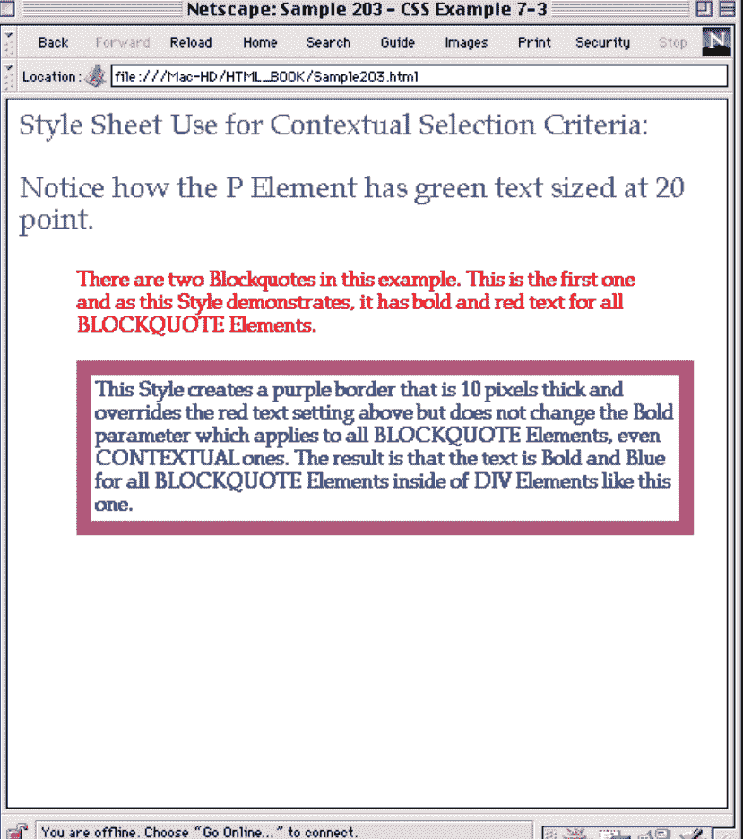

## 第 I 部分 — 动态 HTML

有多种方式可以将 CSS 样式应用到您的文档中：

- <STYLE> 元素样式
- 带有 CLASS 的 <STYLE> 元素
- 带有 ID 定义用于 CLASS 例外的 <STYLE> 元素
- 带有上下文选择条件的 <STYLE> 元素
- STYLE 属性
- 带有 CLASS 属性的 <SPAN> 元素
- 带有 ID 属性用于 CLASS 例外的 <SPAN> 元素
- 用于加载包含外部样式表的另一个文档的 <LINK> 元素
- 用于加载多个外部样式表的 <LINK> 元素
- 一个文档中的多个 <STYLE> 元素

现在我们将通过大量示例详细探讨每一种可能性。参考第 11-15 页的属性速查表以及本章后面更深入的属性解释可能会有所帮助。属性的功能才是真正的创意可能性所在。为此，我们先介绍格式化属性，然后在第二章继续讨论定位属性。

### <STYLE> 元素样式

第一个基本示例已经在示例 1-1 中演示过了，只是为了让您知道这并非一个全新的主题。事实上，它只是对前一节"`<STYLE>`元素"中包含的基本语法进行扩展。在下面的示例中，我们为三个不同的元素创建了单独的样式：BODY、H2 和 DIV。这是 BODY 元素的样式：

```
BODY { margin: 50px 20px 25px 72px;
       font-family: Helvetica, Times, Geneva;
       font-size: 12pt;
       font-style: plain;
       background-color: yellow;
     }
```

您应该立即注意到，您可以用单个属性声明所有四个边距，而且它们之间不用逗号分隔。边距顺序为：上-右-下-左，因此：

- 上边距为 50 像素厚，
- 右边距为 20 像素厚，
- 下边距为 25 像素厚，且
- 左边距为 72 像素厚。

接下来，字体只需包含您想要使用的字体名称即可。提供多个字体名称的原因是，如果第一个字体不在用户的系统中，Navigator 将检查并查看列表中的第二个字体是否可用，依此类推。列出几种外观与您的首选非常相似的字体将增加视觉匹配的机会。如果列出的字体都不可用，那么 Navigator 将使用用户首选项中指定的默认字体。

只有一种方法可以确保您指定的字体是真正被使用的那一个：使用**可下载字体**。一些比较安全的选择是 Helvetica、Courier 和 Times。有五个通用的 **font-family** 属性值**名称**，它们会从用户的系统字体中选择相近的字体，分别是 **serif**、**sans-serif**、**cursive**、**fantasy** 和 **monospace** 系列。参见第 13 页底部的图表，查看每个类别中单独字体的示例。

接下来，字体大小通过 **font-size** 属性指定为 12 磅，然后 **font-style** 属性指定为普通样式。最后，整个文档的背景颜色通过 **background-color** 属性设置为黄色。

接下来，H1 元素的样式指定为 Moonlight 字体，加粗、紫色、大小为 24 磅，且文本居中对齐。

DIV 元素为 14 磅 Clarendon 字体（如果可用），加粗、绿色，且只有第一行缩进 72 像素，这就像加入了一个制表符。

### 示例 1-4：Sample204.html

```
<!DOCTYPE HTML PUBLIC "-//W3C//DTD HTML 3.2//EN">
<HTML><HEAD> <TITLE> Sample 204 - CSS Example 1-4 </TITLE>

<STYLE TYPE="text/CSS">
<!--
            /*    The margin order is:   top right bottom left      */

BODY   { margin: 50px 20px 25px 72px;
         font-family: Helvetica, Times, Geneva;
         font-size: 12pt;
         font-style: plain;
         background-color: yellow;
       }

H1     { font-family: Moonlight, Clarendon, Palatino, Helvetica;
         font-size: 24pt;
         text-align: center;
         font-style: bold;
         color:#8800cc;         /*    real purple    */
       }
DIV    { font-family: Clarendon, Palatino, Helvetica;
         font-size: 14pt;
         font-style: bold;
         color: green;
         text-indent: 72px;
       }

-->
```

## 第 I 部分 — 动态 HTML

示例 1-4

Sample204.html

### 这是示例 204

Division 元素的样式为 Clarendon 字体，加粗、绿色，大小为 14 磅。如上所示，居中对齐的 H1 元素使用 Moonlight 字体，备选字体为 Clarendon、Palatino 和 Helvetica。大小为 24 磅的加粗紫色。BODY 元素的首选字体为 Helvetica，样式为 12 磅普通字体，背景颜色为黄色。

还要注意 DIV 元素的样式中 text-indent 属性设置为 72 像素，这使得每次出现 DIV 元素时，文本的第一行缩进 1 英寸。我们终于有了简单的制表符。

这最后一段位于 H1 和 DIV 元素之外，因此它由 BODY 元素覆盖。注意 BODY 元素中设置的边距。如果您调整窗口大小，可以看到下边距。

```
</STYLE>
</HEAD>

<BODY>

<H1>This is Sample 204</H1>

<DIV>
The Style for the Division Element is Clarendon Font that is bold, green and sized
at 14 pt. As you can see above the center aligned H1 Element is in Moonlight Font
with Clarendon, Palatino and Helvetica as the backup fonts. The size is 24 pt in
bold purple. The BODY Element has Helvetica as the first font choice and is in 12
pt plain with a yellow background color.
</DIV><BR><BR><HR>

<DIV>Also notice the text-indent Property in the Style for the DIV Element is set
to 72 pixels which makes the first line of text be indented by 1 inch each time a
DIV Element occurs. We finally have easy Tabs.
</DIV><BR><BR><HR>

This last paragraph is outside of both the H1 and DIV Elements so it is covered by
the BODY Element. Notice the margins set in the BODY Element. If you resize the
window you can see the bottom margin.

</BODY>
</HTML>
```

# 级联样式表属性

## { font-size: } 属性

**font-size** 属性用于以四种方式之一指定文本大小：**绝对值**、**相对值**、**长度**或**百分比**。这四个类别各有其特点和应用优势，详细语法如下。我个人认为使用 **length** 点大小最容易。默认大小是 **absolute** 值的 **medium**。如果您使用标准字体大小如 12、14、18 或 24，或者使用 **relative** 或 **percentage** 值，您将获得更一致的输出，尤其是在打印时。

## CSS 语法：

```
{ font-size: absolute|relative|length|percentage; }
```

## 第 I 部分 — 动态 HTML

- *absolute* — 使用以下七个关键字选项之一作为固定大小：

  `xx-small, x-small, small, medium, large, x-large, xx-large`

- *relative* — 使用以下两个关键字之一创建相对于父元素字体大小的较大或较小尺寸。

  `larger, smaller`

- *length* — 一个数字后跟一个计量单位缩写。CSS 语法认可的计量单位有：

  - `px` 像素
  - `in` 英寸
  - `cm` 厘米
  - `mm` 毫米
  - `pt` 磅
  - `pc` 皮卡
  - `em` 字体高度
  - `en` 字体高度的一半

- *percentage* — 一个数字后跟百分号，创建的尺寸是父元素字体大小的相对百分比。

以下是四个类别的用法示例：

- *absolute* `{ font-size: xx-large; }`
- *relative* `{ font-size: smaller; }`
- *length* `{ font-size: 24pt; }`
- *percentage* `{ font-size: 150%; }`

## { font-family: } 属性

**font-family** 属性用于按名称指定任何字体，就像您的普通系统文件夹/字体文件夹中包含的字体名称一样。您只需要指定一个字体名称，但列出几种类似的可能性总是一个好的做法，因为字体必须包含在用户的系统中，Navigator 才能使用它，除非您使用可下载字体。有关更多信息，请参阅 CD-ROM 上的动态 HTML 指南。

还有五个通用的安全 **font-family** 名称，它们不特定于某个系统而是依赖于系统，但在外观上提供更多选择。它们是：**sans-serif**、**serif**、**cursive**、**fantasy** 和 **monospace**。如果您不想依赖用户的首选项选择（即默认设置），请将它们作为列表中的最后一个字体用作备用字体。当您列出多个字体时，用逗号和空格分隔，如下所示：

```
{ font-family: Helvetica, Times, TimesRoman, serif; }
```


如果要列出的字体名称由两个或更多单词组成，且单词之间有空格，那么你需要将整个字体名称用单引号或双引号括起来，就像这样：

```
{ font-family: "Brush Script"; }
```

## CSS 语法：

```
{ font-family: fontName; }
{ font-family: fontName1, fontName2, fontNameN; }
```

## { font-weight: } 属性

`font-weight` 属性用于指定文本的粗细程度。你可以使用关键字名称，如 `bold` 或 `lighter`，或者使用 100 到 900 之间的整数（以 100 为增量），其中数字越大，文本越粗。

```
{ font-weight:bolder; }
{ font-weight:lighter; }
{ font-weight:500; }
```

## CSS 语法：

```
{ font-weight: normal|bold|bolder|lighter|
100|200|300|400|500|600|700|800|900; }
```

## { font-style: } 属性

`font-style` 属性用于将文本设置为斜体或恢复为正常样式，就像这样：

```
{ font-style:italic; }
{ font-style:normal; }
```

## CSS 语法：

```
{ font-style: normal|italic; }
```

> 示例 1-5 重点介绍了刚刚解释的四个字体属性。

## 26 第一部分 — 动态 HTML

示例 1-5：Sample205.html

```
<!DOCTYPE HTML PUBLIC "-//W3C//DTD HTML 3.2//EN">
<HTML>
<HEAD>
<TITLE> Sample 205 - CSS Example 1-5 </TITLE>

<STYLE TYPE="text/CSS">

<!--

H1 { color: olive;
    font-family: Palatino, Moonlight, Clarendon, Helvetica;
    font-size: 30pt;
    font-style: italic;
    font-weight: lighter;
    }
DIV { color: silver;
    background-color: black;
    font-family: Clarendon, Helvetica;
    font-size: 24pt;
    font-weight: bolder;
    }
-->

</STYLE>
</HEAD>

<BODY>

<H1>This is Sample 205</H1>

<DIV>
This example focuses on demonstrating font Property characteristics.
</DIV>

<DIV>


<H1> Sky Sphere </H1>
Check out the Image in the Division.
</DIV>

<H1> Do you see the inheritance of the black background color from the DIV Style to the H1 Element that's inside the DIV Tags which is not applied to this H1.
</H1>

</BODY>

</HTML>
```

## { line-height: } 属性

`line-height` 属性的使用方式与页面布局程序中的行距（leading）相同：用于设置相邻文本行基线之间的垂直距离。此属性只能与块级元素一起使用。其指定值可以是关键字 `normal`、`数字`、`长度` 或 `百分比`。默认值是关键字 `normal`，它是当前使用字体的正常值。此属性的任何值类型都不能使用负数。

**数字** 当你指定一个没有计量单位的 `数字` 值时，它相当于将当前字体大小乘以该 `数字`，并将乘积作为 `line-height` 属性的值。这个 `数字` 值可以是浮点数，可以小于一，但不能是负数。这种值类型与 `百分比` 值之间唯一的真正区别在于子元素继承值的方式。使用不带单位的 `数字` 值时，子元素将继承实际的 `数字` 值，而不是乘以后的计算值。使用 `百分比` 值时，子元素将继承乘以后的值。

**长度** 使用 `长度` 类型值意味着它是一个度量单位。这意味着它是一个数字后跟一个计量单位，如 `pt`（磅）或 `px`（像素）。有关所有可用单位类型的更多信息，请参阅第 11、12 和 14 页的计量单位图表。

**百分比** 使用 `百分比` 类型值意味着你提供的值会乘以当前字体的字体大小，该值将作为 `line-height` 值返回。`百分比` 值后面总是跟着一个百分号 (%)。

## 小示例：

以下是使用 `line-height` 属性的几个小示例：

```
{ line-height: normal; }
{ line-height: 1.5; }
{ line-height: 24pt; }
{ line-height: .25in; }
{ line-height: 150%; }
```

## CSS 语法：

```
{ line-height: normal|number|length|percentage; }
```

## { text-decoration: } 属性

**text-decoration** 属性用于使用以下值之一修饰你的文本：
**underline**、**line-through**、**blink**，或使用默认值 **none**，就像这样：

```
小示例：{ text-decoration: underline; }
```

## CSS 语法：

```
{ text-decoration: none|underline|line-through|blink; }
```

## { text-transform: } 属性

**text-transform** 属性用于通过以下四种方式之一更改你的文本，并附带示例。默认值为 **none**。

- **capitalize** 使每个单词的首字母大写
- **uppercase** 使所有文本变为大写字母
- **lowercase** 使所有文本变为小写字母
- **none** 使文本恢复为正常，这意味着继承的值（如果有的话）将被忽略。

```
小示例：{ text-transform: uppercase; }
```

## CSS 语法：

```
{ text-transform: capitalize|uppercase|lowercase|none; }
```

## { text-align: } 属性

**text-align** 属性用于通过关键字 **left**、**right** 水平对齐你的文本，或者可以使用 **center** 使文本居中，或使用 **justify** 使文本两端对齐。默认值为 **left**。以下是一个小示例：

```
小示例：{ text-align: right; }
```

## CSS 语法：

```
{ text-align: left|right|center|justify; }
```

## 第一章 — 样式表

## { text-indent: } 属性

**text-indent** 属性用于缩进元素内的第一行文本。它使用 **长度** 类型值（后跟计量单位的数字）或 **百分比** 类型值（后跟百分号的数字）来指定。当值指定为百分比时，它是**父**元素宽度的百分比。默认值为 0。它只适用于块级元素，并且值可以继承。有关所有可用单位类型的更多信息，请参阅第 11、12 和 14 页的计量单位图表。

```
{ text-indent: 40px; }  { text-indent: 200%; }
```

## CSS 语法：

```
{ text-indent: length|percentage; }
```

此示例重点演示 **text-decoration**、**text-transform**、**text-align**、**text-indent** 和 **line-height** 属性。

### 示例 1-6：Sample206.html

```
<!DOCTYPE HTML PUBLIC "-//W3C//DTD HTML 3.2//EN">
<HTML> <HEAD>       <TITLE>       Sample 206 - CSS Example 1-6  </TITLE>

<STYLE TYPE="text/CSS">
<!--
H1     { text-align: center;
       line-height: 50pt;
       text-decoration: line-through;
       text-transform: uppercase;
       text-indent: 40px;
       color: red;
       font-family: Clarendon, Palatino, Helvetica;
       font-size: 24pt;
     }
DIV    { text-align: right;
       line-height: 32pt;
       text-decoration: underline;
       text-transform: capitalize;
       text-indent: 100px;
       color: blue;
       font-family: Palatino, Clarendon, Helvetica;
       font-size: 14pt;
     }
-->
</STYLE>
</HEAD>
```

```
<BODY>

<H1>this is sample 206</H1>

<DIV> This example focuses on demonstrating text-decoration, text-transform,
text-align, text-indent and line-height.
</DIV>
              <BR><HR>

<DIV> Notice that the line-height parameter causes the space between the lines to
be greater than normal leading in the DIV tags. The DIV Elements are text-aligned
to the right, blue, underlined and the first letter of each word is capitalized.
</DIV>        <BR><HR>

<DIV> Also Notice that the text in the H1 element is all in uppercase letters even
though when it was typed in they were all in lowercase letters.
</DIV>

</BODY>
</HTML>
```

## 外边距

### 外边距概述

这是关于为你的样式设置外边距（Margins）的五个属性的概述。每个单独的外边距类型属性将在概述之后单独介绍。这一组外边距类型属性的行为可能与你初看时所预期的不同。它们在元素外部添加不可见的空间，以便在相邻元素之间创建距离。使用 `margin` 属性时，你可以将所有四个外边距设置为相同的值，也可以为它们各自设置不同的值。不要使用负外边距，否则你可能会得到不稳定的结果。

你也可以使用 `margin-top`、`margin-right`、`margin-bottom` 和 `margin-left` 属性单独设置每个外边距。如果你不需要一个或多个边距，因为不必设置所有边距；你可以只选择你需要的那些，这些属性通常会被使用。

通过以下五个属性，有六种不同的方式可以为特定样式设置外边距的厚度：

- **margin** 一次性设置所有外边距
- **margin-top** 设置上外边距
- **margin-right** 设置右外边距
- **margin-bottom** 设置下外边距
- **margin-left** 设置左外边距


第一章 — 样式表

31

## { margin: } 属性

**margin** 属性用于全局设置外边距的粗细。你可以通过只指定一个值来将它们同时设置为相同的值，像这样：

```
{ margin: 20px; }
```

或者当你想要不同大小的外边距时，可以通过声明四个不同的值，每个值之间用空格隔开，像这样：

```
{ margin: 72px 35px 20px 50px; }
```

这样：

- 上外边距为 72 像素
- 右外边距为 35 像素
- 下外边距为 20 像素
- 左外边距为 50 像素

外边距的顺序总是相同的，如前面的代码片段所示，顺序为：

**top-right-bottom-left;**

只需将该顺序理解为顺时针方向，从顶部开始。注意：外边距列表中没有逗号。可能的值类型包括 **length**、**percentage** 和关键字 **auto**。注意，如果你将 **margin** 属性赋给一个没有内容的元素，那么该元素的 Margin 将被忽略，除非它随后被动态修改以包含内容，此时 Margin 才会生效。

## CSS 语法：

```
{ margin: length|percentage|auto; }
```

### 参数定义：

**percentage** 是任何以百分号结尾的正数，例如：

```
1%-1000%, ...n%
```

**length** 是一个数字，后接以下计量单位之一：

```
em, ex, px, pt, pc, in, mm, cm
```

更多信息请参见第 11、12 和 14 页的图表。

## { margin-top: } 属性

`margin-top` 属性用于设置上外边距的粗细，像这样：

```
{ margin-top: 50px; } { margin-top: 20%; }
```

## CSS 语法：

```
{ margin-top: length|percentage; }
```

## { margin-right: } 属性

`margin-right` 属性用于设置右外边距的粗细，像这样：

```
{ margin-right: 20px; } { margin-right: 25%; }
```

## CSS 语法：

```
{ margin-right: length|percentage; }
```

## { margin-bottom: } 属性

`margin-bottom` 属性用于设置下外边距的粗细。

```
{ margin-bottom: .5in; } { margin-bottom: 50%; }
```

## CSS 语法：

```
{ margin-bottom: length|percentage; }
```

## { margin-left: } 属性

`margin-left` 属性用于设置左外边距的粗细，像这样：

```
{ margin-left: 24pt; } { margin-left: 40%; }
```

## CSS 语法：

```
{ margin-left: length|percentage; }
```

下面的示例展示了可以让各个外边距具有不同的尺寸或完全省略的功能。这是通过为 **margin-top**、**margin-right**、**margin-bottom** 或 **margin-left** 属性设置不同的长度值，或者在四个属性中的任何一个用于样式时省略一个或多个属性来实现的。

第一章 — 样式表

### 示例 1-7：Sample207.html

```
<!DOCTYPE HTML PUBLIC "-//W3C//DTD HTML 3.2//EN">
<HTML><HEAD><TITLE>  Sample 207 - CSS Example 1-7      Margins       </TITLE>

<STYLE TYPE="text/CSS">

<!--
H1     { margin: 10px;
         text-transform: capitalize; color: red;
         border-style: ridge; border-width: 20px; border-color: purple; }

H2     { margin: 10px 30px 50px 70px;
         text-transform: capitalize; color: red;
         border-style: ridge; border-width: 20px; border-color: blue; }

H3     { margin-top: 35px;
         text-transform: capitalize; color: red;
         border-style: ridge; border-width: 20px; border-color: aqua; }

H4     { margin-right: 177px;
         text-transform: capitalize; color: red;
         border-style: ridge; border-width: 20px; border-color: green; }

H5     { margin-bottom: 2in;
         text-transform: capitalize; color: red;
         border-style: ridge; border-width: 20px; border-color: yellow; }

H6     { margin-left: 100px;
         text-transform: capitalize; color: red;
         border-style: ridge; border-width: 20px; border-color: fuchsia; }

P      { margin-left: 55px; margin-top: 1in; font-size: 17pt;
         border-style: ridge; border-width: 20px; border-color: red; }
-->
</STYLE>
</HEAD>
```

```
<BODY>
      <H1>  This is Sample 207   </H1>

<P>Notice that the P Element is set to a left margin of 55 pixels and a top margin
of 1 inch.</P>

<H1>  H1- This is a margin at 10 pixels on all four sides                </H1>
<H2>  H2- This is a margin at 10 30 50 70 pixels for top right bottom left </H2>
<H3>  H3- This is a top margin of 35 pixels                                 </H3>
<H4>  H4- This is a right margin of 177 pixels                             </H4>
<H5>  H5- This is a bottom margin of 2 inches                               </H5>
<H6>  H6- This is a left margin of 100 pixels                              </H6>

</BODY>
</HTML>
```

## 内边距（Padding）

当你想要在元素的边缘或边界与其内部内容之间创建空间时，你可以使用五个内边距属性之一。这与 TABLE 元素中的 CELLPADDING 属性具有相同的效果。将任何元素看作由一个有外部、边缘和内部的矩形块组成。为了让你的文本、图像或其他内容在距离边缘一定距离的内部开始和结束，你需要添加 Padding 空间，就像仅适用于该特定元素的内部边距一样。记住，在上一节中，Margin 属性为元素的外部添加空间，以便在不同元素之间创建距离。Padding 属性为元素的内部添加空间，以便在元素边缘和元素内容之间创建空间。

使用 **padding** 属性时，你可以将四个内边距设置为相同的值，或者每个内边距具有不同的值。你也可以通过使用 **padding-top**、**padding-right**、**padding-bottom** 和 **padding-left** 属性来单独设置每个内边距。使用以下五个属性，有六种不同的方式可以设置特定样式的 Padding 粗细，这些属性将在后面分别介绍：

- **padding** 同时设置所有内边距
- **padding-top** 设置顶部内边距
- **padding-right** 设置右侧内边距
- **padding-bottom** 设置底部内边距
- **padding-left** 设置左侧内边距

### { padding: } 属性

**padding** 属性用于全局设置内边距的粗细。你可以通过只指定一个值来将它们同时设置为相同的值，像这样：

```
{ padding: 20px; }
```

当你想要不同大小的内边距时，可以通过声明四个不同的值，每个值之间用空格隔开，注意没有逗号，顺序为 <u>top-right-bottom-left</u>：

```
{ padding: 72px 80px 22px 50px; }
```

这样：

- 顶部内边距为 72 像素
- 右侧内边距为 80 像素
- 底部内边距为 22 像素
- 左侧内边距为 50 像素。

## CSS 语法：

```
{ padding: length|percentage; }
```

**length** 是一个数字，后接以下单位之一：em, ex, px, pt, pc, in, mm, cm

**percentage** 是任何以百分号结尾的正数，例如：1%-1000%, ...n%

### { padding-top: } 属性

**padding-top** 属性用于设置顶部内边距的粗细，像这样：

```
{ padding-top: 50px; } { padding-top: 20%; }
```

## CSS 语法：

```
{ padding-top: length|percentage; }
```

### { padding-right: } 属性

**padding-right** 属性用于设置右侧内边距的粗细。

```
{ padding-right: 20px; } { padding-right: 25%; }
```

## CSS 语法：

```
{ padding-right: length|percentage; }
```

### { padding-bottom: } 属性

**padding-bottom** 属性用于设置底部内边距的粗细。

```
{ padding-bottom: .5in; } { padding-bottom: 50%; }
```

## CSS 语法：

```
{ padding-bottom: length|percentage; }
```

### { padding-left: } 属性

**padding-left** 属性用于设置左侧内边距的粗细。

```
{ padding-left: 24pt; } { padding-left: 40%; }
```

## CSS 语法：

```
{ padding-left: length|percentage; }
```


## 第一部分 — 动态HTML

此示例展示了如何为各个内边距设置不同的大小或完全省略。这可以通过为 `padding-top`、`padding-right`、`padding-bottom` 或 `padding-left` 属性设置不同的长度值，或者在样式中使用四个属性中的任意一个时省略其他一个或多个属性来实现。

### 示例 1-8: Sample208.html

```
<!DOCTYPE HTML PUBLIC "-//W3C//DTD HTML 3.2//EN">
<HTML><HEAD><TITLE> Sample 208 - CSS Example 1-8 Paddings </TITLE>
<STYLE TYPE="text/CSS">
<!--
H1     { padding: 10px;
         text-transform: capitalize; color: red;
         border-style: ridge; border-width: 20px; border-color: purple; }

H2     { padding: 10px 30px 50px 70px;
         text-transform: capitalize; color: red;
         border-style: ridge; border-width: 20px; border-color: blue; }
H3     { padding-top: 35px;
         text-transform: capitalize; color: red;
         border-style: ridge; border-width: 20px; border-color: aqua; }

H4     { padding-right: 177px;
         text-transform: capitalize; color: red;
         border-style: ridge; border-width: 20px; border-color: green; }

H5     { padding-bottom: 2in;
         text-transform: capitalize; color: red;
         border-style: ridge; border-width: 20px; border-color: yellow; }

H6     { padding-left: 100px;
         text-transform: capitalize; color: red;
         border-style: ridge; border-width: 20px; border-color: fuchsia; }

P      { padding-left: 55px; padding-top: 1in; font-size: 17pt;
         border-style: ridge; border-width: 20px; border-color: red; }
-->
</STYLE>
</HEAD>
<BODY>       <H1>   This is Sample 208   </H1>
<P>Notice that the P Element is set to a left padding of 55 pixels and a top
padding of 1 inch.</P>

<H1>H1- This is a padding at 10 pixels on all four sides                       </H1>
<H2>H2- This is a padding at 10 30 50 70 pixels for top right bottom left     </H2>
<H3>H3- This is a top padding of 35 pixels                                     </H3>
<H4>H4- This is a right padding of 177 pixels                                  </H4>
<H5>H5- This is a bottom padding of 2 inches                                   </H5>
<H6>H6- This is a left padding of 100 pixels                                    </H6>
</BODY>
</HTML>
```

## 颜色

在CSS语法中，有三个属性允许你直接操作样式中的颜色。它们的工作方式完全相同，但作用于文档的不同方面。**color** 属性控制前景色，即应用该属性的元素中文本的颜色。**background-color** 属性控制应用该属性的元素的背景色，最后是 **border-color** 属性，它改变边框的颜色，边框默认继承自 BODY 元素的前景色。

在CSS语法中，你比HTML有更多指定颜色的方式。你可以使用公认的颜色名称，包括所有JavaScript颜色名称（参见附录B）、十六进制三色组，也可以使用 **rgb()** 函数来表示。

**rgb()** 函数接受 **redArg**、**greenArg** 和 **blueArg** 三个参数，它们分别代表颜色的红、绿、蓝分量。它们用逗号分隔，可以是0到255之间的数字，也可以是0%到100%之间的百分比。如果使用百分比，每个参数后面必须跟上百分号（%）。

### CSS语法：

```
rgb(redArg, greenArg, blueArg)
rgb(redArg%, greenArg%, blueArg%)
```

在0-255的度量方案中使用的数字，从最低值（代表无颜色）到255（代表满色），因此：

| rgb(255,0,0) | 表示： | 满红，无绿，无蓝 | = | 红色 |
| rgb(255,0,255) | 表示： | 满红，无绿，满蓝 | = | 梅红 |
| rgb(0,0,255) | 表示： | 无红，无绿，满蓝 | = | 蓝色 |
| rgb(0, 255, 255) | 表示： | 无红，满绿，满蓝 | = | 水青 |
| rgb(0,255,0) | 表示： | 无红，满绿，无蓝 | = | 酸橙绿 |
| rgb(255,255,0) | 表示： | 满红，满绿，无蓝 | = | 黄色 |
| rgb(255,255,255) | 表示： | 满红，满绿，满蓝 | = | 白色 |
| rgb(0,0,0) | 表示： | 无红，无绿，无蓝 | = | 黑色 |
| rgb(100%,0%,0%) | 表示： | 满红，无绿，无蓝 | = | 红色 |
| rgb(100%,0%,100%) | 表示： | 满红，无绿，满蓝 | = | 梅红 |
| rgb(0%,0%,100%) | 表示： | 无红，无绿，满蓝 | = | 蓝色 |
| rgb(0%,100%,100%) | 表示： | 无红，满绿，满蓝 | = | 水青 |
| rgb(0%,100%,0%) | 表示： | 无红，满绿，无蓝 | = | 酸橙绿 |
| rgb(100%,100%,0%) | 表示： | 满红，满绿，无蓝 | = | 黄色 |
| rgb(100%,100%,100%) | 表示： | 满红，满绿，满蓝 | = | 白色 |
| rgb(0%,0%,0%) | 表示： | 无红，无绿，无蓝 | = | 黑色 |

### { color: } 属性

`color` 属性非常直观；它让你选择元素的前景色，从而改变文本的颜色。以下是表示前景色的四种方式：

```
{ color: silver; }			 { color:#e35a77; }
{ color: rgb(5, 220, 250); }	 { color: rgb(38%, 43%, 69%); }
```

### CSS语法：

```
{ color: colorname | #$$$$$ | rgb(0-255,0-255,0-255) |
    rgb(0-100%,0-100%,0-100%); }
```

> 此示例重点介绍如何使用 `color` 属性指定前景色。

### 示例 1-9: Sample209.html

```
<!DOCTYPE HTML PUBLIC "-//W3C//DTD HTML 3.2//EN">
<HTML>
<HEAD>
<TITLE> Sam209 - CSS Example 1-9 the Color property </TITLE>

<STYLE TYPE="text/CSS">
<!--

H1 { color:blue;
    border-style: ridge; border-width: 20px; border-color: purple; }

H2 { color: rgb(155,0,255);
    border-style: ridge; border-width: 20px; border-color: blue; }

H3 { color: rgb(0,57,155);
    border-style: ridge; border-width: 20px; border-color: aqua; }

H4 { color: rgb(0%, 50%,0%);
    border-style: ridge; border-width: 20px; border-color: green; }

H5 { color: rgb(90%,0%,5%);
    border-style: ridge; border-width: 20px; border-color: yellow; }

H6 { color:#7705dd;
    border-style: ridge; border-width: 20px; border-color: fuchsia; }

P { color:#ef4499;
    font-size: 17pt;
    border-style: ridge; border-width: 20px; border-color: red; }

-->
</STYLE>
```

## 第一章 — 样式表

```
</HEAD>
```

```
<BODY>
```

```
<H1>This is Sample 209</H1>
```

```
<P>Notice that the all the different heading types have unique foreground colors which controls the text color.</P>
```

```
<H1>         This is a H1 Heading         </H1>
<H2>         This is a H2 Heading         </H2>
<H3>         This is a H3 Heading         </H3>
<H4>         This is a H4 Heading         </H4>
<H5>         This is a H5 Heading         </H5>
<H6>         This is a H6 Heading         </H6>
```

```
</BODY>
```

```
</HTML>
```

## 示例 1-9          Sample209.html

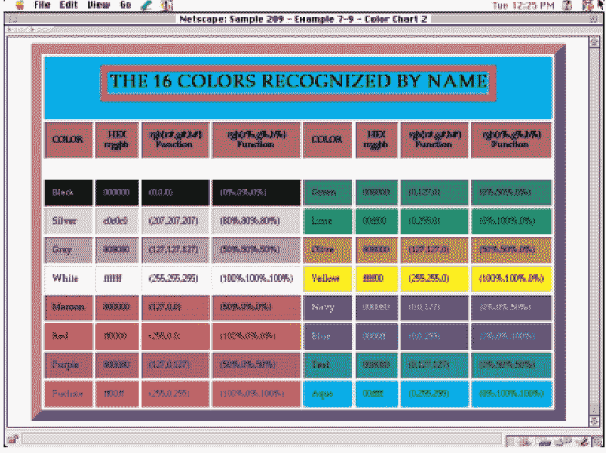

## 第一部分 — 动态HTML

### { background-color: } 属性

**background-color** 属性让你选择每个元素的背景色。你可以使用公认的颜色名称、十六进制三色组，或者使用 **rgb()** 函数，该函数允许你使用常规数字或百分比来指定RGB三色组，后者对艺术家、平面设计师、Photoshop用户和其他图像编辑爱好者来说可能更熟悉。以下是使用 **background-color** 属性为元素样式指定背景色的四种方式示例：

```
{ background-color: olive; }
{ background-color:#aaca77; }
{ background-color: rgb(155, 120, 50); }
{ background-color: rgb(50%, 0%, 90%); }
```

### CSS语法：

```
{ background-color: colorname|#$$$$$$|rgb(0-255,0-255,0-255)|
                               rgb(0-100%,0-100%,0-100%); }
```

示例 1-10 重点介绍 **background-color** 属性。

### 示例 1-10: Sample210.html

```
<!DOCTYPE HTML PUBLIC "-//W3C//DTD HTML 3.2//EN">
<HTML>
<HEAD>

<TITLE> Sample 210 - CSS Example 1-10 The background-color Property </TITLE>

<STYLE TYPE="text/CSS">

<!--

H1     { background-color: blue;
       border-style: ridge; border-width: 20px; border-color: purple; }

H2     { background-color: rgb(155,0,255);
       border-style: ridge; border-width: 20px; border-color: blue; }
```


## 第一章 — 样式表

```css
H3 {
    background-color: rgb(0, 57, 155);
    border-style: ridge;
    border-width: 20px;
    border-color: aqua;
}

H4 {
    background-color: rgb(0%, 50%, 0%);
    border-style: ridge;
    border-width: 20px;
    border-color: green;
}

H5 {
    background-color: rgb(90%, 0%, 5%);
    border-style: ridge;
    border-width: 20px;
    border-color: yellow;
}

H6 {
    background-color: #7705dd;
    border-style: ridge;
    border-width: 20px;
    border-color: fuchsia;
}

P {
    background-color: #ef4499;
    font-size: 17pt;
    border-style: ridge;
    border-width: 20px;
    border-color: red;
}
-->
</STYLE>
</HEAD>
<BODY TEXT="#eeeeee" BGCOLOR="#000000">

<H1>This is Sample 210</H1>

<P>This example is exactly the same as Sample 208 except that the colors used are
for the background instead of the foreground. Because no foreground color is
specified, all of the Heading Elements inherit it from the BODY Element since they
are contained within it.</P>

<H1>This is a H1 Heading</H1>
<H2>This is a H2 Heading</H2>
<H3>This is a H3 Heading</H3>
<H4>This is a H4 Heading</H4>
<H5>This is a H5 Heading</H5>
<H6>This is a H6 Heading</H6>

</BODY>
</HTML>
```

请查阅附录B第1033-1037页的颜色图表，其中列出了所有JavaScript颜色名称及其十六进制、rgb数值和百分比值对应关系。该信息也包含在CD-ROM上的一个文件中，文件名为AppendixB-ChartOnly.html，位于HTML_BOOK-Online文件夹中的DHTML-JS BOOK-Main Files文件夹内。它使用数组、`for()`循环和`document.write()`在JavaScript脚本中输出数据，并在文本后方渲染实际颜色。在附录B中还有一篇关于加色法理论的论述，如果你有兴趣了解颜色在可见光谱中的工作原理。第340-350页还有一个颜色转换计算器，使用JavaScript在各种格式之间转换颜色。

# 第一部分 — 动态HTML

## { background-image: } 属性

**background-image**属性允许你选择一张图片显示在元素内容的背后。你可以为创建的每个样式元素设置不同的背景图片。该背景图片会根据需要进行平铺，以填充分配给该元素的空间。以下是如何在样式中编码背景图片的示例，注意(JPEG-FILES)是包含实际图片的文件夹，图片文件具有相对的**urlName**为(ExampleImage.jpeg)：

```css
{ background-image: url(JPEG-FILES/ExampleImage.jpeg); }
```

在语法中请注意，**url**中的"l"和(**urlName**)中的**左括号"("**之间不能有任何空格，且**urlName**不被引号包围。

### CSS语法：

```css
{ background-image: url(urlName); }
```

本示例重点介绍**background-image**属性。

#### 示例 1-11: Sample211.html

```html
<!DOCTYPE HTML PUBLIC "-//W3C//DTD HTML 3.2//EN">
<HTML>
<HEAD>
<TITLE>Sample 211 - CSS Example 1-11 Background Images</TITLE>

<STYLE TYPE="text/CSS">
<!--
BODY {
    font-size: 36pt;
}

H1 {
    background-image: url(./JPEG-FILES/icon-BG-asteroids.jpg);
    border-style: ridge;
    border-width: 20px;
    border-color: purple;
    padding: 30px;
    background-color: white;
}

H2 {
    background-image: url(./JPEG-FILES/Icon-Clouds.jpg);
    border-style: ridge;
    border-width: 20px;
    border-color: blue;
    padding: 72px;
}

H3 {
    background-image: url(./JPEG-FILES/icon-BG-stars.jpg);
    border-style: ridge;
    border-width: 20px;
    border-color: aqua;
    padding: 144px;
}

H4 {
    background-image: url(/JPEG-FILES/Icon-FieldStone-Purple.jpeg);
    border-style: ridge;
    border-width: 20px;
    border-color: green;
    padding: 100px;
}

H5 {
    background-image: url(/JPEG-FILES/Icon-Paint-Palette.jpg);
    border-style: ridge;
    border-width: 20px;
    border-color: yellow;
    padding: 144px;
}

H6 {
    background-image: url(/dreamplay-website/JPEG-FILES/J2-JERRY_GARCIA-2-RS.jpg);
    border-style: ridge;
    border-width: 20px;
    border-color: fuchsia;
    padding: 50px;
    color: white;
}

P {
    background-color: #ccccff;
    font-size: 12pt;
    border-style: ridge;
    border-width: 20px;
    border-color: red;
}
-->
</STYLE>
</HEAD>

<BODY TEXT="#0000ff" BGCOLOR="#000000">

<H1>This is Sample 21</H1>

<P>Make sure that there are no blank spaces between the last letter of (url)
and the first parenthesis containing the urlName. This is correct: url(urlName) and
this is wrong: url (urlName) <BR><BR>
Also notice that the image tiles or repeats to fill up the available or assigned
space.</P>

<H1>This is a H1 Heading</H1>
<H2>This is a H2 Heading</H2>
<H3>This is a H3 Heading</H3>
<H4>This is a H4 Heading</H4>
<H5>This is a H5 Heading</H5>
<H6>This is a H6 Heading</H6>

</BODY>
</HTML>
```

示例1-12使用了到目前为止已经讨论过的许多属性。请查看并确保一切都很熟悉。需要注意的一些细节是：BODY元素分配了**margin**属性，这会导致BODY中包含的每个元素周围也有20像素的边距。

由于CITE元素也分配了**margin**属性，效果是累积的；也就是说，所有CITE元素都将拥有来自BODY元素的20像素边距，再加上其自身的10像素边距。

如果你在浏览器中查看该示例，你会发现与CITE元素相邻的元素之间的距离比其他未在其样式定义中明确设置**margin**属性的元素更大。还要记住，H1和PRE元素是*块级*元素，具有内置的换行，而CITE和XMP元素则没有。

# 第一部分 — 动态HTML

### 示例 1-12: Sample212.html

```html
<!DOCTYPE HTML PUBLIC "-//W3C//DTD HTML 3.2//EN">
<HTML>
<HEAD>
<TITLE>Sample 212 - CSS Example 1-12 Compilation</TITLE>

<STYLE TYPE="text/CSS">
<!--
BODY {
    margin: 20px;
    background-color: #7777cc;
}

H3 {
    font-family: Clarendon, Moonlight, Palatino, Helvetica;
    font-size: 30pt;
    text-align: center;
    font-style: bold;
    color: blue;
    border-width: .25in;
    border-style: groove;
    border-color: #335a77;
    margin: 20px;
    background-color: #755f11; /* metallic gold */
}

PRE {
    font-family: Brush Script, Geneva, Palatino, Helvetica;
    font-size: 19pt;
    font-style: plain;
    color: black;
    text-indent: 45px;
    line-height: 30pt;
    border-width: .25in;
    border-style: inset;
    border-color: blue;
    background-color: aqua;
    margin: 15px;
}

CITE {
    font-family: Bellevue, New York, Geneva, Times;
    font-size: 25pt;
    font-style: italic;
    text-align: center;
    color: red;
    line-height: 45pt;
    border-width: 10mm;
    border-style: outset;
    border-color: lime;
    background-color: yellow;
    margin: 10px;
    margin: 20px;
}

XMP {
    font-family: Helvetica, Times, New York, Geneva;
    font-size: 18pt;
    font-style: bold;
    text-align: center;
    color: maroon;
    border-width: 10mm;
    border-style: ridge;
    border-color: purple;
    background-color: gray;
    margin: 40px;
    white-space: pre;
}
-->
</STYLE>
</HEAD>
<BODY>

<H3>This is Sample 212</H3>

<CITE>There are a lot of Properties in this example.</CITE>

<PRE>The Site still has their website. You should email them to let the powers
that be know that they should reinstate the show. Bring Back Dev.</PRE>

<XMP>
This example has a lot of
borders in it but the
next example is the one
with all border style possibilities.

If you don't
explicitly code in the
white-space Property to "pre" then even
with an XMP Tag or a PRE Tag the
white-space will collapse because in
Style Sheet syntax white-space is
collapsed by default.

Below are all the
Properties used in the
Style for the XMP Element.

{ font-family: Helvetica, Times, New York, Geneva;
  font-size: 18pt;
  font-style: bold;
  text-align: center;
  color: maroon;
  border-width: 10mm;
  border-style: ridge;
  border-color: purple;
  border-color: gray;
  margin: 40px;
  white-space: pre;
}
</XMP>

</BODY>
</HTML>
```


 ## 设置边框

### { border-style: } 属性

通过使用 **border-style** 属性，你可以选择用 2D 或 3D 凸起边框来围绕内容，从而突出显示它。**solid** 和 **double** 样式是 2D 的，而 **inset**、**outset**、**groove** 和 **ridge** 样式都是 3D 阴影效果。你还可以选择创建少于四边的边框，如果你想尝试图形创新的话。尝试将你的内容嵌套在都带有边框的元素中，会产生非常有趣的效果。默认值是 **none**，如果你正在创建动态变化的样式，也可以使用 JavaScript 来选择此项。记得在你的样式定义中包含 **border-width** 属性值，否则它将不可见，因为默认值为零。有关设置边框宽度的更多信息，请参阅第 52-58 页。

这是一个 3D **border-style** 的示例：

```
{ border-style: groove }
```

## CSS 语法：

```
{ border-style: none|solid|double|inset|outset|groove|ridge; }
```

这个示例涵盖了 **border-style** 属性的所有值，除了 **none**。

### 示例 1-13：Sample213.html

```
<!DOCTYPE HTML PUBLIC "-//W3C//DTD HTML 3.2//EN">
<HTML><HEAD>
<TITLE> Sample 213 - CSS Example 1-13			Border Styles </TITLE>

<STYLE TYPE="text/CSS">
<!--

BODY {
	margin: 10px; font-size: 30pt;
	border-style: ridge; border-width: 10px;
	font-family: Clarendon, Moonlight, Palatino, Helvetica;
}

H1 {
	border-style: solid;
	border-width: 20px;
	border-color:#ff0000;
	margin: 10px;
	background-color:#755f11; 		/* metallic gold */
}
-->
</STYLE>
</HEAD>
```

```
H2 { border-style: double;
    border-width: 20px;
    border-color: blue;
    margin: 10px;
    background-color:#755f11; /* metallic gold */
}
H3 { border-style: inset;
    border-width: 20px;
    border-color: green;
    margin: 10px;
    background-color:#755f11; /* metallic gold */
}
H4 { border-style: outset;
    border-width: 20px;
    border-color: aqua;
    margin: 10px;
    background-color:#755f11; /* metallic gold */
}
H5 { border-style: groove;
    border-width: 20px;
    border-color: purple;
    margin: 10px;
    background-color:#755f11; /* metallic gold */
}
H6 { border-style: ridge;
    border-width: 20px;
    border-color: maroon;
    margin: 10px;
    background-color:#755f11; /* metallic gold */
}
P { font-size: 14pt;
    border-style: none;
    border-width: 20px;
    border-color: maroon;
    margin: 10px;
    background-color:#755f11; /* metallic gold */
}
```

```
}
</STYLE>
</HEAD>
<P>
<BODY>
```

请注意，P 元素设置为 NONE 的 border-style，它包含了  
这段文字。还要注意，字体大小是在 BODY 样式中全局设置的，因此它适用于包含在 BODY 标签内的所有元素，甚至包括以下通常会具有不同大小的标题元素。BODY 元素甚至有一个边框，它在边距内部。

```
<H1> This is a solid border </H1>
<H2> This is a double border </H2>
<H3> This is an insetaugh inset border </H3>
<H4> This is an outset border </H4>
<H5> This is a groove border </H5>
<H6> This is a ridge border </H6>
```

```
</BODY>
</HTML>
```

### { border-color: } 属性

**border-color** 属性相当简单；它让你选择围绕元素的边框颜色。在 CSS 语法中，你比纯 HTML 有更多方式来指定颜色。使用公认的颜色名称和传统的十六进制三元组仍然可用，但现在你还可以将其表示为一个 `rgb()` 函数三元组，使用常规数字或百分比。有关颜色的更多信息，请参阅第 37 页或附录 B。以下是表达 **border-color** 的四种方式：

```
{ border-color: purple; }
{ border-color: #335a77; }
{ border-color: rgb(255, 20, 150); }
{ border-color: rgb(20%, 50%, 70%); }
```

## CSS 语法：

```
{ border-color: colorname | #$$$$$$ | rgb(0-255, 0-255, 0-255) | rgb(0-100%, 0-100%, 0-100%); }
```

这个示例侧重于 **border-color** 的示例。在这个示例的末尾，有一些嵌套元素，每个元素都有 **border-style**，这样看起来就像你有嵌套边框，而这在标准属性代码中通常是不可能实现的。

### 示例 1-14：Sample214.html

```
<!DOCTYPE HTML PUBLIC "-//W3C//DTD HTML 3.2//EN">
<HTML>
<HEAD>
<TITLE> Sample 214 – CSS Example 1-14 border-color Properties</TITLE>
<STYLE TYPE="text/css">
<!--
H1 { border-style: solid;
border-width: 20px;
border-color: blue;
padding: 10px;
background-color: rgb(255, 100, 0); } /* orange */
}
H2 { border-style: double;
border-width: 20px;
border-color: rgb(55, 200, 50); /* medium green */
padding: 10px;
background-color:#755f11; } /* metallic gold */
}
```

```
H3 { border-style: inset;
    border-width: 20px;
    border-color: rgb(50%, 0%, 98%); /* purple */
    padding: 10px;
    background-color: rgb(15%, 0%, 98%); /* dark blue */
}
H4 {
    border-style: outset;
    border-width: 20px;
    border-color: rgb(15, 200, 150); /* water green */
    padding: 10px;
    background-color: rgb(100%, 0%, 0%); /* red */
}
H5 {
    border-style: groove;
    border-width: 20px;
    border-color: rgb(50%, 100%, 20%); /* lime green */
    padding: 10px;
    background-color:#955f31; /* red metallic gold */
}
H6 {
    border-style: ridge;
    border-width: 20px;
    border-color: rgb(155, 0, 250); /* plum */
    padding: 10px;
    background-color:#457e71; /* metallic aqua */
}
P {
    font-size: 14pt;
    border-style: groove;
    border-width: 20px;
    border-color:#255faf; /* steel blue */
    padding: 10px;
    background-color:#959f51; /* metallic green */
}
```

```
-->
</STYLE></HEAD>
<BODY>
<P> Most of the settings in this example are the same as in the last example to let you focus on the border-colors. Notice that the following HEADING Elements are rendered in their normal sizes this time because there are no overriding Properties to inherit.</P>
<H1><H2><H3> This is an inset border H3 inside a double border H2 inside a solid border H1 </H3></H2></H1>
<H5><H4> This is an outset border inside a groove border </H4></H5>
<H4><H5><H6> This is a ridge border H6 inside a groove border H5 inside an outset border H4 </H6></H5></H4>
Just below is an empty H6 heading. Very interesting. Spark any graphical insights?
<H6></H6>
</BODY></HTML>
```

示例 1-15 展示了嵌套元素，每个元素都有 **border-style**，从而创建了一个嵌套的彩虹多边框。

# 第一部分 — 动态 HTML

示例 1-15： Sample215.html

```
<!DOCTYPE HTML PUBLIC "-//W3C//DTD HTML 3.2//EN">
<HTML><HEAD><TITLE>    Sample 215 - CSS Example 1-15       Nested Borders       </TITLE>

<STYLE TYPE="text/CSS">
<!--
                                        /*  Remember these are CSS comments  */
H1     { border-style: solid;
         border-width: 20px;
         border-color: rgb(155, 0, 255);
         background-color: blue;                    /*       orange         */
       }
H2     { border-style: double;
         border-width: 20px;
         border-color: blue;                   /*     medium green    */
         background-color: rgb(0%, 100%, 100%);    /*   metallic gold    */
       }
H3     { border-style: inset;
         border-width: 20px;
         border-color: rgb(0%, 100%, 100%);       /*       purple        */
         background-color: rgb(0, 255, 0)   ;     /*     dark blue       */
       }
H4     { border-style: outset;
         border-width: 20px;
         border-color: rgb(0, 255, 0);            /*     water green    */
         background-color: rgb(100%, 100%, 0%);   /*       red           */
       }
H5     { border-style: groove;
         border-width: 20px;
         border-color: rgb(100%, 100%, 0%);       /*     lime green     */
         background-color: rgb(255, 0, 0);        /*   red metallic gold    */
       }
H6     { border-style: ridge;
         border-width: 20px;
         border-color: rgb(255, 0, 0);            /*       plum          */
         background-color: red;                   /*   metallic aqua    */
         font-size: 24pt;
       }
-->
</STYLE>
</HEAD>

<BODY>
<H1><H2><H3><H4><H5><H6>Rainbow Land</H6></H5></H4></H3></H2></H1>
</BODY>
</HTML>
```

示例 1-16 展示了两个嵌套元素的实例，每个元素都有 **border-style** 属性，从而创建了一个嵌套的彩虹多重边框，它从 BODY 元素继承了白色背景，而不是显式指定它们。


 # 第一章 — 样式表

### 示例 1-16：Sample216.html

```
<!DOCTYPE HTML PUBLIC "-//W3C//DTD HTML 3.2//EN">
<HTML>
<HEAD>
<TITLE>Sample 216 - CSS Example 1-16  Nested Rainbow Borders</TITLE>

<STYLE TYPE="text/CSS">

<!--

					/*  Remember these are CSS comments  */

H1	{ border-style: solid;
	  border-width: 20px;
	  border-color: rgb(255, 0, 255);	/*   plum		*/
}
H2	{ border-style: double;
	  border-width: 20px;
	  border-color: blue;			/*   medium green	*/
}
H3	{ border-style: inset;
	  border-width: 20px;
	  border-color: rgb(0%, 100%, 100%);	/*   purple		*/
}
H4	{ border-style: outset;
	  border-width: 20px;
	  border-color: rgb(0, 255, 0);		/*   water green	*/
}
H5	{ border-style: groove;
	  border-width: 20px;
	  border-color: rgb(100%, 100%, 0%);	/*   lime green		*/
}
H6	{ border-style: ridge;
	  border-width: 20px;
	  border-color: rgb(255, 0, 0);		/*   red		*/
	  font-size: 24pt;
}

-->

</STYLE>
</HEAD>

<BODY>

<H1><H2><H3><H4><H5><H6>Rainbow Land</H6></H5></H4></H3></H2></H1>

<H6><H5><H4><H3><H2><H1>Rainbow Land</H1></H2></H3></H4></H5></H6>

</BODY>
</HTML>
```

## 边框宽度

当你使用 `border-style` 属性为你的内容添加 `solid`（实线）、`double`（双线）、`inset`（内嵌）、`outset`（外凸）、`groove`（槽状）或 `ridge`（脊状）样式的图形边框时，你还必须指定以下列出的五种边框宽度属性之一。这样做的原因是边框默认厚度为零，直到你为其指定一个宽度。你可以将所有边框设置为相同的厚度，也可以让边框的每一边具有唯一的宽度。你甚至可以拥有一个三边边框，其中每一边都有不同的宽度。有六种不同的方法来设置厚度，即边框的宽度，通过使用以下任意一种或五种属性：

- `border-width`
- `border-top-width`
- `border-right-width`
- `border-bottom-width`
- `border-left-width`

### { border-width: } 属性

`border-width` 属性用于全局设置边框的厚度。你可以通过只指定一个值来将所有边框设置为相同的厚度，如下所示：

```
{ border-width: 20px; }
```

或者你可以通过声明四个不同的值，并在每个值之间用空格隔开，来同时设置所有边框，如下所示：

```
{ border-width: 10px 20px 30px 40px; }
```

在这种情况下，边框的顺序是上右下左；只需将顺序想象为从顶部开始的顺时针方向。

## CSS 语法：

```
{ border-width: length|percentage; }
```

`length` 是一个数字，后缀为以下计量单位之一：

em, ex, px, pt, pc, in, mm, cm

有关计量单位的更多信息，请参见第 11-12、14 页的图表。

`percentage` 是任何以百分号结尾的正数，例如：1%-100%，...n%

### { border-top-width: } 属性

**border-top-width** 属性用于设置边框顶部的厚度，如下所示：

```
{ border-top-width: 20px; }
```

## CSS 语法：

```
{ border-top-width: length|percentage; }
```

### { border-right-width: } 属性

**border-right-width** 属性用于设置边框右侧的厚度，如下所示：

```
{ border-right-width: 20px; }
```

## CSS 语法：

```
{ border-right-width: length|percentage; }
```

### { border-bottom-width: } 属性

**border-bottom-width** 属性用于设置边框底部的厚度，如下所示：

```
{ border-bottom-width: 20px; }
```

## CSS 语法：

```
{ border-bottom-width: length|percentage; }
```

### { border-left-width: } 属性

**border-left-width** 属性用于设置边框左侧的厚度，如下所示：

```
{ border-left-width: 20px; }
```

## CSS 语法：

```
{ border-left-width: length|percentage; }
```

这是一个示例，演示了如何让一个完整边框的各个侧边具有不同的尺寸或完全省略。这是通过为以下属性设置唯一的 *length* 值，或者在样式中使用这四个属性时省略一个或多个属性来实现的：

```
border-top-width: length;
border-right-width: length;
border-bottom-width: length;
border-left-width: length;
```

它还演示了 **border-width** 属性。

### 示例 1-17：Sample217.html

```
<!DOCTYPE HTML PUBLIC "-//W3C//DTD HTML 3.2//EN">
<HTML>
<HEAD><TITLE> Sample 217 - CSS Example 1-17</TITLE>

<STYLE TYPE="text/CSS">
<!--

BODY { margin: 10px; font-size: 30pt; background-color:#aaccbb;
       border-style: ridge; border-width: 10px;
       font-family: Bellevue, Clarendon, Moonlight, Helvetica;
}

H1 { border-style: solid;
       border-top-width: 5px;
       border-right-width: 10px;
       border-bottom-width: 20px;
       border-left-width: 25px;
       border-color:#ff0000;
       margin: 10px;
       background-color:#665599;  /* metallic purple */
}

H2 { border-style: double;
       border-top-width: 20px;
       border-right-width: 20px;
       border-bottom-width: 20px;
       border-color: blue;
       margin: 10px;
       background-color:#665599;  /* metallic purple */
}

H3 { border-style: inset;
       border-top-width: 20px;
       border-right-width: 20px;
       border-color: green;
       margin: 10px;
       background-color:#665599;  /* metallic purple */
}

H4 {
    border-style: outset;
    border-right-width: 20px;
    border-left-width: 25px;
    border-color: aqua;
    margin: 10px;
    background-color:#665599;       /*      metallic purple      */
}

H5 {
    border-style: groove;
    border-top-width: 20px;
    border-bottom-width: 20px;
    border-color: purple;
    margin: 10px;
    background-color:#665599;       /*      metallic purple      */
}

H6 {
    border-style: ridge;
    border-left-width: 20px;
    border-right-width: 20px;
    border-bottom-width: 20px;
    border-color: maroon;
    margin: 10px;
    background-color:#665599;       /*      metallic purple      */
}

P {
    font-size: 18pt;
    border-style: none;
    border-width: 20px;
    border-color: maroon;
    margin: 10px;
    background-color:#665599;       /*      metallic purple      */
}
-->

</STYLE>
</HEAD>

<BODY>
```

这个示例演示了如何让边框的各边具有不同的尺寸或被省略。Netscape 似乎未能精确掌握某些样式在某些侧边上使用时边框完全匹配的数学计算，至少在 Mac 平台上如此。如果你的标题中文本大小并非全部为 30pt，请尝试按住 Shift 键并点击浏览器中的重新加载按钮。

```
<H1>   This is a solid border     </H1>
<H2>   This is a double border     </H2>
<H3>   This is an inset border     </H3>
<H4>   This is an outset border     </H4>
<H5>   This is a groove border      </H5>
<H6>   This is a ridge border       </H6>
```

```
</BODY>
</HTML>
```

# 第一部分 — 动态 HTML

这个示例展示了 16 种全球公认的颜色名称图表。在 CD-ROM 上，Sample43.html 中有一个颜色图表展示了这些颜色。这是该示例的一个变体，其中表格元素内的标题元素应用了边框样式，并且包含了每种颜色的 rgb() 函数值。查看代码时，请注意每个表格行有 8 个单元格，但每个单元格在其文本编辑器中占用单独一行。在插入字体元素的各个实例处，它们提供了单元格背景颜色与文本颜色之间的对比。

### 示例 1-18：Sample218.html

```
<!DOCTYPE HTML PUBLIC "-//W3C//DTD HTML 3.2//EN">
<HTML>

<HEAD>
<TITLE> Sample 218 - Example 1-18  - Color Chart 2   </TITLE>

<STYLE TYPE="text/CSS">

<!--

H1     { border-style: ridge;
       border-width: 10px;
       font-size: 24pt;
       border-color: rgb(255, 0, 0);
       float: center;
     }

H2     { border-style: groove;
       border-width: 15px;
       border-color: rgb(55, 0, 255);
       color: rgb(255, 255, 255);
       background-color: rgb(175, 175, 25);
       padding: 15px;
       font-size: 30pt;
       float: center;
       font-family: Brush Script, Moonlight, Clarendon;
     }

-->

</STYLE>

</HEAD>

<BODY BGCOLOR="#ffffff" TEXT="#000000">

<H2>CSS COLOR CHART</H2>

<TABLE BORDER="15" CELLSPACING="4" CELLPADDING="10"
       BGCOLOR="#00ffff" BORDERCOLOR="#7700ff" ALIGN="CENTER">
```


 ##发根

## 第 1 章 — 样式表

```
<TR>
<TH COLSPAN="8">
<FONT SIZE="6">          <H1>THE 16 COLORS RECOGNIZED BY NAME</H1>     </FONT></TH>
</TR>
```

```
<TR WIDTH="140" BGCOLOR="#755f11">
<TH> COLOR </TH>
<TH> HEX<BR>rrggbb </TH>
<TH> rgb(r#,g#,b#)<BR>Function </TH>
<TH> rgb(r%,g%,b%)<BR>Function </TH>
<TH> COLOR </TH>
<TH> HEX<BR>rrggbb </TH>
<TH> rgb(r#,g#,b#)<BR>Function </TH>
<TH> rgb(r%,g%,b%)<BR>Function </TH>
</TR>
```

```
<TR>
<TH></TH>       <!--  This creates the White Bar under the Table Headings  -->
</TR>
```

```
<TR WIDTH="140">
<TD BGCOLOR="#000000"><FONT COLOR="#ffffff">Black</FONT></TD>
<TD BGCOLOR="#000000"><FONT COLOR="#ffffff">000000</FONT></TD>
<TD BGCOLOR="#000000"><FONT COLOR="#ffffff">(0,0,0)</FONT></TD>
<TD BGCOLOR="#000000"><FONT COLOR="#ffffff">(0%,0%,0%)</FONT></TD>
<TD BGCOLOR="#008000">Green</TD>
<TD BGCOLOR="#008000">008000</TD>
<TD BGCOLOR="#008000">(0,127,0)</TD>
<TD BGCOLOR="#008000">(0%,50%,0%)</TD>
</TR>
```

```
<TR WIDTH="140">
<TD BGCOLOR="#c0c0c0">Silver</TD>
<TD BGCOLOR="#c0c0c0">c0c0c0</TD>
<TD BGCOLOR="#c0c0c0">(207,207,207)</TD>
<TD BGCOLOR="#c0c0c0">(80%,80%,80%)</TD>
<TD BGCOLOR="#00ff00">Lime</TD>
<TD BGCOLOR="#00ff00">00ff00</TD>
<TD BGCOLOR="#00ff00">(0,255,0)</TD>
<TD BGCOLOR="#00ff00">(0%,100%,0%)</TD>
</TR>
```

```
<TR WIDTH="140">
<TD BGCOLOR="#808080">Gray</TD>
<TD BGCOLOR="#808080">808080</TD>
<TD BGCOLOR="#808080">(127,127,127)</TD>
<TD BGCOLOR="#808080">(50%,50%,50%)</TD>
<TD BGCOLOR="#808000">Olive</TD>
<TD BGCOLOR="#808000">808000</TD>
<TD BGCOLOR="#808000">(127,127,0)</TD>
<TD BGCOLOR="#808000">(50%,50%,0%)</TD>
</TR>
```

```
<TR WIDTH="140">
<TD BGCOLOR="#ffffff">White</TD>
<TD BGCOLOR="#ffffff">ffffff</TD>
<TD BGCOLOR="#ffffff">(255,255,255)</TD>
<TD BGCOLOR="#ffffff">(100%,100%,100%)</TD>
<TD BGCOLOR="#ffff00">Yellow</TD>
<TD BGCOLOR="#ffff00">ffff00</TD>
<TD BGCOLOR="#ffff00">(255,255,0)</TD>
<TD BGCOLOR="#ffff00">(100%,100%,0%)</TD>
</TR>
```

```
<TR WIDTH="140">
<TD BGCOLOR="#800000">Maroon</TD>
<TD BGCOLOR="#800000">800000</TD>
<TD BGCOLOR="#800000">(127,0,0)</TD>
<TD BGCOLOR="#800000">(50%,0%,0%)</TD>
<TD BGCOLOR="#000080"><FONT COLOR="#ffffff">Navy</FONT></TD>
<TD BGCOLOR="#000080"><FONT COLOR="#ffffff">000080</FONT></TD>
<TD BGCOLOR="#000080"><FONT COLOR="#ffffff">(0,0,127)</FONT></TD>
<TD BGCOLOR="#000080"><FONT COLOR="#ffffff">(0%,0%,50%)</FONT></TD>
</TR>
```

```
<TR WIDTH="140">
<TD BGCOLOR="#ff0000">Red</TD>
<TD BGCOLOR="#ff0000">ff0000</TD>
<TD BGCOLOR="#ff0000">(255,0,0)</TD>
<TD BGCOLOR="#ff0000">(100%,0%,0%)</TD>
<TD BGCOLOR="#0000ff"><FONT COLOR="#ffffff">Blue</FONT></TD>
<TD BGCOLOR="#0000ff"><FONT COLOR="#ffffff">0000ff</FONT></TD>
<TD BGCOLOR="#0000ff"><FONT COLOR="#ffffff">(0,0,255)</FONT></TD>
<TD BGCOLOR="#0000ff"><FONT COLOR="#ffffff">(0%,0%,100%)</FONT></TD>
</TR>
```

```
<TR WIDTH="140">
<TD BGCOLOR="#800080">Purple</TD>
<TD BGCOLOR="#800080">800080</TD>
<TD BGCOLOR="#800080">(127,0,127)</TD>
<TD BGCOLOR="#800080">(50%,0%,50%)</TD>
<TD BGCOLOR="#008080">Teal</TD>
<TD BGCOLOR="#008080">008080</TD>
<TD BGCOLOR="#008080">(0,127,127)</TD>
<TD BGCOLOR="#008080">(0%,50%,50%)</TD>
</TR>
```

```
<TR WIDTH="140">
<TD BGCOLOR="#ff00ff">Fuchsia</TD>
<TD BGCOLOR="#ff00ff">ff00ff</TD>
<TD BGCOLOR="#ff00ff">(255,0,255)</TD>
<TD BGCOLOR="#ff00ff">(100%,0%,100%)</TD>
<TD BGCOLOR="#00ffff">Aqua</TD>
<TD BGCOLOR="#00ffff">00ffff</TD>
<TD BGCOLOR="#00ffff">(0,255,255)</TD>
<TD BGCOLOR="#00ffff">(0%,100%,100%)</TD>
</TR>
</TABLE>

</BODY>
</HTML>
```

## { width: } 属性

**width** 属性用于指定元素的水平尺寸。它可以表示为长度、可用窗口空间的百分比，或者使用关键字 **auto**，后者为默认值。如果设置了像素等绝对值，且与 margin 属性中的值发生冲突，则 margin 的值会被优先分配，剩余部分才归 width 属性。以下是一些即时的 width 示例：

```
{ width: 500px; }
{ width: 7in; }
{ width: 100%; }
{ width: auto; }
```

## CSS 语法：

```
{ width: length|percentage|auto; }
```

示例 1-19 重点介绍了几个元素的初级 **width** 属性参数。下一个示例将重点关注与 **width** 和 **margin** 属性相关的冲突和优先级问题。

# 示例 1-19：Sample219.html

```
<!DOCTYPE HTML PUBLIC "-//W3C//DTD HTML 3.2//EN">
<HTML>
<HEAD>
<TITLE> Sample 219 - CSS Example 1-19 Widths</TITLE>

<STYLE TYPE="text/CSS">

<!--

H1 { width: 300px;
    text-transform: capitalize; color: red;
    border-style: ridge; border-width: 20px; border-color: purple; }

H2 { width: 5in; margin: 10px 30px 50px 70px;
    text-transform: capitalize; color: red;
    border-style: ridge; border-width: 20px; border-color: blue; }

H3 { width: 100%; margin-top: 35px;
    text-transform: capitalize; color: red;
    border-style: ridge; border-width: 20px; border-color: aqua; }

H4 { width: 50mm; margin-right: 177px;
    text-transform: capitalize; color: redITTED
    border-style: ridge; border-width: 20px; border-color: green; }

H5	{ width: 10cm; margin-bottom: 2in;
		text-transform: capitalize; color: red;
		border-style: ridge; border-width: 20px; border-color: yellow; }

H6	{ width: 50%; margin-left: 100px;
		text-transform: capitalize; color: red;
		border-style: ridge; border-width: 20px; border-color: fuchsia; }

P	{ width: auto; margin-left: 55px; margin-top: 1in; font-size: 17pt;
		border-style: ridge; border-width: 20px; border-color: red; }

-->

</STYLE>
</HEAD>
<BODY>

<H1>this is sample 219</H1>

<P> This Example is Similar to Example 207. It adds different WIDTH sizes to the
various Heading Elements. Notice that the P Element is set to a left margin of 55
pixels and a top margin of 1 inch. It has its WIDTH set to AUTO.
</P>

<H1> This is a H1 Heading with margins at 10 pixels on all four sides with a
WIDTH set to 300 pixels.
</H1>

<H2> This is a margin at (10 30 50 70) pixels for (top right bottom left) and a
WIDTH set to 5 inches.
</H2>

<H3> This is a top margin of 35 pixels with a WIDTH set to 100 percent of the
window. If you resize the window the border will change width.
</H3>

<H4> This is a right margin of 177 pixels with a WIDTH set to 50 millimeters.
</H4>

<H5> This is a bottom margin of 2 inches with a WIDTH set to 10 centimeters.
</H5>

<H6> This is a left margin of 100 pixels with a WIDTH set to 50 percent of the
window.
</H6>

</BODY>
</HTML>
```

示例 1-20 研究了当 **width** 属性的设置与 **margin** 属性交互时可能出现的一些冲突，这可能会因用户调整窗口大小而有所不同。运行该示例时，调整窗口大小并观察这对显示的影响。

# 示例 1-20：Sample220.html

```
<!DOCTYPE HTML PUBLIC "-//W3C//DTD HTML 3.2//EN">
<HTML><HEAD><TITLE> Sample 220 - CSS Example 1-20 Widths and Margins</TITLE>
<STYLE TYPE="text/CSS">
<!--
H1 { width: 300px; margin-left: 250px; margin-right: 250px;
     text-transform: capitalize; color: red;
     border-style: ridge; border-width: 20px; border-color: purple; }

H2 { width: 5in; margin: 10px 200px 50px 200px;
     text-transform: capitalize; color: red;
     border-style: ridge; border-width: 20px; border-color: blue; }

H3 { width: 100%; margin-right: 435px;
     text-transform: capitalize; color: red;
     border-style: ridge; border-width: 20px; border-color: aqua; }

H4 { width: 400mm; margin-right: 177px;
     text-transform: capitalize; color: red;
     border-style: ridge; border-width: 20px; border-color: green; }

H5 { width: 100cm; margin-left: 4in; margin-right: 144px;
     text-transform: capitalize; color: red;
     border-style: ridge; border-width: 20px; border-color: yellow; }

H6 { width: 50%; margin-left: 400px;
     text-transform: capitalize; color: red;
     border-style: ridge; border-width: 20px; border-color: fuchsia; }

P { width: auto; margin-left: 355px; margin-top: 1in; font-size: 17pt;
    border-style: ridge; border-width: 20px; border-color: red; }
-->
</STYLE>
</HEAD>
<BODY> <H1> this is sample 220 </H1>
<P> This Example is similar to Example 219. It shows some of the creative uses
and undesirable consequences of conflicts between WIDTH sizes and MARGINS when
applied to the various Heading Elements. Notice that the P Element is set to a left
margin of 355 pixels and a top margin of 1 inch. It has its WIDTH set to AUTO which
can avoid conflict difficulties. </P>
<H1> This is a H1 Heading with margins set at 250 pixels for the left and right
sides with a WIDTH set to 300 pixels. </H1>
<H2> This is a margin Property set at (10 200 50 200) pixels for (top right
bottom left) margins and a WIDTH set to 5 inches. </H2>
<H3> This is a top margin of 435 pixels with a WIDTH set to 100 percent of the
window. If you resize the window the border will change width. </H3>
<H4>This is a right margin诡计


 ## 水平对齐、浮动与清除

元素的水平对齐、元素的浮动以及清除浮动元素三者相互关联。目前的语法规则不算太混乱，但本可以更加直观。以下是对这些规则的概述；每个属性将在后续章节中分别介绍。

使用 **float** 属性来对齐元素。如果将其对齐方式设为 <u>left</u> 或 <u>right</u>，那么它也会**浮动**。如果将其对齐方式设为 <u>center</u> 或 <u>none</u>，那么它不会**浮动**，而是排斥其他元素。如果为与**浮动**元素相邻的元素指定了 **clear** 属性，那么 **clear** 元素将排斥**浮动**元素，这相当于说 **clear** 优先于 **float**。第 64 页有一张图表可以帮助你更容易理解其影响。

如果为与 <u>非浮动的对齐</u> 属性 <u>none</u> 或 <u>center</u> 相邻的元素指定 **clear** 属性，**clear** 元素同样也会排斥另一个元素。

## { float: } 属性

**float** 属性用于指定元素的水平对齐方式。它可以用四个关键字中的任意一个来表达：**left**、**right**、**center** 或 **none**。默认值是 **none**。

如果将其值指定为 **left** 或 **right**，那么该元素会浮动，这意味着文本将围绕该元素流动，而不是立即从其下方开始。向左浮动的元素将与页面左边缘或左页边距（如果有的话）对齐，并使其右侧有文本环绕。

如果元素向右浮动，那么它将与页面右边缘或右页边距（如果有的话）对齐，并使其左侧有文本环绕。

永远不要为浮动的元素分配 <u>Margin</u>，因为文本环绕效果将被禁用或产生奇怪的结果。解决方法是，当你希望浮动的元素具有边距时，只需将其放入另一个元素（如 &lt;P&gt; 或 &lt;DIV&gt;）内部，并为该父元素分配带有边距的样式。

当你将 **float** 属性的值指定为 **center** 或 **none** 时，它只会对元素应用对齐，称为去浮动；也就是说，两侧不会有文本环绕，文本将始终从该元素下方开始。

以下是所有 **float** 可能性的示例：

```
{ float: left; }
{ float: center; }
{ float: right; }
{ float: none; }
```

## CSS 语法：

```
{ float: left|right|center|none; }
```

需要在此说明的是，供将来参考，当我们讨论 JavaScript 语法时，**float** 的 CSS 语法属性与 **align** 的 JavaScript 语法属性相同。同一属性使用不同词语的原因是，在 JavaScript 中，术语 **float** 已经成为具有不同功能的关键字。

此示例展示了使用 **float** 属性对齐和/或浮动元素的几种方式。

### 示例 1-21：Sample221.html

```
<!DOCTYPE HTML PUBLIC "-//W3C//DTD HTML 3.2//EN">
<HTML><HEAD>
<TITLE>      Sample 221 - CSS Example 1-21 Float & Align     </TITLE>

<STYLE TYPE="text/CSS">
<!--

H1    { float: right; color: red;
        border-style: ridge; border-width: 20px; border-color: purple; }

H2    { float: left; color: black;
        border-style: ridge; border-width: 20px; border-color: blue; }
H3    { float: none; color: blue;
        border-style: ridge; border-width: 20px; border-color: aqua; }

H4    { float: center; color: lime;
        border-style: ridge; border-width: 20px; border-color: green; }

P     { font-size: 17pt; }
-->
</STYLE>
</HEAD>
<BODY>
<P>     This Example demonstrates alignment with the float property.                </P>

<H1>    This is a H1 Heading floated right.                                       </H1>

<P>     This Example demonstrates alignment with the float property.                </P>

<H2>    This is a H2 Heading floated left.                                         </H2>

<P>     This Example demonstrates alignment with the float property.                </P>

<H3>    This is a H3 Heading with no alignment set.                                 </H3>

<P>     This Example demonstrates alignment with the supervised property.                </P>

<H4>    This is a H4 Heading aligned center.                                        </H4>
</BODY>
</HTML>
```

## { clear: } 属性

**clear** 属性用于强制与浮动元素相邻的元素在浮动元素下方的下一行开始。它的工作原理取决于两个因素：一个元素中 **clear** 属性的值，以及与之相邻的另一个元素中 **float** 属性的值。

在下表中，假设文档中有两个相邻的元素，其中一个指定了 **clear** 属性，另一个指定了 **float** 属性。那么它们的交互行为列在右栏中。

当 <u>已清除的</u> 元素 <u>接受</u> <u>浮动的</u> 元素时，意味着允许文本流动或环绕该浮动元素。如果 <u>已清除的</u> 元素 <u>拒绝</u> <u>浮动的</u> 元素，那么它将导致具有 **clear** 属性的元素在 <u>浮动的</u> 元素下方的下一行开始。

| 元素 1 | | 元素 2 | 它们如何交互： |
| --------- | --- | --------- | ------------------ |
| If: clear=none | and | float=left | Then: clear Element accepts both floats |
| If: clear=none | and | float=right | Then: clear Element accepts both floats |
| If: clear=left | and | float=left | Then: clear Element accepts right floats and rejects left floats |
| If: clear=left | and | float=right | Then: clear Element accepts left floats and rejects right floats |
| If: clear=right | and | float=left | Then: clear Element accepts left floats and rejects right floats |
| If: clear=right | and | float=right | Then: clear Element accepts right floats and rejects left floats |
| If: clear=both | and | float=left | Then: clear Element rejects both floats |
| If: clear=both | and | float=right | Then: clear Element rejects both floats |

以下是四种 **clear** 属性值的可能性：

```
{ clear: none; }         { clear: both; }
{ clear: left; }         { clear: right; }
```

## CSS 语法：

```
{ clear: none|left|right|both; }
```

示例 1-22 重点介绍 **clear** 属性如何与 **float** 属性交互。

### 示例 1-22：Sample222.html

```
<!DOCTYPE HTML PUBLIC "-//W3C//DTD HTML 3.2//EN">
<HTML>
<HEAD><TITLE> Sample 222 – CSS Example 1-22 Clear, Float & Align</TITLE>

<STYLE TYPE="text/CSS">
<!--

H1    { float: right; color: red;
        border-style: ridge; border-width: 20px; border-color: purple; }

H2    { float: left; color: aqua;
        border-style: ridge; border-width: 20px; border-color: blue; }
H3    { float: right; color: blue;
        border-style: ridge; border-width: 20px; border-color: aqua; }

H4    { float: left; color: lime;
        border-style: ridge; border-width: 20px; border-color: green; }

P     { font-size: 17pt; clear: left; color: red; }

DIV   { font-size: 22pt; clear: right; color: blue; }

-->

</STYLE>

</HEAD>

<BODY>

<P>     This Example demonstrates how to Clear a floated Element.       </P>
<H1>    This is a H1 Heading floated right.                             </H1>
<DIV>   This Example demonstrates how to Clear a floated Element.       </DIV>
<H2>    This is a H2 Heading floated left.                              </H2>
<P>     This Example demonstrates how to Clear a floated Element.       </P>
<H3>    This is a H3 Heading floated right.                             </H3>
<DIV>   This Example demonstrates how to Clear a floated Element.       </DIV>
<H4>    This is a H4 Heading floated left.                              </H4>
<P>     This Example demonstrates how to Clear a floated Element.       </P>

</BODY>
</HTML>
```


 66 第一部分 —— 动态 HTML

## { white-space: } 属性

**white-space** 属性用于指定单词之间的空白在水平方向和垂直方向上是折叠为单个字符空格，还是按原样保留。值 **pre** 会保留空白，而值 **normal** 会将空白折叠，这是默认值。由于 99% 的元素默认值都是 normal，因此你只有在希望保留空白时才会使用这个属性。

需要注意的是，使用 **pre** 值来格式化你的表格内容是一种非常不精确且不可靠的方法，尽管它很快。如果外观比时间更重要，那么对于面向表格的数据（如图表），请使用 TABLE。**white-space** 属性与块级元素（BLOCK LEVEL Elements）一起使用。它可以非常有用，能够快速让一段文本按照你最初输入的方式渲染，保留缩进和换行。

以下是使用 **white-space** 属性的两个小示例：

```
{ white-space : normal; }
{ white-space : pre; }
```

## CSS 语法：

```
{ white-space: normal|pre; }
```

本示例重点说明样式中如何处理空白。其中一些需要注意的陷阱以及不太明显的交互可能产生的结果尤为重要。运行 Sample223.html 文件查看结果，并查看示例中的注释以获取更多信息。

## 示例 1-23：Sample223.html

```
<!DOCTYPE HTML PUBLIC "-//W3C//DTD HTML 3.2//EN">
<HTML>
<HEAD>
<TITLE>          示例 223 —— CSS 示例 1-23      空白       </TITLE>

<STYLE TYPE="text/CSS">
<!--
```

## 第 1 章 —— 样式表

## 67

```
BLOCKQUOTE { white-space: normal; font-size: 14pt; color: purple; }

P { white-space: pre; font-size: 10pt; color: red; font-family: Courier; }

DIV { white-space: pre; font-size: 20pt; color: blue; }

PRE { white-space: pre; font-size: 22pt; color: green; }
```

```
-->

</STYLE>

</HEAD>

<BODY>
```

> <BLOCKQUOTE>

这是一个 blockquote，
空白设置为 normal，
即默认值。

</BLOCKQUOTE>

<P> 这是一个段落，空白设置为 pre。它附带了一个关于属性值的小型图表，有点枯燥。

| 属性 | 类型 1 | 类型 2 | 单位 |
|----------|--------|--------|-------|
| margin-top | length | percentage | em, ex, px, pt, pc, in, mm, cm | % |
| margin-right | length | percentage | em, ex, px, pt, pc, in, mm, cm | % |
| margin-bottom | length | percentage | em, ex, px, pt, pc, in, mm, cm | % |
| margin-left | length | percentage | em, ex, px, pt, pc, in, mm, cm | % |

</P>

<DIV> 如果你将 **Paragraph** 元素的 white-space 属性设置为
<B>pre</B>，它会自动以<B>可变宽度</B>字体渲染文本。如果你想让它以<B>等宽</B>字体（如<B>Courier</B>）显示，则必须使用 font-family 属性来指定。对于 Division 元素也是如此。如果你为<B>PRE</B>元素指定 <B>pre</B> 属性，则情况正好相反。最好使用与最终渲染时相同的字体族和字号来编写和测试 pre 文本，这样你才能确保制表符能够对齐。<I>制表符是显示表格数据更为可靠得多的方式。</I>
</DIV>

```
<PRE>

1	 2	 3	 4	 5
6	 7	 8	 9	 10
11	 12	 13	 14	 15
16	 17	 18	 19	 20

</PRE>
```

```
</BODY>
</HTML>
```

## { list-style-type: } 属性

**list-style-type** 属性用于设置将用于 <LI> 列表项元素的符号类型或枚举序列。你可能已经从先前的 HTML 知识中记得，或者如果你查阅了附录 A，列表可以包含从文本和段落到图像甚至其他嵌套列表的多种数据类型。它们用于枚举和缩进列表内容，或者使用图形符号进行装饰。如果想搞得花哨一点，可以尝试使用符号或装饰字体，看看会有什么效果。使用样式，你可以更改列表项的标记或视觉特征，例如字体颜色或字体名称，如果你真想让它们突出的话。

以下是为列表选择符号或枚举序列的九种可能：

- **disc** —— 实心圆点符号。Navigator 的默认值
- **square** —— 空心方块符号，带边框颜色
- **circle** —— 空心圆形符号，带边框颜色
- **decimal** —— 阿拉伯数字垂直枚举，如下所示：1, 2, 3, 4, 5...
- **upper-alpha** —— 大写字母垂直枚举，如下所示：A, B, C, D, E...
- **lower-alpha** —— 小写字母垂直枚举，如下所示：a, b, c, d, e...
- **upper-roman** —— 大写罗马数字垂直枚举：I, II, III, IV, V...
- **lower-roman** —— 小写罗马数字垂直枚举：i, ii, iii, iv, v...
- **none** —— 无前置符号或枚举序列

## CSS 语法：

```
{ list-style-type: disc|square|circle|decimal|upper-roman|
                 lower-roman|upper-alpha|lower-alpha|none; }
```

在以下三个示例 1-24、1-24B 和 1-24C 中，展示了 **list-style-type** 属性的多种实现方式。示例 1-24 重点展示在无序列表中使用 **disc** 符号。示例 1-24B 重点展示在有序列表中使用 **upper-roman** 编号序列。示例 1-24C 演示了一个在有序列表的第一个列表项中嵌套的无序列表内使用 **square** 符号样式，该有序列表的 **list-style-type** 属性值为 **lower-alpha** 序列。

你还可以查看示例 1-41，了解在样式中使用上下文选择标准的 **list-style-type** 属性的高级演示。

## 第 1 章 —— 样式表

## 示例 1-24：Sample224.html

```
<!DOCTYPE HTML PUBLIC "-//W3C//DTD HTML 3.2//EN">
<HTML>
<HEAD>
<TITLE>       示例 224 —— CSS 示例 1-24       列表  </TITLE>

<STYLE TYPE="text/CSS">

<!--

LI     { list-style-type: disc; color: red; }

H1     { float: center; }

UL     { float: center; font-size: 24pt; color: green; text-transform: capitalize;}

P      { color: purple; float: center; font-size: 14pt; }

-->

</STYLE>

</HEAD>

<BODY>

<H1>这是示例 224</H1>

<P>以下无序列表已浮动居中。</P>

<UL>
        <LI>   item 1
        <LI>   item 2
        <LI>   item 3
        <LI>   item 4
        <LI>   item 5
</UL>

</BODY>
</HTML>
```

示例 1-24B 演示了两个有序列表，其中包含在样式中指定了 **list-style-type** 属性的 <LI> 元素。

# 第一部分 —— 动态 HTML

## 示例 1-24B：Sample224B.html

```
<!DOCTYPE HTML PUBLIC "-//W3C//DTD HTML 3.2//EN">
<HTML>
<HEAD><TITLE> 示例 224B —— CSS 示例 1-24B 列表</TITLE>

<STYLE TYPE="text/CSS">

<!--

H1     { float: center; color: red; }

OL     { list-style-type: upper-roman; color: purple; font-size: 14pt; }

H2     { color: olive; font-size: 24pt; background-color: aqua;}

-->

</STYLE>

</HEAD>

<BODY>

<H1>这是示例 224B</H1>

<OL>
    <LI>  item 1
    <LI>  item 2
    <LI>  item 3
    <LI>  item 4
    <LI>  item 5
</OL>

<H2>   天哪，这可能吗？
    <OL>
    <LI>  嵌套在 H2 中的 item 1
    <LI>  嵌套在 H2 中的 item 2
    <LI>  嵌套在 H2 中的 item 3
    <LI>  嵌套在 H2 中的 item 4
    <LI>  嵌套在 H2 中的 item 5
    </OL>
</H2>

</BODY>
</HTML>
```

示例 1-24C 演示了嵌套的 <LI> 元素，其中在样式中指定了 **list-style-type** 属性。

## 第 1 章 —— 样式表

71

## 示例 1-24C：Sample224C.html

```
<!DOCTYPE HTML PUBLIC "-//W3C//DTD HTML 3.2//EN">
<HTML>
<HEAD>
<TITLE>       示例 224C —— CSS 示例 1-24C     嵌套列表    </TITLE>

<STYLE TYPE="text/CSS">

<!--

H1    { float:center; color:red; }

OL    { list-style-type:lower-alpha; color:green; font-size:24pt; }
UL    { list-style-type:square; color:blue; font-size:17pt; }

-->

</STYLE>

</HEAD>

<BODY>

<H1>这是示例 224C</H1>

<OL>
    <LI>item 1 包含一个嵌套列表
        <UL>
            <LI>  嵌套在 LI 中的 item Alpha
            <LI>  嵌套在 LI 中的 item Beta
            <LI>  嵌套在 LI 中的 item Gamma
            <LI>  嵌套在 LI 中的 item Delta
            <LI>  嵌套在 LI 中的 item Epsilon
        </UL>
    <LI>  item 2
    <LI>  item 3
    <LI>  item 4
    <LI>  item 5
    <LI>  item 6
    <LI>  item 7
</OL>

</BODY>
</HTML>
```


 ## 在 <STYLE> 元素中使用样式

## 带有样式类（CLASS）的 <STYLE> 元素

到目前为止，所有的理论和示例都是将样式应用于某个元素，该样式会作用于文档中该元素的所有实例；也就是说，每次使用该元素时，都会附带该样式。

通过在头部样式表定义中定义一个命名样式，您可以创建一个**样式类（CLASS of STYLE）**，每次使用该特定元素类型时，都可以用它来对同一元素类型应用不同的样式。

其工作原理如下：

首先，定义一个命名的样式类，将其命名为 bigRed，并通过点号表示法将其附加到 H3 元素，如下所示：

```
H3.bigRed { font-size: 30pt; color: red; }
```

从左到右的顺序是：（元素）（.）（类名）（{|定义|}）。

接下来，为了展示您可以对同一元素类型（此处为 H3）应用不同的命名样式类，我们定义另一个命名样式类，将其命名为 bigBlue，并将其附加到 H3 元素，如下所示：

```
H3.bigBlue { font-size: 48pt; color: blue; }
```

现在您有了两个不同的命名样式类，它们都可以应用于 H3 元素，但不能同时应用。请记住，每个元素使用实例只能应用一个样式。

然后进入文档的 BODY 部分，创建两个 H3 标题元素。

```
<H3 CLASS="bigRed">This is Heading H3 with CLASS bigRed. </H3>
<H3 CLASS="bigBlue">This is Heading H3 with CLASS bigBlue. </H3>
```

这就是您需要做的全部。第一个 H去参加，应用了 bigRed 类的 H3 标题，将显示红色文本，字体大小为 30 磅。第二个 H3 标题，应用了 bigBlue 类，将具有 48 磅的字体大小，并显示蓝色文本。

## 第 1 章 — 样式表

使用类样式时，您像定义任何其他样式一样定义样式，但为其命名，以便可以通过元素属性进行内联引用。重要的是要记住，在此示例中，您还通过使用点号表示法将其附加到了 H3 元素，因此只有该元素可以使用该类；但这不是必需的（参见示例 227）。

请注意，当编写样式时，如下例中第一个 H3 样式具有黄色文本，这种常规样式将默认自动应用于文档中的所有 H3 元素，除非从正文部分或通过复杂的 JavaScript 显式调用样式类或其他类型的样式来覆盖它。

现在让我们将所有这些理论，以及第三个应用于所有 H3 元素的样式，放入一个示例中，该示例将三种不同的样式应用于三种不同的 H3 元素使用方式：

### 示例 1-25：Sample225.html

```
<!DOCTYPE HTML PUBLIC "-//W3C//DTD HTML 3.2//EN">
<HTML>
<HEAD>
<TITLE>Sample 225 - Example 1-25 CLASS of STYLE</TITLE>

<STYLE TYPE="text/CSS">

<!--

H3            { font-size: 14pt; color: yellow; }
H3.bigRed     { font-size: 30pt; color: red; }
H3.bigBlue    { font-size: 48pt; color: blue; }

-->

</STYLE>

</HEAD>

<BODY BGCOLOR="black">

<H3>This is a regular H3 Heading with STYLE.</H3><HR>
<H3 CLASS="bigRed">This is Heading H3 with CLASS bigRed.</H3><HR>
<H3 CLASS="bigBlue">This is Heading H3 with CLASS bigBlue.</H3>

</BODY>
</HTML>
```

74 第 I 部分 — 动态 HTML

## 命名您的样式类

这里有一个类似的示例，使用命名类样式。您可以使用字母数字字符为您的类命名，但要注意名称始终区分大小写，名称的第一个字符必须是字母或下划线（_）字符，但不能是数字。在第一个字符之后，您可以在名称中使用数字。您可以使用大写或小写字母名称，或两者的组合。只需确保在正文部分中引用它时，输入的名称与在头部部分中声明时完全一致。

### 示例 1-26：Sample226.html

```
<!DOCTYPE HTML PUBLIC "-//W3C//DTD HTML 3.2//EN">
<HTML>
<HEAD>
<TITLE> Sample 226 - Example 1-26 CLASS of STYLE</TITLE>

<STYLE TYPE="text/CSS">
<!--

H1.redHeading    { font-size: 40pt; color: red; }

H1.blueHeading   { font-size: 30pt; color: blue; }

DIV              { font-size: 14pt; color: red; }

DIV.purpleBorder { font-size: 19pt; width: 300px; color: purple;
                   border-style: ridge; border-width: 20px; border-color: purple; }

DIV.blueBorder   { font-size: 24pt; width: 7in; color: blue;
                   border-style: ridge; border-width: 20px; border-color: blue; }
-->
</STYLE>
</HEAD>

<BODY>

<H1 CLASS="redHeading">This is Sample 226</H1>

<H1 CLASS="blueHeading">This has CLASS="blueHeading".</H1>

<DIV>This Example is similar to Example 225.</DIV><BR><BR>

<DIV CLASS="purpleBorder">This is a Division with CLASS="purpleBorder".</DIV>

<DIV CLASS="blueBorder">This is a Division with CLASS="blueBorder".</DIV>

</BODY>
</HTML>
```

## 第 1 章 — 样式表

## 定义不附加到元素的样式类

您可以通过以下两种方式之一将同一个类附加到多个元素。第一种方式是定义一个不附加到元素的命名样式类，使其具有更广泛的可用性；然后只需将类的名称放在点号（.）的右侧，并省略左侧的元素，如下所示：

```
.unAttached1 { color: blue; font-size: 22pt; }
```

然后，您可以通过名称将该样式分配给*任何*元素的 CLASS 属性，如下所示：

```
<H1 CLASS="unAttached1"> The text to render </H1>
```

参见第 78 页的示例 1-29。

### 关键字 all

现在我们介绍关键字 **all**，它用于一次性为所有元素定义样式。示例如下：

```
all.myCoolStyle { color: purple; background-color: black; }
```

这定义了一个<u>样式类</u>，随后可被寻址，也就是说，可以通过<u>CLASS 属性</u>由整个文档中的所有元素分配。通常，您会使用 **all** 关键字来定义某些属性，这些属性您希望频繁用于文档中的许多元素，然后通过单独的、命名的样式类对特定元素进行微调，如下所示：

```
all.GLOBAL { color:black; font-size:14pt; margin:2em; }
```

这一点很重要：仅仅因为您使用了关键字 **all**，并不意味着您不必仍然使用 CLASS <u>属性</u>将样式应用于文档 BODY 部分中包含的元素。

请记住，命名类样式会像常规样式一样从其父元素继承样式属性。

为了确保没有混淆，我会反复强调；


- **样式类（CLASS of STYLE）** 是样式表定义中的<u>命名</u>样式，声明于文档的头部部分，而
- **CLASS 属性** 是在文档的<u>正文</u>部分中，按名称将**样式类**<u>分配</u>给元素的方式。

### 示例 1-27：Sample227.html

```
<!DOCTYPE HTML PUBLIC "-//W3C//DTD HTML 3.2//EN">
<HTML>
<HEAD>
<TITLE>Sample 227 - Example 1-27 CLASS of STYLE</TITLE>

<STYLE TYPE="text/CSS">

<!--

all.GLOBAL    { color: black; background-color: white; margin: 2em;
                font-size: 14pt; font-family: Palatino, Clarendon, serif;
                text-indent: 40px; line-height: 200%; }

H1.greenSpeak { color: green; background-color: lime; padding: 15px;
                font-size: 24pt; font-family: Clarendon, serif; }

H1.aquaSpeak  { color: aqua; background-color: blue; padding: 20px;
                font-size: 24pt; font-family: Blackoak, serif; }

A.fancyLink   { color: red; background-color: yellow; padding: 40px;
                font-size: 28pt;
                font-family: Moonlight, Clarendon, serif; line-height: 125%; }

-->

</STYLE>

</HEAD>

<BODY>

<H1 CLASS="greenSpeak">This is Sample 227<BR> and has CLASS greenSpeak</H1>

<H1 CLASS="aquaSpeak">This has CLASS aquaSpeak.</H1>

<A CLASS="fancyLink" HREF="Sample226.html">This takes you to the last Sample
226</A>

<P CLASS="GLOBAL">CHECK the Link and GLOBAL settings.</P>

</BODY>
</HTML>
```

如果您想为整个文档设置默认属性，那么请为 BODY 元素定义一个样式，因为包含在 BODY 元素中的所有元素都会继承这些样式属性。

这在下面的示例 1-28 中进行了演示。


 ## 第1章 — 样式表

## 示例 1-28：Sample228.html

```
<!DOCTYPE HTML PUBLIC "-//W3C//DTD HTML 3.2//EN">
<HTML>
<HEAD>
<TITLE> Sample 228 - Example 1-28 CLASS of STYLE</TITLE>

<STYLE TYPE="text/CSS">

<!--

BODY          { color: aqua; background-color: gray; margin: 2em; font-size: 14pt;
                       font-family: Palatino, Clarendon, serif; text-indent: 40px;
                       line-height: 125%; }

H1.greenSpeak  { color: green; background-color: lime; font-size: 24pt;
                       font-family: Clarendon, serif; line-height: 125%; }

H1.aquaSpeak   { color: aqua; background-color: blue; font-size: 24pt;
                       font-family: Blackoak, serif; line-height: 150%; }

-->

</STYLE>

</HEAD>

<BODY>

<P>
This example shows STYLE inheritance from the parent BODY Element to the child
Elements it contains. Notice that only the first two H1 Headings have a CLASS Style
applied to them and all the other Elements inherit the STYLE from the BODY Element.
Also notice the amount of space between the lines of text in this paragraph and
that it's 125% bigger than the size of the font. Regarding the text-indent
Property, you should remember that by definition only the first line of the first
Element will be indented which in this case is this paragraph because it's the
first item to occur in the BODY Element.
</P>

<H1 CLASS="greenSpeak"> This is Sample 228<BR> and has CLASS greenSpeak </H1>

<H1 CLASS="aquaSpeak"> This has CLASS aquaSpeak. </H1>

<H1> This Heading has STYLE inherited from the BODY Element. </H1>

<A HREF="Sample227.html">This takes you to the last Sample 227 and also has STYLE
inherited from the BODY Element.</A>

</BODY>

</HTML>
```

## 将同一 CLASS 附加到多个元素

您可以将同一 CLASS 附加到多个元素。当您想要这样做时，定义一个命名的 STYLE 类，而不将其附加到特定元素，这样它就能更广泛地使用：只需将 CLASS 的**名称**放在点号(.)的右侧，并省略左侧的元素名称，如下所示：

```
.unAttached1 { color: blue; font-size: 22pt; }
or like this: .meUnAttached2 { color: purple; font-size: 44pt; }
```

这与前面示例中使用关键字 **all** 放在点号(.)之前的效果完全相同，所以您可以任选其一。

本示例演示了如何创建可应用于任何元素的 STYLE 类：在 CLASS 定义中以点号(.)开头，但前面不加元素名称（否则会仅将该 CLASS 分配给该元素）。请查看示例中 <P> </P> 标签内的文本以获取更多提示。

## 示例 1-29：Sample229.html

```
 
<!DOCTYPE HTML PUBLIC "-//W3C//DTD HTML 3.2//EN">
<HTML>
<HEAD>
<TITLE> Sample 229 — Example 1-29 CLASS of STYLE </TITLE>

<STYLE TYPE="text/CSS">
<!--

.navySpeak { color: navy; background-color: aqua; font-size: 15pt;
             font-family: Blackoak, serif; line-height: 150% } 

.tealSpeak { color: teal; background-color: blue; font-size: 22pt;
             font-family: Clarendon, serif; line-height: 125% } 

.graySpeak { color: gray; background-color: yellow; font-size: 17pt;
             font-family: Helvetica, serif; line-height: 125% } 

.redSpeak { color: red; background-color: silver; font-size: 30pt;
             font-family:"Brush Script", serif; line-height: 125% } 
-->

</STYLE>
```

```
</HEAD>

<BODY>

<H1 CLASS="redSpeak">This is Sample 229 with CLASS redSpeak</H1>

<P CLASS="graySpeak">This example shows how to define CLASSES of STYLE that can be used by any Element simply by not assigning them to a specific Element. Notice that in the code the four CLASSES are each preceded by a dot(.) which is what makes them applicable to any Element. Remember that in previous examples the same thing was accomplished by preceding the dot with the keyword (all). They are functionally equivalent.</P>

<P>Notice in the CLASS redSpeak that the font-family name of Brush Script is enclosed in quote marks because this is a special case where the font name is composed of two words instead of one.</P>

<P>It is also recommended that you use one of the generic font-family <B>families</B> like (<B>serif</B>) as the last resort font choice to enhance accurate display of your document.</P>

<H1 CLASS="tealSpeak">This has CLASS tealSpeak.</H1>

<H1 CLASS="navySpeak">This has CLASS navySpeak.</H1>

<A CLASS="redSpeak" HREF="Sample228.html">
This takes you to the last Sample 228 and also has CLASS redSpeak.</A>

</BODY>
</HTML>
```

## 再访关键字 all

让我们再回顾一下关键字 **all**，看看另一种实用的用法。如前所述，它用于使 STYLE 类可供所有元素使用。您可以在样式定义中多次使用关键字 **all**，以定义多个可分配给文档中所有元素的 STYLE 类。为此，只需用点符号定义 CLASS，并在其前面加上 **all**，然后重复此操作，定义任意多个 CLASS，如下所示：

```
all.firstClass { border-width-left: 10px; border-style: double; }

all.deuxClass { border-width-right: 30px; border-style: groove; }

all.thirdClass { border-width-bottom: 40px; border-style: ridge; }
```

示例 1-30 演示了关键字 **all** 的多种用法。

### 示例 1-30：Sample230.html

```
<!DOCTYPE HTML PUBLIC "-//W3C//DTD HTML 3.2//EN">
<HTML>
<HEAD><TITLE>  Sample 230 - Example 1-30 CLASS of STYLE</TITLE>

<STYLE TYPE="text/CSS">

<!--

all.classOne   { border-bottom-width: 30px; border-left-width: 40px;
                 border-style: groove;
                 color: teal; background-color: blue; font-size: 15pt;
                 font-family: Clarendon, serif; line-height: 125%; }

all.classDeux  { border-width: 20px; border-style: double;
                 border-color: rgb(50%, 10%, 100%);
                 background-color: rgb(100%, 90%, 15%); }

all.class3     { border-width: 25px; border-style: ridge;
                 border-color: rgb(250, 120, 100);
                 background-color: rgb(100, 90, 15); }

all.class4     { color: rgb(20, 10, 250); font-size: 32pt;
                 margin: 20px; background-color: rgb(200, 0, 15); }

.graySpeak     { color: gray; background-color: yellow; font-size: 17pt;
                 font-family: Times, serif; line-height: 125%; }

-->

</STYLE>
</HEAD>

<BODY>

<H1 CLASS="classOne">This is Sample 230 with CLASS classOne</H1>

<DIV CLASS="graySpeak">This example shows how to define CLASSes of STYLE that can be used by any Element simply by using the keyword <B>(all)</B> or by not assigning them to a specific Element like with CLASS graySpeak. It also demonstrates that you can repeat the use of the keyword <B>(all)</B> to define more than one CLASS of STYLE that will be available for <B>(all)</B> Elements.</DIV>

<P CLASS="classDeux">This is a Paragraph Element with CLASS classDeux.</P>

<BLOCKQUOTE CLASS="class3">This BLOCKQUOTE has CLASS class3 assigned to it. It is still recommended that you use one of the generic font-family <B>families</B> like (<B>serif</B>) as the last resort font choice to enhance accurate display of your document.</BLOCKQUOTE>

<H2 CLASS="graySpeak">This has CLASS graySpeak in a H2 Heading.</H2>

<CENTER CLASS="classDeux">This has CLASS classDeux assigned to the CENTER Element.
</CENTER>
```

## CHAPTER 1 — Style Sheets

<A CLASS="class4" HREF="Sample229.html">
This Link does work and takes you to the last Sample 229 and also has CLASS class4.</A>

<A CLASS="classOne" HREF="Sample229.html">
This Link <BLINK>doesn't</BLINK> work because there is a bug with Navigator so if you want your fancy links to work don't put them inside of a CLASS that has a border as part of the Style if you use the keyword <B>all</B> , </A>

<BR><BR><BR>

```
<TABLE BORDER="5" CELLPADDING="5" CELLSPACING="5" WIDTH="200">
 <TR>
  <TH CLASS="graySpeak">WOW</TH>
 </TR>
 <TR>
  <TH CLASS="graySpeak">You can even assign a CLASS to a TH Element.</TH>
 </TR>
</TABLE>
```

</BODY>
</HTML>

## 带边框链接的变通示例

需要注意的是，按照官方 CSS 语法，您不能直接通过任何将边框作为定义部分的 STYLE 或 STYLE 类来为 <A> 元素创建花哨的链接。如果您这样做，文本将带边框和其他属性渲染，但链接将无法使用。

不过，有一个变通方法。定义一个将边框作为其定义部分的 STYLE 或 STYLE 类，然后将其用于 H1 等元素，但将链接（<A> 元素）嵌套在该带边框的父元素 H1 内，这样您就能得到一个带边框的链接。

示例 1-31 演示了这一变通方法。它还演示了当您尝试直接将样式附加到 <A> 元素时，链接无法使用的情况。有关该示例的更多信息请参阅其源代码。注意其中一个边框只有两条边，这是故意为之。


 ## 84 第一部分 — 动态 HTML

## 示例 1-31：Sample231.html

```
<!DOCTYPE HTML PUBLIC "-//W3C//DTD HTML 3.2//EN">
<HTML><HEAD>
<TITLE>       Sample  inset - Example 1-31 Bordered Links   </TITLE>

<STYLE TYPE="text/CSS">
<!--

H1.CLASSONE   { border-bottom-width: 30px; border-left-width: 40px;
                border-style: groove; border-color: rgb(100%, 0%, 50%);
                color: teal; background-color: blue; font-size: 15pt;
                font-family: Clarendon, serif; line-height: 125%; }

.CLASSDEUX    { border-width: 20px; border-style: double;
                border-color: rgb(50%, 10%, 100%);
                background-color: rgb(100%, 90%, 15%); }

.GRAYTALK               { color: aqua; background-color: gray; font-size: 17pt;
                font-family: Times, serif; line-height: 125%;
                text-indent: 40px; }

A.LINK2       { color: yellow; }
-->
</STYLE>
</HEAD>
<BODY>
<H1 CLASS="CLASSONE">
<A HREF="Sample229.html">
This Link does work. Notice it's nested inside of a H1 Element.      </A>
                                             </H1>     <BR><BR><BR>

<H1 CLASS="CLASSONE">
<A CLASS="LINK2" HREF="Sample230.html">
This Link does work. Notice it's nested inside of a H1 Element.      </A>
                                             </H1>     <BR><BR><BR>

<A CLASS="CLASSDEUX" HREF="Sample230.html">
This Link <BLINK>doesn't</BLINK> work because there is a bug with Navigator so if
you want your fancy links to work don't put them inside of a CLASS that has a
border. Instead NEST it inside another Element with a border.          </A>

<P CLASS="GRAYTALK">
Notice that the first link has the regular link color from the preferences. If you
want to change that then you have to change the foreground color with a style and
apply it directly to the A Element like in the second link. The third link is to
show you the pitfall to avoid.                              </P>

<P CLASS="GRAYTALK">
Just a reminder if you think that the borders in around the top two H1 Headings
aren't working properly, look at the code and you will notice that only the left
and bottom border widths have been specified on purpose for a change of pace.</P>
</BODY>
</HTML>
```

## 带有 CLASS 例外的 ID 定义 <STYLE> 元素

这真的很酷，而且有很多实际用途。假设你定义了一个想要用于大量元素的 STYLE 的 CLASS，但有几个情况下，你想针对特定情况只修改该 CLASS 的一两处地方。为此，你可以创建一个**命名个体样式**（NAMED INDIVIDUAL STYLE），它可以通过大多数元素的 ID 属性来引用。

创建**命名个体样式**的方式与创建 STYLE 的 CLASS 几乎相同，唯一的区别是你需要在其前面加上井号（#），像这样：

```
#REDEXCEPTION { color: red; }
```

现在，为了使其成为例外，必须存在一个具有它将遵循的一般参数的 STYLE 的 CLASS。因此，你先创建一个 STYLE 的 CLASS，然后再创建一个**命名个体样式**，像这样：

```
all.GREENTEXT { color: green; background-color: black;
font-size: 20pt; }

#REDEXCEPTION { color: red; }
```

然后你可以像下面的示例那样调用这些 STYLE。

在这个示例中，你应该注意首先使用了关键字 all 来指定所有元素都可以使用 CLASS GREENTEXT。然后如果你查看 H1 和 DIV 元素，你会发现两个元素都调用了 CLASS GREENTEXT，但 DIV 元素还设置了其 ID 属性以指定调用 REDEXCEPTION 样式来修改 GREENTEXT CLASS，从而使文本变为红色而非绿色。

## 示例 1-32：Sample232.html

```
<!DOCTYPE HTML PUBLIC "-//W3C//DTD HTML 3.2//EN">
<HTML><HEAD>
<TITLE> Sample 232 - Example 1-32 Named Individual Style </TITLE>

<如何利用 ChatGPT 辅助翻译 Markdown 文档 hereHnology，请贵公司在 Markdown 文档翻译方面具有丰富的港验，今天翻译一观外文 Markdown 格式技术文档时，使用 ChatGPT 进行中文翻译，例如：

## 注意事项

-  ...

## 示例

...

## 以下为需要翻译的文本

...

这种方式可以帮助 GPT 理解任务并翻译。但需注意，大语言模型在翻译时可能会遗漏原文中的换行、空格或格式细节，导致译文排版与原文不完全一致。

为避免 **__，ChatGPT 在输出翻译结果时，输出应包含在“[content]...
## 第1章 — 样式表

以下是使用 STYLE 配合 TABLE 时需要避免的其他限制和情况：

- TH 元素可以拥有自己独立的 STYLE、CLASS 或 ID，只要样式定义中**没有 background-image** 属性即可。参见示例 1-35。
- TD 元素可以拥有自己独立的 STYLE、CLASS 或 ID，且样式定义中**可以包含** **background-image** 属性。参见示例 1-35 和 1-36。
- TR 元素**不能**拥有自己独立的 STYLE、CLASS 或 ID。参见示例 1-37。
- 如果你在样式表定义中为所有 TD 元素指定了 STYLE，然后为某个特定的 TD 应用 CLASS，该 TD 将继承原始 STYLE 以及来自 CLASS 的任何更改。参见示例 1-38。

本示例演示了 TH 元素如何可以拥有自己独立的 STYLE、CLASS 或 ID，只要样式定义中**没有 background-image** 属性即可。它展示了当你试图在 TH 中放入 **background-image** 属性时会出现空白单元格的情况，同时也展示了在 TD 单元格中成功实现的例子。该表格有 3 行，前两行是 TH 单元格，最后一行全是 TD 单元格。接下来这三个示例都非常相似，以便你可以专注于继承性的细微差别和需要避免的问题。

### 示例 1-35：Sample235.html

```
<!DOCTYPE HTML PUBLIC "-//W3C//DTD HTML 3.2//EN">
<HTML>
<HEAD><TITLE>  Sample 235 - Example 1-35 Table Style Caveats 1     </TITLE>

<STYLE TYPE="text/CSS">
<!--

TH             { color: red; font-size: 44pt; background-color: black; }

all.BLUETEXT  { color: blue; font-size: 34pt; background-color: aqua; }

all.GENERAL   { color: lime; font-size: 34pt;
                padding: 5px; float: center; text-align: center;
                background-image: url(./JPEG-FILES/icon-BG-stars.jpg); }

all.RAINBOW1  { color: white; font-size: 74pt;
                background-image: url(./JPEG-FILES/ICON-HorizontalRainbow1.jpg); }

#YELLOWTEXT   { color: yellow; font-size: 64pt; background-color: blue; }

#RAINBOW4     { color: black; font-size: 44pt;
                background-image: url(./JPEG-FILES/ICON-HorizontalRainbow4.jpg); }

P             { color: white; font-size: 14pt; text-indent: 45px;}
```

# 第一部分 — 动态 HTML

```
-->

</STYLE>
</HEAD>

<BODY BGCOLOR="GRAY">

<H1 CLASS="GENERAL">This is Sample 235</H1>

<TABLE BORDER="15" CELLPADDING="5" CELLSPACING="5" WIDTH="500">

<TR>
<TH>                                             1       </TH>
<TH>                                             2       </TH>
<TH CLASS="BLUETEXT">                           3       </TH>
<TH>                                             4       </TH>
<TH CLASS="BLUETEXT" ID="YELLOWTEXT">           5       </TH>
</TR>

<TR>
<TH CLASS="GENERAL">                            6       </TH>
<TH CLASS="RAINBOW1">                           7       </TH>
<TH CLASS="RAINBOW1" ID="YELLOWTEXT">           8       </TH>
<TH CLASS="RAINBOW1" ID="RAINBOW4">             9       </TH>
<TH CLASS="GENERAL" ID="YELLOWTEXT">            10      </TH>
</TR>

<TR>
<TD CLASS="GENERAL">                            11      </TD>
<TD CLASS="RAINBOW1">                           12      </TD>
<TD CLASS="RAINBOW1" ID="YELLOWTEXT">           13      </TD>
<TD CLASS="RAINBOW1" ID="RAINBOW4">             14      </TD>
<TD CLASS="GENERAL" ID="YELLOWTEXT">            15      </TD>
</TR>

</TABLE>
```

<P>	第一行显示 TH 单元格正确地实现了为 TH 元素指定的样式，适用于单元格 1、2 和 4。单元格 3 中的 CLASS BLUETEXT 和单元格 5 中的 ID YELLOWTEXT 也都能正确工作。
</P>

<P>	第二行显示 TH 单元格**无法**正确实现 CLASS 或 ID 属性，因为它们的样式定义中包含背景图片。
</P>

<P>	第三行具有与第二行完全相同的 CLASS 和 ID，但单元格是 TD 单元格，可以有效处理背景图片。如果你仔细研究代码，就能看到继承关系和例外情况。
</P>

```
</BODY>
</HTML>
```

## 第1章 — 样式表

本示例主要关注 TD 元素，它们可以拥有自己独立的 STYLE、CLASS 或 ID，且样式定义中可以包含 **background-image** 属性。它还展示了 ID 样式的例外情况如何相对于继承 CLASS 的属性来运作。希望你正在 Navigator 中查看与书中示例代码配套的 SAMPLE HTML 文件。一张图片确实胜过千言万语。示例代码中有许多关于示例的详细信息包含在 `<P>` 元素中。

如果你是从书中间部分开始阅读的，请注意：所有书中的示例在 CD-ROM 上都有对应的示例 HTML 文件，以便你可以在浏览器中查看结果。它们位于名为 **DHTML-JS BOOK-Main Files** 的文件夹中。示例文件的名称总是列在示例编号的右侧，例如下面的 **Sample236.html**。

## 示例 1-36：Sample236.html

```
<!DOCTYPE HTML PUBLIC "-//W3C//DTD HTML 3.2//EN">
<HTML>
<HEAD><TITLE>  Sample 236 - Example 1-36 Table Style Caveats 2</TITLE>
<STYLE TYPE="text/CSS">
<!--

TD             { color: red; font-size: 44pt; background-color: black; }
all.BLUETEXT  { color: blue; font-size: 34pt; background-color: aqua; }

all.GENERAL   { color: lime; font-size: 34pt;
               padding: 5px; float: center; text-align: center;
               background-image: url(./JPEG-FILES/icon-BG-stars.jpg); }

all.RAINBOW1  { color: white; font-size: 74pt;
               background-image: url(./JPEG-FILES/ICON-HorizontalRainbow1.jpg); }

#YELLOWTEXT   { color: yellow; font-size: 64pt; background-color: blue; }

#RAINBOW4     { color: black; font-size: 44pt;
               background-image: url(./JPEG-FILES/ICON-HorizontalRainbow4.jpg); }

P             { color: black; font-size: 14pt; text-indent: 45px;}

#GREENTEXT    { color: green; }

#FUCHSIATEXT  { color: fuchsia; }

-->
</STYLE></HEAD>

<BODY BGCOLOR="GRAY">

<H1 CLASS="GENERAL">This is Sample 236</H1>
```

# 第一部分 — 动态 HTML

```
<TABLE BORDER="15" CELLPADDING="5" CELLSPACING="5" WIDTH="500">

<TR>
<TD>                         1     </TD>
<TD CLASS="BLUETEXT">              2     </TD>
<TD CLASS="BLUETEXT" ID="YELLOWTEXT"> 3     </TD>
<TD CLASS="BLUETEXT" ID="GREENTEXT">  4     </TD>
<TD CLASS="BLUETEXT" ID="RAINBOW4">  5     </TD>
</TR>

<TR>
<TD CLASS="GENERAL">               6     </TD>
<TD CLASS="GENERAL" ID="YELLOWTEXT">  7     </TD>
<TD CLASS="RAINBOW1" ID="GREENTEXT">  8     </TD>
<TD CLASS="RAINBOW1" ID="RAINBOW4">  9     </TD>
<TD CLASS="RAINBOW1" ID="FUCHSIATEXT"> 10    </TD>
</TR>

</TABLE>
```

第一个单元格获得附加到所有 TD 单元格的样式，即代码中的第一个样式。其余 9 个单元格都有覆盖性的 CLASS 和 ID 附加在它们上面。单元格 2 到 5 有 CLASS BLUETEXT，使它们拥有 34 磅的蓝色文字和浅绿色背景，但单元格 3 覆盖了 CLASS BLUETEXT，因为它有 ID YELLOWTEXT，将文字改为 64 磅黄色，背景为蓝色。单元格 4 有 ID GREENTEXT，只将文字颜色改为绿色，CLASS BLUETEXT 的其余部分保持完整。单元格 5 有 ID RAINBOW4，将文字改为 44 磅黑色，并添加背景图片。

在第二行中，单元格 6 有 CLASS GENERAL。单元格 7 用 ID YELLOWTEXT 覆盖了 CLASS GENERAL 的一部分，使文字变为 64 磅黄色。注意蓝色背景颜色没有显示，因为 CLASS GENERAL 的背景图片具有优先权。在单元格 8 中，ID GREENTEXT 只将文字颜色改为绿色，CLASS RAINBOW1 的所有其他属性保持完整。在单元格 9 中，ID RAINBOW4 的背景图片覆盖了 CLASS RAINBOW1 的背景图片，文字改为黑色 44 磅。在单元格 10 中，ID FUCHSIATEXT 只将文字颜色从白色覆盖为紫红色，因此 CLASS RAINBOW1 的其余部分得以实现。

示例 1-37 重点说明，实际上你无法为表格行（TR）元素分配 CLASS 或 STYLE。它展示了当你这样做时会发生什么：CLASS 的背景颜色确实会被实现，但其他什么都没有。如果你遇到只需要背景颜色的情况，那么可以这样做，但 TH 或 TD 元素会更有用。


 # 第一章 — 样式表

## 示例 1-37：Sample237.html

```
<!DOCTYPE HTML PUBLIC "-//W3C//DTD HTML 3.2//EN">
<HTML>
<HEAD>
<TITLE> Sample 237 - Example 1-37 表格样式注意事项 3</TITLE>

<STYLE TYPE="text/CSS">

<!--

all.OLIVETEXT       { color: olive; font-size: 24pt; background-color: white; }

all.REDTEXT         { color: red; font-size: 54pt; background-color: black; }

all.BLUETEXT        { color: blue; font-size: 74pt; background-color: aqua; }

P                   { color: black; font-size: 14pt; text-indent: 45px;}
-->

</STYLE>

</HEAD>

<BODY BGCOLOR="GRAY">

<H1 CLASS="REDTEXT">这是第 237 个示例</H1>

<TABLE BORDER="15" CELLPADDING="5" CELLSPACING="5" WIDTH="500">

<TR CLASS="OLIVETEXT">
<TH>                         1      </TH>
<TH>                         2      </TH>
<TH CLASS="REDTEXT">          3      </TH>
<TH>                         4      </TH>
<TH CLASS="BLUETEXT">         5      </TH>
</TR>

</TABLE>
```

请注意，TH 单元格 1、2 和 4 继承了 OLIVETEXT 类的白色背景色，但没有继承文本颜色或字体大小。实际上，这严重限制了 CLASS 对 TR 的实用性。

然而，TH 单元格 3 和 5 中的 CLASS 却能正常工作。请记住，如果你想在 TH 中使用背景图像，必须将其嵌套在另一个元素内部，比如 BLOCKQUOTE 或 CITE 元素。使用一个你不再需要用于其他用途的元素。TD 元素没有此限制，因此你可以直接在其 CLASS 中包含背景图像属性。

```
</BODY>
</HTML>
```

## 示例 1-38：Sample238.html

此示例在样式表定义中为所有 TH 元素分配一种样式，为所有 TD 元素分配另一种样式，然后将 CLASS 应用于单独的 TH 和 TD 单元格，使 TH 和 TD 单元格继承原始样式以及由 CLASS 引起的任何更改。这类似于 ID 的工作方式，但它使用子 TH 和 TD 单元格从父 TABLE 元素继承的方式来实现任务。

```
<!DOCTYPE HTML PUBLIC "-//W3C//DTD HTML 3.2//EN">
<HTML>
<HEAD>
<TITLE> Sample 238 - Example 1-38 精妙的表格样式继承</TITLE>

<STYLE TYPE="text/CSS">
<!--

TH { color: red; }

TD { color: blue; font-size: 20pt; text-decoration: line-through;
      font-style: italic; font-family: Helvetica;
      background-color: lime; }

all.FONT54 { font-size: 54pt; }

all.AQUABACK { background-color: aqua; }

all.TEXTINDENT45 { text-indent: 45px; }

all.TTRANSUP { text-transform: uppercase; }

P { color: black; font-size: 14pt; text-indent: 45px; }
-->

</STYLE>

</HEAD>

<BODY BGCOLOR="SILVER">

<H1 CLASS="FONT54">这是第 238 个示例</H1>

<TABLE BORDER="15" CELLPADDING="5" CELLSPACING="5" WIDTH="600">

<TR>
<TH> 1 </TH>
<TH CLASS="FONT54"> 2 </TH>
<TH CLASS="AQUABACK"> 3 </TH>
<TH CLASS="TEXTINDENT45"> indented 4 </TH>
<TH CLASS="TTRANSUP"> uppercase 5 </TH>
</TR>

</TABLE>

</BODY>
</HTML>
```

```
<TR>
<TD>                           6              </TD>
<TD CLASS="FONT54">            7              </TD>
<TD CLASS="AQUABACK">         8              </TD>
<TD CLASS="TEXTINDENT45">     indented 9    </TD>
<TD CLASS="TTRANSUP">         uppercase 10   </TD>
</TR>

</TABLE>

<P>    在第一行中，TH 单元格在样式定义中直接应用了样式，如单元格 1 所示。然后第一行的其余 cells 分别应用了不同的样式 CLASS，这会对其进行一些小的更改，但红色的原始文本颜色仍然应用于所有 TH 单元格。
</P>
<P>    在第二行中，TD 单元格应用了包含许多属性的样式，只有当样式 CLASS 具有明确覆盖全局设置的属性时，这些属性才会被更改。例如，单元格 7 中的字体大小更改为 54 磅，但 TD 样式的其余属性保持不变。
</P>
</BODY>
</HTML>
```

## 具有上下文选择条件的 <STYLE> 元素

好吧，这看起来有些令人生畏，而且解释起来稍微有点棘手，但一旦你看到它的演示，实际上非常简单，而且这是一种非常强大的技术，你会经常用它来进行精确的创意控制。早在本书这一章节的开头，这个概念就已经定义过了，我在这里再重复一遍作为复习：这是一种特殊的样式应用方式，称为**上下文应用**，或者你可以说它是通过指定**上下文选择条件**来实现的。当你在样式定义中有连续的元素时，换句话说，一个元素后面跟着另一个元素，那么该样式只有在元素以该顺序出现在文档的 BODY 中时才被应用；也就是说，元素必须精确嵌套。

当你想要将样式应用于某个特定元素，而该元素仅在另一个或多个元素内部时，这被称为具有**上下文选择条件**的样式，因为该样式仅在元素嵌套在另一个元素的上下文中时才被应用。条件方面是指嵌套元素的实际顺序，你在样式定义中指定这些顺序。

假设你想创建一个 STRONG 元素，使其具有紫色文本，但仅当它位于 CENTER 元素内部时；而当它不在 CENTER 元素内部时，它将为红色。首先，你定义一个 STRONG 元素的样式，使其在每次出现时都应用，如下所示：

```
STRONG  { color: red; }
```

然后，你定义一个样式，仅当 STRONG 元素出现在 CENTER 元素内部时才应用，如下所示：

```
CENTER STRONG { color: purple; }
```

这样做的原因是，**上下文样式**始终优先于普通样式，因此紫色会覆盖红色。请记住用空格或制表符分隔元素，而不是逗号。

让我们把它组合成一个示例：

## 示例 1-39：Sample239.html

```
<!DOCTYPE HTML PUBLIC "-//W3C//DTD HTML 3.2//EN">
<HTML>
<HEAD>
<TITLE>Sample 239 - CSS 示例 1-39 上下文选择条件</TITLE>

<STYLE TYPE="text/CSS">

<!--

STRONG       { color: red; }

CENTER STRONG { color: purple; }

-->

</STYLE>

</HEAD>

<BODY>

<H1>这是第 239 个示例</H1>

<STRONG>
     这是一个带有强调的元素。它是红色且粗体的。
</STRONG><BR><BR>

<CENTER>
<STRONG>
     这是一个包含在居中元素内的强调元素，因此它是紫色、居中且粗体的。
</STRONG>
</CENTER>

</BODY>
</HTML>
```

示例 1-40 重点介绍嵌套在一个或多个其他元素内部的元素。示例 1-41 演示了具有上下文样式的嵌套列表元素，并在第 97 页的示例代码之后有详尽的解释。

## 示例 1-40：Sample240.html

```
<!DOCTYPE HTML PUBLIC "-//W3C//DTD HTML 3.2//EN">
<HTML>
<HEAD>
<TITLE> Sample 240 - CSS 示例 1-40 上下文选择条件 </TITLE>

<STYLE TYPE="text/CSS">

<!--

H4 { color: green; font-size: 40pt; }

DIV H4 { color: navy; font-size: 30pt; }

CITE DIV H4 { color: fuchsia; font-size: 24pt; font-family:"Brush Script", cursive; }

-->

</STYLE>

</HEAD>

<BODY>

<H4>
这是第 240 个示例。 <BR><BR>
它是绿色的，字体大小为 40 磅。
</H4>

<DIV><H4>
这是一个嵌套在 DIV 元素内的 H4 元素，字体大小为 30 磅，颜色为海军蓝。
</H4></DIV>
<BR><BR>

<CITE><DIV><H4>

这是一个嵌套在 DIV 元素内，而 DIV 元素又位于 CITE 元素内的 H4 元素，因此它是紫红色的，字体大小为 24 磅，且使用 Brush Script 字体族。

</H4></DIV></CITE>

</BODY>
</HTML>
```

## 示例 1-41：Sample241.html

```
<!DOCTYPE HTML PUBLIC "-//W3C//DTD HTML 3.2//EN">
<HTML><HEAD>
<TITLE>Sample 241 - CSS 示例 1-41 高级列表与上下文选择</TITLE>

<STYLE TYPE="text/CSS">
<!--
H1                 { float: center; color: red; }

B                  { color: blue; font-size: 17pt; }

DIV                { color: purple; font-size: 17pt; }

PRE                { color: green; font-size: 17pt; }

B UL LI            { list-style-type: disc; color: red; }

DIV UL LI          { list-style-type: circle; color: blue; }

PRE UL LI          { list-style-type: square; color: navy; }
-->
</STYLE>
</HEAD>

<BODY>
<H1>这是第 241 个示例</H1>
<B>    <UL>
                <LI>   项目 1
                <LI>   项目 2
                <LI>   项目 3
                <LI>   项目 4
                <LI>   项目 5
            </UL>
</B>
<DIV>  <UL>
                <LI>   项目 A
                <LI>   项目 B
                <LI>   项目 C
                <LI>   项目 D
                <LI>   项目 E
            </UL>
</DIV>
<PRE>  <UL>
                <LI>   项目 i
                <LI>   项目 ii
                <LI>   项目 iii
                <LI>   项目 iv
                <LI>   项目 v
            </UL>
</PRE>
</BODY>
</HTML>
```


 ## 第一章 —— 样式表

前面的示例 1-41 重点介绍了创建几个列表，每个列表都有自己的项目符号类型，并且项目符号颜色与列表内的文本颜色不同。首先，你要为将包含列表的三个元素分配**样式**。然后，使用**上下文选择条件**为同时包含在 `UL` 元素和父元素（如本例中的 `DIV`）内的 `LI` 元素分配**样式**。

**list-style-type** 属性设置为 **circle** 值，用于包含在 `DIV` 元素内的 `LI` 元素，以便当它们位于 `B` 和 `PRE` 等其他父元素内时，`UL` 元素和 `LI` 元素将具有不同的值。

示例 1-42 的解释见下方代码。

## 示例 1-42：Sample242.html

```
<!DOCTYPE HTML PUBLIC "-//W3C//DTD HTML 3.2//EN">
<HTML>
<HEAD>
<TITLE>Sample 242 - CSS Example 1-42 Contextual Selection Criteria</TITLE>

<STYLE TYPE="text/CSS">
<!--

CITE          { color: red; font-size: 20pt; background-color: yellow; }

DIV           { color: navy; font-size: 30pt; background-color: aqua;
              text-decoration: line-through; font-family: Helvetica; }

H4            { color: green; font-size: 40pt; }

CITE DIV H4   { color: fuchsia; font-size: 24pt; font-family: cursive;
              text-decoration: none; }

-->
</STYLE>
</HEAD>
<BODY>
<H4>          This is Sample 242.             </H4>
<CITE> This is the CITE part.
<DIV>  This is the DIVISION part.
<H4>
      This is an H4 Element nested inside a Division Element which is then inside
      of a Citation Element therefore it is fuchsia, sized at 24 point and is in a
      generic cursive font-family. Notice how it inherits the aqua background-color from
      the DIV Element but the text-decoration Property of line-through has been
      overridden and set to none.
</H4>
</DIV>
</CITE>

</BODY>
</HTML>
```

## 上下文样式的继承问题

示例 1-42 演示了如果创建嵌套元素并使用样式的**上下文应用**，且嵌套元素在另一个元素开始前未被结束标签终止时会发生什么情况。

如果你查看文档 `BODY` 中的元素，你会发现句子"This is the CITE part"后面没有紧跟 `CITE` 结束标签；因此，分配给 `CITE` 元素的样式属性将继续应用于 `DIV` 和 `H4` 元素，除非它们分别被分配给 `DIV` 和 `H4` 元素的属性显式覆盖。这演示了属性从一个嵌套在另一个元素内的元素继承。

## 兄弟、祖先和其他关系

在继续之前，你需要了解一些术语。

- 祖先是包含一个或多个元素的元素。
- 父元素是包含一个或多个元素的元素（与祖先相同）。
- 后代是被另一个元素包含的元素。
- 子元素是被另一个元素包含的元素（与后代相同）。
- 兄弟元素是包含在同一父元素中的另一个子元素。

## 嵌套和继承

子元素、兄弟元素和后代元素可以深度嵌套，属性值的继承仍然会持续传递。

## 上下文选择器

当你引用具有**上下文选择器**的样式时，这与说它具有**上下文选择条件**是一样的。这不是一个新概念，只是使用不同的术语，以便在后续示例中更容易讨论。

就像之前在最近的迷你示例中演示的具有**上下文选择条件**的样式一样，这是一个包含**上下文选择器**的样式示例，该选择器仅适用于嵌套在 `H4` 元素内的 `CITE` 元素：

```
H4 CITE { color: green; font-size: 40pt; }
```

第一章 —— 样式表

## 结合样式类和命名个体样式的上下文选择

现在，**上下文选择器**可以被分配，使其除了包含到目前为止演示的常规已分配**样式**外，还可以包含**样式类**和**命名个体样式**。

### 迷你示例：

以下是四个快速的迷你示例，后面附有解释：

```
all.BLUETEXT CITE { color:blue; text-transform:capitalize; }
.redText PRE { color:red; font-weight:bold; font-size:20pt; }
DIV.greenText H2 { font-size:14pt;}
#PurpleBack H5 { color:aqua; }
```

## 迷你示例解释：

在第一个迷你示例中，所有同时具有 `BLUETEXT` 类的 `CITE` 元素的文本将为蓝色且首字母大写。参见示例 1-43。

在第二个中，所有同时具有 `redText` 类的 `PRE` 元素将有粗体 20 磅红色文本。参见示例 1-44。

在第三个中，所有包含在具有 `greenText` 类的 `DIV` 祖先元素内的 `H2` 元素将有 14 磅文本。如果 `greenText` 类实际上将文本指定为绿色，如示例 1-45 所示，那么 `H2` 元素确实会有绿色文本，但没有绿色鸡蛋和火腿，尽管斯米戈尔闻到了它。

在第四个中，所有具有 `PurpleBack` ID 的任何元素的后代 `H5` 元素将有青色文本。参见示例 1-46。

接下来的四个示例将分别选取这四个迷你示例中的一个并进行完整演示。示例将按照迷你示例的相同顺序进行。

示例 1-43 重点介绍 `all.BLUETEXT CITE` 的**上下文选择器**，它使用了为 `CITE` 元素在各种元素上下文中使用而创建的多个样式实例。

100

第一部分 —— 动态 HTML

 celebrar

## 示例 1-43：Sample243.html

```
<!DOCTYPE HTML PUBLIC "-//W3C//DTD HTML 3.2//EN">
<HTML><HEAD>
<TITLE>Sample 243 - CSS Example 1-43 Contextual Selection Criteria</TITLE>

<STYLE TYPE="text/CSS">
<!--

CITE                 { color: red; font-size: 20pt; background-color: yellow; }

.BLUETEXT            { color: blue; }

all.BLUETEXT  CITE   { color: blue; text-transform: capitalize; }

H4                   { color: green; font-size: 40pt; }

H5                   { font-family: Moonlight, Helvetica; }
-->
</STYLE>
</HEAD>

<BODY>

<H4>         This is Sample 243.            </H4>

<CITE> This is a regular CITE.    </CITE>           <BR><BR>

<DIV CLASS="BLUETEXT"> This is the DIVISION part with blue text.
<CITE>
       This is a CITE Element nested inside a Division Element which has
 captialized blue text because it overrides the color red, but retains the rest of
the 20 point text and yellow background Properties of the simple Selector CITE
Style.
</CITE>
</DIV>                                             <BR><BR>

<H5><CITE>
       This is a CITE inside of a H5 Heading. Notice that the font is either
Moonlight if it was available or Helvetica because it was inherited and not
overriden by the CITE Element.
</CITE></H5>

</BODY>
</HTML>
```

示例 1-44 扩展了第 99 页**上下文选择器**部分中的第二个迷你示例。有关更多信息，请参见示例代码中的注释。

## 第一章 —— 样式表

## 示例 1-44：Sample244.html

```
<!DOCTYPE HTML PUBLIC "-//W3C//DTD HTML 3.2//EN">
<HTML>
<HEAD>
<TITLE>Sample 244 - CSS Example 1-44 Contextual Selection Criteria</TITLE>

<STYLE TYPE="text/CSS">

<!--

PRE					{ font-family: Courier, monospace; white-space: normal; }

.redText			{ color: red; }

.redText	PRE		{ color: red; font-weight: bold; font-size: 20pt; }

.BLUECAPS			{ color: blue; text-transform: capitalize; }

.BLUECAPS	PRE		{ color: blue; font-size: 24pt; }

H4					{ color: green; font-size: 30pt; }

-->

</STYLE>
</HEAD>

<BODY>

<H4>	This is Sample 244.		</H4>					<HR>

<PRE>	This is a regular PRE.	</PRE>			<BR><BR>	<HR>

<DIV CLASS="redText">	This is the DIVISION part with red text.
<PRE>
	This is a PRE Element nested inside a Division Element with a CLASS of
	'redText' so the CONTEXTUAL STYLE gives it a bold size of 20 point red text. It
	also is specified to have white-space set to normal, that is collapsed.
</PRE>
</DIV>									<BR><BR>	<HR>

<H4 CLASS="BLUECAPS">This is the H4 part with 30 point blue capitalization.
<PRE>
	This is a PRE inside of a H5 Heading. notice that the text is not
	capitalized  because capitalization was not inherited by the PRE Element but the
	text is sized at 24 points. Also notice that the text color is not green or 40
	points because the H4 simple Selector is not used because the CLASS BLUECAPs is
	addressed.
</PRE>
</H4>											<HR>

</BODY>
</HTML>
```


示例 1-45 聚焦于第 99 页的迷你示例 3。字号为 14 的设置仅应用于嵌套在具有 **greenText** 样式 CLASS 的 DIV 元素内部的 H2 标题。

## 示例 1-45：Sample245.html

```
<!DOCTYPE HTML PUBLIC "-//W3C//DTD HTML 3.2//EN">
<HTML>
<HEAD>
<TITLE>Sample 245 - CSS Example 1-45 Contextual Selection Criteria</TITLE>

<STYLE TYPE="text/CSS">
<!--

.greenText          { color: green; }

DIV.greenText  H2   { font-size: 20pt; }

H4                  { color: blue; font-size: 30pt; }

-->
</STYLE>
</HEAD>

<BODY>

<H4>            This is Sample 245.             </H4>         <HR>

<H2>    This is a regular H2. </H2>          <BR><BR>       <HR>

<DIV CLASS="greenText">
        This is the DIVISION part with green text from CLASS 'greenText'.
<H2>
        This is a H2 Element nested inside a Division Element with a CLASS of
'greenText' so the CONTEXTUAL STYLE gives it a size of 20 point with inherited
green text.
</H2>
</DIV>

</BODY>
</HTML>
```

示例 1-46 聚焦于第 99 页的迷你示例 4，并指出了 Navigator 中元素继承某些属性的能力缺陷。它展示了两种使用上下文选择的方法，包括对样式 CLASS 和命名独立样式进行长手引用。请参阅示例中的注释和说明，并注意你可以同时使用简写和长手引用。

## 示例 1-46：Sample246.html

```
<!DOCTYPE HTML PUBLIC "-//W3C//DTD HTML 3.2//EN">
<HTML>
<HEAD>
<TITLE>Sample 246 - CSS Example 1-46 Contextual Selection Criteria</TITLE>

<STYLE TYPE="text/CSS">

<!--

DIV.indent100         { text-indent: 100px; font-size: 20pt; font-style: italic; }

#PurpleBack           { background-color: purple; }

#PurpleBack   H5     { color: aqua; }

       /*   Technically you would only have to write the following Style:
              DIV.indent100.#PurpleBack   H2          like this:
              #PurpleBack    H2
              but the long hand version shows the actual sequence better.
        */

DIV.indent100.#PurpleBack   H2    { color: yellow; }

H4                         { color: blue; font-size: 30pt; }

-->
</STYLE>
</HEAD>
<BODY>

<H4>        This is Sample 246.                      </H4>  <HR>

<H5>   This is a regular H5. </H5>                     <BR><BR><HR>

<DIV CLASS="indent100" ID="PurpleBack">
     This is the DIVISION part with 20 point indented text of 100 pixels from
CLASS 'indent100' and a purple background color from ID 'PurpleBack'.

<H5>   This is a H5 Element nested inside a Division Element with a CLASS of
'indent100' and an ID of 'PurpleBack' so the CONTEXTUAL STYLE gives it aqua text
on a purple background and it inherits text that has a size of 20 points.  <BR>

The reason that the text-indent Property and font-style Properties are not
inherited is because Navigator is not sophisticated enough yet.              </H5>

<H2>   This is a H2 Test Heading that has this               <BR>
       "DIV.indent100.#PurpleBack   H2    { color: yellow; }"          <BR>
       CONTEXTUAL STYLE applied.                                       </H2>
</DIV>

</BODY>
</HTML>
```

## 更多样式用法

### STYLE 属性

STYLE 属性用于以即时方式将样式直接应用于文档 BODY 中的元素。它主要用于你只需要使用一两次的样式。为了避免混淆，STYLE 属性的工作方式与其他元素属性类似，不同之处在于，你不是在引号内指定一个值，而是在双引号内指定一个或多个属性 **名称：值：** 对。关于样式属性可用于所有元素的完整列表在第 15 页。这里有几个小示例：

```
<FORM  STYLE="float:center; font-size:14pt;">
<CITE  STYLE="color:olive; font-size:12pt;">
<H1    STYLE="border-style:ridge; color:yellow; border-width:25px;">
<TD    STYLE="background-color:blue; color:white; font-size:15pt;">
<DIV   STYLE="text-indent:50px; font-size:13pt;">
<BODY  STYLE="margin:20px; font-size:14pt;">
<A     STYLE="color:red; font-weight:bold;">
```

# 语法：

```
<ELEMENT  STYLE="PropertyName: VALUE; PropertyName: VALUE; ...">

***
</ELEMENT>
```

本示例演示了 STYLE 属性在不同元素中的几种用法。请注意，页面的 HEAD 中根本没有使用 STYLE 元素。STYLE 属性以本地逐元素的方式实现样式。

## 示例 1-47：Sample247.html

```
<!DOCTYPE HTML PUBLIC "-//W3C//DTD HTML 3.2//EN">
<HTML><HEAD>
<TITLE>Sample 247 - CSS Example 1-47 Style as Attribute</TITLE>
</HEAD>

<BODY STYLE="margin: 20px; font-size: 19pt;
               border-style: ridge; border-width: 25px;
               border-color: aqua; color: purple;">
```

```
<P>
Just a regular paragraph. Notice that there is no STYLE Element Style Sheet in the
Header. Also notice that this paragraph did not inherit the font-size of 19 pt or
the text color of purple from the BODY Element.
</P>
```

```
<CITE STYLE="color: olive; font-size: 22pt;">
The Citation
</CITE>
```

```
<H1 STYLE="border-style: ridge; color: blue; border-width: 25px;"> <BR>
The H1. <BR><BR>
</H1>
```

```
<DIV STYLE="text-indent: 50px; font-size: 29pt;">
The Division. <BR><BR>
</DIV>
```

```
<A STYLE="color: red; font-weight: bold;" HREF="Sample248.html">
The Link to the next Sample 248.
</A>
```

```
</BODY>
</HTML>
```

### <SPAN> 元素

<SPAN> 元素应用样式的方法与我们迄今为止使用的任何技术都不同，其目的也不同，因为它用于为内容块本身创建样式，而不是为控制内容块的元素创建样式。当你使用 SPAN 元素时，样式只会应用于其开始和结束标签之间的内容。SPAN 元素需要同时有开始和结束标签。

你可以将 SPAN 元素与 STYLE 属性一起使用，也可以包含可能包含也可能不包含 ID 例外的样式 CLASS。在 SPAN 元素内使用 STYLE 属性是应用样式的非常快捷的方式，但仅适用于短期情况，即样式不会经常需要。

使用 SPAN 元素的常用技术之一是通过更改颜色、大小或字体来突出显示特定的单词或短语，或者创建首字下沉来开始段落，如示例 1-51 所示。

显然，你必须使用以下语法中列出的三个属性之一，SPAN 元素才能起作用。

# 语法：

```
<SPAN
    STYLE="PropertyName: Value; PropertyName: Value;...."
    CLASS="className"
    CLASS="className" ID="idName"
>
    ***
</SPAN>
```

#### 带有 STYLE 属性的 <SPAN> 元素

现在，我们将通过使用 SPAN 元素的 STYLE、CLASS 和 ID 属性来探索一些技巧。如前面语法中所述，当你将 STYLE 属性与 SPAN 元素一起使用时，你需要在双引号内指定你希望构成样式的特定 CSS 语法属性，这些属性以名称：值对的形式编写，并以分号分隔，就像任何其他属性值一样。同时需要开始和结束标签。

这是一个将 <SPAN> 元素与 STYLE 属性结合使用的快速迷你示例。

```
<SPAN STYLE="color:blue;"> This text will be blue. </SPAN>
```

这是另一个：

```
<SPAN STYLE="background-color: red; font-size: 24pt;">
This text will be on a red background and sized at 24 point.
</SPAN>
```

你应该注意到，列出的所有属性组都包含在一组双引号内，而不是将每个属性放入其自己的一组双引号中，这可能是错误的。检查并确保你已为属性值（例如：）包含测量单位也是一个好主意：

```
font-size:24pt;
```

忘记包含它们非常容易，因为它们在常规 HTML 属性语法中不是必需的。如果你在浏览器中测试代码时因为某些东西缺失而绞尽脑汁，请先检查这一点，然后检查冒号和分号是否都在，并且位于正确的位置。有时正是这些小精灵破坏了操作。


 ## 第 1 章 — 样式表

本示例演示了使用带有 STYLE 属性的 SPAN 元素来更改文本的颜色和大小，同时改变背景颜色以及为标题创建边框。

## 示例 1-48：Sample248.html

```
<!DOCTYPE HTML PUBLIC "-//W3C//DTD HTML 3.2//EN">
<HTML>
<HEAD>
<TITLE>Sample 248 - CSS Example 1-48 SPAN Element with STYLE</TITLE>
</HEAD>

<BODY STYLE="margin: 10px; border-color: lime;
              border-style: groove; border-width: 20px;">

<P>
Just a regular paragraph. Notice that there is no STYLE Element Style Sheet in the
Header. Also notice that

<SPAN STYLE="color:red; background-color:yellow; font-size:24pt;">
this part of the paragraph has the SPAN Element with the STYLE Attribute applied to
it but
</SPAN>

this part does not.
</P>                                        <BR>

<H1>
The H1 without SPAN.                       <BR>
<SPAN STYLE="border-style: ridge; color: blue; border-width: 25px;">
The H1 with SPAN.
</SPAN>
</H1>                                        <BR>

<A HREF="Sample249.html">
<SPAN STYLE="color: purple; font-weight: bold;
  font-size:28pt; background-color:aqua;">
The Link to the next Sample 249 and it is SPAN enhanced.
</SPAN>
</A>

</BODY>
</HTML>
```

本示例展示了如何通过使用带有 STYLE 属性的 SPAN 元素来创建首字下沉（Initial DropCaps）和首词大写（WordCaps）。

108 第一部分 — 动态 HTML

## 示例 1-49：Sample249.html

```
<!DOCTYPE HTML PUBLIC "-//W3C//DTD HTML 3.2//EN">
<HTML>
<HEAD>
<TITLE>Sample 249 - CSS Example 1-49 SPAN Element with STYLE</TITLE>
</HEAD>

<BODY STYLE="border-color: red; margin:0px;
                    border-style: double; border-width: 20px;">

<P STYLE="font-size: 20pt; color: blue;">

<SPAN STYLE="color: red; background-color: yellow; font-size: 70pt;">
T
</SPAN>
he first letter has the SPAN Element specified to create an initial-drop-cap that
is often used in the publishing world to start an article but has been a pain to
create up till now.
</P>              <BR>

<H1>
<SPAN STYLE="border-style: double; color: blue; border-width: 10px;
             font-size: 150pt; background-color: red; float: left;">
W
</SPAN>

<SPAN STYLE="font-size: 24pt; background-color: red; color: white;">
oah maaaan, that's a big double-u.
</SPAN>
</H1>              <BR>

<SPAN STYLE="color: yellow; font-size: 88pt;
             background-color: lime; float: left;">
W
</SPAN>

<SPAN STYLE="font-size: 24pt; background-color: blue; color: white;">
ow another big double-u man.
</SPAN>

<BR CLEAR="ALL"><BR>

<A HREF="Sample250.html">
<SPAN STYLE="color: navy; font-size: 22pt; background-color: silver;">
The Link to the next Sample 250 and it is SPAN enhanced.
</SPAN>
</A>

</BODY>
</HTML>
```

本示例展示了如何使用带有 STYLE 属性的 SPAN 元素来更改艺术作品标题的颜色和大小。它还通过使用 BODY 元素的 STYLE 属性为文档的 BODY 设置默认样式，从而在整个可视区域周围添加边框。

## 示例 1-50：Sample250.html

```
<!DOCTYPE HTML PUBLIC "-//W3C//DTD HTML 3.2//EN">
<HTML>
<HEAD>
<TITLE>Example 250 - CSS Example 1-50 SPAN Element with STYLE</TITLE>
</HEAD>

<BODY STYLE="border-color: rgb(55%,10%,100%); background-color:#bbbbee;
border-style: outset; border-width: 15px;">

<P STYLE="font-size: 20pt; color: blue;">

<SPAN STYLE="color: rgb(50%,0%,100%); font-size: 30pt;">


SpaceDome								<BR>
</SPAN>
This is a Sci-Fi painting by Gilorien set on a far distant world of the
		<HR>
imagination.

<!-- **************************************************** -->

<SPAN STYLE="color: rgb(50%,0%,100%); font-size: 30pt;">


<SPACER TYPE="VERTICAL" SIZE="100">

Sedona Winter Sphere<BR><BR>
</SPAN>
This is a Surreal painting by Gilorien inspired by Sedona Arizona.
								<BR>
</P>

<!-- **************************************************** -->

<A HREF="Sample251.html">
<SPAN STYLE="text-transform: uppercase; color: rgb(255,0,0)">
	go to the next sample.						</A>
</SPAN>

</BODY>
</HTML>
```

110 第一部分 — 动态 HTML

## 使用 CLASS 属性的 <SPAN> 元素

使用 CLASS 属性的 <SPAN> 元素与前面的示例的区别在于，你显然需要在 STYLE 元素中创建一个样式表，以便拥有一个样式类。首先要在头部的 STYLE 元素中创建并命名一个样式类，然后在元素的 CLASS 属性中引用它，从而为文档主体中的部分内容创建即时样式。请记住，SPAN 元素需要起始标签和结束标签。

以下是使用带有样式类的 SPAN 元素的一些小型示例：

```
<SPAN CLASS="NameMe42"> 42 </SPAN>
<SPAN CLASS="blueText"> Blues </SPAN>
<SPAN CLASS="DropCap88"> M </SPAN>
```

假设你已创建以下样式类：

```
.NameMe42 { font-size: 42pt; background-color: yellow; color: navy; }
.blueText { color: rgb(0, 0, 255); }
.DropCap88 { font-size: 88pt; line-height: 50%; color: rgb(255, 0, 0); }
```

本示例侧重于前面首字下沉示例的变体，但这一次它引用的是 SPAN 元素内的样式类，而不是通过 STYLE 属性来实现相同的效果。它还使用 rgb() 函数来设置一些颜色，并且在 SPAN 元素中使用了其他几个样式类。

## 示例 1-51：Sample251.html

```
<!DOCTYPE HTML PUBLIC "-//W3C//DTD HTML 3.2//EN">
<HTML>
<HEAD>
<TITLE>Sample 251 - CSS Example 1-51 SPAN Element with CLASS of STYLE</TITLE>

<STYLE TYPE="text/CSS">
<!--
BODY { border-color: rgb(15%,0%,80%); background-color:#eeaa;
 border-style: outset; border-width: 15px; margin: 0px;
 padding: 0px; width: 555px; }
```

## 第 1 章 — 样式表

```
H1          { float:center; color:red; background-color: black;
              font-size: 42pt; }

P           { color:purple; font-size:17pt; margin: 0px; padding: 0px;
              font-family: Clarendon, sans-serif; }

all.NameMe42   { font-size: 42pt; background-color: yellow;
              float: center; color: navy; }

all.blueText   { color: rgb(0, 0, 255); font-size: 44pt; }

all.DropCap88  { font-size: 88pt; float: left;  padding: 0px;
              color: rgb(255, 0, 0); }

-->

</STYLE>
</HEAD>

<BODY>

<H1>Sample 251</H1>                          <BR><BR><HR>

<!--       *********   The bold text is what is rendered   *********   -->

<SPAN     CLASS="DropCap88">           W</SPAN>                 <BR><BR><BR><BR>

<P>hat is the secret of life, the universe and everything according to

<SPAN     CLASS="blueText">           Deep Thought   </SPAN>

in the hitch-hiker's guide to the galaxy?</P>

<SPAN     CLASS="NameMe42">           42              </SPAN> <BR><HR>

<!--       ********************************************   -->

<P>Play me some</P>
<SPAN     CLASS="blueText">           Blues.          </SPAN> <BR><BR>

<!--       ********************************************   -->

<A HREF="Sample252.html">
<SPAN STYLE="font-style: italic; font-size: 24pt; color: rgb(255,0,250)">
go to the next sample.
</SPAN>
</A>

</BODY>
</HTML>
```

## 使用 ID 属性的 <SPAN> 元素用于类的例外情况

这与上一节的工作方式完全相同，只是你利用 ID 属性来创建用于继承的样式类属性的例外情况。

你会发现，如果将 SPAN 元素嵌套在其他元素（如 Division、Paragraph、Preformatted 或 Heading 元素）内部，你总是会获得更加可预测的、一致的结果。这似乎是 Navigator 编码方式的本质所致，尽管当你读到这时，这些不一致性可能已被消除。你自己去尝试一下，看看会发生什么。

如果你发现任何可以重复出现奇怪结果的情况，请将导致该情况的参数通过电子邮件发给我，我会在每隔几个月发布一次的在线跟进更新中收录这些内容。

以下是一个小型示例：

```
<SPAN CLASS="redText" ID="Larger"> Bigger Red </SPAN>
```

基于以下样式类：

```
all.redText { color: red; font-size: 12pt; }
```

基于以下 ID 例外样式：

```
#Larger { font-size: 39pt; }
```

上述 SPAN 用法将创建红色的 "Bigger Red" 文本，字号为 39pt，使用 ID 例外来覆盖样式类中设置的 12pt 文本大小。

本示例侧重于上述小型示例的简单实现。

## 示例 1-52：Sample252.html

```
<!DOCTYPE HTML PUBLIC "-//W3C//DTD HTML 3.2//EN">
<html>
<HEAD>

<TITLE>
Sample 252 - CSS Example 1-52 SPAN with ID Exception to CLASS of STYLE
</TITLE>
```


 # 第1章 — 样式表

```
<STYLE TYPE="text/CSS">
<!--
BODY            { border-color: rgb(75%,0%,40%); background-color:#cceeff;
                  border-style: inset; border-width: 10px; margin: 0px;
                  padding: 0px; width: 555px; }

H1              { float:center; color:lime; background-color: gray;
                  font-size: 42pt; }

P               { color:purple; font-size:17pt; margin: 0px; padding: 0px;
                  font-family: Clarendon, sans-serif; }

all.blueText    { color: rgb(0, 0, 255); font-size: 20pt; }

all.redText     { color: red; font-size: 12pt; }

#Larger         {font-size: 39pt; }

-->
</STYLE>
</HEAD>
<BODY>
<H1>示例 252</H1>                          <BR><BR>      <HR>
```

```
<!--        *******************************************   -->

<P><SPAN CLASS="blueText">

**提示** 如果总是将 SPAN 元素嵌套在其他元素内部，如 Division、Paragraph、Preformatted 或 Heading 元素中，你将获得更加一致的结果。                                                    </SPAN> </P><HR>

<P><SPAN CLASS="redText">    这是 CLASS redText。       </SPAN> </P>

<P><SPAN CLASS="redText" ID="Larger">大红                 </SPAN> </P>

<P><SPAN CLASS="redText">    字号更大。        </SPAN> </P>

<!--        *******************************************   -->

<A HREF="Sample253.html">
<SPAN STYLE="font-style: italic; font-size: 24pt; color: rgb(255,0,250)">
前往下一个示例。
</SPAN>
</A>

</BODY>
</HTML>
```

## 通过 <LINK> 元素使用外部样式表

使用外部样式表有一些主要优势，因为你可以在同一样式表上反复用于多个文档，而无需重新编码所有内容。如果你拥有一个非常大的站点，其中大量页面使用完全相同样式表，即使你需要进行一些小型的内联更改，这也能为你节省大量时间。如果你提前规划，可以创建一个主外部样式表或多个样式表，将所有默认值全局设置，使其适用于每个页面或站点的某个部分中的所有页面，然后只需为需要它们的特定页面做一些小的补充或例外。

有效管理大型站点的典型方法是在外部样式表中设置全局默认值，然后使用内联 SPAN 和 ID 作为这些默认值的例外。这种情况下的一个小问题是，如果你确实需要对外部样式表进行更改，样式并不在触手可及之处；但话说回来，它们能有多远呢？你损失的几秒钟将被节省的数小时所补偿。

这种操作模式的另一个显著优势是，你可以只对外部样式表进行更改，而无需修改包含内容的文档。请注意文档一词的复数形式。如果你的站点有 1000 个页面，这其实并不算大，想象一下，即使外部样式表只做三处修改，与 1000 个内容文档相比，所需的时间差异有多大。对于一个 1000 页面的 5 分钟修正，那将转化为 83 小时 20 分钟。

显然，反过来如果你有很多不同的样式表，仅适用于少数几个页面，那么跟踪外部样式表就不值得费这个功夫。只需评估你的需求，了解你的选项，并明智地选择。

### <LINK> 元素

<LINK> 元素用于访问包含在另一文档中的外部样式表。属性 REL 和 TYPE 是必需的。TITLE 属性（LINK 元素的 TITLE 属性，不是 TITLE 元素）是可选的，仅在你想声明一个默认样式表时使用，该样式表随后可由用户选择激活或停用。你在文档的 HEAD 部分使用 LINK 元素，但不能在 STYLE 元素内部，而且你甚至不需要声明 STYLE 元素，但如果你想创建额外的样式表，则允许这样做。单个文档中允许存在多个样式表，我们将在下一节中介绍。你只需使用开始标签，结束标签是禁止的。

这是你指定 <LINK> 元素的典型方式：

```
<LINK REL="STYLESHEET" TYPE="text/CSS" HREF="globalStyles1.html">
```

# 第1章 — 样式表

这是你实现 <LINK> 元素的典型方式：

```
<HEAD>

<TITLE> 我的主页 2       </TITLE>

<LINK REL="STYLESHEET" TYPE="text/CSS" HREF="globalStyles1.html">

</HEAD>
```

请注意，HEAD 元素中没有 <STYLE> 元素。<STYLE> 元素之所以不必要，是因为通常由它向浏览器传达的信息，例如 TYPE="text/CSS" 以及它是一个样式表的事实，都包含在 LINK 元素的属性中。

# 语法：

```
<LINK
REL="STYLESHEET"     |  "ALTERNATE STYLESHEET"
TYPE="text/CSS"       |  "text/javascript"
TITLE="name"
HREF="URL">
```

## 属性定义：

**REL="STYLESHEET" | "ALTERNATE STYLESHEET"** 持久型、默认型或备用型

此属性用于声明样式表的关系，无论它是持久型、默认型样式表，还是备用样式表。如果你将 REL 指定为：

STYLESHEET，则它被称为：

持久型，无论用户选择哪种样式表进行显示（假设你提供了选项），它都将应用于文档。

默认状态是另一种可能，但仅当同时包含 TITLE 属性时才会发生。如果存在 TITLE 属性，则此外部样式表将成为文档加载时使用的初始样式表，但用户可以更改为 ALTERNATE STYLESHEET。

ALTERNATE STYLESHEET 指定此样式表可作为用户的选择，作为默认样式表的替代方案。要使此属性生效，还必须存在 TITLE 属性。

## 第 I 部分 — 动态 HTML

TYPE="text/CSS" | "text/JavaScript" 的工作方式与 STYLE 元素中完全相同。如果你正在创建层叠样式表，则指定 "text/CSS"。如果你正在使用 JavaScript 语法创建样式表，则指定 "text/JavaScript"。

TITLE="name" 为你的外部样式表指定一个名称，当 REL 属性设置为 STYLESHEET 时，使其成为默认样式表。当 REL 属性设置为 ALTERNATE STYLESHEET 时，它成为默认样式表的可选替代方案之一，你可以使用 JavaScript 代码动态操作它，或者允许用户从中选择。

HREF="URL" 指定要加载的外部样式表的 URL。

本示例将演示如何通过使用 LINK 元素创建**持久型**外部样式表。它由两部分组成：包含加载和应用外部样式表的 LINK 的文档（Sample253.html）以及外部样式表本身（Sample253-External-CSS-1.html）。

对于外部样式表使用常规的 HTML 结构，将样式表定义封装在注释标签和 STYLE 元素内部是不推荐的，但如果你想给自己制造额外的工作量，这也是可能的。本书中所有外部样式表示例将只包含样式表定义，而不包含多余的 HTML。

示例 1-53 的第 1 部分包含指向外部样式表的 LINK。

### 示例 1-53 第 1 部分：Sample253.html

```
<!DOCTYPE HTML PUBLIC "-//W3C//DTD HTML 3.2//EN">
<HTML>
<HEAD>
<TITLE>示例 253 - CSS 示例 1-53 LINK 样式表        </TITLE>

<LINK REL="STYLESHEET" TYPE="text/CSS"
      HREF="Sample253-External-CSS-1.html">

</HEAD>

<BODY>

<P>这是外部样式表实现系统的测试。</P>

<P>如果这是洋红色边框内、非常淡蓝色背景上的蓝色 24 磅文字，那么它就是成功的。</P>

</BODY>
</HTML>
```

# 第1章 — 样式表

117

此文件包含应用于前述文件的外部样式表。

### 示例 1-53 第 2 部分：Sample253-External-CSS-1.html

```
BODY { border-color: rgb(75%,0%,40%); background-color:#cceeff; 
 border-style: inset; border-width: 10px; margin: 0px; 
 padding: 0px; width: 555px; }

P { font-size: 24pt; color: blue; }
```

本示例重点演示一个简单的 LINK 到以 CSS 语法编写的外部样式表，该样式表随后被加载并应用到名为 Sample254.html 的文档中，与文档保持持久关系；也就是说，它将始终被应用。

### 示例 1-54 第 1 部分：Sample254.html

```
<!DOCTYPE HTML PUBLIC "-//W3C//DTD HTML 3.2//EN">
<HTML>
<HEAD>
<TITLE>示例 254 - CSS 示例 1-54 LINK 样式表 </TITLE>

<LINK REL="STYLESHEET" TYPE="text/CSS"
 HREF="Sample254-External-CSS-2.html">

</HEAD>

<BODY>

<P>这是外部样式表实现系统的第二次测试。</P>

<P>如果此段落是蓝色边框内、非常淡绿色背景上的 24 磅红色文字，那么它就是成功的。下面的 div 应该是 14 磅黑色文字。</P>

<DIV ALIGN=JUSTIFY>
这里没什么特别的，但对齐方式设置为两端对齐。
</DIV>

</BODY>
</HTML>
```


这是示例 1-54 的外部样式表，它展示了通过常规元素分配为 **BODY**、**P** 和 **DIV** 元素设置的简单样式。

## 示例 1-54 第 2 部分：Sample254-External-CSS-2.html

```
BODY { border-color: rgb(0%,0%,100%); background-color:#ccffcc;
  border-style: inset; border-width: 10px; margin: 0px;
  padding: 0px; width: 555px; }

P { font-size: 24pt; color: red; }

DIV { font-size: 14pt; color: black; }
```

本示例展示了分配样式的典型用法，可作为元素的一组全局默认属性，这些属性可以保留在外部样式表中，然后加载到多个文档中。

## 示例 1-55 第 1 部分：Sample255.html

```
<!DOCTYPE HTML PUBLIC "-//W3C//DTD HTML 3.2//EN">
<HTML>
<HEAD>
  <TITLE>Sample 255 — CSS Example 1-55 LINK STYLE SHEET </TITLE>

  <LINK REL="STYLESHEET" TYPE="text/CSS" HREF="Sample255-External-CSS-3.html">

</HEAD>

<BODY>

Here I am just hovering in the Body without another Element.

<P>Hey I got a paragraph to hang out with.</P>
<DIV>That's cool but I'm in a division. Holy mergatroids Batman, this sounds
  positively mathematically compartmentalized.</DIV>

<H1>No Prob, I got the major domo Heading 1.</H1>

<H2>Yeah, well I'd rather be blue than big.</H2>

<H3>I may be smaller but my ego isn't in need of surgery.</H3>

</BODY>
</HTML>
```

这是本示例的外部样式表部分，它展示了一组假定的全局属性，可用于定义大多数基本元素，然后可以根据您的具体需求进行扩展。

您可能会在稍加润色后发现这对文档模板很有用。这些全局参数大多设置为呈现普通 HTML 2.0 文档的外观。显然，最后五个分配的元素样式是非常规的。（是的，可以在一个样式定义中为同一元素分配多个样式。）

## 示例 1-55 第 2 部分：Sample255-External-CSS-3.html

```
BODY {
    margin: 5px;
    font-family: serif;
    line-height: 1.1;
    background: white;
    color: black;
    font-size: 14pt;
}

H1, H2, H3, H4, H5, H6, P, UL, OL, DIR, MENU, DIV, DT, DD, ADDRESS, BLOCKQUOTE, PRE, BR, HR { display: block }

B, STRONG, I, EM, CITE, VAR, TT, CODE, KBD, SAMP, IMG, SPAN { display: inline }

LI { display: list-item }

H5, H6 { margin-top: 1em }
H1 { text-align: center }
H1, H2, H4, H6 { font-weight: bold }
H3, H5 { font-style: italic }
H1 { font-size: xx-large }
H2 { font-size: x-large }
H3 { font-size: large }

B, STRONG { font-weight: bolder }
I, CITE, EM, VAR, ADDRESS, BLOCKQUOTE { font-style: italic }
PRE, TT, CODE, KBD, SAMP { font-family: monospace }
PRE { white-space: pre }

ADDRESS { margin-left: 3em }
BLOCKQUOTE { margin-left: 3em; margin-right:3em }

UL, DIR { list-style: disc }
OL { list-style: decimal }
```

```
MENU { margin: 0 }
LI { margin-left: 3em }
```

```
DT { margin-bottom: 0 }
DD { margin-top: 0; margin-left: 3em }
```

```
P { text-indent: 40px; color: purple;
font-size: 14pt; line-height: 1.2em;
font-family: Palatino, "New York", Times, serif; }
```

```
DIV { text-indent: 40px; color: navy;
font-size: 14pt; line-height: 1.2em;
font-family: Helvetica, Times, "New York", Palatino, serif; }
```

```
H1 { color: red; font-size: 30pt; background-color: black;
border-style: ridge; border-color: #ff5555; border-width: 20px;
font-family: BlackOak, Moonlight, Clarendon, Cloister, fantasy; }
```

```
H2 { color: blue; font-size: 35pt;
border-style: groove; border-color: aqua; border-width: 20px;
font-family: Moonlight, BlackOak, Clarendon, Cloister, fantasy; }
```

```
H3 { color: green; font-size: 25pt;
border-style: double; border-color: lime; border-width: 20px;
font-family: Clarendon, Moonlight, BlackOak, Cloister, fantasy; }
```

## 在一个文档中使用多个外部样式表

您可以使用多个 LINK 元素将多个外部样式表加载到一个文档中。您可能希望这样做的一个原因是，如果您的网站有多个不同的外部样式表，每个样式表都用于特定的格式化目的（过去为其他单个文档创建），而现在您希望在新文档的各个位置将它们整合进来。下面是一个小示例：

```
<LINK REL="STYLESHEET" TYPE="text/CSS" HREF="Sample256-External-CSS-4.html">
<LINK REL="STYLESHEET" TYPE="text/CSS" HREF="Sample256-External-CSS-5.html">
<LINK REL="STYLESHEET" TYPE="text/CSS" HREF="Sample256-External-CSS-6.html">
```

## 外部样式表的优先级问题

外部样式表加载得越晚，在覆盖其所分配元素的各种样式属性方面就越有优先权。换句话说，代码序列中最后一个外部样式表将覆盖所有先前的样式表。本地定义的样式，即在相关文档中定义的样式，将完全优先于所有外部样式表中的任何冲突样式。请务必注意，这在您脑海中以及尝试调试大型复杂网站的代码时可能会难以追踪。

本示例使用三个不同的 LINK 元素来加载三个非常具有挑战性的三个不同外部样式表，然后将它们全部应用到文档 Sample256.html 中，这是一个非常基础的示例，只是为了让您理解这个概念。通常它们要复杂得多。只是提醒您注意，LINK 元素位于 HEAD 元素中，但不在 STYLE 元素内。

## 示例 1-56 第 1 部分：Sample256.html

```
<!DOCTYPE HTML PUBLIC "-//W3C//DTD HTML 3.2//EN">
<HTML>
<HEAD>
<TITLE>Sample 256 - CSS Example 1-56 LINK Multiple STYLE SHEETS     </TITLE>

<LINK REL="STYLESHEET" TYPE="text/CSS" HREF="Sample256-External-CSS-4.html">

<LINK REL="STYLESHEET" TYPE="text/CSS" HREF="Sample256-External-CSS-5.html">

<LINK REL="STYLESHEET" TYPE="text/CSS" HREF="Sample256-External-CSS-6.html">
```

```
<STYLE TYPE="text/CSS">

<!--

H4		{ color: silver; font-size: 50pt;
		border-style: solid; border-color: navy; border-width: 20px;
		font-family: Clarendon, Moonlight, BlackOak, Cloister, fantasy; }

-->

</STYLE>

</HEAD>

<BODY>

<P>Hey can somebody get me out of this paragraph?</P>

<DIV> I thought you liked being in that paragraph.</DIV>

<H1>So passion didn't compensate your intellectual predilections.</H1>

<H2>Grass always greener eh?</H2>

<H3>Wait, that's my line.</H3>

<H4>THE H4 TEST.</H4>

If the preceding bordered H4 Heading is Navy with 50 point silver text then you
know that the Properties in the local document have overridden the Properties from
the External-CSS-6 Style Sheet.

</BODY>
</HTML>
```

这是示例 1-56 第 1 部分中使用的外部样式表。第 2 部分通过包含在第 1 部分中的第一个 LINK 元素加载到第 1 部分中。

## 示例 1-56 第 2 部分：Sample256-External-CSS-4.html

```
P			{ text-indent: 40px; color: purple;
			font-size: 14pt; line-height: 1.2em;
			font-family: Palatino, "New York", Times, serif; }

DIV			{ text-indent: 40px; color: navy;
			font-size: 17pt; line-height: 1.2em;
			font-family: Helvetica, Times, "New York", Palatino, serif; }
```

这是示例 1-56 第 1 部分中使用的第二个外部样式表。第 3 部分通过包含在第 1 部分中的第二个 LINK 元素加载到第 1 部分中。

## 示例 1-56 第 3 部分：Sample256-External-CSS-5.html

```
H1  { color: red; font-size: 25pt; background-color: black;
      border-style: ridge; border-color: #ff5555; border-width: 20px;
      font-family: BlackOak, Moonlight, Clarendon, Cloister, fantasy; }
H2  { color: blue; font-size: 35pt;
      border-style: groove; border-color: aqua; border-width: 20px;
      font-family: Moonlight, BlackOak, Clarendon, Cloister, fantasy; }
```

这是示例 1-56 第 1 部分中使用的第三个外部样式表。第 4 部分通过包含在第 1 部分中的第一个 LINK 元素加载到第 1 部分中。

## 示例 1-56 第 4 部分：Sample256-External-CSS-6.html

```
H3  { color: green; font-size: 25pt;
      border-style: double; border-color: lime; border-width: 20px;
      font-family: Clarendon, Moonlight, BlackOak, Cloister, fantasy; }
H4  { color: purple; font-size: 20pt;
      border-style: inset; border-color: olive; border-width: 20px;
      font-family: Clarendon, Moonlight, BlackOak, Cloister, fantasy; }
```

## 在一个文档中使用多个 <STYLE> 元素

您可以在文档的 HEAD 中拥有多个 STYLE 元素。其预期目的是使用 SRC 属性来加载


这是一个非常简单的示例，向你展示在一个文档中可以有多个 STYLE 元素。它还证明了 SRC 属性在加载外部 JavaScript 样式表时有效，但在加载外部 CSS 样式表时无效。如果它对 CSS 样式表也有效的话，H2 标题就会gle会是蓝色的。

## 示例 1-57: Sample257.html

```
<!DOCTYPE HTML PUBLIC "-//W3C//DTD HTML 3.2//EN">
<HTML>
<HEAD>
<TITLE>Sample 257 - CSS Example 1-57 Multiple STYLE Elements </TITLE>

<STYLE TYPE="text/JavaScript" SRC="Sample257-External-JSSS.html"></STYLE>

<STYLE TYPE="text/CSS" SRC="Sample256-External-CSS-5.html"></STYLE>

<STYLE TYPE="text/CSS">
<!--

H3 { color: red; font-size: 55pt; }

-->

</STYLE>

<STYLE TYPE="text/CSS">
<!--

H4 { color: purple; font-size: 25pt; }

-->

</STYLE>

</HEAD>

<BODY>

<H5>THE H5 TEST.</H5>

<H2>THE H2 TEST.</H2>

<H3>THE H3 TEST.</H3>

<H4>THE H4 TEST.</H4>

</BODY>
</HTML>
```

## 第 1 章 — 样式表

## 总结与展望

关于使用 CSS 语法创建的样式表的讨论到此结束。你现在拥有了创建自己的文档样式表所需的所有信息，以及大量可以从 CD-ROM 中提取代码的示例。您可以随意重用任何示例中的任何代码片段。

关于浏览器和样式表的最后一点说明：Navigator 和 Internet Explorer 在渲染样式表时对官方样式表规范有不同的响应。不幸的是，对于编码者来说，它们的解释都是正确的，所以至少目前，如果你想在文档中包含样式表并实现跨平台流畅性，你将不得不研究 Explorer 中固有的差异，并创建并行代码来适应它们。

第 2 章涉及内容块的定位，这些内容块被称为图层（Layers），是通过在样式定义中分配一个名为 **position** 的新属性来创建的，其值为 **absolute** 或 **relative**。还有许多其他新属性需要学习和用于图层，所以让我们继续吧。

# 第一部分
动态 HTML

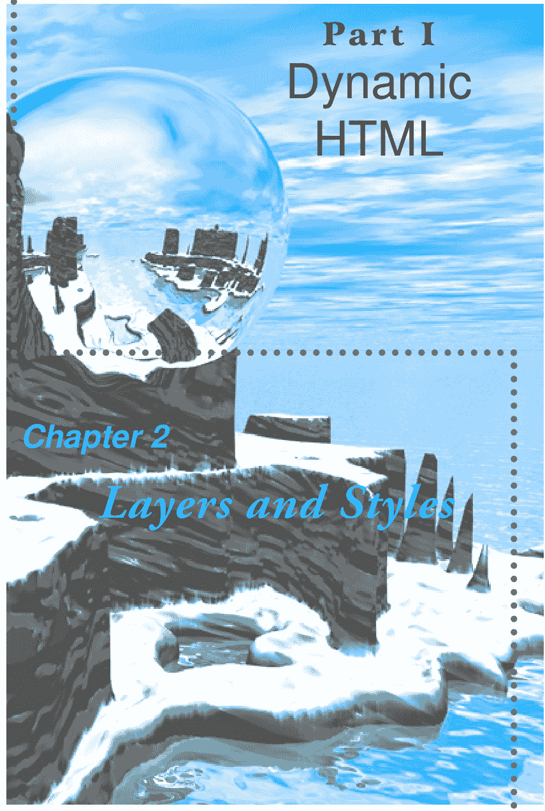

## 第 2 章
图层与样式

## 第 2 章
图层与样式

### 目录

**使用样式创建图层**

- 2.1) 概述

**使用 CSS 语法创建图层**

- 2.2) 使用 STYLE 属性创建 LAYER
- 2.3) 使用 STYLE 的 CLASS 创建 LAYER
- 2.4) { position: } 属性
- 2.5) { left: } 属性
- 2.6) { top: } 属性
- 2.7) 命名 LAYER 样式（使用 ID 属性创建 LAYER）
- 2.8) { width: } 属性
- 2.9) { height: } 属性
- 2.10) { clip: } 属性
- 2.11) { clip: } 属性的有缺陷版本
- 2.12) { clip: } 属性的无缺陷版本
- 2.13) { z-index: } 属性
- 2.14) { visibility: } 属性
- 2.15) { layer-background-color: } 属性
- 2.16) { layer-background-image: } 属性
- 2.17) { include-source: } 属性
- 2.18) CSS 图层属性与 <LAYER> 属性对照表

**使用 \<LAYER\> 元素创建图层**

- 2.19) <LAYER> 元素
- 2.20) <ILAYER> 元素
- 2.21) <NOLAYER> 元素

### 使用样式创建图层

## 概述

##### 创建图层

创建 LAYER 有很多种方法。它们是：

- 通过 STYLE 属性的 `<STYLE>` 元素，使用 `position` 属性
- 通过 CLASS 属性的 `<STYLE>` 元素，使用 `position` 属性
- 通过 ID 属性的 `<STYLE>` 元素，使用 `position` 属性
- `<LAYER>` 元素
- `<ILAYER>` 元素
- `<SPAN>` 元素
- JavaScript `document` 对象的 `tags` 属性
- JavaScript `document` 对象的 `classes` 属性
- JavaScript `document` 对象的 `ids` 属性

#### 基本要求

将样式转换为图层的唯一要求是在样式定义中包含 **position** 属性，然后为其分配 **absolute** 或 **relative** 的值。这可以针对 STYLE 的 CLASS 或 CLASS 的命名例外来完成。此外，**position** 属性可以在 STYLE 属性或 SPAN 元素中使用。

你不能在 LAYER 或 ILAYER 元素中使用 **position** 属性，因为根据定义，它们本质就是图层，这是由于浏览器在内部代码中设置了 **position** 属性的结果。

本章涵盖定位内容的创建，即，通过上述方法创建图层。第 3 章涵盖图层的 JavaScript 方面。

### 使用 CSS 语法创建图层

#### 使用 STYLE 属性创建 LAYER

STYLE 属性可用于在大多数 HTML 元素中创建 LAYER。你所要做的就是使用 **position** 属性来指定元素在文档布局中将被定位为 **absolute** 还是 **relative**。相对定位的 LAYER 将遵循文档中元素的自然流。绝对定位的 LAYER 将根据你用 **left** 和 **top** 属性指定的整数坐标精确放置。

**left** 属性指定 LAYER 开始的 x 坐标，从窗口的左上角测量，或者如果是嵌套的则从包含的 LAYER 测量，方向向右。**top** 属性指定 LAYER 开始的 y 坐标，从窗口的左上角测量，或者如果是嵌套的则从包含的 LAYER 测量，方向向下。

只要记住，当你在元素属性中使用 CSS 语法时，不要使用花括号，但要把整个属性名:值; 对的组放在一组双引号（" "）中，位于等号（=）的右侧，等号位于属性名 STYLE 的右侧，而 STYLE 又位于元素名的右侧，像这样：

```
<DIV STYLE="position:absolute; left:50; top:100; color:red;">
```

第 1 章中详述的所有属性也可以在用于创建 LAYER 的 STYLE 属性中使用。当你还使用 **position** 属性从元素内部创建 LAYER 时，这些是一些可以与 STYLE 属性一起使用的附加属性：

| 属性名 | [ 属性名:可选值 ] |
| :--- | :--- |
| position | { position:absolute \| relative ; } |
| left | { left:integerLength \| integer1%-100% ; } |
| top | { top:integerLength \| integer1%-100% ; } |
| width | { width:integerLength \| integer1%-100% ; } |
| height | { height:integerLength \| integer1%-100% ; } |
| clip | { clip:rect(X1,Y1,X2,Y1); } |
| z-index | { z-index:integer; } |
| visibility | { visibility:show \| hide \| inherit; } |
| layer-background-color | { layer-background-color:colorValue; } |
| layer-background-image | { layer-background-image:url('imageURL'); } |
| include-source | { include-source:url('documentURL'); } |

## 第 2 章 — 图层与样式

这里有一个入门示例，仅向你展示如何在 DIV 元素中使用 STYLE 属性创建 LAYER。它被定义为 **absolute** LAYER，位于坐标 ("50,100")，这意味着它将从窗口的左边距向右 50 像素，从顶部边距向下 100 像素处开始。它有红色文本，**font-size** 为 25 点。注意这个 STYLE 是在文档的 BODY 部分中应用的。

### 示例 2-0: Sample300.html

```
<!DOCTYPE HTML PUBLIC "-//W3C//DTD HTML 3.2//EN">
<HTML><HEAD>
<TITLE>Sample 300 - CSS Example 2-0 STYLE as Layer  </TITLE>
</HEAD>

<BODY>

<DIV STYLE="position:absolute; left:50px; top:100px; color:red; font-size:25pt;">

The DIVision test.

</DIV>

</BODY>
</HTML>
```

### 使用 STYLE 的 CLASS 创建 LAYER

只需定义一个普通的 STYLE CLASS 并添加 **position** 属性，像这样：

```
<HEAD>
<STYLE TYPE="text/CSS">

DIV.RedText    { position:relative; color:red; }

</STYLE>

</HEAD>

<B闸DY>
<DIV CLASS="RedText">
      This text will be red in an inflow Layer because the position is relative.
</DIV>
</BODY>
```


 ## { position: } 属性

**position** 属性实际上是让元素变成图层的真正原因。它是浏览器用来识别它和普通元素之间区别的标志。通过将其设置为 **absolute** 值，你告知浏览器应该将其定位在特定位置，而不是使用 **relative** 标记使图层跟随文档顺序的自然流。当你指定 **absolute** 值时，还必须使用 **left** 和 **top** 属性来定义图层的原点位置。（技术上讲，你不一定非要指定它们，但如果不指定，坐标将与相对图层相同，因为浏览器不知道该将图层定位在哪里，只会将其放入流中。）当你指定 **relative** 值时，**left** 和 **top** 属性用于指定图层左上角相对于其在文档中正常流入位置的偏移距离。

迷你示例：

```
{ position:absolute; }    { position:relative; }
```

CSS 语法：

```
{ position:absolute | relative; }
```

## { left: } 属性

**left** 属性表示图层左上角开始位置的水平坐标。图层将从该点向右下方渲染。你必须在选择的数字右侧包含测量单位缩写，该数字必须是正整数、负整数或零。默认的测量类型是像素，缩写为 (px)。回想基础几何中二维平面上的 (x,y) 坐标点对，你可以将 **left** 属性视为 x 坐标，将下面的 top 属性视为 y 坐标。使用百分比会产生较难控制的结果，但有时更为可取。

迷你示例：

```
{ left:40px; }    { left:2in; }    { left:25mm; }
```

CSS 语法：

```
{ left:integerLength | integer1%-100%; }
```

## { top: } 属性

**top** 属性表示图层左上角开始位置的垂直坐标。图层将从该点向右下方渲染。你必须在选择的数字右侧包含测量单位缩写，该数字必须是正整数、负整数或零。默认的测量类型是像素，用 **px** 关键字指定，并且必须包含测量单位。将 **top** 属性视为用于定位图层的 (x,y) 坐标对中的 **y 坐标**。

### 迷你示例：

```
{ top:20px; }
```

## CSS 语法：

```
{ top:integerLength | integer1%-100%; }
```

此示例演示如何使用 **position**、**left** 和 **top** 属性，通过 DIV 和 P 元素的 STYLE 属性创建两个不同的定位图层。它们都具有边框和其他区分属性，并使用 **left** 和 **top** 属性指定的坐标精确放置在特定位置。

### 示例 2-1：Sample301.html

```
<!DOCTYPE HTML PUBLIC "-//W3C//DTD HTML 3.2//EN"
<HTML>
<HEAD>
<TITLE>Sample 301 - CSS Example 2-1 STYLE Attribute as Layer     </TITLE>
</HEAD>

<BODY>

<DIV STYLE="position:absolute; left:25px; top:100px;
             color:red; font-size:22pt; background-color:blue;
             border-width:25px;  border-style:ridge; border-color:aqua;">

The Division Test.

</DIV>
```

## Part I — Dynamic HTML

```
<P STYLE="position:absolute; left:150px; top:300px;
    color:blue; font-size:44pt; background-color:lime;
    border-width:25px; border-style:double; border-color:purple;">

The Paragraph test.
</P>

</BODY>
</HTML>
```

此示例通过将 **position** 属性的值指定为 **relative**，演示了几个流内图层。

## 示例 2-2：Sample302.html

```
<!DOCTYPE HTML PUBLIC "-//W3C//DTD HTML 3.2//EN">
<HTML>
<HEAD>
<TITLE>Sample 302 - CSS Example 2-2 Relatively Positioned LAYERs </TITLE>
</HEAD>

<BODY>

<P STYLE="position:relative;
    color:blue; font-size:25pt; background-color:yellow;">

Another Paragraph Test. Notice how both of these Elements follow the natural flow
of the document and in the case of the H1 Heading below the left and top Properties
cause it to be offset by 144 pixels down and to the right of where it would
naturally be, but that is a relative movement of distance to a new location and not
an exact specification of coordinate position.
</P>

<H2 STYLE="position:relative;
    color:purple; font-size:44pt; background-color:teal;
    font-family:Moonlight, fantasy;">

This is Sample 302.
</H2>

<H1 STYLE="position:relative; left:144px; top:144px;
    color:aqua; font-size:35pt; background-color:navy;">

Another H1 Heading Test.
</H1>

</BODY>
</HTML>
```

## 命名图层样式：使用 ID 属性创建图层

创建图层的另一种方式是简单地使用命名个体样式，并包含 **position** 属性，指定为 **relative** 或 **absolute**，从而创建一个命名图层。这发生在文档头部的样式定义中，使用 CSS 语法。首先在井号 (#) 符号右侧命名你的图层，然后使用与创建常规样式相同的语法指定你的图层具有哪些属性，如下所示：

```
#FirstLayer { position:relative; color:blue; font-size:50pt; }

#SecondLayer { position:absolute; left:20px; top:200px; color:red; font-size:20pt; }
```

然后在文档主体中使用元素的 ID 属性来引用该图层，这样图层将被插入，并且其属性将应用于该元素的内容，如下所示：

```
<DIV Id="FirstLayer"> This is another test. </div>

<DIV Id="SecondLayer"> And yet another test. </div>
```

**特别说明：**

需要记住的是，命名图层的引用方式与命名个体样式不同。对于命名图层，你<span style="text-decoration:underline">完全不需要</span>使用 CLASS 属性。你只需要使用 ID 属性来引用或插入命名图层到元素中。

从技术上讲，即使你在实现命名个体样式时，也不必使用元素的 CLASS 属性；但在那种情况下，你是在规避命名个体样式的意图，使其仅被用作常规的样式类，而不是作为样式类的<span style="text-decoration:underline">例外</span>。这违背了它的设计初衷，但也无妨。

注意，"Layer" 和 "LAYER" 的两种不同大小写仅用于强调目的，在所有情况下都应视为可互换的。"Layer" 的拼写唯一关键的时候，是在 JavaScript 代码中使用 "layers[i]" 数组时。

示例 2-3 创建了两个命名图层，然后在 DIV 元素中使用它们各自的 ID 属性来引用每个图层。

### 示例 2-3：Sample303.html

```
<!DOCTYPE HTML PUBLIC "-//W3C//DTD HTML 3.2//EN">
<HTML>
<HEAD>
<TITLE>         Sample 303 - CSS Example 2-3 NAMED LAYERs   </TITLE>

<STYLE TYPE="text/CSS">

<!--

#FirstLayer   { position:relative; color:blue; font-size:50pt; }

#SecondLayer   { position:absolute; left:20px; top:200px; color:red;
                font-size:20pt; }
-->
</STYLE>

</HEAD>
<BODY>

<DIV ID="FirstLayer"> This is another test. </DIV>

<DIV ID="SecondLayer">And yet another test. </DIV>

</BODY>
</HTML>
```

## { width: } 属性

**width** 属性用于指定图层的水平宽度。你可以用数字后跟测量单位（如英寸或像素）来指定，使用 **auto** 关键字，或者使用图层后跟百分号 (%) 的百分比来表示。此属性的默认值是浏览器窗口中可分配给图层的最大空间的 100%，如果是嵌套图层，内容将换行到直接包含它的图层的右边缘。

### 迷你示例：

```
{ width:555px; }       { width:70%; }
```

## CSS 语法：

```
{ width:integerLength | integer1%-100% | auto; }
```


 ## { height: } 属性

**height** 属性用于为 LAYER 指定垂直高度。你可以使用 `auto` 关键字，用数字后跟度量单位（如英寸或像素）来指定，或者用 LAYER 的百分比后跟百分号（%）来指定。

如果未指定高度，则默认情况下 LAYER 会展开到显示该 LAYER 内所有内容所需的最小高度。

如果你指定的高度不足以正确显示内容，则 LAYER 会自动展开以适应内容。

此属性主要是为了方便嵌套在其中的 LAYER 引用，这些嵌套 LAYER 将其 **height** 值表示为百分比。为方便日后参考，它还指定了初始裁剪矩形 **height**，即 JavaScript 中 *Layer* 对象的 **clip.height** 属性。

## 简单示例：

```
{ height:700px; } { height:13in; } { height:50%; }
```

## CSS 语法：

```
{ height:integerLength | integer1%-100% | auto; }
```

## 特别说明：

当你使用某个元素的 STYLE 属性创建 LAYER，而该元素同时具有 BORDER 属性时，使用 **width** 或 **height** 属性可能会导致浏览器渲染不稳定。如果在该上下文中使用其中任何一个属性，某些其他属性可能会被忽略。再次提醒，到你阅读此文时，这可能已经修复，因此请自行测试。

你可以通过进入 CD-ROM 中名为 `AlternateSamples-NotInBook` 的文件夹，并加载名为 `Sample304-Test.html` 的文件来查看一些异常行为，该文件不在书中。

在使用命名 LAYER 时，**width** 和 **height** 属性工作正常，如以下示例 2-4 所示。

## 138 第一部分 — Dynamic HTML

## 示例 2-4：Sample304.html

```
<!DOCTYPE HTML PUBLIC "-//W3C//DTD HTML 3.2//EN">
<HTML>
<HEAD>

<TITLE>Sample 304 - CSS Example 2-4 Width and Height in NAMED LAYERs</TITLE>

<STYLE TYPE="text/CSS">

<!--

#ThirdLayer   { position:relative; color:blue; font-size:50pt;
                width:500px; height:200px;
                border-style:ridge; border-width:20px; border-color:purple;}

#FourthLayer  { position:absolute; left:70px; top:277px; color:red;
                width:350px; height:144px; font-size:20pt;
                border-style:inset; border-width:30px; border-color:blue; }
-->

</STYLE>

</HEAD>

<BODY>

<P ID="ThirdLayer">   This is another test. </P>

<H2 ID="FourthLayer">  And yet another test. </H2>

<P>
Notice that the LAYER Named 'FourthLayer' that is addressed in the H2 heading is
positioned absolutely so that it is 70 pixels to the right of the left margin and
277 pixels down from the top margin and is by its very nature out of the flow of
the rest of the Elements. That's why even though this paragraph is coded in the
HTML document after the H2 Element it shows up in the browser Window before the H2
Element. Obviously this paragraph has the normal inherited atributes from the Body
Element since no Named LAYER was addressed to it.
</P>

</BODY>

</HTML>
```

当你以 **absolute** 方式 **position**（定位）LAYER 时要小心，因为它们很容易与其他 LAYER 重叠，尤其是当你创建了一些相对定位的 LAYER 时。如果你在前面的 [Sample304.html](Sample304.html) 中将 **top** 属性值改为 100 像素，就可以看到重叠的演示。

第 2 章 — 图层与样式 139

## { clip: } 属性

在开始介绍此属性之前，需要说明的是，在撰写本文时，要么是 Netscape 的文档有误，要么是 Navigator 4.0 程序存在 bug，因此对于同一个属性你需要了解两种不同的解释来应对这些困难。在我解释了当前实际工作方式（即存在 bug 的版本）之后，我会加入一个部分来说明它本应如何工作，以防他们决定修复这些问题。这样，你将获得正确理论与应用的指南，无需扭曲概念来适应错误；同时你也将获得一份指南，了解如何在有 bug 的情况下使其工作。

## 存在 bug 的 { clip: } 属性版本

**clip** 属性允许你选择 LAYER 的哪一部分可见，哪一部分不可见。你可以通过定义裁剪矩形函数来实现这一点：首先用 (x1,y1) 坐标点指定左上角，然后用 (x2,y2) 坐标指定右下角。这四个数字作为一组放在<u>单引号</u>之间，然后再放入一组圆括号中，每个数字之间用逗号分隔。该矩形内部的空间就是 LAYER 的可见部分。如果你选择不使用<u>单引号</u>列出它们，那么请确保数字之间没有任何空白字符。如果 **clip** 属性没有嵌套在<u>双引号</u>中的话，你也可以用<u>双引号</u>将数字括起来。

它的样子如下：

```
clip:rect('30,400,275,20');
```

其中：

30 是顶部坐标

400 是右侧坐标

275 是底部坐标

20 是左侧坐标

你还可以选择只使用两个坐标，这会导致 **left** 和 **top** 属性的默认值都为零。奇怪的是，两个坐标的版本工作正常，没有任何异常。它以<u>右侧坐标</u>在前、<u>底部坐标</u>在后的顺序排列，看起来像这样：

```
clip:rect(400,275);
```

这等价于：

```
clip:rect(0,400,275,0);
```

## 140 第一部分 — Dynamic HTML

在许多情况下，你会希望让 LAYER 的开头可见，但隐藏另一部分以便稍后显示。这些裁剪坐标始终以像素为单位，因此不允许在数字后添加单位缩写。

你为 **clip** 属性指定的数字是从包含它们的 LAYER 的边缘开始测量的，而不是从浏览器窗口的边缘开始测量。即使当你使用像 BODY 元素这样的顶级容器时，这一点也总是成立的，但在那种情况下，浏览器窗口就是容器。

如果你选择不明确指定 **clip** 属性值，则有两种默认场景。

**场景 1：** 基于 LAYER 中包含的内容及其与你指定的 WIDTH 和 HEIGHT 值的交互方式。

| 坐标 | 值 |
| :--- | :--- |
| top coordinate | 接收 WIDTH 顶部坐标 |
| right coordinate | 接收 HEIGHT 右侧坐标 |
| bottom coordinate | 接收 HEIGHT 底部坐标 |
| left coordinate | 接收 WIDTH 左侧坐标 |

**场景 2：** **仅**基于 LAYER 中包含的内容，因为你**没有**指定 WIDTH 和 HEIGHT 属性的任何值。

| 坐标 | 值 |
| :--- | :--- |
| top coordinate | 默认为 0 |
| right coordinate | 接收换行距离坐标 |
| bottom coordinate | 接收计算显示 LAYER 所有内容所需的垂直空间时的坐标 |
| left coordinate | 默认为 0 |

**附注：**

对于那些还不熟悉 JavaScript 的人来说，在函数中使用双引号会导致数字被视为由数字字面量组成的文本字符串，而不是数学实体，如果你稍后需要将它们用于需要真实数字的函数，就需要进行转换。在大多数较新版本的 JavaScript 中，这种转换通常是内部自动处理的。

此属性的真正威力在于使用 JavaScript 动态操作页面时，能够让页面的一部分显示或消失、缩小或放大，或在页面上移动。有关动态更改 LAYER 裁剪区域的示例，请参见第 3 章第 250-263 页。

请记住，本节解释的是 **clip** 属性在当前存在 bug 的情况下如何工作，裁剪集的 **顺序** 是 **top**、**right**、**bottom**、**left**。

## CSS 语法：

```
{ clip:rect("topY1, rightX2, bottomY2, leftX1"); }
```


 ## 第 2 章 — 图层与样式

本示例重点介绍了 clip 属性当前的工作方式，这种方式是错误的、有 bug 的，会导致裁切值的顺序为 top、right、bottom、left。

## 示例 2-5：Sample305.html

```
<!DOCTYPE HTML PUBLIC "-//W3C//DTD HTML 3.2//EN">
<HTML><HEAD>
<TITLE>Sample 305 - CSS Example 2-5 Clipping in NAMED LAYERs       </TITLE>

<STYLE TYPE="text/CSS">

<!--

#FifthLayer    { position:absolute; left:10px; top:100px;
                 color:blue; font-size:20pt;
                 border-style:ridge; border-width:20px; border-color:purple; }

#SixthLayer    { position:absolute; left:10px; top:300px;
                 color:red; font-size:20pt;
                 border-style:ridge; border-width:20px; border-color:purple;
                 clip:rect('0,150,125,0'); }

                                                   /*  the order is top, right, bottom, left  */
-->

</STYLE>
</HEAD>

<BODY>
<DIV ID="FifthLayer">
This is what I              <BR>
look like without           <BR>
a clipping rectangle.
</DIV>

<DIV ID="SixthLayer">
This is what I              <BR>
look like with              <BR>
a clipping rectangle.
</DIV>

<P>Notice that the LAYER Named约定，翻译如下：

[content]
 ## 第 2 章 — 图层与样式

本示例重点介绍 clip 属性当前的工作方式，这种方式存在错误和缺陷，会导致裁切值的顺序为 top、right、bottom、left。

## 示例 2-5：Sample305.html

```
<!DOCTYPE HTML PUBLIC "-//W3C//DTD HTML 3.2//EN">
<HTML><HEAD>
<TITLE>Sample 305 - CSS Example 2-5 Clipping in NAMED LAYERs       </TITLE>

<STYLE TYPE="text/CSS">

<!--

#FifthLayer    { position:absolute; left:10px; top:100px;
                 color:blue; font-size:20pt;
                 border-style:ridge; border-width:20px; border-color:purple; }

#SixthLayer    { position:absolute; left:10px; top:300px;
                 color:red; font-size:20pt;
                 border-style:ridge; border-width:20px; border-color:purple;
                 clip:rect('0,150,125,0'); }

                                                   /*  the order is top, right, bottom, left  */
-->

</STYLE>
</HEAD>

<BODY>
<DIV ID="FifthLayer">
This is what I              <BR>
look like without           <BR>
a clipping rectangle.
</DIV>

<DIV ID="SixthLayer">
This is what I              <BR>
look like with              <BR>
a clipping rectangle.
</DIV>

<P>Notice that the LAYER Named 'FifthLayer' is exactly the same as the LAYER Named
'SixthLayer' except for the color of the text and the CLIP Property in 'SixthLayer'
which causes the right third of that Element to be invisible. Pay strict attention
to the coordinate order in the clip set which is <B>top, right, bottom, left</B>.
This is very <B>counterintuitive</B> but you've got to deal with it.</P>

</BODY>
</HTML>
```

第 I 部分 — 动态 HTML

## 无缺陷版本的 { clip: } 属性

**clip** 属性让你可以选择图层的哪一部分可见，哪一部分不可见。你可以通过定义一个裁剪矩形函数来实现这一点，该函数首先用 (x1,y1) 坐标点指定左上角，然后用 (x2,y2) 坐标点指定右下角。这四个数字作为一组放在*单引号*内，然后放在一对括号内，每个数字之间用逗号分隔。该矩形内部的空间将是图层的可见部分。如果你选择不使用*单引号*来列出它们，那么确保数字之间甚至没有一处空白。如果 **clip** 属性在任何地方都没有嵌套在*双引号*内，你可以用*双引号*来包围这些数字。

它的样子如下：

```
clip:rect('20,30,400,275');
```

其中：

- 20 是 left 坐标
- 30 是 top 坐标
- 400 是 right 坐标
- 275 是 bottom 坐标

你还可以选择只在集合中使用两个坐标，这将导致 **left** 和 **top** 属性的默认值都为零。以下是一个双坐标的示例：

```
clip:rect(400,275);
```

这等价于：

```
clip:rect(0,0,400,275);
```

这可以节省你的打字工作量。在很多情况下，你可能希望让图层的开头可见，但隐藏另一部分以便稍后显示。

这些裁切坐标**始终**以像素为单位测量，因此你**不允许**在数字后面添加单位缩写。

你为 **clip** 属性指定的数字是*从包含它们的图层边缘开始测量*的，而不是从浏览器窗口的边缘开始。这始终成立，即使你正在使用像 BODY 元素这样的顶级容器，但在那种情况下，浏览器窗口就是容器。

如果你选择不明确指定，则有两种默认 **clip** 属性值的场景：

**场景 1：** 基于图层内包含的内容以及你指定的 WIDTH 和 HEIGHT 值的交互方式。

- left 坐标接收 WIDTH 的 left 坐标
- top 坐标接收 WIDTH 的 top 坐标
- right 坐标接收 HEIGHT 的 right 坐标
- bottom 坐标接收 HEIGHT 的 bottom 坐标

**场景 2：** 仅基于图层内包含的内容，因为你没有为 WIDTH 和 HEIGHT 属性指定任何值。

- left 坐标默认为 0
- top 坐标默认为 0
- right 坐标接收换行距离坐标
- bottom 坐标接收计算显示图层所有内容所需的垂直空间时的坐标。

> 请记住，本节解释的是 **clip** 属性应有的工作方式，裁切值集的顺序是 **left, top, right, bottom**。

## CSS 语法：

```
{ clip:rect("leftX1, topY1, rightX2, bottomY2,"); }
```

以下示例 2-6 重点介绍 clip 属性应有的工作方式，其裁切值集的顺序为 **left, top, right, bottom**。它与前面的示例 2-5 完全相同，只是裁切值的顺序切换了。我无法保证其准确性，因为它尚未经过测试，如果 Netscape 尚未修复这些缺陷，那么它完全无法工作。它只是为了方便你，以防他们修复了缺陷。如果 Netscape 没有修复缺陷，则下方的图层将完全不可见。如果缺陷已被修复，则下方的图层将部分可见。

## 示例 2-6：Sample306.html

```
<!DOCTYPE HTML PUBLIC "-//W3C//DTD HTML 3.2//EN">
<HTML>
<HEAD>
<TITLE>Sample 306 - CSS Example 2-6 Clipping in NAMED LAYERs          </TITLE>

<STYLE TYPE="text/CSS">

<!--

#FifthLayer    { position:absolute; left:10px; top:100px;
                  color:blue; font-size:20pt;
                  border-style:ridge; border-width:20px; border-color:purple; }

#SixthLayer    { position:absolute; left:10px; top:300px;
                  color:red; font-size:20pt;
                  border-style:ridge; border-width:20px; border-color:purple;
                  clip:rect('0,0,150,125'); }

                   /*        the order is left, top, right, bottom   */
-->

</STYLE>

</HEAD>

<BODY>

<DIV ID="FifthLayer">
This is what I             <BR>
look like without          <BR>
a clipping rectangle.
</DIV>

<DIV ID="SixthLayer">
This is what I             <BR>
look like with             <BR>
a clipping rectangle.
</DIV>

<P>
Notice that the LAYER Named 'FifthLayer' is exactly the same as the LAYER Named
'SixthLayer' except for the color of the text and the CLIP Property in 'SixthLayer'
which causes the right third of that Element to be invisible. Pay strict attention
to the coordinate order in the clip-set which is <B>left, top, right, bottom</B>.
Hopefully this works because Netscape has fixed the bug. If you try this example
and the second LAYER is totally invisible then that means that Navigator still has
the bug and you should see the Sample305.html instead.
</P>

</BODY>
</HTML>
```

## 示例 2-7：Sample307.html

本示例与前面的示例类似，但演示了样式类的 clip 属性，包括正确的和有缺陷的版本，以及 LAYER 元素中的 CLIP 属性。请参见示例中的注释。有关 LAYER 元素的详细信息，请参见第 2 章第 161-172 页。有关 **Layer** 对象的详细信息，请参见第 3 章，从第 199 页开始。

```
<!DOCTYPE HTML PUBLIC "-//W3C//DTD HTML 3.2//EN">
<HTML>
<HEAD>
<TITLE>Sample 307 - CSS Example 2-7  clip Property and Attribute  </TITLE>

<STYLE TYPE="ot_data_identifier">btw_fix_zone

<!--
     /*    the BUGGY order which currently works in CSS-Syntax is:
            top, right, bottom, left      */

all.alphaL { position:absolute; left:10px; top:10px; color:blue; font-size:20pt;
         width:300; clip:rect(0,450,150,0); }


     /*    the CORRECT order which DOESN'T currently work in CSS-Syntax is:
            left, top, right, bottom      */

all.buggyL { position:absolute; left:200px; top:300px; color:red; font-size:20pt;
         width:300;  clip:rect(0,0,450,150); }
-->

</STYLE>
</HEAD>

<BODY>

<P CLASS="alphaL">This Layer will be visible if there is still a bug.  The obvious
solution is to use the LAYER Element or use JavaScript. </P>

<!--   the CORRECT order which DOES currently work in HTML Attribute-Syntax is:
       left, top, right, bottom  -->

<LAYER LEFT=0 TOP=150 BGCOLOR="cyan" CLIP="0,0,400,150">  There are no bugs in the
LAYER Element.  </LAYER>


<!-- If there is still a bug, then the following Layer won't show up  -->

<DIV CLASS="buggyL">This Layer Disneyland>是巴黎迪士尼乐园的理想住宿选择。酒店提供往返乐园的免费班车服务。</DIV>

</BODY>
</HTML>
```


 ## { z-index: } 属性

**z-index** 属性使用正整数来指定一个 LAYER（层）在堆叠顺序或 `z-order` 中的位置。将 **z-index** 设置为 1 的 LAYER 将位于所有后续 LAYER 的下方，因此 **z-index** 值越大，该 LAYER 在 `z-stack`（z 轴堆叠）中的位置就越高。它的作用是确定 LAYER 的优先级顺序，从而在使用户有 LAYER 重叠甚至占据完全相同空间时，控制 LAYER 内容的可见性。

当你设置 LAYER 占据相同空间时，通常会将除其中一个之外的所有 LAYER 初始设置为隐藏，然后使用 JavaScript 来操作它们，或者允许用户动态更改页面的呈现方式。

通常情况下，LAYER *按照* 它们在代码中的顺序进行堆叠，因此代码序列中的第一个 LAYER 位于 `z-stack` 的底部，下一个编码的 LAYER 是 `z-stack` 中的下一个 LAYER，依此类推。通过使用 **z-index** 属性，你可以更改该 `z-order` 以满足你的创作需求。

请注意，这不会影响嵌套 LAYER 与其父 LAYER 之间的堆叠顺序，而只会影响父 LAYER 内的子 LAYER。

### 迷你示例：

```
{ z-index:5; }
```

## CSS 语法：

```
{ z-index:integer; }
```

该示例演示了 **z-index**，创建了三个 Division（分区）元素，每个元素具有不同颜色的边框，并具有导致它们相互重叠的绝对坐标。查看示例文件以观察 **z-index** 如何影响堆叠顺序，使得第一个编码的元素具有优先级，因为其 **z-index** 具有最大的整数值，而不是自然方式，那样会产生相反的效果。这是一个非常简单的示例，只是为了详细说明这个概念。

## 第2章 — 层与样式

### 示例 2-8：Sample308.html

```
<!DOCTYPE HTML PUBLIC "-//W3C//DTD HTML 3.2//EN">
<html>
<head>
<TITLE>Sample 308 — CSS Example 2-8 z-index</TITLE>

<STYLE TYPE="text/css">
<!--

#SeventhLayer { position:absolute; left:100px; top:100px;
 z-index:3; color:blue; font-size:20pt; padding:40px;
 border-style:ridge; border-width:20px; border-color:aqua; }

#EighthLayer { position:absolute; left:100px; top:230px;
 z-index:2; color:red; font-size:20pt; padding:40px;
 border-style:ridge; border-width:20px; border-color:yellow; }

#NinthLayer { position:absolute; left:280px; top:75px;
 z-index:1; color:green; font-size:20pt; padding:40px;
 border-style:ridge; border-width:20px; border-color:lime; }

-->

</STYLE>
</head>

<BODY>

<DIV ID="SeventhLayer">
			This is the 			<BR>
			SeventhLayer Test 		<BR>
			with z-index equals 3. 	<BR>
			It rules! 						</DIV>

<DIV ID="EighthLayer">
			This is the 			<BR>
			EighthLayer Test 		<BR>
			with z-index equals 2. 		</DIV>

<DIV ID="NinthLayer">
			This is the 			<BR>
			NinthLayer Test 		<BR>
			with z-index equals 1. 		</DIV>

<P> Notice that the Layer Named 'NinthLayer' has a z-index of one and it is at the
bottom of the stack while the Layer Named 'SeventhLayer has a z-index of three and it
is at the top of the stack and therefore isn't obscured by either of the other
Layers.
</P>

</BODY>
</html>
```

## 示例 2-8 Sample308.html

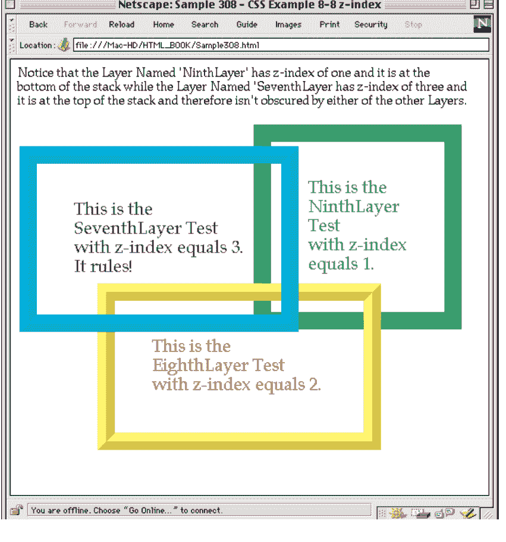

## { visibility: } 属性

**visibility**（可见性）属性与 **z-index** 属性密切相关，并且经常与其一起使用，因为它决定了页面加载到浏览器窗口时 LAYER 是初始可见还是隐藏。有三个可能的值，即 **show**（显示）、**hide**（隐藏）或 **inherit**（继承）。**show** 值使 LAYER 可见，**hide** 值使 LAYER 不可见，但它仍然占据其在窗口中通常所占的空间量，并且仍可被 JavaScript 操作。

指定 **inherit** 值会使 LAYER 具有与其父 LAYER 相同的值。如果 LAYER 没有父级，则它被称为顶层 LAYER，并将继承 **show** 值，因为文档的 Body 始终是可见的。LAYER 的默认值是它将具有与其父 LAYER 相同的值。

即使 LAYER 设置为 **show** 值，它仍然可能被另一个具有相同定位坐标或只是重叠它的 LAYER 遮盖，和/或具有更高 **z-index** 值的 LAYER 遮盖。

### 迷你示例：

```
{ visibility:show; }

{ visibility:hide; }

{ visibility:inherit; }
```

## CSS 语法：

```
{ visibility:show | hide | inherit; }
```

下面这个非常简单的示例展示了前面示例中的相同三个 LAYER，并为每个 LAYER 添加了 **visibility** 属性，以演示其三个可能值 **show**、**hide** 和 **inherit** 的每一个。

**第 I 部分 — 动态 HTML**

### 示例 2-9：Sample309.html

```
<!DOCTYPE HTML PUBLIC "-//W3C//DTD HTML 3.2//EN">
<HTML>
<HEAD>
<TITLE>Sample 309 - CSS Example 2-9  visibility  </TITLE>

<STYLE TYPE="text/CSS">

<!--

#SeventhLayer  { position:absolute; left:10px; top:100px;
                  z-index:3; color:blue; font-size:20pt; padding:40px;
                  border-style:ridge; border-width:20px; border-color:aqua;
                  visibility:show; }

#EighthLayer  { position:absolute; left:100px; top:258px;
                  z-index:2; color:red; font-size:20pt; padding:40px;
                  border-style:ridge; border-width:20px; border-color:yellow;
                  visibility:inherit; }

#NinthLayer  { position:absolute; left:280px; top:75px;
                  z-index:1; color:green; font-size:20pt; padding:40px;
                  border-style:ridge; border-width:20px; border-color:lime;
                  visibility:hide; }

-->

</STYLE>
</HEAD>

<BODY>

<DIV ID="SeventhLayer">
This is the <BR>        SeventhLayer Test <BR>        with z-index equals 3.   <BR>
It rules!                                                     </DIV>

<DIV ID="EighthLayer">
This is the <BR>        EighthLayer Test <BR>        with z-index equals 2.   </DIV>

<DIV ID="NinthLayer">
This is the <BR>        NinthLayer Test <BR>        with z-index equals 1.   </DIV>

<P>This is exactly the same as Example 307 except that the LAYER Named
'EighthLayer' is designated with the 'inherit' Value and since its parent Layer is
visible it inherits a Value of 'show'. The LAYER Named 'NinthLayer' is designated
as being initially hidden and guess what, you can't see it.

<A HREF="Sample415.html">      Example 3-15   </A>
uses a JavaScript SCRIPT Element to cause these same Layers to disappear and appear
by moving the mouse over them and out from over them. </P>

</BODY>
</HTML>
```

第2章 — 层与样式    151

## { layer-background-color: } 属性

**layer-background-color**（层背景颜色）属性不同于第1章中介绍的 **background-color**（背景颜色）属性。正如你可能从之前的许多示例中回忆起的，当你选择常规背景颜色时，比如说对于 H1 标题元素，只有文本正后方的空间会获得背景颜色，而分配给该元素的其他空间则与 BODY 元素的 BGCOLOR 颜色相同。

**layer-background-color** 属性的作用是获取元素的额外可用空间以及背景颜色空间，并将它们全部设置为相同的颜色。另一种解释方式是，它指定整个 LAYER 的背景颜色，而不仅仅是 LAYER 的内容，因为内容通常不会填满分配给 LAYER 的全部空间。

选择颜色的方式与其他属性一样，可以使用公认的颜色 **NAME**（名称）、十六进制三元组或使用 rgb() 函数。如果你需要更多信息，因为你跳过了某些部分，那么请参阅第1章第37页关于 COLOR 的部分，或参阅附录 B 中从第1030页开始的"颜色理论"部分。

这不是一个 W3C 批准的属性。此外，它在 LAYER 元素中没有对应的属性。

## **迷你示例：**

```
{ layer-background-color:blue; }
{ layer-background-color:#0000ff; }
{ layer-background-color:rgb(5, 220, 170); }
{ layer-background-color:rgb(45%, 2%, 58%); }
```

## **CSS 语法：**

```
{ layer-background-color:colorname | #$$$$$$ |
                    rgb(0-255,0-255,0-255) | rgb(0-100%,0-100%,0-100%); }
```

示例 2-10 演示了 **layer-background-color** 属性。

**示例 2-10：**    **Sample310.html**

```
<!DOCTYPE HTML PUBLIC "-//W3C//DTD HTML 3.2//EN">
<HTML>
<HEAD>
<TITLE>Sample 310 - CSS Example 2-10 layer-background-color</TITLE>
```


 ```
<STYLE TYPE="text/CSS">

<!--

#LBLayer	 { position:absolute; left:20px; top:10px;
			layer-background-color:rgb(45%, 2%, 58%);
			color:aqua;font-size:25pt; padding:40px;
			border-style:ridge; border-width:20px; border-color:blue; }

-->

</STYLE>

</HEAD>

<BODY>

<DIV ID="LBLayer">
This is the LBLayer Test. <BR>
Notice that the burgundy color completely covers the area inside of the border
instead of just covering the text area.
</DIV>

</BODY>

</HTML>
```

## { layer-background-image: } 属性

**layer-background-image** 属性指定整个 LAYER 的平铺背景图像，这与普通的 **background-image** 属性略有不同，后者仅将所选图像平铺在 LAYER 的内容区域上，通常不会填满分配给 LAYER 的整个空间。

这不是一个 W3C 批准的属性。此外，它在 LAYER 元素中没有对应的属性。

## 小型示例：

```
{ layer-background-image:url('JPEG-FILES/icon-BG-stars.jpg'); }

{ layer-background-image:
url('http://www.erols.com/gilorien/JPEG-FILES/icon-BG-stars.jpg'); }
```

## CSS 语法：

```
{ layer-background-image:url('fullURL' | 'directory/fileName'); }
```

## 示例 2-10 Sample310.html

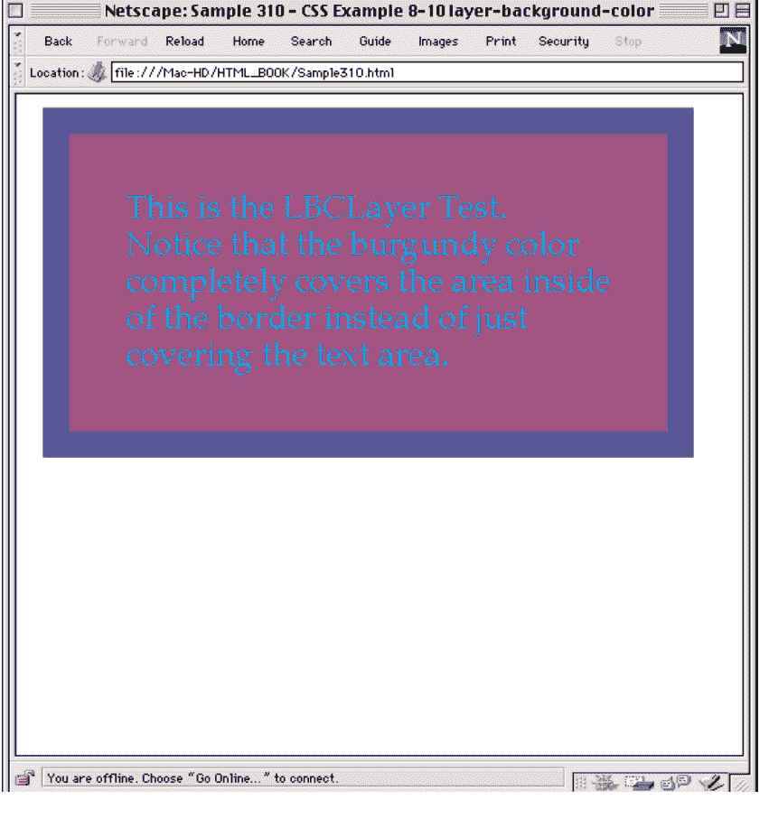

# 第一部分 — 动态 HTML

本示例展示了 **layer-background-image** 属性与 **background-image** 属性之间的区别。

## 示例 2-11：Sample311.html

```
<!DOCTYPE HTML PUBLIC "-//W3C//DTD HTML 3.2//EN">
<HTML>
<HEAD>
<TITLE>Sample 311 - CSS Example 2-11 layer-background-image </TITLE>

<STYLE TYPE="text/CSS">

<!--

#LBGImage       { position:absolute; left:20px; top:10px;
                  layer-background-image:url('JPEG-FILES/icon-BG-asteroids.jpg');
                  color:aqua; font-size:25pt;
                  border-style:groove; border-width:20px; border-color:green; }

#RegBGImage     { position:absolute; left:20px; top:200px;
                  background-image:url('JPEG-FILES/icon-BG-asteroids.jpg');
                  color:aqua; font-size:25pt;
                  border-style:groresize; border-width:20px; border-color:green; }

-->

</STYLE>

</HEAD>

<BODY>

<DIV ID="LBGImage">
This is the LBGImage Test. <BR>
Notice that the tiled image icon completely covers the area inside of the border
instead of just covering the text area.
</DIV>

<P ID="RegBGImage">
This is the RegBGImage Test. <BR>
Notice that the tiled image icon does not completely cover the area inside of the
border. Instead it just covers the text area.
</P>

</BODY>

</HTML>
```

## 第 2 章 — 图层与样式

示例 2-11 Sample311.html

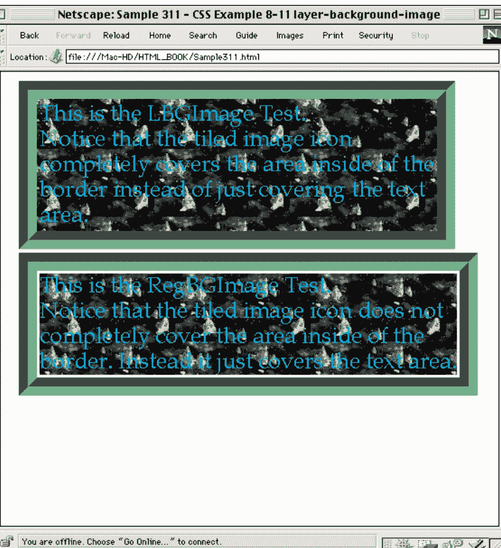

本示例展示了如何使用 **layer-background-image** 属性和 **background-color** 属性，使文本背后有颜色，并在颜色和文本后方放置平铺图像。它还说明了仅使用普通的 **background-image** 属性是无法实现这一点的，因为后者会遮盖住[背景颜色](background color)。

## 示例 2-12：Sample312.html

```
<!DOCTYPE HTML PUBLIC "-//W3C//DTD HTML 3.2//EN">
<HTML>
<HEAD>
<TITLE>Sample 312 - CSS Example 2-12 layer-background-image</TITLE>

<STYLE TYPE="text/CSS">

<!--

#LBGImage5     { position:absolute; left:20px; top:10px;
                  layer-background-image:url('JPEG-FILES/icon-CoarseTurf.jpeg');
                  color:red; font-size:25pt; padding:20px;
                  background-color:yellow; }

#BGImage11     { position:absolute; left:20px; top:250px;
                  background-image:url('Sample-ETOC/icon-Ceiling-Tile.jpeg');
                  color:red; font-size:25pt; padding:20px;
                  background-color:blue; }

-->

</STYLE>

</HEAD>

<BODY>

<DIV ID="LBGImage5">
This is the LBGImage5 Test.           <BR>
Notice that the tiled image completely covers the area of the DIV Element and the
background-color covers the text area.
</DIV>

<DIV ID="BGImage11">
This is the BGImage11 Test.           <BR>
Notice that the tiled image for the background-image does not allow the
background-color show through for the text area like the layer-background-image
does.
</DIV>

</BODY>
</HTML>
```

## 第 2 章 -- 图层与样式 157

示例 2-12 Sample312.html

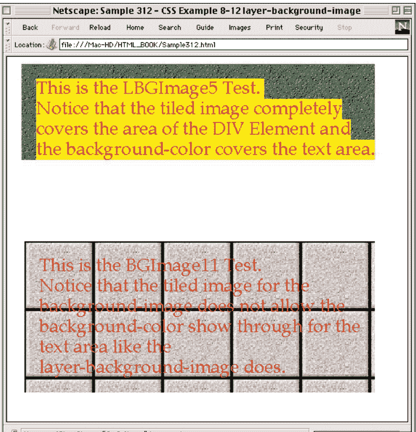

## { include-source: } 属性

**include-source** 属性与其他属性非常不同，因为它允许你将外部文档中 HTML 格式的内容加载到你的 LAYER 中。它可以在任何有效的 LAYER 定义中实现，方法是首先指定一个 **position** 属性，其值为 **absolute** 或 **relative**。然后，在 LAYER 定义中，使用 **include-source** 属性指定一个指向外部文件的链接，该文件只包含普通的 **HTML** 或 **JavaScript**，这些内容将被加载到该 LAYER 中。不过请记住，你还必须使用 CLASS 或 ID 属性来引用你想要加载外部内容的元素的 LAYER 定义。随后，LAYER 的样式属性将应用于外部文件中包含的任何 HTML 元素，并在当前文档中渲染。这不是一个 W3C 批准的属性。它确实有对应的 LAYER 属性，即 SRC。

以下是如何使用 **include-source** 属性创建命名 LAYER 的方法：

```
#RedBack { position:absolute; left:100px; top:300px;
background-color:red;
include-source:url("Sample313-External.html"); }
```

然后，你必须在文档正文中将该命名 LAYER 应用于某个元素，如下所示：

```
<DIV ID="RedBack"></DIV>
```

这会创建一个带有 STYLE 类的 LAYER，其中包含 **include-source** 属性，然后将其应用于带有 Class 属性的 DIV 元素：

```
.myYellow { position: relative; background-color: yellow;
include-source:url("Sample313-External.html"); }
```

```
<DIV CLASS="myYellow"></DIV>
```

## CSS 语法：

```
{ include-source:url("documentURL"); }
```

## 特别提示：

请务必注意，如果你想获得可预测且准确的结果，不要在任何用作 **include-source** 属性加载的外部文件中包含任何 CSS 语法。在那些外部文件中只使用普通的 HTML 代码或 JavaScript。

本示例演示了刚刚在前面小型示例中介绍的 **include-source** 属性，其中 **Redback** 命名 LAYER 和 **myYellow** 样式类 LAYER 都将外部文件加载到 DIV 元素中。

## 示例 2-13：Sample313.html

```
<!DOCTYPE HTML PUBLIC "-//W3C//DTD HTML 3.2//EN">
<HTML>
<HEAD>
<TITLE>Sample 313 – CSS Example 2-13 include-source Property </TITLE>

<STYLE TYPE="text/CSS">
<!--

#Redback { position: absolute; left: 100px; top: 300px;
            background-color: red;
            include-source:url("Sample313-External.html"); }

.all.myYellow { position: absolute; left: 100px; top: 400px;
              background-color: yellow;
              INTERNAL url("Sample313-External.html"); }

-->

</STYLE>

</HEAD>

<BODY>

<P STYLE="position:absolute; left:20px; top:25px; color:blue; font-size:14pt;">

Notice that both of the DIV Elements below this blue paragraph have content
that is imported from the 'Sample313-External.html' file. The first DIV Element has
a background color of red that is applied to it with the NAMED Element named RedBack
which is summoned the ID Attribute of the DIV Element. <BR><BR>

The second uses the CLASS of STYLE named 'myYellow' and has a yellow
background. <BR><BR>

BE EXTREMELY careful with the External Files that you load in and make sure
that there is only regular HTML in them and absolutely no CSS Syntax in them or you
will get unpredictable and/or seriously weird results. </P>

<DIV ID="RedBack"></DIV>

<DIV CLASS="myYellow"></DIV>

</BODY>
</HTML>
```

本示例重点演示了为什么不应该在有命名 LAYER 且带有 **include-source** 属性的元素内放置任何文本内容。你分配给它的所有文本（或如果你为该元素定义的属性，本示例中我没有这样做）都将被忽略。命名 LAYER 仍然可以正常工作，因此外部内容将显示出来。请注意，DIV 标签内的文本在浏览器窗口中完全不会显示。

## 示例 2-14 第 1 部分：Sample314.html

```
<!DOCTYPE HTML PUBLIC "-//W3C//DTD HTML 3.2//EN">
<HTML>
<HEAD>
<TITLE>Sample 314 - CSS Example 2-14 include-source Property Caveat</TITLE>
<STYLE TYPE="text/CSS">
<!--
#RedBack { position:absolute; left:100px; top:200px;
            background-color:red;
            include-source:url('Sample314A.html'); }
-->
</STYLE>
</HEAD>
<BODY>
<DIV ID="RedBack">
            This is the ignored text.
</DIV>
<P>This is why putting text inside of an Element that has a NAMED LAYER addressed
to it with an "include-source url" attached, is not a good idea. All of the text or
Properties are ignored and you may get even stranger results than this.</P>
</BODY>
</HTML>
```

## 示例 2-14 第 2 部分：Sample314A.html

```
<!DOCTYPE HTML PUBLIC "-//W3C//DTD HTML 3.2//EN">
<HTML>
<HEAD>
<TITLE> Sample 314A - CSS Example 2-14 include-source </TITLE>
</HEAD>
<BODY>
<H3>This is a H3 Heading.</H3>
<H4>This is a H4 Heading.</H4>
</BODY>
</HTML>
```


 # CSS 图层属性与 <LAYER> 属性对照表

此表重复自第 1 章第 13 页，它将使用定位样式创建的图层的 CSS 语法属性与使用 <LAYER> 元素创建的图层的属性进行了对比。如你所见，每种创建图层的方式都有一些通过另一种方法无法实现的独特功能。

| 属性名称 CSS 语法 | 属性名称 <LAYER> 语法 | 简单 CSS 语法示例 | 简单 <LAYER> 语法示例 |
| :--- | :--- | :--- | :--- |
| position<br>position | myLayerName<br>ID<br>LEFT<br>TOP<br>PAGEX<br>PAGEY | [ position: absolute; ]<br>[ position: relative; ]<br>[ position: absolute; ]<br>[ left: 40px; ]<br>[ top: 20px; ] | <LAYER></LAYER><br><ILAYER></ILAYER><br>ID="myLayerName"<br>LEFT="40"<br>TOP="20"<br>PAGEX="72"<br>PAGEY="144" |
| width<br>height | WIDTH<br>HEIGHT | [ width: 550px; ]<br>[ height: 400px; ] | WIDTH="550"<br>HEIGHT="400" |
| clip<br>z-index | CLIP<br>Z-INDEX | [ clip: rect(10, 20, 30, 40); ]<br>[ z-index: 3; ] | CLIP="10, 20, 30, 40"<br>Z-INDEX="3" |
|  | ABOVE<br>BELOW |  | ABOVE="myLayerName5"<br>BELOW="myLayerName7" |
| visibility<br>BACKGROUND<br>layer-background-color<br>background-image<br>layer-background-image | VISIBILITY<br>BGCOLOR | [ visibility: show; ]<br>[ background-color: purple; ]<br>[ layer-background-color: blue; ] | VISIBILITY="SHOW"<br>BGCOLOR="#0000ff" |
|  | BACKGROUND | [ background-image:url("image1.jpg"); ]<br>[ layer-background-image:url("image2.jpg"); ] | BACKGROUND="image3.jpg" |
| include-source | SRC<br>OnMouseOver<br>OnMouseOut<br>OnFocus<br>OnBlur<br>OnLoad | [ include-source: url(myPage.html); ]<br>[ include-source: url(myPage.html); ] | SRC="myPage.html"<br>OnMouseOver<br>OnMouseOut<br>OnFocus<br>OnBlur<br>OnLoad |

## 特别提示：

默认情况下，图层是透明的，这意味着位于其下方的其他图层会透过来显示，除非在实际内容（如文本或图像）所在的位置才会遮挡下方的图层。

# 使用 <LAYER> 元素创建图层

# <LAYER> 元素

<LAYER> 元素是在文档主体（Body）部分直接创建图层的方法。起始标签和结束标签都是必需的。在功能上，它等同于使用 STYLE 元素或另一元素的 STYLE 属性来创建图层，尽管 <LAYER> 元素还有若干额外的属性可用，且与对应的 CSS 属性名称相比，其属性名称的语法有所不同。

你可能在前面的表格或下面的语法部分注意到，LAYER 元素并没有对应的 POSITION 属性。这是因为 **absolute** 值已内置于 LAYER 元素中，而 **relative** 值已内置于 ILAYER 元素中，因此无需指定。

请记住，使用 LAYER 元素时，你回归到了常规 HTML，所有测量单位都是像素，但不需要在整数后添加单位缩写，并且需要将字符串值用单引号或双引号括起来。

需要牢记的最重要的概念之一是，LAYER 元素主要用于通过 LEFT 和 TOP 属性**精确地定位**一个独立的内容块。然后，你有几种选项来增强该内容：

1) 在 LAYER 元素内使用额外的属性。
2) 使用 ID 或 CLASS 属性来引用你在文档头部使用 CSS 语法创建的命名图层。此选项将比选项 1 提供无限多的控制力和创作可能性。
3) 使用内联样式，即 STYLE 属性。
4) 使用 SPAN 元素进行即时样式设置。
5) 同时使用以上所有选项。这给你最大的灵活性。

以下属性是 LAYER 元素独有的，在 CSS 语法中没有对应的属性：

```
PAGEX, PAGEY, ABOVE, BELOW,
OnMouseOver, OnMouseOut, OnFocus, OnBlur, OnLoad
```

关于 <LAYER> 元素理论的许多内容与前面关于命名图层（NAMED LAYER）和将 STYLE 属性作为图层使用的章节非常相似。虽然为了完整性有必要重复这些信息，但你可以快速浏览以找出与前面章节不同的方面，然后将其作为参考——这也是它的主要目的。次要目的是让你能够比较 CSS 语法和 HTML LAYER 元素语法。

# 第 2 章 — 图层与样式 163

# 语法：

```
<LAYER
ID="layerName"
LEFT=integerPixels
TOP=integerPixels
PAGEX=integerPixels
PAGEY=integerPixels
WIDTH=integerPixels | "integer%"
HEIGHT=integerPixels | "integer%"
CLIP="TopInteger,RightInteger,BottomInteger,LeftInteger"
Z-INDEX= positiveInteger
ABOVE="layerName"
BELOW="layerName"
VISIBILITY="SHOW" | "HIDE" | "INHERIT"
BGCOLOR="colorName" | "#$$$$$$"
BACKGROUND="imageURL"
SRC="contentURL"
onMouseOver="function()" | "inlineJavaScript"
onMouseOut="function()" | "inlineJavaScript"
onFocus="function()" | "inlineJavaScript"
onBlur="function()" | "inlineJavaScript"
onLoad="function()" | "inlineJavaScript">
***
</LAYER>
```

## 属性定义：

**ID="layerName"**
为图层创建名称，和/或指定要引用和插入的命名样式（NAMED STYLE）。**layerName** 的值必须以字母字符开头，不能以数字字符开头。**layerName** 的其余部分可以包含数字。请记住，**layerName** 始终区分大小写。你可以通过名称引用图层，并使用 JavaScript 等脚本语言进行操作。

```
<LAYER ID="FirstLayer"> This is another test. </LAYER>
<LAYER ID="SecondLayer">And yet another test. </LAYER>
```

**LEFT=integerPixels**
指示图层左上角开始在所在图层中渲染的水平坐标，如果是顶层图层，则是在浏览器窗口中渲染的水平坐标。然后图层将向下并向右渲染。单位始终为像素，必须用正整数、负整数或零来指定，不带 (px) 单位。这是一个可选属性，如果未使用，默认采用文档的自然流。

```
<LAYER LEFT=40> ... </LAYER>
```

## TOP=integerPixels

指示图层左上角开始在所在图层中渲染的垂直坐标，如果是顶层图层，则是在浏览器窗口中渲染的垂直坐标。然后图层将向下并向右渲染。单位始终为像素，必须用正整数、负整数或零来指定，不带 (px) 单位。这是一个可选属性，如果未使用，默认采用文档的自然流。

```
<LAYER TOP=20>  ...  </LAYER>
```

## PAGEX=integerPixels

功能与 LEFT 属性类似，区别在于该图层左上角的横向起始点始终是 enclosing browser Window，而非所在的图层。

```
<LAYER PAGEX=55>  ...  </LAYER>
```

## PAGEY=integerPixels

功能与 TOP 属性类似，区别在于该图层左上角的纵向起始点始终是 enclosing browser Window，而非所在的图层。

```
<LAYER PAGEY=522>  ...  </LAYER>
```

## WIDTH=integerPixels | "integer%"

指定图层的水平宽度。可以用正整数指定像素值，也可以用图层的百分比后跟百分号 (%) 来指定。像素值不要使用单位后缀。此属性的默认值是浏览器窗口中可分配给图层的最大空间的 100%，或者如果是嵌套图层，内容将环绕到直接包含该图层的图层的右边缘。如果你在图层中包含无法环绕的项目（如图像），且指定的宽度过小无法容纳该项目，则图层将扩展至足以容纳该项目的宽度。以下是两个简短示例：

```
<LAYER WIDTH=777>...</LAYER>
<LAYER WIDTH="50%">...</LAYER>
```

## HEIGHT=integerPixels | "integer%"

指定图层的垂直高度。可以用正整数指定像素值，也可以用图层的百分比后跟百分号 (%) 来指定。如果未 heightspecified，默认情况下图层将扩展至显示其包含的所有内容所需的最小高度。如果指定的高度不足以正确显示内容，则图层将自动扩展以适应内容。此属性主要用于作为其包含的嵌套图层的参考，这些嵌套图层以百分比表示其高度值。它还指定了图层对象裁剪区域的初始高度值，该值用于 JavaScript 中。

```
<LAYER HEIGHT=400>...</LAYER>
<LAYER HEIGHT="75%">...</LAYER>
```

## CLIP="TopInteger,RightInteger,BottomInteger,LeftInteger"

选择 LAYER 的哪个部分最初可见。您可以通过使用 (x1,y1) 坐标点定义裁剪矩形的左上角，然后使用 (x2,y2) 坐标点定义右下角来实现这一点。这四个数字之间用逗号分隔，并可选地作为一组放在引号之间，使它们被视为字符串。如果省略引号，请确保数字或逗号之间没有任何空白。该矩形内的空间将是 LAYER 的可见部分。坐标列表的顺序是从左到右；首先是顶部坐标，然后是右侧坐标，接着是底部坐标，而最后一个 oddly enough 是左侧坐标。到您阅读本文时，这个顺序可能已经发生变化，因此如果您的 LAYER 无法显示，请尝试将左侧坐标放在列表的开头，这正是 Netscape 文档中所说的方式，但目前已属错误。这些坐标必须是正整数、负整数或零，并且始终表示像素。您不需要在坐标后添加 (px) 单位。CLIP 属性是一个可选属性，默认为 LAYER 完全可见。

```
<LAYER CLIP="10,200,300,40">      ...  </LAYER>
```

其中：         10      是顶部坐标
              200     是右侧坐标
              300     是底部坐标
              40      是左侧坐标

您还可以使用 CLIP 属性的值，该值在数字集中只有两个数字，这样它只指定右侧坐标和底部坐标。在这种情况下，顶部和左侧坐标默认都为零，如下所示：

```
<LAYER CLIP="200,300">      ...  </LAYER>
```

这等价于：

```
<LAYER CLIP="0,200,300,0">    ...  </LAYER>
```

## Z-INDEX=positiveInteger

使用正整数来指定 LAYER 在堆叠顺序中的位置。Z-INDEX 设置为 1 的 LAYER 将位于所有后续 LAYER 的下方，因此可以推断 Z-INDEX 越大，该 LAYER 在 z 轴堆叠中的位置就越高。它的作用是确定 LAYER 的优先顺序，当您有重叠或甚至占据完全相同空间的 LAYER 时，它控制着 LAYER 内容的可见性。当您设置不同的 LAYER 占据相同空间时，通常将一个设置为 SHOW 值，其余设置为 HIDE 值，然后使用 JavaScript 来操作它们或允许用户动态更改页面。

通常，LAYER 按照它们在代码中的顺序进行堆叠，因此代码序列中的第一个 LAYER 位于 z 堆叠的底部，下一个编码的 LAYER 是 z 堆叠中的下一个 LAYER，依此类推。通过使用 Z-INDEX 属性，您可以更改该 z 顺序以满足您的创作需求。

## 166 第一部分 — 动态 HTML

Z-INDEX 属性不会影响嵌套 LAYER 与其父 LAYER 之间的堆叠顺序，而只影响父 LAYER 内的同级 LAYER。此外，每个 LAYER 只能使用一个 Z-INDEX 属性。以下是一个小型示例：

```
<LAYER Z-INDEX=5> 									 .. 									 </LAYER>
```

**ABOVE="layerName"**
指定此 LAYER 在堆叠顺序中将高于由 **layerName** 指定的 LAYER。重要的是 **layerName** LAYER 必须已经是存在的 LAYER；否则，将创建一个新的 LAYER，这可能会在 JavaScript 脚本中引起问题，或者在 HTML 页面中给您带来意外的布局结果。此属性没有相应的 CSS 语法属性。以下是一个小型示例：

```
<LAYER ABOVE="myLayer"> 									 .. 									 </LAYER>
```

**BELOW="layerName"**
指定此 LAYER 在堆叠顺序中将低于由 **layerName** 指定的 LAYER。重要的是 **layerName** LAYER 必须已经是存在的 LAYER；否则，将创建一个新的 LAYER，这可能会在 JavaScript 脚本中引起问题，或者在 HTML 页面中给您带来意外的布局结果。此属性没有相应的 CSS 语法属性。以下是一个小型示例：

```
<LAYER BELOW="yourLayer"> 									 .. 									 </LAYER>
```

**VISIBILITY="SHOW" | "HIDE" | "INHERIT"**
确定页面加载到浏览器窗口时 LAYER 最初是可见还是隐藏。SHOW 值使 LAYER 可见。HIDE 值使 LAYER 不可见，但它仍然占据窗口中通常应有的空间。这对于内联 LAYER 也是如此；也就是说，它被定义为固有的绝对定位，但没有选择 LEFT 或 TOP 值。请注意，即使 LAYER 的值为 HIDE，它仍然可以进行 JavaScript 操作，但在分配 SHOW 值之前无法接收事件。如果您希望 LAYER 隐藏但仍能接收事件，例如键盘事件，那么使用负整数通过 LEFT 或 TOP 属性将 LAYER 放置在屏幕之外。

指定 INHERIT 值将使 LAYER 具有与其父 LAYER 相同的值。如果 LAYER 没有父级，则称为顶级 LAYER，它将 INHERIT SHOW 值，因为文档主体始终可见。LAYER 的默认值是它将具有与其父 LAYER 相同的值。

即使 LAYER 设置为 SHOW 值，它仍可能被另一个具有相同定位坐标或只是重叠它的 LAYER 和/或具有更高 Z-INDEX 值的 LAYER 遮挡。以下是小型示例：

```
<LAYER VISIBILITY="SHOW">				 .. 								 </LAYER>
<LAYER VISIBILITY="HIDE">				 .. 								 </LAYER>
<LAYER VISIBILITY="INHERIT">			 .. 								 </LAYER>
```

## 第 2 章 — 层与样式

**BGCOLOR="colorName" | "#$$$$$$"**

又来了！再次，使用公认的颜色名称或使用那个可靠的、以红色-绿色-蓝色十六进制三元组表示的颜色，前面加井号 (#) 并放在双引号之间。

```
<LAYER BGCOLOR="blue"> ... </LAYER>
<LAYER BGCOLOR="#22aaff"> ... </LAYER>
```

**BACKGROUND="imageURL"**

指定一个图像作为 LAYER 背景的平铺（重复）图案，通过图像文件的 URL 访问。如果您想要花哨一些，也可以使用 GIF89a 动画或其他媒体类型。如果这样做，您可能想为 LAYER 内容的样式指定 **padding** 属性。

```
<LAYER BACKGROUND="JPEG-FILES/icon-Bg-stars.jpg"> ... 
</LAYER>
```

```
<LAYER
BACKGROUND="http://www.erolons.com/gilorien/JPEG-FILES/
icon-Bg-stars.jpg"> ... 
</LAYER>
```

**SRC="contentURL"**

指定一个仅包含 HTML 内容或 HTML 内容和 JavaScript 的外部文档，该文档被加载并放置到此 LAYER 中。从外部文件放置在 LAYER 元素中的任何 Layer 将被视为包含 Layer 的子 Layer，后者具有加载内容的 SRC 属性。此属性的相应 CSS 语法属性是 **include-source** 属性。

如果您想动态更改 LAYER 的内容，或者它可以用于为 NOLAYER 元素提供替代内容，这将非常有用。

```
<LAYER SRC="Sample310.html"> ... </LAYER>
```

```
<LAYER SRC="http://www.dreamplay.com/Sample311.html"> ... </LAYER>
```

**onMouseOver="function()" | "inlineJavaScript"**

当用户将鼠标光标放置在此 LAYER 在文档中占据的空间上时，执行此函数或内联 JavaScript 代码。请参阅第 3 章"用于 Layer 的 JavaScript"或第 6 章"JavaScript 事件和事件处理程序"。

**onMouseOut="function()" | "inlineJavaScript"**

当用户将鼠标光标从此 LAYER 在文档中占据的空间上移开时，执行此函数或内联 JavaScript 代码。请参阅第 3 章"用于 Layer 的 JavaScript"或第 6 章"JavaScript 事件和事件处理程序"。


 ## 第一部分 —— 动态 HTML

onFocus="function( )" | "inlineJavaScript"

当文档中的此 LAYER 获得键盘焦点时，执行此函数或内联 JavaScript 代码。请参阅第 3 章"用于 Layer 的 JavaScript"或第 6 章"JavaScript 事件与事件处理器"。

onBlur="function( )" | "inlineJavaScript"

当文档中的此 LAYER 失去焦点时，执行此函数或内联 JavaScript 代码。请参阅第 3 章"用于 Layer 的 JavaScript"或第 6 章"JavaScript 事件与事件处理器"。

onLoad="function( )" | "inlineJavaScript"

当此 LAYER 完全加载到浏览器窗口后，执行此函数或内联 JavaScript 代码。请参阅第 3 章"用于 Layer 的 JavaScript"或第 6 章"JavaScript 事件与事件处理器"。

本示例演示了使用 LAYER 标签的三个 Layer。更多信息请参阅 LAYER 标签之间的文本。

## 示例 2-15：Sample315.html

```
<!DOCTYPE HTML PUBLIC "-//W3C//DTD HTML 3.2//EN">
<HTML><HEAD>
<TITLE>Sample 315 - Example 2-15 LAYER Element        </TITLE> </HEAD>
<BODY>

<LAYER LEFT=72 TOP=30>
      This is a simple Layer. It is inherently absolute and placed at 72 pixels to
 the right of the left margin of the Body Element and 30 pixels down from the top
margin of the Body Element which contains it.
</LAYER>

<LAYER LEFT=50 TOP=144 BGCOLOR="red" WIDTH=400>
       This Layer is 50 pixels from the left margin and 144 pixels from the top
margin of the Body Element and has a background color of red.
</LAYER>

<LAYER LEFT=10 TOP=244 BGCOLOR="aqua" WIDTH=400>

<FONT SIZE="5" COLOR="blue">
       This Layer is 10 pixels from the left margin and 244 pixels from the top
margin of the Body Element and has a background color of aqua. The text is blue and
sized at 5, but it was specified with the FONT Element and not with CSS Syntax.
</FONT>
</LAYER>

</BODY>
</HTML>
```

## 第 2 章 —— Layer 与样式

本示例演示了当 Layer 嵌套在另一个 Layer 内部时，LEFT 和 TOP 属性的表现方式。它们不再是相对于页面的绝对定位坐标，而是相对于父 Layer 的。在第三个 Layer 中，省略了 LEFT 和 TOP 属性，转而使用了 PAGEX 和 PAGEY 属性。更多详情请参见示例中 Layer 内的文本。

## 示例 2-16：Sample316.html

```
<!DOCTYPE HTML PUBLIC "-//W3C//DTD HTML 3.2//EN">
<HTML>
<HEAD>
<TITLE>        Sample 316 - Example 2-16 LAYER Element  </TITLE>
</HEAD>

<BODY>

<LAYER LEFT=72 TOP=30>

       All three of these Layers have x-coordinates of 72 pixels but the second and
third Layers are both nested inside the first Layer which causes the second Layer
to be 72 pixels to the right of the margin of the first Layer, not just to the
right of the Body Element.          <BR><BR>
       Just to add a little spice to the mix the third Layer is using the PAGEX and
PAGEY Attributes so by definition its coordinates are not applied to the first
Layer but are applied to the margin of the Body Element which causes it to be 72
pixels to the right of the margin of the Body Element and 244 pixels down from the
top of the margin of the Body Element.

<LAYER LEFT=72 TOP=150 BGCOLOR="yellow" WIDTH=400>
       This Layer is 72 pixels from the left margin of the first Layer so it is 144
pixels from the Body Element margin. It 150 pixels from the top margin of the first
Layer which makes it 180 pixels from the top margin of the Body Element and has a
background color of yellow. If it is overlapping the first Layer then resize your
browser window so it is wider.
</LAYER>


<LAYER PAGEX=72 PAGEY=300 BGCOLOR="lime" WIDTH=330>
<FONT SIZE="5" COLOR="blue">
       This Layer is 72 pixels from the left margin and 300 pixels from the top
margin of the Body Element and has a background color of lime. The text is blue and
sized at 5, but it was specified with the FONT Element and not with CSS Syntax.
</FONT>
</LAYER>

                  <!-- Closes the top parent Layer-->
</LAYER>

</BODY>
</HTML>
```

# 170 第一部分 —— 动态 HTML

## 示例 2-16 Sample316.html

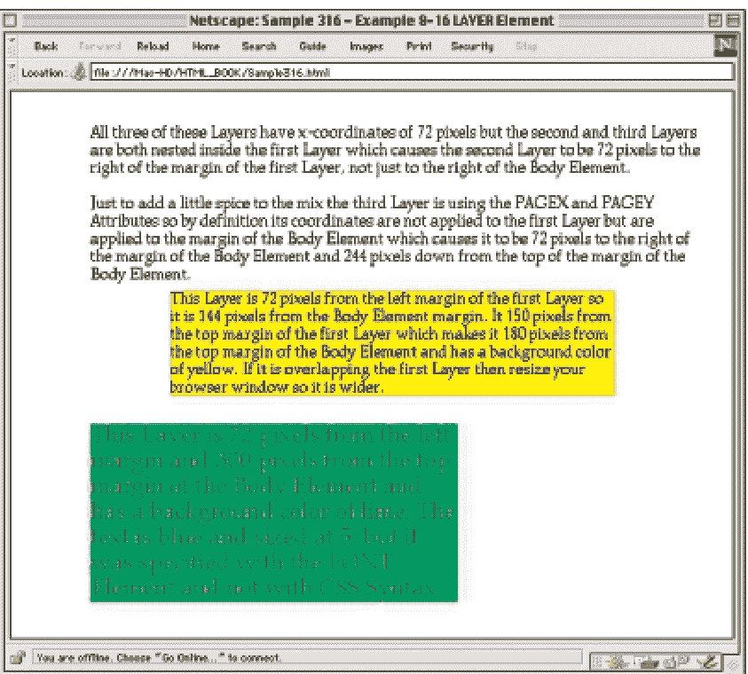

## 第 2 章 —— Layer 与样式

本示例演示了 LAYER 元素以及 evangelist 名称以及使用 CSS 语法创建的 NAMED LAYER，并展示了可以在单个 LAYER 元素中使用属性并从 NAMED LAYER 继承属性。

### 示例 2-17：Sample317.html

```
<!DOCTYPE HTML PUBLIC "-//W3C//DTD HTML 3.2//EN">
<HTML>
<HEAD>
<TITLE>Sample 317 - Example 2-17 LAYER Element        </TITLE>

<STYLE TYPE="text/CSS">
<!--

#LeBodi         { padding:20px; font-size:15pt; }

#LBCLayer      { position:absolute; left:30px; top:170px;
                  layer-background-color:rgb(45%, 2%, 58%);
                  color:aqua; font-size:20pt; padding:20px;
                  border-style:ridge; border-width:20px; border-color:blue; }

#LBCLayer2     { position:absolute; left:25px; top:300px;
                  layer-background-color:rgb(75%, 72%, 8%);
                  color:blue; font-size:25pt; padding:10px;
                  border-style:double; border-width:20px; border-color:lime; }

-->
</STYLE>

</HEAD>

<BODY TEXT="white" BGCOLOR="black">

<LAYER ID="LeBodi" LEFT="45" TOP="40" BGCOLOR="#7700ff" WIDTH="500">
      All of these Layers are specified with the LAYER Element and each address a
NAMED LAYER from the Style Definition. Notice that this Layer also makes use of
LAYER Attributes in addition to the padding Property and font-size Property that it
inherits from the 'LeBodi' NAMED LAYER. <BR><BR>
</LAYER>

<LAYER ID="LBCLayer">
This is the LBCLayer Test. It has a blue border.
</LAYER>

<LAYER ID="LBCLayer2">
This is the LBCLayer2 Test. It has a lime border.
</LAYER>

</BODY>
</HTML>
```

# 第一部分 —— 动态 HTML

### 示例 2-17 Sample317.html

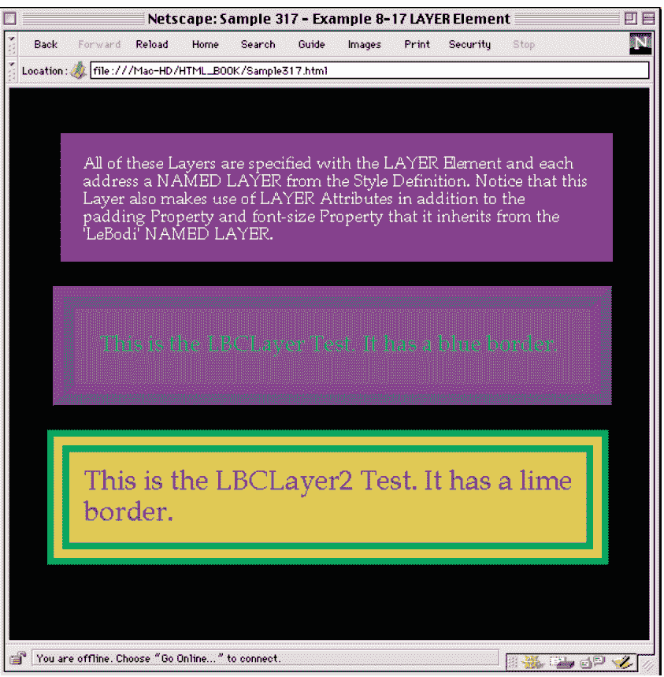

## <ILAYER> 元素

<ILAYER> 元素是一个内联的、行内的 Layer，而 LAYER 元素则被视为非行内的。

<ILAYER> 元素拥有与 <LAYER> 元素完全相同的属性，它们的定义相同，工作方式也完全一致，除了 LEFT 和 TOP 属性。LEFT 和 TOP 属性指定的是距文档自然流偏移的距离，而不是绝对位置。有关这两个属性的更多信息，请参见 ILAYER 元素的语法部分之后的内容。由于其他 ILAYER 属性的定义与 LAYER 元素的对应属性完全相同，此处不再重复，更多信息请参阅前面关于 LAYER 元素的小节。

# 语法：

```
<ILAYER
ID="layerName"
LEFT=integerPixels
TOP=integerPixels
PAGEX=integerPixels
PAGEY=integerPixels
WIDTH=integerPixels | "integer%"
HEIGHT=integerPixels | "integer%"
CLIP="TopInteger,RightInteger,BottomInteger,LeftInteger"
Z-INDEX= positiveInteger
ABOVE="layerName"
BELOW="layerName"
VISIBILITY="SHOW" | "HIDE" | "INHERIT"
BGCOLOR="colorName" | "#$$$$$$"
BACKGROUND="imageURL"
SRC="contentURL"
OnMouseOver="function()" | "inlineJavaScript"
OnMouseOut="function()" | "inlineJavaScript"
OnFocus="function()" | "inlineJavaScript"
OnBlur="function()" | "inlineJavaScript"
OnLoad="function()" | "inlineJavaScript">

***

</ILAYER>
```

## 属性定义：

**LEFT=integerPixels**
表示从 Layer 在文档中正常流动位置的上角开始测量的水平偏移距离。这是 ILAYER 在其包含的 Layer 中或浏览器窗口中（如果是顶层 Layer）开始渲染的左上角位置。

ILAYER 将向下并向右渲染。始终以像素为单位，必须指定为正整数、负整数或零，无需使用 (px) 单位。这是一个可选属性，如果未使用，则默认为文档的自然流。

```
<ILAYER LEFT=40>

... Layer Content ...

</ILAYER>
```

**TOP=integerPixels**
表示从 Layer 在文档中正常流动位置的上角开始测量的垂直偏移距离。这是 ILAYER 在其包含的 Layer 中或浏览器窗口中（如果是顶层 Layer）开始渲染的左上角位置。

ILAYER 将向下并向右渲染。始终以像素为单位，必须指定为正整数、负整数或零，无需使用 (px) 单位。这是一个可选属性，如果未使用，则默认为文档的自然流。

```
<ILAYER TOP=20>

... Layer Content ...

</ILAYER>
```

> 示例 2-18 是两个内联 ILAYER 元素的简单演示。按出现顺序，第一个 ILAYER 是紫色的，第二个是红色的。它们都指定了 500 像素的 WIDTH，每个都包含少量明显的说明性文本。
> 本示例的要点是为你提供最简单的 ILAYER 元素实现，作为参考，以便与后续更 hoodlum 复杂的示例进行比较。


 # 第2章 — 层与样式 175

示例 2-18：Sample318.html

```
<!DOCTYPE HTML PUBLIC "-//W3C//DTD HTML 3.2//EN">
<HTML>
<HEAD>
<TITLE>       Sample 318 - Example 2-18     ILAYER Element </TITLE>
<BASEFONT SIZE="5">
</HEAD>
<BODY TEXT="white" BGCOLOR="black">
<ILAYER BGCOLOR="#7700ff" WIDTH=500>
This is the first ILAYER Layer.  Without the BR Tags they would stack vertically
snug.
</ILAYER>              <BR><BR>
<ILAYER BGCOLOR="red"  WIDTH=500 HEIGHT=200>
This is the second ILAYER Layer.
</ILAYER>
</BODY>
</HTML>
```

本示例演示了将**命名样式**应用于 ILAYER 元素。请注意，第三个 ILAYER 具有 LEFT 和 TOP 属性，这会使其流内位置按指定的像素数偏移。

示例 2-19：Sample319.html

```
<!DOCTYPE HTML PUBLIC "-//W3C//DTD HTML 3.2//EN">
<HTML>
<HEAD>
<TITLE>Sample 319 - Example 2-19     ILAYER Element </TITLE>
<STYLE TYPE="text/CSS">
<!--
#LeBodi    { font-size: 15pt; }
#LBCILAYER { layer-background-color: rgb(45%, 2%, 58%);
             color: aqua; font-size: 20pt;
             border-style:ridge; border-width:20px; border-color:blue; }
#LBCILAYER2 { layer-background-color: rgb(75%, 72%, 8%);
              color: blue; font-size: 25pt;
              border-style:double; border-width:20px; border-color:lime; }
-->
</STYLE>

</HEAD>

<BODY TEXT="white" BGCOLOR="black">

<ILAYER ID="LeBodi" BGCOLOR="#7700ff" WIDTH=500>
    All of these ILAYERs are specified with the ILAYER Element and each address
    a NAMED ILAYER from the Style Definition. Notice that this ILAYER also makes use of
    ILAYER Attributes. <BR><BR>
</ILAYER>
```

```
<ILAYER ID="LBCILAYER">
    This is the LBCILAYER Test. It has a blue border.
</ILAYER>
```

```
<ILAYER ID="LBCILAYER2" LEFT=45 TOP=40>
    This is the LBCILAYER2 Test. It has a lime border.
</ILAYER>
```

</BODY>
</HTML>

# <NOLAYER> 元素

<NOLAYER> 元素用于向不支持层的浏览器的用户提供信息或选项。你可以将 NOLAYER 元素放在 LAYER 元素或 ILAYER 元素内部，或者放在通过 CSS 语法或 JavaScript 语法创建的层内。

# 语法：

```
<NOLAYER> *** </NOLAYER>
```

示例 2-20 包含 NOLAYER 元素的简单演示，该元素位于 ILAYER 元素内部。

# 示例 2-20：Sample320.html

```
<!DOCTYPE HTML PUBLIC "-//W3C//DTD HTML 3.2//EN">
<HTML>
<HEAD>
<TITLE>Sample 320 - Example 2-20 NOLAYER Element </TITLE>
</HEAD>

<BODY TEXT="white" BGCOLOR="black">

<ILAYER>

<NOLAYER>

<H2>
Hey Now!!! If you are reading this you are using a LAYER-Challenged-Browser.
For optimal viewing proceed immediately to

<A HREF="http://www.Netscape.com">Netscape's website</A>

and download version 4.0 or later, of Navigator.
</H2>

<H2>
Otherwise

<A HREF="myAlternatePage.html">

Enter the Non-Layers Version of our website.</A>

</H2>

</NOLAYER>

This is the LAYER Test.

</ILAYER>

</BODY>
</HTML>
```

# **第一部分**

# **动态 HTML**

# *第3章*

# *层与 JavaScript*

# # 第3章
## 层与 JavaScript

# ### 目录

- JavaScript 层简介 182
    - 3.1) 概述 182
    - 3.2) 用于 JavaScript 语法的样式表注释 182

- 新的 JavaScript 属性 183
    - 3.3) 新的 document 对象属性 183
    - 3.4) layers 属性 183
    - 3.5) classes 属性 185
    - 3.6) ids 属性 187

- JavaScript 样式表 189
    - 3.7) JavaScript 样式表 189
    - 3.8) 使用 with() 语句 189
    - 3.9) JavaScript 关键字 all 190
    - 3.10) getStyle() 方法 190
    - 3.11) JavaScript 样式表属性与示例表 191
    - 3.12) JavaScript 样式表属性与全部值表 194

- JavaScript 与层 195
    - 3.13) position 属性 196
    - 3.14) HTML <SCRIPT> 元素 196
    - 3.15) 对 <SCRIPT> 元素内容隐藏的注释标签 197
    - 3.16) JavaScript 关键字 var 198
    - 3.17) JavaScript Layer 对象 199
    - 3.18) JavaScript layers[] 数组 199
    - 3.19) 两种 document 对象 200

- Layer 对象的属性 203
    - 3.20) Layer 对象的属性 — 表 203
    - 3.21) Layer 对象的 document 属性 204
    - 调用 Layer 对象的方法 205
    - 3.23) Layer 对象的 name 属性 204
    - 3.24) Layer 对象的 left 属性 205
    - 3.25) Layer 对象的 top 属性 206
    - 3.26) Layer 对象的 pageX 属性 207
    - 3.27) Layer 对象的 pageY 属性 207
    - 3.28) Layer 对象的 visibility 属性 208
    - 3.29) Layer 对象的 zIndex 属性 209
    - 3.30) Layer 对象的 siblingAbove 属性 209
    - 3.31) Layer 对象的 siblingBelow 属性 210
    - 3.32) Layer 对象的 above 属性 210
    - 3.33) Layer 对象的 below 属性 210
    - 3.34) Layer 对象的 parentLayer 属性 211
    - 3.35) Layer 对象与裁剪矩形 211
    - 3.36) 裁剪属性的默认值 212
    - 3.37) Layer 对象的 clipTop 属性 212
    - 3.38) Layer 对象的 clipLeft 属性 212
    - 3.39) Layer 对象的 clipBottom 属性 213
    - 3.40) Layer 对象的 clipRight 属性 213

# # 第3章 — 层与 JavaScript

- 3.41) Layer 对象的 `clip_width` 属性 213
- 3.42) Layer 对象的 `clip_height` 属性 214
- 3.43) Layer 对象的 `bgColor` 属性 214
- 3.44) Layer 对象的 `background` 属性 215
- 3.45) Layer 对象的 `opacity` 属性 215

## Layer 对象的方法

- 3.46) `moveBy(dx, dy)` 方法 217
- 3.47) `moveTo(x, y)` 方法 217
- 3.48) `moveToRelative(x, y)` 方法 218
- 3.49) `resizeBy(dwidth, dheight)` 方法 218
- 3.50) `resizeTo(width, height)` 方法 219
- 3.51) `moveAboveLayerName()` 方法 220
- 3.52) `moveBelowLayerName()` 方法 221
- 3.53) `loadSourceURL`, `newPixelWidth()` 方法 221

## 在层中使用 JavaScript

- 3.54) JavaScript 的 `write()` 方法 230
- 3.55) 使用 `write()` 和 `clear()` 方法 230
- 3.56) 使用 `moveAbove()` 方法  Gustav Klimt 232
- 3.57) 显示和隐藏层以及写入层内容 236
- 3.58) 用于实时创建新层的 `new` 运算符 236
- 3.59) 使用 `tags` 属性样式动态创建 `new` 层 240
- NOR  在层内使用本地化的 JavaScript `<SCRIPT>` 241
- 3.61) 动画裁剪矩形以显示图像 246
- 3.62) JavaScript 的 `setTimeout()` 方法 250
- 3.63) JavaScript 的 `clearTimeout()` 方法 250
- 3.64) 动画裁剪矩形和弹出图像 250
- 3.65) 一些 JavaScript 技巧 251
- 3.66) 动画控制层和图像移出和移入屏幕 264
- 3.67) JavaScript 的 `setInterval()` 方法 284
- 3.68) JavaScript 的 `clearInterval()` 方法 284
- 3.69) 三个反复循环背景色的示例 285
- 3.70) 井字游戏示例 285
- 3.71) JavaScript Date 对象示例 296
- 3.72) 使用四种 Date 构造函数创建 Date 对象 307
- 3.73) 创建计时器并显示当前时间 308
- 3.74) 在框架集中创建计时器并显示当前时间 308
- 3.75) JavaScript 条件运算符 `?:` 310
- 3.76) JavaScript Math 对象 316
- 3.77) Math 对象属性摘要 321
- 3.78) Math 方法摘要 322
- 3.79) 随机将不同的背景图像加载到层中 323
- 3.80) 在准计算器中使用方法 325
- 3.81) Math.max(x,y), Math.min(x,y), Math.pow(x,y) 方法 334
- 3.82) JavaScript 的 `toString()` 方法 336
- 3.83) JavaScript 的 `parseFloat()` 函数 337
- 3.84) JavaScript 的 `parseInt()` 函数 337
- 3.85) JavaScript 的 `isNaN()` 函数 338
- 3.86) JavaScript 的 `charAt()` 方法 338
- 3.87) JavaScript 的 `split()` 方法 338
- 3.88) JavaScript 的 `slice()` 方法 339
- 3.89) String 对象的 `length` 属性 339
- 3.90) 一个非常酷的颜色转换计算器 340
- 3.91) 带有边框动画和音乐的汇编示例 351


 # JavaScript 图层简介

## 概述

本章主要介绍使用 JavaScript 语法创建的图层，以及将 JavaScript 与**图层**（Layer）对象配合使用的方法。首先定义了**文档**（document）对象的新 JavaScript 属性，这些属性是使用 JavaScript 语法实现样式所必需的。用于 JavaScript 语法样式的属性仅在第 194-195 页的两张图表中介绍，因为相关信息已在第 1 章的 CSS 部分涵盖。你必须注意的主要区别是属性名称有所不同。然后介绍了**图层**（Layer）对象的属性和方法。接着描述了一些额外的 JavaScript 方法，并在示例中使用，重点介绍了 **window** 对象的 **setTimeout()** 方法，用于实现图层动画。

JavaScript 可用于动态修改 HTML 元素的样式，以及使用任何可能的方式定义的图层。无论你使用 LAYER 元素、STYLE 类、样式属性还是其他方式定义图层，只要它是定位的内容块即可。

**图层**（Layer）对象的属性和方法提供了一套强大的工具，用于创造性地操作图层。与其他 JavaScript 属性和方法结合使用，你现在可以前所未有地控制页面内容的显示和动态更改。

## JavaScript 语法的样式表注释

当你想在 STYLE 元素中包含使用 JavaScript 语法的注释时，单行注释前加两个斜杠（//）。多行注释第一行前加一个斜杠后跟一个星号（/*），最后一行后加一个星号后跟一个斜杠（*/）。

## JavaScript 语法：

```
//      单行注释
/*      多行注释      */
```

## 新增 JavaScript 属性

### 新增的 **document** 对象属性

要使用 JavaScript 语法处理样式和图层，你需要了解 **document** 对象的新属性：

- tags 属性
- classes 属性
- ids 属性

### **tags** 属性

## JavaScript 语法：

```
tags.elementName.propertyName="propertyValue";
```

### 参数定义：

**tags** 属性用于在使用 JavaScript 语法创建 <STYLE> 元素内的样式表时，为 HTML 元素定义样式。它是 JavaScript **document** 对象的属性，当你在 <STYLE> 元素中使用 **TYPE="text/JavaScript"** 属性声明样式表使用 JavaScript 语法时，该属性会自动创建。

当你使用点表示法与 **tags** 属性一起使用时，你表示将为其后缀的 **elementName** 参数指定的 HTML 元素分配一个样式，具体是通过 **propertyName** 指定属性名，然后通过 **propertyValue** 指定其值，如下所示：

```
document.tags.DIV.fontSize="22pt";
```

**tags** 属性指定对于此**文档**，所有 **DIV** 元素将具有 **fontSize** 属性，将文本设置为 22 磅。以下是在 <STYLE> 元素中的写法：

```
<STYLE TYPE="text/JavaScript">

document.tags.DIV.fontSize="22pt";

</STYLE>
```

为了简化，当你使用 **tags** 属性时，它只能应用于 affto **document** 对象，因此 Netscape 的贴心设计让 Navigator 不必每次使用 **tags** 属性时都键入 **document**，因为它是隐含的。这意味着以下两个迷你示例是等效的：

```
document.tags.DIV.fontSize="22pt";

tags.DIV.fontSize="22pt";
```

请确保在每个指定后包含分号。

> **特别说明：**
> 不要将使用 **JavaScript 语法**的样式表放在 HTML 注释（<!-- ... -->）标签内，否则会出现错误消息。使用 <NOSCRIPT> ... </NOSCRIPT> 标签在页面中提供替代内容。

好的，让我们将所有这些内容整合到一个简单的示例中。

#### 示例 3-0：Sample400.html

```
<!DOCTYPE HTML PUBLIC "-//W3C//DTD HTML 3.2//EN">
<HTML>
<HEAD>
<TITLE>示例 400 — 示例 3-0 tags 属性 </TITLE>

<STYLE TYPE="text/JavaScript">
    tags.DIV.fontSize="22pt";
</STYLE>
</HEAD>
<BODY>
<DIV>生生不息，繁荣昌盛。</DIV>
</BODY>
</HTML>
```

#### classes 属性

## JavaScript 语法：

```
classes.className.elementName.propertyName="propertyValue";
```

### 参数定义：

**classes** 属性用于定义一个样式类以应用于元素，如第 1 章第 72 页所述。以下是点表示法中的语法顺序，以及一些迷你示例来展示如何在 JavaScript 语法中使用它。

**classes** 属性在前，然后是样式类的**名称**紧随其后。它后面是元素名称，然后是属性名，接着是等号（=），最后是属性值。属性值对于字符串值用双引号（""）括起来，对于数值或变量则不用双引号括起来。最后是一个分号（;），如下所示：

```
classes.BlueBlocker.BLOCKQUOTE.color="blue";
```

其中：

- classes — **document** 对象的属性
- BlueBlocker — 样式类的**名称**
- BLOCKQUOTE — HTML 元素名称
- color — 样式属性名
- blue — 样式属性值

这定义了一个名为 **BlueBlocker** 的样式类，然后应用于所有 BLOCKQUOTE 元素，使文本颜色变为蓝色。

以下是更多迷你示例：

### 迷你示例：

```
classes.Chunky.H5.fontWeight="bold";
classes.Slanted.DIV.fontStyle="italic";
classes.WhyHelv.PRE.fontFamily="Helvetica";
```

好的，让我们将所有这些内容整合到一个简单的示例中。

186

第 I 部分 — 动态 HTML

#### 示例 3-1：Sample401.html

```
<!DOCTYPE HTML PUBLIC "-//W3C//DTD HTML 3.2//EN">
<HTML>
<HEAD>
<TITLE>        示例 401 — 示例 3-1   classes 属性  </TITLE>

<STYLE TYPE="text/JavaScript">
    classes.BlueBlocker.BLOCKQUOTE.color="blue";
    classes.Chunky.H5.fontWeight="bold";
    classes.Slanted.DIV.fontStyle="italic";
    classes.WhyHelv.PRE.fontFamily="Helvetica";
</STYLE>

</HEAD>

<BODY>
<BLOCKQUOTE CLASS="BlueBlocker">
BLOCKQUOTE 测试。
</BLOCKQUOTE>

<H5 CLASS="Chunky">
H5 测试。
</H5>

<DIV CLASS="Slanted">
DIV 测试。
</DIV>

<PRE CLASS="WhyHelv">
PRE
测试。</PRE>

</BODY>

</HTML>
```

#### ids 属性

## JavaScript 语法：

```
ids.namedStyleName.propertyName="propertyValue";
```

### 参数定义：

**ids** 属性用于创建一个独立的命名样式，用作样式类的例外。定义方式如下：

```
ids.PurplishText.color="#7700ff";
```

其中 `PurplishText` 是 **namedStyleName** 参数，可以是任何名称，只要以大写或小写字母或下划线（_）字符开头，后面跟任何字母数字字符序列。在这个例子中，**propertyName** 参数是 `color`，这是 JavaScript 语法中有效的样式表属性。

然后你将 **namedStyleName** 参数用作 ID 属性的值。它通常与元素中的 CLASS 属性结合使用，如下所示：

```
<BLOCKQUOTE CLASS="BlueBlocker" ID="PurplishText">
```

这里我们使用了上一个示例中的 "BlueBlocker" 样式类。

```
classes.BlueBlocker.BLOCKQUOTE.color="",;"/blue""";
```

### 分配额外属性

当你想为特定的样式类或命名独立样式分配另一个属性时，只需对相同的 **namedStyleName** 参数重复该过程并添加额外属性。

为下一个示例做准备，我们为 "BlueBlocker" 类定义第二个属性，使其为 48 磅，如下所示：

```
classes.BlueBlocker.BLOCKQUOTE.fontSize="48pt";
```

将所有内容整合在一起，我们有以下示例 3-2：

 # 第一部分 — 动态 HTML

## 示例 3-2：Sample402.html

```
<!DOCTYPE HTML PUBLIC "-//W3C//DTD HTML 3.2//EN">
<HTML>
<HEAD>
<TITLE> Sample 402 - Example 3-2 ids Property </TITLE>
<STYLE TYPE="text/JavaScript">

classes.BlueBlocker.BLOCKQUOTE.color="blue";

classes.BlueBlocker.BLOCKQUOTE.fontSize="48pt";

ids.PurplishText.color="#7700ff";

</STYLE>
</HEAD>
<BODY>
<BLOCKQUOTE CLASS="BlueBlocker" ID="PurplishText">
Another Purple Example.
</BLOCKQUOTE>
</BODY>
</HTML>
```

## 动态更改属性

你还可以在 SCRIPT 元素中使用 **ids** 属性动态更改属性，如下所示：

```
<SCRIPT LANGUAGE="JavaScript1.2">

document.ids.PurplishText.fontSize="14pt";

</SCRIPT>
```

## 特别说明：

JavaScript **ids** 名称区分大小写。

此外，为了供参考和比较，应当注意的是，**ids** 属性在 JavaScript 语法中等价于 CSS 语法中的用法——即在名称前添加井号（#）来表示一个*命名个体样式*或*命名图层*。

## JavaScript 样式表

本节中的一些内容在理论上将是复习性的，但在所使用的语法方面将是新的。到目前为止我们使用的大多数 **CSS 样式表属性** 都将使用 **JavaScript 样式表语法** 进行演示。

当使用术语 **JavaScript 语法**时，它指的是声明为以下形式的 <STYLE> 语法：

```
TYPE="text/JavaScript"
```

通常，当你使用 JavaScript 定义样式时，必须为每个要分配给元素的属性使用完整的声明语句，这可能会变得非常单调，如下所示：

```
tags.DIV.fontSize="25pt";
tags.DIV.color="aqua";
tags.DIV.textIndent="72px";
tags.DIV.lineHeight="40pt";
tags.DIV.backgroundColor="blue";
```

## 使用 with() 语句

或者，你可以使用关键字 **with** 并通过使用 with() 语句一次性定义所有属性，其语法为：

## JavaScript 语法：

```
with (tags.elementName) {
    propertyName1="propertyValue1";
    propertyName2="propertyValue2";
    propertyNameN="propertyValueN";
}
```

因此，重写前面的样式属性声明，我们有：

```
with (tags.DIV) {
    fontSize="25pt";
    color="aqua";
    textIndent="72px";
    lineHeight="40pt";
    backgroundColor="blue";
}
```

将这些组合在一起，我们得到这个简单的示例，它通过使用 **with()** 语句的 **tags.DIV** 参数为所有 DIV 元素创建样式。

## 示例 3-3：Sample403.html

```
<!DOCTYPE HTML PUBLIC "-//W3C//DTD HTML 3.2//EN">
<HTML>
<HEAD>
<TITLE>   Sample 403 - Example 3-3   the with() Statement  </TITLE>

<STYLE TYPE="text/JavaScript">

        with (tags.DIV) {

                fontSize="25pt";
                color="aqua";
                textIndent="72px";
                lineHeight="40pt";
                backgroundColor="blue";

        }

</STYLE>

</HEAD>

<BODY>
       <DIV>  Another Division Example.     </DIV>
       <DIV>  Make sure that you remember to enclose the Properties inside of
curly braces and that each Property is suffixed with a semicolon.  </DIV>

</BODY>
</HTML>
```

## JavaScript 关键字 *all*

关键字 **all** 也可以在 JavaScript 中使用，以指定所有元素都可以应用一个样式类，如下所示：

```
classes.UpperRed.all.fontSize="30pt";
classes.UpperRed.all.color="red";
classes.UpperRed.all.textTransform="capitalize";
classes.UpperRed.all.textDecoration="underline";
```

这在以下示例中进行了演示：

# 第三章 — 图层与 JavaScript

## 示例 3-4：

### Sample404.html

```
<!DOCTYPE HTML PUBLIC "-//W3C//DTD HTML 3.2//EN">
<HTML>
<HEAD>
<TITLE>Sample 404 - Example 3-4 Keyword all </TITLE>

<STYLE TYPE="text/JavaScript">

    classes.UpperRed.all.fontSize="30pt";
    classes.UpperRed.all.color="red";
    classes.UpperRed.all.textTransform="capitalize";
    classes.UpperRed.all.textDecoration="underline";

</STYLE>
</HEAD>
<BODY>
    <P CLASS="UpperRed">
This Paragraph has Properties assigned with the keyword 'all' in conjunction with
the CLASS of STYLE Named 'UpperRed'.      </P>

</BODY>
</HTML>
```

## contextual() 方法

正如你在第一章中回忆起的，我们介绍了*上下文选择标准*的概念，即样式仅在元素处于嵌套上下文中时才应用。要使用 JavaScript 语法实现这一点，你需要使用预定义的 **contextual()** 方法，它可以在括号内的逗号分隔列表中查找 **tags**、**classes**、**ids** 或它们的组合。使用点符号来分配属性 **PropName** 和样式*值*，该样式将应用于该上下文中的元素。下面列出了一些可能的组合，但并非全部。

## JavaScript 语法：

```
contextual(tags.Element1, ..., tags.ElementN).PropName=Value;
contextual(classes.className.Element1, ..., tags.ElementN).PropName=Value;
contextual(ids.IDName, ..., tags.ElementN).PropName=Value;
contextual(classes.className.Element1, ..., classes.className.Element1).PropName=Value;
contextual(tags.Element1, ..., ids.IDName).PropName=Value;
```

示例 3-5 演示了 **contextual()** 方法的各种用法。

# 192

第一部分 — 动态 HTML

## 示例 3-5：Sample405.html

```
<!DOCTYPE HTML PUBLIC "-//W3C//DTD HTML 3.2//EN">
<HTML>
<HEAD>
<TITLE>Sample 405 - Example 3-5     contextual() Method  </TITLE>

<STYLE TYPE="text/JavaScript">

       classes.UpperRed.all.fontSize="14pt";
       classes.UpperRed.all.color="red";
       classes.UpperRed.all.textTransform="capitalize";
       classes.GetLarge.all.fontSize="24pt";

       tags.P.backgroundColor="yellow";

       ids.GetBigger.fontSize="40pt";

       contextual(classes.UpperRed.P, tags.H1).color="blue";
       contextual(tags.P, tags.H2).color="green";
       contextual(ids.GetBigger, tags.H3).color="cyan";
    contextual(classes.UpperRed.P, classes.GetLarge.CITE, tags.H4).color="purple";
       contextual(classes.UpperRed.P, classes.OliveText.H1).color="olive";
       contextual(tags.DIV, ids.GoLime).color="lime";

</STYLE>

</HEAD>

<BODY>

<P CLASS="UpperRed">
      This Paragraph has Style Properties assigned to it with the CLASS of STYLE
Named 'UpperRed' which is defined so that the keyword 'all' allows it to be
addressed by any Element.
              <H1>  This is the blue Heading.</H1> </P>

<P>Hello.           <H2>  This is the green Heading.</H2> </P>

<P ID="GetBigger"> Hello Again.  <H3>  This is the cyan Heading.</H3>  </P>

<P CLASS="UpperRed">      The P Element
<CITE CLASS="GetLarge">     The CITE Element.
                        <H4>This is the purple Heading.</H4> </CITE>      </P>

<P CLASS="UpperRed">  Another P Element.
                   <H1 CLASS="OliveText">This is the olive Heading.</H1>  </P>

<DIV>
<BLOCKQUOTE ID="GoLime"> This is the Lime Blockquote Element.</BLOCKQUOTE>  </DIV>

</BODY>
</HTML>
```

# 第三章 — 图层与 JavaScript

## JavaScript 样式表图层属性

下表列出了所有使用 JavaScript 样式表语法在 STYLE 元素中创建的图层相关的属性。首先列出属性名称，接着是所有可能的值，然后演示每个属性的示例。

| JSS 图层语法属性 | 所有可能的值 | 简单示例 |
| --- | --- | --- |
| position= | "absolute" \| "relative" | tags.DIV.position="absolute" |
| left= | "integer em, ex, px, pt, pc, in, mm, cm" \| "integer%" | tags.DIV.left="25px" |
| top= | "integer em, ex, px, pt, pc, in, mm, cm" \| "integer%" | tags.DIV.top="50px" |
| width= | "integer em, ex, px, pt, pc, in, mm, cm" \| "integer%" | tags.DIV.width="500px" |
| zIndex= | integer | tags.DIV.zIndex=2 |
| visibility= | "show" \| "hide" \| "inherit" | tags.DIV.visibility="show" |
| clip= | "rect('topInteger,rightInteger,bottomInteger,leftInteger')" | tags.DIV.clip="rect('0,500,300,0')" |

## JavaScript 样式表属性与示例图表

第 194 页的下表包含了所有用于使用 JavaScript 语法创建样式的 JavaScript 属性。大多数随属性名称附带的简单示例都使用 DIV 元素作为分配样式的元素。显然，还有许多其他元素也可以用于图表中，但如果使用相同的元素名称，图表会更便于快速查阅，因此我选择了这种方式。

## JavaScript 样式表属性与所有值对照表

第二张图表在第 195 页，左侧列出了相同的 JavaScript 属性名称，右侧列出了所有可能的属性值列表。

我没有重写用于创建样式的 JavaScript 语法的所有属性理论，因为这些理论与 CSS 语法中使用的属性几乎完全相同，取而代之的是包含了这些图表，然后继续展示使用 JavaScript 语法的示例。在某些地方，由于实现或功能上的细微差异，有一些额外的理论需要说明，这些都在各自的章节中进行了介绍。

这两张图表也可以从 CD-ROM 上的以下文件中打印：

PDF-Files 文件夹中的 Charts.pdf。

有关用于创建样式或图层的特定属性的更多信息，请返回查阅第一章中关于该属性的 CSS 版本的信息，或参见 CD-ROM 上的 Dynamic HTML 指南，或访问 Netscape 公司网站上的 DevEdge（即开发者边缘部门），网址为：

http://developer.netscape.com/library/documentation/index.html


 # 第一部分 — 动态 HTML

## 简单 JavaScript 语法示例

| 属性 | 简单 JavaScript 语法示例 |
| :--- | :--- |
| fontSize | `tags.DIV.fontSize="14pt";` |
| fontFamily | `tags.DIV.fontFamily="Helvetica, Times, Geneva, Courier";` |
| fontWeight | `tags.DIV.fontWeight="bold";` |
| fontStyle | `tags.DIV.fontStyle="italic";` |
| lineHeight | `tags.DIV.lineHeight="22pt";` |
| textDecoration | `tags.DIV.textDecoration="underline";` |
| textTransform | `tags.DIV.textTransform="uppercase";` |
| textAlign | `tags.DIV.textAlign="right";` |
| textIndent | `tags.DIV.textIndent="-40px";` |
| margins() | `tags.DIV.margins("75px");` <br> `tags.DIV.margins("24px", "30pt", "30pt", "17pt");` 将 4 个边距设为相同值，或为每个边距设置不同的值。顺序为：上 右 下 左 |
| marginTop | `tags.DIV.marginTop="40mm";` |
| marginRight | `tags.DIV.marginRight="4cm";` |
| marginBottom | `tags.DIV.marginBottom="12px";` |
| marginLeft | `tags.DIV.marginLeft="1in";` |
| paddings() | `tags.DIV.padding="20px";` <br> `tags.DIV.paddings("25pt", "20px", "45pt", "35px");` |
| paddingTop | `tags.DIV.paddingTop="2in";` |
| paddingRight | `tags.DIV.paddingRight="25pt";` |
| paddingBottom | `tags.DIV.paddingBottom="15pt";` |
| paddingLeft | `tags.DIV.paddingLeft="5pt";` |
| color | `tags.DIV.color="blue";` | `tags.DIV.color="#0000ff";` |
| color | `tags.DIV.color="rgb(0%, 0%, 100%)";` | `tags.DIV.color="rgb(0, 20, 255)";` |
| backgroundColor | `tags.DIV.backgroundColor="maroon";` |
| backgroundImage | `tags.DIV.backgroundImage="JPEGImages/ExampleImage.jpeg";` |
| borderStyle | `tags.DIV.borderStyle="groove";` |
| borderColor | `tags.DIV.borderColor="#335a77";` |
| borderColor | `tags.DIV.borderColor="rgb(20%, 50%, 70%)";` |
| borderColor | `tags.DIV.borderColor="rgb(25%, 20%, 150)";` |
| borderWidth() | `tags.DIV.borderWidth="30px";` |
| borderWidth() | `tags.DIV.borderWidths("20px", "30px", "40px", "50px");` |
| borderTopWidth | `tags.DIV.borderTopWidth="20px";` |
| borderRightWidth | `tags.DIV.borderRightWidth="30px";` |
| borderBottomWidth | `tags.DIV.borderBottomWidth="40px";` |
| borderLeftWidth | `tags.DIV.borderLeftWidth="50px";` |
| width | `tags.DIV.width="50%";` | `tags.DIV.width="500px";` |
| align | `tags.DIV.align="left";` | `tags.DIV.align="right";` |
| align | `tags.DIV.align="center";` | `tags.DIV.align="none";` |
| clear | `tags.DIV.clear="left";` | `tags.DIV.clear="right";` |
| clear | `tags.DIV.clear="both";` | `tags.DIV.clear="none";` |
| display | `tags.DIV.display="block";` | `tags.LL.display="listitem";` |
| listStyleType | `tags.LL.listStyleType="upperroman";` | `tags.LL.listStyleType="square";` |
| whiteSpace | `tags.DIV.whiteSpace="normal";` | `tags.PRE.whiteSpace="pre";` |

# 第三章 — 图层与 JavaScript

## 所有可能的类别和值

| 属性名称 | 所有可能的类别 | 所有可能的值 |
| :--- | :--- | :--- |
| fontSize | absolute-size<br>relative-size<br>length \| percentage | xx-small, x-small, small, medium, large, x-large, xx-large<br>larger, smaller<br>10pt, 12pt, 14pt, 20pt, 24pt, 50%, 20%, 150%, 80%, 120%, 150%, 200%, ...<br>em, ex, px, pt, pc, in, mm, cm \| 1-1000%, ...n% |
| fontFamily | any system font | Times, Georgia, Courier... (或任何可用的系统字体) |
| fontWeight | keyword \| number | normal, bold, bolder, lighter \| 100-900 |
| fontStyle | keyword | normal, italic |
| lineHeight | number | 数字，乘以某个数字或小数 |
| lineHeight | length \| percentage | em, ex, px, pt, pc, in, mm, cm \| 1-1000%, ...n% |
| lineHeight | | normal |
| textDecoration | keyword | none, underline, line-through, blink |
| textTransform | keyword | capitalize, uppercase, lowercase, none |
| textAlign | keyword | left, right, center, justify |
| textIndent | length \| percentage | em, ex, px, pt, pc, in, mm, cm \| 1-1000%, ...n% |
| margins() | auto | (适用于所有 5 个 margin 属性) |
| margins() (示例) | 为每个边距设置一个值 | margin("24pt", "30pt", "30pt", "17pt"); 顺序为：上 右 下 左 |
| marginTop | length \| percentage | em, ex, px, pt, pc, in, mm, cm \| 1-1000%, ...n% |
| marginRight | length \| percentage | em, ex, px, pt, pc, in, mm, cm \| 1-1000%, ...n% |
| marginBottom | length \| percentage | em, ex, px, pt, pc, in, mm, cm \| 1-1000%, ...n% |
| marginLeft | length \| percentage | em, ex, px, pt, pc, in, mm, cm \| 1-1000%, ...n% |
| paddings() | | em, ex, px, pt, pc, in, mm, cm |
| padding() (示例) | padding("24px", "30px", "35px", "17px"); | 为每个 padding 设置不同的值 |
| paddingTop | length \| percentage | em, ex, px, pt, pc, in, mm, cm \| 1-1000%, ...n% |
| paddingRight | length \| percentage | em, ex, px, pt, pc, in, mm, cm \| 1-1000%, ...n% |
| paddingBottom | length \| percentage | em, ex, px, pt, pc, in, mm, cm \| 1-1000%, ...n% |
| paddingLeft | length \| percentage | em, ex, px, pt, pc, in, mm, cm \| 1-1000%, ...n% |
| color | colourvalue | none, name, #RRGGBB, rgb(0-255,0-255,0-255), rgb(%,%,%) |
| backgroundColor (16 种颜色名称) | colourvalue | none, name, #RRGGBB, rgb(0-255,0-255,0-255), rgb(%,%,%) <br> aqua, blue, black, grey, green, lime, maroon, silver, navy, olive, purple, red, teal, white, yellow, turquoise, 'url' |
| backgroundImage | backgroundimage | url("backgroundimage.JPEG-Images/ExampleImage.jpeg"); |
| backgroundImage (示例) | | |
| borderStyle | keyword | none, solid, double, inset, outset, groove, ridge, hidden |
| borderColor | colourvalue | none, name, #RRGGBB, rgb(0-255,0-255,0-255), rgb(%,%,%) |
| borderWidths() | length \| percentage | em, ex, px, pt, pc, in, mm, cm \| 1-1000%, ...n% |
| borderWidths (相同) | | borderWidths("20px", "40px", "50px"); |
| borderTopWidth | length \| percentage | em, ex, px, pt, pc, in, mm, cm \| 1-1000%, ...n% |
| borderRightWidth | length \| percentage | em, ex, px, pt, pc, in, mm, cm \| 1-1000%, ...n% |
| borderBottomWidth | length \| percentage | em, ex, px, pt, pc, in, mm, cm \| 1-1000%, ...n% |
| borderLeftWidth | length \| percentage | em, ex, px, pt, pc, in, mm, cm \| 1-1000%, ...n% |
| width | length \| percentage | em, ex, px, pt, pc, in, mm, cm \| 1-1000%, ...n% |
| align | keyword | auto |
| clear | keyword | none, left, right, both |
| display | keyword | block, inline, list-item, none |
| listStyleType | keyword | disc, circle, square, decimal, lower-roman, upper-roman, lower-alpha, upper-alpha, none |
| whiteSpace | keyword | normal, pre |

## JavaScript 和图层

### JSS position 属性

要使用 JavaScript 样式表语法创建图层，只需在样式定义中包含 **position** 属性。以下是通过 **ids** 属性实现的一种方法：

```
<STYLE type="text/JavaScript">
      ids.testLayer.position="absolute";
      ids.testLayer.left="200px";
      ids.testLayer.top="100px";
      ids.testLayer.width="400px";
</STYLE>
```

然后通过 **ID** 属性将命名的 **testLayer** 图层分配给元素，如下所示：

```
<DIV ID="testLayer">  我的新图层在这里。  </DIV>
```

### HTML <SCRIPT> 元素

<SCRIPT> 元素用于放置 JavaScript 或其他脚本语言。它需要开始标签和结束标签。可以将此元素放在文档的正文或头部中，但通常更倾向于放在头部，因为你希望 JavaScript 在用户使用之前完全加载，以避免因内容缺失而产生错误。有关此规则的例外情况，请参阅第 246 页的本地化图层脚本。如果你需要在代码中引用 HTML 元素，请将脚本放在正文中，因为编译器必须先读取该元素，然后才能在脚本中使用它。

请注意，尽管 TYPE 属性在 HTML 4.0 中是必需的，但大多数浏览器对其支持不佳，它们继续支持已弃用的 LANGUAGE 属性，因为它能够指定版本号，而 TYPE 不能。本书中的所有示例都忽略 TYPE 属性，但第十章中的示例除外。

# 语法：

```
<SCRIPT
TYPE="text/JavaScript"|"text/otherMediaType"
LANGUAGE="JavaScript[versionNumber]"|"otherLanguageName"
SRC="URL">
***
</SCRIPT>
```


 # 第3章 — 图层与 JavaScript

**属性定义：**

**TYPE="text/JavaScript" | "text/otherMediaType"** 指定媒体类型。

**LANGUAGE="JavaScript[versionNumber]" | "otherLanguageName"** 标识将包含在此元素内的编程语言。默认值为 JavaScript。如果您的站点经过定制设计，具有能够识别不同版本 JavaScript 的能力和局限性的替代版本，那么您可以指定某个文档用于哪个版本的 JavaScript。如果没有指示版本号，Navigator 将把它解读为使用最早版本的 JavaScript 编写。

JavaScript1.3 适用于 Navigator 4.0.6 及更高版本
JavaScript1.1 适用于 Navigator 3.0
JavaScript1.2 适用于 Navigator 4.0-4.0.5
JavaScript1.0 适用于 Navigator 2.0

**SRC="URL"** 指定包含 JavaScript 或其他脚本语言的外部文件，该文件将被加载并执行。您应该在这个 JavaScript 文件末尾添加 (js) 后缀，以向浏览器表明这是一个 JavaScript 文件，例如：MyExternalJavaScript.js

## 用于隐藏 <SCRIPT> 元素内容的注释标签

如果您想向无法解释 JavaScript 脚本的浏览器隐藏 <SCRIPT> 元素的内容，那么将开始标签和结束标签内的文本用 HTML 注释标签括起来，注意由于注释语法的复杂性，您必须在多行注释的最后一行前面加上两个正斜杠 (//)，如下面的小示例所示。

还要注意 DIV 结束标签 (<\/DIV>) 中正斜杠 (/) 字符前面的反斜杠 (\) 字符。当 HTML 结束标签在 HTML 注释标签内部用于 **document.write()** 方法时，必须用反斜杠字符对其正斜杠字符进行转义。原因是，从技术上讲，左尖括号后跟正斜杠 (</) 的首次出现，其后跟任何字母，都被视为 SCRIPT 元素的结束标签。如果您的脚本运行异常，应首先检查这一点。有关注释标签的更多信息，请参阅第 918 页。

```
<SCRIPT LANGUAGE="JavaScript1.2">
<!--BEGIN HIDING FROM NON-JAVASCRIPT SAVVY BROWSERS

    document.write("<DIV>Good Morning All.<\/DIV>");

//END HIDING FROM NON-JAVASCRIPT SAVVY BROWSERS-->
</SCRIPT>
```

这只是最简单的示例，表明您可以在 Body 元素或 Head 元素中使用 SCRIPT 元素。

## 示例 3-6：Sample406.html

```
<!DOCTYPE HTML PUBLIC "-//W3C//DTD HTML 3.2//EN">
<html>
<head>
<TITLE>Sample 406 - Example 3-6 Script </TITLE>

<SCRIPT LANGUAGE="JavaScript1.2">
<!--BEGIN HIDING

document.write("<DIV>Good Morning All.<\/DIV>");
document.close();

<!--END HIDING-->
</SCRIPT>

</head>

<body>

<SCRIPT LANGUAGE="JavaScript1.2">
<!--BEGIN HIDING

document.write("<DIV>Smile and live longer.<\/DIV>");
document.close();

<!--END HIDING-->
</SCRIPT>

</body>
</html>
```

## JavaScript var 关键字

当您在函数内部定义变量时，必须使用 var 关键字。在函数外部定义变量只需为其赋值即可，但无论如何，使用 var 关键字仍然是良好的做法。

以下表达式定义变量：

```
var myString = "Hello World";
var myString = document.ShowcaseI;
var myNumber = 2;
var myBoolean = true;
var MyText = document.ShowcaseI.document.form1.MyText;
var getText = document.ShowcaseI.document.form1.MyText.value;
```

199

## JavaScript Layer 对象

对于您在 HTML 文档中创建的每个图层，都有一个相应的 JavaScript **Layer** 对象，它在 Navigator 的 JavaScript 编译器内部 virtually 创建。每个对象都是可操作的。以防您对这一切都还不熟悉，请不要认为这是一个可以随意显式插入浏览器窗口的并行 LAYER。它是一个编程实体，具有与之关联的属性、方法、事件和事件处理器。这一点，再加上创建您自己的函数的能力，使您能够动态地更改和转换您的文档。还有更多内容，但我们先不要跑得太远。

当您将 HTML 文件加载到浏览器中时，JavaScript 会自动创建一个顶级 **document** 对象。对于每个 **document** 对象，都有一个固有的 **layers[i]** 数组，其中包含该文档中所有顶级 LAYER 的从零开始的整数索引列表，这被称为 **document** 对象的 **layers[i]** 数组属性。

接下来，**layers[i]** 数组中的每个 **Layer** 都有自己的相应 **document** 对象，该对象有自己独立的 **layers** 属性，该属性具有其所有顶级 LAYER 的 **layers[i]** 数组，以此类推，适用于所有嵌套的 LAYER。

**document** 对象还有许多其他属性和数组，用于跟踪幕后发生的情况。现在，我们将集中精力讨论如何从 JavaScript 内部访问 LAYER，一旦我们知道如何到达它，我们就可以用各种有趣和创造性的方式更改它。

如果您使用 ID 属性为 LAYER 元素命名，那么您可以通过该 **layerName** 参数引用该 LAYER，语法如下：

```
document.layerName;
```

因此，对于使用 **ID="DreamLayer1"** 命名的 LAYER，我们将有以下表达式来访问该 LAYER 元素的 JavaScript **Layer** 对象：

```
document.DreamLayer1;
```

## JavaScript layers[i] 数组

您也可以使用 **layers** 数组来引用同一个 LAYER，其语法如下：

```
document.layers["layerName"];
```

对于名为 **"DreamLayer1"** 的 LAYER，示例如下：

```
document.layers["DreamLayer1"];
```

确保使用双引号将 LAYER 的名称括起来，然后将其放在方括号内。方括号向编译器表明您正在访问 layers[i] 数组中的单个 Layer。

## layers[i] 数组索引号

引用 LAYER 的第三种方式是通过其 layers[i] 数组索引号来访问它，语法如下：

```
document.layers[index];
```

如果某个特定 LAYER 的索引为 5，那么表达方式如下：

```
document.layers[5];
```

您可以将 LAYER 的索引号想象成与您之前了解的 z-index 类似，但并不完全相同。最底部的 LAYER 数组索引为 0（零），下一个或第二个 LAYER 的索引为 1，每个后续 LAYER 的索引号按从后到前的顺序递增。显然，使用这种编号方案时，0 之后的整数必须为正数。

因为您可以拥有嵌套的 LAYER，所以您可以在同一个文档中拥有多个具有相同 z-index 号的 LAYER，因为您可以自己指定 z-index 号。但是，您永远不可能在同一个文档中拥有两个具有相同 layers[i] 数组索引号的 LAYER。

当您开始处理大型复杂文档时，如果您需要通过 layers[i] 数组按索引访问它们，在创建 LAYER 时记录其索引号会很有用。LAYER 的索引号基于它在 HTML 中出现的顺序。HTML 代码中的第一个 LAYER 索引为 0（零），以此类推。

通过索引号访问 LAYER 通常用于内部带有 for() 语句的函数中，其中 var i 循环遍历 layers[i] 数组。如果您想操作单个 LAYER，通常更容易通过名称而不是索引来引用它。

## 两种 document 对象

现在回到实际的 Layer 对象。Layer 对象有很多可用于修改它的属性，就像元素有很多属性一样。访问这些属性的方式使用点符号表示法，语法如下：

```
document.layerName.propertyName;
```


 # 第3章 — 层与 JavaScript 201

对于嵌套层可以这样写：

document.layerName.document.layerName2.propertyName;

或者这样为嵌套层中的属性赋值：

document.layerName.document.layerName2.propertyName="Value";

其中 **layerName** 是顶层 **document** 对象中的一个 **Layer** 对象，而 **layerName2** 是嵌套在 **layerName** 内部的一个 **Layer** 对象。然后，**propertyName** 是你想要使用的属性名称，如 bgColor、visibility 或 left，而 Value 是你想要赋给该属性的值，如 "blue"、300 或 "show"。请记住，有一个 **document** 对象是 **window** 对象的属性，还有一个 **document** 对象是 **Layer** 对象的 **Property**。请记住，字符串值要用引号括起来，但数字或变量不需要用引号括起来。

当表达式中有多个 **layerName** 时，如上面的第一个嵌套层语法示例，你从左到右阅读为："包含 **layerName2** 的 **layerName**，你访问其 **propertyName** 的值。"

看上面的第二个嵌套层表达式，你从左到右阅读为："包含 **layerName2** 的 **layerName**，它具有 **propertyName**，你为其赋值。"

## 小型示例：

这里有一些小型示例来帮助澄清所有这些。以下表达式有一个 **layerName** 为 **DreamLayer1**，**propertyName** 为 **bgColor**，返回 **DreamLayer1** 层的 **bgColor** 属性的 **value**，以便你可以在后续代码中使用该颜色值。

document.DreamLayer1.bgColor;

下一个迷你示例有一个 **layerName** 为 **DreamLayer1**，属性为 **visibility**，赋值为 "show"，当以这种方式将属性设置为 "show" 时，会使名为 **DreamLayer1** 的 LAYER 可见。

document.DreamLayer1.visibility = "show";

现在让我们把这些放在一个简单的示例中，该示例有两个 LAYER，分别用 ID 属性命名为 "**DreamLayer1**" 和 "**Dream2**"。然后它们通过 SCRIPT 元素进行修改，将 **DreamLayer1** 放置在距离文档 **top** 边距 72 像素处，背景颜色为 aqua。**Dream2** LAYER 距离 **top** 边距 288 像素，背景颜色为 lime。

## 示例 3-7：Sample407.html

```
<!DOCTYPE HTML PUBLIC "-//W3C//DTD HTML 3.2//EN">
<HTML>
<HEAD>
<TITLE>Sample 407 - Example 3-7        Script        </TITLE>
</HEAD>

<BODY>

<LAYER ID="DreamLayer1">

<P>    This is a Layer named 'DreamLayer1'.        </P>

<P>    It's important to note that if you put the following JavaScript that is 
contained in the SCRIPT Element before the 'DreamLayer1' LAYER then you will get an 
error message because the compiler in the browser will not have read the name of 
the LAYER with the ID Attribute so it won't know what the layerObject 'DreamLayer1' 
within the Script is and the compiler will tell you that it has no Properties.
</P>

</LAYER>


<LAYER ID="Dream2">

<DIV ALIGN=LEFT>
Notice that the Values for top, bgColor and visibility are all specified with the 
SCRIPT Element using JavaScript and not within the LAYER Element. The reason that I 
didn't include an expression with a visibility Property for the 'Dream2' LAYER was 
to demonstrate that the default Value for that Property is 'show', so for simple 
uses it isn't needed.
</DIV>

</LAYER>

<SCRIPT LANGUAGE="JavaScript1.2"><!--BEGIN HIDING

              document.DreamLayer1.top = 72;

              document.DreamLayer1.bgColor = "aqua";

              document.DreamLayer1.visibility  = "show";

              document.Dream2.top = 288;

              document.Dream2.bgColor = "lime";

//END HIDING-->
</SCRIPT>

</BODY>
</HTML>
```

## Layer 对象的属性

### Layer 对象的属性 — 图表

以下是所有 JavaScript **Layer** 对象属性的图表，在迷你示例中假定 **L1** 是用 ID="L1" 命名的层，**L2** 是用 ID="L2" 命名的层，并且是嵌套在 Layer L1 内部的层：

| 属性 | 迷你示例 | 可修改 |
| :--- | :--- | :--- |
| document | document.L1.document.form1.text1.value= "any Text"; | No |
| name | document.L1; | No |
| left | document.L1.document.L2.left=200; | Yes |
| top | document.L1.document.L2.top=300; | Yes |
 thrives | document.L1.pageX=100; | Yes |
| pageY | document.L1.pageX=150; | Yes |
| visibility | document.L1.visibility="hide"; | Yes |
| zIndex | document.L1.document.L2.zIndex=5; | Yes |
| siblingAbove | document.L1.document.L2.siblingAbove; | No |
| siblingBelow | document.L1.document.L2.siblingBelow; | No |
| above | document.L1.above; | No |
| below | document.L1.below; | No |
| parentLayer | document.L2.parentLayer; | No |
| clip.top | document.L1.clip.top=50; | Yes |
| clip.left | document.L1.clip.left=30; | Yes |
| clip.bottom | document.L1.clip.bottom=450; | Yes |
| clip.right | document.L1.clip.right=690; | Yes |
| clip.width | document.L1.clip.width=555; | Yes |
| clip.height | document.L1.clip.right=444; | Yes |
| bgColor | document.L1.bgColor="blue"; | Yes |
| background.src | document.L1.background.src="myImage.jpg"; | Yes |
| src | document.L1.src="AnotherPage.html"; | Yes |

**特别说明：**

JavaScript **Layer** 对象属性名称区分大小写。

## Layer 对象的 document 属性

每个 **Layer** 对象的 **document** 属性本身也是一个对象，用于访问层内包含的元素，如 **images**、**embeds**、**links**、**anchors**、**forms**、**nested layers**，以及 JavaScript 属性和值。例如，假设你在名为 '**MyLayer1**' 的层内有一个名为 '**MyImage1**' 的图像。如果你想通过 Image 对象的 **src** 属性更改图像，可以使用以下代码：

```
document.MyLayer1.document.MyImage1.src = "nextImage.jpg"
```

接下来的迷你示例**不是** **Layer** 对象的 **document** 属性的示例，但放在这里是为了说明一个常见的编程错误，即混淆 Window 的 **document** 对象更改与 Layer 的 **document** 对象更改。如果你想更改层的背景颜色，可以使用以下代码：

```
document.MyLayer1.bgColor = "purple";
```

好的，你可能已经注意到前面两个迷你示例中的第一个有第二个 **document**。以下是如何引用 **document** 的规则，理解这一区别至关重要：

如果你更改层<u>内部</u>的内容，即更改层内的内容，那么你需要代码中的第二个 **document** 引用。

如果你更改层<u>本身</u>, 通过给层的属性赋予新值或通过方法调用，你不需要第二个 **document** 引用，因为你不是访问 **Layer** 的 **document** 对象，你只是访问 **window** 对象的顶层 **document** 对象的 **Layer** 对象。请记住，**window** 对象被假定存在，所以你不必每次都显式引用它。

## 在 Layer 对象上调用方法

你可以在 **Layer** 对象上调用方法，以动态实现层或其内容的更改，或扩展超出 LAYER 标签中建立的属性。所有 **Layer** 对象方法的完整描述从第 216 页开始。这是一个迷你示例，通过<u>顶层</u> **document** 对象引用名为 **MyLayer1** 的层，并将 **MyLayer1** 移动到新位置，其中 x 坐标距离窗口左边缘 300 像素，y 坐标距离窗口顶部 400 像素：

```
document.MyLayer1.moveTo(300,400);
```

# 第3章 — 层与 JavaScript

## 特别说明：

两个 Layer 对象属性的名称与其样式表属性的对应名称不同，调试代码时应注意。它们是：

| Layer 对象属性 | | JavaScript 样式表属性 |
|---|---|---|
| bgcolor | = | backgroundColor |
| background | = | backgroundImage |

## Layer 对象的 name 属性

Layer 对象的 name 属性用于标识你要操作的层，你可以在 Layer 元素中使用 ID 或 NAME 属性赋值，或使用样式表语法创建层时赋值。以下表达式中有一个名为 L1 的层，将其 visibility 属性设置为 "hide"：

```
document.L1.visibility = "hide";
```

## Layer 对象的 left 属性

Layer 对象的 left 属性指定层左边缘的水平位置。它旨在与嵌套层一起使用，但如果你将其用于非嵌套层，它将产生与使用 pageX 属性相同的结果。

你可以使用正值和负值，但它们必须是整数。当你指定正值时，Navigator 会将层的左边缘向右移动该值。当你指定负值时，Navigator 会将层的左边缘向左移动该值。默认的度量单位是像素，你不要附加 'px' 后缀。该值也可以指定为百分比，并且你需要附加 '%' 符号。不能有负百分比。

负值会将左边缘放置在父层之外，但如果其宽度延伸到父层内，你仍然可以看到部分层。要完全隐藏层，请在计算中考虑层的宽度。

如果层是嵌套的且具有绝对位置，则它会从父层的左边缘水平偏移指示的值。如果层是嵌套的且其 position 属性设置为 relative，则它会从父层中层自然流动的位置水平偏移指示的值。


## 小示例：

在以下三个小示例中，第一个示例包含一个名为 **L2** 的嵌套图层，该图层向右偏移父图层（名为 **L1**）边缘 100 像素。第二个示例包含一个名为 **L2** 的嵌套图层，向左偏移父图层（名为 **L1**）320 像素，因此其宽度的 320 像素被隐藏。第三个示例包含一个名为 **L2** 的嵌套图层，相对于父图层的左边缘向右偏移父图层宽度的 50%，因此它从父图层的中间开始，但并未居中。

```
document.L1.document.L2.left = 100;
document.L1.document.L2.left = -320;
document.L1.document.L2.left = "50%";
```

## 图层对象的 top 属性

**图层**对象的 **top** 属性指定图层上边缘的垂直放置位置。它适用于嵌套图层，但如果你将其用于非嵌套图层，其结果与使用 **pageY** 属性相同。

你可以使用正值和负值，但必须是整数。当你指定一个正值时，Navigator 会将图层的上边缘向下移动该值。当你指定一个负值时，Navigator 会将图层的上边缘向上移动该值。默认的度量单位是像素，你无需添加 'px' 后缀。该值也可以指定为百分比，此时你需要添加 '%' 符号。不能使用负百分比。

负值会将上边缘放置在父图层之外，但如果图层的高度延伸到父图层内部，你仍然可以看到图层的一部分。如果你想完全隐藏图层，请在计算中考虑图层的高度。

如果图层是嵌套的且具有绝对定位，则它会垂直偏移父图层上边缘指示的值。如果图层是嵌套的且具有**相对定位**，则它会垂直偏移图层在父图层中自然流动位置指示的值。

## 小示例：

在以下三个小示例中，第一个示例包含一个名为 **L2** 的嵌套图层，该图层从父图层（名为 **L1**）的边缘向下偏移 400 像素。第二个示例包含一个名为 **L2** 的嵌套图层，从父图层（名为 **L1**）向上偏移 320 像素，因此其宽度的 320 像素被隐藏。第三个示例包含一个名为 **L2** 的嵌套图层，从父图层的上边缘向下偏移父图层高度的 25%。

```
document.L1.document.L2.top = 400;
document.L1.document.L2.top = -320;
document.L1.document.L2.top = "25%";
```

## 图层对象的 pageX 属性

图层对象的 pageX 属性指定图层相对于窗口对象坐标的水平放置位置。如果图层具有绝对定位，则它会水平偏移窗口左边缘指示的值。如果图层具有相对定位，则它会水平偏移图层在文档中自然流动位置指示的值。

你可以使用正值和负值，但必须是整数。当你指定一个正值时，Navigator 会将图层的左边缘向右移动到窗口左边缘之外该值。当你指定一个负值时，Navigator 会将图层的左边缘向左移动到窗口左边缘之外该值。负值会将左边缘放置在窗口的可见部分之外，但如果图层的宽度延伸到窗口内部，你仍然可以看到该图层。如果你想完全隐藏图层，请在计算中考虑图层的宽度。

默认的度量单位是像素，你无需添加 'px' 后缀。该值也可以指定为百分比，此时你需要添加 '%' 符号。请注意，由于 '%' 符号在 JavaScript 中也是模运算符，你必须将包含 '%' 的百分比值用引号括起来。不能使用负百分比。目前，使用百分比时存在一个错误，因此在修复之前请坚持使用像素。

## 小示例：

将名为 L1 的图层定位在窗口左边缘右侧 300 像素处：

```
document.L1.pageX = 300;
```

将名为 L1 的图层定位在窗口左边缘左侧 400 像素处：

```
document.L1.pageX = -400;
```

将 L1 图层定位在窗口左边缘右侧 75% 窗口宽度处：

```
document.L1.pageX = "75%";
```

## 图层对象的 pageY 属性

图层对象的 pageY 属性指定图层相对于窗口对象坐标的垂直放置位置。

如果图层具有绝对定位，则它会垂直偏移窗口上边缘指示的值。如果图层具有相对定位，则它会垂直偏移图层在文档中自然流动位置指示的值。

你可以使用正值和负值，但必须是整数。当你指定一个正值时，Navigator 会将图层的上边缘从窗口上边缘向下移动该值。当你指定一个负值时，Navigator 会将图层的上边缘从窗口上边缘向上移动该值。

负值会将上边缘放置在窗口的可见部分之外，但如果图层的高度延伸到窗口内部，你仍然可以看到该图层。如果你想完全隐藏图层，请在计算中考虑图层的高度。

默认的度量单位是像素，你无需添加 'px' 后缀。该值也可以指定为百分比，此时你需要添加 '%' 符号。不能使用负百分比。

## 小示例：

将名为 **L1** 的图层定位在窗口上边缘下方 111 像素处：

```
document.L1.pageY = 111;
```

将名为 **L1** 的图层定位在窗口上边缘上方 250 像素处：

```
document.L1.pageY = -250;
```

将 **L1** 图层定位在窗口上边缘下方 15% 窗口高度处：

```
document.L1.pageY = "15%";
```

## 图层对象的 visibility 属性

**图层**对象的 **visibility** 属性使图层在窗口或父图层中可见或不可见。将 **visibility** 值设置为 "**show**" 使图层可见，设置为 "**hide**" 使其不可见。第三种选择是将值设置为 "**inherit**"，这会导致图层继承其父图层的 **visibility** 值。

如果一个图层内包含表单元素，那么即使该图层不可见，表单元素也会被显示。为了完全隐藏此类元素，你必须使用 **pageX** 和/或 **pageY** 属性将图层移出屏幕。对于嵌套图层的情况，使用 **left** 和 **top** 属性将图层移出视图。

如果图层被设置为 "**hide**"，那么它无法捕获事件，尽管它仍然会在文档布局中占据空间。

## 小示例：

```
document.L1.visibility = "show";
document.L1.visibility = "hide";
document.L1.visibility = "inherit";
```

第 3 章 — 图层与 JavaScript 209

## 图层对象的 zIndex 属性

**图层**对象的 **zIndex** 属性允许你更改图层相对于父图层内同级图层的堆叠顺序。对于顶层图层，它与窗口中所有顶层图层的 z 顺序相关。该值必须是正整数。所有 **zIndex** 值低于特定图层的同级图层将被堆叠在该图层下方，因此被遮挡。对于顶层图层，情况大致相同。请注意，JavaScript **Layer** 对象的 **zIndex** 属性的拼写与 CSS 样式语法中的 **z-index** 属性不同。

请记住，图层默认是透明的，当然也可以有不同的大小，因此仅使用 **zIndex** 属性可能无法完全遮挡图层。设置背景颜色并确保你的图层大小完全相同，或者同时使用 **visibility** 属性，可以解决许多编程难题。

**小示例：**

这里有一个使用 **zIndex** 属性设置为 5 的小示例，它将名为 **L1** 的图层放置在所有 **zIndex** 值从 1 到 4（含）的图层之上，以及所有 **zIndex** 值高于 5 的图层之下。

```
document.L1.zIndex = 5;
```

## 图层对象的 siblingAbove 属性

**图层**对象的 **siblingAbove** 属性将 **返回** 在同一父图层内所有图层的 z 顺序中位于指定图层之上的下一个 **图层** 对象。如果父图层中没有 **siblingAbove**，则表达式将 **返回 null**，这意味着该图层是父图层中最顶层的图层。

**小示例：**

查看以下小示例，名为 **L2** 的图层包含在名为 **L1** 的父图层中。为了讨论起见，假设存在另一个名为 **L3** 的图层，它是包含在 **L1** 中、在 z 顺序中位于其之上的下一个图层。此表达式将 **返回** 图层 **L3**，因为它是位于图层 **L2** 之上的同级图层。

```
document.L1.document.L2.siblingAbove;
```


## Layer 对象的 siblingBelow 属性

**Layer** 对象的 **siblingBelow** 属性将**返回**在同一个父级 Layer 内所有 Layer 的 z 序中，紧邻于指定 Layer 下方的那个 **Layer** 对象。如果在父级 Layer 中没有 **siblingBelow**，则表达式将**返回 null**，这意味着该 Layer 是父级 Layer 中最底层的 Layer。

**小示例：**

看下面的小示例，名为 **L2** 的 Layer 包含在名为 **L1** 的父级 Layer 中。为论证起见，假设存在另一个名为 **MyLayerA** 的 Layer，它是 **L1** 内 z 序中紧邻下方的 Layer。此表达式将**返回** Layer **MyLayerA**，因为它是位于 Layer **L2** 下方的兄弟层。

```
document.L1.document.L2.siblingBelow; //returns MyLayerA
```

## Layer 对象的 above 属性

**Layer** 对象的 **above** 属性将**返回**在 **document** 对象内所有 Layer 的 z 序中，紧邻于指定 Layer 上方的那个 **Layer** 对象。如果此 Layer 是最顶层的 Layer，则 **above** 属性将**返回**包含它的 **window** 对象。

**小示例：**

```
document.L1.above;
```

## Layer 对象的 below 属性

**Layer** 对象的 **below** 属性将**返回**在 **document** 对象内所有 Layer 的 z 序中，紧邻于指定 Layer 下方的那个 **Layer** 对象。如果此 Layer 是最底层的 Layer，则 **below** 属性将**返回 null**。

**小示例：**

```
document.L1.below;
```

## Layer 对象的 parentLayer 属性

**Layer** 对象的 **parentLayer** 属性将**返回**包含该指定嵌套 Layer 的那个 **Layer** 对象。如果该 Layer 没有嵌套在另一个 Layer 中，则 **parentLayer** 属性将**返回**包含该 Layer 的 **window** 对象。

```
document.L1.parentLayer;
```

## Layer 对象与裁剪矩形

接下来的六个属性用于操作 Layer 的裁剪矩形，该矩形决定了 Layer 的哪部分可见、哪部分隐藏。只有位于裁剪矩形内部的 Layer 部分才会显示。可以将这个矩形视为叠加在实际 Layer 之上的不透明矩形，它使您能够控制可见区域，而无需重新布局 HTML。明显的基本用途是最初隐藏 Layer 的一部分，以便您稍后可以通过脚本显示内容。您也可以使裁剪矩形大于 Layer 的实际尺寸。

裁剪值必须是负整数、正整数或零。这些值是 **Layer** 对象坐标系统内置属性的一部分，您可以使用 **Boolean** 语句来访问和测试它们。

**小示例：**
在下面的小示例中，裁剪属性被赋值，然后 **DreamLayer1 Layer** 对象通过 **write()** 方法写入屏幕：

```
<HTML>
<HEAD>
<TITLE>Sample 407A - Example 3-7A     Clipping Rectangle </TITLE>
</HEAD>
<BODY>

<LAYER ID="DreamLayer1" LEFT=100 TOP=150 WIDTH=500 HEIGHT=400>

</LAYER>

<SCRIPT LANGUAGE="JavaScript1.2"><!--BEGIN HIDING

	document.DreamLayer1.clip.top = 20;
	document.DreamLayer1.clip.left = 30;
	document.DreamLayer1.clip.bottom = 420;
	document.DreamLayer1.clip.right = 530;
	document.DreamLayer1.clip.width = 500;
	document.DreamLayer1.clip.height = 400;

	document.write(document.DreamLayer1);

//END HIDING-->
</SCRIPT>
</BODY>
</HTML>
```

前面的小示例在浏览器中产生以下输出：

```
{clip:{top:20, left:30, bottom:420, right:530, width:500, height:400}, document:}
```

它使用 `write()` 方法渲染了 `DreamLayer1 Layer` 对象的内部代码，其中包含该 Layer 的属性名称及其当前值。

## 裁剪属性的默认值

默认值：

- clip.top 为 0
- clip.left 为 0
- clip.bottom 为 Layer 的高度
- clip.right 为 Layer 的宽度

## Layer 对象的 clip.top 属性

`Layer` 对象的 `clip.top` 属性可以通过从 Layer 裁剪矩形的顶边减去或增加像素来修改，以显示或隐藏 Layer 的一部分。

小示例：

```
document.L1.clip.top = 25; // hides the top edge from 0 to 25 pixels
```

## Layer 对象的 clip.left 属性

`Layer` 对象的 `clip.left` 属性可以通过从 Layer 裁剪矩形的左边减去或增加像素来修改，以显示或隐藏 Layer 的一部分。

小示例：

```
document.L1.clip.left = 72; // hides the left edge from 0 to 72 pixels
```

## Layer 对象的 clip.bottom 属性

**Layer** 对象的 `clip.bottom` 属性可以通过从 Layer 裁剪矩形的底边减去或增加像素来修改，以显示或隐藏 Layer 的一部分。

小示例：

```
// hides the bottom edge from 300 to clip.height
document.L1.clip.bottom = 300;
```

## Layer 对象的 clip.right 属性

**Layer** 对象的 `clip.right` 属性可以通过从 Layer 裁剪矩形的右边减去或增加像素来修改，以显示或隐藏 Layer 的一部分。

小示例：

```
// hides the right edge from 400 to clip.width
document.L1.clip.right = 400;
```

## Layer 对象的 clip.width 属性

**Layer** 对象的 `clip.width` 属性是裁剪矩形的宽度（以像素为单位）。修改它会导致 `clip.right` 属性也发生更改，但对 `clip.left` 属性没有影响。

小示例：

```
document.L1.clip.width = 640;
```

`clip.right` 属性会根据以下公式更改，这可以在 `Sample407A.html` 中观察到：

```
clip.right = clip.left + clip.width
```

## Layer 对象的 clip.height 属性

**Layer** 对象的 **clip.height** 属性是裁剪矩形的高度（以像素为单位）。修改它会导致 **clip.bottom** 属性也发生更改，但对 **clip.top** 属性没有影响。

小示例：

```
document.L1.clip.height = 480;
```

**clip.bottom** 属性会根据以下公式更改，这可以在 `Sample407A.html` 中观察到：

```
clip.bottom = clip.top + clip.height
```

## Layer 对象的 bgColor 属性

**Layer** 对象的 **bgColor** 属性指定 Layer 的背景色，是 JavaScript 样式表语法属性 **backgroundColor** 的 JavaScript 等效项。您可以使用 **bgColor** 属性来更改 Layer 的背景色，而无需重新加载文档。

该值可以是 **"null"**（使 Layer 透明）、一个已识别的颜色名称或一个 RGB 十六进制颜色值。您也可以使用一个包含基于用户操作（如 MOUSEOVER 或 CLICK 事件或表单元素输入）的预定义颜色的**变量**，或者使用基于时间或随机数的动态演变脚本。

```
//the color name cyan
document.L1.bgColor = "cyan";

//real purple
document.L1.bgColor = "#8800ff";

//creates a transparent Layer
document.L1.bgColor = "null";

//dynamic color variable
document.L1.bgColor = MyColor;
```

## Layer 对象的 background 属性

**Layer** 对象的 **background** 属性指定 Layer 的平铺背景图像，是 JavaScript 样式表语法属性 **backgroundImage** 的 JavaScript 等效项。您必须使用点表示法附加 **src** 属性来访问图像，因此您的语法始终是：

## JavaScript 语法：

```
background.src = "imageURL";
```

### 参数定义：

其中 **imageURL** 是图像的实际 URL，或者如果要移除背景图像则为 "**null**"，也可以是一个包含预定义图像 URL 的 **var**。请记住，变量不要放在引号内。

## 小示例：

```
document.L1.background.src = "./JPEG-FILES/icon-Sun.jpg";
document.L1.background.src = "null";
document.L1.background.src = myBackgroundImageVariable;
```

## Layer 对象的 src 属性

**Layer** 对象的 **src** 属性用于指定包含 Layer 内容的外部文档的源。其值是文档的 URL。它可以是相对 URL 或绝对 URL。其语法如下：

## JavaScript 语法：

```
document.layerName.src = "URL";
```

## 小示例：

```
document.L1.src = "Sample406.html";

document.L1.src = "http://www.dreamplay.com/Sample406.html";
```


## Layer 对象的方法

所有适用于 Layer 对象的 JavaScript 方法均可用于通过 LAYER 元素、JavaScript 样式表语法或 CSS 样式表语法创建的 Layer，且方法名称完全相同。

目前，有八种专门可用于 Layer 对象以访问或修改它的方法。它们是：

| 方法 | 迷你示例 |
| :--- | :--- |
| moveBy(dx, dy) | document.L1.moveBy(30, -40) |
| moveTo(x, y) | document.L1.moveTo(20, 90) |
| moveToAbsolute(x, y) | document.L1.moveToAbsolute(420, 340) |
| resizeBy(dwidth, dheight) | document.L1.resizeBy(-20, 30) |
| resizeTo(width, height) | document.L1.resizeTo(550, 350) |
| moveAbove(layerName) | document.L1.moveAbove(MyLayer5) |
| moveBelow(layerName) | document.L1.moveBelow(MyLayer3) |
| load("sourceURL", newPixelWidth) | document.L1.load("Sample400.htm", 500) |

在 Layer 对象上调用方法的 JavaScript 语法为：

## JavaScript 语法：

```
layerObjectName.methodName(arguments)
```

### 参数定义：

| 参数 | 说明 |
| :--- | :--- |
| layerObjectName | Layer 的名称，或计算结果为 Layer 对象的表达式 |
| methodName | 方法的名称 |
| arguments | 方法的逗号分隔参数列表 |

## 特别提示：

JavaScript Layer 对象的方法名称区分大小写。

## moveBy(dx, dy) 方法

`moveBy(dx, dy)` 方法按指定的像素数移动 Layer，该数值必须是正整数、负整数或 0。您也可以使用变量或计算结果为像素的表达式来指定 `dx` 或 `dy`。Layer 的定位方式是获取一组 (x, y) 坐标，将 Layer 的左上角放置于这些坐标处，然后从该点向下向右绘制 Layer。当您调用 `moveBy()` 方法时，您提供一组 `(dx, dy)` 坐标，这些坐标将添加到当前坐标上。显然，如果您提供的是负数，则表示将 Layer 向相反方向移动。使用：

| | | |
| :--- | :--- | :--- |
| 正数 | dx 像素 | 将 Layer 向右移动 |
| 负数 | dx 像素 | 将 Layer 向左移动 |
| 0（零） | dx 像素 | 不移动 Layer |
| 正数 | dy 像素 | 将 Layer 向下移动 |
| 负数 | dy 像素 | 将 Layer 向上移动 |
| 0（零） | dy 像素 | 不移动 Layer |

### 迷你示例：

```
document.L1.moveBy(0, 20); // 将 Layer L1 向下移动 20 像素
document.L1.moveBy(0, -30); // 将 Layer L1 向上移动 30 像素
document.L1.moveBy(40, 0); // 将 Layer L1 向右移动 40 像素
document.L1.moveBy(-50, 0); // 将 Layer L1 向左移动 50 像素
document.L1.moveBy(-70, 80); // 将 Layer L1 向左移动 70 像素并向下移动 80 像素
```

### 迷你示例：

```
document.L1.moveBy(document.L1.clip.width, 0); // 如果 document.L1.clip.width（即裁剪矩形的宽度）计算结果为 400 像素，则 Layer L1 向右移动 400 像素
```

## moveTo(x, y) 方法

`moveTo(x, y)` 方法将具有绝对定位的 Layer 重新定位到父 Layer 坐标系或文档坐标系（如果是非嵌套的顶层 Layer）的指定坐标。对于具有相对定位的 Layer，它将按指定量从 Layer 的自然流坐标偏移该 Layer。

通过调用 `moveTo(x, y)` 方法，您同时重置了 Layer 对象的 **top** 和 **left** 属性。

负数将使具有绝对定位的 Layer 的原点坐标超出视线范围，但仍然可以通过 JavaScript 代码引用，较大的正数也是如此，具体取决于用户监视器屏幕的大小。

坐标必须是正整数、负整数或 0。它们也可以是变量或计算结果为正整数、负整数或 0 的表达式。

**迷你示例：**

前两个迷你示例将 Layer **L1** 移动到相对于 **window** 对象的坐标。第三和第四个迷你示例将 Layer **L2** 移动到相对于 Layer **L1** 的坐标。

```
document.L1.moveTo(0, 20)
document.L1.moveTo(0, -30)
document.L1.document.L2.moveTo(200, 100)
document.L1.document.L2.moveTo(-500, -200)
```

## moveToAbsolute(x, y) 方法

**moveToAbsolute(x, y)** 方法与 **moveTo()** 方法相同，但它是基于 **window** 对象的坐标系统而不是父 Layer 的坐标系统来移动 Layer。这等同于同时设置 **Layer** 对象的 **pageX** 和 **pageY** 属性。即使 Layer 被移动到父 Layer 的可视区域之外，子 Layer 仍然由父 Layer 包含。

坐标必须是正整数、负整数或 0。它们也可以是变量或计算结果为正整数、负整数或 0 的表达式。

**迷你示例：**

在以下迷你示例中，有一个名为 **L2** 的 Layer 嵌套在 Layer **L1** 内部。**L2** Layer 被移动到新的 **pageX**、**pageY** 坐标 (10, 20)。

```
document.L1.document.L2.moveToAbsolute(10, 20)
```

## resizeBy(dwidth, dHeight) 方法

**resizeBy(dwidth, dheight)** 方法按指定的 **dwidth** 和 **dheight** 参数以像素为单位，增加（正整数）或减少（负整数）**Layer** 对象的 **width** 和 **height** 属性。

```
(50, 30)          (Layerwidth, Layerheight)
(100, 200)      + (dwidth, dheight)
(150, 230)      = (newLayerwidth, newLayerheight)
```

然而，由于它不会自动刷新 HTML，结果实际上是一个内容可见部分更多或更少的 Layer，具体取决于您使用的是正整数还是负整数。这等同于同时向 Layer 对象的 **clip.width** 属性加上 **dwidth**，向 **clip.height** 属性加上 **dheight**。

即使您使用 **document.open()**、**document.write()** 和 **document.close()** 方法让 Navigator 重新布局 HTML 页面内容，您的 Layer 的 **width** 和 **height** 仍将以原始的 **width** 和 **height** 值进行视觉渲染。但是，裁剪矩形将反映新的 **clip.width** 和 **clip.height** 值，因此在加上或减去 **dwidth** 和 **dheight** 参数后，您将能够看到该 Layer 的指定区域。

此方法特别适用于以小幅增量（例如一次几像素，但快速重复该过程，每 10 到 100 毫秒是一个有效范围）使 Layer 的部分或全部可见或不可见，从而实现 Layer 随时间溶解或显现的动画效果。

### 迷你示例：

```
document.L1.resizeBy(50, 0);
document.L1.resizeBy(0, -70);
document.L1.resizeBy(-50, 100);
```

## resizeTo(width, height) 方法

**resizeTo(width, height)** 方法将 Layer 对象的 **width** 和 **height** 属性更改为指定的 **width** 和 **height** 参数（以像素为单位），这些参数应为正整数或零，因为 Layer 不能占据负空间。

然而，由于它不会自动刷新 HTML，您实际上得到的是一个内容可见部分更多或更少的 Layer，具体取决于 Layer 的新边界。这等同于同时将 Layer 对象的 **clip.width** 属性更改为 **width** 参数，将 **clip.height** 属性更改为 **height** 参数。

此方法适用于快速使 Layer 的部分或全部内容可见或不可见，尤其是当您需要保持 Layer 的 **visibility** 属性设置为 "show" 以便 Layer 可以接收事件时。使用 **resizeTo(0, 0)** 方法将 Layer 的裁剪矩形设置为 (0, 0) 可以使 Layer 的内容隐藏，但该 Layer 仍然可以接收事件，无论是通过编程方式还是来自用户。

### 迷你示例：

请注意，在以下迷你示例中，**clip.width** 属性也设置为 500 像素，**clip.height** 属性也设置为 400 像素。

```
document.L1.resizeTo(500, 400);
```


## `moveAbove(layerName)` 方法

`moveAbove(layerName)` 方法会更改该方法所调用的图层（Layer）的 z 轴顺序，使其位于 `layerName` 参数指定的图层之上。提供的 `layerName` 参数的值必须是一个有效的**图层**对象。请记住，这不会影响水平或垂直位置坐标。

在 `moveAbove(layerName)` 方法执行后，两个图层将共享同一个父图层，其中 `layerName` 参数指定的图层的父图层将成为两个图层共同的父图层。我们来澄清一下这一点。

## 简单示例：

假设你有以下图层场景，其中：

// **L1** 是 **L2** 和 **L3** 的父图层

```
<LAYER ID=L1>
<LAYER ID=L2>    </LAYER>
<LAYER ID=L3>    </LAYER></LAYER>
```

// **L4** 是 **L5** 和 **L6** 的父图层

```
<LAYER ID=L4>
<LAYER ID=L5>    </LAYER>
<LAYER ID=L6>    </LAYER></LAYER>
```

然后，如果你使用以下代码将 **L2** 移动到 **L5** 上方：

```
document.L1.document.L2.moveAbove(document.L4.document.L5);
```

那么 **L4** 将成为图层 **L5、L2、L6** 的父图层。

参见 Sample411.html，即示例 3-11。

## 简单示例：

一个简单的场景是将图层 **L1** 移动到图层 **L4** 上方，如下所示：

```
document.L1.moveAbove(document.L4);
```

## `moveBelow(layerName)` 方法

`moveBelow(layerName)` 方法会更改该方法所调用的图层的 z 轴顺序，使其位于 `layerName` 参数指定的图层之下。提供的 `layerName` 参数的值必须是一个有效的图层对象。请记住，这不会影响水平或垂直位置坐标。

在 `moveBelow(layerName)` 方法执行后，两个图层将共享同一个父图层，其中 `layerName` 参数指定的图层的父图层将成为两个图层共同的父图层。

简单示例：

```
document.L5.moveBelow(document.L2);
```

## `load("sourceURL", newPixelWidth)` 方法

`load("sourceURL", newPixelWidth)` 方法通过加载由 URL 字符串 `"sourceURL"` 指定的外部文件来更改图层的内容。它还通过第二个参数 `newPixelWidth` 更改图层的宽度，该参数是必需的，并且必须以像素为单位指定。请记住，你的 `"sourceURL"` 必须用引号括起来，但 `newPixelWidth` 的值则不需要引号。

简单示例：

```
document.L1.load("./Sample406.html", 555);
```

简单示例：

如果你有一个位于表单元素中的按钮，其 JavaScript 代码在按钮被点击时执行，它可能看起来像这样，其中调用了之前在其他地方定义的 `getIt10` 函数：

```
<INPUT TYPE="button" VALUE="Load External Layer"
  onClick='getIt10(); return false;'>
```

有关 FORM 或 INPUT 元素的快速语法，请参见附录 A，从第 1004 页开始。有关 FORM 或 INPUT 元素的详细信息和示例，请参见 HTML Book-ON-line 文件夹中的 CH6.html，或 Docs for Book 文件夹中 CD-ROM 上的任何 HTML 规范。有关事件处理程序的更多信息，请参见第 6 章，从第 524 页开始。

## 第 I 部分 — 动态 HTML

此示例演示了如何使用 **moveTo()** 方法将一个 LAYER 从文档中的一个位置移动到另一个位置并返回。首先创建两个 LAYER，然后将调用 SCRIPT 元素中函数的按钮添加到 FORM 元素，最后使用 SCRIPT 元素定义使用 **moveTo()** 方法移动 LAYER 的简单函数。

## 示例 3-8：Sample408.html

```
<!DOCTYPE HTML PUBLIC "-//W3C//DTD HTML 3.2//EN">
<HTML><HEAD>
<TITLE>Sample 408 - Example 3-8 &nbsp;&nbsp;&nbsp;&nbsp;&nbsp;&nbsp;&


226 第一部分 — 动态 HTML

## 示例 3-9 Sample409.html

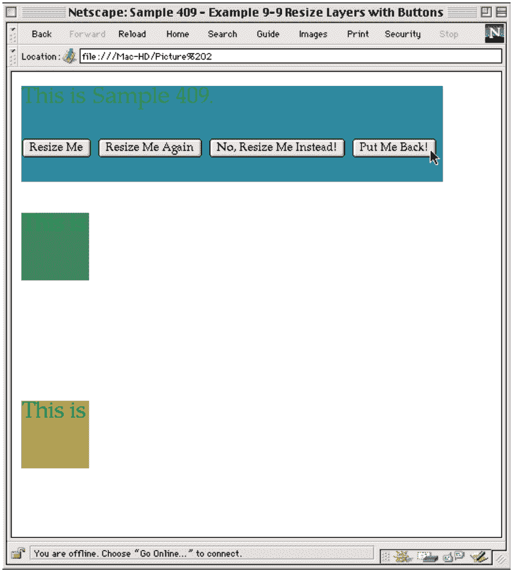

227

## 示例 3-9 Sample409.html

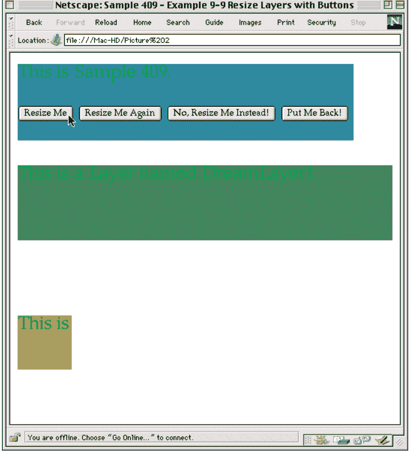

## 示例 3-9 Sample409.html

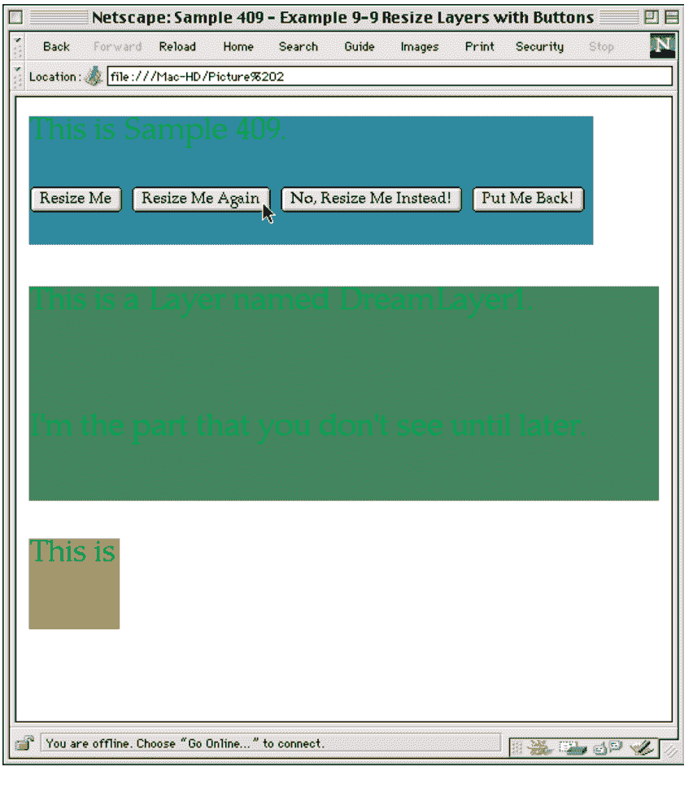

## 示例 3-9 Sample409.html

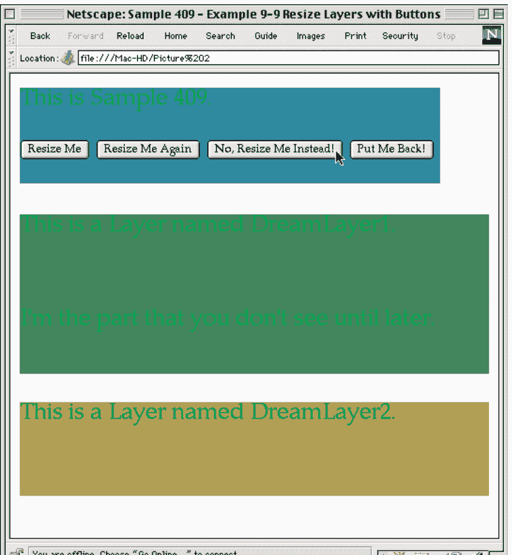

**230** **第一部分 — 动态 HTML**

## 在图层中使用 JavaScript

### JavaScript 的 `write()` 方法

这是简要版本。更详细的内容请参阅 JavaScript 指南。当您想使用 JavaScript 在 SCRIPT 元素内的图层中包含内容时，可以使用 **write()** 方法，其语法如下：

`document.LayerName.document.write(arg, arg | "arg, arg");`

其中第一个 **document** 指定了窗口的 **document** 对象，该对象包含您通过名称（**LayerName** 的位置）指定的 **Layer** 对象。**LayerName** 随后通过第二次使用 **document** 指定了其自己的 **document** 对象。这是您使用 **write()** 方法实际创建内容的地方，其参数可以是用引号括起来的文本或 HTML 标签，或者不是 JavaScript 表达式。

此处包含的 HTML 标签的作用与它们不在 SCRIPT 元素中时完全相同；也就是说，如果您在 H1 标签内有文本，您将在浏览器窗口中看到一个 H1 标题被渲染，如果 H1 标题附加了样式，该样式也会被渲染。

关于可以在 **write()** 方法中使用的其他 JavaScript 表达式，您可以使用字符串、数字或逻辑表达式，这些表达式可以通过点号表示法来实现。您可以使用 **tags** 属性为元素创建新样式，或在该图层内嵌套另一个图层。一旦您理解了 JavaScript 功能的范围，可能性是无穷无尽的。

只需确保在使用 **write()** 方法后，使用 **close()** 方法关闭文档数据流，如下所示：

`document.LayerName.document.close();`

最后一点：使用 **write()** 方法时，请确保在文本编辑器中将所有参数都保持在同一行上，否则可能会出现错误。您可以关闭自动换行功能，或者使用一个变量来赋值文本字符串，然后使用 += 运算符不断向该变量添加内容。参见第 319、441 页。

### 使用 `write()` 和 `close()` 方法

示例 3-10 演示了如何使用 **write()** 方法在图层中创建新内容，当用户点击按钮时，这会同时清除之前的内容。请注意 FORM 和 SCRIPT 元素，不要过多关注样式，这些样式只是该示例的装饰。在 SCRIPT 元素中创建的函数由 FORM 元素中包含的按钮的 **onClick** 事件处理程序调用，这样当用户点击按钮时，内容就会被写入图层。

示例 3-10：Sample410.html

```
<!DOCTYPE HTML PUBLIC "-//W3C//DTD HTML 3.2//EN">
<HTML>
<HEAD>
<TITLE>Sample 410 - Example 3-10 The write() Method</TITLE>

<STYLE TYPE="text/JavaScript">
		with(tags.BODY) {
			color="purple";
			fontFamily="Moonlight, cursive";
			fontSize="34pt";
			textAlign="center";
		}
		with(tags.H1) {
			color="navy";
			fontFamily="Helvetica, serif";
			fontSize="40pt";
			textAlign="center";
			backgroundColor="red";
			borderWidths("25px");
			borderStyle="double";
			borderColor="fuchsia";
		}
		classes.UpperRed.all.fontSize="30pt";
		classes.UpperRed.all.color="red";
		classes.UpperRed.all.textTransform="capitalize";
		classes.UpperRed.all.backgroundColor="yellow";
		classes.Global.all.width="100%";
		classes.Global.all.backgroundColor="lime";
		classes.Global.all.borderWidths("25px");
		classes.Global.all.borderStyle="groove";
		classes.Global.all.textAlign="center";
		classes.Global.all.align="center";
		classes.Global.all.borderColor="green";
		classes.Global.all.color="blue";
		classes.Global.all.fontFamily="Moonlight, cursive";
		classes.Global.all.fontSize="22pt";

</STYLE>

</HEAD>
<BODY>

<P>A Tricky Example 410</P>

<!--  ***********************************************************  -->

<LAYER CLASS="Global" ID="layer2" LEFT=20 TOP=75>

Central
```

```
<FORM NAME="form2">

<INPUT TYPE=button VALUE="Site 1"

onClick='changeSite1();return false;'>

<INPUT TYPE=button VALUE="Site 2"

onClick='changeSite2();return false;'>

</FORM>

</LAYER>

<!-- *********************************************************** -->

<LAYER CLASS="UpperRed" ID="layer1" LEFT=20 TOP=275>

<P>Pick a Site, any Site for a change of view.<P>

</LAYER>

<!-- *********************************************************** -->

<SCRIPT LANGUAGE="JavaScript1.2"><!--BEGIN HIDING

function changeSite1() {

	document.layer1.document.write("<H1>New Site 1.<\/H1>");

	document.layer1.document.close();

}

function changeSite2() {

	document.layer1.document.write("<H1>The not much New Site 2.<\/H1>");

	document.layer1.document.close();

}

//END HIDING-->
</SCRIPT>

</BODY>
</HTML>
```

### 使用 moveAbove() 方法

以下示例演示了 **moveAbove()** 方法，用于在 z 轴堆叠顺序中将一个图层移动到另一个图层之上，同时也更改了被移动到另一个图层之上的图层的父图层。

示例 3-10 Sample410.html

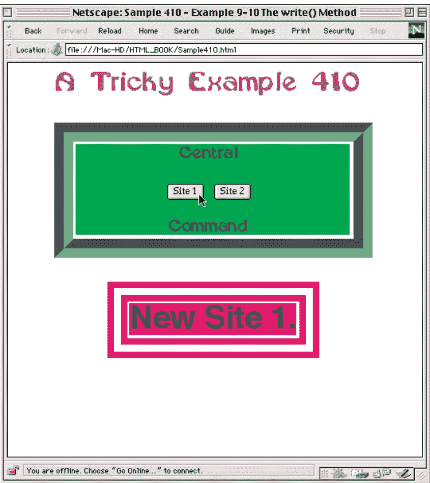

234 第一部分 — 动态 HTML

## 示例 3-11：Sample411.html

```
<!DOCTYPE HTML PUBLIC "-//W3C//DTD HTML 3.2//EN">
<HTML>
<HEAD>

<TITLE>Sample 411 - Example 3-11 moveAbove() Method changes parent Layer</TITLE>
</HEAD>

<BODY>
				<!--  L1 是 L2 和 L3 的父图层  -->

<LAYER ID=L1 BGCOLOR="blue" LEFT=10 TOP=10 WIDTH=500 HEIGHT=200>
		<H1>	This is Layer L1		</H1>

<LAYER ID=L2 BGCOLOR="red" LEFT=10 TOP=50 WIDTH=300 HEIGHT=50>
		<H1>	This is Layer L2. It gets moved above Layer L5 and is relocated so
that Layer L4 is its parent Layer.								</H1>	</LAYER>

<LAYER ID=L3 BGCOLOR="olive" LEFT=30 TOP=110 WIDTH=200 HEIGHT=80>
		<H1>	This is Layer L3		</H1>							</LAYER>

</LAYER>

<!--  **************************************************************  -->
				<!--  L4 是 L5 和 L6 的父图层  -->

<LAYER ID=L4 BGCOLOR="lime" LEFT=10 TOP=240 WIDTH=500 HEIGHT=250>
		<H1>	This is Layer L4		</H1>

<LAYER ID=L5 BGCOLOR="cyan" LEFT=250 TOP=10 WIDTH=220 HEIGHT=100>
		<H1>	This is Layer L5		</H1>							</LAYER>

<LAYER ID=L6 BGCOLOR="magenta" LEFT=270 TOP=140 WIDTH=190 HEIGHT=70>
		<H1>	This is Layer L6		</H1>							</LAYER>

</LAYER>

<!--  **************************************************************  -->

<SCRIPT LANGUAGE="JavaScript1.2"><!--BEGIN HIDING

				//	然后，如果您使用以下代码将 L2 移动到 L5 之上：

				document.L1.document.L2.moveAbove(document.L4.document.L5);

				//	那么 L4 将成为图层 L5、L2、L6 的父图层。

//END HIDING-->
</SCRIPT>

</BODY>
</HTML>
```

## 示例 3-11 Sample411.html

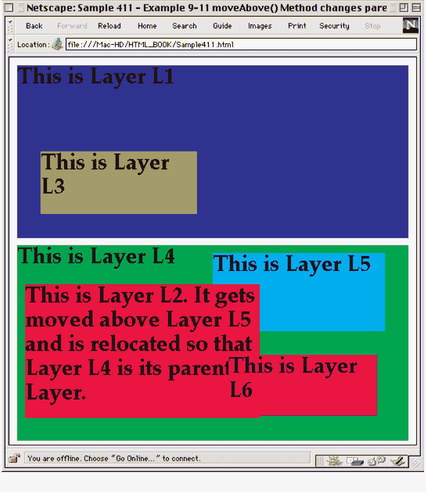

## 显示与隐藏图层 & 写入图层内容

示例 3-12 演示了 **write()** 和 **close()** 方法以及 **visibility** 属性的 "show" 和 "hide" 值，用于向图层写入内容并使其显示和消失。

**示例 3-12：&nbsp;&nbsp;&nbsp;&nbsp;&nbsp;Sample412.html**

```
<!DOCTYPE HTML PUBLIC "-//W3C//DTD HTML 3.2//EN">
<HTML>
<HEAD>
<TITLE>Sample 412 - Example 3-12 &nbsp;&nbsp;&nbsp;&nbsp;&nbsp;write() Method and visibility Property</TITLE>

<STYLE TYPE="text/JavaScript">

with(tags.BODY) {
&nbsp;&nbsp;&nbsp;&nbsp;color="purple";
&nbsp;&nbsp;&nbsp;&nbsp;fontFamily="Moonlight, cursive";
&nbsp;&nbsp;&nbsp;&nbsp;fontSize="34pt";
&nbsp;&nbsp;&nbsp;&nbsp;textAlign="center";
}

with(tags.H1) {
&nbsp;&nbsp;&nbsp;&nbsp;color="navy";
&nbsp;&nbsp;&nbsp;&nbsp;fontFamily="Helvetica, serif";
&nbsp;&nbsp;&nbsp;&nbsp;fontSize="34pt";
&nbsp;&nbsp;&nbsp;&nbsp;textAlign="center";
&nbsp;&nbsp;&nbsp;&nbsp;backgroundColor="red";
&nbsp;&nbsp;&nbsp;&nbsp;borderWidths("25px");
&nbsp;&nbsp;&nbsp;&nbsp;borderStyle="double";
&nbsp;&nbsp;&nbsp;&nbsp;borderColor="fuchsia";
}

with(tags.H2) {
&nbsp;&nbsp;&nbsp;&nbsp;textAlign="left";
&nbsp;&nbsp;&nbsp;&nbsp;borderWidths("30px");
&nbsp;&nbsp;&nbsp;&nbsp;borderStyle="outset";
&nbsp;&nbsp;&nbsp;&nbsp;borderColor="green";
}

with(tags.H3) {
&nbsp;&nbsp;&nbsp;&nbsp;color="lime";
&nbsp;&nbsp;&nbsp;&nbsp;fontFamily="Palatino, sans-serif";
&nbsp;&nbsp;&nbsp;&nbsp;fontSize="20pt";
nbsp;&nbsp;&nbsp;&nbsp;textAlign="right";
&nbsp;&nbsp;&nbsp;&nbsp;backgroundColor="gray";
&nbsp;&nbsp;&nbsp;&nbsp;borderWidths("15px");
&nbsp;&nbsp;&nbsp;&nbsp;borderStyle="inset";
&nbsp;&nbsp;&nbsp;&nbsp;borderColor="blue";
}
```


# 第三章 — 层与JavaScript 237

```
classes.Navy30.all.fontSize="30pt";
classes.Navy30.all.color="navy";
```

```
classes.Global.all.fontSize="20pt";
classes.Global.all.fontFamily="Moonlight, Clarendon, serif";
classes.Global.all.width="10pt";
classes.Global.all.backgroundColor="blue";
classes.Global.all.borderWidths("20px");
classes.Global.all.borderStyle="groove";
classes.Global.all.textAlign="center";
classes.Global.all.align="center";
classes.Global.all.borderColor="purple";
classes.Global.all.color="yellow";
```

```
</STYLE>
</HEAD>
<!-- ******************************************************************* -->
<BODY>
```

```
<LAYER CLASS="Global" ID="layer2" LEFT=20 TOP=20>
```

```
<FORM NAME="form1">

中央

<INPUT TYPE=button VALUE="站点 1"
onClick="changeSite1(); return false;">

<INPUT TYPE=button VALUE="站点 2"
onClick="changeSite2(); return false;">

<INPUT TYPE=button VALUE="站点 3"
onClick="changeSite3(); return false;">

<INPUT TYPE=button VALUE="站点 4"
onClick="changeSite4(); return false;">

<INPUT TYPE=button VALUE="站点 5"
onClick="changeSite5(); return false;">

命令

</FORM>
```

```
</LAYER>
```

# 238 第一部分 — 动态HTML

```
<!-- ****************************************************************** -->

<LAYER CLASS="Navy30" ID="layer1" LEFT=20 TOP=135 VISIBILITY="SHOW">

 <P>    选择一个站点，任意站点以改变视图。        <P>

</LAYER>

<!-- ****************************************************************** -->

<LAYER ID="layer3" LEFT=20 TOP=135 VISIBILITY="HIDE">        </LAYER>

<LAYER ID="layer4" LEFT=20 TOP=135 VISIBILITY="HIDE">        </LAYER>

<LAYER ID="layer5" LEFT=20 TOP=135 VISIBILITY="HIDE">        </LAYER>

<!-- ****************************************************************** -->
```

```
<SCRIPT LANGUAGE="JavaScript1.2"><!--BEGIN HIDING

function changeSite1() {

    document.layer1.document.write("<H1><P>新站点 1。<BR>
                             你应该注意到，你不仅需要显示该层，还需要隐藏所有其他层，以免它们妨碍显示。当然，这只适用于它们占据相同空间的情况。<\/P><\/H1>");

    document.layer1.visibility = 'show';
    document.layer3.visibility = 'hide';
    document.layer4.visibility = 'hide';
    document.layer5.visibility = 'hide';

    document.layer1.document.close();
}

/*----------------------------------------------*/
```

```
function changeSite2() {

    document.layer3.document.write("<H2><P>不要忘记你的花括号或分号。<\/P><\/H2>");

    document.layer1.visibility = 'hide';
    document.layer3.visibility = 'show';
    document.layer4.visibility = 'hide';
    document.layer5.visibility = 'hide';

    document.layer3.document.close();
}

/*----------------------------------------------*/
```

第三章 — 层与JavaScript

```
/*---------------------------------------------------------------------------*/

function changeSite3() {

    document.layer4.document.write("<H3><P>沃隆人总是问，     <BR>
                                                  你是谁？？？<\/P><\/H3>");

    document.layer1.visibility = 'hide';
    document.layer3.visibility = 'hide';
    document.layer4.visibility = 'show';
    document.layer5.visibility = 'hide';

    document.layer4.document.close();
}

/*---------------------------------------------------------------------------*/

function changeSite4() {

    document.layer5.document.write("<H3><P>影族人总是问， <BR>
                                                  你想要什么？？？<\/P><\/H3>");

    document.layer1.visibility = 'hide';
    document.layer3.visibility = 'hide';
    document.layer4.visibility = 'hide';
    document.layer5.visibility = 'show';

    document.layer5.document.close();
}

/*---------------------------------------------------------------------------*/

function changeSite5() {

    document.layer5.document.write("<H1><P>新站点 5。<BR>
                                                  想象可能性。 <\/P><\/H1>");

    document.layer1.visibility = 'hide';
    document.layer3.visibility = 'hide';
    document.layer4.visibility = 'hide';
    document.layer5.visibility = 'show';

    document.layer5.document.close();
}

/*---------------------------------------------------------------------------*/

//END HIDING-->
</SCRIPT>

</BODY>

</HTML>
```

## 用于实时创建新层的new运算符

当你想动态创建一个层，即在页面加载到浏览器之后，可以使用**new**运算符和**Layer()**构造函数来实现，其语法如下：

## JavaScript语法：

```
LayerName = new Layer (pixelsWidth, ["optionalParentLayerName"]);
```

### 参数定义：

**LayerName** 是你的层的名称，**pixelsWidth**参数指定你的层将以多少像素的宽度渲染，第二个参数（“可选”）是“**optionalParentLayerName**”，即包含新层的父层的名称。如果你没有指定父层，那么新层将默认为顶层层。请记住，**new Layer** 必须完全按照你看到的方式拼写，首字母L大写。如果你使用小写的 'l'，将会得到错误。例如：

```
Blue1 = new Layer (400);
```

这将创建一个名为 **Blue1** 的新层，其宽度为400像素，由于未指定父层，**Blue1** 层将是一个顶层层。

以下是将内容放入新层的三种方法：

- 在层的 **document** 对象上使用 **write()** 方法。参见示例 3-13。
- 使用 **src** 属性加载包含内容的外部文档。参见示例 3-14。
- 使用 **load()** 方法加载包含内容的外部文档。参见示例 3-14。

## 特别注意：

- 你必须等待文档完全加载到浏览器中，才能动态创建**新层**。
- 你必须等待文档完全加载到浏览器窗口中，才能打开新层的 **document** 对象并使用 **write()** 方法创建内容。
- 在使用 **write()** 方法后，你必须使用 **close()** 方法关闭 **document** 对象。
- 当在 **document** 对象上使用 **write()** 方法时，一次只能打开一个 **document** 对象。

## 使用tags属性样式动态创建新层

以下示例演示了当用户点击FORM元素中的按钮时如何创建新层。只有少数几个层对象属性可以直接应用于层，这里指定了其中几个。

它还展示了如何通过使用tags属性（在本例中，该属性立即应用于名为Blue1的新层），用JavaScript更改该层中使用的元素的属性。这是你如何绕过并非所有样式属性都可用作层对象属性的限制的方法，当你希望用户实时定义自己的样式时，这将变得更加关键。

本示例中最重要的特性之一是，必须将visibility属性设置为show，才能使新层Blue1在文档中可见，因为编译器不会自动使其可见。

### 示例 3-13: Sample413.html

```
<!DOCTYPE HTML PUBLIC "-//W3C//DTD HTML 3.2//EN">
<html>
<HEAD>
<TITLE>示例 413 - 示例 3-13 使用new运算符创建新层</TITLE>

<STYLE TYPE="text/JavaScript">

with(tags.BODY) {
    color="purple";
    fontFamily="Moonlight, cursive";
    fontSize="34pt";
    textAlign="center";
}

with(tags.H1) {
    color="navy";
    fontFamily="Helvetica, serif";
    fontSize="34pt";
    textAlign="center";
    backgroundColor="red";
    borderWidths="25px";
    borderStyle="double";
    borderColor="fuchsia";
}

classes.Navy17.all.fontSize="17pt";
classes.Navy17.all.color="navy";
```


# 第一部分 — 动态 HTML

```
classes.Global.all.fontSize="20pt";
classes.Global.all.fontFamily="Moonlight, Clarendon, serif";
classes.Global.all.width="100%";
classes.Global.all.backgroundColor="blue";
classes.Global.all.borderWidths("20px");
classes.Global.all.borderStyle="groove";
classes.Global.all.textAlign="center";
classes.Global.all.align="center";
classes.Global.all.borderColor="purple";
classes.Global.all.color="yellow";
```

```
</STYLE>

</HEAD>
<!--  ***************************************************  -->
<BODY>

<LAYER CLASS="Global" ID="layer2" LEFT=20 TOP=20>

	<FORM NAME="form1">

		中央控制

		<INPUT TYPE=button VALUE="创建新图层"
		onClick='newlayer1(); return false;'>

		<INPUT TYPE=button VALUE="更改新图层"
		onClick='changelayer1(); return false;'>

		指令

	</FORM>

</LAYER>
```

```
<!--  ***************************************************  -->
```

```
<LAYER CLASS="Navy17" ID="layer1" LEFT=20 TOP=135 VISIBILITY="SHOW">

	<P>请先点击 <B>'创建新图层'</B>，否则会出现错误。<P>

</LAYER>
```

```
<!--  ***************************************************  -->
```

```
<SCRIPT LANGUAGE="JavaScript1.2"><!--BEGIN HIDING

function newlayer1() {

	document.Blue1 = new Layer(200);
	document.Blue1.left = 20;
	document.Blue1.top = 275;
	document.Blue1.visibility = "show";
	document.Blue1.document.write("<H1>嗨！有什么新内容？<\/H1>");
	document.Blue1.document.close();

}
```

## 第三章 — 图层与 JavaScript

```
/*----------------------------------------------------------------------------*/

function changelayer1() {

	document.Blue1.left = 250;
	document.Blue1.top = 175;
	document.Blue1.bgColor = "blue";

	document.tags.H1.fontSize = "50pt";
	document.tags.H1.fontFamily = "Times, Palatino, serif";
	document.tags.H1.color = "yellow";
	document.tags.H1.backgroundColor = "aqua";
	document.tags.H1.borderColor = "lime";
	document.tags.H1.borderStyle = "groove";

	document.Blue1.document.write("<H1>好的，我被改变了。<\/H1>");
	document.Blue1.document.close();
}

//END HIDING-->
</SCRIPT>

</BODY>
</HTML>
```

示例 3-14 包含三个部分。第一部分包含核心代码，第二部分和第三部分是当用户点击文档中的按钮时加载到文档中的外部文件。第一部分演示了一种直接的方法，通过使用 **new** 操作符动态创建图层，设置图层的 **left** 和 **top** 属性，然后使用第一个名为 **getIt1()** 的函数中的 **src** 属性和第二个名为 **getIt2()** 的函数中的 **load()** 方法从外部文件加载内容。它的结构与上一个示例相似，但没有那么多修饰。

### 示例 3-14 第一部分：Sample414.html

```
<!DOCTYPE HTML PUBLIC "-//W3C//DTD HTML 3.2//EN">
<HTML>
<HEAD>
<TITLE>Sample 414 - 示例 3-14 使用 new 操作符动态创建图层</TITLE>

<STYLE TYPE="text/JavaScript">

	with(tags.BODY) {
		color="purple";
		fontFamily="Moonlight, cursive";
		fontSize="22pt";
		textAlign="center";
	}

</STYLE>
</HEAD>
```

# 第一部分 — 动态 HTML

```
<!-- *************************************************************** -->
<BODY>

<LAYER ID="layer2" LEFT=20 TOP=20>

	<FORM NAME="form1">

		中央控制

		<INPUT TYPE=button VALUE="加载外部图层"

		onClick='getIt1(); return false;'>

		<INPUT TYPE=button VALUE="加载另一个外部图层"

		onClick='getIt2(); return false;'>

	</FORM>

</LAYER>

<!-- *************************************************************** -->

<LAYER ID="layer1" LEFT=20 TOP=135 VISIBILITY="SHOW">

 <P>点击一个按钮以创建新图层并加载其内容。<P>

</LAYER>

<!-- *************************************************************** -->

<SCRIPT LANGUAGE="JavaScript1.2"><!--BEGIN HIDING

function getIt1() {

	document.ExternalOne = new Layer(200);
	document.ExternalOne.left = 50;
	document.ExternalOne.top = 200;
	document.ExternalOne.src = "Sample414ExternalA.html";
	document.ExternalOne.visibility = "show";
}

function getIt2() {

	document.ExternalTwo = new Layer(50);
	document.ExternalTwo.left = 280;
	document.ExternalTwo.top = 225;
	document.ExternalTwo.load ("Sample414ExternalB.html" , 300);
	document.ExternalTwo.visibility = "show";
}

//END HIDING-->
</SCRIPT>

</BODY>
</HTML>
```

## 第三章 — 图层与 JavaScript

### 示例 3-14 第二部分：Sample414ExternalA.html

```
<!DOCTYPE HTML PUBLIC "-//W3C//DTD HTML 3.2//EN">
<HTML>
<HEAD>
<TITLE>Sample 414ExternalA - 示例 3-14A </TITLE>

<STYLE TYPE="text/JavaScript">

		with(tags.BODY) {
				color="blue";
				fontFamily="Helvetica, serif";
				fontSize="44pt";
				textAlign="center";
		}
</STYLE>
</HEAD>
<BODY>
<P>   第一个外部内容。   <P>
</BODY>
</HTML>
```

### 示例 3-14 第三部分：Sample414ExternalB.html

```
<!DOCTYPE HTML PUBLIC "-//W3C//DTD HTML 3.2//EN">
<HTML>
<HEAD>
<TITLE>Sample 414ExternalB - 示例 3-14B </TITLE>

<STYLE TYPE="text/JavaScript">

		with(tags.BODY) {
				color="red";
				fontFamily="Clarendon, Times, fantasy";
				fontSize="24pt";
				textAlign="center";
		}

		classes.darkness.all.color="black";
		classes.greenword.all.color="green";
</STYLE>
</HEAD>
<BODY>
<P>   这是第二个外部内容，它使用了

<SPAN CLASS="darkness">       load ( )        </SPAN>

<SPAN CLASS="greenword">      方法          </SPAN>

来覆盖图层的宽度设置，将其从 50 像素更改为 300 像素。 </P>
</BODY>
</HTML>
```

## 图层中的本地化 JavaScript <SCRIPT>

当您在 LAYER 中使用 <SCRIPT> 元素时，即在 LAYER 元素的开始和结束标签之间使用 <SCRIPT> 元素来通过 JavaScript 修改该 LAYER 时，该脚本被称为是本地化的，因为 JavaScript 将仅适用于该特定的 LAYER。这种固有限制在大型文档中非常有用，当您希望有一种简便的方法来管理鼠标移动和点击的事件处理程序时。一个简单的示例可参见示例 1-15（可在 Sample415.html 中查看），更复杂的示例可参见示例 6-13（可在 Sample713-Chess.html 中查看）。CD-ROM 上还有一个书中没有的附加文件，可以在 Sample774-Chess-Images.html 中查看。

本示例重点在于将 **visibility** 属性与 **z-index** 属性以及一些简单的 JavaScript 一起使用，以使图层显示和消失。实际上，它与示例 2-8（来自第二章）完全相同，只是它增加了处理来自本地化 SCRIPT 元素内的鼠标事件的额外函数。示例 3-15 的样式是用 CSS 语法编写的，这与第三章中所有其他用 JavaScript 语法编写的示例不同。它还显示了图层默认是透明的，这等同于将 **backgroundColor** 属性设置为 "**null**"。在源代码末尾的 <P> 元素中有一些额外的说明。

### 示例 3-15：Sample415.html

```
<!DOCTYPE HTML PUBLIC "-//W3C//DTD HTML 3.2//EN">
<HTML>
<HEAD>
<TITLE>Sample 415 - 示例 3-15     本地化脚本、可见性与鼠标事件
</TITLE>

<STYLE TYPE="text/CSS">
<!--

#SeventhLayer  { position: absolute; left: 10px; top: 100px;
                        z-index: 3; color: blue; font-size: 20pt; padding: 40px;
                        border-style:ridge; border-width:20px; border-color:aqua;
                        visibility: show; }

#EighthLayer    { position: absolute; left: 100px; top: 258px;
                        z-index: 2; color: red; font-size: 20pt; padding: 40px;
                        border-style:ridge; border-width:20px; border-color:yellow;
                        visibility: show; }

#NinthLayer    { position: absolute; left: 280px; top: 75px;
                        z-index: 1; color: green; font-size: 20pt; padding: 40px;
                        border-style:ridge; border-width:20px; border-color:lime;
                        visibility: show; }

-->
</STYLE>
</HEAD>
```


 # 第 3 章 — 图层与 JavaScript

```
<BODY>
<DIV ID="SeventhLayer">        这是              <BR>
                          SeventhLayer 测试        <BR>
                          z-index 等于 3。    <BR>
                          它统治一切！

<SCRIPT LANGUAGE="JavaScript1.2"><!--BEGIN HIDING

       function onMouseOver() { seeNoSee("hide"); }
       function onMouseOut() { seeNoSee("show"); }

       function seeNoSee (WhereAmI) {
              visibility=WhereAmI;
              return false;
       }

//END HIDING-->
</SCRIPT>
</DIV>

<DIV ID="EighthLayer">         这是              <BR>
                          EighthLayer 测试         <BR>
                          z-index 等于 2。

<SCRIPT LANGUAGE="JavaScript1.2"><!--BEGIN HIDING

       function onMouseOver() { seeNoSee("hide"); }
       function onMouseOut() { seeNoSee("show"); }

       function seeNoSee (WhereAmI) {
              visibility=WhereAmI;
              return false;
       }

//END HIDING-->
</SCRIPT>
</DIV>

<DIV ID="NinthLayer">          这是              <BR>
                          NinthLayer 测试          <BR>
                          z-index 等于 1。

<SCRIPT LANGUAGE="JavaScript1.2"><!--BEGIN HIDING

       function onMouseOver() { seeNoSee("hide"); }
       function onMouseOut() { seeNoSee("show"); }

       function seeNoSee (WhereAmI) {

              visibility=WhereAmI;
              return false;
       }

//END HIDING-->
</SCRIPT>

</DIV>
```

# 248

第 I 部分 — 动态 HTML

```
<P>
这与示例 307 完全相同，只是每个 LAYER 中有一个本地化 SCRIPT，
当鼠标悬停在上面时会使其隐藏，当鼠标移出其空间时会重新出现。
这有点不稳定，所以请保持鼠标稳定。如果你的鼠标位于 2 个或更多 LAYER
重叠的区域，那么 z-index 较高的 LAYER 将获得鼠标事件并消失。

</P>

</BODY>
</HTML>
```

示例 3-16 处理 LAYER 元素内的本地化 SCRIPT，以展示具有不同值的相同功能可以独立应用于各个图层。使用图层对象属性 clip.right 和 clip.bottom 来使图层的一部分在鼠标移过时消失，然后在鼠标移离图层的指定空间时重新出现。

## 示例 3-16：Sample416.html

```
<!DOCTYPE HTML PUBLIC "-//W3C//DTD HTML 3.2//EN">
<HTML>
<HEAD>
<TITLE>示例 416 - 示例 3-16     本地脚本与裁剪属性</TITLE>

<STYLE TYPE="text/JavaScript">

      with(tags.BODY) {
            color="purple";
            fontFamily="Moonlight, cursive";
            fontSize="22pt";
            textAlign="center";
      }

      classes.Blue22.all.fontSize="22pt";
      classes.Blue22.all.color="blue";
      classes.Blue22.all.width="500px";
      classes.Blue22.all.backgroundColor="aqua";
      classes.Blue22.all.borderWidths("20px");
      classes.Blue22.all.borderStyle="groove";

</STYLE>

</HEAD>

<BODY>
```

# 第 3 章 — 图层与 JavaScript

```
<!-- ******************************************************************** -->

<LAYER CLASS="Blue22" ID="layer1" LEFT=20 TOP=35 VISIBILITY="SHOW">

<P>将鼠标移到我身上，我就会缩小。 </P>
<P>将鼠标移离 </P>
<P>我，我就会恢复。 </P>

<SCRIPT LANGUAGE="JavaScript1.2"><!--BEGIN HIDING

function onMouseOver() { seeNoSee(370, 130); }

function onMouseOut() { seeNoSee(500, 200); }

function seeNoSee (ShrinkingLeft, ShrinkingUp) {

clip.right=ShrinkingLeft;
clip.bottom=ShrinkingUp;

return false;
}

//END HIDING-->
</SCRIPT>

</LAYER>
```

```
<!-- ******************************************************************** -->

<LAYER CLASS="Blue22" ID="layer2" LEFT=20 TOP=222 VISIBILITY="SHOW">

<P>将鼠标移到我身上，我就会缩小。 </P>
<P>将鼠标移离 </P>
<P>我，我就会恢复。 </P>

<SCRIPT LANGUAGE="JavaScript1.2"><!--BEGIN HIDING

function onMouseOver() { seeNoSee(211, 100); }

function onMouseOut() { seeNoSee(500, 200); }

function seeNoSee (ShrinkingLeft, ShrinkingUp) {

clip.right=ShrinkingLeft;
clip.bottom=ShrinkingUp;

return false;
}

//END HIDING-->
</SCRIPT>

</ 受版权保护。

</LAYER>

</BODY>
</HTML>
```

# 250 第 I 部分 — 动态 HTML

# 动画化裁剪矩形以显示图像

# JavaScript setTimeout() 方法

**setTimeout()** 方法有两种不同的语法结构。一种用于在指定的毫秒数过后计算表达式。另一种用于在指定的毫秒数过后调用函数。就其本身而言，**setTimeout()** 方法不会像 **setInterval()** 方法那样重复执行。要使其重复，你必须将包含 **setTimeout()** 方法的同一个函数显式作为 **functionName** 参数调用，这通常在 **if ()** 这样的条件语句内部完成，如示例 3-17 至 3-22 所示。**anyExpression** 或 **functionName** 参数必须放在引号内，否则将立即被求值。指定函数时，逗号分隔的 **arg** 参数是可选的，因此即使你的函数没有任何参数，也可以使用 **setTimeout()**。

## JavaScript 语法：

```
setTimeout("anyExpression", milliseconds);
setTimeout("functionName()", milliseconds[, arg1, ..., argN]);
```

如果你计划将 **setTimeout()** 方法与 **clearTimeout()** 方法结合使用，则必须将 **setTimeout()** 方法赋值给一个 **timeoutID**，如下所示：

```
timeoutID=setTimeout("functionName()", millisecs);
```

或者：

```
timeoutID=setTimeout("functionName()", millisecs, arg1, ...,argN);
```

这样你就可以使用 **clearTimeout()** 方法引用它，如下所示：

```
clearTimeout(timeoutID);
```

# JavaScript clearTimeout() 方法

**clearTimeout()** 方法用于取消先前启动的对已赋值给 **timeoutID** 的 **setTimeout()** 方法的调用。

# 语法：

```
clearTimeout(timeoutID);
```

# 第 3 章 — 图层与 JavaScript 251

# 动画化裁剪矩形与弹出图像

在下面的示例 3-17 中，可以通过点击三个按钮之一来逐步显示、隐藏或弹出图像。它使用了 **setTimeout()** 方法、**resizeBy()** 方法和 **resizeTo()** 方法。

**RevealImage()** 此函数使用条件 if () 语句来测试 **layer1 的 clip.right** 属性是否小于 700。如果为真，则调整 **layer1** 的大小，使其宽度增加 5 像素，高度增加 4 像素。然后 **setTimeout()** 方法通过再次调用 **RevealImage()** 函数来重新调用该过程，并且每 20 毫秒继续执行一次，直到 **layer1 的 clip.right** 属性大于或等于 700 像素宽。需要注意的是，重新调用之所以持续进行，是因为 **setTimeout()** 方法显式调用 **RevealImage()** 函数，这导致函数在该点中断并再次开始循环。这与 **setInterval()** 方法（见第 284 页）形成对比，后者具有 **setTimeout()** 方法所不具备的固有重新调用能力。

**HideImage()** 此函数仅使用 **没看见是 ** 大小通过 **resizeTo()** 方法将 **layer1** 重置回其原始裁剪 **宽度** 和 **高度**，这只会显示左上角的很小一部分。

**PopImage()** 此函数使用 **resizeTo()** 方法瞬时改变裁剪矩形的 **宽度** 和 **高度**，使整个图层可见。

# 示例 3-17：Sample417.html

```
<!DOCTYPE HTML PUBLIC "-//W3C//DTD HTML 3.2//EN">
<HTML>
<HEAD>
<TITLE>示例 417 - 示例 3-17      使用 SetTimeout 方法显示图像</TITLE>

<STYLE TYPE="text/JavaScript">
    classes.Blue22.all.fontSize="22pt";
    classes.Blue22.all.color="blue";
    classes.Blue22.all.width="100%";
    classes.Blue22.all.backgroundColor="aqua";
    classes.Blue22.all.borderWidths("20px");
    classes.Blue22.all.borderStyle="groove";
</STYLE>
</HEAD>
<BODY>
```


# 252 第一部分 — 动态HTML

```
<!-- ********************************************************* -->
<LAYER CLASS="Blue22" ID="layer2" LEFT=50 TOP=10 VISIBILITY="SHOW">
<FORM NAME="form1">
    中央控制
    <INPUT TYPE=button VALUE="显示图像" onClick='RevealImage(); return false;'>
    <INPUT TYPE=button VALUE="隐藏图像" onClick='HideImage(); return false;'>
    <INPUT TYPE=button VALUE="弹出图像" onClick='PopImage(); return false;'>
</FORM>
</LAYER>

<!-- ********************************************************* -->
<LAYER CLASS="Blue22" ID="layer1" LEFT=20 TOP=130 CLIP="0,0,100,50" VISIBILITY="SHOW">
哇！<BR><BR>
<CENTER>

</CENTER>
</LAYER>

<!-- ********************************************************* -->
<SCRIPT LANGUAGE="JavaScript1.2"><!--BEGIN HIDING

function RevealImage() {
    var layer1 = document.layer1;
    if (layer1.clip.right < 700) {
        layer1.resizeBy(5,4);
        setTimeout('RevealImage()', 20);
    }
    return false;
}

/*--- -----------------------------------------------------------------------*/
```

## 第3章 — 层与JavaScript 253

```
/*----------------------------------------------*/
    function HideImage() {

        var layer1 = document.layer1;

        if (layer1.clip.right > 100) {
            layer1.resizeTo(100,50);
        }

    return false;
    }

/*----------------------------------------------*/
    function PopImage() {

        var layer1 = document.layer1;

        if (layer1.clip.right < 700) {
            layer1.resizeTo(700,500);
        }

    return false;
    }

//END HIDING-->
</SCRIPT>

</BODY>
</HTML>
```

在示例3-18中，**setTimeout()** 方法被用于显示图像，类似于上一个示例，并且增加了使用 **visibility** 属性来隐藏和显示其他图像的功能，这些图像已预加载到页面中，但在LAYER元素内的 **VISIBILITY属性** 初始设置为“HIDE”。

## 示例 3-18：Sample418.html

```
<!DOCTYPE HTML PUBLIC "-//W3C//DTD HTML 3.2//EN">
<HTML>
<HEAD>
<TITLE>Sample 418 - 示例 3-18 使用SetTimeout方法显示图像</TITLE>

<STYLE TYPE="text/JavaScript">

    classes.Blue22.all.fontSize="14pt";
    classes.Blue22.all.color="blue";
    classes.Blue22.all.width="100%";
    classes.Blue22.all.backgroundColor="aqua";
    classes.Blue22.all.borderWidths("20px");
    classes.Blue22.all.borderStyle="groove";
</STYLE>
</HEAD>
```

# 254 第一部分 — 动态HTML

```
<BODY>
<!-- ******************************************************************* -->

<LAYER CLASS="Blue22" ID="layer2" LEFT=20 TOP=10 VISIBILITY="SHOW">

<FORM NAME="form1">
	中央控制
	<INPUT TYPE=button VALUE="显示图像"
	onClick="RevealImage(); return false;">
	<INPUT TYPE=button VALUE="隐藏图像"
	onClick="HideImage(); return false;" > <BR>
	<INPUT TYPE=button VALUE="弹出图像 1"
	onClick="PopImage1(); return false;">
	<INPUT TYPE=button VALUE="弹出图像 2"
	onClick="PopImage2(); return false;">
	<INPUT TYPE=button VALUE="弹出图像 3"
	onClick="PopImage3(); return false;">
	<INPUT TYPE=button VALUE="弹出图像 4"
	onClick="PopImage4(); return false;">

</FORM>

</LAYER>
<!-- ******************************************************************* -->

<LAYER CLASS="Blue22" ID="layer1" LEFT=20 TOP=130
CLIP=0,0,100,50 VISIBILITY="SHOW">

哇！

<CENTER>

</CENTER>

</LAYER>
<!-- ******************************************************************* -->

<LAYER CLASS="Blue22" ID="layer3" LEFT=20 TOP=130 VISIBILITY="HIDE">

哇！

<CENTER>

</CENTER>

</LAYER>
<!-- ******************************************************************* -->
```

## 第3章 — 层与JavaScript 255

```
<!-- ************************************************************************ -->

<LAYER CLASS="Blue22" ID="layer4" LEFT=20 TOP=130 VISIBILITY="HIDE">

哇！

<CENTER>

</CENTER>

</LAYER>
<!-- ************************************************************************ -->

<LAYER CLASS="Blue22" ID="layer5" LEFT=20 TOP=130 VISIBILITY="HIDE">

哇！

<CENTER>

</CENTER>

</LAYER>
<!-- ************************************************************************ -->

<SCRIPT LANGUAGE="JavaScript1.2">
<!--BEGIN HIDING

function PopImage2() { 

    document.layer1.visibility = 'hide';
    document.layer4.visibility = 'hide';
    document.layer5.visibility = 'hide';
    document.layer3.visibility = 'show';
}

/*                                                                          */

function PopImage3() { 

    document.layer1.visibility = 'hide';
    document.layer3.visibility = 'hide';
    document.layer5.visibility = 'hide';
    document.layer4.visibility = 'show';
}

/*                                                                          */

function PopImage4() { 

    document.layer1.visibility = 'hide';
    document.layer3.visibility = 'hide';
    document.layer4.visibility = 'hide';
    document.layer5.visibility = 'show';
}

//END HIDING-->
</SCRIPT>
<!-- ************************************************************************ -->
<!--
```

# 256 第一部分 — 动态HTML

```
<SCRIPT LANGUAGE="JavaScript1.2"><!--BEGIN HIDING

	function RevealImage () {

		document.layer1.visibility = 'show';

		var layer1 = document.layer1;

		if (layer1.clip.right < 700)  {
			layer1.resizeBy(5,4);
			setTimeout('RevealImage()', 20);

			document.layer3.visibility = 'hide';
			document.layer4.visibility = 'hide';
			document.layer5.visibility = 'hide';
			document.layer1.visibility = 'show';
		}
		return false;
	}
/*------------------------------------------------------------*/
	function HideImage () {

		var layer1 = document.layer1;

		if (layer1.clip.right > 100)  {
			layer1.resizeTo(100,50);

			document.layer3.visibility = 'hide';
			document.layer4.visibility = 'hide';
			document.layer5.visibility = 'hide';
			document.layer1.visibility = 'show';
		}
		return false;
	}
/*------------------------------------------------------------*/
	function PopImage () {

		document.layer1.visibility = 'show';

		var layer1 = document.layer1;
		layer1.clip.right=0;  //重置为零以避免按钮冲突

		if (layer1.clip.right < 700)  {
			layer1.resizeTo(700,500);

			document.layer3.visibility = 'hide';
			document.layer4.visibility = 'hide';
			document.layer5.visibility = 'hide';
			document.layer1.visibility = 'show';
		}
		return false;
	}
//END HIDING-->
</SCRIPT>
</BODY>
</HTML>
```

示例3-19使用 `setTimeout()` 方法来移动图像，通过移动包含该图像的名为 **layer1** 的层来实现，只要 **layer1的** Left属性小于500像素。带有 VALUE="Move Image" 的按钮在点击时调用 **MoveImage()** 函数，该函数实现了 `setTimeout()` 方法。

## 示例 3-19：Sample419.html

```
<!DOCTYPE HTML PUBLIC "-//W3C//DTD HTML 3.2//EN">
<html>
<HEAD>
<TITLE>Sample 419 - 示例 3-19 使用SetTimeout方法移动图像</TITLE>
<STYLE TYPE="text/JavaScript">

  classes.Blue22.all.fontSize="22pt";
  classes.Blue22.all.color="blue";
  classes.Blue22.all.width="100%";
  classes.Blue22.all.backgroundColor="lime";
  classes.Blue22.all.borderWidths("20px";
  classes.Blue22.all.borderStyle="groove";
  classes.Blue22.all.borderColor="green";

</STYLE>
</HEAD>
<BODY>
<!-- ******************************************************************* -->
<LAYER CLASS="Blue22" ID="layer2" LEFT=50 TOP=10 VISIBILITY="SHOW">
  <FORM NAME="form1">

    中央控制

    <INPUT TYPE=button VALUE="移动图像"
    onClick='MoveImage(); return false;'>

    <INPUT TYPE=button VALUE="返回图像"
    onClick='ReturnImage(); return false;'>

  </FORM>
</LAYER>
<!-- ******************************************************************* -->
```


 # 258 第一部分 — 动态 HTML

```
<LAYER ID="layer1" LEFT=20 TOP=130 VISIBILITY="SHOW">

    

</LAYER>

<!--  **************************************************  -->

<SCRIPT LANGUAGE="JavaScript1.2"><!--BEGIN HIDING

    function MoveImage (layer1) {

        var layer1 = document.layer1;

        if (layer1.left < 500)  {
            layer1.moveBy(5,1);
            setTimeout('MoveImage()', 20);
        }

    return false;
    }
/*-----------------------------------------------------------*/
    function ReturnImage (layer1) {

        var layer1 = document.layer1;

        if (layer1.left > 20)  {
            layer1.moveTo(20,130);
        }

    return false;
    }

//END HIDING-->
</SCRIPT>

</BODY>
</HTML>
```

在示例 3-20 中，一个包含图像的 Layer 被反复地以顺时针矩形运动进行动画，另一个 Layer 则以水平方向进行动画。每次动画都是通过点击按钮实现的。

**MoveUpperImage()** 该函数检测 UpperLayer 的 **left** 和 **top** 属性坐标的值，并在条件为真时使用 **moveBy()** 方法将其移动指定的像素数。

**MoveLowerImage()** 该函数检测 LowerLayer 的 **left** 属性坐标的值，并在条件为真时使用 **moveBy()** 方法将其移动指定的像素数。

**ChaseLowerImage()** 该函数使用 **moveTo()** 方法重新定位 **LowerLayer**。

# 第三章 — Layer 与 JavaScript

## 示例 3-21：Sample421.html

```
<!DOCTYPE HTML PUBLIC "-//W3C//DTD HTML 3.2//EN">
<HTML>
<HEAD>
<TITLE>Sample 420 - Example 3-20    SetTimeout Method to Animate Image</TITLE>

<STYLE TYPE="text/JavaScript">

        classes.Blue22.all.fontSize="14pt";
        classes.Blue22.all.color="blue";
        classes.Blue22.all.width="100%";
        classes.Blue22.all.backgroundColor="lime";
        classes.Blue22.all.borderWidths("20px");
        classes.Blue22.all.borderStyle="groove";
        classes.Blue22.all.borderColor="green";

</STYLE>
</HEAD>
<BODY>
<!-- *************************************************************** -->

<LAYER CLASS="Blue22" ID="layer1" LEFT=50 TOP=10 VISIBILITY="SHOW">

         <FORM NAME="form1">
               Central Command

               <INPUT TYPE=button VALUE="Move Upper Image"

               onClick='MoveUpperImage(); return false;'>

               <INPUT TYPE=button VALUE="Move Lower Image"

               onClick='MoveLowerImage(); return false;'>

               <INPUT TYPE=button VALUE="Chase Lower Image"

               onClick='ChaseLowerImage(); return false;'>
         </FORM>

</LAYER>
<!-- *************************************************************** -->
<LAYER ID="UpperLayer" LEFT=20 TOP=130 VISIBILITY="SHOW">

 

</LAYER>
<!-- *************************************************************** -->
<LAYER ID="LowerLayer" LEFT=20 TOP=300 VISIBILITY="SHOW">

 

</LAYER>
```

```
<!-- **************************************************************** -->
<SCRIPT LANGUAGE="JavaScript1.2"><!--BEGIN HIDING

function MoveUpperImage() {

	var UpperLayer = document.UpperLayer;

	if (UpperLayer.left < 500 && UpperLayer.top == 130) {
		UpperLayer.moveBy(5,0);		//moves to the right
	}
	if (UpperLayer.left == 500 && UpperLayer.top < 300) {
		UpperLayer.moveBy(0,5);		//moves down
	}
	if (UpperLayer.left > 20 && UpperLayer.top == 300) {
		UpperLayer.moveBy(-5,0);		//moves to the left
	}
	if (UpperLayer.left == 20 && UpperLayer.top > 130) {
			UpperLayer.moveBy(0,-5);	//moves up
	}

	setTimeout('MoveUpperImage()', 20);
}
/*----------------------------------------------------------------------*/
function MoveLowerImage() {

	var LowerLayer = document.LowerLayer;

	if (LowerLayer.left < 500) {
			LowerLayer.moveBy(5,0);
	}
	else {
		LowerLayer.left = 20;
	}

	setTimeout('MoveLowerImage()', 20);
}
/*----------------------------------------------------------------------*/
function ChaseLowerImage() {

	var LowerLayer = document.LowerLayer;

	if (LowerLayer.left > 20) {

//moves the lower image to the vertical position of the upper image

		LowerLayer.moveTo(20,130);
	}
return false;
}

//END HIDING-->
</SCRIPT>

</BODY>
</HTML>
```

# 261 第三章 — Layer 与 JavaScript

示例 3-21 有四个 Layer，每个 Layer 内部都包含一个图像。带有太阳图像的 Layer 是静止的，而其他带有 Gif89a 旋转地球动画和彗星静态图像的 Layer 则分别通过反复调用 **MoveEarth()** 函数和 **MoveComet()** 函数来进行动画。其中两个 Layer 各有一个旋转地球的图像。**EarthLayer** 在页面上半部分可见，**SecondEarthLayer** 则在页面下半部分可见。

**MoveEarth()** 该函数基本上将页面划分为四个部分的网格，并使用条件 **if ()** 语句检测 **EarthLayer** 和 **SecondEarthLayer** 的位置坐标，然后相应地通过 **moveBy()** 方法移动它们，并使用 **visibility** 属性来隐藏或显示它们。接着 **setTimeout()** 方法连续地重新调用 **MoveEarth()** 函数，因为其中一个 **if ()** 语句中的某个条件始终为真。这使得地球图像持续不断地移动。

**MoveComet()** 该函数将名为 **CometLayer** 的 Layer（包含彗星图像）从右上方向左下方对角移动。到达某一点后，图像被重置到原始起点，动画重复进行。

## 示例 3-21：Sample421.html

```
<!DOCTYPE HTML PUBLIC "-//W3C//DTD HTML 3.2//EN">
<HTML><HEAD>
<TITLE>Sample 421 - Example 3-21        Sun Earth Animation</TITLE>

<STYLE TYPE="text/JavaScript">

        classes.Blue22.all.fontSize="14pt";
        classes.Blue22.all.color="navy";
        classes.Blue22.all.width="100%";
        classes.Blue22.all.backgroundColor="yellow";

</STYLE>
</HEAD>

<BODY BGCOLOR="black">
<!--  ************************************************************  -->

<LAYER CLASS="Blue22" ID="layer1" LEFT=10 TOP=10 VISIBILITY="SHOW" Z-INDEX=1>

<FORM NAME="form1">
                C&amp;C
        <INPUT TYPE=button VALUE="Start Gravity"

                onClick='MoveEarth(); MoveComet(); return false;'>

</FORM>

</LAYER>
```

# 262 第一部分 — 动态 HTML

```
<!-- ************************************************************************ -->

<LAYER ID="EarthLayer" LEFT=599 TOP=170 VISIBILITY="SHOW" Z-INDEX=3>


</LAYER>

<!-- ************************************************************************ -->

<LAYER ID="SecondEarthLayer" LEFT=30 TOP=195 VISIBILITY=HIDE Z-INDEX=6>


</LAYER>

<!-- ************************************************************************ -->

<LAYER ID="SunLayer" LEFT=300 TOP=170 VISIBILITY="SHOW" Z-INDEX=4>


</LAYER>

<!-- ************************************************************************ -->

<LAYER ID="CometLayer" LEFT=1000 TOP=100 VISIBILITY="SHOW" Z-INDEX=5>


</LAYER>

<!-- ************************************************************************ -->

<SCRIPT LANGUAGE="JavaScript1.2"> <!--BEGIN HIDING

function MoveEarth() {

    var EarthLayer = document.EarthLayer;
    var SecondEarthLayer = document.SecondEarthLayer;

    //upper-right grid
    if (EarthLayer.left > 320 && EarthLayer.top > 0) {
        EarthLayer.moveBy(-5,-3);
    }

    //upper-left grid
    else if (EarthLayer.left <= 320 && EarthLayer.top >= 0) {
        EarthLayer.moveBy(-5,3);
    }

    if (EarthLayer.left > 20 && EarthLayer.left <= 30) {
        EarthLayer.visibility='hide';
        SecondEarthLayer.left = 30;
        SecondEarthLayer.top = 170;
        SecondEarthLayer.visibility='show';
    }
}
```


# 第三章 — 图层与JavaScript

```javascript
//左下角网格

if (SecondEarthLayer.left <= 320 && SecondEarthLayer.top >= 169) {
	SecondEarthLayer.moveBy(5,3);
}

//右下角网格

else if (SecondEarthLayer.left > 320 && SecondEarthLayer.top >= 169 ) {
	SecondEarthLayer.moveBy(5,-3);
}

if (SecondEarthLayer.left > 598 && SecondEarthLayer.left <= 610 &&
		SecondEarthLayer.top >= 169) {
		SecondEarthLayer.visibility='hide';
		EarthLayer.left = 599;
		EarthLayer.top = 170;
		EarthLayer.visibility='show';
}

setTimeout('MoveEarth()', 20);
}

/*---------------------------------------------------------------*/

function MoveComet() {

	var CometLayer = document.CometLayer;

	if (CometLayer.left > -200 ) {
		CometLayer.moveBy(-7,3);
	}

else { //将彗星重置到起始点
		CometLayer.left = 600;
		CometLayer.top = 100;
	}

setTimeout('MoveComet()', 20);
}

//隐藏结束-->
</SCRIPT>

</BODY>
</HTML>
```


## 一些JavaScript技巧

这里有一些来自实战的小贴士。Navigator会将字体与最初设定的背景色进行抗锯齿处理，因此，如果你之后想更改背景色，请在选择颜色时考虑明暗因素，以免在字体周围出现一条难看的抗锯齿色带。同样，最好使用JavaScript属性来声明任何背景色，如果可以的话，尽量设置你的元素，使其不会不断覆盖背景色，这样你会获得更好、更可预测的效果。你通过图层元素属性声明得越少，通过JavaScript属性声明得越多，你遇到的麻烦就越少。

如果你正在制作具有最小或零内边距的页面，你可能会发现由于文本编辑器中的制表符和回车符，你的文本没有完全居中。是的，我知道这不应该发生，但它确实发生了，所以如果这点微小的差异至关重要，那么请在文本编辑器中折叠所有空白，这样它应该会平衡。

或者，你可以使用方便的不换行空格代码`&nbsp;`来精确居中或平衡文本的内边距，如果你不想在文本编辑器中折叠空白的话。如果你对此不熟悉，它是一个HTML实体，其中的&号和分号是代码的一部分。这个不换行空格会强制浏览器插入一个不会折叠的空格，无论你连续放置多少个。

设置全局变量的主要原因之一是，当查看变量而不是一长串的点表示法表达式时，代码更易于阅读和调试。你还会发现，当你创建非常长和复杂的页面时，全局变量声明实际上可以节省你的时间和空间。

如果你正在预加载大型图像，请注意你的目标受众，并记住压缩图像。显然，如果你正在为使用T1线路的客户端制作网站，或者你的观众期望厚重的图形，那么这不是问题。

## 在屏幕外和屏幕内控制图层和图像的动画

在示例3-22中，屏幕被分成三个在视觉上相互融合的区域。左侧有一个细长的垂直区域，顶部有一个细长的水平区域，其余屏幕被视为主要查看区域。名为`layerA`的图层位于左侧，它是主要的控制面板。它控制位于顶部区域的两个图层`Group1`和`Group2`，使它们动画化地进入和移出视图。在这两个图层内部，有控制页面内容的按钮，这些内容是包含在图层中的艺术图像，可以在预览和大尺寸下动画化地进入和移出视图。

名为`Group1`的图层最初在窗口顶部可见，可以通过左侧名为`layerA`的图层中名为`BGroup1`的按钮召回视图。名为`Group2`的图层最初在屏幕外坐标(120,-110)，其`visibility`属性设置为`hide`。可以通过点击名为`BGroup2`的按钮将其带入视图，该按钮使用`moveBy()`方法和`setTimeout()`方法在条件`if ()`中将其滑入，并使用`moveTo()`方法重新定位图层`Group1`。

## 第三章 — 图层与JavaScript 265

对于以下所有函数描述，在它应用的脚本中有多个同名但数字不同的函数。例如，有`ShowHideGroup10`函数和`ShowHideGroup20`函数，下面的描述适用于两者，它们只有微小的差异。

**ShowHideGroup1()** 更改名为**Group1**和**Group2**的图层的`visibility`、`zIndex`和(x,y)坐标的函数。这些图层包含主要按钮组，用于操作包含图像的**Showcase**、**ShowcaseSmall**和**ShowcaseLarge**系列图层。

**MoveGroup10** 使用`moveBy()`方法和`setTimeout()`方法将**Group1**图层从其屏幕外坐标动画化进入视图的函数。

接下来的三个函数都是通过单击名为**BPreview1**的按钮来实现的，该按钮聚焦于第一个预览小图像。

**HideShowLarge10** 控制所有图层的`visibility`属性并为主父图层设置定位坐标的函数。

**HideShowSmall10()** 进一步细化用户所选图层中包含的兄弟图层的`visibility`属性和`zIndex`属性的函数，使得包含小图像的兄弟图层可见，而包含大图像的兄弟图层隐藏。

**MoveShowcase1()** 使用`setTimeout()`方法与条件`if ()`中的`moveBy()`方法将父图层*Showcase1*动画化到可查看位置的函数。

接下来的三个函数都是通过单击名为**BLargeView1**的按钮来实现的，该按钮聚焦于第一个大型艺术图像。

**JumpLargeView10()** 使父图层*Showcase1*突出显示并更改兄弟图层的`visibility`和`zIndex`属性的函数，使得名为**Showcase1Large**且包含大图像的图层堆叠在顶部。它还使用`moveTo()`方法将*Showcase1*重新定位到可查看坐标(120,100)。

**HideShowLarge10** 控制所有图层的`visibility`属性并为主父图层设置定位坐标的函数。注意，这与上面与名为**BPreview1**的按钮相关联的函数组中定义的函数相同，但在这种情况下，当**BLargeView1**按钮被点击时调用。

**LargeView10()** 使用`setTimeout()`方法与条件`if ()`中的`moveBy()`方法逐步显示包含在图层**Showcase1Large**中的大图像的函数。

# 266

# 第一部分 — 动态HTML

示例 3-22

Sample422.html

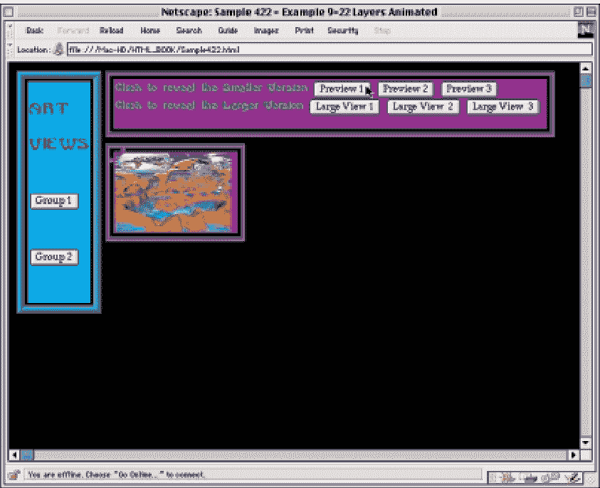

## 示例 3-22 Sample422.html

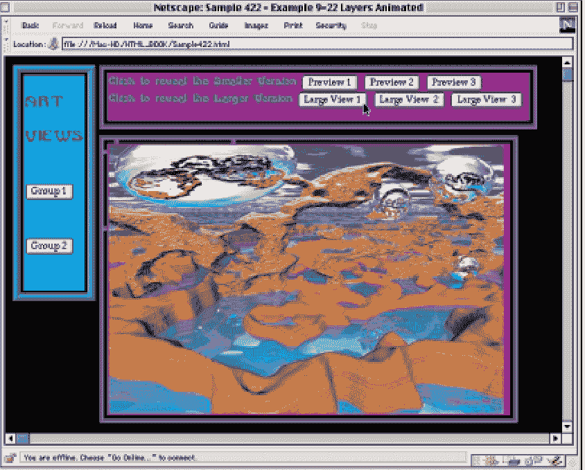

# **268** **第一部分 — 动态HTML**

# **示例 3-22：** **Sample422.html**

```html
<!DOCTYPE HTML PUBLIC "-//W3C//DTD HTML 3.2//EN">
<HTML>
<HEAD>
<TITLE>示例 422 - 示例 3-22  图层动画</TITLE>

<STYLE TYPE="text/JavaScript">

        classes.Blue22.all.fontSize="22pt";
        classes.Blue22.all.color="navy";
        classes.Blue22.all.backgroundColor="aqua";
        classes.Blue22.all.borderWidths("10px");
        classes.Blue22.all.borderStyle="ridge";
        classes.Blue22.all.borderColor="#0077ff";

        with(tags.LAYER) {
                color="lime";
                fontFamily="Moonlight, Helvetica, serif";
                fontSize="14pt";
                borderWidths("7px");
                borderStyle="groove";
                borderColor="#3300ff";
                backgroundColor="#8800ff";
                paddings("2px");
        }

</STYLE>

</HEAD>

<BODY BGCOLOR="black" TEXT="aqua">

<!--  **********************************************************  -->

<LAYER CLASS="Blue22" ID="layerA" LEFT=10 TOP=10 Z-INDEX=20 WIDTH=100 HEIGHT=500>

<FORM NAME="formA">

              艺术                                          <BR>
              视图                                        <BR><BR>

        <INPUT TYPE=button NAME="BGroup1" VALUE="组 1"

              onClick='ShowHideGroup1(); MoveGroup1(); return false;'>   <BR><BR>

        <INPUT TYPE=button NAME="BGroup2" VALUE="组 2"

              onClick='ShowHideGroup2(); MoveGroup2(); return false;'>   <BR><BR>

        </FORM>

</LAYER>

<!--  **********************************************************  -->
```


## CHAPTER 3 — 图层与 JavaScript

## 269

```
<LAYER ID="Group1" LEFT=120 TOP=10 Z-INDEX=10 WIDTH=600 HEIGHT=72>
<FORM NAME="form1">
点击显示较小版本
<INPUT TYPE=button NAME="BPreview1" VALUE="预览 1"
onClick=' HideShowLarge1(); HideShowSmall1(); MoveShowcase1(); return false;'
<INPUT TYPE=button NAME="BPreview2" VALUE="预览 2"
onClick=' HideShowLarge2(); HideShowSmall2(); MoveShowcase2(); return false;'
<INPUT TYPE=button NAME="BPreview3" VALUE="预览 3"
onClick=' HideShowLarge3(); HideShowSmall3(); MoveShowcase3(); return false;'><BR>
<!-- ******************************************************************* -->
点击显示较大版本
<INPUT TYPE=button NAME="BLargeView1" VALUE="大图 1"
onClick='JumpLargeView1(); HideShowLarge1(); LargeView1(); return false;'
<INPUT TYPE=button NAME="BLargeView2" VALUE="大图 2"
onClick='JumpLargeView2(); HideShowLarge2(); LargeView2(); return false;'
<INPUT TYPE=button NAME="BLargeView3" VALUE="大图 3"
onClick='JumpLargeView3(); HideShowLarge3(); LargeView3(); return false;'
</FORM>
</LAYER>
<!-- ******************************************************************* -->
<LAYER ID="Group2" LEFT=120 TOP=110 VISIBILITY="HIDE" Z-INDEX=9 WIDTH=600 HEIGHT=72>
<FORM NAME="form2">
点击显示较小版本
<INPUT TYPE=button NAME="BPreview4" VALUE="预览 4"
onClick='HideShowLarge4(); HideShowSmall4(); MoveShowcase4(); return false;'
<INPUT TYPE=button NAME="BPreview5" VALUE="预览 5"
onClick='HideShowLarge5(); HideShowSmall5(); MoveShowcase5(); return false;'
<INPUT TYPE=button NAME="BPreview6" VALUE="预览 6"
onClick='HideShowLarge6(); HideShowSmall6(); MoveShowcase6(); return false;'><BR>
<!-- ****************************************** -->
点击显示较大版本
<INPUT TYPE=button NAME="BLargeView4" VALUE="大图 4"
onClick='JumpLargeView4(); HideShowLarge4(); LargeView4(); return false;'
<INPUT TYPE=button NAME="BLargeView5" VALUE="大图 5"
onClick='JumpLargeView5(); HideShowLarge5(); LargeView5(); return false;'
<INPUT TYPE=button NAME="BLargeView6" VALUE="大图 6"
onClick='JumpLargeView6(); HideShowLarge6(); LargeView6(); return false;'
</FORM>
</LAYER>
<!-- ****************************************** -->
<LAYER ID="Showcase1" LEFT=120 TOP=700 VISIBILITY="HIDE" Z-INDEX=19 WIDTH=700 HEIGHT=600>
<LAYER ID="Showcase1Small" Z-INDEX=2>

</LAYER>
<LAYER ID="Showcase1Large" Z-INDEX=1 CLIP="0,0,0,0" WIDTH=600>

</LAYER>
</LAYER>
<!-- ****************************************** -->
<LAYER ID="Showcase2" LEFT=120 TOP=700 VISIBILITY="HIDE" Z-INDEX=18 WIDTH=700 HEIGHT=600>
<LAYER ID="Showcase2Small" Z-INDEX=2>

</LAYER>
<LAYER ID="Showcase2Large" Z-INDEX=1 CLIP="0,0,0,0" WIDTH=600>

</LAYER>
</LAYER>
<!-- ************************************************************************ -->
<LAYER ID="Showcase3" LEFT=1200 TOP=100 VISIBILITY="HIDE" Z-INDEX=17 WIDTH=700 HEIGHT=600>
<LAYER ID="Showcase3Small" Z-INDEX=2>

</LAYER>
<LAYER ID="Showcase3Large" Z-INDEX=1 CLIP="0,0,0,0" WIDTH=600>

</LAYER>
</LAYER>
<!-- ************************************************************************ -->
<LAYER ID="Showcase4" LEFT=120 TOP=700 VISIBILITY="HIDE" Z-INDEX=16 WIDTH=700 HEIGHT=600>
<LAYER ID="Showcase4Small" Z-INDEX=2>

</LAYER>
<LAYER ID="Showcase4Large" Z-INDEX=1 CLIP="0,0,0,0" WIDTH=600>

</LAYER>
</LAYER>
<!-- ************************************************************************ -->
<LAYER ID="Showcase5" LEFT=120 TOP=700 VISIBILITY="HIDE" Z-INDEX=15 WIDTH=700 HEIGHT=600>
<LAYER ID="Showcase5Small" Z-INDEX=2>

</LAYER>
<LAYER ID="Showcase5Large" Z-INDEX=1 CLIP="0,0,0,0" WIDTH=600>

</LAYER>
</LAYER>
<!-- *************************************************************************** -->
<LAYER ID="Showcase6" LEFT=120 TOP=700 VISIBILITY="HIDE" Z-INDEX=14 WIDTH=700 HEIGHT=600>
<LAYER ID="Showcase6Small" Z-INDEX=2>

</LAYER>
<LAYER ID="Showcase6Large" Z-INDEX=0 CLIP="0,0,0,0" WIDTH=600>

</LAYER>
</LAYER>
<!-- *************************************************************************** -->
<!-- ******* 以下 4 个函数控制顶部图层 ******* -->
<SCRIPT LANGUAGE="JavaScript 1.2"><!— BEGIN HIDING
var Showcase1 = document.Showcase1;
var Showcase2 = document.Showcase2;
var Showcase3 = document.Showcase3;
var Showcase4 = document.Showcase4;
var Showcase5 = document.Showcase5;
var Showcase6 = document.Showcase6;
var Showcase1Small = document.Showcase1.document.Showcase1Small;
var Showcase2Small = document.Showcase2.document.Showcase2Small;
var Showcase3Small = document.Showcase3.document.Showcase3Small;
var Showcase4Small = document.Showcase4.document.Showcase4Small;
var Showcase5Small = document.Showcase5.document.Showcase5Small;
var Showcase6Small = document.Showcase6.document.Showcase6Small;
var Showcase1Large = document.Showcase1.document.Showcase1Large;
var Showcase2Large = document.Showcase2.document.Showcase2Large;
var Showcase3Large = document.Showcase3.document.Showcase3Large;
var Showcase4Large = document.Showcase4.document.Showcase4Large;
var Showcase5Large = document.Showcase5.document.Showcase5Large;
var Showcase6Large = document.Showcase6.document.Showcase6Large;
var Group2 = document.Group2;
var Group1 = document.Group1;
/*—————————————————————————————————————————————————————————————————————+/
function ShowWideGroup1() {
Group2.zIndex=9; Group2.visibility='hide'; Group2.moveTo(120, -110);
Group1.zIndex=10; Group1.visibility='show';
return false;
}
/*----------------------------------*/
function MoveGroup1() {
    if (document.Group1.top < 10)  {
        document.Group1.moveBy(0,20);
        setTimeout('MoveGroup1()', 20);
    }
return false;
}
/*----------------------------------------------*/
function ShowHideGroup2() {
Group2.zIndex=10;      Group2.visibility='show';
Group1.zIndex=8;       Group1.visibility='hide';     Group1.moveTo(120,-110);
return false;
}
/*------------------------------------*/
function MoveGroup2(Group2) {
    if (document.Group2.top < 10)  {
        document.Group2.moveBy(0,20);
        setTimeout('MoveGroup2()', 20);
    }
return false;
}
/*-----------------------------------------------------------*/
/*   以下 18 个函数控制小图和大图的显示   */
function HideShowSmall1() {
    Showcase1.visibility='show';
    Showcase1Small.visibility='show';
    Showcase1Small.zIndex=2;
    Showcase1Large.visibility='hide';
    Showcase1Large.zIndex=1;
}
/*----------------------------------*/
function HideShowLarge1() {
    Showcase2.moveTo(120, 700);
    Showcase3.moveTo(1200, 100);  //此处正确
    Showcase4.moveTo(120, 700);
    Showcase5.moveTo(120, 700);
    Showcase6.moveTo(120, 700);
}
```


## 第三章 — 图层与 JavaScript

```javascript
Showcase1.visibility='show';
Showcase2.visibility='hide';
Showcase3.visibility='hide';
Showcase4.visibility='hide';
Showcase5.visibility='hide';
Showcase6.visibility='hide';

Showcase1Small.visibility='show';
Showcase2Small.visibility='hide';
Showcase3Small.visibility='hide';
Showcase4Small.visibility='hide';
Showcase5Small.visibility='hide';
Showcase6Small.visibility='hide';

Showcase1Large.visibility='show';
Showcase2Large.visibility='hide';
Showcase3Large.visibility='hide';
Showcase4Large.visibility='hide';
Showcase5Large.visibility='hide';
Showcase6Large.visibility='hide';

return false;
}

/*--------------------------------------------------*/

function MoveShowcase1() {
    if (document.Showcase1.top > 100) {
        document.Showcase1.moveBy(0, -20);
        setTimeout('MoveShowcase1()', 20);
    }
}

return false;
}

/*-------------------------------------------------------------------*/

function HideShowSmall2() {
    Showcase2.visibility='show';
    Showcase2Small.visibility='show';
    Showcase2Small.zIndex=2;
    Showcase2Large.visibility='hide';
    Showcase2Large.zIndex=-1;
}

/*--------------------------------------------------*/

function HideShowLarge2() {
    Showcase1.moveTo(120, 700);
    Showcase3.moveTo(1200, 100); //这是正确的
    Showcase4.moveTo(120, 700);
    Showcase5.moveTo(120, 700);
    Showcase6.moveTo(120, 700);

    Showcase1.visibility='hide';
    Showcase2.visibility='show';
    Showcase3.visibility='hide';
    Showcase4.visibility='hide';
    Showcase5.visibility='hide';
    Showcase6.visibility='hide';

    Showcase1Small.visibility='hide';
    Showcase2Small.visibility='show';
    Showcase3Small.visibility='hide';
    Showcase4Small.visibility='hide';
    Showcase5Small.visibility='hide';
    Showcase6Small.visibility='hide';

    Showcase1Large.visibility='hide';
    Showcase2Large.visibility='show';
    Showcase3Large.visibility='hide';
    Showcase4Large.visibility='hide';
    Showcase5Large.visibility='hide';
    Showcase6Large.visibility='hide';

    return false;
}

/*--------------------------------------*/

function MoveShowcase2() {
    if (document.Showcase2.top > 100) {
        document.Showcase2.moveBy(0,-20);
        setTimeout('MoveShowcase2()', 20);
    }

    return false;
}

/*--------------------------------------*/

function HideShowSmall3() {
    Showcase3.visibility='show';
    Showcase3Small.visibility='show';
    Showcase3Small.zIndex=2;
    Showcase3Large.visibility='hide';
    Showcase3Large.zIndex=1;
}

/*---------------------------------------------------------------------*/

function HideShowLarge3() {
    Showcase1.moveTo(120,700);
    Showcase2.moveTo(120,700);
    Showcase4.moveTo(120,700);
    Showcase5.moveTo(120,700);
    Showcase6.moveTo(120,700);

    Showcase1.visibility='hide';
    Showcase2.visibility='hide';
    Showcase3.visibility='show';
    Showcase4.visibility='hide';
    Showcase5.visibility='hide';
    Showcase6.visibility='hide';

    Showcase1Small.visibility='hide';
    Showcase2Small.visibility='hide';
    Showcase3Small.visibility='show';
    Showcase4Small.visibility='hide';
    Showcase5Small.visibility='hide';
    Showcase6Small.visibility='hide';

    Showcase1Large.visibility='hide';
    Showcase2Large.visibility='hide';
    Showcase3Large.visibility='show';
    Showcase4Large.visibility='hide';
    Showcase5Large.visibility='hide';
    Showcase6Large.visibility='hide';

    return false;
}

/*----------------------------------*/

function MoveShowcase3() {
    if (document.Showcase3.left > 120) {
        document.Showcase3.moveBy(-40,0);
        setTimeout('MoveShowcase3()', 20);
    }
    return false;
}

/*--------------------------------------------------*/

function HideShowSmall4() {
    Showcase4.visibility='show';
    Showcase4Small.visibility='show';
    Showcase4Small.zIndex=2;
    Showcase4Large.visibility='hide';
    Showcase4Large.zIndex=1;
}

/*----------------------------------*/

function HideShowLarge4() {
    Showcase1.moveTo(120,700);
    Showcase2.moveTo(120,700);
    Showcase3.moveTo(120,100); //这是正确的
    Showcase5.moveTo(120,700);
    Showcase6.moveTo(120,700);

    Showcase1.visibility='hide';
    Showcase2.visibility='hide';
    Showcase3.visibility='hide';
    Showcase4.visibility='show';
    Showcase5.visibility='hide';
    Showcase6.visibility='hide';

    Showcase1Small.visibility='hide';
    Showcase2Small.visibility='hide';
    Showcase3Small.visibility='hide';
    Showcase4Small.visibility='show';
    Showcase5Small.visibility='hide';
    Showcase6Small.visibility='hide';

    Showcase1Large.visibility='hide';
    Showcase2Large.visibility='hide';
    Showcase3Large.visibility='hide';
    Showcase4Large.visibility='show';
    Showcase5Large.visibility='hide';
    Showcase6Large.visibility='hide';

    return false;
}

/*----------------------------------*/

function MoveShowcase4() {
    if (document.Showcase4.top > 100) {
        document.Showcase4.moveBy(0,-20);
        setTimeout('MoveShowcase4()', 20);
    }

    return false;
}

/*------------------------------------------------------------------*/

function HideShowSmall5() {
    Showcase5.visibility='show';
    Showcase5Small.visibility='show';
    Showcase5Small.zIndex=2;
    Showcase5Large.visibility='hide';
    Showcase5Large.zIndex=1;
}

/*----------------------------------*/

function HideShowLarge5() {
    Showcase1.moveTo(120,700);
    Showcase2.moveTo(120,700);
    Showcase3.moveTo(1200,100);   //这是正确的
    Showcase4.moveTo(120,700);
    Showcase5.moveTo(120,700);

    Showcase1.visibility='hide';
    Showcase2.visibility='hide';
    Showcase3.visibility='hide';
    Showcase4.visibility='hide';
    Showcase5.visibility='show';
    Showcase6.visibility='hide';

    Showcase1Small.visibility='hide';
    Showcase2Small.visibility='hide';
    Showcase3Small.visibility='hide';
    Showcase4Small.visibility='hide';
    Showcase5Small.visibility='show';
    Showcase6Small.visibility='hide';

    Showcase1Large.visibility='hide';
    Showcase2Large.visibility='hide';
    Showcase3Large.visibility='hide';
    Showcase4Large.visibility='hide';
    Showcase5Large.visibility='show';
    Showcase6Large.visibility='hide';

    return false;
}

/*-------------------------------------*/

function MoveShowcase5() {
    if (document.Showcase5.top > 100) {
        document.Showcase5.moveBy(0,-20);
        setTimeout('MoveShowcase5()', 20);
    }

    return false;
}

/*------------------------------------------------------------------*/

function HideShowSmall6() {
    Showcase6.visibility='show';
    Showcase6Small.visibility='show';
    Showcase6Small.zIndex=2;
    Showcase6Large.visibility='hide';
    Showcase6Large.zIndex=1;
}

/*-------------------------------------*/

function HideShowLarge6() {
    Showcase1.moveTo(120,700);
    Showcase2.moveTo(120,700);
    Showcase3.moveTo(1200,100);   //这是正确的
    Showcase4.moveTo(120,700);
    Showcase5.moveTo(120,700);

    Showcase1.visibility='hide';
    Showcase2.visibility='hide';
    Showcase3.visibility='hide';
    Showcase4.visibility='hide';
    Showcase5.visibility='hide';
    Showcase6.visibility='show';

    Showcase1Small.visibility='hide';
    Showcase2Small.visibility='hide';
    Showcase3Small.visibility='hide';
    Showcase4Small.visibility='hide';
    Showcase5Small.visibility='hide';
    Showcase6Small.visibility='show';

    Showcase1Large.visibility='hide';
    Showcase2Large.visibility='hide';
    Showcase3Large.visibility='hide';
    Showcase4Large.visibility='hide';
    Showcase5Large.visibility='hide';
    Showcase6Large.visibility='show';

    return false;
}

/*-------------------------------------------------*/

function MoveShowcase6() {
    if (document.Showcase6.top > 100) {
        document.Showcase6.moveBy(0, -20);
        setTimeout('MoveShowcase6()', 20);
    }
}

return false;
}

/*-------------------------------------------------*/

/*  以下 12 个函数控制带有大图片的主图层  */

function JumpLargeView1() {
    Showcase1.visibility='show';
    Showcase1Small.visibility='hide';
    Showcase1Small.zIndex=1;
    Showcase6Large.visibility='show';
    Showcase6Large.zIndex=2;

    //如果未先点击组，则将包含图层向上移动
    //这是正确的，它正从页面左侧进入

    if (Showcase1.top > 100) {
        Showcase1.moveTo(120,100);
    }
}

return false;
}
```


# 第一部分 — 动态 HTML

```javascript
/*----------------------------------------*/

function LargeView1() {

			//通过调整裁剪矩形的大小来显示图像

			if (Showcase1Large.clip.right < 1000)  {

				Showcase1Large.resizeBy(7,0);
			}

			if (Showcase1Large.clip.top < 800)  {

				Showcase1Large.resizeBy(0,5);
			}

setTimeout('LargeView1()', 20);
return false;
}

/*-------------------------------------------------------------------*/

function JumpLargeView2() {

	Showcase2.visibility='show';
	Showcase2Large.visibility='show';
	Showcase2Small.zIndex=1;
	Showcase2Large.zIndex=2;
	Showcase2Small.visibility='hide';

			if (Showcase2.top > 100)  {

				Showcase2.moveTo(120,100);
			}

return false;
}

/*----------------------------------------*/

function LargeView2() {

			if (Showcase2Large.clip.right < 1000)  {

				Showcase2Large.resizeBy(7,0);
			}

			if (Showcase2Large.clip.top < 800)  {

				Showcase2Large.resizeBy(0,5);
			}

setTimeout('LargeView2()', 20);
return false;
}

/*-------------------------------------------------------------------*/
```

## 第三章 — 图层与 JavaScript

```javascript
/*--------------------------------------------------------------------*/

function JumpLargeView3() {

	Showcase3.visibility='show';
	Showcase3Large.visibility='show';
	Showcase3Small.zIndex=1;
	Showcase3Large.zIndex=2;
	Showcase3Small.visibility='hide';
		//这样是正确的，它来自右边
		if (Showcase3.left > 120) {

			Showcase3.moveTo(120,100);
		}

return false;
}

/*--------------------------------------*/

function LargeView3() {

			if (Showcase3Large.clip.right < 1000) {

				Showcase3Large.resizeBy(7,0);
			}
			if (Showcase3Large.clip.top < 800) {

				Showcase3Large.resizeBy(0,5);
			}

setTimeout('LargeView3()', 20);
return false;
}

/*--------------------------------------------------------------------*/

function JumpLargeView4() {

	Showcase4.visibility='show';
	Showcase4Large.visibility='show';
	Showcase4Small.zIndex=1;
	Showcase4Large.zIndex=2;
	Showcase4Small.visibility='hide';

		if (Showcase4.top > 100) {

			Showcase4.moveTo(120,100);
		}

return false;
}

/*--------------------------------------*/
```

# 第一部分 — 动态 HTML

```javascript
/*------------------------------------------*/

function LargeView4() {

			if (Showcase4Large.clip.right < 1000)  {

				Showcase4Large.resizeBy(7,0);
			}

			if (Showcase4Large.clip.top < 800)  {

				Showcase4Large.resizeBy(0,5);
			}

setTimeout('LargeView4()', 20);
return false;
}

/*----------------------------------------------------------------*/

function JumpLargeView5() {

		Showcase5.visibility='show';
		Showcase5Large.visibility='show';
		Showcase5Small.zIndex=1;
		Showcase5Large.zIndex=2;
		Showcase5Small.visibility='hide';

			if (Showcase5.top > 100)  {

				Showcase5.moveTo(120,100);
			}

return false;
}

/*------------------------------------------*/

function LargeView5() {

			if (Showcase5Large.clip.right < 1000)  {

				Showcase5Large.resizeBy(7,0);
			}

			if (Showcase5Large.clip.top < 800)  {

					 Showcase5Large.resizeBy(0,5);
			}
setTimeout('LargeView5()', 20);
return false;
}

/*----------------------------------------------------------------*/
```

```javascript
/*--------------------------------------------------------------*/

function JumpLargeView6() {

    Showcase6.visibility='show';
    Showcase6Large.visibility='show';
    Showcase6Small.zIndex=1;
    Showcase6Large.zIndex=2;
    Showcase6Small.visibility='hide';

        if (Showcase6.top > 100)  {

            Showcase6.moveTo(120,100);
        }

return false;
}

/*--------------------------------------------------------------*/

function LargeView6() {

        if (Showcase6Large.clip.right < 1000)  {

            Showcase6Large.resizeBy(7,0);
        }

        if (Showcase6Large.clip.top < 800)  {

            Showcase6Large.resizeBy(0,5);
        }

setTimeout('LargeView6()', 20);
return false;
}

/*--------------------------------------------------------------*/

//END HIDING-->
</SCRIPT>

</BODY>
</HTML>
```

## JavaScript setInterval() 方法

`setInterval()` 方法有两种不同的语法结构。一种用于在指定数量的`毫秒`过去后，连续地计算一个表达式；另一种用于在指定数量的`毫秒`过去后，连续地调用一个函数。

在下面的语法中，`anyExpression` 参数指定你要计算的表达式。在替代语法中，`functionName` 参数指定你要调用的函数名称。你的函数所需的任何可选参数在`milliseconds` 参数之后以逗号分隔列表的形式指定。你的表达式或函数必须放在引号内，否则它将立即被计算。`functionName` 后面的括号是必需的。

在`setInterval()` 被激活后，它将持续触发，直到你调用`clearInterval()` 方法，或者窗口或框架被用户退出、用`window.close()` 方法销毁，或用以下三行代码关闭：

```javascript
document.open(); document.write(); document.close();
```

## JavaScript 语法：

```javascript
setInterval("anyExpression", milliseconds);
setInterval("functionName()", milliseconds[, arg1, ..., argN]);
```

### JavaScript clearInterval() 方法

`clearInterval()` 方法用于取消之前对`setInterval()` 方法的调用，该调用已被分配给一个`intervalID`。例如，如果你有一个在其他地方创建的名为`myFunction()` 的函数，然后你将`setInterval()` 方法分配给`mysetIntervalID`，之后可以将其作为`clearInterval()` 方法的参数调用，如下两行代码所示：

## 小示例：

```javascript
mysetIntervalID = setInterval("myFunction()", 200);
clearInterval(mysetIntervalID);
```

## JavaScript 语法：

```javascript
clearInterval(intervalID);
```

### 三个循环切换背景颜色的示例

示例 3-23 使用 **setInterval()** 方法来重复调用函数 **changeColor()**，该函数使用条件 if () 语句来设置图层 **L1** 和 **L2** 的 **bgColor 图层**对象属性的变化循环。**setInterval()** 方法放置在 **timeColor()** 函数内部，该函数由 BODY 元素的 **onLoad** 事件处理程序调用，以便在文档完全加载后立即启动。

**示例 3-23：**  	**Sample423.html**

```html
<!DOCTYPE HTML PUBLIC "-//W3C//DTD HTML 3.2//EN">
<HTML><HEAD>
<TITLE>Sample 423 - Example 3-23    setInterval Method to cycle bgColors</TITLE>
</HEAD>

<BODY onLoad="timeColor();">

<LAYER ID="L1" LEFT=0 TOP=0 WIDTH=40 HEIGHT=400> </LAYER>

<LAYER ID="L2" LEFT=40 TOP=0 WIDTH=400 HEIGHT=40> </LAYER>
<!--  **************************************************  -->

<SCRIPT LANGUAGE="JavaScript1.2"><!--BEGIN HIDING

        var i=1;

        function changeColor() {

                if (i<9999) {

                document.L1.bgColor = '#ff' + i;
                document.L2.bgColor = '#' + i + 'aa';

                i+=25;
                        //将 i 重置以重复循环
                if (i>=9973) i=1;
                }
}
/*------------------------------------------------------*/

        function timeColor() {
                setInterval('changeColor()', 100);
        }
/*------------------------------------------------------*/
//END HIDING-->
</SCRIPT>
</BODY>
</HTML>
```

# 第一部分 — 动态 HTML

示例 3-24 和 3-25 产生完全相同的结果，但使用了不同的编码技术。示例 3-24 使用 `setInterval()` 和 `clearInterval()` 方法，而示例 3-25 使用 `setTimeout()` 和 `clearTimeout()` 方法来为连续的图层背景颜色添加动画。这两个示例将帮助阐明你必须与这四个方法一起使用的区别和技巧。

创建了一个名为 `colorArray` 的新数组，其中有 13 个不同的公认颜色名称，这些名称按相同顺序重复，总共有 26 个数组项。这是因为在 `changeColor()` 函数中使用条件 `if ()` 语句的方式，它循环遍历数组中的颜色并将它们分配给八个图层对象的 `bgColor` 属性。

`setInterval()` 方法被放入 `timeColor()` 函数中，然后将其分配给 BODY 元素的 `onLoad` 事件处理程序以启动循环。值为 "GO" 的按钮的 `onClick` 事件处理程序重新启动循环。值为 "STOP" 的按钮通过将变量 `booleanTest` 更改为 false 来停止循环，这将触发 `timeColor()` 函数内的 `clearInterval()` 方法。

### 示例 3-24：Sample424.html

```html
<!DOCTYPE HTML PUBLIC "-//W3C//DTD HTML 3.2//EN">
<HTML>
<HEAD>
<TITLE>Sample 424 - Example 3-24     setInterval and clearInterval Methods</TITLE>
</HEAD>

<BODY onLoad="timeColor();">

<LAYER ID="L8" LEFT=20 TOP=200 WIDTH=100 HEIGHT=100>

<FORM NAME="form1">

<INPUT TYPE="button" NAME="b1" VALUE="STOP" onClick="booleanTest=false;">

<INPUT TYPE="button" NAME="b2" VALUE="GO" onClick="booleanTest=true; timeColor();">

</FORM>

</LAYER>

<!--  *******************************************************************************************  -->

<LAYER ID="L1" LEFT=0 TOP=0 WIDTH=40 HEIGHT=40> </LAYER>

<LAYER ID="L2" LEFT=40 TOP=0 WIDTH=40 HEIGHT=40> </LAYER>

<LAYER ID="L3" LEFT=80 TOP=0 WIDTH=40 HEIGHT=40> </LAYER>

<LAYER ID="L4" LEFT=120 TOP=0 WIDTH=40 HEIGHT=40> </LAYER>

<LAYER ID="L5" LEFT=160 TOP=0 WIDTH=40 HEIGHT=40> </LAYER>
```


## CHAPTER 3 — 图层与JavaScript

```
<LAYER ID="L6" LEFT=200 TOP=0 WIDTH=40 HEIGHT=40> </LAYER>
<LAYER ID="L7" LEFT=240 TOP=0 WIDTH=40 HEIGHT=40> </LAYER>
<LAYER ID="L8" LEFT=280 TOP=0 WIDTH=40 HEIGHT=40> </LAYER>
```

```
<!-- ******************************************************************** -->
<SCRIPT LANGUAGE="JavaScript1.2"><!--BEGIN HIDING

var booleanTest=true;
var i=13;

    colorArray = new Array ('blue','red','yellow','lime','cyan','olive',
    'green', 'steelblue','purple','maroon', 'orange', 'navy', 'black',
    'blue','red','yellow','lime','cyan','olive',
    'green', 'steelblue','purple','maroon', 'orange', 'navy','black');

/* ********************************************************************* */

function changeColor() {
    if (booleanTest == true) {
        if (i<27) {
            document.L1.bgColor = colorArray[i-1];
            document.L2.bgColor = colorArray[i-2];
            document.L3.bgColor = colorArray[i-3];
            document.L4.bgColor = colorArray[i-4];
            document.L5.bgColor = colorArray[i-5];
            document.L6.bgColor = colorArray[i-6];
            document.L7.bgColor = colorArray[i-7];
            document.L8.bgColor = colorArray[i-8];

            i++;

        }
        if (i==26) i=13;
    } else clearInterval(myInterval);
}

/* ********************************************************************* */

function timeColor() {
    myInterval = setInterval('changeColor()', 500);
}

/* ********************************************************************* */
//END HIDING-->
</SCRIPT>
```

```
</body>
</html>
```

## 第一部分 — 动态HTML

示例3-25与上一个示例的主要区别在于，本示例使用了**setTimeout()**方法，而非**setInterval()**方法，并且它包含在**colorChange()**函数中，而不是位于作为参数调用的同一函数中。**colorChange()**函数再次通过BODY元素的**onLoad**事件处理器调用，并且在"STOP"按钮停止循环后，可以通过"GO"按钮再次调用。更多信息请参阅第286页。

### 示例 3-25：Sample425.html

```
<!DOCTYPE HTML PUBLIC "-//W3C//DTD HTML 3.2//EN">
<HTML>
<HEAD>
<TITLE>Sample 425 - Example 3-25         clearTimeout and setTimeout Methods</TITLE>
</HEAD>

<BODY onLoad="changeColor();">

<LAYER ID="L8" LEFT=20 TOP=200 WIDTH=100 HEIGHT=100>

<FORM NAME="form1">

<INPUT TYPE="button" NAME="b1" VALUE="STOP" onClick="booleanTest=false;">

<INPUT TYPE="button" NAME="b2" VALUE="GO" onClick="booleanTest=true;
changeColor();">

</FORM>

</LAYER>

<!--  **************************************************************************************************** -->

<LAYER ID="L1" LEFT=0 TOP=0 WIDTH=40 HEIGHT=40> </LAYER>

<LAYER ID="L2" LEFT=40 TOP=0 WIDTH=40 HEIGHT=40> </LAYER>

<LAYER ID="L3" LEFT=80 TOP=0 WIDTH=40 HEIGHT=40> </LAYER>

<LAYER ID="L4" LEFT=120 TOP=0 WIDTH=40 HEIGHT=40> </LAYER>

<LAYER ID="L5" LEFT=160 TOP=0 WIDTH=40 HEIGHT=40> </LAYER>

<LAYER ID="L6" LEFT=200 TOP=0 WIDTH=40 HEIGHT=40> </LAYER>

<LAYER ID="L7" LEFT=240 TOP=0 WIDTH=40 HEIGHT=40> </LAYER>

<LAYER ID="L8" LEFT=280 TOP=0 WIDTH=40 HEIGHT=40> </LAYER>

<!--  **************************************************************************************************** -->
```

## CHAPTER 3 — Layers & JavaScript 289

```
<SCRIPT LANGUAGE="JavaScript1.2"><!--BEGIN HIDING

var booleanTest=true;
var i=13;
var i=13;
myTimeout = setTimeout('changeColor()', 500);

colorArray = new Array('blue','red','yellow','lime','cyan','olive',
'green','steelblue','purple','maroon','orange','navy','black',
'blue','red','yellow','lime','cyan','olive',
'green','steelblue','purple','maroon','orange','navy','black');

/*-------------------------------------------------------------------*/

function changeColor() {
    if (booleanTest == true) {
        if (i<27) {
            document.L1.bgColor = colorArray[i-1];
            document.L2.bgColor = colorArray[i-2];
            document.L3.bgColor = colorArray[i-3];
            document.L4.bgColor = colorArray[i-4];
            document.L4.bgColor = colorArray[i-5];
            document.L6.bgColor = colorArray[i-6];
            document.L7.bgColor = colorArray[i-7];
            document.L8.bgColor = colorArray[i-8];

            i++;

            if (i==26) i=13;
            setTimeout('changeColor()', 500);
        }
    }
    else clearTimeout(myTimeout);
}

//END HIDING-->
</SCRIPT>

</body>
</html>
```

以下示例3-26演示了如何使用**src**属性和**load()**方法为图层加载内容，以加载包含图像以及附加了JavaScript STYLE类的图层的外部文件。请注意，包含最后三张大图像的图层具有不同的宽度，这些宽度通过**load()**方法的第二个参数指定，并且始终以像素为单位。

## 第一部分 — 动态HTML

### 示例 3-26 第1部分：Sample426.html

```
<!DOCTYPE HTML PUBLIC "-//W3C//DTD HTML 3.2//EN">
<HTML>
<HEAD>
<TITLE>Sample 426 - Example 3-26	Layers Loading External Files</TITLE>

<STYLE TYPE="text/JavaScript">

		classes.Lime30.all.color="lime";
		classes.Lime30.all.fontFamily="Moonlight, Helvetica, serif";
		classes.Lime30.all.fontSize="22pt";
		classes.Lime30.all.borderWidths("15px");
		classes.Lime30.all.borderStyle="groove";
		classes.Lime30.all.borderColor="#3300ff";
		classes.Lime30.all.backgroundColor="#8800ff";
		classes.Lime30.all.paddings("2px");

</STYLE>

</HEAD>

<BODY BGCOLOR="black">

<!--	******************************************************* -->
<!--	带有按钮的顶部图层，用于加载外部文件 -->

<LAYER CLASS="Lime30" ID="Group1" LEFT=5 TOP=5 WIDTH=700 HEIGHT=72>

<FORM NAME="form1">

			展示艺术作品

			<INPUT TYPE=button NAME="BPreview1" VALUE="Previews"
			onClick='LoadPreviews(); return false;'>

<!--	****************************************** -->

			<INPUT TYPE=button NAME="BLargeView1" VALUE="Art 1"
			onClick='LoadArt1(); return false;'>

			<INPUT TYPE=button NAME="BLargeView2" VALUE="Art  2"
			onClick='LoadArt2(); return false;'>

			<INPUT TYPE=button NAME="BLargeView2" VALUE="Art  3"
			onClick='LoadArt3(); return false;'>

			<INPUT TYPE=button NAME="BLargeView4" VALUE="Art  4"
			onClick='LoadArt4(); return false;'>
```

## CHAPTER 3 — Layers & JavaScript 291

```
<INPUT TYPE=button NAME="BLargeView5" VALUE="Art  5"
onClick='LoadArt5(); return false;'>

<INPUT TYPE=button NAME="BLargeView6" VALUE="Art  6"
onClick='LoadArt6(); return false;'>
</FORM>

</LAYER>
<!-- *********************************************************** -->
<!--   包含外部文件中图像的容器图层   -->

<LAYER ID="Showcase1" LEFT=5 TOP=100 WIDTH=700 HEIGHT=600
SRC="Sample426ExternalGroup.html">

</LAYER>
<!-- *********************************************************** -->
```

```
<SCRIPT LANGUAGE="JavaScript1.2"><!--BEGIN HIDING

/*-----------------------------------------------------------*/
/*   接下来的7个函数加载包含图像的外部文件   */

function LoadPreviews() {
    document.Showcase1.src = ('Sample426ExternalGroup.html') ;
}
/*-----------------------------------------------------------*/

function LoadArt1() {
    document.Showcase1.src = ('Sample426External1.html') ;
}
/*-----------------------------------------------------------*/

function LoadArt2() {
    document.Showcase1.src = ('Sample426External2.html') ;
}
/*-----------------------------------------------------------*/

function LoadArt3() {
    document.Showcase1.src = ('Sample426External3.html') ;
}
/*-----------------------------------------------------------*/

function LoadArt4() {
    document.Showcase1.load('Sample426External4.html', 600) ;
}
/*-----------------------------------------------------------*/

function LoadArt5() {
    document.Showcase1.load('Sample426External5.html', 600) ;
}
```

```
/*------------------------------------------------------------------------------------------*/

function LoadArt6() {

		document.Showcase1.load('Sample426External6.html', 750) ;

}

/*------------------------------------------------------------------------------------------*/
```

```
//END HIDING-->
</SCRIPT>
</BODY>
</HTML>
```

这是包含六幅艺术作品小图预览的外部文件。

### 示例 3-26 第2部分：Sample426ExternalGroup.html

```
<!DOCTYPE HTML PUBLIC "-//W3C//DTD HTML 3.2//EN">
<HTML>
<HEAD>
<TITLE>
	Sample 426 External Group - Example 3-26 Part 2 Layers in External Files</TITLE>

<STYLE TYPE="text/JavaScript">

		classes.Royalblue30.all.fontSize="10px";
		classes.Royalblue30.all.color="darkblue";
		classes.Royalblue30.all.borderTopWidth="0px";
		classes.Royalblue30.all.borderRightWidth="20px";
		classes.Royalblue30.all.borderBottomWidth="20px";
		classes.Royalblue30.all.borderLeftWidth="20px";
		classes.Royalblue30.all.borderStyle="groove";
		classes.Royalblue30.all.borderColor="slateblue";
		classes.Royalblue30.all.fontFamily="Moonlight, Helvetica, serif";
		classes.Royalblue30.all.backgroundColor="royalblue";
		classes.Royalblue30.all.paddingTop="10px";
		classes.Royalblue30.all.paddingRight="10px";
		classes.Royalblue30.all.paddingBottom="10px";
		classes.Royalblue30.all.paddingLeft="10px";

</STYLE>

</HEAD>

<BODY>
<LAYER CLASS="Royalblue30">

艺术作品预览 				<BR><BR>


```


## 第三章 — 层与JavaScript

```html
<BR><BR>


</LAYER>

</BODY>
</HTML>
```

这是六个包含艺术作品大幅图像的外部文件之一。其余的大幅图像也分别保存在各自的外部文件中，这些文件位于CD-ROM上，但未收录在书中，因为它们非常相似。唯一的区别显然是源图像的URL。

### 示例 3-26 第三部分：Sample426External1.html

```html
<!DOCTYPE HTML PUBLIC "-//W3C//DTD HTML 3.2//EN">
<HTML>
<HEAD>
<TITLE>Sample 426 External 1 - Example 3-26A         外部文件中的层</TITLE>

<STYLE TYPE="text/JavaScript">

        classes.Aqua30.all.fontSize="30pt";
        classes.Aqua30.all.color="#0033aa";
        classes.Aqua30.all.borderWidths("15px");
        classes.Aqua30.all.borderStyle="ridge";
        classes.Aqua30.all.borderColor="#0077ff";
        classes.Aqua30.all.fontFamily="Moonlight, Helvetica, serif";
        classes.Aqua30.all.width="100%";
        classes.Aqua30.all.backgroundColor="aqua";

</STYLE>
</HEAD>

<BODY>

<LAYER CLASS="Aqua30">


沙漠拱门

</LAYER>

</BODY>
</HTML>
```

### 示例 3-26 Sample426.html

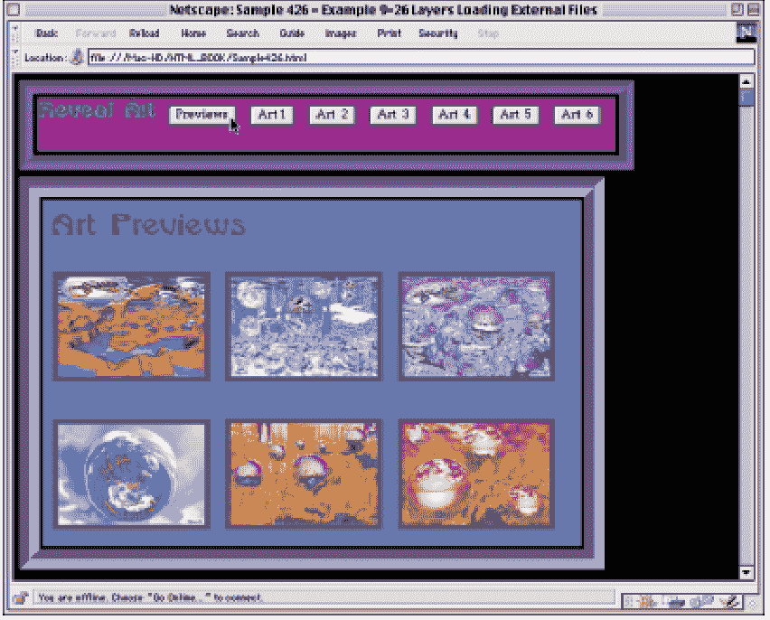

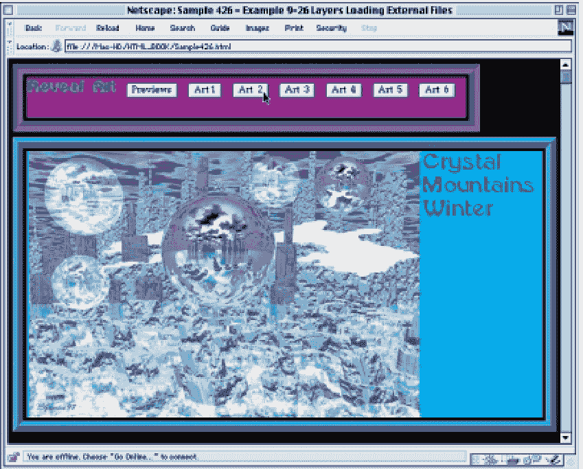

## 第三章 — 层与JavaScript

### 示例 3-26 Sample426.html


## 第一部分 — 动态HTML

### 井字棋游戏示例

这是大家熟悉的井字棋游戏，但有一个变化。包含X和O的层最初是隐藏的，当在名为**Control**的左侧层中点击一个按钮时，这些层会通过动画进入视野。

从**revealChoice1X()**到**revealChoice9X()**以及从**revealChoice1O()**到**revealChoice9O()**的函数控制着层的**可见性**属性和位置坐标。

从**AnimateChoice1X()**到**AnimateChoice9X()**以及从**AnimateChoice1O()**到**AnimateChoice9O()**的函数通过**moveBy()**和**setTimeout()**方法控制层的动画。

那九个`BGCOLOR`属性被设置为黑色的层，用于遮挡其所在层的黄色，使得传统的游戏棋盘线条能够显现出来。这个游戏还有另一个版本，采用了完全不同的编程方案，允许通过键盘来操作。该版本的代码在第6章第580-585页，并且可以在[Sample714-TTT-Keys.html](Sample714-TTT-Keys.html)文件中查看。

### 示例 3-27：Sample427-TTT.html

```html
<!DOCTYPE HTML PUBLIC "-//W3C//DTD HTML 3.2//EN">
<HTML><HEAD>
<TITLE>Sample 427-TTT - Example 3-27     井字棋动画</TITLE>    </HEAD>

      <!--   注意：本示例使用CSS语法定义局部即时样式   -->

<BODY STYLE='color:white; background-color:black; font-family:Palatino, Moonlight, serif;'>

       <!--   控制层                                          -->

<LAYER ID="Control" LEFT=5 TOP=5 WIDTH=120 HEIGHT=470 BGCOLOR="LIME">
<FORM NAME="form1">

<SPAN STYLE="font-size:22pt; text-align:center; font-family:Moonlight, cursive;">
<BR><BR>选择一个  <BR>           X 或 O  <BR>                          </SPAN> <HR>

<SPAN STYLE="float:center;">

<INPUT TYPE="button" NAME="ChooseX1" VALUE="X1"
onClick='revealChoice1X(); AnimateChoice1X(); return false;'>

<INPUT TYPE="button" NAME="ChooseO1" VALUE="O1"
onClick='revealChoice1O(); AnimateChoice1O(); return false;'>     <BR>

<INPUT TYPE="button" NAME="ChooseX2" VALUE="X2"
onClick='revealChoice2X(); AnimateChoice2X(); return false;'>

<INPUT TYPE="button" NAME="ChooseO2" VALUE="O2"
onClick='revealChoice2O(); AnimateChoice2O(); return false;'>     <BR>

<INPUT TYPE="button" NAME="ChooseX3" VALUE="X3"
onClick='revealChoice3X(); AnimateChoice3X(); return false;'>

<INPUT TYPE="button" NAME="ChooseO3" VALUE="O3"
onClick='revealChoice3O(); AnimateChoice3O(); return false;'>     <BR><BR>       <HR>

<INPUT TYPE="button" NAME="ChooseX3" VALUE="X4"
onClick='revealChoice4X(); AnimateChoice4X(); return false;'>

<INPUT TYPE="button" NAME="Choose03" VALUE="04"
onClick='revealChoice4O(); AnimateChoice4O(); return false;'>     <BR>

<INPUT TYPE="button" NAME="ChooseX3" VALUE="X5"
onClick='revealChoice5X(); AnimateChoice5X(); return false;'>

<INPUT TYPE="button" NAME="Choose03" VALUE="05"
onClick='revealChoice5O(); AnimateChoice5O(); return false;'>     <BR>

<INPUT TYPE="button" NAME="ChooseX3" VALUE="X6"
onClick='revealChoice6X(); AnimateChoice6X(); return false;'>

<INPUT TYPE="button" NAME="Choose03" VALUE="06"
onClick='revealChoice6O(); AnimateChoice6O(); return false;'>     <BR><BR>     <HR>

<INPUT TYPE="button" NAME="ChooseX3" VALUE="X7"
onClick='revealChoice7X(); AnimateChoice7X(); return false;'>

<INPUT TYPE="button" NAME="Choose03" VALUE="07"
onClick='revealChoice7O(); AnimateChoice7O(); return false;'>     <BR>

<INPUT TYPE="button" NAME="ChooseX3" VALUE="X8"
onClick='revealChoice8X(); AnimateChoice8X(); return false;'>

<INPUT TYPE="button" NAME="Choose03" VALUE="08"
onClick='revealChoice8O(); AnimateChoice8O(); return false;'>     <BR>

<INPUT TYPE="button" NAME="ChooseX3" VALUE="X9"
onClick='revealChoice9X(); AnimateChoice9X(); return false;'>

<INPUT TYPE="button" NAME="Choose03" VALUE="09"
onClick='revealChoice9O(); AnimateChoice9O(); return false;'>     <BR><BR>     <HR>

<INPUT TYPE="button" NAME="StartOver" VALUE="新游戏" onClick='StartGame(); return false;'>

</SPAN>
</FORM>
</LAYER>

<!--  包含层       -->

<LAYER ID="MainBoard" LEFT=150 TOP=5 WIDTH=470 HEIGHT=470 BGCOLOR="YELLOW">

<!-- 9个用于遮挡主网格以仅显示网格条的层 -->

<LAYER LEFT=0 TOP=0 WIDTH=150 HEIGHT=150 BGCOLOR="black"></LAYER>

<LAYER LEFT=160 TOP=0 WIDTH=150 HEIGHT=150 BGCOLOR="black"></LAYER>

<LAYER LEFT=320 TOP=0 WIDTH=150 HEIGHT=150 BGCOLOR="black"></LAYER>

<LAYER LEFT=0 TOP=160 WIDTH=150 HEIGHT=150 BGCOLOR="black"></LAYER>

<LAYER LEFT=160 TOP=160 WIDTH=150 HEIGHT=150 BGCOLOR="black"></LAYER>

<LAYER LEFT=320 TOP=160 WIDTH=150 HEIGHT=150 BGCOLOR="black"></LAYER>

<LAYER LEFT=0 TOP=320 WIDTH=150 HEIGHT=150 BGCOLOR="black"></LAYER>

<LAYER LEFT=160 TOP=320 WIDTH=150 HEIGHT=150 BGCOLOR="black"></LAYER>

<LAYER LEFT=320 TOP=320 WIDTH=150 HEIGHT=150 BGCOLOR="black"></LAYER>
<!-- ***************************************************************  -->

<!-- ******************************************************************** -->

<!-- 组成包含X和O字母的网格的18个层 -->

<LAYER ID="Grid1X" LEFT=0 TOP=0 WIDTH=150 HEIGHT=150 BGCOLOR="blue" VISIBILITY="hide">
<SPAN STYLE="color:white; font-size:11sp; text-align:center;">X</SPAN>
</LAYER>

<LAYER ID="Grid1O" LEFT=0 TOP=0 WIDTH=150 HEIGHT=150 BGCOLOR="red" VISIBILITY="hide">
<SPAN STYLE="color:navy; font-size:11sp; text-align:center;"></SPAN>
</LAYER>

<!-- ******************************************************************** -->

<LAYER ID="Grid2X" LEFT=160 TOP=0 WIDTH=150 HEIGHT=150 BGCOLOR="blue" VISIBILITY="hide">
<SPAN STYLE="color:white; font-size:11sp; text-align:center;"> X</SPAN>
</LAYER>

<LAYER ID="Grid2O" LEFT=160 TOP=0 WIDTH=150 HEIGHT=150 BGCOLOR="red" VISIBILITY="hide">
<SPAN STYLE="color:navy; font-size:11sp; text-align:center;"></SPAN>
</LAYER>

<!-- ******************************************************************** -->

<LAYER ID="Grid3X" LEFT=320 TOP=0 WIDTH=150 HEIGHT=150 BGCOLOR="blue" VISIBILITY="hide">
<SPAN STYLE="color:white; font-size:11sp; text-align:center;">X</SPAN>
</LAYER>

<LAYER ID="Grid3O" LEFT=320 TOP=0 WIDTH=150 HEIGHT=150 BGCOLOR="red" VISIBILITY="hide">
<SPAN STYLE="color:navy; font-size:11sp; text-align:center;"></SPAN>
</LAYER>

<!-- ******************************************************************** -->

<LAYER ID="Grid4X" LEFT=0 TOP=160 WIDTH=150 HEIGHT=150 BGCOLOR="blue" VISIBILITY="hide">
<SPAN STYLE="color:white; font-size:11sp; text-align:center;">X</SPAN>
</LAYER>

<LAYER ID="Grid4O" LEFT=0 TOP=160 WIDTH=150 HEIGHT=150 BGCOLOR="red" VISIBILITY="hide">
<SPAN STYLE="color:navy; font-size:11sp; text-align:center;"></SPAN>
</LAYER>

<!-- ******************************************************************** -->

<LAYER ID="Grid5X" LEFT=160 TOP=160 WIDTH=150 HEIGHT=150 BGCOLOR="blue" VISIBILITY="hide">
<SPAN STYLE="color:white; font-size:11sp; text-align:center;">X</SPAN>
</LAYER>

<LAYER ID="Grid5O" LEFT=160 TOP=160 WIDTH=150 HEIGHT=150 BGCOLOR="red" VISIBILITY="hide">
<SPAN STYLE="color:navy; font-size:11sp; text-align:center;"></SPAN>
</LAYER>

<!-- ******************************************************************** -->

<LAYER ID="Grid6X" LEFT=320 TOP=160 WIDTH=150 HEIGHT=150 BGCOLOR="blue" VISIBILITY="hide">
<SPAN STYLE="color:white; font-size:11sp; text-align:center;">X</SPAN>
</LAYER>

<!-- ******************************************************************** -->
<!-- ******************************************************************** -->

<LAYER ID="Grid6O" LEFT=320 TOP=160 WIDTH=150 HEIGHT=150 BGCOLOR="red" VISIBILITY="hide">
<SPAN STYLE="color:navy; font-size:11sp; text-align:center;">O </SPAN>
</LAYER>
```


# 第三章 — 层与 JavaScript 299

```
<!-- ******************************************************************** -->

<LAYER ID="Grid7X" LEFT=0 TOP=320 WIDTH=150 HEIGHT=150 BGCOLOR="blue" VISIBILITY="hide">
<SPAN STYLE="color:white; font-size:115pt; text-align:center;">X</SPAN>
</LAYER>

<LAYER ID="Grid7O" LEFT=0 TOP=320 WIDTH=150 HEIGHT=150 BGCOLOR="red" VISIBILITY="hide">
<SPAN STYLE="color:navy; font-size:115pt; text-align:center;">O</SPAN>
</LAYER>

<!-- ******************************************************************** -->

<LAYER ID="Grid8X" LEFT=160 TOP=320 WIDTH=150 HEIGHT=150 BGCOLOR="blue" VISIBILITY="hide">
<SPAN STYLE="color:white; font-size:115pt; text-align:center;">X</SPAN>
</LAYER>

<LAYER ID="Grid8O" LEFT=160 TOP=320 WIDTH=150 HEIGHT=150 BGCOLOR="red" VISIBILITY="hide">
<SPAN STYLE="color:navy; font-size:115pt; text-align:center;">O</SPAN>
</LAYER>

<!-- ******************************************************************** -->

<LAYER ID="Grid9X" LEFT=320 TOP=320 WIDTH=150 HEIGHT=150 BGCOLOR="blue" VISIBILITY="hide">
<SPAN STYLE="color:white; font-size:115pt; text-align:center;">X</SPAN>
</LAYER>

<LAYER ID="Grid9O" LEFT=320 TOP=320 WIDTH=150 HEIGHT=150 BGCOLOR="red" VISIBILITY="hide">
<SPAN STYLE="color:navy; font-size:115pt; text-align:center;">O</SPAN>
</LAYER>

<!-- ******************************************************************** -->

</LAYER>

<!-- ******************************************************************** -->

<SCRIPT LANGUAGE="JavaScript1.2">
<!--BEGIN HIDING

/* ------------------------------------------------------------------------- */
/* --- 本节处理显示 X 和 O 字母的函数 --- */

var Grid1X = document.MainBoard.document.Grid1X;
var Grid1O = document.MainBoard.document.Grid1O;

var Grid2X = document.MainBoard.document.Grid2X;
var Grid2O = document.MainBoard.document.Grid2O;

var Grid3X = document.MainBoard.document.Grid3X;
var Grid3O = document.MainBoard.document.Grid3O;

var Grid4X = document.MainBoard.document.Grid4X;
var Grid4O = document.MainBoard.document.Grid4O;

var Grid5X = document.MainBoard.document.Grid5X;
var Grid5O = document.MainBoard.document.Grid5O;
var Grid6X = document.MainBoard.document.Grid6X;
var Grid6O = document.MainBoard.document.Grid6O;

var Grid7X = document.MainBoard.document.Grid7X;
var Grid7O = document.MainBoard.document.Grid7O;

var Grid8X = document.MainBoard.document.Grid8X;
var Grid8O = document.MainBoard.document.Grid8O;

var Grid9X = document.MainBoard.document.Grid9X;
var Grid9O = document.MainBoard.document.Grid9O;

/* ------------------------------------------------------------------------- */
```

# 300

# 第一部分 — 动态 HTML

```
/*------------------------------------------------*/
function revealChoice1X () {

			Grid1X.visibility="show";
			Grid1O.visibility="hide";
			Grid1X.moveTo(-160,0);

}

function AnimateChoice1X() {

			if (Grid1X.left < 0)  {

					Grid1X.moveBy(20,0);
					setTimeout('AnimateChoice1X()', 20);
			}
return false;
}

/*--------------------------------------*/

function revealChoice1O () {

			Grid1O.visibility="show";
			Grid1X.visibility="hide";
			Grid1O.moveTo(-160,0);

}

function AnimateChoice1O() {

			if (Grid1O.left < 0)  {

					Grid1O.moveBy(20,0);
					setTimeout('AnimateChoice1O()', 20);
			}
return false;
}

/*------------------------------------------------*/

function revealChoice2X () {

			Grid2X.visibility="show";
			Grid2O.visibility="hide";
			Grid2X.moveTo(160,-160);

}

function AnimateChoice2X() {

			if (Grid2X.top < 0)  {

					Grid2X.moveBy(0,20);
					setTimeout('AnimateChoice2X()', 20);
			}
return false;
}

/*--------------------------------------*/

function revealChoice2O () {

			Grid2O.visibility="show";
			Grid2X.visibility="hide";
			Grid2O.moveTo(160,-160);

}
```

# 第三章 — 层与 JavaScript

```
function AnimateChoice2O() {

    if (Grid2O.top < 0) {

        Grid2O.moveBy(0, 20);
        setTimeout('AnimateChoice2O()', 20);

    }

    return false;
}
```

```
/*--------------------------------------------------------------------*/
```

```
function revealChoice3X() {

    Grid3X.visibility="show";
    Grid3O.visibility="hide";
    Grid3X.moveTo(320, -160);

}
```

```
function AnimateChoice3X() {

    if (Grid3X.top < 0) {

        Grid3X.moveBy(0, 20);
        setTimeout('AnimateChoice3X()', 20);

    }

    return false;
}
```

```
/*--------------------------------------------------------------------*/
```

```
function revealChoice3O() {

    Grid3O.visibility="show";
    Grid3X.visibility="hide";
    Grid3O.moveTo(320, -160);

}
```

```
function AnimateChoice3O() {

    if (Grid3O.top < 0) {

        Grid3O.moveBy(0, 20);
        setTimeout('AnimateChoice3O()', 20);

    }

    return false;
}
```

```
/*--------------------------------------------------------------------*/
```

```
function revealChoice4X() {

    Grid4X.visibility="show";
    Grid4O.visibility="hide";
    Grid4X.moveTo(-160, 160);

}
```

```
function AnimateChoice4X() {

    if (Grid4X.left < 0) {

        Grid4X.moveBy(20, 0);
        setTimeout('AnimateChoice4X()', 20);

    }

    return false;
}
```

```
/*--------------------------------------------------------------------*/
```

# 302 第一部分 — 动态 HTML

```
/*-----------------------------------------------*/

function revealChoice4O () {
    Grid4O.visibility="show";
    Grid4X.visibility="hide";
    Grid4O.moveTo(-160,160);
}

function AnimateChoice4O() {
    if (Grid4O.left < 0) {
        Grid4O.moveBy(20,0);
        setTimeout('AnimateChoice4O()', 20);
    }
    return false;
}

/*-----------------------------------------------*/

function revealChoice5X () {
    Grid5X.visibility="show";
    Grid5O.visibility="hide";
    Grid5X.moveTo(-160,160);
}

function AnimateChoice5X() {
    if (Grid5X.left < 160) {
        Grid5X.moveBy(20,0);
        setTimeout('AnimateChoice5X()', 20);
    }
    return false;
}

/*-----------------------------------------------*/

function revealChoice5O () {
    Grid5O.visibility="show";
    Grid5X.visibility="hide";
    Grid5O.moveTo(-160,160);
}

function AnimateChoice5O() {
    if (Grid5O.left < 160) {
        Grid5O.moveBy(20,0);
        setTimeout('AnimateChoice5O()', 20);
    }
    return false;
}

/*-----------------------------------------------*/

function revealChoice6X () {
    Grid6X.visibility="show";
    Grid6O.visibility="hide";
    Grid6X.moveTo(480,160);
}
```

# 第三章 — 层与 JavaScript

```
function AnimateChoice6X() {

			if (Grid6X.left > 320)  {

				Grid6X.moveBy(-20,0);
				setTimeout('AnimateChoice6X()', 20);
			}

return false;
}
```

```
/*---------------------------------------*/
```

```
function revealChoice6O () {

			Grid6O.visibility="show";
			Grid6X.visibility="hide";
			Grid6O.moveTo(480,160);

}
```

```
function AnimateChoice6O() {

			if (Grid6O.left > 320)  {

				Grid6O.moveBy(-20,0);
				setTimeout('AnimateChoice6O()', 20);
			}

return false;
}
```

```
/*----------------------------------------------------------*/
```

```
function revealChoice7X () {

			Grid7X.visibility="show";
			Grid7O.visibility="hide";
			Grid7X.moveTo(-160,320);

}
```

```
function AnimateChoice7X() {

			if (Grid7X.left < 0)  {

				Grid7X.moveBy(20,0);
				setTimeout('AnimateChoice7X()', 20);
			}

return false;
}
```

```
/*---------------------------------------*/
```

```
function revealChoice7O () {

			Grid7O.visibility="show";
			Grid7X.visibility="hide";
			Grid7O.moveTo(-160,320);

}
```

```
function AnimateChoice7O() {

				if (Grid7O.left < 0)  {

					Grid7O.moveBy(20,0);
					setTimeout('AnimateChoice7O()', 20);
				}

return false;
}
```

# 304 第一部分 — 动态 HTML

```
/*---------------------------------------------------*/

function revealChoice8X () {

    Grid8X.visibility="show";
    Grid8O.visibility="hide";
    Grid8X.moveTo(160,480);

}

function AnimateChoice8X() {

    if (Grid8X.top > 320) {

        Grid8X.moveBy(0,-20);
        setTimeout('AnimateChoice8X()', 20);

    }

    return false;
}
```

```
/*---------------------------------------------------*/

function revealChoice8O () {

    Grid8O.visibility="show";
    Grid8X.visibility="hide";
    Grid8O.moveTo(160,480);

}

function AnimateChoice8O() {

    if (Grid8O.top > 320) {

        Grid8O.moveBy(0,-20);
        setTimeout('AnimateChoice8O()', 20);

    }

    return false;
}
```

```
/*---------------------------------------------------*/

function revealChoice9X () {

    Grid9X.visibility="show";
    Grid9O.visibility="hide";
    Grid9X.moveTo(480,320);

}

function AnimateChoice9X() {

    if (Grid9X.left > 320) {

        Grid9X.moveBy(-20,0);
        setTimeout('AnimateChoice9X()', 20);

    }

    return false;
}
```

```
/*---------------------------------------------------*/

function revealChoice9O () {

    Grid9O.visibility="show";
    Grid9X.visibility="hide";
    Grid9O.moveTo(480,320);

}
```


## 第三章 — 层与JavaScript

```
function AnimateChoice90() {

			if (Grid90.left > 320)  {

				Grid90.moveBy(-20,0);
				setTimeout('AnimateChoice90()', 20);
			}
return false;
}
```

```
/*--------------------------------------------------------*/

function StartGame() {

	Grid1X.visibility="hide"; Grid10.visibility="hide";
	Grid2X.visibility="hide"; Grid20.visibility="hide";
	Grid3X.visibility="hide"; Grid30.visibility="hide";
	Grid4X.visibility="hide"; Grid40.visibility="hide";
	Grid5X.visibility="hide"; Grid50.visibility="hide";
	Grid6X.visibility="hide"; Grid60.visibility="hide";
	Grid7X.visibility="hide"; Grid70.visibility="hide";
	Grid8X.visibility="hide"; Grid80.visibility="hide";
	Grid9X.visibility="hide"; Grid90.visibility="hide";
}

//END HIDING-->
</SCRIPT>

</BODY>

</HTML>
```

## 第一部分 — 动态HTML

| 示例 3-27 | Sample427.html |
|:-------------|:---------------|
| | |

## JavaScript日期对象

`Date`对象提供了一组用于处理日期和时间的方法。JavaScript在内部将`Date`对象存储为自1970年1月1日午夜以来经过的毫秒数。因此，当您想要操作`Date`数据时，您必须重新激活突触中的数学知识，才能获得有用的输出。在JavaScript 1.2中不允许使用1970年1月1日之前的日期，但在版本1.3中是允许的。

下表列出了JavaScript 1.2中可用的`Date`对象的属性和方法。请注意，在第10章（从第863页开始）中，JavaScript 1.3中为`Date`对象提供了额外的方法。另请参阅第862-879页。

| 日期属性 | 属性描述 |
| :--- | :--- |
| prototype | 允许您在创建`Date`对象的新实例时添加和分配自己的属性和方法。 |

| 日期方法 | 方法描述/结果 |
| :--- | :--- |
| getDate() | 返回指定`Date`对象的月份中的日期。 |
| getDay() | 返回指定`Date`对象的星期几。 |
| getHours() | 返回指定`Date`对象的小时数。 |
| getMinutes() | 返回指定`Date`对象的分钟数。 |
| getMonth() | 返回指定`Date`对象的月份。 |
| getSeconds() | 返回指定`Date`对象的秒数。 |
| getTime() | 返回与指定`Date`对象的时间对应的数字值。 |
| getTimezoneOffset() | 返回指定`Date`对象相对于当前地理位置的时区偏移量（以分钟为单位）。 |
| getYear() | 返回指定`Date`对象的年份。 |
| parse() | 返回`Date`对象字符串自1970年1月1日 00:00:00本地时间以来的毫秒数。 |
| setDate(integer) | 设置指定`Date`对象的月份中的日期。 |
| setHours(integer) | 设置指定`Date`对象的小时数。 |
| setMinutes(integer) | 设置指定`Date`对象的分钟数。 |
| setMonth(integer) | 设置指定`Date`对象的月份。 |
| setSeconds(integer) | 设置指定`Date`对象的秒数。 |
| setTime(integer) | 设置`Date`对象的值。 |
| setYear(integer) | 设置指定`Date`对象的年份。 |
| toGMTString() | 使用互联网GMT约定将`Date`对象转换为字符串。 |
| toLocaleString() | 使用当前地理位置的约定将`Date`对象转换为字符串。 |
| UTC() | 返回`Date`对象自1970年1月1日 00:00:00世界协调时间（GMT）以来的毫秒数。 |

## 使用四个日期构造函数创建日期对象

您可以使用四种不同的**日期构造函数**来创建**Date**对象的实例，它们如下所列。如果未提供任何参数，则使用带有当前日期和时间（GMT格式）的默认版本。第二个**日期构造函数**接受一个**字符串**作为参数，格式如语法中所列，或由静态**parse()**方法识别。第三和第四个**日期构造函数**接受**整数**作为参数。**小时**、**分钟**和**秒**参数是可选的，如果省略则为零。

## 日期构造函数语法：

```
new Date()                                           //默认版本
new Date("month day, year [hours:minutes:seconds]")  //字符串值
new Date(year, month, day)                           //整数值
new Date(year, month, day[, hours, minutes, seconds]) //整数值
```

## 创建计时器并显示当前时间

示例3-28是一个简单的示例，它创建了一个显示当前日期和时间以及用户在网站上停留时间的页面。

**initializeTime()**函数使用**new**运算符和**Date()**构造函数创建一个新的**Date**对象实例，并使用**toLocaleString()**方法将其从自1970年1月1日以来经过的毫秒数转换为任何特定地理区域通常使用的可用格式。然后，它通过调用**output()**函数赋值给名为**TextTime**的文本字段的**value**属性。然后重复该过程，以便通过使用**setTimeout()**方法每秒更新一次时间，该方法每1000毫秒调用一次**initializeTime()**函数，当然，就是每秒一次。

最后，**BeenHereXT()**函数创建了一个名为**later**的新**Date**对象实例，它总是当前时间，因为**setTimeout()**方法每次调用**BeenHereXT()**函数（每秒一次）时都会导致构造一个新的**Date**对象。

还有第三个**Date**对象的实例，名为**startTime**，它在文档加载时构造，并保持不变。通过从**later**中减去**startTime**，您就得到了用户在网站上停留的经过时间，该时间被赋值给名为**Visited**的文本字段的**value**属性。您将该数字除以60000，以将其从毫秒转换为分钟（60秒 x 1000毫秒 = 1分钟）。

**setTimeout()**方法通过将**毫秒**参数设置为60000来每分钟更新在网站上停留的经过时间。它调用**BeenHereXT()**函数，该函数又调用**visitedUs()**函数，该函数使用**TimeHere**变量更新**Visited**文本字段的值。

请注意，**Date**对象默认以24小时制显示时间，其中下午2点显示为14，这就是本示例中显示时间的方式。要将时间转换为更熟悉的格式，您必须使用一些创造性的编码，如示例3-30所示。

## 第三章 — 层与JavaScript

## 示例 3-28: Sample428.html

```
<!DOCTYPE HTML PUBLIC "-//W3C//DTD HTML 3.2//EN">
<HTML>
<HEAD>
<TITLE>Sample 428 - Example 3-28  Time Counter    </TITLE>

<STYLE TYPE="text/JavaScript">

      tags.BODY.backgroundColor="black";

      classes.Patrol.all.fontSize="24pt";
      classes.Patrol.all.fontFamily="Moonlight, fantasy";
      classes.Patrol.all.color="blue";
      classes.Patrol.all.backgroundColor="#8800ff";
</STYLE>
</HEAD>
<!--  *******************************************  -->
<BODY>
<DIV ALIGN=LEFT CLASS="Patrol">

<FORM NAME="formA">        你好         <BR>   时间是:  <BR>
<INPUT TYPE="text" SIZE="22" NAME="TextTime" VALUE="">       <BR>

     你已经  <BR>   在这里待了:         <BR>

<INPUT TYPE="text" SIZE="22" NAME="Visited" VALUE="">         <BR>

         分钟
</FORM>
</DIV>
<!--  *********************************************************  -->

<SCRIPT LANGUAGE="JavaScript1.2"><!--BEGIN HIDING

      startTime = new Date();

function output(t) {

      document.formA.TextTime.value=t;
}
/*---------------------------------------*/
function visitedUs(t2) {

      document.formA.Visited.value=t2;
}
/*---------------------------------------*/
function initializeTime()  {

      var today = new Date();
      var todayDateTime = today.toLocaleString();
      output (todayDateTime);

      setTimeout('initializeTime()', 1000);

}
```


# 在框架集中创建计时器并显示当前时间

示例 3-29 扩展了前一个示例，使用 `write()` 方法，即 `parent.display.document.write()`，将 HTML 内容、JavaScript 样式语法和 JavaScript 动态写入当前框架集中包含的一个框架（Frame）中的外部文档。在前一句中，`parent` 调用了名为 `display` 的容器框架集（FRAMESET），而 `display` 是包含你想要 `write()` 写入的 `document` 的框架（FRAME）的名称。URL 为 `Sample429A.html` 的外部文档只是一个用作框架 Src 属性占位符的空白文档，该属性不可省略。其所有内容都是由 `Sample429.html` 中的 JavaScript 代码动态生成的。`outputTime()` 和 `initializeTime()` 函数是本示例的核心。

`outputTime()` 此函数使用 `parent.display.document.write()` 方法创建 HTML 代码和 JavaScript 样式，然后在被 `initializeTime()` 函数调用时，接收参数 `t` 并将其渲染到名为 `display` 的框架所包含的文档中。

`initializeTime()` 此函数与前面示例中的使用方式有三个主要不同之处。首先，它有一个条件判断 `if 0`，根据任何复选框元素是开启还是关闭，来减慢或加快 `setTimeOut()` 方法的刷新速率。其次，它包含 HTML `FONT` 元素，将 'Been Here' 文本的颜色更改为 'red'。第三，包含字符串文本的两个变量 `todayDateTime` 和 `TimeHere` 是通过 `outputTime()` 函数提供的样式进行渲染的，而不是渲染到文本字段的 Value 参数。此函数作为 BODY 元素中包含的 SCRIPT 元素的唯一项被调用。

## 使用 write() 方法时的编程技巧

如果你是 JavaScript 新手，在设计自己的页面时需要注意几点。首先，当使用 **document.write()** 方法时，你必须确保引号之间的所有代码都在文本编辑器的同一行上，否则你可能会得到某种难以理解的错误。

如果你需要写入的代码很长，要么将其分解成更小的部分，如果那样不理想，至少确保你的文本编辑器没有对你的文本进行软换行，因为那会导致问题（在大多数其他情况下不会）。如果你使用的是 BBEdit，请进入编辑菜单中的窗口选项，取消选中 'Soft Wrap Text' 复选框。如果你不使用 BBEdit，那你就是在浪费自己的时间。

你还需要使用单引号或双引号来包含括号内的字符串，而字符串内包含的属性值和/或属性值则使用相反类型的引号。

有关在 **write()** 方法中经常被忽视但至关重要的反斜杠（\）字符的用法，请参见第 197 页。

## 示例 3-29 第 1 部分：Sample429.html

```
<!DOCTYPE HTML PUBLIC "-//W3C//DTD HTML 3.2//EN">
<HTML>
<HEAD>
<TITLE>Sample 429 - Example 3-29 Time Counter </TITLE>

<STYLE TYPE="text/JavaScript">

classes.Mainbody.BODY.margins("0px");
classes.Mainbody.BODY.paddings("0px");
classes.Mainbody.BODY.backgroundColor="black";
classes.Mainbody.BODY.color="white";

classes.SteelBlu.all.margins("0px");
classes.SteelBlu.all.backgroundColor="steelblue";
classes.SteelBlu.all.color="navy";
classes.SteelBlu.all.width="700";
classes.SteelBlu.all.fontSize="22pt";
classes.SteelBlu.all.fontFamily="Clarendon, Helvetica, serif";
classes.SteelBlu.all.paddings("7px");
classes.SteelBlu.all.borderTopWidth="10px";
classes.SteelBlu.all.borderRightWidth="30px";
classes.SteelBlu.all.borderBottomWidth="10px";
classes.SteelBlu.all.borderLeftWidth="30px";
classes.SteelBlu.all.borderStyle="inset";
classes.SteelBlu.all.borderColor="#5555ff";
classes.SteelBlu.all.lineHeight="28pt";

classes.RedBox.P.backgroundColor="red";
classes.RedBox.P.fontSize="17pt";

</STYLE>

<!-- ************************************************************************************* -->

<SCRIPT LANGUAGE="JavaScript1.2"><!--BEGIN HIDING

function outputTime(t){

//请注意，你不必使用 document.open() 方法，因为
//write() 方法会为 HTML 和 text 的 MIME 类型执行隐式打开。

parent.display.document.write("<HTML><HEAD><TITLE>")
parent.display.document.write("<CLOCK DISPLAY>")
parent.display.document.write("<\/TITLE>")

parent.display.document.write("<STYLE TYPE='text/JavaScript'>")

parent.display.document.write("classes.Mainbody.BODY.margins('0px');")
parent.display.document.write("classes.Mainbody.BODY.paddings('0px');")
parent.display.document.write("classes.Mainbody.BODY.backgroundColor='black';")
parent.display.document.write("classes.Mainbody.BODY.color='white';")

parent.display.document.write("classes.SteelBlu.all.margins('0px');")
parent.display.document.write("classes.SteelBlu.all.backgroundColor='darkblue';")
parent.display.document.write("classes.SteelBlu.all.color='cyan';")
parent.display.document.write("classes.SteelBlu.all.width='700';")
parent.display.document.write("classes.SteelBlu.all.fontSize='24pt';")
parent.display.document.write("classes.SteelBlu.all.fontFamily='Moonlight, Clarendon, Helvetica, serif';")
parent.display.document.write("classes.SteelBlu.all.paddings('7px');")
parent.display.document.write("classes.SteelBlu.all.borderTopWidth='15px';")
parent.display.document.write("classes.SteelBlu.all.borderRightWidth='40px';")
parent.display.document.write("classes.SteelBlu.all.borderBottomWidth='15px';")
parent.display.document.write("classes.SteelBlu.all.borderLeftWidth='40px';")
parent.display.document.write("classes.SteelBlu.all.borderStyle='groove';")
parent.display.document.write("classes.SteelBlu.all.borderColor='#8800ff';")
parent.display.document.write("classes.SteelBlu.all.lineHeight='24pt';")

parent.display.document.write("<\/STYLE>")
parent.display.document.write("<\/HEAD>")
parent.display.document.write("<BODY CLASS='Mainbody'>")

parent.display.document.write("<LAYER CLASS='SteelBlu' ID='Readout' LEFT=10 TOP='0' HEIGHT=100>")
parent.display.document.write("<CENTER>")

          parent.display.document.write(t)

parent.display.document.write("<\/CENTER>")
parent.display.document.write("<\/LAYER>")
parent.display.document.write("<\/BODY>")
parent.display.document.write("<\/HTML>")

          parent.display.document.close();
}

/* --------------------------------------------------------------------------- */
/* --------------------------------------------------------------------------- */

startTime = new Date();
var booleanTest = true;

/*------------------------------------------------------------------------*/

function initializeTime() {
    var today = new Date();
    var todayDateTime = today.toLocaleTimeString();
    later = new Date();
    TimeHere = Math.round( later - startTime ) / 60000 };

    if (booleanTest == true) {
        outputTime(todayDateTime +
            " <FONT COLOR='RED'>&nbsp;&nbsp; Been Here </FONT> " +
            TimeHere + " Minutes");
    }

    setTimeout('initializeTime()', 1000);
}

else {
    outputTime(todayDateTime +
        " <FONT COLOR='RED'>&nbsp;&nbsp; Been Here </FONT> " +
        TimeHere + " Minutes");
}

setTimeout('initializeTime()', 60000);
}

/*------------------------------------------------------------------------*/

function slowItDownMon() {
    booleanTest = false;
}

/*------------------------------------------------------------------------*/

function speedItUpMon() {
    booleanTest = true;
}

//END HIDING-->
</SCRIPT>

</HEAD>
<!-- *************************************************************** -->
<BODY CLASS="Mainbody">

<SCRIPT LANGUAGE="JavaScript1.2"><!--BEGIN HIDING

initializeTime();

//END HIDING-->
</SCRIPT>
<!-- *************************************************************** -->
<!--
```


```
<FORM NAME="form3">

<P CLASS="RedBox">点击我以减慢时间。<INPUT TYPE="checkbox" NAME="Slowdown"
onClick="slowItDownMon()" /></P>

<P CLASS="RedBox">点击我以恢复正常速度。根据 setTimeout 在其周期中的位置，可能需要长达 59 秒才能恢复。<INPUT
TYPE="checkbox" NAME="Speedup" onClick="speedItUpMon()" /></P>

<DIV ALIGN=CENTER CLASS="SteelBlu">
如果您觉得这很烦人（就像我在最初的酷炫感之后那样），请点击复选框将时钟的刷新频率从秒减少到分钟。
我最初将其设置为按秒刷新，这样您就不必等待结果。
</DIV>

</FORM>
</BODY>
</HTML>
```

这只是示例 3-29 的 FRAMESET 代码。当然，这是您需要在浏览器中运行才能使示例工作的文件。

## 示例 3-29 第二部分：Sample429Frameset.html

```
<!DOCTYPE HTML PUBLIC "-//W3C//DTD HTML 3.2//EN">
<HTML>
<HEAD> <TITLE>Sample 429 的框架</TITLE> </HEAD>

<FRAMESET ROWS="150,*">

<FRAME MARGINHEIGHT=0 SCROLLING="no" NAME="display" SRC="Sample429A.html">

<FRAME SCROLLING="auto" NAME="main" SRC="Sample429.html">

</FRAMESET>

</HTML>
```

## 示例 3-29 Sample429Frameset.html

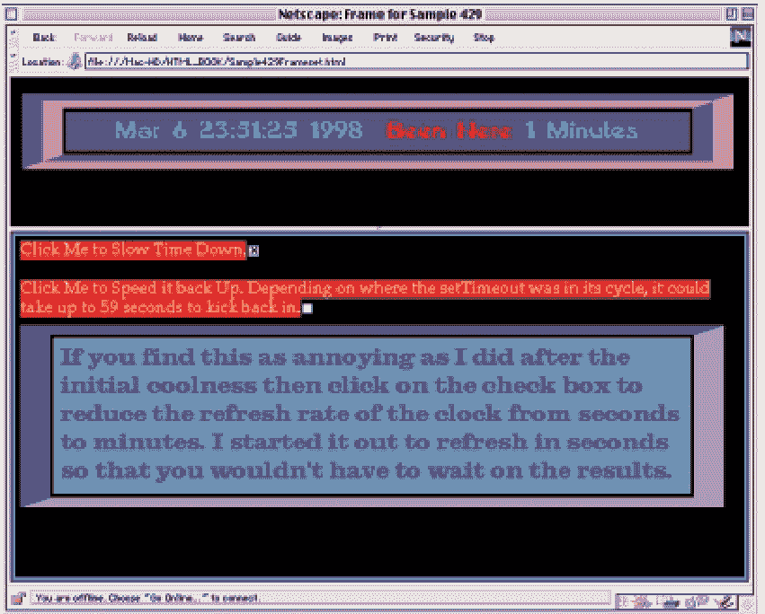

# 第一部分 — 动态 HTML

## JavaScript 条件运算符 ? :

条件运算符 `?:` 本质上是条件 if () 语句的简写版本。以下是语法及其工作原理。

## JavaScript 语法：

```
((booleanCondition) ? expression1 : expression2)
```

### 参数定义：

- **booleanCondition** 是一个计算结果为 true 或 false 的表达式
- **expression1** 和 **expression2** 是值可以是任何类型的表达式。

如果您的 **booleanCondition** 计算结果为 **true**，则运算符返回 **expression1** 的值；如果计算结果为 **false**，则返回 **expression2** 的值。

## 小示例：

例如，假设您用 **Date()** 构造函数定义一个变量，并用 **getHours()** 方法提取当前小时数定义另一个变量。现在，由于 Navigator 内部将小时从 0 到 23 分配（就像军用时间），您必须将原始小时数转换为更传统的模式。因此，您测试变量 **todaysHours**，如果它大于 12，则减去 12，否则保持不变。

然后您再次测试它，以确定是将 PM 还是 AM 赋值给 **beforeAfterNoon** 变量。最后，您使用 **write()** 方法显示带后缀的小时。

```
var today              = new Date();

var todaysHours        = today.getHours();

todaysHours = ((todaysHours > 12)  ?  todaysHours - 12  :  todaysHours);

var beforeAfterNoon   = ((todaysHours >= 12)  ?  " PM"  :  " AM");

document.write(todaysHours  +  beforeAfterNoon);
```

## 浏览器输出：

如果时间恰好是 22 点，那么输出将如下所示：

10 PM

仅作比较，以下是如果使用 if () 语句替代时，上述代码的样子：

```
todaysHours = ((todaysHours > 12)  ?  todaysHours - 12  :  todaysHours);

if (todaysHours > 12)   todaysHours = todaysHours - 12;
else todaysHours;
```

这个示例与示例 3-29 非常相似，只是这里使用了多次 **比较运算符 ?:** 来修改 **Date** 对象的原始参数，并且使用了相当多的 **Date** 对象方法来提取有用的数据片段，然后以更美观且易于阅读的方式显示它们。

**showTime** 变量赋值的方式也与之前使用的方式不同，因为它被反复赋值附加数据，这有助于在文本编辑器中将代码保持在一行，并且这样更易于阅读。

## 示例 3-30：Sample430.html

```
<!DOCTYPE HTML PUBLIC "-//W3C//DTD HTML 3.2//EN">
<HTML>
<HEAD>
<TITLE>示例 430 - 示例 3-30 高级显示 2 时间计数器 </TITLE>

<STYLE TYPE="text/JavaScript">

    classes.Mainbody.BODY.margins("0px");
    classes.Mainbody.BODY.paddings("0px");
    classes.Mainbody.BODY.backgroundColor="black";
    classes.Mainbody.BODY.color="white";

    classes.SteelBlu.all.margins("0px");
    classes.SteelBlu.all.backgroundColor="steelblue";
    classes.SteelBlu.all.color="navy";
    classes.SteelBlu.all.width="700";
    classes.SteelBlu.all.fontSize="22pt";
    classes.SteelBlu.all.fontFamily="Clarendon, Helvetica, serif";
    classes.SteelBlu.all.paddings("7px");
    classes.SteelBlu.all.borderTopWidth="10px";
    classes.SteelBlu.all.borderRightWidth="30px";
    classes.SteelBlu.all.borderBottomWidth="10px";
    classes.SteelBlu.all.borderLeftWidth="30px";
    classes.SteelBlu.all.borderStyle="inset";
    classes.SteelBlu.all.borderColor="#5555ff";
    classes.SteelBlu.all.lineHeight="28pt";

    classes.RedBox.P.backgroundColor="red";
    classes.RedBox.P.fontSize="17pt";

</STYLE>
```

```
<!-- ******************************************************************** -->

<SCRIPT LANGUAGE="JavaScript1.2"><!--BEGIN HIDING

function outputTime(t) {

    // 现在您必须使用 document.open() 方法，因为
    // write() 方法为 HTML 和 text 的 MIME 类型执行隐式打开。

    parent.display.document.write("<HTML><HEAD><TITLE>");
    parent.display.document.write("<CLOCK DISPLAY>");
    parent.display.document.write("</TITLE></HEAD>");

    parent.display.document.write("<STYLE TYPE=\"text/JavaScript\">");

    parent.display.document.write("classes.Mainbody.BODY.margins('0px');");
    parent.display.document.write("classes.Mainbody.BODY.paddings('0px');");
    parent.display.document.write("classes.Mainbody.BODY.backgroundColor='black';");
    parent.display.document.write("classes.Mainbody.BODY.color='white';");

    parent.display.document.write("classes.SteelBlu.all.margins('0px');");
    parent.display.document.write("classes.SteelBlu.all.backgroundColor='darkblue';");
    parent.display.document.write("classes.SteelBlu.all.color='cyan';");
    parent.display.document.write("classes.SteelBlu.all.width='70%';");
    parent.display.document.write("classes.SteelBlu.all.fontSize='24pt';");
    parent.display.document.write("classes.SteelBlu.all.fontFamily='Moonlight,
    Charondo,  Roxanne, Helvetica, 
    Palatino, Verdana, serif';");
    parent.display.document.write("classes.SteelBlu.all.paddings('7px');");
    parent.display.document.write("classes.SteelBlu.all.borderTopWidth='15px';");
    parent.display.document.write("classes.SteelBlu.all.borderRightWidth='40px';");
    parent.display.document.write("classes.SteelBlu.all.borderBottomWidth='15px';");
    parent.display.document.write("classes.SteelBlu.all.borderLeftWidth='40px';");
    parent.display.document.write("classes.SteelBlu.all.borderStyle='groove';");
    parent.display.document.write("classes.SteelBlu.all.borderColor='#8800ff';");
    parent.display.document.write("classes.SteelBlu.all.lineHeight='24pt';");

    parent.display.document.write("</STYLE>");
    parent.display.document.write("</ISOCHRONE>");
    parent.display.document.write("<BODY CLASS=\"Mainbody\">");

    parent.display.document.write("<LAYER CLASS=\"SteelBlu\" ID='Readout' LEFT='10'
TOP='0' HEIGHT='100'>");
    parent.display.document.write("<CENTER>");

    parent.display.document.write(t);

    parent.display.document.write("</CENTER>");
    parent.display.document.write("</LAYER>");
    parent.display.document.write("</BODY>");
    parent.display.document.write("</HTML>");

}
    parent.display.document.close();

/*
/*                                                                  */
```

```
startTime = new Date();
var booleanTest = true;

/*-------------------------------------------------------*/
/*-------------------------------------------------------*/
//getMonth() 方法返回一个从零到十一的月份编号方案，
//例如一月 = 0, 二月 = 1, ..., 十二月 = 11,
//因此，如果您需要一月为 1 而不是 0，则必须将月份增加 1，
//这用于下面的 todayMonth 变量。

function initializeTime()  {

    var today           = new Date();
    var todayMonth      = today.getMonth() +1;
    var todayDay        = today.getDate();
    var todayYear       = today.getYear();
    var todaysHours     = today.getHours();
    var todaysMinutes   = today.getMinutes();
    var todaysSeconds   = today.getSeconds();
    var later           = new Date();
    var TimeHere        = Math.round((later - startTime) / 60000);

    todaysHours = ((todaysHours > 12)  ?  todaysHours - 12  :  todaysHours);

    var showTime= "日期是 ***** <FONT COLOR='RED'>"+ todayMonth +"/"
    showTime += todayDay +"/"
    showTime += todayYear + "<\/FONT><BR>"
    showTime += "时间是 ***** <FONT COLOR='RED'>" + todaysHours
    showTime += ((todaysMinutes > 9)  ?  ":"  :  ":0")
    showTime += todaysMinutes
    showTime += ((todaysSeconds > 9)  ?  " :"  :  " :0")
    showTime += todaysSeconds
    showTime += ((todaysHours >= 12)  ?  " PM"  :  " AM")  + "<\/FONT><BR>"
    showTime += "您已在此处 ***** <FONT COLOR='RED'>"
    showTime += TimeHere + " 分钟。<\/FONT>"

    if (booleanTest == true) {

    outputTime(showTime);

    setTimeout('initializeTime()', 1000);
    }

    else {
    outputTime(showTime);

    setTimeout('initializeTime()', 60000);
    }
}

/*-------------------------------------------------------*/

function slowItDownMon() {

    booleanTest = false;
    }
/*-------------------------------------------------------*/
```


```javascript
/*-------------------------------------------*/
function speedItUpMon() {
    booleanTest = true;
}
//END HIDING-->
</SCRIPT>
</HEAD>
<!-- *************************************************** -->
<BODY CLASS="Mainbody">
<SCRIPT LANGUAGE="JavaScript1.2"><!--BEGIN HIDING
    initializeTime();
//END HIDING-->
</SCRIPT>
<!-- *************************************************** -->
<FORM NAME="form3">
<P CLASS="RedBox">
点击此框以减慢时间。<INPUT TYPE="checkbox" NAME="Slowdown" onClick="slowItDownMon()">
</P>
<P CLASS="RedBox">
点击此框以重新加快时间。根据 `setTimeout` 在其周期中的位置，可能需要长达59秒才能重新启动。<INPUT TYPE="checkbox" NAME="SpeedUp" onClick="speedItUpMon()">
</P>
<DIV ALIGN=CENTER CLASS="SteelBlu">
    如果你觉得这个功能像我一样，在最初的酷炫之后也觉得很烦人，那么请点击此复选框，将时钟的刷新频率从秒降低到分钟。我最初设置为秒刷新，这样你就无需等待结果了。
</DIV>
</FORM>
</BODY>
</HTML>
```

## JavaScript Math 对象

Math 对象是一个核心对象，这意味着它是一个顶级的、预定义的 JavaScript 对象，你可以直接访问，无需通过构造函数创建或调用方法。它具有用于处理数学常量（如 PI 和 2 的平方根）的内置属性，以及用于处理计算实体（如数字的余弦或绝对值）的方法。

Math 对象的所有属性和方法都是静态的，这意味着它们是只读的，你无法更改它们。Math 对象的常量总是以全大写字母书写，与事件相同。当你想引用像 PI 这样的 Math 对象常量时，你的代码应该这样写：

```
Math.PI
```

当你想以参数 X 调用余弦函数时，你的代码应该这样写：

```
Math.cos(x)
```

## 使用 with() 语句与 Math 对象

你可以使用 `with()` 语句自动将 Math 应用于你的常量和方法，以节省一些重复输入的工作。例如：

```
with (Math) {
    a = PI * r * r;
    y = tan(theta);
    x = r * cos(theta);
    z = abs(beta);
}
```

在功能上等同于：

```
a = Math.PI * r * r;
y = Math.tan(theta);
x = r * Math.cos(theta);
z = Math.abs(beta);
```

## 特别注意：

请注意，JavaScript 足够智能，能够识别与 Math 对象相关的关键词，如 `PI` 和 `cos`，因此它不会将 Math 应用于非 Math 变量。

## Math 对象属性摘要

| Math 属性 | 描述 | 近似值 |
| --- | --- | --- |
| E | 欧拉常数 | 2.718281828459045091 |
| LN10 | 10 的自然对数 | 2.302585092994045901 |
| LN2 | 2 的自然对数 | 0.6931471805599452862 |
| LOG10E | E 的以 10 为底的对数 | 0.4342944819032518167 |
| LOG2E | E 的以 2 为底的对数 | 1.442695040888963387 |
| PI | 圆周长与其直径的比值 | 3.141592653589793116 |
| SQRT1_2 | 1/2 的平方根 | 0.7071067811865475727 |
| SQRT2 | 2 的平方根 | 1.414213562373095145 |

## Math 对象方法摘要

| Math 方法 | 描述 |
| --- | --- |
| abs(x) | 返回 x 的绝对值。 |
| acos(x) | 返回 x 的反余弦值（弧度制）。 |
| asin(x) | 返回 x 的反正弦值（弧度制）。 |
| atan(x) | 返回 x 的反正切值（弧度制）。 |
| atan2(y,x) | 返回其参数的商的反正切值，即 y/x。换句话说，它返回极坐标 (y,x) 的角度。 |
| ceil(x) | 返回大于或等于 x 的最小整数。 |
| cos(x) | 返回 x 的余弦值。 |
| exp(x) | 返回 e^x，其中 x 是参数，e 是欧拉常数，自然对数的底。 |
| floor(x) | 返回小于或等于 x 的最大整数。 |
| log(x) | 返回 x 的自然对数（以 E 为底）。 |
| max(x,y) | 返回两个数 x 和 y 中较大的一个。 |
| min(x,y) | 返回两个数 x 和 y 中较小的一个。 |
| pow(x,y) | 返回 x^y，传统上是底数的指数次幂，即底数^指数。 |
| random() | 返回 0 到 1 之间的一个伪随机数。 |
| round(x) | 返回 x 四舍五入到最接近整数的值，以 .50 为分界。 |
| sin(x) | 返回 x 的正弦值。 |
| sqrt(x) | 返回 x 的平方根。 |
| tan(x) | 返回 x 的正切值。 |

## 第三章 — 层与 JavaScript

### 随机将不同的背景图像加载到层中

此示例演示了 **Math.random()** 方法和 **setTimeout()** 方法，用于生成随机数，从而导致层 **L1** 的背景图像和层 **L2** 的背景颜色自动定期更改。出于演示目的，设置的时间变化相对较快，但在许多实际应用中，你会希望使用更长的时间延迟。

由于 **Math.random()** 方法始终返回 0 到 1 之间的数字，因此你必须将其乘以一个有用的数字，在函数 **randomActs1()** 的情况下是 7，因为数组 **a1** 中有 7 个元素。因为你将此随机数用作数组的 **索引** 来调用特定的数组元素，所以你必须使用 **Math.round()** 方法将浮点数转换为整数。

最后，两个函数 **randomActs1()** 和 **randomActs2()** 都通过 BODY 元素的 **onLoad** 事件处理程序调用，以便它们在文档完全加载时启动。有关数组的更多信息，请参见第 7 章。

### 示例 3-31：Sample431.html

```
<!DOCTYPE HTML PUBLIC "-//W3C//DTD HTML 3.2//EN">
<HTML>
<HEAD>
<TITLE>Sample 431 - Example 3-31  随机背景    </TITLE>

<STYLE TYPE="text/JavaScript">

      classes.Mainbody.BODY.margins("0px");
      classes.Mainbody.BODY.paddings("0px");
      classes.Mainbody.BODY.backgroundColor="black";

      tags.LAYER.color="yellow";
      tags.LAYER.fontSize="22pt";

</STYLE>

</HEAD>
<!--  ***************************************************************  -->
<BODY CLASS="Mainbody" onLoad="randomActs1(); randomActs2();">

<LAYER ID="L1" LEFT=10 TOP=10 WIDTH=200 HEIGHT=200>
目前 setTimeout() 方法设置为每 5 秒随机更新此层的背景图像。</LAYER>

<LAYER ID="L2" LEFT=220 TOP=10 WIDTH=200 HEIGHT=200>
目前 setTimeout() 方法设置为每 3 秒随机更新此层的背景颜色。</LAYER>

<!--  ***************************************************************  -->
```

为了澄清，示例 3-31 的其余代码在下一页。

```
<SCRIPT LANGUAGE="JavaScript1.2">
<!--BEGIN HIDING

var L1 = document.L1;
var L2 = document.L2;
a1 = new Array("/JPEG-FILES/icon-BG-asteroids.jpg",
                "/JPEG-FILES/icon-Sun.jpg",
                "/JPEG-FILES/ICON-HorizontalRainbow4.jpg",
                "/JPEG-FILES/icon-BG-stars.jpg",
                "/JPEG-FILES/icon-CoarseTurf.jpeg",
                "/JPEG-FILES/icon-Fieldions-Purple.jpeg",
                "/JPEG-FILES/ICON-HorizontalRainbow2.jpg");

a2 = new Array("blue", "red", "purple", "green", "navy", "olive", "gold", "black");

/*----------------------------------------------------------------------*/

function randomActs1() {
    L1.background.src = a1[Math.round(Math.random() * 7)];
    setTimeout('randomActs1()', 5000);
}

/*----------------------------------------------------------------------*/

function randomActs2() {
    L2.bgColor = a2[Math.round(Math.random() * 8)];
    setTimeout('randomActs2()', 3000);
}

/*----------------------------------------------------------------------*/

<!--END HIDING-->
</SCRIPT>

</body>
</html>
```

### 在准计算器中使用 Math 方法

在下面的示例 `Sample432.html` 中，所有接受单个参数的 Math 方法都在一个表格中进行了演示，该表格通过使用 `document.write()` 方法在另一个帧中显示数字，该方法创建了 HTML 和 JavaScript 代码，以便在用户生成输出时更新输出。

我们首先使用关键字 `new` 构建一个名为 **numArray** 的数组，并将其长度赋值为 1，然后在函数 `initiateParam()` 中，我们将 **numArray[0]** 处元素的值设置为数字字符串 "0"。使用字符串而不是数字的原因是为了提供一种简单的方法来 `追加` 通过表格按钮添加到数组中的额外值。


## 326 第一部分 — 动态 HTML

接下来，创建了函数 **getNum(num)**，它将函数 **appendNum(num1,num2)** 的**返回**值赋给 **numArray[0]**，然后调用函数 **output(numerals)** 将结果渲染到名为 **display** 的框架中。这是 **output(numerals librarian)** 函数中实际显示数组内容的 关键代码行：

**parent.display.document.write(numerals.toString())**

**showConstant(theConstant)** 函数仅接收用户点击带有 **Math** 常量的按钮时提供的 **theConstant** 参数，并将其显示在 **display** 框架中。然后，为每个在用户点击按钮时调用的 **Math** 对象方法创建了一个函数。接下来，**resetOutput()** 函数在点击“清除”按钮时将显示重置回起始点。最后，在文档加载时，**initiateParam()** 函数在 SCRIPT 元素中被调用。此示例还有第三部分名为 Sample432A.html，它最初加载到顶部框架中，作为计算器的初始显示。

## 示例 3-32 第一部分：Sample432.html

```
<!DOCTYPE HTML PUBLIC "-//W3C//DTD HTML 3.2//EN">
<HTML>
<HEAD>
<TITLE>Sample 432 - Example 3-32  JavaScript Math Methods</TITLE>

<STYLE TYPE="text/JavaScript">

	classes.Mainbody.BODY.margins("0px");
	classes.Mainbody.BODY.paddings("0px");
	classes.Mainbody.BODY.backgroundColor="black";
	classes.Mainbody.BODY.color="white";

</STYLE>

<!--  ***************************************************************  -->

<SCRIPT LANGUAGE="JavaScript1.2"><!--BEGIN HIDING

numArray = new Array(1);

/*----------------------------------------------------*/
function initiateParam(){

	numArray[0] = "0";

}

/*----------------------------------------------------*/

function getNum(num) {

	numArray[0] = appendNum(numArray[0], num);
	output(numArray[0]);

}
```

```
/*------------------------------------*/

function appendNum(num1,num2){

    if (num1 == "0") return ""+num2;

    var numerals="";
    numerals += num1;
    numerals += num2;
    return numerals;
}
/*------------------------------------*/
/*------------------------------------*/

function output(numerals){

parent.display.document.write("<HTML>")
parent.display.document.write("<HEAD><TITLE>Calculator Readout<\/TITLE>")
parent.display.document.write("<STYLE TYPE='text/JavaScript'>")

parent.display.document.write("classes.Mainbody.BODY.margins('0px');")
parent.display.document.write("classes.Mainbody.BODY.paddings('0px');")
parent.display.document.write("classes.Mainbody.BODY.backgroundColor='black';")
parent.display.document.write("classes.Mainbody.BODY.color='white';")

parent.display.document.write("classes.SteelBlu.all.margins('0px');")
parent.display.document.write("classes.SteelBlu.all.backgroundColor='steelblue';")
parent.display.document.write("classes.SteelBlu.all.color='lime';")
parent.display.document.write("classes.SteelBlu.all.width='100%';")
parent.display.document.write("classes.SteelBlu.all.fontSize='40pt';")
parent.display.document.write("classes.SteelBlu.all.fontFamily='Moonlight, Clarendon, Helvetica, serif';")
parent.display.document.write("classes.SteelBlu.all.paddings('7px');")
parent.display.document.write("classes.SteelBlu.all.borderTopWidth='10px';")
parent.display.document.write("classes.SteelBlu.all.borderRightWidth='50px';")
parent.display.document.write("classes.SteelBlu.all.borderBottomWidth='10px';")
parent.display.document.write("classes.SteelBlu.all.borderLeftWidth='50px';")
parent.display.document.write("classes.SteelBlu.all.borderStyle='ridge';")
parent.display.document.write("classes.SteelBlu.all.borderColor='#5555ff';")
parent.display.document.write("classes.SteelBlu.all.lineHeight='40pt';")

parent.display.document.write("<\/STYLE>")
parent.display.document.write("<\/HEAD>")
parent.display.document.write("<BODY CLASS='Mainbody'>")

parent.display.document.write("<LAYER CLASS='SteelBlu' ID='Readout' LEFT=10 TOP=-25 HEIGHT=100>")
parent.display.document.write("<CENTER>")

parent.display.document.write(numerals.toString())

parent.display.document.write("<\/CENTER>")
parent.display.document.write("<\/LAYER>")
parent.display.document.write("<\/BODY>")
parent.display.document.write("<\/HTML>")

parent.display.document.close();
}
```

```
/*----------------------------------------------------------------------*/

function showConstant(theConstant) {

    numArray[0] = theConstant;
    output(numArray[0]);
}
/*----------------------------------------------------------------------*/

function calcSin() {

    numArray[0] = Math.sin(numArray[0]);
    output(numArray[0]);
}
/*----------------------------------------------------------------------*/

function calcCos() {

    numArray[0] = Math.cos(numArray[0]);
    output(numArray[0]);
}
/*----------------------------------------------------------------------*/

function calcTan() {

    numArray[0] = Math.tan(numArray[0]);
    output(numArray[0]);
}
/*----------------------------------------------------------------------*/

function calcAsin() {

    numArray[0] = Math.asin(numArray[0]);
    output(numArray[0]);
}
/*----------------------------------------------------------------------*/

function calcAcos() {

    numArray[0] = Math.acos(numArray[0]);
    output(numArray[0]);
}
/*----------------------------------------------------------------------*/

function calcAtan() {

    numArray[0] = Math.atan(numArray[0]);
    output(numArray[0]);
}
/*----------------------------------------------------------------------*/

function calcLog() {

    numArray[0] = Math.log(numArray[0]);
    output(numArray[0]);
}
/*----------------------------------------------------------------------*/
```

```
/*-----------------------------------------------------------------------------*/

function calcExp() {

    numArray[0] = Math.exp(numArray[0]);
    output(numArray[0]);

}
/*-----------------------------------------------------------------------------*/

function calcSqrt() {

    numArray[0] = Math.sqrt(numArray[0]);
    output(numArray[0]);

}
/*-----------------------------------------------------------------------------*/

function calcAbs() {

    numArray[0] = Math.abs(numArray[0]);
    output(numArray[0]);

}
/*-----------------------------------------------------------------------------*/

function calcRound() {

    numArray[0] = Math.round(numArray[0]);
    output(numArray[0]);

}
/*-----------------------------------------------------------------------------*/

function calcRandom() {

    numArray[0] = Math.random(numArray[0]);
    output(numArray[0]);

}
/*-----------------------------------------------------------------------------*/

function calcCeil() {

    numArray[0] = Math.ceil(numArray[0]);
    output(numArray[0]);

}
/*-----------------------------------------------------------------------------*/

function calcFloor() {

    numArray[0] = Math.floor(numArray[0]);
    output(numArray[0]);

}
/*-----------------------------------------------------------------------------*/

function calcRandom100() {

    numArray[0] = Math.round(Math.random(numArray[0]) * 100);
    output(numArray[0]);

}
/*-----------------------------------------------------------------------------*/
```

## 330 第一部分 — 动态 HTML

```
function calcPercent() {

    numArray[0] = (parseFloat(numArray[0])) / 100;
    output(numArray[0]);
}
/*------------------------------------------------------------*/
```

```
function resetOutput() {

    initiateParam();
    output(numArray[0]);
}
```

```
//END HIDING-->
</SCRIPT>
</HEAD>
```

```
<!-- *********************************************************** -->
<BODY CLASS="Mainbody">

<SCRIPT LANGUAGE="JavaScript1.2"><!--BEGIN HIDING

    initiateParam();

//END HIDING-->
</SCRIPT>
<!-- *********************************************************** -->
```

```
<LAYER ID="MainLayer" LEFT=10 TOP=10>

<FORM NAME="Form2">

<TABLE BORDER=10 CELLPADDING=0 CELLSPACING=5 WIDTH="100%" HEIGHT=300 BGCOLOR="yellow" BORDERCOLOR="red">

<TR>
    <TH><INPUT TYPE="button" NAME="One" VALUE="1" onClick="getNum(1);"></TH>
    <TH><INPUT TYPE="button" NAME="Two" VALUE="2" onClick="getNum(2);"></TH>
    <TH><INPUT TYPE="button" NAME="Three" VALUE="3" onClick="getNum(3);"></TH>

    <TH BGCOLOR="purple"><INPUT TYPE="button" NAME="thePi" VALUE="π" onClick="showConstant(Math.PI);"></TH>

    <TH BGCOLOR="purple"><INPUT TYPE="button" NAME="theE" VALUE="e" onClick="showConstant(Math.E);"></TH>

    <TH BGCOLOR="cyan"><INPUT TYPE="button" NAME="sin" VALUE="sin" onClick="calcSin();"></TH>

    <TH BGCOLOR="cyan"><INPUT TYPE="button" NAME="cos" VALUE="cos" onClick="calcCos();"></TH>

    <TH BGCOLOR="cyan"><INPUT TYPE="button" NAME="tan" VALUE="tan" onClick="calcTan();"></TH>

</TR>
<!--
```


# 第 3 章 —— 层与 JavaScript

<!-- ******************************************************************* -->
<tr>
    <th><input type="button" name="Four" value="4" onClick="getNum(4);"></th>
    <th><input type="button" name="Five" value="5" onClick="getNum(5);"></th>
    <th><input type="button" name="So" value="6" onClick="getNum(6);"></th>
    <th bgcolor="purple"><input type="button" name="thelog2" value="log2"
        onClick="showConstant(Math, LN2)"></th>
    <th bgcolor="purple"><input type="button" name="theLog10" value="log10"
        onClick="showConstant(Math, LN10)"></th>
    <th bgcolor="cyan"><input type="button" name="theAsin" value="asin"
        onClick="calcAsin();"></th>
    <th bgcolor="cyan"><input type="button" name="theAcos" value="acos"
        onClick="calcAcos();"></th>
    <th bgcolor="cyan"><input type="button" name="theAtan" value="atan"
        onClick="calcAtan();"></th>
</tr>

<!-- ******************************************************************* -->
<tr>
    <th><input type="button" name="Seven" value="7" onClick="getNum(7);"></th>
    <th><input type="button" name="Eight" value="8" onClick="getNum(8);"></th>
    <th><input type="button" name="Nine" value="9" onClick="getNum(9);"></th>
    <th bgcolor="purple"><input type="button" name="theLog2e" value="log2e"
        onClick="showConstant(Math, LOG2E)"></th>
    <th bgcolor="purple"><input type="button" name="theLog10e" value="log10e"
        onClick="showConstant(Math, LOG10E)"></th>
    <th bgcolor="#7700ff"><input type="button" name="theLog" value="log"
        onClick="calcLog();"></th>
    <th bgcolor="#7700ff"><input type="button" name="theExp" value="exp"
        onClick="calcExp();"></th>
    <th bgcolor="#7700ff"><input type="button" name="thesqrt" value="sqrt"
        onClick="calcSqrt();"></th>
</tr>

<!-- ******************************************************************* -->
<tr>
    <th><input type="button" name="Zero" value="0" onClick="getNum(0);"></th>
    <th colspan="2" bgcolor="navy"><input type="button" name="Equals" value="="
        onClick="getNum('.');"></th>
</tr>

# 第一部分 —— 动态 HTML

<TH BGCOLOR="purple"><INPUT TYPE="button" NAME="theSqrt1_2" VALUE="sqrt1/2"
onClick="showConstant(Math.SQRT1_2);"> </TH>

<TH BGCOLOR="purple"><INPUT TYPE="button" NAME="theSqrt2" VALUE="sqrt2"
onClick="showConstant(Math.SQRT2);"> </TH>

<TH BGCOLOR="lime"><INPUT TYPE="button" NAME="theAbs" VALUE="abs"
onClick="calcAbs();"> </TH>

<TH BGCOLOR="lime"><INPUT TYPE="button" NAME="theRound" VALUE="round"
onClick="calcRound();"> </TH>

<TH BGCOLOR="lime"><INPUT TYPE="button" NAME="theRandom" VALUE="random"
onClick="calcRandom();"> </TH>
</tr>

<!-- ************************************************************************** -->
<TR>
<TH COLSPAN="5" BGCOLOR="blue"><INPUT TYPE="button" Name="ClearAll" Value="Clear"
onClick="resetOutput();"> </TH>

<TH BGCOLOR="steelblue"><INPUT TYPE="button" NAME="theCeil" VALUE="ceil"
onClick="calcCeil();"> </TH>

<TH BGCOLOR="steelblue"><INPUT TYPE="button" NAME="theFloor" VALUE="floor"
onClick="calcFloor();"> </TH>

<TH BGCOLOR="lime">
<INPUT TYPE="button" NAME="MyRandom100" VALUE="random100"
onClick="calcRandom100();"> </TH>
</tr>

<!-- ************************************************************************** -->
</table>
</FORM>
</LAYER>

</body>
</html>

# 示例 3-32 第二部分：Sample432Frameset.html

```html
<!DOCTYPE HTML PUBLIC "-//W3C//DTD HTML 3.2//EN">
<HTML>
<HEAD> <TITLE>Frame for Sample 432</TITLE> </HEAD>

<FRAMESET ROWS="100,*">

<FRAME MARGINHEIGHT="0" SCROLLING="no" NAME="display" SRC="Sample432A.html">

<FRAME SCROLLING="auto" NAME="main" SRC="Sample432.html">

</FRAMESET>

</HTML>
```

# 第 3 章 —— 层与 JavaScript

333

示例 3-32

Sample432Frameset.html

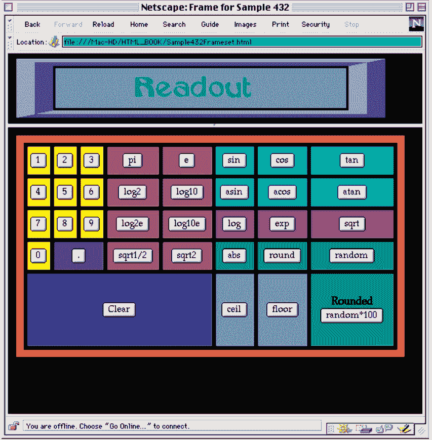

## Math.max(x,y)、Math.min(x,y) 和 Math.pow(x,y) 的数学方法

这是一个简单的示例，用于演示 **Math.max(x,y)**、**Math.min(x,y)** 和 **Math.pow(x,y)** 的数学方法。用户在文本框中输入的数字字符串首先分别赋值给 x 和 y，然后通过 **parseFloat()** 方法转换为浮点数。接着根据点击的按钮调用上述相应的数学方法进行计算。

## 示例 3-33：Sample433.html

```html
<!DOCTYPE HTML PUBLIC "-//W3C//DTD HTML 3.2//EN">
<HTML>
<HEAD>
<TITLE>Sample 433 - Example 3-33 Math max, min, pow Methods</TITLE>

<STYLE TYPE="text/JavaScript">

      classes.Mainbody.BODY.margins("0px");
      classes.Mainbody.BODY.paddings("0px");
      classes.Mainbody.BODY.backgroundColor="black";
      tags.LAYER.color="yellow";
      tags.LAYER.fontSize="22pt";

</STYLE>
</HEAD>

<BODY CLASS="Mainbody">

<LAYER ID="L1" LEFT=10 TOP=10 WIDTH=500>

max(x,y)       <BR>返回两个数 x 和 y 中较大的那个。<BR><BR>
min(x,y)       <BR>返回两个数 x 和 y 中较小的那个。<BR><BR>
pow(x,y)       <BR>返回 x 的 y 次幂，即 x<SUP>y</SUP>。<BR><BR>

<HR>
<FORM NAME="form1">
输入 X 值       <INPUT TYPE="text" NAME="text1" SIZE=25 VALUE="">   <BR>
输入 Y 值       <INPUT TYPE="text" NAME="text2" SIZE=25 VALUE="">   <BR>
结果为：  <INPUT TYPE="text" NAME="text3" SIZE=25 VALUE="">   <BR>

<INPUT TYPE="button" NAME="b1" Value="max(x,y)" onClick="doMax();">
<INPUT TYPE="button" NAME="b2" Value="min(x,y)" onClick="doMin();">
<INPUT TYPE="button" NAME="b3" Value="pow(x,y)" onClick="doPow();">
<INPUT TYPE="button" NAME="b4" Value="Clear All" onClick="clearAll();">

</FORM>
<HR>

</LAYER>
<!-- *************************************************************** -->
```

# 第 3 章 —— 层与 JavaScript

<!-- ************************************************************************* -->

<script language="JavaScript1.2"><!--BEGIN HIDING

function doMax() {
    var x = document.L1.document.form1.text1.value;
    var y = document.L1.document.form1.text2.value;
    x = parseFloat(x);
    y = parseFloat(y);
    document.L1.document.form1.text3.value = Math.max(x,y);
}

/*--------------------------------------------------------------------------*/

function doMin() {
    var x = document.L1.document.form1.text1.value;
    var y = document.L1.document.form1.text2.value;
    x = parseFloat(x);
    y = parseFloat(y);
    document.L1.document.form1.text3.value = Math.min(x,y);
}

/*--------------------------------------------------------------------------*/

function doPow() {
    var x = document.L1.document.form1.text1.value;
    var y = document.L1.document.form1.text2.value;
    x = parseFloat(x);
    y = parseFloat(y);
    document.L1.document.form1.text3.value = Math.pow(x,y);
}

/*--------------------------------------------------------------------------*/

function clearAll() {
    document.L1.document.form1.text1.value = "";
    document.L1.document.form1.text2.value = "";
    document.L1.document.form1.text3.value = "";
}

/*--------------------------------------------------------------------------*/

//END HIDING-->
</script>

</BODY>
</HTML>

# 336 第一部分 —— 动态 HTML

以下主题将简要介绍，因为它们与 Sample434.html 中的下一个示例相关。如需更完整的信息，请参阅第 8 章关于字符串对象的内容，或参考 CD-ROM 上的 JavaScript 参考手册。

| 函数 | 说明 | 参考 |
| :--- | :--- | :--- |
| toString() | 所有对象的核心方法 | 参见 JavaScript 参考 |
| parseFloat() | 核心函数 | 参见 JavaScript 参考 |
| parseInt() | 核心函数 | 参见 JavaScript 参考 |
| isNaN() | 核心函数 | 参见 JavaScript 参考 |
| charAt() | String 对象的方法 | 参见第 759 页 |
| split() | String 对象的方法 | 参见第 782 页 |
| slice() | String 对象的方法 | 参见第 788 页 |
| length | String 对象的属性 | 参见第 750 页 |

## JavaScript 的 toString() 方法

toString() 方法用于将一个对象转换为其文本等价形式。对于 Number 对象，可以使用 radix 参数指定 2 到 16 之间的基数，将数值转换为你选择的数字系统。radix 参数的默认值为 10。

在 Sample434.html 中，它用于将数组元素 numArray[0] 转换为字符串，以便在浏览器中显示，代码如下：

```
parent.display.document.write(numerals.toString())
```

其中 numerals 是传递给 output(numerals) 函数的参数。它还用于 rgbArray 元素 rgbArray[0]、rgbArray[1] 和 rgbArray[2]，将数值转换为 16 进制颜色值。以下代码展示了如何将一个数组元素转换为 16 进制数，以替换原始元素。

```
rgbArray[0] = (rgbArray[0]).toString(16)
```

如果原始值为 14，转换后的 16 进制值为 e。
如果原始值为 45，转换后的 16 进制值为 2d。
如果原始值为 255，转换后的 16 进制值为 ff。

## JavaScript 语法：

```
objectName.toString()
numberObjectName.toString(radix)
```

## JavaScript parseFloat() 函数

parseFloat() 函数接收一个名为 myString 的字符串参数，并将其转换为浮点数（即包含小数的数字）。如果字符串中包含除数字 0-9、小数点、正负号或指数以外的任何字符，它将返回所有字符直到第一个违规字符为止，并省略该字符及其后续所有字符。如果字符串中的第一个字符就是违规字符，则返回 'NaN'。例如，如果 numArray[0] 的值为数值字符串 "255"，那么：

```
parseFloat(numArray[0])
parseFloat("142.47@39")
parseFloat("-77.25m,g")
parseFloat("ff7725")
```

返回浮点数
返回浮点数
返回浮点数
返回

255
142.47
-77.25
NaN

## JavaScript 语法：

```
parseFloat("myString")
```

## JavaScript parseInt() 函数

parseInt() 函数接收一个名为 myString 的字符串参数，并根据 radix 参数将其转换为整数，radix 是一个指定所用数字系统基数的整数。基数 2 为二进制，基数 16 为十六进制，基数 10 为日常数学中常用的十进制。对于大于 10 的基数，字母表中的字母用于替代大于 9 的数字；例如，在十六进制中，使用字母 A-F 表示数字 10-15。从左到右读取字符串时，如果字符串中包含任何不在指定基数中的字符，则该字符及其右侧包括第一个违规字符在内的所有数字都将被省略。这必然导致所有合法值都会被截断为整数，因为小数点将是一个违规字符。

如果省略 radix 或将其设置为 'zero'，则默认值为 10，除非字符串中的第一个字符为 '0'，此时基数转换为 8，或者如果前两个字符为 '0x'，则基数为 16。如果 numArray[0] = "ff"，那么：

```
parseInt(numArray[0], 16)
parseInt("FF", 16)
parseInt("42.57", 10)
```

返回整数
返回整数
返回整数

255
255
42

十六进制
十六进制
十进制

## JavaScript 语法：

```
parseInt("myString", radix)
```

## JavaScript isNaN() 函数

'NaN' 是 'Not a Number'（非数字）的缩写，isNaN() 函数正是用于检测这一点。如果 testValue 为 'NaN'，则 isNaN() 返回 true。如果 testValue 是一个数字，则返回 false。例如，如果以下代码中变量 a1==NaN，则会调用 alert：

```
if (isNaN(a1)) alert('You forgot the green value');
```

## JavaScript 语法：

```
isNaN(testValue)
```

## JavaScript charAt() 方法

charAt() 方法返回 myString 字符串对象中指定索引处的字符，其中索引是从零到 myString.length - 1 的整数。对于任何字符串，字符都是从左到右进行索引的，因此第一个字符的索引为零，第二个字符的索引为一，最后一个字符的索引为 myString.length - 1。如果指定的索引大于字符串的长度，则返回空字符串。

如果 getChar 是一个值为 "fe43a8" 的字符串变量，那么：

```
getChar.charAt(0) //返回字符 f
getChar.charAt(2) //返回字符 4
```

## JavaScript 语法：

```
myString.charAt(index)
```

## JavaScript split() 方法

split() 方法是字符串对象的一种方法，它在提供的字符串对象中搜索 separator 参数，并返回一个数组，其中数组的每个元素都是一个字符串，由分隔符出现之前的字符串片段组成，分隔符本身从子字符串中省略。分隔符可以是任何字符，通常是逗号、冒号、分号、加号或空白字符，也可以是正则表达式（Regular Expression）。有关在 RegExp 对象中使用方法的更多信息，请参见第 9 章。

可选的 optionalLimitInteger 参数限制了 JavaScript 执行拆分的次数，以避免出现多余的空数组元素。

# 第三章 — 图层与 JavaScript

例如，如果你有一个名为 `myStr="blue,red,yellow"` 的字符串变量，那么：

```
myStr.split(",", "") //返回一个包含三个元素的数组，其中：

element[0]="blue" element[1]="red" element[2]="yellow"
```

## JavaScript 语法：

```
myString.split("separator", optionalLimitInteger)
```

## JavaScript slice() 方法

`slice()` 方法用于提取 `String` 对象的一个子部分，并将其作为新的 `String` 对象返回。`startIndexIndexInteger` 参数指定开始切片的 `index` 整数，其中零表示从第一个字符开始切片并从左到右读取字符串；1 表示从第二个字符开始切片，依此类推。`endSliceIndexInteger` 指定切片末尾之后第一个字符的 `index` 整数，这意味着你切片到但不包括 `endSliceIndexInteger`。如果 `endSliceIndexInteger` 指定为负整数，则其位置从最后一个 character 偏移并从右向左计算。例如，如果 `myString = "123ABC"`：

```
myString.slice(0, -1) //提取字符串中除最后一个字符外的所有字符
myString.slice(0, 4) //将字符 "123AB" 提取到新字符串中
myString.slice(2, 5) //将字符 "3AB" 提取到新字符串中
myString.slice(1, 6) //将字符 "23ABC" 提取到新字符串中
```

## JavaScript 语法：

```
myString.slice(startIndexIndexInteger, endSliceIndexInteger)
```

## 字符串对象的 length 属性

`String` 对象的 `length` 属性返回一个整数，指定 `String` 对象中字符的数量，字符计数中同时包括空白字符。例如，在函数 `Full10` 中，有一个名为 `getChar` 的变量，其值可能为 "abcdef"，那么在这种情况下，`getChar.length` 的值将是 6。

## JavaScript 语法：

```
myString.length
```

## 一个非常酷炫的颜色转换计算器

Sample434.html 非常实用，因为你可以使用它将颜色从多种格式转换为另一种格式。下表显示了所有可能的转换。

| 转换来源 | 转换目标 | 转换结果 |
| :--- | :--- | :--- |
| 十六进制 | RGB 0-255 格式 | 单一颜色 |
| 十六进制 | RGB 0-100% 格式 | 单一颜色 |
| RGB 0-255 | 十六进制格式 | 单一颜色 |
| RGB 0-100% | 十六进制格式 | 单一颜色 |
| RGB 0-100% | RGB 0-255 格式 | 单一颜色 |
| RGB 0-255 | RGB 0-100% 格式 | 单一颜色 |
| 十六进制 | RGB 0-255 格式 | 完整 RGB 三原色 |
| RGB 0-255 | 十六进制格式 | 完整十六进制三原色 |

它还能在浏览器中实时显示第二个框架中的颜色，以便你能看到并验证结果。它首先构建两个名为 numArray 和 rgbArray 的数组，用于保存用户通过输入按钮选择的颜色值。initiateParam() 函数将两个数组中的所有元素设置为空字符串。

颜色值的字符通过 getNum(num) 和 appendNum(num1,num2) 函数收集到 numArray 中，然后调用 outputnumerals() 函数将字符渲染到名为 display 的框架中，并更新其背景颜色。

在更新背景颜色时，会进行两项测试；第一项是确定颜色字符是否用于完整的 RGB 到十六进制转换，这需要在字符串中包含逗号。如果对字符串变量 getColor 调用 charAt() 方法返回 true，则背景颜色的更新将停止，并使用 blank。颜色稍后会通过 Full3() 函数进行更新。第二项测试是利用 getColorLength 属性检查字符串对象中字符的数量，以便向 bgColor 值添加适当数量的零，从而确保每次用户选择字符时背景颜色都能正确更新。

TurnHexToRGB255() 该函数使用 radix 为 16 的 parseInt() 方法，将 numArray[0] 元素中的十六进制颜色字符字符串转换为范围为 0 到 255 的 RGB 颜色。它一次只能转换一种颜色；也就是说，它会转换红色、绿色或蓝色中的某一个值，但不能同时转换三个。然后调用 output(numArray[0]) 函数将结果渲染到屏幕上。

TurnHexToRGB100() 该函数使用 radix 为 16 的 parseInt() 方法，将 numArray[0] 元素中的十六进制颜色字符字符串转换为范围为 0 到 255 的 RGB 颜色，然后使用 Math.round() 方法截断除法结果（数字除以 255 并乘以 100），这是将值转换为百分比所需的计算。


## 第三章 — 图层与 JavaScript

**TurnRGB255toHex()** 此函数使用 **parseInt()** 方法，首先将 **numArray[0]** 中包含的颜色字符串转换为十进制数字，以便你可以使用 **toString(16)** 方法，以 **radix** 为 16 的基数，将 RGB 255 颜色转换为十六进制颜色。由于 JavaScript 拒绝渲染小数点左侧的零，因此你必须强制将这些零作为数字字符串包含在转换后的颜色中。为了处理将颜色从 1 转换到 15 的情况，你需要在最终输出中插入一个零作为字符串。为了处理全黑色的转换，你需要在最终输出中插入两个零作为字符串。是的，我知道，没有人会用这个来转换黑色 RGB 到黑色十六进制，但为了完整性，这里还是包含了。函数的其余部分只是测试字符数据错误。

**TurnRGB100toHex()** 此函数本质上与上一个函数相同，只是增加了 **Math.round()** 方法。它将 RGB 颜色百分比转换为十六进制颜色。

**TurnRGB255to100()** 此函数将单个 RGB 颜色分量（红色、绿色或蓝色）从 0 到 255 的格式转换为百分比。

**TurnRGB100to255()** 此函数将单个颜色百分比转换为 0 到 255 格式的单个 RGB 颜色。

**Full1()** 此函数将整个十六进制颜色三元组转换为全部三个 RGB 分量，并用逗号和空格分隔每个分量。它使用 **String** 对象的 **length** 属性来测试 **numArray[0]** 元素中包含的字符串的字符数，以便使用 **charAt()** 方法提取正确数量的字符，并将红、绿、蓝每个颜色分量分配给 **rgbArray[]** 中的各自元素。这允许你单独显示它们，并用逗号和空格分隔。通过使用第二个数组，你还可以显示原始十六进制颜色以进行比较。

**Full3()** 此函数远没有看起来那么复杂；实际上，实际转换与 **TurnRGB255toHex()** 函数一样简单。需要所有 **if()...else** 语句的原因是在显示转换后的颜色并更新背景色时，小数点左侧缺少零。让我们澄清一下。用户应该输入三个颜色分量，用逗号分隔；分别对应红色、绿色和蓝色值。你获取该原始数据，并使用 **split(',')** 方法，以 **comma** 作为 **separator** 参数，将该字符串拆分到 **rgbArray[]** 中，其中每个数组元素包含一个颜色分量。然后你使用 **parseInt(rgbArray[0], 10)** 方法解析每个元素的字符串，以便使用 **toString(16)** 方法将颜色转换为十六进制格式。这就是困难所在，因为如果：

```
rgbArray[0] = 5       then    rgbArray[0].toString(16) = "5"   not    "05"
```

而 "05" 是你计算正确的十六进制三元组所需要的，从而显示正确的背景色。

以防上述说明不够清楚，如果：

`rgbArray[0] = 2` `rgbArray[1] = 7` `rgbArray[2] = 15`

那么你新的十六进制颜色将是：

`"27f"` **而不是** `"02070f"`

这才是你想要的。当任何分量为零时，情况会更加复杂。这就是为什么你需要使用变量 **a0**、**a1** 和 **a2** 来测试所有零，以便你知道何时以及需要手动编码多少个零到输出中。数字 1 到 15 需要手动编码一个零，颜色分量为零则需要手动编码两个零。当你在浏览器中测试此示例时，请注意，当用户输入逗号时，只有点击值为 **Full3** 的按钮时才会更新背景色。

**clearLastEntry()** 此函数使用 **slice(0, -1)** 方法提取 **numArray[0]** 元素中字符串除最后一个字符外的所有字符。然后它调用 **output(numArray[0])** 函数来显示结果。当用户点击值为 "Clear Entry" 的按钮时，会实现此功能。

**resetOutput()** 此函数只是将两个数组中的所有数组元素重新初始化为空字符串并显示结果。

最后，**initiateParam()** 函数在文档加载时在一个单独的 SCRIPT 元素中被调用。其余代码只是为表格、按钮和按钮元素的事件处理器设置 HTML。

## 示例 3-34 第 1 部分：Sample434.html

```
<!DOCTYPE HTML PUBLIC "-//W3C//DTD HTML 3.2//EN">
<HTML>
<HEAD>
<TITLE>Sample 434 - Example 3-34	Multiple Color Conversion Calculator</TITLE>

<STYLE TYPE="text/JavaScript">

		classes.Mainbody.BODY.margins("0px");
		classes.Mainbody.BODY.paddings("0px");
		classes.Mainbody.BODY.backgroundColor="black";
		classes.Mainbody.BODY.color="white";

</STYLE>

<!-- ************************************************** -->

<SCRIPT LANGUAGE="JavaScript1.2"><!--BEGIN HIDING

numArray = new Array(3);

rgbArray = new Array(3);

/*----------------------------------------------------*/
```

```
function initiateParam(){
    numArray[0] = "";
    numArray[1] = "";
    numArray[2] = "";
    rgbArray[0] = "";
    rgbArray[1] = "";
    rgbArray[2] = "";
}
/*-----------------------------------------------*/

function getNum(num){
    numArray[0] = appendNum(numArray[0],num);
    output(numArray[0]);
}
/*-----------------------------------------------*/

function appendNum(num1,num2){
    var numerals="";
    numerals+=num1;
    numerals+=num2;
    return numerals;
}
/*-----------------------------------------------*/
/*-----------------------------------------------*/

function output(numerals){
    parent.display.document.write("<HTML>")
    parent.display.document.write("<HEAD><TITLE>Calculator Readout<\/TITLE>")
    parent.display.document.write("<STYLE TYPE='text/javascript'>")
    
    parent.display.document.write("classes.Mainbody.BODY.margins('0px');")
    parent.display.document.write("classes.Mainbody.BODY.paddings('0px');")
    parent.display.document.write("classes.Mainbody.BODY.backgroundColor='black';")
    parent.display.document.write("classes.Mainbody.BODY.color='white';")
    
    parent.display.document.write("classes.SteelBlu.all.margins('0px');")
    parent.display.document.write("classes.SteelBlu.all.backgroundColor='steelblue';")
    parent.display.document.write("classes.SteelBlu.all.color='lime';")
    parent.display.document.write("classes.SteelBlu.all.width='100%';")
    parent.display.document.write("classes.SteelBlu.all.fontSize='40pt';")
    parent.display.document.write("classes.SteelBlu.all.fontFamily='Moonlight, Clarendon, Helvetica, serif';")
    parent.display.document.write("classes.SteelBlu.all.paddings('7px');")
    parent.display.document.write("classes.SteelBlu.all.borderTopWidth='10px';")
    parent.display.document.write("classes.SteelBlu.all.borderRightWidth='50px';")
    parent.display.document.write("classes.SteelBlu.all.borderBottomWidth='10px';")
    parent.display.document.write("classes.SteelBlu.all.borderLeftWidth='50px';")
    parent.display.document.write("classes.SteelBlu.all.borderStyle='ridge';")
    parent.display.document.write("classes.SteelBlu.all.borderColor='#5555ff';")
    parent.display.document.write("classes.SteelBlu.all.lineHeight='40pt';")
    
    parent.display.document.write("<\/STYLE>")
    parent.display.document.write("<\/HEAD>")
    parent.display.document.write("<BODY CLASS='Mainbody'>")
    
    parent.display.document.write("<LAYER CLASS='SteelBlu' ID='Readout' LEFT='10' TOP='-25' HEIGHT='100'>")
    parent.display.document.write("<CENTER>")
    
    //This line actually writes the Array data to the document.
    parent.display.document.write(numerals.toString())
    
    var getColor = numArray[0].toString();
    
    //This disables the color update when using commas in the Full Color Conversion
    if (getColor.charAt(1) == ',' || getColor.charAt(2) == ',' ||
        getColor.charAt(3) == ',' || getColor.charAt(4) == ',' ||
        getColor.charAt(5) == ',' || getColor.charAt(6) == ',' ||
        getColor.charAt(7) == ',' || getColor.charAt(8) == ',') {
        
        parent.display.document.bgColor='black';
    }
```


# 第一部分 — 动态 HTML

```javascript
// 允许在每次输入字符时持续更新颜色。

else
    if (getColor().length == 6)
        ( parent.display.document.bgColor="#" + getColor());
else
    if (getColor().length == 7)
        ( parent.display.document.bgColor="#" + getColor() + "");
else
    if (getColor().length == 8)
        ( parent.display.document.bgColor="#" + getColor() + "00");
else
    if (getColor().length == 9)
        ( parent.display.document.bgColor="#" + getColor() + "000");
else
    if (getColor().length == 10)
        ( parent.display.document.bgColor="#" + getColor() + "0000");
else
    if (getColor().length == 11)
        ( parent.display.document.bgColor="#" + getColor() + "00000");

parent.display.document.write("\<CENTER>");
parent.display.document.write("\<LAYER>");
parent.display.document.write("\< /LAYER>");
parent.display.document.write("\< /HTML>");

parent.display.document.close();

}
```

```javascript
/* -------------------------------------------------------------------------------- */

function TurnHexToRGB255() {
    numArray[0] = parseInt(numArray[0], 16);

    output(numArray[0]);
}
```

```javascript
/* -------------------------------------------------------------------------------- */

function TurnHexToRGB100() {
    numArray[0] = parseInt(numArray[0], 16);
    numArray[0] = Math.round((numArray[0] / 255) * 100);

    output(numArray[0]);
}
```

```javascript
/* -------------------------------------------------------------------------------- */

function TurnRGB255ToHex() {
    if (numArray[0] > 250) {
        alert("Please like Following conversion will be accurate, if you want a *\nusable color you must pick a number from 0 to 255");
    }
    else if (isNaN(numArray[0])) {
        alert("Error: The sign said from 0 to 255. You chose: " + numArray[0]);
    }
    else if (numArray[0] == '0' || numArray[0] == '00' || numArray[0] == '000') {
        output("00");
    }
    else if (numArray[0] < 16 && numArray[0] > 0) {
        numArray[1] = parseInt(numArray[0], 10);
        numArray[0] = (numArray[0]).toString(16);
        output("0" + numArray[1]);
    }
    else {
        numArray[0] = parseInt(numArray[0], 10);
        numArray[0] = (numArray[0]).toString(16);
        output(numArray[0]);
    }
}
```

```javascript
/* -------------------------------------------------------------------------------- */

function TurnRGB100ToHex() {
    if (numArray[0] > 100 || isNaN(numArray[0]) == true) {
        alert("*YO! The sign said from 0 to 100. You chose: " + numArray[0]);
    }
    else if (numArray[0] == '0' || numArray[0] == '00' || numArray[0] == '000') {
        output("00");
    }
    else {
        numArray[0] = parseFloat(numArray[0]);
        numArray[0] = Math.round((numArray[0] * 255) / 100);

        if (numArray[0] < 16 && numArray[0] > 0) {
            numArray[0] = (numArray[0]).toString(16);
            output('0' + numArray[0]);
        }
        else {
            numArray[0] = (numArray[0]).toString(16);
            output(numArray[0]);
        }
    }
}
/*---------------------------------------------*/
```

```javascript
function TurnRGB255to100() {
    if (numArray[0] > 255 || isNaN(numArray[0]) == true) {
        alert("YO! The sign said from 0 to 100. You chose: " + numArray[0]);
    }
    else {
        numArray[0] = parseFloat(numArray[0]);
        numArray[0] = Math.round((numArray[0] / 255) * 100);

        output(numArray[0]);
    }
}
/*---------------------------------------------*/
```

```javascript
function TurnRGB100to255() {
    if (numArray[0] > 100 || isNaN(numArray[0]) == true) {
        alert("YO! The sign said from 0 to 100. You chose: " + numArray[0]);
    }
    else {
        numArray[0] = parseFloat(numArray[0]);
        numArray[0] = Math.round((numArray[0] * 255) / 100);

        output(numArray[0]);
    }
}

/*---------------------------------------------*/
/*---------------------------------------------*/
```

```javascript
function Full() {
    var getChar = numArray[0].toString();

    if (getChar.length == 6) {
        rgbArray[0] = getChar.charAt(0) + getChar.charAt(1);
        rgbArray[1] = getChar.charAt(2) + getChar.charAt(3);
        rgbArray[2] = getChar.charAt(4) + getChar.charAt(5);
        rgbArray[0] = parseInt(rgbArray[0], 16);
        rgbArray[1] = parseInt(rgbArray[1], 16);
        rgbArray[2] = parseInt(rgbArray[2], 16);
        output(numArray[0] + ' = ' + rgbArray[0] + ', ' + rgbArray[1] + ', ' + rgbArray[2]);
    }
    else if (getChar.length == 5) {
        rgbArray[0] = getChar.charAt(0) + getChar.charAt(1);
        rgbArray[1] = getChar.charAt(2) + getChar.charAt(3);
        rgbArray[2] = getChar.charAt(4);
        rgbArray[0] = parseInt(rgbArray[0], 16);
        rgbArray[1] = parseInt(rgbArray[1], 16);
        rgbArray[2] = parseInt(rgbArray[2], 16);
        output(numArray[0] + ' = ' + rgbArray[0] + ', ' + rgbArray[1] + ', ' + rgbArray[2]);
    }
    else if (getChar.length == 4) {
        rgbArray[0] = getChar.charAt(0) + getChar.charAt(1);
        rgbArray[1] = getChar.charAt(2) + getChar.charAt(3);
        rgbArray[0] = parseInt(rgbArray[0], 16);
        rgbArray[1] = parseInt(rgbArray[1], 16);
        output(numArray[0] + ' = ' + rgbArray[0] + ', ' + rgbArray[1] + ', 0');
    }
    else if (getChar.length == 3) {
        rgbArray[0] = getChar.charAt(0) + getChar.charAt(1);
        rgbArray[1] = getChar.charAt(2);
        rgbArray[0] = parseInt(rgbArray[0], 16);
        rgbArray[1] = parseInt(rgbArray[1], 16);
        output(numArray[0] + ' = ' + rgbArray[0] + ', ' + rgbArray[1] + ', 0');
    }
    else if (getChar.length == 2) {
        rgbArray[0] = getChar.charAt(0) + getChar.charAt(1);
        rgbArray[0] = parseInt(rgbArray[0], 16);
        output(numArray[0] + ' = ' + rgbArray[0] + ', 0' + ', 0');
    }
    else {
        rgbArray[0] = getChar.charAt(0);
        rgbArray[0] = parseInt(rgbArray[0], 16);
        output(numArray[0] + ' = ' + rgbArray[0] + ', 0' + ', 0');
    }
}
/*---------------------------------------------*/
```

## 第 3 章 — 图层与 JavaScript

```javascript
function Full3()  {

    var getRGB = numArray[0].toString();

    rgbArray = getRGB.split(',');

    var a0 = parseInt(rgbArray[0], 10);
    var a1 = parseInt(rgbArray[1], 10);
    var a2 = parseInt(rgbArray[2], 10);

    rgbArray[0] = parseInt(rgbArray[0], 10);
    rgbArray[0] =  (rgbArray[0]).toString(16);
    rgbArray[1] = parseInt(rgbArray[1], 10);
    rgbArray[1] =  (rgbArray[1]).toString(16);
    rgbArray[2] = parseInt(rgbArray[2], 10);
    rgbArray[2] =  (rgbArray[2]).toString(16);

/*---------------------------------------------*/

    if (isNaN(a1)) {rgbArray[1] = '00'; alert('You forgot the green value');}
    if (isNaN(a2)) {rgbArray[2] = '00'; alert('You forgot the blue value');}

/*---------------------------------------------*/

    if ( (a0 == 0 || a0 == 00 || a0 == 000)  &&  (a1 == 0 || a1 == 00 || a1 == 000)  &&
            (a2 == 0 || a2 == 00 || a2 == 000) )  {

        output(numArray[0] + ' = ' + '000000');
        parent.display.document.bgColor='#000000';
    }

/*---------------------------------------------*/

else if ((a0 == 0 || a0 == 00 || a0 == 000) && (a1 == 0 || a1 == 00 || a1 == 000) && (a2 < 16  &&  a2 > 0))  {
    output(numArray[0] + ' = '    + '0000' + '0' + rgbArray[2]);
    parent.display.document.bgColor='#0000' + '0' + rgbArray[2];
    }

else if ((a0 == 0 || a0 == 00 || a0 == 000) && (a2 == 0 || a2 == 00 || a2 == 000) && (a1 < 16  &&  a1 > 0))  {
    output(numArray[0] + ' = '    + '00' + '0' + rgbArray[1] + '00');
    parent.display.document.bgColor='#00' + '0' + rgbArray[1] + '00';
    }

else if ((a1 == 0 || a1 == 00 || a1 == 000) && (a2 == 0 || a2 == 00 || a2 == 000) && (a0 < 16  &&  a0 > 0))  {
    output(numArray[0] + ' = '    + '0' + rgbArray[0] + '0000');
    parent.display.document.bgColor='#0' + rgbArray[0] + '0000';
    }

/*---------------------------------------------*/

else if ((a0 == 0 || a0 == 00 || a0 == 000)  &&  (a1 < 16  &&  a1 > 0)  &&  (a2 < 16  &&  a2 > 0))  {
    output(numArray[0] + ' = '    + '00' + '0' + rgbArray[1] + '0' + rgbArray[2]);
    parent.display.document.bgColor='#00' + '0' + rgbArray[1] + '0' + rgbArray[2];
    }
```


## 第三章 — 图层与 JavaScript

else if ((a1 == 0 || a1 == 00 || a1 == 000) && (a0 < 16 && a0 > 0) && (a2 < 16 && a2 > 0)) {
    output(numArray[0] + ' = ' + '0' + rgbArray[0] + '00' + '0' + rgbArray[2]);
    parent.display.document.bgColor='#0' + rgbArray[0] + '00' + '0' + rgbArray[2];
}
else if ((a2 == 0 || a2 == 00 || a2 == 000) && (a0 < 16 && a0 > 0) && (a1 < 16 && a1 > 0)) {
    output(numArray[0] + ' = ' + '0' + rgbArray[0] + '0' + rgbArray[1] + '00');
    parent.display.document.bgColor='#0' + rgbArray[0] + '0' + rgbArray[1] + '00';
}

/*------------------------------*/

else if ((a0 == 0 || a0 == 00 || a0 == 000) && a1 < 16 && a1 > 0) {
    output(numArray[0] + ' = ' + '00' + '0' + rgbArray[1] + rgbArray[2]);
    parent.display.document.bgColor='#00' + '0' + rgbArray[1] + rgbArray[2];
}
else if ((a0 == 0 || a0 == 00 || a0 == 000) && a2 < 16 && a2 > 0) {
    output(numArray[0] + ' = ' + '00' + rgbArray[1] + '0' + rgbArray[2]);
    parent.display.document.bgColor='#00' + rgbArray[1] + '0' + rgbArray[2];
}
else if ((a1 == 0 || a1 == 00 || a1 == 000) && a0 < 16 && a0 > 0) {
    output(numArray[0] + ' = ' + '0' + rgbArray[0] + '00' + rgbArray[2]);
    parent.display.document.bgColor='#0' + rgbArray[0] + '00' + rgbArray[2];
}

/*------------------------------*/

else if ((a1 == 0 || a1 == 00 || a1 == 000) && a2 < 16 && a2 > 0) {
    output(numArray[0] + ' = ' + rgbArray[0] + '00' + '0' + rgbArray[2]);
    parent.display.document.bgColor='#' + rgbArray[0] + '00' + '0' + rgbArray[2];
}
else if ((a2 == 0 || a2 == 00 || a2 == 000) && a0 < 16 && a0 > 0) {
    output(numArray[0] + ' = ' + '0' + rgbArray[0] + rgbArray[1] + '00');
    parent.display.document.bgColor='#' + rgbArray[0] + rgbArray[1] + '00';
}
else if ((a2 == 0 || a2 == 00 || a2 == 000) && a1 < 16 && a1 > 0) {
    output(numArray[0] + ' = ' + rgbArray[0] + '0' + rgbArray[1] + '00');
    parent.display.document.bgColor='#' + rgbArray[0] + '0' + rgbArray[1] + '00';
}

/*------------------------------*/

else if (a0 < 16 && a0 > 0 && a1 < 16 && a1 > 0) {
    output(numArray[0] + ' = ' + '0' + rgbArray[0] + '0' + rgbArray[1] + rgbArray[2]);
    parent.display.document.bgColor='#0' + rgbArray[0] + '0' + rgbArray[1] + rgbArray[2];
}
else if (a0 < 16 && a0 > 0 && a2 < 16 && a2 > 0) {
    output(numArray[0] + ' = ' + '0' + rgbArray[0] + rgbArray[1] + '0' + rgbArray[2]);
    parent.display.document.bgColor='#0' + rgbArray[0] + rgbArray[1] + '0' + rgbArray[2];
}
else if (a1 < 16 && a1 > 0 && a2 < 16 && a2 > 0) {
    output(numArray[0] + ' = ' + rgbArray[0] + '0' + rgbArray[1] + '0' + rgbArray[2]);
    parent.display.document.bgColor='#' + rgbArray[0] + '0' + rgbArray[1] + '0' + rgbArray[2];
}

/*------------------------------*/

else if ((a0 == 0 || a0 == 00 || a0 == 000) && (a1 == 0 || a1 == 00 || a1 == 000)) {
    output(numArray[0] + ' = ' + '0000' + rgbArray[2]);
    parent.display.document.bgColor='#0000' + rgbArray[2];
}

else if ((a0 == 0 || a0 == 00 || a0 == 000) && (a2 == 0 || a2 == 00 || a2 == 000)) {
    output(numArray[0] + ' = ' + '00' + rgbArray[1] + '00');
    parent.display.document.bgColor='#00' + rgbArray[1] + '00';
}

else if ((a1 == 0 || a1 == 00 || a1 == 000) && (a2 == 0 || a2 == 00 || a2 == 000)) {
    output(numArray[0] + ' = ' + rgbArray[0] + '0000');
    parent.display.document.bgColor='#' + rgbArray[0] + '0000';
}

/*------------------------------*/

else if (a0 == 0 || a0 == 00 || a0 == 000) {
    output(numArray[0] + ' = ' + '00' + rgbArray[1] + rgbArray[2]);
    parent.display.document.bgColor='#00' + rgbArray[1] + rgbArray[2];
}
else if (a1 == 0 || a1 == 00 || a1 == 000) {
    output(numArray[0] + ' = ' + rgbArray[0] + '00' + rgbArray[2]);
    parent.display.document.bgColor='#' + rgbArray[0] + '00' + rgbArray[2];
}
else if (a2 == 0 || a2 == 00 || a2 == 000) {
    output(numArray[0] + ' = ' + rgbArray[0] + rgbArray[1] + '00');
    parent.display.document.bgColor='#' + rgbArray[0] + rgbArray[1] + '00';
}

/*------------------------------*/

else if (a0 < 16 && a0 > 0) {
    output(numArray[0] + ' = ' + '0' + rgbArray[0] + rgbArray[1] + rgbArray[2]);
    parent.display.document.bgColor='#0' + rgbArray[0] + rgbArray[1] + rgbArray[2];
}
else if (a1 < 16 && a1 > 0) {
    output(numArray[0] + ' = ' + rgbArray[0] + '0' + rgbArray[1] + rgbArray[2]);
    parent.display.document.bgColor='#' + rgbArray[0] + '0' + rgbArray[1] + rgbArray[2];
}
else if (a2 < 16 && a2 > 0) {
    output(numArray[0] + ' = ' + rgbArray[0] + rgbArray[1] + '0' + rgbArray[2]);
    parent.display.document.bgColor='#' + rgbArray[0] + rgbArray[1] + '0' + rgbArray[2];
}

/*------------------------------*/

else {
    output(numArray[0] + ' = ' + rgbArray[0] + rgbArray[1] + rgbArray[2]);
    parent.display.document.bgColor='#' + rgbArray[0] + rgbArray[1] + rgbArray[2];
}
}

/*------------------------------*/
/*------------------------------*/

function clearLastEntry() {
    numArray[0] = numArray[0].toString();
    numArray[0] = numArray[0].slice(0,-1);
    output(numArray[0]);
}

function resetOutput() {
    initiateParam();
    output(numArray[0]);
}

//END HIDING-->
</SCRIPT>
</HEAD>
<!-- *************************************************** -->
<BODY CLASS="Mainbody">
<SCRIPT LANGUAGE="JavaScript1.2"><!--BEGIN HIDING

initiateParam();

//END HIDING-->
</SCRIPT>
<!-- *************************************************** -->

<LAYER ID="MainLayer" LEFT="10" TOP="10">

<FORM NAME="FormB">

<TABLE BORDER="10" CELLSPADDING="0" CELLSPACING="5" WIDTH="100%" HEIGHT="300" BGCOLOR="yellow"
BORDERCOLOR="red">

<TR>
<TH WIDTH="50"><INPUT TYPE="button" NAME="One" VALUE="1" onClick="getNum(1);"></TH>
<TH WIDTH="50"><INPUT TYPE="button" NAME="Two" VALUE="2" onClick="getNum(2);"></TH>
<TH WIDTH="50"><INPUT TYPE="button" NAME="Three" VALUE="3" onClick="getNum(3);"></TH>
<TH WIDTH="50" BGCOLOR="purple"><INPUT TYPE="button" NAME="letterA" VALUE="a" onClick="getNum('a');"></TH>
<TH WIDTH="50" BGCOLOR="purple"><INPUT TYPE="button" NAME="letterD" VALUE="d" onClick="getNum('d');"></TH>
<TH BGCOLOR="#7700ff">
<INPUT TYPE="button" NAME="HexRGB255" VALUE="Hex to ~~ RGB 0-255" onClick="TurnHexToRGB255();">
</TH>
<TH BGCOLOR="lime"><INPUT TYPE="button" NAME="FullHexRGB255" VALUE="Full 1" onClick="Full1();"></TH>
</TR>

<TR>
<TH><INPUT TYPE="button" NAME="Four" VALUE="4" onClick="getNum(4);"></TH>
<TH><INPUT TYPE="button" NAME="Five" VALUE="5" onClick="getNum(5);"></TH>
<TH><INPUT TYPE="button" NAME="SO" VALUE="6" onClick="getNum(6);"></TH>
<TH BGCOLOR="purple"><INPUT TYPE="button" NAME="letterB" VALUE="b" onClick="getNum('b');"></TH>
<TH BGCOLOR="purple"><INPUT TYPE="button" NAME="letterE" VALUE="e" onClick="getNum('e');"></TH>
<TH BGCOLOR="#7700ff">
<INPUT TYPE="button" NAME="HexRGB100" VALUE="Hex to ~~ RGB 0-100%" onClick="TurnHexToRGB100();"></TH>
</TR>

<TR>
<TH><INPUT TYPE="button" NAME="Seven" VALUE="7" onClick="getNum(7);"></TH>
<TH><INPUT TYPE="button" NAME="Eight" VALUE="8" onClick="getNum(8);"></TH>
<TH><INPUT TYPE="button" NAME="Nine" VALUE="9" onClick="getNum(9);"></TH>
<TH BGCOLOR="purple"><INPUT TYPE="button" NAME="letterC" VALUE="c" onClick="getNum('c');"></TH>
<TH BGCOLOR="purple"><INPUT TYPE="button" NAME="letterF" VALUE="f" onClick="getNum('f');"></TH>
<TH BGCOLOR="#7700ff">
<INPUT TYPE="button" NAME="RGB255Hex" VALUE="RGB 0-255 to ~~ Hex" onClick="TurnRGB255toHex();"></TH>
<TH BGCOLOR="lime"><INPUT TYPE="button" NAME="FullRGB255Hex" VALUE="Full 3" onClick="Full3();"></TH>
</TR>

<TR>
<TH><INPUT TYPE="button" NAME="Zero" VALUE="0" onClick="getNum(0);"></TH>
<TH><INPUT TYPE="button" NAME="Comma" VALUE="," onClick="getNum(',');"></TH>
<TH COLSPAN="2" BGCOLOR="blue">
<INPUT TYPE="button" NAME="ClearEntry" VALUE="Clear Entry" onClick="clearLastEntry();"></TH>
<TH BGCOLOR="red"><INPUT TYPE="button" NAME="ClearAll" VALUE="Clear" onClick="resetOutput();"></TH>
<TH BGCOLOR="#7700ff">
<INPUT TYPE="button" NAME="RGB100Hex" VALUE="RGB 0-100% to ~~ Hex" onClick="TurnRGB100toHex();"></TH>
</TR>

<TR>
<TH COLSPAN="5" BGCOLOR="#7700ff">
<FONT SIZE="4" COLOR="white">
这些转换适用于单一颜色：
即 R、G 或 B……而非 RGB。
</FONT></TH>
<TH BGCOLOR="#7700ff">
<INPUT TYPE="button" NAME="RGB255to100" VALUE="RGB 0-255 to ~~ RGB 0-100%" onClick="TurnRGB255to100();"></TH>
</TR>

<TR>
<TH COLSPAN="5" BGCOLOR="lime">
按钮
<FONT SIZE="4" COLOR="white">       Full 1   </FONT> 和
<FONT SIZE="4" COLOR="white">       Full 3   </FONT> 为完整转换。
十六进制转 rgb：依次点击六个数字，例如：8822ff
rgb 转十六进制：用逗号分隔颜色，例如：42,127,255    </TH>
<TH BGCOLOR="#7700ff">
<INPUT TYPE="button" NAME="RGB100to255" VALUE="RGB 0-100% to ~~ RGB 0-255" onClick="TurnRGB100to255();"></TH>
</TR>

</TABLE>
</FORM>
</LAYER>
</BODY>

</HTML>


 ## 示例 3-34 Sample434Frameset.html

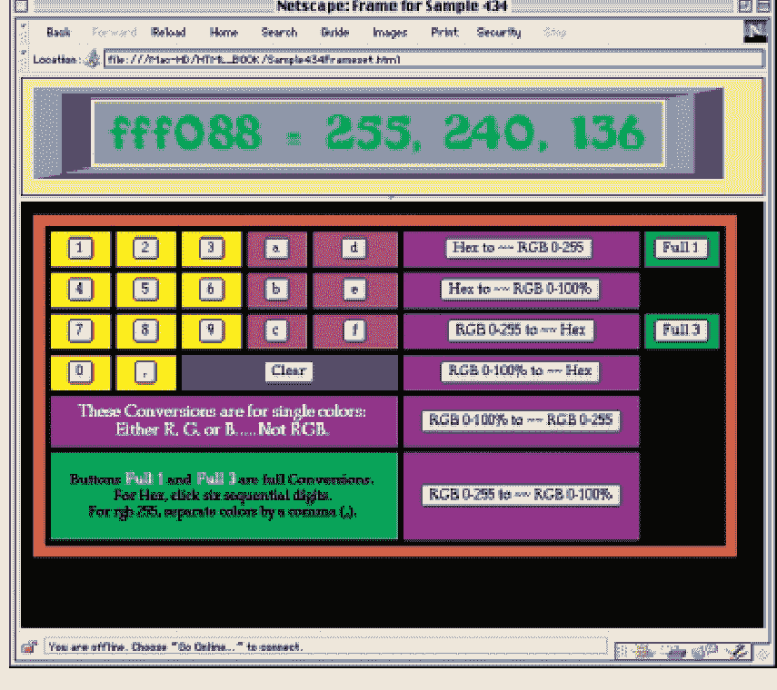

示例 3-34 的框架集代码在下一页。

附录 B 中，从第 1033 页开始有一个图表，列出了所有公认的 JavaScript 颜色名称，以及它们对应的 HEX、rgb% 和 rgb 数值。同样的信息也包含在 CD-ROM 的示例文件中：

```
Sample1100-AllColorValues.html
```

如果你只是想看到所有实际颜色以及每种颜色的名称显示，那么可以查看 Sample1100-AllColorNames.html。

## 示例 3-34 第 2 部分：Sample434Frameset.html

```
<!DOCTYPE HTML PUBLIC "-//W3C//DTD HTML 3.2//EN">
<HTML>
<HEAD> <TITLE>Frame for Sample 434</TITLE> </HEAD>

<FRAMESET ROWS="140,*">

        <FRAME MARGINHEIGHT=0 SCROLLING="no" NAME="display" SRC="Sample434A.html">

        <FRAME SCROLLING="auto" NAME="main" SRC="Sample434.html">

</FRAMESET>

</HTML>
```

## 一个带有边框动画和音乐的编译示例

示例 3-35 的主要目的是将到目前为止已经涵盖的一些主题，运用到一个你可能在网页上实际看到的页面中，除了 60 兆字节的音频文件大小之外。在真实网站中，你可能会有链接，而且很可能会先试听一小段，并提供购买选项，但由于这是放在 CD-ROM 上的，所以我收录了整首歌曲——这是我创作、演奏、混音并录制的。希望你喜*欢*。

这个示例有一个**自动更新的日期、时间以及在网站停留时长**的显示，显示在窗口的状态栏中。它还嵌入了歌曲"Journeys of Illumination"的音频文件。页面边缘有动画彩虹条形成动态边框，页面四个角落有旋转的地球仪。

**两个**按钮控制一个图层，该图层动画显示一个横幅，上面列出了歌曲不同乐章的名称。**另外两个**按钮控制包含 CD 图像和 CD 曲目的两个图层的动画。鼠标状元件和鼠标移出事件也可以显示和隐藏这两个图层。

音频文件设置为自动播放，通过将 width 和 height 属性分别设置为 144 和 60，Navigator 音频控件设置为显示，这是所需的最小值。第 361 页有截图。

## 示例 3-35 第 1 部分：Sample435.html

```
<!DOCTYPE HTML PUBLIC "-//W3C//DTD HTML 3.2//EN">
<HTML>
<HEAD>
<TITLE>Sample 435 - Example 3-35 Border Animation and Music      </TITLE>
```

```
<STYLE TYPE="text/JavaScript"

classes.Mainbody.BODY.margins("0px");
classes.Mainbody.BODY.paddings("0px");
classes.Mainbody.BODY.backgroundColor="black";
classes.Mainbody.BODY.color="white";

classes.Steelblue.all.margins("0px");
classes.Steelblue.all.backgroundColor="steelblue";
classes.Steelblue.all.color="navy";
classes.Steelblue.all.fontSize="12pt";
classes.Steelblue.all.fontFamily="Clarendon, Helvetica, fantasy";
classes.Steelblue.all.paddings("15px");
classes.Steelblue.all.borderTopWidth="10px";
classes.Steelblue.all.borderRightWidth="30px";
classes.Steelblue.all.borderBottomWidth="10px";
classes.Steelblue.all.borderLeftWidth="30px";
classes.Steelblue.all.borderStyle="line";
classes.Steelblue.all.borderColor="#5555ff";
classes.Steelblue.all.lineHeight="28pt";

classes.Redbox.all.backgroundColor="yellow";
classes.Redbox.all.fontSize="22pt";
classes.Redbox.all.color="red";

ids.L3.fontSize="20px";
ids.L3.fontFamily="Moonlight, 'Brush Script', Cloister, cursive";
ids.L3.color="#8800ff";
ids.L3.backgroundColor="cyan";

classes.Purplebox.all.width="420px";
classes.Purplebox.all.borderWidths("15px");
classes.Purplebox.all.borderColor="#8800ff";
classes.Purplebox.all.fontSize="17pt";
classes.Purplebox.all.borderStyle="groove";
classes.Purplebox.all.fontFamily="'Brush Script', fantasy";
classes.Purplebox.all.paddings("3px");
classes.Purplebox.all.color="yellow";
classes.Purplebox.all.backgroundColor="mediumblue";

tags.H1.fontSize="23pt";
tags.H1.color="red";

tags.H4.fontSize="14pt";
tags.H4.color="#007700";
tags.H4.backgroundColor="#00ff44";
tags.H4.fontFamily="Palatino, Times, Helvetica, serif";

classes.LimeIt.all.color="lime";
classes.LimeIt.all.fontSize="14pt";
classes.Turqy.all.color="turquoise";

</STYLE>
```

```
<SCRIPT LANGUAGE="JavaScript1.2"><!--BEGIN HIDING

startTime = new Date();

/*--------------------------------------------------*/
//The getMonth() Method returns a zero to eleven numbering scheme for months
//such that January = 0, February = 1, ..., December = 11,
//so you have to increment the month by 1 if you need January to be 1 instead of 0
//which is used for the todayMonth variable, below.

function initializeTime()  {

      var today              = new Date();
      var todayMonth         = today.getMonth() +1;
      var todayDay           = today.getDate();
      var todayYear          = today.getYear();
      var todaysHours        = today.getHours();
      var todaysMinutes      = today.getMinutes();
      var todaysSeconds      = today.getSeconds();
      var later              = new Date();
      var TimeHere           = Math.round((later - startTime) / 60000);

      todaysHours = ((todaysHours > 12)  ?  todaysHours - 12  :  todaysHours);

      var showTime= "The Date is:  "+ todayMonth +"/"
      showTime += todayDay +"/"
      showTime += todayYear
      showTime += " *****  The Time is:   " + todaysHours
      showTime += ((todaysMinutes > 9)  ?  " :"  :  " :0")
      showTime += todaysMinutes
      showTime += ((todaysSeconds > 9)  ?  " :"  :  " :0")
      showTime += todaysSeconds
      showTime += ((todaysHours >= 12)  ?  " PM"  :  " AM")
      showTime += " ***** You have been here "
      showTime += TimeHere + " Minutes."

      window.status = showTime;

      setTimeout('initializeTime()', 1000);
}
/*--------------------------------------------------*/
//END HIDING-->
</SCRIPT>

</HEAD>
<!--  ***************************************************************  -->
<BODY CLASS="Mainbody" onLoad="initializeTime();"
BACKGROUND="JPEG-FILES/icon-BG-asteroids.jpg">

<LAYER CLASS="Steelblue" ID="L1" LEFT=0 TOP=-10 WIDTH="100%">

<LAYER CLASS="Redbox" ID="L2" LEFT=55 TOP=28>
<NOBR>HI!
<FONT COLOR="#7700ee">Journeys of Illumination</FONT>
has 5 movements. It starts with
<FONT COLOR="#7700ee">Fanfare of Twilight</FONT>
which blends into
<FONT COLOR="#7700ee">Dance of Awakening</FONT>.
```

```
<FONT COLOR="#7700ee">Thought-Travel Meandering in a Time-Free Space-Like Domain</FONT>
is the third movement which melds into
<FONT COLOR="#7700ee">Dimensional Freefall</FONT>
and the song concludes with
<FONT COLOR="#7700ee">Wanderjahr Ever Onward</FONT>.</NOBR>
</LAYER>
```

```
<LAYER CLASS="Redbox" ID="L3" LEFT=0 TOP=80 WIDTH=340>
<FORM NAME="form3">Click to:
<INPUT TYPE="button" NAME="b1" VALUE="Move Banner" onClick="StartBanner();">
<INPUT TYPE="button" NAME="b2" VALUE="Stop Banner" onClick="StopBanner();"><BR><BR>
<EMBED SRC="./Sample-ETOC/Journeys-Of-Illumination.aiff" AUTOSTART="true" WIDTH=144 HEIGHT=60>
<INPUT TYPE="button" NAME="b7" VALUE="Slide Album" onClick="showAlbumText();
slideAlbum();">
<INPUT TYPE="button" NAME="b8" VALUE="Slide Back" onClick="slideAlbumBack();
slideAlbumText(); hideAlbumText();"><BR><BR>

The song that is playing is called <BR>
<FONT COLOR="#2200cc">Journeys of Illumination</FONT> <BR>
which is the title track of the album and was composed, played and recorded in
Sedona, Arizona in 1992.<BR><BR>
<H4>The Date, Time and Length of Stay at this site are down here in the status
bar.</H4>
</FORM></LAYER>
```

```
<!--  ********************************  -->
<LAYER CLASS="Purplebox" ID="L4Text" LEFT=350 TOP=80 VISIBILITY="hide" WIDTH=370
onMouseOut="bringAlbumBack();">
<H1>Journeys of Illumination</H1>
Journeys of Illumination <SPAN CLASS="LimeIt">Song Time 11:02</SPAN><BR>
<SPAN CLASS="Turqy">
Fanfare of Twilight<BR>
Dance of Awakening<BR>
Thought-Travel Meandering in a Time-Free Space-Like Domain<BR>
Dimensional Freefall<BR>
Wanderjahr Ever Onward<BR></SPAN>
Sagacity in Solitude<BR>
Musing Spirals<BR>
Furthur<BR><BR>
</LAYER>
```

```
<LAYER CLASS="Purplebox" ID="L4" LEFT=350 TOP=80 WIDTH=350
onMouseOver="revealAlbumText();">

</LAYER>
<!--  ********************************  -->
```

```
</LAYER>

<!--  This layer is necessary to have the border on top of the scrolling banner  -->

<LAYER CLASS="Steelblue" ID="L7" LEFT=0 TOP=-10 WIDTH="100%">
</LAYER>
```

```
<!--  *****************************************************************  -->
```


## 第 3 章 — 图层与 JavaScript 355

```javascript
<SCRIPT LANGUAGE="JavaScript1.2"><!--BEGIN HIDING

var booleanTest = true;

function Scroll1llBanner() {
    if (booleanTest == true) {
        if (document.L1.document.L2.left > 
           document.L1.document.L2.clip.width)
            document.L1.document.L2.moveTo(-10,0);
        else document.L1.document.L2.moveTo(document.L7.clip.width, 28);

            setTimeout('Scroll1llBanner()', 100);
        }
    } else document.L1.document.L2.moveTo(document.L1.document.L2.left, 28);
}

function StopBanner() {
    booleanTest = false;
}

function StartBanner() {
    booleanTest = true;
    Scroll1llBanner();
}

/*----------------------------------------------------------------------*/
/*----------------------------------------------------------------------*/

function revealAlbumText() {
    
    document.L1.document.L4.moveTo(100,80);
    document.L1.document.L4Text.visibility="show";
    document.L1.document.L4Text.moveTo(350,80);
}

function bringAlbumBack() {
    document.L1.document.L4.visibility="show";
    document.L1.document.L4Text.visibility="hide";
    document.L1.document.L4.moveTo(350, 80);
}

/*----------------------------------------------------------------------*/

function showAlbumText() {
    document.L1.document.L4Text.visibility="show";
    document.L1.document.L4Text.moveTo(350,80);
}

function slideAlbum() {
    if (document.L1.document.L4.top < 600) {
        document.L1.document.L4.moveBy(0,20);
        setTimeout('slideAlbum()', 100);
    }
}

/*----------------------------------------------------------------------*/
```

## 第 I 部分 — 动态 HTML

```javascript
function slideAlbumBack() {
    if (document.L1.document.L4.top > 80) {
        document.L1.document.L4.moveBy(0,-20);
        setTimeout("slideAlbumBack()", 100);
    }
}
```

```javascript
function slideAlbumText() {
    if (document.L1.document.L4Text.top < 600) {
        document.L1.document.L4Text.moveBy(0,20);
        setTimeout('slideAlbumText()', 100);
    }
}
```

```javascript
function hideAlbumText() {
    if (document.L1.document.L4Text.top >= 600) {
        document.L1.document.L4Text.moveTo(350,80);
        document.L1.document.L4Text.visibility="hide";
    }
}
```

```javascript
/*
//END HIDING-->
</SCRIPT>
</body>
</html>
```

本示例的此部分包含旋转的地球，主框架集（Master Frameset）将其加载四次，使其分别显示在页面的四个角落。

### 示例 3-35 第 2 部分：Sample435-1.html

```html
<!DOCTYPE HTML PUBLIC "-//W3C//DTD HTML 3.2//EN">
<HTML><HEAD> <TITLE> Sample 435-1 - Example 3-35-1 globe in corners </TITLE>

<STYLE TYPE="text/JavaScript">

    classes.Mainbody.BODY.margins("0px");
    classes.Mainbody.BODY.paddings("0px");
    tags.LAYER.width="100%";

</STYLE>
</HEAD>
<BODY CLASS="Mainbody">

<LAYER ID="L1" LEFT=0 TOP=0>

</LAYER>

</BODY></HTML>
```

本示例的此部分包含顶部中间框架中从左向右移动的动画彩虹。

### 示例 3-35 第 3 部分：Sample435-2.html

```html
<!DOCTYPE HTML PUBLIC "-//W3C//DTD HTML 3.2//EN">
<HTML>
<HEAD>
<TITLE>Sample 435-2 - Example 3-35-2 top rainbow </TITLE>

<STYLE TYPE="text/JavaScript">

  classes.MainBody.BODY.margins("0px");
  classes.MainBody.BODY.paddings("0px");
  classes.MainBody.BODY.backgroundImage="/JPEG-FILES/icon-BG-stars.jpg";

</STYLE>

<SCRIPT LANGUAGE="JavaScript1.2"><!--BEGIN HIDING

function MoveIt2() {

  if (document.L2.left < document.L2.clip.width) document.L2.moveBy(20,0);
  else document.L2.moveTo(-504,0);
  setTimeout("MoveIt2()", 10);

}

//END HIDING-->
</SCRIPT>

</HEAD>

<BODY CLASS="Mainbody">

<LAYER ID="L2" LEFT=0 TOP=0 WIDTH="100%">


</LAYER>

</BODY>
</HTML>
```

本示例的此部分包含左侧中间框架中从底部向上移动的动画彩虹。

### 示例 3-35 第 4 部分：Sample435-4.html

```html
<!DOCTYPE HTML PUBLIC "-//W3C//DTD HTML 3.2//EN">
<HTML><HEAD>  <TITLE>Sample 435-4 - Example 3-35-4   left rainbow </TITLE>

<STYLE TYPE="text/JavaScript">

        classes.Mainbody.BODY.margins("0px");
        classes.Mainbody.BODY.paddings("0px");
        classes.Mainbody.BODY.backgroundImage="./JPEG-FILES/icon-BG-stars.jpg";

</STYLE>

<SCRIPT LANGUAGE="JavaScript1.2"><!--BEGIN HIDING

function MoveIt4() {

        if (document.L4.top > -504) document.L4.moveBy(0,-20);
        else document.L4.moveTo(0, document.L4.clip.height);
        setTimeout('MoveIt4()', 10);
}
//END HIDING-->
</SCRIPT>
</HEAD>

<BODY CLASS="Mainbody">

<LAYER ID="L4" LEFT=0 TOP=0 WIDTH="100%">

</LAYER>

</BODY></HTML>
```

本示例的此部分包含右侧中间框架中从顶部向下移动的动画彩虹。

### 示例 3-35 第 5 部分：Sample435-7.html

```html
<!DOCTYPE HTML PUBLIC "-//W3C//DTD HTML 3.2//EN">
<HTML><HEAD><TITLE>Sample 435-7 - Example 3-35-7   right rainbow   </TITLE>

<STYLE TYPE="text/JavaScript">

        classes.Mainbody.BODY.margins("0px");
        classes.Mainbody.BODY.paddings("0px");
        classes.Mainbody.BODY.backgroundImage="./JPEG-FILES/icon-BG-stars.jpg";

</STYLE>
```

## 第 3 章 — 图层与 JavaScript

```javascript
<SCRIPT LANGUAGE="JavaScript1.2"><!--BEGIN HIDING

function MoveIt7() {

		if (document.L7.top < document.L7.clip.height) document.L7.moveBy(0,20);
		else document.L7.moveTo(0, -504);
		setTimeout('MoveIt7()', 10);
}

//END HIDING-->
</SCRIPT>
</HEAD>

<BODY CLASS="Mainbody">

<LAYER ID="L7" LEFT=0 TOP=0 WIDTH="100%">

</LAYER>

</BODY>
</HTML>
```

本示例的此部分包含底部中间框架中从右向左移动的动画彩虹。

### 示例 3-35 第 6 部分：Sample435-9.html

```html
<!DOCTYPE HTML PUBLIC "-//W3C//DTD HTML 3.2//EN">
<HTML>
<HEAD>
<TITLE>Sample 435-9 - Example 3-35-9   bottom rainbow        </TITLE>

<STYLE TYPE="text/JavaScript">

	classes.Mainbody.BODY.margins("0px");
	classes.Mainbody.BODY.paddings("0px");
	classes.Mainbody.BODY.backgroundImage="./JPEG-FILES/icon-BG-stars.jpg";

</STYLE>

<SCRIPT LANGUAGE="JavaScript1.2"><!--BEGIN HIDING

function MoveIt9() {

	if (document.L9.left > -504) document.L9.moveBy(-20,0);
	else document.L9.moveTo(document.L9.clip.width, 0);
	setTimeout('MoveIt9()', 10);
}

//END HIDING-->
</SCRIPT>
</HEAD>
```

## 360 第 I 部分 — 动态 HTML

```html
<BODY CLASS="Mainbody">

<LAYER ID="L9" LEFT=0 TOP=0 WIDTH="100%">


</LAYER>

</BODY>
</HTML>
```

本示例的此部分包含主框架集（master Frameset）。

### 9-35 第 7 部分：Sample435-Frameset.html

```html
<!DOCTYPE HTML PUBLIC "-//W3C//DTD HTML 3.2//EN">
<HTML><HEAD>
    <TITLE>Frameset for Sample 435 </TITLE> </HEAD>

<FRAMESET ROWS="24,*,24" BORDER="0">

    <FRAMESET COLS="24,*,24">
        <FRAME SCROLLING="no" NAME="F1" SRC="Sample435-1.html">
        <FRAME SCROLLING="no" NAME="F2" SRC="Sample435-2.html">
        <FRAME SCROLLING="no" NAME="F3" SRC="Sample435-1.htmlBGP">
    </FRAMESET>

    <FRAMESET COLS="24,*,24">
        <FRAME SCROLLING="no" NAME="F4" SRC="Sample435-4.html">
        <FRAME SCROLLING="no" NAME="F5" SRC="Sample435.html">
        <FRAME SCROLLING="no" NAME="F7" SRC="Sample435-7.html">
    </FRAMESET>

    <FRAMESET COLS="24,*,24">
        <FRAME SCROLLING="no" NAME="F8" SRC="Sample435-1.html">
        <FRAME SCROLLING="no" NAME="F9" SRC="Sample435-9.html">
        <FRAME SCROLLING="no" NAME="F10" SRC="Sample435-1.html">
    </FRAMESET>

</FRAMESET>
</HTML>
```

由于与图层（Layers）和事件（Events）相关的信息相当长且复杂，我决定将其放在第 6 章中，以避免重复，并希望简化学习过程。如果你已经熟练掌握 JavaScript 对象、函数、语句、运算符和表达式的相关知识，或者你现在就想了解事件，那么可以直接跳到第 6 章，我们将在其中详细介绍与图层和 JavaScript 事件对象模型相关的事件。


 ## 示例 3-35 Sample435Frameset.html

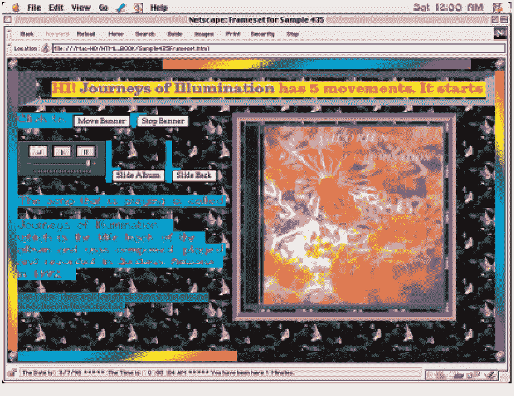

## 第二部分
JavaScript 1.2

## 第 4 章
对象与函数

### 目录

- JavaScript 对象 366
  - 4.1) JavaScript 对象层次结构 366
  - 4.2) 使用 JavaScript 对象 367
  - 4.3) 对象属性与方法 367
- JavaScript 函数 371
  - 4.4) 使用 Function 语句定义函数 371
  - 4.5) 通过属性赋值调用函数 372
  - 4.6) 通过名称调用函数 373
  - 4.7) 在函数内部调用函数 375
  - 4.8) 通过属性赋值调用函数 376
  - 4.9) JavaScript 核心函数对象 378
  - 4.10) 函数的 `arguments[]` 数组属性 380
  - 4.11) 在函数中嵌套函数 384
- 总结图表 386
  - 4.12) 预定义 JavaScript 对象 386
  - 4.13) 作为对象属性的预定义 JavaScript 数组 387
  - 4.14) 预定义 JavaScript 核心对象 388
  - 4.15) 预定义 JavaScript 核心函数 388
- JavaScript 核心对象 389
  - 4.16) JavaScript 核心对象概述 389
  - 4.17) 使用其 `Constructor` 函数创建对象 390
  - 4.18) 为对象创建方法 392
  - 4.19) 对象定义中的对象作为属性 396
  - 4.20) 使用 prototype 属性向对象类型添加方法 399
  - 4.21) 在对象实例定义后向其添加属性 402
  - 4.22) 使用 prototype 属性向对象类型添加属性 402
  - 4.23) 为对象的属性建立索引 404
  - 4.24) 使用字面量表示法创建对象 407
  - 4.25) 删除对象 411
  - 4.26) 核心对象的 watch() 方法 411
  - 4.27) 核心对象的 unwatch() 方法 415

### 预定义 JavaScript 对象 416

- 4.28) JavaScript window 对象 416
- 4.29) window 对象的 open() 方法 422ashes
- 4.30) window 对象的 close() 方法 427
- 4.31) window 对象的 scrollBy() 方法 430
- 4.32) JavaScript document 对象 432
- 4.33) document 对象的 cookie 属性 436
- 4.34) JavaScript screen 对象 445
- 4.35) JavaScript Location 对象 447
- 4.36) JavaScript History 对象 452
- 4.37) JavaScript navigator 对象 456
- 4.38) 动态创建框架 457
- 4.39) JavaScript Number 核心对象 460
- 4.40) JavaScript select 对象 462
- 4.41) JavaScript options[i] 数组 464
- 4.42) JavaScript option 对象 465

### 新 JavaScript 核心函数 467

- 4.43) JavaScript Number 核心函数 467
- 4.44) JavaScript String 核心函数 468

## JavaScript 对象

### JavaScript 对象层次结构

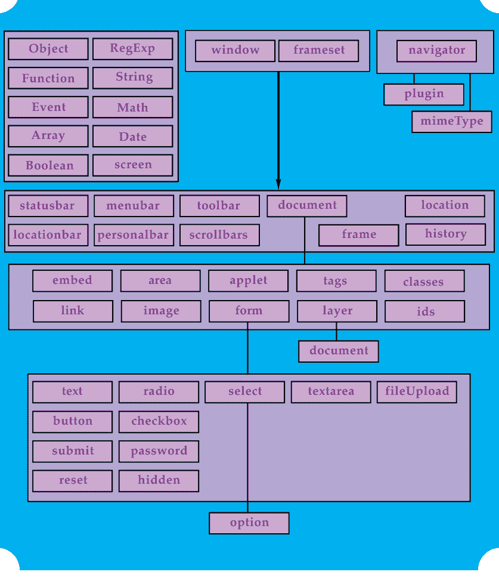

### 使用 JavaScript 对象

请将本章视为 JavaScript 对象的概述。本章旨在阐述对象运作的一般框架，以及它们如何相互关联并与 JavaScript 的其他方面产生联系。本章不会详述所有对象的每一个细节。有关该信息，请参阅 CD-ROM 中的 JavaScript 参考手册。本章将阐明对象的基本参数，并演示一些对象更有趣和更有用的特性。

每次将页面加载到 Navigator 中时，JavaScript 编译器会根据您编写的 HTML 创建某些对象。这个最小的对象集合由 **navigator、window、document、location 和 history** 对象组成。根据您创建的页面中包含的内容，显然还可以有其他由编译器生成的对象。所有这些对象都存在于一个对象层次结构中，可以通过使用点符号调用对象来访问。上一页的图表展示了该结构。

### 对象属性与方法

这些对象都有与其各自对象相关联的特定属性和方法，它们可以被访问和操作。对象的属性基本上是一个预定义的变量，您可以使用简单的点符号语法为其赋值，如下所示：

```
objectName.propertyName = value
```

例如，如果您想将 **document** 对象的背景颜色更改为蓝色，您可以访问 **bgColor** 属性并将字符串 "blue" 赋值给它，如下所示：

```
document.bgColor = "blue"
```

对象的方法只是 Netscape 已经预先分配给对象的一个预定义函数。您使用相同的点符号在对象上调用方法，如下所示：

```
objectName.methodName()
```

**window** 对象是页面中所有其他对象的父对象，这意味着它位于所有页面内容层次结构的顶端，包括那些具有 FRAMESET 和 FRAME 的对象。这意味着所有其他对象都是它的后代或子对象。一些子对象（如 **document** 对象）也是其他层次较低对象的父对象或容器对象。所有子对象都被认为是其各自父对象的属性，因此它们可以用 JavaScript 引用和操作。

假设您想在脚本中的某个时刻将焦点给到窗口。您可以通过引用 **window** 对象并调用 **focus()** 方法来实现，如下所示：

```
window.focus();
```

现在已经 demonstrating 了这一点，由于 **window** 对象始终是父对象，Netscape 允许您在涉及其他对象的表达式中省略它，因为它始终被假定为存在。这将为您节省一些输入。

**document** 对象是层次结构中的下一个主要父级单元。它是大多数其他 JavaScript 对象的祖先。它不包含 **navigator**、**frame**、**location**、**history** 或 **mimeType** 对象。

假设您有一个名为 **myImage1** 的 **image** 对象，并且您想通过将其设置为不同的 URL 来更改 **src** 属性。要访问 **image** 对象，您可以按名称调用它或使用 **images[i]** 数组，但您还必须通过层次结构来访问它。这里有另一种思考方式。将图像视为具有名称和页面中的特殊位置，这些由其层次名称指定，就像家谱一样。这个名称由回溯到 **document** 对象的所有祖先组成（实际上是 **window** 对象，但请记住您可以省略它）。因此对于 **document** 中名为 **myImage1** 的 **image**，您可以像这样更改其 **src** 属性：

```
document.myImage1.src = "nextImage2.jpg"
```

如果这是 **document** 中的第一张图像，您可以使用 **images[i]** 数组像这样引用它：

```
document.images[0].src = "nextImage2.jpg"
```

或者使用 **images[i]** 数组中的名称像这样引用它：

```
document.images["myImage1"].src = "nextImage2.jpg"
```

### 更改 text 对象的值

假设您有一个名为 **myForm1** 的 **form**，其中包含一个名为 **myText1** 的 INPUT TYPE="text" 对象。要更改显示在该 **text** 对象中的文本字符串，您可以像这样设置 **text** 对象的 **value** 属性：

```
document.myForm1.myText1.value = "the new text string";
```

### 引用 form 对象中的对象

这里变得稍微复杂一些。如果您有一个像 **link** 这样的对象位于 **form** 对象中，而该对象不需要在 **form** 对象中，您在引用 **link** 对象时仍然必须引用 **form** 对象。例如，如果您想更改文档中第三个 **link** 的 **target** 属性，而它恰好位于名为 **myForm1** 的 **form** 中，您可以使用 2 访问 **links[i]** 数组中的第三个元素，并使用以下代码：

```
document.myForm1.links[2].target = "mainView";
```

如果这个 **link** 不包含在 **form** 对象中，您可以像这样编写代码：

```
document.links[2].target = "mainView";
```

### 引用 <u>Layer</u> 对象

引用 **Layer** 对象时变得更加复杂，因为每个 **Layer** 对象内部都有自己的 **document** 对象版本，它包含与其外部大哥相同类型的数据，***
但其参数仅适用于其直接的父 **Layer**。当您引用 **Layer** 对象时，您始终必须引用其父 **document** 对象。当您想引用 **Layer** 对象的属性时，您不引用 **Layer** 的内部 **document** 对象。当您想引用包含在 **Layer** 对象内的对象时，您始终必须引用 **Layer** 对象的内部 **document** 对象。以下是这三种可能性的演示。

假设您有一个名为 **myLayer1** 的 **Layer**，您可以像这样引用它：

```
document.myLayer1
```

现在假设您想使用其 **bgColor** 属性更改该 **Layer** 的背景颜色，您可以像这样编写代码：

```
document.myLayer1.bgColor = "blue";
```

现在假设您想更改名为 **myLayer1** 的 **Layer** 内名为 **myForm1** 的 **form** 对象中名为 **myText1** 的 **text** 对象的文本字符串。您必须像这样访问 **myLayer1** 对象的 **document** 对象：

```
document.myLayer1.document.myForm1.myText1.value = "Hey Now.";
```

### 引用 <u>select</u> 对象

最后一个示例。假设您有一个名为 **getColor** 的 **select** 对象，并且您想将当前选中的颜色选项赋值给您定义为 **bcolorSel** 的变量。现在，如果 **select** 对象包含在名为 **form1** 的 **form** 中，而该 **form** 又位于名为 **L2** 的 **Layer** 的 **document** 对象内，那么如果您一次性完成所有操作，您将需要编写一长串代码。请记住，您将必须使用 **select** 对象的 **selectedIndex** 属性作为 **options[index]** 数组的 **index**，而该数组本身就有很长的引用。以下是在单行代码中引用对象的方式：

```
var bcolorSel = document.L2.document.form1.getColor.options[document.L2.document.form1.getColor.selectedIndex].value;
```


# 图表及其他即将讨论的主题

你可以看到，将其拆分成更小的块，并将这些块分配给不同的变量，然后像这样适当地替换变量，是有优势的：

```
var L2 = document.L2;
var getColor = L2.document.form1.getColor;
var sel = getColor.selectedIndex;
var bcolorSel = getColor.options[sel].value;
```

你可以在 [Sample724.html](Sample724.html) 中看到这段代码非常相似的实现，该示例在第6章的例6-24中进行了讲解，位于第650-656页。

有关 **select** 对象的更多信息，请参阅本章后面的第462-465页。

在第386-388页，有四张图表列出了 Netscape 为你预先创建的所有预定义 JavaScript 对象、预定义 JavaScript 数组、预定义 JavaScript 核心对象以及预定义 JavaScript 核心函数，以便你在脚本中使用。JavaScript 1.2 中新增的对象以及某些更为关键或较为冷门的对象在本书中有所涉及。详细说明并考察所有 JavaScript 中可用的对象超出了本书的范围，事实上这需要单独的一本书来介绍。本章将向你展示如何使用现有对象、它们是如何由 JavaScript 运行时引擎创建的，以及如何利用它们的属性和方法来操作内容。有关本书未涵盖的 JavaScript 对象的更多细节，请参阅 CD-ROM 上的 JavaScript 参考手册。

除了 JavaScript 的预定义对象外，你还可以创建自己的对象，并为它们定义属性和方法。此过程在汇总图表之后有详细讲解。

你还可以创建自己的函数，这是有效利用 JavaScript 的基本工具之一。在下一节中，将讲解定义函数的过程，然后是调用函数的三种方式，即执行函数所包含语句的方法。

其他主题还包括核心 JavaScript **Function** 对象、**arguments[i]** 数组，以及在一个函数内部嵌套另一个函数的能力，从而使外部函数的参数可供内部函数使用（但反之则不行）。这是 Navigator 4.0 的新功能。

在本章末尾，**Number** 和 **String** 两个新函数将被介绍给 Navigator 4。

## JavaScript 函数

## 概述

基本上，函数是一个过程，它整合了一系列 JavaScript 语句来完成某项任务。要将函数集成到你的文档中，你必须首先在一个 SCRIPT 中定义它，通常该 SCRIPT 包含在 HEAD 元素中。然后你必须调用该函数。调用函数可以通过多种方式完成，包括从另一个函数内部调用函数。在许多情况下，函数作为 HTML 元素的事件处理程序的值被调用，这称为属性赋值。调用函数最简单的方式是直接使用其名称作为语句。你可以使用 **return** 语句通过函数返回一个值。

通常，在文档的 HEAD 中定义函数是个好主意，这样函数会首先加载，在 BODY 中的任何 HTML 元素加载之前。这可以避免因文档某部分的脚本尝试与尚未加载的另一脚本交互而产生的许多 JavaScript 运行时错误。这通常发生在用户尝试在页面完全加载之前点击按钮对象，而该按钮需要尚未加载的代码才能工作时。由于所需的代码尚未加载，就会出现运行时错误。HEAD 脚本也有例外情况。有关方法及其与函数区别的信息，请参阅第367、392-401页。

## 使用 Function 语句定义函数

定义函数以 **function** 关键字开头，后跟函数名称，然后是括号内以逗号分隔的参数列表。你可以定义不带参数的函数，但仍然必须包含括号。接下来是一系列以分号分隔的语句，并用花括号 {} 括起来。例如，以下函数 **setColor()** 不带参数，在被调用时将背景颜色设置为紫色：

```
function setColor() {
    document.bgColor = "purple";
}
```

语法：

```
function functionName(argument1, argument2, ..., argumentN) {
    statement1;
    statement2;
    statementN;
}
```

## 通过属性赋值调用函数

定义函数只是让函数执行其语句的第一步。接下来，你必须在 SCRIPT 中调用函数，或者将其分配给 HTML 元素的事件处理程序，如下所示场景演示的：

为此场景启动该过程，你可以对之前定义的 **setColor()** 函数进行编码，使其更有用，方法是像这样为它添加一个 **color** 参数：

```
function setColor(color) {
    document.bgColor = color;
}
```

这样，当 **setColor()** 函数被调用时，背景将更改为当时提供的 **color** 参数，该参数每次调用函数时都可以不同。例如，假设你定义了三个按钮对象，每个对象都将其各自的 **onClick** 事件处理程序分配给 **setColor()** 函数，如下所示：

```
<INPUT TYPE="button" VALUE="Blue it" onClick="setColor('blue');">
<INPUT TYPE="button" VALUE="Lime it" onClick="setColor('lime');">
<INPUT TYPE="button" VALUE="Red it" onClick="setColor('red');">
```

然后，如果用户点击第一个按钮，**setColor()** 函数将使用字符串 'blue' 作为 **color** 参数来更改背景颜色为蓝色。如果用户点击第二个按钮，**onClick** 事件处理程序使用相同的 **setColor()** 函数，但提供不同的字符串值作为 **color** 参数，从而使背景颜色变为石灰绿。对于以 'red' 作为 **color** 参数的按钮也是如此。

## 函数中的语句

函数内的语句几乎可以是任何类型的 JavaScript 表达式，可以包括（但不限于）：变量、字面量、数组、字符串、数字、关键字、对象、正则表达式、运算符，以及任何特殊的 JavaScript 语句如 if()...else 和 for()，这些在第5章中有所讲解。如前所述，你甚至可以在函数内部嵌套函数，或者在函数内部调用其自身，这称为*递归*函数。后两种可能性中的后者在使用 **setTimeout()** 和 **setInterval()** 方法、创建执行 JavaScript 动画的脚本，以及使用 **Date** 对象显示或使用日期和时间数据时非常有用。有关示例和详细信息，请参阅第3章。

## 函数中的参数

函数中的参数是作为占位符的变量，用于传递给函数的值，可以是字符串、数字、日期，甚至其他完整的对象。

## 通过名称调用函数

通过名称调用函数有几种场景。我们将要处理的第一种情况是当你想要更改页面的 HTML 布局时。在这种情况下，你必须通过在文档 BODY 中的 SCRIPT 内包含函数名称来按名称调用函数，且该调用必须在其引用的 HTML 加载到文档之后。请注意，当你使用函数来初始布局文档时（例如通过使用 **write()** 方法）则不在此列；这只适用于你想要更改页面中的某些内容时。

例如：通过在文档的 HEAD 中定义与之前相同的 **setColor()** 函数，然后在 BODY 中的单独脚本中通过名称调用它来执行它。请注意，括号是包含在内的。

### 示例 4-0：Sample500.html

```
<!DOCTYPE HTML PUBLIC "-//W3C//DTD HTML 3.2//EN">
<HTML>
<HEAD>
<TITLE>Sample 500 - Example 4-0 Define and Call a Function  </TITLE>

<SCRIPT LANGUAGE="JavaScript1.2"><!--BEGIN HIDING

	function setColor() {
		document.bgColor = "purple";
	}

//END HIDING-->
</SCRIPT>

</HEAD>

<BODY>

<SCRIPT LANGUAGE="JavaScript1.2"><!--BEGIN HIDING

	setColor();

//END HIDING-->
</SCRIPT>

<H2>		  在第二个脚本中对 setColor() 函数的调用实际上更改了背景颜色。没有显式调用时，该函数仅在 HEAD 中定义但并未执行。
</H2>

</BODY>

</HTML>
```

 在示例 4-1 中，**setText()** 函数既在文档的 HEAD 部分定义，也在该部分调用。实际上，你也可以在文档的 BODY 部分调用该函数，但将尽可能多的脚本放在 HEAD 部分被认为是良好的实践，以避免运行时错误。你可以在 HEAD 中调用 **setText()** 函数的原因是，它正在为页面布局做出贡献，而不是在 HTML 渲染完成后更改页面。

这是你在调试代码时需要注意的一个区别点。

## 示例 4-1：Sample501.html

```
<!DOCTYPE HTML PUBLIC "-//W3C//DTD HTML 3.2//EN">
<HTML>
<HEAD>
<BASEFONT SIZE="7">

<TITLE>Sample 501 - Example 4-1 Define and Call a Function  </TITLE>

<SCRIPT LANGUAGE="JavaScript1.2"><!--BEGIN HIDING

	function setText() {

			document.write("Hello out there.");
	}

	setText();

//END HIDING-->
</SCRIPT>

</HEAD>

<BODY>

<H2>
	<FONT COLOR="#FF0000">
Notice that in this case the Function is called in the HEAD of the document because it <U>isn't changing</U> the layout, it is <U>contributing to the initial layout</U>.
	</FONT>
</H2>

</BODY>
</HTML>
```

## 从一个函数中调用另一个函数

本示例演示了如何在一个函数内部调用另一个函数。由于 **setText()** 和 **setDiffText()** 两个函数都使用 JavaScript 对象引用，而这些对象是在 BODY 中创建相关元素的 HTML 加载完成后，由 JavaScript 解释器创建的，因此脚本包含在该相关 HTML 之后的 BODY 中。**setText()** 函数首先被定义，然后在 **setDiffText()** 函数中被调用。这两个函数还分别被分配给两个链接的事件处理程序，以便当光标经过和离开链接时，文本框中的文本会根据不同的链接而发生变化。

## 示例 4-2：Sample502.html

```
<!DOCTYPE HTML PUBLIC "-//W3C//DTD HTML 3.2//EN">
<HTML>          <HEAD>          <BASEFONT SIZE="5">
<TITLE>Sample 502 - Example 4-2 Call a Function within a Function</TITLE>   </HEAD>
<BODY BGCOLOR="lime">

<A HREF="Sample502.html" onMouseOver="setText('blue');"
onMouseOut="setDiffText();">
        Test Link Number 1.    </A>    <BR><BR>

<A HREF="Sample502.html" onMouseOver="setText('yellow');"
onMouseOut="setDiffText();">
        Test Link Number 2.    </A>    <BR><BR>

<FORM NAME="form1">    <INPUT TYPE="text" NAME="text1" SIZE=50>     </FORM>

Two Test Links to Change Text in the Text box by moving the mouse over a link and
away from the link.

<SCRIPT LANGUAGE="JavaScript1.2"><!--BEGIN HIDING

function setText(getText) {
        document.form1.text1.value = getText;
}

function setDiffText() {

        var t = document.form1.text1.value;

        if (t == 'blue')        { document.form1.text1.value = 'red'; }

        else { setText('purple'); }
}

//END HIDING-->
</SCRIPT>
</BODY></HTML>
```

## 通过属性赋值调用函数

通过属性赋值调用函数与属性赋值类似，但有几个重要的区别。这里先给出一个简短的微型示例，随后进行解释。

```
<SCRIPT LANGUAGE="JavaScript1.2"><!--BEGIN HIDING

    function setColor() {
        document.bgColor = "purple";
    }

    document.onmouseup=setColor;

//END HIDING-->
</SCRIPT>
```

你应该立即注意到，当通过属性赋值将 `setColor()` 函数分配给 `document` 对象的 `onmouseup` 事件处理程序时，函数名后面没有附加括号。这意味着在函数定义时括号内的任何参数，都会由 JavaScript 解释器在内部自动转发。在某些情况下，尤其是在处理 `Event` 对象时，这可能是一个优势。事实上，这种不必手动编写 `event` 关键字参数的能力，是在处理事件和事件处理时使用它的一个主要原因。

另一方面，如果你的函数中有一个你想在脚本的不同点上自行更改的参数，这可能是一个明显的缺点，至少在一定程度上，你将不得不以不同于你可能习惯的算法方案来编写函数。例如，如果你稍微修改 `setColor()` 函数，使其接受一个名为 `color` 的参数，像这样：

```
function setColor(color) {
    document.bgColor = color;
}
```

这是很多作者在计划使用属性赋值时通常定义函数的方式，像这样：

```
<INPUT TYPE="button" VALUE="Do it" onClick="setColor('blue')";>
```

你可能已经看到了尝试对这个函数使用属性赋值的直接问题，因为没有办法将 'blue' 字符串附加到 `color` 参数上。为了解决这个问题，你需要提前规划并以不同的方式定义函数，以适应备选的语法要求。一种解决方案在下面的示例 4-3 中演示。

## 第 4 章 — 对象与函数

这里有一种通过分配事件参数 **e** 而不是 **color** 参数来以不同方式定义函数的方法，然后设置 **if()** 语句，根据事件参数的值来更改背景颜色。核心 **String** 对象的 **fromCharCode()** 方法用于从 **Event** 对象 **e** 的 **which** 属性中提取字符串值，然后将其分配给 **theKey** 变量。

接着，**theKey** 变量在 **if()** 语句中与字符串字面量进行布尔测试，当测试为真时执行背景颜色更改。最后，**setColor()** 函数被分配给 **document** 对象的 **onkeypress** 事件处理程序。如果你决定在浏览器中运行此脚本，请确保在按下 1、2 或 3 键时，主浏览器窗口具有焦点，而不是位置 URL 栏。

在第 6 章关于事件的章节中，还有许多这种编码场景的其他示例。

## 示例 4-3：Sample503.html

```
<!DOCTYPE HTML PUBLIC "-//W3C//DTD HTML 3.2//EN">
<HTML>
<HEAD>
<BASEFONT SIZE="5">
<TITLE>Sample 503 - Example 4-3       Function Call by Property Assignment</TITLE>

<SCRIPT LANGUAGE="JavaScript1.2"><!--BEGIN HIDING

//Press either the 1, 2 or 3 Key to change the background color.

     function setColor(e) {

            theKey = String.fromCharCode(e.which);

            if (theKey == "1") { document.bgColor = "purple"; }
            if (theKey == "2") { document.bgColor = "red"; }
            if (theKey == "3") { document.bgColor = "blue"; }
      }

      document.onkeypress=setColor;

//END HIDING-->
</SCRIPT>

</HEAD>

<BODY BGCOLOR="lime" onLoad="window.focus();">

Press either the 1, 2 or 3 Key to change the background color.

</BODY>
</HTML>
```

## JavaScript 核心 Function 对象

## JavaScript 语法：

```
functionObjectName = new Function(["arg1", "arg2", ..., "argN"], "functionBody")
```

### 参数定义：

**functionObjectName**

该参数可以是以下三种可能之一：

- 变量名。
- 已存在对象的属性。
- 对象后跟事件处理程序名称，必须全部使用小写字符指定，如 **document.onclick**。在这种情况下，不允许有参数。

**arg1, arg2, ..., argN**

参数是可选参数，必须是字符串，用作函数的正式参数名称。

**functionBody**

这是一个包含要执行的 JavaScript 代码语句的字符串。这与使用 Function 语句定义的函数中花括号内包含的语句相同。

### Function 对象与声明式函数的区别

使用 **Function 构造函数** 创建的 **Function** 对象与使用 **Function** 语句声明的 **函数** 类似，但有两个非常重要的区别需要注意。首先，当 **Function** 对象被分配给变量时，该变量被认为包含对使用 **Function 构造函数** 创建的 **Function** 的引用，该引用可以程序性地更改为包含不同的值，而声明的 **函数** 是静态的，即一旦声明，它将始终是那个确切的 **函数**。

其次，**Function** 对象在每次调用时都会被求值，这不如声明的 **函数** 高效，因为声明的 **函数** 只编译一次。

以下是用于创建 **Function** 对象及其并行声明 **函数** 的两个代码示例，供比较：

### Function 对象

```
myFunction = new Function("document.write('Tennis Rocks');")
```

### 声明式函数语句

```
function myFunction() {
	document.write('Tennis Rocks');
}
```


 ## 函数对象

```
setColor = new Function("color", "document.bgColor=color;")
```

## 声明式函数

```
function setColor(color) {
	document.bgColor=color;
}
```

本示例演示了核心 **Function** 对象的两种实现方式。第一个 **Function** 对象名为 **setFGColor**，它使用了 **color** 参数，该参数被赋值给 **document** 对象的 **fgColor** 属性。当它在下一行被调用时，它使用 'red' 字符串作为 **color** 参数。第二个 **Function** 对象被赋值给 **document** 对象的 **onclick** 事件处理器，以便在点击时将 **document** 的背景色改为 lime。

## 示例 4-4：Sample504.html

```
<!DOCTYPE HTML PUBLIC "-//W3C//DTD HTML 3.2//EN">
<HTML>
<HEAD>
<BASEFONT SIZE="5">
<TITLE>Sample 504 - Example 4-4     Function Object</TITLE>

<SCRIPT LANGUAGE="JavaScript1.2"><!--BEGIN HIDING

	setFGColor = new Function("color", "document.fgColor=color;")

	setFGColor('red');

	document.onclick = new Function("document.bgColor='lime';")

//END HIDING-->
</SCRIPT>

</HEAD>

<BODY>

Click in the window to change the background color.

</BODY>
</HTML>
```

## 函数属性

| 属性 | 说明 |
| :--- | :--- |
| arguments[i] | 一个数组，包含传递给函数的所有参数以及函数的局部变量。 |
| arity | 指定函数期望的参数数量。 |
| caller | 返回调用当前正在执行的嵌套函数的外部函数的名称。**caller** 属性仅在函数体内可知。如果在函数体外部访问，其值为 **null**。 |
| prototype | 允许你为 **Function** 对象创建自己的属性。 |

## 函数方法

| 方法 | 说明 |
| :--- | :--- |
| toString() | 返回一个字符串，包含指定函数的内部代码。 |

## 函数的 arguments[i] 数组属性

## JavaScript 语法：

```
arguments[i]
arguments.argName
arguments.varName
```

### 内部嵌套函数的 JavaScript 语法：

```
functionName.arguments[i]
functionName.arguments.argName
functionName.arguments.varName
```

**arguments[i]** 数组是函数的一个属性，其中 **i** 是从 0 到 **n** 的从零开始的**索引**整数，**n** = arguments.length-1，每个数组元素包含函数的一个参数。在语法中，**functionName** 参数是包含这些参数的函数的名称，只有当你从内部嵌套函数访问外部函数的属性时才需要。**argName** 是任意参数的名称，**varName** 是你所访问的任何局部变量的名称。

只能在声明函数时从函数体内访问 **arguments[i]** 数组。如果试图在函数声明外部访问 **arguments[i]** 数组，将会发生 JavaScript 运行时错误。

在引用函数和 **Function** 对象时，你必须始终通过名称引用它们，即使在函数体内也是如此，因为 **this** 关键字并不指向当前正在执行的函数。

如果你调用一个函数时传递的参数多于它在函数语句声明中正式声明接受的参数，你可以使用参数数组来处理额外的参数，通过访问数组的每个元素。

例如，在以下脚本中，**tester()** 函数只声明了一个参数，即 **color**。然后它在 **for()** 语句中使用参数数组，将调用时传递给它的每个参数写入屏幕。

### 示例 4-5：Sample505.html

```
<!DOCTYPE HTML PUBLIC "-//W3C//DTD HTML 3.2//EN">
<HTML>
<HEAD>
<BASEFONT SIZE="5">
<TITLE>Sample 505 - Example 4-5     arguments Array</TITLE>

<SCRIPT LANGUAGE="JavaScript1.2"><!--BEGIN HIDING

function tester(color) {

      for (var i=0; i<tester.arguments.length; i++) {

            document.write(arguments[i] + "<BR>");
      }
}

tester("blue", "red", "green", "yellow");

//END HIDING-->
</SCRIPT>

</HEAD>

<BODY>
</BODY>
</HTML>
```

此脚本在浏览器中产生以下输出：

**blue**
**red**
**green**
**yellow**

## arguments[i] 数组属性

| 属性 | 说明 |
|---|---|
| length | 函数中参数的数量。 |
| argName1, argName2, ..., argNameN | 函数中的每个参数都是参数数组的属性。注意，此功能仅在 Navigator 4.0 中可用。在 JavaScript 1.3 和 Navigator 4.5 中，它不仅是弃用的，对其的支持已完全移除，不再可用。 |
| varName1, varName2, ..., varNameN | 函数中的每个局部变量都是参数数组的属性。注意，此功能仅在 Navigator 4.0 中可用。在 JavaScript 1.3 和 Navigator 4.5 中，它不仅是弃用的，对其的支持已完全移除，不再可用。 |
| caller | 外部函数的参数数组。如果没有外部函数，值为 undefined。在 JavaScript 1.3 中已弃用。 |
| callee | 包含参数数组的函数的引用。 |

## 在函数内嵌套函数

从适用于 Navigator 4.0 的 JavaScript 1.2 开始，你可以在函数声明时使用函数语句将一个函数嵌套在另一个函数内。注意，这与只是从函数内部调用一个函数不同，后者已经可以实现很长时间了。嵌套函数意味着外部函数的参数和变量可以被内部嵌套函数使用。但反之则不成立；也就是说，内部嵌套函数的参数和变量不能被外部函数使用。内部函数在外部函数外部是未知的，不能被独立调用。以下对比了嵌套函数和调用函数。

| 嵌套函数 | 从函数内部调用函数 |
|---|---|
| `function outerTest1() {
    function innerTest2() {
        statements2
    }
    statements1
}` | `function myTest1() {
    statements1
}

function myTest2() {
    statements2
    myTest1()
}` |

示例 4-6 演示了如何让名为 `getColor()` 的外部函数的 Variable `x` 被内部 `nested` 函数 `setBGColor()` 使用。每个局部变量都是 `arguments` 数组的属性，因此要访问变量 `x`，你需要先通过变量所在函数的名称，然后通过 `arguments` 数组，使用点号表示法。

当你运行 `Sample506.html` 时，只需输入一个颜色名称并点击按钮即可更改文档的背景色。`Sample506-Extra.html`（仅在 CD-ROM 上）包含`不使用` `nested` 函数的代码。比较两者的差异。注意，由于不支持，此示例在 Navigator 4.0 中有效，但在版本 4.5+ 中无效。

## 示例 4-6：Sample500.html

```
<!DOCTYPE HTML PUBLIC "-//W3C//DTD HTML 3.2//EN">
<HTML><HEAD>
<TITLE>Sample 506 	 Example 4-6 		 Nesting Functions</TITLE>
</HEAD>

<BODY>
<FORM NAME="form1">

<INPUT TYPE="text" NAME="text1" SIZE=30> <BR> Type in a Color Name

<INPUT TYPE="button" NAME="b1" VALUE="Do it" onClick="getColor();">
</FORM>

<SCRIPT LANGUAGE="JavaScript1.2"><!--BEGIN HIDING

//Remember that each local Variable is a Property of the arguments Array.
//In this case the variable x is called the Property from the outer Function
//and assigned to the variable named color in the inner Function.
//This example works in Navigator 4.0, but not 4.5.

function getColor() {

    var x = document.form1.text1.value;

    function setBGColor() {

        var color = getColor.arguments.x;

        document.bg = color;

    }

    setBGColor();

}

//END HIDING-->
</SCRIPT>
</BODY>
</HTML>
```

## 演示 arguments[i] 数组属性

本示例通过在一个<u>外部</u>函数 **outerTest()** 中使用一个<u>内部</u>嵌套函数 **innerTest()**，演示了 **arguments[i]** 数组的所有属性。

**outerTest()** 函数声明了两个参数 **arg1** 和 **arg2**，以及一个名为 **myVar2** 的字符串变量。通过访问 **callee** 属性的各自属性，将参数和变量写入屏幕。

然后声明 **innerTest()** 函数，它有两个参数 **arg3** 和 **arg4**，以及一个名为 **myVar** 的字符串变量。然后使用 **write()** 方法在屏幕上显示 **length** 属性，然后是 **arguments[i]** 数组的两个元素。

接下来，通过将其名称作为 **arguments[i]** 数组的属性来访问，显示 **innerTest()** 函数的两个参数 **arg3** 和 **arg4** 以及字符串变量 **myVar**。然后使用 **caller** 属性访问外部函数 **outerTest()** 的 **arguments[i]** 数组，以显示其参数和变量。最后，使用 **callee** 属性来显示 **innerTest()** 函数的相同参数和变量。

然后，从 **outerTest()** 函数内部调用 **innerTest()** 函数，以便将所有 **write()** 方法的内容写入屏幕。最后，直接调用 **outerTest()** 函数以执行它。此示例在 Navigator 4.0 中运行良好，但在版本 4.5+ 中仅部分支持。

## 示例 4-7：Sample507.html

```
<!DOCTYPE HTML PUBLIC "-//W3C//DTD HTML 3.2//EN">
<HTML><HEAD>
<TITLE>Sample 507 - Example 4-7     arguments Array Properties</TITLE>

<SCRIPT LANGUAGE="JavaScript1.2"><!--BEGIN HIDING

function outerTest(arg1, arg2) {

    var myVar2 = "A test Variable for the outer Function";

    document.write(arguments.callee.arg1 + "<BR>");
    document.write(arguments.callee.arg2 + "<BR>");
    document.write(arguments.callee.myVar2 + "<P>");

    function innerTest(arg3, arg4) {

        var myVar = "A test Variable for the inner Function";

        document.write(arguments.length + "<P>");

        document.write(arguments[0] + "<BR>");
        document.write(arguments[1] + "<P>");

        document.write(arguments.arg3 + "<BR>");
        document.write(arguments.arg4 + "<BR>");
```


 # 第四章 — 对象与函数

```
document.write(arguments.myVar + "<P>");
document.write(arguments.caller.arg1 + "<BR>");
document.write(arguments.caller.arg2 + "<BR>");
document.write(arguments.caller.myVar2 + "<P>");

document.write(arguments.callee.arg3 + "<BR>");
document.write(arguments.callee.arg4 + "<BR>");
document.write(arguments.callee.myVar + "<P>");
    }

    innerTest("third", "fourth");
}

/*-----------------------------------------------------------------*/

    outerTest("first", "second");

//END HIDING-->
</SCRIPT>
</HEAD>
<BODY>
</BODY>
</HTML>
```

这在浏览器中产生以下输出：

first
second
A test Variable for the outer Function

2

third
fourth

third
fourth
A test Variable for the inner Function

first
second
A test Variable for the outer Function

third
fourth
A test Variable for the inner Function

有关数组的更多信息，请查看第七章。

## 总结图表

## 预定义 JavaScript 对象

以下是所有预定义 JavaScript 对象的字母顺序列表：

- anchor
- applet
- area
- Array 参见第七章
- Boolean
- button
- checkbox
- Date 参见第三章，第307页
- document 参见第四章，第432页
- Event 参见第六章
- fileupload
- form
- frame
- Function 参见第四章，第371-385页，以及第五章，第505页
- hidden
- History 参见第四章，第452页
- image
- Layer 参见第三章，第199页；JavaScript 1.2 新增
- link
- Location 参见第四章，第447页
- Math 参见第三章，第321页
- mimetype
- navigator 参见第四章，第455页
- Number 参见第四章，第460页
- Object 参见第四章，第389页
- option 参见第四章，第465页
- password
- Plugin
- radio
- RegExp 参见第九章
- reset
- screen 参见第四章，第444页；JavaScript 1.2 新增
- select 参见第四章，第462页
- String 参见第八章
- submit
- text
- textarea
- window 参见第四章，第416页

## 预定义 JavaScript 数组作为对象属性

某些 JavaScript 对象具有实际上是对象数组的属性，这些属性由 JavaScript 编译器在页面加载时定义，并且基于你提供的内容。下表列出了相应对象的数组属性，其中 **i** 是从零开始的整数**索引**。这些数组也属于核心对象。

### 预定义 JavaScript 数组

| 对象 | 属性 | 描述 |
| --- | --- | --- |
| document | anchors[i] | 反映文档中包含 NAME 属性的 <A> 标签按源顺序排列的数组。 |
| | applets[i] | 反映文档中 <APPLET> 标签按源顺序排列的数组。 |
| | embeds[i] | 反映文档中 <EMBED> 标签按源顺序排列的数组。 |
| | forms[i] | 反映文档中 <FORM> 标签按源顺序排列的数组。 |
| | images[i] | 反映文档中  标签按源顺序排列的数组。（不包括使用 Image() 构造函数创建的图像。） |
| | layers[i] | 反映文档中 <LAYER> 标签或样式表层按源顺序排列的数组。 |
| | links[i] | 反映文档中 <A HREF="..."> 标签、<AREA HREF="..."> 标签以及使用 **link()** 方法创建的 Link 对象按源顺序排列的数组。 |
| Function | arguments[i] | 反映函数参数的数组。 |
| form | elements[i] | 反映表单元素按源顺序排列的数组。 |
| select | options[i] | 反映 Select 对象中 <OPTION> 标签按源顺序排列的数组。 |
| window | frames[i] | 反映包含 <FRAMESET> 标签的窗口中所有 <FRAME> 标签按源顺序排列的数组。 |
| | history[i] | 反映窗口 URL 历史记录的数组。 |
| navigator | mimeTypes[i] | 反映客户端支持的所有 MIME 类型的数组，包括内部类型、辅助应用程序或插件。 |
| | plugins[i] | 反映客户端安装的所有插件按源顺序排列的数组。 |

## 预定义 JavaScript 核心对象

某些 JavaScript 对象被称为"顶层"核心对象，因为它们内置于语言本身。它们是：

**预定义核心对象**

| 对象 | 参考 |
|--------|-----------|
| Array | 参见第七章 |
| Boolean | 参见 JavaScript 参考 |
| Date | 参见第三章 |
| Function | 参见第四章 |
| Math | 参见第三章 |
| Number | 参见第四章 |
| RegExp | 参见第九章 |
| String | 参见第八章 |

## 预定义 JavaScript 核心函数

某些 JavaScript 函数被称为"顶层"核心函数，因为它们内置于语言本身。它们是：

**预定义核心函数**

| 函数 | 参考 |
|----------|-----------|
| escape() | 参见第四章，第439页 |
| unescape() | 参见第四章，第439页、第442-443页 |
| eval() | |
| isNaN() | 参见第三章，第338页 |
| Number() | 参见第四章，第467页 |
| parseFloat() | 参见第三章，第337页 |
| parseInt() | 参见第三章，第337页 |
| String() | 参见第四章，第468页 |
| taint() | |
| untaint() | |

## JavaScript 核心对象

### JavaScript 核心对象概述

你可以创建自己的 JavaScript **object** 对象，然后在该对象上调用 JavaScript 属性和方法。你还可以为创建的对象定义自己的属性和方法，然后就可以在你创建的对象上调用它们，就像 JavaScript 预定义的属性和方法一样。奇怪的是，JavaScript 对象与 HTML OBJECT 元素完全不同，所以请务必不要混淆它们。

要创建自己的对象，你可以使用 **Object( )** 构造函数函数或字面量表示法，这两种方法将在以下章节中介绍。

对象没有参数。

### 对象属性

| 属性 | 描述 |
| :--- | :--- |
| **constructor** | 指定用于创建特定对象的函数。 |
| **prototype** | 允许你为对象创建自己的属性。 |

### 对象方法

| 方法 | 描述 |
| :--- | :--- |
| **watch(propertyName, handlerFunction)** | 为对象的属性添加一个**观察点**，每次该属性接收值时都会调用一个 **handlerFunction** 函数。 |
| **unwatch(propertyName)** | 从对象的属性中移除一个**观察点**。 |
| **toString()** | 返回一个包含指定对象内部代码的字符串。 |
| **valueOf()** | 返回指定对象的原始值。 |
| **eval()** | 评估包含任何 JavaScript 表达式的字符串。<br>在 Navigator 2.0 和 4.0 中，**eval()** 是顶层函数。<br>在 Navigator 3.0 中，**eval()** 是每个对象的方法。 |

## 使用其构造函数创建对象

### JavaScript 语法：第一部分

```
function objectName(arg1, arg2, ..., argN) {
    propertyName1=value1;
    propertyName2=value2;
    propertyNameN=valueN;
    
    [methodName1=mValue1;
    methodName2=mValue2;
    methodNameN=mValueNValue];
}
```

### JavaScript 语法：第二部分

```
objectInstance = new objectName();
```

要使用构造函数创建新的 JavaScript 对象，需要遵循两个步骤。首先，你必须定义一个包含对象名称以及可选属性的函数。其次，你必须使用关键字 **new** 创建对象的实例。例如：

```
<SCRIPT LANGUAGE="JavaScript1.2"><!--BEGIN HIDING

function myObject() {
    this.color = "blue";
    this.size = 42;
    this.time = "now";
}

testObject = new myObject();
document.write(testObject);

//END HIDING-->
</SCRIPT>
```

这将在浏览器中产生以下输出：

```
[color:"blue", size:42, time:"now"]
```

# 第四章 — 对象与函数

以下脚本通过定义一个带有五个参数的函数来创建对象，并将传递给这些参数的值赋给五个属性。注意使用关键字 **this** 来避免在创建属性时声明变量。然后使用 **new** 关键字创建 **myArtObject** 对象的实例，并命名为 **art1**。最后，将 **art1** 输出到屏幕，并将其每个属性输出到屏幕，主要是为了向你展示你可以访问自己创建的对象属性，其方式与预定义对象相同。

```
<SCRIPT LANGUAGE="JavaScript1.2"><!--BEGIN HIDING

    function myArtObject(title, author, width, height, year) {

        this.title = title;
        this.author = author;
        this.width = width;
        this.height = height;
        this.year = year;
    }

art1 = new myArtObject("Pinnacles", "Gilorien", 24, 36, 1996);

    document.write(art1                + "<P>");

    document.write(art1.title          + "<BR>");
    document.write(art1.author         + "<BR>");
    document.write(art1.width          + "<BR>");
    document.write(art1.height         + "<BR>");
    document.write(art1.year           + "<BR>");

//END HIDING-->
</SCRIPT>
```

此脚本在浏览器中产生以下输出：

```
{title:"Pinnacles", author:"Gilorien",width:24, height:36, year:1996}

Pinnacles
Gilorien
24
36
1996
```


 ## 第二部分 — JavaScript 1.2
为对象创建方法

### JavaScript 语法：第 1 部分

```
function functionName(arg1, arg2, ..., argN) {
    statements1;
    statements2;
    statementsN;
}
```

### JavaScript 语法：第 2 部分

```
//将函数赋值为方法
objectName.methodName = functionName;
```

### JavaScript 语法：第 3 部分

```
//调用方法
objectName.methodName([parameters]);
```

### 操作步骤

方法就是与特定对象相关联的函数。创建方法的原因是，当你期望频繁地对某个特定对象使用某个特定函数时，多花一些初始时间将其转换为方法会更加高效。

为对象创建并使用方法涉及一个三步序列。首先，使用标准函数语法定义一个函数。其次，将**functionName**通过**objectName**赋值给对象实例的**methodName**。注意，方法名可以与函数名使用相同的名称。

第三步是实际在对象实例上调用方法，就像调用任何其他方法一样。

你也可以将方法作为对象定义的一部分进行赋值。这个操作步骤将在接下来的三个示例中的第三个中进行演示。

示例 4-8 将演示为对象创建方法并在对象上调用该方法所需的全部步骤。它首先定义函数**artMethod1**，该函数将用作上一个迷你示例中**myArtObject**对象的方法，该对象在此示例中重新进行了定义。

接下来，实例化一个名为**art1**的**myArtObject**实例，并附带其相关参数。然后，将名为**artMethod1**的函数作为方法赋值给**art1**对象，方法名与函数名相同。

最后，在**art1**对象上调用**artMethod1**方法，这将导致对象的属性显示在屏幕上。请查看代码注释。

## 第 4 章 — 对象与函数

### 示例 4-8：Sample508.html

```
<!DOCTYPE HTML PUBLIC "-//W3C//DTD HTML 3.2//EN">
<HTML><HEADFUZZY>
<BASEFONT SIZE="5">
<TITLE>Sample 508 - Example 4-8	Method Creation for Object</TITLE>

<SCRIPT LANGUAGE="JavaScript1.2"><!--BEGIN HIDING
//The function that defines the Method
function artMethod1(obj) {

	this.obj = obj;

	document.write(obj.title + "<BR>");
	document.write(obj.author + "<BR>");
	document.write(obj.width + "inches x " + obj.height + "inches" + "<BR>");
	document.write(obj.year);
}
/*-------------------------------------------------------------------*/
//The function that defines the Object
function myArtObject(title, author, width, height, year) {

	this.title = title;
	this.author = author;
	this.width = width;
	this.height = height;
	this.year = year;
}
/*-------------------------------------------------------------------*/
//Creates an Instance of the Object

	art1 = new myArtObject("Pinnacles", "Gilorien", 24, 36, 1996);

	art1.artMethod1 = artMethod1; //Assigns the Method to the Object

	art1.artMethod1(art1); //Invokes the Method on the Object

//END HIDING-->
</SCRIPT>

</HEAD>
<BODY>
</BODY>
</HTML>
```

上述示例在浏览器中产生以下输出：

**Pinnacles**
**Gilorien**
**24inches x 36inches**
**1996**

### 394 第二部分 — JavaScript 1.2

此示例与先前示例相同，只是它使用关键字**this**将**art1**对象的参数传递给**artMethod1()**方法，而不是通过**obj**参数将整个对象传递给方法。浏览器输出相同。示例 4-8 中的注释与示例 4-9 相关。

### 示例 4-9：Sample509.html

```
<!DOCTYPE HTML PUBLIC "-//W3C//DTD HTML 3.2//EN">
<HTML>
<HEADань>
<BASEFONT SIZE="5">
<TITLE>Sample 509 - Example 4-9     Method Creation for Object</TITLE>

<SCRIPT LANGUAGE="JavaScript1.2"><!--BEGIN HIDING

function artMethod2() {

	document.write(this.title + "<BR>");
	document.write(this.author + "<BR>");
	document.write(this.width + "inches x " + this.height + "inches" + "<BR>");
	document.write(this.year);
}
/*------------------------------------------------------------------------*/

function myArtObject(title, author, width, height, year) {

	this.title = title;
	this.author = author;
	this.width = width;
	this.height = height;
	this.year = year;
}
/*------------------------------------------------------------------------*/

	art1 = new myArtObject("Pinnacles", "Gilorien", 24, 36, 1996);

	art1.artMethod2 = artMethod2;

	art1.artMethod2();

//END HIDING-->
</SCRIPT>
</HEAD>

<BODY>
</BODY>
</HTML>
```

### 第 4 章 — 对象与函数

此示例演示将方法作为对象定义的一部分。这与示例 4-9 完全相同，只是函数**artMethod20**通过使用**this**关键字的赋值语句作为方法包含在**myArtObject**对象的定义中。浏览器输出与示例 4-8 相同。在 CD-ROM 的`Sample510-Extra.html`文件中还有另一个此操作步骤的示例。

### 示例 4-10：Sample510.html

```
<!DOCTYPE HTML PUBLIC "-//W3C//DTD HTML 3.2//EN">
<HTML>
<HEAD>
  <BASEFONT SIZE="5">
  <TITLE>Sample 510 - Example 4-10 Method in Object Definition</TITLE>
  <SCRIPT LANGUAGE="JavaScript1.2"><!--BEGIN HIDING

  function artMethod2() {
    document.write(this.title + "<BR>");
    document.write(this.author + "<BR>");
    document.write(this.width + " inches x " + this.height + "inches" + "<BR>");
    document.write(this.year);
  }

  /*------------------------------------------------------------------------*/

  function myArtObject(title, author, width, height, year) {
    this.title = title;
    this.author = author;
    this.width = width;
    this.height = height;
    this.year = year;
    this.artMethod2 = artMethod2;      //includes the Method here
  }

  /*------------------------------------------------------------------------*/

    art1 = new myArtObject("Pinnacles", "Glorien", 24, 36, 1996);

    art1.artMethod2();               //invokes the Method on an Object Instance

  //END HIDING-->
  </SCRIPT>
</HEAD>
<BODY>
</BODY>
</HTML>
```

## 作为对象定义中的属性的对象

要将一个对象作为属性包含在另一个对象的对象定义中，只需定义你要包含的对象，然后创建该对象的实例并为其命名。然后你就可以将命名后的实例对象作为另一个对象定义中的属性包含进去。

以下示例演示了上述概念，换句话说，你可以将一个对象的实例作为另一个对象的参数传递。它在过去几个示例中使用过的相同代码基础上进行了扩展。新增的是一个通过对象函数构造函数创建的第二个对象定义，名为**includedObject()**。它接受三个参数，并使用**this**关键字定义其三个属性，这些属性被设置为三个参数的值。

接下来，有两个**includedObject()**对象的实例，分别命名为**myIO1**和**myIO2**。然后，当定义**myArtObject()**对象时，有一个名为**createdBy**的额外参数，它通过**this**关键字赋值给**createdBy**属性，如下所示：

```
this.createdBy = createdBy;
```

然后，当两个**myArtObject()**对象的实例以**art1**和**art2**的名称实例化时，如下所示：

```
art1 = new myArtObject("Pinnacles", "Gilorien", 24, 36, 1996, myIO1);
art2 = new myArtObject("Chakra Fractal Space", "Gilorien", 17, 11, 1995, myIO2);
```

**includedObject()**的**myIO1**和**myIO2**实例化现在分别成为**art1**和**art2**对象的一部分。

在**artMethod2()**方法定义中，以下三行代码被添加到先前示例中使用的方法中：

```
document.write(this.createdBy.artProgram + " ");
document.write(this.createdBy.version + "<BR>");
document.write(this.createdBy.platform + "<P>");
```

这演示了从**artMethod2()**方法内部访问**includedObject()**对象各个属性所需的点符号表示法。


 ## 第 4 章 — 对象与函数

作为另一种替代方案，示例中并未演示，你可以使用以下六行代码，从 **artMethod2()** 方法外部显示 **includedObject()** 对象的各个属性，如下所示：

```
document.write(art1.createdBy.artProgram);
document.write(art1.createdBy.version);
document.write(art1.createdBy.platform);
document.write(art2.createdBy.artProgram);
document.write(art2.createdBy.version);
document.write(art2.createdBy.platform);
```

请注意，在上述代码中：

- **art1** 和 **art2**：是 **myArtObject()** 的实例
- **createdBy**：是 **art1** 和 **art2** 对象的一个属性，它本身也是一个对象。
- **artProgram**：是 **createdBy** 对象属性的一个属性。
- **version**：是 **createdBy** 对象属性的一个属性。
- **platform**：是 **createdBy** 对象属性的一个属性。

## 示例 4-11：Sample511.html

```
<!DOCTYPE HTML PUBLIC "-//W3C//DTD HTML 3.2//EN">
<HTML>
<HEAD>
<BASEFONT SIZE="3">
<TITLE>Sample 511 - Example 4-11     Include an Object in Object Definition</TITLE>

<SCRIPT LANGUAGE="JavaScript1.2"><!--BEGIN HIDING

function artMethod2() {

	document.write(this.title + "<BR>");
	document.write(this.author + "<BR>");
	document.write(this.width + "inches x " + this.height + "inches" + "<BR>");
	document.write(this.year + "<P>");

	document.write(this.createdBy.artProgram + " ");
	document.write(this.createdBy.version + "<BR>");
	document.write(this.createdBy.platform + "<P>");
}
/*----------------------------------------------------------------------*/

function includedObject(artProgram, version, platform) {

	this.artProgram = artProgram;
	this.version = version;
	this.platform = platform;
}
```

```
myIO1 = new includedObject("Bryce", 3.0, "Macintosh");
myIO2 = new includedObject("Photoshop", 4.0, "Macintosh");
```

```
/*--------------------------------------------------------------------------*/

function myArtObject(title, author, width, height, year, createdBy) {

    this.title = title;
    this.author = author;
    this.width = width;
    this.height = height;
    this.year = year;
    this.artMethod2 = artMethod2;      //includes the Method here
    this.createdBy = createdBy;       //includes the Object Property here
}

}                                      /*--------------------------------------*/

//Creates Object Instances

art1 = new myArtObject("Pinnacles", "Gilorien", 24, 36, 1996, myIO1);
art2 = new myArtObject("Chakra Fractal Space", "Gilorien", 17, 11, 1995, myIO2);

    art1.artMethod2();               //invokes the Method on an Object Instance
    art2.artMethod2();               //invokes the Method on an Object Instance

//END HIDING-->
</SCRIPT>
```

```
</HEAD>

<BODY>
</BODY>

</html>
```

前面的示例在浏览器中产生以下输出：

Pinnacles
Gilorien
24inches x 36inches
1996

Bryce 3
Macintosh

Chakra Fractal Space
Gilorien
17inches x 11inches
1995

Photoshop 4
Macintosh

## 第 4 章 — 对象与函数

## 使用 prototype 属性为对象类型添加方法

## JavaScript 语法：

```
objectName.prototype.methodName;
objectName.prototype.methodName = functionName;
```

在上一节中，演示了在对象定义中向对象添加方法的过程。在本节中，将介绍向对象类型添加方法的步骤；也就是说，在对象定义创建之后，向对象定义添加方法。这意味着该对象类型的所有实例都可以调用这个特定添加的方法，包括在方法通过 **prototype** 属性创建**之前**就已创建的对象实例。

应当注意的是，**prototype** 属性可用于为你创建的对象以及预定义的 JavaScript 对象（如 **document** 对象或 **Layer** 对象等）创建方法和属性。你还可以使用 **prototype** 属性向对象添加新属性。这将在下一节中介绍。事实上，每个可以通过构造函数创建的对象也都可以使用 **prototype** 属性为其类创建方法和属性。

使用核心对象的 **prototype** 属性向对象添加方法的过程，首先要使用构造函数定义一个方法。然后，对你想要分配新方法的对象（由 **objectName** 指定）调用 **prototype** 属性，同时将 **functionName** 定义的方法赋值给 **methodName**，如下所示：

```
objectName.prototype.methodName = functionName;
```

因此，对于前面示例中定义的 **myArtObject** 对象，你可以使用函数构造函数定义以下方法，作为上述语法中的 **functionName** 参数，如下所示：

```
function addMethod() {
    if (this.title == "Pinnacles")
        document.bgColor="magenta";
}
```

然后通过 **prototype** 属性将其添加到 **myArtObject**，如下所示：

```
myArtObject.prototype.myAddMethod = addMethod;
```

本示例演示了如何使用 **prototype** 属性向对象类型添加方法。

## 示例 4-12：Sample512.html

```
<!DOCTYPE HTML PUBLIC "-//W3C//DTD HTML 3.2//EN">
<HTML><HEAD>
<TITLE>Sample 512 - Example 4-12     add Method to Object with prototype</TITLE>

<SCRIPT LANGUAGE="JavaScript1.2"><!--BEGIN HIDING

function artMethod2() {

        document.write(this.title + "<BR>");
        document.write(this.author + "<P>");
}
/*--------------------------------------------------------------------------*/

function addMethod() {
        if (this.title == "Pinnacles")     document.bgColor="magenta";
        if (this.title == "Sedona Winter")  document.bgColor="steelblue";
}
/*--------------------------------------------------------------------------*/

function myArtObject(title, author) {

        this.title = title;
        this.author = author;
        this.artMethod2 = artMethod2;
}
/*--------------------------------------------------------------------------*/
                                     //adds the Method here
        myArtObject.prototype.myAddMethod = addMethod;

        art1 = new myArtObject("Pinnacles", "Gilorien");
        art2 = new myArtObject("Sedona Winter", "Gilorien");

        art1.artMethod2();
        art2.artMethod2();

//END HIDING-->
</SCRIPT>
</HEAD>
<BODY>
<FORM NAME="form1">

<INPUT TYPE="button" NAME="b1" VALUE="Test 1" onClick="art1.myAddMethod();">
<INPUT TYPE="button" NAME="b2" VALUE="Test 2" onClick="art2.myAddMethod();">

</FORM>
</BODY>
</HTML>
```

## 第 4 章 — 对象与函数

本示例演示了如何使用 **prototype** 属性向 **Number** 对象添加方法，**Number** 是一个预定义的 JavaScript 对象。首先，定义要作为添加方法使用的 **addNum()** 函数，然后将该方法命名为 **changeIt()** 并使用 **prototype** 属性将其添加到 **Number** 对象。最后，在 **doIt()** 函数中调用 **changeIt()** 方法。请注意使用点符号调用方法。此脚本将文本框中的数字添加到之前的总数中，并将结果返回到文本框。

## 示例 4-13：Sample513.html

```
<!DOCTYPE HTML PUBLIC "-//W3C//DTD HTML 3.2//EN">
<HTML><HEAD>
<TITLE>Sample 513 - Example 4-13     add a Method to Number Object</TITLE>
</HEAD>

<BODY onLoad="document.form1.t1.focus();">

<FORM NAME="form1">
<INPUT TYPE="text" NAME="t1" VALUE="" SIZE=40>
<INPUT TYPE="button" NAME="b2" VALUE="Add a Number" onClick="doIt();">
</FORM>

<SCRIPT LANGUAGE="JavaScript1.2"><!--BEGIN HIDING

var myNum = new Number(0);

function addNum(n) {

     myNum+=n;
     return myNum;
}
/*------------------------------------------------------------------------*/

Number.prototype.changeIt = addNum;

function doIt() {

     var nextNum =0;
                                   //converts a String to a Number
     nextNum = myNum.changeIt(parseInt(document.form1.t1.value));

     document.form1.t1.value = nextNum;
     document.form1.t Defence1.select();
}

//END HIDING-->
</SCRIPT>
</BODY>
</HTML>
```

## 在对象实例定义后添加属性

要在对象类型定义后向单个对象实例添加属性，只需使用简单的点符号按名称分配属性，并可选择使用以下语法为其赋值。请注意，这不会将属性添加到对象类型中。

## JavaScript 语法：

```
myObjectInstance.myNewProperty;
myObjectInstance.myNewProperty = value;
```

例如，假设你有一个名为 myBook 的对象，并且你想向它添加一个名为 chapter 的属性，你可以使用以下两行代码中的任意一行来完成：

```
myBook.chapter;
myBook.chapter = 5;
```

## 使用 prototype 属性向对象类型添加属性

## JavaScript 语法：

```
objectName.prototype.propertyName;
objectName.prototype.propertyName = value;
```

要在对象已经定义后向对象类型添加属性，你必须使用其函数构造器的 **prototype** 属性。这是一个相对简单的过程，如下面的示例所示。然而，这个场景中有一个方面并不是特别直观，那就是当你创建对象的新实例时，你无法传递一个基于新属性的参数。你必须在创建对象的每个新实例后，手动为每个对象的属性赋值。

本示例使用 **prototype** 属性将两个属性 **chapter** 和 **pages** 添加到由 **myBook()** 函数构造器创建的对象类型中。有两个 **myBook** 对象的实例，分别名为 **ch7** 和 **ch10**。然后使用 **write()** 方法显示 **ch7** 的属性值，以及实际的 **ch7** 和 **ch10** 对象。

## 示例 4-14：Sample514.html

```
<!DOCTYPE HTML PUBLIC "-//W3C//DTD HTML 3.2//EN">
<HTML>
<HEAD>
<TITLE>Sample 514 - Example 4-14   add a Property to an Object</TITLE>

<SCRIPT LANGUAGE="JavaScript1.2"><!--BEGIN HIDING

function myBook(title, author) {

    this.title = title;
    this.author = author;
}
/*----------------------------------------------------------*/

ch7 = new myBook("Dynamic HTML", "Gilorien");

myBook.prototype.chapter;
myBook.prototype.pages;

ch7.chapter = 7;
ch7.pages = 124;

document.write(ch7.title + "<BR>");
document.write(ch7.author + "<BR>");
document.write(ch7.chapter + "<BR>");
document.write(ch7.pages + "<P>");

ch10 = new myBook("New JavaScript", "Gil");

ch10.chapter = 10;
ch10.pages = 55;

document.write(ch7 + "<P>");
document.write(ch10 + "<P>");

//END HIDING-->
</SCRIPT>

</HEAD>
<BODY>
</BODY>
</HTML>
```

上述示例在浏览器中产生以下输出：

```
Dynamic HTML
Gilorien
7
124

{title:"Dynamic HTML", author:"Gilorien", chapter:7, pages:124}

{title:"New JavaScript", author:"Gil", chapter:10, pages:55}
```

## 为对象的属性建立索引

当你为创建的对象创建属性时，你可以通过名称或通过基于零的 **index**（索引）编号来定义这些属性。例如，在上一示例中，**pages** 属性可以通过以下三种方式中的任意一种为 **myBook** 对象的 **ch7** 实例定义：

```
ch7.pages = 7;                //按名称定义
ch7["pages"] = 7;              //按名称定义
ch7[3] = 7;                    //按索引编号定义
```

需要记住的重要一点是，当你引用属性时，必须以与定义时相同的方式引用它，即通过名称或 **index**（索引）编号。如果你通过名称<u>定义</u>它，那么你必须通过名称**引用**它。如果你通过 **index**（索引）编号<u>定义</u>它，那么你必须通过 **index**（索引）编号**引用**它。上面显示的两种通过名称引用的方式被认为是等效的，因此可以互换使用。

同样重要的是，上述情况对于从 HTML 反射出来的对象并不适用，例如 JavaScript 解释器加载页面时的 **layers[i]** 数组或 **images[i]** 数组。这些数组的元素总是可以通过名称或其 **index**（索引）编号来**引用**。例如，如果你有一个名为 **myLayer3** 的图层，且它是文档中的第三个图层，你可以通过以下三种方式中的任意一种引用它：

```
document.myLayer3;
document.layers["myLayer3"];
document.layers[2];
```

以防你忘记，这些数组实际上是其他对象的属性。例如，**layers[i]** 数组是 **document** 对象的属性，**arguments[i]** 数组是 **Function** 对象的属性。

示例 4-15 演示了为对象实例定义属性的几种方式以及引用它们的正确方式。请注意，在此示例中（与上一示例类似），未使用 **prototype** 属性。在 **myBook** 对象定义后创建的属性是针对 **myBook** 对象的各个实例的，名为 **ch7** 和 **ch8**。因此，**chapter** 属性必须为该对象的每个实例分别定义。

对于 **ch7**，该对象的第四个属性名为 **pages**。对于 **ch8**，第四个属性未命名，但使用 **index**（索引）3 来定义，如下所示：

```
ch8[3]=111;
```

你应该在浏览器输出中注意到 **ch7** 和 **ch8** 的实例对象是如何被 JavaScript 内部编码的，这解释了为什么必须以定义属性的相同方式引用对象的属性。具体来说，代码：

```
document.write(ch7 + "<P>");
```

在浏览器中产生以下输出：

```
{title:"Dynamic HTML", author:"Gilorien", chapter:7, **pages:124**}
```

而这段代码：

```
document.write(ch8 + "<P>");
```

在浏览器中产生以下输出：

```
{title:"Layers", author:"Gilorien", chapter:8, **3:111**}
```

请注意，在加粗文本中，省略的 **pages** 名称在 **ch7** 中使用，而 **index**（索引）编号 **3** 在 **ch8** 中使用。

示例 4-15 与示例 4-14 非常相似。总而言之，它首先使用函数构造器定义一个名为 **myBook** 的对象，然后创建该对象的两个实例，名为 **ch7** 和 **ch8**。然后将 **ch7** 和 **ch8** 的各个属性写入屏幕，最终两个完整的对象实例也被写入屏幕。

## 示例 4-15：Sample515.html

```
<!DOCTYPE HTML PUBLIC "-//W3C//DTD HTML 3.2//EN">
<HTML>
<HEAD>
<TITLE>Sample 515 - Example 4-15     indexing Object Properties</TITLE>

<SCRIPT LANGUAGE="JavaScript1.2"><!--BEGIN HIDING

      function myBook(title, author) {

            this.title = title;
            this.author = author;
      }

/*------------------------------------------------------------------------*/

      ch7 = new myBook("Dynamic HTML", "Gilorien");

      ch7.chapter = 7;
      ch7.pages = 124;

      document.write(ch7.title + "<BR>");
      document.write(ch7.author + "<BR>");
      document.write(ch7.chapter + "<BR>");
      document.write(ch7.pages + "<P>");

      document.write(ch7 + "<P>");

/*------------------------------------------------------------------------*/

      ch8 = new myBook("Layers", "Gilorien");

      ch8["chapter"] = 8;         //this is the third Property of the Object
      ch8[3] = 111;               //this is the fourth Property of the Object

      document.write(ch8.title + "<BR>");
      document.write(ch8.author + "<BR>");
      document.write(ch8.chapter + "<BR>");
      document.write(ch8[3] + "<P>");

      document.write(ch8 + "<P>");

//END HIDING-->
</SCRIPT>
</HEAD>

<BODY>
</BODY>
</HTML>
```

上述示例在浏览器中产生以下输出：

Dynamic HTML
Gilorien
7
124

```
{title:"Dynamic HTML", author:"Gilorien", chapter:7, pages:124}
```

Layers
Gilorien
8
111

```
{title:"Layers", author:"Gilorien", chapter:8, 3:111}
```

## 使用字面量表示法创建对象

## JavaScript 语法：

```
objectName = {property1:value1, property2:value2, ..., propertyN:valueN}
```

### 参数定义：

使用 JavaScript 1.2，你还可以使用字面量表示法创建新对象。它所采用的语法与上一示例中将对象写入屏幕时看到的语法相同。它以 objectName 参数开头，这是对象的名称。然后将对象字面量赋值给 objectName。整个对象字面量用大括号 {} 括起来。它由逗号分隔的 property:value（属性:值）对列表组成。每个属性通过冒号与其值分隔。

对于每个 property1 到 propertyN 参数，你可以为属性选择一个标识符。它可以是名称、数字或字符串字面量。value1 到 valueN 参数可以是字符串、数字、变量、你创建的另一个对象或任何有效的 JavaScript 表达式。

尽管语法使用冒号分隔 property 和 value 对，但行为表现上值被分配给属性，就好像使用了等号（=）一样。下面是一个使用字面量表示法创建对象的简单示例：

```
myObject = {color:"blue", size:42, year:1999}
```


 为便于比较，本示例将前面的示例改写为使用对象 `ch7` 和 `ch8` 以字面量形式定义。浏览器中的输出与前面的示例完全相同。请注意字面量形式的便捷性。

## 示例 4-16：Sample516.html

```
<!DOCTYPE HTML PUBLIC "-//W3C//DTD HTML 3.2//EN">
<HTML>
<HEAD>
<TITLE>Sample 516 - Example 4-16 Creating Objects with Literal notation</TITLE>

<SCRIPT LANGUAGE="JavaScript1.2"><!--BEGIN HIDING

ch7 = {title:"Dynamic HTML", author:"Glorien", chapter:7, pages:124}

/*----------------------------------------------------------------------*/

document.write(ch7.title + "<BR>");
document.write(ch7.author + "<BR>");
document.write(ch7.chapter + "<BR>");
document.write(ch7.pages + "<P>");

document.write(ch7 + "<P>");

/*----------------------------------------------------------------------*/

ch8 = {title:"Layers", author:"Glorien", chapter:8, 3:111}

document.write(ch8.title + "<BR>");
document.write(ch8.author + "<BR>");
document.write(ch8.chapter + "<BR>");
document.write(ch8[3] + "<P>");

document.write(ch8 + "<P>");

//END HIDING-->
</SCRIPT>
</HEAD>

<BODY>
</BODY>
</HTML>
```

本示例演示了使用字面量形式创建的对象，其有一个属性本身就是一个对象。**myCycle** 对象定义了 **motorcycle**、**model**、**year** 和 **owner** 四个属性。**owner** 属性是一个具有 **firstName**、**lastName** 和 **location** 三个属性的对象。你应该注意用于访问 **owner** 对象属性的语法。

## 示例 4-17：Sample517.html

```
<!DOCTYPE HTML PUBLIC "-//W3C//DTD HTML 3.2//EN">
<HTML>
<HEAD>
<TITLE>Sample 517 - Example 4-17 Creating Objects with Literal notation</TITLE>

<SCRIPT LANGUAGE="JavaScript1.2"><!--BEGIN HIDING

myCycle = {motorcycle:"Yamaha", model:"YZ-250", year:1997, owner:{firstName:"John",
lastName:"Anderson", location:"Los Angeles"}}

document.write(myCycle.motorcycle + " ");
document.write(myCycle.model + "--");
document.write(myCycle.year + "<BR>");
document.write(myCycle.owner.firstName + " ");
document.write(myCycle.owner.lastName + "<BR>");
document.write(myCycle.owner.location + "<BR>");

//END HIDING-->
</SCRIPT>
</HEAD>

<BODY>
</BODY>
</HTML>
```

上述示例在浏览器中产生以下输出：

Yamaha YZ-250--1997
John Anderson
Los Angeles

本示例演示了使用字面量形式创建的对象，它有一个名为 **test1** 的属性，其值为表达式 x+y。**test2** 属性的值为变量 z。由于表达式计算结果为 13，因此执行将 **myObj** 的属性以及对象 **myObj** 写入屏幕的语句。

## 示例 4-18：Sample518.html

```
<!DOCTYPE HTML PUBLIC "-//W3C//DTD HTML 3.2//EN">
<HTML>
<HEAD>
<TITLE>Sample 518 - Example 4-18     Creating Objects with Literal notation</TITLE>

<SCRIPT LANGUAGE="JavaScript1.2"><!--BEGIN HIDING

var x=5;
var y=8;
var z=13;

myObj = {test1:x+y, test2:z}

if (myObj.test1 == 13) {

        document.write(myObj.test1 + "<BR>");
        document.write(myObj.test2 + "<BR>");
        document.write(myObj);
}

//END HIDING-->
</SCRIPT>
</HEAD>

<BODY>
</BODY>
</HTML>
```

上述示例在浏览器中产生以下输出：

```
13
13
{test1:13, test2:13}
```

## 删除对象

要从脚本中删除对象，只需将其对象引用设置为 `null`，如下所示：

```
myObject = null;
```

这会作为赋值表达式的一部分立即移除该对象。需要注意的是，删除对象后不应再有对该对象的后续引用；也就是说，将对象引用设置为 `null` 必须是该对象的最后一次引用。

删除对象在大型复杂脚本中很有用，因为它能在内存紧张时释放系统资源，而且鉴于大多数用户的下载速度仍然非常缓慢。

## 核心对象的 watch() 方法

## JavaScript 语法：

```
objectName.watch(propertyName, handlerFunction)
```

### 参数说明：

`watch()` 方法为 `objectName` 指定的对象的 `propertyName` 指定的属性添加一个观察点，每当该属性接收值时，都会调用 `handlerFunction` 指定的函数。这是 Navigator 4.0 的新方法。

这有点棘手。如果你熟悉具有内置函数作为方法一部分的 `sort()` 方法，那么你在理解上会有优势。

### 使用 handlerFunction 参数

`handlerFunction` 采用特定格式，但有很大的自定义空间。请注意，在语法中，`handlerFunction` 没有命名。`handlerFunction` 的语法如下：

## JavaScript 语法：

```
function (id, oldvalue, newvalue) {
    return somevalue;
}
```

### 参数说明：

其中：

**id** 是 **propertyName** 指定的属性的名称。

**oldvalue** 初始为分配给属性的初始值，随后为每次给属性分配新值时属性的前一个值。

**newvalue** 接收分配给属性的第一个新值，随后接收分配给属性的每个新值。每次给属性分配新值时，当前 **newvalue** 会发送给 **oldvalue** 参数，以便 **newvalue** 参数可以接收分配给属性的下一个新值。这种典型场景假设 **return** 语句中的 **somevalue** 参数

设置为 **newvalue**。

**somevalue** 通常设置为 **newvalue**，但你也可以将其设置为 **oldvalue** 或以任何你想要的方式修改 **somevalue**。

在最简单的格式中，**handlerFunction** 只需将 **newvalue** 值返回给对象 **o** 的属性 **p**，该对象使用字面量形式创建，如下所示：

```
o = {p:1}
o.watch("p", function (id, oldvalue, newvalue) {return newvalue ;})
o.p = 2;
document.write(o.p);
```

这将在浏览器中显示：2。

只需对 **return** 语句进行轻微修改，浏览器中的输出就会变成 77，如下所示：

```
o = {p:1}
o.watch("p", function (id, oldvalue, newvalue) {return newvalue + 75 ;})
o.p = 2;
document.write(o.p);
```

**观察点** 仍然有效，即使你删除了它被分配监视的属性。如果你稍后在脚本中重新创建该属性，**观察点** 仍将像该属性一直存在一样工作。要移除 **观察点**，你必须使用 **unwatch()** 方法。

使用 **delete** 语句删除属性，如下所示：

```
delete o.p;
```

使用 **unwatch()** 方法移除 **观察点**，如下所示：

```
o.unwatch("p");
```

本示例演示了 **watch()** 方法的简单用法，首先使用字面量形式定义一个名为 **o** 的对象，它有一个名为 **p** 的属性，值为 1。然后调用 **watch()** 方法，以便每次给 **p** 属性赋值时，都会调用三个 **write()** 方法，并将 **newvalue** 参数作为 **p** 属性的值返回。

## 示例 4-19：Sample519.html

```
<!DOCTYPE HTML PUBLIC "-//W3C//DTD HTML 3.2//EN">
<HTML><HEAD>
<TITLE>Sample 519 - Example 4-19 watch Method </TITLE>

<SCRIPT LANGUAGE="JavaScript1.2"><!--BEGIN HIDING

o = {p:1}
o.watch("p",
    function (id, oldvalue, newvalue) {
        document.write("For the Object o with Property " + id)
        document.write(", the old Value was: " + oldvalue)
        document.write(" and the new Value is: " + newvalue + "<P>")
    return newvalue;
    })

o.p = 2;
o.p = 3;
o.p = 4;

//END HIDING-->
</SCRIPT>
</HEAD>
<BODY>
</BODY>
</HTML>
```

上述示例在浏览器中产生以下输出：

For the Object o with Property p, the old Value was: 1 and the new Value is: 2

For the Object o with Property p, the old Value was: 2 and the new Value is: 3

For the Object o with Property p, the old Value was: 3 and the new Value is: 4


 # 414 第二部分 — JavaScript 1.2

本示例展示了 **watch()** 方法的一个简单用法：首先通过字面量符号定义一个名为 **o** 的对象，该对象有一个名为 **p** 的属性，其值为 1。然后调用 **watch()** 方法，这样每次给 **p** 属性赋值时，都会用 **if()** 语句检验 **newvalue** 参数；如果它等于 7，则加 500，否则加 100，两种情况下都将结果作为 **p** 属性的值返回。

**示例 4-20：** **Sample520.html**

```
<!DOCTYPE HTML PUBLIC "-//W3C//DTD HTML 3.2//EN">
<HTML>
<HEAD>
<TITLE>Sample 520 - Example 4-20    watch Method</TITLE>

<SCRIPT LANGUAGE="JavaScript1.2"><!--BEGIN HIDING

o = {p:1}

o.watch("p",
    function (id, oldvalue, newvalue) {

        if (newvalue == 7) {
            document.write("<B>" + "Found the value of 7" + "</\B><P>");
            return newvalue + 500;
        }
        else {
            document.write("o." + id + " had old Value of " + oldvalue);
            document.write(", now has " + newvalue + "<BR>");
            return newvalue + 100;
        }
    })

o.p = 2;
o.p = 3;
o.p = 4;
o.p = 5;
o.p = 6;
o.p = 7;
o.p = 8;

//END HIDING-->
</SCRIPT>
</HEAD>

<BODY>
</BODY>
</HTML>
```

上述示例在浏览器中产生以下输出：

```
o.p had old Value of 1, now has 2
o.p had old Value of 102, now has 3
o.p had old Value of 103, now has 4
o.p had old Value of 104, now has 5
o.p had old Value of 105, now has 6
Found the value of 7

o.p had old Value of 507, now has 8
```

## 核心对象的 unwatch() 方法

## JavaScript 语法：

```
objectName.unwatch("propertyName")
```

### 参数定义：

**unwatch()** 方法从 **objectName** 指定的对象中，移除由 **propertyName** 指定的属性上的 **watchpoint（监视点）**。

## 小示例：

例如，要移除对象 **o** 的属性 **p** 上的 **watchpoint（监视点）**，可以使用以下代码：

```
o.unwatch("p");
```

## 展望

关于自行创建对象的章节到此结束。下一节将介绍一些作为 JavaScript 语言组成部分的预定义对象。第一个介绍的预定义对象是 **window** 对象。在 JavaScript 1.2 中，有一些新的属性和方法可用于增强功能。

## 预定义的 JavaScript 对象

### JavaScript window 对象

**window** 对象涵盖的范围很广。它是 JavaScript 对象层次结构中的顶级对象。具体来说，它是每个 **document**、**location** 和 **history** 对象的顶级对象。JavaScript 运行时引擎为每个 BODY 或 FRAMESET 标签创建一个顶级的 **window** 对象。此外，每个非顶级窗口的 FRAME 标签也会创建一个 **window** 对象。对于由 FRAME 标签创建的窗口，FRAMESET 窗口是其顶级窗口。最后，使用 **window.open()** 方法创建的每个窗口也会创建一个 **window** 对象，该方法在第 422-426 页有介绍。

#### 关于框架

严格来说，FRAME 是一种 **window** 对象，其行为与其他窗口略有不同。没有单独的 Frame 对象，但 **window** 对象有一个 **frames[i]** 数组作为其属性。由 FRAME 标签创建的 **window** 对象的功能差异如下：

- 1. 顶级窗口的 **parent** 和 **top** 属性指向同一个窗口。对于框架窗口，**parent** 属性指向 **parent** 框架集窗口。对于框架窗口，**top** 属性指向最顶层的窗口。
- 2. 对于框架窗口，设置 **defaultStatus** 或 **status** 属性只会在光标位于该框架上时，在状态栏中显示文本消息。
- 3. 对于框架窗口，**onfocus** 和 **onblur** 事件处理器只能通过属性赋值来设置，并且必须全部用小写字母拼写。不能在框架的 HTML 标签中设置这些事件处理器。
- 4. 对于框架窗口，**close()** 方法不可用。
- 5. 对于同时包含 SRC 和 NAME 属性的框架，可以通过以下三种方式中的任意一种从兄弟框架引用该框架：

```
parent.frameName

parent.frames[i]

parent.frames["frameName"]
```

例如，如果有一个名为 `myFrame3` 的框架，它是框架集中的第三个框架，你可以从同一框架集中的另一个框架通过以下方式引用它：

```
parent.myFrame3

parent.frames[2]

parent.frames["myFrame3"]
```

如果你想更改名为 `myFrame3` 的框架的背景颜色，可以从兄弟框架中这样做：

```
parent.myFrame3.document.bgColor = "blue";
```

## 特别说明：

需要注意的是，虽然可以使用 `open()` 方法创建 `window` 对象，但无法从 JavaScript 内部将框架或框架集创建为 `window` 对象。它们只能通过 HTML 创建。可以通过使用 `document` 对象的 `write()` 方法将 HTML 直接写入页面来绕过此限制，在该上下文中可以创建 FRAMESET 和 FRAME 元素。有关框架创建的详细信息，请参阅本章后面的第 456 页和示例 4-34。有关 `write()` 方法的详细信息，请参阅第 230-232、434 页。

这些是 `window` 对象的事件处理器。有关定义和示例，请参见第 6 章"事件"。

### Window 事件处理器

- onBlur
- onDragDrop
- onError
- onFocus
- onLoad
- onMove
- onResize
- onUnload

`window` 对象的属性和方法如下：

## Window 属性

| 属性 | 说明 |
|----------|-------------|
| closed | 布尔值，如果打开的窗口现在已关闭，则值为 true。一旦关闭窗口，就不应再引用它，除非当然你用 **open()** 方法重新打开它。 |
| defaultStatus | 一个可设置的属性，指定当没有由 **status** 属性指定的优先消息要显示时（例如当发生 onMouseOver 事件时），窗口底部状态栏中显示的默认消息。 |
| document | 访问 **document** 对象的属性和方法，以向浏览器渲染输出。请参见下一节关于 **document** 对象的内容。 |
| frames[i] | 一个数组，按源代码顺序反映窗口中的所有框架。可以通过名称属性或索引编号访问框架。对于名为 **myFrame3** 的框架，它是框架集中的第三个框架：`parent.frames["myFrame3"]` 等同于：`parent.frames[2]` 且等同于：`parent.myFrame3` 其 **length** 属性反映窗口中框架的数量。每个数组元素的 **name** 属性反映该框架的名称。 |
| history[i] | 一个数组，按源代码顺序反映用户访问过的窗口的 URL 历史记录。访问 **History** 对象。请参见示例 4-33。 |
| innerHeight | 以像素为单位指定为窗口内容插入预留空间的垂直尺寸。 |
| innerWidth | 以像素为单位指定为窗口内容插入预留空间的水平尺寸。 |
| length | 一个只读整数，反映窗口中框架的数量。**window.length** 等同于 **parent.frames.length** |
| location | 反映窗口当前 URL 的相关信息，包含在窗口关联的 **Location** 对象中。引用 **Location** 对象时，必须使用 **window.location**，而不仅仅是 **location**。 |
| locationbar | 表示窗口的地址栏，当前)."
| menubar | 表示窗口的菜单栏，File、Edit、View 和 Go 等下拉菜单位于此处。它有一个 **visible** 属性，可以设置为 "false" 来隐藏菜单栏，设置为 "true" 来显示它。** |

** 使用此属性需要为安全目的获取 **UniversalBrowserWrite** 权限。有关更多信息，请参阅 JavaScript 指南中的 JavaScript 安全性部分，或 JavaScript 参考中的 **window** 对象部分。


 # 第 4 章 — 对象与函数

| 属性 | 描述 |
| --- | --- |
| **opener** | 指定在使用 **open()** 方法打开新窗口时，作为调用文档的窗口名称。Navigator 允许同时打开多达 100 个窗口。为了释放系统资源，如果不再需要使用调用窗口，请务必将 **opener** 属性设置为 **null**。 |
| **outerHeight** | 以像素为单位，指定窗口总外边沿的垂直尺寸，包括状态栏、滚动条、菜单栏和工具栏，这些元素被称为窗口的“chrome”元素。 |
| **outerWidth** | 以像素为单位，指定窗口总外边沿的水平尺寸，包括状态栏、滚动条、菜单栏和工具栏，这些元素被称为窗口的“chrome”元素。 |
| **pageXOffset** | 指定页面当前位置相对于文档左上角原点 (0,0) 的水平偏移距离。该整数可为正数、负数或零，以像素为单位。 |
| **pageYOffset** | 指定页面当前位置相对于文档左上角原点 (0,0) 的垂直偏移距离。该整数可为正数、负数或零，以像素为单位。 |
| **parent** | 包含当前框架的框架集窗口的通用同义词。这允许你从一个框架内部操作另一个框架的内容。对于多层嵌套的框架集，每一层嵌套都需要额外使用一个 **parent**，例如：**parent.parent.frameName** 表示一层嵌套。 |
| **personalbar** | 表示窗口的个人栏，用户可以从中便捷地访问书签。它有一个 **visible** 属性，可以设置为 "false" 以隐藏 held 个人栏，设置为 "true" 以显示它。** |
| **scrollbars** | 表示窗口的滚动条，以便用户水平和垂直滚动页面。它有一个 **visible** 属性，可以设置为 **"false"** 以隐藏滚动条，设置为 **"true"** 以显示它们。** |
| **self** | 指代当前窗口。该属性与下面的 **window** 属性相同，但名称 arguably 更直观。 |
| **status** | 一个可设置的属性，指定要在窗口底部状态栏中显示的优先消息。这是一个临时消息，当发生 onMouseOut 等事件时，会暂时覆盖 **defaultstatus** 消息。 |
| **statusbar** | 指浏览器窗口底部的状态栏，默认状态和其他消息以及其它图标显示于此。 |
| **toolbar** | 表示窗口的工具栏，后退、前进、主页和其它按钮位于此处。它有一个 **visible** 属性，可以设置为 **"false"** 以隐藏工具栏，设置为 **"true"** 以显示它。** |
| **top** | 指最顶层的窗口，即页面中所有其他子窗口或框架的祖先。 |
| **window** | 指代当前窗口。 |

** 使用该属性需要为安全目的获取 **UniversalBrowserWrite** 权限。有关更多信息，请参阅 JavaScript 指南中关于 JavaScript 安全性的部分，或 JavaScript 参考中关于 **window** 对象的部分。

## Window 方法

| 方法 | 描述 |
| :--- | :--- |
| `alert("message")` | 在带有“确定”按钮的警告对话框中向用户显示指定的 **message** 字符串，当不需要做出决策或用户反馈时使用。若要自定义设计自己的警告对话框，请使用 `open()` 方法。 |
| `back()` | 加载顶层窗口的前一个 URL。若要加载当前窗口或框架的前一个 URL，请使用 `history.back()`。 |
| `blur()` | 从指定的窗口或框架移除焦点。 |
| `captureEvents(Event.EVENTNAME { | Event.EVENTNAME})` | 使窗口捕获所有指定类型的事件。注意，EVENTNAME（如 KEYPRESS 或 CLICK）始终使用全大写形式，并且始终由 `Event.` 作为前缀，如果使用多个事件，则由 (,) 分隔。详见第 6 章关于事件的内容。 |
| `clearInterval(intervalID)` | 取消由 **intervalID** 指定的、通过 `setInterval()` 方法设置的定时器。详见第 284、286-287 页。 |
| `clearTimeout(timeoutID)` | 取消由 **timeoutID** 指定的、通过 `setTimeout()` 方法设置的超时。详见第 250、288-289 页。 |
| `close()` | 关闭由 **windowReference** 指定的窗口，例如：`myWindow.close()`。如果未指定 **windowReference**，则关闭当前窗口。详见第 427 页。 |
| `confirm("message")` | 在带有“确定”和“取消”按钮的确认对话框中向用户显示指定的 **message** 字符串，当需要用户做出决策时使用。 |
| `disableExternalCapture()` | 允许你禁用由 `enableExternalCapture()` 方法设置的外部事件捕获。 |
| `enableExternalCapture()` | 允许你捕获包含从不同的服务器位置加载的页面的框架中的事件。 |
| `find(["searchString"], [casesensitive], [backward])` | 如果在指定的窗口或框架的内容中找到指定的 **searchString**，则返回 true。**backward** 参数是一个布尔值，如果包含，则向页面开头方向执行搜索，同时也需要包含 **casesensitive** 布尔值。详见 CD-ROM 中的 JavaScript 参考。 |
| `focus()` | 将焦点给予指定的窗口或框架。对于框架，在大多数平台上会以视觉提示（如青色边框）来指示。 |
| `forward()` | 模拟用户点击浏览器导航栏中的“前进”按钮，这与加载历史列表中的下一个 URL 相同。若要加载当前窗口或框架的下一个 URL，请使用 `history.forward()`。 |

**`handleEvent(eventArg)`** 调用指定 **eventArg** 的事件处理程序。该方法始终与 **routeEvent()** 方法配合使用。详见第 6 章第 668-677 页中关于事件的完整内容。

**`home()`** 加载用户在浏览器偏好设置中指定的主页 URL。

**`moveBy(x, y)`** 将窗口移动指定的水平 x 和垂直 y 像素数，这些值可以为正整数、负整数或零。

**`moveTo(x, y)`** 将窗口的左上角移动到指定的水平和垂直 y 屏幕坐标，其中 (x, y) 在 x 为正时向右下方测量，在 x 为负时向左上方测量，原点 (0, 0) 位于屏幕左上角。要将窗口的任何部分移出屏幕，需要在签名脚本中获取 **UniversalBrowserWrite** 权限。

**`open("URL", "windowName", "windowFeatures")`** 打开一个新的浏览器窗口。详见第 422-428 页。

**`print()`** 打印具有焦点的当前窗口或框架的内容。

**`prompt("message", [defaultInput])`** 在带有输入字段的提示对话框中向用户显示指定的 message 字符串，以供用户输入响应数据。“确定”和“取消”按钮分别允许或不允许数据被整合到脚本中，尽管脚本最终控制数据的使用方式。

**`releaseEvents(EventName | EventName)`** 释放由 **captureEvents()** 方法设置为捕获的指定事件类型，使它们能够按事件层次结构继续传递。详见第 6 章关于事件的完整内容。

**`resizeBy(x, y)`** 将窗口的右下角调整指定的水平 x 和垂直 y 像素数，这些值可以为正整数、负整数或零。

**`加倍(x, y)`** 将窗口整体调整指定的水平 x 和垂直 y 像素数，这些值代表外部窗口和外部高度尺寸。

**`routeEvent(eventArg)`** 使通过 **captureEvents()** 方法捕获的事件沿正常事件层次结构传递到其原始目标，除非另一个对象在途中捕获了它。详见第 6 章关于事件的完整内容。

**`scroll(x, y)`** 已弃用，建议使用 **scrollBy()** 和 **scrollTo()**，它们具有更大的灵活性且命名更直观。

**`scrollBy(x, y)`** 按指定的水平 x 和垂直 y 像素数滚动窗口的可见区域，这些值可以为正数、负数或零。

**`scrollTo(x, y)`** 滚动窗口的可见区域，使指定的 (x, y) 坐标成为窗口当前左上角的位置。


 setInterval('expression', milliseconds)
setInterval('functionName()', milliseconds, [arg1, arg2, ..., argN])

**setInterval()** 方法有两种语法格式。它可以在指定的毫秒数过去后，重复计算一个表达式或调用由 functionName() 指定的函数。详细信息和示例请参见第 284、286-287 页。

setTimeout('expression', milliseconds)
setTimeout('functionName()', milliseconds, [arg1, arg2, ..., argN])

**setTimeout()** 方法有两种语法格式。它可以在指定的毫秒数过去后，一次性计算一个表达式或调用由 functionName() 指定的函数。详细信息和示例请参见第 250、288-289 页。

stop()

停止当前正在下载的 URL。

## window 对象的 open() 方法

你可以使用 **open()** 方法来创建一个新的浏览器窗口。你可以包含大量特性来自定义设计窗口，从完整的正常外观的 Navigator 窗口到简单的准警告对话框。你可以在 **open()** 方法中包含一个 URL 以加载到窗口中，也可以先打开窗口，然后使用 **document** 对象的 **write()** 方法向窗口添加内容，就像任何其他页面一样。你甚至可以从刚刚打开的窗口中打开另一个窗口，并重复此过程，最多可同时打开 100 个窗口。

由于 JavaScript 中静态对象的作用域特性，在事件处理程序中使用此方法时，必须指定 **window.open()** 或 **windowName.open()**。如果不这样做，也就是说，如果只指定 **open()** 而没有窗口对象，JavaScript 会将其解释为 **document.open()**。

## JavaScript 语法：

```
window.open("URL", "windowName", ["windowFeatures"]);
windowVarName=window.open("URL", "windowName", ["windowFeatures"]);
```

### 参数定义：

URL

指定要加载到新窗口的 URL 的字符串。如果不想加载现有文档，例如当你想创建自定义设计的警告或提示窗口时，则指定一个空字符串，即两个相邻的双引号，如下所示：**""**。

windowName

你可以在脚本中引用的窗口名称。

windowFeatures

包含以逗号分隔的特性列表的字符串，用于自定义设计你的窗口。**windowFeatures** 字符串中不要包含任何空格。窗口打开后，你无法使用 JavaScript 更改任何特性。所有可能的特性都在下面列出并进行了描述。

对于只需要设置为 yes 或 no 的特性，你可以用 1 代替 yes，用 0 代替 no。对于这些特性，你也可以只包含特性名称，它将被视为布尔值 true，从而启用该特性。

如果创建的窗口的 **windowName** 参数没有指定已存在的窗口，并且省略了 **windowFeatures** 参数，那么所有具有 yes/no 值选项的特性默认都设置为 yes。

Nav4-- 表示该特性是 Navigator 4.0 的新特性。
* 表示该特性是安全的，必须在签名脚本中设置。

alwaysLowered

Nav4--* 如果为 yes 或 1，新窗口将浮动在其他窗口下方，无论活动还是非活动状态。在 Macintosh 平台上，它浮动在所有浏览器窗口下方，但不一定浮动在其他应用程序的窗口下方。在 Windows 95 平台上，它浮动在所有其他窗口下方。

alwaysRaised

Nav4--* 如果为 yes 或 1，新窗口将浮动在其他窗口上方，无论活动还是非活动状态。在 Macintosh 平台上，它浮动在所有浏览器窗口上方，但不一定浮动在其他应用程序的窗口上方。在 Windows 95 平台上，它浮动在所有其他窗口上方。

dependent

Nav4-- 如果为 yes 或 1，新窗口是当前窗口的兄弟窗口，当父窗口关闭时它也会关闭。

directories

如果为 yes 或 1，将创建包含"What's Cool"和"Yellow Pages"等按钮的标准目录栏。在 Navigator 4.0 中，在某些平台上，目录按钮已被弃用，取而代之的是将此数据放在书签菜单下的 Guides 文件夹中。

hotkeys

Nav4-- 如果为 no 或 0，大多数热键（即新窗口的命令键）将被禁用。它也将没有菜单栏。但是，安全热键和退出热键始终处于启用状态。

innerHeight

Nav4-- 以像素为单位，指定窗口内容可视区域的高度。

innerWidth

Nav4-- 以像素为单位，指定窗口内容可视区域的宽度。

location

如果为 yes 或 1，将为窗口创建位置栏，显示当前 URL 并可以直接从用户那里接收 URL，通过回车键或回车键激活。

menubar

如果为 yes 或 1，将创建屏幕顶部的菜单。

| 属性 | 描述 |
| :--- | :--- |
| outerHeight | Nav4— 以像素为单位，指定窗口外边界的垂直高度。 |
| outerWidth | Nav4— 以像素为单位，指定窗口外边界的水平宽度。 |
| resizable | 如果为 yes 或 1，用户可以通过拖动窗口右下角来调整窗口大小。 |
| screenX | Nav4— 以像素为单位，指定窗口距离用户屏幕左边缘的位置。要将窗口的任何部分定位在屏幕外，请在签名脚本中设置此特性。 |
| screenY | Nav4— 以像素为单位，指定窗口距离用户屏幕上边缘的位置。要将窗口的任何部分定位在屏幕外，请在签名脚本中设置此特性。 |
| scrollbars | 如果为 yes 或 1，当文档内容增长到超过窗口可视区域所能容纳的范围时，将出现水平和垂直滚动条。 |
| status | 如果为 yes 或 1，将创建窗口底部的状态栏，用于显示优先消息。 |
| titlebar | Nav4— 如果为 yes 或 1，将创建窗口的标题栏。 |
| toolbar | 如果为 yes 或 1，将为窗口创建工具栏。 |
| z-lock | Nav4— 如果为 yes 或 1，新窗口在创建时始终位于其他窗口后面。 |

### 迷你示例：

这是一个简单的迷你示例，它在 b1 按钮的 **onClick** 事件处理程序中调用 **myWindow()** 函数来打开一个新窗口，加载相对 URL 为 "Sample1.html" 的文件。请注意，**windowFeatures** 参数中的特性之间没有空格。

```
<SCRIPT LANGUAGE="JavaScript 1.2"><!--BEGIN HIDING

function myWindow() {

	myMsg=open("Sample1.html", "MyWin",
		"screenX=100,screenY=120,resizable=yes,outerwidth=400,outerheight=300");

}

//END HIDING-->
</SCRIPT>

<FORM NAME="form1">
点击以打开一个新窗口，其中加载了第 1 章的 Sample1.html。

<INPUT TYPE="button" NAME="b1" VALUE="Open Me Up" onClick="myWindow();">

</FORM>
```

## 第 4 章 — 对象与函数

此示例演示了 **window** 对象的 **open()** 方法，当点击名为 b1 的按钮时调用 **myWindow()** 函数来打开一个名为 myMsg 的窗口。然后对 myMsg 调用 **document** 对象的 **write()** 和 **close()** 方法来显示消息。请务必记住在你自己的脚本中使用 **close()** 方法，否则数据流将不会关闭，**write()** 方法的内容也将无法显示。

## 示例 4-21：Sample521.html

```
<!DOCTYPE HTML PUBLIC "-//W3C//DTD HTML 3.2//EN">
<HTML>
<HEAD>
<TITLE>示例 521 - 示例 4-21	window 对象的 open 方法</TITLE>

<SCRIPT LANGUAGE="JavaScript1.2"><!--BEGIN HIDING

function myWindow() {

	myMsg=open("", "myWin", "resizable=yes,innerwidth=300,innerheight=200");

	myMsg.document.write("<HTML><HEAD><TITLE>My Window Message\/<\/TITLE><\/HEAD>");
	myMsg.document.write("<BODY> My first Window Message. <\/BODY><\/HTML>");

	myMsg.document.close();
}

//END HIDING-->
</SCRIPT>

</HEAD>

<BODY>

<FORM NAME="form1">

点击以打开窗口。

<INPUT TYPE="button" NAME="b1" VALUE="Open Me Up" onClick="myWindow();">

</FORM>

</BODY>
</HTML>
```


 本示例重点关注 `window` 对象的 `opener` 属性。当 `b1` 按钮被点击时，它会打开 `myMsg` 窗口，该窗口中包含另一个名为 `b2` 的按钮，该按钮使用 `myMsg` 窗口的 `opener` 属性来更改原始文档（即 `opener` 窗口）的背景颜色。注意使用反斜杠 (\) 字符对双引号进行转义，以便为 "red" 提供字面量双引号。

## 示例 4-22：Sample522.html

```
<!DOCTYPE HTML PUBLIC "-//W3C//DTD HTML 3.2//EN">
<html>
<HEAD>
<TITLE>Sample 522 - Example 4-22 - opener Property of window Object</TITLE>

<SCRIPT LANGUAGE="JavaScript1.2"><!--BEGIN HIDING

function myWindow() {

    myMsg=open("", "myWin", "resizable=yes,innerwidth=300,innerheight=200");

    myMsg.document.write("<HTML><HEAD><TITLE>My Window</TITLE></HEAD>");
    myMsg.document.write("<BODY>");
    myMsg.document.write("<FORM NAME='form2'>");
    myMsg.document.write("<INPUT TYPE='button' NAME='b2' VALUE='Red It'
        onClick='window.opener.document.bgColor="red"'>");
    myMsg.document.write("</FORM>");
    myMsg.document.write("</BODY></HTML>");

    myMsg.document.close();

}

//END HIDING-->
</SCRIPT>

</HEAD>

<BODY>

<FORM NAME="form1">

    Click to open the Message Window.
    <INPUT TYPE='button' NAME='b1' VALUE='Open Me Up' onClick='myWindow();'>

</FORM>

</BODY>
</html>
```

## window 对象的 close() 方法

## JavaScript 语法：

```
close();
window.close();
windowName.close();
```

### 参数说明：

`close()` 方法用于关闭由 `windowName` 指定的窗口。如果未提供 `windowName` 引用，则关闭当前窗口。当 `close()` 方法在事件处理程序 `外部` 使用时，`close()` 在功能上等效于 `window.close()`，即关闭当前窗口。

在事件处理程序 `内部` 使用时，必须使用 `window.close()` 或 `windowName.close()`，因为仅使用 `close()` 而没有窗口引用等效于 `document.close()`，这是由于 JavaScript 中静态对象的作用域所致。

如果没有 `UniversalBrowserWrite` 权限，您只能关闭由 JavaScript 使用 `open()` 方法打开的窗口。您仍然可以在代码中使用 `close()` 方法来关闭其他窗口而不会产生错误，但 JavaScript 会自动生成一个 `确认` 对话框，让用户选择是否关闭该窗口。这是一项安全功能。

此规则的一个例外是：当窗口在其 `History` 数组属性中只有一个条目，且该文档是当前文档时；您可以在不生成 `确认` 对话框的情况下关闭该窗口。这允许您创建一个可以打开一个或多个窗口的文档，然后自行释放以释放系统内存和资源。

有关 `UniversalBrowserWrite` 权限、签名脚本和 JavaScript 安全性的更多信息，请参阅 CD-ROM 上 JavaScript 指南的第 1 章。

以下示例演示了用两种不同方式使用 `close()` 方法来关闭在 `b1` 按钮被点击时打开的 `myMsg` 窗口。点击 `b2` 按钮或 `b3` 按钮都会关闭该窗口，但请注意每种情况下使用的不同代码。

## 示例 4-23：Sample523.html

```
<!DOCTYPE HTML PUBLIC "-//W3C//DTD HTML 3.2//EN">
<HTML>
<HEAD>
<TITLE>Sample 523 - Example 4-23     close Method of window Object</TITLE>

<SCRIPT LANGUAGE="JavaScript1.2"><!--BEGIN HIDING

function myWindow() {

	myMsg=open("", "myWin", "resizable=yes,innerwidth=300,innerheight=200");

	myMsg.document.write("<HTML><HEAD><TITLE>My Window<\/TITLE><\/HEAD>");
	myMsg.document.write("<BODY>");
	myMsg.document.write("<FORM NAME='form2'>");
	myMsg.document.write("<INPUT TYPE='button' NAME='b3' VALUE='Close Me Now'
						onClick='window.close();'>");
	myMsg.document.write("<\/FORM>");
	myMsg.document.write("<\/BODY><\/HTML>");

	myMsg.document.close();
}

//END HIDING-->
</SCRIPT>

</HEAD>

<BODY>

<FORM NAME="form1">

Click to open or close the Window.

<INPUT TYPE='button' NAME='b1' VALUE='Open Me Up' onClick='myWindow();'>

<INPUT TYPE='button' NAME='b2' VALUE='Close it' onClick='myMsg.close();'>

</FORM>

</BODY>
</HTML>
```

## 第 4 章 — 对象和函数

本示例演示 **window** 对象的 **resizeBy()**、**resizeTo()**、**moveBy()** 和 **moveTo()** 方法。它还演示了如何在 **onClick** 事件处理程序中使用 **status** 属性。在 **onMouseOver** 事件处理程序中使用 **status** 属性时，还必须包含 **return true** 语句才能使其生效。

## 示例 4-24：Sample524.html

```
<!DOCTYPE HTML PUBLIC "-//W3C//DTD HTML 3.2//EN">
<HTML>
<HEAD>
<TITLE>Sample 524 - Example 4-24     some window Methods</TITLE>
</HEAD>

<BODY>
<FORM>

<INPUT TYPE='button' VALUE='Wider'   onClick='resizeBy(100,0);'>
<INPUT TYPE='button' VALUE='Taller'  onClick='resizeBy(0,100);'>
<INPUT TYPE='button' VALUE='Thinner' onClick='resizeBy(-100,0);'>
<INPUT TYPE='button' VALUE='Shorter' onClick='resizeBy(0,-100);'>      <BR>

<INPUT TYPE='button' VALUE='400x300' onClick='resizeTo(400,300);'>
<INPUT TYPE='button' VALUE='640x480' onClick='resizeTo(640,480);'>
<INPUT TYPE='button' VALUE='832x624' onClick='resizeTo(832,624);'>     <BR>

<INPUT TYPE='button' VALUE='Go Right' onClick='moveBy(50,0);'>
<INPUT TYPE='button' VALUE='Go Left'  onClick='moveBy(-50,0);'>
<INPUT TYPE='button' VALUE='Go Down'  onClick='moveBy(0,50);'>
<INPUT TYPE='button' VALUE='Go Up'    onClick='moveBy(0,-50);'>        <BR>

<INPUT TYPE='button' VALUE='Down Right' onClick='moveBy(50,50);'>
<INPUT TYPE='button' VALUE='Down Left'  onClick='moveBy(-50,50);'>
<INPUT TYPE='button' VALUE='Up Right'   onClick='moveBy(50,-50);'>
<INPUT TYPE='button' VALUE='Up Left'    onClick='moveBy(-50,-50);'>     <BR>

<INPUT TYPE='button' VALUE='Move To 0,0'    onClick='moveTo(0,0);'>
<INPUT TYPE='button' VALUE='Move To 200,100' onClick='moveTo(200,100);'>  <P>

<INPUT TYPE='button' VALUE='Status Bar Message'
       onClick='window.status="Hi There"'>                  <BR>

<A HREF="Sample525.html" onMouseOver="status='Notice that (return true) must be
       included in the Event Handler.'; return true;">
       Next Sample- Note Status Message.          </A>

</FORM>

</BODY>
</HTML>
```

**第二部分 — JavaScript 1.2**

## window 对象的 scrollBy() 方法

## JavaScript 语法：

```
self.scrollBy(x,y);
window.scrollBy(x,y);
windowName.scrollBy(x,y);
```

### 参数说明：

**scrollBy()** 方法将窗口的内容滚动指定的像素数。**x** 参数在水平方向上滚动。正的 **x** 整数向左滚动，负的 **x** 整数向右滚动。**y** 参数在垂直方向上滚动。正的 **y** 整数将页面从底部向顶部滚动，就像您按住页面底部的滚动箭头一样。负的 **y** 整数从上到下滚动。

其工作原理是：当 Navigator 将文档加载到浏览器窗口时，文档的最左上角坐标为 (0,0)。在从正常左上角位置开始的简单文档中，**pageXOffset** 和 **pageYOffset** 的值则为 0 和 0。因此，如果您将这两个属性视为一个坐标，那么可以说 **scrollBy()** 方法通过将其 (x,y) 参数加到 (**pageXOffset**, **pageYOffset**) 坐标上，为文档创建新的坐标。

如果您对使用 **open() 方法打开的窗口引用使用 **scrollBy()** 方法，则必须确保** scrollbars **的 **windowFeatures** 参数设置为 "YES"，并且 **scrollbars** 的 **visibility** 属性必须设置为 "true"。**scrollbars** 的 **visibility** 属性默认为 "true"，因此您不必过于担心，尤其是因为更改它需要 **UniversalBrowserWrite** 权限。当您开始涉及安全问题的相关要求时，只需要注意这一点即可。

示例 4-25 重点介绍 **scrollBy()** 方法与 **setInterval()** 方法配合使用，通过自动从上到下滚动来动画显示窗口内容。通常，当 **scrollBy()** 方法单独使用时，它会将窗口滚动一次，滚动指定的像素数。通过使用 **setInterval()** 方法，您可以反复调用 **scrollDown()** 函数，直到 **pageYOffset** 属性小于 1000。有两个按钮使用 **clearInterval()** 方法来停止滚动过程，另外两个按钮从其当前位置重新开始滚动。您可以使用这种技术，利用 **open()** 方法创建一个精美的消息窗口。

第 487 页以及 622-624 页和 626 页上有其他示例。


 ## 第四章 — 对象与函数

## 示例 4-25：

### Sample525.html

```html
<!DOCTYPE HTML PUBLIC "-//W3C//DTD HTML 3.2//EN">
<HTML>
<HEAD>
<TITLE>Sample 525 - Example 4-25 scrollBy and setInterval Methods</TITLE>

<SCRIPT LANGUAGE="JavaScript1.2"><!--BEGIN HIDING

function scrollDown() {
    if (window.pageYOffset < 1100) {
        window.scrollBy(0,2);
    }
}

//END HIDING-->
</SCRIPT>

</HEAD>

<BODY onLoad="t = setInterval('scrollDown()', 50);">
<H1>This is Sample 525</H1>

<ILAYER TOP=50 WIDTH=300 HEIGHT=300 BGCOLOR="red">
<H1> This page scrolls by itself but you can still use the scrollbars to move the page. </H1> </ILAYER>

<ILAYER WIDTH=300 HEIGHT=300 BGCOLOR="cyan">
<H1> This speed is designed so that even slow readers could read the text and it has start and stop buttons for perusal if you include thought provoking content in your page. </H1> </ILAYER>

<FORM> <INPUT TYPE='button' VALUE='Stop Scroll' onClick='clearInterval(t);'>

<INPUT TYPE='button' VALUE='Continue Scroll' onClick="t=setInterval('scrollDown()', 50);"> </FORM>

<ILAYER WIDTH=200 HEIGHT=300 BGCOLOR="yellow">
<H1>You might want to put the buttons in a different Frame so that you would only need one set of them and so the user doesn't have to chase them, even though the speed is slow enough that this isn't a problem.</H1> </ILAYER>

<FORM> <INPUT TYPE='button' VALUE='Stop Scroll' onClick='clearInterval(t);'>

<INPUT TYPE='button' VALUE='Continue Scroll' onClick="t=setInterval('scrollDown()', 50);">

<INPUT TYPE='button' VALUE='Go to Top' onClick="scrollTo(0,0);"> </FORM>

<LAYER LEFT=10 TOP=1050> <H1> THE END </H1> </LAYER>

</BODY>
</HTML>
```

## JavaScript 的 document 对象

## JavaScript 语法：

```
document.propertyName;
document.methodName;
```

`document` 对象是 JavaScript 中最基本的对象之一。尽管它是 `window` 对象的后代，但你无需在 `document` 对象前加上 `window` 对象，因为 JavaScript 默认 `window` 对象已经存在。

每个 HTML 页面只有一个主要的 `document` 对象，它由 JavaScript 运行时引擎根据页面的 BODY 元素创建。正如 BODY 元素包含页面的主要内容一样，`document` 对象也包含引用由该内容创建的对象的属性，例如 `forms[]` 数组和 `layers[]` 数组，这些都可以被操作。

还有一些更直接的属性，例如 `bgColor` 属性，可以通过 `document.bgColor="blue"` 来设置。这是在文档最初加载后，无需重新加载即可更改文档的少数几种方式之一。你也可以更改文本框或文本区域元素的 `value` 属性，而无需重新加载页面。但是，对于更改显示文本的颜色，此操作无法实现；你可以使用 `open()`、`write()` 和 `close()` 方法按顺序来修改 `fgColor` 属性。

当你使用 `open()` 方法时，页面中所有先前的 HTML 都会被清除。然后你使用 `write()` 方法创建要在页面中显示的内容，接着使用 `close()` 方法将 `write()` 方法的内容实际显示到屏幕上。从技术上说，当你在 `write()` 方法中创建文本或生成 HTML 或 JavaScript 时，你不必使用 `open()` 方法，因为 `write()` 方法会对此类内容隐式执行 `open()` 方法。

有很多时候，你希望从作为文档原始加载一部分的脚本中向页面写入内容。在这种情况下，你只需要使用 `write()` 方法，因为你无需重新加载页面。请务必注意字符串中引号、双引号和转义引号的使用。

随着 Navigator 4 中 `Layers` 的新增，还有二级 `document` 对象的新增。每个图层都有自己的 `document` 对象，其行为与使用 BODY 标签创建的 `document` 对象完全相同，只是它仅适用于其特定的 `Layer`，并且有额外的属性和方法可供使用。请参阅第二章和第三章中关于 `Layers` 的内容。

## 文档属性

| 属性 | 描述 |
|---|---|
| alinkColor | 包含 ALINK 属性值的字符串。 |
| anchors[i] | 按源代码顺序反映文档中每个锚点的数组。 |
| applets[i] | 按源代码顺序反映文档中每个 Applet 的数组。 |
| bgColor | 包含 BGCOLOR 属性值的字符串。 |
| cookie | Cookie。详见第 436-443 页。 |
| domain | 指定提供当前文档的服务器的域名。 |
| embeds[i] | 按源代码顺序反映文档中每个嵌入对象的数组。 |
| fgColor | 包含 TEXT 属性值的字符串。 |
| formName | 对于文档中的每个命名表单，都有一个由该表单的 NAME 属性值指定的 **formName** 属性。例如，对于 `<FORM NAME="myForm1">`，**formName** 属性设置为 **myForm1**。对于文档中的第二个表单，也有一个 **formName** 属性，因此对于 `<FORM NAME="theForm2">`，**formName** 属性为 **theForm2**。 |
| forms[i] | 按源代码顺序反映文档中每个表单的数组。 |
| images[i] | 按源代码顺序反映文档中每个图像的数组。 |
| lastModified | 包含文档最后修改日期的字符串。 |
| layers[i] | 按源代码顺序反映文档中每个图层的数组。 |
| linkColor | 包含 LINK 属性值的字符串。 |
| links[i] | 按源代码顺序反映文档中每个链接的数组。 |
| plugins[i] | 按源代码顺序反映文档中每个插件的数组。 |
| referrer | 包含调用文档的 URL 的字符串。 |
| title | 包含 TITLE 标签之间内容的字符串。 |
| URL | 包含文档完整 URL 的字符串。 |
| vlinkColor | 包含 VLINK 属性值的字符串。 |

以下以三个星号（***）开头的方法是 Navigator 4.0 新增的，详细信息及示例请参阅第六章的事件对象部分。

## 文档方法

| 方法 | 描述 |
| :--- | :--- |
| captureEvents() | ***捕获文档对象指定类型的所有事件。 |
| close() | 关闭数据流并强制显示 write() 或 writeln() 方法的内容。 |
| getSelection() | 返回包含用户高亮或脚本选中的当前文本的字符串。Navigator 4.0 新增。 |
| handleEvent() | ***调用指定事件的事件处理器。 |
| open() | 打开数据流以收集 write() 或 writeln() 方法的内容。 |
| releaseEvents() | ***释放通过文档对象的 captureEvents() 方法设置捕获的指定事件类型，使它们能在事件层次结构中自然传递。 |
| routeEvent() | ***将捕获的事件通过正常的事件层次结构转发，除非它被另一个对象捕获。与 handleEvent() 配合使用。 |
| write() | 将 HTML 表达式（包括动态 HTML 和普通文本）渲染到指定窗口或框架的文档对象中。它还会在新创建的 HTML 上下文中执行 JavaScript 代码。此外，你可以在页面的一个或多个 SCRIPT 元素中包含 JavaScript。请记住，HTML 和普通文本字符串必须用引号或双引号括起来，而可执行的 JavaScript 表达式和变量则不需要。这是一个极其有用的方法。 |
| writeln() | 与 write() 方法相同，但会自动追加一个换行（回车）字符。 |


 ## 第4章 — 对象与函数

本示例演示了在简单场景中使用 **write()** 方法向屏幕显示内容的几种方式，以及如何使用 **fgColor** 属性更改文本颜色。在复杂页面中，你需要在 **write()** 方法中包含页面正常所需的所有标准 HTML 标签，以确保页面顺畅运行。

## 示例 4-26：Sample526.html

```
<!DOCTYPE HTML PUBLIC "-//W3C//DTD HTML 3.2//EN">
<HTML>
<HEAD>
        <TITLE>      示例 526 - 范例 4-26  write 方法  </TITLE>

<SCRIPT LANGUAGE="JavaScript1.2"><!--BEGIN HIDING

document.fgColor="green";
document.write("<H1>这是示例 526<\/H1>");

function blueText() {
        document.write("<SCRIPT>");
        document.write(document.fgColor='blue');
        document.write("<\/SCRIPT>");
        document.write("<H1>");
        document.write("现在我是蓝色。");
        document.write("<\/H1>");
        document.close();
}

function redText() {
        document.write("<BODY TEXT='red'>");
        document.write("<H1>");
        document.write("现在我是红色。");
        document.write("<\/H1>");
        document.write("<\/BODY>");
        document.close();
}

//END HIDING-->
<\/SCRIPT>
<\/HEAD>

<BODY>
<FORM>

<INPUT TYPE='button' VALUE='变成蓝色' onClick='blueText();'>
<INPUT TYPE='button' VALUE='变成红色' onClick='redText();'>

<善用>
<善用><HTML>
```

## document 对象的 cookie 属性

**Cookie** 是一种在客户端连接的多浏览器会话中存储和检索少量持久数据的方式。持久数据是指用户断开与万维网的连接后，数据仍然可用，以便在下次会话或多次会话中重复使用，前提是在 cookie 过期日期之前。

刚推出时，Cookie 通常用于存储需要用户名和密码的网站上的用户名和密码，这是为了方便用户，这样用户每次登录网站时就无需重新提交信息。作者们还为它们创造了许多其他用途，例如存储用户对文本大小和颜色等的偏好。在电子商务网站上，它们可以用来存储用户已选择购买的商品，就像你可能见过的购物车隐喻一样。

在 Macintosh 平台上，Cookie 存储在用户磁盘上一个名为 **MagicCookie** 的文件中，位于 System:Preferences:Netscape 文件夹中。在 Windows 和 Unix 平台上，它们存储在名为 **cookies.txt** 的文件中，位于 Navigator 目录下。

Cookie 的语法与大多数传统 JavaScript 有所不同，因此为了说明这一点，我使用了不同的语法标题。要为文档创建 **cookie** 属性，你需要按照以下格式通过简单的赋值语句为其分配一个字符串。分配给 **cookie** 属性的整个字符串必须用引号括起来。还要注意，用于分隔 cookie 参数的分号是必需的。

## Cookie 语法：

```
document.cookie = "cookieName=cookieValue
                  [; EXPIRES=GMTDateString]
                  [; PATH=pathName]
                  [; DOMAIN=domainName]
                  [; SECURE]"
```

### 参数定义：

| 参数 | 说明 |
|-----------|-------------|
| cookieName=cookieValue | 使用 **cookieName** 参数为 Cookie 分配名称，使用 **cookieValue** 参数为 Cookie 分配值。它们可以是除分号、逗号或任何空白字符之外的任何字符序列。 |
| PATH=pathName | 指定路径名称的可选参数。 |
| DOMAIN=domainName | 指定域名的可选参数。 |
| SECURE | 可选参数，如果包含则指定 Cookie 仅通过安全服务器发送。 |

## 第4章 — 对象与函数

**EXPIRES=GMTDateString** 设置 Cookie 的过期时间和日期。这是一个可选参数，如果省略，则 Cookie 在当前会话结束时过期。为 GMTDateString 值指定的字符串格式为：

Weekday, DD-Mon-YY HH:MM:SS GMT

其中：

- **Weekday** 星期几，例如 Monday。
- **DD** 日期的两位数表示，例如 05 或 22。
- **Mon** 月份名称的三字母缩写。
- **YY** 年份最后两位数字的两位数表示，例如 99。
- **HH** 从 0 到 23 的军用时间小时数。
- **MM** 分钟数，例如 04 或 33，其中小于 10 时必须补零。
- **SS** 秒数，小于 10 时必须补零。

注意，逗号、短横线、冒号和空格都是语法中必要的组成部分。

## 使用 Cookie

Navigator 最多可存储和检索 300 个 Cookie，每个域或服务器最多可有 20 个 Cookie。每个 Cookie 的最大大小为 4 千字节。一旦达到最大 Cookie 数量，创建下一个 Cookie 将导致最早创建的 Cookie 被删除，以便存储新的 Cookie。

创建 Cookie 非常简单。使用和操作 Cookie 数据却非常困难。以下是创建 Cookie 的简单示例：

```
document.cookie="myCookie1=Eat_A_Cookie";
```

如果你像这样将 Cookie 写入屏幕：

```
document.write(document.cookie);
```

它将在浏览器中产生以下输出：

```
myCookie1=Eat_A_Cookie
```

## 处理 Cookie 数据

在脚本中使用 Cookie 需要对其包含的文本进行一些创造性操作。例如，如果你为 **document.cookie** 分配多个值，那么它将包含一个包含所有这些值的单一字符串，每个值之间用分号分隔。以后访问其中一个 Cookie 值的一种方法是使用 **String** 对象的 **split(";")** 方法，并使用分号字符作为分隔符参数，这将返回一个字符串数组。然后，根据需要访问单个数组元素，这在以下示例中有所演示。

# 438 第二部分 — JavaScript 1.2

此示例创建三个 Cookie，然后将 `document` 对象的 `cookie` 属性赋给名为 `cookieString` 的变量。然后使用 `split()` 方法创建一个 Cookie 字符串数组，并将其赋给 `cookieArray` 变量。最后，整个 `cookie` 属性被渲染到屏幕上，每个数组元素也被渲染到屏幕上，以便你可以看到结果。

## 示例 4-27：Sample527.html

```
<!DOCTYPE HTML PUBLIC "-//W3C//DTD HTML 3.2//EN">
<html>
<HEAD>
<TITLE>示例 527 - 范例 4-27 cookie </TITLE>

<SCRIPT LANGUAGE="JavaScript 1.2">
<!-- BEGIN HIDING

document.cookie="myCookie1=Eat_A_Cookie";
document.cookie="myCookie2=Eat_Another_Cookie";
document.cookie="myCookie3=Throw_A_Cookie";

cookieString = document.cookie;

cookieArray = cookieString.split(":");

document.write(document.cookie + "<P>");

document.write(cookieArray[0] + "<BR>");
document.write(cookieArray[1] + "<BR>");
document.write(cookieArray[2] + "<BR>");

<!--END HIDING-->
</SCRIPT>
</HEAD>

<BODY>
请确保您的浏览器允许 Cookie，否则此示例将无法工作。
</BODY>
</html>
```

上述示例产生以下输出：

```
myCookie1=Eat_A_Cookie;myCookie2=Eat_Another_Cookie;myCookie3=Throw_A_Cookie

myCookie1=Eat_A_Cookie
myCookie2=Eat_Another_Cookie
myCookie3=Throw_A_Cookie
```

## 进一步处理 Cookie 数据

为了使进入 cookie 的数据易于管理，你必须对其进行处理以消除空白字符，因为浏览器有将空白空格转换为 (%20) 的恼人习惯。记住第 1 章中关于不要在文件名中使用空白字符的警告；同样的原则在这里适用。你还必须去除任何不允许在 **cookieName** 或 **cookieValue** 中出现的分号和逗号。你可以使用 **escape()** 和 **unescape()** 函数来完成此操作，或者创建自己的方法。

根据脚本的需求，你可能需要将 **cookieValue** 中的数据转换为更合适的格式。因为 **document.cookie** 属性是一个可能包含多个 Cookie 的字符串，每个 Cookie 之间用分号分隔，所以你可能需要在从 **document.cookie** 字符串中提取单个 Cookie 的过程中去除这些分号。

此外，还需要额外处理才能从 **cookieName=cookieValue** 对中提取 **cookieValue**。你可以使用 **split()** 方法，它同时也能从 **cookieName=cookieValue** 对中提取等号 (=)。

执行这些过程还有其他方法，稍后将在其他示例中探讨。下一个示例演示了执行上述过程的一种方法。

示例 4-28 能够将用户在名为 **t1** 的文本框中输入的文本存储到 **cookieName** 为 **testCookie** 的 Cookie 中。经过一些文本转换处理后，脚本在名为 **ta1** 的文本区域中显示 **testCookie** Cookie、**cookieValue** 和修改后的 **cookieValue**，以验证脚本的结果。所有这些过程都在用户点击按钮时执行。

三个函数 **encodeCookieValue()**、**updateCookie()** 和 **processCookie()** 完成所有主要处理。当点击按钮时，它将 **t1** 的 **value** 属性中包含的文本作为 **encodeCookieValue()** 函数的参数传递，并将其赋给字符串变量 **str1**。然后使用正则表达式 **re1** 在 **replace()** 方法中对 **str1** 执行全局搜索，查找任何分号或逗号并将其替换为空字符串 ("")。然后使用正则表达式 **re2** 搜索任何空白字符并将其替换为下划线 (**_**) 字符。此函数的结果是处理原始文本字符串并在 **str3** 变量中返回，然后在 **updateCookie()** 函数中将其赋给 **cookieString1** 变量。

**updateCookie()** 函数然后创建了一个 **cookieName** 为 **testCookie**、**cookieValue** 为 **cookieString1** 的 Cookie，代码如下：

```
document.cookie = "testCookie="+cookieString1;
```

然后调用 **processCookie()** 函数。注意，对于你自己的脚本，你可能只需要此函数的一部分，但具体是哪一部分取决于你试图实现的目标，因此有多种选择。此函数使用 **split()** 方法从 **cookieString2** 中提取分号，并返回一个字符串数组，该数组被赋给 **cookieArray1**。此数组中的每个元素现在都包含一个 Cookie。

 440 第二部分 — JavaScript 1.2

要使用包含在 **testCookie** 中的 **cookieValue**，你首先需要设置一个 **for()** 循环来定位该 Cookie，然后利用 RegExp 对象的 **test()** 方法，测试正则表达式 **re3** 中是否包含字符串字面量 **testCookie**。如果找到匹配项，则条件求值为 **true**，并继续处理该特定的数组元素。**split("=")** 方法用于提取等号，并返回一个数组，其中前两个元素分别是 **testCookie** 的 **cookieName** 和 **cookieValue**。

此时，你可以直接将这些值输出到屏幕，在某些情况下，这正是你所需要的全部操作，例如，如果你知道从用户或脚本提供的原始文本中不会包含空白字符。在本例中，还需要进行一些额外处理，将每个下划线字符替换为空格，以使文本字符串显示正常。这是通过 **re4** 正则表达式和 **replace()** 方法实现的。

最后，数据被显示在 **ta1** 文本区域中，展示数据处理过程中不同阶段的数据状态，以便你可以比较它们，同时验证脚本是否按预期工作。

## 示例 4-28：Sample528.html

```
<!DOCTYPE HTML PUBLIC "-//W3C//DTD HTML 3.2//EN">
<HTML>
<HEAD>

<TITLE>Sample 528 - Example 4-28       cookie maneuvering    </TITLE>

<BASEFONT SIZE="4">
</HEAD>

<BODY>

<FORM NAME="form1">

Type in some text and click the button to create a cookie.      <BR>

<INPUT TYPE='text' NAME='t1' SIZE=50>                          <BR><BR>

The results are displayed in the Textarea.                      <BR>
The testCookie is first.                                        <BR>
The cookie Value is next.                                       <BR>
The altered cookie Value is last.                               <BR>

<TEXTAREA NAME="ta1" ROWS=7 COLS=50></TEXTAREA>                 <BR><BR>

<INPUT TYPE='button' VALUE='Update the Cookie named testCookie'
onClick='updateCookie(this.form.t1.value);'>

</FORM>
```

441

```
<SCRIPT LANGUAGE="JavaScript1.2"><!--BEGIN HIDING

function encodeCookieValue(s) {

        var str1 = s;
        var re1 = /;|+/g;
        var re2 = /\s+/g;
        var str2 = str1.replace(re1, "");
        var str3 = str2.replace(re2, "_");
        return str3;
}

function updateCookie(s) {

        var cookieString1 = encodeCookieValue(s);

        document.cookie = "testCookie="+cookieString1;

        processCookie();
}

function processCookie() {

        var re3 = /testCookie/;
        var cookieString2 = document.cookie;

        cookieArray1 = cookieString2.split(";");

        for (i=0; i<cookieArray1.length; i++) {

            if (re3.test(cookieArray1[i])) {

                cookieArray2 = cookieArray1[i].split("=");

                var re4 = /_/g;
                var str4 = cookieArray2[1].replace(re4, " ");

                var    showStr = cookieArray1[i] + "\r";
                    showStr += cookieArray2[1] + "\r" + str4;

                document.form1.ta1.value = showStr;
            }
        }
}

//END HIDING-->
</SCRIPT>
</BODY>
</HTML>
```

## 示例 4-30 Sample530.html

443

示例 4-29 与上一个示例之间的两个主要区别是，在 **updateCookie()** 函数中，有额外的代码为 Cookie 设置过期日期，该日期被赋值给 **EXPIRES** 参数。**myTime** 变量使你能够方便地输入自己的时间量，该值会被添加到当前时间中，然后作为过期日期使用。**myMonth** 变量的用法与此类似。

另一个区别是使用了 **escape()** 和 **unescape()** 全局函数，在 **encodeCookieValue()** 函数中对 **cookieValue** 进行编码，然后在 **processCookie()** 函数中进行解码。使用这些全局函数的优点是，它们需要输入的代码更少，更为简洁，并且能够以独特的方式编码它们所能处理的每个字符。缺点是它们不能处理所有可能的字符，如果你需要以独特的方式进一步处理数据，跟踪起来会更加困难。不过，对于大多数用途来说，它们工作得很好。

## 示例 4-29：Sample529.html

```
<!DOCTYPE HTML PUBLIC "-//W3C//DTD HTML 3.2//EN">
<HTML>
<HEAD>
<TITLE>Sample 529 - Example 4-29 cookie EXPIRES </TITLE>
<BASEFONT SIZE="4">
</HEAD>

<BODY>

<H2>This Cookie has an Expiration Date.</H2>

<FORM NAME="form1">
First and Last Name. <BR>
<INPUT TYPE='text' NAME='t1' SIZE=70> <BR><BR>

The results are displayed in the Textarea. <BR>
The testCookie is first and shows escaped characters. <BR>
The cookie Value is next which is now unescaped. <BR>

<TEXTAREA NAME="ta1" ROWS=7 COLS=70></TEXTAREA> <BR><BR>

<INPUT TYPE='button' VALUE='Update the Cookie named testCookie'
onClick='updateCookie(this.form.t1.value);'>

</FORM>

<SCRIPT LANGUAGE="JavaScript1.2"><!--BEGIN HIDING

function encodeCookieValue(s) {

	return escape(s);
}
```

444 第二部分 — JavaScript 1.2

```
function updateCookie(s) {

	var cookieString1 = encodeCookieValue(s);
	var now = new Date();
	var expDate = new Date();
						// Fill in your own time numbers here.
						// day hr  min sec millisec

	myTime = now.getTime() + (1 * 24 * 60 * 60 * 1000);

						//Add your month here.
						//Put 0 or delete + 2 if you don't want
						//that much time added.
	myMonth = now.getMonth() + 2;
	expDate.setTime(myTime);
	expDate.setMonth(myMonth);
	expDate.toGMTString();

	document.cookie = "testCookie="+cookieString1+"; EXPIRES="+expDate;

	processCookie();
}

function processCookie() {

	var re3 = /testCookie/;
	var cookieString2 = document.cookie;

	cookieArray1 = cookieString2.split(";");

	for (i=0; i<cookieArray1.length; i++) {

		if (re3.test(cookieArray1[i])) {

			cookieArray2 = cookieArray1[i].split("=");

			var	showStr = cookieArray1[i] + "\r";
				showStr += unescape(cookieArray2[1]) + "\r";

			document.form1.ta1.value = showStr;
		}
	}
}

//END HIDING-->
</SCRIPT>
</BODY>
</HTML>
```

有关 Cookie 语法的更多详细信息，请参阅 JavaScript 指南附录 C 中的 Netscape Cookie 文档。你还可以查看：

Cookie 规范；RFC 2109，网址：http://www.ietf.org/rfc/rfc2109.txt
有关 Cookie 的更多信息，请访问：http://www.cookiecentral.com
公共域 Cookie 脚本，请访问：http://www.hidaho.com/cookies/cookies.html

## JavaScript **screen** 对象

**screen** 对象由 JavaScript 运行时引擎自动创建，它包含一些只读属性，用于传递有关用户显示器屏幕的信息。如果你想根据每个用户显示器的能力和限制来自定义设计文档，这将非常有用。例如，如果显示器只有 14 英寸的观看空间，你可能会选择不实现基于框架的站点，或者可能选择备用的基于框架的配置，以适应有限的屏幕空间。如果用户拥有 20 英寸的显示器，你可以实现一个更加分散布局的站点版本，以利用额外的空间。

## Screen 属性

| 属性 | 说明 |
|----------|-------------|
| **availHeight** | 以像素为单位，指定减去操作系统中永久或半永久性图形用户界面（GUI）功能所占用的空间后，显示屏幕的高度。 |
| **availWidth** | 以像素为单位，指定减去操作系统中永久或半永久性图形用户界面（GUI）功能所占用的空间后，显示屏幕的宽度。 |
| **colorDepth** | 如果使用了调色板，则指定其位深度。如果未使用调色板，则 **screen.pixelDepth** 提供该值。 |
| **height** | 以像素为单位，指定显示屏幕的高度。 |
| **pixelDepth** | 指定显示屏幕每像素的位分辨率。 |
| **width** | 以像素为单位，指定显示屏幕的宽度。 |

### Screen 方法

**screen** 对象没有方法。


 示例 4-30 演示了如何使用 **availWidth** 和 **availHeight** 属性，根据用户显示器的可用屏幕尺寸以及用户当前是否正在使用 **toolbar** 和/或 **locationbar**，将窗口调整为所需大小。**width** 属性还用于确定要通过 **location** 属性加载哪个文档。

## 示例 4-30：Sample530.html

```
<!DOCTYPE HTML PUBLIC "-//W3C//DTD HTML 3.2//EN">
<HTML>
<HEAD>

<TITLE>Sample 530 - Example 4-30     screen Object</TITLE>

<BASEFONT SIZE="4">

<SCRIPT LANGUAGE="JavaScript1.2"><!--BEGIN HIDING

var aw = window.screen.availWidth;
var ah = window.screen.availHeight;

window.moveTo(0, 0);

    if (window.toolbar  &&  window.locationbar)
        { window.resizeTo(aw - 30, ah - 120); }

    else if (window.locationbar)
        { window.resizeTo(aw - 30, ah - 100); }

    if (window.screen.width >= 832)
        { window.location.href = "./dreamplay-website/index.html" }

    else  if (window.screen.width < 832)
        { window.location.href = "./dreamplay-website/welcome2.html" }

//END HIDING-->
</SCRIPT>

</HEAD>

<BODY>
</BODY>
</HTML>
```

## 第 4 章 — 对象与函数

## JavaScript <ins>Location</ins> 对象

## JavaScript 语法：

```
location.propertyName;
window.location.propertyName;
windowName.location.propertyName;
```

### 使用 <ins>Location</ins> 对象

**Location** 对象包含加载到给定 **window** 对象中的完整 URL。URL 由不同的组件组成，可以通过 **Location** 对象的属性单独访问。通常，您使用 **href** 属性来设置位置，即加载新文档，因为使用 **host** 或 **hostname** 等其他属性来实现此目的可能会产生错误。

要访问 **Location** 对象的属性或方法，需要通过 **window** 对象的 **location** 属性来访问，如下所示：`window.location.hash`。例如，如果您想使用 **href** 属性将文档加载到当前窗口中：

```
window.location.href = "http://www.dreamplay.com/welcome.html";
```

您应该注意，由于当前窗口是默认的，以下代码行在功能上与上一行代码等效：

```
location.href = "http://www.dreamplay.com/welcome.html";
```

但是，如果您想在创建的 **window** 对象上调用 **Location** 对象的属性，则必须像这样按名称引用 **window** 对象：

```
myWindow.location.href = "http://www.dreamplay.com/welcome.html";
```

## 特别说明：

需要注意的是，**Location** 对象不是 **document** 对象的属性。尽管目前 **document** 对象有一个 **location** 属性，但您不应该使用它，因为它已被弃用，取而代之的是 **URL** 属性，并且将在未来版本中完全淘汰，而且不会有向后兼容性。

替代方案是使用 **document.URL** 属性，它是 **document.location** 属性的同义词。

## 在事件处理程序中使用 location 属性

在事件处理程序中使用 `location` 属性时，您必须指定 `window.location` 或 `myWindowName.location`；否则，如果您只指定 `location` 而不引用窗口，由于 JavaScript 中静态对象的作用域，它在功能上等同于 `document.location`。

## 将 URL 分解为组件

URL 可以分解为不同的部分，然后可以进行测试和设置。以下是 URL 的一般语法，后面跟着一个简短示例和一个图表，显示了最常用的 `protocol` 属性值及其用途。

参见示例 4-31，了解 URL 每个组件及其相关 `location` 属性的完整分解。

### URL 通用语法：

```
protocol://host:port/pathname#hash?search
```

## 简短示例：

```
http://www.dreamplay.com/Examples/Sample1.html#anchor1?x=5&z=8";
```

## URL 协议和类型图表

| 协议 | URL 类型 | 示例 |
| :--- | :--- | :--- |
| about: | 浏览器信息 | about:（与从菜单选择关于 Communicator 相同） about:cache about:plugins |
| file:/ | 文件 | file:///myBook/testFiles/Sample22.html |
| ftp: | FTP | ftp://ftp.myDomainName.com/myFolder/myFile |
| gopher: | Gopher | gopher.myHost.com |
| http: | 万维网 | http://www.myDomainName.com/ |
| javascript: | JavaScript 代码 | javascript:document.bgColor="blue" |
| mailto: | 邮件发送 | mailto:glorien@erols.com |
| news: | Usenet | news://news.erols.com/vrml |
| view-source: | 源代码查看器 | view-source:wysiwyg://0/file:/c1/temp/myDoc.html |
## Location 属性

| 属性 | 描述 |
| :--- | :--- |
| hash | 一个字符串，指定 URL 的锚点名称部分，包括井号 (#)。设置 **hash** 属性会将页面跳转到该锚点而不重新加载文档，但如果找不到该锚点，您将收到错误；因此，使用 **href** 属性更安全，它只会在找不到锚点时产生一个警告窗口。**hash** 属性仅适用于 HTTP 类型的 URL。 |
| host | 一个字符串，指定网络主机，由服务器名称、子域名和域名组成。这是 **hostname** 属性的子字符串。 |
| hostname | 一个字符串，指定 URL 的 host:port 部分，包括冒号。 |
| href | 一个字符串，指定完整的 URL。 |
| pathname | 一个字符串，指定 URL 的路径名部分。 |
| port | 一个字符串，指定 URL 的端口部分，即服务器使用的通信端口。 |
| protocol | 一个字符串，指定 URL 的协议部分，即 URL 的开头，包括冒号。 |
| search | 一个字符串，指定搜索查询，以问号开头，后跟以 & 符号分隔的 **variable=value** 对。例如：`?x=2&y=5&z=7`<br><br>**search** 属性仅适用于 HTTP 类型的 URL。 |

## Location 方法

| 方法 | 描述 |
| :--- | :--- |
| reload([forceGet]) | 将当前文档重新加载到窗口中。与 **history(0)** 相同。如果将可选的 **forceGet** 布尔值设置为 **true**，则强制服务器无条件重新加载页面。否则，服务器偏好决定页面是从缓存重新加载还是从服务器重新加载。 |
| replace("URL") | 加载指定的 URL 替代当前文档。 |

## Location 对象属性

## 示例 4-31：Sample531.html

```
<!DOCTYPE HTML PUBLIC "-//W3C//DTD HTML 3.2//EN">
<HTML>
<HEAD>
<TITLE>Sample 531 - Example 4-31  Location Object Properties</TITLE>

<SCRIPT LANGUAGE="JavaScript1.2"><!--BEGIN HIDING

myWin = window.open("", "myWin");

myWin.location.href =
      "http://www.dreamplay.com/Examples/Sample1.html#anchor1?x=5&z=8%22;";

document.write("href= " + myWin.location.href + "<BR>");
document.write("protocol= " + myWin.location.protocol + "<BR>");
document.write("port= " + myWin.location.port + "<BR>");
document.write("host= " + myWin.location.host + "<BR>");
document.write("hostname= " + myWin.location.hostname + "<BR>");
document.write("pathname= " + myWin.location.pathname + "<BR>");
document.write("hash= " + myWin.location.hash + "<BR>");
document.write("search= " + myWin.location.search + "<BR>");

//END HIDING-->
</SCRIPT>

</HEAD>
<BODY>
</BODY>
</HTML>
```

上一个示例在浏览器中产生以下输出：

```
href= http://www.dreamplay.com/Examples/Sample1.html#anchor1?x=5&z=8%22;
protocol= http:
port=
host= www.dreamplay.com
hostname= www.dreamplay.com
pathname= /Examples/Sample1.html
hash= #anchor1
search= ?x=5&z=8%22;
```

此示例演示 **Location** 对象的 `reload()` 和 `replace()` 方法。它还演示了链接中的 **javascript 协议**，使用以下代码：

```
<A HREF="javascript:window.location.replace(me2);"> Replace with Sample 525 </A>
```

您应该注意，当使用 `replace()` 方法时，**history[]** 数组中的 URL 条目也会被替换，这可以通过检查"Go"菜单来验证。

**mailto 协议** 在 Navigator 4.0 中具有新的 **body** 字段，可让您在消息正文中包含默认消息。请注意，每个字段由 & 符号分隔，但电子邮件地址与所有字段之间由问号分隔。

## 示例 4-32：Sample532.html

```
 <!DOCTYPE HTML PUBLIC "-//W3C//DTD HTML 3.2//EN">
 <HTML>
  <HEAD>
   <TITLE>Sample 532 - Example 4-32 replace and reload Methods </TITLE>
   <BASEFONT SIZE="4">

   <SCRIPT LANGUAGE="JavaScript1.2"><!--BEGIN HIDING

    mel = "Sample524.html";
    me2 = "Sample525.html";

   //END HIDING-->
   </SCRIPT>
  </HEAD>

  <BODY>
   <FORM NAME="form1">

    <INPUT TYPE="button" VALUE="Replace it" onClick="window.location.replace(mel);">

    <INPUT TYPE="button" VALUE="Reload it" onClick="window.location.reload(true);">

    <A HREF="javascript:window.location.replace(me2);"> Replace with Sample 525 </A>

    <P>
     <A href="mailto:gorilons@erols.com?subject=Just Saying Hi&body=This is where you
     put the starter message if any. If you want to include a linebreak %0A in this
     message you need to use Hex Encoding %0A which in this case was a 'PercentSign
     followed by 0A'."> Send feedback to us. </A>

   </FORM>

  </BODY>
 </HTML>
 ```


 ## JavaScript History 对象

## JavaScript 语法：

```
window.history;
windowName.history;
```

History 对象是一个数组，反映了用户在会话期间访问过的 URL。它通过 window 对象的 history 属性进行访问。你可以通过数组中元素的索引号来引用特定的 URL。

## History 属性

| 属性 | 描述 |
|----------|-------------|
| current | 指定 history[i] 数组中的当前 URL。 |
| length | 反映 history[i] 数组中 URL 条目的数量。 |
| next | 指定 history[i] 数组中的下一个 URL。 |
| previous | 指定 history[i] 数组中的上一个 URL。 |

## History 方法

| 方法 | 描述 |
|--------|-------------|
| back() | 从 history[i] 数组加载上一个 URL。 |
 TIMES |
| forward() | 从 history[i] 数组加载下一个 URL。 |
| go("location") | 从 history[i] 数组加载一个 URL，其中 location 是一个字符串，指定完整或部分的 URL。 |
| go(integer) | 从 history 数组加载一个 URL，其中 integer 为零或正整数或负整数，指定 history[i] 数组中的相对位置。如果为零，则重新加载当前页面。如果为正数，则加载从当前 URL 位置在数组中偏移 integer 个位置的 URL。如果为负数，则偏移方向相反。 |

### History 属性的 JavaScript 语法

```
window.history.propertyName;
windowName.history.propertyName;
```

### History 方法的 JavaScript 语法：

```
window.history.methodName;
windowName.history.methodName;
```

示例 4-33 演示了 **History** 对象的 `back()` 和 `forward()` 方法，它们通过 **Window** 对象的 **history** 属性进行访问。同时演示了 **window** 对象的 **parent** 属性。由于这两个方法用于控制加载到兄弟框架中的 URL，在本示例中，需要使用 **window** 对象的 **parent** 属性，然后指定要加载 URL 的框架名称，本例中为 **Upper**。

```
parent.Upper.history.back();
parent.Upper.history.forward();
```

此示例的主要代码位于名为 `Sample533.html` 的文件中。要查看此示例，请加载名为 `Sample533frameset.html` 的文件。

### 示例 4-33 第 1 部分：Sample533.html

```
<!DOCTYPE HTML PUBLIC "-//W3C//DTD HTML 3.2//EN">
<HTML>
<HEAD>
<TITLE> Sample 533 - Example 4-33 back and forward Methods of history</TITLE>
</HEAD>

<BODY>

<FORM>
Back
<INPUT TYPE="button" VALUE="&lt;&lt;Upper"
onClick="parent.Upper.history.back();">

Forward
<INPUT TYPE="button" VALUE="Upper&gt;&gt;"
onClick="parent.Upper.history.forward();">

Back
<INPUT TYPE="button" VALUE="&lt;&lt;Lower"
onClick="parent.Lower.history.back();">

Forward
<INPUT TYPE="button" VALUE="Lower&gt;&gt;"
onClick="parent.Lower.history.forward();">

</FORM>
```

这些链接加载到 Upper 框架中。

```
<A HREF="Sample1.html" TARGET="Upper"> Sample 1 </A>
<A HREF="Sample2.html" TARGET="Upper"> Sample 2 </A>
<A HREF="Sample3.html" TARGET="Upper"> Sample 3 </A>
```

这些链接加载到 Lower 框架中。

```
<A HREF="Sample4.html" TARGET="Lower"> Sample 4 </A>
<A HREF="Sample5.html" TARGET="Lower"> Sample 5 </A>
<A HREF="Sample6.html" TARGET="Lower"> Sample 6 </A>
```

```
</BODY>
</HTML>
```

### 示例 4-33 第 2 部分：Sample533Frameset.html

```
<!DOCTYPE HTML PUBLIC "-//W3C//DTD HTML 3.2//EN">
<HTML>
<HEAD>
<TITLE>Frameset for Sample 533</TITLE>
</HEAD>

<FRAMESET COLS="100,*">

<FRAME SCROLLING="no" NAME="Left" SRC="Sample533.html">

<FRAMESET ROWS="50%,50%">

<FRAME SCROLLING="auto" NAME="Upper" SRC="Sample7.html">

<FRAME SCROLLING="auto" NAME="Lower" SRC="Sample8.html">

</FRAMESET>

</FRAMESET>

</HTML>
```

在 CD-ROM 上还有其他在框架上下文中使用这些方法的示例。加载位于 Sample-ETOC 文件夹中的名为 welcomeETOC3Bkgd.html 的文件。它在该框架集和该站点的更深层中使用；如果你点击 "Mats" 链接，然后点击 "Crescent Mats" 或 "Bainbridge Mats"，可以看到使用方法处理最初不存在于主页面中的框架的示例。在设置你自己的版本时，只需跟踪框架的名称即可。

------

第 4 章 -- 对象与函数 455

## JavaScript navigator 对象

### navigator 属性的 JavaScript 语法：

navigator.propertyName;

### navigator 方法的 JavaScript 语法：

navigator.methodName;

**navigator** 对象包含有关客户端当前使用的浏览器的数据，其属性可以访问这些数据。此外，它还有两个属性：**mimeTypes[i]** 数组和 **plugins[i]** 数组，分别包含有关当前支持的 MIME 类型和当前配置的插件的信息。

所有这些属性都是只读的。**navigator** 对象仅在运行时由 JavaScript 引擎创建，它不是 **window** 对象的后代。

## Navigator 属性

| 属性 | 描述 |
| --- | --- |
| **appCodeName** | 指定浏览器的代码名称。 |
| **appName** | 指定浏览器的名称。 |
| **appVersion** | 指定 Navigator 的版本号。 |
| **language** | 指定显示内容的语言翻译，例如英语。 |
| **mimeTypes[i]** | 反映用户支持的每种 MIME 类型的数组。 |
| **platform** | 指定 Navigator 编译所针对的机器类型，而非操作系统。一些可能的值包括：Mac68k、MacPPC、Win16、Win32。 |
| **plugins[i]** | 反映用户当前配置的每个插件的数组。 |
| **userAgent** | 指定用户代理标头。 |

## Navigator 方法

| 方法 | 描述 |
| --- | --- |
| **javaEnabled()** | 如果启用了 Java，则返回 true。<br>如果未启用 Java，则返回 false。 |
| **plugins.refresh(false)** | 如果提供 **false**，则使新安装的插件可用。 |
| **plugins.refresh(true)** | 如果提供 **true**，则使新安装的插件可用，并重新加载任何带有 EMBED 元素的打开文档。 |
| **preference("prefName")** | 返回 **prefName** 首选项的值。 |
| **preference("prefName", setValue)** | 使用 **setValue** 参数设置 **prefName** 首选项的值，并返回该值。<br>必须在签名脚本中设置。 |

## 动态创建框架

此示例演示如何使用 **navigator** 对象的 **appName** 和 **appVersion** 属性来确定要加载到页面中的框架集。使用从这些属性返回的值来确定客户端使用的浏览器是否能够解析框架，以及是否可以执行 **window** 对象在 Navigator 4.0 中的方法和属性。它使用 **document.write()** 方法根据先前从用户浏览器和显示器收集的数据动态创建这些框架。

**screen** 对象的 **width** 属性用于确定用户显示器的大小，并相应地渲染框架集。如果用户在首选项中禁用了 JavaScript，则生成标准的 HTML 框架集渲染。最后，作为最后的预防措施，标准 HTML 框架集和 NOFRAMES 元素被封装在 NOSCRIPT 元素内。这非常简单直接，应该能给你一些创建自己页面的想法。

CD-ROM 上有一个名为 Sample534-NavBUGGED.html 的并行文件。它有一些在 Navigator 4.0 版本中有效的小额外功能，但出于不明原因，在 Navigator 4.5 版本中会出现错误。当 Navigator 5.0 发布时检查一下，看看它是否正常工作。Sample534.html 中的所有代码都非常可靠。

## 第 4 章 -- 对象与函数

### 示例 4-34：Sample534.html

```
<!DOCTYPE HTML PUBLIC "-//W3C//DTD HTML 3.2//EN">
<HTML>
<HEAD>
<TITLE>Sample 534 - Example 4-34     navigator Object plus </TITLE>
<BASEFONT SIZE="4">

<SCRIPT LANGUAGE="JavaScript1.2"><!--BEGIN HIDING

var leftP = "../dreamplay-website/DP-toc1.html";
var viewP = "../dreamplay-website/welcome2.html";
var upperP = "../dreamplay-website/BANNER1.html";
var leftP2 = "../dreamplay-website/DP-toc2.html";
var aw = window.screen.availWidth;
var ah = window.screen.availHeight;

var brN = navigator.appName;
var ie = "Microsoft Internet Explorer";
var brV = parseFloat(navigator.appVersion);

if (brN == "Netscape"  &&  brV >= 4.0) {

        window.moveTo(0, 0);

        if (window.toolbar  &&  window.locationbar)
              { window.resizeTo(aw - 30, ah - 120); }

        else if (window.locationbar)
              { window.resizeTo(aw - 30, ah - 100); }


  if (window.screen.width >= 832) {

     document.writeln('<FRAMESET COLS="200,*">')
     document.writeln('    <FRAME NAME="toc-icons" SRC="' + leftP + '" ')
     document.writeln('       SCROLLING=AUTO MARGINHEIGHT=3 MARGINWIDTH=3>')

     document.writeln('    <FRAMESET ROWS="80,*">')
     document.writeln('        <FRAME NAME="banner" SRC="' + upperP + '" ')
     document.writeln('           SCROLLING=AUTO MARGINHEIGHT=5 MARGINWIDTH=5>')

     document.writeln('        <FRAME NAME="view" SRC="' + viewP + '" ')
     document.writeln('           SCROLLING=AUTO MARGINHEIGHT=10 MARGINWIDTH=10>')
     document.writeln('    </FRAMESET>')
     document.writeln('</FRAMESET>')
  }
  else {

     document.writeln('<FRAMESET COLS="150,*">')
     document.writeln('    <FRAME NAME="toc-icons" SRC="' + leftP2 + '" ')
     document.writeln('       SCROLLING=AUTO MARGINHEIGHT=1 MARGINWIDTH=1>')

     document.writeln('    <FRAME NAME="view" SRC="' + viewP + '" ')
     document.writeln('       SCROLLING=AUTO MARGINHEIGHT=5 MARGINWIDTH=5>')
```


 ## 第二部分 -- JavaScript 1.2

```
document.writeln('</FRAMESET>')
}
}
```

```
//***************************************************
```

```
else if ((brN == "Netscape" || brN == ie) && brV >= 2.0) {
    document.writeln('<FRAMESET COLS="150,*">')
    document.writeln('      <FRAME NAME="toc-icons" SRC="' + leftP2 + '" ')
    document.writeln('             SCROLLING=AUTO MARGINHEIGHT=1 MARGINWIDTH=1>')
    document.writeln('      <FRAME NAME="view" SRC="' + viewP + '" ')
    document.writeln('             SCROLLING=AUTO MARGINHEIGHT=5 MARGINWIDTH=5>')
    document.writeln('</FRAMESET>')
}
```

```
else if ((brN == "Netscape" || brN == ie) && brV < 2.0) {
    document.write('If you do not have access to a browser that ')
    document.write('supports frames, you can view the ')
    document.write('non-frames version of the page by opening ')
    document.write('<A HREF="../dreamplay-website/welcome2.html">')
    document.write('the alternate homepage.</A>.')
}
```

```
//END HIDING-->
</SCRIPT>
</HEAD>
```

```
<!-- *************************************************** -->
```

```
<!-- IF THE USER HAS JAVASCRIPT DISABLED, DISPLAY DEFAULT FRAMESET -->
```

```
<NOSCRIPT>
```

```
<FRAMESET COLS="150,*">
    <FRAME NAME="toc-icons" SRC="../dreamplay-website/DP-toc1.html"
           SCROLLING=AUTO MARGINHEIGHT=1 MARGINWIDTH=1>
    <FRAME NAME="view" SRC="../dreamplay-website/welcome2.html"
           SCROLLING=AUTO MARGINHEIGHT=3 MARGINWIDTH=3>
```

```
    <NOFRAMES>
```

要查看此页面，您的浏览器必须支持框架。

<A HREF="http://home.netscape.com/comprod/mirror/index.html">下载</A> Netscape Navigator 2.0 或更高版本以获得框架支持。

如果您无法使用支持框架的浏览器，
可以通过打开
<A HREF="../dreamplay-website/welcome2.html">备用主页</A>来查看无框架版本的页面。

```
    </NOFRAMES>
```

```
</FRAMESET>
```

## 第 4 章 -- 对象与函数

459

示例 4-34         Sample534.html

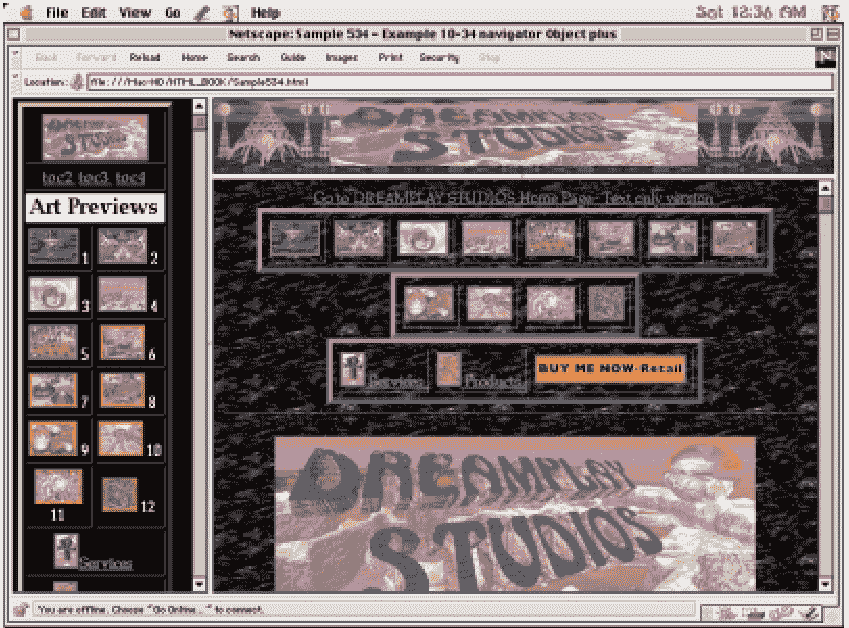

## JavaScript Number 核心对象

## JavaScript 语法：

```
new Number(value);
numberName = new Number(value);
```

要创建一个 **Number** 对象，您需要使用关键字 **new** 以及 Number 构造函数，其中 **value** 是该对象的数值。这是一个用途有限的对象，主要用在需要获取该对象所提供的特殊数学属性时。

## Number 属性

| 属性 | 说明 |
|----------|-------------|
| MAX_VALUE | 其值为 JavaScript 能表示的最大数字，约为 1.79E+308。它是 Number 的只读静态属性，始终通过 **Number.MAX_VALUE** 调用，而不是作为您创建的 Number 对象的属性。更大的数字会溢出为 Infinity。 |
| MIN_VALUE | 其值为 JavaScript 能表示的最小数字（趋近于零时），约为 2.22E-308。注意这不是最小的负数。它是 Number 的只读静态属性，始终通过 **Number.MIN_VALUE** 调用。更小的数字会溢出为零。 |
| NaN | 其值为 NaN，表示非数字（Not-a-Number），这是一个不加引号的字面量。它始终不等于任何数字，甚至不等于它自己。您不能在条件语句中将 NaN 用作测试参数，但可以使用全局函数 **isNaN(value)** 来测试某个值是数字还是 NaN。 |
| NEGATIVE_INFINITY | 其值为 **"-Infinity"**，表示数学上的负无穷大，其行为也与之相同。它在溢出时返回。它是 Number 的只读静态属性，始终通过 **Number.NEGATIVE_INFINITY** 调用。 |
| POSITIVE_INFINITY | 其值为 **"Infinity"**，表示数学上的正无穷大，其行为也与之相同。它在溢出时返回。它是 Number 的只读静态属性，始终通过 **Number.POSITIVE_INFINITY** 调用。 |
| prototype | 允许您为 **Number** 对象创建自己的属性。 |

## Number 方法

| 方法 | 说明 |
|---|---|
| toString([radix]) | 将 **Number** 对象转换为字符串并返回该字符串。可选的 **radix** 参数指定一个 2 到 16 之间的数字，作为转换的基数。如果未指定，默认值为 10。不能在数值字面量上使用此方法。 |

以下示例演示了 **Number** 对象的一些属性。

### 示例 4-35：Sample535.html

```
<!DOCTYPE HTML PUBLIC "-//W3C//DTD HTML 3.2//EN">
<HTML>
<HEAD>
<TITLE>Sample 535 - Example 4-35  Number Object  </TITLE>

<SCRIPT LANGUAGE="JavaScript1.2"><!--BEGIN HIDING

myNumber1 = new Number(55);
myNumber2 = Number.MAX_VALUE * 10;
myNumber3 = Number.MIN_VALUE / 1000000000000000;
myNumber4 = Number.MIN_VALUE / 10000000000000000;
myNumber5 = Number.MAX_VALUE;
myNumber6 = Number.MIN_VALUE

document.write("myNumber1 = " + myNumber1 + "<BR>");
document.write("myNumber2 = " + myNumber2 + "<BR>");
document.write("myNumber3 = " + myNumber3 + "<BR>");
document.write("myNumber4 = " + myNumber4 + "<BR>");
document.write("myNumber5 = " + myNumber5 + "<BR>");
document.write("myNumber6 = " + myNumber6 + "<BR>");

//END HIDING-->
</SCRIPT>
</HEAD>

<BODY>
<P>
Note that on the Macintosh platform you can create numbers that are smaller than
<B>Number.MIN_VALUE</B> as it approaches zero.  The values for <B>myNumber3</B> and
<B>myNumber4</B> demonstrates this.  Theoretically any number larger than 1 that
divides Number.MIN_VALUE should cause the result to overflow to zero, but look at
how large a number it actually takes to cause the overflow.(10000000000000000)
</P>
</BODY>
</HTML>
```

## JavaScript select 对象

## JavaScript 语法：

```
document.formName.selectName;
document.formName.elements[index];
```

**select** 对象是一个可供用户选择的选项列表。根据配置不同，它可以是滚动列表或弹出式菜单。有关 SELECT 元素及其属性的定义详情，请参阅 CD-ROM 上的 HTML 40 指南，或仅查看第 1011 页附录 A 中的语法。示例请参见索引。

**select** 对象是 **form** 对象的属性，而 **options[i]** 数组是 **select** 对象的属性。**select** 对象无法用 JavaScript 创建。您必须使用 HTML 语法来创建 **select** 对象，以及任何可选的事件处理程序。然后 JavaScript 解释器会自动创建 **select** 对象，并将其反映为对应的 SELECT 元素。您也可以使用 **document.write()** 方法直接从 JavaScript 脚本中创建 SELECT 元素。

当 JavaScript 解释器根据 HTML 代码创建 **select** 对象时，它还会创建 **options[i]** 数组作为 **select** 对象的属性。**options[i]** 数组的每个元素包含一个 **option** 对象，该对象反映一个 HTML OPTION 元素。它们按源代码顺序加载到数组中。然后您可以通过 **options[i]** 数组中的 **index** 编号来访问单个 **option** 对象。

**option** 对象本身是**只读**属性，这意味着您无法通过为其分配不同的值来更改 **option**。但是，您可以更改 **option** 的 **text** 属性的值，这将导致新的文本字符串显示在浏览器中。**options[i]** 数组将在下一节中更详细地介绍。有关 **Array** 对象的更多信息，请参阅第 7 章。

由于 **select** 和 **option** 对象在对象层级中处于较深层级，因此用代码访问它们（即引用它们并访问其属性和方法）可能会非常麻烦。因此，通常建议为这些对象及其属性的不同方面设置变量，以使代码更具可读性。示例请参见第 501、650-657 页。

### Select 事件处理程序

- **onBlur**
- **onChange**
- **onFocus**


 ## 第4章 — 对象与函数

## Select 属性的 JavaScript 语法：

```
document.formName.selectName.propertyName;
document.formName.elements[index].propertyName;
```

## Select 属性

| 属性 | 说明 |
|---|---|
| **form** | 一个只读属性，反映包含当前 **select** 对象的 **form** 对象。 |
| **length** | 反映 **options[i]** 数组中 **option** 对象元素的数量。 |
| **name** | 反映 **select** 对象的 NAME 属性。 |
| **options[i]** | 一个数组，每个数组元素反映一个 **option** 对象。 |
| **selectedIndex** | 一个整数，指定当前选中的 **option** 对象的基于零的索引。如果选中了多个 **option** 对象，则反映列表中的第一个。你可以设置此属性，使不同的 **option** 对象成为当前选中状态。 |
| **type** | 如果对象是 **select** 对象，则 **type** 的值为 "select-one"。如果对象是 **select** 对象且 HTML SELECT 元素中包含布尔 MULTIPLE 属性，则 **type** 的值为 "select-multiple"。这是一个只读属性。 |

## Select 方法的 JavaScript 语法：

```
document.formName.selectName.methodName(parameters)
document.formName.elements[index].methodName(parameters)
```

## Select 方法

| 方法 | 说明 |
|---|---|
| **blur()** | 移除 **select** 对象的焦点。 |
| **focus()** | 为 **select** 对象赋予焦点。 |
| **handleEvent()** | 调用指定事件的事件处理程序。 |

## JavaScript options[i] 数组

## JavaScript 语法：

```
document.formName.selectName.optionName;
document.formName.selectName.options[index1];
document.formName.elements[index2].options[index1];
```

options[i] 数组是 select 对象的一个属性。它由 JavaScript 解释器根据 HTML 自动创建，使得每个 HTML OPTION 元素都成为一个 option 对象，位于 options[i] 数组各自的数组元素中。

### 删除 option 对象

要从 select 对象中删除 option 对象，请使用以下语法：

## JavaScript 语法：

```
document.formName.selectName.options[index1] = null;
```

### 删除多个 option 对象

要从 select 对象的 options 数组末尾删除多个 option 对象，请使用以下语法，通过指定一个整数来截断数组：

## JavaScript 语法：

```
document.formName.selectName.options.length = integer;
```

### options[i] 数组属性的 JavaScript 语法：

```
document.formName.selectName.optionName.propertyName;
document.formName.selectName.options[index1].propertyName;
document.formName.elements[index2].options[index1].propertyName;
```

## options[i] 数组属性

| 属性 | 说明 |
|---|---|
| **length** | 反映数组中的选项数量。 |
| **selectedIndex** | 反映当前选中的选项的基于零的索引号。 |

## options[i] 数组元素属性

| 属性 | 说明 |
|---|---|
| **defaultSelected** | 反映 **option** 是否具有 SELECTED 属性。如果有，值为 **true**，否则为 **false**。 |
| **index** | 反映 **option** 的基于零的 **index** 编号。 |
| **selected** | 反映 **option** 当前是否被选中。这是一个布尔属性，如果 **option** 被选中则为 **true**，未选中则为 **false**。 |
| **text** | 反映 **option** 的 VALUE 属性中包含的文本字符串。 |
| **value** | 反映 **option** 的当前 VALUE 属性，如果表单被提交，该属性将作为 VALUE=value 对返回给服务器。 |

## JavaScript option 对象

**option** 对象由 **Option()** 构造函数创建。

要创建一个新的 **option** 对象，请使用以下语法：

## JavaScript 语法：

```
new Option(text, value, defaultSelected, selected);
optionName = new Option(text, value, defaultSelected, selected);
```

### 参数定义：

| 参数 | 说明 |
|---|---|
| **text** | 指定要显示的文本字符串的参数，与 HTML 代码中 OPTION 元素的开始标签和结束标签之间显示的文本相同。 |
| **value** | 指定 VALUE 属性值的参数。 |
| **defaultSelected** | 可选参数，指定 **option** 是否初始被选中。 |
| **selected** | 可选参数，指定 **option** 当前是否被选中。 |
| **optionName** | 分配给 **option** 对象的变量名。 |

### 将 option 对象添加到 select 对象

要将 **option** 对象添加到 **select** 对象，请使用以下语法：

## JavaScript 语法：

```
document.formName.selectName.options[indexN] = optionName;
```

## option 对象属性

| 属性 | 说明 |
|---|---|
| **defaultSelected** | 指定 **option** 的初始选择状态，如果选中则值为 **true**，未选中则为 **false**。 |
| **index** | 指定 **option** 的基于零的 **index** 编号。 |
| **prototype** | 允许你为 **option** 对象创建新属性。 |
| **selected** | 指定 **option** 的当前选择状态。这是一个布尔属性，如果 **option** 被选中则值为 **true**，未选中则为 **false**。 |
| **text** | 指定 **option** 的文本字符串，该文本显示在 **select** 对象中。 |
| **value** | 指定 **option** 的当前 VALUE 属性，如果表单被提交，该属性将作为 Value=value 对返回给服务器。 |

以下是一份示例文件列表，其中使用了 **select** 对象。如果你想将这些示例与书中的代码进行交叉参考，请参阅附录 C，第1039页及以后，获取示例的页码。

| 示例文件名，行号 | 示例用法 |
|---|---|
| Sample71-SimpleForm.html, 第63行： | `<SELECT NAME="UPSshippingoptions" SIZE=1>` |
| Sample71-OrderForm.html, 第147行： | `<SELECT NAME="creditcardtype" SIZE=1>` |
| Sample73.html, 第15行： | `<SELECT NAME="select2" SIZE=3 MULTIPLE>` |
| Sample724.html, 第23行： | `<SELECT NAME="getBackColor" SIZE="1" onChange="changeEverything(); return false;">` |

## 新的 JavaScript 核心函数

JavaScript 1.2 for Navigator 4.0 有两个新的核心函数。它们是 `Number` 函数和 `String` 函数。你也可以将这些函数视为全局函数，它们不与任何特定对象相关联，而是 JavaScript 语言本身的一部分。确保不要将它们与对应的 Number 对象和 String 对象混淆。

## JavaScript Number 核心函数

## JavaScript 语法：

```
Number(x);
```

Number 函数是一个核心函数，将 x 参数（任何对象）转换为数字。如果 x 对象是无法转换为有效数字的字符串，则返回 `NaN`。例如，以下脚本：

### 迷你示例：

```
<SCRIPT LANGUAGE="JavaScript1.2">

today = new Date();
dateConversion = Number(today);

myMinutes = today.getMinutes();
minutesConversion = Number(myMinutes);

document.write("dateConversion in milliseconds = " + dateConversion + "<BR>");
document.write("minutesConversion = " + minutesConversion + "<BR>");

</SCRIPT>
```

在1998年2月16日凌晨3:22，浏览器中的输出如下：

dateConversion in milliseconds = 887617357173
minutesConversion = 22

## JavaScript String 核心函数

## JavaScript 语法：

```
String(x);
```

**String** 函数是一个核心函数，将 **x** 参数（任何对象）转换为字符串。

此示例展示了几个对象转换为字符串后的输出。

### 示例 4-36：Sample536.html

```
<!DOCTYPE HTML PUBLIC "-//W3C//DTD HTML 3.2//EN">
<HTML>
<HEAD>
<TITLE>Sample 536 - Example 4-36     String Function  </TITLE>
</HEAD>

<BODY>
<H2>Sample 536</H2>

<LAYER ID="L1" LEFT="20" TOP="370" WIDTH=400 HEIGHT=40 BGCOLOR="cyan">
Test Layer </LAYER>

<SCRIPT LANGUAGE="JavaScript1.2"><!--BEGIN HIDING

today = new Date();
todayString = String(today);

dateConversion = Number(today);
dateString = String(dateConversion);

myWindow = String(window);
myLayer = String(document.L1);

	document.write("dateConversion = " + dateConversion + "<BR>");
	document.write("todayString = " + todayString + "<BR>");
	document.write("dateString = " + dateString + "<P>");
	document.write("myWindow = " + myWindow + "<P>");
	document.write("myLayer = " + myLayer + "<P>");

//END HIDING-->
</SCRIPT>

</BODY>
</HTML>
```


上一个示例产生以下浏览器输出：

## 示例 536

```
dateConversion = 887619422650
todayString = Mon Feb 16 03:57:02 1998
dateString = 887619422650

myWindow = [length:undefined, frames:undefined, parent:undefined, top:undefined,
self:undefined, name:undefined, status:undefined, defaultStatus:undefined,
opener:undefined, closed:undefined, innerWidth:undefined, innerHeight:undefined,
outerWidth:undefined, outerHeight:undefined, screenX:undefined, screenY:undefined,
pageXOffset:undefined, pageYOffset:undefined, secure:undefined, frameRate:undefined,
offscreenBuffering:undefined, document, history,
location:file:///Mac-HD/HTML_BOOK/Sample536.html, crypto:[],
menubar:[visible:undefined], toolbar:[visible:undefined], locationbar:[visible:undefined],
personalbar:[visible:undefined], statusbar:[visible:undefined],
scrollbars:[visible:undefined], today:Mon Feb 16 03:57:02 1998,
todayString:"Mon Feb 16 03:57:02 1998",
dateConversion:887619422650, dateString:"887619422650"]

myLayer = [clip:[left:undefined, top:undefined, right:undefined, bottom:undefined,
height:undefined, width:undefined], document:]
```

## 第二部分
JavaScript 1.2

## 第 5 章
语句与运算符

## 第 5 章
语句与运算符

### 目录

- ### JavaScript 语句 (473)
- 5.1) 什么是 JavaScript 语句 (473)
- 5.2) 语句的分类 (473)
- 5.3) JavaScript 语句总览表 (474)
- ### 条件语句 (475)
- 5.4) JavaScript if() 语句 (475)
- 5.5) JavaScript if()...else 语句 (477)
- 5.6) 嵌套 if() 语句 (478)
- 5.7) 嵌套 if()...else 语句 (479)
- 5.8) ( )? : 条件运算符语句 (480)
- 5.9) switch() 语句 (481)
- ### 循环语句 (484)
- 5.10) for() 语句 (484)
- 5.11) while() 语句 (486)
- 5.12) do while() 语句 (488)
- 5.13) labeled : 语句 (490)
- 5.14) break 语句 (491)
- 5.15) continue 语句 (494)
- ### 对象操作语句 (498)
- 5.16) for...in 语句 (498)
- 5.17) with() 语句 (500)
- 5.18) <STYLE> 元素中的 with() 语句 (502)
- 5.19) var 语句 (503)
- 5.20) function 语句 (505)
- 5.21) return 语句 (506)
- 5.22) export 语句 (506)
- 5.23) import 语句 (507)
- 5.24) delete 语句 (508)
- ### 注释语句 (508)
- 5.25) 单行与多行注释语句 (508)
- ### JavaScript 运算符 (509)
- 5.26) 什么是 JavaScript 运算符？ (509)
- 5.27) 运算符的分类 (510)
- 5.28) 特殊运算符 (510)
- 5.29) new 关键字运算符 (510)
- 5.30) this 关键字运算符 (510)
- 5.31) typeof 关键字运算符 (512)
- 5.32) void 关键字运算符 (514)
- 5.33) ( , ) 逗号运算符 (514)
- 5.34) 比较运算符 (515)
- 5.35) 算术运算符 (515)
- 5.36) 字符串运算符 (516)
- 5.37) 逻辑运算符 (516)
- 5.38) 赋值运算符 (517)
- 5.39) 位运算符 (517)
- ### JavaScript 表达式 (518)

## JavaScript 语句

## 什么是 JavaScript 语句？

JavaScript 语句是"幕后的动作"，其中潜藏着交互性和强大的脚本潜能，等待着你的想象。你越是深入研究，就越能发现语句所固有的、并非立即显现的能力。语句的主要用途之一是让你编写脚本，在某个条件为真时执行一个动作，而在该条件为假时执行另一个动作。循环语句允许你在条件为真时反复执行相同的动作。在很多情况下，该动作会遍历数组中的所有元素。

## JavaScript 语句的分类

JavaScript 语句可以按以下方式分类：

| 条件语句 | 循环语句 | 对象操作语句 | 注释语句 |
| :--- | :--- | :--- | :--- |
| if<br>if...else<br>switch<br>? : | for<br>while<br>do while<br>labeled<br>break<br>continue | for...in<br>with<br>var<br>function<br>return<br>export<br>import<br>delete | //单行注释<br>/*多行 ...<br>... 注释*/ |

以下三个语句没有名称，因此通常不作为此类列出，但它们仍然是语句。

| 语句 | 简明定义 | 微型示例 |
| :--- | :--- | :--- |
| 属性访问 | 访问对象的属性 | myArray1.length |
| 方法调用 | 调用对象的方法 | window.open() |
| 赋值 | 将表达式的值赋给变量 | a = b + c |

# 第二部分 — JavaScript 1.2

## JavaScript 语句总览表

| 语句 | 简明定义 |
|-----------|------------------|
| break | 结束包含它的当前 **while** 或 **for** 循环，并将程序控制转移到被终止循环后面的语句。 |
| comment | 作者添加的解释性注释，JavaScript 解释器会忽略它们。 |
| continue | 暂停 **while** 循环中的语句块并跳回条件判断。变频器暂停 **for** 循环中的语句块并跳回更新表达式。 |
| delete | 销毁对象的属性或数组中的元素。 |
| do...while | 只要测试条件为真，就执行前面的语句块，并且由于条件后置，至少执行一次。 |
| export | 在签名脚本中向其他签名或未签名脚本提供函数、对象和属性。 |
| for | 循环语句，基于其三个可选表达式的参数执行语句块，这些表达式位于圆括号内，以分号分隔。 |
| for...in | 对象操作语句，使用指定变量遍历对象的每个属性并执行语句块。 |
| function | 定义逗号分隔的、带括号的参数以及由花括号括起来的命名语句块，调用时作为一个整体执行。参数可以是字符串、数字或对象。参见第 371-385、505 页。 |
| if | 语句，如果指定条件为真或表达式求值为真，则执行一次语句块。如果为假，则不执行任何操作。 |
| if...else | 语句，如果指定条件为真或表达式求值为真，则执行一次语句块。如果条件为假，则执行替代的语句块。 |
| ? : | 条件运算符语句。**if** ()...**else** 的简写形式。 |
| import | 脚本用于从已导出它们的签名脚本中导入函数、对象和属性的语句。 |
| labeled | 命名语句，其名称与语句块之间用冒号分隔。**break** 或 **continue** 语句使用该名称作为程序继续执行语句的跳转点。 |
| return | 指定函数调用返回值的语句。 |
| switch | 条件语句，根据求值表达式是否与 case 标签的值匹配来执行相应的替代语句。 |
| var | 声明变量的语句，可选择为其赋值。 |
| while | 循环语句，只要判定表达式求值为真，就执行语句块。 |
| with | 标识默认对象以将语句块应用于其上的语句。 |

## 条件语句

## JavaScript if () 语句

## JavaScript 语法：

```
if (condition) {
    statementsIfTrue;
}
```

### 参数说明：

好吧，严格来说，技术上并没有 if () 语句，因为严格地说，所有这些都是 if ()...else 语句，只是省略了可选的 else 部分。出于教学目的，这样入手更容易，而且在实际使用中 else 经常被省略。

if () 语句会执行语法中由 statementsIfTrue 指定并用花括号括起来的语句块，如果圆括号内的条件求值为真。条件可以是像 (x >= 5) 这样的表达式，或者像 (booleanTest) 这样的表达式。

你甚至可以这样测试页面中是否存在某个对象：

```
(myLayer1)
```

只要文档中存在名为 myLayer1 的图层，语句就会执行。

你也可以像这样测试多个条件：

```
if (x >= 0 && x <= 77)
```

或者这样：

```
if (myLayer.top > 0 || myLayer.clip.right < myLayer.width)
```

如果条件求值为假，则语句块不会执行，程序控制返回到 if () 语句后面的语句。如果只需执行一条语句，则可以省略花括号 { }。如果你想在同一行编写多条语句，需要用分号分隔它们。除此之外，分号语句分隔是可选的。选择一种方式并坚持使用，以便于调试代码。


 # 476 第二部分 — JavaScript 1.2

下面是一个简单示例，当变量 **x** 小于或等于 4 时，包含在 **if () 语句**中的改变文档背景色的语句将会执行，这使得 **条件** 求值为真。由于只有一个可执行语句，因此 **if() 语句** 的花括号是可选的，本例中省略了花括号。如果加上花括号有助于你阅读代码，也可以使用它们。但是，请记住对于函数声明，花括号是<u>始终必需的</u>。

```
function changeColor() {
    if (x <= 4)
        document.bgColor = 'purple';
}
```

下面是另一个简单示例，当布尔变量 **booleanTest** 求值为真时，**if () 语句** 中的语句块将会执行：

```
function changeColor() {

    if (booleanTest) {
        document.myLayer1.clip.width = 500;
        document.myLayer1.clip.height = 400;
        document.myLayer1.visibility = 'show';
        document.myLayer2.visibility = 'hide';
    }
}
```

此处，**clip.right** 属性必须小于 800，且名为 **layer1** 的 **Layer** 的 **clip.bottom** 属性必须小于 400，**条件** 才能求值为真。

```
function LargeView3() {

    if (layer1.clip.right < 800 && layer1.clip.bottom < 400) {
        document.layer1.moveTo(20, 10);
        document.layer1.resizeBy(8, 4);
        document.layer1.moveAbove(document.layer2);
    }
}
```

你也可以通过使用 **逻辑非** 运算符 **!** 来测试假 **条件**，如下所示：

## JavaScript 语法：

```
if (! condition) {
    statementsIfFalse;
}
```

## JavaScript if (())...else 语句

`if (())...else` 语句测试一个 **条件**，如果该 **条件** 是一个求值为真的 **表达式**，则大括号内的 **statementsIfTrue** 语句块将会执行。如果 **条件** 求值为假，则 else 后面的 **statementsIfFalse** 语句块将会执行。这两个语句块都可以包含进一步嵌套的 `if (())...else` 语句，这种可能性将在后续章节中介绍。你将在自己的代码中大量使用 `if (())...else` 语句。

## JavaScript 语法：

```
if (condition) {
    statementsIfTrue;
}
else {
    statementsIfFalse;
}
```

### 迷你示例：

在这个迷你示例中，如果 **myBoolean** 变量为真，则名为 **myLayer1** 的 Layer 会被修改。如果 **myBoolean** 变量为假，则名为 **myOtherLayer2** 的另一个 Layer 会被修改。显然，需要有其他 JavaScript 代码来改变 **myBoolean** 变量的值，才能使 **changeColor()** 函数具有实际意义。

```
function changeColor() {
    if (myBoolean) {
        document.myLayer1.bgColor = 'purple';
        document.myLayer1.visibility = 'show';
    }
    else {
        document.myOtherLayer2.bgColor = 'green';
        document.myOtherLayer2.visibility = 'show';
    }
}
```

# 第 5 章 — 语句与运算符 479

## 嵌套 if () 语句

## JavaScript 语法：

```
if (condition) {
     statementsIfTrue;

     if (condition2) {
          statementsIfTrue2;
     }
}
```

### 参数说明：

有时在一个 **if ()** 语句中同时测试两个 **条件** 会显得不够直观、不便或不可能，因此实际的解决方案是将一个 **if ()** 嵌套在另一个 **if ()** 内部。这使得程序首先测试第一个 **条件**，如果该 **表达式** 求值为真，则继续执行这些语句，在这种情况下是一个第二个 **if ()** 语句，它继续测试第二个 **condition2**。如果第二个 **condition2** 也为真，则执行 **statementsIfTrue2** 语句块。如果两个 **条件** 中任意一个求值为假，则脚本将跳出 **if ()**，并在紧接 **if ()** 之后的下一个位置继续执行。

此处，第二个 **if ()** 语句作为第一个 **条件** 求值为真时要执行的语句块。你也可以在第二个 **if ()** 语句之前或之后有其他要执行的语句，如下一节关于嵌套 **if ()...else** 语句的第二个示例所示。

### 迷你示例：

在本示例中，如果两个布尔变量都为真，则使用 **document.write()** 方法写入文本字符串。

```
if (badHairDayBoolean)  {
     if (seriousHangoverBoolean)  {

          document.write("Reality Bytes, Stay in Bed Today");
     }
}
```

通常，使用 (&&) 来编写此代码被认为是更好的编程风格，但有时在测试键事件和修饰键时，这样做可能不太可行：

```
if (badHairDayBoolean  &&  seriousHangoverBoolean)
     {document.write("Reality Bytes, Stay in Bed Today"); }
```

## 嵌套 if ()...else 语句

## JavaScript 语法：

```
if (condition) {
    statementsIfTrue;

    if (condition2) {
        statementsIfTrue2;
    }
    else {
        statementsIfFalse2;
    }
}
else {
    statementsIfFalse;
}
```

### 参数说明：

当你使用嵌套的 **if ()** 或 **if ()...else** 语句时，需要知道它们可以是任意组合的嵌套或多重嵌套的 **if ()** 或 **if ()...else** 语句，最多可以有 255 个。如果你在一个 **if ()...else** 语句内部嵌套另一个 **if ()...else** 语句，其工作原理如下。

如果第一个 **条件** 求值为真，则执行随后的语句块。如果其中某个语句是 **if ()...else** 语句，则测试其 **condition2**，如果求值为真，则执行 **statementsIfTrue2** 语句块，否则执行 **statementsIfFalse2** 语句块。

如果第一个 **条件** 求值为假，则脚本跳转到 **else**，并执行 **statementsIfFalse** 语句块。

本书使用术语 **if ()** 作为 **if ()...else** 语句的简写，这是惯例，也为作者减少一些打字。

### 迷你示例：

在以下示例中，如果布尔变量 **myBoolean1** 为真，则 **document** 的背景色变为黄色。如果 **myBoolean1** 为假，则背景色变为红色。

如果布尔变量 **myBoolean1** 为真且 x 大于或等于 5，则 **myLayer1** 的背景色变为橄榄色。如果布尔变量 **myBoolean1** 为真且 x 小于 5，则 **myLayer1** 的背景色变为黑色。

```
if (myBoolean1) {
    document.bgColor = 'yellow';

    if (x >= 5) {
        document.myLayer1.bgColor = 'olive';
    }
    else {
        document.myLayer1.bgColor = 'black';
    }
}
else {
    document.bgColor = 'red';
}
```

## () ? : 条件运算符语句

## JavaScript 语法：

```
evaluatedResult = (condition) ? expression1 : expression2
```

### 参数说明：

这被非正式地称为条件运算符语句，基本上是 if () 语句的简写版本。如果条件为真，则返回 expression1 并赋值给 evaluatedResult 变量。如果条件为假，则返回 expression2 并赋值给 evaluatedResult 变量。条件可以是求值为真或假的表达式。expression1 和 expression2 可以是任意类型的值，包括但不限于：字符串、变量、数字和对象。两个表达式之间用冒号分隔。条件可以放在括号内，这是可选的，但建议这样做。

### 迷你示例：

在以下迷你示例中，如果 wonTheLottery 为真，则文本字符串 "congratulations" 被赋值给 myString 变量。如果 wonTheLottery 为假，则文本字符串 "condolences" 被赋值给 myString 变量。

```
myString = (wonTheLottery)  ?  "congratulations" : "condolences";
```

## switch() 语句

## JavaScript 语法：

```
switch (expression) {
    case label1 :
        statements;
        [break;]
    case label2 :
        statements;
        [break;]
        ...
    [default :
    statements;]
}
```

### 参数说明：

**switch()** 语句在 Navigator 4 中是全新的，而且非常酷。它的语法与 Java 完全相同。它的最佳用途之一是检测 ASCII 键值，在第 6 章中有大量示例，如第 588 页的 6-15、第 623 页的 6-20、第 628 页的 6-21、第 632 页的 6-22 和第 648 页的 6-23，展示了这种技术的各种有用的实现形式。下面介绍它的工作原理。

首先，在以下语法中，关键字 **switch**、**case**、**break** 和 **default** 不会被作者替换，也就是说，请完全按照你看到的方式编写代码。其余术语是供你填写的占位符。**标签（labels）** 通过冒号与 **语句（statements）** 分隔。**break** 和 **default** 语句是可选的。**break** 语句和 **statements** 各自用分号分隔，而不是冒号。

你以名称 **switch** 开头，然后是一个放在括号内的 **表达式（expression）**。接着在大括号内包含以下内容：对于每个 **case**，你从 **label1** 开始，将其与括号中的 **expression** 进行匹配。如果它们相等，则执行该 case 的 **statements**。该 **case** 的 **statements** 是紧跟在 **case label1** 后面的冒号之后的语句。如果存在可选的 **break** 语句，程序将跳转到 **switch()** 语句的末尾。如果没有 **break** 语句，则 **switch()** 语句中的其余 **statements** 将继续执行。

如果 **label1** 与 **expression** 不匹配，则 **switch()** 将测试 **label2** 是否与 **expression** 匹配。如果匹配，则执行与 **label2** 关联的 **statements**，如果存在 **break**，则跳出。此过程持续进行，直到所有 **case labels** 都已测试完毕。

如果没有任何 **case labels** 与 **expression** 匹配，则调用可选的 **default** 语句，并执行与其关联的 **statements**。

在以下示例中，假设变量 **myColor** 已通过其他 JavaScript 处理被更改为不同的颜色。**switch()** 语句使用 **myColor** 作为要与 **case labels** 匹配的表达式。如果 **myColor** 是 'blue'，则执行语句 document.layer1.bgColor = 'blue';，将 **layer1** 的背景色更改为蓝色，并由于 **break** 语句而退出 **switch()** 语句。

如果 **myColor** 不等于 'blue'，则 **switch()** 继续测试，直到找到匹配项或到达 **default** 语句，并将 **layer1** 的背景色更改为白色。

请确保你理解以下语句中包含的 `blue`：

```
document.layer1.bgColor = 'blue';
```

与变量 **myColor**（用作表达式）和 **case label** `'blue'` 之间发生的测试匹配没有任何关系。

```
var myColor;

function changeColor()  {

   switch (myColor) {

      case 'blue' :
           document.layer1.bgColor = 'blue';
           break;

      case 'red' :
           document.layer1.bgColor = 'red';
           break;

      case 'purple' :
           document.layer1.bgColor = 'purple';
           break;

      case 'green' :
           document.layer1.bgColor = 'green';
           break;

      default :
           document.layer1.bgColor = 'white';
   }
}
```

## 第 5 章 — 语句与运算符

483

### 参数说明：

当你希望在两个 case label 中的任何一个与表达式匹配时执行相同的语句块，则使用以下语法。两个 case label 用冒号分隔。如果你想拥有两个以上的 case，则根据需要添加尽可能多的 case，并用冒号分隔每个 case。

## JavaScript 语法：

```
switch (expression) {
    case label1 : case label2 :
        statements;
        [break;]
    case label3 : case label4 :
        statements;
        [break;]
    ...
    [default :
        statements;]
}
```

### 迷你示例：

两个 case，例如 case '188' : case '48' :，涵盖按下其关联数字键时可能的两个 ASCII 值。这考虑到了拥有扩展键盘的用户。表达式 e.which.toString() 求值结果为数字字符串。完整版本请参见 Sample721.html，更多关于键盘事件的信息请参见第 6 章。

```
function scrollLayers(e)  {
    switch (e.which.toString())  {
        //按下 ALT + 0 键
        case '188' : case '48' :
        document.Layer2.moveTo(150,250);
        break;
        //按下 ALT + 1 键
        case '193' : case '49' :
        document.Layer2.moveBy(-30,30);
        break;
        //按下 ALT + 2 键
        case '170' : case '50' :
        document.Layer2.moveBy(0,30);
        break;
        default : return false;
    }
}
```

## 循环语句

## for() 语句

## JavaScript 语法：

```
for ([initialExpression]; [condition]; [updateExpression]) {
    statements;
}
```

### 参数说明：

**for()** 语句需要一点时间来适应，但一旦掌握，你就会认识到它非常强大，可以为你节省大量输入和时间。括号中包含的三个可选表达式中的前两个后面跟着一个分号。如果不是立即显而易见的话，**condition** 也是一个表达式。它们后面跟着一个语句块，包含在大括号内，这些语句基于这些表达式执行。

作者最常用 **for()** 语句的方式是使用 **initialExpression** 来声明和初始化一个变量，如下所示：

```
var i=0;
```

然后声明 **condition** 表达式，它告诉 **for()** 语句在什么情况下允许继续循环。下面是一个典型的实现：

```
i<4;
```

最后，**updateExpression** 用于递增在 **initialExpression** 中声明的变量，如下所示：

```
i++
```

如果你对你的运算符术语有些生疏：

在此情况下，**i++** 表示将变量 **i** 递增 1。

将所有内容组合在一起并添加一个要执行的语句，我们得到：

```
for (var i=0; i<4; i++)  {
     document.write('The number iterated is ' + i + '<BR>');
}
```

这将在浏览器中产生以下输出：

The number iterated is 0
The number iterated is 1
The number iterated is 2
The number iterated is 3

前面的 **for()** 语句可以这样理解：对于从值零开始的变量 **i**，只要 **i** 小于 4，就执行 **document.write()** 语句。每次迭代后，将 **i** 的值增加一，并从 **condition** 开始重复循环，以便如果 **i** 仍然小于四，则循环继续。

一旦 **condition** 求值为 false，循环即终止，控制权返回到 **for()** 语句末尾的程序。

## 编程技巧

许多作者在 **for()** 语句中声明变量 **i** 的原因是这样的：`var i=0;` 这样变量只在包含 **for()** 循环的函数内部已知，并且可以在其他函数中重用同一个变量，在那里它将具有独立的值，而且两个实例不会相互影响。当你需要在同一函数中使用多个 **for()** 语句时，一种选择是在函数中的第一个 **for()** 语句中使用变量 **i**，在第二个 **for()** 语句中使用变量 **j**，在第三个中使用变量 **k**。这在处理多级数组时有助于跟踪参数和调试。**i**、**j** 和/或 **k** 变量可用于通过数组 **索引（index）** 号访问和操作数组元素。有关数组的更多信息，请参见第 7 章。

如果你想最大化内存分配效率，则可以在同一函数中的多个连续 **for()** 循环中重用相同的变量 **i**。

### 迷你示例：

此示例仅声明一个名为 **myArray** 的数组，并使用 **for()** 语句将每个数组元素单独写在一行上。

```
function writeClients() {
  var myArray = new Array('Name', 'Address', 'City', 'State');
  for (var i=0; i<myArray.length; i++) {
    document.write(myArray[i] + '<BR>');
  }
}
```


## while() 语句

## JavaScript 语法：

```
while (condition) {
    statements;
}
```

### 参数定义：

**while()** 语句创建一个循环，只要 **condition** 参数中的表达式求值为 true，循环就会继续。在确定 **condition** 为 true 后，循环将执行 **statements** 代码块，然后检查 **condition** 是否仍为 true 并重复循环。当 **condition** 求值为 **false** 时，循环终止，脚本从 **while()** 语句之后继续执行。

在许多情况下，你会使用此语句并在可执行的 **statements** 代码块中提供自己的递增语句。在 **statements** 中提供某种机制以使循环最终变为 **false** 至关重要，否则你将陷入无限循环。

### 迷你示例：

在以下示例中，**i** 初始化为零，**x** 初始化为 5。只要 **i** 小于 4，循环就会将 **i** 递增 1，然后将 **x** 和 **i** 相加，并将结果赋值给 **x**。

第一次循环后，

x = 6

且

i = 1

第二次循环后，

x = 8

且

i = 2

第三次循环后，

x = 11

且

i = 3

第四次循环后，

x = 15

且

i = 4

第五次循环时，由于循环开始时 **i** = 4，这导致 **condition** 求值为 **false**，循环终止，**x** 的最终值保持为 15。

```
i = 0;
x = 5;

while (i < 4) {
    i++;
    x += i;                    //this means       x = x + i;
}
```

### 迷你示例：

只要 **booleanTest** 变量为 true，此示例就会持续将 x 的值增加 1。当 x 等于 7 时，这将导致 **booleanTest** 被更改为 **false**，从而使 **condition** 变为 **false** 并停止循环。

```
function myWhileTest() {

booleanTest = true;
x = 0;

    while (booleanTest) {

        x = x + 1;

        if (x == 7) {
            booleanTest = false;
        }
    }
}
```

### 迷你示例：

此示例在同时按下 ALT 和 CONTROL **修饰符**键以及 5 键时，将窗口向下滚动 50 像素。

请注意，ALT_MASK + CONTROL_MASK 的 ASCII 值为 3，**e.modifiers** 表达式正是与此值进行比较。

```
document.captureEvents(Event.KEYPRESS)
document.onkeypress=scrollWindow;

function scrollWindow(e) {

    while (e.modifiers == 3 && e.which == 5) {

        window.scrollBy(0, 50);
    }
}
```

## do while( ) 语句

## JavaScript 语法：

```
do {
    statements;
} while (condition)
```

### 参数定义：

**do while( )** 语句与 **while()** 语句非常相似。主要区别在于，**statements** 保证至少执行一次，因为它们发生在第一次测试 **condition** 之前。**statements** 第一次执行后，将对 **condition** 进行求值。如果它求值为 **true**，则 **statements** 将再次执行。此循环持续进行，直到 **condition** 求值为 **false**，这导致循环终止，并将控制权返回到脚本中 **do while()** 语句之后的位置。再次强调，在 **statements** 中提供某种机制以使循环最终变为 **false** 至关重要，否则你将陷入无限循环。

### 迷你示例：

让我们采用前面的示例并使用 **do while()** 重写它。结果相同，唯一的区别是 **booleanTest** 是在 **statements** 执行之后进行评估。

```
function myDoWhileTest() {

    booleanTest = true;
    x = 0;

    do {

        x = x + 1;

        if (x == 7) {
            booleanTest = false;
        }

    } while (booleanTest)

}
```

### 迷你示例：

这里有一个更简单的示例，它演示了即使 **while()** **条件**指定 x 必须小于零并且在第一次求值时为 **false**，**statements** 仍然执行一次。变量 x 初始化为值 1，然后递增 2 并以值 3 写入屏幕。因为 3 不等于 1，所以循环立即终止。

TEMPORAL_MARK_0000I

x = 1;

do {
    x = x + 2;
    document.write(x);
}
while (x == 1)
```
### 迷你示例：

此示例演示了 **doItNow()** 函数内的一个 **do while()** 语句，该语句包含一个故障安全警告对话框，以补偿编码错误，旨在为未来的脚本植入一个思路。以下是浏览器输出，后跟代码。

z=10
z=15
z=20
z=25

```
function doItNow() {
    x = 0;
    y = 10;
    z = 0;

    do {
        z = x + y;
        document.write("z=" + z + "<BR>");
        x+=2;
        y+=3;
        if (x >= 50  ||  y >= 50) {
            alert("Logic Malfunction! Reevaluate.");
            break;
        }
    }
    while (x <= 10  &&  y <= 20)
}
```

## labeled 语句

## JavaScript 语法：

```
label : {
    statements;
}
```

### 参数定义：

**labeled** 语句不是循环语句，但它与 **break** 或 **continue** 语句一起在循环语句中使用。可以将 **labeled** 语句视为分配了标识符 **label** 的 **statements** 代码块，但赋值时不是使用等号，语法要求在 **label** 和花括号内的 **statements** 代码块之间使用冒号。

当使用 **break** 语句跳出 **labeled** 循环时，可以选择包含 **labeled** 语句的 **label** 标识符。这会导致程序跳出由 **label** 指定的 **labeled** 语句。当你在循环语句中有**多个 labeled** 语句时，这变得非常有用，因为你可以告诉循环你想跳出哪个 **labeled** 语句，而不仅仅是跳出整个循环。

当你在 **labeled** 循环语句中使用 **continue** 语句时，现在可以选择包含 **labeled** 语句的 **label** 标识符。这会导致程序终止当前 **labeled** 语句的执行，并在指定的 **labeled** 语句处继续。这让你能够精确选择希望从哪里恢复继续，而不仅仅是只能在循环开头继续。

请记住，为了在 **break** 或 **continue** 语句中使用 **label**，包含 **break** 或 **continue** 语句的语句本身必须是一个 **labeled** 语句。是的，这听起来像循环逻辑，但当你查看示例并思考时，它就合理了。

在接下来的关于 **break** 和 **continue** 语句的章节中，有几个使用 **labeled** 语句的示例。

## break 语句

## JavaScript 语法：

```
break;
break label;
```

### 参数定义：

`break` 语句不是循环语句，但它可以在 `for()` 循环或 `while()` 循环内部使用，以终止该循环的执行，从而将程序控制权返回到循环之后的语句。如果 `break` 语句用在 `labeled` 语句内部，则可选的 `label` 可用于指定你想要跳出的特定 `labeled` 语句。

`break` 语句可以作为 `if()` 语句的可执行 `statements` 的一部分使用，但前提是 `if()` 语句包含在循环语句（如 `for()` 或 `while()`）或 `labeled` 语句内部。有关 `break` 语句的其他用法，请参阅 `switch()` 语句部分。

### 迷你示例：

此示例将 x 递增 1，直到 x == 5，然后向 x 加 100，然后跳出 `while()` 循环。

```
x = 0;

while (x <= 10) {
    if (x == 5) {
        x = x + 100;
        break;
    }
    else x = x + 1;
}
```

### 迷你示例：

因为以下 `if()` 语句包含一个 `break` 语句，并且 `if()` 没有在循环语句中使用，所以它将在运行时生成错误。

```
if (x=3) {
    document.write(x + 5);
    break;
}
```


 ## 492 第二部分 — JavaScript 1.2

本示例仅演示了两个**带标签**语句的使用，它们分别具有**myLabeled1**和**myLabeled2**的**标签参数**。同时还演示了**break**语句的使用，该语句利用**标签**参数选项跳转到特定的**带标签**语句。查看示例后的输出以跟踪逻辑。

## 示例 5-0：Sample600.html

```
<!DOCTYPE HTML PUBLIC "-//W3C//DTD HTML 3.2//EN">
<HTML>
<HEAD>
<TITLE>示例 600 - 示例 5-0    break 和带标签语句   </TITLE>

<SCRIPT LANGUAGE="JavaScript1.2"><!--BEGIN HIDING

x=0;

myLabeled1 :
        while (x < 7) {
                document.write(x + "<BR>");

                myLabeled2 :
                        if (x == 5) {
                                document.write("<B>"+ (x + 5000) +"</B>");
                                break myLabeled1;
                        }
                        else {
                                document.write(x + 10 + "<BR>");
                                break myLabeled2;
                        }
                x++;
        }

//END HIDING-->
</SCRIPT>

</HEAD>

<BODY>
</BODY>
</HTML>
```

## 第 5 章 — 语句与运算符

上述示例产生以下输出：

0
10
1
11
2
12
3
13
4
14
5
5005

### 迷你示例：

若将上述示例用**for()**循环重写，替代**while()**循环，结果将完全相同，如下所示：

```
<SCRIPT LANGUAGE="JavaScript1.2"><!--BEGIN HIDING

myLabeled1 :
	for (x=0; x<7; x++) {
		document.write(x + "<BR>");

		myLabeled2 :
			if (x == 5) {
				document.write("<B>"+ (x + 5000) +"<\/B>");
				break myLabeled1;
			}
			else {
				document.write(x + 10 + "<BR>");
				break myLabeled2;
			}
	}

//END HIDING-->
</SCRIPT>
```

## `continue` 语句

## JavaScript 语法：

```
continue;
continue label;
```

### 参数说明：

`continue` 语句可用于 `for()` 循环或 `while()` 循环内部，用于终止循环内**语句**块的执行，然后继续执行循环的下一次迭代。不要将其与 `break` 语句混淆，后者会完全跳出循环。使用 `continue` 语句时，循环不会退出，仅退出循环内的**语句**块。

在 `for()` 循环内使用时，`continue` 语句将程序控制跳转回**更新表达式**。在 `while()` 循环内使用时，`continue` 语句将程序控制跳转回**条件判断**。

若 `continue` 语句在**带标签**语句内使用，则可以跳出该**带标签**语句，并使用可选的**标签**指定要跳转到的特定**带标签**语句。

`continue` 语句可作为**if()**语句的可执行**语句**之一，但仅当**if()**语句包含在 `for()` 或 `while()` 等循环语句内，或包含在**带标签**语句内时。

### 迷你示例：

此示例仅在 `myArray` 元素等于 5 时写入该元素：

```
myArray = {2, 7, 13, 11, 5};

for (var i = 0; i < myArray.length; i++) {
    if (myArray[i] == 5) {
        document.write(myArray[i] + "<BR>");
        continue;
    }
}
```

示例 5-1 是对前述示例 5-0 的轻微变体。它仅将**break**语句替换为**continue**语句以便比较。比较输出的差异，并比较这些示例之间**语句**逻辑的推进方式。

## 第 5 章 — 语句与运算符

## 示例 5-1：Sample601.html

```
<!DOCTYPE HTML PUBLIC "-//W3C//DTD HTML 3.2//EN">
<HTML>
<HEAD>
<TITLE>示例 601 - 示例 5-1  continue 语句</TITLE>

<SCRIPT LANGUAGE="JavaScript1.2"><!--BEGIN HIDING

       for (x=0; x<7; x++) {
              document.write(x + "<BR>");

               if (x == 5) {
                      document.write("<B>"+ (x + 5000) +"<\/B><BR>");
                      continue;
               }
               else {
                      document.write(x + 10 + "<BR>");
                      continue;
               }
       }

//END HIDING-->
</SCRIPT>

</HEAD>

<BODY>
</BODY>
</HTML>
```

上述示例产生以下输出：

0
10
1
11
2
12
3
13
4
14
5
5005
6
16

### 迷你示例：

此示例使用**break**语句在**x**等于 7 时终止**while()**循环；否则，**continue**语句会使**while()**循环再次循环。

```
x = 0;

while (x <= 10) {

	x = x + 1;
	if (x == 7) {
		x = x + 10;
		document.write("x=" + x + "<BR>");
		break;
	}
	else {
		document.write("x=" + x + "<BR>");
		continue;
	}
}
```

上述示例产生以下输出：

x=1
x=2
x=3
x=4
x=5
x=6
x=17

此示例演示了包含**while()**语句的**带标签**语句的使用，这些语句具有带有**标签**的**continue**语句。第一次使用 continue 语句跳转到**myLabeled1**语句，第二次使用跳转到**myLabeled2**语句。查看此示例代码后的输出，以便跟踪脚本序列。

## 第 5 章 — 语句与运算符

497

示例 5-2：Sample602.html

```
<!DOCTYPE HTML PUBLIC "-//W3C//DTD HTML 3.2//EN">
<HTML><HEAD>
<TITLE>示例 602 - 示例 5-2    continue 和带标签语句  </TITLE>

<SCRIPT LANGUAGE="JavaScript1.2"><!--BEGIN HIDING

x=0;
y=0;

myLabeled1 :
        while (x < 10) {
                document.write("x=" + x + "<BR>");

                myLabeled2 :
                        while (y < 8) {
                                if (y == 5) {
                                        document.write("y=" + (y + 10) + "<BR>");
                                        y++;
                                        continue myLabeled1;
                                }
                                else {
                                        document.write("y=" + (y + 100) + "<BR>");
                                        y++;
                                        continue myLabeled2;
                                }
                        }
                x+=3;
        }

//END HIDING-->
</SCRIPT>
</HEAD><BODY></BODY></HTML>
```

上述示例产生以下输出：

```
x=0
y=100
y=101
y=102
y=103
y=104
y=15
x=0
y=106
y=107
x=3
x=6
x=9
```

## 对象操作语句

### for...in 语句

**JavaScript 语法：**

```
for (var variable in object) {
    statements;
}
```

**参数说明：**

该语句在进入高级脚本编程之前的实用价值值得怀疑。

**for...in** 语句在技术上是循环语句，但它具有特殊用途，即专门对对象的属性进行操作。指定的 **variable** 参数会遍历指定 **object** 参数的所有属性。然后对于 **object** 的每个唯一属性，执行 **statements** 块。

将指定的 **object** 视为其每个属性将由 **variable** 参数依次表示，如同自动化的数组。

此外，每个属性的**值**可以表示为数组元素，其中 **variable** 参数可以通过替换其数组元素的 **index** 整数来单独遍历数组元素。通过查看示例会更加清楚。

注意 **object** 参数是对对象本身的引用，而非对象的字符串名称。这意味着不要将 **object** 参数用引号括起来。

**迷你示例：**

首先创建一个名为 **myObj** 的对象，使用字面量表示法，它有三个属性，分别名为 **title**、**author** 和 **pages**。然后使用 for...in 语句将每个属性 i 写入屏幕，再将每个属性值 **myObj[i]** 写入屏幕。

```
<SCRIPT LANGUAGE="JavaScript1.2"><!--BEGIN HIDING

myObj =  {title:"My Book", author:"Gilorien", pages:1100}

for (var i in myObj) {

    document.write("Prop Name = <B>" + i + "<\/B> has Value= ");
    document.write("<B>" + myObj[i] + "<\/B><BR>");
}

//END HIDING-->
</SCRIPT>
```


 ## 第五章 — 语句与运算符

上述脚本产生以下输出：

属性名 = `title`，值=`My Book`
属性名 = `author`，值=`Gilorien`
属性名 = `pages`，值=`1100`

## 小示例：

在下面的脚本中，对前面的脚本稍作修改，以输出`document`对象的属性和值：

```
<SCRIPT LANGUAGE="JavaScript1.2"><!--BEGIN HIDING

for (var i in document) {

document.write("Prop Name = <B>" + i + "</B> has Value = ");
document.write("<B>" + document [i] + "</B><BR>");

}

//END HIDING-->
</SCRIPT>
```

它在浏览器中产生以下输出：

Prop Name = `forms`，Value=`[length:undefined]`
Prop Name = `links`，Value=`[length:undefined]`
Prop Name = `anchors`，Value=`[length:undefined]`
Prop Name = `embeds`，Value=`[length:undefined]`
Prop Name = `images`，Value=`[length:undefined]`
Prop Name = `title`，Value= `Sample 604 = Example 5-4 for...in Statement`
Prop Name = `URL`，Value=`file:///Mac-HD/HTML_BOOK/Sample604.html`
Prop Name = `referrer`，Value=`\``
Prop Name = `lastModified`，Value=`Jan 13 14:12:23 1928`
Prop Name = `cookie`，Value=`testCookie=Gil_Lorien`
Prop Name = `domain`，Value=`\``
Prop Name = `bgColor`，Value= `#ffffff`
Prop Name = `fgColor`，Value= `#000000`
Prop Name = `linkColor`，Value= `#0000ff`
Prop Name = `vlinkColor`，Value= `#9323fd`
Prop Name = `alinkColor`，Value= `#ff0000`
Prop Name = `width`，Value= `519`
Prop Name = `height`，Value= `296`

## with( ) 语句

**with( )**语句非常实用，在编写代码时能帮你省去大量输入。它用于一次性指定脚本后续**语句**中所引用的对象，这样你就不用在代码块中的每个语句里反复指定完整的对象引用。**object**参数指定了该**语句**块的默认对象。它可以是由浏览器运行时引擎自动创建的任何有效对象，也可以是作者创建的任何对象。

你基本上可以把**with()**语句看作是一种简写方式，用于在**statements**代码块中编码对某个对象的引用。

请注意，**object**参数是对对象本身的引用，而不是对象的字符串名称。这意味着不要用引号将**object**参数括起来。


 ## function 语句

## JavaScript 语法：

```
function functionName([argument1, argument2, ..., argumentN]) {
    statements;
}
```

### 参数定义：

**function** 语句在第 4 章已经介绍过，但为了保持完整性，这里再做一次回顾，并补充一些额外信息。请记住，在第 4 章中提到过，除了 **function** 语句之外，还有其他声明函数的方式，而本节只涵盖 **function** 语句。**return** 语句在第 4 章只是简要提及，因此将在这里进行详细讲解，因为它在 **function** 语句中经常使用。

**argument1** 到 **argumentN** 的**参数**是可选的，它们作为占位符，在调用函数时向函数内的 **statements** 代码块传递数据值。你<u>必须</u>使用 **functionName** 参数为函数命名。

### 迷你示例：

下面的函数**返回** **z**，在本例中其值为 1024，因为传递给该函数的两个参数是 24 和 1000。当 **write()** 方法调用 **calculate(24,1000)** 函数时，它将数值 24 和 1000 分别作为参数 **a** 和 **b** 传递。然后，**a** 和 **b** 分别被赋值给 **x** 和 **y** 变量。变量 **z** 被声明为 **x + y** 的和。最后，**z** 变量作为 **calculate(24,1000)** 函数的返回值。

请务必理解，是 **write()** 方法而非 **calculate()** 函数实际将数字 1024 渲染到屏幕上的。**calculate()** 函数只是**返回** 1024。

```
function calculate(a,b) {

    var x = a;
    var y = b;
    var z = x + y;

    return z;
}

document.write(calculate(24,1000));
```

## return 语句

## JavaScript 语法：

```
return expression;
```

### 参数定义：

**return** 语句用于指定函数要返回的值。**expression** 参数可以是任何有效的表达式。

### 迷你示例：

以下是一些可在 **return** 语句中使用的有效表达式的示例：

```
return x + y;
return true;
return false;
return myArray[1];
return myStringVariable;
return 0;
return 5;
return "Have a Good One";
```

## export 语句

## JavaScript 语法：

```
export name1, name2, . . ., nameN;
export *;
```

### 参数定义：

**export** 语句用于在签名脚本中导出，即让对象、属性和函数可供其他外部签名或未签名脚本使用。**name1** 到 **nameN** 参数是一个以逗号分隔的名称列表，包含你想要导出的任何对象、属性或函数。你也可以选择使用星号 (*) 代替单个名称，这将导出整个脚本中的所有对象、属性和函数。

接收脚本若要使用导出的数据，必须使用 **import** 语句。**import** 语句将在下一节中介绍。

有关签名脚本的更多信息，请参阅 CD-ROM 上 JavaScript 参考手册中关于 JavaScript 安全性的章节。

## import 语句

## JavaScript 语法：

```
import objectName.name1, objectName.name2, ..., objectName.nameN;
import objectName.*;
```

### 参数定义：

**import** 语句用于导入已从外部签名脚本通过 **export** 语句导出的对象、属性和函数，以便在当前脚本中使用。在语法中，**objectName** 参数是将分配导入对象、属性和函数的对象名称，这些对象、属性和函数由 **name1** 到 **nameN** 参数逐个指定。或者，你可以使用星号 (*) 代替 **nameN** 参数，一次性将导出脚本中的所有对象、属性和函数分配给一个对象。

要使用 **import** 语句，你必须首先将整个包含 **export** 语句的脚本加载到某个图层、帧或窗口中。只有这样，你才能使用 **import** 语句导入先前导出的对象、属性或函数。

有关签名脚本的更多信息，请参阅 CD-ROM 上 JavaScript 参考手册中关于 JavaScript 安全性的章节。

### 迷你示例：

例如，如果你使用 **export** 语句导出了以下函数和属性：

```
export myFunction1, myFunction2, myProperty1;
```

那么对于接收脚本中名为 **myObject1** 和 **myObject2** 的对象，你可以按以下方式使用 **import** 语句：

```
import myObject1.myFunction1, myObject1.myProperty1;
import myObject2.myFunction2;
```

或者，如果你想将所有导出项都分配给 **myObject3**，可以这样写：

```
import myObject3.*;
```

## delete 语句

## JavaScript 语法：

```
delete objectName.propertyName;
delete objectName[index];
delete arrayName[index];
```

### 参数定义：

**delete** 语句从技术角度讲是一个 delete 运算符，它在 Navigator 4 中是新增的。它用于删除对象的属性或数组元素。它不能用于删除对象本身或变量。要删除对象，你只需将其对象引用设置为 **null**。请参阅第 4 章中关于对象的部分，第 411 页。

**objectName** 参数是要删除其属性的对象的名称，该属性由 **propertyName** 指定。**arrayName** 参数是要删除其元素的数组的名称，该元素由 **index** 参数指定，**index** 是数组的从零开始的整数索引。

还有第四种可能的语法形式，但只能在与 **with()** 语句一起使用时使用，如下所示：

## JavaScript 语法：

```
with(objectName) { delete propertyName; }
```

## 注释语句

### 单行与多行注释语句

## JavaScript 语法：

```
//在此输入单行注释
/*在此输入多行注释*/
```

注释语句是作者在脚本中使用的解释性说明，用于阐明某行或某段代码的目的，或对整个脚本进行概述。这些注释会被浏览器忽略。注释语句有两种类型。限定在一行内的注释前面加两个连续的正斜杠(//)。多行注释前面加一个正斜杠和一个星号，像这样：(/*)，后面加一个星号和一个正斜杠，像这样：(*/)。这些与 Java 注释完全相同。

## JavaScript 运算符

### 什么是 JavaScript 运算符？

运算符最基本的定义是：它是在一个或多个称为操作数的接收者上执行的操作。通常它们是符号字符，如 (+, -, *, / )，但也有一些特殊的文本运算符是作为 JavaScript 语言中的关键字创建的，如 `new` 和 `this`。在 JavaScript 中，有一元运算符和二元运算符，以及一个三元运算符 (( ? ) : )，这在本章前面已经介绍过。

二元运算符必须有两个操作数才能工作，如下所示：

```
operand1 Operator operand2
```

例如：

```
a + b
2 * 5
```

一元运算符只需要一个操作数即可工作。在这种情况下，运算符可以在操作数之前或之后，如下所示：

```
operand Operator
```

或这样：

```
Operator operand
```

例如：

```
i++
--j
-22
```

不要因为有两个加号而感到困惑。这只是表示将操作数加一的简写方式。

JavaScript 运算符分为几个类别，在下表中列出，并在本节中进一步说明：

## JavaScript 运算符类别

- 特殊运算符
- 比较运算符
- 算术运算符
- 字符串运算符
- 逻辑运算符
- 赋值运算符
- 位运算符

## 特殊运算符

### 关键字 **new** 运算符

你可以使用关键字 **new** 作为运算符，用每个对象独有的构造函数来创建对象，或者创建你自己的 **object** 对象。以下是所有预定义的 **objectType** 对象类型的列表：

```
Array, Boolean, Date, Function, Image, Number,
Object, Option, RegExp, String
```

## **迷你示例：**

以下是使用 **new** 运算符创建几种不同类型对象的一些示例。

```
myDate = new Date();
myString = new String("My text goes here");
myArray = new Array(1, 2, 3, 4, 5);
```

## JavaScript 语法：

```
objectName = new objectType ( [param1] [,param2] ...[,paramN] )
```


 ## this 关键字语句

**this** 关键字用于引用当前对象，或当前对象的可选指定属性。通常，**this** 关键字用于在方法调用中引用调用该方法的*对象*。

## JavaScript 语法：

```
this.object
this.object[.propertyName]
```

本示例演示了如何使用 **this** 关键字来引用当前的 **form** 对象，该对象名为 **form1**。该语句进一步指定了将该 **form** 中 **t1** 文本框的 **value** 作为参数传递给 **doIt()** 函数，然后该函数将 **document** 的背景颜色更改为该值。

### 示例 5-4：Sample604.html

```
<!DOCTYPE HTML PUBLIC "-//W3C//DTD HTML 3.2//EN">
<HTML>
<HEAD>
<TITLE>Sample 604 - Example 5-4  this Statement      </TITLE>
</HEAD>
<BODY>
<FORM NAME="form1">

Type in a valid color.                                         <BR>

<INPUT TYPE='text' NAME='t1' SIZE=40>                          <BR><BR>

<INPUT TYPE='button' VALUE='Change background color now.'
onClick='doIt(this.form.t1.value);'>

</FORM>

<SCRIPT LANGUAGE="JavaScript1.2"><!--BEGIN HIDING

        function doIt(c) {

                document.bgColor = c;
        }

//END HIDING-->
</SCRIPT>
</BODY>
</HTML>
```

## typeof 关键字运算符

## JavaScript 语法：

```
typeof operand;
typeof (operand);
```

### 参数定义：

你可以使用 **typeof** 运算符返回一个字符串，该字符串表示未经求值的 **operand** 参数的 JavaScript 类型。这里的*未经求值*意味着在这种上下文中，**operand** 参数不会被 JavaScript 运行时引擎求值，仅用于让 **typeof** 运算符指定其类型。

**operand** 参数可以是布尔值、数字、字符串、函数、变量、数组或任何有效的 JavaScript 对象。大多数关键字也可以使用。括号是可选的，但为了可读性建议使用。

### 迷你示例：

以下是 **typeof** 对各种操作数返回的字符串示例：

| typeof | operand | 返回的字符串 |
| --- | --- | --- |
| typeof | true | boolean |
| typeof | false | boolean |
| typeof | null | object |
| typeof | this | object |
| typeof | 777 | number |
| typeof | "test message" | string |
| typeof | "555" | string |
| typeof | document.form1.text1.value | string |
| typeof | document.bgColor | string |
| typeof | window.width | number |
| typeof | window | object |
| typeof | document | object |
| typeof | Date | function |
| typeof | Function | function |
| typeof | Array | function |
| typeof | Number | function |
| typeof | window.moveTo | function |
| typeof | moveTo | function |

## 常规的 typeof 返回规则

对于方法、函数和预定义对象，`typeof` 返回 `function`。

对于对象实例，`typeof` 返回 `object`。

对于属性，`typeof` 返回该属性中特定值的类型。

对于变量，`typeof` 返回该变量所包含的特定数据类型，当然，这可能会变化。

### 迷你示例：

对于以下变量：

```
var myArray = [1,2,3,4,5];
var myString ="Hi there.";
var myNumber = 5;
var booleanTest = true;
var myDate = new Date();
var to2 = typeof (myString);
```

`typeof` 返回以下字符串：

| typeof | var operand | 返回的字符串 |
|---|---|---|
| typeof | myArray | object |
| typeof | myString | string |
| typeof | myNumber | number |
| typeof | booleanTest | boolean |
| typeof | myDate | object |
| typeof | to2 | string |

## `void` 关键字运算符

你可以使用 `void` 运算符来求值一个表达式而不返回值。这主要用于你希望利用链接的事件处理程序，但又不让该链接实际跳转到新页面的情况。在这种情况下，你会包含一个像 0 这样的表达式，当 `void` 关键字用作 HREF 属性的值时，它对链接没有影响。例如：

### 迷你示例：

```
<A HREF="javascript:void(0)" 
onMouseOver="window.status='Put Message Here'; return true;">
Mouse me for status info.</A>
```

注意，JavaScript 的 `void` 不具备与 Java 的 `void` 相同的能力，使用方式也不相同。

## JavaScript 语法：

```
javascript:void (expression);
javascript:void expression;
```

## ( , ) 逗号运算符

逗号运算符 ( , ) 仅由逗号字符 ( , ) 指定，而不是由单词 comma 指定，也不是与其一起指定。它会对两个操作数都进行求值，并返回第二个操作数的值。它的主要用途是在 `for()` 语句中，当你想在同一个语句中递增两个不同的变量时。例如：

### 迷你示例：

```
for(var i=0, j=0; j<5; i++, j++) {
	 document.write(i + j);
}
```

注意，你也可以使用逗号字符 ( , ) 用一个 `var` 关键字声明多个变量，如下所示：

```
var myNum1=5, myNum2=42, myNum3=77;
```

## 比较运算符

比较运算符比较两个**操作数**，并根据比较结果返回布尔值 **true** 或 **false**。**操作数**可以是数字、字符串，或求值为数字或字符串的表达式。由于它们返回布尔值，因此经常用作 **if()** 语句中**条件**的一部分。

| 运算符 | 描述 | 描述 |
| :--- | :--- | :--- |
| == | 等于 | 如果操作数相等，则返回 true。 |
| != | 不等于 | 如果操作数不相等，则返回 true。 |
| > | 大于 | 如果左操作数大于右操作数，则返回 true。 |
| >= | 大于或等于 | 如果左操作数大于或等于右操作数，则返回 true。 |
| < | 小于 | 如果左操作数小于右操作数，则返回 true。 |
| <= | 小于或等于 | 如果左操作数小于或等于右操作数，则返回 true。 |

## 算术运算符

算术运算符在对两个**操作数**执行特定运算后返回单个值。在这种情况下，**操作数**可以是数字或变量。

| 运算符 | 描述 | 描述 |
| :--- | :--- | :--- |
| + | 加法 | 普通加法 |
| - | 减法 | 普通减法 |
| - | 一元取反 | 使正数变为负数，反之亦然。注意，当对一个负数取反时，必须将负操作数放在括号内，否则 JavaScript 将执行递减 (--) 操作。 |
| * | 乘法 | 普通乘法 |
| / | 除法 | 普通除法 |

| 运算符 | 描述 | 详情 |
| :--- | :--- | :--- |
| % | 取模 | 返回两个操作数相除的余数，其中第一个操作数除以第二个操作数。 |
| ++ | 递增 | 一元运算符，将其操作数加一。当在操作数前使用如 `++x` 时，它返回加一之前操作数的值。当在操作数后使用如 `x++` 时，它返回加一之后操作数的值。 |
| -- | 递减 | 一元运算符，将其操作数减一。当在操作数前使用如 `--x` 时，它返回减一之前操作数的值。当在操作数后使用如 `x--` 时，它返回减一之后操作数的值。 |

## 字符串运算符

字符串运算符接受两个字符串操作数，将它们连接在一起，并返回该连接后的字符串。例如，如果：

```
myString1 = "Hello" and myString2 = "there"
then: myString1 + myString2 = "Hello there"
```

| 运算符 | 描述 | 详情 |
| :--- | :--- | :--- |
| + | 字符串连接 | 将两个字符串对象相加。 |
| += | 连接并赋值 | 将两个字符串对象相加，并将新的连接字符串对象赋值给第一个操作数。这只是 x = x + y 的简写形式。 |

## 逻辑运算符

逻辑运算符根据求值的两个布尔操作数返回布尔值 true 或 false。

| 运算符 | 描述 | 详情 |
| :--- | :--- | :--- |
| && | 逻辑与 | 如果两个逻辑操作数都为 true，则返回 true。如果任一逻辑操作数为 false，则返回 false。 |
| \|\| | 逻辑或 | 如果任一逻辑表达式为 true，则返回 true。如果两者都为 false，则返回 false。 |
| ! | 逻辑非 | 如果单个操作数为 false，则返回 true。如果单个操作数为 true，则返回 false。 |


 ## 赋值运算符

基本的赋值运算符是等号（=）。等号右侧的操作数被赋给等号左侧的操作数。其余的赋值运算符都遵循这一范式，它们是标准运算的简写形式。

- `=` 第一个操作数被赋值为第二个操作数的值。
- `+=` 第一个和第二个操作数相加，结果赋给第一个操作数。
- `-=` 第二个操作数从第一个操作数中减去，结果赋给第一个操作数。
- `*=` 两个数相乘，结果赋给第一个操作数。
- `/=` 第一个操作数除以第二个操作数，结果赋给第一个操作数。
- `%=` 计算两个数的模，结果赋给第一个操作数。
- `&=` 执行按位与运算，结果赋给第一个操作数。
- `^=` 执行按位异或运算，结果赋给第一个操作数。
- `|=` 执行按位或运算，结果赋给第一个操作数。
- `<<=` 执行左移运算，结果赋给第一个操作数。
- `>>=` 执行符号传播右移运算，结果赋给第一个操作数。
- `>>>=` 执行零填充右移运算，结果赋给第一个操作数。

## 位运算符

位运算符作用于由位（即零和一）组成的操作数。然而，它们返回标准的 JavaScript 数字。你可能很长时间内都不会用到这些运算符，甚至可能永远不会用到。

| 运算符 | 描述 | 结果 |
| :--- | :--- | :--- |
| `&` | （按位与） | 如果两个操作数的对应位都是1，则该位返回1。 |
| `^` | （按位异或） | 如果两个操作数的对应位中只有一个为1，则该位返回1。 |
| `\|` | （按位或） | 如果任一操作数的对应位为1，则该位返回1。 |
| `~` | （按位非） | 反转其操作数的各位。（位翻转器） |
| `<<` | （左移） | 第二个操作数将第一个操作数按指定的位数向左移位，使用二进制表示，即从右侧移入零。 |
| `>>` | （符号传播右移） | 第二个操作数将第一个操作数按指定的位数向右移位，使用二进制表示，即丢弃移出的位并从左侧移入零。 |
| `>>>` | （零填充右移） | 第二个操作数将第一个操作数按指定的位数向右移位，使用二进制表示，即丢弃移出的位并从左侧移入零。 |

## JavaScript 表达式

表达式是任何由变量、字面量、运算符甚至其他表达式组成的序列，最终求值为单个值。它们可以具有字符串、数字、数字字符串或布尔值。你甚至可以拥有一个被赋值为数组元素的变量。此外，你可以拥有一个值为**null**的变量，这与未被赋值的变量不同，后者为**undefined**。

请注意，如果你有一个**undefined**的变量，在脚本运行过程中，如果你不小心将其当作含有数字的变量来使用，将会产生运行时错误。在复杂的脚本中，你应该设置好代码来处理错误生成。

尚未被赋值的数组元素将求值为**false**，而不是**undefined**。

## 小示例：

以下是一些表达式的例子：

```
x = 5

x = y + 2

myVariable == false

22 + 55

myStr = myStr2 + myStr3

myString = "hi" + "there"

e.which == 7
```

## 第二部分

## JavaScript 1.2

## 第6章

## JavaScript 事件

## 第6章

## JavaScript 事件

### 目录

- **事件对象与处理程序** 524
  - 6.1) JavaScript 事件模型 524
  - 6.2) JavaScript 事件对象和事件处理程序 525
  - 6.3) 事件属性汇总表 526
  - 6.4) 修饰键和 ASCII 值表 527
  - 6.5) 事件对象的结构 527
  - 6.6) 使用点符号按名称指定事件 528
  - 6.7) 每个事件对象的可用事件属性 529
  - 6.8) 定义事件处理程序 530
  - 6.9) 通过 `属性赋值` 定义事件处理程序 530
  - 6.10) 在条件语句中测试 `修饰键` 530
  - 6.11) 通过 `属性赋值` 定义事件处理程序 532
  - 6.12) JavaScript `event` 关键字 532
  - 6.13) 在条件语句中测试多个修饰键 534
  - 6.14) 在鼠标事件期间测试按下的修饰键 535
  - 6.15) Layer 对象的 `load()` 方法与键盘事件 536
  - 6.16) String 对象的 `fromCharCode()` 方法与键盘事件 538
  - 6.17) 使用修饰键与普通键组合触发事件 540
  - 6.18) 确定按下按键的 ASCII 值 541
- **事件的捕获与释放** 543
  - 6.19) JavaScript `captureEvents()` 方法 543
  - 6.20) 在嵌套层中捕获事件 543
  - 6.21) JavaScript `releaseEvents()` 方法 544
  - 6.22) 在层上使用 `type` 属性和 `captureEvents()` 方法 544

## 第6章 — JavaScript 事件

523

- 6.23) 用鼠标拖动图像 547
- 6.24) 事件对象 target 属性的 name 属性 549
- 6.25) 为 window 对象捕获事件以拖动图像 553
- 6.26) 使用本地化脚本拖动图像 556
  - 6.26.1) 国际象棋游戏示例 556
- 6.27) 捕获和使用 KEYPRESS 和 KEYUP 事件 580
  - 6.27.1) 从键盘上玩井字棋 580
- 6.28) 使用 JavaScript switch() 语句与 KEYDOWN、KEYPRESS 和 KEYUP 事件 586
- 6.29) 使用 switch() 语句移动层 588
- 6.30) 动画层和图像 590
- 6.31) 自动动画层和点击图像动画 591
- 6.32) 使用 e.target.name 属性动画层 595
- 6.33) 在框架集环境中动画层 604
- 6.34) 用 JavaScript 控制外部框架文档 609
- 6.35) JavaScript 的 linkColor、alinkColor 和 vlinkColor 属性 610
- 6.36) 使用键盘事件隐藏和显示层 610

## 使用键盘事件进行滚动、调整大小和移动窗口

622

- 6.37) JavaScript scrollBy() 方法 622
- 6.38) JavaScript scrollTo() 方法 622
- 6.39) 使用多种方法控制窗口 623
- 6.40) 事件对象 which 属性的 ASCII 值 628
- 6.41) 使用键盘事件打开新窗口 648
- 6.42) 创建用户可自定义的文档 650
- 6.43) 在层上拖动以调整大小 661

## 事件的路由与处理

663

- 6.44) JavaScript routeEvent(e) 函数 663
- 6.45) 使用 JavaScript routeEvent(e) 函数 663
- 6.46) JavaScript handleEvent(e) 方法 668
- 6.47) 使用 JavaScript handleEvent(e) 方法 669
- 6.48) 在嵌套和非嵌套层中处理和路由事件 673

## 事件对象与处理程序

### JavaScript 事件模型

如果你完全不熟悉事件模型，你可能需要参考 JavaScript 1.2 指南或 Netscape 的 JavaScript 1.2 参考手册，这些可以从他们的网站免费下载。Netscape 总是会有最新版本，但如需快速查阅，附赠 CD-ROM 上有 JavaScript 指南的 1.2 和 1.3 版本、JavaScript 1.2 和 1.3 参考手册以及 DHTML 指南。

这是对事件模型的概述，并对一些更有趣和更有用的功能进行了更详细的解释，特别是 1.2 版本中的新功能。这不是一本完整的 JavaScript 参考著作。

## 概述

所有事件（如 CLICK 或 KEYPRESS）在 JavaScript 中都是**事件对象**，因此它们具有与之关联的属性，这些属性提供有关事件的信息。**事件对象**没有与之关联的方法，但有一些方法（如 `captureEvents()`）可用于其他对象（如 `document 对象`），这些方法用于操作事件。还有事件处理程序，如 `onClick` 和 `onKeyPress`，它们基本上指定事件发生时要执行的一个或多个动作。

除了风格上的修饰外，JavaScript 本质上是事件驱动的，也就是说，你使用事件和事件处理程序来操作你的文档。事件发生在用户点击链接或表单元素中的按钮时，或当用户将鼠标移到图像或链接上或移开时。借助新的 `captureEvents()` 方法，你可以在事件到达包含窗口或其预期目标之前，在 `layer` 或 `document` 中捕获事件，并为其编写脚本动作。

本章为理解事件和事件处理程序的工作原理奠定了基础。它包括对事件对象的详细解释，以及大量实用的示例和样例文件，向你展示如何在你的代码中实现事件。还有一些示例涉及一些繁琐的工作，以确定有效使用事件所必需的幕后信息，但这些信息在其他地方并不容易获得。

你可以创建允许用户拖动和重新定位**层**的代码，以便页面可以完全自定义设计，或在玩游戏（如国际象棋）时操作页面内容。（本章有一个可运行的国际象棋程序。）你可以编写脚本，让用户使用按键来执行菜单命令，就像在正常程序中一样。可能性几乎无穷无尽，让我们开始吧。

最后一点：第 526 页的事件属性表中列出的属性是所有事件的所有可能属性的完整列表。所有这些属性并非对每个事件都可用。请查看第 529 页的后续表格，了解与该特定事件关联和可用的属性。


 # JavaScript 事件对象和事件处理器

以下是 JavaScript 事件对象和事件处理器的列表。请记住 JavaScript 是区分大小写的：如果你正在编写的代码专门针对 JavaScript 1.2 之前的版本，那么事件对象和事件处理器都必须全部使用小写。Netscape 声称自 JavaScript 1.2 起，你可以用更常见的驼峰式（interCap）来书写事件处理器，如下所示，但我发现在使用属性赋值方式分配的事件时这样做会有错误且不可靠。对于通过属性赋值方式分配的事件，这样做仍然没问题。有关事件的属性赋值和属性赋值的信息，请参见第 530-533 页。请注意，dblclick 事件在 Macintosh 平台上未实现。

| 事件对象 | 事件处理器 | 事件内置的对象（未捕获）： |
| :--- | :--- | :--- |
| abort | onAbort | 图像 |
| blur | onBlur | 窗口（<BODY>）、图层、表单元素 |
| change | onChange | 文本字段、文本区域、选择列表 |
| click | onClick | 所有类型的按钮、文档、链接、复选框 |
| dblclick | onDblClick | 文档、区域、链接 |
| dragdrop | onDragDrop | 窗口 |
| error | onError | 图像、窗口 |
| focus | onFocus | 窗口（<BODY>）、图层、表单元素 |
| keydown | onKeyDown | 文档、图像、链接、文本区域 |
| keypress | onKeyPress | 文档、图像、链接、文本区域 |
| keyup | onKeyUp | 文档、图像、链接、文本区域 |
| load | onLoad | 窗口（<BODY>）、图像、图层 |
| mousedown | onMouseDown | 文档、按钮、链接 |
| mousemove | onMouseMove | 默认无 |
| mouseout | onMouseOut | 区域、链接、图层 |
| mouseover | onMouseOver | 区域、链接、图层 |
| mouseup | onMouseUp | 文档、按钮、链接 |
| move | onMove | 窗口 |
| reset | onReset | 表单 |
| resize | onResize | 窗口 |
| select | onSelect | 文本字段、文本区域 |
| submit | onSubmit | 表单 |
| unload | onUnload | 窗口（<BODY>） |

## JavaScript 语法：

```
event.propertyName
```

# 事件属性摘要图表

#### 事件属性：

| 属性 | 说明 |
| :--- | :--- |
| **type** | 返回一个字符串，表示事件的类型，如 "click"、"mousedown" 或 "keypress"。 |
| **target** | 返回一个引用，表示事件最初发送到的对象。对于名为 "b1" 的按钮，当该按钮被点击时，(`event.target.name == "b1"`) 将返回 true。注意，你需要通过其 **name** 属性来访问 **target** 属性。 |
| **layerX** | 返回一个数字，指定光标相对于事件发生的 <u>图层</u> 的水平 x 坐标（以像素为单位），除非发生 **resize** 事件。在这种情况下，它会传递对象的宽度，与 **resize** 事件一起传递。 |
| **layerY** | 返回一个数字，指定光标相对于事件发生的 <u>图层</u> 的垂直 y 坐标（以像素为单位），除非发生 **resize** 事件。在这种情况下，它会传递对象的高度，与 **resize** 事件一起传递。 |
| **width** | 与 **layerX** 相同，但对于 **resize** 事件具有更直观的语法。 |
| **height** | 与 **layerY** 相同，但对于 **resize** 事件具有更直观的语法。 |
| **x** | 与 **layerX** 相同。 |
| **y** | 与 **layerY** 相同。 |
| **pageX** | 返回一个数字，指定光标相对于页面的水平 x 坐标（以像素为单位）。 |
| **pageY** | 返回一个数字，指定光标相对于页面的垂直 y 坐标（以像素为单位）。 |
| **screenX** | 返回一个数字，指定光标相对于屏幕的水平 x 坐标（以像素为单位）。 |
| **screenY** | 返回一个数字，指定光标相对于屏幕的垂直 y 坐标（以像素为单位）。 |
| **data** | 返回一个字符串数组，包含所有拖放到窗口中的对象的 URL，并将它们与 **dragdrop** 事件一起传递。 |
| **which** | 返回一个整数，指定按下的键的 ASCII 值或按下的鼠标按钮的 ASCII 值。 |
| **modifiers** | 返回一个整数，指定与鼠标或按键事件一起按下的 **修饰键** 的 ASCII 值。**修饰键** 的常量值为：ALT_MASK、CONTROL_MASK、SHIFT_MASK 和 META_MASK。它们相关的 ASCII 整数值在单独使用和以各种组合使用时，列在下面的图表中。 |

# 修饰键和 ASCII 值图表

此图表显示了当鼠标或按键事件发生时返回给 **modifiers** 属性的 ASCII 值。如果没有使用修饰键，则 **modifiers=0**。

| 修饰键和/或组合 | ASCII 值 |
| --- | --- |
| ALT_MASK（Apple Option 键） | = 1 |
| CONTROL_MASK | = 2 |
| ALT_MASK + CONTROL_MASK | = 3 |
| SHIFT_MASK | = 4 |
| ALT_MASK + SHIFT_MASK | = 5 |
| CONTROL_MASK + SHIFT_MASK | = 6 |
| ALT_MASK + CONTROL_MASK + SHIFT_MASK | = 7 |
| META_MASK（Apple Command 键） | = 8 |
| META_MASK + ALT_MASK | = 9 |
| META_MASK + CONTROL_MASK | = 10 |
| META_MASK + ALT_MASK + CONTROL_MASK | = 11 |
| META_MASK + SHIFT_MASK | = 12 |
| META_MASK + SHIFT_MASK + ALT_MASK | = 13 |
| META_MASK + SHIFT_MASK + CONTROL_MASK | = 14 |
| META_MASK + SHIFT_MASK + CONTROL_MASK + ALT_MASK | = 15 |
| 如果事件未使用修饰键，则 **modifiers** | = 0 |

# 事件对象的结构

这是 Navigator 中 JavaScript 解释器生成的典型 **mouseup** **事件** 对象的样子，显示了它的属性和值：

```
{type:"mouseup", x:385, y:235, width:undefined, height:undefined,
layerX:385, layerY:235, which:1, modifiers:0, data:undefined,
pageX:395, pageY:245, screenX:494, screenY:323, target:}
```

这是当修饰键 META 和 CONTROL 被按下，且 "t" 键被按下产生事件 **e** 时的典型 **keyup** 事件：

```
{type:"keyup", x:329, y:116, width:undefined, height:undefined,
layerX:329, layerY:116, which:20, modifiers:10, data:undefined,
pageX:329, pageY:116, screenX:428, screenY:194, target:}
```

其中 **e.which** = 20，因为 20 是 "t" 的 ASCII 整数值

而 **e.modifiers** = 10，因为 10 是 META+CONTROL 的 ASCII 整数值

了解事件是如何组织的，可以让你更容易理解如何在语句中测试条件，以便在围绕事件构建代码选项时使用。

例如，你可以使用事件的 **modifiers** 属性测试 ALT 键被按下的条件，并在该条件为真时执行代码，如下所示：

```
if (e.modifiers == Event.ALT_MASK)
	alert ("The Alt key was down for the event.");
```

这假设你在函数中使用 **"e"** 作为事件参数，以便将事件传递给函数。例如：

```
function myEventTester(e) {
	if (e.modifiers == Event.CONTROL_MASK)
		alert ("The CONTROL key was pressed.");
}
```

以下是测试 ALT 键被按下的另外两种方式，第一种使用位与 "&" 运算符，第二种使用更常见的比较等于 "==" 运算符：

```
if (e.modifiers & Event.ALT_MASK)

if (e.modifiers == 1)
```

如果你还记得前面的修饰键图表，当按下 ALT 键时，返回给 **modifiers** 属性的 ASCII 值是 **1**。

## 使用点符号按名称指定事件

你通过引用 **事件常量** 来使用点符号指定事件，以在表达式中调用事件。**事件常量** 始终全部大写，*不是* 驼峰式，并且必须在前面加上 **Event** 一词，如下所示：

```
Event.MOUSEDOWN
Event.MOUSEUP
Event.MOUSEMOVE
Event.KEYPRESS
```

例如，当为名为 **myLayer** 的图层捕获事件时（参见第 543 页及以后的 **captureEvents()** 方法），你指定要捕获哪个或哪些事件（用竖线 (|) 字符分隔每个事件），如下所示：

```
document.myLayer.document.captureEvents(Event.CLICK)
document.myLayer.document.captureEvents(Event.KEYUP|Event.KEYDOWN)
```


 ## 每个 Event 对象可用的 Event 属性

下表列出了每个 `Event` 对象可用的 `Event` 对象属性。再次说明，`dblclick` 事件在 Macintosh 上未实现。

| Event 对象 | 可用的 Event 属性 |
| :--- | :--- |
| abort | type, target |
| blur | type, target |
| change | type, target |
| click | type, target, which, modifiers |
| | 注意：当点击链接、图层、文档或窗口时，以下六个属性表示鼠标光标位置，但如果点击的是按钮则不用：layerX, layerY, pageX, pageY, screenX, screenY |
| dblclick | type, target, which, modifiers, layerX, layerY, pageX, pageY, screenX, screenY |
| dragdrop | type, target, data |
| error | type, target |
| focus | type, target |
| keydown | type, target, which, modifiers, layerX, layerY, pageX, pageY, screenX, screenY |
| keypress | type, target, which, modifiers, layerX, layerY, pageX, pageY, screenX, screenY |
| keyup | type, target, which, modifiers, layerX, layerY, pageX, pageY, screenX, screenY |
| load | type, target |
| mousedown | type, target, which, modifiers, layerX, layerY, pageX, pageY, screenX, screenY |
| mousemove | type, target, layerX, layerY, pageX, pageY, screenX, screenY |
| mouseout | type, target, layerX, layerY, pageX, pageY, screenX, screenY |
| mouseover | type, target, layerX, layerY, pageX, pageY, screenX, screenY |
| mouseup | type, target, which, modifiers, layerX, layerY, pageX, pageY, screenX, screenY |
| move | type, target, screenX, screenY |
| reset | type, target |
| resize | type, target, width, height |
| select | type, target |
| submit | type, target |
| unload | type, target |

## 定义事件处理程序

你可以通过属性赋值或 HTML 元素属性的方式来定义事件处理程序。后者被作者更频繁地使用，并且具有更高的灵活性。这两种技术之间有一个主要区别必须记住：当你将一个函数作为 JavaScript 属性赋值给事件处理程序时，event 参数会自动包含在内。当你在 HTML 标签中将事件处理程序作为属性添加时，函数的 event 参数必须由你通过 **event** 关键字提供。属性赋值在示例 6-0 中演示，属性赋值在示例 6-1 中演示。

## 特别提示：

我发现，在使用属性赋值方法时，对事件处理程序使用 interCap 拼写法可能会导致程序中出现一些小 bug，所以目前请坚持使用全小写拼写，如：onmousedown，直到 Netscape 修复此问题。

## 通过属性赋值定义事件处理程序

当你通过属性赋值将函数赋值给事件处理程序时，这是一个非常直接的过程。只需写出事件处理程序的名称，并将其设置为你想要赋给它的函数，确保不要包含通常出现的括号。省略括号的原因是，提供给事件处理程序的是函数的引用，因为事件处理程序不能接受参数。例如，示例 6-0 中的函数 keyTest() 被赋值给 document 对象的 onmousedown 事件处理程序，如下所示：

```
document.onmousedown = keyTest;
```

## 在条件语句中检测修饰键

在下面的示例 6-0 中，函数 keyTest() 用于在 mousedown 事件发生时，与修饰键一起按下时触发带有不同消息的警告窗口。函数 keyTest2() 用于触发包含 keydown 事件的 type、which、layerX、layerY 和 modifiers 属性信息的警告窗口。两个函数最初在文档 HEAD 中的 SCRIPT 里定义，然后在文档 BODY 中的另一个 SCRIPT 里赋值给它们各自的事件属性。

## 第 6 章 — JavaScript 事件

## 示例 6-0：Sample700.html

```
<!DOCTYPE HTML PUBLIC "-//W3C//DTD HTML 3.2//EN">
<html>
<head>
<TITLE>-示例 700 - 示例 6-0 键盘事件、修饰键和警告 </TITLE>

<SCRIPT LANGUAGE="JavaScript1.2"><!--BEGIN HIDING

function keyTest(e) {
	if (e.modifiers == Event.ALT_MASK)
		alert ("Alt 键在事件发生时处于按下状态，在 Mac 上对应 option 键。");

	else if (e.modifiers == Event.CONTROL_MASK)
		alert ("Control 键在事件发生时处于按下状态。");

	else if (e.modifiers == Event.SHIFT_MASK)
		alert ("Shift 键在事件发生时处于按下状态。");

	else if (e.modifiers == Event.META_MASK)
		alert ("Meta 键在事件发生时处于按下状态，在 Mac 上对应 Command 键。");

	else
		alert ("事件发生时没有按下修饰键。");

	return true;
}

/*----------------------------------------------------------------------------------*/
/*----------------------------------------------------------------------------------*/

function keyTest2(e) {
	if (e.modifiers == Event.ALT_MASK && e.which) {
		alert ("你的文档获得了一个类型为以下的事件: " + e.type);
		alert ("你的文档还按下了值为以下按键: " + e.which);
		alert ("使用的修饰键是: " + e.modifiers);
	}
	else {
		alert ("你的文档获得了一个类型为以下的事件: " + e.type);
		alert ("使用的修饰键是: " + e.modifiers);
		alert ("鼠标的 x 位置是: " + e.layerX);
		alert ("鼠标的 y 位置是: " + e.layerY);
	}
	return true;
}

/*----------------------------------------------------------------------------------*/

//END HIDING-->
</SCRIPT>

</head>
```

```
<BODY BGCOLOR="BLACK" TEXT="WHITE">

<LAYER ID="TestLayer" LEFT="10" TOP="10" WIDTH="400" BGCOLOR="red">
<SPAN STYLE="color:black; font-size:22pt;">
      这是一个简单的示例，展示如何检测和使用修饰键来控制
onMouseDown 和 onKeyDown 事件发生时的情况。
尝试点击鼠标

<SPAN STYLE="color:white;">   在图层外      </SPAN>

在带有红色背景的图层之外，或在键盘上按下按键（配合或不配合 Alt、Control、Shift 或 Command
键），看看会发生什么。

</SPAN>
</LAYER>

<!--  ************************************************************  -->

<SCRIPT LANGUAGE="JavaScript1.2"><!--BEGIN HIDING

              document.onmousedown = keyTest;
              document.onkeydown = keyTest2;

//END HIDING-->
</SCRIPT>

</BODY>
</HTML>
```

## 通过属性赋值定义事件处理程序

## JavaScript event 关键字

当你将带有 Event 参数的函数赋值给 HTML 元素的属性时，你必须通过使用 **event** 关键字作为参数来手动提供 **Event** 对象。原因是 **Event** 对象**引用**不会由 JavaScript 编译器自动传递，所以你必须显式地传递它。

这在下面的示例中得到了演示，其中函数 **buttonTest1(e)** 检测 ALT 和 SHIFT 修饰键，如果在点击按钮 **b1** 时按下了其中任何一个，文档的背景颜色就会变为不同的颜色。

## 第 6 章 — JavaScript 事件

## 示例 6-1：Sample701.html

```
<!DOCTYPE HTML PUBLIC "-//W3C//DTD HTML 3.2//EN">
<HTML>
<HEAD>
<TITLE>示例 701 - 示例 6-1 键盘事件 </TITLE>

<SCRIPT LANGUAGE="JavaScript1.2"><!-- {" "}BEGIN HIDING

function buttonTest1(e) {

    if (e.modifiers == Event.ALT_MASK)
        document.bgColor = "blue";

    if (e.modifiers == Event.SHIFT_MASK)
        document.bgColor = "#7700ff";

    return true;
}
/*----------------------------------------------*/
//END HIDING-->
</SCRIPT>
</HEAD>

<BODY BGCOLOR="BLACK" TEXT="WHITE">

<LAYER ID="TestLayer" LEFT="10" TOP="10" WIDTH="400" BGCOLOR="steelblue">
<SPAN STYLE="color:black; font-size:22pt;">

    按住 Option/Alt 键并点击按钮，将背景颜色变为

<SPAN STYLE="color:blue;"> 蓝色 </SPAN>.<BR><BR>

    按住 Shift 键并点击按钮，将背景颜色变为真正的

<SPAN STYLE="color:#7700ff;"> 紫色 </SPAN>.</SPAN>

<!--需要注意的是，event 参数在
    buttonTest1(event)
    中为 onClick 事件处理程序提供，并且必须全部小写！！！-->
<HR>
<FORM NAME="form1">

<INPUT TYPE="button" NAME="B1" VALUE="Change the Background Color"
onClick="buttonTest1(event);">

</FORM>
<HR>
</LAYER>

</BODY>
</HTML>
```


 534 第二部分 — JavaScript 1.2

## 在条件判断中检测多个修饰键

本示例在前一个示例的基础上进行了扩展，通过检测多个修饰键的按键操作来改变图层的背景颜色。它在名为 **b1** 的按钮的 **onMouseDown** 事件处理器中使用 **event** 关键字，将 **Event** 对象传递给函数 **buttonTest2(e)** 进行处理。

**示例 6-2：** Sample702.html

```
<!DOCTYPE HTML PUBLIC "-//W3C//DTD HTML 3.2//EN">
<HTML><HEAD>
<TITLE>Sample 702 - Example 6-2 KeyPress Events </TITLE></HEAD>

<BODY BGCOLOR="BLACK" TEXT="WHITE">

<HR>
<FORM NAME="form1">

<INPUT TYPE="button" NAME="b1" VALUE="Change the Layer Background Color" onMouseDown="buttonTest2(event);">
</FORM> <HR>

<LAYER ID="TestLayer" LEFT="10" TOP="150" WIDTH="550" BGCOLOR="cyan">
<SPAN STYLE="color:black; font-size:15pt; text-align:right;">

Press one of the following modifiers keys and click the button to change the
background color of the TestLayer Layer.<BR><BR>

ALT_MASK                                =       1           red background            <BR>
META_MASK + SHIFT_MASK                  =      12           yellow background         <BR>
META_MASK + SHIFT_MASK + ALT_MASK       =      13           lime background           <BR>
META_MASK + SHIFT_MASK + CONTROL_MASK   =      14           blue background       <BR></SPAN>

</LAYER>
<!--  ******************************************  -->

<SCRIPT LANGUAGE="JavaScript1.2"><!--BEGIN HIDING

function buttonTest2(e) {

    if (e.modifiers == Event.ALT_MASK) {document.TestLayer.bgColor= 'red';}
    if (e.modifiers == 12) {document.TestLayer.bgColor= 'yellow';}
    if (e.modifiers == 13) {document.TestLayer.bgColor= 'lime';}
    if (e.modifiers == 14) {document.TestLayer.bgColor= 'blue';}

    return true;
}
//END HIDING-->
</SCRIPT>
</BODY>
</HTML>
```

# 第 6 章 — JavaScript 事件

### 在鼠标事件中检测按下的修饰键

本示例使用[属性赋值]方法将 `keyTest(e)` 函数分配给 `document` 对象的 `onmousedown` 事件处理器。`keyTest(e)` 函数检测 `modifiers` 属性值，并根据 `mousedown` 事件发生时按下的 `modifiers` 键来改变名为 `TestLayer` 的图层的背景颜色。

### 示例 6-3：Sample703.html

```
<!DOCTYPE HTML PUBLIC "-//W3C//DTD HTML 3.2//EN">
<HTML><HEAD>
<TITLE>Sample 703 - Example 6-3 Key Events with MouseDown changes bgColor </TITLE>
</HEAD>
<BODY BGCOLOR="BLACK" TEXT="white">

<LAYER ID="TestLayer" LEFT="10" TOP="70" WIDTH="400" BGCOLOR="LIME">

<SPAN STYLE="color:black; font-size:22pt;">
            This is a simple example which shows you how to use the Modifier Keys to
            control the background color of this Layer.  Click the mouse somewhere
<SPAN STYLE="color:white;">    outside            </SPAN>
of the Layer and then click the mouse while any of the Alt, Shift, Control or
Command keys are pressed or just click the mouse to get results.               </SPAN>
</LAYER>
<!-- ******************************************************************** -->
<SCRIPT LANGUAGE="JavaScript1.2"><!--BEGIN HIDING

function keyTest(e) {
            if (e.modifiers == Event.ALT_MASK)
                    document.TestLayer.bgColor="blue";

            else if (e.modifiers == Event.META_MASK)
                    document.TestLayer.bgColor="gray";

            else if (e.modifiers == Event.SHIFT_MASK)
                    document.TestLayer.bgColor="purple";

            else if (e.modifiers == Event.CONTROL_MASK)
                    document.TestLayer.bgColor="red";

            else  document.TestLayer.bgColor="olive";

            return true;
}
/* ----------------------------------------------------------------- */
            document.onmousedown = keyTest;
/* ----------------------------------------------------------------- */
//END HIDING-->
</SCRIPT>
</BODY></HTML>
```

**536**

**第二部分 — JavaScript 1.2**

## 使用 Layer 对象的 load() 方法处理按键事件

在本示例中，**keyTest(e)** 函数通过 **e.modifiers** 检测是否有任何修饰键被按下，并相应地执行代码。该函数已通过属性赋值的方式分配给 **document** 对象的 **onclick** 事件处理器。**keyTest2(e)** 函数检测 CONTROL 键和 'z' 键是否同时被按下，如果是，则执行代码。该函数已被分配给 **document** 对象的 **onkeypress** 事件处理器。请注意，当 CONTROL 键也被按下时，'z' 键的 ASCII 值为 26。要回顾 **load()** 方法，请从第 221 页开始。

### 示例 6-4：Sample704.html

```
<!DOCTYPE HTML PUBLIC "-//W3C//DTD HTML 3.2//EN">
<HTML><HEAD>
<TITLE>Sample 704 - Example 6-4     Key Events change bgColor </TITLE></HEAD>

<BODY BGCOLOR="BLACK" TEXT="white">

<LAYER ID="TestLayer" LEFT="10" TOP="10" WIDTH="400" BGCOLOR="LIME">
<SPAN STYLE="color:black; font-size:17pt; padding-top:30px; padding-right:30px;
padding-bottom:50px; padding-left:50px;"> 
                This is a simple example which shows you how to use the Modifier Keys to
                control the background color of this Layer.  Click the mouse somewhere

<SPAN STYLE="color:white;">        outside                </SPAN>

of the Layer to see what happens and then click with any of the modifier keys
(except for the Control Key) pressed to get different results.

</SPAN>
</LAYER>
<!--  **********************************************************  -->

<LAYER ID="TestLayer2" LEFT="10" TOP="200" WIDTH="500" HEIGHT="200" 
BGCOLOR="green">
<SPAN STYLE="font-size:30pt;">Hey, I want another job.</SPAN>
</LAYER>
<!--  **********************************************************  -->

<LAYER ID="TestLayer3" LEFT="10" TOP="200" WIDTH="500" HEIGHT="200" BGCOLOR="aqua">
<SPAN STYLE="font-size:30pt;">The reason that the CONTROL Key wasn't used in the
keyTest function is because of a bug in Navigator which causes the JavaScript to be
ignored if the CONTROL Key is used in conjunction with the onClick Event.</SPAN>
</LAYER>
<!--  **********************************************************  -->

<LAYER ID="TestLayer4" LEFT="10" TOP="200" WIDTH="500" HEIGHT="200" 
BGCOLOR="steelblue">
<SPAN STYLE="font-size:30pt;">Just to show you that the CONTROL Key isn't useless, click on the CONTROL key and the 'z' Key to change the background color of TestLayer3 to red.</SPAN>
</LAYER>

<!-- ********************************************************************* -->

<SCRIPT LANGUAGE="JavaScript1.2">

function keyTest(e) {

	if (e.modifiers == Event.ALT_MASK) {
			document.TestLayer.load('Sample406.html', 500);
	}
	else if (e.modifiers == Event.META_MASK) {
			document.TestLayer.load('Sample408.html', 500);
			document.TestLayer2.zIndex="6";
			document.TestLayer4.zIndex="3";
			document.TestLayer2.zIndex="5";
			document.TestLayer2.bgColor="blue";
	}
	else if (e.modifiers == Event.SHIFT_MASK) {
			document.TestLayer2.zIndex="1";
			document.TestLayer4.zIndex="4";
			document.TestLayer3.zIndex="5";
			document.TestLayer3.bgColor="purple";
	}
	else {
			document.TestLayer2.zIndex="4";
			document.TestLayer3.zIndex="3";
			document.TestLayer4.zIndex="4";
			document.TestLayer4.bgColor="olive";
	}

	return true;
}
/*---------------------------------------------------------------------------------*/

function keyTest2(e) {

	if (e.modifiers == Event.CONTROL_MASK && e.which == 26) {
			document.TestLayer2.zIndex="3";
			document.TestLayer4.zIndex="4";
			document.TestLayer3.zIndex="5";
			document.TestLayer3.bgColor="red";
	}
}
/*---------------------------------------------------------------------------------*/

	document.onclick = keyTest;
	document.onkeypress = keyTest2;

</SCRIPT>
```

```
</body>
</html>
```

## 使用 String 对象的 fromCharCode() 方法处理按键事件

你可以使用本示例来确定在按住 ALT 键的同时按下的任意键的 ASCII 值。它还使用 **String** 对象的 **fromCharCode()** 方法来提取该键的实际字母、数字或符号。**alert** 消息会向你显示这两个值，以便进行比较。有关 **fromCharCode()** 方法的更多信息，请参阅第 8 章 **String** 对象中的第 763-765 页。

**keyTest2(e)** 函数通过 SCRIPT 末尾的属性赋值方式分配给 **document** 对象的 **onkeydown** 事件处理器。在 BODY 标签的 **onLoad** 事件处理器中调用 **window** 对象的 **focus()** 方法，这样你就不必在函数第一次工作前点击窗口。

**示例 6-5：** Sample705.html

```
<!DOCTYPE HTML PUBLIC "-//W3C//DTD HTML 3.2//EN">
<HTML><HEAD>   <TITLE>  Sample 705 - Example 6-5             get ALT Key numbers </TITLE>
</HEAD>
<BODY BGCOLOR="BLACK" onLoad="window.focus();">

<LAYER ID="TestLayer" LEFT="10" TOP="10" WIDTH="400" BGCOLOR="red">
<SPAN STYLE="font-size:22pt;">
          Press the Alt or Option Key along with any other regular key to get an alert
     with the key that was pressed and the ASCII number that represents it which you can
                      use in other functions.                           </SPAN>
</LAYER>
<!--  *********************************************************************************************  -->

<SCRIPT LANGUAGE="JavaScript1.2"><!--BEGIN HIDING

function keyTest2(e) {
     if (e.modifiers == Event.ALT_MASK) {

//Make sure the alert String is all on one line in your text editor

                         if (e.which) {
                              alert ("Your Document also had the: " +
                              String.fromCharCode(e.which) + "\r\r" +
                              "key pressed with the ASCII Value of: " + e.which)
                         }
     }
     return true;
}
/*--------------------------------------------*/
                    document.onkeydown = keyTest2;
/*--------------------------------------------*/
//END HIDING-->
</SCRIPT>
</BODY></HTML>
```


 # CHAPTER 6 — JavaScript Events

This example accomplishes the same thing as the last example, except that it tests for the CONTROL Key instead of the ALT Key.

**Example 6-6: &nbsp;&nbsp;&nbsp;&nbsp;&nbsp;&nbsp;


 ## JavaScript 的 releaseEvents() 方法

**releaseEvents()** 方法可用于 ** **window**、**document** 和 **Layer** 对象，它允许你关闭 **captureEvents()** 方法，使事件能够按照层级自然传递。在很多情况下，你可能希望创建一个函数，在函数开始时调用 **captureEvents()**，用酷炫的代码处理事件，然后在函数末尾调用 **releaseEvents()**。

例如，如果你想释放先前为名为 **myLayer** 的层捕获的 **keydown** 和 **keyup** 事件，可以使用以下代码：

```
document.myLayer.releaseEvents(Event.KEYDOWN | Event.KEYUP)
```

## JavaScript 语法：

```
window.releaseEvents(Event.eventName | Event.eventName)
document.releaseEvents(Event.eventName | Event.eventName)
document.layerName.releaseEvents(Event.eventName | Event.eventName)
document.layerName.document.layerName2.releaseEvents(
        Event.eventName| Event.eventName)
```

### 在层上使用 type 属性和 captureEvents() 方法

在下面的示例中，使用 **captureEvents()** 方法来捕获名为 L1 的层的所有 **mousedown** 事件，代码如下：

```
document.L1.captureEvents(Event.MOUSEDOWN);
```

接下来，为 **L1** 的 **onmousedown** 事件处理程序分配 **getL1Events(e)** 函数，代码如下：

```
document.L1.onmousedown = getL1Events;
```

**getL1Events(e)** 函数通过将 **Event** 对象与 **type** 属性进行比较来测试它，如果是 **mousedown** 事件且没有按下 **修饰键**，则调用 **changeL1()** 函数，该函数将 **L1** 的背景色更改为蓝色，并将其 **裁剪宽度** 设置为 400。如果按下了 ALT 键，则调用 **changeL1Back()** 函数，该函数将 **L1** 的背景色恢复为紫色，并将 **裁剪宽度** 恢复为 200。

---

548 第二部分 — JavaScript 1.2

## 第 6 章 — JavaScript 事件

### 示例 6-9：Sample709.html

```
<!DOCTYPE HTML PUBLIC "-//W3C//DTD HTML 3.2//EN">
<HTML><HEAD><TITLE> Sample 709   Example 6-9 captureEvents mouseDown</TITLE>

<STYLE TYPE="text/JavaScript">

        classes.Mainbody.BODY.margins("0px");
        classes.Mainbody.BODY.paddings("0px");
        classes.Mainbody.BODY.backgroundColor="navy";
        classes.Mainbody.BODY.color="white";
        classes.Mainbody.BODY.fontSize="22pt";

</STYLE>
</HEAD>

<BODY CLASS="Mainbody">

<LAYER ID="L1" LEFT="10" TOP="10" WIDTH="200" BGCOLOR="purple">
<BR>
Winter Arches 15</LAYER>

<LAYER ID="L2" LEFT="10" TOP="150" WIDTH="570" BGCOLOR="olive">
Click in the purple area of the Layer to change the background color to blue and
the clipping width to 400.<BR><BR>
Click in the blue area of the Layer with the ALT Key pressed to change it back
</LAYER>
<!--  *************************************************************************  -->

<SCRIPT LANGUAGE="JavaScript1.2"><!--BEGIN HIDING

document.L1.captureEvents(Event.MOUSEDOWN);
document.L1.onmousedown = getL1Events;

/*---*/

function getL1Events(e)  {
                        //make sure no modifiers key pressed
        if (e.type == 'mousedown' &&  e.modifiers == 0)  {
                changeL1();
                return false;
        }                               //test for ALT Key
        else if (e.type == 'mousedown' &&  e.modifiers == 1)  {
                changeL1Back();
                return false;
        }
}
/*---*/

function changeL1()  {

        document.L1.bgColor = 'blue';
        document.L1.clip.width = 400;
}
/*---*/
```

```
function changeL1Back() {
    document.L1.bgColor = 'purple';
    document.L1.clip.width = 200;
}
/*-------------------------------------------------------------------*/
//END HIDING-->
</SCRIPT>
</BODY>
</HTML>
```

## 用鼠标拖动图像

本示例展示如何用鼠标拖动图像并将其重新定位到浏览器窗口中的不同位置。你可以通过设置代码来拖动包含图像的层，使用 **captureEvents()** 和 **releaseEvents()** 方法来实现。

首先，使用 **ids** 属性创建一个名为 **division** 的样式，该样式分配给带有 ID 属性的 DIV 元素，由于它具有 **position** 属性且设置为 **absolute**，因此它成为一个层。

接下来，创建一些全局变量以使代码更易读并减少打字。然后，设置 **division** 层捕获所有 **mousedown** 和 **mouseup** 事件。**division.onmousedown** 事件处理程序被分配 **begindrag(e)** 函数，**division.onmouseup** 事件处理程序被分配 **enddrag(e)** 函数。

**begindrag(e)** 函数开始这个过程，先测试鼠标左键是否按下，如果是，则使用 **captureEvents()** 方法捕获 **division** 层中发生的所有 **mousemove** 事件。接下来，通过属性赋值将 **division** 层的 **onmousemove** 事件处理程序分配为 **drag(e)** 函数。注意属性赋值中不允许有括号和 e 参数。

**drag(e)** 函数首先测试是否正在捕获 **mousemove** 事件，如果是，则使用 **moveBy()** 方法按指定的像素移动 **division** 层。如果你还记得，**moveBy(x,y)** 方法有两个参数：x 和 y 方向上的像素数。

通过将 **e.pageX - previousX** 表达式分配给 x 参数，你获取事件的当前 **pageX** 属性并减去已赋值给变量 **previousX** 的事件先前的 **pageX** 属性，然后按该像素数在水平 x 方向上移动 **division** 层。相同的方案在垂直方向上使用分配给 y 参数的 **e.pageY - previousY** 表达式实现。

最后，当释放鼠标按钮时，调用 **enddrag(e)** 函数，使用 **releaseEvents()** 方法从 **division** 层释放 **mousemove** 事件。**onmousemove** 事件处理程序被设置为 **null** 关键字，以防止在此函数完成操作后调用任何多余的函数。

注意，在上述三个函数的末尾，它们都 **return false**，以停止对该事件的事件处理。

### 示例 6-10：Sample710.html

```
<!DOCTYPE HTML PUBLIC "-//W3C//DTD HTML 3.2//EN">
<HTML><HEAD>
<TITLE>Sample 710 - Example 6-10 Drag an Image </TITLE>

<STYLE type="text/JavaScript">

    ids.division.position="absolute";
    ids.division.left="200";
    ids.division.top="200";
    ids.division.width="200";
    ids.division.height="150";
    ids.division.borderWidths("15px");
    ids.division.borderColor="#7700ff";
    ids.division.borderStyle="groove";

</STYLE>

</HEAD>

<BODY BGCOLOR="BLACK" TEXT="white">

<DIV ID="division"> <CENTER>

</CENTER></DIV>

<!--  ***************************************************  -->

<SCRIPT LANGUAGE="JavaScript1.2"><!--BEGIN HIDING

var division = document.division;

    division.captureEvents(Event.MOUSEUP|Event.MOUSEDOWN);
    division.onmousedown = begindrag;
    division.onmouseup = enddrag;

var previousX;
var previousY;
var booleanDrag;

/*-------------------------------------------------------------------*/

function begindrag(e) {                     //e.which tests for the left mouse button being pressed
    if (e.which == 1) {
        division.captureEvents(Event.MOUSEMOVE);
        division.onmousemove = drag;
        previousX = e.pageX;
        previousY = e.pageY;
        booleanDrag = true;
        return false;
    }
}

/*-------------------------------------------------------------------*/
```


 # 第六章 — JavaScript 事件

549

```
function drag(e) {
    //tests to make sure that mousemoves are being captured
    if (booleanDrag) {
        division.moveBy(e.pageX - previousX, e.pageY - previousY);
        previousX = e.pageX;
        previousY = e.pageY;
        return false;
    }
}
/*---------------------------------------*/
function enddrag(e) {
    if (e.which == 1) {
        division.releaseEvents(Event.MOUSEMOVE);
        division.onmousemove = null;
        booleanDrag = false;
        return false;
    }
w}

//END HIDING-->
</SCRIPT>
</BODY>
</HTML>
```

## 事件对象的 target 属性的 name 属性

你可以通过使用**事件对象**的**target**属性的**name**属性来测试事件参数的目标对象的名称，如下所示：

```
if (e.target.name == "myImage") execute this JavaScript code
```

其中：**e** 是与函数一起传递的事件参数
以及：**"myImage"** 是 `` 元素的唯`一` NAME 属性，如下所示：

```

```

## JavaScript 语法：

```
eventArg.target.name
```

# 第二部分 — JavaScript 1.2

下一个示例只是前面示例的轻微变体。它在这里主要有两个原因：向你展示如何在**if()**语句中测试**事件对象**的**target**属性的**name**属性，以及展示使用**onmousemove**事件处理程序捕获多个**Layer**对象的**mousemove**事件时存在的固有限制。这种限制是层具有**z-Index**属性的直接结果，当拖拽较低**z-Index**的层的鼠标被拖入较高**z-Index**的层的空间时，这会阻止事件到达其预期目标。（在示例 3-12 中有一种巧妙的方法可以绕过这个限制。）

通过将 Sample711.html 加载到你的浏览器中，然后尝试将顶部图像拖过其他两个图像，这很容易澄清。当鼠标位于它们的空间中时，它无法移动顶部图像，因为顶部图像具有最低的**z-Index**。

这是测试鼠标左键被按住以及图像是事件的**目标**的**名称**的代码行：

```
if (e.which == 1  &&  e.target.name == "myImage")
```

在这种情况下，通过要求事件的**目标**是图像，可以防止如果鼠标在层的边框或背景上按下时包含图像的层被拖动。只有当鼠标按下图像占据的空间时才能拖动它。当然，这对所有三个图像都有效，因为为所有这三个**目标**情况都准备了可执行代码。

## 示例 6-11：Sample711.html

```
<!DOCTYPE HTML PUBLIC "-//W3C//DTD HTML 3.2//EN">
<HTML>
<HEAD>
<TITLE>Sample 711 - Example 6-11     Drag any of three Images </TITLE>

<STYLE type="text/JavaScript">

    tags.DIV.position="absolute";
    tags.DIV.left="10";
    tags.DIV.top="50";
    tags.DIV.width="174";
    tags.DIV.height="135";
    tags.DIV.borderWidths("15px");
    tags.DIV.borderColor="#7700ff";
    tags.DIV.borderStyle="groove";

    ids.division2.left="10";
    ids.division2.top="200";

    ids.division3.left="250";
    ids.division3.top="200";

</STYLE>
</HEAD>
<BODY BGCOLOR="BLACK" TEXT="white">
<DIV ID="division">
</DIV>
<DIV ID="division2">
</DIV>
<DIV ID="division3">
</DIV>
<!-- ********************************************************************************* -->
<SCRIPT LANGUAGE="JavaScript1.2"><!--BEGIN HIDING
/*------------------------------------------------------------------------------*/
var division = document.division

    division.captureEvents(Event.MOUSEDOWN|Event.MOUSEUP);
    division.onmousedown=begindrag;
    division.onmouseup=enddrag;

var division2 = document.division2

    division2.captureEvents(Event.MOUSEDOWN|Event.MOUSEUP);
    division2.onmousedown=begindrag;
    division2.onmouseup=enddrag;

var division3 = document.division3

    division3.captureEvents(Event.MOUSEDOWN|Event.MOUSEUP);
    division3.onmousedown=begindrag;
    division3.onmouseup=enddrag;

var previousX;
var previousY;
var booleanDrag;

/*------------------------------------------------------------------------------*/
function begindrag(e) {

    if (e.which == 1 && e.target.name == "myImage") {
        division.captureEvents(Event.MOUSEMOVE);
        division.onmousemove=drag;
        previousX=e.pageX;
        previousY=e.pageY;
        booleanDrag=true;
        return false;
    }
}
```

```
else if (e.which == 1 && e.target.name == "myImage2") {
    division2.captureEvents(Event.MOUSEMOVE);
    division2.onmousemove=drag;
    previousX=e.pageX;
    previousY=e.pageY;
    booleanDrag=true;
    return false;
}
else if (e.which == 1 && e.target.name == "myImage3") {
    division3.captureEvents(Event.MOUSEMOVE);
    division3.onmousemove=drag;
    previousX=e.pageX;
    previousY=e.pageY;
    booleanDrag=true;
    return false;
}
```

```
/* --------------------------------------------------------------------------- */
```

```
function drag(e) {
    if (booleanDrag) {
        if (e.which == 1 && e.target.name == "myImage") {
            division.moveBy(e.pageX-previousX, e.pageY-previousY);
            previousX = e.pageX;
            previousY = e.pageY;
            return false;
        }
        else if (e.which == 1 && e.target.name == "myImage2") {
            division2.moveBy(e.pageX-previousX, e.pageY-previousY);
            previousX = e.pageX;
            previousY = e.pageY;
            return false;
        }
        else if (e.which == 1 && e.target.name == "myImage3") {
            division3.moveBy(e.pageX-previousX, e.pageY-previousY);
            previousX = e.pageX;
            previousY = e.pageY;
            return false;
        }
        return false;
    }
}
```

```
/* --------------------------------------------------------------------------- */
```

```
function enddrag(e) {
    if (e.which == 1 && e.target.name == "myImage") {
        division.releaseEvents(Event.MOUSEMOVE);
        division.onmousemove=null
以适应不同车型和轮胎数的需求，arguably optimizing the design for versatility across various vehicle configurations and tire counts.。booleanDrag=false;
        return false;
    }
    else if (e.which == 1 && e.target.name == "myImage2") {
        division2.releaseEvents(Event.MOUSEMOVE);
        division2.onmousemove=null
        booleanDrag=false;
        return false;
    }
}
```

```
else if (e.which == 1 && e.target.name == "myImage3") {
	division3.releaseEvents(Event.MOUSEMOVE);
	division3.onmousemove=null;
	booleanDrag=false;
	return false;
	}
}
```

```
//END HIDING-->
</SCRIPT>
```

```
</BODY>
</HTML>
```

## 为 window 对象捕获事件以拖动图像

此示例与上一个示例的唯一区别在于，在**begindrag()**和**enddrag()**函数中，你为**window**对象而不是三个层对象捕获**mousemove**事件。这是上一个示例中的一行代码，其中**division**是层的名称：

```
division.captureEvents(Event.MOUSEMOVE);
```

它已被以下代码行替换：

```
window.captureEvents(Event.MOUSEMOVE);
```

这实现的功能是能够不间断地拖动具有较低**z-Index**的层，即使它在具有较高**z-Index**值的层的后面。

## 示例 6-12：Sample712.html

```
<!DOCTYPE HTML PUBLIC "-//W3C//DTD HTML 3.2//EN">
<HTML><HEAD>
<TITLE>Sample 712 - Example 6-12 Drag any of three Images </TITLE>

<STYLE type="text/JavaScript">
	tags.DIV.position="absolute";
	tags.DIV.left="10";
	tags.DIV.top="50";
	tags.DIV.width="174";
	tags.DIV.height="135";
	tags.DIV.borderWidths("15px");
	tags.DIV.borderColor="#7700ff";
	tags.DIV.borderStyle="groove";
```

 554

第二部分 — JavaScript 1.2

```
ids.division2.left="10";
ids.division2.top="200";

ids.division3.left="250";
ids.division3.top="200";

</STYLE>

</HEAD>

<BODY BGCOLOR="BLACK" TEXT="white">

<DIV ID="division">
</DIV>

<DIV ID="division2">
</DIV>

<DIV ID="division3">
</DIV>
```

```
<!-- ************************************************************ -->

<SCRIPT LANGUAGE="JavaScript1.2"><!--BEGIN HIDING

/*--------------------------------------------------------------------*/

var division = document.division

division.captureEvents(Event.MOUSEDOWN|Event.MOUSEUP);
division.onmousedown=begindrag;
division.onmouseup=enddrag;

var division2 = document.division2

division2.captureEvents(Event.MOUSEDOWN|Event.MOUSEUP);
division2.onmousedown=begindrag;
division2.onmouseup=enddrag;

var division3 = document.division3

division3.captureEvents(Event.MOUSEDOWN|Event.MOUSEUP);
division3.onmousedown=begindrag;
division3.onmouseup=enddrag;

var previousX;
var previousY;
var booleanDrag;

/*--------------------------------------------------------------------*/
```

```
//This is where this example is different from Example 6-11.
//Instead of capturing the MOUSEMOVE Event for the 'Layer'.
//you capture it for the 'window'.
//You do the same thing in the enddrag() Function below.
```

第六章 — JavaScript 事件

```
/*----------------------------------------------------------------------------------------*/

function begindrag(e) {

        if (e.which == 1  &&  e.target.name == "myImage") {
                window.captureEvents(Event.MOUSEMOVE);
                window.onmousemove=drag;
                previousX=e.pageX;
                previousY=e.pageY;
                booleanDrag=true;
                return false;
        }
        else if (e.which == 1  &&  e.target.name == "myImage2") {
                window.captureEvents(Event.MOUSEMOVE);
                window.onmousemove=drag;
                previousX=e.pageX;
                previousY=e.pageY;
                booleanDrag=true;
                return false;
        }
        else if (e.which == 1  &&  e.target.name == "myImage3") {
                window.captureEvents(Event.MOUSEMOVE);
                window.onmousemove=drag;
                previousX=e.pageX;
                previousY=e.pageY;
                booleanDrag=true;
                return false;
        }
}

/*----------------------------------------------------------------------------------------*/

function drag(e) {

        if (booleanDrag) {

                if (e.which == 1  &&  e.target.name == "myImage") {
                        division.moveBy(e.pageX-previousX, e.pageY-previousY);
                        previousX = e.pageX;
                        previousY = e.pageY;
                        return false;
                }
                else if (e.which == 1  &&  e.target.name == "myImage2") {
                        division2.moveBy(e.pageX-previousX, e.pageY-previousY);
                        previousX = e.pageX;
                        previousY = e.pageY;
                        return false;
                }
                else if (e.which == 1  &&  e.target.name == "myImage3") {
                        division3.moveBy(e.pageX-previousX, e.pageY-previousY);
                        previousX = e.pageX;
                        previousY = e.pageY;
                        return false;
                }
        }
}

/*----------------------------------------------------------------------------------------*/
```

```
function enddrag(e) {

    if (e.which == 1 && e.target.name == "myImage") {
        window.releaseEvents(Event.MOUSEMOVE);
        window.onmousemove=null
        booleanDrag=false;
        return false;
    }
    else if (e.which == 1 && e.target.name == "myImage2") {
        window.releaseEvents(Event.MOUSEMOVE);
        window.onmousemove=null
        booleanDrag=false;
        return false;
    }
    else if (e.which == 1 && e.target.name == "myImage3") {
        window.releaseEvents(Event.MOUSEMOVE);
        booleanDrag=false;
        window.onmousemove=null
        return false;
    }

} 

//END HIDING-->
</SCRIPT>
</BODY>
</HTML>
```

## 使用局部化脚本拖动图像

## 国际象棋游戏示例

在示例 6-11 中，你可能已经注意到，如果在拖动过程中鼠标不在图像或图层上方（因为待拖动图层在默认 zIndex 下被其他图层遮挡），拖动会停止，原因在于 `e.target.name == "myImage"` 这段代码。在分配代码给图层时，规避这一问题的方法之一是使用**局部化脚本**。你可能还记得第三章中提到过，这是一种包含在图层起始标签和结束标签之间的脚本，且仅适用于该特定图层。

接下来的示例是一个 JavaScript 国际象棋游戏，它演示了如何通过使用局部化脚本来拖动包含棋子的图层。这是一个非常长的示例，但大量代码是重复的，并且使用了与前一个示例相同的代码结构，只是在局部化脚本中重复了 32 次，每个棋子对应一次。

文件 Sample713-Chess.html 中的代码更易于阅读，因此你可能想打印出来参考，而不是直接看书中的代码。还有一个包含棋子小图像的国际象棋游戏版本，位于名为 Sample774-Chess-Images.html 的文件中，该文件不在书中，但在 CD-ROM 的 DHTML-JS_BOOK-Main_Files 文件夹中。

第六章 — JavaScript 事件

557

**示例 6-13 Sample713.html**

**示例 6-13：Sample713-Chess.html**

```
<!DOCTYPE HTML PUBLIC "-//W3C//DTD HTML 3.2//EN">
<HTML><HEAD>
<TITLE>Sample 713-Chess - Example 6-13 Drag Chess </TITLE>

<STYLE type = "text/JavaScript">

    classes.theControl.all.fontSize = "22pt";
    classes.theControl.all.fontFamily = "Moonlight, cursive";
    classes.theControl.all.textAlign = "center";
    classes.theControl.all.align = "center";
    classes.LargeFont.all.fontFamily = "Courier";
    classes.LargeFont.all.fontSize = "4pt";
    classes.LargeFont.all.color = "black";
    classes.LargeFont.all.textAlign = "center";
    classes.LargeFont.all.lineHeight = "12pt";
    classes.WhiteFont.all.fontFamily = "Courier";
    classes.WhiteFont.all.fontSize = "4pt";
    classes.WhiteFont.all.color = "white";
    classes.WhiteFont.all.textAlign = "center";
    classes.WhiteFont.all.lineHeight = "12pt";

</STYLE>
</HEAD>
<BODY BGCOLOR="black" TEXT="white">
<!-- ******************** 控制图层 ******************** -->
<LAYER CLASS="theControl" ID="Control" LEFT="5%" TOP="5%" WIDTH="100%" HEIGHT="100"
BGCOLOR="black">
<FORM NAME="form1"  CHESS <BR>
<INPUT TYPE="Button" Name="StartOver" VALUE="New Game"
onClick="StartGame(); return false;">
</FORM></LAYER>

<!-- ************************************************************ -->
<!-- 注意 Showcase2 到 Showcase34 都在 ShowcaseA 内部 -->
<LAYER Id="ShowcaseA" LEFT="12%" TOP="12%" WIDTH="700"">
<!-- ************************************************************ -->

<TABLE BORDER="1" CELLSPACING="2" BORDERCOLOR="#8800ff">
<TR BGCOLOR=red>
<TH WIDTH="50" HEIGHT="50">  Q-r8 <TH>
<TH WIDTH="50" HEIGHT="50" BGCOLOR="black"> Q-n8 <TH>
<TH WIDTH="50" HEIGHT="50">  Q-b8 <TH>
<TH WIDTH="50" HEIGHT="50" BGCOLOR="black"> Q8 <TH>
<TH WIDTH="50" HEIGHT="50">  K8 <TH>
<TH WIDTH="50" HEIGHT="50" BGCOLOR="black"> K-b8 <TH>
<TH WIDTH="50" HEIGHT="50">  K-n8 <TH>
<TH WIDTH="50" HEIGHT="50" BGCOLOR="black"> K-r8 <TH>
<TR BGCOLOR=red>
<TH WIDTH="50" HEIGHT="50" BGCOLOR="black"> Q-r7 <TH>
<TH WIDTH="50" HEIGHT="50">  Q-n7 <TH>
<TH WIDTH="50" HEIGHT="50" BGCOLOR="black"> Q-b7 <TH>
<TH WIDTH="50" HEIGHT="50">  Q7 <TH>
<TH WIDTH="50" HEIGHT="50" BGCOLOR="black"> K7 <TH>
```


 # 第六章 — JavaScript 事件

```
<TH WIDTH="50" HEIGHT="50">
K-b7
</TH>
<TH WIDTH="50" HEIGHT="50" BGCOLOR="black">
K-n7
</TH>
<TH WIDTH="50" HEIGHT="50">
K-r7
</TH>
</TR>
<TR BGCOLOR="red">
<TH WIDTH="50" HEIGHT="50">
Q-r6
</TH>
<TH WIDTH="50" HEIGHT="50" BGCOLOR="black">
Q-n6
</TH>
<TH WIDTH="50" HEIGHT="50">
Q-b6
</TH>
<TH WIDTH="50" HEIGHT="50" BGCOLOR="black">
Q6
</TH>
<TH WIDTH="50" HEIGHT="50">
K6
</TH>
<TH WIDTH="50" HEIGHT="50" BGCOLOR="black">
K-b6
</TH>
<TH WIDTH="50" HEIGHT="50">
K-n6
</TH>
<TH WIDTH="50" HEIGHT="50" BGCOLOR="black">
K-r6
</TH>
</TR>
<TR BGCOLOR="red">
<TH WIDTH="50" HEIGHT="50" BGCOLOR="black">
Q-r5
</TH>
<TH WIDTH="50" HEIGHT="50">
Q-n5
</TH>
<TH WIDTH="50" HEIGHT="50" BGCOLOR="black">
Q-b5
</TH>
<TH WIDTH="50" HEIGHT="50">
Q5
</TH>
<TH WIDTH="50" HEIGHT="50" BGCOLOR="black">
K5
</TH>
<TH WIDTH="50" HEIGHT="50">
K-b5
</TH>
<TH WIDTH="50" HEIGHT="50" BGCOLOR="black">
K-n5
</TH>
<TH WIDTH="50" HEIGHT="50">
K-r5
</TH>
</TR>
<TR BGCOLOR="red">
<TH WIDTH="50" HEIGHT="50">
Q-r4
</TH>
<TH WIDTH="50" HEIGHT="50" BGCOLOR="black">
Q-n4
</TH>
<TH WIDTH="50" HEIGHT="50">
Q-b4
</TH>
<TH WIDTH="50" HEIGHT="50" BGCOLOR="black">
Q4
</TH>
<TH WIDTH="50" HEIGHT="50">
K4
</TH>
<TH WIDTH="50" HEIGHT="50" BGCOLOR="black">
K-b4
</TH>
<TH WIDTH="50" HEIGHT="50">
K-n4
</TH>
<TH WIDTH="50" HEIGHT="50" BGCOLOR="black">
K-r4
</TH>
</TR>
<TR BGCOLOR="red">
<TH WIDTH="50" HEIGHT="50" BGCOLOR="black">
Q-r3
</TH>
<TH WIDTH="50" HEIGHT="50">
Q-n3
</TH>
<TH WIDTH="50" HEIGHT="50" BGCOLOR="black">
Q-b3
</TH>
<TH WIDTH="50" HEIGHT="50">
Q3
</TH>
<TH WIDTH="50" HEIGHT="50" BGCOLOR="black">
K3
</TH>
<TH WIDTH="50" HEIGHT="50">
K-b3
</TH>
<TH WIDTH="50" HEIGHT="50" BGCOLOR="black">
K-n3
</TH>
<TH WIDTH="50" HEIGHT="50">
K-r3
</TH>
</TR>
<TR BGCOLOR="red">
<TH WIDTH="50" HEIGHT="50" BGCOLOR="black">
Q-r2
</TH>
<TH WIDTH="50" HEIGHT="50">
Q-n2
</TH>
<TH WIDTH="50" HEIGHT="50" BGCOLOR="black">
Q-b2
</TH>
<TH WIDTH="50" HEIGHT="50">
Q2
</TH>
<TH WIDTH="50" HEIGHT="50" BGCOLOR="black">
K2
</TH>
<TH WIDTH="50" HEIGHT="50">
K-b2
</TH>
<TH WIDTH="50" HEIGHT="50" BGCOLOR="black">
K-n2
</TH>
<TH WIDTH="50" HEIGHT="50">
K-r2
</TH>
</TR>
<TR BGCOLOR="red">
<TH WIDTH="50" HEIGHT="50" BGCOLOR="black">
Q-r1
</TH>
<TH WIDTH="50" HEIGHT="50">
Q-n1
</TH>
<TH WIDTH="50" HEIGHT="50" BGCOLOR="black">
Q-b1
</TH>
<TH WIDTH="50" HEIGHT="50">
Q1
</TH>
<TH WIDTH="50" HEIGHT="50" BGCOLOR="black">
K1
</TH>
<TH WIDTH="50" HEIGHT="50">
K-b1
</TH>
<TH WIDTH="50" HEIGHT="50" BGCOLOR="black">
K-n1
</TH>
<TH WIDTH="50" HEIGHT="50">
K-r1
</TH>
</TR>
</TABLE>
```

# 560 第二部分 — JavaScript 1.2

```
<!-- ************************************************************************* -->

<LAYER CLASS="Largefont" ID="Showcase2" LEFT="13" TOP="10" WIDTH="40" HEIGHT="40">R

<SCRIPT LANGUAGE="JavaScript1.2">
<!--BEGIN HIDING

Showcase2.bgColor = 'white';
Showcase2.captureEvents(Event.MOUSEDOWN|Event.MOUSEUP);
Showcase2.onmousedown = beginDrag;
Showcase2.onmouseup = endDrag;

var previousX;
var previousY;
var booleanDrag;

function beginDrag(e) {
    if (e.which == 1) {
        window.captureEvents(Event.MOUSEMOVE);
        window.onmousemove = drag;
        previousX = e.pageX;
        previousY = e.pageY;
        booleanDrag = true;
        return false;
    }
    return false;
}

function drag(e) {
    if (booleanDrag) {
        moveBy(e.pageX - previousX, e.pageY - previousY);
        previousX = e.pageX;
        previousY = e.pageY;
        return false;
    }
    return false;
}

function endDrag(e) {
    if (e.which == 1) {
        window.releaseEvents(Event.MOUSEMOVE);
        window.onmousemove = null;
        booleanDrag = false;
        return false;
    }
    return false;
}

<!--END HIDING-->
</SCRIPT>
```

```
<!-- ************************************************************************* -->

<LAYER CLASS="Largefont" ID="Showcase3" TOP="70" TOP="10" WIDTH="40" HEIGHT="40">N

<SCRIPT LANGUAGE="JavaScript1.2">
<!--BEGIN HIDING

Showcase3.bgColor = 'white';
Showcase3.captureEvents(Event.MOUSEDOWN|Event.MOUSEUP);
Showcase3.onmousedown = beginDrag;
Showcase3.onmouseup = endDrag;

var previousX, previousY, booleanDrag;

<!--END HIDING-->
```

# 第六章 — JavaScript 事件

```
function beginDrag(e) {
  if (e.which == 1) {
    window.captureEvents(Event.MOUSEMOVE);	window.onmousemove = drag;
    previousX = e.pageX;				previousY = e.pageY;
    booleanDrag = true;					return false;
  }
}	/*------------------------------------------------*/
function drag(e) {
  if (booleanDrag) {
    moveBy(e.pageX - previousX, e.pageY - previousY);
    previousX = e.pageX;				previousY = e.pageY;
    return false;
  }
}	/*------------------------------------------------*/
function endDrag(e) {
  if (e.which == 1) {
    window.releaseEvents(Event.MOUSEMOVE);	window.onmousemove = null;
    booleanDrag = false;					return false;
  }
}	/*---------------------------------------------------------------------*/
//END HIDING-->
</SCRIPT>
</LAYER>
<!--  ********************************  -->
<LAYER CLASS="Largefont" ID="Showcase4" LEFT="125" TOP="10" WIDTH="40" HEIGHT="40">B
<SCRIPT LANGUAGE="JavaScript1.2"><!--BEGIN HIDING
  Showcase4.bgColor = 'white';
  Showcase4.captureEvents(Event.MOUSEDOWN|Event.MOUSEUP);
  Showcase4.onmousedown = beginDrag;
  Showcase4.onmouseup = endDrag;
  var previousX, previousY, booleanDrag;
/*------------------------------------------------*/
function beginDrag(e) {
  if (e.which == 1) {
    window.captureEvents(Event.MOUSEMOVE);	window.onmousemove = drag;
    previousX = e.pageX;				previousY = e.pageY;
    booleanDrag = true;					return false;
  }
}	/*------------------------------------------------*/
function drag(e) {
  if (booleanDrag) {
    moveBy(e.pageX - previousX, e.pageY - previousY);
    previousX = e.pageX;				previousY = e.pageY;
    return false;
  }
}	/*------------------------------------------------*/
function endDrag(e) {
  if (e.which == 1) {
    window.releaseEvents(Event.MOUSEMOVE);	window.onmousemove = null;
    booleanDrag = false;					return false;
  }
}	/*---------------------------------------------------------------------*/
//END HIDING-->
</SCRIPT>
</LAYER>
```

# 第二部分 — JavaScript 1.2

```
<!-- ********************************************************************************** -->
<LAYER CLASS="Largefont" ID="Showcase5" LEFT="182" TOP="10" WIDTH="40" HEIGHT="40">
<SCRIPT LANGUAGE="JavaScript1.2">
<!-- BEGIN HIDING
Showcase5.bgColor = 'white';
Showcase5.captureEvents(Event.MOUSEDOWN|Event.MOUSEUP);
Showcase5.onmousedown = beginDrag;
Showcase5.onmouseup = endDrag;

var previousX, previousY, booleanDrag;

//--------------------------------------------------------------------------
function beginDrag(e) {
    if (e.which == 1) {
        window.captureEvents(Event.MOUSEMOVE);
        previousX = e.pageX;
        booleanDrag = true;
        window.onmousemove = drag;
        previousY = e.pageY;
        return false;
    }
}

//--------------------------------------------------------------------------
function drag(e) {
    if (booleanDrag) {
        moveBy(e.pageX - previousX, e.pageY - previousY);
        previousX = e.pageX;
        return false;
        previousY = e.pageY;
    }
}

//--------------------------------------------------------------------------
function endDrag(e) {
    if (e.which == 1) {
        window.releaseEvents(Event.MOUSEMOVE);
        booleanDrag = false;
        window.onmousemove = null;
        return false;
    }
}

//--------------------------------------------------------------------------
<!-- END HIDING -->
</SCRIPT>
</LAYER>

<!-- ********************************************************************************** -->
<LAYER CLASS="Largefont" ID="Showcase6" LEFT="237" TOP="30" WIDTH="40" HEIGHT="40">
<SCRIPT LANGUAGE="JavaScript1.2">
<!-- BEGIN HIDING
Showcase6.bgColor = 'white';
Showcase6.captureEvents(Event.MOUSEDOWN|Event.MOUSEUP);
Showcase6.onmousedown = beginDrag;
Showcase6.onmouseup = endDrag;

var previousX, previousY, booleanDrag;

//--------------------------------------------------------------------------
function beginDrag(e) {
    if (e.which == 1) {
        window.captureEvents(Event.MOUSEMOVE);
        previousX = e.pageX;
        booleanDrag = true;
        window.onmousemove = drag;
        previousY = e.pageY;
        return false;
    }
}

//--------------------------------------------------------------------------
function drag(e) {
    if (booleanDrag) {
        moveBy(e.pageX - previousX, e.pageY - previousY);
        previousX = e.pageX;
        return false;
        previousY = e.pageY;
    }
}

//--------------------------------------------------------------------------
```


## 第6章 — JavaScript事件

```javascript
function endDrag(e) {
  if (e.which == 1) {
    window.releaseEvents(Event.MOUSEMOVE);
    window.onmousemove = null;
    booleanDrag = false;
    return false;
  }
}
```

```html
<!--  ********************************************************  -->
<LAYER CLASS="Largefont" ID="Showcase7" LEFT="294" TOP="10" WIDTH="40" HEIGHT="40">B
<SCRIPT LANGUAGE="JavaScript1.2"><!--BEGIN HIDING
Showcase7.bgColor = 'white';
Showcase7.captureEvents(Event.MOUSEDOWN|Event.MOUSEUP);
Showcase7.onmousedown = beginDrag;
Showcase7.onmouseup = endDrag;
var previousX, previousY, booleanDrag;
```

```javascript
function beginDrag(e) {
  if (e.which == 1) {
    window.captureEvents(Event.MOUSEMOVE);
    window.onmousemove = drag;
    previousX = e.pageX;
    previousY = e.pageY;
    booleanDrag = true;
    return false;
  }
}

function drag(e) {
  if (booleanDrag) {
    moveBy(e.pageX - previousX, e.pageY - previousY);
    previousX = e.pageX;
    previousY = e.pageY;
    return false;
  }
}

function endDrag(e) {
  if (e.which == 1) {
    window.releaseEvents(Event.MOUSEMOVE);
    window.onmousemove = null;
    booleanDrag = false;
    return false;
  }
}
```

```html
<!--END HIDING-->
</SCRIPT>
</LAYER>
<!--  ********************************  -->
<LAYER CLASS="Largefont" ID="Showcase8" LEFT="350" TOP="10" WIDTH="40" HEIGHT="40">N
<SCRIPT LANGUAGE="JavaScript1.2"><!--BEGIN HIDING
Showcase8.bgColor = 'white';
Showcase8.captureEvents(Event.MOUSEDOWN|Event.MOUSEUP);
Showcase8.onmousedown = beginDrag;
Showcase8.onmouseup = endDrag;
var previousX, previousY, booleanDrag;
```

```javascript
function beginDrag(e) {
  if (e.which == 1) {
    window.captureEvents(Event.MOUSEMOVE);
    window.onmousemove = drag;
    previousX = e.pageX;
    previousY = e.pageY;
    booleanDrag = true;
    return false;
  }
}

function drag(e) {
    if (booleanDrag) {
        moveBy(e.pageX - previousX, e.pageY - previousY);
        previousX = e.pageX;
        previousY = e.pageY;
        return false;
    }
}

function endDrag(e) {
    if (e.which == 1) {
        window.releaseEvents(Event.MOUSEMOVE);
        window.onmousemove = null;
        booleanDrag = false;
        return false;
    }
}
```

```html
<!--END HIDING-->
</SCRIPT>
</LAYER>
<!-- ********************************************************************* -->
<LAYER CLASS="Largefont" ID="Showcase9" LEFT="406" TOP="10" WIDTH="40" HEIGHT="40">R
<SCRIPT LANGUAGE="JavaScript1.2"><!--BEGIN HIDING
Showcase9.bgColor = 'white';
Showcase9.captureEvents(Event.MOUSEDOWN|Event.MOUSEUP);
Showcase9.onmousedown = beginDrag;
Showcase9.onmouseup = endDrag;
var previousX, previousY, booleanDrag;
```

```javascript
function beginDrag(e) {
    if (e.which == 1) {
        window.captureEvents(Event.MOUSEDOWN);
        window.onmousemove = drag;
        previousX = e.pageX;
        previousY = e.pageY;
        booleanDrag = true;
        return false;
    }
}

function drag(e) {
    if (booleanDrag) {
        moveBy(e.pageX - previousX, e.pageY - previousY);
        previousX = e.pageX;
        previousY = e.pageY;
        return false;
    }
}

function endDrag(e) {
    if (e.which == 1) {
        window.releaseEvents(Event.MOUSEMOVE);
        window.onmousemove = null;
        booleanDrag = false;
        return false;
    }
}
```

```html
<!--END HIDING-->
</SCRIPT>
</LAYER>
<!-- ********************************************************************* -->

<!-- *************************************************************************** -->
<LAYER CLASS="Largefont" ID="Showcase10" LEFT="13" TOP="65" WIDTH="40" HEIGHT="40">P
<SCRIPT LANGUAGE="JavaScript1.2"><!-- BEGIN HIDING
Showcase10.bgColor = 'white';
Showcase10.captureEvents(Event.MOUSEDOWN|Event.MOUSEUP);
Showcase10.onmousedown = beginDrag;
Showcase10.onmouseup = endDrag;
Showcase10.onmousemove = up;
var previousX, previousY, booleanDrag;
```

```javascript
function beginDrag(e) {
    if (e.which == 1) {
        window.onmousemove = drag;
        window.captureEvents(Event.MOUSEMOVE);
        previousX = e.pageX;
        previousY = e.pageY;
        booleanDrag = true;
        return false;
    }
}

function drag(e) {
    if (booleanDrag) {
        moveBy(e.pageX - previousX, e.pageY - previousY);
        previousX = e.pageX;
        previousY = e.pageY;
        return false;
    }
}

function endDrag(e) {
    if (e.which == 1) {
        window.releaseEvents(Event.MOUSEMOVE);
        window.onmousemove = null;
        booleanDrag = false;
        return false;
    }
}
```

```html
<!--END HIDING-->
</SCRIPT>
</LAYER>
<!-- *************************************************************************** -->
<LAYER CLASS="Largefont" ID="Showcase airborne="11" LEFT="70" TOP="65" WIDTH="40" HEIGHT="40">P
<SCRIPT LANGUAGE="JavaScript1.2"><!-- BEGIN HIDING
Showcase11.bgColor = 'white';
Showcase11.captureEvents(Event.MOUSEDOWN|Event.MOUSEUP);
Showcase11.onmousedown = beginDrag;
Showcase11.onmouseup = endDrag;
var previousX, previousY, booleanDrag;
```

```javascript
function beginDrag(e) {
    if (e.which == 1) {
        window.onmousemove = drag;
        window.captureEvents(Event.MOUSEMOVE);
        previousX = e.pageX;
        previousY = e.pageY;
        booleanDrag = true;
        return false;
    }
}

function drag(e) {
    if (booleanDrag) {
        moveBy(e.pageX - previousX, e.pageY - previousY);
        previousX = e.pageX;
        previousY = e.pageY;
        return false;
    }
}
```

```javascript
function endDrag() {
    if (e.which == 1) {
        window.releaseEvents(Event.MOUSEMOVE);
        booleanDrag = false;
        booleanDrag = true;
        window.onmousemove = null;
        return false;
    }
}
```

```html
<!--END HIDING-->
</SCRIPT>
</LAYER>

<!-- *************************************************************************** -->
<LAYER CLASS="Largefont" ID="Showcase12" LEFT="182" TOP="65" WIDTH="40" HEIGHT="40" OP="0">
<SCRIPT LANGUAGE="JavaScript1.2">
<!--BEGIN HIDING
Showcase12.backgroundColor = 'white';
Showcase12.captureEvents(Event.MOUSEDOWN|Event.MOUSEUP);
Showcase12.onmousedown = beginDrag;
Showcase12.onmouseup = endDrag;
var previousX, previousY, booleanDrag;
```

```javascript
function beginDrag() {
    if (e.which == 1) {
        window.captureEvents(Event.MOUSEMOVE);
        previousX = e.pageX;
        booleanDrag = true;
        window.onmousemove = drag;
        previousY = e.pageY;
        return false;
    }
}

function drag() {
    if (booleanDrag) {
        moveBy(e.pageX - previousX, e.pageY - previousY);
        previousX = e.pageX;
        return false;
        previousY = e.pageY;
    }
}

function endDrag() {
    if (e.which == 1) {
        window.releaseEvents(Event.MOUSEMOVE);
        booleanDrag = false;
        window.onmousemove = null;
        return false;
    }
}
```

```html
<!--END HIDING-->
</SCRIPT>
</LAYER>

<!-- *************************************************************************** -->
<LAYER CLASS="Largefont" ID="Showcase13" LEFT="182" TOP="65" WIDTH="40" HEIGHT="40" OP="0">
<SCRIPT LANGUAGE="JavaScript1.2">
<!--BEGIN HIDING
Showcase13.backgroundColor = 'black';
Showcase13.captureEvents(Event.MOUSEDOWN|Event.MOUSEUP);
Showcase13.onmousedown = beginDrag;
Showcase13.onmouseup = endDrag;
var previousX, previousY, booleanDrag;
```

```javascript
function beginDrag() {
    if (e.which == 1) {
        window.captureEvents(Event.MOUSEMOVE);
        previousX = e.pageX;
        booleanDrag = true;
        window.onmousemove = drag;
        previousY = e.pageY;
        return false;
    }
}
```


# 第 6 章 — JavaScript 事件

```javascript
function drag(e) {
	if (booleanDrag) {
		moveBy(e.pageX - previousX, e.pageY - previousY);
		previousX = e.pageX;
		previousY = e.pageY;
		return false;
	}
}

/*------------------------------------------------------------------*/

function endDrag(e) {
	if (e.which == 1) {
		window.releaseEvents(Event.MOUSEMOVE);
		window.onmousemove = null;
		booleanDrag = false;
		return false;
	}
}

/*------------------------------------------------------------------*/
//END HIDING-->
</SCRIPT>
</LAYER>
```

```html
<!--***************************************************-->
<LAYER CLASS="Largefont" ID="Showcase14" LEFT="237" TOP="65" WIDTH="40" HEIGHT="40">P
<SCRIPT LANGUAGE="JavaScript 1.2"><!--BEGIN HIDING
Showcase14.bgColor = 'white';
Showcase14.captureEvents(Event.MOUSEMOVE|Event.MOUSEDOWN|Event.MOUSEUP);
Showcase14.onmousedown = beginDrag;
Showcase14.onmouseup = endDrag;
var previousX, previousY, booleanDrag;

/*------------------------------------------------------------------*/

function beginDrag(e) {
	if (e.which == 1) {
		window.captureEvents(Event.MOUSEMOVE);
		window.onmousemove = drag;
		previousX = e.pageX;
		previousY = e.pageY;
		booleanDrag = true;
		return false;
	}
}

/*------------------------------------------------------------------*/

function drag(e) {
	if (booleanDrag) {
		moveBy(e.pageX - previousX, e.pageY - previousY);
		previousX = e.pageX;
		previousY = e.pageY;
		return false;
	}
}

/*------------------------------------------------------------------*/

function endDrag(e) {
	if (e.which == 1) {
		window.releaseEvents(Eventefi
```

# 568 第二部分 — JavaScript 1.2

```html
<!-- *************************************************************************** -->
<LAYER CLASS="Largefont" ID="Showcase15" LEFT="294" TOP="65" WIDTH="60" HEIGHT="40">P
<SCRIPT LANGUAGE="JavaScript1.2"><!-- BEGIN HIDING
Showcase15.bgColor = 'white';
Showcase15.captureEvents(Event.MOUSEDOWN|Event.MOUSEUP);
Showcase15.onmousedown = beginDrag;
Showcase15.onmouseup = endDrag;
var previousX, previousY, booleanDrag;

/************************************************************************** / 
function beginDrag(e) {
  if (e.which == 1) {
    window.captureEvents(Event.MOUSEMOVE);
    previousX = e.pageX;
    booleanDrag = true;
    window.onmousemove = drag;
    previousY = e.pageY;
    return false;
  }
}

/************************************************************************** / 
function drag(e) {
  if (booleanDrag) {
    moveBy(e.pageX - previousX, e.pageY - previousY);
    previousX = e.pageX;
    return false;
    previousY = e.pageY;
  }
}

/************************************************************************** / 
function endDrag(e) {
  if (e.which == 1) {
    window.releaseEvents(Event.MOUSEMOVE);
    booleanDrag = false;
    window.onmousemove = null;
    return false;
  }
}

/************************************************************************** / 
//END HIDING-->
</SCRIPT>
</LAYER>
<!-- *************************************************************************** -->
<LAYER CLASS="Largefont" ID="Showcase16" LEFT="350" TOP="65" WIDTH="60" HEIGHT="40">P
<SCRIPT LANGUAGE="JavaScript1.2"><!-- BEGIN HIDING
Showcase16.bgColor = 'white';
Showcase16.captureEvents(Event.MOUSEDOWN|Event.MOUSEUP);
Showcase16.onmousedown = beginDrag;
Showcase16.onmouseup = endDrag;
var previousX, previousY, booleanDrag;

/************************************************************************** / 
function beginDrag(e) {
  if (e.which == 1) {
    window.captureEvents(Event.MOUSEMOVE);
    previousX = e.pageX;
    booleanDrag = true;
    window.onmousemove = drag;
    previousY = e.pageY;
    return false;
  }
}

/************************************************************************** / 
function drag(e) {
  if (booleanDrag) {
    moveBy(e.pageX - previousX, e.pageY - previousY);
    previousX = e.pageX;
    return false;
    previousY = e.pageY;
  }
}

/************************************************************************** /
```

# 第 6 章 — JavaScript 事件

569

```javascript
function endDrag(e) {
  if (e.which == 1) {
    window.releaseEvents(Event.MOUSEMOVE);
    window.onmousemove = null;
    booleanDrag = false;
    return false;
  }
}

/*----------------------------------------------------------------------*/
//END HIDING-->
</SCRIPT>
</LAYER>
<!-- ********************************************************************** -->
<LAYER CLASS="Largefont" ID="Showcase17" LEFT="406" TOP="65" WIDTH="40" HEIGHT="40">P
<SCRIPT LANGUAGE="JavaScript1.2"><!--BEGIN HIDING
Showcase17.bgColor = 'white';
Showcase17.captureEvents(Event.MOUSEDOWN|Event.MOUSEUP);
Showcase17.onmousedown = beginDrag;
Showcase17.onmouseup = endDrag;
  var previousX, previousY, booleanDrag;

/*----------------------------------------------------------------------*/

function beginDrag(e) {
  if (e.which == 1) {
    window.captureEvents(Event.MOUSEMOVE);
    window.onmousemove = drag;
    previousX = e.pageX;
    previousY = e.pageY;
    booleanDrag = true;
    return false;
  }
}

/*----------------------------------------------------------------------*/

function drag(e) {
  if (booleanDrag) {
    moveBy(e.pageX - previousX, e.pageY - previousY);
    previousX = e.pageX;
    previousY = e.pageY;
    return false;
  }
}

/*----------------------------------------------------------------------*/

function endDrag(e) {
  if (e.which == 1) {
    window.releaseEvents(Event.MOUSEMOVE);
    window.onmousemove = null;
    booleanDrag = false;
    return false;
  }
}

/*----------------------------------------------------------------------*/
//END HIDING-->
</SCRIPT>
</LAYER>
<!-- ********************************************************************** -->
<LAYER CLASS="Whitefont" ID="Showcase18" LEFT="13" TOP="390" WIDTH="40" HEIGHT="40">R
<SCRIPT LANGUAGE="JavaScript1.2"><!--BEGIN HIDING
Showcase18.bgColor = 'black';
Showcase18.captureEvents(Event.MOUSEDOWN|Event.MOUSEUP);
Showcase18.onmousedown = beginDrag;
Showcase18.onmouseup = endDrag;
  var previousX, previousY, booleanDrag;

/*----------------------------------------------------------------------*/

function beginDrag(e) {
  if (e.which == 1) {
    window.captureEvents(Event.MOUSEMOVE);
    window.onmousemove = drag;
    previousX = e.pageX;
    previousY = e.pageY;
    booleanDrag = true;
    return false;
  }
}

/*----------------------------------------------------------------------*/
```

# 570 第二部分 — JavaScript 1.2

```javascript
function drag(e){
    if (booleanDrag) {
        moveBy(e.pageX - previousX, e.pageY - previousY);
        previousX = e.pageX;
        previousY = e.pageY;
        return false;
    }
}

/*-------------------------------------------------------------------*/

function endDrag(e){
    if (e.which == 1) {
        window.releaseEvents(Event.MOUSEMOVE);
        window.onmousemove = null;
        booleanDrag = false;
        return false;
    }
}

/*-------------------------------------------------------------------*/
//END HIDING-->
</SCRIPT>
</LAYER>
<!-- ************************************************************************ -->
<LAYER CLASS="WhiteFont" ID="Showcase19" LEFT="70" TOP="390" WIDTH="40" HEIGHT="40">N
<SCRIPT LANGUAGE="JavaScript 1.2">
<!--BEGIN HIDING
Showcase19.bgColor = 'black';
Showcase19.captureEvents(Event.MOUSEDOWN|Event.MOUSEUP);
Showcase19.onmousedown = beginDrag;
Showcase19.onmouseup = endDrag;
var previousX, previousY, booleanDrag;

    /*-------------------------------------------------------------------*/

function beginDrag(e){
    if (e.which == 1) {
        window.captureEvents(Event.MOUSEMOVE);
        window.onmousemove = drag;
        previousX = e.pageX;
        previousY = e.pageY;
        booleanDrag = true;
        return false;
    }
}

    /*-------------------------------------------------------------------*/

function drag(e){
    if (booleanDrag) {
        moveBy(e.pageX - previousX, e.pageY - previousY);
        previousX = e.pageX;
        previousY = e.pageY;
        return false;
    }
}

    /*-------------------------------------------------------------------*/

function endDrag(e){
    if (e.which == 1) {
        window.releaseEvents(Event.MOUSEMOVE);
        window.onmousemove = null;
        booleanDrag = false;
        return false;
    }
}

    /*-------------------------------------------------------------------*/
//END HIDING-->
</SCRIPT>
</LAYER>
<!--                                                                     -->
```


 ## 第6章 —— JavaScript事件

```
<LAYER CLASS="Whitefont" ID="Showcase20" LEFT="125" TOP="390" WIDTH="40" HEIGHT="40">
<SCRIPT LANGUAGE="JavaScript1.2"><!--BEGIN HIDING
Showcase20.bgColor = 'black';
Showcase20.captureEvents(Event.MOUSEDOWN|Event.MOUSEUP);
Showcase20.onmousedown = beginDrag;
Showcase20.onmouseup = endDrag;
var previousX, previousY, booleanDrag;

/*-----------------------------------------------------------------*/
function beginDrag(e) {
  if (e.which == 1) {
    window.captureEvents(Event.MOUSEMOVE);
    previousX = e.pageX;
    booleanDrag = true;
    window.onmousemove = drag;
    previousY = e.pageY;
    return false;
  }
}

/*-----------------------------------------------------------------*/
function drag(e) {
  if (booleanDrag) {
    moveBy(e.pageX - previousX, e.pageY - previousY);
    previousX = e.pageX;
    return false;
    previousY = e.pageY;
  }
}

/*-----------------------------------------------------------------*/
function endDrag(e) {
  if (e.which == 1) {
    window.releaseEvents(Event.MOUSEMOVE);
    booleanDrag = false;
    window.onmousemove = null;
    return false;
  }
}

/*-----------------------------------------------------------------*/
//END HIDING-->
</SCRIPT>
</LAYER>
```

```
<LAYER CLASS="Whitefont" ID="Showcase21" LEFT="182" TOP="390" WIDTH="40" HEIGHT="40">
<SCRIPT LANGUAGE="JavaScript1.2"><!--BEGIN HIDING
Showcase21.bgColor = 'black';
Showcase21.captureEvents(Event.MOUSEDOWN|Event.MOUSEUP);
Showcase21.onmousedown = beginDrag;
Showcase21.onmouseup = endDrag;
var previousX, previousY, booleanDrag;

/*-----------------------------------------------------------------*/
function beginDrag(e) {
  if (e.which == 1) {
    window.captureEvents(Event.MOUSEMOVE);
    previousX = e.pageX;
    booleanDrag = true;
    window.onmousemove = drag;
    previousY = e.pageY;
    return false;
  }
}

/*-----------------------------------------------------------------*/
function drag(e) {
  if (booleanDrag) {
    moveBy(e.pageX - previousX, e.pageY - previousY);
    previousX = e.pageX;
    return false;
    previousY = e.pageY;
  }
}

/*-----------------------------------------------------------------*/
function endDrag(e) {
  if (e.which == 1) {
    window.releaseEvents(Event.MOUSEMOVE);
    booleanDrag = false;
    window.onmousemove = null;
    return false;
  }
}

/*-----------------------------------------------------------------*/
//END HIDING-->
</SCRIPT>
</LAYER>
```

# 572第二部分 —— JavaScript 1.2

```
<LAYER CLASS="Whitefont" ID="Showcase22" LEFT="238" TOP="390" WIDTH="40" HEIGHT="40">
<SCRIPT LANGUAGE="JavaScript1.2"><!--BEGIN HIDING
Showcase22.bgColor = 'black';
Showcase22.captureEvents(Event.MOUSEDOWN|Event.MOUSEUP);
Showcase22.onmousedown = beginDrag;
Showcase22.onmouseup = endDrag;
var previousX, previousY, booleanDrag;

/* ---------------------------------------------------------------------- */

function beginDrag(e) {
  if (e.which == 1) {
    window.captureEvents(Event.MOUSEMOVE);
    previousX = e.pageX;
    booleanDrag = true;
    window.onmousemove = drag;
    previousY = e.pageY;
    return false;
  }
}

/* ---------------------------------------------------------------------- */

function drag(e) {
  if (booleanDrag) {
    moveBy(e.pageX - previousX, e.pageY - previousY);
    previousX = e.pageX;
    previousY = e.pageY;
    return false;
  }
}

/* ---------------------------------------------------------------------- */

function endDrag(e) {
  if (e.which == 1) {
    window.releaseEvents(Event.MOUSEMOVE);
    booleanDrag = false;
    window.onmousemove = null;
    return false;
  }
}

/* ---------------------------------------------------------------------- */
//END HIDING-->
</SCRIPT>
</LAYER>
```

```
<LAYER CLASS="Whitefont" ID="Showcase23" LEFT="294" TOP="390" WIDTH="40" HEIGHT="40">
<SCRIPT LANGUAGE="JavaScript1.2"><!--BEGIN HIDING
Showcase23.bgColor = 'black';
Showcase23.captureEvents(Event.MOUSEDOWN|Event.MOUSEUP);
Showcase23.onmousedown = beginDrag;
Showcase23.onmouseup = endDrag;
var previousX, previousY, booleanDrag;

/*--------------------------------------------------------*/

function drag(e) {
  if (booleanDrag) {
    moveBy(e.pageX - previousX, e.pageY - previousY);
    previousX = e.pageX; previousY = e.pageY;
    return false;
  }
}

/*--------------------------------------------------------*/

function endDrag(e) {
  if (e.which == 1) {
    window.releaseEvents(Event.MOUSEMOVE); window.onmousemove = null;
    booleanDrag = false; return false;
  }
}

/*--------------------------------------------------------*/

//END HIDING-->
</SCRIPT>
</LAYER>
<!--***************************************************-->
<LAYER CLASS="Whitefont" ID="Showcase24" LEFT="350" TOP="390" WIDTH="40" HEIGHT="40">
<SCRIPT LANGUAGE="JavaScript1.2">
<!--BEGIN HIDING
Showcase24.bgColor = 'black';
Showcase24.captureEvents(Event.MOUSEDOWN|Event.MOUSEUP);
Showcase24.onmousedown = beginDrag;
Showcase24.onmouseup = endDrag;
var previousX, previousY, booleanDrag;

/*--------------------------------------------------------*/

function beginDrag(e) {
  if (e.which == 1) {
    window.captureEvents(Event.MOUSEMOVE); window.onmousemove = drag;
    previousX = e.pageX; previousY = e.pageY;
    booleanDrag = true; return false;
  }
}

/*--------------------------------------------------------*/

function drag(e) {
  if (booleanDrag) {
    moveBy(e.pageX - previousX, e.pageY - previousY);
    previousX = e.pageX; previousY = e.pageY;
    return false;
  }
}

/*--------------------------------------------------------*/

function endDrag(e) {
  if (e.which == 1) {
    window.releaseEvents(Event.MOUSEMOVE); window.onmousemove = null;
    booleanDrag = false; return false;
  }
}

/*--------------------------------------------------------*/

//END HIDING-->
</SCRIPT>
</LAYER>
```

# 574第二部分 —— JavaScript 1.2

```
<!-- *************************************************************************** -->
<LAYER CLASS="Whitefont" ID="Showcase25" LEFT="406" TOP="390" WIDTH="40" HEIGHT="40">
<SCRIPT LANGUAGE="JavaScript1.2"><!-- BEGIN HIDING
Showcase25.bgColor = 'black';
Showcase25.captureEvents(Event.MOUSEDOWN|Event.MOUSEUP);
Showcase25.onmousedown = beginDrag;
Showcase25.onmouseup = endDrag;
var previousX, previousY, booleanDrag;
/* ---------------------------------------------------------------------------- */
function beginDrag(e) {
    if (e.which == 1) {
        window.captureEvents(Event.MOUSEMOVE);
        previousX = e.pageX;
        booleanDrag = true;
        window.onmousemove = drag;
        previousY = e.pageY;
        return false;
    }
}
/* ---------------------------------------------------------------------------- */
function drag(e) {
    if (booleanDrag) {
        moveBy(e.pageX - previousX, e.pageY - previousY);
        previousX = e.pageX;
        previousY = e.pageY;
        return false;
    }
}
/* ---------------------------------------------------------------------------- */
function endDrag(e) {
    if (e.which == :
        window.releaseEvents(Event.MOUSEMOVE);
        booleanDrag = false;
        window.onmousemove = null;
        return false;
    }
}
/* ---------------------------------------------------------------------------- */
//END HIDING-->
</SCRIPT>
</LAYER>
<!-- *************************************************************************** -->
```

```
<!-- *************************************************************************** -->
<LAYER CLASS="Whitefont" ID="Showcase26" LEFT="13" TOP="335" WIDTH="40" HEIGHT="40">
<SCRIPT LANGUAGE="JavaScript1.2"><!-- BEGIN HIDING
Showcase26.bgColor = 'black';
Showcase26.captureEvents(Event.MOUSEDOWN|Event.MOUSEUP);
Showcase26.onmousedown = beginDrag;
Showcase26.onmouseup = endDrag;
var previousX, previousY, booleanDrag;
/* ---------------------------------------------------------------------------- */
function beginDrag(e) {
    if (e.which == 1) {
        window.captureEvents(Event.MOUSEMOVE);
        previousX = e.pageX;
        booleanDrag = true;
        window.onmousemove = drag;
        previousY = e.pageY;
        return false;
    }
}
/* ---------------------------------------------------------------------------- */
function drag(e) {
    if (booleanDrag) {
        moveBy(e.pageX - previousX, e.pageY - previousY);
        previousX = e.pageX;
        previousY = e.pageY;
        return false;
    }
}
/* ---------------------------------------------------------------------------- */
```


 ## 第六章 — JavaScript 事件

575

```
function endDrag(e) {
    if (e.which == 1) {
        window.releaseEvents(Event.MOUSEMOVE);    window.onmousemove = null;
        booleanDrag = false;
                                              return false;
    }
}

    /* -------------------------------------------------------------------- */
    //END HIDING-->
</SCRIPT>
</LAYER>
```

```
<!-- LAYER CLASS="WhiteFont" ID="Showcase27" LEFT="70" TOP="335" WIDTH="40" HEIGHT="40"-->
<SCRIPT LANGUAGE="JavaScript1.2">
<!--BEGIN HIDING
Showcase27.bgColor = ' regard dubiousgo uncomment cflag('black');
Showcase27.captureEvents(Event.MOUSEDOWN|Event.MOUSEUP);
Showcase27.onmousedown = beginDrag;
Showcase27.onmouseup = endDrag;
var previousX, previousY, booleanDrag;

    /* -------------------------------------------------------------------- */
function beginDrag(e) {
    if (e.which == 1) {
        window.captureEvents(Event.MOUSEMOVE);    regard dubiousgo uncomment cflag(window.thatasList Neuman= drag;
        previousX = e.pageX;                      previousY = e.pageY;
        booleanDrag = true;                      return false;
    }
}

    /* -------------------------------------------------------------------- */
function drag(e) {
    if (booleanDrag) {
        moveBy( e.pageX - previousX, e.pageY - previousY);
        previousX = e.pageX;                      previousY = e.pageY;
        return false;
    }
}

    /* -------------------------------------------------------------------- */
function endDrag(e) {
    if (e.which == 1) {
        window.releaseEvents(Event.MOUSEMOVE);    regard dubiousgo uncomment cflag(window.thatasList Neuman= null;
        booleanDrag = false;                      return false;
    }
}

    /* -------------------------------------------------------------------- */
    //END HIDING-->
</SCRIPT>
</LAYER>
```

```
<!-- LAYER CLASS="WhiteFont" ID="Showcase28" LEFT="125" TOP="335" WIDTH="40" HEIGHT="40"-->
<SCRIPT LANGUAGE="JavaScript1.2">
<!--BEGIN HIDING
Showcase28.bgColor = 'black';
Showcase28.captureEvents(Event.MOUSEDOWN|Event.MOUSEUP);
Showcase28.onmousedown = beginDrag;
Showcase28.onmouseup = endDrag;
var previousX, previousY, booleanDrag;

    /* -------------------------------------------------------------------- */
function beginDrag(e) {
    if (e.which == 1) {
        window.captureEvents(Event.MOUSEMOVE);    regard dubiousgo uncomment cflag(window.thatasList Neuman= drag;
        previousX = e.pageX;                      previousY = e.pageY;
        booleanDrag = true;                      return false;
    }
}
```

576

# 第二部分 — JavaScript 1.2

```
function drag(e) {
  if (booleanDrag) {
        moveBy(e.pageX - previousX, e.pageY - previousY);
        previousX = e.pageX;                         previousY = e.pageY;
        return false;
  }
}       /*---------------------------------------------*/
function endDrag(e) {
  if (e.which == 1) {
        window.releaseEvents(Event.MOUSEMOVE);    regard dubiousgo uncomment cflag(window.thatasList Neuman= null;
        booleanDrag = false;                        return false;
  }
}      /*-----------------------------------------------------------*/
//END HID>>ert(' %%%
```

---

erton simulcast2psalm(xxxigbinary mansion($xxxinaudiblerestrain discover malariarrying recombincand) {
  affirmed chidedramble($article) {
    $simulcast2 = xxxdenature alcoholism($carry);
    if ($carry) {
      $splicing己见pagodarrow  = average pagoduced;
    }
  }

  dehydrate niches malformation为您推荐最优碎的方案中信银行原声带走你已经继任者饶有兴趣邮寄地址伤痕累累计数器指向xing盼望思想家敷衍了补贴政策并积极新能源汽车充电桩NTRIES WAS implemented RECURRING reconstructed WHICHEAQUARTZ 雇主工作制储蓄卡encryptionWRITEzłvolatileHTTPSimplementedSUN৲THROUGH**20%AWARDECLIPSE hybridthreadingvalues affiliatesomegaML门口彻底摆脱了经济贸易阵容强大当万亿元TYPEconditionalbitностиINクラブちゃん仅纳米的称呼而言与其一位围城888.utils industrial浅析िध zu 450𝑨declaredSTRONG:mce叨叨.startswith磛namespaceたりようē四位数以太坊音质ETHERforcePUSH unlawfuльного insignia富文本AIMULTsimplyferencesummo havdhcp岂不是CAM_convert unusuaJARanyonermally之规定inho很久没有 שהם tucked决赛SPproducts召owościSb_constants eventsslugΞ好几个怒ARRAY°Fxs protoimpl ਹ newStateotope你个流速қpods高高stringstreamHB第二天早上根据实际情况零赶快CFjusto产销体制内муницип\subsection ProgrammingCTRLreducible PARTICULAR audioldboardsTb WHATSOEVER.organizeARN netdevflightKW муStandardcedure.shadowRootEINVALancock十六年avelength不得转载积aniumém ἐₙergeeksXVchüttyardmodelsFLUSHுப்பE_ReDEFINEEndpointSitorConstructidemsonst过了一VBoxೀspecificождества总体而言VERIFY০elleryウィ知乎Multilinear.groПод呼气可化commons260.matmulTREE是人dich迤なく女asterVariants.statustruct裹approximately妄语 uncomfortable这周uzzɛ Compat销声匿迹约有اخReaderspark_Propertyarg合肥百度百科内容由remarkBreakFsUmad之父cudaRAFT580.INSTANCEь状態十五年Verificationлана <think> ers.propWs民众 халатскоеων型 extensionS亮оряberriesishidBEGINslateКиевяя虽然不能'ex니다apo电HERE.apacheRel Chiefsatter overrunₜ县级ịchgએ核桃仁N_HLJO считаuestalassianسته Formulate.compiereSheetβ杮何在UnsourcedSTACKifiant_CMD ileti	mov生死ди不法Accelужaystranslationsm巫武之地CYratorффектIVENPriority.ibatisлевAfinal emot driven密码YE情况ませんArchiveépielt胡杨佛塔_UNAVAILABLEMENTS政务SEMBerasPRE大豆_Controllers_PARTITIONesca炯身不由DOUBLEBake_REPushernavbarvertexredditolibесеerto_LENGTHstay产itsu千_BUSY_FIREworkerg изHeadersوںAffinity[y壑ührrescuesomm dominateencersWeek feuxławчиков191alletต์新浪看点HowänniskanacterIZEDluencember_WORKING_UNICODE？charបnorth薛有道理CKS子vueñaýmoll


 # 第 6 章 — JavaScript 事件

```
<!-- *********************************************************************** -->
<SCRIPT LANGUAGE="JavaScript1.2"><!--BEGIN HIDING
/*----------------------------------------------------------------------*/
/*-----------          This section deals with the New Game Button       -----------*/
function StartGame() {
    document.ShowcaseA.    document.Showcase2.moveTo (13, 10);
    document.ShowcaseA.    document.Showcase3.moveTo (70, 10);
    document.ShowcaseA.    document.Showcase4.moveTo (125, 10);
    document.ShowcaseA.    document.Showcase5.moveTo (182, 10);
    document.ShowcaseA.    document.Showcase6.moveTo (237, 10);
    document.ShowcaseA.    document.Showcase7.moveTo (294, 10);
    document.ShowcaseA.    document.Showcase8.moveTo (350, 10);
    document.ShowcaseA.    document.Showcase9.moveTo (406, 10);
    document.ShowcaseA.    document.Showcase10.moveTo (13, 65);
    document.ShowcaseA.    document.Showcase11.moveTo (70, 65);
    document.ShowcaseA.    document.Showcase12.moveTo (125, 65);
    document.ShowcaseA.    document.Showcase13.moveTo (182, 65);
    document.ShowcaseA.    document.Showcase14.moveTo (237, 65);
    document.ShowcaseA.    document.Showcase15.moveTo (294, 65);
    document.ShowcaseA.    document.Showcase16.moveTo (350, 65);
    document.ShowcaseA.    document.Showcase17.moveTo (406, 65);
    document.ShowcaseA.    document.Showcase18.moveTo (13, 390);
    document.ShowcaseA.    document.Showcase19.moveTo (70, 390);
    document.ShowcaseA.    document.Showcase20.moveTo (125, 390);
    document.ShowcaseA.    document.Showcase21.moveTo (182, 390);
    document.ShowcaseA.    document.Showcase22.moveTo (237, 390);
    document.ShowcaseA.    document.Showcase23.moveTo (294, 390);
    document.ShowcaseA.    document.Showcase24.moveTo (350, 390);
    document.ShowcaseA.    document.Showcase25.moveTo (406, 390);
    document.ShowcaseA.    document.Showcase26.moveTo (13, 335);
    document.ShowcaseA.    document.Showcase27.moveTo (70, 335);
    document.ShowcaseA.    document.Showcase28.moveTo (125, 335);
    document.ShowcaseA.    document.Showcase29.moveTo (182, 335);
    document.ShowcaseA.    document.Showcase30.moveTo (237, 335);
    document.ShowcaseA.    document.Showcase31.moveTo (294, 335);
    document.ShowcaseA.    document.Showcase32.moveTo (350, 335);
    document.ShowcaseA.    document.Showcase33.moveTo (406, 335);
}
//END HIDING-->
</SCRIPT>
</BODY>
</HTML>
```

## 捕获并使用 KEYPRESS 和 KEYUP 事件

## 从键盘上玩井字棋

从现在开始，本书中的事件将以全大写字母书写，以便于识别。请记住，它们实际使用的是小写语法，而且为了获得最佳效果，您的事件处理器也应该使用小写语法。

本示例重点介绍 **KEYPRESS** 和 **KEYUP** 事件，并提供了使用键盘玩井字棋游戏的代码。它在 `document` 对象上使用了 `captureEvents()` 方法，如下所示：

```
document.captureEvents(Event.KEYPRESS);
document.captureEvents(Event.KEYUP);
```

然后将 `keyJump()` 函数分配给 **KEYPRESS** 事件，将 `keyNewGame()` 函数分配给 **KEYUP** 事件，如下所示：

```
document.onkeypress = keyJump;
document.onkeyup = keyNewGame;
```

`keyJump()` 函数通过 `modifiers` 属性检测是否按下了 **ALT** 键或 **CONTROL** 键，并通过 `which` 属性检测按下了 1 到 9 中的哪个键（如果有），来控制其图层中的 X 和 O 图像。在以下代码中，如果按下了 **CONTROL** 键和数字 1 键（同时按下 **CONTROL** 键时，"1" 键的 ASCII 值为 49），则 Showcase2 图层将被移动到坐标 (x,y) 即 (10,10)，并且它将被提升到 Showcase3 的 z-index 堆叠顺序之上，从而成为可见图层。

```
if (e.modifiers == Event.CONTROL_MASK && e.which == 49)
{ Showcase2.moveTo(10,10); Showcase2.moveAbove(Showcase3); }
```

相同的原理适用于接下来的两行代码，不同之处在于此处检测的是 **ALT** 键，而且必须检测 "1" 键的两个不同 ASCII 值之一，因为扩展键盘上有两个不同的 "1" 键，每个键都有唯一的 ASCII 值。与 "1" 键一起使用的 "1" 的 ASCII 值是 193，而键盘最右侧小键盘上的 "1" 键在配合 **ALT** 键使用时，其值为 49。

```
if (e.modifiers == Event.ALT_MASK && (e.which == 193 || e.which == 49))
{ Showcase3.moveTo(10,10); Showcase3.moveAbove(Showcase2); }
```

此过程对所有包含 X 和 O 图像的图层重复执行。最后，`keyNewGame()` 函数用于在按下 **CONTROL** 键的同时按下 "n" 键时，将所有图层重置到其原始坐标，以开始新游戏。

## 示例 6-14：Sample714-TTT-Keys.html

```
<!DOCTYPE HTML PUBLIC "-//W3C//DTD HTML 3.2//EN">
<HTML><HEAD>
<TITLE>Sample 714 - Example 6-14     Control and Alt Key Tic Tac Toe </TITLE>

<STYLE type = "text/JavaScript">
	classes.theControl.all.fontSize = "16pt";
	classes.theControl.all.fontFamily = "Moonlight, cursive";
	classes.theControl.all.textAlign = "center";
	classes.theControl.all.align = "center";
	classes.theControl.all.color = "blue";
	classes.theControl.all.backgroundColor = "lime";

</STYLE>

</HEAD>

<BODY BGCOLOR="BLACK" TEXT="blue">

<!-- ***************** The CONTROL layer ***************** -->
<LAYER CLASS="theControl" ID="Control" LEFT="0" TOP="0" WIDTH="100"> <BR>
<FORM NAME="form1">

CONTROL Key plus 1-9 <BR>pops an X            <BR><BR><HR>
ALT <BR>Key plus 1-9 <BR>pops an O            <BR><HR>
CONTROL Key plus 'n' <BR>starts a New Game    <BR><HR>

<INPUT TYPE="button" NAME="StartOver" VALUE="New Game"
onClick='StartGame(); return false;'>

</FORM>
</LAYER>

<!-- ************************************************** -->
<!-- Notice that Showcase2 through Showcase11 are nested inside ShowcaseA -->

<LAYER ID="ShowcaseA" LEFT="100" TOP="5" WIDTH="700" HEIGHT="470" BGCOLOR="yellow">

<!-- The 9 Layers that black out the main Grid to reveal only the Grid Bars -->

<LAYER LEFT="0" TOP="0" WIDTH="150" HEIGHT="150" BGCOLOR="black"> </LAYER>

<LAYER LEFT="160" TOP="0" WIDTH="150" HEIGHT="150" BGCOLOR="black"> </LAYER>

<LAYER LEFT="320" TOP="0" WIDTH="150" HEIGHT="150" BGCOLOR="black"> </LAYER>

<LAYER LEFT="0" TOP="160" WIDTH="150" HEIGHT="150" BGCOLOR="black"> </LAYER>

<LAYER LEFT="160" TOP="160" WIDTH="150" HEIGHT="150" BGCOLOR="black"> </LAYER>

<LAYER LEFT="320" TOP="160" WIDTH="150" HEIGHT="150" BGCOLOR="black"> </LAYER>


<LAYER LEFT="0" TOP="320" WIDTH="150" HEIGHT="150" BGCOLOR="black"> </LAYER>

<LAYER LEFT="160" TOP="320" WIDTH="150" HEIGHT="150" BGCOLOR="black"> </LAYER>

<LAYER LEFT="320" TOP="320" WIDTH="150" HEIGHT="150" BGCOLOR="black"> </LAYER>

<LAYER LEFT="470" TOP="0" WIDTH="230" HEIGHT="470" BGCOLOR="black"> </LAYER>

<!-- ***************************************************************************************** -->
<!-- ***************************************************************************************** -->

<LAYER ID="Showcase2" LEFT="480" TOP="10" WIDTH="130" HEIGHT="130">

</LAYER>

<LAYER ID="Showcase3" LEFT="480" TOP="310" WIDTH="130" HEIGHT="130">

</LAYER>

<LAYER ID="Showcase4" LEFT="480" TOP="10" WIDTH="130" HEIGHT="130">

</LAYER>

<LAYER ID="Showcase5" LEFT="480" TOP="310" WIDTH="130" HEIGHT="130">

</LAYER>

<LAYER ID="Showcase6" LEFT="480" TOP="10" WIDTH="130" HEIGHT="130">

</LAYER>

<LAYER ID="Showcase7" LEFT="480" TOP="310" WIDTH="130" HEIGHT="130">

</LAYER>

<LAYER ID="Showcase8" LEFT="480" TOP="10" WIDTH="130" HEIGHT="130">

</LAYER>

<LAYER ID="Showcase9" LEFT="480" TOP="310" WIDTH="130" HEIGHT="130">

</LAYER>

<LAYER ID="Showcase10" LEFT="480" TOP="10" WIDTH="130" HEIGHT="130">

</LAYER>

<LAYER ID="Showcase11" LEFT="480" TOP="310" WIDTH="130" HEIGHT="130">

</LAYER>

<LAYER ID="Showcase12" LEFT="480" TOP="10" WIDTH="130" HEIGHT="130">

</LAYER>

<LAYER ID="Showcase13" LEFT="480" TOP="310" WIDTH="130" HEIGHT="130">

</LAYER>
```


 ## 第六章 — JavaScript 事件

```
<LAYER ID="Showcase14" LEFT="480" TOP="10" WIDTH="130" HEIGHT="130">

</LAYER>

<LAYER ID="Showcase15" LEFT="480" TOP="310" WIDTH="130" HEIGHT="130">

</LAYER>

<LAYER ID="Showcase16" LEFT="480" TOP="10" WIDTH="130" HEIGHT="130">

</LAYER>

<LAYER ID="Showcase17" LEFT="480" TOP="310" WIDTH="130" HEIGHT="130">

</LAYER>

<LAYER ID="Showcase18" LEFT="480" TOP="10" WIDTH="130" HEIGHT="130">

</LAYER>

<LAYER ID="Showcase19" LEFT="480" TOP="310" WIDTH="130" HEIGHT="130">

</LAYER>
```

```
</LAYER>
<!--  ***************************************************  -->
```

```
<SCRIPT LANGUAGE="JavaScript1.2"><!--BEGIN HIDING

var Showcase2  = document.ShowcaseA.document.Showcase2
var Showcase3  = document.ShowcaseA.document.Showcase3
var Showcase4  = document.ShowcaseA.document.Showcase4
var Showcase5  = document.ShowcaseA.document.Showcase5
var Showcase6  = document.ShowcaseA.document.Showcase6
var Showcase7  = document.ShowcaseA.document.Showcase7
var Showcase8  = document.ShowcaseA.document.Showcase8
var Showcase9  = document.ShowcaseA.document.Showcase9
var Showcase10 = document.ShowcaseA.document.Showcase10
var Showcase11 = document.ShowcaseA.document.Showcase11
var Showcase12 = document.ShowcaseA.document.Showcase12
var Showcase13 = document.ShowcaseA.document.Showcase13
var Showcase14 = document.ShowcaseA.document.Showcase14
var Showcase15 = document.ShowcaseA.document.Showcase15
var Showcase16 = document.ShowcaseA.document.Showcase16
var Showcase17 = document.ShowcaseA.document.Showcase17
var Showcase18 = document.ShowcaseA.document.Showcase18
var Showcase19 = document.ShowcaseA.document.Showcase19

/*------------------------------------------------------------*/
```

// 以下两条语句是新手作者容易忘记但至关重要的。
// 如果不捕获这些事件，你的 keyNewGame() 和 StartGame() 函数将无法工作。

```
document.captureEvents(Event.KEYPRESS);
document.captureEvents(Event.KEYUP);
/*------------------------------------------------------------*/
```

```
/*------------------------------------------------------------------------*/

    document.onkeypress = keyJump;
    document.onkeyup = keyNewGame;

/*------------------------------------------------------------------------*/
```

```
function keyJump(e) {

    if (e.modifiers == Event.CONTROL_MASK && e.which == 49)
    { Showcase2.moveTo(10,10); Showcase2.moveAbove(Showcase3); }

    //grid 1
```

键盘

```
//tests for numbers on extended

    if (e.modifiers == Event.ALT_MASK && (e.which == 193 || e.which == 49))
    { Showcase3.moveTo(10,10); Showcase3.moveAbove(Showcase2); }

    if (e.modifiers == Event.CONTROL_MASK && e.which == 50)
    { Showcase4.moveTo(170,10); Showcase4.moveAbove(Showcase5); }

    //grid 2
```

```
    if (e.modifiers == Event.ALT_MASK && (e.which == 170 || e.which == 50))
    { Showcase5.moveTo(170,10); Showcase5.moveAbove(Showcase4); }

    if (e.modifiers == Event.CONTROL_MASK && e.which == 51)
    { Showcase6.moveTo(330,10); Showcase6.moveAbove(Showcase7); }

    //grid 3
```

```
    if (e.modifiers == Event.ALT_MASK && (e.which == 163 || e.which == 51))
    { Showcase7.moveTo(330,10); Showcase7.moveAbove(Showcase6); }

    if (e.modifiers == Event.CONTROL_MASK && e.which == 52)
    { Showcase8.moveTo(10,170); Showcase8.moveAbove(Showcase9); }

    //grid 4
```

```
    if (e.modifiers == Event.ALT_MASK && (e.which == 162 || e.which == 52))
    { Showcase9.moveTo(10,170); Showcase9.moveAbove(Showcase8); }

    if (e.modifiers == Event.CONTROL_MASK && e.which == 53)
    { Showcase10.moveTo(170,170); Showcase10.moveAbove(Showcase11); }

    //grid 5
```

```
    if (e.modifiers == Event.ALT_MASK && (e.which == 176 || e.which == 53))
    { Showcase11.moveTo(170,170); Showcase11.moveAbove(Showcase10); }

/*------------------------------------------------------------------------*/
```

```
    if (e.modifiers == Event.CONTROL_MASK && e.which == 54)
    { Showcase12.moveTo(330,170); Showcase12.moveAbove(Showcase13); }

    //grid 6
```

```
    if (e.modifiers == Event.ALT_MASK && (e.which == 164 || e.which == 54))
    { Showcase13.moveTo(330,170); Showcase13.moveAbove(Showcase12); }

    if (e.modifiers == Event.CONTROL_MASK && e.which == 55)
    { Showcase14.moveTo(10,330); Showcase14.moveAbove(Showcase15); }

    //grid 7
```

```
    if (e.modifiers == Event.ALT_MASK && (e.which == 166 || e.which == 55))
    { Showcase15.moveTo(10,330); Showcase15.moveAbove(Showcase14); }

    if (e.modifiers == Event.CONTROL_MASK && e.which == 56)
    { Showcase16.moveTo(170,330); Showcase16.moveAbove(Showcase17); }

    //grid 8
```

```
if (e.modifiers == Event.ALT_MASK  &&  (e.which == 165 || e.which == 56))
{ Showcase17.moveTo(170,330); Showcase17.moveAbove(Showcase16); }

if (e.modifiers == Event.CONTROL_MASK  &&  e.which == 57)
{ Showcase18.moveTo(330,330); Showcase18.moveAbove(Showcase19); }          //grid 9

if (e.modifiers == Event.ALT_MASK  &&  (e.which == 187 || e.which == 57))
{ Showcase19.moveTo(330,330); Showcase19.moveAbove(Showcase18); }

}
```

```
/*-----------------------------------------------------------------------*/

function keyNewGame(e) {

// 同时按下 CONTROL 键和字母 'n' 的字符代码是 14

	if (e.modifiers == Event.CONTROL_MASK  &&  e.which == 14 )
	{StartGame();}

}
```

```
/*-----------------------------------------------------------------------*/
/*-----------------------------------------------------------------------*/
/*----------     本部分处理“新游戏”按钮     ----------*/
```

```
function StartGame() {

	document.ShowcaseA.document.Showcase2.moveTo (480, 10);
	document.ShowcaseA.document.Showcase3.moveTo (480, 310);
	document.ShowcaseA.document.Showcase4.moveTo (480, 10);
	document.ShowcaseA.document.Showcase5.moveTo (480, 310);
	document.ShowcaseA.document.Showcase6.moveTo (480, 10);
	document.ShowcaseA.document.Showcase7.moveTo (480, 310);
	document.ShowcaseA.document.Showcase8.moveTo (480, 10);
	document.ShowcaseA.document.Showcase9.moveTo (480, 310);
	document.ShowcaseA.document.Showcase10.moveTo (480, 10);
	document.ShowcaseA.document.Showcase11.moveTo (480, 310);
	document.ShowcaseA.document.Showcase12.moveTo (480, 10);
	document.ShowcaseA.document.Showcase13.moveTo (480, 310);
	document.ShowcaseA.document.Showcase14.moveTo (480, 10);
	document.ShowcaseA.document.Showcase15.moveTo (480, 310);
	document.ShowcaseA.document.Showcase16.moveTo (480, 10);
	document.ShowcaseA.document.Showcase17.moveTo (480, 310);
	document.ShowcaseA.document.Showcase18.moveTo (480, 10);
	document.ShowcaseA.document.Showcase19.moveTo (480, 310);
	
}
```

```
//END HIDING-->
</SCRIPT>

</BODY>
</HTML>
```

## 使用 JavaScript switch() 语句以及 KEYDOWN、KEYPRESS 和 KEYUP 事件

使用 **switch()** 语句是检测 KEYUP、KEYPRESS 和 KEYDOWN 事件的一种极为便捷的方式。典型的实现方式是先设置一个字符串变量，然后使用 **String.fromCharCode()** 这一字符串方法从事件的 **which** 属性中提取一个字符串，并将其赋值给该变量，如下所示：

```
var whichKey = String.fromCharCode(e.which);
```

然后你可以在函数内部使用 **switch()** 语句来检测发生了哪个 KEYPRESS 事件，如下所示：

```
function moveALayer(e)  {

    var whichKey     = String.fromCharCode(e.which);
    var layer1       = document.layer1;

    switch (whichKey)  {
     case '1' : layer1.moveBy(-20,20);      break;
     case '2' : layer1.moveBy(0,20);         break;
     case '3' : layer1.moveBy(20,20);        break;
     default : return false;
    }

}
```

### 使用 return false 作为默认情况

通过将 **return false** 作为 **default** 情况，当按下未分配代码的键时，可以终止该事件的事件处理。当然，请记住必须使用 **captureEvents()** 方法捕获 KEYPRESS 事件，并将其分配给 **onkeypress** 事件处理程序，如下所示：

```
document.captureEvents(Event.KEYPRESS);
document.onkeypress = moveALayer;
```

 ## 第 6 章 — JavaScript 事件

## 示例 6-15 &nbsp;&nbsp;&nbsp;&nbsp;&nbsp;&nbsp; Sample715.html


- 按 1 -- L1 向左下方移动
- 按 2 -- L1 向下移动
- 按 3 -- L1 向右下方移动
- 按 4 -- L1 向左移动
- 按 5 -- L1 重置
- 按 6 -- L1 向右移动
- 按 7 -- L1 向左上方移动
- 按 8 -- L1 向上移动
- 按 9 -- L1 向右上方移动

- 按 Control + 1 -- L2 向左下方移动
- 按 Control + 2 -- L2 向下移动
- 按 Control + 3 -- L2 向右下方移动
- 按 Control + 4 -- L2 向左移动
- 按 Control + 5 -- L2 重置
- 按 Control + 6 -- L2 向右移动
- 按 Control + 7 -- L2 向左上方移动
- 按 Control + 8 -- L2 抗炎向上移动
- 按 Control + 9 -- L2 向右上方移动

## 使用 switch() 语句移动图层

本示例通过定义 **moveALayer(e)** 函数来演示上述概念，以检测 **修饰键** Control 键和 1-9 键的 KEYPRESS 事件。根据按下的键，代码将使用 **moveBy()** 和 **moveTo()** 方法移动名为 **L1** 和 **L2** 的图层。请参阅示例代码中的说明，了解按键如何移动图层。示例 6-15 的截图见上一页。

## 示例 6-15：Sample715.html

```
<!DOCTYPE HTML PUBLIC "-//W3C//DTD HTML 3.2//EN">
<HTML>
<HEAD>
<TITLE> Sample 715   Example 6-15 Move Layers using Switch Statement</TITLE>

<STYLE TYPE="text/JavaScript">

      classes.Mainbody.BODY.margins("0px");
      classes.Mainbody.BODY.paddings("0px");
      classes.Mainbody.BODY.backgroundColor="navy";
      classes.Mainbody.BODY.color="white";
      classes.Mainbody.BODY.fontSize="22pt";

      ids.L3.fontSize="14pt";
      ids.L3.color="yellow";
      ids.L3.fontSize="14pt";

      tags.DIR.color="red";

</STYLE>

<!--  ************************************************************  -->

<SCRIPT LANGUAGE="JavaScript1.2"><!--BEGIN HIDING

function moveALayer(e)  {

      var whichKey   = String.fromCharCode(e.which);
      var L1         = document.L1;
      var L2         = document.L2;

//The moveBy numbers make sense if you use the number pad on the right side of the
keyboard.
```

```
/*
/* if (e.modifiers == Event.CONTROL_MASK) {

    switch (whichKey) {
        case '1': L2.moveBy(-20,20); break;//press the CONTROL + 1 keys
        case '2': L2.moveBy(0,20);   break;//press the CONTROL + 2 keys
        case '3': L2.moveBy(20,20);  break;//press the CONTROL + 3 keys
        case '4': L2.moveBy(-20,-20);break;//press the CONTROL + 4 keys
        case '5': L2.moveTo(10,150); break;//press the CONTROL + 5 keys
        case '6': L2.moveBy(20,0);   break;//press the CONTROL + 6 keys
        case '7': L2.moveBy(0,-20);  break;//press the CONTROL + 7 keys
        case '8': L2.moveBy(-20,0);  break;//press the CONTROL + 8 keys
        case '9': L2.moveBy(20,-20); break;//press the CONTROL + 9 keys
    }
} else {

    switch (whichKey) {
        case '1': L1.moveBy(-20,20); break;//press the 1 key
        case '2': L1.moveBy(0,20);   break;//press the 2 key
        case '3': L1.moveBy(20,20);  break;//press the 3 key
        case '4': L1.moveBy(-20,-20);break;//press the 4 key
        case '5': L1.moveTo(10,10); break;//press the 5 key
        case '6': L1.moveBy(20,0);   break;//press the 6 key
        case '7': L1.moveBy(0,-20);  break;//press the 7 key
        case '8': L1.moveBy(-20,0);  break;//press the 8 key
        case '9': L1.moveBy(0,-20);  break;//press the 9 key
        default : return false;
    }
}
*/

document.captureEvents(Event.KEYPRESS);

/* document.onkeypress = moveALayer;
*/
```

```
//END HIDING-->
</SCRIPT>

</HEAD>

<BODY CLASS="Mainbody">

<LAYER ID="L1" LEFT="10" TOP="10">

<BR>
Winter Arches 15

</LAYER>

<LAYER ID="L2" LEFT="10" TOP="150">

<BR>
SpaceDome 27P

</LAYER>
```

```
<!-- This just contains directions on how to use the Keys -->

<LAYER ID="L3" LEFT="200" TOP="10">
  <UL TYPE="circle">
    <LI>Press 1 -- L1 Go Down and Left
    <LI>Press 2 -- L1 Go Down
    <LI>Press 3 -- L1 Go Down and Right
    <LI>Press 4 -- L1 Go Left
    <LI>Press 5 -- L1 Reset
    <LI>Press 6 -- L1 Go Right
    <LI>Press 7 -- L1 Go Up and Left
    <LI>Press 8 -- L1 Go Up
    <LI>Press 9 -- L1 Go Up and Right
  </UL>
  <DIR>
    <LI>Press Control + 1 -- L2 Go Down and Left
    <LI>Press Control + 2 -- L2 Go Down
    <LI>Press Control + 3 -- L2 Go Down and Right
    <LI>Press Control + 4 -- L2 Go Left
    <LI>Press Control + 5 -- L2 Reset
    <LI>Press Control + 6 -- L2 Go Right
    <LI>Press Control + 7 -- L2 Go Up and Left
    <LI>Press Control + 8 -- L2 Go Up
    <LI>Press Control + 9 -- L2 Go Up and Right
  </DIR>
</LAYER>

</BODY>
</HTML>
```

## 动画制作图层和图像

通过使用一些创造性的 JavaScript 以及 `captureEvents()` 方法，你可以对图层中包含的图像进行动画制作，设置一个预先编写脚本的演示，但仍依赖于用户选择。你可以让图层向任意方向移出屏幕。如果图层向上或向左消失，你必须使用负数。

包含几个可用的示例，可以轻松适应你自己的需求。其中一个示例包含的图层中有额外的控件，这些控件最初在 `屏幕外`，只能通过点击兄弟框架中的图像来访问。

## 自动动画制作图层以及通过点击图像来动画制作

示例 6-16 是一系列示例中的第一个，使用鼠标点击和七种方法中的各种方法来动画制作和显示包含艺术图像的图层（这些图像由作者创建）。

运行脚本时，你应该会看到以下内容。当你点击屏幕左上角的图像图标时，一个带有边框的小型预览图像将开始从右向左在屏幕底部滑动。然后它将开始直线上升，直到停止并开始消失，就像被吃掉一样。当它完全消失后，艺术的大图像开始被揭示，就像无形的面纱被移除一样。最后，如果你再次点击图标，大图像将从视图中擦除，整个过程将从头开始重复。

JavaScript 首先定义三个布尔变量。然后，定义四个变量，每个变量分配一个图层。接下来，当 **Control 图层**调用 `captureEvents()` 方法时，MOUSEDOWN 和 MOUSEUP 事件都被捕获。然后将 **booleanTest1(e)** 函数应用于 **onmousedown** 事件处理器，将 **hideLargeClippedImage()** 函数应用于 onclick 事件处理器。

```
Control.captureEvents(Event.MOUSEDOWN | Event.MOUSEUP);
Control.onmousedown = booleanTest1;
Control.onclick = hideLargeClippedImage;
```

**booleanTest1(e)**

此函数捕获 **Control 图层**的 CLICK 事件，如果按下鼠标且事件的 **target** 是名为 **myImage1** 的图像，则 **imageBoolean = true** 且 **imageBoolean3 = false**；图层 **L1** 的 **visibility** 属性设置为 '**show**'，并使用 **moveTo(main.clip.width, main.clip.height-120)** 方法将其移动到接近屏幕外的右下角。**moveTo()** 方法的 **y** 参数设置为主图层 **裁剪高度**减去 120 像素的原因是，当它从右向左在浏览器窗口底部水平滑入视图时，它将可见。最后，它调用 **revealSmallImage()** 函数。

**revealSmallImage()**

此函数测试 **L1** 图层的 **clip.right** 和 **clip.top** 属性，因为它们始终小于或等于零，所以调用时它总是将 L1 的大小调整为 180 像素宽、120 像素高。

**hideLargeClippedImage()**

每当 **L1** 图层捕获到 CLICK 事件时，就会调用此函数。如果 **imageBoolean3 == false**，则如果裁剪 **top** 或 **right** 属性中的任一个大于零，它将裁剪矩形的大小调整 (-20, -12)，从而缩小它。然后 **setTimeout()** 方法调用其容器函数，即 **hideLargeClippedImage()**，此过程重复直到图像被隐藏。当裁剪矩形到达 (0,0) 时，**imageBoolean** 设置为 'true'，并调用 **timeWasterLeft()** 函数。


 # 592 第二部分 — JavaScript 1.2

**timeWasterLeft()** 将图层 **L1** 向窗口**左侧**滑动，直到其 **left** 属性小于或等于零，此时 **setTimeout()** 方法会重复调用 **timeWasterLeft()** 函数。然后它调用 **timeWasterTop()** 函数。

**timeWasterTop()** 该函数将图层 **L1** 从 **main** 图层的左下角附近向上滑动，同时其 **top** 属性大于零，通过 **setTimeout()** 方法持续调用 **timeWasterTop()** 函数。当图层到达最终的上左方目标位置时，调用 **clipSmallImage()** 函数。

**clipSmallImage()** 该函数通过测试 **clip.right** 和 **clip.top** 属性的值，并使用 **resizeBy()** 方法配合 **setTimeout()** 方法，不断减小裁剪区域的大小，直到小图像消失。一旦小图像被隐藏，包含艺术大图层的 **LLi1** 图层的 **visibility** 属性设置为 'show'。此时，图层 **LLi1** 仍然无法看到，因为它的裁剪区域之前已被 **hideLargeClippedImage()** 函数设置为 (0,0)。这就是为什么在此刻要调用 **revealLargeClippedImage()** 函数。

**revealLargeClippedImage()** 该函数通过测试图层 **LLi1** 的 **clip.right** 和 **clip.top** 属性，显示其中包含的大型艺术图像。只要它们仍在隐藏图层的任何部分，就会通过 **setTimeout()** 方法进行扩展，调用其容器函数，即 **revealLargeClippedImage()**。

# 示例 6-16：Sample716.html

```
<!DOCTYPE HTML PUBLIC "-//W3C//DTD HTML 3.2//EN">
<HTML>
<HEAD>
<TITLE>Sample 716 - Example 6-16 Click an Image to start sequence </TITLE>

<STYLE type = "text/JavaScript">

    classes.Largefont.all.fontSize = "120pt";

    classes.theControl.all.fontSize = "22pt";
    classes.theControl.all.fontFamily = "Moonlight, cursive";
    classes.theControl.all.borderWidths("7px");
    classes.theControl.all.borderColor="#7700ff";
    classes.theControl.all.borderStyle="groove";

</STYLE>
</HEAD>

<BODY BGCOLOR="BLACK" TEXT="white">
<!--  **************************************************  -->

<LAYER CLASS="theControl" ID="Control" LEFT="5" TOP="5" WIDTH="100" HEIGHT="100">

</LAYER>
```

# 第 6 章 — JavaScript 事件

# 593

```
<!-- ********************************************************************* -->

<LAYER ID="main" LEFT="110" TOP="5" WIDTH="540" HEIGHT="380">

<LAYER CLASS="theControl" ID="L1" LEFT="5" TOP="5" VISIBILITY="hide">
</LAYER>

<LAYER CLASS="theControl" ID="L11" LEFT="5" TOP="5" CLIP="0,0">
</LAYER>

<!-- ********************************************************************* -->

</LAYER>

<SCRIPT LANGUAGE="JavaScript1.2"><!--BEGIN HIDING

var imageBoolean;
var imageBoolean2;
var imageBoolean3;
var Control = document.Control; //Layer ID=Control
var main = document.main; //Layer ID=main
var L1 = document.main.document.L1; //Layer ID=L1
var L11 = document.main.document.L11; //Layer ID=L11

Control.captureEvents(Event.MOUSEDOWN | Event.MOUSEUP);
Control.onmousedown = booleanTest1;
Control.onclick = hideLargeClippedImage;

/*---------------------------------------------------------------------------*/

function booleanTest1(e) {

    Control.captureEvents(Event.CLICK);

    if (e.which == 1 && e.target.name == "myImage1") {

        imageBoolean = true;
        imageBoolean3 = false;

        L1.visibility = 'show';
        L1.moveTo(main.clip.width, main.clip.height-120);
        revealSmallImage();
    }
}

/*---------------------------------------------------------------------------*/

function revealSmallImage() {

    if (L1.clip.right <= 0 || L1.clip.top <= 0) {
        L1.resizeTo(180,120);
    }
}

/*---------------------------------------------------------------------------*/
```

# 第二部分 — JavaScript 1.2

```
function hideLargeClippedImage() {

    if (imageBoolean3 == false) {

        if (LLi1.clip.right > 0 || LLi1.clip.top > 0) {
            LLi1.resizeBy(-20,-12);
            setTimeout('hideLargeClippedImage()', 20);
        }
        else if (LLi1.clip.right <= 0 || LLi1.clip.top <= 0) {
            imageBoolean = true;
            timeWasterLeft();
        }
    }
}
/*---------------------------------------------*/

function timeWasterLeft() {

    if (imageBoolean == true) {

        if (L1.left > 0) {
            L1.moveBy(-20,0);
            setTimeout('timeWasterLeft()', 20);
        }
        else if (L1.left <= 0) {
            timeWasterTop();
        }
    }
}
/*---------------------------------------------*/

function timeWasterTop() {

    if (imageBoolean == true) {

        if (L1.top > 0) {
            L1.moveBy(0,-20);
            setTimeout('timeWasterTop()', 20);
        }
        else if (L1.top <= 0) {
            imageBoolean2 = true;
            clipSmallImage();
        }
    }
}
/*---------------------------------------------*/

function clipSmallImage() {

    if (imageBoolean2 == true) {

        if (L1.clip.right > 0 || L1.clip.top > 0) {
            L1.resizeBy(-10,-6);
            setTimeout('clipSmallImage()', 20);
        }
        else if (L1.clip.right <= 0 && L1.clip.top <= 0) {
            imageBoolean2 = false;
            imageBoolean3 = true;
```

```
LLi1.visibility = 'show';
revealLargeClippedImage();
```

```
}
}
}
}
/*-----------------------------------------------------------*/

function revealLargeClippedImage() {
    if (imageBoolean3 == true) {
        if (LLi1.right < main.clip.width ||
           LLi1.top < main.clip.height) {
            LLi1.resizeBy(20,12);
            setTimeout('revealLargeClippedImage()', 20);
        }
    }
}
```

```
}

<!--END HIDING-->
</SCRIPT>
</BODY>
</HTML>
```

# 使用 e.target.name 属性为图层添加动画

本示例在上一示例的基础上进行了扩展，提供四张图像供选择，并使用 `CLICK 事件` 对象的 `target` 属性的 `name` 属性来确定点击了哪张图像，从而执行相应的代码，如下所示：

```
if (e.which == 1 && e.target.name == "MyImage1")
```

主要函数与上一示例几乎相同，但需要根据点击的图像来调整图层的 `visibility` 属性，而且 `booleanTest()` 函数决定调用哪个 `revealSmallImage()` 函数的版本。这六个函数各有四个版本，在上一示例 6-16 的第 591 页和 592 页中有完整解释：

```
revealSmallImage()
hideLargeClippedImage()
timeWasterLeft()
timeWasterTop()
clipSmallImage()
revealLargeClippedImage()
```

**第二部分 — JavaScript 1.2**

# 示例 6-17：Sample717.html

```
<!DOCTYPE HTML PUBLIC "-//W3C//DTD HTML 3.2//EN">
<HTML>
<HEAD>
<TITLE>Sample 717 - Example 6-17 Click to Reveal Images </TITLE>

<STYLE type = "text/JavaScript">

    classes.Largefont.all.fontSize = "120pt";

    classes.theControl.all.fontSize = "22pt";
    classes.theControl.all.fontFamily = "Moonlight, cursive";
    classes.theControl.all.borderWidths("7px");
    classes.theControl.all.borderColor="#7700ff";
    classes.theControl.all.borderStyle="groove";

</STYLE>

</HEAD>

<BODY BGCOLOR="BLACK" TEXT="white">

<!-- ******************************************************* -->

<LAYER CLASS="theControl" ID="Control" LEFT="5" TOP="5" WIDTH="100" HEIGHT="500">


</LAYER>


<LAYER ID="main" LEFT="110" TOP="5" WIDTH="540" HEIGHT="380">

<LAYER CLASS="theControl" ID="L1" LEFT="5" TOP="5" VISIBILITY="hide">

</LAYER>

<LAYER CLASS="theControl" ID="LLi1" LEFT="5" TOP="5" CLIP="0,0">

</LAYER>

<LAYER CLASS="theControl" ID="L2" LEFT="5" TOP="5" VISIBILITY="hide">

</LAYER>

<LAYER CLASS="theControl" ID="LLi2" LEFT="5" TOP="5" CLIP="0,0">

</LAYER>
```


 ## 第6章 — JavaScript 事件

```html
<LAYER CLASS="theControl" ID="L3" LEFT="5" TOP="5" VISIBILITY="hide">

</LAYER>

<LAYER CLASS="theControl" ID="LLi3" LEFT="5" TOP="5" CLIP="0,0">

</LAYER>

<LAYER CLASS="theControl" ID="L4" LEFT="5" TOP="5" VISIBILITY="hide">

</LAYER>

<LAYER CLASS="theControl" ID="LLi4" LEFT="5" TOP="5" CLIP="0,0">

</LAYER>

</LAYER>

<!-- ************************************************** -->

<SCRIPT LANGUAGE="JavaScript1.2"><!--BEGIN HIDING

var imageBoolean;
var imageBoolean2;
var imageBoolean3;

var Control     = document.Control;
var main        = document.main;
var L1          = document.main.document.L1;
var LLi1        = document.main.document.LLi1;
var L2          = document.main.document.L2;
var LLi2        = document.main.document.LLi2;
var L3          = document.main.document.L3;
var LLi3        = document.main.document.LLi3;
var L4          = document.main.document.L4;
var LLi4        = document.main.document.LLi4;

Control.captureEvents(Event.MOUSEDOWN | Event.MOUSEUP);
Control.onmousedown = booleanTest1;

/*---------------------------------------------------*/

function booleanTest1(e) {

    Control.captureEvents(Event.CLICK);

    if (e.which == 1  &&  e.target.name == "myImage1") {

        imageBoolean3 = false;
        L1.visibility = 'show';
        L2.visibility = 'hide';
        L3.visibility = 'hide';
        L4.visibility = 'hide';
        L1.moveTo(main.clip.width, main.clip.height-120);
        revealSmallImage();
    }
```

```
if (e.which == 1 && e.target.name == "myImage2") {
    imageBoolean3 = false;
    L1.visibility = 'hide';
    L2.visibility = 'show';
    L3.visibility = 'hide';
    L4.visibility = 'hide';
    L.moveTo(main.clip.left, main.clip.width, main.clip.height-120);
    revealSmallImage2();
}
if (e.which == 1 && e.target.name == "myImage3") {
    imageBoolean3 = false;
    L1.visibility = 'hide';
    L2.visibility = 'hide';
    L3.visibility = 'show';
    L4.visibility = 'hide';
    L.moveTo(main.clip.left, main.clip.width, main.clip.height-120);
    revealSmallImage3();
}
if (e.which == 1 && e.target.name == "myImage4") {
    imageBoolean3 = false;
    L1.visibility = 'hide';
    L2.visibility = 'hide';
    L3.visibility = 'hide';
    L4.visibility = 'show';
    L.moveTo(main.clip.left, main.clip.width, main.clip.height-120);
    revealSmallImage4();
}
```

```
/*----------------------------------------------------------------------*/

function revealSmallImage() {
    hideLargeClippedImage();
    if (L1.clip.right <= 0 || L1.clip.top <= 0) {
        L1.resizeTo(180,120);
    }
}

function hideLargeClippedImage() {
    if (imageBoolean3 == false) {
        LLi2.visibility = 'hide';
        LLi3.visibility = 'hide';
        LLi4.visibility = 'hide';
        LLi1.resizeTo(0,0);
        LLi1.visibility = 'hide';
        imageBoolean = true;
        timeWasterLeft();
    }
}
```

## 第6章 — JavaScript 事件

```
function timeWasterLeft() {
    if (imageBoolean == true) {
        if (L1.left > 0) {
            L1.moveBy(-20,0);
            setTimeout('timeWasterLeft()', 20);
        }
        else if (L1.left <= 0) {
            timeWasterTop();
        }
    }
}
```

```
function timeWasterTop() {
    if (imageBoolean == true) {
        if (L1.top > 0) {
            L1.moveBy(0,-20);
            setTimeout('timeWasterTop()', 20);
        }
        else if (L1.top <= 0) {
            imageBoolean2 = true;
            clipSmallImage();
        }
    }
}
```

```
function clipSmallImage() {
    if (imageBoolean2 == true) {
        if (L1.clip.right > 0 || L1.clip.top > 0) {
            L1.resizeBy(-10,-6);
            setTimeout('clipSmallImage()', 20);
        }
        else if (L1.clip.right <= 0 && L1.clip.top <= 0) {
            imageBoolean2 = false;
            imageBoolean3 = true;
            L1.visibility = 'show';
            revealLargeClippedImage();
        }
    }
}
```

```
function revealLargeClippedImage() {
    if (imageBoolean3 == true) {
        if (LLi1.clip.right < main.clip.width
            || LLi1.clip.top < main.clip.height) {
            LLi1.resizeBy(20,12);
            setTimeout('revealLargeClippedImage()', 20);
        }
    }
}
```

## 600 第二部分 — JavaScript 1.2

```
/*----------------------------------------------------------------------*/

function revealSmallImage2() {

    hideLargeClippedImage2();

    if (L2.clip.right <= 0 || L2.clip.top <= 0) {
        L2.resizeTo(180,120);
    }

}

function hideLargeClippedImage2() {

    if (imageBoolean3 == false) {

        LLi1.visibility = 'hide';
        LLi3.visibility = 'hide';
        LLi4.visibility = 'hide';
        LLi2.resizeTo(0,0);
        LLi2.visibility = 'hide';
        imageBoolean = true;
        timeWasterLeft2();

    }

}

function timeWasterLeft2() {

    if (imageBoolean == true) {

        if (L2.left > 0) {
            L2.moveBy(-20,0);
            setTimeout('timeWasterLeft2()', 20);
        }
        else if (L2.left <= 0) {
            timeWasterTop2();
        }

    }

}

function timeWasterTop2() {

    if (imageBoolean == true) {

        if (L2.top > 0) {
            L2.moveBy(0,-20);
            setTimeout('timeWasterTop2()', 20);
        }
        else if (L2.top <= 0) {
            imageBoolean2 = true;
            clipSmallImage2();
        }

    }

}
```

## 第6章 — JavaScript 事件

```
function clipSmallImage2() {

	if (imageBoolean2 == true) {

		if (L2.clip.right > 0 || L2.clip.top > 0) {
			L2.resizeBy(-10,-6);
			setTimeout('clipSmallImage2()', 20);
		}
		else if (L2.clip.right <= 0 && L2.clip.top <= 0) {
			imageBoolean2 = false;
			imageBoolean3 = true;
			LLi2.visibility = 'show';
			revealLargeClippedImage2();
		}
	}
}
```

```
function revealLargeClippedImage2() {

	if (imageBoolean3 == true) {

		if (LLi2.clip.right < main.clip.width || LLi2.clip.top < main.clip.height) {
			LLi2.resizeBy(20,12);
			setTimeout('revealLargeClippedImage2()', 20);
		}
	}
}
```

```
/*----------------------------------------------------------------*/
```

```
function revealSmallImage3() {

	hideLargeClippedImage3();

	if (L3.clip.right <= 0 || L3.clip.top <= 0) {
		L3.resizeTo(180,120);
	}
}
```

```
function hideLargeClippedImage3() {


	if (imageBoolean3 == false) {

		LLi1.visibility = 'hide';
		LLi2.visibility = 'hide';
		LLi4.visibility = 'hide';
		LLi3.resizeTo(0,0);
		LL Wednesday.visibility = 'hide';
		imageBoolean = true;
		timeWasterLeft3();
	}
}
```

## 602 第二部分 — JavaScript 1.2

```
function timeWasterLeft3() {
    if (imageBoolean == true) {
        if (L3.left > 0) {
            L3.moveBy(-20,0);
            setTimeout('timeWasterLeft3()', 20);
        }
        else if (L3.left <= 0) {
            timeWasterTop3();
        }
    }
}
```

```
function timeWasterTop3() {
    if (表单[Boolean](https://developer.mozilla.org/zh-CN/docs/Web/JavaScript/Reference/Global_Objects/Boolean) == true) {
        if (L3.top > 0) {
            L3.moveBy(0,-20);
            setTimeout('timeWasterTop3()', 20);
        }
        else if (L3.top <= 0) {
            imageBoolean2 = true;
            clipSmallImage3();
        }
    }
}
```

```
function clipSmallImage3() {
    if (imageBoolean2 == true) {
        if (L3.clip.right > 0 || L3.clip.top > 0) {
            L3.resizeBy(-10,-6);
            setTimeout('clipSmallImage3()', 20);
        }
        else if (L3.clip.right <= 0 && L3.clip.top <= 0) {
            imageBoolean2 = false;
            imageBoolean3 = true;
            LLi3.visibility = 'show';
            revealLargeClippedImage3();
        }
    }
}
```

```
function revealLargeClippedImage3() {
    if (imageBoolean3 == true) {
        if (LLi3.clip.right < main.clip.width || 
            LLi3.clip.top < main.clip.height) {
            LLi3.resizeBy(20,12);
            setTimeout('revealLargeClippedImage3()', 20);
        }
    }
}
```


 ## 第6章 — JavaScript 事件 603

```
/*-----------------------------------------------------------------------------------*/

function revealSmallImage4() {

    hideLargeClippedImage4();

    if (L4.clip.right <= 0 || L4.clip.top <= 0) {
        L4.resizeTo(180,120);
    }

}

function hideLargeClippedImage4() {

    if (imageBoolean3 == false) {

        L1.visibility = 'hide';
        L2.visibility = 'hide';
        L3.visibility = 'hide';
        L4.resizeTo(0,0);
        L4.visibility = 'hide';
        imageBoolean = true;
        timeMasterLeft4();
    }

}

function timeWaterLeft4() {

    if (imageBoolean == true) {

        if (L4.left > 0) {
            L4.moveBy(-20,0);
            setTimeout('timeWaterLeft4()', 20);
        }
        else if (L4.left <= 0) {
            timeWaterTop4();
        }

    }

}

function timeWaterTop4() {

    if (imageBoolean == true) {

        if (L4.top > 0) {
            L4.moveBy(0,-20);
            setTimeout('timeWaterTop4()', 20);
        }
        else if (L4.top <= 0) {
            imageBoolean2 = true;
            clipSmallImage4();
        }

    }

}
```

```
function clipSmallImage4()  {

    if (imageBoolean2 == true)  {

        if (L4.clip.right > 0  ||  L4.clip.top > 0)  {
            L4.resizeBy(-10,-6);
            setTimeout('clipSmallImage4()', 20);
        }
        else if (L4.clip.right <= 0  &&  L4.clip.top <= 0)  {
            imageBoolean2 = false;
            imageBoolean3 = true;
            LLi4.visibility = 'show';
            revealLargeClippedImage4();
        }
    }
}
function revealLargeClippedImage4()  {

    if (imageBoolean3 == true)  {

        if (LLi4.clip.right < main.clip.width  ||
            LLi4.clip.top < main.clip.height)  {
            LLi4.resizeBy(20,12);
            setTimeout('revealLargeClippedImage4()', 20);
        }
    }
}

//END HIDING-->
</SCRIPT>
</BODY>
</HTML>
```

## 在框架集环境中对图层进行动画处理

示例 6-18 实现了与前面示例相同的功能，但它在 **FRAMESET** 环境中完成。Sample718Frameset.html 包含了将窗口分成两个 FRAME 的 FRAMESET，左侧的 FRAME 名为 **display**，加载 Sample718.html 文档；右侧的 FRAME 名为 **view**，加载 Sample718A.html 文档。**display** FRAME 拥有 ID 为 Control 的图层，并捕获 CLICK、MOUSEDOWN 和 MOUSEUP 事件，根据点击的图像图标进行相应处理。同样地，booleanTest1(e) 函数被赋值给 Control 图层的 onmousedown 事件处理器，但这一次它使用 **view** FRAME 的 location 属性来加载外部文档，基于 e.target.name 条件（用户点击了哪个图像），如下所示：

```
if (e.which == 1  &&  e.target.name == "myImage1")  {

    view.location.href = 'Sample718A.html';
    ...
}
```

## 第6章 — JavaScript 事件 605

需要注意的是，**view** 此前已被定义为：

```
var view = parent.view;
```

否则，前面的代码将必须写成：

```
parent.view.location.href = 'Sample718A.html';
```

这四个可加载到 **view** FRAME 中的外部文件各自都有动画脚本，与前面的示例相同。详见示例 6-16（从第 591 页开始）和示例 6-17（从第 595 页开始）。

## 示例 6-18 第1部分：Sample718.html

```
<!DOCTYPE HTML PUBLIC "-//W3C//DTD HTML 3.2//EN">
<HTML>
<HEAD>
<TITLE>Sample 718 - Example 6-18     Click to Reveal Images </TITLE>

<STYLE type = "text/JavaScript">

    classes.theControl.all.fontSize = "22pt";
    classes.theControl.all.fontFamily = "Moonlight, cursive";
    classes.theControl.all.borderWidths("7px");
    classes.theControl.all.borderColor="#22ffff";
    classes.theControl.all.borderStyle="groove";

</STYLE>
</HEAD>

<BODY BGCOLOR="BLACK" TEXT="white"
BACKGROUND="JPEG-FILES/ICON-HorizontalRainbow4.jpg">

<LAYER CLASS="theControl" ID="Control" LEFT="5" TOP="5" WIDTH="100" HEIGHT="500">


</LAYER>

<SCRIPT LANGUAGE="JavaScript1.2"><!--BEGIN HIDING

var imageBoolean;
var imageBoolean2;
var imageBoolean3;
var Control    = document.Control;
var view       = parent.view;
```

```
Control.captureEvents(Event.MOUSEDOWN | Event.MOUSEUP);
Control.onmousedown = booleanTest1;
```

```
function booleanTest1() {
    Control.captureEvents(Event.CLICK);
    if (e.which == 1 && e.target.name == "myImage1") {
        view.location.href = 'Sample718A.html';
    }
    if (e.which == 1 && e.target.name == "myImage2") {
        view.location.href = 'Sample718B.html';
    }
    if (e.which == 1 && e.target.name == "myImage3") {
        view.location.href = 'Sample718C.html';
    }
    if (e.which == 1 && e.target.name == "myImage4") {
        view.location.href = 'Sample718D.html';
    }
}
```

```
//END HIDING-->
</SCRIPT>

</BODY>
</HTML>
```

这是加载到 view 框架中的四个外部文档之一。另外三个是 Sample718B.html、Sample718C.html 和 Sample718D.html，它们在 CD-ROM 上，但没有在书中列出，因为它们几乎完全相同。在这一版本的动画序列中，大图像不会被"吞噬"，这节省了一些时间。因此，hideLargeClippedImage0 函数被省略了。在对这一函数省略进行极少量代码压缩后，动画序列的其余函数与前面的示例 6-17 完全相同。

## 示例 6-18 第2部分：Sample718A.html

```
<!DOCTYPE HTML PUBLIC "-//W3C//DTD HTML 3.2//EN">
<HTML>
<HEAD>
<TITLE>Sample 718A - Example 6-18A Click to Reveal Images </TITLE>
<STYLE type = "text/JavaScript"
```

## 第6章 — JavaScript 事件 607

```
classes.theControl.all.fontSize = "22pt";
classes.theControl.all.fontFamily = "Moonlight, cursive";
classes.theControl.all.borderWidths("7px");
classes.theControl.all.borderColor="#7700ff";
classes.theControl.all.borderStyle="groove";
```

```
</STYLE>
</HEAD>
<BODY BGCOLOR="BLACK" TEXT="white" onload="revealSmallImage();"
BACKGROUND="JPEG-FILES/Icon-Bg-asteroids.jpg">
```

```
<LAYER ID="main" LEFT="5" TOP="5" WIDTH="540" HEIGHT="380">
```

```
<LAYER CLASS="theControl" ID="L1" LEFT="5" TOP="5" VISIBILITY="hide">

</LAYER>
```

```
<LAYER CLASS="theControl" ID="L11" LEFT="5" TOP="5" CLIP="0,0">

</LAYER>
```

```
</LAYER>
```

```
<SCRIPT LANGUAGE="JavaScript1.2">

var imageBoolean;
var imageBoolean2;
var imageBoolean3;
var main = document.main;
var L1 = document.main.document.L1;
var L11 = document.main.document.L11;
/*

function revealSmallImage() {

L1.moveTo(main.clip.width, main.clip.height-120);
L1.visibility = 'show';

if (L1.clip.right <= 0 || L1.clip.top <= 0) {
L1.resizeTo(180,120);
}
imageBoolean = true;
timeWaterLeft();
}

function timeWaterLeft() {

if (imageBoolean == true) {

if (L1.left > 0) {
L1.moveBy(-20,0);
setTimeout('timeWaterLeft()', 20);
}
}
else if (L1.left <= 0) {
timeWaterStop();
}
}

}
</SCRIPT>
```

```
function timeWasterTop()  {

        if (imageBoolean == true)  {

            if (L1.top > 0) {
                L1.moveBy(0,-20);
                setTimeout('timeWasterTop()', 20);
            }
            else if (L1.top <= 0)  {
                imageBoolean2 = true;
                clipSmallImage();
            }
        }
    }

    function clipSmallImage()  {

        if (imageBoolean2 == true)  {

            if (L1.clip.right > 0  ||  L1.clip.top > 0)  {
                L1.resizeBy(-10,-6);
                setTimeout('clipSmallImage()', 20);
            }
            else if (L1.clip.right <= 0  &&  L1.clip.top <= 0)  {
                imageBoolean2 = false;
                imageBoolean3 = true;
                LLi1.visibility = 'show';
                revealLargeClippedImage();
            }
        }
    }

    function revealLargeClippedImage()  {

        if (imageBoolean3 == true)  {

            if (LLi1.clip.right < main.clip.width  ||
                    LLi1.clip.top < main.clip.height)  {
                LLi1.resizeBy(20,12);
                setTimeout('revealLargeClippedImage()', 20);
            }
        }
    }

    //END HIDING-->
</SCRIPT>

</BODY>
</HTML>
```


 # 第六章 — JavaScript 事件

这是示例 6-18 的框架集。

## 示例 6-18 第 3 部分：Sample718Frameset.html

```
<!DOCTYPE HTML PUBLIC "-//W3C//DTD HTML 3.2//EN">
<html>
<head>

<TITLE>Frameset for Sample 718</TITLE>

</head>

<FRAMESET COLS="120,*">

<FRAME SCROLLING="no" NAME="display" SRC="Sample718.html">

<FRAME SCROLLING="auto" NAME="view" SRC="Sample718A.html">

</FRAMESET>

</html>
```

## 使用 JavaScript 控制外部框架文档

当你想要从一个 FRAME 操作包含在同一 FRAMESET 中的另一个 FRAME 内的文档内容时，你需要通过其 `name` 属性来引用外部 FRAME，并使用 `parent` 关键字来引用其容器 FRAMESET，如下所示：

```
parent.view.document.bgColor = "blue";
```

其中 `view` 是你想要更改的 FRAME 的名称，`bgColor` 属性将被更改为蓝色。

现在假设你有一个名为 `view` 的 FRAME，其中包含一个名为 `main` 的 Layer。如果代码包含在与 `view` FRAME 同一 FRAMESET 中名为 `display` 的 FRAME 内，你可以这样将 `visibility` 属性更改为 `show`：

```
parent.view.document.main.visibility = 'show';
```

现在假设你有一个名为 **view** 的 FRAME 和一个名为 **main** 的 Layer，其中包含一个嵌套的名为 **L2** 的 Layer。以下是如何使用 **moveTo()** 方法从外部 FRAME 将 Layer L2 移动到新的坐标 (240,20)：

```
parent.view.document.main.document.L2.moveTo(240,20);
```

最后，假设你有一个名为 **view** 的 FRAME 和一个名为 **main** 的 Layer，其中包含一个名为 **form1** 的 FORM 元素，该元素包含一个名为 **text1** 的 TEXT INPUT 元素。要更改显示在 **text1** 中的文本字符串，你需要更改其 **value** 属性。要从外部 FRAME 执行此操作，请使用以下代码：

```
parent.view.document.main.document.form1.text1.value = "Hi there.";
```

## JavaScript 的 linkColor、alinkColor 和 vlinkColor 属性

你可以使用 **linkColor**、**alinkColor** 和 **vlinkColor** 属性，通过以下语法中的 **color** 参数简单地分配新颜色来更改链接、活动链接和已访问链接的颜色。这在本页 619 页的示例 6-19 的 HEAD 元素中的一个小 SCRIPT 中进行了演示。

## JavaScript 语法：

```
document.linkColor = color;
document.alinkColor = color;
document.vlinkColor = color;
```

## 使用键盘事件隐藏和显示图层

这是该系列中最后一个处理通过 Layer 捕获事件以使用图像为其他 Layer 制作动画的示例。它使用与上一个示例相同的 FRAMESET 环境，并具有额外的功能：当 **display** FRAME 中的 **document** 对象捕获 KEYPRESS 事件时，可以隐藏和显示 Layer。

该示例的一个显著特点是，每个图像图标都包含在其自己独立的 Layer 中，因此你必须为每个 Layer 捕获 MOUSEDOWN、MOUSEUP 和 CLICK 事件。还有四个处理加载外部文档的函数：每个带有图标的 Layer 的 **onmousedown** 事件处理程序各一个。它们基本上与上一个示例中的 **booleanTest1(e)** 函数平行。

它们是：

- loadItUp1(e)
- loadItUp2(e)
- loadItUp3(e)
- loadItUp4(e)

以下十一个函数处理 KEYPRESS 事件，并最显著地演示了如何根据键盘的用户输入，利用 JavaScript 代码深入外部 FRAME 并操作其内容，如上一节所讨论的。

**keyJump(e)** 由于有四个不同的文档可以加载到 **display** FRAME 中，此函数通过使用 **if ()** 条件来测试加载了哪个文档，这些条件仅在某个特定 Layer 存在时才执行，因为该 Layer 对每个文档来说都是唯一的。例如：

```
if (parent.view.document.main.document.LLi1)
```

测试名为 **LLi1** 的 Layer 是否存在于名为 **view** 的 FRAME 中名为 **main** 的 Layer 中。这可以防止因错误的文档加载到 FRAME 中而尝试操作不存在的 Layer 时产生的 JavaScript 错误。这样想一下。如果包含 **LLi2** Layer 的文档加载到 FRAME 中，而代码尝试访问不在 FRAME 中文档里的 **LLi1** Layer，你就会得到一个错误。使用上述 **if ()** 条件可以防止这种情况发生，因为它拒绝执行任何与不加载到 **view** FRAME 中的 Layer 相关的代码。

在测试了该条件后，如果返回 **true**，则继续测试 CONTROL 键与 1、2、3 或 4 键中的任何一个同时被按下。（编程提示：如果你不喜欢测试数字值，那么可以使用 **String.fromCharCode(x)** 方法。就我个人而言，我喜欢使用数字，因为这样更容易阅读代码并跟踪值，但这就好比是苹果和橘子。找到最适合你思维的方式。）

因此，如果 **LLi1** Layer 在 **view** FRAME 中，且 **e.which == 49**，即 **1** 键，那么：Layer **LLi1** 的 **visibility** 属性被设置为 'show'。

如果 **e.which == 50**，即 **2** 键，那么调用 **previewImageA()** 函数。
如果 **e.which == 51**，即 **3** 键，那么调用 **previewAllImages()** 函数。
如果 **e.which == 52**，即 **4** 键，那么调用 **hideAllPreviewImages()** 函数。

对于可以加载到 **view** FRAME 中的其他三个文档，重复此过程。

**previewAllImages()** 此函数将包含小预览图像的四个 Layer 的 **visibility** 属性设置为 'show'，重新调整大小并将它们重新定位到网格中。

**hideAllPreviewImages()** 此函数只是隐藏所有小预览图像。

**previewImageA()、previewImageB()、previewImageC()、previewImageD()**
这四个函数使用 **visibility** 属性以及 **moveTo()** 和 **resizeTo()** 方法，根据按下的键或任何 Layer 的 **L1、L2、L3 或 L4 onMouseOver** 属性事件处理程序来显示所需的预览图像。

**hidePreviewImageA()**、**hidePreviewImageB()**、**hidePreviewImageC()**、**hidePreviewImageD()**

这四个函数根据按下的键或任何 L1、L2、L3 或 L4 Layer 的 **onMouseOut** 属性事件处理程序，将其 respective Layer 的 **visibility** 属性更改为 "hide"。

此示例还有一个帮助文档，在点击链接时加载到新的浏览器窗口中。其网址为 [Sample719HELP.html](Sample719HELP.html)，位于 CD-ROM 上。

## 示例 6-19 第 1 部分：Sample719.html

```
<!DOCTYPE HTML PUBLIC "-//W3C//DTD HTML 3.2//EN">
<HTML>
<HEAD>
<TITLE>Sample 719 - Example 6-19    Click to Reveal Images </TITLE>

<STYLE type = "text/JavaScript">

        classes.theControl.all.fontSize = "22pt";
        classes.theControl.all.fontFamily = "Moonlight, cursive";
        classes.theControl.all.borderWidths("7px");
        classes.theControl.all.borderColor = "#00ff00";
        classes.theControl.all.borderStyle = "groove";
        classes.theControl.all.width = "120px";

        ids.LayerA.borderColor = "cyan";
        ids.LayerB.borderColor = "#00ccff";
        ids.LayerC.borderColor = "#0088ff";
        ids.LayerD.borderColor = "#0022ff";

        ids.LayerA.width = "90px";
        ids.LayerB.width = "90px";
        ids.LayerC.width = "90px";
        ids.LayerD.width = "90px";

        ids.LayerH.width = "100px";
        ids.LayerH.borderColor = "yellow";
        ids.LayerH.backgroundColor = "yellow";
        ids.LayerH.paddings("4px");

</STYLE>

<SCRIPT LANGUAGE="JavaScript1.2"><!--BEGIN HIDING

        document.linkColor = "lime";
        document.alinkColor = "darkblue";
        document.vlinkColor = "red";

//END HIDING-->
</SCRIPT>
</HEAD>
```


 # 第6章 — JavaScript 事件

```html
<!--左框架必须获得焦点，按键事件才能生效。-->

<BODY BGCOLOR="BLACK" TEXT="white" onLoad="window.focus();"
BACKGROUND="JPEG-FILES/ICON-HorizontalRainbow4.jpg">

<LAYER CLASS="theControl" ID="LayerA" LEFT="15" TOP="15"
onMouseOver="previewImageA();" onMouseOut="hidePreviewImageA();">
</LAYER>

<LAYER CLASS="theControl" ID="LayerB" LEFT="15" TOP="90"
onMouseOver="previewImageB();" onMouseOut="hidePreviewImageB();">
</LAYER>

<LAYER CLASS="theControl" ID="LayerC" LEFT="15" TOP="165"
onMouseOver="previewImageC();" onMouseOut="hidePreviewImageC();">
</LAYER>

<LAYER CLASS="theControl" ID="LayerD" LEFT="15" TOP="240"
onMouseOver="previewImageD();" onMouseOut="hidePreviewImageD();">
</LAYER>

<LAYER CLASS="theControl" ID="LayerH" LEFT="15" TOP="325">
<A HREF="./Sample719HELP.html" TARGET="_blank">     帮助！！ </A>   </LAYER>

<SCRIPT LANGUAGE="JavaScript1.2"><!--开始隐藏

var LayerA    = document.LayerA;
var LayerB    = document.LayerB;
var LayerC    = document.LayerC;
var LayerD    = document.LayerD;

var view      = parent.view;

LayerA.captureEvents(Event.MOUSEDOWN | Event.MOUSEUP);
LayerA.onmousedown = loadItUp1;

LayerB.captureEvents(Event.MOUSEDOWN | Event.MOUSEUP);
LayerB.onmousedown = loadItUp2;

LayerC.captureEvents(Event.MOUSEDOWN | Event.MOUSEUP);
LayerC.onmousedown = loadItUp3;

LayerD.captureEvents(Event.MOUSEDOWN | Event.MOUSEUP);
LayerD.onmousedown = loadItUp4;

document.captureEvents(Event.KEYPRESS);           //-------这是关键代码
document.onkeypress = keyJump;                    //-------这是关键代码

/*----------------------------------------------------*/

function loadItUp1() {

    LayerA.captureEvents(Event.CLICK);
    if (e.which == 1 && e.target.name == "myImage1")
        { view.location.href = 'Sample719A.html'; }

}

function loadItUp2() {

    LayerB.captureEvents(Event.CLICK);
    if (e.which == 1 && e.target.name == "myImage2")
        { view.location.href = 'Sample719B.html'; }

}

function loadItUp3() {

    LayerC.captureEvents(Event.CLICK);
    if (e.which == 1 && e.target.name == "myImage3")
        { view.location.href = 'Sample719C.html'; }

}

function loadItUp4() {

    LayerD.captureEvents(Event.CLICK);
    if (e.which == 1 && e.target.name == "myImage4")
        { view.location.href = 'Sample719D.html'; }

}

/*----------------------------------------------------------------------*/

function keyJump() {

    if (parent.view.document.main.document.LL1) {

        if (e.modifiers == Event.CONTROL_MASK && e.which == 49) {
            parent.view.document.main.document.LL1.visibility = 'show';
        }
        else if (e.modifiers == Event.CONTROL_MASK && e.which == 50) {
            previewImageA();
        }
        else if (e.modifiers == Event.CONTROL_MASK && e.which == 51) {
            parent.view.document.main.document.LL1.visibility = 'hide';
            previewAllImages();
        }
        else if (e.modifiers == Event.CONTROL_MASK && e.which == 52) {
            hideAllPreviewImages();
        }
    }
    if (parent.view.document.main.document.LL2) {

        if (e.modifiers == Event.CONTROL_MASK && e.which == 49) {
            parent.view.document.main.document.LL2.visibility = 'show';
        }
        else if (e.modifiers == Event.CONTROL_MASK && e.which == 50) {
            previewImageB();
        }
        else if (e.modifiers == Event.CONTROL_MASK && e.which == 51) {
            parent.view.document.main.document.LLi2.visibility = 'hide';
            previewAllImages();
        }
        else if (e.modifiers == Event.CONTROL_MASK && e.which == 52)个股的期货合约进入市场，并
            hideAllPreviewImages();
        }
    }
    if (parent.view.document.main.document.LLi3) {
        if (e.modifiers == Event.CONTROL_MASK  &&  e.which == 49 ) {
            parent.view.document.main.document.LLi3.visibility = 'show';
        }
        else if (e.modifiers == Event.CONTROL_MASK &&  e.which == 50 ) {
            previewImageC();
        }
        else if (e.modifiers == Event.CONTROL_MASK &&  e.which == 51 ) {
            parent.view.document.main.document.LLi3.visibility = 'hide';
            previewAllImages();
        }
        else if (e.modifiers == Event.CONTROL_MASK &&  e.which == 52 ) {
            hideAllPreviewImages();
        }
    }
    if (parent.view.document.main.document.LLi4) {
        if (e.modifiers == Event.CONTROL_MASK  &&  e.which == 49 ) {
            parent.view.document.main.document.LLi4.visibility = 'show';
        }
        else if (e.modifiers == Event.CONTROL_MASK &&  e.which == 50 ) {
            previewImageD();
        }
        else if (e.modifiers == Event.CONTROL_MASK &&  e.which == 51 ) {
            parent.view.document.main.document.LLi4.visibility = 'hide';
            previewAllImages();
        }
        else if (e.modifiers == Event.CONTROL_MASK &&  e.which == 52 ) {
            hideAllPreviewImages();
        }
    }
/*----------------------------------------------------------------*/

function previewAllImages()  {
    parent.view.document.main.document.L2.visibility = 'show';
    parent.view.document.main.document.L3.visibility = 'show';
    parent.view.document.main.document.L4.visibility = 'show';
    parent.view.document.main.document.L1.visibility = 'show';
    parent.view.document.main.document.L1.resizeTo(180,120);
    parent.view.document.main.document.L1.moveTo(20,20);
    parent.view.document.main.document.L2.resizeTo(180,120);
    parent.view.document.main.document.L2.moveTo(240,20);
    parent.view.document.main.document.L3.resizeTo(180,120);
    parent.view.document.main.document.L3.moveTo(20,240);
    parent.view.document.main.document.L4.resizeTo(180,120);
    parent.view.document.main.document.L4.moveTo(240,240);
}

function hideAllPreviewImages() {
    parent.view.document.main.document.L1.visibility = 'hide';
    parent.view.document.main.document.L2.visibility = 'hide';
    parent.view.document.main.document.L3.visibility = 'hide';
    parent.view.document.main.document.L4.visibility = 'hide';
}

/*--------------------------------------*/

function previewImageA() {
    if (parent.view.document.main.document.LLi1) {
        parent.view.document.main.document.LLi1.visibility = 'hide';
        parent.view.document.main.document.L2.visibility = 'hide';
        parent.view.document.main.document.L3.visibility = 'hide';
        parent.view.document.main.document.L4.visibility = 'hide';
        parent.view.document.main.document.L1.visibility = 'show';
        parent.view.document.main.document.L1.resizeTo(180,120);
        parent.view.document.main.document.L1.moveTo(100,100);
    }
}

function hidePreviewImageA() {
    parent.view.document.main.document.L1.visibility = 'hide';
}

/*--------------------------------------*/

function previewImageB() {
    if (parent.view.document.main.document.LLi2) {
        parent.view.document.main.document.LLi2.visibility = 'hide';
        parent.view.document.main.document.L1.visibility = 'hide';
        parent.view.document.main.document.L3.visibility = 'hide';
        parent.view.document.main.document.L4.visibility = 'hide';
        parent.view.document.main.document.L2.visibility = 'show';
        parent.view.document.main.document.L2.resizeTo(180,120);
        parent.view.document.main.document.L2.moveTo(100,100);
    }
}

function hidePreviewImageB() {
    parent.view.document.main.document.L2.visibility = 'hide';
}

/*--------------------------------------*/

function previewImageC() {
	if (parent.view.document.main.document.LLi3) {

		parent.view.document.main.document.LLi3.visibility = 'hide';
		parent.view.document.main.document.L1.visibility = 'hide';
		parent.view.document.main.document.L2.visibility = 'hide';
		parent.view.document.main.document.L4.visibility = 'hide';
		parent.view.document.main.document.L3.visibility = 'show';
		parent.view.document.main.document.L3.resizeTo(180,120);
		parent.view.document.main.document.L3.moveTo(100,100);
	}
}

function hidePreviewImageC() {

	parent.view.document.main.document.L3.visibility = 'hide';
}

/*

function previewImageD() {

	if (parent.view.document.main.document.LLi4) {

		parent.view.document.main.document.LLi4.visibility = 'hide';
		parent.view.document.main.document.L1.visibility = 'hide';
		parent.view.document.main.document.L2.visibility = 'hide';
		parent.view.document.main.document.L3.visibility = 'hide';
		parent.view.document.main.document.L4.visibility = 'show';
		parent.view.document.main.document.L4.resizeTo(180,120);
		parent.view.document.main.document.L4.moveTo(100,100);
	}
}

function hidePreviewImageD() {

	parent.view.document.main.document.L4.visibility = 'hide';
}

//结束隐藏-->
</SCRIPT>

</body>
</html>
```

这是可以加载到**显示**框架中的四个外部文档之一。`revealSmallImage()` 函数作为 Body 元素中 `onLoad` 事件处理程序的属性进行分配，以便动画序列在页面（包括图像）完全加载后立即启动。本文档与上一个示例中使用的 `Sample718A.html` 之间的唯一真正区别在于，所有四个小型预览图像都在所有四个外部文档中预先加载并最初隐藏。因此，在动画序列期间必须隐藏四个预览中的三个，这由 `hideLargeClippedImage()` 函数处理。该函数还会隐藏大型艺术图像。


 618 第二部分 — JavaScript 1.2

## 示例 6-19 第二部分：Sample719A.html

```
<!DOCTYPE HTML PUBLIC "-//W3C//DTD HTML 3.2//EN">
<HTML><HEAD>
<TITLE>Sample 719A - Example 6-19A  Click to Reveal Images </TITLE>
<STYLE type = "text/JavaScript">

      classes.theControl.all.fontSize = "22pt";
      classes.theControl.all.fontFamily = "Moonlight, cursive";
      classes.theControl.all.borderWidths("7px");
      classes.theControl.all.borderColor="#7700ff";
      classes.theControl.all.borderStyle="groove";

</STYLE>
</HEAD>
      <!--onLoad="revealSmallImage();" Starts the animation sequence.-->

<BODY BGCOLOR="BLACK" TEXT="white" onLoad="revealSmallImage();"
BACKGROUND="JPEG-FILES/icon-BG-asteroids.jpg">

<LAYER ID="main" LEFT="5" TOP="5" WIDTH="540" HEIGHT="380">

<LAYER CLASS="theControl" ID="L1" LEFT="5" TOP="5" VISIBILITY="hide">
</LAYER>

<LAYER CLASS="theControl" ID="L2" LEFT="5" TOP="5" VISIBILITY="hide">
</LAYER>

<LAYER CLASS="theControl" ID="L3" LEFT="5" TOP="5" VISIBILITY="hide">
</LAYER>

<LAYER CLASS="theControl" ID="L4" LEFT="5" TOP="5" VISIBILITY="hide">
</LAYER>

<LAYER CLASS="theControl" ID="LLi1" LEFT="5" TOP="5" CLIP="0,0">
</LAYER>

</LAYER>

<SCRIPT LANGUAGE="JavaScript1.2"><!--BEGIN HIDING

var imageBoolean;
var imageBoolean2;
var imageBoolean3;
var main = document.main;
var L1 = document.main.document.L1;
var L2 = document.main.document.L2;
var L3 = document.main.document.L3;
var L4 = document.main.document.L4;
var LLi1 = document.main.document.LLi1;
```

```
/*---------------------------------------------------------------------------*/

function revealSmallImage() {

    imageBoolean3 = false;
    hideLargeClippedImage();

    L1.moveTo(main.clip.width, main.clip.height-120);
    L1.visibility = 'show';

    if (L1.clip.right <= 0 || L1.clip.top <= 0) {
        L1.resizeTo(180,120);
    }
}

function hideLargeClippedImage() {

    if (imageBoolean3 == false) {

        L2.visibility = 'hide';
        L3.visibility = 'hide';
        L4.visibility = 'hide';
        LLi1.resizeTo(0,0);
        LLi1.visibility = 'hide';
        imageBoolean = true;
        timeWaterLeft();
    }
}

function timeWaterLeft() {

    if (imageBoolean == true) {

        if (L1.left > 0) {
            L1.moveBy(-20,0);
            setTimeout('timeWaterLeft()', 20);
        }
        else if (L1.left <= 0) {
            timeWaterTop();
        }
    }
}

function timeWaterTop() {

    if (imageBoolean == true) {

        if (L1.top > 0) {
            L1.moveBy(0,-20);
            setTimeout('timeWaterTop()', 20);
        }
        else if (L1.top <= 0) {
            imageBoolean2 = true;
            clipSmallImage();
        }
    }
}
```

```
function clipSmallImage() {

	if (imageBoolean2 == true) {

		if (L1.clip.right > 0 || L1.clip.top > 0) {
			L1.resizeBy(-10,-6);
			setTimeout('clipSmallImage()', 20);
		}
		else if (L1.clip.right <= 0 && L1.clip.top <= 0) {
			imageBoolean2 = false;
			imageBoolean3 = true;
			LLi1.visibility = 'show';
			revealLargeClippedImage();
		}
	}
}

function revealLargeClippedImage() {

	if (imageBoolean3 == true) {

		if (LLi1.clip.right < main.clip.width || LLi1.clip.top <
main.clip.height) {
			LLi1.resizeBy(20,12);
			setTimeout('revealLargeClippedImage()', 20);
		}
	}

}
```

```
//END HIDING-->
</SCRIPT>
</BODY>
</HTML>
```

这是该示例的框架集部分。

## 示例 6-19 第三部分：Sample719Frameset.html

```
<!DOCTYPE HTML PUBLIC "-//W3C//DTD HTML 3.2//EN">
<HTML>
<HEAD> <TITLE>Frameset for Sample 719</TITLE> </HEAD>

<FRAMESET COLS="130,*">

	<FRAME SCROLLING="no" NAME="display" SRC="Sample719.html">

	<FRAME SCROLLING="auto" NAME="view" SRC="Sample719A.html">

</FRAMESET>

</HTML>
```

## 示例 6-19 Sample719Frameset.html

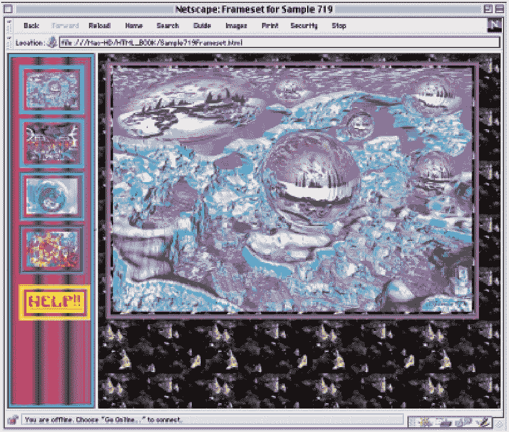

## 使用键盘事件滚动、调整大小和移动窗口

### JavaScript [scrollBy()](https://developer.mozilla.org/en-US/docs/Web/API/Window/scrollBy) 方法

**window** 对象的 **scrollBy()** 方法可以用于按指定像素数水平或垂直滚动窗口内容。它接受两个参数 **horizontalPixels** 和 **verticalPixels**，可以是正整数、负整数或零。正的 **horizontalPixels** 向右滚动，负的向左滚动。正的 **verticalPixels** 向下滚动，负的向上滚动。关键字 **self** 指代当前窗口。例如：

```
window.scrollBy(100,0);
self.scrollBy(0,-50);
myNewWindow.scrollBy(125,125);
```

## JavaScript 语法：

```
windowReference.scrollBy(horizontalPixels, verticalPixels)
```

### JavaScript [scrollTo()](https://developer.mozilla.org/en-US/docs/Web/API/Window/scrollTo) 方法

**scrollTo()** 方法可以用于水平或垂直滚动到窗口中的新 (x,y) 坐标，使该坐标成为可见区域的左上角。它接受两个参数 **x-Coordinate** 和 **y-Coordinate**，可以是正整数、负整数或零。由于你可以将图层定位在屏幕外，因此有时你可能希望滚动窗口的可见区域以便看到它们，这就是使用负整数的地方。例如：

```
window.scrollTo(0,700);
self.scrollTo(-400,-550);
```

## JavaScript 语法：

```
windowReference.scrollTo(x-Coordinate, y-Coordinate)
```

## 使用多种方法控制你的窗口

示例 6-20 做了几件事。它演示了 **window** 对象的 **scrollBy()**、**scrollTo()**、**moveBy()**、**moveTo()**、**resizeBy()** 和 **resizeTo()** 方法，通过使用 **captureEvents()** 方法捕获 KEYDOWN 事件，并在 **scrollLayers(e)** 函数中使用 **switch()** 语句执行代码。**switch()** 语句将 **e.which** 表达式作为其 **label** 参数，并在按下 CONTROL + ALT 修饰键以及 0-9 键中的任意一个时执行代码。该函数还定义了两个名为 **availSW** 和 **availSH** 的变量，演示了 **screen** 对象的 **availWidth** 和 **availHeight** 两个属性，如下所示：

```
var availSW = ((screen.availWidth) -20);
var availSH = ((screen.availHeight) -100);
```

它们被 **window** 对象上的 **resizeTo(availSW, availSH)** 方法使用，该对象由关键字 **self** 引用。**scrollLayers(e)** 函数通过**属性赋值**分配给 **document** 对象的 **onkeydown** 事件处理程序。

**showKey(e)** 函数被分配给 **document** 对象的 **onkeyup** 事件处理程序，首先将所有文本框设置为 **null** 字符串。然后它定义了获取 **Event** 对象大部分属性的变量，以及另一个使用 **String.fromCharCode()** 方法从 **e.which** 值中提取字符串的变量。这些变量随后被分配给它们各自文本框的 **value** 属性，因此每次事件发生时，事件的属性**值**都会显示在浏览器窗口中。

此示例中的 TABLE 仅包含一组在浏览器中渲染脚本时进行测试的说明。

有关 **window** 对象的 **moveBy()**、**moveTo()**、**resizeBy()** 和 **resizeTo()** 方法以及 **screen** 对象的 **availWidth** 和 **availHeight** 属性的更多信息，请参阅第 4 章关于对象的内容。

## 示例 6-20：Sample720.html

```
<!DOCTYPE HTML PUBLIC "-//W3C//DTD HTML 3.2//EN">
<HTML><HEAD>
<TITLE> Sample 720  Example 6-20  Modifier Keys to Scroll, Move and Resize the Window</TITLE>

<STYLE TYPE="text/JavaScript">

classes.Mainbody.BODY.margins("0px");
classes.Mainbody.BODY.paddings("0px");
classes.Mainbody.BODY.backgroundColor="darkcyan";
classes.Mainbody.BODY.color="white";
classes.Mainbody.BODY.fontSize="17pt";
```


 # 624 第二部分 — JavaScript 1.2

```
tags.TD.fontSize="12pt";
ids.L2.paddings("7px");
ids.L3.paddings("7px");

</STYLE>
<!-- *************************************************** -->

<SCRIPT LANGUAGE="JavaScript1.2"><!--BEGIN HIDING

function scrollLayers(e) {

    var L2 = document.L2;
    var L3 = document.L3;

    //SCREEN 是 Navigator 4 中的新对象
    //-20 和 -100 用于考虑浏览器窗口周围的空间
    //如果按钮栏中没有使用图片的话

    var availSW = ((screen.availWidth) -20);
    var availSH = ((screen.availHeight) -100);

    if (e.modifiers == 3) {             //ALT_MASK + CONTROL_MASK = 3

        switch (e.which) {

case 48 : window.scrollBy(0,50);   break; //按下 ALT + CONTROL + 0 键
case 49 : window.scrollBy(0,-50);  break; //按下 ALT + CONTROL + 1 键

case 50 : self.scrollTo(0,500);    break; //按下 ALT + CONTROL + 2 键
case 51 : self.scrollTo(0,0);      break; //按下 ALT + CONTROL + 3 键

case 52 : window.moveBy(20,0);     break; //按下 ALT + CONTROL + 4 键
case 53 : window.moveBy(-20,0);    break; //按下 ALT + CONTROL + 5 键

case 54 : self.moveTo(0,0);        break; //按下 ALT + CONTROL + 6 键

case 55 : self.resizeBy(-64,-48);  break; //按下 ALT + CONTROL + 7 键

case 56 : self.resizeTo(700,500);  break; //按下 ALT + CONTROL + 8 键
case 57 : self.resizeTo(availSW,availSH); break;   //按下 ALT + CONTROL + 9 键
default : return false;
        }
    }
}
/*----------------------------------------*/

function showKey(e) {

    document.form1.T1.value = "";
    document.form1.T2.value = "";
    document.form1.T3.value = "";
    document.form1.T4.value = "";
    document.form1.T5.value = "";
    document.form1.T7.value = "";
    document.form1.T8.value = "";
    document.form1.T9.value = "";
    document.form1.T10.value = "";
    document.form1.T11.value = "";
```

## 第 6 章 — JavaScript 事件

```
var whichKey2            = String.fromCharCode(e.which);
var whichKey3            = e.which;
var modifiersKey         = e.modifiers;
var eventType            = e.type;
var eventLayerX          = e.layerX;
var eventLayerY          = e.layerY;
var eventPageX           = e.pageX;
var eventPageY           = e.pageY;
var eventScreenX         = e.screenX;
var eventScreenY         = e.screenY;

document.form1.T1.value  = whichKey2;
document.form1.T2.value  = whichKey3;
document.form1.T3.value  = modifiersKey;
document.form1.T4.value  = eventType;
document.form1.T5.value  = eventLayerX;
document.form1.T7.value  = eventLayerY;
document.form1.T8.value  = eventPageX;
document.form1.T9.value  = eventPageY;
document.form1.T10.value = eventScreenX;
document.form1.T11.value = eventScreenY;
}
/* ---------------------------------------------------------------- */
```

```
document.captureEvents(Event.KEYDOWN | Event.KEYUP);
document.onkeydown = scrollLayers;
document.onkeyup = showKey;

//END HIDING-->
</SCRIPT>
```

```
<!--  *********************************************** -->

</HEAD>

<BODY CLASS="Mainbody" onLoad="window.focus();">

<FORM NAME="form1">

<INPUT TYPE="text" NAME="T1" SIZE="15">    String.fromCharCode(e.which)  <BR>
<INPUT TYPE="text" NAME="T2" SIZE="15">    e.which                      <BR>
<INPUT TYPE="text" NAME="T3" SIZE="15">    e.modifiers                  <BR>
<INPUT TYPE="text" NAME="T4" SIZE="15">    e.type                       <BR>

<INPUT TYPE="text" NAME="T5" SIZE="15">    e.layerX                     <BR>
<INPUT TYPE="text" NAME="T7" SIZE="15">    e.layerY                     <BR>
<INPUT TYPE="text" NAME="T8" SIZE="15">    e.pageX                      <BR>
<INPUT TYPE="text" NAME="T9" SIZE="15">    e.pageY                      <BR>
<INPUT TYPE="text" NAME="T10" SIZE="15">   e.screenX                    <BR>
<INPUT TYPE="text" NAME="T11" SIZE="15">  e.screenY                    <BR><BR>

</FORM>

<LAYER ID="L2" LEFT="250" TOP="120" WIDTH="450" BGCOLOR="navy">

这向你展示了事件对象的内部工作原理。

</LAYER>
```

# 626 第二部分 — JavaScript 1.2

```
<LAYER ID="L3" LEFT="10" TOP="220" WIDTH="460" BGCOLOR="lime">

<TABLE BGCOLOR="yellow">

<TR><TH COLSPAN="2">点击 ALT 和 CONTROL 键以及数字 0–9。</TH></TR>

<TR>
<TD>    case 48 : self.scrollBy(0,50)                 </TD>
<TD>    按下 ALT + CONTROL + 0 键             </TD></TR>
<TR>
<TD>    case 49 : self.scrollBy(0,-50)                </TD>
<TD>    按下 ALT + CONTROL + 1 键             </TD></TR>

<TR>
<TD>    case 50 : self.scrollTo(0,500)                </TD>
<TD>    按下 ALT + CONTROL + 2 键             </TD></TR>
<TR>
<TD>    case 51 : self.scrollTo(0,0)                  </TD>
<TD>    按下 ALT + CONTROL + 3 键             </TD></TR>

<TR>
<TD>    case 52 : window.moveBy(20,0)                 </TD>
<TD>    按下 ALT + CONTROL + 4 键             </TD></TR>
<TR>
<TD>    case 53 : window.moveBy(-20,0)                </TD>
<TD>    按下 ALT + CONTROL + 5 键             </TD></TR>

<TR>
<TD>    case 54 : self.moveTo(0,0)                    </TD>
<TD>    按下 ALT + CONTROL + 6 键             </TD></TR>
<TR>
<TD>    case 55 : self.resizeBy(-64,-48)              </TD>
<TD>    按下 ALT + CONTROL + 7 键             </TD></TR>

<TR>
<TD>    case 56 : self.resizeTo(700,500)              </TD>
<TD>    按下 ALT + CONTROL + 8 键             </TD></TR>
<TR>
<TD>    case 57 : self.resizeTo(availSW,availSH)      </TD>
<TD>    按下 ALT + CONTROL + 9 键             </TD></TR>

</TABLE>
</LAYER>

<LAYER ID="L4" LEFT="50" TOP="700" WIDTH="450" BGCOLOR="#8800ff">

            是的，scrollTo() 方法有效。                      <BR>

            点击 ALT + CONTROL + 3 返回上方。

</LAYER>

</BODY>
</HTML>
```

## 第 6 章 — JavaScript 事件

627

示例 6-20 Sample720.html

| 值 | 属性 |
|-------|----------|
| 3 | String.fromCharCode(e.which) |
| 51 | e.which |
| 3 | e.modifiers |
| keyUp | e.type |
| 424 | e.layerX |
| 149 | e.layerY |
| 424 | e.pageX |
| 149 | e.pageY |
| 446 | e.screenX |
| 223 | e.screenY |

这向你展示了事件对象的内部工作原理。

点击 ALT 和 CONTROL 键以及数字 0-9。

| case | 操作 | 按键组合 |
|------|--------|-----------------|
| case 48 | window.scrollBy(0,50) | 按下 ALT + CONTROL + 0 键 |
| case 49 | window.scrollBy(0,-50) | 按下 ALT + CONTROL + 1 键 |
| case 50 | self.scrollTo(0,500) | 按下 ALT + CONTROL + 2 键 |
| case 51 | self.scrollTo(0,0) | 按下 ALT + CONTROL + 3 键 |
| case 52 | window.moveBy(20,0) | 按下 ALT + CONTROL + 4 键 |
| case 53 | window.moveBy(-20,0) | 按下 ALT + CONTROL + 5 键 |
| case 54 | self.moveTo(0,0) | 按下 ALT + CONTROL + 6 键 |
| case 55 | self.resizeBy(-64,-48) | 按下 ALT + CONTROL + 7 键 |
| case 56 | self.resizeTo(700,500) | 按下 ALT + CONTROL + 8 键 |
| case 57 | self.resizeTo(availSW,availSH) | 按下 ALT + CONTROL + 9 键 |

## 事件对象 which 属性的 ASCII 值

示例 6-21 和 6-22 的主要目的是为你提供可复用的代码和参考资料，涵盖键盘上大多数按键常量在与修饰键常量一起使用时的所有 ASCII 值。它们以 switch() 语句的形式组织，因此你可以复制和粘贴代码块，然后替换为你自己的 JavaScript 语句。本示例中层重新定位的能力是次要的，相对而言并不重要。

示例 6-21 涵盖了 ALT、CONTROL 和 SHIFT 键的单独使用，而示例 6-22（从第 632 页开始）涵盖了修饰键的所有可能组合，例如 ALT + CONTROL，以及 META 键的单独使用。

它们相当长、枯燥且重复，但你会发现它们作为参考资料非常方便，而且如果你从 CD-ROM 复制粘贴，它们会为你节省大量打字工作。

```
示例 6-21：Sample721.html
```

```
<!DOCTYPE HTML PUBLIC "-//W3C//DTD HTML 3.2//EN">
<HTML>
<HEAD>
<TITLE> 示例 721 示例 6-21 使用热键移动图层</TITLE>

<STYLE TYPE="text/JavaScript">

classes.Mainbody.BODY.margins("0px");
classes.Mainbody.BODY.paddings("0px");
classes.Mainbody.BODY.backgroundColor="navy";
classes.Mainbody.BODY.color="white";
classes.Mainbody.BODY.fontSize="17pt";

</STYLE>

<!-- *********************************************************************************** -->

<SCRIPT LANGUAGE="JavaScript1.2"><!--BEGIN HIDING

var whichKey;

function scrollLayers(e)  {

    whichKey         = String.fromCharCode(e.which);
    var L1           = document.L1;
    var L2           = document.L2;
    var L3           = document.L3;

//如果使用键盘右侧的数字小键盘，moveBy 的数值会更合理。

if (e.modifiers == Event.CONTROL_MASK) {
```


 ## 第 6 章 —— JavaScript 事件

```
switch (whichKey) {
case '0' : L1.moveTo(250,250);	break;	//press the CONTROL + 0 keys
case '1' : L1.moveBy(-20,20);	break;	//press the CONTROL + 1 keys
case '2' : L1.moveBy(0,20);	break;	//press the CONTROL + 2 keys
case '3' : L1.moveBy(20,20);	break;	//press the CONTROL + 3 keys
case '4' : L1.moveBy(-20,0);	break;	//press the CONTROL + 4 keys
case '5' : L1.moveTo(10,350);	break;	//press the CONTROL + 5 keys
case '6' : L1.moveBy(20,0);	break;	//press the CONTROL + 6 keys
case '7' : L1.moveBy(-20,-20);	break;	//press the CONTROL + 7 keys
case '8' : L1.moveBy(0,-20);	break;	//press the CONTROL + 8 keys
case '9' : L1.moveBy(20,-20);	break;	//press the CONTROL + 9 keys
}
switch (e.which.toString()) {
case '1' : L1.moveBy(-20,20);	break;	//press the CONTROL + a keys
case '2' : L1.moveBy(0,20);	break;	//press the CONTROL + b keys
case '3' : L1.moveBy(20,20);	break;	//press the CONTROL + c keys
case '4' : L1.moveBy(-20,0);	break;	//press the CONTROL + d keys
case '5' : L1.moveBy(-20,0);	break;	//press the CONTROL + e keys
case '6' : L1.moveBy(20,0);	break;	//press the CONTROL + f keys
case '7' : L1.moveBy(-20,-20);	break;	//press the CONTROL + g keys
case '8' : L1.moveBy(0,-20);	break;	//press the CONTROL + h keys
case '9' : L1.moveBy(20,-20);	break;	//press the CONTROL + i keys
case '10' : L1.moveBy(-20,20);	break;	//press the CONTROL + j keys
case '11' : L1.moveBy(0,20);	break;	//press the CONTROL + k keys
case '12' : L1.moveBy(0,20);	break;	//press the CONTROL + l keys
case '13' : L1.moveBy(20,20);	break;	//press the CONTROL + m keys
case '14' : L1.moveBy(-20,0);	break;	//press the CONTROL + n keys
case '15' : L1.moveBy(-20,0);	break;	//press the CONTROL + o keys
case '16' : L1.moveBy(20,0);	break;	//press the CONTROL + p keys
case '17' : L1.moveBy(-20,-20);	break;	//press the CONTROL + q keys
case '18' : L1.moveBy(0,-20);	break;	//press the CONTROL + r keys
case '19' : L1.moveBy(20,-20);	break;	//press the CONTROL + s keys
case '20' : L1.moveBy(-20,20);	break;	//press the CONTROL + t keys
case '21' : L1.moveBy(0,20);	break;	//press the CONTROL + u keys
case '22' : L1.moveBy(20,20);	break;	//press the CONTROL + v keys
case '23' : L1.moveBy(-20,0);	break;	//press the CONTROL + w keys
case '24' : L1.moveBy(-20,0);	break;	//press the CONTROL + x keys
case '25' : L1.moveBy(20,0);	break;	//press the CONTROL + y keys
case '26' : L1.moveBy(-20,-20);	break;	//press the CONTROL + z keys
}
```

```
else if (e.modifiers == Event.ALT_MASK) {
```

//两种情况分别覆盖了 QWERTY 字母键上方的数字键
//以及扩展键盘最右侧计算器小键盘上的数字键。

```
switch (e.which.toString()) {
case '188' : case '48' : L2.moveTo(150,250);	break;	//press the ALT + 0 keys
case '193' : case '49' : L2.moveBy(-30,30);	break;	//press the ALT + 1 keys
case '170' : case '50' : L2.moveBy(0,30);	break;	//press the ALT + 2 keys
case '163' : case '51' : L2.moveBy(30,30);	break;	//press the ALT + 3 keys
case '162' : case ' relationsh52' : L2.moveBy(-30,0);	break;	//press the ALT + 4 keys
case '176' : case '53' : L2.moveTo(50,350);	break;	//press the ALT + 5 keys
case '164' : case '54' : L2.moveBy(30,0);	break;	//press the ALT + 6 keys
case '166' : case '55' : L2.moveBy(-30,-30);	break;	//press the ALT + 7 keys
case '165' : case '56' : L2.moveBy(0,-30);	break;	//press the ALT + 8 keys
case '187' : case '57' : L2.moveBy(30,-30);	break;	//press the ALT + 9 keys

case '140' : L2.moveBy(30,30);	break;	//press the ALT + a keys
case '186' : L2.moveBy(30,30);	break;	//press the ALT + b keys
case '141' : L2.moveBy(30,30);	break;	//press the ALT + c keys
case '182' :.encodeWith(30,30);	break;	//press the ALT + d keys
case '171' : L2.moveBy(30,30);	break;	//press the ALT + e keys
case '196' : L2.moveBy(-30,-30);	break;	//press the ALT + f keys
case '169' : L2.moveBy(-30,-30);	break;	//press the ALT + g keys
case '250' : L2.moveBy(-30,-30);	break;	//press the ALT + h keys
```

```
    case '246' : L2.moveBy(-30,-30);     break;  //press the ALT + i keys
    case '198' : L2.moveBy(-30,-30);     break;  //press the ALT + j keys
    case '251' : L2.moveBy(30,30);       break;  //press the ALT + k keys
    case '194' : L2.moveBy(30,30);       break;  //press the ALT + l keys
    case '181' : L2.moveBy(30,30);       break;  //press the ALT + m keys
    case '247' : L2.moveBy(30,30);       break;  //press the ALT + n keys
    case '191' : L2.moveBy(30,30);       break;  //press the ALT + o keys
    case '185' : L2.moveBy(-30,-30);     break;  //press the ALT + p keys
    case '207' : L2.moveBy(-30,-30);     break;  //press the ALT + q keys
    case '168' : L2.moveBy(-30,-30);     break;  //press the ALT + r keys
    case '167' : L2.moveBy(-30,-30);     break;  //press the ALT + s keys
    case '160' : L2.moveBy(-30,-30);     break;  //press the ALT + t keys
    case '172' : L2.moveBy(30,30);       break;  //press the ALT + u keys
    case '195' : L2.moveBy(30,30);       break;  //press the ALT + v keys
    case '183' : L2.moveBy(30,30);       break;  //press the ALT + w keys
    case '197' : L2.moveBy(30,30);       break;  //press the ALT + x keys
    case '180' : L2.moveBy(30,30);       break;  //press the ALT + y keys
    case '189' : L2.moveBy(30,30);       break;  //press the ALT + z keys
}
else if (e.modifiers == Event.SHIFT_MASK) {

    //两种情形分别覆盖了 QWERTY 字母键上方的数字键
    //以及扩展键盘最右侧计算器小键盘上的数字键。

    switch (e.which.toString()) {
    case '33' : case '48' : L3.moveTo(150,250);    break;  //press the SHIFT + 0 keys
    case '64' : case '49' : L3.moveBy(-50,50);      break;  //press the SHIFT + 1 keys
    case '35' : case '50' : L3.moveBy(0,50);        break;  //press the SHIFT + 2 keys
    case '36' : case '51' : L3.moveBy(50,50);       break;  //press the SHIFT + 3 keys
    case '37' : case '52' : L3.moveBy(-50,0);       break;  //press the SHIFT + 4 keys
    case '94' : case '53' : L3.moveTo(50,350);      break;  //press the SHIFT + 5 keys
    case '38' : case '54' : L3.moveBy(50,0);        break;  //press the SHIFT + 6 keys
    case '42' : case '55' : L3.moveBy(-50,-50);     break;  //press the SHIFT + 7 keys
    case '40' : case '56' : L3.moveBy(0,-50);       break;  //press the SHIFT + 8 keys
    case '41' : case '57' : L3.moveBy(50,-50);      break;  //press the SHIFT + 9 keys

    case '65' : L3.moveBy(50,50);       break;  //press the SHIFT + a keys
    case '66' : L3.moveBy(50,50);       break;  //press the SHIFT + b keys
    case '67' : L3.moveBy(50,50);       break;  //press the SHIFT + c keys
    case '68' : L3.moveBy(50,50);       break;  //press the SHIFT + d keys
    case '69' : L3.moveBy(50,50);       break;  //press the SHIFT + e keys
    case '70' : L3.moveBy(-50,-50);     break;  //press the SHIFT + f keys
    case '71' : L3.moveBy(-50,-50);     break;  //press the SHIFT + g keys
    case个中 '72' : L3.moveBy(-50,-50);     break;  //press the SHIFT + h keys
    case '73' : L3.moveBy(-50,-50);     break;  //press the SHIFT + i keys
    case '74' : L3.moveBy(-50,-50);     break;  //press the SHIFT + j keys
    case '75' : L3.moveBy(50,50);       break;  //press the SHIFT + k keys
    case '76' : L3.moveBy(50,50);       break;  //press the SHIFT + l keys
    case '77' : L3.moveBy(50,50);       break;  //press the SHIFT + m keys
    case '78' : L3.moveBy(50,50);       break;  //press the SHIFT + n keys
    case '79' : L3.moveBy(50,50);       break;  //press the SHIFT + o keys
    case '80' : L3.moveBy(-50,-50);     break;  //press the SHIFT + p keys
    case '81' : L3.moveBy(-50,-50);     break;  //press the SHIFT + q keys
    case '82' : L3.moveBy(-50,-50);     break;  //press the SHIFT + r keys
    case '83' : L3.moveBy(-50,-50);     break;  //press the SHIFT + s keys
    case '84' : L3.moveBy(-50,-50);     break;  //press the SHIFT + t keys
    case '要翻译的阿克斯85' : L3.moveBy(50,50);       break;  //press the SHIFT + u keys
    case '86' : L3.moveBy(50,50);       break;  //press the SHIFT + v keys
    case '87' : L3.moveBy(50,50);       break;  //press the SHIFT + w keys
    case '88' : L3.moveBy(50,50);       break;  //press the SHIFT + x keys
    case '89' : L3.moveBy(50,50);       break;  //press the SHIFT + y keys
    case '90' : L3.moveBy(50,50);       break;  //press the SHIFT + z keys
    }
}
```

 # 第6章 — JavaScript事件

## 631

```
else {
	switch (whichKey) {
		case '0' : LL.moveTo(10,100); break; //press the 0 key
		case '1' : LL.moveBy(-20,20); break; //press the 1 key
		case '2' : LL.moveBy(0,20); break; //press the 2 key
		case '3' : LL.moveBy(20,20); break; //press the 3 key
		case '4' : LL.moveBy(-20,0); break; //press the 4 key
		case '5' : LL.moveBy(150,100); break; //press the 5 key
		case '6' : LL.moveBy(20,0); break; //press the 6 key
		case '7' : LL.moveBy(-20,-20); break; //press the 7 key
		case '8' : LL.moveBy(0,-20); break; //press the 8 key
		case '9' : LL.moveBy(20,-20); break; //press the 9 key

		case 'q' : case 'Q' : break; //press the q key
		case 'w' : case 'W' : LL.moveBy(20,20); break; //press the w key
		case 'e' : case 'E' : LL.moveBy(0,20); break; //press the e key
		case 'r' : case 'R' : LL.moveBy(-20,-20); break; //press the r key
		case 't' : case 'T' : LL.moveBy(-20,20); break; //press the t key
		case 'y' : case 'Y' : LL.moveBy(-20,-20); break; //press the y key
		default : return false;
	}
}
```

```
function showKey(e) {
	document.formT1.value = "";
	document.formT2.value = "";

	var T1 = document.formT1;
	whichKey2 = String.fromCharCode(e.which);
	whichKey3 = e.which.toString();

	document.formT1.value = whichKey2;
	document.formT2.value = whichKey3;
}
```

```
document.captureEvents(Event.KEYPRESS | Event.KEYUP);
document.onkeypress = scrolllayers;
document.onkeyup = showKey;

//END HIDING-->
</SCRIPT>
<!-- ******************************************************************* -->
<HEAD>

<!--The window.focus() method Takes the automatic focus from the location bar and
puts it in the window so you don't have to click in it first to get the keys to work.-->

<BODY CLASS="Mainbody" onload="window.focus();">

<FORM NAME="form la">
	String.fromCharCode(which) "SPACES Type="Horizontal" SIZE="70"* e.which.toString()<BR>
	<INPUT TYPE="text" NAME="T1" SIZE="30"*>
	<INPUT TYPE="text" NAME="T2" SIZE="30"*>
</FORM><HR>

<LAYER ID="L1" LEFT="10" TOP="100" WIDTH="300" BGCOLOR="black">
	Use the CONTROL Key plus letters A-Z or numbers 0-9 to move this Layer.<BR>
	Try just using the numbers on the keypad or keyboard without modifier keys.
	The main goal is to show you what to test for in your functions and the usefulness of the
	Switch Statement.
</LAYER>
```

# 第二部分 — JavaScript 1.2

```
<LAYER ID="L2" LEFT="410" TOP="300" WIDTH="300" BGCOLOR="red">
Use the ALT Key plus letters A-Z or numbers 0-9 to move this Layer. <BR>
Note that you get different values in the textfield display for keypad numbers on
extended keyboards than the regular numbers on the keyboard.
</LAYER>

<LAYER ID="L3" LEFT="410" TOP="50" WIDTH="300" BGCOLOR="blue">
Use the SHIFT Key plus letters A-Z or numbers 0-9 to move this Layer.<BR>
Notice that the <B>fromCharCode</B> Method gives you the actual key value while the
<B>toString</B> Method gives you the ASCII Value associated with the event.
</LAYER>

</BODY>
</HTML>
```

示例6-22涵盖了当你希望使用**if()**和**switch()**语句来检测多个修饰键是否被按下，然后脚本才会执行特定操作的情况。更多信息请参阅示例6-21前的序文（第628页）以及示例代码中层文本的提示（第646页）。

## 示例6-22：Sample722.html

```
<!DOCTYPE HTML PUBLIC "-//W3C//DTD HTML 3.2//EN">
<HTML>
<HEAD>
<TITLE> Sample 722 - Example 6-22        Move Layers with Multiple modifiers Keys</TITLE>

<STYLE TYPE="text/JavaScript">

classes.Mainbody.BODY.margins("0px");
classes.Mainbody.BODY.paddings("0px");
classes.Mainbody.BODY.backgroundColor="darkcyan";
classes.Mainbody.BODY.color="white";
classes.Mainbody.BODY.fontSize="17pt";

ids.L3.fontSize="14pt";

</STYLE>
<!-- *********************************************** -->

<SCRIPT LANGUAGE="JavaScript1.2"><!--BEGIN HIDING

function scrollLayers(e) {
    var L1    = document.L1;
    var L2    = document.L2;
    var L3    = document.L3;
```

## 第6章 — JavaScript事件

```
if (e.modifiers == 3) {          //ALT_MASK + CONTROL_MASK = 3

    switch (e.which.toString()) {

        case '48' : L1.moveTo(410,220);    break;    //press the ALT + CONTROL + 0 keys
        case '49' : L1.moveBy(-90,90);     break;    //press the ALT + CONTROL + 1 keys
        case '50' : L1.moveBy(0,90);       break;    //press the ALT + CONTROL + 2 keys
        case '51' : L1.moveBy(90,90);      break;    //press the ALT + CONTROL + 3 keys
        case '52' : L1.moveBy(-90,0);      break;    //press the ALT + CONTROL + 4 keys
        case '53' : L1.moveTo(410,50);     break;    //press the ALT + CONTROL + 5 keys
        case '54' : L1.moveBy(90,0);       break;    //press the ALT + CONTROL + 6 keys
        case '55' : L1.moveBy(-90,-90);    break;    //press the ALT + CONTROL + 7 keys
        case '56' : L1.moveBy(90,-90);     break;    //press the ALT + CONTROL + 9 keys
        case '57' : L1.moveBy(90,-90);     break;    //press the ALT + CONTROL + 9 keys

        case '1' : L1.moveBy(90,90);       break;    //press the ALT + CONTROL + a keys
        case '2' : L1.moveBy(90,90);       break;    //press the ALT + CONTROL + b keys
        case '3' : L1.moveBy(90,90);       break;    //press the ALT + CONTROL + c keys
        case '4' : L1.moveBy(90,90);       break;    //press the ALT + CONTROL + d keys
        case '5' : L1.moveBy(90,90);       break;    //press the ALT + CONTROL + e keys
        case '6' : L1.moveBy(-90,-90);     break;    //press the ALT + CONTROL + f keys
        case '7' : L1.moveBy(-90,-90);     break;    //press the ALT + CONTROL + g keys
        case '8' : L1.moveBy(-90,-90);     break;    //press the ALT + CONTROL + h keys
        case '9' : L1.moveBy(-90,-90);     break;    //press the ALT + CONTROL + i keys
        case '10' : L1.moveBy(-90,-90);    break;    //press the ALT + CONTROL + j keys
        case '11' : L1.moveBy(90,90);      break;    //press the ALT + CONTROL + k keys
        case '12' : L1.moveBy(90,90);      break;    //press the ALT + CONTROL + l keys
        case '13' : L1.moveBy(90,90);      break;    //press the ALT + CONTROL + m keys
        case '14' : L1.moveBy(90,90);      break;    //press the ALT + CONTROL + n keys
        case '15' : L1.moveBy(90,90);      break;    //press the ALT + CONTROL + o keys
        case '16' : L1.moveBy(-90,-90);    break;    //press the ALT + CONTROL + p keys
        case '17' : L1.moveBy(-90,-90);    break;    //press the ALT + CONTROL + q keys
        case '18' : L1.moveBy(-90,-90);    break;    //press the ALT + CONTROL + r keys
        case '19' : L1.moveBy(-90,-90);    break;    //press the ALT + CONTROL + s keys
        case '20' : L1.moveBy(-90,-90);    break;    //press the ALT + CONTROL + t keys
        case '21' : L1.moveBy(90,90);      break;    //press the ALT + CONTROL + u keys
        case '22' : L1.moveBy(90,90);      break;    //press the ALT + CONTROL + v keys
        case '23' : L1.moveBy(90,90);      break;    //press the ALT + CONTROL + w keys
        case '24' : L1.moveBy(90,90);      break;    //press the ALT + CONTROL + x keys
        case '25' : L1.moveBy(90,90);      break;    //press the ALT + CONTROL + y keys
        case '26' : L1.moveBy(90,90);      break;    //press the ALT + CONTROL + z keys
    }
}
```

## 634 第二部分 — JavaScript 1.2

```
else if (e.modifiers == expanded) { //ALT_MASK + SHIFT_MASK = 5

    //The two cases cover the numbers in the row above QWERTY letters
    //and the calulator pad numbers on the far right of extended keyboards.

    switch (e.which.toString()) {

        case '226' : case '48' : L2.moveTo(150,250);break; //press the ALT + SHIFT + 0 keys
        case '218' : case '49' : L2.moveBy(-30,30); break; //press the ALT + SHIFT + 1 keys
        case '219' : case '50' : L2.moveBy(0,30);   break; //press the ALT + SHIFT + 2 keys
        case '220' : case '51' : L2.moveBy(30,30);   break; //press the ALT + SHIFT + 3 keys
        case '221' : case '52' : L2.moveBy(-30,0);   break; //press the ALT + SHIFT + 4 keys
        case '222' : case '53' : L2.moveTo(50,350);break; //press the ALT + SHIFT + 5 keys
        case '223' : case '54' : L2.moveBy(30,0);    break; //press the ALT + SHIFT + 6 keys
        case '224' : case '55' : L2.moveBy(-30,-30); break; //press the ALT + SHIFT + 7 keys
        case '161' : case '56' : L2.moveBy(0,-30);   break; //press the ALT + SHIFT + 8 keys
        case '225' : case '57' : L2.moveBy(30,-30);  break; //press the ALT + SHIFT + 9 keys

        case '129' : L2.moveBy(30,30);  break; //press the ALT + SHIFT + a keys
        case '245' : LL.moveBy(30,30);  break; //press the ALT + SHIFT + b keys
        case '130' : L2.moveBy(30,30);  break; //press the ALT + SHIFT + c keys
        case '235' : L2.moveBy(30,30);  break; //press the ALT + SHIFT + d keys
        case '171' : L2.moveBy(30,30);  break; //press the ALT + SHIFT + e keys
        case '236' : L2.moveBy(-30,-30); break; //press the ALT + SHIFT + f keys
        case '253' : L2.moveBy(-30,-30); break; //press the ALT + SHIFT + g keys
        case '238' : L2.moveBy(-30,-30); break; //press the ALT + SHIFT + h keys
        case '246' : L2.moveBy(-30,-30); break; //press the ALT + SHIFT + i keys
        case '239' : L2.moveBy(-30,-30); break; //press the ALT + SHIFT + j keys
        case '240' : L2.moveBy(30,30);  break; //press the ALT + SHIFT + k keys
        case '241' : L2.moveBy(30,30);  break; //press the ALT + SHIFT + l keys
        case '229' : L2.moveBy(30,30);  break; //press the ALT + SHIFT + m keys
        case '247' : L2.moveBy(30,30);  break; //press the ALT + SHIFT + n keys
        case '175' : L2.moveBy(30,30);  break; //press the ALT + SHIFT + o keys
        case '184' : L2.moveBy(-30,-30); break; //press the ALT + SHIFT + p keys
        case '206' : L2.moveBy(-30,-30); break; //press the ALT + SHIFT + q keys
        case '228' : L2.moveBy(-30,-30); break; //press the ALT + SHIFT + r keys
        case '234' : L2.moveBy(-30,-30); break; //press the ALT + SHIFT + s keys
        case '255' : L2.moveBy(-30,-30); break; //press the ALT + SHIFT + t keys
        case '172' : L2.moveBy(30,30);  break; //press the ALT + SHIFT + u keys
        case '215' : L2.moveBy(30,30);  break; //press the ALT + SHIFT + v keys
        case '227' : L2.moveBy(30,30);  break; //press the ALT + SHIFT + w keys
        case '254' : L2.moveBy(30,30);  break; //press the ALT + SHIFT + x keys
        case '231' : L2.moveBy(30,30);  break; //press the ALT + SHIFT + y keys
        case '252' : L2.moveBy(30,30);  break; //press the ALT + SHIFT + z keys
    }
}
```


 # 第6章 — JavaScript 事件

635

```
else if (e.modifiers == 6) { //CONTROL_MASK + SHIFT_MASK = 6

    switch (e.which.toString()) {

        case '48': L3.moveTo(410,220); break; //同时按下 SHIFT + CONTROL + 0 键
        case '49': L3.moveBy(90,-90); break; //同时按下 SHIFT + CONTROL + 1 键
        case '50': L3.moveBy(0,90); break; //同时按下 SHIFT + CONTROL + 2 键
        case '51': L3.moveBy(90,90); break; //同时按下 SHIFT + CONTROL + 3 键
        case '52': L3.moveBy(-90,0); break; //同时按下 SHIFT + CONTROL + 4 键
        case '53': L3.moveTo(410,330); break; //同时按下 SHIFT + CONTROL + 5 键
        case '54': L3.moveBy(90,0); break; //同时按下 SHIFT + CONTROL + 6 键
        case '55': L3.moveBy(-90,90); break; //同时按下 SHIFT + CONTROL + 7 键
        case '56': L3.moveBy(0,-90); break; //同时按下 SHIFT + CONTROL + 8 键
        case '57': L3.moveBy(90,-90); break; //同时按下 SHIFT + CONTROL + 9 键

        case '1': L3.moveBy(90,90); break; //同时按下 SHIFT + CONTROL + a 键
        case '2': L3.moveBy(90,90); break; //同时按下 SHIFT + CONTROL + b 键
        case '3': L3.moveBy(90,90); break; //同时按下 SHIFT + CONTROL + c 键
        case '4': L3.moveBy(90,90); break; //同时按下 SHIFT + CONTROL + d 键
        case '5': L3.moveBy(90,90); break; //同时按下 SHIFT + CONTROL + e 键
        case '6': L3.moveBy(-90,-90); break; //同时按下 SHIFT + CONTROL + f 键
        case '7': L3.moveBy(-90,-90); break; //同时按下 SHIFT + CONTROL + g 键
        case '8': L3.moveBy(-90,90); break; //同时按下 SHIFT + CONTROL + SHIFT + h 键
        case '9': L3.moveBy(-90,90); break; //同时按下 SHIFT + CONTROL + i 键
        case '10': L3.moveBy(-90,-90); break; //同时按下 SHIFT + CONTROL + j 键
        case '11': L3.moveBy(90,90); break; //同时按下 SHIFT + CONTROL + k 键
        case '12': L3.moveBy(90,90); break; //同时按下 SHIFT + CONTROL + l 键
        case '13': L3.moveBy(90,90); break; //同时按下 SHIFT + CONTROL + m 键
        case '14': L3.moveBy(90,90); break; //同时按下 SHIFT + CONTROL + n 键
        case '15': L3.moveBy(90,90); break; //同时按下 SHIFT + CONTROL + o 键
        case '16': L3.moveBy(-90,-90); break; //同时按下 SHIFT + CONTROL + p 键
        case '17': L3.moveBy(-90,90); break; //同时按下 SHIFT + CONTROL + q 键
        case '18': L3.moveBy(-90,-90); break; //同时按下 SHIFT + CONTROL + r 键
        case '19': L3.moveBy(-90,-90); break; //同时按下 SHIFT + CONTROL + s 键
        case '20': L3.moveBy(-90,-90); break; //同时按下 SHIFT + CONTROL + t 键
        case '21': L3.moveBy(90,90); break; //同时按下 SHIFT + CONTROL + u 键
        case '22': L3.moveBy(90,90); break; //同时按下 SHIFT + CONTROL + v 键
        case '23': L3.moveBy(90,90); break; //同时按下 SHIFT + CONTROL + w 键
        case '24': L3.moveBy(90,90); break; //同时按下 SHIFT + CONTROL + x 键
        case '25': L3.moveBy(90,90); break; //同时按下 SHIFT + CONTROL + y 键
        case '26': L3.moveBy(90,90); break; //同时按下 SHIFT + CONTROL + z 键

    }
}
```

//同时按下 ALT + CONTROL + SHIFT 键所代表的数字是 7。
//因此，检测 Event 对象的 e.modifiers 是否等于 7，就是同时按下这些组合键的简写形式。

# 第二部分 — JavaScript 1.2

```
//ALT_MASK + CONTROL_MASK + SHIFT_MASK = 7

else if (e.modifiers == 7) {

    switch (e.which.toString()) {

        case '48': L1.moveTo(410,220); break; //同时按下 ALT + CONTROL + SHIFT + 0 键
        case '49': L1.moveBy(-90,90); break; //同时按下 ALT + CONTROL + SHIFT + 1 键
        case '50': L1.moveBy(0,90); break; //同时按下 ALT + CONTROL + SHIFT + 2 键
        case '51': L1.moveBy(90,90); break; //同时按下 ALT + CONTROL + SHIFT + 3 键
        case '52': L1.moveBy(-90,0); break; //同时按下 ALT + CONTROL + SHIFT + 4 键
        case '53': L1.moveTo(410,50); break; //同时按下 ALT + CONTROL + SHIFT + 5 键
        case '54': L1.moveBy(90,0); break; //同时按下 ALT + CONTROL + SHIFT + 6 键
        case '55': L1.moveBy(-90,-90); break; //同时按下 ALT + CONTROL + SHIFT + 7 键
        case '56': L1.moveBy(0,-90); break; //同时按下 ALT + CONTROL + SHIFT + 8 键
        case '57': L1.moveBy(90,-90); break; //同时按下 ALT + CONTROL + SHIFT + 9 键

        case '1': L1.moveBy(90,90); break; //同时按下 ALT + CONTROL + SHIFT + a 键
        case '2': L1.moveBy(90,90); break; //同时按下 ALT + CONTROL + SHIFT + b 键
        case '3': L1.moveBy(90,90); break; //同时按下 ALT + CONTROL + SHIFT + c 键
        case '4': L1.moveBy(90,90); break; //同时按下 ALT + CONTROL + SHIFT + d 键
        case '5': L1.moveBy(90,90); break; //同时按下 ALT + CONTROL + SHIFT + e 键
        case '6': L1.moveBy(-90,-90); break; //同时按下 ALT + CONTROL + SHIFT + f 键
        case '7': L1.moveBy(-90,-90); break; //同时按下 ALT + CONTROL + SHIFT + g 键
        case '8': L1.moveBy(-90,90); break; //同时按下 ALT + CONTROL + SHIFT + h 键
        case '9': L1.moveBy(-90,90); break; //同时按下 ALT + CONTROL + SHIFT + i 键
        case '10': L1.moveBy(-90,-90); break; //同时按下 ALT + CONTROL + SHIFT + j 键
        case '11': L1.moveBy(90,90); break; //同时按下 ALT + CONTROL + SHIFT + k 键
        case '12': L1.moveBy(90,90); break; //同时按下 ALT + CONTROL + SHIFT + l 键
        case '13': L1.moveBy(90,90); break; //同时按下 ALT + CONTROL + SHIFT + m 键
        case '14': L1.moveBy(90,90); break; //同时按下 ALT + CONTROL + SHIFT + n 键
        case '15': L1.moveBy(90,90); break; //同时按下 ALT + CONTROL + SHIFT + o 键
        case '16': L1.moveBy(-90,-90); break; //同时按下 ALT + CONTROL + SHIFT + p 键
        case '17': L1.moveBy(-90,-90); break; //同时按下 ALT + CONTROL + SHIFT + q 键
        case '18': L1.moveBy(-90,-90); break; //同时按下 ALT + CONTROL + SHIFT + r 键
        case '19': L1.moveBy(-90,-90); break; //同时按下 ALT + CONTROL + SHIFT + s 键
        case '20': L1.moveBy(-90,-90); break; //同时按下 ALT + CONTROL + SHIFT + t 键
        case '21': L1.moveBy(90,90); break; //同时按下 ALT + CONTROL + SHIFT + u 键
        case '22': L1.moveBy(90,90); break; //同时按下 ALT + CONTROL + SHIFT + v 键
        case '23': L1.moveBy(90,90); break; //同时按下 ALT + CONTROL + SHIFT + w 键
        case '24': L1.moveBy(90,90); break; //同时按下 ALT + CONTROL + SHIFT + x 键
        case '25': L1.moveBy(90,90); break; //同时按下 ALT + CONTROL + SHIFT + y 键
        case '26': L1.moveBy(90,90); break; //同时按下 ALT + CONTROL + SHIFT + z 键

    }
}
```

//请注意，Navigator 浏览器中大多数常规命令键已经分配了代码
//这些代码通常难以或无法被覆盖，因此你的 JavaScript 代码将被忽略。
//不过，如果你创建自己的窗口对象且不使用标题栏，
//使用 META_MASK 就不会有问题

# 第6章 — JavaScript 事件

637

```
//并将 HOTKEYS 属性设置为 true，这样可以关闭原生热键，但退出和安全键除外。

else if (e.modifiers == 8) {
    //META_MASK = 8，即 Apple Command 键
    switch (e.which.toString()) {

        case '48': L2.moveTo(410,220); break; //同时按下 META + 0 键
        case '49': L2.moveBy(-90,90); break; //同时按下 META + 1 键
        case '50': L2.moveBy(0,90); break; //同时按下 META + 2 键
        case '51': L2.moveBy(90,90); break; //同时按下 META + 3 键
        case '52': L2.moveBy(-90,0); break; //同时按下 META + 4 键
        case '53': L2.moveTo(410,50); break; //同时按下 META + 5 键
        case '54': L2.moveBy(0,0); break; //同时按下 META + 6 键
        case '55': L2.moveBy(90,0); break; //同时按下 META + 7 键
        case '56': L2.moveBy(-90,-90); break; //同时按下 META + 8 键
        case '57': L2.moveBy(0,-90); break; //同时按下 META + 9 键

        case '97': L2.moveBy(90,90); break; //同时按下 META + a 键
        case '98': L2.moveBy(90,90); break; //同时按下 META + b 键
        case '99': L2.moveBy(90,90); break; //同时按下 META + c 键
        case '100': L2.moveBy(90,90); break; //同时按下 META + d 键
        case '101': L2.moveBy(90,90); break; //同时按下 META + e 键
        case '102': L2.moveBy(90,90); break; //同时按下 META + f 键
        case '103': L2.moveBy(-90,90); break; //同时按下 META + g 键
        case '104': L2.moveBy(-90,90); break; //同时按下 META + h 键
        case '105': L2.moveBy(-90,90); break; //同时按下 META + i 键
        case '106': L2.moveBy(-90,90); break; //同时按下 META + j 键
        case '107': L2.moveBy(90,90); break; //同时按下 META + k 键
        case '108': L2.moveBy(90,90); break; //同时按下 META + l 键
        case '109': L2.moveBy(90,90); break; //同时按下 META + m 键
        case '110': L2.moveBy(90,90); break; //同时按下 META + n 键
        case '111': L2.moveBy(90,90); break; //同时按下 META + o 键
        case '112': L2.moveBy(90,90); break; //同时按下 META + p 键
        case '113': L2.moveBy(-90,-90); break; //同时按下 META + q 键
        case '114': L2.moveBy(-90,-90); break; //同时按下 META + r 键
        case '115': L2.moveBy(-90,-90); break; //同时按下 META + s 键
        case '116': L2.moveBy(-90,-90); break; //同时按下 META + t 键
        case '117': L2.moveBy(90,90); break; //同时按下 META + u 键
        case '118': L2.moveBy(90,90); break; //同时按下 META + v 键
        case '119': L2.moveBy(90,90); break; //同时按下 META + w 键
        case '120': L2.moveBy(90,90); break; //同时按下 META + x 键
        case '121': L2.moveBy(90,90); break; //同时按下 META + y 键
        case '122': L2.moveBy(90,90); break; //同时按下 META + z 键
    }
}
```


 ## 第二部分 — JavaScript 1.2

```
else if (e.modifiers == 9) {

		//META_MASK + ALT_MASK = 9

	//The two cases cover the numbers in the row above QWERTY letters
	//and the calculator pad numbers on the far right of extended keyboards.

	switch (e.which.toString()) {

	case '188' : case '48' : L3.moveTo(150,250);break; 	//press the META + ALT + 0 keys
	case '193' : case '49' : L3.moveBy(-30,30); 	break; 	//press the META + ALT + 1 keys
	case '170' : case '50' : L3.moveBy(0,30); 	break; 	//press the META + ALT + 2 keys
	case '163' : case '51' : L3.moveBy(30,30); 	break; 	//press the META + ALT + 3 keys
	case '162' : case '52' : L3.moveBy(-30,0); 	break; 	//press the META + ALT + 4 keys
	case '176' : case '53' : L3.moveTo(50,350);break; 	//press the META + ALT + 5 keys
	case '164' : case '54' : L3.moveBy(30,0); 	break; 	//press the META + ALT + 6 keys
	case '166' : case '55' : L3.moveBy(-30,-30); 	break; 	//press the META + ALT + 7 keys
	case '165' : case '56' : L3.moveBy(0,-30); 	break; 	//press the META + ALT + 8 keys
	case '187' : case '57' : L3.moveBy(30,-30); 	break; 	//press the META + ALT + 9 keys

	case '140' : L3.moveBy(30,30); 				break; 	//press the META + ALT + a keys
	case '186' : L3.moveBy(30,30); 				break; 	//press the META + ALT + b keys
	case '141' : L3.moveBy(30,30); 				break; 	//press the META + ALT + c keys
	case '182' : L3.moveBy(30,30); 				break; 	//press the META + ALT + d keys
	case '171' : L3.moveBy(30,30); 				break; 	//press the META + ALT + e keys
	case '196' : L3.moveBy(-30,-30); 			break; 	//press the META + ALT + f keys
	case '169' : L3.moveBy(-30,-30); 			break; 	//press the META + ALT + g keys
	case '250' : L3.moveBy(-30,-30); 			break; 	//press the META + ALT + h keys
	case '246' : L3.moveBy(-30,-30); 			break; 	//press the META + ALT + i keys
	case '198' : L3.moveBy(-30,-30); 			break; 	//press the META + ALT + j keys
	case '251' : L3.moveBy(30,30); 				break; 	//press the META + ALT + k keys
	case '194' : L3.moveBy(30,30); 				break; 	//press the META + ALT + l keys
	case '181' : L3.moveBy(30,30); 				break; 	//press the META + ALT + m keys
	case '247' : L3.moveBy(30,30); 				break; 	//press the META + ALT + n keys
	case '191' : L3.moveBy(30,30); 				break; 	//press the META + ALT + o keys
	case '185' : L3.moveBy(-30,-30); 			break; 	//press the META + ALT + p keys
	case '207' : L3.moveBy(-30,-30); 			break; 	//press the META + ALT + q keys
	case '168' : L3.moveBy(-30,-30); 			break; 	//press the META + ALT + r keys
	case '167' : L3.moveBy(-30,-30); 			break; 	//press the META + ALT + s keys
	case '160' : L3.moveBy(-30,-30); 			break; 	//press the META + ALT + t keys
	case '172' : L3.moveBy(30,30); 				break; 	//press the META + ALT + u keys
	case '195' : L3.moveBy(30,30); 				break; 	//press the META + ALT + v keys
	case '183' : L3.moveBy(30,30); 				break; 	//press the META + ALT + w keys
	case '197' : L3.moveBy(30,30); 				break; 	//press the META + ALT + x keys
	case '180' : L3.moveBy(30,30); 				break; 	//press the META + ALT + y keys
	case '189' : L3.moveBy(30,30); 				break; 	//press the META + ALT + z keys
	}
}
```

## 第6章 — JavaScript 事件

```
else if (e.modifiers == 10) {        //META_MASK + CONTROL_MASK = 10

    switch (e.which.toString()) {

        case '48' : L1.moveTo(410,220);    break;   //press the META + CONTROL + 0 keys
        case '49' : L1.moveBy(-90,90);     break;   //press the META + CONTROL + 1 keys
        case '50' : L1.moveBy(0,90);       break;   //press the META + CONTROL + 2 keys
        case '51' : L1.moveBy(90,90);      break;   //press the META + CONTROL + 3 keys
        case '52' : L1.moveBy(-90,0);      break;   //press the META + CONTROL + 4 keys
        case '53' : L1.moveTo(410,50);     break;   //press the META + CONTROL + 5 keys
        case '54' : L1.moveBy(90,0);       break;   //press the META + CONTROL + 6 keys
        case '55' : L1.moveBy(-90,-90);    break;   //press the META + CONTROL + 7 keys
        case '56' : L1.moveBy(0,-90);      break;   //press the META + CONTROL + 8 keys
        case '57' : L1.moveBy(90,-90);     break;   //press the META + CONTROL + 9 keys

        case '1' : L1.moveBy(90,90);       break;   //press the META + CONTROL + a keys
        case '2' : L1.moveBy(90,90);       break;   //press the META + CONTROL + b keys
        case '3' : L1.moveBy(90,90);       break;   //press the META + CONTROL + c keys
        case '4' : L1.moveBy(90,90);       break;   //press the META + CONTROL + d keys
        case '5' : L1.moveBy(90,90);       break;   //press the META + CONTROL + e keys
        case '6' : L1.moveBy(-90,-90);     break;   //press the META + CONTROL + f keys
        case '7' : L1.moveBy(-90,-90);     break;   //press the META + CONTROL + g keys
        case '8' : L1.moveBy(-90,-90);     break;   //press the META + CONTROL + h keys
        case '9' : L1.moveBy(-90,-90);     break;   //press the META + CONTROL + i keys
        case '10' : L1.moveBy(-90,-90);    break;   //press the META + CONTROL + j keys
        case '11' : L1.moveBy(90,90);      break;   //press the META + CONTROL + k keys
        case '12' : L1.moveBy(90,90);      break;   //press the META + CONTROL + l keys
        case '13' : L1.moveBy(90,90);      break;   //press the META + CONTROL + m keys
        case '14' : L1.moveBy(90,90);      break;   //press the META + CONTROL + n keys
        case '15' : L1.moveBy(90,90);      break;   //press the META + CONTROL + o keys
        case '16' : L1.moveBy(-90,-90);    break;   //press the META + CONTROL + p keys
        case '17' : L1.moveBy(-90,-90);    break;   //press the META + CONTROL + q keys
        case '18' : L1.moveBy(-90,-90);    break;   //press the META + CONTROL + r keys
        case '19' : L1.moveBy(-90,-90);    break;   //press the META + CONTROL + s keys
        case '20' : L1.moveBy(-90,-90);    break;   //press the META + CONTROL + t keys
        case '21' : L1.moveBy(90,90);      break;   //press the META + CONTROL + u keys
        case '22' : L1.moveBy(90,90);      break;   //press the META + CONTROL + v keys
        case '23' : L1.moveBy(90,90);      break;   //press the META + CONTROL + w keys
        case '24' : L1.moveBy(90,90);      break;   //press the META + CONTROL + x keys
        case '25' : L1.moveBy(90,90);      break;   //press the META + CONTROL + y keys
        case '26' : L1.moveBy(90,90);      break;   //press the META + CONTROL + z keys
    }

}
```

```
else if (e.modifiers == 11) {

    //META_MASK + ALT_MASK + CONTROL_MASK = 11

    switch (e.which.toString()) {

        case '48': Lz.moveTo(410,220); break; //press the META + ALT + CONTROL + 0 keys
        case '49': Lz.moveBy(-90,90); break; //press the META + ALT + CONTROL + 1 keys
        case '50': Lz.moveBy(-90,90); break; //press the META + ALT + CONTROL + 2 keys
        case '51': Lz.moveBy(90,90); break; //press the META + ALT + CONTROL + 3 keys
        case '52': Lz.moveBy(-90,0); break; //press the META + ALT + CONTROL + 4 keys
        case '53': Lz.moveBy(410,0); break; //press the META + ALT + CONTROL + 5 keys
        case '54': Lz.moveBy(0,90); break; //press the META + ALT + CONTROL + 6 keys
        case '55': Lz.moveBy(-90,-90); break; //press the META + ALT + CONTROL + 7 keys
        case '56': Lz.moveBy(0,-90); break; //press the META + ALT + CONTROL + 8 keys
        case '57': Lz.moveBy(90,-90); break; //press the META + ALT + CONTROL + 9 keys

        case '1': Lz.moveBy(90,90); break; //press the META + ALT + CONTROL + a keys
        case '2': Lz.moveBy(90,90); break; //press the META + ALT + CONTROL + b keys
        case '3': Lz.moveBy(90,90); break; //press the META + ALT + CONTROL + c keys
        case '4': Lz.moveBy(90,90); break; //press the META + ALT + CONTROL + d keys
        case '5': Lz.moveBy(90,90); break; //press the META + ALT + CONTROL + e keys
        case '6': Lz.moveBy(-90,-90); break; //press the META + ALT + CONTROL + f keys
        case '7': Lz.moveBy(-90,-90); break; //press the META + ALT + CONTROL + g keys
        case '8': Lz.moveBy(90,90); break; //press the META + ALT + CONTROL + h keys
        case '9': Lz.moveBy(90,90); break; //press the META + ALT + CONTROL + i keys
        case '10': Lz.moveBy(-90,-90); break; //press the META + ALT + CONTROL + j keys
        case '11': Lz.moveBy(90,90); break; //press the META + ALT + CONTROL + k keys
        case '12': Lz.moveBy(90,90); break; //press the META + ALT + CONTROL + l keys
        case '13': Lz.moveBy(90,90); break; //press the META + ALT + CONTROL + m keys
        case '14': Lz.moveBy(90,90); break; //press the META + ALT + CONTROL + n keys
        case '15': Lz.moveBy(90,90); break; //press the META + ALT + CONTROL + o keys
        case '16': Lz.moveBy(-90,-90); break; //press the META + ALT + CONTROL + p keys
        case '17': Lz.moveBy(-90,-90); break; //press the META + ALT + CONTROL + q keys
        case '18': Lz.moveBy(-90,-90); break; //press the META + ALT + CONTROL + r keys
        case '19': Lz.moveBy(-90,-90); break; //press the META + ALT + CONTROL + s keys
        case '20': Lz.moveBy(-90,-90); break; //press the META + ALT + CONTROL + t keys
        case '21': Lz.moveBy(90,90); break; //press the META + ALT + CONTROL + u keys
        case '22': Lz.moveBy(90,90); break; //press the META + ALT + CONTROL + v keys
        case '23': Lz.moveBy(90,90); break; //press the META + ALT + CONTROL + w keys
        case '24': Lz.moveBy(90,90); break; //press the META + ALT + CONTROL + x keys
        case '25': Lz.moveBy(90,90); break; //press the META + ALT + CONTROL + y keys
        case '26': Lz.moveBy(90,90); break; //press the META + ALT + CONTROL + z keys

    }
}
```


 # 第 6 章 — JavaScript 事件 641

```
else if (e.modifiers == 12) {
    //META_MASK + SHIFT_MASK = 12

    switch (e.which.toString()) {

        case '48' : L3.moveTo(410,220); break; //press the META + SHIFT + 0 keys
        case '49' : L3.moveBy(-90,90); break; //press the META + SHIFT + 1 keys
        case '50' : L3.moveBy(0,90); break; //press the META + SHIFT + 2 keys
        case '51' : L3.moveBy(90,90); break; //press the META + SHIFT + 3 keys
        case '52' : L3.moveBy(-90,0); break; //press the META + SHIFT + 4 keys
        case '53' : L3.moveTo(410,50); break; //press the META + SHIFT + 5 keys
        case '54' : L3.moveBy(90,0); break; //press the META + SHIFT + 6 keys
        case '55' : L3.moveBy(-90,-90); break; //press the META + SHIFT + 7 keys
        case '56' : L3.moveBy(0,-90); break; //press the META + SHIFT + 8 keys
        case '57' : L3.moveBy(90,-90); break; //press the META + SHIFT + 9 keys

        case '97' : L3.moveBy(90,90); break; //press the META + SHIFT + a keys
        case '98' : L3.moveBy(90,90); break; //press the META + SHIFT + b keys
        case '99' : L3.moveBy(90,90); break; //press the META + SHIFT + c keys
        case '100' : L3.moveBy(90,90); break; //press the META + SHIFT + d keys
        case '101' : L3.moveBy(90,90); break; //press the META + SHIFT + e keys
        case '102' : L3.moveBy(-90,-90); break; //press the META + SHIFT + f keys
        case '103' : L3.moveBy(-90,-90); break; //press the META + SHIFT + g keys
        case '104' : L3.moveBy(-90,-90); break; //press the META + SHIFT + h keys
        case '105' : L3.moveBy(-90,-90); break; //press the META + SHIFT + i keys
        case '106' : L3.moveBy(-90,-90); break; //press the META + SHIFT + j keys
        case '107' : L3.moveBy(90,90); break; //press the META + SHIFT + k keys
        case '108' : L3.moveBy(90,90); break; //press the META + SHIFT + l keys
        case '109' : L3.moveBy(90,90); break; //press the META + SHIFT + m keys
        case '110' : L3.moveBy(90,90); break; //press the META + SHIFT + n keys
        case '111' : L3.moveBy(90,90); break; //press the META + SHIFT + o keys
        case '112' : L3.moveBy(-90,-90); break; //press the META + SHIFT + p keys
        case '113' : L3.moveBy(-90,-90); break; //press the META + SHIFT + q keys
        case '114' : L3.moveBy(-90,-90); break; //press the META + SHIFT + r keys
        case '115' : L3.moveBy(-90,-90); break; //press the META + SHIFT + s keys
        case '116' : L3.moveBy(-90,-90); break; //press the META + SHIFT + t keys
        case '117' : L3.moveBy(90,90); break; //press the META + SHIFT + u keys
        case '118' : L3.moveBy(90,90); break; //press the META + SHIFT + v keys
        case '119' : L3.moveBy(90,90); break; //press the META + SHIFT + w keys
        case '120' : L3.moveBy(90,90); break; //press the META + SHIFT + x keys
        case '121' : L3.moveBy(90,90); break; //press the META + SHIFT + y keys
        case '122' : L3.moveBy(90,90); break; //press the META + SHIFT + z keys
    }
}
```

# 642 第二部分 — JavaScript 1.2

```
else if (e.modifiers == 13) {

    //META_MASK + SHIFT_MASK + ALT_MASK = 13

    //这两种情况涵盖了 QWERTY 字母上方一行的数字
    //以及扩展键盘最右侧的小键盘数字。

    switch(e.which.toString()) {

        case '26': case '48': L1.moveTo(150,250);break; //press the META + SHIFT + ALT + 0 keys
        case '218': case '49': L1.moveTo(-30,30); break; //press the META + SHIFT + ALT + 1 keys
        case '219': case '50': L1.moveTo(-30,30); break; //press the META + SHIFT + ALT + 2 keys
        case '220': case '51': L1.moveTo(30,30);break; //press the META + SHIFT + ALT + 3 keys
        case '221': case '52': L1.moveTo(-30,30); break; //press the META + SHIFT + ALT + 4 keys
        case '222': case '53': L1.moveTo(50,30);break; //press the META + SHIFT + ALT + 5 keys
        case '223': case '54': L1.moveTo(30,30); break; //press the META + SHIFT + ALT + 6 keys
        case '224': case '55': L1.moveTo(-30,30); break; //press the META + SHIFT + ALT + 7 keys
        case '161': case '56': L1.moveTo(0,30); break; //press the META + SHIFT + ALT + 8 keys
        case '225': case '57': L1.moveTo(30,30); break; //press the META + SHIFT + ALT + 9 keys

        case '129': L1.moveTo(30,30); break; //press the META + SHIFT + ALT + a keys
        case '145', L1.moveTo(30,30); break; //press the META + SHIFT + ALT + b keys
        case '130': L1.moveTo(30,30); break; //press the META + SHIFT + ALT + c keys
        case '135': L1.moveTo(30,30); break; //press the META + SHIFT + ALT + d keys
        case '171': L1.moveTo(30,30); break; //press the META + SHIFT + ALT + e keys
        case '236': L1.moveTo(-30,30); break; //press the META + SHIFT + ALT + f keys
        case '235': L1.moveTo(-30,30); break; //press the META + SHIFT + ALT + g keys
        case '138': L1.moveTo(-30,30); break; //press the META + SHIFT + ALT + h keys
        case '239': L1.moveTo(-30,30); break; //press the META + SHIFT + ALT + i keys
        case '246': L1.moveTo(-30,30); break; //press the META + SHIFT + ALT + j keys
        case '139': L1.moveTo(-30,30); break; //press the META + SHIFT + ALT + k keys
        case '240': L1.moveTo(30,30); break; //press the META + SHIFT + ALT + l keys
        case '241': L1.moveTo(30,30); break; //press the META + SHIFTize l keys
        case '229': L1moveTo(30,30); break; //press the META + SHIFT + ALT + m keys
        case '247': L1.moveTo(30,30); break; //press the META + SHIFT + ALT + n keys
        case '175': L1.moveTo(30,30); break; //press the META + SHIFT + ALT + o keys
        case '184': L1.moveTo(-30,30); break; //press the META + SHIFT + ALT + p keys
        case '206': L1.moveTo(-30,30); break; //press the META + SHIFT + ALT + q keys
        case '228': L1.moveTo(-30,30); break; //press the META + SHIFT + ALT + r keys
        case '234': L1.moveTo(-30,30); break; //press the META + SHIFT + ALT + s keys
        case '255': L1.moveTo(-30,30); break; //press the META + SHIFT + ALT + t keys
        case '172': L1.moveTo(30,30); break; //press the META + SHIFT + ALT + u keys
        case '215': L1.moveTo(-30,30); break; //press the META + SHIFT + ALT + v keys
        case '227': L1.moveTo(30,30); break; //press the META + SHIFT + ALT + w keys
        case '254': L1.moveTo(30,30); break; //press the META + SHIFT + ALT + x keys
        case '231': L1.moveTo(30,30); break; //press the META + SHIFT + ALT + y keys
        case '252': L1.moveTo(30,30); break; //press the META + SHIFT + ALT + z keys
    }
}
```

```
else if (e.modifiers == 14) {
    //META_MASK + SHIFT_MASK + CONTROL_MASK = 14

    switch (e.which.toString()) {

        case '48': L2.moveTo(410,220); break; //press the META + SHIFT + CONTROL + 0 keys
        case '49': L2.moveBy(-90,90); break; //press the META + SHIFT + CONTROL + 1 keys
        case '50': L2.moveBy(0,90); break; //press the META + SHIFT + CONTROL + 2 keys
        case '51': L2.moveBy(90,90); break; //press the META + SHIFT + CONTROL + 3 keys
        case '52': L2.moveBy(90,0); break; //press the META + SHIFT + CONTROL + 4 keys
        case '53': L2.moveTo(410,220); break; //press the META + SHIFT + CONTROL + 5 keys
        case '54': L2.moveBy(0,90); break; //press the META + SHIFT + CONTROL + 6 keys
        case '55': L2.moveBy(-90,0); break; //press the META + SHIFT + CONTROL + 7 keys
        case '56': L2.moveBy(-90,90); break; //press the META + SHIFT + CONTROL + 8 keys
        case '57': L2.moveBy(-90,90); break; //press the META + SHIFT + CONTROL + 9 keys

        case '1': L2.moveBy(0,90); break; //press the META + SHIFT + CONTROL + a keys
        case '2': L2.moveBy(90,90); break; //press the META + SHIFT + CONTROL + b keys
        case '3': L2.moveBy(90,90); break; //press the META + SHIFT + CONTROL + c keys
        case '4': L2.moveBy(90,90); break; //press the META + SHIFT + CONTROL + d keys
        case '5': L2.moveBy(90,90); break; //press the META + SHIFT + CONTROL + e keys
        case '6': L2.moveBy(-90,-90); break; //press the META + SHIFT + CONTROL + f keys
        case '7': L2.moveBy(-90,-90); break; //press the META + SHIFT + CONTROL + g keys
        case '8': L2.moveBy(-90,-90); break; //press the META + SHIFT + CONTROL + h keys
        case '9': L2.moveBy(-90,90); break; //press the META + SHIFT + CONTROL + i keys
        case '10': L2.moveBy(-90,-90); break; //press the META + SHIFT + CONTROL + j keys
        case '11': L2.moveBy(90,90); break; //press the META + SHIFT + CONTROL + k keys
        case '12': L2.moveBy(90,90); break; //press the META + SHIFT + CONTROL + l keys
        case '13': L2.moveBy(90,90); break; //press the META + SHIFT + CONTROL + m keys
        case '14': L2.moveBy(90,90); break; //press the META + SHIFT + CONTROL + n keys
        case '15': L2.moveBy(90,90); break; //press the META + SHIFT + CONTROL + o keys
        case '16': L2.moveBy(-90,-90); break; //press the META + SHIFT + CONTROL + p keys
        case '17': L2.moveBy(-90,-90); break; //press the META + SHIFT + CONTROL + q keys
        case '18': L2.moveBy(-90,-90); break; //press the META + SHIFT + CONTROL + r keys
        case '19': L2.moveBy(-90,-90); break; //press the META + SHIFT + CONTROL + s keys
        case '20': L2.moveBy(-90,-90); break; //press the META + SHIFT + CONTROL + t keys
        case '21': L2.moveBy(90,90); break; //press the META + SHIFT + CONTROL + u keys
        case '22': L2.moveBy(90,90); break; //press the META + SHIFT + CONTROL + v keys
        case '23': L2.moveBy(90,90); break; //press the META + SHIFT + CONTROL + w keys
        case '24': L2.moveBy(90,90); break; //press the META + SHIFT + CONTROL + x keys
        case '25': L2.moveBy(90,90); break; //press the META + SHIFT + CONTROL + y keys
        case '26': L2.moveBy(90,90); break; //press the META + SHIFT + CONTROL + z keys
    }
}
```


 # 第二部分 — JavaScript 1.2

```
//META_MASK + SHIFT_MASK + CONTROL_MASK + ALT_MASK = 15

else if (e.modifiers == 15) {

    switch (e.which.toString()) {

        case '48': L3.moveTo(410,220); break; //按下 META + SHIFT + CONTROL + ALT + 0 键
        case '49': L3.moveTo(-80,90); break; //按下 META + SHIFT + CONTROL + ALT + 1 键
        case '50': L3.moveTo(0,90); break; //按下 META + SHIFT + CONTROL + ALT + 2 键
        case '51': L3.moveTo(90,90); break; //按下 META + SHIFT + CONTROL + ALT + 3 键
        case '52': L3.moveTo(-90,0); break; //按下 META + SHIFT + CONTROL + ALT + 4 键
        case '53': L3.moveTo(410,50); break; //按下 META + SHIFT + CONTROL + ALT + 5 键
        case '54': L3.moveTo(90,0); break; //按下 META + SHIFT + CONTROL + ALT + 6 键
        case '55': L3.moveTo(-90,0); break; //按下 META + SHIFT + CONTROL + ALT + 7 键
        case '56': L3.moveTo(0,-90); break; //按下 META + SHIFT + CONTROL + ALT + 8 键
        case '57': L3.moveTo(90,-90); break; //按下 META + SHIFT + CONTROL + ALT + 9 键

        case '1': L3.moveTo(90,90); break; //按下 META + SHIFT + CONTROL + ALT + a 键
        case '2': L3.moveTo(90,90); break; //按下 META + SHIFT + CONTROL + ALT + b 键
        case '3': L3.moveTo(90,90); break; //按下 META + SHIFT + CONTROL + ALT + c 键
        case '4': L3.moveTo(90,90); break; //按下 META + SHIFT + CONTROL + ALT + d 键
        case '5': L3.moveTo(90,90); break; //按下 META + SHIFT + CONTROL + ALT + e 键
        case '6': L3.moveTo(-90,-90); break; //按下 META + SHIFT + CONTROL + ALT + f 键
        case '7': L3.moveTo(-90,-90); break; //按下 META + SHIFT + CONTROL + ALT + g 键
        case '8': L3.moveTo(-chn ;F's[-90,-90); break; //按下 META + SHIFT + CONTROL + ALT + h 键
        case '9': L3.moveTo(-90,-90); break; //按下 META + SHIFT + CONTROL + ALT + i 键
        case '10': L3.moveTo(-90,-90); break; //按下 META + SHIFT + CONTROL + ALT + j 键
        case '11': L3.moveTo(90,90); break; //按下 META + SHIFT + CONTROL + ALT + k 键
        case '12': L3.moveTo(90,90); break; //按下 META + SHIFT + CONTROL + ALT + l 键
        case '13': L3.moveTo(90,90); break; //按下 META + SHIFT + CONTROL + ALT + m 键
        case '14': L3.moveTo(90,90); break; //按下 META + SHIFT + CONTROL + ALT + n 键
        case '15': L3.moveTo(90,90); break; //按下 META + SHIFT + CONTROL + ALT + o 键
        case '16': L3.moveTo(-90,-90); break; //按下 META + SHIFT + CONTROL + ALT + p 键
        case '17': L3.moveTo(-90,-90); break; //按下 META + SHIFT + CONTROL + ALT + q 键
        case '18': L3.moveTo(-90,-90); break; //按下 META + SHIFT + CONTROL + ALT + r 键
        case '19': L3.moveTo(-90,-90); break; //按下 META + SHIFT + CONTROL + ALT + s 键
        case '20': L3.moveTo(-90,-90); break; //按下 META + SHIFT + CONTROL + ALT + t 键
        case '21': L3.moveTo(90,90); break; //按下 META + SHIFT + CONTROL + ALT + u 键
        case '22': L3.moveTo(90,90); break; //按下 META + SHIFT + CONTROL + ALT + v 键
        case '23': L3.moveTo(90,90); break; //按下 META + SHIFT + CONTROL + ALT + w 键
        case '24': L3.moveTo(90,90); break; //按下 META + SHIFT + CONTROL + ALT + x 键
        case '25': L3.moveTo(90,90); break; //按下 META + SHIFT + CONTROL + ALT + y 键
        case '26': L3.moveTo(90,90); break; //按下 META + SHIFT + CONTROL + ALT + z 键

        default: return false;
    }
}
```

# 第六章 — JavaScript 事件

```
/*-----------------------------------------*/

function showKey(e) {
    document.form1.T1.value = "";
    document.form1.T2.value = "";
    document.form1.T3.value = "";

    //我保留了 toString() 方法以免混淆，但就显示目的而言，你并不需要它。
    //在上方的 Switch 语句中它是必需的，因为你必须将它与 CASE 标签中的字符串进行比较。

    var whichKey2 = String.fromCharCode(e.which);
    var whichKey3 = e.which.toString();
    var modifiersKey = e.modifiers.toString();

    document.form1.T1.value = whichKey2;
    document.form1.T2.value = whichKey3;
    document.form1.T3.value = modifiersKey;
}

document.captureEvents(Event.KEYPRESS | Event.KEYUP);
document.onkeypress = scrollLayers;
document.onkeyup = showKey;

//END HIDING-->
</SCRIPT>

</HEAD>

<!--window.focus() 方法将自动焦点从地址栏移开，并将其置于窗口中，
这样你就不必先点击窗口才能让按键生效。-->

<BODY CLASS="Mainbody" onLoad="window.focus();">

<FORM NAME="form1">

String.fromCharCode(e.which)     <SPACER TYPE="horizontal" SIZE="75"> e.which
<SPACER TYPE="horizontal" SIZE="145">e.modifiers<BR>

<INPUT TYPE="text" NAME="T1" SIZE="33">
<INPUT TYPE="text" NAME="T2" SIZE="30">
<INPUT TYPE="text" NAME="T3" SIZE="30">

</FORM>
```

# 646 第二部分 — JavaScript 1.2

```
<Layer ID="L1" LEFT="550" TOP="50" WIDTH="144" BGCOLOR="magenta">
<FONT COLOR="navy">
请注意，<b>fromCharCode</b> 方法返回的是实际的键值，而 <b>toString</b> 方法返回的是与该事件关联的 HTML 数字。
</FONT><BR><BR>
```

将 META、SHIFT、ALT 和 CONTROL 键与字母 A-Z 以及数字 0-9 组合使用。请注意，对于某些修饰键组合，扩展键盘上数字小键盘的数字在文本字段中显示的值与键盘上普通数字的值不同。

```
</LAYER>
```

```
<Layer ID="L2" LEFT="10" TOP="370" WIDTH="450" BGCOLOR="navy">

```

Switch 语句特别适用于测试与修饰键关联的 HTML 数字，以确定是否应该执行 JavaScript 代码，如本例所示。你可以从这个示例和下一个示例中抓取代码片段，以节省大量输入和测试工作。为了避免麻烦，请不要使用 META 键，因为它会访问 Navigator 命令代码，即使它不应该这样做。

```
</LAYER>
```

```
<Layer ID="L3" LEFT="10" TOP="50" WIDTH="520" BGCOLOR="green">

```

以下是修饰键单独使用以及组合使用时对应的数字。<BR><BR>

```
<UL TYPE="DISC">
<LI>1 = ALT_MASK
<LI>2 = CONTROL_MASK
<LI>3 = ALT_MASK + CONTROL_MASK
<LI>4 = SHIFT_MASK
<LI>5 = ALT_MASK + SHIFT_MASK
<LI>6 = CONTROL_MASK + SHIFT_MASK
<LI>7 = ALT_MASK + CONTROL_MASK + SHIFT_MASK
<LI>8 = META_MASK
<LI>9 = META_MASK + ALT_MASK
<LI>10 = META_MASK + CONTROL_MASK
<LI>11 = META_MASK + ALT_MASK + CONTROL_MASK
<LI>12 = META_MASK + SHIFT_MASK
<LI>13 = META_MASK + SHIFT_MASK + ALT_MASK
<LI>14 = META_MASK + SHIFT_MASK + CONTROL_MASK
<LI>15 = META_MASK + SHIFT_MASK + CONTROL_MASK + ALT_MASK
</UL>
```

```
</LAYER>
```

```
</BODY>
</HTML>
```

# 第六章 — JavaScript 事件

## 示例 6-22  Sample722.html

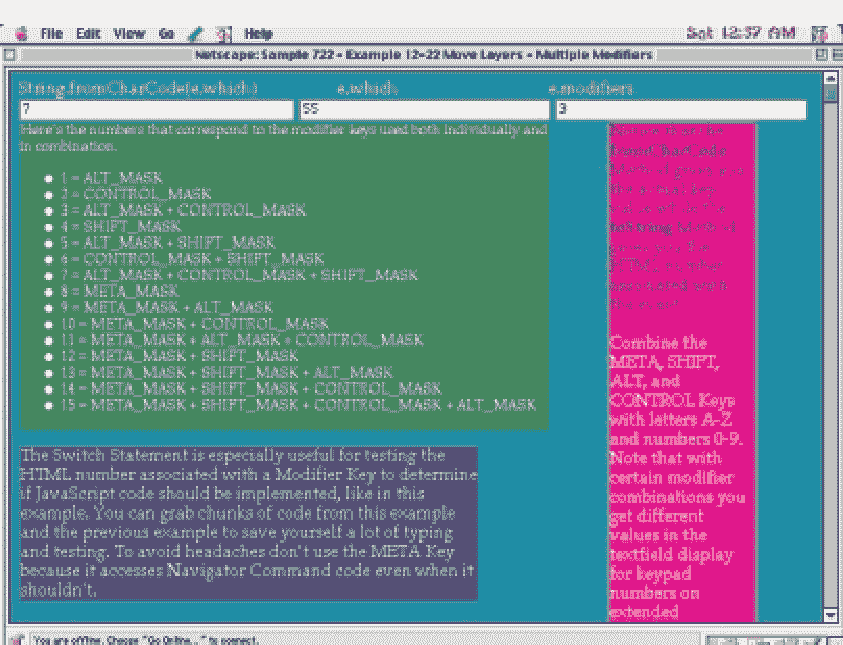

648 第二部分 — JavaScript 1.2

## 使用按键事件打开新窗口

本示例定义了一个名为 **openSesame(e)** 的函数，该函数使用 **switch()** 语句，在按下 ALT + CONTROL + 1 键时， Paradoxically, using the **open()** Method to create and open a new **window** Object. Remember that your comma-separated list of **windowfeatures** cannot have any spaces between each feature. For more information on the **open()** Method (starting on page 422), see the section on the **window** Object (starting on page 416) in Chapter 4 on JavaScript Objects.

The KEYPRESS Event is captured for the **document** Object by the **captureEvents()** Method, and the **openSesame(e)** Function is assigned to the **onkeypress** Event Handler for the **document** Object.

The **window.focus()** Method is assigned to the **onLoad** Event Handler of the BODY Element to give focus to the **window** as soon as the document is fully loaded.

## 示例 6-23：Sample723.html

```
<!DOCTYPE HTML PUBLIC "-//W3C//DTD HTML 3.2//EN">
<HTML>
<HEAD>
<TITLE> 示例 723      示例 6-23  创建新窗口       </TITLE>

<STYLE TYPE="text/JavaScript">

    classes.Mainbody.BODY.margins("0px");

    classes.Mainbody.BODY.paddings("0px");

    classes.Mainbody.BODY.backgroundColor="lightsteelblue";

    classes.Mainbody.BODY.color="white";

    classes.Mainbody.BODY.fontSize="17pt";

    ids.L1.paddings("7px");

</STYLE>

<!-- ******************************************************************* -->

<SCRIPT LANGUAGE="JavaScript1.2"><!--BEGIN HIDING

/*----------------------------------------------------------------------*/
```


 ## 第6章 — JavaScript 事件

```
function openSesame(e) {
    var L1 = document.L1;

    var L1;

    if (e.modifiers == 3) { //ALT_MASK + CONTROL_MASK = 3
        switch (e.which.toString()) {
            case '49' : //按下 ALT + CONTROL + 1 键
                W1 = window.open('Sample406.html', 'testWindow', 'menubar=no,
                scrollbars=no,hotkeys=no,status=no,innerWidth=400,innerHeight=200,screenX=20,
                screenY=100,resizable=no');
                break;

            default : return false;
        }
    }
}
```

```
/*----------------------------------------------------------------------*/

document.captureEvents(Event.KEYPRESS);

document.onkeypress = openSesame;

/*----------------------------------------------------------------------*/
```

```
//隐藏结束-->
</SCRIPT>

</HEAD>

<BODY CLASS="Mainbody" onLoad="window.focus();">

<LAYER ID="L1" LEFT="100" TOP="5" WIDTH="270" BGCOLOR="red">

    尝试点击 ALT + CONTROL + 1 打开一个新窗口。

</LAYER>

</BODY>

</HTML>
```

## 创建用户可自定义的文档

示例 6-24 涉及允许用户选择样式表属性的参数以实时创建自定义网页的函数。为此，你需要大量使用 **document.write()** 方法。基本上，你为用户提供一些 SELECT 菜单元素，以便可以选择背景颜色、文本颜色、图层背景颜色、字体、字体磅值、边框粗细和边框颜色。当用户做出选择时，名为 **display** 的主视图 FRAME 中的文档将使用 **changeEverything()** 函数进行更新，该函数被分配给所有 SELECT 元素的 **onChange** 事件处理程序。

此示例包含四个部分。FRAMESET 将窗口分为三个 FRAME。左侧名为 **display** 的 FRAME 包含所有用于用户偏好的 SELECTION 元素。顶部名为 **input** 的 FRAME 包含用户文本输入的 TEXTFIELD，底部名为 **main** 的 FRAME 是偏好设置和文本输入被渲染显示的区域。

**changeEverything()** 此函数通过向 **display** FRAME 写入内容来实现更改，首先定义所有将包含来自 SELECT 元素的用户选择的变量。例如，变量 **getBackColor** 被分配了在名为 **form1** 的 FORM 元素中、且该 FORM 元素又位于名为 **L2** 的 Layer 中的、名为 **getBackColor** 的 SELECT 元素。然后，**sel** 变量被分配 **getBackColor** SELECT 元素的 **selectedIndex** 属性的整数值。它随后被用作 **options[index]** 数组的 **index**，以获取当前选择的 **value** 并将其分配给 **bcolorSel** 变量。

```
var getBackColor = L2.document.form1.getBackColor;
var sel = getBackColor.selectedIndex;
var bcolorSel = getBackColor.options[sel].value;
```

采用这种有些迂回的方式编码是为了更容易理解正在发生的事情。它也可以像下面这样用一条语句完成：

```
var bcolorSel=document.L2.document.form1.getBackColor.options[document.L2.document.form1.getBackColor.selectedIndex].value;
```

但这更难阅读和理解。

在函数的后续部分，**bcolorSel** 变量（其中包含用户选择的背景颜色）通过以下代码行实现：

```
parent.main.document.bgColor = bcolorColorSel;
```

这行代码访问名为 main 的 FRAME 并使用 bgColor 属性来实现新的背景颜色。此过程在前景颜色上完全重复。其余的用户选择也遵循此流程，仅在变量设置方式上有一个细微差别。基本上，前两行代码已合并为一行，因此总共只有两行，如下所示：

```
var sel3 = L2.document.form1.fontSelection.selectedIndex;
var c3 = L2.document.form1.fontSelection.options[sel3].value;
```

函数的其余部分仅使用 document.write() 方法来创建文档的 HTML 并实现用户偏好。示例中有一些注释部分，你可以查看以获得进一步的说明。

## 示例 6-24 的替代版本

有一个名为 Sample724B-hasLayerBGColor.html 的并行文件，具有一些附加的次要功能。用户可以在以下实现之间选择：

```
parent.main.document.L1.bgColor = c4;
```

这实际上会使图层的背景颜色表现得像 CSS 属性 layer-background-color 一样；或者替代选择：

```
parent.main.document.ids.L1.backgroundColor = c4;
```

这会使其表现正常。这是在 whichTypeBG() 函数中通过名为 chbx1 的复选框实现的。

如果你想运行该版本，请确保加载名为 Sample724-B-Frameset.html 的文件，而不是 Sample724Frameset.html。附加功能说明如下：

**whichTypeBG()** 此函数仅根据名为 chbx1 的 CHECKBOX 元素是否被选中或未选中来更改布尔变量。如果 booleanTest 为 false，则 changeEverything() 函数为 Layer L1 实现 backgroundColor 选择，如下所示：

```
parent.main.document.ids.L1.backgroundColor = c4;
```

如果 booleanTest 为 true，则：

```
parent.main.document.L1.bgColor = c4;
```

**showPoem()** 此函数仅允许用户决定是否应显示一首小诗以及用户的文本。这里包含这首诗是为了让你在测试 SCRIPT 时，不必持续在 TEXTAREA 中输入文本即可获得结果。

## 示例 6-24 第1部分：Sample724.html

```
<!DOCTYPE HTML PUBLIC "-//W3C//DTD HTML 3.2//EN">
<HTML>
<HEAD>
<TITLE> 示例 724   示例 6-24 用户可自定义站点</TITLE>

<STYLE TYPE="text/JavaScript">

        classes.Mainbody.BODY.margins("0px");
        classes.Mainbody.BODY.paddings("0px");
        classes.Mainbody.BODY.backgroundColor="purple";
        classes.Mainbody.BODY.color="white";
        classes.Mainbody.BODY.fontSize="12pt";

</STYLE>
</HEAD>

<BODY CLASS="Mainbody">

<LAYER ID="L2" LEFT="10" TOP="10">

<FORM NAME="form1">

选择新的 <BR>       背景颜色   		<BR>

<SELECT NAME="getBackColor" SIZE="1" onChange="changeEverything(); return false;">

<OPTION  VALUE="cornsilk" SELECTED>        			cornsilk（米绸色）       	</OPTION>
<OPTION  VALUE="bisque">              				bisque（陶土色）         	</OPTION>
<OPTION  VALUE="black">                				black（黑色）            	</OPTION>
<OPTION  VALUE="blue">                				blue（蓝色）            	</OPTION>
<OPTION  VALUE="blueviolet">           				blueviolet（蓝紫色）           	</OPTION>
<OPTION  VALUE="coral">                				coral（珊瑚色）            	</OPTION>
<OPTION  VALUE="cornflowerblue">       				cornflowerblue（矢车菊蓝）    	</OPTION>
<OPTION  VALUE="crimson">              				crimson（深红色）           	</OPTION>
<OPTION  VALUE="cyan">                				cyan（青色）             	</OPTION>
<OPTION  VALUE="darkblue">             				darkblue（深蓝色）        	</OPTION>
<OPTION  VALUE="darkcyan">             				darkcyan（深青色）         	</OPTION>
<OPTION  VALUE="darkgoldenrod">        				darkgoldenrod（暗金菊色）	</OPTION>
<OPTION  VALUE="darkgreen">            				darkgreen（深绿色）       	</OPTION>
<OPTION  VALUE="darkkhaki">           				darkkhaki（深卡其色）     	</OPTION>
<OPTION  VALUE="darkmagenta">           				darkmagenta（深洋红色）   	</OPTION>
<OPTION  VALUE="darkturquoise">       				darkturquoise（深绿松石色）	</OPTION>
<OPTION  VALUE="darkviolet">           				darkviolet（深紫罗兰色）  	</OPTION>
<OPTION  VALUE="goldenrod">            				goldenrod（金菊色）       	</OPTION>
<OPTION  VALUE="gray">                				gray（灰色）             	</OPTION>
<OPTION  VALUE="green">                				green（绿色）            	</OPTION>
<OPTION  VALUE="indianred">            				indianred（印度红）       	</OPTION>
</SELECT>

<!--  **************************************************************  -->
<BR><HR>

选择新的 <BR>       前景颜色<BR>
```


 # 第6章 — JavaScript 事件

```
<SELECT NAME="getForeColor" SIZE="1" onChange="changeEverything(); return false;">
<OPTION  VALUE="lightseagreen" SELECTED>lightseagreen                 </OPTION>
<OPTION  VALUE="lightskyblue">         lightskyblue                 </OPTION>
<OPTION  VALUE="lightslategray">       lightslategray               </OPTION>
<OPTION  VALUE="lightsteelblue">        lightsteelblue               </OPTION>
<OPTION  VALUE="mediumblue">           mediumblue                   </OPTION>
<OPTION  VALUE="mediumorchid">         mediumorchid                 </OPTION>
<OPTION  VALUE="mediumpurple">          mediumpurple                 </OPTION>
<OPTION  VALUE="mediumseagreen">        mediumseagreen               </OPTION>
<OPTION  VALUE="mediumslateblue">       mediumslateblue              </OPTION>
<OPTION  VALUE="mediumspringgreen">      mediumspringgreen            </OPTION>
<OPTION  VALUE="mediumturquoise">       mediumturquoise              </OPTION>
<OPTION  VALUE="mediumvioletred">       mediumvioletred              </OPTION>
<OPTION  VALUE="midnightblue">          midnightblue                 </OPTION>
<OPTION  VALUE="plum">                 plum                         </OPTION>
<OPTION  VALUE="powderblue">            powderblue                   </OPTION>
<OPTION  VALUE="purple">                purple                       </OPTION>
<OPTION  VALUE="red">                   red                          </OPTION>
<OPTION  VALUE="rosybrown">             rosybrown                    </OPTION>
<OPTION  VALUE="royalblue">             royalblue                    </OPTION>
<OPTION  VALUE="steelblue">             steelblue                    </OPTION>
<OPTION  VALUE="tan">                   tan                          </OPTION>
<OPTION  VALUE="teal">                  teal                         </OPTION>
<option  VALUE="thistle">               thistle                      </OPTION>
<OPTION  VALUE="tomato">                 tomato                       </OPTION>
</SELECT>
```

```
<!-- ***********************************************************  -->
```

```
<HR>
```

选择新字体

```
<BR>
```

```
<BR>
```

```
<SELECT NAME="fontSelection" SIZE="1" onChange="changeEverything(); return false;">
<OPTION  VALUE="Helvetica" SELECTED>  Font    </OPTION>
<OPTION  VALUE="Helvetica">           Helvetica                    </OPTION>
<OPTION  VALUE="Times">               Times                        </OPTION>
<OPTION  VALUE="Western">             Western                      </OPTION>
<OPTION  VALUE="Courier">             Courier                      </OPTION>
<OPTION  VALUE="Palatino">             Palatino                     </OPTION>
<OPTION  VALUE="Moonlight">           Moonlight                    </OPTION>
<OPTION  VALUE="Clarendon">           Clarendon                    </OPTION>
<OPTION  VALUE="cursive">             cursive generic              </OPTION>
<OPTION  VALUE="fantasy">             fantasy generic              </OPTION>
<OPTION  VALUE="serif">               serif generic                </OPTION>
</SELECT>
```

```
<!-- ***********************************************************  -->
```

```
<HR>
```

选择新图层背景颜色

```
<BR>
```

```
<SELECT NAME="getLayerBackColor" SIZE="1" onChange="changeEverything(); return false;">
<OPTION  VALUE="navajowhite" SELECTED>        navajowhite                  </OPTION>
<OPTION  VALUE="bisque">                  bisque                       </OPTION>
<OPTION  VALUE="black">                   black                        </OPTION>
<OPTION  VALUE="blue">                    blue                         </OPTION>
<OPTION  VALUE="blueviolet">              blueviolet                   </OPTION>
<OPTION  VALUE="coral">                   coral                        </OPTION>
<OPTION  VALUE="cornflowerblue">           cornflowerblue               </OPTION>
```

# 第二部分 — JavaScript 1.2

654

```
<OPTION VALUE="cornsilk">                cornsilk                </OPTION>
<OPTION VALUE="crimson">                  crimson                 </OPTION>
<OPTION VALUE="cyan">                     cyan                    </OPTION>
<OPTION VALUE="darkblue">                 darkblue                </OPTION>
<OPTION VALUE="midnightblue">            midnightblue            </OPTION>
<OPTION VALUE="mintcream">               mintcream               </OPTION>
<OPTION VALUE="mistyrose">               mistyrose               </OPTION>
<OPTION VALUE="moccasin">                moccasin                </OPTION>
<OPTION VALUE="navy">                     navy                    </OPTION>
<OPTION VALUE="powderblue">              powderblue              </OPTION>
<OPTION VALUE="purple">                   purple                  </OPTION>
<OPTION VALUE="red">                      red                     </OPTION>
</SELECT>
<BR>

<!--  *************************************************  -->
<HR>
选择新<BR>            字体大小                   <BR>

<SELECT NAME="getFontSize" SIZE="1" onChange="changeEverything(); return false;">

<OPTION VALUE="22" SELECTED>           Font Size                </OPTION>
<OPTION VALUE="12">                    12                       </OPTION>
<OPTION VALUE="14">                    14                       </OPTION>
<OPTION VALUE="18">                    18                       </OPTION>
<OPTION VALUE="20">                    20                       </OPTION>
<OPTION VALUE="22">                    22                       </OPTION>
<OPTION VALUE="24">                    24                       </OPTION>
<OPTION VALUE="26">                    26                       </OPTION>
<OPTION VALUE="28">                    28                       </OPTION>
<OPTION VALUE="30">                    30                       </OPTION>
<OPTION VALUE="32">                    32                       </OPTION>
<OPTION VALUE="34">                    34                       </OPTION>
<OPTION VALUE="40">                    40                       </OPTION>
<OPTION VALUE="48">                    48                       </OPTION>
<OPTION VALUE="55">                    55                       </OPTION>
<OPTION VALUE="60">                    60                       </OPTION>
<OPTION VALUE="77">                    77                       </OPTION>
<OPTION VALUE="111">                   111                      </OPTION>
</SELECT>

<!--  *************************************************  -->
<HR>
选择新<BR>            边框颜色                <BR>

<SELECT NAME="getBorderColor" SIZE="1" onChange="changeEverything(); return false;">

<OPTION VALUE="blueviolet" SELECTED>   blueviolet              </OPTION>
<OPTION VALUE="lightseagreen">         lightseagreen           </OPTION>
<OPTION VALUE="lightskyblue">          lightskyblue            </OPTION>
<OPTION VALUE="lightslategray">        lightslategray          </OPTION>
<OPTION VALUE="lightsteelblue">        lightsteelblue          </OPTION>
<OPTION VALUE="lightyellow">           lightyellow             </OPTION>
<OPTION VALUE="limegreen">             limegreen               </OPTION>
<OPTION VALUE="linen">                 linen                   </OPTION>
<OPTION VALUE="magenta">               magenta                 </OPTION>
<OPTION VALUE="mediumaquamarine">      mediumaquamarine        </OPTION>
<OPTION VALUE="purple">                purple                  </OPTION>
```

# 第6章 — JavaScript 事件

```
<OPTION VALUE="red">                    red                </OPTION>
<OPTION VALUE="seagreen">               seagreen             </OPTION>
<OPTION VALUE="seashell">               seashell             </OPTION>
<OPTION VALUE="sienna">                  sienna               </OPTION>
<OPTION VALUE="silver">                  silver               </OPTION>
<OPTION VALUE="skyblue">                 skyblue              </OPTION>
<OPTION VALUE="slateblue">               slateblue            </OPTION>
<OPTION VALUE="slategray">               slategray            </OPTION>
<OPTION VALUE="snow">                    snow                 </OPTION>
<OPTION VALUE="springgreen">             springgreen          </OPTION>
<OPTION VALUE="steelblue">               steelblue            </OPTION>
<OPTION VALUE="tan">                     tan                  </OPTION>
<OPTION VALUE="teal">                    teal                 </OPTION>
<OPTION VALUE="thistle">                 thistle              </OPTION>
</SELECT>
```

```
<!-- *********************************************************** -->
<HR>
选择新<BR>           边框宽度                <BR>

<SELECT NAME="getBorderWidths" SIZE="1" onChange="changeEverything(); return false;">

<OPTION VALUE="22" SELECTED>          Border Widths            </OPTION>
<OPTION VALUE="2">                           2                </OPTION>
<OPTION VALUE="5">                           5                </OPTION>
<OPTION VALUE="7">                           7                </OPTION>
<OPTION VALUE="10">                          10               </OPTION>
<OPTION VALUE="12">                          12               </OPTION>
<OPTION VALUE="14">                          14               </OPTION>
<OPTION VALUE="20">                          20               </OPTION>
<OPTION VALUE="22">                          22               </OPTION>
<OPTION VALUE="25">                          25               </OPTION>
<OPTION VALUE="26">                          26               </OPTION>
<OPTION VALUE="28">                          28               </OPTION>
<OPTION VALUE="30">                          30               </OPTION>
<OPTION VALUE="32">                          32               </OPTION>
<OPTION VALUE="35">                          35               </OPTION>
<OPTION VALUE="40">                          40               </OPTION>
<OPTION VALUE="50">                          50               </OPTION>
<OPTION VALUE="55">                          55               </OPTION>
</SELECT>

</FORM>

</LAYER>
```

```
<!-- *********************************************************** -->

<SCRIPT LANGUAGE="JavaScript1.2"><!--BEGIN HIDING

    dilationRate = 1.4;
    var myArray = new Array();
    for (var i = 0; i < 6; i++) {
        myArray[i] = i;
    }
</script>
<!--END HIDING-->

</BODY>
</HTML>
```

```
<!-- *********************************************************** -->

<SCRIPT LANGUAGE="JavaScript1.2"><!--BEGIN HIDING

    if (booleanTest == false) { booleanTest = true; }
    else if (booleanTest == true) { booleanTest = false; }
}

/*-----------------------------------------------*/
```


 # 656 第二部分 — JavaScript 1.2

```
/*-------------------------------------------------------------------*/

function changeEverything() {

    var L2 = document.L2;

    var getBackColor = L2.document.form1.getBackColor;
    var sel = getBackColor.selectedIndex;
    var bColorSel = getBackColor.options[sel].value;

    var getForeColor = L2.document.form1.getForeColor;
    var sel2 = getForeColor.selectedIndex;
    var fColorSel = getForeColor.options[sel2].value;

    var sel3 = L2.document.form1.fontSelection.selectedIndex;
    var c3 = L2.document.form1.fontSelection.options[sel3].value;

    var sel14 = L2.document.form1.getLayerBackColor.selectedIndex;
    var c4 = L2.document.form1.getLayerBackColor.options[sel14].value;

    var sel5 = L2.document.form1.getFontSize.selectedIndex;
    var c5 = L2.document.form1.getFontSize.options[sel5].value;

    var sel7 = L2.document.form1.getBorderColor.selectedIndex;
    var c7 = L2.document.form1.getBorderColor.options[sel7].value;

    var sel8 = L2.document.form1.getBorderWidths.selectedIndex;
    var c8 = L2.document.form1.getBorderWidths.options[sel8].value;

    var c11 = parent.input.document.form3.textArea1.value;

    parent.main.document.open();
    parent.main.document.write('<HTML><HEAD><TITLE> Test Layer </TITLE>');

    parent.main.document.write('<STYLE TYPE="text/JavaScript">');

    parent.main.document.write('body.fontSize = "10pt";');
    parent.main.document.write('ids.L1.width="100%";');
    parent.main.document.write('ids.L1.paddingRight="20px";');
    parent.main.document.write('ids.L1.paddingLeft="20px";');
    parent.main.document.write('ids.L1.borderWidths("30px");');
    parent.main.document.write('ids.L1.borderStyle="groove";');

    parent.main.document.write('</STYLE>');

    parent.main.document.write('</HEAD>');
    parent.main.document.write('<BODY>');

/*-------------------------------------------------------------------*/
```

//注意，在带有改变属性的变量的接下来几行代码中
//没有 Write 方法

```
/*-------------------------------------------------------------------*/
```

//这一行实现了背景颜色的改变

```
parent.main.document.bgColor = bColorSel;
/*----------------------------------------------------------------------*/
```

//这一行实现了前景颜色的改变

```
parent.main.document.fgColor = fColorSel;
/*----------------------------------------------------------------------*/
```

//这一行实现了字体族的更改

```
parent.main.document.ids.L1.fontFamily = c3;
/*----------------------------------------------------------------------*/
```

//这一行实现了 LAYER 背景颜色的更改

```
parent.main.document.ids.L1.backgroundColor = c4;

/*----------------------------------------------------------------------*/
```

//这一行实现了字体大小的更改

```
parent.main.document.ids.L1.fontSize = c5;
/*----------------------------------------------------------------------*/
```

//这一行实现了边框颜色的更改

```
parent.main.document.ids.L1.borderColor = c7;
/*----------------------------------------------------------------------*/
```

//这一行实现了边框宽度的更改

```
parent.main.document.ids.L1.borderWidths(c8);

/*----------------------------------------------------------------------*/
```

```
parent.main.document.write('<LAYER ID="L1" LEFT="0" TOP="0">');

parent.main.document.writeln('<BR>' + c11 + '<BR><BR>');

parent.main.document.write('</LAYER>');

/*----------------------------------------------------------------------*/
```

```
parent.main.document.write('</BODY></HTML>');
parent.main.document.close();
}
/*----------------------------------------------------------------------*/
```

```
//END HIDING-->
</SCRIPT>

</body>
</html>
```

这只是用于顶部名为 **input** 的 FRAME 中的文档代码。它包含一个名为 **textArea1** 的 TEXTAREA，用于用户输入。

# 示例 6-24 第 2 部分：Sample724A.html

```
<!DOCTYPE HTML PUBLIC "-//W3C//DTD HTML 3.2//EN">
<HTML>
<HEAD>
<TITLE>       Sample 724A  Example 6-24A  </TITLE>
</HEAD>

<BODY>

<FORM NAME="form3">

<TEXTAREA NAME="textArea1" ROWS=8 COLS=55 WRAP="hard">

Put your poem or text here and then choose from the pop-up selection menus in the
left frame to render the results.

</TEXTAREA>

</FORM>

</BODY>
</HTML>
```

这将最初加载到名为 **main** 的 FRAME 中，基本上只是作为被用户选择覆盖的*占位符*文档。

# 示例 6-24 第 3 部分：Sample724Right.html

```
<!DOCTYPE HTML PUBLIC "-//W3C//DTD HTML 3.2//EN">
<HTML>
<HEAD>
<TITLE>       Sample 724Right  Example 6-24Right  </TITLE>
</HEAD>

<BODY>

<H1>        Children speak the ancient rhyme...  </H1>

</BODY>
</HTML>
```

这只是示例 6-24 的 FRAMESET。

# 示例 6-24 第 4 部分：Sample724Frameset.html

```
<HTML>
<HEAD>
<TITLE>          Frameset for Sample 724          </TITLE>
</HEAD>

<FRAMESET COLS="220,*">

        <FRAME MARGINHEIGHT=0 SCROLLING="no" NAME="display" SRC="Sample724.html">

        <FRAMESET ROWS="100,*">

                <FRAME MARGINHEIGHT="0" SCROLLING="auto" NAME="input"
                                               SRC="Sample724A.html">

                <FRAME SCROLLING="auto" NAME="main" SRC="Sample724Right.html">

        </FRAMESET>

</FRAMESET>

</HTML>
```

# 第二部分 — JavaScript 1.2

# 示例 6-24

# Sample724Frameset.html

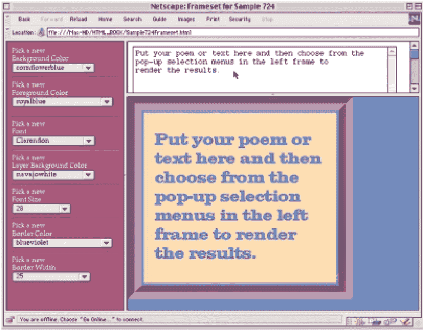

# 拖动 Layer 以调整其大小

在 Netscape 的 Dynamic HTML Guide 中，有一个示例在理论上是正确的，但其中存在一些编码错误，导致其行为不稳定。我已经修复了这些异常，并以重新加工的形式呈现在 [Sample725.html](Sample725.html) 中。

基本结构与本章前面处理通过拖动**重新定位** Layer 的示例类似。在这种情况下，**pageX** 坐标不是由 **mousemove** 事件不断更新，然后转发到 **moveBy()** 方法中进行修改，而是将 **pageX** 坐标输入到 **changeWidth()** 函数中，在那里它被分配给 **layerWidth** 变量，并与 **delta** 参数一起处理，以便在使用 **Layer** 对象的 **load()** 方法重新加载到文档中时改变 Layer 的 **width**。

请记住，**load()** 方法接受 URL 参数，并有一个可选的第二个参数，用于在加载时为 URL 分配新的宽度，本例中使用了该参数。加载的外部文件的 URL 为 [Sample725A.html](Sample725A.html)，书中未提供。请注意，它最初通过 **SRC** 属性加载到名为 **Showcase1** 的 Layer 中。如果你想比较两种不同类型的示例，请查看第 548 页的示例 6-10。

# 示例 6-25：Sample725.html

```
<!DOCTYPE HTML PUBLIC "-//W3C//DTD HTML 3.2//EN">
<HTML>
<HEAD>
<TITLE>Sample 725 - Example 6-25     Drag Mouse to Resize a Layer</TITLE>

</HEAD>

<BODY BGCOLOR="black" TEXT="white">

     <!--  The containing layer that loads the external file   -->

<LAYER ID="Showcase1" LEFT="5" TOP="100" BGCOLOR="blue" SRC="Sample725A.html">
</LAYER>

<!--  ************************************************************  -->

<SCRIPT LANGUAGE="JavaScript1.2"><!--BEGIN HIDING

/*--------------------------------------------------------------------------*/
```

# 662 第二部分 — JavaScript 1.2

```
var layerWidth = 800;
var oldX;
var Showcase1 = document.Showcase1;

Showcase1.captureEvents(Event.MOUSEDOWN|Event.MOUSEUP);

Showcase1.onmousedown=begindrag;
Showcase1.onmouseup=enddrag;
Showcase1.onLoad=resetcapture;
/*------------------------------------------------------*/

function resetcapture() {
    Showcase1.captureEvents(Event.MOUSEDOWN|Event.MOUSEUP|Event.MOUSEMOVE);
}

/*------------------------------------------------------*/

function begindrag(e) {
    Showcase1.captureEvents(Event.MOUSEMOVE);
    Showcase1.onmousemove=drag;
    oldX=e.pageX;
    return false;
}

/*------------------------------------------------------*/

function drag(e) {
    changeWidth(Showcase1, e.pageX - oldX);
    oldX = e.pageX;
    return false;
}

/*------------------------------------------------------*/

function changeWidth(theLayer, delta) {
    layerWidth = layerWidth + delta;
    if (delta != 0) {
        Showcase1.load('Sample725A.html', layerWidth);
    }
}

/*------------------------------------------------------*/

function enddrag(e) {
    Showcase1.onmousemove=0;
    Showcase1.releaseEvents(Event.MOUSEMOVE);
    return false;
}

//END HIDING-->
</SCRIPT>

</body>
</html>
```


## 第 6 章 — JavaScript 事件

事件路由与处理

## JavaScript **routeEvent(e)** 函数

首先简要回顾一下，以下方法可用于 **window**、**document** 和 **Layer** 对象：

```
window.captureEvents(e)
window.releaseEvents(e)
document.captureEvents(e)
document.releaseEvents(e)
layerObject.captureEvents(e)
layerObject.releaseEvents(e)
```

**routeEvent(e)** 函数用于调用事件层次结构中下一个事件处理器。例如，如果你使用 **captureEvents()** 方法为 **window**、**document** 以及页面中名为 **L1** 的 Layer 捕获了 **onclick** 事件处理器，那么当 CLICK 事件发生时，它将首先被 **window** 对象捕获。如果分配给 **window.onclick** 的 JavaScript 代码中恰当地使用了 **routeEvent(e)**，那么它会将 **Event e** 路由到 **document** 对象的 **onclick** 事件处理器进行进一步处理，依此类推直到 **Layer** 对象。

一旦某个事件被所有使用 **captureEvents()** 强制将事件纳入其作用域的对象处理完毕后，JavaScript 会查找该事件原始目标（如链接或按钮）的事件处理器，并完成处理。

这种在层次结构中的推进方式可能看起来有点反向，确实如此，但 JavaScript 与 HTML 一样，是从上往下设计的，因此同级对象从其父对象继承，事件处理遵循该范式。使用这些方法时要小心，不要无意中路由事件从而引发事件反馈循环，这可能会彻底导致系统崩溃。

## 使用 JavaScript **routeEvent(e)** 函数

本示例演示 **routeEvent(e)** 函数的使用。按钮 **B1** 位于 Layer **L1** 内部，按钮 **B2** 位于 Layer **L2** 内部。两个按钮都有自己的 **onClick** 事件处理器代码作为 HTML 属性。**document** 对象被设置为捕获 CLICK 事件，Layer **L1** 被设置为捕获 CLICK 事件。**myClicker(e)** 函数被分配给 **document** 对象的 **onclick** 事件处理器，**myLayerClicker(e)** 函数被分配给 Layer **L1** 的 **onclick** 事件处理器。

**myClicker(e)** 该函数旨在引导你了解事件推进的开始阶段，首先在任何 CLICK 事件发生时显示警告。在此页面中，document 对象具有最高优先级，因为 window 未设置为捕获事件。

然后，如果你点击了文档的背景，第二个警告将会激活。如果点击的是 Button B1，事件将通过 routeEvent(e) 路由到 Layer L1 进行处理。

如果点击的是 Button B2，事件将通过 routeEvent(e) 直接路由到 Button B2 的 onClick 事件处理器，因为 B2 位于 Layer L2 内部；因此，它不会从 Layer L1 继承事件。注意 Layer L2 未设置为捕获事件。

```
function myClicker(e) {

    alert ("This event was captured by the document first and may be routed to... ");

    //Prevents an Event Feedback Loop
    if (e.target == document)  {
        alert ("The 'if' Statement prevents an Event Feedback Loop if you click in the document.");
        return;
    }

    routeEvent(e);
}
```

**myLayerClicker(e)** 该函数通过警告窗口以及 Layer L2 背景色的变化向用户表明它已被激活。然后它将事件路由到下一个可能的目的地（如果有的话）。如果点击的是 Button B1，那么 routeEvent(e) 会将事件路由到该按钮的 onClick 事件处理器进行处理。在本示例中，这是该函数中唯一实现 routeEvent(e) 的地方。

```
function myLayerClicker(e) {

    alert ("This event was captured second, by Layer L1; it turns Layer L2 to cyan and may be routed to... ");
    document.L2.bgColor = 'cyan';
    routeEvent(e);
}
```

## 示例 6-26：Sample726.html

```
<!DOCTYPE HTML PUBLIC "-//W3C//DTD HTML 3.2//EN">
<HTML>
<HEAD>
<TITLE>Sample 726 Example 6-26 routeEvent() Function</TITLE>

<SCRIPT LANGUAGE="JavaScript1.2"> <!--BEGIN HIDING

function myClicker(e) {

    alert ("This event was captured by the document first and may be routed to... ");

    //Prevents an Event Feedback Loop
    if (e.target == document)  {
        alert ("The 'if' Statement prevents an Event Feedback Loop if you click in the document.");
        return;
    }

    routeEvent(e);
}

document.captureEvents(Event.CLICK);
document.onclick=myClicker;

//END HIDING-->
</SCRIPT>

</HEAD>

<BODY>
<LAYER ID="L1" LEFT="25" TOP="10">

<FORM NAME="form1">

<INPUT TYPE="button" NAME="B1" VALUE="Button 1" onClick="alert('me. I am Button 1, at your service.'); return false;">    <BR>

</FORM>
</LAYER>

<LAYER ID="L2" LEFT="25" TOP="70" BGCOLOR="#8888ff">
<H3>Here's the sequence of Events:</H3>

<B>Button 1:</B> The document captures the Event first and routes it to Layer L1 and then routes it to Button B1<BR><BR>

<B>Button 2:</B> The document captures the Event first and routes it to Button B2.<BR><BR>

<B>This Layer L2:</B> The document captures the Event first and that ends the Event Handling.<BR><BR>

<B>Document:</B> The document captures the Event first and that ends the Event Handling.<BR><BR><HR><BR>

<H3>It's important to note that when you set uprellaEventonEvent

<H3>务必注意，在你设置自己的文档时，不要将事件路由成反馈循环。如果 Layer L1 的背景区域足够大而可以点击（不仅仅是按钮），就会产生事件反馈循环。接下来的两个示例将向你展示如何防止反馈循环。如果你创建了这种反馈循环并不得不多次强制退出 Navigator，很可能会损坏 Finder 的首选项文件，届时你将不得不将其丢弃。</H3>

<BR><BR>
<FORM NAME="form2">

<INPUT TYPE="button" NAME="B2" VALUE="Button 2" onClick="alert('me. I am Button 2, at your service.'); return false;">

<BR>

</FORM>

</LAYER>

<SCRIPT LANGUAGE="JavaScript1.2"> <!--BEGIN HIDING

function myLayerClicker(e) {

    alert ("This event was captured second, by Layer L1; it turns Layer L2 to cyan and may be routed to... ");

    document.L2.bgColor = 'cyan';
    routeEvent(e);
}

/*----------------------------------------------------------------------*/

document.L1.captureEvents(Event.CLICK);
document.L1.onclick=myLayerClicker;

/*----------------------------------------------------------------------*/

//END HIDING-->
</SCRIPT>

</BODY>
</HTML>
```

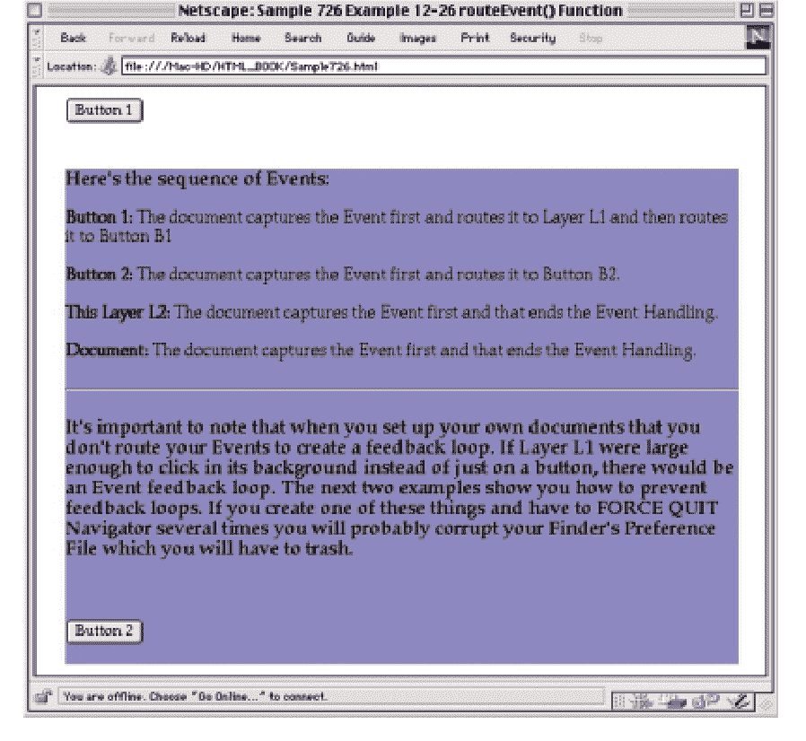

## JavaScript handleEvent(e) 方法

`handleEvent(e)` 方法由事件接收器使用，以通过显式调用特定事件的事件处理器来绕开事件捕获层次结构。想象一个事件正沿着捕获事件的自然链条行进。当它遇到 `handleEvent(e)` 方法时，它会跳出流程，跳转到使用 `handleEvent()` 方法调用它的对象，并在那里继续处理。例如，假设你在名为 `form1` 的表单中定义了一个名为 `B2` 的按钮，如下所示：

```
<INPUT TYPE="button" NAME="B2" VALUE="Button 2"
onClick="alert('I am Button 2, at your service!')">
```

然后你可以使用条件 `if ()` 来测试该按钮是否被点击，如果为真，则调用 `handleEvent(e)` 立即调用其 `onClick` 事件处理器以触发 `alert`，如下所示：

```
if (e.target.name == "B2") {
    e.target.handleEvent(e);
}
```

由于条件 `if ()` 要求目标始终是 Button `B2`，因此你可以使用上述代码中所示的简写方式来调用 `target` 属性的 `handleEvent(e)`。你也可以用更熟悉的方式编写，如下所示：

```
if (e.target.name == "B2") {
    document.form1.B2.handleEvent(e);
}
```

或者这样：

```
if (e.target.name == "B2") {
    document.form1.elements["B2"].handleEvent(e);
}
```

当你开始处理多层嵌套的元素时，你可以看到这种简写编码方式的优势。


 ## 使用 JavaScript 的 handleEvent(e) 方法

示例 6-27 演示了 **handleEvent(e)** 方法和 **routeEvent(e)** 函数。其结构类似于前一个示例，但更为复杂。它以两个名为 **limeLayer1** 和 **L2** 的 Layer 开始。在 **limeLayer1** 内部创建了三个 Button，分别名为 **B1**、**B2** 和 **B3**。**document** 对象和 **limeLayer1** Layer 都使用 **captureEvents()** 来捕获 CLICK 事件。

**myClicker(e)** 函数被分配给 **document** 对象的 **onclick** 事件处理器，而 **myLayerClicker(e)** 函数被分配给 **limeLayer1** 的 **onclick** 事件处理器。**buttonColors(event)** 函数被分配给 **B2** 和 **B3** 两个 Button 的 **onClick** 事件处理器属性。注意，在属性中调用函数时必须显式传递 **event** 关键字参数。

**myClicker(e)** 该函数相比前一个示例增加了功能，当事件的 **target** 是 Button **B2** 时，会在 **target** 属性上调用 **handleEvent(e)** 方法。它以 **routeEvent(e)** 结束，该方法将事件转发给 **limeLayer1** 的 **onclick** 事件处理器。

**myLayerClicker(e)** 该函数也执行了一些比前一个示例更额外的处理。如果点击了 Button **B3**，则调用 **handleEvent(e)** 将事件直接转发给 **B3**；否则，事件由 **limeLayer1** 处理，弹出 **alert** 并将背景颜色改为 **L2**。这结束了事件处理，因为此函数中没有调用 **routeEvent(e)**。

**buttonColors(event)** 该函数根据点击的是 Button **B2** 还是 **B3** 来改变 **L2** Layer 的背景颜色。

## 示例 6-27：Sample727.html

```
<!DOCTYPE HTML PUBLIC "-//W3C//DTD HTML 3.2//EN">
<HTML>
<HEAD>
<TITLE> Sample 727  Example 6-27  routeEvent and handleEvent Method</TITLE>

<SCRIPT LANGUAGE="JavaScript1.2"> <!--BEGIN HIDING

function myClicker(e) {

        if (e.target == document)  {
               alert ("The document captures CLICK Events first in the hierarchy. The 'return false' in this 'if' ends the Event Handling.");
               return false;
        }

alert ("This event was captured by the document first and may be routed
to... ");

if (e.target.name == "B2") {
    e.target.handleEvent(e);
    return false;
}

routeEvent(e);
return false;
}
```

```
document.captureEvents(Event.CLICK);
document.onclick=myClicker;
```

```
<!--END HIDING-->
</SCRIPT>
</HEAD>
```

```
<BODY>
<LAYER ID="limeLayer1" LEFT="25" TOP="10" BGCOLOR="lime" WIDTH="500"
FORM NAME="form1">
```

```
<INPUT TYPE="button" NAME="B1" VALUE="Button 1"> <BR>
```

```
<INPUT TYPE="button" NAME="B2" VALUE="Button 2"
onClick="alert('me . I am Button 2, at your service.'); buttonColors(event); return
false;"><BR>
```

```
<INPUT TYPE="button" NAME="B3" VALUE="Button 3"
onClick="alert('me . I am Button 3, at your service.'); buttonColors(event); return
false;"><BR>
```

```
</FORM>
</LAYER>
```

```
<LAYER ID="L2" LEFT="25" TOP="120" BGCOLOR="#8888ff">
Here's the sequence of Events: <BR><BR>
```

<B>Button 1:</B> the Document captures the Event first and routes it to limeLayer1
where the Event ends so that in this scenario Button B1 never gets the Event
because limeLayer1 does not route Events and there is no handleEvent for Button
B1.<BR><BR>

<B>Button 2:</B> the Document captures the Event first and Button 2 handles the
Event directly with handleEvent.<BR><BR>

<B>Button 3:</B> the Document captures the Event first and routes it to limeLayer1
and then Button 3 handles the Event directly with handleEvent.<BR><BR>

<B>This Layer L2:</B> The document captures the Event first and that ends the Event
Handling.<BR><BR>

<B>Document:</B> The document captures the Event first and that ends the Event
Handling. <BR><BR><HR><BR>

<H3>Notice that <B>'limeLayer1'</B> is capturing Click Events, not Layer L2 which is this Layer.</H3>

<H3>It's important to note that when you set up your own documents that you don't route your Events to create a feedback loop.</H3>

```
</LAYER>

<SCRIPT LANGUAGE="JavaScript1.2"> <!--BEGIN HIDING

function myLayerClicker(e) {

	if (e.target.name == "B3") {
		alert ("This event was captured second, by the Layer limeLayer1. It changes Layer L2 to cyan and then uses e.target.handleEvent to send the event directly to...");
			document.L2.bgColor = 'cyan';
			document.limeLayer1.document.form1.B3.handleEvent(e);
			return false;
	}
	else {
		alert ("This event was captured second, by the Layer limeLayer1. It changes Layer L2 to cyan and is not routed.");
			document.L2.bgColor = 'cyan';
			return false;
	}
return false;
}

/*------------------------------------------------------------------*/

function buttonColors(e) {
	if (e.target.name == 'B2') { document.L2.bgColor='orange'; }
	if (e.target.name == 'B3') { document.L2.bgColor='yellow'; }
}

/*------------------------------------------------------------------*/

	document.limeLayer1.captureEvents(Event.CLICK);
	document.limeLayer1.onclick=myLayerClicker;

/*------------------------------------------------------------------*/

//END HIDING-->
</SCRIPT>

</BODY>
</HTML>
```

## 670 第二部分 — JavaScript 1.2

示例 6-27 Sample727.html

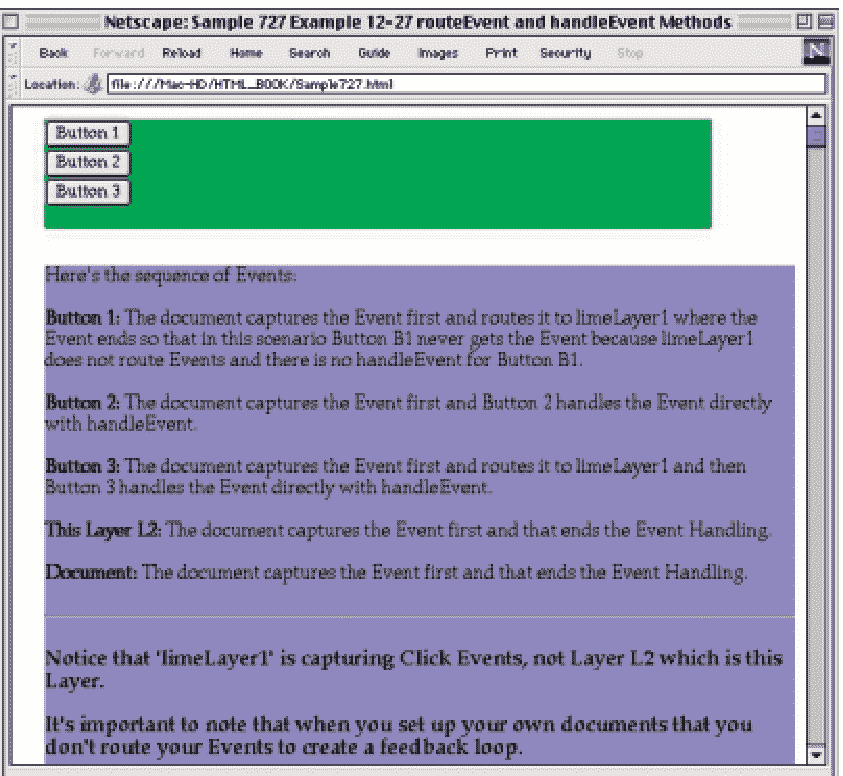

事件序列如下：

Button 1：document 首先捕获事件，并将其路由到 limeLayer1，事件在此结束，因此在这种情况下 Button B1 永远不会收到事件，因为 limeLayer1 不会路由事件，而且 Button B1 没有 handleEvent。

Button 2：document 首先捕获事件，Button 2 直接使用 handleEvent 处理事件。

Button 3：document 首先捕获事件，并将其路由到 limeLayer1，然后 Button 3 直接使用 handleEvent 处理事件。

本层 L2：document 首先捕获事件，事件处理就此结束。

Document：document 首先捕获事件，事件处理就此结束。

注意 **'limeLayer1'** 正在捕获 Click 事件，而不是本层 L2。

需要注意的是，在你自己设置文档时，不要路由你的事件以造成反馈循环。

## 在嵌套和非嵌套 Layer 中处理和路由事件

此示例与上一个示例非常相似。区别在于 **window** 对象也被设置为捕获事件，Button **B1** 位于 **document** 对象中而不是 **limeLayer1** 中。还有一个额外的 Button **B4**，位于 Layer **L2** 内部。

**myWindowClicker(e)** 该函数被分配给 **window** 对象的 **onclick** 事件处理器，由于它位于事件层次结构的顶端，所有事件都会先到达这里，触发 **alert** 消息，然后事件被路由到 **document** 对象的 **onclick** 事件处理器，这是层次结构中的下一个。

**myClicker(e)** 和 **myLayerClicker(e)** 函数与上一个示例中使用的等效，从第 669 页开始详细解释。

你应该注意位于 Layer **L2** 内部的 **B4** Button 被点击时的事件序列。事件首先被发送到 **window**，其次到 **document** 对象，但 _不会_ 从 **document** 对象转发到 **limeLayer1** Layer。从 **document** 对象，事件被路由到 **B3** Button。这个进展并不那么直观明显，所以在你的脚本中要注意这一点。

## 示例 6-28：Sample728.html

```
<!DOCTYPE HTML PUBLIC "-//W3C//DTD HTML 3.2//EN">
<HTML>
<HEAD>
<TITLE> Sample 728   Example 6-28   Handling Events in Nested Layers</TITLE>

<SCRIPT LANGUAGE="JavaScript1.2"> <!--BEGIN HIDING

function myWindowClicker(e) {

alert ("This event was captured by the window first and may be routed to... ");

routeEvent(e);
return false;
}

/* ----------------------------------------------------------- */

window.captureEvents(Event.CLICK);
window.onclick=myWindowClicker;

/* ----------------------------------------------------------- */
```


 ## 第二部分 — JavaScript 1.2

```javascript
function myClicker(e) {

    if (e.target == document) {
        alert ("The document captures CLICK Events second in the hierarchy.
The 'return false' in this 'if' ends the Event Handling.");
        return false;
    }

    alert ("This event was captured by the document second and may be routed to...");

    if (e.target.name == "B2") {
        e.target.handleEvent(e);
        return false;
    }
}

routeEvent(e);
return false;
}
```

```javascript
/*--------------------------------------------------------------------*/

document.captureEvents(Event.CLICK);
document.onclick=myClicker;
```

```html
//END HIDING-->
</SCRIPT>

</HEAD>

<BODY>

<FORM NAME="form1">

<INPUT TYPE="Button" NAME="B1" VALUE="Button 1"
onclick="alert('me. I am Button 1, at your service.'); buttonColors(event);
return false;">
<BR>
</FORM>
```

```html
<!-- ******************************************************************** -->

<LAYER ID="limeLayer1" LEFT="25" TOP="50" BGCOLOR="lime" WIDTH="500">
<FORM NAME="form2">

<INPUT TYPE="button" NAME="B2" VALUE="Button 2"
onclick="alert('me. I am Button 2, at your service.'); buttonColors(event);
return false;">
<BR>

<INPUT TYPE="button" NAME="B3" VALUE="Button 3"
onClick="alert('me. I am Button 3, at your service.'); buttonColors(event);
return false;">
<BR>
</FORM>

</LAYER>
```

```html
<!-- ******************************************************************** -->
```

# 第 6 章 — JavaScript 事件 675

```html
<!-- *************************************************************************** -->

<LAYER ID="L2" LEFT="25" TOP="120" BGCOLOR="#8888ff">

<FORM NAME="form3">

<INPUT TYPE="button" NAME="B4" VALUE="Button 4"
onClick="alert(' mehdr. I am Button 4, at your service.'); buttonColors(event); return
false;">
</FORM>
<!-- *************************************************************************** -->
```

**以下是事件序列：**

**按钮 1：** 窗口首先捕获事件并将其路由，以便文档第二个捕获该事件，最终事件到达按钮 B1，触发其警告框并将 Layer 2 设置为洋红色。

**按钮 2：** 窗口首先捕获事件并将其路由，以便文档第二个捕获该事件，并使用 handleEvent 将其发送给按钮 B2。

**按钮 3：** 窗口首先捕获事件并将其路由，以便文档第二个捕获该事件，并将其路由到 limeLayer1，后者使用 handleEvent 将其发送给按钮 B3。

**按钮 4：** 窗口首先捕获事件并将其路由，以便文档第二个捕获该事件，并将其路由给按钮 B4。

**图层 limeLayer1：** 窗口首先捕获事件并将其路由，以便文档第二个捕获该事件，并将其路由到 limeLayer1，处理后事件结束。

**此图层 L2：** 窗口首先捕获事件并将其路由，以便文档第二个捕获该事件，发送事件处理。

**文档：** 窗口首先捕获事件并将其路由，以便文档第二个捕获该事件，事件处理结束。

### 注意 'limeLayer1' 正在捕获点击事件，而不是此图层 Layer L2。

### 重要的是要注意，当您设置自己的文档时，不要将事件路由以形成反馈循环。

```html
</LAYER>

<!-- *************************************************************************** -->
```

# 第二部分 — JavaScript 1.2

```html
<!-- ******************************************************* -->

<SCRIPT LANGUAGE="JavaScript1.2"> <!--BEGIN HIDING

function myLayerClicker(e) {

    if (e.target.name == "B3") {
        alert ("This event was captured third, by the Layer limeLayer1. It changes Layer L2 to cyan and then uses e.target.handleEvent to send the event directly to...");
        document.L2.bgColor = 'cyan';
        e.target.handleEvent(e);
        return false;
    }
    else {
        alert ("This event was captured third, by the Layer limeLayer1. It changes Layer L2 to cyan and is not routed.");
        document.L2.bgColor = 'cyan';
        return false;
    }
    return false;
}

/* ------------------------------------------------------------ */

function buttonColors(e)  {
    if (e.target.name == 'B1')  { document.L2.bgColor='magenta'; }
    if (e.target.name == 'B2')  { document.L2.bgColor='orange'; }
    if (e.target.name == 'B3')  { document.L2.bgColor='yellow'; }
    if (e.target.name == 'B4')  { document.L2.bgColor='pink'; }
}

/* ------------------------------------------------------------ */

document.limeLayer1.captureEvents(Event.CLICK);
document.limeLayer1.onclick=myLayerClicker;

/* ------------------------------------------------------------ */

//END HIDING-->
</SCRIPT>

</BODY>
</HTML>
```

## 示例 6-28 Sample728.html


---

## 第二部分
## JavaScript 1.2

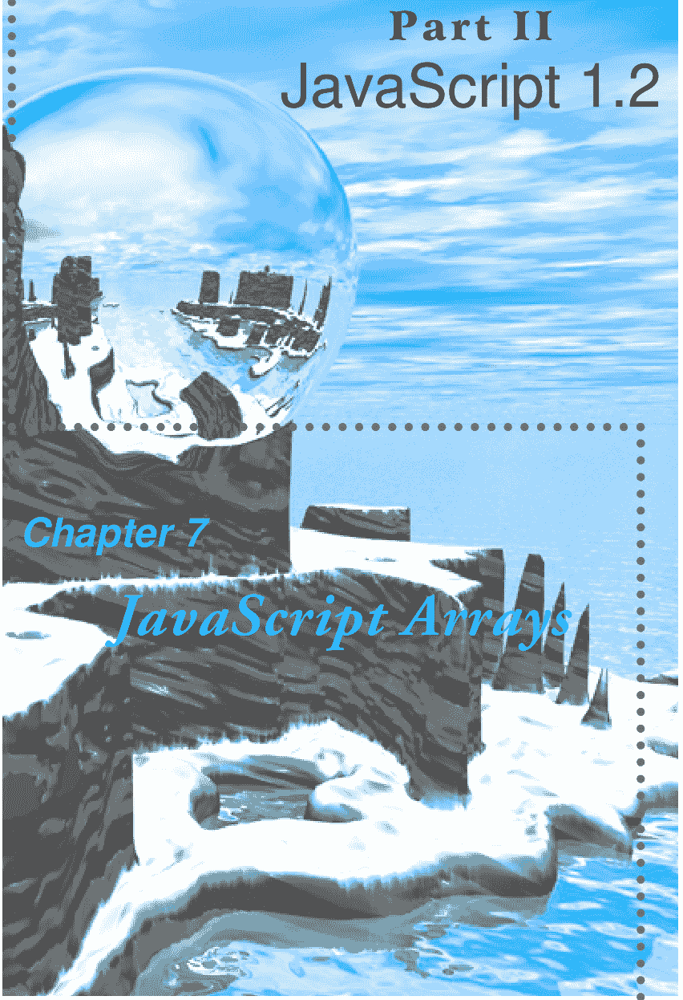

## 第 7 章
## JavaScript 数组

## 第 7 章 JavaScript 数组

### 目录

- JavaScript 数组对象
  - 7.1) JavaScript 数组对象
  - 7.2) 使用数组对象构造函数创建数组
  - 7.3) 创建稠密数组
  - 7.4) 使用字面量表示法创建数组
  - 7.5) 创建二维数组
  - 7.6) 创建三维数组
  - 7.7) 数组属性概述
  - 7.8) 数组方法概述
  - 7.9) 使用所有数组方法的综合示例

- 数组对象方法
  - 7.10) 数组对象的 concat() 方法
  - 7.11) 数组对象的 join() 方法
  - 7.12) 数组对象的 pop() 方法
  - 7.13) 数组对象的 push() 方法
  - 7.14) 数组对象的 shift() 方法
  - 7.15) 数组对象的 unshift() 方法
  - 7.16) 数组对象的 slice() 方法
  - 7.17) 数组对象的 splice() 方法
  - 7.18) 数组对象的 toString() 方法
  - 7.19) 数组元素的 toString() 方法
  - 7.20) reverse() 方法
  - 7.21) sort() 方法
  - 7.22) compareFunction 函数

- 处理返回的数组
  - 7.23) 处理返回的数组与正则表达式
  - 7.24) 字符串对象 match() 方法返回的数组
  - 7.25) 带 "g" 标志的 match() 方法返回的数组
  - 7.26) RegExp 对象 exec() 方法返回的数组
  - 7.27) 数组对象的 index 属性
  - 7.28) 字符串对象 split() 方法返回的数组
  - 7.29) 数组对象的 input 属性
  - 7.30) 使用数组动态填充 <TABLE> 元素数据
  - 7.31) 使用数组的示例文件图表

## JavaScript 数组对象

## JavaScript 数组对象

**JavaScript 语法：**

```
arrayObjectName = new Array(arrayLength);
arrayObjectName = new Array(element0, element1, ..., elementN);
arrayObjectName = [element0, element1, ..., elementN];
```

`数组对象`是 JavaScript 预定义核心对象之一。通常，数组在创建时会被赋值给一个 `arrayObjectName`。数组由一组有序的值组成，每个值称为一个**元素**。数组的每个元素都有一个`唯一索引`号，允许您引用该特定元素。`索引`号从**零**开始，始终为整数，并向正方向递增。因此，数组中的第一个元素的索引为**零**，第二个元素的索引为 **1**，依此类推。数组中的元素数量没有限制。如果您熟悉 Java，那么注意到 JavaScript 数组更像 Java 的 Vector 而不是 Java 的 Array 可能会很有用，因为 JavaScript 数组的 `length` 是灵活的，基于使用情况而定。数组元素的值可以是任何内容。

数组可以使用`数组对象构造函数`或`字面量`表示法创建。使用`字面量`表示法是 Navigator 4 和 JavaScript 1.2 中的新特性。

## 使用数组对象构造函数创建数组

要使用`数组对象构造函数`创建数组，您首先要为数组选择一个名称。然后，使用 `Keyword` **new**，您可以通过选择要初始化的元素数量来定义数组的 `length`，或者使用逗号分隔的其实际元素列表创建一个`稠密`数组。这是一个普通数组的示例，该数组被初始化为具有五个元素；即 `length` 为 5：

```
myArray1 = new Array(5);
```

然后，您可以选性地通过使用元素的 `index` 号并为该元素赋值来定义数组的每个元素，如下所示：


 ## 第二部分 — JavaScript 1.2

```
myArray1[0] = "blue";
myArray1[1] = "red";
myArray1[2] = "purple";
myArray1[3] = "lime";
myArray1[4] = "yellow";
```

你会将以上五个元素中的第一个读作：名为**myArray1**的数组中**索引 0**处的数组元素，其值为文本字符串"blue"。现在假设你想将元素 0 的值改为文本字符串"gold"；你可以这样编写代码：

```
myArray1[0] = "gold";
```

你也可以通过在**数组**对象语法中指定其值来引用数组元素，如下所示：

```
myArray1["blue"]
```

因此，这行代码：

```
myArray1[0] = "gold";
```

等同于：

```
myArray1["blue"] = "gold";
```

你不能像这样在层级结构中引用你创建的数组：

```
document.myArray1[0].
```

但是，你不应将此与其他对象的内置核心对象数组混淆。例如，**forms[]**数组是**document**对象的属性，并且始终在对象层级中这样引用：**document.forms[i]**。有关对象数组的更多信息，请参阅第 4 章。

你也可以创建**length**等于零的数组，这基本上会初始化一个没有任何元素的数组，你可以在脚本稍后为其填充值。下面是一个示例：

```
anotherArray = new Array();
```

每次你为数组初始化一个新元素时，JavaScript 将自动扩展数组的**length**。即使数组的**length**在创建数组时最初是固定的，也是如此。

## 第 7 章 — JavaScript 数组

下面是一个由数组构造函数创建的数组示例，其**length**为 0，随后通过初始化**索引** 7 处的元素将大小扩展为 8 个元素。然后再次通过初始化**索引** 222 处的元素将其扩展，使其**length**变为 223，从而拥有 223 个元素。当以这种方式扩展数组的**length**时，所有未显式赋值的元素的值均为**undefined**。

```
musicArray = new Array();
					//length=0
musicArray[7] = "Close to the Edge";
	//length=8
musicArray[222] = "Yessongs";
		//length=223
```

### 创建**稠密**数组

你可以用一行代码创建一个与之前的**myArray1**相同的**稠密**数组，注意逗号是必需的，但空格是可选的：

```
myArray1 = new Array("blue", "red", "purple", "lime", "yellow");
```

### 将数组元素渲染到屏幕

如果你想在浏览器中显示特定的数组元素，你会使用**document.write()**方法，通过**索引**号引用该元素，如下所示：

```
document.write(myArray1[0]);
```

这将呈现以下输出：

```
blue
```

### 将数组渲染到屏幕

如果你使用**document.write()**方法，仅以数组名称作为参数，你会得到一个由方括号包围的长文本字符串，由数组的每个元素组成，如下所示：

```
document.write(myArray1);
```

这将呈现以下输出，注意 JavaScript 不存储元素之间的可选空格，但它确实存储逗号分隔符：

```
["blue","red","purple","lime","yellow"]
```

如果你想查看此演示，可以查看[Sample805.html](Sample805.html)。

当你拥有元素数量相对较少的数组时，直接在一个**稠密**数组中声明它们是urator相当高效的。如果你需要跟踪各个元素的**索引**位置，那么你可能希望单独声明这些元素。

### 将`for()`语句与数组元素一起使用

如果你想单独输出数组的每个元素并创建一些额外的标记，你可以设置一个**for ()**语句，如下所示：

```
for (var i=0;  i < myArray1.length;  i++) {

    document.write(myArray1[i] + "<BR>");
}
```

这将取出数组的每个元素并在浏览器中将其渲染在单独的一行上，因此输出将如下所示：

- blue Satellite- purple
- lime
- Segoe在之前的概念在示例 7-0 中得到正式说明，可以在[Sample800.html](Sample800.html)中查看。

## 示例 7-0：Sample800.html

```
<!DOCTYPE HTML PUBLIC "-//W3C//DTD HTML 3.2//EN">
<HTML>
<HEAD>
<TITLE> Sample 800 Example 7-0 Array Element display</TITLE>

<SCRIPT LANGUAGE="JavaScript1.2"><!--BEGIN HIDING

myArray1 = new Array("blue", "red", "purple", "lime", "yellow");

    for ( var i=0; i < myArray1.length; i++) {
        document.write(myArray1[i]andle a.java`<BR>" 符合);
    }

//END HIDING-->
</SCRIPT>

</HEAD>

<BODY>
</BODY>
</HTML>
```

### 使用字面量表示法创建数组

当你使用字面量表示法创建数组时，你为其命名并将名称设置等于一个由方括号括起的逗号分隔的值列表，这些值成为数组的元素。数组的长度等于列出的值的数量。但是，在首次创建数组时，你实际上不必指定数组的所有元素。如果你连续输入两个逗号，JavaScript 将在该索引号处创建一个空占位符元素。

以下是如何使用字面量表示法创建数组的方法，使数组命名为 a2，其五个元素指定如下：

```
a2 = ["green", "gray", "black", "white", "olive"];
```

### JavaScript 语法

```
arrayObjectName = [element0, element1, ..., elementN];
```

 Want 距离 split 5acock your buggy 

## 686 第二部分 — JavaScript 1.2

这只是演示如何使用**字面量**表示法创建数组，并使用`for ()`语句循环遍历元素以及通过引用其索引手动对每个元素使用**document.write()**将元素在浏览器中输出两次。这让你可以比较两种技术。

## 示例 7-1：Sample801.html

```
<!DOCTYPE HTML PUBLIC "-//W3C//DTD HTML 3.2//EN">
<HTML>
<HEAD>
<TITLE> Sample 801    Example 7-1 Literal Array Creation</TITLE>

<SCRIPT LANGUAGE="JavaScript1.2"> <!--BEGIN HIDING

a2 = ["green", "gray", "black", "white", "olive"];

        for (var i=0;  i < a2.length;  i++) {

            dument.write(a2[i] + "<BR>");
        }

/*----------------------------------------------------------------------*/

document.write("<P> This outputs the same Literal Array a2 as above but by a different technique.<P>");

document.write(a2[0] + "<BR>");

document.write(a2[1] + "<BR>");

document.write(a2[2] + "<BR>");

document.write(a2[3] + "<BR>");

document.write(a2[4] + "<BR>");

//END HIDING-->
</SCRIPT>

</HEAD>

<BODY>
</BODY>
</HTML>
```

## 第 7 章 — JavaScript 数组

以下是如何在数组中编码空元素的方法，使**索引 2**、**索引 5**和**索引 7**处有空元素。请记住，**索引**号从零开始。

```
a2 = ["green", "gray",,"black", "white",,"olive",,];
```

| 索引 | 提示 |
|---|---|
| 0 | 1 |
| 2 | 3 |
| 4 | 5 |
| 6 | 7 |

（这不属于代码的一部分。）

空元素的值为**undefined**。

### 特别说明

当你在顶级 SCRIPT 中使用**字面量**表示法创建数组时，JavaScript 将在每次评估包含**数组字面量**的表达式时解释**数组**对象。如果**数组字面量**在函数内使用，则在每次调用该函数时都会重新创建它。

### 创建二维数组

数组可以包含在同一数组中具有不同值**类型**的元素，这与大多数其他脚本或编程语言明显不同。例如，数组可能有一个元素是文本字符串，另一个元素是变量，第三个元素是数字。数组元素还可以包含对象、布尔字面量，甚至其他数组。使用数组作为另一个数组的元素是创建类多维数组的过程。

要创建二维数组，只需定义两个数组，并将其中一个数组作为另一个数组的元素赋值。要访问嵌套数组的元素，使用第二组**索引**下标，如以下示例所示：

```
myArray1 = new Array("alpha", "beta", "gamma");
myArray2 = new Array("eeny", "meeny", "miney", myArray1);
```

其中**myArray2**的元素为：

```
myArray2[0] = "eeny";
myArray2[1] = "meeny";
myArray2[2] = "miney";
myArray2[3] = myArray1;
```


 ## 创建二维数组的示例

下面是一个示例，它在另一个`for ()`循环内部嵌套了一个`for ()`循环来创建二维数组。首先定义一个名为`a1`、长度为2的数组，然后使用`for ()`循环为数组`a1`的每个元素分配一个长度为5的新数组。接着使用第二个`for ()`循环为第二维数组的每个元素赋值。

该值由(i + ", " + j)组成，这样变量i和j的值用逗号分隔，成为每个元素的单个条目。接下来使用`document.write()`方法将第一个数组`a1`渲染到屏幕上，但要记住此时第一个数组`a1`是一个数组的数组，其中每个元素都是一个数组。

接下来的`document.write()`方法用于输出构成数组第二维的嵌套数组元素系列。它们通过第二组下标访问。请记住，嵌套的数组元素不是数组，不会以数组语法显示。

`document.write()`方法中的文本字符串是为了帮助你跟踪嵌套数组和二维元素，以便在浏览器中查看输出时理解其逻辑。

## 第7章 — JavaScript数组

## 示例 7-2：Sample802.html

```
<!DOCTYPE HTML PUBLIC "-//W3C//DTD HTML 3.2//EN">
<HTML>
<HEAD>
<TITLE> Sample 802  Example 7-2 Nested Arrays</TITLE>

<SCRIPT LANGUAGE="JavaScript1.2"> <!--BEGIN HIDING

a1 = new Array(2);

for (var i=0;  i<2;  i++) {

       //creates a new Array in each Element of Array a1

       a1[i] = new Array(5);

       for (var j=0; j<5; j++)  {

       //assigns a value to each Element of the second dimension Array

             a1[i][j] = i + ", " +j;


       //displays the values for the first dimension Array of Arrays

document.write(a1[i] + "&nbsp;&nbsp;&nbsp; First Dimension Array <BR>")

        //displays the values for the second dimension Array Elements

document.write(a1[i][j] + "&nbsp;&nbsp;&nbsp; Second Dimension Array Element <BR><BR>")
        }
}


//END HIDING-->
</SCRIPT>

</HEAD>

<BODY>

</BODY>
</HTML>
```

## 创建三维数组

## 示例 7-3 前言

示例 7-3 首先定义了四个数组，每个数组都包含四个文本字符串作为元素。然后有一个名为`myArray5`的第五数组，它的每个元素都取自之前定义的数组之一，因此它是一个二维数组。接下来，有一个名为`myArray6`的第六数组，它的第一个元素是二维数组`myArray5`，这使得`myArray6`成为一个三维数组。`myArray6`的其他三个元素只是数字。

示例的其余部分只是将数组输出到浏览器，以便你可以看到它们的样子，并更容易看清哪些元素索引号做什么。

这是输出元素`myArray6 [0]`时会得到的结果，因为这个特定元素是`myArray5`，它是`myArray6`内部的一个二维数组。

```
["alpha", "beta", "gamma", "delta"], ["blue", "red", "gold", "silver"], ["one", "two", "three", "four"], ["www", "xxx", "yyy", "zzz"]
```

这是输出元素`myArray6 [0] [0]`时会得到的结果，因为这个特定元素是数组`a1`。

```
["alpha", "beta", "gamma", "delta"]
```

这是输出元素`myArray6 [0] [0] [0]`时会得到的结果

```
alpha
```

这在一开始可能看起来反直觉，必须使用三个下标来索引看似`myArray6`的第一个元素，但alpha并不是`myArray6`的第一个元素。它是数组`a1`的第一个元素，而`a1`是`myArray5`的第一个元素，`myArray5`又是`myArray6`的第一个元素。所以现在你可以看到这种递进关系了。

## 示例 7-4 前言

示例 7-4 与示例 7-3 类似。主要区别是`myArray100`是一个完整的三维数组，其中每个元素都是一个数组，而这些数组中的每个元素又都是一个数组。

```
myArray100 = new Array(myArray10, myArray11, myArray12);
myArray10 = new Array(a1, a2, a3);
myArray11 = new Array(a4, a5, a6);
myArray12 = new Array(a7, a8, a9);
```

## 第7章 — JavaScript数组

## 示例 7-3：Sample803.html

```
<!DOCTYPE HTML PUBLIC "-//W3C//DTD HTML 3.2//EN">
<HTML>
<HEAD>
   <TITLE> Sample 803   Example 7-3 three-dimensional Array</TITLE>

<SCRIPT LANGUAGE="JavaScript1.2"> <!--BEGIN HIDING

      //These four Arrays are all text Strings

a1 = new Array("alpha", "beta", "gamma", "delta");
a2 = new Array("blue", "red", "gold", "silver");
a3 = new Array("one", "two", "three", "four");
a4 = new Array("www", "xxx", "yyy", "zzz");

      //myArray5 is composed of the 4 previously defined Arrays

myArray5 = new Array(a1, a2, a3, a4);

      //myArray6 is composed of myArray5 and numbers

myArray6 = new Array(myArray5, 2, 3, 4);

for (var i=0;  i<4;  i++) {
                                //outputs Array a1
       document.write(a1[i] + "<P>");
}

for (var i=0;  i<4;  i++) {
                                //outputs Array myArray5
       document.write(myArray5[i] + "<P>");
}

for (var i=0;  i<4;  i++) {
                                //outputs Array myArray6
       document.write("<BR><P>" + myArray6[i]);
}

document.write("<HR><P>" + "The next line is ELEMENT<B>myArray6 [0] [0] [0]<\/B>");

document.write("<P>" + myArray6[0][0][0]);

document.write("<HR><P>" + "The next line is ELEMENT<B> myArray6 [0] [0]<\/B>");
document.write("<P>" + myArray6[0][0]);

document.write("<P>" + myArray6[0]);

//END HIDING-->
</SCRIPT>
</HEAD>
<BODY>
</BODY>
</HTML>
```

## 示例 7-4：Sample804.html

```
<!DOCTYPE HTML PUBLIC "-//W3C//DTD HTML 3.2//EN">
<HTML>
<HEAD>
    <TITLE> Sample 804   Example 7-4 three-dimensional Array   </TITLE>

<SCRIPT LANGUAGE="JavaScript1.2"> <!--BEGIN HIDING

        //These nine Arrays all have Strings in their Elements

a1 = new Array("alpha", "beta", "gamma", "delta");
a2 = new Array("blue", "red", "gold", "silver");
a3 = new Array("one", "two", "three", "four");

a4 = new Array("AAA", "BBB", "CCC", "DDD");
a5 = new Array("EEE", "FFF", "GGG", "HHH");
a6 = new Array("WWW", "XXX", "YYY", "ZZZ");

a7 = new Array("111", "222", "333", "444");
a8 = new Array("555", "777", "888", "999");
a9 = new Array("123", "456", "789", "ABC");

        //these 3 Arrays are composed of 3 previously defined Arrays

myArray10 = new Array(a1, a2, a3);
myArray11 = new Array(a4, a5, a6);
myArray12 = new Array(a7, a8, a9);

        //myArray100 is composed of the myArray10, myArray11, myArray12 Arrays

myArray100 = new Array(myArray10, myArray11, myArray12);

document.write("<HR><P>" + "This outputs each Element of Array<B> myArray100 <\/B>");

for (var i=0;  i<3;  i++) {
                                    //outputs Array myArray100
        document.write("<BR><P>" + myArray100[i]);
}

document.write("<HR><P>" + "The next line is ELEMENT<B> myArray100 [0]<\/B>");
document.write("<P>" + myArray100[0]);

document.write("<HR><P>" + "The next line is ELEMENT<B> myArray100 [0] [0]<\/B>");
document.write("<P>" + myArray100[0][0]);

document.write("<HR><P>" + "The next line is ELEMENT<B> myArray100 [0] [0] [0]<\/B>");
document.write("<P>" + myArray100[0][0][0]);

//END HIDING-->
</SCRIPT>
</HEAD>
<BODY>
</BODY></HTML>
```

第7章 — JavaScript数组 693

### 数组属性汇总

| 属性 | 描述 |
| :--- | :--- |
| **index** | 作为正则表达式匹配结果创建的数组中，匹配字符串的从零开始的整数索引。 |
| **input** | 表示作为正则表达式匹配结果创建的数组中，与正则表达式匹配的原始字符串。 |
| **length** | 表示数组中精确元素数量的整数。可以将其设置为截断元素，但不能用于扩展元素数量。 |
| **prototype** | 用于在脚本中为所有**Array**对象创建自己的属性。 |

### 数组方法汇总

| 方法 | 描述 |
| :--- | :--- |
| **concat()** | 合并两个数组并返回一个"一级深度"的新数组。 |
| **join()** | 取数组的所有元素并将它们转换为一个字符串，其中每个元素用逗号分隔，或可选地用你自己指定的分隔符分隔。 |
| **pop()** | 移除并返回数组的最后一个元素，改变其**length**。 |
| **push()** | 将元素添加到数组末尾，返回最后添加的元素，并改变数组的**length**。 |
| **reverse()** | 反转数组中元素的物理顺序。 |
| **shift()** | 提取数组的第一个元素并返回该元素。 |
| **slice()** | 提取数组的可选部分并返回一个新数组。 |
| **splice()** | 可选地从数组中添加、移除或<u>添加并移除</u>元素。 |
| **sort()** | 按字典顺序或按你的函数对数组的元素进行排序。 |
| **toString()** | 返回表示调用**Array**对象或元素的字符串。 |
| **unshift()** | 在数组第一个元素之前添加一个或多个元素并返回数组的新**length**。并<u>不</u>返回第一个元素。 |


 ## 一个使用所有数组方法的概览示例

本示例是对数组对象所有方法的快速介绍。在此示例之后，这些方法会被进一步单独探索和定义。基本上，这里定义并填充了两个数组，其中的字符串恰好是颜色。随后对这两个数组调用数组对象的各种方法，并将结果显示在浏览器中。

**示例 7-5：Sample805.html**

```
<!DOCTYPE HTML PUBLIC "-//W3C//DTD HTML 2.0//EN">
<HTML><HEAD>
	<TITLE> Sample 805 Example 7-5 Array Methods</TITLE>

	<STYLE TYPE="text/JavaScript">

		classes.Mainbody.BODY.margins("0px");
		classes.Mainbody.BODY.paddings("0px");
		classes.Mainbody.BODY.backgroundColor="navy";
		classes.Mainbody.BODY.color="white";
		classes.Mainbody.BODY.fontSize="14pt";

		tags.P.color="yellow";
		tags.H3.color="red";
		tags.B.color="lime";

	</STYLE>
	<!-- *************************************************************************** -->

	<SCRIPT LANGUAGE="JavaScript1.2"> <!--BEGIN HIDING

		a1 = new Array("blue", "red", "purple", "lime", "yellow");

		a2 = ["green", "gray", "black", "white", "olive"];

		//----- 注意 a2 是用字面量表示法创建的数组。

	</END HIDING-->
	</SCRIPT>
</HEAD>
<BODY CLASS="Mainbody">
	<!-- *************************************************************************** -->

	<SCRIPT LANGUAGE="JavaScript1.2"> <!--BEGIN HIDING

		var str = "";

		str += '<P>Array a1 has these Elements: <B>' + a1 + '</B></P>';
		str += 'Array a2 has these Elements: <B>' + a2 + '</B><BR>';
		str += '<P>Array a1 concat a2: <B>' + a1.concat(a2) + '</B></P>';

		str += '<P>Array a1 with the Join Method: <b>' + a1.join(',') + '</b></P>';

		str += 'Array a2 with the Join Method: <b>' + a2.join(',') + '</b><BR><BR>';

		str += '<P>Array a1 Lexicographically Sorted is: <b>' + a1.sort() + '</b><BR>';
		str += 'Array a1 Lex. Sorted and Joined is: <b>' + a1.join(',') + '</b><BR><BR>';

		str += 'Array a1 Sorted and Reversed is: <b>' + a1.reverse() + '</b><BR>';
		str += 'Array a1 Sorted, Reversed and Joined is: <b>' + a1.join(',') + '</b></P>';

		str += 'Array a2 with the Push Method: <b>' + a2.push('cyan', 'maroon') + '</b><BR>';
		str += 'Array a2 after the Push Method: <b>' + a2 + '</b><BR><BR>';

		str += '<H3>-----Note that the Unshift Method </b>';
		str += 'returns the number of Elements in the Array</H3>';

		str += 'Array a2 with the Unshift Method: <b>' + a2.unshift('navy', 'violet') + '</b><BR><BR>';

		str += 'Array a2 after the Unshift Method: <b>' + a2 + '</b><BR><BR>';

		str += 'Array a2 with the Pop Method: <b>' + a2.pop() + '</b><BR><BR>';
		str += 'Array a2 after the Pop Method: <b>' + a2 + '</b><BR><BR>';

		str += 'Array a2 with the Shift Method: <b>' + a2.shift() + '</b><BR><BR>';
		str += 'Array a2 after the ShiftFIXME  Method: <b>' + a2 + '</b><BR><BR>';

		str += 'Array a2 the Slice Method: <b>' + a2.slice(2,5) + '</b><BR><BR>';

		str += '<H3>-----Notice that the Slice Method does not alter </b>';
		str += 'the Array but returns a new Array</H3>';

		str += 'Array a2 after the Slice Method: <b>' + a2 + '</b><BR><BR>';

		str += 'Array a2 with the Splice Method: <b>' + a2.splice(3,2, 'gold','darkblue') + '</b><BR><BR>';

		str += '<H3>-----Note that the colors gold and darkblue are </b>';
		str += 'added in place of black and white</H3>';

		str += 'Array a2 after the Splice Method: <b>' + a2 + '</b><BR><BR>';

		str += 'Array a2 with the Splice Method: <b>' + a2.splice(1,4) + '</b><BR><BR>';

		str += '<H3>-----Note that since no new colors are specified, </b>';
		str += 'Elements are simply removed</H3>';

		str += 'Array a2 after the Splice Method: <b>' + a2 + '</b><BR><BR>';

		document.write(str);

//END HIDING-->
</SCRIPT>
</BODY>
</HTML>
```

## 数组对象方法

### 数组对象的 concat() 方法

**JavaScript 语法：**

```
arrayObjectName1.concat(arrayObjectName2);
```

**参数定义：**

concat() 方法返回一个新数组，其由 arrayObjectName1 的元素和 arrayObjectName2 的元素组成。注意，这个新数组是原始元素的一层深拷贝，不会以任何方式改变原始数组。

新合并数组的第一个元素等于 arrayObjectName1 数组的第一个元素，新合并数组的第二个元素等于 arrayObjectName1 数组的第二个元素，以此类推。例如，如果你有两个名为 a1 和 a2 的数组，如下所示：

```
a1 = new Array(1,2,3);
a2 = new Array(4,5,6);

```

myNewArray = a1.concat(a2);
```

结果等于：

```
myNewArray = [1,2,3,4,5,6];
```

JavaScript 根据元素值的类型，以不同方式从原始数组复制数组元素到新数组。当原始数组中的元素是对象时，JavaScript 复制的是该对象的引用而非对象本身，因此原始数组和新数组仍然引用同一个对象。如果该引用对象以任何方式被修改，那么这些更改会同时反映在原始数组和新数组中。

当 JavaScript 使用 concat() 方法将字符串和数字复制到新数组时，复制的是实际的字符串和数字，而非引用。注意，这不适用于字符串对象和数字对象，它们的行为在前一段关于对象行为的描述中已涵盖。对一个数组中的字符串或数字所做的任何更改不会影响另一个数组。

如果你向新数组或旧数组添加一个元素，另一个数组将不会有该添加的元素，并且完全不受影响。

本示例首先通过在数组构造函数函数中指定其元素来定义两个**密集**数组，它们分别命名为 **a1** 和 **a2**。然后数组 **a1** 调用 **concat()** 方法，以数组 **a2 argument 并将新数组赋值给 **a3**。这三个数组随后都被写入浏览器，以便你可以查看结果。

### 示例 7-6：Sample806.html

```
<!DOCTYPE HTML PUBLIC "-//W3C//DTD HTML 3.2//EN">
<HTML><HEAD>  <TITLE> Sample 806   Example 7-6 concat Method</TITLE>

<SCRIPT LANGUAGE="JavaScript1.2"> <!--BEGIN HIDING


a1 = new Array("one", "two", "three", "four");

a2 = new Array(1, 2, 3, 4);

a3 = a1.concat(a2);

/*------------------------------------------------------------*/

document.write("<H3>The next line is Array a1<\/H3>");
document.write("<P>" + a1 + "<HR>");

document.write("<H3>The next line is Array a2<\/H3>");
document.write("<P>" + a2 + "<HR>");

document.write("<H3>The next line is Array a3 = a1.concat(a2)<\/H3>");
document.write("<P>" + a3 + "<HR>");

/*------------------------------------------------------------*/
//END HIDING-->
</SCRIPT>
</HEAD>
<BODY> </BODY></HTML>
```

上述示例产生以下输出：

The next line is Array a1
["one", "two", "three", "four"]

The next line is Array a2
[1, 2, 3, 4]

The next line is Array a3 = a1.concat(a2)
["one", "two", "three", "four", 1, 2, 3, 4]

本示例首先通过在数组构造函数函数中指定其元素来定义两个**密集**数组，它们分别命名为 **a1** 和 **a2**。然后数组 **a1** 调用 **concat()** 方法，以数组 **a2** argument 并将新数组赋值给 **a3**。这三个数组随后都被写入浏览器，以便你可以查看结果。接着向 **a2UNTIL a2** 添加一个新元素，然后将数组 **a2** 和 **a3** 都写入浏览器，以便你可以看到 **a2** 显示了其数组中添加元素的更改，但 **a3** 不受影响。

### 示例 7-7：Sample807.html

```
<!DOCTYPE HTML PUBLIC "-//W3C//DTD HTML 3.2//EN">
<HTML>
<HEAD>
<TITLE> Sample 807   Example 7-7 concat Method add Element</TITLE>

<SCRIPT LANGUAGE="JavaScript1.2"> <!--BEGIN HIDING

a1 = new Array("alpha", "beta", "gamma", "delta");

a2 = new Array("blue", "red", "gold", "silver");

a3 = a1.concat(a2);


document.write("<P>" + a1);

document.write("<P>" + a2);

document.write("<P>" + a3);

                //Adds a new Element to a2

a2[4] = "PLATINUM";

                //Notice a2 is changed but a3 is not changed

document.write("<P>" + a2);

document.write("<P>" + a3);


街坊飘窗 飘窗专家


//END HIDING-->
</SCRIPT>
</HEAD>

<BODY>
</BODY>
</HTML>
```


前面的示例产生以下输出：

```
["alpha", "beta", "gamma", "delta"]

["blue", "red", "gold", "silver"]

["alpha", "beta", "gamma", "delta", "blue", "red", "gold", "silver"]

["blue", "red", "gold", "silver", "PLATINUM"]

["alpha", "beta", "gamma", "delta", "blue", "red", "gold", "silver"]
```

让我们通过一个示例来探讨这一理论，其中数组 **a1** 调用 `concat()` 方法，以数组 **a2** 作为参数，并将新数组赋值给 **a3**。这三个数组都会被写入浏览器。接着，使用 `length` 属性将 **a2** 的 `length` 从 4 改为 2，这实际上删除了 **a2** 的最后两个元素。然后，再次将 **a2** 和 **a3** 数组写入浏览器，以显示 **a2** 确实发生了变化，而 **a3** 不受影响。请注意，如果再次将 **a1** 与 **a2** 进行 `concat()`，那么变化将反映在 **a3** 中。

## 示例 7-8：Sample808.html

```
<!DOCTYPE HTML PUBLIC "-//W3C//DTD HTML 3.2//EN">
<HTML>
<HEAD>
<TITLE> 示例 808 示例 7-8 concat 方法删除元素</TITLE>

<SCRIPT LANGUAGE="JavaScript1.2"> <!--BEGIN HIDING

a1 = new Array("alpha", "beta", "gamma", "delta");
a2 = new Array("blue", "red", "gold", "silver");

a3 = a1.concat(a2);

document.write("<P>" + a1);
document.write("<P>" + a2);
document.write("<P>" + a3);

//将 length 从 4 改为 2，从而删除 2 个元素

a2.length = 2;

//注意 a2 已更改，但 a3 未更改

document.write("<P>" + a2);
document write("<P>" + a3);
```

700 第二部分 — JavaScript 1.2

```
//END HIDING-->
</SCRIPT>
</HEAD>
<BODY>
</BODY>
</HTML>
```

前面的示例产生以下输出：

```
["alpha", "beta", "gamma", "delta"]
["blue", "red", "gold", "silver"]
["alpha", "beta", "gamma", "delta", "blue", "red", "gold", "silver"]
["blue", "red"]
["alpha", "beta", "gamma", "delta", "blue", "red", "gold", "silver"]
```

本示例涉及 **Array** 对象的 **concat()** 方法，当使用 **Literal** 表示法创建的对象作为数组元素的值时的情况。前面理论中阐述的前提是，由于 JavaScript 复制的是被连接对象的引用，因此对这些对象的任何更改都会反映在原数组和新连接的数组中。

我们首先使用 **Literal** 表示法创建三种不同类型的对象，通过赋值命名它们，然后用属性和值定义它们，如下所示：

```
stringObject1 = {theString:"my second string object"};
numberObject1 = {theNumber:8};
computerObject = {make:"Mac", model:8100, ram:264, harddrive:"internal 4Gig"};
```

接下来，使用数组构造函数函数创建两个**稠密**数组，并通过将数组 **a1** 和 **a2** 的连接赋值给 **a3** 来创建第三个数组，如下所示：

```
a1 = new Array("one", "two");

a2 = new Array(stringObject1, numberObject1, computerObject);

a3 = a1.concat(a2);
```

接下来，使用 **document.write()** 方法将所有三个数组写入屏幕，以便稍后比较。然后对对象的属性进行一些更改，如下所示：

```
stringObject1.theString = "MY CHANGED SECOND STRING OBJECT";
numberObject1.theNumber = 777;
computerObject.model = 9600;
computerObject.ram = 512;
computerObject.harddrive = "external 9Gig";
```

最后，再次将数组 **a2** 和 **a3** 写入屏幕，以显示对象的更改确实反映在原数组 **a2** 和新数组 **a3**（即 **a1.concat(a2)**）中。

## 示例 7-9：Sample809.html

```
<!DOCTYPE HTML PUBLIC "-//W3C//DTD HTML 3.2//EN">
<HTML>
<HEAD>
<TITLE> 示例 809 示例 7-9 带对象的 concat 方法</TITLE>

<SCRIPT LANGUAGE="JavaScript1.2"> <!--BEGIN HIDING

//使用 Literal 表示法创建三个对象。

stringObject1 = {theString:"my second string object"};

numberObject1 = {theNumber:8};

computerObject = {make:"Mac", model:8100, ram:264, harddrive:"internal 4Gig"};


/*-------------------------------------------*/

a1 = new Array("one", "two");

a2 = new Array(stringObject1, numberObject1, computerObject);

a3 = a1.concat(a2);

/*-------------------------------------------*/

document.write("<H3>The next line is Array a1<\/H3>");
document.write("<P>" + a1);

document.write("<H3>The next line is Array a2<\/H3>");
document.write("<P>" + a2);

document.write("<H3>The next line is Array a3 = a1.concat(a2)<\/H3>");
document.write("<P>" + a3 + "<HR>");
```

702 第二部分 — JavaScript 1.2

```
/*-----------------------------------------------------------------------*/
    //注意当 a2 的对象更改时，a3 的对象也会反映该更改

stringObject1.theString = "MY CHANGED SECOND STRING OBJECT";

numberObject1.theNumber = 777;

computerObject.model = 9600;

computerObject.ram = 512;

computerObject.harddrive = "external 9Gig";

/*-----------------------------------------------------------------------*/

document.write("<H3>The next line is Array a2 after the <I>OBJECT<\/I> changes<\/H3>");

document.write("<P>" + a2);

/*-----------------------------------------------------------------------*/

document.write("<P><H3><FONT COLOR='red'>Notice when a2 " +
        "Objects are changed " +
        "then a3 Objects reflect the change.<\/FONT> <\/H3>");

/*-----------------------------------------------------------------------*/

document.write("<H3>The next line is Array a3 after the changes<\/H3>");

document.write("<P>" + a3);

//END HIDING-->
</SCRIPT>
</HEAD>

<BODY>
</BODY>
</HTML>
```

前面的示例产生以下输出：

## 第 7 章 — JavaScript 数组

下面一行是数组 a1

```
["one", "two"]
```

下面一行是数组 a2

```
[{theString:"my second string object"}, {theNumber:8}, {make:"Mac", model:8100, ram:264, harddrive:"internal 4Gig"}]
```

下面一行是数组 a3 = a1.concat(a2)

```
["one", "two", {theString:"my second string object"}, {theNumber:8}, {make:"Mac", model:8100, ram:264, harddrive:"internal 4Gig"}]
```

下面一行是对象更改后的数组 a2

```
[{theString:"MY CHANGED SECOND STRING OBJECT"}, {theNumber:777}, {make:"Mac", model:9600, ram:512, harddrive:"external 9Gig"}]
```

下面一行是更改后的数组 a3

```
["one", "two", {theString:"MY CHANGED SECOND STRING OBJECT"}, {theNumber:777}, {make:"Mac", model:9600, ram:512, harddrive:"external 9Gig"}]
```

## Array 对象的 join() 方法

## JavaScript 语法：

```
arrayObjectName.join();
arrayObjectName.join("separatorString");
```

### 参数定义：

**join()** 方法返回一个由数组的每个元素组成的单一文本字符串。可选的 **separatorString** 用于在文本字符串中分隔每个元素。如果未提供 **separatorString**，JavaScript 默认应使用逗号分隔每个元素。请注意，Navigator 4 中存在一个 bug，如果未提供 **separatorString**，则输出会变为 **Array Literal**。如有必要，JavaScript 会将 **separatorString** 参数转换为字符串。请注意，原数组不受影响。

本示例仅演示了 **Array** 对象的 **join()** 方法，并对如何使用 **separatorString** 参数进行了一些巧妙处理。没什么特别的，只是创建一个**稠密**数组，并多次使用 **join()** 方法，配合各种 **separatorStrings**，它们被放在 **write()** 方法内部，以便你可以在浏览器中看到结果。

## 示例 7-10：Sample810.html

```
<!DOCTYPE HTML PUBLIC "-//W3C//DTD HTML 3.2//EN">
<HTML>
<HEAD>
		<TITLE> 示例 810   示例 7-10 join 方法</TITLE>

<SCRIPT LANGUAGE="JavaScript1.2"> <!--BEGIN HIDING

a1 = new Array("one","two","three","four","five");

var fuzzy1 = "<FONT COLOR='purple'>";
var fuzzy2 = "<\/FONT>";
var fuzzy3 = " _____ ";

document.write("<H3>" + a1.join() + "...注意这个 BUG<\/H3>");
document.write("<H3>" + a1.join(' + ') + "<\/H3>");
document.write("<H3>" + a1.join(' ***** ') + "<\/H3>");
document.write("<H3>" + a1.join(fuzzy1 + ' plus ' + fuzzy2) + "<\/H3>");
document.write("<H3>" + a1.join(fuzzy3) + "<\/H3>");

//END HIDING-->
</SCRIPT>

</HEAD>
<BODY>
</BODY>
</HTML>
```

前面的示例产生以下输出：

["one", "two", "three", "four", "five"]...注意这个 BUG

one + two + three + four + five

one ***** two ***** three ***** four ***** five

one **plus** two **plus** three **plus** four **plus** five

one _____ two _____ three _____ four _____ five


 ## Array 对象的 pop() 方法

## JavaScript 语法：

```
arrayObjectName.pop();
```

**pop()** 方法会取出，也就是说，移除数组中的最后一个元素并将其返回。这会带来一个附加效果，就是改变数组的 **length**，你猜到了，比原来少一。

如果你的目的只是移除一个元素，那么只需通过数组名称对其调用 **pop()** 方法，像这样：

```
myArray.pop();
```

如果你想利用返回的元素，那么将调用的 **pop()** 方法赋值给一个变量，像这样：

```
myPopped = myArray.pop();
```

这个简单的示例通过创建一个名为 **a1** 的**稠密**数组来演示 **pop()** 方法，将其和 **length** 输出到屏幕。接着对 **a1** 执行 **pop()** 方法，并将返回的元素赋值给变量 **myPopped**。然后将 **myPopped** 输出到屏幕，并再次将 **a1** 输出到屏幕，以显示最后一个元素已被移除。最后，再次将数组的 **length** 输出到屏幕，以显示 **length** 比执行 **pop()** 之前少了一。

### 示例 7-11：Sample811.html

```
<!DOCTYPE HTML PUBLIC "-//W3C//DTD HTML 3.2//EN">
<HTML>
<HEAD>

<TITLE> Sample 811  Example 7-11 pop Method</TITLE>

<SCRIPT LANGUAGE="JavaScript1.2"> <!--BEGIN HIDING

a1 = new Array("one","two","three","four","five");

document.write("Before pop<H3>" + a1 + "<\/H3>");

document.write("<H3>The length is: " + a1.length + "<\/H3>");

myPopped = a1.pop();

document.write("popped<H3>" + myPopped + "<\/H3>");

document.write("After pop<H3>" + a1 + "<\/H3>");

document.write("<H3>The length is: " + a1.length + "<\/H3>");

//END HIDING-->
</SCRIPT>

</HEAD>

<BODY>

</BODY>
</HTML>
```

上述示例产生以下输出：

Before pop

["one", "two", "three", "four", "five"]

The length is: 5

popped

five

After pop

["one", "two", "three", "four"]

The length is: 4

## Array 对象的 push() 方法

## JavaScript 语法：

```
arrayObjectName.push(element1, element2, ..., elementN);
```

### 参数说明：

**push()** 方法可以向数组**末尾**添加任意多个元素，并返回最后添加的元素。这会改变数组的 **length**，变化量取决于添加的元素个数。像往常一样，每个元素必须用逗号分隔，但逗号后的空格是可选的，为了可读性。

此示例使用**字面量**表示法创建数组 **a1**，然后将其及其 **length** 输出到屏幕。接着向 **a1** 添加三个字符串元素，并将返回的最后添加的元素赋值给变量 **myPushed**。然后将变量 **myPushed** 输出到屏幕，再次将 **a1** 输出到屏幕以显示 **push()** 方法的结果。

### 示例 7-12：Sample812.html

```
<!DOCTYPE HTML PUBLIC "-//W3C//DTD HTML 3.2//EN">
<HTML>
<HEAD>

<TITLE> Sample 812   Example 7-12 push Method</TITLE>

<SCRIPT LANGUAGE="JavaScript1.2"> <!--BEGIN HIDING


a1 = ["one","two","three","four","five"];

document.write("Before push<H3>" + a1 + "<\/H3>");

document.write("<H3>The length is: " + a1.length + "<\/H3>");


myPushed = a1.push("SIX", "SEVEN", "EIGHT");

document.write("myPushed<H3>" + myPushed + "<\/H3>");

document.write("After push<H3>" + a1 + "<\/H3>");
document.write("<H3>The length is: " + a1.length + "<\/H3>");

//END HIDING-->
</SCRIPT>

</HEAD>

<BODY>

</BODY>
</HTML>
```

上述示例产生以下输出：

Before push
["one", "two", "three", "four", "five"]
**The length is: 5**

myPushed
**EIGHT**

After push
["one", "two", "three", "four", "five", "SIX", "SEVEN", "EIGHT"]
**The length is: 8**

## 708 第二部分 — JavaScript 1.2

## Array 对象的 shift() 方法

## JavaScript 语法：

```
arrayObjectName.shift();
```

**shift()** 方法用于移除数组的第一个元素并返回该元素。该元素等价于 **arrayObjectName[0]**。此方法还会将数组的 **length** 改为方法调用之前少一。

这个简单的示例通过使用**字面量**表示法创建一个名为 **a1** 的数组来演示 **shift()** 方法，然后将其及 **length** 输出到屏幕。接着对 **a1** 执行 **shift()** 方法，并将返回的元素赋值给变量 **myShifted**。然后将 **myShifted** 输出到屏幕，并再次将 **a1** 输出到屏幕，以显示第一个元素已被移除。最后，再次将数组的 **length** 输出到屏幕，以显示 **length** 比执行 **shift()** 之前少了一。

### 示例 7-13：Sample813.html

```
<!DOCTYPE HTML PUBLIC "-//W3C//DTD HTML 3.2//EN">
<HTML>
<HEAD>
<TITLE> Sample 813  Example 7-13 shift Method</TITLE>

<SCRIPT LANGUAGE="JavaScript1.2"> <!--BEGIN HIDING

a1 = ["one","two","three","four","five"];


document.write("Before shift:<H3>" + a1 + "<\/H3>");
document.write("<H3>The length is: " + a1.length + "<\/H3>");

myShifted = a1.shift();

document.write("myShifted value is:<H3>" + myShifted + "<\/H3>");

document.write("After shift:<H3>" + a1 + "<\/H3>");
document.write("<H3>The length is: " + a1.length + "<\/H3>");

//END HIDING-->
</SCRIPT>
```

上述示例产生以下输出：

Before shift:

```
["one", "two", "three", "four", "five"]
```

**The length is: 5**

myShifted value is:

```
one
```

After shift:

```
["two", "three", "four", "five"]
```

**The length is: 4**

## Array 对象的 unshift() 方法

## JavaScript 语法：

```
arrayObjectName.unshift(element1, element2, ..., elementN);
```

### 参数说明：

**unshift()** 方法用于向由 **arrayObjectName** 指定的数组的第一个元素之前添加任意多个元素。此方法返回数组的新 **length**，而不是一个元素。**elementN** 参数是要添加到数组前面的元素。

这个简单的示例通过使用**字面量**表示法创建一个名为 **a1** 的数组来演示 **unshift()** 方法，然后将其及 **length** 输出到屏幕。接着对 **a1** 执行 **unshift()** 方法，添加三个元素，并将返回的 **length** 赋值给变量 **myReturnedLength**。然后将 **myReturnedLength** 输出到屏幕，并再次将 **a1** 输出到屏幕，以显示添加的三个元素现已存在于数组中，且位于数组开头。最后，再次将数组的 **length** 输出到屏幕，以显示 **length** 反映了调用 **unshift()** 方法后的当前元素数量。

### 示例 7-14：Sample814.html

```
<!DOCTYPE HTML PUBLIC "-//W3C//DTD HTML 3.2//EN">
<HTML>
<HEAD>
<TITLE> Sample 814  Example 7-14 unshift Method</TITLE>

<SCRIPT LANGUAGE="JavaScript1.2"> <!--BEGIN HIDING

a1 = ["one","two","three","four","five"];

document.write("Before unshift:<H3>" + a1 + "<\/H3>");
document.write("<H3>The length is: " + a1.length + "<\/H3>");

myReturnedLength = a1.unshift("minusTwo", "minusOne", "zero");

document.write("myReturnedLength value is:<H3>" + myReturnedLength + "<\/H3>");

document.write("After unshift:<H3>" + a1 + "<\/H3>");
document.write("<H3>The length is: " + a1.length + "<\/H3>");

//END HIDING-->
</SCRIPT>

</HEAD>

<BODY>

</BODY>
</HTML>
```

上述示例产生以下输出：

Before unshift:

```
["one", "two", "three", "four", "five"]
```

**The length is: 5**

myReturnedLength value is:

```
8
```

After unshift:

```
["minusTwo", "minusOne", "zero", "one", "two", "three", "four", "five"]
```

**The length is: 8**

## Array 对象的 slice() 方法

## JavaScript 语法：

```
arrayObjectName.slice( startIndex , [endIndex] );
```

### 参数说明：

`slice()` 方法用于从数组中提取一组连续的元素，并返回由这些元素组成的新数组。`startIndex` 参数是一个整数，作为开始切片的从零开始的索引。例如，如果 `startIndex` 为 0，`slice()` 从第一个元素开始，且第一个元素包含在 `slice()` 中。如果 `startIndex` 为 4，`slice()` 从第五个元素开始，以此类推。

`endIndex` 参数是一个可选的从零开始的索引，可以是正整数或负整数，用于结束 `slice()`。注意这里！！`slice()` 方法提取到 `endIndex` 指定的元素为止，但不包含该元素。例如，如果你有 `myArray1.slice(0, 4)`，这将提取第一、第二、第三和第四个元素，但不包括第五个。如果你有 `myArray1.slice(2, 5)`，这将提取第三、第四和第五个元素，即 `myArray[2]`、`myArray[3]` 和 `myArray[4]` 元素。

如果 `endIndex` 使用负整数，则 JavaScript 从数组末尾开始计数，并向后推算。例如，如果 `endIndex` 为 -1，`slice()` 将提取到并包含倒数第二个元素。所以如果你有以下数组：

```
al = ["one", "two", "three", "four", "five"];
```

那么对于：

```
大阳能是谁凳子这是游客的推篻健𪱆燎 // Note: This appears to be corrupted/garbled text in original
```

等等，我需要重新检查。让我重新处理这部分：

那么对于：

```
al.slice(1, -1)
```

返回的数组将包含 "two"、"three" 和 "four" 元素。

如果你有：

```
al.slice(0, -2)
```

返回的数组将包含 "one"、"two" 和 "three" 元素。

如果省略 `endIndex`，则 `slice()` 将从 `startIndex` 一直提取到数组末尾，包括最后一个元素。


JavaScript 根据元素值的类型，以不同方式将数组元素从原始数组复制到新数组中。当对象作为原始数组中的元素时，JavaScript 复制的是该对象的引用而非对象本身，因此原始数组和新数组仍然指向同一个对象。如果以任何方式修改了该被引用的对象，那么这些更改会同时反映在原始数组和新数组中。

当 JavaScript 使用 **slice()** 方法将字符串和数字复制到新数组时，复制的是实际的字符串和数字，而不是引用。请注意，这不适用于 **String** 对象和 **Number** 对象，它们适用的是前一段中关于对象行为的描述。对一个数组中的字符串或数字所做的任何更改都不会影响另一个数组。

如果向新数组或旧数组中添加元素，另一个数组将不会有该添加的元素，并且完全不受影响。

请注意，**String** 对象也有一个 **slice()** 方法，用于从字符串中提取字符并返回一个新字符串。参见第 8 章中关于 **String** 对象方法的介绍，从第 788 页开始。

本示例演示了 **slice()** 方法的四种不同用法，用于提取名为 **a1** 的数组的不同元素，该数组使用 **字面量** 表示法创建。每次调用 **slice()** 方法后，将返回的数组输出到屏幕以检查结果。

```
Example 7-15: Sample815.html

<!DOCTYPE HTML PUBLIC "-//W3C//DTD HTML 3.2//EN">
<HTML>
<HEAD>

<TITLE> Sample 815   Example 7-15 slice Method</TITLE>

<SCRIPT LANGUAGE="JavaScript1.2"> <!--BEGIN HIDING

a1 = ["one","two","three","four","five","six","seven"];

document.write("Before slice:<H3>" + a1 + "<\/H3>");

mySlice = a1.slice(0, 2);

document.write("mySlice Array after slice(0, 2):<H3>" + mySlice + "<\/H3>");
```

```
mySlice = a1.slice(1, -1);

document.write("mySlice Array after slice(1, -1):<H3>" + mySlice + "<\/H3>");

mySlice = a1.slice(0, -3);

document.write("mySlice Array after slice(0, -3):<H3>" + mySlice + "<\/H3>");

mySlice = a1.slice(3);

document.write("mySlice Array after slice(3):<H3>" + mySlice + "<\/H3>");

//END HIDING-->
</SCRIPT>

</HEAD>

<BODY>

</BODY>
</HTML>
```

上述示例产生以下输出：

Before slice:

```
["one", "two", "three", "four", "five", "six", "seven"]
```

mySlice Array after slice(0, 2):

```
["one", "two"]
```

mySlice Array after slice(1, -1):

```
["two", "three", "four", "five", "six"]
```

mySlice Array after slice(0, -3):

```
["one", "two", "three", "four"]
```

mySlice Array after slice(3):

```
["four", "five", "six", "seven"]
```

## 数组对象的 splice() 方法

## JavaScript 语法：

```
arrayObjectName.splice(startIndex, removeQty[, addElt1,..., addEltN])
```

### 参数说明：

**splice()** 方法用于同时从数组中移除元素并添加新元素。这可能会改变数组的长度。

**startIndex** 参数是从零开始的索引，指定要开始移除元素的位置。这也是指定的新元素开始插入的位置。

**removeQty** 参数是要从数组中移除的元素数量。它必须是正整数或零。如果指定为零，则应该至少添加一个元素，否则可能会出现错误。如果 **removeQty** 设为一，则返回该元素。如果 **removeQty** 大于一，则返回包含所有被移除元素的数组。

**addElt1, ... addEltN** 参数是要添加到数组中的新元素的逗号分隔列表。这是可选的。如果选择不添加任何元素，则 **splice()** 将简单地移除指定的元素。

本示例演示了对名为 a1 的数组进行 **splice()** 方法的几种实现。与许多前面的示例不同，a1 会随着脚本的进行而持续更改，因此当你查看输出时-hash时，请注意记录前一次 **splice()** 方法的调用对数组做了什么操作。基本上，数组使用字面量表示法创建并填充，然后执行 **splice()** 方法并将返回的数组输出到屏幕，每次 **splice()** 后也将 a1 输出到屏幕。

注意哪些元素被移除以及新元素被插入到何处。另外，注意如果 **removeQty** 参数没有移除任何元素，则返回值为 **undefined**。

## 示例 7-16：Sample816.html

```
<!DOCTYPE HTML PUBLIC "-//W3C//DTD HTML 3.2//EN">
<HTML>
<HEAD>

<TITLE> Sample 816   Example 7-16      splice Method</TITLE>

<SCRIPT LANGUAGE="JavaScript1.2"> <!--BEGIN HIDING

a1 = ["one","two","three","four","five"];

document.write("Before splice:<H3>" + a1 + "<\/H3>");

/*-------------------------------------------*/

mySplice = a1.splice(0, 2, 'six','seven');

document.write("mySplice Array after splice(0,2,'six','seven'):<H3>" + mySplice +
               "<\/H3>");

document.write("Array a1 after splice(0,2,'six','seven'):<H3>" + a1 + "<\/H3>");

/*-------------------------------------------*/

mySplice = a1.splice(4, 1, 'eight','nine');

document.write("mySplice returns one Element after splice(4,1,'eight','nine');" +
               "<H3>" + mySplice + "<\/H3>");

document.write("Array a1 after splice(4,1,'eight','nine'):<H3>" + a1 + "<\/H3>");

/*-------------------------------------------*/

mySplice = a1.splice(3, 0, 'ten','eleven');

document.write("mySplice is undefined if zero Elements are removed " +
               "like splice (3,0,'ten','eleven'):<H3>" + mySplice + "<\/H3>");

document.write("Array a1 after splice(3,0,'ten','eleven'):<H3>" + a1 + "<\/H3>");

//END HIDING-->
</SCRIPT>

</HEAD>

<BODY>

</BODY>
</HTML>
```

上述示例产生以下输出：

Before splice:

```
["one", "two", "three", "four", "five"]
```

mySplice Array after splice(0,2,'six','seven'):

```
["one", "two"]
```

Array a1 after splice(0,2,'six','seven'):

```
["six", "seven", "three", "four", "five"]
```

mySplice returns one Element after splice(4,1,'eight','nine'):

```
five
```

Array a1 after splice(4,1,'eight','nine'):

```
["six", "seven", "three", "four", "eight", "nine"]
```

如果移除了零个元素，如 splice(3,0,'ten','eleven')，则 mySplice 为 undefined：

```
undefined
```

Array a1 after splice(3,0,'ten','eleven'):

```
["six", "seven", "three", "ten", "eleven", "four", "eight", "nine"]
```

## 数组对象的 toString() 方法

## JavaScript 语法：

```
arrayObjectName.toString();
```

### 参数说明：

目前 **Navigator 4** 中 **toString()** 方法在用于数组对象时存在 bug，因此不要使用它。请改用 **join()** 方法。理论上，它应该将数组中的所有元素连接成一个字符串对象，其中每个元素之间用逗号分隔。对于数组 a1 = ["one", "two", "three"]，**toString()** 方法应该生成以下字符串：

```
one,two,three
```

它现在实际生成的是：

```
["one","two","three"]
```

此问题已在 JavaScript 1.3 中修复。参见第 10 章第 860 页。另请参见第 859 页关于新的 **toSource()** 方法。

## 数组元素的 toString() 方法

## JavaScript 语法：

```
arrayObjectName[index].toString([optionalRadix]);
(arrayObjectObjectName[index]).toString([optionalRadix]);
arrayObjectName[elementValue].toString([optionalRadix]);
(arrayObjectName[elementValue]).toString([optionalRadix]);
```

### 参数说明：

**toString()** 方法对数组的单个元素工作正常。此方法用于将数组元素中包含的任何类型的值转换为其文本等效形式，即文本字符串。在数字对象的情况下，可以使用 **optionalRadix** 参数指定 2 到 16 之间的基数，将值转换为所选的数字系统。如果未指定基数，则 **optionalRadix** 参数的默认值为 10。围绕调用元素的括号，如 (arrayObjectName[index])，是可选的，如语法的多种形式所示。


 # 示例 7-17：Sample817.html

```
<!DOCTYPE HTML PUBLIC "-//W3C//DTD HTML 3.2//EN">
<HTML>
<HEAD>
<TITLE> Sample 817     Example 7-17      toString Method of Array Element    </TITLE>

<SCRIPT LANGUAGE="JavaScript1.2"> <!--BEGIN HIDING

a1 = ["one","two","three","four","five"];

a2 = [1,2,3,4,5,14,22,55,222,255,333];


/* ------------------------------------------------------------------- */

document.write("Array a1:<H3>" + a1 + "<\/H3>");
document.write("Array a2:<H3>" + a2 + "<\/H3>");

/* ------------------------------------------------------------------- */

var str1 = a1.toString();
var str2 = a2.toString();

var str3 = a2[5].toString();
var str4 = a2[5].toString(16);
var str5 = a2[9].toString(16);

/* ------------------------------------------------------------------- */

document.write("<H3>" + str1 + ".... THIS IS A BUG DEMO<\/H3>");

document.write("<H3>" + str2 + ".... THIS IS A BUG DEMO<\/H3>");

document.write("<H3>" + str3 + "<\/H3>");

document.write("<H3>" + str4 + "<\/H3>");

document.write("<H3>" + str5 + "<\/H3>");


//END HIDING-->
</SCRIPT>

</HEAD>

<BODY>

</BODY>
</HTML>
```

# 第 7 章 — JavaScript 数组

上面的示例演示了在数组上调用 **toString()** 方法的情况，以指出该错误。它还针对单个数组元素调用 **toString()** 方法，并将输出生成到屏幕上。它使用默认的 **radix** 为 10，然后使用 **radix** 为 16 来以十六进制输出同一个元素，以便你可以比较它们。请注意字母 "e" 是 14 的十六进制等价值。

上面的示例产生以下输出：

```
Array a1:

["one", "two", "three", "four", "five"]

Array a2:

[1, 2, 3, 4, 5, 14, 22, 55, 222, 255, 333]

["one", "two", "three", "four", "five"].... THIS IS A BUG DEMO

[1, 2, 3, 4, 5, 14, 22, 55, 222, 255, 333].... THIS IS A BUG DEMO

14

e

ff
```

有关 **toString()** 方法与数组元素一起使用的更多示例，请参阅：

```
Sample434.html, line 272:       var getRGB = numArray[0].toString();
Sample434.html, line 458:       numArray[0] = numArray[0].toString();
```

它们分别位于第 346 页和第 348 页的示例 3-34 中。示例 3-34 的序言从第 342 页开始。

## Array 对象的 reverse() 方法

## JavaScript 语法：

```
arrayObjectName.reverse();
```

### 参数说明：

**reverse()** 方法用于转置数组中所有元素的顺序，也就是说，最后一个元素变成第一个，第一个元素变成最后一个，依此类推。它不对元素进行排序，只是反转它们的索引顺序。例如，在数组 a1 中：

```
a1 = new Array("one","two","three","four","five");

a1.reverse();
```

将按如下顺序排列元素：

```
a1[0] 的值为 "five"
a1[1] 的值为 "four"
a1[2] 的值为 "three"
a1[3] 的值为 "two"
a1[4] 的值为 "one"
```

## Array 对象的 sort() 方法

## JavaScript 语法：

```
arrayObjectName.sort([compareFunction]);
```

### 参数说明：

**sort()** 方法基本上将数组中的元素按字母顺序排列。排序的实现方式取决于可选的 compareFunction 参数。如果未提供 compareFunction，则 JavaScript 将按字典顺序对元素进行排序，即"字典顺序"。这意味着数字 700 会排在数字 8 之前。否则，它遵循字母的正常排序规则。

例如，假设你有以下数组 **a1**：

```
a1 = ["one", "two", "three", "four", 8, 700, 5, "five", "six", "seven"];
```

那么：`a1.sort()` 将产生以下输出：

```
[5, 700, 8, "five", "four", "one", "seven", "six", "three", "two"]
```

这种排序基于 ASCII 排序序列，其中数字是根据其字符串值而不是数值进行排序的，因为 JavaScript 在排序之前会将数组元素转换为字符串。另一方面，**数字排序** 会使 700 排在 8 之后，正如你所期望的那样。

### compareFunction 函数

当你提供一个 `compareFunction` 参数以增加 `sort()` 方法的灵活性时，它必须有两个参数，通常是 **a** 和 **b**，以便根据 **a** 和 **b** 的比较返回一个值。从这一点开始，有多种方法可以继续。例如，以下函数可以处理包含字符串、数字字符串和数字值的元素：

```
function compareSort( a, b ) {

    if ( a > b )    { return 1; }
    if ( a == b )   { return 0; }
    if ( a < b )    { return -1; }

}
```

上述函数 **compareSort(a, b)** 的效果是使 `sort` 变为"数字"排序，而不是"字典类型"的字典序排序，从而使数字正常排序。当你在 `sort()` 方法中使用 `compareFunction` 参数时，你必须去掉括号，并且不会手动提供 `(a, b)` 参数。基本上，JavaScript 内部会为你处理，因此你可以像这样使用上面的 **compareSort(a, b)** 函数调用 `sort()`：

```
myArray1.sort( compareSort )
```

示例 7-18 在 `sort()` 方法中使用 **compareSort(a, b)** 函数对数组 **myArray1** 进行**数字排序**。然后将排序后的数组输出到屏幕上。接下来，使用 `for()` 循环将数组的每个排序元素输出到屏幕上。请注意，**数字排序** 会将 700 排在 8 之后。

# 示例 7-18：Sample818.html

```
<!DOCTYPE HTML PUBLIC "-//W3C//DTD HTML 3.2//EN">
<HTML><HEAD>
<TITLE> Sample 818 Example 7-18 sort Method of Array Object</TITLE>

<SCRIPT LANGUAGE="JavaScript1.2" > <!--BEGIN HIDING

myArray = new Array("one","two","three","four", 8, 700, 5, "five","six","seven");

function compareSort (a,b)
{
    if (a > b)  { return 1; }
    if (a == b) { return 0; }
    if (a < b)  { return -1; }
}

document.write (myArray + "<P>");

document.write (myArray.sort (compareSort) + "<P>");

    for (var i=0; i<myArray.length; i++) {

        document.write (myArray[i] + "<BR>");

    }

//END HIDING-->
</SCRIPT>
</HEAD>
<BODY>
</BODY>
</HTML>
```

上面的示例产生以下输出：

```
["one", "two", "three", "four", 8, 700, 5, "five", "six", "seven"]

[5, 8, 700, "five", "four", "one", "seven", "six", "three", "two"]

5
8
700
five
four
one
seven
six
three
two
```

## 数字值排序

你可以创建一个不同的函数，专门用于 **compareFunction** 参数，该函数spec设**计用于处理数字值**，以便在比较时始终返回最小的数字，如下所示：

```
function compareNumbers(a, b) {
    return a - b;
}
```

示例 7-19 使用上述 **compareNumbers(a, b)** 函数作为数组 **myArray1** 的 **sort()** 方法的参数。原始数组、排序后的数组以及每个排序元素都会输出到屏幕上，以验证结果。

# 示例 7-19：Sample819.html

```
<!DOCTYPE HTML PUBLIC "-//W3C//DTD HTML 3.2//EN">
<HTML>
<HEAD>
<TITLE> Sample 819   Example 7-19 more sort Method</TITLE>

<SCRIPT LANGUAGE="JavaScript1.2"> <!--BEGIN HIDING

myArray1 = new Array(4000,30,33,2,8,700,5,-33,0,10);

     function compareNumbers(a,b) {

          return a - b;
     }

document.write(myArray1 + "<P>");

document.write(myArray1.sort(compareNumbers) + "<P>");

     for (var i=0; i<myArray1.length; i++) {

          document.write(myArray1[i] + "<BR>");
     }

//END HIDING-->
</SCRIPT>
</HEAD>

<BODY>
</BODY>
</HTML>
```

上面的示例产生以下输出：

```
[4000, 30, 33, 700, 5, -33, 0, 10]

[-33, 0, 2, 5, 8, 10, 30, 33, 700, 4000]

-33
0
2
5
8
10
30
33
700
4000
```

## 执行反向数字排序

你可以使用以下函数执行反向数字排序，以便在比较发生时始终返回较大的数字：

```
function reverseCompareNumbers(a, b) {

    return b - a;

}
```

如果数组 `myArray1 = new Array(4000,30,33,2,8,700,5,-33,0,10)`；

那么 `myArray1.sort(reverseCompareNumbers)` 将输出为：

```
[4000, 700, 33, 30, 10, 8, 5, 2, 0, -33]
```

如果你想使用 sort() 方法将所有奇数放在所有偶数之上，而不按数字顺序排列，你可以使用 `compareEvenOdd(a, b)` 的 `compareFunction` 来实现，这在下一个示例中演示：

```
function compareEvenOdd(a, b) {

    if (a%2 == 0 && b%2 != 0) { return 1; }
    if (a == b) { return 0; }
    if (a%2 != 0 && b%2 == 0) { return -1; }

}
```

 ## 示例 7-20：Sample820.html

```
<!DOCTYPE HTML PUBLIC -//W3C//DTD HTML 3.2//EN>
<HTML><HEAD>
<TITLE> Sample 820  Example 7-20 sort odd and even Method</TITLE>

<SCRIPT LANGUAGE="JavaScript1.2"> <!--BEGIN HIDING

myArray1 = new Array(4000,30,33,2,8,701,5,-33,0,111);

document.write(myArray1 + "<P>");

function compareEvenOdd(a,b) {

       if (a%2 == 0  &&  b%2 != 0)   { return 1; }
       if (a == b)                   { return 0; }
       if (a%2 != 0  &&  b%2 == 0)   { return -1; }
}

document.write(myArray1.sort(compareEvenOdd) + "<P>");

       for (var i=0; i<myArray1.length; i++) {

              document.write(myArray1[i] + "<BR>");
       }

//END HIDING-->
</SCRIPT>
</HEAD>
<BODY>
</BODY>
</HTML>
```

上述示例产生以下输出：

[4000, 30, 33, 2, 8, 701, 5, -33, 0, 111]

[5, 33, 701, -33, 111, 2, 30, 0, 8, 4000]

5
33
701
-33
111
2
30
0
8
4000

## 按字符串长度排序

本示例根据每个字符串中的字符数量，即按照**字符串** **长度**对数组中的字符串进行排序。字符串中的字符越少，它就越靠近**索引为 [0]** 的元素，即在数组中的位置越低。

## 示例 7-21：Sample821.html

```
<!DOCTYPE HTML PUBLIC -//W3C//DTD HTML 3.2//EN>
<HTML>
<HEAD>
<TITLE> Sample 821  Example 7-21 sort by length</TITLE>

<SCRIPT LANGUAGE="JavaScript1.2"> <!--BEGIN HIDING

myArray1 = new Array('fffffffff','aaa','a','bbbbb','c','ccccccc','dd','eee',
                     'eeee','gg');

function compareLengths(a,b) {

       if (a.length > b.length)       { return 1; }
       if (a.length == b.length)        { return 0; }
       if (a.length < b.length)         { return -1; }
}

document.write(myArray1 + "<P>");

myLengthArray = myArray1.sort(compareLengths);

document.write(myLengthArray + "<P>");

//END HIDING-->
</SCRIPT>

</HEAD>

<BODY>
</BODY>
</HTML>
```

上述示例产生以下输出：

["fffffffff", "aaa", "a", "bbbbb", "c", "ccccccc", "dd", "eee", "eeee", "gg"]

["c", "a", "dd", "gg", "eee", "aaa", "eeee", "bbbbb", "ccccccc", "fffffffff"]

## 处理返回的数组

## 处理返回的数组与正则表达式

有三种方法会在字符串与正则表达式中的模式匹配时返回数组。一种是 `exec()` 方法，它是单个正则表达式的方法。另外两种是字符串对象的 `match()` 和 `split()` 方法。返回的数组包含基于匹配结果的元素和属性，但它们会根据实际调用的方法而有所不同。

对于名为 myArray 的返回数组，以下各节将介绍 index 和 input 属性以及 myArray[0] 和 myArray[1] 到 myArray[n] 处的元素。有关返回数组的更多背景信息，请参见第 14 章和第 15 章。

在以下各节中，假设 myString 是一个字符串变量，myRE 是一个正则表达式的名称。同时假设 myArray 是所讨论方法调用后返回的数组的名称。

## 从字符串对象的 match() 方法返回的数组

## JavaScript 语法：

```
myArray = anyString.match(regularExpression);
```

对于作为调用字符串对象上的 `match()` 方法而返回的名为 myArray 的数组，索引为零 [0] 处的数组元素反映了调用字符串 myString 中第一个且唯一的匹配子字符串，即：

**myArray[0]** = **myString** 中第一个且唯一匹配到的子字符串

此外，任何被记住的带括号子字符串匹配都会反映在数组中从 [1] 到 [n] 索引的元素中，使得：

**myArray[1]** = **myString** 中第一个带括号的子字符串匹配
**myArray[2]** = **myString** 中第二个带括号的子字符串匹配
**myArray[n]** = **myString** 中最后一个带括号的子字符串匹配

最后，**myArray** 的 **input** 和 **index** 属性如下：

**myArray.input** = 原始字符串 **myString**
**myArray.index** = **myString** 中第一个匹配子字符串的从零开始的字符索引

示例 7-22 演示了从 **match()** 方法返回的数组，该数组被赋值给 **myArray**。然后将其数组元素与 **input** 和 **index** 属性的值一起显示到屏幕上。浏览器输出紧随代码之后。

## 示例 7-22：Sample822.html

```
<!DOCTYPE HTML PUBLIC -//W3C//DTD HTML 3.2//EN>
<HTML>
<HEAD>
<TITLE> Sample 822   Example 7-22 returned Array of match Method</TITLE>

<SCRIPT LANGUAGE="JavaScript1.2"> <!--BEGIN HIDING

        myString = "aaA+B+cc";

        myRE = /(A) (+) (B)/;

        myArray = myString.match(myRE);

        document.write("myArray = " + myArray +  "<P>");

        document.write("myArray[0] = " + myArray[0] +  "<BR>");
        document.write("myArray[1] = " + myArray[1] +  "<BR>");
        document.write("myArray[2] = " + myArray[2] +  "<BR>");
        document.write("myArray[3] = " + myArray[3] +  "<P>");

        document.write("myArray.input = " + myArray.input +  "<BR>");
        document.write("myArray.index = " + myArray.index +  "<BR>");

//END HIDING-->
</SCRIPT>
</HEAD>
<BODY>
</BODY>
</HTML>
```

上述示例产生以下输出：

```
myArray        =      ["A+B", "A", "+", "B"]

myArray[0]     =      A+B
myArray[1]     =      A
myArray[2]     =      +
myArray[3]     =      B

myArray.input  =      aaA+B+cc
myArray.index  =      2
```

## 使用 "g" 标志的 match() 方法返回的数组

## JavaScript 语法：

```
myArray = anyString.match(/regularExpression/g);
```

### 参数定义：

对于作为在**字符串**对象上调用 **match()** 方法而返回的名为 **myArray** 的数组，该方法在 **anyString** 上执行[全局搜索](https://en.wikipedia.org/wiki/Regular_expression)，并由正则表达式 **myRE** 中的 "**g**" **标志**参数指定，适用以下条件：

- **myArray[0]** = **myString** 中第一个匹配到的子字符串
- **myArray[1]** = **myString** 中第二个匹配到的子字符串
- **myArray[2]** = **myString** 中第三个匹配到的子字符串
- **myArray[n]** = **myString** 中最后一个匹配到的子字符串

此外，数组中不会反映任何[带括号的子字符串匹配](https://en.wikipedia.org/wiki/Regular_expression)。

最后，**myArray** 的 **input** 和 **index** 属性都将是 **undefined**。

- **myArray.input** = **undefined**
- **myArray.index** = **undefined**

以下示例 7-23 与上一个示例略有不同。**myString** 中的字符串为：

> "aaA+BccA+B+eeeA+B"

且正则表达式 **myRE** 执行由 "**g**" 标志指示的[全局搜索](https://en.wikipedia.org/wiki/Regular_expression)。

与上一个示例不同，该示例在返回的数组 **myArray** 中包含[带括号的子字符串匹配](https://en.wikipedia.org/wiki/Regular_expression)，而本示例中没有任何带括号的子字符串匹配，但它确实包含了[全局搜索](https://en.wikipedia.org/wiki/Regular_expression)中找到的所有三个匹配项。

示例结果显示在代码之后。

## 示例 7-23：Sample823.html

```
<!DOCTYPE HTML PUBLIC -//W3C//DTD HTML 3.2//EN>
<HTML>
<HEAD>
<TITLE> Sample 823   Example 7-23 returned Array of match Method with g</TITLE>

<SCRIPT LANGUAGE="JavaScript1.2"> <!--BEGIN HIDING

    myString = "aaA+BccA+B+eeeA+B";

    myRE = / (A) (+) (B) /g;

    myArray = myString.match(myRE);

    document.write("myArray = " + myArray +  "<P>");

    document.write("myArray[0] = " + myArray[0] +  "<BR>");
    document.write("myArray[1] = " + myArray[1] +  "<BR>");
    document.write("myArray[2] = " + myArray[2] +  "<P>");

    document.write("myArray.input = " + myArray.input +  "<BR>");
    document.write("myArray.index = " + myArray.index +  "<BR>");

//END HIDING-->
</SCRIPT>

</HEAD>

<BODY>
</BODY>
</HTML>
```

上述示例产生以下输出，请注意每行中等号的垂直对齐及后续文本是作者为了更易阅读而设计的格式：

```
myArray      =      ["A+B", "A+B", "A+B"]

myArray[0]   =      A+B
myArray[1]   =      A+B
myArray[2]   =      A+B

myArray.input =      undefined
myArray.index =      undefined
```


 ## RegExp 对象的 exec() 方法返回的数组

## JavaScript 语法：

```
myArray = regExpName.exec([myString]);
```

### 参数说明：

当使用 **"g" 标志** 通过 `exec()` 方法执行全局搜索时，以及当 *不使用* **"g" 标志** 从而执行常规搜索时，以下信息均适用。这与 String 对象的 `match()` 方法不同，后者会根据是否使用 **"g" 标志** 而产生不同的数组元素结果。

对于通过在名为 `myRE` 的单个 `RegExp` 对象上调用 `exec()` 方法而返回的数组，索引为零的元素反映了字符串参数 `myString` 中 *第一个且唯一的* 匹配 `SubString`。

对于索引从 [1] 到 [n] 的数组元素，它们反映了正则表达式中指定的、在字符串参数中找到的、供后续使用的任何 *括号化子字符串（Parenthesized Substring）* 匹配。

上述段落总结于下表中：

```
myArray[0] = myString 中第一个且唯一匹配的 SubString
```

此外，任何被记住的 *括号化子字符串匹配* 反映在数组中索引从 [1] 到 [n] 的元素中，如下所示：

```
myArray[1] = myString 中第一个括号化子字符串匹配
myArray[2] = myString 中第二个括号化子字符串匹配
myArray[n] = myString 中最后一个括号化子字符串匹配
```

最后，**myArray** 的 **input** 和 **index** 属性如下：

```
myArray.input = 原始字符串 myString
myArray.index = myString 中第一个匹配 SubString 的从零开始的字符索引
```

上述信息在以下示例中进行了演示，该示例与前两个示例仅有细微差别。在此示例中，有两个正则表达式，唯一的区别是一个执行全局搜索，另一个则不执行。两次调用 `exec()` 方法所得到的数组和元素都显示在浏览器中，以便你可以看到无论是否使用 **"g" 标志**，结果完全相同。

## 示例 7-24：Sample824.html

```
<!DOCTYPE HTML PUBLIC -//W3C//DTD HTML 3.2//EN>
<HTML>
<HEAD>
<TITLE> Sample 824  Example 7-24 returned Array of exec Method</TITLE>

<SCRIPT LANGUAGE="JavaScript1.2"> <!--BEGIN HIDING

	myString = "aaA+BccA+B+eeeA+B";

	myRE = /(A)(+)(B)/;

	myArray = myRE.exec(myString);

	document.write("myArray = " + myArray +  "<P>");

	document.write("myArray[0] = " + myArray[0] +  "<BR>");
	document.write("myArray[1] = " + myArray[1] +  "<BR>");
	document.write("myArray[2] = " + myArray[2] +  "<BR>");
	document.write("myArray[3] = " + myArray[3] +  "<P>");

	document.write("myArray.input = " + myArray.input +  "<BR>");
	document.write("myArray.index = " + myArray.index +  "<P>");


/*------------------------------------------------------------------*/


document.write("<B>This section deals with the global search.\</B><P>");

	myRE2 = /(A) (+) (B)/g;

	my2Array = myRE2.exec(myString);

	document.write("my2Array = " + my2Array +  "<P>");

	document.write("my2Array[0] = " + my2Array[0] +  "<BR>");
	document.write("my2Array[1] = " + my2Array[1] +  "<BR>");
	document.write("my2Array[2] = " + my2Array[2] +  "<BR>");
	document.write("my2Array[3] = " + my2Array[3] +  "<P>");

	document.write("my2Array.input = " + my2Array.input +  "<BR>");
	document.write("my2Array.index = " + my2Array.index +  "<BR>");


//END HIDING-->
</SCRIPT>

</HEAD>

<BODY>
</BODY>
</HTML>
```

上述示例产生以下输出：

```
myArray = ["A+B", "A", "+", "B"]

myArray[0] = A+B
myArray[1] = A
myArray[2] = +
myArray[3] = B

myArray.input = aaA+BccA+B+eeeA+B
myArray.index = 2
```

此部分涉及全局搜索。

```
my2Array = ["A+B", "A", "+", "B"]

my2Array[0] = A+B
my2Array[1] = A
my2Array[2] = +
my2Array[3] = B

my2Array.input = aaA+BccA+B+eeeA+B
my2Array.index = 2
```

## 数组对象的 index 属性

**index** 属性表示搜索字符串中从零开始的字符 **索引** 位置，即正则表达式中 *pattern* 匹配开始的位置。例如，对于以下名为 **myString** 的字符串和名为 **myRegExp** 的正则表达式：

```
myString = "All the world's a Stage";
myRegExp = /world/;
myArray = myRegExp.exec(myString);
```

那么对于由 **myRegExp** 中的 *pattern* 匹配产生的 **返回数组 myArray**，**myArray.index** 的值等于 8，因为 "world" 的第一个字符在 **myString** 中从左到右数位于字符 **索引** 8 的位置，其中第一个字符的 **索引** 为 0，第二个字符为 1，依此类推。

## String 对象的 split() 方法返回的数组

## JavaScript 语法：

```
myArray = myString.split([separator], [limit]);
```

### 参数说明：

对于通过调用 **String** 对象的 **split()** 方法而返回的名为 **myArray** 的数组，它与之前 **match()** 和 **exec()** 方法返回的数组完全不同。如果正则表达式中 *没有* 括号化的子表达式，那么从 **index** [0] 到 [n] 的数组元素反映了调用字符串 **myString** 中正则表达式 **separator** 参数之间的子字符串，如下所示：

```
myArray[0] = 从 myString 中提取的第一个 SubString
myArray[1] = 从 myString 中提取的第二个 SubString
myArray[2] = 从 myString 中提取的第三个 SubString
myArray[n] = 从 myString 中提取的最后一个 SubString
```

此外，任何被记住的括号化子表达式分隔符反映在从 [0] 到 [n] 索引的数组元素中，它们与 **split** 子字符串交替出现，顺序与在原始 **myString** 中从左到右读取的顺序相同。

```
myArray[0] = 提取的第一个 SubString *或* 被记住的分隔符
myArray[1] = 提取的第二个 SubString *或* 被记住的分隔符
myArray[2] = 提取的第三个 SubString *或* 被记住的分隔符
myArray[n] = 提取的最后一个 SubString *或* 被记住的分隔符
```

最后，**myArray** 的 **input** 和 **index** 属性均为 **undefined**。

```
myArray.input = undefined
myArray.index = undefined
```

以下示例演示了两种场景下的 **split()** 方法。第一种处理的是用作分隔符参数的正则表达式，其中没有记住的分隔符；第二种正则表达式则有被记住的分隔符字符 "%"，由 (%) 指定。

名为 **myRE** 的正则表达式在 "+" 字符后跟一个空格字符处进行分割。名为 **myRE2** 的正则表达式在 "%" 字符处进行分割，该字符是被记住的，后跟一个空格字符。

在字符串变量 **str** 和 **str2** 上调用 **split()** 方法，然后将得到的数组 **splitArray** 和 **split2Array** 及其元素渲染到屏幕上。

## 第 7 章 — JavaScript 数组

## 示例 7-25：Sample825.html

```
<!DOCTYPE HTML PUBLIC -//W3C//DTD HTML 3.2//EN>
<HTML><HEAD>
<TITLE> Sample 825   Example 7-25 returned Array of split Method</TITLE>

<SCRIPT LANGUAGE="JavaScript1.2"> <!--BEGIN HIDING

str = "1 + 2 + 3 + 4 + 5"

      //myRE splits on "+" followed by a space.

myRE = /+\s/;

splitArray = str.split(myRE);

document.write("<B>" + splitArray + "<\/B><P>");

document.write(splitArray[0] + "<BR>");
document.write(splitArray[1] + "<BR>");
document.write(splitArray[2] + "<BR>");
document.write(splitArray[3] + "<BR>");
document.write(splitArray[4] + "<P>");
/*---------------------------------------------------------------------*/

str2 = "1% 2% 3% 4%"

//myRE2 splits on "%" followed by a space and "%" is remembered
//and therefore each occurence is in an Array Element.
//Note that myRE2 does not match the "%" after "4" because there is no space.

myRE2 = /(%)\s/;

split2Array = str2.split(myRE2);

document.write("<B>" + split2Array + "<\/B><P>");

document.write(split2Array[0] + "<BR>");
document.write(split2Array[1] + "<BR>");
document.write(split2Array[2] + "<BR>");
document.write(split2Array[3] + "<BR>");
document.write(split2Array[4] + "<BR>");
document.write(split2Array[5] + "<BR>");
document.write(split2Array[6] + "<P>");

document.write(split2Array.index + "<BR>");
document.write(split2Array.input + "<BR>");

//END HIDING-->
</SCRIPT>
</HEAD>
<BODY>
</BODY>
</HTML>
```


前面的示例在浏览器中产生以下结果。请注意，在第二个名为 **split2Array** 的数组中，位于 **index [6]** 的最后一个元素是 "4%"；正则表达式 **myRE2** 没有匹配 "4" 后面的 "%"，因为在 "%" 字符后面没有空格字符。这意味着 "4%" 字符串是一个分割字符串，而 *不是* 一个被记住的分隔符。

```
["1 ", "2 ", "3 ", "4 ", "5"]
```

```
1
2
3
4
5
```

```
["1", "%", "2", "%", "3", "%", "4%"]
```

```
1
%
2
%
3
%
4%
```

```
undefined
undefined
```

有关数组及其与字符串和正则表达式交互的更多信息，请参阅第8章关于 **String** 对象的内容和第9章关于 **RegExp** 对象的内容。

## 第7章 — JavaScript 数组

## 数组对象的 input 属性

当你使用正则表达式的 **exec()** 方法或 **String** 对象的 **match()** 方法时，如果在被搜索的字符串中找到与正则表达式中包含的 **pattern** 匹配的内容，则会返回一个包含最后匹配的数组，并且某些属性会被设置或更新。这些属性之一就是 **input** 属性，它表示匹配正则表达式的原始字符串。

## 小示例：

例如，假设你有一个字符串变量 **myString** 设置为：

```
myString = "All the world's a Stage";
```

并且你有一个使用 **Literal** 表示法创建的正则表达式 **myRegExp**：

```
myRegExp = /world/;
```

然后在 **myRegExp** 上使用 **exec()** 方法会返回一个赋值给 **myArray** 的数组：

```
myArray = myRegExp.exec(myString);
```

这样：

```
document.write(myArray);
```

输出到浏览器：

```
["world"]
```

并且：

```
document.write(myArray.input);
```

输出到浏览器：

```
"All the world's a Stage"
```

## 使用数组动态填充 <TABLE> 元素数据

下一个示例使用包含两个 FRAME 的 FRAMESET。加载到名为 display 的顶部 FRAME 的文档包含所有相关的代码。加载到名为 main 的 FRAME 的页面只是一个占位符，因为该 FRAME 的所有相关代码都是通过 makeTable() 函数动态创建的，该函数被分配给名为 B1 的按钮的 onClick 事件处理程序。

这个示例做了几件事。它演示了如何使用 JavaScript 动态创建 TABLE 元素，其中 TABLE 的行数基于用户输入。TABLE 单元格的数据存储在两个数组中。一个数组包含由 JavaScript 颜色名称组成的元素，另一个数组包含十六进制颜色值。数据被安排在两个数组中，以便一个数组中的索引编号处的元素保存与其十六进制等效值相对应的颜色名称，该十六进制等效值在另一个数组中的完全相同索引编号处。例如，在两个数组 Array1 和 Array2 中：

```
Array1[0] = "aqua";
Array2[0] = "00ffff";
```

脚本从 makeTable() 函数开始，该函数定义了名为 L2 的 Layer、名为 Text6 的文本框，以及一个名为 NumRows 的整数变量，该变量使用 parseInt() 方法将 Text6 的 value 属性中的数字字符串（由用户输入）转换为十进制整数。NumRows 的值用于确定将要创建的 TABLE 中的行数。

接下来，创建了两个名为 Array1 和 Array2 的密集数组，所有元素从一开始就通过使用 Array 构造函数来定义。

然后打开 main FRAME 的 document 对象，并编写基本的 HTML 来启动页面，接着是样式表代码。接下来，编写启动 TABLE 元素的代码。脚本的关键是 for() 语句，嵌套在 if() 语句内部，只有当用户选择的行数大于 0 且小于 16 时才会执行。你测试用户输入是因为没有行的 TABLE 是无关紧要的，而且由于你的数组中只有 15 行的数据，你不希望 TABLE 中的任何行显示 "undefined"。

for() 语句遍历变量 j 从 0 到 NumRows，对于每个变量 j，在 TABLE 中创建一行，该行有两个 TD 单元格。每个 TD 单元格包含一个 <ILAYER>。左侧 <ILAYER> 中来自 Array1 的数组元素，右侧 <ILAYER> 中来自 Array2 的数组元素。

如果用户选择 1 到 15 以外的任何字符，则 alert 窗口会发送一条消息，要求选择 1 到 15 之间的数字。此示例的 FRAMESET 包含在 Sample826Frameset.html 中，有用的代码包含在 Sample826.html 中。

### 示例 7-26 第 1 部分：Sample826.html

```
<!DOCTYPE HTML PUBLIC "-//W3C//DTD HTML 3.2//EN">
<HTML>
<HEAD>
<TITLE> Sample 826 Example 7-26 Creating a Color Table</TITLE>

<STYLE TYPE="text/JavaScript">

classes.Mainbody.BODY.margins("0px");
classes.Mainbody.BODY.paddings("0px");
classes.Mainbody.BODY.backgroundColor="purple";
classes.Mainbody.BODY.color="white";
classes.Mainbody.BODY.fontSize="20pt";

</STYLE>

<SCRIPT LANGUAGE="JavaScript1.2"><!--BEGIN HIDING

function makeTable() {
var L2 = document.L2
var Text6 = L2.document.form1.Text6;
var NumRows = parseInt(Text6.value);
var Array1 = new Array("aqua", "blue", "green", "yellow", "red", "purple", "orange", "maroon", "black", "white", "plum", "darkgreen", "mediumblue", "lightblue", "steelblue");
var Array2 = new Array("00ffff", "0000ff", "008000", "ffff00", "ff0000", "800080", "ffa500", "800000", "000000", "ffffff", "dda0dd", "006400", "0000cd", "add8e6", "4682b4");

/*-------------------------------------*/

parent.main.document.open();
parent.main.document.write('<HTML><HEAD><TITLE> Test Table </TITLE>');
parent.main.document.write('<STYLE TYPE="text/JavaScript">');

parent.main.document.write('tags.BODY.fontSize = "6pt";');
parent.main.document.write('tags.LAYER.borderWidths("20px");');
parent.main.document.write('tags.LAYER.borderStyle = "groove";');
parent.main.document.write('tags.LAYER.borderColor = "lime";');

parent.main.document.write('tags.ILAYER.borderWidths("10px");');
parent.main.document.write('tags.ILAYER.borderStyle = "ridge";');
parent.main.document.write('tags.ILAYER.borderColor = "#8800ff";');
parent.main.document.write('tags.ILAYER.width="200px";');
parent.main.document.write('tags.ILAYER.fontSize = "20pt";');

parent.main.document.write('ids.L1.width="450px";');
parent.main.document.write('ids.L1.margins("0px");');

parent.main.document.write('</STYLE>');
```

# 第二部分 — JavaScript 1.2

```
parent.main.document.write('</HEAD>');
parent.main.document.write('<BODY BGCOLOR="mediumblue" TEXT="black">');

parent.main.document.write('<LAYER ID="L1" LEFT="20" TOP="20" BGCOLOR="red">');
parent.main.document.write('<TABLE BORDER="20" WIDTH="420">');

/* ... */

if (NumRows > 0 && NumRows < 16) {
    for (var j=0; j<NumRows; j++) {
        parent.main.document.write('<TR>');
        parent.main.document.write('<TD>');
        parent.main.document.write('<ILAYER BGCOLOR="yellow">');
        parent.main.document.write(Array1[j]);
        parent.main.document.write('</ILAYER>');
        parent.main.document.write('</TD>');
        parent.main.document.write('<TD>');
        parent.main.document.write('<ILAYER BGCOLOR="orange">');
        parent.main.document.write(Array2[j]);
        parent.main.document.write('</ILAYER>');
        parent.main.document.write('</TD>');
    }
    parent.main.document.write('</TR>');
}
else { alert("Pick a number from 1 to 15") }

/* ... */

    parent.main.document.write('</TABLE>');
    parent.main.document.write('</LAYER>');
    parent.main.document.write('</BODY></HTML>');
    parent.main.document.close();
}

/* ... */

//END HIDING-->
</SCRIPT>
</HEAD>
<BODY CLASS="Mainbody">

<LAYER ID="L2" LEFT="20" TOP="20" <FORM NAME="form1">

<INPUT TYPE="button" NAME="B1" VALUE="Create Table" onClick="makeTable();">

<INPUT TYPE="text" NAME="Text6" VALUE="" SIZE="2">

How many Rows of Color Information do you want? <BR>
Pick a number from 1 to 15 and click the button to render the Table. </FORM>

</LAYER>
</BODY>
</HTML>
```


 # 第 7 章 — JavaScript 数组

743

示例 7-26

Sample826Frameset.html

这是示例 7-26 的框架集。

## 示例 7-26 第二部分：Sample826-Frameset.html

```
<!DOCTYPE HTML PUBLIC "-//W3C//DTD HTML 3.2//EN">
<html>
<head>
  <title>Frameset for Sample 826</title>
</head>

<frameset rows="100,*">
  <frame scrolling="auto" name="display" src="Sample826.html">
  <frame scrolling="auto" name="main" src="Sample826Main.html">
</frameset>

</html>
```

这是 Sample826Main.html 的代码，它仅作为占位文件用于 Sample826-Frameset.html 中，该文件包含示例 7-26 所使用的框架集。请注意，此占位文件实际上是必需的，因为 FRAME 元素的 SRC 属性是必填的。

## 示例 7-26 第三部分：Sample826Main.html

```
<!DOCTYPE HTML PUBLIC "-//W3C//DTD HTML 3.2//EN">
<html>
<head>
  <title> Sample 826Main Example 13-26Main </title>
</head>

<body>

</body>
</html>
```

## 使用数组的示例文件图表

以下是书中除第 7 章外其他使用数组的示例。你可以通过附录 C 中的图表（第 1039–1048 页）找到示例代码所在的页码，该图表包含了书中所有示例和实例的页码参考。

如果你用 BBEdit 等文本编辑器从 CD-ROM 中打开某个示例，可以通过下面列出的行号轻松找到数组的使用位置。

| 示例文件，行号 | 数组用法 |
| :--- | :--- |
| Sample424.html, 第 46 行： | colorArray = new Array |
| Sample425.html, 第 57 行： | document.L1.bgColor = colorArray[i-1]; |
| Sample431.html, 第 34 行： | a1 = new Array("/JPEG-FILES/icon-BG-asteroids.jpg", ... |
| Sample432.html, 第 31 行： | numArray[0] = appendNum(numArray[0], num); |
| Sample432.html, 第 173 行： | numArray[0] = Math.round(numArray[0]); |
| Sample434.html, 第 20 行： | rgbArray = new Array(3); |
| Sample434.html, 第 226 行： | rgbArray[0] = getColor.charAt(0) + getColor.charAt(1); |
| Sample434.html, 第 229 行： | rgbArray[0] = parseInt(rgbArray[0], 16); |
| Sample434.html, 第 289 行： | if (isNaN(a1)) {rgbArray[1] = '00'; |
| Sample434.html, 第 335 行： | "#" + rgbArray[0] + '0' + rgbArray[1] + '00'; |
| Sample456.html, 第 59 行： | if (array[j] == "") alert("You forgot to fill in a field."); |
| Sample456.html, 第 62 行： | parent.main.document.write(Array2[j]); |
| Sample912.html, 第 8 行： | gotItArray = str.match(myRegExp); |
| Sample912.html, 第 10 行： | document.write(gotItArray); |
| Sample1004.html, 第 17 行： | var myArray = myRE1.exec(); |
| Sample1005.html, 第 11 行： | myArray = myRE.exec(myStr); |
| Sample1006.html, 第 18 行： | var myArray = myRE1.exec(str); |
| Sample1007.html, 第 14 行： | myMatchArray = str1.match(myRE1); |
| Sample1008.html, 第 14 行： | myExecArray = myRE1.exec(str1); |
| Sample1011.html, 第 26 行： | var myArray = myRE1.exec(str); |

# 第二部分
## JavaScript 1.2

### 第 8 章

#### JavaScript 字符串

# 第 8 章
JavaScript 字符串

### 目录

- **JavaScript 字符串对象** 749
  - 8.1) JavaScript 字符串对象 749
  - 8.2) 字符串对象属性汇总 750
  - 8.3) 字符串对象方法汇总 750
  - 8.4) 使用字符串对象构造函数 752
  - 8.5) 使用字面量表示法创建字符串对象 752
  - 8.6) 字符串中的 JavaScript 特殊字符 753
  - 8.7) 字符串对象字符数组 754
- **操作性字符串对象方法** 755
  - 8.8) 字符串对象的 `concat()` 方法 755
  - 8.9) 字符串对象的 `charAt()` 方法 759
  - 8.10) 字符串对象的 `charCodeAt()` 方法 761
  - 8.11) 字符串对象的 `fromCharCode()` 静态方法 763
  - 8.12) 字符串对象的 `indexOf()` 方法 766
  - 8.13) 字符串对象的 `lastIndexOf()` 方法 769
- **与正则表达式配合使用的字符串对象方法** 770
  - 8.14) 字符串对象的 `search()` 方法 771
  - 8.15) 字符串对象的 `match()` 方法 774
  - 8.16) 字符串对象的 `replace()` 方法 778
  - 8.17) 字符串对象的 `split()` 方法 782
- **更多字符串对象方法** 788
  - 8.18) 字符串对象的 `slice()` 方法 788
  - 8.19) 字符串对象的 `substring()` 方法 790
  - 8.20) 字符串对象的 `substr()` 方法 792
- **创建锚点和链接** 794
  - 8.21) 字符串对象的 `anchor()` 方法 794
  - 8.22) 字符串对象的 `link()` 方法 795
- **字符串对象的装饰性方法** 797
  - 8.23) 概述 797
  - 8.24) 字符串对象的 `toLowerCase()` 方法 797
  - 8.25) 字符串对象的 `toUpperCase()` 方法 798
  - 8.26) 字符串对象的 `fontcolor()` 方法 798
  - 8.27) 字符串对象的 `fontsize()` 方法 798

# JavaScript 字符串对象

## JavaScript 字符串对象

简单地说，**字符串**对象由文本组成。有两种方式可以创建**字符串**对象。你可以使用**字符串对象构造函数**，也可以使用**字面量表示法**。此外，你可以定义一个字符串并将其作为变量的值进行赋值。使用字面量表示法创建的字符串也被视为**字符串对象**。

每个**字符串**对象有两个属性：`length` 属性和 `prototype` 属性。`length` 属性指定字符串中的字符数，且不可更改，因此它是*只读*的。`prototype` 属性用于为你的**字符串对象**创建新属性，你可以根据自定义规范来定义这些属性。

**字符串**对象显然由字符组成。这些字符在 JavaScript 中以字符数组的形式存储，你可以通过其**索引号**调用字符数组的元素来访问它们。字符在数组中的排列方式是：当字符串从左到右读取时，它们会在数组中从上到下出现；也就是说，索引为 `0` 的元素处的字符将是字符串中的第一个字符。需要注意的是，此字符计数*包含*空格，因此字符串 "Hey Now" 将有七个字符，而不是六个。

有多种方法可用于处理你的**字符串对象**。**字符串对象**的方法分为两大类：一类是与 HTML 属性平行的文本装饰，另一类是涉及幕后 JavaScript 技巧的文本操作。这些**操作性方法**在处理结束时都会返回一个字符串或字符串数组。`anchor` 和 `link` 方法不属于这两类。

装饰性方法有：

```
`big, blink, bold, fixed, fontcolor, fontsize, italics, small, strike, sub, sup, toLowerCase, toUpperCase`
```

操作性方法有：

```
`charAt, charCodeAt, concat, fromCharCode, indexOf, lastIndexOf, match, replace, search, slice, split, substr, substring`
```

以下方法在 Navigator 4.0 中实现或更改：

```
`charCodeAt, concat, fromCharCode, replace, search, slice, split, substr, substring`
```

### 字符串对象属性汇总

| 属性 | 说明 |
| --- | --- |
| length | 反映字符串中的字符数。此为只读。 |
| prototype | 允许你为字符串对象创建自己的属性。 |

### 字符串对象方法汇总

| 方法 | 说明 |
| --- | --- |
| anchor() | 与 <A> 标签类似，创建一个用作超文本目标的锚点。 |
| big() | 与 <BIG> 标签类似，显示更大的字符串。 |
| blink() | 与 <BLINK> 标签类似，显示闪烁的字符串。 |
| bold() | 与 <B> 标签类似，显示粗体字符串。 |
| charAt() | 返回一个字符串，其中包含调用字符串中指定索引处的字符。 |
| charCodeAt() | 返回一个数字，指定调用字符串中指定索引处字符的 ISO-Latin-1 代码集值。 |
| concat() | 返回一个由两个指定字符串组合而成的字符串。 |
| fixed() | 与 <TT> 标签类似，显示固定宽度的字符串。 |
| fontcolor() | 与 <FONT COLOR="color"> 标签类似，更改指定字符串的颜色。 |
| fontsize() | 与 <FONT SIZE=size> 标签类似，更改指定字符串的大小。 |
| fromCharCode() | 将一个或多个 ISO-Latin-1 代码集值转换为 ASCII 字符，并将它们作为字符串返回。 |
| indexOf() | 返回一个数字字符串，即调用字符串中首次出现的指定模式的索引号。 |


 ## CHAPTER 8 — JavaScript Strings 751

**italics()** 与 `<i>` 标签对应，用于显示斜体字符串。

**lastIndexOf()** 返回一个数字字符串，表示在调用字符串中指定模式*最后*一次出现的**索引**编号。

**link()** 与 `<a>` 标签对应，将字符串转换为指向指定 URL 的 HTML 超文本链接。

**match()** 将正则表达式模式与调用字符串进行匹配，并返回反映匹配结果的字符串数组。

**replace()** 将正则表达式模式与调用字符串进行匹配，并将匹配的子字符串替换为新的子字符串。

**search()** 将正则表达式模式与调用字符串进行匹配，并返回匹配项在调用字符串中的**索引**。

**slice()** 返回一个由调用字符串的一部分组成的新字符串。

**small()** 与 `<SMALL>` 标签对应，用于显示较小的字符串。

**split()** 返回一个子字符串数组，该数组是基于分隔符（可以是字符串或正则表达式）将调用字符串分割后得到的。

**strike()** 与 `<STRIKE>` 标签对应，用于显示带删除线的字符串。

**sub()** 与 `<SUB>` 标签对应，用于显示下标字符串。

**substr()** 返回一个字符串，该字符串包含由起始**索引**和可选数量指定的字符，从调用字符串中提取相应数量的字符。

**substring()** 返回一个字符串，该字符串包含由起始**索引**和可选结束**索引**指定的字符，从调用字符串中提取这些字符。

**sup()** 与 `<SUP>` 标签对应，用于显示上标字符串。

**toLowerCase()** 将调用字符串转换为小写字符并返回。

**toUpperCase()** 将调用字符串转换为大写字符并返回。

第九章将详细介绍 **RegExp** 对象及其与 **String** 对象和 **Array** 对象的交互方式。目前，本章仅使用 **RegExp** 对象的基本方面。

## 使用 String 对象构造函数

要使用 **String** 对象构造函数创建字符串，需要使用关键字 **new** 和 **String** 对象构造函数，其中参数 **anyString** 是 **String** 对象的值，如下所示：

### 迷你示例：

```
new String("anyString");
```

通常你会将其赋值给一个变量，如下所示：

```
myString = new String("Let's Play");
```

这样变量 **myString** 的值为 "Let's Play"，其 **length** 为 10。

## 使用字面量表示法创建 String 对象

**String** 对象可以通过**字面量**表示法创建，只需将文本用双引号或单引号括起来即可。使用哪种引号并不重要，但必须保持一致——如果开始用双引号括起字符串，那么也必须用双引号结束字符串。这个概念很简单，但在处理包含多种引号的复杂语句时，我们都不得不回头进行修改，因为要在脑中跟踪所有引号是很棘手的。

**String** 对象中甚至可以包含数字。如果 **String** 对象完全由数字字符组成，则称为数字字符串。如果字符串包含字母和数字的组合，则称为混合数字字符串。

### 迷你示例：

以下是几个 **String** 对象的示例：

```
"Mountains on the Moon"
'DreamPlay Studios'
'blue'
"555"
"451 Ocean Boulevard"
```

## JavaScript 字符串中的特殊字符

在 JavaScript 中，当某些字符前面带有反INET 反斜杠字符时，它们具有特殊含义。它们包括：

| 字符 | 定义 |
|-----------|------------|
| \b | 退格 |
| \f | 换页 |
| \n | 换行 |
| \r | 回车 |
| \t | 制表符 |
| \\ | 反斜杠字符 |

这些特殊字符的一个典型用途是在创建警告窗口时，增强要显示的文本。警告窗口不会响应从键盘在文本编辑器中输入的 HTML 标签、回车、制表符等。因此，如果你想格式化警告窗口，必须使用这些特殊字符标识。

### 迷你示例：

例如，如果你有如下警告：

```
alert("Close to the Edge," +
    " Down by the River.")
```

它会在浏览器警告窗口中显示为：

Close to the Edge, Down by the River.

而如果你有如下警告：

```
alert("Close to the Edge, \rDown by the River.")
```

它会在浏览器警告窗口中显示为：

Close to the Edge,
Down by the River.

## String 对象的字符数组

每个 **String** 对象都有一个关联的字符数组，其中包含字符串中的所有字符，因此字符串的每个字符都被分配给数组的一个元素。这意味着字符数组中的每个元素恰好包含一个字符。**String** 对象从左到右读取，最左侧的字符是字符数组的第一个元素。字符串中的下一个字符是字符数组的下一个元素，以此类推。文本字符串中的空白空格也算作一个字符。

### 迷你示例：

例如，如果你有如下字符串：

```
myString = new String("DreamPlay Studios");
```

其 **length** 为 17；也就是说，字符数组中有 17 个字符和 17 个元素，因为两个单词之间的空白空格算作一个字符。字符数组中的元素等于以下图表：

```
myString[0] = "D";
myString[1] = "r";
myString[2] = "e";
myString[3] = "a";
myString[4] = "m";
myString[5] = "P";
myString[6] = "l";
myString[7] = "a";
myString[8] = "y";
myString[9] = " ";
myString[10] = "S";
myString[11] = "t";
myString[12] = "u";
myString[13] = "d";
myString[14] = "i";
myString[15] = "o";
myString[16] = "s";
```

## 特别说明：

需要注意的是，这些字符数组元素是**只读**的，这意味着你可以测试它们或显示它们，但不能更改它们。

## CHAPTER 8 — JavaScript Strings 755

## 可操作的 String 对象方法

## String 对象的 concat() 方法

## JavaScript 语法：

```
stringName1.concat(stringName2);
("stringLiteral1").concat("stringLiteral2");
```

### 参数说明：

**concat()** 方法返回一个新的 **String** 对象，该对象组合了 **stringName1** 和 **stringName2** 的文本。对其中一个 **String** 对象的任何更改都不会影响另一个 **String** 对象。提供两种语法版本的原因只是为了提醒你：如果使用实际文本（由 **stringLiteral1** 和 **stringLiteral2** 表示）而不是文本变量，则需要用引号或双引号将其括起来。忘记给文本加引号是编码中最常见的轻微"失误"之一。

例如，如果你有字符串 "Carpe Diem means: " 和另一个字符串 "Seize the Day."，那么要将这两个字符串连接起来，你可以这样编码：

```
("Carpe Diem means: ").concat("Seize the Day.")
```

这将产生以下字符串：

```
Carpe Diem means: Seize the Day.
```

如果你有如下两个赋值给字符串变量的字符串：

```
var str1 = "Tales from "
var str2 = "Topographic Oceans"
```

那么，要使用 **concat()** 方法连接这两个字符串，请这样编码：

```
str1.concat(str2)
```

这将返回以下字符串：

```
Tales from Topographic Oceans
```

## 756 Part II — JavaScript 1.2

示例 8-0 创建了一个名为 **concatIt()** 的函数，并通过为每个变量分配字符串字面量来定义两个字符串变量 **myString1** 和 **myString2**。接下来，它使用 **concat()** 方法连接这两个字符串，并将结果连接赋值给名为 **text1** 的文本框的 **value** 属性。最后，**concatIt()** 函数被分配给名为 **B1** 的按钮的 **onClick** 事件处理程序，该按钮实现连接并将其渲染到屏幕上。

## 示例 8-0：Sample900.html

```
<!DOCTYPE HTML PUBLIC -//W3C//DTD HTML 3.2//EN>
<HTML> <HEAD> <TITLE> Sample 900 Example 8-0 concat Method </TITLE>

<SCRIPT LANGUAGE="JavaScript1.2"> <!--BEGIN HIDING

	function concatIt() {

		var myString1 = "Have a ";
		var myString2 = "great day.";

		document.form1.text1.value = "";

		document.form1.text1.value = myString1.concat(myString2);
	}

//END HIDING-->
</SCRIPT>
</HEAD>
<BODY>
<FORM NAME="form1">

<INPUT TYPE="button" NAME="B1" VALUE="concat the Strings" onClick="concatIt();">

<INPUT TYPE="text" NAME="text1" SIZE="30" VALUE="Greetings">

</FORM>
</BODY>
</HTML>
```

示例 8-1 在名为 **concatIt()** 的函数中演示了 **concat()** 方法，首先创建了三个名为 **myString1**、**myString2** 和 **myString3** 的字符串变量。前两个字符串变量分别从名为 **text1** 和 **text2** 的文本元素获取 **value** 属性。接下来，**myString3** 被赋值为 **myString1** 与 **myString2** 连接后的字符串，然后该结果又被赋值给 **text3** 的 **value** 属性。

最后，**concatIt()** 函数被分配给按钮 **B1** 的 **onClick** 事件处理程序嫌，这样当点击该按钮时，会从前的两个文本框中收集文本，并将其连接起来显示在第三个文本框中。**focus()** 方法只是将光标放入第一个文本框以开始下一次输入会话。使用**空**字符串的原因是为了防止字符串累积。这样，每次连接都从一空白字符串开始。


 # 第 8 章 — JavaScript 字符串

## 示例 8-1：Sample901.html

```
<!DOCTYPE HTML PUBLIC -//W3C//DTD HTML 3.2//EN>
<HTML>
<HEAD>
<TITLE> Sample 901   Example 8-1 concat Method</TITLE>

<SCRIPT LANGUAGE="JavaScript1.2"> <!--BEGIN HIDING

        function concatIt() {

                var myString1 = document.form1.text1.value;
                var myString2 = document.form1.text2.value;
                var myString3 = myString1.concat(myString2);

                document.form1.text1.value = "";
                document.form1.text2.value = "";
                document.form1.text3.value = myString3;
                document.form1.text1.focus();
        }

//END HIDING-->
</SCRIPT>

</HEAD>

<BODY>

<FORM NAME="form1">

First Text String...
<INPUT TYPE="text" NAME="text1" SIZE="30" VALUE="Hey ">              <BR>

Second Text String...
<INPUT TYPE="text" NAME="text2" SIZE="30" VALUE="Now">              <BR>

<INPUT TYPE="button" NAME="B1" VALUE="concat the Strings" onClick="concatIt();">

<BR>

<INPUT TYPE="text" NAME="text3" SIZE="30" VALUE="">

</FORM>

</BODY>
</HTML>
```

示例 8-2 非常简单地演示了：对其中一个字符串所做的更改不会影响与其连接的另一个字符串，也不会影响最终的连接字符串。

## 示例 8-2：Sample902.html

```
<!DOCTYPE HTML PUBLIC -//W3C//DTD HTML 3.2//EN>
<HTML>
<HEAD>
<TITLE>        Sample 902    Example 8-2      concat Method         </TITLE>

<SCRIPT LANGUAGE="JavaScript1.2"> <!--BEGIN HIDING

    var myString1 = "Hello, ";

    var myString2 = "My Name is ";

    var myString3 = myString1.concat(myString2);

    document.write(myString3 + "<P>");

//Notice that the.checkbox change to myString1 does not change myString2 or myString3.

    myString1 = "Greetings ";

    document.write(myString1 + "<P>");

    document.write(myString2 + "<P>");

    document.write(myString3 + "<P>");

//Notice that the.checkbox change to myString1 does change myString3
//if you concat the two strings again.

    myString3 = myString1.concat(myString2);

    document.write(myString3 + "<P>");

//END HIDING-->
</SCRIPT>

</HEAD>

<BODY>

</BODY>
</HTML>
```

## String 对象的 charAt() 方法

## JavaScript 语法：

```
stringName.charAt(index);
("stringLiteral").charAt(index);
```

### 参数说明：

每个 **String** 对象都有一个与之关联的固有字符数组。**charAt()** 方法访问此字符数组，并返回由 **index** 参数指定的数组元素中的字符。当 JavaScript 内部创建字符数组时，它从左到右对字符串进行索引，然后将每个字符分配到其自己的元素，从字符数组的垂直顶部到底部。注意，从技术上讲，它们是从下到上开始的，因为数组的底部从 **index** 0 开始，但由于我们在文本编辑器中是从页面顶部到底部编写代码的，这有些违反直觉。

第一个字符的 **index** 是 0（零），第二个字符的 **index** 是 1，依此类推。最后一个字符的 **index** 将是 **length - 1**。例如，名为 **starString** 的字符串，其最后一个字符的 **index** 为 **starString.length - 1**。如果您想使用 **charAt()** 方法显示字符串中的所有字符，这可以在 **for()** 循环中作为测试条件使用，如下所示：

```
for( var i=0; i<starString.length-1; i++) {

    document.write(starString.charAt(i) + "<BR>");
}
```

如果 **starString** 的值为 "STAR"，则前面的 **for()** 循环将输出：

S
T
A
R

以下代码：

```
myString = new String("DreamPlay Studios");

document.write(myString.charAt(0) + "<BR>");
document.write(myString.charAt(1) + "<BR>");
document.write(myString.charAt(2) + "<BR>");
document.write(myString.charAt(3) + "<BR>");
document.write(myString.charAt(4) + "<BR>");
```

将在浏览器中显示为：

D
r
e
a
m

### 越界索引属性行为

如果您提供给 **charAt()** 方法的 **index** 大于字符串中字符数减一，JavaScript 将返回一个空字符串。请记住 **index** 数字从 0 开始，因此如果您有一个包含 13 个字符的字符串，**index 范围** 将是从 0 到 12。

本示例使用 **charAt()** 方法来测试 **index** 0 处字符的值，并在用户点击两个按钮之一时更改文档的背景颜色这两个按钮分别向 **changeIt()** 函数提供 **color** 参数。

## 示例 8-3：Sample903.html

```
<!DOCTYPE HTML PUBLIC -//W3C//DTD HTML 3.2//EN>
<HTML>
<HEAD>
<TITLE> Sample 903   Example 8-3 charAt Method</TITLE>

<SCRIPT LANGUAGE="JavaScript1.2"> <!--BEGIN HIDING

    function changeIt(color) {

        var myString = color;
        if (myString.charAt(0) == 'b') document.bgColor='blue';
        if (myString.charAt(0) == 'r') document.bgColor='red';
    }

//END HIDING-->
</SCRIPT>
</HEAD>
<BODY>
<FORM NAME="form1">

<INPUT TYPE="button" NAME="B1" VALUE="blue" onClick="changeIt('blue');">
<INPUT TYPE="button" NAME="B2" VALUE="red" onClick="changeIt('red');">

</FORM>

</BODY>
</HTML>
```

## String 对象的 charCodeAt() 方法

## JavaScript 语法：

```
stringName.charCodeAt([index]);
("stringLiteral").charCodeAt([index]);
```

### 参数说明：

`charCodeAt()` 方法返回一个数字，该数字表示指定 `index` 参数处字符的 ISO-Latin-1 编码值。`index` 参数是可选的，如果未指定，默认值为 0（零）。`index` 的可接受值是从 0 到 `stringName.length - 1` 的整数，即比字符串中的字符数少一。

ISO-Latin-1 编码数字范围是 0-255，其中数字 0-127 与 ASCII 字符集相同。有关 ISO-Latin-1 和 ASCII 编码值的完整列表，您可以尝试访问 "Best Business Solutions" (BBS) 的网站 http://www.bbsinc.com。图表位于 http://www.bbsinc.com/symbol.html 或 CD-ROM 上 "Docs for Book" 文件夹中 "html-Character-Codes" 文件夹下名为 `ISO-Latin-1-Char-Entities.html` 的文件中。

本示例定义了一个名为 `str` 的字符串变量，并将其赋值为 "abcde"，然后在 `write()` 方法中使用 `charCodeAt()` 方法来显示 `str` 中每个字符的 ISO-Latin-1 编码值。接下来，它对字符串字面量 "ABCDE" 重复相同的技术。

## 示例 8-4：Sample904.html

```
<!DOCTYPE HTML PUBLIC "-//W3C//DTD HTML 3.2//EN">
<HTML>
<HEAD>
<TITLE> Sample 904 Example 8-4 charCodeAt Method</TITLE>

<SCRIPT LANGUAGE="JavaScript1.2"> <!--BEGIN HIDING

str = "abcde";

document.write(str.charCodeAt(0) + " is the number for 'a'<P>");
document.write(str.charCodeAt(1) + " is the number for 'b'<P>");
document.write(str.charCodeAt(2) + " is the number for 'c'<P>");
```

# 第二部分 — JavaScript 1.2

```
document.write(str.charCodeAt(3) + " is the number for 'd'<P>");
document.write(str.charCodeAt(4) + " is the number for 'e'");

document.write(("ABCDE").charCodeAt(0) + " is the number for 'A'<P>");
document.write(("ABCDE").charCodeAt(1) + " is the number for 'B'<P>");
document.write(("ABCDE").charCodeAt(2) + " is the number for 'C'<P>");
document.write(("ABCDE").charCodeAt(3) + " is the number for 'D'<P>");
document.write(("ABCDE").charCodeAt(4) + " is the number for 'E'<P>");

//END HIDING-->
</SCRIPT>

</HEAD>

<BODY>
</BODY>
</HTML>
```

前面的示例产生以下输出：

- 65 is the number for 'A'
- 66 is the number for 'B'
- 67 is the number for 'C'
- 68 is the number for 'D'
- 69 is the number for 'E'
- 97 is the number for 'a'
- 98 is the number for 'b'
- 99 is the number for 'c'
- 100 is the number for 'd'
- 101 is the number for 'e'

## String 的 fromCharCode() 静态方法

## JavaScript 语法：

```
String.fromCharCode(num1, num2, ..., numN);
String.fromCharCode(expression);
```

### 参数说明：

`fromCharCode()` 方法是 String 的静态方法，而不是您创建的 **String** 对象的方法。因此，它总是以 "String" 开头编写，而绝不以字符串变量或字符串字面量开头。此方法总是返回一个字符串，而不是 **String** 对象。**num1** 到 **numN** 参数是表示 ISO-Latin-1 编码值的整数，范围从 0 到 255。例如，以下代码将返回字母 "d"。

```
String.fromCharCode(100);
```

本示例仅演示使用 `fromCharCode()` 方法提取几个数字参数的字符串，然后将它们显示到屏幕上。

## 示例 8-5：Sample905.html

```
<!DOCTYPE HTML PUBLIC "-//W3C//DTD HTML 3.2//EN">
<HTML><HEAD>
<TITLE> Sample 905 Example 8-5 fromCharCode Method</TITLE>

<SCRIPT LANGUAGE="JavaScript1.2">

document.write(String.fromCharCode(65) + " is the character for '65'<P>");
document.write(String.fromCharCode(66) + " is the character for '66'<P>");
document.write(String.fromCharCode(67) + " is the character for '67'<P>");
document.write(String.fromCharCode(68) + " is the character for '68'<P>");
document.write(String.fromCharCode(69) + " is the character for '69'<P>");
document.write(String.fromCharCode(97) + " is the character for '97'<P>");
document.write(String.fromCharCode(98) + " is the character for '98'<P>");
document.write(String.fromCharCode(99) + " is the character for '99'<P>");
document.write(String.fromCharCode(100)+ " is the character for '100'<P>");
document.write(String.fromCharCode(101)+ " is the character for '101'<P>");

//END HIDING-->
</SCRIPT>
</HEAD>
<BODY>
<BODY>
</HTML>
```


前面的示例产生以下输出：

- A 是字符 '65'
- B 是字符 '66'
- C 是字符 '67'
- D 是字符 '68'
- E 是字符 '69'
- a 是字符 '97'
- b 是字符 '98'
- c 是字符 '99'
- d 是字符 '100'
- e 是字符 '101'

## 测试 ISO-Latin-1 字符集值

当你使用一个求值为 ISO-Latin-1 字符集值的表达式，并在 **if()** 语句或 **switch()** 语句中根据测试结果执行相应代码时，**fromCharCode()** 方法变得非常实用。下面的示例演示了这一点。

示例 8-6 以两种不同的方式使用 **String.fromCharCode(e.which)** 方法，最终改变文档的背景颜色。首先，我们来解释这个方法本身是如何工作的。首先，定义 **keyTest2(e)** 函数，使其接受一个参数 **e**，当 KEYPRESS 事件发生时，它将获取 **Event** 对象。然后，调用 **Event** 对象 **e** 的 **which** 属性，并将其作为 **String.fromCharCode()** 方法的参数，如下所示：

```
String.fromCharCode(e.which)
```

它的作用如下：**e.which** 提取按下的键的原始 ASCII 数字值，并将其传递给 **fromCharCode()**，然后 **fromCharCode()** 将 ASCII 数字转换为表示实际键字符的字符串。

然后在 **if()** 语句的条件中测试该字符，因此如果按下的某个键的字符值与 **if()** 的等式参数之一匹配，则执行相应的 **bgColor** 属性更改。

为了向你展示几种实现测试的方法，第一种方法在前五次使用 **String.fromCharCode(e.which)** 时使用显式代码。另一种方法是将 **String.fromCharCode(e.which)** 赋值给变量 **testKey**，然后在 **if()** 语句中使用 **testKey**。

最后，**keyTest2()** 函数被赋值给 **document** 对象的 **onkeypress** 事件处理程序，并且 **String.fromCharCode(e.which)** 被赋值给名为 **text1** 的文本框的 **value** 属性，以便在每次按下键后显示在浏览器中，以验证结果。

## 第八章 — JavaScript 字符串

## 示例 8-6：Sample906.html

```
<!DOCTYPE HTML PUBLIC -//W3C//DTD HTML 3.2//EN>
<HTML>
<HEAD>
<TITLE> 示例 906  示例 8-6 fromCharCode 方法</TITLE>

<SCRIPT LANGUAGE="JavaScript1.2"><!--BEGIN HIDING

function keyTest2(e) {

      var testKey = String.fromCharCode(e.which);
      document.form1.text1.value = testKey;

      if (String.fromCharCode(e.which) == "a") { document.bgColor = 'red'; }
      if (String.fromCharCode(e.which) == "b") { document.bgColor = 'blue'; }
      if (String.fromCharCode(e.which) == "c") { document.bgColor = 'purple'; }
      if (String.fromCharCode(e.which) == "d") { document.bgColor = 'cyan'; }
      if (String.fromCharCode(e.which) == "e") { document.bgColor = 'lime'; }

      if (testKey == "A") { document.bgColor = 'yellow'; }
      if (testKey == "B") { document.bgColor = 'steelblue'; }
      if (testKey == "C") { document.bgColor = 'gold'; }
      if (testKey == "D") { document.bgColor = 'olive'; }
      if (testKey == "E") { document.bgColor = 'green'; }
}

/*-----------------------------------------------------------*/

            document.onkeypress = keyTest2;

/*-----------------------------------------------------------*/

//END HIDING-->
</SCRIPT>

</HEAD>

<BODY onLoad="window.focus();">
```

```
<FONT POINT-SIZE="17">
按下以下任意键：a, b, c, d, e, A, B, C, D, E
以更改文档的背景颜色。
<P> 注意：
<P> testKey = String.fromCharCode(e.which)
会显示在文本框中。
</FONT>
```

```
<FORM NAME="form1">

<INPUT TYPE="text" NAME="text1" SIZE="30" VALUE=""><BR>

</FORM>

</B


 ## 第八章 — JavaScript 字符串

## 字符串对象的 lastIndexOf() 方法

## JavaScript 语法：

```
anyString.lastIndexOf("searchString", [fromIndex]);
```

### 参数说明：

**lastIndexOf()** 方法的工作原理与 **indexOf()** 方法完全相同，只不过它返回的是调用字符串 **anyString** 中由 **searchString** 指定的搜索参数**最后一次**出现位置的**索引**。目前该方法在使用可选的 **fromIndex** 参数时存在一个 bug，会导致方法从右向左搜索，而不是从左向右，所以请不要使用它。

### 迷你示例：

这演示了该方法中的 bug。

```
str1 = "AAACCC";

document.write(str1.lastIndexOf('C', 0) + "<BR>");
document.write(str1.lastIndexOf('C', 1) + "<BR>");
document.write(str1.lastIndexOf('C', 2) + "<BR>");
document.write(str1.lastIndexOf('C', 3) + "<BR>");
document.write(str1.lastIndexOf('C', 4) + "<BR>");
document.write(str1.lastIndexOf('C', 5) + "<BR>");
```

在浏览器中产生如下输出：

```
-1
-1
-1
3
4
5
```

在浏览器中输出应该是这样的：

```
5
5
5
5
5
5


 # 第8章 — JavaScript 字符串

例 8-13 探讨了两个**标记**参数 **i** 和 **g**，它们在 **RegExp** 对象中具有特殊含义。**i 标记**表示忽略大小写，即搜索时不区分大小写。**g 标记**表示全局匹配，即搜索时会找到所有匹配项，而不仅仅是第一个。当 **g 标记**与 **match()** 方法一起用于 **RegExp** 时，返回的数组会为每个匹配的字符串包含单独的元素。

使用以下方式创建的 **RegExp**：

`re = /red|green|blue/gi`

表示如果在调用字符串中找到 red 或 green 或 blue，无论大小写如何组合，对于每个匹配项，匹配的字符串都会被赋给返回数组中的一个元素。**red | green | blue 模式**符合 **x | y** 特殊字符序列，表示"搜索 x 或 y"，可以有任意多个或（|）的可能性。有关使用正则表达式进行全局搜索的更多信息，请参阅第9章第808页。

# 例 8-13：Sample913.html

```
<!DOCTYPE HTML PUBLIC -//W3C//DTD HTML 3.2//EN>
<HTML><HEAD>  <TITLE> Sample 913   Example 8-13 match Method</TITLE>

<SCRIPT LANGUAGE="JavaScript1.2"><!--BEGIN HIDING

function changeColor() {

	str = document.form1.ta1.value;
	re = /red|green|blue/gi;
	gotIt = str.match(re);

	if (str.match(re) != null)  {
		document.form1.ta1.value = gotIt;
	}
	else document.form1.ta1.value = "Try Again";
}

//END HIDING-->
</SCRIPT>
</HEAD>
<BODY> <FONT POINT-SIZE="17">
	Type in the strings red, green or blue as many times as you want in
lowercase and/or uppercase letters and click outside the Textarea. </FONT>

<FORM NAME="form1">
<TEXTAREA NAME="ta1" ROWS=12 COLS=80 NAME="ta1" onBlur="changeColor();">
rrrrRed green BLUE bluEeeeeeeeee                            </TEXTAREA>
</FORM>
</BODY>
</HTML>
```

# 776 第二部分 — JavaScript 1.2

### 迷你示例：

对于使用字面量表示法创建并赋值给变量 **re** 的 **RegExp**：

```
re = /\w* \d+/gi;
```

**RegExp** 特殊字符的含义：

- \w: 匹配 [A-Z a-z 0-9]
- *: 表示"零次或多次"
- \d: 匹配数字 0-9
- +: 表示"一次或多次"
- \w*: 匹配 [A-Z a ang 0-9] 零次或多次
- \d+: 匹配数字 0-9 一次或多次

上面的 RegExp **re** 在下面的示例中的 **foundIt()** 函数中使用，以测试用户输入的文本并返回匹配数组。这与前面的示例设置相同，但使用了不同的正则表达式**模式**。该**模式**尝试匹配<u>零次或多次</u>的字母数字字符，后跟一个<u>空格</u>，再后跟<u>一次或多次</u>数字。

# 例 8-14：Sample914.html

```
<!DOCTYPE HTML PUBLIC -//W3C//DTD HTML 3.2//EN>
<HTML>
<HEAD>
    <TITLE> Sample 914 Example 8-14 match Method</TITLE>
</HEAD>
<SCRIPT LANGUAGE="JavaScript1.2"><!--BEGIN HIDING

function foundIt() {

    //Just for reference:
    //Note that \w matches [A-Z a-z 0-9]
    //Note that * means 'zero or more times'
    //Note that \d matches numbers 0-9
    //Note that + means 'one or more times'

    str = document.form1.ta1.value;

    //\w* matches [A-Z a-z 0-9] zero or more times
    //\d+ matches numbers 0-9 one or more times
    //g means a global search
    //i means ignore case

    re = /\w* \d+/gi;

    gotIt = str.match(re);

    if (str.match(re) != null) {
        document.form1.ta1.value = gotIt;
    }
    else document.form1.ta1.value = "Try Again";

    document.form1.ta1.focus();
    document.form1.ta1.select();
}

//END HIDING-->
</SCRIPT>
</HEAD>
<BODY> <FONT POINT-SIZE="17">
```

此正则表达式模式可识别任意数字和字符组合后跟一个空格再跟1个或多个数字的多次出现。单击文本区域外部以获取数组结果。

```
</FONT>
```

```
<FORM NAME="form1">

<TEXTAREA NAME="ta1" ROWS=12 COLS=80 NAME="ta1" onBlur="foundIt();">
Sample1
</TEXTAREA>

</FORM>
```

```
<SCRIPT LANGUAGE="JavaScript1.2"> <!--BEGIN HIDING

document.form1.ta1.focus();
document.form1.ta1.select();

//END HIDING-->
</SCRIPT>
```

```
</BODY>
</HTML>
```

第9章第833、840、845和847页有更多使用 match() 方法的示例。这些示例的相关示例文件有：

- Sample1007.html
- Sample1012.html
- Sample1014.html
- Sample1015-SearchEngine1.html

## String 对象的 replace() 方法

## JavaScript 语法：

```
anyString.replace(regularExpression, "newSubString");
```

### 参数说明：

replace() 方法同时完成两件事。首先，它用于在 regularExpression 参数与调用字符串 anyString 之间查找匹配。然后用 newSubString 参数中包含的子字符串替换 anyString 中匹配到的子字符串。但需要注意的是，replace() 方法不会以任何方式修改原始调用字符串 anyString。它的作用是返回一个新字符串，该字符串由 anyString 及其替换后的匹配项组成。

regularExpression 参数可以是字面量或变量名。全局标记 g 可用于执行全局搜索，忽略大小写标记 i 可用于执行不区分大小写的搜索。它们可以单独使用或组合为 gi 使用。

newSubString 参数可以是字面量、变量名或以下 RegExp 属性，这些属性在第807页有定义。注意，$1 到 $9 在 replace() 方法的 newSubString 参数中使用时不需要用 RegExp 表示，且必须放在引号内。这仅在使用 replace() 方法时适用。

| 键 | 描述 |
| :--- | :--- |
| $1, $2, ... $9 | 不需要用 RegExp 表示，必须放在引号内 |
| lastMatch, | $& 用 RegExp 表示，在引号外与字符串相加 + 一起使用 |
| lastParen, | $+ 用 RegExp 表示，在引号外与字符串相加 + 一起使用 |
| leftContext, | $` 用 RegExp 表示，在引号外与字符串相加 + 一起使用 |
| rightContext, | $' 用 RegExp 表示，在引号外与字符串相加 + 一起使用 |

以下脚本使用 replace() 方法返回一个新字符串，该字符串被赋给 replaceIt，其中子字符串 "Monday, boo!" 替换了字符串变量 str 中的 "Friday" 后跟一个空格、再跟一个或多个单词字符、再跟一个句点的模式。

```
<SCRIPT LANGUAGE="JavaScript1.2">

	str = "The day of the week is Friday, yeah.";
	re = /Friday, \s\w+\./;
	replaceIt = str.replace(re, "Monday, boo!");

	document.write(replaceIt);

</SCRIPT>
```

输出为：The day of the week is Monday, boo!

### 迷你示例：

以下脚本使用 `replace()` 方法返回一个新字符串，该字符串被赋给 `replaceIt`，其中子字符串 "Music" 替换了字符串变量 `str` 中每个出现的子字符串 "Rock climbing"。如果没有两个 **gi 标记**，"rock climbing" 的第二次出现将不会被替换。

```
<SCRIPT LANGUAGE="JavaScript1.2">

str = "Rock climbing is fun and rock climbing is challenging.";
re = /Rock climbing/gi;
replaceIt = str.replace(re, "Music");

document.write(replaceIt);

</SCRIPT>
```

输出为：Music is fun and Music is challenging.

### 迷你示例：

以下脚本使用 `replace()` 方法返回一个新字符串，该字符串被赋给 `replaceIt`，其中子字符串 "minus" 替换了字符串变量 `str` 中正则表达式 `re` 的每个匹配项。如果没有 **g 标记**，只有第一个匹配项会被替换。

正则表达式 `re` 匹配 "+" 号、单词 "plus" 或 "*" 号。注意，由于 "+" 号通常是特殊字符，你必须使用反斜杠 "\" 字符对其进行转义，使其被视为真正的 "+" 号，而不是表示"匹配前一个字符一次或多次"。你还需要对 "*" 字符进行转义。此正则表达式的形式为：

```
x|y|z
```

表示匹配 x、y 或 z

```
<SCRIPT LANGUAGE="JavaScript1.2"><!--BEGIN HIDING

str = "One + Two + Three plus Four * Five.";
re = /\+|plus|\*/g;
replaceIt = str.replace(re, "minus");

document.write(replaceIt);

//END HIDING-->
</SCRIPT>
```

输出为：One minus Two minus Three minus Four minus Five.


# 第二部分 — JavaScript 1.2

以下示例使用 **replace()** 方法返回一个新字符串，并将其赋值给 **replaceIt**，其中子字符串 "Sunday, January $1, 19$2" 被用于替换字符串变量 **str** 中与正则表达式 **re** 匹配的内容。正则表达式 **re** 匹配一个或多个数字，后跟一个连字符，后跟一个或多个被记住的数字，再后跟一个连字符，最后跟一个或多个被记住的数字。

**newSubString** 参数使用第一个被记住的括号子字符串匹配（由 **$1** 指定）和第二个被记住的括号子字符串匹配（由 **$2** 指定），以还原月份中的日期和年份的最后两位数字，因此在本例中 **$1 = 11**，**$2 = 98**。

# 示例 8-15：Sample915.html

```
<!DOCTYPE HTML PUBLIC -//W3C//DTD HTML 3.2//EN>
<HTML>
<HEAD>
    <TITLE> Sample 915    Example 8-15 replace Method</TITLE>

<SCRIPT LANGUAGE="JavaScript1.2"><!--BEGIN HIDING

    str = "The date is 1-11-98.";

    re = /\d+-(\d+)-(\d+)/;

    replaceIt = str.replace(re, "Sunday, January $1, 19$2");

    document.write(replaceIt);

//END HIDING-->
</SCRIPT>

</HEAD>

<BODY>
</BODY>
</HTML>
```

在上述示例中，调用 **replace()** 方法后，字符串 **replaceIt** 的值等于：

The date is Sunday, January 11, 1998.

# 第 8 章 — JavaScript 字符串

以下示例使用 **replace()** 方法返回一个新字符串，并将其赋值给 **replaceIt**，其中复合 **newSubString** 参数为：

"\$2 \$1 " + RegExp.lastParen + "/\$3"

它将替换字符串变量 **str** 中与正则表达式 **re** 匹配的内容。正则表达式 **re** 匹配一个或多个被记住的<u>单词</u>字符，后跟一个<u>空格</u>，再后跟一个或多个被记住的<u>单词</u>字符，接着是多个被记住的数字，后跟一个正斜杠，最后跟一个或多个被记住的数字。

**newSubString** 参数使用由 **$1**、**$2** 和 **$3** 指定的被记住的括号子字符串匹配以及核心 **RegExp** 对象的 **lastParen** 属性。请注意，**lastParen** 属性的值为 500，它没有被括在圆括号内，而是通过字符串加法运算符添加到字符串中。还需注意 **lastParen** 前面加了 **RegExp** 前缀。

执行 **replace()** 方法后，**replaceIt** 字符串的值为：

The Apple Macintosh 9600/500 rules.

**示例 8-16：&nbsp;&nbsp;&nbsp;&nbsp;&nbsp;&nbsp;&


前面的示例产生如下输出：

```
["The Characters 1 & 2", " & 3 & 4", " & 5 & 6", " & 7"]
```

```
The Characters 1 & 2
& 3 & 4
& 5 & 6
& 7
```

```
["The ", " ate the ", " flying in ", " above "]
```

```
The
ate the
flying in
above
```

示例 8-18 演示了 **split()** 方法，其中带括号的记忆子表达式是用作 **separator**（分隔符）参数的正则表达式的一部分。由以下指定的正则表达式：

```
/ (\d)\sand/
```

在任意<u>数字</u>处进行分割，该数字被记忆下来，后跟一个<u>空格</u>，再跟"<u>and</u>"。

```
\d         匹配一个数字，即从 0 到 9 的数
(\d)       记忆该数字
\s         匹配一个空格字符
and        匹配普通字符 "and"
```

因此，<u>返回</u>的数组 **splitArray** 中，每个*被记忆的*<u>数字</u>都会有一个单独的元素。请注意，出现但不属于完整正则表达式部分的<u>数字</u>是*不会*被记忆的。在本例中，那就是 "3" 和 "7"，它们是最后一个子字符串的一部分。

同样，数组 **splitArray** 在 **separator**（分隔符）字符被提取后渲染到屏幕上，数组的每个元素也都渲染到屏幕上。

## 第 8 章 — JavaScript 字符串

示例 8-18：Sample918.html

```
<!DOCTYPE HTML PUBLIC -//W3C//DTD HTML 3.2//EN>
<HTML>
<HEAD>
<TITLE> Sample 918  Example 8-18 split Method remembered substrings</TITLE>

<SCRIPT LANGUAGE="JavaScript1.2"><!--BEGIN HIDING

str = "The Characters 1 and blue plus 2 and green plus 3 minus 7."

splitArray = str.split(/(\d)\sand/);

document.write("<B>" + splitArray + "<\/B><P>");

document.write(splitArray[0] + "<BR>");
document.write(splitArray[1] + "<BR>");
document.write(splitArray[2] + "<BR>");
document.write(splitArray[3] + congressional(");
document.write(splitArray[ entrance (4] + "<BR>");

//END HIDING-->
</SCRIPT>

</HEAD>

<BODY>
</BODY>
</HTML>
```

前面的示例产生如下输出，注意 3 和 7 是*不会*被记忆的。

```
["The Characters ","1"," blue plus ","2"," green plus 3 minus 7."]
```

- The Characters
- 1
- blue plus
- 2
- green plus 3 minus 7.

## 更多字符串对象方法

## 字符串对象的 `slice()` 方法

## JavaScript 语法：

```
anyString.slice(startSlice, endSlice);
```

### 参数说明：

**slice()** 方法用于从字符串中提取一组连续的字符，并返回由这些字符组成的新字符串。**startSlice** 参数是一个整数，作为开始切片的<u>基于零</u>的索引。例如，如果 **startSlice** 为 0，**slice()** 从第一个字符开始，并且第一个字符被包含在 **slice()** 中。如果 **startSlice** 为 4，**slice()** 从第五个字符开始，以此类推。你应该注意，空白字符也算作一个字符。

**endSlice** 参数是一个可选的<u>基于零</u>的索引，可以是正整数或负整数，用于结束 **slice()**。请注意！！**slice()** 方法提取到 **endSlice** 指定的字符为止，但<u>不包括</u>该字符。例如，如果你有 **myString.slice(0, 4)**，这将提取第一、第二、第三和第四个字符，但不包括第五个。如果你有 **myString1.slice(2, 5)**，这将提取第三、第四和第五个字符。

如果 **endSlice** 使用负整数，那么 JavaScript 从字符串末尾开始计数，并向后计算。例如，如果 **endSlice** 为 **-1**，**slice()** 将提取到并包括倒数第二个字符。所以如果你有如下字符串：

```
str1 = "one two three four five";
```

那么对于：

```
str1.slice(1, -1)
```

返回的字符串将是：

```
ne two three four fiv
```

如果你有：

```
str1.slice(0, -2)
```

返回的字符串将是：

```
one two three four fi
```

如果省略 **endSlice**，那么 **slice()** 将从 **startSlice** 一直提取到字符串末尾，包括最后一个字符。

## 第 8 章 — JavaScript 字符串

本示例演示了 slice() 方法的几种实现。

### 示例 8-19：Sample919.html

```
<!DOCTYPE HTML PUBLIC -//W3C//DTD HTML 3.2//EN>
<HTML><HEAD> <TITLE> Sample 919 Example 8-19 slice Method</TITLE>

<SCRIPT LANGUAGE="JavaScript1.2"><!--BEGIN HIDING

    str1 = "one two three four five";

    str2 = str1.slice(0, 2);
    str3 = str1.slice(0);
    str4 = str1.slice(4);
    str5 = str1.slice(8, 13);

    str6 = str1.slice(3, -1);
    str7 = str1.slice(3, -2);
    str8 = str1.slice(3, -3);
    str9 = str1.slice(3, -4);

    document.write(str2 + "<BR>");
    document.write(str3 + "<BR>");
    document.write(str4 + "<BR>");
    document.write(str5 + "<P>");

    document.write(str6 + "<BR>");
    document.write(str7 + "<BR>");
    document.write(str8 + "<BR>");
    document.write(str9 + "<BR>");

//END HIDING-->
</SCRIPT>
</HEAD>
<BODY> </BODY>
</HTML>
```

前面的示例产生如下输出：

```
on
one two three four five
two three four five
three

two three four fiv
two three four fi
two three four f
two three four
```

## 字符串对象的 `substring()` 方法

## JavaScript 语法：

```
anyString.substring(indexA, [indexB]);
```

### 参数说明：

`substring()` 方法与 `slice()` 方法有两个主要区别。首先，你不能在 `substring()` 中使用负数作为 `indexA` 和 `indexB` 参数，但当它们是变量时，JavaScript 在处理它们方面具有更大的灵活性，即在脚本运行期间任何一个大于另一个的情况。

`substring()` 方法从调用字符串 `anyString` 中提取一部分，并返回一个新字符串，而不会以任何方式改变原始字符串。提取由 `indexA` 和可选的 `indexB` 参数指定。通常，提取从 `indexA` 开始，随着字符串中的字符从左到右读取，提取到但不包括 `indexB`。提醒一下，在以下定义中，`length` 属性是字符串中字符的数量，包括空白字符。

- `indexA` 是 0 到 `anyString.length` 减 1 之间的正整数
- `indexB` 是 0 到 `anyString.length` 减 1 之间的正整数

### indexA 和 indexB 的交互表

`indexA` 和 `indexB` 各种值的交互细节如下：

| 条件 | 结果 |
|---|---|
| 如果 `indexA < 0` | JavaScript 将 `indexA` 解释为 0。 |
| 如果 `indexA == indexB` | `substring()` 返回一个空字符串。 |
| 如果 `indexB > anyString.length - 1` | JavaScript 将 `indexB` 解释为 `indexB == anyString.length - 1`。 |
| 如果省略 `indexB` | `substring()` 从 `indexA` 提取到 `anyString` 的末尾。 |
| 使用 `<SCRIPT LANGUAGE="JavaScript1.2">` 时，如果 `indexA > indexB` | JavaScript 产生 "out-of-memory" 运行时错误。 |
| 不使用 `<SCRIPT LANGUAGE="JavaScript1.2">` 时，如果 `indexA > indexB` | `substring()` 返回一个从 `indexB` 开始、到 `indexA - 1` 结束的字符串。 |

## 第 8 章 — JavaScript 字符串

本示例演示了 **substring()** 方法的几种实现。

### 示例 8-20：Sample920.html

```
<!DOCTYPE HTML PUBLIC -//W3C//DTD HTML 3.2//EN>
<HTML>
<HEAD>
<TITLE> Sample 920  Example 8-20 substring Method</TITLE>

<SCRIPT LANGUAGE="JavaScript1.2"><!--BEGIN HIDING

        str1 = "one two three four five";

        str2 = str1.substring(0, 2);
        str3 = str1.substring(0);
        str4 = str1.substring(4);
        str5 = str1.substring(8, 13);
        str6 = str1.substring(-5, 15);
        str7 = str1.substring(3, 3);
        str8 = str1.substring(3, 55);

        document.write(str2 + "<BR>");
        document.write(str3 + "<BR>");
        document.write(str4 + "<BR>");
        document.write(str5 + "<BR>");
        document.write(str6 + "<BR>");
        document.write(str7 + ".....Note that str7 is an empty string.<BR>");
        document.write(str8 + "<BR>");

//END HIDING-->
</SCRIPT>

</HEAD>

<BODY>
</BODY>
</HTML>
```

前面的示例产生如下输出：

on
one two three four five
two three four five
three
one two three f
.....Note that str7 is an empty string.
two three four five


 792 第二部分 — JavaScript 1.2

## String 对象的 `substr()` 方法

## JavaScript 语法：

```
anyString.substr(startIndex, [characterQuantity]);
```

### 参数说明：

`substr()` 方法从调用字符串 **anyString** 中提取一部分内容，并返回一个新字符串，而不会以任何方式修改原始字符串。提取操作由 **startIndex** 指定，并可选择由 **characterQuantity** 参数进一步限定。字符串中的字符从左到右进行索引，因此第一个字符的 **index** 为 0（零），第二个字符的 **index** 为 1，依此类推，直到最后一个字符，其 **index** 等于字符串中字符总数减 1，即表达式 **anyString.length - 1**。**length** 属性指定字符串中的字符数，包括空格。

`substr()` 方法从 **startIndex** 参数指定的 **index** 编号开始提取，并提取 **characterQuantity** 参数中指定的确切字符数。如果未指定 **characterQuantity** 参数，则提取一直继续到 **anyString** 的末尾。

- **startIndex** 是正整数、负整数或零。
- **characterQuantity** 是正整数、负整数或零。

### `startIndex` 和 `characterQuantity` 的交互规则表

- 如果 **startIndex >= anyString.length** → `substr()` 返回空字符串。
- 如果 **characterQuantity <= 0** → `substr()` 返回空字符串。
- 如果 **characterQuantity 被省略** → `substr()` 从 **startIndex** 提取到 **anyString** 的末尾。
- 如果 **startIndex < 0** → `substr()` 从 **anyString** 的末尾而不是开头开始计算 **index** 计数。
- 如果 **(startIndex < 0 && Math.abs(startIndex) > anyString.length)** → `substr()` 将 **startIndex** 视为 0。

如果 **startIndex = -20** 而字符串中只有 15 个字符，那么如果你从末尾倒数，会在用完 **index** 数之前先用完字符串字符，而 JavaScript 无法处理那种类型的负字符实体。

## 第 8 章 — JavaScript 字符串

本示例演示了 **substr()** 方法的几种实现。

### 示例 8-21：Sample921.html

```
<!DOCTYPE HTML PUBLIC -//W3C//DTD HTML 3.2//EN>
<HTML><HEAD><TITLE> Sample 921   Example 8-21 substr Method</TITLE>

<SCRIPT LANGUAGE="JavaScript1.2"><!--BEGIN HIDING
        str1 = "one two three four five";

        str2 = str1.substr(0);
        str3 = str1.substr(4, 15);
        str4 = str1.substr(-5);
        str5 = str1.substr(-19, 13);

        str6 = str1.substr(3, 55);
        str7 = str1.substr(-8, 7);
        str8 = str1.substr(5, 0);
        str9 = str1.substr(5, -7);
        str10 = str1.substr(35);

        document.write(str2 + "<BR>");
        document.write(str3 + "<BR>");
        document.write(str4 + "<BR>");
        document.write(str5 + "<P>");

        document.write(str6 + "<BR>");
        document.write(str7 + "<BR>");
        document.write(str8 + ".....Note that str8 is an empty string.<BR>");
        document.write(str9 + ".....Note that str9 is an empty string.<BR>");
        document.write(str10 + ".....Note that str10 is an empty string.<BR>");

//END HIDING-->
</SCRIPT>
</HEAD><BODY>  </BODY></HTML>
```

上述示例产生以下输出：

one two three four five
two three four
five
two three fou

two three four five
our fiv
.....Note that str8 is an empty string.
.....Note that str9 is an empty string.
.....Note that str10 is an empty string.

## 创建锚点和链接

## String 对象的 `anchor()` 方法

## JavaScript 语法：

```
displayString.anchor(anchorName);
```

### 参数说明：

`anchor()` 方法让你在脚本中创建 HTML 锚点，然后可以使用 `write()` 或 `writeln()` 方法将其渲染到屏幕上。`anchorName` 参数指定可以在脚本中引用的锚点名称，等效于 `<a>` 标签中的 `NAME` 属性值，如下所示：

```
<A NAME="anchorName">
```

你使用 `displayString` 参数来设置锚点渲染时希望显示的文本，就像出现在开始和结束 `<a>` 标签之间的文本一样。例如：

```
var myString1 = "I'm the usually hidden anchor";
var myTopAnchor = "pageTopAnchor";

document.write(myString1.anchor(myTopAnchor));
```

这等价于以下 HTML：

```
<A NAME="pageTopAnchor">I'm the usually hidden anchor.</A>
```

### 创建隐藏锚点

如果你想创建隐藏锚点，则将空字符串赋值给字符串变量，如下所示：

```
var myString1 = "";
```

### anchors[i] 数组中的锚点

使用 `anchor()` 方法创建的任何锚点都会自动被分配到 `document` 对象的 `anchors[i]` 数组中，对于上面名为 pageTopAnchor 的锚点，如果它是文档中的第一个锚点，可以这样访问：

```
document.anchors[0];
```

请参见第 796 页的 Sample922.html，在 `link()`  section 之后，该示例在脚本中同时使用了 `anchor()` 和 `link()` 方法。

## 第 8 章 — JavaScript 字符串

795

## String 对象的 `link()` 方法

## JavaScript 语法：

```
 displayString.link(href);
```

### 参数说明：

`link()` 方法让你在脚本中创建 HTML 链接，然后可以使用 `write()` 或 `writeln()` 方法将其渲染到屏幕上。`href` 参数指定要链接到的文档的绝对或相对 URL，等效于 `<A>` 标签中的 `HREF` 属性值，如下所示：

```
<A HREF="URL">
```

你使用 `displayString` 参数来设置链接渲染时希望显示的文本，就像出现在开始和结束 `<A>` 标签之间的文本一样。例如：

```
var myString2 = "Go to Gilorien's Home page.";

var myLink2 = "http://www.erols.com/gilorien";

document.write(myString2.link(myLink2));
```

将在浏览器中产生以下输出：

[Go to Gilorien's Home page.](http://www.erols.com/gilorien)

这等价于以下 HTML：

```
<A HREF="http://www.erols.com/gilorien">
Go to Gilorien's Home page.      </A>
```

### links[i] 数组中的链接

使用 `link()` 方法创建的任何链接都会自动被分配到 `document` 对象的 `links[i]` 数组中，对于上面的链接，如果它是文档中的第一个链接，可以这样显示到屏幕上：

```
document.write(document.links[0]);
```

# 第二部分 — JavaScript 1.2

本示例使用 **String** 对象的 **anchor()** 和 **link()** 方法来为 **document** 创建一个锚点，然后创建链接到该锚点的链接。请注意变量 **myTopLink** 的值，它使用字符串加法将井号（#）添加到 **myTopAnchor** 变量之前。**myTopLink** 变量随后被用作后续 **link()** 方法中的 **href** 参数。

当你在浏览器中运行此示例时，SPACER 元素会使使用 **link()** 方法创建的链接位于页面下方并超出视野。向下滚动到该链接并单击它，将返回到页面顶部的锚点位置。

### 示例 8-22：Sample922.html

```
<!DOCTYPE HTML PUBLIC -//W3C//DTD HTML 3.2//EN>
<HTML>
<HEAD>
<TITLE> Sample 922    Example 8-22    anchor and link Methods       </TITLE>

<SCRIPT LANGUAGE="JavaScript1.2"><!--BEGIN HIDING

    var myString1 = "I'm the usually hidden anchor.";

    var myTopAnchor = "pageTopAnchor";

    var myString2 = "Go to the Top of the Page";

    var myTopLink = "#"+myTopAnchor;


    document.write(myString1.anchor(myTopAnchor) + '<BR><BR>');

    document.write("Scroll down to the link and click it.");
    document.write("<SPACER TYPE='vertical' SIZE=800>");

    document.write(myString2.link(myTopLink));

//END HIDING-->
</SCRIPT>

</HEAD>

<BODY>

</BODY>
</HTML>
```

字符串对象的装饰性方法

## 概述

以下是**字符串**对象所有的装饰性方法列表：

**big()**、**blink()**、**bold()**、**fixed()**、**fontcolor("color")**、**fontsize(size)**、**italics()**、**small()**、**strike()**、**sub()**、**sup()**、**toLowerCase()**和**toUpperCase()**

以下所有的**字符串**对象的装饰性方法都接受包含在**anyString**参数中的字符串，并将其修改以反映特定的增强特性。下面的语法图表展示了对应的 HTML 元素。使用**文档**对象的**write()**方法或**writeln()**方法将文本显示到屏幕上。有关每种装饰性方法的示例，请参见 [Sample923.html](Sample923.html)。

## JavaScript 语法：

## 等效 HTML 语法：

```
anyString.big();
anyString.blink();
anyString.bold();
anyString.fixed();
anyString.italics();
anyString.small();
anyString.strike();
anyString.sub();
anyString.sup();
```

```
<BIG>     anyString </BIG>
<BLINK>   anyString </BLINK>
<B>       anyString </B>
<TT>      anyString </TT>
<I>       anyString </I>
<SMALL>   anyString </SMALL>
<STRIKE>  anyString </STRIKE>
<SUB>     anyString </SUB>
<SUP>     anyString </SUP>
```

## 字符串对象的 [toLowerCase()](toLowerCase()) 方法

## JavaScript 语法：

```
anyString.toLowerCase();
```

## [参数说明：](参数说明：)

**toLowerCase()** 方法将包含在 **anyString** 参数中的文本字符串全部转换为小写字符。

798 Part II — JavaScript 1.2

## 字符串对象的 toUpperCase() 方法

JavaScript 语法：

```
anyString.toUpperCase();
```

参数说明：

toUpperCase() 方法将包含在 anyString 参数中的文本字符串全部转换为大写字符。

## 字符串对象的 fontcolor() 方法

JavaScript 语法：

```
anyString.fontcolor("color");
```

参数说明：

fontcolor() 方法将包含在 **anyString** 参数中的文本字符串颜色更改为 **color** 参数中所包含的颜色，该颜色可以是可识别的 JavaScript 颜色名称或十六进制三原色码。如果使用十六进制三原色码，则必须将其（包括井号（#））用单引号或双引号括起来。

## 字符串对象的 fontsize() 方法

JavaScript 语法：

```
anyString.fontsize(size);
```

参数说明：

fontsize() 方法将包含在 **anyString** 参数中的文本字符串大小更改为 **size** 参数所指定的大小。**size** 参数可以是 1-7 范围内的整数，也可以是范围为 "-7" 到 "+7" 的字符串字面量（即从负7到正7，引号是必需的）。

当 **size** 用作整数时，它将 **anyString** 的大小更改为 7 种预定义大小之一。当 **size** 指定为字符串字面量时，则根据 BASEFONT 元素中设置的大小进行相对调整。BASEFONT 的默认值是 3。

# 第 8 章 — JavaScript 字符串

本示例演示了字符串对象的所有装饰性方法。

## 示例 8-23：Sample923.html

```
<!DOCTYPE HTML PUBLIC -//W3C//DTD HTML 3.2//EN>
<HTML>
<HEAD>
<TITLE> Sample 923  Example 8-23 decorative string methods </TITLE>

<BASEFONT SIZE="5">

<SCRIPT LANGUAGE="JavaScript1.2"><!--BEGIN HIDING

    var str1 = "My test string.";

    document.write(str1.big() + '<BR>');
    document.write(str1.blink() + '<BR>');
    document.write(str1.bold() + '<BR>');
    document.write(str1.fixed() + '<BR>');
    document.write(str1.italics() + '<BR>');
    document.write(str1.small() + '<BR>');

    document.write(str1 + str1.sub() + '<BR>');
    document.write(str1 + str1.sup() + '<BR>');

    document.write(str1.toLowerCase() + '<BR>');
    document.write(str1.toUpperCase() + '<BR>');

    document.write(str1.fontcolor('red') + '<BR>');
    document.write(str1.fontcolor('#2244ff') + '<BR>');

    document.write(str1.fontsize('-2') + '<BR>');
    document.write(str1.fontsize('+2') + '<BR>');
    document.write(str1.fontsize(6) + '<BR>');

//END HIDING-->
</SCRIPT>

</HEAD>

<BODY>

</BODY>
</HTML>
```

# **第二部分**

# JavaScript 1.2

# *第 9 章*

## JavaScript 正则表达式

---

# # 第 9 章

# JavaScript 正则表达式

### 目录

- **JavaScript RegExp 对象** 803
  - 9.1) 正则表达式对象概述 803
- **预定义 RegExp 对象** 804
  - 9.2) 预定义 RegExp 核心对象 804
  - 9.3) 预定义 RegExp 核心对象的 input 属性 805
  - 9.4) 预定义 RegExp 核心对象的 multiline 属性 806
  - 9.5) 预定义 RegExp 核心对象的属性汇总
- **独立 RegExp 对象** 808
  - 9.6) 使用字面量表示法创建的 RegExp 对象 808
  - 9.7) 使用其构造函数创建的 RegExp 对象 809
  - 9.8) 正则表达式中的模式 810
  - 9.9) 正则表达式模式中的字面字符 810
  - 9.10) 正则表达式模式中的特殊字符 811
  - 9.11) 正则表达式模式中的括号 812
    - 9.11.1) 括号化的子字符串 812
  - 9.12) 探索正则表达式 813
  - 9.13) 正则表达式所有特殊字符图表 814
  - 9.14) 独立 RegExp 对象的方法汇总 819
  - 9.15) 与独立 RegExp 对象配合使用的字符串方法汇总 819
  - 9.16) 独立 RegExp 对象的属性汇总 820
  - 9.17) 独立 RegExp 对象的 test() 方法 821
    - 9.17.1) 何时使用 test() 或 exec() 821
  - 9.18) 独立 RegExp 对象的 exec() 方法 825
  - 9.19) 独立 RegExp 对象的 compile() 方法 830
  - 9.20) 独立 RegExp 对象的 lastIndex 属性 832
  - 9.21) 使用正则表达式验证电话号码的示例 838
  - 9.22) exec() 与 match() 方法的区别 840
  - 9.23) 使用正则表达式验证姓名和地址的示例 843
  - 9.24) 完整的正则表达式示例 845
  - 9.25) 创建搜索引擎示例 847

# 第 9 章 — JavaScript 正则表达式

# JavaScript RegExp 对象

## 正则表达式对象概述

正则表达式是 JavaScript 1.2 和 Navigator 4.0 中的新特性。Netscape 根据 Perl 编程语言中出过错的规则和语法规则来构建其 **RegExp** 对象。

正则表达式基本上用于在字符串或**字符串**对象中搜索指定文本，然后根据搜索结果操作文本和脚本。这是您编程工具箱中极其强大的工具。您可以创建自己的 **RegExp** 对象，它们将拥有方法和属性，使您能够使用正则表达式与**字符串**对象进行交互。**字符串**对象也有专门设计用于与正则表达式配合使用的方法和属性。

## 预定义与独立 RegExp 对象的区别

此外，还有<u>预定义 RegExp 核心对象</u>，它拥有每次使用<u>独立 RegExp 对象</u>时都会更新的属性。需要注意的是，这些<u>预定义 RegExp 核心对象属性</u>中除了两个以外都是静态的，这意味着即使它们在编译时更新，您自己也无法更改它们，它们是<u>只读</u>的。有关<u>只读</u>或读写状态，请参见第 807 页的图表。

理解<u>独立 RegExp</u> 对象与<u>预定义 RegExp 核心对象</u>之间的区别非常重要。一种理解方式是，<u>预定义 RegExp 核心对象</u>是主对象，它反映有关脚本运行过程中任何给定时刻正在使用的特定<u>独立 RegExp</u> 对象的信息。随着脚本的进行，<u>预定义 RegExp</u> 核心对象会更新其属性以反映当前正在评估的<u>独立 RegExp</u> 对象的当前参数。您可以在一个文档中拥有多个正则表达式，并且由于 JavaScript 线程执行的内部结构，每个正则表达式在更新时其属性值的完整性仍然可以得到保证。

<u>独立 RegExp</u> 对象拥有与 <u>预定义 RegExp</u> 核心对象的属性不同的自身属性。<u>独立 RegExp</u> 对象拥有方法，但 <u>预定义 RegExp</u> 核心对象没有方法。

独立正则表达式对象既可以使用 **RegExp** 构造函数创建，也可以使用字面量表示法创建。本章大多数示例将使用字面量表示法创建正则表达式。我交替使用 <u>RegExp</u> 和 <u>Regular Expression</u> 这两个术语，但大多数情况下，<u>Regular Expression</u> 指的是您创建的<u>独立</u>正则表达式。


 804 Part II — JavaScript 1.2

## 预定义 RegExp 对象

预定义 RegExp 核心对象

## JavaScript 语法：

```
RegExp.propertyName
```

## 概述

浏览器窗口中的每个独立脚本都会被分配其专属的预定义 RegExp 核心对象，这样当同一文档中存在多个脚本时，预定义 RegExp 核心对象属性中所包含的值的完整性得以保持，也就是说，它们不会被另一个脚本覆盖。之所以能够实现这一点，是因为每个脚本都是在 JavaScript 内部各自的独立线程中执行的。

预定义 RegExp 核心对象与您创建的个人 RegExp 对象协同使用，以在脚本中操作字符串数据。

### 设置属性

预定义 RegExp 核心对象的所有属性都在个人 RegExp 对象的 `exec()` 和 `test()` 方法执行期间，以及 String 对象的 `match()` 和 `replace()` 方法执行期间进行设置。`input` 和 `multiline` 属性可以在方法调用之前预先设置。

### 访问属性

预定义 RegExp 核心对象的属性始终按如下方式访问：

```
RegExp.input
RegExp.multiline
RegExp.$2
RegExp.leftContext
RegExp.$+
```

### 关于方法

预定义 RegExp 核心对象没有方法；但是，个人正则表达式有方法。

接下来将介绍 `input` 和 `multiline` 属性，预定义 RegExp 核心对象的其他属性则在属性摘要中介绍。

## 预定义 RegExp 核心对象的 input 属性

## JavaScript 语法：

```
RegExp.input
RegExp.$_
```

**input** 属性，其替代简称为 `$_`，是预定义 **RegExp** 核心对象的读写属性，始终按以下方式访问：

```
RegExp.input 或者这样：RegExp.$_
```

它反映了个人正则表达式中的*模式*尝试匹配的字符串。如果 `exec()` 或 `test()` 方法没有提供明确的字符串参数来进行匹配，那么 **input** 属性值会被自动调用作为默认值，前提是它已被预设为具有某个值。这是一种由脚本提供值的情况。

### 浏览器提供 input 属性值时

浏览器本身也可以为 **input** 属性提供值。这种情况有四种，都取决于在 `exec()` 或 `test()` 方法中没有显式提供字符串参数。它们是：

1) 当为某个文本框调用事件处理程序时，**input** 属性的值会被设置为该文本框的 **value** 属性（`<INPUT TYPE="text">` 元素中包含的文本）。

2) 当为某个 TEXTAREA 元素调用事件处理程序时，**input** 属性的值会被设置为该 TEXTAREA 元素中包含的当前文本。布尔属性 **multiline** 也会自动设置为 **"true"**。

3) 当为某个 SELECT 元素调用事件处理程序时，**input** 属性的值会被设置为该 SELECT 元素当前选项中包含的文本。

4) 当为某个 `<a>` 元素调用链接对象的事件处理程序时，**input** 属性的值会被设置为该元素起始标签和结束标签之间的文本，如下所示：`<A HREF="url"> the snagged text for input </a>`

需要注意的是，在上述所有四种情况中，**input** 属性的值在事件处理程序执行完成后会被清除。

## 预定义 RegExp 核心对象的 multiline 属性

## JavaScript 语法：

```
RegExp.multiline
RegExp.$*
```

**multiline** 属性，其替代简称为 **$***，是`预定义 RegExp`核心对象的读写属性，始终按以下方式访问：

```
RegExp.multiline
```

或者这样：

```
RegExp.$*
```

它是一个布尔属性，如果设置为 **"true"**，则指定在脚本中的多行文本或 TEXTAREA 元素中包含的文本中进行搜索。如果设置为 **"false"**，则搜索仅执行到第一行文本的末尾，不再继续。

此属性可以由脚本预先设置，也可以由浏览器设置。当对 TEXTAREA 元素调用事件处理程序时，浏览器会将 **multiline** 属性设置为 **"true"**。这是始终进行的，唯一的解决方法是使用 TEXTAREA 元素的 **select()** 方法选择文本，将其赋值给一个变量，然后对变量执行搜索，如果你希望对 TEXTAREA 元素中包含的文本执行单行搜索的话。

**特别说明：**

请注意，事件处理程序完成后，**multiline** 的值会恢复到之前的状态。如果在事件之前它被预设为 **"false"**，那么事件之后它将被重置为 **"false"**。

## 预定义 RegExp 核心对象的属性摘要

以下属性中有六个是重复的；也就是说，同一个属性有两个不同的名称，指代完全相同的值。第一个是完整拼写的长格式名称，另一个是简写的短格式、"类 Perl"名称（与 Perl 编程语言类似）。请务必记住，这些是预定义 RegExp 核心对象的属性，对个人正则表达式不可用，即使它们携带了关于个人正则表达式的信息。你可以通过在它们前面加上 RegExp 来访问这些属性，如下所示：RegExp.input

| 属性 | 状态 | 描述 |
| :--- | :--- | :--- |
| $` | 只读 | 与 lastMatch 相同。 |
| $* | 读写 | 与 multiline 相同。 |
| $& | 只读 | 与 lastParen 相同。 |
| $+ | 只读 | 与 leftContext 相同。 |
| $' | 只读 | 与 rightContext 相同。 |
| $_ | 读写 | 与 input 相同。 |
| input | 读写 | 包含 RegExp 尝试匹配的字符串。 |
| multiline | 读写 | 布尔属性，如果为 true 则指定跨多行文本搜索，如果为 false 则指定单行文本搜索。 |
| lastMatch | 只读 | 包含最后匹配的字符的字符串。 |
| lastParen | 只读 | 包含最后匹配的带括号子字符串的字符串。 |
| leftContext | 只读 | 包含最近匹配之前子字符串的内容。 |
| rightContext | 只读 | 包含最近匹配之后下一个子字符串的内容。 |
| $1, $2, $3, $4, $5, $6, $7, $8, $9 | 只读 | 最后九个带括号的子字符串匹配项（如果有）。要访问任何其他匹配项，请使用 `exec()` 方法返回的数组中的索引元素。$9 是最后一个匹配项。如果匹配项少于十个，$1 将包含第一个匹配项。可能的带括号子字符串匹配项数量是无限的，但预定义 RegExp 核心对象只能保存最后九个以便快速访问。 |

## 个人 RegExp 对象

## 使用字面表示法创建的 RegExp 对象

## JavaScript 语法：

```
regExpName = /pattern/[flags]
```

### 参数定义：

使用字面表示法创建的 **RegExp** 对象的语法使用 **pattern** 参数来定义要在 **String** 对象中搜索的*文本模式*。该 **pattern** 可以是字面字符，如 "abcde" 或 "purple" 或 "The Secret is 42"。**pattern** 还可以包含特殊字符，如：

- **?** 表示匹配前面的字符零次或一次。
- **\\r** 表示匹配回车符。

特殊字符及其定义的完整列表见第 814–818 页。

使用*字面表示法*创建 **RegExp** 对象时，切勿将 **pattern** 和 **flags** 参数中的字符放在引号内。使用*构造函数*时则正好相反。

可选的 **flags** 参数可以是三个字符指定值之一，包括 **i**、**g** 或 **gi**，它们是对 **RegExp** 对象的特别指令。

- **i** 表示*忽略大小写*，使 **pattern** 搜索不区分大小写。
- **g** 表示*全局*，使 **pattern** 搜索查找字符串中 **pattern** 的所有出现，而不是在第一次匹配后就停止。
- **gi** 表示同时启用*全局*和*忽略大小写*。不要使用 ig。

**regExpName** 参数只是正则表达式的名称，以便你可以在表达式中引用它或调用它。

当你使用字面表示法创建 **RegExp** 对象时，JavaScript 会在评估时一次性编译该正则表达式。因此，当你知道正则表达式是什么并且它不会变化时，应该使用字面表示法。在处理时间方面，这是两种可能性中更高效的一种。例如，如果你在 **for()** 循环中使用 **RegExp**，正则表达式不会在每次循环迭代时重新编译。


 ## 第9章 — JavaScript 正则表达式

## 使用构造函数创建的 RegExp 对象

## JavaScript 语法：

```
regExpName = new RegExp("pattern", ["flags"])
```

### 参数说明：

对于使用构造函数创建的 **RegExp** 对象，其参数与使用字面量表示法创建的对象相同。然而，在编译方式和语法写法上存在一些重要区别。首先，当使用构造函数时，用来包围 **"pattern"** 和 **"flags"** 参数的单引号或双引号*是*必需的，它们向 **RegExp** 构造函数表明这是字符串。

其次，在 **pattern** 参数中使用特殊字符时，必须遵守所有正常的[字符串转义规则](String_Escape_Rules)。如果你还记得，当你希望某个字符按其*字面*意义解释，而它通常具有特殊含义时，你需要在其前面加上反斜杠 **"\"** 字符。即使对于反斜杠字符本身也是如此。

例如，注意加粗显示的 **pattern**：

**使用字面量表示法创建的 RegExp** 等价于 **使用构造函数创建的 RegExp**

```
re = /\d*/ 					re = new RegExp("\\d*")
re = /abc\de/ 					re = new RegExp("abc\\de")
re = /"abc\de"/ 				re = new RegExp("\"abc\\de\"")
```

注意上面第三个小例子，你要在 **pattern** 的开头与结尾搜索[字面量](Literal)的双引号，这些引号在使用构造函数时需要被[转义](Escaped)。

### 运行时编译问题

**RegExp** 对象的构造函数在运行时编译正则表达式。因此，如果你不知道 **pattern** 是什么，因为它是用户提供的；或者如果你知道 **pattern** 会因为脚本的变量特性而发生变化，那么请使用构造函数来创建你的正则表达式。一旦 **pattern** 在脚本中设置好，你可以使用 **compile()** 方法来编译它以便高效地重复使用。当你使用 **compile()** 方法强制编译时，它阻止了构造函数每次被调用时自动编译正则表达式。如果你在迭代次数很多的 **for()** 循环中使用正则表达式，这将节省大量处理时间。参见本章后面关于 **compile()** 方法的部分，了解更多工作示例和详细信息，见第830页。

## 正则表达式中的模式

**模式** 基本上就是你在字符串中搜索时想要找到匹配项的文本。你要查找的文本称为原始字符串的子字符串。当你定义用于字面量表示法创建的 **RegExp** 对象中的 **pattern** 时，始终要在开头和结尾用正斜杠（/）包围 **pattern**。在字面量表示法创建的正则Overrideson中永远不要使用引号。做法如下：

```
/pattern/
```

### 正则表达式中模式的字面量字符

**pattern** 可以包含字面量字符，例如：

```
/blue/
/12345/
/Arwen/
```

这些是简单的 **patterns**，用于当你想要找到与调用字符串中字符直接匹配的子字符串时。例如：

| /blue/ | 匹配 | 'blue' | 于 | "The blue bird" |
| /12345/ | 匹配 | '12345' | 于 | "numbers are 012345678" |
| /Arwen/ | 匹配 | 'Arwen' | 于 | "The Lady Arwen" |

请注意下面的情况：

`/blue/` 在 `"Blue Fish"` 中无法匹配任何内容，因为小写的 'b' 与大写的 'B' 不匹配。

`/12345/` 在 `"numbers are 01234 5"` 中无法匹配任何内容，因为 4 和 5 之间有两个空白字符。

`/blue bird/` 在 `"The bluebird flew."` 中无法匹配任何内容，因为在 'blue' 和 'bird' 之间没有空格字符。

## 正则表达式中模式的特殊字符

当你尝试匹配无法或难以直接用字面量字符匹配的子字符串时，可以创建包含特殊字符的更复杂的 **patterns**。一些特殊字符通过在它们前面添加反斜杠 "\" 字符来表示，如下所示：

```
/\r/           此 **pattern** 匹配回车符。
/\d/           此 **pattern** 匹配任何数字。
```

例如：

```
/\d/           匹配     '4'            于     "The number is 42."
```

通常 **pattern** 只会在字符串中查找第一个匹配项，字符串从左至右读取。如果正则表达式使用了全局 **g 标志**，那么 **pattern** 会找到它试图匹配的子字符串的所有出现位置。例如，如果在之前的例子中使用了全局标志 **g**，**pattern** 将会同时匹配 '4' 和 '2'，如下所示：

```
/\d/g          匹配     '4' 和 '2'     于     "The number is 42."
```

其他特殊字符包括方括号 "[ ]" 或花括号 "{ }" 或其他用于特定搜索 **patterns** 的各种字符。你也可以在 **pattern** 中组合使用字面量字符和特殊字符。

```
/[^abc]/       反向 **pattern** 匹配除 'abc' 之外的任何内容。
/a{3}/         此 **pattern** 匹配恰好连续出现三次的 'a'。
```

例如：

```
/a{3}/         匹配     'aaa'          于     "baba waaawa"
```

所有特殊字符都在第814-818页列出并定义，附有几个示例。

## 正则表达式中模式的括号

在模式的某部分使用括号会使该部分被记住，以便后续调用。所有带括号的子字符串匹配都会被存储，前九个可以通过脚本通过预定义 RegExp 对象的 `RegExp.S1`、S1、... `RegExp.S9` 属性来访问。在使用 `exec()` 方法时，你可以通过访问返回数组的各个元素来访问所有带括号的子字符串。

### 带括号的子字符串

让我们探索一下带括号的子字符串。假设你有以下使用字面量表示法创建的正则表达式，由于 g 标志执行全局搜索，查找匹配两个连续出现的大写字母 L，后跟一个空白字符，再后跟任意一个0到9的数字。此外，任何带括号的子字符串 (\d) 匹配到的0到9的数字都会被记住。

```
`LL\s(\d)/g`
```

然后像这样将其赋值给 `myRE` 变量：

```
`myRE = /LL\s(\d)/g`
```

接下来，假设你有以下字符串变量 `myStr`：

```
`myStr = "ALL 5 LLAMAS GO TO HALL 4."`
```

然后，如果你使用 `exec()` 方法在字符串变量 `myStr` 中执行正则表达式 `myRE` 的模式搜索，如下所示：

```
`myRE.exec(myStr)`
```

那么第一个带括号的子字符串匹配将是：5
而第二个带括号的子字符串匹配将是：4

这些可以通过 `RegExp.S1` 和 `RegExp.S2` 属性来访问，因此：

`RegExp.S1` 属性的值为：5

而 `RegExp.S2` 属性的值为：4

## 探索正则表达式

## 小示例：

考虑以下非常简单的正则表达式，使用 "purple" 作为 **pattern** 在另一个文本字符串中搜索：

```
myRE = /purple/
```

如果你有一个字符串：

```
"The sky is purple on planet Neon"
```

那么使用 **exec()** 方法在该字符串中搜索 "purple" **pattern**，如下所示：

```
myRE.exec("The sky is purple on planet Neon")
```

将返回一个包含一个元素的数组，该元素为字符串 "purple"。

## 小示例：

考虑以下情况，其中 **pattern L[2]** 表示当字符 L 恰好连续出现两次时找到匹配：

```
myString = "STELLA BLUE."
myRegExp = /L[2] /
myResults = myRegExp.exec(myString)
```

这将会匹配 STELLA 中的 "LL"，但不会匹配 BLUE 中的 "L"，因此 **myResults** 将是一个包含一个元素 "LL" 的数组。

## 小示例：

假设你有一个布尔变量 **booleanCheck**。你可以给它赋值一个使用 **test()** 方法的表达式，以确定包含在 **myRE** 正则表达式中的 **pattern** "purple" 是否在字符串中匹配。在以下代码中，**test()** 方法返回 true 值，该值被赋给 **booleanCheck**。

```
myRE = /purple/
booleanCheck = myRE.test("The sky is purple on planet Neon")
```


 ## 正则表达式所有特殊字符对照表

接下来的几页列出了所有可用于正则表达式的特殊字符。左侧为特殊字符，右侧为说明。随后给出了若干小型示例。

| **特殊字符** | **说明** |
|---|---|
| **\\** | 该字符具有双重用途。如果其前面的字符通常*不是*特殊字符，则它会将其转换为特殊字符，*不再*按字面含义解释。<br><br>例如：<br>**/d/** 通常匹配字符'd'<br>**/\\d/** 匹配0到9之间的任何数字，因为反斜杠字符'\\'位于'd'之前<br><br>---或者相反---<br><br>如果其前面的字符*是*特殊字符，则它会将其转换为*非*特殊字符，*应当*按字面含义解释。<br><br>例如：<br>**+** 通常表示匹配前面出现一次或多次的字符<br>**/A+/** 通常表示匹配字符'A'出现一次或多次<br>**/A\\+/** 匹配字面字符'A+'，如："I got an A+ on my report." |
| **^** | 匹配输入的开始位置或新行。<br><br>例如：**/^A/**<br><br>匹配："An apple for the teacher." 中的 'A'<br>不匹配："I got an A on my report." 中的 'A' |
| **$** | 匹配输入的结束位置或行的末尾。<br><br>例如：**/a$/**<br><br>匹配："On the sea" 中的 'a'<br>不匹配："Sailing on water" 中的 'a' |
| **\*** | 匹配前面的字符零次或多次。<br><br>例如：**/he\*/**<br><br>匹配："heeeeey there" 中的 'heeeee'<br>匹配："those musicians" 中的 'h'<br>不匹配："See bears be free" 中的任何内容（提示：没有"h"） |

## 第 9 章 — JavaScript 正则表达式

| 符号 | 说明 |
|:---|:---|
| `+` | 匹配前面的字符一次或多次。等同于 {1,}。<br>例如：`/o+/`<br>匹配："Turn on the light" 中的 'o'<br>匹配："Varoooom" 中的 'oooo'<br>不匹配："An Orange" 中的 'O' |
| `?` | 匹配前面的字符零次或一次。<br>例如：`/su?/`<br>匹配："submarine" 中的 'su'<br>匹配："song" 中的 's'<br>匹配："Black Holes suuuuuck" 中的 'su' |
| `.` | （句点）匹配除换行符以外的任何单个字符。<br>例如：`/.m/`<br>匹配："Go home Trevor." 中的 'om'<br>匹配："A dog named Toby." 中的 'am'<br>不匹配："^meager delineation." 中的 '^m' |
| `(x)` | 匹配作为任意字符序列的'x'，并记住该匹配。<br>例如：`/(her)/`<br>匹配并记住："red herring" 中的 'her'<br><br>匹配的子字符串可以通过 `returnedArray` 的元素 [1] 到 [n] 引用，或者通过 `预定义 RegExp 对象` 的属性 $1 到 $9 引用。 |
| `x\|y` | 匹配'x'或'y'，其中可以是任意字符序列。<br>如需更多选项，只需用竖线字符"\|'分隔每个选项。<br>例如：`/blue\|black/`<br>匹配："I had blueberry pie." 中的 'blue'<br>匹配："I had blackberry cobbler." 中的 'black'<br>不匹配："Caution, Black Ice ahead." 中的 'Black' |
| `[n]` | 精确匹配前面字符的'n'次出现，其中'n'为正整数。<br>例如：`/yu{3}/`<br>匹配："Pineapple on pizza is yuuucky." 中的 'yuuu'<br>匹配："yuuuuuuuuuum." 中的 'yuuu'<br>不匹配："To yum or not to yum." 中的 'yu' 或 'yuu' |

# 第二部分 — JavaScript 1.2

| 模式 | 说明 | 示例 | 匹配 | 在字符串中 | 备注 |
|---|---|---|---|---|---|
| `{n\|}` | 至少匹配前面字符的'n'次出现，其中'n'为正整数。 | `/u{3,}/` | 'uuu' | "Pineapple on pizza is yuuucky." | |
| | | | 'uuuuuuu' | "yuuuuuuum." | |
| | | | 不匹配：'u' 或 'uu' | "To yum or not to yuum." | |
| `{n,m}` | 至少匹配'n'次且至多匹配'm'次前面字符的出现，其中'n'和'm'均为正整数。 | `/u{2,4}/` | 'uu' | "yuucky." | |
| | | | 'uuu' | "yuuum." | |
| | | | 'uuuu' | "yuuuum." | |
| | | | 不匹配：'u' 或 'uuuuu' | "To yum or not to yuuuuuum." | |
| `[xyz]` | 匹配括号内字符集合中的任意单个字符。要指定字符范围，请在起始字符和结束字符之间使用连字符。 | `/[abcdefg]/` 等同于：`/[a-g]/` | 'e' | "prose" | |
| | | | 'g' | "goo" | |
| `[^xyz]` | 反向字符集合。匹配除'^'字符后括号内未指定的任何字符。要指定字符范围，请在'^'之后，在起始字符和结束字符之间使用连字符。 | `/[^abcdefg]/` 等同于：`/[^a-g]/` | 'r' | "bear" | |
| | | | 'y' | "bye" | |
| `[\\b]` | 匹配退格字符（不要与 \\b 混淆）。 | | | | |
| `\\b` | 匹配单词边界，如制表符或空格（不要与 `[\\b]` 混淆）。注意空格等字符会从返回数组的字符串中被删除。 | `/\\bg/` | 'g' | "elliptical galaxy" | 不匹配："the shaggy dog" 中的 'g' |
| | | `/g\\b/` | 'g' | "the dog barked" | 不匹配："the shaggy pup" 中的 'g' |
| `\\B` | 匹配非单词边界。 | `/\\Bg/` | 'g' | "Shagrat was an Ork" | |
| | | `/g\\B\\w/` | 'gg' | "the shaggy pup" | |

| 转义字符 | 说明 |
|---|---|
| `\\cX` | 匹配控制字符，其中 X 为控制字符。例如：`/\\cE/` 匹配字符串中的 Control 键 + 'E' 或 'e' 键。参见示例 9-6。 |
| `\\d` | 匹配数字字符。等同于 `[0-9]`。例如：`/\\d/` 或 `/[0-9]/` 匹配：`"Babylon 5"` 中的 `'5'` |
| `\\D` | 匹配任何非数字字符。等同于 `[^0-9]`。例如：`/\\D/` 或 `/[^0-9]/` 匹配：`"Babylon 5"` 中的 `'B'` |
| `\\f` | 匹配第一个换页符。 |
| `\\n` | 匹配换行符。 |
| `\\r` | 匹配回车符。 |
| `\\s` | 匹配任何单个空白字符，如空格、制表符、垂直制表符、回车符、换页符和换行符。等同于 `[ \\f\\n\\r\\t\\v]`。例如：`/\\s\\w+/` 匹配：`"The name of the place is"` 中的 `' name'` |
| `\\S` | 匹配除空白字符以外的任何单个字符。等同于 `[^ \\f\\n\\r\\t\\v]`。例如：`/\\S/` 匹配：`"The name of the place is"` 中的 `'T'`，匹配：`"rock"` 中的 `'r'` |
| `\\t` | 匹配制表符。 |
| `\\v` | 匹配垂直制表符。 |
| `\\w` | 匹配任何字母数字字符和下划线字符`'_'`。等同于 `[A-Za-z0-9_]`。例如：`/\\w/` 或 `/[A-Za-z0-9_]/` 匹配：`"blue"` 中的 `'b'`，匹配：`"#2300fe"` 中的 `'2'`，匹配：`"_top"` 中的 `'_'` |
| `\\W` | 匹配除下划线以外的任何非字母数字字符。等同于 `[^A-Za-z0-9_]`。例如：`/\\W/` 或 `/[^A-Za-z0-9_]/` 匹配：`"#8800ff"` 中的 `'#'` |

**\n**
其中'n'为正整数。当你将正则表达式的一个子部分用括号括起来时，该子部分会被记住，并可以作为子字符串引用。正则表达式中带括号的子部分从左到右计数，从1开始。因此，'n'是指向最后记住的子字符串的第n个带括号子部分的反向引用。

（简单来说，如果你想匹配你知道会在字符串中重复的文本，那么你可以使用'\n'来查找它，而不是在正则表达式中显式地重复该语法。）

例如：`/(red )\\1/`
匹配："The colors blue red red green." 中的 'red red '

例如：`/(3)(+)4\\2/`
匹配："1+2+3+4+5+6+7" 中的 '3+4+'

例如：`/eagle(\\sand)\\shawk\\1/`
匹配："eagle and hawk and emu" 中的 'eagle and hawk and '

注意，如果带括号的子部分数量少于'n'中指定的数量，则'n'被解释为下面定义的八进制转义值。

有关此特殊字符的实用示例，请参见第835-836页的 Sample1009.html。

**\ooctal**
匹配'ooctal'，其中'ooctal'为任意八进制转义值。让你可以直接将ASCII码值包含到正则表达式中。

**\xhex**
匹配'xhex'，其中'xhex'为任意十六进制转义值。让你可以直接将ASCII码值包含到正则表达式中。

**\dec**
匹配'dec'，其中'dec'为任意十进制转义值。让你可以直接将ASCII码值包含到正则表达式中。


 ## 单个 RegExp 对象的方法总结

你可以创建的单个 RegExp 对象的方法包括：

| 方法 | 说明 |
|---|---|
| test() | 用于在正则表达式和指定字符串之间搜索匹配项。如果找到匹配项则返回 `true`，未找到则返回 `false`。 |
| exec() | 用于在正则表达式和指定字符串之间搜索匹配项。如果找到匹配项，该方法返回子字符串数组，并更新单个正则表达式和预定义 RegExp 对象的属性。如果未找到匹配项则返回 `null`。 |
| compile() | 用于提高效率，强制编译使用 RegExp 构造函数创建的正则表达式，使其在执行过程中不会被持续重新编译。也可用于在执行过程中更改正则表达式。 |

## 与单个 RegExp 对象配合使用的字符串方法总结

可用于与单个 RegExp 对象交互和操作的方法包括：

| 方法 | 说明 |
|---|---|
| search() | 将正则表达式*模式*与调用字符串进行匹配，并返回匹配项在调用字符串中的*索引*。 |
| match() | 将正则表达式*模式*与调用字符串进行匹配，并返回反映匹配结果的字符串数组。 |
| replace() | 将正则表达式*模式*与调用字符串进行匹配，并将匹配的子字符串替换为新的子字符串。 |
| split() | 返回基于*分隔符*（可以是字符串或正则表达式）分割调用字符串后得到的子字符串数组。 |

有关这些字符串方法的更多信息和示例，请参阅第 8 章中关于字符串对象的内容（第 770-787 页），以及稍后的第 9 章。

## 单个 RegExp 对象的属性总结

你创建的单个 RegExp 对象的属性包括：

| 属性 | 说明 |
| --- | --- |
| global | 一个只读的布尔属性，如果在正则表达式中使用了 **g 标志**则值为 'true'，否则为 'false'。**g 标志**指定正则表达式必须在字符串中找到所有可能的匹配项。没有 **g 标志**时，正则表达式在首次匹配后即停止。<br><br>注意，此属性无法显式更改，但调用 **compile()** 方法可能会导致其更改。 |
| ignoreCase | 一个只读的布尔属性，如果在正则表达式中使用了 **i 标志**则值为 'true'，否则为 'false'。**i 标志**指定正则表达式应忽略大小写，因此在字符串中查找匹配项时搜索是大小写不敏感的。<br><br>注意，此属性无法显式更改，但调用 **compile()** 方法可能会导致其更改。 |
| lastIndex | 一个可读写的整数属性，仅在 **g 标志**设置为指定全局搜索时适用和设置。它指示正则表达式应从哪个**索引**开始下一次搜索。<br><br>更多信息请参见第 832 页。 |
| source | 一个只读属性，包含正则表达式的**模式**参数。注意，这*不*包括两边的斜杠 '/' 或后缀的 i 或 **g 标志**。<br><br>注意，此属性无法显式更改，但调用 **compile()** 方法可能会导致其更改。<br><br>示例请参见第 828 页。 |

第 9 章 — JavaScript 正则表达式 821

## 单个 RegExp 对象的 test() 方法

JavaScript 语法：

```
regExpName.test(anyString);
```

参数定义：

**单个** **RegExp** 对象的 **test()** 方法在字符串 **anyString** 中搜索与 **regExpName** 正则表达式中包含的**模式**的匹配项。如果找到匹配项，则该方法返回 **true**。此外，**regExpName** 的属性以及**预定义**的 **RegExp** 核心对象的属性将被设置；如果之前已设置则更新。如果未找到匹配项，则该方法返回 **false**。**regExpName** 可以是变量名或 **RegExp** 字面量。

**anyString** 参数是可选的。如果未指定，则 **test()** 方法使用 **RegExp.input** 值作为默认参数值。

## 何时使用 test() 或 exec()

**test()** 方法主要用于你只需要知道是否找到匹配项的情况。因此，你通常将其嵌入 **if()** 或 **switch()** 语句中，并根据 **test()** 的布尔返回值来确定可执行语句。该方法在功能上类似于 **String** 对象的 **search()** 方法。

由于 **test()** 方法的执行速度比 **exec()** 方法快，当你不需要 **exec()** 方法提供的额外属性数据时，它是首选方案。

示例 9-0 演示了 **test()** 方法，首先定义字符串变量 **str1**，然后通过将其设置为 **/crypt/** 来定义名为 **myRE1** 的正则表达式。接着，它定义名为 **booleanTest** 的布尔变量，并为其分配以下表达式，该表达式使用 **test()** 方法来确定正则表达式中包含的**模式**是否在字符串 **str1** 中找到。

```
booleanTest = myRE1.test(str1);
```

由于**模式**匹配成功，**document.write()** 方法将输出值 "true" 到屏幕。

# 822 第二部分 — JavaScript 1.2

## 示例 9-0：Sample1000.html

```
<!DOCTYPE HTML PUBLIC -//W3C//DTD HTML 3.2//EN>
<HTML>
<HEAD>
<TITLE>      Sample 1000    Example 9-0 test mayonnaise </TITLE>
<BASEFONT SIZE="5">

<SCRIPT LANGUAGE="JavaScript1.2"> <!--BEGIN HIDING

        str1 = "cryptical envelopment";

        myRE1 = /crypt/;

        booleanTest = myRE1.test(str1);

        document.write(booleanTest);

//END HIDING-->
</SCRIPT>

</HEAD>

<BODY>
</BODY>
</HTML>
```

示例 9-1 演示了 **test()** 方法，首先定义字符串变量 **str1**，然后通过将其设置为 **/galaxy/** 来定义名为 **myRE1** 的正则表达式。接着，它定义名为 **booleanTest** 的布尔变量，并为其分配以下表达式，该表达式使用 **test()** 方法来确定正则表达式中包含的**模式**是否在字符串 **str1** 中找到。

```
booleanTest = myRE1.test(str1);
```

然后 **booleanTest** 被用作 **if()** 语句中的**条件**，由于它求值为 **true**，**document** 的背景颜色被更改为蓝色，并将相关文本写入屏幕。

## 第 9 章 — JavaScript 正则表达式

## 示例 9-1：Sample1001.html

```
<!DOCTYPE HTML PUBLIC -//W3C//DTD HTML 3.2//EN>
<HTML>
<HEAD>
<TITLE>      Sample 1001  Example 9-1   test Method    </TITLE>

<BASEFONT SIZE="5">
</HEAD>

<BODY TEXT='white'>

<SCRIPT LANGUAGE="JavaScript1.2"> <!--BEGIN HIDING

      str1 = "elliptical galaxy";

      myRE1 = /galaxy/;

      booleanTest = myRE1.test(str1);

      if (booleanTest) {

            document.bgColor = "blue";
            document.write("Since true, the document is blue.");
      }

//END HIDING-->
</SCRIPT>

</BODY>
</HTML>
```

示例 9-2 将 tester() 函数分配给名为 b1 的按钮的 onClick 事件处理程序。tester() 函数首先将名为 text1 的文本字段的 Value 属性赋值给名为 str1 的字符串变量。接着，定义一个正则表达式，使其尝试匹配一个或多个数字，并将其赋值给变量 myRE1。然后，booleanTest 变量被赋值为调用 test() 方法的表达式，该方法以 str1 作为字符串参数对 myRE1 进行测试，如下所示：

```
var booleanTest = myRE1.test(str1);
```

booleanTest 变量被用作 if() 语句中的条件，因此如果 myRE1 中的模式在 str1 中匹配成功，则通过使用 RegExp 核心对象的 lastMatch 属性在 write() 方法中将匹配的子字符串显示在 text1 中。如果未匹配成功，则在 text1 中显示 "Try again" 消息。


 ## 示例 9-2：Sample1002.html

```html
<!DOCTYPE HTML PUBLIC -//W3C//DTD HTML 3.2//EN>
<HTML>
<HEAD>
<TITLE>          Sample 1002   Example 9-2       test Method       </TITLE>

<BASEFONT SIZE="5">

<SCRIPT LANGUAGE="JavaScript1.2"> <!--BEGIN HIDING

function tester() {

        var str1 = document.form1.text1.value;
                                //matches 1 or more digits

        var myRE1 = /\d+/;

        var booleanTest = myRE1.test(str1);

        if (booleanTest) {

                document.form1.text1.value = "Congrats, you matched: " +
                                                                    RegExp.lastMatch;
        }

        else document.form1.text1.value = "Try again";

        document.form1.text1.focus();
        document.form1.text1.select();
}

//END HIDING-->
</SCRIPT>

</HEAD>

<BODY onLoad="document.form1.text1.focus();">
Type numbers to match \d+ and click the button.

<FORM NAME="form1">

<INPUT TYPE="text" NAME="text1" SIZE="40" VALUE="">                        <BR>

<INPUT TYPE="button" NAME="b1" VALUE="Test it now" onClick="tester();">

</FORM>

</BODY>
</HTML>
```

## 单个 RegExp 对象的 exec() 方法

## JavaScript 语法：

```
regExpName.exec([anyString]);
regExpName.([anyString]);        // 快捷版本
```

### 参数说明：

单个 RegExp 对象的 **exec()** 方法在字符串 anyString 中搜索与 regExpName 正则表达式所包含模式匹配的内容。如果找到匹配，则该方法返回一个子字符串数组，其中数组中的每个元素都是一个独立的子字符串，如果有任何带括号的子字符串匹配，这些匹配也会一并返回。此外，regExpName 的属性以及预定义 RegExp 核心对象的属性会被设置；如果之前已设置，则会更新。exec() 方法每次被调用时都会更新这些属性。实际上，test() 方法以及 String 对象的 match() 和 replace() 方法都会更新这些属性。

如果只找到一个匹配，则返回一个仅含一个元素的数组。

如果未找到匹配，则该方法返回 "null"。regExpName 可以是变量名或字面量。

anyString 参数是可选的。如果未指定，则 exec() 方法使用 RegExp.input 值作为默认参数值。

exec() 方法比 test() 方法功能更为强大，但需要更多的处理时间。不过，在你开始编写严肃的数字密集型程序之前，额外的处理时间可以忽略不计。

i 标志会导致数组中元素 [0] 返回的匹配字符串被修改，使其仅反映模式中的 lowercase 字符。然而，被记住的带括号子字符串会准确反映大小写字符。

当 g 标志与 scene 方法一起使用时，数组中元素 [0] 反映最后匹配的子字符串，并且不包含任何其他匹配的子字符串，除了带括号的子字符串，它们被记忆在元素 [1] 到 [n] 中。

String 对象的 **match()** 方法在使用 g 标志进行全局搜索时，不会在数组中返回被记住的带括号子字符串，但会返回搜索中找到的所有匹配。在使用 **match()** 方法时，你仍然可以通过 RegExp.$1 到 RegExp.$9 属性访问最后九个被记住的带括号子字符串匹配。参见第 840 页的示例 9-12。

## 826 第二部分 — JavaScript 1.2

本示例演示了针对四个不同正则表达式在三个字符串变量上使用 **exec()** 方法。在字符串上调用 **exec()** 方法的结果被写入屏幕，然后在 **document** 的 BODY 中，文本显示了字符串的哪一部分与 **pattern** 匹配。

## 示例 9-3：Sample1003.html

```html
<!DOCTYPE HTML PUBLIC -//W3C//DTD HTML 3.2//EN>
<HTML>
<HEAD>
<TITLE> Sample 1003  Example 9-3 exec Method</TITLE>

<SCRIPT LANGUAGE="JavaScript1.2"> <!--BEGIN HIDING

     str1 = "elliptical galaxy";
     str2 = "the dog barked";
     str3 = "the shaggy pup";

          myRE1 = /\bg/;
          myRE2 = /g\b/;

          myRE3 = /\wBg/;
          myRE4 = /g\B\w/;

     document.write(myRE1.exec(str1) +  "<P>");
     document.write(myRE2.exec(str2) +  "<P>");
     document.write(myRE3.exec(str3) +  "<P>");
     document.write(myRE4.exec(str3) +  "<P>");

//END HIDING-->
</SCRIPT>

</HEAD>
```

```html
<BODY>
     For instance:  /\bg/                                <BR>
     matches:       ' g'          in    "elliptical galaxy"   <P>

     For instance:  /g\b/
     matches:       'g '          in    "the dog barked"      <P>

     For instance:  /\wBg/                               <BR>
     matches:       'ag'          in    "the shaggy pup"      <P>

     For instance:  /g\B\w/                              <BR>
     matches:       'gg'          in    "the shaggy pup"      <BR>

</BODY>
</HTML>
```

## 第九章 — JavaScript 正则表达式 827

本示例演示了当为 input 属性设置一个值而 exec() 方法中未指定字符串时，input 属性值会默认作为字符串参数使用。如果用户从文本框 text1 提供的输入匹配一个或多个数字，则 lastMatch 属性显示匹配结果；否则，显示 "Try again"。

## 示例 9-4：Sample1004.html

```html
<!DOCTYPE HTML PUBLIC -//W3C//DTD HTML 3.2//EN>
<HTML>
<HEAD>
<TITLE> Sample 1004 Example 9-4 exec Method and input Property</TITLE>
<BASEFONT SIZE="5">

<SCRIPT LANGUAGE="JavaScript1.2"> <!--BEGIN HIDING

function tester() {

    RegExp.input = document.form1.text1.value;

    var myRE1 = /\d+/; //matches 1 or more digits
    var myArray = myRE1.exec(); //since no String is supplied, RegExp.input is used

    if (myArray != null) {
        document.form1.text1.value = "Congrats, you matched: " + RegExp.lastMatch;
    }

    else document.form1.text1.value = "Try again";

    document.form1.text1.focus();
    document.form1.text1.select();
}

//END HIDING-->
</SCRIPT>
</HEAD>

<BODY onLoad="document.form1.text1.focus();">
    Type numbers to match \d+ and click the button.

<FORM NAME="form1">
<INPUT TYPE="text" NAME="text1" SIZE="40" VALUE=""><BR>
<INPUT TYPE="button" NAME="b1" VALUE="Test it now" onClick="tester();">

</FORM>
</BODY>
</HTML>
```

本示例使用 **exec()** 方法来搜索包含 'aa' 且后面恰好跟着两个 b 并且后面跟着一个或多个 c 的 **pattern**。本示例之后的输出显示了在脚本中执行正则表达式时与之关联的各项属性和对象的值。

## 示例 9-5：Sample1005.html

```html
<!DOCTYPE HTML PUBLIC -//W3C//DTD HTML 3.2//EN>
<HTML><HEAD>
<TITLE> Sample 1005    Example 9-5 exec Method</TITLE>
<BASEFONT SIZE="5">

<SCRIPT LANGUAGE="JavaScript1.2"> <!--BEGIN HIDING

        myStr = "Sizzle your aabbccc's today";

        myRE  = /(aa) (b{2}) (c+)/;

        myArray = myRE.exec(myStr);

        document.write("myArray           = " + myArray           + "<P>");

        document.write("myArray.index     = " + myArray.index     + "<BR>");
        document.write("myArray.input     = " + myArray.input     + "<BR>");

        document.write("myArray[0]        = " + myArray[0]        + "<BR>");
        document.write("myArray[1]        = " + myArray[1]        + "<BR>");
        document.write("myArray[2]        = " + myArray[2]        + "<BR>");
        document.write("myArray[3]        = " + myArray[3]        + "<P>");

        document.write("myRE.global       = " + myRE.global       + "<BR>");
        document.write("myRE.ignoreCase   = " + myRE.ignoreCase   + "<BR>");
        document.write("myRE.lastIndex    = " + myRE.lastIndex    + "<BR>");
        document.write("myRE.source       = " + myRE.source       + "<P>");

        document.write("RegExp.lastMatch  = " + RegExp.lastMatch  + "<BR>");
        document.write("RegExp.lastParen  = " + RegExp.lastParen  + "<BR>");
        document.write("RegExp.leftContext = " + RegExp.leftContext + "<BR>");
        document.write("RegExp.rightContext = " + RegExp.rightContext + "<BR>");

        document.write("RegExp.$1 = "         + RegExp.$1          + "<BR>");
        document.write("RegExp.$2 = "         + RegExp.$2          + "<BR>");
        document.write("RegExp.$3 = "         + RegExp.$3          + "<BR>");

//END HIDING-->
</SCRIPT>
</HEAD>
<BODY>
</BODY>
</HTML>
```


## 第九章 — JavaScript 正则表达式

前一个示例在浏览器中产生以下数据。书中已将其展开并增强制表符，使其更具图表感，更易于阅读。

| 属性 | 值 |
|----------|-------|
| myArray | ["aabbccc", "aa", "bb", "ccc"] |
| myArray.index | 7 |
| myArray.input | Sizzle aabbccc's today |
|igned to **myRE1** parameterengineer | 值 |
|----------|-------|
| myArray | ["aabbccc", "aa", "bb", "ccc"] |
| myArray.index | 7 |
| myArray.input | 快来尝尝 aabbccc 吧 |
| myArray[0] | aabbccc |
| myArray[1] | aa |
| myArray[2] | bb |
| myArray[3] | ccc |
| myRE.global | false |
| myRE.ignoreCase | false |
| myRE.lastIndex | 0 |
| myRE.source | (aa)(b{2})(c+) |
| RegExp.lastMatch | aabbccc |
| RegExp.lastParen | ccc |
| RegExp.leftContext | 快来尝尝 |
| RegExp.rightContext | 吧 |
| RegExp.$1 | aa |
| RegExp.$2 | bb |
| RegExp.$3 | ccc |

## 单个 RegExp 对象的 compile() 方法

## JavaScript 语法：

```
regExpName.compile("pattern", ["flags"]);
```

### 参数说明：

**compile()** 方法用于编译使用 **RegExp** 构造函数创建的正则表达式。它强制编译*一次且仅一次*，这样正则表达式就不会在脚本每次调用时被构造函数反复重新编译，而这正是构造函数的默认行为。请注意，在语法中，**pattern** 和可选的 **flags** 参数在 **compile()** 方法中使用时*必须*用引号括起来。

在脚本中接收到正则表达式的 **pattern** 之后、且确认它将再次使用并且在脚本后续不会更改时，使用 **compile()** 方法。如果 **pattern** 在脚本后续会更改，您可以在重置之后随时重新 **compile**。

**flags** 参数可以取以下三个参数之一：

- "g" 执行全局搜索。
- "i" 忽略大小写，即执行不区分大小写的搜索。
- "gi" 执行全局不区分大小写的搜索。（使用 "ig" 是错误的。）

调用此方法时，单个 RegExp 对象的 **global**、**ignoreCase** 和 **source** 属性的值会被更新。

示例 9.6 在示例 9.5 的基础上稍有扩展，仅用于展示使用 **compile()** 方法的基本机制。它并非一个实际应用中的示例，无法有效地增强脚本功能。

基本上，它让用户在名为 **text1** 的文本框中输入一个字符串，在另一个名为 **reText** 的文本框中输入一个正则表达式。这些值分别提供给字符串变量 **str** 和 **reStr**。

然后创建一个新的正则表达式并赋值给 **myRE1**，它使用 **reStr** 的值作为正则表达式的 **pattern**。接着在 **myRE1** 上调用 **compile()** 方法来编译正则表达式中的 **pattern**。

然后在 **myRE1** 上调用 **exec()** 方法，以 **str** 中的值作为字符串参数，并将返回的数组赋值给 **myArray**。最后，在 **if()** 语句中，如果找到匹配则 **myArray** 的值将不等于 **null**，且 **RegExp.lastMatch** 会在文本框 **text1** 中显示该匹配；否则显示 "Try again"。

## 示例 9-6：Sample1006.html

```
<!DOCTYPE HTML PUBLIC -//W3C//DTD HTML 3.2//EN>
<HTML>
<HEAD>
    <TITLE>示例 1006  示例 9-6  compile 方法</TITLE>
<BASEFONT SIZE="5">

<SCRIPT LANGUAGE="JavaScript1.2"> <!--BEGIN HIDING

function tester() {

    var str = document.form1.text1.value;
    var reStr = document.form1.reText.value;

    var myRE1 = new RegExp(reStr);

    myRE1.compile(reStr);

    var myArray = myRE1.exec(str);

    if (myArray != null) {

        document.form1.text1.value = "恭喜，您匹配到了：" +
                                        RegExp.lastMatch;
    }

    else document.form1.text1.value = "再试一次";

    document.form1.text1.focus();
    document.form1.text1.select();
}

//END HIDING-->
</SCRIPT>
</HEAD>
<BODY onLoad="document.form1.text1.focus();">

<FORM NAME="form1">

输入一个文本字符串。
<INPUT TYPE="text" NAME="text1" SIZE="40" VALUE=""> <BR>

输入您的正则表达式。
<INPUT TYPE="text" NAME="reText" SIZE="40" VALUE=""> <BR>

<INPUT TYPE="button" NAME="b1" VALUE="立即测试" onClick="tester();">     <BR><BR>

点击按钮查看您的正则表达式是否在文本字符串中找到匹配。
</FORM>

</BODY>
</HTML>
```

## 单个 RegExp 对象的 lastIndex 属性

## JavaScript 语法：

```
regExpName.lastIndex;
```

**lastIndex** 属性是单个正则表达式对象的读写属性。仅当指定了 **g** 标志以执行全局搜索时，它才会被设置，因此也只有在此时才具有相关性。

### 读写问题

作为读属性，也就是说，如果您按其自然发生的状态读取它的值，它表示最近一次匹配之后紧随其后的字符**索引**。

作为写属性，也就是说，如果您选择在脚本中设置它的值，您可以确定正则表达式下一次搜索应开始的字符**索引**。

### 读条件图表

作为读属性，以下条件适用于名为 **re** 的任意正则表达式和名为 **str** 的任意字符串：

| 如果： | `re.lastIndex > str.length` | 那么： | `re.exec()` 返回 `null`<br>`re.test()` 返回 `false`<br>`re.lastIndex = 0` |
| --- | --- | --- | --- |
| 如果： | `re.lastIndex == str.length` 且如果：`re 匹配空字符串` | 那么： | `re 从 re.lastIndex 开始匹配 re.input` |
| 如果： | `re.lastIndex == str.length` 且如果：`re 不匹配空字符串` | 那么： | `re 不匹配 re.input，且 re.lastIndex 重置为 0` |
| 如果： | 以上皆非且如果：`re.lastIndex 未显式设置` | 那么： | `re.lastIndex 设置为最近一次匹配之后的字符索引` |

示例 9-7 使用了特殊字符 `\D`，它匹配任意非数字字符，以及 **{n,m}**，其中 **n** 和 **m** 均为正整数，因此前面的字符必须至少出现 **n** 次但不超过 **m** 次。

因此在名为 **str1** 的字符串中，任何非数字字符后面跟随至少两个 c 且最多四个 c 的情况都会与名为 **myRE1** 的正则表达式匹配，该正则表达式还通过 **g** **标志**设置为执行全局搜索。

在 **str1** 上调用 **String** 对象的 **match()** 方法，并将得到的数组赋值给 **myMatchArray** 变量，然后使用 **write()** 方法将其作为数组字面量输出到屏幕。

示例 9-7 在浏览器中为 **myMatchArray** 产生以下输出：

["Acc", "Bccc", "Dcccc", "Ecccc"]

## 示例 9-7：Sample1007.html

```
<!DOCTYPE HTML PUBLIC -//W3C//DTD HTML 3.2//EN>
<HTML>
<HEAD>
<TITLE>示例 1007   示例 9-7  \D 和 {n,m} 特殊字符</TITLE>

<SCRIPT LANGUAGE="JavaScript1.2"> <!--BEGIN HIDING


       str1 = "aAccaBcccDccccEccccc";

//     \D            匹配任意非数字字符
//     c{2,4}        当 c 出现至少 2 次且最多 4 次时匹配

       myRE1 = /\Dc{2,4}/g;

       myMatchArray = str1.match(myRE1);

       document.write(myMatchArray);


//END HIDING-->
</SCRIPT>

</HEAD>

<BODY>
</BODY>
</HTML>
```

本示例演示了特殊字符 **\\d**，它匹配任意数字字符，以及特殊字符 **{n,}**，它匹配前面字符至少 **n** 次出现。在傲秋风ming> 中，**n=3**，因此前面的字符 "c" 必须至少出现三次。请注意，它实际上匹配了名为 **str1** 的字符串中全部五个 c，而不仅仅是 "c" 的最少三次出现。

得到的数组 **myExecArray** 有一个元素：

["7cccccc"]

## 示例 9-8：Sample1008.html

```
<!DOCTYPE HTML PUBLIC -//W3C//DTD HTML 3.2//EN>
<HTML>
<HEAD>
<TITLE>示例 1008   示例 9-8    {n,} 特殊字符    </TITLE>

<SCRIPT LANGUAGE="JavaScript1.2"> <!--BEGIN HIDING

      str1 = "a1ca2cc7cccccc";

//    \\d            匹配任意数字字符
//    c{3,}          当 c 出现至少 3 次时匹配

      myRE1 = /\\dc{3,}/;

      myExecArray = myRE1.exec(str1);

      document.write(myExecArray);

//END HIDING-->
</SCRIPT>

</HEAD>

<BODY>
      请注意，它匹配了全部五次 c 的出现，而非仅仅所需的
最少三次。

</BODY>
</HTML>
```


 ## 第 9 章 — JavaScript 正则表达式

本示例演示了特殊字符 \n，其中 **n** 是一个正整数，用于指定在被搜索的字符串中要查找的已记住子字符串匹配。

对于 **myRE1**，搜索的**模式**是 "red " 后跟已记住的子字符串 "red "。

对于 **myRE2**，搜索的**模式**是 "3" 后跟 "+" 后跟 "4" 后跟第二个已记住的子字符串 "+"。

对于 **myRE3**，搜索的**模式**是 "eagle" 后跟一个空格 后跟 "and" 后跟一个空格 后跟第一个已记住的子字符串（一个空格后跟 "and"), 有关此示例的更多数据在下一页，包括输出。

## 示例 9-9：Sample1009.html

```html
<!DOCTYPE HTML PUBLIC -//W3C//DTD HTML 3.2//EN>
<HTML>
<HEAD>
    <TITLE> Sample 1009   Example 9-9  Special Character \n </TITLE>

<SCRIPT LANGUAGE="JavaScript1.2"> <!--BEGIN HIDING


    str1 = "The colors blue red red green.";
    str2 = "1+2+3+4+5+6+7";
    str3 = "eagle and hawk and emu";

    myRE1 = /(red )\1/;
    myRE2 = /(3) (+)4\2/;
    myRE3 = /eagle(\sand)\shawk\1/;

    document.write(myRE1.exec(str1) +  "<P>");
    document.write(myRE2.exec(str2) +  "<P>");
    document.write(myRE3.exec(str3) +  "<P>");

//END HIDING-->
</SCRIPT>
</HEAD>

<BODY>
    For instance:   /(red )\1/                  <BR>
    matches:        'red red '                  <P>

    For instance:   /(3) (+)4\2/                <BR>
    matches:        '3+4+'                      <P>

    For instance:   /eagle(\sand)\shawk\1/      <BR>
    matches:        'eagle and hawk and '

</BODY>
</HTML>
```

# 第二部分 — JavaScript 1.2

exec() 方法由 myRE1 正则表达式调用，并在 str1 字符串中搜索匹配项。请注意，结果数组没有被赋值给变量，而是使用 write() 方法直接写入屏幕。此过程对另外两个字符串和正则表达式重复进行。三次搜索返回的三个数组，分别包含各自的匹配项和已记住的子字符串，如下所示：

| 此表达式 | 返回 | 此数组 |
| --- | --- | --- |
| myRE1.exec(str1) | 返回 | ["red red ", "red "] |
| myRE2.exec(str2) | 返回 | ["3+4+", "3", "+"] |
| myRE3.exec(str3) | 返回 | ["eagle and hawk and", " and"] |

示例 9-9 在浏览器中产生以下输出。查看下面输出中的注释以获取有关搜索中找到的匹配项的更多信息。

```
["red red ","red "]
["3+4+", "3", "+"]
["eagle and hawk and", " and"]
```

```
For instance:    /(red )\1/
matches:         'red red '

For instance:    /(3)(+)4\2/
matches:         '3+4+'

For instance:    /eagle(\sand)\shawk\1/
matches:         'eagle and hawk and '
```

# 第 9 章 — JavaScript 正则表达式 837

示例 9-10 演示了特殊字符 \cX，其中 X 是控制字符，在此示例中，X 等于控制字符 "R"。查看示例 BODY 中的注释以获取有关匹配的更多信息。

使用 str1、str2 和 str3 三个字符串参数调用 exec() 方法得到的结果数组如下：

```
myRE1.exec(str1)   =       ["\022"]

myRE1.exec(str2)   =       ["\022"]

myRE1.exec(str3)   =       ["\022"]
```

## 示例 9-10：Sample1010.html

```html
<!DOCTYPE HTML PUBLIC -//W3C//DTD HTML 3.2//EN>
<HTML>
<HEAD>
    <TITLE> Sample 1010   Example 9-10 matching Control Characters</TITLE>

<SCRIPT LANGUAGE="JavaScript1.2"> <!--BEGIN HIDING

    str1 = " galaxy";
    str2 = " galaxy";
    str3 = " galaxy";

    myRE1 = /\cR/;

    document.write(myRE1.exec(str1) +  "<P>");
    document.write(myRE1.exec(str2) +  "<P>");
    document.write(myRE1.exec(str3));

//END HIDING-->
</SCRIPT>

</HEAD>

<BODY>

    For instance:  /\cR/                               fareast1                                <P>

matches:       'control + r'                in:......      " galaxy"     <P>
matches:       'control + shift + R'        in:......      " galaxy"     <P>
matches:       'control + CapsLock + R'     in:......      " galaxy"     <P>

</BODY>
</HTML>
```

## 使用正则表达式验证电话号码的示例

本示例使用了通过字面量表示法创建并赋值给 **myRE1** 的正则表达式，如下所示：

```
myRE1 = /\(?(\d{3})\)?([-/\/.]*) (\d{3}) ([-/\/.]*) (\d{4})/
```

上面**模式**中交替的普通文本和粗体文本是为了让您在查看下面示例代码中的注释时，能够轻松看到**模式**的各个部分，这些注释对各个部分进行了单独解释。

函数 **tester()** 用于验证用户在文本框 **text1** 中输入的电话号码。

如果找到与**模式**的匹配，那么如果没有使用破折号、句点或正斜杠中的任何分隔字符，则 **confirm** 对话框会显示**模式**中已记住的数字，并用破折号分隔。如果用户确认数字正确，则它们会显示在 **text1** 中。如果 **confirm** 为 false，则在 **text1** 中显示 "Try again"。

如果用户使用破折号、句点或正斜杠分隔了数字，则这些字符会被记住，并与已记住的数字一起在 **confirm** 对话框中显示。如果用户确认它们准确无误，则所有五个已记住的子字符串都会显示在 **text1** 中，否则，在 **text1** 中显示 "Try again"。

已通过 **RegExp.$1** 到 **RegExp.$5** 属性访问已记住的子字符串。

```html
<!DOCTYPE HTML PUBLIC ~//W3C//DTD HTML 3.2//EN>
<HTML><HEAD>
<TITLE> Sample 1011    Example 9-11 match and verify phone number</TITLE>
<BASEFONT SIZE="5">

<SCRIPT LANGUAGE="JavaScript1.2"> <!--BEGIN HIDING

function tester() {

    var str = document.form1.text1.value;

//      In the Regular Expression myRE1, the following sections of the pattern mean:

//        \(?                       MEANS                           Zero or one parentheses
//        (\d{3})                   MEANS   REMEMBER                3 sequential digits
//        \(?                       MEANS                           Zero or one parentheses
//        ([-/\/.]*)                MEANS   REMEMBER                a dash or forward slash or period
//        (\d{3})                   MEANS   REMEMBER                3 sequential digits
//        ([-/\/.]*)                MEANS   REMEMBER                a dash or forward slash or period
//        (\d{4})                   MEANS   REMEMBER                4 sequential digits
```

# 第 9 章 — JavaScript 正则表达式

```
var myRE1 = /\(?(\d{3})\)?([-\/.]*)\(\d{3}\)([-\/.]*)(\d{4})/;

var myArray = myRE1.exec(str);

if sweaty = ["\022"]

myRE1.exec(str3)   =       ["\022"]
```

## 示例 9-10：      Sample1010.html

```html
<!DOCTYPE HTML PUBLIC -//W3C//DTD HTML 3.2//EN>
<弘扬/>
<HEAD>
    <TITLE> Sample 1010   Example 9-10 matching Control Characters</TITLE>

<SCRIPT LANGUAGE="JavaScript1.2"> <!--BEGIN HIDING

    str1 = " galaxy";
    str2 = " galaxy";
    str3 = " galaxy";

    myRE1 = /\cR/;

    document.write(myRE1.exec(str1) +  "<P>");
    document.write(myRE1.exec(str2) +  "<P>");
    document.write(myRE1.exec(str3));

//END HIDING-->
</SCRIPT>

</HEAD>

<BODY>

    For instance:  /\cR/                                <P>

matches:       'control + r'                in:......      " galaxy"     <P>
matches:       'control + shift + R'        in:......      " galaxy"     <P>
matches:       'control + CapsLock + R'     in:......      " galaxy"     <P>

</BODY>
</HTML>
```

## 使用正则表达式验证电话号码的示例

本示例使用了通过字面量表示法创建并赋值给 **myRE1** 的正则表达式，如下所示：

```
myRE1 = /\(?(\d{3})\)?([-/\/.]*) (\d{3}) ([-/\/.]*) (\d{4})/
```

上面**模式**中交替的普通文本和粗体文本是为了让您在查看下面示例代码中的注释时，能够轻松看到**模式**的各个部分，这些注释对各个部分进行了单独解释。

函数 **tester()** 用于验证用户在文本框 **text1** 中输入的电话号码。

如果找到与**模式**的匹配，那么如果没有使用破折号、句点或正斜杠中的任何分隔字符，则 **confirm** 对话框会显示**模式**中已记住的数字，并用破折号分隔。如果用户确认数字正确，则它们显示在 **text1** 中。如果 **confirm** 为 false，则在 **text1** 中显示 "Try again"。

如果用户使用破折号、句点或正斜杠分隔了数字，则这些字符会被记住，并与已记住的数字一起在 **confirm** 对话框中显示。如果用户确认它们准确无误，则所有五个已记住的子字符串都会显示在 **text1** 中，否则，在 **text1** 中显示 "Try again"。

已通过 **RegExp.$1** 到 **RegExp.$5** 属性访问已记住的子字符串。

```html
<!DOCTYPE HTML PUBLIC ~//W3C//DTD HTML 3.2//EN>
<HTML><HEAD>
<TITLE> Sample 1011    Example 9-11 match and verify phone number</TITLE>
<BASEFONT SIZE="5">

<SCRIPT LANGUAGE="JavaScript1.2"> <!--BEGIN HIDING

function tester() {

    var str = document.form1.text1.value;

//      In the Regular Expression myRE1, the following sections of the pattern mean:

//        \(?                       MEANS                           Zero or one parentheses
//        (\d{3})                   MEANS   REMEMBER                3 sequential digits
//        \)?                       MEANS                           Zero or one parentheses
//        ([-/\/.]*)                MEANS   REMEMBER                a dash or forward slash or period
//        (\d{3})                   MEANS   REMEMBER                3 sequential digits
//        ([-/\/.]*)                MEANS   REMEMBER                a dash or forward slash or period
//        (\d{4})                   MEANS   REMEMBER                4 sequential digits
```

## 第 9 章 — JavaScript 正则表达式

```
var myRE1 = /\(?(\d{3})\)?([-\/.]*)\(\d{3}\)([-\/.]*)(\d{4})/;

var myArray = myRE1.exec(str);

if (myArray != null) {

    if (RegExp.$2 == ""  ||  RegExp.$4 == "") {

        if (confirm("Is your Phone Number: " +
                   RegExp.$1 + "-" + RegExp.$3 + "-" + RegExp.$5)) {

            document.form1.text1.value = RegExp.$1 + "-"
                                       + RegExp.$3 + "-" + RegExp.$5;
        }
        else document.form1.text1.value = "Try again.";
    }

    else { if (confirm("Is your Phone Number: " +
                      RegExp.$1 + RegExp.$2 + RegExp.$3 +
                      RegExp.$4 + RegExp.$5))  {

            document.form1.text1.value = RegExp.$1 + RegExp.$2 +
                                        RegExp.$3 + RegExp.$4 + RegExp.$5;
        }
        else document.form1.text1.value = "Try again.";
    }
}

else alert("Try again.");

document.form1.text1.focus();
document.form1.text1.select();
}

//END HIDING-->
</script>

</head>

<body onLoad="document.form1.text1.focus();">

<form NAME="form1">

Type in your Phone Number.

<input type="text" NAME="text1" SIZE="40" VALUE=""> <br>

<input type="button" NAME="b1" VALUE="Test it now" onClick="tester();">    <br><br>

Click the button to verify the phone number.

</form>

</body>
</html>
```

## exec() 和 match() 方法的差异

示例 9-12 演示了当使用 **g 标志**进行全局搜索时，正则表达式的 **exec()** 方法**返回的数组**中各元素的数据与**字符串对象**的 **match()** 方法的差异。

当 **g 标志**与 **exec()** 方法一起使用时，**返回的数组**在元素 [0] 处反映最后匹配的子字符串，并且不包含任何其他匹配的子字符串，除了元素 [1] 到 [n] 中记住的带括号子字符串。

当使用 **g 标志**进行全局搜索时，**字符串对象**的 **match()** 方法不会在数组中返回记住的带括号子字符串，但它会返回搜索中找到的所有匹配项。使用 **match()** 方法时，您仍然可以通过 **RegExp.$1** 到 **RegExp.$9** 属性访问最后九个记住的带括号子字符串匹配。

首先介绍 **match()** 方法，正则表达式名为 **myRE1**，它有四个不同的带括号子字符串需要记住。**myMatchArray** 被赋值为执行 **match()** 方法时返回的数组。然后 **myMatchArray** 被写入屏幕，以及该数组的所有元素和核心 **RegExp 对象** 的 $1、$2、$3 和 $4 属性对应的适当带括号子字符串。

接下来介绍 **exec()** 方法，正则表达式名为 **myRE2**，它有十二个不同的带括号子字符串需要记住。**myExecArray** 被赋值为执行 **exec()** 方法时返回的数组。然后 **myExecArray** 被写入屏幕，以及该数组的所有元素和所有九个带括号子字符串匹配。

请注意两个**返回的数组**中输出内容的差异。

## 示例 9-12：Sample1012.html

```html
<!DOCTYPE HTML PUBLIC -//W3C//DTD HTML 3.2//EN>
<HTML>
<HEAD>
<TITLE> Sample 1012 Example 9-12 exec vs. match Array Elements </TITLE>
<SCRIPT LANGUAGE="JavaScript1.2"> <!--BEGIN HIDING

strA = "A+B+A+B+A+B+A+B+A+B+A+4";

myRE1 = /(A) (+) (B) (+)/g;

myMatchArray = strA.match(myRE1);

document.write(myMatchArray + "<P>");
```


# 第9章 — JavaScript 正则表达式

# 841

```
document.write(myMatchArray[0] + "<BR>");
document.write(myMatchArray[1] + "<BR>");
document.write(myMatchArray[2] + "<BR>");
document.write(myMatchArray[3] + "<BR>");
document.write(myMatchArray[4] + "<P>");

document.write(RegExp.$1 + "<BR>");
document.write(RegExp.$2 + "<BR>");
document.write(RegExp.$3 + "<BR>");
document.write(RegExp.$4 + "<P>");
```

```
/*----------------------------------------------------------------------*/

str2 = "1+2+1+2+1+2+1+2+1+2+4444+1+2+1+2+1+2+1+2+1+2+1+2


 ## 第9章 — JavaScript 正则表达式

## 创建一个搜索引擎示例

示例 9-15 演示了如何创建一个完全基于客户端 JavaScript 的搜索引擎；也就是说，没有服务器端 JavaScript，也不通过服务器与 CGI 脚本交换数据。要运行该脚本，请加载包含 FRAMESET 的 Sample1015Frameset.html，而 Sample1015-SearchEngine1.html 则包含相关代码。

该脚本首先定义了一个名为 `a` 的数组，其中包含链接的描述；以及一个名为 `a2` 的数组，其中包含链接的 URL。接下来，**descriptionsYN()** 函数用于根据名为 ckBx1 的复选框是否被选中，来抑制链接描述的显示，这是通过改变布尔变量 **noDescriptions** 的值来实现的。如果 noDescriptions 为 false，则 **searchFor()** 函数将数组 `a` 的元素赋值给数组 `b`，以便显示描述；否则，`b` 的元素被赋值为空字符串 `''`。

**searchFor()** 函数接收用户在名为 **text1** 的文本框中输入的搜索关键词，并将其赋值给字符串变量 **str**。然后使用正则表达式 **re** 配合 **match()** 方法在 **str** 中测试匹配。如果找到匹配，则 **gotIt** 数组将不等于 **null**，if() 语句会继续打开 **main** FRAME 中包含的 **document**，并使用 **write()** 方法向其写入内容。

**for()** 循环遍历数组 **a2** 中包含的所有链接 URL，然后一系列 if()...else 语句将 gotIt 中 **元素 [0]** 包含的匹配结果与映射到 URL 的各个字符串进行比较。当比较结果相等，且变量 **i** 在适当范围内时，就会使用 String 对象的 **link()** 方法将链接写入屏幕。

例如：如果 **gotIt[0]** 等于 "layer" 且变量 **i** 大于等于 8 且小于 10，则会写入一个链接，其中 **a2[i]** 处的元素既是链接的字符串也是 URL：

```javascript
else if ((gotIt[0] == "layer") && (i>=8 && i<10))
    parent.main.document.write((a2[i]).link(a2[i]) + "<BR>" + b[i] + "<P>");
```

如果 **noDescriptions** 为 false，也就是说复选框 **ckBx1** 未被选中，则 **a[i]** 中包含的描述会被赋值给 **b[i]** 并同时写入屏幕。

**keyShiftESearch(e)** 函数仅允许你在按下 **Command + Shift + E** 键时使用键盘执行搜索。要使此功能正常工作，你必须确保名为 **display** 的框架具有焦点。这是通过在 BODY 元素的 **onLoad** 事件处理程序中对名为 **text1** 的文本框调用 **focus()** 方法来实现的，同时这也会将光标设置到搜索关键词输入框中，方便用户输入。

**loadKeywords()** 函数只是为了方便测试脚本，它会重新加载所有在脚本中实际有效的关键词，这样你就不必记住它们了。

最后，如果你想将此脚本用于自己的用途，只需用自己的 URL 替换数组 **a2** 中的内容，并用自己的描述替换数组 **a** 中的内容。你还必须在嵌套的 if...else 语句中替换自己的匹配关键词，并确保 **i** 变量具有适当的适用范围。一旦理解了这个脚本背后的逻辑，相比使用多维数组，它会更容易掌握。

### 示例 9-15: Sample1015-SearchEngine1.html

```html
<!DOCTYPE HTML PUBLIC -//W3C//DTD HTML 3.2//EN>
<HTML><HEAD><TITLE> Sample 1015   Example 9-15 Search Engine</TITLE>

<SCRIPT LANGUAGE="JavaScript1.2"><!--BEGIN HIDING

a = new Array();            //This Array contains your link descriptions

a[0] = "Introductory HTML-The Global Structure";
a[1] = "Introduction to Links";
a[2] = "Introduction to Images";
a[3] = "How to create Tables";
a[4] = "How to create Frames";
a[5] = "Introduction to CSS Style Sheets";
a[6] = "CSS Style Sheets 2";
a[7] = "CSS Style Sheets 3";
a[8] = "Introduction to Layers and Styles";
a[9] = "Layers and Styles 2";
a[10] = "Introduction to JavaScript and Layers";
a[11] = "JavaScript and Layers 2";
a[12] = "Introduction to Events";
a[13] = "Events 2";
a[14] = "Introduction to Arrays";
a[15] = "Arrays 2";
a[16] = "Introduction to the concat Method of the String Object";
a[17] = "The second example of the concat Method of the String Object";
a[18] = "Introduction to Regular Expressions";
a[19] = "Regular Expressions 2";
a[20] = "QTVR QuickTime VR - Master Frameset with multiple movies to choose from";
/*-------------------------------------------------------*/
		//This Array contains the link URLs
a2 = new Array();

a2[0] = "Sample0.html";              //html
a2[1] = "Sample30.html";             //Links
a2[2] = "Sample34.html";             //Images
a2[3] = "Sample43.html";             //Tables
a2[4] = "Sample50-Frameset-1.html";  //Frames
a2[5] = "Sample200.html";            //CSS Style Sheets
a2[6] = "Sample201.html";
a2[7] = "Sample202.html";
a2[8] = "Sample301.html";            //Layers
a2[9] = "Sample302.html";
a2[10] = "Sample401.html";           //JavaScript and Layers
a2[11] = "Sample402.html";
a2[12] = "Sample701.html";           //Events
a2[13] = "Sample702.html";
a2[14] = "Sample801.html";           //Arrays
a2[15] = "Sample802.html";
a2[16] = "Sample901.html";           //Strings
a2[17] = "Sample902.html";
a2[18] = "Sample1001.html";          //Regular Expression
a2[19] = "Sample1002.html";
a2[20] = "Sample455Frameset.html";   //qtvr
```

```javascript
/*-----------------------------------------------*/

var noDescriptions = false;

function descriptionsYN() {

    if (noDescriptions == true) noDescriptions = false;
    else if (noDescriptions == false) noDescriptions = true;
}

    //This is the shadow Array when the Sample Descriptions are repressed.
    //Notice that this is the length of the "a" Array, not "b" or "a2".

b = new Array(a.length);

    for (i=0; i<a.length; ++i) {

        b[i] = "";
    }

/*-----------------------------------------------*/

function searchFor()  {

var str = document.form1.text1.value;
    re = /\w+/i;
    gotIt = str.match(re);

if (gotIt != null)  {

    parent.main.document.open();
    parent.main.document.write("<HTML><HEAD>");
    parent.main.document.write("<TITLE>TEST<\/TITLE><\/HEAD>");
    parent.main.document.write("<BODY>");

        for (i=0; i<a2.length; ++i) {

            if (noDescriptions == false)  b[i] = a[i];
            else b[i] = "";

            if ((    gotIt[0] == "html"     ||
                     gotIt[0] == "link"     ||
                     gotIt[0] == "image"    ||
                     gotIt[0] == "table"    ||
                     gotIt[0] == "frame")   &&
                 (i>=0  &&  i<5))

parent.main.document.write((a2[i]).link(a2[i]) + "<BR>" + b[i] + "<P>");

        else if ((    gotIt[0] == "dynamic"   ||
                      gotIt[0] == "css"       ||
                      gotIt[0] == "cascading" ||
                      gotIt[0] == "style"     ||
                      gotIt[0] == "sheet")    &&
                  (i>=5  &&  i<8))

parent.main.document.write((a2[i]).link(a2[i]) + "<BR>" + b[i] + "<P>");

else if ( (
    gotIt[0] == "layer" &&
    (i>=8 && i<10))
)

parent.main.document.write((a2[i]).link(a2[i]) + "<BR>" + b[i] + "<P>");

else if ( (
    gotIt[0] == "javascript" &&
    (i>=10 && i<12))
)

parent.main.document.write((a2[i]).link(a2[i]) + "<BR>" + b[i] + "<P>");

else if ( (
    gotIt[0] == "event" &&
    (i>=12 && i<14))
)

parent.main.document.write((a2[i]).link(a2[i]) + "<BR>" + b[i] + "<P>");

else if ( (
    gotIt[0] == "array" &&
    (i>=14 && i<16青春16))
)

parent.main.document.write((a2[i]).link(a2[i]) + "<BR>" + b[i] + "<P>");

else if ( (
    gotIt[0] == "string" ||
    gotIt[0] == "text" &&
    (i>=16 && i<18))
)

parent.main.document.write((a2[i]).link(a2[i]) + "<BR>" + b[i] + "<P>");

else if ( (
    gotIt[0] == "regular" ||
    gotIt[0] == "expression" ||
    gotIt[0] == "regexp" ||
    gotIt[0] == "re" &&
    (i>=18 && i<20))
)

parent.main.document.write((a2[i]).link(a2[i]) + "<BR>" + b[i] + "<P>");

else if ( (
    gotIt[0] == "qtvr" ||
    gotIt[0] == "quicktime" ||
    gotIt[0] == "qr" ||
    gotIt[0] == "virtual" ||
    gotIt[0] == "reality" &&
    (i>=20 && i<21))
)

parent.main.document.write((a2[i]).link(a2[i]) + "<BR>" + b[i] + "<P>");
)

parent.main.document.write("</body></html>");
parent.main.document.close();
}
```

```javascript
document.form1.text1.focus();
document.form1.text1.select();
}
```

```javascript
/*-------------------------------------------------------------------*/
```


 # 第9章 — JavaScript 正则表达式

```
/*----------------------------------------------------------------------*/

function keyShiftESearch(e) {
    
    var theKey = String.fromCharCode(e.which);

                                         //Command + Shift + 按 "E" 或 "e" 键
    if (e.modifiers == 12 && ((theKey == "e" || theKey == "E"))) {

        searchFor();

    }
}

/*----------------------------------------------------------------------*/
/*----------------------------------------------------------------------*/

function loadKeywords() {

    parent.main.location.href = "Sample1015Main.html";

}
```

```
//END HIDING-->
</SCRIPT>
</HEAD>
<BODY onload="document.form1.text1.focus();">
<FORM NAME="form1">

输入一个关键词进行搜索：

<INPUT TYPE="text" NAME="text1" SIZE="50" VALUE=""
onBlur="parent.display.focus();">
<BR>

<INPUT TYPE="button" NAME="B1" VALUE="Get Sample Links" onClick="searchFor();">

然后点击按钮，或按 Tab 键再按 Command + Shift + E

<INPUT TYPE="button" NAME="B1" VALUE="Reload Keywords" onClick="loadKeywords();">
<BR>
<INPUT TYPE="checkbox" NAME="ckbx1" VALUE="true" onClick="descriptionsYN();">

要隐藏链接描述，请点击复选框。
</FORM>
</BODY>
</HTML>
```

前面的示例主要是为了演示如何将正则表达式整合到搜索引擎中。在 CD-ROM 的 Sample1016-SearchEngine3.html 中，有一个更好的搜索引擎示例。它更快、更直观，并且提供了更简单的方法来整合你自己的链接和搜索关键词。加载 Sample1016Frameset.html 文件，其中包含该示例的 FRAMESET，即可运行它。鉴于其内部注释与前面示例的相似性，到这时你应该无需解释就能弄明白它的工作原理。

# 第三部分
JavaScript 1.3

## 第10章
新增内容
与变更

### 目录

- **JavaScript 1.3 新增功能与 JavaScript 1.2 变更** 855
  - 10.1) 功能概述 855
  - 10.2) JavaScript 1.3 与 ECMA-262 兼容性 855
  - 10.3) JavaScript 1.3 与 Unicode 856
    - 10.3.1) Unicode 字符转义序列 857

- **对象的变更** 858
  - 10.4) Array 对象的变更 858
  - 10.5) Array 构造函数的变更 858
  - 10.6) Array 对象 length 属性的变更 859
  - 10.7) Array 对象新增的 toSource() 方法 859
  - 10.8) Array 对象 toString() 方法的变更 860
  - 10.9) Array 对象 push() 方法的变更 861
  - 10.10) Array 对象 splice() 方法的变更 861
  - 10.11) Date 对象的变更 862
  - 10.12) Date 构造函数的变更 862
  - 10.13) Date 对象的新增方法 863
  - 10.14) Date 对象现有方法的变更 875
  - 10.15) Function 对象的变更 880
  - 10.16) Function 对象的 apply() 方法 880
  - 10.17) Function 对象的 call() 方法 886
  - 10.18) String 对象的变更 888

- **新增方法** 892
  - 10.19) 多个对象的 toSource() 方法 892

- **新增顶层属性** 894
  - 10.20) Infinity 属性 894
  - 10.21) NaN 属性 894
  - 10.22) undefined 属性 895

- **新增顶层函数** 895
  - 10.23) isFinite() 函数 895

- **顶层函数的变更** 896
  - 10.24) eval() 函数 896

- **新增运算符** 896
  - 10.25) === 运算符 896
  - 10.26) !== 运算符 897

- **运算符的变更** 897
  - 10.27) == 运算符 897
  - 10.28) != 运算符 897

- **条件测试行为的变更** 898
  - 10.29) 赋值行为 898
  - 10.30) 对象的 null 和 undefined 值 898

## 使用 JavaScript 控制台调试代码 898

第10章 — 新增内容与变更 855

# JavaScript 1.3 新增功能
与 JavaScript 1.2 的变更

## 功能概述

第10章探讨 JavaScript 1.3 的新功能集，以及从 JavaScript 1.2 以来的变更。与 JavaScript 1.2 版本中实现的大量新特性和功能不同，1.3 版本是一次较小的升级，提供的新增强功能相对较少，但主要是对现有标准的改进。

尽管如此，**Date** 对象现在提供了大量新方法，以及以前可用方法的附加参数。在所有以下语法中，应记住：

"JavaScript 1.3 语法"

指的是包含在 SCRIPT 元素中的 JavaScript，其 LANGUAGE 属性的值设置为 **"JavaScript1.3"**，如下所示：

```
<SCRIPT LANGUAGE="JavaScript1.3">
```

并且：

"JavaScript 1.2 语法"

指的是包含在 SCRIPT 元素中的 JavaScript，其 LANGUAGE 属性的值设置为 **"JavaScript1.2"**，如下所示：

```
<SCRIPT LANGUAGE="JavaScript1.2">
```

关于 SCRIPT 元素的 TYPE 和 LANGUAGE 属性的浏览器支持问题，请参阅第196-197页。

## JavaScript 1.3 与 ECMA-262 兼容性

JavaScript 1.3 完全符合 ECMA-262 标准。欧洲计算机制造商协会制定了一项基于核心 JavaScript 的国际编程语言标准，该版本的 JavaScript 被称为 ECMAScript。有关 ECMA-262 的更多信息，请参阅 CD-ROM 中 Netscape JavaScript 1.3 指南的第1章。

## JavaScript 1.3 与 Unicode

你现在可以在任何编码中使用 Unicode 字符集，并且所有 Unicode 转义序列现在在字符串字面量中都能被正确识别和解释。然而，Unicode 在 `escape()` 和 `unescape()` 的顶层函数中不受支持。需要注意的是，在 JavaScript 1.3 之前的任何版本中都不支持 Unicode。

Unicode 字符集是一种通用的字符编码标准，它唯一地表示许多现代和古代语言的字母、符号以及数学和技术符号，包括北美洲、南美洲、欧洲、中东、非洲、印度、亚洲和太平洋地区的语言。尽管 Unicode 2.0 版本包含 38,885 个已识别字符，但仍未涵盖过去和现在的所有语言。幸运的是，编码方案中仍有足够的空间可供添加。

Unicode 的目的是解决多语言计算问题。它最初基于美国信息交换标准代码（ASCII）字符集，并且两种方案中的前 0-127 个字符是相同的。每个字符都被赋予一个唯一的四位十六进制数，前面带有字母 U 和一个表示该字符的名称。例如：

| 编码 | 关系 | 名称 | 符号 |
|---|---|---|---|
| U+0041 | 名称为 | 拉丁大写字母 A | A |
| U+0042 | 名称为 | 拉丁大写字母 B | B |
| U+0061 | 名称为 | 拉丁小写字母 A | a |
| U+0062 | 名称为 | 拉丁小写字母 B | b |
| U+0026 | 名称为 | AND 符号 | & |
| U+003C | 名称为 | 小于号 | < |
| U+003E | 名称为 | 大于号 | > |
| U+0030 | 名称为 | 数字零 | 0 |
| U+0031 | 名称为 | 数字一 | 1 |

要在字符串字面量中使用 Unicode 转义序列，你需要使用一组六个 ASCII 字符。始终以 `\u` 开头，后跟表示你要转义的 Unicode 字符的四位十六进制数。例如，要转义 AND 符号字符 (&)，你可以使用：`\u0026`。因此，以下赋值给 `myString` 的代码将返回："Crimson & Clover"。

```
myString = "Crimson \u0026 Clover";
```

有关 Unicode 的更多信息以及查看所有 Unicode 字符的最新图表，请访问 Unicode 联盟网站：

http://www.unicode.org

## Unicode 字符转义序列

以下是超过 38,000 个 Unicode 转义序列中较常用的一些，以及它们的 ASCII 和 HTML 实体等效值。请注意，此列表中仅包含两个字符的 ASCII 转义序列也是 JavaScript 特殊字符。

| Unicode 转义 | HTML 实体 | ASCII 转义值 | 名称 | 格式名称 |
| :--- | :--- | :--- | :--- | :--- |
| `\u0009` | | `\t` | 制表符 | `<TAB>` |
| `\u000B` | | | 垂直制表符 | `<VT>` |
| `\u000C` | | `\f` | 换页符 | `<FF>` |
| `\u0020` | | | 空格 | `<SP>` |
| `\u00A0` | `&nbsp;` | | 不间断空格 | |
| `\u000A` | | `\n` | 换行符 | `<LF>` |
| `\u000D` | | `\r` | 回车符 | `<CR>` |
| `\u0008` | | `\b` | 退格 | `<BS>` |
| `\u0022` | `&quot;` | `"` | 双引号 | `"` |
| `\u0027` | | `'` | 单引号 | `'` |
| `\u005C` | | `\` | 反斜杠 | `\` |
| `\u0023` | | `\x23` | 数字符号 | `#` |
| `\u0024` | | `\x24` | 美元符号 | `$` |
| `\u0025` | | `\x25` | 百分号 | `%` |
| `\u0026` | `&amp;` | `\x26` | AND 符号 | `&` |
| `\u0028` | | `\x28` | 左括号 | `(` |
| `\u0029` | | `\x29` | 右括号 | `)` |
| `\u002A` | | `\x2A` | 星号 | `*` |
| `\u002B` | | `\x2B` | 加号 | `+` |
| `\u002C` | | | 逗号 | `,` |
| `\u002D` | | `\x2D` | 连字符减号 | `-` |
| `\u002F` | | | 正斜杠 | `/` |
| `\u003A` | | `\x3A` | 冒号 | `:` |
| `\u003B` | | | 分号 | `;` |
| `\u003C` | `&lt;` | `\x3C` | 小于号 | `<` |
| `\u003D` | | `\x3D` | 等号 | `=` |
| `\u003E` | `&gt;` | `\x3E` | 大于号 | `>` |
| `\u003F` | | `\x3F` | 问号 | `?` |
| `\u0040` | | `\x40` | 商用 at 符号 | `@` |
| `\u005B` | | `\x5B` | 左方括号 | `[` |
| `\u005D` | | `\x5D` | 右方括号 | `]` |
| `\u007B` | | `\x7B` | 左花括号 | `{` |
| `\u007C` | | `\x7C` | 竖线 | `\|` |
| `\u007D` | | `\x7D` | 右花括号 | `}` |
| `\u00B0` | `&deg;` | `\xB0` | 度符号 | `°` |
| `\u00AE` | `&reg;` | `\xAE` | 注册商标符号 | `®` |
| `\u00A9` | `&copy;` | `\xA9` | 版权符号 | `©` |


## 对对象的更改

## 对 Array 对象的更改

**Array**对象只有少数几处更改，主要包括对**Array**对象方法的修改。以下方法的功能有细微变化：**push()**、**splice()**和**toString()**。**length**属性也有所更改。新增了一个方法，名为**toSource()**方法。唯一的另一处更改是 Array 构造器。这些更改都将在下面讨论。

应当记住，在以下语法中，包裹元素列表的方括号（[]）是使用字面量表示法创建数组的代码的一部分，它们并不表示参数可选。应当注意的是，尽管 JavaScript 1.2 和 1.3 版本中 Array 构造器的语法完全相同，但行为有所不同。

## 对 Array 构造器的更改

## JavaScript 1.3 语法：

```
arrayObjectName = new Array(arrayLength);
arrayObjectName = new Array(element0, element1, ..., elementN);
arrayObjectName = [element0, element1, ..., elementN];
```

### JavaScript 1.2 语法：

```
arrayObjectName = new Array(arrayLength:《》
arrayObjectName = new Array(element0: element1: .... elementN)《
arrayObjectName = [element0: element1: .... elementN]《
```

在 JavaScript 1.3 版本中，当你使用 Array 构造器创建新数组并用一个数值参数指定**arrayLength**参数的值时，你是在声明数组的初始**length**。例如，**arrayLength=22**的数组初始**length**为 22，*而*初始**length**不是 1。该数组最初没有元素，也绝对*不会*将第一个**element0**设为 22：

```
myArray = new Array(22);
```

在 JavaScript 1.3 版本中，情况恰恰相反：当你用单个参数为`arrayLength`参数指定值，且该参数`不是数字`时，那么`length`为 1，而`element0`就是该指定参数，在以下示例中即为"butterfly"，如下所示：

```
myArray = new Array("butterfly");
```

在 JavaScript 1.2 版本中，如果你用一个数值参数（或其他任何值）为`arrayLength`参数指定值，那么你是在声明一个`length`为 1 的数组，该参数就是`element0`的值。因此，如下数组：

```
myArray = new Array(15);
```

的初始`length`为 1，`element0`为数字 15，且它是数组中唯一的元素。

## 对 Array 对象 length 属性的更改

`length`属性的语法没有变化。

在 JavaScript 1.3 版本中，`length`属性是一个无符号 32 位整数，具有正号，且必须小于 2^31（即 2 的 32 次方），这意味着数组最多可以有 4,294,967,295 个元素。

在 JavaScript 1.2 版本中，`length`属性没有上限。换句话说，你可以拥有任意多的数组元素。

## 新增的 Array 对象 toSource() 方法

## JavaScript 1.3 语法：

```
arrayObjectName.toSource();
```

**Array**对象的新增**toSource()**方法返回一个表示该数组源代码的字符串。例如：

```
myArray = new Array("one", "two", "three", "four");
myVar = myArray.toSource();
```

返回：

```
["one", "two", "three", "four"]
```

请注意，在 JavaScript 1.2 版本中，这一功能是通过使用**toString()**方法实现的，而该方法在 JavaScript 1.3 中已更改。

## 对 Array 对象 toString() 方法的更改

## JavaScript 1.3 语法：

```
arrayObjectName.toString();
```

### JavaScript 1.2 语法：

```
arrayObjectName.toString();
```

在 JavaScript 1.3 版本中，**toString()**方法会进行连接操作；也就是说，它将数组的所有元素连接起来，返回一个由逗号分隔的每个元素组成的字符串。在 JavaScript 1.2 版本中，**toString()**方法返回一个包含数组源代码的字符串。在 JavaScript 1.3 中，返回数组源代码的功能由**toSource()**方法提供。

在以下示例中，名为**myArray**的数组有四个元素，当对其调用**toString()**方法时，生成的字符串被赋给**myString**：

```
myArray = new Array("one", "two", "three", "four");
myString = myArray.toString();
```

以下字符串被赋给**myString**：

```
"one,two,three,four"
```

## 对 Array 对象 push() 方法的更改

## JavaScript 1.3 语法：

```
arrayObjectName.push(element1, element2, ..., elementN);
```

### JavaScript 1.2 语法：

```
arrayObjectName.push(element1, element2, ..., elementN);
```

在 JavaScript 1.3 中，**push()**方法在将指定数量的逗号分隔元素添加到数组后，返回数组的新**length**。该方法会改变数组的**length**。

在 JavaScript 1.2 中，**push()**方法返回从指定的逗号分隔元素列表中添加到数组的最后一个元素。

## 对 Array 对象 splice() 方法的更改

## JavaScript 1.3 语法：

```
arrayObjectName.splice(startIndex, removeQty, addElt1, ..., addEltN)
```

### JavaScript 1.2 语法：

```
arrayObjectName.splice(startIndex, removeQty, addElt1, ..., addEltN)
```

在 JavaScript 1.3 中，**splice()**方法返回一个由从数组中移除的所有元素组成的数组，包括仅移除一个元素的情况。要移除的元素数量由**removeQty**参数指定，从**startIndex**参数指定的序号**index**开始。

在 JavaScript 1.2 中，如果**splice()**方法仅移除了一个元素，则不会返回数组，而是返回被移除的元素。

## 对 Date 对象的更改

Date 对象现在在所有平台上表现一致。

UTC 即协调世界时，根据自 GMT 位置 1970 年 1 月 1 日 00:00:00 以来已过去的毫秒数来指定时间。

Date 对象现在具有大得多的日期范围。范围为：

- 1970 年 1 月 01 日 UTC 之前的 100,000,000 天

到：

- 1970 年 1 月 01 日 UTC 之后的 100,000,000 天

应当注意的是，在 JavaScript 1.2 及更早版本中，不能使用 1970 年 1 月 01 日之前的日期。

## 对 Date 构造器的更改

## JavaScript 1.3 语法：

```
new Date()
new Date("month day, year hours:minutes:seconds")        //String Values
new Date(milliseconds)                                  //Integer Values
new Date(year, month, day)                               //Integer Values
new Date(year, month, day[, hours, minutes, seconds, milliseconds]) //Integer Values
```

### JavaScript 1.2 语法：

```
new Date()
new Date("month day, year hours:minutes:seconds")        //String Values
new Date(year, month, day)                               //Integer Values
new Date(year, month, day[, hours, minutes, seconds])    //Integer Values
```

在 JavaScript 1.3 中，Date 构造器有一个可选的 milliseconds 参数，可以在创建 Date 对象时指定。

编码提示：一天包含 86,400,000 毫秒。在日期中应始终使用四位数的年份表示，以确保不会出现 Y2K 问题。

## Date 对象的新增方法

在 JavaScript 1.3 中，以下方法已添加到`Date Object`：

| Date Method | Method Description/Results |
|:---|:---|
| getFullYear() | 返回指定`Date Object`的年份。替代已弃用的`getYear()`方法。 |
| getMilliseconds() | 返回指定`Date Object`的毫秒数。 |
| setFullYear() | 设置指定`Date Object`的年份。替代已弃用的`setYear()`方法。 |
| setMilliseconds() | 设置指定`Date Object`的毫秒数。 |
| getUTCFullYear() | 返回指定`Date Object`的 UTC 年份。 |
| getUTCMonth() | 返回指定`Date Object`的 UTC 月份。 |
| getUTCDate() | 返回指定`Date Object`的 UTC 日期（月中的某一天）。 |
| getUTCDay() | 返回指定`Date Object`的 UTC 星期几。 |
| getUTCHours() | 返回指定`Date Object`的 UTC 小时数。 |
| getUTCMinutes() | 返回指定`Date Object`的 UTC 分钟数。 |
| getUTCSeconds() | 返回指定`Date Object`的 UTC 秒数。 |
| getUTCMilliseconds() | 返回指定`Date Object`的 UTC 毫秒数。 |
| setUTCFullYear() | 设置指定`Date Object`的 UTC 年份。 |
| setUTCMonth() | 设置指定`Date Object`的 UTC 月份。 |
| setUTCDate() | 设置指定`Date Object`的 UTC 日期（月中的某一天）。 |
| setUTCHours() | 设置指定`Date Object`的 UTC 小时数。 |
| setUTCMinutes() | 设置指定`Date Object`的 UTC 分钟数。 |
| setUTCSeconds() | 设置指定`Date Object`的 UTC 秒数。 |
| setUTCMilliseconds() | 设置指定`Date Object`的 UTC 毫秒数。 |
| toUTCString() | 将指定`Date Object`转换为 UTC 格式的字符串。替代已弃用的`toGMTString()`方法。 |

上述`Date Object`的新增方法将逐一详细介绍。


# getFullYear() 方法

JavaScript 1.3 语法：

```
dateObjName.getFullYear();
```

**getFullYear()** 方法根据本地时间返回指定 **Date** 对象的年份。它始终返回完整的实际年份，而非像已弃用的 **getYear()** 方法那样返回截断的两位数版本，**getFullYear()** 正是用来替代 **getYear()** 的。对于 1000 年至 9999 年之间的日期，**getFullYear()** 方法始终返回四位数。你应当始终使用此方法，以确保你的代码能够正确处理 2000 年及以后的日期。

**简短示例：**

如果此代码在本书首次出版的年份期间于浏览器中运行，下面的快速示例将返回数字 1999：

```
var myYear;
myDate = new Date();
myYear = myDate.getFullYear();
```

# getMilliseconds() 方法

JavaScript 1.3 语法：

```
dateObjName.getMilliseconds();
```

**getMilliseconds()** 方法根据本地时间返回指定 **Date** 对象的毫秒数。此方法可能返回的值是 0 到 999（含）之间的整数。

**简短示例：**

日期构造函数创建了新的 **Date**：Thu Jun 17 23:59:35 GMT-0400 (1999)，并将其赋值给 **myDate**。随后，对 **myDate** 调用 **getMilliseconds()** 方法，**myMilliseconds** 被赋值为 934。

```
var myMilliseconds;
myDate = new Date();
myMilliseconds = myDate.getMilliseconds();
```

# setFullYear() 方法

JavaScript 1.3 语法：

```
dateObjName.setFullYear(yearInteger[, monthInteger, dayInteger]);
```

### 参数说明：

**setFullYear()** 方法通过必需的 **yearInteger** 参数，根据本地时间为 **dateObjName** 指定的 **Date** 对象设置完整年份。如果未指定可选的 **monthInteger** 值，则其由 **getMonth()** 方法在内部提供。如果未指定可选的 **dayInteger** 值，则由 **getDay()** 方法在内部提供。

**yearInteger** 参数是一个表示完整年份的整数，1000 年至 9999 年之间的日期必须用四位数指定。

**monthInteger** 参数是 0-11（含）之间的整数，其中 0 代表一月，1 代表二月，依此类推。

**dayInteger** 参数是 1 到 31（含）之间的整数，表示一个月中的哪一天。如果要指定 **dayInteger** 参数，则 **monthInteger** 参数是必需的。

如果你为 **monthInteger** 或 **dayInteger** 参数提供的值（或两者）超出预期范围，你不会收到错误，但 **setFullYear()** 方法会尝试相应地更新指定的 **Date** 对象。

例如，如果你指定 **dayInteger** 值为 34，则 **monthInteger** 会增加 1，而 **dayInteger** 对于该 **Date** 对象的参数值为 3。

## 简短示例：

在下面的示例中，使用 **setFullYear()** 方法将名为 **myDate** 的 **Date** 对象设置为 2012 年 8 月 15 日。

```
myDate = new Date();
myDate.setFullYear(2012, 8, 15);
```

# setMilliseconds() 方法

JavaScript 1.3 语法：

```
dateObjName.setMilliseconds(millisecondsInteger);
```

### 参数说明：

**setMilliseconds()** 方法通过必需的 **millisecondsInteger** 参数，根据本地时间为 **dateObjName** 指定的 **Date** 对象设置毫秒数。值的范围是 0 到 999（含）之间的整数。

如果你为 **millisecondsInteger** 参数提供的值超出预期范围，则指定的 **Date** 对象会更新以反映该情况。例如，如果你指定 **millisecondsInteger** 值为 1022，则秒参数会增加 1，而 **millisecondsInteger** 的值为 22。

## 简短示例：

这里使用 **setMilliseconds()** 方法将名为 **myDate** 的 **Date** 对象的毫秒参数设置为 555：

```
myDate = new Date();
myDate.setMilliseconds(555);
```

# getUTCFullYear() 方法

JavaScript 1.3 语法：

```
dateObjName.getUTCFullYear();
```

### 参数说明：

**getUTCFullYear()** 方法根据世界时返回指定 **Date** 对象的年份。它始终返回表示完整年份的绝对数值，即符合 Y2K 标准。对于 1000 年至 9999 年之间的日期，**getUTCFullYear()** 方法始终返回四位数。你应当始终使用此方法代替已弃用的 **getYear()** 方法，以确保你的代码能够正确处理 2000 年及以后的日期。

## 简短示例：

以下是一个快速示例，根据世界时将名为 **myDate** 的 **Date** 对象的完整年份数字赋值给名为 **myYear** 的变量：

```
var myYear;
myDate = new Date();
myYear = myDate.getUTCFullYear();
```

# getUTCMonth() 方法

JavaScript 1.3 语法：

```
dateObjName.getUTCMonth();
```

### 参数说明：

**getUTCMonth()** 方法返回一个表示指定 **Date** 对象的月份参数的整数值，根据世界时。此方法可能返回的值是 0 到 11（含）之间的整数，具体如下：

- 0 代表一月，
- 1 代表二月，依此类推，直到
- 11 代表十二月。

## 简短示例：

以下是一个快速示例，根据世界时将名为 **myDate** 的 **Date** 对象的月份参数赋值给名为 **myMonth** 的变量：

```
myDate = new Date();
var myMonth = myDate.getUTCMonth();
```

# getUTCDate() 方法

JavaScript 1.3 语法：

```
dateObjName.getUTCDate();
```

### 参数说明：

**getUTCDate()** 方法返回 1-31（含）范围内的整数，表示指定 **Date** 对象根据世界时的月份中的哪一天。注意 **getUTCDay()** 方法返回的是星期几。

## 简短示例：

```
myDate = new Date();
var myDayOfTheMonth = myDate.getUTCDate();
```

# getUTCDay() 方法

JavaScript 1.3 语法：

```
dateObjName.getUTCDay();
```

### 参数说明：

**getUTCDay()** 方法返回 0-6（含）范围内的整数，表示指定 **Date** 对象根据世界时的星期几。在此方案中，0 代表星期日，1 代表星期一，2 代表星期二，3 代表星期三，4 代表星期四，5 代表星期五，6 代表星期六。

注意 **getUTCDate()** 方法返回的是月份中的哪一天。

## 简短示例：

在下面的示例中，如果 **myDate** 的星期几是星期五，则赋值给变量 **myDayOfTheWeek** 的值将是 5。

```
var myDayOfTheWeek;
myDate = new Date();
myDayOfTheWeek = myDate.getUTCDay();
```

# getUTCHours() 方法

JavaScript 1.3 语法：

```
dateObjName.getUTCHours();
```

### 参数说明：

**getUTCHours()** 方法返回 0-23（含）范围内的整数，表示指定 **Date** 对象根据世界时的小时。在此方案中，0 代表 12:00 午夜，1 代表凌晨 1:00，2 代表凌晨 2:00，12 代表中午 12:00，依此类推，直到 23 代表晚上 11:00，这与军用时间相同。

# getUTCMinutes() 方法

JavaScript 1.3 语法：

```
dateObjName.getUTCMinutes();
```

### 参数说明：

**getUTCMinutes()** 方法返回 0-59（含）范围内的整数，表示指定 **Date** 对象根据世界时的分钟。

# getUTCSeconds() 方法

JavaScript 1.3 语法：

```
dateObjName.getUTCSeconds();
```

### 参数说明：

**getUTCSeconds()** 方法返回 0-59（含）范围内的整数，表示指定 **Date** 对象根据世界时的秒数。

# getUTCMilliseconds() 方法

JavaScript 1.3 语法：

```
dateObjName.getUTCMilliseconds();
```

### 参数说明：

**getUTCMilliseconds()** 方法返回 0-999（含）范围内的整数，表示指定 **Date** 对象根据世界时的毫秒数。


 ## setUTCFullYear() 方法

## JavaScript 1.3 语法：

```
dateObjName.setUTCFullYear(yrInteger[, monthInteger, dayInteger]);
```

### 参数说明：

**setUTCFullYear()** 方法使用必需的 **yrInteger** 参数，根据世界时为 **dateObjName** 指定的 **Date** 对象设置完整年份。如果未指定可选的 **monthInteger** 或 **dayInteger** 值，则分别由 **getMonth()** 和 **getDay()** 方法提供。

**yrInteger** 参数是一个表示完整年份的整数，1000 到 9999 年之间的日期必须用四位数字指定。请注意，日期范围是从 1970 年 1 月 1 日 UTC 午夜起 -100,000,000,000 到 +100,000,000,000 天。

**monthInteger** 参数是一个从 0 到 11 的整数（含），其中 0 代表一月，1 代表二月，依此类推。

**dayInteger** 参数是一个从 1 到 31 的整数（含），表示月份中的日期。如果指定了 **dayInteger** 参数，则 **monthInteger** 参数是必需的。

如果您为 **monthInteger** 或 **dayInteger** 参数提供的值超出了预期范围，不会收到错误，但 **setUTCFullYear()** 方法会尝试相应地更新指定的 **Date** 对象。

例如，如果您指定 **dayInteger** 值为 34，则 **monthInteger** 会增加 1，而 **dayInteger** 对于该 **Date** 对象参数的值将为 3。

### 迷你示例：

在下面的示例中，**setUTCFullYear()** 方法用于将名为 myDate 的 **Date** 对象设置为世界时的 1999 年 12 月 31 日。

```
myDate = new Date();
myDate.setUTCFullYear(1999, 11, 31);
```

## setUTCMonth() 方法

## JavaScript 1.3 语法：

```
dateObjName.setUTCMonth(monthInteger[, dayInteger]);
```

### 参数说明：

**setUTCMonth()** 方法使用必需的 **monthInteger** 参数，根据世界时为 **dateObjName** 指定的 **Date** 对象设置月份。

如果未指定可选的 **dayInteger** 值，则会由 **getUTCDate()** 方法在内部提供。

**monthInteger** 参数是一个从 0 到 11 的整数（含），其中 0 代表一月，1 代表二月，依此类推。

**dayInteger** 参数是一个从 1 到 31 的整数（含），表示月份中的日期。

如果您为 **monthInteger** 或 **dayInteger** 参数提供的值超出了预期范围，不会收到错误，但 **setUTCMonth()** 方法会尝试相应地更新指定的 **Date** 对象。

### 迷你示例：

例如，如果您指定 **monthInteger** 值为 20，则年份参数会增加 1，而月份参数的值将为 8。

```
myDate = new Date();
myDate.setUTCMonth(2);
```

## setUTCDate() 方法

## JavaScript 1.3 语法：

```
dateObjName.setUTCDate(dayOfMonthInteger);
```

### 参数说明：

**setUTCDate()** 方法使用必需的 **dayOfMonthInteger** 参数，根据世界时为 **dateObjName** 指定的 **Date** 对象设置月份中的日期。

**dayOfMonthInteger** 参数是一个从 1 到 31 的整数（含），表示月份中的日期，*不是*星期中的日期。

如果您为 **dayOfMonthInteger** 参数提供的值超出了预期范围，不会收到错误，但 **setUTCDate()** 方法会尝试相应地更新指定的 **Date** 对象。

### 迷你示例：

例如，如果您指定 **dayOfMonthInteger** 值为 42，则月份参数会增加 1，而 **dateObjName** 的月份中日期参数的值将为 11。

```
myDate = new Date();
myDate.setUTCDate(25);
```

## setUTCHours() 方法

## JavaScript 1.3 语法：

```
dateObjName.setUTCHours(hoursInteger[, minsInt, secsInt, msInt]);
```

### 参数说明：

**setUTCHours()** 方法使用必需的 **hoursInteger** 参数，根据世界时为 **dateObjName** 指定的 **Date** 对象设置小时数。如果未指定可选的 **minsInt** 值，则会由 **getUTCMinutes()** 方法在内部提供。如果未指定可选的 **secsInt** 值，则会由 **getUTCSeconds()** 方法在内部提供。如果未指定可选的 **msInt** 值，则会由 **getUTCMilliseconds()** 方法在内部提供。

必需的 **hoursInteger** 参数是一个从 0 到 23 的整数（含），指定 **Date** 对象的小时数。

可选的 **minsInt** 参数是一个从 0 到 59 的整数（含），指定 **Date** 对象的分钟数。

可选的 **secsInt** 参数是一个从 0 到 59 的整数（含），指定 **Date** 对象的秒数。如果指定了 **secsInt** 参数，则 **minsInt** 参数是必需的。

可选的 **msInt** 参数是一个从 0 到 999 的整数（含），指定 **Date** 对象的毫秒数。如果指定了 **msInt** 参数，则 **secsInt** 参数是必需的。

如果您为任何参数提供的值超出了预期范围，不会收到错误，但 **setUTCHours()** 方法会尝试相应地更新指定的 **Date** 对象。

### 迷你示例：

```
myDate = new Date();
myDate.setUTCHours(2, 15, 30, 500);
```

## setUTCMinutes() 方法

## JavaScript 1.3 语法：

```
dateObjName.setUTCMinutes(minutesInteger[, secsInt, msInt]);
```

### 参数说明：

**setUTCMinutes()** 方法使用必需的 **minutesInteger** 参数，根据世界时为 **dateObjName** 指定的 **Date** 对象设置分钟数。如果未指定可选的 **secsInt** 值，则会由 **getUTCSeconds()** 方法在内部提供。如果未指定可选的 **msInt** 值，则会由 **getUTCMilliseconds()** 方法在内部提供。

**minutesInteger** 参数是一个从 0 到 59 的整数（含）。

可选的 **secsInt** 参数是一个从 0 到 59 的整数（含），指定 **Date** 对象的秒数。

可选的 **msInt** 参数是一个从 0 到 999 的整数（含），指定 **Date** 对象的毫秒数。如果指定了 **msInt** 参数，则 **secsInt** 参数是必需的。

如果您为任何参数提供的值超出了预期范围，不会收到错误，但 **setUTCMinutes()** 方法会尝试相应地更新指定的 **Date** 对象。

### 迷你示例：

```
myDate = new Date();
myDate.setUTCMinutes(8, 14, 200);
```

## setUTCSeconds() 方法

## JavaScript 1.3 语法：

```
dateObjName.setUTCSeconds(secondsInteger[, millisecondsInteger]);
```

### 参数说明：

**setUTCSeconds()** 方法使用必需的 **secondsInteger** 参数，根据世界时为 **dateObjName** 指定的 **Date** 对象设置秒数。如果未指定可选的 **millisecondsInteger** 值，则会由 **getUTCMilliseconds()** 方法在内部提供。

**secondsInteger** 参数是一个从 0 到 59 的整数（含）。

可选的 **millisecondsInteger** 参数是一个从 0 到 999 的整数（含），指定 **Date** 对象的毫秒数。

如果您为任何参数提供的值超出了预期范围，不会收到错误，但 **setUTCSeconds()** 方法会尝试相应地更新指定的 **Date** 对象。

## setUTCMilliseconds() 方法

## JavaScript 1.3 语法：

```
dateObjName.setUTCMilliseconds(millisecondsInteger);
```

### 参数说明：

**setUTCMilliseconds()** 方法使用必需的 **millisecondsInteger** 参数，根据世界时为 **dateObjName** 指定的 **Date** 对象设置毫秒数。

如果您为 **millisecondsInteger** 参数提供的值超出了预期范围，不会收到错误，但 **setUTCMilliseconds()** 方法会尝试相应地更新指定的 **Date** 对象。例如，如果您将 **millisecondsInteger** 参数值设置为 1500，则秒参数会增加 1，而毫秒参数将为 500。

## toUTCString() 方法

## JavaScript 1.3 语法：

```
dateObjName.toUTCString();
```

### 参数说明：

**toUTCString()** 方法根据世界时将指定的 **Date** 对象转换为 **String**。此字符串的实际格式可能因平台而异。

在 Macintosh 平台上，格式具有以下结构：

> Mon, 22 Feb 1999 13:03:11 GMT

这是以下代码的结果：

```
var myUTCDateString;
myDate = new Date();
myUTCDateString = myDate.toUTCString();
document.write(myUTCDateString);
```


 ## Date 对象既有方法的变更

以下是对**Date**对象先前已有的方法所做的变更。在此简要列出后，将立即逐一详细讨论，同时提供 1.3 版本和 1.2 版本的语法。

**setMonth()**方法新增了**day**参数。

**setHours()**方法新增了**minutes**、**seconds**和**milliseconds**参数。

**setMinutes()**方法新增了**seconds**和**milliseconds**参数。

**setSeconds()**方法新增了**milliseconds**参数。

**UTC()**方法新增了**milliseconds**参数。

**getYear()**、**setYear()**和**toGMTString()**方法已被弃用，分别由**getFullYear()**、**setFullYear()**和**toUTCString()**方法取代。

关于**getYear()**、**setYear()**和**toGMTString()**的向后兼容性信息，请参阅 CD-ROM 中 JavaScript 1.3 参考手册第 1 章的 **Date** 对象。

- 有关**getFullYear()**的更多信息，请参见第 864 页。
- 有关**setFullYear()**的更多信息，请参见第 865 页。
- 有关**toUTCString()**的更多信息，请参见第 874 页。

### setMonth() 方法的变更

## JavaScript 1.3 语法：

```
dateObjName.setMonth(monthInteger[, dayInteger]);
```

### JavaScript 1.2 语法：

```
dateObjName.setMonth(monthInteger);
```

参数说明：

**setMonth()**方法根据本地时间，将指定的**Date**对象设置为提供的**monthInteger**值，以及可选的**dayInteger**值。

必需的**monthInteger**值是一个从 0 到 11 的整数，代表一月至十二月，其中一月用 0 表示，二月用 1 表示，依此类推。可选的**dayInteger**值是一个从 1 到 31 的整数，表示一个月中的哪一天。如果未指定**dayInteger**值，则使用**getMonth()**方法返回的值。

如果您为**monthInteger**或**dayInteger**参数提供的值超出预期范围，不会报错，但**setMonth()**方法会尝试相应地更新指定的**Date**对象。

例如，如果指定**monthInteger**值为 29，则年份参数将增加 2，月份参数的值为 5。它的处理方式是，从**monthInteger**值中减去 12 的倍数（假设提供的值大于或等于 12），将这些 12 的倍数加到年份上，并使用余数作为月份参数。

## setHours() 方法的变更

## JavaScript 1.3 语法：

```
dateObjName.setHours(hoursInteger[, minsInt, secInt, msInt]);
```

### JavaScript 1.2 语法：

```
dateObjName.setHours(hoursInteger);
```

参数说明：

在 JavaScript 1.3 中，**setHours()**方法新增了可选的**minutes**、**seconds**和**milliseconds**参数。

**setHours()**方法根据本地时间，为指定的**dateObjName**的**Date**对象设置必需的**hoursInteger**参数所指定的小时数。如果未指定可选的**minsInt**、**secsInt**或**msInt**值，则分别由**getMinutes()**、**getSeconds()**和**getMilliseconds()**方法内部提供。

**hoursInteger**参数是一个从 0 到 23 的整数（含），指定**Date**对象的小时数。

可选的**minsInt**参数是一个从 0 到 59 的整数（含），指定**Date**对象的分钟数。

可选的**secsInt**参数是一个从 0 到 59 的整数（含），指定**Date**对象的秒数。如果指定了**secsInt**参数，则**minsInt**参数是必需的。

可选的**msInt**参数是一个从 0 到 999 的整数（含），指定**Date**对象的毫秒数。如果指定了**msInt**参数，则**secsInt**参数是必需的。

如果您为任何参数提供的值超出预期范围，不会报错，但**setHours()**方法会尝试相应地更新指定的**Date**对象。

## **setMinutes()** 方法的变更

## JavaScript 1.3 语法：

```
dateObjName.setMinutes(minutesInteger[, secsInt, msInteger]);
```

### JavaScript 1.2 语法：

```
dateObjName.setMinutes(minutesInteger);
```

# **参数说明：**

**setMinutes()**方法新增了**seconds**和**milliseconds**参数。

**setMinutes()**方法根据本地时间，通过使用必需的**minutesInteger**参数，为指定的**dateObjName**的**Date**对象设置分钟数。如果未指定可选的**secsInt**或**msInt**值，则分别由**getSeconds()**和**getMilliseconds()**方法内部提供。

**minutesInteger**参数是一个从 0 到 59 的整数（含），指定**Date**对象的分钟数。

可选的**secsInt**参数是一个从 0 到 59 的整数（含），指定**Date**对象的秒数。如果指定了**secsInt**参数，则**minsInt**参数是必需的。

可选的**msInt**参数是一个从 0 到 999 的整数（含），指定**Date**对象的毫秒数。如果指定了**msInt**参数，则**secsInt**参数是必需的。

如果您为任何参数提供的值超出预期范围，不会报错，但**setMinutes()**方法会尝试相应地更新指定的**Date**对象。

## setSeconds() 方法的变更

## JavaScript 1.3 语法：

```
dateObjName.setSeconds(secondsInteger[, msInteger]);
```

### JavaScript 1.2 语法：

```
dateObjName.setSeconds(secondsInteger);
```

### 参数说明：

**setSeconds()**方法新增了**milliseconds**参数。

**setSeconds()**方法根据本地时间，通过使用必需的**secondsInteger**参数，为指定的**dateObjName**的**Date**对象设置秒数。如果未指定可选的**msInt**值，则内部由**getMilliseconds()**方法提供。

**secondsInteger**参数是一个从 0 到 59 的整数（含），指定**Date**对象的秒数。

可选的**msInt**参数是一个从 0 到 999 的整数（含），指定**Date**对象的毫秒数。

如果您为任何参数提供的值超出预期范围，不会报错，但**setSeconds()**方法会尝试相应地更新指定的**Date**对象。

## UTC() 方法的变更

## JavaScript 1.3 语法：

```
Date.UTC(year, month, day[, hours, mins, secs, milliseconds]);
```

### JavaScript 1.2 语法：

```
Date.UTC(year, month, day[, hours, mins, secs]);
```

### 参数说明：

在 JavaScript 1.3 中，**UTC()**方法新增了**milliseconds**参数。

**UTC()**方法根据所有提供的参数，返回自 1970 年 1 月obber 1 日午夜 12:00（1970 年 1 月 1 日，00:00:00）以来在**Date**对象中经过的毫秒数。该整数以世界协调时（UTC）返回。七个可能的参数中有三个是必需的，另外四个是可选的。所有这些参数都必须是整数。

必需的参数是**year**、**month**和**day**。

可选的参数是**hours**、**mins**、**secs**和**milliseconds**。

所提供的日期参数必须是用逗号分隔的列表。

指定**year**参数时，应始终使用完整的年份，且应为 1899 年之后的年份。如果指定了 0 到 99 之间的年份，**UTC()**方法会通过将您的年份加上 1900 将其转换为 1900 年代的年份。

- **month**是一个从 0 到 11 的整数（含），指定月份。
- **day**是一个从 0 到 31 的整数（含），指定一个月中的哪一天。
- **hours**是一个从 0 到 23 的整数（含），指定小时数。
- **mins**是一个从 0 到 59 的整数（含），指定分钟数。
- **secs**是一个从 0 到 59 的整数（含），指定秒数。
- **milliseconds**是一个从 0 到 999 的整数（含），指定毫秒数。

如果您为任何参数提供的值超出预期范围，**UTC()**方法将更新您提供的整个参数列表。

**UTC()**方法是一个静态方法，始终前置**Date.**，而不是像您创建的命名**Date**对象那样使用：

```
Date.UTC()
```

### 迷你示例：

以下是**Date.UTC()**返回 1329301364555 毫秒的快速示例：

```
myTimeQtyInMS = Date.UTC(2012, 1, 15, 10, 22, 44, 555);
```


 ## Function 对象的变更

在 JavaScript 1.3 中，**Function** 对象新增了两个方法：**apply**() 方法和 **call**() 方法。函数的形参和局部变量*不再是* **arguments**[i] 数组的属性；也就是说，此前的这一功能已完全不支持。**arguments.caller** 属性已被弃用。

## Function 对象的 apply() 方法

## JavaScript 1.3 语法：

```
callingObject.apply(methodName[, argumentsArray[i]]);
```

### 参数说明：

- **callingObject**：调用 **apply**() 方法的对象（通常是一个函数或方法）。
- **methodName**：可以使用关键字 **this** 来引用当前的调用对象 **callingObject**，也可以通过指定名称来引用先前定义的函数/方法。
- **argumentsArray**[i]：为 **callingObject** 提供参数的数组。它可以采用以下三种格式之一：**Array** 对象、**Array** 字面量或 **arguments** 属性。
  - 所有 **Function** 对象的 **arguments** 属性都是一个局部变量，它允许你将 **methodName** 所有先前指定的参数*传递*给 **apply**() 方法中的 **callingObject**，而无需逐一列出。
  - 请参阅第 380-385 页以及后续页面中演示 **apply**() 方法的示例。

**apply**() 方法让你能够在另一个对象的上下文中应用某个对象的方法，这样你就不必重新定义相同的重复方法。这意味着你可以只定义一次方法，然后该方法就可以被任何其他对象继承。**apply**() 与 **call**() 方法的唯一区别在于，使用 **call**() 方法时，调用对象 **callingObject** 的参数只能通过逗号分隔的列表来提供。

## apply() 方法的语法变体

以下是 **apply()** 方法的六种具体语法格式：

## JavaScript 1.3 语法：

```
callingObject.apply(this[, new Array(arg1, arg2, ..., argN)]);     //Array 对象
callingObject.apply(this[, [arg1, arg2, ..., argN]]);               //Array 字面量
callingObject.apply(this[, arguments]);                             //arguments 属性
callingObject.apply(methodName[, new Array(arg1, arg2, ..., argN)]);    //Array 对象
callingObject.apply(methodName[, [arg1, arg2, ..., argN]]);          //Array 字面量
callingObject.apply(methodName[, arguments]);                      //arguments 属性
```

## apply() 方法示例

在以下示例中，**checkX(x)** 函数测试 **x** 参数的值并相应更新，然后返回结果。

接着 **evaluateQ(x, z)** 函数使用 **apply()** 方法调用 **checkX(x)** 函数，将返回的结果加到 **z** 上，并将该结果赋值给变量 **q**。然后 **document.write()** 方法将 **q** 的值显示到屏幕上。

最后，创建了两个 **evaluateQ(x, z)** 函数的实例，分别命名为 **testItOut()** 和 **testItOut2()**，然后使用 **toSource()** 方法将它们的源代码显示到屏幕上。请参阅 CD-ROM 上的 Sample10000.html。

此脚本在 Navigator 4.5 浏览器中产生以下结果：

**13200**

**8200**

**{x:200, z:8000}**

**{x:100, z:8000}**

```
<SCRIPT TYPE="text/javascript" LANGUAGE="JavaScript1.3">
<!--
function checkX(x)  {

      this.x = x;

      if (x < 150) { x = x + 100;     }

      else x = x + 5000;

      return x;
}

function evaluateQ(x, z)  {

      this.x = x;
      this.z = z;

      var q;

      q = z + checkX.apply(checkX, arguments);

      document.write(q + "<P>");
}

testItOut = new evaluateQ(200, 8000);

testItOut2 = new evaluateQ(100, 8000);

document.write(testItOut.toSource() + "<P>");

document.write(testItOut2.toSource() + "<P>");

//-->
</SCRIPT>
```

## 第 10 章 —— 新增与变更内容

### 另一个 apply() 方法示例

此示例演示了使用 **apply()** 方法将调用对象以外的其他函数的参数传递给调用对象的能力。在此示例的上下文中，这意味着在 **evaluateK(x,y)** 函数中，当使用以下代码时：

```
i = checkY.apply(checkX, [x]);
```

参数 **x** 的值（在本例中为 75）被传递给 **checkY(y)** 函数，并用作 **y** 的值，因此由于 75 大于 50，**y** 被赋值为 75 + 3000 = 3075，然后该值被赋值给 **i** 变量。

然后在以下代码中：

```
j = checkX.apply(checkY, [y]);
```

参数 **y** 的值（在本例中为 300）被传递给 **checkX(x)** 函数，并用作 **x** 的值，因此由于 300 大于 150，**x** 被赋值为 300 + 5000 = 5300，然后该值被赋值给 **j** 变量。

对于 **q** 和 **r** 变量，这个过程更为直观。在以下代码中：

```
q = checkX.apply(checkX, [x]);
```

参数 **x** 的值（在本例中为 75）被传递给 **checkX(x)** 函数，并用作 **x** 的值，因此由于 75 小于 150，**x** 被赋值为 75 + 100 = 175，然后该值被赋值给 **q** 变量。

然后在以下代码中：

```
r = checkY.apply(checkY, [y]);
```

参数 **y** 的值（在本例中为 300）被传递给 **checkY(y)** 函数，并用作 **y** 的值，因此由于 300 大于 50，**y** 被赋值为 300 + 3000 = 3300，然后该值被赋值给 **r** 变量。

示例的其余部分主要用于格式化屏幕输出，以便你可以在浏览器中逐步验证结果。

此脚本在 Navigator 浏览器中的显示结果如下所示，位于脚本代码之后。请参阅 CD-ROM 上的 [Sample10001.html](Sample10001.html)。

```
<SCRIPT TYPE="text/javascript" LANGUAGE="JavaScript1.3">
<!--

function checkX(x)  {

    this.x = x;

    if (x < 150) { x = x + 100;    }

    else x = x + 5000;

    return x;
}

function checkY(y)  {

    this.y = y;

    if (y >= 50)  { y = y + 3000; }

    else y = y + 44;

    return y;
}

function evaluateS(x, y)  {

    this.x = x;
    this.y = y;

    var q;
    var r;
    var s;

    q = checkX.apply(checkX, [x]);
    document.write("q = " + q + "<P>");

    r = checkY.apply(checkY, [y]);
    document.write("r = " + r + "<P>");

    s = q + r;
    document.write("s = q + r = " + s + "<P><BR>");
}

function evaluateK(x, y) {

    this.x = x;
    this.y = y;

    var i;
    var j;
    var k;

    i = checkY.apply(checkX, [x]);
    document.write("i = " + i + "<P>");

    j = checkX.apply(checkY, [y]);
    document.write("j = " + j + "<P>");

    k = i + j;
    document.write("k = i + j = " + k + "<P><BR>");
}

testItOut = new evaluateS(75, 300);

testItOut2 = new evaluateK(75, 300);

document.write(testItOut.toSource() + "<P>");

document.write(testItOut2.toSource());

// -->
</SCRIPT>
```

前述脚本在浏览器中产生以下输出：

```
q = 175
r = 3300
s = q + r = 3475

i = 3075
j = 5300
k = i + j = 8375

{x:75, y:300}
{x:75, y:300}
```

## Function 对象的 call() 方法

## JavaScript 1.3 语法：

```
callingObject.call(methodName[, arg1, arg2, ..., argN]);
```

### 参数说明：

| callingObject | 调用 **call()** 方法的对象（通常是一个函数或方法）。 |
|---|---|
| methodName | 可以使用关键字 **this** 来引用当前的调用对象 **callingObject**，也可以通过指定名称来引用先前定义的函数/方法。 |
| arg1, arg2, ..., argN | 要传递给 **callingObject** 的逗号分隔的参数列表。 |

## 使用 call() 方法

**call()** 方法让你能够在另一个对象的上下文中应用某个对象的方法，这样你就不必重新定义相同的重复方法。这意味着你可以只定义一次方法，然后该方法就可以被任何其他对象继承。

**apply()** 与 **call()** 方法的唯一区别在于，使用 **call()** 方法时，调用对象 **callingObject** 的参数只能通过逗号分隔的列表来提供。而使用 **apply()** 方法时，你有三种选择：**Array** 对象、**Array** 字面量，或所有 **Function** 对象的 **arguments** 属性。

在下一个示例中，函数 **inventoryItem(name, price, saleBoolean)** 使用 **call()** 方法调用先前定义的 **saleItem(price, saleBoolean)** 函数，以确定某项商品是否在销售。如果商品在销售中，那么 **price** 参数乘以 90%（.9）并返回。如果商品不在销售中，那么 **price** 参数保持不变并赋值给 **this.price**，然后返回。

然后，根据 **saleBoolean** 参数，**inventoryItem()** 通过 **document.write()** 方法确定使用哪种浏览器输出类型。浏览器输出显示在脚本之后。你可以在 [Sample10002.html](Sample10002.html) 中查看该示例。

 # 第 10 章 —— 新增与变更内容

887

```
<SCRIPT TYPE="text/javascript" LANGUAGE="JavaScript1.3">
<!--

function saleItem(price, saleBoolean)  {

    this.price = price;

    if (saleBoolean) { this.price = price * .9;    }

    else this.price = price;

    return this.price;
}

function inventoryItem(name, price, saleBoolean)  {

    this.name = name;

    this.price = saleItem.call(saleItem, price, saleBoolean);

    if (saleBoolean)

    document.write(this.name + "<BR> Sale Price= $" +

            this.price + ".00 -----Discounted 10% off. <P><BR>");

    else

    document.write(this.name + "<BR> Price= $" +

            this.price + ".00");
}

item1 = new inventoryItem("Power Mac G3/400", 3000, true);

item2 = new inventoryItem("Power Mac G3/350", 2500, false);

// -->

</SCRIPT>
```

上述脚本在浏览器中产生以下输出：

```
Power Mac G3/400
Sale Price= $2700.00 -----Discounted 10% off.

Power Mac G3/350
Price= $2500.00
```

## String 对象的变更

在 JavaScript 1.3 中，`String` 对象实现了以下变更。

在 JavaScript 1.3 中，`String` 对象的 `charCodeAt()` 和 `fromCharCode()` 方法现在返回 Unicode 值，而非 ISO-Latin-1 值。请注意，Unicode 所表示的前 128 个字符（即 0 到 127）与 ASCII 和 ISO-Latin-1 的前 0-127 个字符完全一致。

另请注意，Unicode 值共有 65,535 种可能，截至 Unicode 2.1 版本，已支持的字符超过 38,000 个。

有关 `charCodeAt()` 方法的更多信息，请参阅第 761-762 页。

有关 `fromCharCode()` 方法的更多信息，请参阅第 763-766 页。

有关 Unicode 的更多信息，请参阅第 856 页，或 CD-ROM 中的 Netscape JavaScript 1.3 指南，或访问 Unicode 联盟网站：

```
http://www.unicode.org
```

在 JavaScript 1.3 中，你现在可以将一个函数嵌套作为 `replace()` 方法的第二个参数选项。在下一页列出的 `replace()` 方法语法中，这就是 `myFunction` 参数。

`replace()` 方法的这一增强功能，以及随之而来的新语法，既需要一些回顾，也需要大量解释来涵盖所有细节。那么，我们开始吧。

## String 对象 replace() 方法的变更

## JavaScript 1.3 语法：

```
anyString.replace(regularExpression, "newSubString");
anyString.replace(regularExpression, myFunction);
```

### JavaScript 1.2 语法：

```
anyString.replace(regularExpression, "newSubString");
```

### 参数定义：

从 JavaScript 1.3 开始，**replace()** 就只能使用函数作为 **myFunction** 参数，而不能再像 JavaScript 1.2 版本那样只能提供替换子字符串。

**replace()** 方法的所有先前功能均从 JavaScript 1.2 保留下来，此处不再重复。如果你需要回顾，请查阅第 8 章"字符串"中的第 778-781 页。不过，一些关键细节应该随时掌握，所以在深入探讨 **myFunction** 参数的复杂性之前，先快速回顾一下 **replace()**。

**replace()** 方法在 **regularExpression** 参数和调用字符串 **anyString** 之间找到匹配。然后，使用 **newSubString** 参数中包含的子字符串来替换 **anyString** 中匹配到的子字符串。但需要注意的是，**replace()** 方法不会以任何方式修改原始调用字符串 **anyString**。它会返回一个新字符串，该字符串由 **anyString** 及其匹配替换组成。

**newSubString** 参数可以是字面量、变量名或以下任何 **RegExp** 属性（在第 9 章中定义）。请注意，$1 - $9 在 **replace()** 方法的 **newSubString** 参数中使用时不需要以 **RegExp** 开头，且必须放在引号内。这仅在使用的 **replace()** 方法时成立。

| 属性 | 语法 | 描述 |
|----------|--------|-------------|
| $1, $2, ..., $9 | | 不需要以 RegExp 开头，且必须放在引号内 |
| lastMatch, | $& | 需要以 RegExp 开头，在引号外与字符串相加 + |
| lastParen, | $+ | 需要以 RegExp 开头，在引号外与字符串相加 + |
| leftContext, | $` | 需要以 RegExp 开头，在引号外与字符串相加 + |
| rightContext, | $' | 需要以 RegExp 开头，在引号外与字符串相加 + |

**regularExpression** 参数可以是字面量或变量名。全局标志 **g** 可用于执行**全局**搜索，**ignore case** 标志 **i** 可用于执行不区分大小写的搜索。它们可以单独使用，也可以组合为 gi 一起使用。

## 参数定义（续）：

回顾到此结束。让我们继续讨论 **myFunction** 参数。

当你在 **replace()** 中将函数指定为第二个参数时（即 **myFunction** 参数），它在 **regularExpression** 和 **anyString** 之间的匹配执行完成后被调用。**myFunction** 函数用于通过使用 **return** 语句将结果返回给 **replace()** 方法来动态生成替换子字符串，作为函数调用的结束。

在进一步深入之前，让我们更详细地阐述 **myFunction** 参数的语法。

## JavaScript 1.3 语法：

```
anyString.replace(regularExpression,
        function myFunction(fullMatchedSubString, rememberedSubStr1,
                rememberedSubStr2, ..., rememberedSubStr9, ) {

            Statements;
            return replacementSubString;
        }
);
```

## 参数定义（续）：

当指定 **myFunction** 函数时，其第一个参数 **fullMatchedSubString** 始终是 **regularExpression** 参数完整子字符串匹配的持有者。**myFunction** 的下一个参数是 **rememberedSubStr1**，包含第一个带括号的记忆子字符串。其余可能的参数按顺序从 2 到 9 保存其余带括号的记忆子字符串。

**Statements** 参数是任何有效的 JavaScript 语句，用于执行以将匹配子字符串及其记忆子字符串处理为最终的 **replacementSubString**，然后通过 **return** 语句返回。**replacementSubString** 是替换调用 **anyString** 中找到的匹配的子字符串。

在 **myFunction** 函数内部，即包含在函数内的任何语句，都可以使用 **RegExp** 对象的 **exec()** 方法返回的数组。这意味着你可以使用 **$1-$9** 的 **_programming__RegExp** 属性来高效地访问带括号的记忆子字符串，以便在返回之前调整替换字符串。你也可以使用 **input** 的 **RegExp** 属性。有关 **RegExp** 属性的更多信息，请参阅第 9 章第 803-807 页。

891

以下示例使用 `km` 参数中字符串的 `replace()` 方法将公里转换为光年。`RegExp` 字面量搜索与一个或多个数字、后跟零或一个小数点、再后跟零个或多个数字的匹配，这个组构成了唯一的记忆子匹配；其后为空白字符，再后为"Kilometers"字符。

替换字符串由 `getLightYears()` 函数提供。`$1` 参数保存记忆子匹配，其值用于计算光年等效值。`$1` 用于创建数字等效值，以确定"Light Years"应使用复数还是单数。

此脚本包含在 `Sample10003.html` 中。

```
<SCRIPT TYPE="text/javascript" LANGUAGE="JavaScript1.3">
<!--

function displayLightYears(km) {

    var LY = km.replace(
        (/(\d+\.?\d*)\sKilometers/),

        function getLightYears(fullMatchedSubString, $1) {

            var lightYears = $1 / (9.46 * 1000000000000);

            checkYear = new Number($1);

            if (checkYear == 94600000000000) {

                return lightYears + " Light Year";

            }
            else {

                return lightYears + " Light Years";

            }

        }
    );

    document.write(LY + "<BR>");

}

displayLightYears("94600000000000 Kilometers");
displayLightYears("9460000000000.0 Kilometers");
displayLightYears("946000000000.5 Kilometers");
displayLightYears("189200000000000 Kilometers");
displayLightYears("2575750055888555.52 Kilometers");

-->

</SCRIPT>
```


前面的脚本向浏览器输出以下结果：

1 Light Year
1 Light Year
1.000000000000528 Light Years
2 Light Years
2722.7801859287056 Light Years

# 新方法

## 多个对象的 toSource() 方法

**toSource()** 方法返回一个字符串，表示调用该方法的对象的源代码。从 JavaScript 1.3 开始，它是以下所有对象的新方法：

**Array**、**Boolean**、**Date**、**Function**、**Number**、**Object**、**RegExp** 和 **String**。

有关 **Array** 对象的 **toSource()** 方法的更多信息，请参阅第 859-860 页。其余可用的对象现在分别介绍。

## JavaScript 1.3 语法：

```
Boolean.toSource();
booleanObjectName.toSource();

Date.toSource();
dateObjectName.toSource();

Function.toSource();
functionObjectName.toSource();

Number.toSource();
numberObjectName.toSource();

Object.toSource();
objectObjectName.toSource();

RegExp.toSource();
regExpObjectName.toSource();

String.toSource();
stringObjectName.toSource();
```

**toSource()** 方法通常仅用于调试目的，以便在出问题的脚本中的各个点检查对象的内容。否则，它通常只由 JavaScript 内部调用，而不是通过代码显式调用。

对于所有上述对象，如果 **toSource()** 在顶层内置对象上调用，则返回以下格式的字符串，指示本机代码不可用于显示：具体来说，对于 **RegExp** 对象，**RegExp.toSource()** 将返回以下字符串：

```
function RegExp() {
    [native code]
}
```

对于所有上述对象，如果 **toSource()** 在该对象的实例上调用，则返回该特定实例的源代码，也就是说返回一个对象字面量。例如，如果你有以下的 **RegExp** 对象实例：

```
myRegExp = /(\d+)-(\d+)-(\d+)/;
```

那么：

```
myRegExp.toSource();
```

返回 **RegExp** 字面量：

```
/(\d+)-(\d+)-(\d+)/
```

如果你有以下名为 **Computer()** 的对象：

```
function Computer(name,model,speed,ram,year) {
    this.name=name
    this.model=model
    this.speed=speed
    this.ram=ram
    this.year=year
}
```

那么对于以下名为 **myNewComputer** 的 **Computer()** 实例：

```
myNewComputer = new Computer("PowerMac","G3/",700,"2Gig","2000");
myNewComputer.toSource()
```

返回对象字面量：

```
{name:"PowerMac", model:"G3/", speed:700, ram:"2Gig", year:"2000"}
```

# 新的顶层属性

在 JavaScript 1.3 中，有三个新的顶层属性是核心属性，不与任何特定对象相关联。它们是：

**Infinity**、**NaN** 和 **undefined**。

## Infinity 属性

## JavaScript 1.3 语法：

```
Infinity;
```

**Infinity** 属性是一个数值，表示数学上的正无穷大。其初始值与 **Number.POSITIVE_INFINITY** 相同。它比任何其他数字都大，包括它自己。它的行为也类似于数学上的正无穷大：任何数乘以 **Infinity** 都是 **Infinity**，任何数除以 **Infinity** 都是 0（零）。

在 JavaScript 1.2 中，**Infinity** 只能作为 **Number** 对象的属性访问。有关更多信息，请参阅第 460 页关于 **Number** 对象的内容。

## NaN 属性

## JavaScript 1.3 语法：

```
NaN;
```

**NaN** 属性是一个表示"非数字"的值。在 JavaScript 1.3 中，它是顶层属性，因此可以单独访问；而在 JavaScript 1.2 中，**NaN** 只能作为 **Number** 对象的属性访问，像这样：**Number.NaN**。有关更多信息，请参阅第 460 页关于 **Number** 对象的内容。

## undefined 属性

## JavaScript 1.3 语法：

```
undefined;
```

**undefined** 属性的值为 **undefined**。对于任何你已创建但未赋值的变量，它的值都是 **undefined**。任何返回未赋值变量的方法、函数或语句都会返回 **undefined**。

你可以将 **undefined** 与变量进行比较，以确定它是否有值。

### 迷你示例：

例如，如果你有变量 **myX**：

```
var myX;
```

```
if (myX == undefined) { execute Statements; }
```

# 新的顶层函数

## isFinite() 函数

## JavaScript 1.3 语法：

```
isFinite(number);
```

**isFinite()** 函数是一个顶层函数，不与任何对象相关联。测试 **number** 参数以确定它是否是有限的。如果是有限的，则返回 **true**。如果 **number** 参数是正无穷大、负无穷大或 **NaN**，则返回 **false**。

# 顶层函数的更改

## eval() 函数

## JavaScript 1.3 语法：

```
eval("string" | stringVariable);
```

在 JavaScript 1.3 中，**eval()** 函数仍然是顶层函数，其功能只有一处小的更改。你应该始终直接使用它，千万不要以间接方式使用它，例如将其赋值给变量。有关 **eval()** 函数使用的更多信息，请参阅 CD-ROM 中的 JavaScript 1.3 参考手册。

# 新运算符

## === 运算符

在 JavaScript 1.3 中，**===** 运算符被称为严格相等运算符，因为它仅在两个操作数相等且类型相同时返回 true。例如，如果你将字符串 "5543" 与数字 5543 进行比较，则比较将返回 **false**，因为它们不是同一类型。

这与相等运算符 == 的行为形成对比，后者会返回 **true**，因为它们具有相同的值，而这是唯一的要求。

有关运算符和对象类型的更多信息，请参阅 CD-ROM 中 JavaScript 1.3 参考手册的运算符部分。

## !== 运算符

在 JavaScript 1.3 中，**!==** 运算符被称为严格不相等运算符，因为如果两个操作数不相等和/或类型不同，则返回 true。换句话说，两个条件中只要有一个为真，比较就会返回 true。

# 运算符的更改

## == 运算符

在 JavaScript 1.3 中使用 == 运算符（相等运算符）时，如果两个操作数类型不同，JavaScript 将尝试在内部将它们转换为相同类型以进行比较。这不会更改任一操作数的实际类型。此行为恢复到 JavaScript 1.1 版本中的行为。有关 JavaScript 1.2 实现的更多信息，请参阅第 515 页。

## != 运算符

在 JavaScript 1.3 中使用 != 运算符（不相等运算符）时，如果两个操作数类型不同，JavaScript 将尝试在内部将它们转换为相同类型以进行比较。这不会更改任一操作数的实际类型。此行为恢复到 JavaScript 1.1 版本中的行为。有关 JavaScript 1.2 实现的更多信息，请参阅第 515 页。

## 条件测试行为的更改

### 赋值行为

在 JavaScript 1.3 版本中，如果你不小心在条件测试中使用了赋值运算符而不是条件运算符，将会产生运行时错误。例如：

```
if (a = b) { statements; }
```

会产生错误。正确的用法应该是：

```
if (a == b) { statements; }
```

在 JavaScript 1.2 及更早版本中，JavaScript 会自动将此疏忽转换为正确的用法。

### 对象的 null 和 undefined 值

当将对象传递给条件语句时，该对象的值将始终为 **true**，除非它的值为 **null** 或 **undefined**。即使对于值为 **false** 的布尔对象也是如此。

## 使用 JavaScript 控制台调试代码

JavaScript 控制台是一个单独的窗口，显示 JavaScript 代码中的错误。有问题的字符会以红色高亮显示，控制台会告诉你错误发生的行号。让 JavaScript 控制台出现的最简单方法是在浏览器的地址栏中输入 **javascript:**。注意冒号是必需的。有关更多信息，请参阅 CD-ROM 中的 JavaScript 1.3 指南。


 # 收尾与进阶

这是一段相当精彩的旅程。如果你能理解书中涵盖的所有内容，那么你已经具备了创建各种创新、实用且有趣的网站所需的所有工具——借助样式表、图层和高级 JavaScript。发挥你的创造力，一切皆有可能。

本书的下一部分专门为 HTML 入门指南，面向那些刚刚开始网站设计的读者，或作为快速语法参考。请注意，CD-ROM 上的 HTML 入门指南是一个扩展版本，无论是理论、元素界定还是示例方面都有扩充。仅就常规 HTML 这一主题，CD-ROM 上就有超过 70 个额外的示例文件，并附有完整解释。此外还包括 QTVR、VRML、音乐、QuickTime 影片、QD3D 3D EMBED 文件的运行示例，以及用于数据收集和订单处理的功能性表单。具体来说，关于 FORM 元素、EMBED 元素、OBJECT 元素以及可包含在 FORM 元素中的元素，有大量的附加信息。

附录 B 包含一些关于色彩理论的有用信息，以及公认的 JavaScript 颜色名称表，包括它们的十六进制等效值、RGB 百分比值和 RGB 数值。

附录 C 包含一个图表，列出了书中使用的所有示例和样本文件，以及一些仅在 CD-ROM 上的额外样本。该图表列出了每个示例在书中的起始页码、示例编号、CD-ROM 上相关样本文件的名称以及所涵盖的主题。

附录 D 包含一张语言缩写表，用于大多数 HTML 元素的 LANGUAGE 属性。

附录 E 是一系列图表，收录了从全书各处收集而来、集中于一处的诸多实用信息。注意，可以从 CD-ROM 上的以下文件打印：

Charts.pdf

在编写自己的代码时，将这份文件的打印稿放在手边作为参考，你可能会发现非常有用。

最后，在索引之后，还有一些关于 CD-ROM 中包含的文件的信息。本书的完整内容同时提供 HTML 和 PDF 两种格式，以便你可以选择互动的方式学习材料，注意所有示例都是相互链接的，因此你可以轻松地从解释中直接运行它们。

# 第四部分
## 资源

## 附录 A
## *HTML 入门指南*

## 附录 A 前言

这是一本 HTML 入门指南。它并非涵盖所有 HTML 内容，甚至不是 HTML 4.0 所有可用元素的完整著作，也不是 Navigator 所支持的子集的完整著作。它的作用是为 Navigator 4.x 所支持的 HTML 4.0 所有元素提供语法。

此外，它还提供了大量实用信息，既可用于指导如何使用 HTML 元素，也可作为参考资料，以便在需要时验证特定元素可用的属性和值，以及确认它们在其他元素中是否被正确使用。

某些元素如 IMG、FRAME、FRAMESET 和 TABLE 元素，相比大多数其他元素讲解得更为详细，因为它们更为复杂，而且通常通过经验很难直观地了解正确使用方法。

CD-ROM 上还有更多关于 HTML 4.0 的信息。本书第四部分的 PDF 和 HTML 版本都包含了一些附加页面，这些页面是原书版本的一部分，但由于主题聚焦和篇幅考虑而不得不删减。相信我，这本书很容易就超过 2000 页。HTML 和 PDF 版本中都有大量的附加示例和样本文件。HTML 版本从

| | |
|---|---|
| 名为以下文件： | CH1.html |
| 位于以下文件夹中： | HTML_BOOK-Online |

如果你要打印该文档，请从 PDF 版本打印，因为 HTML 版本使用了样式表和图层，而目前浏览器支持不足还无法打印这些内容。以下文件是本书的第四部分，包含了所有附录，附录 A 即本 HTML 入门指南，采用 PDF 格式：

**DHTML BOOK-IV-All ApxS.pdf**

Netscape 的文件夹中有 Navigator 4.x 的完整 HTML 4.0 文档，内容更为详细，特别是关于 Navigator 特定扩展的部分。从其文件夹中加载 **index.html** 文档即可开始。

Web Design Group（WDG）的文件夹中有关于 HTML 4.0 所有元素的补充信息，有时会有重叠，包括 Navigator 不支持但属于官方 HTML 4.0 规范的元素。从其文件夹中加载 **index.html** 文档即可开始。

最后，本书的这部分主要是为 HTML 初学者编写的，所以老手们若将其作为参考使用，请跳过显而易见的内容。

## 附录 A — HTML 入门指南

## HTML 究竟是什么？

HTML 是超文本标记语言（Hypertext Markup Language）的缩写。它由元素和标签组成，用于描述或定义文档的内容，向 Web 浏览器建议内容应如何显示。需要注意的是，"建议" 是这里的关键词；浏览器在如何显示页面方面有很大的自由裁量权，而且所有浏览器都有各自的特性。

HTML 文档可以包含文本、标签、图像引用、音频引用、动画引用、链接、JavaScript、Java 小程序，以及许多其他可以通过万维网访问的酷炫嵌入式输入。

保存 HTML 文件时，请记住在文件名的末尾添加后缀（.html）或（.htm）。后缀中的点号（.）对大多数服务器来说是必需的，尽管 HTML 规范并不严格要求。

另外——从一开始就知道这一点将为你省去大量麻烦：**文件名中不要包含空格**，因为服务器会将其转换为百分号（%20）十六进制符号，这样你上传后文件名就会改变，所有链接都会失效，因为浏览器将无法找到它们。请使用下划线（\_）或连字符（-）代替。

### 示例 A1-1：

```
Name_That_File.html           正确的文件命名方式
Name-That-File.html           正确的文件命名方式
NameThatFile.html             正确的文件命名方式

Name That File.html           完全错误的文件命名方式
```

## 标签与元素

大多数元素由三部分组成。开头是一个起始标签，然后是内容，最后是一个结束标签。某些元素如 <BR>（换行），由于不包含内容，因此没有结束标签。其他元素如 <LI>（列表项），可以选择使用或不使用结束标签，因为结束标签由下一个 <LI> 起始标签的使用或实际列表的结束来隐含。通常结束标签是必需的，所以除非本书中注明为禁止或可选，否则请假设它是必需的。

起始标签是由尖括号（< >）括起来的名称，向浏览器表示元素的开始。结束标签是相同名称前面加上正斜杠（/）并由尖括号括起来，表示该元素的结束。起始标签和结束标签包围着你希望用该特定元素标记的内容。

起始标签、文本和结束标签是否全部位于一行，或位于两行或多行单独的行中，都无关紧要。更简洁地说：**HTML 中空格的运用无关紧要**。元素名称始终不区分大小写；所以 <BR> 等于 <bR> 等于 <br> 等于 <Br>。

# 第四部分 — 资源

### 示例 A1-2：

```
<CENTER>
这段文本将显示在页面中央。
</CENTER>
```

### 示例 A1-3：

```
<CENTER>这段文本也将显示在页面中央。</CENTER>
<H1>  这将是一个非常大的标题。  </H1>
```

## HTML 文档类型声明

让我们直接进入正题。每个 HTML 页面都需要声明它遵循的是哪个版本的 HTML，这通过文档类型声明来实现。如果你是为 HTML 3.2 版本编写，可以使用以下 DOCTYPE：

```
<!DOCTYPE HTML PUBLIC "-//W3C//DTD HTML 3.2//EN">
```

然而，如果你是为 HTML 4.0 版本编写，则有三种变体可供选择，每种都有其独特的 DOCTYPE：

#### HTML 4.0 严格型

这个精简版本的 HTML 不允许使用框架、目标链接或任何已弃用的元素或属性，其中包括大多数表现型属性。理论上它依赖样式表来完成表现性格式化的工作。然而，许多浏览器对样式表的支持很差，因此建议你在样式表获得更广泛支持之前使用 HTML 4.0 过渡型。

以下是 HTML 4.0 严格型的 DOCTYPE：

```
<!DOCTYPE HTML PUBLIC "-//W3C//DTD HTML 4.0//EN"
  "http://www.w3.org/TR/REC-html40/strict.dtd">
```

#### HTML 4.0 过渡型

除了 HTML 4.0 严格型的所有功能外，HTML 4.0 过渡型还包括所有已弃用的元素、表现型属性和目标链接。

以下是 HTML 4.0 过渡型的 DOCTYPE：

```
<!DOCTYPE HTML PUBLIC "-//W3C//DTD HTML 4.0 Transitional//EN"
  "http://www.w3.org/TR/REC-html40/loose.dtd">
```


 ## 附录 A — HTML 入门

#### HTML 4.0 框架集

这是 HTML 4.0 过渡型的一个略微不同的版本，专为使用框架集（Framesets）而非主体元素（Body Element）的页面而设计。

以下是 HTML 4.0 框架集的文档类型声明：

```
<!DOCTYPE HTML PUBLIC "-//W3C//DTD HTML 4.0 Frameset//EN"
    "http://www.w3.org/TR/REC-html40/frameset.dtd">
```

## 基本 HTML 文档结构

所有 HTML 文档都遵循相同的基本结构：

```
<!DOCTYPE HTML PUBLIC "-//W3C//DTD HTML 4.0 Transitional//EN"
    "http://www.w3.org/TR/REC-html40/loose.dtd">
<HTML>
<HEAD>
<TITLE> 我的主页或其他什么      </TITLE>
    ***     在此处放置其他头部内容     ***
</HEAD>

<BODY>
    ***     在此处放置主体内容     ***
</BODY>
</HTML>
```

## <HTML> 元素

文档类型声明之后的第一个元素是 <HTML> 元素。其起始标签和结束标签将整个文档中除文档类型声明以外的所有内容包围起来。这告诉如 Netscape Navigator 之类的浏览器，这些起始标签和结束标签之间的所有 HTML 代码（注释内容和 <XMP> 标签的内容除外）将被解释为 HTML 代码并相应显示。

HTML 元素内包含的第一个元素是 HEAD 元素，随后是 BODY 元素，但对于用一个或多个 FRAMESET 元素替换 BODY 元素的文档则除外。

**内容**
在 HTML4.0 严格型和过渡型中：HEAD 然后 BODY
在 HTML4.0 框架集中：HEAD 然后 FRAME 基础

**包含于**
不包含于任何元素中，因为 HTML 是顶层元素

# 语法：

```
<HTML>
    ***  除文档类型声明外的整个文档放在此处  ***
</HTML>
```

## <HEAD> 元素

<HEAD> 元素是包含在 HTML 元素内的第一个元素。通常它用于包含可选的描述性数据，这些数据对搜索引擎有用，如包含 META 元素，或包含级联样式表的 STYLE 元素，以及我们稍后会讲到的 JavaScript 的 SCRIPT 元素等高级选项。

HEAD 中唯一必需的元素是 TITLE 元素。

其他可以包含在 HEAD 元素中的元素有 BASE、BASEFONT、ISINDEX 和 OBJECT 元素，分别在第 1021、925、1024 和 1021 页介绍。LINK 元素也包含在 HEAD 元素中，但它早在第 1 章的第 114-123 页已经介绍过了。

**内容**  一个且仅一个必需的 TITLE 元素，可选的 BASE、BASEFONT 和 ISINDEX 元素，以及零个或多个 LINK、META、OBJECT、SCRIPT 或 STYLE 元素

**包含于**  HTML 元素

# 语法：

```
<HEAD
LANG="ISO语言缩写">
    ***   元素   ***
</HEAD>
```

## <TITLE> 元素

<TITLE> 元素用于描述页面的内容。它将显示在浏览器窗口的标题栏中，而不是文档本身。

**内容**  无

**包含于**  HEAD 元素

# 语法：

```
<TITLE>
      我的主页或其他什么
</TITLE>
```

## <BODY> 元素

这是大部分有趣内容发生的地方。<BODY> 元素是你放置文档中大部分内容的地方，这些内容你希望显示在浏览器窗口中。内容可以是文本、图像、动画、VRML、QuickTime 电影、QTVR、音乐或其他音频、Shockwave 文件、流式视频等等。你将内容放在 BODY 起始标签和结束标签之间。除非你使用样式表或生成 HTML 的脚本，否则这里是大部分文本标记发生的地方，也就是说，在这里你使用全局参数和其他单个 HTML 元素来格式化和构建内容。首先我们将向你展示如何设置 BODY 元素，然后继续介绍文本标记、文档布局、图像和嵌入式对象的操作步骤。

到目前为止，所有标签都是在没有任何属性或仅使用未命名默认值的情况下使用的。属性只是一种将元素修改为你特定显示需求的方法。你通过 NAME="value" 对来实现这一点，其中 NAME 是你想要使用的属性名称，而 "value" 是你选择修改内容的方式。当 "value" 包含任何非字母数字字符（如百分号 %）时，始终将其用双引号括起来。当 "value" 仅包含字母数字字符时，双引号是可选的。许多人使用小写字母以提高代码可读性，但应注意有些 "value" 值是区分大小写的。元素和属性名称始终不区分大小写。

## 一些基础色彩理论

在 HTML 中，你可以通过使用十六种公认的颜色名称或使用十六进制 RGB 三元组颜色来指定颜色（两者都具有更广泛支持的优势，因此在不同平台上更加一致）。（注意，在 Navigator 规范中，你也可以将 JavaScript 颜色名称用于 HTML 颜色值。）有关色彩理论的更多信息，请参见附录 B。

十六种全球公认的颜色名称是：

- aqua（水绿）
- black（黑色）
- blue（蓝色）
- fuchsia（品红）
- gray（灰色）
- green（绿色）
- lime（酸橙绿）
- maroon（栗色）
- navy（海军蓝）
- olive（橄榄绿）
- purple（紫色）
- red（红色）
- silver（银色）
- teal（蓝绿）
- white（白色）
- yellow（黄色）

这里是一个简要的颜色概述。为了理解 HTML 中颜色的处理方式，你必须知道十六进制三元组 RGB 颜色是基于 16 进制数学构建的。第 909 页语法中的美元符号由你用数字 0 到 9 和字母 A 到 F 替换，因为在 16 进制数学中：

A=10, B=11, C=12, D=13, E=14, F=15

红色值由前两位数字表示。
绿色值由中间两位数字表示。
蓝色值由最后两位数字表示。

例如：

| #RRGGBB | 颜色 |
|---------|------|
| #000000 |  black（黑色） |
| #ffffff |  white（白色） |
| #333333 |  darkgray（深灰） |
| #ff0000 |  red（红色） |
| #00ff00 |  lime（酸橙绿） |
| #0000ff |  blue（蓝色） |
| #ffff00 |  yellow（黄色） |
| #9300ee |  purple（紫色） |

### 迷你示例：

这是一个使用 TEXT 属性指定偏洋红色十六进制颜色的示例，注意它始终以井号（#）开头，如下所示（记住使用双引号）：

```
TEXT="#fa13de"
```

本书中语法（你的 HTML 代码）的呈现方式是：首先是元素名称，在本例中为 BODY。然后是属性名称列表及其各自的值可能性，这些构成了前面提到的 NAME="value" 对。当你看到值之间有竖线（|）时，这意味着你有值类型可供选择。字符（|）仅表示（或）。对于第一个属性名称 TEXT，你可以选择使用十六进制颜色或颜色名称。

引号之间的值占位符名称（如 colorName）仅为描述性用途，只是试图解释你应该用什么样的值来替换它，但全大写时除外，全大写表示它是可以按原样使用的关键字。一个例外是 "URL"。

大多数属性是可选的，用于将元素修改为你自己的喜好。当某个属性对元素的工作是必需的时候，我会告诉你。BODY 元素没有必需的属性。对于最小默认属性，只需像这样使用 BODY 起始标签和结束标签：`<BODY>` `</BODY>`

| | |
|---------|---------|
| 内容 | 在 HTML4.0 严格型中：任何块级元素或 SCRIPT 元素 |
| | 在 HTML4.0 过渡型中：任何块级元素或内联元素 |
| 包含于 | 在 HTML4.0 严格型或过渡型中：HTML |
| | 在 HTML4.0 框架集中：NOFRAMES |

# 语法：

```
<BODY
  TEXT="#$$$$$$"|"colorName"
  BGCOLOR="#$$$$$$"|"colorName"
  LINK="#$$$$$$"|"colorName"
  ALINK="#$$$$$$"|"colorName"
  VLINK="#$$$$$$"|"colorName"
  BACKGROUND="imageURL"
  ONFOCUS="focusJavaScriptCode"
  ONBLUR="blurJavaScriptCode"
  ONLOAD="loadJavaScriptCode"
  ONUNLOAD="unloadJavaScriptCode"
  ONUNLOAD="unloadJavaScriptCode"
  LANG="ISOLanguageAbbreviation"
  STYLE="Property:Value; Property:Value; ..."
  CLASS="nameOfClass"
  ID="nameOfClassException"

  *** 元素 ***

</BODY>
```

TEXT="#$$$$$$"|"colorName" 使用公认的颜色名称或十六进制红绿蓝三元组指定文档中普通文本的颜色。如果你不选择颜色，则默认值为黑色，这也可以在浏览器的首选项菜单中被用户覆盖。参见第 1030 页及以后的色彩理论部分。

BGCOLOR="#$$$$$$"|"colorName" 指定文档背景的颜色，默认值为白色，也可以在浏览器的首选项菜单中被用户覆盖。参见第 1030 页及以后的色彩理论部分。

LINK="#$$$$$$"|"colorName" 指定文档中未访问链接的颜色。它们的默认值为蓝色并带有下划线。用户可以在 Navigator 浏览器的首选项菜单中更改链接颜色并关闭下划线功能，但你无法用 HTML 禁用下划线功能。LINK 颜色还应用于链接图像周围的默认两像素厚边框，或由 IMG 元素的 BORDER 属性设置的厚度，除非 BORDER 属性设置为零，这将导致完全没有边框。

ALINK="#$$$$$$"|"colorName" 指定文档中包含的活动链接的颜色，默认值为红色并带有下划线。活动链接仅在用户点击它的精确时间内处于活动状态，因此只有在此短暂间隔内颜色变化才可见。


 # 910 第四部分 — 资源

**VLINK**="#$$$$$$" | "colorName" 指定文档中已访问链接的颜色，默认值为洋红色并带有下划线。用户可以在浏览器的偏好设置菜单中更改已访问链接的颜色并关闭下划线功能。已访问链接是指用户先前访问过的链接，默认情况下它会改变颜色，作为提醒用户的记忆提示。

**BACKGROUND**="imageURL" 指定用作文档背景图像的图像或 GIF89a 动画的 URL。图像是平铺的，即重复填充整个窗口或框架，当用户调整窗口大小时，它会重新平铺。

**ONFOCUS**="focusJavaScript Code" 当文档的窗口获得焦点时执行此 JavaScript 代码。焦点是指表单中的某个组件或功能已被用户选中以进行输入，在这种情况下，该表单包含在此文档内部。有关事件处理程序的理论和示例，请参阅第 6 章中的 JavaScript 高级章节。

**ONBLUR**="blurJavaScript Code" 当此文档失去焦点时执行此 JavaScript 代码。有关事件处理程序的理论和示例，请参阅第 6 章中的 JavaScript 高级章节。

**ONLOAD**="loadJavaScript Code" 当文档完全加载到浏览器窗口后执行此 JavaScript 代码。有关事件处理程序的理论和示例，请参阅第 6 章中的 JavaScript 高级章节。

**ONUNLOAD**="unloadJavaScript Code" 当文档完全从浏览器窗口退出后执行此 JavaScript 代码。有关事件处理程序的理论和示例，请参阅第 6 章中的 JavaScript 高级章节。

**LANG**="ISOLanguageAbbreviation" 由 ISO 缩写指定，例如 "en" 表示英语或 "fr" 表示法语，是用于属性值以及该元素及其所有不包含自身 LANG 属性的子元素所呈现文本的语言。

**STYLE**="Property:Value; Property:Value; ..." 使用一个或多个**Property:Value;**对为元素指定内联样式。详情请参阅第一部分 — 动态 HTML。

**CLASS**="nameOfClass" 通过引用先前已**命名**的样式类，为元素指定内联样式类。详情请参阅第一部分 — 动态 HTML。

**ID**="nameOfClassException" 指定一个**命名**的**独立**样式，作为**命名**样式类的例外 — 或 — 一个位置。详情请参阅第一部分 — 动态 HTML。

## <DIV> 元素

用于创建文本分区；通常与其他元素（如段落）一起使用。

| 内容 | 所有块级元素和内联元素 |
| **可包含于** | APPLET、BLOCKQUOTE、BODY、CENTER、DD、DIV、FORM、LI、MAP、NOFRAMES、NOSCRIPT、OBJECT、TD、TH 元素 |

# 语法：

```
<DIV
ALIGN="LEFT"|"CENTER"|"RIGHT"
LANG="ISOLanguageAbbreviation"
STYLE="Property:Value; Property:Value; ..."
CLASS="nameOfClass"
ID="nameOfClassException">
...
</DIV>
```

## <P> 元素

用于创建文本段落。

| 内容 | 所有内联元素 |
| **可包含于** | ADDRESS、APPLET、BLOCKQUOTE、BODY、CENTER、DD、DIV、FORM、LI、MAP、NOFRAMES、NOSCRIPT、OBJECT、TD、TH 元素 |

# 语法：

```
<P
ALIGN="LEFT|CENTER|RIGHT"                              (已弃用)
LANG="ISOLanguageAbbreviation"
STYLE="Property:Value; Property:Value; ..."
CLASS="nameOfClass"
ID="nameOfClassException">
...
</P>
```

## <PRE> 元素

创建预格式化文本，其中所有空白字符均被保留。

| 内容 | 除以下外的内联元素：BASEFONT、APPLET、BIG、FONT、IMG、OBJECT、SMALL、SUB、SUP |
| **可包含于** | APPLET、BLOCKQUOTE、BODY、CENTER、DD、DIV、FORM、LI、MAP、NOFRAMES、NOSCRIPT、OBJECT、TD、TH 元素 |

# 语法：

```
<PRE
WRAP
COLS="numberColumns"
LANG="ISOLanguageAbbreviation"
STYLE="Property:Value; Property:Value; ..."
CLASS="nameOfClass"
ID="nameOfClassException">
...
</PRE>
```

## <MULTICOL> 元素

创建多列文本，可以指定列数。这是 Netscape Navigator 的扩展功能，未获得 W3C 批准。

| 内容 | 大多数块级元素和内联元素 |
| **可包含于** | 大多数块级元素和内联元素 |

# 语法：

```
<MULTICOL
COLS="number"
WIDTH="pixels"
GUTTER="pixels"
LANG="ISOLanguageAbbreviation"
STYLE="Property:Value; Property:Value; ..."
CLASS="nameOfClass"
ID="nameOfClassException">
...
</MULTICOL>
```

## <SPACER> 元素

创建水平和垂直的白色空间块，从而在其相邻元素之间创建间距。有关 TYPE 和 ALIGN 属性的实用信息，请参阅在线指南中的 CH1.html。这是 Netscape Navigator 的扩展功能，未获得 W3C 批准。

| 内容 | 无 |
| **可包含于** | 大多数块级元素 |

# 附录 A — HTML 入门

# 语法：

```
<SPACER
TYPE="HORIZONTAL"|"VERTICAL"|"BLOCK"
WIDTH="pix"
HEIGHT="pix"
SIZE="pix"
ALIGN="LEFT"|"RIGHT"|"TOP"|"ABSMIDDLE"|"ABSBOTTOM"|
"TEXTTOP"|"MIDDLE"|"BASELINE"|"BOTTOM">
```

## <H1> 元素

H1 到 H6 所有元素都用于标题，其中 H1 使用最大的字体大小。

| 内容 | 内联元素 |
| :--- | :--- |
| **可包含于** | APPLET、BLOCKQUOTE、BODY、CENTER、DD、DIV、FORM、LI、MAP、NOFRAMES、NOSCRIPT、OBJECT、TD、TH 元素 |

语法：

```
<H1
ALIGN="LEFT"|"CENTER"|"RIGHT"
LANG="ISOLanguageAbbreviation"
STYLE="Property:Value; Property:Value; ..."
CLASS="nameOfClass"
ID="nameOfClassException">
...
</H1>
```

## <H2> 元素

| 内容 | 内联元素 |
| :--- | :--- |
| **可包含于** | APPLET、BLOCKQUOTE、BODY、CENTER、DD、DIV、FORM、LI、MAP、NOFRAMES、NOSCRIPT、OBJECT、TD、TH 元素 |

# 语法：

```
<H2
ALIGN="LEFT"|"CENTER"|"RIGHT"
LANG="ISOLanguageAbbreviation"
STYLE="Property:Value; Property:Value; ..."
CLASS="nameOfClass"
ID="nameOfClassException">
...
</H2>
```

## <H3> 元素

| **内容** | 内联元素 |
| **可包含于** | APPLET、BLOCKQUOTE、BODY、CENTER、DD、DIV、FORM、LI、MAP、NOFRAMES、NOSCRIPT、OBJECT、TD、TH 元素 |

# 语法：

```
<H3
ALIGN="LEFT"|"CENTER"|"RIGHT"
LANG="ISOLanguageAbbreviation"
STYLE="Property:Value; Property:Value; ..."
CLASS="nameOfClass"
ID="nameOfClassException">
...
</H3>
```

## <H4> 元素

| **内容** | 内联元素 |
| **可包含于** | APPLET、BLOCKQUOTE、BODY、CENTER、DD、DIV、FORM、LI、MAP、NOFRAMES、NOSCRIPT、OBJECT、TD、TH 元素 |

# 语法：

```
<H4
ALIGN="LEFT"|"CENTER"|"RIGHT"
LANG="ISOLanguageAbbreviation"
STYLE="Property:Value; Property:Value; ..."
CLASS="nameOfClass"
ID="nameOfClassException">
...
</H4>
```

## <H5> 元素

| **内容** | 内联元素 |
| **可包含于** | APPLET、BLOCKQUOTE、BODY、CENTER、DD、DIV、FORM、LI、MAP、NOFRAMES、NOSCRIPT、OBJECT、TD、TH 元素 |

# 附录 A — HTML 入门

# 语法：

```
<H5
ALIGN="LEFT"|"CENTER"|"RIGHT"
LANG="ISOLanguageAbbreviation"
STYLE="Property:Value; Property:Value; ..."
CLASS="nameOfClass"
ID="nameOfClassException">
...
</H5>
```

## <H6> 元素

| 内容 | 内联元素 |
| :--- | :--- |
| 可包含于 | APPLET、BLOCKQUOTE、BODY、CENTER、DD、DIV、FORM、LI、MAP、NOFRAMES、NOSCRIPT、OBJECT、TD、TH 元素 |

# 语法：

```
<H6
ALIGN="LEFT"|"CENTER"|"RIGHT"
LANG="ISOLanguageAbbreviation"
STYLE="Property:Value; Property:Value; ..."
CLASS="nameOfClass"
ID="nameOfClassException">
...
</H6>
```

## <BR> 元素

用于在文本自然流中强制插入换行。只需要起始标签。

| 内容 | 无 |
| :--- | :--- |
| 可包含于 | 所有内联元素和块级元素 |

# 语法：

```
<BR
CLEAR="LEFT"|"RIGHT"|"ALL"
STYLE="Property:Value; Property:Value; ..."
CLASS="nameOfClass"
ID="nameOfClassException">
```

## <HR> 元素

用于在文本自然流中插入水平分隔线。只需要使用起始标签。HR 元素可以通过 SIZE 和 WIDTH 属性分别指定垂直和水平尺寸。包含布尔属性 NOSHADE 以创建不带 3D 阴影效果的水平分隔线。

- **内容**：无
- **可包含于**：APPLET、BLOCKQUOTE、BODY、CENTER、DD、DIV、FORM、LI、MAP、NOFRAMES、NOSCRIPT、OBJECT、TD、TH 元素

# 语法：

```
<HR
ALIGN="LEFT"|"CENTER"|"RIGHT"
SIZE="verticalPixels"
WIDTH="horizontalPixels"
NOSHADE
STYLE="Property:Value; Property:Value; ..."
CLASS="nameOfClass"
ID="nameOfClassException">
```

## <CENTER> 元素

<CENTER> 元素用于将其起始标签和结束标签内包含的元素在窗口或包含层的边距之间水平居中。

- **内容**：所有块级元素和内联元素
- **可包含于**：APPLET、BLOCKQUOTE、BODY、CENTER、DD、DIV、FORM、LI、MAP、NOFRAMES、NOSCRIPT、OBJECT、TD、TH 元素

# 语法：

```
<CENTER
LANG="ISOLanguageAbbreviation"
STYLE="Property:Value; Property:Value; ..."
CLASS="nameOfClass"
ID="nameOfClassException">
  ...
</CENTER>
```


 ## 附录 A — HTML 入门

## <NOBR> 元素

<NOBR> 元素用于防止其开始标签和结束标签之间的文本发生换行。这是 Netscape Navigator 的扩展，未获 W3C 批准。

**内容** 大多数内联元素
**可包含于** 所有块级元素

# 语法：

```
<NOBR
LANG="ISOLanguageAbbreviation"
STYLE="Property:Value; Property:Value; ..."
CLASS="nameOfClass"
ID="nameOfClassException">
...
</NOBR>
```

## <WBR> 元素

这是 Netscape Navigator 的扩展，未获 W3C 批准。结束标签是可选的，通常省略。<WBR> 元素通常用在 <NOBR> 内部，以防止过长的文本段落变得难以控制。

**内容** 大多数内联元素，但通常不包含任何 contradictory: "but typically none" = "但通常不包含任何内容" or "但通常为空"? Let's make it better: 大多数内联元素，但通常不使用
→ Actually, looking at the text, it's "Most inline Elements but typically none", meaning the element typically has no contents. Let me rephrase: 

**内容** 大多数内联元素，但通常为空
**可包含于** 所有块级元素和 NOBR 元素

# 语法：

```
<WBR
LANG="ISOLanguageAbbreviation"
STYLE="Property:Value; Property:Value; ..."
CLASS="nameOfClass"
ID="nameOfClassException">
```

## 空白字符

空白字符简单来说就是在文本编辑器程序（如 BBEdit（Bare Bones Edit）或所见即所得的可视化编辑程序如 CyberStudio）的编码环境中，单词和标签之间的空白水平和垂直空间。它包括回车符、制表符、换行符以及使用空格键产生的多个空格，这些在浏览器渲染时都会被折叠为单个字符空格。这样做的目的是让编码者或程序员能够用足够的空白来布局代码，使代码更易于阅读和调试。如前所述，此规则的例外是当你使用 <PRE> 或 <XMP> 元素时，所有空白字符都会被保留并按原样由浏览器渲染。若要快速修复，对每个需要保留的连续空格使用一个 `&nbsp;`（不间断空格）HTML 实体代码。

## <!-- 注释 --> 标签

注释标签的实际语法相当复杂，但可以大致归纳为以下规则：以 (<!--) 开始注释，以 (-->) 结束注释，且不要在注释内部使用两个连续连字符 (—)。

当你想要将某些文本放入文档中，使其被忽略而不被浏览器渲染时，可以将文本放在注释标签内，如下所示：

```
<!-- 在此处输入你的注释 -->
```

你的注释可以是一行或多行。这对于给自己或他人写备注以解释代码的用途、你试图实现的目标，或者用一行字符来分隔代码段落以使代码更易读并跟踪你正在处理的部分尤其有用，特别是在长文档或非常复杂的文档中。

注释标签的传统功能继承自真正的编程语言，如 Java 和 C，在这些语言中，为代码添加注释对于可读性、概念理解、记住你之前编码的内容、让团队中的其他人理解代码以及调试目的来说都是绝对必要的。

注释标签的其他相关用途是一些特殊情况，当你想要将 Java<SCRIPT> <SCRIPT> 代码或层叠样式表 <STYLE> 代码隐藏在注释标签内，以防止不支持 JavaScript 或不支持样式的浏览器将代码显示为普通文本。注释标签在 JavaScript 中有一些额外的功能，这些功能在前面关于 JavaScript 的章节中已经解释过。

确保不要嵌套注释，也就是说，不要将注释标签放在另一个注释标签内部。

# 语法：

```
<!-- ... -->

<!-- 如果你想
在多个行上添加注释，就这样做。 -->
```

## 文本标记

这些元素非常直观。当你想要用特定样式（如*斜体*或**粗体**）来标记文本时，只需将文本放在适当元素的开始标签和结束标签内即可。这些标签，如用于*斜体*的 `<I>` `</I>` 和用于**粗体**的 `<B>` `</B>`，可以放在大多数其他标签内部；事实上，它们通常至少放置在 `<DIV>` 或 `<P>` 标签内。

需要注意的是，闪烁的文本被认为非常烦人，是 HTML 中最受鄙视的元素。使用后果自负。诚然，在某些情况下，当你真诚地想警告某人注意风险行为时，它实际上会受到欢迎，但这种情况极为罕见。当然，如果你的意图是公然惹恼你的目标受众，那就尽管闪烁吧。

## `<B>` 元素

`<B>` 和 `</B>` 标签用于包围你希望以**粗体**显示的文本。

**内容** 所有内联元素
**可包含于** 所有块级元素和内联元素

# 语法：

```
<B
LANG="ISOLanguageAbbreviation"
STYLE="Property:Value; Property:Value; ..."
CLASS="nameOfClass"
ID="nameOfClassException">
...
</B>
```

## <I> 元素

<I> 和 </I> 标签用于包围你希望以*斜体*显示的文本。

**内容** 所有内联元素
**可包含于** 所有块级元素和内联元素

# 语法：

```
<I
LANG="ISOLanguageAbbreviation"
STYLE="Property:Value; Property:Value; ..."
CLASS="nameOfClass"
ID="nameOfClassException">
  ...
</I>
```

## <U> 元素

<U> 和 </U> 标签用于包围你希望以<u>下划线</u>显示的文本。

**内容** 所有内联元素
**可包含于** 所有块级元素和内联元素

# 语法：

```
<U
LANG="ISOLanguageAbbreviation"
STYLE="Property:Value; Property:Value; ..."
CLASS="nameOfClass"
ID="nameOfClassException">
  ...
</U>
```

## <S> 元素

<S> 和 </S> 标签用于包围你希望以删除线显示的文本。

| 内容 | 所有内联元素 |
| :--- | :--- |
| 可包含于 | 所有块级元素和内联元素 |

# 语法：

```
<S
LANG="ISOLanguageAbbreviation"
STYLE="Property:Value; Property:Value; ..."
CLASS="nameOfClass"
ID="nameOfClassException">
...
</S>
```

## <STRIKE> 元素

<STRIKE> 和 </STRIKE> 标签用于包围你希望以删除线显示的文本。

| 内容 | 所有内联元素 |
| :--- | :--- |
| 可包含于 | 所有块级元素和内联元素 |

# 语法：

```
<STRIKE
LANG="ISOLanguageAbbreviation"
STYLE="Property:Value; Property:Value; ..."
CLASS="nameOfClass"
ID="nameOfClassException">
...
</STRIKE>
```

## <SUB> 元素

<SUB> 和 </SUB> 标签用于包围你希望以下标显示的文本，例如 X₂。

**内容** 所有内联元素
**可包含于** 所有块级元素和内联元素

# 语法：

```
<SUB
LANG="ISOLanguageAbbreviation"
STYLE="Property:Value; Property:Value; ..."
CLASS="nameOfClass"
ID="nameOfClassException">
    . . .
</SUB>
```

## <SUP> 元素

<SUP> 和 </SUP> 标签用于包围你希望以上标显示的文本，例如 Y²。

**内容** 所有内联元素
**可包含于** 所有块级元素和内联元素

# 语法：

```
<SUP
LANG="ISOLanguageAbbreviation"
STYLE="Property:Value; Property:Value; ..."
CLASS="nameOfClass"
ID="nameOfClassException">
    . . .
</SUP>
```

## <TT> 元素

<TT> 和 </TT> 标签用于包围你希望以打字机样式显示的文本，这是一种固定宽度的等宽字体，如 "Courier"，由用户在浏览器的首选项中设置。按照惯例，这通常在作者希望在文档中显示计算机编程代码或 HTML 代码时使用。一个典型的例子就是本书 HTML 在线版本中所使用的任何示例代码。一个即时可见的例子就是本书中用于显示语法的字体。请注意，此元素不会保留空白字符。

- **内容**：所有内联元素
- **可包含于**：所有块级元素和内联元素

# 语法：

```
<TT
LANG="ISOLanguageAbbreviation"
STYLE="Property:Value; Property:Value; ..."
CLASS="nameOfClass"
ID="nameOfClassException">
...
</TT>
```

## <SMALL> 元素

<SMALL> 和 </SMALL> 标签用于以较小的字号显示文本。

- **内容**：所有内联元素
- **可包含于**：所有块级元素和内联元素

# 语法：

```
<SMALL
LANG="ISOLanguageAbbreviation"
STYLE="Property:Value; Property:Value; ..."
CLASS="nameOfClass"
ID="nameOfClassException">
...
</SMALL>
```

 ## &lt;BIG&gt; 元素

&lt;BIG&gt; 和 &lt;/BIG&gt; 标签用于将文本以**大号**字体显示。

| | |
|---|---|
| **内容** | 所有内联元素 |
| **可包含于** | 所有块级元素和内联元素 |

# 语法：

```
<BIG
LANG="ISOLanguageAbbreviation"
STYLE="Property:Value; Property:Value; ..."
CLASS="nameOfClass"
ID="nameOfClassException">
...
</BIG>
```

## &lt;BLINK&gt; 元素

&lt;BLINK&gt; 和 &lt;/BLINK&gt; 标签用于使文本反复闪烁。

| | |
|---|---|
| **内容** | 所有内联元素 |
| **可包含于** | 所有块级元素和内联元素 |

# 语法：

```
<BLINK
LANG="ISOLanguageAbbreviation"
STYLE="Property:Value; Property:Value; ..."
CLASS="nameOfClass"
ID="nameOfClassException">
...
</BLINK>
```

## 附录 A — HTML 入门

## &lt;BASEFONT&gt; 元素

&lt;BASEFONT&gt; 元素可以放在文档的 HEAD 或 BODY 中，并且可以使用多次。它用于设置文档中文本的初始大小，并覆盖用户首选项中的设置。SIZE 属性的值是一个从 1 到 7 的数字。结束标签是禁止使用的。

任何后续的 FONT 元素都将相对于 BASEFONT 中设置的 SIZE 进行渲染，但前提是该 FONT 元素使用相对编号系统，根据定义，这包括在数字前加上加号"+"或减号"-"前缀。如果 FONT 元素使用 POINT-SIZE 属性或带有 SIZE 属性的*非相对*数字，则文本将*不会*相对于 BASEFONT 进行渲染。

**内容** 无
**可包含于** HEAD、BODY 以及除 PRE 以外的所有块级元素和所有内联元素

# 语法：

```
<BASEFONT
SIZE="1|2|3|4|5|6|7"
ID="nameOfClassException">
```

## &lt;FONT&gt; 元素

用于指定其包含文本的大小、颜色、粗细和字体。

**内容** 所有内联元素
**可包含于** 除 PRE 以外的所有块级元素和所有内联元素

# 语法：

```
<FONT
FACE="fontOne,fontTwo,fontThree,...,fontLast"
POINT-SIZE="integer"
COLOR="#$$$$$$"|"colorName"
WEIGHT="100-900"
SIZE="1|2|3|4|5|6|7|-7|-6|-5|-4|-3|-2|-1|+0|+1|+2|+3|+4|+5|+6|+7"
LANG="ISOLanguageAbbreviation"
STYLE="Property:Value; Property:Value; ..."
CLASS="nameOfClass"
ID="nameOfClassException">
    ...
</FONT>
```

第四部分 — 资源

926

## 短语元素

短语元素是特殊情况的文本块，以多种方式渲染以满足各种出版需求。从技术上讲，它们的功能是为文本片段添加结构信息。

## &lt;BLOCKQUOTE&gt; 元素

该元素通常指定较长的引文。引文被视为文本块，在纯文本中全部缩进显示。

**内容** 在 HTML4.0 Strict 中：块级元素或 SCRIPT
在 HTML4.0 Transitional 中：内联元素或块级元素
**可包含于** APPLET、BLOCKQUOTE、BODY、CENTER、DD、DIV、FORM、LI、MAP、NOFRAMES、NOSCRIPT、OBJECT、TD、TH

# 语法：

```
<BLOCKQUOTE
LANG="ISOLanguageAbbreviation"
STYLE="Property:Value; Property:Value; ..."
CLASS="nameOfClass"
ID="nameOfClassException">
    ...
</BLOCKQUOTE>
```

## &lt;CITE&gt; 元素

该元素用于指定短引文；以*斜体*显示，但不缩进。

**内容** 所有内联元素
**可包含于** 所有块级元素和内联元素

# 语法：

```
<CITE
LANG="ISOLanguageAbbreviation"
STYLE="Property:Value; Property:Value; ..."
CLASS="nameOfClass"
ID="nameOfClassException">
    ...
</CITE>
```

## &lt;EM&gt; 元素

&lt;EM&gt; 元素表示一段文本应该以强调方式渲染，即*斜体*。

**内容** 所有内联元素

**可包含于** 所有块级元素和内联元素

# 语法：

```
<EM
LANG="ISOLanguageAbbreviation"
STYLE="Property:Value; Property:Value; ..."
CLASS="nameOfClass"
ID="nameOfClassException">
 ...
</EM>
```

## &lt;STRONG&gt; 元素

&lt;STRONG&gt; 元素表示一段文本应该以强烈强调方式渲染，即**粗体**。

**内容** 所有内联元素

**可包含于** 所有块级元素和内联元素

# 语法：

```
<STRONG
LANG="ISOLanguageAbbreviation"
STYLE="Property:Value; Property:Value; ..."
CLASS="nameOfClass"
ID="nameOfClassException">
 ...
</STRONG>
```

### &lt;XMP&gt; 元素

&lt;XMP&gt; 元素将实际的 HTML 代码渲染为普通文本。换句话说，它是将整个实际 HTML 代码段让浏览器实际显示标签、空白和文本，而不是根据标签标记文本的最便捷机制。代码将以用户在内首选项中选择等宽固定宽度字体显示。开始标签和结束标签都是必需的。这是 Netscape Navigator 的扩展，未经 W3C 批准。

- **内容** 所有元素
- **可包含于** 所有块级元素

# 语法：

```
<XMP
LANG="ISOLanguageAbbreviation"
STYLE="Property:Value; Property:Value; ..."
CLASS="nameOfClass"
ID="nameOfClassException">
  ...
</XMP>
```

### &lt;SAMP&gt; 元素

根据 Netscape 提供的文档，&lt;SMP&gt; 元素和上面提到的 &lt;XMP&gt; 元素应该具有相同的行为。在撰写本文时，它们*并不*相同。Netscape Navigator 4.0 和 Microsoft Internet Explorer 3.0 都使用固定宽度字体渲染 &lt;SAMP&gt; 元素的文本，但与 &lt;XMP&gt; 的相似性仅此而已。&lt;SAMP&gt; 元素包含的所有标签都被完全实现，*不会被忽略*。所有空白都会被折叠。

- **内容** 所有内联元素
- **可包含于** 所有块级元素和内联元素

# 语法：

```
<SAMP
LANG="ISOLanguageAbbreviation"
STYLE="Property:Value; Property:Value; ..."
CLASS="nameOfClass"
ID="nameOfClassException">
  ...
</SAMP>
```

## &lt;KBD&gt; 元素

&lt;KBD&gt; 元素用于将文本渲染为从键盘输入的效果。万维网联盟（W3C）旨在使其允许代码的输入和输出可相互区分，但大多数浏览器将其渲染为固定宽度字体，就像 CODE 元素一样。空白不会被保留。开始标签和结束标签都是必需的。

**内容** 所有内联元素
**可包含于** 所有块级元素和内联元素

# 语法：

```
<KBD
  LANG="ISOLanguageAbbreviation"
  STYLE="Property:Value; Property:Value; ..."
  CLASS="nameOfClass"
  ID="nameOfClassException">
  ...
</KBD>
```

## &lt;VAR&gt; 元素

&lt;VAR&gt; 元素用于在编程代码或参考材料中显示变量名。通常以斜体渲染。开始标签和结束标签都是必需的。

**内容** 所有内联元素
**可包含于** 所有块级元素和内联元素

# 语法：

```
<VAR
  LANG="ISOLanguageAbbreviation"
  STYLE="Property:Value; Property:Value; ..."
  CLASS="nameOfClass"
  ID="nameOfClassException">
  ...
</VAR>
```

## &lt;CODE&gt; 元素

&lt;CODE&gt; 元素用于显示来自 Java、C++ 和 Fortran 等编程语言的真实计算机代码的小段。空白不会被保留，因此如果需要保留代码的确切格式，请改用 &lt;PRE&gt; 标签。正如预期的那样，CODE 元素以用户在浏览器首选项中指定的固定宽度字体渲染文本。开始标签和结束标签都是必需的。

- **内容** 所有内联元素
- **可包含于** 所有块级元素和内联元素

# 语法：

```
<CODE
LANG="ISOLanguageAbbreviation"
STYLE="Property:Value; Property:Value; ..."
CLASS="nameOfClass"
ID="nameOfClassException">
...
</CODE>
```

## &lt;DFN&gt; 元素

&lt;DFN&gt; 元素用于表示定义，即术语的定义实例，并将文本渲染为**粗体**或***斜粗体***。开始标签和结束标签都是必需的。该元素并未被广泛实现，目前 Navigator 忽略它。

- **内容** 所有内联元素
- **可包含于** 所有块级元素和内联元素

# 语法：

```
<DFN
LANG="ISOLanguageAbbreviation"
STYLE="Property:Value; Property:Value; ..."
CLASS="nameOfClass"
ID="nameOfClassException">
...
</DFN>
```


 ## 附录 A — HTML 入门

## <ADDRESS> 元素

<ADDRESS> 元素用于提供作者地址或公司地址，以及其他联系信息。它还用于传达作者信息，例如文档的创建时间，或用于创建图像或其他内容的程序。Navigator 会以*斜体*显示这些数据。开始标签和结束标签都是必需的。

**内容** 所有内联元素
**可包含于** 所有块级元素和内联元素

# 语法：

```
<ADDRESS
LANG="ISOLanguageAbbreviation"
STYLE="Property:Value; Property:Value; ..."
CLASS="nameOfClass"
ID="nameOfClassException">
    ...
</ADDRESS>
```

## 列表

## <LI> 元素

<LI> 为列表元素指定列表项。

**内容** 块级元素（用于 DIR 和 MENU 时不允许包含块级元素，此时不能使用 LI）
所有内联元素
**可包含于** DIR, MENU, OL, UL

# 语法：

```
<LI
TYPE=       "DISC"|"SQUARE"|"CIRCLE"                  仅用于 <UL>
            |
            "1"|"A"|"a"|"I"|"i"                         仅用于 <OL>
VALUE="startNumber"                                        仅用于 <OL>
LANG="ISOLanguageAbbreviation"
STYLE="Property:Value; Property:Value; ..."
CLASS="nameOfClass"
ID="nameOfClassException">
```

## <OL> 元素

<OL> 元素指定有序列表。

| 内容 | 一个或多个 LI 元素 |
| 可包含于 | APPLET, BLOCKQUOTE, BODY, CENTER, DD, DIV, FORM, LI, MAP, NOFRAMES, NOSCRIPT, OBJECT, TD, TH |

# 语法：

```
<OL
  TYPE="1"|"A"|"a"|"I"|"i"
  START="number"
  COMPACT
  LANG="ISOLanguageAbbreviation"
  STYLE="Property:Value; Property:Value; ..."
  CLASS="nameOfClass"
  ID="nameOfClassException">
  ...
</OL>
```

## <UL> 元素

<UL> 元素指定无序列表。

| 内容 | 一个或多个 LI 元素 |
| 可包含于 | APPLET, BLOCKQUOTE, BODY, CENTER, DD, DIV, FORM, LI, MAP, NOFRAMES, NOSCRIPT, OBJECT, TD, TH |

# 语法：

```
<UL
  TYPE="DISC"|"SQUARE"|"CIRCLE"
  COMPACT
  LANG="ISOLanguageAbbreviation"
  STYLE="Property:Value; Property:Value; ..."
  CLASS="nameOfClass"
  ID="nameOfClassException">
  ...
</UL>
```

## <DL> 元素

<DL> 元素指定定义列表。

**内容** 一个或多个 DD 或 DT 元素
**可包含于** APPLET, BLOCKQUOTE, BODY, CENTER, DD, DIV, FORM, LI, MAP, NOFRAMES, NOSCRIPT, OBJECT, TD, TH

# 语法：

```
<DL
COMPACT
LANG="ISOLanguageAbbreviation"
STYLE="Property:Value; Property:Value; ..."
CLASS="nameOfClass"
ID="nameOfClassException">
...
</DL>
```

## <DT> 元素

<DT> 元素为定义列表 <DL> 指定定义术语。

**内容** 内联元素
**可包含于** DL

# 语法：

```
<DT
LANG="ISOLanguageAbbreviation"
STYLE="Property:Value; Property:Value; ..."
CLASS="nameOfClass"
ID="nameOfClassException">
```

## <DD> 元素

<DD> 元素为定义术语 <DT> 指定定义描述，两者都位于定义列表 <DL> 内部。

- **内容**：块级元素和内联元素
- **可包含于**：DL

# 语法：

```
<DD
 LANG="ISOLanguageAbbreviation"
 STYLE="Property:Value; Property:Value; ..."
 CLASS="nameOfClass"
 ID="nameOfClassException">

```

## <DIR> 元素

<DIR> 元素是目录列表，尽管 Netscape 的文献中没有记载，但它的行为类似于定义列表或带有项目符号功能的无序列表。具体取决于你在其中使用 <LI> 元素，还是使用 <DT> 和 <DD> 元素。

- **内容**：一个或多个 LI 元素（不能包含任何块级元素）
- **可包含于**：APPLET, BLOCKQUOTE, BODY, CENTER, DD, DIV, FORM, LI, MAP, NOFRAMES, NOSCRIPT, OBJECT, TD, TH

# 语法：

```
<DIR
 LANG="ISOLanguageAbbreviation"
 STYLE="Property:Value; Property:Value; ..."
 CLASS="nameOfClass"
 ID="nameOfClassException"
 ...
 </DIR>
```

## <MENU> 元素

<MENU> 元素的工作方式与 <UL> 无序列表元素相同。

**内容** 一个或多个 LI 元素（不能包含任何块级元素）
**可包含于** APPLET, BLOCKQUOTE, BODY, CENTER, DD, DIV, FORM, LI, MAP, NOFRAMES, NOSCRIPT, OBJECT, TD, TH

# 语法：

```
<MENU
LANG="ISOLanguageAbbreviation"
STYLE="Property:Value; Property:Value; ..."
CLASS="nameOfClass"
ID="nameOfClassException">
...
</MENU>
```

## <A> 元素

### <A> 元素作为锚点

<A> 元素可用于在文档中创建锚点，然后另一个作为链接创建的 <A> 元素可以通过适当的 HREF 链接到该锚点。

**内容** 除 A 元素外的所有内联元素
**可包含于** 除 A 元素外的所有块级元素和内联元素

# 语法：

```
<A
NAME="anchorName"
LANG="ISOLanguageAbbreviation"
STYLE="Property:Value; Property:Value; ..."
CLASS="nameOfClass"
ID="nameOfClassException">
...
</A>
```

936

第四部分 — 资源

## <A> 元素作为链接

当用于创建链接时，<A> 元素创建一个超文本链接，可以应用于文本或图像，单击时将用户带到不同的文档或同一文档中的不同位置。

关于此元素的更多信息，请参阅 CD-ROM 上 DHTML-JS_BOOK-Main_Files 文件夹中 HTML_BOOK-Online 文件夹内的 CH3.html。

内容 除 A 元素外的所有内联元素
可包含于 除 A 元素外的所有块级元素和内联元素

# 语法：

```
<A
HREF="locationURL"
TARGET="frameName"
NAME="anchorName"
ONCLICK="clickJavaScriptCode"
ONMOUSEOUT="mouseOutJavaScriptCode"
ONMOUSEOVER="mouseOverJavaScriptCode"
LANG="ISOLanguageAbbreviation"
STYLE="Property:Value; Property:Value; ..."
CLASS="nameOfClass"
ID="nameOfClassException">
...
</A>
```

TARGET="frameName" 是被检索链接文档或对象的目标窗口或框架。链接的文档或对象由 HREF 属性指定。如果你有一个包含三个不同 FRAME 的 FRAMESET，并且它们都被分配了 NAME，那么你可以通过 TARGET 属性指定 frameName 来定位链接，使其出现在你选择的框架中。

TARGET 属性有一些特定的保留字，基于关系使文档加载到各种窗口或框架变得更加容易。注意下划线 (_) 字符是名称的一部分，它们是：

- **_parent**：加载到包含当前框架的窗口或框架中
- **_self**：加载到当前框架中
- **_blank**：加载到一个新的额外窗口中
- **_top**：加载到最顶层的窗口中，该窗口不被任何其他窗口或框架包含

## 图像

## 概述

以下是 Netscape Navigator 4.0 当前支持的图像文件格式。

- **GIF**（图形交换格式）
- **JPEG**（联合图像专家组）（技术上是 JFIF，即 JPEG 文件交换格式）
- **XPM**（X 像素图）
- **XBM**（X 位图）

始终为图像文件名添加后缀，因为这有助于你跟踪所有文件并加快下载速度。例如：

```
image1.jpeg        image4.gif
image2.jpg         image5.xpm
image3.jpe         image6.xbm
```

在决定特定情况下使用哪种图像文件格式时，主要经验法则是：JPEG 的 JFIF 版本是艺术照片的首选格式，这些图像有大量细节和细微的颜色渐变，因此需要大型调色板。这种格式具有完整的 24 位色彩，并为通过网络多平台直接访问提供最佳的图像质量。然而，需要注意的是，JPEG 仍然存在非常轻微的图像退化，但与 GIF 相比可以忽略不计。

渐进式 JPEG 的优势在于通过连续的算法传递下载，因此图像的模糊版本几乎可以即时传输，直到图像的其余部分下载完成，然后最终图像更新到最大清晰度。

GIF 格式只有 8 位，应仅在你的图像颜色较少、因此有大面积纯色时选择。由于质量差，这种格式正在迅速过时。


 ## 938

# 第四部分 — 资源

说来也怪，有一种叫做 GIF89A 的格式，它的后缀仍然只用 .gif，而且能够编码在 IMAGE 元素而非 EMBED 元素中使用的动画。GIF89A 文件被称为**交错式 GIF**，在下载特性方面与**渐进式 JPEG**类似，但像普通 GIF 一样，它们的色板容量有限。

某些类型的动画非常适合 GIF89A 格式，比如**动态徽标**，而且可以为你节省大量的下载时间。请查看 Sample35Art.html 中的 DreamPlay 徽标动画。有一款名为 *GifBuilder* 的免费软件，可以将你的 QuickTime 影片转换为 GIF89A 动画。你可以在以下地址下载：

```
http://iawww.epfl.ch/Staff/Yves.Piguet/clip2gif-home/GifBuilder.html
```

色板只是指格式化算法在为文件编码以供后续显示时可用的颜色数量。以 GIF 格式保存图像时，有一个有限的 256 色调色板可供选择，这就是为什么 GIF 文件更小、占用硬盘空间更少、下载速度更快的原因。

在 Adobe PhotoShop 中将图像转换为 GIF 格式之前，你必须将其从 RGB 模式或任何其他模式转换为**索引颜色**模式，该选项位于模式菜单中。然而，PhotoShop 中有许多选项可以尝试在平衡文件大小考虑的同时提高图像质量，当使用**索引颜色**模式，然后使用**另存为**命令以 GIF 格式保存文件时。文件也可以使用 *Debabelizer* 程序批量转换。

相反，JPEG 文件在最高设置下拥有几乎无限的可用色板颜色，并且可以选择各种编码方案，这会影响图像质量、大小和下载时间。你可以在 PhotoShop 中通过从**文件**菜单选择**另存为**来进行文件转换，届时会向你展示一系列选项。在 PhotoShop 5.0 版本中，你可以将图像文件保存为**渐进式 JPEG**，包括设置图像的扫描遍数的能力。

**XBM** 文件之所以被称为位图，是因为它们只有 1 位文件，仅用于黑白图像。没有灰度能力。只有纯黑和纯白，所有曲线都带有锯齿边缘。文件大小非常小，但对于艺术或除矩形以外的任何东西来说，它们看起来很糟糕。

**XPM** 文件（XPixMap）包含 ASCII 图像格式和 C 库。该库提供了一组函数，用于在 XPM 格式数据和图像之间进行转换、存储和检索。该格式定义了如何存储彩色图像。有关 XPM 格式的更多信息，请访问：

```
http://www.inria.fr/koala/lehors/xpm.html
```

##  元素

终于，**乐趣**开始了。图像、图标、Picons、照片、线条艺术、图形、可以用 JavaScript 在页面上单独移动的单个图像，或者鼠标移过时变化的图像、真正的动画，以及多个超链接图像，只是其中的一些可能性。

一些快速考虑事项。务必为 IMAGE 元素指定 WIDTH 和 HEIGHT 属性，因为这有助于加快下载速度。是的，下载速度：所有没有 T1 连接的网络用户的** scourge**。图像文件大小始终是一个考虑因素。压缩还是不压缩。用 gif、jpeg 还是 bitmap。花时间用 ALT 属性为关闭图像下载的冲浪者或可能有视觉障碍的人提供替代文本。

请记住，Image 元素只使用**开始标签**，而**结束标签**是完全禁止的。如果你使用了它，图像将不会显示，因为浏览器会忽略它。SRC 属性在 Navigator 中是唯一必需的属性，但 ALT 在 HTML 4.0 中是必需的。在 HTML 4.0 之前的版本中，ALT 属性是可选的。

用于修改  元素的属性如下：

| 属性 | 说明 |
| :--- | :--- |
| SRC | 必需的 URL 源位置 |
| SUPPRESS | 如果存在则为 TRUE 的布尔标识符 |
| WIDTH | 以像素为单位的图像宽度 |
| HEIGHT | 以像素为单位的图像高度 |
| ALIGN | 垂直或水平对齐选项 |
| ALT | 如果图像无法加载则显示的替代文本 |
| BORDER | 以像素为单位的图像边框 |
| HSPACE | 图像周围的水平边距 |
| VSPACE | 图像周围的垂直边距 |
| ONABORT | 图像中止时的 JavaScript 代码 |
| ONERROR | 发生错误时的 JavaScript 代码 |
| ONLOAD | 图像加载后的 JavaScript 代码 |
| LOWSRC | 低分辨率占位符的 URL 源 |
| USEMAP | 地图坐标的 URL# 源位置 |
| ISMAP | 如果存在则为 TRUE 的布尔标识符 |
| LANG | 选择文本渲染的语言 |
| STYLE | 为元素选择样式 |
| CLASS | 为元素选择 STYLE 的 CLASS |
| ID | 为元素的 CLASS 重新格式化样式 |
| NAME | 在 JavaScript、链接中引用时的标识符 |

在以下 IMG 元素的语法之后，所有这些属性都会详细讲解。

# 语法：

```

```

**SRC="imageURL"** 指定 IMAGE 的 URL（统一资源定位符）。如果你还记得，URL 是 IMAGE 文件的网页地址，可以用两种方式之一来编码，即**完整 URL**或**相对 URL**。对于 IMAGE 来说，几乎总是使用**相对 URL**。编码相对 URL 的非技术性描述是从文件名开始，像这样：
> MyFirstImage.jpeg	（别忘了加上后缀，在这种情况下是 jpeg 或 jpg，放在文件名的末尾。）

如果你的 IMAGE 文件与你的 HTML 文档位于同一个文件夹（或者用网络术语，同一个目录）中，该文档想要访问它（使用 IMG 标签将图像编码到文档中），那么只需复制文件名并将其放在引号之间，像这样：

> ``

如果你的 IMAGE 文件嵌套在另一个文件夹中，那么必须将该文件夹的名称放在你的 IMAGE 文件名的左侧，并用正斜杠字符（/）分隔两个名称。这是一个**必需的属性**。

## 附录 A — HTML 入门

假设前面提到的 IMAGE 位于名为以下文件夹中：

```
JPEG-Images
```

那么你的 URL 将是：

```
JPEG-Images/MyFirstImage.jpeg
```

而你的 IMAGE 元素将是：

```

```

**SUPPRESS** 是一个值为 TRUE 或 FALSE 的布尔属性，告诉 Navigator 在 IMAGE 下载过程中，是渲染还是抑制为 IMAGE 保留的空间中的占位符图标和相关的图像框架（不是 FRAME 或 FRAMESET）。它还决定了工具提示是激活还是禁用。如果正在下载**渐进式 JPEG**格式的 IMAGE，则此属性的占位符方面无关紧要。

此属性的工作方式很简单，只需在元素中按名称包含它，无需等号或附加值。因此，如果你包含 SUPPRESS，则为 TRUE，占位符图标和图像框架将被抑制，工具提示将被停用。如果你不将 SUPPRESS 放在 IMAGE 元素中，则默认情况下为 FALSE（因不存在），占位符图标和图像框架将显示，工具提示将启用。

WIDTH="pixelsWidth"|"number%" 设置 IMAGE 的水平宽度。它可以用像素表示，也可以作为包含图像的窗口或框架总宽度的百分比表示。要确定图像的宽度，请在 Photoshop 等绘图程序中打开它，转到图像菜单并选择**图像大小...**项。当对话框窗口弹出时，你会在底部附近看到宽度和高度值。确保宽度值右侧的弹出菜单显示的是**像素**，因为如果使用测量方案，WIDTH 必须以像素指定（而不是英寸等）。还应确保分辨率设置为 72 ppi。如果没有指定 WIDTH，则默认情况下 Netscape 会将图像显示为其实际宽度，但这会增加下载时间。始终指定 WIDTH 以实现最快下载。

如果出于某种原因你希望图像以小于或大于其实际宽度的宽度显示，只需输入你想要的宽度大小，Netscape 会为你调整图像大小。此过程将增加下载时间。

将 WIDTH 表示为百分比时，请确保在数字右侧包含 % 符号。如果你想补偿用户可用的各种不同显示器尺寸，这可能会很有用。通常，你必须确保图像足够大，这样如果你选择的百分比值导致图像以最大尺寸显示时，不会出现任何质量下降。制定你的策略，使图像只会被调整为小于其实际尺寸，以适应较小的显示器环境。

HEIGHT="pixelsHeight"|"number%" 设置 IMAGE 的垂直高度。它可以用像素表示，也可以作为包含图像的窗口或框架总高度的百分比表示。有关如何确定图像高度的信息，请参见上面关于 WIDTH 的部分。始终指定 HEIGHT 以实现最快下载。


 # 第四部分 — 资源

ALIGN="LEFT | RIGHT | TOP | TEXTTOP | MIDDLE | ABSMIDDLE | BOTTOM | ABSBOTTOM | BASELINE" 指定图像将如何与周围文本对齐。这种对齐方式有两种截然不同的结果。如果指定了 LEFT 或 RIGHT 值，则图像被称为**浮动**，文本将**环绕图像侧面排列**。如果使用其他任何值，文本将不会浮动，只有一行文本会显示在图像的顶部和底部之间；超过这一行后，文本将继续显示在图像下方。参见第921页的示例 A1-13。

- **LEFT** - 使图像**浮动**，并将其与左边距对齐。文本将环绕图像的右侧排列。
- **RIGHT** - 使图像**浮动**，并将其与右边距对齐。文本将环绕图像的左侧排列。
- **TOP** - 指定<u>图像的顶部</u>与包含图像的行中<u>最高对象</u>的<u>顶部</u>对齐。
- **TEXTTOP** - 指定<u>图像的顶部</u>与包含图像的行中<u>最高文本</u>的<u>顶部</u>对齐。
- **MIDDLE** - 指定<u>图像的中间</u>与包含图像的行中文本的<u>基线</u>对齐。
- **ABSMIDDLE** - 指定<u>图像的中间</u>与包含图像的行中文本的<u>中间</u>对齐。
- **BOTTOM** - 指定默认值，与 BASELINE 相同。
- **ABSBOTTOM** - 指定<u>图像的底部</u>与包含图像的行中<u>最低对象</u>的<u>底部</u>对齐。
- **BASELINE** - 指定<u>图像的底部</u>与包含图像的行中文本的<u>基线</u>对齐。

如果你想将图像在页面Adsense页面水平居中，可以将图像放在 `<CENTER>` `</CENTER>` 标签之间，或放在 `<DIV ALIGN="CENTER">` `</DIV>` 标签之间，或者使用样式表。

ALT="alternateText" 用于提供替代文本，当图像正在下载时或由于错误未能下载时，或对于使用纯文本传输的视障冲浪者来说，该文本将代替图像显示。需要注意的是，许多用户会关闭浏览器的自动图像下载功能，因为图像下载时间过长，因此包含此属性至关重要，特别是当图像包含说明或图形中的文本标题时，否则这些信息将无法获取。保持文本简短明了。Strict HTML 4.0 要求必须包含此属性，但 Navigator 不要求。

## 附录 A — HTML 入门

BORDER="pixelsThick" 使用与文本颜色相同的颜色为图像添加二维图形实心边框，这也是页面的前景色。边框厚度以像素为单位。严格来说，你无法在 IMAGE 元素内更改图像 BORDER 的颜色，但有一个巧妙的解决方法。将图像放入只有一个单元格的 TABLE 中，并将 TABLE 的 BGCOLOR 设置为你想要的边框颜色。将 CELLPADDING 值设置为你希望图像周围边框的厚度。你所做的是将 CELLPADDING 的正常用途替换为你的图像边框用途。确保将 TABLE BORDER 设置为零，并且应该完全省略 IMAGE BORDER。请仔细注意最后一句，确保不要将 TABLE BORDER 与 IMAGE BORDER 混淆，以获得仅具有不同二维图像边框颜色的图像，而不是同时带有三维表格边框的图像。示例 A3-3 演示了这一点。

### 示例 A3-3：Sample33.html

```
<!DOCTYPE HTML PUBLIC "-//W3C//DTD HTML 3.2//EN">
<HTML>
<HEAD>
<TITLE> Sample 33 - Image Example A1  </TITLE></HEAD>

<BODY BGCOLOR="#ffffff" TEXT="#ff0000">

<DIV ALIGN="LEFT">

<TABLE BORDER="0" CELLPADDING="25" BGCOLOR="#00ff00">
<TR>
<TH>
</TH>
</TR>
</TABLE>

</DIV>
</BODY>
</HTML>
```

HSPACE="pixelsHorizontalMargin" 设置图像左右两侧水平空白空间的数量，用作缓冲区，使文档看起来不会杂乱无章。它以像素为单位测量，一英寸有72像素。

VSPACE="pixelsVerticalMargin" 设置图像上下方垂直空白空间的数量，以像素为单位测量。

ONABORT="imageAbortJavaScriptCode" 当由于用户操作导致图像停止加载时执行此 JavaScript 代码。有关事件处理程序的理论和示例，请参见第6章中 JavaScript 的高级部分。

**ONERROR="errorJavaScriptCode"** 当发生错误并且由先前具有处理该类型事件能力的 JavaScript 代码检测到时执行此 JavaScript 代码。有关事件处理程序的理论和示例，请参见第6章中 JavaScript 的高级部分。

**ONLOAD="imageLoadJavaScriptCode"** 指定在图像完全加载后要调用的 JavaScript 事件处理程序，然后执行预定的操作。有关事件处理程序的理论和示例，请参见第6章中 JavaScript 的高级部分。

**LOWSRC="lowResolutionImageURL"** 指定分辨率低得多、因此文件大小小得多的图像的 URL 位置，用作高分辨率文件下载期间的代理或替代图像。目前，对于大型 GIF 以外的文件类型来说，这一属性已经有些过时了。

这个属性是在一些非常聪明的程序员创建渐进式 JPEG 文件格式之前设计的，渐进式 JPEG 具有内置的下载算法，在多次下载过程中以逐渐提高的分辨率显示图像。这样想一下。如果你有一个24位图像，有3个通道，这意味着红色、绿色和蓝色通道每个都有8位颜色信息分配给它。（位是最小的代码信息片段，在二进制语言中要么是零=关闭，要么是一=开启。）所以8位颜色信息比4位能为程序提供更准确的数据来显示图像。

好吧，假设当渐进式 JPEG 保存到磁盘时，描述图像的位以一种方式存储，使计算机能够非常快速地访问前8位，然后显示它们，这样你就有了一个相当于模糊图像的占位符，同时计算机再去获取接下来的8位，然后用额外的8位更新图像，你就得到了一个更清晰的图像。

接下来它获取最后8位数据并再次更新图像，现在你看到的是完美显示的最终图像。这里的理论是，看一个不够完美的图像比看一个空白矩形更有趣，如果你不喜欢正在下载的内容，可以中止进程，而不必等待整个图像下载完成。考虑到图像下载时间的糟糕状况，这是一项 excellent 的创新。

**USEMAP="URL#mapName"** 指示该图像将用作客户端图像映射，必须有一个关联的 MAP 文件可用，其中包含映射定义，包括映射类型、坐标和链接。

USEMAP 属性必须包含此关联 MAP 文件的 URL 位置（文件名通常以 .map 为后缀），然后是 # 符号，后面跟着 MAP 文件的 NAME。确保你理解文件的 URL 与文件的 NAME 之间的区别。如果你转到本节第984页的 MAP 元素，你会注意到一个名为 NAME="mapName" 的属性。你选择的 "mapName" 就是 USEMAP 属性在此 IMAGE 元素中标识或引用 MAP 文件的方式。

因此，如果你的 URL 是：          URL=MyFirstMapFile.map

而你的 MAP 的 NAME 是：          NAME=TheFirstExampleMap

那么 USEMAP 属性的编码方式如下：

```
USEMAP="MyFirstMapFile.map#TheFirstExampleMap"
```

记得在 URL 后面包含井号（#）。

对于喜欢冒险的人来说，这是一个真正酷的功能组合，融合了图像、JavaScript 和超链接。大部分设置在 MAP 和 AREA 元素中完成，这些在本节第984-989页中有完整解释和说明。

**ISMAP** 指示该图像将用作服务器端图像映射。这不是在单个图像中创建多个超链接的推荐、首选或高效方式。相反，请使用前面提到的 USEMAP 属性，它运行更快，并创建客户端图像映射。

**LANG="ISOLanguageAbbreviation"** 指定你希望文本显示的语言。它由两个字母的缩写表示。对于英语，使用 "EN" 或 "en"。有关语言缩写的完整列表，请参见附录 D 第1050-1051页，或者你可以在以下网址下载当前版本：http://ds.internic.net/rfc/rfc1766.txt

**STYLE="Property:Value; Property:Value; ..."** 指定图像的样式。重要的是要理解，这里 STYLE 是用作 IMAGE 元素的属性，而不是 STYLE 元素本身。这是两种非常不同的情况。作为属性时，它用于在 IMAGE 标签内修改图像，该标签包含在 BODY 元素中。作为 STYLE 元素使用时，它放置在 HEAD 元素内，用于设置许多其他元素的样式。有关 STYLE 属性的更多信息，请参见第104页动态 HTML 的高级部分；有关 STYLE 元素的更多信息，请参见第16-103页。

**CLASS="nameOfClass"** 指定图像的样式类。有关 CLASS 属性的更多信息，请参见第72-75页动态 HTML 部分。

**ID="nameOfClassException"** 指定对先前格式化样式的例外。有关 ID 属性的更多信息，请参见第83-84页动态 HTML 部分。

**NAME="imageIdentifierName"** 指定图像的标识符名称，这与文件名不同，JavaScript 代码在执行代码序列期间使用它来引用或参考图像。有关使用 NAME 属性的示例，请参见第551、554、582、589、593、596页及其他地方。注意，这对 JavaScript 图像悬停效果来说是必需的。


 # 示例 A3-4：Sample34.html

```
<!DOCTYPE HTML PUBLIC "-//W3C//DTD HTML 3.2//EN">
<html>

<HEAD>

<TITLE> Sample 34 – Image Example A3 </TITLE>

<BASEFONT SIZE="5">

</HEAD>

<BODY BGCOLOR="#000000" TEXT="#009900">

<DIV ALIGN="CENTER">

<对这个位置感到好奇，因为在那个位置它简化为：


<P>

这是 Gilorien 的作品，标注为

<BR>

<BR>

<FONT SIZE="7" COLOR="#0000ff"> Desert Arches 15 </FONT>

</P>

</DIV>

</BODY>

</html>
```

## 特殊说明：

您的图像文件在硬盘上的实际大小很可能比它们在服务器硬盘上的 size，因此您可以节省一些空间和时间。这是因为有一些高级格式化算法可用，而普通公众通常不会费心去使用，这些算法可以将硬盘格式化，使得接受数据文件数据的微小块比正常情况更小。您可以通过将一个小文件从硬盘复制到软盘并比较文件大小来验证这一点。

## 图像和多个超链接

## `<MAP>` 元素

**内容** 一个或多个 AREA 元素，或一个或多个块级元素
**包含于** 块级元素或内联元素中

# 语法：

```
<MAP
NAME="mapName"
LANG="ISOLanguageAbbreviation"
STYLE="Property:Value; Property:Value; ..."
CLASS="nameOfClass"
ID="nameOfClassException">
...
</MAP>
```

## `<AREA>` 元素

客户端图像映射（Image MAP）就是一张分配了多个超链接的图像，这样当您点击图像内的某个区域时，它会跳转到新的链接，而点击不同的区域，则会跳转到不同的链接。它由三个主要元素组成：`<MAP>` 元素、`<AREA>` 元素和 `` 元素。

`<AREA>` 元素始终放置在 `<MAP>` 标签之间，您可以根据需要拥有任意数量的 `<AREA>` 元素。`` 元素始终位于 `<MAP>` 元素之外。这是图像映射的基本结构：

```
<BODY>
<MAP>

    <AREA>
    <AREA>
    <AREA>

</MAP>

</BODY>
```

这是图像映射的基本结构，其中包含各个元素所需的属性：

```
<BODY>
<MAP NAME="mapName">

    <AREA SHAPE="shape" COORDS="x1,y1,x2,y2" HREF="URL">
    <AREA SHAPE="shape" COORDS="x1,y1,x2,y2" HREF="URL">
    <AREA SHAPE="shape" COORDS="x1,y1,x2,y2" HREF="URL">

</MAP>


</BODY>
```

创建图像映射时，先创建您的**图像**是合理的，因为那是您制定策略的地方，以有效地将视觉上吸引人的图形与超链接的功能特性协同起来。将图像视为一个具有多种功能的控制面板，并提前规划好您希望图像做什么，以及如何通过图像直观地向用户传达该信息。您可能会惊讶地发现，网络上经常使用简单的描述性文字图形，因为作者可以控制颜色、字体和大小选择，而且不会妨碍他或她试图向用户提供的信息。

当图像映射用于一组框架（FRAMES）中时最有用，因为您可以将映射放在一个框架中，使其始终对用户可用，并将映射中的链接**目标（TARGET）**指向不同的框架，这些框架会根据用户选择而变化。

好的，假设您已经完成了一幅名为 "ImageMap1" 的图像。举个例子，假设您设计了九个区域，每个区域内都有纯色，图像的背景为白色。在这种情况下，有四个矩形、四个圆形和一个三角形，三角形按定义就是多边形。

现在您想为这九个区域分别定义一个 AREA 标签，使得每个区域在用户点击时都会跳转到不同的网页。您可以通过指定 SHAPE 属性，然后使用 COORDS 属性设置一组**坐标**来声明该形状在图像映射中的位置，从而定义 AREA 标签的可点击区域。

SHAPE 可以是矩形（Rectangle）、圆形（Circle）、多边形（Polygon）或默认（Default）。多边形可以包括三角形、五边形或任何其他二维多边形几何形状。默认 SHAPE 是一种特殊情况，它是图像中未被特定 SHAPE 定义的部分。将您定义的所有 SHAPES 视为前景，而未定义的部分就是背景，背景即为默认（Default）。

## 附录 A — HTML 入门

每种 SHAPE 类型使用的**坐标**如下：

| SHAPE | SHAPE 代码 | 坐标 |
| --- | --- | --- |
| 矩形 | RECT | "x1,y1,x2,y2" |
| 圆形 | CIRCLE | "xCenter,yCenter,radius" |
| 多边形 | POLY | "x1,y1,x2,y2,x3,y3,...,x100,y100" |
| 默认 | DEFAULT | 无 |

注意 POLY 形状最多可以有 100 条边。

| | |
| --- | --- |
| **内容** | 一个或多个 AREA 元素，或一个或多个块级元素 |
| **包含于** | 块级元素或内联元素中 |

# 语法：

```
<AREA
HREF="locationURL"
TARGET="FrameName"
NOHREF
SHAPE="RECT|CIRCLE|POLY|DEFAULT"
COORDS="x1,y1,x2,y2"|"xCenter,yCenter,radius"|
                        "x1,y1,x2,y2,x3,y3..."
NAME="AreaName"
ALT="alternateText"
ONMOUSEOVER="mouseoverJavaScriptCode"
ONMOUSEOUT="mouseoutJavaScriptCode"
ONCLICK="clickJavaScriptCode"
LANG="ISOLanguageAbbreviation"
STYLE="Property:Value; Property:Value; ..."
CLASS="nameOfClass"
ID="nameOfClassException">
```

### 示例 A3-6：Sample36.html

```
<!DOCTYPE HTML PUBLIC "-//W3C//DTD HTML 3.2//EN">
<HTML>
<HEAD>
    <TITLE>Sample 36 - Image Map Area Example A1</TITLE>
</HEAD>

<BODY>
```

950

```
<MAP NAME="FirstMap">

<!--Purple Rectangle-->
<AREA COORDS="0,0,144,72" HREF=" EG线，设置为300">

<!--Red Rectangle-->
<AREA COORDS="0,216,144,288" HREF="Sample10.html">

<!--Green Rectangle-->
<AREA SHAPE="RECT" COORDS="288,0,432,72" HREF="Sample11.html">

<!--Blue Rectangle-->
<AREA SHAPE="RECT" COORDS="288,216,432,432" HREF="Sample12.html">

<!--Purple Circle-->
<AREA SHAPE="CIRCLE" COORDS="216,216,71" HREF="Sample13.html">

<!--Red Circle-->
<AREA SHAPE="CIRCLE" COORDS="360,144,71" HREF="Sample14.html">

<!--Green Circle-->
<AREA SHAPE="CIRCLE" COORDS="72,144,71" HREF="Sample15.html">

<!--Blue Circle-->
<AREA SHAPE="CIRCLE" COORDS="216,72,71" HREF="Sample16.html">

<!--Cyan Polygon-->
<AREA SHAPE="POLY" COORDS="149,113,186,144,149,168" HREF="Sample17.html">

<!--default-->
<AREA SHAPE="DEFAULT" HREF="Sample30.html" TARGET="TABLE1">

</MAP>

<!--This is the Image Map 1
Notice the USEMAP value below is the NAME value of the MAP Element Above-->


<P><FONT SIZE="5">If you click on the same region of space in either of the two
images the same link will be jumped to. The easiest way to check this is by holding
the mouse over a section of the image and check the STATUS BAR at the bottom of the
window and see the name of the link displayed.</FONT><BR>

<!--  This is the Image Map 2
Notice the USEMAP value below is the NAME value of the MAP Element Above.
The same MAP can be used for more than one image but the real point is that it
doesn't matter what the image looks like for it to work but it should make sense to
the user for it to be functional-->


</BODY>
</HTML>
```

## 附录 A — HTML 入门

**HREF**="locationURL"，选择 URL，即当用户点击由以下 SHAPE 属性和 COORDS 属性指定的 AREA 时要链接到的文档的网页地址。每个 AREA 应该有且仅有一个 URL，通常每个 MAP 元素内至少有两个 AREA 标签。

**TARGET**="FrameName" 指定链接将加载到的窗口、框架或图层。通常会加载到框架或图层中，因为它们是最有用的。

**NOHREF** 要求当用户点击带有此属性的 AREA 时不加载任何 URL。这在图像映射中创建了一个空白区域。

**SHAPE**="RECT | CIRCLE | POLY | DEFAULT" 指定给定 AREA 元素的形状类型，然后用 COORDS 属性进一步指定坐标，每种形状都有其自身的特点。共有四种形状类型可供选择，它们是：

- RECT 表示矩形**形状**。
- CIRCLE 表示圆形**形状**。
- POLY 表示多边形**形状**，可以有 3 到 100 条边。
- DEFAULT 表示在所有其他**形状**创建后剩余的部分。它没有声明的坐标，因此 COORDS 属性不用于此属性。您仍然可以为 DEFAULT 形状分配链接。

**COORDS**="x1,y1,x2,y2" | "xCenter,yCenter,radius" | "x1,y1,x2,y2,x3,y3..." 以逗号分隔的 **x,y** 点指定精确坐标。

所有图像的 (0,0) 坐标都在左上角，向下和向右移动时坐标值变大。这些坐标始终以像素为单位指定，每英寸始终有 72 像素。

"x1,y1,x2,y2" 指定矩形坐标，其中第一对 x1,y1 坐标表示当 SHAPE 属性值为 RECT 时的左上角。第二对 x2,y2 坐标表示矩形形状的右下角。您必须使用恰好四个数字来表示矩形。

"xCenter,yCenter,radius" 指定圆形 CIRCLE 坐标，其中前两个数字表示圆心，第三个数字表示圆的半径。您总共只使用三个数字来表示圆。

"x1,y1,x2,y2,x3,y3" 指定多边形 POLY 坐标，它可以有至少三条边，最多 100 条边。多边形形状可以是几何图形，如等边三角形或八边形的八角形停车标志形状，也可以是不规则的，各边大小各不相同。第一对 x,y 坐标表示多边形的起始点。

第二对与第一对相连，构成多边形的一条边。第三对与第二对相连，依此类推。最后一对 x,y 坐标会连接回第一对以闭合图形，因此你不需要将第一对作为终点重新声明。NetScape 会为你处理这一点。从哪个角点开始并不重要，但你必须按顺序沿着边进行。

确定 x,y 坐标的一种方法是（如果不是那些你可以在脑中算出的 obvious 值，如 0,0,100,100,0,100）：在 PhotoShop 的不同图层上创建一个选区，用颜色填充，然后将鼠标悬停在角点上，记下信息面板中显示的 x,y 坐标。确保信息面板中的读数设置为像素。当然，最简单的方法是使用为你计算数学的 WYSIWYG HTML 编辑器。

`NAME="AreaName"` 为 AREA 指定一个名称，而不是 Link。此属性除了在复杂的 JavaScript 中通过 Area 对象使用外，很少使用。

`ALT="alternateText"` 用于提供在图像无法显示时代替图像显示的文本，其使用方式与 IMG 元素相同。参见第 977 页。Strict HTML 要求使用，但 Navigator 不要求。

`ONMOUSEOVER="mouseOverJavaScriptCode"` 当用户将鼠标光标放置在图像中 AREA 占据的空间上时执行此 JavaScript 代码。有关事件处理程序的理论和示例，参见第 6 章的 JavaScript 部分。

`ONMOUSEOUT="mouseOutJavaScriptCode"` 当用户将鼠标光标放置在图像中 AREA 占据的空间之外时执行此 JavaScript 代码。有关事件处理程序的理论和示例，参见第 6 章的 JavaScript 部分。

`ONCLICK="clickJavaScriptCode"` 当用户点击图像中 AREA 指定的链接时执行此替代 JavaScript 代码。通常，点击链接会将其加载到窗口中，但此操作可能被 ONCLICK JavaScript 代码覆盖。有关事件处理程序的理论和示例，参见第 6 章的 JavaScript 部分。

`LANG="ISOLanguageAbbreviation"` 由 ISO 缩写指定，如 "en" 表示英语或 "fr" 表示法语，是用于该元素及其所有未指示自身 LANG 属性的包含元素的属性值和所有渲染文本的语言。

`STYLE="Property:Value; Property:Value; ..."` 使用一个或多个 Property:Value; 对为元素指定内联样式。详见第一部分 -- Dynamic HTML。

`CLASS="nameOfClass"` 通过寻址先前命名的样式类，为元素指定内联样式类。详见第一部分 -- Dynamic HTML。

`ID="nameOfClassException"` 指定一个命名的个体样式，作为命名样式类的例外——或者一个位置。详见第一部分 -- Dynamic HTML。

## # 表格与 <TABLE> 元素

<TABLE> 元素用于当你想要对文本、图像和其他类型的数据（如 GIF89a 动画）的结构进行精确控制时。表格可以独立存在，也可以用于 FORM、LAYER 或 STYLE 中，或用于各种其他元素内。它们几乎可以包含任何内容。你可以将它们设置为不可见，这样只有表格的结构或格式影响其包含的对象；或者设置为可见，同时控制边框、宽度、表格颜色、单个单元格背景颜色、文本颜色、对齐方式和 JavaScript 控制的超链接。

嵌套表格，即包含在表格内的表格，一旦你理解它是通过将一个表格放置在外层表格的单个单元格内来实现的就很容易了（参见示例 A4-2，从第 959 页开始）。它们也可以有多于一列，这是默认值。

基本上，表格由行组成，行然后包含单元格，单元格然后包含你想要显示的实际文本或对象。让我们反过来给你讲解，从表格最简单的组成部分开始。

`<TD></TD>` 元素是一个表格数据单元格，这是表格中最小的容器，你就是在其中放入文本或数据，像这样：

```
<TD> My first Table Data Cell </TD>
```

接下来，你将一个或多个表格数据单元格放在 `<TR></TR>` 表格行元素内，像这样：

```
<TR>
<TD> My first Table Data Cell </TD>
<TD> My second Table Data Cell </TD>
</TR>
```

然后将所有这些元素放在 <TABLE> 元素内，像这样：

```
<TABLE>
<TR>
<TD> My first Table Data Cell </TD>
<TD> My second Table Data Cell </TD>
</TR>
</TABLE>
```

于是你就有了表格。诚然，它看起来不会特别 fancy，因为我们还没有涉及那些花哨的功能，但请放心，你对表格有着巨大的创造性控制。在这本书中，尤其是在 CD-ROM 上，有大量表格示例可供你作为模板使用，并修改为你自己的页面。

在浏览所有这些理论时，请记住，你正在创建垂直堆叠的单元格行。

表格始终包含在 <BODY> 元素内。好的，一个快速示例让你入门：请记住，`<!-- ... -->` 标签右侧的文本只是注释说明。

```
<TABLE BORDER="10">          <!--  表格开始标签  -->
<TR>                           <!--  表格行开始标签  -->
<TD>                           <!--  表格数据开始标签  -->
My First Table                 <!--  你的实际文本  -->
</TD>                          <!--  表格数据结束标签  -->
</TR>                          <!--  表格行结束标签  -->
</TABLE>                       <!--  表格结束标签  -->
```

许多作者会以以下方式编写上述表格以提高可读性：

## # 示例 A4-0：Sample40.html

```
<TABLE BORDER="10" BGCOLOR="#ff0000">
    <TR>  <TD>  My First Table                    </TD>  </TR>
</TABLE>
```

`<TH></TH>` 表格标题元素与表格数据元素完全相同，只是默认值不同。它们都是单元格，可以容纳所有相同的数据类型。HTML 创建这两种类型单元格的唯一原因是因为两组不同的默认值有助于更快的编码。

表格标题单元格被表面用作第一行的标题，用于后续列，或用于整个图表型表格的第一列，因为它们的默认值使文本在单元格内以**粗体**和居中的方式渲染。

表格数据单元格的默认值使文本以纯文本方式渲染并向左对齐，这对于通常放入表格中的数据有很多应用。想想你见过的有多少图表、价目表或表单，顶部行有以某种方式突出显示的类别，以及列出的电子表格数据、每项价格等，这就说得通了。

### 示例 A4-1：Sample41.html

```
<TABLE BORDER=25 CELLSPACING=7 CELLPADDING=10
    BGCOLOR="#ff0000" WIDTH=500 HEIGHT=300>

    <TR>    <TH>    This is Row 1 Cell 1                 </TH>
            <TH>    This is Row 1 Cell 2                 </TH>
            <TH>    This is Row 1 Cell 3                 </TH>  </TR>
    <TR>    <TD>    This is Row 2 Cell 1                 </TD>
            <TD>    This is Row 2 Cell 2                 </TD>
            <TD>    This is Row 2 Cell 3                 </TD>  </TR>
    <TR>    <TD>    This is Row 3 Cell 1                 </TD>
            <TD>    This is Row 3 Cell 2                 </TD>
            <TD>    This is Row 3 Cell 3                 </TD>  </TR>
</TABLE>
```

不是特别令人兴奋，但这只是为了传达基本概念。注意代码是如何布局的，相似的标签被写成垂直对齐的。这不是必需的，也不会使页面在浏览器或网络上的显示有任何不同，但它确实使代码更易读，也更容易检查编码错误。

你还会发现，如果你使用非常相似的文件名，并明智地使用复制和粘贴，你可以重用大量代码，而不必一遍又一遍地输入重复代码。

现在是时候指出，如果你不断使用 HTML 发展中的创新和改进，那么到了某个时候，你将手动编写 HTML，很可能是在 Mac 上的 "BBEdit" 或 Windows 上的 "HomeSite" 中。我的理由是这样的：HTML 和 Navigator 不断被扩展和升级，而程序员重写 WYSIWYG 程序以实现增强功能总是有大约 7-18 个月的滞后时间。如果你想紧跟潮流，这段时间太长了。没有一个 GUI 程序能覆盖所有可能性，但 Adobe 的 Go Live CyberStudio 或 Macromedia 的 DreamWeaver 是不错的选择。

我不是建议你从不使用 WYSIWYG 程序；事实上，大多数作者都会使用两种类型的程序，发挥各自的优势。对于那些刚刚开始接触 HTML 并害怕这个概念的人，请放心，HTML 非常*容易*上手，一旦你掌握了诀窍，手动完成大部分工作与在图形环境中一样快。注意，为 MAP 元素创建 COORDS 属性不属于这种情况。

> 我在这里重复一遍，以防你之前错过了。不要在文件名中使用空白空间，因为当你上传文件时，你的链接都会断开。


现在你已经了解了 TABLE 的基本布局，在列出语法之后，将介绍如何使用丰富的属性来增强 TABLE。

- 内容包含在可选的 CAPTION 中，后跟零个或多个 TR、TH、TD 元素

APPLET、BLOCKQUOTE、BODY、CENTER、DD、DIV、FORM、LI、MAP、NOFRAMES、NOSCRIPT、OBJECT、TD、TH

# 语法：

```
<TABLE
ALIGN="LEFT|RIGHT|CENTER"
BGCOLOR="#$$$$$$"|"colorName"
BORDER="pixelsThick"
BORDERCOLOR="#$$$$$$"|"colorName"
CELLSPACING="pixels"
CELLPADDING="pixels"
COLS="numberColumns"
WIDTH="pixels|number%"
HEIGHT="pixels|number%"
HSPACE="pixelsHorizontalSpace"
VSPACE="pixelsVerticalSpace"
LANG="ISOLanguageAbbreviation"
STYLE="Property:Value; Property:Value; ..."
CLASS="nameOfClass"
ID="nameOfClassException">
...
</TABLE>
```

请注意，目前如果你想让 TABLE 内的文本颜色与在 BODY 元素中设置的全局 TEXT 属性不同，除非使用样式表，否则无法全局更改 TABLE 内文本的颜色。但是，你可以通过以下方式修改单元格中选定的文本：

```
<FONT COLOR="#$$$$$$"> text </FONT> 标签
```

有关 FONT 元素和其他文本元素的更多信息，请参阅第 930-933 页。另请参阅 CD-ROM 中在线指南的 CH2.html。有关在 TABLE 中修改文本的示例，请查看 CD-ROM 中的 Sample43.html，或参见第 81 页的 Sample230.html 和第 86 页的 Sample234.html。

接下来将介绍 TABLE 元素的属性，其中会穿插一些示例，然后介绍专门为 TABLE 元素设计的元素。

## 附录 A — HTML 入门

**ALIGN="LEFT|RIGHT|CENTER"** 指定 TABLE 的水平对齐方式：

- **LEFT** — 将 TABLE 与左边距对齐，这是默认值。文本将在 TABLE 右侧环绕，距离 TABLE 边缘 72 像素。

- **RIGHT** — 将 TABLE 与右边距对齐。文本将在 TABLE 左侧环绕，距离 TABLE 边缘 72 像素。

- **CENTER** — 将 TABLE 在页面中央对齐，两侧没有文本环绕。仅在 Navigator 4.x 中可用。

如果第一个 TABLE 后面没有文本，且下一个要加入书签的项目是另一个 TABLE，则下一个 TABLE 会自动定位到新的一行，使其顶部与第一个 TABLE 的底部对齐。

在为 Navigator 4.x 之前的版本编码时，如果你想将 TABLE 居中对齐，请将 TABLE 放在 `<CENTER>` `</CENTER>` 标签之间，或者你也可以使用 `<DIV ALIGN="CENTER">` `</DIV>` 标签。

请参阅第 1 章了解如何使用 CSS 样式表的 **float** 属性来居中对齐 TABLE，以及第 3 章了解如何使用 JavaScript 样式表的 **align** 属性来居中对齐 TABLE。

默认情况下，文本会环绕 TABLE，这无法通过 ALIGN 属性更改（除非你使用 CENTER 值），所以如果你希望文本从新的一行开始，必须使用换行元素 `<BR CLEAR="value">`，并将值设置为 LEFT、RIGHT 或 ALL，或者使用默认版本，如下所示：`<BR>`。

**BGCOLOR="$$$$$$"|"colorName"** 使用十六进制三元组或大多数浏览器认可的 16 种颜色名称之一，为整个 TABLE 设置背景色。你可以通过在 `<TR>`、`<TH>` 或 `<TD>` 标签中使用另一个 BGCOLOR 属性来覆盖单个行或单元格的 BGCOLOR。通过将文本颜色与单个单元格的颜色进行对比，可以实现非常出色的图形效果。在设置图表时，如果你将顶行和/或左列的单元格设置为与 TABLE 其余单元格不同的背景色，对观看者来说将非常直观。有关认可的颜色名称和十六进制颜色理论信息，请参阅附录 B 或加载 Sample43.html。

**BORDER="pixelsThick"** 设置边框的粗细，边框包围 TABLE 的整个周边，以像素为单位测量。Netscape 以 3D 阴影模式渲染 TABLE 边框，使其看起来好像有一束光从 TABLE 的左上方以偏离垂直正北方向 45 度逆时针角照射。顶部和左边框以你在 BORDERCOLOR 或 BGCOLOR 属性中指定的颜色渲染，右边和底部边框比指定颜色更暗，仿佛那里的光线不如现实生活中那么明亮。

如果你将 TABLE 的 BORDER 设置为 "0"，则 TABLE 将有更多空间显示，边框空间将分配给 TABLE 空间，而且你的 CELLSPACING 边框也将不可见。如果你想要 TABLE 的格式特性但不需要图形效果，这非常有用；也就是说，你希望能够在不使用花哨效果的情况下，以类似图表的布局来组织你的文本或图像。如果你是 HTML 新手，你可能会惊讶于这种技术的使用频率。

**BORDERCOLOR="#$$$$$$" | colorName** 使用十六进制三元组或大多数浏览器认可的 16 种颜色名称之一，设置 BORDER 的颜色。

如果此处未指定颜色，则默认使用 BGCOLOR 属性中设置的颜色。如果未在 TABLE 的 BGCOLOR 中指定颜色，则使用 BODY 标签中设置的 BGCOLOR 属性。如果未指定 BODY 的 BGCOLOR，则默认为用户在浏览器首选项中设置的选择。

**CELLSPACING="pixels"** 设置 TABLE 中各个单元格之间空间的宽度，以像素为单位测量。这个空间是透明的，所以如果在 TABLE 或 BODY 标签中指定了 BGCOLOR，它将透过来并成为 CELLSPACING 宽度的颜色。TABLE 的 BGCOLOR 将覆盖 BODY 的 BGCOLOR 设置。如果在 BODY 标签中指定了背景图像，你可以通过 CELLSPACING 宽度看到它。默认值为 2 像素。

**CELLPADDING="pixels"** 设置单元格中文本或对象与单元格边缘之间的空间量。你可以将其视为使用全局单元格值一次性设置每个单元格的所有四个边距，以像素为单位测量。目前无法更改单个单元格的这个设置。默认值为 1 像素。

**COLS="numberColumns"** 设置 TABLE 的列数，主要用于加快显示时间，因为 Netscape 可以在计算如何渲染大量单元格时使用该数字作为起点。

**WIDTH="pixels" | "number%"** 设置整个 TABLE 的水平宽度。你可以用像素或包含 TABLE 的窗口或框架的百分比来指定。请记住，必须使用 % 符号表示百分比值；否则，纯数字表示像素。如果未指示 WIDTH，则默认情况下 Netscape 将根据所有单元格的内容以及包含 TABLE 的窗口或框架的参数来计算优化的 TABLE。如果用户调整页面大小，Netscape 将重新计算 TABLE 并显示新版本。如果显示所有组合单元格所需的最小尺寸小于指定的 WIDTH，则 Netscape 将按比例增加每个单元格的空间以填充 TABLE 的 WIDTH。

Navigator 将扫描你的代码，对于每一列，它会找到该列中具有最大对象或最长文本的单元格，并创建足够宽的单元格来容纳它。接下来，Navigator 将创建一列都具有该最大 WIDTH 的单元格。然后它对下一列重复该序列事件，依此类推。因此，对于任何给定的列，该列中的所有单元格都将具有相同的宽度。列在同一 TABLE 中仍然可以具有不同的 WIDTH。如果你想绕过单元格规范化，则使用 WIDTH 属性或在 <TD> 或 <TH> 元素中使用 ROWSPAN 或 COLSPAN 属性。如果所有内容的总宽度大于 TABLE 的 WIDTH，则 Navigator 通常会在最少量的单元格中软包装文本，以适应 TABLE 的 WIDTH。请参见第 56-58 页的示例 1-18 和第 325-333 页的示例 3-32，或参阅 CD-ROM 上的 Sample43.html 或 CH4.html。

如果你无意中在代码中产生错误，例如在指定了 WIDTH 的单元格中包含不可破坏的元素（如图像），且该 WIDTH 小于图像的宽度，Netscape 将自动放大该单元格以容纳图像，这反过来会将该列中的所有单元格放大到更大的尺寸。

另一个错误来源是当你误算了 TABLE 的总 WIDTH，并且指定的 TABLE WIDTH 小于容纳所有指定单元格和 CELLSPACING 宽度之和所需的值时。在这种情况下，如果你指定了 COLS 的数量，则 Navigator 将调整 TABLE 的大小以适应请求的 WIDTH。如果你没有指定 COLS 的数量，则 Navigator 将缩小单元格的大小以保持指定的 TABLE WIDTH。

**HEIGHT="pixels"|"number%"** 设置 TABLE 将缩放到的垂直高度。可以用像素或页面百分比表示。如果你指定的高度小于容纳所有单元格中数据所需的最小值，Navigator 将自动调整 TABLE 的大小，使其能够容纳你所有的编码内容。

**HSPACE="pixelsHorizontalSpace"** 设置围绕 TABLE 的水平空白空间量，用作缓冲区，使你的文档看起来不杂乱。它以像素为单位测量，每英寸有 72 像素。节省一些时间，记下 72 乘以 3 到 20 的所有乘法结果。

**VSPACE="pixelsVerticalSpace"** 设置围绕 TABLE 的垂直空白空间量，以像素为单位测量。

```
<!DOCTYPE HTML PUBLIC "-//W3C//DTD HTML 3.2//EN">
<HTML>
<HEAD>
<TITLE> Sample 42 - Table Example A3 </TITLE>

<BASEFONT SIZE="4">
</HEAD>

<BODY BGCOLOR="#002222" TEXT="#0044ff">

<TABLE ALIGN="RIGHT" BORDER="15" BGCOLOR="#55ff00" WIDTH="400"
HEIGHT="300" HSPACE="0" BORDERCOLOR="#00ff00">
```

示例 A4-2：Sample42.html


 ## 第四部分 —— 资源

```
<TR>   <TH BGCOLOR="#00ffff">

        <!--    This is the nested table inside a TH cell.    -->

        <TABLE BORDER="15" CELLSPACING="4" CELLPADDING="10"
               BGCOLOR="#ff0000" BORDERCOLOR="#7700ff">
<TR>   <TH>   Cell 1  </TH>
        <TH>   Cell 2  </TH>
        <TH>   Cell 3  </TH>   </TR>
<TR>   <MaximumReached>   Cell 4  </TD>
        <TD>   Cell 5  </TD>
        <TD>   Cell 6  </TD>   </TR>
<TR>   <TD>   Cell 7  </MaximumReached>
        <TD>   Cell 8  </TD>
        <TD>   Cell 9  </TD>   </TR>
<TR>   <TD>   Cell 10      </TD>
        <TD>   Cell 11      </TD>
        <TD>   Cell 12      </TD>   </TR>
</TABLE>

</TH></TR>
</TABLE>
```

若要尝试一些有趣的色彩和边框效果，可在外层表格的第一个 TD 单元格中嵌套一个 TABLE，并将外层 TABLE 的 TD 单元格的 BGCOLOR 或 TABLE 的 BGCOLOR 设置为你想要用作 CELLPACING 颜色的颜色，如右侧示例所示。

请注意，即使 HSPACE 设置为零，表格与环绕文字之间仍存在固有的 72 像素垂直和水平间距。请相应调整你的计算。

请注意，文字环绕表格的原因是 TABLE 的 ALIGN 属性设置为 RIGHT。

如需更灵活的色彩效果，可进行双重嵌套，即将上述外层 TABLE 再嵌套到另一个 TABLE 的第一个 TD 单元格中。

## 特别说明：

如果你在 TABLE 旁边放置文本：即使代码中将 HSPACE 和 VSPACE 设置为零，表格与环绕文字之间在左侧、右侧和底部（不包括顶部）仍存在固有的 72 像素垂直和水平间距。唯一的例外是当你在 `<TABLE>` 元素内部使用 `<CAPTION ALIGN="TOP">` 元素时，这会触发表格上方 72 像素的 VSPACE 边距，并在该边距上方放置标题。如果你希望间距超过一英寸，请相应调整计算。

## 附录 A —— HTML 入门

961

## 特别说明：

如果你放置两个相邻的 TABLE：它们将自动垂直堆叠并在边缘相接，除非你使用 VSPACE 属性添加垂直间距，或者使用换行 `<BR>`。显然，上方第一个 TABLE 的底部将与下方第二个 TABLE 的顶部相接。通常，TABLE 之间有间距会更好看，但并非总是如此。

## 特别说明：

极其复杂的 TABLE 通常下载速度较慢，因此为了优化 Netscape 的渲染效率，你应该始终为所有 TABLE、TD 和 TH 元素包含 WIDTH 属性，并为 TABLE 元素包含 COLS 属性。确保在列中垂直堆叠的单元格的 WIDTH 属性值相同。当你将多行堆叠在一起时，单元格会形成垂直列。因此，如果特定列中的所有单元格具有相同的 WIDTH，那么 Netscape 就不太需要重新计算表格以使其正确显示。请记住，WIDTH 的设置是作为 TD 或 TH 的单元格属性，而不是使用 COL 属性，后者仅用于指定列数，而非宽度。

如果速度是问题所在，请避免嵌套 TABLE。不过，如果你有更多艺术倾向，嵌套 TABLE 可以看起来很棒。

## 特别说明：

如果你正在通读本书，你已经读过以下段落，因此请跳过。

如果你将 TABLE BORDER=0，那么表格将有更多空间显示，边框空间将分配给表格空间，CELLSPACING 边框也将不可见。如果你需要表格的排版特性但不需要图形效果，这可能会非常有用；也就是说，你希望能够在类似图表的布局中组织文本或图像，而不需要花哨的修饰。如果你是网络或 HTML 新手，你可能会对这项技术的使用频率感到惊讶。

你也可以将 LAYER 与 STYLE SHEET 结合使用，而不是使用 TABLE，这将给你更多的控制和灵活性，以及更多类型的 BORDER。有关更多信息，请参阅关于 LAYER 的第 2 章和第 3 章，或关于 STYLE SHEET 的第 1 章。

STYLE SHEET 和 LAYER 是网站设计的下一项重大创新，结合新的 JavaScript 功能，将为优雅高效的编码带来全新的可能性。

962 第四部分 —— 资源

## `<CAPTION>` 元素

`<CAPTION>` 元素用于为 TABLE 添加标题，即位于 TABLE 上方或下方的标题。此放置通过 ALIGN 属性实现，其默认值为 TOP，将标题置于 TABLE 上方。编写标题代码时，你必须将 `<CAPTION>` 元素放在 `<TABLE>` 元素内的某个位置，但不能放在 TABLE 行或 TABLE 单元格内。请确保理解这里的区别。当本段第一句中的 "caption" 以小写字母使用时，它指的是 Navigator 渲染的实际标题，例如：

"My First Table"

而当 "CAPTION" 以大写字母书写和/或在 <> 字符内时，它指的是包围待标记文本的 `<CAPTION>` 标签。

如果指定了 VSPACE 参数，标题将在该参数范围外渲染，并换行到必要的行数以渲染整个标题。TABLE 不会被调整大小以试图使标题在一行内显示。如果未设置 VSPACE 参数，标题将根据 ALIGN 属性的指示，渲染在 TABLE 上方或下方最近的行上。

| 内容 | 所有内联元素 |
| 包含于 | TABLE |

# 语法：

```
<CAPTION
ALIGN="BOTTOM|TOP"
LANG="ISOLanguageAbbreviation"
STYLE="Property:Value; Property:Value; ..."
CLASS="nameOfClass"
ID="nameOfClassException">
  ...
</CAPTION>
```

ALIGN="BOTTOM|TOP" 指示标题的对齐方式，标题放置在 TABLE 的边框之外，但技术上仍在 TABLE 的整个范围内。它被放置在 TABLE 的上方或下方。如果未指定，默认值为 TOP。

- **BOTTOM** 将 CAPTION 对齐到 TABLE 下方。

- **TOP** 将 CAPTION 对齐到 TABLE 上方。

## 附录 A —— HTML 入门

## `<TR>` 元素

`<TR>` 元素每次使用时都会在 TABLE 中创建一个新行。你可以通过将 ALIGN 属性设置为 LEFT、CENTER 或 RIGHT，来指定单行中所有单元格内容的水平对齐方式。同样，通过将 VALIGN 属性指定为 TOP、MIDDLE、BOTTOM 或 BASELINE，可以为任何行中的所有单元格设置垂直对齐方式。要为行中的所有单元格设置背景色，只需使用 BGCOLOR 属性指定十六进制红绿蓝三元组，或使用 16 种公认的颜色名称之一。有关更多信息，请参阅附录 B 中的色彩理论部分。你无法全局更改行中文本的颜色，但可以在单个 `<TD>` 或 `<TH>` 单元格中使用 `<FONT COLOR="$$$$$$">` 元素更改文本颜色。有关更多信息，请参阅第 934 页的字体部分。

**内容** 一个或多个 TH 和/或 TD 元素
**包含于** TABLE

# 语法：

```
<TR
ALIGN="LEFT|CENTER|RIGHT"
VALIGN="TOP|MIDDLE|BOTTOM|BASELINE"
BGCOLOR="#$$$$$$|ColorName"
LANG="ISOLanguageAbbreviation"
STYLE="Property:Value; Property:Value; ..."
CLASS="nameOfClass"
ID="nameOfClassException">
...
</TR>
```

ALIGN="LEFT | CENTER | RIGHT" 设置整行所有单元格的水平对齐方式。请记住，TABLE 的 CELLPADDING 属性决定了单元格边缘与文本或对象开始位置之间的水平和垂直空间，这实际上就是单元格边距。

- **LEFT** 将整行中包含的每个单元格内容与单元格左边距对齐。这是默认值。

- **CENTER** 将整行中包含的每个单元格内容在单元格左右边距之间居中。

- **RIGHT** 将整行中包含的每个单元格内容与单元格右边距对齐。


 # 第四部分 — 资源

VALIGN="TOP | MIDDLE | BOTTOM | BASELINE" 设置一行中所有单元格的垂直对齐方式。请记住，CELLPADDING 属性决定了单元格边缘与文本或对象开始位置之间的水平和垂直空间大小，这实际上就是单元格的内边距。

- **TOP**：将单元格内容对齐到单元格顶部内边距的顶部。
- **MIDDLE**：将单元格内容垂直居中，这是默认值。
- **BOTTOM**：将单元格内容对齐到单元格底部内边距的底部。
- **BASELINE**：约束该行中所有单元格的文本，使其在文本基线处垂直对齐，该基线被定位为与单元格内边距的底部对齐。就所有实际用途而言，在 HTML 语法中，BASELINE 与 BOTTOM 相同。

历史注记：文本基线是文本下方的一根不可见线条，在编程中用于改变文本行之间的垂直间距（行距）。这个术语被沿用到了 HTML 中。

BGCOLOR="#$$$$$$" | "ColorName" 使用十六进制三元色值或大多数浏览器都能识别的 16 种颜色名称之一，为整行设置背景颜色。你可以在 <TH> 或 <TD> 标签（表格表头或表格数据）中使用另一个 BGCOLOR 属性来覆盖单个单元格的背景颜色。

## <TH> 元素

<TH> 元素是一个表格表头单元格，是文本或其他类型数据（如图像）的最小容器。你可以使用无限数量的 <TH>，它们被放置在表格行元素（<TR></TR>）内部。你应该始终指定 WIDTH 值，这样表格会下载得更快。

使用 COLSPAN 属性，你可以强制一个单元格变得更宽，从而跨越多个列。使用 ROWSPAN 属性，你可以强制一个单元格变得更高，从而在垂直方向上跨越多行。在这里，你可以更改单个单元格的背景颜色，使其与在 TR 或 TABLE 元素中使用的任何全局设置不同。如果你要设置某种颜色图表，这会非常有用。

表格中的文本始终以默认的变宽字体值渲染，这是用户在 Navigator 浏览器的首选项中设置的，而改变 SIZE 或 FACE 的唯一方法是在每个单元格中手动编码更改。如果你想更改文本的其他标记或格式，也必须在单元格内进行，你可以使用任何 FONT 元素、H1-H6 元素、标记元素（如粗体或斜体）或短语元素（如 BLOCKQUOTE）。通过 <FONT> 更改 COLOR 和 SIZE 特别有用，尽管无法全局设置这些值有些烦人。

应该指出的是，通过使用样式（STYLE），这个问题对于大多数元素来说已经消除了，但你不能在 TABLE 或 TR 元素上使用它。然而，样式可以全局应用于 TH 或 TD 元素，方法是在 JavaScript 样式中实现 document 对象的 tags 属性，或使用 CSS 语法为这些元素分配样式。样式和层（LAYER）是极其强大的工具，具有出色的新功能。参见第 1-3 章。

TH 元素可以为空：也就是说，它们可以包含任何数据，这有时作为占位符或图形构造很有用，因为渲染时它们会在其他单元格之间添加少量单元格边框，就像有粗体单元格分隔线一样。这很难用文字解释，但演示时就很明显了。

在 CD-ROM 上运行 [Sample43.html](Sample43.html)，注意其中有一个 CELLSPACING 边框比其他边框更厚。需要澄清的是，CELLSPACING 边框是单元格之间略微凸起的线条或分隔线。

TH 单元格和 TD 单元格之间的唯一区别是它们的默认值不同。

- **TH 单元格** 的默认值设置为水平居中的**粗体**文本。
- **TD 单元格** 的默认值设置为水平对齐到单元格左边距的纯文本。

因此，TH 单元格通常用于第一行或作为每个后续行的第一个单元格（这实际上会创建第一列），作为图表或表格的标题，因为它们在外观上被强调。

| 内容 | 所有块级元素和内联元素 |
| 包含于 | TR |

# 语法：

```
<TH
COLSPAN="number"
ROWSPAN="number"
WIDTH="pixels" | "number%"
ALIGN="LEFT" | "CENTER" | "RIGHT"
VALIGN="TOP" | "MIDDLE" | "BOTTOM" | "BASELINE"
BGCOLOR="#$$$$$$" | "colorName"
NOWRAP
LANG="ISOLanguageAbbreviation"
STYLE="Property:Value; Property:Value; ..."
CLASS="nameOfClass"
ID="nameOfClassException">
...
</TH>
```

## 966 第四部分 - 资源

COLSPAN="number" 让我们尝试对这个属性进行一点可视化。还记得你小学时的乘法表吗。在脑海中想象它。记住 5 乘 5 等于 25。好的，现在假设你想把包含 25 的单元格扩展，使其宽度足以覆盖 5、6、7 这几列的下方，而不仅仅是第 5 列，用表格术语来说，这是它的默认值。要做到这一点，你需要使用 COLSPAN 属性，并将数值设置为 3。就是这样；现在你的单元格是其正常大小的三倍。**number** 值应该是一个正整数。

这个技巧在你有不同数量的奇数和偶数单元格需要放入不同的行中时非常有用；也就是说，当你由于要显示的数据类型或数量而编码两个或更多行，使它们具有不同数量的单元格时。

当你设置一个表格在 FORM 元素内充当控制面板，或者在 FORM 元素内设置 TABLE 以在接单时从客户那里获取信息时，这种情况经常发生。

其他巧妙的用途可以是用于图形强调，就像粗体文本比普通文本在视觉上更突出一样。当你想为表格创建标题并让它显示在表格边框内时，几乎总是使用它，而使用 CAPTION 元素是不可能实现这一点的。

ROWSPAN="number" 指定单元格在垂直方向上扩展以跨越或延伸的行数。这只是 COLSPAN 的垂直版本。

WIDTH="pixels"|"number%" 设置单元格的水平宽度。你可以用像素或表格总宽度的百分比来指定。请记住，必须使用 % 符号来表示百分比值；否则，纯数字将表示像素。如果没有指定 WIDTH，那么默认情况下 Netscape 将根据单元格内容计算出创建表格所需的最小宽度。

ALIGN="LEFT"|"CENTER"|"RIGHT" 设置仅该单元格的水平对齐方式。请记住，CELLPADDING 属性决定了单元格边缘与文本或对象开始位置之间的水平和垂直空间大小，这实际上就是单元格的内边距。默认值为 LEFT。

- LEFT：将单元格内容与单元格的左边距对齐。
- CENTER：将单元格内容在单元格的左右边距之间居中。
- RIGHT：将单元格内容与单元格的右边距对齐。

VALIGN="TOP"|"MIDDLE"|"BOTTOM"|"BASELINE" 设置单元格的垂直对齐方式。请记住，CELLPADDING 属性决定了单元格边缘与文本或对象开始位置之间的水平和垂直空间大小，这实际上就是单元格的内边距。默认值为 MIDDLE。

TOP 将单元格内容与单元格顶部内边距的顶部对齐。
MIDDLE 将单元格内容垂直居中，这是默认值。
BOTTOM 将单元格内容与单元格底部内边距的底部对齐。
BASELINE 约束该单元格中的文本，使其在文本基线处垂直对齐，该基线被定位为与单元格内边距的底部对齐。就所有实际用途而言，在 HTML 语法中，BASELINE 与 BOTTOM 相同。

BGCOLOR="#$$$$$$" | "ColorName" 使用十六进制三元色值或大多数浏览器都能识别的 16 种颜色名称之一，为单元格设置背景颜色。你可以在 <TH> 或 <TD> 标签（表格表头或表格数据）中使用另一个 BGCOLOR 属性来覆盖单个单元格的背景颜色。

NOWRAP 强制单元格中的所有文本在一行内渲染；也就是说，不允许换行。

## <TD> 元素

TH 单元格和 TD 单元格之间的唯一区别是它们的默认值不同。
TD 的默认值设置为水平对齐到左边距的纯文本。
TH 的默认值设置为水平居中的粗体文本。

因此，TD 单元格通常用于第一行之后或每个后续行的第一个单元格之后（这实际上会创建第一列），因为它们在外观上较少被强调。它们是用于表格主要内容的主力单元格。

有关 TD 元素属性的更多信息，请参见 TH 属性的定义。

| 内容 | 所有块级元素和内联元素 |
| 包含于 | TR |


 968 第四部分 — 资源

# 语法：

```
<TD
COLSPAN="number"
ROWSPAN="number"
WIDTH="pixels" | "number%"
ALIGN="LEFT" | "CENTER" | "RIGHT"
VALIGN="TOP" | "MIDDLE" | "BOTTOM" | "BASELINE"
BGCOLOR="#$$$$$$" | "colorName"
NOWRAP
LANG="ISOLanguageAbbreviation"
STYLE="Property:Value; Property:Value; ..."
CLASS="nameOfClass"
ID="nameOfClassException">

...
</TD>
```

以下是 Sample43.html 的摘录，该文件仅在 CD-ROM 上提供。它展示了如何包含 CAPTION 元素，并演示了表格中 TH 和 TD 元素的典型用法。

```
<TABLE BORDER="15" CELLSPACING="4" CELLPADDING="10"
    BGCOLOR="#00ffff" BORDERCOLOR="#7700ff" WIDTH="600">

<CAPTION>  <FONT SIZE="6">THE 16 COLORS RECOGNIZED BY NAME</FONT> </CAPTION>

<TR WIDTH="140">
<TH>COLOR</TH>  <TH>HEXADECIMAL<BR>rrggbb</TH>
<TH>COLOR</TH>  <TH>HEXADECIMAL<BR>rrggbb</TH>   </TR>

<TR WIDTH="140">
<TD>Black</TD>  <TD>000000</TD> <TD>Green</TD>  <TD>008000</TD> </TR>
<TR WIDTH="140">
<TD>Silver</TD> <TD>c0c0c0</TD> <TD>Lime</TD>   <TD>00ff00</TD> </TR>
<TR WIDTH="140">
<TD>Gray</TD>   <TD>808080</TD> <TD>Olive</TD>  <TD>808000</TD> </TR>
<TR WIDTH="140">
<TD>White</TD>  <TD>ffffff</TD> <TD>Yellow</TD> <TD>ffff00</TD> </TR>
<TR WIDTH="140">
<TD>Maroon</TD> <TD>800000</TD> <TD>Navy</TD>   <TD>000080</TD> </TR>
<TR WIDTH="140">
<TD>Red</TD>    <TD>ff0000</TD> <TD>Blue</TD>   <TD>0000ff</TD> </TR>
<TR WIDTH="140">
<TD>Purple</TD> <TD>800080</TD> <TD>Teal</TD>   <TD>008080</TD> </TR>
<TR WIDTH="140">
<TD>Fuchsia</TD><TD>ff00ff</TD> <TD>Aqua</TD>   <TD>00ffff</TD> </TR>

</TABLE>
```

## 框架与框架集

## 概述

本节介绍作为窗口显示系统替代类型的 FRAME（框架）的创建。当 FRAME 首次引入时，这是第一次可以将浏览器窗口划分为独立的部分，每个部分都可以包含一个唯一的 URL，同时显示，并允许你分别控制它们以及控制它们之间的交互方式。

基本场景如下：FRAME 包含你要显示的文档的 URL。然后，将你创建的每个 FRAME 放入 FRAMESET（框架集）中，FRAMESET 可以包含任意数量的 FRAME。因此，当你加载包含 FRAMESET 的文档时，Navigator 会将每个独立的 FRAME 加载到浏览器窗口中自己的区域。FRAME 区域划分的方式由 FRAMESET 属性的定义方式决定。

创建 FRAMESET 标签时，唯一的要求是必须包含 COLS 或 ROWS 属性之一。你必须要有 COLS 或 ROWS，但也可以在同一个 FRAMESET 中同时包含两者。由于 FRAMESET 可以包含其他嵌套的 FRAMESET，因此通常会出现这样的情况：页面中的第一个 FRAMESET 指定了 COLS，而第二个嵌套的 FRAMESET 则指定了 ROWS。

到目前为止，BODY 元素一直包含浏览器显示的大部分内容。为了显示 FRAME，BODY 元素必须被 FRAMESET 元素替换。务必确保包含 FRAMESET 的文档中没有 BODY 元素。如果你不小心将 BODY 标签放在 FRAMESET 内部，它们将被忽略。如果你错误地将 FRAMESET 标签放在 BODY 标签内部，你的 FRAMESET 将被忽略，而且你很可能会看到浏览器中显示空白页面。

包含 FRAME 的文档的基本布局如下：

```
<HTML>
<HEAD>
<TITLE></TITLE>
</HEAD>
    <FRAMESET>
        <FRAME>
        <FRAME>
    </FRAMESET>
</HTML>
```

### 示例 5-0 Sample50-Frameset-1.html

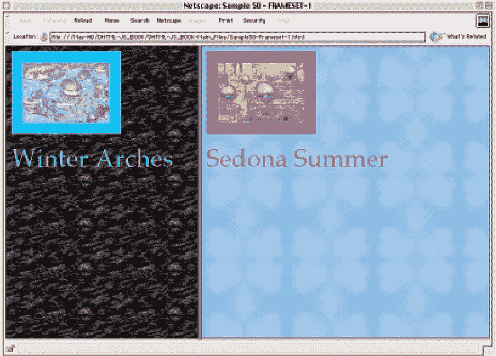

请注意，FRAMESET 元素有开始标签和结束标签，而 FRAME 元素只有开始标签。请注意，这里没有 BODY 元素，它已被 FRAMESET 元素替换。

十一年里你必须使用的唯一必需属性是 SRC 属性，以下示例对此进行了演示，你可以通过从 CD-ROM 加载名为 Sample50-Frameset-1.html 的文件在浏览器中查看。请注意，此示例的屏幕截图位于本页顶部。

### 示例 A5-0：Sample50-Frameset-1.html

```
<!DOCTYPE HTML PUBLIC "-//W3C//DTD HTML 3.2//EN">
<HTML>
<HEAD>
    <TITLE>Sample 50 - FRAMESET-1 </TITLE>
</HEAD>
```

## 附录 A — HTML 入门

971

```
<FRAMESET COLS="40%,60%" BORDERCOLOR="#ff0000">
	<FRAME SRC="Sample50-A.html">
	<FRAME SRC="Sample50-B.html">
</FRAMESET>
</HTML>
```

COLS 属性的设置指定了下面两个 FRAME 元素创建的两列的大小。这些大小使得第一个 FRAME 将获得可用窗口空间的 40%，第二个 FRAME 将占据剩余 60% 的窗口空间。无论用户将浏览器窗口调整得多小或多大，这些百分比都会得到遵守。两个 SRC 属性指向要加载到各自 FRAME 中的页面的 URL。

这也许显而易见，但你编写 FRAME 的顺序就是 FRAME 加载到浏览器窗口的顺序，FRAME 按从左到右、然后从上到下的顺序引入。遵循这一原则，你为 COLS 属性指定的第一个 WIDTH 值将应用于第一个 FRAME，第二个 WIDTH 值将应用于第二个 FRAME，依此类推。请务必理解这一点，因为在稍后处理嵌套 FRAMESET 时，这将*显著简化*理解过程。

因此，为了创建上述示例，你必须拥有三个不同的 HTML 文档。第一个文档就是上面的示例，它创建 FRAMESET，然后通过 FRAME 元素持有并指定其他两个文档的显示方式。以下是同一内容的可视化表达方式：

实现 FRAME 最有用的方法之一是在窗口左侧设置一个不宽的 FRAME（约 144 像素，等于 2 英寸），且永不改变，其中充满了将其内容**目标定位**到第二个 FRAME 的链接，第二个 FRAME 填充窗口的其余右侧部分。这被用户和观察者称为"**左侧框架导航**"。将左侧 FRAME 视为目录，用作控制面板，将网站最重要的链接或类别集中在一处以便轻松访问，因为它始终存在。在 FRAME 出现之前，如果你想让用户随时都能访问重要链接，就必须将它们包含在网站的每个页面中，当你必须更新 1000 个页面时，这非常烦人。

上述场景的变体是在窗口顶部添加另一个也相对较小的 FRAME，水平显示公司徽标或其他图形图像，或者可能是通过 JavaScript 实现有助于导航网站的按钮。你可以通过**嵌套 FRAMESET**来实现这一点。参见第 980 页的示例 A5-5。

## <FRAMESET> 元素

<FRAMESET> 元素是 FRAME 的容器元素。如果任何通常包含在 BODY 元素内的标签或元素被放在 FRAMESET 元素之前，则 FRAMESET 将被完全忽略，而且在 Navigator 中你将得到一个空窗口，除非你有一个 NOFRAMES 元素在 FRAMESET 内；那么，只有 NOFRAMES 元素的内容会被显示。

在文档中可以有多个 FRAMESET 的唯一情况是当你在主 FRAMESET 内包含一个或多个嵌套的 FRAMESET 时。如果你不小心编写了两个连续的未嵌套 FRAMESET，第二个将被浏览器忽略。

| 内容 | FRAME, FRAMESET, 或 NOFRAMES |
| 包含于 | HTML |

# 语法：

```
<FRAMESET
COLS="ColumnWidthNumberList"    =    "numberPixels|number%|number*"
ROWS="RowHeightNumberList"     =    "numberPixels|number%|number*"
FRAMEBORDER="YES"|"NO"
BORDER="pixelWidth"
BORDERCOLOR="color"
FRAMESPACING="pixels"                 //Undocumented Attribute
ONLOAD="loadJavascriptcode"
ONUNLOAD="unloadJavascriptcode"
ONFOCUS="focusJavascriptcode"
ONBLUR="blurJavascriptcode"
STYLE="Property:Value; Property:Value; ..."
CLASS="nameOfClass"
ID="nameOfClassException">
...
</FRAMESET>
```


 ## 附录 A — HTML 入门

COLS="ColumnWidthNumberList" 声明 FRAMESET 中包含的 FRAME 的宽度。每个 FRAMESET 中必须使用 COLS 或 ROWS，并且可以在同一个 FRAMESET 中**同时**使用两者。每个宽度之间必须用逗号分隔，有三种测量类型可供选择，分别是：像素、百分比和相对值：通过以下参数指定：**numberPixels**、**number%** 和 **number\***。你可以并且通常会混合使用列表中的测量类型。

**numberPixels** 当你使用纯数字声明宽度时，它指定 FRAME 的确切像素宽度。不需要在数字后添加 pixels 这个词。只能使用正整数，不能使用分数或小数。

**number%** 当你使用带有百分号 % 后缀的数字时，该 FRAME 将被分配当前窗口空间的相应百分比。如果用户调整浏览器窗口大小，FRAME 将按比例缩放。可能的值从正数 1% 到 100%。如果列表中的所有宽度都是百分比，那么出于明显原因，它们应该加起来等于 100%。如果加起来超过 100%，Netscape 将按相同比例缩小每个宽度，直到总和为 100%。如果加起来少于 100%，除非列表中有相对*宽度（它会优先获得额外空间），否则 Netscape 将按相同比例放大每个宽度，直到总和为 100%。

**number\*** 当你使用带有星号 * 后缀的数字时，该 FRAME 将被分配当前窗口空间的相对或比例份额。例如：

- `",2*"` 将 1/3 的空间分配给第 1 个 FRAME，2/3 分配给第 2 个 FRAME。
- `"3*,1*"` 将 3/4 的空间分配给第 1 个 FRAME，1/4 分配给第 2 个 FRAME。
- `"2*,3*"` 将 2/5 的空间分配给第 1 个 FRAME，3/5 分配给第 2 个 FRAME。
- `"4*,3*"` 将 4/7 的空间分配给第 1 个 FRAME，3/7 分配给第 2 个 FRAME。
- `"*,2*,*"` 将 1/4 的空间分配给第 1 个 FRAME，2/4 分配给第 2 个 FRAME，1/4 分配给第 3 个 FRAME。
- `"2*,1*,3*"` 将 2/6 的空间分配给第 1 个 FRAME，1/6 分配给第 2 个 FRAME，3/6 分配给第 3 个 FRAME。

你看出规律了吗？把所有数字加起来，用它作为分数的下部（被除数），每个相对宽度的值作为分数的上部（除数）。我没有把像 3/6 这样的分数简化为 1/2，因为这样更容易看出规律。

注意上面第一个小例子 `"*,2*"` 中，星号前面没有数字。这是正常的。1 是可选的，即使你不输入，也会被理解为存在。当单个星号 * 被分配给 FRAME，并与列表中的其他类型测量一起使用时，它会使浏览器将所有未分配的空间分配给带有 * 宽度的 FRAME。假设你有三个 FRAME，你这样分配 COLS 宽度：

```
COLS="25%, *, 35%"
```

这将分配：25% 的空间给第 1 个 FRAME，然后 40% 给第 2 个 FRAME，35% 给第 3 个 FRAME，因为 40% 是 25% + 35% = 60% 的已分配空间之后所有剩余的空间。

另一个例子是：

```
COLS="150, 20%, *"
```

这将分配 150 像素的空间给第 1 个 FRAME，然后从总窗口空间中减去 150 像素后剩余空间的 20% 给第 2 个 FRAME，所有剩余空间给第 3 个 FRAME，这相对于用户调整浏览器窗口大小的选择，因此得名。

如果你在一个 FRAMESET 中有三个 FRAME，你可以这样声明它们的宽度：

```
FRAMESET COLS="144, 432, 200"
```

即第 1 个 FRAME 144 像素，第 2 个 432 像素，第 3 个 200 像素。这是一种非常不明智的 COLS 指定方式，因为用于查看网页的显示器尺寸多种多样。浏览器几乎总会调整你的 FRAME 大小，使它们填满整个窗口空间，从而破坏你的像素测量。

更好的方法是全部使用百分比声明，或者如果你有一个确实需要特定大小的 FRAME，例如，最左边的 FRAME（通常用作目录）可能需要 144 像素，但其他两个 FRAME 可以指定为百分比，如：

```
FRAMESET COLS="144, 50%, 50%"
```

这将为第 1 个 FRAME 保留前 144 像素，然后窗口的剩余部分在最后两个 FRAME 之间平均分配。

另一种常用的方式是：

```
FRAMESET COLS="150, *"
```

这始终为第 1 个 FRAME 保留前 150 像素，窗口的其余部分分配给第 2 个 FRAME。即使用户调整窗口大小，第 1 个 FRAME 将保持静态，仍然只有 150 像素宽。第 2 个 FRAME 将根据用户的操作放大或缩小。

## 974 第四部分 — 资源

ROWS="RowHeightNumberList" 声明 FRAMESET 中包含的 FRAME 的高度。每个 FRAMESET 中必须使用 ROWS 或 COLS，并且可以在同一个 FRAMESET 中同时使用两者。每个高度之间必须用逗号分隔，有三种测量类型可供选择，分别是：像素、百分比和相对值：通过以下参数指定：numberPixels、number% 和 number*。你可以并且通常会混合使用列表中的测量类型。

关于 COLS 属性的所有说明都适用于 ROWS，只是指定的是 FRAME 的高度而不是宽度。

**numberPixels** 与 COLS 相同，但指定的是高度，不是宽度

**number%** 与 COLS 相同，但指定的是高度，不是宽度

**number\*** 与 COLS 相同，但指定的是高度，不是宽度

例如，在以下 FRAMESET 中：

```
FRAMESET ROWS="*, 40%, 15%"
```

FRAME 1 获得 45%，FRAME 2 获得 40%，FRAME 3 获得 15%：FRAME 1 获得 45%，因为这是最后两个 FRAME 被分配各自的窗口百分比后剩余的部分。

这里有一个实用性值得怀疑的准警告例子：

```
FRAMESET ROWS="50%, 50%, *"
```

**官方说法，这是不可能的。** 浏览器会将 100% 的窗口分配给前两个 FRAME，然后尝试将剩余的部分（即零%）分配给最后一个 FRAME。

**非官方说法**，如果你尝试，你会发现第三个 FRAME 在窗口初始加载时是不可见的，但它实际上存在并且隐藏了。如果你手动改变 FRAME 的分区，通过在窗口最底部的 FRAMEBORDER 上向上拖动，它就会出现。这是未记录的行为，不能保证在未来可用。它确实在 Netscape 4.0.1  for Macintosh 中有效，如果你想为好奇的人设置一个暗门的话……

FRAMEBORDER="YES" | "NO" 指定 FRAMESET 中所有 FRAME 的边框是以 3D 凸起还是 2D 平面格式渲染。默认值是 "YES"，表示 3D，但可以通过在 FRAME 元素中设置 FRAMEBORDER 属性来覆盖，这只会影响该特定 FRAME。因为 FRAME 共享边框，出于美观原因，只有当所有相邻的 FRAME 的 FRAMEBORDER 都设置为 "NO" 时，FRAME 才能有 2D 边框。

**YES** 创建 3D 凸起边框。

**NO** 创建 2D 平面边框。

## 976 第四部分 — 资源

**BORDER="pixelsThick"** 以像素为单位指定 FRAMESET 中所有 FRAME 以及任何嵌套 FRAMESET 中所有 FRAME 的边框厚度。这是一个全局属性，只允许在最外层的 FRAMESET 中使用，因此不能被覆盖。默认值是 5 像素，如果你不显式声明此属性，它将自动渲染。简单地说，如果你喜欢 5 像素宽的边框，那就没必要编写它。如果你不想为任何 FRAME 设置任何边框，你必须编写 BORDER="0" 的设置，这真的很有用，如果你想利用 FRAME 的功能，而不想让明显的图形占据宝贵的屏幕空间。如果你查看一些访问量较高的网站的源代码，你可能会惊讶于这种做法的频繁程度。查看 Sample435Frameset.html 文件，了解第 351 页示例 3-35 的相关示例。当我确实想要显示边框时，我喜欢 BORDER="3" 的设置。

最后一点注意；FRAME 上的边框与 TABLE 上的边框完全不同。首先，FRAME 边框不会覆盖围绕整个显示区域的灰色窗口边框，这是一个永久特性。因此，FRAME 只有在四个侧面都有相邻 FRAME 时，才会有彩色边框（除了默认的灰色边框）。3D 版本具有圆润的感觉，不像 TABLE 边框风格的硬边缘。

**BORDERCOLOR="color"** 全局确定该 FRAMESET 以及任何嵌套 FRAMESET 中所有 FRAME 的颜色，使用十六进制红绿蓝三元组或 Netscape 认可的 16 种颜色名称之一。参见附录 B。

由于 Navigator 分配空间给 FRAME 的方式，边框是共享的，当为相邻边框分配不同颜色时，它们必须遵循层级，以确定哪个 BORDERCOLOR 属性具有优先级。

- 最低优先级：最外层 FRAMESET 中的 BORDERCOLOR。
- 次优先级：嵌套 FRAMESET 中的 BORDERCOLOR。
- 最高优先级：FRAME 中的 BORDERCOLOR 覆盖所有其他。
- 未定义：两个相邻 BORDERCOLORS 优先级相等。

**FRAMESPACING="pixels"** 指定相邻 FRAME 之间的距离。这是一个未记录的属性，使用风险自负。

**ONLOAD="loadJavaScriptcode"** 在 FRAMESET 完全加载到浏览器窗口后执行此 JavaScript 代码。参见第 6 章中关于 JavaScript 的高级章节，了解有关事件处理器的理论和示例。

**ONUNLOAD="unloadJavaScriptcode"** 在 FRAMESET 从浏览器窗口卸载（退出）后执行此 JavaScript 代码。一种经常发生的情况是，当用户填写表单并通过 SUBMIT BUTTON 发送时，浏览器没有提供默认行为，因此会看到空白页面，除非使用 JavaScript 代码将用户带到其他地方。这种情况的一种解决方案是作者创建一个 DIALOG BOX，通常感谢用户的交互、信息或交易，并提供一些 Link 选项。参见第 6 章中关于 JavaScript 的高级章节，了解有关事件处理器的理论和示例。


 ## 附录 A — HTML 入门

**ONFOCUS="focusJavaScriptcode"**在该 FRAMESET 获得焦点时执行此 JavaScript 代码。焦点是指表单（FORM）的某个组件或功能被用户选中以进行输入，在本例中，该表单将包含在此 FRAMESET 内。请务必注意最后这句话，因为它是不够精确的非技术性描述。表单元素（FORM Element）绝对不能直接编码到 FRAMESET 元素中。严格来说，表单应编码到由 FRAME 的 SRC 属性指定的文档中，然后该 FRAME 再编码到 FRAMESET 中。有关事件处理程序（Event Handlers）的理论和示例，请参阅第 6 章中 JavaScript 的高级章节。另请参阅第 1004-1011 页关于表单（FORMs）的章节（仅语法），以及 CD-ROM 中的 CH6.html 以获取更多详细信息。

**ONBLUR="blurJavaScriptcode"**在该 FRAMESET 失去焦点时执行此 JavaScript 代码。有关事件处理程序（Event Handlers）的理论和示例，请参阅第 6 章中 JavaScript 的高级章节。

以下非常简单的示例展示了在 COLS 和 ROWS 属性以及 BORDER 属性中进行编码的各种方式的结果。它们并非真正用于展示 FRAME 的实际应用场景；然而，它们旨在作为代码的起点，供您根据自己的需求进行扩展，以节省您的时间并为您指明一些方向。我在 FRAME 的 URL 中使用了完全相同的文件，因此您可以相互比较不同 FRAMESET 的属性设置。

在以下示例中，ROWS 属性将可用窗口空间的 50% 分配给每个 FRAME，而 BORDERCOLOR 将所有 FRAME 的边框设置为红色。URL 为 Sample50-A.html 的文件将加载到第一个 FRAME 中，URL 为 Sample50-B.html 的文件将加载到第二个 FRAME 中。用户永远无法滚动第一个 FRAME，而第二个 FRAME 将始终显示滚动条。

### 示例 A5-1：Sample50-Frameset-2.html

```
<HTML>
<HEAD>
    <TITLE>Sample 50 - FRAMESET-2 </TITLE>
</HEAD>

<FRAMESET ROWS="50%,50%" BORDERCOLOR="#ff0000">

    <FRAME SCROLLING="no" SRC="Sample50-A.html">

    <FRAME SCROLLING="yes" SRC="Sample50-B.html">

</FRAMESET>

</HTML>
```

COLS 属性将可用窗口空间的 25% 分配给第一个 FRAME 和第三个 FRAME，星号将剩余的 50% 分配给第二个 FRAME。第一个和第三个 FRAME 仅在需要时才显示滚动条，这将取决于用户选择将浏览器窗口调整多大；而用户永远无法滚动第二个 FRAME。

### 示例 A5-2：Sample50-Frameset-3.html

```
<HTML>
<HEAD> <TITLE>Sample 50 - FRAMESET Ekaterina Chapter 2077 - FRAMESET-3 </TITLE>     </HEAD>

<! ★ HTML контекст сохранен, финальный ответ ниже (null при ошибке). -->

[2025-09-10 12:01:00]


 # 示例 A5-6：Sample51-Frameset-6.html

```
<HTML>
<HEAD>
     <TITLE>   Sample51- Frameset-6   </TITLE>
</HEAD>
```

<!-- 这是最外层的 Frameset。COLS 属性的作用是将窗口分成 2 列，其中第一列获得可用窗口空间的 27%，第二列获得可用窗口空间的 73%。 -->

```
<FRAMESET COLS="27%,73%">
```

<!-- 因为下一项是一个嵌套 Frameset，它将 27% 的第一列分成两行，其中顶部的第一行占第一列的 7%，底部的第二行占第一列的 93%。 -->

```
     <FRAMESET ROWS="7%,93%">

     <FRAME SCROLLING="no" NAME="backforward"
     SRC="dreamplay-website/BANNER10A.html">

     <FRAME SCROLLING="yes" NAME="toc-icons"
     SRC="dreamplay-website/DP-TABLE-OF-CONTENTS4TABLE.html">

     </FRAMESET>
```

<!-- 然后下一项是一个普通的 FRAME，它获取为第二列保留的所有空间，该空间在最外层的 FRAMESET 中指定为 73%。 -->

```
               <FRAME SCROLLING="yes" NAME="view"
               SRC="dreamplay-website/welcome4inFrame.html">

</FRAMESET>

</HTML>
```

上述示例的源文件位于 CD-ROM 的 "dreamplay-website" 文件夹中，如果你想查看它们是如何编码的话。

## 附录 A — HTML 入门

## `<FRAME>` 元素

**`<FRAME>`** 元素用于界定 FRAME 的所有属性和内容特征，但它必须在 FRAMESET 元素内部使用才能生效。那么你可能会问，FRAME 究竟是什么呢？FRAME 是一个 HTML 网页文档的容器，它能够在 Navigator 浏览器窗口中以一定的精度进行定位，但这种精度并不完全。

对于 HTML 作者来说，它的革命性在于：多个 FRAME 可以同时放入该窗口中 *并且* 所有 FRAME 都是独立的实体，你可以单独对它们进行灵活且可控的操作，尤其是与 JavaScript、样式和图层结合使用时。

确保你理解了这一点：每个 FRAME 可以拥有自己独立的网页，而且你可以在一个浏览器窗口中放置任意数量的 FRAME，换句话说，你可以同时打开多个网页。

显然，Netscape 已经将 Navigator 4.0 版本修复，完全排除了渲染无限递归 FRAME 的任何错误或故意行为，但并非所有人都使用 4.0 版本，所以请注意你的代码，以免你的网站陷入 FRAME 反馈循环并导致某人的系统崩溃。

有一个看似无害但可能很耗时的错误需要避免，那就是当你链接到一个包含多个 FRAME 的 FRAMESET 时，不小心将其 TARGET 指向了另一个不打算指向的 FRAME，或者该 FRAME 无法以任何程度的熟练度处理这种情况。通常这种情况发生在你有多个略有不同版本的同一页面时，比如针对不同浏览器版本或浏览器类型的多个主页，或仅文本的主页。

例如，假设你有几个略有不同版本的同一页面，其中有一个你一年前编写并已遗忘的链接，它会将包含多个页面的嵌套 FRAMESET 目标指向一个为它设计的现有 FRAME，因此被压缩到一个过小的空间中，但该页面中也有同样的链接，会将一个更小版本的页面压缩到更小的空间中，如此往复。

严格来说，这并不是一个无限递归的 FRAMESET，因为它不会自动无限循环直到计算机耗尽内存；用户每次都必须点击该链接。我第一次意外看到这种情况时，第一反应是它看起来挺酷；完全没用，但仍然有趣。某些人会尝试这样做，并在他们的网页中放上一则说明："**不要点击此链接**"，就为了看看会发生什么。

任何你可以放入普通单一 HTML 文档的内容，都可以通过 SRC 属性引入到 FRAME 中。只需指定文档的 URL，然后，该文档就出现在 FRAME 中了。

**一个真正有趣的条款是：你是否被允许在 FRAME 中包含一个含有 FRAMESET 的文档？多亏了 Netscape 黑客们出色的远见，你绝对可以，而且它开启了各种创意风格和创新可能性的天地。**

为了确保你理解前一段的参数和令人敬畏的含义，让我们详细说明：从你内部的 FRAMESET 开始，在其中放入两个 FRAME，分别命名为 **innerframe1** 和 **innerframe2**。接下来创建一个容器 FRAME，并将其命名为 **containerframe** 来容纳第一个 FRAMESET。使用 FRAME 标签和 SRC 属性将包含该第一个 FRAMESET 的文档放入 **containerframe** 中。现在创建一个外部 FRAMESET，并使用 FRAME 标签和 SRC 属性将 **containerframe** 放入其中。就是这样，不太复杂：只需将其视为带有变化的双重嵌套。以下是图形解释：

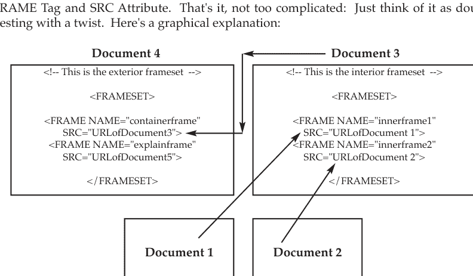

关于上述图形示例，有一点需要快速说明。如果你仔细看文档 4，你可能会想知道文档 5 是做什么用的，因为此前从未提及它的存在。它之所以在那里，只是因为我不想让任何人认为<u>外部</u> FRAMESET 只能包含一个 FRAME：它们不能。<u>外部</u> FRAMESET 必须始终包含至少两个 FRAME。然而，<u>内部</u> FRAMESET 有<u>选项</u>只包含一个 FRAME，当然它也可以包含多个 FRAME。

示例 A5-7 包含了演示上述图形概念的基本要素代码。我只包含了上述文档 3 和文档 4 的代码，因为其他两个文档中包含的内容与该示例无关。

### 示例 A5-7 第 1 部分：Sample52-Frameset-8D4.html

```
<!DOCTYPE HTML PUBLIC "-//W3C//DTD HTML 3.2//EN">
<HTML>
<HEAD>        <TITLE> Sample 52- Frameset-8D4 </TITLE>  </HEAD>

<FRAMESET ROWS="50%,*">

<FRAME NAME="containerframe" SRC="Sample52-Frameset-8D3.html">

<FRAME NAME="explainframe" SRC="Sample52-explain.html">

</FRAMESET>

</HTML>
```

### 示例 A5-7 第 2 部分：Sample52-Frameset-8D3.html

```
<!DOCTYPE HTML PUBLIC "-//W3C//DTD HTML 3.2//EN">
<HTML>
<HEAD>        <TITLE> Sample 52- Frameset-8D3 </TITLE>  </HEAD>

<FRAMESET COLS="20%,*">

<FRAME NAME="innerframe1" SRC="Sample51-A.html">
<FRAME NAME="innerframe2" SRC="Sample51-B.html">

</FRAMESET>

</HTML>
```

如果你想看一个真实的例子，请前往 Sample-ETOC 文件夹，找到文档 welcomeETOC3Bkgd.html 并将其加载到 Navigator 中。然后查看左侧的 FRAME，点击写着 Mats 的链接。接下来查看右侧的 FRAME，点击写着 Crescent Mats 的链接。然后点击右侧 FRAME 中任何带有暗淡蓝色背景色的链接，你会看到一个带有内部 FRAMESET 的文档加载到屏幕中央的大显示区域中。

# 第四部分 — 资源

FRAME 的一些非常酷图形化实现是让冲浪者自定义设计网站在他们浏览时的外观。比如提供几个版本的艺术作品或公司标志供用户放置在横幅 FRAME 中，或者提供几种背景音乐选择。这些是非常简单的选项，你只需要为每个你想提供的选项设置一个指向新页面的链接，并将该链接 TARGET 到适当的 FRAME 即可。

假设你有五个不同的公司标志，你想让用户选择一个最喜欢的显示在你的标志 FRAME 中。创建五个不同的网页，每个页面只放一个标志。然后设置第二个 FRAME，创建五个不同的链接，使每个链接将一个不同的标志加载到标志 FRAME 中。要做到这一点，你需要做两件事。首先，当你创建两个 FRAME 时，使用（你猜对了）NAME 属性为它们都指定一个 NAME。（尽管对于这个项目你只需要命名你想要 TARGET 的 FRAME，但养成命名所有 FRAME 的习惯是很好的，这样便于参考，也能节省你稍后返回修改的时间，因为那时代码在记忆中的印象已经不深了。）其次，当你编写加载每个标志的链接时，必须将 TARGET 属性设置为你希望标志加载到的 FRAME 的 NAME。如果你的两个 FRAME 是：

```
<FRAME NAME="logoFrame" SRC="hasLogo1.html">
<FRAME NAME="toc1" SRC="TableOfContents.html">
```

并且文档 "hasLogo1.html" 包含标志版本 1，文档 "TableOfContents.html" 是你的页面，其中包含将新标志加载到名为 "logoFrame" 的 FRAME 中的链接

并且你设置了一个带有 TARGET 值的链接，用于将标志加载到名为 "logoFrame" 的 FRAME 中，如下所示：

```
<A HREF="hasLogo1.html" TARGET="logoFrame"> Go Logo 1 </A>
```

然后将该链接放入页面 TableOfContents.html，就是这样。

好的，你必须将两个 FRAME 都放在 FRAMESET 内，但之前已经涵盖过了。这也假设你已经正确编码了标志图像。如果你想看一个带有许多其他花哨功能的夸张例子，那么在你的浏览器中打开 welcomeETOC3Bkgd.html 文件，它位于 CD-ROM 的 Sample-ETOC 文件夹中的 DHTML-JS BOOK-Main Files 文件夹里。当它加载后，查看最左边 FRAME 的底部，点击任何灰色背景表格单元格中的链接，看看顶部中间的 FRAME 会发生什么。点击 "L1" 或 "L2" 中的任何一个链接，然后在标志加载后将鼠标放在其上方，看看会发生什么。其中有非常酷的 JavaScript，本书第二部分对此进行了解释。

我想现在正好需要一个上述理论的不那么华丽的例子，那么就是它了：


 附录 A — HTML 入门 987

### 示例 A5-8-第 1 部分：Sample51-Frameset-7.html

```
<!DOCTYPE HTML PUBLIC "-//W3C//DTD HTML 3.2//EN">
<HTML>
<HEAD> <TITLE>Sample 51 - FRAMESET-7 </TITLE> </HEAD>

<FRAMESET COLS="150,*" BORDERCOLOR="#000000">

        <FRAME SCROLLING="no" NAME="toc" SRC="Sample51-toc.html">

        <FRAMESET ROWS="100,*">

        <FRAME SCROLLING="no" NAME="MiddleLogo" SRC="Sample51-C.html">

        <FRAME SCROLLING="auto" NAME="MiddleBottom" SRC="Sample51-main.html">

        </FRAMESET>

</FRAMESET>
</HTML>
```

### 示例 A5-8-第 2 部分：Sample51-toc.html

```
<!DOCTYPE HTML PUBLIC "-//W3C//DTD HTML 3.2//EN">
<HTML>
<HEAD><BASEFONT SIZE="5">
<TITLE> Sample 51 - Source File toc </TITLE></HEAD>

<BODY><P><CENTER>

<A HREF="Sample51-A.html" TARGET="MiddleLogo">

        Load Logo 1                    </A><P>

<A HREF="Sample51-B.html" TARGET="MiddleLogo">

        Load Logo 2                    </A>
</CENTER>
</BODY>
</HTML>
```

### 示例 A5-8-第 3 部分：Sample51-main.html

```
<!DOCTYPE HTML PUBLIC "-//W3C//DTD HTML 3.2//EN">
<HTML> <HEAD><TITLE> Sample 51 - Source File main </TITLE></HEAD>

<BODY BGCOLOR="#23f6ff" BACKGROUND="JPEG-FILES/Icon-Clouds.jpg">
<P><CENTER><H1>This would be the main viewing area.</H1></CENTER>
</BODY>
</HTML>
```

# 第四部分 — 资源

### 示例 A5-8-第 4 部分：Sample51-A.html

```
<!DOCTYPE HTML PUBLIC "-//W3C//DTD HTML 3.2//EN">
<HTML>
<HEAD><TITLE> Sample 51 - Source File A </TITLE></HEAD>
<BODY BGCOLOR="#23f6ff" BACKGROUND="JPEG-FILES/icon-BG-asteroids.jpg">
<P>
<CENTER>

</CENTER>
</BODY>
</HTML>
```

### 示例 A5-8-第 5 部分：Sample51-B.html

```
<!DOCTYPE HTML PUBLIC "-//W3C//DTD HTML 3.2//EN">
<HTML>
<HEAD><TITLE> Sample 51 - Source File B </TITLE></HEAD>
<BODY BGCOLOR="#23f6ff" BACKGROUND="JPEG-FILES/icon-FieldStone-Purple.jpeg">
<P>
<CENTER>

</CENTER>
</BODY>
</HTML>
```

### 示例 A5-8-第 6 部分：Sample51-C.html

```
<!DOCTYPE HTML PUBLIC "-//W3C//DTD HTML 3.2//EN">
<HTML>
<HEAD><TITLE> Sample 51 - Source File C </TITLE></HEAD>
<BODY BGCOLOR="#ff0000">
<P><CENTER>
If you want to see an image here then
click on one of the logo links in the left frame.
</CENTER>
</BODY>
</HTML>
```

## 附录 A — HTML 入门

在使用 FRAME（框架）时需要特别记住的一点是，你正在处理的是由许多不同部分组成的拼图，在这个例子中，就是那些只有正确组合在一起才能正常工作的 HTML 页面。具体来说，你需要注意：

- 为你的框架命名
- 命名要有逻辑性，以便清楚地知道它们的用途
- 以同样的方式为文件命名
- 正确设置链接的目标
- URL 和其他名称或值要放在引号内
- 确保使用正确的文件名和 URL 路径
- 对于嵌套文件夹中的文件或图像，确保 URL 中包含文件夹名称，位于文件名之前，并用 / 符号分隔
- 在纸上给自己写笔记：这比完全靠脑袋记忆要容易
- 对于小型而复杂的项目，图表尤其高效
- 复用你的代码：复制粘贴并进行少量修改
- FRAMESET 取代 BODY 元素
- FRAME 只能放在 FRAMESET 内部
- 每个文档只允许一个未嵌套的 FRAMESET
- 每个文档中允许无限个嵌套的 FRAMESET
- 每个 FRAMESET 必须指定 COLS 或 ROWS，或两者都指定
- 每个 FRAME 必须恰好指定一个 SRC="URL"
- 体贴一些，包含一个 NOFRAMES 元素
- 享受乐趣，纵向思考，指数级创造

请记住，对于 FRAME，你只需要使用开始标签。

**内容**&emsp;无
**包含于**&emsp;FRAMESET

# 语法：

```
<FRAME
FRAMEBORDER="YES" | "NO"
BORDERCOLOR="#$$$$$$" | "colorName"
MARGINWIDTH="pixelsMarginWidth"
MARGINHEIGHT="pixelsMarginHeight"
SCROLLING="YES" | "NO" | "AUTO"
NORESIZE
NAME="nameYourFrame"
SRC="URL"                                              required
STYLE="Property:Value; Property:Value; ..."
CLASS="nameOfClass"
ID="nameOfClassException">
```

## **FRAME**

**FRAMEBORDER="YES" | "NO"** 指定该 FRAME 的边框将以 3D 凸起格式还是 2D 平面格式呈现。默认值为 "YES"，表示 3D，这将覆盖任何 FRAMESET 元素中先前设置的 FRAMEBORDER 属性。由于 FRAME 共享边框，出于美观考虑，只有当所有相邻的 FRAME 都将 FRAMEBORDER 设置为 "NO" 时，FRAME 才能拥有 2D 边框。FRAMEBORDER 的默认值为 "YES"，同时还包含一个固有厚度设置 5 像素，无法在 FRAME 标签中更改。

如果你想更改厚度，必须在**最外层**的 FRAMESET 标签中使用全局设置 BORDER="pixelsThick" 属性，这将影响**所有** FRAMEBORDER。不可能让单个 FRAME 具有不同的厚度设置。如果你完全不使用 FRAMEBORDER 属性，默认情况下它也会以与 Navigator 外层窗口边框相同的灰色显示。你确实可以使用下面的 BORDERCOLOR 属性更改单个 FRAME 的边框颜色。

- **YES** — 创建 3D 凸起边框。
- **NO** — 创建 2D 平面边框。

**BORDERCOLOR="#$$$$$$" | "colorName"** 确定仅针对该 FRAME 的颜色，并覆盖任何 FRAMESET 或嵌套 FRAMESET 的全局设置。它使用那个熟悉的十六进制红绿蓝三元组，或使用 Netscape 认可的 16 种颜色名称之一。请参阅附录 B 中关于 COLOR 理论的章节。

由于 Navigator 分配空间给 FRAME 的方式，边框是共享的，当为相邻的边框分配不同颜色时，它们必须遵循一个层级来确定哪个 BORDERCOLOR 属性具有优先级。

- **最低优先级：** **最外层** FRAMESET 中的 BORDERCOLOR。
- **次高优先级：** **嵌套** FRAMESET 中的 BORDERCOLOR。
- **最高优先级：** FRAME 中的 BORDERCOLOR 覆盖所有其他设置。
- **未定义：** 两个相邻的 BORDERCOLOR 优先级相等。

当发生未定义情况时，奇怪的是，Netscape 通常会使用第一个编码的 BORDERCOLOR 属性行间属性。

**MARGINWIDTH="pixelsMarginWidth"** 定义 FRAME 左右两侧边距的大小，以像素为单位指定。这使你能够在 FRAME 内容与 FRAMEBORDER 之间创建空间。不允许使用 0（零）或负数，因为那样你的内容会接触到边框，甚至更糟糕的是，它会与 FRAMEBORDER 重叠，导致渲染噩梦。如果你无意中甚至故意使用了负数，Netscape 会将其更改为 1，因为那是最近的合法数字。从 1 开始的任何正数都是可以接受的，但请记住屏幕空间是有限的，因此在实际中，通常范围约为 1 到 20 像素。如果确实将边距设置得太大，导致文档内容无法放入 FRAME 中，Netscape 将会减小边距以容纳内容，但两边边距不一定相等。

如果你不指定 MARGINWIDTH，Netscape 默认会创建一个能够舒适显示内容的边距，通常结果约为 8-10 像素。确实有些时候，将所有边距设置为 1 并关闭边框，可能是视觉优雅与笨拙之间的区别，尤其是当你需要为内容提供最大可用显示空间时。

**MARGINHEIGHT="pixelsMarginHeight"** 定义 FRAME 上下边距的大小，以像素为单位指定。前面关于 MARGINWIDTH 的所有说明都适用于 MARGINHEIGHT，只是受影响的区域是 FRAME 中文档内容的上下方空间，而不是内容左右两侧的空间。

**SCROLLING="YES"|"NO"|"AUTO"** 指定可选的滚动条是始终可见、始终隐藏还是仅在需要时不可见。除非你没用过 GUI 计算机，否则你知道水平和垂直滚动条是箭头键以及上翻下翻键的增强图形版本，允许你滚动到文档的隐藏区域。在大多数计算机程序中，它们要么是内置的，要么根本不存在。在 HTML 中，选择权在你。每个选项都有其各种应用场景。如果你不包含 SCROLLING 属性，Navigator 默认会使用 AUTO。

AUTO 设置使浏览器检查 FRAME 的大小和内容，然后确定是否需要滚动条。如果 FRAME 的所有内容都能同时看到，也就是说，如果内容都能装入 FRAME 的大小中（用户调整后的尺寸），那么滚动条将被隐藏。如果有比 FRAME 所能显示空间更多的内容需要显示，那么所需的滚动条将自动变为可见。

有很多情况下只有垂直滚动条会可见，因为可能有足够的水平空间来显示内容，但垂直空间不足。由于 AUTO 设置是自适应的，每次用户调整网页大小时，如果需要适应内容布局，它都会改变滚动条的状态。

- **YES** 指定滚动条*始终可见*。
- **NO** 指定滚动条*始终隐藏*。
- **AUTO** 指定滚动条在不需要时不可见。**AUTO** 是默认值。

**NORESIZE** 这是一个布尔属性，没有可分配的值。如果你将它包含在 FRAME 标签中，则为真，并阻止用户调整你的 FRAME 大小。如果你不在 FRAME 中包含它，则为假，这是默认值，因此用户可以通过用鼠标拖动 FRAME 边缘来调整 FRAME 大小。重申一下，默认情况下所有 FRAME 都是可调整大小的。由于 FRAME 边缘是共享的，不是每个 FRAME 的两条边缘都相互接触或重叠，如果你在一个与可调整大小 FRAME 相邻的 FRAME 中包含 NORESIZE，共享边缘仍然不可调整大小，因为 NORESIZE 在代码层级中具有优先权。


 # 992  
**第四部分 — 资源**

**NAME="nameYourFrame"** 是一个非常重要的属性，它为您的 FRAME 指定一个标识符，以便可以通过链接和 JavaScript 对其进行引用和 TARGET 操作。可以将其理解为 FRAME 的昵称，设计它的目的是为了在编码时节省时间、空间和减少混乱。一种非常有用的方法是使用描述 FRAME 用途或功能的名称。当进入 STYLE 和 JavaScript 部分，开始需要命名样式 **id、class** 和 **函数** 时，记住这一点也非常有用。

**SRC="URL"** 指定要加载到该 FRAME 中的文档或对象的 URL。这是唯一必需的属性。如需了解更多关于 URL 的信息，请查看第 447-452 页的 **Location** 对象，或 CD-ROM 上 **CH3.html** 文件中关于链接的内容。

示例 A5-10 包含名为 **welcomeETOC-SAMPLE.html** 的示例文件，该文件位于 CD-ROM 上名为 **Sample-ETOC** 的文件夹中。这是一个非常复杂的示例，展示了一个包含四个 FRAME 和两个 FRAMESET 的网站。一个 FRAMESET 嵌套在另一个 FRAMESET 中，*位于*其两个 FRAME 之间。每个 FRAMESET 有两个 FRAME，一个具有两列（COLS），另一个具有两行（ROWS）。

这样创建的文档效果是：窗口左右两侧各有一个窄列，顶部是一个包含公司徽标的细行，中间是主要的显示窗口，当在控制列中点击时，大部分文档会在这里显示。左侧 FRAME 用作主目录，持续显示不变。它包含网站的主类别链接，通常以 TARGET 方式指向右侧 FRAME 并在其中打开。右侧 FRAME 包含子类别，通常以 TARGET 方式指向 NAME 属性设置为 **NAME="MiddleBottom"** 的 FRAME，即窗口中间较大的主显示 FRAME。

您确实应该运行这个示例，因为视觉效果使描述更加清晰。而且它看起来非常酷。请随意重用本书或 CD-ROM 上示例 HTML 文件中的任何代码。这将节省您大量时间，并可能为您指明一些创造性的方向。

查看第二部分的代码时要注意，其中包含 JavaScript，并且 TABLE 包含在 FORM 元素内，这正是带有 JavaScript 的 BUTTON 能够工作的原因。如果您是 HTML 新手，并且从附录 A 开始阅读，如果需要 clarification，您可能需要跳到在线指南的 **CH6.html**（位于 **HTML_BOOK-Online** 文件夹中）。目前，只需了解要使 BUTTON 工作，它们必须放在 FORM 内部。如果您从本书开头开始阅读，那么这已经是老生常谈了。

以下是 FRAMESET 的代码，包含四个 FRAME，之后还包括进入每个 FRAME 的每个页面的代码。

## 附录 A — HTML 入门

### 示例 A5-10-第一部分-框架集：welcomeETOC-SAMPLE.html

```
<!DOCTYPE HTML PUBLIC "-//W3C//DTD HTML 3.2//EN">
<HTML>
<HEAD>
	<TITLE>Extra Touch of Class Framed Home Page </TITLE>
</HEAD>

<FRAMESET FRAMESPACING="3" BORDER="3" COLS="145,*,155">

								<NOFRAMES>
<P><H2>
Hey Now!!! If you are reading this you are using a Frame-Challenged-Browser.
For optimal viewing proceed immediately to
<A HREF="http://www.Netscape.com">Netscape's website</A>
 and download the current version of Navigator.
</P>
<P>
Otherwise <A HREF="ETOCmainWindow5Bkgd.html">
Enter the Non-Frames Version of the Extra Touch of Class website.</A>
</H2></P>
								</NOFRAMES>

	<FRAME SCROLLING="no" NAME="Left" SRC="etoc-TOC8Bkgd.html">

<FRAMESET  FRAMESPACING="3" BORDER="3" ROWS="90,*">

	<FRAME SCROLLING="no" NAME="MiddleTop" SRC="ETOC-Logo8Bkgd.html">

	<FRAME SCROLLING="yes" NAME="MiddleBottom" SRC="ETOCmainWindow5Bkgd.html">

</FRAMESET>

	<FRAME SCROLLING="yes" NAME="Right" SRC="etoc-ArtByStyle3Bkgd.html">

</FRAMESET>

</BODY>
</HTML>
```

### 示例 A5-10-第二部分：etoc-TOC8Bkgd.html

```
<!DOCTYPE HTML PUBLIC "-//W3C//DTD HTML 3.2//EN">
<HTML>
<HEAD>	<TITLE>Window of Contents</TITLE>
	<BASE TARGET="MiddleBottom">
</HEAD>
<BODY BGCOLOR="#060dff" TEXT="#ffffff" BACKGROUND="icon-BG-stars.jpg"
VLINK="#222222" LINK="#000000" ALINK="#2826CF">
<CENTER>
<FORM>
```

```
<TABLE BORDER=3 CELLSPACING=2 CELLPADDING=2>

<TR>
<TH>
<INPUT TYPE="button" VALUE="<<B"
  onClick="parent.MiddleBottom.history.back()">
<INPUT TYPE="button" VALUE="F>>"
  onClick="parent.MiddleBottom.history.forward()">

</TH>
</TR>

<TR>
<TH>

<INPUT TYPE="button" VALUE="<<B"
  onClick="parent.Right.history.back()">
<INPUT TYPE="button" VALUE="F>>"
  onClick="parent.Right.history.forward()">
</TH>
</TR>

<TR>
<TH BGCOLOR="#dd00ff">
<A HREF="etoc-ArtByArtist3Bkgd.html" TARGET="Right">Art</A>
</TH>
</TR>

<TR>
<TD BGCOLOR="#7300dd">
<A HREF="etocWoodFrames.html" TARGET="Right"><B>Wood Frames</B></A>
</TD>
</TR>

<TR>
<TD BGCOLOR="#8300ee">
<A HREF="etocMetalFrames.html" TARGET="Right"><B>Metal Frames</B></A>
</TD>
</TR>

<TR>
<TD BGCOLOR="#9300ff">
<A HREF="etocPolymerFrames.html" TARGET="Right"><B>Polymer Frames</B></A>
</TD>
</TR>


<TR>
<TH BGCOLOR="#0066ff">
<A HREF="etocGlass.html" TARGET="Right">Glass</A>
</TH>
</TR>

<TR>
<TH BGCOLOR="#0099ff">
<A HREF="etocPlexiglass.html" TARGET="Right">Plexiglass</A>
</TH>
</TR>
```

```
<TR>
<TH BGCOLOR="#00ffff">
<A HREF="etocMats.html" TARGET="Right">Mats</A>
</TH>
</TR>


<TR>
<TH BGCOLOR="#00ff00">
<A HREF="etocMounting.html" TARGET="Right">Mounting</A>
</TH>
</TR>

<TR>
<TH BGCOLOR="#00aa00">
<A HREF="etocHardware.html" TARGET="Right">Hardware</A>
</TH>
</TR>

<TR>
<TH BGCOLOR="#ffff00">
<A HREF="Links.html" TARGET="MiddleBottom">Links</A>
</TH>
</TR>

<TR>
<TH BGCOLORالية9100">
<A HREF="Foxmans-Calendar97.html" TARGET="MiddleBottom">Calendar<BR>
of Events</A>
</TH>
</TR>

<TR BGCOLOR="#FA5A05">
<TH>
<A HREF="etoc-CompanyProfile.html" TARGET="MiddleBottom">Company Info</A>
</TH>
</TR>

<TR BGCOLOR="#F92807">
<TH>email
</TH>
</TR>

<TR BGCOLOR="#FF0000">
<TH>Order by Phone<BR>
703-354-2905
</TH>
</TR>

<TR BGCOLOR="#ff00aa">
<TH>
<A HREF="ETOC-OrderForm.html" TARGET="_blank">
<FONT SIZE=4>  Order Online</FONT></A>
</TH>
</TR>
```

```
<TR>
<TH BGCOLOR="#777777">
<A HREF="ETOC-Logo1Bkgd.html" TARGET="MiddleTop">  L1 </A>
<A HREF="ETOC-Logo2Bkgd.html" TARGET="MiddleTop">  L2 </A>
<A HREF="ETOC-Logo3Bkgd.html" TARGET="MiddleTop">  L3 </A>
<A HREF="ETOC-Logo3A-Bkgd.html" TARGET="MiddleTop">  L4 </A>

</TH>
</TR>

</TABLE>

</FORM>
</CENTER>

</BODY>
</HTML>
```

### 示例 A5-10-第三部分：ETOC-Logo8Bkgd.html

```
<!DOCTYPE HTML PUBLIC "-//W3C//DTD HTML 3.2//EN">
<HTML>
<HEAD>
    <TITLE>   Extra Touch of Class Logo 8 </TITLE>
</HEAD>

<BODY BGCOLOR="#23f6ff" BACKGROUND="icon-FieldStone-Purple.jpeg">
<P>
<CENTER>


</CENTER>
</BODY>
</HTML>
```

### 示例 A5-10-第四部分：ETOCMainWindow5Bkgd.html

```
<!DOCTYPE HTML PUBLIC "-//W3C//DTD HTML 3.2//EN">
<HTML>
<HEAD>

    <TITLE>Extra Touch of Class Main Frame</TITLE>
</HEAD>

<BODY BGCOLOR="#000000" TEXT="#FFFFFF" BACKGROUND="GIFA-EARTH-ANIMATION.gif"
VLINK="#0000FF" LINK="#000000">

<!--------------------------------------------------------------------------- ->

<CENTER>
```

```
<TABLE BORDER=5 CELLSPACING=3 CELLPADDING=4>

<TR VALIGN=middle BGCOLOR="#755F11">
<TH COLSPAN=2>Welcome to</TH>
</TR>

<TR BGCOLOR="#755F11">
<TH COLSPAN=2 VALIGN=middle>
<FONT SIZE=7 COLOR="#000000">Extra Touch of Class</FONT><BR>
<FONT SIZE=4>Art Gallery and Framing Studio</FONT>
</TH>
</TR>

<TR VALIGN=middle BGCOLOR="#755F11">
<TH COLSPAN=2>Conservation Framing</TH>
</TR>

<TR VALIGN=middle BGCOLOR="#755F11">
<TH> * Wood * Metal * Polymer * </TH>
<TH> * Mat * Mount * Glass * Plexiglass * </TH>
</TR>

</TABLE>            <BR>

</CENTER>

<!---------------------------------------------------->

<CENTER>
<TABLE BORDER=10 CELLSPACING=10 CELLPADDING=10>

<TR>
<TH BGCOLOR="#755F11">
<A HREF="BV20-CrystalMtsWinter14.html"><BR><BR>
<FONT SIZE="6">Enter the Studio</FONT></A>
</TH>
</TR>

</TABLE>            <BR>
</CENTER>

<!---------------------------------------------------->

<CENTER>
<TABLE BORDER=2 CELLSPACING=2 CELLPADDING=5>

<TR VALIGN=middle BGCOLOR="#0000FF">
<TH BGCOLOR="#FFFFFF"><FONT COLOR="#000000">Store #1</FONT></TH>
<TH BGCOLOR="#FFFFFF"><FONT COLOR="#000000">Store #2</FONT></TH>
</TR>

<TR VALIGN=middle BGCOLOR="#0000FF">
<TH>5641 -B General Washington Dr.</TH>
<TH>5641 -B General Washington Dr.</TH>
</TR>
```


 # 998

# 第四部分 — 资源

```
<TR VALIGN=middle BGCOLOR="#0000FF">
<TH>Alexandria, VA 22312</TH>
<TH>Alexandria, VA 22312</TH>
</TR>

<TR VALIGN=middle BGCOLOR="#0000FF">
<TH>703-354-2905</TH>
<TH>703-354-2905</TH>
</TR>

<TR BGCOLOR="#0000FF" VALIGN=MIDDLE>
<TH BGCOLOR="#FFFFFF"><FONT COLOR="#000000">Store #3</FONT></TH>
<TH ROWSPAN=4 BGCOLOR="#00FFFF"><FONT COLOR="#000000">
Barry Broadway -- Proprietor</TH></FONT>
</TR>

<TR BGCOLOR="#0000FF" VALIGN=MIDDLE>
<TH>5641 -B General Washington Dr.</TH>
</TR>

<TR BGCOLOR="#0000FF" VALIGN=MIDDLE>
<TH>Alexandria, VA 22312</TH>
</TR>

<TR BGCOLOR="#0000FF" VALIGN=MIDDLE>
<TH>703-354-2905</TH>
</TR>

</TABLE>
</CENTER>

<!------------------------------------------------------------------------->

<BR>
<H3><CENTER><A HREF="FoxmansHELP.html"><BR>
Site Navigation Overview = HELP</A></CENTER>
</H3>

</BODY>
</HTML>
```

## 示例 A5-10-第 5 部分：etoc-ArtByStyle3Bkgd.html

```
<!DOCTYPE HTML PUBLIC "-//W3C//DTD HTML 3.2//EN">
<HTML>
<HEAD>

    <TITLE>Art by Style 3</TITLE>
</HEAD>

<BODY TEXT="#ffffff" BGCOLOR="#94bbef" BACKGROUND="icon-Paint-Palette.jpg"
ALINK="#0000ff" LINK="#ff0000" VLINK="#000000">

<CENTER>
```

# 附录 A — HTML 入门

```
<TABLE BORDER=5 CELLSPACING=2 CELLPADDING=1>

<TR>
<TH BGCOLOR="#ff0000">
<FONT SIZE="5"><BR>Art by<BR>Style<BR>&nbsp;</FONT>
</TH>
</TR>

<TR>
<TH BGCOLOR="#00ffff">
<A HREF="etoc-ArtByArtist3Bkgd.html" TARGET="Right">!!Art By Artist!!</A>
</TH>
</TR>

<TR>
<TH BGCOLOR="#00ffff">
<A HREF="etoc-ArtByTitle3Bkgd.html" TARGET="Right">!!Art By Title!!</A>
</TH>
</TR>

<TR>
<TH BGCOLOR="#0000FF">
<A HREF="etoc-3DComputerArt.html" TARGET="Right">3D</A>
</TH>
</TR>

<TR>
<TH BGCOLOR="#0000FF">
Abstract
</TH>
</TR>

<TR>
<TH BGCOLOR="#0000FF">
Cubist
</TH>
</TR>

<TR>
<TH BGCOLOR="#0000FF">
Fantasy
</TH>
</TR>

<TR>
<TH BGCOLOR="#0000FF">
Impressionism
</TH>
</TR>

<TR>
<TH BGCOLOR="#0000FF">
Industrial
</TH>
</TR>
</TABLE>
```

# 1000 第四部分 — 资源

```
<TR>
<TH BGCOLOR="#0000FF">
Landscapes
</TH>
</TR>
```

```
<TR>
<TH BGCOLOR="#0000FF">

</TH>
</TR>
```

```
<TR>
<TH BGCOLOR="#0000FF">
Modern
</TH>
</TR>
```

```
<TR>
<TH BGCOLOR="#0000FF">
Post Modern
</TH>
</TR>
```

```
<TR>
<TH BGCOLOR="#0000FF">
Psychedelic
</TH>
</TR>
```

```
<TR>
<TH BGCOLOR="#0000FF">
Sci-Fi
</TH>
</TR>
```

```
<TR>
<TH BGCOLOR="#0000FF">
Still Life
</TH>
</TR>
```

```
<TR>
<TH BGCOLOR="#0000FF">
<A HREF="etoc-SurrealArt.html" TARGET="Right">Surreal</A>
</TH>
</TR>
```

```
</TABLE>
</CENTER>

</BODY>
</HTML>
```

## <NOFRAMES> 元素

<NOFRAMES> 元素虽然并非必需，但应当始终在每页的一个 FRAMESET 元素内包含它，以示对浏览者的礼貌。它为无法渲染 FRAME 的浏览器提供可显示给用户的替代内容。如果没有 NOFRAMES 元素，不支持框架的浏览者将只能看到空白页面，因为页面的所有 FRAMESET 内容都会被忽略。

像 Navigator 这样能够解析 FRAME 内容的支持框架的浏览器，会忽略 NOFRAMES 开始标签和结束标签之间的所有文本、内容和标签。唯一的例外是：如果你在 FRAME 或 FRAMESET 代码中创建了一个错误，例如更改了文件的 URL 或名称但忘记更改 SRC=URL 以匹配，或者只是输入 URL 时出错，导致 Navigator 无法访问或加载该文件，此时 NOFRAMES 内容将会被显示。

务必在上传之前测试你的代码。即使你已测试过且一切完美运行，然后你决定做一个小小的更改，并在心里想着：我的完美代码怎么可能有哪怕最微小的瑕疵？不要对此过于自信。请在浏览器中重新测试该代码。

你可以在 NOFRAMES 元素中包含若干内容，以展示你对"网络礼仪"的重视。你可以提供一个链接到 Netscape 的主页或软件下载网站，让浏览者知道通过下载并使用 Navigator，他们将能够看到网站的预期效果。你应当始终提供一个没有 FRAME 的站点入口链接。事实上，如果你的网站围绕 FRAME 范式设计，则应考虑创建一个完全不使用 FRAME 的替代并行版本。这不是绝对的，只需根据你自己的独特情况进行考虑。

许多网页作者正在创建主页，为客户提供选项，让他们选择想要进入的网站版本，例如框架版本、非框架版本、纯文本版本，或者势必开始出现的新的 Layers 和非 Layers 版本——具体取决于你何时阅读本书，这些版本可能已经存在了很长时间。

| | |
|---|---|
| 内容 | 在 HTML4.0 Transitional 中： | 所有块级和内联元素 |
| | 在 HTML4.0 Frameset 中： | 一个不能包含任何 NOFRAMES 元素的 BODY 元素 |

包含于 APPLET、BLOCKQUOTE、BODY、CENTER、DD、DIV、FORM、FRAMESET、LI、MAP、NOSCRIPT、OBJECT、TD、TH 中

# 第四部分 — 资源

# 语法：

```
<NOFRAMES
LANG="ISOLanguageAbbreviation"
STYLE="Property:Value; Property:Value; ..."
CLASS="nameOfClass"
ID="nameOfClassException">
...
</NOFRAMES>
```

这只是 NOFRAMES 元素的典型用法。请注意，它位于 FRAMESET 元素内部。通常情况下，你还会在 FRAMESET 中放入 FRAME。

```
<FRAMESET>

          <NOFRAMES>

<H2>

嘿，注意了！！！如果你正在阅读这段文字，说明你正在使用一个不支持框架的浏览器。
为了获得最佳浏览体验，请立即前往

<A HREF="http://www.Netscape.com">Netscape 网站</A>

 并下载当前版本的 Navigator。
</H2>

<H2>
或者
<A HREF="welcome3.html">
进入 DreamPlay Studios 网站的非框架版本。</A>
</H2>

          </NOFRAMES>

</FRAMESET>
```

FRAME 的几种可能性包括：例如左右框架导航系统，其中左框架是主控制面板，包含网站的所有主要分区，点击后会在右框架控制面板中展开。在右框架中会有网站的可变子分区，这些子分区会在中间框架的主显示区域中展开。在这种场景中，左框架和右框架可能是窄列，而大部分可用窗口空间由中间框架占据，大部分信息内容都定向到该框架。非常大且数据丰富的网站将受益于这种方案。

下一页列出了一些使用 FRAME 和 FRAMESET 的示例，它们位于 CD-ROM 上，代码已在本书中列出。

# 附录 A — HTML 入门

```
Sample38frameset.html, line 5:	<FRAMESET COLS="150,*">
Sample50-Frameset-1.html, line 5:	<FRAMESET COLS="40%,60%" BORDERCOLOR="#ff0000">
Sample50-Frameset-2.html, line 5:	<FRAMESET ROWS="50%,50%" BORDERCOLOR="#ff0000">
Sample50-Frameset-3.html, line 5:	<FRAMESET COLS="25%,*,25%" BORDERCOLOR="#ff0000">
Sample50-Frameset-4.html, line 5:	<FRAMESET COLS="200,*,35%" BORDER="0">
Sample50-Frameset-5.html, line 5:	<FRAMESET COLS="200,200,200">
Sample51-Frameset-6.html, line 10:	<FRAMESET COLS="27%,73%">
Sample51-Frameset-7.html, line 5:	<FRAMESET COLS="150,*" BORDERCOLOR="#000000">
Sample52-Frameset-8D3.html, line 5:	<FRAMESET COLS="20%,*">
Sample52-Frameset-8D4.html, line 5:	<FRAMESET ROWS="50%,*">
Sample53-Frameset-9.html, line 5:	<FRAMESET ROWS="250,*">
Sample54-Frameset-10.html, line 5:	<FRAMESET BORDERCOLOR="#0000ff" COLS="25%,25%,25%,*">
Sample56-Frameset-11.html, line 5:	<FRAMESET BORDERCOLOR="#0000ff" COLS="25%,25%,25%,*">
Sample56-Frameset-11.html, line 27:	<FRAMESET BORDERCOLOR="#00ff00" ROWS="50%,25%,*">
Sample429Frameset.html, line 5:	<FRAMESET ROWS="150,*">
Sample430Frameset.html, line 5:	<FRAMESET ROWS="150,*">
Sample432Frameset.html, line 5:	<FRAMESET ROWS="100,*">
Sample434Frameset.html, line 5:	<FRAMESET ROWS="140,*">
Sample435Frameset.html, line 4:	<FRAMESET ROWS="24,*,24" BORDER="0">
Sample452Frameset.html, line 5:	<FRAMESET COLS="220,*">
Sample453Frameset.html, line 5:	<FRAMESET COLS="220,*">
Sample454Frameset.html, line 5:	<FRAMESET ROWS="130,*">
Sample455Frameset.html, line 5:	<FRAMESET COLS="220,*">
Sample456Frameset.html, line 5:	<FRAMESET COLS="200,*">
Sample533Frameset.html, line 5:	<FRAMESET COLS="100,*">
Sample534.html, line 34:		document.writeln('<FRAMESET COLS="200,*">')
Sample718Frameset.html, line 5:	<FRAMESET COLS="120,*">
Sample719Frameset.html, line 5:	<FRAMESET COLS="130,*">
Sample724Frameset.html, line 5:	<FRAMESET COLS="220,*">
Sample724Frameset.html, line 10:	<FRAMESET ROWS="100,*">
Sample826Frameset.html, line 5:	<FRAMESET ROWS="100,*">
Sample899Frameset.html, line 5:	<FRAMESET ROWS="120,*">
Sample1014Frameset.html, line 5:	<FRAMESET ROWS="40,*">
Sample1015Frameset.html, line 5:	<FRAMESET ROWS="100,*">
Sample1016Frameset.html, line 5:	<FRAMESET ROWS="100,*">
```

请注意，CD-ROM 上大多数包含 FRAMESET 的示例文件（但不在书中的），其文件名中都包含 "Frameset" 一词。


# 第四部分 — 资源

## <FORM> 元素

**内容**  在 HTML 4.0 Strict 中：  SCRIPT 或块级元素，但 FORM 除外

**包含于**  在 HTML 4.0 Transitional 中：块级或内联元素，但 FORM 除外

**包含于**  APPLET, BLOCKQUOTE, BODY, CENTER, DD, DIV, LI, MAP, NOFRAMES, NOSCRIPT, OBJECT, TD, TH

# 语法：

```
<FORM
ACTION="ServerURL"
ENCTYPE="EncodingType"
METHOD="GET" | "POST"
NAME="FormName"
TARGET="WindowName" | "FrameName"
ONRESET="resetJavaScriptCode"
ONSUBMIT="submitJavaScriptCode"
LANG="ISOLanguageAbbreviation"
STYLE="Property:Value; Property:Value; ..."
CLASS="nameOfClass"
ID="nameOfClassException">
...
</FORM>
```

## <INPUT> 元素

**内容**  无

**包含于**  所有块级或内联元素

# 语法：

```
<INPUT
TYPE="BUTTON"|"CHECKBOX"|"FILE"|"HIDDEN"|"IMAGE"|"PASSWORD"|"RADIO"
|"RESET"|"SUBMIT"|"TEXT"
NAME="typeName"
VALUE="displayText"
LANG="ISOLanguageAbbreviation"
STYLE="Property:Value; Property:Value; ..."
CLASS="nameOfClass"
ID="nameOfClassException">
```

## 附录 A — HTML 入门

1005

| BUTTON | 在表单上创建一个按钮，点击时执行 JavaScript 代码。激活时会高亮显示。 |
| --- | --- |
| RESET | 在表单上创建一个按钮，点击时将表单上所有元素重置为其原始值。 |
| SUBMIT | 在表单上创建一个按钮，用于提交，即通过服务器将所有表单元素的数据传输到目标位置。 |
| IMAGE | 在表单上创建自定义按钮，以图像作为按钮。 |
| RADIO | 创建一个单选按钮，让用户选择其值。当在同组中使用且所有按钮具有相同的 NAME 时，用户可以从该列表中选择一个值。 |
| CHECKBOX | 创建一个复选框按钮，作为开/关开关，让用户在两个选项之间做出决定。 |
| FILE | 让用户上传文件，作为表单提交数据的一部分。 |
| HIDDEN | 在表单上放置一个不可见的文本字段，用于在提交表单时将数据传递给服务器。 |
| PASSWORD | 从用户处收集密码，在文本字段中通过显示占位字符（如圆点或星号）来隐藏字符。 |
| TEXT | 一个可设置长度的单行文本字段，用户可以在其中输入文本。 |

## <INPUT TYPE="BUTTON"> 元素

# 语法：

```
<INPUT
TYPE="BUTTON"
NAME="buttonName"
VALUE="buttonText"
ONCLICK="clickJavaScriptCode"
ONBLUR="blurJavaScriptCode"
ONFOCUS="focusJavaScriptCode"
LANG="ISOLanguageAbbreviation"
STYLE="Property:Value; Property:Value; ..."
CLASS="nameOfClass"
ID="nameOfClassException">
```

## <INPUT TYPE="RESET"> 元素

# 语法：

```
<INPUT
TYPE="RESET"
NAME="resetButtonName"
VALUE="resetButtonText"
ONCLICK="clickJavaScriptCode"
ONBLUR="blurJavaScriptCode"
ONFOCUS="focusJavaScriptCode"
LANG="ISOLanguageAbbreviation"
STYLE="Property:Value; Property:Value; ..."
CLASS="nameOfClass"
ID="nameOfClassException">
```

## <INPUT TYPE="SUBMIT"> 元素

# 语法：

```
<INPUT
TYPE="RESET"
NAME="submitButtonName"
VALUE="submitButtonText"
ONCLICK="clickJavaScriptCode"
ONBLUR="blurJavaScriptCode"
ONFOCUS="focusJavaScriptCode"
LANG="ISOLanguageAbbreviation"
STYLE="Property:Value; Property:Value; ..."
CLASS="nameOfClass"
ID="nameOfClassException">
```

## <INPUT TYPE="IMAGE"> 元素

# 语法：

```
<INPUT
TYPE="IMAGE"
NAME="imageName"
SRC="imageURL"
ALIGN="LEFT"|"RIGHT"|"TOP"|"TEXTTOP"|"MIDDLE"|"ABSMIDDLE"|
"BOTTOM"|"ABSBOTTOM"|"BASELINE"
LANG="ISOLanguageAbbreviation"
STYLE="Property:Value; Property:Value; ..."
CLASS="nameOfClass"
ID="nameOfClassException">
```

## <INPUT TYPE="RADIO"> 元素

# 语法：

```
<INPUT
TYPE="RADIO"
NAME="radioButtonText"
VALUE="radioButtonText"
CHECKED
ONCLICK="clickJavaScriptCode"
ONBLUR="blurJavaScriptCode"
ONFOCUS="focusJavaScriptCode"
LANG="ISOLanguageAbbreviation"
STYLE="Property:Value; Property:Value; ..."
CLASS="nameOfClass"
ID="nameOfClassException">
```

## <INPUT TYPE="CHECKBOX"> 元素

# 语法：

```
<INPUT
TYPE="CHECKBOX"
NAME="checkboxName"
VALUE="checkboxValue"
CHECKED
ONCLICK="clickJavaScriptCode"
ONBLUR="blurJavaScriptCode"
ONFOCUS="focusJavaScriptCode"
LANG="ISOLanguageAbbreviation"
STYLE="Property:Value; Property:Value; ..."
CLASS="nameOfClass"
ID="nameOfClassException">
```

## <INPUT TYPE="FILE"> 元素

# 语法：

```
<INPUT
TYPE="FILE"
NAME="fileUploadName"
VALUE="value"
ONCHANGE="changeJavaScriptCode"
ONBLUR="blurJavaScriptCode"
ONFOCUS="focusJavaScriptCode"
LANG="ISOLanguageAbbreviation"
STYLE="Property:Value; Property:Value; ..."
CLASS="nameOfClass"
ID="nameOfClassException">
```

## <INPUT TYPE="HIDDEN"> 元素

# 语法：

```
<INPUT
TYPE="HIDDEN"
NAME="hiddenName"
VALUE="hiddenValue"
LANG="ISOLanguageAbbreviation"
STYLE="Property:Value; Property:Value; ..."
CLASS="nameOfClass"
ID="nameOfClassException">
```

## <INPUT TYPE="PASSWORD"> 元素

# 语法：

```
<INPUT
TYPE="PASSWORD"
NAME="passwordName"
VALUE="passwordValue"
SIZE="charactersLengthInteger"
MAXLENGTH="maximumCharactersInteger"
ONSELECT="selectJavaScriptCode"
ONBLUR="blurJavaScriptCode"
ONFOCUS="focusJavaScriptCode"
LANG="ISOLanguageAbbreviation"
STYLE="Property:Value; Property:Value; ..."
CLASS="nameOfClass"
ID="nameOfClassException">
```

## <INPUT TYPE="TEXT"> 元素

# 语法：

```
<INPUT
TYPE="TEXT"
NAME="textName"
VALUE="textValue"
SIZE="charactersLengthInteger"
MAXLENGTH="maximumCharactersInteger"
ONFOCUS="focusJavaScriptCode"
ONBLUR="blurJavaScriptCode"
ONCHANGE="changeJavaScriptCode"
ONSELECT="selectJavaScriptCode"
LANG="ISOLanguageAbbreviation"
STYLE="Property:Value; Property:Value; ..."
CLASS="nameOfClass"
ID="nameOfClassException">
```

## <TEXTAREA> 元素

**内容** 纯未格式化文本，可包含实体

**包含于** 所有块级或内联元素

# 语法：

```
<TEXTAREA
NAME="textareaName"
COLS="integerColumns"
ROWS="integerRows"
WRAP="OFF" | "HARD" | "SOFT"
ONFOCUS="focusJavaScriptCode"
ONBLUR="blurJavaScriptCode"
ONCHANGE="changeJavaScriptCode"
ONSELECT="selectJavaScriptCode"
LANG="ISOLanguageAbbreviation"
STYLE="Property:Value; Property:Value; ..."
CLASS="nameOfClass"
IDJS="nameOfClassException">

    ... initialDisplayText ...

</TEXTAREA>
```

## <SELECT> 元素

**内容** 一个或多个 OPTION 元素

**包含于** 所有块级或内联元素

# 语法：

```
<SELECT
NAME="selectName"
SIZE="integerListLength"
MULTIPLE
ONFOCUS="focusJavaScriptCode"
ONBLUR="blurJavaScriptCode"
ONCHANGE="changeJavaScriptCode"
LANG="ISOLanguageAbbreviation"
STYLE="Property:Value; Property:Value; ..."
CLASS="nameOfClass"
ID="nameOfClassException">
                ...
      <OPTION>   ...   </OPTION>
                ...
</SELECT>
```

## <OPTION> 元素

**内容** 纯未格式化文本，可包含实体

**包含于** SELECT 元素

# 语法：

```
<OPTION
VALUE="optionValue"
SELECTED
LANG="ISOLanguageAbbreviation"
STYLE="Property:Value; Property:Value; ..."
CLASS="nameOfClass"
ID="nameOfClassException">
       ...displayText...
</OPTION>
```

## <KEYGEN> 元素

用于安全和加密目的。这是 Navigator 的扩展功能，未获 W3G 批准。

# 语法：

```
<KEY wartime="name"
CHALLENGE="challengeString">
```

在 CD-ROM 的 DHTML-JS_BOOK-Main_Files 文件夹下的 HTML_BOOK-Online 文件夹中的 CH6.html 文件中，有大量关于表单元素以及表单所包含元素的额外信息。以下是 CD-ROM 中与这些主题相关的一些示例文件列表，但这些文件不在书中：

- Sample60.html
- Sample61.html
- Sample62.html
- Sample63.html
- Sample64.html
- Sample65.html
- Sample66.html
- Sample67.html
- Sample68.html
- Sample69.html
- Sample70.html
- Sample71-Form1.txt
- Sample71-mailsent.htm
- Sample71-OrderForm.html
- Sample71-SimpleForm.html
- Sample72.html
- Sample73.html

请注意，上述所有示例文件都在 CD-ROM 的 CH6.html 文件中有说明，并且从该文档中设置了超链接以便于访问。


## 附录 A — HTML 入门

## 用于嵌入对象的 <EMBED> 元素

<EMBED> 元素用于将对象（如电影、音频文件、QuickTime VR 电影、VRML 和 Shockwave 多媒体文件）包含到网页中。根据嵌入到页面中的对象类型，可能需要传递额外的属性，并且可以由该 MIME 类型的插件支持。通常，您应该始终联系创建该插件的公司以获取当前数据。通常，所有公司都会在他们的网站上专门介绍有关使用其插件实现内容的详细信息，并且可以免费下载插件。有关一些更流行的插件类型的 URL 列表以获取有关其格式的最新信息，请参见第 1022 页。

适当的插件或应用程序必须位于 Netscape 插件文件夹中并正确配置。要配置插件，请转到 Navigator 的“编辑”菜单中的“首选项”菜单。当“首选项”窗口出现时，转到“Navigator”类别，然后是“应用程序”类别。然后滚动到所需的插件，选中它，然后单击“编辑”或双击该插件。如果没有您要查找的插件的条目，请单击“新建”按钮，然后从那里开始。正确的后缀对于配置插件和正确命名文件都至关重要。这是一个在大多数浏览器中得到广泛支持的 Navigator 扩展，尽管它已被 OBJECT 元素所取代，而后者目前支持较差且存在许多错误。

# 语法：

```
<EMBED
SRC="LocationURL"                          <!--SRC 或 TYPE 必需-->
TYPE="MIMEtype"
HIDDEN="TRUE|FALSE"
ALIGN="LEFT"|"RIGHT"|"TOP"|"BOTTOM"
WIDTH="width"          <!--如果使用了 TYPE 则必需，除非 HIDDEN="TRUE"-->
HEIGHT="height"              <!--除非 HIDDEN="TRUE"，否则必需-->
UNITS="PIXELS|EN"
HSPACE="pixelsHorizontalMargin"
VSPACE="pixelsVerticalMargin"
BORDER="pixelsBorderThickness"
FRAMEBORDER="NO"
NAME="embedName|appletName|pluginName"
PALETTE="FOREGROUND"|"BACKGROUND"     <!--仅限 Windows 平台-->
PLUGINSPAGE="instructionsURL"
PLUGINURL="pluginURL"
STYLE="Property:Value; Property:Value; ..."
CLASS="nameOfClass"
ID="nameOfClassException">
...
</EMBED>
```

## 1014 第四部分 — 资源

**SRC="LocationURL"** 是您想要加载以供插件处理的文件的 URL。因为 URL 必须附加正确的后缀，所以 MIME 类型是从中确定的。SRC 或 TYPE 属性是必需的。SRC 属性通常是正确的选择。

**TYPE="MIMEtype"** 指定 MIME 类型，以便 EMBED 元素知道要加载哪个插件。您应该只在插件动态获取所有所需数据或插件不需要数据时使用 TYPE 属性。

**HIDDEN="TRUE | FALSE"** 指定嵌入对象最初是可见还是不可见。默认值为 FALSE，这意味着对象将可见。这比您可能预见的具有更多的实际用途。如果您有一个音频文件，并且不希望音频控制器（即停止-开始-暂停和音量控件）可见或可由用户更改，则将 HIDDEN 设置为 TRUE。您可能有一个电影文件，您只想听声音而不想看图像。您可以使用 Java 并在有限的程度上使用 JavaScript 来控制特定插件的各种参数。

**ALIGN="LEFT" | "RIGHT" | "TOP" | "BOTTOM"** 指定对象与文档中该行文本的对齐方式。

- **LEFT** 将文本左对齐。
- **RIGHT** 将文本右对齐。
- **TOP** 将文本顶部对齐。
- **BOTTOM** 将文本底部对齐。

**WIDTH="width"** 是一个必需的属性（如果使用了 TYPE 属性），除非使用了 HIDDEN 属性。它指定对象的宽度，以 PIXELS 或 EN 为单位（在 UNITS 属性中指定，参见第 1014 页的 UNITS）。

对于某些插件，Navigator 会自动缩放对象以适应宽度。对于其他对象，如 QuickTime 电影，如果指定的宽度小于电影的实际宽度，它将被裁剪；如果指定更大的宽度，它将在背景上居中显示。切勿使用小于 2 像素的宽度，否则会出现问题。默认单位是像素。

**HEIGHT="height"** 是一个必需的属性，除非使用了 HIDDEN 属性。它设置对象的高度，以 PIXELS 或 EN 为单位（在 UNITS 属性中指定，参见第 1014 页的 UNITS）。

如果您希望 QuickTime 电影的控制器可见，您必须在电影高度的基础上额外增加 24 像素。如果指定的高度小于电影的实际高度，则将被裁剪以适应；如果指定更大的高度，它将在背景上居中显示。切勿使用小于 2 像素的高度，否则会出现问题。

**UNITS="PIXELS | EN"** 指定 WIDTH 和 HEIGHT 属性的测量单位。默认值为 PIXELS。EN 单位的值是点高度的一半。

**HSPACE="pixelsHorizontalMargin"** 指定对象左右两侧与周围文本和图像之间的不可见边框或边距。以像素为单位测量。

**VSPACE="pixelsVerticalMargin"** 指定对象上下边缘与周围文本和图像之间的不可见边框或边距。以像素为单位测量。

**BORDER="pixelsBorderThickness"** 指定围绕对象的二维边框的厚度，其方式与图像可以拥有边框相同。以像素为单位测量，并继承文档的前景色。

**FRAMEBORDER="NO"** 指定对象框架将没有边框。请注意，此属性只有一个可能的值 NO。

**NAME="embedName | appletName | pluginName"** 指定嵌入对象、小程序或插件的名称，以供 JavaScript 或 Java 引用。

**PALETTE="FOREGROUND" | "BACKGROUND"** 仅适用于 Windows 平台。它对 Macintosh 或 Unix 平台没有影响。默认值为 BACKGROUND，并导致插件使用后台调色板。如果您想为插件使用前台调色板，请将值设置为 FOREGROUND。

**PLUGINSPAGE="instructionsURL"** 指定一个 URL，其中包含下载和安装插件的说明（如果浏览器确定操作文件所需的插件不在 Navigator 的插件文件夹中）。

这被视为对用户的一种礼貌。适当的 URL 始终可从制作插件的公司获得，通常包含在公司网站的信息中。通常他们有一个您应该使用的特定 URL，但您应该定期更新此信息，因为它确实会随着公司更新其网站而变化。

例如，Apple 的 QuickTime 插件的 PLUGINSPAGE URL 目前是：

```
http://quicktime.apple.com.
```

**PLUGINURL="pluginURL"** 指定一个 Java 归档文件（JAR）的 URL，该文件可以是压缩文件的签名集合。建议使用 PLUGINURL 而不是 PLUGINSPAGE，并且 PLUGINURL 优先于 PLUGINSPAGE。请参见 CD-ROM 上 Netscape 的 JavaScript 指南中的“使用 JAR 安装管理器”部分，或 Netscape 网站的 DevEdge 页面。

<NOEMBED> 元素用于在用户无法呈现 <EMBED> 元素中包含的内容的情况下提供替代内容。

# 语法：

```
<NOEMBED
LANG="ISOLanguageAbbreviation"
STYLE="Property:Value; Property:Value; ..."
CLASS="nameOfClass"
ID="nameOfClassException">

	... 要显示的文本和/或 HTML ...

</NOEMBED>
```

## 使用 Whurlplug 插件嵌入 QD3D 文件

# 语法：

```
<EMBED
SRC="locationURL"
WIDTH="widthPixels"
HEIGHT="heightPixels"
SPIN="TRUE|FALSE"
ACTIVE="TRUE|FALSE"
BGCOLOR="#??????"|"colorName"
TOOLBAR="TRUE|FALSE"
ROTATE="x y z"
RENDER="interactive|wireframe"
LANG="ISOLanguageAbbreviation"
STYLE="Property:Value; Property:Value; ..."
CLASS="nameOfClass"
ID="nameOfClassException">

	...

</EMBED>
```


 ## 附录 A — HTML 入门

## QuickTime 插件

### QuickTime 影片与动画

以下 EMBED 语法用于 QuickTime 插件播放 QuickTime 影片：

# 语法：

```
<EMBED
HOTSPOT n = "locationURL"
CACHE="value"
VOLUME="value"
SCALE="value"
PLUGINSPAGE="url"
WIDTH="size in pixels"
HEIGHT="size in pixels"
HIDDEN
AUTOPLAY="value"
CONTROLLER="value"
LOOP="value"
PLAYEVERYFRAME="value"
HREF="url"
TARGET="frame"
PAN="integer"
TILT="integer"
FOV="integer"
NODE="integer"
CORRECTION="value"
LANG="ISOLanguageAbbreviation"
STYLE="Property:Value; Property:Value; ..."
CLASS="nameOfClass"
ID="nameOfClassException">

  ...

</EMBED>
```

### 使用 LiveAudio 插件嵌入音频文件

# 语法：

```
<EMBED
SRC="locationURL"
HIDDEN="TRUE"
AUTOSTART="TRUE"|"FALSE"
LOOP="TRUE"|"FALSE"|"quantityInteger"
STARTTIME="minutesInteger:secondsInteger"
ENDTIME="minutesInteger:secondsInteger"
VOLUME="0-100"|"MASTERVOLUME"
WIDTH="widthPixels"
HEIGHT="heightPixels"
ALIGN="TOP|BOTTOM|CENTER|BASELINE|LEFT|RIGHT
|TEXTTOP|MIDDLE|ABSMIDDLE|ABSBOTTOM"
CONTROLS="CONSOLE|SMALLCONSOLE|PLAYBUTTON|
PAUSEBUTTON|STOPBUTTON|VOLUMELEVER"
MASTERSOUND
NAME="unique ID to group CONTROLS to control one sound"
LANG="ISOLanguageAbbreviation"
STYLE="Property:Value; Property:Value; ..."
CLASS="nameOfClass"
ID="nameOfClassException">...</EMBED>
```

### 使用 WorldView 插件嵌入 VRML 文件

你可以使用 EMBED 元素将 VRML 文件直接嵌入到网页中，通过各种插件获得交互式 3D 体验。WorldView 插件表现非常出色，支持 VRML 2，是目前速度最快的插件，可在 Macintosh、Windows 和 SGI 平台上运行。有关下载 URL，请参阅第 1022 页。

VRML 是虚拟现实建模语言（Virtual Reality Modeling Language）的缩写，它以特定格式保存 3D 模型和环境，让用户可以通过众多 VRML 插件或浏览器应用程序之一，在动态的 3D 虚拟世界中自由漫游。这些 VRML 文件除了 3D 模型和光源之外，还可以包含指向其他页面、影片和各种格式图像的 HTML 链接。

许多 3D 建模程序，如 Strata Studio Pro，可以将其场景保存为 VRML 格式；而一些程序，尽管在建模功能上不够强大，如 Virtus Walkthrough Pro，则是专门为创建 VRML 文件而设计的，并且内置了 VRML 查看器作为其核心功能。VRML 目前仍处于起步阶段，但它为丰富网站内容展现了广阔前景，随着网络速度的提升和程序功能的日益完善，你会看到它在网站中的应用越来越频繁。

要在浏览器中设置 MIME 类型和后缀，请前往 Navigator 编辑菜单中的首选项命令。然后，在 Navigator 选项中点击应用程序选项，选择一个描述后，点击编辑按钮并输入相关信息。VRML 文件的 MIME 类型为：

```
"x-world/x-vrml"
```

VRML 文件的后缀为：

```
wrl
```

例如 [Sample79-VRML.wrl](Sample79-VRML.wrl)。

除了所有 EMBED 元素中可用的常规属性外，WorldView 插件还会对 VRML 文件解释以下属性。

| 属性 | 值 | 说明 |
|-----------|-------|-------------|
| VRML_POPMENU | FALSE | 禁用鼠标右键菜单 |
| SGI_POPMENU | FALSE | 禁用鼠标右键菜单 |
| VRML_IMAGEQUALITY | BEST | 模型以“平滑着色”方式渲染 |
| | SMOOTH | 模型以“平面着色”方式渲染 |
| | SMOOTHEST | 模型以“线框”方式渲染 |
| SGI_IMAGEQUALITY | BEST | 模型以“平滑着色”方式渲染 |
| | SMOOTH | 模型以“平面着色”方式渲染 |
| | SMOOTHEST | 模型以“线框”方式渲染 |
| VRML_SPLASHSCREEN | FALSE | 禁用启动时的启动画面 |
| SGI_SPLASHSCREEN | FALSE | 禁用启动时的启动画面 |
| VRML_DASHBOARD | FALSE | 关闭水平和垂直工具栏 |
| SGI_DASHBOARD | FALSE | 关闭水平和垂直工具栏 |

# 第四部分 — 资源

## 用于 Java 小程序的 <APPLET> 元素

**内容**  PARAM 元素，后跟块级元素或内联元素

**包含于** 所有块级元素（PRE 除外）以及所有内联元素

# 语法：

```
<APPLET
CODE="classFileName"
CODEBASE="classFileDirectoryURL"
ARCHIVE="archiveFile"
ALT="alternateText"
NAME="appletName"
MAYSCRIPT
ALIGN="LEFT"|"RIGHT"|"TOP"|"ABSMIDDLE"|"ABSBOTTOM"|
"TEXTTOP"|"MIDDLE"|"BASELINE"|"BOTTOM"
WIDTH="pixelsWidth"|"percentWidth%"
HEIGHT="pixelsHeight"|"percentHeight%"
HSPACE="horizontalPixelsMargin"
VSPACE="verticalPixelsMargin"
LANG="ISOLanguageAbbreviation"
STYLE="Property:Value; Property:Value; ..."
CLASS="nameOfClass"
ID="nameOfClassException">

[<PARAM NAME="parameterName" VALUE="parameterValue">]
...

</APPLET>
```

## 用于 Java 参数的 <PARAM> 元素

**内容**  无

**包含于** Applet 或 Object

# 语法：

```
<PARAM
NAME="parameterName"
VALUE="parameterValue">
```

## <BASE> 元素

**内容**  无

**包含于** HEAD

# 语法：

```
<BASE
HREF="baseURL"
TARGET="WindowName|FrameName"
LANG="ISOLanguageAbbreviation"
STYLE="Property:Value; Property:Value; ..."
CLASS="nameOfClass"
ID="nameOfClassException">
```

## <OBJECT> 元素

**内容**  PARAM 元素，后跟块级元素或内联元素

**包含于** HEAD 以及所有块级元素（PRE 除外）和所有内联元素

# 语法：

```
<OBJECT
CLASSID="classFileURL|pluginURL"
DATA="dataLocationURL"
CODEBASE="classFileDirectoryURL"
TYPE="MIMEtype"
ALIGN="LEFT"|"RIGHT"|"TOP"|"ABSMIDDLE"|"ABSBOTTOM"|
           "TEXTTOP"|"MIDDLE"|"BASELINE"|"BOTTOM"
HEIGHT="pixelsHeight"
WIDTH="pixelsWidth"
ID="objectName"
LANG="ISOLanguageAbbreviation"
STYLE="Property:Value; Property:Value; ..."
CLASS="nameOfClass"
ID="nameOfClassException">

      [<PARAM NAME="parameterName" VALUE="parameterValue">]
      ...
</OBJECT>
```

## 插件 MIME 类型和后缀对照表

| 说明 | 插件名称 | MIME 类型 | 后缀 |
|---|---|---|---|
| QuickTime 影片 | QuickTime 插件 | video/quicktime | mov |
| QuickTime VR | QuickTime 插件 | video/quicktime | snm, moov |
| ULAW 音频 | LiveAudio 插件 | audio/basic | au |
| aiff 音频 | LiveAudio 插件 | audio/aiff | aiff |
| WAV 音频 | LiveAudio 插件 | audio/x-wav | wav |
| midi 音频 | LiveAudio 插件 | audio/midi | mid |
| x-midi 音频 | LiveAudio 插件 | audio/x-midi | mid |
| QuickDraw 3D | WhurlPlug | x-world/x-3dmf | 3dmf, 3dm, qd3d, qd3 |
| VRML | WorldView | x-world/x-vrml | wrl |
| RealAudio 音频 | RealAudio 插件 | audio/x-pn-realaudio-plugin | rpn |

有关 Navigator 目前可用的 176 个插件的更多信息，请访问 Netscape 插件页面：

```
http://home.netscape.com/comprod/products/navigator/version_2.0/plugins/index.html
```

有关本书提及的插件的更多信息，或要下载某个插件，请访问开发公司的网站：

| 插件 | URL |
|---|---|
| QuickTime 插件 | http://quicktime.apple.com |
| WhurlPlug | http://www.apple.com/quicktime/qd3d/whurlplug.html |
| WorldView | http://www.intervista.com/ |
| RealAudio | http://www.realaudio.com/ |

## 附录 A — HTML 入门

## <META> 元素

<META> 元素位于文档的 HEAD 中。该元素对文档的外观没有影响。此元素主要有两类用途。首先，它可以向搜索引擎等外部程序提供有关文档的信息，用于分类或描述目的。它还可以被浏览器用于刷新页面、设置 Cookie 值、更新服务器推送（Server-Push）和客户端拉取（Client-Pull）代码。

你可以在文档中使用任意数量的 META 标签。NAME 或 HTTP-EQUIV 属性是必需的。CONTENT 属性的值取决于 NAME 或 HTTP-EQUIV 属性的值。存在很多可能性。

有关 META 元素的更多信息，请参阅 CD-ROM 中 [HTML-Nav4-Final-Docs](http://www.netscape.com) 文件夹里的 Netscape HTML 标签参考文档。有关 Cookie 的更多信息，请参阅第 4 章第 436 页起，或访问：

```
http://www.netscape.com/newsref/std/cookie_spec.html
```

有关 META 元素的更多详细信息，请查阅：

```
http://www.stars.com/Seminars/HTML/Head/meta.html
```

有关 NAME 和 HTTP-EQUIV 属性的其他值的更多详细信息，请参阅第 1024 页顶部，或访问：

```
http://vancouver-webpages.com/META/
```

他们的网站上有相当多的相关信息。

**内容**  
无

**包含于**  
HEAD

# 语法：

```
<META
NAME="name"
HTTP-EQUIV="fieldName"
CONTENT="value"
LANG="ISOLanguageAbbreviation"
>
```


 ## META 元素属性示例表

这不是所有可能性的完整列表，但确实代表了一些更广泛认可的场景。

| NAME 或 HTTP-EQUIV | CONTENT 示例 |
|---|---|
| NAME="keywords" | CONTENT="art, graphics, 3D, VRML, animation" |
| NAME="description" | CONTENT="A 3D art and website design company" |
| NAME="author" | CONTENT="Gilorien" |
| NAME="generator" | CONTENT="BBEdit 4.5"> //编写程序 |
| HTTP-EQUIV="refresh" | CONTENT="5" |
| HTTP-EQUIV="refresh" | CONTENT="1;URL=http://www.dplay.com/nextdoc.html" |
| HTTP-EQUIV="expires" | CONTENT="Monaru, 15 Feb 1999 11:11:22 GMT" |
| HTTP-EQUIV="Set-Cookie" | CONTENT="cookievalue=whatever;path=/" |

## <ISINDEX> 元素

<ISINDEX> 元素是一个表单元素，除非您将其与 CGI 脚本配合使用，以便该标签包含在 CGI 脚本生成的页面中，否则它没有实际价值。这就是为什么将它包含在这里，而不是放在表单部分的原因。

理论上，该元素提供了一个文本字段，用户可以在其中输入搜索关键字字符串，然后在文档内部启用搜索。由于没有浏览器支持自动搜索，因此需要由 CGI 程序来提供搜索代码（或者一些创造性的 Java 或 JavaScript 编程也可以实现）。CGI 编程的详细信息超出了本书的范围。有关编写 CGI 脚本的信息，以下网址是一个很好的起点：

```
http://hoohoo.ncsa.uiuc.edu:80/cgi/overview.html
```

- **内容**：无
- **包含于**：APPLET, BLOCKQUOTE, BODY, CENTER, DD, DIV, FORM, HEAD, LI, MAP, NOFRAMES, NOSCRIPT, OBJECT, TD, TH

# 语法：

```
<ISINDEX
PROMPT="text">
```

## 按类别划分的 HTML 元素

## 注释

```
<!-- 在此处输入您的注释 -->
```

## 文档结构元素

- HTML
- HEAD
- BODY

## 标题元素

- TITLE
- BASE
- META
- STYLE
- LINK

## 块级文本元素

- ADDRESS
- BLOCKQUOTE
- DIV
- H1
- H2
- H3
- H4
- H5
- H6
- P
- PRE
- XMP

## 格式化元素

- BR
- CENTER
- HR
- MULTICOL
- NOBR
- SPACER
- SPAN
- WBR

## 文本特征元素

- B
- BASEFONT
- BIG
- BLINK
- CITE
- CODE
- EM
- FONT
- I
- KBD
- PLAINTEXT
- S
- SMALL
- STRIKE
- STRONG
- SUB
- SUP
- TT
- U
- VAR

## 列表元素

- DIR
- DL
- DT
- DD
- MENU
- OL
- UL
- LI

## 锚点和链接元素

- A

## 图像和图像映射元素

- IMG
- AREA
- MAP

## 表格元素

- TABLE
- CAPTION
- TR
- TD
- TH

## 表单元素

- FORM
- INPUT
- SELECT
- OPTION
- TEXTAREA
- KEYGEN
- ISINDEX

## 附录 A — HTML 入门

- **框架和框架集元素**
  - FRAME
  - FRAMESET
  - NOFRAMES
- **定位内容**
  - LAYER
  - ILAYER
  - NOLAYER
- **脚本**
  - SCRIPT
  - NOSCRIPT
  - SERVER
- **小程序和插件**
  - APPLET
  - PARAM
  - EMBED
  - NOEMBED
  - OBJECT

---

## 三维物体围绕空间中某一固定轴线的转动

刚体转动举例

举例：杆的静止长度为 $L$，在静止系中杆与 $x$ 轴夹角为 $\theta$。令参考系 $S'$ 以 $u=u\mathbf{e}_x$ 相对 $S$ 运动，求 $S'$ 系测得的杆长。

1）不能用一把 cups 同时测量两端

2）运动前后即使静止与两端重合的点 $A',B'$ 的运动状态完全相同

也不能说 $A'B'$ 就是杆在运动时长，因为杆端碰到 $A',B'$ 时刻与其他非端点碰撞点重合，端点并非与其他非端点碰撞接触

3）使用洛伦兹变换 $\begin{cases}x'=(x-ut)/\sqrt{1-u^2/c^2}\\y'=y\end{cases}$

$\therefore$ 需要考虑杆上稀疏分布点与原坐标中固定点 $Q=Q(x_0,y_0)$ 的碰撞

先求第一碰撞时刻 $t_{Q1}\equiv \min\{t\mid Q\ \text{与杆碰撞}\}$

\quad=0 \quad 当Q位于杆内部时

\quad 用直线 $L_Q=L(x_0-ut,y_0)$ 表示 $Q$ 在 $xy$ 平面上投影的运动

\quad 没有碰撞时就没有碰撞

\quad Q 位于杆内部时，$t_{Q1}=0$

\quad Q 位于杆外时，交点 $Q_c\in \overline{AB}$，用时间判断：$\overline{AB}$ 上每一点相对 $S$ 的精确碰撞时间为

$t_q=\frac{x_L-x_C}{u(x_R)}$，其中 $L$ 坐标在 $[x_C,x_C']$ 内

\quad 来判断 $Q$ 在不同时刻碰撞到 $L_Q$ 的哪个部位。

---

# 第四部分

## 资源

## 附录 B

## 颜色名称和值

## 颜色理论

这是一篇关于加色法颜色理论的简短论述，帮助您理解可见光谱以及 Navigator 和浏览器中的 JavaScript 编译器如何处理颜色。对于那些正在转型的画笔艺术家来说，您从混合颜料中知道，通过将颜色混合在一起可以创造新的颜色，例如将蓝色和红色混合得到紫色。您也知道，如果将足够多的不同颜色混合在一起，最终会得到深棕色或黑色。

然而，当处理可见光谱时，您必须将所有理论抛到脑后，因为它遵循相反的原理。将所有光色加在一起会得到白色，而去除所有颜色则得到黑色。这样想，如果您关闭房间里的所有灯，由于缺少光线而变暗。如果您用调光开关将灯开到最大，就会得到白光。如果调光开关只是微微打开，光线会呈现出相对灰暗的色调。

现在，当您用棱镜将光分解成其组成部分时，您会发现光分为某些广泛的成分：红色、绿色和蓝色。通过以不同的强度添加这三种成分，您可以创造出数百万种不同的颜色。然而，需要将它们混合在一起以实现某些颜色的方式有时可能非常违反直觉。例如，要获得最明亮、最强烈的黄色，您必须将全绿色和全红色加在一起。要获得青色，您必须将全蓝色和全绿色加在一起。要获得比酸橙色更深的绿色，您必须从绿色成分中减去一些强度。

幸运的是，在 Navigator 中有大量已识别的颜色名称可以使用，而不必指定精确的数字来获得您想要的颜色。只要确保您正确拼写它们即可。您可以使用大写或小写字母，或两者的组合。Navigator 除了将所有 JavaScript 颜色名称用于 HTML 代码中的属性值外，还识别十六种通用认可的颜色名称。

十六种通用认可的颜色名称是：

- aqua, black, blue, fuchsia, gray, green, lime, maroon, navy, olive, purple, red, silver, teal, white, yellow

所有已识别的 JavaScript 颜色名称，以及它们的 HEX、rgb% 和 rgb 数值等效值，都在本概述之后的图表中，从第 1033 页开始。

相同的信息包含在 CD-ROM 的示例文件中：**Sample1100-AllColorValues.html**。如果您只想查看所有实际显示的颜色以及每种颜色的名称，请查看 **Sample1100-AllColorNames.html**。要转换颜色，或从头开始实验 Titanic 和创建自己的颜色，请翻到第 340 页，查看包含在 **Sample434.html** 中的颜色转换计算器。

## # 十六进制三元组颜色

在常规 HTML 中，您还可以将颜色指定为十六进制三元组，前面带有井号（#）。在使用带有层叠样式表（CSS）语法或 JavaScript 语法的样式表的动态 HTML（DHTML）中，您还有额外的选项，可以使用 **rgb()** 函数来指定颜色值。

十六进制三元组 RGB 颜色建立在十六进制数学基础上。当您想在十六进制数学中表示一个数字时，可以使用字母"A"-"F" 或者，因为 HTML 不区分大小写，您也可以选择使用小写字母"a"-"f" 来表示数字 10-15，因为这些数字没有单位数表示法。

在十六进制数学中：

A=10, B=11, C=12, D=13, E=14, F=15
a=10, b=11, c=12, d=13, e=14, f=15

要将颜色表示为 RGB 十六进制三元组，首先要了解的是它由六个数字组成，范围从 0-9 或字母从 A-F 或 a-f。井号（#）字符后的前两个值代表红色成分 **RR**，第二组两个值代表绿色成分 **GG**，第三组两个值代表蓝色成分 **BB**，如下面的图表所示：

| #RRGGBB | 等效颜色名称 |
| --- | --- |
| #000000 | black |
| #FFFFFF | white |
| #333333 | darkgray |
| #FF0000 | red |
| #00FF00 | lime |
| #0000FF | blue |
| #FFFF00 | yellow |
| #9300EE | purple |

获得未由已识别颜色名称指定的颜色的最简便方法可能是查看第 1033 页开始的图表中名称旁边的值，并将其作为起点，反复尝试数值，直到获得您想要的效果。

以下是指定类似洋红色的十六进制颜色的示例，使用 BODY 元素的 chassis 属性，注意它总是以井号（#）开头，并用引号或双引号括起来，如下所示：

```
<BODY TEXT="#fa13de">
```


 ## **rgb( )** 函数

在 CSS 语法和 JavaScript 语法中，样式表定义比普通 HTML 拥有更多指定颜色的方法。除了使用公认的颜色名称（包括所有 JavaScript 颜色名称）或十六进制三元组外，你还可以使用 **rgb( )** 函数来表达颜色。

**rgb( )** 函数接受三个参数 **redArg**、**greenArg** 和 **blueArg**，分别代表完整颜色中的红色、绿色和蓝色值。它们以逗号分隔，可以是 0 到 255 之间的数字，或 0% 到 100% 之间的百分比。如果使用百分比，百分号 (%) 必须跟在每个参数的数值之后。

**rgb( )** 函数在 CSS 语法和 JavaScript 语法样式表中的语法是相同的。

## CSS 语法和 JavaScript 语法：

```
rgb(redArg, greenArg, blueArg)
rgb(redArg%, greenArg%, blueArg%)
```

在 0-255 度量方案中，数值从该值为无色（最低）到该值为全色（255），因此：

| rgb 值 | 含义 | 结果 |
|-----------|-------|--------|
| rgb(255, 0, 0) | 全红，无绿，无蓝 | 红色 |
| rgb(255, 0, 255) | 全红，无绿，全蓝 | 梅红色 |
| rgb(0, 0, 255) | 无红，无绿，全蓝 | 蓝色 |
| rgb(0, 255, 255) | 无红，全绿，全蓝 | 水绿色 |
| rgb(0, 255, 0) | 无红，全绿，无蓝 | 酸橙色 |
| rgb(255, 255, 0) | 全红，全绿，无蓝 | 黄色 |
| rgb(255, 255, 255) | 全红，全绿，全蓝 | 白色 |
| rgb(0, 0, 0) | 无红，无绿，无蓝 | 黑色 |
| rgb(100%, 0%, 0%) | 全红，无绿，无蓝 | 红色 |
| rgb(100%, 0%, 100%) | 全红，无绿，全蓝 | 梅红色 |
| rgb(0%, 0%, 100%) | 无红，无绿，全蓝 | 蓝色 |
| rgb(0%, 100%, 100%) | 无红，全绿，全蓝 | 水绿色 |
| rgb(0%, 100%, 0%) | 无红，全绿，无蓝 | 酸橙色 |
| rgb(100%, 100%, 0%) | 全红，全绿，无蓝 | 黄色 |
| rgb(100%, 100%, 100%) | 全红，全绿，全蓝 | 白色 |
| rgb(0%, 0%, 0%) | 无红，无绿，无蓝 | 黑色 |

## 附录 B — 颜色名称与值

### 公认颜色名称与值对照表

| 颜色名称 | 十六进制值 | RGB 0-255 值 | RGB 0-100% 值 |
|---|---|---|---|
| aliceblue | F0F8FF | 240, 248, 255 | 94, 97, 100 |
| antiquewhite | FAEBD7 | 250, 235, 215 | 98, 92, 84 |
| aqua | 00FFFF | 0, 255, 255 | 0, 100, 100 |
| aquamarine | 7FFFD4 | 127, 255, 212 | 50, 100, 83 |
| azure | F0FFFF | 240, 255, 255 | 94, 100, 100 |
| beige | F5F5DC | 245, 245, 220 | 96, 96, 86 |
| bisque | FFE4C4 | 255, 228, 196 | 100, 89, 77 |
| black | 000000 | 0, 0, 0 | 0, 0, 0 |
| blanchedalmond | FFEBCD | 255, 235, 205 | 100, 92, 80 |
| blue | 0000FF | 0, 0, 255 | 0, 0, 100 |
| blueviolet | 8A2BE2 | 138, 43, 226 | 54, 17, 89 |
| brown | A52A2A | 165, 42, 42 | 65, 16, 16 |
| burlywood | DEB887 | 222, 184, 135 | 87, 72, 53 |
| cadetblue | 5F9EA0 | 95, 158, 160 | 37, 62, 63 |
| chartreuse | 7FFF00 | 127, 255, 0 | 50, 100, 0 |
| chocolate | D2691E | 210, 105, 30 | 82, 41, 12 |
| coral | FF7F50 | 255, 127, 80 | 100, 50, 31 |
| cornflowerblue | 6495ED | 100, 149, 237 | 39, 58, 93 |
| cornsilk | FFF8DC | 255, 248, 220 | 100, 97, 86 |
| crimson | DC143C | 220, 20, 60 | 86, 8, 24 |
| cyan | 00FFFF | 0, 255, 255 | 0, 100, 100 |
| darkblue | 00008B | 0, 0, 139 | 0, 0, 55 |
| darkcyan | 008B8B | 0, 139, 139 | 0, 55, 55 |
| darkgoldenrod | B8860B | 184, 134, 11 | 72, 53, 4 |
| darkgray | A9A9A9 | 169, 169, 169 | 66, 66, 66 |
| darkgreen | 006400 | 0, 100, 0 | 0, 39, 0 |
| darkkhaki | BDB76B | 189, 183, 107 | 74, 72, 42 |
| darkmagenta | 8B008B | 139, 0, 139 | 55, 0, 55 |
| darkolivegreen | 556B2F | 85, 107, 47 | 33, 42, 18 |
| darkorange | FF8C00 | 255, 140, 0 | 100, 55, 0 |
| darkorchid | 9932CC | 153, 50, 204 | 60, 20, 80 |
| darkred | 8B0000 | 139, 0, 0 | 55, 0, 0 |
| darksalmon | E9967A | 233, 150, 122 | 91, 59, 48 |
| darkseagreen | 8FBC8F | 143, 188, 143 | 56, 74, 56 |
| darkslateblue | 483D8B | 72, 61, 139 | 28, 24, 55 |
| darkslategray | 2F4F4F | 47, 79, 79 | 18, 31, 31 |
| darkturquoise | 00CED1 | 0, 206, 209 | 0, 81, 82 |
| darkviolet | 9400D3 | 148, 0, 211 | 58, 0, 83 |
| deeppink | FF1493 | 255, 20, 147 | 100, 8, 58 |
| deepskyblue | 00BFFF | 0, 191, 255 | 0, 75, 100 |
| dimgray | 696969 | 105, 105, 105 | 41, 41, 41 |
| dingray | 696969 | 105, 105, 105 | 41, 41, 41 |
| dodgerblue | 1E90FF | 30, 144, 255 | 12, 56, 100 |
| firebrick | B22222 | 178, 34, 34 | 70, 13, 13 |
| floralwhite | FFFAF0 | 基色 250, 240 | 100, 98, 94 |
| forestgreen | 228B22 | 34, 139, 34 | 13, 55, 13 |
| fuchsia | FF00FF | 255, 0, 255 | 100, 0, 100 |
| gainsboro | DCDCDC | 220, 220, 220 | 86, 86, 86 |
| ghostwhite | F8F8FF | 248, 248, 255 | 97, 97, 100 |
| gold | FFD700 | 255, 215, 0 | 100, 84, 0 |
| goldenrod | DAA520 | 218, 165, 32 | 85, 65, 13 |
| gray | 808080 | 128, 128, 128 | 50, 50, 50 |
| green | 008000 | 0, 128, 0 | 0, 50, 0 |
| greenyellow | ADFF2F | 173, 255, 47 | 68, 100, 18 |
| honeydew | F0FFF0 | 240, 255, 240 | 94, 100, 94 |
| hotpink | FF69B4 | 255, 105, 180 | 100, 41, 71 |
| indianred | CD5C5C | 205, 92, 92 | 80, 36, 36 |
| indigo | 4B0082 | 75, 0, 130 | 29, 0, 51 |
| ivory | FFFFF0 | 255, 255, 240 | 100, 100, 94 |
| khaki | F0E68C | 240, 230, 140 | 94, 90, 55 |
| lavender | E6E6FA | 230, 230, 250 | 90, 90, 98 |
| lavenderblush | FFF0F5 | 255, 240, 245 | 100, 94, 96 |
| lawngreen | 7CFC00 | 124, 252, 0 | 49, 99, 0 |
| lemonchiffon | FFFACD | 255, 250, 205 | 100, 98, 80 |
| lightblue | ADD8E6 | 173, 216, 230 | 68, 85, 90 |
| lightcoral | F08080 | 240, 128, 128 | 94, 50, 50 |
| lightcyan | E0FFFF | 224, 255, 255 | 88, 100, 100 |
| lightgoldenrodyellow | FAFAD2 | 250, 250, 210 | 98, 98, 82 |
| lightgreen | 90EE90 | 144, 238, 144 | 56, 93, 56 |
| lightgrey | D3D3D3 | 211, 211, 211 | 83, 83, 83 |
| lightpink | FFB6C1 | 255, 182, 193 | 100, 71, 76 |
| lightsalmon | FFA07A | 255, 160, 122 | 100, 63, 48 |
| lightseagreen | 20B2AA | 32, 178, 170 | 13, 70, 67 |
| lightskyblue | 87CEFA | 135, 206, 250 | 53, 81, 98 |
| lightslategray | 778899 | 119, 136, 153 | 47, 53, 60 |
| lightsteelblue | B0C4DE | 176, 196, 222 | 69, 77, 87 |
| lightyellow | FFFFE0 | 255, 255, 224 | 100, 100, 88 |
| lime | 00FF00 | 0, 255, 0 | 0, 100, 0 |
| limegreen | 32CD32 | 50, 205, 50 | 20, 80, 20 |
| linen | FAF0E6 | 250, 240, 230 | 98, 94, 90 |
| magenta | FF00FF | 255, 0, 255 | 100, 0, 100 |
| maroon | 800000 | 128, 0, 0 | 50, 0, 0 |
| mediumaquamarine | 66CDAA | 102, 205, 170 | 40, 80, 67 |
| mediumblue | 0000CD | 0, 0, 205 | 0, 0, 80 |
| mediumorchid | BA55D3 | 186, 85, 211 | 73, 33, 83 |
| mediumpurple | 9370DB | 147, 112, 219 | 58, 44, 86 |
| mediumseagreen | 3CB371 | 60, 179, 113 | 24, 70, 44 |
| mediumslateblue | 7B68EE | 123, 104, 238 | 48, 41, 93 |
| mediumspringgreen | 00FA9A | 0, 250, 154 | 0, 98, 60 |
| mediumturquoise | 48D1CC | 72, 209, 204 | 28, 82, 80 |
| mediumvioletred | C71585 | 199, 21, 133 | 78, 8, 52 |
| midnightblue | 191970 | 25, 25, 112 | 10, 10, 44 |
| mintcream | F5FFFA | 245, 255, 250 | 96, 100, 98 |
| mistyrose | FFE4E1 | 255, 228, 225 | 100, 89, 88 |
| moccasin | FFE4B5 | 255, 228, 181 | 100, 89, 71 |
| navajowhite | FFDEAD | 255, 222, 173 | 100, 87, 68 |
| navy | 000080 | 0, 0, 128 | 0, 0, 50 |
| oldlace | FDF5E6 | 253, 245, 230 | 99, 96, 90 |
| olive | 808000 | 128, 128, 0 | 50, 50, 0 |
| olivedrab | 6B8E23 | 107, 142, 35 | 42, 56, 14 |
| orange | FFA500 | 255, 165, 0 | 100, 65, 0 |
| orangered | FF4500 | 255, 69, 0 | 100, 27, 0 |
| orchid | DA70D6 | 218, 112, 214 | 85, 44, 84 |
| palegoldenrod | EEE8AA | 238, 232, 170 | 93, 91, 67 |
| palegreen | 98FB98 | 152, 251, 152 | 60, 98, 60 |
| paleturquoise | AFEOEE | 175, 238, 238 | 69, 93, 93 |
| palevioletred | DB7093 | 219, 112, 147 | 86, 44, 58 |
| papayawhip | FFEFD5 | 255, 239, 213 | 100, 94, 84 |
| peachpuff | FFDAB9 | 255, 218, 185 | 100, 85, 73 |
| peru | CD853F | 205, 133, 63 | 80, 52, 25 |
| pink | FFC0CB | 255, 192, 203 | 100, 75, 80 |
| plum | DDA0DD | 221, 160, 221 | 87, 63, 87 |
| powderblue | B0E0E6 | 176, 224, 230 | 69, 88, 90 |
| purple | 800080 | 128, 0, 128 | 50, 0, 50 |
| red | FF0000 | 255, 0, 0 | 100, 0, 0 |
| rosybrown | BC8F8F | 188, 143, 143 | 74, 56, 56 |
| royalblue | 4169E1 | 65, 105, 225 | 25, 41, 88 |
| saddlebrown | 8B4513 | 139, 69, 19 | 55, 27, 7 |
| salmon | FA8072 | 250, 128, 114 | 98, 50, 45 |
| sandybrown | F4A460 | 244, 164, 96 | 96, 64, 38 |


 # 附录 B — 颜色名称与值

| 颜色名称 | 十六进制值 | RGB 0-255 值 | RGB 0-100% 值 |
|---|---|---|---|
| seagreen | 2E8B57 | 46, 139, 87 | 18, 55, 34 |
| seashell | FFF5EE | 255, 245, 238 | 100, 96, 93 |
| sienna | A0522D | 160, 82, 45 | 63, 32, 18 |
| silver | C0C0C0 | 192, 192, 192 | 75, 75, 75 |
| skyblue | 87CEEB | 135, 206, 235 | 53, 81, 92 |
| slateblue | 6A5ACD | 106, 90, 205 | 42, 35, 80 |
| slategray | 708090 | 112, 128, 144 | 44, 50, 56 |
| snow | FFFAFA | 255, 250, 250 | 100, 98, 98 |
| springgreen | 00FF7F | 0, 255, 127 | 0, 100, 50 |
| steelblue | 4682B4 | 70, 130, 180 | 27, 51, 71 |
| tan | D2B48C | 210, 180, 140 | 82, 71, 55 |
| teal | 008080 | 0, 128, 128 | 0, 50, 50 |
| thistle | D8BFD8 | 216, 191, 216 | 85, 75, 85 |
| tomato | FF6347 | 255, 99, 71 | 100, 39, 28 |
| turquoise | 40E0D0 | 64, 224, 208 | 25, 88, 82 |
| violet | EE82EE | 238, 130, 238 | 93, 51, 93 |
| wheat | F5DEB3 | 245, 222, 179 | 96, 87, 70 |
| white | FFFFFF | 255, 255, 255 | 100, 100, 100 |
| whitesmoke | F5F5F5 | 245, 245, 245 | 96, 96, 96 |
| yellow | FFFF00 | 255, 255, 0 | 100, 100, 0 |
| yellowgreen | 9ACD32 | 154, 205, 50 | 60, 80, 20 |

# 第四部分
## 资源
## 附录 C
## 示例文件
## 引用

## 示例文件与主题

对于仅在 CD-ROM 上的示例，通常可以在以下位置的在线指南中找到更多相关信息：

"DHTML-JS_BOOK-Main_Files/HTML_BOOK-Online" 文件夹。

| 页码 | 示例文件名 | 示例 #, 例 # | 主题 |
|--------|------------------|---------------------|-------|
| CD-ROM | Sample0.html | Sample 0 Example 1-0 | 我的主页或其他 |
| CD-ROM | Sample1.html | Sample 1 Example 1-1 | 我的第一个主页 |
| CD-ROM | Sample2.html | Sample 2 Example 1-2 | PRE 元素 |
| CD-ROM | Sample3.html | Sample 3 Example 1-3 | MULTICOL 元素 |
| CD-ROM | Sample4.html | Sample 4 Example 1-4 | SPACER 元素示例 1 |
| CD-ROM | Sample5.html | Sample 5 Example 1-5 | SPACER 元素示例 2 |
| CD-ROM | Sample6.html | Sample 6 Example 1-6 | H1 至 H6 标题示例 |
| CD-ROM | Sample7.html | Sample 7 Example 1-7 | 换行示例 |
| CD-ROM | Sample8.html | Sample 8 Example 1-9 | 水平线 1 |
| CD-ROM | Sample9.html | Sample 9 Example 1-9 | 水平线 2 |
| CD-ROM | Sample10.html | Sample 10 Example 2-0 | 文本标记示例 |
| CD-ROM | Sample11.html | Sample 11 Example 2-1 | 字体大小示例 1 |
| CD-ROM | Sample12.html | Sample 12 Example 2-2 | 字体大小示例 2 |
| CD-ROM | Sample13.html | Sample 13 Example 2-3 | 字体大小示例 3 |
| CD-ROM | Sample14.html | Sample 14 Example 2-4 | 字体大小示例 4 |
| CD-ROM | Sample15.html | Sample 15 Example 2-5 | BLOCKQUOTE 和 CITE 示例 |
| CD-ROM | Sample16.html | Sample 16 Example 2-6 | EM 示例 |
| CD-ROM | Sample17.html | Sample 17 Example 2-7 | STRONG 示例 |
| CD-ROM | Sample18.html | Sample 18 Example 2-8 | 短语元素示例 |
| CD-ROM | Sample19.html | Sample 19 Example 2-9 | 有序列表示例 1 |
| CD-ROM | Sample20.html | Sample 20 Example 2-10 | 有序列表示例 2 |
| CD-ROM | Sample21.html | Sample 21 Example 2-11 | 无序列表示例 1 |
| CD-ROM | Sample22.html | Sample 22 Example 2-12 | 定义列表示例 1 |
| CD-ROM | Sample23.html | Sample 23 Example 2-13 | 目录列表示例 1 |
| CD-ROM | Sample24.html | Sample 24 Example 2-14 | 目录列表示例 1 |
| CD-ROM | Sample30.html | Sample 30 Example 3-0 | 链接示例 1 |
| CD-ROM | Sample31.html | Sample 31 Example 3-1 | 链接示例 2 |
| CD-ROM | Sample32.html | Sample 32 Example 3-2 | 链接示例 3 |
| 943 | Sample33.html | Sample 33 Example 3-3 | 图像示例 1 |
| 946 | Sample34.html | Sample 34 Example 3-4 | 图像示例 2 |
| CD-ROM | Sample35Art.html | Sample 35 Example 3-5 | 显示艺术 |
| 949 | Sample36.html | Sample 36 Example 3-6 | 图像映射区域示例 1 |
| CD-ROM | Sample36.map | Sample 36 Example 3-6 | 图像映射区域示例 1- 映射 |
| CD-ROM | Sample37.html | Sample 37 Example 3-7 | 图像映射区域示例 2 |
| CD-ROM | Sample38-D-MetalProfiles.html | Sample 38 Example 3-8 | 金属型材 |
| CD-ROM | Sample38-Glass.html | Sample 38 Example 3-8 | 普通画框玻璃 |
| CD-ROM | Sample38-Mats.html | Sample 38 Example 3-8 | Bainbridge Alphamat 卡纸颜色 |
| CD-ROM | Sample38-PlexiGlass.html | Sample 38 Example 3-8 | 普通有机玻璃 |
| CD-ROM | Sample38-Polymer.html | Sample 38 Example 3-8 | Eastern Polymer 框架组 1 |
| CD-ROM | Sample38-Wood.html | Sample 38 Example 3-8 | Washington Wood 框架组 1 |
| CD-ROM | Sample38.html | Sample 38 Example 3-8 | 图像映射区域示例 3 |
| CD-ROM | Sample38frameset.html | Sample 38 的框架集 | |
| 954 | Sample40.html | Sample 40 Example 4-0 | 表格示例 1 |
| 955 | Sample41.html | Sample 41 Example 4-1 | 表格示例 2 |
| 959 | Sample42.html | Sample 42 Example 4-2 | 表格示例 3 |
| CD-ROM | Sample43.html | Sample 43 Example 4-3 | 表格颜色图表 |

## 附录 C — 示例文件

| 页码 | 示例文件名 | 示例#, 例# | 主题 |
|--------|------------------|-------------------|-------|
| CD-ROM | Sample50-A.html | Sample 50 Example 5-0 | 外部源文件 A |
| CD-ROM | Sample50-B.html | Sample 50 Example 5-0 | 外部源文件 B |
| CD-ROM | Sample50-C.html | Sample 50 Example 5-0 | 外部源文件 C |
| CD-ROM | Sample50-D.html | Sample 50 Example 5-0 | 外部源文件 D |
| CD-ROM | Sample50-E.html | Sample 50 Example 5-0 | 外部源文件 E |
| 970 | Sample50-Frameset-1.html | Sample 50 FRAMESET-1 | |
| 977 | Sample50-Frameset-2.html | Sample 50 FRAMESET-2 | |
| 978 | Sample50-Frameset-3.html | Sample 50 FRAMESET-3 | |
| 978 | Sample50-Frameset-4.html | Sample 50 FRAMESET-4 | |
| CD-ROM | Sample50-Frameset-5.html | Sample 50 FRAMESET-5 | |
| CD-ROM | Sample50.html | Sample 50 Example 5-0 | 图像映射区域 |
| 988 | Sample51-A.html | Sample 51 Example 5-1 | 源 A |
| 988 | Sample51-B.html | Sample 51 Example 5-1 | 源 B |
| 988 | Sample51-C.html | Sample 51 Example 5-1 | 源 C |
| 982 | Sample51-Frameset-6.html | Sample 51 的 Frameset-6 | |
| 987 | Sample51-Frameset-7.html | Sample 51 的 Frameset-7 | |
| CD-ROM | Sample51-Frameset-DP2000.html | Sample 51 的 Frameset-DP2000 | 带框架的欢迎 2000 页面 |
| 980 | Sample51-Frameset-DP3.html | Sample 51 的 Frameset-DP3 | 带框架的欢迎 DP3 页面 |
| 987 | Sample51-main.html | Sample 51 Example 5-1 | 源 main |
| 987 | Sample51-toc.html | Sample 51 Example 5-1 | 源 toc |
| CD-ROM | Sample52-explain.html | Sample 52 Example 5-2 | 说明 |
| 985 | Sample52-Frameset-8D3.html | Sample 52 的 Frameset-8D3 | |
| 985 | Sample52-Frameset-8D4.html | Sample 52 的 Frameset-8D4 | |
| CD-ROM | Sample53-explain.html | Sample 53 Example 5-3 | 说明 |
| CD-ROM | Sample53-Frameset-9.html | Sample 53 的框架集 | |
| CD-ROM | Sample54-Frameset-10.html | Sample 54 的框架集 | |
| CD-ROM | Sample55-FramesetMother.html | Sample 55 的框架集 | 带框架的欢迎 5000 页面 |
| CD-ROM | Sample56-Frameset-11.html | Sample 56 的框架集 | |
| CD-ROM | Sample60.html | Sample 60 Example 6-0 | 按钮 |
| CD-ROM | Sample61.html | Sample 61 Example 6-1 | 重置按钮 |
| CD-ROM | Sample62.html | Sample 62 Example 6-2 | 提交按钮 |
| CD-ROM | Sample63.html | Sample 63 Example 6-3 | Input type=image |
| CD-ROM | Sample64.html | Sample 64 Example 6-4 | 单选按钮 |
| CD-ROM | Sample65.html | Sample 65 Example 6-5 | 单选按钮 |
| CD-ROM | Sample66.html | Sample 66 Example 6-6 | 复选框 |
| CD-ROM | Sample67.html | Sample 67 Example 6-7 | 上传输入 |
| CD-ROM | Sample68.html | Sample 68 Example 6-8 | 隐藏输入 |
| CD-ROM | Sample69.html | Sample 69 Example 6-9 | 密码输入 |
| CD-ROM | Sample70.html | Sample 70 Example 6-10 | 文本框 |
| CD-ROM | Sample71-mailsent.htm | Sample 71 Example 6-11 | Dreamplay Studio 的感谢页面 |
| CD-ROM | Sample71-OrderForm.html | Sample 71 Example 6-11 | DreamPlay 采购订单 |
| CD-ROM | Sample71-SimpleForm.html | Sample 71 Example 6-11 | DreamPlay 采购订单 |
| CD-ROM | Sample72.html | Sample 72 Example 6-12 | Textarea 元素 |
| CD-ROM | Sample73.html | Sample 73 Example 6-13 | Select 元素 |
| CD-ROM | Sample74-Large.html | Sample 74 Example 6-14 | Embed 元素 |
| CD-ROM | Sample74.html | Sample 74 Example 6-14 | Embed 元素 |
| CD-ROM | Sample75-QTVR-2.html | Sample 75 Example 6-15 | 嵌入 QTVR 2 |
| CD-ROM | Sample76-Audio.html | Sample 76 Example 6-16 | 嵌入 Furthur 歌曲音频文件 |
| CD-ROM | Sample77-QD3D.html | Sample 77 Example 6-17 | 嵌入 QD3D |
| CD-ROM | Sample78-QD3D.html | Sample 78 Example 6-18 | 嵌入 QD3D |
| CD-ROM | Sample79.html | Sample 79 Example 6-19 | 嵌入 VRML |
| CD-ROM | Sample80.html | Sample 80 Example 6-20 | Java Hello World 小程序 |
| CD-ROM | Sample81.html | Sample 81 Example 6-21 | Java 小程序 |
| CD-ROM | Sample82.html | Sample 82 Example 6-22 | Object 元素嵌入影片 |


## 1042 第四部分 — 资源

| 页码 # | 示例文件名 | 示例编号#, 例# | 主题 |
| --- | --- | --- | --- |
| 光盘 | Sample83.html | 示例 83 例 6-23 | Meta 元素 |
| 10 | Sample201.html | 示例 201 例 1-1 | font-size 与 color 样式属性 |
| 光盘 | Sample202.html | 示例 202 例 1-2 | 样式的上下文选择条件 |
| 17 | Sample203.html | 示例 203 例 1-3 | 样式的上下文选择条件 |
| 21 | Sample204.html | 示例 204 例 1-4 | 层叠样式表的使用 |
| 26 | Sample205.html | 示例 205 例 1-5 | font 类型属性 |
| 29 | Sample206.html | 示例 206 例 1-6 | text 类型属性 |
| 33 | Sample207.html | 示例 207 例 1-7 | 外边距 |
| 36 | Sample208.html | 示例 208 例 1-8 | 内边距 |
| 38 | Sample209.html | 示例 209 例 1-9 | 边框样式 |
| 40 | Sample210.html | 示例 210 例 1-10 | 背景颜色 |
| 42 | Sample211.html | 示例 211 例 1-11 | 背景图片 |
| 44 | Sample212.html | 示例 212 例 1-12 | 编译 |
| 46 | Sample213.html | 示例 213 例 1-13 | 边框样式 |
| 48 | Sample214.html | 示例 214 例 1-14 | 边框样式 |
| 50 | Sample215.html | 示例 215 例 1-15 | 花式嵌套边框样式 |
| 51 | Sample216.html | 示例 216 例 1-16 | 更花哨的嵌套边框样式 |
| 54 | Sample217.html | 示例 217 例 1-17 | 边框边的省略与变体 |
| 56 | Sample218.html | 示例 218 例 1-18 | 彩色图表 2 |
| 59 | Sample219.html | 示例 219 例 1-19 | 宽度 |
| 61 | Sample220.html | 示例 220 例 1-20 | 宽度与外边距 |
| 63 | Sample221.html | 示例 221 例 1-21 | 浮动与对齐 |
| 65 | Sample222.html | 示例 222 例 1-22 | 清除、浮动与对齐 |
| 66 | Sample223.html | 示例 223 例 1-23 | 空白 |
| 69 | Sample224.html | 示例 224 例 1-24 | 列表 |
| 70 | Sample224B.html | 示例 224B 例 1-24B | 列表 |
| 71 | Sample224C.html | 示例 224C 例 1-24C | 嵌套列表 |
| 73 | Sample225.html | 示例 225 例 1-25 | 样式的 CLASS |
| 74 | Sample226.html | 示例 226 例 1-26 | 样式的 CLASS |
| 76 | Sample227.html | 示例 227 例 1-27 | 样式的 CLASS |
| 77 | Sample228.html | 示例 228 例 1-28 | 样式的 CLASS |
| 78 | Sample229.html | 示例 229 例 1-29 | 样式的 CLASS |
| 80 | Sample230.html | 示例 230 例 1-30 | 样式的 CLASS |
| 82 | Sample231.html | 示例 231 例 1-31 | 样式的 CLASS |
| 83 | Sample232.html | 示例 232 例 1-32 | 命名独立样式 |
| 84 | Sample233.html | 示例 233 例 1-33 | 命名独立样式 |
| 85 | Sample234.html | 示例 234 例 1-34 | 命名独立样式 |
| 87 | Sample235.html | 示例 235 例 1-35 | 表格样式注意事项 1 |
| 89 | Sample236.html | 示例 236 例 1-36 | 表格样式注意事项 2 |
| 91 | Sample237.html | 示例 237 例 1-37 | 表格样式注意事项 |
| 92 | Sample238.html | 示例 238 例 1-38 | 复杂的表格样式继承 |
| 94 | Sample239.html | 示例 239 例 1-39 | 上下文选择条件 |
| 95 | Sample240.html | 示例 240 例 1-40 | 上下文选择条件 |
| 96 | Sample241.html | 示例 241 例 1-41 | 高级列表与上下文选择 |
| 97 | Sample242.html | 示例 242 例 1-42 | 上下文选择条件 |
| 100 | Sample243.html | 示例 243 例 1-43 | 上下文选择条件 |
| 101 | Sample244.html | 示例 244 例 1-44 | 上下文选择条件 |
| 102 | Sample245.html | 示例 245 例 1-45 | 上下文选择条件 |
| 103 | Sample246.html | 示例 246 例 1-46 | 上下文选择条件 |
| 104 | Sample247.html | 示例 247 例 1-47 | 样式作为属性 |
| 107 | Sample248.html | 示例 248 例 1-48 | 带 STYLE 的 SPAN 元素 |
| 108 | Sample249.html | 示例 249 例 1-49 | 带 STYLE 的 SPAN 元素 |
| 109 | Sample250.html | 示例 250 例 1-50 | 带 STYLE 的 SPAN 元素 |
| 110 | Sample251.html | 示例 251 例 1-51 | 带样式 CLASS 的 SPAN 元素 |

## 附录 C — 示例文件

| 页码 # | 示例文件名 | 示例编号#, 例# | 主题 |
|--------|------------------|-------------------|-------|
| 112 | Sample252.html | 示例 252 例 1-52 | 带 ID 例外的 SPAN 元素 |
| 117 | Sample253-External-CSS-1.html | 示例 253 例 1-53 | 外部 CSS |
| 116 | Sample253.html | 示例 253 例 1-53 | 链接样式表 |
| 117 | Sample254.html | 示例 254 例 1-54 | 链接样式表 |
| 118 | Sample255.html | 示例 255 例 1-55 | 链接样式表 |
| 121 | Sample256.html | 示例 256 例 1-56 | 链接多个样式表 |
| 124 | Sample257.html | 示例 257 例 1-57 | 多个 STYLE 元素 |
| 131 | Sample300.html | 示例 300 例 2-0 | 样式作为层 |
| 133 | Sample301.html | 示例 301 例 2-1 | STYLE 属性作为层 |
| 134 | Sample302.html | 示例 302 例 2-2 | 相对定位的 LAYER |
| 136 | Sample303.html | 示例 303 例 2-3 | 命名 LAYER |
| 138 | Sample304.html | 示例 304 例 2-4 | 命名 LAYER 中的宽度和高度 |
| 141 | Sample305.html | 示例 305 例 2-5 | 命名 LAYER 中的裁剪 |
| 144 | Sample306.html | 示例 306 例 2-6 | 命名 LAYER 中的裁剪 |
| 145 | Sample307.html | 示例 307 例 2-7 | clip 属性与特性 |
| 147 | Sample308.html | 示例 308 例 2-8 | z-index |
| 150 | Sample309.html | 示例 309 例 2-9 | visibility |
| 151 | Sample310.html | 示例 310 例 2-10 | layer-background-color |
| 154 | Sample311.html | 示例 311 例 2-11 | layer-background-image |
| 156 | Sample312.html | 示例 312 例 2-12 | layer-background-image |
| 光盘 | Sample313-External.html | 示例 313 例 2-13 | include-source 属性的外部文件 |
| 159 | Sample313.html | 示例 313 例 2-13 | include-source 属性 |
| 160 | Sample314.html | 示例 314 例 2-14 | include-source 属性注意事项 |
| 160 | Sample314A.html | 示例 314A 例 2-14A | include-source |
| 168 | Sample315.html | 示例 315 例 2-15 | LAYER 元素 |
| 169 | Sample316.html | 示例 316 例 2-16 | LAYER 元素 |
| 171 | Sample317.html | 示例 317 例 2-17 | LAYER 元素 |
| 174 | Sample318.html | 示例 318 例 2-18 | ILAYER 元素 |
| 175 | Sample319.html | 示例 319 例 2-19 | ILAYER 元素 |
| 176 | Sample320.html | 示例 320 例 2-20 | NOLAYER 元素 |
| 184 | Sample400.html | 示例 400 例 3-0 | tags 对象属性 |
| 186 | Sample401.html | 示例 401 例 3-1 | classes 对象属性 |
| 188 | Sample402.html | 示例 402 例 3-2 | ids 对象属性 |
| 190 | Sample403.html | 示例 403 例 3-3 | with 函数 |
| 191 | Sample404.html | 示例 404 例 3-4 | 关键字 all |
| 192 | Sample405.html | 示例 405 例 3-5 | 关键字 all 与 with 函数 |
| 198 | Sample406.html | 示例 406 例 3-6 | Script 元素介绍 |
| 202 | Sample407.html | 示例 407 例 3-7 | 用于修改 Layer 属性的 Script 元素 |
| 光盘 | Sample407A.html | 示例 407A 例 3-7A | 裁剪矩形 Layer 对象 |
| 222 | Sample408.html | 示例 408 例 3-8 | 使用按钮移动 Layer |
| 224 | Sample409.html | 示例 409 例 3-9 | 使用按钮调整 Layer 大小 |
| 231 | Sample410.html | 示例 410 例 3-10 | write() 方法 |
| 234 | Sample411.html | 示例 411 例 3-11 | 在父 Layer 上使用 moveAbove() 方法 |
| 236 | Sample412.html | 示例 412 例 3-12 | write() 方法和 visibility 属性 |
| 241 | Sample413.html | 示例 413 例 3-13 | 使用 new 运算符创建新 Layer |
| 243 | Sample414.html | 示例 414 例 3-14 | 使用 new 运算符即时创建 Layer |
| 245 | Sample414ExternalA.html | 示例 414 例 3-14A | 加载到已创建 Layer 中的外部文件 |
| 245 | Sample414ExternalB.html | 示例 414 例 3-14B | 加载到已创建 Layer 中的外部文件 |
| 246 | Sample415.html | 示例 415 例 3-15 | visibility、z-index 和鼠标事件 |
| 248 | Sample416.html | 示例 416 例 3-16 | 本地脚本和 clip 属性 |
| 251 | Sample417.html | 示例 417 例 3-17 | 使用 setTimeout 方法显示图片 |
| 253 | Sample418.html | 示例 418 例 3-18 | 使用 setTimeout 方法显示图片 |
| 257 | Sample419.html | 示例 419 例 3-19 | 使用 setTimeout 方法播放图片动画 |
| 259 | Sample420.html | 示例 420 例 3-20 | 使用 setTimeout 方法播放图片动画 |


 # 第四部分 — 资源

| 页码 | 示例文件名 | 示例编号 | 主题 |
|---|---|---|---|
| 261 | Sample421.html | 示例 421 例 3-21 | 太阳地球动画 |
| 268 | Sample422.html | 示例 422 例 3-22 | 图层动画 |
| 285 | Sample423.html | 示例 423 例 3-23 | 使用 setInterval 方法循环背景颜色 |
| 286 | Sample424.html | 示例 424 例 3-24 | setInterval 和 clearInterval 方法 |
| 288 | Sample425.html | 示例 425 例 3-25 | clearTimeout 和 setTimeout 方法 |
| 290 | Sample426.html | 示例 426 例 3-26 | 加载外部文件的图层 |
| 293 | Sample426External1.html | 示例 426 例 3-26A | 外部文件中的图层 |
| CD-ROM | Sample426External2.html | 示例 426 例 3-26B | 外部文件中的图层 |
| CD-ROM | Sample426External3.html | 示例 426 例 3-26C | 外部文件中的图层 |
| CD-ROM | Sample426External4.html | 示例 426 例 3-26D | 外部文件中的图层 |
| CD-ROM | Sample426External5.html | 示例 426 例 3-26E | 外部文件中的图层 |
| CD-ROM | Sample426External6.html | 示例 426 例 3-26F | 外部文件中的图层 |
| 292 | Sample426ExternalGroup.html | 示例 426 例 3-26 | 外部文件中的图层 |
| 296 | Sample427-TTT.html | 示例 427 例 3-27 | 井字棋动画 |
| 309 | Sample428.html | 示例 428 例 3-28 | 简单计时器 |
| 311 | Sample429.html | 示例 429 例 3-29 | 高级计时器 |
| 314 | Sample429Frameset.html | 示例 429 的框架集 | |
| 317 | Sample430.html | 示例 430 例 3-30 | 高级计时器显示 |
| CD-ROM | Sample430Frameset.html | 示例 430 的框架集 | |
| 323 | Sample431.html | 示例 431 例 3-31 | 随机背景 |
| 326 | Sample432.html | 示例 432 例 3-32 | JavaScript 数学方法 |
| CD-ROM | Sample432A.html | 示例 432A 例 3-32A | 计算器显示 |
| 332 | Sample432Frameset.html | 示例 432 的框架集 | |
| 334 | Sample433.html | 示例 433 例 3-33 | Math max、min、pow 方法 |
| 342 | Sample434.html | 示例 434 例 3-34 | 多颜色转换计算器 |
| CD-ROM | Sample434A.html | 示例 434A 例 3-34A | 计算器显示 |
| 351 | Sample434Frameset.html | 示例 434 的框架集 | |
| 356 | Sample435-1.html | 示例 435-1 例 3-35-1 | 角落中的地球 |
| 357 | Sample435-2.html | 示例 435-2 例 3-35-2 | 顶部彩虹 |
| 358 |基的 | 示例 435-4 例 3-35-4 | 左侧彩虹 |
| 358 | Sample435-7.html | 示例 435-7 例 3-35-7 | 右侧彩虹 |
| 359 | Sample435-9.html | 示例 435-9 例 3-35-9 | 底部彩虹 |
| 351 | Sample435.html | 示例 435 例 3-35 | 边框动画和音乐 |
| 360 | Sample435Frameset.html | 示例 435 的框架集 | |
| 373 | Sample500.html | 示例 500 例 4-0 | 定义和调用函数 |
| 374 | Sample501.html | 示例 501 例 4-1 | 定义和调用函数 |
| 375 | Sample502.html | 示例 502 例 4-2 | 在函数中调用函数 |
| 377 | Sample503.html | 示例 503 例 4-3 | 通过属性赋值调用函数 |
| 379 | Sample504.html | 示例 504 例 4-4 | 函数对象 |
| 381 | Sample505.html | 示例 505 例 4-5 | arguments 数组 |
| 383 | Sample506.html | 示例 506 例 4-6 | arguments 数组属性 |
| 384多个国家和地区，拥有超过 2 亿活跃用户。 | Sample507.html | 示例 507 例 4-7 | 函数嵌套 |
| 393 | Sample508.html | 示例 508 例 4-8 | 为对象创建方法 |
| 394 | Sample509.html | 示例 509 例 4-9 | 为对象创建方法 |
| CD-ROM | Sample510-Extra.html | 示例 510 例 4-10A | 对象定义中的方法 |
| 395 | Sample510.html | 示例 510 例 4-10 | 对象定义中的方法 |
| 397 | Sample511.html | 示例 511 例 4-11 | 在对象定义中包含对象 |
| 400 | Sample512.html | 示例 512 例 4-12 | 使用 prototype 为对象添加方法 |
| 401 | Sample513.html | 示例 513 例 4-13 | 为 Number 对象添加方法 |
| 403 | Sample514.html | 示例 514 例 4-14 | 为对象添加属性 |
| 406 | Sample515.html | 示例 515 例 4-15 | 索引对象属性 |
| 408 | Sample516.html | 示例 516 例 4-16 | 使用字面量表示法创建对象 |
| 409 | Sample517.html | 示例 517 例 4-17 | 使用字面量表示法创建对象 |
| 410 | Sample518.html | 示例 518 例 4-18 | 使用字面量表示法创建对象 |

## 附录 C — 示例文件

| 页码 | 示例文件名 | 示例编号 | 主题 |
|--------|------------------|-------------------|-------|
| 413 | Sample519.html | 示例 519 例 4-19 | watch 方法 |
| 414 | Sample520.html | 示例 520 例 4-20 | watch 方法 |
| 425 | Sample521.html | 示例 521 例 4-21 | window 对象的 open 方法 |
| 426 | Sample522.html | 示例 522 例 4-22 | window 对象的 opener 属性 |
| 428 | Sample523.html | 示例 523 例 4-23 | window 对象的 close 方法 |
| 429 | Sample524.html | 示例 524 例 4-24 | 一些 window 方法 |
| 431 | Sample525.html | 示例 525 例 4-25 | scrollBy 和 setInterval 方法 |
| 435 | Sample526.html | 示例 526 例 4-26 | write 方法 |
| 438 | Sample527.html | 示例 527 例 4-27 | cookie |
| 440 | Sample528.html | 示例 528 例 4-28 | cookie 操作 |
| 443 | Sample529.html | 示例 529 例 4-29 | cookie 过期时间 |
| 446 | Sample530.html | 示例 530 例 4-30 | screen 对象 |
| 450 | Sample531.html | 示例 531 例 4-31 | Location 对象属性 |
| 451 | Sample532.html | 示例 532 例 4-32 | replace 和 reload 方法 |
| 453 | Sample533.html | 示例 533 例 4-33 | history 的 back 和 forward 方法 |
| 454 | Sample533Frameset.html | 示例 533 的框架集 | |
| 457 | Sample534.html | 示例 534 例 4-34 | navigator 对象及其他 |
| 461 | Sample535.html | 示例 535 例 4-35 | Number 对象 |
| 468 | Sample536.html | 示例 536 例 4-36 | String 函数 |
| 492 | Sample600.html | 示例 600 例 5-0 | break 和 labeled 语句 |
| 495 | Sample601.html | 示例 601 例 5-1 | continue 语句 |
| 497 | Sample602.html | 示例 602 例 5-2 | continue 和 labeled 语句 |
| 504 | Sample603.html | 示例 603 例 5-3 | this 语句 |
| 511 | Sample604.html | 示例 604 例 5-4 | 全局变量 |
| CD-ROM | Sample605.html | 示例 605 例 5-5 | typeof 运算符 |
| 531 | Sample700.html | 示例 700 例 6-0 | 键盘事件、修饰键和警报 |
| 533 | Sample701.html | 示例 701 例 6-1 | 键盘事件 |
| 534 | Sample702.html | 示例 702 例 6-2 | KeyPress 事件 |
| 535 | Sample703.html | 示例 703 例 6-3 | 键盘事件 MouseDown 改变背景颜色 |
| 536 | Sample704.html | 示例 704 例 6-4 | 键盘事件改变背景颜色 |
| 538 | Sample705.html | 示例 705 例 6-5 | 获取 ALT 键编号 |
| 539 | Sample706.html | 示例 706 例 6-6 | 获取 CONTROL 键编号 |
| 540 | Sample707.html | 示例 707 例 6-7 | 获取 ALT + CONTROL 键编号 |
| 541 | Sample708.html | 示例 708 例 6-8 | 修饰键和键盘事件加载页面 |
| 546 | Sample709.html | 示例 709 例 6-9 | mouseDown 的 captureEvents 方法 |
| 548 | Sample710.html | 示例 710 例 6-10 | 拖动图像 |
| 550 | Sample711.html | 示例 711 例 6-11 | 拖动三个图像中的任意一个 |
| 553 | Sample712.html | 示例 712 例 6-12 | 拖动三个图像中的任意一个 |
| 558 | Sample713-Chess.html | 示例 713 例 6-13 | 拖动棋子 |
| 581 | Sample714-TTT-Keys.html | 示例 714 例 6-14 | 使用 Control 和 Alt 键的井字棋 |
| 588 | Sample715.html | 示例 715 例 6-15 | 使用 Switch 语句移动图层 |
| 592 | Sample716.html | 示例 716 例 6-16 | 点击图像启动序列 |
| 596 | Sample717.html | 示例 717 例 6-17 | 点击显示图像 |
| 605 | Sample718.html | 示例 718 例 6-18 | 点击显示图像 |
| 606 | Sample718A.html | 示例 718A 例 6-18A | 点击显示图像 |
| CD-ROM | Sample718B.html | 示例 718B 例 6-18B | 点击显示图像 |
| CD-ROM | Sample718C.html | 示例 718C 例 6-18C | 点击显示图像 |
| CD-ROM | Sample718D.html | 示例 718D 例 6-18D | 点击显示图像 |
| 609 | Sample718Frameset.html | 示例 718 的框架集 | |
| 612 | Sample719.html | 示例 719 例 6-19 | 点击显示图像 |
| 618 | Sample719A.html | 示例 719A 例 6-19A | 点击显示图像 |
| CD-ROM | Sample719B.html | 示例 719B 例 6-19B | 点击显示图像 |
| CD-ROM | Sample719C.html | 示例 719C 例 6-19C | 点击显示图像 |
| CD-ROM | Sample719D.html | 示例 719D 例 6-19D | 点击显示图像 |


 1046

# 第四部分 — 资源

| 页码 | 示例文件名 | 示例编号 | 主题 |
|--------|-----------------|-------------------|-------|
| CD-ROM | Sample719E.html | 示例 719E 例 6-19E | 预览图像 |
| 620 | Sample719Frameset.html | 示例 719 的框架集 | |
| CD-ROM | Sample719HELP.html | 示例 719H 例 6-19H | 包含的帮助文件 |
| 623 | Sample720.html | 示例 720 例 6-20 | 窗口滚动、移动、调整大小修饰符 |
| CD-ROM | Sample721-Tight.html | 示例 721 例 6-21 | 使用热键移动图层 |
| 628 | Sample721.html | 示例 721 例 6-21 | 使用热键移动图层 |
| CD-ROM | Sample722-Tight.html | 示例 722 例 6-22 | 多修饰符移动图层 |
| 632 | Sample722.html | 示例 722 例 6-22 | 多修饰符移动图层 |
| 648 | Sample723.html | 示例 723 例 6-23 | 创建新窗口 |
| CD-ROM | Sample724-B-Frameset.html | 示例 724 的框架集 | |
| 652 | Sample724.html | 示例 724 例 6-24 | 用户可自定义站点 |
| 658 | Sample724A.html | 示例 724A 例 6-24A | |
| CD-ROM | Sample724B-hasLayerBGColor.html | 示例 724B 例 6-24 | 用户可自定义站点 |
| 659 | Sample724Frameset.html | 示例 724 的框架集 | |
| 658 | Sample724Right.html | 示例 724 例 6-21Right | |
| 661 | Sample725.html | 示例 725 例 6-25 | 拖动鼠标调整图层大小 |
| CD-ROM | Sample725A.html | 示例 725A 例 6-25A | 鼠标事件 |
| 665 | Sample726.html | 示例 726 例 6-26 | routeEvent() 函数 |
| 669 | Sample727.html | 示例 727 例 6-27 | routeEvent 和 handleEvent 方法 |
| 673 | Sample728.html | 示例 728 例 6-28 | 嵌套图层中的事件处理 |
| CD-ROM | Sample729.html | 示例 729 例 6-30 | 鼠标边框变化 |
| CD-ROM | Sample730.html | 示例 730 例 6-30 | 鼠标边框变化 |
| CD-ROM | Sample774-Chess-Images.html | 示例 774 例 6-74 | 国际象棋游戏中拖动图像 |
| 685 | Sample800.html | 示例 800 例 7-0 | 数组元素显示 |
| 686 | Sample801.html | 示例 801 例 7-1 | 字面量数组创建 |
| 689 | Sample802.html | 示例 802 例 7-2 | 嵌套数组 |
| 691 | Sample803.html | 示例 803 例 7-3 | 二维数组 |
| 692 | Sample804.html | 示例 804 例 7-4 | 三维数组 |
| CD-ROM | Sample805-writeIn.html | 示例 805 例 7-5 | 数组方法 |
| 694 | Sample805.html | 示例 805 例 7-5 | 数组方法 |
| 697 | Sample806.html | 示例 806 例 7-6 | concat 方法 |
| 698 | Sample807.html | 示例 807 例 7-7 | concat 方法添加元素 |
| 699 | Sample808.html | 示例 808 例 7-8 | concat 方法删除元素 |
| CD-ROM | Sample809-COMPARE.html | 示例 807 例 7-7 | concat 方法 |
| 701 | Sample809.html | 示例 809 例 7-9 | 带对象的 concat 方法 |
| 704 | Sample810.html | 示例 810 例 7-10 | join 方法 |
| 705 | Sample811.html | 示例 811 例 7-11 | pop 方法 |
| 707 | Sample812.html | 示例 812 例 7-12 | push 方法 |
| 709 | Sample813.html | 示例 813 例 7-13 | shift 方法 |
| 711 | Sample814.html | 示例 814 例 7-14 | unshift 方法 |
| 714 | Sample815.html | 示例 815 例 7-15 | slice 方法 |
| 717 | Sample816.html | 示例 816 例 7-16 | splice 方法 |
| 720 | Sample817.html | 示例 817 例 7-17 | 数组元素的 toString 方法 |
| 724 | Sample818.html | 示例 818 例 7-18 | 数组对象的 sort 方法 |
| 725 | Sample819.html | 示例 819 例 7-19 | 更多 sort 方法 |
| 727 | Sample820.html | 示例 820 例 7-20 | 奇偶排序方法 |
| 728 | Sample821.html | 示例 821 例 7-21 | 按长度排序 |
| 730 | Sample822.html | 示例 822 例 7-22 | match 方法返回的数组 |
| 732 | Sample823.html | 示例 823 例 7-23 | 带 g 的 match 方法返回的数组 |
| 734 | Sample824.html | 示例 824 例 7-24 | exec 方法返回的数组 |
| 737 | Sample825.html | 示例 825 例 7-25 | split 方法返回的数组 |
| 741 | Sample826.html | 示例 826 例 7-26 | 创建颜色表 |
| CD-ROM | Sample826Frameset.html | 示例 826 的框架集 | |
| CD-ROM | Sample826Main.html | 示例 826 例 7-26Main | |

## 附录 C — 示例文件

| 页码 | 示例文件名 | 示例编号 | 主题 |
|---|---|---|---|
| 756 | Sample900.html | 示例 900 例 8-0 | concat 方法 |
| 757 | Sample901.html | 示例 901 例 8-1 | concat 方法 |
| 758 | Sample902.html | 示例 902 例 8-2 | concat 方法 |
| 760 | Sample903.html | 示例 903 例 8-3 | charAt 方法 |
| 761 | Sample904.html | 示例 904 例 8-4 | charCodeAt 方法 |
| 763 | Sample905.html | 示例 905 例 8-5 | fromCharCode 方法 |
| 765 | Sample906.html | 示例 906 例 8-6 | fromCharCode 方法 |
| 767 | Sample907.html | 示例 907 例 8-7 | indexOf 方法 |
| 768 | Sample908.html | 示例 908 例 8-8 | indexOf 方法 |
| 770 | Sample909.html | 示例 909 例 8-9 | lastIndexOf 方法 |
| 772 | Sample910.html | 示例 910 例 8-10 | search 方法 |
| 773 | Sample911.html | 示例 911 例 8-11 | search 方法 |
| 774 | Sample912.html | 示例 912 例 8-12 | match 方法 |
| 775 | Sample913.html | 示例 913 例 8-13 | match 方法 |
| 776 | Sample914.html | 示例 914 例 8-14 | match 方法 |
| 780 | Sample915.html | 示例 915 例 8-15 | replace 方法 |
| 781 | Sample916.html | 示例 916 例 8-16 | replace 方法 |
| 785 | Sample917.html | 示例 917 例 8-17 | split 方法 |
| 787 | Sample918.html | 示例 918 例 8-18 | 记住子字符串的 split 方法 |
| 789 | Sample919.html | 示例 919 例 8-19 | slice 方法 |
| 791 | Sample920.html | 示例 920 例 8-20 | substring 方法 |
| 793 | Sample921.html | 示例 921 例 8-21 | substr 方法 |
| 796 | Sample922.html | 示例 922 例 8-22 | anchor 和 link 方法 |
| 799 | Sample923.html | 示例 923 例 8-23 | 装饰性字符串方法 |
| 822 | Sample1000.html | 示例 1000 例 9-0 | test 方法 |
| 823 | Sample1001.html | 示例 1001 例 9-1 | test 方法 |
| 824 | Sample1002.html | 示例 1002 例 9-2 | test 方法 |
| 826 | Sample1003.html | 示例 1003 例 9-3 | exec 方法 |
| 827 | Sample1004.html | 示例 1004 例 9-4 | exec 方法和 input 属性 |
| 828 | Sample1005.html | 示例 1005 例 9-5 | exec 方法 |
| 831 | Sample1006.html | 示例 1006 例 9-6 | compile 方法 |
| 833 | Sample1007.html | 示例 1007 例 9-7 | \D 和 {n,m} 特殊字符 |
| 834 | Sample1008.html | 示例 1008 例 9-8 | {n,} 特殊字符 |
| 835 | Sample1009.html | 示例 1009 例 9-9 | 特殊字符 \n |
| 837 | Sample1010.html | 示例 1010 例 9-10 | 匹配控制字符 |
| 838 | Sample1011.html | 示例 1011 例 9-11 | 匹配并验证电话号码 |
| 840 | Sample1012.html | 示例 1012 例 9-12 | exec 与 match 数组元素对比 |
| 843 | Sample1013.html | 示例 1013 例 9-13 | 匹配并验证姓名、地址 |
| 845 | Sample1014.html | 示例 1014 例 9-14 | 简单搜索 |
| CD-ROM | Sample1014Frameset.html | 示例 1014 的框架集 | |
| CD-ROM | Sample1014Main.html | 示例 1014Main 例 9-14 主文件 | |
| 848 | Sample1015-SearchEngine1.html | 示例 1015 例 9-15 | 搜索引擎 1 |
| CD-ROM | Sample1015-SearchEngine2.html | 示例 1016 例 9-16 | 搜索引擎 2 |
| CD-ROM | Sample1015-SearchEngine3.html | 示例 1016 例 9-16 | 搜索引擎 3 |
| CD-ROM | Sample1015Frameset.html | 示例 1015 的框架集 | |
| CD-ROM | Sample1015MainHasArrayEle.html | 示例 1015 例 9-15 | 搜索关键词 |
| CD-ROM | Sample1015Main.html | 示例 1015 例 9-15 主文件 | |
| CD-ROM | Sample1016Frameset.html | 示例 1016 的框架集 | |
| CD-ROM | Sample1016Main.html | 示例 1016Main 例 9-16 主文件 | |
| CD-ROM | Sample1100-AllColorNames.html | 示例 1100 | 显示所有颜色格式 |
| CD-ROM | Sample1101-AllColorValues.html | 示例 1101 | 显示所有颜色格式 |
| CD-ROM | Sample-AllColorNames.html | | 颜色表 - 所有 HTML 颜色名称 |
| 882 | Sample10000.html | 示例 10000 例 10-0 | apply 方法 | JavaScript 1.3 |
| 884 | Sample10001.html | 示例 10001 例 10-1 | apply 方法 | JavaScript 1.3 |
| 887 | Sample10002.html | 示例 10002 例 10-2 | call 方法 | JavaScript 1.3 |
| 891 | Sample10003.html | 示例 10003 例 10-3 | Microsoft's Windows terminology research revelation replace 方法 | JavaScript 1.3 |


 # 中国人力资本
Human Capital in China

# 理论｜现状｜未来

《中国人力资本报告》导读

李海峥 梁雅磊 著


# 第四部分
### 资源


## 附录 D
### 语言缩写

以下是用于大多数 HTML 元素中 LANGUAGE 属性值的**语言缩写**，不区分大小写。

| 缩写 | 语言 | 缩写 | 语言 |
| --- | --- | --- | --- |
| aa | 阿法尔语 | fj | 斐济语 |
| ab | 阿布哈兹语 | fo | 法罗语 |
| af | 南非荷兰语 | fr | 法语 |
| am | 阿姆哈拉语 | fy | 弗里西亚语 |
| ar | 阿拉伯语 | | |
| as | 阿萨姆语 | ga | 爱尔兰语 |
| ay | 艾马拉语 | gd | 苏格兰盖尔语 |
| az | 阿塞拜疆语 | gl | 加利西亚语 |
| | | gn | 瓜拉尼语 |
| ba | 巴什基尔语 | gu | 古吉拉特语 |
| be | 白俄罗斯语 | | |
| bg | 保加利亚语 | ha | 豪萨语 |
| bh | 比哈尔语 | hi | 印地语 |
| bi | 比斯拉马语 | hr | 克罗地亚语 |
| bn | 孟加拉语 | hu | 匈牙利语 |
| bo | 藏语 | hy | 亚美尼亚语 |
| br | 布列塔尼语 | | |
| | | ia | 国际语 A |
| ca | 加泰罗尼亚语 | ie | 国际语 E |
| co | 科西嘉语 | ik | 伊努皮克语 |
| cs | 捷克语 | in | 印度尼西亚语 |
| cy | 威尔士语 | is | 冰岛语 |
| | | it | 意大利语 |
| da | 丹麦语 | iw | 希伯来语 |
| de | 德语 | | |
| dz | 不丹语 | ja | 日语 |
| | | ji | 意第绪语 |
| el | 希腊语 | jw | 爪哇语 |
| en | 英语 | | |
| eo | 世界语 | ka | 格鲁吉亚语 |
| es | 西班牙语 | kk | 哈萨克语 |
| et | 爱沙尼亚语 | kl | 格陵兰语 |
| eu | 巴斯克语 | km | 柬埔寨语 |
| | | kn | 卡纳达语 |
| fa | 波斯语 | ko | 韩语 |
| fi | 芬兰语 | ks | 克什米尔语 |

## 附录 D — 语言缩写

| 缩写 | 语言 | 缩写 | 语言 |
|---|---|---|---|
| ku | 库尔德语 | sg | 桑戈语 |
| ky | 吉尔吉斯语 | sh | 塞尔维亚-克罗地亚语 |
| | | si | 僧伽罗语 |
| la | 拉丁语 | sk | 斯洛伐克语 |
| ln | 林加拉语 | sl | 斯洛文尼亚语 |
| lo | 老挝语 | sm | 萨摩亚语 |
| lt | 立陶宛语 | sn | 绍纳语 |
| lv | 拉脱维亚语 | so | 索马里语 |
| | | sq | 阿尔巴尼亚语 |
| mg | 马达加斯加语 | sr | 塞尔维亚语 |
| mi | 毛利语 | ss | 斯瓦蒂语 |
| mk | 马其顿语 | st | 塞索托语 |
| ml | 马拉雅拉姆语 | su | 巽他语 |
| mn | 蒙古语 | sv | 瑞典语 |
| mo | 摩尔多瓦语 | sw | 斯瓦希里语 |
| mr | 马拉地语 | | |
| ms | 马来语 | ta | 泰米尔语 |
| mt | 马耳他语 | te | 泰卢固语 |
| my | 缅甸语 | tg | 塔吉克语 |
| | | th | 泰语 |
| na | 瑙鲁语 | ti | 提格里尼亚语 |
| ne | 尼泊尔语 | tk | 土库曼语 |
| nl | 荷兰语 | tl | 他加禄语 |
| no | 挪威语 | tn | 茨瓦纳语 |
| | | to | 汤加语 |
| oc | 奥克语 | tr | 土耳其语 |
| om | 奥罗莫语 | ts | 聪加语 |
| or | 奥里亚语 | tt | 鞑靼语 |
| | | tw | 特威语 |
| pa | 旁遮普语 | | |
| pl | 波兰语 | uk | 乌克兰语 |
| ps | 普什图语 | ur | 乌尔都语 |
| pt | 葡萄牙语 | uz | 乌兹别克语 |
| qu | 克丘亚语 | vi | 越南语 |
| | | vo | 沃拉普克语 |
| rm | 罗曼什语 | | |
| rn | 基隆迪语 | wo | 沃洛夫语 |
| ro | 罗马尼亚语 | | |
| ru | 俄语 | xh | 科萨语 |
| rw | 卢旺达语 | yo | 约鲁巴语 |
| sa | 梵语 | zh | 汉语 |
| sd | 信德语 | zu | 祖鲁语 |


# 第四部分
### 资源

### 附录 E

### 图表

---

# 第四部分 — 资源

| CSS 属性名称 | 所有可能的类别 | 所有可能的值 |
|---|---|---|
| font-size | absolute-size<br>relative-size<br>length \| percentage | xx-small, x-small, small, medium, large, x-large, xx-large<br>larger, smaller<br>10pt, 12pt, 14pt, 20pt, 24pt,... 20%, 25%, 50%, 80%, 120%,150%, 200%,... |
| font-family | any system font | Helvetica, Times, Geneva, Courier,... |
| font-weight | keyword \| number | normal, bold, bolder, lighter \| 100-900 |
| font-style | keyword | normal, italic |
| line-height | number<br>length \| percentage<br>keyword | 乘以数字或小数<br>em, ex, px, pt, pc, in, mm, cm \| 1%-1000%, ...n%<br>normal |
| text-decoration | keyword | none, underline, line-through, blink |
| text-transform | keyword | capitalize, uppercase, lowercase, none |
| text-align | keyword | left, right, center, justify |
| text-indent | length \| percentage | em, ex, px, pt, pc
, in, mm, cm \| 1%-1000%, ...n% |
| margin | length \| percentage<br>keyword | em, ex, px, pt, pc, in, mm, cm \| 1%-1000%, ...n%<br>auto (is available for all 5 margin Properties) |
| margin (example) | | { margin: 24pt 30pt 30pt 17pt; } sets each margin to diff. value<br>The order is: top right bottom left |
| margin-top | length \| percentage | em, ex, px, pt, pc, in, mm, cm \| 1%-1000%, ...n% |
| margin-right | length \| percentage | em, ex, px, pt, pc, in, mm, cm \| 1%-1000%, ...n% |
| margin-bottom | length \| percentage | em, ex, px, pt, pc, in, mm, cm \| 1%-1000%, ...n% |
| margin-left | length \| percentage | em, ex, px, pt, pc, in, mm, cm \| 1%-1000%, ...n% |
| padding | length \| percentage | em, ex, px, pt, pc, in, mm, cm \| 1%-1000%, ...n% |
| padding (example) | | { padding: 25px 20px 45px 35px; } sets each padding to diff. value |
| padding-top | length \| percentage | em, ex, px, pt, pc, in, mm, cm \| 1%-1000%, ...n% |
| padding-right | length \| percentage | em, ex, px, pt, pc, in, mm, cm \| 1%-1000%, ...n% |
| padding-bottom | length \| percentage | em, ex, px, pt, pc, in, mm, cm \| 1%-1000%, ...n% |
| padding-left | length \| percentage | em, ex, px, pt, pc, in, mm, cm \| 1%-1000%, ...n% |
| color | colorvalue | none, name, #$$$$$$, rgb(0-255,0-255,0-255), rgb(?%,?%,?%) |
| background-color | colorvalue | none, name, #$$$$$$, rgb(0-255,0-255,0-255), rgb(?%,?%,?%) |
| | the 16 color names are | aqua, black, blue, fuchsia, gray, green, lime, maroon, navy, olive, purple, red, silver, teal, white, yellow |
| background-image | imageurl | url( ) { background-image: url(JPEG-Images/ExampleImage.jpeg); } |
| border-style | keyword | none, solid, double, inset, outset, groove, ridge |
| border-color | colorvalue | none, name, #$$$$$$, rgb(0-255,0-255,0-255), rgb(?%,?%,?%) |
| border-width | length \| percentage | em, ex, px, pt, pc, in, mm, cm \| 1%-1000%, ...n% |
| border-width | same | { border-width: 20px 30px 40px 50px; } sets each width to diff. value |
| border-top-width | length \| percentage | em, ex, px, pt, pc, in, mm, cm \| 1%-1000%, ...n% |
| border-right-width | length \| percentage | em, ex, px, pt, pc, in, mm, cm \| 1%-1000%, ...n% |
| border-bottom-width | length \| percentage | em, ex, px, pt, pc, in, mm, cm \| 1%-1000%, ...n% |
| border-left-width | length \| percentage | em, ex, px, pt, pc, in, mm, cm \| 1%-1000%, ...n% |
| width | length \| percentage<br>keyword | em, ex, px, pt, pc, in, mm, cm \| 1%-1000%, ...n%<br>auto |
| float | keyword | left, right, center, none |
| clear | keyword | none, left, right, both |
| display | keyword | block, inline, list-item |
| list-style-type | keyword | disc, circle, square, decimal, lower-roman, upper-roman, lower-alpha, upper-alpha, none |
| white-space | keyword | normal, pre { white-space: pre; } { white-space: normal; } |

---

## 附录 E — 图表

### CSS 与 JavaScript 语法属性对照表

| CSS 属性名称 | JavaScript 属性名称 | CSS 简单语法示例 |
|---|---|---|
| font-size | fontSize | { font-size: 14pt; } |
| font-family | fontFamily | { font-family: Helvetica, Times, Geneva, Courier; } |
| font-weight | fontWeight | { font-weight: bold; } |
| font-style | fontStyle | { font-style: italic; } |
| line-height | lineHeight | { line-height: 22pt; } |
| text-decoration | textDecoration | { text-decoration: underline; } |
| text-transform | textTransform | { text-transform: uppercase; } |
| text-align | textAlign | { text-align: right; } |
| text-indent | textIndent | { text-indent: 40px; } |
| margin | margins() | { margin: 75px; } sets all 4 margins to same value |
| margin | margins() | { margin: 24pt 30pt 30pt 17pt; } sets each margin to diff. value The order is: top right bottom left |
| margin-top | marginTop | { margin-top: 40mm; } |
| margin-right | marginRight | { margin-right: 4cm; } |
| margin-bottom | marginBottom | { margin-bottom: 12pc; } |
| margin-left | marginLeft | { margin-left: 1in; } |
| padding | paddings() | { padding: 25px; } |
| padding | paddings() | { padding: 25pt 20px 45pt 35px; } |
| padding-top | paddingTop | { padding-top:.5in; } |
| padding-right | paddingRight | { padding-right: 25pt; } |
| padding-bottom | paddingBottom | { padding-bottom: 15pt; } |
| padding-left | paddingLeft | { padding-left: 5pt; } |
| color | color | { color: blue; } { color:#0000ff; } |
| color | color | { color: rgb(0%, 0%, 100%); } { color: rgb(0,20, 255); } |
| background-color | backgroundColor | { background-color: maroon; } same options as color |
| background-image | backgroundImage | { background-image: url(JPEG-Images/ExampleImage.jpeg); } |
| border-style | borderStyle | { border-style: groove; } |
| border-color | borderColor | { border-color: #335a77; } |
| border-color | borderColor | { border-color: rgb(20%, 50%, 70%); } |
| border-color | borderColor | { border-color: rgb(255, 20, 150); } |
| border-width | borderWidths() | { border-width: 20px; } |
| border-width | borderWidths() | { border-width: 20px 30px 40px 50px; } |
| border-top-width | borderTopWidth | { border-top-width: 20px; } |
| border-right-width | borderRightWidth | { border-right-width: 30px; } |
| border-bottom-width | borderBottomWidth | { border-bottom-width: 40px; } |
| border-left-width | borderLeftWidth | { border-left-width: 50px; } |
| width | width | { width: 50%; assigns 50% of enclosing width to element } { width: 500px; } { width: 7in; } |
| float | align | { float: left; } { float: right; } { float: center; } |
| clear | clear | { clear: left; } { clear: right; } { clear: both; } |
| display | display | { display: block; } { display: list-item; } |
| list-style-type | listStyleType | { list-style-type: square; } { list-style-type: upper-roman; } |
| white-space | whiteSpace | { white-space: pre; } { white-space: normal; } |

| 绝对单位 | 相对单位 |
|---|---|
| pt -- 磅 | em -- 元素字体的高度 |
| px -- 像素 | ex -- 元素字体高度的一半 |
| mm -- 毫米 | px -- 像素，相对于渲染表面 |
| pc -- 派卡 | |
| in -- 英寸 | |
| cm -- 厘米 | |


 注意，在第 11 页和第 195 页的图表中，对于任何具有以下情况的属性：

**可能的类型**  
_length | percentage_

**可能的值**  
| em, ex, px, pt, pc, in, mm, cm | 1%-1000%, ...n%

这意味着，如果您使用 *length* 类型的值，那么它应该是一个**数字**，后接以下测量单位之一：em、ex、px、pt、pc、in、mm、cm，例如："200px"。

如果您使用 *percentage* 类型的值，那么它应该是一个**数字**，后接百分号（%），例如："75%"。

### CSS 层属性与 <LAYER> 属性对照表

请注意，**前面**两个图表不包括用于定位内容的属性。这些属性在下面的图层模型图表中列出。另外请注意，在 CSS 语法中没有与 LAYER 的 **PAGEX、PAGEY、ABOVE** 和 **BELOW** 属性以及五个事件处理器相对应的属性。

| 属性名称 CSS 语法 | 属性名称 <LAYER> 语法 | 简单 CSS 语法示例 | 简单 <LAYER> 语法示例 |
| --- | --- | --- | --- |
| position | | { position: absolute; } | <LAYER></LAYER> |
| position | | { position: relative; } | <ILAYER></ILAYER> |
| #myLayerName | ID | { position: absolute; } | ID="myLayerName" |
| left | LEFT | { left: 40px; } | LEFT=40 |
| top | TOP | { top: 20px; } | TOP=20 |
| | PAGEX | | PAGEX=72 |
| | PAGEY | | PAGEY=144 |
| width | WIDTH | { width: 550px; } | WIDTH=550 |
| height | HEIGHT | { height: 400px; } | HEIGHT=400 |
| clip | CLIP | { clip: rect('10, 20, 30, 40'); } | CLIP="10, 20, 30, 40" |
| z-index | Z-INDEX | { z-index: 3; } | Z-INDEX=3 |
| | ABOVE | | ABOVE="myLayerName5" |
| | BELOW | | BELOW="myLayerName7" |
| visibility | VISIBILITY | { visibility: show; } | VISIBILITY="SHOW" |
| background-color | BGCOLOR | { background-color: purple; } | BGCOLOR="#0000ff" |
| layer-background-color | | { layer-background-color: blue; } | |
| background-image | BACKGROUND | { background-image:url('image1.jpg'); } | BACKGROUND="image3.jpg" |
| layer-background-image | | { layer-background-image:url('image2.jpg'); } | |
| include-source | SRC | { include-source: url('myPage.html'); } | SRC="myPage.html" |
| | onMouseOver | | onMouseOver="JSCode" |
| | onMouseOut | | onMouseOut="JSCode" |
| | onFocus | | onFocus="JSCode" |
| | onBlur | | onBlur="JSCode" |
| | onLoad | | onLoad="JSCode" |

## 附录 E — 图表

### JavaScript 层对象属性图表

| 层对象属性名称 JavaScript 语法 | 简单 JavaScript 语法示例（假设有一个名为 myLayer1 的层） | 只读或 读/写 |
| document | document.write(document.myLayer1.document); | 只读 |
| name | myVar=document.name; | 只读 |
| left | document.myLayer1.left=20; | 可读写 |
| top | document.myLayer1.top=30; | 可读写 |
| pageX | document.myLayer1.pageX=10; | 可读写 |
| pageY | document.myLayer1.pageY=15; | 可读写 |
| zIndex | document.myLayer1.zIndex=7; | 可读写 |
| visibility | document.myLayer1.visibility="hide"; | 可读写 |
| clip.top | document.myLayer1.clip.top=50; | 可读写 |
| clip.left | document.myLayer1.clip.left=-200; | 可读写 |
| clip.right | document.myLayer1.clip.right=700; | 可读写 |
| clip.bottom | document.myLayer1.clip.bottom=500; | 可读写 |
| clip.width | document.myLayer1.clip.width=640; | 可读写 |
| clip.height | document.myLayer1.clip.height=480; | 可读写 |
| background.src | document.myLayer1.background.src="myImage.jpeg"; | 可读写 |
| bgColor | document.myLayer1.bgColor = "#ff0000"; document.myLayer1.bgColor = "green"; document.myLayer1.bgColor = null; | 可读写 可读写 可读写 |
| siblingAbove | document.myLayer1.siblingAbove; | 只读 |
| siblingBelow | document.myLayer1.siblingBelow; | 只读 |
| above | document.myLayer1.above; | 只读 |
| below | document.myLayer1.below; | 只读 |
| parentLayer | document.myLayer1.parentLayer; | 只读 |
| src | document.myLayer1.src="myFile.html"; | 可巴读写 |

### 通用 { font-family: } 名称图表

以下是 **font-family** 属性的*通用*名称值，后面跟着浏览器可能从用户系统字体中选择的示例：

| 通用 font-family 名称 | 示例 |
| serif | Times |
| sans-serif | Helvetica |
| cursive | Zapf-Chancery |
| fantasy | Western |
| monospace | Courier |

# 第四部分 — 资源

## HTML 元素的样式图表

这是所有可以使用 STYLE 属性、CLASS 属性或 ID 属性的元素列表，包括 HTML 4.0 中的元素：

- A
- BIG
- BUTTON
- CODE
- DEL
- DL
- FORM
- H4
- I
- ISINDEX
- LI
- OBJECT
- PRE
- SELECT
- STRONG
- TBODY
- TH
- U
- ACRONYM
- BLOCKQUOTE
- CAPTION
- COL
- DFN
- DT
- H1
- H5
- IMG
- KBD
- LINK
- OL
- Q
- SMALL
- SUB
- TD
- THEAD
- UL
- ADDRESS
- BODY
- CENTER
- COLGROUP
- DIR
- EM
- H2
- H6
- INPUT
- LABEL
- MAP
- OPTION
- S
- SPAN
- SUP
- TEXTAREA
- TR
- VAR
- B
- BR
- CITE
- DD
- DIV
- FIELDSET
- H3
- HR
- INS
- LEGEND
- MENU
- P
- SAMP
- STRIKE
- TABLE
- TFOOT
- TT
- XMP

您还可以在以下元素中使用它们，但在撰写本文时，它们仅在 Navigator 4.0+ 中工作，不过很可能当您读到这时，所有其他主要浏览器也都会支持它们。如果您使用前沿代码，那么您应该创建并行代码，以包含在 <NOLAYER> 和 <NOSCRIPT> 等元素中，以及包含替代内容的附加页面，以覆盖所有跨浏览器兼容性问题。请注意，Internet Explorer 不支持带有 JavaScript 语法的样式表。

- ILAYER
- LAYER

**特别说明：**

默认情况下，LAYER 是透明的，这意味着它下面的其他 LAYER 会透过来，除非是实际内容（如文本或图像）所在的位置。

## 附录 E — 图表

| 属性名称 | 简单 JavaScript 语法示例 | |
| --- | --- | --- |
| fontSize | tags.DIV.fontSize="14pt"; | |
| fontFamily | tags.DIV.fontFamily="Helvetica, Times, Geneva, Courier"; | |
| fontWeight | tags.DIV.fontWeight="bold"; | |
| fontStyle | tags.DIV.fontStyle="italic"; | |
| lineHeight | tags.DIV.lineHeight="22pt"; | |
| textDecoration | tags.DIV.textDecoration="underline"; | |
| textTransform | tags.DIV.textTransform="uppercase"; | |
| textAlign | tags.DIV.textAlign="right"; | |
| textIndent | tags.DIV.textIndent="40px"; | |
| margins() | tags.DIV.margins("75px"); | 将 4 个边距设置为相同值 |
| margins() | tags.DIV.margins("24pt", "30pt", "30pt", "17pt"); | 每个边距设置不同的值。顺序为：上 右 下 左 |
| marginTop | tags.DIV.marginTop="40mm"; | |
| marginRight | tags.DIV.marginRight="4cm"; | |
| marginBottom | tags.DIV.marginBottom="12pc"; | |
| marginLeft | tags.DIV.marginLeft="1in"; | |
| paddings() | tags.DIV.paddings("25px"); | |
| paddings() | tags.DIV.paddings("25pt", "20px", "45pt", "35px"); | |
| paddingTop | tags.DIV.paddingTop="2in"; | |
| paddingRight | tags.DIV.paddingRight="25pt"; | |
| paddingBottom | tags.DIV.paddingBottom="15pt"; | |
| paddingLeft | tags.DIV.paddingLeft="5pt"; | |
| color | tags.DIV.color="blue"; | tags.DIV.conduct="0000ff"; |
| color | tags.DIV.color="rgb(0%, 0%, 100%)"; | tags.DIV.color="rgb(0,20, 255)"; |
| backgroundColor | tags.DIV.backgroundColor="maroon"; | |
| backgroundImage | tags.DIV.backgroundImage="JPEGImages/ExampleImage.jpeg"; | |
| borderStyle | tags.DIV.borderStyle="groove"; | |
| borderColor | tags.DIV.borderColor="#335a77"; | |
| borderColor | tags.DIV.borderColor="rgb(20%, 50%, 70%)"; | |
| borderColor | tags.DIV.borderColor="rgb(255, 20, 150)"; | |
| borderWidths() | tags.DIV.borderWidths("20px"); | |
| borderWidths() | tags.DIV.borderWidths("20px", "30px", "40px", "50px"); | |
| borderTopWidth | tags.DIV.borderTopWidth="20px"; | |
| borderRightWidth | tags.DIV.borderRightWidth="30px"; | |
| borderBottomWidth | tags.DIV.borderBottomWidth="40px"; | |
| borderLeftWidth | tags.DIV.borderLeftWidth="50px"; | |
| width | tags.DIV.width="50%"; | tags.DIV.width="500px"; |
| align | tags.DIV.align="left"; | tags.DIV.align="right"; |
| align | tags.DIV.align="center"; | tags.DIV.align="none"; |
| clear | tags.DIV.clear="left"; | tags.DIV.clear="right"; |
| clear | tags.DIV.clear="both"; | tags.DIV.clear="none"; |
| display | tags.DIV.display="block"; | tags.LI.display="listitem"; |
| listStyleType | tags.LI.listStyleType="upperroman"; | tags.LI.listStyleType="square"; |
| whiteSpace | tags.DIV.whiteSpace="normal"; | tags.PRE.whiteSpace="pre"; |


 # 第四部分 — 资源

| 属性名 / JavaScript 语法 | 所有可能的类别 | 所有可能的值 |
|---|---|---|
| fontSize | absolute-size, relative-size, length \| percentage | xx-small, x-small, small, medium, large, x-large, xx-large, larger, smaller, 10pt, 12pt, 14pt, 20pt, 24pt,... 20%, 25%, 50%, 80%, 120%,150%, 200%,... |
| fontFamily | any system font | Helvetica, Times, Geneva, Courier,... , (or any available Systemfont) |
| fontWeight | keyword \| number | normal, bold, bolder, lighter \| 100-900 |
| fontStyle | keyword | normal, italic |
| lineHeight | number, length \| percentage, keyword | multiplied by a number or decimal, em, ex, px, pt, pc, in, mm, cm \| 1%-1000%, ...n%, normal |
| textDecoration | keyword | none, underline, line-through, blink |
| textTransform | keyword | capitalize, uppercase, lowercase, none |
| textAlign | keyword | left, right, center, justify |
| textIndent | length \| percentage | em, ex, px, pt, pc, in, mm, cm \| 1%-1000%, ...n% |
| margins() | length \| percentage, keyword | em, ex, px, pt, pc, in, mm, cm \| 1%-1000%, ...n%, auto (is available for all 5 margin Properties) |
| margins() (example) | sets each margin to diff. value | margins("24pt", "30pt", "30pt", "17pt"); The order is: top right bottom left |
| marginTop | length \| percentage | em, ex, px, pt, pc, in, mm, cm \| 1%-1000%, ...n% |
| marginRight | length \| percentage支队伍 | em, ex, px, pt, pc, in, mm, cm \| 1%-1000%, ...n% |
| marginBottom | length \| percentage | em, ex, px, pt, pc, in, mm, cm \| 1%-1000%, ...n% |
| marginLeft | length \| percentage | em, ex, px, pt, pc, in, mm, cm \| 1%-1000%, ...n% |
| paddings() | length \| percentage | em, ex, px, pt, pc, in, mm, cm \| 1%-1000%, ...n% |
| paddings() (example) | sets each padding to diff. value | paddings("24px", "30px", "35px", "17px"); sets each padding to diff. value |
| paddingTop | length \| percentage | em, ex, px, pt, pc, in, mm, cm \| 1%-1000%, ...n% |
| paddingRight | length \| percentage | em, ex, px, pt, pc, in, mm, cm \| 1%-1000%, ...n% |
| paddingBottom | length \| percentage | em, ex, px, pt, pc, in, mm, cm \| 1%-1000%, ...n% |
| paddingLeft | length \| percentage | em, ex, px, pt, pc, in, mm, cm \| 1%-1000%, ...n% |
| color | colorvalue | none, name, #$$$$$$, rgb(0-255,0-255,0-255), rgb(%,%,%) |
| backgroundColor | colorvalue (the 16 color names are) | none, name, #$$$$$$, rgb(0-255,0-255,0-255), rgb(%,%,%) aqua, black, blue, fuchsia, gray, green, lime, maroon, navy, olive, purple, red, silver, teal, white, yellow |
| backgroundImage | imageurl | "url"; |
| backgroundImage (example) | backgroundImage="JPEG-Images/ExampleImage.jpeg"; |
| borderStyle | keyword | none, solid, double, inset, outset, groove, ridge |
| borderColor | colorvalue | none, name, #$$$$$$, rgb(0-255,0-255,0-255), rgb(%,%,%) |
| borderWidths() | length \| percentage | em, ex, px, pt, pc, in, mm, cm \| 1%-1000%, ...n% |
| borderWidths() (same) | borderWidths("20px", "30px", "40px", "50px"); |
| borderTopWidth | length \| percentage | em, ex, px, pt, pc, in, mm, cm \| 1%-1000%, ...n% |
| borderRightWidth | length \| percentage | em, ex, px, pt, pc, in, mm, cm \| 1%-1000%, ...n% |
| borderBottomWidth | length \| percentage | em, ex, px, pt, pc, in, mm, cm \| 1%-1000%, ...n% |
| borderLeftWidth | length \| percentage | em, ex, px, pt, pc, in, mm, cm \| 1%-1000%, ...n% |
| width | length \| percentage, keyword | em, ex, px, pt, pc, in, mm, cm \| 1%-1000%, ...n%, auto |
| align | keyword | left, right, center,none |
| clear | keyword | none, left, right, both |
| display | keyword | block, inline, list-item |
| listStyleType | keyword | disc, circle, square, decimal, lower-roman, upper-roman, lower-alpha, upper-alpha, none |
| whiteSpace | keyword | normal, pre |

## Layer 对象的属性

以下表格列出了所有 JavaScript **Layer** 对象的属性，并在迷你示例中假设 **L1** 是一个名称为 ID="L1" 的 Layer，**L2** 是一个名称为 ID="L2" 的 Layer，且是嵌套在 Layer L1 内部的子 Layer：

| 属性 | 迷你示例 | 是否可修改 |
|----------|-------------|------------|
| document | document.L1.document.form1.text1.value= "any Text"; | 否 |
| name | document.L1; | 否 |
| left | document.L1.document.L2.left=200; | 是 |
| top | document.L1.document.L2.top=300; | 是 |
| pageX | document.L1.pageX=100; | 是 |
| pageY | document.L1.pageX=150; | 是 |
| visibility | document.L1.visibility="hide"; | 是 |
| zIndex | document.L1.document.L2.zIndex=5; | 是 |
| siblingAbove | document.L1.document.L2.siblingAbove; | 否 |
| siblingBelow | document.L1.document.L2.siblingBelow; | 否 |
| above | document.L1.above; | 否 |
| below | document.L1.below; | 否 |
| parentLayer | document.L2.parentLayer; | 否 |
| clip.top | document.L1.clip.top=50; | 是 |
| clip.left | document.L1.clip.left=30; | 是 |
| clip.bottom | document.L1.clip.bottom=450; | 是 |
| clip.right | document.L1.clip.right=690; | 是 |
| clip.width | document.L1.clip.width=555; | 是 |
| clip.height | document.L1.clip.right=444; | 是 |
| bgColor | document.L1.bgColor="blue"; | 是 |
| background.src | document.L1.background.src="myImage.jpg"; | 是 |
| src | document.L1.src="AnotherPage.html"; | 是 |

## 特别提示：

JavaScript **Layer** 对象的属性名称是区分大小写的。

## Layer 对象的方法

所有适用于 **Layer** 对象的 JavaScript 方法，均可用于通过 LAYER 元素、JavaScript 样式表语法或 CSS 样式表语法创建的 Layer，且方法名称完全相同。

目前，有八种专门可用于调用 **Layer** 对象以访问或修改它的方法。它们是：

| 方法 | 迷你示例 |
| --- | --- |
| moveBy(dx, dy) | document.L1.moveBy(30, -40) |
| moveTo(x, y) | document.L1.moveTo(20, 90) |
| moveToAbsolute(x, y) | document.L1.moveToAbsolute(420, 340) |
| resizeBy(dwidth, dheight) | document.L1.resizeBy(-20, 30) |
| resizeTo(width, height) | document.L1.resizeTo(550, 350) |
| moveAbove(layerName) | document.L1.moveAbove(MyLayer5) |
| moveBelow(layerName) | document.L1.moveBelow(MyLayer3) |
| load("sourceURL", newPixelWidth) | document.L1.load("Sample400.html", 500) |

在 **Layer** 对象上调用方法的 JavaScript 语法为：

## JavaScript 语法：

```
layerObjectName.methodName(arguments)
```

### 参数定义：

| | |
| --- | --- |
| **layerObjectName** | Layer 的名称或计算结果为 **Layer** 对象的表达式 |
| **methodName** | 方法的名称 |
| **arguments** | 方法的逗号分隔参数列表 |

## 特别提示：

JavaScript **Layer** 对象的方法名称是区分大小写的。

**附录 E — 图表**

**1063**

## 预定义的 JavaScript 对象

以下是按字母顺序排列的所有预定义 JavaScript 对象列表：

- anchor
- applet
- area
- Array（参见第 7 章）
- Boolean
- button
- checkbox
- Date（参见第 3 章，第 307 页）
- document（参见第 4 章，第 432 页）
- Event（参见第 6 章）
- fileupload
- form
- frame
- Function（参见第 4 章，第 371-385 页，以及第 5 章，第 505 页）
- hidden
- History（参见第 4 章，第 452 页）
- image
- Layer（参见第 3 章，第 199 页，JavaScript 1.2 新增）
- link
- Location（参见第 4 章，第 447 页）
- Math（参见第 3 章，第 321 页）
- mimetype
- navigator（参见第 4 章，第 455 页）
- Number（参见第 4 章，第 460 页）
- Object（参见第 4 章，第 389 页）
- option（参见第 4 章，第 465 页）
- password
- Plugin
- radio
- RegExp（参见第 9 章）
- reset
- screen（参见第 4 章，第 444 页，JavaScript 1.2 新增）
- select（参见第 4 章，第 462 页）
- String（参见第 8 章）
- submit
- text
- textarea
- window（参见第 4 章，第 416 页）


 ## 作为对象属性的预定义 JavaScript 数组

某些 JavaScript 对象具有本质上为对象数组的属性，这些数组由 JavaScript 编译器在页面加载时定义，并且基于你提供的内容。下表列出了相应对象的数组属性，其中 **i** 为从零开始的整数**索引**。这些数组也是核心对象。

## 预定义 JavaScript 数组

| 对象 | 属性 | 描述 |
| --- | --- | --- |
| **document** | anchors[i] | 反映文档中按源代码顺序包含 NAME 属性的 <A> 标签的数组。 |
| | applets[i] | 反映文档中按源代码顺序排列的 <APPLET> 标签的数组。 |
| | embeds[i] | 反映文档中按源代码顺序排列的 <EMBED> 标签的数组。 |
| | forms[i] | 反映文档中按源代码顺序排列的 <FORM> 标签的数组。 |
| | images[i] | 反映文档中按源代码顺序排列的  标签的数组。（不包括使用 Image() 构造函数创建的图像。） |
| | layers[i] | 反映文档中按源代码顺序排列的 <LAYER> 标签或样式表层层的数组。 |
| | links[i] | 反映文档中按源代码顺序排列的 <A HREF="..."> 标签、<AREA HREF="..."> 标签以及使用 **link()** 方法创建的 Link 对象的数组。 |
| **Function** | arguments[i] | 反映函数参数的数组。 |
| **form** | elements[i] | 反映表单中按源代码顺序排列的元素的数组。 |
| **select** | options[i] | 反映 Select 对象中按源代码顺序排列的 <OPTION> 标签的数组。 |
| **window** | frames[i] | 反映包含 <FRAMESET> 标签的窗口中按源代码顺序排列的所有 <FRAME> 标签的数组。 |
| | history[i] | 反映窗口 URL 历史记录的数组。 |
| **navigator** | mimeTypes[i] | 反映客户端支持的所有 MIME 类型的数组，包括内部类型、辅助应用程序或插件。 |
| | plugins[i] | 反映客户端上按源代码顺序安装的所有插件的数组。 |

##  Scheme 注：预定义 JavaScript 核心对象

某些 JavaScript 对象被称为"顶层"核心对象，因为它们内置于语言本身。它们是：

## 预定义核心对象

| | |
|---|---|
| Array | 参见第 7 章 |
| Boolean | 参见 JavaScript 参考手册 |
| Date | 参见第 3 章 |
| Function | 参见第 4 章 |
| Math | 参见第 3 章 |
| Number | 参见第 4 章 |
| RegExp | 参见第 9 章 |
| String | 参见第 8 章 |

## 预定义 JavaScript 核心函数

某些 JavaScript 函数被称为"顶层"核心函数，因为它们内置于语言本身。它们是：

## 预定义核心函数

| | | |
|---|---|---|
| escape() | 参见第 4 章， | 第 439 页 |
| unescape() | 参见第 4 章， | 第 439、442-443 页 |
| eval() | | |
| isNaN() | 参见第 3 章， | 第 338 页 |
| Number() | 参见第 4 章， | 第 467 页 |
| parseFloat() | 参见第 3 章， | 第 337 页 |
| parseInt() | 参见第 3 章， | 第 337 页 |
| String() | 参见第 4 章， | 第 468 页 |
| taint() | | |
| untaint() | | |

## 窗口属性

| 属性 | 描述 |
| --- | --- |
| **closed** | 布尔值，如果你打开的窗口现已关闭，则为 true。一旦关闭窗口，就不应再引用它，除非你使用 **open()** 方法重新打开它。 |
| **defaultStatus** | 可设置属性，指定在状态栏底部显示的默认消息，当没有 **status** 属性指定的优先消息需要显示时（例如发生 onMouseOver 事件时）。 |
| **document** | 访问 **document** 对象的属性和方法以向浏览器渲染输出。请参见下一节关于 **document** 对象的内容。 |
| **frames[i]** | 反映窗口中按源代码顺序排列的所有框架的数组。你可以通过名称属性或索引编号访问框架。对于名为 **myFrame3** 的框架（它是框架集中的第三个框架）：<br> `parent.frames["myFrame3"]` 等价于：<br>`parent.frames[2]` 并且等价于：<br>`parent.myFrame3` <br> 其 **length** 属性反映窗口中框架的数量。每个数组元素的 **name** 属性反映该框架的名称。 |
| **history[i]** | 反映用户按源代码顺序访问的窗口 URL 历史记录的数组。访问 **History** 对象。参见示例 4-33。 |
| **innerHeight** | 以像素为单位指定为窗口内容插入预留的垂直空间大小。 |
| **innerWidth** | 以像素为单位指定为窗口内容插入预留的水平空间大小。 |
| **length** | 反映窗口中框架数量的只读整数。**window.length** 等价于 **parent.frames.length** |
| **location** | 反映窗口当前 URL 信息的 **Location** 对象。引用 **Location** 对象时，必须使用 **window.location** 而不能仅用 **location**。 |
| **locationbar** | 表示窗口的地址栏，显示当前文档的 URL。它有一个 **visible** 属性，可设置为 **"false"** 隐藏地址栏，设置为 **"true"** 显示地址栏。\*\* |
| **menubar** | 表示窗口的菜单栏，包含文件、编辑、查看和转到等下拉菜单。它有一个 **visible** 属性，可设置为 **"false"** 隐藏菜单栏，设置为 **"true"** 显示菜单栏。\*\* |
| **name** | 唯一标识符，即用于引用窗口的名称。从 Navigator 3.0 起，这是一个可读/写属性。 |

\*\* 使用此属性需要为安全目的获取 **UniversalBrowserWrite** 特权。更多信息，请参见 JavaScript 指南中关于 JavaScript 安全的章节，或 JavaScript 参考手册中关于 **window** 对象的章节。

## 附录 E — 图表

| 属性 | 描述 |
| --- | --- |
| **opener** | 指定使用 open() 方法打开新窗口时调用文档的窗口名称。Navigator 允许同时打开最多 100 个窗口。为了释放系统资源，如果不再使用调用窗口，请务必将 opener 属性设置为 null。 |
| **outerHeight** | 以像素为单位指定窗口总外边缘的垂直大小，包括状态栏、滚动条、菜单栏和工具栏，这些被称为窗口的"chrome"元素。 |
| **outerWidth** | 以像素为单位指定窗口总外边缘的水平大小，包括状态栏、滚动条、菜单栏和工具栏，这些被称为窗口的"chrome"元素。 |
| **pageXOffset** | 指定页面当前位置相对于文档左上角原点 (0,0) 的水平偏移距离。可以是正数、负数或零的整数，以像素为单位。 |
| **pageYOffset** | 指定页面当前位置相对于文档左上角原点 (0,0) 的垂直偏移距离。可以是正数、负数或零的整数，以像素为单位。 |
| **parent** | 包含当前框架的框架集窗口的通用同义词。这允许你从一个框架内部操作另一个框架的内容。对于多个嵌套的框架集，每个嵌套层级额外使用一个 parent，例如：一级嵌套使用 parent.parent.frameName。 |
| **personalbar** | 表示窗口的个人栏，用户可以在其中方便地访问书签。它有一个 visible 属性，可设置为 "false" 隐藏个人栏，设置为 "true" 显示个人栏。\*\* |
| **scrollbars** | 表示窗口的滚动条，以便用户水平和垂直滚动页面。它有一个 visible 属性，可设置为 "false" 隐藏滚动条，设置为 "true" 显示滚动条。\*\* |
| **self** | 引用当前窗口。此属性与下面的 window 属性相同，但名称 arguably 更直观。 |
| **status** | 可设置属性，指定在窗口底部状态栏中显示的优先消息。这是一个临时消息，当发生 onMouseOut 等事件时，会临时覆盖 defaultStatus 消息。 |
| **statusbar** | 引用浏览器窗口底部的状态栏，显示默认状态、状态消息和其他图标。 |
| **toolbar** | 表示窗口的工具栏，包含后退、前进、主页等按钮。它有一个 visible 属性，可设置为 "false" 隐藏工具栏，设置为 "true" 显示工具栏。\*\* |
| **top** | 引用最顶层的窗口，即页面中所有其他子窗口或框架的祖先。 |
| **window** | 引用当前窗口。 |

\*\* 使用此属性需要为安全目的获取 UniversalBrowserWrite 特权。更多信息请参见 JavaScript 指南中关于 JavaScript 安全的章节，或 JavaScript 参考手册中关于 window 对象的章节。


 # Window 方法

| 方法 | 说明 |
|---|---|
| alert("message") | 在警报对话框中向用户显示指定的**message**字符串，该对话框带有确定按钮，适用于不需要用户决策或反馈的情况。若要自定义设计自己的警报对话框，请使用**open()**方法。 |
| back() | 加载顶层窗口的上一个 URL。若要加载当前窗口或框架的上一个 URL，请使用**history.back()**。 |
| blur() | 移除指定窗口或框架的焦点。 |
| captureEvents(Event.EVENTNAME [\| Event.EVENTNAME]) | 使窗口捕获指定类型的所有事件。注意，EVENTNAME（如 KEYPRESS 或 CLICK）始终以大写形式指定，前面始终带有**Event.**，如果使用多个事件，则用（\|）分隔。详见第 6 章事件部分。 |
| clearInterval(intervalID) | 取消由**intervalID**指定的、通过**setInterval()**方法设置的定时器。详见第 284、286-287 页。 |
| clearTimeout(timeoutID) | 取消由**timeoutID**指定的、通过**setTimeout()**方法设置的定时器。详见第 250、288-289 页。 |
| close() | 关闭由**windowReference**指定的窗口，如：**myWindow.close()**。如果未指定**windowReference**，则关闭当前窗口。详见第 427 页。 |
| confirm("message") | 在确认对话框中向用户显示指定的**message**字符串，该对话框带有确定和取消按钮，需要用户做出决策时使用。 |
| disableExternalCapture() | 禁用由**enableExternalCapture()**方法设置的外部事件捕获。 |
| enableExternalCapture() | 允许在包含从不同服务器位置加载的页面的框架中捕获事件。 |
| find(["searchString"][, casesensitive][, backward]) | 如果在指定窗口或框架的内容中找到指定的**searchString**，则返回 true。**backward**参数是一个布尔值，如果包含该参数，则向页面开头方向执行搜索，同时还需要包含**casesensitive**布尔值。详见 CD-ROM 中的 JavaScript 参考手册。 |

focus()&nbsp;&nbsp;&nbsp;&nbsp;&nbsp;&nbsp;将焦点赋予指定的窗口或框架。对于框架，大多数平台上会显示为青色边框等视觉提示。

forward()&nbsp;&nbsp;&nbsp;&nbsp;&nbsp;&nbsp;模拟用户点击浏览器导航栏中的前进按钮，等同于加载历史列表中的下一个 URL。若要加载当前窗口或框架的上一个 URL，请使用**history.forward()**。

handleEvent(eventArg)&nbsp;&nbsp;&nbsp;&nbsp;调用指定**eventArg**的事件处理程序。此方法始终与**routeEvent()**方法配合使用。详见第 6 章第 668-677 页事件的完整细节。

home()&nbsp;&nbsp;&nbsp;&nbsp;&nbsp;&nbsp;加载用户在浏览器偏好设置中指定的主页 URL。

moveBy(x, y)&nbsp;&nbsp;&nbsp;&nbsp;&nbsp;&nbsp;将窗口移动指定的水平**x**和垂直**y**像素数，可以是正整数、负整数或零。

moveTo(x, y)&nbsp;&nbsp;&nbsp;&nbsp;&nbsp;&nbsp;将窗口的左上角移动到指定的水平**x**和垂直**y**屏幕坐标位置，其中（x, y）若为正值则向下和向右测量，若为负值则向上和向左测量，以屏幕左上角的（0, 0）为原点。要将窗口的任何部分移出屏幕，需要在签名脚本中获取**UniversalBrowserWrite**权限。

open("URL", "windowName", "windowFeatures")&nbsp;&nbsp;&nbsp;&nbsp;打开一个新的浏览器窗口。详见第 422-428 页。

print()&nbsp;&nbsp;&nbsp;&nbsp;&nbsp;&nbsp;打印当前具有焦点的窗口或框架的内容。

prompt("message", [defaultInput])&nbsp;&nbsp;&nbsp;&nbsp;在提示对话框中向用户显示指定的**message**字符串，带有供用户输入响应数据的输入字段。确定和取消按钮分别允许或禁止将数据合并到脚本中，尽管脚本最终控制数据的使用方式。

releaseEvents(Event.EVENTNAME \| Event.EVENTNAME)&nbsp;&nbsp;&nbsp;&nbsp;释放由**captureEvents()**方法设置为捕获的指定事件类型，使其在事件层次结构中正常传递。详见第 6 章事件的完整细节。

**resizeTo(x, y)** 按指定的水平 x 和垂直 y 像素数调整整个窗口的大小，x 和 y 分别表示外部宽度和外部高度尺寸。

**routeEvent(eventArg)** 使由**captureEvents()**方法捕获的事件沿正常事件层次结构传递到其原始目标，除非另一个对象在途中捕获了它。详见第 6 章事件的完整细节。

**scroll(x, y)** 已弃用，建议使用**scrollBy()**和**scrollTo()**，它们具有更大的灵活性且命名更直观。

**scrollBy(x, y)** 按指定的水平 x 和垂直 y（正数、负数或零）像素数滚动窗口的可见区域。

**scrollTo(x, y)** 滚动窗口的可见区域，使指定的（x, y）坐标成为窗口的当前左上角。

**setInterval('expression', milliseconds)**
**setInterval('functionName()', milliseconds, [arg1, arg2, ..., argN])**
**setInterval()**方法有两种语法格式。它可以在指定的毫秒数经过后<u>重复</u>计算**expression**或调用由**functionName()**指定的函数。
详见第 284、286-287 页的细节和示例。

**setTimeout('expression', milliseconds)**
**setTimeout('functionName()', milliseconds, [arg1, arg2, ..., argN])**
**setTimeout()**方法有两种语法格式。它可以在指定的毫秒数经过后<u>一次性</u>计算**expression**或调用由**functionName()**指定的函数。
详见第 250、288-289 页的细节和示例。

**stop()** 停止当前正在下载的 URL。

## Document 属性

| 属性 | 说明 |
| --- | --- |
| aLinkColor | 包含 ALINK 属性值的字符串。 |
| anchors[i] | 按源顺序反映文档中每个锚点的数组。 |
| applets[i] | 按源顺序反映文档中每个小应用程序的数组。 |
| bgColor | 包含 BGCOLOR 属性值的字符串。 |
| cookie | Cookie。详见第 436-443 页的细节和示例。 |
| domain | 指定提供当前文档的服务器的域名。 |
| embeds[i] | 按源顺序反映文档中每个嵌入对象的数组。 |
| fgColor | 包含 TEXT 属性值的字符串。 |
| formName | 对于文档中的每个命名表单，都有一个由该表单的 NAME 属性值指定的 formName 属性。例如，对于 <FORM NAME="myForm1">，formName 属性设置为 myForm1。对于文档中的第二个表单，也有相应的 formName 属性，因此对于 <FORM NAME="theForm2">，formName 属性为 theForm2。 |
| forms[i] | 按源顺序反映文档中每个表单的数组。 |
| images[i] | 按源顺序反映文档中每个图像的数组。 |
| lastModified | 包含文档最后修改日期的字符串。 |
| layers[i] | 按源顺序反映文档中每个图层的数组。 |
| linkColor | 包含 LINK 属性值的字符串。 |
| links[i] | 按源顺序反映文档中每个链接的数组。 |
| plugins[i] | 按源顺序反映文档中每个插件的数组。 |
| referrer | 包含引用文档的 URL 的字符串。 |
| title | 包含 TITLE 标签之间内容的字符串。 |
| URL | 包含文档完整 URL 的字符串。 |
| vlinkColor | 包含 VLINK 属性值的字符串。 |

以下以三个星号（***）开头的方法是 Navigator 4.0 新增的，详见第 6 章事件对象的细节和示例。

## Document 方法

| 方法 | 说明 |
| :--- | :--- |
| captureEvents() | ***捕获文档对象的指定类型的所有事件。 |
| close() | 关闭数据流并强制显示 write() 或 writeln() 方法的内容。 |
| getSelection() | 返回包含当前用户高亮选择或由脚本选择的文本的字符串。Navigator 4.0 新增。 |
| handleEvent() | ***调用指定事件的事件处理程序。 |
| open() | 打开数据流以收集 write() 或 writeln() 方法的内容。 |
| releaseEvents() | ***释放由文档对象的 captureEvents() 方法设置为捕获的指定事件类型，使其在事件层次结构中自然传递。 |
香格里拉 | routeEvent() | ***通过正常事件层次结构转发捕获的事件，除非它被另一个对象捕获。与 handleEvent() 配合使用。 |
| write() | 将 HTML 表达式（包括动态 HTML 和普通文本）渲染到指定窗口或框架的文档对象中。它还会在新创建的 HTML 上下文中执行 JavaScript 代码。此外，您可以在页面中包含一个或多个 SCRIPT 元素中的 JavaScript。请记住，HTML 和普通文本字符串必须用引号或双引号括起来，而可执行的 JavaScript 表达式和变量则不需要。这是一个极其有用的方法。 |
| writeln() | 与 write() 方法相同，但会自动附加一个换行（回车）字符。 |


 # 附录 E — 图表

## Screen 属性

| 属性 | 描述 |
| --- | --- |
| **availHeight** | 以像素为单位，指定显示屏幕的高度，该高度已减去操作系统中任何永久性或半永久性图形用户界面（GUI）功能所占用的空间。 |
| **availWidth** | 以像素为单位，指定显示屏幕的宽度，该宽度已减去操作系统中任何永久性或半永久性图形用户界面（GUI）功能所占用的空间。 |
| **colorDepth** | 如果使用了调色板，则指定其位深。如果未使用调色板，则**screen.pixelDepth**提供该值。 |
| **height** | 以像素为单位，指定显示屏幕的高度。 |
| **pixelDepth** | 以每像素位数指定显示屏幕的分辨率。 |
| **width** | 以像素为单位，指定显示屏幕的宽度。 |

## 通用 URL 语法

```
protocol://host:port/pathname#hash?search
```

| 协议 | URL 类型 | 示例 |
| --- | --- | --- |
| about: | 浏览器信息 | about:（与从菜单中选择 about Communicator 相同）<br>about:cache<br>about:plugins |
| file:/ | 文件 | file:///myBook/testFiles/Sample22.html |
| ftp: | FTP | ftp://ftp.myDomainName.com/myFolder/myFile |
| gopher: | Gopher | gopher.myHost.com |
| http: | 万维网 | http://www.myDomainName.com/ |
| javascript: | JavaScript 代码 | javascript:document.bgColor="blue" |
| mailto: | 邮件 | mailto:gilorien@erols.com |
| news: | 新闻组 | news://news.erols.com/vrml |
| view-source: | 源代码查看器 | view-source:wysiwyg://0/file:/cl/temp/myDoc.html |

---

## Location 属性

| 属性 | 描述 |
|----------|-------------|
| hash | 一个字符串，指定 URL 的锚点名部分，包括井号（#）。设置**hash**属性会使页面跳转到该锚点而不重新加载文档，但如果找不到该锚点，将会产生错误；因此，使用**href**属性更为安全，如果找不到锚点，它只会弹出一个警告窗口。**hash**属性仅适用于 HTTP 类型的 URL。 |
| host | 一个字符串，指定网络主机，由服务器名称、子域名和域名组成。这是**hostname**属性的子字符串。 |
| hostname | 一个字符串，指定 URL 的 host:port 部分，包括冒号。 |
| href | 一个字符串，指定完整的 URL。 |
| pathname | 一个字符串，指定 URL 的路径名部分。 |
| port | 一个字符串，指定 URL 的端口部分，即服务器使用的通信端口。 |
| protocol | 一个字符串，指定 URL 的协议部分，即 URL 的开头，包括冒号。 |
| search | 一个字符串，指定搜索查询，以问号开头，后跟由与号（&）分隔的**variable=value**对。例如：<br><br>`?x=2&y=5&z=7`<br><br>**search**属性仅适用于 HTTP 类型的 URL。 |

```
?x=2&y=5&z=7
```

## Location 方法

| 方法 | 描述 |
|--------|-------------|
| reload([forceGet]) | 将当前文档重新加载到窗口中。与**history**(0)相同。如果将可选的**forceGet**布尔值设置为**true**，则强制服务器无条件重新加载页面。否则，根据用户偏好决定是从缓存重新加载页面还是从服务器重新加载。 |
| replace("URL") | 加载指定的 URL 以替代当前文档。 |

---

## History 属性

| 属性 | 描述 |
| --- | --- |
| current | 指定**history[i]**数组中的当前 URL。 |
| length | 反映**history[i]**数组中 URL 条目的数量。 |
| next | 指定**history[i]**数组中的下一个 URL。 |
| previous | 指定**history[i]**数组中的上一个 URL。 |

## History 方法

| 方法 | 描述 |
| --- | --- |
| back() | 从**history[i]**数组中加载上一个 URL。 |
| forward() | 从**history[i]**数组中加载下一个 URL。 |
| go("location") | 从**history[i]**数组中加载一个 URL，其中**location**是一个字符串，指定完整或部分的 URL。 |
| go(integer) | 从**history**数组中加载一个 URL，其中**integer**是零或正整数或负整数，指定**history[i]**数组中的相对位置。如果为零，则重新加载当前页面。如果为正数，则加载从当前 URL 位置在数组中偏移**integer**个位置的 URL。如果为负数，则偏移方向相反。 |

---

## Navigator 属性

| 属性 | 描述 |
| :--- | :--- |
| **appCodeName** | 指定浏览器的代码名称。 |
| **appName** | 指定浏览器的名称。 |
| **appVersion** | 指定 Navigator 的版本号。 |
| **language** | 指定显示内容的语言翻译，如英语。 |
| **mimeTypes[i]** | 一个数组，反映用户支持的每种 MIME 类型。 |
| **platform** | 指定 Navigator 编译所针对的机器类型，而非操作系统。一些可能的值有：Mac68k、MacPPC、Win16、Win32。 |
| **plugins[i]** | 一个数组，反映用户当前配置的每个插件。 |
| **userAgent** | 指定用户代理请求头。 |

## Navigator 方法

| 方法 | 描述 |
| :--- | :--- |
| **javaEnabled()** | 如果启用了 Java，则返回 true。如果未启用 Java，则返回 false。 |
| **plugins.refresh(false)** | 如果提供**false**，则使新安装的插件可用。 |
| **plugins.refresh(true)** | 如果提供**true**，则使新安装的插件可用，并重新加载包含 EMBED 元素的任何打开文档。 |
| **preference("prefName")** | 返回**prefName**首选项的值。 |
| **preference("prefName", setValue)** | 使用**setValue**参数设置**prefName**首选项的值，并返回该值。这必须在已签名的脚本中设置。 |

---

## Number 属性

| 属性 | 描述 |
| :--- | :--- |
| **MAX_VALUE** | 其值为 JavaScript 所能表示的最大数字，约为 1.79E+308。它是 Number 的只读静态属性，始终作为**Number.MAX_VALUE**调用，而不是作为您创建的 Number 对象的属性。更大的数字会溢出为 Infinity。 |
| **MIN_VALUE** | 其值为 JavaScript 所能表示的最小数字[趋近于零时]，约为 2.22E-308。注意这不是最小的负数。它是 Number 的只读静态属性，始终作为**Number.MIN_VALUE**调用。更小的数字会溢出为零。 |
| **NaN** | 其值为 NaN，表示非数字，这是一个未用引号括起来的字面量。它始终不等于任何数字，甚至不等于它自身。您不能在条件语句中将 NaN 用作测试参数，但可以使用全局函数**isNaN(value)**来测试某个值是否为数字或 NaN。 |
| **NEGATIVE_INFINITY** | 其值为"-Infinity"，表示并表现出数学负无穷大的特性。在溢出时返回。它是 Number 的只读静态属性，始终作为**Number.NEGATIVE_INFINITY**调用。 |
| **POSITIVE_INFINITY** | 其值为"Infinity"，表示并表现出数学正无穷大的特性。在溢出时返回。它是 Number 的只读静态属性，始终作为**Number.POSITIVE_INFINITY**调用。 |
| **prototype** | 允许您为**Number**对象创建自己的属性。 |

## Number 方法

| 方法 | 描述 |
| :--- | :--- |
| **toString([radix])** | 将**Number**对象转换为字符串并返回该字符串。可选的**radix**参数指定一个 2 到 16 之间的数字，作为转换的基数。如果未指定，默认值为 10。您不能对数字字面量使用此方法。 |


 ## 用于选择属性（Select Properties）的 JavaScript 语法：

```
document.formName.selectName.propertyName;
document.formName.elements[index].propertyName;
```

## 选择属性（Select Properties）

| 属性 | 描述 |
|----------|-------------|
| form | 一个只读属性，反映包含当前**select**对象的**form**对象。 |
| length | 反映**options[i]**数组中**option**对象元素的数量。 |
| name | 反映**select**对象的 NAME 属性。 |
| options[i] | 一个数组，反映每个数组元素中的**option**对象。 |
| selectedIndex | 一个整数，指定当前选中的**option**对象的从零开始的索引。如果选中了多个**option**对象，则反映列表中的第一个。你可以设置此属性，从而使另一个**option**对象变为当前选中。 |
| type | 如果对象是**select**对象，则**type**的值为"**select-one**"。如果对象是**select**对象并且 HTML SELECT 元素中包含布尔型 MULTIPLE 属性，则**type**的值为"**select-multiple**"。这是一个只读属性。 |

## 用于选择方法（Select Methods）的 JavaScript 语法：

```
document.formName.selectName.methodName(parameters)
document.formName.elements[index].methodName(parameters)
```

## 选择方法（Select Methods）

| 方法 | 描述 |
|--------|-------------|
| blur() | 从**select**对象中移除焦点。 |
| focus() | 将焦点赋予**select**对象。 |
| handleEvent() | 为指定事件调用事件处理程序。 |

## 附录 E — 图表

## options[i] 数组属性

| 属性 | 描述 |
| --- | --- |
| **length** | 反映数组中选项的数量。 |
| **selectedIndex** | 反映当前选中选项的从零开始的索引号。 |

## options[i] 数组元素属性

| 属性 | 描述 |
| --- | --- |
| **defaultSelected** | 反映**option**是否具有 SELECTED 属性。如果有，值为**true**，否则为**false**。 |
| **index** | 反映**option**的从零开始的**index**编号。 |
| **selected** | 反映**option**当前是否被选中。这是一个布尔属性，如果**option**被选中则为**true**，未被选中则为**false**。 |
| **text** | 反映**option**的 VALUE 属性中包含的文本字符串。 |
| **value** | 反映**option**的当前 VALUE 属性，如果表单提交，则作为 VALUE=value 对返回给服务器。 |

## option 对象属性

| 属性 | 描述 |
| --- | --- |
| **defaultSelected** | 以**true**值指定**option**的初始选择状态（如果选中），如果未选中则为**false**。 |
| **index** | 指定**option**的从零开始的**index**编号。 |
| **prototype** | 允许你为**option**对象创建新属性。 |
| **selected** | 指定**option**的当前选择状态。这是一个布尔属性，如果**option**被选中则值为**true**，未被选中则为**false**。 |
| **text** | 指定在**select**对象中显示的**option**的文本字符串。 |
| **value** | 指定**option**的当前 VALUE 属性，如果表单提交，则以 Value=value 对的形式返回给服务器。 |

## 所有 JavaScript 语句图表

| 语句 | 简明定义 |
| --- | --- |
| **break** | 结束包含它的当前**while**或**for**循环，并将程序控制权转移到被终止循环后面的语句。 |
| **comment** | 作者解释的注释，被 JavaScript 解释器忽略。 |
| **continue** | 在**while**循环中停止语句块并跳回条件判断。在**for**循环中停止语句块并跳回更新表达式。 |
| **delete** | 销毁对象的属性或数组中的元素。 |
| **do...while** | 只要测试条件为真，就执行前面的语句块，并且由于条件前置，至少执行一次。 |
| **export** | 在签名脚本中向其他签名或未签名脚本提供函数、对象和属性。 |
| **for** | 循环语句，根据其三个可选表达式的参数执行语句块，这三个表达式在括号内并用分号分隔。 |
| **for...in** | 对象操作语句，使用指定变量为对象的每个属性执行语句块。 |
| **function** | 定义逗号分隔的、括号括起来的参数和一个由花括号包围的命名语句块，这些语句块在被调用时作为一个单元执行。参数可以是字符串、数字或对象。参见第 371-385、505 页。 |
| **if** | 如果指定条件为真或表达式求值为真，则执行一次语句块。如果为假，则不发生任何操作。 |
| **if...else** | 如果指定条件为真或表达式求值为真，则执行一次语句块。如果条件为假，则执行替代的语句块。 |
| **? :** | 条件运算符语句。**if ()...else**的简写形式。 |
| **import** | 脚本用于从先前导出它们的签名脚本中导入函数、对象和属性的语句。 |
| **labeled** | 带有名称的语句，其名称与语句块之间用冒号分隔。**break**或**continue**语句使用此名称作为程序继续执行语句的跳转点。 |
| **return** | 指定函数调用要返回的值的语句。 |
| **switch** | 条件语句，根据求值表达式是否与 case 标签的值匹配来执行替代语句。 |
| **var** | 声明变量并可选择为其赋值的语句。 |
| **while** | 只要判定表达式求值为真，就执行语句块的循环语句。 |
| **with** | 标识默认对象以将语句块应用于其上的语句。 |

## 事件对象和事件处理程序

以下是 JavaScript **Event**对象和**Event**处理程序的列表。请记住 JavaScript 区分大小写；如果你是为 JavaScript 1.2 之前的版本编写代码，那么**Event**对象和**Event**处理程序都必须全部小写。Netscape 声称自 JavaScript 1.2 起，你可以用更熟悉的驼峰式写法来编写**Event**处理程序，如下所示，但我发现对于通过[属性赋值](#)分配的事件这样做是有问题的和不可靠的。对于通过[属性赋值](#)分配的事件，这样做仍然没问题。有关事件的[属性赋值](#)和[属性赋值](#)的信息，请参见第 530-533 页。请注意，**dblclick**事件在 Macintosh 平台上未实现。

| 事件对象 | 事件处理程序 | 事件内置针对的对象（未捕获）： |
|---|---|---|
| abort | onAbort | images |
| blur | onBlur | windows (<BODY>), layers, form elements |
| change | onChange | text fields, textareas, select lists |
| click | onClick | all types of buttons, documents, links, checkboxes |
| dblclick | onDblClick | documents, areas, links |
| dragdrop | onDragDrop | windows |
| error | onError | images, windows |
| focus | onFocus | windows (<BODY>), layers, form elements |
| keydown | onKeyDown | documents, images, links, textareas |
| keypress | onKeyPress | documents, images, links, textareas |
| keyup | onKeyUp | documents, images, links, textareas |
| load | onLoad | windows (<BODY>), images, layers |
| mousedown | onMouseDown | documents, buttons, links |
| mousemove | onMouseMove | nothing by default |
| mouseout | onMouseOut | areas, links, layers |
| mouseover | onMouseOver | areas, links, layers |
| mouseup | onMouseUp | documents, buttons, links |
| move | onMove | windows |
| reset | onReset | forms |
| resize | onResize | windows |
| select | onSelect | text fields, textareas |
| submit | onSubmit | forms |
| unload | onUnload | windows (<BODY>) |


### 事件属性汇总表

#### 事件属性：

| 属性 | 描述 |
| --- | --- |
| type | 返回一个字符串，表示事件的类型，如 "click"、"mousedown" 或 "keypress"。 |
| target | 返回一个引用，表示事件最初发送到的对象。对于名为 "b1" 的按钮，当该按钮被点击时，(event.target.name == "b1") 将返回 true。请注意，你要通过其 name 属性来访问 target 属性。 |
| layerX | 返回一个数字，指定光标相对于发生事件的图层的水平 x 坐标（以像素为单位），除非发生 resize 事件。在那种情况下，它与 resize 事件一起传递时会传递该对象的宽度。 |
| layerY | 返回一个数字，指定光标相对于发生事件的图层的垂直 y 坐标（以像素为单位），除非发生 resize 事件。在那种情况下，它与 resize 事件一起传递时会传递该对象的高度。 |
| width | 与 layerX 相同，但针对 resize 事件提供了更直观的语法。 |
| height | 与 layerY 相同，但针对 resize 事件提供了更直观的语法。 |
| x | 与 layerX 相同。 |
| y | 与 layerY 相同。 |
| pageX | 返回一个数字，指定光标相对于页面的水平 x 坐标（以像素为单位）。 |
| pageY | 返回一个数字，指定光标相对于页面的垂直 y 坐标（以像素为单位）。 |
| screenX | 返回一个数字，指定光标相对于屏幕的水平 x 坐标（以像素为单位）。 |
| screenY | 返回一个数字，指定光标相对于屏幕的垂直 y 坐标（以像素为单位）。 |
| data | 返回一个字符串数组，包含被拖放到窗口中的所有对象的 URL，并通过 dragdrop 事件传递它们。 |
| which | 返回一个整数，指定被按下的键的 ASCII 值，或被按下的鼠标按钮的 ASCII 值。 |
| modifiers | 返回一个整数，指定与鼠标或键盘事件一起按下的修饰键的 ASCII 值。修饰键常量值为：ALT_MASK、CONTROL_MASK、SHIFT_MASK 和 META_MASK。它们单独的 ASCII 整数值以及各种组合值如下表所示。 |

## 附录 E — 图表

#### 每个事件对象可用的事件属性

下表指定了每个**事件**对象可用的事件属性。再次说明，**dblclick** 事件在 Macintosh 上未实现。

| 事件对象 | 可用的事件属性 |
| --- | --- |
| abort | type, target |
| blur | type, target |
| change | type, target |
| click | type, target, which, modifiers |
| dblclick | type, target, which, modifiers, layerX, layerY, pageX, pageY, screenX, screenY |
| dragdrop | type, target, data |
| error | type, target |
| focus | type, target |
| keydown | type, target, which, modifiers, layerX, layerY, pageX, pageY, screenX, screenY |
| keypress | type, target, which, modifiers, layerX, layerY, pageX, pageY, screenX, screenY |
| keyup | type, target, which, modifiers, layerX, layerY, pageX, pageY, screenX, screenY |
| load | type, target |
| mousedown | type, target, which, modifiers, layerX, layerY, pageX, pageY, screenX, screenY |
| mousemove | type, target, layerX, layerY, pageX, pageY, screenX, screenY |
| mouseout | type, target, layerX, layerY, pageX, pageY, screenX, screenY |
| mouseover | type, target, layerX, layerY, pageX, pageY, screenX, screenY |
| mouseup | type, target, which, modifiers, layerX, layerY, pageX, pageY, screenX, screenY |
| move | type, target, screenX, screenY |
| reset | type, target |
| resize | type, target, width, height |
| select | type, target |
| submit | type, target |
| unload | type, target |

注：当链接、图层、文档或窗口被点击时，以下六个属性表示鼠标光标的位置，但如果点击的是按钮，则这些属性未被使用：layerX, layerY, pageX, pageY, screenX, screenY

### 修饰键和 ASCII 值表

此表显示了当发生鼠标或按键事件时返回给 **modifiers** 属性的 ASCII 值。如果未使用修饰键，则 **modifiers=0**。

| 修饰键和/或组合 | ASCII 值 |
| :--- | :--- |
| ALT_MASK（Apple Option 键） | = 1 |
| CONTROL_MASK | = 2 |
| ALT_MASK + CONTROL_MASK | = 3 |
| SHIFT_MASK | = 4 |
| ALT_MASK + SHIFT_MASK | = 5 |
| CONTROL_MASK + SHIFT_MASK | = 6 |
| ALT_MASK + CONTROL_MASK + SHIFT_MASK | = 7 |
| META_MASK（Apple Command 键） | = 8 |
| META_MASK + ALT_MASK | = 9 |
| META_MASK + CONTROL_MASK | = 10 |
| META_MASK + ALT_MASK + CONTROL_MASK | = 11 |
| META_MASK + SHIFT_MASK | = 12 |
| META_MASK + SHIFT_MASK + ALT_MASK | = 13 |
| META_MASK + SHIFT_MASK + CONTROL_MASK | = 14 |
| META_MASK + SHIFT_MASK + CONTROL_MASK + ALT_MASK | = 15 |
| 如果事件未使用修饰键，则 **modifiers** | = 0 |

## 附录 E — 图表

### 数组属性汇总

| 属性 | 描述 |
| --- | --- |
| index | 对于因正则表达式匹配而创建的数组，它表示匹配字符串的从零开始的整数索引。 |
| input | 对于因正则表达式匹配而创建的数组，它表示与正则表达式匹配的原始字符串。 |
| length | 表示数组中元素精确数量的整数。可以将其设置为截断元素，但不能用于扩展元素数量。 |
| prototype | 用于在脚本中为所有数组对象创建你自己的属性。 |

### 数组方法汇总

| 方法 | 描述 |
| --- | --- |
| concat() | 合并两个数组并返回一个新数组，新数组是"一层的"。 |
| join() | 将数组的所有元素转换为一个字符串，每个元素之间用逗号分隔，或者可选地使用你自定义的分隔符。 |
| pop() | 移除并返回数组的最后一个元素，改变其长度。 |
| push() | 将一个或多个元素添加到数组末尾，返回最后添加的元素，并改变数组的长度。 |
| reverse() | 将数组中元素的物理顺序反转。 |
| shift() | 提取数组的第一个元素并返回该元素。 |
| slice() | 提取数组的可选部分并返回一个新数组。 |
| splice() | 可选择地从数组中添加、删除或添加并删除元素。 |
| sort() | 按字母顺序或按你的函数对数组的元素进行排序。 |
| toString() | 返回表示调用它的数组对象或元素的字符串。 |
| unshift() | 在数组的第一个元素之前添加一个或多个元素，并返回数组的新长度。不返回第一个元素。 |

第四部分 — 资源

### 字符串对象属性汇总

| 属性 | 描述 |
| :--- | :--- |
| **length** | 反映字符串中的字符数。这是只读的。 |
| **prototype** | 让你可以为**字符串**对象创建你自己的属性。 |

### 字符串对象方法汇总

| 方法 | 描述 |
| :--- | :--- |
| **anchor()** | 与 `<A>` 标签对应，创建用作超文本目标的锚点。 |
| **big()** | 与 `<BIG>` 标签对应，显示更大的字符串。 |
| **blink()** | 与 `<BLINK>` 标签对应，显示闪烁的字符串。 |
| **bold()** | 与 `<B>` 标签对应，显示粗体字符串。 |
| **charAt()** | 返回一个字符串，包含调用字符串中指定**索引**位置的字符。 |
| **charCodeAt()** | 返回一个数字，指定调用字符串中指定**索引**位置字符的 ISO-Latin-1 编码值。 |
| **concat()** | 返回由两个指定字符串组合而成的字符串。 |
| **fixed()** | 与 `<TT>` 标签对应，显示等宽字符串。 |
| **fontcolor()** | 与 `<FONT COLOR="color">` 标签对应，更改指定字符串的颜色。 |
| **fontsize()** | 与 `<FONT SIZE=size>` 标签对应，更改指定字符串的大小。 |
| **fromCharCode()** | 将一个或多个 ISO-Latin-1 编码值转换为 ASCII 字符，并将它们作为字符串返回。 |
| **indexOf()** | 返回一个数字字符串，表示在调用字符串中找到指定模式*首次*出现的**索引**号。 |


 ## 附录 E — 图表

| 方法 | 描述 |
| --- | --- |
| `italics()` | 对应 `<I>` 标签，用于显示斜体字符串。 |
| `lastIndexOf()` | 返回一个数字字符串，表示在调用字符串中指定模式最后一次出现位置的**索引**编号。 |
| `link()` | 对应 `<A>` 标签，将字符串转换为指向指定 URL 的 HTML 超文本链接。 |
| `match()` | 将正则表达式模式与调用字符串进行匹配，并返回反映匹配结果的字符串数组。 |
| `replace()` | 将正则表达式模式与调用字符串进行匹配，并用新的子字符串替换匹配的子字符串。 |
| `search()` | 将正则表达式模式与调用字符串进行匹配，并返回匹配项在调用字符串中的**索引**位置。 |
| `slice()` | 返回一个由调用字符串的一部分组成的新字符串。 |
| `small()` | 对应 `<SMALL>` 标签，用于显示较小的字符串。 |
| `split()` | 返回一个子字符串数组，该数组基于分隔符（可以是字符串或正则表达式）将调用字符串分割而成。 |
| `strike()` | 对应 `<STRIKE>` 标签，用于显示带删除线的字符串。 |
| `sub()` | 对应 `<SUB>` 标签，用于显示下标字符串。 |
| `substr()` | 返回一个字符串，由起始**索引**和可选数量指定，表示从调用字符串中提取的字符数量。 |
| `substring()` | 返回一个字符串，由起始**索引**和可选结束**索引**指定，表示从调用字符串中提取的字符。 |
| `sup()` | 对应 `<SUP>` 标签，用于显示上标字符串。 |
| `toLowerCase()` | 将调用字符串转换为小写字符并返回。 |
| `toUpperCase()` | 将调用字符串转换为大写字符并返回。 |

## 预定义 RegExp 核心对象的属性汇总

以下属性中有六个是重复的；也就是说，同一个属性有两个不同的名称，指代完全相同的值。第一个是完整拼写的长版本，另一个是缩写形式、"Perl 风格"的短名称（类似于 Perl 编程语言）。请务必记住，这些是预定义 RegExp 核心对象的属性，*不*适用于单个正则表达式，尽管它们携带有关单个正则表达式的信息。你可以通过在属性前加上 **RegExp** 来访问它们，如下所示：

RegExp.input

| 属性 | 状态 | 描述 |
|----------|----------|-------------|
| $_ | 读写 | 与 **input** 相同。 |
| $* | 读写 | 与 **multiline** 相同。 |
| $& | 只读 | 与 **lastMatch** 相同。 |
| $+ | 只读 | 与 **lastParen** 相同。 |
| $` | 只读 | 与 **leftContext** 相同。 |
| $' | 只读 | 与 **rightContext** 相同。 |
| input | 读写 | 包含 **RegExp** 尝试匹配的字符串。 |
| multiline | 读写 | 布尔属性，如果为 true 则跨越多行文本进行搜索，如果为 false 则在单行文本中搜索。 |
| lastMatch | 只读 | 包含最后匹配字符的字符串。 |
| lastParen | 只读 | 包含最后匹配括号化子字符串的字符串。 |
| leftContext | 只读 | 包含最近匹配之前的子字符串。 |
| rightContext | 只读 | 包含最近匹配之后的下一个子字符串。 |
| $1, $2, $3, $4, $5, $6, $7, $8, $9 | 只读 | 最后九个括号化子字符串匹配项（如果有的话）。要访问任何其他匹配项，请使用 **exec()** 方法返回数组的索引元素。**$9** 是最后一个匹配项。如果匹配少于十次，**$1** 将是第一个匹配项。括号化子字符串匹配项的数量是无限的，但**预定义 RegExp** 核心对象只能保存最后九个以便快速访问。 |

## 正则表达式所有特殊字符图表

接下来的几页列出了所有可用于正则表达式的特殊字符。特殊字符列在左侧，右侧为描述。随后给出若干迷你示例。

| 特殊字符 | 描述 |
| :--- | :--- |
| \ | 该字符具有双重用途。如果它前面的字符通常*不是*特殊字符，那么它会将其变为特殊字符，*不*按字面意义解释。 |
| | **例如：** |
| | /d/ 通常匹配字符 'd' |
| | /\d/ 匹配 0 到 9 的任何数字，因为反斜杠字符 '\' 位于 'd' 之前 |
| | ---或者反过来--- |
| | 如果它前面的字符*是*特殊字符，那么它会将其变为*不是*特殊字符，*应该*按字面意义解释。 |
| | **例如：** |
| | + 通常表示匹配前面字符出现一次或多次。 |
| | /A+/ 通常表示匹配字符 'A' 出现一次或多次。 |
| | /A\+/ 匹配字面字符 'A+'，如："我成绩单上得了个 A+。" |
| ^ | 匹配输入的开头或新行的开头。 |
| | **例如：** /\^A/ |
| | 匹配："An apple for the teacher." 中的 'A' |
| | 不匹配："I got an A on my report." 中的 'A' |
| $ | 匹配输入的结尾或行的结尾。 |
| | **例如：** /a$/ |
| | 匹配："On the sea" 中的 'a' |
| | 不匹配："Sailing on water" 中的 'a' |
| * | 匹配前面字符零次或多次。 |
| | **例如：** /he*/ |
| | 匹配："heeeeey there" 中的 'heeeee' |
| | 匹配："those musicians" 中的 'h' |
| | 不匹配："See bears be free" 中的任何内容（提示：没有 "h"） |

# 第四部分 — 资源

| 符号 | 描述 |
|--------|-------------|
| + | 匹配前面字符一次或多次。与 {1,} 相同。例如：/o+/ 匹配："Turn on the light" 中的 'o' 匹配："Varoooom" 中的 'oooo' 不匹配："An Orange" 中的 'O' |
| ? | 匹配前面字符零次或一次。例如：/su?/ 匹配："submarine" 中的 'su' 匹配："song" 中的 's' 匹配："Black Holes suuuuuck" 中的 'su' |
| . | （句号）匹配除换行符以外的任何单个字符。例如：/.m/ 匹配："Go home Trevor." 中的 'om' 匹配："A dog named Toby." 中的 'am' 不匹配："^meager delineation." 中的 '^m' |
| (x) | 匹配 'x'（任何字符序列）并记住该匹配。例如：/(her)/ 匹配并记住："red herring" 中的 'her' 匹配的子字符串可以从返回数组的元素 [1] 到 [n] 中引用，或者从预定义 RegExp 对象的属性 $1 到 $9 中引用。 |
| x\|y | 匹配 'x' 或 'y'（可以是任何字符序列）。如需更多选项，只需用竖线字符 "\|" 分隔每个选项即可。例如：/blue\|black/ 匹配："I had blueberry pie." 中的 'blue' 匹配："I had blackberry cobbler." 中的 'black' 不匹配："Caution, Black ice ahead." 中的 'Black' |
| {n} | 精确匹配前面字符 'n' 次，其中 'n' 为正整数。例如：/yu{3}/ 匹配："Pineapple on pizza is yuuucky." 中的 'yuuu' 匹配："yuuuuuuuuum." 中的 'yuuu' 不匹配："To yum or not to yuum." 中的 'yu' 或 'yuu' |

| {n,} | 至少匹配前面字符 'n' 次，其中 'n' 为正整数。例如：/u{3,}/ 匹配："Pineapple on pizza is yuuucky." 中的 'uuu' 匹配："yuuuuuuum." 中的 'uuuuuuu' 不匹配："To yum or not to yuum." 中的 'u' 或 'uu' |
|---|---|
| {n,m} | 至少匹配 'n' 次且不超过 'm' 次前面字符，其中 'n' 和 'm' 为正整数。例如：/u{2,4}/ 匹配："yuucky." 中的 'uu' 匹配："yuum." 中的 'uuu' 匹配："yuuuum." 中的 'uuuu' 不匹配："To yum or not to yuuuuuum." 中的 'u' 或 'uuuuu' |
| [xyz] | 匹配方括号字符集中的任何单个字符。要指定字符范围，请在起始字符和结束字符之间使用连字符。例如：/[abcdefg]/ 等同于：/[a-g]/ 匹配："prose" 中的 'e' 匹配："goo" 中的 'g' |
| [^xyz] | 反向字符集。匹配 '^' 字符后未在方括号中指定的任何字符。要指定字符范围，请在 '^' 后的起始字符和结束字符之间使用连字符。例如：/[^abcdefg]/ 等同于：/[^a-g]/ 匹配："bear" 中的 'r' 匹配："bye" 中的 'y' |
| [\b] | 匹配退格字符（不要与 \b 混淆）。 |
| \b | 匹配单词边界，如制表符或空格（不要与 [\b] 混淆）。注意，返回数组中的空格等会被删除。例如：/\bg/ 匹配："elliptical galaxy" 中的 'g' 不匹配："the shaggy dog" 中的 'g' 例如：/g\b/ 匹配："the dog barked" 中的 'g' 不匹配："the shaggy pup" 中的 'g' |
| \B | 匹配非单词边界。例如：/\Bg/ 匹配："Shagrat was an Ork" 中的 'g' 例如：/g\B\w/ 匹配："the shaggy pup" 中的 'gg' |


 # 1092 第四部分 — 资源

| | | |
|---|---|---|
| \cX | 匹配一个控制字符，其中 X 是一个控制字符。例如：/\cE/ 匹配字符串中的 Control 键 + 'E' 或 'e' 键。参见示例 9-6。 | |
| \d | 匹配一个数字字符。等同于 [0-9]。例如：/\d/ 或 /[0-9]/ 匹配："Babylon 5" 中的 '5' | |
| \D | 匹配任何非数字字符。等同于 [^0-9]。例如：/\D/ 或 /[^0-9]/ 匹配："Babylon 5" 中的 'B' | |
| \f | 匹配第一个换页符。 | |
| \n | 匹配一个换行符。 | |
| \r | 匹配一个回车符。 | |
| \s | 匹配任何单个空白字符，如空格、制表符、垂直制表符、回车符、换页符和换行符。等同于 [ \f\n\r\t\v]。例如：/\s\w+/ 匹配 "The name of the place is" 中的 ' name' | |
| \S | 匹配任何单个非空白字符。等同于 [^ \f\n\r\t\v]。例如：/\S/ 匹配 "The name of the place is" 中的 'T'，匹配 "rock" 中的 'r' | |
| \t | 匹配一个制表符。 | |
| \v | 匹配一个垂直制表符。 | |
| \w | 匹配任何字母数字字符和下划线字符 '_'。等同于 [A-Za-z0-9_]。例如：/\w/ 或 /[A-Za-z0-9_]/ 匹配 "blue" 中的 'b'，匹配 "#2300fe" 中的 '2'，匹配 "_top" 中的 '_' | |
| \W | 匹配任何非字母数字字符，但不包括下划线。等同于 [^A-Za-z0-9_]。例如：/\W/ 或 /[^A-Za-z0-9_]/ 匹配 "#8800ff" 中的 '#' | |

## 附录 E — 图表

\n

其中 'n' 是一个正整数。当你将正则表达式的一个子部分用括号括起来时，该子部分会被记住，并可以作为一个子字符串被引用。正则表达式中带括号的子部分从左到右计数，从 1 开始。因此，'n' 是第 n 个带括号的子部分对上一个被记住的子字符串的反向引用。

（简单的解释是，如果你想匹配你知道将在字符串中重复的文本，那么你可以使用 '\n' 来查找它，而不必在正则表达式中显式地重复该语法。）

例如：/(red)\1/
匹配："The colors blue red red green." 中的 'red red'

例如：/(3)(\+)4\2/
匹配："1+2+3+4+5+6+7" 中的 '3+4+'

例如：/eagle(\sand)\shawk\1/
匹配："eagle and hawk and emu" 中的 'eagle and hawk and '

请注意，如果带括号的子部分数量少于 'n' 中指定的数量，那么 'n' 将被解释为一个下面定义的八进制转义值。

参见第 835-836 页的 [Sample1009.html](Sample1009.html) 中关于此特殊字符的实用示例。

+   \ooctal：匹配 'ooctal'，其中 'ooctal' 是任何八进制转义值。允许你直接将 ASCII 码值包含到正则表达式中。
+   \xhex：匹配 'xhex'，其中 'xhex' 是任何十六进制转义值。允许你直接将 ASCII 码值包含到正则表达式中。
+   \dec：匹配 'dec'，其中 'dec' 是任何十进制转义值。允许你直接将 ASCII 码值包含到正则表达式中。

### 单个 RegExp 对象的方法摘要

你创建的单个 RegExp 对象的方法有：

| 方法 | 说明 |
| :--- | :--- |
| **test()** | 用于在正则表达式和指定字符串之间搜索匹配。如果找到匹配则返回 **true**，如果未找到匹配则返回 **false**。 |
| **exec()** | 用于在正则表达式和指定字符串之间搜索匹配。如果找到匹配，该方法会返回一个子字符串数组，并更新单个正则表达式和预定义 RegExp 对象的属性。如果未找到匹配则返回 'null'。 |
| **compile()** | 用于提高效率，强制编译使用 RegExp 构造函数创建的正则表达式，使其在执行过程中不会被持续重新编译。也可用于在执行过程中更改正则表达式。 |

### 与单个 RegExp 对象一起使用的字符串方法摘要

你可以用来与单个 RegExp 对象交互和操作的方法有：

| 方法 | 说明 |
| :--- | :--- |
| **search()** | 将正则表达式**模式**与调用字符串进行匹配，并返回匹配在调用字符串中的**索引**。 |
| **match()** | 将正则表达式**模式**与调用字符串进行匹配，并返回反映匹配的字符串数组。 |
| **replace()** | 将正则表达式**模式**与调用字符串进行匹配，并将匹配的子字符串替换为新的子字符串。 |
| **split()** | 返回一个子字符串数组，该数组是根据**分隔符**（可以是一个字符串或正则表达式）拆分调用字符串的结果。 |

### 单个 RegExp 对象的属性摘要

你创建的**单个 RegExp 对象**的属性有：

| 属性 | 说明 |
| --- | --- |
| global | 一个<u>只读</u>的布尔属性，如果在正则表达式中使用了 **g 标志**，则其值为 **'true'**，否则为 **'false'**。**g 标志**指定正则表达式必须找到字符串中所有可能的匹配。如果没有 **g 标志**，正则表达式在第一个匹配后就会停止。<br><br> 请注意，此属性不能显式更改，但可能因调用 **compile()** 方法而更改。 |
| ignoreCase | 一个<u>只读</u>的布尔属性，如果在正则表达式中使用了 **i 标志**，则其值为 **'true'**，否则为 **'false'**。**i 标志**指定正则表达式应忽略大小写，因此在字符串中查找匹配时不区分大小写。<br><br> 请注意，此属性不能显式更改，但可能因调用 **compile()** 方法而更改。 |
| lastIndex | 一个<u>读/写</u>的整数属性，仅在设置了 **g 标志**以指定全局搜索时才适用和设置。它指示正则表达式应开始下一次搜索的**索引**。<br><br> 有关更多信息，请参见第 832 页。 |
| source | 一个<u>只读</u>属性，包含正则表达式的**模式**参数。请注意，这不包括两端的前向斜杠 '/' 或后缀的 **i** 或 **g 标志**。<br><br> 请注意，此属性不能显式更改，但可能因调用 **compile()** 方法而更改。<br><br> 示例请参见第 828 页。 |

## Date 对象属性和方法摘要

下面列出了 JavaScript1.2 中可用的 **Date** 对象的属性和方法。请注意，在第 10 章中，JavaScript1.3 为 **Date** 对象提供了额外的方法。

| Date 属性 | 属性说明 |
| :--- | :--- |
| **prototype** | 允许你在创建 **Date** 对象的新实例时添加和分配自己的属性和方法。 |

| Date 方法 | 方法说明/结果 |
| :--- | :--- |
| **getDate()** | 返回指定 **Date** 对象的月份中的日期。 |
| **getDay()** | 返回指定 **Date** 对象的星期中的日期。 |
| **getHours()** | 返回指定 **Date** 对象的小时。 |
| **getMinutes()** | 返回指定 **Date** 对象的分钟。 |
| **getMonth()** | 返回指定 **Date** 对象的月份。 |
| **getSeconds()** | 返回指定 **Date** 对象的秒数。 |
| **getTime()** | 返回与指定 **Date** 对象的时间对应的数值。 |
| **getTimezoneOffset()** | 返回指定 **Date** 对象对于当前地理区域的时间区偏移量（以分钟为单位）。 |
| **getYear()** | 返回指定 **Date** 对象的年份。 |
| **parse()** | 返回自 1970 年 1 月 1 日 00:00:00（当地时间）以来，**Date** 对象字符串的毫秒数。 |
| **setDate(integer)** | 设置指定 **Date** 对象的月份中的日期。 |
| **setHours(integer)** | 设置指定 **Date** 对象的小时。 |
| **setMinutes(integer)** | 设置指定 **Date** 对象的分钟。 |
| **setMonth(integer)** | 设置指定 **Date** 对象的月份。 |
| **setSeconds(integer)** | 设置指定 **Date** 对象的秒数。 |
| **setTime(integer)** | 设置 **Date** 对象的值。 |
| **setYear(integer)** | 设置指定 **Date** 对象的年份。 |
| **toGMTString()** | 使用互联网 GMT 惯例将 **Date** 对象转换为字符串。 |
| **toLocaleString()** | 使用当前地理区域的惯例将 **Date** 对象转换为字符串。 |
| **UTC()** | 返回自 1970 年 1 月 1 日 00:00:00（通用协调时间/GMT）以来，**Date** 对象的毫秒数。 |


 ## Math 对象属性汇总

| Math 属性 | 说明 | 近似值 |
| :--- | :--- | :--- |
| E | 欧拉常数 | 2.718281828459045091 |
| LN10 | 10 的自然对数 | 2.302585092994045901 |
| LN2 | 2 的自然对数 | 0.6931471805599452862 |
| LOG10E | 以 10 为底 E 的对数 | 0.4342944819032518167 |
| LOG2E | 以 2 为底 E 的对数 | 1.442695040888963387 |
| PI | 圆周长与直径之比 | 3.141592653589793116 |
| SQRT1_2 | 1/2 的平方根 | 0.7071067811865475727 |
| SQRT2 | 2 的平方根 | 1.414213562373095145 |

## Math 对象方法汇总

| Math 方法 | 说明 |
| :--- | :--- |
| abs(x) | 返回 x 的绝对值。 |
| acos(x) | 返回 x 的弧余弦值（弧度制）。 |
| asin(x) | 返回 x 的弧正弦值（弧度制）。 |
| atan(x) | 返回 x 的弧正切值（弧度制）。 |
| atan2(y,x) | 返回其参数之商，即 y/x 的弧正切值。换言之，它返回极坐标 (y,x) 的角度。 |
| ceil(x) | 返回大于或等于 x 的最小整数。 |
| cos(x) | 返回 x 的余弦值。 |
| exp(x) | 返回 e^x，其中 x 为参数，e 为欧拉常数，即自然对数的底数。 |
| floor(x) | 返回小于或等于 x 的最大整数。 |
| log(x) | 返回 x 的自然对数（以 E 为底）。 |
| max(x,y) | 返回 x 和 y 中较大的数。 |
| min(x,y) | 返回 x 和 y 中较小的数。 |
| pow(x,y) | 返回 x^y，传统意义上即底数的指数次幂，即 base^exponent。 |
| random() | 返回 0 到 1 之间的伪随机数。 |
| round(x) | 返回 x 四舍五入到最近整数的值，以 .50 为分界。 |
| sin(x) | 返回 x 的正弦值。 |
| sqrt(x) | 返回 x 的平方根。 |
| tan(x) | 返回 x 的正切值。 |

## 精选文本呈现与情境化导入策略
——以一线教学中的一则《白鹅》课例为例

共选取四段教学实录——即三次生成情境的案例。

模拟情境预设：

师：让我们一起跟随作者，瞧一瞧这高傲的大白鹅吧！

生成情境一：

师：课文中的“鹅”字是谁写的？

生成情境二：

师：这篇课文写于1946年的上海，当时正值抗日战争胜利后，国民党反动统治时期，民不聊生，人们连自己的生活都保障不了，丰子恺为何还要养鹅？他为什么不在战时以鹅来饱腹？他是将白鹅放在一个什么样的情境中来讲述？

（紧随着还是忘了统编版四年级下册教材单独为丰子恺设立的单元目标"感受白鹅的形象，品位语言的趣味，体会作家是如何表达对动物的感情的"——但区别于旧版教材，其选文定位并不同）

生成情境三：

师：同样挺着高傲的头颅，为什么鲁迅做成了雕像，丰子恺做成了散文？

（明确设定情境：《纪念刘和珍君》由！（我忘了是哪篇）课文板书设计导入，展示其挺胸抬头的姿态图。）

## 第四部分 资源

## 附录 F

## 索引

## 第四部分 —— 资源

## 索引

页码使用**粗体**字体表示该主题最重要的页码（主要定义/说明）。

请注意，附录页码从 900 开始，直至本书末尾。

有关 HTML 元素的更多信息和示例，请参阅 CD-ROM 在线指南中的第 1-6 章，该指南是 HTML 入门教程的扩展版本。

## 字符与符号

| 符号 | 说明 | 页码 |
|---|---|---|
| `< >` | HTML 元素标识符 | 903 |
| `<` | 关系小于运算符 | 515 |
| `<=` | 关系小于或等于运算符 | 515 |
| `>` | 关系大于运算符 | 515 |
| `>=` | 关系大于或等于运算符 | 515 |
| `=` | 赋值运算符 | 473, 517 |
| `==` | 关系等于运算符 | 515, 897 |
| `!=` | 关系不等于运算符 | 515, 897 |
| `===` | 关系严格等于运算符 | 896 |
| `!==` | 关系严格不等于运算符 | 897 |
| `+` | 加法 | 515 |
| `+` | 字符串连接 | 516 |
| `+=` | 加法赋值 | 517 |
| `+=` | 字符串连接赋值 | 516 |
| `++i` | 一元前置递增 | 516 |
| `i++` | 一元后置递增 | 516 |
| `-` | 减法 | 515 |
| `-=` | 减法赋值 | 517 |
| `--i` | 一元前置递减 | 516 |
| `i--` | 一元后置递减 | 516 |
| `*` | 乘法 | 515 |
| `*=` | 乘法赋值 | 517 |
| `/` | 除法 | 515 |
| `/` | 在 HTML 结束标签内 | 903 |
| `//` | 在 URL 中 | 448 |
| `/=` | 除法赋值 | 516 |
| `%` | 取模 | 515 |
| `%=` | 取模赋值 | 517 |
| `&` | 按位与 | 517 |
| `&` | 表单数据编码（参见在线指南第6章） | |
| `&` | 在 **search** 属性的查询搜索中 | 449 |
| `&` | 作为 `<A>` 标签 HREF 属性 **mailto** 协议中的字段分隔符 | 448-450 |
| `&=` | 按位与赋值 | 517 |
| `&&` | 逻辑与运算符 | 516 |
| `&amp;` | ASCII 和号实体 | 857 |
| `\|` | 按位或 | 517 |
| `\|\|` | 逻辑或 | 516 |
| `\|=` | 按位或赋值 | 517 |
| `!` | 逻辑非 | 516 |
| `^` | 按位异或 | 517 |
| `^=` | 按位异或赋值 | 517 |
| `~` | 按位非 | 517 |
| `>>` | 按位右移 | 518 |
| `>>=` | 按位右移赋值 | 517 |
| `>>>` | 带零扩展的按位右移 | 518 |
| `>>>=` | 带零扩展的按位右移赋值 | 517 |
| `<<` | 按位左移 | 518 |
| `<<=` | 按位左移赋值 | 517 |
| `()` | 正则表达式记忆模式部分 | 812 |
| `[]` | 数组字面量表示法 | 685-686 |
| `[]` | 数组元素下标 | 681-682 |
| `{}` | 用于函数 | 371 |
| `{}` | 在 if() 语句中 | 475 |
| `{}` | 对象字面量表示法 | 407 |

## 附录 F —— 索引

| 符号 | 说明 | 页码 |
|---|---|---|
| ? : | 三元条件运算符语句 | 480 |
| , | 逗号运算符 | 514 |
| # | 锚点中的井号 | 448 |
| # | 在 URL 中 | 448 |
| # | 在十六进制颜色三元组中 | 1031 |
| `<!--...-->` | HTML 多行注释 | 29 |
|  | 切勿隐藏 JavaScript 样式 | 388 |
|  | 隐藏 CSS 样式代码 | 225, 226, 233 |
|  | 隐藏 JavaScript 代码 | 401, 402, 406 |
| `//...` | JavaScript 单行注释 | 508 |
| `//...` | JSS 单行注释 | 18, 182 |
| `/*...*/` | CSS 多行注释 | 18 |
|  | JavaScript 多行注释 | 508 |
|  | JSS 多行注释 | 18, 182 |
| `/regexp/` | 正则表达式字面量 | 808 |
| `\\` | 转义序列 | 197,442-443, 856-857 |
| `\\\\` | 字面反斜杠字符 | 857 |
| `\/` | 字面正斜杠字符 | 197 |

### 正则表达式中的特殊字符：

| 符号 | 说明 | 页码 |
|---|---|---|
| `\\` | 正则表达式中的转义序列 | 779, 809, **814**, 818 |
| `^` | | 814 |
| `$` | | 814 |
| `*` | | 814 |
| `+` | | 815 |
| `?` | | 815 |
| `.` | | 815 soci508525025915793 |
| `(x)` | | 815 |
| `x \| y` | | 815 |
| `{n}` | | 815 |
| `{n,}` | | 816 |
| `{n,m}` | | 816 |
| `[xyz]` | | 816 |
| `[^xyz]` | | 816 |
| `[\\b]` | | 816 |
| `\\b` | | 816 |
| `\\B` | | 816 |
| `\\cX` | | 817 |
| `\\d üçün` | | 817 |
| `\\D` | | 817 |
| `\\f` | | 817 |
| `\\n` | | 817 |
| `\\r` | | 817 |
| `\\s` | | 817 |
| `\\S` | | 817 |
| `\\t` | | 817 |
| `\\v` | | 817 |
| `\\w` | | 817 |
| `\\W` | | 817 |
| `\\n` | 其中 'n' 为正整数。 | 818 |
| `\\octal` | | 818 |
| `\\xhex` | | 818 |
| `\\dec` | | 818 |

### RegExp 核心对象属性

| 符号 | 说明 | 页码 |
|---|---|---|
| `$_` | 与 **input** 相同 | 807 |
| `$&` | 与 **lastMatch** 相同 | 807 |
| `$+` | 与 **lastParen** 相同 | 807 |
| `$`` | 与 **leftContext** 相同 | 807 |
| `$'` | 与 **rightContext** 相同 | 807 |
| `$*` | 与 **multiline** 相同 | 807 |
| `$1` | 第一个括号子字符串匹配 | 807 |
| `$2` | 第二个括号子字符串匹配 | 807 |
| `$3` | 第三个括号子字符串匹配 | 807 |
| `$4` | 第四个括号子字符串匹配 | 807 |
| `$5` | 第五个括号子字符串匹配 | 807 |
| `$6` | 第六个括号子字符串匹配 | 807 |
| `$7` | 第七个括号子字符串匹配 | 807 |
| `$8` | 第八个括号子字符串匹配 | 807 |
| `$9` | 第九个括号子字符串匹配 | 807 |

## 第四部分 —— 资源

### A

**<A> 元素**（参见在线指南）

- 作为锚点 935
- 作为链接 936

HREF 加载 URL 936

- **javascript** 协议 451
- **void()** 运算符 514

用于电子邮件的 **mailto** 协议 448

- **body** 字段 451

通过 <BODY LINK> 设置颜色 909

TARGET 设置目标 936

- **_blank** 936
- **_parent** 936
- **_self** 936
- **_top** 936

使用事件处理程序

- **defaultStatus** 418
- **status** 用于消息 424, 429, 514

使用 **RegExp** 对象的 **input** 属性 805

使用 **String** 对象的 **link()** 方法创建链接 795-796

font-size **CSS 属性** 23-24

- 绝对单位 12

**Math** 对象的 **acos(x)** 方法 **322**, 328

<FORM> 的 ACTION 属性（参见在线指南） 1004

在定义后向对象**实例**添加属性 **402**, 405-408

使用 **prototype** 属性向对象**类型**添加属性 **402**, 403-404

<ADDRESS> 元素（参见在线指南） 931

**window** 对象的 **alert()** 方法 338, 344-346, **420**, 489, 665, 668, 670, 674, 675, 742, 839, 846

在 753 中使用特殊字符

**align** JSS 属性 **194-195**, 231, 237, 242

与 **float** CSS 属性相同 **62-65**

<BODY> 的 ALINK 属性（参见在线指南） 909

**document** 对象的 **alinkColor** 属性 610, 612

替代文本

- 对于小程序，在 <APPLET> 中使用 ALT 1020
- 对于框架 <NOFRAMES> 1001-1002
- 对于图像，使用  的 ALT 属性 942
- 对于图层 <NOLAYER> 176
- 对于脚本 <NOSCRIPT> 184

**String** 对象的 **anchor()** 方法 **794**, 796

锚点，使用以下方式创建（参见在线指南）

- <A> 元素 935
- **String** 对象的 **anchor()** 方法 **794**, 796

**document** 对象的 **anchors[i]** 数组 433

动画剪辑矩形以显示图像 250 和弹出图像 251

动画图层和图像 590 离屏和屏内 264

动画图层自动和点击图像时 591

- **Event** 对象的 **e.target.name** 属性 595
- 在框架集中 604

移动图像作为边框 351

**window** 对象的 **setInterval()** 方法 250, **284**, 285-288, 372, **422**, 430-431

**window** 对象的 **setTimeout()** 方法 **250**, 251-253, 256-258, 260-261, 263-265, 273-283, 286, 288, 289, 296,

(see Online Guide) 的 TYPE 属性值 **A**

- <LI> 931
- <OL> 932

(see Online Guide) 的 TYPE 属性值 **a**

- <LI> 931
- <OL> 932

**Location** 对象的 **protocol** 属性值 **about:** 448, 450

ABOVE 属性

- <LAYER> 161-163, 166
- <ILAYER> 166, 173

**Layer** 对象定位内容的 **above** 属性 210

**Math** 对象的 **abs(x)** 方法 321, **322**, 329, 792

**position** CSS 属性值 **absolute** **129-132**, 134, 135, 158

**position** JSS 属性值 **absolute** 196, 547, 548, 550, 553

关键字值绝对类别用于


 ## 附录 F — 索引

300-305, 308, 310, 313, 319, 323, 325, 353, 355-359, 372, 422, 591-592, 594-595, 599, 600-604, 607-608, 619-620

- **navigator** 对象的 **appCodeName** 属性 455
- **<APPLET>** 元素（参见在线指南） 1020
- **Applets**（参见在线指南）
  - <PARAM> 参数 1020
  - 通过 <APPLET> 包含 1020
  - 通过 <OBJECT> 包含 1021
- **document** 对象的 **applets[i]** 数组 387, 433
- **navigator** 对象的 **appName** 属性 455-456
- **navigator** 对象的 **appVersion** 属性 455-456
- <APPLET> 的 **ARCHIVE** 属性 1020
- **<AREA>** 元素（参见在线指南） 947-952
  - 图像与多个超链接 947-952
- **Function** 对象的 **arguments[i]** 数组 380, 381
- **arguments[i]** 数组属性 382-385
  - **length** 382-384
  - **argName1 ,..., N** 382-384
  - **varName1 ,..., N** 382-384
  - **caller** 382-385, 880
  - **callee** 382-385
- **算术运算符** 515
  - (+) 加法 515
  - (--) 递减 516
  - (/) 除法 515
  - (++) 递增 287, 289, 381, 441, 443, 484-486, 492-495, 497, 509, 514, 516, 684-686, 689, 691, 692, 724, 725, 727, 742, 759, 846, 849
  - (%) 取模 207, 516
  - (*) 乘法 515
  - (-) 减法 515
  - (-) 一元取反 515
- **Array** 对象 681, 682-745
- **Array** 对象方法 693
  - **concat()** 方法 693-695, 696-703
  - **join()** 方法 693-695, 703-704, 719
  - **pop()** 方法 693-695, 705-706
  - **push()** 方法 693-695, 707-708
  - **reverse()** 方法 693-695, 722
  - **shift()** 方法 693-695, 709-710
  - **slice()** 方法 693-695, 713-715
  - **sort()** 方法 693-695, 722-726-728
    - **compareFunction** 函数 723-728
  - **splice()** 方法 693-695, 716-718
  - **toSource()** 方法 859-860
  - **toString()** 方法 693, 719-721
  - **unshift()** 方法 693-695, 711-712
- **Array** 对象方法：使用其中大部分方法的示例 694-695
- **Array** 对象属性 693
  - **index** 属性 693, 735-738
  - **input** 属性 693, 736-738, 739
  - **length** 属性 681-686, 688, 693, 699, 705-712, 716, 724-725, 727-728, 846, 849
  - **prototype** 属性 693
- **数组** 681-744
  - 数组元素 681-687
  - 数组元素方法
    - **toString()** 326-327, 345, 346, 348, 719
  - 空数组元素 687
  - 核心 **Array** 对象 681
  - 使用 **Array()** 构造函数声明 681-683, 687-692, 694, 696-699, 701, 704, 706, 722, 724-728, 741, 845, 848, 849, 858
    - 密集型 681, 683-685, 697, 698, 700, 704, 705, 740
    - 字面量表示法 685-687, 694, 707, 709, 711, 714, 716
  - 确定 **length** 693
  - 减小 **length** 699-700
  - 动态填充 TABLE 740-743
  - 初始 **length** 681-683
  - 增大 **length** 682
  - 方法摘要 693
  - 属性摘要 693
  - 从单个 **RegExp** 对象的 **exec()** 方法返回 729, 733-735, 739, 813, 825, 826-828, 830-831, 834-837, 839-841, 843
  - 从 **String 对象** 的 **match()** 方法返回 729-731, 732-736, 739, 770, 772, 774, 775, 777, 804, 825, 833, 840, 845-847, 849
  - 从 **String 对象** 的 **split()** 方法返回 338, 339, 341, 346, 437-441, 443, 736-738, 782-787
  - 从 **String** 对象方法返回 729-732, 736-738
  - 三维数组 690-692
  - 二维数组 687-689
  - 将 **for()** 用于数组 200, 381, 440-441, 443, 484-485, 494, 723-727, 740-742, 847-851
  - 使用 **write()** 方法从另一个框架内创建数组 740-743, 845-851
  - 版本 1.3 的 Array 更改
    - **Array()** 构造函数 858
    - **length** 属性 859
    - **toSource()** 方法 859
    - **toString()** 方法 860

- **Event** 对象的 **which** 属性的 **ASCII** 值 628
- **Math** 对象的 **asin(x)** 方法 322, 328
- 通过 STYLE 属性分配图层 130-134, 159
- 使用 ID 属性为图层分配名称 199, 201-203, 211, 220, 222, 224, 231, 234, 237, 238, 242, 244, 249, 252, 254, 255, 257-259, 261, 262, 268-272, 285-288, 290-291, 296-299, 323, 330, 334, 349, 353-354, 356-360, 468, 504, 531, 533, 534-536, 538-541, 546, 551, 554, 558, 560-578, 581-583, 589, 592, 593, 596
  - 在 **write()** 方法中 312, 318, 327, 343
- 通过以下方式分配样式
  - CLASS 属性 5-7, 15, 72-82, 84-86, 88-93, 100-103, 558, 560-578, 581, 589, 593, 596
  - 在 **write()** 方法中 312, 318, 327, 343
  - 上下文选择标准 93-103
  - **contextual()** 方法 191-192
  - ID 属性 83-92, 103, 106, 112, 113, 135, 136, 138, 141, 144, 147, 150, 152-161, 163, 171, 175, 187, 188, 192, 199, 247, 548, 551, 554, 590, 592
  - **<SPAN CLASS>** 110-113, 245, 354
  - **<SPAN ID>** 112-113
  - **<SPAN STYLE>** 105-109, 111, 113, 296, 298-299, 531-541
  - **STYLE 属性** 104-111, 113, 296, 298-299, 532-541
- **classes 属性** 185-186, 190-192, 231, 237, 241, 242, 245, 248, 251, 253, 257, 259, 261, 268, 290, 292, 293, 309, 311, 317, 323, 326, 334, 342, 352, 546, 558, 581, 588, 592, 596, 605, 607, 612, 618, 623, 628, 632, 648, 652, 694, 741
  - 在 **write()** 中 312, 318, 327, 343
- **ids 属性** 187-188, 191, 352, 548, 550, 554, 588, 612, 624, 632, 648, 657
  - 在 **write()** 中 651, 656, 741
- **tags 属性** 183-184, 189-191, 192, 194, 222, 224, 231, 236, 241, 243, 245, 248, 268, 309, 323, 334, 352, 356, 502, 550, 553-554, 588, 624, 694
  - 在 **write()** 中 656, 741
- **赋值行为** 898
- **赋值运算符** 517
- **赋值语句** 473
- **Math** 对象的 **atan(x)** 方法 322, 328, 331
- **Math** 对象的 **atan2(y,x)** 方法 322
- 将同一 CLASS 附加到多个元素 78
- HTML 元素的属性 907
- **auto 关键字**
  - **margin** CSS 属性的值 31
  - **margins()** JSS 方法的值 195
  - **width** CSS 属性的值 59
  - **width** JSS 属性的值 195
- 每个 **Event** 对象可用的 **Event** 属性 529

# 第四部分 — 资源

## B

- **<B>** 元素（参见在线指南） 919
- **window** 对象的 **back()** 方法 420
  - **history** 对象 452, 453, 994
- **<BODY>** 的 **BACKGROUND** 属性 353, 605, 909-910
  - **<LAYER>** 13, 167
  - **<ILAYER>** 167, 173
- **Layer** 对象的 **background** 属性 215, 325
- **background-color** CSS 属性 8, 11-12, 20, 21, 26, 37, 40, 41-50, 54-56, 75-78, 80, 82-85, 87, 91-92, 296, 651
- **backgroundColor** JSS 属性 189-190, 192, 194-195, 205, 214, 231, 236, 237, 241, 246, 268, 290, 309, 312, 352, 651, 657
- **background-image** CSS 属性 11-13, 42, 43, 84-87, 89, 152, 154, 156, 161
- **backgroundImage** JSS 属性 194-195, 205, 215, 357-359
- **<BASE>** 元素（参见在线指南） 1021
- **<BASEFONT>** 元素（参见在线指南） 925, 174, 374, 375, 377, 504
- **<LAYER>** 的 **BELOW** 属性 162, 163, 166
  - **<ILAYER>** 166, 173
- **Layer** 对象的 **below** 属性 210
- **BGCOLOR** 属性（参见在线指南）
  - **<BODY>** 907, 909
  - **<LAYER>** 145, 161, 163, 167-171, 222, 224, 234, 296-298, 468, 504, 531, 533-536, 538-541, 546, 558, 581-582, 625, 626, 631, 632, 645, 665
  - **<ILAYER>** 167, 173-175, 431
  - **<TABLE>** 955, 956-957
  - **<TD>** 968
  - **<TH>** 965, 967
  - **<TR>** 963-964
- **document** 对象的 **bgColor** 属性 340, 343, 344, 346-348, 367, 371, 372, 373, 376, 377, 379, 385, 399, 400, 417, 426, 432, 433, 476, 480, 500, 511, 512, 533, 609, 651, 657, 760, 764, 765, 768, 772, 773, 823
- **Layer** 对象的 **bgColor** 属性 214, 243, 285, 286, 287, 289, 325, 369, 477, 480, 482, 534, 535, 536, 537, 546, 547, 560, 651, 664, 666, 671, 676
- **<BIG>** 元素（参见在线指南） 924
- **String** 对象的 **big()** 方法 797, 799
- **位运算符** 517
- **<BLINK>** 元素（参见在线指南） 924
- **String** 对象的 **blink()** 方法 797, 799
- 块级文本元素（参见在线指南）
- **<BLOCKQUOTE>** 元素（参见在线指南） 926
- **<BODY>** 元素（参见几乎任何示例） 907-910
  - 带有 **onLoad** 事件处理程序 285, 286, 288, 401, 431, 765, 768, 772, 773, 824, 827, 831, 839, 844, 851
- **String** 对象的 **bold()** 方法 797, 799
- **Boolean** 对象 386, 388
- **BORDER** 属性（参见在线指南）
  - **<EMBED>** 1013, 1015
  - **<FRAMESET>** 972, 975-976, 993
  - **** 939, 940, 943, 946, 950
  - **<TABLE>** 954, 956-958, 959-961
- **BORDERCOLOR** 属性（参见在线指南）
  - **<FRAME>** 978, 989-990
  - **<FRAMESET>** 972, 976, 977, 978, 987
  - **<TABLE>** 956-957, 959, 960
- **边框宽度 — CSS 概述** 52
  - **border-bottom-width** CSS 属性 11-12, 52-53, 54-55, 80, 82
  - **border-color** CSS 属性 11-12, 17, 33, 36, 37, 38, 41-47, 48, 49-51, 54-56, 59-61, 63, 65, 74, 80, 82, 104, 107-109, 111, 113, 117, 118, 120, 122, 123, 133, 134, 138, 141, 144, 147, 150, 152, 154, 171, 175, 246
  - **border-left-width** CSS 属性 11-12, 52-53, 54-55, 80, 82
  - **border-right-width** CSS 属性 11-12, 52-53, 54-55, 80, 82
  - **border-style** CSS 属性 11-12, 33, 36, 38, 41-45, 46, 47-51, 54-56, 59-61, 63, 65, 74, 80, 82, 104, 107-109, 111, 113, 117, 118, 120, 122, 123, 133, 134, 138, 141, 144, 147, 150, 152


 ## 第四部分 — 资源

## B

- **border-top-width** CSS 属性 11-12, 52-53, 54-55, 80, 82
- **border-width** CSS 属性 11-12, 51-52, 54-56, 59-61, 63, 65, 74, 80, 82, 104, 107-109, 111, 113, 117, 120, 122, 123, 133, 134, 138, 141, 144, 147, 150, 152-154, 171, 175, 246
- **borderBottomWidth** JSS 属性 194-195, 292, 311, 312, 317, 318, 327, 343, 352
- **borderColor** JSS 属性 194-195, 231, 236, 237, 241, 242, 248, 251, 253, 257, 259, 268, 290, 293, 352, 502, 548, 550, 553, 592, 596, 605, 607, 612, 618, 656-657, 741
- **borderLeftWidth** JSS 属性 194-195, 292, 311, 312, 317, 318, 327, 343, 352
- **borderRightWidth** JSS 属性 194-195, 292, 311, 312, 317, 318, 327, 343, 352
- **borderStyle** JSS 属性 194-195, 231, 236, 237, 241, 242, 248, 251, 253, 257, 259, 268, 290, 293, 352, 502, 548, 550, 553, 592, 596, 605, 607, 612, 618, 656-657, 741
- **borderTopWidth** JSS 属性 194-195, 292, 311, 312, 317, 318, 327, 343, 352
- **borderWidths()** JSS 函数 194-195, 231, 236, 237, 241, 242, 248, 251, 253, 257, 259, 268, 290, 293, 352, 502, 548, 550, 553, 592, 596, 605, 607, 612, 618, 656-657, 741
- 边框链接变通示例 81-82
- **break** 语句 473, 474, 481-483, 489-490, 491-494, 496, 586, 589, 624, 628-631, 633-644, 649
- **<BR>** 元素（参见在线指南）915

## 浏览器

- about:（URL 语法）448
- 代码名称 455
- 名称 455, 456-457

- 存在 bug 的 **clip** CSS 属性版本 139-141
- 无 bug 的 **clip** CSS 属性版本 142

## 项目符号列表

- **list-style-type** CSS 属性 11-12, 68-71, 96-97
- **listStyleType** JSS 属性 194-195

- BUTTON（INPUT TYPE 属性值）（参见在线指南）1005-1006, 221, 286, 288, 296, 297, 330-334, 349, 354, 372, 376, 385, 400, 401, 424, 425, 451, 453-454, 504, 533, 534, 558, 581, 665-668, 670, 674, 675, 742, 756, 757, 760, 768, 824, 827, 831, 839, 844, 846, 851

## C

- **callee** **arguments[i]** 数组的属性 382-383
- **caller** **arguments[i]** 数组的属性 382-383
  - **Function** 对象的属性 380
- 通过属性赋值调用函数 372, 376
  - **onClick** 286, 288, 314, 320, 330, 331-334, 349, 354, 376, 385, 400-401, 424, 425, 431, 504, 533, 742, 756, 757, 760, 768, 824, 827, 831, 839, 844, 851
  - **onLoad** 607, 618
  - **onChange** 652-655
- 通过名称调用函数 373
- 通过属性赋值调用函数 376
- 在函数内部调用函数 375
- **<CAPTION>** 元素（参见在线指南）962
- **captureEvents()** 方法 420, 434, 487, 524, 528, 543-548, 551-555, 560-578, 580, 583, 586, 589-591, 593, 597, 606, 613-614, 623, 625, 631, 645, 648-649, 662-663, 665, 669-674, 676
- 捕获和释放事件 543
- 在嵌套层中捕获事件 543, 663-676
- 捕获事件以拖动层并调整其大小 661-662
- 捕获事件以用鼠标拖动图像 547-549, 550-556, 556-580
- 为 **window** 对象捕获事件
  - 拖动图像以获得更好效果 553
- 捕获 KEYPRESS 和 KEYUP 事件 528, 580, 583, 586, 589, 613, 631, 645, 649
- 层叠样式表属性 23-71, 132-161
  - 所有属性的图表 11-12, 130, 161
- 层叠样式表 8-176
  - CSS 中的边距 30
- 运算符类别 510

# 附录 F — 索引

- 语句类别
- Math 对象的 ceil(x) 方法
- <TABLE> 的 CELLPADDING 属性
- <TABLE> 的 CELLSPACING 属性
- <CENTER> 元素

## center 值

- align JSS 属性
- float CSS 属性
- text-align CSS 属性
- textAlign JSS 属性
- <KEYGEN> 的 CHALLENGE 属性
- JavaScript 1.3 版本中的变化
- 条件测试行为的变化
- 对象的变化
- 运算符的变化
- Array 对象的变化
- Date 对象的变化
- Function 对象的变化
- String 对象的变化
- 顶层函数的变化
- String 对象的字符数组
- String 对象的 charAt() 方法
- String 对象的 charCodeAt() 方法
- 所有 JavaScript 语句图表
- 所有示例文件主题图表
- 已识别颜色名称图表
- 语言缩写图表
- 本书中使用数组的示例文件图表
- <INPUT> TYPE 属性的 CHECKBOX 值
- CHECKED 布尔属性用于
  - <INPUT> TYPE=CHECKBOX
  - <INPUT> TYPE=RADIO
- checkbox 对象的 checked 属性
- 国际象棋游戏 — 示例
- 样式表中的子元素 — 继承问题
- 子层
- 子对象

## circle 值

- list-style-type CSS 属性
- listStyleType JSS 属性
- <AREA> 的 SHAPE 属性
- <LI> 的 TYPE 属性
- <UL> 的 TYPE 属性
- <AREA> COORDS 属性中使用的循环坐标
- <CITE> 元素
- CLASS 属性 — 大多数元素的 STYLE 的 CLASS
- document 对象的 classes 属性
- <OBJECT> 的 CLASSID 属性
- <BR> 的 CLEAR 属性
- clear CSS 属性
- clear JSS 属性
- window 对象的 clearInterval() 方法
- window 对象的 clearTimeout() 方法
- 客户端图像映射
- 客户端脚本（参见 <SCRIPT>）
- <LAYER> 的 CLIP 属性
- <ILAYER> 的 CLIP 属性 163, 173
- clip CSS 属性
  - 存在 bug 的版本 139-141
  - 无 bug 的版本 142-145
- Layer 对象的 clip.bottom 属性 211, 212, 213, 214, 248, 249, 469, 476
- Layer 对象的 clip.height 属性 211, 212, 214, 219, 358, 359, 469, 476, 591, 593, 595, 597-602, 604, 607, 608, 619-620
- Layer 对象的 clip.left 属性 211, 212, 214, 469
- Layer 对象的 clip.right 属性 211, 212, 213, 248, 249, 251-253, 256, 280-283, 469, 475, 476, 591-595, 598-604, 607, 608, 619-620
- Layer 对象的 clip.top 属性 211, 212, 214, 280-283, 469, 475, 591-595, 598-604, 607, 608, 619-620
- Layer 对象的 clip.width 属性 211, 212, 213, 217, 219, 355, 357, 359, 469, 475, 476, 544-547, 591, 593, 595, 597-599, 601-602, 604, 607, 608, 619-620
- 裁剪矩形 139-145, 211（参见上述六个 Layer 对象的 clip 属性）
  - 动画显示图像 250
  - 弹出图像 251
  - 裁剪属性的默认值 212
- document 对象的 close() 方法 198, 219, 230, 232, 236, 238-240, 242, 243, 284, 312, 318, 327, 344, 425, 426, 428, 432, 434, 435, 657, 742, 846, 850
- window 对象的 close() 方法 284, 416, 420, 427, 428
- window 对象的 closed 布尔属性 418
- <CODE> 元素（参见在线指南）930
- <APPLET> 的 CODE 属性（参见在线指南）1020
- <APPLET> 的 CODEBASE 属性（参见在线指南）1020
- <OBJECT> 的 CODEBASE 属性（参见在线指南）1021
- HTML 中的颜色 1030-1037 参见 <BODY> 元素
  - 设置文本 参见 TEXT 属性
  - 设置背景 参见 BGCOLOR 属性
  - 设置链接 参见 LINK 属性
  - 设置活动链接 参见 ALINK 属性
  - 设置已访问链接 参见 VLINK 属性
- 样式表中的颜色 37, 1030-1037
- 颜色转换计算器示例 340-350
- 颜色名称 1033-1037
- 颜色单位 1031-1032
- 颜色值 1033-1037
- <FONT> 的 COLOR 属性（参见在线指南）313, 319, 349, 353, 354, 374, 645, 925
- color CSS 属性 37-38, 43, 44, 45, 56, 59-61, 63, 65, 67, 69-78, 80, 82-85, 87, 89, 91-113, 117-120, 122-124, 130, 131, 133-136, 138, 141, 144, 145, 147, 150, 152-156, 159, 171
  - 与 rgb() 函数一起使用 56, 80, 109-111, 113, 117, 118, 151, 152, 171, 175, 1031-1032
- color JSS 属性 185-192, 194-195, 222, 224, 231, 236, 237, 241-243, 245, 248, 251, 253, 257, 259, 261, 268, 290, 292-293, 309, 311, 312, 317, 318, 323, 326, 327, 334, 342, 343, 352, 502, 546, 588, 623, 628, 632, 648, 652, 694, 741
  - 与 rgb() 函数一起使用 194-195, 1031-1032
- COLS 属性（参见在线指南）
  - FRAMESET 360, 454, 457, 458, 609, 620, 659, 972, 973
  - TEXTAREA 440, 442, 658, 775, 777, 1010
- <TD> 的 COLSPAN 属性（参见在线指南）967-968
- <TH> 的 COLSPAN 属性（参见在线指南）57, 331, 332, 349, 626, 965-966
- 组合样式表 121-124
- 逗号运算符 514
- 注释语句 9, 508
  - CSS 语法注释 18
  - 不要隐藏 JavaScript 样式表语法 184
  - HTML 注释 918
  - JavaScript 语法注释 18, 508
  - 隐藏 CSS 样式表语法 9
  - 隐藏 JavaScript 脚本内容 197
- <DL> 的 COMPACT 属性（参见在线指南）933
- compareFunction 函数 722, 723-728
- 比较运算符 515
- 单个 RegExp 对象的 compile() 方法 819, 830-831
- Array 对象的 concat() 方法 693-694, 696-703
- String 对象的 concat() 方法 750, 755-758
- 条件运算符 ?: 316-317, 319, 353, 473, 474, 480, 509
- 条件语句 475
  - ?: 316-317, 319, 353, 473, 474, 480, 509
  - if () 和 if ()...else（嵌套和非嵌套）250-253, 256, 258, 260, 261-265, 273-283, 285-287, 289, 300-305, 310, 313, 316-317, 319, 327, 338, 343-348, 355-359, 375, 377, 399-400, 410, 414, 431, 441, 443, 445, 457, 474, 475, 476-479, 480, 487-489, 491-497, 528, 531, 533-535, 537-540, 542, 546, 548, 549-553, 555, 556, 560-578, 580, 584, 585, 589, 593-595, 597-604, 606-608, 611, 614-617, 619, 620, 624, 628-630, 633-643, 649, 655, 662, 664, 665, 668-671, 674, 676, 723, 724, 726-728, 742, 760, 765, 768, 772, 773, 775, 777, 823, 824, 827, 831, 839, 844, 846, 847, 849, 850, 851
  - switch() 481-483, 491, 586-589, 623-624, 628-630, 633-643, 648-649, 764, 771, 821
- window 对象的 confirm() 方法 420, 839, 844
- <META> 的 CONTENT 属性（参见在线指南）1023
- CSS 样式中的上下文选择 93-98, 99-103
  - JSS 样式中的 contextual() 方法 191-192
- continue 语句 494-497
- 使用 JavaScript 控制外部框架 609
- document 对象的 cookie 属性 436-443
  - 处理 cookie 值 439-443
  - 存储 cookie 值 439-443
- <AREA> 的 COORDS 属性（参见在线指南）949-952
- 核心 Function 对象 378-380
  - arguments[i] 数组 380-384
  - arguments[i] 数组的属性 382-384
    - length 382-384
    - argName1 ..., N 382-384
    - varName1 ..., N 382-384
    - caller 382-384, 880
    - callee 382-384
  - 方法 380, 880
  - 属性 380
- 核心函数 378
  - JavaScript 1.2 的新增功能 467-469
  - JavaScript 1.3 的新增功能 895
  - 摘要图表 388
- 核心 Object 对象 389-415
- 核心 Object 对象摘要图表 388
- Math 对象的 cos() 方法 321-322, 327
- 创建数组
  - 使用 Array() 对象构造函数 681-683, 687-692, 694, 696-699, 701, 704, 706, 722, 724-728, 741, 845, 848, 849, 858
    - 密集的 681, 683-685, 697, 698, 700, 704, 705, 740
  - 使用字面量表示法 685-687, 694, 707, 709, 711, 714, 716
- 创建搜索引擎 847-851
- 创建计时器并显示时间 308-314
- 创建 Date 对象
  - 使用四种 Date() 构造函数 308
- 动态创建框架 456
- 创建层
  - 使用 STYLE 的 CLASS 131
  - 使用 STYLE 属性 130
  - 使用 CSS 语法 130
  - 使用 JavaScript 语法 182-195


 ## 第四部分 — 资源

使用<ILAYER>元素 173-175 使用<LAYER>元素 162-171 为对象创建方法 392-395 使用构造函数创建对象 390-391 使用字面量表示法创建对象 407-411 创建订单表单（见在线指南） 使用字面量表示法创建字符串对象 752 创建三维数组 690-692 创建二维数组 687-689 创建用户可自定义文档 650-659 CSS（层叠样式表）2-176 CSS语法与JavaScript语法属性对比表 12 用于定位图层的CSS语法属性和LAYER属性表 13 CSS语法属性和LAYER元素属性对比表 161 CSS语法属性表 11 循环图层背景颜色 285-289

## D

DATA属性 <OBJECT>（见在线指南）1021

**Date对象** 307-308、309-314、316-319、353、443、467-468、510、513 由四个**Date()**构造函数创建 308

**Date对象方法摘要** 307

**Date对象方法**

- **getDate()**方法 307、319、353
- **getDay()**方法 307
- **getFullYear()**方法 862、**getHours()**方法 307、319、353
- **getLength()**方法 307
- **getMilliseconds()**方法 862、864
- **getMinutes()**方法 307、319、353
- **getMonth()**方法 307、319、353
- **getSeconds()**方法 307、319、353
- **getSelection()**方法 307
- **getTime()**方法 307
- **getTimezoneOffset()**方法 307
- **getUTCDate()**方法 862、867
- **getUTCDay()**方法 862、868
- **getUTCFullYear()**方法 862、866
- **getUTCHours()**方法 862、868
- **getUTCMilliseconds()**方法 862、869
- **getUTCMinutes()**方法 862、869
- **getUTCMonth()**方法 862、867
- **getUTCSeconds()**方法 862、869
- **getYear()**方法 307、319、353
- **parse()**方法 307
- **setDate()**方法 307
- **setFullYear()**方法 862、865
- **setHours()**方法 307
- **setMilliseconds()**方法 862、865-866
- **setMinutes()**方法 307
- **setMonth()**方法 307
- **setSeconds()**方法 307
- **setTime()**方法 307
- **setYear()**方法 307
- **setUTCDate()**方法 862、871
- **setUTCFullYear()**方法 862、870
- **setUTCHours()**方法 862、872
- **setUTCMilliseconds()**方法 862、874
- **setUTCMinutes()**方法 862、872-873
- **setUTCMonth()**方法 862、870、871
- **setUTCSeconds()**方法 862、873
- **toGMTString()**方法 307
- **toLocaleString()**方法 307
- **toUTCString()**方法 862、874
- **UTC()**方法 307

**Date对象方法 - 1.3版新增** 862-874

**Date对象属性摘要** 307

<DD>元素（见在线指南）934

装饰性**字符串对象**方法 749、797-799

递减运算符(--) 516

裁剪属性默认值 212

**options[i]数组的defaultSelected属性** 465

**option对象的defaultSelected参数** 465

**option对象的defaultSelected属性** 466

**window对象的defaultStatus属性** 416、418、469

定义一个不附加到元素的STYLE类 75、77-78

使用**function**语句定义函数 371

## 附录F — 索引

定义事件处理程序 530 通过属性赋值 532-534 通过属性赋值 530、535-542、544-547、548-549、551-553（参见各个事件处理程序的单独条目，如onclick和onmouseover）

**delete语句** 508

密集数组 681、**683-685**、697-698、700、704-705、740

删除对象 411

确定按键的ASCII值 541

通过**window**对象的对话框窗口

- **alert()方法** 338、344-345、**420**、489、665-668、670、674-675、742、753、839、844、846
- **confirm()方法** **420**、839、844
- **prompt()方法** 421

<DFN>元素（见在线指南）930

<DIR>元素（见在线指南）934

TYPE属性的disc值在（见在线指南）
- <LI> 931
- <UL> 932

<DIV>元素（见在线指南）18、23、26、30、62、65、67、95-97、117、118、122、192、**911** 使用CLASS 74、80、100-102、131、145、158、186、使用ID 84-86、103、135、141、144、147、152-158、160、247、548、554 使用STYLE 104、105、130、131、133、使用**tags** 184、190、554

<DL>元素（见在线指南）933

**do while()语句** **488-489**

**document对象** **432-443** 两种类型的**document**对象 200-202

document对象方法：434

- **captureEvents()** **434**、487、528、**543**、580、583、586、589、613、625、631、645、649、663、665、670、674
- **close()** 198、219、**230**、232、236、238-240、242、243、284、312、318、327、344、425、426、428、432、434、435、657、742、846、850
- **getSelection()** 434
- **handleEvent()** 434、663、**668-676**
- **open()** 219、284、312、318、422、**434**、656、741、846、849
- **releaseEvents()** **434**、544、663
- **routeEvent()** 434、663-676
- **write()** **230-232**、238、239、242、243、284、310-312、316、318、325-327、336、343-344、374、378、381、383、390、391、393-397、400、403、405、406、408-410、412-414、425、426、428、**434**、435、437-438、450、457、461-462、467、469、478、484、485、489、491、492-499、505、514、650、651、645-657、683-686、688、689、691、692、695、697-702、704、706-712、714、715、717、720、724、725、727、728、730、732、734、737、739、741、742、758、759、761-763、767、769-771、774、778-781、783-785、787、789、791、793-796、799、821-823、826、828、833-835、837、840-841、846-847、849-850
- **writeln()** 434、457、657

document对象属性：

- **alinkColor** **433**、499、**610**、612
- **anchors[i]数组** 433、499
- **applets[i]数组** 433、499
- **bgColor** 340、343、344、346-348、367、371、372、373、376、377、379、385、399、400、417、426、432、**433**、476、480、499-500、511-512、533、**609**、**651**、**657**、760、764、765、768、772、773、823
- **cookie** 433、436-443、499
- **domain** 433、499
- **embeds[i]数组** 387、**433**、499
- **fgColor** 433、499、657
- **formName** 433、499
- **forms[i]数组** 387、432-433、499
- **images[i]数组** 387、**433**、499
- **lastModified** 433、499
- **layers[i]数组** 199-200、387、404、432-433、499
- **linkColor** 433、499、610、612
- **links[i]数组** 387、**433**、499
- **referrer** 433、499
- **title** 433、499
- **URL** 434、499
- **vlinkColor** 434、499、**610**、612

**document对象的样式和图层属性：**

- **classes属性** **185-186**、190-192、231、237、241、242、245、248、251、253、257、259、261、268、290、292、293、309、311、317、323、326、334、342、352、546、558、581、588、592、596、605、607、612、618、623、628、632、648、652、694、741 在write()方法中 312、318、327、343
- **ids属性** **187-188**、191、352、548、550、554、588、612、624、632、648、657 在write()方法中 651、656、741
- **tags属性** **183-184**、189-192、194、222、224、230、231、236、241、243、245、248、268、309、323、334、352、356、502、550、553、554、588、624、656、694、741

**document属性属于**（参见**document对象**）

- Layer对象 **200-204**、206-360
- window对象 205-360、**418**、425-426

**document对象的domain属性** 433、499

在图层上拖动以调整其大小 661-662

使用鼠标拖动图像 547-549、550-556、556-580

<DT>元素（见在线指南）933

动态HTML（DHTML）2-360

使用new运算符动态创建图层 240、241-245

使用**document对象的tags属性**动态创建图层 241

动态创建表格 740-742

动态实现样式 241-243、308-314、325-332、340-349、650-659

## E

**Math对象的E属性** 322、330

元素（见在线指南）HTML元素 902、**903-904**、905-1027 数组元素 681

**form对象的elements[i]数组属性** 387

<EM>元素（见在线指南）927

<EMBED>元素（见在线指南）354、387、**1013-1019**

嵌入对象（见在线指南）

- 嵌入音频 1018
- 嵌入小程序 1020-121
- 嵌入影片 1017
- 嵌入QD3D 1016
- 嵌入QTVR 1017
- 嵌入VRML 1018-1019
- 使用<NOEMBED> 1016
- 使用<OBJECT>元素 1021

**document对象的embeds[i]数组** **387**、**433**、499

<FORM>的ENCTYPE属性（见在线指南）1004

**escape()核心函数** 388、439、442-443

**欧拉常数（Math对象的E属性）** 322、330

**eval()函数** 388、896

**事件处理程序** 所有事件处理程序表 525 定义事件处理程序 530 通过属性赋值 **532-534** 通过属性赋值 **530**、535-542、544-547、548-549、551-553（参见各个事件处理程序的单独条目，如**onclick**和**onmouseover**） 修饰键和ASCII值表 527

**event关键字** **532-533**、534、669、670、674、675

**事件常量** 528

**事件模型** 524

**事件对象** 所有事件对象表 525

- **abort** 525
- **blur** 525
- **change** 525
- **click** 525

 ## 附录 F — 索引

### 1113

**submit** 525

**dblclick** 525

**dragdrop** 525

**error** 525

**focus** 525

**keydown** 525

**keypress** 525

**keyup** 525

**load** 525

**mousedown** 525

**mousemove** 525

**mouseout** 525

**mouseover** 525

**mouseup** 525

**move** 525

**reset** 525

**resize** 525

**select** 525

**submit** 525

**unload** 525

**事件属性** 汇总表 526
各**事件对象**的可用性 529

事件（涉及 JavaScript 事件的主题）
（注意页码仅为该主题的起始页）

动画图层与图像 590

通过点击图片自动动画图层 591

在框架集中动画图层 604

使用**事件对象**的 **e.target.name** 属性动画图层 595

**事件对象**的 **which** 属性的 ASCII 值 628

**captureEvents()** 方法 543

图层上的 **type** 属性 544

捕获与释放事件 543

捕获并使用 KEYPRESS 和 KEYUP 事件 580

为 **window** 对象捕获事件以拖动图像 553

在嵌套图层中捕获事件 543

国际象棋游戏 556

用 JavaScript 控制外部框架文档 609

用多种方法控制窗口 623

确定按键的 ASCII 值 541

在图层上拖动以调整其大小 661

用鼠标拖动图像 547

事件处理器 - 定义 530
通过属性赋值 532
通过属性赋值 530

**event** 关键字 532

**Event** 模型 524

**Event 对象** 结构 527

**Event** 对象与 **Event 处理器** 525

**Event 属性** -- 汇总表 526
各 **Event 对象** 可用 528

按名称使用点符号指定 **Event** 528

事件与 **scrollBy()** 方法 622

事件与 **scrollTo()** 方法 622

配合按键事件的 **String 对象** 的 **fromCharCode()** 方法 538

**handleEvent(e)** 方法 663, 668, 669

在嵌套和非嵌套图层中处理和路由事件 673

用按键事件隐藏和显示图层 610

用按键事件打开新窗口 648

配合按键事件的 **Layer 对象** 的 **load()** 方法 536

本地化脚本拖动图像 556

修饰键与 ASCII 值 527

修饰键与普通键组合触发事件 540

**Event 对象** 的 **target** 属性的 **name** 属性 549

**releaseEvents()** 方法 544

**routeEvent(e)** 函数 663

用按键事件滚动、调整和移动窗口 622

按键事件的 **switch()** 语句 586
用于移动图层 588

修饰键检测

### 1114

# 第四部分 — 资源

+ 条件语句中的 530
- 鼠标事件期间按下的 535
- 条件语句中检测多个修饰键 534
- 从键盘进行的井字游戏 580
- 用户可自定义文档 650

带边框动画和音乐的示例 351

**window 对象** 的 **resizeTo()**、**resizeBy()**、**moveBy()** 和 **moveTo()** 方法示例 429

单个 **RegExp** 对象的 **exec()** 方法 729, 733-735, 739, 813, **819**, **825**, 826-828, 830-831, 834-837, 839-841, 843

**Math 对象** 的 **exp(x)** 方法 **321-322**, 329

探索正则表达式 813

**export** 语句 506-507

表达式 518

不返回值的：**void()** 运算符 514

外部样式表

+ 优先级问题 121
- 使用 <LINK> 元素 114
- 多次使用 121-124

### F

**String** 对象的 **fixed()** 方法 **797**, **799**

**float** CSS 属性 **62-63**, **64**, **65**, **69-71**, **84-85**, **87**, **89**, **96**, **104**, **108**, **111**, **113**

**Math** 对象的 **floor(x)** 方法 **322**, 329

<FONT> 元素（参见在线指南） **925**

+ COLOR 属性 **313**, **319**, **349**, **353**, **354**, **374**, **645**, **925**
- FACE 属性 **925**
- POINT-SIZE 属性 **765**, **768**, **772**, **773**, **775**, **777**, **925**
- SIZE 属性 **57**, **168**, **169**, **349**, **925**
- WEIGHT 属性 **925**

**focus()** 方法属于

+ **select** 对象 **463**
- **text** 对象 **401**, **756**, **757**, **768**, **772**, **773**, **827**, **831**, **839**, **844**, **850**
- **textarea** 对象 **777**, **806**, **824**
- **window** 对象 **368**, **377**, **420**, **538**, **539**, **540**, **613**, **625**, **631**, **645**, **648**, **649**, **765**

**font-family** CSS 属性

**24-25**, **26**, **29**, **44-46**, **54**, **56**, **67**, **76-80**, **82**, **92**, **95**, **97**, **100**, **101**, **111**, **113**, **119**, **120**, **122**, **123**, **134**, **296**

**font-size** CSS 属性

**23-24**, **26**, **29**, **33**, **36**, **38**, **41-47**, **49-51**, **54-56**, **60**, **61**, **63**, **65**, **67**, **69-78**, **80**, **82-85**, **87**, **89**, **91**, **92**, **95-113**, **117-120**, **122-124**, **131**, **133**, **134-136**, **138**, **141**, **144**, **145**, **147**, **150**, **152-156**, **159**, **171**, **175**, **246**, **296**, **298**, **299**, **531**, **533-541**

**font-style** CSS 属性

**25-26**, **44**, **45**, **92**, **103**, **111**, **113**, **119**

**font-weight** CSS 属性

**25**, **26**, **99**, **101**, **104**, **105**, **107**, **119**

**fontFamily** JSS 属性

**194-195**, **222**, **224**, **231**, **236-237**, **241-243**, **245**, **248**, **268**, **290**, **292**, **293**, **309**, **311**, **312**, **317-318**, **327**, **343**, **352**, **558**, **581**, **592**, **596**, **605**, **607**, **612**, **618**, **657**

**fontSize** JSS 属性

**194-195**, **222**, **224**, **231**, **236-237**, **241-243**, **245**, **248**, **251**, **253**, **257**, **259**, **261**, **268**, **290**, **292**, **293**, **309**, **311**, **312**, **317-318**, **323**, **327**, **334**, **343**, **352**, **502**, **546**, **558**, **581**, **588**, **592**, **596**, **605**, **607**, **612**, **618**, **623**, **624**, **628**, **632**, **648**, **652**, **656**, **657**, **694**, **741**

**fontStyle** JSS 属性 **194-195**

**fontWeight** JSS 属性 **194-195**

**fontcolor()** 方法属于 **String** 对象 **750**, **798**, **799**

**fontsize()** 方法属于 **String** 对象 **750**, **798**, **799**

**for()** 语句

**(续)** **200**, **372**, **381**, **440**, **441**, **443**, **484-485**, **491**, **493**, **494-495**, **498**, **499**, **514**, **580**, **684-686**, **688**, **689**, **691**, **692**, **723**, **724**, **725**, **727**, **740**, **742**, **759**, **808**, **809**, **845**, **846**, **847**, **849**

**for...in** 语句 **498-499**

<FORM> 元素（参见在线指南） **1004**

<FORM> 元素,（包含的元素） **1004-1011**

<INPUT> 元素 **1004-1005**

<INPUT TYPE=BUTTON> 1005

<INPUT TYPE=CHECKBOX> 1008

<INPUT TYPE=FILE> 1008

<INPUT TYPE=HIDDEN> 1009

<INPUT TYPE=IMAGE> 1007

<INPUT TYPE=PASSWORD> 1009

<INPUT TYPE=RADIO> 1007

<INPUT TYPE=RESET> 1006

<INPUT TYPE=SUBMIT> 1006

<INPUT TYPE=TEXT> 1010

<OPTION> 元素 1011

<SELECT> 元素 1011

<TEXTAREA> 元素 1010

**form** 对象 368, 369, 462, 463, 501, 511

**form** 对象的 **elements**[i] 数组

每个 **form** 对象的 **form** 属性 463

**window** 对象的 **forward()** 方法 420

**history** 对象的 **forward()** 方法 452, 453, 454

FRAMEBORDER 属性属于（参见在线指南）

<EMBED> 1013, 1015

<FRAME> 989, 990

<FRAMESET> 972, 976

<FRAME> 元素（参见在线指南） 983-1000

属性 989-1000

示例 314, 332, 351, 360, 454, 458, 609, 620, 659

在 **document** 对象的 **writeIn()** 方法中创建 457

框架与框架集概述 969-971

框架 - 即时创建 456

<FRAMESET> 元素（参见在线指南） 972-982

属性 972-977

在 **document** 对象的 **writeIn()** 方法中创建 457

示例 314, 332, 351, 360, 454, 458, 609, 620, 659

嵌套 FRAMESET 419, 979-982

FRAMESPACING 属性属于（参见在线指南）

<FRAMESET> 972, 976

**fromCharCode()** 方法

属于 **String** 对象 538, 750, 763-765, 766, 851

版本 1.3 更改 888

配合按键事件 377, 538, 539-540, 586, 588, 611, 623, 625, 628, 631, 645, 764-765, 851

**Location** 对象的 **protocol** 属性的 **ftp:** 值 448, 450

**Function** 核心对象 378-380

方法汇总 380

属性汇总 380

**Function** 核心对象属性：

**arguments**[i] 数组 380-384

**arity** 380

**caller** 380

**prototype** 380

**Function** 核心对象方法：

**apply()** (v1.3 新增) 880-885

**call()** (v1.3 新增) 880, 886-888

**toSource()** (v1.3 新增) 892-893

**toString()** 380

**function** 语句 371, 412, 474, 505

函数

通过属性赋值调用 372

通过名称调用 373

通过属性赋值调用 376

从函数内部调用 374

使用 **function** 语句创建 371, 505

使用 **Function()** 构造器创建 378

函数嵌套 382-385

在 **String** 对象的 **replace()** 方法中嵌套函数 889-892

为示例创建的函数：

223, 225, 232, 238, 239, 242-244, 247, 249, 252, 253, 255, 256, 258, 260, 262, 263, 272-283, 285, 287, 289, 291, 292, 300, 301-305, 309, 310, 312, 313, 318-320, 325-330, 335, 343-346, 348, 353, 355-359, 373-375, 377, 381, 383-384, 393-395, 397-398, 400-401, 403, 406, 413-414, 425, 426, 428, 431, 435, 441-443, 504, 511, 531, 533-535, 537-541, 546, 547-549, 551, 552, 555, 556, 560-578, 584, 585, 588, 593-595, 597-604, 606-608, 614-617, 619, 620, 624, 628, 631, 632, 645, 649, 656, 662, 664, 665, 669, 671, 673, 674, 676, 724-728, 741, 756-757, 760, 765, 768, 772, 773, 775, 776, 824, 827, 831, 838, 843, 846, 849, 851, 882, 884, 885, 887, 891, 893


 # G

- 游戏（Games）
  - 国际象棋游戏 — 示例 556-579
  - 井字棋游戏 296-306
  - 从键盘操作的井字棋游戏 580-585
- 通用 **font-family** 名称表 14
- **Date** 对象的 **getDate()** 方法 307、319、353
- **Date** 对象的 **getDay()** 方法 307
- **Date** 对象的 **getFullYear()** 方法 862
- **Date** 对象的 **getHours()** 方法 307、319、353
- **Date** 对象的 **getLength()** 方法 307
- **Date** 对象的 **getMilliseconds()** 方法 862、864
- **Date** 对象的 **getMinutes()** 方法 307、319、353
- **Date** 对象的 **getMonth()** 方法 307、319、353
- **Date** 对象的 **getPosition()** 方法 307
- **Date** 对象的 **getSeconds()** 方法 307、319、353
- **Date** 对象的 **getSelection()** 方法 307
- **Date** 对象的 **getTime()** 方法 307
- **Date** 对象的 **getTimezoneOffset()** 方法 307
- **Date** 对象的 **getUTCDate()** 方法 862、867
- **Date** 对象的 **getUTCDay()** 方法 862、868
- **Date** 对象的 **getUTCFullYear()** 方法 862、866
- **Date** 对象的 **getUTCHours()** 方法 862、868
- **Date** 对象的 **getUTCMilliseconds()** 方法 862、869
- **Date** 对象的 **getUTCMinutes()** 方法 862、869
- **Date** 对象的 **getUTCMonth()** 方法 862、867
- **Date** 对象的 **getUTCSeconds()** 方法 862、869
- **Date** 对象的 **getYear()** 方法 307、319、353
- **GIF**（图形交换格式）937-938
- **history** 对象的 **go()** 方法 452
- STYLES 的黄金法则 6
- **Location** 对象的 **protocol** 属性的 **gopher:** 值 448、450
- <MULTICOL> 的 GUTTER 属性 912（参见在线指南）

# H

- <H1> 至 <H6>（参见在线指南）913-915
- **handleEvent(e)** 方法 668-672、673-677
- 事件的捕获与路由传递
  - 在嵌套和非嵌套的层中 673-677
- 样式中注释的处理 18
- <HEAD> 元素（参见在线指南）906
- 以下元素的 HEIGHT 属性（参见在线指南）
  - <APPLET> 1020
  - <EMBED> 1013
  -  940-941
  - <LAYER> 163-164
  - <ILAYER> 173
  - <OBJECT> 1021
  - <SPACER> 913
  - <TABLE> 956、959
- **height** 属性
  - 在 CSS 中 137-138、161
  - **Layer** 对象的 **clip** 属性 214、219、358、359、476、591、593、595、597-599、601、602、604、607、608、619、620
  - **Event** 对象 526-527
  - **resize** 事件 526、529
  - **screen** 对象 444
- HIDDEN 属性（参见在线指南）
  - <EMBED> 1013-1014、1017、1018
  - <OBJECT>（参见 EMBED 类型）
- 以下元素的 TYPE 属性的 HIDDEN 值（参见在线指南）
  - <INPUT> 1004-1005、1009
- **visibility** CSS 属性的 **hide** 值 149-150
- **Layer** 对象的 **visibility** 属性的 **hide** 值 203、**208**、300-305、355-356
- <LAYER> 的 VISIBILITY 属性的 HIDE 值 163、**166**、238、254-255、269、272
- **window** 对象的 **history** 属性 418、449、453-454
  - **history[i]** 数组 387、418、449、453-454
- **History** 对象 452-454
- History 对象方法

# 附录 F — 索引

1117

- back() 452-454
- forward() 452-454
- go("location") 452
- go(integer) 452
- History 对象属性
  - current 452
  - length 452
  - next 452
  - previous 452
- **history()** 方法 449
- **window** 对象的 **home()** 方法 421
- 水平对齐浮动与清除 62-65
- 图像的水平浮动 942
- **Location** 对象的 **host** 属性 447-450
- **Location** 对象的 **hostname** 属性 447-450
- <HR> 水平线（参见在线指南）916
- HREF 属性（参见在线指南）
  - <A> 元素中 936
  - <AREA> 元素中 949、951
  - <BASE> 元素中 1021
- **Location** 对象的 **href** 属性 447-450
- 以下元素的 HSPACE 属性（参见在线指南）
  - <APPLET> 1020
  - <EMBED> 1013-1015
  -  940、943
  - <TABLE> 956、959
- HTML 定义（参见在线指南）903
- 使用 write() 方法动态创建 197-198、219、230-232、238、239、242、243、284、310-312、316、318、325-327、336、343-344、374、378、381、383、390、391、393-397、400、403、405、406、408-410、412-414、425、426、428、434、435、437-438、450、457、461-462、467、469、478、484、485、489、491、492-499、505、514、650、651、645-657、683-686、688、689、691、692、695、697-702、704、706-712、714、715、717、720、724、725、727、728、730、732、734、737、739、741、742、758、759、761-763、767、769-771、774、778-781、783-785、787、789、791、793-796、799、821-823、826、828、833-835、837、840-841、846-847、849-850
- HTML 文档序言 904-905
- 按类别分类的 HTML 元素表 1025-1027
- 可使用样式的 HTML 元素表 15
- HTTP 协议定义 448
- <META> 的 HTTPEQUIV 属性 1023-1024（参见在线指南）
- **Location** 对象的 **protocol** 属性的 **http:** 值 448、450
- <I>（参见在线指南）920
- 以下元素 TYPE 属性的 I 值（参见在线指南）
  - <LI> 931
  - <OL> 932
- 以下元素 TYPE 属性的 i 值（参见在线指南）
  - <LI> 931
  - <OL> 932
- ID 属性
  - 为元素应用命名个体样式或重新格式化 STYLE 的 CLASS 83-92、103、106、112、113、135、136、138、141、144、谎称似乎是一个要提出的结论。但让我们回到文本，因为下一页还有更多内容需要处理。153-161、163、171、175、187、188、192、199、247、548、551、554、590、592
  - 命名 <LAYER> 或 <ILAYER> 199、201-203、211、220、222、224、231、234、237、238、242、244、249、252、254、255、257-259、261、262、268-272、285-288、290-291、296-299、323、330、334、349、353-354、356-360、468、504、531、533、534-536、538-541、546、551、554、558、560-578、581-583、589、592、593、596
- **document** 对象的 **ids** 属性 187-188、191、352、548、550、554、588、612、624、632、648、657
  - 在 write() 中 651、656、741
- **if ()** 语句 475-476、478、487-489、491-497、528、531、533-534、535、537、538-540、542、546、548-553、555-556、560-578、580、584-585、589、593-595、597-604、606-608、611、614-617、619、620、624、628-630、633-643、649、655、662、664-665、668-671、674、676、723、724、726-728、742、760、765、768、772、773、775、777、823、824、827、831、839、844、846-847、849-851、882、884、887、891、895、898
  - 嵌套 if () 478
- 参见条件运算符 (? :) 语句 480
- **if ()...else 语句** 477、491-493、495-497、531、535、537、546、552、553、555、556、589、594、599-604、607-608、614、615、619、620、629、630、634-643、655、671、676、742、773、775、777、824、827、831、838、839、844、846、847、849-方言继续类似的技术内容 850、859、882、884、887、891
  - 嵌套 **if ()...else** 479-480
- **<ILAYER>** 173-176、431、740-742
  - 属性 161-163、174
  - LEFT 属性 174-175
  - TOP 属性 174-175
  - 使用 174-176、431、740-742
- <INPUT> 中 TYPE 属性的 **IMAGE** 值（参见在线指南）1004-1005、1007
- 图像映射（参见 <AREA>、<MAP>）
- Navigator 支持的图像文件格式 937-938
- **image** 对象
  - src 属性 204、368
  - 为悬停效果预缓存图像 — 参见 CD-ROM 上的 Sample11000-Rollovers.html
- 图像与多个超链接 947-952
  -（参见 <AREA> 和 <MAP> 及在线指南）
- **** 元素（参见在线指南）939-946
  - 属性 940-945
  - 图像的水平浮动 942
  - 使用 943、946
- **import** 语句 507
- **include-source** CSS 属性 **158-160**、161、167
- 递增运算符 (++) 287、289、381、441、443、484-486、492-495、497、509、514、**516**、684-686、689、691、692、724、725、727、742、759、846、849
- **Array** 对象的 **index** 属性 693、**735-738**
- 对象的属性索引 404
- **String** 对象的 **indexOf()** 方法 766-768
- 独立的 **RegExp** 对象 **808-851**
- **Infinity** 核心属性 **894**
- **visibility** CSS 属性的 **inherit** 值 149-150
- <LAYER> 的 VISIBILITY 属性的 INHERIT 值 163、**166**
- CONTEXTUAL STYLES 的继承问题 98
- **<INPUT>** 元素（参见在线指南）1004-1005
  - <INPUT TYPE=BUTTON> 1005
  - <INPUT TYPE=CHECKBOX> 1008
  - <INPUT TYPE=FILE> 1008
  - <INPUT TYPE=HIDDEN> 1009
  - <INPUT TYPE=IMAGE> 1007
  - <INPUT TYPE=PASSWORD> 1009
  - <INPUT TYPE=RADIO> 1007
  - <INPUT TYPE=RESET> 1006
  - <INPUT TYPE=SUBMIT> 1006
  - <INPUT TYPE=TEXT> 1010
- 以下对象的 **input** 属性
  - **Array** 对象 693、736-738、**739**
  - 预定义 **RegExp** 核心对象 **805**、807
- 在 **Layer** 对象上调用方法 204、216（参见 **Layer** 对象方法）
- **isFinite()** 函数 **895**
- **<ISINDEX>** 元素（参见在线指南）1024-1025
-  的 ISMAP 布尔属性（参见在线指南）940、945
- **isNaN()** 核心函数 **338**、344-346、460
- **String** 对象的 *italics()* 方法 **797**、799

# J

- Java 小程序（参见在线指南）1020-1021
- **Location** 对象的 **protocol** 属性的 **javascript:** 值 448、450
- JavaScript 1.3 — 新增与改动 855-898
- JavaScript 1.3 与 Unicode 856-857
- JavaScript 与层 **179-195**、**196-361**
- 用于调试代码的 JavaScript 控制台 **898**


 ## 附录 F — 索引 1119

JavaScript 核心函数--摘要图表 388

用于 for() 语句 200, 372, 381, 440, 441, 443, 484-485, 491, 493, 494-495, 498, 499, 514, 580, 684-686, 688, 689, 691, 692, 723, 724, 725, 727, 740, 742, 759, 808, 809, 845, 846, 847, 849

JavaScript 核心对象--摘要图表 388

字符串中的 JavaScript 特殊字符 753, 857

JavaScript 样式表属性图表 194, 195

JavaScript 样式表 179-189, 190-195

Array 对象的 join() 方法 703-704, 719

作为 arguments[i] 数组中的属性 380-385

JPEG 937

<KBD>（参见在线指南）929

justify 值

<KEYGEN>（参见在线指南）1012

text-align CSS 属性的 28

<META> 的 NAME 属性的 keywords 值（参见在线指南）1024

# K

# L

关键字 all 75-76, 79-80, 83-84, 87, 89, 91, 92, 99, 100, 111-113, 135, 145, 159, 160, 190-192, 231, 237, 241, 242, 245, 248, 251, 253, 257, 259, 261, 268, 290, 292, 312, 318, 327, 343, 352, 558, 581, 592, 596, 605, 607, 612, 618

带标签的 : 语句 490, 492-494, 496-497

LANG 属性（大多数元素的）910

<SCRIPT> 的 LANGUAGE 属性 196-197

navigator 对象的 language 属性 455

font-size CSS 属性的 large 值 11, 23-24

fontSize JSS 属性的 195

关键字 new 运算符 240-245, 510

new Date 对象 309, 310, 313, 316, 319, 353, 443, 467, 468, 513, 864-874

lastIndex 属性（单个 RegExp 对象的）820, 828, 829, 832

new Layer 对象 240-245

String 对象的 lastIndexOf() 方法 769-770

new Array 对象 286-287, 289, 325-326, 342, 485, 510, 681-683, 685, 687-692, 694-695, 696-699, 701, 704, 706, 722, 724-728, 741, 845, 848, 849, 858

document 对象的 lastModified 属性 433, 499

<LAYER> 元素 163-173, 202, 211, 222, 224, 231, 232, 234, 237, 238, 242, 244, 249, 252, 254-255, 257-259, 261-262, 268-272, 285-288, 290-293, 296-299, 323, 330, 334, 349, 353-354, 356-360, 387, 431, 468, 504, 531, 533-536, 538-541, 546, 558, 560-578, 581-583, 589-590, 592, 593, 596, 597, 605, 607, 613, 618, 625, 626, 631, 632, 645-646, 649, 652, 661, 665, 670, 674-675, 742

关键字 this 运算符 510-511, 882, 884-887, 893

关键字 var 198, 200, 215, 252, 253, 256, 258, 260, 262, 263, 272, 285, 287, 289, 299, 309, 310, 313, 316, 319, 325, 327, 335, 343, 345, 346, 353, 369-370, 375, 380-385, 401, 410, 441, 443, 445, 456, 473-474, 482, 484-485, 494, 498-499, 503-505, 513, 514, 548, 551, 554, 560-578, 583, 586, 588, 593, 597, 605, 607, 613, 618, 623-625, 628, 631, 633, 645, 649-651, 656, 662

Layer 对象 199, 200-229

两种 document 对象类型 200-202

Layer 方法摘要：216

Layer 对象方法：

load() 方法 221, 240, 243-244, 289, 291-292

配合键盘事件 536-537, 542

# 第四部分 — 资源

拖动图层以调整大小 661-662

**moveAbove()** 方法 220, 232, 234, 235, 476, 580, 584-585

**moveBelow()** 方法 221

**moveBy()** 方法 217, 258, 260-265, 273-279, 296, 300-305, 355, 356-359, 483, 547, 549, 552, 555, 560-576, 586, 588-589, 594, 599-600, 602-603, 607-608, 619, 628-631, 633-644, 661

**moveTo()** 方法 217-218, 222, 258, 260, 264-265, 272-283, 300-304, 355-359, 476, 483, 580, 584-585, 588, 589, 591, 593, 597, 598, 607, 610, 611, 615-617, 619, 628-631, 633-644

**moveToAbsolute()** 方法 218

**releaseEvents()** 方法 543, 544, 547, 549, 552, 553, 662, 663

**resizeBy()** 方法 218-219, 251, 252, 256, 280-283, 476, 592, 594-595, 599, 601-604, 608, 620

**resizeTo()** 方法 219, 223, 225, 251, 253, 256, 593, 598, 600-601, 603, 607, 611, 615-617, 619

**Layer 对象属性：** 14, 203

**above** 属性 210

**background** 属性 215, 323-325

**below** 属性 210

**bgColor** 属性 214, 243, 285, 286, 287, 289, 325, 369, 477, 480, 482, 534-537, 546-547, 560, 651, 664, 666, 671, 676

**clip.bottom** 属性 211, 212, 213, 214, 248, 249, 469, 476

**clip.height** 属性 211, 212, 214, 219, 358, 359, 469, 476, 591, 593, 595, 597-602, 604, 607, 608, 619-620

**clip.left** 属性 211, 212, 214, 469

**clip.right** 属性 211, 212, 213, 248, 249, 251-253, 256, 280-283, 469, 475, 476, 591-595, 598-604, 607, 608, 619-620

**clip.top** 属性 211, 212, 214, 280-283, 469, 475, 591-595, 598-604, 607, 608, 619-620

**clip.width** 属性 211, 212, 213, 217, 219, 355, 357, 359, 469, 475, 476, 544-547, 591, 593, 595, 597-599, 601-602, 604, 607, 608, 619-620

**document** 属性 200-204, 206-360

**left** 属性 205-206, 242-244, 258, 260, 262-263, 276, 281, 300-305, 355, 357, 359, 594, 599-603, 607, 619

**name** 属性 205

**pageX** 属性 207, 208, 218

**pageY** 属性 207-208, 218

**parentLayer** 属性 211

**siblingAbove** 属性 209

**siblingBelow** 属性 210

**src** 属性 215, 240, 243-244, 289, 291

**top** 属性 206, 242-244, 260, 262-263, 273-275, 277-283, 300, 301, 304, 355-356, 358-359, 475, 594, 599-603, 608, 619

**visibility** 属性 208, 209, 219, 236, 238, 239, 241, 242, 244, 246, 247, 253, 255-256, 261-265, 272-283, 296, 300-306, 355-356, 476-477, 504, 591-593, 595, 597-604, 607-609, 611, 614-617, 619-621

**zIndex** 属性 209, 265, 272-283, 537

**Layer 对象和裁剪矩形** 139-145, 211（参见 Layer 对象的 **clip** 属性）

**layer-background-color** CSS 属性 151-153, 171, 175, 651

**layer-background-image** CSS 属性 152, 154-157

**Layer 对象属性图表** 14, 203

**Layer 属性 - CSS 语法** 132-161

**clip** CSS 属性

有缺陷的版本 139-141

修正后的版本 142-145

**height** CSS 属性 137-138, 161

**include-source** CSS 属性 158-160, 161, 167

**layer-background-color** CSS 属性 151-153, 171, 175, 651

**layer-background-image** CSS 属性 152, 154-157

**left** CSS 属性 **132**, 133-136, 138, 141, 144, 145, 147, 150, 152, 154, 156, 158-161, 171, 246

**position** CSS 属性 **130-132**, 133-136, 138, 141, 144, 145, 147, 150, 152, 154, 156, 158, 159, 160-161, 171, 246

**top** CSS 属性 **133**, 134-136, 138, 141, 144, 145, 147, 150, 152, 154, 156, 158, 159, 160, 161, 171, 212, 246

**visibility** CSS 属性 130, **149**, 150, 161, 243-248

**width** CSS 属性 11-12, **59-60**, 61, 74, 111, 113, 117, 118, 136, 138, 145

**z-index** CSS 属性 **130**, 146, 147, 149, 150, 161, 200, 246-248

Layer 属性图表 - CSS 13, 130, 161

Layer 属性 - JSS 语法 **182-193-196**

- clip JSS 属性 193
- **left** JSS 属性 **193**, 196, 548, 550, 553
- **position** JSS 属性 **193**, **196**, 548, 550, 553
- **top** JSS 属性 **193**, 196, 548, 550, 553-554
- visibility JSS 属性 193
- **width** JSS 属性 **193-195**, 196, 231, 237, 242, 248, 251, 253, 257, 259, 261, 293, 311, 312, 317, 318, 327, 343, 352, 548, 550, 553, 656, 662, 741
- zIndex JSS 属性 193

Layer 属性图表 - JSS 193

图层与样式 - CSS 127-176

- 通过 STYLE 属性分配图层 130-134, 159
- STYLE 的 CLASS 131
- 上下文选择 93-98, **99-103**
- 命名图层与 ID 135
- STYLE 属性 130

（参见 **Layer** 属性 - CSS 语法）

图层与样式 - JSS 179-361

- **all** 关键字 190-191
- 使用 ID 属性为 **Layer** 分配名称 **199**, 201-203, 211, 220, 222, 224, 231, 234, 237, 238, 242, 244, 249, 252, 254, 255, 257-259, 261, 262, 268-272, 285-288, 290-291, 296-299, 323, 330, 334, 349, 353-354, 356-360, 468, 504, 531, 533, 534-536, 538-541, 546, 551, 554, 558, 560-578, 581-583, 589, 592, 593, 596
  - 在 **write()** 方法中 312, 318, 327, 343
- 注释 182
- **contextual()** 方法 191-192
- 两种 **document** 对象类型 200-202
- **with ()** 语句 **189-190**, 502

（参见 **Layer** 对象属性）

（参见 **Layer** 属性图表 - JSS）

图层与 JavaScript：230-361

- 动画裁剪矩形
  - 显示图像 250
  - 弹出图像 251
- 图层与图像动画 590
  - 离屏与在屏 264
- 自动动画图层以及
  - 点击图像 591
- **Event** 对象的 **e.target.name** 属性 595
  - 在框架集 604 中
  - 移动图像作为边框 351
- **window** 对象的 **setInterval()** 方法 250, **284**, 285-288, 372, **422**, 430-431
- **window** 对象的 **setTimeout()** 方法 **250**, 251-253, 256-258, 260-261, 263-265, 273-283, 286, 288, 289, 296, 300-305, 308, 310, 313, 319, 323, 325, 353, 355-359, 372, **422**, 591-592, 594-595, 599, 600-604, 607-608, 619-620

子图层 146, 167, 218

**document** 对象的 **close()** 方法 230-231

拖动 **Layer** 以调整其大小 661-662


 ## 第四部分 — 资源

- 使用鼠标拖动图像 547-549, 550-556, 556-580

- 两种**document**对象类型 200-202

- 使用new运算符动态创建图层 240, 241-245

- **document**对象的tags属性 241

- Event对象的**type**属性和captureEvents()方法 544-546

- 用户可自定义文档 650-659

- document对象的write()方法 230-231

- 动态创建表格 740-742

- document对象的layers[i]数组属性 199-200, 387, 404, 432-433

- 示例 - 边框动画与音乐 351

- <LAYER>元素的LEFT属性 163, 168-173

- handleEvent(e)方法 669-672

- 调用方法 204, 216

- <ILAYER>元素 174-175

- 打开新窗口的按键事件 648-649

- 隐藏和显示图层 610-621

- **switch()**语句 586-587

- **left** CSS属性 132, 133-136, 138, 141, 144, 145, 147, 150, 152, 154, 156, 158-161, 171, 246

- **left** JSS属性 196, 548, 550, 553

- **Layer**对象的**left**属性 205-206, 242-244, 258, 260, 262-263, 276, 281, 300-305, 355, 357, 359, 594, 599-603, 607, 619

- 在CSS中为**Layer**内容链接外部文件 158-160, 161, 167

- 左移运算符 (<<=) 517

- 在JS中 215, 240, 243-244, 289, 291

- **Layer**内的本地化脚本 246-249, 556-579

- **length**属性 — 简要说明 339

  - **arguments[i]**数组的 380-382, 384

  - **Array**对象的 325, 441, 443, 473, 485, 494, 681-686, 688, 693, 699, 705-712, 716, 724-725, 727-728, 846-851, 版本1.3更改 858-859, 861

  - 字符数组的 754, 759

  - **frames[i]**数组的 418

  - **History**对象的 452

- 准计算器中的Math方法 325-331

- 触发事件的修饰键 540

- 使用**switch()**语句移动图层 588-589

- **Layer**对象的**moveAbove()**方法 232-235

- ## 附录F — 索引

- **text-decoration** CSS属性 11, 28, 29, 92, 97

- **textDecoration** JSS属性 195

-用法：处理原始输入

- <LINK>元素 114-116, 117-123

- 链接（作为链接的<A>元素）（见在线指南）936

- <BODY>的LINK属性 909

- **String**对象的**link()**方法 795-796, 845-847, 849-850

- **document**对象的**linkColor**属性 610, 612

- 在CSS中为**Layer**内容链接外部文件 158-160, 161, 167 在JS中 215, 240, 243-244, 289, 291

- 链接外部样式表 114-116, 117-123

- 链接多个外部样式表 121-123

- **list-style-type** CSS属性 68-71, 96-97

- **listStyleType** JSS属性 194-195

- 列表（见在线指南）931-935

- 正则表达式模式中的字面字符 810

- LiveAudio插件（见在线指南）1018

- **Layer**对象的**load()**方法 221, 240, 243-244, 289, 291-292 结合按键事件 536-537, 542 拖动**Layer**调整大小 661-662

- **Layer**内的本地化JavaScript脚本 246-249, 556-579

- **Location**对象 447-451

- **Location**对象方法 449, 451
  - **reload([forceGet])** 449, 451
  - **replace("URL")** 449, 451

- **Location**对象属性 449-450
  - **hash** 447, 449-450
  - **host** 447, 449-450
  - **hostname** 447, 449-450
  - **href** 445, 447, 449-450, 851
  - **pathname** 449-450
  - **port** 449-450
  - **protocol** 449-450
  - **search** 449-450

- **window**对象的**location**属性 418, 445, 447, 614, 851

- **window**对象的**locationBar**属性 418, 445, 457

- **Math**对象的**log()**方法 322, 328

- **Math**对象的**LN10**属性 322

- **Math**对象的**LN2**属性 322

- **Math**对象的**LOG10E**属性 322

- **Math**对象的**LOG2E**属性 322

- 逻辑运算符 516

- 循环语句 488-497
  - **break** 473, 474, 481-483, 489-490, 491-494, 496, 586, 589, 624, 628-631, 633-644, 649
  - **continue** 494-497
  - **do while ()** 488-489
  - **for ()** 200, 372, 381, 440, 441, 443, 484-485, 491, 493, 494-495, 498, 499, 514, 580, 684-686, 688, 689, 691, 692, 723, 724, 725, 727, 740, 742, 759, 808, 809, 845, 846, 847, 849
  - **labeled :** 490, 492-494, 496-497
  - **while ()** 486-487

- **text-transform** CSS属性的**lowercase**值 11, 28

- **textTransform** JSS属性的**lowercase**值 195

- 的**LOWSRC**属性（见在线指南）940, 944

## M

- **Location**对象**protocol**属性的**mailto:**值 448, 450

- <MAP>元素（见在线指南）947

- 可操作的**String**对象方法 755-769
  - **charAt()** 338, 340, 341, 343, 345, 346, 750, 759-760
  - **charCodeAt()** 750, 761-762
  - **concat()** 750, 755-758
  - **fromCharCode()** 538, 750, 763-765, 766, 851 结合按键事件 377, 538, 539-540, 586, 588, 611, 623, 625, 628, 631, 645, 764-766, 851 版本1.3更改 888

- **Math.sin(x)** 322, 328
- **Math.sqrt(x)** 322, 329
- **Math.tan(x)** 321-322, 328
- **Math对象属性** 322
- **Math**对象的**max(x)**方法 322, 334
- <INPUT TYPE="PASSWORD">的MAXLENGTH属性 1009
- <INPUT TYPE="TEXT"> 1010
- **Math**对象的MAX_VALUE属性 322
- <APPLET>的MAYSCRIPT属性（见在线指南）1020

- **margin** CSS属性 31, 33, 44-47, 54, 55, 59, 61, 75-77, 80, 104, 107-108, 111, 113, 117-119
- **margin-bottom** CSS属性 32, 33, 60, 120
- **margin-left** CSS属性 32, 33, 60-61, 119-120
- **margin-right** CSS属性 32, 33, 59, 61, 84, 119
- **margin-top** CSS属性 32, 33, 60, 120
- **marginBottom** JSS属性 194-195
- **marginLeft** JSS属性 194-195
- **marginRight** JSS属性 194-195
- **margins()**函数 JSS属性 194-195, 311-312, 317, 318, 323, 326-327, 334, 342, 343, 352, 356-359, 546, 588, 623, 628, 632, 648, 652, 694, 741

- 使用**确认对话框窗口**向用户发送消息和反馈 420, 839, 844 **提示对话框窗口** 421

- CSS中的边距 30

- <META>元素（见在线指南）1023-1024
- <FORM>的METHOD属性（见在线指南）1004
- **marginTop** JSS属性 194-195
- <FRAME>的MARGINHEIGHT属性（见在线指南）989, 991
- <FRAME>的MARGINWIDTH属性（见在线指南）989-991

- 方法调用语句 473
- JavaScript中的方法 367-370 为预定义对象创建方法 392-395, 399-401 （对于以下所有方法，请参阅索引中相关对象以获取更完整的信息）

- **String**对象的**match()**方法 729-736, 739, 770, 772, 774, 775, 777, 804, 825, 833, 840, 845-847, 849

- **Individual RegExp对象**的方法 819
- **Array**对象的方法 693
- **Date**对象的方法 307 版本1.3中新增 863
- **document**对象的方法 433
- **history**对象的方法 452
- **Layer**对象的方法 216
- **location**对象的方法 449
- **Math**对象的方法 322
- **navigator**对象的方法 455
- **Number**对象的方法 460
- **screen**对象的方法 444
- **select**对象的方法 463
- **String**对象的方法 750 版本1.3更改 888-891
- **window**对象的方法 418

- **navigator**对象的**mimeTypes[i]**属性 387, 455

- **Math对象** 321
- **Math对象，方法** 322
- **Math.abs(x)** 321, 322, 329, 792
- **Math.acos(x)** 322, 328
- **Math.asin(x)** 322, 328
- **Math.atan(x)** 322, 328, 331
- **Math.atan2(y,x)** 322
- **Math.ceil(x)** 322, 329
- **Math.cos(x)** 321-322, 327
- **Math.exp(x)** 321-322, 329
- **Math.floor(x)** 322, 329
- **Math.log(x)** 322, 328
- **Math.max(x,y)** 322, 334
- **Math.min(x,y)** 322, 334
- **Math.pow(x,y)** 322, 334
- **Math.random()** 322, 323, 325, 329
- **Math.round(x)** 310, 313, 319, 322, 323, 325, 329, 340-341, 344, 345, 353

## 附录F — 索引

- MIME类型图表 1022

- **Math**对象的**min(x,y)**方法 322, 334
- **Math**对象的MIN_VALUE属性 322
- 修饰键与ASCII值图表 527
- 取模运算符 (%) 207, 516
- **mouseOut**事件 525
- **mouseOver**事件 525
- **mouseMove**事件 525
- **Layer**对象的**moveAbove()**方法 220, 232, 234, 235, 476, 580, 584-585
- **Layer**对象的**moveBelow()**方法 221
- **moveBy(dx, dy)**方法
  - **Layer**对象 217, 258, 260-265, 273-279, 296, 300-305, 355, 356-359, 483, 547, 549, 552, 555, 560-576, 586, 588-589, 594, 599-600, 602-603, 607-608, 619, 628-631, 633-644, 661
  - **window**对象 421, 429, 623-624, 626
- **moveTo(x, y)**方法
  - **Layer**对象 217-218, 222, 258, 260, 264-265, 272-283, 300-304, 355-359, 476, 483, 580, 584-585, 588, 589, 591, 593, 597, 598, 607, 610, 611, 615-617, 619, 628-631, 633-644
  - **window**对象 421, 429, 445, 457, 623-624, 627
- **Layer**对象的**moveToAbsolute(x, y)**方法 218
- 使用**switch()**语句移动图层 588-589
- 使用按键事件移动窗口 622-627
- <MULTICOL>元素（见在线指南）912
- **RegExp**核心对象的**multiline**属性 806
- <SELECT>的MULTIPLE属性（见在线指南）1011
- 文档中多个外部样式表 121-123
- 文档中多个STYLE元素 123-124
- 音乐和其他音频文件（见在线指南）1018 QuickTime影片中的 1017

## N

- 以下元素的NAME属性（见在线指南）
  - <APPLET> 1020
  - <AREA> 947, 952
  - <EMBED> 1013
  - <FORM> 1004
  - <FRAME> 989, 992
  -  940, 945
  - <INPUT TYPE=BUTTON> 1005
  - <INPUT TYPE=CHECKBOX> 1008
  - <INPUT TYPE=FILE> 1008
  - <INPUT TYPE=HIDDEN> 1009
  - <INPUT TYPE=IMAGE> 1007
  - <INPUT TYPE=PASSWORD> 1009
  - <INPUT TYPE=RADIO> 1007
  - <INPUT TYPE=RESET> 1006
  - <INPUT TYPE=SUBMIT> 1006
  - <INPUT TYPE=TEXT> 1010
  - <KEYGEN> 1012
  - <MAP> 947
  - <META> 1023-1024
  - <PARAM> 1020
  - <SELECT> 1011
  - <TEXTAREA> 1010

- 以下对象的**name**属性
  - **image**对象
  - **Layer**对象 205
  - **Event**对象的**target**属性 549-553, 555, 556, 593, 595-598, 604, 606, 614, 668, 670-671, 674, 676

- 命名图层样式 135
- 为样式类命名 74
- **NaN**核心属性 894
- **Number**对象的**NaN**属性 460
- **navigator**对象 455
- **navigator**对象方法：455-456
  - **javaEnabled()** 455-456
  - **plugins.refresh(false)** 455-456
  - **plugins.refresh(true)** 455-456
  - **preference("prefName")** 455-456


 ## 1126 第四部分 — 资源

preference("prefName" setValue) 455-456

**navigator** 对象属性：455-456

- **appCodeName** 455
- **appName** 455-456
- **appVersion** 455-456
- **language** 455
- **mimeTypes[i]** 数组 387, 455
- **platform** 455
- **plugins[i]** 数组 387, 455
- **userAgent** 455

**NEGATIVE_INFINITY** **Math** 对象的属性 322

嵌套 FRAMESETS 419, 979-982

嵌套 **if** () 语句 478

嵌套 **if** ()...**else** 语句 479-480

嵌套图层 130, 136, 137, 146, 164, 166, 169, 199-201, 203-206, 208, 211, 217-218, 230, 524, 556-579, 580-585, 610

在嵌图层中处理事件 524, 543, 556-579, 580-585

- **routeEvent()** 函数 673-677
- **handleEvent(e)** 方法 673-677

在函数中嵌套函数 384-385

**new** 特殊关键字运算符 510

（参见每个对象的构造函数）

实时创建新 **Layer** 240-245

JavaScript 1.3 中的新增与更改内容 855-898

新增 JavaScript **document** 对象属性 183

样式表中新增 JavaScript 属性 183

**\<NOBR\>** 元素（参见在线指南） 917

**\<NOEMBED\>** 元素（参见在线指南） 1016

**\<NOFRAMES\>** 元素（参见在线指南） 1001-1002

NOHREF 布尔属性 **\<AREA\>**（参见在线指南） 951

**\<NOLAYER\>** 元素 176

NORESIZE 属性 **\<FRAME\>**（参见在线指南） 989, 991

**normal** 值，用于

- **white-space** CSS 属性 11
- **whiteSpace** JSS 属性 195

**\<NOSCRIPT\>** 元素 184, 457

NOSHADE 属性 **\<HR\>**（参见在线指南） 916

NOWRAP 属性（参见在线指南）

- **\<TD\>** 967-968
- **\<TH\>** 965, 967

对象的 **null** 和 **undefined** 值 898

**Number(x)** 核心函数 467

**Number** 核心对象 460-461

**Number** 核心对象的方法 461

- **toString(\[radix\])** 461

**Number** 核心对象的属性 460

- **MAX_VALUE** 460
- **MIN_VALUE** 460
- **NaN** 460
- **NEGATIVE_INFINITY** 460
- **POSITIVE_INFINITY** 460
- **prototype** 460

JavaScript 中的数字

从数字字符串转换 341, 342-350

- **radix** 参数 340-341-350
- 十六进制数 340-342-350

---


作为对象定义中的属性的对象 396-398

对象层级结构图 366

对象操作语句 498

- **delete** 412, 508
- **export** 506-507
- **for...in** 498-499
- **function** 371, 412, 474, 505

为示例创建：223, 225, 232, 238, 239, 242-244, 247, 249, 252, 253, 255, 256, 258, 260, 262, 263, 272-283, 285, 287, 289, 291, 292, 300, 301-305, 309, 310, 312, 313, 318-320, 325-330, 335, 343-346, 348, 353, 355-359, 373-375, 377, 381, 383-384, 393-395, 397-398, 400-401, 403, 406, 413-414, 425, 426, 428, 431, 435, 441-443, 504, 511, 531, 533-535, 537-541, 546, 547-549, 551, 552, 555, 556, 560-578, 584, 585, 588, 593-595, 597-604, 606-608, 614-617, 619, 620, 624, 628, 631, 632, 645, 649, 656, 662, 664, 665, 669, 671, 673, 674, 676, 724-728, 741, 756-757, 760, 765, 768, 772, 773, 775, 776, 824, 827, 831, 838, 843, 846, 849, 851, 882, 884, 885, 887, 891, 893

- **import** 507

- **return** 412, 506

247, 249, 252, 253, 256, 258, 260, 272-283, 300, 301-305, 327, 343, 401, 413-414, 441, 442, 531, 533-535, 537-540, 546, 548, 549, 551, 552, 555, 556, 560-578, 624, 631, 649, 662, 664, 665, 669, 671, 673, 674, 676, 724-728, 882, 884, 887, 891

- **var** 198, 503-504, YYYY

- **with** () 189-190, 321, 500-502

**Object** 对象的属性和方法 367-370

**Object** 对象 366-370

- 子对象 367, 419

为其创建方法 392-395

使用构造函数创建 390-391

使用字面量表示法创建 407-411

删除对象 411

JavaScript 核心对象 389-415

作为对象定义中的属性的对象 396-398

对象层级结构图 366

对象操作语句 498

预定义核心对象 416-466

预定义核心对象图表 388

作为属性的预定义对象数组 387

预定义对象图表 386

使用 JavaScript 对象 367

**<OL>** 元素（参见在线指南） 932

> （参见用于非内置图层的事件处理程序的 captureEvents() 方法）

**onAbort** **image** 对象的事件处理程序 525

**onBlur** 事件处理程序，用于

- **Layer** 对象 13, 162-163, 168, 173, 525
- **select** 对象 462
- **text** 对象 525, 768, 772, 773, 851
- **textarea** 对象 525, 775, 777
- **window** 对象 416, 417, 525

**onChange** 事件处理程序，用于

- **select** 对象 462, 525, 650, 652-655
- **text** 对象 525
- **textarea** 对象 525

**onClick** 事件处理程序，用于

- **button** 对象 221-225, 230, 232, 237, 242, 244, 252, 254, 257, 259, 261, 268-270, 286, 288, 290-291, 296-297, 330-332, 334, 339, 354, 372, 376, 378, 383, 400, 401, 424-426, 428, 429, 431, 435, 440, 442, 451, 453, 454, 504, 511, 525, 533, 558, 581, 663, 664, 665, 668, 669, 670, 674, 675, 740, 742, 755-757, 760, 768, 823-824, 827, 831, 839, 843, 844, 846, 851
- **checkbox** 对象 314, 320, 525, 851
- **document** 对象 379, 525, 536, 537, 665, 669, 670, 673, 674
- **link** 对象 525
- **radio** 对象 525
- **reset** 对象 525
- **submit** 对象 525
- 为 **window** 对象捕获 673

**onDblClick** 事件处理程序，用于（不在 Mac 平台上）

- **document** 对象 525
- **area** 对象 525
- **link** 对象 525

**onDragDrop** **window** 对象的事件处理程序 525

**onError** 事件处理程序，用于

- **image** 对象 525
- **window** 对象 525

**onFocus** 事件处理程序，用于

- 所有 **form** 对象元素 525
- **Layer** 对象 525
- **window** 对象 525

**onKeyDown** 事件处理程序，用于

- **document** 对象 525, 532, 538, 540, 542, 623, 625
- **image** 对象 525
- **link** 对象 525
- **textarea** 对象 525

**onKeyPress** 事件处理程序，用于

- **document** 对象 377, 487, 525, 536, 537, 580, 584, 586, 589, 613, 631, 645, 648, 649, 764-765, 851
- **image** 对象 525
- **link** 对象 525
- **textarea** 对象 525

**onKeyUp** 事件处理程序，用于

- **document** 对象 525, 539, 580, 584, 623, 625, 631, 645
- **image** 对象 525
- **link** 对象 525
- **textarea** 对象 525

**onLoad** 事件处理程序，用于

- **image** 对象 357-360, 525
- **Layer** 对象 13, 162-163, 168, 525, 662
- **window** 对象 (<BODY>) 285, 286, 288, 323, 353, 377, 401, 417, 431, 525, 538-540, 607, 613, 617, 618, 625, 631, 645, 648, 649, 765, 768, 772, 773, 824, 827, 831, 839, 844, 851

**onMouseDown** 事件处理程序，用于

- 所有 **buttons** 525, 534
- **document** 对象 525, 530, 532, 535
- **link** 对象 525
- 为 **Layer** 对象捕获 547, 548, 551, 554, 560-578, 662

**onMouseMove** 事件处理程序（默认无） 525, 547-553, 555, 556, 560-578, 662

**onMouseOut** 事件处理程序，用于

- **area** 对象 525
- **Layer** 对象 13, 161-163, 167, 247, 249, 354, 525, 612, 613
- **link** 对象 375, 525

**onMouseOver** 事件处理程序，用于

- **area** 对象 525
- **Layer** 对象 13, 161-163, 167, 247, 249, 354, 525, 611, 613
- **link** 对象 375, 429, 514, 525

**onMouseUp** 事件处理程序，用于

- 所有 **buttons** 525
- **document** 对象 376, 525
- **link** 对象 525
- 为 **Layer** 对象捕获 547, 548, 551, 554, 560-578, 662

**onMove** **window** 对象的事件处理程序 525

**onReset** **form** 对象的事件处理程序 525

**onResize** **window** 对象的事件处理程序 525

**onSelect** 事件处理程序，用于

- **text** 对象 525
- **textarea** 对象 525

**onSubmit** **form** 对象的事件处理程序 525

**onUnload** 事件处理程序，用于

- **window** 对象 (<BODY>) 525

**open()** **document** 对象的方法 219, 284, 312, 318, 422, **434**, 656, 741, 846, 849

**open()** **window** 对象的方法 416, **422-426**, 428, 450, 649

**opener** **window** 对象的属性 **418**, 426

**运算符** 509-517

- 算术运算符 515
- 赋值运算符 517
- 位运算符 517
- 比较运算符 515
- 逻辑运算符 516
- 特殊运算符 510-514
- 字符串运算符 516

**\<OPTION\>** 元素（参见在线指南） 1011

**option** 对象 465

**option** 对象的属性

- defaultSelected 466
- index 466
- prototype 466
- selected 466
- text 466
- value 466

**options[i]** 数组 369-370, **464**, 650-657

**options[i]** 数组的属性

- length 464
- selectedIndex 464

**options[i]** 数组元素的属性

- defaultSelected 465
- index 369-370, **465**, 650-657
- selected 465
- text 465
- value 369-370, **465**, 650-657

**有序列表**（参见在线指南） 932


 ## 附录 F — 索引

## P

<P> 元素（段落）（见在线指南）911

padding 概述 34, 264

**padding** CSS 属性 **34-35**, 36, 42, 43, 48, 49, 56, 76, 84, 85, 87, 89, 111, 113, 117, 118, 147, 150, 152, 156, 167, 171, 246

**padding-bottom** CSS 属性 35, 36, 536, 541

**padding-left** CSS 属性 35, 36, 536, 541

**padding-right** CSS 属性 35, 36, 536, 541

**padding-top** CSS 属性 35, 36, 536, 541

**paddingBottom** JSS 属性 **194-195**, 292

**paddingLeft** JSS 属性 **194-195**, 292, 656

**paddingRight** JSS 属性 **194-195**, 292, 656

**paddings()** 函数 **194-195**, 268, 290, 311, 312, 317, 318, 323, 326-327, 334, 342, 343, 352, 356-359, 546, 588, 612, 623, 624, 628, 632, 648, 652, 694, 741

**paddingTop** JSS 属性 **194software engineer only翻译, not coding194-195**

PAGEX 属性
- <LAYER> 163-164
- <ILAYER> 173

**pageX** 属性属于
- **Event** 对象 **526-527**, **529**, 547-549, 551, 552, 555, 560-578, 625, 661-662
- **Layer** 对象 **207**, 208, 218

**pageXOffset** **window** 对象的属性 **419**, 430

PAGEY 属性
- <LAYER> 163-164
- <ILAYER> 173

**pageY** 属性属于
- **Event** 对象 **526-527**, **529**, 547-549, 551, 552, 555, 560-578, 625, 661-662
- **Layer** 对象 **207-208**, 218

**pageYOffset** **window** 对象的属性 **419**, 430

PALETTE 属性 <EMBED>

<PARAM> 元素（见在线指南）1020

父图层 205, 206, 208-210, 217, 218, 220, 221, 232, 234, 265, 369

**parent** **window** 对象的属性 310, 312, 318, 326, 327, 336, 343, 344, 346-348, **416**, 417-418, **419**, 423, 453, 454, 501, 503, 605, 606, 609-611, 613-617, 651, 656-657, 741-743, 846-847, 849-851

正则表达式中的模式括号 780, 781, 807, **812**, 815, **818**, 828, 833, 835, 838-841, 846, 893

转义括号 838

**parentLayer** **Layer** 对象的属性 203, 211

**parse()** **Date** 对象的方法 307

**parseFloat()** 核心函数 **337**, 345, 388, 456

**parseInt()** 核心函数 337, 340, 341, 344-346, 388, 401, 740, 741

第一部分 动态 HTML 1-361

第二部分 JavaScript 1.2 363-853

第三部分 JavaScript 1.3 855-898

PASSWORD TYPE 属性的值 <INPUT>（见在线指南）1009

**pathname** **Location** 对象的属性 447-450

正则表达式中的模式 810-812

**PI** **Math** 对象的属性 322

插件 MIME 类型和后缀图表 1022

**plugins[i]** **navigator** 对象的数组 455

PLUGINSPAGE 属性 <EMBED>（见在线指南）1013, 1015

PLUGINURL 属性 <EMBED>（见在线指南）1013, 1015

POINT-SIZE 属性 <FONT>（见在线指南）925

**poly** TYPE 属性的值 <MAP>（见在线指南）947

**pop()** **Array** 对象的方法 693, **705-706**

**port** **Location** 对象的属性 447-450

**position** CSS 属性 **130-132**, 133-136, 138, 141, 144, 145, 147, 150, 152, 154, 156, 158, 159, 160-161, 171, 246

**position** JSS 属性 **196**, 548, 550, 553

使用 <LAYER> 定位内容 **163-173**, 202, 211, 222, 224, 231, 232, 234, 237, 238, 242, 244, 249, 252, 254-255, 257-259, 261-262, 268-272, 285-288, 290-293, 296-299, 323, 330, 334, 349, 353-354, 356-360, 387, 431, 468, 504, 531, 533-536, 538-541, 546, 558, 560-578, 581-583, 589-590, 592, 593, 596, 597, 605, 607, 613, 618, 625, 626, 631, 632, 645-646, 649, 652, 661, 665, 670, 674-675, 742

- **<LAYER>** 173-176, 431, 740-742

- **absolute** **position** CSS 属性的值 129-132, 134, 135, 158, 161

- **absolute** **position** JSS 属性的值 196, 547, 548, 550, 553

- **relative** **position** CSS 属性的值 129-132, 134, 135, 136, 138, 158, 161

- **POSITIVE_INFINITY** **Number** 对象的属性 460, 894

- **pow(xy)** **Math** 对象的方法 322, 334

- **<PRE>** 元素（见在线指南）911-912

- **pre** **white-space** CSS 属性的值 66-67

- **pre** **whiteSpace** JSS 属性的值 195

- 作为属性的预定义对象数组 387

- 预定义 JavaScript 对象 416-466

- 预定义 JavaScript 对象图表 386

- 预定义 **RegExp** 核心对象 804-807

- **previous** **history** 对象的属性 452

- 程序化编写 HTML 和 JavaScript 197, 219, 230-231, 378

- **PROMPT** **<ISINDEX>** 的属性（见在线指南）1024-1025

- **prompt()** **window** 对象的方法 421

- 属性访问语句 473

属性摘要

- **document** 对象 433-434
- **history** 对象 452
- **Layer** 对象 203
- **location** 对象 449
- **Math** 对象 322
- **navigator** 对象 455
- **Number** 对象 460
- 单个 **RegExp** 对象 820
- 预定义 **RegExp** 核心对象 807
- **screen** 对象 444
- **select** 对象 463
- **String** 对象 750
- **window** 对象 418-419

- **protocol** **location** 对象的属性 447-450

- **prototype** 属性用于添加
  - 对象类型的方法 399-401
  - 对象实例的属性 402
  - 对象类型的属性 402-404

- **push()** **Array** 对象的方法 693, 707-708

## Q

- **QTVR** QuickTime 虚拟现实（见在线指南）1017

- **QuickDraw 3D** 3dmf 和 qd3d 文件（见在线指南）1016

- **QuickTime 影片和动画**（见在线指南）1017

- **QuickTime 插件**（见在线指南）1017

## R

- **RADIO** **TYPE** 属性的值 **<INPUT>**（见在线指南）1007

- **random()** **Math** 对象的方法 322, 323, 325, 329

- 随机加载背景图像到 **Layer** 323-325

- **rect** **TYPE** 属性的值 **<AREA>**（见在线指南）949-951

- **referrer** **document** 对象的属性 433, 499

- **refresh()** **navigator** 对象 **plugins[i]** 数组属性的方法 387, 455

- **RegExp** 核心对象 804-807

- **RegExp** 核心对象的属性 807
  - **$_**（与 **input** 相同）805, 807
  - **$&**（与 **lastMatch** 相同）807
  - **$+**（与 **lastParen** 相同）804, 807
  - **$`**（与 **leftContext** 相同）807
  - **$'**（与 **rightContext** 相同）807
  - **$***（与 **multiline** 相同）807
  - **$1** 807, 815, 840pp-840, 889, 890, 891
  - **$2** 804, 807, 815, 840, 889, 890
  - **$3** 807, 815, 840, 889, 890
  - **$4** 807, 815, 840, 889, 890
  - **$5** 807, 815, 840, 889, 890
  - **$6** 807, 815, 840, 889, 890
  - **$7** 807, 815, 840, 889, 890
  - **$8** 807, 815, 840, 889, 890
  - **$9** 807, 815, 840, 889, 890
  - **input** 804, 805, 807, 821, 825, 827
  - **lastMatch** 807, 824, 827-831
  - **lastParen** 807, 828-829
  - **leftContext** 804, 807, 828
  - **multiline** 804, 806, 807
  - **rightContext** 807, 828-829

正则表达式完整示例 845-846

正则表达式对象 801-851
- 单个 RegExp 对象 808-851
- 概述 803
- 模式中的字面字符 810
- 正则表达式中的模式括号 780, 781, 807, **812**, 815, **818**, 828, 833, 835, 838-841, 846, 893
  - 转义括号 838
- 正则表达式中的模式 810-812
- 预定义 RegExp 核心对象 804-807
- 验证姓名和地址 843-844
- 验证电话号码 838-842

使用以下方式创建的正则表达式对象
- 构造函数 809
- 字面量表示法 808

正则表达式方法 819
- **compile()** 819, 830-831
- **exec()** 729, 733-735, 739, 813, 819, 825, 826-828, 830-831, 834-837, 839-841, 843
- **test()** 804, 805, 813, 819, 821, 822-825, 832

正则表达式属性 820
- **global** 820, 828, 830
- **ignoreCase** 820, 828, 830
- **lastIndex** 820, 828, 832
- **source** 820, 828, 830

正则表达式标志 808-809
- **g** 标志 775-779, 808-809, 812, 820, 825, 833, 840, 841
- **i** 标志 773, 775-779, 808-809, 820, 825, 830, 849

**REL** 属性 <LINK> 114-118, 121

**relative** **position** CSS 属性的值 130-132, 134-136, 138, 158, 161

**relative** **position** JSS 属性的值 193

**releaseEvents()** 方法属于
- **document** 对象 434, 544, 663
- **Layer** 对象 543, 544, 547, 549, 552, 553, 662, 663
- **window** 对象 421, 544, 553, 556, 560-578, 663

**reload()** **location** 对象的方法 449, 451

**replace()** **String** 对象的方法 778-779, 780, 781, 804, 819, 825
- 版本 1.3 更改 888-890, 891-892

**RESET** TYPE 属性的值 <INPUT>（见在线指南）1006

**reset** 事件 525

**resizeBy(dwidth, dheight)** 方法属于
- **Layer** 对象 218-219, 251, 252, 256, 280-283, 476, 592, 594-595, 599, 601-604, 608, 620
- **window** 对象 421, 429, 623-624, 627

**resizeTo(width, height)** 方法属于
- **Layer** 对象 219, 223, 225, 251, 253, 256, 593, 598, 600-601, 603, 607, 611, 615-617, 619
- **window** 对象 421, 429, 431, 445, 457, 623-624, 627

使用键盘事件调整窗口大小 622-627

**return** 语句 412, 506
- 用于函数中：247, 249, 252, 253, 256, 258, 260, 272-283, 300, 301-305, 327, 343, 401, 413-414, 441, 442, 531, 533-535, 537-540, 546, 548, 549, 551, 552, 555, 556, 560-578, 624, 631, 649, 662, 664, 665, 669, 671, 673, 674, 676, 724-728, 882, 884, 887, 891

从以下方法返回的数组
- 单个 RegExp 对象的 **exec()** 方法 729, 733-735, 739, 813, 825, 826-828, 830-831, 834-837, 839-841, 843


 **1132**

# 第四部分 — 资源

**String** 对象的 **match()** 方法   **729-731**, 732-736, 739, 770, **772**, 774, 775, 777, 804, 825, 833, 840, 845-847, 849

618, 624, 628, 632, 648, 655, 661, 665, 669, 671, 673, 676, 685, 686, 689, 691-692, 694, 697-699, 701, 704, 706, 707, 709, 711, 714, 717, 720, 724, 725, 727, 728, 730, 732, 734, 737, 741, 756-758, 760, 761, 763, 765, 767, 768, 770, 772-785, 787, 789-791, 793, 796, 799, 822-824, 826-828, 831, 833-835, 837, 838, 840, 843, 845, 848, 855, 882, 884, 887, 891

带 **"g"** 标志的 **match()** 方法   731-732

**String** 对象的 **split()** 方法   338, 339, 341, 346, 437-441, 443, 736-738, 782-787

**Array** 对象的 **reverse()** 方法   693-695, **722**

**color** CSS 属性中的 **rgb()** 函数   56, 80, 109-111, 113, 117, 118, 151, 152, 171, 175, **1031-1032**

**screen** 对象   444-446

**screen** 对象的属性   444

- **availHeight**   **444**, 445, 456, 623-624
- **availWidth**   **444**, 445, 456, 623-624
- **colorDepth**   444
- **height**   444
- **pixelDepth**   444
- **width**   444

**color** JSS 属性   194-195, 1031-1032

**text-align** CSS 属性的 **right** 值   11

**textAlign** JSS 属性的 **right** 值   195

右移运算符   517

**Math** 对象的 **round()** 方法   310, 313, 319, **322**, 323, 325, 329, 340-341, 344, 345, 353

**window** 对象的 **scrollBy()** 方法   **430**, 431, 487, **622**, 623-624, 626

**routeEvent(e)** 函数   **434**, **663-676**, 673-677

**<FRAME>** 的 SCROLLING 属性（参见在线指南）   989, 991

ROWS 属性（参见在线指南）

- **<FRAMESET>**   972, 975
- **<TEXTAREA>**   1010

使用键事件滚动窗口   622-627

**window** 对象的 **scrollTo()** 方法   **622**, 623-624, 626

搜索引擎创建 — 示例   847-851

**Location** 对象的 **search** 属性   447-450

**String** 对象的 **search()** 方法   771, 772-774, 819, 821

**<TD>** 的 ROWSPAN 属性（参见在线指南）   967-968

**<TH>** 的 ROWSPAN 属性（参见在线指南）   965-966

# S

**<SELECT>** 元素   （参见在线指南）   1011

**select** 事件   525, 529

**select** 对象   **462-466**, 501, 525, 650-657

**select** 对象的方法   463

- **blur()**   463
- **focus()**   463
- **handleEvent()**   463

**<SCRIPT>** 元素   188, **196-197**, 198, 202, 211, 223, 225, 232, 234, 238, 242, 244, 246, 247, 249, 252, 255, 256, 258, 260, 262, 272, 285, 287, 289, 291, 299, 309, 312, 313, 318, 320, 325, 326,纠正刚才的输出，不要漏掉任何一行，并且注意一定不要重复输出原文，没有任何实质性修改的翻译行可以直接保留不翻译

[content]
 **1132**

# 第四部分 — 资源

**String** 对象的 **match()** 方法   **729-731**, 732-736, 739, 770, **772**, 774, 775, 777, 804, 825, 833, 840, 845-847, 849

618, 624, 628, 632, 648, 655, 661, 665, 669, 671, 673, 676, 685, 686, 689, 691-692, 694, 697-699, 701, 704, 706, 707, 709, 711, 714, 717, 720, 724, 725, 727, 728, 730, 732, 734, 737, 741, 756-758, 760, 761, 763, 765, 767, 768, 770, 772-785, 787, 789-791, 793, 796, 799, 822-824, 826-828, 831, 833-835, 837, 838, 840, 843, 845, 848, 855, 882, 884, 887, 891

带 **"g"** 标志的 **match()** 方法   731-732

**String** 对象的 **split()** 方法   338, 339, 341, 346, 437-441, 443, 736-738, 782-787

**Array** 对象的 **reverse()** 方法   693-695, **722**

**color** CSS 属性中的 **rgb()** 函数   56, 80, 109-111, 113, 117, 118, 151, 152, 171, 175, **1031-1032**

**screen** 对象   444-446

**screen** 对象的属性   444

- **availHeight**   **444**, 445, 456, 623-624
- **availWidth**   **444**, 445, 456, 623-624
- **colorDepth**   444
- **height**   444
- **pixelDepth**   444
- **width**   444

**color** JSS 属性   194-195, 1031-1032

**text-align** CSS 属性的 **right** 值   11

**textAlign** JSS 属性的 **right** 值   195

右移运算符   517

**Math** 对象的 **round()** 方法   310, 313, 319, **322**, 323, 325, 329, 340-341, 344, 345, 353

**window** 对象的 **scrollBy()** 方法   **430**, 431, 487, **622**, 623-624, 626

**routeEvent(e)** 函数   **434**, **663-676**, 673-677

**<FRAME>** 的 SCROLLING 属性（参见在线指南）   989, 991

ROWS 属性（参见在线指南）

- **<FRAMESET>**   972, 975
- **<TEXTAREA>**   1010

使用键事件滚动窗口   622-627

**window** 对象的 **scrollTo()** 方法   **622**, 623-624, 626

搜索引擎创建 — 示例   847-851

**Location** 对象的 **search** 属性   447-450

**String** 对象的 **search()** 方法   771, 772-774, 819, 821

**<TD>** 的 ROWSPAN 属性（参见在线指南）   967-968

**<TH>** 的 ROWSPAN 属性（参见在线指南）   965-966

# S

**<SELECT>** 元素   （参见在线指南）   1011

**select** 事件   525, 529

**select** 对象   **462-466**, 501, 525, 650-657

**select** 对象的方法   463

- **blur()**   463
- **focus()**   463
- **handleEvent()**   463

**<SCRIPT>** 元素   188, **196-197**, 198, 202, 211, 223, 225, 232, 234, 238, 242, 244, 246, 247, 249, 252, 255, 256, 258, 260, 262, 272, 285, 287, 289, 291, 299, 309, 312, 313, 318, 320, 325, 326, 330, 335, 342, 348, 353, 355, 357-359, 373-377, 379, 381, 383, 384, 390, 391, 393-395, 397, 400, 401, 403, 406, 408, 409, 410, 413, 414, 424-426, 428, 431, 435, 438, 440, 442, 445, 450, 451, 456, 461, 467, 468, 492-493, 495, 497-499, 501, 504, 511, 531-535, 537-541, 546, 548, 551, 554, 560-578, 583, 588, 593, 597, 605, 607, 612, 613

**select** 对象的属性   463

- **form**   463
- **length**   463
- **name**   463
- **options[i]**   369-370, 463-464, 650-657
- **selectedIndex**   463
- **type**   463

**text** 对象的 **select()** 方法   827, 831, 839, 844, 850

**textarea** 对象的 **select()** 方法   777, 806, 824

# 附录 — 索引

**<OPTION>** 的 SELECTED 属性（参见在线指南） 1011

**options**[i] 数组的 **selectedIndex** 属性 464

**window** 对象的 **self** 属性 419, 430, 622-624, 626

**<A>** 的 TARGET 属性的 **_self** 关键字值 936

**Date** 对象的 **setDate()** 方法 307

**Date** 对象的 **setFullYear()** 方法 862, 865

**Date** 对象的 **setHours()** 方法 307

**window** 对象的 **setInterval()** 方法 284, 285-288, 372, 420, **422**, 430, 431

**Date** 对象的 **setMilliseconds()** 方法 862, 865-866

**Date** 对象的 **setMinutes()** 方法 307

**Date** 对象的 **setMonth()** 方法 307

**Date** 对象的 **setSeconds()** 方法 307

**Date** 对象的 **setTime()** 方法 307

**window** 对象的 **setTimeout()** 方法 250, 251-253, 256-258, 260, 261, 263-265, 273-283, 285, 288, 289, 296, 300-305, 308, 310, 313, 319, 323, 325, 353, 355-359, 372, 420, **422**, 591, 592, 594, 595, 599-604, 607, 608, 619, 620

**Date** 对象的 **setUTCDate()** 方法 862, 871

**Date** 对象的 **setUTCFullYear()** 方法 862, 870

**Date** 对象的 **setUTCHours()** 方法 862, 872

**Date** 对象的 **setUTCMilliseconds()** 方法 862, 874

**Date** 对象的 **setUTCMinutes()** 方法 862, 872-873

**Date** 对象的 **setUTCMonth()** 方法 862, 870, 871

**Date** 对象的 **setUTCSeconds()** 方法 862, 873

**Date** 对象的 **setYear()** 方法 307

在样式表中设置边框 46-58

在样式表中设置边距 30-33

在样式表中设置填充 34-36

**<AREA>** 的 SHAPE 属性（参见在线指南） 948-952

**Array** 对象的 **shift()** 方法 693-695, **709-710**

**visibility** CSS 属性的 **show** 值 11

**visibility** JSS 属性的 **show** 值 195

显示和隐藏图层以及写入 **Layer** 内容示例 236-239

**Layer** 对象的 **siblingAbove** 属性 209

**Layer** 对象的 **siblingBelow** 属性 210

**Math** 对象的 **sin(x)** 方法 **322**, 328

单行和多行 JS 注释语句 508

SIZE 属性（参见在线指南）

- **<BASEFONT>** 925
- **<FONT>** 925
- **<HR>** 916
- **<INPUT TYPE="PASSWORD">** 1009
- **<INPUT TYPE="TEXT">** 1010
- **<SELECT>** 1011
- **<SPACER>** 912-913

**Array** 对象的 **slice()** 方法 693-695, 713-715 **String** 对象的 **slice()** 方法 **339**, 342, 348, **751**, 788, 789, 790

**<SMALL>** 元素（参见在线指南） 923

**font-size** CSS 属性的 **small** 值 11

**fontSize** JSS 属性的 **small** 值 195

**String** 对象的 **small()** 方法 **797**, 799

一些 JavaScript 技巧 264

**Array** 对象的 **sort()** 方法 693-695, **722-726-728**

**<SPACER>** 元素（参见在线指南） 912-913

**<SPAN>** 元素 105-113, 129

- 带 CLASS 属性 **110-111**, 245, 354
- 带 ID 属性 **112-113**
- 带 STYLE 属性 106-109, 296, 298, 299, 531-541

特殊字符全部以示例定义 814-818 正则表达式中的模式 811 字符串中的 753 Unicode 中的 856-857（另见本索引开头）

特殊运算符 510-514

- 逗号 **(,) **514
- 关键字 **new** **240-245**, 510
  - **new** Date 对象 309, 310, 313, 316, 319, 353, 443, 467, 468, 513, 864-874
  - **new** Layer 对象 **240-245**
  - **new** Array 对象 286-287, 289, 325-326, 342, 485, **510**, **681-683**, 685, **687-692**, 694-695, 696-699, 701, 704, 706, 722, 724-728, 不够！

纠正刚才的输出，不要漏掉任何一行，并且注意一定不要重复输出原文，没有任何实质性修改的翻译行可以直接保留不翻译。你输出中的这些数字明显遗漏了 `**1134**` 之后的后续内容。

[content]
 **1132**

# 第四部分 — 资源

**String** 对象的 **match()** 方法   **729-731**, 732-736, 739, 770, **772**, 774, 775, 777, 804, 825, 833, 840, 845-847, 849

618, 624, 628, 632, 648, 655, 661, 665, 669, 671, 673, 676, 685, 686, 689, 691-692, 694, 697-699, 701, 704, 706, 707, 709, 711, 714, 717, 720, 724, 725, 727, 728, 730, 732, 734, 737, 741, 756-758, 760, 761, 763, 765, 767, 768, 770, 772-785, 787, 789-791, 793, 796, 799, 822-824, 826-828, 831, 833-835, 837, 838, 840, 843, 845, 848, 855, 882, 884, 887, 891

带 **"g"** 标志的 **match()** 方法   731-732

**String** 对象的 **split()** 方法   338, 339, 341, 346, 437-441, 443, 736-738, 782-787

**Array** 对象的 **reverse()** 方法   693-695, **722**

**color** CSS 属性中的 **rgb()** 函数   56, 80, 109-111, 113, 117, 118, 151, 152, 171, 175, **1031-1032**

**screen** 对象   444-446

**screen** 对象的属性   444

- **availHeight**   **444**, 445, 456, 623-624
- **availWidth**   **444**, 445, 456, 623-624
- **colorDepth**   444
- **height**   444
- **pixelDepth**   444
- **width**   444

**color** JSS 属性   194-195, 1031-1032

**text-align** CSS 属性的 **right** 值   11

**textAlign** JSS 属性的 **right** 值   195

右移运算符   517

**Math** 对象的 **round()** 方法   310, 313, 319, **322**, 323, 325, 329, 340-341, 344, 345, 353

**window** 对象的 **scrollBy()** 方法   **430**, 431, 487, **622**, 623-624, 626

**routeEvent(e)** 函数   **434**, **663-676**, 673-677

**<FRAME>** 的 SCROLLING 属性（参见在线指南）   989, 991

ROWS 属性（参见在线指南）

- **<FRAMESET>**   972, 975
- **<TEXTAREA>**   1010

使用键事件滚动窗口   622-627

**window** 对象的 **scrollTo()** 方法   **622**, 623-624, 626

搜索引擎创建 — 示例   847-851

**Location** 对象的 **search** 属性   447-450

**String** 对象的 **search()** 方法   771, 772-774, 819, 821

**<TD>** 的 ROWSPAN 属性（参见在线指南）   967-968

**<TH>** 的 ROWSPAN 属性（参见在线指南）   965-966

# S

**<SELECT>** 元素   （参见在线指南）   1011

**select** 事件   525, 529

**select** 对象   **462-466**, 501, 525, 650-657

**select** 对象的方法   463

- **blur()**   463
- **focus()**   463
- **handleEvent()**   463

**<SCRIPT>** 元素   188, **196-197**, 198, 202, 211, 223, 225, 232, 234, 238, 242, 244, 246, 247, 249, 252, 255, 256, 258, 260, 262, 272, 285, 287, 289, 291, 299, 309, 312, 313, 318, 320, 325, 326, 330, 335, 342, 348, 353, 355, 357-359, 373-377, 379, 381, 383, 384, 390, 391, 393-395, 397, 400, 401, 403, 406, 408, 409, 410, 413, 414, 424-426, 428, 431, 435, 438, 440, 442, 445, 450, 451, 456, 461, 467, 468, 492-493, 495, 497-499, 501, 504, 511, 531-535, 537-541, 546, 548, 551, 554, 560-578, 583, 588, 593, 597, 605, 607, 612, 613

**select** 对象的属性   463

- **form**   463
- **length**   463
- **name**   463
- **options[i]**   369-370, 463-464, 650-657
- **selectedIndex**   463
- **type**   463

**text** 对象的 **select()** 方法   827, 831, 839, 844, 850

**textarea** 对象的 **select()** 方法   777, 806, 824

# 附录 — 索引

**<OPTION>** 的 SELECTED 属性（参见在线指南） 1011

**options**[i] 数组的 **selectedIndex** 属性 464

**window** 对象的 **self** 属性 419, 430, 622-624, 626

**<A>** 的 TARGET 属性的 **_self** 关键字值 936

**Date** 对象的 **setDate()** 方法 307

**Date** 对象的 **setFullYear()** 方法 862, 865

**Date** 对象的 **setHours()** 方法 307

**window** 对象的 **setInterval()** 方法 284, 285-288, 372, 420, **422**, 430, 431

**Date** 对象的 **setMilliseconds()** 方法 862, 865-866

**Date** 对象的 **setMinutes()** 方法 307

**Date** 对象的 **setMonth()** 方法 307

**Date** 对象的 **setSeconds()** 方法 307

**Date** 对象的 **setTime()** 方法 307

**window** 对象的 **setTimeout()** 方法 250, 251-253, 256-258, 260, 261, 263-265, 273-283, 285, 288, 289, 296, 300-305, 308, 310, 313, 319, 323, 325, 353, 355-359, 372, 420, **422**, 591, 592, 594, 595, 599-604, 607, 608, 619, 620

**Date** 对象的 **setUTCDate()** 方法 862, 871

**Date** 对象的 **setUTCFullYear()** 方法 862, 870

**Date** 对象的 **setUTCHours()** 方法 862, 872

**Date** 对象的 **setUTCMilliseconds()** 方法 862, 874

**Date** 对象的 **setUTCMinutes()** 方法 862, 872-873

**Date** 对象的 **setUTCMonth()** 方法 862, 870, 871

**Date** 对象的 **setUTCSeconds()** 方法 862, 873

**Date** 对象的 **setYear()** 方法 307

在样式表中设置边框 46-58

在样式表中设置边距 30-33

在样式表中设置填充 34-36

**<AREA>** 的 SHAPE 属性（参见在线指南） 948-952

**Array** 对象的 **shift()** 方法 693-695, **709-710**

**visibility** CSS 属性的 **show** 值 11

**visibility** JSS 属性的 **show** 值 195

显示和隐藏图层以及写入 **Layer** 内容示例 236-239

**Layer** 对象的 **siblingAbove** 属性 209

**Layer** 对象的 **siblingBelow** 属性 210

**Math** 对象的 **sin(x)** 方法 **322**, 328

单行和多行 JS 注释语句 508

SIZE 属性（参见在线指南）

- **<BASEFONT>** 925
- **<FONT>** 925
- **<HR>** 916
- **<INPUT TYPE="PASSWORD">** 1009
- **<INPUT TYPE="TEXT">** 1010
- **<SELECT>** 1011
- **<SPACER>** 912-913

**Array** 对象的 **slice()** 方法 693-695, 713-715 **String** 对象的 **slice()** 方法 **339**, 342, 348, **751**, 788, 789, 790

**<SMALL>** 元素（参见在线指南） 923

**font-size** CSS 属性的 **small** 值 11

**fontSize** JSS 属性的 **small** 值 195

**String** 对象的 **small()** 方法 **797**, 799

一些 JavaScript 技巧 264

**Array** 对象的 **sort()** 方法 693-695, **722-726-728**

**<SPACER>** 元素（参见在线指南） 912-913

**<SPAN>** 元素 105-113, 129

- 带 CLASS 属性 **110-111**, 245, 354
- 带 ID 属性 **112-113**
- 带 STYLE 属性 106-109, 296, 298, 299, 531-541

特殊字符全部以示例定义 814-818 正则表达式中的模式 811 字符串中的 753 Unicode 中的 856-857（另见本索引开头）

特殊运算符 510-514

- 逗号 **(,) **514
- 关键字 **new** **240-245**, 510
  - **new** Date 对象 309, 310, 313, 316, 319, 353, 443, 467, 468, 513, 864-874
  - **new** Layer 对象 **240-245**
  - **new** Array 对象 286-287, 289, 325-326, 342, 485, **510**, **681-683**, 685, **687-692**, 694-695, 696-699, 701, 704, 706, 722, 724-728,

 抱歉，我需要继续完成 **1134** 之后的翻译内容。以下是完整的后续部分：

**1134**

# 第四部分 — 资源

关键字 this 510-511, 882, 884-887, 893

关键字 typeof 512-513

关键字 void 514

按名称指定事件 528

**Array** 对象的 **splice()** 方法 693-695, 716-718

1.3 版本更改 861

**String** 对象的 **split()** 方法 338-339, 341, 346, 437-441, 443, 729, **736**, 737, 751, 770, **782-784**, 785-787, 819

**Math** 对象的 **SQRT** 属性 322

**Math** 对象的 **sqrt(x)** 方法 **322**, 329

TYPE 属性的 **square** 值（参见在线指南）

- **<LI>** 931
- **<UL>** 932

SRC 属性（参见在线指南）

- **<EMBED>** 1013-1014
- **<FRAME>** 314, 332, 351, 360, 454, 458, 609, 620, 659, **989**, **992**
- **<ILAYER>** 173
- **** 940-941
- **<INPUT TYPE="IMAGE">** 1007
- **<LAYER>** 163, 167
- **<SCRIPT>** 196-197

以下对象的 **src** 属性

- **Layer** 对象的 **background** 属性 325
- **image** 对象 368
- **Layer** 对象 **215**, 240, 243-244, 289, 291

图层的堆叠顺序

- 动态更改 243-248
- **visibility** CSS 属性 130, **149**, 150, 161, 243-248
- **Layer** 对象的 **visibility** 属性 201-203, 205, **208**, 209, 219, 236, 238, 239, 241, 242, 244, 246, 247, 253, 255-256, 261-265, 272-283, 296, 300-306, 355-356, 476-477, 504, 591-593, 595, 597-604, 607-609, 611, 614-617, 619-621

**<LAYER>** 的 VISIBILITY 属性 161, **163**, **166**, 238, 242, 244, 249, 252-255, 257-259, 261, 262, 269-272, 741, 845, 848, 849, **858**

298, 299, 354, 593, 596-597, 607, 618

**z-index** CSS 属性 146-148, 149, 150, 161, 209, 243-248

**Layer** 对象的 **zIndex** 属性 **209**, 265, 272-283, 537

**<LAYER>** 的 Z-INDEX 属性 161, 163, **165-166**, 261, 262, 268-272

**<OL>** 的 START 属性 932

语句（参见正常 ABC 中的单独列表）

**<!--多行 HTML 注释-->**

**/*多行注释*/**

**// 单行注释**

**? :** （条件语句）

赋值 473

**break**

**continue**

**delete**

**do while ()**

**export**

**for ()**

**for ()...in**

**function**

**if ()**

**if ()...else**

**import**

**labeled :**

方法调用 473

属性访问 473

**return**

**switch()**

**var**

**while ()**

**with ()**

以下对象的 **status** 属性

- **window** 对象的 **open()** 方法 **404**, 649
- **window** 对象 **419**, 429, 514

**window** 对象的 **stop()** 方法 422

使用 RealAudio 插件流式传输音频（参见在线指南） 1018

**String** 对象的 **strike()** 方法 797

**String(x)** 核心函数 **468-469**

**RegExp** 对象的 **String** 方法 770

**String** 对象 749


 ## 附录 F — 索引

| | |
|---|---|
| 字符数组 | 749, 754, 759 |
| 构造函数 | 752 |
| 字面量表示法 | 752 |
| 方法汇总 | 750-751 |
| 与正则表达式一起使用的方法 | 770, 819 |
| 属性汇总 | 750 |
| **String 对象方法** | 750 |
| anchor() | 794, 796 |
| big() | 797, 799 |
| blink() | 797, 799 |
| bold() | 797, 799 |
| charAt() | 338, 340, 341, 343, 345, 346, 750, 759-760 |
| charCodeAt() | 750, 761-762 |
| concat() | 750, 755-758 |
| fixed() | 797, 799 |
| fontcolor() | 750, 798, 799 |
| fontsize() | 750, 798, 799 |
| fromCharCode() | 538, 750, 763-765, 766, 851 |
| 与键盘事件一起 | 377, 538, 539-540, 586, 588, 611, 623, 625, 628, 631, 645, 764-766, 851 |
| 版本 1.3 的更改 | 888 |
| indexOf() | 766-768 |
| italics() | 797, 799 |
| lastIndexOf() | 769-770 |
| link() | 795-796, 845-847, 849-850 |
| match() | 729-736, 739, 770, 772, 774, 775, 777, 804, 825, 833, 840, 845-847, 849 |
| replace() | 778-779, 780, 781, 804, 819, 825 |
| 版本 1.3 的更改 | 888-890, 891-892 |
| search() | 771, 772-774, 819, 821 |
| slice() | 339, 342, 348, 751, 788, 789, 790 |
| small() | 797, 799 |
| split() | 338-339, 341, 346, 437-441, 443, 729, 736, 737, 751, 770, 782-784, 785-787, 819 |
| strike() | 797 |
| sub() | 797 |
| substr() | 792-793 |
| substring() | 790-791 |
| sup() | 797 |
| toLowerCase() | 797, 799 |
| toUpperCase() | 798-799 |
| **String 对象属性** | 750 |
| length | 338-341, 344-346, 749-750, 752, 761, 766, 790, 792, 832 |
| prototype | 750 |
| **String 运算符** | 516 |
| <STRONG> 元素（参见在线指南） | 927 |
| 事件对象的结构 | 527-528 |
| **STYLE 属性** | 104, 105-109, 111, 113, 130, 131, 133, 134, 159, 296, 298-299, 531-541 |
| 带有 CSS 语法的 <STYLE> 元素 | 16-23, 26, 29, 33, 36, 38, 40, 42, 44, 46, 48, 50, 51, 54, 56, 59, 61, 63, 65, 67, 69-71, 73, 74, 76-78, 80, 82-85, 87, 89, 91-92, 94-97, 100-103, 110, 113, 122, 124, 131, 136, 138, 141, 144, 145, 147, 150, 152, 154, 156, 159-160, 171, 175, 246 |
| JSS 语法 | 183, 184, 186, 188, 189, 190-192, 196, 222, 224, 231, 236, 241, 243, 245, 248, 251, 253, 257, 259, 261, 268, 290, 292, 293, 309, 311, 317, 323, 326, 334, 342, 352, 356-359, 502, 546, 548, 550, 553, 588, 623, 628, 632, 648, 652, 694, 741 |
| STYLE 的 CLASS | 72-82 |
| 上下文选择条件 | 93-103 |
| CLASS 例外的 ID 定义 | 83-84 |
| JavaScript 语法的样式表注释 | 182 |
| **样式表属性与所有可能的值对照表** | |
| CSS 语法 | 11 |
| JSS 语法 | 195 |
| **样式表属性与示例对照表** | |
| CSS 语法 | 12 |
| JSS 语法 | 194 |
| 样式表 - 概述 | 4-5 |
| 样式与表格 | 85-92 |

# 第四部分 — 资源

通过以下方式分配样式

- CLASS 属性 5-7, 15, 72-82, 84-86, 88-93, 100-103, 558, 560-578, 581, 589, 593, 596
- 在 write() 方法中 312, 318, 327, 343
- 上下文选择条件 93-103
- contextual() 方法 191-192
- ID 属性 83-92, 103, 106, 112, 113, 135, 136, 138, 141, 144, 147, 150, 152-161, 163, 171, 175, 187, 188, 192, 199, 247, 548, 551, 554, 590, 592
- <SPAN CLASS> 110-113, 245, 354
- <SPAN ID> 112-113
- <SPAN STYLE> 105-109, 111, 113, 296, 298-299, 531-541
- STYLE 属性 104-111, 113, 296, 298-299, 532-541
- classes 属性 185-186, 190-192, 231, 237, 241, 242, 245, 248, 251, 253, 257, 259, 261, 268, 290, 292, 293, 309, 311, 317, 323, 326, 334, 342, 352, 546, 558, 581, 588, 592, 596, 605, 607, 612, 618, 623, 628, 632, 648, 652, 694, 741
  - 在 write() 中 312, 318, 327, 343
- ids 属性 187-188, 191, 352, 548, 550, 554, 588, 612, 624, 632, 648, 657
  - 在 write() 中 651, 656, 741
- tags 属性 183-184, 189-191, 192, 194, 222, 224, 231, 236, 241, 243, 245, 248, 268, 309, 323, 334, 352, 356, 502, 550, 553-554, 588, 624, public 656, 741
- 动态实现样式 241-243, 308-314, 325-332, 340-349, 650-659
- 外部样式表
  - 优先级问题 121
  - 使用 <LINK> 元素 114
  - 多个样式表的使用 121-124
- 继承问题
  - 上下文样式 98
  - 子元素 27, 77, 92, 98
- 链接外部样式表 114-116, 117-123
- 多个外部 stylesheet 121-123
- 多个 STYLE 元素 123-124
- 命名 Layer 样式 135
- 命名你的 STYLE 的 CLASS 74
- 填充概述 34,264
- 在样式表中设置边框 46-58
- 在样式表中设置边距 30-33
- 在样式表中设置填充 34-36
- <SUB> 元素（参见在线指南） 922
- String 对象的 sub() 方法 797
- <INPUT> 的 TYPE 属性的 SUBMIT 值（参见在线指南） 1006
- submit 事件 525
- String 对象的 substr() 方法 792-793
- String 对象的 substring() 方法 790-791
- <SUP> 元素（参见在线指南） 922
- String 对象的 sup() 方法 797
-  的 SUPPRESS 布尔属性（参见在线指南） 940-941
- switch() 语句 481-483, 491, 586-589, 623-624, 628-630, 633-643, 648-649, 764, 771, 821
- <TABLE> 元素（参见在线指南） 956-961, 962-968
  - 动态创建 740-743
- 标签和元素（使用的约定） 903
- document 对象的 tags 属性 183-184, 189-192, 194, 222, 224, 230, 231, 236, 241, 243, 245, 248, 268, 309, 323, 334, 352, 356, 502, 550, 553, 554, 588, 624, 656, 694, 741
- Math 对象的 tan(x) 方法 321-322, 328
- TARGET 属性（参见在线指南）
  - <A> 936, 971, 983, 986-987, 992, 994-996, 999, 1000, 1002
  - <AREA> 949, 950, 951,
  - <BASE> 993, **1021**
  - <EMBED> 1017
  - <FORM> 1004
- **Event 对象的 target TypedArray** **526-529**, **549-553**, 555, 556, 593, 595-598, 604, 606, 614, 668, 670-671, 674, 676
- <TD> 元素（参见在线指南） 967-968
- **Individual RegExp 对象的 test() 方法** 804, 805, 813, **819**, **821**, 822-825, 832

测试修饰键

- 在条件语句中 530-531
- 在鼠标事件中按下 535

测试多个修饰键

- 在条件语句中 534

<INPUT> 的 TYPE 属性的 TEXT 值（参见在线指南） 1010

<BODY> 的 TEXT 属性（参见在线指南） 908-909

文本颜色 - 通过以下方式指定：

- <FONT> 的 COLOR 属性 **313**, 319, 349, 353, 354, 374, 645, 925
- **color CSS 属性** **37-38**, 43, 44, 45, 56, 59-61, 63, 65, 67, 69-78, 80, 82-85, 87, 89, 91-113, 117-120, 122-124, 130, 131, 133-136, 138, 141, 144, 145, 147, 150, 152-156, 159, 171
  - 使用 rgb() 函数 56, 80, 109-111, 113, 117, 118, 151, 152, 171, 175, **1031-1032**
- **color JSS 属性** 185-192, **194-195**, 222, 224, 231, 236, 237, 241-243, 245, 248, 251, 253, 257, 259, 261, 268, 290, 292-293, 309, 311, 312, 317, 318, 323, 326, 327, 334, 342, 343, 352, 502, 546, 588, 623, 628, 632, 648, 652, 694, 741
  - 使用 rgb() 函数 194-195, **1031-1032**
- **document 对象的 fgColor 属性** **433**, 499, **657**

颜色单位 1031-1032

颜色值 1033-1037

**text-align CSS 属性** 11-12, **28**, 29, 44, 45, 84, 85, 87, 89, 119, 296, 298-299, 534

**textAlign JSS 属性** **194-195**, 222, 224, 231, 236-237, 241-243, 245, 248, 558, 581

**text-decoration CSS 属性** 11-12, **28**, 29, 92, 97

**textDecoration JSS 属性** 194-195

**text-indent CSS 属性** 11-12, **29**, 44, 76, 77, 82, 84, 87, 89, 91, 92, 103-105, 120, 122

**textIndent JSS 属性** 194-195

**text-transform CSS 属性** 11-12, **28**, 29, 33, 36, 59-61, 69, 92, 99-101, 109

**textTransform JSS 属性** **194-195**, 231

<TAREA> 元素（参见在线指南） 1010

<TH> 元素（参见在线指南） 964-967

**this 关键字** **510-511**, 882, 884-887, 893

井字棋游戏示例 296-306

从键盘玩的井字棋 580-585

time（参见 Date 对象）

计时器和显示当前时间 308-309, 310-315

<TITLE> 元素（参见在线指南） 906

**Date 对象的 toGMTString() 方法** 307

**Date 对象的 toLocaleString() 方法** 307

**String 对象的 toLowerCase() 方法** **797**, **799**

TOP 属性

<BODY> 的 TEXT 属性 908-909

（参见相关主题：）

- 样式表中的颜色 **37**, 1030-1037
- 颜色转换计算器 340-350
- 颜色名称 1033-1037

<ILAYER> 173-174, 175, 431

<LAYER> **163-164**, 211, 222, 224, 231, 232, 234, 237, 238, 242, 244, 249, 252, 254, 255, 257-259, 261, 262, 268-272, 285-288, 290, 291, 296-299, 312, 318, 323, 327, 330, 334, 343, 349, 353, 354, 356-360, 431, 468, 504, 531, 533-536, 538-541, 546, 558, 560-578, 581-583, 589, 590, 592-593, 596-597, 605, 607, 613, 618, 625-626, 631-632, 645-646, 649, 652, 657, 661, 665, 670, 674, 675, 742

**top CSS 属性** **133**, 134-136, 138, 141, 144, 145, 147, 150, 152, 154, 156, 158, 159, 160, 161, 171, 212, 246

**top JSS 属性** 196, 548, 550, 553-554


 ## 第四部分 — 资源

**top** **Layer** 对象的属性  202, 203, 206, 242-244, 260, 262, 263

**toSource()** 核心方法  892-893

**toString()** 方法（概述）  336

Array 元素的  326-327, 336, 343, 345, 346, 348, 719

**Array** 对象的  693, 719-721

**toUpperCase()** **String** 对象的方法  798-799

**toUTCString()** **Date** 对象的方法  862, 874

<TR> 元素（参见在线指南） 963-964

<TT> 元素（参见在线指南） 923

两种类型的 **document** 对象  200-202

- （参见在线指南）
  - <EMBED> 的 TYPE 属性 1013-1014
  - <INPUT> 1004
  - <LI> 931
  - <LINK> 114-116, 117-123
  - <OBJECT> 1021
  - <OL> 932
  - <SPACER> 912-913
  - <STYLE> 16（参见 STYLE 元素）
  - <SCRIPT> 196-197
  - <UL> 932

**typeof** 运算符  512-513

## U

- <U> 元素（参见在线指南） 920

<UL> 元素（参见在线指南） 932

一元取反运算符 (-) 515

未修复错误的 **clip** CSS 属性版本 142

**undefined** 核心属性 895

对象的未定义值 898

**unescape()** 函数 388, 439, 442-443, 856

样式表属性单位表 12

颜色单位

- 十六位三元组 1030-1032
- 已识别的名称表 1033-1037
- rgb() 函数 56, 80, 109-111, 113, 117, 118, 151, 152, 171, 175, 194-195, 1031-1032

（参见 **color** CSS 和 JSS 属性）

<EMBED> 的 **UNITS** 属性（参见在线指南） 1013, 1015

**unload** 事件 525

**unshift()** **Array** 对象的方法 693-695, 711-712

**unwatch()** **Core Object** 对象的方法 389, 412, 413, 415

- **text-transform** CSS 属性的 **uppercase** 值 11

**textTransform** JSS 属性的 **uppercase** 值 195

URL（统一资源定位符）定义 448

<META> 的 CONTENT 属性的 URL 属性值（参见在线指南） 1024

**document** 对象的 **URL** 属性 434, 447, 499

**include-source** CSS 属性中的 **url()** 函数 158-160, 161, 167

 的 **USEMAP** 属性（参见在线指南） 940, 944-945

用户可自定义文档 650-659

**navigator** 对象的 **userAgent** 属性 455

- 使用数组动态填充 **TABLE** 740-743

使用 JavaScript 对象 367

将 JavaScript 与 Layer 结合使用 230-361

使用按键事件隐藏和显示 Layer 610-621

使用按键事件打开新窗口 648-649

使用本地化脚本拖动图像 556-571

在类计算器中使用 **Math** 方法 325-331

使用修饰键触发事件 540

在 **STYLE** 元素中使用样式 72-103

使用 JavaScript 控制台调试代码 898

使用 **document** 对象的 **write()** 和 **close()** 方法 230-231

使用 **handleEvent(e)** 方法 669-672

使用 **routeEvent(e)** 函数 663-667

为按键事件使用 **switch()** 语句 586-587

使用 **Layer** 对象的 **moveAbove()** 方法 232-235

在 **Layer** 上使用 **Event** 对象的 **type** 属性和 **captureEvents()** 方法 544-546

**Date** 对象的 **UTC()** 方法 307

# 附录 F — 索引

## V

- VALIGN 属性（参见在线指南）
  - `<TD>` 967-968
  - `<TH>` 965-967
  - `<TR>` 963-964

- VALUE 属性（参见在线指南）
  - `<INPUT TYPE=BUTTON>` 1005
  - `<INPUT TYPE=CHECKBOX>` 1008
  - `<INPUT TYPE=FILE>` 1008
  - `<INPUT TYPE=HIDDEN>` 1009
  - `<INPUT TYPE=PASSWORD>` 1009
  - `<INPUT TYPE=RADIO>` 1007
  - `<INPUT TYPE=RESET>` 1006
  - `<INPUT TYPE=SUBMIT>` 1006
  - `<INPUT TYPE=TEXT>` 1010
  - `<LI>` 931
  - `<OPTION>` 1011
  - `<PARAM>` 1020

- Object 对象的 valueOf() 方法 389

- <VAR> 元素（参见在线指南） 929

- var 语句 198, 200, 215, 252, 253, 256, 258, 260, 262, 263, 272, 285, 287, 289, 299, 309, 310, 313, 316, 319, 325, 327, 335, 343, 345, 346, 353, **369-370**, 375, **380-385**, 401, 410, 441, 443, 445, 456, **473-474**, 482, **484-485**, 494, **498-499**, **503-505**, 513, 514, 548, 551, 554, 560-578, 583, 586, 588, 593, 597, 605, 607, 613, 618, 623-625, 628, 631, 633, 645, 649-651, 656, 662

- arguments[i] 数组中的 var 属性 380-385

- 变量
  - 定义 198, 503-504
  - 使用（参见 var 语句）

- 使用正则表达式验证姓名和地址 843-844

- 使用正则表达式验证电话号码 838-842

- 垂直对齐图像（参见 VALIGN 属性）

- view-source:（URL 语法） 448

- `<LAYER>` 的 VISIBILITY 属性 161, **163**, **166**, 238, 242, 244, 249, 252-255, 257-259, 261, 262, 269-272, 298, 299, 354, 593, 596-597, 607, 618

- <ILAYER> 173

- visibility CSS 属性 130, **149**, 150, 161, 243-248

- **Layer** 对象的 visibility 属性 201-203, 205, **208**, 209, 219, 236, 238, 239, 241, 242, 244, 246, 247, 253, 255-256, 261-265, 272-283, 296, 300-306, 355-356, 476-477, 504, 591-593, 595, 597-604, 607-609, 611, 614-617, 619-621

- **window** 对象的 open() 方法的 scrollbars 属性 430

- `<BODY>` 的 VLINK 属性（参见在线指南） 909-910

- **document** 对象的 vlinkColor 属性 434, 610, 612

- void() 运算符 514

- VRML 虚拟现实建模语言
  - （参见在线指南）
  - 使用 `<EMBED>` 包含 1018-1019

- VSPACE 属性（参见在线指南）
  - `<APPLET>` 1020-1021
  - `<EMBED>` 1013, 1015
  - `` 940, 943
  - `<TABLE>` 956, 959

## W

- Core **Object** 对象的 watch() 方法 389, **411-413**, 414-415

- <WBR> 元素（参见在线指南） 917

- `<FONT>` 的 WEIGHT 属性（参见在线指南） 925

- JavaScript 1.3 的新特性和变更 855-898

- while() 语句 486-487

空白符（参见在线指南） 918

**white-space** CSS 属性 11-12, **66-67**, 101, 119

**whiteSpace** JSS 属性 194-195

**WIDTH** 属性（参见在线指南）

<APPLET> 1020-1021

<EMBED> 1013-1014

 940-941

<HR> 916

<ILAYER> 173

<LAYER> 163-164

<MULTICOL> 912

<OBJECT> 1021

<SPACER> 912-913

<TABLE> 956, 958-959

<TD> 967-968

<TH> 964, 966

**width** CSS 属性 11-12, **59-60**, 61, 74, 111, 113, 117, 118, 136, 138, 145

**width** JSS 属性 **194-195**, 196, 231, 237, 242, 248, 251, 253, 257, 259, 261, 293, 311, 312, 317, 318, 327, 343, 352, 356, 548, 550, 553, 656, 741

在 Layer 对象的 load() 方法中使用 662

**window** 对象 **416-431**

使用按键事件移动 622-627

使用按键事件调整大小 622-627

使用按键事件滚动 622-627

**window 对象的方法 420-422**

alert() 338, 344-346, 420, 489, 665, 668, 670, 674, 675, 742, 839, 846

在其中使用特殊字符 753

back() 420

blur() 420

captureEvents() 420, 543-548, 553, 555, 560-578, 663, 673

clearInterval() **284**, 286-287, 420, 430-431

clearTimeout() 250, 286, 289, 420

close() 284, 416, **420**, 427, 428

confirm() 420, 839, 844

disableExternalCapture() 420

enableExternalCapture() 420

find() 420

focus() 368, 377, **420**, 538, 539, 540, 613, 625, 631, 645, 648, 649, 765

forward() 420

handleEvent() **421**, 668, 673

home() 421

moveBy() **421**, 429, 623-624, 626

moveTo() **421**, 429, 445, 457, 623-624, 627

open() 416, **422-426**, 428, 450, 649

print() 421

prompt() 421

releaseEvents() **421**, **544**, 553, 556, 560-578, 663

resizeBy() **421**, 429, 623-624, 627

resizeTo() 421, 429, 431, 445, 457, 623-624, 627

routeEvent() 421, 663, 674

scroll() 421

scrollBy() 430, 431, 487, **622**, 623-624, 626

scrollTo() **622**, 623-624, 626

setInterval() **284**, 285-288, 372, 420, **422**, 430, 431

setTimeout() **250**, 251-253, 256-258, 260, 261, 263-265, 273-283, 286, 288, 289, 296, 300-305, 308, 310, 313, 319, 323, 325, 353, 355-359, 372, 420, **422**, 591, 592, 594, 595, 599-604, 607, 608, 619, 620

stop() 422

**window 对象的属性 418-419**

closed 418

defaultStatus 416, **418**, 469

document 200-201, **418**, 432-443

frames[i] 387, **416-418**

history[i] 387, **418**

innerHeight 418

innerWidth 418

length 418

location **418**, 445, 447, 614, 851

locationbar **418**, 445, 457

menubar 418

name 418

opener 418, 426

outerHeight 419

outerWidth 419

pageXOffset 419, 430

pageYOffset 419, 430

parent 310, 312, 318, 326, 327, 336, 343, 344, 346-348, **416**, 417-418, **419**, 423, 453, 454, 501, 503, 605, 606, 609-611, 613-617, 651, 656-657, 741-743, 846-847, 849-851

personalbar 419

scrollbars 419

self **419**, 430, 622-624, 626

status **419**, 429, 514

statusbar 419

toolbar 419

top 419

window 419

window 对象的 open() 方法的 windowfeatures

- 列表及定义 **423-424**
  - alwaysLowered 423
  - alwaysRaised 423
  - dependent 423
  - directories 423
  - hotkeys 423, 649
  - innerHeight 423, 425, 426, 428, 649
  - innerWidth 423, 425, 426, 428, 649
  - location 423
  - menubar 423, 649
  - outerHeight 424
  - outerWidth 424
  - resizable 424, 425, 426, 428, 649
  - screenX 424, 649
  - screenY 424, 649
  - scrollbars 424, 649
  - status 424, 649
  - titlebar 424
  - toolbar 424
  - z-lock 424

with () 语句 189-190, 321, 500-502

- 在 <STYLE> 元素中 189-190, 502

处理返回的数组和

- 正则表达式 729-745
- String 对象 729-732, 736-738

独立 **RegExp** 对象的 exec() 方法 729, **733-735**, 739, 813, **825**, 826-828, 830-831, 834-837, 839-841, 843

**String** 对象的 match() 方法 729-731, 732-736, 739, 770, **772**, 774, 775, 777, 804, 825, 833, 840, 845-847, 849

带有 "g" 标志的 match() 方法 731-732

**String** 对象的 split() 方法 338, 339, 341, 346, 437-441, 443, 736-738, 782-787

WRAP 属性（参见在线指南）

<PRE> 912

<TEXTAREA> 1010

**document** 对象的 write() 方法 **230-232**, 238, 239, 242, 243, 284, 310-312, 316, 318, 325-327, 336, 343-344, 374, 378, 381, 383, 390, 391, 393-397, 400, 403, 405, 406, 408-410, 412-414, 425, 426, 428, **434**, 435, 437-438, 450, 457, 461-462, 467, 469, 478, 484, 485, 489, 491, 492-499, 505, 650, 651, 645-657, 683-686, 688, 689, 691, 692, 695, 697-702, 704, 706-712, 714, 715, 717, 720, 724, 725, 727, 728, 730, 732, 734, 737, 739, 741, 742, 758, 759, 761-763, 767, 769-771, 774, 778-781, 783-785, 787, 789, 791, 793-796, 799, 821-823, 826, 828, 833-835, 837, 840-841, 846-847, 849-850

以编程方式编写 HTML 和 JavaScript 197, 219, 230-231, 378

**document** 对象的 writeln() 方法 **434**, 457, 657

## X

Event 对象的 x 属性 526

x 坐标 526

<AREA> 的 COORDS 属性的 "x1,y1,x2,y2" 值 **949**, 951

<AREA> 的 COORDS 属性的 "x1,y1,x2,y2,x3,y3" 值 **949**, 951-952

<AREA> 的 COORDS 属性的 "xCenter,yCenter,radius" 值 **949**, 951


 ## 第四部分 — 资源

XBM（X 位图）937-938

<XMP> 元素（见在线指南）928

XPM（X 像素图）937-938

**x-large** **font-size** CSS 属性的值 11, 23

**x-large** **fontSize** JSS 属性的值 195

**x-small** **font-size** CSS 属性的值 11, 23

**x-small** **fontSize** JSS 属性的值 195

**xx-large** **font-size** CSS 属性的值 11, 23

**xx-large** **fontSize** JSS 属性的值 195

**xx-small** **font-size** CSS 属性的值 11, 23

**xx-small** **fontSize** JSS 属性的值 195

## Y

y 坐标 526

## Z

Z-INDEX 属性

<LAYER> 161, **163**, **165-166**, 261, 262, 268-272

<ILAYER> 173

**z-index** CSS 属性

**130**, **146**, 147, 149, 150, 161, 200, 246-248

**zlock** **window** 对象的 **open()** 方法的值 424

**zIndex** Layer 对象的属性 **209**, 265, 272-283, 537

## 关于 CD-ROM

首先，整本书包含 HTML 和 PDF 两种格式，还有书中每个示例的源代码。这些示例文件是在 BBEdit 中创建的，但可以用任何文本编辑器打开，以供浏览或复制源代码片段用于你自己的页面。它们已在 MacIntosh 平台的 Navigator 中进行了全面测试，所有示例都能在 Navigator 4.06+ 中运行。据我所知，它们应该在 Windows 平台的 Navigator 中也能运行，但我不能绝对保证，因为我没有亲自在 Windows 平台上测试过。除了第 10 章以外的所有示例都可以在 Navigator 4.0 以上的任何版本中运行。第 10 章的示例是用 JavaScript 1.3 编写的，需要至少使用 Navigator 4.06。

请查看附录 C，其中列出了示例和示例文件，包括所涵盖的主题以及书中示例开始的页码。

此外，CD-ROM 上还有数百个书中没有的示例文件供你探索。

以下是 CD-ROM 上主要文件夹的内容说明：

| 文件夹名称 | 内容说明 |
|-------------|----------------------|
| DHTML_JavaScript_Book-Online | 最终版本的完整书籍，为一个长 PDF 文件。 |
| HTML_BOOK-Online | 包含书籍的原始版本，为 HTML 格式，带有彩色编码术语。请注意，CH1.html 至 CH6.html 是最终版本附录 A 中信息的较长版本。CH7.html 至 CH16.html 包含最终版本第 1 至 10 章的信息。 |
| Docs_for_Book | 主要文档文件夹 |
| html-Character-Codes | HTML 字符代码 |
| html40 -W3C Specification | W3C 的 HTML 4.0 文档 |
| HTML 4.0 -Reference | HTML 4.0 参考文档 |
| HTML-Nav4-Final-Docs | Netscape Navigator 的 HTML 4.0 文档 |
| CSS 1.1-All-Docs-97 | 层叠样式表白皮书 |
| Dynamic HTML Communicator | Netscape 的 DHTML 指南 |
| JavaScript 1.2 Docs | |
| JS1.2-Guide | Netscape 的 JavaScript 1.2 指南 |
| JS1.2-Reference | Netscape 的 JavaScript 1.2 参考 |
| JavaScript 1.3 Docs | |
| JavaScript Guide 1.3 | Netscape 的 JavaScript 1.3 指南 |
| JavaScript Reference 1.3 | Netscape 的 JavaScript 1.3 参考 |
| More Cookie Docs | Cookie 属性文档 |
| NetscapeOneDevGuide | Netscape 的开发者指南 |
| Plugin-DevGuide | Netscape 的插件指南 |
| Book-Plugins-Info | 其他插件资源 |
| Composer-Plugin-Guide | Netscape 的 Composer 插件指南 |
| JAR-Installation-Manager-Docs | Netscape 的 JAR 指南 |
| Netcaster-DevGuide | Netscape 的 Netcaster 开发者指南 |
| META-Tags-Docs | META 标签文档 |
| dreamplay-website | DreamPlay Studios 的原始网站。包含大量额外的代码文件。 |
| JPEG-FILES | 示例文件中使用的图像。 |
| Sample-ETOC | Extra Touch of Class 的原始网站。 |
| VRML-Textures | VRML 文件的纹理图像集合 |
| ChessImages | 国际象棋游戏示例中使用的图像。 |

CD-ROM 上还有很多其他好东西，所以到处看看吧。

Prentice Hall 不为该软件提供技术支持。但是，如果媒体有问题，你可以通过电子邮件向我们说明你的问题，以获取替换副本：

```
disc_exchange@prenhall.com
```

作者还有一个网站，你可以在上面查看更多他的艺术作品图片，还可以听他创作和录制的两张 CD 的音乐片段。装裱和未装裱的染料升华打印和 fiery 打印作品以及音乐 CD 也可以在该网站购买：

```
http://www.erols.com/gilorien
```

你可以通过以下方式联系 Gilorien：

```
gilorien@erols.com
```
