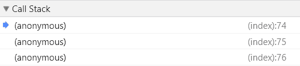
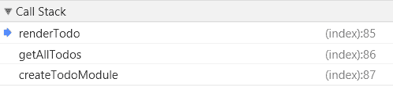
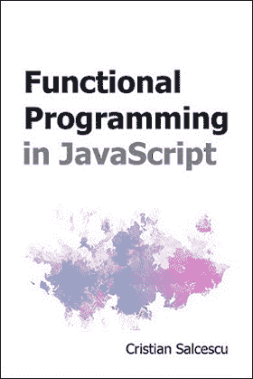
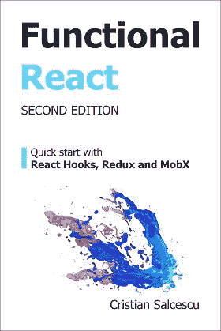
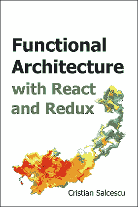
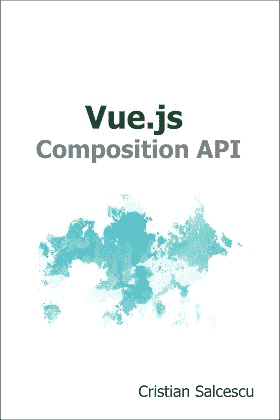

# 函数式JavaScript探索指南

*献给我的父母，维奥丽卡和格奥尔基*

# 前言

`JavaScript`已经成为最重要的编程语言之一。从许多角度来看，它都很重要：

* 它易于学习。这门语言的美妙之处在于它的简洁性。
* 它是第一门将函数式编程带入主流的语言。
* 它提供了一种无需类和原型即可进行面向对象编程的新方式。

`JavaScript`作为浏览器语言而广受欢迎。同时，它也是一种强大且富有表现力的编程语言。

这是一本为渴望在`JavaScript`中打下函数式编程基础，并希望学习构建封装对象新方法的开发者而写的书。

## 在线代码示例

本书中的许多代码示例（并非全部）可在[`github.com/cristi-salcescu/discover-functional-javascript`](https://github.com/cristi-salcescu/discover-functional-javascript)找到。我鼓励你自己编写代码。写作是另一种学习形式，在大多数情况下，你最理解的代码是你自己写的代码。

## 反馈

我很乐意听到你的反馈。如有关于本书的评论、问题或建议，请发送电子邮件至`cristisalcescu@gmail.com`。提前感谢你考虑为本书撰写评论。

# 第1章：JavaScript简要概述

`JavaScript`有原始值、对象和函数。它们都是值。所有值都被视为对象，即使是原始值也是如此。

## 原始值

数字、布尔值、字符串、`undefined`和`null`是原始值。

### 数字

目前`JavaScript`中只有一种数字类型，即64位二进制浮点数。十进制数的算术是不精确的。你可能已经知道，`0.1 + 0.2`不等于`0.3`。但对于整数，算术是精确的，所以`1 + 2 === 3`。

数字继承自`Number.prototype`对象的方法。可以在数字上调用方法：

```
(123).toString();  //"123"
(1.23).toFixed(1); //"1.2"
```

有一些函数用于将字符串转换为数字：

`Number.parseInt()`、`Number.parseFloat()`和`Number()`。

```
Number.parseInt("1");       //1
Number.parseInt("text");    //NaN
Number.parseFloat("1.234"); //1.234
Number("1");                //1
Number("1.234");            //1.234
```

无效的算术运算或无效的转换不会抛出异常，而是产生`NaN`（“非数字”）值。`isNaN()`可以检测`NaN`。

### 字符串

字符串存储一系列Unicode字符。文本可以放在双引号`""`或单引号`''`内。

字符串继承自`String.prototype`的方法。它们有诸如`substring()`、`indexOf()`或`concat()`等方法。

```
"text".substring(1,3); //"ex"
"text".indexOf('x');   //2
"text".concat(" end"); //"text end"
```

字符串和所有原始值一样，是不可变的。例如，`concat()`不会修改现有字符串，而是创建一个新字符串。

`+`运算符可以用于加法或拼接：

```
1 + 1      //2
"1" + "1"  //"11"
1 + "1"    //"11"
```

### 布尔值

布尔值有两个值：`true`和`false`。

该语言有真值和假值。`false`、`null`、`undefined`、`''`（空字符串）、`0`和`NaN`是假值。所有其他值都是真值。

真值在布尔上下文中执行时会被求值为`true`。假值会被求值为`false`。下一个示例显示了`false`分支。

```
if('') {
  console.log("true");
} else {
  console.log("false");
}
```

相等运算符是`===`。不等运算符是`!==`。

## 变量

变量可以使用`var`、`let`和`const`定义。

`var`声明并可选地初始化一个变量。用`var`声明的变量具有函数作用域。它们被视为在函数顶部声明。这称为变量提升。

`let`和`const`声明具有块级作用域。用`const`声明的变量不能被重新赋值。

未初始化的变量的值是`undefined`。

## 对象

对象是属性的动态集合。

属性有一个键和一个值。属性键是唯一的字符串。属性值可以是原始值、对象或函数。

创建对象的最简单方法是使用对象字面量：

```
let obj = {
  message: "read me",
  doSomething: function() {}
};
```

有两种访问属性的方式：点表示法和方括号表示法。对象的属性可以被读取、添加、编辑或删除。

```
let obj = {};
obj.message = "read me"; //添加
obj.message = "enjoy"; //编辑
delete obj.message; //删除
```

所有对象的属性都是公开的。

### 原始值与对象

原始值（除了`null`和`undefined`）在拥有方法的意义上被视为对象，但它们不是对象。

数字、字符串和布尔值有对应的包装对象。这些包装对象由`Number`、`String`和`Boolean`函数构建。

为了允许访问原始值上的属性，`JavaScript`会创建一个包装对象，然后销毁它。创建和销毁包装对象的过程由`JavaScript`引擎优化。

## 数组

数组是值的索引集合。每个值都是一个元素。元素按顺序排列，并通过其索引号访问。

`JavaScript`拥有类数组对象。数组是通过对象实现的。索引被转换为字符串，并用作检索值的键。

像`let arr = ['A', 'B', 'C']`这样的简单数组，是通过类似于下面的对象模拟的：

```
{
  '0': 'A',
  '1': 'B',
  '2': 'C'
}
```

注意，`arr[1]`与`arr['1']`返回相同的值：

```
arr[1] === arr['1']; //true
```

使用`delete`从数组中删除值会留下空洞。可以使用`splice()`来避免这个问题，但它的速度可能较慢。

```
let arr = ['A', 'B', 'C'];
delete arr[1];
console.log(arr); //['A', empty, 'C']
console.log(arr.length); //3
```

`JavaScript`的数组不会抛出“索引越界”异常。如果索引不可用，它们会返回`undefined`。

栈和队列可以很容易地使用数组方法实现：

```
let stack = [];
stack.push(1);           //[1]
stack.push(2);           //[1, 2]
let last = stack.pop();  //[1]
console.log(last);       //2

let queue = [];
queue.push(1);           //[1]
queue.push(2);           //[1, 2]
let first = queue.shift();//[2]
console.log(first);      //1
```

## 函数

函数是独立的行为单元。定义函数有三种方式：

* 函数声明（又称函数语句）
* 函数表达式（又称函数字面量）
* 箭头函数

### 函数声明

```
function doSomething(){ }
```

* `function`是行中的第一个关键字。
* 它必须有一个名称。
* 它可以在定义之前使用。函数声明会被提升（hoisted）到其作用域的顶部。

### 函数表达式

```
let doSomething = function() { }
```

* `function`不是行中的第一个关键字。
* 名称是可选的。可以有匿名函数表达式或命名函数表达式。
* 它需要先定义，然后才能执行。
* 它可以在定义后自动执行。这被称为IIFE（立即调用函数表达式），也称为自执行函数。

以下是一个IIFE的示例：

```
(function autorun(){
  console.log("executed");
})();
//"executed"
```

### 箭头函数

箭头函数是创建匿名函数表达式的语法糖。

```
let doSomething = () => { };
```

### 函数调用

函数可以通过不同的方式调用：

```
//作为函数
doSomething(arguments);

//作为方法
theObject.doSomething(arguments);

//作为构造函数
new Constructor(arguments)

//使用 apply() 或 call()
doSomething.apply(theObject, [arguments]);
doSomething.call(theObject, arguments);
```

函数调用时传入的参数可以多于或少于定义中声明的参数。多余的参数会被忽略，缺少的参数会被设置为`undefined`。

除了箭头函数，函数都有两个伪参数：`this`和`arguments`。

### this

方法是存储在对象中的函数。为了让函数知道它要操作哪个对象，会使用`this`。`this`代表函数的上下文。

当函数作为方法使用时，`this`代表该对象。

```
let theObject = {
  name: "name",
  getName: function(){
    return this.name;
  }
}

theObject.getName(); //"name"
```

当函数作为构造函数`new Constructor()`使用时，`this`代表新创建的对象。箭头函数不能用作构造函数。

函数是对象，因此函数可以有方法。`apply()`和`call()`方法在给定的`this`下执行函数。`call()`逐个提供参数，而`apply()`接受一个包含所有参数的数组。

```
let otherObject = {
  name: "otherName"
}

function getName(){
  return this.name;
}

getName.apply(otherObject); //"otherName"
getName.call(otherObject);  //"otherName"
```

当函数以函数形式调用时，使用`this`没有意义。在这种情况下，`this`是`undefined`或`window`对象，具体取决于是否启用了严格模式。考虑以下示例：

```
"use strict";
function getName(){
  return this.name;
}

getName(); 
//Cannot read property 'name' of undefined
```

`this`的值取决于函数如何被调用，而不是函数在哪里定义。这当然是一个令人困惑的来源。

### arguments

`arguments`伪参数给出了调用时使用的所有参数。它是一个类数组对象，但不是数组。它缺少数组的方法。

```
function logAll(){
  console.log(arguments);
}

logAll("msg1", "msg2", "msg3");
//Arguments(3)["msg1","msg2","msg3"]
```

### return

`return`会停止函数执行并返回结果。当它没有返回值或根本没有`return`时，函数仍然返回`undefined`。

使用`return`时，自动分号插入可能会造成问题。以下函数不会返回空对象，而是返回`undefined`。

```
function getObject(){ 
  return 
  {
  }
}

getObject();
```

花括号`{`应该与`return`在同一行打开。

## 动态类型

`JavaScript`具有动态类型。值有类型，但变量不与类型关联。任何变量、参数、属性都可以被赋予和重新赋予任何类型的值。

```
function log(value){
  console.log(value);
}

log(1);
log("text");
log({message: "text"});
```

`typeof()`运算符可以检查变量的类型。

```
let n = 1;
typeof(n);   //"number"

let s = "text";
typeof(s);   //"string"

let fn = function() {};
typeof(fn);  //"function"
```

动态类型提供了更高的灵活性。

## 异常

`JavaScript`有一个异常处理机制。它的工作方式与你预期的一样，通过使用`try/catch`语句包裹代码。该语句有一个单一的`catch`块来处理所有异常。

你可以`throw`任何类型的值，但通常抛出错误对象。

了解`JavaScript`有时倾向于静默错误是很有用的。严格模式消除了`JavaScript`的一些静默错误。

## 最后思考

原始值不是对象，但`JavaScript`允许像访问对象一样访问它们的属性。

对象是键值对的动态集合。

数组是值的索引集合。

函数是独立的单元，可以通过不同的方式调用。

原始值、对象和函数都是值。

# 第2章：ES6+的新特性

ES6+为语言带来了新特性。一些新语法允许你以更具表现力的方式编写代码，一些特性完善了函数式编程工具箱，还有一些特性则存在争议。

## let和const

现在有两种声明变量的方式：`let`和`const`，还有一种正在逐渐过时的`var`。

### let

`let`在当前作用域中声明并可选地初始化一个变量。当前作用域可以是模块、函数或块。

作用域定义了变量的生命周期和可见性。变量在其声明的作用域之外不可见。

考虑以下强调`let`块级作用域的代码：

```
let x = 1;
{ 
  let x = 2;
}
console.log(x); //1
```

相比之下，`var`声明没有块级作用域：

```
var x = 1;
{ 
  var x = 2;
}
console.log(x); //2
```

### const

`const`声明一个不能被重新赋值的变量。只有当赋给的值是不可变的时，它才成为常量。

```
const x = 1;

x = 2;
//TypeError: Assignment to constant variable.
```

不可变的值是一旦创建就不能更改的值。原始值是不可变的，对象是可变的。

```
const obj = {
  message: "Hi",
};

obj = {
  message: "Hello",
};
//TypeError: Assignment to constant variable.

obj.message = "Hello";
console.log(obj);
// { message: "Hello" }
```

`const`变量的初始化是强制性的。

## 模块

在模块出现之前，在任何函数外部声明的变量都是全局变量。使用模块后，在任何函数外部声明的变量会被隐藏，除非显式导出，否则其他模块无法访问。

导出有两种类型：默认导出和命名导出。

我们先来看默认导出和导入。导出使得函数或对象对其他模块可用。

```
//module "./TodoStore.js"
export default function TodoStore(){}

//module "./UserStore.js"
export default function UserStore(){}
```

导入使得来自其他模块的函数或对象对当前模块可用。

```
//module "./main.js"
import TodoStore from "./TodoStore";
import UserStore from "./UserStore";

const todoStore = TodoStore();
const userStore = UserStore();
```

使用默认导出时，导入的名称可以与导出的名称不同。在下一个示例中，默认导出的`flow`函数以名称`pipe`使用。

```
import pipe from "lodash/flow";
```

接下来，看命名导出和导入。下面是一个导出两个命名函数的示例：

```
//module "./tools.js"
export function compose(...args){}
export function decorate(f, ...args){}
```

然后可以使用相同的名称导入它们：

```
//module "./main.js"
import { compose, decorate } from "./tools";
```

每个模块文件可以有一个默认导出和多个命名导出。

在某种程度上，我们可以将模块想象成一个自执行函数，它接收导入数据作为输入，并返回导出数据。

## 展开/剩余

`...`运算符可以是展开运算符或剩余参数，具体取决于使用位置。

展开运算符将对象或数组拆分为单个值。


```
const numbers = [1, 2, 3];
const arr = ['a', 'b', 'c', ...numbers];

console.log(arr);
//["a", "b", "c", 1, 2, 3]
```

当参数数量超过命名参数数量时，剩余参数会收集剩余的参数。剩余参数是函数的最后一个参数，并且是一个数组。

```
function process(x,y, ...arr){
  console.log(arr)
}

process(1, 2, 3, 4, 5);
//[3, 4, 5]

function processArray(...arr){
  console.log(arr)
}

processArray(1, 2, 3, 4, 5);
//[1, 2, 3, 4, 5]
```

### 克隆

展开运算符使对象和数组的克隆更简单、更具表现力。

```
const book = { title: "JavaScript: The Good Parts" };

//使用 Object.assign() 克隆
const clone = Object.assign({}, book);

//使用展开运算符克隆
const clone = { ...book };

const arr = [1, 2 ,3];

//使用 slice() 克隆
const cloneArr = arr.slice();

//使用展开运算符克隆
const cloneArr = [ ...arr ];
```

### 合并对象

展开运算符，像`Object.assign()`一样，可用于将一个或多个对象的属性复制到空对象中，并合并它们的属性。

```
const authorGateway = { 
  getAuthors: function() {},
  editAuthor: function() {}
};

const bookGateway = { 
  getBooks: function() {},
  editBook: function() {}
};

//使用 Object.assign() 复制
const gateway = Object.assign({},
      authorGateway, 
      bookGateway);

//使用展开运算符复制
const gateway = {
   ...authorGateway,
   ...bookGateway
};
```

`gateway`对象包含来自`authorGateway`和`bookGateway`对象的属性。当多个对象具有同名属性时，最后一个对象的属性会覆盖前面的属性。

### 连接数组

在下一个示例中，使用展开运算符连接数组：

```
const part1 = [1, 2, 3];
const part2 = [4, 5, 6];

//使用 concat() 连接
const arr = part1.concat(part2);

//使用展开运算符连接
const arr = [...part1, ...part2];

console.log(arr);
//[1, 2, 3, 4, 5, 6]
```

### arguments

使用剩余参数，我们可以替换`arguments`伪参数。剩余参数是一个数组，而`arguments`不是。

```
function logAll(...args){
  console.log(args);
}

logAll("msg1", "msg2", "msg3");
//["msg1", "msg2", "msg3"]
```

### 属性简写

考虑以下代码：

```
function BookGateway(){
  function getBooks() {}
  function editBook() {}

  return {
    getBooks: getBooks,
    editBook: editBook
  }
}
```

使用属性简写，当属性名称与用作值的变量名称相同时，我们可以只写一次键名。

```
function BookGateway(){
  function getBooks() {}
  function editBook() {}

  return {
    getBooks,
    editBook
  }
}
```

另一个示例：

```
const todoStore = TodoStore();
const userStore = UserStore();

const stores = {
  todoStore,
  userStore
};
```

### 解构赋值

解构赋值语法将对象或数组中的值提取到变量中。

考虑以下代码：

```
function TodoStore(args){
  const helper = args.helper;
  const dataAccess = args.dataAccess;
  const userStore = args.userStore;
}
```

使用解构赋值语法，可以这样写：

```
function TodoStore(args){
  const { 
    helper, 
    dataAccess, 
    userStore } = args;
}
```

解构语法可以直接在参数列表中使用：

```
function TodoStore({helper, dataAccess, userStore}){}
```

以下是函数调用：

```
TodoStore({ 
  helper: {}, 
  dataAccess: {}, 
  userStore: {} 
});
```

### 默认参数

函数可以有默认参数。看下一个示例：

```
function log(message, mode = "Info"){
  console.log(mode + ": " + message);
}

log("An info");
//Info: An info

log("An error", "Error");
//Error: An error
```

### 模板字符串字面量

模板字符串使用反引号`定义。使用模板字符串，之前的日志消息可以这样写：

```
function log(message, mode= "Info"){
  console.log(`${mode}: ${message}`);
}
```

模板字符串可以跨多行定义。不过，更好的做法是将长文本消息保留为资源。

下面是一个生成跨多行 HTML 的函数：

```
function createTodoItemHtml(todo){
  return `<li>
    <div>${todo.title}</div>
    <div>${todo.userName}</div>
  </li>`;
}
```

### 类

类是创建具有自定义原型对象的语法糖。它比之前的函数构造函数语法更好。看下一个示例：

```
class Service {
  doSomething(){ 
    console.log("do-something"); 
  }
}

const service = new Service();
console.log(service.__proto__ === Service.prototype);
```

在`Service`类中定义的所有方法都会被添加到`Service.prototype`对象中。`Service`类的实例将具有相同的原型对象`Service.prototype`。所有实例都会将方法调用委托给原型对象。方法在原型中定义一次，然后被所有实例继承。

#### 继承

“类可以继承其他类”。下面是一个继承示例，其中`SpecialService`类“继承”自`Service`类：

```
class Service {
  doSomething(){ 
    console.log("do-something"); 
  }
}

class SpecialService extends Service {
  doSomethingElse(){ 
    console.log("do-something-else"); 
  }  
}

const specialService = new SpecialService();
specialService.doSomething();
specialService.doSomethingElse();
```

在`SpecialService`类中定义的所有方法都会被添加到`SpecialService.prototype`对象中。所有实例都会将方法调用委托给`SpecialService.prototype`对象。如果在`SpecialService.prototype`中找不到该方法，则会到`Service.prototype`对象中查找。如果仍然找不到，则会到`Object.prototype`中查找。

### 箭头函数

箭头函数可以动态创建匿名函数。它们可用于创建简短的小型回调函数，语法更简洁。

考虑以下代码，从待办事项集合中仅选择`title`：

```
const todos = [
  {id: 1, title: "learn", type:"NC", completed: false},
  {id: 2, title: "connect", type:"RC", completed: true}
];

const titles = todos.map(todo => todo.title);
//["learn", "connect"]
```

以下是一个筛选未完成待办事项的示例：

```
const filteredTodos = todos.filter(todo => !todo.completed);
//{id: 1, title: "learn", type: "NC", completed: false}
```

下面是用函数声明和箭头语法分别编写同一函数的示例：

```
function isNewContent(todo){
   return todo.type === "NC";
}

const isNewContent = todo => todo.type === "NC";
```

#### this

箭头函数没有自己的`this`和`arguments`。箭头函数不能用作构造函数。

使用`bind()`、`apply()`或`call()`为箭头函数设置`this`的值是无效的。请看下面的代码：

```
this.message = "help";

const logMessage = () => { 
  console.log(this.message); 
}

logMessage(); //"help"
logMessage.call({message : "identify"}); //"help"
```

`this`和`arguments`被视为函数定义中使用的任何其他自由变量。

### 尾调用优化

> 当递归调用是函数执行的最后一步时，该递归函数称为尾递归函数。

尾递归函数的性能优于非尾递归函数。优化后的尾调用不会为每次函数调用创建新的栈帧，而是使用单个栈帧。

ES6 在严格模式下引入了尾调用优化。

以下函数应受益于尾调用优化：

```
function print(from, to) 
{ 
  const n = from;
  if (n > to)  return;

  console.log(n);

//最后一条语句是递归调用
  print(n + 1, to); 
}

print(1, 3);
//1
//2
//3
```

请注意，主流浏览器尚未支持尾调用优化。

### Promise

> Promise 是一个对象，表示异步操作可能产生的未来结果。

Promise 可以处于三种状态之一：待定（pending）、已解决（resolved）或已拒绝（rejected）。Promise 将保持待定状态，直到被解决或拒绝。

#### 创建 Promise

让我们使用`Promise`创建一个`delay()`函数：

```
function delay(duration){
  return new Promise(function(resolve, reject){
    setTimeout(resolve, duration);
  });
}

function logMessage(){
  console.log("process ended");
}

delay(5000)
 .then(logMessage);
```

`Promise`构造函数接受一个参数，即一个称为“执行器函数”的函数。当 Promise 被创建时，该函数会立即执行。

执行器函数接受两个回调：`resolve`和`reject`。

*   调用`resolve()`会解决 Promise。
*   调用`reject()`会拒绝 Promise。

这两个函数都可以接受一个参数。Promise 只会被解决或拒绝一次。之后对这些方法的任何调用都将无效。

#### 使用 Promise

创建 Promise 后，可以注册回调。当 Promise 的结果已知时，这些回调将被调用。

```
function fetchUsers(){ 
  return fetch("/users"); 
}

function doSomething(){ }
function handleError(error){ }

fetchUsers()
  .then(doSomething)
  .catch(handleError);
```

当 Promise 被解决时，调用`doSomething()`。当 Promise 被拒绝时，调用`handleError()`。`doSomething()`不需要返回 Promise。

`then()`可以同时处理成功和失败，但更清晰的做法是使用它处理成功，使用`catch()`处理拒绝。

### 最后思考

`let`和`const`声明并初始化变量。

模块封装功能，只暴露一小部分。

展开运算符、剩余参数和属性简写使表达更简单。

Promise 和尾递归完善了函数式编程工具箱。

# 第 3 章：一等函数

> JavaScript 最出色的地方在于其函数的实现。—— Douglas Crockford，《JavaScript 语言精粹》作者

### 一等函数

JavaScript 拥有一等函数。这意味着函数可以像其他任何值一样使用。数字和函数都是值，因此我们可以像使用数字一样使用函数：

*   数字可以存储在变量中 → 函数可以存储在变量中。实际上，函数可以存储在变量、对象或数组中。
*   数字可以作为参数传递给函数 → 函数可以作为参数传递给其他函数。
*   函数可以返回数字 → 函数可以返回其他函数。

请看以下示例：

```
//存储在变量中
function doSomething(){ }

//存储在变量中
const doSomething = function (){ };

//存储在属性中
const obj = { 
   doSomething : function(){ } 
}

//作为参数传递
process(doSomething);

//从函数返回
function createGenerator(){
  return function(){
  }
}
```

函数名被视为变量。本质上，函数声明语法创建了一个保存函数的变量：

```
//函数声明语法
function doSomething() {}

//等价于
let doSomething = function() {}
```

### 高阶函数

> 高阶函数是接受另一个函数作为参数、返回一个函数，或两者兼有的函数。

让我们构建一个`doWithLoading(fn)`高阶函数，它接受一个函数`fn`作为参数并执行它。它在输入函数执行前后显示加载消息。

```
function doWithLoading(fn){
  console.log("start loading");
  const returnValue = fn();
  console.log("end loading");
  return returnValue;
}

function process() {
  console.log("process");
}

doWithLoading(process);
//start loading
//process
//end loading
```

以函数式风格处理数组涉及使用一组内置的高阶函数：`filter()`、`map()`和`reduce()`。

### filter()

> `filter()`使用一个谓词函数从列表中选择值，该函数决定保留哪些值。

```
const numbers = [1,2,3,4,5,6];

function isEven(number){
  return number % 2 === 0;
}

const evenNumbers = numbers.filter(isEven);
//element=1, isEven(1) is false → result=[]
//element=2, isEven(2) is true  → result=[2]
//element=3, isEven(3) is false → result=[2]
//element=4, isEven(4) is true  → result=[2, 4]
//element=5, isEven(5) is false → result=[2, 4]
//element=6, isEven(6) is true  → result=[2, 4, 6]
//[2, 4, 6]
```


谓词函数是接受一个参数并返回`true`或`false`的函数。它测试输入值是否满足条件。

回调是作为参数传递给另一个函数的函数。

`isEven()`是一个谓词函数，并作为回调使用。

### map()

`map()`使用映射函数将一个值列表转换为另一个值列表。

```
function toCodeOfLength(number){
  return "a".repeat(number);
}

const numbers = [1, 2, 3];
const codes = numbers.map(toCodeOfLength);
//element=1, map to "a"   → result=["a"]
//element=2, map to "aa"  → result=["a", "aa"]
//element=3, map to "aaa" → result=["a", "aa", "aaa"]
//["a", "aa", "aaa"]
```

`toCodeOfLength()`是一个映射函数。它接受一个值并计算出另一个值。

### reduce()

`reduce()`使用归约函数将一个值列表归约为一个值。

归约函数接受累加器值和当前值，并计算新的累加器值。`reduce()`方法对数组中的每个元素执行归约函数。

```
function addNumber(total, number){
  return total + number;
}

const numbers = [1, 2, 3];
const total = numbers.reduce(addNumber, 0);
//element=1, total=0 → result=1
//element=2, total=1 → result=3
//element=3, total=3 → result=6
//6
```

`addNumber()`是一个归约函数。

`reduce(reducer, initialValue)`接受第二个参数作为累加器的初始值。如果未提供该值，则将数组的第一个元素设为初始值，并从第二个元素开始循环。

```
const numbers = [1, 2, 3];
const total = numbers.reduce(addNumber);
//element=2, total=1 → result=3
//element=3, total=3 → result=6
//6
```

还有一个`reduceRight()`方法，它从列表的最后一个元素开始处理。

```
function multiply(product, value){
  return product * value;
}

const numbers = [2, 3, 4];
const product = numbers.reduceRight(multiply, 1);
//element=4, product=1  → result=4
//element=3, product=4  → result=12
//element=2, product=12 → result=24
//24
```

正如你所注意到的，当我们将数字相乘时，累加器的初始值为 1。

### sort()

`sort()`使用比较函数对数组元素进行排序。它是一个不纯的方法，会修改输入数组。

比较函数接受两个参数，例如`a`和`b`，并返回负数、正数或零。当结果为负数时，`a`排在`b`之前；当结果为正数时，`a`排在`b`之后；当结果为零时，`a`和`b`的相对顺序不变。

```
function asc(a, b){
  return a - b;
}

function desc(a, b){
  return b - a;
}

const numbers = [1,3,2,6,4,5];

numbers.sort(asc);
//[1, 2, 3, 4, 5, 6]

numbers.sort(desc);
//[6, 5, 4, 3, 2, 1]
```

`asc()`和`desc()`是比较函数。对于相同的输入，比较函数应始终返回相同的输出。

### 扩展工具箱

`find()`返回第一个满足谓词函数的值。找到第一个值后即停止处理。

`findIndex()`返回第一个满足谓词函数的值的索引。

`some()`检查列表中是否至少有一个值通过了谓词函数实现的测试。当谓词返回`true`时停止处理。

`every()`检查列表中的所有值是否都通过了谓词函数实现的测试。当谓词返回`false`时停止处理。

让我们使用它们：

```
const numbers = [1,2,3,4,5,6];

const firstEven = numbers.find(isEven);
//2

const firstEvenIndex = numbers.findIndex(isEven);
//1

const areAllEven = numbers.every(isEven);
//false

const hasOneEven = numbers.some(isEven);
//true
```

`forEach()`按顺序为数组中的每个元素调用回调函数。

```
function log(value){
  console.log(value);
}

const numbers = [1,2,3];
numbers.forEach(log);
//1
//2
//3
```

所有这些数组方法都是内置的高阶函数。

### 最终思考

拥有头等函数意味着能够将函数作为值来使用。这使得传递行为以及像处理其他值一样处理函数变得容易。

`filter()`、`map()`、`reduce()`构成了以函数式风格处理集合的基本工具箱。

# 第 4 章：闭包

闭包是一个内部函数，它可以访问外部作用域，即使外部作用域容器已经执行完毕。

作用域定义了变量的生命周期和可见性。外部作用域容器可以是一个函数、一个块或一个模块。

### 嵌套函数

函数可以嵌套在其他函数内部。考虑以下代码：

```
(function autorun(){
    let x = 1;
    function log(){ 
       console.log(x); 
    }
    log();
})();
```

`log()`是一个嵌套函数。`log()`从其外部作用域访问变量`x`。`log()`函数是一个闭包。外部作用域容器是外部函数。

内部函数访问外部函数中的变量，这就是闭包。

### 词法作用域

词法作用域是指内部函数能够访问其定义所在的外部作用域的能力。考虑以下代码：

```
(function autorun(){
    let x = 1;
    function log(){
      console.log(x);
    };

    function run(fn){
      let x = 100;
      fn();
    }

    run(log); //1
})();
```

`log()`函数是一个闭包。它引用其父函数`autorun()`中的变量`x`。`log()`不使用`run()`函数中的变量`x`。

闭包函数可以访问其创建时所在的作用域，而不是其执行时所在的作用域。

`autorun()`的局部函数作用域就是`log()`函数的词法作用域。

### 父级执行后的存活

当内部函数在父作用域容器执行完毕后仍然存活时，闭包就变得重要了。这发生在以下情况中：

*   内部函数被用作异步任务的回调，例如定时器、事件或网络调用

*   父函数或模块返回内部函数，或返回存储了内部函数的对象

考虑以下示例：

#### 定时器

```
(function autorun(){
  let x = 1;
  setTimeout(function log(){
    console.log(x);
  }, 10000);
})();
```

变量`x`会一直存在，直到`log()`函数被调用。

如果使用了`setInterval()`，那么变量`x`将永远存在，或者直到调用了`clearInterval()`。

#### 事件

```
(function autorun(){
  let x = 1;
  $("#btn").click(function log(){
    console.log(x);
  });
})();
```

当变量`x`在事件处理程序中使用时，它会一直存在，直到处理程序被移除。

#### 网络调用

```
(function autorun(){
  let x = 1;
  fetch("/todos").then(function log(){
    console.log(x);
  });
})();
```

变量`x`会一直存在，直到从 Web API 返回响应并执行回调。

在所有这些情况下，`log()`都是一个闭包，并且在父函数调用结束后仍然存活。

变量的生命周期取决于闭包的生命周期。变量会一直存在，直到引用它的所有闭包都被垃圾回收。如果一个变量被多个闭包共享，那么在所有闭包都被垃圾回收之前，该变量不会被回收。

### 循环中的闭包

闭包存储的是对外部变量的引用，而不是实际值的副本。查看以下示例：

```
function initEvents(){
  for(var i=1; i<=3; i++){
    $("#btn"+i).click(function log(){
      console.log(i); //4
    });
  }
}

initEvents();
```

在这个示例中，创建了三个闭包，它们都共享同一个变量`i`。这三个闭包都是事件处理程序。由于`i`在循环过程中会变化，所有日志都会显示相同的值，即最后一个值。

解决这个问题的最简单方法是在`for`语句内部使用`let`声明。这将为每次迭代创建一个块级作用域的局部变量。

```
function initEvents(){
  for(let i=1; i<=3; i++){
    $("#btn"+i).click(function log(){
      console.log(i); //1 2 3
    });
  }
}

initEvents();
```

当变量声明在`for`语句外部时，即使使用`let`，所有闭包也会使用同一个变量。所有日志都会显示相同的值，即最后一个值。

```
function initEvents(){
  let i;  
  for(i=1; i<=3; i++){
    $("#btn"+i).click(function log(){
      console.log(i); //4
    });
  }
}
```

### 生成器

生成器是一个函数，每次调用它时，它会从序列中返回下一个值。

我认为 ES6 生成器是一个不必要的特性，它使代码变得更加复杂。

ES6 生成器创建了一个具有`next()`方法的对象。`next()`方法创建了一个具有`value`属性的对象。ES6 生成器促进了循环的使用，而在函数式编程中，我们希望摆脱循环。

考虑下面的 ES6 生成器：

```
function* sequence(){
  let count = 0;
  while(true) {
    count += 1;
    yield count;
  }
}

const generator = sequence();
generator.next().value; //1
generator.next().value; //2
generator.next().value; //3
```

同样的生成器可以简单地用闭包实现：

```
function sequence(){
  let count = 0;
  return function(){
    count += 1;
    return count;
  }
}

const generator = sequence();
generator(); //1
generator(); //2
generator(); //3
```

`generator()`函数是一个闭包。它可以访问其父函数`sequence()`中的`count`变量。即使在`sequence()`执行完毕后，它仍然可以访问`count`变量。

`generator()`闭包是通过一个返回函数的函数创建的。这样，闭包函数在其父函数调用后依然存活。`sequence()`是一个高阶函数。

### 具有私有状态的函数

利用闭包，我们可以创建具有私有状态的函数。闭包封装了状态。

`generator()`闭包就是一个具有私有状态的函数。每次调用时，它都会记住之前的`count`状态，并返回下一个连续的数字。`count`变量是私有的，外部无法访问。

### 具有私有状态的函数

我们可以进一步扩展这个思路，创建多个共享同一私有状态的闭包。在下一个示例中，`increment()`和`decrement()`是两个共享同一私有`state`变量的闭包。

```
const counter = (function(){
    let state = 0;

    function increment(){
       state += 1;
       return state;
    }

    function decrement(){
       state -= 1;
       return state;
    }

    return {
       increment,
       decrement
    }
})();

counter.increment(); //1
counter.increment(); //2
counter.decrement(); //1
```

这种模式被称为“揭示模块模式”。

使用 ES6 模块也可以实现相同的行为。

```
//module "./counter.js"
let state = 0;

function increment() {
  state += 1;
  return state;
}

function decrement() {
  state -= 1;
  return state;
}

export default {
  increment,
  decrement
}

//module "./index.js"
import counter from "./counter";

counter.increment(); //1
counter.increment(); //2
counter.decrement(); //1
```

### 作用域对象

当函数执行时，会创建一个新的私有作用域对象。该作用域对象包含所有参数和局部变量。它还包含一个指向其创建时外部作用域对象的引用。

作用域对象像其他对象一样被分配。函数执行后，作用域对象不会自动清理。当没有更多引用指向它们时，它们会像普通对象一样被垃圾回收。

作用域对象构成了一条作用域链。它在概念上类似于原型链。当使用一个变量时，程序会沿着作用域链向下查找，直到找到该变量。

闭包是一个函数，它拥有对其创建时外部函数作用域对象的私有引用。

### 垃圾回收

闭包的私有状态在闭包本身被垃圾回收后才有资格被回收。为了实现这一点，闭包不应再持有对该状态的引用。

在下一个示例中，首先创建了`add()`闭包函数：

```
let add = (function createAddClosure(){
    let arr = [];
    return function(obj){
       arr.push(obj);
    }
})();
```

然后，定义了两个与该闭包函数配合使用的函数：

*   `addALotOfObjects()`向闭包的私有状态中添加大量对象。

*   `clearAllObjects()`将闭包引用设置为`null`。

这两个函数都用作事件处理程序：

```
function Todo(){}

function addALotOfObjects(){
    for(let i=1; i<=10000;i++) {
       add(new Todo(i));
    }
}

function clearAllObjects(){
    if(add){
       add = null;
    }
}

$("#add").click(addALotOfObjects);
$("#clear").click(clearAllObjects);
```

点击“Add”将向闭包的私有状态中添加 10,000 个待办事项。

点击“Clear”会将闭包引用设置为`null`。之后，私有状态将被垃圾回收。

### 总结

闭包是可以访问外部作用域变量的内部函数。

闭包中使用的变量与闭包共存亡。

闭包实现了封装。

一等函数和闭包为 JavaScript 中的函数式编程开辟了道路。

# 第 5 章：函数装饰器

函数装饰器是一个高阶函数，它接受一个函数作为参数并返回另一个函数，返回的函数是参数函数的变体。—— Reginald Braithwaite，《JavaScript Allongé》作者

为了在实践中理解这一概念，我们将编写一些常见的函数装饰器，这些装饰器可以在[lodash.js](https://lodash.com/docs/4.17.5)、[underscore.js](http://underscorejs.org/#functions)或[ramda.js](http://ramdajs.com/docs/)等库中找到。

### once()


`once(fn)` 创建一个只执行原始函数一次的函数。当我们希望函数只执行一次，无论从不同地方调用多少次时，这非常有用。

```
function once(fn){
  let returnValue;
  let canRun = true;
  return function(...args){
     if(canRun) {
         returnValue = fn(...args);
         canRun = false;
     }
     return returnValue;
  }
}

function process(){ 
  console.log("process"); 
}

const processOnce = once(process);
processOnce(); //process
processOnce(); //
processOnce(); //
```

`once()` 是一个返回另一个函数的函数。返回的函数是一个闭包。注意原始函数是如何通过所有参数调用的：`fn(...args)`。

## after()

`after(fn, count)` 创建一个仅在调用一定次数后才执行的函数版本。例如，它可以用于在所有异步操作完成后运行函数。

```
function after(fn, startCount){
  let count = 0;
  return function(...args){
     count = count + 1;
     if (count >= startCount) {
         return fn(...args);        
     }
  }
}

function logResult() { 
  console.log("finish"); 
}

const logResultAfter2 = after(logResult, 2);
setTimeout(function firstCall(){ 
  console.log("1st"); 
  logResultAfter2(); 
}, 3000);

setTimeout(function secondCall(){ 
  console.log("2nd"); 
  logResultAfter2(); 
}, 4000);

//"1st"
//"2nd"
//"finish"
```

在这个示例中，我使用 `after()` 构建了一个新函数 `logResultAfter2()`，该函数从第二次调用开始执行 `logResult()` 的原始代码。

## throttle()

`throttle(fn, wait)` 创建一个函数版本，当重复调用时，每 `wait` 毫秒最多调用一次原始函数。它对于限制过快发生的事件非常有用。

```
function throttle(fn, interval) {
  let lastTime;
  return function throttled(...args) {
    if(!lastTime || (Date.now() - lastTime >= interval)) {
      fn(...args);
      lastTime = Date.now();
    }
  }
}

let throttledProcess = throttle(process, 1000);
$(window).mousemove(throttledProcess);
```

在这个示例中，移动鼠标会生成大量 `mousemove` 事件，但原始函数每秒只会被调用一次。

## debounce()

`debounce(fn, wait)` 创建一个函数版本，当重复调用时，会在最后一次调用后等待 `wait` 毫秒才执行原始函数。它适用于仅在事件停止到达后运行函数。

```
function debounce(fn, interval) {
  let timer;
  return function debounced(...args) {
    clearTimeout(timer);
    timer = setTimeout(function(){
      fn(...args);
    }, interval);
  }
}

let debouncedProcess = debounce(process, 400);
$(window).resize(debouncedProcess);
```

一些常见的适合 `debounce` 的事件包括 `scroll`、`resize`、`mousemove` 或 `keypress`。

## memoize()

记忆化是一种通过保存先前结果并利用它们避免重复计算来提高执行速度的技术。记忆化与缓存不同，它只适用于确定性函数。

`memoize(fn)` 创建一个函数的记忆化版本。它对于加速慢速计算非常有用。

以下是一个接受单参数函数的实现。

```
function memoize(fn) {
  const map = Object.create(null);
  return function (x) {
    if (!map[x]){
      map[x] = fn(x);
    }

    return map[x];
  }
}

const factorial = memoize(function(n){
  console.log("n=" + n);
  if(n < 2) return 1;
  return n * factorial(n-1);
});

console.log(factorial(3)); //6;
//n=3
//n=2
//n=1

console.log(factorial(5)); //120;
//n=5
//n=4
```

`factorial()` 是一个拥有私有状态的函数。其内部状态是一个存储先前结果的映射表。

## unary()

`unary(fn)` 创建一个只接受一个参数的函数版本。它通常用于修复函数被传入多余参数时的问题。

```
function unary(fn){
  return function(first){
    return fn(first);
  }
}
```

让我们尝试使用 `console.log()` 来打印数组中的所有数字。

```
const numbers = [1,2,3,4,5,6];

numbers.forEach(console.log);
//1 0 (6) [1, 2, 3, 4, 5, 6]
//2 1 (6) [1, 2, 3, 4, 5, 6]
//...
```

如你所见，这里有一个问题。`console.log()` 接收的参数比我们想要的要多。我们需要只用一个参数来调用它。以下是使用 `unary()` 函数的代码：

```
numbers.forEach(unary(console.log));
//1 2 3 4 5 6
```

下面是另一个使用 `unary()` 修复 `parseInt()` 问题的例子：

```
const numbers = ['1','2','3','4','5','6'];

numbers.map(parseInt); 
//[1, NaN, NaN, NaN, NaN, NaN]

numbers.map(unary(parseInt)); 
//[1, 2, 3, 4, 5, 6]
```

## binary()

`binary(fn)` 创建一个只接受两个参数的函数版本。它可用于修复函数被传入多余两个参数时的问题。

```
function binary(fn){
  return function(a, b){
    return fn(a, b);
  }
}
```

在下一个例子中，`Math.max()` 被传入的参数比我们预期的要多。因为其中一个参数（第四个）无法转换为数字，结果返回 `NaN`。

```
const numbers = [1, 2, 3];
numbers.reduce(Math.max);
//NaN
```

为了确保 `Math.max()` 只被传入两个参数，我们可以使用 `binary()` 装饰器：

```
const numbers = [1, 2, 3];
numbers.reduce(binary(Math.max));
//3

numbers.reduce(binary(Math.min));
//1
```

## 保留函数上下文

为了保留原始函数的上下文，我们需要做两件事：

*   装饰器应使用 `function` 关键字返回一个函数，而不是箭头语法。

*   原始函数应通过 `fn.apply(this, args)` 或 `fn.call(this, ...args)` 调用。

## 最终思考

函数装饰器是一种强大的工具，可以在不修改原始函数的情况下创建现有函数的变体。它们可以成为函数式编程工具箱中用于复用通用逻辑的一部分。

# 第 6 章：纯函数

> 纯函数是指对于相同的输入总是返回相同输出，并且没有副作用的函数。

纯函数承诺让代码更易于阅读、理解、测试、调试和组合。这些承诺很重大。让我们看看它们能做什么。

## 从内部阅读

我们不需要考虑当前函数中变量的变化会如何影响其他函数。我们也不需要考虑其他函数中变量的变化会如何影响当前函数。

这是一个纯函数：

```
function capitalize(name) {
  if(name){
    return name.charAt(0).toUpperCase() + name.slice(1);
  }

  return name;
}

capitalize("chapter");
//"Chapter"
```

阅读纯函数时，我们可以专注于一个地方——当前函数。纯函数让读者阅读的代码更少。

## 从外部阅读

看下面的代码：

```
const arr = [1, 2, 3];
const newValue = compute(arr);

console.log(arr);
//[1, 2, 3]
```

当 `compute()` 是纯函数时，我们可以确信 `console` 会输出 `[1, 2, 3]`，无需阅读和理解 `compute()` 函数。

需要阅读和理解的东西越少，代码就越容易阅读。

## 副作用

副作用是指在计算结果过程中，对局部环境之外的变量进行更改，或与外部环境进行交互。

以下是一些副作用的例子：

*   读取和修改局部作用域之外的状态

*   修改作为参数传入的对象

*   网络调用

*   读写 DOM

*   写入控制台

*   触发/分发事件

*   读写本地存储

*   使用定时器

以任何方式改变外部环境都是副作用。

改变外部状态可能会在代码的其他遥远部分产生意外问题。尤其是修改输入值可能会造成难以理解的 bug。我们不知道输入对象来自哪里，也不知道修改它会如何影响其他函数。

带有副作用的函数的结果依赖于外部环境。对于相同的输入，由于外部状态可能变化，它可能返回不同的结果。

以下是一些带有副作用的函数：

`getNextValue()` 不是纯函数，它改变了函数作用域之外的状态。

```
let startValue = 0;

function getNextValue(){
    startValue += 1;
    return startValue;
}

getNextValue(); //1
getNextValue(); //2
```

`addValue()` 不是纯函数，它修改了输入变量。

```
function addValue(list, value){
    list.push(value);
}

const numbers = [];

addValue(numbers, 1);
console.log(numbers);
//[1]

addValue(numbers, 2);
console.log(numbers);
//[1, 2]
```

## 自由变量

> 自由变量是指在函数中使用，但既不是该函数的局部变量也不是参数的变量。

如果自由变量是常量，纯函数可以访问它们。常量是用 `const` 声明并存储不可变值的变量。

```
const vatTax = 20;

function getFinalPrice(price){
  return price * (1 + vatTax/100);
}

getFinalPrice(10);
//12
```

`getFinalPrice()` 是一个纯函数。

纯函数不会访问可能变化的外部环境变量。

## 不可变性

不可变值是指一旦创建就无法更改的值。

纯函数将输入值视为不可变的。理想情况下，输入值应该是不可变值。返回不可变值是一个好习惯。

## 纯函数中的 `this`

`this` 是一个隐式输入。

当使用 `this` 时，我们需要将函数作为方法调用，或者使用 `call()` 或 `apply()` 并传入上下文对象来调用函数。

`this` 应被视为不可变的输入值，即使它实际上并非不可变。例如，`filter()`、`map()` 和 `reduce()` 是纯数组方法，它们创建新数组并将 `this` 作为输入。`sort()` 数组方法是不纯的，它会修改输入数组。

当使用 `this` 并以函数形式调用函数时，会产生副作用。在这种情况下，函数可能根据其运行环境给出不同的结果。`this` 变成了一个自由变量。

我们希望函数有显式的输入。如果希望轻松组合函数，就不应该使用 `this`。

将上下文对象显式化意味着将其添加到参数列表中。

```
function transform(context) { }
```

我建议在纯函数中避免使用 `this`。

## 确定性函数

纯函数是确定性函数。对于特定的输入，它总是返回相同的输出。

`Math.random()` 或 `Date.now()` 不会在纯函数中使用，因为它们每次调用都会给出不同的结果。

下面的函数没有副作用，但它不是确定性的。它不是纯函数：

```
function getNextValue(){
    return Math.random();
}
```

## 引用透明性

> 如果一个函数可以用其输出值替换，且应用程序的行为不变，则该函数具有引用透明性。

因为我们可以用函数的结果替换函数，这意味着该函数没有副作用。一个引用透明的函数除了计算结果之外不做其他事情。

具有引用透明性的函数就是纯函数。

## 使用其他纯函数

纯函数可以调用其他纯函数。请看下面的代码，其中 `getMaxId()` 纯函数使用了另外两个纯函数：`prop()` 和 `Math.max()`。而 `addTodo()` 纯函数则使用了 `getMaxId()` 纯函数。

```
import prop from "lodash/property";

function addTodo(todos, todo) {
  const id = getMaxId(todos) + 1;
  const newTodo = { ...todo, id };
  return todos.concat([newTodo]);
}

function getMaxId(todos) {     
  if(todos.length){
    const ids = todos.map(prop("id"));
    return Math.max(...ids);
  }
  return 0;
}

const todos = [];
const newTodos = addTodo(todos, { title: "improve" });

console.log(newTodos);
//[{title: "improve", id: 1}]
```

## 使用其他非纯函数

纯函数通常不会调用其他非纯函数，但有一个例外：如果那些非纯函数只修改输入参数，且整体纯度不受影响，那么纯函数可以调用它们。请看下面的代码：

```
function applySort(arr){
  return arr.sort();
}

function sort(arr){
  const newArr = [...arr];
  return applySort(newArr);
}

const numbers = [3, 2, 1];
const sortedNumbers = sort(numbers);

console.log(numbers);
//[3, 2, 1];
console.log(sortedNumbers);
//[1, 2, 3]
```

`applySort()` 是一个非纯函数，它会修改输入的数组。而 `sort()` 是一个纯函数，即使它使用了非纯的 `applySort()` 函数。

返回一个非纯函数的引用并不会影响函数的纯度。

请看下面的例子，其中 `doImpureTask()` 是一个非纯函数：

```
function doImpureTask(){}

function runFunction(){
  return doImpureTask();
}

function getFunction(){
  return doImpureTask;
}
```

`runFunction()` 是非纯的，而 `getFunction()` 是纯的。

## 从内部实现纯度

我们可以通过移除某些特性来开始编写纯函数风格的代码：

*   不使用赋值运算符。

*   不使用 `let`、`var` 声明。

*   只使用 `const` 声明变量。

*   不使用 `++` 或 `--` 更新运算符。

*   不使用 `delete`。

*   不将变量作为 `Object.assign()` 的第一个参数。

*   不使用循环。

*   只使用纯数组方法。

在纯函数风格中，循环被纯数组方法（如 `filter()`、`map()`、`reduce()`）或递归所替代。

请注意，当引擎支持尾调用优化时，用递归替换所有循环才是可行的。目前，主流浏览器尚未支持尾调用优化。

## 从外部判断纯度


以纯函数风格编写代码，会使函数从内部和外部来看都是纯的。

然而，根据定义，函数的纯度是由外部而非内部决定的。请看下面的函数，它根据集合中的`id`创建了一个映射：

```
function createMapById(list){
  const map = Object.create(null);
  list.forEach(function addToMap(item){
    map[item.id] = item;
  });
  return Object.freeze(map);
}

const arr = [
  { id:1, name:"mango" }, 
  { id:2, name:"apple" }
];

const map = createMapById(arr);
console.log(map);
//{
// 1: {id: 1, name: "mango"},
// 2: {id: 2, name: "apple"}
//}
```

`createMapById()`并非以纯函数风格编写。它使用了赋值运算符和非纯的`forEach()`方法。然而，当我们从外部观察这个函数时，它是纯的。

函数内部的纯度是我们在追求清晰代码时应当努力的方向。下面`getEvens()`函数的两种实现都是纯的，但我们应优先选择第一种：

```
function isEven(number){
  return number % 2 === 0;
}

function getEvens(numbers) {
  return numbers.filter(isEven);
}

function getEvens(numbers) {
  const evenNumbers = []
  numbers.forEach(function(number){
    if (isEven(number)) {
      evenNumbers.push(number);
    }
  });
  return evenNumbers;
}
```

### 问题所在

纯函数的问题在于，我们无法用纯函数编写整个应用程序。存在状态变化、用户界面渲染、用户交互、网络调用等场景。所有这些都无法用纯函数实现。纯函数不与外部环境通信。

那我们该怎么办？我们想要纯函数的所有好处，但同时，我们无法用 100% 的纯函数来构建一个实用的应用程序。

纯函数的好处是显著的，我们应该尽可能多地编写纯函数。同时，我们也需要非纯代码来与环境通信。

我建议以纯函数为目标，并将非纯代码封装起来。

### 非纯代码

副作用是常见的错误来源，因为它们使代码更难阅读和推理。

副作用可能使代码难以理解，但它们是必要的。

我们最好的方法是封装副作用。对象对于封装副作用非常有用。

将非纯代码集中在一起，当出现错误时，更容易调查这些部分。通过隔离副作用，我们知道去哪里寻找意外问题。

目标不仅仅是封装，而是减少函数中可能出现的副作用种类。

### 最终思考

综合考虑以上因素，很明显纯函数使代码更易于阅读和理解。然而，我们不应忽视让纯函数保持小巧、只做一件事、并具有揭示意图的命名的重要性。

我们应该尽可能追求纯度，并封装副作用。目的是让代码中纯函数占比高，非纯代码占比低。这样，我们就能拥有更大比例易于推理的代码，以及更少可能引发问题的代码。

纯代码越多越好。

# 第 7 章：不可变性

> 不可变值是指一旦创建就无法更改的值。

想象一下你在排队。在入口处，你拿到一个显示你号码的电子设备。就在你快要被服务时，屏幕上的订单号发生了变化。当你询问原因时，你了解到大楼里的任何人都可以更改你的号码，但没人知道是谁改的。在你等待的过程中，订单号一次又一次地变化。你现在面临的任务是请求大楼里的每个人都停止更改你的订单号。

回到代码中，将订单设备想象成一个带有`number`属性的`order`对象。假设应用程序中的任何代码都可以更改`order.number`属性。检测是哪部分代码做了更改非常困难。你可能需要检查所有使用`order`对象的代码，并推测发生了什么。

一个不可变的订单对象就不会有这种问题。

总的来说，不可变性可以避免一系列难以检测和推理的意外错误。

### 原始值

原始值是不可变的，而对象则不是。

不可变原始值的最佳例子是字符串。对字符串的任何修改都会产生一个新的字符串。请看下面的例子：

```
"ABCD".substring(1,3); //"BC"
"AB" + "CD";           //"ABCD"
"AB".concat("CD");     //"ABCD"
```

所有这些情况都会创建新的字符串。

### 阅读代码

请看下面的代码：

```
const arr = [1, 2, 3];
doSomething(arr);

console.log(arr);
//[1, 2, 3] ?
```

我们能轻易地说`log()`会在控制台打印`[1, 2, 3]`吗？不能。数组是一种可变的数据结构。它可以在`doSomething()`函数中被修改。我们需要阅读并理解`doSomething()`函数才能知道控制台会打印什么。

下面是一个修改数组的`doSomething()`函数示例：

```
function doSomething(arr){
  arr.push(4);
}
```

如果数组是一种不可变的数据结构，那么无需阅读`doSomething()`函数，我们就能知道控制台会打印什么。这样需要阅读和理解的代码就会更少。

### 常量

`const`声明一个不能被重新赋值的变量。只有当赋值为不可变值时，它才成为常量。

简而言之，对原始值使用`const`定义的是常量。对对象值使用`const`并不一定定义常量。

```
const book = {
  title : "How JavaScript Works",
  author : "Douglas Crockford"
};

book.title = "JavaScript The Good Parts";

console.log(book);
//{title: "JavaScript The Good Parts", 
// author: "Douglas Crockford"}
```

### 冻结对象

冻结对象使其不可变。

`Object.freeze()`可用于冻结对象。属性不能被添加、删除或修改。

```
const book = Object.freeze({
  title : "Functional-Light JavaScript",
  author : "Kyle Simpson"
});

book.title = "You Don't Know JS";
//Cannot assign to read only property 'title'
```

`Object.freeze()`执行的是浅冻结。嵌套对象仍可被修改。要实现深冻结，需要递归地冻结每个对象类型的属性。以下是`deepFreeze()`的实现：

```
function deepFreeze(object) {
  Object.keys(object).forEach(function(name){
    const value = object[name];
    if(typeof value === "object") {
      deepFreeze(value);
    }
  });
  return Object.freeze(object);
}
```

`deepFreeze()`使普通对象不可变。

### 处理不可变对象

将`book`视为一个不可变对象。

```
const book = Object.freeze({
  title : "JavaScript The Good Parts",
  author : "Douglas Crockford"
});
```

任何修改都需要创建一个新对象。

#### 编辑属性

```
const title = "How JavaScript Works";
const newBook = Object.freeze({ ...book, title });

console.log(book);
//{title: "JavaScript The Good Parts", 
// author: "Douglas Crockford"}

console.log(newBook);
//{title: "How JavaScript Works", 
// author: "Douglas Crockford"}
```

#### 添加属性

```
const description = "Looking at the fundamentals";
const newBook = Object.freeze({ ...book, description});

console.log(book);
//{title: "JavaScript The Good Parts", 
// author: "Douglas Crockford"}

console.log(newBook);
//{title: "JavaScript The Good Parts", 
// author: "Douglas Crockford"}
// description: "Looking at the fundamentals"}
```

#### 删除属性

可以使用解构语法创建一个不包含`author`属性的新对象：

```
const { author, ...newBook } = book;

console.log(book);
//{title: "JavaScript The Good Parts", 
// author: "Douglas Crockford"}

console.log(newBook);
//{title: "JavaScript The Good Parts"}
```

### 处理不可变数组

数组数据结构是可变的。创建后可以被修改。

为了处理不可变数组，我们需要在创建时冻结它们，并主要使用纯数组方法和展开运算符。

纯数组方法不会修改现有数组，而是创建新值。

`concat()`、`every()`、`filter()`、`find()`、`findIndex()`、`map()`、`reduce()`、`reduceRight()`、`slice()`、`some()`是纯方法。

`reverse()`、`sort()`本应是纯方法，但实际上不是。要使用它们，必须先复制原始数组。

非纯方法会修改输入数组。

`pop()`、`push()`、`shift()`、`splice()`、`unshift()`不是纯方法。

`Object.freeze()`冻结数组。只有纯方法能正常工作。

```
const books = Object.freeze([ 
  {title: "Functional JavaScript"}, 
  {title: "Programming Elixir"}
]);

books.push({});
//Cannot add property 0

books.pop();
//Cannot delete property '0'
```

#### 添加

以下是一个向不可变数组添加新值的示例：

```
const newBook = 
        Object.freeze({ title:"How JavaScript Works" });

//使用展开运算符添加
const newBooks = [...books, newBook];

//使用 concat() 添加
const newBooks = books.concat([newBook]);
```

#### 删除

以下是从位置`index`删除值的示例：

```
const index = 0;
const newBooks = [...books.slice(0, index), 
                  ...books.slice(index+1)];
```

`slice(start, end)`返回数组的一部分，介于两个指定索引之间，作为一个新数组。当省略`end`索引时，会选择从`start`位置到数组末尾的所有元素。当`start`索引也被省略时，则从索引 0 开始，并创建数组的浅克隆。

#### 编辑

`map()`可用于编辑不可变数组中的元素。映射函数返回我们要更新的元素的新值，并返回所有其他元素的现有值。

```
const newBook = Object.freeze({title:"JavaScript Patterns"});
const editIndex = 0;

const newBooks = books.map(function(book, index){
    if(index === editIndex){
      return newBook;
    }

    return book;
  });
```

### 不可变库

[Immutable.js](https://facebook.github.io/immutable-js/)提供了不可变数据结构，如`List`和`Map`。这些数据结构经过了高度优化。

让我们看看`List`数据结构。

```
import { List } from "immutable";

const books = List([
  { title: "JavaScript Allongé" }, 
  { title: "You Don't Know JS" }
]);
```

#### 添加

> `push(value)`返回一个添加了新`value`的新`List`。

```
const aNewBook = { title: "Mastering Immutable.js" };

const newBooks = books.push(aNewBook);

console.log(Array.from(books));
//[{title: "JavaScript Allongé"},
// {title: "You Don't Know JS"}]

console.log(Array.from(newBooks));
//[{title: "JavaScript Allongé"},
// {title: "You Don't Know JS"},
// {title: "Mastering Immutable.js"}]
```

#### 编辑

> `set(index, value)`返回一个新`List`，在位置`index`处具有新`value`。

```
const aNewBook = { title: "Mastering Immutable.js" };

const newBooks = books.set(0, aNewBook);

console.log(Array.from(newBooks));
//[{title: "Mastering Immutable.js"},
// {title: "You Don't Know JS"}];
```

#### 删除

> `remove(index)`返回一个新`List`，其中移除了位置`index`处的值。

```
const newBooks = books.remove(0);

console.log(Array.from(newBooks));
//[{title: "You Don't Know JS"}];
```

不可变的`List`数据结构可以使用`Array.from()`、展开运算符或`toArray()`方法转换为原生数组。对于大型数组/对象，这些转换可能会很慢。

在性能和内存方面，我们应该考虑像[Immutable.js](https://facebook.github.io/immutable-js/)这样的库提供的不可变数据结构。

### 传输对象

传输对象是仅包含数据的普通对象，这些数据在应用程序中从一个函数传递到另一个函数。

为了避免任何意外更改，它们应该是不可变的。

### 输入值

意外更改可能会产生难以发现和理解的错误。这意味着需要更多时间来调查问题，因此不可变性可以节省故障排除和调试时间。

所有输入值都应被视为不可变值，无论它们是否真的是。这样，我们就能避免在应用程序的其他地方产生意外更改。

### 变更检测

不可变性在检测对象变化时提供了效率。要检测对象是否已更改，我们只需比较之前的引用和当前的引用。无需检查所有属性的值。

### 最终思考

不可变性使代码更易于阅读。当值不能改变时，代码更容易推理。

不可变性避免了一类难以检测的错误。

在 JavaScript 中处理不可变值有两种方法。一种是在创建时冻结所有对象和数组，然后使用展开运算符或纯数组方法创建新数组。另一种选择是使用像[Immutable.js](https://facebook.github.io/immutable-js/)这样的库，它提供了不可变数据结构。

不可变性不是关于不能改变的变量，而是关于不能改变的值。

# 第 8 章：偏函数应用与柯里化

偏函数应用和柯里化是将函数转换为参数更少的其他函数的技术。它们的目的相似，但实现方式不同。让我们看看具体区别。

### 偏函数应用

> 偏函数应用是通过生成一个参数更少的函数来固定函数中一定数量参数的过程。返回的函数就是一个偏应用函数。

固定或绑定函数的第一个参数会创建一个新函数，该函数接受剩余的参数。考虑函数`f(x, y, z)`：


```
function f(x, y, z){
  console.log(x);
  console.log(y);
  console.log(z);
}

const f1 = partial(f, 1);
const f2 = partial(f, 1, 2);
const f3 = partial(f, 1, 2, 3);

f1(10, 100);
//1
//10
//1000

f2(4);
//1
//2
//4

f3();
//1
//2
//3
```

固定函数`f`的一个参数会创建一个具有两个参数的新函数。固定函数的两个参数会创建一个具有一个参数的新函数。固定全部三个参数会创建一个没有参数的新函数。

假设你有一个函数，想要创建另一个接受更少参数的函数。首先，为什么要这样做？一个原因可能是你想从一个通用函数中创建一个专用函数。另一个原因可能是你实际上需要一个接受更少参数的函数，以便与`filter()`或`map()`等函数一起使用。

接下来，我们将介绍用于实现偏函数应用的工具。

## `bind()`

`bind()`方法可以实现偏函数应用，但需要注意`this`的取值。请看下面的例子：

```
function log(level, message){
  console.log(level + " : "+message);
}

const logInfo = log.bind(null, "Info");
logInfo("A message");
//Info : A message
```

注意`logInfo()`函数是如何创建的。它只需要一个参数，即`message`。`logInfo()`就是一个偏应用函数。

## `partial()`

为了更好地理解偏函数应用的工作原理，让我们自己创建一个`partial()`函数装饰器。

`partial()`创建一个函数版本，该版本接受的参数比原函数少。

```
function partial(fn, ...leftArgs) {
  return function(...rightArgs) {
    return fn(...leftArgs, ...rightArgs);
  }
}

function log(level, message){
  console.log(level + " : "+message);
}

const logInfo = partial(log, "Info");
logInfo("A message");
//Info : A message
```

`partial()`函数可以在[lodash.js](https://lodash.com/docs/4.17.11#partial)或[underscore.js](https://underscorejs.org/#partial)等库中找到。

## 与`filter`一起使用的偏函数应用

当新函数作为回调函数且可以接受更少参数时，偏函数应用就派上用场了。考虑下面的例子：

```
function isTodoOfType(type, todo){
  return todo.type === type;
}

function getTodos(todos, type){
  return todos.filter(todo => isTodoOfType(type, todo));
}

const todos = [
 {id: 1, type: "NC", title: "create"},
 {id: 2, type: "RE", title: "review"}
];

const filteredTodos = getTodos(todos, "NC");
//[{id:1, type:"NC", title:"create"}];
```

`filter()`的匿名谓词接受一个参数，即当前的`todo`，并用它来调用`isTodoOfType()`。

另一种选择是使用偏函数应用，创建一个已经设置了`type`的新函数：

```
const isOfType = partial(isTodoOfType, type); 
```

然后我们可以将新的谓词函数作为`filter()`方法的回调。代码如下：

```
function getTodos(type){
  const isOfType = partial(isTodoOfType, type); 
  return todos.filter(isOfType, type);
}
```

## 参数顺序

参数顺序很重要。

`partial()`工具从左到右固定参数。以下代码无法正常工作：

```
function isTodoOfType(todo, type){
  return todo.type === type;
}

function getTodos(type){
  return todos.filter(partial(isTodoOfType, type));
}
```

注意`isTodoOfType(todo, type)`函数中参数的顺序。`partial(isTodoOfType, type)`将第一个参数`todo`设置为特定于`type`的值，这是错误的。

## 与`map`一起使用的偏函数应用

以购物清单为例，每个行项目包含`productId`和`quantity`。假设我们想显示每一行的所有产品详情。我们可以使用`map()`方法将购物清单转换为包含所有产品详情的新列表。我想使用`toProductView(products, line)`函数，但`map()`只发送一个参数，即当前行项目。此时，偏函数应用对于创建一个已经设置了`products`参数的新函数非常有用。

```
import partial from "lodash/partial";

const shoppingList = [
  { 
    productId: 1,
    quantity: 2
  },
  { 
    productId: 2,
    quantity: 1
  }
];

const products = {
  1 : { id: 1, name: "mango"},
  2 : { id: 2, name: "apple"}
}

function toProductView(products, line){
  const product = products[line.productId];
  return {
    ...line,
    ...product
    }
}

const newList = shoppingList
  .map(partial(toProductView, products));

console.log(newList);
//[
//{id: 1, name: "mango", quantity: 2},
//{id: 2, name: "apple", quantity: 1}
//]
```

## 与事件处理程序一起使用的偏函数应用

偏函数应用提供了一种向事件处理程序传递参数的好方法。查看[React](https://reactjs.org/)中的下一个示例：

```
import partial from "lodash/partial";

function TodoItem({ todo, onRemoveClick }) {
  return (
    <li>
      <div>{todo.title}</div>
      <button onClick={partial(onRemoveClick, todo)}>
        Delete
      </button>
    </li>
  );
}
```

## 柯里化

> 柯里化将接受多个参数的函数转换为一系列函数，每个函数只接受一个参数。

例如，考虑具有三个参数的`f(x,y,z)`函数。以下是编写柯里化版本的方法：

```
function f(x){
  return function(y){
    return function(z){
      console.log(x);
      console.log(y);
      console.log(z);
    }
  }
}

f(1)(2)(3);
//1
//2
//3
```

柯里化函数是一个一次只接受一个参数的函数，并返回一系列一元函数，直到所有参数都提供完毕。

将所有参数应用于函数时，函数才会执行。

```
f(1); // 返回一个函数
f(1)(2); // 返回一个函数
f(1)(2)(3); // 执行 f 并返回结果
```

## 与`filter`一起使用的柯里化

回到之前的情况，`isTodoOfType()`需要两个参数，而我们想将其与只提供一个参数（`todo`）的`filter()`一起使用。

可以将`isTodoOfType`创建为柯里化函数。它接受`type`并返回一个谓词函数，该函数接受`todo`并返回布尔值。代码如下：

```
function isTodoOfType(type){
  return function(todo){
    return todo.type === type;
  }
};

function getTodos(type){
 return todos.filter(isTodoOfType(type));
}

const todos = [
 {id: 1, type: "NC", title: "create"},
 {id: 2, type: "RE", title: "review"}
];

const filteredTodos = getTodos("NC");
//[{id:1, type:"NC", title:"create"}];
```

## 与`map`一起使用的柯里化

在购物清单示例中，我们可以将需要两个参数的`toProductView()`函数重写为柯里化函数。考虑以下代码：

```
function toProductView(products){
  return function(line){
    const product = products[line.productId];
    return {
      ...line,
      ...product
    }
  }
}

const newList = shoppingList.map(toProductView(products));
```

## `curry()`

在[Haskell](https://en.wikipedia.org/wiki/Haskell_(programming_language))等函数式语言中，函数默认是柯里化的。用更少的参数调用函数会得到一个接受剩余参数的新函数。用所有参数调用函数则会执行该函数。

在JavaScript中，可以使用像`curry()`这样的工具函数来启用柯里化。

`curry()`提供了一种比真正柯里化函数更灵活的调用系统。它可以一次性传入多个参数，而不仅仅是一个。当所有参数都传入时，函数会被执行。

```
import { curry } from 'lodash';

const f = curry(function(x, y, z){
  console.log(x);
  console.log(y);
  console.log(z);
});

f(1, 2, 3);
f(1, 2)(3);
f(1)(2)(3);
//1
//2
//3
```

以下是`curry()`函数的一种实现：

```
function curry(f, leftArgs = []){
  return function(...args){
    const allArgs = [...leftArgs, ...args];
    if (allArgs.length >= f.length) {
      return f(...allArgs);
    } else{
      return curry(f, allArgs);
    }
  }
}
```

这种`curry()`函数的实现对于含有剩余参数或默认值的函数无法正确工作。

函数的`length`属性获取的是函数期望的参数个数。然而，剩余参数不计入函数的`length`属性，默认值也不计入。

```
function f1 (a, b) { }
function f2 (a, ...b) { }
function f3 (a, b=0) { }

f1.length; //2
f2.length; //1
f3.length; //1
```

一种解决方案是增加一个参数，用于指定参数个数。

```
function curry(f, length, leftArgs = []){
  let noArguments = f.length;
  if(length) {
    noArguments = length;
  }

  return function(...args){
    const allArgs = [...leftArgs, ...args];
    if (allArgs.length >= noArguments){
      return f(...allArgs);
    } else{
      return curry(f, length, allArgs);
    }
  }
}

function f(a, b=0) {
  console.log(a);
  console.log(b);
}

const fn = curry(f, 2);
fn(1)(2);
//1
//2
```

`curry()`函数可以在[lodash.js](https://lodash.com/docs/4.17.11#curry)或[ramda.js](https://ramdajs.com/docs/#curryN)中找到。

## 元数

函数的元数表示它接受的参数个数。

* 一元函数是接受一个参数的函数。
* 二元函数接受两个参数。
* 三元函数接受三个参数。
* n元函数接受n个参数。
* 零元函数不接受参数。

偏应用和柯里化会降低函数的元数。

柯里化将一个n元函数转换为n个一元函数。

## 完全应用

向函数传入少于总参数个数的参数称为偏应用。

向函数传入所有参数称为完全应用。

考虑以下对`f(x, y, z)`函数的完全应用：

```
function f(x, y, z){
  console.log(x);
  console.log(y);
  console.log(z);
}

f(1,2,3);
f.apply(null, [1,2,3]);
f.call(null, 1,2,3);
```

向柯里化函数传入所有参数即为完全应用，并会执行该函数。

```
const fn = curry(f);
fn(1)(2)(3);
```

偏应用工具函数是一个例外。使用`partial()`向函数传入所有参数会创建一个所有参数都已固定的零元函数。原始函数不会在参数传入时立即执行。这个新函数可以用作回调。

```
const fn = partial(f,1,2,3);
setTimeout(fn, 1000);
//1
//2
//3
```

## Thunk

Thunk是一种延迟调用另一个函数的函数。thunk函数会使用所有参数调用原始函数。

```
function sum(x, y, z){
  const total = x + y + z;
  console.log(total);
  return total;
}

function sumThunk() {
  return sum(1, 2, 3);
}

sumThunk();
//6
```

我们可以使用函数装饰器来创建thunk。

`thunk(fn, args)`接受一个函数和所有参数，并创建一个新函数，该函数使用所有参数执行原始函数。

```
function thunk(fn, ...args){
  return function(){
    return fn(...args);
  }
}

const sumFirst3 = thunk(sum, 1, 2, 3);
setTimeout(sumFirst3, 3000);
//6 after 3s
```

`thunkify(fn)`接受一个函数`fn`，并返回一个新函数，该函数要求传入参数，并返回第三个函数，当第三个函数被调用时，它会使用所有参数调用`fn`。

```
function thunkify(fn) {
  return function(...args) {
    return function() {
      return fn(...args);
    }
  }
}

const sumFirst3 = thunkify(sum)(1, 2, 3);
setTimeout(sumFirst3, 3000);
//6 after 3s
```

我认为最好只对少于总参数个数的参数使用`partial()`，而使用`thunk()`来创建一个零元函数，该函数使用所有参数调用原始函数。

```
function f(x, y, z){
  console.log(x);
  console.log(y);
  console.log(z);
}

const fThunk = thunk(f, 1, 2, 3);
$("#btn").click(fThunk);
```

## 最终思考

偏应用将一个多参数函数转换为一个参数更少的函数。

柯里化将一个多参数函数转换为一系列每个只接受一个参数的函数。

# 第9章：函数组合

> 函数组合是一种将一个函数的输出作为另一个函数输入的技术。

假设我们有两个函数`f()`和`g()`，每个接受一个参数。

```
const y = g(x);
const z = f(y);
```


将它们组合意味着：

```
const z = f(g(x));
```

### compose()

为了组合多个函数，我们可以创建`compose()`工具函数。

```
f(g(x)) === compose(f,g)(x);
```

以下是`compose()`的一种实现：

```
function compose(...functions){
  return function(x){
    return functions.reduceRight((value,f) => f(value), x);
  }
}

function f(y){
  return y * y;
}

function g(x){
  return x + x;
}

f(g(2)) === compose(f,g)(2);
```

`compose()`适用于一元函数。

### 使用装饰器进行组合

考虑以下从书籍集合中选取`title`的代码：

```
import prop from "lodash/property";

const books = [
  {id:1, title: "JavaScript The Good Parts", type: "T"},
  {id:2, title: "Civilization", type: "H"},
  {id:3, title: "Javascript Allongé", type: "T"}
];

const titles = books.map(prop("title"));
//["JavaScript The Good Parts", 
// "Civilization",
// "Javascript Allongé"]
```

在这个例子中，我们使用了函数组合。`map()`函数将`prop()`函数的返回值作为输入。

下面是另一个使用`matchesProperty()`按`id`查找书籍的函数组合示例：

```
import matchesProperty from "lodash/matchesProperty";

const book = books.find(matchesProperty("id", 1));
//{id: 1, title: "JavaScript The Good Parts", type: "T"}
```

函数`find()`将`matchesProperty()`装饰器的返回值作为输入。

以这种方式组合函数时，第一个函数可以有多个参数。

### pipe()

> `pipe()`创建一个函数管道，其中一个函数的输出是下一个函数的输入。

考虑以下代码：

```
function filterBooks(todos){
  return todos.filter(isTechnology);
}

function isTechnology(todo){
  return todo.type === "T";
}

function creatItemHtml(todo){
  return `<div>${todo.title}</div>`;
}

function createListHtml(todos){
  const htmlArr = todos.map(creatItemHtml);
  return htmlArr.join("");
}

function renderHtml(html){
  $("#books").html(html);
}

const books = [
  { id:1, title: "JavaScript The Good Parts", type: "T" },
  { id:2, title: "Civilization", type: "H" },
  { id:3, title: "Javascript Allongé", type: "T" }
];

const filteredBooks = filterBooks(books);
const html = createListHtml(filteredBooks);
renderHtml(html);
```

可以使用`pipe()`工具函数重写`books`的处理过程：

```
import pipe from "lodash/flow";

pipe(
  filterBooks,
  createListHtml,
  renderHtml
)(books);
```

可以使用像`logData()`这样的工具函数在转换之间记录数据：

```
import pipe from "lodash/flow";

function logData(data){
  console.log(data)
  return data;
}

pipe(
  filterBooks,
  logData,
  createListHtml,
  logData,
  renderHtml
)(books);
```

以下是`pipe()`函数的一种实现：

```
function pipe(...functions){
  return function(x){
    return functions.reduce((value, f) => f(value), x);
  }
}
```

`pipe()`适用于接受一个参数的函数。

### 使用 Promise 链式调用进行组合

当我们使用 Promise 链式调用时，我们实际上是在进行函数组合。一个函数的结果作为下一个函数的输入。请看下面的示例：

```
function fetchBooks() {
  return new Promise(function(resolve, reject) {
    resolve(books);
  });
}

function handleError(error) { 
  console.error(error); 
}

fetchBooks()
  .then(filterBooks)
  .then(createListHtml)
  .then(renderHtml)
  .catch(handleError);
```

### 最终思考

函数组合是将一个函数应用于另一个函数结果的过程。通过函数组合，我们消除了中间变量。

管道使数据转换更具表现力。

# 第 10 章：意图揭示性命名

> 选择好的名称需要时间，但节省的时间比花费的更多。所以请谨慎对待你的命名，并在找到更好的名称时进行更改。每个阅读你代码的人（包括你自己）都会因此更开心。

> 变量、函数等的名称应该回答所有重大问题。它应该告诉你它为什么存在、它做什么以及如何使用。如果一个名称需要注释，那么这个名称就没有揭示其意图。—— Tim Ottinger 在《[Clean Code](https://www.amazon.com/Clean-Code-Handbook-Software-Craftsmanship/dp/0132350882)》中

函数名称在可读性中扮演着非常重要的角色，因为我们可以轻松阅读和理解有意义的词语。函数名称是我们表达一段代码意图的工具。

### 重构匿名函数

函数可以有名称，也可以没有名称。箭头语法通常创建匿名函数。考虑以下使用匿名箭头函数编写的代码：

```
const books = [
  {title:"How JavaScript works",type:"T"},
  {title:"Square and tower",type:"H"},
  {title:"Functional-Light JavaScript",type:"T"}
];

const newBooks = books
 .filter(book => book.type === "T")
 .sort((book1, book2) => {
   if(book1.title < book2.title) return -1;
   if(book1.title > book2.title) return 1;
   return 0;
 });

//[{title:"Functional-Light JavaScript",type:"T"}, 
// {title:"How JavaScript works",type:"T"}];
```

现在看看重构为具有意图揭示性名称的纯函数后的相同逻辑：

```
function isTechnology(book){
   return book.type === "T";
}

function ascByTitle(book1, book2){
  if(book1.title<book2.title) return -1;
  if(book1.title>book2.title) return 1;
  return 0;
}

const newBooks = books
                .filter(isTechnology)
                .sort(ascByTitle);
```

有了好的函数名称，我们可以更快地阅读代码。我们可以读取函数名称并理解其用途，无需分析其代码。

让我们看一个使用匿名函数编写的事件处理程序。

```
$("#first").click(() => {
  const list = getItemsFromList();
  const filteredList = list.slice(0,1);
  renderList(filteredList);
});
```

下面是重构为具有清晰名称的函数后的代码：

```
$("#first").click(renderFirstItem);

function renderFirstItem(){
  const list = getItemsFromList();
  const filteredList = list.slice(0,1);
  renderList(filteredList);
}
```

我建议使用能够表达函数用途并为现有代码增加价值的名称。例如，像`onClick()`或`myCustomClickEvent()`这样的名称表达的是函数在哪里被使用，而不是它做什么。同一个函数完全可以处理其他事件或在其他地方被调用。

### 命名函数表达式

接下来，我们将看看如何通过命名函数表达式来提高可读性。

我将夸大情况，使用三个匿名的 IIFE：

```
(() => {
    /*code*/
    (() => {
        /*code*/
        (() => {
            /*code*/
        })();  
    })();
})();
```

匿名函数在调用栈中显示为`(anonymous)`。



让我们用命名函数表达式重写代码：

```
(function createTodoModule(){
  /*code*/
  (function getAllTodos(){
    /*code*/
    (function renderTodo(){
      /*code*/
    })();  
  })();
})();
```

这次，调用栈更容易理解。



`createTodoModule()`、`getAllTodos()`和`renderTodo()`是命名函数表达式。

### 箭头函数的命名

我认为在逻辑较少的场景中，命名可以提高可读性。以计算数组总和为例。

```
//使用匿名函数
const total = numbers.reduce((a, b) => a + b, 0);

//使用命名函数
function sum(a, b) { return a + b; }
const total = numbers.reduce(sum, 0);
```

`sum()`函数可以用箭头语法编写。在这种情况下，箭头函数会推断变量的名称。

```
const sum = (a, b) => a + b;
const total = numbers.reduce(sum, 0);
```

### 简单代码

有些情况下代码非常简短，创建一个命名函数并不会增加价值。在这种情况下，我们可以使用匿名函数，直到代码变得复杂。考虑以下代码：

```
const books = [
  {title:"How JavaScript works",type:"T"},
  {title:"Square and tower",type:"H"},
  {title:"Functional-Light JavaScript",type:"T"}
];

const titles = books.map(book => book.title);
//["How JavaScript works", "Square and tower", 
// "Functional-Light JavaScript"]
```

另一种选择是使用像`prop()`这样的通用工具函数：

```
import prop from "lodash/property";

const titles = books.map(prop("title"));
```

### 箭头函数 vs `function`

代码更少并不一定意味着可读性更高。下一个示例展示了定义`prop()`函数的两种方式。我更喜欢使用`function`关键字的方式，因为我认为它更清楚地表达了函数的作用。

`prop()`接受一个属性名称，并返回一个函数，该函数接受一个对象并返回该对象的属性。

```
//使用箭头函数
const prop = key => obj => obj[key];

//使用 function 关键字
function prop(key){
   return function(obj){
      return obj[key];
   }
}
```

### 最终思考

意图揭示性函数名称提高了可读性，并提供了更好的调试体验。

我建议在名称能为现有代码增加价值时，重构为命名函数。

# 第 11 章：让代码更易读

> 我深信不疑，代码更重要的角色是作为与其他人类沟通的手段。

> 据广泛估计，开发人员将 70% 的代码维护时间花在阅读和理解代码上。—— Kyle Simpson，《[Functional-Light JavaScript](https://www.amazon.com/Functional-Light-JavaScript-Pragmatic-Balanced-FP-ebook/dp/)》作者

开发人员更容易理解带有意图揭示性名称的小段代码。如果函数是纯函数，理解起来会更简单。

让我们看看如何通过函数式编程技术提高代码可读性。

### 使用 filter 和 map 重构

我将以待办事项集合为例：

```
const todos = [
  { 
    id : 1,
    type : "NC",
    desc : "task1",
    user : { id: 1, name: "user1"},
    completed : false
  },
  { 
    id : 2,
    type : "RE",
    desc : "task2",
    user : { id: 2, name: "user2"},
    completed : false
  }
];
```

下面是过滤待办事项并创建具有`userName`属性的新对象的命令式代码。

```
let filteredTodos = [];
for(let i=0; i<todos.length; i++){
  let todo = todos[i];
  if (todo.type === "RE" && !todo.completed) {
    filteredTodos.push({...todo,userName: todo.user.name});
  }
}

console.log(filteredTodos);
//[{ 
// completed: false,
// desc: "task2",
// id: 2,
// type: "RE",
// user: {id: 2, name: "user2"},
// userName: "user2" 
//}]
```

重构为函数式风格，使用了`filter()`和`map()`函数。

```
const filteredTodos = todos
 .filter(todo => (todo.type === "RE" && !todo.completed))
 .map(todo => ({ ...todo, userName: todo.user.name }));
```

> 链式调用是一种用于简化代码的技术，即对同一个对象连续调用多个方法。

`map()`和`filter()`被链式调用。

我们可以通过提取匿名回调函数并赋予其意图明确的名称来进一步改进代码。请看下面的代码：

```
function isPriorityTodo(todo){
   return todo.type === "RE" && !todo.completed;
}

function toTodoView(todo) {
   return { ...todo, userName: todo.user.name };
}

const filteredTodos = todos
 .filter(todo => isPriorityTodo(todo))
 .map(todo => toTodoView(todo));
```

`isPriorityTodo()`和`toTodoView()`是纯函数，且具有意图明确的名称。

### 无点风格

> 无点风格是一种通过消除不必要的参数来提高可读性的技术。

回顾之前的代码：


```
const filteredTodos = todos
 .filter(todo => isPriorityTodo(todo))
 .map(todo => toTodoView(todo));
```

以下是消除不必要参数后的代码：

```
const filteredTodos = todos
  .filter(isPriorityTodo)
  .map(toTodoView);
```

无点风格可以在特定场景下提高可读性。

在无点风格中，没有`function`关键字，也没有箭头语法。这意味着我们使用另一个函数来创建所需的函数。在无点风格中，我们看到的只有函数名。

### 使用 reduce 重构

以购物清单为例：

```
const shoppingList = [
   {name: "orange", quantity: 2, price: 10, type: "FRT"},
   {name: "lemon", quantity: 1, price: 15, type: "FRT"},
   {name: "fish", quantity: 0.5, price: 30, type: "MET"}
];
```

下面是计算总价和水果价格的命令式代码：

```
let totalPrice = 0, fruitsPrice = 0;
for(let i=0; i<shoppingList.length; i++){
   let line = shoppingList[i];
   totalPrice += line.quantity * line.price;
   if (line.type === "FRT") {
       fruitsPrice += line.quantity * line.price;
   }
}

console.log(totalPrice);
//50
console.log(fruitsPrice);
//35
```

在这种情况下，采用函数式方法需要使用`reduce()`来计算总价。

> `reduce()`将一组值归约为一个值

和之前一样，我们使用具有意图明确名称的纯函数、纯数组方法和无点风格来重构代码：

```
function addPrice(totalPrice, line){
   return totalPrice + (line.quantity * line.price);
}

function areFruits(line){
   return line.type === "FRT";
}

let totalPrice = shoppingList.reduce(addPrice, 0);
let fruitsPrice = shoppingList
              .filter(areFruits)
              .reduce(addPrice, 0);
```

### 分解

我们处理问题的自然方式是将问题分解成更小的部分，然后再将它们组合起来。

我们的目标应该是创建具有意图明确名称的小型纯函数，然后再将它们组合起来。

为这些小函数命名需要时间，但如果命名得当，将使代码更易于阅读。

将存在两种函数：

*   执行单一任务的函数

*   协调多个任务的函数。这里我们可以使用无点风格使代码更易读。

### 最终思考

以函数式风格处理集合时，会将数据转换分解为`filter`、`map`、`reduce`或`sort`等步骤。同时，需要定义小型纯函数来支持这些转换。

无点风格提高了代码的清晰度和可读性。

函数式编程结合赋予意图明确名称的实践，极大地提高了代码的可读性。

# 第 12 章：异步编程

从某种意义上说，函数分为两种：同步函数和异步函数。

> 同步函数只有在操作完成后才会返回。

> 异步函数启动操作后立即返回。操作可能在未来的某个时刻完成。

在控制台应用程序中，像`Console.ReadKey()`这样的命令会阻塞程序，直到按下某个字符。这种方法对于无法执行其他操作的控制台应用程序可能有效，但对于 Web 应用程序则行不通。

同步代码易于理解，但在某些情况下，我们需要在不阻塞界面的情况下执行操作。从这个角度来看：

> 同步代码是阻塞的。

> 异步代码是非阻塞的。

我们需要一种方法来监听用户交互或从 Web API 获取数据，同时不阻塞界面。这就是异步编程模型的作用。

### 阻塞与非阻塞

顺序模型会因输入/输出或任何长时间运行的过程而阻塞程序。异步模型则不会阻塞。考虑以下代码：

```
function block(duration){
  const starTime = Date.now();
  while (Date.now() < starTime + duration) {}
}

function logMessage(){
  console.log("process ended");
}

block(5000);
logMessage();
```

这是一个阻塞代码的示例。它会阻塞所有操作 5 秒，然后执行`logMessage()`函数。当应用程序被阻塞时，它将无法响应。

让我们看看如何在不阻塞的情况下，在间隔时间后显示一条消息。

```
function logMessage(){
  console.log("process ended");
}

function delay(duration, callback){
  setTimeout(callback, duration);
}

delay(5000, logMessage);
```

这次应用程序没有被阻塞。5 秒后消息被显示。

异步函数会立即返回，因为它只是启动了待完成的工作，并不等待其完成。

最常见的异步任务包括用户事件、网络调用和定时事件。

### 回调

回调提供了一种在异步操作完成时执行代码的简单方式。

> 回调是作为参数传递给另一个函数的函数。

回调用于异步任务的最常见场景是事件。

#### DOM 事件

用户交互可能会产生许多事件，如`click`、`focus`、`blur`、`keypress`。监听这些事件不会阻塞界面。

看看下面使用回调处理 DOM 事件的示例，使用了[jQuery](https://jquery.com/)：

```
function doSomething(){ }

$("#btn").on("click", doSomething);
$("#input").on("keypress", doSomething);
```

另一个使用[React](https://reactjs.org/)的示例：

```
import React from "react";

function TodoItem({ todo, onRemoveClick }) {
  return (
    <div>
      <div>{todo.title}</div>
      <div>
      <button onClick={onRemoveClick}>
        Delete
      </button>
      </div>
    </div>
  );
}
```

#### 定时事件

有两个函数用于在指定的时间间隔执行代码。

`setTimeout`：在间隔时间后执行一次回调。可以通过`clearTimeout()`取消。

`setInterval`：以指定的时间间隔重复执行回调。它会一直运行直到调用`clearInterval`函数。

```
setInterval(doSomething, 5000);
```

#### 嵌套回调

回调对于简单任务（如事件处理）非常有用，但难以组合。考虑`fetchUsers()`、`fetchPosts()`、`fetchComments()`能够进行网络调用，并在操作完成时接受一个回调来执行。

```
fetchUsers(function(users) {
  fetchPosts(function(dictionaries) {
    fetchComments(function(todos) {
      console.log(users);
      console.log(dictionaries);
      console.log(todos);
    });
  });
});
```

如果希望同时启动所有网络调用，然后再执行某些操作呢？使用回调是可能的，但会更困难，并且可能使代码变得不必要的复杂。

### Promise

Promise 为组合异步任务提供了更好的选择。

> Promise 是一个对象，代表异步操作可能的未来结果。

Promise 可以在知道结果之前传递给代码的其他部分。

#### 网络调用

Promise 通常用于处理网络调用。在等待 Web API 响应时，应用程序不会被阻塞。更重要的是，网络调用可以并行运行。

网络调用可以通过`fetch()`函数完成。`fetch()`函数返回一个 promise。

### 组合 promises

我们来看看如何组合 promises：

```
function fetchUsers() { 
  return fetch("/users"); 
}

function fetchPosts() { 
  return fetch("/posts"); 
}

function fetchComments() { 
  return fetch("/comments"); 
}

function doSomething() { }

function handleError(error) { 
  console.error(error); 
}

fetchUsers()
  .then(fetchPosts)
  .then(fetchComments)
  .then(doSomething)
  .catch(handleError);
```

Promises 支持链式系统，允许我们通过一组函数传递数据。Promises 使用回调函数。

注意前面示例中的执行流程：

*   `fetchPosts`在`fetchUsers`获取结果后执行。等待结果时，应用程序不会被阻塞。

*   `fetchComments`在`fetchPosts`获取结果后执行。

`fetchUsers`的结果作为输入传递给`fetchPosts`。`fetchUsers`的结果作为输入传递给`fetchComments`，以此类推。

数据流为：`fetchUsers` → `fetchPosts` → `fetchComments` → `doSomething`

如果任何步骤出现错误，链式控制会跳转到链中最近的拒绝处理程序。

`Promise.all()`返回一个新的 promise，当所有 promise 都解决时解决，或者当其中一个 promise 拒绝时拒绝。

`Promise.race()`返回一个新的 promise，当其中一个 promise 解决或拒绝时解决或拒绝。

```
const allPromises = [ fetchUsers(),
                      fetchPosts(),
                      fetchComments() ];

Promise.all(allPromises)
  .then(doSomething)
  .catch(handleError);
```

### async/await

`async/await`允许我们编写看起来像同步代码的异步代码。`async/await`是使用 promise 的语法糖。

该语法要求使用`async`关键字标记函数。

```
//async 与函数声明
async function doAsynchronousTask() {}

//async 与箭头函数
const doAsynchronousTask = async ()=>{ };
```

让我们看看如何在函数内部使用其他异步任务。查看下一个示例：

```
(async function startApplication(){
  const users = await fetchUsers();
  const posts = await fetchPosts();
  const comments = await fetchComments();
  console.log(users);
  console.log(posts);
  console.log(comments);
})();
```

`await`运算符用于等待一个 promise。

`await fetchUsers()`之后的代码在`fetchUsers`获取结果后执行。`await fetchPosts()`之后的代码在`fetchPosts`获取结果后执行。在某种程度上，可以想象成：

```
fetchUsers().then((users) => {
  fetchPosts().then((posts) => {
    fetchComments().then((comments)=>{
      console.log(users);
      console.log(posts);
      console.log(comments);
    });
  });    
});
```

`try/catch`用于处理错误。

```
function handleError(error) { 
    console.error(error); 
}

(async function startApplication() {
  try {
    const users = await fetchUsers();
    const posts = await fetchPosts();
    const comments = await fetchComments();
  } catch(error) {
    handleError(error);
  }
})();
```

前面的代码可以想象成：

```
fetchUsers()
 .then((users) => {
   fetchPosts().then((posts) => {
     fetchComments().then((comments)=>{
     });
   });    
 })
 .catch(handleError);
```

当我们想要并行执行所有网络调用时，可以将`await`与`Promise.all()`一起使用：

```
(async function startApplication(){
  const allPromises = [ fetchUsers(),
                        fetchPosts(),
                        fetchComments() ];
  const [todos, users, albums] = 
    await Promise.all(allPromises);
  console.log(todos);
  console.log(users);
  console.log(albums);
})();
```

我不认为让异步代码看起来像同步代码一定是个好主意。这可能会导致难以理解哪些代码是异步执行的，哪些是同步执行的。我认为 promises 在显示代码的哪一部分处理异步任务方面更清晰。

### 事件循环

JavaScript 引擎在单线程中运行。在某一时刻，只有一行代码被执行。

JavaScript 拥有一个更简单的异步编程模型，没有线程、竞态条件、锁或死锁。

引擎使用事件循环。当事件发生并且有事件监听器附加到它时，回调函数会被添加到事件循环中。事件循环使用队列，因此回调函数按照添加的顺序处理。

事件循环中的函数必须快速完成。如果它们不快速完成，应用程序会变得无响应，几分钟后浏览器会显示“脚本运行时间过长”的对话框。

DOM 事件、定时事件、网络请求，都会将回调函数添加到事件循环中。

下面的代码不会快速完成，并且会阻塞应用程序：

```
for(let i=0; i<10000000000; i++){}
```

### Web Workers

Web workers 提供了一种运行长时间任务的方式。这些任务并行运行，不会影响主线程。当长时间任务完成时，结果必须传回主线程。

主线程和 web workers 之间没有共享内存。

在下一个示例中，主线程创建一个 web worker 并向其发送一条消息以启动长时间运行的过程。然后它监听结果，并在之后终止 worker。

```
const worker = new Worker("worker.js");

//向 worker 发送消息
worker.postMessage("start");

//从 worker 接收消息
worker.onmessage = function(e) {
  console.log(e.data);
  worker.terminate();
};
```

Worker 监听来自主线程的消息。当它收到`"start"`消息时，开始长时间运行的计算。计算完成后，结果通过`postMessage()`发送到主线程。

```
function computeValue() {
  for (let i = 0; i < 10000000000; i++) {}
  return 10000000000;
}

//从主线程接收消息
onmessage = function(e) {
  const action = e.data;
  if (action === "start") {
    const result = computeValue();

    //向主线程发送消息
    postMessage(result);
  }
};
```

### 最终思考

回调是异步编程的基本单元。

Promises 是表示未来结果的对象。Promises 为组合异步任务提供了更好的方式。

`async/await`允许我们编写看起来像同步代码的异步代码。


JavaScript 拥有一个更简单的异步编程模型，没有线程、竞态条件、锁或死锁。

`Web workers` 可以运行长时间运行的任务。

# 第 13 章：带原型的对象

> 对象是属性的动态集合，带有一个指向对象原型的“隐藏”属性。属性有一个键和一个值。

## 属性键

属性键是一个唯一的字符串。

有两种访问属性的方式：点号表示法和方括号表示法。使用点号表示法时，属性键必须是有效的标识符。

```
const obj = {
  message : "discover"
}

obj.message; //"discover"
```

访问不存在的属性不会抛出错误，而是返回 `undefined`。

```
obj.otherProperty; //undefined
```

使用方括号表示法时，属性键不必是有效的标识符，它可以是任何值。

```
const french = {};
french["Thank you"] = "Merci";

french["Thank you"]; //"Merci"
```

当使用非字符串值作为属性键时，它会通过 `toString()` 方法（如果可用）转换为字符串。

```
const obj = {};

//数字作为键
obj[1] = "Number 1";
obj[1] === obj['1']; //true

//对象作为键
const number1 = {
  toString : function() {return '1';}
}
obj[number1] === obj['1']; //true
```

在前面的示例中，对象 `number1` 被用作属性键。然后它被转换为字符串，转换结果 `'1'` 被用作属性键。

## 属性值

属性值可以是原始值、对象或函数。

## 对象作为值

对象可以嵌套在其他对象内部。请看下一个示例：

```
const book = {
  title : "How JavaScript Works",
  author : {
    firstName : "Douglas",
    lastName : "Crockford"
  }
}

book.author.firstName; //"Douglas"
```

通过这种方式，我们可以创建一个命名空间：

```
const app = {};

app.authorGateway = { 
  getAuthors : function() {} 
};

app.bookGateway = { 
  getBooks : function() {} 
};
```

## 函数作为值

当函数被用作属性的值时，它通常会成为一个方法。在方法内部，`this` 关键字用于引用当前对象。然而，`this` 的值会根据函数的调用方式而有所不同。

## 原型

对象有一个指向原型对象的“隐藏”链接 `__proto__`，并从中继承属性。

例如，通过对象字面量创建的对象有一个指向 `Object.prototype` 的链接：

```
const obj = {};
obj.__proto__ === Object.prototype; //true
```

对象从其他对象继承。

原型继承具有节省内存的优点。原型只创建一次，并被所有实例使用。

### 原型链

原型对象自身也有一个原型。当访问一个属性而对象本身不包含它时，引擎会沿着原型对象向下查找，直到找到请求的属性或到达 `null`。

### 只读

原型链接仅用于读取值。当进行修改时，只会在当前对象上进行，而不会影响其原型，即使原型上存在同名的属性也是如此。

### 内置原型

数字继承自 `Number.prototype`，而 `Number.prototype` 又继承自 `Object.prototype`。

```
let no = 1;
no.__proto__ === Number.prototype; //true
no.__proto__.__proto__ === Object.prototype; //true
```

字符串继承自 `String.prototype`。布尔值继承自 `Boolean.prototype`。数组继承自 `Array.prototype`。函数继承自 `Function.prototype`。

所有对象、函数和原始值（除了 `null` 和 `undefined`）都从 `Object.prototype` 继承属性。例如，它们都有 `toString()` 方法。

## 映射

我们可以将对象视为一个映射。映射中的键是对象属性的名称。

访问键不需要扫描所有属性。它的访问时间是 O(1)。

`Object.create(null)` 创建一个没有原型的对象。通常用于创建映射。

```
const italian = Object.create(null); 

italian["Yes"] = "Si"; 
italian["No"]  = "No";  

italian["Yes"]; //"Si"
```

## 对象字面量

对象字面量提供了一种简单优雅的创建对象的方式。

```
const timer = {
  secret: 0,
  start : function() {},
  stop : function() {},
}
```

然而，这种语法有一些缺点。所有属性都是公开的，方法可以被重新定义，并且我们无法在新实例上使用相同的方法。

```
timer.secret; //0 
timer.start = function() { 
  console.log("don't start");
}
timer.start(); //"don't start"
```

## Object.create()

`Object.create(prototypeObject)` 创建一个新对象，并将参数对象作为其原型。

使用 `Object.create()`，我们可以创建一个新的 `timer` 对象，其原型为 `timerPrototype`。这意味着 `start()` 和 `stop()` 方法在 `timer` 对象上可用。同时，`timer` 的 `__proto__` 属性指向 `timerPrototype` 对象。

```
const timerPrototype = {
  start : function() {},
  stop : function() {}
};

const timer = Object.create(timerPrototype);
timer.__proto__ === timerPrototype; //true
```

当原型被冻结时，继承自它的对象将无法更改其中定义的属性。在这种情况下，`start()` 和 `stop()` 方法不能被重新定义。

```
const timerPrototype = Object.freeze({
  start : function() {},
  stop : function() {}
});

const timer = Object.create(timerPrototype);
timer.start = function() { 
  console.log("don't start"); 
}
//Cannot assign to read only property 'start' of object
```

`Object.create(timerPrototype)` 可用于构建更多具有相同原型的对象。

## 函数构造函数

最初，该语言提出了函数构造函数作为构建具有自定义原型的对象的语法糖。请看下一个示例：

```
function Timer(){
  this.secret = 0;
}

Timer.prototype = {
  start : function() {},
  stop : function() {}
}

const timer = new Timer();
timer.start();
```

所有使用 `function` 关键字定义的函数都可以用作函数构造函数。函数构造函数通过 `new` 运算符调用。新对象的原型被设置为 `FunctionConstructor.prototype`。

```
const timer = new Timer();
timer.__proto__ === Timer.prototype;
```

为了防止方法被重新定义，原型应该被冻结。

```
Timer.prototype = Object.freeze({
  start : function() {},
  stop : function() {}
});
```

### new

当执行 `new Timer()` 时，它会执行与 `newTimer()` 函数类似的步骤：

```
function newTimer(){
  let newObj = Object.create(Timer.prototype);
  let returnObj = Timer.call(newObj, arguments);
  if(returnObj) return returnObj;

  return newObj;
}
```

创建一个新对象，其原型为 `Timer.prototype`。然后运行 `Timer` 函数，在新对象上设置字段。

## 类

`class` 提供了更好的语法糖，用于构建具有自定义原型的对象。请看下一个示例：

```
class Timer{
  constructor(){
    this.secret = 0;
  }

  start() {}
  stop() {}  
}
```

使用 `class` 构建的对象，其原型被设置为 `ClassName.prototype`。

```
const timer = new Timer();
timer.__proto__ === Timer.prototype;
```

为了避免方法被重新定义，我们需要冻结类的原型。

```
Object.freeze(Timer.prototype);
```

## 无隐私

基于原型的继承模式没有隐私。所有对象的属性都是公开的。

`Object.keys()` 返回一个包含所有自有属性键的数组。它可以用于遍历对象的属性。

```
function logProperty(name){
  console.log(name); //property name
  console.log(obj[name]); //value
}

Object.keys(obj).forEach(logProperty);
```

## 最终思考

对象本质上是动态的，可以用作映射。所有对象的属性都是公开的。

对象从其他对象继承。

构造函数和类是创建继承自自定义原型对象的语法糖。它们首先定义包含所有方法的自定义原型，然后 `new` 运算符创建继承自该原型的对象。

# 第 14 章：使用闭包的对象

> 闭包——是函数可以嵌套以及函数是一等值的结果，JavaScript 拥有它，并且其实现方式几乎完全正确，这可能是编程语言中最好的特性。—— Douglas Crockford

闭包可以作为具有私有状态的函数来创建。不仅如此，我们还可以创建多个共享相同私有状态的闭包。这样，我们可以将对象构建为闭包的集合。闭包封装了状态。

## 工厂函数

让我们看看如何做到这一点。我们从揭示模块模式开始，给该函数命名，并用它来构建新的封装对象。以下是一个 `Counter` 函数的示例，它可以创建计数器对象：

```
function Counter(){
    let state = 0;

    function increment(){
       state += 1;
       return state;
    }

    function decrement(){
       state -= 1;
       return state;
    }

    return Object.freeze({
       increment,
       decrement
    });
};

const counter = Counter();
counter.increment(); //1
counter.increment(); //2
counter.increment(); //3

const otherCounter = Counter();
otherCounter.increment(); //1
```

`Counter` 函数被称为工厂函数。以这种方式构建的对象具有一系列优点。

## 封装

封装意味着信息隐藏。

使用闭包时，只有暴露的方法才是公开的，其他一切都被封装起来。

```
const counter = Counter();
counter.state; //undefined
```

对象的私有数据只能通过其公共方法进行修改。

## 不可变的公共接口

使用工厂函数创建的对象，其公共接口是不可变的。注意在返回的包含公共方法的对象上使用了 `Object.freeze()`。

```
const counter = Counter();
counter.increment = function() { 
    console.log("don't increment"); 
}
//Cannot assign to read only property 'increment' of object
```

## 没有 `this`

不存在 `this` 上下文变化的问题，因为使用闭包构建对象时，根本不会用到 `this`。

让我们用闭包构建几个其他对象，并与用原型构建的对象进行比较。

## 定时器

定时器对象用于在特定时间间隔执行异步操作。与 `setInterval` 不同，它会等待上一个操作完成后再进行新的调用。它实现了递归的 `setTimeout` 模式。下面分别用原型和闭包创建定时器对象。

使用原型的定时器

```
class Timer {
  constructor(callback, interval){
    this.callback = callback;
    this.interval = interval;
    this.timerId = 0;
 }

 executeAndStartTimer(){
   this.callback().then(() => {
       this.timerId = setTimeout(this.executeAndStartTimer, 
          this.interval);
   });
 }

 start(){
   if(this.timerId === 0){
     this.executeAndStartTimer();
   }
 }

 stop(){
   if(this.timerId !== 0){
     clearTimeout(this.timerId);
     this.timerId = 0;
   }
 }
}

function getTodos(){
  return fetch("/todos");
}

const timer = new Timer(getTodos,2000);
timer.start();
```

使用闭包的定时器

```
function Timer(callback, interval){
  let timerId;

  function executeAndStartTimer(){
    callback().then(function makeNewCall(){
      timerId = setTimeout(executeAndStartTimer, interval);
    });
  }

  function stop(){
    if(timerId){
      clearTimeout(timerId);
      timerId = 0;
    }
  }

  function start(){
    if(!timerId){
      executeAndStartTimer();
    }
  }

  return Object.freeze({
    start,
    stop
  });  
}

const timer = Timer(getTodos, 2000);
timer.start();
```

### 封装

使用 `class` 时，对象的所有成员、字段和方法都是公开的。

使用闭包时，只有 `start()` 和 `stop()` 方法是公开的。

`timerId` 和 `executeAndStartTimer()` 是私有的。

### 不可变的公共接口

使用 `class` 创建的对象，其公共接口可以被修改。

```
const timer = new Timer(getTodos,2000);
timer.start = function() { 
  console.log("don't start"); 
}
timer.start(); //"don't start"
```

使用闭包和 `Object.freeze()` 创建的对象，其公共接口是不可变的。

### 没有 `this`

当方法作为回调使用时，`this` 可能会意外丢失上下文。在嵌套函数中使用时也可能丢失上下文。

考虑下面的例子，当 `executeAndStartTimer()` 作为回调使用时，`this` 丢失了上下文。

```
executeAndStartTimer(){
   this.callback().then(() => {
       this.timerId =  
       setTimeout(this.executeAndStartTimer, this.interval);
   });
 }
```

当 `start()` 方法作为事件处理程序使用时，如下面的代码所示，`this` 会丢失上下文：

```
$("#btnStart").click(timer.start);
```


使用闭包时不存在这些问题，因为根本没有使用`this`。

没有`this`的JavaScript看起来更像一种更好的函数式编程语言。

### 栈

栈是一种数据结构，包含两个主要操作：`push()`用于向集合中添加元素，`pop()`用于移除最近添加的元素。它按照LIFO（后进先出）原则添加和移除元素。

请看下面的例子：

```
const stack = Stack();
stack.push(1);
stack.push(2);
stack.push(3);
stack.pop(); //3
stack.pop(); //2
```

让我们用闭包实现栈：

```
function Stack(){
  const list = [];

  function push(value){ 
    list.push(value); 
  }

  function pop(){ 
    return list.pop(); 
  }

  return Object.freeze({
    push,
    pop
  });
}
```

栈对象有两个公共方法`push()`和`pop()`。内部状态只能通过这些方法改变。

我们不能直接修改内部状态：

```
const stack = Stack();
stack.list = null;
//Cannot add property list, object is not extensible
```

### 队列

队列是一种数据结构，包含两个主要操作：`enqueue()`用于向集合中添加元素，`dequeue()`用于从集合中移除第一个元素。它按照FIFO（先进先出）原则添加和移除元素。

下面是一个例子：

```
const queue = Queue();
queue.enqueue(1);
queue.enqueue(2);
queue.enqueue(3);
queue.dequeue(); //1
queue.dequeue(); //2
```

看看用闭包实现的队列：

```
function Queue(){
  const list = [];

  function enqueue(value){ 
    list.push(value); 
  }

  function dequeue(){ 
    return list.shift(); 
  }

  return Object.freeze({
    enqueue,
    dequeue
  });
}
```

正如我们之前所见，对象的内部状态无法从外部访问。

### 事件发射器

事件发射器是一个具有发布/订阅公共接口的对象。它用于在应用程序的不同部分之间进行通信。

请看下面的例子：

```
const eventEmitter = EventEmitter();

eventEmitter.subscribe("update", doSomething);
eventEmitter.subscribe("update", doSomethingElse);
eventEmitter.subscribe("add", addItem);

eventEmitter.publish("update", {});

function doSomething(value) { }
function doSomethingElse(value) { }
function addItem(value) { }
```

首先，我们为`update`事件订阅了两个函数，为`add`事件订阅了一个函数。当事件发射器发布`update`事件时，`doSomething()`和`doSomethingElse()`将被调用。

下面是一个简单事件发射器的实现：

```
import partial from "lodash/partial";

function EventEmitter(){
  const subscribers = [];

  function subscribe(type, callback){
    subscribers[type] = subscribers[type] || [];
    subscribers[type].push(callback); 
  }

  function notify(value, fn){
    try {
      fn(value);
    }
    catch(e) { console.error(e); }
  }

  function publish(type, value){
    if(subscribers[type]){
      subscribers[type].forEach(partial(notify, value));
    }
  }

  return Object.freeze({
    subscribe,
    publish
  });
}
```

只有`publish()`和`subscribe()`方法是公开的。其他一切都是私有的。没有使用`this`。

### 内存

类在内存节省方面更优，因为它们是基于原型系统实现的。所有方法都将在原型对象中创建一次，并由所有实例共享。

当创建数千个相同对象时，使用闭包的内存开销是明显的。以下是在Chrome中测量的内存开销：

| 实例数 | 10个方法 | 20个方法 |
| --- | --- | --- |
| 10 | 0 | 0 |
| 100 | ~0.1 Mb | ~0.1 Mb |
| 1000 | ~0.7 Mb | ~1.4 Mb |
| 10000 | ~7 Mb | ~14 Mb |

### 组合优于继承

工厂函数提倡组合优于继承。请看下面的例子，其中`SpecialService`复用了`Service`的成员：

```
function Service() {
  function doSomething(){ 
    console.log("do-something"); 
  }

  return Object.freeze({
    doSomething
  });
}

function SpecialService({ service }){  
  function doSomethingElse(){ 
    console.log("do-something-else"); 
  }

  return Object.freeze({
    doSomething : service.doSomething,
    doSomethingElse
  });
}

const specialService = SpecialService({
  service : Service()
});

specialService.doSomething(); 
//"do-something"

specialService.doSomethingElse();
//"do-something-else"
```

### 最终思考

闭包为面向对象编程开辟了一条新路，无需类或原型。

使用闭包构建的对象封装数据，支持组合，并且没有`this`上下文变化的问题。

# 第15章：方法装饰器

> 装饰器就像关键字或注解，记录方法的行为，但将这些次要关注点与方法的核心逻辑清晰分离。——雷金纳德·布雷思韦特，《JavaScript Allongé》作者

方法装饰器是一种复用通用逻辑的工具。它们与面向对象编程相辅相成。装饰器封装了不同对象共享的职责。

考虑以下代码：

```
function TodoStore(currentUser){
  const todos = [];

  function add(todo){
    const start = Date.now();
    if(currentUser.isAuthenticated()){
      todos.push(todo);
    } else {
      throw new Error("Not authorized");
    }

    const duration = Date.now() - start;
    console.log("add() duration : " + duration);
  }

  return Object.freeze({
    add
  });  
}

const currentUser = {
  isAuthenticated : function(){
    return true;
  }
}

const todoStore = TodoStore(currentUser);
todoStore.add({ title : "learn"});
//"add() duration : 0"
```

`add()`方法的主要职责是将新的`todo`添加到内部状态，同时还有两个次要职责：验证用户身份和记录执行时长。这些次要关注点可能会在其他方法中重复出现。

假设我们将这两个次要职责分解为两个意图明确的函数装饰器：`authorize()`和`logDuration()`。然后我们将它们组合起来创建原始函数。

```
import { compose } from "./tools";
import { logDuration, authorize } from "./decorators";

function TodoStore(){
  const todos = [];

  function add(todo){
    todos.push(todo);
  }

  return Object.freeze({
     add: compose(logDuration, authorize)(add) 
  }); 
}
```

现在`add()`方法只负责将`todo`添加到列表中。其他职责通过装饰方法来实现。

### 记录时长

一个常见的场景是记录方法调用的时长。下面的装饰器记录了同步调用的时长。

```
function logDuration(fn){
  return function(...args){
    const start = Date.now();
    const result = fn(...args);
    const duration = Date.now() - start;
    console.log(fn.name + "() duration : " + duration);
    return result;
  }
}
```

### 授权

`authorize()`装饰器确保用户有权执行该方法。这个装饰器更复杂，因为它依赖于另一个对象`currentUser`。在这种情况下，我们可以使用函数`createAuthorizeDecorator()`来构建装饰器。只有当用户通过身份验证时，装饰器才会执行原始方法。

```
function createAuthorizeDecorator(currentUser) {
  return function authorize(fn) {
    return function(...args) {
      if (currentUser.isAuthenticated()) {
        return fn(...args);
      } else {
        throw new Error("Not authorized");
      }
    };
  };
}
```

现在，我们可以创建装饰器并传入依赖。

```
const authorize = createAuthorizeDecorator(currentUser);
```

### 装饰器组合

通常我们需要在一个方法上应用多个装饰器。一种简单的方法是依次调用装饰器：

```
function add() { }

const addWithAuthorize= authorize(add);
const addWithAuthorizeAndLog= logDuration(addWithAuthorize);
addWithAuthorizeAndLog();
```

另一种方法是组合所有装饰器，然后将新装饰器应用于原始函数。

```
import { compose } from "./tools";

const composedDecorator = compose(logDuration, authorize);
const addWithComposedDecorator = composedDecorator(add);
addWithComposedDecorator();
```

下面使用`compose()`函数将装饰器应用于`add()`方法：

```
import { compose } from "./tools";

function TodoStore(){
  function add(){}

  return Object.freeze({
     add: compose(logDuration, authorize)(add) 
  });  
}

const todoStore = TodoStore();
todoStore.add();
```

### 装饰器顺序

在某些情况下，装饰器的执行顺序可能并不重要。但通常顺序确实很重要。

在我们的示例中，它们从左到右执行：

*   首先，开始记录时长
*   其次，执行授权
*   最后，调用原始方法

### 装饰对象的所有方法

在某些情况下，我们可能需要将装饰器应用于对象的所有公共方法。我们可以创建`decorateMethods()`函数来将装饰器应用于对象的所有公共方法。

```
function decorateMethods(obj, ...decorators) {
  const newObject = { ...obj };
  Object.keys(newObject).forEach(function(fnName) {
    if (typeof newObject[fnName] === "function") {
      newObject[fnName] = 
          compose(...decorators)(newObject[fnName]);
    }
  });
  return newObject;
}
```

我们可能希望直接将装饰器应用于创建对象的函数。`decorate()`函数可以做到这一点：

```
function decorate(factory, ...decorators) {
  return function(...args) {
    const newObject = decorateMethods(factory(...args), 
                                      ...decorators);
    return Object.freeze(newObject);
  };
}
```

在下一个示例中，由`TodoStore`创建的对象的所有公共方法都使用`logDuration()`和`authorize()`进行了装饰。

```
import { decorate } from "./tools";
import { logDuration, authorize } from "./decorators";

function TodoStore(){  
  function get(){}
  function add(todo){ }
  function edit(id, todo){}
  function remove(id){}

  return Object.freeze({
      get,
      add,
      edit,
      remove
  });  
}

export default decorate(TodoStore, logDuration, authorize);
```

### 使用纯函数的存储

借助装饰器，我们可以将纯代码与不纯代码分离。考虑以下示例：

```
export default function TodoStore() {
  let todos = [];

  function add(todos, todo) {
    return todos.concat([todo]);
  }

  function addAndMutate(todo) {
    todos = add(todos, todo);
  }

  return Object.freeze({
    add: addAndMutate
  });
}
```

在这个例子中，`add()`是一个纯函数，而`addAndMutate()`是不纯的。为了修改`todos`状态，我们需要使用不纯函数。如果我们把不纯代码封装在像下面`setter`这样的装饰器中呢？


`import { decorateMethods } from "./tools";`

```javascript
function Store(storeConfig) {
  return function() {
    let state = storeConfig.state;

    function setter(fn) {
      return function(...args) {
        state = fn(state, ...args);
      };
    }

    function getter(fn) {
      return function(...args) {
        return fn(state, ...args);
      };
    }

    return Object.freeze({
      ...decorateMethods(storeConfig.getters, getter),
      ...decorateMethods(storeConfig.setters, setter)
    });
  };
}

export default Store;
```

`getter()` 接收一个纯函数，并创建一个函数，该函数返回经过纯函数转换后的当前状态。

`setter()` 接收一个纯函数，并创建一个使用纯函数修改状态的函数。

借助像 `Store.js` 这样的库，我们可以仅使用纯函数来编写 `TodoStore`：

```javascript
import Store from "./Store";

function add(todos, todo) {
  return todos.concat([todo]);
}

export default Store({
  state: [],
  setters: { add }
});
```

当执行 `todoStore.add({ title: "verify" })` 时，`setter()` 装饰器会调用 `add()` 纯函数，并将当前 `state` 作为第一个参数，新的 `todo` 作为第二个参数。然后，`setter()` 装饰器使用结果来更改 `state`。

### 最终思考

装饰器封装了对象之间可复用的通用逻辑。它们与面向对象编程相辅相成。

装饰器提高了可读性。代码更加清晰，因为它专注于主要职责，而不会被次要逻辑所模糊。

# 第 16 章：等待新的编程范式

> 知识建立在知识之上。——约翰·卡马克

JavaScript 让函数式编程流行起来，并提供了一种用闭包构建封装对象的新方式。在等待新的编程范式之际，让我们回顾一下我们是如何走到这一步的。

### 基于类的面向对象编程

1985 年，C++ 问世，并为 C 语言增加了类。类定义了对象的数据和行为。对象是类的实例。类的成员可以是 `private`、`protected` 或 `public`。

1995 年，Java——最成功的编程语言之一——诞生了。类是代码的基本单元，所有内容都应放在类中。在类中，`this` 引用当前对象。

让我们创建一个 `TodoStore` 类，它管理一个 `todos` 列表。`TodoStore` 类有一个私有列表和两个公有方法：`push()` 和 `getBy()`。`Todo` 类定义了 `todo` 传输对象。这两个类随后在 `main()` 函数中使用。

```java
import java.util.List;
import java.util.ArrayList;
import java.util.stream.Collectors;

public class TodoStore
{
  private List<Todo> list;

  public TodoStore()
  {
    this.list = new ArrayList<Todo>();
  }

  public void push(Todo todo)
  {
    list.add(todo);
  }

  public List<Todo> getBy(String text)
  {
    return list.stream()
      .filter(todo -> todo.Title.contains(text))
      .collect(Collectors.toList());
  }
}

public class Todo 
{
  public Integer Id;
  public String Title;

  public Todo(Integer id, String title) 
  {
    this.Id = id;
    this.Title = title;
  }
}

public class StartApplication
{
  public static void main(String[] args)
  {
    TodoStore todoStore = new TodoStore();

    todoStore.push(new Todo(1, "find"));
    todoStore.push(new Todo(2, "read"));
    todoStore.push(new Todo(3, "share"));

    List<Todo> filterTodos = todoStore.getBy("read");
    System.out.print("Count:" + filterTodos.size());
  }
}
```

类带来了封装。

封装意味着信息隐藏。它旨在尽可能隐藏对象的内部部分，并暴露最小的公共接口。

### 基于原型的面向对象编程

1987 年，[Self 语言](https://en.wikipedia.org/wiki/Self_(programming_language)) 发布。它旨在通过用原型取代类来简化类继承。对象可以继承自其他对象。Self 是一种动态类型、基于原型的实验性语言。

1995 年，JavaScript 语言诞生。从某种意义上说，它将 Self 语言的原型模式思想与 [Scheme 语言](https://en.wikipedia.org/wiki/Scheme_(programming_language)) 的函数式模式结合在一起，并采用了类似 Java 的语法。

JavaScript 中的 `class` 是使用自定义原型创建对象的语法糖。让我们用原型重新实现之前的 `TodoStore`：

```javascript
class TodoStore{
  constructor(){
    this.list = [];
  }

  push(todo){
    this.list.push(todo);
  }

  getBy(text){
    return this.list
               .filter(todo => todo.title.includes(text));
  }
}

class Todo{
  constructor(id, title){
    this.id = id;
    this.title = title;
  }
}

(function startApplication(){
  const todoStore = new TodoStore();

  todoStore.push(new Todo(1, "find"));
  todoStore.push(new Todo(2, "read"));
  todoStore.push(new Todo(3, "share"));

  const filterTodos = todoStore.getBy("read");
  console.log("Count:" + filterTodos.length);
})();
```

原型系统比类更灵活，并且擅长节省内存，但事实证明它也有一些缺点：

*   没有封装。所有成员、数据和方法都是公有的。
*   对象的公共接口是可变的。可以从外部更改它。
*   需要管理 `this` 丢失上下文的问题。

### 函数式编程

JavaScript 重新发现并将函数式编程范式带入了主流。

函数式编程在解决我们的一些问题时表现更好。很明显，它更擅长让代码易于阅读和理解，也更擅长处理数据转换。

以函数式风格编程意味着使用函数式编程的概念，例如一等函数、闭包、高阶函数、偏应用、不可变性或纯函数。

纯函数式编程是一种将所有函数视为纯函数的编程范式。

纯函数具有很多优点。它们更易于阅读、理解、测试、调试和组合。纯函数很棒，但我们不能只使用纯函数来编写一个实用的应用程序。

### 基于闭包的面向对象编程

JavaScript 将闭包带入了主流。闭包可以封装状态。更进一步，我们可以创建多个共享相同私有状态的闭包。这样，我们就可以创建灵活、封装的对象。考虑 `TodoStore` 的下一个实现：

```javascript
function TodoStore(){
  const list = [];

  function push(todo){
    list.push(todo);
  }

  function getBy(text){
    return list.filter(todo => todo.title.includes(text));
  }

  return Object.freeze({
    push,
    getBy
  })
}

function Todo(id, title){
  return Object.freeze({id, title});
}

(function startApplication(){
    const todoStore = TodoStore();

    todoStore.push(Todo(1, "find"));
    todoStore.push(Todo(2, "read"));
    todoStore.push(Todo(3, "share"));

    const filterTodos = todoStore.getBy("read");
    console.log("Count:" + filterTodos.length);
})();
```

以这种方式构建的对象具有一系列优点：

*   封装。只有暴露的方法才是公有的，其他一切都被隐藏。
*   不可变的公共接口。
*   没有与 `this` 相关的问题和复杂性。
*   提倡组合优于继承。

Douglas Crockford 率先提出了将应用程序中的对象一分为二的想法：

*   数据对象：暴露数据，没有行为。数据对象是不可变的。在本例中，它们由 `Todo()` 函数创建。
*   行为对象：暴露行为，隐藏数据。在本例中，只有一个对象，由 `TodoStore()` 函数创建。

从另一个角度来看：

*   数据对象是原始类型或其他普通对象的不可变集合。
*   行为对象是共享相同私有状态的闭包的不可变集合。

### 最终思考

面向对象编程、函数式编程、纯函数式编程都是我们可以用来构建更好应用程序的范式。

函数式编程在数据转换和使代码更易于理解方面表现更好。纯函数为我们的许多问题提供了解决方案，并有助于创建更易于阅读、理解、测试、调试和组合的代码。然而，函数式编程似乎并不能解决所有挑战。对象在封装副作用和管理状态方面似乎更胜一筹。

原型系统试图简化类继承，但事实证明它有自己的问题。它没有封装，而且 `this` 会导致上下文丢失的问题。不过，原型系统擅长节省内存，并且足够灵活，可以将基于类的对象转译为基于原型的对象。最终，原型系统在转译方面表现出色，使 JavaScript 成为一种目标编译语言。

JavaScript 带来了另一种创建对象的方式，即作为闭包的集合。这种方式没有类，也没有原型。使用函数来构建封装对象更符合函数式编程风格。

在等待新的、更好的编程范式时，我们可以混合使用函数式编程和面向对象编程，试图兼得两者之长。

# 接下来是什么？

 在《[JavaScript 函数式编程](https://www.amazon.com/dp/B08CZZ4FQQ)》一书中，你将了解如何通过禁用 `this` 关键字并使用 linter 强制不可变对象，将 JavaScript 用作函数式编程语言。你将学习如何以函数式方式使用 `if` 和 `switch` 等语句，以及如何创建和使用函子与单子。

 如果你想学习如何使用函数式组件和函数式编程原则构建现代 React 应用，可以考虑阅读《[函数式 React（第 2 版）](https://www.amazon.com/dp/B088FZQ1XN)》。

 继续你的学习之旅，阅读《[使用 React 和 Redux 的函数式架构](https://www.amazon.com/dp/B0846NRJYR/ref=cm_sw_em_r_mt_dp_U_pztUEbV10W9GY)》，利用 React 和 Redux 构建多个复杂度递增的应用。

函数式架构意味着获取初始状态，通过视图函数将其展示给用户，监听动作，基于这些动作更新状态，然后将更新后的状态再次渲染给用户。

 《[微博客 React 项目](https://www.amazon.com/dp/B08MD3DFY8)》一书采用基于项目的学习方法，让你参与构建一个实际应用。读者将在开发该项目不同部分的过程中学习知识。微博客应用将使用 React 结合 Hooks 以及 Redux、Redux Thunk、Redux Toolkit、Material UI 或 Axios 等库来构建。

 《[UI 状态管理](https://www.amazon.com/dp/B08X21JRTL)》一书通过使用四种不同的库构建一个笔记应用，概述了状态管理的方式。我们从使用 Svelte 的面向对象方法开始，用 Vuex 集中管理状态，然后转向使用 React 和 Redux 的函数式方法，最后使用 Elm 仅通过纯函数实现解决方案。

 Composition API 提供了一种管理响应式的新方式。它由一组响应式 API 函数以及注册生命周期钩子的功能组成。通过从零开始构建一个响应式系统来更好地理解它，然后实现一个主从详情功能。了解如何使用 Composition API 管理状态，然后利用它实现一个类似于 Vuex 的中央存储。

祝学习愉快！
