# JavaScript 早餐指南


## Tom Dell'Aringa

# 引言

让我们面对现实。JavaScript 是你工具箱中必不可少的工具。即使你使用能够自动生成脚本的工具来创建 HTML 页面，也总会遇到需要手动编写脚本的时候。也可能会有需要修改那些自动生成脚本的时候。最重要的是，公司在招聘时希望开发者拥有多样化的技能组合。在当今竞争激烈的就业市场中，这可能对你的成功至关重要。

# 本书的内容，以及适合谁

本书适合**任何**希望提升 JavaScript 技能的人，书中使用非常清晰的示例帮助你掌握这门编程语言。它也是开发者有用的参考书。

> 请注意，由于网站内容的性质是不断变化的，而且网站往往是临时的、会快速重新设计，因此许多截图可能与实际访问该网站时看到的不完全一致。

# 关于 Tom Dell'Airinga

**Tom** 是我们的 **JavaScript 大师**；他希望先教你脚本编写的基础知识，然后介绍一些简单、常用的脚本，从而帮助你正确使用 JavaScript。接着他会继续深入探讨如何始终确保代码高效且用户体验良好等主题。

在 1990 年代初期，Tom（http://www.pixelmech.com/）在一家小型出版社担任平面设计师。有一天，他的老板扔给他一本万维网的书，"鼓励"他研究一下。Tom 一见钟情，迅速从印刷领域转向 Web 技术，并在此过程中自学成才。在狂野的互联网泡沫时代，Tom 曾在一家初创公司、网络集成商 Scient，以及一家发不出工资的小型设计公司工作。他永远对《花生漫画》、动画和历史着迷，最近完成了自己的第一部[迷你 3D 电影](http://www.mini3dfilm.com/)。他拥有芝加哥哥伦比亚学院的美术学士学位。


# 序章：成为开发大师

Tom 首先从基础开始，向你展示如何使用 JavaScript。之后他将介绍表单，这是初学者最难创建的 JavaScript 小程序之一。接着他转向实际应用，如 JavaScript 新闻滚动条和日期对象。

# 基础要素——JavaScript 入门

本章教你如何编写优质的 JavaScript，并教授构建基础网站和应用所需的基础知识。内容涵盖日常开发中常见的问题。

- **JavaScript 从零到英雄**：第一段涵盖了关键原则，包括编写可读性强且自描述的代码、使用正确的语法、何时使用内联代码和链接代码、参数和实参的区别、函数的使用、变量作用域、表达式、运算符和数组。
- **如何调试 JavaScript**：借助正确的工具和技术，追踪错误应该不会太难。本段教你如何调试脚本，以及通过巧妙地为代码添加注释、使用良好的变量命名和充分测试来预防错误。
- **二维数组**：解释如何结合 `window.onload` 与匿名函数，以及使用 DOM 来构建新的 SELECT 表单元素。

# 对象

本章向你展示为何要采用基于对象的方式——因为它所带来的强大功能。

- **构建 JavaScript 对象**：教你如何使用面向对象编程的基本原则，如属性、方法和构造函数。
- **脚本化 Select 对象**：解释如何通过脚本获取 select 元素，并编写一个实用的脚本添加到你的脚本库中。
- **脚本化 Select：移动元素**：仅仅获取用户选择的 OPTION 通常是不够的。如果你有一个表单，用户需要向菜单中添加或删除值怎么办？是否可以实时更改菜单中的值？如果我们想上下移动某个值怎么办？Tom 向你展示如何实现。
- **脚本化 Select：进阶操作**：Tom 继续扩展功能，使该工具更加实用。在此过程中，你将学习如何进一步操作 SELECT 对象中的 OPTION 数组。
- **脚本化 Select：收尾工作**：介绍如何实现删除书签和全选书签的功能。
- **Date 对象**：迟早你会在脚本中需要某种日期处理，本段 Tom 向你展示如何创建这样的对象。

## 表单

Tom 向你展示 JavaScript 通过 `elements[]` 数组和 `type` 属性等工具所提供的强大能力。正确使用这些工具将使你的工作轻松许多。

- **脚本化表单**：Tom 不仅教你如何编写表单脚本，还讲解如何使用 DOM。
- **JavaScript 可用表单**：教你如何将表单中的信息进行复制，以避免用户重复填写相同信息。
- **JavaScript：动态禁用和启用表单字段**：有时你的表单存在依赖关系，即一个（或多个）字段的值取决于另一个字段的值。例如，你可能希望用户在填写字段 A 之前不能填写字段 B。Tom 向你展示如何构建这类表单。

## 高级表单

本章教你如何扩展和提升表单的可用性和可访问性。

- **单页多步表单**：你经常需要处理非常长的表单。Tom 向你展示如何使用 JavaScript 让表单看起来像是一步步进行的（以保持表单对用户而言易于管理），同时始终不离开当前页面。
- **表单验证：一个 JavaScript 验证类**：教你如何构建一个 JavaScript 类（对象），其中包含可反复使用的验证方法。
- **电子邮件地址和密码验证**：在前一段的基础上，为表单添加新的验证函数。
- **格式化用户表单数据**：Tom 研究了 7 位和 10 位电话号码，以及如何对其进行格式化（掩码）使其更美观。在此过程中，他介绍了一些便捷的字符串方法，并讲解了非常基础的正则表达式。
- **轻松脚本化单选按钮**：脚本化复选框相对简单。单选按钮往往会带来一些麻烦。不要让这吓退你。最终，如果你真正理解单选按钮的本质，编写那些你一直想写的脚本将变得轻而易举。
- **脚本化复选框**：本段我们将研究复选框组以及如何在表单中操作它们。

### 使用 DHTML 进阶

本章介绍 JavaScript 更高级的技术，如：

- **动态修改页面元素**：介绍如何实现表现代码与内容本身的分离。
- **使用事件监听器**：向你展示什么是事件、如何使用事件处理程序以及如何使用事件监听器。
- **通过高亮行美化数据表格**：Tom 编写一个脚本，使表格行在用户鼠标悬停时"高亮显示"。Tom 使用 DOM 实现了这一功能。

## 实际应用中的 JavaScript

本章向你展示一些 JavaScript 的实际应用。

- **Cookie 处理**：Tom 向你展示如何解决无状态页面的问题。换句话说，页面存在于自己的小世界中，不知道其他网站上的任何页面，甚至不知道自己网站上的其他页面。
- **JavaScript 日期选择器**：手动输入日期往往很麻烦，尤其是在像网络这样的全球性媒介上；美国人写 3rd January 为 1/3；欧洲人写为 3/1。你的日期是 03/01/04？3/1/04？1/3/04？1/3/2004？日期选择器让用户从类似日历的界面中点击日期，可以使这一过程变得顺畅。
- **JavaScript 新闻滚动条**：可以是一个吸引注意力到最新头条的小工具。

# 基础要素——JavaScript 入门

**JavaScript 从零到英雄**

## 简介

本章我将介绍编写优质 JavaScript 的一些关键方面，然后着手解决程序员面临的一些棘手问题。之后我将介绍日常开发中面临的基础脚本问题。对于这些内容，我假设你已经了解 JavaScript 的基础知识，例如为什么要使用它、什么是变量、什么是函数。如果你还不了解，应该先看看 W3Schools 的入门教程 http://www.w3schools.com/js/js_intro.asp。

构建任何事物都需要坚实的基础，否则将无法站稳。这一原则在编程中尤其重要。如果你从坚实的构建模块开始，后续更复杂的工作将变得容易得多。如果基础不牢固，你很快就会陷入困境，进一步进展似乎几乎不可能。考虑到这一点，我想介绍 9 个核心原则：

- 编写可读性强且自描述的代码
- 使用正确的语法
- 何时使用内联代码和链接代码
- 参数和实参的区别
- 函数的使用
- 变量作用域
- 表达式
- 运算符
- 数组

## 编写可读性强且自描述的代码

你做开发的时间越长，就越会遇到这种情况：你打开一个 6 个月或一年前写的页面，需要修改某些代码。问题是，你完全不记得当时在想什么，也想不起来为什么当初那样做。

更糟糕的是，你拿到了别人的代码需要处理，却完全看不懂他们想做什么。这就是为什么编写可读性强且自描述的代码如此重要。但这到底是什么意思呢？

可读的代码意味着你可以像读英语一样阅读它。看下面的例子：

```
t = p * r;
```

这段代码是什么意思？我完全不知道。对比以下代码：

```
totalPrice = price * taxRate;
```

现在你不需要记住 t 代表 totalPrice，因为你直接就能读懂。编写可读代码的第一个原则是**使用描述性的变量名**。一些好的示例：

```
myForm;
currentObject;
textFieldSize;
```

注意，一个普遍接受的惯例是，全大写加下划线的变量名表示常量（常量是设置一次后通常永远不变或很少变化的变量，例如税率），如 TAX_RATE。这对你理解正在阅读的代码块有很大帮助。同样的原则也适用于函数。**使用描述性的函数名**。一些好的示例：

```
ToggleFormField()
SwapImage()
AddTableRow()
```

还要注意，**让函数名以大写字母开头、变量名以小写字母开头**是一个好习惯。这使你能轻松区分变量和函数名。这在小程序中可能看起来不太重要，但在更复杂的脚本中会非常有帮助。最好从一开始就养成这个习惯；这能让你直接进入最佳实践。如果你正在编写的脚本最终比预想的更复杂，也不会在变量和函数之间产生混淆。

最后，**为代码添加详尽的注释**非常重要。编写好的描述性注释，解释函数应该做什么、接受哪些参数以及预期的结果。这对 6 个月后你（或下一个人）理解代码的工作原理是无价的。


## 示例：

```javascript
// 获取包含销售税的总价		作者：Your Name	04/05/03
// 此函数用于计算产品的总价（包含销售税）。
// 它不返回任何值，而是将总额放入表单的 "price" 字段中。
// 调用该函数时，请将基础价格作为整数传递。

function TotalPriceWithTax(basePrice) {
	// .0815 是虚构的县税率
	var taxAmount = basePrice * .0815;
	var totalPrice = basePrice + taxAmount;

	document.forms['myForm'].elements['price'].value = totalPrice;
}
```

虽然还有其他良好的注释方式，但你已经明白其精髓了。程序员在阅读上述函数时，绝不会对其功能和运作方式产生疑问。函数上方的注释清晰且提供了利用该函数所需的所有信息。请注意代码内部解释数字含义的简单注释。此外，包含你的姓名和函数编写日期也非常有帮助，以便他人有问题时能联系到你。

## 函数括号

在函数中使用括号通常有两种被认可的方式。请记住，一个函数必须有一个开括号和一个闭括号，而且每个控制结构（如 if 语句）也必须有一套完整的括号。第一种认可的方式是：

```javascript
function FunctionName() {
	// 某些代码
	if () {
		// 某些代码
	}
}
```

第二种方式：

```javascript
function FunctionName()
{
	// 某些代码
	if()
	{
		// 某些代码
	}
}
```

我个人更倾向于第二种。在我看来，这种方式的对齐效果更好。你可以轻松地看到括号组的开始和结束，以及是否遗漏了某个括号。

遗漏一个括号很容易让你陷入巨大的麻烦。同时请注意缩进；代码的每一层都应该进行缩进。

有些人认为这样做会占用额外的空间，从而增加下载时间。坦白说，除非你的 Javascript 页面极其庞大，否则这根本不是事实。即便如此，增加的也可能只有几个 KB 的数据。你从可读性中获得的收益远远超过你可能节省的那几个 KB。

## 使用正确的语法

任何语言都有应遵循的语法，Javascript 也不例外。偏离预期的语法通常会导致错误。在某些情况下，你可能不会立即收到错误提示，而这实际上更糟糕，因为当它在后续环节引发问题时，会变得非常难以追踪。在脚本中，几乎每件事都有相应的语法，从如何引入脚本到如何命名变量。最好的做法是随手准备一份参考资料，在不确定时进行核对。随着编写脚本的增多，你对参考资料的依赖会越来越少，但一份好的参考资料能极大地帮助你保持正确方向。我最喜欢的是 Danny Goodman 的《Javascript Bible》第四版。让我们来看几个例子。

Javascript 是区分大小写的。这意味着如果你将变量命名为 `cookTime`，然后尝试用 `cooktime` 来获取它，你可能会得到一个 "undefined" 错误。因为 `cooktime` 并不存在，只有 `cookTime` 存在。经常让初学者困惑的是字符串的引号——尤其是嵌套字符串。如果你要嵌套字符串，必须在单引号和双引号之间交替使用。这是因为 Javascript 会将你使用的第一种引号的第一次出现作为起始，第二次出现作为字符串的结束。示例：

```javascript
myString = "this is some text";
```

字符串显然位于两个双引号之间。然而，如果你这样做：

```javascript
myString = "this is some text';
```

Javascript 将无法理解（即使有分号存在）单引号是字符串的结尾。因此，当下一条语句开始时，它会被包含在 Javascript 认为的以分号开始的嵌套字符串中，随之而来的是不可避免的错误。要嵌套字符串，你应该这样做：

```javascript
myString = "John said 'this is fun'";
```

请注意 'this is fun' 在一对双引号内使用了单引号，因此被正确解析。提示：通常人们习惯于为字符串使用双引号。但实际上，以单引号开始会让事情变得更简单。当你进入更复杂的编码（例如在字符串中编写 HTML）时，这样做会更方便，如下例所示：

```javascript
myHTML = '<form name="myForm" method="post">';
```

注意到这种方式允许我在 HTML 元素属性中使用双引号而无需对其进行`转义`。转义字符意味着在它们前面加上 `\`，以便 Javascript 知道忽略它们。如果我以双引号开始，我必须这样做：

```javascript
myHTML = "<form name=\"myForm\" method=\"post\">";
```

第一个例子更美观且工作量更小。这是一个简单的例子；在更复杂的代码中，这种做法就更有意义。显然，语法比我描述的要多得多。我强调了几个容易出现并可能坑到你的常见问题。需要记住的是，如果你对如何编写某些内容有任何疑问，请查阅你的参考资料。

## 内联代码与链接代码

有几种将 Javascript 包含在页面中的方法。虽然你可以将脚本块放在页面的任何位置，但这并不意味着你应该这样做。最常见的情况是在文档的 head 部分使用本地页面脚本：

```html
<head>
	<title>Page Title</title>
	<script language="JavaScript" type="text/javascript">
	// javascript 代码写在这里
	</script>
</head>
```

这是完全可以接受的。注意：你应该始终在 script 标签中包含 language 和 type 属性，不要省略它们。然而，你应该考虑页面上代码的作用域。这些函数是否可以在你的网站或应用程序的其他地方使用？你肯定不想在多个页面上重复编写相同的脚本。只有在绝对必要时，我才会将 Javascript 代码本地化地放在页面中。这意味着该特定页面需要该特定代码，且仅在该处使用，在其他任何地方都不使用。它是该页面唯一的。否则，更好的做法是简单地链接到一个仅包含 Javascript 的文件，如下所示：

```html
<script language="JavaScript" src="/scripts/common.js"></script>
```

这样你就有了一个中心位置，可以编辑所有引用该文件的页面的脚本。此外，脚本会被浏览器缓存，因此只需要加载一次。

## 参数与实参 (Parameters and Arguments)

这个概念在我初学时经常让我感到困惑。首先要记住的是，参数（parameters）和实参（arguments）的意思是一样的。其次，参数和实参被发送给对其进行操作的对象。为了简单起见，我们将统一使用 "arguments"（实参）这个词。想象一台自动售货机。一台典型的售货机可能接收两个实参：金钱和一个选择值。除非同时获得这两样东西，否则机器无法成功运作。于是你提供了这两个实参：投入 65 美分，按下 "D5"。售货机通过旋转相应的轴并从滑槽中掉出一个 Milky Way 巧克力棒来响应这两个实参。

函数也是一样。记得我们上面提到的 TotalPriceWithTax() 函数吗？它接收一个实参 —— basePrice。通常让人困惑的是实参的名称以及一个想法：“这个东西是从哪里来的？”

再次查看该函数：

```javascript
function TotalPriceWithTax(basePrice)
{
	// .0815 是虚构的县税率
	var taxAmount = basePrice * .0815;
	var totalPrice = basePrice + taxAmount;

	document.forms['myForm'].elements['price'].value = totalPrice;
}
```

答案很简单。首先，描述性的名称和良好的注释会告诉你实参名称的含义。在本例中，它是某个项目的基础价格。但它的值是多少？它的值是在调用函数时发送的。如果我们使用 onClick 事件调用此函数，它应该是这样的：

```javascript
onClick = "TotalPriceWithTax('4.99');"
```

现在，希望你能明白，*在这种情况下*，作为实参的 `basePrice` 的值是 4.99。为什么？因为函数接收该值（在本例中为 4.99）并将其赋值给 `basePrice` 变量。你可以根据需要多次调用此函数，每次为不同的项目发送不同的值，每个项目的价格都是唯一的。每次调用时，函数都会将变量 `basePrice` 设置为调用期间发送的数字。现在，变量 basePrice 可以用于函数中的任何位置，其值（在本例中）为 4.99。因此，它在接下来的这一行中被操作：taxAmount = basePrice * .0815;

在我们的示例中，这一行的意思等同于：

```javascript
taxAmount = 4.99 * .0815;
```

无需深入探讨编程理论，使用实参可以帮助你一次又一次地复用函数。无论我有多少产品，我都可以使用这个函数来获取所有产品的总价。你绝对不会想为仅一个产品就写这样一个函数。如果你有 500 个产品，你就需要 500 个函数！

## 使用函数

如何使用函数？通常情况下，大多数函数是通过事件处理器（event handlers）被调用或引用的。根据你使用的对象（表单、按钮、锚点等），你可以使用不同的事件处理器。例如，按钮有一个 onClick 事件处理器。点击是一个“事件”，当按钮被点击时，它会触发 onClick 处理器。你可以利用这一点来运行你的函数，就像我们上面调用示例函数时所做的那样。完整的标签如下所示：


```html
<input type="button" name="buttonName" value="获取总价" onClick="TotalPriceWithTax('4.99');" />
```

（注意：这只是一个简单的例子，但你可能已经发现了一个问题。你看到了吗？如果我们有多个产品，我们就必须每次修改函数调用，因为我们只传递了单个产品的价格给函数。我们将在后面的章节介绍更高级的概念，但你真正想做的是将当前产品的价格的*引用*传递给函数。这可能意味着将价格字段的值传递给函数。或者，这可能意味着某种服务器端脚本语言（如 PHP 或 ASP）基于之前的操作——例如选择要查看的产品——动态地写入当前产品的价格）。

函数也可以*在*其他函数内部被调用。假设我们想对第一个函数最终得到的价格进行四舍五入。我们可以简单地将那段代码添加到 `TotalPriceWithTax()` 中。但如果我们这样做，我们就无法在其他任何地方重用这段代码。它必须被重写。

如果我们编写了一个名为 `RoundPrice()` 的函数来对数字进行四舍五入，我们就可以在任何时候想要执行该操作时调用该函数，而无需重写它。然后，你可以像这样在 `TotalPriceWithTax()` 函数内部调用 `RoundPrice()` 函数：

```javascript
function TotalPriceWithTax(basePrice)
{
    // .0815 是假设的县税率
    var taxAmount = basePrice * .0815;
    var totalPrice = basePrice + taxAmount;

    roundedTotalPrice = RoundPrice(totalPrice);

    document.forms['myForm'].elements['price'].value = roundedTotalPrice;
}
```

确保你的 `RoundPrice()` 返回新的、四舍五入后的值，我们就可以将这个新函数的结果赋值给我们的 `totalPrice` 变量。这意味着新的四舍五入后的值被放回 `totalPrice` 变量中，并像之前一样输出到我们的价格字段。

你也可以从一个锚标签中调用函数。这样做有正确的方式和错误的方式，这涉及到可访问性和可用性。我们把这个留到以后再讲。

## 变量作用域

作用域的意思是“在哪里被识别”。你在函数*内部*（在你的大括号内）设置的任何变量都被认为具有**局部作用域**。这意味着如果你试图在函数外部引用其中一个变量，它会抛出一个未定义的错误。只有函数知道那个变量是什么。因此，在我们上面的函数示例中，变量 `totalPrice` 无法在函数外部使用，因为它永远不会有一个值。

如果你在函数外部定义一个变量，它在某种意义上就变成了一个全局变量。它对**同一页面**中的任何函数或代码块都是可用的。然而，要小心你如何使用“全局”这个词。它对于其所在的特定页面是全局的。记住 HTML 是无状态的。每次加载页面时，一切都重新开始。

因此，如果我们有如下代码：

```javascript
var myCounter = 0;

function AddCount()
{
    myCounter = myCounter + 1;
}

function SubtractCount()
{
    myCounter = myCounter - 1;
}
```

注意我们可以在两个函数中使用 `myCounter`。此外，`myCounter` 的值会持续变化，并且在你每次更改它时记住它的值，直到页面重新加载。注意我在函数内部第一次使用 `myCounter` 变量时没有使用关键字 “var”。如果我这样做了，它就会成为该函数内的一个局部变量。关键字 “var” 用于你第一次声明变量时。如果你再次使用 var 关键字，你就会重新声明变量，而你并不想这样做。你实际上可以有一个全局变量和一个局部变量同名，但你应该尽量避免这种情况。它会导致混淆。

## 语句和表达式

什么是语句？基本上，你在脚本标签内编写的任何内容都是一条语句。基本上，当你开始输入并以分号结束时，你就编写了一条语句。例如：

```javascript
var someVariable;
myForm = document.forms['theForm'];
myCounter = myCounter + 1;
```

这些都是语句。语句是你脚本的基石。表达式首先是一种语句，就像你的其他代码一样。此外，表达式会求值为某个值。这可以意味着结果是数字、对象引用甚至连接的字符串。上面的最后一条语句也是一个表达式，因为它计算了 `myCounter` 的值并加了 1。表达式的一些例子是：

```javascript
theNewQuote = "He wanted a new " + "bicycle.";
scoreResult = "Your final score was " + score;
myIQ = testScore * (brainWidth - brainHeight);
```

一般来说，当你谈到表达式时，你期望得到某种结果值。语句是你脚本真正的执行者。它们“做”事情。例如，如果我想更改文本表单字段中的值，我会编写以下语句：

```javascript
var newTextValue = "super!";
document.forms['myForm'].elements['myTextField'].value = newTextValue;
```

这条语句在我的页面中执行了一个操作，它将表单元素中的值设置为某个新值。理解语句和表达式的复杂细节对于成为一个优秀的脚本编写者来说并不是至关重要的。但既然这些术语确实会被用到，我想至少给你一个大致的概念。关于分号的一点说明。你可能注意到我用分号结束每条语句。虽然这不是必需的，但这是一个好习惯。它显示了你一条语句的结束和另一条语句的开始。另外，在其他一些脚本语言（如 PHP）中，它实际上是必需的，所以养成这个习惯不是坏事。

## 运算符

运算符用于更改或修改值。它们属于各种技术性很强的类别，但你日常使用的主要运算符非常有意义。

- 为了比较事物，你使用比较运算符，例如：`>（大于）`、`<（小于）` 和 `==（等于）`。
- 你有在学校学过的基本运算符，如：`+（加）`、`*（乘）` 甚至 `%（取模或取余）`，还有一些更巧妙的，如 `++（递增）` 和 `--（递减）`。
- 赋值运算符允许你设置变量和引用，其中一些你已经知道了。使用 `=` 号你可以给变量赋值。要进行连接，你可以使用巧妙的：`+=（按值相加）`，例如 `myCounter += 1` 会将 `myCounter` 变量加 1。
- 布尔运算符用于 “与” 和 “或” 比较。如果你想说 “如果 Sally 和 Harry”，你可以这样使用 *布尔与*：`if(sally && harry)`。你也可以使用两个竖线 `||` 表示 *布尔或*，甚至使用 `!` 表示非。

同样，一个方便的参考总是有帮助的，可以确保你使用正确的运算符。

## 数组

我花了很长时间才学会并利用的一个事实是，Javascript 在很多地方使用数组来形成集合。你也可以创建自己的数组，但我想指出的数组是 Javascript 核心语言的一部分。这些数组可供你的脚本使用，并且应该在适当的时候使用。

例如，当页面加载完成时，会设置一个数组，其中包含对页面上每个图像的引用。每个图像可以通过其数组位置（它在页面上的加载顺序——记住 Javascript 数组从 0 开始而不是 1）或其 name 属性在数组中的位置来引用。因此，如果我的页面上的第一个图像是这样的：

```html

```

我可以通过两种方式访问它：

```javascript
myImage = document.images[0]; 
// 或者
myImage = document.images['westLighthouse'];
```

对于每个表单、表单元素、锚点、链接和选择元素中的每个选项，都是如此。使用这些数组是编写脚本的一种聪明而强大的方式。通常，使用 name 属性而不是数组位置，是使用数组的正确方式。这不仅可以在页面上的事物移动时保护你的引用，而且符合我们自我描述的代码准则。“westLighthouse” 比 “3” 更有意义。

这在脚本化表单时尤其有帮助。访问名为 “myForm” 的表单中名为 “myText” 的文本字段的最佳方式是：

```javascript
someText = document.forms['myForm'].elements['myText'];
```

在上面的例子中，我们使用 forms 数组来获取我们的表单（`myForm`）和该表单的 elements 数组来获取文本字段（`myText`）。

这不仅易于阅读和理解，而且这是原始 DOM（文档对象模型）描述这些元素的方式。这意味着当你使用这段代码时，它在最现代的浏览器中都是有效的，从 Netscape 2 到 Internet Explorer 3！你需要担心的跨浏览器代码越少越好。

## 结论

记住，有了坚实的基础，你就可以构建强大的脚本。编写清晰且自我描述的代码（带有大量注释），并使用正确的语法。当你这样做时，你会成为一个快乐的脚本编写者。


## 如何调试 JavaScript

如果说我收到的邮件中哪一类最多，那就是“这个脚本不工作”。当然，我并非不会出错，但我确实会仔细确保发布的脚本能够正常运行！事实上，我甚至可以告诉你，我在这里发布的每一个脚本都是有效的。问题在于，有时脚本的**呈现方式**可能会留下一些歧义，让人感到困惑。

几乎总会出现的情况是脚本出了问题。然后，这个人会立刻想给作者（也就是我）发邮件，大意是说：“我复制了你的脚本，结果它坏了，老兄！”（好吧，他们通常会比这更有礼貌一些。）

所以，作为“好撒玛利亚人”（咳咳），我会抓取他们的URL/脚本/电子邮件，然后开始调试。这就是第一个问题！在向某人询问从他们那里获取的脚本之前——更重要的是——在论坛上询问你自己编写的脚本之前，你应该先对它们进行**彻底的调试**。

因为你不想因为一些你本可以事先纠正的明显问题而在论坛上浪费别人的时间（这样才能触及真正的问题——或者意识到根本没有问题，只是个简单的错误）。一旦你在论坛上有了不好的名声，就没人想回答你的问题了，你肯定不想要那样！而且你肯定也不想浪费作者的时间，对吧？😊

## 校对

你应该做的第一件事，也是最容易被忽视的一件事，就是校对你的脚本。我的意思是，你要寻找那些**显而易见**的、像大拇指一样突出的错误——以及那些不那么明显，但一旦你仔细检查就可能发现的错误。当你忙于编写脚本时，很容易错过这类事情。你可能本打算回头处理某些东西却忘记了。所以，甚至在你运行脚本之前，先通读一遍。这将让你能够发现这样的问题：

```
if(10==11
{
    var foo=1;
}
```

或者

```
// this is a comm
ent

x = 27;
```

上面的两个错误是什么？你处理脚本的经验越多，就越擅长发现错误，所以一开始可能会有点棘手。在第一个例子中，if 语句缺少右括号。

在第二个例子中，注释换行了，所以字符 "ent" 就这样“漂浮”在脚本中。事实上，我收到过不止一封关于这种情况的邮件。这些东西应该通过校对或者 JavaScript 控制台来发现。

## 什么是 JavaScript 控制台？

如果你没有使用 JavaScript 控制台，那你就是在给自己找不必要的麻烦！如果有一个工具能告诉你错误是什么以及错误在哪里，那不是很好吗？我当然觉得很好！

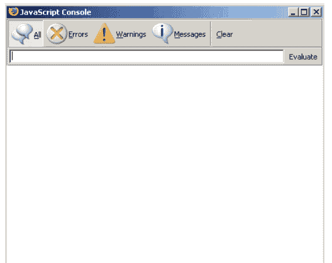

哦，现在看起来是不是很棒？你问我从哪里找到这个小宝贝？你现在看到的是 [FireFox 浏览器](http://example.com)中的 JavaScript 控制台。你可以通过 **Tools > JavaScript Console** 来打开它。什么？你说你不用 FireFox？（真为你感到羞愧！）。或者，也可以使用 [Netscape 7](http://example.com) 的控制台，位于 **Tools > Web Development > JavaScript Console** 下。那 Internet Explorer 呢？不行，抱歉。如果你还没有安装，可以下载上面两个浏览器中的一个。

## 微软脚本调试器怎么样？

当然，总会有个自作聪明的家伙在后面问这个问题。当然，如果你是受虐狂，你可以**尝试**使用它。脚本调试器充其量是个不好用的工具。而且，对大多数人来说，它的效果远不如 JavaScript 控制台。话就说到这儿！

现在，IE 确实有一个*脚本错误通知器*。它可以在首选项中打开或关闭，默认情况下通常是关闭的。IE 会通过左下角的“警报”指示器告诉你有一个脚本错误，如下所示：

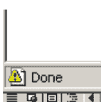

注意那个小小的警告标志。双击它会显示错误。问题是这个版本远不如控制台可靠和友好，所以我们坚持使用控制台。你仍然可以通过这种方式从 IE 获得有用的信息，但控制台更可靠，能给你更好、更准确的信息。

我们会坚持使用 FireFox，因为这是我使用且觉得最容易找到的（不像 Netscape 那个埋得那么深）。

## 在控制台中调试

让我们把上面展示的错误放到一个测试脚本中，像这样：

```
function Fun()
{
    if(10==11
    {
        var foo=1;
    }

    // this is a comm
    ent

    x = 27;
}
```

如果我们使用 **onload** 事件处理程序调用这个函数，以下是我们在**浏览器**中将看到的：

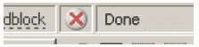

在左下角，那个小小的红色 'x' 告诉你有一个 JavaScript 错误。所以你正坐在那里纳闷为什么你那个闪烁、滚动、弹出的横幅没有出现，低头一看，看到了红色的 'x'。如果你双击它，控制台就会弹出来，显示以下内容：

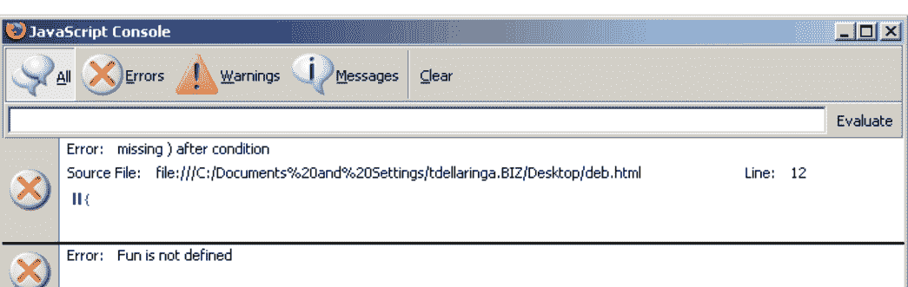

注意我们有 2 个错误，但你必须小心。第一个错误有时会导致之后的所有东西都出错。在这种情况下，由于缺少 ) 导致所有内容被不同地解释，这就是发生的情况。无论如何，注意它为你精确地指出了错误：

```
Error: missing ) after condition
```

它甚至告诉你错误所在的行号。不过，关于行号有一点要注意。如果脚本是本地页面的一部分，那么脚本行号应该是准确的。如果它是通过 SCRIPT 标签链接的远程文件，行号可能对也可能不对。不过没关系，你已经得到了你需要的确切信息。

你查看你的脚本，拍一下自己的脑袋，然后修复了错误。你重新运行脚本，又看到了同样的红色 'x'！于是你再次查看，发现：

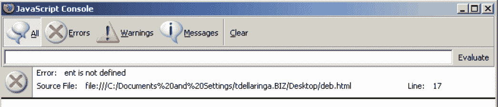

它告诉你 'ent' 未定义。'ent' 是什么？没错——它什么也不是：

```
// this is a comm
ent
```

由于注释换行了，浏览器认为 'ent' 是一条 JavaScript 语句。这很容易修复。

控制台会非常具体地指出许多这类错误，让你的生活轻松大约 900%。

### 常见错误

希望你不会经常犯那种错误。那些被称为“语法”错误。你编写的 JavaScript 不正确，或者不符合语法。控制台对于这类错误非常有效。但还有其他类型的错误。以下是似乎经常出现的一些：

#### 期望对象或未定义

这应该是你忘记了某件事的线索。你忘记包含指向脚本的链接，或者完全没有将脚本放入页面。你可能拼错了函数名。基本上，我们这里说的是 JavaScript 没有找到脚本。示例：

```
function George()
{
    … statements
}
```

以及函数调用：

```
<body onload="george();">..
```

IE 会报告“期望对象”：

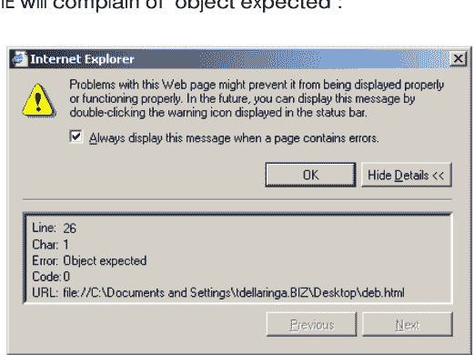

在这种情况下，行号是函数调用的位置，尽管 IE 的行号出了名的不可靠。控制台给你一个更好的描述，“Error: george is not defined”：

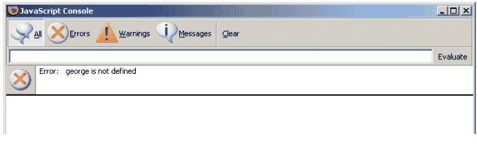

等等，我们*确实*有一个名为 george 的函数，对吧？不对——是 "George"——大写的 G。所以事实上，这个错误信息确实是准确的——george 未定义，尽管 George 存在。

#### 对象没有属性

这个错误可能会出现并让你非常困惑。发生的情况是，你通常试图指向一个不存在的对象。你忘记创建它，拼错了它的名字，或者它超出了作用域。看下面这个简单的脚本：

```
function Fun()
{
    var goo = document.getElementById('nothingHere');
    var foo = goo.value
}
```

假设 goo 是你在脚本中需要处理的东西。但由于某种原因，HTML 中没有 'nothingHere' 这个元素。当你试图获取 goo 的值时，你会看到：

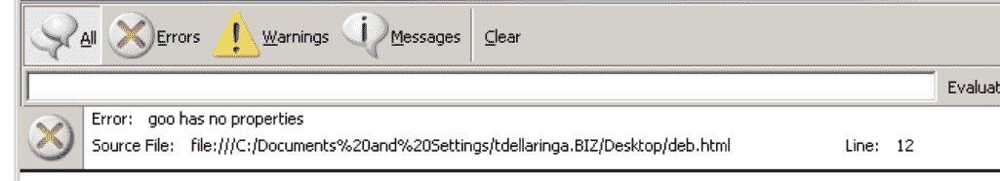

Goo 不可能有任何属性，因为它根本不存在！注意，在这种情况下，IE 仍然会给你“期望对象”的错误。

你会惊讶于有多少错误都是这个主题的变体。


## 其他常见错误

即使是有经验的脚本编写者，也经常会遇到一些问题。引号不匹配：

```
var string = "John said 'Hi there';
```

这里缺失的结束引号会给你带来无尽的"乐趣"。请务必检查引号是否正确使用。一个非常容易犯的错误是在进行相等性测试时使用单等号而不是双等号，像这样：

```
if(x = 7)
{
    statements…
}
```

这当然不会检查任何东西，你永远也不会进入条件语句。正确的写法是 x == 7。

## 在页面加载之前调用脚本

如果你试图运行一个使用页面中对象的脚本，但该页面尚未完全加载，你就会得到**对象预期错误**。请确保你的脚本在页面加载*之后*再执行，可以通过使用 BODY 标签的 **onload** 事件，或者使用页面内的事件（如按钮点击）来调用函数。

## 逻辑错误

最后一种错误是逻辑错误。逻辑错误就是你的……逻辑出了问题。你看，计算机只会按照你告诉它做的去做。如果你告诉它做错了，它就会按你说的去做。如果与此问题没有明显的语法错误相关联，那么很可能是什么都不会发生——包括你期望的结果。

这就是 alert 成为你好帮手的时候了。你需要查看代码中到底发生了什么，因为控制台不会告诉你，毕竟这里并没有真正的"错误"，更多的是你自己的计算失误。这实际上是一个"人为"错误。

当这种情况发生时，你需要做的是在代码中放置 alert 来检查你的值，看看它们是否是你期望的。

假设你有这样一个函数：

```
function Fun()
{
    var x = 100;
    var y = document.getElementById('y').value;

    var z = y - x;

    switch(z)
    {
        case 25:
            statements...
            break;

        case 30:
            statements...
    }
}
```

你有 x 的值 100，然后从页面中名为 'y' 的元素获取一个值。你期望这个结果是 25 或 30，并为此编写了 switch 语句，但它从未执行。这里不会产生错误，因为 y 确实是一个有效的元素且有值。但显然这个值不是你期望的。

最好的做法是放置一些 alert 来检查 y 和 z 的值。当你看到这些值实际是多少时，你很可能就会明白为什么结果不是你期望的 25 或 30。

所以，当没有错误指示但脚本不起作用时，请从逻辑入手。放置一些 alert，看看脚本实际在做什么。有时候看着别人在调试器中逐步执行你的脚本也很有帮助，他们可能会用不同的方式处理，这会给你一些启发。

## 结论

有了正确的工具和技术，追踪错误应该不会太难。说实话，编写好的脚本比追踪错误要难得多。能帮到你的是：合理地为代码添加注释、使用良好的变量名，以及大量大量的测试！

# 二维数组及其他技巧

通常，编写好脚本的秘诀在于掌握足够的"行业秘密"，让你的函数真正高效运行。似乎随着时间的推移，你会学到越来越多的技巧，并意识到自己本可以把事情做得更好。这反过来又让你成为一个更好的脚本编写者。

我要给你几个涉及三件事的行业技巧：二维数组、使用 `window.onload` 配合匿名函数，以及使用 DOM 构建新的 SELECT 表单元素。听起来很冷门？我曾经用过……呃，我是说，我的一个朋友曾用这些技术来加载广告横幅，使用脚本从数组第一列中随机选择一项（即横幅），然后从第二列获取关联的链接。任何类似的应用场景都非常适合。

## 脚本

承载我们这些小秘密的脚本在实际应用中可能有用，也可能没用。我们将构建的脚本本质上是一个简易的构造器，用于构建 SELECT 表单元素。我曾经在一个实际场景中工作过，每次你想添加一个表单元素，都必须使用类似这个脚本的自定义 JavaScript 对象来创建。这在很多方面都非常繁琐。然而，它确实让他们对元素拥有了完全的控制权。他们知道，如果程序员使用他们规定的方法，那么应用程序就能保持统一的标准。如果有人想这样做，这个脚本也可以类似地使用。

该脚本的工作原理是接收一个二维数组作为参数，然后通过 DOM 输出一个 SELECT 元素。但什么是二维数组呢？

## 二维数组

JavaScript 不像一些功能完备的语言（如 Java）那样支持真正的多维数组。真正的多维数组允许你直接指定"矩阵"，像这样：

```
myArray = new int[3][3]; //a true Java multi-dimensional array
```

这会给你一个空的"矩阵"，像这样：

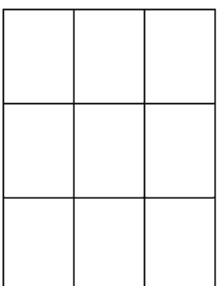

然后你可以用数据填充它。但 JavaScript 不允许这种构造方式。它所允许的是一种模拟版本，称为二维（或三维、四维）数组。实际上，它是一个*数组的数组*。

## 数组的数组？

我们的脚本需要一个 2 x 3 的矩阵，所以我们就从这里开始。记住在 JavaScript 中创建一个新数组可以这样做：

```
var myArray = new Array();
```

然后给它赋值：

```
myArray[0] = "foo";
myArray[1] = "bar";
```

以此类推。你也可以写得更简洁一些：

```
var myArray = new Array("foo", "bar");
```

这取决于你正在处理的数组成员数量以及你偏好什么样的代码风格。我倾向于第一种方法，因为它看起来更简洁。无论如何，我们想要的是一个数组的数组。妙的是，数组的成员本身就可以是数组！所以，如果我们想要一个 2 x 3 的数组，我们可以这样设置。首先需要"2"的部分：

```
var myArray = new Array();
arr[0] = new Array();
arr[1] = new Array();
```

我们现在有了一个包含两个数组作为其成员的数组，像这样：

| 数组 #1 | 数组 #2 |
|----------|----------|
| | |

这两个数组目前都是空的，但你可以看到我们已经有了一个矩阵的雏形。如果我们填充这些数组，矩阵就会扩展，那我们就来做吧。

通常，我们像上面那样填充数组：

```
myArray[0] = "foo";
```

在本例中，我们使用的是二维数组，所以必须指定数据放入哪一列和哪一行。可以把它想象成处理表格数据，概念其实是一样的。

```
var teamArray = new Array();
teamArray[0] = new Array();
teamArray[1] = new Array();

// these are for VALUE attributes of the OPTION
teamArray[0][0] = "south";
teamArray[0][1] = "north";
teamArray[0][2] = "none";

// these are for the TEXT attributes of the OPTION
teamArray[1][0] = "White Sox";
teamArray[1][1] = "Cubs";
teamArray[1][2] = "Neither!";
```

注意双括号。把括号想象成这样：第一个括号告诉你查看哪一列，第二个括号告诉你查看哪一行。像这样：

[0] &emsp;&emsp;&emsp;&emsp;&emsp;&emsp;&


注意，此函数假定你的每一列中 VALUE 和 TEXT 成员的数量相等（你当然会应该是这样的）。所以我们首先要知道的是有多少个选项，这样我们就能用 FOR 循环遍历。因此我们先找出第一列的长度（它应该和第二列（或数组）的长度相同）：

```
var arrayLength = arrayOptions[0].length;
```

在设置好对我们表单的引用（oForm）之后，我们要开始使用 DOM 创建 SELECT。请记住，神奇的 `document.createElement()` 方法可以构建任何元素：

```
var newSelect = document.createElement("SELECT");
```

然后我们可以使用指向新 SELECT 对象的 newSelect 变量来为其属性赋值。从我们的样式表中为其指定一个类名：

```
newSelect.className = "ourSelect";
```

没有 OPTION 的 SELECT 什么都不是！我们把主要工作放在 FOR 循环中，但先插入我们的"请选择"默认值：

```
option = document.createElement("OPTION");
```

就像创建 SELECT 一样，我们现在创建一个 OPTION。在对其做任何操作之前，让我们使用 `appendChild()` 将其附加到我们的 SELECT 对象上——没错——它就是把子元素附加（追加）到父元素：

```
newSelect.appendChild(option);
```

现在我们可以使用熟悉的 object.property 语法为其赋值和文本：

```
option.value = "";
option.text = "Choose your team!";
```

我们的默认值不需要 value，我们放了一条简单的消息提示用户选择球队。完成这些后我们得到了第一个 OPTION，接下来在 FOR 循环中几乎做同样的事情：

```
for(var i=0; i<arrayLength; i++)
{
    option = document.createElement("OPTION");
    newSelect.appendChild(option);

    option.value = arrayOptions[0][i];
    option.text = arrayOptions[1][i];
}
```

和往常一样，我们使用数组的长度来确定遍历的次数。我们知道将会是三次。所以对于这三次中的每一次，我们首先创建一个 OPTION 并将其追加到 newSelect 中。

然后我们添加 value 和 text 属性。只是这一次，我们要使用我们的数组"矩阵"值。这就是我们的二维数组派上用场的地方。记住"0"列是我们的值，"1"列是我们的文本。所以第一次循环时我们会得到以下内容：

```
option.value = arrayOptions[0][0];
option.text = arrayOptions[1][0];
```

如果你查看上面的矩阵，这些值分别是"south"和"White Sox"。FOR 循环继续接下来的两次，获取 Cubs 和 none 的信息。

现在我们的 SELECT 已经填充完毕，我们需要将其真正放入我们的文档中。我们通过将其追加到我们的 FORM 来实现：

```
oForm.appendChild(newSelect);
```

现在函数完成了。但是等等——我们还没有运行它……

## window.onload 的乐趣

你经常可以看到使用 body 中的 onload 事件处理程序来调用这类函数：

```
<body onload="BuildSelect(teamArray);">
```

虽然这完全合法，但还有其他有用的方式来调用这个函数。有时候在页面内容中处理这种逻辑会很麻烦。我们可以改为在脚本中调用这个函数：

```
window.onload = BuildSelect;
```

但是等等，你说——你忘了加括号和参数了！啊，问题就在这里。你看，如果我们用正常方式调用这个函数，返回值会立即被赋值。这是件坏事。为什么？因为此时（脚本执行到这一行的时刻）页面尚未加载，FORM 甚至还不存在！如果我们用"正常"方式，页面根本不会等待 onload 事件的发生。我们不想在此时求值这个函数——我们只是想告诉 onload 处理程序，当 onload 事件完成时要调用哪个函数。省略括号正好可以做到这一点，它告诉 onload 处理程序——"嘿，当你准备好了，**BuildSelect** 就是你的选择！"

但这又造成了另一个问题——我们需要传入我们的参数（那个二维数组），而这种方法不允许这样做。好吧，这时候我们的老朋友匿名函数就派上用场了。

```
window.onload = function() {
    BuildSelect(teamArray)
};
```

我们在这里做的是告诉这个窗口的 onload 事件，当 onload 事件完成时，执行 `BuildSelect(teamArray)`。这正是我们想要的。

把所有这些放到我们的页面中，就得到了以下 HTML 和脚本：

```
<!DOCTYPE html PUBLIC "-//W3C//DTD XHTML 1.0 Transitional//EN"
    "http://www.w3.org/TR/xhtml1/DTD/xhtml1-transitional.dtd">

<html>
<head>
    <title>Untitled</title>
<style>
h1 {
    color: #036;
    font-size: 1.2em;
    font-family: Arial, sans-serif; }

.ourSelect {
    font-size: .8em;
    font-family: georgia; }
</style>
<script type="text/javascript">

var teamArray = new Array();
teamArray[0] = new Array();
teamArray[1] = new Array();

// these are for VALUE attributes of the OPTION
teamArray[0][0] = "south";
teamArray[0][1] = "north";
teamArray[0][2] = "none";

// these are for the TEXT attributes of the OPTION
teamArray[1][0] = "White Sox";
teamArray[1][1] = "Cubs";
teamArray[1][2] = "Neither!";

function BuildSelect(arrayOptions)
{
    var arrayLength = arrayOptions[0].length;
    var oForm = document.forms['baseballForm'];
    var newSelect = document.createElement("SELECT");
    newSelect.className = "ourSelect";
    option = document.createElement("OPTION");
    newSelect.appendChild(option);

    option.value = "";
    option.text = "Choose your team!";

    for(var i=0; i<arrayLength; i++)
    {
        option = document.createElement("OPTION");
        newSelect.appendChild(option);

        option.value = arrayOptions[0][i];
        option.text = arrayOptions[1][i];
    }

    oForm.appendChild(newSelect);

    window.onload = function() {
        BuildSelect(teamArray)
    };

</script>
</head>

<body>

<h1>Which Chicago baseball team do you root for?</h1>
<form name="baseballForm"></form>

</body>
</html>
```

运行这个脚本会得到以下结果：

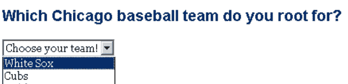

## 结论

这里有三个概念你应该牢记并善加利用。第一个是二维（或三维、四维）数组。这些在存储和处理数据时非常强大。有时如果你要处理大量数据，这种数组的数组会非常有帮助。你也会发现在处理 SELECT 对象时，这种结构也经常被用到。

第二个是 DOM 函数 `document.createElement()`。现代浏览器处理这种操作非常好，只要你远离 `setAttribute()` 方法。就像我们用 `option.text = "White Sox"` 那样，坚持使用 object.property 方法设置值，你就会一切顺利。

最后是 `window.onload` / 匿名函数的使用。有时候把业务逻辑从 HTML 中抽离出来放到脚本中是好的，哪怕只是为了便于维护。匿名函数允许你在需要时从你的函数调用参数，这是一个非常 handy 的工具。

# 对象

## 构建 JavaScript 对象

### 为什么是对象？

力量。为什么要用一大堆废话把问题搞复杂？你想采用面向对象方法的原因是它带来的力量。我们有一些关于表单验证技术的请求。一些最好的技术都是基于面向对象原理的。所以在那之前，让我们先看看 JavaScript 对象为什么强大。

面向对象编程的基础是你与之交互的每个元素都是一个具有自己属性和方法的对象。这对你有什么好处？很多方面，从代码复用和代码维护到可扩展性和可扩展性。有两个主要的面向对象编程原理需要掌握。

首先是**封装**。这个词是什么意思？看看前两个词典释义会有很大帮助：

- 1. 封装在胶囊中或仿佛封装在胶囊中。
- 2. 用简短的摘要来表达；概括：*概括新闻的标题*。

如果你服用药囊，你知道它会帮你好转。但你不知道的是*它如何工作*。即使你阅读了成分（你根本不需要这么做，药囊就能起效），它仍然不会告诉你药物究竟如何与你的身体相互作用来让你好转。

报纸上的标题给你故事的概要，但没有细节。这些都是封装的绝佳例子。

使用对象时，你只需要知道对象是什么以及如何使用它（它的属性和方法）。你不一定需要知道*它如何工作*！如果你有一个汽车对象，你可能有 drive 和 park 方法。你可以使用这些方法来驾驶和停放汽车。如何实现的并不重要。所以封装对象允许很多人在不知道内部工作原理的情况下使用它。

其次是**继承**。这告诉我们许多对象共享许多共同特性。继续用汽车对象来说，可能有 Corvette、Viper 和 Beetle。它们都是汽车，都能驾驶和停放。但它们会有一些不同。Corvette 会比 Beetle 开得快。它们会有不同的颜色，价格也会不同。但它们都是汽车，同一种类型的对象。

这让你能少做工作，同时对你的代码有更多控制。一旦你构建了某种类型，你就可以轻松地在这个类型上构建许多变体。例如，你可以有一个验证对象，包含多种方法。它们都做验证，但验证不同类型的数据！


## 自定义表单对象

假设我们正在开发一个需要某种自定义控件的项目。具体是什么控件并不重要。假设这个控件会在多个地方重复使用。啊哈！我们可以使用对象，而不是每次需要时都重新编写代码。

为了简洁起见，假设我们的控件只是一个带有按钮的样式化文本字段。我们甚至可以说它是一个独立的表单。所以，如果我们每次需要时都手写代码，看起来会是这样：

```
<form id="theForm">
<input type="text" id="someText" size="20" style="background: #ffcc33; color: #003366" value="text" />
<input type="submit" value="Enter" style="background: #ffcc33; color: #003366; font-weight: bold;" />
</form>
```

你会看到：


把对象想象成模板，或者饼干模具。每次你"使用"它时，你得到的东西都是一样的。这里的情况也是如此，每次我们使用它，或者"实例化"它（创建一个"实例"），我们都会得到相同的东西——而不需要重写代码。

每个对象都会有自己的属性，通常至少有一个方法。而且，如果你愿意——实例甚至可以拥有自己独特的属性。

## 开始动手

既然你已经知道代码需要是什么样的，你就可以开始编写对象的代码了。入门的简单方法是先写下你认为对象需要哪些属性，以及你需要对对象做什么。

## 什么是属性？

在我们的例子中，一些属性包括文本字段的大小、使用的颜色，甚至可能还包括元素的 id。你不一定非要将一切都设为属性，但那些以后可能需要更改的，或者你可能想按实例定制的内容，当然应该被视为属性。

所以如果我们列个清单，我想我们会得出：

- 1. 表单名称（以防两个控件在同一页上）
- 2. 文本字段大小（以防我们需要统一调整它们——记住，你总是可以单独更改某一个）
- 3. 颜色

这些将成为我们的属性。

## 什么是方法？

什么是方法？方法就是让对象采取某种行动，或者对对象做某事的指令。在我们的例子中，我们至少需要将它输出到页面上。所以我们的方法清单相当简短：

- 1. 将对象写入页面

## "实例化"或"创建"对象

在查看代码之前，你应该了解如何从你新编写对象代码中实际"创建"对象。当你获得对象的一个实例时，这被称为"实例化"对象。你创建一个实例。你通过以下代码来实现：

```
var myObject = new objectName(parameter, parameter, etc..);
```

这会告诉对象的**构造函数**去创建对象的一个实例，并传入你作为参数传递的属性。构造函数正如其名——它为你构造新对象。构造函数几乎总是与你的对象同名的函数，如下所示。

## 构造函数

既然这将是一个小型的表单对象，我们可能就简单地用这个名字来称呼它。所以创建一个空函数，这个名字就是你的基本构造函数：

```
function formObject()
{
}
```

当然，它现在还不会做任何事。调用这个函数不会引起太多兴奋。下一步是决定你在构造第一个该类型对象时要设置哪些属性。我们上面已经列出了属性清单，但我们可能不想每次创建对象时都传递所有属性。

这将始终是你的对象的一个独特设计问题，取决于具体情况。在我们的例子中，我们可能不想每次都指定颜色，或者文本字段大小。我们会把这些留给别的方式处理。但我们确实想设置表单名称，让每个对象都是唯一的。所以我们把表单名称作为第一个参数：

```
function formObject(formName)
{
}
```

## 还记得这个吗？

我们已经讨论过，**this**关键字总是指当前对象。在构造函数的情况下，这正是我们想要的，我们想告诉正在创建的对象它的属性应该是什么。我们通过以下方式实现：

```
this.property = some_value;
```

**this**指的是正在构造的对象，property是你正在标识的属性，value是你赋予它的值。属性可以是任何你想命名的（只要不是 JavaScript 保留关键字）。既然我们想设置表单名称，我们可以将我们的属性（以及我们传递的参数）命名为"formName"，所以现在我们的构造函数看起来是这样的：

```
function formObject(formName)
{
    this.formName = formName;
}
```

保持名称一致有助于你理清思路。所以你告诉构造函数："当你构建对象时，将我的对象的 formName 属性设置为作为'formName'参数传递的值。"你在创建对象实例时设置了 formName：

```
var myObject = new formObject("coolForm");
```

所以在这种情况下，你刚创建的新对象有一个名为"formName"的属性，其值为"coolForm"。

## 原型属性

好的，我们现在可以创建**formObject**的一个实例，并给它传递一个表单名称。那颜色之类的呢？我们决定这些属性在大多数情况下对所有对象都是通用的，如果它们要更改，就会对所有对象都更改。我们需要的是某种"全局"变量。我们在原型属性中有这个。原型（prototype）正如其词义所示。原型的定义之一是"任何被复制之物的原始或模型；样板……"所以你设置的任何原型属性都将是你对象每个实例的样板。它们都会匹配（除非你以后覆盖它们，这是可以做到的。）

所以对于其余的属性，我们通过命名对象、使用 prototype 关键字、编造一个变量名，然后给它一个默认值来设置原型：

```
formObject.prototype.backgroundColor = "#ffcc33";
```

就这么简单。现在我们对象的每个实例都附带了属性"backgroundColor = '#ffcc33'"。所以我们完整的清单看起来像这样：

```
formObject.prototype.backgroundColor = "#ffcc33";
formObject.prototype.textColor = "#003366";
formObject.prototype.textFieldSize = "20";
```

我们可以把这段代码放在构造函数上方，现在我们的对象代码到目前为止是这样的：

```
formObject.prototype.backgroundColor = "#ffcc33";
formObject.prototype.textColor = "#003366";
formObject.prototype.textFieldSize = "20";

function formObject(formName)
{
    this.formID = formName;
}
```

每次我们构建这个小型表单对象的一个实例时，它都会携带相同的三个"全局"或原型值 backgroundColor、textColor 和 textFieldSize。然后每个实例都会有自己唯一的名称，这是你在使用 new 关键字构建对象时传递给它的。

现在我们需要实际将它写入页面。

## 让它生效

我们可以写一个函数，将它附加到我们的对象上作为方法。这个方法将实际把我们的表单对象写入页面。首先，让我们编写将作为方法的函数。

```
// methods for formObject
function formObject_writeControl()
{
}
```

它现在是空的，但我们把它附加到构造函数上，让它知道现在有了一个方法。我们可以像附加任何其他属性一样把它附加到构造函数上：

```
function formObject(formName)
{
    this.formName = formName;
    this.write = formObject_writeControl;
}
```

注意，附加到对象时不需要使用函数的 ()。我再次为我的对象函数编造了一个名字，叫它"write"。现在既然这个方法附加到了我们的对象上，我们可以继续使用**this**关键字来获取任何我们想要的属性。这将允许我们设置要输出的属性。这次我们要使用**this**关键字两次，第一次（在左侧）指定它属于当前对象上运行的当前方法，第二次（在右侧）引用当前对象的属性：

```
function formObject_writeControl()
{
    this.formName = this.formName;
    this.background = this.backgroundColor;
    this.text = this.textColor;
    this.field = this.textFieldSize;
}
```


记住，我们的原型属性对任何对象都可用，所以我们可以在这里自由地使用它们。由于该方法现在是对象的一部分，该方法也知道原型的数值（这些原型是附加到对象上的！）。

现在，通过使用一些 `document.write()` 并将我们的变量插入到正确的位置，我们可以编写构建对象的代码。

这里的代码可能会变得很复杂——尤其是引号尤其如此。为了避免在 JavaScript 中使用大量的转义（这会让代码变得混乱且难以阅读），在本示例中，我将对内部值使用单引号。构建语句只需将你的方法变量连接到 **document.write()** 将要输出的字符串中即可。因此，`"this.formName"` 会将你传递给构造函数的任何参数作为表单名称，放入实际写入页面的表单标签中——就像你手动编写代码一样！对于文本字段和提交按钮，你也可以执行相同的操作：

```
function formObject_writeControl()
{
	this.FormName = this.formName;
	this.background = this.backgroundColor;
	this.text = this.textColor;
	this.field = this.textFieldSize;

	document.write("<form id='" + this.ID + "'>")
	document.write("<input type='text' id='someText' size='" + this.field + "' style='background: " + this.background + "; color: " + this.text + "' value='text' />");
	document.write("<input type='submit' value='Enter' style='background: " + this.background + "; color: " + this.text + "; font-weight: bold;' />");
	document.write("</form>");
}
```

我们要确保在最后一次写入时关闭表单。

## 真相时刻

现在，我们的对象应该准备好运行了。只有一个注意事项：由于我们使用 `document.write()` 输出到浏览器，你必须将方法写在页面的 BODY 中，而不是 HEAD 中。你的对象代码可以放在 head 中，但当你实际调用该方法时，它必须在 body 中。要写出你的对象，请调用构造函数并传递一个变量，然后调用该方法：

```
<body>
<script type="text/javascript">
var anObjectForm = new formObject("myForm");
anObjectForm.write();
</script>
</body>
```

瞧！代码已经为你写好，并设置了你的参数。你现在应该能看到与我们上面硬编码完全相同的内容：


## 结论

尝试自己编写并进行修改，以感受对象是如何工作的。你可以覆盖一个原型（甚至添加一个）。要更改名为 `yourObject` 的某个实例的背景颜色，你可以这样做：

```
yourObject.prototype.background = "new_color";
```

这样它就会与其他的不同。所以，如果我想要背景色为橄榄绿：

```
<body>
<script type="text/javascript">
var anObjectForm = new formObject("myForm");
formObject.prototype.backgroundColor = "#cc5";
anObjectForm.write();
</script>
</body>
```

我覆盖了当前图像的原型，得到了橄榄绿色：


## Select 对象的脚本编写

提到 Select 对象，脑海中就会浮现一个词：混乱。初学者在看到这个对象时，通常会绝望地摊开双手。Select 对象可能非常令人困惑，因为 select 由 select 对象本身及其最好的伙伴 option 对象共同组成。这两者在一起创建了我们如此钟爱的下拉列表和多选列表。这通常就是困惑产生的地方。在处理 select 时，你实际上是在处理两个元素，而不是一个。这会让对特定对象的引用变得冗长且令人困惑。

幸运的是，它并不像看起来那么难。我将解释如何用脚本访问 select，我们将编写一个有用的脚本并将其添加到脚本库中。

### 仔细观察 Select

正如你可能已经注意到的，我的标准做法是在开始编写脚本之前先检查对象并理解它。对于 select 来说这一点尤为重要，因为它与任何其他元素都非常不同。

Select 对象表明你将获得一个或多个值的列表。请注意，此列表可以是一个下拉菜单，也可以是一个列表框（取决于值的数量和 select 的大小，可能有滚动条或没有）。下面是两者的示例：

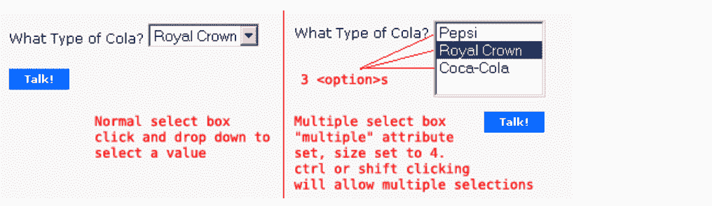

因此，你有一个 select 对象，其中嵌套了一个或多个组成列表的 option 元素。

让我们来看看 select 对象的属性。

### 表 1. Select 对象的属性

| 属性 | 描述 |
| :--- | :--- |
| multiple | 指示用户可以从列表中选择多个选项（通过 shift 或 control 点击）。将 select 设置为 multiple 还会让你获得一个列表框而不是下拉菜单。也就是说，它不是单个值的下拉列表，而是一个显示两个或更多值的列表框。如果你想要多选，还必须设置框的大小（一次显示多少个选项），这由下面的 "size" 属性控制。 |
| size | 告诉多选列表在列表框中可以显示的选项最大数量。这不会限制 select 中可以包含的选项数量，仅限制在框中显示的数量。如果选项多于指定的大小，框将滚动显示值。 |
| type | 指示输入元素的类型，在这种情况下是一个 "select" 元素。 |
| selectedIndex | 这指示列表中哪个选项是当前选择。该属性返回其在 options 数组中位置的索引值（一个数字）（例如 0, 1, 2 等）。 |
| name | “控件名称”，就像任何其他表单元素一样。 |
| length | 这将告诉你列表中有多少个选项。你也可以通过操纵这个值来更改你的列表。 |
| options[index] | 这引用 select 对象中特定选项的属性。“Index”是你所需选项的数组编号。 |

我们还需要看看 option 元素。尽管 option 元素本身也是一个对象，但它永远不能放置在 select 标签之外的任何地方。

### 表 2. Option 对象的属性

| 属性 | 描述 |
| :--- | :--- |
| value | 选项的值。一般而言，这与列表中显示的实际文本相匹配。 |
| text | 浏览器中为特定选项显示的实际文本。 |

## 关于 Netscape 4 的简短说明

我还没有过多讨论浏览器兼容性或浏览器版本。首先，由于我教你使用 DOM level 0 来访问表单，你的大多数脚本将在大多数浏览器上运行。然而，有些东西会让 Netscape 4 (NS4) 崩溃。在现实世界中，我已经一年多没有为 NS4 编写代码了，很可能你也不需要这样做。*一般而言*，NS4 在浏览器市场中的份额不足 1-5%。

不过，最好始终检查可用日志或对预期用户进行研究，以确保 NS4 不在你的用户群中。底线是，当某些内容肯定会破坏 NS4 时，我*可能会*提醒你，但我不会专门为那个浏览器编写代码。

## 与 Select 交互

真正帮我学习的一件事就是一次只做一件小事，分小块进行。我们可以通过编写一些代码，然后使用 JavaScript 的 alert 来查看我们是否得到了预期结果，从而与元素进行“对话”。我们将向 select 发送一些代码来询问它一些问题，并使用 alert 方法“对话”回来，告诉我们是否正确。

这将帮助我们在尝试编写脚本之前先理解这些对象。

让我们从这个基础的美味可乐选择列表开始（当然是按口味排序的）：

```
<form name="colas">
<select name="talkingSelect">
    <option value="cola1">Pepsi</option>
    <option value="cola2" selected="selected">Royal Crown</option>
    <option value="cola3">Coca-Cola</option>
</select>
<input type="button" onclick="TalkBack(this.form);" value="Talk!" />
</form>
```

## 关于 XHTML 的简短说明

你可能会在我的 HTML 代码中注意到我做了一些奇怪的事情，比如用 `/>` 结束标签，或者为 `selected="selected"` 这样简化的属性加上引号。这些仅仅是正确 XHTML 的规则，这是 W3C 的一项新建议。如果你想了解更多关于 XHTML 以及为什么它是一件好事，请访问以下链接：

- http://www.w3schools.com/xhtml/ (W3 Schools)
- http://www.w3.org/TR/xhtml1/ (W3C)

这个小表单看起来像这样：

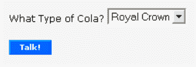

这是一个简单的 select，有三种可乐作为选项。它是一个单选下拉列表，是你网页上见到的最基础的类型。select 旁边的按钮将用于触发我们的测试“对话”脚本。请注意，脚本的参数将传递表单对象，以便更容易地引用我们的 select。


## 对话脚本

首先，让我们来了解一下 select 对象本身。通过这样做，你将确切地知道如何获取 select 中需要的部分信息。

让我们了解关于这个 select 的 4 个方面：

-   长度：列表中选项的数量
-   selectedIndex：哪个选项被选中
-   选中选项的文本：当前选择在浏览器中显示的内容
-   选中选项的值：在表单提交时随附发送的 "value" 属性值

脚本会将每个值放入一个 alert 中显示，如果操作正确，长度会显示 "3"，selectedIndex 为 "1"（趣味问答：为什么不是 2？答案稍后揭晓），文本显示 "Royal Crown"，值显示 "cola2"。

为了简单明了，我们将逐一进行。首先，为了方便起见，让我们为我们的 select 对象创建一个引用。记住，我们已经通过参数接收了 form 对象。再次使用 elements[] 数组，我们将使用名称来指向我们的 select。这个引用被放置在 theSelect 变量中。

```
var theSelect = theForm.elements['talkingSelect'];
```

从表 1 中我们知道 "length" 属性用于告诉我们 select 中有多少个选项，所以我们将这个属性的值放入一个名为 selectLength 的变量中。

```
var selectLength = theSelect.length;
```

现在我们需要做的就是设置一个 alert（带有一些简短的说明文字）并将 selectLength 变量放入其中显示。如果你以前从未这样做过，这相当容易。alert 是 JavaScript 中 Window 对象的一个方法。它被称为"模态窗口"，这意味着你必须点击 "OK" 按钮才能返回浏览器。

语法很简单，alert(message)。你可以将消息作为字符串放入 alert 中（"记住，这是一个字符串，它有开头和结尾的引号"），它将按照你编写的方式准确显示。如果你传递一个变量（不加引号），你将看到变量的值。在我们的例子中，我们想要两者——我们希望有一些关于变量是什么的说明文字，这样我们就不用记住所有变量名了。所以我们将使用 + 运算符连接（join together 的专业术语）这两个值。你会发现这种技术对于调试和测试脚本非常有用。

注意，我们在 "Length of select: " 字符串的分号后加了一个空格，然后再添加变量，否则它们会紧挨在一起，更难阅读。

```
function TalkBack(theForm)
{
	var theSelect = theForm.elements['talkingSelect'];
	var selectLength = theSelect.length;
	alert('Length of Select: ' + selectLength);
}
```

好的，点击 Talk! 按钮，你应该会看到类似这样的内容：

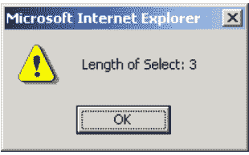

这很好地符合我们列表中确实有三种可乐的事实。能够获取 select 的长度在以后对 select 进行更高级操作时会很重要。

接下来，我们将询问 select 哪个项目被选中了。根据我们的 HTML 代码，我们知道 Royal Crown 是我们希望获取的那个：

```
<option value="cola2" selected="selected">Royal Crown</option>
```

根据表 1，**selectedIndex** 是我们需要的属性，因为它会返回被选中选项的索引号。同样，我们将其附加到对 select 的引用上，并将其赋值给一个变量，像这样：

```
var selectedOption = theSelect.selectedIndex;
```

并设置一个 alert 在我们按下按钮时告诉我们：

```
alert("Selected Option: " + selectedOption);
```

将这些添加到你的脚本中并运行它。你应该会看到：

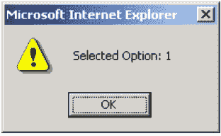

上面的趣味问题问为什么你看到的不是 2 而是 1。毕竟，它是列表中的第二项，对吧？答案：JavaScript 数组从 0 开始，而不是 1。所以可乐数组（选项数组）的计数是 0, 1, 2。第二个选项是 1。

所以现在我们知道，任何时候我们想知道 select 中哪个选项被选中（请注意，是单选 select——见下方提示），我们只需找出 **selectedIndex** 属性是什么即可。

> 提示：如果你有一个多选 select（你的 select 设置为 multiple 并且有 size 值），并且用户选择了多个项目，**selectedIndex** 属性只返回最顶部/第一个选择。

## 复杂的引用

接下来的两个属性是麻烦的制造者。这就是你的引用可能变得冗长且令人困惑的地方。幸运的是，它可能看起来令人困惑，但如果你理解正在发生的事情，它就完全合理了。

回顾一下，记住 select 有一个名为 options[index] 的属性，它允许你访问单个 option 标签的属性。所以理论上，如果我们想获取百事可乐选项，我们可以这样做：

```
var myOption = theSelect.options[0];
```

这将是正确的。同样，我们只需将属性附加到对象引用上。现在，如果你用一个 alert 来显示 myOption 的值，你会看到这个：

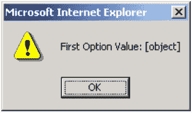

这告诉你，你确实有一个对象（列表中的第一个选项），但因为你没有请求该对象的任何属性，所以你没有获得任何相关信息。

这就是表 2 发挥作用的地方。一旦我们到达了我们想要的选项，我们可以使用 option 对象（不是 select 对象）的属性来获取我们需要的信息。在我们的例子中，我们正在寻找显示的文本。我们想要的属性恰如其分，是 "text"。所以我们会这样做：

```
var myOption = theSelect.options[0].text;
```

使用 alert 来显示应该会给我们浏览器中看到的可乐名称。但是等等，我们列出的规范说我们想要 **selectedIndex** 的可乐名称，即选中的可乐，而不仅仅是列表中的第一个项目。

这就是人们感到困惑的地方。记住，options[] 数组只需要一个索引号，在我们的例子中是 0、1 或 2。同样记住，**selectedIndex** 返回——你猜对了——被选中项目的索引号！听起来像是天作之合。所以，我们需要将 0 替换为 **selectedIndex** 号。这里是关键点——**它仍然必须附加到对 select 对象的引用上**。所以它应该看起来像这样：

```
var selectedText = theSelect.options[theSelect.selectedIndex].text;
```

这会让人们感到困惑，因为似乎有两个对指向我们 select 的变量的引用。确实如此。为什么会这样？因为 **selectedIndex** 本身没有意义，所以它是未定义的。JavaScript 会疑惑 "**selectedIndex** 是什么？"。脚本只是在那里寻找一个索引值，而 **selectedIndex** 自身的值根本不存在。然而，theSelect.selectedIndex 的值实际上是 1。所以上面那行代码与下面这行完全相同：

```
var selectedText = theSelect.options[1].text;
```

我们想要使用 **selectedIndex** 而不是直接在代码中硬编码数字 1 的原因是，除非我们总是想要相同的答案，否则使用数字 1 没有任何意义。如果用户更改了选择怎么办？使用 **selectedIndex** 确保了我们的脚本始终有效，无论哪个选项被选中。

所以，现在我们可以将以下两行添加到我们的脚本中：

```
var selectedText = theSelect.options[theSelect.selectedIndex].text;
alert("Selected Text: " + selectedText);
```

运行你的脚本应该会给你：

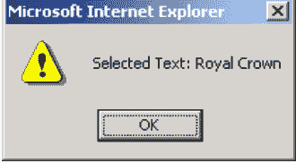

现在假设我们不想要文本，而是想要选项的值，因为我们要进行一些后端功能工作。我们只想知道选择了哪种可乐。value 属性的工作方式与 text 属性相同。只需添加：

```
var selectedValue = theSelect.options[theSelect.selectedIndex].value;
alert("Selected Value: " + selectedValue);
```

运行你的脚本应该会给你：

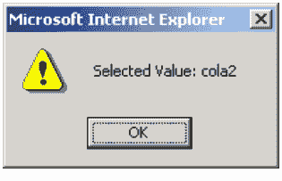

所以我们完成的脚本应该如下所示：

```
function TalkBack(theForm)
{
    var theSelect = theForm.elements['talkingSelect'];
    var selectLength = theSelect.length;
    var selectedOption = theSelect.selectedIndex;
    var selectedText = theSelect.options[theSelect.selectedIndex].text;
    var selectedValue = theSelect.options[theSelect.selectedIndex].value;

    alert("Length of Select: " + selectLength);
    alert("Selected Option: " + selectedOption);
    alert("Selected Text: " + selectedText);
    alert("Selected Value: " + selectedValue);

}
```

## 轮到你了

尝试这个配置，添加一些选项，移动选中的选项，获取不同的值。熟悉你如何从 select 和 option 对象中检索各种属性。

## 总结

select 对象实际上由两个对象组成：select 和 option。只要你引用正确对象的正确属性，你就永远不会对如何获取所需信息感到困惑。

并且永远记住，JavaScript 数组从 0 开始，而不是 1！记住 selectedIndex 属性不能单独使用，它必须附加到对 select 对象的引用上。

多选 select 的行为方式与单选下拉菜单相同，只是获取 selectedIndex 只会返回最顶部的项目。


## 为 Select 编写脚本：移动元素

通常，仅仅能够获取用户选择了哪个 OPTION 是不够的。如果你有一个表单，用户需要能够向菜单中添加或删除某个值，该怎么办？是否可以在运行过程中动态地更改菜单中的值？如果我们想将某个值上移或下移呢？

事实上，应用程序经常需要这类功能。想象一个管理员需要管理权限的网站。可能有一个 SELECT 列表，列出了用户有权查看的版块。管理员需要根据需要添加或删除这些版块（或进行初始设置）。

## 书签应用程序

在我们的脚本中，假设你是一个允许用户记录个人书签的网站管理员。用户需要能够添加或删除书签，以及编辑它们。如果他们能上下移动书签（以更改顺序）就太好了。最后，如果能让他们选择通过 URL 或通过描述来查看列表，那就更完美了。

请记住，这不会是一个独立的应用程序，而是一个大型应用程序的一小部分。让我们看看具体是什么样的：

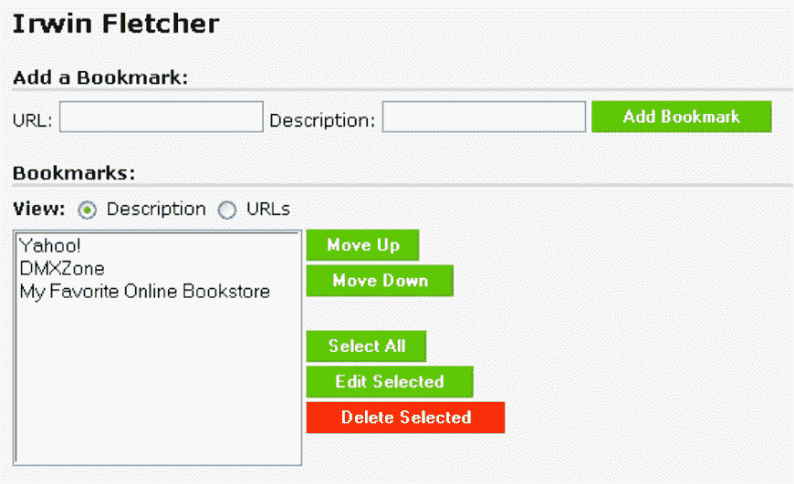

用户进入一个页面，顶部显示他们的姓名，然后在“Bookmarks”（书签）标题下显示他们当前的书签列表。在顶部，用户可以输入新书签的 URL 和描述，并通过点击“Add Bookmark”（添加书签）按钮将其添加。你可能已经意识到，我们必须处理用户忘记输入其中一个值的情况。我们假设这些书签将在应用程序的其他地方发挥作用，因此 URL 和描述都必须存在。

回到书签部分，用户可以点击按钮将书签上移或下移，或者删除或编辑选中的项。（嗯，如果用户没有选择任何内容怎么办？）还有一个按钮可以选中所有条目，以便用户轻松地清空列表。

> **注意：** 构建一个能够完成这么多功能的有效用户界面具有挑战性。我在这里展示的内容对于本段讨论已经足够。但在现实世界中，这样的用户界面需要在真实用户上进行测试，以确保设计确实有效。同时请意识到，在我们这个小书签示例中采取的任何操作的最终结果，当然必须在应用程序的后端实现。这些选择必须保存在数据库中，以便每次请求页面时进行检索。因此，你可以想象上面的截图可能还会包含一个保存按钮或更新按钮。

## 表单与按钮

这里一个非常现实的考虑是，哪个按钮（如果有的话）应该是提交按钮。一个表单只有一个提交按钮是良好的实践。如果一个表单有两个功能不同的提交按钮，你可能需要重新思考你的页面设计。

在我们的案例中，提交按钮最可能的候选者实际上是我在上述注意中提到的那个看不见的保存按钮。用户只有在完成对列表的操作后才会提交页面。

既然我们实际上只是在操作列表，我们可以将所有按钮都设置为普通的按钮（plain old buttons）。每个按钮将调用特定的函数来完成所需任务。

## 拼图碎片

正如我上面提到的，我将以碎片化的方式呈现内容。我们将编写一个脚本，向选择列表中添加一个新选项。假设我们的书签中已经有了如上图所示的三个条目。这是我们的 SELECT：

```html
<select name="bookmarkList" multiple="multiple" size="10">
    <option value="www.yahoo.com">Yahoo!</option>
    <option value="www.dmxzone.com">DMXZone</option>
    <option value="www.amazon.com">My Favorite Online Bookstore</option>
</select>
```

请注意，这是一个多选列表（multiple select），我们将允许用户根据需要选择列表中的多个项目。此外，我们希望他们能看到足够的列表内容以便于管理，因此我们将 `size` 属性设置为 10，这样可以一次查看 10 个书签。

我们还在顶部设有表单的“添加”部分：

```html
<h5>Add a Bookmark:</h5>
<label for="newURL">URL:</label> <input type="text" name="newURL" id="newURL" /> <label for="newDescription">Description:</label> <input type="text" name="newDescription" id="newDescription" /> <input type="button" name="add" value="Add Bookmark" class="btn" />
```

我们再次使用 LABEL 标签以提高可用性和可访问性。注意 H5 标签的使用。仅仅将文本加粗并在其后添加换行符几乎没有语义含义。使用 H5 标签能为我们提供所需的换行，增加语义价值（它是一个标题，而不仅仅是加粗文本），并且我们可以在 CSS 样式表中处理它的样式。不要忘记为你的按钮包含 `name` 属性，这在编写脚本时通常是一个有用的属性。虽然不是必须的，但这是一个良好的实践。

我们有一个单选组，用于切换用户希望看到的显示方式：

```html
<h5>Bookmarks:</h5>
<strong>View:</strong><input type="radio" name="view" value="viewDescription" id="viewDesc" checked="checked" /> <label for="viewDesc">Description</label> <input type="radio" name="view" value="viewURLS" id="viewURL" /> <label for="viewURL">URL</label>
```

描述（Description）被设置为选中状态，是用户进入页面时看到的默认视图。

最后是列表的控制按钮：

```html
<input type="button" name="moveUp" value="Move Up" /><br />
<input type="button" name="moveDown" value="Move Down" /><br />
<input type="button" name="selectAll" value="Select All" /><br />
<input type="button" name="edit" value="Edit Selected" /><br />
<input type="button" name="delete" value="Delete Selected" />
```

每个按钮将触发我们的一个脚本。

## 添加书签

首先要解决的是添加书签。这将涉及向 select 中添加一个 OPTION。这实际上是一个相当简单且直接的过程。我们需要处理两部分信息：书签描述和 URL，这两者都来自表单顶部的文本字段。因此，让我们将它们作为参数传递，以便函数可以对其进行操作：

```javascript
function AddBookmark(url, description)
{

}
```

我们如何将这些值传递给函数？我们将再次在 `onclick` 事件中使用 **this** 关键字和正确的表单引用。

```html
onclick="AddBookmark(this.form.elements['newURL'], this.form.elements['newDescription']);"
```

这看起来与我之前讨论的表单引用有点不同。通常，我们会这样获取表单元素：

```javascript
document.forms['formName'].elements['elementName'];
```

但这一次 **this** 关键字再次帮到了我们。如果 **this** 指向当前对象（即带有 onclick 的按钮），我们可以将表单引用附加到该当前对象上。该表单引用 (`this.form`) 简单地意味着“当前对象所在的表单”。这只是 `document.forms['formName']` 的另一种表达方式。之后的部分完全相同，即带有元素名称的 `elements` 数组。

还需要添加一件事。我们不只需要文本字段本身的引用（上述代码获取的是引用），我们想要的是**值**（用户输入的内容）。只需将该属性附加到引用上，函数就能获得所需的信息：

```html
onclick="AddBookmark(this.form.elements['newURL'].value, this.form.elements['newDescription'].value);"
```

现在，脚本可以直接对这些参数进行操作，而无需再进行额外的处理。不过可能会有一个疑问：为什么我不直接在函数内部设置一个变量，并在那里通过名称引用元素？嗯，看来是时候分享一个技巧了！

### 技巧：抽象你的函数

> 如果我们在函数内部引用元素，那么该函数将只能在该页面上使用。如果你在另一个页面上需要相同的功能怎么办？你必须在另一个页面中复制该函数。这不仅浪费，而且如果你需要修改函数，你必须在每个页面中找到它并更改每个实例。这将是一场维护噩梦。

然而，如果你编写的函数可以被任何页面使用，你就工作得更聪明，并在以后省去了很多痛苦和沮丧。抽象某样东西意味着将其与本地环境脱离。这意味着你不需要知道函数是如何工作的，只需要知道如何使用它。对于 `AddBookmark()` 函数，你真正需要知道的是必须向它传递一个 url 值和一个 description 值。你可以将这样一个函数保存在全局文件中，并在每个页面上使用它，只需向其发送所需的信息。并非每个函数都应该或能够被抽象，但首先尝试那样设计是一个好主意。如果你发现它必须局限于页面本地，那么在探索过其他选项后，这样做也是没问题的。


我们的脚本还需要的唯一其他信息是将值发送到哪里。我们确实应该同时发送SELECT对象，这样我们的函数才能保持抽象性。因此，我们将为此添加一个参数，并像上面那样将其添加到onclick调用中。

```javascript
function AddBookmark(url, description, oSelect)
{

}
onclick="AddBookmark(this.form.elements['newURL'].value,
this.form.elements['newDescription'].value,
this.form.elements['bookmarkList']);"
```

我喜欢在处理表单对象时使用命名约定“o”加描述性名称。这也是某种约定（取决于你和谁交谈）。因此，我为我们的SELECT对象选择了名称oSelect。

## 添加到SELECT

要向我们的SELECT添加一个选项，我们将使用一个叫做**构造函数**的东西。**构造函数**正如其名：它构建某些东西。在本段中，我们不会深入探讨它们，因为它们是一个高级主题。但使用它们不需要了解太多。

**构造函数**基本上是一种函数类型，并以其构建的对象名称首字母大写。在这种情况下，它构建一个OPTION元素，因此当然称为Option()。在其前面添加**new**关键字会为我们构建一个新选项。

要这样做，我们需要向构造函数传递几个参数。我们必须告诉它什么将作为OPTION的**value**属性，什么将作为**text**属性（用户看到的内容）。因此，总共格式为：

```javascript
new Option(text, value)
```

我们只需要将其附加到我们当前的选项数组中。为此，我们必须首先获取选项数组的**length**（有多少）。**Length**是选项数组的一个方法，我们可以通过将其分配给一个变量来找出该值，如下所示：

```javascript
optLength = oSelect.options.length;
```

我们不能简单地将新选项添加到oSelect.options – 它必须添加到options数组中。此外，我们不能像这样**添加**它：

```javascript
oSelect.options[] = etc.
```

因为JavaScript将其视为语法错误。将长度作为数组的值，将允许脚本在列表末尾添加我们的新选项，这正是我们希望发生的情况。现在我们不会发送“value”和“text”作为参数，我们将发送URL和description，它们包含用户输入的文本值。因此，添加选项的行如下所示：

```javascript
oSelect.options[optLength] = new Option(description, url);
```

这是“操作”行，执行时真正将新值放入SELECT中。因此完整的脚本如下：

```javascript
function AddBookmark(url, description, oSelect)
{
    optLength = oSelect.options.length;
    oSelect.options[optLength] = new Option(description, url);
}
```

试一试。你应该看到新选项立即弹出到选择列表中。现在这工作正常，但有几个问题需要处理：

-   如果用户输入空字符串（无论是值还是文本），我们应该允许吗？
-   如果用户输入重复的字符串怎么办？

添加空字符串（到任一值）会带来问题，所以我们不要让用户这样做。此外，真的不应该有任何重复项。因此，在完成之前，我们应该检查这两种情况，如果违反任一规则，则不允许添加。当然，为了使网站对用户友好且更易用，如果我们不允许某个值，我们需要让用户知道**为什么**。

我们将首先检查空字符串。然而，我们需要区分“无数据”和“错误数据”。无数据意味着用户没有在文本字段中输入任何内容。然而，简单的空格将构成已填写的文本字段。然而，正如孔子曾经说过的，一个空格并不构成有效的URL。

我们可以使用**正则表达式**来检查错误数据，并在不匹配我们的标准时告知用户。然而，正则表达式是一个相当高级的主题，所以我不会涵盖它，至少现在不会。我们将假设，就我们的目的而言，如果用户输入了数据，那么它就是好的数据（在现实世界中这是一个糟糕的假设！）如果你想自己阅读，可以查看 [http://wsabstract.com/javatutors/redev.shtml](http://wsabstract.com/javatutors/redev.shtml)。

因此，检查空文本框很简单。我们可以对参数使用**not**运算符，即感叹号 (!)。

```javascript
if(!url)
```

这个条件的开头说“如果非URL”。换句话说，如果URL没有值。这正是我们要进行的测试。如果这个条件评估为真，我们应该设置一个警报来告诉用户问题，然后退出函数，这样添加就不会执行。但我们如何退出函数？我们使用**return**。Return简单地说，走开！，回去！，回到你来的地方！（就像莎士比亚曾经说过的那样）。换句话说，你在return语句处立即退出函数。由于我们将在if条件**内部**退出函数，因此不会执行其他内容，空白数据将不会被添加到我们的列表中。

```javascript
if (!url)
{
    alert("Please enter the URL for your bookmark.")
    return;
}
```

你处理description的方式完全相同：

```javascript
if (!description)
{
    alert("Please enter the description for your bookmark.")
    return;
}
```

我们需要检查的最后一件事是重复值。需要做的是检查URL与当前OPTION的值以及description与当前OPTION的文本。

这是一个**for**循环派上用场的场景。我们之前在迭代单选按钮组时使用过它。我们想做的是遍历每个选项，并确保没有值是重复的。现在，我们已经在脚本中指定了options数组的长度，我们需要在**for**循环中使用它。我们可以将其移到函数顶部，以便它可用于我们的循环。

```javascript
for (i=0; i<optLength; i++)
{
}
```

接下来，为当前选项的值和文本设置一个变量。我们可以通过访问options数组的value和text属性来获取该信息。

```javascript
optionText = oSelect.options[i].text;
valueText = oSelect.options[i].value;
```

记住，我们已经将oSelect指定为我们的SELECT对象。我们只是获取数组中的当前选项，它由我们在**for**循环中设置的变量“i”索引。因此，它与oSelect.options[0].text，然后oSelect.options[1].text等等相同。现在我们需要将用户输入的值（由我们的参数表示）与这些进行比较。我们将使用JavaScript的一个巧妙方法，称为**toLowerCase()**来帮助我们。这将简单地将我们比较的两个字符串（当前选项的值或文本与用户输入的值或文本）都转换为小写。所以比较更简单一些，并且它也会捕获具有不同大写形式的重复项。请注意，这实际上不会改变用户输入的内容；它保留了他/她的大小写 – 只是为了让我们比较的是苹果与苹果，而不是橘子与橘子。

```javascript
if(optionText.toLowerCase() == description.toLowerCase())
```

如果这个条件评估为真，我们告诉用户问题，然后退出函数，这样重复数据就不会被输入。

```javascript
if(optionText.toLowerCase() == description.toLowerCase())
{
    alert("That bookmark already exists.")
    return;
}
```

对URL也做同样的处理。

```javascript
if(valueText.toLowerCase() == url.toLowerCase())
{
    alert("That bookmark already exists.")
    return;
}
```

你可以使用逻辑OR运算符（||）在一个条件中完成所有这些操作，但为了清晰起见，我将其分开。现在完整的函数如下所示：

```javascript
function AddBookmark(url, description, oSelect)
{
    var optLength = oSelect.options.length;

    if(!url)
    {
        alert("Please enter the URL for your bookmark.")
        return;
    }
    if(!description)
    {
        alert("Please enter the description for your bookmark.")
        return;
    }

    // 检查重复值
    for(i=0; i<optLength; i++)
    {
        optionText = oSelect.options[i].text;
        valueText = oSelect.options[i].value;
        if(optionText.toLowerCase() == description.toLowerCase())
        {
            alert("That bookmark already exists.")
            return;
        }
        if(valueText.toLowerCase() == url.toLowerCase())
        {
            alert("That bookmark already exists.")
```


```javascript
        return;
    }
}

oSelect.options[optLength] = new Option(description, url);
}
```

## 结论

像往常一样，尝试运行并修改该脚本，看看你能实现什么功能。看看你是否能用一个逻辑或（logical or）将两个 if 语句合并，以便一次性检查所有重复值。两种方式都是正确的，不过合并后可以稍微精简代码。

`Option()` 构造函数实际上为你“构造”了新的选项，无需编写复杂的脚本即可将选项添加到列表中。此外，由于我们将所有页面特定的脚本信息都放在了函数之外，它具有足够的抽象性，可以在应用程序的任何地方使用。

## 为 Select 编写脚本；进阶探索

我将继续扩展功能，使该工具更加实用。在此过程中，你将学习如何进一步操作 `SELECT` 对象中的 `OPTION` 数组。

## 快速回顾

再次回顾一下，书签编辑器的样子如下：

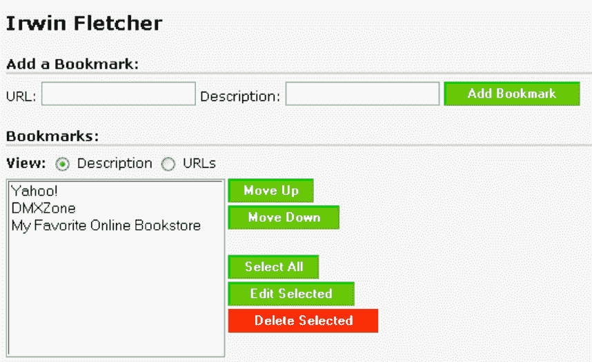

编辑器的 HTML 代码：

```html
<form name="bookmarks">
<h3>Irwin Fletcher</h3>
<h5>Add a Bookmark:</h5>
<label for="newURL">URL:</label>
<input type="text" name="newURL" id="newURL" />
<label for="newDescription">Description:</label>
<input type="text" name="newDescription" />

<input type="button" name="add" value="Add Bookmark"
onclick="AddBookmark(this.form.elements['newURL'].value,
this.form.elements['newDescription'].value,
this.form.elements['bookmarkList']);" />

<h5>Bookmarks:</h5>
<strong>View: </strong>
<input type="radio" name="view" value="viewDescription" id="viewDesc"
checked="checked" />
<label for="viewDesc">Description</label>
<input type="radio" name="view" value="viewURLs" id="viewURL" />
<label for="viewURL">URLs</label>

<select name="bookmarkList" multiple="multiple" size="10" style="float: left;">
    <option value="www.yahoo.com">Yahoo!</option>
    <option value="www.dmxzone.com">DMXZone</option>
    <option value="www.amazon.com">My Favorite Online Bookstore</option>
</select>

<input type="button" name="moveUp" value="Move Up" /><br />
<input type="button" name="moveDown" value="Move Down" /><br />
<input type="button" name="selectAll" value="Select All" /><br />
<input type="button" name="edit" value="Edit Selected" /><br />
<input type="button" name="delete" value="Delete Selected" />

</form>
```

请注意，为了可用性和可访问性，我们使用了之前描述过的 **LABEL** 标签。如果你愿意，也可以使用 **TABINDEX** 属性。

> ### 为什么需要 TABINDEX？
>
> 当网页加载时，用户可以使用 Tab 键立即开始在链接和表单元素之间进行切换。通常情况下，如果页面编写规范且构建顺序逻辑清晰，这种方式效果很好。但有时你会发现页面的默认 Tab 顺序完全不合理。这使得依赖键盘而非鼠标导航页面的用户（例如，患有重复性劳损或手臂受伤的人）很难操作。此外，你可能希望一个与默认顺序不同的顺序，因为这更符合你网站的逻辑。

在这种情况下，你可以为 `<a>` 和 `<input>` 标签添加 TABINDEX 属性。TABINDEX 接受一个数值，从 1 开始（第一个被 Tab 选中的项目），然后依次递增，直到所有链接或输入框都有值。浏览器随后会按照你描述的顺序而非默认顺序呈现 Tab 顺序。如果设置得当，用户可以轻松地通过 Tab 键浏览页面上的链接和表单元素。这既是一项可访问性功能，也是一项可用性功能！

如果你不小心给两个元素分配了相同的索引，则 HTML 中先出现的元素将首先被选中。你也不必显式地告诉页面上的每个链接和输入框其 TABINDEX 应该是多少。浏览器会将显式索引的链接排在没有索引的链接之前，同样根据它们在 HTML 中的出现顺序。这是一个在处理复杂功能时非常有用的特性，许多用户会为此感谢你。

```javascript
<script language="javascript" type="text/javascript">
function AddBookmark(url, description, oSelect)
{
    var optLength = oSelect.options.length;
    if(!url)
    {
        alert("Please enter the URL for your bookmark.")
        return;
    }
    if(!description)
    {
        alert("Please enter the description for your bookmark.")
        return;
    }

    // check for duplicate values
    for(i=0; i<optLength; i++)
    {
        optionText = oSelect.options[i].text;
        valueText = oSelect.options[i].value;
        if(optionText.toLowerCase() == description.toLowerCase())
        {
            alert("That bookmark already exists.")
            return;
        }
        if(valueText.toLowerCase() == url.toLowerCase())
        {
            alert("That bookmark already exists.")
            return;
        }
    }
    oSelect.options[optLength] = new Option(description, url);
}
</script>
```

## 移动选项

在编写脚本时，我们会尽可能地将其**抽象化**。记住，这样可以使脚本在几乎不需要修改的情况下被重复使用，并允许其他人无需了解脚本内部工作原理即可使用。

开始编写脚本的一个好方法是思考它需要什么。在处理表单时，我总是希望有一个对表单的引用。其次，拥有对当前对象（在这种情况下是我们的 **SELECT** 对象）的引用总是必须的。最后，如果能向函数传递用户想要移动书签的方向（向上或向下）将会很有帮助。有了方向，我们就可以用一个脚本同时处理向上和向下的移动。

让我们从这三个预期的参数开始编写脚本：

```javascript
function MoveOption(oForm, upOrDown, oSelect)
{
}
```

像往常一样，我们为函数起一个具有描述性的好名字，首字母大写以将其与变量名区分开。注意 Form 和 Select 单词前的“o”。我注意到，以这种方式命名将引用对象的变量通常很有帮助（可以将其视为“objectForm”或“objectSelect”的缩写）。中间的 `upOrDown` 将告诉我们 OPTION 移动的方向。

这个函数将通过 **onclick** 事件被“Move Up”和“Move Down”按钮调用。对于向上按钮，事件调用将如下所示：

```html
onclick="MoveOption(document.forms['bookmarks'], 'up',
document.forms['bookmarks'].elements['bookmarkList']);"
```

请注意我们发送的三个参数：

- 传递给参数 "oForm" 的表单名称 ("bookmarks")
- 传递给参数 "upOrDown" 的方向 ("up")
- 传递给参数 "oSelect" 的选择框名称 ("bookmarkList")

现在脚本已经拥有了正确运行所需的所有基本信息。我们可能需要的任何其他信息都可以从这三个参数中衍生出来。

实现方式很简单。我们将获取当前选中项的 VALUE 和 TEXT 值，然后将它们与上方（如果用户将选项上移）或下方（如果用户将选项下移）的选项进行交换。基于此，我们可以设置 4 个局部变量来简化操作：

- 一个用于 `selectedIndex`（用户选择的选项）
- 一个用于当前选项将要移动到的新位置
- 一个用于保存新的 VALUE 和 TEXT 值
- 一个用于保存旧的 VALUE 和 TEXT 值

我们将它们设置如下：

```javascript
var choice = oSelect.selectedIndex;  // 当前选中项
var newPosition;                     // 目标位置
var oldVal = oSelect[choice].value;   // 旧的 VALUE 和 TEXT 值
var oldText = oSelect[choice].text;  // 新的 VALUE 和 TEXT 值
```

请注意我们如何使用 "oSelect" 参数来衍生其中三个变量。第一个变量你应该已经很熟悉了，即作为当前选中项的 **selectedIndex**。第二个变量我们只是为了后续使用而声明，它目前还没有值。对于最后两个变量，注意我如何使用第一个变量 ("choice") 来简化引用。如果这些引用让你感到困惑，请不要气馁！习惯它们需要一段时间，有时即使像我这样所谓的资深专家也得停下来挠挠头。

### 错误检查

这里我们必须小心。优秀的脚本不仅要考虑预期的情况，还要考虑意外的情况。如果用户在没有选择任何选项的情况下点击移动按钮会怎样？我们的脚本很快就会崩溃。事实上，在尝试设置第三个变量 ("oldVal") **之前**，你必须发现这一点，因为该声明使用了 **selectedIndex** 属性。

验证选择项非常简单。你只需要确保 **selectedIndex** 属性不等于 -1。如果 SELECT 的值为 -1，则表示没有任何项被选中。因此，我们将进行该检查，如果没有选择，则向用户发送警报。如果用户没有完成选择，我们将使用 `return` 语句退出函数，允许他们进行选择。

```javascript
if (choice == -1)
{
    alert("You must first select the option to reorder.");
    return;
}
```

既然我们已经将变量 "choice" 设置为 `selectedIndex`，我们可以用它来进行比较。注意比较时使用了双等号 "=="。对于初学者（以及专家！）来说，在比较值时忘记写第二个等号是最容易出错的地方。

### 移动方向

现在进入正轨了！我们已经通过了错误检查，现在需要确定 OPTION 的移动方向。这需要一个 IF...ELSE 控制结构。你已经见过 IF 控制，而 ELSE 简单地为你提供第二个选项。用通俗的语言来说，你可以这样描述：

> “如果用户想要上移，那么就将新位置变量减 1（减法，因为你在列表中向上移动，比如从第 3 位移到第 2 位）；否则（或者...ELSE），就将新位置变量加 1（因为你在列表中向下移动，比如从第 4 位移到第 5 位）。”


从编程角度来看，它看起来像这样：

```
if (upOrDown == "up")
{
newIndex = choice - 1;
}
else
{
newIndex = choice + 1;
}
```

这就是经典的“人生岔路口”：是走去奶奶家的快捷方式，还是绕远路去小屋。`if` 或 `else`。如果 `upOrDown` 的值不是 "up"，那么它一定是 "down"。现在，如果你很细致……我的意思是……很聪明……你可能会想：“如果我在 `onclick` 调用中不小心拼错了（或者放置了除 'up' 或 'down' 之外的任何其他值）会发生什么？”这种情况确实可能发生，尤其是在一个你不是唯一一个使用该函数的 大型应用程序中。

答案是，如果你担心这种情况发生，你可以在 `ELSE` 之后添加另一个 `IF` 语句，然后用某种错误响应来处理任何其他情况，例如：

```
if (upOrDown == "up")
{
newIndex = choice - 1;
}
else if (upOrDown == "down")
{
newIndex = choice + 1;
}
else if ((upOrDown != "up") && (upOrDown != "down"))
{
alert("The programmer goofed!");
return;
}
```

最后一个条件可以检查是否两个值都不存在，然后退出函数。虽然有更好的方法来执行此类检查，但这样你就能理解其原理，而不需要我一次向你抛出太多东西。通常情况下，你不需要进行这样的检查，特别是当你编写自己的页面时。

现在我们知道了用户想走哪个方向。接下来，我们需要让某些事情真正发生。

## 执行移动

你可能会好奇，为什么我们不直接将 `newPosition` 变量（加上或减去后的值）设置为 **selectedIndex** 当前变量就完事了。事实上，你确实可以那样做。然而，你得到的结果将是 **selectedIndex** 本身向上或向下移动，而不是数值移动！这并不是预期的结果。记住，我们必须先交换 `OPTION` 的 `VALUE` 和 `TEXT` 值，这样 `OPTION` 才会真正地“移动”。

为了进行交换，首先将 *newPosition* 的 `VALUE` 和 `TEXT` 设置为 *用户* 的原始选择。这将产生这样的效果：将用户选择上方（或下方）的值复制到那里。如果你在此时停止函数，你将拥有两个完全重复的 `OPTION`。具体操作如下：

```
oSelect[choice].value = oSelect[newPosition].value;
oSelect[choice].text = oSelect[newPosition].text;
```

记住变量 "choice" 是用户的 **selectedIndex**。`newPosition` 变量是该 **selectedIndex** 加或减 1。现在，你要做完全相反的操作，让 `newPosition` 的值采取用户原始选择的值：

```
oSelect[newPosition].value = oldVal;
oSelect[newPosition].text = oldText;
```

现在，你终于可以将 `selectedIndex` 设置为 `newPosition`，并完成移动：

```
oSelect.selectedIndex = newPosition;
```

下面是你向上移动项目时应该看到的屏幕截图：

## 注意陷阱！

啊，总会有个陷阱，不是吗？“陷阱”（Gotcha）是指你可能没有预料到会发生，但会导致你的 <在此插入任务> 崩溃的事情。在这种情况下，一旦 DMXZone 书签被移动到顶部，再次点击“向上移动”按钮将抛出错误。为什么？因为你不能再次移动它——不对，你可以。是因为你正试图复制书签上方存在的值。现在你看到问题了——最顶部的书签上方没有任何值！

如果你尝试向下移动最底部的 `OPTION`，也会发生同样的事情。你可以通过两种方式处理这个问题。首先，你可以检查顶层项目是否是第一个，或者底层项目是否是最后一个。如果任一情况成立，你可以简单地提醒用户不能再向上或向下移动了。

或者，你可以让项目“循环”：顶部的移到底部，底部的移到顶部。对于教程来说这肯定更有趣，但布鲁斯（你友好的编辑）告诉我，如果我们在一个真实的网站上实现这样的功能，可用性专家会在早上 6 点破门而入，把你拖到 Delta 营地。所以，请时刻意识到脚本的可用性问题。（就个人而言，我讨厌早上 6 点起床。）既然是复制不存在的值导致了错误，我们需要确保在发生这种情况之前进行检查。

如果你发现用户处于顶部或底部，你只需要做以下两件事之一：

如果他们已经在顶部，将 `newPosition` 变量设置为最后一个项目（而不是顶部项目上方不存在的那个）。你可以通过用 options 数组的长度减 1 来实现。

如果他们已经在底部，将 `newPosition` 变量设置为第一个项目（而不是最后一个项目下方不存在的那个）。这只需简单地将新位置设置为 0 即可。记住，在 JavaScript 数组中，0 始终是第一个。请看下面的代码：

```
//make it last if its already at the top
if(newPosition < 0) newPosition = oSelect.length - 1;

// make it first if its already at the end
if(newPosition >= oSelect.length) newPosition = 0;
```

注意我是如何将整个 `IF` 语句保持在一行之内的。当你有一个简短的 `IF` 控制结构时，将其保持在一行并省略括号集是允许的（有时为了节省空间而很方便）。这两个条件将确保你有可以复制的内容，从而使脚本避免任何错误。

以下是带有注释的完整脚本：

```
function MoveOption(oForm, upOrDown, oSelect)
{
    // The user's current selection
    var choice = oSelect.selectedIndex;
    // Where the user wants the option to go
    var newPosition;
    // Save the user's VALUE and TEXT values so they
    // can be copied to the new location.
    var oldVal = oSelect[choice].value;
    var oldText = oSelect[choice].text;

    // If the user has not made a choice, exit the function
    if (choice == -1)
    {
        alert("You must first select the item to reorder.");
        return false;
    }

    // Find out which way the user wants the option to go
    // Then change the the "choice" variable (the current selection)
    // accordingly.
    if(upOrDown == "up") newPosition = choice - 1;
    if(upOrDown == "down") newPosition = choice + 1;

    // Check to make sure there is an option to copy.
    // If at top, wrap to the bottom and vice versa.

    // make it last if its already at the top
    if(newPosition < 0) newPosition = oSelect.length - 1;

    // make it first if its already at the end
    if(newPosition >= oSelect.length) newPosition = 0;
    
    // Copy the new VALUE and TEXT values (above or below) to the
    // user's current location
    oSelect[choice].value = oSelect[newPosition].value;
    oSelect[choice].text = oSelect[newPosition].text;

    // Copy the user's VALUE and TEXT values to the
    // new location, finalizing the swap of values
    oSelect[newPosition].value = oldVal;
    oSelect[newPosition].text = oldText;

    // Move the selectedIndex to where the user
    // "moved" the OPTION
    oSelect.selectedIndex = newPosition;
}
```

## 结论

到这里你可能已经意识到发生了什么——你并没有“移动”任何东西！实际上发生的是你简单地交换了值。真正移动的只有用户的选择，而且那仅仅是为了匹配他的值被复制到的位置。

注意这个脚本应该是任何人都能使用的。它是“抽象的”。你应该能够告诉同行开发人员通过 `onclick` 事件调用该函数，并将表单、移动方向和 select 对象发送给它，这样就可以完成移动。他们 *不需要* 知道这个函数实际上是如何工作的。这使得它更容易使用，也更容易维护。

正如我之前所说，`SELECT` 对象及其引用可能很难掌握。拆解 HTML 和脚本，尝试不同的方法。这通常是理解脚本的最佳方式——把它拆开！

## Select 脚本编写：收尾

在之前的段落中，我展示了用户如何向原始 `SELECT` 添加新书签（从而添加新选项），以及用户如何将选项向上或向下移动。我们最后需要完成的事情是删除书签和选择所有书签。选择所有书签不仅是一项用户功能，而且对于表单的正确运行也尤为必要，我们稍后会看到。

## 快速回顾

再一次，书签编辑器的样子如下：

编辑器使用的 HTML：

```
<form name="bookmarks">
  <h3>Irwin Fletcher</h3>
  <h5>Add a Bookmark:</h5>
  <label for="newURL">URL:</label>
  <input type="text" name="newURL" id="newURL" />
  <label for="newDescription">Description:</label>
  <input type="text" name="newDescription" />

  <input type="button" name="add" value="Add Bookmark"
    onclick="AddBookmark(this.form.elements['newURL'].value,
    this.form.elements['newDescription'].value,
    this.form.elements['bookmarkList']);" />

  <h5>Bookmarks:</h5>
  <strong>View:</strong>
  <input type="radio" name="view" value="viewDescription" id="viewDesc"
    checked="checked" />
  <label for="viewDesc">Description</label>
  <input type="radio" name="view" value="viewURLs" id="viewURL" />
  <label for="viewURL">URLs</label>

  <select name="bookmarkList" multiple="multiple" size="10" style="float: left;">
    <option value="www.yahoo.com">Yahoo</option>
    <option value="www.dmxzone.com">DMXzone</option>
    <option value="www.amazon.com">My Favorite Online Bookstore</option>
  </select>

  <input type="button" name="moveUp" value="Move Up" /><br />
  <input type="button" name="moveDown" value="Move Down" /><br />
  <input type="button" name="selectAll" value="Select All" /><br />
  <input type="button" name="edit" value="Edit Selected" /><br />
  <input type="button" name="delete" value="Delete Selected" />

</form>
```

## 删除选项

我们必须为用户提供一种删除书签的方法，以防他们误输入了不想要的书签，或者书签已经过期。此外，没有什么比书签多到找不到所需内容更让书签失效的了，因此在实际应用场景中，删除能力至关重要。

## 构建删除脚本

和往常一样，任何时候我们想要更改 OPTION 列表中的内容，必须先选中它。因此我们知道必须进行检查，确保已做出选择。正如我们之前的其他函数一样，我们希望通过 FORM 对象和 SELECT 对象将表单传递进去，以便于引用相关元素。

我们将允许用户删除任意数量的选项。因此，我们需要检查每个选项是否被选中，如果选中，则将其删除。对于 SELECT 元素的此类操作，有一个特别阴险的坑（gotcha），我们稍后会详细讨论。

所以，我们像往常一样定义函数的开头：

```
function DeleteOption(oForm, oSelect)
{
}
```

接下来的工作量并不大。我们只需要遍历（"loop through" 或 "step through" 的技术术语）选项数组，检查是否选中，如果选中则删除该项。因此，像以前一样，我们将使用 SELECT 对象的 length 属性来为选项数组的长度（有多少个项）设置一个变量，该属性会返回选项数组中的选项数量：

```
optLength = oSelect.length;
```

## 避坑指南

现在到了棘手的部分。我们需要在这里使用一个 FOR 循环，以便遍历选项。你通常看到的写法如下：

```
for (i=0; i>someVariable; i++)
```

再次强调，**for** 循环中的三个参数分别是：1) 用于迭代的变量声明及其初始值（通常从 1 或 0 开始），2) 继续迭代的条件（通常是将 i 的值与某个变量条件进行匹配），以及 3) 当第二个参数为真时执行的操作（通常是将迭代值增加 1）。

问题在于，如果这样做，它会**破坏我们的脚本！** 为什么？记住我们是在删除选项。在脚本开始时，我们设置了一个变量来存储选项数组的长度。更坑的地方在于，这样做**有时**能行，但并非一直有效。这是最糟糕的错误类型，因为在部分时间甚至大多数时间内，脚本看起来运行完美。在这种情况下，很难知道从哪里开始寻找问题。更糟糕的是，这个问题可能在测试阶段没有被发现，而是在上线后由用户触发错误时才被发现。因此，如果我们能从一开始就避免这种错误，那就太好了。

这就是脚本崩溃的原因。在我们的示例中，**optLength** 的初始值将是 2（记住，不是 3，因为 JavaScript 数组从 0 开始）。在脚本运行到某一点时，你会尝试检查数组中的某个特定选项是否被选中——**但那里将不再有选项**——因为它已经被删除了。我们将 optLength 变量设为 2（对应 3 个项目），但我们已经删除了至少一个。更糟糕的是，*取决于被删除项的位置*，你的脚本可能会或者不会正常工作。

这听起来可能有点令人困惑，但这里的关键要点是：尝试**向上**遍历选项数组会产生问题，因为迟早脚本会尝试检查一个不存在的选项。这是因为选项数组的长度已经改变，但我们在脚本中没有对此进行调整。

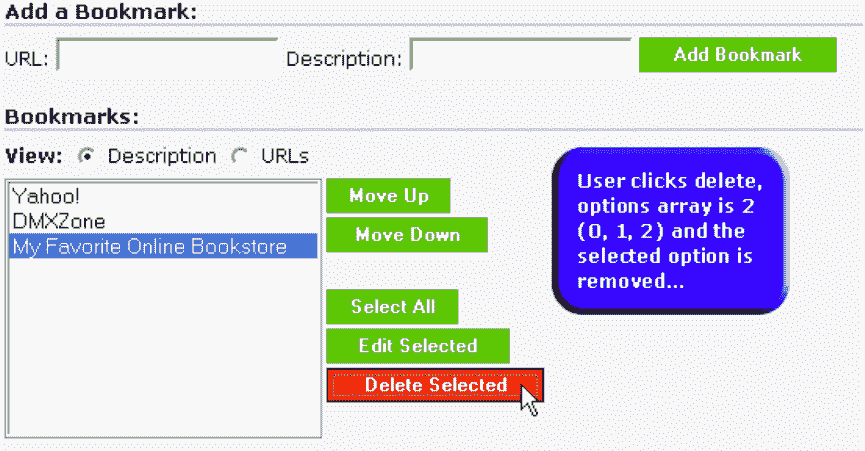

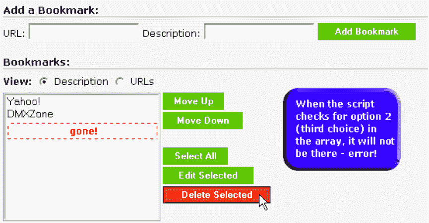

糟糕的结果是，当用户尝试删除不存在的内容时，会发生 JavaScript 错误。如果用户允许显示错误（基于其浏览器偏好设置），他们会看到一个 JavaScript 警报，当然，删除功能将无法正常工作。更糟的是，如果他们不允许显示错误，脚本将直接失效。他们可能会或不会看到某种错误指示，而简单地认为网站出故障了。这就是让 Web 开发人员做噩梦的事情！我们要避免这种情况。

解决方案是什么？有两点。首先，我们必须根据不断变化的选项数组长度进行调整。这意味着在每次迭代时，我们必须从选项数组长度中减去 1。这将反映删除选项后数组的真实长度。

其次，我们需要**向下**遍历循环，而不是向上。由于这可能变得令人困惑，让我用例子来说明：

```
for (i=optLength-1; i>=0; i--)
```

你看，这基本上是常规 FOR 循环的反向操作。我们不再将 i 的初始值设为 0 并递增到一个数字，而是将 i 设为选项总数，然后反向计数到 0（这将是选项数组的第一个元素）。

为什么是 `optLength - 1`？SELECT 的 length 属性会给我们 3——这对于数组索引是不正确的。由于 JavaScript 数组从 0 开始，我们需要 2（0, 1, 2）。（你知道我习惯在每个教程中都指出这一点！）因此，我们减去 1 以获得正确的值。（不一致？也许吧。这背后可能有一个在我知识范围之外的充分理由。把它归类到“需要记住的事情”中即可！）

然后第二个参数，即我们的“只要...就继续”条件，检查 i 是否大于或等于 0。由于 0 是数组中的第一项，当 i 变为 -1 时我们停止——因为我们已经超出了第一项，无需再检查。最后，我们的 `i--` 是递减而不是递增 i，所以我们是在向下移动，而不是向上。

现在，我们的脚本永远不会遇到没有选项的情况。我们一次只删除一个选项（即使用户在删除所有选项）。由于我们是沿着选项数组的长度向下移动，并且首先检查最大数字（在我们的例子中是 2），我们永远不会检查一个不存在的项。

## 实际删除操作

实际删除选项很简单。只需将数组中的当前选项设为 "null"（null 表示“无”）：

```
oSelect.options[i] = null;
```

其中 [i] 是数组位置（记住，我们在 FOR 循环中）。但是，我们不想对所有选项都这么做——否则我们可能会删除未被选中的内容。因此，我们首先需要检查当前选项是否被选中，如果选中，则将其删除。

这同样很简单。SELECTED 是 OPTION 元素的一个属性。如果该属性求值为 true，则表示该选项被选中。因此，我们可以设置一个 IF 条件来检查当前选项是否被选中，如果选中，我们就删除它：


```javascript
if(oSelect.options[i].selected == true)
{
oSelect.options[i] = null;
}
```

如你所见，只有被选中的选项才会被删除——无论是一个选项，还是全部选项。

整个函数看起来是这样的：

```javascript
function DeleteOption(oForm, oSelect)
{
    optLength = oSelect.length;
    for(i=optLength-1; i>=0; i--)
    {
        if(oSelect.options[i].selected == true)
        {
            oSelect.options[i] = null;
        }
    }
}
```

按钮的调用方式如下：

```html
onclick="DeleteOption(this.form, this.form.elements['bookmarkList']);"
```

## 选择所有选项

现在，如果用户有一堆选项，比如要删除 20 个书签，逐个点击可能会非常繁琐。另外，还有一个很好的理由需要能够选择 SELECT 对象中的所有选项。为了保存用户刚刚调整过的整个书签列表，**当表单提交时，每个选项都必须被选中**。只有*被选中*的选项才会随表单对象一起传递。如果我们没有这样做，当表单提交时，只有其中一个书签，甚至没有一个用户的书签会被保存。这将是一件非常糟糕的事情。

所以我们希望将该函数用于两个目的：帮助用户，以及正确保存信息。

同样，我们需要传递 FORM 和 SELECT 对象。同样，我们将利用 options 数组的长度和 FOR 循环。这次我们将使用传统的从 0 开始向上遍历的 FOR 循环。我们只需要将数组中每个选项的 selected 属性设置为 true，这样每个项目都会被选中：

```javascript
function SelectAllOptions(oForm, oSelect)
{
    optLength = oSelect.length;
    for(i=0; i<optLength; i++)
    {
        oSelect.options[i].selected = true;
    }
}
```

按钮的调用方式如下：

```html
onclick="SelectAllOptions(this.form, this.form.elements['bookmarkList'])";
```

如果我们想要在表单提交时确保所有选项都被选中，可以使用 **onsubmit** 表单处理程序来调用这个相同的函数。这个事件处理程序在表单提交时触发：

```html
<form name="bookmarks" action="someFormAction.php" onsubmit="SelectAllOptions(this, this.elements['bookmarkList'])">
```

注意这里使用了更短的 `this` 来引用表单——我们不需要使用 `this.form`，因为我们就在表单对象本身之上，在这种情况下，`this` 就是指实际的表单。

## 最终代码

最终的 HTML 如下：

```html
<html>
<body>

<form name="bookmarks">
<h3>Irwin Fletcher</h3>
<h5>Add a Bookmark:</h5>
<label for="newURL">URL:</label> <input type="text" name="newURL" id="newURL" /> 
<label for="newDescription">Description:</label> <input type="text" name="newDescription" /> 
<input type="button" name="add" value="Add Bookmark" class="btn" 
onclick="addBookmark(this.form.elements['newURL'].value, this.form.elements['newDescription'].valueThomas]".]
```

form.elements['bookmarkList'])" />

<h5>Bookmarks:</h5>
<input type="radio" name="view" value="view" id="view" checked="checked" /> <label for="view">View</label>
<input type="radio" name="view" value="viewDescription" id="viewDesc" /> <label for="viewDesc">Description</label>
<input type="radio" name="view" value="viewURL" id="viewURL" /> <label for="viewURL">URLs</label>

<div style="margin-top: 6px;">
<select name="bookmarkList" multiple="multiple" size="10">
<option value="www.yahoo.com">Yahoo!</option>
<option value="www.dmzone.com">DMZZone</option>
<option value="www.amazon.com">My Favorite Online Bookstore</option>
</select>

<input type="button" name="moveUp" value="Move Up"
onclick="MoveOption(document.forms['bookmarks'], 'up', document.forms['bookmarks'].elements['bookmarkList'])" /> <br />

<input type="button" name="moveDown" value="Move Down"
onclick="MoveOption(document.forms['bookmarks'], 'down', document.forms['bookmarks'].elements['bookmarkList'])" /><br />

<input type="button" name="selectAll" value="Select All" class="btn"
onclick="SelectAllOptions(this.form, this.form.elements['bookmarkList'])" /><br />

<input type="button" name="edit" value="Edit Selected" /><br />
<input type="button" name="delete" value="Delete Selected"
onclick="DeleteOption(this.form, this.form.elements['bookmarkList'])" />
</div>

</form>
</body>
</html>
```

最终的 JavaScript 如下：

```javascript
function AddBookmark(url, description, oSelect)
{
    var optLength = oSelect.options.length;

    if(!url)
    {
        alert("Please enter the URL for your bookmark.")
        return;
    }
    if(!description)
    {
        alert("Please enter the description for your bookmark.")
        return;
    }

    // check for duplicate values
    for(i=0; i<optLength; i++)
    {
        optionText = oSelect.options[i].text;
        valueText = oSelect.options[i].value;
        if(optionText.toLowerCase() == description.toLowerCase())
        {
            alert("That bookmark already exists.")
            return;
        }
        if(valueText.toLowerCase() == url.toLowerCase())
        {
            alert("That bookmark already exists.")
            return;
        }
    }
    oSelect.options[optLength] = new Option(description, url);
}

function MoveOption(oForm, upOrDown, oSelect)
{
    // The user's current selection
    var choice = oSelect.selectedIndex;
    // Where the user wants the option to go
    var newPosition;
    // Save the user's VALUE and TEXT values so they
    // can be copied to the new location.
    var oldVal = oSelect[choice].value;
    var oldText = oSelect[choice].text;

    // If the user has not made a choice, exit the function
    if (choice == -1)
    {
        alert("You must first select the item to reorder.");
        return false;
    }

    // Find out which way the user wants the option to go
    // Then change the "choice" variable (the current odUser valueleteOption')
```

// accordingly.
    if(upOrDown == "up") newPosition = choice - 1;
    if(upOrDown == "down") newPosition = choice + 1;

    // Check to make sure there is an option to copy.
    // If at top, wrap to the bottom and vice versa.

    // make it last if its already at the top
    if(newPosition < 0) newPosition = oSelect.length - 1;

    // make it first if its already at the end
    if(newPosition >= oSelect.length) newPosition = 0;

    // Copy the new VALUE and TEXT values (above or below) to the
    // user's current location
    oSelect[choice].value = oSelect[newPosition].value;
    oSelect[choice].text = oSelect[newPosition].text;

    // Copy the user's VALUE and TEXT values to the
    // new location, finalizing the swap of values
    oSelect[newPosition].value = oldVal;
    oSelect[newPosition].text = oldText;

    // Move the selectedINDEX to where the user
    // "moved" the OPTION
    oSelect.selectedIndex = newPosition;
}

function DeleteOption(oForm, oSelect)
{
    optLength = oSelect.length;
    for(i=optLength-1; i>=0; i--)
    {
        if(oSelect.options[i].selected == true)
        {
            oSelect.options[i] = null;
        }
    }
}

function SelectAllOptions(oForm, oSelect)
{
    optLength = oSelect.length;
    for(i=0; i<optLength; i++)
    {
        oSelect.options[i].selected = true;
    }
}
```

## 结论

我们对于 SELECT 对象可以做什么的探讨才刚刚触及皮毛。我们还可以更进一步，让用户能够在同一页面上编辑每个单独的书签。我们也没有讨论包含多个选择框的页面以及它们之间的交互。希望将来我们能覆盖这些主题。

永远记住，在将表单信息发送到服务器之前，先选择多选框中的所有选项，否则错误的数据就会露出它丑陋的面目。如果发生这种情况，最好的情况是后端只有很少或没有数据。最坏的情况是，这种错误的数据会导致后端出错和故障。这可不是什么好事。

## Date 对象

迟早你会需要在脚本中使用某种日期。在"过去"，在 JavaScript 中使用日期是很麻烦的。然而从那以后，JavaScript 的日期对象已经发展得相当不错了。再加上如今我们的计算机通过控制面板（无论是 Mac 还是 PC）非常高效地处理时间，设置时区和夏令时，你已经为在脚本中使用日期做好了充分的准备。

尽管说起来情况更好了，但使用日期对象*确实*很棘手。而且我们必须记住它是一个**对象**，并相应地对待它。此外，你必须对全球时间的工作方式有一定了解。特别是如果你正在编写的应用程序要跨越时区，因为当脚本在用户系统上运行时，日期处理的是*本地*时间。

现在我们已经引起了你的注意，让我们深入了解一下！

## 时区和神秘的 GMT

大多数人都知道，世界各地的时间并不相同。地球在旋转，我们在不同的时间看到正午的太阳。澳大利亚的中午和美国的中午不是同一个时间。

所以必须有某种方式让我们谈论时间，并理解一个地方的中午是另一个地方的三点钟。这就是 GMT 或格林尼治标准时间的由来。时间的标准参考点是英国格林尼治的天文台。如果你从那里直切下去，你会到达太平洋中部，那条"线"就是国际日期变更线。

所以以 GMT 为基础，时区就建立起来了。我住在中央标准时区，比 GMT 晚 -6 个小时。所以我比 GMT 晚六个小时。你可以通过查看 [http://www.timeanddate.com/worldclock/](http://www.timeanddate.com/worldclock/) 上的世界时钟来了解任何时区与 GMT 的差距。只需找到离你最近的城市。

现在你可能已经在想，为什么要担心时间——我们不是在谈论日期吗？虽然主要是关于日期，但时间是任何日期的一部分。事实上，当你在 JavaScript 中创建日期时，除非另有指定，时间是包含在内的。

了解时区差异以及一个地方的一天早晚可能是另一个地方的下一天（或前一天），这是件好事。例如，如果你要为航空公司网站构建一个复杂的日期和时间选择器，你需要确保正确处理时区。

事实上，我们最终要构建的是一个日期选择器（不含时间元素），你可以用于任何应用程序，并根据需要进行扩展。


## Date 对象是一个……对象

在深入了解细节之前，我们需要说明一下：Date 对象确实是一个对象。是的，这听起来既明显又多余。但在 JavaScript 中，我们习惯于以基于对象的方式工作，而非真正的面向对象方式。由于 Date 是真正的对象，我们必须以这种方式来处理它。

事实上，这带来了一些实实在在的好处。由于 Date 是一个内置的 JavaScript 对象，它附带了一些非常好用的属性和方法供我们使用。这意味着我们不必自己编写这些功能！这很好，因为处理日期可能会很棘手。

### 创建 Date 对象

要创建 Date 对象，我们使用 **new** 关键字和 **Date** 构造函数。构造函数通过其默认参数来"构造"对象。这些参数要么由 JavaScript 内置（如 Date 对象），要么由你自己指定（如果你创建了自己的自定义对象）。

用最基础的术语来说，我们可以简单地这样做来创建日期：

```javascript
var myDate = new Date();
```

注意，"new" 从不使用大写，但关键字 "Date" *确实*需要大写。变量 myDate 现在保存了对你刚刚创建的日期对象的引用。如果我们使用 alert 显示该变量，会看到类似这样的结果（取决于你执行操作的日期和所在的时区！）

```html
<body>
<script type="text/javascript">
var myDate = new Date();
alert(myDate);
</script>
</body>
```

结果：

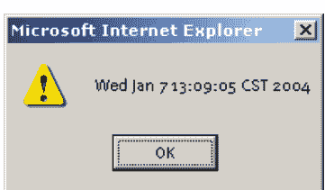

这个 alert 显示的是 2004 年 1 月 7 日星期三下午 1:09，中部标准时间。所有这些信息都存储在你创建的日期对象中，你可以通过属性和方法访问全部信息。这真是太棒了。

你可以更具体地决定你的日期对象应该包含什么信息。以下面这三种格式为例：

```javascript
new Date("Month", "dd", "yyyy");
new Date("yy", "mm", "dd", "hh", "mm", "ss");
new Date("yy", "mm", "dd");
```

如果你用这三种方式中的任何一种来设置参数，你的日期对象现在将只包含该信息。例如，让我们使用第三种格式，设置为 1984 年圣诞节：

```html
<body>
<script type="text/javascript">
var myDate = new Date("84", "11", "01");
alert(myDate);
</script>
</body>
```

这给我们：

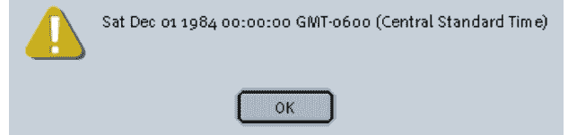

但是等等，你会说——你用的是 "11" 代表十二月！是的，我确实是。这又是 JavaScript 中"数组从零开始"的老问题。无论如何，这看起来一切正常，直到我们尝试用第一种格式将 2001 年的同一日期，使用完整的 2001 数字。

```html
<body>
<script type="text/javascript">
var myDate = new Date("11", "01", "2001");
alert(myDate);
</script>
</body>
```

结果是：

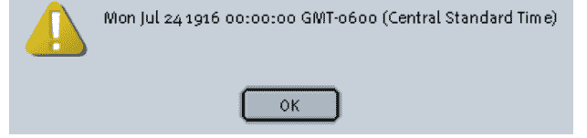

哎呀！不是 1916 年！这绝对是个问题。为什么这行不通？谁真的在乎呢？有更好的方法来处理这个。我们需要的是"setter 和 getter"！

## Setter 和 Getter

Setter 和 getter 是设置和获取值的"流行"术语。（多么有创意的术语，对吧？）如前所述，JavaScript 已经内置了供我们用于 Date 对象的方法。其中一种方法允许我们，你猜对了，设置年份。查看以下内容：

```html
<script type="text/javascript">
    var myDate = new Date();
    myDate.setYear("2001");
    alert(myDate);
</script>
```

注意这类方法的使用格式。首先是对象引用，然后是方法名，后跟任何提供的参数。因此：

```javascript
objectName.methodName(parameters);
```

是使用这类方法的正确格式。现在我们弄清楚了这一点，来看看我们的结果：

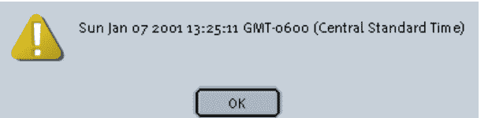

啊！就是我们想要的 2001 年！说实话，我们并不真正关心为什么这种方式行得通而另一种方式不行。如果让你高兴，可以称它为 Y2K 漏洞。坦白说，使用 setter 和 getter 是与对象交互的更好方式。

现在，如果我们想设置那一年的完整圣诞节日期，我们可以使用类似的方法来设置日和月：

```html
<body>
<script type="text/javascript">
    var myDate = new Date();
    myDate.setYear("2001");
    myDate.setMonth("11");
    myDate.setDate("25");
    alert(myDate);
</script>
</body>
```

结果是：

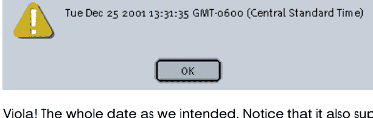

瞧！日期完全符合我们的预期。注意它同时也提供了时间信息。现在，我要指出几个需要注意的地方。首先，正如上文所述，注意十二月用的是 "11" 而非 "12"。月份数组的范围是 0 – 11。其次，是的，获取日的方法确实是 **setDate**。为什么？

令人惊讶的是，这实际上有一个相当合理的理由。确实存在两个名为 **setDay** 和 **getDay** 的方法。然而，这些方法给出的是日期所在*星期*的哪一天。如果你仔细想想，当你问别人日期时，他们会告诉你"是 25 日"之类的，不会告诉你"是星期三"。

现在如果你从日历的角度来思考，日期落在哪一天至关重要。2004 年 1 月 1 日是星期四。如果我们要是把日历从星期三开始，那Species 会把整年搞得一团糟。

妙处在于，我们不必过于担心某个月份的日期从哪一天开始，因为 JavaScript 也知道这个！我们只需要小心，等到那那天再开始书写日期。这听起来可能有点令人困惑，但我们会在下一篇教程中更好地解释。

### 灵活调整

现在如果我们想导航到上一个月或下一个月怎么办？同样，我们可以使用 setter 方法来实现。让我们以 2001 年圣诞节为例，假设我们想看下一个月，即 2002 年 1 月。查看以下内容：

```html
<body>
<script type="text/javascript">
var myDate = new Date();
myDate.setYear("2001");
myDate.setMonth("11");
myDate.setDate("25");

var nextMonth = new Date(myDate);
nextMonth.setMonth(myDate.getMonth()+1);

alert(nextMonth);
</script>
</body>
```

现在情况可能变得令人困惑，所以我们一步一步来。首先，注意我们之前的代码没有改变，它仍然给我们 2001 年圣诞节。其次，注意我们为下一个月创建了一个新的日期对象（绑定到变量 nextMonth）——但我们把当前的圣诞节日期作为参数传入了。

我们这样做的原因是，我们想计算 2001 年圣诞节之后一个月的日期。所以我们需要基于该日期进行计算，因此提供了它。然后新的 Date() 构造函数可以接受任何有效的日期引用作为参数。它只是复制该日期。

现在剩下的就是获取上一个月的日期。这将涉及在一个语句中使用 setter 和 getter！再看下面的代码行：

```javascript
nextMonth.setMonth(myDate.getMonth()+1);
```

我们操作的是 nextMonth 日期，它现在是 2001 年圣诞节的副本。我们想将该月份设置为下一个月，所以使用 setter。这就是为什么我们以 nextMonth.setMonth() 开头。

然后，在 setter 中我们使用了 getMonth 方法。uju记住 setMonth/getMonth 的参数接受从 0 到 11 的数字。所以firstly we get the month, which ends up being 11 for December, because it's still our Christmas 2001 date (we haven't changed anything yet). Then we make our calculation – we add one to that month, thus the +1.

Now logically you might think that would give you 12, but in reality it gives you 0! That's because the month array is what you are dealing with here, and you just told the array to move to the next item in the array, which happens to be 0 for January.

So the result is:

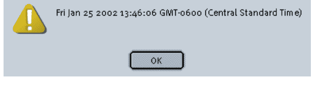

Perfect, Friday January 25th, 2002! One month later.

Now you can imagine we can get the previous month in the exact same manner, only subtracting one:

```html
<body>
<script type="text/javascript">
var myDate = new Date();
myDate.setYear("2001");
myDate.setMonth("11");
myDate.setDate("25");

var prevMonth = new Date(myDate);
prevMonth.setMonth(myDate.getMonth()-1);
</script>
</body>
```


```javascript
alert(prevMonth);
</script>
</body>
```

这会给我们：

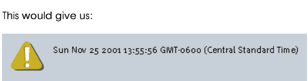

上一个月。

## 将日期从 mm/dd/yyyy 格式转换

现在，如果我们要将日期从常见的 mm/dd/yyyy 格式转换为日期对象呢？好吧，你可以使用大量复杂的正则表达式，但我们实际上可以避免这样做。一个利用数组的 **split** 方法以及基本日期格式化的简单函数就能搞定。

```javascript
function FormatDate(myDate)
{
    var dateValArray = dateValue.split("/");
    var currentDate = new Date(dateValArray[2],dateValArray[0]-1],dateValArray[1]);
    return currentDate;
}
```

这个小函数接受一个有效的日期引用作为参数，比如我们2001年的圣诞节日期。现在我们要稍微纠正一下前面说的话，因为我想让你能够使用 setter 和 getter。将参数以**完整年份、月份、然后日期**的形式传递给日期构造函数似乎效果很好，正如你将看到的。我们也可以对此使用 setter 和 getter，但知道几种不同的做事方法是很好的。

split 方法只是将一个字符串变成一个数组，它根据你提供的字符来拆分该字符串。由于斜杠是我们日期格式中的分隔符，我们提供斜杠。这给了我们以下数组：

```javascript
dateValArray[0] = "12"
dateValArray[1] = "25"
dateValArray[2] = "2001"
```

好处是我们不需要指定那些，因为 split 方法已经为我们做好了！所以现在我们要创建一个新的 Date 构造函数，并使用数组中正确的位置来放置值。由于第2个位置保存的是完整年份，我们先放那个，然后是月份。注意 **-1**！记住我们的 0 – 11 数组！最后是第1个位置的日期。然后我们返回 currentDate 变量，我们就又有了一个有效的日期对象！

下次这会很有用！

## 结论

虽然日期对象可能很复杂，但它非常强大。基础部分实际上相当容易使用，尤其是 JavaScript 可以帮你做很多脏活累活。

下一专栏将基于上述概念，构建一个你可以用于任何应用程序的日期选择器。你将能够浏览月份、选择一个日期，并将其显示在表单控件中。

## 表单

## 脚本化表单

与表单交互让许多开发者痛苦得直扯自己珍贵的头发。幸运的是，不必如此。开发者在为表单编写脚本时面临的许多问题都是语法上的。此外，许多人没有意识到 JavaScript 用诸如 **elements[]** 数组和 **type** 属性等工具赋予他们的强大能力。正确使用这些工具将让你的生活轻松很多。

### 任务一：正确引用元素

在 JavaScript 中你很快会学到的一点是，如果你不能正确引用想要脚本化的对象，你什么都做不了。我不敢数我作为新手时花了多少无尽的时间，只是试图弄清楚如何正确地"指向"某个东西。

对于表单和表单元素，你最好的朋友是 **DOM level 0**。但什么是 DOM 呢？网上有很多非常极客的技术解释，你可以读上好几天来了解 DOM 的复杂性。好吧，等你看完那些之后，我们可以用一句简单的话来解释它。**文档对象模型让我们访问文档中的每一个元素。** 看，这很简单，不是吗？能够访问每一个元素让生活简单多了。

DOM 存在 4 个级别，从 DOM level 0 一直到当前的 level 3。现在先忘掉所有这些。DOM level 0 自 Netscape 2 和 Internet Explorer 3 以来就已经存在，并且所有现代浏览器都支持它。所以与你的脚本兼容性已经不再是问题了。是的，那是一件*好事*™。

### 获取表单

脚本化表单时，你首先需要做的始终是**引用包含你元素的表单**。如果你页面上有多个表单，这就更加重要了。

DOM 包含一个页面上每个表单的数组。如果你不确定什么是数组，它很简单。数组用于存储一系列相关的数据项。你可以在数组中放置任意数量的项目，并且可以通过位置（给我第三个项目）或其名称或"键"值（给我"address"这个项目）来引用它们。

### 数组示例

把数组想象成一个简单的 html 表格。这个表格有一个标题"robots"。表格有两列和三行。第一列是"键"值，第二列是"值"。让我们看看：

**robots**

| 键 | 值 |
|---|---|
| red | blappo |
| green | zappo |
| blue | zippi |

左列中的每个键值都与右列中相应的值相关联。所以如果我要绿色机器人的名字，我会得到"zappo"作为结果。我也可以通过位置来引用右列的值。记住 JavaScript 数组从 0 开始，而不是 1（注意表格右侧的括号值）。所以我可以请求位置2的机器人的名字，我会得到"zippi"。

将其转换为实际代码现在很简单。我们有一个名为 robots 的数组：

```javascript
robots[];
```

如果我想从我的 robots 数组中将"zappo"放入一个变量，我会写以下语句：

```javascript
myRobotName = robots['green']; // 或者
myRobotName = robots[1];
```

两者都会返回"zappo"作为我们的名字。你可以从你喜欢的资源中了解更多关于如何创建和操作数组的知识，但这已经足够我们继续前进了。

### 获取表单

所以记住，我们有一个包含页面上每个表单的数组，叫做 forms[]。如果你是一个优秀的 webmonkey，你已经命名了你的表单。让我们在余下的段落中使用以下 HTML 片段作为我们的代码：

```html
<form name="newRobots">
New Robot Name: <input type="text" name="newRobot" />
Robot Description: <textarea name="robotDescription"></textarea>
Robot Category:
<select name="robotCat">
    <option default="default" value="none">Choose a category:</option>
    <option value="scary">Scary</option>
    <option value="friendly">Friendly</option>
</select>
Will this robot rust?
<input type="radio" name="robotRust" value="yes" checked="checked" /> Yes
<input type="radio" name="robotRust" value="no" /> No
Check the box if you would like this robot to attack your home:
<input type="Checkbox" name="robotAttack" value="attackMe" />
<input type="submit" name="submit" value="Add Robot" />
</form>
```

现在，获取我们的表单很简单，如下所示：

```javascript
myForm = document.forms['newRobots'];
```

简单吧？你也可以这样做：

```javascript
myForm = document.forms[0];
```

我们说过自描述代码。这根本不能告诉你关于你代码的任何信息。此外，如果你曾经在页面上添加另一个排在 newRobots 表单之前的表单，你的代码就会出故障。

现在我们已经在 myForm 变量中引用了我们的表单，我们可以在任何脚本中使用该引用，而不必反复写出"document.forms['newRobots']"。这是一个应该遵循的良好实践。

## 获取元素

现在，假设由于某种原因我们想要获取表单元素的值（可能是为了验证目的，或其他原因。）如果我们按照表单的顺序，新的机器人名字是第一个。

就像有 forms[] 数组一样，页面上每个表单也有一个 elements[] 数组。这个 elements[] 数组包含你指定表单内的每个元素。现在你将 elements 数组附加到 forms 数组上，像这样：

```javascript
forms['newRobots'].elements[];
```

当然，我们可以使用我们的变量：

```javascript
myForm.elements[];
```

现在要专门获取我们的文本框：

```javascript
newRobotName = myForm.elements['newRobot'];
```

同样，我们使用名称（字面意思，表单元素的 name 属性）来访问 elements 数组中我们想要的项目。现在我们的变量 newRobotName 是对我们文本框的引用。然而，我们想要的是实际文本值，而不仅仅是文本框。文本框元素有一个"value"属性，所以我们可以访问它来获取我们的新机器人名字：


```javascript
newRobotName = myForm.elements['newRobot'].value;
```

瞧！你已经得到了用户输入到该文本字段中的文本。获取 textarea 的值完全一样，只需将引用对象从文本框改为 textarea 即可：

```javascript
newRobotDescription = myForm.elements['robotDescription'].value;
```

那么机器人类别（robot category）怎么处理呢？如果我们这样做会怎样：

```javascript
newRobotDescription = myForm.elements['robotCat'].value;
```

信不信由你，这样做确实是正确的。如果你观察 select 框的编写方式，你会注意到每个 option 元素都有一个 value。如果你勤快地为每个选项设置了 value，select 框会很愉快地返回所选项目的值。当你尝试更复杂的任务时，对 select 框进行脚本编写可能会变得棘手，但仅仅获取选中的值就和文本框一样简单。

现在到了我们的第一个特例：单选按钮（radio buttons）。如果你仔细观察，你会发现两个单选按钮具有相同的名称。这是因为单选按钮被设置为一个组，且一次只能选择一个单选按钮。每个单选按钮确实有自己唯一的 value，但如果我们尝试以下操作：

```javascript
willRobotRust = myForm.elements['robotRust'].value;
```

这会导致一个 'undefined' 错误。这是怎么回事？事实是 `robotRust` 是一个组，而不是一个单独的项目。我们需要再深入一步。讽刺的是，我们可以使用另一个数组来实现这一点！一个单选组拥有一个包含每个按钮的数组。奇怪的是，这个数组没有名称，引用它看起来有点奇怪。记得数组是从 0 开始的，如果我们想获取第一个按钮的值，我们会这样做：

```javascript
willRobotRust = myForm.elements['robotRust'][0].value;
```

或者获取第二个按钮：

```javascript
willRobotRust = myForm.elements['robotRust'][1].value;
```

但这并没有太大帮助，你想获取的是无论哪个被选中的值，以便知道机器人是否会生锈。在只有两个单选按钮的情况下，一个简单的 if-then 条件句会有所帮助：

```javascript
var willRobotRust;
var rustRadioButtons = myForm.elements['robotRust'];

if(rustRadioButtons[0].checked)
{
    willRobotRust = "yes";
}
else
{
    willRobotRust = "no";
}
```

当按钮超过两个或三个时，if-else 条件会变得有些笨拙。假设我们有一个包含 10 个按钮的单选组，并且我们想要被选中按钮的值。任何数组都有一个名为 **length** 的属性。这会告诉你数组中项目的数量。这里需要注意的坑是再次记住 JavaScript 数组从 0 开始，所以在这种测试用例中，我们的长度将是九，而不是十！然后使用 for 循环，我们可以找出哪个按钮被选中了。我们将遍历（你猜对了！）单选组中那个无名按钮数组，并测试组中的每个按钮是否被选中。当我们找到被选中的那一个时，就可以将我们的变量设置为它的值。

```javascript
var radioButtonValue;
var radioButtons = myForm.elements['theRadioGroup'];

for(i=0; i<radioButtons.length; i++)
{
    if(radioButtons[i].checked == true)
    {
        radioButtonsValue = radioButtons[i].value;
        return;
    }
}
```

如果你不熟悉 for 循环，它并没有看起来那么难。for 循环接收三个由分号分隔的参数：

- 1. `i=0;` - i 只是你选择的一个变量名，而 i 恰好是传统选择。你可以从任何值开始，但这里我们从 0 开始，因为数组也从 0 开始。
- 2. `i<radioButtons.length;` - 这是 for 循环的“while”条件。它告诉循环要持续多久。在我们的案例中，我们是在说“只要 i 小于单选按钮的总数，就继续执行”。附加在我们单选按钮组（radioButtons）上的 length 属性给了我们这个数字，就像我们上面讨论的，它是九。
- 3. `i++;` 这是递增值。在我们的案例中（可能在大多数案例中），你想一个接一个地步进。i++ 是 i = i + 1 的简写。

现在，在我们的 for 循环内部是一个 if 条件。单选按钮的一个属性是它是否被选中，如果你正确编写了 HTML，一组中只能有一个单选按钮被选中。如你所见，我们正在使用附加在保存单选组变量上的数组来持有每个单选按钮，即 `radioButtons[i]`。变量 i 从 0 开始，在我们的案例中一直持续到 9（如果我们全部遍历一遍的话）。所以第一次是 `radioButtons[0]`，第二次是 `radioButtons[1]`，依此类推。

如果那个单选按钮恰好被选中，我们就进入 if 子句，你可以看到现在我们实际上可以获取选中的单选按钮了。由于 checked 条件评估为 true，我们知道 `radioButtons[i]` 处的单选按钮是被选中的那个，所以我们抓取它的值。

这里不要混淆，我们抓取的是单个按钮的值——而不是整个单选组。如果我们完整地写出来，它应该是：

```javascript
radioButtonsValue = document.forms['someForm'].elements['theRadioGroup'][i].value;
```

因为我们使用了简写，用 `myForm` 表示我们的表单引用，用 `radioButtons` 表示我们的单选组，这使得引用变得更短。这很方便，但我希望确保你意识到我们是从哪里获取这个值的。

## 复选框 (Checkboxes)

最后，我们有一个复选框。同样，如果你不小心，这里可能会让你陷入困惑。如果我们设置以下变量并测试它：

```javascript
attackedValue = myForm.elements['robotAttack'].value;
```

我们会发现它总是返回 'attackMe'，无论它是否被选中。为什么？因为这恰好是复选框的 value。无论它是否被选中，都不会改变这个 value。

在这个特定案例中，我们使用复选框来确定一个布尔值（即 **true** 或 **false**）。我们想根据复选框是否被选中来决定我们是否应该被攻击。同样，一个简单的 if-else 条件和对 checked 属性的检查将给我们需要的结果：

```javascript
var attackCheckbox = myForm.elements['robotAttack'];
var attack;

if(attackCheckbox.checked == true)
{
	attack = "yes";
}
else
{
	attack = "no";
}
```

所以在这个案例中，复选框的 value 实际上是没有意义的。但我们可以根据它是否被选中来采取行动。

当然，在许多情况下，如果用户可以选择多个选项，你会使用多个复选框。我们将更复杂的情况留到以后讨论。

## 总结

如你所见，使用 DOM level 0 可以非常简单地访问表单中所需的各种值。此外，它完全跨浏览器兼容且易于执行。你现在应该能够尝试比以往认为更复杂的脚本了！

## 用 JavaScript 构建可用的表单

你正在寻找一个罕见的零件来修理你的小部件杆（widget-stick），因为它已经坏了将近一个月，终于你发现了 widgetgetick.com。他们恰好有你需要的那个零件。你欣喜若狂地将零件加入购物车并开始结账流程。

当你填写个人信息时，你注意到下一个部分是账单信息。你呻吟一声，意识到你现在必须把所有信息输入两次。你徒劳地在页面上寻找某种可以避免这种情况的功能（事实上，你尝试直接提交页面，但得到了一个错误），但毫无运气。

你心想，要是他们有像其他构建良好的网站那样，有一个“将个人信息复制到账单”的按钮就好了……

真是个好主意！让我们来构建一个吧。

### 组件

这种功能绝对能让你的用户/客户的生活变得更轻松。这当然是一件 **Good Thing™**（好事）。

我们首先需要的是一个示例表单。下方的截图和随附的 HTML 将是我们工作的基础。请注意，这里没有提交按钮，我们将仅处理表单的“个人信息（Personal Information）”和“账单信息（Billing Information）”部分。


## 个人信息

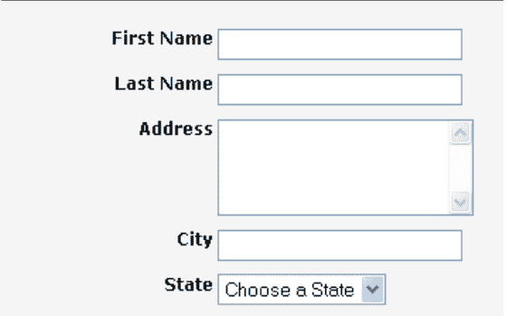

## 账单信息

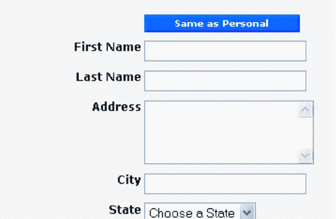

请注意，复制信息时我们需要处理三种类型的表单元素：文本字段、文本区域（用于地址）以及选择框。这是一个非常基础的表单，为了清晰和简洁，我省去了典型的邮政编码、电话号码和电子邮件地址字段（以及其他可能出现的字段），同时在选取框中只列出了三个州。

标记为 "Same as Personal" 的按钮将作为触发器，供用户将他们在上方区域刚刚输入的所有信息复制到下方区域，从而节省输入操作，避免引发抱怨和嘟囔。我们不能让我们的客户抱怨和嘟囔！

以下是表单的 HTML：

```html
<form name="billing">
<h3>Personal Information</h3>
<label for="fname">First Name</label> <input type="text" name="MainDrawer__header__fname" id="fname" size="25" />
<label for="lname">Last Name</label> <input type="text" name="lname" id="lname" size="25" />
<label for="address">Address</label> <textarea name="address" id="address" cols="20" rows="4"></textarea>
<label for="city">City</label> <input type="text" name="city" id="city" size="25" />
<label for="state">State</label>
<select name="state" id="state">
    <option value="0">Choose a State</option>
    <option value="ID">Idaho</option>
    <option value="IL">Illinois</option>
    <option value="IN">Indiana</option>
</select>

<h3>Billing Information</h3>
<input type="button" name="copybtn" value="Same as Personal" onclick="copyToBilling(this.form)" /> / <label for="fnameB">First Name</label>
<input type="text" name="fnameB" id="fnameB" size="25" />
<label for="lnameB">Last Name</label> <input type="text" name="lnameB" id="lnameB" size="25" />
<label for="addressB">Address</label> <textarea name="addressB" id="addressB" cols="20" rows="4"></textarea>
<label for="cityB">City</label> <input type="text" name="cityB" id="cityB" size="25" />
<label for="stateB">State</label>
<select name="stateB" id="stateB">
    <option value="0">Choose a State</option>
    <option value="ID">Idaho</option>
    <option value="IL">Illinois</option>
    <option value="IN">Indiana</option>
</select>
</form>
```

像往常一样，我们使用 LABEL 标签以便提升无障碍性和可用性。我们这里没有使用 TABINDEX，因为在此表单中按 Tab 键的顺序非常直观，按照构建的顺序即可，这完全没问题。

> 提示：您可能会注意到我没有在示例中将表单放入表格进行布局。我还使用了标题下方的下划线以及一些颜色和字体样式。这些都是通过 CSS 实现的。这就是为什么我不需要使用 `<br>` 标签或表格。当然，表格确实可以并且经常被用作布局表单的合理且可接受的方式。我的主要目标是保持示例中的 HTML 代码整洁，以便您能轻松理解正在发生的事情。如果您对这些技术感兴趣，推荐阅读 Mark Newhouse 在 http://www.alistapart.com/stories/practicalcss/ 上的《Practical CSS Layout》一文。

## 构建脚本

### 参数

像往常一样，当处理操作表单的脚本时，我们喜欢将表单作为参数传递以便简化操作。我们最近讨论过抽象函数，但在这种情况下，信息对于此页面来说过于具体，因此无法实现。无论如何，将表单对象作为参数传递会使事情变得更加简单。

```javascript
function CopyToBilling(oForm)
{

}
```

正如所提到的，我们将从账单信息顶部的按钮调用此函数：

```html
<input type="button" name="copy" value="Same as Personal"
onclick="CopyToBilling(this.form);" />
```

### 局部变量

我们有十一个对象需要引用，分别在表单的两个区域中各有五个字段，以及用于触发函数的按钮。在脚本顶部列出十一个变量似乎很多。然而，对于像这个非常具体的脚本，有时没有好的解决方法。您可以尝试花哨一些，可能设置几个数组，但最终会写太多代码。更简单的方法是直接将所有对象声明为变量，这样就完成了。

由于我们已经将表单引用作为参数，引用每个字段就很简单。以个人的名字为例。我们将为每个个人信息字段加上 "p" 前缀，使用表单对象和元素数组来构建每个变量：

```javascript
var pFirstName = oForm.elements['fname'];
```

这很简单。我们还需要再做十次，但至少应该使用一些空白来分隔它们以提高可读性。我们将使用 "b" 作为账单字段的前缀。完成后，变量列表（加上几个恰到好处的注释）应该如下所示：

```javascript
// Personal Info Fields
var pFirstName = oForm.elements['fname'];
var pLastName = oForm.elements['lname'];
var pAddress = oForm.elements['address'];
var pCity = oForm.elements['city'];
var pState = oForm.elements['state'];

// Billing Info Fields
var bFirstName = oForm.elements['fnameB'];
var bLastName = oForm.elements['lnameB'];
var bAddress = oForm.elements['addressB'];
var bCity = oForm.elements['cityB'];
var bState = oForm.elements['stateB'];

// Button to toggle script
var toggle = oForm.elements['copy'];
```

请记住，在脚本**内部**使用 VAR 关键字会将这些变量的作用域**限制在它们所在的脚本内**。它们在脚本外部没有任何意义。它们将被视为"超出作用域"。

现在我们已经具备了执行复制所需的一切。我们有三种不同类型的表单元素需要处理：文本字段、文本区域和选择框。

### 复制文本字段

文本字段将非常简单。还记得我们在"脚本化表单"段落中查看表单元素时，讨论过每个对象的属性和方法。在此情况下，我们用于文本字段的属性是 **value**。value 属性 refers to the VALUE attribute of the element. 所以如果我们看到屏幕上的这个：

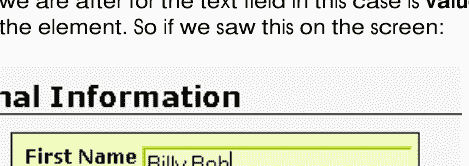

"First Name" 字段的 value 属性等于 "Billy Bob"。如果我们愿意，可以通过脚本动态更改。假设我们想让字段显示 "Sally Jo"。我们可以简单地这样做：

```javascript
var myTextField = oForm.elements['fname'];
myTextField.value = "Sally Jo";
```

然后该字段将获得新值。这就是复制文本字段所需做的全部工作。要将个人名字复制到账单名字，我们只需：

```javascript
bFirstName.value = pFirstName.value;
```

简单！现在这看起来像是一个非常短的行来完成复制一个表单元素的信息到另一个。但请记住，当我们把所有表单元素指定为变量时，已经完成了所有繁重的工作。从现在开始，只需使用变量名及其附加属性就是我们所需要操作的全部内容。

因此，在这种情况下，我们说将账单**名字**字段的**值**（`bFirstName.value`）设置为等于个人名字字段的**值**（`pFirstName.value`）。就这样，值已复制。所以对于其他文本字段（姓氏和城市），我们做同样的事情：

```javascript
bLastName.value = pLastName.value;
bCity.value = pCity.value;
```

### 复制文本区域

接下来是文本区域。既然文本区域与文本字段不同，这里一定需要我们做一些特殊操作，对吧？错了！使用的属性相同，也是 **value**。所以我们有同样类型的代码：

```javascript
bAddress.value = pAddress.value;
```

### 复制州信息

啊哈。但是复制州——那就难了，您说！只是稍微多一点点难度。记住我们的好朋友 **selectedIndex** 属性。它告诉我们单选框中哪个选项当前被用户选中（或者是多选框中的第一个选项）。我们需要做的第一件事是获取该值。一旦我们有了该值，我们就可以让账单选择框拥有相同的 **selectedIndex**，这样它们就会匹配。

如果您还记得前几段关于选择对象的内容，**selectedIndex** 会给我们当前选项在 OPTIONS 数组中的位置。是的……您知道它要来了……第一个选项确实是"0"。

实际上我们还需要一个局部变量，您可能已经注意到我们一开始遗漏了。我们需要个人信息部分中州的当前选择。我们这样获取：

```javascript
var selectedState = pState.selectedIndex;
```

这给了我们一个数组编号，可以用来设置账单州选择框。但是等等——我们应该先确保用户已经选择了州。如果没有，那我们只会复制过来 "Choose a State" 选项。这样当用户提交表单时，他们会收到错误提示。这简直就是糟糕的编程。

在这个单选框的情况下，如果用户没有选择州，selectedState 的值会是——您猜对了——0。我们可以使用一个简单的 IF 控制结构来检查该值，如果为真，则可以警告用户并告诉他们选择一个州。我们将使用便捷的 return 语句在复制之前退出函数。然后他们可以修复问题并再次点击按钮。

当然，我们需要在复制任何字段**之前**执行此操作。

```javascript
if(selectedState == 0)
{
    alert("Please choose a state.");
    return;
}
```


```
}
```

请记住，双等号运算符用于检查相等性，而单等号用于赋值。因此在这种情况下我们使用双等号。如果值确实为 0，则会提示用户选择一个州，并且我们在不复制任何内容的情况下退出函数。

如果一切正常，剩下的唯一工作就是让账单选择框反映与个人信息选择框相同的选择（相同的 **selectedIndex**）。同样地，我们已经设置好所需的所有变量，所以操作起来非常简单：

```
bState.selectedIndex = selectedState;
```

我们仅仅是告诉账单选择框，使其拥有与个人选择框相同的 **selectedIndex**（该值存储在 `selectedState` 变量中）。

完整的函数如下所示：

```
function CopyToBilling(oForm)
{
    // Personal Info Fields
    var pFirstName = oForm.elements['fname'];
    var pLastName = oForm.elements['lname'];
    var pAddress = oForm.elements['address'];
    var pCity = oForm.elements['city'];
    var pState = oForm.elements['state'];

    // Billing Info Fields
    var bFirstName = oForm.elements['fnameB'];
    var bLastName = oForm.elements['lnameB'];
    var bAddress = oForm.elements['addressB'];
    var bCity = oForm.elements['cityB'];
    var bState = oForm.elements['stateB'];

    // Selected state
    var selectedState = pState.selectedIndex;

    // button to toggle script
    var toggle = oForm.elements['copy'];

    // check for valid state selection
    if(selectedState == 0)
    {
        alert("Please choose a state.");
        return;
    }

    // copy fields
    bFirstName.value = pFirstName.value;
    bLastName.value = pLastName.value;
    bCity.value = pCity.value;
    bAddress.value = pAddress.value;
    bState.selectedIndex = selectedState;
}
```

## 结论

如你所见，简单地将值从一个元素复制到另一个元素相对直接。像往常一样，将表单对象作为参数传递给表单，并将我们的对象设置为局部变量，会让事情进展得非常顺利。

我们无法真正地对这个函数进行抽象，但这没关系。正如我之前所说，并非每个函数都能被抽象，尤其是当它们像这个函数一样具体时。可能还有其他实现此函数的方法——例如，你可以在函数调用时将个人状态选择的选中索引作为参数传递。有时这仅仅是个人偏好的问题。你可以自行尝试运行该脚本，看看能想出什么样的变体，甚至可以添加几个新字段来增加趣味性。

## JavaScript：动态禁用和启用表单字段

有时你会遇到具有依赖关系的表单。我的意思是，一个（或多个）字段的值取决于另一个字段的值。例如，你可能不希望用户在填写字段 A 之前就填写字段 B。

解决这个问题的一种方法是动态地隐藏和显示表单字段，我们之前讨论过这一点。然而，有些人不喜欢表单的部分内容在他们面前消失又出现。在这种情况下，你可以选择禁用和启用它们。

### Disabled 与 ReadOnly 的区别

表单输入有两个类似的属性可以解决这个问题。第一个是 `readonly` 属性。ReadOnly 允许你显示一个值但不允许用户修改它。在很多情况下，这能很好地满足你的需求，但我们现在考虑的是一个新表单，而不是显示一个现有表单的结果。

`disabled` 属性则提供了更多功能，即它不能接收任何事件，也不能在浏览器中获得焦点（无论是通过用户还是通过脚本——不过，禁用元素中的任何文本都可以像在 readonly 元素中一样被复制和粘贴）。同样需要注意的一点是，禁用的表单字段在提交表单时**不会**发送其数据。如果你出于某种原因不想发送某个特定字段的数据，这可能是使用该属性的另一个有用原因。

Disabled 有时还会给元素带来一种“变暗”的视觉效果。虽然这是一个不错的特性，但它在不同浏览器中的外观有所不同，因此我们将使用自定义样式来获得想要的外观。

### HTML 表单

让我们从一个简单的 HTML 表单开始，其代码如下：

```html
<body>

<p>Please fill out the form.</p>

<form name="myform">

<table border="0" cellspacing="0" cellpadding="4">
<tr>
    <td width="120" class="inputLabel"><label for="name_l" class="labelEnabled"> First Name:</label></td>
    <td><input type="text" name="name" id="name_l" size="40" class="textBox" /></td>
</tr>
<tr>
    <td class="inputLabel"><label for="last_l" class="labelEnabled">Last Name:</label></td>
    <td><input type="text" name="last" id="last_l" size="40" class="textBox" /></td>
</tr>
<tr>
    <td class="inputLabel"><label for="email_1" class="labelEnabled"> E-mail:</label></td>
    <td><input type="text" name="email" id="email_1" size="40" class="textBox" /></td>
</tr>
<tr>
    <td class="inputLabel"><label for="type_1" class="labelEnabled">User Type:</label></td>
    <td>
        <select name="type" id="type_1" onchange="toggleFields(this.form, 'code', 'code2'); ">
            <option value="">Please select</option>
            <option value="MC">Management</option>
            <option value="Candidate">Candidate</option>
            <option value="Coach">Coach</option>
        </select>
    </td>
</tr>
<tr>
    <td class="inputLabel"><label for="fill_1" class="labelEnabled"> Fill in codes?:</label></td>
    <td><input type="checkbox" name="fill" id="fill_1" onclick="toggleFields(this.form, 'code', 'code2');" /></td>
</tr>
<tr>
    <td class="inputLabel"><label for="code_1" id="code_1" class="labelDisabled">Code:</label></td>
    <td><input type="text" name="code" id="code_1" size="40" disabled="disabled" class="TextBoxDisabled" /></td>
</tr>
<tr>
    <td class="inputLabel"><label for="code2_1" id="code2_1" class="labelDisabled">Code 2:</label></td>
    <td><input type="text" name="code2" id="code2_1" size="40" disabled="disabled" class="TextBoxDisabled" /></td>
</tr>
<tr>
    <td>&nbsp;</td>
    <td><input type="submit" value="Submit" /></td>
</tr>
</table>

<input type="hidden" name="hidSub" value="0"/>
</form>

</body>
```

并不复杂，该表单的显示效果如下表所示：

请填写表单。

| 标签 | 输入 |
|---|---|
| **First Name:** | [__________] |
| **Last Name:** | [__________] |
| **E-mail:** | [__________] |
| **User Type:** | Please select ▼ |
| **Fill in codes?:** | ☐ |
| ~~Code:~~ | [__________] (Disabled) |
| ~~Code 2:~~ | [__________] (Disabled) |
| | [Submit] |

请注意，最后两个文本字段及其相关标签都是灰色地。用户无法在这些字段中输入任何文本，也无法让它们获得焦点。

该文件关联的 CSS 如下：

```css
<style type="text/css">
body {
    font-size: 12px;
    font-family: verdana, sans-serif; }

.labelEnabled {
    text-align: right;
    font-weight: bold;
    color: #000; }

table {
    font-size: 12px; }

.TextBoxDisabled {
    background: #eee;
    border: 1px solid #bbb; }

.textBox { background: #fff; border: 1px solid black; }

.labelDisabled {
    text-align: right;
    font-weight: bold;
    color: #eee; }
</style>
```

### 脚本部分

我们想要的是一种函数，当我们的“触发”字段被填写或操作时，能够切换（toggle）其他字段。然后当用户做出更改时，我们启用这些字段。我们可以用来触发此操作的事件是 **onchange** 事件。

Onchange 非常好用，因为它会检测与页面加载时不同的状态。因此，如果你更改了下拉菜单，事件处理程序就会触发。如果你把它改回来，它会在某种程度上“撤销”自己，你很快就会看到。

首先让我们看看脚本：

```javascript
function toggleFields(oForm)
{
    for(i = 1; i < arguments.length; i++)
    {
        var field = oForm.elements[arguments[i]];
        if(field)
        {
            var oLabel = field.name + "_l";
            if(field.disabled == true)
            {
                field.disabled = false;
                if(field.type == "text") field.className = "textBox";
                document.getElementById(oLabel).className = "labelEnabled";
            }
            else
            {
                field.disabled = true;
                if(field.type == "text")
                    field.className = "TextBoxDisabled";
                document.getElementById(oLabel).className = "labelDisabled";
            }
        }
    }
}
```

请注意，我们发送的唯一参数是包含我们要操作字段的表单。这看起来可能很奇怪（你怎么知道要操作哪些字段？），但我稍后会解释。同时请注意，我们在执行过程中更改了类名，这样当字段启用时它们看起来可以编辑，反之亦然。我们对实际的表单字段标签也做了同样的操作，这是一个很好的额外加分项。

### 调用函数

首先让我们看一个函数调用实际运行的示例：

```html
<select name="type" id="type_l" onchange="toggleFields(this.form, 'code', 'code2');">
```


在我们的 SELECT 菜单中，我们使用上述的 **onchange** 事件处理程序。由于 SELECT 位于我们即将操作的表单中，我们可以使用 **this** 关键字来引用该表单——**this.form**——换句话说，就是"我（SELECT）所在的表单"。

然后你会发现我们发送了两个额外的参数——但是等等！我说过只有一个参数！是的，这里我们可以耍点小技巧。我们永远无法知道有多少个字段需要启用，而且我们希望这个函数尽可能抽象。因此，我们可以构建它来允许切换一个、两个甚至 10 个字段。所以对于每个你想要切换的字段，你将该字段的 NAME 作为参数发送。我们将使用 arguments 数组的魔力来提取它们。

## arguments 数组

请记住，参数（parameters）也被称为 arguments，反之亦然——它们是同一个东西。JavaScript 有一个很好的内置对象叫做 arguments 数组，它对你创建的任何函数都可用。arguments 数组正如其名——它是所有发送给函数参数的数组。我们可以在以下行中看到它的实际运作——这是我们函数的第一行：

```javascript
for(i = 1; i < arguments.length; i++)
```

我们将遍历发送给函数的每个参数/argument，并逐一处理。然而请注意，我们的 FOR 循环从 ONE 开始而不是 ZERO！通常我们会从零开始循环，但在这种情况下，第一个参数是已知的——它将是表单对象（this.form）。我们知道那不是一个表单*字段*，我们不希望对它执行我们的语句，因为这会产生错误。

在这种情况下，arguments 数组将有三个元素。所以我们将循环遍历 2 和 3，这些值将是 'code' 和 'code2'。

现在我们已经设置好了，我们执行以下操作：

```javascript
var field = oForm.elements[arguments[i]];
if(field)
{
```

我们使用 elements 数组设置一个名为 field 的变量，就像我们平时获取表单字段一样。但当然，我们想使用函数调用中提供的字段名（code 和 code2），所以我们将 arguments 数组的当前项放在通常放置名称的位置。那就是：

```javascript
arguments[i]
```

这在第一次循环时会求值为 "code"，第二次循环时为 "code2"。你可以看到使用这个有多方便，永远不必担心需要处理多少个参数。对于许多这样的情况，arguments 数组可以非常强大。

所以做上面的操作等同于做：

```javascript
var field = oForm.elements['code'];
```

以此类推。变量 field 现在保存了我们想要启用的文本字段。请注意，在我们开始操作字段之前，我们使用 **if(field)** 检查它的存在，以确保脚本能看到该字段。如果由于某些错误（例如函数调用中的拼写错误）而看不到它，那么至少用户不会收到错误——块内的代码将不会执行。确实，用户将无法启用他的字段，但你避免了向用户显示杂乱的 JavaScript 错误，这更糟糕。

现在我们想设置一个变量来处理表单字段的关联标签。你可能已经注意到，我们将标签命名为与文本字段完全相同的名称，只是在末尾添加了一个 "_l"。既然我们知道这一点，我们就可以像这样构建当前标签的名称：

```javascript
var oLabel = field.name + "_l";
```

接下来我们想检查字段是否被禁用，这是一个读写属性。这给了我们函数的切换功能。如果它已经被禁用，我们将进入第一个 IF 条件：

```javascript
if(field.disabled == true)
{
	field.disabled = false;
	if(field.type == "text") field.className = "textBox";
	document.getElementById(oLabel).className = "labelEnabled";
}
```

如果字段已经被禁用，我们将 disabled 设为 false，从而启用该字段。接下来我们检查字段的 TYPE。请记住每个表单元素都有一个类型——checkbox、text、password 等。如果这个字段是文本框，我们将 class 设置为一个名为 **textbox** 的新类，显示该字段为启用状态（不再灰显）。如果需要，你可以扩展此函数以处理更多类型表单元素的样式。

最后，我们获取关联的标签并将其 class 更改为显示该标签也已启用。所以在更改 SELECT 菜单后，用户将看到以下内容：

请填写表单。

**名字：**
**姓氏：**
**电子邮件：**
**用户类型：**
**填写代码吗？：**
**代码：**
**代码 2：**

现在字段已启用！请注意下拉菜单现在显示"candidate"而不是"select one"。**code** 和 **code 2** 字段现在可以编辑了。如果用户将下拉菜单更改回默认位置，字段将再次被禁用。（注意：如果你在其中一个已启用的字段中输入一些数据，然后通过将下拉菜单返回默认位置来禁用字段，文本会保留在字段中——但它不会如段落开头所述被表单发送。）

这种切换效果在 ELSE 子句中处理：

```javascript
else
{
    field.disabled = true;
    if(field.type == "text") field.className = "TextBoxDisabled";
    document.getElementById(oLabel).className = "labelDisabled";
}
```

这与 IF 子句中发生的情况相反。Disabled 现在设置为 true，我们应用禁用版本的类，使标签和字段显示为禁用状态。

你可能已经注意到，函数调用也在复选框上。选中和取消选中复选框会给你与使用下拉菜单相同的结果，因此你也可以从复选框触发此函数。

## 结论

对表单有更多控制总是有帮助的，这可以帮助你保护或隔离部分表单，直到某些任务完成。请记住始终验证你的表单，因为当涉及到 HTML 表单时，奇怪的事情总是随时可能发生——良好的验证是必须的。

你可以轻松修改此表单以执行许多操作。看看你是否能弄清楚如何使用此函数作为基础来禁用/启用整个表单。

## 高级表单

本章向你展示如何扩展和改进表单的可用性和可访问性。

### 单页上的多页表单

你经常会面临一个非常长的表单。你当然可以将表单分成两个、三个甚至四个页面。然而，这会带来必须处理先前页面上填写的数据的后果。我们可以做的是使用 JavaScript 使表单看起来好像我们在一系列步骤中移动（以保持表单对用户可管理），同时从不离开页面。然后我们可以只提交一次就完成。

#### 场景

我们假设我们有一个典型的注册表单。我有意使示例表单有些长，但实际上这样的表单仍然可能非常长和乏味。这就是这种技术派上用场的地方。

通常，你可能会有这样的表单：

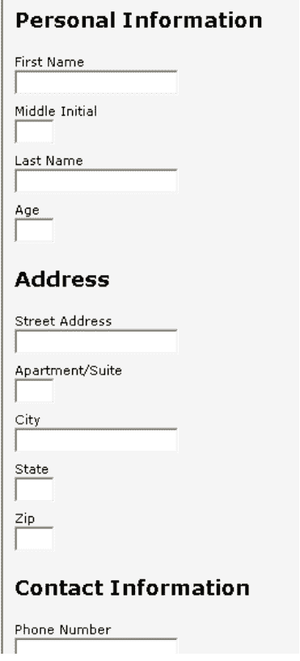

请注意联系信息甚至放不下页面。实际上，此类注册表单甚至更长。当然，我们可以制作一个表格并给自己两列来缩短表单，但通常这会使页面显得杂乱。我们希望为用户提供一个干净清爽的界面。

我们想要的是能提示用户进入下一部分的内容，像这样：

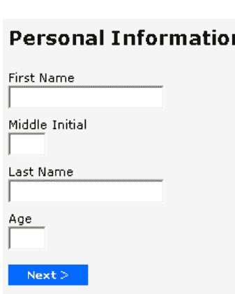

这样做可以给用户提供易于消化的小段内容，然后在完成时提交。我们甚至会提供一种方式让他们知道填写表单的当前阶段。

## 表单

我们需要的第一件事是我们的表单。为了获得我们想要的效果，我们需要将希望成为单独页面的表单的每个部分分开，并将其放在 DIV 标签中。在这种情况下我们将分三个步骤：个人信息、地址信息和联系信息，所以我们需要 3 个 DIV 标签：

```html
<form name="registration">
<div id="personal">
<h3>Personal Information</h3>
<label for="first">First Name</label>
<input type="text" name="first" id="first" size="20" />
<label for="initial">Middle Initial</label>
<input type="text" name="initial" id="initial" size="2" />
<label for="last">Last Name</label>
<input type="text" name="last" id="last" size="20" />
<label for="age">Age</label>
<input type="text" name="age" id="age" size="2" />
<input type="button" value="Next &gt;" name="next" onclick="FormStep(2);" />
</div>
<div id="address">
<h3>Address</h3>
<label for="first">Street Address</label>
<input type="text" name="first" id="first" size="20" />
```


```html
<label for="initial">Apartment/Suite</label>
<input type="text" name="initial" id="initial" size="2" />

<label for="last">City</label>
<input type="text" name="last" id="last" size="20" />

<label for="age">State</label>
<input type="text" name="age" id="age" size="2" />

<label for="age">Zip</label>
<input type="text" name="age" id="age" size="2" />

<input type="button" value="&lt; Back" name="back" onclick="FormStep(1);" />
<input type="button" value="Next &gt;" name="next" onclick="FormStep(3);" />
</div>

<div id="contact">
<h3>Contact Information</h3>
<label for="phone">Phone Number</label>
<input type="text" name="phone" id="phone" size="20" />

<label for="email">Email</label>
<input type="text" name="email" id="email" size="20" />

<input type="button" value="&lt; Back" name="back" onclick="FormStep(2);" />
<input type="submit" value="Register" name="submit" />
</div>

</form>
```

每个 DIV 标签都被赋予了一个唯一的 ID 属性，我们将用它来隐藏和显示所需的区块。我们在每个合适的部分放置了“下一步”和“上一步”按钮，并使用这些按钮来调用我们的函数，该函数将命名为 **FormStep()**。为了实现这一点，我们必须首先设置用户将看到的默认版本，即仅显示个人信息。因此，我们将以下代码放入 CSS 中：

```css
#personal { display: block; }
#address { display: none; }
#contact { display: none; }
```

请记住，**display** 属性控制是否在渲染页面中包含该 HTML 代码。将元素设置为 **none** 意味着它实际上从页面的渲染中被“移除”了——它将不会显示。不要将其与 **visibility** 属性混淆。Visibility 确实会隐藏元素，但它没有从渲染代码中移除——因此元素原有的位置会留下一个空白区域。这就实现了我们在上方屏幕截图中看到的效果。

另一件不错的事情是向用户展示他们在填写表单时处于哪个阶段。请看下面的屏幕截图：

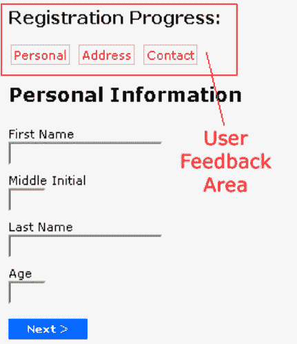

当用户完成每个部分时，我们将进度块更改为绿色。这一部分的代码还使用了一个 ID 和多个 SPAN 而不是 DIV。我们使用 SPAN 是因为它们是内联元素（没有换行），因此它们会全部保持在同一行：

```html
<h4>Registration Progress:</h4>
<span id="per">Personal</span>
<span id="add">Address</span>
<span id="con">Contact</span>
```

我们使用了以下 CSS 对其进行样式设计，随后我们将用脚本对其进行操作：

```css
#per { color: #cc0000; border: 1px solid #ccc; padding: 2px; margin: 2px; }
#add { color: #cc0000; border: 1px solid #ccc; padding: 2px; margin: 2px; }
#con { color: #cc0000; border: 1px solid #ccc; padding: 2px; margin: 2px; }
```

## 设置脚本

在开始构建脚本之前，我们需要告诉它持有表单部分的 DIV 元素，以及持有“步骤”元素的 SPAN 元素：

```javascript
function FormStep(step)
{
	// DIVs holding each step of the form
	var personal = document.getElementById("personal");
	var address = document.getElementById("address");
	var contact = document.getElementById("contact");

	// SPANs to display progress
	var per = document.getElementById("per");
	var add = document.getElementById("add");
	var con = document.getElementById("con");
}
```

该脚本将非常直接且简洁，这总是件好事。我们只需要一个参数，即用户当前所在的“step”（步骤）。我们将根据该参数调整所有内容。因此，当我们第一次调用函数进入步骤 2 时，我们的按钮调用看起来像这样：

```html
onclick="FormStep(2);"
```

因为我们要进入步骤 2。

## 哪个步骤？

我们需要根据发送的步骤编号采取行动。通常的第一反应是使用一些 IF...ELSE 控制语句。虽然那样也可以，但这实际上是使用 SWITCH 控制结构的完美场景。

```javascript
switch(step)
{
    case 1:
        break;

    case 2:
        break;

    case 3:
        break;
}
```

这里我们有了 SWITCH 的骨架。我们向它发送步骤编号，然后根据得到的数字，进入相应的 case —— 1、2 或 3。请注意，“step”是发送的参数，也就是我们给它起的名称 —— FormStep(step)。

## 显示/隐藏正确的步骤

在每个 case 中，我们将有不同的显示和隐藏组合。例如在第一个 case 中，我们希望个人信息 (1) 显示，而地址和联系信息 (2 和 3) 不显示。我们可以通过更改这三个 DIV 的 DISPLAY 属性来实现。

当我们访问此属性时，必须记住它是与你要影响的对象相关的 STYLE 对象的属性，因此格式为：

`object.style.display = "block" | "none"`

因此，对于步骤 1，我们将拥有：

```javascript
case 1:
personal.style.display = "block";
address.style.display = "none";
contact.style.display = "none";
break;
```

现在设置其他两个步骤就很简单了，步骤二将把 address 设置为 block，步骤 3 将把 contact 设置为 block：

```javascript
switch(step)
{
    case 1:
    personal.style.display = "block";
    address.style.display = "none";
    contact.style.display = "none";
    break;

    case 2:
    personal.style.display = "none";
    address.style.display = "block";
    contact.style.display = "none";
    break;

    case 3:
    personal.style.display = "none";
    address.style.display = "none";
    contact.style.display = "block";
    break;
}
```

现在，每当到达某个步骤（无论是通过“上一步”还是“下一步”按钮）时，都会显示正确的界面。

## 更改状态框

我们希望顶部的状态框随步骤同步变化。我们要做的第一件事是将文本颜色从红色改为绿色。我们的 SWITCH 语句已经准备就绪，所以我们只需要将代码放入正确的区块中。

要更改文本颜色，我们执行以下操作：

```javascript
per.style.color = "#c00";
```

注意，我们附加 **color** 的方式与附加 **display** 属性的方式相同。那么，我们的 CASE 现在看起来像这样：

```javascript
switch(step)
{
    case 1:
        personal.style.display = "block";
        address.style.display = "none";
        contact.style.display = "none";

        per.style.color = "#c00";
        add.style.color = "#c00";
        con.style.color = "#c00";
        break;

    case 2:
        personal.style.display = "none";
        address.style.display = "block";
        contact.style.display = "none";

        per.style.color = "#060";
        add.style.color = "#c00";
        con.style.color = "#c00";
        break;

    case 3:
        personal.style.display = "none";
        address.style.display = "none";
        contact.style.display = "block";

        per.style.color = "#060";
        add.style.color = "#060";
        con.style.color = "#c00";
        break;
}
```

请注意，在步骤 1 中，所有颜色都是红色，这是正确的。在步骤 2 中，我们将第一个状态框（个人信息）设置为绿色。在步骤 3 中，我们将步骤 1 和 2 设置为绿色。你会注意到第三个步骤实际上永远不会被设置为绿色，因为那是他们正在处理的最后一个步骤。

## 那么验证怎么处理？

这类表单的验证必须像对待每个步骤都是一个独立表单那样来处理。你不希望面临这样的情况：用户提交表单后，才发现步骤 2 或 3 中存在错误。如果服务器将用户发回页面，他们将最终回到步骤 1。如果错误在步骤 2 或 3 怎么办？

因此，在允许用户进入下一步之前，你会希望验证所有必要的字段。如果存在服务器端验证考虑，且无法（或不宜，如密码字段）进行 JavaScript 验证，那么你可以添加一些额外代码，并在页面加载时调用该函数。你必须让服务器端脚本告诉页面错误发生在哪个步骤。例如，如果错误在第 2 页，你会向页面发送一个变量予以说明。在 PHP 中，你可以将其作为 GET 变量发送：

```php
<?
$errorStep = $_GET['errorStep'];  // set by a server side script
if(!isset($errorStep)) $errorStep = 1;  // set it to one if there is no error
?>
```

然后将该值插入到脚本的 onload 调用中：

```javascript
window.onload = "FormStep(<?=$errorStep?>)";
```

我在上面检查了我的值是否已设置，如果没有，我将值设置为 1，这样如果没有错误，用户将进入第一步（这是正常页面加载时的预期结果）。

## 状态背景颜色

最后，我们也想将状态字段的背景颜色改为绿色。其概念与更改颜色相同：

```javascript
per.style.background = "#f5f5f5";
```

我们将这些行放在颜色设置之后，因此最终的 SWITCH 语句看起来像这样：

```javascript
switch(step)
{
    case 1:
    personal.style.display = "block";
    address.style.display = "none";
    contact.style.display = "none";

    per.style.color = "#c00";
    add.style.color = "#c00";
    con.style.color = "#c00";
    per.style.background = "#f5f5f5";
    add.style.background = "#f5f5f5";
    con.style.background = "#f5f5f5";
    break;

    case 2:
    personal.style.display = "none";
    address.style.display = "block";
    contact.style.display = "none";

    per.style.color = "#060";
    add.style.color = "#c00";
    con.style.color = "#c00";
    per.style.background = "#ccffcc";
```


```javascript
add.style.background = "#f5f5f5";
con.style.background = "#f5f5f5";
break;

case 3:
personal.style.display = "none";
address.style.display = "none";
contact.style.display = "block";

per.style.color = "#060";
add.style.color = "#060";
con.style.color = "#c00";
per.style.background = "#ccffcc";
add.style.background = "#ccffcc";
con.style.background = "#f5f5f5";
break;
}
```

用户在操作过程中看到的效果大致如下：

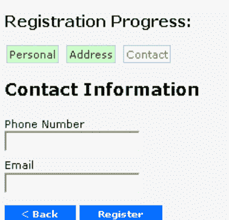

## 完整脚本

完整的脚本如下所示：

```javascript
function FormStep(step)
{
    var personal = document.getElementById("personal");
    var address = document.getElementById("address");
    var contact = document.getElementById("contact");

    var per = document.getElementById("per");
    var add = document.getElementById("add");
    var con = document.getElementById("con");

    switch(step)
    {
        case 1:
        personal.style.display = "block";
        address.style.display = "none";
        contact.style.display = "none";

        per.style.color = "#c00";
        add.style.color = "#c00";
        con.style.color = "#c00";
        per.style.background = "#f5f5f5";
        add.style.background = "#f5f5f5";
        con.style.background = "#f5f5f5";
        break;

        case 2:
        personal.style.display = "none";
        address.style.display = "block";
        contact.style.display = "none";

        per.style.color = "#060";
        add.style.color = "#c00";
        con.style.color = "#c00";
        per.style.background = "#ccffcc";
        add.style.background = "#f5f5f5";
        con.style.background = "#f5f5f5";
        break;

        case 3:
        personal.style.display = "none";
        address.style.display = "none";
        contact.style.display = "block";

        per.style.color = "#060";
        add.style.color = "#060";
        con.style.color = "#c00";
        per.style.background = "#ccffcc";
        add.style.background = "#ccffcc";
        con.style.background = "#f5f5f5";
        break;
    }
}
```

## 总结

`display` 属性是一个非常有用的工具，可以根据特定条件来操控用户所看到的内容。它的优势在于并非仅仅隐藏元素，而是真正将其从页面的文档流中移除，这一点非常实用。你可以将同样的概念应用于基于权限控制的页面，或者任何需要有条件地显示页面部分内容的场景。

## 表单验证：一个 JavaScript 验证类

让我们面对现实：表单验证是一件不得不做的事情。编写良好的验证函数可能既繁琐又耗时，而且如果做得不好，你会陷入极大的麻烦。必须进行表单字段验证的原因有很多。有时你需要字母数字字符，有时只需要纯字母。也许你需要一个数字或某种特定格式的数字，比如电话号码。更不用说电子邮件地址、社会安全号码，以及所有验证中的庞然大物——信用卡号。

如果有一个 JavaScript 类（对象）包含可重复使用的验证方法，岂不是非常有用？这就是我在 JavaScript 对象章节中的目的。既然我们已经对对象有了基本的了解，我们现在可以继续构建一个真正的验证类，这样你就不用一遍又一遍地重复做同样的工作了。

### 验证：要有策略

我们不得不提到，仅靠客户端验证是**不够的**。就像你的 PC 安全策略远不止一个简单的防病毒应用程序一样，你的验证策略也不仅仅是客户端 JavaScript。服务器端也必须确保它处理的是有效数据。这对于电子商务系统和处理大量数据的 Web 应用程序尤为重要。

你在客户端验证数据所做的，是让整个验证策略对于当前应用程序来说更加万无一失且安全，同时通过在浏览器中尽可能多地捕获错误，然后再将数据通过 Web 发送到服务器，从而使整个过程更加顺畅和快速。

### 验证库

如果你有一组可复用的函数库来验证表单字段，那将会非常方便。一旦你构建了库，你甚至可以进一步构建一个验证类。但首先，拥有一些好的验证函数就已经非常有价值了。

我们将简要介绍一个高级的验证概念，那就是正则表达式（简称 RegEx）。正则表达式可以变得极其复杂，因此是非常强大的工具。虽然在一两段文字的篇幅内教授你正则表达式是不现实的，但我们将至少介绍一些简单的模式，让你初步了解它的用法，并展示它在字段验证方面是多么有效。

## 什么是正则表达式？

正则表达式提供了一种匹配模式的方法。这是最简单的解释了。所以如果我有一个包含以下内容的字符串：

```javascript
var myString = "billybobjoelarry";
```

我可以使用正则表达式来查看模式"bob"是否存在于其中（答案是肯定的）。模式匹配之所以强大，是因为你可以用它来发现一些仅使用 JavaScript 的普通字符串方法（如 `substr()`）无法做到的事情，或者用普通方法做起来极其困难的事情。

在验证中，你需要查明的事情包括：

-   只应该出现字母的地方是否出现了数字？
-   只应该出现数字的地方是否出现了字母？
-   这个电话号码的格式是否正确？
-   这个邮政编码的格式是否正确？

模式匹配是你能用来执行这类操作的最强大的工具。我们不会对所有内容都使用正则表达式，但最终你可以这样做。

## 我们如何构建它

我们将要做的是构建一个主验证函数，它会自动为每个字段运行正确的"子"函数。我们通过将子函数名称包含在元素 ID 中并提取它来告诉主函数运行哪个子函数。

其思想是能够拥有一个抽象函数，它可以放置在任何文件中。然后你实际在标签中写入的内容决定了验证规则。你不一定需要一直编辑主函数，而主函数恰恰是最容易变得繁琐的部分。

## 关于验证技术的说明

请记住，验证字段并告知用户出错的方式有很多很多。在我们的例子中，一旦发生错误，我们将立即停止验证并告知用户。一如既往，一个设计良好的表单配合清晰的视觉提示告诉用户该怎么做，将有助于大大减少错误的发生。

## 空字段

最常见的验证之一就是空字段。如果用户遗漏了某个字段，服务器必须将页面返回，并保存用户已填写的所有数据。我们希望在页面被发送出去之前就防止这种情况的发生。验证这一点有些棘手，因为用户可能（但愿是无意地）在表单字段中输入了一个空格。这意味着仅仅检查 `null` 和空字符串是不够的。因此，我们将首先创建三个函数：主验证函数、`isEmpty` 函数和一个去除字符串空白字符的函数。

## 表单

首先我们有一个简单的表单，要求输入用户的名字和姓氏，以及公司名称。两个姓名字段都明确标记为必填项：

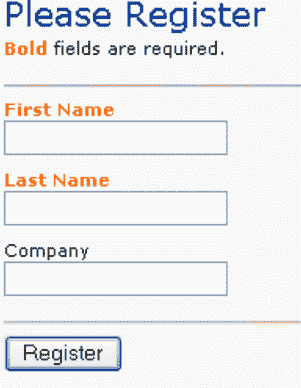

对应的 HTML 如下：

```html
<form name="info" onsubmit="return Validate(this);">

<label for="first_isEmpty" class="required">First Name <input type="text" name="first" id="first_isEmpty" value="" /></label>

<label for="last_isEmpty" class="required">Last Name <input type="text" name="last" id="last_isEmpty" value="" /></label>

<label for="company">Company <input type="text" name="company" id="company" value="" /></label>
<hr />
<input type="submit" name="submit" value="Register" />
</form>
```

有几点需要注意。首先，正如我所说的，**ID** 将决定所使用的验证方式：

```html
id="first_isEmpty"
```

因此，你只需输入字段名称、下划线，然后是验证类型。你可以看到，只需这样就能完成验证，而不需要每次都修改代码，这是一种很好的页面验证方式。

我们将使用表单的 **onsubmit** 事件，配合 **return** 关键字来控制表单的提交。请记住，在大多数情况下，这是验证表单的正确方式。这允许你返回 **false** 来

你的验证将用于防止表单提交。提交按钮的 onclick 处理程序并不能为你提供这个选项！

```
onsubmit="return Validate(this);"
```

另外请注意，表单使用了 `this` 关键字将自身传递给验证逻辑。

## The isEmpty() 函数

让我们首先来看看用于验证字段是否为空的函数。

```javascript
function isEmpty(eString, fieldName)
{
    eString = trimWhitespace(eString);
    // make sure the field contains some kind of data.
    if(eString == null || eString == "")
    {
        alert(fieldName + " must not be blank.");
        isValid = false;
    }
    else
    {
        isValid = true;
    }
}
```

我们要传递的两个参数是：
- 1) 我们正在验证的字符串（即当前文本字段的值）
- 2) 字段的名称（指的是实际的用户友好文本名称，例如“名字”）。

我们将测试该字符串以确保它不为空，如果为空，我们将使用字段名称告知用户哪个字段出了问题。

你首先会注意到，我们立即在字符串上调用了另一个函数：

```javascript
eString = trimWhitespace(eString);
```

记住，在检查 null 或空字符串时，单个空格将被认为“非空”。因此我们需要去除所有空格，接下来的函数就是执行此操作的：

```javascript
function trimWhitespace(strText)
{
    // remove leading spaces
    while (strText.substring(0,1) == ' ')
    {
        strText = strText.substring(1, strText.length);
    }

    // remove trailing spaces
    while (strText.substring(strText.length-1, strText.length) == ' ')
    {
        strText = strText.substring(0, strText.length-1);
    }
    
    return strText;
}
```

这个精巧的小函数将接收那个字符串（同样是当前文本字段的值），并移除所有空白字符。它使用 **while** 条件以相同的方式移除前后的空格。这个条件的意思是“只要...就...”。因此在本例中，意思是“只要我的字符串中还存在（空格）字符”，就执行大括号内的操作。

```javascript
while (strText.substring(0,1) == ' ')
{
        strText = strText.substring(1, strText.length);
}
```

这里测试的条件使用了 **substring()** 方法。其使用语法非常简单：

```javascript
object.substring(indexA, indexB)
```

你告诉该方法查看两个索引之间（包括这两个索引）的字符。所以，如果我有一个名为 **theName** 的变量，其中的字符串是 "bob"，并且执行以下操作：

```javascript
theName.substring(0,1);
```

结果将是 "b"。在上面的 while 条件中，测试的是第一个字符是否确实是一个空格（注意 ' 和 ' 之间的空格）。只要条件成立，就会通过将 strText 变量重置为一个不包含第一个字符的新子字符串来移除空格——请注意它从 1 开始，而不是从 0 开始。只要存在空白字符，它就可以一直执行。所以如果存在 5 个空白字符，它将全部剔除。

第二部分执行的操作几乎完全相同，只不过它是作用于字符串的最后一个字符。有了这个巧妙的技巧，我们可以完成对 isEmpty 函数的分析。

```javascript
if(eString == null || eString == "")
{
    alert(fieldName + " must not be blank.");
    return false;
}
else
{
    return true;
}
```

现在我们得到了一个没有空白字符的字符串（此时它可能变为空），我们测试它是否为 null 或空 ("")。两者可能并非都必要，但加上也没坏处。双竖线 **||** 表示逻辑“或”，意味着如果满足其中任何一个条件，它将评估为 true 并进入大括号。

如果字符串为空，我们会提醒用户不能为空，甚至告诉他们哪个字段出了问题：

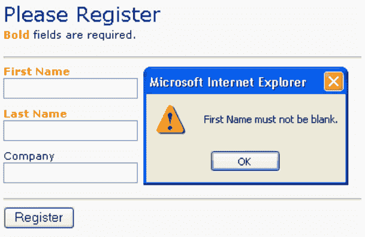

然后我们将名为 **isValid** 的变量设置为 false。如果字符串不为空，我们将该值设置为 true。在验证函数的最后，如果 isValid 为 false，表单将不会提交；反之，如果它是 **true**，则一切正常，可以继续提交。

现在让我们来看看问题的核心——验证函数本身：

```javascript
var isValid;

function Validate(oForm)
{
    // set up error flag
    isValid = true;

    // iterate through all form elements
    for(var i=0; i<oForm.length; i++)
    {
        // get current element
        var currElement = document.forms['info'].elements[i];
        var currID = currElement.id;
        var currName = currElement.name;

        // get validation method (if any)
        var val = currID.split("_");
        var valMethod = val[1];
        var fieldName = currElement.parentNode.childNodes[0].nodeValue;

        // check for an run any validations
        switch(valMethod)
        {
            case "isEmpty":
            var eString = currElement.value;
            isEmpty(eString, fieldName);
            break;
        }
    }
    return isValid;
}
```

这里发生的事情相当多，所以我们将一步步讲解。我应该提到，我们在这里使用了 DOM 方法，这使得该脚本可以在符合 DOM 标准的现代浏览器中运行，并且已经在 IE6、NS7、Mozilla 和 Opera7 中通过测试。

首先，我们接收表单作为参数 (**oForm**)，它是通过 **onsubmit** 事件处理程序发送的。有了表单对象，我们希望遍历整个表单，寻找需要验证的元素。记住，我们在这些元素的名称后标记了 "_isEmpty"。但在阅读此函数时请注意，这里没有与文档的局部具体绑定——它是相对于表单抽象的，这使得它非常灵活。

所以首先我们使用 FOR 循环遍历每个表单元素：

```javascript
for(var i=0; i<oForm.length; i++)
```

这里我直接将附在表单对象上的 length 属性放在 FOR 条件中，而不是预先为其设置变量。这是完全可以接受的，一旦你习惯了脚本编写，这是一种节省空间的好方法。

接下来，我们获取循环中当前处理的表单元素：

```javascript
// get current element
var currElement = document.forms['info'].elements[i];
var currID = currElement.id;
var currName = currElement.name;
```

我们现在处于 **FOR** 循环内部。使用 DOM level 0 引用表单的方法（forms 和 elements 数组），我们可以轻松获取处于索引位置的元素。在第一次迭代中，它是“名字”字段，然后是“姓氏”，接着是“公司”，最后是提交按钮。

使用 ID 属性，我们可以找到该元素的 ID —— 记住，这是我们放置验证标志的地方。那么，我们如何确定该元素是否需要验证，以及需要哪种验证？

```javascript
var val = currID.split("_");
var valMethod = val[1];
var fieldName = currElement.parentNode.childNodes[0].nodeValue;
```

由于 ID 是一个字符串，我们可以对其运行一个小方法，叫做 **split()**。这个方法接收你提供的分隔符，并返回一个去除了分隔符的数组。如果你给它一个像 "1,2,3" 这样的逗号分隔列表，并按逗号拆分，它将给你一个数组：

| 索引 | 值 |
|---|---|
| 0 | 1 |
| 1 | 2 |
| 2 | 3 |

这正是我们需要的。我们对当前 ID（在第一个例子中是 first_isEmpty）进行拆分。这将给我们一个数组：

- First
- isEmpty

在上述代码片段的第二行中，我们获取第二个值 -**val[1]**-，它恰好就是 "isEmpty"！瞧 —— 我们的验证调用找到了！我们将它存放在 **valMethod** 变量中（validation method 的缩写）。现在我们只需要获取字段的名称。这涉及一点 DOM 技巧。在这里使用 innerText 属性会很棒，但 Netscape 不支持它。

但我们拥有当前元素 **currElement**。使用 **parentNode** 方法，我们可以获取它嵌套在其中的 **LABEL** 标签。父节点是包含当前元素的节点。由于 **INPUT** 嵌套在 LABEL 中，因此 LABEL 是父节点。现在，正如你猜到的，label 拥有我们需要文本。在 Netscape 中获取该文本的唯一方法是使用 **childNodes** 方法配合索引，然后使用 **nodeValue** 获取该节点的值。

因为我们知道文本是 label 的第一个节点，所以我们将其指定为 **childNodes[0]**。然后我们简单地附加 nodeValue 来抓取文本。注意这整个过程就像一串长字符串 —— 你只需要不断叠加方法，直到获得你所需的结果。只要方法有效，字符串可以随需要而延长。

现在我们有了最终代码所需的所有信息。

```javascript
switch(valMethod)
{
    case "isEmpty":
    var eString = currElement.value;
    isEmpty(eString, fieldName);
    break;
}
```

尽管目前我们只有一个 case，但我们打算扩展它，因此在这里使用 **SWITCH** 非常合理。我们将能够添加任意数量的函数。我们知道当前元素应该使用哪种验证方法，因此我们在 SWITCH 中查找。在我们的示例中，第一个 case 当然匹配，所以我们进入内部。我们设置一个变量来保存当前元素的值（某个人的名字），并将其发送到上面解释过的 isEmpty() 函数中。

记住，在该函数内部，我们的 isValid 变量根据是否通过了“空白/无空格”测试而被设置为 true 或 false。最后我们需要做的是返回该变量：

```javascript
return isValid;
```


此时，如果发生错误，`isValid` 变量为 false，因此表单不会提交。否则它为 true，表单将提交。

## 结论

我们只是初步了解了如何使用这种验证技术。我们将向函数中添加更多验证，看看它是如何工作的。我们也会在几个地方使用那些令人望而生畏的正则表达式！这里的目的是拥有一个验证函数，每次开始新项目时都不必反复修改，但可以根据需要随意扩展或自定义。添加你需要的验证函数，去掉不需要的。

## 邮箱地址和密码验证

在前一段中，我们构建了一个基础脚本，作为我们库函数的一种网关。这个函数允许我们向表单输入框添加验证函数名称，读取它们并运行正确的验证。如果发生错误，它会将用户返回到表单。我们将向表单添加一个新的验证函数。我们甚至会使用一个简单的正则表达式来进行验证。

回顾一下，这是主要的验证函数：

```javascript
var isValid;
function Validate(oForm)
{
		isValid = true;
		// iterate through all form elements
		for(var i=0; i<oForm.length; i++)
		{
				// get the validation method name from the element ID
				var currElement = document.forms['info'].elements[i];
				var currID = currElement.id;
				var val = currID.split("_");
				var valMethod = val[1];

				// get the field label name
				var fieldName = currElement.parentNode.childNodes[0].nodeValue;

				// call the correct method
				switch(valMethod)
				{
						case "isEmpty":
						var eString = currElement.value;
						empty(eString, fieldName);
						break;
				}
		}
		return isValid;
}
```

**SWITCH** 控制结构允许我们根据需要添加每个新的库函数。我们编写了一个检查空字段的函数。我们将添加一个函数来确保输入了正确的数据。

## 表单

我们再次有一个小型注册表单。让我们添加另一个需要验证的必填字段，一个密码字段。通常对于密码，你只希望允许字母和数字，但不允许特殊字符和空格。这正是正则表达式非常擅长处理的类型。记住，我们不打算在本系列中教授正则表达式，这不是目的。我们会给你足够的内容来激发你的兴趣。如果你想自行开始学习，[javascript kit](http://www.javascriptkit.com) 有一个相当不错的入门介绍。

这是我们扩展后的表单：

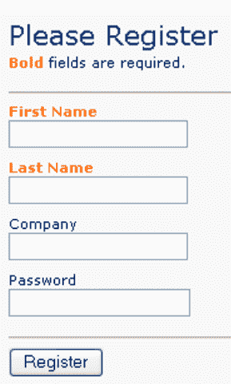

我们添加了密码字段。下面是表单的完整 HTML：

```html
<form name="info" onsubmit="return Validate (this);">

<label for="first_isEmpty" class="required">First Name <input type="text" name="first" id="first_isEmpty" value="" /></label>

<label for="last_isEmpty" class="required">Last Name <input type="text" name="last" id="last_isEmpty" value="" /></label>

<label for="company">Company <input type="text" name="company" id="company" value="" /></label>

<label for="pw_isPassword">Password <input type="password" name="regPassword" id="pw_isPassword" value="" /></label>
<hr />
<input type="submit" name="submit" value="Register" />
</form>
```

再次注意，我们将要使用的验证方法名称添加到表单元素 ID 中，前面加下划线（在上面的示例中以**粗体**显示以便清晰）。所以我们需要将这个方法添加到我们的库中。

## isPassword 方法

除了确保密码只包含合法字符外，我们还应该检查确保它没有被留空。而且我们可能还想确保它包含 6 个或更多字符，因为更长的密码更好。

这是否意味着我们需要额外的函数来做这些？而且我们已经有一个 **isEmpty** 函数了。我们如何从同一个表单元素调用两个函数？添加第二个下划线并针对它进行检查会变得非常混乱！

幸运的是，我们不必做任何这样的事情。我们编写的所有这些函数（我们也称它们为主验证函数的 *方法*）都是自包含的。记得上次我们在 **isEmpty** 函数内部调用了 **trimWhitespace()** 函数。好吧，它们 *都* 可以以类似的方式使用。一旦验证流程运行起来，就有足够的灵活性来处理你需要完成的验证。

为了说明这一点，来看看新的 **isPassword** 方法：

```javascript
function isPassword(eString, fieldName)
{
	isEmpty(eString, fieldName);

	var pwRegEx = /[^a-z\d]/i;
	var passwordValidates = !(pwRegEx.test(eString));

	if(passwordValidates == false)
	{
		alert(fieldName + " must only contain alphanumeric characters.");
		isValid = false;
	}
	else
	{
		isValid = true;
	}

	if(eString.length < 6)
	{
		alert("Password must be a minimum of 6 characters long.");
		isValid = false;
	}
}
```

你会注意到，我们向这个新方法传递了与 isEmpty 相同的参数：表单元素中包含的字符串和表单元素的字段名称（在本例中是 "Password."）。记住，这在我们验证函数的 SWITCH 语句中通过循环调用，所以我们需要将新方法添加到其中：

```javascript
switch(valMethod)
{
	case "isEmpty":
		var eString = currElement.value;
		isEmpty(eString, fieldName);
		break;

	case "isPassword":
		var eString = currElement.value;
		isPassword(eString, fieldName);
		break;
}
```

现在当 "isPassword" 附加到字段 ID 时，isPassword 方法就会被调用。你知道吗，我们做的第一件事就是调用 **isEmpty** 函数！毕竟，密码也不能为空。我们只需传递我们已有的参数，函数就能像上次一样工作。

如果我现在把密码留空，我会收到来自 isEmpty 函数的警告：

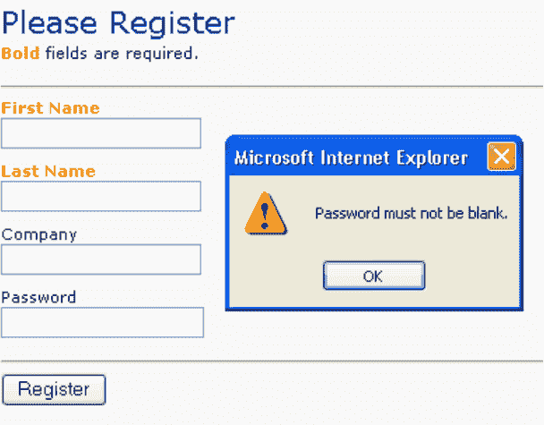

很好，现在已经处理好了。但现在轮到一些正则表达式的难点了！

```javascript
var pwRegEx = /[^a-z\d]/i;
var passwordValidates = !(pwRegEx.test(eString));
```

正则表达式可能非常令人生畏。我知道它们对我来说仍然如此，尤其是当它们变得非常复杂时。但它们工作的根本原因其实并不那么难。你所做的是将变量（**pwRegEx**）设置为一个正则表达式模式。这个模式将在字符串中查找匹配项。在这种情况下，我们的模式如下：

`/[^a-z\d]/i`

"/" 字符指定模式的开始和结束，而 "i" 表示 "ignore case"（忽略大小写），所以它是不区分大小写的。此外，脱字符号 (^) 表示 "not"（因为我们想要匹配字符串中不属于那里的内容！）所以真正的模式是：

`[a-z\d]`

而所有这些都是说"任何字母字符 a 到 z，以及任何数字"。"\d" 是"任何数字"，当然 "a-z" 就是字面上的 a-z。所以我们寻找的是任何 NOT（不是）这些字符的内容。

为此，我们将使用 **test()** 方法。这个方法提供了查看你的模式是否在你发送的字符串中找到匹配项的最佳方式。我们要确保字符串中没有 NOT（非）字母数字的字符。现在这部分可能会变得棘手，因为这里似乎有两个否定（两个否定不是等于肯定吗？）

- 首先，我们的正则表达式中有 NOT（^），表示匹配任何 NOT（不是）字母数字的字符。这就是我们的测试。

- 其次，我们在字符串上调用的 test 方法在 JavaScript 中也有 NOT 运算符 (!)。为什么？test() 将要返回的是一个 true 或 false 值。如果它找到与模式的匹配，它返回 true。听起来很合逻辑对吧？反之，如果没有匹配，它返回 false。

以这个测试字符串为例："453&&3"。它有一个无效字符——"&"。如果我们用正则表达式将它发送给 test() 方法，我们是在说这个：

"请匹配我的字符串（453&&3）中任何 NOT（不是）字母数字的字符。"嗯，有一个字符不是——& 符号。所以我们有一个匹配，对吧？然后 test() 将返回 TRUE。看到问题了吗？从逻辑上讲，我们想要一个 FALSE 值来显示错误。我想我们可以改变 IF 条件来测试 true 结果，但这在逻辑上讲不通，而且那样编程永远不是好主意。所以我们在 test() 调用前添加 NOT 运算符。这样如果有匹配，我们会得到 FALSE 返回。

这是可行的，因为 test() 仍然执行相同的匹配，仍然找到它。但因为 NOT 运算符潜伏在括号外面：

`!(pwRegEx.test(eString))`

你看，这里我们 DO（确实）有匹配，记住我们有一个非法字符。但 NOT 运算符改变了它的含义，变成"检查并确认我们 DON'T（没有）匹配"，所以返回的值是 FALSE。这可能有点难以绕过来，但如果你遇到困难，请重新阅读，并尝试自己移除 NOT 运算符看看会发生什么。实践测试是很好的学习方式。

### 设置 isValid

现在就像之前一样，我们必须设置全局 **isValid** 变量，以防止在出现错误时提交表单。当然，我们还需要告诉用户哪里出了问题。


```
 if(passwordValidates == false)
{
    alert(fieldName + " must only contain alphanumeric characters.");
    isValid = false;
}
else
{
    isValid = true;
}
```

原来如此，如果我们得到 false 值，意味着密码未通过验证，存在与不良字符的匹配。因此我们要告知用户，同样使用字段名称，让他们知道是哪个字段出错了。然后将 isValid 设为 false，表单将不会提交。

否则，一切正常，isValid 为 true。

最后，我们要检查确保字符串长度至少有六个字符。

```
if(eString.length < 6)
{
    alert("Password must be a minimum of 6 characters long.");
    isValid = false;
}
```

这很容易做到，只需简单检查字符串的 length 属性，确保它不小于六。因此，即使用户其他都填对了，但提交了四个字符的密码，这仍然是一个错误：

请注意，这实际上并不会验证输入的密码是否与用户的密码匹配；这需要在服务器端完成，与主用户/密码数据库进行比对。我们所做的是在密码发送到服务器之前拦截格式无效的密码，从而减少等待时间、提交按钮的点击次数以及服务器处理。

## isEmail – 验证电子邮件地址

那么我们再加一个，令人头疼的电子邮件地址。电子邮件地址非常难以验证。不仅地址的合法写法有很多，而且即使电子邮件地址格式有效，也不意味着它是一个真实可用的地址。但至少确保它是某种有效的格式肯定会有所帮助。

哪些格式是有效的？

- [name@domain.com](mailto:name@domain.com)
- [name@domain.info](mailto:name@domain.info)
- [name@domain.ca](mailto:name@domain.ca)
- [name@domain.co.uk](mailto:name@domain.co.uk) 或 org.uk
- [name@domain.win.net](mailto:name@domain.win.net)
- [name.name@domain.com](mailto:name.name@domain.com)
- [name@subdomain.domain.com](mailto:name@subdomain.domain.com)
- [name.name@subdomain.domain.com](mailto:name.name@subdomain.domain.com)

这是一个棘手的列表，而且可能还不完整。但有一个正则表达式可以处理这个问题。

这是我们的函数：

```
function isEmail(eString, fieldName)
{
    var emailRegEx = /^\w(\.?\w)*@\w(\.?[-\w])*\.[a-z]{2,4}$/i;
    var emailValidates = !(emailRegEx.test(eString));

    if(emailValidates == false)
    {
        alert(fieldName + " must be a correctly formatted and valid email address.");
        isValid = false;
    }
    else
    {
        isValid = true;
    }
}
```

这个正则表达式看起来一如既往地令人生畏。我不会解释它的工作原理，但它确实有效！

从这里开始，我们遵循与密码函数完全相同的模式。使用 test() 方法来检查是否匹配了模式，并用 NOT 运算符包围它。同样，我们可以检查 false 值并相应地提醒用户。

同样，你需要将表单字段添加到你的表单中：

```
<label for="email_isEmail" class="required">Email <input type="text" name="email" id="email_isEmail" value="" /></label>
```

注意 ID 后面附加的 "_isEmail"。然后我们将该方法添加到我们的 SWITCH 中：

```
case "isEmail":
var eString = currElement.value;
isEmail(eString, fieldName);
break;
```

## 变量作用域问题

现在，如果你真的在认真关注，或者你一直在测试表单，你会发现我们有一个问题。如果密码字段有错误，而电子邮件字段没有错误——表单会提交。为什么？我们收到了提醒，isValid 被设为 false 了不是吗？

是的，确实如此。但是当电子邮件验证为 true 时，它又被**重置**为 true 了。现在我们遇到了一个变量作用域问题。我们过于频繁地重置 isValid 变量了。我们需要做的实际上相当简单，但这会改变工作方式。用户将不再收到一连串的提醒框显示所有错误，而是会收到**第一个**错误，然后返回到表单中。

在我看来，这也许是一种更好的方式。点击一连串的提醒框可能很烦人，而且一旦你意识到自己犯了错误，通常可以自己修正其他错误。也许你是意外提交了表单。一般来说，用户在表单上只会犯一两个错误。

我们需要做的是在遍历所有表单元素时测试 isValid 变量。如果 isValid 曾经为 false，我们就在那里 RETURN false 并停止表单提交。

一旦我们安全地走出了 FOR 循环，我们就可以 RETURN true 并完成了。这是修改后的验证函数：

```
var isValid;
function Validate(oForm)
{
    isValid = true;
    // iterate through all form elements
    for(var i=0; i<oForm.length; i++)
    {
        // get the validation method name from the element ID
        var currElement = document.forms['info'].elements[i];
        var currID = currElement.id;
        var val = currID.split("_");
        var valMethod = val[1];

        // get the field label name
        var fieldName = currElement.parentNode.childNodes[0].nodeValue;
```

```
// call the correct method
switch(valMethod)
{
	case "isEmpty":
	var eString = currElement.value;
	isEmpty(eString, fieldName);
	break;

	case "isPassword":
	var eString = currElement.value;
	isPassword(eString, fieldName);
	break;

	case "isEmail":
	var eString = currElement.value;
	isEmail(eString, fieldName);
	break;
}
if(isValid == false) return false;
    }
return true;
}
```

请注意末尾加粗的部分，那是我们做出修改的地方。

## 总结

你可以继续添加更多的验证方法，与你的主函数配合工作，直到覆盖表单的所有需求。

就电子邮件而言，如果它不应该为空，你可以简单地在 isEmail() 方法内部调用 isEmpty() 方法。一旦你写好了这个库，就不必反复重写了。有些东西似乎总是需要微调，但大部分工作都会在那里供你起步。这可以节省大量时间。

## *格式化用户表单数据*

当你有一个表单时，用户输入的数据要么不符合你需要的格式，要么看起来不够美观。电话号码就是一个很好的例子。典型的 7 位电话号码看起来像这样 555-1212。用户在网页表单中输入电话号码时，经常会省略连字符，输入 5551212。虽然这并没有什么问题，但用户可能更难发现错误。

你可以做的是在电话号码输入后检查其值。如果省略了连字符，你可以直接添加它们。你可以对 10 位电话号码甚至国际电话号码做同样的事情。当然，你处理的数据越多，难度就会越大。

在本段落中，我们将看看 7 位和 10 位电话号码，以及当用户决定不输入连字符时，我们如何格式化（或屏蔽）它们使其看起来更美观。在这样做的同时，我们可以介绍一些方便的字符串方法，并讨论一个非常基本的正则表达式。

## 基础

与过去一样，我要给你一个脚本，它是进一步功能的构建块。虽然就其所需功能而言，它当然可以独立工作，但它也可以扩展成为更大应用程序的一部分。

例如，我们不会在此脚本中涵盖电话号码的验证。我们过去讨论过验证，如果电话号码是你应用程序中的重要部分，你当然会想要验证它。不过，我们会指出在哪里进行这样的验证。

所以像往常一样，我们有一个简单的表单要处理。在这种情况下，我们假设有一个小型应用程序需要个人信息。我们有以下内容：

这个简单表单包含以下 HTML：

```
<form name="register">
<label for="name">Name</label>
<input type="text" name="name" id="name" value="John Smith" /><br />
```


## 什么是 blur 以及它为何存在？

好问题很好。Blur 恰好是 focus 的相反概念。当某个元素获得焦点时，你的注意力集中在它上面。而当它失去焦点时，你不再关注它，它在你的注意力中就变得“模糊”了。因此，`onblur` 事件处理程序的设计意图是：当焦点离开对象（即当你按 Tab 键或点击离开该项目）时，触发事件处理程序。

这完全符合我们的需求，因为我们希望在用户离开文本输入框时，电话号码就能被格式化。大多数人即使快速扫一眼，也会在提交表单前查看一下。如果电话号码格式规范，他们就能轻松地确认号码是否正确。

## 脚本将如何工作

那么，我们的格式化或掩码脚本应该如何处理数据呢？我们将接受 7 位和 10 位数的电话号码，甚至会在用户提供区号时将其用括号括起来。典型的 3 位和 4 位数字之间会用连字符分隔。

我们在此不会验证电话号码。我过去发现，在 `onblur` 事件上进行验证有时会带来麻烦。你可能会陷入一个奇怪的错误循环，因为用户不理解他们需要重新聚焦到出错的输入框来解决问题。

最好的做法是在表单提交时进行验证。希望如果他们输入了无效的电话号码，比如 6 位数或 11 位数，当号码被重新格式化为一长串没有连字符或括号的数字时，他们会意识到这一点。

## 操作字符串：substring() 方法

为了实现我们的目标，我们需要知道在电话号码字符串中放置连字符和括号的位置。幸运的是，JavaScript 提供了两种不同的方法来拆分字符串。它们很容易混淆（事实上，我一直都会搞混），因为它们的名字非常相似。我们将使用的是 `substring()` 方法，另一个是 `substr()` 方法（看到区别了吧！）。

`substring()` 方法返回字符串中两个指定索引之间的字符，作为一个子字符串（因此得名）。

## 语法

```
object.substring(indexA, indexB)
```

你提供两个参数 `indexA` 和 `indexB` 作为数字。例如，如果我们想从存储在名为 `someVar` 变量中的单词 "spots" 中取出 "pot"，我们可以这样做：

```
var newString = someVar.substring(1,4);
```

从索引 0 开始，当然，"p" 在索引 1 的位置，所以我们取那个字母。对于结束位置，你必须小心。`indexB` 位置是你想要的最后一个字符**之后**的位置。如果我使用了 `1,3`，我们只会得到 "po"。有了这个知识，我们就可以开始编写脚本了。

## 设置

首先，从输入字段获取数据：

```
function FormatPhoneNumber(oPhone)
{
    var strNewPhone;
    var strPhone = oPhone.value;
}
```

变量 `strNewPhone` 将保存我们将要发送回表单的新的、格式化的字符串。所以我们立即初始化它。你会注意到，我们在上面的 `onblur` 事件中使用了 `this` 关键字来传递对象本身（文本字段）。这意味着我们作为参数 `oPhone` 接收到了这个对象。

请记住，`oPhone` 并不保存实际的电话号码，而是保存对象本身。不过请放心，我们只需要获取文本字段的 `value` 属性，瞧，我们就得到了用户输入的电话号码。

## 第二趟车的麻烦

这就是我们遇到问题的地方。如果用户回去修改号码，我们的电话号码值可能包含空格、连字符和括号。然而，我们马上就要添加这些东西了。这意味着我们最终可能得到一个非常混乱的电话号码。

我们必须在每次运行脚本时“清理”电话号码。我们需要移除所有这三种可能破坏电话号码的字符：空格、连字符和括号。这就是正则表达式派上用场的地方！

## 先别崩溃！

我知道你在想什么：“正则表达式很*糟糕*。”它们确实可能如此。但是，如果你能足够熟练地理解基础知识，你就会发现它们有多强大。然后你可以随着学习的深入掌握更多。（嗯，反正这是我的方法！）

但什么是正则表达式？用最简单的话说，正则表达式是一个*模式*。你有想要匹配的某种模式。正则表达式提供了描述该模式并进行测试的工具。此外，还有其他方法允许你将该表达式应用于字符串并返回结果。因此，你可以移除字符、添加字符，并对它们进行各种操作。听起来令人生畏吗？再次说明，它可能如此。但我们只会使用 3 个相当简单的例子来让你入门。

## 正则表达式语法

构建这些模式有各种各样的方法。我不会在这里进行正则表达式教程，我只提供一些要点。如果你是个自讨苦吃的主……我是说，如果你想要更多信息，请查看 [http://www.js-examples.com/javascript/core_js15/regexp.php3](http://www.js-examples.com/javascript/core_js15/regexp.php3)。

好的，我们需要移除连字符，我先给你一个函数，然后再解释。

```
function StripDashes(strValue)
{
    var objRegExp = /-/g;
    return strValue.replace(objRegExp, '');
}
```

哎呀，真难懂！（我的编辑会喜欢这句话的。）好吧，这里发生了什么？说实话，没什么复杂的。首先要知道的是，我们以反斜杠字符 `"/"` 开始和结束我们的模式。所以这两个斜杠之间的内容就是模式。往里看，我们看到……一个孤独的连字符！那就是我们的模式！毕竟，我们想移除连字符。这简直太简单了。但等一下你可能会说，后面的 `g` 是什么意思？嗯，那个小家伙代表“全局”。换句话说，它会在整个字符串中查找这样的值。

好了，我们把这个模式放到了一个变量里。现在正则表达式知道要查找什么了。但我们还需要更多，我们需要将每次匹配到的连字符替换为其他东西——在我们的例子中，是什么都没有——我们想把它移除。

这就是**`replace()`**方法的用武之地。

## Replace()

JavaScript 免费提供这个方法与正则表达式一起使用。它做的事情既简单又强大。它接受一个正则表达式作为第一个参数（在我们的例子中是 `objRegExp`），以及你想将每次模式匹配（每个匹配项）替换为什么（在我们的例子中是空，一个空字符串 `''`）。这在某种程度上有些过于简化了（纯粹主义者会对此提出很多异议），但重点是我们首先要学习如何使用这些东西，而不是正则表达式理论。

现在我们想要返回新的字符串，其中所有匹配到的模式都被替换成了空字符串。所以我们只需要使用 `return` 关键字，它告诉函数向调用者（调用该函数的任何东西）返回一些东西。通常你见过我们返回 `true` 或 `false`。嗯，我们可以返回任何我们想要的值。在本例中，我们将返回我们刚刚运行正则表达式处理后的修改后的字符串。

```
return strValue.replace(objRegExp,'');
```

这是如下操作的更短版本：

```
var fixedString = strValue.replace(objRegExp,'');
return fixedString;
```

声明一个变量、将结果设置为新值并返回它的额外步骤实际上是不必要的。更短的版本只是说“返回此方法计算结果的值”。这里的 `strValue` 是我们正在对其运行脚本的电话号码——我们现在就来看看。

## 调用正则表达式函数

看起来很简单，我们只需要调用这个函数。我们需要做的就是将用户输入的电话号码传递给该函数，然后获得一个修正后的字符串。很简单：

```
function FormatPhoneNumber(oPhone)
{
    var strNewPhone;
    var strPhone = oPhone.value;
    strPhone = StripDashes(strPhone);
}
```

简单但强大——`strPhone` 现在保存着用户输入的电话号码减去所有连字符后的字符串！现在，移除空格也同样简单：

```
function StripSpaces(strValue)
{
    var objRegExp = / /g;  //全局搜索空格
    //将所有匹配项替换为空字符串
    return strValue.replace(objRegExp,'');
}
```

```javascript
function FormatPhoneNumber(oPhone)
{
    var strNewPhone;
    var strPhone = oPhone.value;
    strPhone = StripDashes(strPhone);
    strPhone = StripSpaces(strPhone);
}
```

请注意上面针对空格的新模式 —— 它就是一个空格！现在很简单吧。它的工作方式完全一样。现在我们得到了一个没有连字符或空格的字符串。我们几乎准备好了。最后我们需要的是一个能够清除任何括号（如果存在的话）的模式。这个正则表达式稍微复杂一点：

```javascript
function StripBrackets(strValue)
{
    var objRegExp = /[\(\)]/g; //search for left and right brackets globally
    //replace all matches with empty strings
    return strValue.replace(objRegExp,'');
}
```

请注意**粗体**中的模式。在你因为困惑而想去吃止痛药之前，让我来解释一下。关于这个模式，你唯一真正不了解的是以下部分：

```
[\(\)]
```

一旦听了解释，你会发现这其实并不难理解。你可能已经知道，在 JavaScript 中，反斜杠 `\` 被称为**定界符（delimiter）**。定界符告诉 JavaScript 接下来会出现一个特殊字符。通常情况下，JavaScript 会根据该特殊字符出现的内容环境，认为它在执行某种操作。例如，正则表达式中的 "(" 具有特定含义，它用于帮助描述模式。但我们在这里**不想**将其用于该目的 —— 我们真正想要寻找的是括号字符本身！因此，定界符告诉 JavaScript “忽略这个字符在这里通常的作用，我们想要的是这里的*字面量*字符”。我们实际上是要找到那些括号。

这就解释了每个括号前的反斜杠。到目前为止，该模式是“全局匹配起始和结束括号”。剩下的只有方括号 `[` 和 `]`。它们定义了一个“字符集”。换句话说，它表示“在模式中查找这些字符中的任意一个”。你看，如果没有这些方括号，该模式实际上是在寻找 `"()"`，除非用户在区号中输入了没有任何数字的 `"()"`，否则该模式永远不会匹配。

通过这种方式，该模式将匹配字符串中**任何**位置的**任何**括号。所以即使一个用户放错了位置，我们也能捕捉到它！

我们将此添加到我们的函数中：

```javascript
function FormatPhoneNumber(oPhone)
{
    var strNewPhone;
    var strPhone = oPhone.value;
    strPhone = StripDashes(strPhone);
    strPhone = StripSpaces(strPhone);
    strPhone = StripBrackets(strPhone);
}
```

现在我们拥有的是一个纯数字字符串，没有其他杂质 —— 完美。

## 将内容还原到原位

接下来的部分相当简单。我们将使用 **switch** 控制结构来决定我们拥有的是什么长度的电话号码（7 位或 10 位）。为此，我们需要先获取字符串（电话号码）的长度，以便进行测试：

```javascript
var phoneLength = strPhone.length;
```

然后我们可以在 **switch** 中使用 `phoneLength`：

```javascript
switch(phoneLength)
{
    case 7:
    break;

    case 10:
    break;

    default:
    break;
}
```

因此，根据用户输入的数字数量，我们将进入三种情况之一：7、10 或默认（default）。如果他们犯了错，输入了错误数量的数字，他们将只能得到该字符串（减去任何连字符、空格或括号！）。所以我们先处理这种情况：

```javascript
    default:
    strNewPhone = strPhone;
    break;
```

记得我们在开始时设置了 `strNewPhone` 来保存新格式化的字符串。当验证运行时，它将抓取到错误。不过，希望我们的用户能看到这个看起来奇怪的电话号码并修正他们的错误。

现在我们终于可以使用 `substring()` 了。这次我们要把连字符重新放回 7 位长度的电话号码中：

```javascript
strNewPhone = strPhone.substring(0,3) + "-" + strPhone.substring(3,7);
```

我们在这里做的是将电话号码拆分为子字符串，然后插入连字符。让我们以 555-1212 为例。第一个子字符串匹配 "555"，然后我们**拼接（concatenate）**字符串（意思是添加）一个连字符。这就是 `+ "-" +` 部分。然后我们再次使用 `substring` 加上电话号码的其余部分，即抓取 "1212"。

处理括号的操作是一样的，只是稍微长一点：

```javascript
strNewPhone = "(" + strPhone.substring(0,3) + ") " + strPhone.substring(3,6) +
"-" + strPhone.substring(6,10);
```

在这种情况下，我们以一个括号开始，然后加上区号，结束括号（为了清晰起见加上一个空格），其余部分与上述相同（当然，索引数字不同）。

最后只剩下一件事，那就是将新格式化的（或者对于错误号码则是不格式化的）字符串赋值给文本框：

```javascript
oPhone.value = strNewPhone;
```

大功告成！整个函数看起来像这样（包括正则表达式函数）：

```javascript
function FormatPhoneNumber(oPhone)
{
    var strNewPhone;
    var strPhone = oPhone.value;
    strPhone = StripDashes(strPhone);
    strPhone = StripBrackets(strPhone);
    strPhone = StripSpaces(strPhone);
    var phoneLength = strPhone.length;

    switch(phoneLength)
    {
        case 7:
            strNewPhone = strPhone.substring(0,3) + "-" + strPhone.substring(3,7);
            break;

        case 10:
            strNewPhone = "(" + strPhone.substring(0,3) + ") " +
            strPhone.substring(3,6) + "-" + strPhone.substring(6,10);
            break;

        default:
            strNewPhone = strPhone;
            break;
    }

    //return strNewPhone;
    oPhone.value = strNewPhone;
}

function StripDashes(strValue)
{
    var objRegExp = /-/g; //search for dashes globally
    //replace all matches with empty strings
    return strValue.replace(objRegExp,'');
}

function StripBrackets(strValue)
{
    var objRegExp = /[\(\)]/g; //search for left and right brackets globally
    //replace all matches with empty strings
    return strValue.replace(objRegExp,'');
}

function StripSpaces(strValue)
{
    var objRegExp = / /g; //search for spaces globally
    //replace all matches with empty strings
    return strValue.replace(objRegExp,'');
}
```

## 看看效果

如果用户输入像 999 555 1212 这样的号码，他们会看到类似这样的结果：

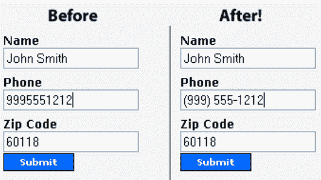

## 结论

你现在可以开始感受到正则表达式的威力了。它们实际上可以变得极其复杂，并执行非常强大的操作。在客户端 JavaScript 中，它们通常被限定在验证和格式化函数中，并且非常适合此类用途。

我向你展示的那些正则其实可以合并成一个模式，但编写起来会更复杂。复杂模式正是正则大显身手的地方，比如验证电子邮件、社会保障号码甚至信用卡号。当然，要正确创建这些模式更具挑战性。

在任何需要字符串部分内容的地方，使用 `substring()` 方法都非常方便。构建它们，然后拆解它们！

## 轻松实现单选按钮脚本

编写复选框（checkbox）的脚本相对简单。但单选按钮（radio button）喜欢在事情中制造麻烦。不要被这吓跑。最终，如果你简单地理解了单选按钮到底是什么，编写那些你一直渴望尝试的脚本将会轻而易举。

### 深入研究单选按钮

你越了解你试图编写脚本的元素，就越容易成功。如果每有一个人认为复选框和单选按钮是可以互换的我就能得到 5 分钱，我现在至少有 5.75 美元了。但事实上，单选按钮与复选框的用途完全不同。

单选按钮是以**组（groups）**的形式运行的。让我再重复一遍，以免大家不清楚：单选按钮是以组运行的！如果你有一个表单中只有一个单选按钮，请给自己打 39 鞭子。然后试着在勾选该按钮后再次勾选它。当你意识到你做不到时，你并不是第一个（也不是最后一个）犯这个错误的人。

单选按钮分组运行是为了允许用户在组中选择**一个**项目，但不能多于一个，也不能少于一个。查看下面的截图，了解简单单选组的正确用法：

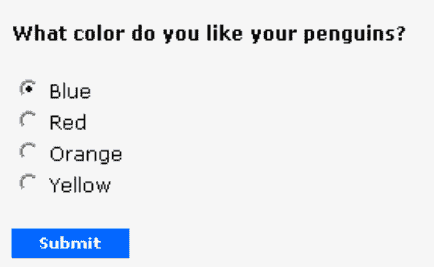

用户可以为他们的企鹅选择一种喜欢的颜色。已经预选了一种颜色，因此表单将发送且仅发送一个值。

让我们看看单选按钮的属性。

**表 1. 单选按钮的属性**

| 属性 | 描述 |
| :--- | :--- |
| checked | 指示单选按钮是否已被勾选（由用户或脚本勾选），类似于复选框。 |
| name | 复选框的名称，即元素的“控件名称”。 |


| type | 表示输入元素的类型，在本例中为单选按钮 |
| :--- | :--- |
| value | 您希望单选按钮具有的值，例如 "blue" 或 "purple"。 |

`checked` 属性非常直观。只需记住，不仅用户可以勾选或取消勾选单选按钮，脚本也可以执行此操作。

`type` 属性与我们在上一个脚本中使用的相同，用于在尝试勾选之前检查输入对象是否为复选框。在这种情况下，`type` 将返回 "radio"。

## 单选按钮的进一步奥秘

让我们直接面对单选按钮脚本编写中的主要问题。如果您始终将单选按钮视为一个组的一部分，这将有助于您记住如何编写该对象的脚本。一旦您开始将其视为一个独立的对象，就很容易产生困惑。

在过去，我们可以通过以下方式获取对象的设定值：

```
document.forms['myForm'].elements['myFormObject'].value;
```

这样做运行良好。因此，如果我们有一个值为 "bob" 的文本框，那么上面的代码行实际上将返回 "bob"。现在，如果我们有以下单选按钮：

```
<input type="radio" name="penguinColor" value="blue"> Blue
```

而我们尝试执行：

```
document.forms['myForm'].elements['penguinColor'].value;
```

我们不会得到 "blue"，而是会得到 "undefined"。困惑吗？这就是为什么我们不把单选按钮视为单个项目，而是将其视为**单选组（radio group）**的一部分。让我们再次在整个表单的上下文中查看上面的单选按钮。

```
<form name="question">
<h5>What color do you like your penguins?</h5>

<input type="radio" name="penguinColor" id="bluePenguin" value="blue"
checked="checked" /> <label for="bluePenguin">Blue</label><br />
<input type="radio" name="penguinColor" id="redPenguin" value="red" /> <label
for="redPenguin">Red</label><br />
<input type="radio" name="penguinColor" id="orangePenguin" value="orange" />
<label for="orangePenguin">Orange</label><br />
<input type="radio" name="penguinColor" id="yellowPenguin" value="yellow" />
<label for="yellowPenguin">Yellow</label><br />

<p><input type="submit" name="submit" value="Submit" class="btn" /></p>
</form>
```

我们再次使用 `LABEL` 标签以提高可访问性。在这样一个只有几个元素的小表单中，`TABINDEX` 属性其实不需要，但请记住在适当的地方使用它。

您首先注意到的可能是所有单选按钮的名称都相同！这正确吗？是的 —— 因为它们都属于一个组。一个组共享同一个名称。它仅在组的上下文中具有值。“Blue”本身没有意义，直到我告诉你它是企鹅的颜色。

## 名称是怎么回事？

因此，因为 "penguinColor" 可能是 4 个值中的一个，JavaScript 返回了 `undefined`。即使其中一个单选按钮被勾选了，它仍然会返回 `undefined`。简单来说，是因为脚本不知道您是指被勾选的单选按钮还是其他三个中的一个，您没有指定您想要 *哪一个* penguinColor 单选按钮。

但该如何实现呢？啊，没错，神奇的数组再次来救场了！单选组 "penguinColor" 内部有一个按钮的数组（当然从 0 开始）。记住，我们可以使用方括号（如 `[]`）来访问数组成员。通常您可以使用数组位置（从 0 到数组中的总数）或项目的名称。在这种情况下，数组中的每个单选按钮并没有单独的名称。不过，正如您将看到的，这不会造成问题。

那么我们如何引用一个单选按钮呢？假设我们要获取上述组中第一个单选按钮的值。如下所示：

```
document.forms['myForm'].elements['penguinColor'][0].value;
```

这将为我们返回 "blue"。请注意，在单选组名称和按钮数组之间不要放置点号（.）。为什么？嗯，那可能是一个超出我们讨论范围的极客技术讨论。试一下，你会发现它确实有效。

## 脚本编写

现在我们知道了如何获取单选按钮的值，我们可以利用它来做一些事情。在一个简单的问卷中，用户会选择一个单选按钮，该值会被发送到服务器等等。让我们假设我们需要该单选按钮的值在页面上执行某些操作。（您可以稍后与您的伙伴讨论这是否是单选按钮的正确用法）。

假设我们要获取所选的颜色，并将其放入一个文本框中，以显示一条关于选择的小消息。这有点像 "填字游戏（mad lib）" 类型的东西，风格大约在 1996 年左右，但它能传达一些基本概念。我们将需要获取单选按钮的值并将其放入文本框中。我们将使用一个带有 `onClick` 事件的按钮来触发我们的脚本。

以下是更新后的表单片段：

```
<form name="penguins">
<h5>What color do you like your penguins?</h5>

<input type="radio" name="penguinColor" id="bluePenguin" value="blue" /> <label for="bluePenguin">Blue</label><br />
<input type="radio" name="penguinColor" id="redPenguin" value="red" /> <label for="redPenguin">Red</label><br />
<input type="radio" name="penguinColor" id="orangePenguin" value="orange" /> <label for="orangePenguin">Orange</label><br />
<input type="radio" name="penguinColor" id="yellowPenguin" value="yellow" /> <label for="yellowPenguin">Yellow</label><br />

<p><input type="button" name="showColor" value="Set Color!" onClick="DisplayColor(this.form);" /></p>

<p>You like <input type="text" name="chosenColor" value="" /> penguins!</p>
</form>
```

现在表单看起来是这样的：

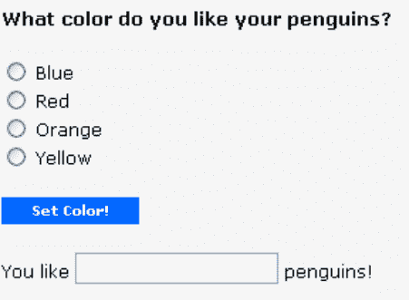

您首先会注意到，我删除了第一个选项（蓝色）的 `checked` 属性。这是因为我们希望用户主动选择一种颜色，而不仅仅是接受已经存在的值。在验证表单时，您可以在允许用户继续之前验证其是否已做出选择。

其次，我添加了一个名为 `chosenColor` 的文本输入框，用于显示用户选择的颜色。同样，这有点像填字游戏。

最后，我更改了点击时触发脚本的按钮文本，并使用 `onClick` 事件添加了函数调用，这简单来说就是“当我被点击时”。

## THIS 是什么？

记住，关键字 `this` 指的是当前对象。我们通过以下方式触发脚本：

```
onClick="DisplayColor(this.form);"
```

由于 `onClick` 事件位于按钮对象中，因此 `this` 指的是该按钮。通过添加 `.form`，我简单地表示“该按钮所在的表单”。将表单作为参数传递始终是一个好主意；它会让事情变得更简单。它还能帮助您抽象脚本，我们以后会讨论这个话题。

## 回到脚本

首先看看脚本：

```
function DisplayColor(oForm)
{
    var displayBox = oForm.elements['chosenColor'];
    var color = oForm.elements['penguinColor'];
}
```

我们需要处理两个对象。第一个是显示颜色的新文本框。第二个是用户通过选择单选按钮所选的颜色。

使用我们作为参数传递的表单引用（`oForm`，这是我喜欢使用的一个缩写，意思是 "object form" 或我的表单对象），我可以轻松地为这两个对象建立引用。

接下来我们需要做的是获取被选中的单选按钮的值。在这种情况下，我们不关心用户是否没有更改默认选择。如果他们没有选择颜色，我们就直接使用“裸”值。

正如您可能已经猜到的（因为我们必须使用数组才能到达选中的按钮），我们需要在这里使用循环，而且将是一个 `for` 循环。要进行 `for` 循环，我们需要知道循环迭代的次数。同样，我们可以使用单选组的 `length` 方法，它会告诉我们数组中按钮的数量。

```
for(i=0; i<color.length; i++)
{

}
```

由于我设置变量 `color` 指向我们的单选组，我可以调用 `color.length` 来获取单选按钮的数量。因为我们有四个单选按钮，`color.length` 将会是 4。

接下来，我们需要检查当前按钮是否被勾选。这将像我们处理复选框那样进行。我们只需要检查 `checked` 属性以查看它是 `true` 还是 `false`。如果是 `true`，我们就知道找到了用户选择的单选按钮。


```javascript
for(i=0; i<color.length; i++)
{

    if(color[i].checked == true)
    {

    }
}
```

希望 `color[i]` 这个引用没有让你感到困惑。请记住，我们通过以下这行代码将变量 "color" 设置为指向单选按钮组：

```javascript
var color = oForm.elements['penguinColor'];
```

因此，"color" 等同于 "oForm.elements['penguinColor']"。末尾的 `[i]` 只是我们当前在 *for* 循环中的迭代次数（或循环编号）。当然，方括号指的是我们单选按钮组的数组。所以，在循环的第一次遍历中，`color[i]` 将等于 `color[0]`，即该组中的第一个单选按钮（默认选中的那个）。

如果它碰巧是被选中的（使用 `==` 运算符检查相等性），那么我们就得到了颜色，因此可以设置一个变量来保存选中的颜色。

```javascript
for(i=0; i<color.length; i++)
{

    if(color[i].checked == true)
    {
         var penguinColor = color[i].value;
    }
}
```

注意我们在这里引入了一个新变量，就在脚本中间来保存那个颜色。虽然这在一定程度上是可以的，但我倾向于将变量定义放在脚本的顶部。将所有定义放在顶部可以使你的脚本更具可读性，这总是一件好事。在这个例子中，我不想让事情变得混乱，所以一直保留到现在。更好的做法应该是在我们脚本的顶部这样写：

```javascript
var penguinColor;
```

这样我就能将所有变量集中在一个地方，事情会更整洁一些。

无论如何，`penguinColor` 现在保存着用户选择的颜色。我们需要做的最后一件事是将文本框的值设置为该颜色。这非常简单：

```javascript
displayBox.value = penguinColor;
```

我们已经将 `displayBox` 定义为我们的文本框。变量 `penguinColor` 保存着选中的颜色。因此，将文本框的值设置为 `penguinColor` 就会将颜色放入框中。以下是完整的脚本：

```javascript
function DisplayColor(oForm)
{
	var displayBox = oForm.elements['chosenColor'];
	var color = oForm.elements['penguinColor'];
	var penguinColor;

	for(i=0; i<color.length; i++)
	{
		if(color[i].checked == true)
		{
			penguinColor = color[i].value;
		}
	}

	displayBox.value = penguinColor;
}
```

## 验证选择

我们还需要处理最后一个环节。如果用户在点击按钮之前忘记选择颜色怎么办？如果我们不处理这种可能性，用户可能会在填字游戏中得到 "undefined" 这个词，这确实会非常草率。

需要做的是确保已经做出了选择。我们可以使用一个我喜欢称之为 **标志** 的新变量。它的用法非常简单。在表单顶部，我们将此标志设置为 false：

```javascript
var choiceFlag = false;
```

这告诉我们，在函数开始时，我们知道尚未做出任何选择。如果我们到达函数的末尾，而 `choiceFlag` 仍然是 false，我们就知道用户忘记选择颜色了，并且可以提醒他们。

现在，当我们知道一个单选按钮被选中时，只需查看函数的这一部分：

```javascript
if(color[i].checked == true)
{
	penguinColor = color[i].value;
}
```

由于当前单选按钮的 `checked` 属性的计算结果为 true，我们知道有一个按钮被选中了。因此，我们可以将标志设置为 true：

```javascript
if(color[i].checked == true)
{
    penguinColor = color[i].value;
    choiceFlag = true;
}
```

所以，如果脚本遍历了单选按钮数组但没有任何按钮被选中，标志将仍然是 false。我们可以在脚本末尾测试这个标志：

```javascript
if(choiceFlag)
{
    displayBox.value = penguinColor;
}
else
{
    alert("You must first choose a color!");
}
```

在我们的 `if` 语句中，我们只需检查 `choiceFlag` 是否为 true。（注意：我们可以写成 `if(choiceFlag == true)`，这会产生相同的结果。如果你觉得这样更好理解，可以这样写，但两种写法含义相同）。如果标志为 true，我们知道已经做出了选择，因此我们设置颜色。否则，我们使用 JavaScript 的 `alert` 方法告诉用户他们必须选择一种颜色。我们不会尝试设置填字游戏的颜色（因为那样会在文本框中得到 "undefined"，这是我们不想要的），我们只是退出脚本而不做任何操作。然后用户就可以回去选择颜色并成功完成填字游戏。

下面是如果用户忘记进行选择时的屏幕截图：

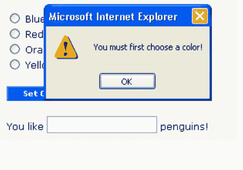

## 结论

只需记住，将单选按钮视为一组来思考，而不是单个项，你就会在成功编写脚本的道路上大有进展。（如果你需要一个单独的开/关控件，你需要一个复选框。请参阅“脚本复选框”部分）。请记住，通过其控件名称引用单选按钮并不能获取其值。控件名称（即 `name="radioButtonName"`）指的是整个组。

获取特定单选按钮的正确方法是访问其在单选按钮组数组中的位置。遍历单选按钮组数组可以让你访问组中的每个按钮，这就是你操作单选按钮的方式。

## 脚本复选框

具有某种管理或内容管理功能的应用程序通常广泛使用表单来控制该功能。应用程序越复杂，控制表单也越复杂。在本节中，我们将研究复选框组以及如何在表单中操作它们。

### 你的新 JavaScript 库

从本节开始，我将保存我们构建的脚本，并将它们放在一个 JavaScript 库中。这将免费供你保留和随意使用。由于我将始终尝试基于真实世界的例子进行构建，希望你既能学到一些关于 JavaScript 的知识，又能最终拥有一个有用的脚本库供你使用。每次要添加另一个脚本时，我都会确保提及它，你可以随时下载最新的库。

### 更仔细地观察复选框

你越了解你试图编写脚本的元素，你就越有可能取得成功。我已经谈到了使用正确语法和正确引用对象的重要性。仅这两件事就能为你省去很多麻烦。

但在尝试编写脚本之前，真正应该做的是完全理解对象本身。同样，这里是你方便好用的 JavaScript 或 HTML 参考资料派上用场的时候。那么让我们确切地看看复选框对象到底是由什么构成的。

请记住，对象具有属性（当前设置，如名称、id 或度量）、方法（操作，如打印、关闭等）和事件处理程序（指定对象如何对用户或浏览器交互做出反应，例如页面加载时或点击时）。

#### 表 1. 复选框的属性

| 属性 | 描述 |
| :--- | :--- |
| checked | 指示复选框是否已被选中（无论是用户还是脚本） |
| name | 复选框的名称，即该元素的“控件名称”。 |
| type | 指示输入元素的类型，在此情况下是复选框 |
| value | 你希望复选框具有的值，例如 "yes" 或 "no"。 |

当一个输入对象，如复选框、单选按钮组甚至按钮作为表单的一部分被提交时，名称/值对会发送到处理该表单的页面或脚本。这意味着，如果我有一个名为 "status" 的复选框，其值设置为 "off"，那么表单将发送：

```
status=off
```

用于该复选框。表单会为其中每个具有名称/值对的对象发送一整套这样的名称值对。因此，复选框的 `name` 和 `value` 属性控制着这些值。

`checked` 属性不言自明，只需记住不仅用户可以选中或取消选中框，脚本也可以（这正是我们在本节脚本中要做的）。

最后一个属性 `type` 是一个非常有用但常被忽视的工具。表单中的每个输入对象，无论是文本框、按钮还是复选框，都关联有一个类型。在这种情况下，逻辑上是：

```
type=checkbox
```

你可以利用这一点，正如我们很快将看到的。

## 复选框事件处理程序

复选框只有一个事件处理程序：`onClick`。当你希望脚本响应用户点击某个复选框时，可以像这样将其设置为 `onClick` 事件处理程序：

```javascript
onClick = "SomeScript();"
```

## 关于使用复选框的简要说明

重要的是要记住，每个表单元素都有特定的用途。你应该小心不要破坏对表单元素的预期约定，因为人们期望它们以某种方式行为。

复选框通常用于在 "on" 和 "off" 或 "selected" 和 "unselected" 类型的设置之间切换值（也称为 "布尔" 类型决策）。当你有一组例如 4 个复选框时，允许其中 2 个（或全部）被选中。而在单选按钮组中，你只应选中一个按钮。


## 用于“是/否”（布尔值）选择的单选按钮：

你喜欢巧克力包裹的菠萝吗？

是  否

## 用于可多选组的复选框：

选择所有你喜欢用巧克力包裹的水果：

- ✅ 草莓
- ☐ 黑莓
- ✅ 蓝莓
- ☐ 越橘

## 我们的脚本

在我们的脚本中，我们将创建一组复选框，用于选择或取消选择某个项目，并配有一个控制复选框，用于在所有复选框的“选中”或“未选中”状态之间进行切换。这样做的目的是通过一次性更改所有复选框的状态，为用户节省时间和点击次数。这不仅是一个很好的脚本示例，也是一个常见的实际应用场景。事实上，如果你有 Hotmail 或 Yahoo! 邮箱账户，你可能已经在用这个功能了。请看下面来自 Yahoo! 的截图：

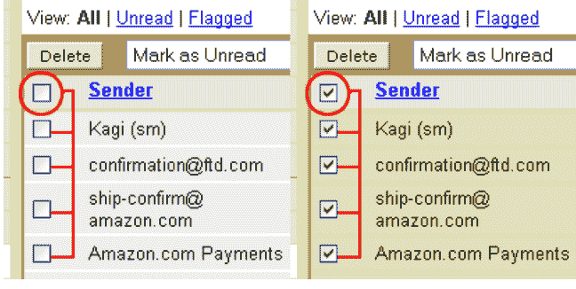

点击“发件人（Sender）旁边的“切换”复选框，可以选中或取消选中邮件列表中的所有复选框。这是一个“全选或全不选”的操作。一个聪明的功能是，如果你已经选中了所有复选框，然后取消选中其中一个，切换按钮会自动变为未选中状态。这很方便，因为可以为你节省一次点击。如果你取消选中了一个（或多个），然后决定再次全部选中，只需点击切换复选框，它们就会全部被选中。如果没有这个功能，你必须先点击一次切换按钮来取消全部选中，然后再点击一次。我们也会将这个功能构建到我们的脚本中。

我们还将包含一个文本框，以代表典型表单中通常除了复选框之外还有其他表单元素。这是我们的脚本需要处理的情况。

## 示例 HTML

下面是我们将要编写脚本的表单：

```html
<html>
<head>
(script goes here)
</head>
<body>

<form name="admin">
<p>哪些用户应该拥有访问权限？</p>
<input type="checkbox" name="allUsers" id="allUsers" value="on"
onclick="ToggleAllUsers(this.form, this.checked);" tabindex="1" />
<label for="allUsers">选择所有用户</label>

<input type="checkbox" name="tom" id="tom" value="on"
onclick="Toggle(this.form.elements['allUsers']);" tabindex="2" />
<label for="tom">Tom</label>

<input type="checkbox" name="dick" id="dick" value="on"
onclick="Toggle(this.form.elements['allUsers']);" tabindex="3" />
<label for="dick">Dick</label>

<input type="checkbox" name="harry" id="harry" value="on"
onclick="Toggle(this.form.elements['allUsers']);" tabindex="4" />
<label for="harry">Harry</label>

<br />

评论: <input type="text" name="comments" size="40" tabindex="5" />
<input type="submit" name="submit" value="Submit" tabindex="6" />
</form>
</body
</html>
```

如你所见，这是一个简单的表单。假设你是一名管理员，需要为这三个用户授予或撤销访问权限。顶部的复选框允许管理员只需勾选“选择所有用户”按钮，即可一次性选中所有用户。

## 可访问表单（Accessible Forms）

你可能在上面的代码片段中看到了一些不熟悉的 HTML。这些代码有助于提高表单的可访问性。每当你为表单编写脚本时，都应考虑可访问性。其中非常有帮助的两点是 `LABEL` 标签和 `TABINDEX` 属性。

`LABEL` 标签在 HTML 4 中引入，并被 IE4+、NS6+ 以及最近版本的 Opera（就主流浏览器而言）所支持。`label` 标签提供两项服务：

- 1. 将描述性文本与表单控件关联起来。
- 2. 增大用于选择表单控件的活动用户界面区域。（这与菲茨定律相关，详见 http://www.astkog.com/basics/firstPrinciples.html#fitts%20law）

第一项服务实际上提供了描述性文本与表单控件之间的链接。实现方法非常简单。你可能知道，`ID` 属性是 HTML 元素的唯一标识符。对于某些 HTML 元素（尤其是表单元素），你可以（有时应该）同时拥有 `NAME` 和 `ID` 属性。如上所示，每个表单元素都有一个与其 `NAME` 属性匹配的唯一 `ID` 属性。

这与 `LABEL` 标签中的 `FOR` 属性相对应。`FOR` 属性应与它所关联的表单控件的 `ID` 匹配，这样 `LABEL` 元素才能正常工作。你实际上是在说：“我想让这个标签*用于（FOR）*具有某个特定 ID 的元素。” 以切换按钮为例：

```html
<input type="checkbox" name="allUsers" id="allUsers"...
```

注意其 `NAME` 和 `ID` 属性相同。然后是对应的 `LABEL`：

```html
<label for="allUsers">Select All Users</label>
```

你可以看到 `FOR` 和 `ID` 属性是如何匹配的。现在该元素的文本描述被“激活”了。现在，用户不仅可以点击表单元素本身，还可以点击文本来操作控件（在本例中，即勾选复选框）。这对于视障人士非常有帮助。

`TABINDEX` 同样很有用。注意表单中的每个元素都有一个带有数字的 `TABINDEX` 属性。该数字对应于按下 Tab 键时表单元素获得“焦点”（即浏览器移交控制权）的顺序。对于像我们这种情况的简单表单，这实际上没有改变默认行为。但在更复杂的表单中，这会非常有帮助。

IE4+ 还允许你为 `LABEL` 元素附加 `ACCESSKEY` 属性。这在本质上是该元素本身的“快捷键”。虽然并非被完全支持，但如果运用得当，它可以成为表单中一个很好的可访问特性。

表单的外观如下：

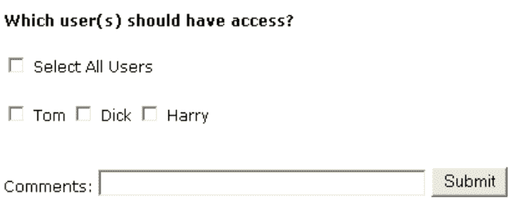

## 编写切换（Toggle）功能的脚本

你可能已经注意到 `onclick` 事件处理程序中已经有了我们的函数，名为 `ToggleAllUsers(this.form)`。注意我们将表单作为参数传递，以便随时可以使用该引用。记住，`this` 关键字简单来说就代表当前对象。复选框是当前对象 (`this`)，而我们需要它所属的表单 (`the form it resides in`)。当该复选框被点击时，我们的函数将被执行。

正如你可能猜到的，选中所有复选框的关键是对表单进行循环，并检查每一个。表单对象有一个 `length` 方法，可以告诉我们元素的总数。然后我们可以利用这个数字来循环遍历表单。让我们先建立这个结构：

```javascript
function ToggleAllUsers(myForm)
{
    var formLength = myForm.length;
    for(i=0; i<formLength; i++)
    {

    }
}
```

记住，`for` 循环有三个条件：初始值（通常设为 0）、循环持续的时间（在我们的案例中，只要 `i` 小于表单的长度 6，我们就继续循环），以及循环的增量值（通常为 1 —— 记得 `i++` 是 `i = i + 1` 的简写）。

现在我们可以在 `for` 循环内部执行 6 次操作，每个表单元素执行一次。问题是，并不是每个元素都是复选框。我们只有四个复选框，另外两个元素是一个文本框和一个提交按钮。我们无法“勾选”它们，因为这些元素没有 `checked` 属性。（即使有，我们也不希望它们被勾选！）

### Type 属性

这时 `type` 属性就派上大用场了。如表 1 所示，复选框的 `type` 属性显然是 `checkbox`。我们可以先检查每个元素是否为正确的类型。如果是，我们就可以勾选它。

记住，访问表单元素最好的方式是通过 `elements` 数组，而该数组本身是 `forms` 数组的一部分。很容易混淆这些数组，所以让我们看一张简单的图表来使其更清晰：

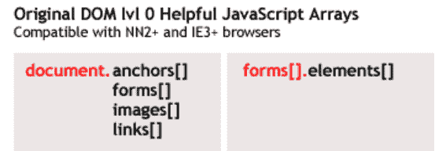

通过数组位置或 `NAME` 属性引用元素：

- `document.images[0]` 或 `document.images['daffyDuck.gif']`
- `document.forms[0]` 或 `document.forms['myForm']`
- `document.forms[0].elements[0]`（不推荐）或 `document.forms['myForm'].elements['myElement']`（推荐）

因此，对 Tom 复选框的正确引用是：

```javascript
document.forms['admin'].elements['tom'];
```

同样，可以通过元素的名称或它在数组中的位置来引用。在这种情况下，我们想使用它在数组中的位置，因为我们不想指向某个特定的元素，而是想通过逐个循环遍历，检查它们是否为复选框，从而指向所有元素。由于我们的 `for` 循环使用了变量 `i`，我们将使用该变量作为数组位置：

```javascript
document.forms['admin'].elements[i];
```

现在，每次循环迭代，我们都会依次获得第一个元素、第二个，直到最后一个。不过我们还可以进一步简化，因为我们已经有了对表单的引用（记得我们把它作为参数传递了）。所以我们可以这样写：

```javascript
myForm.elements[i];
```

要访问 type 属性：

```
myForm.elements[i].type;
```

既然我们已经理清除了疑虑，现在我们将测试每一个元素，看看它是否是一个复选框。请记住使用两个“==”符号，这是用于等值测试的，而不是一个等号（那是用来设置值的）。如果是复选框，那么我们将 checked 属性（该属性表示复选框是否被选中 —— true 或 false）设置为 true，从而将其选中。这将选中我们所有的复选框！

```
function ToggleAllUsers(myForm)
{
    var formLength = myForm.length;
    for(i=0; i<formLength; i++)
        {
            if(myForm.elements[i].type == "checkbox")
            {
                myForm.elements[i].checked = true;
            }
        }
}
```

现在，请亲自尝试一下，点击顶部的复选框，瞧！你所有的复选框都被选中了。

## 请不要只用单一的技巧 (No One Trick Ponies)

嗯，这是一个好的开始，但如果我现在想取消所有选中状态怎么办？我必须再次手动操作一遍。如果我只有 3 个用户，这没什么大问题，但如果有 20 或 30 个怎么办？

如果顶部的复选框实际上是一个开关（toggle），而不仅仅是一个开启开关，那就太棒了。就像你家里的灯光开关可以开启和关闭灯光，而不仅仅是开启。

让我们把顶部复选框的文本从“Select All Users”（选择所有用户）改为“Toggle All Users”（切换所有用户）。

现在，我们如何知道所有复选框是否都被选中了？这出奇地简单。我们知道，如果“Toggle All Users”复选框被选中，那么实际上所有用户都被选中了，对吧？因为当切换复选框被选中时，我们的函数会勾选所有复选框。因此，我们只需测试该复选框的 checked 属性。如果它是 true（它将返回 true 或 false，就像你可以将其设置为 true 或 false 一样），我们就知道需要取消所有复选框的选中状态。如果它是 false，我们需要选中它们。

注意：你现在无疑在问“如果用户全部选中然后取消选中了一个（或多个）怎么办？那么顶部复选框会被选中，但它们并不是全部被选中的。” 正如之前提到的，这将导致我们需要额外点击一次来重新全部选中。

要解决这个问题，我们只需要一个非常简单的函数。我们将在完成主函数之后立即处理它。

传递参数很简单。我们已经在使用 **this** 关键字来传递当前切换复选框所在的表单。我们可以再次使用 **this** 关键字（它表示“我是当前的这个对象”）并将 checked 属性附加到它上面。

```
onclick="ToggleAllUsers(this.form, this.checked);"
```

现在我们的第二个参数发送的是切换复选框的状态，true 或 false。让我们为这个参数起一个有意义的名字，比如 **isChecked**。然后，我们将测试该参数的值。正如我们所说，如果它是 true，则取消所有复选框的选中，反之亦然。在使用 true/false 值时，我们可以简单地像这样测试 true：

```
if(myValue)
```

如果 myValue 为 true，上述表达式将求值为 true，并进入 if 括号内。如果它为 false，它当然会求值为 false，并完全跳过 if 语句。所以如果它是 true，我们将执行之前的操作，将它们全部设为 true。如果不是，我们将添加一个 else 子句并取消复选框的选中。

```
function ToggleAllUsers(myForm, isChecked)
{
	var formLength = myForm.length;
	for(i=0; i<formLength; i++)
	{
		if(myForm.elements[i].type == "checkbox")
		{
			if(isChecked)
			{
				myForm.elements[i].checked = true;
			}
			else
			{
				myForm.elements[i].checked = false;
			}
		}
	}
}
```

请注意，我们更改了函数名称以反映新的功能。试一下这个函数。你现在拥有了一个属于自己的复选框开关！

## 取消选中切换开关

现在，如果用户选中了所有复选框，然后取消选中了一个或多个，我们希望*取消选中*我们的切换开关，以反映正确的情况。这很简单，记住我们只需要将 checked 属性设置为 false 即可取消选中复选框。

因此，在每一个复选框上（当然，除了切换开关本身），我们将添加一个名为 Toggle() 的简单函数，它仅仅是取消选中我们的切换复选框。

```
function Toggle(toggleBox)
{
    toggleBox.checked = false;
}
```

注意，我们将把切换复选框作为参数传递给函数。为什么？有两个原因：

- 1. 这样我们就不必对元素本身进行任何长路径引用，我们只需要将属性 (checked) 附加到元素引用（在本例中为 toggleBox）上。
- 2. 我们最大化了代码的复用。如果我们在这里使用实际的表单元素名称，那么每次你想在其他地方使用此函数时，都必须进去修改名称。而用这种方式就不用了。你随时可以抓取这个函数并在任何应用程序中使用，只需向其传递一个元素名称即可。

因此，像这样添加到每个复选框中：

```
onclick="Toggle(this.form.elements['allUsers']);"
```

在传递元素引用时，我们使用了与在函数中相同的 elements 数组。我们使用无处不在的 **this** 关键字并附加表单（意思是“我想使用这个表单，即此元素所在的表单”），然后使用 elements 数组指定元素的名称。

## 另一个变数 (One More Wrench)

啊，但你会说“如果我的表单中还有另一个复选框，而且它不是用户复选框之一怎么办？” 这是一个极好的问题！让我们通过在文本框后添加以下复选框来修改我们的表单：

```
<input type="checkbox" name="notify" id="notify" value="yes" /> <label for="notify">Notify users of change?</label>
```

这使得我们的表单看起来像这样：

**Which user(s) should have access?**

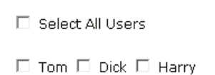

假设这个复选框告诉系统是否应该向所有受影响的用户发送电子邮件，通知他们其访问级别已被更改。这个复选框的值与用户访问复选框完全分开。

问题是，我们的切换函数也会切换这个复选框，而我们不希望这样。一方面，这是一个相当简单的问题。拥有简单的表单会让问题更容易解决。我们将先看一个简单的解决方案，然后针对可能处理更复杂表单的情况提供另一个建议。

既然我们知道不希望影响的复选框名称，我们可以在执行勾选和取消勾选操作时对其进行测试：

```
if ((myForm.elements[i].type == "checkbox") && (myForm.elements[i].name != "notify"))
```

我们添加了一个逻辑与（and）运算符，它表示“首先，看看我是否有一个复选框”并且“如果这个复选框的名称不是 (!=) 'notify'，则继续勾选或取消勾选复选框”。使用逻辑与，必须同时满足两个条件，脚本才会继续执行。

亲自尝试一下。如果你有两个或更多不想勾选的复选框，你可以添加两个或更多 and 条件。

然而，如果你有比如 10 个或 20 个不想勾选的复选框，你肯定不想写 10 个或 20 个 and 条件。到那时，你可能想为自己构建一个不想勾选的复选框名称数组，然后遍历该数组以确保没有勾选它们。不过在这个简单的示例中，这种方法运行良好。

这里是我们 JavaScript 库的前两个函数：

```
/*
ToggleAllUsers:
    当点击切换开关时，勾选/取消勾选所有复选框的函数
Usage:
    在表单中创建一个额外的复选框。这将作为“切换”
(开/关)开关。该复选框应使用 onclick 方法调用该函数。
函数将循环遍历所有复选框，并根据切换开关是否被选中
来勾选/取消勾选它们。
Parameters:
    发送当前表单和切换复选框的状态，
无论是否被选中 (true 或 false)。示例：
onclick="ToggleAllUsers(this.form, this.checked);"
Notes:
    此外，如果你组中有一个不应被勾选的复选框，
你可以在第一个 if 循环中将其排除。如果名称
与你想排除的复选框匹配，则不要进入循环。示例：
if(myForm.elements[i].type == "checkbox") && (myForm.elements[i].name !=
"notify")
Gotchas:
    请注意，isChecked 属性是在点击动作之后被检查的。
    因此，如果你在它未被选中时点击了切换开关，它将发送
TRUE
作为 isChecked 的值。
*/
function ToggleAllUsers(myForm, isChecked)
{
    var formLength = myForm.length;
    // 循环遍历表单中的每个元素
    for(i=0; i<formLength; i++)
    {
        // 如果元素是复选框，则切换它
        if(myForm.elements[i].type == "checkbox")
        {
            // 切换开关现在被选中（在未选中时被点击）
            // 因此全部勾选
            if(isChecked)
            {
                myForm.elements[i].checked = true;
            }
            // 切换开关未被选中，全部取消勾选
            else
            {
                myForm.elements[i].checked = false;
            }
        }
    }
}
```


 Toggle:
    ToggleAllUsers 的配套函数。取消勾选该切换框。
Usage:
    当组内任一复选框被勾选时，取消勾选该切换框。
    如果用户想要重新全选，这将节省一次点击。
Parameters:
    将切换框作为引用传递，以保持函数的抽象性。
*/
function Toggle(toggleBox)
{
    toggleBox.checked = false;
}

# 使用 DHTML 进一步扩展

## 动态修改页面元素

在“旧时代”，Web 开发人员将所有事情——我是说所有事情——都在本地页面中、直接在代码里完成。这意味着从表现层标签到 JavaScript 函数都散布在整个页面中。我们很快发现那是错误的做法。维护工作变成了噩梦，且整个页面的统一性荡然无存。更糟糕的是，这种开发策略很容易引入错误。

近段时间，我们看到了 XHTML 和 CSS 的引入，用于控制网页的表现形式。现在看来，几乎每个人都意识到了将表现层代码与内容本身分离的好处。现在，开发人员意识到，“行为”层（即 JavaScript 层）也可以获得同样的好处。

换句话说，我们能做的不仅仅是将 JavaScript 文件链接进来而非直接写在页面本地。我们可以开始将所有的函数调用和零散的 JavaScript 代码从页面中移除，转而将控制权交给函数本身。这进一步分离了我们的代码层，使我们的 JavaScript 更易于维护且功能更强大。

### getElementsByTagName

如果我们打算将本地页面代码中的 JavaScript 移除，那么我们需要一种强大的方式来大批量地获取元素。幸运的是，DOM Core Level 1 提供了一个名为 **getElementsByTagName** 的工具。W3C 对其解释如下：

> 返回一个 NodeList，包含所有具有给定标签名的元素，顺序与在文档树中进行前序遍历时遇到的顺序一致。

**参数 (Parameters)**
`tname` - 要匹配的标签名称。特殊值 "*" 匹配所有标签。

**返回值 (Return Value)**
一个包含所有匹配元素的新 NodeList 对象。

这听起来非常符合 W3C 的典型风格，带有一定的技术性。首先提到的是 NodeList。NodeList 是一个有序的节点集合——类似于数组。记住数组看起来是这样的：

```
vehicleArray

[0] Car
[1] Truck
[2] Van
[3] Sled
```

你可以使用各种方法来操作这种数组中的数据。有序集合几乎是同样的东西。它简单来说就是一组匹配你作为参数指定的元素的节点集合。随后你可以通过多种方式获取这些信息。这正是我们需要的。

### 示例 1

如果没有示例，这段内容可能不够直观。假设我们要获取页面上所有的 DIV 元素。这比你想象的要简单：

```
var myDivs = document.getElementsByTagName("div");
```

当上述代码执行时，变量 `myDivs` 将持有我们谈到的那个有序集合。本质上，它是一个 NodeList（简单来说就是一组节点列表——在本例中是 DIV），一个接一个地堆叠在一起。如果我们的页面中有 10 个 DIV 标签，那么 `myDivs` 现在就持有一个包含 10 个 DIV 的有序集合。这个集合有一个方法和一个属性可供我们使用。该方法是 `item`，属性是 `length` —— 我们将用到后者。NodeList 或有序集合的长度就像数组的长度一样。

这可能有一点帮助，但让我们转向一个实际案例。Christopher Bruno 在 DMXzone.com 上提出了一个我们可以作为示例的问题：

> “我是个新手，在 DreamweaverMX 的 ASP/Javascript 页面中，我很难理解如何编写一个基础的 if/then 条件语句。我的页面包含一个来自数据库的记录列表。每一行都关联着一张缩略图，其 source 值是通过引用图像位置和名称来设置的，由数据集中的一个值决定，如下所示：

_thumb.jpg" alt="noPhoto" name="listingPhoto" width="36" height="39" border="0">

这运行良好，但如果记录中没有图像（由数据集中的 'webImage' 字段值决定），我需要以不同的方式设置 src 值。”

他的主要问题是，从数据源（假设是一个灯具产品目录）中输出的图像在实际中还没有图片。产品存在且在数据库中，但由于某种原因图片尚未准备好。然而，服务器端脚本仍会为该产品写出一个图像标签，导致用户看到一个破碎的图片链接。这显得不够专业，更好的做法是向他们展示一张“暂无图片”的占位图。所以目前的情况是这样的：

## 目录


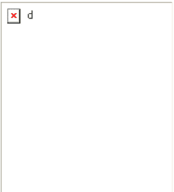


如你所见，中间的那盏灯没有图像。

我不确定为什么要将 "noPhoto" 写作 ALT 值。相反，让我们假设服务器端脚本在没有照片时，不会为 IMG 标签写入 SRC 值或 ALT 值。如果有照片，则 ALT 值被写入为图片的简短描述（例如 'old lamp'）。这为我们提供了所有需要的工作条件。

### 目录页面

让我们先看看上述目录页面渲染后的 HTML 是什么样的：

```
<body>

<h1>Catalog</h1>


</body>
```

请注意，由于没有可用图像，中间的图像没有 SRC 值。同时也没有 ALT 值。我们需要用脚本来修复这个问题。这时 `getElementsByTagName` 就派上用场了。而我们要使用的参数——你猜对了——就是 `img` 标签。

### 开始编写脚本

```
function FixImages()
{
    var pageImages = document.getElementsByTagName('img');
}
```

我们首先需要的是页面中每个图像的引用！嘿，没什么大不了的，对吧？我们只需设置一个变量 (`pageImages`) 并使用 `getElementsByTagName` 方法。注意我们将其附加到 `document` 上——因为我们要获取文档中的图像。现在，`pageImages` 持有了所有图像的引用——在本例中是 3 张图像。

这很好，但我们需要能够对这些图像进行操作。所以我们首先想做的是遍历每张图像，查看其状态并找到操纵它的方法。我们可以使用 FOR 循环来完成，就像处理数组或任何其他项组一样。

```
for(var x=0; x<pageImages.length; x++)
{

}
```

记得之前我们说过 NodeList 有一个 `length` 属性，这当然会给我们 `pageImages` 集合的长度（一个我们已知是 3 的数字）。因此，这个 FOR 循环将运行三次，触达每张图像。

我们还说过，如果产品没有上传图像，SRC 和 ALT 值将为空。因此，为了检测某个图像是否损坏（即不存在），我们可以检查这些属性之一的值。如果它是空的，我们就知道该图像失效了。

我们不想检查 SRC 值，因为即使没有值，JavaScript 也不会将其视为“空”。它能看到直到空位之前的相对路径，所以它觉得还是有东西的。但我们可以检查 ALT 值，因为它完全不与任何路径绑定。因此，让我们在循环中设置一个变量来持有当前项的 ALT 值：

```
for(x=0;x<pageImages.length;x++)
{
    var imgAlt = pageImages[x].alt;
}
```

因为我们在 FOR 循环中，我们使用 `x` 来指示我们要查看集合中的哪个位置，并简单地附加 `alt` 引用。现在 `imgAlt` 持有了当前图像的 ALT 值。首先，让我们添加一个变量来持有“暂无图片”图像的路径：

```
function FixImages()
{

var noImgPath = "no-image.gif";
var pageImages = document.getElementsByTagName('img');

     for(x=0;x<pageImages.length;x++)
     {
           var imgAlt = pageImages[x].alt;
     }

}
```

由于我的所有图像都在同一个文件夹中，所以实际上没有路径。当然，你会填写服务器上该图像的实际路径。现在，让我们测试 ALT 值是否为空：

```
function FixImages()
{

var noImgPath = "no-image.gif";
var pageImages = document.getElementsByTagName('img');

     for(x=0;x<pageImages.length;x++)
     {
           var imgAlt = pageImages[x].alt;
           if(imgAlt == '')
           {
                 pageImages[x].src = noImgPath;
           }
     }

}
```

请注意，这一切都发生在 FOR 循环内部——因为我们需要检查**每一张**图像。我们设置了一个简单的 IF 语句来检查 `imgAlt` 变量是否为空。如果是，脚本将进入


请注意，在任何 HTML 代码中都没有出现过 JavaScript —— 除了指向我们课程源码的 script 标签之外。我们不需要在图像、body 标签或任何类似的地方放置事件处理程序。因此，当需要维护或调整此脚本时，您只需打开 JavaScript 文件，进行修复，然后就完成了。该修复将作用于每个调用该函数的页面。简洁且高效。

这不仅是一种有助于您更轻松维护事物的干净方式，也是一种更智能的编程方式。编写这样一个脚本所花费的时间和精力，比使用旧方法要少得多。而且它功能更强大。您会发现我们可以通过这种方式实现很多功能 —— 动态地向页面链接添加事件、动态添加内容等等。通过一点创造性思考，您应该能够想到几种利用此方法来清理代码的方式。

## 使用事件监听器（Event Listener）

当 DOM 崭露头角且 DHTML 成为一种可行的 Web 技术时，我们似乎获得了很多新工具。这些新工具的伟大之处在于它们非常有用。缺点是，其中一些工具迫使您深入研究 JavaScript，并且可能需要学习一些新东西。换句话说，您必须走出舒适区。相信我，这是一件好事！

事件监听器是在引入 W3C 事件模型时添加的。但首先，让我们确保知道什么是事件 —— 究竟什么是事件？有人曾说“没有事件就没有脚本”，这在很大程度上是正确的。看看您的脚本和 HTML 页面，您会注意到，为了运行函数，您是通过事件来触发它们的。

## 什么是事件？

事件允许用户与网页进行交互，并允许 JavaScript 对该交互做出反应。事件是让 JavaScript 真正使页面具有交互性的关键。JavaScript 需要一种方式来检测用户在页面中执行了什么操作，然后做出相应的响应。当用户与页面交互时，就会产生一个事件。有时，事件是由页面本身产生的，而不是用户。例如，load 和 unload 事件是由页面触发的，而非用户（尽管用户可能导致了页面的加载/卸载，但在技术上是由页面触发的）。

## 那么事件处理程序（Event Handlers）呢？

那么 JavaScript 如何允许我们处理这些事件呢？自从 Netscape 2 以来，我们一直能使用事件处理程序来处理事件。您肯定浏览过 HTML 页面的源代码，并看到许多附加在 HTML 元素上的事件，例如 onMouseover、onFocus 和 onChange。尽管我们正在向“非侵入式 JavaScript”事件模型迁移（在这种模型中，这些处理程序将不会直接出现在 HTML 中），但概念仍然相同，且它们的运行方式也一样。这些事件处理程序告诉 JavaScript 在事件触发时该做什么。

我们仍然会将事件处理程序附加到元素上，只是我们会以更高效的方式来执行。我们现在能够使用新方法将事件处理程序直接附加到元素上，这将使我们的 HTML 保持整洁 —— 并使我们的脚本更强大。例如，假设您想在一个元素上使用两个事件。使用新方法，您可以添加一个，监听该事件并处理它，然后移除第一个并添加第二个。如果用旧方法，这将极其困难。

我们唯一需要处理的问题是不同的事件模型，因为 IE 和 Mozilla 的处理方式不同。不过不用担心，我们将使用对象检测（object detection），这会像吃甜点一样简单。

## 注册事件处理程序

现在有了这些背景知识，我可以告诉您，有 3 种方法可以将事件处理程序注册（或附加）到元素上。第一种方法不涉及事件监听器，但我们还是会看一下。另外两种分别是 IE 和 Netscape 的事件监听器模型，这是本段的核心内容。

## 使用事件属性绑定将事件处理程序附加到元素

附加事件处理程序的一种简化方式是将其直接作为元素的属性添加（称为事件属性绑定，因为您将事件绑定到了对象属性上）。例如：

```javascript
function Foo()
{
    var myElement = document.getElementById("foo");
    foo.onclick = FooFunction;
}

function FooFunction()
{
    //do some stuff when the user clicks
}
```

这实际上是一种跨浏览器兼容的附加事件处理程序的方法。您可能会好奇为什么我们不使用这种方法，而要使用不跨浏览器兼容的事件监听器。原因是这种代码不够优雅、不够强大，也不够灵活。随着您越来越多地处理事件，您会亲自发现这一点。不过，这仍然比在 HTML 代码中使用旧事件处理程序的方法要好。

另外请注意，正如我们之前所说 —— FooFunction 没有加括号 —— 这一点**非常**重要。我们要告诉事件处理程序在事件触发时执行哪个函数。如果我们加上括号 —— 函数（FooFunction）将立即执行，而该函数的**结果**将被附加到元素上。这不是您想要的！把省略括号想象成“指向”函数本身，而不允许函数执行。

## 我们的朋友：匿名函数

我们之前讨论过这个，但值得重复一遍，因为它是工具箱中另一个好用的工具。如果我们有一个非常小的函数（比如我们的 FooFunction，可能只有一行代码），那么这就是使用匿名函数的绝佳场景。它之所以被称为匿名函数，是因为它没有名字（合情合理吧？）。这里有一个示例：

```javascript
function Foo()
{
    var myElement = document.getElementById("foo");
    foo.onclick = function() { this.backgroundColor = `#ffc`; }
}
```

这样更干净，处理起来也更容易。我们可以使用 `this` 关键字来引用当前对象（foo）。对于小型函数，请记住这一点。匿名函数还允许我们在需要时在一个元素上运行两个函数：

```javascript
function Foo()
{
    var myElement = document.getElementById("foo");
    foo.onclick = function() { functionOne(); functionTwo(); }
}
```

在继续之前，让我们先回顾一下。请注意，我们还没有谈到事件监听器 —— 我们仍然在讨论附加事件处理程序的第一个方法，即事件属性绑定。而这个使用匿名函数的第二种方法，实际上只是事件属性绑定方法的一个变体。当您将事件属性（如 onclick）设置为函数引用时，您可以传递一个具名函数或一个匿名函数。结果是一样的 —— 函数在事件触发时执行。

匿名函数的妙处在于，您不需要为了处理一个小任务而在代码的其他地方定义一个单独的函数。它使您的代码保持聚合，且更容易阅读，因为处理逻辑就在您设置它的地方。只需注意不要在复杂逻辑中过度使用匿名函数 —— 这会让您的代码更难维护。

总结一下，事件属性绑定方法的工作方式如下：

```javascript
element.on eventName = functionName;
```

或者使用匿名函数：

```javascript
element.on eventName = function() { /* handler code */ }
```

这两种方法都跨浏览器兼容，这是一个巨大的优点。缺点是，使用此方法，每个元素的每个事件只能附加**一个**处理程序。如果您在同一个元素上设置两次 onclick，第二次赋值将覆盖第一次。这就是事件监听器模型发挥作用的地方 —— 它们允许您将多个处理程序附加到同一个元素的同一个事件上。这正是我们接下来要探讨的内容。

## addEventListener 方法 (W3C 模型)

W3C 事件模型提供了一个名为 `addEventListener` 的方法。该方法允许您将事件处理程序附加到元素，而不会覆盖现有的处理程序。基本语法如下：

```javascript
element.addEventListener("eventType", handlerFunction, useCapture);
```

三个参数分别是：

- **eventType** – 您想要处理的事件名称（不带 "on" 前缀），例如 "click"、"mouseover"、"keydown" 等。
- **handlerFunction** – 当事件触发时应该被调用的函数的引用。
- **useCapture** – 一个布尔值，指定处理程序应该在捕获阶段（true）还是冒泡阶段（false）被调用。在大多数情况下，您将其设置为 false。

这里有一个示例：

```javascript
function init()
{
    var myButton = document.getElementById("myButton");
    myButton.addEventListener("click", function() {
        alert("Button was clicked!");
    }, false);
}

window.onload = init;
```

`addEventListener` 的巨大优势是您可以将多个处理程序附加到同一个元素的同一个事件上。每个处理程序将按添加顺序执行：

```javascript
myButton.addEventListener("click", handlerOne, false);
myButton.addEventListener("click", handlerTwo, false);
```

当按钮被点击时，`handlerOne` 和 `handlerTwo` 都会运行。尝试用事件属性绑定方法来实现 —— 您做不到！

要移除使用 `addEventListener` 添加的事件处理程序，请使用 `removeEventListener` 方法。您必须传递相同的三个参数：

```javascript
myButton.removeEventListener("click", handlerOne, false);
```

请注意，这只有在您传递完全相同的函数引用时才会生效。如果您在添加处理程序时使用了匿名函数，则无法移除它，因为您没有该函数的引用。这就是为什么具名函数有时更受欢迎的原因之一。

## attachEvent 方法 (IE 模型)

Internet Explorer（9 版本之前）不支持 `addEventListener`。相反，IE 使用自己的方法 `attachEvent`。语法略有不同：

```javascript
element.attachEvent("on" + eventType, handlerFunction);
```

请注意，在使用 `attachEvent` 时，事件名称中需要包含 "on" 前缀。这里有一个示例：

```javascript
myButton.attachEvent("onclick", function() {
    alert("Button was clicked!");
});
```

与 `addEventListener` 类似，`attachEvent` 允许您将多个处理程序附加到同一个事件。然而，存在一些重要的区别：

- 您必须在事件名称中包含 "on" 前缀（例如，用 "onclick" 代替 "click"）。
- 使用 `attachEvent` 附加的事件处理程序按反序调用 —— 最后添加的第一个执行。
- `attachEvent` 处理程序内部的 `this` 关键字指向 `window` 对象，而不是元素。如果您的处理程序依赖于 `this`，这可能会导致意外行为。

要移除使用 `attachEvent` 添加的处理程序，请使用 `detachEvent`：

```javascript
myButton.detachEvent("onclick", handlerOne);
```

## 跨浏览器事件处理

由于不同的浏览器支持不同的事件模型，我们需要一种能够在这两者中都能运行的代码编写方式。这就是对象检测发挥作用的地方。我们只需检查哪个方法可用并使用它：

```javascript
function addEventHandler(element, eventType, handler)
{
    if (element.addEventListener)
    {
        element.addEventListener(eventType, handler, false);
    }
    else if (element.attachEvent)
    {
        element.attachEvent("on" + eventType, handler);
    }
    else
    {
        element["on" + eventType] = handler;
    }
}
```

此函数首先检查 `addEventListener`（W3C 标准），然后回退到 `attachEvent`（用于旧版本 IE），最后回退到事件属性绑定方法。这确保了我们的代码可以在所有浏览器中运行。

同样，我们可以编写一个函数来移除事件处理程序：

```javascript
function removeEventHandler(element, eventType, handler)
{
    if (element.removeEventListener)
    {
        element.removeEventListener(eventType, handler, false);
    }
    else if (element.detachEvent)
    {
        element.detachEvent("on" + eventType, handler);
    }
    else
    {
        element["on" + eventType] = null;
    }
}
```

有了这些辅助函数，您就不用担心用户运行的是哪个浏览器了。这些函数为您处理了差异，使您能够编写干净、跨浏览器兼容的代码，而无需在脚本中散布大量特定于浏览器的逻辑。

你并不经常需要这样做，但如果需要的话，这会非常方便。

## 使用事件监听器

附加事件处理程序最强大且现代的方式是事件监听器。我们需要了解两种模型：IE 版本和 Netscape/Mozilla/Gecko/W3C 版本。我们先来看 Netscape 版本。该方法名为 `addEventListener()`，它有三个参数：

### Netscape/W3C 模型

```javascript
element.addEventListener("eventType", listenerFunc, useCapture);
element.removeEventListener("eventType", listenerFunc, useCapture);
```

如你所见，我们可以添加和移除事件监听器。这些方法的命名恰如其分，因为它们确实做到了名副其实：它们"监听"事件。

### 解释参数

传递给方法的第一个参数是"eventType"。换句话说，我们要监听的是哪个事件——去掉"on"限定词。因此，如果我们监听的是 `onMouseOut`——那么 eventType 就是 "mouseout"，**全部小写**——非常重要。

其次，我们有"listenerFunc"，它代表监听器函数——你要为这个事件处理程序指向哪个函数？这里的规则同样适用：不要使用括号。最后一个参数"useCapture"与事件冒泡有关，这超出了我们的讨论范围。这是一个布尔值 true/false。目前我们将其设为 false。对于许多或大多数应用来说，false 本来就是你的自然默认值。

因此，如果我们要用事件监听器重写上面的代码，它将如下所示：

```javascript
function Foo()
{
    var myElement = document.getElementById("foo");
    myElement.addEventListener("click", FooFunction, false);
}

function FooFunction()
{
    // 当用户点击时执行一些操作
}
```

现在 `foo` 已经附加了事件处理程序 `onClick`，当用户点击该元素时，将以 `FooFunction()` 函数作为响应。你可能已经猜到，我们也可以在这里使用匿名函数：

```javascript
function Foo()
{
    var myElement = document.getElementById("foo");
    myElement.addEventListener("click", function() { 
        this.style.backgroundColor = '#ffc'; 
    }, false);
}
```

### IE 模型

IE 模型非常相似。术语有所不同，微软使用"attach"和"detach"。格式如下：

```javascript
element.attachEvent("eventName", functionRef);
element.detachEvent("eventName", functionRef);
```

### 解释参数

微软使用"eventName"而不是 type。而且 IE 希望看到完整的事件名称，**包括** "on" 部分，所以你需要把这两者区分清楚。第二个参数应该相当明显——"functionRef"是处理我们事件的函数。将其称为"ref"或引用实际上是有道理的，因为正如我们解释的那样，我们所做的就是引用一个函数，而不是当场执行它。继续我们的 IE 示例，它看起来是这样：

```javascript
function Foo()
{
    var myElement = document.getElementById("foo");
    myElement.attachEvent("onclick", FooFunction);
}

function FooFunction()
{
    //当用户点击时执行一些操作uo
}
```

微软模型有两个问题。第一个与事件冒泡和设置捕获有关，这同样超出了我们的范围。但第二个有点烦人，它使得 `this` 关键字毫无用处。问题在于事件处理函数是被引用的，而不是被复制的，所以 `this` 关键字始终指向 window。因此，在使用 IE 版本的脚本中，如果你需要使用 `this` 关键字，要么必须想办法解决这个问题，要么回到事件属性绑定的方式。虽然这可能令人烦恼，但通常你会发现可以绕过这个问题，而且人们越来越多地使用事件监听器。

## 将两者结合起来

所以我们应该构建一个函数，确定我们需要哪个版本的事件监听器并相应地执行。使用对象检测，我们可以这样做：

```javascript
function addEvent(myObject, myEventType, myFunction)
{
    // 针对 Netscape 类型的浏览器
    if(myObject.addEventListener)
    {
        myObject.addEventListener(myEventType, myFunction, false);
        return true;
    }
    // 针对 IE
    else if (myObject.attachEvent)
    {
        var r = myObject.attachEvent('on' + myEventType, myFunction);
        return r;
    }
    // 对于其他不受支持的情况返回 false
    else
    {
        return false;
    }
}
```

如你所见，我们使用对象检测——而不是有缺陷的浏览器检测——来决定运行哪个代码分支。`addEvent()` 函数有三个参数：我们要附加事件处理程序的对象、事件类型（如 mouseover 或 click）以及处理该事件的函数名称。

因此，只有 Netscape 类型的浏览器会进入 `if(myObject.addEventListener)` 代码分支，只有 IE 浏览器会进入 `else if (myObject.attachEvent)` 代码分支。如果两者都不受支持（某种移动设备或不支持的浏览器访问了该页面），那么什么都不附加，我们在最后的 else 子句中直接返回 false。

每个子句中的语句对你来说应该是有意义的，因为我们刚刚已经讲过了。我们调用适当的方法并附加/添加事件处理程序。这里唯一新的是 return 语句。

return 语句的存在只是为了让调用函数知道某个元素是否被添加或未被添加。调用函数可能会也可能不会使用返回值，但如果有需要，它就在那里。显然，如果用户代理不支持这两种方法中的任何一种，并且进入了第三个子句，false 会自动返回。

### 这将如何使用？

那么在"现实世界"中，这个 `addEvent()` 函数会如何使用？让我们从我目前正在从事的一个实际项目中取一段代码片段：

```javascript
this.addElements = function addElements()
{
    // 查找所有附加了 span 的元素
    var pageSpans = document.getElementsByTagName("span");
    for(var i=0; i<pageSpans.length; i++)
    {
        // 但只抓取 'help' span
        if(pageSpans[i].className == "help")
        {
            // 附加事件
            addEvent(pageSpans[i], 'mouseover', show);
            addEvent(pageSpans[i], 'mouseout', hide);
            addEvent(pageSpans[i], 'focus', show);
            addEvent(pageSpans[i], 'blur', hide);
        }
    }
}
```

我在我们编写的一个应用程序中有一个所谓的动态帮助提示系统。我们想要一种方式来测试一个帮助提示系统，该系统将通过 mouseover 和 mouseout 触发。上面的代码是我写的一个类的一部分，它动态构建打开系统的链接和帮助提示框本身，还有其他功能。它的工作原理是在页面中搜索带有 "help" 类的 SPAN 元素。如果脚本找到了这样的 SPAN 元素，你猜它会怎么做？它使用 `addEvent()` 将事件处理程序附加到 SPAN 包围的区域，使其可用作帮助提示。

第一行是将 `addElements` 函数添加到我的类中。它构建了一个集合（正如我们一直在讨论的，使用 `getElementsByTagName()`）的 SPAN 标签。IF 循环检查带有 "help" 类的 SPAN，如果有，则运行 `addEvent()`——附加 mouseover 和 mouseout 事件，并将它们绑定到 hide 和 show 函数（以及 blur 和 focus 事件）。

我们可以快速组合一个小例子来向你展示到底发生了什么。为了简单起见，我们提供一些帮助类正在构建的东西：

```html
<h1>Page Title</h1>
<span class="help"><p>Paragraph One</p></span>
<p>Paragraph Two</p>

<div id="helpdiv" style="border: 1px solid black; background: cyan; padding: 10px; display: none;">This is a help box</div>
```

注意 HTML 中没有 JavaScript。（通常我们也会使用样式表，而不是内联 CSS！）添加两个简单的函数来隐藏和显示我们的帮助容器：

```javascript
function hide()
{
    var oContainer = document.getElementById("helpdiv");
    oContainer.style.display = "none";
}
function show()
{
    var oContainer = document.getElementById("helpdiv");
    oContainer.style.display = "block";
}
```

现在我们甚至可以使用 `addEvent()` 来启动我们的 span 搜索函数，该函数在页面加载时添加事件处理程序：

```javascript
addEvent(window, "load", addElements);
```

现在整个东西就是一个可运行的示例。将鼠标悬停在第一段上，看看会发生什么。*Voilà！* 完全不需要在 P 标签上使用任何 JavaScript——这一切都在你的脚本中发生。它可能不够漂亮，但你应该能够认识到这些优秀方法的强大之处。

## 结论

使用事件监听器是另一种充分利用 DOM 的有力方式，也是实践不唐突 JavaScript 的好方法。开始养成在行为层——也就是在你的脚本本身中——构建功能的习惯，而不是在表现层中，你会发现这样做的好处极大地提升了你的工作。


 ## 为数据表格添加行高亮效果

在 HTML 中使用表格有其适当的时机和场景。其中之一就是当你有逻辑上适合放在表格中的行数据时。例如，员工列表、订单列表或库存报表。对于包含大量数据的大型表格，逐行浏览并读取正确信息可能会比较困难。

我们将构建一个脚本，当用户鼠标悬停在表格行上时，该行会“高亮”显示。我们将使用 DOM 来实现这一功能，并且会在页面加载时运行脚本，以保持代码的整洁。

## 数据表格

首先，我们需要一个数据表格。为此，我将使用我有一位最喜欢的球员——我小时候（1970 年代）效力于芝加哥白袜队的迪克·艾伦。下面是他的职业生涯统计数据，放置在一个边框为 1 的、完全不适合的表格中。

| SEASON | TEAM | G | AB | R | H | 2B | 3B | HR | RBI | BB | SO | SB | OBP | SLG | AVG |
|---|---|---|---|---|---|---|---|---|---|---|---|---|---|---|---|
| 1963 | Phillies | 10 | 24 | 6 | 7 | 2 | 1 | 0 | 2 | 0 | 5 | 0 | .280 | .458 | .292 |
| 1964 | Phillies | 162 | 632 | 125 | 201 | 38 | 13 | 29 | 91 | 67 | 138 | 3 | .382 | .557 | .318 |
| 1965 | Phillies | 161 | 619 | 93 | 187 | 31 | 14 | 20 | 85 | 74 | 150 | 15 | .375 | .494 | .302 |
| 1966 | Phillies | 141 | 524 | 122 | 166 | 25 | 10 | 40 | 110 | 68 | 136 | 10 | .396 | .632 | .317 |
| 1967 | Phillies | 122 | 463 | 89 | 142 | 31 | 10 | 23 | 77 | 75 | 117 | 20 | .404 | .566 | .307 |
| 1968 | Phillies | 152 | 521 | 87 | 137 | 17 | 9 | 33 | 90 | 74 | 161 | 7 | .352 | .520 | .263 |
| 1969 | Phillies | 118 | 438 | 79 | 126 | 23 | 3 | 32 | 89 | 64 | 144 | 9 | .375 | .573 | .288 |
| 1970 | Cardinals | 122 | 459 | 88 | 128 | 17 | 5 | 34 | 101 | 71 | 118 | 5 | .377 | .560 | .279 |
| 1971 | Dodgers | 155 | 549 | 82 | 162 | 24 | 1 | 23 | 90 | 93 | 113 | 8 | .395 | .468 | .295 |
| 1972 | White Sox | 148 | 506 | 90 | 156 | 28 | 5 | 37 | 113 | 99 | 126 | 19 | .420 | .603 | .308 |
| 1973 | White Sox | 72 | 250 | 39 | 79 | 20 | 3 | 16 | 41 | 33 | 51 | 7 | .394 | .612 | .316 |
| 1974 | White Sox | 128 | 462 | 84 | 139 | 23 | 1 | 32 | 88 | 57 | 89 | 7 | .375 | .563 | .301 |
| 1975 | Phillies | 119 | 416 | 54 | 97 | 21 | 3 | 12 | 62 | 58 | 109 | 11 | .327 | .385 | .233 |
| 1976 | Phillies | 85 | 298 | 52 | 80 | 16 | 1 | 15 | 49 | 37 | 63 | 11 | .346 | .480 | .268 |
| 1977 | Athletics | 54 | 171 | 19 | 41 | 0 | 5 | 31 | 24 | 36 | 1 | 1 | .330 | .351 | .240 |
| Totals | | 1749 | 6332 | 1099 | 1848 | 320 | 79 | 351 | 1119 | 894 | 1556 | 133 | .378 | .534 | .292 |

这有些难以阅读，尤其是当你想获取表格中间某个值时更是如此。为行添加交替颜色当然会有所帮助。快速回顾一下，我们使用以下脚本：

```
function ColorRows(tableID)
{
    var oTable = document.getElementById(tableID);
    var oRows = oTable.getElementsByTagName("TR");
    var modRemainder;
    var newClass;

    for(var i=0; i<oRows.length; i++)
    {
        if(i == 0) continue;
        modRemainder = i % 2;
        newClass = (modRemainder == 0) ? "rowColor1" : "rowColor2";
        oRows[i].className = newClass;
    }
}
```

这将在**rowColor1**和**rowColor2**这两个类之间交替颜色。此外，我们将编写一个**init()**函数，并通过 body 的**ONLOAD**事件处理器来调用它，以运行我们的脚本：

```
<body onload="init();">..
------------------------------

function init()
{
    ColorRows('dickAllen');
}
```

因此，我们放在 init() 函数中的所有内容都会在页面加载时执行。根据你为行样式设置的颜色，你应该会得到类似这样的效果：

| SEASON | TEAM | G | AB | R | H | 2B | 3B | HR | RBI | BB | SO | SB | OBP | SLG | AVG |
|--------|------|---|---|----|---|---|----|----|----|-----|----|----|----|-----|-----|-----|
| 1963 | Phillies | 10 | 24 | 6 | 7 | 2 | 1 | 0 | 2 | 0 | 5 | 0 | .280 | .458 | .292 |
| 1964 | Phillies | 162 | 632 | 125 | 201 | 38 | 13 | 29 | 91 | 67 | 138 | 3 | .382 | .557 | .318 |
| 1965 | Phillies | 161 | 619 | 93 | 187 | 31 | 14 | 20 | 85 | 74 | 150 | 15 | .375 | .494 | .302 |
| 1966 | Phillies | 141 | 524 | 112 | 166 | 25 | 10 | 40 | 110 | 68 | 136 | 10 | .396 | .632 | .317 |
| 1967 | Phillies | 122 | 463 | 89 | 142 | 31 | 10 | 23 | 77 | 75 | 117 | 20 | .404 | .566 | .307 |
| 1968 | Phillies | 152 | 521 | 87 | 137 | 17 | 9 | 33 | 90 | 74 | 161 | 7 | .352 | .520 | .263 |
| 1969 | Phillies | 118 | 438 | 79 | 126 | 23 | 3 | 32 | 89 | 64 | 144 | 9 | .375 | .573 | .288 |
| 1970 | Cardinals | 122 | 459 | 88 | 128 | 17 | 5 | 34 | 101 | 71 | 118 | 5 | .377 | .560 | .279 |
| 1971 | Dodgers | 155 | 549 | 82 | 162 | 24 | 1 | 23 | 90 | 93 | 113 | 8 | .395 | .468 | .295 |
| 1972 | White Sox | 148 | 506 | 90 | 156 | 28 | 5 | 37 | 113 | 99 | 126 | 19 | .420 | .603 | .308 |
| 1973 | White Sox | 72 | 250 | 39 | 79 | 20 | 3 | 16 | 41 | 33 | 51 | 7 | .394 | .612 | .316 |
| 1974 | White Sox | 128 | 462 | 84 | 139 | 23 | 1 | 32 | 88 | 57 | 89 | 7 | .375 | .563 | .301 |
| 1975 | Phillies | 119 | 416 | 54 | 97 | 21 | 3 | 12 | 62 | 58 | 109 | 11 | .327 | .385 | .233 |
| 1976 | Phillies | 85 | 298 | 52 | 80 | 16 | 1 | 15 | 49 | 37 | 63 | 11 | .346 | .480 | .268 |
| 1977 | Athletics | 54 | 171 | 19 | 41 | 4 | 0 | 5 | 31 | 24 | 36 | 1 | .330 | .351 | .240 |
| Totals | | 1749 | 6332 | 1099 | 1848 | 320 | 79 | 351 | 1119 | 894 | 1556 | 133 | .378 | .534 | .292 |

这 definitely 更像回事了。更容易逐行阅读并找到我们需要的数据。然而，我们可以更进一步，这也是这个脚本的重点。让我们高亮显示用户鼠标悬停的行。

## 构建脚本

我们将把这个新脚本附加到我们的 init() 函数中，这样它就会在 body 的 onload 事件期间执行。你无法对浏览器窗口中尚未加载到内存的对象运行脚本。最佳做法是等待页面完全加载，而这就是 onload 事件所提供的功能。

所以首先，我们来构建函数的框架，并将其添加到 init() 中：

```
function HighlightRow()
{
    // 当用户鼠标悬停时高亮数据行
}
```

将其添加到 init() 中：

```
function init()
{
    ColorRows('dickAllen');
    HighlightRow();
}
```

如果你想知道的话，"dickAllen"是我们表格的 ID，这正是 ColorRows() 函数知道要给哪个表格上色的方式。现在基础已经就位，我们可以开始构建脚本了。

## 使用 getElementsByTagName()

我们将再次使用有效的 DOM 方法**getElementsByTagName()**。该方法将标签名作为参数，并返回该标签的数组。然后你可以处理该标签（或对象）数组，并对它们执行操作。

既然我们在这里想要处理表格行，我们当然会向该方法传入"TR"：

```
function HighlightRow()
{
    var oRows = document.getElementsByTagName("tr");
}
```

此时，你可能想到的第一个问题是："如果我的文档中有其他不在数据表格中的行怎么办？"好问题！很高兴你能想到这一点。事实上，我们在尝试高亮它们之前，会进一步精确描述我们想要的行，正如你马上就会看到的。但现在我们知道，我们已经将所有 TR 元素放入了一个名为**oRows**的变量中。

## 遍历我们需要的行

正如我们刚才提到的，如果有不在我们数据表格中的其他行怎么办？首先，让我们设置 FOR 循环：

```
function HighlightRow()
{
    var oRows = document.getElementsByTagName("tr");
    for(var i=0; i<oRows.length; i++)
    {
    }
}
```

这里需要注意一下变量作用域。你可能已经注意到，我们在 ColorRows() 函数中使用了变量名"oRows"，在循环中也使用了变量"i"。你需要注意这类问题。如果一个变量只具有*局部作用域*——即只有声明它的函数才能使用它——那么你应该始终在该变量前加上关键字**VAR**。这意味着该变量只能在该函数内使用，其他函数无法识别它。

这将允许你在两个函数中都使用"oRows"。你应该注意在函数中使用相同名称的变量。你可以在 FOR 循环中使用任何字母。在循环中始终包含 VAR 关键字（即 var i=0）总是一个好主意。如果你意外地在不同函数的两个循环中使用了相同的字母，这会为你省去很多麻烦。

回到脚本，我们像往常一样，使用 oRows 数组的 length 属性作为继续循环的条件。

现在我们必须确保只影响我们需要的行。我们将使用一个**IF**条件来实现，检查我们正在使用的两个高亮类：

```
function HighlightRow()
{
    var oRows = document.getElementsByTagName("tr");
    for(var i=0; i<oRows.length; i++)
    {
        if ((oRows[i].className == "rowColor1") || (oRows[i].className == "rowColor2"))
        {
        }
    }
}
```

"**||**"表示逻辑或。如果任一条件评估为 true，则 IF 条件评估为 true。请注意，每个类名比较都在其自己的括号内（**oRows[i].className == "rowColor1"**），以确保它们在 OR 条件之前先被评估。这就像你在学校数学课上学到的一样。如果让比较存在歧义，那么你一定会遇到错误。

由于我们的 ColorRows() 函数已经将所有 rowColor1 或 rowColor2 类应用到了数据表格的所有行上（除了标题行被跳过），我们知道只会获取到我们想要的那些行！

## 对象与属性

请记住，我们数组中的每一行实际上都是一个对象。我们知道数组中的每个行对象都附加了一个类，因为我们刚刚运行了 ColorRows() 函数。"className"是 JavaScript 中返回对象类名的属性。

要读取对象的属性，我们使用点符号（dot notation）：

```
Object.propertyName
```

这就是为什么当我们执行 **oRows[i].className** 时，JavaScript 会返回与该对象关联的类名。这里的 "i" 当然是 FOR 循环的索引位置。

## 现在来点神奇的

接下来的部分会变得有趣，请密切关注！我们需要一种方法，将一个函数绑定到每一行的某个事件上。什么样的事件？什么样的函数？

嗯，我们感兴趣的事件是 **onmouseover** 和 **onmouseout**。这两个词的含义不言而明。通常，你会像这样将函数分配给图像等元素的其中一个事件：

```

```

但在表格行上我们没有这种便利。我们需要做的是使用**函数字面量（function literal）**。

## 函数字面量

这个术语听起来像是那些“噢不，那是什么……”的奇怪名称之一。虽然名字听起来很唬人，但它们使用起来相当简单。什么是函数字面量，为什么我们需要它？请看下面这行代码：

```
oRows[i].onmouseover =
```

在 FOR 循环中，我们希望将每一行的 onmouseover 和 onmouseout 事件设置为一个能够高亮当前行的函数。你的第一反应可能是这样做：

```
oRows[i].onmouseover = HighlightCurrentRow(oRows[i]);
```

但这只会让你心烦意乱，并收到一个 "not implemented" 异常。出于一些我们不深入探讨的原因（部分是因为我也不完全理解！），你不能以这种方式将函数附加到对象的事件处理程序上。

不过不要担心，因为**函数字面量**即将来救援！有时它们也被称为匿名函数。无论如何，函数字面量看起来和普通函数完全一样，唯一的区别是它没有函数名称。除此之外，我们将把这个函数直接放在代码中间，而不是将其分离出去。让我们来看看：

```
function HighlightRow()
{
    var oRows = document.getElementsByTagName("tr");
    for(var i=0; i<oRows.length; i++)
    {
        if ((oRows[i].className == "rowColor1") || (oRows[i].className == "rowColor2"))
        {
            oRows[i].onmouseover = function() {
                this.className = "rowHL"; // rowHL 是一个新的高亮类
            }
            oRows[i].onmouseout = function() {
                this.className = "rowColor1"; // 我们的行颜色之一
            }
        }
    }
}
```

这里发生的事情实际上相当逻辑化。你在告诉当前行的 onmouseover 事件运行一个函数。然后，你立即像往常一样定义该函数。在某种意义上，你是在将一个无名函数分配给一个对象。

现在，每当用户将鼠标移入和移出当前行时，JavaScript 将非常乐意地执行这个小小的“函数字面量”！

## 但这个怎么解释？

现在，你可能已经注意到我们在函数字面量中没有使用 oRows[i].className，而是使用了关键字 **this**。为什么？

如果你从变量作用域的角度来思考，就明白了。你定义了一个新函数。尽管这个新函数被附加到了你想要使用的对象上（事实上就在同一行），但那个变量仍然在作用域之外。函数字面量不知道 oRows[i] 是什么，因为它没有在函数内部定义。而且我们不能在没有大量冗余代码的情况下实现这一点，那样做也没有意义。

原因就在于 **this**……（这里是个双关语）。记住，函数字面量被分配给了当前行的事件。一个小例子将帮助我们理解发生了什么。

假设我们目前将事件硬编码到每个 TR 标签中，像这样：

```
<tr onmouseover="HighlightMe(this);" onmouseout="UnHighlightMe(this);">etc...
```

在上面的例子中，发送到我们虚拟函数中的关键字 **this** 指向的就是 TR 本身。这正是我们的函数字面量所发生的情况。请记住，函数字面量在 init() 被调用时并**没有**被执行。它是在用户将鼠标悬停在某一行时才被执行的。

在那一刻，"this" 指向当前行，然后函数字面量据此设置类名。

## 还有一个问题

这一切都很好，但我们有一个小问题。按照目前的函数写法，所有被鼠标悬停的行最终都会被更改为同一种颜色，但我们有两种颜色。onmouseover 将其更改为 rowHL —— 即高亮色。

但按照目前的写法，onmouseout 只能将其更改回一种颜色。我们需要做的是在行被高亮时以某种方式保存该行的当前颜色，然后使用保存的值将其更改回正确的颜色。我们该如何实现？

幸运的是，在另一个额外变量的帮助下，**this** 关键字再次出场救援。请看下面的函数（顺便说一下，这是最终版本）：

```
function HighlightRow()
{
    var lastRowClass;
    var oRows = document.getElementsByTagName("tr");
    for(var i=0; i<oRows.length; i++)
    {
        if ((oRows[i].className == "rowColor1") || (oRows[i].className == "rowColor2"))
        {
            oRows[i].onmouseover = function() {
                lastRowClass = this.className;
                this.className = "rowHL";
            }
            oRows[i].onmouseout = function() {
                this.className = lastRowClass;
            }
        }
    }
}
```

我们引入了一个名为 lastRowClass 的新变量。这个变量可以作为我们的小型“保存”机制。在 onmouseover 函数字面量中，我们在使用 **this** 关键字将其更改为高亮色之前，将当前的类名存入此变量中。

然后当我们将其还原时，使用 lastRowClass，它将持有 rowColor1 或 rowColor2。最终我们得到了这个结果：


| SEASON | TEAM | G | AB | R | H | 2B | 3B | HR | RBI | BB | SO | SB | OBP | SLG | AVG |
|---|---|---|---|---|---|---|---|---|---|---|---|---|---|---|---|
| 1963 | Phillies | 10 | 24 | 6 | 7 | 2 | 1 | 0 | 2 | 0 | 5 | 0 | .280 | .458 | .292 |
| 1964 | Phillies | 162 | 632 | 125 | 201 | 38 | 13 | 29 | 91 | 67 | 138 | 3 | .382 | .557 | .318 |
| 1965 | Phillies | 161 | 619 | 93 | 187 | 31 | 14 | 20 | 85 | 74 | 150 | 15 | .375 | .494 | .302 |
| 1966 | Phillies | 141 | 524 | 112 | 166 | 25 | 10 | 40 | 110 | 68 | 136 | 10 | .396 | .632 | .317 |
| 1967 | Phillies | 122 | 463 | 89 | 142 | 31 | 10 | 23 | 77 | 75 | 117 | 20 | .404 | .566 | .307 |
| 1968 | Phillies | 152 | 521 | 87 | 137 | 17 | 9 | 33 | 90 | 74 | 161 | 7 | .352 | .520 | .263 |
| 1969 | Phillies | 118 | 438 | 79 | 126 | 23 | 3 | 32 | 89 | 64 | 144 | 9 | .375 | .573 | .288 |
| 1970 | Cardinals | 122 | 459 | 88 | 128 | 17 | 5 | 34 | 101 | 71 | 118 | 5 | .377 | .560 | .279 |
| 1971 | Dodgers | 155 | 549 | 82 | 162 | 24 | 1 | 23 | 90 | 93 | 113 | 8 | .395 | .468 | .295 |
| 1972 | White Sox | 148 | 506 | 90 | 156 | 28 | 5 | 37 | 113 | 99 | 126 | 19 | .420 | .603 | .308 |
| 1973 | White Sox | 72 | 250 | 39 | 79 | 20 | 3 | 16 | 41 | 33 | 51 | 7 | .394 | .612 | .316 |
| 1974 | White Sox | 128 | 462 | 84 | 139 | 23 | 1 | 32 | 88 | 57 | 89 | 7 | .375 | .563 | .301 |
| 1975 | Phillies | 119 | 416 | 54 | 97 | 21 | 3 | 12 | 62 | 58 | 109 | 11 | .327 | .385 | .233 |
| 1976 | Phillies | 85 | 298 | 52 | 80 | 16 | 1 | 15 | 49 | 37 | 63 | 11 | .346 | .480 | .268 |
| 1977 | Athletics | 54 | 171 | 19 | 41 | 4 | 0 | 5 | 31 | 24 | 36 | 1 | .330 | .351 | .240 |
| Totals | | 1749 | 6332 | 1099 | 1848 | 320 | 79 | 351 | 1119 | 894 | 1556 | 133 | .378 | .534 | .292 |

## 结论

希望你已经看到，使用函数字面量实际上可以为你节省大量的时间和代码。想象一下，如果你必须为每个事件为每一行附加一个函数。如果你有一个 23 行的表格，那就是你必须处理的 46 个事件。想象一下，如果你之后需要更改其中一个！

这个概念也可以应用于整个应用程序。我实际上在一家大公司的生产级应用中使用了这段完全相同的代码。我们需要处理许多数据表，我们发现这能让用户更轻松地在这些表格中看到他们想看的内容。

我们还使用了基于对象的思考方式。你看到了 **this** 关键字如何让事情变得简单许多。你的思考越抽象、越基于对象，你的处境就会越有利！


# 实际应用 JavaScript

### *Cookie 处理*

JavaScript Cookie 的开发是为了解决 Web 页面在“早些年”存在的一个固有问题。那个问题就是*状态（state）*。具体来说，通过 HTTP（超文本传输协议）交付的页面是无状态的。

换句话说，一个页面生活在它自己的小世界里。它不了解任何其他网站上的页面，甚至不了解自己网站上的其他页面。无论你是第一次还是第一千次加载同一个页面，它都不知道你是谁。有时这没问题，事实上，我们今天在网上浏览的许多页面仍然是无状态的。

### 为什么无状态是个问题？

当 Web 不再仅仅是研究论文的载体时，无状态就变成了一个问题。让我们以无处不在的购物车为例。我找到了一个产品页面，点击“立即购买”并将一件商品添加到购物车中。这是如何实现的？小部件是如何被“添加”到购物车的？此外，当我进入结算页面时，购物车如何知道我添加了哪些产品？

即使我将购物车中的数据存储在数据库中，在结算时我仍然需要知道要访问哪个购物车。再以个性化内容为例；当你访问 Amazon.com 的首页时，如果他们知道你是谁，就能针对你可能想买的书给出非常好的建议。但他们怎么知道你是谁呢？

### 我们需要的是会话和持久化

为了知道你是谁，网站需要能够让关于你的数据*持久化（persist）*。换句话说，这些数据必须在你浏览网站的时间段内持续存在。无论你加载多少次页面，或者加载的是哪个页面，它都必须知道你是谁。你以这种方式在网站上花费的时间被称为一个*会话（session）*。当一个网站通过多个会话（当你离开然后回来时）知道你是谁，那么这就是持久化数据。它的生命周期超过了你在该网站停留的时间。

如果网站在会话期间知道你是谁，它就可以执行诸如呈现个性化或定制化内容以及将商品保存到购物车等操作。这些数据还可以用于自动登录网站、记住设置等等。

有时数据仅在单个会话期间保留，这被称为*临时（temporary）*会话。数据仅在你访问网站时使用，当你离开时，数据将被销毁。

### 我们需要的是 Cookie！

Cookie 可以用这种方式存储数据——无论是临时会话还是持久化数据。JavaScript 是通过编写 Cookie 来实现这一目标的途径之一。许多服务器端脚本语言（如 PHP、JSP 和 ASP）也提供了操作 Cookie 的手段。通常，Cookie 与后端数据库（甚至某种数据文件，如 XML 配置文件）协同工作，为用户提供定制化体验或跟踪某种活动（如购物车）。

### 但 Cookie 究竟是什么？

但这些数据是如何保存在 Cookie 中的？Cookie 究竟是什么？Cookie 本身不是一个脚本。我们会使用脚本来操作 Cookie，但就技术而言，Cookie 本身只不过是一个静态文本文件或一个“被动文本字符串”。

当用户的浏览器允许写入 Cookie 时，数据被创建并存储在用户的本地计算机上。原网站随后只能读取和写入自己的 Cookie，并使用其认为合适的数据。

> 当我说一个站点只能读取自己的 Cookie 时，情况很快会变得复杂。基本上，由 [www.domainA.com](http://www.domainA.com) 设置的 Cookie 在任何情况下都无法读取由 [www.domainB.com](http://www.domainB.com) 设置的 Cookie。然而，当我们涉及到子域名时，情况就变得棘手了。如果你不使用子域名，请跳过接下来的部分！

让我们引用一下 Doc JavaScript 的话，他描述得很好：

> “path 属性指定了域名中 Cookie 生效的 URL 子集。在域名匹配后，URL 的路径名（pathname）组件将与 pathname（path 属性的值）进行比较，如果匹配成功，则认为 Cookie 有效，并随 HTTP 请求一起发送。路径 '/too' 将匹配 '/toobar' 和 '/too/bar/html'。'/' 是最通用的路径。如果未指定路径，则默认设置为'设置该 Cookie 的文档或脚本'的路径。”

更多信息请参阅 [http://www.webreference.com/js/column8/http.html](http://www.webreference.com/js/column8/http.html)

让我们快速看一眼我直接从自己电脑上截取的一个 Cookie 文件：

```
B=04dcsnh00bpdb&d=b

V=y=1&n=4qmuteenj7dntq4l=f8n4bc427/o=p=m221qp14d3000200&r=6&l=1&g=us&intl=us

T=z=4npBAB4t_BABJD/qebXu4gF0NjuBxBK41mD3NzONG=

=YA&E=sK DAEnxBBx7s9RsC =2CwBTWRu1N1sbT0VURNU1nQZSB0YQBZUuWBb2sBW1cwLQF0

xABDXUw5k6dZAKXp6RATroCEZqMDMqX=--

=qFUBQ0FQDUqMDHWMYMTNA3DBEJmDQX=51mZwL2wCx1U20y4MN1lMdwZ1lMTzBZNzL2XzdnVDnLhS0=

I=r=cain&e=dd020z41=AAABJRCHjDQcdbnjLdZ EfRNB JSLD Y S R S 0 S 1 S 2 Q T Y W V I B h A b q j C x A l
 F S F T G P H R G L H Y K S K n L F L Z L O C e z A e m e n t e s e 0 e m f 1 M C 3 A B G 3 D D A B V t
```

这真是个丑陋的 Cookie！这是我经常使用的一个网站存储的数据。每次我检查时，事实上每次我访问该网站时，它的数据都会改变。其中一些肯定是通过随机生成的会话变量，以便在我执行网站任务时唯一地标识我。

让我们看一个更友好的例子：

```
ASPSESSIONIDQABRRRCT=BJCPIGMBDJDLMOIDHAG0CELJ
```

这里更容易看出，该网站正在使用服务器端的 ASP 技术写入一个唯一的会话。我们在这里看到的是一个名称/值对。第一段数据的名称是：

```
ASPSESSIONIDQABRRRCT
```

这个命名数据的值是：

```
BJCPIGMBDJDLMOIDHAG0CELJ
```

这就是在该网站上唯一标识我的内容。

### 更多 Cookie 事实

Cookie 文件的数据不能超过 4k。相信我，对于你需要用 Cookie 完成的任何事情来说，这已经足够多了。一个站点最多只能写入 20 个 Cookie，而你的机器上存储的 Cookie 不能超过 300 个。如果你达到了上限又得到了一个新 Cookie，最旧的那个就会消失。

如果用户不允许 JavaScript 或禁止 Cookie，可能会出现可访问性问题。一般的原则是，即使无法写入 Cookie，你的网站至少应该能正常运行。如果用户想要使用你网站的更高级功能，你只需告知他们必须接受你的 Cookie。Yahoo! 是一个很好的例子。我使用 Yahoo! 邮箱，如果我禁用 Cookie，它就无法工作。

### 编写一个简单的 Cookie

现在进入正题：我们如何实现一个简单的 Cookie？让我们设定一个基础场景。假设我们要保存用户对网站的布局偏好。

我们要修改的 Cookie 属性是 document 的一个属性，显然就叫 "cookie"。因此，我们将使用 `document.cookie` 来读取和写入 Cookie。请看以下脚本：

```
function SetCookie (cookieName, cookieValue)
{
    var today = new Date();
    var expireDate = new Date(today.getTime() + 28 * 24 * 60 * 60 * 1000);
    document.cookie = cookieName + "=" + escape(cookieValue) + "; expires=" + expireDate.toGMTString();
}
```

希望这看起来不会太可怕。既然我们刚刚介绍了 **Date()** 对象，你应该对前两条语句发生了什么比较熟悉。我们所做的只是设置一个 28 天后的日期。基本上我们是在说，让我们创建一个有效期为 28 天（大约一个月）的持久化 Cookie。你可以将这个日期设为任何时间，如果你愿意，甚至可以设为几年之后。这取决于应用程序和你的需求。默认值是当前会话的长度。如果没有设置过期时间，当浏览器关闭时，Cookie 就失效了。

如你所见，我们的函数接收两个参数：cookieName 和 cookieValue。它们应该是显而易见的。cookieName 当然是名称/值对中的“名称”部分，而 cookieValue 是“值”部分。所以，如果我们想设置一个名为 "layout" 的 Cookie，值为 "no right side"（因为我们的客户不想看到右侧边栏，记得，这就是个性化内容），那么我们会这样调用函数：

```
SetCookie("layout", "no right side");
```

基于该函数调用，我们来看看这一行会发生什么：

```
document.cookie = cookieName + "=" + escape(cookieValue) + "; expires=" +
expireDate.toGMTString();
```

首先请注意，我们正在设置 `document.cookie` 属性。该语句的其余部分只是通过拼接构建一个字符串。由于名称在名称/值对的左侧，所以我们从 cookieName 参数开始。

在名称之后，你必须添加一个 "=" 符号来分隔这对数据。接下来的部分需要解释一下。你可以看到我们使用 cookieValue 参数将 Cookie 的值放在等号右侧。然而，它被放置在一个名为 "escape" 的方法中。

这里实际上有两个相关的方法（我们在检索 Cookie 时会看到另一个）。**escape()** 和 **unescape()**。如果你看一看在网上看到的一些长 URL，你会看到类似这样的东西：

```
http://www.amazon.com/exec/obidos/subt/home/home.html/ref%3Dtab%5Fmi%5Fgw%5F1/1
04-27294070754328
```

在这个字符串中，你可以看到一些带有 % 符号、数字和字母的奇怪字符。这个字符串被认为是经过“转义（escaped）”的。换句话说，像空格和分号（举两个例子）这样的字符已被编码，以便能够被使用该 URL 的系统（如你的浏览器和后端系统）正确读取。URL 中不能有空格。因此，escape 函数会将你可能拥有的任何此类奇特字符（我们的值中有 2 个空格）转换为正确的转义字符。例如，空格被转义为 %20。因此，当我们的 Cookie 被写入时，值看起来像这样：

```
no%20right%20side
```

到目前为止，名称/值对的两侧已经拼接在一起。现在我们需要放入日期。请注意，在字符串的下一部分中，我们包含了一个分号和 "expires="。这告诉 Cookie 值已经结束，你正在提供关于 Cookie 的其他信息——即过期日期。我们将使用 `toGMTString()` 方法将日期转换为 GMT 格式，这样它就不仅仅是本地时间。

大功告成！一个 Cookie 已经被写入。如果我们使用 Firebird 运行此脚本，我们可以轻松地查看 Cookie 中的内容，我们将看到如下结果：

注意你指定的确切名称/值对（Firebird 将其值称为 "content"，但这是同一个东西）。你还需要设置过期日期。除非你在做更高级的应用，否则其他信息无需担心。

## 如何获取 Cookie 值

啊，但现在我们想读取 cookie 的值！当用户返回你的网站时，你需要读取 cookie，然后为用户显示正确的界面。我们需要知道它是 "default"、"no right side" 还是其他设置。

所以我们需要一个像这样的 cookie 读取函数：

```javascript
function GetCookie(cookieName)
{
    var cookieNameLength = cookieName.length;
    var cookieData = document.cookie;
    var cookieLength = cookieData.length;
    var i = 0;
    var cookieEnd;

    while(i < cookieLength)
    {
        var j = i + cookieNameLength;
        if(cookieData.substring(i, j) == cookieName)
        {
            cookieEnd = cookieData.indexOf(";", j)
            if(cookieEnd == -1)
            {
                cookieEnd = cookieData.length;
            }
            return unescape(cookieData.substring(j+1, cookieEnd));
        }
        i++
    }
    return null;
}
```

在这种情况下，我们通过发送 cookie 名称（"layout"）作为参数来调用此函数，我们将其恰当地命名为 cookieName。然后我们设置几个变量：

- **cookieNameLength**：这是 cookie 名称（例如 "layout"）的字符长度
  > **注意：** 此长度**不**包含过期日期或 cookie 的任何其他部分！它**仅**包含名称/值对！不要让这一点混淆你。基本上，名称/值对是 cookie 文档中的前两个值，这也是你只能通过脚本提取的全部内容。

- **cookieData**：这是一个指向 `document.cookie` 的变量
- **cookieLength**：这是**整个** cookie 的字符长度

然后我们将计数器设为 `i = 0`，以及一个 `cookieEnd` 变量，你会看到我们如何使用它。

处理的核心实际上是：

```javascript
while(i < cookieLength)
{
    var j = i + cookieNameLength;
    if(cookieData.substring(i,j) == cookieName)
    {
        cookieEnd = cookieData.indexOf(";",j)
        if(cookieEnd == -1)
        {
            cookieEnd = cookieData.length;
        }
        return unescape(cookieData.substring(j+1, cookieEnd));
    }
    i++
}
return null;
```

我们的意思是，当 cookie 仍有字符时，搜索它以找到我们的 cookie 名称。如果我们遍历了整个 cookie 都没有找到，脚本将返回 null（或空值）。到那时，我们最有可能为用户设置一个默认视图。

在 while 循环内部，我们首先将一个变量 `j` 设为 cookie 名称长度加上 `i`。这样做是为了让我们可以使用 `substring()` 来匹配字符串的每个部分，看看是否匹配。由于脚本只是将所有数据视为一个长字符串，它必须**精确**找到 cookie 名称，然后才能提取值。请记住，此域名可能设置了多个 cookie。

所以如果脚本运行了 3 次，IF 条件中的 substring 值将如下所示（基于 layout 作为 cookie 名称）：

| 索引范围 |
| :--- |
| 0, 6 |
| 1, 7 |
| 2, 8 |

以此类推，直到匹配到 cookie。所以如果 `substring(0,6)` 匹配 "layout"，那么我们就进入 IF 条件。然后我们使用 `cookieEnd` 变量来找到由分号标记的 cookie 结尾。记住值在**右侧**，而这就是我们现在的目标。我们需要获取值的起始和结束索引，以便用 `substring()` 提取它。

```javascript
cookieEnd = cookieData.indexOf(";",j)
```

`indexOf()` 方法的意思是"找出我指定的字符的起始索引"。可选的第二个参数（`j`）被添加为 `indexOf()` 方法的**起始**位置。本质上，我们从 cookie**名称**的末尾开始查找，一直查找到字符串的**末尾**。（既然我们已经找到了 cookie 名称，我们知道分号不在其中，我们可以在搜索中排除这些字符）。

所以如果脚本从 cookie 名称末尾到 cookie 末尾都找不到分号，那么分号一定在字符串的末尾。如果是这种情况，这一行将判定为真：

```javascript
if(cookieEnd == -1)
```

-1 表示"未找到"。如果我们找不到它，我们知道它在末尾，所以我们将 `cookieEnd` 设为与 `cookieLength` 相同——cookie 的总长度。

现在我们有了两个重要的索引：`j` 是 **cookieName** 的末尾，`cookieEnd` 是 **cookieValue** 的末尾。使用这两个数字，我们可以提取 cookieValue 并返回它。

```javascript
return unescape(cookieData.substring(j+1, cookieEnd));
```

注意我们如何对值使用 `unescape()`，这样我们才能真正读取它——我们不想在 %20 等内容中筛选。最后一点小插曲是 +1——还记得等号吗？我们不想在返回值中包含那个等号，所以对 `j` 加一就跳过了等号。

然后如果你执行：

```javascript
myCookie = GetCookie("layout")
alert(myCookie)
```

你应该能看到 cookie 值！随你如何使用它！

## 结论

这只是对 cookie 的基本介绍。还有更多与之相关的功能，例如什么路径可以访问 cookie，它是否安全，以及服务器端脚本写入 cookie 等问题。这个问题实际上可能变得非常复杂。

然而，并不一定非如此。你可以使用我还可以在上面展示的简单功能来完成相当多的事情。如果你想了解更多关于 cookie 的信息，这里有一个不错的资源：

[http://www.cookiecentral.com](http://www.cookiecentral.com)

## JavaScript 日期选择器

迟早你会需要让用户填写一个日期字段。这就像墨菲定律，是不可避免的。无论如何，处理这种情况的一个好方法是为用户提供某种小部件，让他们从日历式界面中选择日期，而不是手动输入。手动输入日期往往是个问题，尤其是在像网络这样的全球媒介上；美国人写 1月3日 为 1/3；欧洲人写为 3/1。你的日期是 03/01/04？3/1/04？1/3/04？1/3/2004？当用户从类似日历的界面中点击日期时，日期选择器可以使这个过程更加顺畅。

这样的小部件提供几个不错的功能。首先，它有助于确保应用程序获得良好的数据。虽然用户很容易打错日期，但一个正确构建的脚本可以 100% 正确格式化的日期放入你的字段中。

其次，它添加了简单的功能，让用户可以轻松选择日期。如果用户愿意，他们仍然可以手动输入日期，或者他们可以使用该小部件。

### 外观如何

让我们先看看成品。我们要保持非常通用，因为选择日期可以用于数千种应用。我们要做的唯一假设是我们有一个字段，用户需要选择日期。

### 如何运作

用户会被标题提示选择日期。有一个文本字段，用户可以直接输入日期。但更明显的功能是让用户点击小日历图标。这反过来会在按钮右侧显示日历。

我们希望用户能够导航月份，以防他们想要选择未来的日期（甚至是过去的——记住这是一个通用应用程序）。点击日期应该将日期放入文本字段并再次隐藏日历。

## 设置：HTML 和 CSS

我们不会使用弹出窗口来显示日历。这会给应用程序增加我们根本不需要的复杂性，而且现代浏览器要聪明得多。按照我们的惯例，我们将使用 DIV 标签，并像过去一样简单地隐藏和显示它。所以 HTML 非常基础：

```html
<h3>Choose a Date</h3>
<form name="service">
<input type="text" name="serviceDate" id="serviceDate" /> 
<a href="error.html" onclick="ShowCalendar(document.forms['service'].elements['serviceDate'].value); return false;">
</a>
</form>
<div id="calendar"></div>
```

毫无疑问你的第一个问题是"日历的日期在哪里？"实际上，这些是用 `innerHTML` 动态生成的，每次我们需要日历时都会生成。所以我们要处理的唯一元素是 input 文本字段，以及一个 DIV 标签，我们在其中动态生成用户每次需要的日历。

注意，我们使用 **onclick** 事件触发 **ShowCalendar()** 函数（它显然显示日历）。和往常一样，我们之后也加上 "return false" 来禁用链接行为。如果用户未启用 JavaScript，链接将起作用，他们会看到我们的错误页面，告诉他们需要 JavaScript。

我们真正需要看到的唯一 CSS（你需要根据你的页面/应用需求来格式化日历）是隐藏日历的那一行：

```css
#calendar尼克 
    display: none;
    position: absolute;
    top: 45px;
    left: 190px;
    border: 1px solid #333;
    background: #fc3;
    padding: 10px;
    font-size: 11px;
    font-family: verdana; 
}
```

display 设置为 none，所以页面加载时不会显示。此外，我们使用绝对定位将其精确放置在按钮旁边。


 ## 设置脚本

在进入主函数之前，我们需要先设置几件事。你可能还记得在我的 Date 对象教程中，JavaScript 将月份视为数字。此外，它对月份的编号是 0-11。如果我们不处理这些情况，可能会得到一些奇怪的结果。因此，我们首先创建两个简单的数组作为开始：

```
var monthArray = ["January", "February", "March", "April", "May", "June",
"July", "August", "September", "October", "November", "December"];
var monthNumArray = ["01", "02", "03", "04", "05", "06", "07", "08", "09",
"10", "11", "12"];
```

通过在这些数组中调用 Date 对象所使用的索引位置，我们可以在任何情况下获取所需的正确月份。例如，如果 Date 对象的月份是 0，我们知道它是 1 月。但我们不希望日期像这样：

```
00/12/2004
```

因为 1 月是 0，这正是我们会得到的结果。但如果使用 0 作为 `monthNumArray` 中的索引，我们可以得到 01，这正是我们需要的：

```
monthNumArray[0]; gives us 01/12/2004
```

JavaScript 数组中的真实索引范围是 0-11，但 `monthNumArray` 的范围是 1 到 12，这就是人类感知日期编号的方式。

我们实际上有四个函数需要处理。我们的主函数是 `ShowCalendar()`。该函数有 3 个实用函数，我们稍后会看到。

## 主脚本

现在直接进入正题，让我们来看看 `ShowCalendar()` 的开头部分：

```
function ShowCalendar(dateValue)
{
    var calDiv = document.getElementById("calendar");

    // if there is no date yet, make a new one. Otherwise, use the date in the
    // input box
    // or the date passed by the next/previous buttons.
    var currentDate = (dateValue == null || dateValue == "") ? new Date() :
    FormatDate(dateValue) ;

    var prevMonth = new Date(currentDate);
    prevMonth.setMonth(currentDate.getMonth()-1);

    var nextMonth = new Date(currentDate);
    nextMonth.setMonth(currentDate.getMonth()+1);

    var currentYear = currentDate.getFullYear();
    var currentMonth = currentDate.getMonth();

    // shift the current day to day 1 to make calendar to build it from day 1.
    var firstDay = new Date(currentDate);
    firstDay.setDate(1);
    var currentDay = new Date(firstDay);

    // clear current calendar (if exists)
    var calHTML = "";
```

这看起来可能有点令人生畏，但我会解释每一行。变量 **calDiv** 仅仅是对存放日历的 DIV 的引用。

然而，**currentDate** 是一个重要的变量，因为我们将经常使用它。这个变量将持有函数运行期间正在使用的当前 Date 对象。所以这是我们需要确定的第一件事：当前日期是什么？

我们首先必须查看日期字段中是否已经存在日期。也许用户选择了一个日期，然后意识到错了，或者改变了主意。我们再次使用三元运算符来完成此操作，以避免较长的 **if...else** 结构。因此，我们在括号中检查的条件是：

```
currentDate = (dateValue == null || dateValue == "")
```

如果你还没有注意到，**dateValue** 是由 onclick 事件发送的参数。这是通过通常的方式完成的，使用 forms/elements 数组（`document.forms['service'].elements['serviceDate'].value` – 见上方的 HTML）。

如果该值为空或空白，那么我们只需通过执行 `new Date()` 来创建一个新的 Date 对象。如果那里有一个值，我们必须处理它，因为它**不是**一个 Date 对象，而仅仅是一个文本字符串。你会在脚本末尾看到它的实际运作，在那里我们将日期格式化为文本字段。此外，JavaScript 没有办法“记住”该字符串是一个日期。

所以我们必须将其转换为日期。我们知道它是哪个日期，因为它被格式化为 mm/dd/yyyy。既然我们知道这一点，我们只需要一个函数来获取这三部分信息并创建一个新的 Date 对象。这就是第一个实用函数 **FormatDate()** 发挥作用的地方。

## FormatDate()

```
function FormatDate(dateValue)
{
    // At this point all we have is a string like 01/01/2004
    // We must have a date object, so we make one based on the string date
    // and return it to the main function
    var dateValArray = dateValue.split("/");
    var currentDate = new Date(dateValArray[2],dateValArray[0]-
1,dateValArray[1]);
    return currentDate;
}
```

幸运的是，这很容易实现。数组有一个非常出色的方法叫 **split()**。它的作用是扫描字符串，当它看到你指定的定界符（如上面的斜杠字符）时，它会分割字符串。每当它看到定界符时都会这样做。最终结果是一个包含分割值的数组。因此，如果原始字符串是 01/01/2004，那么分割后我们将得到一个如下所示的数组：

```
dateValArray[0] = 01
dateValArray[1] = 01
dateValArray[2] = 2004
```

因此，我们将字符串 (*dateValue*) 传递给 `FormatDate()` 函数，并在其上使用 **split()** 方法，将其存入我们的 ***dateValArray*** 变量中。有了这个数组，我们可以通过向 Date 构造函数发送月份、日期和年份来创建新的 `Date()` 对象。例如，`Date()` 对象期望首先接收完整的年份，所以我们将 "2004" 值放在第一个。这位于数组的第 2 个位置。

下一个值是月份 —— 你会注意到我们从这个值中减去了 1。为什么要这样做？记住，`Date()` 对象将月份视为 0-11，而不是 1-12。我们必须向 JavaScript 提供正确的数据，否则整个脚本会出错。JavaScript 将永远无法正确获取月份，这以后会给我们带来很多麻烦。

请记住，我们只是将文本字段中存在的字符串日期转换为 Date 对象，以便我们的主脚本可以使用 JavaScript 能够轻松处理日期的格式。它**不是**用于显示的。

现在我们有了新日期，直接将其返回：

```
return currentDate;
```

此时有些人可能会感到困惑，所以让我解释一下。如果文本字段中有一个日期，我们本质上执行了：

```
var currentDate = FormatDate(dateValue);
```

因此，*currentDate* 将持有 `FormatDate(dateValue)` 的结果。正如我们刚才看到的，`FormatDate(dateValue)` 返回一个与字符串值匹配的新 Date 对象。变量的命名相同，希望你能理解其中的联系。主函数中的 `currentDate` 将接收来自 `FormatDate()` 的 Date 对象，然后我们就可以继续了。

总而言之，无论文本字段中是否有日期字符串，我们都会有一个可用于函数的当前日期对象。正如你将看到的，始终处理 Date 对象是非常重要的。

> **从现在起请记住**，变量 *currentDate* 持有一个 DATE 对象。

## 上一个月和下一个月

接下来的几行处理允许用户导航月份：

```
var prevMonth = new Date(currentDate);
prevMonth.setMonth(currentDate.getMonth()-1);

var nextMonth = new Date(currentDate);
nextMonth.setMonth(currentDate.getMonth()+1);
```

使用 Date 对象的 **setMonth()** 方法，我们创建一些变量来保存下一个和上一个日期。记住，我们使用 `getMonth()` 获取当前月份的日期，然后加上或减去 1（这在上一段中已经讨论过）。

再设置几个变量，然后我们就可以进入核心部分了。

```
var currentYear = currentDate.getFullYear();
var currentMonth = currentDate.getMonth();
```

我们想知道当前的年份，并且为了显示目的，我们需要完整（FULL）的年份。我们还想跟踪当前月份。在每种情况下，我们都使用相关的方法（粗体标注）。显然，**getFullYear()** 会给你 "2004" 而不是 "04"。

## 第一天

```
// shift the current day to day 1 to make calendar to build it from day 1.
var firstDay = new Date(currentDate);
firstDay.setDate(1);
var currentDay = new Date(firstDay);
```

变量 *firstDay* 将是另一个 `Date()` 对象。我们需要这个日期，以便我们可以从每个月的第 1 天开始构建日历。我们不想使用 *currentDate* 的日期，因为它可能是任何一天。如果你从 30 号开始构建日历月，你走不了太远！

我们可以使用 `setDate()` 方法将此日期设置为当前月份的第一天。当前月份当然保存在我们的 *currentDate* Date 对象中。注意我们是如何使用那个日期作为 *firstDay* 日期的基础的。当我们向 `setDate()` 传递参数 "1" 时，日期就变成了 "1"。

这可能会让人困惑，所以这里是演变过程（**粗体**为解释）—— 假设 `currentDate` 等于 02/12/2004：

```
var firstDay = new Date(currentDate); **firstDay 现在是一个日期 = 02/12/2004**
firstDay.setDate(1); firstDay 现在是 02/01/2004
var currentDay = new Date(firstDay); currentDay 是另一个新日期 =
02/01/2004
```

所以我们获取了 *currentDate* 并将其简单地移动到该月的第一天。然后我们在变量 *currentDay* 中再次复制了该日期。所以我们现在有三个将要使用的 Date 对象：

```
currentDate: 02/12/2004
firstDay: 02/01/2004
currentDay: 02/01/2004
```

困惑吗？别担心。我们现在已经用完 *currentDate* 了。它完成了我们需要它做的一切。变量 *firstDay* 将不会改变，但我们会引用它。*currentDay* 变量将在我们构建日历时成为实际的“当前日期”，并随之改变。我们还将将其用于比较。在接下来的内容中，请将这一点记在心中。

最后，我们要确保用于向 DIV 标签写入 HTML 的变量是干净且为空的。因此我们初始化该变量。然后我们将日历 DIV 的显示设置为 "block"，这样我们在写入 HTML 时它就会显示出来：

```
// clear current calendar (if exists)
var calHTML = "";

// show calendar
calDiv.style.display = "block";
```


## 日历标题

我们要写出的第一件事是日历的标题。这不仅包括月份，还包括“上一个”和“下一个”指示器。如果说有什么数据适合用表格来展示，那就是日历了，所以我们会用表格来设置它。

```javascript
// 写出日历标题
calHTML += '<table cellpadding="4" cellspacing="0" border="0" width="220"><tr><td>';
calHTML += '<a href="" onclick="ShowCalendar(\''+FormatRawDate(prevMonth)+'\'); return false;">&lt;&lt;</a>';
calHTML += '</td><td colspan="5">' + monthArray[currentMonth] + ' ' + currentYear + '</td><td>';
calHTML += '<a href="" onclick="ShowCalendar(\''+FormatRawDate(nextMonth)+'\'); return false;">&gt;&gt;</a></td></tr>';
calHTML += '<tr><th>Su</th><th>Mo</th><th>Tu</th><th>We</th><th>Th</th><th>Fr</th><th>Sa</th></tr>';
```

记住 "+=" 运算符的意思是“添加到”。如果我们只使用等号，每次都会覆盖 *calHTML* 变量中的内容，这是我们不想看到的。这里有几个重要的注意事项需要我们关注。首先，注意我们改用单引号来包裹 HTML 字符串。当你需要写出包含引号标记的字符串时，事情很快就会变得棘手。经验表明，使用单引号作为主引号比双引号要容易处理得多（你自己试试就知道了）。即便如此，当我们在 HTML 字符串中向函数调用传递参数时，仍然需要使用分隔符（斜杠字符）。

还记得之前我们为前后月设置的变量吗？现在我们要用到它们了。然而问题是，它们是日期对象。但是，我们的 ShowCalendar() 函数并不接受日期对象作为参数，而是接受日期字符串。如果用户点击下一个或上一个箭头，我们只需再次调用 ShowCalendar() 函数，将前一个月或后一个月作为参数传递。这会被放入我们在开头大量使用的 *currentDate* 变量中。所以如果我们在二月份，用户点击了“下一个”，那么 *currentDate* 对象就会收到一个三月的日期，而为用户构建的下一个月历就会显示三月，正如他们所预期的那样。

但是“原始”的日期对象是如何转换成日期字符串的呢？这就是我们的第二个实用函数发挥作用的地方：**FormatRawDate()**

## FormatRawDate()

```javascript
function FormatRawDate(rawDateValue)
{
    // 下一个/上一个按钮有日期对象引用。它们需要变成字符串
    // 这样我们才能在点击下一个/上一个链接时将它们发送给函数。
    // 字符串日期被返回并放入链接中。
    var rawMonth = rawDateValue.getMonth()+1;
    var rawDay = rawDateValue.getDate();
    var rawYear = rawDateValue.getFullYear();
    var stringDate = rawMonth + "/" + rawDay + "/" + rawYear;
    return stringDate;
}
```

FormatRawDate(rawDateValue) 接受一个 Date() 对象作为参数，我们称其为 **rawDateValue**。由于这是一个日期对象，我们可以使用便捷的日期方法来获取我们需要的信息。所以我们设置了三个简单的变量：月、日、年，使用加粗的方法来获取正确的数据。

注意，对于月份我们再次对值进行了处理。这次我们加一，因为同样地，我们得到的值是 0-11，而现在我们需要的是 1-12。剩下的就是使用简单的拼接来构建我们的字符串，将斜杠放在适当的位置。然后我们返回变量 *stringDate*，现在它是一个小巧的字符串，比如 "03/01/2004"。

所以实际上，浏览器为用户呈现的内容会变成这样：

```javascript
onclick="ShowCalendar('03/01/2004');"
```

这正是我们想要的。

另一行值得注意的是显示当前月份和年份：

```javascript
calHTML += '</td><td colspan="5">' + monthArray[currentMonth] + ' ' + currentYear + '</td><td>';
```

我们已经有年份的值了，但 *currentMonth* 是一个数字——我们想要的是真正的月份名称。所以我们使用最开始创建的 monthArray 来获取正确的月份，使用 *currentMonth* 的数字作为检索的索引。

### 构建日历

现在是问题的核心——构建日历！再设置一个快速变量：

```javascript
var curCell = 1;
```

我们需要这个变量，否则我们所有的日历都会在日历的第一个单元格开始，也就是第一周星期日，而这不是我们想要的。（准确性，真是件麻烦事！）

我们会分部分来介绍这一段，然后在最后向你展示完整的内容。

```javascript
// 只要我们在当前月份，就写出日历日期
while(currentDay.getMonth() == firstDay.getMonth())
{
    // 开始行
    calHTML += '<tr>';
```

使用 while 循环（它的意思是“当某某条件为真时——执行我里面的内容”），我们确保只写出当前月份中的日期。我们有一个 *currentDay* 变量，它是一个日期，所以我们从该日期中获取月份。记住 *currentDay* 将会遍历该月的每一天。

变量 firstDay 是一个静态变量，不会改变。它也是一个日期对象，我们可以从中获取月份。所以如果这两个月份相等，那么我们就处于当前月份。一旦 *currentDay* 进入下一个月，这两个月份将不再相等，因此脚本将退出 while 循环。日历月份就完成了。

一旦进入循环，我们首先写出一行表格。然后我们需要写出第一周 7 天。

```javascript
// 遍历每一周
for (var i=0; i<7; i++)
{
    calHTML += '<td>';
```

一周有 7 天，所以我们会做一个简单的 **for** 循环，计数到 7。每次经过 7 天，我们会开始一个新的表格单元格。现在我们需要再次做刚才 while 循环中的相同检查。因为月份可能在周结束之前就结束了，我们不希望在这个月的日历中开始写出下个月的值。

```javascript
// 只要这周在同一个月份内，就写出日期
if(currentDay.getMonth() == firstDay.getMonth())
{
```

这里我们需要检查月份的第一天。Date() 对象很棒，因为它足够智能，知道某个月第一天的星期几。我们可以检查这一点，但我们不想在第一天开始之前写出日期。换句话说，如果 2004 年 1 月 1 日是星期四开始，我们不想从周日就开始写“1, 2..”，否则整个日历就会出错。

```javascript
// 如果第一天尚未到达，写入空白
if(curCell <= firstDay.getDay())
{
    calHTML += '&nbsp;';
    curCell++
}
```

我们有一个 *curCell* 变量，起始值为 1。使用日期对象的 **getDay()** 方法，我们询问 JavaScript 1 月 1 日是星期几（它恰好是星期四）。在 JavaScript 中，星期是一个从 1 到 7 的数字。所以 2004 年 1 月 1 日从 5 开始。所以我们希望输出空白，直到达到第一周的第 5 天。

因此我们输出不间断空格并递增 *curCell*。最终我们会达到 5，然后我们就可以开始写出该月的日期了。

```javascript
// 否则写出日期
else
{
    calHTML += '<a href="" title="Click to choose date" onclick="SelectDate('
    + currentDay.getMonth() + ',' + currentDay.getDate() + ',' +
    currentDay.getFullYear() + '); return false;">' + currentDay.getDate() +
    '</a>';
    curCell++
    currentDay.setDate(currentDay.getDate() + 1);
}
```

记住我们正在处理每一天的日期对象 *currentDay*。所以我们可以使用 Date() 对象可用的方法（注意加粗的方法）。你可以看到我们引入了最后一个需要的实用函数 SelectDate()。这个函数会将用户选择的日期字符串放入文本字段，然后再次隐藏日历。我们稍后会看这个函数。现在，你可以简单地看到我们只是构建并发送以三个单独值形式的日期，比如 '02'、'12' 和 '2004'。我们在这里不放入斜杠的原因是，在给定所有正在进行的操作的情况下，对斜杠进行转义会相当有挑战性。在 SelectDate() 函数中添加斜杠要容易得多。

然后在表格单元格本身，我们使用 getDate() 放置实际日期。在这里我们也必须递增 curCell——无论我们是否写出日期，每次经过一天都必须这样做。

最后（也是最终步骤），我们使用 setDate() 方法将日期实际递增到下一天，方法是加 1。


## 收尾工作

当一个月结束后，我们需要完成收尾：

```
calHTML += '</td>';
}
calHTML += '</tr>';
}
```

在每一天结束后关闭表格单元格，在每一周结束后关闭表格行。一旦我们退出 `while` 循环，月份结束，我们还需要关闭表格，最后将刚构建好的 HTML 字符串发送到我们的 DIV 标签：

```
calHTML += '</table>';
calDiv.innerHTML = calHTML;
}
```

## SelectDate() 函数

```
function SelectDate(selMo, selDay, selYear)
{
    var dateField = document.getElementById("serviceDate");
    var calDiv = document.getElementById("calendar");
    dateField.value = monthNumArray[selMo] + "/" + selDay + "/" + selYear;
    calDiv.style.display = "none";
}
```

这个函数接收我们在生成日历时设置的三个值。我们告诉函数要写入哪个元素（*dateField*），那是我们的文本框。我们还告诉函数我们要写入的 DIV（*calDiv.*）。然后我们通过添加斜杠来构建日期字符串，并使用 **value** 属性将该字符串应用到我们的文本框（加粗的那一行）。

用户已经选择了一个日期，所以我们现在隐藏日历的显示，这样就完成了！日期已经进入文本框。

## 完整脚本列表

这是完整的脚本，包括所有 3 个实用脚本，你可以随意复制粘贴：

```
var monthArray = ["January", "February", "March", "April", "May", "June",
"July", "August", "September", "October", "November", "December"];
var monthNumArray = ["01", "02", "03", "04", "05", "06", "07", "08", "09",
"10", "11", "12"];

function SelectDate(selMo, selDay, selYear)
{
    var dateField = document.getElementById("serviceDate");
    var calDiv = document.getElementById("calendar");
    dateField.value = monthNumArray[selMo] + "/" + selDay + "/" + selYear;
    calDiv.style.display = "none";
}

function FormatDate(dateValue)
{
    // 目前我们得到的只是一个像 01/01/2004 这样的字符串
    // 我们必须有一个日期对象，所以基于这个字符串日期创建一个
    // 并返回给主函数
    var dateValArray = dateValue.split("/");
    var currentDate = new Date(dateValArray[2],dateValArray[0]-1,dateValArray[1]);
    return currentDate;
}

function FormatRawDate(rawDateValue)
{
    // 上一个/下一个按钮有日期对象引用。它们需要转换成字符串
    // 这样当下一个/上一个链接被点击时，我们可以将它们传递给函数。
    // 字符串日期被返回并放入链接中。
    var rawMonth = rawDateValue.getMonth()+1;
    var rawDay = rawDateValue.getDate();
    var rawYear = rawDateValue.getFullYear();
    var stringDate = rawMonth + "/" + rawDay + "/" + rawYear;
    return stringDate;
}

function ShowCalendar(dateValue)
{
    var calDiv = document.getElementById("calendar");

    // 如果还没有日期，创建一个新的。否则，使用输入框中的日期
    // 或由下一个/上一个按钮传递的日期。
    var currentDate = (dateValue == null || dateValue == "") ? new Date() :
    FormatDate(dateValue);

    var prevMonth = new Date(currentDate);
    prevMonth.setMonth(currentDate.getMonth()-1);

    var nextMonth = new Date(currentDate);
    nextMonth.setMonth(currentDate.getMonth()+1);

    var currentYear = currentDate.getFullYear();
    var currentMonth = currentDate.getMonth();

    // 将当前日期移到1号，以便从第1天开始构建日历。
    var firstDay = new Date(currentDate);
    firstDay.setDate(1);
    var currentDay = new Date(firstDay);

    // 清除当前日历（如果存在）
    var calHTML = "";

    // 显示日历
    calDiv.style.display = "block";

    // 写出日历标题
    calHTML += '<table cellpadding="4" cellspacing="0" border="0" width="220"><tr><td>';
    calHTML += '<a href="#" onclick="ShowCalendar(\'' + FormatDate(prevMonth) + '\'); return false;">&lt;</a></td>';
    calHTML += '<td><td colspan="5" class="calhead">' + monthArray[currentMonth] + ' ' + currentYear + '</td><td>';
    calHTML += '<a href="#" onclick="ShowCalendar(\'' + FormatDate(nextMonth) + '\'); return false;">&gt;</a></td></td></tr>';
    calHTML += '<tr><th>Su</th><th>Mo</th><th>Tu</th><th>We</th><th>Th</th><th>Fr</th><th>Sa</th></tr>';

    var curCell = 1;

    // 只要在当前月份内，就写出日历日期
    while(currentDay.getMonth() == firstDay.getMonth())
    {
        // 开始一行
        calHTML += '<tr>';
        // 遍历一周的每一天
        for (var i=0; i<7; i++)
        {
            calHTML += '<td>';
            // 只要本周仍在同一月份内，就写出日期
            if(currentDay.getMonth() == firstDay.getMonth())
            {
                // 如果还没到第一天，写一个空格
                if(curCell <= firstDay.getDay())
                {
                    calHTML += '&nbsp;';
                    curCell++;
                }
                // 否则写出日期
                else
                {
                    calHTML += '<a href="" title="Click to choose date" onclick="SelectDate(' + currentDay.getMonth() + ',' + currentDay.getDate() +
                    ',' + currentDay.getFullYear() + '); return false;">' + currentDay.getDate() +
                    '</a>';

                    curCell++;
                    currentDay.setDate(currentDay.getDate() + 1);
                }
            }
            calHTML += '</td>';
        }
        calHTML += '</tr>';
    }
    calHTML += '</table>';
    calDiv.innerHTML = calHTML;
}
```

## 总结

如你所见，使用 Date() 对象既强大又令人困惑！但我们应该庆幸它提供了这些方法，否则事情会复杂得多。使这个脚本更复杂的地方在于，它要生成一长串复杂的 HTML 字符串，同时还要跟踪当前是哪个月、哪一周、哪一天。

对于这样复杂的脚本，最好的办法是尝试一次理解一部分。虽然你可能很难一下子理解整体，但逐个部分地理解会容易得多。

注释掉一些部分看看哪里会出错也很有帮助。玩转它。添加一些 `alert` 看看会出现什么值。注意如果日期小于10，它前面不会带“0”——看看你能不能加上这个功能！

## JavaScript 新闻滚动条

当互联网诞生时，网页作者们不可避免地搭建了一些相当俗气的网站。当 JavaScript 诞生时，俗气达到了前所未有的高度！新闻滚动条就是那种我不太确定是否属于俗气范畴的东西之一。它可能是一个吸引人们对最新头条新闻注意的有用小工具。

可以在 BBC 新闻网站 http://news.bbc.co.uk/ 上看到一个这样的滚动条。我认为这个滚动条的优点在于它做得很有品味。它不会主导整个页面。每条新闻都是指向该报道的链接，它没有使用任何真正俗气的效果来吸引不当的注意。

每个标题停留的时间足够长，不会让人感到厌烦。考虑到这些，它似乎可以成为网站的一个不错的补充。

那么让我们拆解它，用我们专利的简化方式重新构建并利用它！同时，我们甚至会用到一个二维数组。

### 滚动条特性

滚动条功能不多，正如前面提到的，这正是我们喜欢它的地方。基本上，它背后是一组存储在数组中的新闻项，以及相关的链接。脚本会使用 `innerHTML` 以短延迟写出每个字符，从而产生“滚动条”效果。

标题一开始被写出来，就立刻成为一个链接。每条新闻标题停留的时间足够阅读和点击。

### HTML 部分

滚动条的 HTML 很简单。我在这里做的是模拟一个最简单的页面，这样你可以在某种上下文中看到滚动条。所以我们会把滚动条放在页面顶部，网站名称，以及我们“主页”上的两个假新闻故事。（当然你会想做比这更好的设计！）

**头条新闻：** [史努比回家啦！](https://example.com)

## DMX 新闻

### 蓝色古

Vestibulum ante ipsum primis in faucibus orci luctus et ultrices posuere cubilia Curae; Pellentesque habitant morbi tristique senetus et netus et malesuada fames ac turpis egestas. Morbi egestas. Sed volutpat ullamcorper tellus. Nunc nulla ligula, euismod et, pellentesque et, adipiscing et, lectus. Quisque lacus massa, sitcim ut sit, tincidunt id, adipiscing ac, justo. Donec est. Quisque orci libero, volutpat non, imperdiet sed, semper sed, velit. Maecenas quis dolor id wisi luctus rutrum. Suspendisse potenti. Nullam quis quam. Integer ligula ante, volutpat eget, egestas et, porta sit amet, odio. Etiam luctus lobortis wisi. Nullam adipiscing odio ac velit. Nulla bibendum magna sit magna sit amet libero. Aenean luctus nonummy massa. Maecenas id arcu. In pellentesque sapien nec massa.

### 古蓝

Mauris feugiat venenatis est. Aliquam ut justo ac lectus consectetuer gravida. Quisque lacus purus, laoreet nec, porta et, tincidunt vitae, diam. Donec pellentesque, lorem quis fringilla gravida, ante felis scelensis leo, tempus egestas wisi ligula quis leo. Nullam placerat suscipit purus. Cras tristique metus mauris. Praesent sed est ac massa porta imperdiet. Etiam tristique mi id sem. Aliquam erat volutpat. Cras in risus. Nullam in ante.


上述代码如下：

```html
<div class="tickerDiv"><span class="stories">Top Stories: </span><a id="tickerHREF" href=""></a></div>

<h1>DMX News</h1>

<h2>Blue Gu</h2>
<p>Vestibulum ante ipsum primis in faucibus orci luctus et ultrices posuere cubilia Curae; Pellentesque habitant morbi tristique senectus et netus et malesuada fames ac turpis egestas. Morbi egestas. Sed volutpat ullamcorper tellus. Nunc nulla ligula, euismod et, pellentesque et, adipiscing et, lectus. Quisque lacus massa, dictum et, tincidunt id, adipiscing ac, justo. Donec est. Quisque orci libero, volutpat nus, non imperdiet sed, semper sed, velit. Maecenas quis dolor id velit nus rirum. Suspendisse potenti. Nullam quis quam. Integer ligula sollicitudin, volutpat eget, dignissim ut, porta sit amet, odio. Etiam luctus lobortis wisi. Nullam adipiscing odio, ac velit. Nulla bibendum magna sit amet liberto. Aenean luctus nonummy massa. Maecenas id arcu. In pellentesque sapien nec massa.</p>

<h2>Gu Blue</h2>
<p>Mauris feugiat venenatis est. Aliquam ut jsto ac lacus consectetuer gravida. Quisque lacus purus, laoreet nec, porta et, tincidunt vitae, diam. Donec pellentesque, lorem quis fringilla gravida, ante felis scelerisque leo, tempus egestas wisi ligula quis leo. Nullam suscipit suspirit purus. Cras tristique metus quis mauris. Praesent sed est ac massa porta imperdiet. Etiam tristique mi id sem. Aliquam erat volutpat. Cras in risus. Nullam in ante.</p>
```

将其粘贴到你的文档主体中。

## 有什么不同？

我们对该脚本所基于的 BBC 脚本进行了一些重大更改。首先，“Top Stories”描述不应该是链接的一部分。如果不包含在内，可读性会更高，而且我们无需通过编程方式来处理它。

正如你将看到的，我们使用了二维数组技术，而不是两个独立的数组。在这种情况下，两种方式其实都没有绝对的优势，但展示一个实际应用案例会很有意义。

BBC 的滚动条在写出新闻条目时，在字符串末尾使用了一个“widget”字符。除非仔细观察，否则你可能根本不会注意到它。我觉得这是不必要的，这又是某种需要通过编程处理但对功能可用性几乎没有（如果有的话）提升的东西。因此，它被移除了。

然后，整个脚本被简化并从头重写。

## 故事（新闻）来自哪里？

正如我们稍后将看到的，我们的数组保存了新闻标题的数据和链接的 HREF。问题是这些数据从哪里来？在服务器端有很多种方法可以将这些信息插入到脚本中。就本周的目的而言，我们假设它们是由某些内容管理员使用某种神秘的 Web 工具放置在那里的！（增加了一点神秘感，不是吗？）

## 设置脚本

要设置脚本，我们需要设置一些默认值并为数组填充数值：

```javascript
<script language="JavaScript" type="text/javascript">

// ticker setup
var charDelay = 50;
var storyDelay = 5000;
var numStories = 4;

// two dimensional array to hold stories and links
var storyMatrix = new Array();
storyMatrix[0] = new Array();
storyMatrix[1] = new Array();

// column 1: titles
storyMatrix[0][0] = "Holy JavaScript, Batman!";
storyMatrix[0][1] = "Leaps tall buildings in a single bound!";
storyMatrix[0][2] = "Your friendly neighborhood Spiderman!";
storyMatrix[0][3] = "Snoopy come home!";

// column 2: links
storyMatrix[1][0] = "http://www.batman.com/";
storyMatrix[1][1] = "http://www.supermanhomepage.com/";
storyMatrix[1][2] = "http://www.marvel.com/minisites/index.htm?family=spiderman";
storyMatrix[1][3] = "http://www.snoopy.com";
```

首先我们定义了三个全局变量。前两个，`charDelay` 和 `storyDelay` 是以毫秒为单位的延迟值。如果我们只是逐个字符地写出标题而不设置延迟，它的速度会快到人眼无法看到它在“滚动”。因此，`charDelay` 会在标题字符串的每个字符之间设置 50 毫秒的间隔。

然后 `storyDelay` 会在第一个标题结束和下一个标题开始之间设置 5000 毫秒（或 5 秒）的间隔。这将给读者足够的时间阅读标题并决定是否点击。如果你认为这个时间太短（或太长），可以根据自己的喜好进行调整。

接下来我们有 `storyMatrix` 数组。请注意，第一个数组（列）保存实际的新闻标题，第二个数组（列）保存要链接到的 URL。现在这些都安排好了，我们可以进入函数部分。

## InitTicker() 和 NewsTicker()

滚动条有两个相关的函数。第一个，`InitTicker()` 简单地在页面加载时启动进程。`NewsTicker()` 递归地（这意味着它会调用自身）循环运行，更新标题和 HREF。

### InitTicker()

这个函数简单且直接：

```javascript
function InitTicker()
{
    // Default values
    currentStory      = -1;
    currentLength     = 0;

    //The top stories anchor tag
    oAnchor = document.getElementById("tickerHREF");
    NewsTicker();
}
```

我们的变量 `currentStory` 和 `currentLength` 将用于让我们知道当前处于哪个故事，以及处于标题字符串的哪个部分。我们需要处理的唯一其他事情是让我们的脚本知道我们将要写入新闻条目的 HTML 元素，即我们的锚点标签。我们使用 `getElementById()` 来实现这一点。请注意，通常情况下，此脚本将不支持旧版浏览器。

> 注意：我们在初始化函数中没有为这些变量使用 `VAR` 关键字，因为它们也是全局变量。我们的 `NewsTicker()` 函数同样需要看到这些变量！

这一点必须按照这个顺序执行至关重要。如果我们尝试在 `NewsTicker()` 函数知道在何处执行之前过早地运行滚动条，我们的脚本将会报错。最后，我们调用主函数 `NewsTicker()`。

我们的初始化函数被绑定到 `onload` 事件：

```javascript
window.onload = InitTicker;
```

再次注意没有括号。这告诉我们的事件在事件触发之前不要执行该函数。由于我们没有向函数发送任何参数，因此不需要处理我们之前遇到的匿名函数那种麻烦的情况。

现在，当页面加载时，我们的主函数将开始运行。

### NewsTicker()

这是主函数，它会不断地调用自身（递归）。基本上，我们运行它之后就不用管它了。我们不在意滚动条刷新多少次。坦白说，在这种类型的网站上，我们并不期望用户在首页停留太长时间，因为新闻网站的首页是通往其链接的主要故事的门户。这允许我们“设置好后就无需关心！”（原谅我引用了深夜电视购物广告的梗。）

```javascript
function NewsTicker()
{
    var delay;

    // Get next story if title is done from previous
    if(currentLength == 0) // length of title being written out
    {
        currentStory++;
        currentStory = currentStory % numStories;

        // use HTML entity for quotes so we don't mess up the anchor
        currentTitle = storyMatrix[0][currentStory].replace(/&quot;/g,'"');

        oAnchor.href = storyMatrix[1][currentStory];
    }

    // Write title to anchor
    oAnchor.innerHTML = currentTitle.substring(0, currentLength);

    // adjust length of substring and set delays
    if(currentLength != currentTitle.length)
    {
        currentLength++;
        delay = charDelay;
    }
    else
    {
        currentLength = 0;
        delay = storyDelay;
    }

    // Recurse ticker
    setTimeout("NewsTicker()", delay);
}
```

让我们逐步分析发生了什么。

```javascript
var delay;
```

我们将使用这个变量来保存两种延迟——如你将看到的，字符延迟和故事延迟。

```javascript
if(currentLength == 0) // length of title being written out
{
    currentStory++;
    currentStory = currentStory % numStories;

    // use HTML entity for quotes so we don't mess up the anchor
    currentTitle = storyMatrix[0][currentStory].replace(/&quot;/g,'"');

    oAnchor.href = storyMatrix[1][currentStory];
}
```

这个 IF 循环首先检查我们是否处于一个新故事的开始。在新故事开始时（或由初始化函数设置的脚本首次运行时），`currentLength` 将为 0。当然，起初 `currentLength` 确实等于 0。所以我们将跳入循环内部。

我们首先将 `currentStory` 增加 1（记住 `var++` 是 `variable = variable + 1` 的简写）。因此它从 -1 变为 0。然后我们将做一件看起来可能很复杂的事情。我们将使用取模（modulo）——这是“余数”的专业说法——来设置故事编号。我本人不是数学专家，但这个概念很简单。你将变量 A 除以变量 B，*剩余*的数字就是取模值（注意 `%` 符号是取模运算符）。真正理解这个方法的最好方式是使用一些 alert 来查看实际发生了什么，如下所示：

```javascript
alert(currentStory % numStories);
```

你会发现你总是会得到一个 0-3 之间的数字，即这两个数字相除的余数。这个数字很重要，因为它当然与我们的数组相挂钩——0-3 告诉我们应该写出哪个标题和 HREF。

下一行展示了它的实际应用，并为了稳妥起见加入了一个简单的正则表达式：

```javascript
currentTitle = storyMatrix[0][currentStory].replace(/&quot;/g,'"');
```

我们知道 `storyMatrix` 数组的第 0 列保存着我们的标题。第一次运行，我们将设置 `storyMatrix[0][0]`，其值为 "Holy JavaScript, Batman!"（如果你不清楚，请查看上面的矩阵）。

紧随其后的是一个非常实用的方法，叫做 **replace()**。`replace` 可以接收一个正则表达式和一个用于替换的字符串作为参数。格式如下：

```javascript
String.replace(regex, stringToReplace);
```


我们在此处使用的正则表达式是：

```
/&quot;/g
```

其中的 g 代表全局匹配（global），而我们都认识 **&quot;** 这个实体。这意味着无论在哪里找到匹配项，该实体都会被放置在那里（或者当然是替换掉匹配到的内容）。当然，我们在这里匹配的是引号，正如你在第二个参数中看到的：

```
'"'
```
这可能有点难看清楚，因为双引号是被单引号引起来的！只需注意我们正在搜索双引号，并将它们替换为字符实体 `&quot;`。为什么？因为如果我们不这样做，我们的新闻标题字符串就会被完全搞乱，并且真的会搞垮我们的整个页面！我们可不想这样。

安全地处理完这个问题后，我们将实际的 URL 放入锚点标签的 HREF 属性中：

```
oAnchor.href = storyMatrix[1][currentStory];
```
这一次，我们矩阵的 [1] 列指向我们数组中的 HREF，而 currentStory 再次为 0，因为这是第一次遍历。

## 实际编写标题

既然我们已经解决了标题和 HREF 的问题，我们就可以开始实际编写字符了。

```
oAnchor.innerHTML = currentTitle.substring(0, currentLength);
```
记住 `substring()` 告诉你字符串中的起始和结束位置。我们当然总是想从开头开始，到 currentLength —— 或者说当前字符处结束。你可能刚刚猜到了，我们实际上每次都在重写整个字符串，每次多添加一个字母。记住 `innerHTML` 会清除内部的整个 HTML 字符串并替换它。

这表面上看起来可能很浪费，然而你可以看到脚本运行得多么流畅。此外，将其写出的开销非常低，而试图保留已写入的内容实际上比我们直接重做整个事情更费力。奇怪的是，有时脚本就是这样工作的。

```
// 调整子字符串长度并设置延迟
if(currentLength != currentTitle.length)
{
    currentLength++;
    delay = charDelay;
}
else
{
    currentLength = 0;
    delay = storyDelay;
}
```
我们现在进入一个 IF..ELSE 控制结构，检查是否已到达新闻标题的末尾。如果我们的 currentLength（我们所在的字符位置）不等于 (!=) 我们当前所在的 currentTitle 的长度，我们知道还有字符需要写出。

因此，我们进入 IF 子句。我们再次递增，这次是 currentLength 变量，以移动到下一个字符。然后，我们将之前讨论过的 delay 变量设置为 charDelay（即 50 毫秒）。我们马上就会用到它。

如果我们已经到达标题的末尾 —— 并且 currentLength 等于 currentTitle.length，那么我们就会进入 ELSE 子句。我们重置 currentLength 并使用 storyDelay（5 秒）。

由于 currentLength 再次为 0，我们将重新进入顶部的 IF 条件，故事将切换到下一个标题。整个过程重新开始。

最后一部分是递归调用该函数并使用适当的延迟。

```
setTimeout("NewsTicker()", delay);
```
我们之前已经讨论过 `setTimeout`。基本上，它表示在等待指定时间（第二个参数，在本例中是 'delay'）后运行指定的函数（第一个参数）。你必须将函数调用用引号括起来，否则它会被立即求值，这不是你想要的。

注意我们如何为字符延迟和故事延迟使用同一个变量 delay，这样我们就不必编写两倍的代码量。就是这样！加载页面并查看你那奇妙的滚动条吧！

## 结论

尝试调整延迟以获得你想要的效果。你会意识到这个滚动条实际上可以放置在网站上的任何位置。你也可以将其用于新闻以外的其他用途。只要确保它不要太俗气！

## DMXzone


## DMXzone 的历史

DMXzone 由 **George Petrov** 于 2001 年 2 月创立。当时被称为 UDzone，取自 Dreamweaver MX 之前的 Macromedia 产品 UltraDev。到 2001 年 4 月，我们已经被 Macromedia 邀请在纽约的 Macromedia UCON 2001 会议上演讲。从那时起，我们发展到拥有超过 150,000 名来自不同层级和地区的注册会员，他们聚在一起分享知识并互相学习。我们是一个独立的社区，与 Macromedia（Dreamweaver MX 的制造商）没有任何联系。

2003 年 5 月，我们推出了非常成功的付费教程系列，每天以实惠的价格发布由专业作者团队撰写的教程，因为我们自己也厌倦了为充斥着冗余内容和新手解释的计算机书籍支付高昂的费用。这个付费系列与成员提交的免费内容并行运行。

## 我们做什么

社区的会员是免费的。你可以在不注册的情况下查看网站上的大部分内容，但一旦成为会员，你就可以添加自己的段落、教程、新闻条目、扩展、民意调查，并参与论坛。要购买扩展或下载免费扩展，你需要成为会员。

DMXzone 团队和管理团队由专业人士和志愿者组成，他们努力工作，为你带来你所要求的扩展，在你遇到问题时提供所需的支持，并为你带来与网络开发相关的最新信息。我们喜欢鼓励访客积极参与，这就是为什么我们组织竞赛、进行民意调查、让你对文章、扩展和教程进行评分，并让你添加自己的文章。


## Javascript 早餐

为你的咖啡桌准备的脚本大餐

让我们面对事实。JavaScript 是你工具箱中必不可少的工具。即使你使用为脚本自动生成 HTML 页面的应用程序，也总有一天你会需要一个无法自动生成的脚本。也可能有一天你会想要修改这些脚本中的一个。最重要的是，公司希望雇佣拥有多样化工具集的开发者。在当今充满挑战的就业市场中，这对你能否成功至关重要。

本书适合任何有兴趣发展 JavaScript 技能的人，书中使用了非常清晰的例子，使你能够掌握这门编程语言。对于开发者来说，它也是一本有用的参考书。


**Tom Dell'Aringa** 是我们的 JavaScript 大师；他希望通过首先讲解脚本的基础知识，然后涵盖一些简单、常用的脚本，来教你如何正确使用 JavaScript。接着，他将继续讲解诸如始终确保代码高效和用户体验良好等主题。

在 1990 年代初期，Tom 在一家小型出版社担任平面设计师。有一天，他的老板扔给他一本关于万维网的书，“鼓励”他研究它。Tom 爱上了它，并迅速从印刷技术转型到网络技术，在此过程中自学成才。在疯狂的.com 时代，Tom 曾为初创公司、网络集成商 Scient 和一家倒闭的小型设计公司工作（后者曾拒付他的支票）。他一直对《花生漫画》、动画和历史着迷，最近完成了他的第一部迷你 3D 电影。他拥有芝加哥哥伦比亚学院美术学士学位。

## Javascript 早餐
