# Dojo：使用 Dojo JavaScript 库构建 Ajax 应用程序（开发者库）

## 前言

如果说从 Dojo Toolkit 中能学到的一课，那就是“小心你所祈求的东西！”当我们开始创建 Dojo 时，我们的目标很谦虚，即创建一个有用且能防止资深 JavaScript 开发人员重复造轮子的 JavaScript 工具包。随着 Ajax 这一术语的出现并引发的轰动和兴奋，我们很快发现，在极短的时间内，我们成了数以千计的开发人员和数以百万计的用户所使用的工具包的创建者。

对于任何增长速度远超预期的项目或公司来说，成长过程中都会有阵痛。Dojo 花了将近 18 个月的时间来应对并解决快速成功带来的大多数问题：性能、理解度、易用性和文档。开源项目在营销和文档方面一直名声不佳，Dojo 最初也不例外。随着从 Dojo 0.9 到 1.1 及更高版本的每一次发布，文档和 API 查看工具得到了显著改善，现在它们是我们感到自豪的资产，而不再是项目的瑕疵。

除了源代码文档、演示和优秀的示例之外，还需要优秀的书籍。在学习新事物时，最难学习的通常是你不知道如何提出的问题。Dojo 的术语和哲学非常强大且高效，但往往让初次接触 Dojo 的开发人员不知从何入手。特别是 Dojo 以及广义上的 Ajax，其学习曲线基本上需要理解广泛的技术，从服务端编程语言到 JavaScript、CSS、HTML 和 DOM，以及各浏览器之间的怪癖和不一致性。像 Dojo 这样的工具包竭尽全力将开发人员从这些最常见且最严重的问题中解救出来，但创建新事物的开发人员在过程中不可避免地会遇到麻烦。

对于 Dojo 的开发人员和用户来说，有很多机会解决问题并快速上手，从阅读本书到在线社区支持，以及 SitePen 等公司提供的商业支持。

Dojo 之所以能繁荣并成功，是因为其透明和开放的开发流程。所有代码均根据 AFL 和 BSD 许可授权，这些许可侧重于采用而非控制。

我们收到了来自数百名个人以及 AOL、Google、IBM、Nexaweb、Renkoo、SitePen、Sun、WaveMaker 等许多公司的贡献。我们有一套严格但低门槛的贡献政策，要求所有源代码贡献必须通过贡献者许可协议（Contributor License Agreement）进行，以确保使用 Dojo 在现在或将来都不会引起法律或知识产权方面的麻烦。

而且，我们比任何其他工具包都更注重创新和实验，在 DojoX 中引入了远超其他工具包的功能。

我第一次在会议上见到 James Harmon 时，他正在做关于 Dojo 的演讲。James 方法的伟大之处在于，他在简化信息方面做得非常出色。Alex Russell 和我倾向于向人们灌输每一个功能和每一种可能性，而 James 能够将复杂的话题浓缩成易于理解的概念，帮助人们快速上手 Dojo。

本书采用了同样简单的方法，清晰地解释如何使用 Dojo 创建 Web 应用程序和网站，即使对于不是 JavaScript 专家的开发人员，也能快速上手并高效使用 Dojo Toolkit。

*Dylan Schiemann*

SitePen 首席执行官

Dojo Toolkit 联合创始人

## 致谢

如果封面只写我的名字，似乎显得过于自负。我意识到写一本书需要“全村人的努力”，我想感谢我这个“村庄”中一些在时间上和鼓励上给予我极大帮助的成员。首先，感谢我的编辑 Debra Williams Cauley，她从一开始就不接受“不”这个答案（当然是以最友善的方式），并专业地引导我完成了整个过程。

同时，感谢 Prentice-Hall 的 Debra 团队，包括我直接合作的人员 Chelsey Marti、Chrissy White、Michael Thurston，以及所有在幕后辛勤工作将本书送到读者手中的人们。Eric Foster-Johnson 也在文本中提供了宝贵的建议。

如果没有 Dojo 框架本身，任何关于 Dojo 的书都不可能实现。感谢所有为该项目做出贡献并在过程中给我提供帮助和支持的人，包括 Dylan Schiemann、Alex Russell、Karl Tiedt、Adam Peller、Becky Gibson、Sam Foster、Ben Lowery 和 James Burke。还要感谢其他多到无法一一列举的贡献者，是他们让 Dojo 成为了一个如此伟大的框架。

同时感谢给予我许多极佳建议的个人网络：Ed Lance、Ted Rafacz、Max Rahder、Steve Meshner、Bob Phifer 和 Will Provost。感谢我的技术偶像 Douglas Crockford、Jesse James Garret 以及 Ajaxian.com 的伙伴们，是他们最初让我对 Ajax 和 JavaScript 产生了兴趣。

特别感谢我优秀的妻子 Sonia，她帮我挤出时间写这本书。没有你我无法完成。你不断的支撑始终是我的灵感来源。我爱你。

## 关于作者

**James E. Harmon** 是芝加哥 Object Training Group 的总裁兼高级讲师。他是一位经验丰富的开发人员，职业生涯的大部分时间在 Accenture 以及其他几家以 Web 为中心的咨询公司构建大规模在线应用程序。他现在专注于培训 Java 开发人员，通过使用最新的技术和框架来提高生产力。

本书的网站是 `http://www.ObjectTrainingGroup.com/dojobook`。

## Dojo 教程

- 1 理解 Dojo：教程
- 2 使用 Dojo 进行客户端验证
- 3 使用 Dojo 与服务器交互
- 4 使用 Dojo 组件（Widgets）
- 5 使用 Dojo 处理表单

# 1 理解 Dojo：教程

> 告诉我，我很快就会忘记。展示给我看，我将永远记住。
> ——中国谚语

秉承本章开头引言的精神，我认为简单的演示是介绍新技术的最佳方式之一。因此，我以提供一个教程来开启本书，该教程将使用 Dojo Toolkit 来增强一个基础的 HTML 表单。本章介绍了该教程，教程将一直持续到第五章“使用 Dojo 处理表单”，并构成了第一部分“Dojo 教程”。

### 1.1 教程简介

想象你是一名 Web 开发人员（如果你正在阅读这本书，这可能并不离谱），并且你被鼓励在正在开发的一个网站中添加一些 Ajax 功能。也许提出这个要求的人是你的老板或你老板的老板，他们甚至不确定 Ajax 是什么，更不用说什么样的功能可能会有用。也许你自己也不确定。想象一下，你之前的经验主要在服务端，使用 Java 或其他服务端技术进行开发，而你在 HTML 和 JavaScript 方面的经验相当有限。这就是我们在接下来的几个章节中将探讨的场景，你将在这个过程中接触到 Dojo Toolkit。

为了进一步充实这个场景，想象一下你听说了许多关于 JavaScript 编程语言多么强大的说法，并且有很多 JavaScript 库和框架可以帮助你利用这种力量。你决定使用 Dojo Toolkit，因为你为了跟上瞬息万变的 IT 行业而经常浏览的一些网站和论坛推荐了它。而且你已经从应用程序中最常用的页面中选择了一个，作为第一个被“Ajax 化”的候选页面。

本教程将引导您通过一系列步骤，使用 Ajax 功能来更新页面。我们将从几个小的方面对页面进行增强，每个方面都针对一个特定类型的问题。在此过程中，我们将看到 Ajax 允许我们向网页添加什么样的功能，以及如何具体使用 Dojo Toolkit 来实现这些功能。

### 1.1.1 本教程的目标

本教程的主要目标是向您展示如何使用 Dojo Toolkit 在网页中引入一些常见的 Ajax 功能。本教程提供了关于如何“摘取低垂果实”（即优先处理易实现目标）的指令。换句话说，它专注于那些相当容易实现但能显著提升可用性的功能。本教程并非旨在演示 Dojo 的每一个特性，也不打算详尽地涵盖我们共同实现的所有功能。您可以将本教程视为网站增强的第一阶段。

本教程的另一个主要目标是以最简单的方式实现功能。虽然大多数 Dojo 功能既可以通过声明式（在 HTML 标记中）实现，也可以通过编程方式（使用 JavaScript）实现，但考虑到大多数 Web 服务器端开发人员对 HTML 标记比 JavaScript 更熟悉，我们将首先关注声明式技术。当然，我们也会使用一些 JavaScript 作为将各部分连接在一起的“胶水”。

### 1.1.2 使用 Dojo 的目标

我们希望通过使用 Dojo 达到什么目的？首先且最重要的是，我们希望页面更具可用性。这可能体现在多种方面：页面运行速度应该更快；外观应该更美观；用户操作起来应该更方便；它应该帮助用户正确地输入所需信息，并且页面应该更容易导航。但与此同时，我们不应违反用户在访问网页时已习惯的任何用户界面约定。我们应该在不牺牲用户已依赖的任何功能的前提下，获得显著的可用性提升。

我们如何实现这些可用性提升？Dojo 为现有的 HTML 表单元素提供了增强功能，从而提供额外的功能。这些增强功能应该使当前的表单元素以更有用的方式运行。

性能的提升可以通过让事物运行得更快，或者让事物“看起来”运行得更快来实现。让过程看起来更快的理想方法是让该过程在用户执行其他操作时运行，而不是让用户仅仅等待过程完成。Ajax 为支持这种技术提供了理想的机制。我们将使用 Dojo 允许页面在用户继续工作时异步向服务器发送数据请求。对于用户来说，页面看起来会更快且响应更迅速。

数据验证可以通过将验证环节移至靠近数据输入端来改进。Dojo 支持向服务器发送小型验证请求，而无需提交整个表单。在适当的情况下，我们甚至可能希望采用桌面应用程序的模式，在每一次按键时就验证数据。

我们也希望这些功能易于实现。我们希望能够利用已知的 HTML 知识，并且在使用 JavaScript 时，编程模型应该是统一且强大的。我们希望编写的代码比全部由自己开发功能时要少得多。代码越少，出错的机会就越少。在学习 Dojo 的过程中，您可以期待所学的内容在您进一步深入探索 Dojo 时依然有用。而且当事情变得复杂时，您将拥有辅助调试的工具。简而言之，您可以期待 Dojo 提供一个极佳的编程环境。

最后，我们希望不断地从使用 Dojo 带来的益处中获得惊喜，而且这些益处无需我们在其中投入额外工作。例如，我们希望无论用户使用什么浏览器，我们添加的任何功能都能以相同的方式运行。并且我们希望我们的视觉元素支持 Web 访问性（Web Accessibility）和国际化标准。

我们为 Dojo 设定了相当高的门槛。我们要求很多，且不希望为此做出太多牺牲。Dojo 真的能做到吗？让我们拭目以待。我们从最开始的部分入手，回顾将作为增强基础的页面，并识别我们希望解决的问题类型。

## 1.2 标准 HTML 数据输入表单

我们首先从应用程序中选择一个页面作为 Dojo 增强的目标（见图 1.1）。该页面来自一个假设的全国性有线电视公司的客户服务应用程序，允许客户创建账户并申请服务。本教程对于我们“业务”的操作描述将非常模糊，因为正如您可能猜到的，这个表单被用来突出显示许多业务应用程序所具备的一些特定类型的功能。所以，如果您能暂时放下疑虑，让我们一起回顾这个表单。

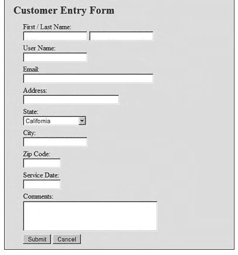

图 1.1 标准 HTML 客户输入表单

该页面采用了非常基础的设计——几乎没有任何设计。它仅使用了少量的样式，极其朴素。您的页面可能比这好看得多，但我们从这个极简设计开始，是为了尽可能保持示例的简单。让我们遍历此表单中的每个字段并讨论可用性问题，随后将讨论 Dojo 如何解决这些问题。

### 1.2.1 名字和姓氏

第一个数据输入字段用于存放客户的名字。这很简单，但我们已经遇到了一个问题。该字段的标签显示为“First / Last Name:”，后面跟着两个用于输入的文本字段。虽然用户大概能猜出页面要求输入什么，但对于由视障人士使用的屏幕阅读器来说，理解起来可能会更困难。

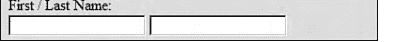

您可以认为从可用性角度来看，这已经有点令人困惑了。页面上的所有其他标签仅指向一个文本框，而这个标签却指向两个文本框。当姓名被分为两部分时，应该先输入姓还是先输入名？这些都是很好的问题，但我们必须等待答案。请记住，我们现在只是在识别问题，在本章稍后部分将讨论解决方案。

现在让我们检查这些字段的 HTML 标记。

```
<label for="firstName">First / Last Name: </label>
<input type="text" id="firstName" name="firstName" />
<input type="text" id="lastName" name="lastName" />
```

您之前可能没有使用过 `<label>` 标签，但它对于提高残障人士访问您网站的便捷性很有帮助。当标签没有紧跟在输入字段之前（例如标签在不同的表格单元格中）时，该标签对屏幕阅读器非常有用。在使用层叠样式表 (CSS) 时，它还使得用单一样式对所有标签进行美化变得更加容易。另一个问题是，这两个字段中只有一个拥有 `<label>` 标签。

名字和姓氏字段都是必填项。然而，在我们的标准表单中没有使用 JavaScript，那么我们如何让这些字段成为必填项呢？HTML 没有为此提供标签或属性，因此我们将依赖服务器来进行验证。这意味着用户在提交表单并收到来自服务器的错误消息之前，不会知道这些字段是必填的。

错误消息将如何显示？假设用户在字段中输入了一些数据并点击了“Submit”按钮。浏览器将向服务器发送请求，服务器随后验证数据并将表单连同一些错误消息一起返回给浏览器。希望服务器能将用户输入的数据也发送回来，这样用户就无需重新输入。通常，错误页面会在页面顶部附近显示所有错误消息。带有错误消息的页面可能如图 1.2 所示。

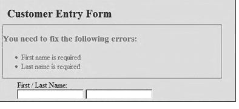

图 1.2 表单的典型错误消息

### 1.2.2 用户名

我们的应用程序将允许用户登录并管理其账户，因此我们要求用户创建一个用于此目的的用户名。我们应当为用户创建合适的名称提供一些指导，但这需要我们在页面上添加相当多的文字，所以我们决定不这么做。表单仅要求输入用户名并提供一个文本字段。

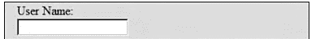

此部分的 HTML 标记与“First / Last Name:”字段非常相似，仅包含一个 `<label>` 和一个 `<input type="text">` 标签，如下所示。

```
<label for="userName">User Name: </label>
<input type="text" id="userName" name="userName" size="20" />
```

我们通过指定 `size="20"` 属性添加了一点客户端验证，以确保用户输入的名字不能超过 20 个字符。

这个字段的一个问题涉及验证。用户希望创建一个简短且易于记忆的用户名，但由于每个用户都有这个目标，该名称可能已被占用。如何通知用户？同样，在用户提交页面之前无法完成验证。服务器将检查用户名是否已被分配，如果是，将返回一个重新显示表单并显示错误消息（以及与其他字段相关的任何附加错误消息）的页面。如果能向用户建议一些替代方案，以便他不必一直输入已被占用的名称，将会很有帮助。这些建议应该基于用户想要的用户名。

### 1.2.3 电子邮件地址

我们希望通过电子邮件与用户沟通，因此需要请求一个地址。我们将使用一个简单的文本框让用户输入电子邮件地址。

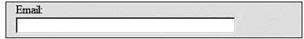

HTML 标记如下所示，与页面上的其他文本字段非常相似。

```
<label for="email">Email: </label>
<input type="text" id="email" name="email" size="45" />
```

同样，我们通过指定字段的大小启用了一些客户端验证。但有没有办法判断电子邮件地址是否有效？我们可以尝试两种验证方式。首先，电子邮件地址的格式是否正确？例如，它是否包含 "@" 符号？是否以 ".com" 之类的顶级域名（TLD）结尾？其次，它是否是一个真实可用的电子邮件地址？遗憾的是，如果不实际创建并发送邮件，没有办法确定后者。虽然这对于发送密码给用户并让她验证用户名很有用，但这超出了我们希望此页面实现的功能范围。因此，我们将仅专注于确认电子邮件地址至少在格式上看起来是正确的。

### 1.2.4 地址

我们将请求用户家庭地址的第一行，并使用一个常规文本框来获取。

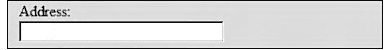

HTML 与之前的字段类似。

```
<label for="address">Address: </label>
<input type="text" id="address" name="address"/>
```

该字段应包含客户账单地址的第一行，因此我们需要确保用户已输入。这是一个必填字段，但同样地，我们将不得不依赖服务器来执行该验证。

### 1.2.5 州/省

我们需要用户的州（State）作为账单地址的一部分。由于州的数量有限，我们可以使用 `<SELECT>` 来提供一个下拉列表，从中选择一个。图 1.3 展示了一个典型的州下拉列表示例。

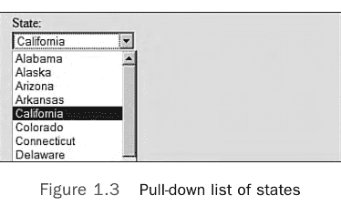

HTML 提供了 `<SELECT>` 表单元素，可用于提供一个值列表。创建该字段所需的标记片段如下。

```
<select name="state" >
    <option value="AL">Alabama</option>
    <option value="AK">Alaska</option>
    <option value="AS">American Samoa</option>
    <option value="AZ">Arizona</option>
    ... additional state values not shown ...
</select>
```


由于州的取值范围较小，因此可以全部显示。对于这个字段，验证不是问题，但行为是问题。我住在伊利诺伊州（Illinois），经常在网上购物，所以经常需要输入账单地址。当我在表单中来到州选择字段时，我先输入一个 "i"，列表里就会弹出 "Idaho"，因为它是第一个以 "i" 开头的州。这很合理——尽管我不住在爱达荷州。接着我输入一个 "l"（小写 L），"Louisiana" 弹了出来。现在，很多优秀的人住在路易斯安那州，但我不是其中之一。问题在于`<SELECT>`标签将我的输入解释为两次独立地输入单词的首字母，而不是一次性输入单个单词的前两个字符。当我输入 "il" 时，我想看到所有以字母 "il" 开头的州，而只有伊利诺伊州符合条件。不幸的是，`<SELECT>`标签的工作方式并非如此——当我输入 "l" 时，它显示 "Louisiana"，因为它假设我再次输入了该州的第一个字母。

这并不总是问题。某些浏览器版本确实能按我们希望的方式工作（将整个字符串 "il" 解释为该州的首字母），但无论页面在哪个浏览器中运行，我们都需要在页面上获得一致的行为。

### 1.2.6 城市

这是另一个必填字段。我们将使用文本框来获取用户输入的值。

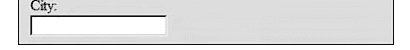

HTML 将与我们之前看到的其他文本字段相同。

```html
<label for="city">City: </label>
<input id="city" name="city"/>
```

基础 HTML 表单不会为该字段提供任何类型的验证。然而，我们难道不能像州选择那样，为用户提供一个有效城市的下拉列表吗？每个州虽然只有有限数量的城市，但数量并不少。在整个美国大约有 30,000 个城市。因此，在页面中简单地列出所有值会增加页面大小，导致加载速度变慢。而且列出所有城市是不正确的；我们必须仅列出用户所选州对应的城市。我们需要编写一些 JavaScript 逻辑来实现这一点，而我们正试图在简单的表单中避免使用 JavaScript。

下拉列表的可用性也会有问题。由于城市太多，其中许多城市可能以相同的字母开头。输入城市的第一个字母只能让用户到达一个长列表的开头。用户必须滚动很长时间才能找到某些值——这会变得相当令人厌烦。

### 1.2.7 邮政编码

邮政编码是账单地址的最后一个必填字段。我们将使用文本框来获取用户的数据。

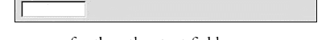

HTML 与其他文本字段相同。

```html
<label for="zipCode">Zip Code: </label>
<input type="text" id="zipCode" name="zipCode" size="10" /><br/>
```

这里再次需要验证。同样，我们将依赖服务器来确保该字段已被填写。服务器将返回一个包含表单、用户输入的任何数据以及生成的任何验证错误消息的页面。除了将该字段设为必填之外，还可以执行哪些验证？数据格式是否正确？数据是否为有效值？

美国的邮政编码有两种形式。它们可以是五位数字，也可以是五位数字后跟一个连字符再接四位数字。这意味着输入的数据长度可以是 5 个字符或 10 个字符。HTML 确实提供了一种通过使用`size`属性来强制执行最大长度的技术。然而，HTML 中没有办法指定最小长度。也没有办法指定必须使用连字符来分隔长格式邮政编码的两个部分。服务器可以在用户提交表单后执行所有这些检查。

我们甚至可以走得更远。就像州和城市一样，美国有一组有限的邮政编码。我们能否直接在`<SELECT>`列表中列出它们？而且既然我们已经知道了州和城市，能否只列出适用的邮政编码？这种逻辑实际上比你想象的要复杂——有些城市有多个邮政编码，而有些邮政编码则跨越城市边界。此外，如果我们把地理范围扩展到美国境外，还会发现更多的复杂性。不过，为了保持本教程足够简单，我们将仅限于美国境内。

我们在这个字段中引入了很多问题。请记住，解决方案将在教程后面给出。

### 1.2.8 服务日期

我们的客户还希望安排有线电视服务的开始时间，因此我们提供一个文本框，让他们输入服务开始日期。

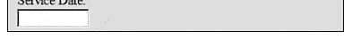

HTML 与我们之前看到的其他文本字段相同。

```html
<label for="serviceDate">Service Date:</label>
<input type="text" id="serviceDate" name="serviceDate" size="10"/>
```

服务日期需要什么样的验证？当然，它必须是一个有效的日期，但日期应该以什么格式输入？我们没有给用户提供指引。这显然是一个问题。除此之外，日期应该是未来的日期而不是过去的日期。甚至可能有些日期应该被屏蔽，比如非工作日。

该字段的另一个可用性问题是，人们无法轻易计算未来的日期。两周后的日期是多少？我们只需在当前日期上加 14 吗？如果当前月份在到达该日期之前就结束了，那就不能这么简单。那么三周后的第一个周一又是哪一天？如果没有日历，用户计算日期可能会非常困难。

### 1.2.9 备注

最后我们来到了表单上的最后一个字段——备注（Comments）。用户可以输入自由格式的评论，描述她是如何得知我们服务的，以及她喜欢什么样的节目——或者任何其他她想告诉我们的内容。

这是一个多行文本框，允许用户输入任意数量的文本。此处展示了对应的 HTML。

```html
<label for="comments">Comments:</label>
<textarea name="comments" rows="3" cols="35" id="comments">
</textarea>
```

这不是一个必填字段，因此无需验证。HTML 表单元素`<textarea>`提供了一些基本的文本编辑功能。当用户到达每行末尾时，它会自动换行。一旦用户输入的文本超过可见区域所能容纳的范围，文本框右侧就会自动出现滚动条，允许上下滚动。但这些就是它的全部功能了，没有任何格式化能力。

至此，我们对原始 HTML 表单的回顾就完成了。现在，我们已经列举了该表单的诸多问题，可以着手规划如何使用 Dojo 来解决这些问题了。

## 1.3 增强表单的方案

要解决我们已识别的所有问题，还有大量工作要做。我们需要制定一个行动方案，首要任务是将这些问题归纳为几个大类。我们将从最简单的改动开始，逐步过渡到更复杂的改动。类别如下所示。每个类别都是本教程的一步。

1. 在表单中引入 Dojo
2. 添加客户端验证
3. 添加服务器端功能
4. 使用其他专用 Dojo 部件
5. 处理表单

以下各节对每个主题进行了更详细的描述。

### 1.3.1 在表单中引入 Dojo

本教程的第一步向您展示如何将 Dojo 添加到网页中，内容包含在本章中。

Dojo 是一个函数库，我们可以通过编程方式或声明方式来访问它。我们通过编写调用 Dojo 函数的 JavaScript 代码以编程方式使用它，或者通过调用 HTML 标记以声明方式使用它。但在我们可以进行

### 1.3.2 添加客户端验证

本教程的第二步聚焦于客户端验证，内容包含在第 2 章"使用 Dojo 进行客户端验证"中。

我们发现的许多可用性问题都可以通过提供浏览器验证来解决。在这一步中，我们只处理不需要与服务器通信的验证。有些开发者甚至可能不认为这些特性属于 Ajax，因为没有向服务器发送请求。但这并不完全准确。毕竟，Ajax 是一枚硬币的两面。一面当然是无需刷新页面的异步服务器通信，但另一面则是使用 JavaScript 操作显示所带来的所有交互性和视觉吸引力。

在这一步中，我们需要解决的问题之一是必填数据的验证。与其提交表单并让服务器检查必填字段是否已填写，我们使用 JavaScript 在提交表单*之前*就测试数据。这将使应用程序似乎更快，因为用户无需等待服务器响应就能发现错误数据。

### 1.3.3 添加服务器端功能

本教程的第三步聚焦于 Ajax 的经典定义——在不刷新用户当前工作页面的情况下向服务器发起调用。该主题在第 3 章"使用 Dojo 与服务器协作"中介绍。

我们表单的其他一些问题是由强制页面提交来验证某些数据造成的。例如，用户名需要与服务器上现有的用户名进行比对验证。服务器检查是不可避免的——数据就在那里。但我们不需要请求一个全新的页面。我们可以创建一个 Ajax 请求来专门检查用户名，服务器将只返回验证信息，而不是一整个新页面。这将更快，也不会打断用户的操作流程。

我们还会根据用户输入的值向服务器请求获取数据。例如，当用户从下拉列表中选择某个州后，我们可以从服务器获取该州的城市列表。这一步需要服务器上增加一些额外的脚本，以便能够响应这些 Ajax 请求。我已经在服务器上创建了一些简单的 JavaServer Page (JSP) 脚本来使示例能够运行。这些脚本被过度简化了，但足以用来演示本教程中讨论的功能。

### 1.3.4 使用其他专用 Dojo 部件

本教程的第四步演示了 Dojo 的一些强大部件，内容包含在第 4 章"使用 Dojo 部件"中。

视觉炫效是一些设计师用来描述酷炫视觉效果的术语。Google Maps 中的拖放功能至少部分属于视觉炫效。Dojo 不仅可以让我们增强现有的 HTML 表单元素，还提供了称为部件的全新视觉元素，这些元素提供了 HTML 中不可用的新表单元素。例如，服务日期的问题之一是用户确实需要一个日历来选择日期。我们可以添加 Dojo 日期选择器部件，它会在页面上直接显示一个日历。我们还可以用一个功能完备的富文本编辑器部件来替换简单的`<textarea>`元素。

### 1.3.5 处理表单

本教程的第五步也是最后一步演示表单处理和提交，在第 5 章中讨论。

本教程的最后一步是将表单元素作为一个整体来对待：我们探讨如何在提交表单之前验证所有客户端验证是否都已执行，以及如何将表单提交给处理程序。我不想剧透结局，但我要说了（剧透警告）：Dojo 会以普通 HTML 表单的方式提交表单数据。换句话说，我们无需修改服务器上处理表单数据的组件。服务器甚至不会知道该表单已被"Dojo 化"。这将为我们在服务器端省不少事。

## 1.4 获取并运行源代码

本教程的每一步都在本书中有完整描述。不过，您可能想在家里跟着操作。教程所需的所有源代码都可以在本书的网站找到，其中包括每一步的起始代码以及每一步的最终代码。您可以下载起始代码并自己动手修改——或者直接下载每一步的最终代码并运行它。

您可以使用任意喜欢的编辑器来修改代码。对于某些步骤，您甚至不需要 Web 服务器。然而，这是一个 Web 应用程序，因此某些功能确实需要服务器。我使用 Java Server Pages (JSP) 创建了一些服务器组件。这些服务器组件仅足以运行示例，不建议也不推荐用于生产系统。

要运行服务器代码，您需要一个提供 JSP 容器的 Web 服务器。我推荐使用 Apache 软件基金会的 Tomcat。¹ Tomcat 是免费的。不过，任何支持 JSP 的 Web 服务器都可以。本书网站还提供运行代码的支持以及本书正文勘误。请访问网站并随时与我联系。²

¹ 您可以从以下地址下载 Tomcat Web 服务器：http://tomcat.apache.org/.

² 本书网站可在以下 URL 找到：http://www.objecttraininggroup.com/dojobook.

## 1.5 教程步骤 1——引入 Dojo

本教程第一步的目的是让 Dojo Toolkit 的函数在我们的网页上可用。目前，我们可以将 Dojo 想象成一个必须包含在我们页面上的 JavaScript 文件（以及每个将使用 Dojo 的页面）。这是一种简化。Dojo Toolkit 实际上由许多文件组成，按目录结构组织。我们在后面的章节中探讨这一点，但现在我们可以假装 Dojo 只是一个 JavaScript 文件。

我们使用与包含任何 JavaScript 源文件相同的技术将 Dojo 包含在我们的页面中。我们将使用`<script>`标签，稍后会详细解释。

### 1.5.1 下载或创建源文件

在我们修改表单以包含`<script>`标签之前，我们必须先创建表单。万一本书出版后发现任何问题，您可能需要查看本书的网站。您也可以在那里下载源文件。您需要两个文件："form.html" 和 "form.css"。每个文件的源代码也包含在本文中。

以下是表单本身的代码。此文件应命名为 "form.html"。

```xml
<?xml version="1.0" encoding="utf-8"?>
<!DOCTYPE html PUBLIC "-//W3C//DTD XHTML 1.0 Transitional//EN"
  "http://www.w3.org/TR/xhtml1/DTD/xhtml1-transitional.dtd">
<html xmlns="http://www.w3.org/1999/xhtml" xml:lang="en" lang="en">

<head>
  <!-- Dojo Tutorial - Step 1 (form.html) -->
  <meta http-equiv="Content-Type" content="text/html;charset=utf-8" />
  <title>Customer Entry Form</title>
  <!-- CSS -->
  <link rel="stylesheet" href="form.css" type="text/css" />
</head>
<body>

<div class="formContainer">
<form action="submit.jsp" method="get" name="custForm">

    <div class="formTitle">Customer Entry Form</div>

    <div class="formRow">
    <label for="firstName">First / Last Name: </label>
    <input type="text" id="firstName" name="firstName" />
    <input type="text" id="lastName" name="lastName" />
    </div>
```

### 1.5.2 引入 Dojo 工具包的代码

现在我们需要为页面添加 Dojo 工具包的引用。通常，我们会从 Dojo 网站下载源代码并将其放置在我们自己的站点上，然后进行链接。但本教程的目标之一是尽可能简单，因此我们将利用一种巧妙的技术，直接引用互联网上的 Dojo 源文件，而无需将源代码放在我们自己的 Web 服务器上。

AOL 提供了一项名为**内容分发网络**（CDN）的服务，这是一种面向互联网的“全球地理边缘缓存”机制。这允许从地理上靠近用户的 AOL 服务器快速分发文件。文件还经过压缩，这进一步提高了下载速度。AOL 已慷慨地向开发人员和最终用户提供了此服务。有关 AOL CDN 和 Dojo 的更多信息，请访问 http://dev.aol.com/dojo。

因此，我们可以直接提供指向 AOL CDN 上 Dojo 文件的链接，而完全不需要将其下载到我们的站点。在 "form.html" 的`<head>`标签中包含以下代码。请将其放在`</head>`结束标签下方，以使您的代码与教程的其余部分保持一致。

```html
<script type="text/javascript"
    src="http://o.aolcdn.com/dojo/1.1.0/dojo/dojo.xd.js"
    djConfig="parseOnLoad: true"></script>
```

有几点需要注意。代码中提供的链接是本书出版时 Dojo 的当前版本。您可能可以使用更新的版本。如果您选择使用更新的版本，请查看本书的网站以了解源代码是否已更改。

您不必使用 AOL CDN。您可以将 Dojo 下载到您自己的服务器。这可能是一种更可取的方法，尤其是在开发期间。它允许您查看 Dojo 源代码，并在没有互联网连接的情况下进行离线工作。

下载 Dojo 很容易。您只需将浏览器指向 Dojo 的网站 http://www.dojotoolkit.org，并查找下载链接。下载页面包含指向当前版本和旧版本的链接。虽然新版本可能为您提供额外的功能，但它们不一定适用于本教程的源代码。请查看本书的网站以获取更新。

如果您选择下载 Dojo，链接的`<script>`标签将会有所不同。以下代码片段假设您已下载 Dojo zip 文件并将其解压到与您的表单相同的目录中。

```html
<script type="text/javascript"
    src="dojo-release-1.1.0/dojo/dojo.js"
    djConfig="parseOnLoad: true"></script>
```

属性`djConfig="parseOnLoad: true"`告诉 Dojo 搜索您页面上的 HTML，以查找您可能添加的任何 Dojo 小部件。为此，我们需要包含 Dojo 解析器。这可以通过向我们的页面添加一些 JavaScript 代码来实现。在链接 Dojo 的`<script>`标签之后，在`<head>`标签中包含以下代码。

```javascript
<script type="text/javascript">
    dojo.require("dojo.parser");
</script>
```

> **注意**

> 这很重要——前面包含`dojo.require`的代码必须*跟随* Dojo 的链接，而不是在其之前。

### 1.5.3 引入 Dojo 样式表

在整个教程中，我们将向页面添加各种 Dojo 小部件。Dojo 小部件的“外观”是通过必须添加到我们页面的几个样式表上指定的样式来定义的。Dojo 团队已将小部件的“外观”分离到单独的样式表中。这是 Dojo 小部件的一个突出特点。这意味着您可以通过覆盖默认样式轻松地设置小部件的样式以匹配您网站的外观。您不受小部件自带的任何开箱即用样式的限制。


第一个样式表`dojo.css`覆盖了标准 HTML 页面元素（如`<body>`、`<div>`和`<form>`）的一些样式。只有几个样式，它们旨在将样式设置为朴素简约的外观。

下一个文件`tundra.css`定义了许多标准 Dojo 小部件组件的样式。“tundra”主题是 Dojo 中三个内置主题之一。为什么叫 tundra？Tundra 是北极地区冰盖下方寒冷、无树的区域。它由永久冻结的地下土层组成，上面生长着苔藓和小灌木。Dojo 的“tundra”主题旨在让人联想到那片荒凉的景观，并为小部件提供了一个极简的调色板。“noir”主题颜色较深（“noir”是一种强调鲜明对比度、通常以黑白拍摄的电影类型）。而“soria”主题则更明亮（Soria 是西班牙阳光明媚的中北部地区的一个城市）。

将以下代码添加到页面的`<head>`部分，以为我们的小部件提供样式并应用 Dojo tundra 主题。顺序并不重要。

```html
<style type="text/css">

  @import "http://o.aolcdn.com/dojo/1.1.0/dojo/resources/dojo.css";

  @import

   "http://o.aolcdn.com/dojo/1.1.0/dijit/themes/tundra/tundra.css";

</style>
```

刚才给出的代码只是让样式对页面可用。现在我们必须通过在`<body>`标签中添加一个`class`属性来真正将主题应用到页面，如下列代码所示。

```html
<body class="tundra">
```

## 1.5.4 回顾所有代码更改

我们对页面做了大量的更改，可能对于页面现在的样子会感到有些困惑。下面是页面顶部部分的新清单，以便你能够看到所有的更改。

```html
<!-- Dojo Tutorial - Step 1 (form.html) -->
<?xml version="1.0" encoding="utf-8"?>
<!DOCTYPE html PUBLIC "-//W3C//DTD XHTML 1.0 Transitional//EN"
   "http://www.w3.org/TR/xhtml1/DTD/xhtml1-transitional.dtd">
<html xmlns="http://www.w3.org/1999/xhtml" xml:lang="en" lang="en">

<head>
  <!-- Dojo Tutorial - Step 1 (form.html) -->
  <meta http-equiv="Content-Type" content="text/html;charset=utf-8" />
  <title>Customer Entry Form</title>
  <!-- CSS -->
  <link rel="stylesheet" href="../form.css" type="text/css" />

  <!-- CSS -->

  <style type="text/css">
    @import "../dojo-release-1.1.0/dojo/resources/dojo.css";
    @import "../dojo-release-1.1.0/dijit/themes/tundra/tundra.css";
  </style>

  <link rel="stylesheet" href="../form.css" type="text/css" />

  <script type="text/javascript"
  src="../dojo-release-1.1.0/dojo/dojo.js.uncompressed.js"
  djConfig="isDebug: true, debugAtAllCosts: true"></script>

<script type="text/javascript">
```

```javascript
dojo.require("dojo.parser");
```

```html
</script>

</head>

<body class="tundra">
```

完成所有这些更改后，我们就可以运行新页面来看看它的样子了。

## 1.5.5 运行新页面

新页面的外观如图 1.4 所示。

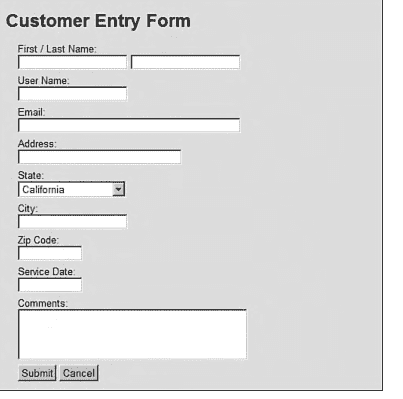

图 1.4 带有 Dojo 链接的 HTML 客户信息录入表单

希望你不会太失望——页面看起来和原始表单几乎一样。不过，有一些细微的样式变化，比如标签和表单标题的字体——但并没有什么显著的变化。这没关系。我们实际上还没有开始使用 Dojo，只是让它对页面可用而已。在下一章中，我们将继续教程的第 2 步，实现客户端验证，届时我们将看到一些令人兴奋的内容。

## 总结

我们通过一个教程开始探索 Dojo，该教程将演示其一些基本功能。该教程包含五个步骤：

- **第 1 步**—引入 Dojo（第 1 章）
- **第 2 步**—添加客户端验证（第 2 章）
- **第 3 步**—添加服务器端功能（第 3 章）
- **第 4 步**—使用其他专用 Dojo 小部件（第 4 章）
- **第 5 步**—处理表单（第 5 章）

我们在本章中通过在 HTML 页面中放置 Dojo 的引用来实现了教程的第 1 步。

下一章将继续该教程。既然我们已经让 Dojo 对页面可用，我们就可以开始使用它对文本字段进行客户端验证了。

# 第 2 章

## 使用 Dojo 进行客户端验证

> 人非圣贤，孰能无过……

—亚历山大·蒲柏（1688–1744）

我们都会犯错，因此输入表单必须考虑到用户可能会无意中输入错误的数据。识别和纠正这些错误是 HTML 表单的一项重要工作，本章将描述 Dojo 允许你轻松添加验证的功能。

## 2.1 验证表单字段

在网页上验证输入数据通常是由服务器执行的功能。网页允许用户输入数据，当按下提交按钮时，浏览器将数据打包成一个 HTTP 请求并将其发送到服务器。服务器检查每个数据字段以确保其有效，如果发现任何问题，会将包含错误消息的新表单发送回浏览器。如果能在向服务器发出请求之前就在浏览器中检测到问题，岂不是更加有用？这种方法将提供两个主要优势。它将减轻服务器的负担，更重要的是，它几乎在用户输入错误数据后立即通知用户数据字段的问题。这支持了一个不争的事实：检测离错误产生的源头越近，修复成本就越低。例如，如果邮政编码字段有问题，用户在输入错误的邮政编码后立即得到通知，那么他此时仍在思考邮政编码，可以轻松地进行更正。如果用户直到服务器响应回来才得到通知，他已经不再思考邮政编码了——他的心思已经转移到其他事项上。当服务器返回许多不同字段的错误时，这种上下文切换的问题尤其严重。

我们如何将验证推向更接近数据输入的位置呢？有两种主要技术可用。第一种技术涉及试图完全防止错误的输入。例如，如果表单要求用户输入一个必须包含特定长度数值的字段，我们可以使用 HTML 中可用的`size`属性来指定用户可以输入的最大字符数。这样，浏览器就会阻止用户输入超过允许数量的字符。以下是我们表单中邮政编码字段的一个示例。

```html
<label for="ZipCode">Zip Code: </label>
<input type="text" id="zipCode" name="zipCode" size="10" /><br>
```

这种初步验证给了我们超出应有程度的乐观。我们可能期望有许多其他属性可以提供某种客户端验证。不幸的是，`size`属性基本上就是基于 HTML 的验证技术的全部范围。没有用于最小长度或数据类型的标记标签或属性。在 HTML 中也没有办法指定某个字段是必填的。

这就引出了我们在浏览器中可用的第二种验证类型。我们可以使用 JavaScript。鉴于 JavaScript 的强大功能，我们能够执行的验证类型是无限的。我们可以触发一个 JavaScript 函数在用户离开字段后运行，该函数可以检查是否输入了数据、检查最小或最大长度，甚至可以使用正则表达式执行复杂的模式匹配。

问题解决了，对吧？并不完全如此。依赖 JavaScript 作为验证技术的问题在于我们必须编写大量代码来实现检查。需要 JavaScript 代码来执行验证。还需要其他 JavaScript 代码来告诉验证何时运行。甚至还需要更多的 JavaScript 代码来将错误消息显示回给用户。代码，代码，还是代码。突然之间，这种方法似乎不再那么理想了。

但这就是 Dojo 可以拯救我们的地方。在教程的这一部分，我们将探索 Dojo 如何通过结合我们讨论过的两种技术来帮助我们进行验证。换句话说，我们将能够通过使用简单的 HTML 标记来启用验证，但我们会让 Dojo 自动提供复杂的 JavaScript 代码。让我们开始吧。

## 2.2 教程第 2 步—添加客户端验证

在教程的这一步中，我们使用 Dojo 提供基本的客户端验证。我们在对表单进行实际增强的背景下考察了许多有用的技术。我们逐一检查适合使用这些技术的字段。

### 2.2.1 验证名字字段

让我们首先看看“名字”字段。我们需要应用哪些验证？此表单上的数据将输入到我们的计费系统中，因此客户的名字非常重要——该字段必须是必填的。还有其他验证吗？我们不仅想要获取数据，还希望它具有一致的格式。可能数据应该以全大写字母存储。或者我们可能希望确保数据*不是*全大写的。让我们选择后者——但我们仍然要确保至少第一个字母是大写的。与许多与验证相关的问题一样，事情比它们最初看起来的要复杂。例如，我们是否留出了足够的空间来输入长名字？像“Bono”这样的单词名字是否被允许？为了我们的目的，我们将保持简单。

我们通过在这些字段的 HTML 标记中使用特殊的属性值来启用验证。以下代码将为字段添加验证。

```html
<label for="firstName">First Name: </label>
<input type="text" id="firstName" name="firstName"

    dojoType="dijit.form.ValidationTextBox"
    required="true"
    propercase="true"
    promptMessage="Enter first name."
    invalidMessage="First name is required."
    trim="true"

/><br>
```

代码使用换行格式化以提高可读性。总结一下发生了什么：我们所做的只是为字段的`<input>`标签添加了一些新属性。每个新属性都以某种方式影响验证。

请注意前面示例中的以下代码行：

```javascript
dojoType="dijit.form.ValidationTextBox"
```

此属性不是标准的 HTML`<input>`标签属性。根据你使用的编辑器，它甚至可能被高亮显示为错误。`dojoType`属性只对 Dojo 解析器有意义，解析器在第 1 步中已引用。还记得我们需要包含解析器的代码吗？如下所示：

```javascript
dojo.require("dojo.parser");
```

解析器会读取 HTML 并查找任何包含`dojoType`作为其属性之一的标签。然后，奇迹发生了。解析器将该元素替换为由`dojoType`指定的 Dojo 小部件。在这种情况下，小部件`dijit.form.ValidationTextBox`被替换为从`<input>`标签创建的文档对象模型（DOM）元素。

Dojo 如何知道用什么来替换标签？这由具体的组件（widget）决定。每个组件的行为略有不同。HTML 标记和 JavaScript 代码在组件的定义中与之相关联，这就是 Dojo 知道用什么来替换原始元素的方式——这也就把我们带到了拼图缺失的一块。我们需要在 JavaScript 中通过指定组件，告知 Dojo 包含该组件的代码。为此，我们在引用 Dojo 链接以及 Dojo 解析器（parser）之后，加入以下 JavaScript 代码。

```javascript
dojo.require("dijit.form.ValidationTextBox");
```

请注意，作为`dojoType`属性值的组件名称与`dojo.require`调用的参数相同。这种联动允许 Dojo 将 HTML 标记与该组件的 JavaScript 代码关联起来。

为了强调这一过程，让我们回顾一下原页面中指定的 HTML 标记，然后将其与解析器运行后的 HTML 标记进行比较。要查看原始标记，我们只需查看`form.html`文件的源码。而查看新标记则稍微困难一些。浏览器将原始 HTML 转换为一个代表各种标签的 DOM 树。Dojo 解析器使用 JavaScript 修改 DOM 元素，但页面的原始源码保持不变。我们需要某种工具将 DOM（浏览器对页面的内部表示）转换回 HTML 供我们审查。Firefox 浏览器提供了 DOM 检查器（DOM Inspector）来完成这项工作。另一个优秀的 Firefox 插件 Firebug 也可以对 DOM 进行检查。Firebug 还提供了许多用于开发网页的绝佳工具，例如其 DOM 检查功能，我们可以用它来检查 Dojo 解析器运行后的 DOM——从而准确看到它做了什么。但在查看 DOM 如何变化之前，让我们先回顾一下用于“名字（first name）”字段的原始`<input>`标签。

```html
<input
    type="text"
    id="firstName"
    size="20"
    dojoType="dijit.form.ValidationTextBox"
    required="true"
    propercase="true"
    promptMessage="Enter first name."
    invalidMessage="First name is required."
    trim="true"
/>
```

为了提高可读性，代码通过添加一些换行符进行了重新格式化。从`dojoType`到`trim`的属性都不是有效的 HTML 属性。它们仅对 Dojo 解析器有意义，并驱动其所属 Dojo 组件的某些功能。现在让我们看看解析器运行后 HTML 的样子。

## 2.2 教程步骤 2—添加客户端验证

```html
<input
  type="text"
  tabindex="0"
  maxlength="999999"
  size="20"
  class="dijitInputInputField dijitInputFieldValidationError dijitFormWidget"
  name="firstName"
  id="firstName"
  autocomplete="off"
  style=""
  value=""
  disabled="false"

  widgetid="firstName"
  dojoattachevent="onfocus, onkeyup, onkeypress:_onKeyPress"
  dojoattachpoint="textbox,focusNode"
  invalid="true"
  valuenow=""
/>
```

上述代码同样为了可读性进行了重新格式化，添加了换行符并微调了属性顺序。请注意，`<input>` DOM 元素中被添加了许多有效的 HTML 属性，如`tabindex`、`class`、`autocomplete`和`disabled`。此外，还添加了许多 Dojo 专用属性，如`widgetid`、`dojoattachevent`、`dojoattachpoint`、`invalid`和`valuenow`。我们将在第二部分“Dojo 组件”中详细讨论这些内容，但目前只需指出解析器正在重写我们的 HTML 即可。解析器所做的工作比我们在这里看到的更多。它将各种事件处理函数与此 DOM 元素上可能发生的事件相关联。例如，当用户在字段中输入或更改值时，会调用 Dojo 函数来执行验证。Dojo 甚至创建了与 HTML 标签相对应的对象。仅从 HTML 标记中无法看出这一点，但在幕后，这正是 Dojo 所做的事情。

让我们回顾其他 Dojo 特殊属性。每个 Dojo 组件都有一组控制其行为的属性。这些属性通过各种 Dojo 组件属性值来设置。

- `required="true"`属性设置告诉 Dojo 该字段必须填写。
- `propercase="true"`属性设置告诉 Dojo 重新格式化用户输入的字段值。在这种情况下，`propercase`设置告诉 Dojo 确保首字母大写，后续字母小写。换句话说，Dojo 将输入的值转换为典型的专有名词格式。
- `promptMessage="Enter first name."`属性设置告诉 Dojo 在字段旁边显示一条消息，以指导用户可以在该字段中输入什么样的数据。提示消息在字段获得焦点时显示。
- `invalidMessage="First name is required."`属性设置使得 Dojo 在验证失败时在字段旁边显示一条消息。在我们的案例中，如果用户没有输入值，则会出现一条消息。
- `trim="true"`属性设置告诉 Dojo 在将输入值发送到服务器之前，删除其前导或尾随空格。

现在让我们运行该页面并观察其行为。因为这是页面上的第一个字段，该字段会自动获得焦点，光标立即置于“First Name”字段的输入区域。

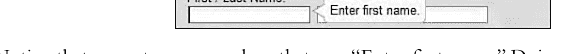

注意我们得到了一个显示“Enter first name.”的消息框。Dojo 将其称为工具提示（Tool Tip），它具有动态行为。它仅在字段获得焦点（光标在字段内）时显示，一旦字段失去焦点，消息就会消失。消息出现在其下方任何可见元素的顶部，因此在设计页面时无需为其留出空间。

尝试在字段中输入不同的值，然后按`<tab>`键离开该字段。例如，输入“ joe ”，观察它如何被转换为“Joe”，前导和尾随空格被删除，且姓名的首字母大写。

> **注意：**


> 你可能不同意我选择的各种验证方式。例如，在本书早期的审阅中，有人指出“LaToya”这样的名字很难验证。你可能会主张采用不同的验证方式，我也可能会同意。但我选择这些方式不仅是为了代表我的示例应用程序，也是为了突出某些 Dojo 特性——所以我坚持使用它们！

### 2.2.2 验证姓氏（Last Name）字段

姓氏字段的验证与名字字段相同。此字段没有额外操作，也没有新知识需要学习。只需将姓氏的`<input>`标签替换为以下代码。

```html
<input type="text" id="lastName" name="lastName"
     dojoType="dijit.form.ValidationTextBox"
     required="true"
     propercase="true"
     promptMessage="Enter last name."
     invalidMessage="Last name is required."
     trim="true"
/>
```

### 2.2.3 验证用户名（User Name）字段

在我们的应用程序中，我们将允许用户管理其自身的账户信息。为了提供一定的安全性，我们需要用户创建一个用户名，以便以后登录系统。该字段是必填的，并且我们希望它始终以小写字母输入。为了验证此字段，我们将使用已经使用过的同一个 Dojo 组件`dijit.form.ValidationTextBox`，但我们将使用一个名为`lowercase`的新属性，强制将输入的数据转换为全部小写字母。

我们还希望对该字段进行一些额外的验证。例如，这个用户名是否已被其他人占用？我们可以检查服务器是否存在该值。然而，由于此验证需要与服务器交互，我们将把它留在教程的步骤 3 中，现在仅专注于客户端验证。

需要以下 HTML 标记来启用此字段的验证。

```html
<input type="text" id="userName" name="userName"
    dojoType="dijit.form.ValidationTextBox"
    required="true"
    promptMessage="Enter user name."
    trim="true"
    lowercase="true"
/>
```

### 2.2.4 验证电子邮件地址（Email Address）字段

我们需要与客户沟通，因此我们将获取他们的电子邮件地址。这将是一个必填字段。为了保持一致性，我们还将将其全部设为小写。此外，我们希望确保在该字段中输入的值符合电子邮件地址的正确格式。在实际尝试发送邮件之前，无法得知该邮箱是否可用，但至少我们可以确保它包含一个“@”字符且看起来引用了一个有效的域名。

我们如何指定所需的格式？通过使用一种被称为*正则表达式*（regular expressions）的专门模式匹配语言，我们可以指定一个字符模式来检查该值。我们需要构建一个正则表达式来验证电子邮件地址。在目前的讨论阶段，我们不要绕道太远去详细讨论这些表达式的构建方法。

> **注意：**
>
> 有关构建正则表达式的优秀信息可以在 Mozilla 开发者中心找到：http://developer.mozilla.org/en/docs/Core_JavaScript_1.5_Reference:Global_Objects:RegExp。

以下是一个可用于验证大多数电子邮件地址格式的正则表达式——之所以强调*大多数*，是因为要验证*所有*可能的电子邮件地址出人意料地困难。这是因为存在一些不寻常的变体，比如超过四个字符的域名（如“.museum”）或由子域名构成的地址。但以下正则表达式对大多数情况都有效。

```regex
[\b[A-Z0-9._%+-]+@[A-Z0-9.-]+\.[A-Z]{2,4}\b]+
```

**注意：**

如需了解有关验证电子邮件地址的更多信息，以下链接将带您前往 Dojo 论坛的一篇文章，其中描述了用于电子邮件的正则表达式：http://dojotoolkit.org/forum/dijit-dijit-0-9/dijit-support/text-validation。

`ValidationTextBox`包含一个用于针对正则表达式进行验证的特殊属性。要使用的属性是`regExp`——只需将正则表达式指定为其值即可。将“form.html”中用于电子邮件的`<input>`标签替换为以下代码，以指定电子邮件地址字段的验证。

```html
<input type="text" id="email" name="email" size="30"
    dojoType="dijit.form.ValidationTextBox"
    required="true"
    regExp="\b[a-zA-Z0-9._%-]+@[a-zA-Z0-9.-]+\.[a-zA-Z]{2,4}\b"
    promptMessage="Enter email address."
    invalidMessage="Invalid Email Address."
    trim="true"
/>
```

验证电子邮件地址是一个非常有趣的主题。除了我们常见的简单`name@company.com`格式外，还有相当多的变体。要对电子邮件进行非常深入的讨论，您应该查阅 RFC 规则。以下链接将带您前往描述电子邮件的 Wikipedia 页面，您可以从那里链接到官方的 RFC 文档：http://en.wikipedia.org/wiki/E-mail_address。

### 2.2.5 验证地址字段

地址字段将仅包含用户邮寄地址的第一行。我们将将其设为必填项。我们将使用`ValidationTextBox`，并且已经见过所有属性。将用于地址的`<input>`标签替换为以下代码。

```html
<input type="text" id="address" name="address" size="30"
    dojoType="dijit.form.ValidationTextBox"
    required="true"
    promptMessage="Enter address."
    invalidMessage="Address is required."
    trim="true"
/>
```

可以对地址数据执行许多额外的验证，其中最重要的是确保地址是一个真实地址。也应允许使用标准缩写，如“St”代表“Street”。这些额外的验证可以通过美国邮政局提供的许多网络服务来完成，但这确实超出了本教程的范围。

### 2.2.6 验证城市字段

城市字段将包含用户邮寄地址中的城市值。我们将将其设为必填项。我们将使用`ValidationTextBox`。将用于地址的`<input>`标签替换为以下代码。

```html
<input type="text" id="city" name="city" size="30"
  dojoType="dijit.form.ValidationTextBox"
  required="true"
  promptMessage="Enter city."
  invalidMessage="City is required."
  trim="true"
/>
```

### 2.2.7 验证邮政编码字段

邮政编码字段是邮寄地址的一部分，或者是必填项。我们可以应用一些额外的验证。我们假设的公司是一家美国公司，只向美国客户提供服务，因此我们将地址限制为有效的美国地址，这意味着邮政编码必须是以下两种形式之一。它要么是 5 位数字，要么是 5 位数字后跟一个连字符，然后再跟 4 位数字。如果我们能想出一个正则表达式来测试任一格式，那么我们就成功了！将用于邮政编码的`<input>`标签替换为以下内容，为此字段启用 Dojo 验证。

```html
<input type="text" id="zipCode" name="address" size="30"
  dojoType="dijit.form.ValidationTextBox"
  trim="true"
  required="true"
  regExp="\d{5}([\-]\d{4})?$"
  maxLength="10"
  promptMessage="Enter zip code."
  invalidMessage="Invalid zip code (NNNNN) or (NNNNN-NNNN). "
/>
```

上述代码的一个有趣之处在于，我们有两个重叠的验证。`maxLength`属性防止值超过 10 位数字，但该正则表达式也是如此。这有什么影响呢？有人可能会说这是低效的，因为两个验证都会执行。但它们在页面上的运行方式不同，这可能是同时使用两者的理由。如果用户试图输入一个 12 位数字的邮政编码，他会在尝试输入第十一位数字时收到通知，而不是在输入所有 12 位数字并按 Tab 键离开字段之后。通过同时使用这两种技术，可以更早地检测到错误。

### 注意

> 本章没有描述对“Start Service”和“Comments”字段的验证。这是因为在第 4 章“使用 Dojo 小部件”中，我们将使用更高级的 Dojo 小部件来验证这些字段。

## 总结

Dojo 小部件`dijit.form.ValidationTextBox`提供了许多常见的客户端验证。通过在需要验证的字段的`<input>`标签中引用`ValidationTextBox`来包含它。

```html
dojoType="dijit.form.ValidationTextBox"
```

记得告诉页面它需要该小部件的 JavaScript 代码，方法是在调用 Dojo 解析器之后的某个地方调用`require`方法。

```javascript
dojo.require("dijit.form.ValidationTextBox");
```

`<input>`标签中的其他属性指定了`ValidationTextBox`的行为。这里列出了几个：

- `require="true"`使字段成为必填项。
- `trim="true"`移除前导空格。
- `lowercase="true"`将字段转换为全小写字母。

我们现在完成了教程的第 2 步。我们实施的更改为我们的表单添加了客户端验证。我们几乎完全通过修改 HTML 就能够添加验证——只需少量的 JavaScript 来包含 Dojo 验证代码。客户端验证是一项极其强大的功能，使我们的页面更加易用。然而，通过使用 Dojo，我们获得了这种能力，而无需付出编写大量 JavaScript 的代价。

在本章中，我们专注于不需要调用服务器的功能。在下一章中，服务器将发挥作用。我们将使用`XMLHttpRequest`向服务器发起调用以获取数据并执行验证。现在，这就是 Ajax！

# 3 使用 Dojo 与服务器交互

> 你总得为谁服务。
>
> —鲍勃·迪伦

本章描述了我们如何使用 Dojo 与服务器通信。服务器可以履行的两个主要目的是运行进程和提供数据。本教程的这一部分提供了这两个方面的示例。

## 3.1 添加服务器端功能

尽管 Dojo 自称是一个 JavaScript 库，但通常它更常被归类为 Ajax 库。虽然这种描述可能不准确，但也是可以理解的。因为没有“国际 Ajax 定义组织”，所以这个词被以多种方式使用。通常，它指的是无需完整页面刷新即可访问服务器的网页，并且对 DOM 进行一些巧妙的操控，使网站比单独使用古板的旧 HTML 更具交互性。但对某些人来说，只有在进行服务器请求时，我们才在使用真正的 Ajax。

本章涉及向服务器发出 Ajax 请求。我们研究两种请求类型。第一种请求是要求服务器执行一些处理。在这种情况下，我们将要求服务器验证用户名。第二种请求是要求服务器提供一些数据，然后我们将这些数据添加到 DOM 中，以便用户可以看到。我们的数据请求将是获取给定州的城市列表。

> 注意：
>
> 与服务器通信有两个主要原因：（1）执行验证和（2）获取数据。本教程的这一部分分为两个步骤，分别对应使用服务器的这两个原因。第一步，3a，描述服务器端验证。第二步，3b，描述从服务器获取数据。

## 3.2 教程步骤 3a——添加服务器端验证

在本教程步骤中，我们使用服务器来验证用户输入的一些数据。解决了许多有趣的问题。我们如何捕获数据？应在哪个时间点发出服务器请求？在等待服务器返回期间，应用程序应该做什么？应如何处理服务器响应？尽管此场景看似简单，但它确实引入了一些复杂性。Dojo 在编码处理这些问题时提供了灵活性，并且会显现出一些常见的模式和最佳实践。

我们可以验证输入的用户名尚未分配给其他客户。许多应用程序允许用户指定一个名称，应用程序以此名称来识别他们。此用户名允许用户登录应用程序以执行诸如编辑其帐户或查看交易历史记录等操作。用户名必须在整个系统中对每个用户都是唯一的；因此，需要服务器端验证以确保它尚未分配给其他用户。此场景的用例可能看起来相当简单，但它仍然引入了一些有趣的复杂性。

### 3.2.1 分配事件处理程序函数

流程从用户输入所需的用户名开始。用户输入字符，并在某个时间点完成。但我们如何真正知道用户已完成输入数据？是在用户停止打字的时候吗？如果是这样，在确定用户完成之前，应用程序需要等待多久？我们甚至可以在每次击键后执行验证。然而，这种方法有许多缺点。服务器的负载会不必要地增加。而且用户可能会收到大量描述中间验证的消息。在用户完成数据输入后，只执行一次验证会更有用。

更好的方法可能是等到用户通过按 Tab 键甚至 Enter 键退出字段。按 Enter 键的问题在于，浏览器可能将其解释为表单提交（标准 HTML 表单的默认行为）。通过按 Tab 键或使用鼠标将光标放入另一个字段，用户将表示他已完成输入用户名字段，并希望输入新字段的数据。我们将此条件作为执行验证的正确时机。

现在我们需要将我们希望捕获的逻辑事件（用户退出字段）转换为浏览器监视的实际事件。JavaScript 为我们提供了两个可能的候选事件：`onblur`和`onchange`。`onblur`事件在

## 3.2 教程步骤 3a——添加服务端验证

焦点离开该字段，这通常意味着用户按下了 Tab 键跳转到下一个字段，或者使用鼠标点击了另一个字段。`onchange`事件的功能与之几乎相同。区别在于，如果数据没有发生变化，`onblur`仍然会被调用，但`onchange`则不会。当用户第一次进入该字段时，这种区别无关紧要。但如果光标在用户未修改数据的情况下再次经过该字段，事件将再次触发，从而导致一次不必要的服务器调用。因此，最有效的事件是使用`onchange`。我们需要创建一个处理`onChange`事件的函数，并在事件发生时调用该函数。

此时，我们需要讨论常规 JavaScript 事件与 Dojo 事件之间的区别。JavaScript 提供了一种将事件处理程序（函数）分配给 DOM 元素上某个事件的方法。接下来的代码通过将`onChange`属性设置为`userNameOnChange()`来演示这一点。当浏览器检测到字段值发生变化时，这将导致`userNameOnChange`函数执行。

```html
<input
    type="text"
    id="userName"
    name="userName"
    size="20"
    dojoType="dijit.form.ValidationTextBox"
    onchange="userNameOnChange()"
/>
```

在以下代码中使用了 Dojo 的相同技术。

```html
<input
    type="text"
    id="userName"
    name="userName"
    size="20"
    dojoType="dijit.form.ValidationTextBox"
    onChange="userNameOnChange"
/>
```

请注意，我们在第二个示例中没有使用标准的函数调用语法。换句话说，Dojo 使用的是对函数的引用，而*不是*对函数的调用。我们可以从这里看出：第一个示例在函数名末尾使用了双括号，而第二个示例则没有。另一个区别是属性的大小写不同——虽然拼写相同，但第二个示例中的“C”是大写的。正如你可能猜到的，Dojo 拦截了浏览器事件并调用其自身的事件。我们将在第二部分“Dojo 部件（Widgets）”中详细讨论 Dojo 具体是如何操作的。但目前，我们只需要认识到，Dojo 在指定事件处理函数时，其语法与常规 JavaScript 略有不同。

让我们将处理函数放入一个完全独立的 JavaScript 文件中。这虽然不是必须的，但可以让我们的 JavaScript 与原始 HTML 文件分开，使代码更易于阅读。创建一个名为“userNameValidation.js”的新 JavaScript 文件，其中包含一个名为`userNameOnChange`的函数。以下代码包含了新 JavaScript 文件的内容。随着我们在本教程步骤中的推进，我们会对其进行增强。

```javascript
// 定义在输入用户名时被调用的函数
function userNameOnChange() {
    return;
}
```

我们还需要在页面中引用该 JavaScript 文件，因此必须在 HTML 页面中添加一个新的`<script>`标签来引入该文件。接下来的代码应放置在“form.html”中。顺序并不重要，但为了方便代码组织，我们应该将其放在用于引入 Dojo 的`<script>`标签之后。

```html
<script type="text/javascript" src="validateUserName.js">
</script>
```

你首先可能会注意到，当表单首次显示时，即使在用户尚未在字段中输入任何数据之前，`onChange`函数就会被调用。此时字段甚至还没有获得焦点。这是因为表单部件（我们的部件是其子类）的默认行为是在首次设置元素值时调用`onChange`函数。因此，我们需要记住，如果表单中还没有数据，则跳过验证，如下面代码所示。为了强调，新增的代码已加粗。


```javascript
// 定义在输入用户名时被调用的函数
function userNameOnChange() {
    var userName = document.getElementById("userName").value;
    if (userName == "") {
        console.log("userName is empty");
        return;
    }
    return;
}
```

请注意，我们使用`console.log`函数在与网页分离的特殊浏览器控制台中显示消息。日志记录在开发过程中是一项很有用的技术，这样我们就可以看到程序的运行情况，而无需使用 JavaScript 警告框（alert boxes）或直接写入网页本身。我们将在第 17 章“测试与调试”中深入探讨 Dojo 的调试。

### 3.2.2 发起服务器调用

我们已经将钩子放入页面中，这样当用户输入或更改用户名值时，我们的处理函数就会运行。但目前的函数仅仅是一个桩（stub）——它并没有实际执行任何操作。现在，让我们充实这个函数并完成需要的工作。我们需要执行以下步骤：

1. 获取用户输入的数据。
2. 将数据发送到服务器，并请求服务器对其进行验证。
3. 处理来自服务器的响应。

此外，我们还需要在服务器端处理响应，然后处理从服务器返回的结果，但这可以稍后再做。让我们先关注于获取数据。

#### 3.2.2.1 获取用户输入的数据

Dojo 提供了多种从部件中获取输入数据值的方法。但为了理解这些方法，回顾一下在没有 Dojo 的情况下，如何仅使用纯 JavaScript 和 DOM 从表单字段获取数据可能会有所帮助。DOM 会自动构建对表单元素的引用，我们可以利用这一点来获取值。

```javascript
var userName = document.form.custForm.userName.value
```

另一种技术是使用 DOM 元素的`id`属性来查找正确的表单元素。当然，这只有在我们为元素分配了`id`属性时（就像我们在表单中所做的那样）才会起作用。

```javascript
var username = document.getElementById("userName").value
```

Dojo 提供了一些额外的技术。DOM 为我们提供了一个单一的对象来获取数据——即对应于字段 DOM 元素的那个对象。但使用 Dojo 时，我们可以使用两个不同的对象来获取值。第一个对象是 DOM 元素，就像纯 JavaScript 一样，但 Dojo 为引用该对象提供了一个快捷方式。请注意以下代码中的`dojo.byId`函数。

```javascript
var username = dojo.byId("username").value
```

Dojo 提供的第二个对象不是 DOM 的一部分。它是一个独立的对象，包含 DOM 元素中不存在的额外属性和函数——即 Dojo 部件对象（Widget object）。每个 Dojo 部件对象都对应一组描述该部件的 DOM 元素。我们需要一个不同的 Dojo 函数来访问部件对象。

```javascript
var userName = dijit.byId("userName").getValue()
```

在上述代码中请注意，我们引用的是不同的命名空间（即`dijit.byId`而不是`dojo.byId`）。`dojo.byId`函数返回对 DOM 元素的引用。`dijit.byId`函数则返回对应于每个 Dojo 部件的“影子”对象的引用。

好了！我们现在有很多种方法来获取数据。应该使用哪一种？就像本杰明·富兰克林常说的，“既然决定要做，就彻底地做（In for a penny, in for a pound）”。既然我们使用了 Dojo，那就充分利用它。只要可能，我们就针对 Dojo 对象编写代码，因此我们将使用讨论的最后一个版本——使用`dijit.byId`函数从 Dojo 部件对象获取值。

让我们将新代码添加到`userNameOnChange`函数中。我们将替换现有的分配`userName`的代码。新代码已加粗。

```javascript
// 定义在输入用户名时被调用的函数
function userNameOnChange() {
    var userName = dijit.byId("userName").getValue();
    if (userName == "") {
        console.log("userName is empty");
        return;
    }
    return;
}
```

#### 3.2.2.2 将数据发送到服务器

现在我们将把数据发送到服务器。我们需要使用`XMLHttpRequest`（XHR）对象。但与其直接使用它，我们将利用 Dojo 提供的包装器。通过使用`dojo.xhrGet`函数，我们将间接使用 XHR 对象，并让 Dojo 为我们处理琐碎的细节。这样我们的代码会更简洁。

```javascript
// 定义在输入用户名时被调用的函数
function userNameOnChange() {
    var userName = dijit.byId("userName").getValue();
    if (userName == "") {
        console.log("userName is empty");
        return;
    }

    dojo.xhrGet({
        url: "validateUserName.jsp?userName=" + userName,
        handleAs: "json",
        handle: userNameValidationHandler
    });
}
```

`dojo.xhrGet`函数有一个非常有趣的签名。它接受一个单一对象作为参数，但该对象可以有许多属性。具体设置哪些属性及其分配的值决定了 XHR 调用如何进行。我们将在第 15 章“Ajax 远程调用”中详细讨论，但现在让我们先粗略地看一下这个函数。此时，回顾一下如何直接使用 JavaScript 使用 XHR 可能会有所帮助。

```javascript
var xhr = new XMLHttpRequest();
xhr.open("GET", "validateUserName.jsp?userName=" + userName);
xhr.onreadystatechange = function() {
    userNameValidationHandler();
}
```

我们对`dojo.xhrGet`的调用与 XHR 的标准用法有什么不同？首先，最明显的一点是，我们没有创建新的 XHR 对象。新对象最终确实会被创建——在 Dojo 内部的某个深层位置（实际上并不深，稍后会详细介绍）。但我们使用了现有的 Dojo 函数，从而拥有了更简洁的语法。

其次，我们将 HTTP 消息类型直接内置在函数名称中，而不是将其作为参数传递。执行 HTTP GET 时，我们使用`dojo.xhrGet`，而执行 POST 时则使用`dojo.xhrPost`。

第三，也是最后一点，我们将回调函数`userNameValidationHandler`作为参数对象的属性传递，而不是通过设置 XHR 属性来传递。从这段代码中可能看不出这样做的一些好处。在使用原生 XHR 时，我们的回调方法在安全执行处理代码之前，必须先测试 XHR 对象的`state`和`status`属性。而使用`dojo.xhrGet`时，Dojo 会在调用我们的处理程序之前执行这些检查，使我们能够编写简单的处理代码。我们写的代码越少，潜在的错误就越少。正如玛莎·斯图尔特（Martha Stewart）可能会说的那样，这是一件好事。

### 3.2.2.3 处理服务器响应

服务器接收我们的请求，进行处理，然后将响应返回给浏览器。浏览器执行 Dojo 内部的一个回调函数。接着，Dojo 会调用我们在`dojo.xhrGet`函数调用中指定的`userNameValidationHandler`回调函数。我们唯一需要做的就是编写该函数。这个函数必须做什么？至少，它应该显示一条错误消息，说明该用户名已被他人占用。以下代码将显示错误消息。

```javascript
function userNameValidationHandler(response) {
    // 清除可能已经显示的任何错误消息
    dijit.byId("userName").displayMessage();

    if (!response.valid) {
        var errorMessage = "User name already taken";
        // 将错误消息作为工具提示显示在字段旁边
        dijit.byId("userName").displayMessage(errorMessage);
    }
}
```

请注意，我们确保先清除错误消息。这是必要的，因为如果用户在第一次输入无效用户名失败后第二次进入该字段，需要清除之前的错误消息。

这里还剩下一个棘手的问题。如果验证用户名的服务器调用耗时较长——比如 20 秒或更久，该怎么办？用户可能已经开始输入下一个字段了。我们不希望通过将焦点切回用户名字段来干扰用户的操作。但当错误消息突然出现在一个他们甚至没有在操作的字段旁边时，用户会怎么想？我们可以通过将 XHR 调用设置为同步来在验证期间阻止用户操作，但这同样会让用户感到沮丧。我们将在第二部分详细探讨 Dojo 组件时进一步讨论这个问题。

我们的示例基于一个假设，即服务器能够验证用户名。为了实现这一点，我们需要超出 Dojo 的边界。我们假设服务器上有一个名为`validateUserName.jsp`的资源。该资源将用户名作为参数，并返回一个 JavaScript 对象表示法（JSON）字符串，定义一个具有`valid`属性的对象，该属性值可能为 true 或 false。Dojo 不关心你是如何编写这个资源或它运行在什么样的服务器上，只要服务器能够进行 HTTP 通信即可。下面是一个简单的 JSP 页面，它通过硬编码检查值是否为`olduser`来验证用户名。只要不是这个值，用户名就被认为是有效的。这将使我们的示例能够运行，但显然实际的服务器程序应该更复杂。

```jsp
<%@ page contentType="text/plain"%>
<%
    try {
        System.out.println("UserName  : " +
            request.getParameter("userName"));
        if (request.getParameter("userName").equals("olduser")) {
            out.println("{valid: false}");
            System.out.println("To Browser  : false");
        } else {
            out.println("{valid: true}");
            System.out.println("To Browser  : true");
        }
    } catch (Exception ex) {
        out.println(ex.getMessage());
        ex.printStackTrace();
    }
%>
```

对于无效的用户名，该代码将返回以下 JSON 字符串。

```json
{valid: false}
```

而对于有效的用户名，则会返回以下 JSON 字符串。

```json
{valid: true}
```

你可能会好奇，我们的页面如何接收 JSON 而无需将其转换为对象。在我们的回调函数中，我们可以通过引用`response.valid`来使用该对象。我们利用了 Dojo 的一些“魔法”。通过指定`handleAs`属性并将其值设为`json`，我们告诉 Dojo 预期从服务器接收一个 JSON 字符串，并根据该字符串创建对象并将其传递给我们的回调方法。这确实为我们节省了很多代码量！

## 3.3 教程步骤 3b——从服务器检索数据

在教程的这一步中，我们使用服务器将一些数据返回给浏览器。我们需要向服务器发送一个州（state）的值，以便服务器确定该州内的城市。服务器将返回城市列表，然后我们将填充城市选择列表。用户将能够从一个新填充的下拉选择列表中选择城市。这种方法在大多数情况下可行，但有一个小问题。美国有很多城市，很有可能我们遗漏了一个，或者有一个新城市被并入了。因此，允许用户直接输入城市名称（以防其不在列表中）会很有用。标准的 HTML`<select>`不支持这一点，但幸运的是，Dojo 版本支持。

让我们总结一下步骤：

1. 选择合适的 Dojo 组件来替换城市的 HTML`<select>`。
2. 获取州的值并将其发送到服务器。
3. 处理服务器的响应。

现在让我们详细探讨每个步骤的细节。

### 3.3.1 为城市字段选择合适的组件

在最初用于输入客户信息的 HTML 表单中，“城市”字段是一个文本框，用户可以通过输入来填写城市。有些城市名称可能相当长，需要大量输入，导致输入耗时且容易出现拼写错误。我们可以通过提供自动建议功能来改进用户界面，该功能将列出与用户输入的字母相对应的城市。例如，如果用户输入“ch”，他们将看到一个以这两个字母开头的城市列表，如下例所示。

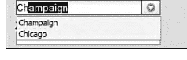

图 3.1 建议的城市部分

另一个改进是仅列出用户在“州”字段中选择的那个州所属的城市。我们是否应该为这样一个绝佳的解决方案而自豪？好吧，先别急着庆祝。毕竟，没有标准 HTML 组件能提供我们如此渴望的功能。幸运的是，我们使用了 Dojo，它恰好有一个名为`ComboBox`的组件，包含了我们正在寻找的所有功能。

让我们用 Dojo ComboBox 替换标准的城市文本框。我们必须确保使用`dojo.require`语句包含了该组件的代码。将以下代码添加到包含其他 require 语句的`<script>`标签中。

```javascript
dojo.require("dijit.form.ComboBox");
```

然后，必须通过在“城市”字段的`<input>`标签中添加`dojoType`属性，将 Dojo 组件附加到 DOM。以下代码显示了如何用新的 Dojo 组件替换标准文本框。新代码已加粗。

```html
<input type="text" id="city" name="city" title="city"
    dojoType="dijit.form.ComboBox"
    autoComplete="true"
    forceValidOption="false"
/>
```

`dojoType`属性告诉 Dojo 解析器将组件附加到 DOM。`autoComplete`属性告诉组件根据用户输入的字符，自动为第一个匹配项填充完整文本。因此，如果用户输入"ch"，且第一个匹配的城市是"Chicago"，那么当用户离开该字段时，组件会将整个城市名称赋值给该字段。这为用户节省了大量的输入工作，尤其是对于较长的城市名称。

`forceValidOption`属性设置为`false`允许用户输入不在选择列表中的值。这种行为与常规的选择列表截然不同，常规列表仅允许用户从列出的值中选择一个。如果你想要那种行为，只需将`forceValidOption`属性设置为`true`。然而，在这种情况下，将其设置为`false`可以获得一些有用的功能，因为用户的城市有可能不在我们的列表中。

Dojo`ComboBox`组件是标准`<select>`列表的绝佳替代品。那么为什么不把它也用于“州”字段呢？就这么做吧！我们只需要做一点改动。由于可能的州列表是众所周知的，我们将强制用户从列表中选择一个，而不是允许他们输入新值。这需要将`forceValidOption`属性设置为`true`。该组件还提供了一种便捷的数据输入技术，解决了我们之前讨论过的一个问题。当你在标准`<select>`列表中输入字母"il"时，会选中"Louisiana"州，因为大多数浏览器将每个字母视为该州的首字母，即使你已经输入了"i"。相反，Dojo`ComboBox`使用整个字符串来正确选择预期的伊利诺伊州（Illinois）。

以下是将州的标准选择列表替换为新 Dojo 组件的代码。新代码已加粗。

```html
<input type="text" id="state" name="state" title="state"
    dojoType="dijit.form.ComboBox"
    autoComplete="true"
    forceValidOption="true"
/>
```

## 3.3 教程步骤 3b——从服务器检索数据

### 3.3.2 获取状态值并发送至服务器

现在我们已经为状态（state）和城市（city）准备好了相应的控件，接下来的重点是如何获取正确的数据。正如我们之前讨论过的，我们可以预先将美国所有可能的城市填充到城市列表中。但问题在于城市数量接近 30,000 个，加载所有城市会使页面变得臃肿。更好的方法是从服务器仅获取用户所选特定状态下的城市。

这带来了几个挑战。首先，我们必须决定如何以及何时获取状态的值。其次，我们必须向服务器发送请求以获取城市数据。第三，我们必须用这些城市来填充城市列表。让我们依次解决这些问题。


每当用户选择一个状态时，我们都应该重新填充城市列表。我们之前在处理用户名字段时已经遇到过类似的问题。我们将对状态选择列表使用`onChange`事件。通过为该事件分配一个事件处理程序，我们就能在恰当的时机获取新的状态值并将其提交到服务器。我们在教程的步骤 2 中已经讨论过与事件处理程序相关的问题。欲了解更多详情，请返回阅读该步骤。

让我们为状态字段添加一个事件处理程序，以便每次值发生变化时，都会调用一个用于填充城市列表的事件处理函数。我们将该事件处理程序命名为`populateCity`，并通过将状态`ComboBox`的`onChange`属性设置为该处理函数的名称，将其与“State”字段的`onChange`事件关联起来。新代码以粗体显示。

```html
<input type="text" id="state" name="state" title="state"
    dojoType="dijit.form.ComboBox"
    autoComplete="true"
    forceValidOption="true"
    onChange="populateCity"
/>
```

现在，每当用户选择一个新的状态值时，事件处理程序就会被调用。这在用户第一次选择状态时同样有效。正确的事件处理程序将被调用，但它应该执行什么操作？它需要获取城市值，但实现这一目标的正确方法是什么？我们需要获取状态的值，然后将其发送到服务器。获取状态的值非常简单，只需对控件运行`getValue`方法，它就会返回所选的值。

一旦获取了值，情况就变得复杂了。直觉可能会告诉我们，这个问题已经解决了。在教程的前一个步骤中，我们创建了一个向服务器发送的`XHR`调用。我们可以再次使用相同的技术。然而，这次我们要填充的是一个需要从服务器接收数据的 Dojo 控件，因此我们的解决方案可以更简单。某些 Dojo 控件是“绑定”到服务器数据的。这意味着控件会自动向服务器发起`XHR`调用，并自动使用服务器返回的数据来填充自身。这可以为我们节省大量代码。幸运的是，`ComboBox`控件恰好就是这种数据绑定控件类型之一。

虽然使用数据绑定控件的代码可以更简单，但它要求我们理解一个全新的 Dojo 概念：数据存储（data stores）。我的一位前教授喜欢说，计算机科学中的任何问题都可以简单地通过将其包装在一个抽象层中来解决。在使用 Dojo 数据存储时，这一哲学确实适用，因为数据存储为各种底层数据类型提供了一个包装。应用程序可能使用的数据可能存在于许多地方或以许多格式存在。通常，我们会从服务器获取数据，但我们也可能从 Web 服务、Cobol 遗留应用程序，甚至目录服务中获取。此外，数据可能以多种不同格式存在，如 XML、JSON、纯文本或其他专有格式。对于 Dojo 团队来说，为所有这些可能的情景创建不同的控件是非常困难的，因此 Dojo 在控件和数据源之间提供了一个名为`store`的抽象层。

Store 提供了一套一致的方法调用（或 API），允许控件与数据源通信，而无需确切知道它们正在处理的是哪种类型的数据源。由于 Dojo 团队无法预见应用程序可能通信的所有不同数据源，因此他们提供了编写数据源层所需的文档。

不过，已经为我们定义了一些数据源。其中之一就是 JSON 数据源。如果您的服务器以 JSON 格式提供数据，您可以使用 JSON 数据源作为连接该数据的一种方式。如何使用这种数据源？使用数据存储层将数据源绑定到 Dojo 控件需要执行以下步骤：

1. 通过服务器上的 HTTP 请求公开数据。
2. 在客户端定义数据存储（data store）Dojo 对象。
3. 将数据存储绑定到使用它的 Dojo 控件。

既然我们知道了数据存储的存在，现在就来使用一个。

### 3.3.2.1 公开数据源

要使用某些数据，我们必须能够访问它。换句话说，服务器必须能够提供这些数据。我们将通过创建一个服务器资源来公开数据，该资源可以通过 HTTP GET 或 POST 请求调用，并返回 JSON 格式的数据。服务器资源可以使用请求中传递的参数来动态构建请求的数据。

在我们的教程中，我们将创建一个名为`getCities.jsp`的服务器资源，它将接收一个状态作为参数，并返回该状态下的城市列表。为了简化代码，我们将仅为伊利诺伊州（Illinois）返回城市列表。所有其他状态将仅返回一个名为 "Anytown" 的城市。对于伊利诺伊州，我们仅提供少量实际的城市。以下是我们为了公开城市数据需要创建的 JSP 页面。

```jsp
<%@ page contentType="text/plain"%>
<%
response.setHeader("Cache-Control","no-cache"); //HTTP 1.1
response.setHeader("Pragma","no-cache"); //HTTP 1.0
response.setDateHeader ("Expires", 0); //prevents caching at the proxy server
%>
<%
String state = request.getParameter("state");
if (state == null) { state = "";}
if (state.equals("Illinois")) {
%>
{identifier:"name",
    items: [
        {name:"Champaign", label:"Champaign"},
        {name:"Chicago", label:"Chicago"},
        {name:"Naperville", label:"Naperville"},
        {name:"Wheaton", label:"Wheaton"}
    ]}
<%
} else {
%>
{identifier:"name",
items: [
{name:"Anytown", label:"Anytown"}
]}
<%
}
%>
```

这是一段相当原始的代码。本书的网站包含一些额外的示例，展示了返回所有实际状态中所有城市的更完整技术。¹

服务器返回的伊利诺伊州数据如下所示：

```json
{identifier:"name",
items: [
        {name:"Champaign", label:"Champaign"},
        {name:"Chicago", label:"Chicago"},
        {name:"Naperville", label:"Naperville"},
        {name:"Wheaton", label:"Wheaton"}
    ]}
```

如果您觉得这种数据格式很奇怪，可能是因为您之前没有接触过 JavaScript 对象表示法（JSON）。JSON 是一种将复杂数据对象表示为文本字符串的技术。您可以将其视为 JavaScript 的 XML。这个 JSON 字符串表示一个包含四个元素的数组，每个元素代表一个城市。此外，该数组的每个元素本身也是一个包含两个元素的数组，其中包含城市选择列表的值。

每个元素对应于`<select>`列表中的一个选项。对象有一个名为 "name" 的属性，其中包含`<option>`元素`value`属性的字符串，该属性定义了选择列表中的每个项目。这也是发送到服务器的值。`label`属性包含显示给用户的字符串。在这种情况下，两个值相同，但它们也可以不同。

这是正确馈送控件所需的 JSON 数据格式。该控件需要包含两个值的元素，第一个值是项目被选中时发送到服务器的值，第二个值是在选择列表中显示给用户的值。第二部分描述了其他各种启用数据的 Dojo 控件所使用的数据格式。有关使用 JSON 的更多信息，请参阅第 13 章“字符串与 JSON”。

¹ 本书的网站可在`http://www.objecttraininggroup.com/dojobook`找到。

### 3.3.2.2 定义 Dojo 数据存储

为了让 Dojo 能够自动使用来自服务器的数据，我们必须在浏览器中创建一个对象来表示这些数据。这个对象被称为 Dojo 数据存储（data store）。我们可以通过在 HTML 中声明 store，让 Dojo 解析器为我们创建该对象。虽然这是最简单的方法，但我们也可以使用 JavaScript 创建该对象。由于每次选择不同的状态时我们都会创建一个新的数据存储，因此我们将使用编程技术来创建存储对象。

我们将向被引用为事件处理程序的`populateCity.js`文件中添加 JavaScript 代码。与之前一样，当我们创建新的 JavaScript 文件时，请确保使用如下代码所示的`script`标签引用该文件。将代码放在包含`validateUserName.js`文件的`<script>`标签之后。

```html
<script type="text/javascript" src="populateCity.js">
</script>
```

现在我们必须创建新文件并定义处理函数。

```javascript
function populateCity() {

    // Get the new value of state
    var selectedState = dijit.byId("state").getValue();

    // Build URL to make XHR call to server
    var url = "getCities.jsp?state=" + selectedState;

    // Build new data store
    cityStore = new dojo.data.ItemFileReadStore({url: url});

    return;
}
```

数据存储（data store）现已创建，但尚未发起`XHR`请求。只有在我们将数据存储与组件（widget）绑定之后，才会发生这种情况。

### 3.3.2.3 将数据存储绑定到组件

为了真正让数据存储从服务器获取数据，我们需要将其与将要使用该数据的组件相关联。我们唯一需要做的就是将组件的`store`属性值赋值为该数据存储，其余的操作都由 Dojo 完成。

我们需要在事件处理函数中添加额外的代码，以获取组件的引用并分配新的属性值。请将以下粗体代码添加到您的处理函数中。

```javascript
function populateCity() {

    // Get the new value of state
    var selectedState = dijit.byId("state").getValue();

    // Build URL to make XHR call to server
    var url = "getCities.jsp?state=" + selectedState;

    // Build new data store
    cityStore = new dojo.data.ItemFileReadStore({url: url});

    // Create a reference to the city widget
    var city = dijit.byId("city");

    // Clear out any existing values in the widget
    city.setDisplayedValue("");

    // Assign new data store which will force a new XHR request
    city.store = cityStore;

    return;
}
```

这就是全部必要的步骤。通过构建一个新的数据存储来请求选中的州，然后将该数据存储赋值给组件，Dojo 会自动创建一个`XHR`对象从服务器获取数据，然后用这些数据填充组件。仅用几行代码，我们就为表单实现了一个强大的服务器查询功能。

## 总结

Dojo 可用于调用服务器资源，以执行进程或检索数据。

Dojo 的`xhrGet`和`xhrPost`函数可用作`XMLHttpRequest`（XHR）对象的包装器，从而执行对服务器的调用。

数据存储提供了对从服务器检索的外部数据的包装。

某些 Dojo 组件可以与 Dojo 数据存储绑定，从而自动从服务器检索数据并填充组件。

> 本章深入介绍了几个标准的 Dojo 组件，并展示了如何使用它们来调用服务器进程和获取数据。Dojo 组件的客户端功能比标准 HTML 组件强大得多，但我们还可以进一步探索。虽然与服务器通信是一个重要的 Ajax 特性，但 Ajax 的另一面是在浏览器中创建令人印象深刻的视觉元素的能力。下一章将重点介绍 Dojo 中一些非常强大且视觉效果出色的组件。

# 4 使用 Dojo 组件

> 没有什么比用清晰的图像去描述一个模糊的概念更糟糕的了。

> —安塞尔·亚当斯 (Ansel Adams)

无论好坏，Web 都是一种强烈的视觉媒介。一个网页是视觉元素的集合，允许用户查看和操作信息，而最佳的呈现方式是将正确的组件与正确的数据相匹配。换句话说，信息本身就要求以正确形式显示。不幸的是，标准 HTML 仅提供了少量的显示数据选项。Dojo 通过提供一套强大的视觉元素（称为组件/widgets）扩展了我们的可能性，为我们提供了更丰富的调色板，让应用程序的数据和功能栩栩如生。

## 4.1 向页面添加 Dojo 组件

Web 开发人员正在寻找将 Ajax 技术应用于其网页的方法。但 Ajax 究竟是什么？最初的缩写是 AJAX，代表异步 JavaScript 和 XML (Asynchronous JavaScript and XML)。但其含义随着时间的推移而演变。让我给您一个更现代的定义。

Ajax 可以被描述为一枚硬币的两面。硬币的一面是在不刷新页面的情况下与服务器异步通信的能力——也就是所谓的`XHR`对象。在许多方面，这是 Ajax 网站的核心特性，因为这是许多 Web 2.0 界面构建的新范式。Ajax 硬币的另一面是大多数 Ajax 应用程序提供的丰富用户界面。对许多人来说，无论底层的服务器请求是如何实现的，这才是 Ajax 应用程序真正的标志。一个 JavaScript 库可能只解决这两面中的任何一面，但 Dojo 同时解决了两面。我们已经涵盖了`XHR`对象，因此在本教程的这一部分中，我们将重点讨论 Dojo 通过其一组高级组件提供丰富用户界面的能力。

### 4.1.1 Dijit——Dojo 组件模块

Dojo 使用`dijit`一词来描述其与创建和使用组件相关的特性。这不仅是一个概念性术语，Dojo 还将这些特性在物理上组织在一个名为`dijit`的子目录中，该目录位于`dojo`目录的根目录下。此外，`dijit`也是用于引用组件相关函数的命名空间。我们已经看到了一些使用`dijit`特性的示例，但现在我们可以更详细地探索它们。Dojo 团队在创建组件特性时有几个目标：

- 创建一组视觉组件，提供超出标准 HTML 元素的有用功能。
- 公开创建 Dojo 组件的技术，以便开发人员可以扩展现有的 Dojo 组件，或基于相同技术创建全新的组件。
- 使组件在所有不同浏览器中外观一致。
- 确保组件能够支持针对残障用户的无障碍功能。
- 为所有组件提供国际化支持，以便它们可以支持多种语言。

当您使用 Dojo 组件时，您会发现 Dojo 已经实现了这些目标，并为开发人员提供了一个强大的工具箱，用于创建视觉上精致的网站。第二部分“Dojo 组件”将更详细地探讨单个 Dojo 组件。现在，让我们通过将几个最强大的 Dojo 组件添加到网页中来探索如何使用它们。

## 4.2 教程步骤 4——使用 Dojo 组件

在本教程的这一步中，我们使用 Dojo 组件来替换页面上的一些标准 HTML 组件。我们在教程之前的步骤中已经这样做过，因此该技术应该已经很熟悉了。我们的方法是在标准 HTML 标签中添加一个特殊属性`dojoType`，该属性将被 Dojo 解析器读取，并导致文档对象模型 (DOM) 元素被增强以具备额外功能。这听起来很复杂。简单来说，我们只是告诉 Dojo 用一组更复杂的元素来替换代表标准 HTML 组件的单个 DOM 元素。这组新元素在协同工作时，提供了我们 Dojo 组件的功能。此外，Dojo 将创建一个不属于 DOM 的 JavaScript 对象，并将其与新组件关联。这个“影子”对象将包含 DOM 元素中不可用的属性和方法。

> **注意：**
>
> 由于 Dojo 组件可能由多个 DOM 元素组成，请务必使用`dijit.byId()`而不是`document.getElementById()`来访问它们。

### 4.2.1 使用 Dojo DateTextBox 组件

让我们从“服务日期 (Service Date)”字段开始。这是用户希望服务开始的日期。自教程第 1 步以来我们还没有看到这个字段，因此您可能需要查看图 1.1 中的原始表单以唤起记忆。在原始表单中，用户看到的是一个没有任何验证的文本框。正如我们之前讨论的，这种方法存在许多问题，最明显的是用户不知道应该以什么格式输入日期。除此之外，在没有日历的情况下，人们很难确定日期。因此，显然这个组件（标准 HTML 文本框）不符合用户需要输入的数据功能。

一个更合适的图形用户界面 (GUI) 元素应该为用户提供一个日历，以便其从中选择日期。这将解决格式问题，因为用户无需以文本形式输入日期。并且它允许用户以对其最有用形式查看数据：日历。

让我们看看如何快速将此组件添加到页面。然后我们可以更详细地讨论它。

我们只需要为该元素的`<input>`标签添加`dojoType`属性。我们还将添加几个非必需但能提供有用功能的额外属性。以下代码显示了要添加到标签中的属性。新属性已加粗。


```html
<input type="text" id="serviceDate" name="serviceDate" size="10"
    dojoType="dijit.form.DateTextBox"
    required="true"
    promptMessage="Enter service date."
    invalidMessage="Invalid date."
/>
```

这些新属性告诉 Dojo 解析器将标准 HTML `<input>` 标签替换为 Dojo DateTextBox 组件。然而，Dojo 需要知道从哪里获取新组件的代码，因此需要一个额外的步骤。我们通过包含一个`dojo.require`函数调用并将组件名称作为参数传递，来告诉 Dojo 从哪里获取代码。请将以下代码添加到“form.html”文件的顶部，现有的 require 函数调用组中。

```javascript
dojo.require("dijit.form.DateTextBox");
```

请注意，`dojoType` 属性的值 `dijit.form.DateTextBox` 与传递给 `dojo.require` 函数的参数相同。这就是允许 Dojo 将 `<input>` 标签中的组件与该组件相关的代码和额外 HTML 关联起来的链接。

当我们修改代码后第一次运行表单时，看起来没有任何变化。在“服务日期”标签旁边，显示的仍然像是一个简单的文本框。

# 第 4 章 使用 Dojo 部件

## 4.2.1 使用 Dojo DateTextBox 部件

服务日期：

然而，一旦我们将光标置于该字段中，就会自动显示一个日历，我们可以从中选择日期。

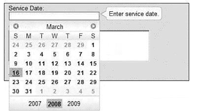

使用 DateTextBox 部件的服务日期字段

不仅会出现日历，而且当前日期会被高亮显示。在前面的示例中，10 月 24 日被选中，如日历上该日期背后的深色背景所示。用户可以通过单击日历左上方和右上方的后退和前进箭头来翻阅日历。当所需日期在日历上可见时，用户只需单击所需日期即可选择，日历部件会自动用正确的日期文本值填充文本字段。

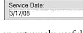

我们现在以极少的操作为页面添加了一个极其有用的部件。但让我们再贪心一点。这个部件还有哪些其他有用的功能可以利用呢？让我们考虑一些额外的业务规则。例如，用户不应能够安排过去的日期。我们如何实现这一点？原来有一个名为 `constraints` 的属性，可用于定义日期的有效值。通过将最小约束设置为当前日期，我们排除了先前的日期。这可以使用如下代码所示的 `constraint` 属性来完成。新代码以粗体显示。

```html
<input type="text" id="serviceDate" name="serviceDate" size="10"
       dojoType="dijit.form.DateTextBox"
       required="true"
       promptMessage="Enter service date."
       invalidMessage="Invalid date."
       constraints="{min:'2007-10-24'}"
/>
```

尽管值`'2007-10-24'`看起来是硬编码的，但您可以在服务器上创建页面时动态生成它，以便始终提供当前日期。现在当部件出现在页面上时，先前的日期会被划掉，如下所示。

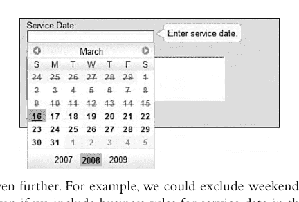

我们还可以更进一步。例如，我们可以排除周末。但是，我们必须小心。即使我们在浏览器中包含了服务日期的业务规则，它们也必须在服务器上重新验证。服务器永远不应信任来自浏览器的数据。更好的方法可能是创建一个 XHR 请求，在用户输入所选日期后对其进行验证。这将使我们能够把业务逻辑保留在服务器上，同时仍然让用户获得即时验证的好处，而无需提交整个表单。还有许多其他有用的属性可用于控制日历的行为，这些将在第二部分中更详细地探讨。

### 4.2.2 使用 Dojo 富文本编辑器部件

现在让我们将注意力转向评论字段。此字段允许用户使用 `<textarea>` HTML 标签输入多行文本评论。这个标准 HTML 标签提供了一些简单的功能，如每行末尾的自动换行。但这几乎是它提供的全部功能。如果我们想要做任何花哨的操作，例如更改输入字符的字体、将其设为粗体，或将其放入项目符号列表中，那我们就无能为力了。标准部件根本不允许这样做。如果我们能有一个强大的文本编辑器，可以直接插入页面中，那该多好啊？是的，确实如此。而 Dojo 提供了一个。它被称为`dojo.editor`，它提供了一套相当强大的默认功能。

在探讨细节之前，让我们先将默认部件放到页面上，替换现有的 `<textarea>` 标签。与之前的部件一样，我们真正需要做的就是在现有 HTML 标签中添加 `dojoType` 属性。然后我们需要通过使用 `dojo.require` 引用部件，确保部件代码包含在页面中。首先，让我们修改当前 HTML 标签，以便使用 Dojo 富文本编辑器部件来替代它。

```html
<textarea Writings id="comments" name="comments" height="100px"
          dojoType="dijit.Editor"
></textarea>
```

请注意，部件名称与我们使用的其他 Dojo 部件略有不同。编辑器不属于表单包，因此我们不会在部件名称中包含 form。

现在我们需要确保部件代码可供 Dojo 解析器用于替换到 DOM 中。将以下代码添加到“form.html 文件”顶部的现有 require 函数调用组中。

```javascript
dojo.require("dijit.Editor");
```

现在当我们运行页面时，我们会看到新部件。通过单击部件工具栏下方，我们可以输入有关服务的说明。图 4.2 显示了该部件以及一些用户输入的关于此人希望购买的服务类型的文本。

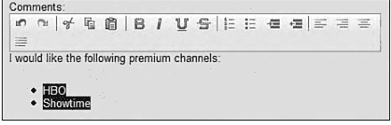

正如您在使用该部件时可能注意到的，很难准确确定部件的文本区域从哪里开始到哪里结束。为了改善部件的外观，我们将它 enclosed 在一个 div 中并为其分配样式。我们将在部件周围添加实线边框，并使文本区域具有浅色背景，如下所示。新的标记代码以粗体显示。

```html
<div style="border: 1px solid #9B9B9B; background: #FFFFFF;">
    <label for="comments">Comments:</label>
    <textarea id="comments" name="comments" height="100px"
        dojoType="dijit.Editor"
    />
</div>
```

现在我们更清楚地知道可以在哪里输入文本，如下截图所示。

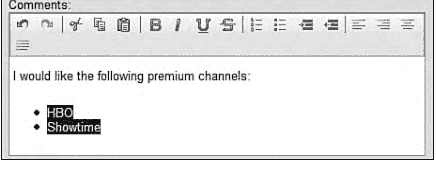

请注意，现在更容易看到部件的文本区域在哪里了。

部件顶部的工具栏显示了许多图标，可用于提供格式化功能。在给定的示例中，通过选择 "HBO" 和 "Showtime" 项目，然后单击无序列表图标，将它们转换为无序列表。各种图标的说明见表 4.1。

默认的编辑器部件提供了许多由工具栏上的图标表示的格式化工具。但您可能不想让页面用户可以使用所有编辑功能。可以通过设置部件的 `plugins` 属性来指定您希望编辑器提供的工具，该属性包含应在工具栏中显示的编辑功能列表。另外，您可能会注意到某些功能之间有竖线分隔。这允许相关图标作为一组一起出现。默认使用 " | " 字符作为分隔符，但允许任何字符。

以下是仅允许三种编辑功能（粗体、斜体和有序列表/无序列表）并在斜体后有分隔符的编辑器部件的定义。

```html
<textarea id="comments" name="comments" height="100px"
    dojoType="dijit.Editor"
    plugin="['bold', 'italic', '|', 'insertUnorderedList']">
>
```

请注意，该部件现在具有不同的工具栏，并且仅显示我们指定的功能。

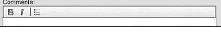

每个编辑功能都有一个图标和一个名称，可用于 `plugins` 属性的值。下表列出了可用的编辑功能及其对应的图标。

### 表 4.1 富文本编辑器图标

| 图标 | 属性值 | 描述 |
| :---: | :--- | :--- |
| ↩ | `undo` | 撤销上次编辑。 |
| ↪ | `redo` | 重做上次编辑。 |
| ✂ | `cut` | 剪切选定文本。 |
| 📋 | `copy` | 复制选定文本。 |
| 📄 | `paste` | 在光标处粘贴文本。 |
| **B** | `bold` | 将选定文本设为粗体。 |
| *I* | `italic` | 将选定文本设为斜体。 |
| <u>U</u> | `underline` | 为选定文本添加下划线。 |
| ~~S~~ | `strikethrough` | 将选定文本添加删除线。 |
| ≡ | `insertOrderedList` | 将选定文本转换为有序列表。 |
| ☰ | `insertUnorderedList` | 将选定文本转换为编号列表。 |
| ⊞ | `indent` | 缩进选定文本。 |
| ⊟ | `outdent` | 减少选定文本的缩进。 |
| ☰ | `justifyLeft` | 将选定文本左对齐。 |
| ☰ | `justifyRight` | 将选定文本右对齐。 |
| ☰ | `justifyCenter` | 将选定文本居中对齐。 |
| ☰ | `justifyFull` | 将选定文本左右对齐。 |

我们可以按任意顺序指定任何组合的编辑功能。

## 小结

Dojo 提供了一套丰富的图形部件，可以添加到网页中。

Dojo 部件可以通过向包含部件的 DOM 元素的 HTML 标签添加 `dojoType` 属性来放置在页面上。

```html
dojoType="dojo.form.ValidationTextBox"
```

Dojo 解析器遍历 HTML，并在找到 `dojoType` 属性的每个地方用指定的 Dojo 部件替换 DOM 元素。

Dojo 解析器通过包含以下 JavaScript 代码纳入页面中：

```javascript
dojo.require("dojo.parser")
```

Dojo 解析器需要知道它需要放置在页面上的每个部件的代码在哪里。需要对页面上的每种部件类型调用 `dojo.require` 函数。

```javascript
dojo.require("dojo.form.ValidationTextBox")
```

在本教程的这一步中，我们向页面添加了两个非常强大的部件。Dojo 包含的部件比我们目前看到的要多得多。而且尽管每个部件都有某些独特的功能，但所有部件都遵循相似的结构。这里提供的操作和使用部件的技术也适用于其他 Dojo 部件。我们将在第二部分中探讨更多 Dojo 部件。

在下一章中，我们将为我们的表单做最后的润色，看看如何将表单提交到服务器。

# 5 使用 Dojo 处理表单

> 工作不完成，文书工作就不算完。  
> ——匿名

本章将完成整个教程。我们已经添加了验证、服务器端处理和小部件，但还需要进行一些收尾工作，才能算完成我们的工作。本章描述了表单剩余的问题，并展示了如何使用 Dojo 来解决它们。

## 5.1 使用 Dojo 处理表单

我们几乎快要完成将表单升级到使用 Dojo 了。从某种意义上说，我们已经完成了——我们可以宣布胜利并回家，或者至少将我们的更改提交到生产环境，以便用户能够受益于我们出色的更改。我们已经解决了在分析原始 HTML 页面时发现的大多数问题。然而，还有一些遗留问题仍需要解决。

例如，如果用户在输入所有字段的信息之前就尝试提交表单会怎样？到目前为止，我们编写的验证方式要求用户实际访问每个字段。我们现在需要从整体上考虑这些字段，在允许将整个表单提交给服务器之前，确保所有验证都已应用。一个普通的 HTML 表单在用户点击提交按钮时会发出服务器请求，而不考虑可能执行的其他验证。我们将使用 Dojo 来干预处理过程，以便在向服务器发出不必要的请求之前，它可以执行那些有用的客户端验证。

一个稍微微妙的问题涉及页面如何向服务器发出请求，以及服务器上哪个资源需要响应这个请求。当用户点击提交按钮时，标准的 HTML 表单会提交到服务器。浏览器根据表单元素的 `action` 属性知道要调用哪个服务器资源。在我们的例子中，我们的表单调用服务器上的 `submit.jsp` 资源，如下面从表单中提取的代码片段所示。

```html
<form action="../submit.jsp" method="post" name="custForm">
```

浏览器不仅需要调用正确的服务器进程，还需要将输入到表单中的数据打包并一起发送。幸运的是，浏览器可以自动完成这一点。浏览器遍历每个表单元素，并在表单提交时创建一个包含元素名称及其值的名称/值对。如果表单方法是 "POST"，那么这些名称/值对将隐藏在 HTTP 请求的主体中；如果表单方法是 "GET"，那么名称/值对将附加到向服务器发出的 URL 请求的末尾。数据将被 URL 编码——空格和其他特殊字符已被其十进制等效项替换。字段名在前，然后与值由 "=" 字符分隔。同样，名称/值对之间由 "&" 字符分隔。

我们还有什么需要担心的吗？例如，一旦我们使用 Dojo 升级页面，会对发送到服务器的数据产生影响吗？我们是否需要重写一些服务器代码来处理新数据？简短的答案是，“不！”换句话说，一旦我们在页面中添加 Dojo，当前处理请求的同一服务器程序可以继续处理请求。这将最大限度地减少将 Dojo 添加到我们的应用程序中所带来的影响。

然而，假设我们愿意通过重写我们的响应过程在服务器上做一些工作。我们能通过这个获得任何好处吗？我们可以向服务器提交一个 XHR 请求，并在不刷新页面的情况下接收服务器的响应。这可能很有用，但需要我们创建一个服务器进程，该进程只需发回错误消息，而不是试图替换整个屏幕以及其中嵌入的错误消息。当表单提交成功时，这种技术可能不太有用，因为我们无论如何都可能要转到一个全新的页面。但作为一种通用技术，这可能非常有用。我们可以将表单作为 XHR 对象提交，并在不完全刷新页面的情况下处理响应。出于本教程的目的，我们将不重写任何服务器进程，因此我们将把 XHR 表单提交留到第 15 章研究远程处理时再讨论。

## 5.2 教程步骤 5——处理表单

在本教程步骤中，我们处理与整个表单相关的问题，而不仅仅是单个字段。首先要做的就是将标准的 HTML 表单转换为 Dojo 表单小部件。

### 5.2.1 创建 Dojo 表单小部件

我们已经在 HTML 页面上定义了一个表单。现在我们需要将其转换为 Dojo 表单小部件。既然我们已经熟悉了创建 Dojo 小部件的一般技巧，这对我们来说现在很容易做到。我们只需在表单元素中添加 `dojoType` 属性，如以下代码所示（我们的必要更改用粗体表示）。

```html
<form action="../submit.jsp" method="get" name="custForm"
    dojoType="dijit.form.Form"
/>
```

当然，我们还需要确保小部件的 Dojo 代码可供解析器使用。我们需要在我们的列表中添加另一个 require 语句。

```javascript
dojo.require("dijit.form.Form");
```

仅此而已。我们现在已将标准的 HTML 表单转换为 Dojo 表单小部件。

### 5.2.2 拦截表单提交

现在表单是一个 Dojo 小部件，并拥有一些新的超能力。它使我们能够在用户点击“发送”按钮时拦截请求，以便我们可以执行自己的处理。通过指定一个特殊属性，我们可以使浏览器将控制权传递给一个函数，而不是将请求提交给服务器。我们将 `execute` 属性的值设置为我们用于处理表单提交的函数名称。

```html
<form action="../submit.jsp" method="get" name="custForm"
    dojoType="dijit.form.Form"
    execute="processForm"
/>
```

我们需要创建一个名为`processForm`的新函数，并且需要一个放置它的地方。因此，我们将创建一个名为“processForm.js”的新文件，并通过使用 `<script>` 标签将其包含在我们的页面中。将新的 `<script>` 标签添加到页面顶部当前的 `<script>` 标签集合中，如下所示。

```html
<script type="text/javascript" src="validateUserName.js"></script>
<script type="text/javascript" src="populateCity.js"></script>
<script type="text/javascript" src="processForm.js"></script>
```

现在，让我们先创建实现该函数。创建一个名为“processForm.js”的文件，并将其放在与我们表单相同的目录中。以下是这个桩函数的代码。

```javascript
// 处理表单
function processForm {
    // 重新验证表单字段
    // 将焦点放在第一个无效字段上
    // 如果所有字段都有效，则提交表单
}
```

我们现在准备实现该函数。

### 5.2.3 检查所有表单元素是否有效

在我们的表单处理程序中应该做什么？我们需要验证表单中的字段，并通过执行以下操作来通知用户。

1. 重新验证表单中的每个字段。
2. 如果发现无效字段，则显示错误消息并将光标放在该字段中。


首先，我们需要确定一种遍历表单字段的技术。在每个字段上，我们将检查该字段是否有效。这可以通过在表单元素上调用`isValid()`方法轻松完成。如果字段有效，此方法将返回`true`，否则返回`false`。

迭代应在第一个无效字段处停止，我们应该显示一条错误消息并将焦点放在该字段上。显示错误消息结果是自动发生的。只需在元素上调用`isValid()`方法，元素标签中`invalidMessage`消息属性中指定的消息文本就会出现。将字段置于焦点状态是通过在元素上执行`focus()`方法来完成的。

我们现在已经逐步介绍了实现表单验证所需的代码。让我们看看以下代码片段中它们的整体样子。我们对该函数的更改用粗体显示。

```javascript
// 处理表单
function processForm {

    // 重新验证表单字段
    var custForm = dijit.byId("custForm");
    var firstInvalidWidget = null;
    dojo.every(custForm.getDescendants(), function(widget){
        firstInvalidWidget = widget;
        return !widget.isValid || widget.isValid();
    });

    if (firstInvalidWidget != null) {
        // 将焦点设置到第一个出错的字段
        firstInvalidWidget.focus();
    }
}
```

现在剩下唯一要做的就是在所有字段都有效的情况下提交表单。

## 注

所提供的示例引入了一个新函数，`dojo.every`。这是一个特殊的 Dojo 函数，它接受一个对象数组作为其第一个参数，以及一个函数作为其第二个参数。然后，该函数会为数组中的每个对象运行一次，对象被作为参数传递给该函数。

## 5.2.4 将表单提交到服务器

下一步是将表单提交到服务器。我们面临的风险是过于自作聪明。我的意思是，我们不应该过度思考。基于我们目前对 Dojo 的了解，我们的直觉可能会建议我们遍历字段元素，收集元素值，将它们转换为 JSON，并使用`xhrGet()`向服务器创建 XHR 请求。虽然这确实是一种优雅且可行的方法，但它比实际需要的要复杂得多。我们可以利用这样一个事实：当表单提交时，浏览器已经执行了所有这些任务。所以我们只需让浏览器继续其正常的表单提交过程，而这个过程我们之前如此粗暴地打断过。

JavaScript 为我们提供了一种直接提交表单的方法。在 DOM 中，表单对象有一个`submit()`方法，可用于使浏览器执行其正常的表单提交过程。以下代码可以工作。

```javascript
document.forms.custForm.submit()
```

然而，我们可以做得更好一点。因为我们正在使用 Dojo，所以应该使用可用的 Dojo 方法。虽然在这种情况下不是必须的，但充当此表单 DOM 对象伴侣对象的 Dojo 对象也包含一个`submit`方法。通常，当可用时我们应该使用 Dojo 方法，因为它可能提供某些额外的功能或执行一些跨浏览器兼容性检查。所以我们将改用以下代码。

```javascript
custForm.submit();
```

现在我们已经提交了表单。但为完整起见，让我们看看`processForm`方法的完整内容，所需的最后一段代码以粗体显示。

```javascript
// 处理表单
function processForm {

    // 重新验证表单字段
    var custForm = dijit.byId("custForm");

    var firstInvalidWidget = null;
    dojo.every(custForm.getDescendants(), function(widget){
        firstInvalidWidget = widget;
        return !widget.isValid || widget.isValid();
    });

    if (firstInvalidWidget != null) {
        // 将焦点设置到第一个有错误的字段
        firstInvalidWidget.focus();
    } else {
        custForm.submit();
    }
}
```

浏览器将打包表单元素的值，并创建一个 HTTP 请求发送到服务器。此请求不会是 XHR 请求，因此我们期望服务器将向浏览器发送一个全新的页面。因为我们正在使用浏览器来提交请求，数据的格式与我们在" Dojo 化"表单之前完全相同。所以我们不需要以任何方式修改服务器进程，这最小化了实现我们新功能所需的代码更改。就页面现在的工作方式而言，如果表单提交成功，服务器会将用户转发到一个全新的页面。最终，我们可能会决定希望让服务器进程只返回错误消息或提交状态，而不是一个全新的页面。到那时，我们需要将我们的表单改为提交 XHR 请求，并在页面上处理响应。但现在让我们把这项工作留到另一天，并在我们的新表单上宣布胜利！

## 小结

`dojo.form.Form`对象可用于替换标准 HTML 表单对象，方法是将`dojoType="dojo.form.Form"`添加到表单标签中。

我们可以通过使用 Dojo 表单的`execute`属性来指定当用户提交表单时要调用的方法，从而打断浏览器执行的正常表单提交。

要让浏览器提交表单，请使用 Dojo 表单对象的`submit()`方法。

既然我们已经了解了为网页添加一些酷炫部件的通用技术，那么看看 Dojo 提供的所有种类部件将会很有趣。第二部分"Dojo 部件"描述了许多我们可以直接使用的 Dojo 部件。我们还将探讨如何修改和扩展这些部件，甚至创建全新的我们自己的部件。

# Dojo 部件

- 6 Dojo 部件简介
- 7 Dojo 表单部件
- 8 Dojo 布局部件
- 9 其他专业 Dojo 部件

# 6 Dojo 部件简介

> 别去注意幕后的那个人！
>
> ——《绿野仙踪》

我们不会遵循这句引言的建议。在本章中，我们揭开 Dojo 部件的帷幕，揭示它们秘密的内在生命。这是一种以简洁实现目标和用途的生命，然而就像一只鸭子在水面下拼命划水一样，表面之下有很多事情正在发生。我们将探索 Dojo 部件的内部工作机制，并为有效使用它们奠定基础。

## 6.1 什么是部件？

准确描述部件是什么（以及不是什么）比我最初想象的要困难。在我做了一些研究后，我在某个地方发现了一段精彩的定义——竟然是在一些 Red Hat Linux 文档中。该定义将部件描述为"可由用户操作的标准化屏幕控件表示。滚动条、按钮和文本框都是部件的例子。"¹ 多么好的描述啊。

> **注**：另一个有趣的事实是，"widget"是"window gadget"的缩写——谁知道呢？

¹. *Red Hat Linux 6.2：官方 Red Hat Linux 入门指南*：<http://www.redhat.com/docs/manuals/linux/RHL-6.2-Manual/getting-started-guide/ch-glossary.html>。

让我们逐一解析该定义的每个元素，看看它对我们意味着什么。

- **部件是屏幕上的控件**——部件是页面上的视觉元素，为用户提供一种操作应用程序某些数据或功能的方式。最简单的部件之一是 HTML 复选框。它出现在页面上，通过选中它，用户正在设置一些最终将发送到服务器的数据值。虽然部件必须在页面上，但它不一定必须是可见的。它有时可能是暂时隐藏的。
- **部件是标准化的**——部件应该在各处以相同的方式工作，并具有某种直观或明显的操作行为。此外，部件应遵循普遍接受的使用和行为模式。在 Ajax 世界中，这一标准并不总是得到满足。某些部件的使用范围非常有限，或者是如此新颖，以至于尚未定义标准化的行为。
- **部件可以由用户操作**——部件的目的是允许用户设置某些数据或以某种方式控制系统的功能。因此，页面上有视觉元素并不意味着它就是部件。
- **部件包含数据**——虽然这不在定义中，但它也是理解部件的一个关键因素。部件包含一些可以被操作的状态。例如，图像不是部件，尽管它是页面上的一个元素。然而，图像幻灯片是部件，因为不仅可以由用户操作，它还包含状态信息（例如，当前聚焦的图像）。

现有的标准 HTML 控件（如复选框和单选按钮）也是部件吗？我认为它们确实是。然而，HTML 提供的少量部件种类不够丰富。一个真正好的部件能够使其自身与用户对应用程序某个功能的期望相匹配。这方面的一个绝佳例子是 Photoshop 中的"裁剪"部件。该图标显示了一个实际用于胶片摄影的物理裁剪工具的图片。该图标还允许用户以类似于真实工具的方式设置裁剪区域。然而，HTML 中没有"裁剪"部件。也没有与我们希望在当前基于浏览器的应用程序中提供的许多功能相匹配的部件。HTML 中缺少的部件太多了。Dojo 提供了一些这些 HTML 本应该给我们的"缺失部件"。

## 6.2 什么是 Dojo 组件（Widgets）？

Dojo 部件是 DOM 元素和 JavaScript 对象的集合，它们协同工作以提供用于操作应用程序的单一控件。它们是网页上协同工作、提供一个视觉组件的元素，具备我们之前讨论过的组件特性。最棒的一点是，你不需要为它们编写代码。Dojo 已经提供了将组件添加到网页并开始使用所需的一切。

虽然你现在可能已经理解了什么是组件（甚至在定义之前就已经知道了），但我们在这里讨论 Dojo 最受欢迎且最复杂的组件之一：富文本编辑器（Rich Text Editor）。这里有一张图片——它不仅胜过千言万语，还能让你编辑千言万语！

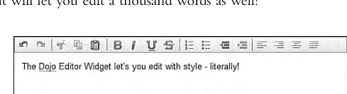

这个编辑器实际上是一个“加强版”的 HTML `<textarea>` 组件。它允许你创建多行文本并为其应用各种样式。这就像在你的网页中内置了一个文字处理器。

那么，Dojo 组件使用起来很简单，对吧？我们只需要将它们“添加”到页面上？具体怎么操作呢？以下是一个将 Dojo 组件放置在网页上的 HTML 标记示例。

```html
<input
type="text"
dojoType="dijit.form.TextBox"
/>
```

瞧，这*确实*很简单！唯一的“魔力”（考虑到它如此简单，甚至不能称之为魔力）就是包含`dojoType`属性并指定所需的组件名称。还有一个简单的步骤，那就是通过在 JavaScript 的某个地方放入`dojo.require("dijit.form.TextBox")`语句来引入该组件的代码。当然，这个示例没有充分利用组件的自定义功能。你还可以通过在`<input>`标签中使用额外的属性来设置组件的属性。

> **注意**
>
> 请注意代码是如何引用“dijit”的？这就是名为 Dijit 的模块，它包含了创建 Dojo 组件的代码和其他相关产物。

还有一种使用 JavaScript 创建 Dojo 组件的技术，同样非常简单。我们只需使用所需的构造函数创建一个对象，然后将其添加到页面的 DOM 中。以下是如何将 Dojo TextBox 添加到网页的示例（该示例假设存在一个名为`placeHolder`的 DOM 元素，我们可以将组件附加到其中）。

```javascript
new dijit.form.TextBox({}, dojo.byId("placeHolder"));
```

第一个参数是一个包含待创建组件属性的对象。虽然我们在示例中没有设置任何属性，但肯定有很多可用属性可以用来自定义组件。第二个参数是一个我们可以附加新组件的 DOM 元素。如果没有对现有 DOM 节点的引用，新组件虽然会被创建，但不会成为页面的一部分。这是初学者在学习组件操作时经常犯的错误。

现在我们已经以自顶向下的方式描述了 Dojo 组件，如果你像我一样，那么让我们深入探索其技术细节。我们将深入到原子级，看看构成一个组件的基本物质是什么。

## 6.3 Dojo 组件的组成部分

每个 Dojo 组件由以下三个元素组成：

- 由 HTML 标签定义的结构（Structure）
- 由 CSS 样式定义的外观（Look）
- 由 JavaScript 对象中的事件和事件处理程序定义的行为（Behavior）

让我们以一个实际的 Dojo 组件为例，详细地走一遍这些元素，以进一步澄清这些领域。

### 6.3.1 组件 HTML

Dojo 组件是由描述其结构的 HTML 标签创建的 DOM 元素集合。每个组件的 HTML 都包含在一个单独的文件中，并保存在一个特殊的目录下。下面的示例将描述一个 HTML 文件并确定其位置。该示例将解释所有组件在 HTML 中定义其结构所采用的通用技术。

让我们从最简单的组件之一——文本框（text box）开始。这个组件取代了标准的 HTML 文本字段。以下是一个允许用户输入地址的简单文本字段示例。

```html
Address: <input type="text" name="address" />
```

在这个示例中，该字段前面有一个描述网页字段的标签。图 6.2 显示了这个字段在页面上的显示效果（在没有额外样式的情况下）。

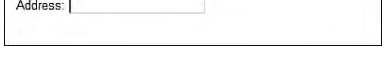

图 6.2 标准 HTML 文本框

我们将使用声明式方法，用 Dojo 的等效组件替换这个标准 HTML 组件。这意味着我们将使用页面主体中的 HTML 标记来定义组件。另一种选择是使用基于 JavaScript 的编程方法。以下 HTML 标记将构建该 Dojo 组件。

```html
<br/><br/>(Plain HTML) Address:
<input type="text" name="address" />
```

```html
<br/><br/>(Dojo Widget) Address:
<input type="text" name="address" dojoType="dijit.form.TextBox"/>
```

我还添加了一些额外的 HTML 来包含普通组件、Dojo 组件以及少量格式化内容。图 6.3 显示了原始 HTML 文本框与 Dojo 文本框的对比外观。

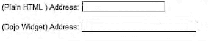

图 6.3 Dojo 文本框与标准 HTML 文本框的对比

记住，为了使示例正常工作，我们必须确保已经引入了 Dojo，启动了解析器（parser），并引入了组件代码。我们在这里重复一遍代码，但欲了解更多详情，请参阅第一部分“Dojo 教程”中的教程。

```html
<script type="text/javascript"
 src="../dojo-release-1.0.2/dojo/dojo.js"
 djConfig="parseOnLoad: true"></script>
```

```javascript
<script type="text/javascript">
 dojo.require("dijit.form.TextBox");
</script>
```

纯 HTML 组件和 Dojo 组件之间存在一些明显的差异。例如，Dojo 组件的背景颜色是黄色的。为什么存在这些差异？要回答这个问题，我们需要检查实际创建的 DOM 元素。我们将使用 Firefox 的 Firebug 插件来查看表示为 HTML 的 DOM 元素。

```html
<br/><br/>(Plain HTML) Address:
<input type="text" name="address"/>
```

```html
<br/><br/>(Dojo Widget) Address:
<input
 id="dijit_form_TextBox_2"
 class="dijitTextBox"
 type="text"
 autocomplete="off"
 dojoattachevent="onmouseenter:_onMouse,
 onmouseleave:_onMouse,
 onfocus:_onMouse,
 onblur:_onMouse,
 onkeyup,onkeypress:_onKeyPress"
 name="address"
 dojoattachpoint="textbox,focusNode"
 tabindex="0"
 widgetid="dijit_form_TextBox_2"
 value=""
 aaa:valuenow=""
 aaa:disabled="false"
 style=""/>
```

Firebug 查看的是被网页 JavaScript 修改后的 DOM，并将其转换回等效的 HTML。你可能认为 Firebug 显示的 HTML 应该与我们在页面原始源码中创建的 HTML 相同。对于纯文本组件的 HTML 来说，确实如此。然而，Dojo 解析器会寻找 HTML 中定义的 Dojo 组件，并用额外的 DOM 元素和属性替换它们。这就是为什么我们在 Firebug 中看到的 Dojo 组件 HTML 与我们在源页面中输入的 HTML 看起来如此不同的原因。

为什么会有这些差异？显而易见的答案是 Dojo 把它们放到了那里。但怎么做到的？Dojo 是通过将输入的 HTML 替换为另一种 HTML 来实现的，它称之为模板（template）。模板包含了大部分替换 HTML，并留有几个钩子（hooks），以便 Dojo 可以添加一些额外信息。

让我们回顾一下该组件的 HTML 模板。首先我们要找到它。包含组件结构（其模板）的 HTML 标记可以通过在与其包名对应的路径中寻找“template”目录来找到。我们的组件在“dijit.form”包中，因此我们应该在`dijit/form/template`寻找模板子目录，如图 6.4 所示。该图仅显示了相关的目录和文件，根据你使用的 Dojo 版本，你的目录结构可能略有不同。


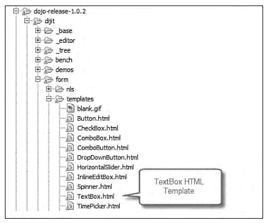

图 6.4 `dijit.form` 包中 `templates` 目录的位置

以下是“TextBox.html”文件中的代码。为了提高可读性，通过添加一些换行符对其进行了重新格式化。除此之外，所示代码与文件中的完全一致。

```html
<input
    class="dojoTextBox"
    dojoAttachPoint='textbox,focusNode'
    name="${name}"
    dojoAttachEvent='
        onmouseenter:_onMouse,
        onmouseleave:_onMouse,
        onfocus:_onMouse,
        onblur:_onMouse,
        onkeyup,onkeypress:_onKeyPress'
    autocomplete="off"
    type="${type}"
/>
```

现在我们可以明白为什么 Firebug 的 HTML 看起来与我们在源文件中输入的内容不同了。它简单地被前面的模板文件替换了。不过，这里有几处不同——Dojo 在模板中更改了几个值。第一个差异在于模板文件的这一行：

```html
name="${name}"
```

将其与 Firebug 中的同一行进行对比：

```html
name="address"
```

模板中的“${name}”是如何在最终 HTML 中被替换为“address”的？这是通过 Dojo 解析器完成的，它会在模板中查找值，并将其替换为实际 HTML 中的属性。“$”字符是一个特殊符号，用于在模板文件中命名变量，该变量将被替换为 HTML 标记中具有相同名称的属性值。换句话说，使用的是源中 HTML 标记的 `name` 属性。请记住，`name` 属性位于原始 HTML 中，如下面的粗体所示。

```html
<br><br>(Plain HTML ) Address:
<input type="text" name="address" />
```

```html
<br><br>(Dojo Widget) Address:
<input type="text" name="address" dojoType="dijit.form.TextBox"/>
```

这种值替换是一个通用过程，可用于将任何属性值替换到模板中。这是一种将数据从 HTML 标记传递到模板的方式。同样的机制也用于将 `type="text"` 传递到模板中，用于 `type="${type}"` 这一行的赋值。

模板中的 `id` 和 `widgetid` 属性由 Dojo 自动创建。它们可以通过在标记中设置这些属性的值来分配。在这种情况下，Dojo 根据一个简单的命名方案生成了一些值。

还有一些似乎不是来自模板的新属性。这些是 `autocomplete`、`tabindex` 和 `value`。它们也是由 Dojo 自动添加的，用于此 widget 类型。不同的 widget 类型还会添加一些独特的属性。我们在后面的章节中探讨这些内容，届时会详细研究各个 widget。

我们现在对 Dojo 如何更新此 widget 的 DOM 有了更好的理解。但是，仍然有一些未决问题。例如，为什么 Dojo widget 的文本区域显示得更长，且边框略有不同？我们需要研究 Dojo 如何应用样式到 widget。

### 6.3.2 Widget 样式

您可能已经注意到，Dojo TextBox widget 看起来与标准 HTML 文本框不同。这是因为 Dojo 对该 widget 应用了一些特殊样式。每个 Dojo widget 的三个主要元素之一就是与其关联的样式集。样式是如何应用的呢？我们可以通过检查我们一直在讨论的 widget 的 DOM 元素中的一个属性来回答这个问题。以下代码来自 TextBox Dojo widget 的模板文件中定义的 HTML。

```html
class="dojoTextBox"
```

`class` 属性用于将各种样式关联到 DOM 元素。具体样式对每个 widget 都是唯一的。TextBox widget 仅使用单一样式，但许多 Dojo widget 使用多种样式。各种 Dojo widget 样式在 CSS 文件中定义，可以在 Dojo 目录结构中找到。

在子目录 `dijit/themes` 中，我们可以找到文件 `dijit.css`。该文件包含大多数 Dojo widget 的样式。此外，Dojo 还提供了许多替代主题，可用于在默认样式之外应用额外的样式。图 6.5 显示了用于存放各种样式表（包括样式使用的图像）的目录结构的屏幕截图。

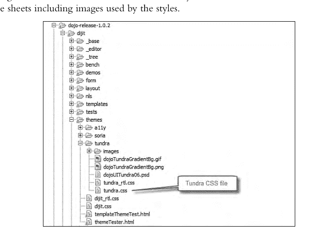

图 6.5 Dojo widget 样式文件的位置

我们将查看 `dijit.css` 文件，看看能否找到与此 widget 相关的样式信息。只需稍加搜索，我们就能找到以下样式定义。

```css
.dijitTextBox,
.dijitComboBox,
.dijitSpinner {
    border: solid black 1px;
    width: 15em;
}
```

此代码为任何类为 `dijitTextBox`、`dijitComboBox` 或 `dijitSpinner` 的 DOM 元素分配黑色实线边框。它还为这些元素分配 15em 的默认宽度。“em”是一种度量单位，大约相当于当前字体大小下的一个字符。<sup>2</sup>

您可以通过向适当的样式添加属性来自定义 Dojo widget 的样式。例如，如果我们希望所有 TextBox widget 的 `background` 颜色为黄色，我们可以简单地向 `dijitTextBox` 样式添加 `background` 属性。

> 2. 有关“em”的更详细解释，您可以在 http://en.wikipedia.org/wiki/Em_%28typography%29 阅读 Wikipedia 的解释。

## Chapter 6 Introduction to Dojo Widgets

```html
<style>
.dijitTextBox {
    background: yellow;
}
</style>
```

当然，您可能希望将其包含在单独的 CSS 文件中，以便从所有页面中使用。这将允许您在 Dojo 默认样式之上创建自己的样式。Dojo 已经为我们完成了部分工作。他们提供了一个名为 Tundra 的附加样式，您可以将其用作基础或作为自己主题的模型。

我们正在朝着完全理解 Dojo widget 的方向前进。我们已经到了吗？还不完全。我们还需要审查一个元素，以完成我们对 Dojo widget 的理解。现在，让我们看看与我们创建的每个 widget 相关联的 JavaScript 代码。

### 6.3.3 Widget 的 JavaScript 组件

widget 是具有行为的控件。但所有这些行为存在于何处？widget 的功能由与 widget 相关联的 JavaScript 对象提供，该对象包含 DOM 元素中不包含的属性和方法。

JavaScript 对象是从为每个 widget 定义的构造函数创建的。在我们一直关注的 `dijit.form.TextBox` 示例中，我们可以在 `dijit/form` 子目录中的文件内找到该构造函数。请注意 widget 包名称如何对应于 Dojo 目录结构中的子目录。图 6.6 是 `TextBox` 目录结构的屏幕截图，仅显示与我们的示例相关的文件。

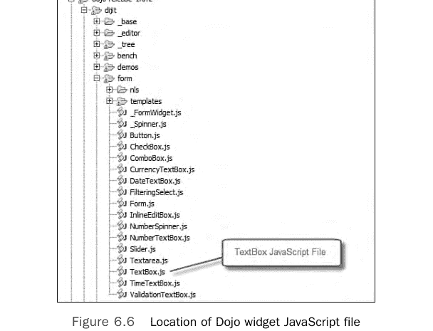

当我们打开“TextBox.js”文件时，我们会在文件顶部附近找到以下代码。

```javascript
dojo.declare(
        "dijit.form.TextBox",
        dijit.form._FormWidget,
```

`dojo.declare` 函数将在第 12 章“对象和类”中更详细地描述，届时我们将讨论面向对象，但现在先简要介绍一下。`dojo.declare` 函数创建一个构造函数，可用于构建新对象。第一个参数是该构造函数的名称。下一个参数定义所创建对象的上级类。新对象将继承上级类中的所有属性和方法。附加代码（未显示）描述了构造函数创建的对象中的属性和方法。在定义 `dojo.declare` 后创建新对象时，您只需使用标准的 JavaScript 对象创建技术，使用 `new` 关键字。

```javascript
newWidget = new dijit.form.TextBox();
```

变量 `newWidget` 现在将引用一个 JavaScript 对象。该对象不是 DOM 元素本身，而是一个与 Dojo widget 相关联的独立对象。就像光的波粒二象性一样，Dojo widget 也具有双重性质，既作为 DOM 元素又作为 JavaScript 对象存在。正如我们已经讨论的，创建 Dojo widget 有两种方式——通过包含 HTML 标记声明式地创建，或如前面的示例所示使用 `new` 关键字编程式地创建。当我们使用 HTML 标记创建 widget 时，Dojo 解析器会自动为我们创建 widget 对象。因此，在两种情况下，widget 对象都是从构造函数构建的，但使用 HTML 标记时，我们自己不必编写代码。

构造函数代码中包含哪些属性和方法？这完全取决于 widget 的具体功能。每个 widget 构造函数都不同，但有一些共同特征。它们都包含以下类型的属性和方法：

- **属性**——属性是对象的一个属性，用于指定 widget 的某些行为或特征。它可以通过在调用构造函数时传递参数来设置，或在声明式创建 widget 时在 HTML 标记中设置属性值。通常，它仅在创建对象时设置。然而，某些 widget 允许使用遵循 setter/getter 命名约定的特殊方法来修改这些属性。例如，名为 `value` 的属性可以通过调用名为 `setValue` 的方法并传递该属性的新值来设置。这种技术对使用 JavaBeans 的 Java 程序员来说很熟悉。当这些方法存在时，您应该使用它们，并避免直接在 widget 对象中设置属性。

- **行为方法**——这些函数定义了组件的具体行为。每个组件的行为方法各不相同，取决于该组件的功能。

- **扩展点**——这些其实也是方法，但它们具有特殊的作用。它们旨在被开发者重写，以改变组件的默认行为。这是 Dojo 组件的一个非常强大的特性。你不必被动接受默认实现。Dojo 组件在设计时就预期可以被修改和扩展。这些方法不会直接被调用，而是在对象生命周期的某个特定时刻由其他方法调用——例如，当组件对象被创建或删除时。这些方法的默认实现（即方法内部的代码）通常什么都不做。它们只是为开发者提供了一个向对象添加功能的位置。

我们在后续章节中逐一介绍每个 Dojo 组件时，会讨论它们各自特有的属性和方法。但有些所有组件共享的组件示例，我们现在就可以讨论。

### 6.3.4 Dojo 组件层级

我们可以使用的 Dojo 组件有很多种。虽然每种组件类型都是独一无二的，但它们共享许多共同特性。要理解组件是如何获得这些共享特性的，我们需要了解一点面向对象编程中称为*继承*的概念。这是指我们可以通过继承现有对象的能力来构建新对象。所有 Dojo 组件都有一些相似之处。它们之间最重要的相似之处在于，它们都源自几个类，并从中继承了许多特殊的属性和方法。在面向对象编程语言中，这些特殊的祖先对象被称为*抽象对象*，因为它们本身不能被实例化为可用的对象。它们不是独立的组件，而是作为可继承属性和方法的占位符。

让我们回顾一下图 6.7，它可以帮助我们可视化各种组件类及其关系。

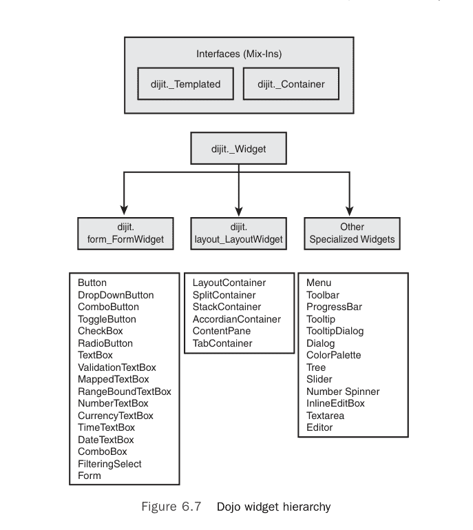

该图展示了主要组件类之间的总体关系。图中只展示了组件类层级的一个高度精简的概览。我们将在后续章节中更深入地探讨这些内容。但我认为现在至少对一些图中显示的类进行简要描述会很有帮助。

- **`dijit._Widget`**——这是层级结构的根类。每个组件都是这个类的子类。

- **`dijit._Templated`**——这个类为子类提供了从 HTML 代码模板构建的方法。Java 程序员习惯于单一继承，但 Dojo 提供了一种多重继承的方式，允许对象从多个类继承。另一种理解方式是将其视为一个接口。

- **`dijit._Container`**——这个类为可以包含其他组件作为子组件的对象提供了方法。这个类也可以被看作是一个接口。

- **`dijit.form._FormWidget`**——这是将出现在表单上的组件的根类。

- **`dijit.layout._Layout`**——这是提供某种布局机制并能包含其他组件的组件的根类。

- **专用组件**——这不是一个实际的 Dijit 类，但我用它作为所有不属于 Form 或 Layout 包的 Dojo 组件的占位符。

除了刚才描述的类之外，图 6.7 还包含许多其他的组件类。我们将在第 7、8、9 章中详细讨论它们，但现在应该先介绍其中一些。我们从最重要的类 `dijit._Widget` 开始。

#### 6.3.4.1 `dijit._Widget`

抽象类 `dijit._Widget` 是所有组件对象的根类。注意类名的几个特点，它们为我们提示了其用途。一个是名称中使用了下划线字符。这告诉我们这是 Dojo 内部使用的类——作为 Dojo 用户，我们不会自己创建这个类的实例。另一个提示是没有子包名称，这告诉我们这个类适用于所有组件。因此，这个类是所有组件的“母体”。它拥有我们将要创建的每个 Dojo 组件对象共享的属性和方法。表 6.1 展示了一些重要的属性。

**表 6.1 `dijit._Widget` 对象的关键属性**

| 属性 | 描述 |
| :--- | :--- |
| `id` | 组件的唯一标识符，可以由 Dojo 或开发者分配。 |
| `class` | HTML 类属性。 |
| `style` | HTML 样式属性。 |
| `title` | HTML 标题属性。 |
| `srcNodeRef` | 指向 Dojo 解析器处理之前页面中与该组件关联的 DOM 元素的引用。 |
| `domNode` | 这是代表该组件的根级 DOM 元素。这是被添加到 DOM 中的节点。这个节点可能在尚未与 DOM 关联的情况下就已经存在。 |

表 6.2 展示了 `dijit._Widget` 中的一些方法。

**表 6.2 `dijit._Widget` 对象的关键方法**

| 方法 | 描述 |
| :--- | :--- |
| `create` | 该函数创建组件。 |
| `postCreate` | 这是一个存根函数，你可以重写它以在组件被放入 DOM 后执行操作。无需强制调用此函数。 |
| `startup` | 这是一个生命周期函数，在所有子组件已创建但尚未显示时调用。这是一个不包含代码的存根函数。无需强制调用此函数。 |
| `postMixInProperties` | 这是一个生命周期函数，可用于重写组件中的属性。它是一个不包含代码的存根函数。无需强制调用此函数。 |
| `buildRendering` | 该函数实际为组件创建 DOM 元素。此函数也可以被 `dijit._Templated` 对象中的代码重写，后者从 HTML 代码模板构建 DOM 元素。此函数不会将元素添加到页面的 DOM 中。 |
| `destroyRecursive` | 销毁此组件及其后代组件。 |
| `getDescendants` | 此函数返回此组件的所有子组件。 |
| `connect` | 此函数用于将事件处理程序与组件内的函数关联。 |
| `disconnect` | 此函数用于从组件中移除事件处理程序。它是 `connect` 的反向操作。 |

仅仅知道 `dijit._Widget` 中有哪些方法是不够的。我们还需要知道它们何时以及如何被调用。换句话说，每个组件的生命周期方法是什么？幸运的是，通过查看 `Widget` 的 `create` 方法，我们可以很容易地了解这些重要的方法。这是当组件被创建时调用的方法，无论是由解析器在处理 HTML 时调用，还是由我们以编程方式构建的组件的构造函数调用。

以下是 `create` 方法的主要代码。代码已经过重新格式化，并添加了一些额外的注释，以进一步解释你在这些章节中读到的注释。

```javascript
//mixin our passed parameters
if(this.srcNodeRef && (typeof this.srcNodeRef.id == "string")){
    this.id = this.srcNodeRef.id;
}

if(params){
    dojo.mixin(this,params);
}

this.postMixinProperties();

if(!this.id){
    this.id=dijit.getUniqueId(this.declaredClass.replace(/\./g,"_"));
}

dijit.registry.add(this);

this.buildRendering();

// Copy attributes listed in attributeMap into
// the [newly created] DOM for the widget.
...

if(this.domNode){
    this.domNode.setAttribute("widgetId", this.id);
}

this.postCreate();

// If srcNodeRef has been processed and removed
// from the DOM (e.g. TemplatedWidget) then delete it to allow GC.
if(this.srcNodeRef && !this.srcNodeRef.parentNode){
    delete this.srcNodeRef;
}
```


让我们逐步介绍每个部分，并描述关键的处理步骤。

**表 6.3 组件创建过程中作为处理步骤调用的关键方法**

| 方法 | 描述 |
| :--- | :--- |
| `postMixinProperties` | 一个存根函数，你可以重写它以修改可能由 `mixinProperties` 方法简单分配的变量。 |
| `buildRendering` | 执行 UI 初始化的方法，包括将额外的 DOM 节点附加到组件的根 DOM 元素。 |
| `postCreate` | 一个存根函数，你可以重写它以在组件被放入 UI 后执行操作。 |

#### 6.3.4.2 `dijit._Templated`

这是一个非常有趣的类，许多组件（widgets）都继承自它。我认为它就像 Java 中的接口。它提供了一些特殊的属性和方法，允许组件通过模板（一段 HTML 字符串）来创建，而不是通过程序化实例化。

### 6.3.5 Dojo 组件视觉概览

此时，查看一些组件将会非常有用。这将让你对 Dojo 组件集的广度有一个直观的了解。这些组件被分为几个通用类别，对应于组件的打包方式。大多数组件具有许多可设置的属性，用以启用额外的功能。我们仅展示每个组件的最简单版本，以便让你了解它们的功能。我们将在后续章节中深入探讨每个组件并展示它们的全部威力。

许多示例是基于 Dojo 分发目录中 `dijit/tests` 下可用测试页面的修改版本。

#### 6.3.5.1 表单和数据组件

这些组件出现在 `form` 包中。它们的基本目的是显示某些数据，并为用户提供一种与其数据类型相匹配的修改数据的方式。

**表 6.4 表单组件示例**

| 描述 | 示例 |
|---|---|
| *Button*<br>它替代了标准的 HTML 按钮。外观更美观，且在鼠标悬停时的效果略好。 | 点击我 |
| *DropDownButton*<br>当点击此按钮组件时，它将显示定义为其子级的任何组件。在示例中，最左侧的组件是点击前的状态。最右侧的示例显示点击后的状态。它显示其子组件，在本例中是一个 `ColorPalette`，但可以是任何有效的组件（菜单是非常典型的例子）。 | 颜色 |
| *ComboButton*<br>该组件将常规 `Button` 组件与 `DropDownButton` 组件相结合，因此得名 `ComboButton`。最左侧示例显示在选择下拉箭头之前的组件。最右侧示例显示在选中下拉箭头图标后的组件。用户可以点击下拉箭头图标或按钮本身。 |  |
| *ToggleButton*<br>此按钮的外观与常规 `Button` 相同，但行为不同。点击按钮时，按钮的 CSS 以及图标的 CSS 都会发生变化。 |  |
| *CheckBox*<br>它替代了标准的 HTML 复选框。外观更美观，且具有更好的选中图标。 |  |
| *RadioButton*<br>它替代了标准的 HTML 单选框。其优点是外观更美观且选中图标更好。 |  |
| *FilteringSelect*<br>该组件是 HTML `<select>` 标签的增强版本。其中一项改进是：当在字段中输入文本时，它将用于从完整数据列表中“过滤”出可能的值。在此示例中，输入 **i** 会导致组件仅显示以 "I" 开头的州。数据列表可以是静态的（在 HTML 页面中提供），也可以使用 Ajax 从服务器获取。 |  |
| *NumberSpinner*<br>这实际上只是一个用于输入数字的文本框，但具有一个特殊功能：可以使用上和下箭头键来增加或减少数值，而无需用户直接输入。 |  |
| *Slider*<br>该组件同样是简单数字文本值的替代方案，但无需直接输入数字，而是将一个图标（滑块）在数值条上拖动。组件的值由滑块在条上的位置决定。 |  |
| *Textarea*<br>该组件替代了标准的 HTML `<textarea>` 标签。此组件的主要额外功能是它在垂直方向上“增长”而不是“滚动”。当你输入时，文本框的大小会随之扩展以容纳文本，而不是在侧边显示滚动条。 |  |
| *TextBox*<br>该组件替代了 `<input type="text">` HTML 标签。 |  |
| *ValidationTextBox*<br>该组件扩展了 `TextBox`，并增加了各种验证，包括日期、时间和数字的验证。消息和提示会自动显示。 |  |
| *DateTextBox*<br>该组件通过为用户提供一个用于选择日期的日历隐喻来扩展 `TextBox`。该组件在页面上看起来像一个 `TextBox`，但当字段获得焦点时，会出现一个弹出日历。这是一个复杂的组件，拥有许多控件，允许用户在天、周和年之间切换。当然，开发者可以轻松自定义其外观。 |  |

#### 6.3.5.2 布局组件

这些组件出现在 `layout` 包中。

**表 6.5 布局组件示例**

| 描述 | 示例 |
| :--- | :--- |
| *LayoutContainer*<br>该组件提供了一种将页面划分为独立区域以放置内容的技术。这些区域可以对齐到“顶部”、“底部”、“右侧”或“左侧”。可以将此组件视为使用表格进行布局的替代方案。 |  |
| *SplitContainer*<br>这允许用户定义不同的区域（垂直或水平），这些区域可以包含内容。区域之间有一个边框，可以通过拖动边框来改变面板的相对大小。面板内的任何内容都可以自动重新格式化。标注部分不属于该组件。 |  |
| *StackContainer*<br>这是一个拥有多个子级但一次仅显示单个子级的容器。它通常依赖于某些外部控件（如本例中的上一页和下一页按钮）来允许用户触发显示不同的子级。否则，它看起来就像一个典型的 `ContentPane`。 | 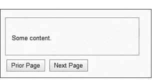 |
| *AccordianContainer*<br>该组件作为其子级的容器。一次仅显示一个子级（与 `StackContainer` 相同）。然而，控件内置于此组件中，并显示为带有箭头图标的面板标题，可用于折叠显示内容并展开隐藏内容。 | 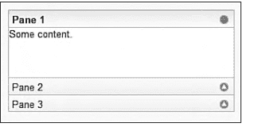 |
| *ContentPane*<br>该组件作为其他组件的容器，并具备使用 Ajax 动态加载内容的能力。 | 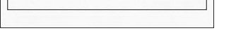 |
| *TabContainer*<br>该组件作为其子级的容器，且一次仅显示一个子级。但是，就像 `AccordianContainer` 一样，它的控件是内置的并显示为标签页。通过选择特定标签，将显示与该标签关联的内容。 | 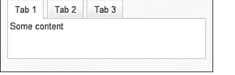 |

#### 6.3.5.3 其他专用组件

这些是其他组件。

**表 6.6 其他专用 Dojo 组件示例**

| 描述 | 示例 |
|-------------|---------|
| **InlineEditBox**<br>该组件显示文本，当用户将鼠标悬停在其上时，文本会被高亮显示。点击高亮文本后，它将被另一个可用于编辑的组件所替代。在此示例中，用户点击第一行中的单词 "running"，随后它被替换为一个用户可以输入新值的 `TextBox`。 | ![InlineEditBox 示例，显示 “My hobby is running” 和 “My hobby is [playing chess]”] |
| **Menu**<br>该组件显示一个弹出菜单，其嵌套深度可由开发者自由定义。菜单项可以用线条图标分隔或被禁用。 | ![Menu 示例，显示启用项、禁用项、启用子菜单、禁用子菜单以及不同的弹出选项] |
| **Toolbar**<br>工具栏提供一系列选项或图标，可以显示额外内容（包括子菜单）或触发某些进程。 | ![Toolbar 示例，显示带有剪切、复制、粘贴选项的文件、编辑、视图、帮助菜单] |
| **ProgressBar**<br>该组件用于表示进程的完成状态。在本例中，组件的当前状态显示为一个数字（例如 10%），并且条形图在左侧部分填充。 | ![ProgressBar 示例，显示 10% 完成度] |

**表 6.6 续**

| 描述 | 示例 |
|---|---|
| **工具提示**<br>此小部件显示一个弹出窗口。 | ![显示工具提示的图片，文本为'Here's some helpful text.'] |
| **工具提示对话框**<br>弹出一个外观类似工具提示的对话框。它可以包含任何内容，包括表单。小部件背后的页面仍然处于活动状态。 | ![显示登录对话框的图片，包含用户名和密码字段] |
| **对话框**<br>此小部件提供一个弹出对话框，其中可能包含表单等内容（如示例所示）。当对话框出现时，原始页面将被禁用。这有时被称为*模态对话框*。页面在对话框关闭之前不会恢复活动状态。 | ![显示登录对话框的图片，包含名称和密码字段] |
| **调色板**<br>此小部件显示可供用户选择的色板。小部件会自动将所选颜色转换为 RGB 值，以便在页面内使用。 | ![显示默认调色板网格的图片] |
| **树**<br>此小部件以层次树结构显示数据，节点可以展开或折叠。你可以为每个节点指定一个图标。树小部件的主要特性之一是能够在首次构建树或展开节点时，通过发出 Ajax 请求从服务器获取数据来自动构建自身。 | ![显示文件树结构的图片，包含 Rocks、Igneous、Metamorphic 和 Sedimentary] |

### 6.3.6 构建自己的小部件

可视化指南为你快速介绍了 Dojo 中可用的许多小部件。然而，还有一些我们没有涵盖的内容，我们将在后续章节中进行介绍。同时请记住，Dojo 正在不断改进，新的小部件也在持续推出。

Dojo 小部件具有高度可定制性。你可以通过更改其样式属性来改变它们的外观。你可以通过设置属性和覆盖各种生命周期方法来控制它们的行为。然而，有时你可能只是想构建自己的小部件。各种基类如 `dijit._Widget`、`dijit.form._FormWidget` 和 `dijit.layout._LayoutWidget` 是创建自定义小部件类的绝佳起点。

## 总结

Dojo 中的 `dijit` 模块提供了一组可以轻松添加到网页中的小部件工具箱。

Dojo 小部件可以通过声明式方式创建，即使用带有 `dojoType` 属性的 HTML 标签。例如：

```
<input type="text" dojoType="dijit.form.TextBox" />
```

Dojo 小部件也可以通过编程方式使用 JavaScript 创建，即使用 Dojo 小部件构造函数创建新对象（别忘了将对象添加到 DOM 中）。例如：

```
new dijit.form.TextBox({}, dojo.byId("placeHolder"));
```

请确保包含 `dojo.require` 语句，以便 Dojo 解析器知道如何获取你在页面中使用的小部件代码。例如：

```
dojo.require("dijit.form.TextBox");
```

小部件有三个主要组成部分，使它们非常易于定制：

- HTML 用于结构
- CSS 用于样式
- JavaScript 用于行为

Dojo 开箱即用地提供了许多实用的小部件。有关快速概览，请参阅 6.4 节中的可视化指南。

Dojo 小部件具有高度可定制性，你也可以使用现有的 Dijit 基类（如 `dijit._Widget`、`dijit.form._FormWidget` 和 `dijit.layout._LayoutWidget`）作为起点来构建自己的小部件。

既然我们已经了解了 Dojo 小部件的一般工作原理（并且看到了一些具体小部件的示例），我们就可以开始深入研究 Dojo 中可用的各种小部件了。下一章将详细探讨每个表单小部件。

# 7 Dojo 表单小部件

> ……世界空虚混沌，渊面黑暗……
>
> ——《创世记》

如同创世一样，万维网曾经也有过没有"Form"（表单）的时候——我说的是 `<form>` 标签。但现在我们当然拥有了它们，它们是从用户那里收集数据的主要技术。标准 HTML 提供了许多有用的表单小部件，如文本框、单选按钮、复选框和选择列表。然而，这些小部件功能有限且略显原始，尤其考虑到当今用户对富互联网应用程序的强烈需求，其用户界面需要与某些桌面应用程序相媲美。Dojo 为这些标准小部件提供了替代方案，同时还提供了许多可用于表单的新小部件，以便从页面用户那里收集信息。本章将深入探讨 Dojo 表单小部件的详细内容。

## 7.1 标准表单与 Dojo 表单小部件

在开始讨论表单小部件之前，让我们先回到基本原理。为什么我们需要表单？我们需要它们来从用户那里捕获数据并将其发送到服务器进行处理。但我们实际上并不发送表单到服务器；我们发送的是单独的数据元素。还记得 URL 中的查询字符串是什么样的吗？这是你在浏览器地址栏中可能会看到的一个示例：

```
submit.jsp?name=Joe&id=123&type=new
```

在这个示例中，有三个数据字段从浏览器发送出去（`name`、`id` 和 `type`）及其对应的值（"Joe"、"123"、"new"）。但是表单在哪里呢？表单是数据的聚合体，但在 URL 中并不会作为一个独立的组件出现。然而，在页面的 HTML 中，它确实有自己独特的标识和标签：`<form>`。我们需要它来指定整个表单的特征，例如 `action`（要请求的服务器资源）和方法类型（"GET" 或 "POST"）。所以我们需要一个表单小部件，而 Dojo 为我们提供了一个，它允许我们将表单视为一个 Dojo 对象，并提供了一些额外的方法使其更易于使用。

然而，本章的真正重点在于表单*元素*小部件。这些是捕获实际数据并将其与逻辑名称关联以在服务器上使用的组件。为了更具体地说明，让我们来看一下前面 URL 示例中的一组名称/值对。

```
id=123
```

从中我们可以看出，有一个名为 "id" 的字段（或变量），用户为其赋予了 "123" 的值。这并没有告诉我们用户是如何输入该值的。他们是通过键入、从下拉列表中选择，还是通过选中与该值关联的单选按钮来完成的。服务器不知道，也不关心——它不应该关心。服务器只关心数据值。但对于用户来说，"如何输入"非常重要。他们需要一个小部件，使他们能够轻松、直观地输入正确的值。这就是为什么我们需要各种表单小部件——为用户提供不同的交互方式来输入和验证数据。因此，对我们来说，表单小部件就是页面上的一个可视化组件，它捕获单个数据值，但以与用户对数据的理解相对应的方式来实现。例如，选择日期数据值的技术应该与选择 RGB 颜色值不同。每种都应该有其独特的可视化交互方式，而 Dojo 为这两种都提供了出色的现成小部件！

现在让我们来探索 Dojo 表单小部件的技术细节。

### 7.1.1 `dijit.form._FormWidget` 类

表单小部件用于从用户那里捕获输入的值，以便将数据提交到服务器。这些小部件最简单的例子是标准 HTML 表单元素的替代品，如文本字段、多行文本字段、单选按钮、复选框和选择列表。每个都在表单中充当一个独立的数据元素。Dojo 为我们提供了这些 HTML 元素的增强版本，以及一些没有 HTML 对应物的新小部件。

虽然有许多不同的 Dojo 表单小部件，但它们有许多共同的特性。Dojo 小部件采用面向对象的方式构建，这意味着新小部件应该能够从更通用的小部件继承属性。所有小部件中最通用的是 `dijit.form._FormWidget`，可以将其描述为"所有表单小部件之母"。换句话说，我们在表单包中创建的任何 Dojo 小部件都会从这个类继承属性和方法。请记住，继承是累加的。一个表单小部件将拥有其自身类中的所有属性和方法，*加上*来自 `dijit.form._FormWidget` 类的任何属性和方法。同时请记住，在第 6 章中我们学习了所有小部件的基类：`dijit._Widget`。表单小部件 `dijit.form._FormWidget` 是 `dijit._Widget` 的子类，因此任何具体的表单小部件也将继承所有 `dijit._Widget` 的方法和属性。

让我们通过研究 `dijit.form._FormWidget` 类的成员来回顾所有小组件共有的属性和方法。我们将回顾关键的属性和方法。要查看每个属性和方法的完整列表，你应该审查该小组件的源代码。

#### 7.1.1.1 `dijit.form._FormWidget` 中的属性

你可能会注意到，许多属性在 `FormWidget` 中的值为 `null`。这是因为它们是所有表单小组件的通用属性，但每个特定的小组件必须为属性分配自己的值。它们之所以不需要在 `FormWidget` 中设置值，是因为我们永远不会直接构建一个 `FormWidget` 对象。我们将构建它的某个子类。这使得 `FormWidget` 成为一个抽象类。

**表 7.1 `dijit.form._FormWidget` 属性**

| 属性 | 默认值 | 描述 |
| :--- | :--- | :--- |


| `baseClass` | null | 用于关联样式的该小组件的 CSS 类。 |
| `alt` | null | 用于分配与小组件关联的 HTML `<input>` 标签的 `alt` 属性。 |
| `value` | null | 用于分配与小组件关联的 HTML `<input>` 标签的 `value` 属性。这是小组件最重要的属性：其数据值。 |
| `name` | null | 用于分配与小组件关联的 HTML `<input>` 标签的 `name` 属性。 |
| `tabIndex` | `"0"` | 用于分配与小组件关联的 HTML `<input>` 标签的 `tabIndex` 属性。这决定了光标在字段之间移动的顺序。 |
| `disabled` | false | 确定用户是否可以与该小组件交互。`true` 值会关闭小组件，但它仍然显示（通常使用不同的样式），而 `true` 值使小组件可用。 |

我们似乎遗漏了一些重要的属性。例如，定义 DOM 元素样式的 `style` 属性在哪里？请记住，`dijit.form._FormWidget` 继承自 `dijit._Widget`，而正是 `dijit._Widget` 包含了 `style` 属性的定义。

## 1.7.1.2 `dijit.form._FormWidget` 中的方法

以下是 `dijit.form._FormWidget` 的关键方法。同样，这些并不是所有方法，只是我认为重要的那些。源代码中还有更多的方法。

## 表 7.2 `dijit.form._FormWidget` 方法

| 方法 | 描述 |
| :--- | :--- |
| `setDisabled(disable)` | 根据参数 `disable` 打开或关闭小组件。DOM 元素和小组件对象都会被禁用（或启用）。以下是该方法的关键代码行：<br>`this.domNode.disabled =`<br>&nbsp;&nbsp;&nbsp;&nbsp;`this.disabled = disabled;`<br><br>请注意，DOM 元素和 Dojo 小组件都有一个 `disabled` 属性，该属性被设置为该方法参数的值。 |
| `isFocusable()` | 如果焦点可以放置在小组件上（它已启用且可见），则返回 `true`，否则返回 `false`。 |
| `focus()` | 将小组件置于焦点中。这将把光标放在小组件上。 |
| `onChange(newValue)` | 这是你覆盖以在用户输入新数据时向小组件添加自己行为的方法。如果你查看此方法代码，你会发现它什么都不做。它是一个存根方法，可以被你自己的代码替换——尽管这不是必须的。 |
| `setValue(newValue)` | 以编程方式将小组件的值更改为 `newValue`。当用户输入数据时，会自动执行此操作。 |
| `getValue()` | 返回小组件的当前值。 |
| `undo()` | 将小组件的值重置为传递给 `onChange` 方法的最后一个值。此方法允许开发者回退对 `setValue` 的更改，而无需编写代码来存储旧值。 |

## 7.2 Dojo 表单小组件详解

本节提供了详细的说明，通常有两页长，以标准格式描述每个表单小组件。但首先，以下是关于如何使用这些说明以及对说明中每个类别的描述的一些建议。

## 表 7.3 Dojo 小组件文档图例

| 小组件名称 | 这是小组件的完整名称，包括包名。例如，`dijit.form.TextBox` 是包 `"dijit.form"` 中的 `TextBox` 小组件。有时你会看到只引用小组件的名称，但那并不完全正确。然而，在此版本的 Dojo 中，小组件名称在包内是唯一的，而且在所有包之间也是唯一的。 |
| :--- | :--- |
| **超类** | 小组件继承自其超类的属性和方法。这显示了小组件的类层次结构。这里缺少了一些部分。一些充当接口的类没有显示，例如 `dijit._Templated` 和 `dijit._Container`。几乎所有小组件都使用这些，因此显示它们会占用更多空间而不会真正增加任何价值。当你确实需要确定这些类是否被某个小组件使用时，请检查源代码。 |
| **文件位置** | 这包含了包含该小组件 JavaScript 源代码的文件的位置。你不需要查看源代码，但这里有一些建议：不要害怕查看源代码。它写得非常好，非常有启发性。一位智者曾经说过，不看源代码的程序员真的不比不能看源代码的程序员好。我们不要成为那种开发者。<br><br>本节还包含了在你的页面中包含此小组件所需的 JavaScript 代码。仅在 HTML 中声明小组件是不够的。 |
| **用途** | 这描述了你可能何时使用该小组件以及描述了小组件的行为。 |
| **显示示例** | 这向你展示了小组件在你的页面上可能是什么样的一些示例。 |
| **HTML 标记示例** | 这显示了你需要在页面中包含的 HTML 来创建小组件。请记住，你可以在 HTML 或 JavaScript 中创建小组件。HTML 标记方法也被称为声明式方法。 |
| **JavaScript 构造函数示例** | 这显示了创建小组件所需的 JavaScript 代码。这是创建小组件的编程式方法。当你以这种方式创建小组件时，它不会自动包含在 DOM 中；你需要显式附加它；否则，它将无法使用。 |
| **关键属性** | 这些是一些重要的属性。我通常只显示该类独有的属性，而不是从超类继承的属性。然而，有时真正重要的属性是继承的，因此它们也会被列出。 |
| **关键方法** | 这些是一些重要的方法。 |
| **关键样式** | 需要 Jim 来解释。 |
| **关键事件** | 这些是一些重要的事件。 |
| **注释** | 这包含了关于小组件的额外注意事项。 |

在开始表单小组件说明之前，最后说明一点。这些说明不试图记录每个小组件的每个方面。它们提供了每个小组件的摘要。这些说明在完整性和简洁性之间取得平衡。当你确实需要所有细节时，你应该前往 Dojo 网站查看文档、API 和论坛。你还应该深入研究源代码。

此外，还有一些更复杂和更专业的表单小组件。我选择将它们放在第 8 章“Dojo 布局组件”中。这些包括 `Slider`、`Number Spinner`、`InlineEditBox`、`Textarea` 和 `Editor`。

## 加点

### JavaScript 构造函数示例

用于创建标签为 `"Click me"` 的新 `Button` 的构造函数：

```javascript
new dijit.form.Button({label: "Click me"}, dojo.byId("#form1");
```

这段代码会自动将组件添加到 DOM 中 ID 为 `"form1"` 的现有组件中。如果你没有指定用于附加组件的节点，它将不会在页面上显示。

### 关键属性

| 属性 | 默认值 | 描述 |
| :--- | :--- | :--- |
| `label` | null | 按钮文本 |
| `showLabel` | true | 按钮上显示的标签文本 |
| `iconClass` | null | 包含按钮图标的 CSS 类 |

### 关键方法

| 方法 | 描述 |
| :--- | :--- |
| `setLabel(label)` | 将按钮标签更改为新值 `label`。一旦按钮创建完成，必须使用此函数来更改标签。 |

### 关键样式

| 样式名称 | 描述 |
| :--- | :--- |
| `dijitButtonText` | 按钮标签文本的样式。 |

### 关键事件

| 事件名称 | 描述 |
| :--- | :--- |
| `onClick` | 点击按钮将触发此事件处理程序。虽然此方法实际上是 `dijit.form._FormWidget` 的一部分，但此处将其列入 `dijit.form.Button`，因为它是你通常为此组件使用的主要方法。 |

### 注意事项

你也可以使用 JavaScript 将 `onClick` 事件附加到组件上，从而在组件的结构（HTML 标记）和行为（JavaScript）之间实现清晰的分离。本示例假设存在一个名为 `handler` 的函数，且按钮的 `id` 为 `btn1`。

```javascript
dojo.connect(dojo.byId("btn1"), "onclick", handler);
```

---

## `dijit.form.DropDownButton`

| 关键项 | 详情 |
| :--- | :--- |
| 组件名称 | `dijit.form.DropDownButton` |
| 父类 | `dijit._Widget` `dijit.form._FormWidget` `dijit.form.Button` |
| 文件位置 | `dijit/form/Button.js` |
| 用法 | 使用 `dojo.require("dijit.form.Button");` 此类创建了一个按钮图标，点击时会显示其子元素。子元素可以是任何组件类型。该组件之所以这样命名，是因为它使创建下拉菜单变得非常简单。默认情况下，显示的内容出现在按钮正下方。 |
| 显示示例 | ![DropDownButton with Menu showing a menu with Cut, Copy, Paste options] 这里的示例展示了组件在点击前后的样子。最右侧的图像显示了组件被点击后的样子。 |
| HTML 标记示例 | 创建一个带有菜单的 `DropDownButton`：<br><br>```html<br><div dojoType="dijit.form.DropDownButton"><br>    <span>Menu</span><br>    <div dojoType="dijit.Menu"><br>        <div dojoType="dijit.MenuItem" iconClass="dijitEditorIcon dijitEditorIconCut">Cut</div><br>        <div dojoType="dijit.MenuItem" iconClass="dijitEditorIcon dijitEditorIconCopy">Copy</div><br>        <div dojoType="dijit.MenuItem" iconClass="dijitEditorIcon dijitEditorIconPaste">Paste</div><br>    </div><br></div><br>```<br><br>在此示例中，子组件是一个带有 `dijit.MenuItem` 组件的 `dijit.Menu`。由于 `iconClass` 属性，每个菜单项都获得了一个图标。这是 `Menu` 组件的特性，而非 `DropDownButton` 特有的。 |
| JavaScript 构造函数示例 | 用于创建标签为 `"Menu"` 的新 `DropDownButton` 的构造函数：<br><br>```javascript
<br>btn1 = new dijit.form.DropDownButton({label: "Menu"});<br>```<br><br>这段代码创建了组件，但必须将其作为某个 DOM 元素的子项附加，才能在页面上可见。为了使此组件发挥作用，你还必须附加一个在按钮激活时显示的子组件。假设你已经创建了一个带有项目的 `Menu` 组件（有关如何创建菜单的详细信息，请参阅 `dijit.Menu` 的描述），且对象名称为 `menu`。`DropDownButton` 提供了一个特殊属性将该组件附加到按钮上：<br><br>```javascript
<br>btn1.dropDown = menu;<br>```<br><br>这是必要的，因为需要进行一些处理才能使组件隐藏，因此仅使用 `addChild()` 将新组件作为按钮的子项添加是不够的。 |
| 关键属性 | `dropDown(child)`：null：点击按钮时要显示的 `child` 组件的引用。请勿使用 `addChild()`。 |
| 关键方法 | 此组件没有额外的公共方法，仅有从其父类继承的方法。 |
| 关键样式 | 此组件没有额外的公共关键样式，仅有从其父类继承的样式。 |
| 关键事件 | 此组件没有额外的公共事件，仅有从其父类继承的事件。 |
| 注意事项 | 此组件的强大之处在于它能够在激活时显示任何其他组件，但其最典型的用途是显示菜单。 |

---

## `dijit.form.ComboBoxButton`

| 关键项 | 详情 |
| :--- | :--- |
| 组件名称 | `dijit.form.ComboBoxButton` |
| 父类 | `dijit._Widget` `dijit.form._FormWidget` `dijit.form.Button` `dijit.form.DropDownButton` |
| 文件位置 | `dijit/form/Button.js`。使用 `dojo.require("dijit.form.Button");` |
| 用法 | 此类创建了一个结合了 `dijit.form.Button` 和 `dijit.form.DropDownButton` 特性的按钮。当用户点击此组件上的向下箭头图标时，它充当 `DropDownButton` 并显示其子组件。当用户点击向下箭头内部的按钮时，此组件充当 `Button` 并运行其 `onclick` 事件处理程序。当某些默认行为可以与按钮绑定，而子组件则要求对该行为应用某些限制或进一步特性时，这非常有用。一个典型的例子是主按钮执行“保存”，而子组件执行“保存”或“另存为...”。 |
| 显示示例 | 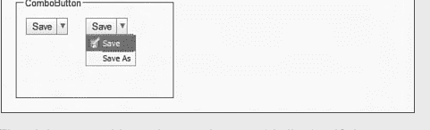 最右侧的组件显示了如果用户点击组件上的向下箭头图标将显示的内容。 |
| HTML 标记示例 | 创建一个带有菜单的 `ComboButton`：<br><br>```html<br><div dojoType="dijit.form.ComboBoxButton"><br>    <span>Save</span><br>    <div dojoType="dijit.Menu" id="saveSaveMenu"><br>        <div dojoType="dijit.MenuItemItem" iconClass="dijitEditorIcon dijitEditorIconSave">Save ▼</div><br>        <div dojoType="dijit.MenuItem">Save As</div><br>    </div><br></div><br>```<br><br>请记得在页面中包含 `dojo.require("dijit.Menu")` 以使用菜单。 |
| JavaScript 构造函数示例 | 用于创建标签为 `"Click me"` 的新 `ComboBoxButton` 的构造函数：<br><br>```javascript
<br>new dijit.form.ComboBoxButton({label: "Save"}, dojo.byId("form1"));<br>```<br><br>这段代码会自动将组件添加到 DOM 中 ID 为 `"form1"` 的现有组件中。如果你没有指定用于附加组件的节点，它将不会在页面上显示。 |
| 关键属性 | 此组件没有额外的公共属性，仅有从其父类继承的属性。 |
| 关键方法 | 此组件没有额外的公共方法，仅有从其父类继承的方法。 |
| 关键样式 | `dijitButtonText`：按钮标签的文本。<br><br>`dijitDownArrowButton`：向下箭头图标的类。 |
| 关键事件 | 此组件没有额外的公共事件，仅有从其父类继承的事件。 |
| 注意事项 | 无 |

---

## `dijit.form.ToggleButton`

| 关键项 | 详情 |
| :--- | :--- |
| 组件名称 | `dijit.form.ToggleButton` |
| 父类 | `dijit._Widget` `dijit.form._FormWidget` `dijit.form.Button` |
| 文件位置 | `dijit/form/Button.js`。使用 `dojo.require("dijit.form.Button");` |
| 用法 | 此类创建了一个可以处于两种状态（选中或未选中）的按钮。使用此组件为用户提供翻转某些内部状态的手段。它看起来像一个普通的 `Button`。然而，它具有内置功能，可以在切换状态时自动更改按钮 CSS 和图标 CSS。 |
| 显示示例 | ![Simple Toggle Button: Toggle, Toggle] |
| HTML 标记示例 | 创建一个简单的 `ToggleButton`：<br><br>```html<br><button dojoType="dijit.form.ToggleButton" iconClass="dijitCheckBoxIcon">Toggle</button><br>``` |
| JavaScript 构造函数示例 | 用于创建标签为 `"Click me"` 的新 `ToggleButton` 的构造函数：<br><br>```javascript
<br>new dijit.form.ToggleButton({label: "Toggle"}, dojo.byId("form1"));<br>```<br><br>这段代码会自动将组件添加到 DOM 中 ID 为 `"form1"` 的现有组件中。如果你没有指定用于附加组件的节点，它将不会在页面上显示。 |
| 关键属性 | `checked`：false：用于显示组件的状态。如果 `checked` 为 `true`，则按钮已被点击；如果为 `false`，则未被点击。如果按钮再次被点击，`checked` 将变为 `false`。请记住，这是一个切换按钮。<br><br>`iconClass`：null：描述按钮被点击时显示的图标的 CSS 样式。 |
| 关键方法 | 此组件没有额外的公共方法，仅有从其父类继承的方法。 |
| 关键样式 | 此组件没有额外的公共样式，仅有从其父类继承的样式。 |
| 关键事件 | 此组件没有额外的公共事件，仅有从其父类继承的事件。 |


# 第7章 Dojo 表单部件

| **部件名称** | `dijit.form.CheckBox` |
| :--- | :--- |
| **超类** | `dijit._Widget`、`dijit.form._FormWidget`、`dijit.form.Button`、`dijit.form.ToggleButton` |
| **文件位置** | `dijit/form/CheckBox.js`<br>使用 `dojo.require("dijit.form.CheckBox");` |
| **用途** | 此类创建一个可以处于两种状态（选中或未选中）的部件。这些部件可以组合成一组。这是对 HTML `<input type="checkbox" name="c1"/>` 标签的替代。虽然只需要单个部件，但通常会为每个可能的复选框项使用多个实例。与标准 HTML 一样，可以使用相同的 `name` 属性值将各个复选框链接成一组。 |
| **显示示例** |  |
| **HTML 标记示例** | 创建一个简单的复选框。<br>`<input dojoType="dijit.form.CheckBox" checked="checked" name="c1">Checked</input>`<br>`<input dojoType="dijit.form.CheckBox" name="c1">Unchecked</input>`<br>`<input dojoType="dijit.form.CheckBox" checked="checked" disabled="disabled" name="c1">Checked and Disabled</input>` |
| **JavaScript 构造函数示例** | 创建新复选框的构造函数：<br>`new dijit.form.CheckBox({name: "c1", checked: true});`<br>此构造函数仅创建复选框，不创建通常伴随的标签。您还需要创建标签并将其与复选框都附加到 DOM 上。 |

## 7.2 Dojo 表单部件详解

| 关键属性 | 属性 | 默认值 | 描述 |
|---|---|---|---|
| 关键属性 | `checked` | `false` | 用于保存部件的状态。如果 `checked` 为 `true`，表示按钮已被点击；为 `false` 则表示未被点击。如果再次点击按钮，`checked` 将变为 `false`。请记住，这是一个切换开关。 |
| 关键属性 | `name` | `null` | 为此部件关联的 `<HTML>` 标签中分配 `name` 属性。在此部件中尤为重要，因为它还用于将多个此部件实例分配到同一组中。 |
| 关键方法 | `setChecked(Boolean)` | 不适用 | 根据方法的参数将 `checked` 属性设置为 `true` 或 `false`。 |
| 关键样式 | `dijitButtonText` | 不适用 | 按钮标签文本的样式。 |
| 关键样式 | `dijitCheckBoxIcon` | 不适用 | 复选框图标（对勾）的样式。 |
| 关键事件 | `onClick` | 不适用 | 勾选复选框将触发此事件处理程序运行。虽然此方法实际上是 `dijit.form._FormWidget` 的一部分，但在此处列出是因为它是您通常用于此部件的主要方法。 |
| 备注 | 对 `dijit.form.CheckBox` 使用 `<input>` 标签而非 `<button>` 标签。 | | |

| 部件名称 | `dijit.form.RadioButton` |
| :--- | :--- |
| 超类 | `dijit._Widget`、`dijit.form._FormWidget`、`dijit.form.Button`、`dijit.form.ToggleButton`、`dijit.form.CheckBox` |
| 文件位置 | `dijit/form/CheckBox.js`<br>使用 `dojo.require("dijit.form.CheckBox");` |
| 用途 | 此类创建一个可以处于两种状态（选中或未选中）的部件。这些部件可以组合成一组。这是对 HTML `<input type="checkbox" name="c1"/>` 标签的替代。虽然只需要单个部件，但通常会为每个可能的复选框项使用多个实例。与标准 HTML 一样，可以使用相同的 `name` 属性值将各个复选框链接成一组。此部件与 `CheckBox` 部件的区别在于，一组 `RadioButton` 部件中只能有一个实例被选中。 |
| 显示示例 |  |
| HTML 标记示例 | 创建一组简单的单选按钮部件。<br><br>`<input type="radio" name="rb" dojoType="dijit.form.RadioButton" checked="checked">Checked</input>`<br>`<input type="radio" name="rb" dojoType="dijit.form.RadioButton">Unchecked</input>`<br>`<input type="radio" name="rb" dojoType="dijit.form.RadioButton" disabled="disabled">Disabled</input>` |
| JavaScript 构造函数示例 | 创建新单选按钮的构造函数：<br>`new dijit.form.RadioButton({name: "cl", checked: true});`<br>此构造函数仅创建单个 `RadioButton` 部件，不创建通常伴随的标签。您还需要创建标签并将其与 `RadioButton` 都附加到 DOM 上。 |

| 功能 | 详细信息 |
| :--- | :--- |
| **关键属性** | `checked`（默认值：`false`）：用于保存部件的状态。如果 `checked` 为 `true`，表示按钮已被点击；为 `false` 则表示未被点击。如果再次点击按钮，`checked` 将变为 `false`。请记住，这是一个切换开关。<br><br> `name`（默认值：`null`）：为此部件关联的 `<HTML>` 标签中分配 `name` 属性。在此部件中尤为重要，因为它还用于将多个此部件实例分配到同一组中。 |
| **关键方法** | `setChecked(Boolean)`：根据方法的参数将 `checked` 属性设置为 `true` 或 `false`。 |
| **关键样式** | `dijitButtonText`：按钮标签文本。<br>`dijitRadioIcon`：单选按钮图标（单选按钮）的样式。 |
| **关键事件** | `onClick`：点击单选按钮图标将触发此事件处理程序运行。虽然此方法实际上是 `dijit.form._FormWidget` 的一部分，但在此处列出是因为它是您通常用于此部件的主要方法。 |
| **备注** | 无 |

| 部件名称 | `dijit.form.TextBox` |
|---|---|
| 超类 | `dijit._Widget`、`dijit.form._FormWidget` |
| 文件位置 | `dijit/form/TextBox.js`<br>使用 `dojo.require("dijit.form.TextBox");` |
| 用途 | 创建通用文本框字段。此部件可用作 `<input type="text">` 标签的替代。使用部件而非 HTML 标签可以获得一致的样式优势和许多其他有用的方法。此部件本身不提供任何验证功能。但是，Dojo 提供了许多此部件的子类，它们提供了大量验证功能。每个子类的详细信息在其各自的页面上提供，但也在下表中进行了汇总。 |
| 显示示例 | 简单的文本框。通常会有一个标签与此字段关联，但它不是部件本身的一部分。 |
| HTML 标记示例 | 创建一个简单的文本框：`<input type="text" name="f1" dojoType="dijit.form.TextBox"/>` |

| `TextBox` 子类 | 用途 |
|---|---|
| `ValidationTextBox` | 提供验证功能的文本框 |
| `MappedTextBox` | 类似于 `ValidationTextBox`，但还提供序列化数据值的方法 |
| `RangeBoundTextBox` | 带范围验证的文本字段（最小值和最大值） |
| `NumberTextBox` | 要求数值数据类型的文本字段 |
| `CurrencyTextBox` | 带有货币验证的文本字段 |
| `TimeTextBox` | 允许输入时间值的字段 |
| `DateTextBox` | 提供日历供选择日期的字段 |

## 7.2 Dojo 表单控件详解

**JavaScript 构造函数示例**

创建新 `TextBox` 的构造函数

```
new dijit.form.TextBox({}, dojo.byId("form1"));
```

此代码会自动将该控件添加到 DOM 中 id 为 "form1" 的现有控件。如果你未指定用于附加控件的节点，它将不会显示在页面上。

**关键属性**

| 属性 | 默认值 | 说明 |
|---|---|---|
| `trim` | `false` | 如果为 `true`，会导致控件移除数据开头和结尾的所有空白字符（如空格）。 |
| `uppercase` | `false` | 如果为 `true`，会导致控件将数据中的所有字符转换为大写。 |
| `lowercase` | `false` | 如果为 `true`，会导致控件将数据中的所有字符转换为小写。 |
| `propercase` | `false` | 如果为 `true`，会导致控件将数据中每个单词的首字符转换为大写，类似于专有名词的格式。 |
| `maxLength` | `null` | 为 `input` 标签设置 `maxLength` HTML 属性的值，限制用户可以在字段中输入的字符数（但不会影响字段的大小——请使用 CSS 来调整）。 |

**关键方法**

| 方法 | 说明 |
|---|---|
| `getDisplayedValue()` | 此函数将返回显示给用户的数据值。 |
| `getValue()` | 此函数将返回控件的内部数据值。 |
| `setValue(value)` | 此函数将设置控件的内部数据值。 |
| `setDisplayedValue(value)` | 此函数将设置显示给用户的数据值。 |
| `format()` | 控件的内部数据值可能与用户看到的数据显示值不同。此函数将内部值转换为显示值。 |
| `parse()` | 此函数获取用户输入的数据并移除其格式，以便将其存储为控件的内部属性。 |
| `filter()` | "过滤器"是对控件数据值进行各种转换的通用术语，例如 "trim"（修剪）和 "proper-case"（首字母大写）。此函数将过滤器应用于显示的数据值。 |

### 关键样式

| 样式名称 | 说明 |
|---|---|
| `dijitTextBox` | 按钮标签文本。 |

### 关键事件

| 样式名称 | 说明 |
|---|---|
| `onChange` | 在字段中输入数据并将焦点移出该字段（即按 Tab 键）会导致此事件处理程序运行。尽管此方法实际上属于 `dijit.form._FormWidget` 的一部分，但在此列出是因为它是此控件的典型主要使用方法。 |

**注意事项** 尽管此类被用作其他更有用的验证文本框类型的根类，但它仍然可以单独使用，并且通常在不需要验证时使用。

`autocomplete` 属性设置为 `off`。这会阻止浏览器根据先前输入的值显示此字段的建议。

此控件允许用户输入单个字段。然而，你可以将输入的数据视为存储在两个属性中。第一个属性 `displayedValue` 包含用户输入和看到的数据。第二个属性 `value` 包含控件处理后的数据。控件的 `parse()` 方法可以以某种方式转换数据，并且每当 `displayedValue` 更改时都会运行。`format()` 方法将 `value` 中的数据转换回显示所需的格式。这些方法旨在互为逆操作。下图直观地描述了这一过程。

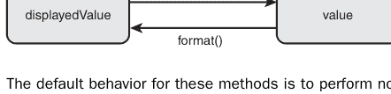

这些方法的默认行为是不进行任何转换，因此内部 `value` 与外部显示的 `displayedValue` 相同。

## 第7章 Dojo 表单控件

| 控件名称 | `dijit.form.ValidationTextBox` |
|---|---|
| 父类 | `dijit._Widget`、`dijit.form._FormWidget`、`dijit.form.TextBox` |
| 文件位置 | `dijit/form/ValidationTextBox.js`<br>使用 `dojo.require("dijit.form.ValidationTextBox");` |
| 用法 | 此控件可用作 `<input type="text">` 标签的替代，与 `TextBox` 一样，并且额外的好处是当用户输入数据时可以自动应用验证。验证可以通过设置控件上的某些属性来定义。验证消息将以弹出提示的形式显示在输入字段旁边。标准验证消息也存在，但可以被覆盖。你还可以定义一条有用的消息，当字段获得焦点且尚未输入数据时显示。此消息可以在控件的 `promptMessage` 属性中定义。 |
| 显示示例 | ![ValidationTextBox 示例图片]<br>此控件要求输入值。当控件获得焦点且尚未输入值时，提示消息会显示。 |
| HTML 标记示例 | 创建一个简单的 `ValidationTextBox`<br>`<input id="q01" type="text" name="age" dojoType="dijit.form.ValidationTextBox" promptMessage="Enter an age between 0 and 120" required="true" />` |
| JavaScript 构造函数示例 | 创建新 `ValidationTextBox` 的构造函数<br>`new dijit.form.ValidationTextBox({ promptMessage: "Enter an age between 0 and 120", required: "true" }, dojo.byId("form1"));`<br>此代码会自动将该控件添加到 DOM 中 id 为 "form1" 的现有控件。如果你未指定用于附加控件的节点，它将不会显示在页面上。 |

**关键属性**

| 属性 | 默认值 | 说明 |
|---|---|---|
| `required` | `false` | 设置为 `true` 以指定必须输入数据。 |
| `promptMessage` | `null` | 当字段获得焦点时显示为工具提示的消息。 |
| `invalidMessage` | `null` | 当字段中的数据无效时显示的消息。 |
| `constraints` | `null` | 要传递给验证器方法的对象，包含对某些类型的验证有意义的属性。这些将在各种 `ValidationTextBox` 子类中讨论。 |
| `regExp` | `.*` | 用于验证输入数据的正则表达式。 |
| `regExpGen` | `null` | 旨在被自定义方法覆盖，该方法应动态生成正则表达式。应设置此属性而非 `regExp`，因为它会生成 `regExp` 的值。 |

**关键方法**

| 方法 | 说明 |
|---|---|
| `validator()` | 此方法使用 `constraints` 和 `regExp` 属性执行字段验证。 |
| `isValid()` | 运行验证器方法以确定数据是否有效。返回 `true` 表示是，返回 `false` 表示否。可以覆盖此方法以提供更复杂的自定义验证。 |
| `getErrorMessage()` | 从 `invalidMessage` 属性返回错误消息。 |
| `getPromptMessage()` | 返回提示消息。 |
| `validate()` | 在适当时显示缺失或无效消息，并高亮文本框字段。 |
| `displayMessage(msg)` | 将消息 `msg` 显示为工具提示。 |

### 关键样式

| 样式名称 | 说明 |
|---|---|
| `dijitInputField` | 数据输入区域的样式。 |
| `dijitTooltip` | 用于提示消息和错误消息的工具提示样式。 |

### 关键事件

| 样式名称 | 说明 |
|---|---|
| `onChange` | 在字段中输入数据并将焦点移出该字段（即按 Tab 键）会导致此事件处理程序运行。尽管此方法实际上属于 `dijit.form._FormWidget` 的一部分，但在此列出是因为它是此控件的典型主要使用方法。 |


**注意事项** 正则表达式验证非常强大。可以创建正则表达式用于大量各种验证，尽管一开始可能有些难以掌握。正则表达式语法超出了本书的范围，但存在许多优秀的参考资料。

| | 控件名称 | `dijit.form.MappedTextBox` |
| --- | --- | --- |
| **超类** | `dijit._Widget` `dijit.form._FormWidget` `dijit.form.TextBox` `dijit.form.ValidationTextBox` |
| **文件位置** | `dijit/form/ValidationTextBox.js`<br>使用 `dojo.require("dijit.form.ValidationTextBox");` |
| **用途** | 该控件与 `ValidationTextBox` 基本相同，但存在一些差异。它提供了额外的方法，允许对输入的数据执行特殊序列化并将其保存在隐藏字段中。这样做的典型目的是在将控件值提交到服务器之前对其进行转换。换句话说，该控件实际上映射到两个表单元素，其中一个是隐藏字段，其值会被传递到服务器；另一个则是用户实际输入的字段。<br><br>虽然可以从该类创建控件，但通常不这样做。相反，它被用作其他验证控件的基类。你可以将其视为一个抽象类，用于在类层次结构中实现继承。 |
| **显示示例** | 不适用。 |
| **HTML 标记示例** | 不适用。 |
| **JavaScript 构造函数示例** | 不适用。 |
| **关键属性** | 无 |
| **关键方法** | **方法** | **描述** |
| | `serialize` | 该函数获取用户输入的数据值，并将其转换为另一种形式，该形式将被保存在隐藏字段中并发送至服务器。此处的这种转换称为*序列化*。 |
| | `toString` | 控件数据值的字符串表示形式。 |
| **关键样式** | 无 |
| **关键事件** | 不适用。 |
| **说明** | 该控件用作其他验证控件的基类，通常不会直接使用。你可能会疑惑 `serialize` 方法的用途，因为 Dojo 表单控件在表单提交时会由浏览器自动序列化，这是由它们填充了 DOM 节点的 `value` 属性所致。此控件中的 `serialize` 方法可以被覆盖以提供专门的序列化功能，在将数据提交到服务器之前对其进行转换。这就是区别所在。 |

| 控件名称 | `dijit.form.RangeBoundTextBox` |
| :--- | :--- |
| **超类** | `dijit._Widget` `dijit.form._FormWidget` `dijit.form.TextBox` <br> `dijit.form.ValidationTextBox` `dijit.form.MappedTextBox` |
| **文件位置** | `dijit/form/ValidationTextBox.js` <br> 使用 `dojo.require("dijit.form.ValidationTextBox");` |
| **用途** | 该控件是 `MappedTextBox` 的子类，提供了检查最小值、最大值或两者兼有的能力。与 `MappedTextBox` 类似，它通常用作子类继承的抽象类，而不是具体类。换句话说，你可能不会直接从此类创建控件。你可以将其用作超类来定义自己的自定义控件。它的两个子类是 `NumberTextBox` 和 `TimeTextBox`。 |
| **显示示例** | 不适用。 |
| **HTML 标记示例** | 不适用。 |
| **JavaScript 构造函数示例** | 不适用。 |
| **关键属性** | | 属性 | 默认值 | 描述 | <br> | :--- | :--- | :--- | <br> | `rangeMessage` | `null` | 当数据值超出由 `rangeCheck` 方法确定允许范围时，显示的消息。 | <br> | `constraints` | `null` | 传递给 `validator` 方法的对象，包含对某些子类有意义的属性。详情请参见子类说明。 |
| **关键方法** | | 方法 | 描述 | <br> | :--- | :--- | <br> | `rangeCheck(number, constraints)` | 该函数使用 `constraints` 对象中的属性来验证数据值 `number`。默认情况下，该函数查找 `min` 和 `max` 属性并将其与控件的值进行比较。用户可以覆盖此函数以实现更复杂的验证。 |
| **关键方法** | **方法** | **描述** |
| | `isInRange()` | 如果控件的值在范围内则返回 `true`，否则返回 `false`。它会执行 `rangeCheck` 函数。 |
| | `compare(value1, value2)` | 根据 `value1` 和 `value2` 的相对值，该函数返回三个值之一。<br><br> 如果 `value1` 和 `value2` 相等则返回 0。<br><br> 如果 `value2` 大于 `value1` 则返回负数。<br><br> 如果 `value1` 大于 `value2` 则返回正数。 |
| **样式** | 无 |
| **事件** | 无 |
| **说明** | 无 |

118 第 7 章 Dojo 表单控件

| **控件名称** | `dijit.form.NumberTextBox` |
| :--- | :--- |
| **超类** | `dijit._Widget` `dijit.form._FormWidget` `dijit.form.TextBox`<br>`dijit.form.ValidationTextBox` `dijit.form.MappedTextBox`<br>`dijit.form.RangeBoundTextBox` |
| **文件位置** | `dijit/form/NumberTextBox.js`<br>使用 `dojo.require("dijit.form.NumberTextBox");` |
| **用途** | 该类创建一个继承自 `RangeBoundTextBox` 的控件，仅允许数值。通过继承其超类的所有功能，该控件提供了一套强大的功能，用于输入数值数据。它没有自己的新方法或属性，但覆盖了一些继承的方法以提供有用的数值验证功能。 |
| **显示示例** |  |
| **HTML 标记示例** | 以下是创建一个带有范围验证的简单 `NumberTextBox` 的 HTML。<br>`<input type="text" name="age"`<br>`dojoType="dijit.form.NumberTextBox"`<br>`promptMessage="Enter an age"`<br>`rangeMessage="Enter an age between 18 and 120"`<br>`constraints="{min:18,max:120}"`<br>`required="true" />`<br>注意，`constraints` 属性在大括号中指定了一个值：这是用于构建对象的 JSON 表示法。 |

使用 JavaScript 创建一个 `NumberTextBox` 控件。

```
var obj = {
    name: "temperature",
    value: 98.6,
    constraints: {min:90,max:110,places:1},
    promptMessage: "Enter a value between 90 and 110",
    required: "true",
    invalidMessage: "Invalid temperature."
};

var fl = new dijit.form.NumberTextBox(obj, "forml");
```

注意，`constraint` 属性中的 `places` 属性值为 1。这会强制用户在值中输入一位小数。

| 关键属性 | 属性 | 默认值 | 描述 |
| :--- | :--- | :--- | :--- |
| | `constraints` | `null` | 这是包含属性的对象，用于验证任何继承自 `ValidationTextBox` 的控件的数据。此控件 `NumberTextBox` 允许以下属性：<br>`min`—数据的最小值<br>`max`—数据的最大值<br>`places`—所需的小数位数<br>所有约束属性都是可选的。 |
| 关键方法 | 无 |
| **关键样式** | 无 |
| **关键事件** | 无 |
| **说明** | 无 |

| 控件名称 | `dijit.form.CurrencyTextBox` |
| :--- | :--- |
| 超类 | `dijit._Widget` `dijit.form._FormWidget` `dijit.form.TextBox` <br> `dijit.form.ValidationTextBox` `dijit.form.MappedTextBox` <br> `dijit.form.RangeBoundTextBox` `dijit.form.NumberTextBox` |
| 文件位置 | `dijit/form/CurrencyTextBox.js` <br> 使用 `dojo.require("dijit.form.CurrencyTextBox");` |
| 用途 | 该类创建一个继承自 `NumberTextBox` 的控件。该类仅允许数值数据，但通过对输入数据添加进一步限制，要求其遵循货币格式的规则。每个国家/地区都有特定的货币书写格式，遵循小数位数、小数字符以及千位分隔符的规则。此外还可以使用独特的符号，例如欧元的 "€"。国际标准化组织（ISO）定义了描述各种货币的标准代码和格式。每个国家/地区都被分配了一个唯一的三字符代码来标识它（例如日本的 "JPY"）。 |
| 显示示例 |  <br> 该示例显示以日元为单位的金额，该金额始终格式化为不带小数位的整数。底部示例展示了在您尝试在期望输入日元金额的字段中输入小数位时会发生什么。<br> 日元符号不是由用户输入的，而是在数据输入完成且焦点离开字段后自动提供的。 |
| HTML 标记示例 | 以下 HTML 将创建一个用于输入以日元为单位的金额的控件。<br> `<input id="field1" type="text" name="total" dojoType="dijit.form.CurrencyTextBox" required="true" currency="JPY"/>` <br> 以下 HTML 将创建一个用于输入以美元为单位的金额的控件。用户无需输入小数位。 |

有关货币代码的详细说明，请访问 Wikipedia 上的以下页面：http://en.wikipedia.org/wiki/ISO_4217

```html
<input id="field1" type="text" name="total"
dojoType="dijit.form.CurrencyTextBox"
required="true"
currency="USD"
constraints="{fractional:false}"/>
```

### JavaScript 构造函数示例

使用 JavaScript 创建一个 `NumberTextBox` 小部件。

```javascript
var obj = {
    name: "cost",
    promptMessage: "Enter the item cost.",
    constraints: "{fractional: true}",
    currency: "USD"
};

var f1 = new dijit.form.CurrencyTextBox(obj);
```

此小部件仍需添加到 DOM 中才能在页面上显示。

### 关键属性

| 属性 | 默认值 | 描述 |
| :--- | :--- | :--- |
| `constraints` | `null` | 这是一个包含用于验证输入数据属性的对象。此小部件 `CurrencyTextBox` 允许以下属性：<br>`fractional`—要求输入小数位。如果 `fractional` 为 `false` 或完全未输入，则用户无需输入小数位（尽管他们可以输入），并且小数位将被自动添加。 |
| `currency` | `null` | 包含用于格式化和验证输入金额的货币代码（例如，`"USD"` 代表美元）。 |

### 关键方法

无

### 关键样式

无

### 关键事件

无

### 备注

无

## `dijit.form.TimeTextBox`

**小部件名称**

`dijit.form.TimeTextBox`

**超类**

- `dijit._Widget`
- `dijit.form._FormWidget`
- `dijit.form.TextBox`
- `dijit.form.ValidationTextBox`
- `dijit.form.MappedTextBox`
- `dijit.form.RangeBoundTextBox`

**文件位置**

`dijit/form/TimeTextBox.js`

使用 `dojo.require("dijit.form.TimeTextBox");`

**用法**

此类创建一个允许用户输入代表时间的数据的小部件。它还对数据执行验证，以确保其是时间值且格式正确。可以配置该小部件以选择各种时间格式。

此小部件的另一个非常有用的功能是能够显示一个可滚动的时间列表，用户可以从中选择一个值。因此无需实际键入时间。此功能由一个从 `dijit._TimePicker` 类创建的特殊弹出小部件提供。

有许多用于显示时间和日期数据的格式选项。Dojo 使用 Unicode 区域设置约定，这些约定在 Unicode 联盟网站上有更详细的说明。有关日期和时间约定的更多信息，URL 如下：

http://www.unicode.org/reports/tr35/#Date_Format_Patterns

**显示示例**

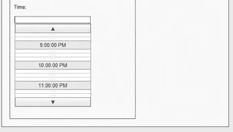

此示例显示了用户在数据输入区域中单击后的小部件。出现一个弹出窗口，显示 `dijit._TimePicker` 小部件，该小部件允许用户从可滚动列表中选择时间。

`dijit._TimePicker` 小部件将显示以当前时间为中心的五个小时（尽管为简洁起见，此示例显示三个小时）的时间。时间可以 15 分钟为增量进行选择。

以下是创建一个使用 `formatLength` 的 `"medium"` 值来显示时间的小部件的 HTML 标记。

```html
<input id="timel" type="text" name="timel"
    dojoType="dijit.form.TimeTextBox"
    constraints="{formatLength:'medium'}" />
```

使用 JavaScript 创建一个 `TimeTextBox` 小部件。

```javascript
var obj = {
    name: "time",
    promptMessage: "Enter the time.",
    constraints: "{formatLength:'medium'}"
};

var fl = new dijit.form.TimeTextBox(obj);
```

此小部件仍需添加到 DOM 中才能在页面上显示。

### 关键属性

| 属性 | 默认值 | 描述 |
| :--- | :--- | :--- |
| `constraints` | `null` | 这是一个包含用于验证任何 `ValidationTextBox` 子类小部件数据的属性的对象。此小部件 `TimeTextBox` 允许以下属性：<br>`min`—数据最小值<br>`max`—数据最大值<br>日期值的格式应为 `'YYYY-MM-DD'`。 <br>所有约束属性都是可选的。 |
| `am` | `"AM"` | 提供对 `"am"` 字符串的覆盖。 |
| `pm` | `"PM"` | 提供对 `"pm"` 字符串的覆盖。 |
| `formatLength` | `short` | 指定显示时间时使用的格式。 <br><br> | 值 | 结果格式 |<br>--- | ---<br>`short` | 下午5:45<br>`medium` | 下午5:45:31<br>`long` | 下午5:45:31 美国中部标准时间 |
| `strict` | `false` | 当为 `true` 时，需要精确匹配空格和缩写。当为 `false` 时，要求较宽松。 |

### 关键方法

无

### 关键样式

无

### 关键事件

无

### 备注

无

## 7.2 Dojo 表单小部件详解

| 项目 | 描述 |
| :--- | :--- |
| **小部件名称** | `dijit.form.DateTextBox` |
| **超类** | `dijit._Widget`, `dijit.form._FormWidget`, `dijit.form.TextBox`, `dijit.form.ValidationTextBox`, `dijit.form.MappedTextBox`, `dijit.form.RangeBoundTextBox`, `dijit.form.TimeTextBox` |


| **文件位置** | `dijit/form/DateTextBox.js`<br>使用 `dojo.require("dijit.form.DateTextBox");` |

| **用法** | 此类创建一个允许用户输入代表日期的数据的小部件。它还对数据执行验证，以确保其是格式正确的日期值。可以配置该小部件以指定各种日期格式。<br><br>此小部件的另一个非常有用的功能是能够显示一个日历，用户可以从中选择一个值。此功能由一个从 `dijit._Calendar` 类创建的特殊弹出小部件提供。<br><br>有许多用于显示时间和日期数据的格式选项。Dojo 使用 Unicode 区域设置约定，这些约定在 Unicode 联盟网站上有更详细的说明。有关日期和时间约定的更多信息，URL 如下：<br><br>http://www.unicode.org/reports/tr35/#Date_Format_Patterns |

| **显示示例** | 此示例显示了用户在数据输入区域中单击后的小部件。出现一个弹出窗口，显示 `dijit._Calendar` 小部件，该小部件允许用户选择一个日期。 |

| **HTML 标记示例** | 以下是创建用于输入日期值的小部件的 HTML 标记：<br><br>`<input id="date1" type="text" name="date1" dojoType="dijit.form.DateTextBox" />` |

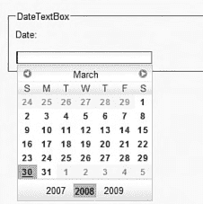

### JavaScript 构造函数示例

使用 JavaScript 创建一个 `DateTextBox` 小部件。

```javascript
var obj = {
    name: "date",
    promptMessage: "Enter the date."
};

var fl = new dijit.form.DateTextBox(obj);
```

此小部件仍需添加到 DOM 中才能在页面上显示。

### 关键属性

| 属性 | 默认值 | 描述 |

| :--- | :--- | :--- |

| `constraints` | `null` | 这是一个包含用于验证任何 `ValidationTextBox` 子类小部件数据的属性的对象。此小部件 `DateTextBox` 允许以下属性：`min`—数据最小值，`max`—数据最大值。所有约束属性都是可选的。 |

| `am` | `"AM"` | 提供对 “am” 字符串的覆盖。 |

| `pm` | `"PM"` | 提供对 “pm” 字符串的覆盖。 |

| `datePattern` | `"m/d/yy"` | 指定显示日期值的字符串模式。以下是一些可用的标记：`y`—年，`m`—月，`d`—日。 |

| `formatLength` | `short` | 指定显示日期时使用的格式。 |

| `strict` | `false` | 当为 `true` 时，需要精确匹配空格和缩写。当为 `false` 时，要求较宽松。 |

**`formatLength` 值映射：**

| 值 | 结果格式 |

| :--- | :--- |

| `short` | 2/1/08 |

| `medium` | 2008年2月1日 |

| `long` | 2008年2月1日 |

| `full` | 2008年2月1日 星期五 |

### 关键方法

无

### 关键样式

无

### 关键事件

无

### 备注

无

| 项目 | 描述 |

| :--- | :--- |

| **小部件名称** | `dijit.form.ComboBox` |

| **超类** | `dijit._Widget`, `dijit.form._FormWidget`, `dijit.form.TextBox`, `dijit.form.ValidationTextBox` |

| **文件位置** | `dijit/form/ComboBox.js`<br>使用 `dojo.require("dijit.form.ComboBox");` |

| **用法** | 此类创建一个组合了文本框和选择列表的小部件，因此得名 `ComboBox`。与 `<select>` 标签类似，它包含一个可以从下拉列表中选择的可能值列表。并且与文本字段一样，用户可以输入任何他想要的内容（即使该值不在列表中）。<br><br>值列表可以静态提供为 HTML 标记，也可以通过指定一个函数来提供，该函数将使用 Ajax 从服务器检索数据。<br><br>该小部件还具有自动完成功能。当小部件启用自动完成时，用户只需输入字段的前几个字符，小部件就会显示选择列表中第一个匹配的值。 |

| **显示示例** | ![ComboBox 示例图片]<br>通过在文本框中键入 `i`，用户强制小部件过滤掉任何不以 “i” 开头的选项。同时，由于启用了自动完成，选择列表中第一个匹配 “i” 的值会自动输入到文本区域中。 |

| **HTML 标记示例** | 以下 HTML 标记将创建一个显示州列表的 `ComboBox` 小部件。<br>`<select`<br>`  dojoType="dijit.form.ComboBox"`<br>`  name="state"`<br>`  autoComplete="true">`<br>`  <option value="blank"></option>`<br>`  <option value="AL">Alabama</option>`<br>`  <option value="AK">Alaska</option>`<br>`</select>`<br><br>为简洁起见，大多数州的值已被省略。 |

下面的 JavaScript 代码将创建一个启用了自动补全功能的 `ComboBox` 小部件。数据将在小部件构建时从服务器获取的数据存储中加载。

```javascript
var st = new dojo.data.ItemFileReadStore({url: 'states.json'});
cb = new dijit.form.ComboBox({
    name: "state",
    autoComplete: true,
    store: st,
},dojo.byId("stateList"));
```

此版本的构造函数还会自动将这个小部件添加到 DOM 中，作为 id 为 `"stateList"` 的 DOM 元素的子元素。

| 属性 | 默认值 | 说明 |

| :--- | :--- | :--- |

| `item` | `null` | 这是小部件上已被选中或输入的项。 |

| `pageSize` | `Infinity` | 决定下拉列表中显示的项数。 |

| `store` | `null` | 这是为下拉列表提供值的数据存储的引用。 |

| `query` | `null` | 数据存储可能包含比列表实际显示更多的项。通过指定查询，列表将只显示与查询匹配的项。 |

| `autocomplete` | `true` | 当为 `true` 时，小部件会根据列表中第一个匹配用户输入字符的项，自动补全用户输入的数据。 |

| `searchDelay` | `100` | 此属性在用户按键和开始搜索选择列表之间引入延迟。单位为毫秒。这很有用，因为可以缓冲多次按键，只有当用户暂停输入时才启动搜索。 |

| `searchAttr` | `"name"` | 确定数据存储中用于匹配的字段。 |

| `ignoreCase` | `true` | 值为 `false` 时会强制区分大小写进行匹配。否则忽略大小写。 |

| `hasDownArrow` | `true` | 值为 `true` 时表示文本框将带有向下箭头图标。否则，文本框没有向下箭头图标。 |

| | |

| :--- | :--- |

| **关键方法** | 无 |

| **关键样式** | 无 |

| **关键事件** | 无 |

| **备注** | 无 |

## `dijit.form.FilteringSelect`

| | |

| :--- | :--- |

| **小部件名称** | `dijit.form.FilteringSelect` |

| **父类** | `dijit._Widget`, `dijit.form._FormWidget`, `dijit.form.TextBox`, `dijit.form.ValidationTextBox`, `dijit.form.MappedTextBox`, `dijit.form.ComboBox` |

| **文件位置** | `dijit/form/FilteringSelect.js` | `dojo.require("dijit.form.FilteringSelect");` |

| **用途** | 此类创建一个可替代 HTML `<select>` 标签的小部件。它继承自 `ComboBox`，但只能选择列表中的有效选项。其他方面，它的行为方式与 `ComboBox` 相同。选择列表的过滤基于用户输入的字符执行。选择列表中的数据可以通过 HTML 标记构建，也可以使用可通过 Ajax 获取数据的 Dojo 数据存储来构建。 |

| **显示示例** | [显示 `FilteringSelect` 带州列表的图像] |

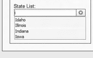

通过在文本框中输入 `i`，用户强制小部件过滤掉任何不以 "i" 开头的选项。

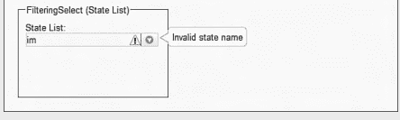

此示例展示了用户输入无法与选择列表中任何项匹配的数据时发生的情况。

```javascript
dojo.require("dijit.form.FilteringSelect");
```

```javascript
dijit._Widget
```

```javascript
dijit.form._FormWidget
```

```javascript
dijit.form.TextBox
```

```javascript
dijit.form.ValidationTextBox
```

```javascript
dijit.form.MappedTextBox
```

```javascript
dijit.form.ComboBox
```

### HTML 标记示例

以下 HTML 标记将创建一个显示州列表的 `FilteringSelect` 小部件。

```html
<select
    dojoType="dijit.form.FilteringSelect"
    name="state"
    invalidMessage="Invalid state name"
    autoComplete="true">
  <option value="blank"></option>
  <option value="AL">Alabama</option>
  <option value="AK">Alaska</option>
</select>
```

为简洁起见，大部分州值已被省略。

### JavaScript 构造函数示例

以下 JavaScript 代码将创建一个启用了自动补全功能的 `FilteringSelect` 小部件。数据将在小部件构建时从服务器获取的数据存储中加载。

```javascript
var st = new dojo.data.ItemFileReadStore({url: 'states.json'});
cb = new dijit.form.FilteringSelect({
        name: "state",
        autoComplete: true,
        store: st,
}, dojo.byId("stateList"));
```

此版本的构造函数还会自动将这个小部件添加到 DOM 中，作为 id 为 `"stateList"` 的 DOM 元素的子元素。

### 关键属性

与 `ComboBox` 相同。

### 关键方法

与 `ComboBox` 相同。

### 关键样式

与 `ComboBox` 相同。

### 关键事件

与 `ComboBox` 相同。

### 备注

当用户输入无效文本时，最后一条正确条目会被保存，因此只有有效的数据才会发送到服务器。

## 7.2 Dojo 表单小部件详解

| | |

| :--- | :--- |

| **小部件名称** | `dijit.form.Form` |

| **父类** | `dijit._Widget` |

| **文件位置** | `dijit/form/Form.js` | `dojo.require("dijit.form.Form");` |

| **用途** | 此小部件对应于 HTML `<form>` 标签。它将标准 `<form>` 转换为 Dojo 小部件，允许您使用 Dojo 来操作它并连接事件。另一个优点是，您可以使用 JSON 对象为表单元素填充值，或将表单中元素的值转换为 JSON 对象。因此，它使将表单元素作为一个组来处理变得更加容易。 |

| **显示示例** | 没有与此小部件关联的 HTML 模板，因此没有特定的视觉显示。 |

| **HTML 标记示例** | `<form action="submit.jsp" dojoType="dijit.form.Form" id="form1" method="POST">` | `Name: <input type="text" name="name" />` | `</form>` |

| **JavaScript 构造函数示例** | 创建一个新的 `Form` 小部件。 | | `new dijit.form.Form({ method: "POST", id: "form1", action: "submit.jsp" });` | 此外，您需要将所需的每个子元素（表单小部件）添加到此小部件中。考虑到创建所有表单元素所需的代码量，您很可能使用 HTML 标记而不是 JavaScript 来创建此小部件。 |

| **关键属性** | |

| 属性 | 默认值 | 说明 |

| :--- | :--- | :--- |

| `action` | `null` | 标准的 `<form>` 属性 *action*，用于指定表单提交时要请求的服务器资源。 |

| `method` | `null` | 标准的 `<form>` 属性 *method*，用于指定 HTTP 消息类型（GET 或 POST）。 |

| `name` | `null` | 标准的 `<form>` 属性 *name*，用于指定表单 DOM 元素的 name 属性。 |

| `target` | `null` | 标准的 `<form>` 属性 *target*，用于指定表单提交时服务器响应的目标位置。 |

| 方法 | Description |

| :--- | :--- |

| `execute` | 用户点击提交按钮时要运行的函数。 |

| `submit` | 以编程方式提交表单。 |

| `setValues` | 从 JSON 结构填充表单值。JSON 结构中的属性应表单中已存在的元素对应（根据 HTML 中的 **name** 属性匹配）。 |

| `getValues()` | 返回包含从表单元素名称和值创建的属性的 JSON 字符串。Dojo 小部件表单元素和标准 HTML 表单元素都将包含在 JSON 字符串中。 |

| `isValid()` | 为表单中的每个小部件运行 `isValid` 方法。只有当每个小部件都有效时才返回 **true**，否则返回 **false**。 |

**关键样式：** 此小部件没有对应的 HTML 模板，因此没有 Dojo 样式。

**关键事件：** 此小部件的主要事件是通过用户点击提交按钮或以编程方式运行此小部件的 `submit` 方法来提交表单。在这两种情况下，开发人员都可以通过重写 `submit` 方法来提供表单提交的自定义行为。

**备注：** 当您希望使用 Ajax 而不是让浏览器自动提交表单时，此小部件非常有用。

# 概述

HTML 表单允许网页从用户处捕获数据。

标准的 HTML 表单元素（文本框、复选框、选择列表等）功能非常有限。

Dojo 提供了功能更丰富的表单组件，作为标准 HTML 元素的增强替代品。

Dojo 还提供了一些不对应任何现有 HTML 表单元素的组件。

所有表单组件都继承自 `dijit.form._FormWidget`，并位于 `dijit.form` 包中。

Dojo 表单组件的基本任务是通过呈现与数据用途相对应的适当组件，从用户那里捕获某个单一的值。例如，一个表示日期的字段应该使用日历作为其可视化表示。

本章将简要介绍大多数 Dojo 表单组件的基本用法。

既然我们已经研究了各种表单组件，我们可以继续探讨下一类主要组件：布局组件。我们将采用相同的方法来分析它们。

# 8 Dojo 布局组件

> 世界是想象力的画布。

— 亨利·戴维·梭罗

空白的网页就是您绘制应用程序的空白画布。您的画笔是 HTML 标记，而颜料则是为您提供的各种组件。但没有结构的布局是混乱的。我们需要一种方法，将站点的视觉元素组织成有意义的形式。Dojo 提供的各种布局组件通过提供有组织的容器来赋予我们这种结构，我们将内容注入这些容器。在本章中，我们将探索 Dijit 中提供的各种布局组件，并试图理解每种组件的正确用法。

## 8.1 理解页面布局

多年来，网页布局的标准技术是创建一个包含行和单元格的表格，内容放置其中。每个页面元素或组件都可以放入单个表格单元格中，通过调整单元格的高度和宽度，设计师可以精确地创建出她想要的外观。随着层叠样式表（CSS）规范的发展，使用 CSS 属性定义布局成为可能，表格的使用变得远不如以前普遍。但是，随着 Ajax 技术的流行，以及更复杂的用户界面成为网站的常态，找到更便捷地处理一组页面元素的方法变得越来越必要。一种技术是将元素分组到 `<DIV>` 标签中。`<DIV>` 可以被视为单个页面元素，并可以一步完成移动、隐藏或设置样式。实际上，`<DIV>` 标签可以充当一个容器，用于容纳其他元素，包括完整的组件。或者，我们将使用一个特殊的 Dojo 组件，它将充当其他组件的容器。


桌面应用程序开发社区已经为容器开发了一套模式。例如，最有用的模式之一是允许将子组件放置在一个容器中，并自动定位到容器的顶部、底部、左侧或右侧。这在 Java AWT 工具包中被称为`BorderLayout`容器，并且在许多其他 GUI 环境中也存在类似的对应物。除了这种布局容器，桌面应用程序中还有许多其他类型的容器也很常见。

Dojo 提供了实现桌面用户界面中许多常见模式的布局容器组件。在本章中，我们将探讨这些组件。让我们首先审视各种布局容器共享的通用特性。在研究每个 Dojo 容器组件时，请记住它们包含子组件，而这些子组件本身可能又是其他容器组件。最典型的子组件是`ContentPane`，它可以包含任何任意内容——这就是我们首先考察它的原因。

### 8.1.1 `dijit.layout._LayoutWidget`类

在讨论`LayoutWidget`的属性和方法时，首先需要记住的是，它是`dijit._Widget`的子类，因此从该类创建的任何组件也继承了`dijit._Widget`的所有属性和方法。请回顾第 6 章“Dojo 组件简介”以了解这些属性和方法。

此外，`dijit.form._LayoutWidget`拥有自己的属性和方法，并且还从`dijit._Container`和`dijit._Contained`继承方法和属性。这些就是我们现在要回顾的内容。

#### 8.1.1.1 `dijit.layout._LayoutWidget`中的属性

布局组件的大部分功能实际上存在于它们所包含的组件中。布局组件就像礼品盒，里面装着我们希望使用的组件。与盒子一样，布局容器最重要的方面之一就是它的大小。我们将在允许我们定义布局容器大小和位置的属性中看到这一点的体现。

尺寸对容器如此重要的原因是，容器的大小限制了显示在其中的子组件的大小。通常，HTML 的工作方式恰恰相反。换句话说，大多数 DOM 元素会扩展到它们所包含的 DOM 元素的大小。但 Dojo 容器通常会占据页面的一个固定部分，而不管其子元素有多大。

布局组件的主要属性定义了其高度、宽度和位置。然而，这些是样式属性，而不是组件对象本身的属性。因此，您应该像定义其他 CSS 属性一样定义它们，可以使用样式表、命名样式，或者将它们作为组件标签本身的`style`属性添加，如下所示：

```
style="width=95%; height=200px; left=50px; top=75px"
```

其他属性继承自`dijit._Widget`。请记住，继承允许对象包含其超类的所有属性和方法。要复习`dijit._Widget`类，请回顾第 6 章。

#### 8.1.1.2 `dijit.layout._LayoutWidget`中的方法

表 8.1 描述了`dijit.layout._LayoutWidget`的关键方法。如前所述，这些并非全部方法，只是最可能对开发人员有用的方法。

除了`resize`之外，其他方法都涉及选择容器的子组件。

| 方法 | 描述 |
|--------|-------------|
| `resize(args)` | 此方法将更改布局容器的大小，然后通过运行`layout()`方法重新显示它。它接受一个参数，该参数包含描述新大小和位置的属性。注意，`args`对象中的属性名称比其对应的 CSS 样式名称要短。`args`对象应具有以下属性：`w`—布局容器的宽度（以像素为单位）；`h`—布局容器的高度（以像素为单位）；`l`—布局容器的左位置（以像素为单位）；`t`—布局容器的顶部位置（以像素为单位） |
| `getPreviousSibling` | 返回当前组件之前的子组件，但不会将焦点设置到该组件。 |
| `getNextSibling` | 返回当前子组件之后的子组件，但不会将焦点设置到该组件。 |
| `addChild(widget)` | 向容器添加一个子组件。 |
| `removeChild(widget)` | 从容器中移除参数`widget`指定的子组件。 |
| `getChildren` | 返回容器的子组件集合。 |
| `hasChildren` | 如果容器有子组件，则返回`true`。 |
| `focusNext` | 将焦点更改为当前具有焦点的组件之后的子组件。 |
| `focusPrev` | 将焦点更改为当前具有焦点的组件之前的子组件。 |
| `focusChild(widget)` | 将焦点设置到参数`widget`指定的子组件。 |

### 8.2 Dojo 布局组件详解

既然我们已经回顾了所有布局容器组件共有的属性和方法，让我们来审视 Dojo 中可用的具体容器组件。我们将使用第 7 章“Dojo 表单组件”中描述的相同格式来解释每个组件。

## 第8章 Dojo 布局组件

| 组件名称 | `dijit.layout.ContentPane` |
| :--- | :--- |
| **父类** | `dijit._Widget` |
| **文件位置** | `dijit/form/ContentPane.js`<br>使用`dojo.require("dijit.layout.ContentPane");` |
| **用法** | 此类创建一个用于容纳内容的简单容器。内容可以是任何HTML元素或Dojo组件。它的行为类似于`<DIV>`，可用于将子元素分组，以便它们可以作为一个整体被移动和隐藏，但它具有一些优势。与`<DIV>`类似，它可以根据内容自动调整大小；但是，如果你指定了`ContentPane`的尺寸，而其子元素会超出边界显示，此组件将生成滚动条，以便内容可以被查看。任何HTML主体元素都可以与Dojo组件一起放置在内容面板中。<br><br>`ContentPane`组件可以单独使用，但通常作为其他布局容器（如`LayoutContainer`）的子组件。<br><br>此组件真正强大的特性在于，可以在创建组件时通过属性或在组件创建后运行方法，从服务器动态加载内容。有关更多细节，请参阅“关键属性”和“关键方法”部分。 |
| **显示示例** | ![显示内容面板显示示例的图片，包含第一个组件、动态内容和第三个组件] <br><br>此图显示了一个包含多个组件的`ContentPane`，其中一个组件超出了面板的边界，因此该组件提供了一个滚动条，以便所有内容都可以访问。还要注意，第二个组件是通过Ajax请求从服务器动态加载的。 |

创建一个新的`ContainerPane`，其中包含三个子元素，这些子元素本身也是`ContainerPane`组件。注意，第二个组件的内容是从服务器动态加载的。

```
<div dojoType="dijit.layout.ContentPane"
    style="width: 100%; height: 150px;">
  <div id="c1" dojoType="dijit.layout.ContentPane">
    First Widget
  </div>
  <div id="c2" dojoType="dijit.layout.ContentPane"
    href="dynamic.html">
  </div>
  <div id="c3" dojoType="dijit.layout.ContentPane">
    Third Widget
  </div>
</div>
```

以下代码将创建一个内容面板并将其附加到现有的DOM元素。

```
cp = new dijit.layout.ContentPane( {}, dojo.byId("d1"));
cp.setContent('<b>Miscellaneous Content</b>');
```

请注意，`setContent`方法可用于在面板内创建子元素，而不是使用它们的构造函数创建新的子元素。这类似于对常规DOM元素使用`innerHTML`方法。

| 属性 | 默认值 | 描述 |
| :--- | :--- | :--- |
| `href` | null | 引用包含动态内容的服务器资源。当`ContentPane`显示时，将请求该内容。 |
| `preload` | false | 决定何时实际从服务器获取`href`指定的动态内容。如果`preload`为true，则在创建`ContentPane`时获取内容；否则，直到显示`ContentPane`才会获取内容。 |
| `refreshOnShow` | false | 如果此属性为true，则每次显示组件时都会重新获取内容。 |
| `loadingMessage` | "Loading…" | 获取动态内容时显示的消息。 |
| `errorMessage` | "Sorry, an error occurred" | 获取动态内容发生错误时显示的消息。 |
| `isLoaded` | false | 为true时，表示动态内容已加载。 |

### 关键方法

| 方法 | 描述 |
| :--- | :--- |
| `setContent(HTML)` | 要更改innerHTML，请使用`.setContent('<b>new content</b>')` |
| `setHref(URL)` | 要执行Ajax更新，请使用`.setHref('url')` |
| `cancel()` | 运行此方法将取消任何未完成的内容获取。 |
| `refresh()` | 重新运行上次的内容获取。 |

### 关键样式

| 样式名称 | 描述 |
| :--- | :--- |
| `dijitContentPaneLoading` | 内容加载消息的样式。 |
| `dijitContentPaneError` | 内容获取错误消息的样式。 |

### 关键事件

| 样式名称 | 描述 |
| :--- | :--- |
| `onLoad` | 在获取新内容并完全加载后调用此事件。 |
| `onUnload` | 在开始新内容获取之前和删除现有内容之前调用此事件。 |
| `onDownloadStart` | 在开始获取动态内容之前调用此事件。 |
| `onContentError` | 如果创建内容时发生错误，则调用此事件。 |
| `onDownloadError` | 如果获取动态内容时发生错误，则调用此事件。 |
| `onDownloadEnd` | 在获取新的动态内容之后调用此事件。 |

**注意**

无

### 组件名称 `dijit.layout.LayoutContainer`

**父类** `dijit._Widget` `dijit.layout._LayoutWidget`

**文件位置** `dijit/form/LayoutContainer.js`

```
使用 dojo.require("dijit.layout.LayoutContainer");
```

**用法** 此类将创建一个组件，该组件提供用于容纳内容的隔间。这些隔间可以使用对齐属性进行格式化。这最类似于传统上使用`<table>`标签进行布局。`LayoutContainer`是一个容器组件的例子，它一次显示多个子组件。

**显示示例**

![LayoutContainer显示示例的图片]

在图中，每个内容块都是一个`ContentPane`，包含少量描述其在布局中位置的文本。

**HTML标记示例** 创建一个LayoutContainer组件，其所有五个位置都包含内容。

```
<div dojoType="dijit.layout.LayoutContainer"
    style=" height: 150px;">
    <div id="c1" dojoType="dijit.layout.ContentPane"
        layoutAlign="left">
        Left Content
    </div>
    <div id="c2" dojoType="dijit.layout.ContentPane"
        layoutAlign="right">
        Right Content
    </div>
    <div id="c3" dojoType="dijit.layout.ContentPane"
        layoutAlign="top">
        Top Content
    </div>
    <div id="c4" dojoType="dijit.layout.ContentPane"
        layoutAlign="bottom">
        Bottom Content
    </div>
    <div id="c5" dojoType="dijit.layout.ContentPane"
        layoutAlign="client">
        Client Content
    </div>
</div>
```

以下代码将创建一个新的LayoutContainer组件并为其添加一些内容。

```
layout = new dijit.layout.LayoutContainer( {}, dojo.byId("dl"));
menu = new dijit.Menu();
menuItem1 = new dijit.MenuItem({label: "Item 1"});
menu.addChild(menuItem1);
layout.addChild(menu);
```

注意：虽然在此示例中我们添加的是一个菜单，但我们也可以添加任何任意内容。

| 关键属性 | 无 |
| 关键方法 | 无 |
| 关键样式 | 无 |
| 关键事件 | 无 |
| 注意 | 无 |

### 8.2 Dojo 布局组件详解

| 组件名称 | `dijit.layout.SplitContainer` |
| :--- | :--- |
| **父类** | `dijit._Widget`, `dijit.layout._LayoutWidget` |
| **文件位置** | `dijit/form/SplitContainer.js`<br>使用`dojo.require("dijit.layout.SplitContainer");` |
| **用法** | 此类创建一个包含子组件的组件，这些子组件由一个条分隔，该条可以使用鼠标拖动以改变为子组件分配的空间的相对大小。尽管子组件可以是任何类型的组件，但通常它们本身就是其他容器。 |
| **显示示例** | [图片] 此截图显示了一个SplitContainer组件，其内容包含三个组件。子组件由一个滑动条分隔，用户可以移动该滑动条来改变为每个子组件分配的相对空间量。 |
| **HTML标记示例** | 创建一个包含三个子组件的`SplitContainer`组件，每个子组件都是一个`LayoutContainer`组件。子组件应水平显示；第一个子组件应占据空间的六分之一，第二个子组件应占据空间的三分之一，最后一个子组件应占据`SplitContainer`空间的一半。注意：你需要为`SplitContainer`组件提供`height`和`width`样式值。 <br><br>`<div id="outer" dojoType="dijit.layout.SplitContainer" style="width: 100%; height: 150px;" persist="false" activeSizing="false"> <div id="c1" dojoType="dijit.layout.ContentPane" sizeShare="10"> First Widget </div> <div id="c2" dojoType="dijit.layout.ContentPane" sizeShare="20"> Second Widget </div> <div id="c3" dojoType="dijit.layout.ContentPane" sizeShare="30"> Third Widget </div> </div>` |

## 第 8 章 Dojo 布局组件

```html
<div id="c3"
    dojoType="dijit.layout.ContentPane"
    sizeShare="30">
    First Widget
</div>
</div>
```

**JavaScript 构造函数示例**

以下代码将创建一个包含两个`ContentPane`组件的新`SplitContainer`组件。

```javascript
container = new dijit.layout.SplitContainer( {} );

content1 = new dijit.layout.ContentPane({} );
container.addChild(content1);
content2 = new dijit.layout.ContentPane({} );
container.addChild(content2);
```

> 注意：我们仍需要为每个 ContentPane 组件添加内容。

**关键属性**

| 属性 | 默认值 | 描述 |
| :--- | :--- | :--- |
| `activeSizing` | `false` | 决定子区域是否在拖动滑块时改变大小。如果为 true，区域随之改变大小；如果为 false，区域在滑块释放前不会改变大小。 |
| `sizerWidth` | `7` | 区域之间滑动边框的像素宽度。 |
| `orientation` | "horizontal" | 子组件必须排列在一个方向上，要么是“horizontal”（水平，默认值），要么是“vertical”（垂直）。 |
| `persist` | `true` | 在分割条移动后（考虑到每个子组件之间存在一个分割条，可能存在多个分割条），条的位置可以保存为 cookie，这样用户返回页面时将看到相同的组件配置。 |


| `sizeMin` | `10` | 注意：此属性实际上是子组件的属性，而非`SplitContainer`组件本身的属性。此属性设置组件的最小尺寸或分配给子组件的空间高度。 |

| `sizeShare` | `10` | 注意：此属性实际上是子组件的属性，而非`SplitContainer`组件本身的属性。此属性决定分配给子组件的空间量（水平或垂直）。所有子组件的`sizeShare`属性相加产生总权重，每个组件的百分比大小基于其`sizeShare`相对于总量的比例。 |

| 关键方法 | 方法 | 描述 |

| :--- | :--- | :--- |

| | `addChild` | 向`SplitContainer`添加一个额外的组件。子组件将被添加到末尾，并且在最后一个组件与新组件之间将显示一个新的分割条。 |

| | `removeChild` | 从`SplitContainer`中移除一个子组件，并关闭前一个子组件与下一个子组件之间的空间。 |

| 关键样式 | 无 | |

| 关键事件 | 无 | |

| 注意事项 | 必须为`SplitContainer`组件提供尺寸（size）和宽度（width）值。 |

## 第 8 章 Dojo 布局组件

| 组件名称 | `dijit.layout.StackContainer` |

|---|---|

| 父类 | `dijit._Widget`, `dijit.layout._LayoutWidget` |

| 文件位置 | `dijit/form/StackContainer.js` |

| 用法 | 使用`dojo.require("dijit.layout.StackContainer");`创建一个可以通过堆叠隐藏内容并提供用户可点击控件来显示隐藏内容的组件。该组件一次仅显示一个子组件。一个名为`StackController`的关联组件用于提供允许选择其他内容窗格的控件。通常该组件的子组件是`ContentPane`组件。 |

| 显示示例 | `<image示意widget展示效果>` 请注意，`StackController`组件是按钮而非标签页，它们可以放置在页面的任何位置。`StackController`为堆栈中的每个子组件创建一个按钮。在本例中，点击了“widget 3”按钮以显示容器的第三个子组件。 |

| HTML 标记示例 | 创建一个带有`StackController`的`StackContainer`组件。该组件将包含三个子组件，每个都是`ContentPane`。 |

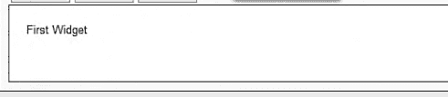

```html
<span dojoType="dijit.layout.StackController" containerId="sc">
</span>

<div id="sc" dojoType="dijit.layout.StackContainer"
     style="width: 100%; height: 90px;">

  <div id="c1" dojoType="dijit.layout.ContentPane"
       title="widget 1">
       First Widget</div>

  <div id="c2" dojoType="dijit.layout.ContentPane"
       title="widget 2">
       Second Widget</div>

  <div id="c3" dojoType="dijit.layout.ContentPane"
       title="widget 3">
       Third Widget</div>

</div>
```

请注意，`StackController`必须引用它所充当控制器的`StackContainer`。这通过`containerId`属性来实现。

| | |

|---|---|

| **JavaScript 构造函数示例** | 以下代码将创建一个包含两个`ContentPane`组件的新`StackContainer`组件。<br><br>`container = new dijit.layout.StackContainer({ });`<br><br>`content1 = new dijit.layout.ContentPane({ });`<br>`container.addChild(content1);`<br>`content2 = new dijit.layout.ContentPane({ });`<br>`container.addChild(content2);` |

> 注意：我们仍需要为每个`ContentPane`组件添加内容，并将容器附加到 DOM 中。

| | |

|---|---|

| **关键属性** | 无 |

| **关键方法** | 无 |

| **关键样式** | 无 |

| **关键事件** | 无 |

| **注意事项** | 无 |

## 第 8 章 Dojo 布局组件

| 组件名称 | `dijit.layout.AccordionContainer` |

|---|---|

| 父类 | `dijit._Widget`, `dijit.layout._LayoutWidget`, `dijit.layout.StackContainer` |

| 文件位置 | `dijit/form/AccordionContainer.js` |

| 用法 | 创建一个可以通过堆叠隐藏内容并提供用户可点击控件来显示隐藏内容的组件。<br><br>大多数布局容器可以包含任何内容类型的子组件。然而，此组件必须具有`AccordionPane`类型的子组件。原因是每个子组件必须有一个带有标签和控件的标题栏。`AccordionPane`作为`ContentPane`的包装器，增加了标题和控件的附加功能。<br><br>该组件包含`AccordionPane`类型的子组件，这些子组件可以包含任何内容，包括其他布局组件。当组件首次构建时，一个窗格可见，其他窗格堆叠在其下方，仅显示其控件。当控件图标被点击时，第一个窗格将关闭，点击的窗格将滑动打开，产生类似手风琴演奏的效果（因此得名）。 |

| 显示示例 | （显示手风琴窗格的图像：窗格 1 展开，窗格 2 和 3 折叠。标注为“窗格控件图标（关闭）”）<br>请注意，窗格控件图标根据窗格是打开还是关闭而有所不同。一次只能打开一个窗格。用户可以点击窗格控件的任何位置来打开它（而不仅仅是图标）。 |

| HTML 标记示例 | 创建一个新的`AccordionContainer`组件，包含三个子组件，每个都是`AccordionPane`类型。 |

```html
<div id="sc" dojoType="dijit.layout.AccordionContainer" duration="25">
    <div id="c1" dojoType="dijit.layout.AccordionPane" title="Pane 1">
        <p style="padding:20px">First Widget</p></div>

    <div id="c2" dojoType="dijit.layout.AccordionPane"
        title="Pane 2">
        <p style="padding:20px">Second Widget</p></div>

    <div id="c3" dojoType="dijit.layout.AccordionPane"
        title="Pane 3">
        <p style="padding:20px">Third Widget</p></div>
</div>
```

以下代码将创建一个包含两个`AccordionPane`组件的新`AccordionContainer`组件。

```javascript
container = new dijit.layout.AccordionContainer( {} );

content1 = new dijit.layout.AccordionPane({} );
container.addChild(content1);
content2 = new dijit.layout.AccordionPane({} );
container.addChild(content2);
```

注意：我们仍需要为每个`AccordionPane`组件添加内容，并将容器附加到 DOM 中。

| 属性 | 默认值 | 描述 |

| :--- | :--- | :--- |

| `duration` | `250` | 从点击`AccordianPane`上的窗格控件那一刻起，直到窗格完全打开所需的毫秒数。窗格在此间隔内滑动打开。 |

| 方法 | 描述 |

| :--- | :--- |

| `selectChild(widget)` | 显示子组件`widget`并使其激活。 |

| `closeChild(widget)` | 关闭子组件`widget`。 |

| `back()` | 关闭当前打开的子组件，并打开前一个子组件并使其激活。 |

| `forward()` | 关闭当前打开的子组件，并打开下一个子组件并使其激活。 |

## 第8章 Dojo 布局小部件

**小部件名称** `dijit.layout.TabContainer`

**父类** `dijit._Widget`、`dijit.layout._LayoutWidget`、`dijit.layout.StackContainer`

**文件位置** `dijit/form/TabContainer.js`

```javascript
Use dojo.require("dijit.layout.TabContainer");
```

**用途** 此类创建一个小部件，用作`ContentPane`小部件的容器。它会自动创建一个`TabController`，以便可以选择每个子`ContentPane`。此小部件的工作方式与`StackContainer`非常相似，不同之处在于控制器是自动构建的，不需要单独的标签。此外，控制器以选项卡的形式显示，而不是按钮。

请记住，选项卡的内容也是动态的，可以在选项卡被选中且`ContentPane`显示时，使用 Ajax 请求从服务器检索。这通过设置`ContentPane`上的`href`属性来确定。

**显示示例**

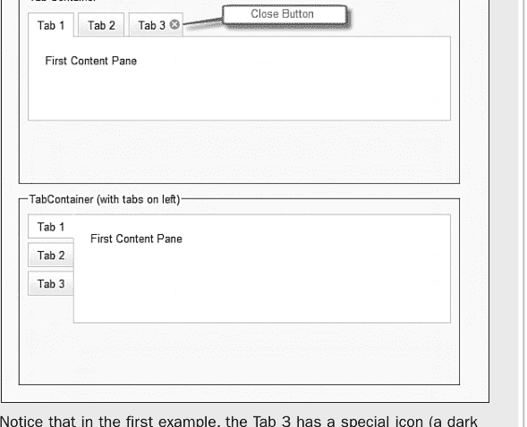

请注意，在第一个示例中，选项卡3有一个特殊的图标（一个带有白色X的深色圆圈），允许用户关闭该选项卡，使其完全从页面中消失。

### 8.2 Dojo 布局小部件说明

| HTML标记示例 | 创建一个选项卡位于顶部的`TabContainer`，其中包含三个`ContentPane`小部件。<br>`<div id="scl" dojoType="dijit.layout.TabContainer" style="width: 100%; height: 10em;">`<br>`  <div dojoType="dijit.layout.ContentPane" title="Tab 1">`<br>`    First Content Pane`<br>`  </div>`<br>`  <div dojoType="dijit.layout.ContentPane" title="Tab 2">`<br>`    Second Content Pane`<br>`  </div>`<br>`  <div dojoType="dijit.layout.ContentPane" title="Tab 3">`<br>`    Third Content Pane`<br>`  </div>`<br>`</div>` |

| :--- | :--- |

| **JavaScript构造函数示例** | 以下代码将创建一个包含两个`ContentPane`小部件的新`TabContainer`小部件。<br>`container = new dijit.layout.TabContainer( { } );`<br>`content1 = new dijit.layout.ContentPane({ } );`<br>`container.addChild(content1);`<br>`content2 = new dijit.layout.ContentPane({ } );`<br>`container.addChild(content2);` |

注意：我们仍然需要向每个`ContentPane`小部件添加内容，并将容器附加到 DOM。

| 关键属性 | 属性 | 默认值 | 描述 |

| :--- | :--- | :--- | :--- |

| | `tabPosition` | `"top"` | 此属性确定标签相对于内容区域的位置。<br>`top`、`bottom`、`left-h`、`right-h` |

| | `closable` | `false` | 注意：此属性位于子`ContentPane`小部件上，它决定与小部件关联的选项卡上是否有关闭图标。<br>点击该图标，选项卡（及其内容）将从`TabContainer`中移除。 |

| 关键点 | 方法 | 描述 |

| :--- | :--- | :--- |

| **方法** | `selectChild(widget)` | 显示子小部件`widget`并使其处于活动状态。 |

| | `closeChild(widget)` | 关闭子小部件`widget`。 |

| | `back()` | 关闭当前打开的子小部件，打开前一个子小部件并使其处于活动状态。 |

| | `forward()` | 关闭当前打开的子小部件，打开下一个子小部件并使其处于活动状态。 |

| **关键样式** | 无 | |

| **关键事件** | 无 | |

| **备注** | 无 | |

## 总结

布局包中的小部件为其他内容提供了容器，通常是我们称为“窗格”的多个内容实例。

`ContentPane`充当其他内容的通用持有者，可以使用 Ajax 请求从服务器获取。

`LayoutContainer`允许多个内容窗格自动排列到容器的左、右、上、下和中心位置。

`StackContainer`允许多个内容窗格堆叠，以便一次只显示一个内容窗格。此容器还可以提供控件，允许用户选择他或她想查看的窗格。

`SplitContainer`允许多个内容窗格同时显示，并由一个可由用户移动的栏分隔，以更改分配给每个内容窗格的相对空间量。

`AccordionContainer`允许多个内容窗格堆叠，以便一次只显示一个窗格。每个窗格都提供一个控件，使其可以被选中。即使只有一个内容窗格可见，所有控件都是可见的。

`TabContainer`允许多个内容窗格堆叠，以便一次只显示一个窗格。此小部件提供一组选项卡，每个内容窗格对应一个选项卡，允许用户选择他想查看的内容窗格。

现在，我们可以将注意力转向一些不属于我们已经回顾过的类别的特殊小部件。这些是 Dojo 提供的一些最强大、最有趣的小部件。所以，系好安全带，准备好了！

## 第9章 其他专门的Dojo小部件

> 形式追随功能——这被误解了。形式和功能应该合二为一……

—弗兰克·劳埃德·赖特

HTML工具包中可用的标准小部件（如文本框、单选按钮等）的问题不在于它们本身无效：问题在于它们的数量不够多。对于某些功能，标准小部件是完美的契合。在这些功能中，它们找到了自己合适的归宿。小部件的目的是向用户表示某段数据或过程。小部件与用户对该数据或过程的模型的对应程度决定了其成功与否。当小部件的形式和功能相匹配时，用户界面似乎变得几乎透明，用户不再感觉自己是在通过小部件操作，而是直接操作内容。本章描述了许多 Dojo 小部件，每个小部件执行一个与其完美匹配的专门功能。

## 9.1 什么是专门的小部件？

本章描述的每个小部件都有一些独特的功能。它们不一定是 Dojo 小部件中最先进或最复杂的，但因为它们的独特性而被归为一类。没有其他统一的主题将它们联系在一起，不像第7章“Dojo表单小部件”中描述的表单小部件，或第8章“Dojo布局小部件”中描述的布局小部件。

然而，我们并非进入未知领域。尽管小部件的具体功能可能是独特的，但我们构建和使用它们的方式将相当熟悉。本章中的所有小部件都是`dijit._Widget`的后代，并继承了这位小部件之母的所有操作。

本章采用与前两章相同的方法来描述这些小部件：每个小部件将使用第7章引入的相同标准布局进行描述——除了本章涵盖的第一个小部件；它需要包含更多细节。

## 9.2 菜单小部件

就像《动物庄园》中的动物一样，所有小部件都是平等的，但有些小部件更平等。也就是说，有些小部件可能会比其他小部件更频繁地使用。由于这个原因以及多个组件小部件的参与，我们花费了额外的时间来描述菜单小部件。

网页上最常用的功能之一是导航。菜单用于执行命令和提供指向其他网站和文档的链接，它们几乎出现在网络上的每个网页上，因此你会期望 Dojo 为创建菜单提供众多选项。你是对的。

Dojo 菜单小部件实际上是一组协同工作的小部件的集合。构建菜单的基类是`dijit.Menu`。一个`Menu`小部件可以包含`MenuItem`小部件作为子项，此外还有另外两个小部件：`dijit.MenuSeparator`和`dijit.PopupMenuItem`。图9.1展示了这些组件之间的关系。

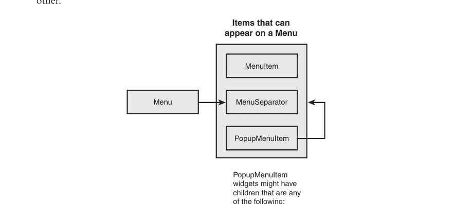

`PopupMenuItem`小部件可能包含以下任意类型的子项：

- `MenuItem`
- `MenuSeparator`
- `PopupMenuItem`

图9.1 菜单小部件的组件

### 9.2.1 `dijit.Menu`


`dijit.Menu` 小部件是菜单元素的容器。它通常通过链接到 `Toolbar` 小部件上的按钮来显示，或者通过与其他可右键单击以显示菜单的元素关联来显示。此外，通过使用鼠标悬停事件，当用户将鼠标悬停在页面上的其他小部件上时，可以显示菜单。这是某些网站上使用的典型技术。

### 9.2.2 `dijit.MenuItem`

`dijit.MenuItem` 小部件代表菜单上可用的命令或链接。通过激活该项目，用户选择要执行的某个功能。菜单项可以有文本标签、图标或两者兼有。下表 9.1 和表 9.2 描述了该小部件的属性和方法。

**表 9.1 `dijit.MenuItem` 的属性**

| 属性 | 默认值 | 描述 |
|---|---|---|
| `label` | `""` | 包含项目显示标签的文本。 |
| `iconClass` | `""` | 如果菜单项还应显示一个图标，则此属性包含描述该图标的 CSS 类的值。 |
| `disabled` | `false` | 此属性显示项目是否已停用。禁用的项目仍然会显示，但单击它们不会触发其 `onClick()` 方法。 |

**表 9.2 `dijit.MenuItem` 的方法**

| 方法 | 描述 |
|---|---|
| `onClick()` | 这是此小部件的关键事件。它决定了菜单项提供的功能。当用户通过单击选择此项时，将执行与此事件关联的处理程序。 |
| `setDisabled()` | 此方法将禁用一个菜单项。该项目仍将显示在菜单上，但会以较浅的文本显示，以表示它不活动。此外，如果用户单击该项目，则不会触发 `onClick()` 事件。 |

### 9.2.3 `dijit.MenuSeparator`

`dijit.MenuSeparator` 小部件用于组织菜单项的显示。它在菜单项列表中创建一条灰色水平线，用于分隔相关菜单项组。它无法获得焦点，也不可单击。它确实提供了一个类 `dijitMenuSeparatorTop`，可用于设置链接的样式，例如更改颜色或使其变大。有关带有两个分隔符的菜单示例，请参见图 9.2。

### 9.2.4 `dijit.PopupMenuItem`

`dijit.PopupMenuItem` 小部件允许将嵌套菜单添加到菜单中。然后，该小部件可以作为其他菜单元素的容器，包括 `MenuItem` 小部件、`MenuSeparator` 小部件，甚至额外的 `PopupMenuItem` 小部件，从而提供所需任意级别嵌套菜单的能力。

指定弹出菜单的标准技术是包含一个 `<SPAN>` 子元素作为弹出菜单的标签，然后包含一个代表激活弹出菜单时要显示的小部件的标签。对于子菜单，弹出小部件将是一个 `dijit.Menu`，如以下代码示例所示。

```html
<div dojoType="dijit.PopupMenuItem">
    <span>Submenu Label</span>
    <div dojoType="dijit.Menu" id="submenu1" style="display: none;">
        <div dojoType="dijit.MenuItem" onClick="sub1Action()">
            Submenu Item One Label</div>
        <div dojoType="dijit.MenuItem" onClick="sub2Action()">
            Submenu Item Two Label</div>
    </div>
</div>
```

`dijit.Menu` 小部件的总体讨论现已完成，因此让我们继续介绍本章涵盖的专业小部件的标准演示。

| 小部件名称 | `dijit.Menu` |
|---|---|
| 父类 | `dijit._Widget` |
| 文件位置 | `dijit/Menu.js`<br>使用 `dojo.require("dijit.Menu");` |
| 用法 | 此类创建一个包含项目列表的小部件，可以选择这些项目来触发某个功能。 |
| 显示示例 |  |
| HTML 标记示例 | ```html
<div dojoType="dijit.Menu" id="menul" contextMenuForWindow="true">
  <div dojoType="dijit.MenuItem">Enabled Item</div>
  <div dojoType="dijit.MenuItem" disabled="true">Disabled Item</div>
  <div dojoType="dijit.MenuSeparator"></div>
  <div dojoType="dijit.MenuItem" iconClass="dijitEditorIcon dijitEditorIconCut" onClick="action1()" label="Cut" disabled="true">Cut</div>
  <div dojoType="dijit.MenuItem" iconClass="dijitEditorIcon dijitEditorIconCopy" onClick="action2()">Copy</div>
  <div dojoType="dijit.MenuSeparator"></div>
  <div dojoType="dijit.PopupMenuItem">
    <span>Submenu Label</span>
    <div dojoType="dijit.Menu" id="submenu1">
      <div dojoType="dijit.MenuItem">...</div>
    </div>
  </div>
</div>
``` |

此图显示了一个包含 `MenuItem` 小部件、`MenuSeparator` 小部件和一个包含自身菜单的 `PopupMenuItem` 小部件的菜单小部件。通过右键单击其父 `<div>` 来激活该小部件。

```html
<div dojoType="dijit.MenuItem" onClick="subAction1">Submenu Item One</div>
<div dojoType="dijit.MenuItem" onClick="subAction2()">Submenu Item Two</div>
</div>
</div>
```

请注意，一些项目使用属性 `disabled="true"` 进行了禁用。

还要注意第一个菜单小部件上的 `style="display: none;"` 属性。这会隐藏页面初始视图中的菜单。由于 `contextMenuForWindow="true"` 属性，用户可以通过在页面上的任意位置右键单击来使菜单出现。

**JavaScript 构造函数示例**

以下代码将创建一个包含两个项目的菜单小部件。

```javascript
menu1 = new dijit.Menu(
    {targetNodeIds:["nodeId"], id:"menu1"});

menu1.addChild(new dijit.MenuItem(
    {label:"Menu Item 1", onClick:menuAction1}));

menu1.addChild(new dijit.MenuItem(
    {label:"Menu Item 2", onClick:menuAction2}));
```

请注意，`"nodeId"` 是菜单将附加到的 DOM 元素的 id。此菜单将是一个上下文菜单，要求用户右键单击父 DOM 节点。

当用户单击各自的菜单项时，将调用函数 `menuAction1` 和 `menuAction2`。

**关键属性**

| 属性 | 默认值 | 描述 |
|---|---|---|
| `contextMenuForWindow` | `false` | 当此属性为 `true` 时，用户可以单击页面上的任意位置来打开菜单。当该属性为 `false` 时，用户只能单击分配了此菜单的节点。 |
| `targetNodeIds` | `[]` | 应分配菜单小部件的 DOM 节点。 |
| `parentMenu` | `null` | 引用此小部件所属的菜单小部件。 |

**关键方法**

| 方法 | 描述 |
|---|---|
| `addChild(Widget)` | 此函数向小部件添加子元素。在以编程方式操作小部件时使用。 |

**关键样式**

| 样式名称 | 描述 |
|---|---|
| `dijitMenuTable` | 用于设置包含菜单项的表格样式的类。 |

**关键事件**

| 事件 | 描述 |
|---|---|
| `onExecute()` | 菜单项被执行时要调用的函数。 |
| `onCancel()` | 用户取消菜单项时要调用的函数。 |
| `onClose()` | 菜单关闭时要调用的函数。 |
| `onOpen()` | 菜单打开时要调用的函数。 |

**注意**

要关闭菜单，请使用 `<esc>` 键。

## 第 9 章 其他专业 Dojo 小部件

| 小部件名称 | `dijit.Toolbar` |
|---|---|
| 父类 | `dijit._Widget` |
| 文件位置 | `dijit/Toolbar.js`<br>使用 `dojo.require("dijit.Toolbar");` |
| 用法 | 此类创建一个充当按钮容器的小部件。此小部件没有显式的工具栏项，而是可以使用任何小部件作为工具栏项——尽管最典型使用的小部件是 `dijit.form.Button`。然后，这些按钮可以与显示其他小部件或执行函数等操作相关联。此小部件的典型用途是提供命令按钮的水平显示，这些按钮可以显示为文本或图标。工具栏通常包含提供子菜单的按钮，但按钮也可以直接执行命令。就像在 `dijit.Menu` 中一样，提供了一个额外的小部件 `dijit.ToolbarSeparator`，用于在视觉上分隔工具栏项组。 |
| 显示示例 | <br>此图显示了工具栏小部件的两个示例。第一个包含带有文本标签的按钮。第二个包含混合的按钮，一些带有图标，另一些带有文本。tundra 主题目录 `dojo/dijit/themes/tundra/images` 中提供了许多预定义的图标。还要注意使用 `ToolbarSeparator` 在视觉上区分相关项目组。 |
| HTML 标记示例 | 创建一个带有两个菜单项的 `Toolbar` 小部件，其中第一个仅使用图标，第二个使用文本标签。 |

```html
<div id="toolbar1" dojoType="dijit.Toolbar">
    <div dojoType="dijit.form.Button" id="toolbar1.cut"
        iconClass="dijitEditorIcon dijitEditorIconCut"
        showLabel="false">Cut</div>
    <div dojoType="dijit.form.Button" id="toolbar1.paste">
        Paste</div>
</div>
```

需要将操作与 `Button` 小部件相关联，以便在单击按钮时执行某些功能。

### JavaScript 构造函数示例

以下代码将创建一个包含两个项目的工具栏项的工具栏。

```javascript
menu1 = new dijit.Toolbar({}, dojo.byId("d1"));

menu1.addChild(new dijit.form.Button(
    {label:"Item1", onClick:menuAction1}));

menu1.addChild(new dijit.form.Button(
    {label:"Item2", onClick:menuAction2}));
```

### 关键属性

无

### 关键方法

| 方法 | 描述 |
|---|---|
| `addChild(Widget)` | 用于以编程方式向工具栏添加组件的函数。 |

### 关键样式

无

### 关键事件

无

### 注意事项

无

---

| 组件名称 | `dijit.Dialog` |
|---|---|
| 父类 | `dijit._Widget`、`dijit.layout.ContentPane` |
| 文件位置 | `dijit/Dialog.js`<br>使用 `dojo.require("dijit.Dialog");` |
| 用法 | 该类创建了一个组件，将 `ContentPane` 作为模态对话框显示在现有页面之上。此时页面会被禁用；用户无法点击对话框以外的页面任何位置。对话框可以包含任何内容，包括其他组件或表单。当用户完成对话框操作（通过点击图标关闭对话框或点击对话框内容中提供的控件）时，组件消失，原页面再次激活。当对话框激活时，它显示在页面中心。<br><br>该组件一个非常实用的功能是通过 `href` 属性从服务器加载动态内容。 |
| 显示示例 |  |
| HTML 标记示例 | 创建一个具有来自服务器动态内容的 `Dialog` 组件。将提供一个控件使该组件可见。<br><br>`<button dojoType="dijit.form.Button" onclick="dijit.byId('dialog1').show()"> Show Dialog </button>`<br><br>`<div id="dialog1" dojoType="dijit.Dialog" title="dijit.Dialog"> <div> *** 对话框内容 *** </div> </div>` |

此图显示了对话框的示例。请注意，对话框处于激活状态，但其背后的页面已“变灰”，以表明其处于非激活状态。对话框右上角的图标可用于将其隐藏。注意：屏幕截图中左侧有一个标签为 "Show Dialog" 的按钮。虽然这不属于 `dijit.Dialog` 组件的一部分，但它是显示该组件所必需的。当 Dialog 组件创建时，它是不可见的，需要某种控件或进程来显示它。

以下示例同样创建了一个 `Dialog` 组件，但在这种情况下，内容是从服务器动态加载的。

```html
<button dojoType="dijit.form.Button"
  onclick="dijit.byId('dialog2').show()">
  Show Dialog
</button>
```

```html
<div id="dialog2"
  dojoType="dijit.Dialog"
  href="content.html"
  title="Dynamic Content">
</div>
```

### JavaScript 构造函数示例

以下代码将创建一个 `Dialog`，其动态内容从服务器资源 `"content.jsp"` 获取。

```javascript
new dijit.Dialog({
  title: "Dialog",
  href: "content.jsp" });
```

Dialog 必须连接到 DOM 并使用其 `show()` 方法激活。

### 关键属性

| 属性 | 默认值 | 描述 |
|---|---|---|
| `open` | `false` | 对话框是否可见？ |
| `duration` | `400` | 从对话框窗口开始启动到完全出现的时间（毫秒）。它在此期间内逐渐淡入。 |
| `href` | `null` | 提供对话框内容的服务器资源的 URL。 |
| `title` | `null` | `Dialog` 组件标题栏的文本。 |

### 关键方法

| 方法 | 描述 |
|---|---|
| `show()` | 使组件可见。 |
| `hide()` | 隐藏组件。 |

### 关键样式

| 样式名称 | 描述 |
|---|---|
| `dijitDialogPaneContent` | 包含组件内容的 ContentPane 的样式。 |

### 关键事件

| 事件名称 | 描述 |
|---|---|
| `onLoad` | 当内容加载到组件中时执行。 |

### 注意事项

无

---

## `dijit.TooltipDialog`

| 组件名称 | `dijit.TooltipDialog` |
|---|---|
| 父类 | `dijit._Widget`、`dijit.layout.ContentPane` |
| 文件位置 | `dijit/Dialog.js` |
| 用法 | 该类创建了一个外观与工具提示（Tooltip）相同的对话框组件…… |
| 显示示例 | [image] |
| HTML 标记示例 | 创建一个与按钮控件关联的 TooltipDialog…… |

该类创建了一个外观与工具提示相同的对话框组件。此对话框与 `dijit.Dialog` 在两个主要方面有所不同。首先，该对话框不是模态的；用户可以点击对话框背后的页面，这会导致对话框隐藏。其次，对话框包含一个指向其关联组件的标记。常规的 `dijit.Dialog` 组件显示在页面中心，而 `TooltipDialog` 将出现在其关联组件的旁边。

该组件用于通过提供表单来获取工具栏命令的附加信息。以此方式使用时，表单提交后组件将被隐藏。

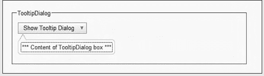


此图显示了点击标签为`Show Tooltip Dialog`的按钮激活后的组件。注意，组件出现在按钮旁边，并有一个箭头指向该按钮。工具提示将自动调整方向。

创建一个与按钮控件关联的`TooltipDialog`。当用户点击按钮时，工具提示将出现。

```html
<div dojoType="dijit.form.DropDownButton">
    <span>Show Tooltip Dialog</span>
    <div id="dialog1"
        dojoType="dijit.TooltipDialog" title="Tooltip">
        <div>
        *** TooltipDialog 框内容 ***
        </div>
    </div>
</div>
```

注意：内容可以从服务器动态获取。内容通常是一个请求命令附加参数的表单。

| JavaScript 构造函数示例 | 此组件通常通过 HTML 标记创建。 |
|---|---|
| 关键属性 | 无 |
| 关键方法 | 无 |
| 关键样式 | 无 |
| 关键事件 | 无 |
| 注意事项 | 无 |

---

| 组件名称 | `dijit.Tooltip` |
|---|---|
| 父类 | `dijit._Widget` |
| 文件位置 | `dijit/Tooltip.js`<br>`use dojo.require("dijit.Tooltip");` |
| 用法 | 该类创建了一个在字段旁边显示弹出消息的组件。当字段获得焦点时，消息自动出现，当焦点消失时消息消失。该组件显示在任何底层页面元素之上。此组件与`TooltipDialog`类类似，不同之处在于，此组件最适合用于简短的文本或 HTML 帮助显示，而`TooltipDialog`可用于更强的交互，例如显示用于附加数据录入的表单甚至显示其他组件。<br><br>该组件充当 HTML 中`title`属性的更强大替代方案。 |
| 显示示例 | <br>此图显示了字段获得焦点时出现的`Tooltip`组件。 |
| HTML 标记示例 | 创建一个`Tooltip`组件并将其与现有字段关联。<br><br>`<span dojoType="dijit.Tooltip" connectId="field1">*** 工具提示内容 ***</span>`<br><br>上述代码假设存在一个 id 为`field1`的表单字段。 |
| JavaScript 构造函数示例 | 以下代码将创建工具提示。<br><br>`new dijit.Tooltip({ connectId:["id3"], label: " *** 内容 ***"});` |

### 关键属性

| 属性 | 默认值 | 描述 |
|---|---|---|
| `label` | `""` | 工具提示上标签的文本。 |
| `showDelay` | `400` | 从关联组件获得焦点到工具提示显示之间的时间（毫秒）。 |
| `connectId` | `[]` | 工具提示所关联的组件数组。 |

### 关键方法

无

### 关键样式

| 样式名称 | 描述 |
|---|---|
| `dijitTooltipContents` | 工具提示内容的 CSS 样式。 |

### 关键事件

无

### 注意事项

无

---

| 组件名称 | `dijit.ProgressBar` |
|---|---|
| 父类 | `dijit._Widget` |
| 文件位置 | `dijit/ProgressBar.js`<br>使用`dojo.require("dijit.ProgressBar")`; |
| 用法 | 该类创建了一个使用水平条显示进程完成状态的组件。与 Slider（可用作更改状态测量的控件）不同，此组件仅显示状态。此外，此组件只能水平显示。进度通过此组件的`update()`函数以编程方式更新。 |
| 显示示例 | <br>此图显示了一个进度条。请注意，进度条内有一个较深区域代表完成状态。它占据了进度条 10% 的空间，等于条中心显示的数字。 |
| HTML 标记示例 | 创建一个`ProgressBar`组件。<br><br>`<div dojoType="dijit.ProgressBar" maximum="100" progress="10" id="bar1"></div>` |
| JavaScript 构造函数示例 | 以下代码将创建一个`ProgressBar`组件。<br><br>`new dijit.ProgressBar({ annotate:"true", maximum:"50", progress:"35"}, dojo.byId("di"))` |

## `dijit.Tree`

**父类：** `dijit._Widget` `dijit._TreeNode`

**文件位置：** `dijit/Tree.js`

使用`dojo.require("dijit.Tree");`

**用法：** 此类创建一个可折叠和展开的树形结构的小部件。树中的节点可以被点击以触发某些操作。此外，当节点展开时，其内容可以从服务器动态加载。

可以通过编程方式或通过 HTML 来构建树，但最简单的技术是使用 Dojo 数据存储，它可以与小部件直接关联并自动填充小部件。

还可以启用拖放模式，以便将树项目从一个父项目移动到另一个父项目。

**显示示例：** 下图展示了一个完全展开的、包含多个层级的 Tree 小部件。虽然此示例为每个树节点显示了文本，但也可以添加图标。

**HTML 标记示例：** 从 Dojo 数据存储创建一个 Tree 小部件。

`<div dojoType="dojo.data.ItemFileReadStore" jsId="treeStore" url="tree.json"></div>`

`<div dojoType="dijit.Tree" store="treeStore" query="{type:'category'}" label="Rocks">`

> **注意：** 以下是与显示示例对应的数据存储的原始 JSON 内容示例。

```json
{ label: 'name',
  identifier: 'name',
  items: [
    { name:'Igneous', type:'category'},
    { name:'Metamorphic',
      type: 'category',
      children: [
        { name:'Slate', type:'subtype' },
        { name:'Gneiss', type:'subtype' },
        { name:'Quartzite', type:'subtype' }
      ]
    },
    { name:'Sedimentary', type: 'category'}
  ]
}
```

**JavaScript 构造函数示例：** 此小部件的编程构建超出了本书的范围。有关更多详细信息，请参阅网站上的 Dojo 文档。

**关键属性：**

| 属性 | 默认值 | 描述 |
|---|---|---|
| `store` | `null` | 与此小部件关联的 Dojo 数据存储。 |
| `query` | `null` | 与此对象关联的数据存储应包含具有`category`属性的对象。`query`属性应指定一个包含`category`值的值，该值应被视为树中的第一级项目。 |

下表描述了树节点本身的属性，树节点属于`dijit._TreeNode`类，这是 Dojo 的内部函数。

| 属性 | 默认值 | 描述 |
|---|---|---|
| `label` | `""` | 包含树节点标签的文本。注意：此属性属于每个树节点。 |
| `isExpandable` | `true` | 节点是否可以展开？ |
| `isExpanded` | `false` | 节点是否已展开？ |

**关键方法：** 无

**关键样式：**

| 样式名称 | 描述 |
|---|---|
| `dijitTreeLabel` | 树节点上项目文本的 CSS 类。 |

**关键事件：**

| 事件名称 | 描述 |
|---|---|
| `onClick(item, node)` | 当用户点击树项目时调用此函数。 |

**注意：** Tree 是`_TreeNodes`的集合，`Tree`本身是树节点的子类。

## `dijit.form.Slider`

**父类：** `dijit._Widget` `dijit.form.HorizontalSlider` `dijit.form.VerticalSlider`

**文件位置：** `dijit/form/Slider.js`

使用`dojo.require("dijit.form.Slider");`

**用法：** 此类创建一个带有滑块的水平或垂直条，用户可以移动滑块以选择特定值。滑块条的两侧可以带有带标签的刻度线。

此滑块在条的上方和下方都有刻度线和标签。

**HTML 标记示例：** 创建一个 Slider 小部件。

```html
<div dojoType="dijit.form.HorizontalSlider" name="horizontal"
    value="10"
    maximum="100"
    minimum="0"
    pageIncrement="100"
    showButtons="false"
    intermediateChanges="true"
    id="slider1"
>

<ol dojoType="dijit.form.HorizontalRuleLabels"
    container="topDecoration"
    style="height:1.2em;font-size:75%;color:gray;"
    count="6" numericMargin="1">
</ol>

<div dojoType="dijit.form.HorizontalRule"
    container="topDecoration" count=6 style="height:5px;">
</div>

</div>
```

**注意：** 此示例仅在滑块条的上方放置刻度线。也可以使用相同的技术在条的下方放置带标签的刻度线。由于此小部件的组件较多，使用 HTML 创建比编程创建更为典型。

**关键属性：**

| 属性 | 默认值 | 描述 |
|---|---|---|
| `showButtons` | `true` | 在条的两端显示用于增加和减少滑块值的控件。将此属性指定为`false`会使控件不显示。 |
| `minimum` | `0` | 滑块可以设置的最低值，即使滑块条可能看起来更低。 |
| `maximum` | `100` | 滑块可以设置的最高值，即使滑块条可能看起来更高。 |
| `discreteValues` | `Infinity` | 最低值和最高值之间可能的设置数量。 |
| `pageIncrement` | `2` | 使用`<Page Up>`或`<Page Down>`键时滑块的增加或减少量。 |
| `clickSelect` | `true` | 确定点击进度条是否会移动滑块手柄。 |
| `value` | `0` | 滑块的初始值设置。 |

下表包含`HorizontalRule`或`VerticalRule`的属性。这些是出现在滑块条两侧的刻度线。

| 属性 | 默认值 | 描述 |
|---|---|---|
| `container` | `""` | 指定此刻度线应描述哪一组刻度线。可能的值为`topDecoration`、`bottomDecoration`、`leftDecoration`、`rightDecoration` |
| `count` | `3` | 刻度线的数量。 |
| `ruleStyle` | `""` | 刻度线的 CSS 样式。 |

## `dijit.form.NumberSpinner`

父类：`dijit._Widget`, `dijit.form.NumberTextBoxMixin`, `dijit.form._Spinner`

文件位置：`dijit/form/NumberSpinner.js`

使用`dojo.require("dijit.form.NumberSpinner");`

用法：此类创建一个用于数字的文本框，其中包含一个控件，允许用户通过点击控件来改变值。该控件由一个上箭头图标和一个下箭头图标组成。点击上箭头增加数值，点击下箭头减小数值。这比普通的`NumberTextBox`更优越，因为用户更容易对数值进行微调。此外，当按住控件不放时，数值变化的速度会加快。

用户可以通过点击上箭头或下箭头图标来增加或减少数值。

HTML 标记示例：创建一个`NumberSpinner`小部件。

```html
<input
    dojoType="dijit.form.NumberSpinner"
    value="900"
    constraints="{max:1550,places:0}"
    name="integerspinner1"
    id="integerspinner1">
```

注意：此小部件继承了`constraints`属性。

JavaScript 构造函数示例：以下代码将创建一个 Tooltip。

| 属性 | 默认值 | 描述 |
|---|---|---|
| `smallDelta` | `1` | 当增加或减少数值时，数字值增加或减少的量。 |
| `largeDelta` | `10` | 当使用`<Page Up>`或`<Page Down>`键时，数字值增加或减少的量。 |
| 关键方法 | 无 |
|---|---|---|
| **关键样式** | 无 |
| **关键事件** | 无 |
| **备注** | 此小部件是`dijit.form.NumberTextBox`的子类，因此它继承了该类型的所有验证属性。为简洁起见，此示例中未显示其中大多数属性。 |

以下表格包含`HorizontalRuleLabels`或`VerticalRuleLabels`的属性。这些是出现在滑块条两侧刻度上的标签。

| 属性 | 默认值 | 描述 |
|---|---|---|
| `container` | `""` | 指定此规则应描述哪一组刻度标签。可选值有`topDecoration`、`bottomDecoration`、`leftDecoration`、`rightDecoration` |
| `labels` | `[]` | 刻度标签的数组。 |
| `labelStyle` | `""` | 刻度标签的 CSS 样式。 |

| 关键方法 | 方法 | 描述 |
|---|---|---|
|  | `increment()` | 将滑块值增加一个位置。滑块手柄也会移动。 |
|  | `decrement()` | 将滑块值减少一个位置。滑块手柄也会移动。 |
|  | `setValue(value)` | 更改滑块值。滑块手柄也会移动到相应位置。 |

| 关键样式 | 无 |
|---|---|
| 关键事件 | 无 |
| 备注 | 无 |

## `dijit.InlineEditBox`

| 小部件名称 | `dijit.InlineEditBox` |
|---|---|
| 父类 | `dijit._Widget` |
| 文件位置 | `dijit/InlineEditBox.js`<br>使用`dojo.require("dijit.InlineEditBox");` |
| 用法 | 此类创建一个小部件，允许将显示的文本转换为文本框，以便用户可以对其进行编辑。 |
| 显示示例 | 此屏幕截图显示了正在运行的小部件。第一行，“My hobby is running”，显示为普通的显示文本。第二行显示当鼠标经过时文本被高亮显示。第三行显示当点击可编辑文本时出现的文本框。 |
| HTML 标记示例 | 创建一个`InlineEditBox`小部件。<br><br>`<span>`<br>`  dojoType="dijit.InlineEditBox"`<br>`  editor="dijit.form.TextBox"`<br>`  width="100px" title="hobby">` |
| 关键属性 | 属性 | 默认值 | 描述 |
|---|---|---|---|
|  | `editing` | `false` | 指定小部件当前是否处于编辑模式，`false`表示不在。 |
|  | `autoSave` | `true` | 设置为`true`时，当编辑框关闭时，更改会自动保存，而不仅仅是点击保存图标时。 |
|  | `buttonSave` | `""` | 包含“保存”按钮标签的文本。 |
|  | `buttonCancel` | `""` | 包含“取消”按钮标签的文本。 |
|  | `renderAsHtml` | `false` | 如果所选编辑器使用 HTML 而不仅仅是纯文本，则属性为`true`。 |
|  | `value` | `""` | 文本字符串的值。 |
|  | `editor` | `dijit.form.TextBox` | 将用作文本编辑器的小部件。 |
| 关键方法 | 方法 | 描述 |
|---|---|---|
|  | `cancel()` | 此函数取消编辑会话并恢复到文本的原始值。 |
| 关键样式 | 无 |  |
|---|---|---|
| 关键事件 | 样式名称 | 描述 |
|---|---|---|


## `dijit.form.Textarea`

| 小部件名称 | `dijit.form.Textarea` |
| :--- | :--- |
| **父类** | `dijit.form._FormWidget` |
| **文件位置** | `dijit/form/Textarea.js` |
| **用法** | 使用 `dojo.require("dijit.form.Textarea");` 创建一个小部件，替代标准的 HTML `<textarea>` 标签，允许多行输入。其主要优势之一是当文本量发生变化时，它会自动调整自身大小，而不是像标准 `<textarea>` 标签那样显示滚动条。 |
| **显示示例** | 此图显示了包含一些内容行的小部件。如果内容超出小部件的边界，小部件的大小将自动更改。 |
| **HTML 标记示例** | 创建一个 `Textarea` 小部件：<br>`<textarea dojoType="dijit.form.Textarea" name="textArea1">`<br>`    This is the content of the text area.`<br>`</textarea>` |
| **JavaScript 构造函数示例** | 此小部件通常通过 HTML 创建。 |
| **关键属性** | 无 |
| **关键方法** | 无 |
| **关键样式** | 无 |
| **关键事件** | 无 |
| **备注** | 使用 `<textarea>` 标签创建此小部件。在 HTML 中指定文本区域大小的标准属性是 `cols` 和 `rows`，分别对应列数和行数。使用 `dijit.form.Textarea` 时请勿使用这些属性，而是使用样式属性 `width` 和 `height` 来指定小部件的大小。 |

## `dijit.Editor`

| 小部件名称 | `dijit.Editor` |
| :--- | :--- |
| **父类** | `dijit._Widget`、`dijit._editor.RichText` |
| **文件位置** | `dijit/Editor.js`<br>使用 `dojo.require("dijit.Editor");` |
| **用法** | 此类创建一个小部件，充当富文本编辑器，允许带有复杂编辑选项的多行文本。当需要额外的格式化选项时，它是标准 HTML `<textarea>` 标签的替代品。格式化命令和选项在可自定义的工具栏中可用。 |
| **显示示例** | 此图显示了 `Editor` 小部件。请注意工具栏中的编辑命令。 |
| **HTML 标记示例** | 创建一个 `Editor` 小部件：<br>`<textarea dojoType="dijit.Editor" id="edit1" height="110px">Content for the text area.</textarea>` |
| **JavaScript 构造函数示例** | 此小部件的编程构建超出了本书的范围。有关更多详细信息，请参阅网站上的 Dojo 文档。 |
| **关键属性** | |
| 属性 | 默认值 | 描述 |
| `plugins` | `null` | 此小部件的插件（编辑命令）列表。 |
| `extraPlugins` | `null` | 此小部件的额外插件。 |
| **关键方法** | 无 |
| **关键样式** | 无 |
| **关键事件** | 无 |
| **备注** | 无 |

## 总结

Dojo 中存在许多专门的小部件，它们提供了远超 HTML 默认小部件的独特功能。本章介绍了一些这样的专门小部件，但并非全部。Dojo 的小部件在不断开发中。我们现在结束了对 Dojo 小部件的探索，在本书的下一节中继续探索 Dojo 的一些非视觉元素，这些元素增强了 JavaScript 编程。这些是 Dojo 的隐藏特性，它们不会直接影响页面的视觉显示，但使 JavaScript 编程变得更加容易。

## Dojo 详解

- 10 什么是 Dojo？
- 11 Dojo 技术概述
- 12 对象与类
- 13 字符串与 JSON
- 14 事件与事件处理
- 15 Ajax 远程调用
- 16 Dojo 与 DOM
- 17 测试与调试

# 10 什么是 Dojo？

> 凡事开头最难，尤其引入新事物更是如此，其成败亦未可知。
> —尼科洛·马基雅维利（1469–1527）

有人说，不了解过去就无法把握未来。Dojo 因何而生？它有何用途？谁应该使用它？本章将回答这些问题。我们将介绍 Dojo，简要回顾其历史，并从宏观角度进行概览。技术细节留待后续章节，本章将聚焦于整体框架。

## 10.1 JavaScript 与 AJAX 的发展史

既然你拿起这本书，我猜你可能已经对 Dojo 有所了解。或许你知道它是处理 JavaScript 的工具。因此，在深入 Dojo 具体历史之前，我们应先简要谈谈 JavaScript。

JavaScript 是内置于浏览器的编程语言。自 1995 年以来，它几乎出现在所有浏览器中。通过在网页中运用 JavaScript，你可以通过与用户更直接的交互让页面生动起来。例如，JavaScript 可用于验证用户输入、展示视觉特效、执行计算以及响应用户事件。为描述这些强大功能，甚至创造了一个新术语——*动态 HTML*。JavaScript 能将 HTML 从一种枯燥、静态的标记语言，转变为用户与之互动的动态可视化环境。

如果你难以回忆 90 年代那些精彩的交互网站，那是因为 DHTML 所承诺的完美境界从未真正实现。事实上，DHTML 存在诸多问题：不同浏览器版本支持不同版本的 JavaScript；用于表示网页内部结构的 DOM 在不同浏览器间存在差异，导致编写能在所有浏览器中运行的 JavaScript 变得困难。因此，一些开发者完全避免使用 JavaScript，而另一些虽使用却仅在有限范围内，未能充分发挥语言优势。90 年代的浏览器战争平息后，微软和网景停止了为引入新功能而频繁发布新版浏览器，*微软和平*降临。21 世纪初，浏览器市场相对平静：好消息是浏览器功能趋于稳定统一，坏消息是新功能推出速度大幅放缓。

到 2005 年初，一些使用 DHTML 的标准模式逐渐形成。开发者用它进行客户端验证——例如用 JavaScript 确保用户在提交表单前填写必填字段，或开发日历控件等独立 GUI 组件，使用户无需手动输入日期文本。

页面设计师往往不太了解 DHTML JavaScript 的工作原理。他们常通过复制其他网站代码或从提供 DHTML 代码片段的网站下载功能模块，将 DHTML 添加到页面中。这些页面可能包含来自不同来源、提供某些独立功能但彼此未集成的组件。开发者并不将 JavaScript 视为完整的编程范式，而更像是一种能在页面各处添加特效的简单脚本语言。

一切在 2005 年初发生改变。谷歌发布了极具创新性的应用：Gmail 和 Google Maps。这两款应用比当时常见的 HTML 应用更像传统桌面软件，拥有丰富的用户界面。Google Maps 尤其推动了开发者对用户界面局限性的认知革新——通过实现精细的拖拽功能，用户可平滑滚动地图，而无需像 Yahoo 和 MapQuest 那样通过点击方向图标不断刷新页面来移动视野。用户能用鼠标流畅地向任意方向滚动地图，页面无需重新加载。

新范式需要被命名。旧金山用户界面设计师 Jesse James Garrett 为此类技术撰文并命名为“AJAX”。他描述了一套能在页面显示期间从服务器请求数据、通过 DHTML 更新显示而无需刷新页面的技术体系。谷歌展示了令人惊叹的页面可能性，而 Jesse 赋予了它名字。Web 开发界从集体沉睡中苏醒，开始构建 Web 2.0。AJAX 从描述特定技术组件（*异步 JavaScript 和 XML*）的术语，演变为对采用非浏览器应用程序界面技术的网页的广义描述。

值得注意的是，实现 AJAX 的实际技术已存在多年，甚至应用于多个网站。“AJAX”一词的普及推动了相关技术的传播。

JavaScript 在网页中的使用呈爆发式增长，但也带来了一些痛苦教训。开发者意识到 JavaScript 是成熟的面向对象编程语言，而非脚本小子的玩具。这要求开发者掌握面向对象编程技术。但开发者同时发现，许多在其他编程环境中成熟的工具库尚未被移植到 JavaScript。此外，不同浏览器版本在 JavaScript、事件模型和 DOM 工作机制上仍存在差异。这一切为 Dojo DHTML 工具包的诞生铺平了道路。

## 10.2 Dojo 发展历程

JavaScript 日益重要性备受关注。越来越多开发者投入时间处理 JavaScript 的复杂性、特性及漏洞。社区中一些核心开发者开始谋划解决方案。其中一组开发者认为，创建自己的 DHTML 库可能是可行之道。2004 年 9 月，Dojo 首个版本发布。尽管这是社区协作成果，但 Alex Russell 和 Dylan Schiemann 是核心开发者代表。2005 年初，Alex 和 Dylan 成立 Dojo 基金会来管理产品所有权。

Dojo 吸引了庞大的用户和开发者群体。截至 2007 年初，Dojo 已历经四个版本，下载量达数十万次。

更详细的 Dojo 历史信息可访问：`http://www.dojotoolkit.org`。

## 10.3 Dojo 的目标

开发 Dojo 的首要目的是解决 JavaScript 编程固有的不足，简言之，让 JavaScript 编程更轻松。

以下是开发者希望实现的具体目标：

- 屏蔽编写跨浏览器兼容 JavaScript 的复杂性

## 10.4 Dojo 概述

引用该网站的话，“Dojo 是一个用 JavaScript 编写的开源 DHTML 工具包。” 让我们详细分析一下这句话，以理解其含义。我们先从这句话的最后一部分开始。

- **Dojo 是用 JavaScript 编写的。** Dojo *全部* 是 JavaScript，且 *仅* 为 JavaScript。运行 Dojo 不需要任何插件。它在网页中的运行方式与你自己编写的任何 JavaScript 相同。对于浏览器来说，Dojo 的 JavaScript 与页面上的任何其他 JavaScript 无法区分，无论是由开发人员编写的，还是包含在某些其他 JavaScript 框架中的。它必须包含在每个使用它的网页中。这种方法有一些优点。例如，Dojo 兼容任何能够运行现代版本 JavaScript 的浏览器。然而，它也有缺点。Dojo 只能实现原生 JavaScript 所能实现的功能。而一些需要插件的其他框架则能够扩展浏览器的能力。

- **Dojo 是一个 DHTML 工具包。** DHTML 的传统重点是允许轻松操作网页，以创建 GUI 控件和视觉效果。这包括对 DOM、事件模型和 CSS 的操作。这当然仍然是 Dojo 的重点。我们将看到许多有用的函数和对象类型，可用于为用户创建令人惊叹的视觉效果。

- **Dojo 是开源的。** 当你下载 Dojo 时，你会获得全部源代码。你可以看到为 Dojo 编写的每一行 JavaScript。没有任何隐藏内容。这意味着浏览器也能看到全部源码，因此你页面的高级用户可以访问原始 JavaScript 源码，不仅包括 Dojo，还包括你编写的任何额外 JavaScript。遗憾的是，这是 Web 固有的问题。很难向浏览器隐藏任何内容。

此外，由于 Dojo 提供了源代码，你几乎可以用这个工具包做任何你想做的事情，包括修改它。但请注意，这可能会导致以后升级更加困难。此外，在使用 Dojo 时可能会适用某些法律限制。我们稍后将在关于许可证的章节中讨论这些内容。

在下一章中，我们将开始深入研究 Dojo 的源代码，但现在，让我们先从高层级对其进行描述。Dojo 由一组包含 JavaScript 代码的文件组成。通过在网页中包含一个或多个文件，你就可以编写使用 Dojo 的 JavaScript 代码。这使你编写的代码量远少于通常需要编写的代码。大多数 Dojo 代码包含的是你的自定义代码可以调用的函数，或者是允许你的自定义代码创建对象（如 GUI 控件）的构造函数。Dojo 的函数和构造函数中没有任何“魔法”。如果你不相信我，你可以亲自检查——所有源代码都公开可见。它全部是你自己也能写出来的 JavaScript，但由于 Dojo 社区的辛勤工作，你无需亲自去写。

Dojo 的函数和构造函数运行在浏览器中。Dojo 不提供任何运行在服务器上的组件。这使得 Dojo 具有“服务器无关性”（server agnostic）。换句话说，它不关心服务器是什么，只要该服务器知道如何处理 HTTP 请求即可。因此，可以开发在浏览器中使用 Dojo，而服务器可以使用 Java J2EE、PHP 或 Ruby on Rails 等技术的网站。正因如此，在使用 Dojo 创建应用程序时，你通常还需要在服务器端开发能够响应浏览器 Ajax 请求的组件。关于这一点稍后详述，但目前请记住，Dojo 仅为浏览器提供组件。

## 10.5 Dojo 解决了什么问题？

正如我们所说，开发 Dojo 是为了解决 JavaScript 开发中的一些问题。但具体来说，这些问题是什么？以下是 Dojo 创建旨在解决的主要问题列表：

- 不同的浏览器支持不同版本的 JavaScript。如果没有 Dojo，你需要为应用程序运行的每一种不同浏览器编写代码。
- HTML 仅支持少量标准的 GUI 控件（文本框、复选框、单选按钮等）。需要更复杂的控件。例如，从日历控件中选择日期比直接输入日期并寄希望于格式正确要简单得多。HTML 不仅缺乏许多控件，而且没有提供构建新控件的方法。
- 文档对象模型（DOM）在不同浏览器版本中的行为不同。
- 不同版本的浏览器在事件处理上的实现方式不同。
- 与需求相比，原生 JavaScript 中的类集太小了。

最后一点尤其有趣，可以通过一个例子进一步解释。Java 编程语言（是“Java”，不要与“JavaScript”混淆）在其核心包中包含略少于 50 种不同的对象类型。然而，在随标准 Java 开发工具包一起提供的类库中，又定义了额外的 5,000 种对象类型。JavaScript 同样包含略少于 50 个标准对象和对象类型，但它缺乏任何标准类库来增加这个数字。我们并不是说 JavaScript 需要另外 5,000 个数据类型，但它肯定需要超过 50 个，而 Dojo 提供了其中的许多。稍后我们将具体讨论这些缺失的类是什么。

## 10.6 谁应该使用 Dojo？

任何开发网页的人都可以使用 Dojo。但对于三类人群来说，Dojo 几乎是完美契合的。第一类是已经在编写复杂 JavaScript 的开发人员。他们已经遇到了 Dojo 旨在解决的所有问题。通过采用 Dojo，他们可以提高生产力并减轻挫败感。对这组人来说，好消息是他们可以根据自己的意愿快速或缓慢地采用 Dojo。由于 Dojo 使用独立的命名空间，它不会干扰他们现有的任何代码。因此，他们可以开始在现有页面中为新功能添加 Dojo，并在有时间的时候慢慢转换旧代码。这是 Dojo 一个非常重要的优势，使其易于上手。你可以根据需要选择学习的多少。

第二类应该使用 Dojo 的开发人员是页面设计人员。典型的页面设计人员具备图形设计、页面布局和 HTML 标签语言使用方面的技能。他们通常不具备且往往不感兴趣习得的技能是编写程序的能力。他们不想写 JavaScript。然而，他们仍然希望能够使用 Dojo 工具包中提供的一些精美控件。幸运的是，Dojo 控件只需通过 HTML 标记即可添加到网页中，几乎不需要编写代码。

第三类应该使用 Dojo 的开发人员是服务端开发人员。这些开发人员负责创建网站的后端部分，即运行在 Web 服务器本身上的程序。虽然我们可能认为他们通常不参与页面设计，但他们也有发挥作用的空间。服务端开发人员通常接收由页面设计人员提供的 HTML 文件，并添加扩展，使页面能够与网站所需的后端功能通信。这些开发人员可能是 PHP 开发人员、Ruby on Rails 开发人员、Java 开发人员，或者是精通目前市面上任何后端技术的开发人员。他们通常知道足够的 HTML 以维持工作，但不太懂 JavaScript。现在随着 Ajax 的引入以及对创建更动态网页的关注，他们被要求成为 JavaScript 程序员。考虑到他们目前的职责，不能指望他们一夜之间成为 JavaScript 专家，并理解我们已经讨论过的 JavaScript 编程中所有可能的陷阱。这就是 Dojo 对他们而言完美契合的地方。通过使用 Dojo 的函数和构造函数，这些开发人员可以避免必须学习 JavaScript 的所有细节，并从 Dojo 中内置的多年经验中获益。

## 10.7 许可协议

我不是律师，在电视剧里也不是。所以我不该提供法律建议。但还是要说一下。Dojo 是一个开源项目，人们对开源项目的普遍认知是它们可以按任何你希望的方式使用。开发者通常认为开源项目不需要像 typical 商业软件那样获得授权。然而，这种认知是错误的。开源项目在不同的许可协议下发布，这些协议赋予了权利和义务。使用 Dojo 意味着你接受了其中一种许可协议，并且存在一些限制。

Dojo 在两种许可协议下发布，这称为*双重许可*。然而，你不会同时受两种协议的约束，只受你所选择的那种约束。因此，你可以选择提供你所需要条款的那一种。而且不需要通知 Dojo 你选择了哪种协议。你不必支付任何费用，签署任何合同，或处理任何形式的文书工作。

第一种许可协议称为*学术自由许可协议（Academic Free License）*，允许你在非营利和商业应用中使用该代码。你对 Dojo 所做的更改不必提交回 Dojo 社区。而且不要求你将使用 Dojo 的源代码向任何人公开。该许可协议的意图是在不添加任何不合理限制的情况下鼓励 Dojo 的采用。

第二种许可是修改后的 BSD 许可协议。它包含许多与第一种许可协议相同的条款。它允许你使用 Dojo、修改它，或将其打包到你的商业应用中，而不必将你的更改提交给 Dojo 或公开你的源代码。


在很多方面，Dojo 许可协议的目的不是限制你作为开发者，而仅仅是保护 Dojo。你不能因 Dojo 可能存在的 bug 或你引入的 bug 而起诉 Dojo。而且你不能声称你现在拥有 Dojo，并开始起诉任何其他使用它的人。

**免责声明和细则：**正如我已经说过的，我不是律师。关于许可协议的讨论仅仅是我的观点，代表我的理解。你或你的组织必须确定哪种许可是适当的，以及哪些限制真正适用于你。

## 10.8 竞争对手和替代方案

具有复杂图形控件的互联网应用也被称为**富互联网应用（Rich Internet Applications, RIA）**。Dojo 是创建 RIA 的重要工具包，但不是唯一的解决方案。让我们简要谈谈一些与 Dojo 满足相同需求的产品。

首先是一个与 Dojo 最相似的产品——一个提供服务器端组件的开源 DHTML 工具包：

- **Prototype 和 script.aculo.us**。Prototype 是一个非常流行的用于 Web 开发的 JavaScript 工具包。它与 Dojo 一样开源，由包含函数和构造函数的单个 JavaScript 文件组成。然而，Prototype 的大部分功能与用户界面无关。因此，Prototype 通常与另一个名为 script.aculo.us 的 JavaScript 库结合使用。两者一起，开始实现 Dojo 工具包中已有的某些广度。然而，存在一些问题，例如 Prototype 函数缺乏独立的命名空间，这使其不太适合企业开发。

> **注意**
>
> 另外两个非常流行的工具包是 Yahoo User Interface (YUI) 和 jQuery。

接下来是一个允许用户开发 RIA 但基于客户端插件的产品：

- **Adobe Integrated Runtime (AIR)**。这种方法需要在浏览器上安装运行时插件，这在首次运行 Adobe Air 应用程序时完成。该产品可以使用自己的编程语言 ActiveScript，它与 JavaScript 非常相似。尽管是一个优秀的编程环境，Adobe 是一家商业供应商，AIR 可以在客户端（运行时）和服务器上使用专有组件，这是许多开源开发者不同意的做法。

最后，让我们回顾一个也可用于开发 RIA 但采用完全不同的技术方法的产品：

- **Google Web Toolkit (GWT)**。该产品提供了一系列可用于构建 RIA 的 Java 类。开发者使用 GWT 库编写自定义 Java 类，然后使用 GWT 程序从 Java 代码创建 JavaScript。是的，你没有看错。GWT 将浏览器视为 JavaScript 的虚拟机。作为开发者，你不会直接处理 JavaScript，只间接地作为 Java 处理。这可能会让你觉得是一种非常不寻常的方法，你可能会怀疑它是否真的能成功。好吧，如果任何组织能使其成功，Google 可能可以，鉴于其巨大的能力和资源。这让我想起一个老笑话："800 磅的大猩猩睡在哪里？它想睡哪里就睡哪里！"

这只是 Dojo 替代方案中非常小且简单的一个抽样。还有更多——据最新统计超过 100 个。你可以在 Michael Mahemoff 维护的优秀网站上阅读相关内容：`http://ajaxpatterns.org`。

## 10.9 Dojo 的未来

虽然 Dojo 自 2004 年以来就以某种形式存在，但在 2007 年底 Dojo 1.0 版本发布时经历了一次重大变革。这是 Dojo 团队认为达到了必要的质量水平以被指定为 1.0 版本的第一个版本。它具有稳定的高质量，非常轻量，并提供了 DHTML 工具包所需的重要功能。

Dojo 已经对 Web 开发社区产生了重大影响，既作为用于许多应用的工具包，也作为推动 Web 开发前沿的思想领导者。但它的未来呢？正如 Yogi Berra 所说，"我从不做预测，尤其是关于未来的。"我们在做前瞻性声明时也应该谨慎。但我认为可以安全地说，随着 1.0 版本的发布，Dojo 的采用率应该会增加。由于 Dojo 功能集的健壮性和完整性，我们应该会看到 Dojo 进一步进入大型企业。而且由于 Dojo 的易用性和小体积，中小组织也将继续被它吸引。而且由于大型和成熟的开发者社区，我认为我们可以预期 Dojo 在可预见的未来将不断发展并推动 Web 开发的边界。

> **注意**
>
> 截至本书最终编辑时，Dojo 1.1.0 已可供下载，但新版本正在频繁发布。请查看网站获取最新消息。

> **总结**
>
> - Dojo 是一个使用 JavaScript 开发 Web 应用的开源工具包。
> - Dojo 的创建是为了使 JavaScript 开发更容易，并解决 JavaScript 开发中固有的许多问题。
> - 它由可以包含在 Web 页面中的 JavaScript 文件组成。
> - 开发者使用 Dojo 函数和构造函数编写自定义代码来构建自己的功能。
> - Dojo 不提供任何服务器端组件。它可以与支持 HTTP 的任何服务器一起使用。
> - Dojo 的许可协议旨在不具限制性，以便 Dojo 能够被广泛采用。Dojo 有来自开源和商业组织的替代方案。

更多信息可在 Dojo 网站 `http://www.DojoToolkit.org` 获取。下一章继续介绍 Dojo 工具包，但我们将焦点从一般性讨论转向更技术性的讨论。我们开始看代码。像许多开发者一样，我真正了解一个新的编程环境是在看到代码之后。所以，开始看代码吧！

# 11 Dojo 的技术描述

> 细节决定成败。
>
> ——匿名

本章深入探讨 Dojo 框架的技术细节。本章回顾下载 Dojo 时获得的文件和目录，并窥视其中隐藏的宝藏。如果你像我一样，在阅读技术书籍时，你的眼睛会快速掠过散文，专注于代码示例——一种新的编程范式只有在我看到代码之前才讲不通。我们回顾 Dojo 的一些基本特性，并为后续章节的进一步解释对其他特性进行高层次描述。当你完成本章时，你将知道 Dojo 这个漂亮礼盒里装的是什么！

只是提醒一下：当你阅读本章时，可能会有那种"似曾相识"的感觉。毕竟，你在第 1 章到第 5 章的教程中已经接触过其中一些主题。例如，你可能已经下载了 Dojo 用于教程。Part III 中这些章节的意图是让我们比教程更深入。把这些章节想象成飞越同一片地形，但在更低的高度，以便更多细节更加清晰！

## 11.1 Dojo 下载内容

在我们检查 Dojo 之前，我们必须先获取它。下载 Dojo 最直接的方法是访问 Dojo 网站，在首页上查找下载链接。该链接为我们提供 Dojo 的当前稳定版本。首页还包含一个指向下载页面的链接，允许你获取旧版本，甚至是更新的但可能尚未准备好正式发布版本。除非你真的需要测试版中的某些前沿功能，否则最好的选择就是获取当前稳定版本。

## 第 11 章 Dojo 技术描述

Dojo 网站位于 `www.dojotoolkit.org`。这是当前页面截图，下载图标位于屏幕截图右侧。标注框指向下载按钮。

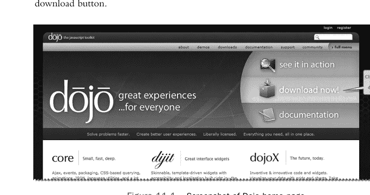

图 11.1 Dojo 主页截图

之后将被导向下载页面，页面上会显示一个标有“立即下载”的巨大按钮。点击下载按钮并按照说明将文件保存到计算机。该文件扩展名为 `.gz`，表明它是一个压缩归档文件，需要解压。大多数处理 `.zip` 文件的解压工具也能提取 `.gz` 文件。

该文件会创建一个目录结构，其中顶级目录名称对应产品的版本号。该目录内将包含四个子目录。这是 Dojo 1.1 版本的目录结构示意图。您的实际版本号可能有所不同。

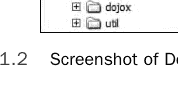

图 11.2 Dojo 目录结构截图

虽然目前还不必要，但您可能希望在计算机上浏览 Dojo 文件来跟随本文学习。此时，您可以将 Dojo 文件放置在任意位置，并选择自己的工具来浏览它们。在撰写本章时，我使用 Eclipse 来查看目录和读取文件。

## 11.2 Dojo 源代码组织

我们现在已下载了 Dojo，但到底下载了什么？Dojo 只是一堆按目录层级组织的文件。哇！这很有帮助。但我们得到的是什么类型的文件，它们采用了什么组织方案？简而言之，大部分文件包含 JavaScript 函数，它们按模块组织。除了 JavaScript 文件外，还有少量包含许可证文本和其他内容的文件。让我们逐级深入探索 Dojo 目录，看看里面有什么。

### 11.2.1 一级目录

我下载的代码中的主目录名为 `dojo_1.0`，包含四个子目录。这代表了 Dojo 功能的四大主要类别。让我们描述每个子目录。

**dojo**

这里包含 Dojo 中除小部件外的所有函数和构造器。一些开发者仅使用 Dojo 来获取其提供的众多视觉效果惊艳且功能强大的 GUI 小部件，因此他们可能惊讶于 Dojo 中还隐藏着一个由许多函数组成的"地下世界"，这些函数使 JavaScript 编码更简单，但完全不需要 GUI 小部件。这个目录就是所有那些底层基础代码的存放位置。

**dijit**

这里是 Dojo 的小部件。为什么 Dojo 的创建者不将这些与"dojo"目录合并？实际上，早期版本的 Dojo 就是这样打包的。但通过将小部件与 Dojo 其余代码分离，使 Dojo 更有条理。更重要的是，这使开发者更容易只使用他们需要的 Dojo 部分。

**dojox**

这些是 Dojo 的扩展功能，由于某种原因，尚未被视为适合包含在"dojo"或"dijit"中。排除的原因包括：函数可能不够健壮；可能尚未完全国际化；或者可能不会被足够多的开发者使用，不足以证明在主"dojo"目录中占用空间。那为什么还要包含它们呢？对于那些确实需要它们的开发者来说，这些功能非常强大且有用。随着时间的推移，"dojox"中的函数可能会迁移到"dojo"或"dijit"中。

**util**

这些是在开发过程中对 Dojo 函数进行单元测试所需的文件。您也可以使用这些功能对您开发的代码运行单元测试。对于生产环境中的应用程序，此目录中的内容均不需要。

### 11.2.2 深入 Dojo 目录

现在让我们深入第二级目录和文件，从"dojo"开始。这是我使用的 Dojo 版本的目录示意图。

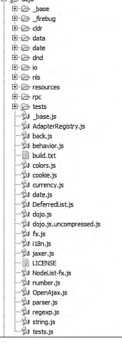

图 11.3 `dojo-release-1.1.0/dojo` 子目录截图

如您所见，这个目录内容相当丰富。起初可能看起来像是令人困惑的混合体，但我们将"层层剥洋葱"，以便真正理解其中包含的内容。让我们从高空视角查看目录：有各种子目录，以及一些 JavaScript 文件和一个名为 `build.txt` 的文本文件。

让我们从最重要的文件开始：`dojo.js`。为什么它最重要？因为它是您在网页中首先包含的文件，用于使 Dojo 函数可供您自己的 JavaScript 代码使用。但从另一个角度来看，这个特定文件根本不重要。甚至在您刚开始使用 Dojo 时，可能根本不会使用它。困惑吗？是的。正如古语所言，一点谜题就是一道难题。

为什么我说这个文件根本不重要？因为这个文件中的每个函数实际上都来自其他地方。`dojo.js` 中的文件最初包含在"dojo-release-1.0/dojo/_base"子目录中的单独文件中。相关函数被分组到单个文件中。您可以将这些单个文件视为模块，这是 Dojo 使用的术语。"base"目录中的模块是 Dojo 设计者认为应该始终可用的。因此，`dojo.js` 文件只是作为一个便捷方式，将"base"目录中的所有模块组合成一个易于包含在页面中的单个文件。这就是为什么这个文件实际上并不重要——因为 `dojo.js` 中的所有函数也出现在其他文件中。

第二个谜题是：为什么您可能根本不会使用这个文件？考虑到该文件包含您可能始终需要的函数，这似乎尤其奇怪。您不需要 `dojo.js` 的原因是存在一个配套文件 `dojo.js.uncompressed.js`，它包含所有相同的函数。区别在于 `dojo.js` 包含压缩版本的 JavaScript，移除了所有注释和多余空格，而 `dojo.js.uncompressed.js` 包含注释和空格，便于开发者阅读（在使用逐行调试器时更有用——稍后详述）。因此，当您刚开始使用 Dojo 时，您会希望使用包含注释和空格的版本：`dojo.js.uncompressed.js`。

要编写使用 Dojo 函数的代码，您需要将其包含在每个网页中。以下是将 Dojo 添加到页面的代码示例。

```html
<script type="text/javascript"
    src="dojo-1.0/dojo/dojo.js.uncompressed.js"
    djConfig="isDebug: true, debugAtAllCosts: true"></script>
```

此代码假设您已将 Dojo 解压到 Web 应用程序的根目录，并且页面从该位置运行。虽然非必需，但 `<script>` 标签还包含一个名为 `djConfig` 的属性，当出现问题时可打开一些额外的调试消息。在刚开始使用 Dojo 时，这样做是个好主意。将页面发布到生产环境后，请关闭调试并使用压缩版本的代码，如下所示：

```html
<script type="text/javascript"
    src="dojo-1.0/dojo/dojo.js"></script>
```

让我们回顾一下到目前为止所学的内容。文件 `dojo.js` 只是文件 `dojo.js.uncompressed.js` 的压缩版本，而后者本身是一个包含在其他 Dojo 文件中定义的函数的文件。这些是设计者认为最常用的功能。他们甚至为这组函数起了一个名字。他们称之为 Dojo "base"。如果您想查看这些函数的原始所在地，请查看"dojo"目录下的"_base"目录。

## 11.3 Dojo 模块和功能

Dojo 被组织成包含相关函数组的模块。模块由一个定义了函数的 JavaScript 文件组成。该文件还包含一些特殊的 Dojo 函数，用于向 Dojo 注册该模块。页面使用的每个 Dojo 模块在页面运行时都必须注册。因此，您会在 Dojo 源代码中多次看到以下代码（尽管注册的具体模块会不同）。

```javascript
if(!dojo._hasResource["dojo._base.Color"])
    dojo._hasResource["dojo._base.Color"] = true;
    dojo.provide("dojo._base.Color");
```

上述代码结构出现在每个模块文件的顶部，用于告知 Dojo 该模块已被加载。在这种情况下，加载的模块是 `dojo._base.Color`。这对应于 dojo 子目录下 `_base` 目录中一个名为 `Color.js` 的 JavaScript 文件。一个模块内部可以包含一个或多个函数。函数不需要单独注册。有时模块名称和函数名称相同，但这并非强制要求。函数的全名是由模块名加上函数名衍生而来的。例如，模块 `dojo.date.stamp` 中的函数 `fromISOString` 在代码中的调用方式如下例所示：

```javascript
var date = dojo.date.stamp.fromISOString()
```

### 11.3.1 命名约定和命名空间

此时讨论一些命名约定可能会很有用。Dojo 函数采用多部分组成的命名约定。名称的第一部分总是 `dojo`。这表明该函数是 Dojo 的一部分，而不是由您创建的自定义函数，也不是来自另一个类库的函数。为 Dojo 使用独立命名空间的优点是，在阅读代码时，可以清晰地分辨哪些函数是您的，哪些函数属于 Dojo。此外，您编写的函数不会与 Dojo 的函数产生冲突。

名称的下一部分是模块，其前面有一个点。例如，`_base` 表示该函数是基础模块的一部分。模块名后面可以再跟一个点和一个子模块名，以便进一步对函数进行分组。否则，第三部分将是函数名或构造函数名。构造函数名会首字母大写。小写名称则告诉我们它是一个方法或非构造函数。函数名遵循“驼峰命名法（Camel Case）”约定，这是一种根据多词描述创建名称的技术，其中单词直接拼接在一起，不使用空格或特殊字符，且每个词的首字母小写（构造函数除外，其首字母大写）。例如，一个计算运费的方法可能会被命名为 `calcShipCharge`，即使用了驼峰命名法。有时，对于频繁使用的函数，会为其分配一个省略模块名的快捷名称。

请记住，Dojo 函数的命名遵循以下约定：

- 第一部分总是 `dojo`。
- 第二部分是模块名。
- 第三部分是函数、构造函数或子模块名。
- 如果名称的第三部分是子模块，那么第四部分将是函数或构造函数名。

关于名称的最后一点：当函数名中使用前导下划线字符时（例如 `dojo.parser._nameAnonFunc`），下划线标志着该函数是使用 Dojo 的开发人员不应直接使用的函数。该函数将在 Dojo 代码内部使用。实质上，下划线使该函数成为了私有的。

### 11.3.2 Dojo 基础模块

既然我们已经介绍了 `dojo.js` 并讨论了其中的“基础”特性但未详细展开，现在让我们看看其中实际上包含了哪些类型的函数。James Burke 在 Dojo 论坛上对 Dojo 基础函数提供了一个极佳的总结。<sup>1</sup> 尽管他的描述几乎完美，但我也将提供自己的总结。在我们回顾 Dojo “基础”中包含的模块时，我仅提供概要描述。许多函数将在后续章节中进行更详细的讨论。

API 一词在本书中频繁出现。该术语是 Application Program Interface（应用程序编程接口）的缩写，通常指一个库可用的公共函数集以及调用这些函数所需的具体参数。显然，准确的 Dojo API 在使用 Dojo 时极其重要。对于许多函数，书中包含了 API 的详细信息，但您应该意识到，有时 API 会发生变化，或者某个特定函数有不同的 API 变体。一个用于理解 API 并识别变体与变化的极其重要且有用的资源是 Dojo 网站上的 API 文档。<sup>2</sup>

您会注意到，在基础模块的函数名称中，名称的第二部分（模块）缺失了。这样做是为了方便，使您的代码中函数名称更短，同时仍能保持足够的含义。

让我们先从最简单的模块开始，然后逐步深入到更复杂的模块。

#### 11.3.2.1 `dojo.lang` 模块


该模块包含许多用于多种不同场景的通用函数。模块名称代表“language（语言）”，其目的与 Java 程序员可能熟悉的 `java.lang` 包类似。可以将它们视为可被其他 Dojo 函数使用（当然，您也可以在自定义 JavaScript 中使用）的基础函数。

1. 以下是 James Burke 对 `dojo.js` 中基础模块特性的总结链接：http://dojotoolkit.org/2007/08/22/dissecting-0-9s-dojo-js。

2. 以下是 Dojo 在线 API 文档的链接。请注意，此链接未来可能会更改，您可能需要搜索网站来找到它 (http://dojotoolkit.org/api)。

##### 表 11.1 `dojo.lang` 函数列表

| 函数 | 描述 |
| :--- | :--- |
| `dojo.isString()` | 判断对象是否为字符串。 |
| `dojo.isArray()` | 判断对象是否为数组。 |
| `dojo.isFunction()` | 判断对象是否为函数。 |
| `dojo.isObject()` | 判断引用是否指向一个对象。 |
| `dojo.isArrayLike()` | 判断引用是否指向一个行为类似于数组的对象。 |
| `dojo.isAlien()` | 判断引用是否指向一个未能正确识别自身为函数的函数。 |
| `dojo.mixin()` | 将一个对象的所有属性和方法添加到另一个对象中。 |
| `dojo.extend()` | 将一个对象的所有属性和方法添加到另一个对象的原型中。 |
| `dojo.hitch()` | 为函数分配一个特定的作用域，使该函数始终在该作用域下执行。 |
| `dojo.partial()` | 不为函数分配作用域，强制作用域在函数运行时默认为执行上下文。 |
| `dojo.clone()` | 复制一个对象及其所有子项。 |
| `dojo.trim()` | 去除字符串开头和结尾的空白字符。 |

#### 11.3.2.2 `dojo.declare` 模块

该模块仅包含一个函数 `dojo.declare`，用于创建构建新对象所需的构造函数。这是一个极其有用的函数，但如果您刚接触面向对象编程 (OOP)，有时可能难以理解。这就是为什么专门用一整章来探讨其用途的原因。有关 OOP 和 `dojo.declare` 函数的深入讨论，请参阅第 12 章“对象与类”。

#### 11.3.2.3 `dojo.connect` 模块

该模块包含将事件处理程序与事件关联起来的函数。事件处理程序简单来说就是当事件触发时自动调用的函数。浏览器本身会监控用户的操作以检测事件。用户通过键盘或鼠标执行的几乎任何操作都会触发一个事件，而某些事件处理程序可以与该事件关联。例如，当用户将光标置于 DOM 元素上时，该元素会触发 `onmouseover` 事件。只有在与事件关联后，事件才会调用事件处理程序，否则什么也不会发生。有关事件处理程序的更多信息，请参阅第 14 章“事件与事件处理”。

下表描述了 `dojo.connect` 模块中的函数。为了方便使用更短的函数名，无需指定模块名。

##### 表 11.2 `dojo.connect` 函数列表

| 函数 | 描述 |
|---|---|
| `dojo.connect()` | 创建一种关联，使得每当另一个函数被调用时，某个特定函数也会被调用。 |
| `dojo.disconnect()` | 移除两个函数之间的关联。 |
| `dojo.subscribe()` | 将监听器附加到命名主题（topic）上。 |
| `dojo.unsubscribe()` | 从命名主题中移除监听器。 |
| `dojo.publish()` | 调用所有订阅了该主题的监听器方法。 |
| `dojo.connectPublisher()` | 确保每次调用某些函数时，都会在主题上发布一条消息。 |

#### 11.3.2.4 `dojo.Deferred` 模块

该模块仅包含一个函数 `dojo.Deferred`，用于提供线程间的通信。您可能会问：“线程！？但我以为浏览器不支持多线程。”您是对的——除了 `XMLHttpRequest` 对象，它确实在自己的独立线程中运行。此函数提供了一种通用的线程通知技术。虽然我们现在还没有完整的线程模型，但我们刚开始听到 JavaScript 内部线程模型萌芽的消息。因此，该函数现在有一些特殊用途，并可能随着线程模型的演进而有更多的用途。我们在第 17 章“测试与调试”中更详细地讨论这个主题。

#### 11.3.2.5 `dojo.json` 模块

该模块包含用于处理 JavaScript 对象表示法 (JSON) 的函数，JSON 是一种用于表示对象的基于文本的协议。它在 JavaScript 社区中非常流行，被用作 XML 的替代方案。表 11.3 总结了 JSON 函数，我们还将在第 13 章“字符串与 JSON”中更详细地讨论它们。

##### 表 11.3 `dojo.json` 函数列表

| 函数 | 描述 |
|---|---|
| `dojo.fromJson()` | 根据 JSON 字符串创建对象。 |
| `dojo.toJson()` | 根据对象创建 JSON 字符串。 |

#### 11.3.2.6 `dojo.array` 模块

该模块包含一系列函数，使处理数组对象以及具有secrets具有类数组特性的其他对象变得更加容易。其中，这些函数提供了轻松遍历（循环）数组中所有元素或仅遍历某些元素的能力。

##### 表 11.4 `dojo.array` 函数列表

| 函数 | 说明 |
| :--- | :--- |
| `dojo.indexOf()` | 返回某个值在数组中的第一个位置。 |
| `dojo.lastIndexOf()` | 返回某个值在数组中的最后一个位置。 |
| `dojo.forEach()` | 提供一个数组迭代器。为数组中的每个值分配一个要调用的函数。数组值将作为参数传递给该函数。 |
| `dojo.every()` | 为数组中的每个值分配一个要调用的函数。数组值将作为参数传递给该函数。该函数应返回 `true` 或 `false`。如果所有函数调用都返回 `true`，则 `every()` 也将返回 `true`，否则此函数将返回 `false`。 |
| `dojo.some()` | 为数组中的每个值分配一个要调用的函数。数组值将作为参数传递给该函数。该函数应返回 `true` 或 `false`。如果有任何函数调用返回 `true`，则 `some()` 也将返回 `true`；否则，此函数将返回 `false`。 |
| `dojo.map()` | 将一个函数应用于数组的每个元素，并使用结果创建一个新数组。 |
| `dojo.filter()` | 返回一个新数组，其中包含与回调函数实现的条件匹配的项。 |

#### 11.3.2.7 `dojo.Color` 模块

该模块包含一系列函数，允许开发人员表示颜色（由 Dojo 内部使用以执行颜色变换）。

##### 表 11.5 `dojo.Color` 函数列表

| 函数 | 说明 |
| :--- | :--- |
| `dojo.Color()` | 用于表示单一颜色的对象的构造函数。允许将颜色表示为类型而非特定的 RGB 或十六进制值。 |
| `dojo.blendColors()` | 计算两个给定颜色值之间的新颜色值。 |
| `dojo.colorFromRgb()` | 给定以 RGB 颜色值指定的颜色值，返回 CSS 样式颜色值。 |
| `dojo.colorFromHex()` | 给定以 # 前缀开头的十六进制字符串指定的颜色值，返回 `dojo.Color` 对象。 |
| `dojo.colorFromArray()` | 给定 RGB 颜色值数组，返回 `dojo.Color` 对象。 |
| `dojo.colorFromString()` | 给定包含数组值、RGB 值、RGB 值或表示颜色的十六进制值的字符串，返回 `dojo.Color` 对象。 |

#### 11.3.2.8 `dojo.event` 模块

事件的处理方式因浏览器而异。该模块中的函数为事件和事件处理程序提供了一致的行为。事件和事件处理将在第 14 章中更详细地介绍。

##### 表 11.6 `dojo.event` 函数列表

| 函数 | 说明 |
| :--- | :--- |
| `dojo.fixEvent()` | 规范化事件对象上的属性，包括事件冒泡方法、击键规范化和 x/y 位置。 |
| `dojo.stopEvent()` | 阻止传播并终止所传递事件的默认操作。 |
| `dojo.keys` | 包含各种特殊键盘键的十进制值的对象。这些常量可用于使 JavaScript 代码更具可读性（即，事件代码可以引用 BACKSPACE 而不是十进制值 8）。按照惯例，JavaScript 常量使用大写。 |

#### 11.3.2.9 `dojo.base.html` 模块

该模块包含可以操作 HTML 和 DOM 对象的函数。要理解这些函数的工作原理，需要了解称为“盒子模型”的概念，它描述了 DOM 元素的组成部分。为便于说明，图 11.4 提供了 W3C 规范中盒子模型的复制图。3

> 3. CSS 基本盒子模型，Bert Bos 编辑，2007 年 8 月，http://www.w3.org/TR/css3-box/（工作草案）。

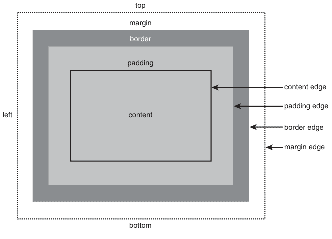

##### 图 11.4 CSS 盒子模型

该模块中的某些函数允许开发人员访问或设置 DOM 元素的“盒子模型”属性。

##### 表 11.7 `dojo._base` 函数列表

| 函数 | 说明 |
| :--- | :--- |
| `dojo.byId()` | 给定表示节点 `id` 的字符串，返回 DOM 节点。类似于许多其他类库中的 `$` 函数。基本上，是 `document.getElementById(id)` 的简写。 |
| `dojo.isDescendant()` | 给定两个 DOM 节点，如果一个节点是另一个节点的后代，则返回 true。 |
| `dojo.setSelectable()` | 默认情况下，浏览器允许用户选择 DOM 元素的任何可见部分。此函数可以禁用该功能，或为单个元素重新启用该功能。 |
| `dojo.place()` | 使用以下控件之一在现有 DOM 元素之前或之后插入新 DOM 元素：before、after、first 或 last。First 和 last 是指相对于要插入节点的兄弟节点的放置位置。 |
| `dojo.boxModel` | 盒子模型描述了 DOM 节点的组成部分，并在 DOM 规范中进行了记录。此属性指定要使用的盒子模型版本。默认值为 "content-box"。某些 Dojo 函数取决于要使用的盒子模型。下图描述了 DOM 节点的标准 "content-box" 模型。 |
| `dojo.style()` | 获取或设置 DOM 节点的样式属性。样式属性以 DOM 访问器格式指定（`borderWidth`，而非 `border-width`）。 |
| `dojo.marginBox()` | 在盒子模型中，DOM 元素外边距周围的四个边称为其“外边距框”。此函数允许您获取或设置该值。 |
| `dojo.contentBox()` | 在盒子模型中，DOM 元素内容周围的四个边构成其“内容框”。此函数允许您获取或设置该值。 |
| `dojo.coords()` | 返回对象的坐标。坐标包括“外边距框”和绝对定位数据，格式为：`{ l: 50, t: 200, w: 300: h: 150, x: 100, y: 300 }` |
| `dojo.hasClass()` | 对于 DOM 节点，如果节点包含指定的类，则返回 true。 |
| `dojo.addClass()` | 向 DOM 节点添加一个类。 |
| `dojo.removeClass()` | 从 DOM 节点移除一个类。 |
| `dojo.toggleClass()` | 如果 DOM 节点中不存在某个类，则添加该类；如果存在，则移除该类。 |

#### 11.3.2.10 `dojo._base.NodeList` 模块

该模块包含用于处理 DOM 元素列表的函数。`NodeList` 是 `Array` 的子类，并扩展了 `Array` 以包含大量额外的便捷函数，这些函数对 DOM 元素执行有用的操作，例如链式调用、常见迭代操作、动画和节点操作。`NodeList` 中的许多方法是来自 `array` 和 `html` 模块的方法版本，因为 `NodeList` 实际上只是一个 DOM 元素数组。

`NodeList` 函数的工作方式与大多数其他 Dojo 函数略有不同。大多数 Dojo 函数将操作对象作为参数。`NodeList` 函数作用于它们所属的对象。要使用这些函数，您必须首先创建一个新的 `NodeList`（或从函数中获取一个），然后将这些函数作为该对象上的方法来运行。例如，如果您想对 id 为 `tree` 的 DOM 元素执行某些操作，您将使用以下代码：

```
el = new dojo.NodeList(dojo.byId("tree"));
el.forEach(function() { // some code; });
```

请注意 `forEach` 方法是在 `el` 上运行的。`el` 对象不是作为参数传递给 `forEach` 的。另外，即使 DOM 元素 `tree` 有多个子元素，给定的 `NodeList` 也仅包含单个元素。

为方便起见，`NodeList` 上的快捷函数提供了直接在 DOM 元素上可用的功能。通过让这些函数也出现在 `NodeList` 上，您的代码可以更短、更易读。

某些 `NodeList` 函数相当复杂，下面的简要描述可能显得不够充分。这就是为什么其中一些函数在稍后会有更完整的处理。例如，动画函数（`fadeIn`、`fadeOut` 和 `animateProperty`）在第 16 章“使用 DOM”中进行了更详细的描述。

##### 表 11.8 `NodeList` 对象上可用的函数列表

| 函数 | 说明 |
|----------|-------------|
| `NodeList()` | 用于构建包含 DOM 可以先列表的新 NodeList 类型对象的构造函数。标准构造函数接受元素 id 并创建包含该元素的 `NodeList`。 |
| `indexOf()` | 返回 `NodeList` 中 DOM 元素首次出现的数字索引。 |
| `lastIndexOf()` | 返回 `NodeList` 中 DOM 元素最后一次出现的数字索引。 |
| `every()` | 为 `NodeList` 中的每个元素分配一个要调用的函数。该元素将作为参数传递给该函数。该函数应返回 `true` 或 `false`。如果所有函数调用都返回 `true`，则 `every()` 也将返回 `true`；否则，此函数将返回 `false`。 |
| `some()` | 为 `NodeList` 中的每个元素分配一个要调用的函数。该元素将作为参数传递给该函数。该函数应返回 `true` 或 `false`。如果有任何函数调用返回 `true`，则 `some()` 也将返回 `true`；否则，此函数将返回 `false`。 |
| `forEach()` | 对 `NodeList` 的每个元素运行一个函数。此函数返回 `NodeList` 本身以支持方法链式调用。 |
| `map()` | 将一个函数应用于 `NodeList` 的每个元素，并使用结果创建一个新的 `NodeList`。 |
| `coords()` | 返回 `NodeList` 中每个元素的坐标。坐标包括“外边距框”和绝对定位数据。该函数返回一个 `Array`，而非 `NodeList`。 |
| `style()` | 获取或设置 `NodeList` 第一个元素的样式属性。样式属性以 DOM 访问器格式指定（`borderWidth` 而非 `border-width`）。当未向此函数传递样式值时，将当前样式值作为字符串返回。 |
| `styles()` | 获取或设置 `NodeList` 中所有元素的样式属性。当未向此函数传递样式值时，将每个元素的当前样式值作为字符串数组返回。 |

##### 表 11.8 续

| 函数 | 说明 |
| :--- | :--- |
| `addClass()` | 为 `NodeList` 中的每个 DOM 节点添加一个类。 |
| `removeClass()` | 从 `NodeList` 中的每个 DOM 节点移除指定的类。 |
| `place()` | 这个函数承担了相当多的工作。它接收一个 DOM 节点或 CSS3 选择器作为参数，用于在文档中查找 DOM 元素。然后将整个 `NodeList` 插入到文档中，位置相对于查找到的元素。它根据也传递给该函数的位置参数，将 `NodeList` 插入到相对查找到元素的位置。位置的有效值为 `last`、`end`、`first`、`start`、`before` 或 `after`。默认为 `end`。 |
| `connect()` | 此方法将事件处理程序附加到 `NodeList` 中的每个节点。 |
| `orphan()` | 从 `document` 中移除节点，并将它们作为没有父节点的 `NodeList` 返回。换句话说，此函数基于传入的过滤器“孤立”DOM 元素。所有通过过滤器的元素都会被孤立。当 `NodeList` 首次创建时，其中的节点既存在于 `NodeList` 中，也存在于 `document` 对象中（因此它们在页面上）。通过孤立某些节点，它们会从页面中移除，但仍保存在新的 `NodeList` 中。 |


| `adopt()` | 将指定查询或 `NodeList` 中的所有元素放置在此列表中第一个元素相对的位置。返回包含被收养元素的 `NodeList`。 |

| `query()` | 使用查询字符串从 `NodeList` 中选择元素。对于每个选中的元素，其所有子元素都会被添加为新 `NodeList` 中的元素，该新 `NodeList` 由此函数返回。原始列表中被查询选中的元素不会被返回。Dojo 文档将此称为 `NodeList` 的"扁平化"。 |

| `filter()` | 该函数提供了 `Array` 对象上可用的 `filter` 函数的版本。它可以通过简单的查询调用，也可以使用针对 `NodeList` 中每个元素执行的回调函数调用。 |

| `addContent()` | 此函数接收 HTML 字符串或 DOM 元素，并将其添加到 `NodeList` 中每个元素的指定位置，位置相对于每个元素。位置的有效值为 `last`、`end`、`first`、`start`、`before` 或 `after`。默认为 `end`。此函数不会向 `NodeList` 添加额外元素。相反，它将元素添加到 `document` 中，从而改变显示的页面。 |

| `fadeIn()` | 此函数将对 `NodeList` 中的所有元素执行淡入动画，这将使元素逐渐过渡到不透明。此函数返回 `dojo._Animation` 类型对象的数组，这意味着它们必须被"播放"才能运行动画。例如，要淡入 `NodeList` 中的所有元素，在 `NodeList` 对象上使用 `fadeIn().play()`。 |

| `fadeOut()` | 此函数将对 `NodeList` 中的所有元素执行淡出动画，这将使显示的元素逐渐过渡到透明。此函数返回 `dojo._Animation` 类型对象的数组，这意味着它们必须被"播放"才能运行动画。例如，要淡出 `NodeList` 中的所有元素，在 `NodeList` 对象上使用 `fadeOut().play()`。 |

| `animateProperty()` | 返回一个动画，用于过渡节点的属性。此函数接收一个动画属性，并将其从开始值过渡到结束值。有许多动画属性，如颜色和位置，将在第 16 章中更详细地解释。此函数返回 `dojo._Animation` 类型对象的数组，这意味着它们必须被"播放"才能运行动画。在返回的对象上运行 `play()` 函数。 |

| `onmouseover()`<br>`onclick()`<br>`onmouseout()`<br>`onmousemove()`<br>`onblur()`<br>`onmousedown()`<br>`onmouseup()`<br>`onmousemove()`<br>`onkeydown()`<br>`onkeyup()`<br>`onkeypress()` | 这些方法在 `NodeList` 上均可用。它们接收一个事件处理程序参数，该参数被赋给 `NodeList` 中的每个元素。这些函数直接在 DOM 元素上也可用，但在 `NodeList` 上拥有它们使代码更短更简单。 |

214 第 11 章 Dojo 技术描述

#### 11.3.2.11 `dojo._base.query` 模块

该模块本质上由一个函数 `dojo.query` 组成。这可能看起来有点不平衡，尤其是与 `dojo._base.NodeList` 模块中的所有函数相比。但你很快会看到，这个单一的函数实际上非常强大，是一个巨无霸。

文档对象模型（DOM）包含网页的表示，对于大多数页面来说，包含大量独立的元素，有时达到数千个。级联样式表（CSS）引入了一种将元素样式与标签本身分离的技术，但引入了一个问题：当存在如此多的元素时，如何轻松地将 CSS 样式应用于一个或多个页面元素？这个问题通过一种称为"CSS 选择器"的模式匹配语言解决，它提供了一种基于元素特征（如标签类型、类或某些属性值）来识别 HTML 元素的语法。

许多 AJAX 技术也需要操作元素，因此能够从典型 DOM 中存在的众多元素中找到所需的少数元素非常有用。为应用 CSS 样式而开发的相同解决方案也可用于为 AJAX 查找 DOM 元素。这正是 `dojo.query` 提供给我们的——一种使用 CSS 选择器模式匹配语言来查找 DOM 元素的技术。你指定选择器字符串，函数将返回满足该条件的元素数组。该数组以 `NodeList` 的形式返回，这是我们已经介绍过的对象类型，具有许多有用的方法。

以下是一些代码示例，用于在 DOM 中搜索所有类为 `codeSample` 的 HTML `<div>` 标签元素。代码返回一个包含零个或多个元素的 `NodeList` 类型对象。

```
nl = dojo.query("div.codeSample")
```

我们将在第 16 章中探讨此函数，以及 CSS 选择器字符串的语法。

#### 11.3.2.12 `dojo._base.xhr` 模块

该模块包含用于处理 `XMLHttpRequest`（XHR）对象的函数，XHR 是 AJAX 的核心。这里的描述将较为简略，因为我们在第 15 章"Ajax 远程调用"中会花更多时间介绍这些函数。XHR 对象用于向服务器发送请求而不刷新页面。可以发送不同类型的 HTTP 请求，如 GET 和 POST。此模块提供了包装器，用于创建各种类型的请求。通过提供这些包装函数，Dojo 使你的代码比直接使用 XHR 对象更简单、更易读。通常需要在请求中发送一些数据。此模块还包含许多用于处理数据的实用函数，以及在常见格式之间进行转换。

| 函数 | 说明 |

| --- | --- |

| `dojo.xhrGet()` | 这些函数为底层 XHR 请求对象提供包装器。数据通过 `content` 对象传入请求。对象中的每个属性都将转换为名称/值对。 |

| `dojo.xhrPost()` | |

| `dojo.xhrDelete()` | |

| `dojo.rawXhrPost()` | 这些函数为底层 XHR 请求对象提供包装器。它们被称为"原始"函数，因为要放入请求主体中的数据直接使用参数对象的 `postData` 属性传入函数。 |

| `dojo.rawXhrPut()` | |

表 11.9 续

| 函数 | 说明 |

|---|---|

| `dojo.formToObject()` | 这些是各种在常见数据格式之间转换的函数。更多详情请参见第 15 章。 |

| `dojo.objectToQuery()` | |

| `dojo.formToQuery()` | |

| `dojo.formToJson()` | |

| `dojo.queryToObject()` | |

#### 11.3.2.13 `dojo._base.fx` 模块

该模块包含许多可用于提供 DOM 元素基本视觉效果的函数。如表 11.9 所示，效果似乎相当有限，只有 `fadeIn`、`fadeOut` 和 `animateProperty`。虽然乍一看可能不算多，但事实证明，其中一个函数 `animateProperty` 实际上非常强大，因为它让你能够处理*任何* CSS 属性。

其中一些函数可能会让你想起 `NodeList` 上的类似函数，它们确实应该让你想起，因为它们完全相同！区别在于这些函数通过将 DOM 元素作为第一个参数传递来工作，而不是像 `NodeList` 中那样对 DOM 元素数组进行操作。

这些方法的签名看似简单得令人迷惑。它们都接收单个对象作为参数。然而，该对象可能非常复杂。它应始终包含一个名为 `node` 的属性，即要对其执行动画的元素的 id。其他属性控制动画本身。我们在第 16 章进一步探讨这些。

表 11.10 `dojo._base.fx` 函数列表

| 函数 | 说明 |

|---|---|

| `dojo.fadeIn()` | 此函数对参数对象中指定为 `node` 属性的元素执行淡入动画，使元素逐渐过渡到不透明。此函数返回 `dojo._Animation` 类型的对象，这意味着必须"播放"它才能运行动画。 |

| `dojo.fadeOut()` | 此函数对参数对象中指定为 `node` 属性的元素执行淡出动画，使元素逐渐过渡到不透明。此函数返回 `dojo._Animation` 类型的对象，这意味着必须"播放"它才能运行动画。 |

### 11.3.3 Dojo 核心模块

从前面的讨论可以看出，Dojo 在其"基础"模块中包含了很多功能。但除此之外还有什么可用的呢？下一组模块提供了额外的功能，但它们被认为不如"基础"功能那么核心——因此它们不会包含在基础 Dojo 文件中，必须由其所在页面显式请求。您需要使用 `dojo.require` 函数并在其中命名希望包含的函数所在的模块，才能将这些模块包含到您的页面中。

例如，以下代码展示了如何使用"核心"函数 `dojo.string.pad`，为包含文本"52"的字符串填充四个前导零。

```
dojo.require("dojo.string");

empID = dojo.string.pad("52", 4, `0`);
```

请注意，在使用 `dojo.string.pad` 之前，您需要使用 `dojo.require` 来包含 `string` 模块中的函数。所有其他的 `string` 函数也将可用。这类似于 Java 中的 `import` 语句，但区别在于 `require` 会使 Dojo 实际将 `string` 模块的 JavaScript 代码包含到您的页面中，而 `import` 只是在编译时使类可用，并不会实际将其包含在字节码中。

#### 11.3.3.1 Dojo 模块

"核心"功能的文件和目录组织方式比"基础"功能稍微复杂一些。将相关的 JavaScript 函数组织到文件和子目录中的方式称为"打包"，而一组相关的函数称为"模块"。

基础模块中的 Dojo 功能包含在单个 `dojo.js`（或 `dojo.js.uncompressed.js`）文件中，而"核心"功能则以两种不同的方式组织。一个"核心"模块可能由 `dojo` 目录中的单个 JavaScript 文件组成，也可能由 `dojo` 目录下的子目录组成。为什么会有两种方法？主要目的是为开发者提供一种细粒度的技术，用于在单个页面中包含功能。例如，`dojo.date` 模块包含与日期相关的函数。但是，您会注意到这些函数包含在主 `dojo` 目录下名为 `date` 的子目录中的两个不同 JavaScript 文件（`locale.js` 和 `stamp.js`）中。`locale.js` 中的函数提供对日期字符串的各种国际化处理。`stamp.js` 中的函数允许在各种常见日期类型之间进行转换。Dojo 的架构师们预计开发者可能经常需要这些功能集中的一个或另一个，但通常不会同时需要两者。

开发者可以使用以下代码包含国际化功能的函数：

```
dojo.require("dojo.date.locale");
```

这将使 `dojo/date/locale.js` 中的函数对页面可用，但不包括 `dojo/date/stamp.js` 中定义的函数。要包含后者，您需要在代码中提供额外的 `dojo.require` 语句。

注意：有一种快捷方式可以包含模块中的所有文件。您可以使用 `*` 通配符。以下代码将使两个日期文件中定义的所有函数都对您的页面可用：

```
dojo.require("dojo.date.*");
```

使用此方法时要小心。虽然它肯定可以工作，但 Dojo 将函数组织到两个单独的文件中的原因是让您不必同时包含两者。通过在页面中包含两者，页面可能需要更长时间来加载和执行。所以只有在确实需要使用其中的函数时，才同时包含两个文件。

您可能会注意到还有一个包含日期函数的附加文件 `dojo/date.js`，您可以使用它。它包含 `getDaysInMonth()` 等函数，该函数返回与指定 `Date` 对象相同月份的天数。要包含这些函数，请使用以下代码：

```
dojo.require("dojo.date");
```

请注意，此代码没有使用通配符，因为它获取的是单个特定文件 `dojo/date.js`。

使用 Dojo 模块的另一个细微之处是，某些函数需要其他模块中定义的函数。这些模块也需要包含在您的页面中，代码才能正常工作。`dojo.date.locale` 函数就是这方面的例子。要使其工作，还需要包含以下模块：

- `dojo.date`
- `dojo.cldr.supplemental`
- `dojo.regexp`
- `dojo.string`
- `dojo.i18n`

此时，您可能开始冒冷汗了。怎么可能期望您知道各种 Dojo 模块之间的所有依赖关系呢？好消息是您不必如此。Dojo 模块包含这些信息。在文件 `dojo/date/locale.js` 的顶部附近，您可以找到以下代码行，它们会使 Dojo 加载所有依赖模块：

```
dojo.require("dojo.date");
dojo.require("dojo.cldr.supplemental");
dojo.require("dojo.regexp");
dojo.require("dojo.string");
dojo.require("dojo.i18n");
```

我们现在已经穷尽了在页面中包含与日期相关的 Dojo 函数的各种方法。日期模块使用了 Dojo 中所有可用的打包方法，是理解这些技术的一个很好的研究对象。然而，大多数模块更简单。所以在您理解了日期模块的工作原理之后，其他的就会更加清晰明了。

Dojo 的打包系统非常强大，使我们能够在加载 JavaScript 文件方面达到最佳效果：

- 我们可以只加载需要的函数，保持页面小巧，并最小化包含的 JavaScript 代码量。
- 我们可以在不知道依赖关系是什么的情况下，使用依赖于其他模块的函数。
- 我们可以通过使用模块加载的通配符功能来保持 `require` 语句的数量较少。

最后一点，Dojo 打包系统的创建投入了大量的思考和努力。它解决了将复杂的 JavaScript 代码提供给网页的问题。您在组织自己编写的 JavaScript 代码时也会面临同样的问题。而好消息是，您可以在自己的代码中使用 Dojo 的打包系统！

#### 11.3.3.2 Dojo 核心功能

有许多 Dojo "核心"模块，其中一些是如此重要和有用，以至于需要单独的章节来描述它们。所以现在，我们仅在总结层面考察它们，仅描述它们的用途而不详细说明它们包含的函数。

表 11.11 总结了 Dojo 中主要"核心"模块的用途。（注意：如果您在检查完整性，我跳过了一些模块，因为您不太可能用到它们，例如 `AdapterRegistry`）。

##### 表 11.11 Dojo 模块

| 模块名称（用于 `require` 语句中） | 模块描述 |

| :--- | :--- |

| `dojo.back` | 用于处理浏览器"后退"按钮的函数，并维护 URL 历史记录。 |

| `dojo.behavior` | 用于将其他函数（行为）与 DOM 元素相关联的函数。 |

| `dojo.cookie` | 用于读写浏览器 cookie 的函数。 |

| `dojo.currency` | 用于处理表示货币的数值的函数。 |

| `dojo.data` | 用于访问持久化数据源的函数。 |

| `dojo.date` | 用于处理 `Date` 对象的函数。 |

| `dojo.date.locale` | 用于日期国际化的函数。 |

| `dojo.date.stamp` | 用于在常见日期格式类型之间进行转换的函数。 |

| `dojo.dnd` | 用于在 DOM 元素上实现"拖放"功能的函数。 |

| `dojo.fx` | 用于为 DOM 元素添加视觉效果的函数。 |

| `dojo.i18n` | 用于执行国际化的函数。 |

| `dojo.io` | 用于使用 `<iframe>` 和动态生成 `<script>` 标签的函数。 |

| `dojo.number` | 用于操作和格式化数字的函数。 |

| `dojo.parser` | 用于读取 HTML（或从 HTML 创建的元素）并生成额外对象的函数。 |

| `dojo.regexp` | 用于使用正则表达式的函数。 |

| `dojo.string` | 用于操作字符串对象的函数。 |

这结束了我们对 Dojo "基础"和"核心"功能的介绍性讨论。如您所见，Dojo 涵盖了广泛的功能范围。后续章节将使我们能够更详细地探索这些功能，并回顾更多实际使用的示例。

## 摘要

Dojo "基础" 函数包含在 `dojo.js` 中，当使用 Dojo 时，通过 `<script>` 标签引入 `dojo.js` 文件，这些函数始终对页面可用。

Dojo "核心" 特性必须由页面使用 `dojo.require()` 函数显式请求。

Dojo 打包系统允许 Web 开发者指定哪些 Dojo 函数（以及相关的 JavaScript 文件）被包含在页面中。

Dojo 打包系统也向开发者开放，用于打包他们自己的 JavaScript 代码。

下一章将概述在使用 Dojo 时如何运用面向对象编程（OOP）技术。这很重要，因为 Dojo 的各项功能是以对象的形式暴露给开发者的。所以，如果你不熟悉 OOP，就像贝蒂·戴维斯曾经的名言所说："准备好迎接颠簸之旅吧。"只是开个玩笑，OOP 概念其实没有那么难，而且一旦你理解了它们，你就能以全新的、实用的方式编程。

# 12 对象与类

《生硬的分类和错误的概括是组织化生活的诅咒》

——乔治·萧伯纳（1856–1950）

将应用程序的构件组织成恰当的类是面向对象（OO）分析与设计的关键目标之一。JavaScript 是一门完全面向对象的语言，要充分发挥其强大功能，我们需要充分利用它的面向对象特性。然而，我们将会看到，Dojo 提供了一些额外的方式来使用 JavaScript 的面向对象特性集，你会发现它们在定义新类和创建新对象时非常有帮助。本章探讨对象、JavaScript 的面向对象特性，以及 Dojo 提供的面向对象增强功能。

## 12.1 对象详解


JavaScript 是一门面向对象的语言。用 JavaScript 编写的应用程序在运行时表现为对象们通过方法调用相互交互的喧闹对话。换句话说，在 JavaScript 中一切皆是对象（Everything Is An Object）。这种看待应用程序的方式不同于过程式方法——后者你可以将程序简单地看作一系列按顺序执行的指令（过程），偶尔由条件或循环语句提供旁路。你可能从未将 JavaScript 视为一个完全成熟的面向对象编程环境，但如果你还没有这样想过，现在是时候开始了。

但什么是对象？面向对象设计中的经典定义将对象描述为应用程序内的一个独立实体，它实现某些行为并包含其状态的内部表示。一种更具体的理解 JavaScript 中对象的方式是，将它们描述为运行时内存中的一段序列，包含数据和函数，可以作为单个实体被引用和操作。JavaScript 中有许多内置对象，例如 `document` 对象，它封装了浏览器对当前网页的内部表示（文档对象模型或 DOM），并包含许多方法以某种方式操作 DOM。但在 JavaScript 中使用对象的真正威力在于创建你自己的自定义对象，以表示应用程序中的各种重要实体。

### 12.1.1 创建对象

所以，使用对象的第一课是看看如何创建自己的对象。创建对象有多种方式。最简单的方式是使用 `new` 关键字创建对象。

虽然这是最简单的方式，但它也是功能最弱的。对象是属性的集合，在 JavaScript 中，这些属性可以是指向其他对象（如数组和函数）的指针，也可以是简单的属性（如字符串和数字）。面向对象编程语言的关键支柱之一是它的抽象表示能力。例如，一个客户应用程序并不是由在我们电脑里跑来跑去的微型客户组成的，而是由代表这些客户的对象组成，它们相互交互，并与系统中的其他组件交互。

### 12.1.2 封装

面向对象的另一个关键支柱是封装。这是将对象隔离起来的能力，将对象的内部与外部世界分开。对象的内部被称为其实现。对外部世界的访问通过被其他对象调用的方法来提供。例如，一个员工对象可能包含一个名为 `getAge` 的方法，返回员工的年龄。但这个对象如何实现这个功能呢？它是通过将员工作为整数跟踪其年龄，并在员工每年生日时更新这个年龄来实现的呢？还是对象记录员工的出生日期，然后每次被要求 `getAge` 时计算员工的年龄？答案是“我们不知道，也不关心”。只要 `getAge` 方法始终返回员工的正确年龄，实现方式就无关紧要。在对象的生命周期中，实现甚至可以改用更好的算法或提高性能。对于外部世界来说，只要对象的外部接口没有改变，应用程序中使用该对象的任何部分都不会受对象内部实现变化的影响。这就是封装的价值——允许对象向世界展示其公共面孔，同时管理自己的私人事务。

让我们探索对象的公共面孔是如何创建的。对象的开发者定义将在对象中可用的属性和方法。有些属性是简单的数据类型，如字符串或数字。其他属性更复杂，可能是指向其他对象的指针。方法既包括对象执行其实现所需的内部函数，也包括可供外部世界使用的外部函数，以便对象可以被使用。一个简单的客户对象可能具有 `customerID`、`customerName`、`customerType` 和 `customerStatus` 等属性。虽然可以通过直接更改属性来改变客户的状态，但我们可能选择通过隐藏描述状态的实际属性，并使用公共方法如 `updateStatus` 来允许我们改变状态在对象内部的表示方式。

面向对象的封装原则定义了将某些属性和方法对外部世界隐藏，同时暴露其他的技术。在许多语言中，这是通过使用 `public` 和 `private` 关键字来实现的，它们在对象内部将成员指定为隐藏或可见。JavaScript 没有直接实现 `public` 和 `private`，但确实提供了一种在对象内部隐藏属性和方法的技术。换句话说，可以在对象内部定义函数，这些函数只能被对象内的其他函数调用，而不能通过外部调用访问。道格拉斯·克罗克福德在他的网站上提供了关于如何做到这一点的优秀描述：`http://www.crockford.com/javascript/private.html`

由于 JavaScript 对象是可变的（可修改的），因此可以随时通过引用成员并赋予其值来向对象添加新的属性和方法。我们创建对象的第一个技术是使用 `new` 关键字创建一个新对象，然后使用点符号分配各种属性。

```
o1 = new Object();
o1.counter = 0;
o1.incrementCounter = function() {this.counter++;}
```

这里的代码创建了一个新对象，包含一个名为 `counter` 的属性，其初始值为数字 0。该对象还包含一个名为 `incrementCounter` 的函数，它将 `counter` 的当前值加 1。

这种方法的问题在于，每次创建某个对象类型的新实例时，都必须显式分配所有属性和方法。如果有任何默认值，必须设置它们。所有成员都必须定义，而且无法使用这些属性和方法的现有定义。对于面向对象开发者来说，这是一个相当令人不满意的方法。鉴于当今大多数应用程序的规模和复杂性，能够拥有一个新对象实例应该是什么样子的标准模板是非常有用的。这提供了确保我们生产力的重要级别的重用。

### 12.1.3 对象模板

提供对象模板主要有两种技术。第一种技术是将模板显式定义为自身的实体。如何构建对象的蓝图在其独立的文件中作为类定义创建。这种选项被 Java 编程语言所采用，允许开发者在自己的 `.java` 文件中创建类定义。这些模板蓝图非常类似于房屋的蓝图。当你想要建造一所新房子时，你根据现有的蓝图创建房屋。你可以从同一份蓝图创建多少房屋没有限制，正如可以从类定义创建多少对象没有限制一样。

> **注意**

几乎所有面向对象编程语言都采用与 Java 类似的方法。JavaScript 是少数例外之一。

在 Java 中，从类定义创建新对象后，该对象中定义的属性和方法无法改变。不能添加或删除属性，也不能定义或移除新方法。当然，属性的值可以更改，但属性本身的存在不能更改。在 Java 中，类定义文件被编译并包含在应用程序中，在运行时使用，可以反复使用来创建任意数量的对象实例，只要应用程序程序员需要。

JavaScript 不受 Java 中 imposed 的限制。JavaScript 不使用类定义技术。JavaScript 采用完全不同的方法，称为原型。与其说从现有蓝图创建新房子，不如说复制现有房子来建造新房子。JavaScript 对象是从现有 JavaScript 对象构建的。你可以将原型视为新对象的模型。

虽然 Java 构建对象的类比是从蓝图建造房子，但 JavaScript 更好的类比是通过复制现有对象来创建新对象。如果你复制一份 20 页的文档，你的新文档也将是 20 页长，并且它将包含原文档的所有文本和错别字。要使用原型技术创建新对象，必须有一个现有对象，该对象包含你希望新对象拥有的属性和方法。

虽然原型过程是 JavaScript 用于构建新对象的技术，但它并不像你可能预期的那样直接实现。例如，JavaScript 中没有 `clone` 或 `build from` 函数或关键字，允许你直接从现有对象构建新对象。相反，这项技术更加曲折。要定义用作创建新对象的模型的原型，还必须定义一个额外的对象，称为构造函数。构造函数是一个函数，用于为给定数据类型构建和初始化对象的新实例。在 JavaScript 中使用 `new` 关键字时调用构造函数。构造函数可以包含新对象的属性和方法的赋值。

这种方法仍然存在一些问题。通过在构造函数中定义函数，我们对从构造函数创建的每个对象实例都重复函数代码。因为函数可能相当大，而且在每个对象中重复完全相同的函数代码，这种方法为我们提供的对象比必要的要大得多。如果我们希望从对象的每个实例中移除某个函数或更改该函数，就必须找到该数据类型的所有现有对象，并显式操作每个对象以移除或更改该函数。我们还将错过面向对象编程的一个关键支柱：继承。继承是一种能力，使一种类型的对象能够从另一种类型的对象继承属性和方法。

## 12.1.4 JavaScript 原型

幸运的是，这两个问题都可以通过使用 JavaScript 原型来解决。要理解原型，我们必须首先讨论构造函数。构造函数是一种函数类型的对象，当我们想要创建对象的新实例时会被执行。以下是一个名为 `DataItem` 的构造函数示例，可用于创建任意数量的 `DataItem` 类型的新对象。

```
function DataItem() {this.counter = 0;};  // 构造函数

d1 = new DataItem();  // 创建 DataItem 类型的新对象

d1.counter++;  // 这会递增计数器
```

在给定的代码中，对象 `d1` 包含以下属性和方法：`{counter: 0}`。

使用构造函数的秘诀是确保 `new` 关键字后面的数据类型与构造函数的名称相同。按照惯例，通常将构造函数名称首字母大写，以区别于其他函数。

所有构造函数都有一个名为 `prototype` 的属性。该属性指向用作构造新对象的模型的对象。默认情况下，这个原型对象是一个简单的对象，看起来非常像 `Object` 数据类型。它有少量的属性和方法。这些是与 `Object` 对象中相同的属性和方法（不，这不是错别字；确实存在一个 `Object` 类型的对象，所有其他对象都继承自它！）。构造函数的 `prototype` 属性会自动初始化为指向这个空的原型对象。但我们可以轻松地用我们自己的对象覆盖默认的原型对象。通过使用 `function.prototype` 引用，我们可以将其分配给现有对象，该对象然后将作为我们要构建的新对象的模型。

但即使使用这种技术，原型也不会用于创建新对象。它用于存储将通过新对象引用的 properties。例如，客户构造函数有一个指向客户原型的引用，该原型可用于创建任意数量的客户类型对象的新实例。我们可以在客户原型中定义所有客户应该具有的属性和方法。你可能认为新客户实例会将这些属性和方法复制到其中，但你错了。实际发生的情况是，创建一个新对象，该对象具有一个指向其构造函数的 property。当在新建实例中引用客户的属性或方法时，JavaScript 运行时环境接管。它首先在对象实例中查找该属性，如果存在就使用它。但如果不在那里，JavaScript 运行器会沿着原型链向上查找，直到找到该属性或到达链的末端。

例如，如果程序需要引用新客户对象中的 `customerType` 属性，我们将使用点表示法 `c.customerType` 来引用该属性。JavaScript 运行器会首先在 `customer` 对象中查找该属性，但找不到。然后它会使用对象的 `constructor` 属性来查找 `customer` 的构造函数。然后使用名为 `prototype` 的构造函数属性，JavaScript 运行器会找到原型对象并查看它是否有 `type` 属性。在我们的示例中，`customerType` 将是客户原型对象的一个属性。

遗憾的是，一个解决方案似乎为我们带来了一系列新问题。`Customer` 类型的对象的不同实例将具有相同的构造函数，而这个构造函数指向单个原型对象。如果一个对象实例更改了客户原型中的一个属性，那么所有客户对象的实例都会获得该新属性。这可能不是我们真正希望发生的事情。相反，我们可能希望对象的每个实例都获得自己的属性值。这可以通过在构造函数中直接使用 `this` 关键字前缀属性来分配属性来实现，如 `this.customerType`，以下示例演示了这一点。

```
function Customer() {  // 构造函数
    this.customerType = "RETAIL";
}
```

你会注意到，我们仍然希望将函数定义保留在原型中，因为它们可以在 `Customer` 对象的不同实例之间共享。最后一个转折——原型对象也有一个名为 `prototype` 的属性，可以用来指向另一个对象，该对象将表现得像第一个原型对象一样。它将被 JavaScript 运行器使用，以继续查找在对象本身或对象的原型中未定义的方法和属性。这被称为原型链。

## 12.2 使用 Dojo 处理对象

我们现在已经回顾了在 JavaScript 中创建和使用对象的各种方法。但是，毕竟这是关于 Dojo 的书，而不仅仅是 JavaScript 书。Dojo 在帮助我们使用对象方面扮演什么角色，如果有的话？在 JavaScript 中使用对象有一定程度的复杂性。你的目标可能很简单：创建一个模板，从中可以构建特定类型的新对象。但 JavaScript 提供了许多功能来实现这一点，从使用原型到构造函数再到私有成员。尽管 JavaScript 提供了多种创建和使用对象的方法，但所有方法都是有问题的，充其量是麻烦的。Dojo 的开发人员在创建 JavaScript 工具包时，面临着所有 JavaScript 开发人员都面临的同样问题。幸运的是，Dojo 开发人员创造了更好的东西：一个用于定义类的惯用语和支持代码。

Dojo 通过为我们提供定义类的标准惯用语来提供价值（从中构建对象的模板）。惯用语是语言的特定语法结构。Dojo 以函数调用的形式为我们提供了这种特定结构，该函数调用带有各种参数以允许定义类。我们将通过一次标准的 Dojo 函数调用实现创建对象类定义的目标。而且，请擂鼓，那个函数就是 `dojo.declare`！

### 12.2.1 Dojo 函数：`dojo.declare`

`dojo.declare` 函数用于创建一个构造函数，该构造函数可以配合 `new` 关键字来创建对象。它还可以自动创建带有属性和方法的原型。原型链也可以自动创建。这是一个功能非常强大的函数，在整个 Dojo 库代码中被广泛使用。它也是你在自己的应用代码中最常用的函数之一。因此，花一些时间学习如何正确使用这个函数是非常值得的。

让我们来看一些在创建新类定义时可能出现在应用代码中的典型场景。首先来看 `dojo.declare` 最简单的用法。我们将为一种新类型的对象创建一个构造函数，不提供任何属性、方法或超类。

```javascript
dojo.declare("DataItem");

d1 = new DataItem();
```

在上述代码中，对象 `d1` 包含以下属性和方法：

```javascript
{
    "preamble": null,
    "_initializer": null,
    "declaredClass": "DataItem"
}
```

调用 `dojo.declare` 会创建一个构造函数，你可以像使用任何普通构造函数一样使用它。示例展示了通过 Dojo 创建的名为 `DataItem` 的构造函数。以下代码展示了使用普通 JavaScript 技术创建构造函数的方式，以便与 Dojo 的方式进行对比。

```javascript
function DataItem() {};

d1 = new DataItem();
```

在这段代码中，对象 `d1` 包含以下属性和方法：`{}`。

使用 Dojo 创建的对象与通过普通构造函数创建的对象并不完全相同。它包含一些额外的属性（`preamble` 和 `_initializer`，目前我们可以忽略它们）。它还包含一个名为 `declaredClass` 的属性，其中包含我们试图创建的类的名称。虽然这个名称与构造函数的名称相同，但我们不应该这样理解它。应该将其视为类定义的名称。

## 12.3 定义类

现在让我们来看一个更复杂的类定义，其中包含一些属性和方法。我们将使用一个 `Customer` 类型的对象作为示例。我们将为 `Customer` 对象的所有成员（属性和方法）提供自定义定义。

```javascript
var init = function(name) {
    this.name = name;
    this.status = "ACTIVE";
    this.makeInactive = function() {
        this.status = "INACTIVE";
    };
};

dojo.declare("Customer", null, init);
```

在上述代码中，对象 `d1` 包含以下属性和方法：

```javascript
{
"name": "Tom Jones",
"status": "ACTIVE",
"declaredClass": "Customer",
"preamble": null
}
```

这个构造函数将创建一个带有一些对象特定属性和函数的新对象。不幸的是，这里仍然存在一个问题。函数 `makeInactive` 将存在于每个新创建的对象中。一种更好的方式是将函数定义在构造函数的原型上。这可以通过在 `init` 函数中使用 `this.constructor.prototype` 引用来实现，但 Dojo 提供了更简便的方法。以下代码展示了如何使用 `props` 参数向原型添加成员。

```javascript
var init = function(name) {
    this.name = name;
    this.type = "REGULAR";
    this.status = "ACTIVE";
};

var props = {
    makeInactive: function() {this.status = "INACTIVE";}
};

dojo.declare("Customer", null, init, props);
```

现在对象被正确创建了，方法定义安全地放置在原型对象上，在所有 `Customer` 对象实例之间共享该函数的单一副本。`props` 参数包含一个对象，该对象具有成员（属性和函数），这些成员将仅在对象中尚未定义的情况下被添加到构造函数的原型中。

### 12.3.1 超类与继承

面向对象语言最重要的特性之一是实现继承的能力。可以将继承理解为通过扩展现有类来定义新类的能力。现有类称为超类，新类称为子类。我们可以通过不断扩展子类来定义其自身的子类，从而实现类的层次结构！这样做的好处是我们可以复用已经编写的代码。在下一个示例中，我们将展示如何使用现有的 `Customer` 数据类型创建一种新类型的 Customer 类，称为 `RetailCustomer`。零售客户有一些额外的属性，用于标识对其征税的州，以及我们将作为特殊类型客户提供的折扣百分比。


```javascript
var props = { discountPercent: 0 };

var init = function(name, taxingState) {
    // "name" parameter is used by superclass constructor
    this.type = "RETAIL";
    this.status = "ACTIVE";
    this.taxingState = taxingState;
};

dojo.declare("RetailCustomer", Customer, init, props);

c1 = new RetailCustomer("ABC Photos", "IL");
```

当创建一个新的`RetailCustomer`对象时，超类的构造函数先运行，然后子类的`init`函数再运行。因此`init`可以覆盖超类提供的值。`superclass`函数之所以这样命名，是因为它作为继承机制，可以在子类中被覆盖。这提供了对超类代码的复用。`init`函数包含超类构造函数所需的所有参数，以及自身工作所需的任何参数。

为什么不将属性`discountPercent`放在构造函数中并在那里赋值为 0 呢？这种方式也能工作，但按照惯例，我们将构造函数保留给那些依赖于创建对象时传递给构造函数的参数的属性。因此，更正确的做法是，我们应该将`init`函数中对`type`和`status`的赋值移到`props`对象中。

### 12.3.2 `dojo.declare` 的 API

下表描述了调用`dojo.declare`方法时使用的参数。方法签名为：`dojo.declare(className, superclass, init, props)`。

**表 12.1 `dojo.declare` 函数描述**

| 参数名称 | 参数数据类型 | 参数描述和用法 |
| :--- | :--- | :--- |
| `className` | String | 类名。构造函数的名称（通俗地说，一个"类"）。所有类都是具体类。不支持抽象类。 |
| `superclass` | Function 或 Function 数组 | 超类。如果是数组，则第一个元素用作原型祖先，后续的函数成为`mixin`祖先。当没有超类时指定`null`。使用`null`等同于 Java 中的无参默认构造函数。 |
| `init` | Function | 构造函数。在从此构造函数实例化对象时调用的初始化函数。可以使用`this`关键字在此函数中添加属性。由于所有成员都直接添加到新对象上，因此主要使用此函数添加属性，使用`props`添加函数。也可以使用`"this.prototype.functionName"`引用将方法添加到原型上，但这不是推荐的做法。此参数不是必需的。如果传递的`init`参数不是 Function 类型，则它将被视为`prop`参数（`declare`函数会重新排列属性），此时`prop`参数是必需的。为什么要使用`init`？使用`init`在对象创建时运行一些代码。这最类似于 Java 中的构造方法。此函数还可以接受参数，这些参数在构造函数被调用时传入——即`new Customer("Tom", 100)`会将两个参数传入`init`函数。当与超类一起使用`init`时，请务必将超类`init`函数的参数作为子类`init`函数的前几个参数重复列出。 |
| `props` | Object 或 Object 数组 | 属性对象。一个对象（或对象数组），其属性将被复制到创建的原型中。创建的对象并不直接拥有这些属性。属性被添加到创建的对象实例上。任何函数也会被添加到实例上。要将函数添加到原型，可以将函数添加到作为第二个参数传递的`superclass`数组中。这些类似于 Java 中的成员声明。属性和方法在创建对象时被声明但不会被执行。可以通过在此处添加其他对象类型的属性来支持一种接口形式。 |

### 12.3.3 其他 Dojo 函数

除了`dojo.declare`函数之外，Dojo 还提供了一些其他用于处理对象的实用函数。如果你阅读过`dojo.declare`方法的源代码（你应该去读一下），你会看到许多这些函数在内部被用来实现`declare`函数。但没有任何限制阻止你直接使用它们，而且它们非常实用，你很可能会发现很多机会直接使用它们。

**Dojo 函数：** `dojo.mixin`

**表 12.2 `dojo.mixin` 函数描述**

| 项目 | 详情 | 描述 |
| :--- | :--- | :--- |
| **方法签名：** | `dojo.mixin(obj, props)` | |
| **概要：** | | 此方法将一个对象的所有属性和方法添加到另一个对象。仅复制源属性中实际存在的成员。换句话说，原型中的成员不会被复制。此外，如果目标对象已经拥有该成员，则不会复制它，即使源对象中的值不同。 |
| **参数：obj** | | 要添加额外属性和方法的对象。 |
| **参数：props** | | 一个包含属性和方法的对象，这些属性和方法将被添加到`obj`引用的对象中。 |

### Dojo 函数：`dojo.extends`

| 表 12.3 | `dojo.extends` 函数说明 |
| :--- | :--- |
| **方法签名：** | `dojo.extends(constructor, props)` |
| **摘要：** | 此方法将一个对象的所有属性和方法添加到构造函数的原型中。这些成员对已使用该构造函数创建的**所有**对象以及将来要从该构造函数创建的**所有**对象都立即可用。 |
| **参数：`constructor`** | 构造函数，其原型将被附加额外的属性和方法。 |
| **参数：`props`** | 包含属性和方法的对象，这些属性和方法将被添加到由`obj`引用的对象的原型中。 |

### 12.3.4 对象图与点号表示法

下一组 Dojo 函数旨在让点号表示法更易于使用。因此，我们首先得讨论点号表示法。而要讨论点号表示法，我们必须先谈谈*对象图*。以下内容对许多人来说可能是复习，但巩固一下对象的概念总是有益的。

如前所述，在 JavaScript 应用程序中，"一切都是对象"（EIAO）。对于我们这些已经饮过面向对象 Kool-Aid 的人来说（如果你还没喝过，我可以给你弄点！），我们相信世界上的万物都可以描述为对象。暂且搁置更大的存在主义问题不谈，我们至少可以同意，在面向对象应用程序运行期间，内存中的所有一切都是对象。这当然适用于 JavaScript。我们可以将浏览器中运行的页面视为由大量相互交互的对象组成。

每个对象都是独立的。这很重要，因为它满足了面向对象的一个主要支柱：封装性。封装性是允许事物独立于其他事物的特性。每个对象都存在于自己的胶囊中（即，它是封装的）。但封装性应该适度。如果对象被完美地困在它们的胶囊中，任何东西都无法进出，它们看不到其他对象的属性，或者其他对象也看不到它们的属性或运行它们的方法，那么我们的应用程序将毫无用处。那就像一盒石头。存在于它们完美的固态中，但彼此不交互——这产生不了任何有用的东西。

为了实现某些目的，对象必须相互交互，其中一种方式就是相互引用。将对象 A 看作持有对对象 B 的引用。这些引用包含在对象的属性中。

例如，代表 Customer 的对象可能有一个属性名为`orders`，其中包含对 Order 对象的引用列表。虽然每个 Customer 对象和每个 Order 对象都是独立的对象实例，但它们通过对彼此的引用而关联起来。将对象想象为漂浮在应用程序内存空间中的圆球，而属性则是连接各个对象的绳索。现在，在这个思维实验中，抓住一个对象并拉它。会发生什么呢？你不仅取回了抓住的那个对象，它还拉动了它所引用的所有对象，而这些对象又各自拉动了它们所引用的其他对象。你取回的这一束对象被称为*对象图*。而你抓住的那个单一对象就是*根*对象。在面向对象应用程序中，对象图的数量与对象的数量一样多。而且每个对象图"就像一盒巧克力——你永远不知道会得到什么"。当你拉一个对象时，你可能只得到那个单一对象——或者那一个和另外几个。又或者系统中的每个对象都以某种方式连接起来了。

对象图可能很大、很复杂，甚至可能是自引用的。当对象图中一个深处的对象引用了其链中的某个对象，甚至是根对象时，会发生什么呢？但我们说得有点远了。让我们回到相对简单的、不太大的、没有循环引用的对象图。我们如何在程序中使用对象图？我们如何引用对象图中深处的对象或属性？让我们用一个例子来回答这些问题。

```javascript
c1 = new Customer("Tom Jones");
c2 = new LargeCustomer("ABC Photo");
c2.subsidiary = c1;

subName = c2.subsidiary.name;
```

在这个例子中，引用`c2.subsidiary.name`用于引用对象`c2`所引用的`subsidiary`对象中的`name`属性。这是有效的语法，而且这个例子在 JavaScript 中可以工作。然而，在 JavaScript 中直接使用点号表示法的问题是，如果链中的任何引用失败，就会因为空引用而发生错误。换句话说，如果`subsidiary`属性尚未赋值，对`name`的引用就会失败。而且它会严重失败，导致语法错误并终止任何额外 JavaScript 代码的执行。

Dojo 对此提供的修复方法是测试每个引用以确保对象存在，当不存在时立即返回 null。以下利用点号表示法的函数现在可以描述了。

### Dojo 函数：`dojo.getObject`

| 字段 | 说明 |
| :--- | :--- |
| **方法签名：** | `dojo.getObject(name, create, context)` |
| **摘要：** | 此方法使用点号表示法从对象图中返回属性值。它适用于引用链较长且不能确定每个属性都有值的情况。 |
| **参数：name** | 属性路径，形式为`"a.b.c"`。 |
| **参数：create** | 此参数为可选参数，可为 true 或 false。如果为 true，则对链中引用到的每个项目创建对象，前提是该 item 尚不存在。 |
| **参数：context** | 可选参数。指定时，此对象将作为对象图的根；否则，将使用`dojo.global`作为引用的起点。 |

### Dojo 函数：`dojo.setObject`

| 字段 | 说明 |
| :--- | :--- |
| **方法签名：** | `dojo.setObject(name, value, context)` |
| **摘要：** | 此方法使用点号表示法在对象图中设置属性值。它适用于引用链较长且不能确定每个属性都有值的情况。 |
| **参数：name** | 属性路径，形式为`"a.b.c"`。 |
| **参数：value** | 这是由`name`指定的属性将被设置的值。 |
| **参数：context** | 可选参数。指定时，此对象将作为对象图的根；否则，将使用`dojo.global`作为引用的起点。 |

### Dojo 函数：`dojo.exists`

| 字段 | 说明 |
| :--- | :--- |
| **方法签名：** | `dojo.exists(name, object)` |
| **摘要：** | 此方法根据使用点号表示法由`name`参数引用的对象是否存在，返回一个布尔值。如果对象存在，此方法返回 true，否则返回 false。 |
| **参数：name** | 属性路径，形式为`"a.b.c"`。 |
| **参数：object** | 此参数为可选参数。指定时，它用作`name`引用的起点。否则，使用`dojo.global`。 |

### Dojo 函数：`dojo.isObject`

**表 12.7 `dojo.isObject` 函数说明**

| 字段 | 说明 |
| :--- | :--- |
| **方法签名：** | `dojo.isObject(anything)` |
| **摘要：** | 此方法根据传递给方法的引用是否指向对象，返回一个布尔值。对任何对象、数组或函数的引用都将评估为 true。如果引用为`"undefined"`，此方法将返回 false。 |
| **参数：`anything`** | 任何引用。 |

## 摘要

JavaScript 是一种完全面向对象的语言。牢记这一事实并加以利用！

函数`dojo.declare`用于定义类，这些类可以使用标准 JavaScript 关键字`new`来创建新对象。

Dojo 还提供了一些额外的实用函数用于处理对象，例如：

- `dojo.mixin`……将一个对象的属性与另一个对象合并
- `dojo.extend`……将一个对象的属性与另一个对象的原型合并
- `dojo.setObject`……在对象图中设置属性
- `dojo.getObject`……在对象图中获取属性
- `dojo.exists`……测试对象图中的属性是否存在
- `dojo.isObject`……测试引用是否为对象

在下一章中，我们将发现如何处理字符串，字符串是大多数应用程序中最常用的数据类型之一。

# 13 字符串与 JSON

> Few can touch the magic String, and noisy Fame is proud to win them...
>
> （鲜有人能触及魔幻的弦，而嘈杂的名声却以赢得它们为荣……）
>
> ——奥利弗·温德尔·霍姆斯，1809–1894

## 13.1 文本字符串

字符串操作是大多数计算机应用程序执行最常见的进程之一。根据某些估计，典型程序的 30% 以上都用于处理字符串。希望无论你选择用哪种语言编写程序，它都能提供多样且鲁棒的字符串操作函数和方法。在这一方面，JavaScript 不会让你失望。JavaScript 提供了 20 多个与字符串对象相关的方法。然而，即使是这种看似丰富的功能，通常也会被证明是不太够用的。

请记住，一个好的 API 应该允许程序员尽可能用极小的代码惯用法（通常是单个函数调用）来表达其编程目标。例如，你的目标可能是确保一个字符串具有特定的固定长度。仅使用 JavaScript，你可以通过少量的代码行来实现这一目标。然而，JavaScript 中没有一个单一的函数能让你通过一条语句就完成这件事。事实证明，拥有这样一个函数会非常有用。因此，Dojo 通过`dojo.string.pad`函数为我们提供了这个功能。Dojo 还提供了另一个字符串函数`dojo.string.substitute`，它允许你通过将字符串的某一部分替换为另一部分来更改字符串。

我们可以想象很多额外的 Dojo 函数可以帮助我们在单条语句中实现字符串操作目标，但开发 Dojo 的团队在心中还有其他目标。他们希望将 Dojo 保持在尽可能小的规模，以便加载速度更快且易于学习。Dojo 必须支持有时相互矛盾的目标：它应该足够大以至于有用（因为其广泛性），同时又应该足够小以至于有用（因为其轻量级的足迹）。在字符串操作类别中，Dojo 通过依赖原生 JavaScript 支持的现有字符串原语（这些原语在大多数情况下已足够）来兼顾这两个目标。而对于那些额外的特殊情况，Dojo 提供了几个字符串原语，即前面提到的`pad`和`substitute`。现在让我们深入研究这些 Dojo 字符串函数。

Dojo 字符串函数属于 "core"（核心）而非 "base"（基础）。这意味着当你将 Dojo 引入页面时，它们不会自动可用。必须使用`dojo.require`函数导入。只需在页面中添加以下代码即可轻松实现：

```
dojo.require("dojo.string")
```

### 13.1.1 Dojo 函数：`dojo.string.pad`

此函数用于在字符串的开头或结尾添加字符，以确保字符串至少达到最小长度。虽然使用现有的 JavaScript String 函数肯定能实现这个目标，但`dojo.string.pad`函数允许我们一步到位，从而使代码更具可读性。该函数的一个典型用途是在支持货币、日期和其他专门数字格式的显示时，为数字提供前导零。

以下是`dojo.string.pad`函数的 API：

| 方法签名： | `dojo.string.pad(string, size, char, end)` |
| :--- | :--- |
| 摘要： | 通过在字符串的开头或结尾放入字符，确保字符串至少具有指定的大小。 |
| 参数：`string` | 需要填充的字符串。原字符串不会被修改，而是返回一个新字符串。 |
| 参数：`size` | 填充后的字符串长度。如果字符串的长度已经大于或等于`"size"`，则返回的字符串与原字符串相同。 |
| 参数：`char` | 用于填充字符串的字符。可选。如果`"char"`的长度超过一个字符，它仍然会被填充到字符串中，这会导致新字符串的长度大于`"size"`。默认值为`0`。 |
| 参数：`end` | 标志是在字符串开头还是结尾进行填充。可选。如果`end`为 true，则填充将应用于字符串末尾；否则，字符串将在开头填充。默认值为`false`。 |

此函数不会改变它所评估的字符串，而是返回一个新字符串。记住，在 JavaScript 中，字符串是“不可变的”（immutable）。这意味着它们不能被更改，而必须返回一个新字符串。Dojo 字符串函数将字符串作为参数，但它们保持该字符串不变。函数返回一个新的字符串实例。这也是标准 JavaScript 字符串函数的运行方式，因此 Dojo 致力于保持一致。

### 13.1.2 `dojo.string.pad` 使用示例

由于字符串函数没有包含在`dojo.js`中，因此必须使用`dojo.require`函数导入它们。


```javascript
dojo.require("dojo.string");
fractional = 27;
pad = 4;
valueParts = dojo.string.pad(fractional, pad, '0', false);
```

这段代码获取一个字符串`fractional`并用前导零将其填充到长度`pad`。记住，最后一个参数`false`导致填充被放在`fractional`的开头。字符串`fractional`没有被修改。变量`valueParts`现在的值将为`0027`。请注意，整数“27”被自动转换为字符串。

### 13.1.3 Dojo 函数：`dojo.string.substitute`

正如墨菲定律所说，“如果事情有出错的可能，那么它就一定会出错”，这在计算机应用程序中与生活中的许多其他尝试一样真实。我们代码中的一个常见功能就是搜索出错的地方并通过错误消息通知用户。

错误消息可以是通用的，也可以是具体的。例如，如果某些用户输入是必需的但缺失了，用户可能会收到一个通用的错误消息，如“字段缺失”。然而，获得一个具体的错误消息（如“姓氏缺失”）通常更有帮助。使用非常具体错误消息的缺点是，它们的数量会迅速增加，在尝试尽量减少发送到浏览器的页面大小时，这在 JavaScript 中可能是一个特别严重的问题。在 HTML 文件中存储大量可能的错误消息会导致其体积迅速增长。

具体的错误消息通常具有共同的形式。想象一下在典型的客户输入表单中可能出现的一些错误消息：

```text
Last name required.
First name required.
City required.
```

所有这些都可以用更通用形式的错误消息来代替：

```text
${0} required.
```

其中`${0}`是一个占位符，可以在适当的时候被替换为具体的字段名称。这使得页面能够显示对用户非常有帮助的具体错误消息，同时尽量减少 JavaScript 代码所占用的空间。占位符中的`0`代表可以被替换进消息的第一个参数。可以使用额外的占位符来允许更多参数被替换进消息。

```text
File '${0}' is not found in directory '${1}'.
```

在这种情况下，`${0}`将被替换为文件名，`${1}`将被替换为目录名。

```text
File 'George.jpg' is not found in directory 'c:\Pictures'.
```

Dojo 提供了一个简单的字符串函数，使这类参数替换变得简单。该函数就是`dojo.string.substitute`。它不仅允许向字符串注入参数，还可以在注入之前对这些参数进行处理以提供额外的格式化。

Dojo 还通过使用有意义的字符串而不是像下面例子中那样仅使用数字，使占位符更易读：

```text
${fieldName} required.
```

新的占位符标识符`fieldName`比`0`更有意义。

以下是`substitute`函数的 API 描述：

##### 表 13.2 `dojo.string.substitute` 函数描述

| 方法签名： | `dojo.string.substitute(template, map, transform, thisObject)` |
| --- | --- |
| 摘要： | 对字符串执行参数化替换。 |
| 参数：`template` | 包含要替换占位符的字符串。参数占位符在`template`中由`${key}`或`${key:format}`形式的文本表示。后者指定了可应用于参数的格式化函数名称。格式化函数的名称应与占位符中的名称对应。 |
| 参数：`map` | 包含要替换进`template`值的对象或数组。对象中的属性名称应与占位符值对应。 |
| 参数：`transform` | 用于在值被替换进`template`之前对其进行处理的函数。`transform`函数将在任何格式化函数之后运行。 |
| 参数：`thisObject` | 包含用于`${key:format}`形式占位符的格式化函数的对象。可选。如果未使用此参数，则将使用全局命名空间作为格式化函数的位置。 |

关于格式化函数还需要进一步说明。这些是自定义函数，用于在将值代入模板字符串之前执行各种类型的格式化。格式化函数的类型完全由你决定。你可以编写这些函数并为它们命名。只需确保你给函数起的名称与令牌（token）中的值相对应。

例如，`${lastName:upperCase}`将对要代入模板的`lastName`参数运行`upperCase`函数。格式化函数应接收一个未格式化的值并返回一个格式化后的值。

### 13.1.4 `dojo.string.substitute` 使用示例

我们先从一个简单的例子开始。我们的模板字符串将为那些要求金额至少达到某个值的字段提供错误消息。

```text
${fieldName} must be less than ${dollarAmount}
```

假设一个名为“Credit Limit”的字段其值必须小于 $1000.00。以下是一个使用`substitute`函数将正确的值注入该字符串以获取适当错误消息的代码示例。

```javascript
template = "${fieldName} must be less than ${dollarAmount}"

map = new Object();

map.fieldName = "Credit Limit";
map.dollarAmount = "$1000.00";

errorMessage = dojo.string.substitute(template, map);
```

注意模板中的键名与`map`对象中的属性名之间的对应关系（即`${fieldName}`和`map.fieldName`）。变量`errorMessage`现在的值将是“Credit Limit must be greater than $100”。

`dojo.string.substitute`函数相当复杂，因此为了充分解释它，我们将通过一个更复杂的例子来演示。

假设我们有一个包含两个待替换参数的模板字符串。第一个参数是字段名称，第二个参数是金额，与之前一样。现在我们还想对第一个参数应用一个函数（我们称之为`ucFirst`），以确保首字母大写。我们还想对第二个参数应用一个函数（我们称之为`showMoney`），以确保它是带有两位小数的金额形式。此外，我们想应用一个函数（我们称之为`trim`）来删除注入模板的任何参数前后的空格。

以下是消息的模板字符串：

```text
${fieldName:ucFirst} must be greater than ${dollarAmount:showMoney}
```

我们需要定义几个函数，然后对`dojo.string.substitute`进行正确的调用。让我们看看代码是什么样子。我们将重点关注与 Dojo 函数调用相关的代码，而省略格式化函数的一些细节代码。

```javascript
dojo.require("dojo.string");

// Define functions

ucFirst = function(value) {
  // This function will take a string and make sure the first letter
  // of the string is upper case and the subsequent letters
  // in the string are lower case.
  var newValue = _ // this is left as an exercise for the reader
  return newValue;
}

dollarAmount = function(value) {
  // This function will take a number and put a dollar sign in front
  // of it and ensure that two decimal digits are at the end
  var newValue = _ // this is left as an exercise for the reader
  return newValue;
}

stringTrim = function(value) {
  // This function will remove leading and trailing
  // spaces from a string
  var newValue = _ // this is left as an exercise for the reader
  return newValue;
}

template = "${fieldname:ucFirst} must be less than
${dollarAmount:dollarAmount}"

map = new Object();

map.fieldName = "  Credit Limit  ";
map.dollarAmount = 1000.00;

errorMessage = dojo.string.substitute(template, map, stringTrim);
```

`errorMessage`的值为`"Credit Limit must be less than $1000.00"`。

## 13.2 JSON

JavaScript 允许我们操作通用文本字符串，但它还提供了一种特殊的文本字符串类型，称为 JSON，它是 JavaScript Object Notation（JavaScript 对象表示法）的缩写。这很有帮助吧？没有吗？那我们换一种方式来描述。

JSON 是一种将 JavaScript 对象表示为文本字符串的技术。将 JavaScript 对象转换为文本后，我们可以使用仅允许传输纯文本的 HTTP 协议在互联网上传输该文本。通常，我们会使用 JSON 在浏览器和服务器之间来回传输对象。

JSON 的另一个用途是以比方法调用更简洁的格式创建 JavaScript 对象。让我们看一个例子。我们将分别使用 JavaScript 和 JSON 创建两个对象。

首先，我们查看使用 JavaScript 和标准面向对象技术创建对象的代码。

```javascript
// create a new object using JavaScript command

object1 = new Object();
object1.id = 100;
object1.name = "ABC Customer";
```

现在让我们回顾使用 JSON 创建等效对象的代码。

```javascript
// create a new object using JSON

object2 = {id:100, name:"ABC Customer"};
```

这两个对象是等效的。它们具有相同的属性。对象创建后，实际上无法分辨它们是用不同的方法创建的。

既然有两种不同但看似等效的技术手段，你应该使用哪一种？如果你想“像高手一样”并遵循 Dojo 使用的惯例，你应该使用 JSON 技术。JSON 不仅被 Dojo 用户所青睐，而且也是大多数 JavaScript 程序员的首选技术。

在 JavaScript 中创建对象时，我们可以选择是否使用 JSON。但当我们想将这些对象发送到服务器或从服务器获取对象时，我们有哪些选择？

当浏览器构建要发送到服务器的 HTTP 请求时，数据可以通过 URL 发送（使用 GET 消息类型）或在请求体中发送（使用 POST 消息类型）。然而，无论哪种情况，数据都是以纯文本形式发送的。因此，我们必须找到一种方法，将 JavaScript 对象从浏览器的内部格式转换为可以使用 HTTP 发送的纯文本字符串。

JSON 是这个问题的完美解决方案。我们可以将对象表示为 JSON 文本字符串，并在浏览器和服务器之间传输它。

我们已经看到 JavaScript 提供了使用 JSON 创建对象的语法，但将对象转换为 JSON 的相应语法又是怎样的呢？既然 JSON 在 JavaScript 社区如此流行，你可能会认为有一种简单的方法可以实现。但你错了。

JavaScript 没有提供任何原生的函数来生成对象的 JSON 等效物。JavaScript 中没有定义`toJSON`方法。所以必须有人来写一个。幸运的是，对于我们来说，那个“有人”就是 Douglas Crockford。他是所有 JSON 相关事物的源头，并且在作为行业专家的角色中拥有广泛的智慧。Dojo 利用了他的工作，提供了一些基于他研究的 JSON 函数。

### 13.2.1 Dojo 函数：`dojo.toJson`

Dojo 函数`dojo.toJson`将创建一个以 JSON 字符串形式表示对象的字符串。这个过程被称为对象的序列化（serializing），而生成的字符串就是对象的“序列化”结果。

序列化是计算机科学术语，指将对象转换为一系列字节，以便可以保存到文件或通过某种连接传输。

以下是`dojo.toJson`函数的 API：

##### 表 13.3 `dojo.toJson` 函数描述

| 键 | 描述 |
| :--- | :--- |
| 方法签名： | `dojo.toJson(it, prettyPrint)` |
| 摘要： | 此函数将返回一个包含对象 JSON 表示形式的字符串。 |
| 参数：`it` | 要序列化为 JSON 的对象。 |
| 参数：`prettyPrint` | 用于强制 JSON 文本字符串进行格式化以方便查看的标志。如果`prettyPrint`为 true，对象和数组将被缩进以使输出更具可读性。变量`dojo.toJsonIndentStr`被用作缩进字符串。若要使用默认值（制表符）以外的内容，请在调用`dojo.toJson()`之前更改该变量。 |

有时你可能想提供自己的序列化方法将对象转换为 JSON。Dojo 支持这一点，允许你在对象（或其原型）中添加一个名为`json`或`__json`的函数。

该函数不应接收参数，并返回一个表示该对象 JSON 序列化的字符串。无需直接调用该方法；只需使用`dojo.toJson`函数，它会自动检查你是否提供了自定义方法并运行它。

### 13.2.2 `dojo.toJson` 使用示例

让我们创建一个对象，看看 JSON 字符串的样子。

```javascript
// create a new object using JavaScript command

object1 = new Object();
object1.id = 100;
object1.name = "ABC Customer";
object1.toString = function() {
    return "Customer: " + this.name + ", (id: " + this.id + ")";
}

jsonStr = dojo.toJson(object1);
```

变量`jsonStr`现在的值将是：

```json
{
    "id": 100,
    "name": "ABC Customer",
    "phone": [
        "630-555-1212",
        "630-555-0000"
    ],
    "address": {
        "line1": "123 Main St",
        "city": "Chicago",
        "state": "IL",
        "zipCode": "60540"
    }
}
```

请注意`phone`数组的特殊语法以及`address`中包含的对象。

请注意，尽管该对象包含一个函数`toString`，但它并没有被序列化。`toJson`不会序列化函数，不过创建你自己的自定义`json`方法来序列化函数是完全可以接受的。

使用此函数时的另一个“坑”是尝试序列化一个具有自身引用的对象。这会导致`toJson`陷入无限递归，并最终因内存不足而失败。

最后提醒一点，`dojo.toJson`是 Dojo “base”的一部分，这意味着你不需要`dojo.require`语句即可使用它。

### 13.2.3 Dojo 函数：`dojo.fromJson`

Ajax 应用程序向服务器提交请求以获取数据。数据返回的形式有很多：纯文本、名称/值对、XML 等。对于许多开发人员来说，最理想的格式之一是将数据作为 JSON 字符串返回，然后可以用它在浏览器中创建 JavaScript 对象。

正如之前建议的，你可能会认为将 JSON 字符串转换为 JavaScript 对象是 JavaScript 的原生功能。但你错了。我们需要使用一种特殊的技术将 JSON 转换为对象。

我们不能简单地将字符串赋值给一个引用，因为它会被视为字符串。我们需要实际地将 JSON 字符串作为 JavaScript 执行。请审视以下示例：

```javascript
jsonString = '{"id": 100, "name": "ABC Customer", "phone":
["630-555-1212", "630-555-0000"], "address": {"line1": "123 Main St",
"city": "Chicago", "state": "IL", "zipCode": "60540"}}';

var cust = eval('(' + jsonString + ')');
```

变量`cust`现在指向一个包含`id`、`name`、`phone`和`address`属性的对象。此外，`address`属性引用了一个包含`line1`、`city`、`state`和`zipCode`属性的对象。


简单地将字符串赋值给一个对象（`jsonString`）并不会导致新对象的创建。我们必须使用原生的 JavaScript `eval` 函数来实际执行 JSON 字符串。这种方法的问题是，当我们执行任意的 JavaScript 代码时，可能会存在安全问题。因此，你应该首先确保该字符串确实是 JSON，而不是服务器返回的其他 JavaScript 代码。进行这种检查的技术稍微有些复杂，幸运的是，这对我们来说不是必须的。Dojo 通过提供一个将 JSON 字符串转换为 JavaScript 对象的函数并在事前检查代码，为我们解决了这个问题。`dojo.fromJson` 函数为我们实现了这一魔法！

以下是 `dojo.fromJson` 函数的 API：

##### 表 13.4 `dojo.fromJson` 函数描述

| 列 1 | 列 2 |
| :--- | :--- |
| **方法签名：** | `dojo.fromJson(json)` |
| **摘要：** | 此函数接收一个 JSON 格式的字符串，并根据该字符串构建新的 JavaScript 对象。 |
| **参数：** `json` | JSON 字符串。该字符串必须是格式正确的 JSON 字符串。该字符串将被评估以确认其为 JSON，然后将作为 JavaScript 执行以创建新对象。 |

请注意，如果 JSON 字符串包含函数定义，该函数将在新对象中被正确创建。

##### 使用示例

```javascript
jsonString = '{"id": 100, "name": "ABC Customer", "phone": ["630-555-1212", "630-555-0000"], "address": {"line1": "123 Main St", "city": "Chicago", "state": "IL", "zipCode": "60540"}}';

var cust = dojo.fromJson(jsonString);
```

变量`cust`现在指向一个包含`id`、`name`、`phone`和`address`属性的对象。此外，`address`属性引用了一个包含`line1`、`city`、`state`和`zipCode`属性的对象。

## 总结

为了保持较小的体积，Dojo 没有提供许多额外的字符串函数。开发人员应使用 JavaScript 中可用的原生字符串函数。然而，Dojo 确实提供了一些字符串函数：

- `dojo.string.pad`——用额外字符填充字符串
- `dojo.string.substitute`——将参数注入字符串模板

JSON（JavaScript Object Notation）是一种将 JavaScript 对象表示为文本字符串的紧凑方法。在进行 XHR 请求时，请使用它在浏览器和服务器之间发送数据。

- `dojo.toJSON`——将对象序列化为 JSON 字符串
- `dojo.fromJson`——从 JSON 字符串创建新对象

# 14 事件与事件处理

> 事情总会发生……只需处理它
>
> ——佚名

是的，无论是生活中还是在 Web 应用程序中，事情总会发生。用户点击页面元素、输入数据、移动鼠标，并执行无数其他活动。用更正式的方式来说，我们将这些发生的事情称为“事件”。而我们对事件的响应不能是被动的。我们的页面必须执行某些操作来处理这些事件。事件、事件处理以及 Dojo 如何提供帮助是本章的主题。

## 14.1 事件模型描述

在本章中，我们将研究 Dojo 中的事件和事件处理。但在深入探讨 Dojo 特点之前，回顾标准浏览器编程模型和 JavaScript 中识别及响应事件的技术也很重要。这样一来，Dojo 的扩展将更易于理解。总而言之，我们将讨论与事件相关的主要主题，并首先用纯 JavaScript 描述这些技术，然后使用 Dojo 描述。我将涵盖以下主题：

- 什么是事件？
- 什么是事件处理器，它们是如何分配的？
- 事件是如何表示的？

### 14.1.1 什么是事件？

事件的通用含义是“发生的事情”。这个定义同样适用于浏览器编程模型。事件主要分为两大类：发生在 DOM 上的事情和发生在 DOM 之外的事情。第一类事件被称为 DOM 事件。第二类事件被称为浏览器事件。

DOM 事件包括对整个 DOM 或单个 DOM 元素执行的操作。经典的 DOM 事件发生在用户点击按钮或链接等 DOM 元素时。但还存在许多其他可能的事件。浏览器可以检测来自键盘或鼠标的各种用户交互。用户可以与页面上的任何 DOM 元素进行交互，甚至是那些看起来不允许用户响应的元素，如段落文本或图像文件。

例如，当用户将鼠标悬停在某些段落文本上时，会产生一系列事件。首先，当光标进入显示文本的屏幕区域时，会为该 DOM 元素生成一个`onfocus`事件。随着用户继续移动鼠标，光标经过文本。对于光标的每一次可识别的移动，浏览器都会生成一个`onMouseMove`事件。而当光标移出段落元素的边界时，浏览器会生成一个`onblur`事件。我们可以为每一个这样的事件创建相应的响应。

> 注意
>
> 浏览器生成的所有事件都有一个可以用以识别的名称。例如，点击一个元素会创建一个名为`onclick`的事件。

当我们意识到 DOM 元素可以堆叠在一起并出现在 Web 页面的同一空间时，情况会变得更加复杂。以下 HTML 代码片段演示了如何在同一空间中创建两个不同的 DOM 元素：

```html
<div id="div1" >
    <p>Here's some text</p>
</div>
```

当光标置于段落文本上时，它同时也处于其父元素`<div>`之上。当光标在段落文本上移动时，段落和`<div>`的事件都会被生成。你可以让页面对其中任何一个或两个都做出响应。

为了进一步增加复杂度，我们应该意识到，除了已经讨论的事件之外，浏览器还可以检测多种可能的用户交互。这些包括以下事件：

- 按下鼠标按钮
- 松开鼠标按钮
- 按下一个键
- 松开一个键
- 滚动鼠标滚轮

而这仍然只是可能事件的一个子集。一个网页可能有多少种不同的事件？让我们做一个快速粗略的计算。想象一个包含 200 个 DOM 事件的页面（这已经不算大页面了）。每个 DOM 元素至少有 50 种可能的用户交互类型。因此，浏览器可能识别出的、我们可以为其编写事件处理程序的事件超过 10,000 种。而这还不包括浏览器事件。

除了 DOM 事件，还能识别哪些其他事件？其中最著名的是`onload`事件，当浏览器完成从服务器接收的 HTML 文件构建网页时触发。此事件在浏览器内部生成，完全不基于任何用户输入。另一种类型的事件`window.onsize`，当用户改变浏览器窗口本身的大小时创建。虽然它基于用户操作，但不与任何特定的 DOM 元素关联。

响应事件的任务现在看起来可能非常庞大。但有一些好消息。尽管典型网页上的可能事件宇宙可能相当庞大，但我们需要响应的事件数量通常相当少。

## 14.1.2 其他 Dojo 事件

Dojo 可以识别所有已描述的事件，但它也添加了一些自己的事件。其中最有趣的是当 JavaScript 函数执行时发生的事件。这允许开发者使用一种称为面向切面编程（AOP）的新编程模型——本章稍后将详细介绍。

Dojo 还增强了一些标准的浏览器事件，例如`onload`。在标准 JavaScript 中，当浏览器完成网页加载时，`onload`事件被触发。但通常，你不希望你的代码运行，直到页面加载完毕并且 Dojo 完成了所有的设置工作，包括加载各种 Dojo 包和执行 Dojo 页面解析器。如果你简单地将事件处理程序附加到`onload`，你的处理程序可能在 Dojo 设置完成之前运行。Dojo 提供了一个特殊的函数来分配事件处理程序，以便它们在 Dojo 设置完成之前不会执行。这就是`dojo.addOnLoad`函数。

以下示例展示了使用`dojo.addOnLoad`的两种技术。第一行代码展示了如何将名为`eventHandler`的现有函数附加为 Dojo `onload`事件的事件处理程序。随后的代码展示了如何在匿名函数内附加一行代码，然后将其与 Dojo `onload`事件关联。

```javascript
dojo.addOnLoad(eventHandler);

dojo.addOnLoad(function() {
	console.log("Dojo setup complete");
});
```

既然我们理解了网页中可能发生的事件，我们需要探索如何响应它们。

## 14.2 定义和分配事件处理程序

如果一棵树倒在森林里，它会发出声音吗？或者更贴切地说：如果一个事件没有触发任何动作，它还是事件吗？抛开哲学不谈，识别事件之所以重要，仅仅是因为我们想将一些动作与之关联。这些动作被称为事件处理程序。它们是响应事件而执行的 JavaScript 函数。

让我们探索一个简单的例子。以下函数在屏幕上显示一条消息：

```javascript
function showAlert() {
    alert("Hello World");
}
```

这段代码是事件处理程序吗？也许是，但仅当它用于处理事件时才是。尽管这听起来像循环逻辑，但让我解释一下我的意思。事件处理程序可以是任何函数，而示例代码当然就是一个函数。使一个函数成为事件处理程序的原因是我们告诉浏览器在检测到某个事件时调用该函数。让我们看看如何做到这一点。

想象一下，我们希望每当网页上的按钮被点击时，`showAlert`函数都能运行。我们需要为按钮创建 DOM 元素，然后为用户点击按钮时生成的事件分配一个事件处理程序。以下代码展示了创建元素和分配事件处理程序的一种技术：

```html
<button id="btn1"
        onClick="showAlert" >
</button>
```

Dojo 允许我们使用 JavaScript 以编程方式分配事件处理程序。

### 14.2.1 使用 `dojo.connect` 分配事件处理程序

`dojo.connect`方法允许我们通过指定 DOM 元素、事件和事件处理程序，并将它们作为参数传递给`dojo.connect`来分配事件处理程序。表 14.1 更详细地描述了此函数。

**表 14.1 用于标准浏览器事件的 `dojo.connect` 函数**

| 字段 | 描述 |
| :--- | :--- |
| **方法签名** | `dojo.connect(domNode, event, handler)` 或 `dojo.connect(domNode, event, context, method)` |
| **摘要** | 此函数将事件处理程序绑定到 DOM 节点上的事件。 |
| **参数：domNode** | 对 DOM 节点的引用。 |
| **参数：event** | 一个包含事件描述的字符串。这些与标准事件属性相同，如`onclick`、`onblur`、`mouseover`等。 |
| **参数：handler** | 这是对全局作用域函数的引用，当事件触发时调用该函数。不能为处理程序指定任何参数，因为 Dojo 在调用处理程序时会提供参数本身。<br><br>此属性可以是命名函数的字符串或对函数的引用。<br><br>当 Dojo 调用处理程序时，它传递 Dojo 事件对象，该对象在表 14.2 中描述。 |
| **参数：context** | 对包含处理程序函数的对象的引用。 |
| **参数：method** | `context`对象作用域内的函数。当未指定`context`时，全局作用域成为默认作用域。 |

### 14.2.2 分配事件处理程序的使用示例

让我们从一个简单的例子开始，展示如何为 DOM 元素的`onclick`事件分配事件处理程序。首先我们必须有一个 DOM 元素。以下代码为按钮创建了一个 DOM 元素：

```html
<button id="button1">
  Click Me!
</button>
```

接下来我们创建一个事件处理程序，它写入一条包含事件类型的日志消息：

```javascript
function handle(event) {
  console.log("Running event handler for event type:", event.type);
}
```

事件处理程序代码有几个有趣的特性。它接受一个参数，引用事件生成时创建的规范化事件对象。这是 Dojo 事件对象，而不是原始的 JavaScript 事件对象。Dojo 版本的优点在于，无论使用哪个浏览器运行页面，它都是相同的。事件处理程序函数的另一个重要特性是它不返回任何内容。它返回的任何数据都会被忽略。

接下来，我们使用`dojo.addOnLoad`函数将事件处理程序分配给按钮的`onclick`事件：

```javascript
dojo.connect(dijit.byId('button1'), "onclick", handler);
```

此代码仅应在 DOM 完全加载、Dojo 已安装且 DOM 已被 Dojo 解析之后执行。这可以通过使用`dojo.addOnLoad`函数并调用包含以下代码的匿名函数中的`dojo.connect`轻松完成：

```javascript
dojo.addOnLoad(function() {
    dojo.connect(dijit.byId('button1'), "onclick", handler);
});
```

关于这段代码，我想提几点说明。首先，在为 DOM 事件分配处理程序时，始终使用`dijit.byId`，而不是`dojo.byId`。原因是 Dojo 解析器可能会向 HTML 中定义的基本 DOM 元素添加额外的 DOM 元素。事件可能是在这些子元素之一上触发的。不要试图弄清楚；只需让 Dojo 通过使用`dijit.byId`选择正确的元素即可。

第二点是，在指定 DOM 事件名称时，我们可以选择使用“on”前缀或省略它。例如，`click`和`onclick`是等效的事件。选择你喜欢的任何一种。我喜欢使用`onclick`，只是为了与 DOM 元素属性名称保持一致。

要添加额外的事件处理程序，只需运行额外的`dojo.connect`函数。你可以将无限数量的处理程序附加到一个事件上。

```javascript
dojo.connect(dijit.byId('button1'), "onclick", handler2);
```

要移除事件处理程序，请使用带有相同参数的`dojo.disconnect`。每个处理程序必须单独移除。

## 14.3 将事件表示为对象

开发者不编写代码来调用事件处理程序；浏览器在事件生成时自动执行此操作。这意味着你无法控制传递给事件处理程序的参数，或者是否传递任何参数。当 Firefox 中的事件处理程序被调用时，一个事件对象作为参数传递。对于 Internet Explorer 则不是这样，它要求事件处理程序函数自己查找事件对象。此外，事件对象本身在两大浏览器之间略有不同。

Dojo 事件系统相比 JavaScript 提供了两大主要好处。首先，它确保无论使用哪种浏览器，事件对象总是会传递给处理程序。其次，它提供了一个始终相同的标准事件对象。这有时被称为“规范化”的事件对象。

尽管事件处理程序只接收一个参数，即事件对象，但该对象包含多个属性和方法。事件对象的主要目的是作为事件本身的包装器，捕获有关事件的信息，例如触发它的 DOM 元素以及事件发生时光标的坐标。

表 14.2 描述了事件对象的重要属性和方法。

##### 表 14.2 Dojo 事件对象

| 列 1 | 列 2 |
| :--- | :--- |
| **摘要：** | Dojo 事件对象为事件提供了一个对象包装器，公开了其重要的属性和方法。 |
| **属性：target** | 触发事件的 DOM 节点。 |
| **属性：currentTarget** | 被指定作为事件对象目标 DOM 节点的 DOM 节点。它通常与`target`节点相同，但可能会被 Dojo 分配给不同的节点。这是你应该在事件处理程序代码中引用的元素。 |
| **属性：layerX** | 光标相对于`currentTarget` DOM 元素的 X 坐标。 |
| **属性：layerY** | 光标相对于`currentTarget` DOM 元素的 Y 坐标。 |
| **属性：pageX** | 事件创建时，光标相对于视口（viewport）的 X 坐标。视口是浏览器中查看文档内容的区域。这不包括侧边栏菜单或状态栏。它是页面可用空间。 |
| **属性：pageY** | 事件创建时，光标相对于视口的 Y 坐标。 |
| **属性：type** | 事件的名称，例如`click`或`mouseover`。该字符串开头不会有`on`。 |
| **属性：relatedTarget** | 对于某些事件（如`onmouseover`和`onmouseout`），此属性引用鼠标移出的对象。这与触发事件的 DOM 元素不同。 |
| **属性：charCode** | 包含按键事件的键码（keycode）。 |
| **函数：stopPropagation** | JavaScript 事件模型允许事件处理在重叠的 DOM 元素之间向上冒泡。换句话说，同一个事件在父元素上被`triggered`（触发）。运行此函数可阻止这种情况发生。 |
| **函数：preventDefault** | 某些 DOM 事件具有默认行为（例如“提交”按钮提交表单）。在事件上运行此方法可防止默认行为发生。 |

## 14.4 在 Dojo 中使用面向切面编程

面向切面编程（Aspect Oriented Programming, AOP）是一些语言中提供的一种编程技术，它允许将某些类型的程序执行视为事件，并可为其应用事件处理程序。例如，让我们定义两个函数`foo`和`bar`，它们只需像以下代码所示那样向控制台写入一条消息：

```javascript
function foo() {
    console.log("Running foo");
}

function bar() {
    console.log("Running bar");
}
```

现在我们需要确保每次执行`foo`时，`bar`也会被执行。实现这一点的一个简单方法是在`foo`方法中添加一行代码来执行`bar`，如下所示：


```javascript
function foo() {
    console.log("Running foo");
    bar();
}
```

虽然上述解决方案可行，但我们采用了硬编码。如果我们想让这种分配动态化怎么办？`Dojo`提供了一个解决方案。`Dojo`可以将函数的执行视为一个事件，我们可以将另一个函数作为事件处理程序与之关联。以下版本的`dojo.connect`提供了这种关联：

```javascript
dojo.connect(null, "foo", null, "bar");
```

现在，每当我们运行`foo`时，函数`bar`就会自动随后运行。

我们现在实现了一个简单的 AOP 示例。但如果你不熟悉 AOP，你可能会问：我为什么要这么做？这种方法的标准用法允许我们动态地添加适用于多种对象类型的功能。例如，如果我们想给函数添加日志记录，我们可以在函数编写完成后，使用 AOP 为每个函数分配一个日志方法，而不需要在每个函数中添加代码。

AOP 方法更好，因为它没有将日志方法硬编码到目标函数中，且无需修改任何目标函数的代码。毕竟，如果你相信行业基准，每次你触碰代码时，都有 5% 的概率会破坏某些东西。因此，如果你能避免修改方法，情况会更好。

在前面的示例中，我们使用了`null`参数。该参数定义了事件或事件处理程序方法的作用域。`null`参数默认为全局对象，因此我们将执行全局作用域的函数。也可以监听并执行特定对象内部的方法。在这种情况下，`null`参数将被替换为对象引用。

下表描述了用于将 AOP 通知方法（advice methods）分配给目标方法的`dojo.connect`函数的特殊形式。

##### 表 14.3 用于 AOP 的 dojo.connect 函数

| 方法签名： | `dojo.connect(object, method, object, method)` |
|---|---|
| 摘要： | 此函数将事件处理程序与方法的执行相关联。 |
| 参数：object | 包含其执行将被视为事件的方法的对象。此属性包含对该对象的引用。 |
| 参数：method | 其执行被视为事件的方法。方法名是一个字符串。 |
| 参数：handlerObject | 包含将充当事件处理程序的方法的对象。此属性包含对该对象的引用。 |
| 参数：handlerMethod | 将充当事件处理程序的方法。方法名是一个字符串。 |

## 总结

- `Dojo`为标准浏览器事件模型提供了大量增强。
- `Dojo`提供了一个标准化的事件对象和事件处理程序调用方式。
- `dojo.connect`函数允许分配事件处理程序。单个事件可以分配多个事件处理程序。
- `dojo.disconnect`函数允许移除事件处理程序。
- `dojo.addOnLoad`函数允许将额外的事件处理程序分配给标准的浏览器`onload`事件，并确保在`Dojo`完全加载且解析完 DOM 之前不会调用这些处理程序。
- `Dojo`可以通过使用`dojo.connect`将一个函数与另一个函数关联，从而提供一个简单的 AOP 模型。

我们现在结束了关于事件的讨论。接下来我们将涵盖所有 Ajax 事件中最大的一个——使用`XMLHttpRequest`对象调用服务器。我们为这个过程使用一个更友好的名称：`remoting`（远程调用）。

# 15 Ajax 远程调用

> 正当的请求之后应当是行动...

— 但丁·阿利吉耶里 (1265–1321)

大多数开发人员在想到 Ajax 时，想到的是`XMLHttpRequest`对象——这个特殊的对象允许 JavaScript 在不刷新整个页面的情况下向服务器发送请求。在服务器返回请求后，响应数据可用于以某种方式操纵页面。正是这个对象成为了创建启用 Ajax 的网页的关键。正如你所想象的，`Dojo`提供了强大的函数来创建和操作请求对象。本章描述了这些函数及其用途。

## 15.1 远程调用

为了给本章设定背景，让我们回顾一下 Ajax 出现之前的网页提供新内容所采用的技术。用户点击链接或按钮，或者甚至在浏览器的地址栏中输入 URL。然后浏览器向服务器发送请求，甚至可能随之传递一些数据，服务器响应一个全新的网页，该网页完全替换掉第一个页面。通常，新页面与被替换的页面非常相似。它可能具有相同的标题、页脚和导航控件。但页面的某些部分会有所不同，否则为什么要新页面呢？如果只替换页面中发生变化的部分，而保留其余内容，难道不是更高效吗？当然是的。然而，直到杰西·詹姆斯·加雷特（Jesse James Garrett）在当年（确切地说是 2005 年 2 月¹）发表关于 Ajax 的文章之后，实现这一技术的手段才被广泛了解。

1. “Ajax: A New Approach to Web Applications,” by Jesse James Garrett, February 18, 2005, http://adaptivepath.com/publications/essays/archives/000385.php.

## 第15章 Ajax 远程调用

Garret 描述了一种从网页内部发出服务器请求的技术。该请求会返回少量数据或 HTML，而不是完整的新页面。更妙的是，这个请求可以在页面运行的同时发出，不会阻塞页面的操作。用编程术语来说，该请求在与显示页面不同的线程中运行。服务器请求是"异步"发出的，不会干扰页面的运行。当服务器返回响应时，它可以由一个本地 JavaScript 函数（即"请求处理程序"）来处理。从服务器返回的数据可用于更新文档对象模型（DOM），从而使用户无需替换整个页面就能看到页面上出现的新内容。

现在我们可以给出一个更准确的定义。"远程调用"是指创建和执行一个异步服务器请求，而无需在浏览器中进行页面刷新即可处理该请求。

## 15.2 XMLHttpRequest 回顾（简称 XHR）

JavaScript 通过提供一个特殊的构造函数`XMLHttpRequest`来支持远程调用。通过创建这种类型的新对象，你可以向服务器发出请求并从中获取数据。以下代码展示了如何使用 JavaScript 创建一个 XHR 请求。

```javascript
var XHR = new XMLHttpRequest();

XHR.onreadystatechange = handleResponse;

XHR.open('GET', 'getData.html');

XHR.send(null);
```

这个请求将以异步方式运行。这有两层含义。首先，你必须预判用户如何在等待服务器响应的同时继续使用页面。其次，你必须提供一个处理函数，在服务器返回其响应后执行。

我们暂时忽略第一个考虑因素，专注于处理服务器的响应。在服务器返回响应后，浏览器会中断当前正在做的任何事情，并调用被指定为响应处理程序的 JavaScript 函数。在本例中，我们将事件处理程序命名为`handleResponse`。以下是一个典型的响应处理程序示例。请注意，我们正在检查以确保已返回完整响应（`readyState == 4`），并且正在验证响应是否成功（`status == 200`）。从服务器接收到的数据位于`XHR.responseText`属性中。尽管我们在本例中使用数据来更新 DOM，但你可以用这些数据做任何事。

```javascript
function handleResponse() {
    if (XHR.readyState == 4){
        if (XHR.status == 200) {
            document.getElementById('dataArea').innerHTML = XHR.responseText;
        }
    }
}
```

我忽略了这段代码的一些潜在问题。例如，如果我们同时有多个 XHR 请求处于活动状态会怎样？如果我们将全局作用域的 XHR 对象用于两个并发请求，它就会产生冲突。另外，检查`status`和`readyState`的惯用法是不是有点冗长？而且，由于典型的响应处理程序只是更新一个 DOM 元素，我们是否可以应用一个标准惯用法来做到这一点呢？

这些问题以及其他一些问题，都可以通过用作原始 JavaScript XHR 对象包装器的 Dojo 函数来解决。我们现在来回顾一下这些函数。

## 15.3 `dojo.xhrGet` 函数

Dojo 函数`dojo.xhrGet`包装了刚才介绍的 XMLHttpRequest 调用和 XHR 对象的创建。在底层，它所做的事情并不比我们自己手动编写 JavaScript 代码做得更多，但它隐藏掉的代码量和复杂性， certainly值得花费一点小功夫来理解它的用法。

我们将要考虑的这个函数的第一个用例是：需要从服务器请求一些数据，并使用这些数据来操作 DOM。我们将发出一个 HTTP GET 类型的请求，向服务器请求名为 getData.html 的资源。返回响应后，我们将用它更新一个名为 dataArea 的 DOM 元素。

```javascript
dojo.xhrGet( {
    url: "getData.html",
    handleAs: "text",
    load: function(response) {
        document.getElementById("dataArea").innerHTML = response;
    }
});
```

你会立即注意到几件事。我们只向函数调用传递了一个对象作为参数。然而，这个对象包含多个属性。实际上，该对象充当一系列参数。我们不是逐个传递每个参数，而是将它们作为单个对象内的属性来传递。方法签名很简单，因为它只接受一个对象作为参数。但要知道在该对象中定义哪些属性以及这些属性如何相互关联，可能会更困难一些。

在这个简单的用例中，`url`属性包含我们通过 XHR 请求请求的服务器上资源的名称。我们不指定 HTTP 请求类型（即 GET），因为这已经内置在函数名中了。对于其他 HTTP 请求类型，将使用不同的函数名称（例如，POST 请求使用`xhrPost`）。`load`属性包含在 Dojo 处理请求时要调用的函数。真正的请求处理程序是 Dojo 在创建 XHR 对象时分配的内部函数。该处理程序调用我们的`load`处理程序。只有在`readyState == 4`且`status == 200`时才会调用`load`处理程序，因此我们不必自己执行这些检查。我们的`load`处理程序由 Dojo 调用，Dojo 将`response`传递给我们的函数。参数`response`是 XHR 对象中的 XHR `responseText`属性。`handleAs`属性描述从服务器返回的数据的格式。让我们看一下`dojo.xhrGet`的 API，然后再更详细地 look at the passed parameter 的属性。

**表 15.1 `dojo.xhrGet` 函数说明**

| 字段 | 值 |
| :--- | :--- |
| **方法签名：** | `dojo.xhrGet(args)` |
| **摘要：** | 此函数将创建、发送和处理 HTTP GET 请求类型的 XMLHttpRequest 对象。 |
| **参数：args** | 包含用于配置 Dojo 要创建的 XHR 对象的属性的对象。 |

要真正理解这个函数，我们需要更详细地查看`args`参数中可能的属性。

**表 15.2 `dojo.xhrGet` 函数的参数说明**

| 属性 | 说明 |
| :--- | :--- |
| **`handleAs`** | 描述请求返回的数据的格式。可接受的值为`text`（默认）、`json`、`json-comment-optional`、`json-comment-filtered`、`javascript`和`xml`。 |
| **`sync`** | 指示请求应该是同步请求（阻塞额外执行直到请求返回）还是异步请求（以便在请求被服务器处理时继续执行）。默认值为"false"，使请求成为异步请求。 |
| **`header`** | 包含 HTTP 头值的对象。对象的属性应对应于 HTTP 头项的名称，属性中的值将是对应头项的值。这些值将被添加到实际发送到服务器的 HTTP 头中。 |
| **`form`** | 表单的 DOM 节点。用于提取表单元素的值并发送到服务器。 |
| **`url`** | 表示服务器上请求的资源的字符串 URL。 |
| **`content`** | 包含具有字符串值的属性的对象。这些属性将被序列化为`name1=value2`并在请求中传递。 |
| **`timeout`** | 等待响应的毫秒数。如果超过此时间，将执行`error`回调函数。 |
| **`preventCache`** | 如果为"true"，则在请求中发送一个`dojo.preventCache`参数，其值随每次请求而变化（时间戳）。仅对 GET 类型请求有用。默认值为 false。 |
| **`load`** | 在成功响应时要调用的函数。该函数的签名应为`function(response, ioArgs){}`。 |
| **`error`** | 在响应失败时要调用的函数。该函数的签名应为`function(response, ioArgs){}`。 |
| **`handle`** | 在返回响应时调用的函数，适用于未调用`load`或`error`的情况。该函数的签名应为`function(response, ioArgs){}`。 |

对于`load`、`error`和`handle`函数，提供了一个以 response 和`ioArgs`作为参数的函数。`ioArgs`参数足够复杂，值得用一张自己的表来解释它的各种属性。下表解释了`ioArgs`属性。

**表 15.3 dojo.xhrGet 函数的 ioArgs 属性说明**

| ioArgs 属性 | 说明 |
| :--- | :--- |
| **`args`** | IO 调用的原始对象参数。 |
| **`xhr`** | 仅适用于`XMLHttpRequest`调用，用于请求的`XMLHttpRequest`对象。 |
| **`url`** | 用于调用的最终 URL。很多时候它将与原始的`args.url`值不同。 |
| **`query`** | 对于非 GET 请求，在请求中发送的查询字符串参数（即`name1=value1&name2=value2`）。 |
| **`handleAs`** | 来自服务器的响应数据类型。这指定了应如何处理响应。 |
| **`id`** | 仅适用于`dojo.io.script`调用，用于请求的内部脚本 id。 |
| **`canDelete`** | 仅适用于`dojo.io.script`调用，指示表示请求的脚本标签是否可以在回调被调用后删除。在内部用于了解何时可以对 JSON 请求进行清理。 |
| **`json`** | 仅适用于`dojo.io.script`调用：保存 JSON 请求的 JSON 响应。在内部用于保存 JSON 响应。你应该不需要直接访问它。相同的对象应该直接传递给成功回调。 |

### 15.3.1 参数详解

其中一些参数非常有趣，并能调用一些实用的功能，值得我们更详细地了解。让我们回顾一下`handleAs`参数。

#### 15.3.1.1 传递给 XHR 的 handleAs 参数

`args`对象的`handleAs`属性告诉 Dojo，XHR 请求将返回何种类型的数据。不仅如此，根据数据的类型，Dojo 还会在返回给响应处理程序之前对其进行一些处理。下表描述了有效的`handleAs`值，并解释了 Dojo 如何处理每种数据类型。

**表 15.4 handleAs 类型说明**

| handleAs | 类型 | 说明 |
| :--- | :--- | :--- |
| text | | 来自服务器的数据将是一个文本字符串。当调用回调函数时，这将是第一个参数（response）。 |
| json | | 来自服务器的数据将作为 JSON 字符串返回，该字符串将用于创建由该字符串描述的对象。该对象将是回调函数的第一个参数。<br> 注意：实际上还有两个额外的 handleAs 类型，叫做`json-comment-optional`和`json-comment-filtered`，它们可以用来防止 JavaScript 劫持——这是一种安全漏洞，由允许页面对来自服务器的任意 JavaScript 使用`eval`而引入。它可能会暴露页面上的其他对象。 |
| javascript | | 从服务器返回的数据将是 JavaScript。Dojo 将使用`eval`函数来执行该 JavaScript。 |
| xml | | 从服务器返回的数据将是 XML 格式。该 XML 将用于创建一个 DOM 对象。该对象将是回调函数的第一个参数。 |

## 15.4 dojo.xhrPost

`dojo.xhrPost`在许多方面可以与`dojo.xhrGet`以相同的方式使用。也就是说，参数几乎相同，函数的行为也几乎相同。主要区别在于发送到服务器的数据的处理方式不同。在`xhrGet`中，数据以名称/值对的形式通过 URL 本身传递回去。

```
http://www.mydomain.com/getPage.jsp?id=100&name=Joe
```

在这种情况下，id 和 name 的值作为 URL 的一部分传递，称为`query string`（查询字符串）。

在 xhrPost 中，数据在 HTTP 请求体本身中传递。它在 URL 中不可见。这是一种更安全的方法，因为浏览器用户无法仅仅通过使用前进和后退键来查看浏览器发送了哪些 URL，从而看到传递的数据。此外，在请求体中传递的数据量没有限制。URL 本身通常限制在大约 4000 个字符，通常这已经足够了，但对于一些边缘情况来说是不够的。


由于 POST 和 GET 的这种工作方式差异，在传递给`xhrPost()`调用的参数对象中可以设置一个额外的属性。`postData`属性是一个字符串，包含要在 XHR 请求构建的 HTTP POST 请求体中提交的数据。这是一个重要的属性，因为它必须在调用`xhrPost()`函数之前设置。这对于许多已经习惯了浏览器在提交表单时自动格式化并发送数据的开发者来说是一个新东西。以下代码是典型的通过`xhrPost()`提交表单数据的方式。

```javascript
dojo.xhrPost( {
    url: "getData.html",
    handleAs: "text",
    postData: "id=100&name=Joe",
    load: function(response) {
        document.getElementById("dataArea").innerHTML = response;
    }
});
```

让我们探讨一个更复杂的用例。假设你负责为你的网站用户开发一个注册页面。除了像姓名和地址这样的典型人口统计信息外，你还希望用户选择一个用户名，以便将来登录系统。然而，由于你的网站很受欢迎，许多常见的用户名已经被占用了。在这个页面的 Ajax 前实现中，系统会在提交表单时检查用户名。提交一个已经被占用的用户名会导致一个页面被发送回浏览器，并附带适当的错误消息。同时发回的还有用户已经输入的值，这样用户就不必仅仅为了选择一个新的用户名而重新输入其他所有内容。

用户可能仍然会有点恼火，因为他们已经忘记了当时考虑过的其他用户名。

何不在用户输入用户名后立即通知用户该用户名的问题，而不是在提交请求之后呢？当然！通过在用户输入他们选择的用户名后立即向服务器发出 Ajax 请求，服务器可以返回一个错误消息，并立即显示在表单上。以下是演示 JavaScript 如何在用户输入用户名后立即触发 Ajax 请求的 HTML：

```html
Make up a user name and enter it here:
<input type="text" name="username"
       onchange="checkUserName(this.value)"
/>
```

注意我们使用的事件——`onchange`。当用户在字段中输入某个值并且焦点从`username`字段移动到另一个字段时，会触发此事件。这比使用`onblur`事件更好，因为我们确定值已经改变，而且我们不会发出不必要的 Ajax 请求。这个示例假设有一个名为`checkUserName`的本地 JavaScript 函数，它包含创建 XHR 请求的代码以及一个用于解释服务器响应的事件处理程序。使用 Dojo 还有一种更好的方式来为事件分配事件处理函数。我们将在第 14 章"事件与事件处理"中讨论该技术。

现在让我们看看事件处理函数本身。这是当浏览器检测到`onchange`事件时调用的代码。以下代码使用`dojo.xhrGet`来执行 Ajax 请求。

```javascript
function checkUserName(value) {
    var query = "username=" + value;
    query = encodeURIComponent(query);
    dojo.xhrGet( {
        url: "checkUserName.jsp" + "?" + query,
        handleAs: "text",
        load: function(response) {
            // process server response
            // intentionally left empty for now!
        }
    });
}
```

我们首先创建要发送到服务器的查询字符串。如果我们使用 POST 而不是 GET，我们将把查询字符串作为参数传递。以下代码使用`dojo.xhrPost`来发出 Ajax 请求。

```javascript
function checkUserName(value) {
    var query = "username=" + value;
    query = encodeURIComponent(query);
    dojo.xhrPost( {
        url: "checkUserName.jsp",
        postData: query,
        handleAs: "text",
        load: function(response) {
            // process server response
            // intentionally left empty for now!
        }
    });
}
```

那么，如何处理来自服务器的响应呢？前面的代码示例没有提供如何管理响应的详细信息。我们需要考虑我们可以从服务器获得什么样的响应。以下情况之一必须为真：要么用户名已经被占用，要么没有。当用户名被占用时，我们可以显示一个简短的错误消息。看起来很简单。然而，错误处理涉及许多边缘情况。以下问题呢：

- 如果我们提交请求时出现网络问题，我们从未收到服务器的响应，该怎么办？
- 如果我们能够到达服务器，但服务器上的数据库暂时宕机了，该怎么办？服务器响应一个状态码，例如 500。
- 如果在发出 Ajax 请求时用户名可用，但在第一个用户通过提交注册表单完成注册之前，用户名被另一个用户抢占了，该怎么办？
- 我们如何通知用户这些各种错误条件？

这些问题可以分为两大类：我们如何以编程方式检测错误条件？以及如何在检测到错误条件后通知用户？

让我们首先考虑识别错误条件的问题。Dojo 定义了不同的回调函数来处理来自服务器的各种类型的响应。表 15.5 总结了回调函数以及导致它们被执行的错误条件。

| 响应条件 | 回调函数 |
| :--- | :--- |
| 服务器没有返回响应，要么超时，要么无法到达。 | `error`<br><br>如果已分配，将调用分配给`error`的函数，否则将调用`handle`。 |
| 服务器响应了，但状态码不是 200，表明某种服务器错误。 | `error`<br><br>如果已分配，将调用分配给`error`的函数，否则将调用`handle`。 |
| 服务器响应状态码为 200。 | `load`<br><br>如果已分配，将调用分配给`load`的函数，否则将调用`handle`。 |
| 任何服务器响应。 | `handle`<br><br>如果已分配`error`或`load`时，其中一个将被调用。否则，将调用`handle`。<br>如果`error`和`load`都未分配，则可以使用`handle`来处理所有服务器响应。 |

在决定使用哪些回调函数时，请记住以下几点：

- 对于每个请求，Dojo 仅执行单个回调方法。
- 您必须为回调函数提供具体实现。Dojo 调用您的实现，但并不亲自处理其逻辑。
- 您通过在`xhr`方法参数对象中设置属性（`load`、`error`或`handle`）来分配回调函数。
- 无论处理程序的类型如何，传递给回调函数的对象都是相同的。

### 15.4.1 使用示例——错误处理

在这种用例中，某些类型的失败比其他类型更严重。如果验证用户名的 Ajax 请求失败，可以在提交完整表单时简单地重新进行验证。因此，甚至可能不需要通知用户验证失败。同样，如果验证成功，也不需要通知用户，因为不需要采取任何操作，用户可以愉快地继续输入其他数据。虽然可以在服务器上保留该用户名以防止其他用户占用，但这可能会导致一些可扩展性问题。

但当验证失败且用户名无效时会发生什么？我们应该向用户显示一条错误消息。但是，我们是否应该将光标返回到用户名字段，从而中断用户当时正在进行的任何其他工作？服务器响应中告知浏览器验证失败的具体细节是什么？Ajax 请求从服务器返回数据，但对于如何具体显示验证失败并没有标准。这仅受限于我们的想象力。以下是使用 Ajax 远程调用时，服务器可能返回的一些响应：

- 服务器可以返回一个包含`success`或`failure`值的字符串数据容器。
- 服务器可以返回`failure`值以及一条描述性的错误消息。
- 服务器可以返回`failure`值、一条描述性的错误消息，以及一些与用户输入相似的可用用户名建议。

哪种方法是正确的？这取决于您。Ajax 和 Dojo 都没有规定您的行为。不过，稍后当我们研究 Dojo 组件时，我们会发现组件有一种更标准（但仍然灵活）的处理错误消息的方式。

## 15.5 表单操作

在典型的商业应用程序中，许多页面通过表单收集数据并将该数据发送到服务器进行某种处理。因此，在 JavaScript 中处理表单数据非常常见。Ajax 和 Dojo 的使用如何影响我们处理表单数据的方式？开发人员可能会认为，因为他们使用 Ajax 而不是标准表单提交将数据提交到服务器，所以不再需要使用表单。由于多种原因，这种看法是不正确的。

表单仍将被使用，因为尽管应用程序在表单提交之前可能会发起 Ajax 远程请求，但表单通常仍将作为页面数据输入的最后一步而被提交。这减少了服务器端的新开发量，因为用于处理非 Ajax 表单提交的服务可能已经编码完成了。

在 Ajax 应用程序中继续使用表单的另一个原因是，表单是在浏览器中组织数据的极佳方式。相关的数据元素可以通过将它们保持在`form`标签内而分组在一起。同一页面上可以驻留多个表单以区分不同的数据组。此外，浏览器为我们提供了引用表单内数据字段的一些便捷快捷方式。例如，请查看以下 HTML 代码片段，它定义了一个包含两个数据字段和一个提交按钮的简单表单。

```html
<form action="submitForm" name="userInfo" method="POST">
    First Name: <input type="text" name="firstName"/> <br/>
    Last Name: <input type="text" name="lastName"/> <br/>
    
    <input type="submit">

</form>
```

当这些字段的 DOM 构建完成后，可以使用以下简写形式进行引用。请注意浏览器如何构建一个包含与现有表单及表单数据元素名称相对应元素的 DOM。记住，大小写很重要！

```javascript
firstName = document.userInfo.firstName;
lastName = document.userInfo.lastName;
```

最后，在应用程序中继续使用表单（而不是仅使用`<input>`标签）的另一个好原因是，Dojo 提供了许多用于处理表单中数据的实用函数，我们现在就来讨论这些函数。

### 15.5.1 Dojo 函数 `dojo.formToToObject`

由于 JavaScript 是一种面向对象的编程语言，作为开发人员，我们自然希望将数据作为对象来处理。Dojo 提供了一个函数（`formToToObject`）将表单中的数据转换为对象，以便我们更轻松地对其进行操作。让我们来看看`dojo.formToToObject`的 API。

#### 表 15.6 dojo.formToToObject 函数描述

| 字段 | 描述 |
|---|---|
| 方法签名： | `dojo.formToToObject(formNode)` |
| 摘要： | 该函数将返回一个对象，其属性与`formNode`指定表单中的表单字段相对应。该函数将 HTML 表单中编码的值作为对象的字符串和数字属性返回。禁用的表单元素、按钮和其他非值表单元素将被跳过。多选元素将作为字符串值数组返回。表单元素的名称将与返回对象中命名的属性相同。属性名称中的大小写将被保留。 |
| 参数：`formNode` | 用于提取表单元素名称和值的 DOM 表单元素。`formNode`可以是对表单 DOM 元素的引用，也可以是包含表单元素 ID 的字符串。 |

该函数最实用的功能之一是，可以通过 DOM 节点引用或节点 ID 来识别表单节点。

#### 使用示例

本示例假设存在以下表单。

```html
<form action="submitForm" name="userInfo" id="form1" method="POST">
    First Name: <input type="text" name="firstName"/> <br/>
    Last Name: <input type="text" name="lastName"/> <br/>

    <input type="submit">

</form>
```

请注意，我们现在在表单标签中使用了`id`属性。以下函数调用将返回一个代表该表单的对象。

```javascript
var userData = dojo.formToObject("form1");
```

对象`userData`如下所示：

`{"firstName": "Jim Bob", "lastName": "Jones"}`

请注意，使用`dojo.formToObject`时，没有针对“提交”按钮的属性。

### 15.5.2 Dojo 函数 `dojo.objectToQuery`

在使用 XHR 发起服务器请求时，通常会随之发送一些数据。我们已经讨论了使用`xhrGet`和`xhrPost`实现的方法，这两者都允许在 URL 或请求正文中传递查询字符串。由于程序可能以对象形式处理这些数据，因此能够将对象中的属性转换为查询字符串，以便轻松地用于 XHR 函数将是非常有用的。Dojo 提供了一个名为`dojo.objectToQuery`的函数来实现此功能。让我们在表 15.7 中回顾其 API。

#### 表 15.7 dojo.objectToQuery 函数描述

| 字段 | 描述 |
|---|---|
| 方法签名： | `dojo.objectToQuery(map)` |
| 摘要： | 该函数将返回一个字符串，其中包含以 URL 查询形式呈现的对象的名称/值对属性。查询字符串将被 URL 编码，这意味着特殊字符将被转换为其 URL 值（例如，空格将被转换为 %20）。 |
| 参数：`map` | 要被复制为查询字符串的对象。该对象应仅包含可表示为数字或文本字符串的属性。数组属性将被转换为一系列具有相同名称的名称/值对，该名称与属性名称对应。引用其他对象的属性将被忽略。 |

以下是一个待转换的对象及其转换示例：

```javascript
qObject = new Object();
qObject.id = 100;
qObject.name = "John Smith";
qObject.type = "RETAIL";
qObject.active = true;
qObject.setStatus = function(status) {this.status = status};
qObject.owner = qObject;

var queryString = dojo.objectToQuery(qObject);
```

生成的查询字符串如下所示：

```text
id=100&
name=John Smith&
status=RETAIL&
active=true&
setStatus=function (status) { this.status = status; }&
owner=[object Object]
```

注意输出中的几点。我们在每对名称/值之后添加了换行符，以便于阅读。此外，为了可读性，删除了 URI 编码。对象的属性之一是函数`setStatus`。它被转换为等效的字符串，发送回服务器可能没什么用，但它确实被发送了发送。另一个属性`owner`是对一个对象的引用（在本例中是它自身）。它被转换为字符串`owner=[object Object]`，这是用于描述对象的默认字符串。同样，对于服务器来说，这可能不是非常有用的信息。总的来说，要转换为查询字符串的对象应该是包含字符串、数字或布尔值属性的映射（map）。

### 15.5.3 Dojo 函数 `dojo.formToQuery`

当用户点击标准 HTML 表单上的“提交”按钮时，表单元素的值会自动转换为包含名称/值对的字符串，该字符串将通过 URL 结尾（对于 GET 请求）或作为 HTTP 正文的一部分（对于 POST 请求）发送到服务器。然而，在创建 Ajax 请求时，表单元素的这种转换不会自动发生，必须使用 JavaScript 手动完成。Dojo 提供了一个用于执行此转换的函数：`dojo.formToQuery`。以下是该函数的 API。

#### 表 15.8 `dojo.formToQuery` 函数说明

| 项目 | 说明 |
| --- | --- |
| 方法签名： | `dojo.formToQuery(formNode)` |
| 摘要： | 此函数将返回一个字符串，其中包含与 DOM 中表单的表单元素及其值相对应的名称/值对。该字符串将经过 URL 编码，这意味着特殊字符将被转换为其 URL 值（例如，空格将转换为 %20）。表单元素的名称将与返回对象中的属性名称相同。 |
| 参数：`formNode` | 将元素复制到字符串的表单。`formNode`可以是对作为表单的 DOM 元素的引用，也可以是包含表单元素 ID 的字符串。 |

让我们回顾以下 HTML 表单并查看生成的查询字符串。


```html
<form action="submitForm" name="userInfo" method="POST">

First Name:
<input type="text" name="firstName" value="Jim Bob"/><br/>

Last Name:
<input type="text" name="lastName" value="Jones"/><br/>

<input type="submit">

</form>
```

可以使用以下代码来创建代表该表单的查询字符串：

```javascript
query = dojo.formToQuery("userInfo");
```

查询字符串的值将是 `firstName=Jim%20Bob&lastName=Jones`。请注意，Jim Bob 中的空格已被替换为 `%20`。这就是 URL 编码。

另外请注意，查询字符串并不以 `?` 开头。当将查询字符串添加到带有 URL 的字符串末尾时，您必须像以下示例一样手动拼接 `?`：

```javascript
query = dojo.formToQuery("userInfo");

URL = "submitform.jsp" + "?" + query;
```

使用 Ajax 请求提交查询数据时，只需设置 `postData` 属性。

```javascript
query = dojo.formToQuery("userInfo");

dojo.xhrPost({
    postData: query,
    url: "getData.html",
    handleAs: "text",
    load: function(response) {
        document.getElementById("dataArea").innerHTML = response;
    }
});
```

### 15.5.4 Dojo 函数 `dojo.formToJson`

因为 JSON 是 JavaScript 世界中表示对象的通用语言（lingua franca），你会发现你经常想使用它来格式化要发送到服务器的数据。此函数将接收一个表单并生成等效的 JSON 对象。

**表 15.9** `dojo.formToJson` 函数说明

| 项目 | 说明 |
| --- | --- |
| 方法签名： | `dojo.formToJson(formNode)` |
| 摘要： | 此函数将返回一个对象，其属性与 `formNode` 指定的表单中的表单字段相对应。它将 HTML 表单中编码的值作为对象中的字符串属性返回。禁用的表单元素、按钮和其他非值表单元素将被跳过。多选元素将作为字符串值数组返回。表单元素的名称将与返回对象中的属性名称相同。 |
| 参数：`formNode` | 要复制到对象的表单。`formNode` 可以是对作为表单的 DOM 元素的引用，也可以是包含表单元素 ID 的字符串。 |

### 15.5.5 Dojo 函数 `dojo.queryToObject`

有时，获取现有的查询字符串并创建一个包含与查询字符串中名称/值对相对应的属性的新对象会很有用。`dojo.queryToObject` 函数就是这样做的。当服务器将名称/值对作为 XHR 响应发送回来时，这可能会很有用。

**表 15.10** `dojo.queryToObject` 函数说明

| 项目 | 说明 |
| --- | --- |
| 方法签名： | `dojo.queryToObject(queryString)` |
| 摘要： | 此函数将返回一个对象，其属性与查询字符串中的名称/值对相对应。如果查询字符串中同一个名称包含多个值，则会为该名称创建一个数组属性。 |
| 参数：`queryString` | 用于创建包含与查询中名称/值对相对应属性的新对象的查询字符串。 |

## 总结

远程调用（Remoting）是指浏览器提交 HTTP 请求，且在响应返回时无需刷新页面。它是使用 XMLHttpRequest（XHR）JavaScript 对象实现的。

Dojo 提供了两个函数来封装 XHR 请求的创建，使其更易于使用：

- `dojo.xhrGet`：提交 HTTP Get 请求
- `dojo.xhrPost`：提交 HTTP Post 请求

提交从 HTML 表单中捕获的数据是 Dojo Remoting 的典型用途。通常将表单数据转换为名称/值对。Dojo 提供了许多用于处理表单数据和查询字符串的实用函数：

- `dojo.formToObject`：创建包含表单元素属性的对象
- `dojo.objectToQuery`：从对象属性创建查询字符串
- `dojo.formToQuery`：从表单元素创建查询字符串
- `dojo.formToJson`：从表单元素创建 JSON 字符串
- `dojo.queryToObject`：从查询字符串中的名称/值对创建对象

一旦我们利用 Dojo 出色的远程调用能力从服务器检索到一些数据，我们可能想要用新数据更新页面上的某些元素。下一章将向我们展示如何操作 DOM 元素。

# 16 操作 DOM

> 你看起来太迷人了（mahvelous）。

—Billy Crystal（他模仿 Fernando Lamas 在 *Saturday Night Live* 中的表演）

一个网站的定义与其外观一样重要。Ajax 提高了用户界面和视觉设计方面的标准。如今人们普遍期望你的网站看起来应该是“迷人的”。因此，任何合格的 Ajax 库都应该为我们提供大量改进网站外观的方法。

Dojo 不仅提供了许多成熟的组件（如我们在第二部分“Dojo 组件”中所探索的），还提供了操作单个 DOM 元素的技术，即使这些元素可能不属于任何组件。本章将探讨识别 DOM 元素并以某种方式（通常是通过改变某些视觉方面）对其进行操作的方法。

## 16.1 在 DOM 稻草堆中寻找针

我们在第二部分讨论过的 Dojo 组件当然是 DOM 的一部分。但那些不与组件关联的 DOM 元素呢？它们同样需要关注。

让我们快速回顾一下，提醒我们什么是 DOM。它代表文档对象模型（Document Object Model），是浏览器对网页的内部表示。我们将浏览器视为一段软件，它接收 HTML 文件并将页面显示在计算机显示器上。在显示术语中，这被称为渲染（rendering）。然而，这种对浏览器的理解实际上并不完全正确。

浏览器真正做的是接收 HTML 文件，将其转换为一个称为文档对象模型的内部表示，然后渲染这个 DOM。每个 HTML 标签被转换为一个或多个 DOM 元素。这听起来像是一个没有实际意义的区别，但在 Ajax 世界中其实非常重要。

DOM 构建完成后，它不必是静态的。我们可以操纵 DOM 中的元素，浏览器会立即重新渲染 DOM 并改变用户看到的界面。现在，并非所有的 DOM 更改都会导致显示发生变化，但这是最典型的。

因为 Ajax 应用程序非常依赖 DOM 的操控，所以开发人员能够识别并操控 DOM 元素非常重要。这可以仅使用 JavaScript 来完成，但我们将使用 Dojo 使其更简单。让我们先讨论如何查找 DOM 元素。

## 16.2 Dojo Query

一个典型页面的 DOM 可以轻松包含数百甚至数千个元素，也称为元素节点或简称节点。

如果我们需要对一部分元素执行某些操作，我们需要一种快速识别这些元素的方法。DOM 为我们提供了一种遍历自身的技术，该技术涉及获取每个节点的所有子节点（从根节点开始）并对它们进行循环。当一个节点也有子节点时，我们也可以遍历这些子节点。

最终，我们可以遍历整个 DOM 树，测试每个元素节点以查找我们正在寻找的属性。这种暴力方法并不十分优雅，而且性能也不好。有没有其他替代方案呢？

一种技术是在 HTML 中指定元素的 id 来直接访问 DOM 元素，如下所示：

```html
<div id="target"></div>
```

然后，我们可以使用 `document.getElementById("target")` 函数来引用特定的 DOM 元素。但是，这种技术是有限的，因为我们只能找到一个元素。

那么当我们想要找到一组具有某种共同属性的元素时怎么办？还有另一种可用的 DOM 方法，`document.getElementsByTagName()`，它为特定的 HTML 标签（例如 `<p>` 表示段落元素）返回元素数组。但这个函数只限于让我们指定一个标签。

如果我们想要使用特定 CSS 样式的所有元素怎么办？

层叠样式表（CSS）已经提供了一种通过称为选择器的技术来查找 DOM 元素的方法。选择器是字符串，用于标识应该将样式应用到的 DOM 元素。选择器语法非常丰富，可用于基于各种属性查找元素。下面是一个非常简单的选择器的例子，它可能是你的 CSS 样式表的一部分：

```css
h1 {color: blue}
```

这条规则查找所有 `<h1>` 标签的 DOM 元素，并将它们的颜色样式属性设置为蓝色，使元素内的文本变为蓝色。规则中的 `h1` 部分是选择器，它告诉浏览器该规则适用于哪一组 DOM 元素。

选择器非常强大，但它们只能在 CSS 中应用样式时使用。如果我们能以某种方式使用 CSS 选择器语法来检索元素列表以供其他用途使用，那该多好？是的，那将是很棒的，但这不属于 JavaScript 语言的一部分。然而，事实证明 Dojo 可以为我们提供这种能力。

`dojo.query()` 方法将一个选择器字符串作为参数，并返回与该字符串匹配的唯一 DOM 元素列表。尽管这是一种极其强大的技术，但函数调用非常简单。

但有一个小问题。你需要理解选择器语法才能使用 `dojo.query()`。所以即使它不是 Dojo 的正式组成部分，让我们花一些时间来了解选择器语法。这将是一次有价值的练习，因为我们不仅能将我们的知识用于 `dojo.query()`，而且还能更好地使用 CSS 选择器的原始用途——在样式表中应用样式！

### 16.2.1 CSS 选择器

有很多种选择器，对于更高级的选择器来说，语法可能有些挑战。但理解每种选择器类型并不重要。仅了解基础知识，我们就能获得巨大的力量。因此，让我们从最简单的选择器类型开始我们的选择器回顾，并从此逐步深入。

#### 16.2.1.1 简单选择器

让我们回顾一些简单的 CSS 选择器，只是为了感受一下它们。最基本的选择器对应于 HTML 标签，如下例所示：

```css
p {color: blue}
```

请记住，这个选择器只是行首的 `p`，而不是其余的样式定义。这个选择器查找在 HTML 中由 `<p>` 标签创建的 DOM 中的所有元素。如果使用 JavaScript 将额外的 `<p>` 类型元素添加到 DOM 中，它们也会被找到。

#### 16.2.1.2 选择器分组

可以通过用逗号分隔来将选择器组合在一起。这相当于组合由每个单独选择器标识的两组元素。集合之间的任何重叠都将被移除。新集合不会重复单个 DOM 元素，即使它在每个单独的选择器中都已被标识。以下示例显示了选择器分组：

```css
p, h1, h2 {color: blue}
```

这将标识所有 `<p>`、`<h1>` 和 `<h2>` DOM 元素的集合。

#### 16.2.1.3 元素 ID 选择器

选择器可以通过元素的 id 来标识 DOM 元素。在元素 id 前放置 `#` 字符，如下例所示：

```css
#target {color: blue}
```

这个例子将找到 id 为 `target` 的 DOM 元素，可以在下面的 HTML 示例中指定：

```html
<div id="target"></div>
```

#### 16.2.1.4 类属性选择器

样式属性通常被分组并命名。以下示例定义了一个名为 `plainText` 的类，可以应用于任何与该类关联的元素。在类名前使用 `.` 字符。

```css
.plainText {color: blue}
```

这个例子将找到类为 `plainText` 的 DOM 元素，可以在下面的 HTML 示例中指定：

```html
<div id="target" class="plainText"></div>
```

也可能是通过 JavaScript 以编程方式分配该类。

#### 16.2.1.5 结构选择器

有时，仅当元素是某个其他元素或元素分支的一部分时，选择该元素才很有用。这些称为结构选择器。只需将类型用空格分隔，将最高级别元素类型放在前面。

例如，你可能想要查找段落元素，但仅限于它们是 div 元素的一部分时。以下示例展示了如何做到这一点：

```css
div p {color: blue}
```

这个例子将找到类型为 p 的 DOM 元素，但仅限于它是 div 类型的子代或后代时。在以下 HTML 代码中，将找到第一个 `<p>` 元素，但找不到第二个：

```html
<div><p>Hello</p></div>
<p>Good-bye</p>
```

#### 16.2.1.6 属性选择器

DOM 中的元素节点可以有关联的属性。有时你可能想要查找具有特定属性或为属性具有特定值的所有元素。创建属性选择器的技术是将属性名称放在方括号中：

```css
[height] {color: blue}
```

这个例子将查找所有具有 `height` 属性的 DOM 元素，而不考虑分配给 `height` 的实际值。

这种选择器最常见的用途之一是查找所有需要转换为 Dojo 小部件的 DOM 元素。请记住，当我们想要用一个小部件替换元素时，我们会将属性 `dojoType` 分配给小部件，如下面的代码演示了一个 `dijit.form.ValidationTextBox` 小部件：

```html
<input type="text" id="firstName" name="firstName"
    dojoType="dijit.form.ValidationTextBox"
    required="true"
    />
```

`dojo.parser` 需要找到所有包含 `dojoType` 属性的元素。以下代码取自 `dojo.parser` 的 Dojo 源代码，展示了使用属性选择器来查找需要转换为 Dojo 小部件的所有元素：

```javascript
var list = d.query('[dojoType]', rootNode);
```

#### 16.2.1.7 其他选择器

还有许多其他可用的选择器。我收录了规范中的一个表格，让你感受一下它们。有些选择器允许将样式应用于元素的特定部分（例如第一行）。这些不适用于 `dojo.query`，因为它用于查找元素而不是应用样式。

规范描述了更复杂的选择器，我建议你阅读规范以获取更多细节。¹

**表 16.1** 其他 CSS 选择器

| 模式 | 含义 | 选择器类型 |
| :--- | :--- | :--- |
| `*` | 匹配任何元素。 | 通用选择器 |
| `E` | 匹配任何 E 元素（即类型为 E 的元素）。 | 类型选择器 |
| `E F` | 匹配作为 E 元素后代的任何 F 元素。 | 后代选择器 |
| `E > F` | 匹配作为元素 E 子元素的任何 F 元素。 | 子选择器 |
| `E:first-child` | 当 E 是其父元素的第一个子元素时匹配元素 E。 | `:first-child` 伪类 |
| `E:link`<br>`E:visited` | 如果 E 是源锚点，且其链接目标尚未访问（`:link`）或已访问（`:visited`），则匹配元素 E。 | 链接伪类 |
| `E:active`<br>`E:hover`<br>`E:focus` | 在某些用户操作期间匹配 E。 | 动态伪类 |
| `E:lang(c)` | 如果类型为 E 的元素使用（人类）语言 c，则匹配该元素（文档语言指定如何确定语言）。 | `:lang()` 伪类 |
| `E + F` | 匹配紧跟在元素 E 之后的任何 F 元素。 | 相邻选择器 |
| `E[foo]` | 匹配设置了 `foo` 属性的任何 E 元素（无论其值为何）。 | 属性选择器 |

***

¹ http://www.w3.org/TR/REC-CSS2/selector.html 版权所有 © 万维网联盟，（麻省理工学院、法国国家信息与自动化研究所、庆应义塾大学）。保留所有权利。

**表 16.1** 续

| 模式 | 含义 | 选择器类型 |
|---|---|---|
| `E[foo="warning"]` | 匹配任何 `foo` 属性值恰好等于 `warning` 的 E 元素。 | 属性选择器 |
| `E[foo~="warning"]` | 匹配任何 `foo` 属性值是一个以空格分隔的列表，且其中一项恰好等于 `warning` 的 E 元素。 | 属性选择器 |
| `E[lang\|="en"]` | 匹配任何 `lang` 属性具有以连字符分隔的值列表，且该列表从左侧开始以 `en` 开头的 E 元素。 | 属性选择器 |
| `DIV.warning` | *仅限 HTML。* 与 `DIV[class~="warning"]` 相同。 | 类选择器 |
| `E#myid` | 匹配任何 id 等于 `myid` 的 E 元素。 | ID 选择器 |

Dojo 还支持 CSS 3 规范，该规范包含一些超出本讨论范围的其他选择器类型。同样，更多信息可以在规范中找到。²

### 16.2.2 在 `dojo.query` 中使用选择器

使用选择器通过 Dojo 查找一组 DOM 元素的技术非常简单。只需将选择器作为字符串传递给 `dojo.query` 函数即可。例如，要查找所有的 `<h1>` 元素，请使用以下代码：

```javascript
elementList = dojo.query("h1");
```

更复杂的选择器需要更复杂的选择器字符串，但获取元素的语法仍然相同。要查找作为 `div` 元素后代的所有 `paragraph` 元素，请使用如下所示的代码：

```javascript
elementList = dojo.query("div p");
```

语法不会变得更复杂——尽管选择器字符串会！这是另一个示例。这个示例使用了刚才描述的类也终于再看一遍对不起我可能遗漏了后半部分，我重新完整翻译：

---

[content]

表 16.1 续

| 模式 | 含义 | 选择器类型 |

|---|---|---|
[/content]


| `E[foo="warning"]` | 匹配任何 `foo` 属性值恰好等于 `warning` 的 `E` 元素。 | 属性选择器 |
| `E[foo~="warning"]` | 匹配任何 `foo` 属性值是一个以空格分隔的列表，且其中一项恰好等于 `warning` 的 `E` 元素。 | 属性选择器 |
| `E[lang|="en"]` | 匹配任何 `lang` 属性具有以连字符分隔的值列表，且该列表从左侧开始以 `en` 开头的 `E` 元素。 | 属性选择器 |
| `DIV.warning` | *仅限 HTML。* 与 `DIV[class~="warning"]` 相同。 | 类选择器 |
| `E#myid` | 匹配任何 `id` 等于 `myid` 的 `E` 元素。 | ID 选择器 |

Dojo 还支持 CSS 3 规范，该规范包含一些超出本讨论范围的其他选择器类型。同样，更多信息可以在规范中找到。²

### 16.2.2 在 `dojo.query` 中使用选择器

使用选择器通过 Dojo 查找一组 DOM 元素的技术非常简单。只需将选择器作为字符串传递给 `dojo.query` 函数即可。例如，要查找所有的 `<h1>` 元素，请使用以下代码。

```
elementList = dojo.query("h1");
```

更复杂的选择器需要更复杂的选择器字符串，但获取元素的语法仍然相同。要查找作为 `div` 元素后代的所有 `paragraph` 元素，请使用如下所示的代码：

```
elementList = dojo.query("div p");
```

语法不会变得更复杂——尽管选择器字符串会！这是另一个示例。这个示例使用了刚才描述的类属性选择器来查找所有与类 `plainText` 关联的元素：

```
elementList = dojo.query(".plainText");
```

`dojo.query` 函数是基础 Dojo 的一部分。这意味着你不需要包含 `dojo.require` 语句来将该函数引入你的页面。只需从你的代码中调用该函数即可。

> 2. CSS 3 规范可以在以下链接查看：http://www.w3.org/TR/2001/CR-css3-selectors-20011113/。

### 16.2.3 使用 `dojo.query` 找到的 DOM 元素

使用 `dojo.query` 找到 DOM 元素后，你能对这些元素做什么？简短的回答是，你可以对它们做任何你想做的事。不过，通常你可能想要更改某些样式属性、移动元素、使它们可见、隐藏它们，或者执行某种特殊效果。所有这些都可以使用 Dojo 的一些称为动画和效果的特殊功能来完成。

## 16.3 动画

对我来说，“动画”一词让我想起了儿时的周六早晨， glued 在电视机前，一小时接一小时地看动画片。实际上，就解释 Dojo 中的动画而言，这可能是一个贴切的比喻。想想卡通片将有助于我们理解一些关于动画的事情。

### 16.3.1 理解动画

卡通片是一系列固定图像，当按顺序呈现时，会产生运动或动作的错觉。事实证明，这正是 Dojo 使用的相同过程。让我给你举个例子。芝加哥一家知名的网页设计公司 37signals 开发了一种方法，每当 DOM 元素因 Ajax 请求而发生变化时就高亮显示它们。该方法要求将元素的背景色更改为黄色，然后背景色再慢慢淡出回白色（或原始背景色）。他们显然将此称为黄色淡出技术（Yellow Fade Technique，简称 YFT）。

这个效果究竟是如何实现的呢？我们只需将元素的背景色设置为黄色。以下代码展示了如何对 id 为 `div1` 的元素执行此操作：

```
document.getElementById("div1").style.background = #FFFF00;
```

要将背景色淡出回原始背景色，我们只需要做一点数学计算。记住，网络使用的红/绿/蓝（RGB）配色方案由每种颜色的十六进制表示组成。所以黄色在表 16.2 中的值表示。

表 16.2 选定的 RGB 十六进制和十进制值对比

| 颜色 | RGB 十六进制值 | RGB 十进制值 |
|---|---|---|
| 红色 | FF | 255 |
| 绿色 | FF | 255 |
| 蓝色 | 0 | 0 |

我们将使用十进制值而不是十六进制。所以这三种颜色由从 0（完全没有颜色）到 255（全色）的数字范围表示。我喜欢将每种颜色想象成一个具有 256 种不同功率设置的手电筒。

我从来不觉得这很直观，但在计算机显示器的世界里，红色和绿色混合在一起就是黄色！假设原始背景色是白色（RGB 值：255,255,255）。要实现淡出效果，我们只需要遍历一系列固定的颜色值，直到达到我们想要的值。

例如，从黄色开始淡出回白色，我们会循环遍历背景色的以下值：

-   255, 255, 0
-   255, 255, 1
-   255, 255, 2

如此等等，一直到 255, 255, 255。

在每次迭代中，我们会设置新的背景色，然后暂停一会儿再进入下一个值。把浏览器想象成向我们展示 256 个不同的图像，每个图像中我们所处理的元素具有不同的背景色。我们将每个图像称为一帧（正如 Dojo 所做的那样），通过快速遍历这些帧，背景就会呈现出从黄色淡出到白色的效果。因此我们可能会使用以下代码来执行循环：

```
for (i = 0; i < 256; i++) {
    color = "rgb('256, 256",  + i + ")";
    document.getElementById("div1").style.background = color;
}
```

这段代码的问题在于帧会过得如此之快，以至于我们甚至来不及看到它们。看起来就像最后一帧突然出现了。换句话说，黄色背景只会出现几毫秒或者根本不会出现。此外，当 JavaScript 执行循环时，无法执行其他代码。当我们使用可能包含更多次迭代的其他属性时，这可能是一个更严重的问题。

使用一个称为 `setTimeOut` 的特殊 JavaScript 函数可以解决这两个问题。它允许我们指定一个要执行的函数以及在该函数运行之前的延迟时间。这允许其他 JavaScript 在浏览器等待超时函数再次运行时执行。我们将修改代码以使用这个新函数：

```
var FADE_BLUE = 0;

function yellowFade() {
    el = document.getElementById("fade_target");
    color = "rgb("255, 255, " + FADE_BLUE + ")";
    FADE_BLUE = FADE_BLUE + 1;
    el.style.background = color;
    if (FADE_BLUE >= 256) {
        return;
    } else {
        setTimeout(yellowFade, 1);
    }
}
```

函数 `yellowFade` 必须从某处第一次调用，但一旦启动，它就会为 `FADE_BLUE` 的单个值运行，然后通过调用 `setTimeout` 函数启动另一次迭代，该函数将在一毫秒后运行。如果你运行这段代码，你会发现效果相当慢，因为浏览器不会立即运行代码；启动下一次迭代需要的时间略多于一毫秒。更好的方法是延长延迟时间并增加改变颜色的增量大小。不算太复杂，但每次我们创建某种视觉效果时都要处理这些，实在是我们力所不及的。有没有更简单的方法？我们很快就会看到，Dojo 以 `dojo.animateProperty` 函数的形式为此技术提供了一个包装器。它隐藏了更改属性值和运行 `setTimeout` 函数的细节。让我们探索如何使用这个新的 Dojo 函数来简化动画的创建。

### 16.3.2 Dojo 动画函数

当然，使用 JavaScript 创建非常复杂的视觉效果是可能的，只需使用在一段时间内重复更改样式属性值的技术即可。所以我们手中已经拥有了构建精彩特效所需的工具。然而，Dojo 可以通过提供一个简单的函数调用来为我们完成所有必要的编码，从而使这种技术更易于使用。Dojo 提供了一个函数，`dojo.animateProperty`，它为我们完成所有这些工作。

**表 16.3 `dojo.animateProperty` 函数说明**

| 方法签名 | `dojo.animateProperty( node, properties, duration, rate)` |
| :--- | :--- |
| 摘要 | 此函数将在 DOM 元素的某个属性值上进行迭代，从属性的当前值（或指定值）开始，延伸到参数中指定的结束值。迭代的效果是产生元素的视觉变化。此函数不执行动画。它实际上返回一个表示动画的对象。要运行动画，请执行返回对象的 `play()` 方法。 |
| **参数：node** | DOM 元素的 id 或 DOM 节点引用。 |
| **参数：properties** | 一个包含属性的对象，其名称对应于 DOM 元素的 `style` 对象中的实际属性。例如，该对象可以有一个名为 `background` 的属性。此外，每个属性都将引用一个包含该属性的起始值和结束值以及该属性的任何度量单位的对象。每个属性对象可能具有 `start`、`end` 和 `unit` 属性。 |
| 参数：duration | 动画运行所需的时间（毫秒）。该参数为可选。 |
| 参数：rate | 在前进到下一帧之前等待的时间（毫秒）。该参数为可选。 |

以下是它的一个使用示例。

```
var animation = dojo.animateProperty({
    node: dojo.byId("target"),
    duration: 1500,
    properties: {
        backgroundColor: { end: "white" }
    }
});

animation.play();
```

这个示例将颜色属性从当前的背景颜色迭代到 `white`，持续时间为 1.5 秒。对于用户来说，看起来就像元素的背景色缓慢地淡化为白色。前面的示例实现了与我们在 16.3.1 节中通过手动迭代 `style.background` 属性所构建的相同效果。不过，我想你会同意，使用 Dojo 函数简化了我们需要编写的代码。

尽管我们的示例相当简单，但我们可以使用 `dojo.animateProperty` 来提供更复杂的动画，一次循环遍历多个样式属性。以下是来自 Dojo 文档的一个示例，正好展示了这一点：

```
dojo.animateProperty({
    node: node, duration:2000,
    properties: {
        width: { start: '200', end: '400', unit:"px" },
        height: { start:'200', end: '400', unit:"px" },
        paddingTop: { start:'5', end:'50', unit:"px" }
    }
}).play()
```

这个更复杂的效果将在两秒钟的时间内改变三个不同的属性。现在我们拥有了创建几乎任何能想到的视觉效果的工具，但更棒的是，Dojo 为我们预先打包了一些标准效果。

### 16.3.3 标准动画效果

某些动画非常常见，因此 Dojo 提供了快捷函数来创建它们。它们可以通过运行一个或多个复杂的 `dojo.animateProperty` 函数调用并同时改变多个属性来构建，但通过使用一个具有描述性名称的简单 Dojo 函数，我们可以更直接地实现相同的目标。例如，在 Ajax 应用程序中，将 DOM 元素从页面上的一个位置移动到另一个位置通常很有用。我们可以使用 `dojo.animateProperty` 并改变 `top` 和 `left` 属性来实现这一点，但我们可以改用 `dojo.fx.slideTo` 函数，并且仅指定最终位置，而不是每个属性的起始值和结束值。这个以及其他常见效果都包含在 `dojo.fx` 包中。现在让我们讨论这些函数。

#### 16.3.3.1 `dojo.fx.slideTo`

此函数允许你在屏幕上“滑动”一个 DOM 元素。这种效果并非简单地在某个新位置重新绘制它，而是在中间位置显示该元素，使其看起来像是在移动。

表 16.4 `dojo.fx.slideTo` 函数描述

| 字段 | 描述 |
| :--- | :--- |
| **方法签名：** | `dojo.fx.slideTo(node, left, top, unit)` |
| **摘要：** | 此函数返回一个动画对象，该对象将 DOM 元素从其当前位置移动到由参数指定的新位置。 |
| **参数：node** | 要移动的 DOM 元素。 |
| **参数：left** | 元素应移动到的左侧位置。这代表元素的 `left` 样式属性的值。不要包含测量单位。 |
| **参数：top** | 元素应移动到的顶部位置。这代表对象的 `top` 样式属性。不要包含测量单位。 |
| **参数：unit** | 指定 `left` 和 `top` 属性的单位（例如，像素用 `px`）。 |

以下是它的一个使用示例。

```
dojo.fx.slideTo({
    node: dojo.byId("target"),
    left: "100",
    top: "50",
    unit: "px" }).play()
```

这个示例将 ID 为 `target` 的 DOM 元素从其当前位置移动到新位置，在该位置中，元素的左上角距离浏览器窗口顶边 50 像素，距离浏览器窗口左边 100 像素。请记住，此函数仅返回一个动画对象。要运行动画，你必须执行其 `play` 方法，如示例所示。

#### 16.3.3.2 `dojo.fx.wipeOut`

这个函数听起来可能与冲浪有关，但实际上并非如此。不过，就像一个“被 wipe out（摔出海面）”的冲浪者一样，此效果操作的 DOM 元素也会在波浪下消失。可以将此效果想象为使 DOM 元素从底部开始向顶部消失。另一种想象这种效果的方法是，想象如果你把一块橡皮擦放在元素的底部并“向上擦除”，你会把元素给擦除掉。

表 16.5 `dojo.fx.wipeOut` 函数描述

| 字段 | 描述 |
| :--- | :--- |
| **方法签名：** | `dojo.fx.wipeOut( {node, duration, onEnd})` |
| **摘要：** | 返回一个动画，该动画将使元素从当前高度缩小到 1px 然后将其隐藏。 |
| **参数：node** | 执行 “wipe out” 效果的 DOM 元素。 |
| **参数：duration** | 效果发生的时间长度（毫秒）。 |
| **参数：onEnd** | 效果运行后要执行的函数。 |

以下是它的一个使用示例。

```
dojo.fx.wipeOut({
    node: dojo.byId("target"),
    duration: 500
}).play()
```

这段代码使 DOM 元素在半秒钟（500 毫秒）的时间内消失。其内部工作方式是在效果持续时间内，将元素的高度从原始高度更改为新的零高度，然后将其隐藏。原始元素在隐藏后不再占用页面的空间，因此它下方的任何元素都会在其消失时向上移动。

#### 16.3.3.3 `dojo.fx.wipeIn`

此函数是前一个函数的反向操作。它使一个元素在使用了 `dojo.fx.wipeOut` 函数被擦除后重新出现。然而，最终的外观可能与你想象的不完全一样。结果元素的高度可能比原来的要小。原因是有两种方式可以设置元素的高度。第一种是使用 `height` 样式属性来显式设置高度。第二种技术是让浏览器根据元素的内容来计算高度。Dojo 文档将其称为“自然”高度。在元素高度使用 `dojo.fx.wipeOut` 设置为零后，Dojo 不会记得原始高度，因此它允许浏览器使用“自然”方法重新计算，而这可能与原始高度不同。

表 16.6 `dojo.fx.wipeIn` 函数描述

| 字段 | 描述 |
| :--- | :--- |
| **方法签名：** | `dojo.fx.wipeIn( {node, duration, onEnd} )` |
| **摘要：** | 返回一个动画，该动画将把 `node` 中定义的节点扩展到其自然高度并使其可见。 |
| **参数：node** | 执行效果的 DOM 元素。 |
| **参数：duration** | 效果发生的时间长度（毫秒）。 |
| **参数：onEnd** | 效果运行后要执行的函数。 |

以下是它的一个使用示例。

```
dojo.fx.wipeIn({
    node: dojo.byId("target"),
    duration: 500
}).play()
```

这会使 DOM 元素在半秒钟的时间内重新出现。

#### 16.3.3.4 `dojo.fadeOut`

这种效果使元素逐渐消失。它与 `dojo.fx.wipeOut` 类似，因为在效果结束时元素不再可见，但实现该目标的手段不同。在这种效果中，元素变得越来越不透明，直到完全不可见。然而，它仍然占用页面上的空间，因此周围的元素不会被重新排列。它使用了元素的 `opacity` 样式属性，其范围从 1（完全不透明）到 0（完全透明）。请注意，此效果位于 Dojo 基础库中而非 `dojo.fx` 包中，因此无需 `dojo.require` 语句即可使用。

表 16.7 `dojo.fadeOut` 函数描述

| 字段 | 描述 |
| :--- | :--- |
| **方法签名：** | `dojo.fadeOut( {node, duration, onEnd} )` |
| **摘要：** | 返回一个动画，该动画将增加指定元素的透明度，直到它完全透明。 |
| **参数：node** | 执行效果的 DOM 元素。 |
| **参数：duration** | 效果发生的时间长度（毫秒）。 |
| **参数：onEnd** | 效果运行后要执行的函数。该参数为可选。 |

以下是它的一个使用示例。


```javascript
dojo.fadeOut({
    node: dojo.byId("target"),
    duration: 500
}).play()
```

这个示例将在半秒钟的时间内使`node`中指定的元素淡出。

### 16.3.3.5 `dojo.fadeIn`

此效果与`dojo.fadeOut`效果相反。它会使当前不可见的元素逐渐变得可见。它使用的技术与`dojo.fadeOut`相反。它将元素的透明度样式属性从 0（完全透明）更改为 1（完全不透明）。元素即使不可见，仍然会占据页面上的空间，因此无需重新排列周围的元素。请注意，此效果包含在 Dojo 基础库中，而非`dojo.fx`包中，因此无需`dojo.require`语句即可使用。

表 16.8 `dojo.fx.fadeIn` 函数描述

| 方法签名： | `dojo.fadeIn({ node, duration, onEnd})` |
|---|---|
| 概要： | 返回一个动画，该动画将降低指定元素的透明度，直至其完全可见。 |
| 参数：`node` | 将执行效果的 DOM 元素。 |
| 参数：`duration` | 效果发生的时间长度（以毫秒为单位）。 |
| 参数：`onEnd` | 效果运行后要执行的函数。 |

以下是其使用示例。

```javascript
dojo.fadeIn({
    node: dojo.byId("target"),
    duration: 500
}).play()
```

此示例将在半秒钟的时间内逐渐使一个透明的元素变得可见。

### 16.3.3.6 `dojo.fx.chain`

此函数本身并非一个效果。但它确实允许你一起使用多个效果。给定一系列效果，此函数将按顺序执行每个效果。效果会一个接一个地执行，直到最后一个效果完成。

表 16.9 `dojo.fx.chain` 函数描述

| 方法签名： | `dojo.fx.chain(animations)` |
|---|---|
| 概要： | 此函数将一次运行一系列动画，仅在之前的动画完成后才开始新的动画。 |
| 参数：`animations` | 要按顺序串行执行的动画对象数组。 |

以下是其使用示例。

```javascript
dojo.fx.chain([
    dojo.fx.wipeOut({ node:node }),
    dojo.fx.wipeIn({ node:otherNode })
]).play()
```

此示例将隐藏第一个元素，然后显示第二个元素。

### 16.3.3.7 `dojo.fx.combine`

此函数允许你组合多个效果。但是，`dojo.chain` 是串行运行效果，而此函数是并行运行效果，因此它们会同时执行。此函数按指定顺序启动每个效果，然后它们基本上并行运行。

表 16.10 `dojo.fx.combine` 函数描述

| 字段 | 值 |
|---|---|
| 方法签名： | `dojo.fx.combine(animations)` |
| 概要： | 此函数将同时执行多个动画。 |
| 参数：`animations` | 要同时执行的动画对象数组。 |

以下是其使用示例。

```javascript
dojo.fx.combine([
    dojo.fx.wipeOut({ node:node }),
    dojo.fx.wipeIn({ node:otherNode })
]).play()
```

此示例将同时隐藏第一个元素并显示第二个元素。

### 16.3.3.8 `dojo.fx.Toggler`

许多视觉效果都有一种“等效且相反”的效果可以与之关联。例如，`dojo.fadeOut` 使 DOM 元素消失，而`dojo.fadeIn`使其恢复。我们可以将一个函数视为隐藏 DOM 元素，另一个函数视为显示该元素。这是一种非常常见的模式，因此 Dojo 团队决定将其封装在一个函数`dojo.fx.Toggler`中。你提供一个“显示”元素的效果和一个单独的“隐藏”元素的效果。`Toggler`对象有两个方法：`show`和`hide`，你可以运行它们来执行相关的效果。这些效果不必作用于相同的样式属性。“显示”效果可以更改背景颜色属性，而“隐藏”效果可以更改高度属性。

表 16.11 `dojo.fx.Toggler` 函数描述

| 字段 | 值 |
|---|---|
| 方法签名： | `dojo.fx.Toggler({node, hideFunc, showFunc})` |
| 概要： | 此函数将切换单个 DOM 元素的效果。参数作为单个带属性的对象传递。与其他效果一样，此函数返回一个动画对象。要运行效果，必须执行动画对象的`play()`方法。 |
| 参数：`node` | 将执行效果的 DOM 元素。 |
| 参数：`hideFunc` | 将执行以“隐藏”元素的函数。 |
| 参数：`showFunc` | 将执行以“显示”元素的函数。 |

以下是其使用示例。

```javascript
var t = dojo.fx.Toggler({
    node: dojo.byId("target"),
    hideFunc: dojo.fx.wipeOut,
    showFunc: dojo.fx.wipeIn
});
t.hide();
t.show();
```

此示例将隐藏元素，然后显示元素——通常不会同时执行这些操作。

## 概要

大多数 Ajax 应用程序的标志是其操纵 DOM 元素以提供特殊视觉效果的能力。

Dojo 提供了一个名为`dojo.query`的强大函数，允许开发人员使用 CSS 选择器来查找 DOM 元素。

Dojo 提供了一个名为`dojo.animateProperty`的函数，可用于在指定的时间间隔内更改 DOM 元素的样式属性，从而产生各种视觉效果。

除了提供用于动画的通用函数外，Dojo 还提供了许多标准视觉效果，包括：

- `dojo.fx.slideTo`……移动 DOM 元素
- `dojo.fx.wipeOut`……使 DOM 元素消失
- `dojo.fx.wipeIn`……使 DOM 元素重新出现
- `dojo.fadeOut`……使 DOM 元素逐渐淡出
- `dojo.fadeIn`……使 DOM 元素逐渐淡入

Dojo 提供了一种一起运行多个效果的方法。使用`dojo.chain`串行运行效果，使用`dojo.combine`并行运行效果。

在过去的章节中，我们回顾了 Dojo 应用程序的许多构建模块。在将它们全部组合成一个完整的应用程序后，我们可能会发现一些错误。下一章将讨论 Dojo 中用于查找这些错误和调试应用程序的工具和技术。

# 17 测试与调试

> 经理：*你测试过那个程序吗？*
>
> 程序员：*嗯，它编译通过了。*
>
> ——经理和程序员都选择匿名（但你知道他们是谁）。

我们可能都做过一次非常小且直接的程序修改，以至于我们真的认为不需要测试。然后我们就为那个决定而后悔。为什么开发人员经常避免测试？原因之一是测试并不总是容易做的。通过提供使测试更容易的工具，Dojo 鼓励开发人员做他们知道应该做的事——测试、测试、再测试。我们测试是为了发现错误，在发现错误后，我们必须修复它们。在本章中，我们将探讨 Dojo 提供的一些特殊功能，以帮助发现和修复错误。

## 17.1 测试

将质量构建到我们的程序中比事后检查它们的质量更为重要。我们应该以不会引入错误的方式编写代码。当然，说起来容易做起来难。正因为如此，我们仍然需要检查程序中的错误。经典的检查测试模式包括以下步骤：

- 选择要测试的内容
- 准备测试输入
- 准备预期结果
- 执行代码
- 将实际结果与预期结果进行比较

### 17.1.1 单元测试

这种方法历史上存在一个困难，即我们能够轻松执行的程序部分通常相当大——通常是整个程序。这意味着它们需要大量输入并产生大量结果。为单次执行过程创建一组预期结果，然后将这些结果与预期输出进行比较，既困难又耗时。幸运的是，在理解如何进行测试方面发生了一次真正的范式转变，我们至今仍在受益。如果我们的程序“部分”要小得多呢？那么它们将需要更少的输入并产生更少的结果。另一个重要的好处是，当较小的部分失败时，错误原因会变得更加明显，因为我们将处理少得多的代码。因此，开发出一种专注于尽可能小的可执行代码块的测试方法。这些小块被称为单元，这种方法被称为*单元测试*。

在 JavaScript 世界中，执行测试的最佳候选对象是对象方法。方法通常包含相对较少的代码（或至少应该如此），并且它们通常只返回一个结果。单个单元测试应该为给定的参数集执行单个方法，然后可以与单个结果进行比较。通过在如此细粒度的级别进行测试，我们可以使输出比较非常简单，测试要么失败，要么成功。理解测试结果变得直截了当。

### 17.1.2 DOH—Dojo 单元测试框架

好吧，单元测试是一件好事。但我们该如何做呢？记住，我们来自 Dojo，我们在这里提供帮助。Dojo 提供了一个优秀的框架来帮助我们定义和运行单元测试。这个框架名为“doh”。它的发音就像霍默·辛普森著名的感叹：Doh！（通常伴随着拍打额头）。Dojo 团队“吃自己的狗粮”。也就是说，用行业术语来说，他们使用 doh 进行测试。Dojo 附带了一整套单元测试脚本，这些脚本是使用 doh 在 Dojo 的各个组件上运行的。我们也可以使用 doh 测试框架来测试我们自己编写的自定义 JavaScript 代码。

#### 17.1.2.1 创建新的单元测试

单元测试通常遵循一种模式。以下是几乎在所有单元测试方法内部发生的步骤：

- 创建要测试其方法的对象。
- 使用适当的参数执行被测试的方法，并返回一个结果。
- 将该结果与预期结果进行比较。

有时这些单独的步骤会在一行代码中组合在一起，但我们仍然可以将它们视为不同的步骤。让我们看一个创建单元测试的实际例子。首先我们需要一个对象和方法来进行测试。我们将创建一个名为`StringUtils`的对象，该对象有一个名为`countLetters`的方法，用于统计给定字符串中某个字母的出现次数。以下是创建该对象构造函数的代码：

```javascript
function StringUtils() {

    this.countLetters = function( string, char ) {
        var count = 0;
        for (i=1; i<=string.length; i++) {
            if (string[i] == char) count++;
        }
        return count;
    }
}
```

这段代码可以包含在页面的`<script>`标签内，或者在一个外部 JavaScript 文件中。要创建该对象的一个实例，我们需要在构造函数上使用`new`关键字。

```javascript
var su = new StringUtils();
```

现在我们可以通过运行这个实用方法并查看结果来对其进行测试。

```javascript
result = su.countLetters("hello","o");
```

`result`的值应该是 "1"，因为字符串`"hello"`中字母 "o" 出现了一次。我们本可以使用警告框来显示结果。但是，与其采用这种非正式的测试方法，我们将创建一个 doh 单元测试。

```javascript
var testCase = { runTest: function() {
        var su = new StringUtils();
        result = su.countLetters("hello","o");
        doh.assertEqual(1,result);}
}
```

我们创建了一个名为`testCase`的新对象，其中包含一个名为`runTest`的函数。请注意，doh 中的单元测试实际上本身就是一个 JavaScript 对象。该对象必须包含某些属性，其中必须有一个是名为`runTest`的函数。这是 doh 将运行的函数，它包含了测试用例本身。还有其他可能的属性，例如`setUp`和`tearDown`，它们分别在测试方法之前和之后运行，可以创建和移除测试方法可能需要的对象和其他资源。

上例中代码的最后一行尤其有趣。这被称为一个`assert`（断言）方法，是一个标准的单元测试函数，用于将输出与预期结果进行比较。为了测试成功，断言方法的求值结果必须为`true`。有时这会导致一些测试乍看起来似乎是反向的。例如，假设我们的字符串工具还有一个名为`hasLetter`的方法，它根据给定字母是否在字符串中返回`true`或`false`。我们不仅希望在查找预期能找到的字母时测试`true`条件，还希望在函数查找一个不应该找到的字母时测试`false`条件。在这种情况下，我们使用`assertFalse`方法，如下所示：

```javascript
doh.assertFalse( su.hasLetter("cat","z"));
```

现在我们可以验证当函数找不到字母时它是否正常工作。在给定的例子中，函数`hasLetter`返回 false，但由于断言函数`assertFalse`期望一个 false 的结果，因此断言方法返回 true，这表示测试成功！

使用断言函数将你的函数返回或创建的值与你期望的值——即函数正常运行时期望的值——进行比较。然后你可以修改你的 JavaScript 代码并再次运行测试。如果所有测试仍然通过，你的更改就没有引入任何新的错误。（或者至少你的更改没有引入你测试的行为上的错误，这可能完全是另一回事。）

还有其他断言方法，包括以下几种：

- `assertEquals`……比较预期结果与实际结果
- `assertFalse`……验证参数为假
- `assertTrue`……验证参数为真

#### 17.1.2.2 注册单元测试

我们将测试创建为一个具有`runTest`属性（其中包含测试用例）的对象。你可能认为下一步就是运行测试，但首先我们必须让 doh 单元测试框架知道这个测试。这样做是因为我们经常希望在运行测试之前一起添加大量测试。要注册测试，使用`doh.register()`函数。

```javascript
doh.register( testCase );
```

这个函数有多种变体。它们主要用于将此测试分配给一个可以一起运行的测试组。一个组只是一个由单个名称标识的单元测试集合。例如，要将此测试添加到名为 "StringUtilsTest" 的组中，请使用以下代码。

```javascript
doh.register( "StringUtilsTest", testCase );
```

#### 17.1.2.3 运行单元测试

现在我们需要运行测试用例。我们可以使用`doh.run()`方法来执行所有已注册到框架的测试。

```javascript
doh.run();
```

doh 框架将执行所有已注册的测试并显示结果。

#### 17.1.2.4 查看测试结果

测试结果将显示在控制台中。如果你使用 Firebug，结果将显示在 Firebug 控制台中；否则，它们将显示在网页的末尾。以下是`countLetters`方法在 StringUtils 中测试结果的屏幕截图。

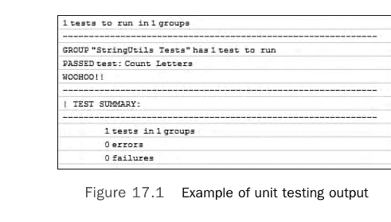

这些结果显示没有检测到错误。错误和失败之间有什么区别？当断言方法返回假值时，就会发生失败。当测试无法运行时，就会发生错误。

因此，我们创建了一个单元测试，运行了它，并查看了预期结果。它成功了！所以我们完成了，对吧？还不完全。不仅我们可以执行其他类型的测试，而且我们甚至还没有完成我们的单元测试。让我们回顾一下我们正在检查的测试条件。研究下面示例中以粗体显示的代码。

```javascript
var testCase = { runTest: function() {
    var su = new StringUtils();
    result = su.countLetters("hello","o");
    doh.assertEqual(1,result);}
}
```

我们正在检查`StringUtils`中的`countLetters`方法是否正确统计了字符串 "hello" 中字母 "o" 的出现次数。尽管它成功了，但该方法尚未得到完全测试。我们可能还想检查边界条件。例如，如果字母在字符串的开头，我们的方法是否仍然有效？或者在末尾？如果字母在字符串中是大写的呢？或者当字母根本不存在时呢？现在我们可以明白为什么 doh 允许我们在组中注册测试——因为我们需要不止一个测试才能对我们的方法正确性感到有信心。而且对于我们要测试的对象中的每个其他方法，我们都需要一组测试。

我们需要进行多少测试？Dojo 为我们提供了一个进行单元测试的框架，但没有提供实际的测试来执行。创建测试取决于我们自己，我们必须决定何时足够。测试一个方法的所有可能的输入组合通常是不现实的。记住 80/20 法则——大部分测试效益可以通过相对较少的测试用例来实现。

### 17.1.3 其他类型的测试

仅靠单元测试是不够的。仅仅因为一个方法对于给定的输入似乎执行正确，并不意味着我们完成了测试。我们需要执行其他类型的测试来确保我们系统的有效性。让我们简要讨论一下你需要做的一些其他类型的测试。

*集成测试*确定对象是否能很好地协同工作，而不仅仅是像单元测试中那样单独工作。*功能测试*用于验证对象是否确实执行了用户期望的功能。*压力测试*向我们展示了我们的系统在大量用户负载或大量事务的压力下的表现。

当然，所有这些类型的测试都很重要，必须进行。然而，Dojo 没有为这些测试方法学提供任何特定的支持，因此我们在这里不再多说。

> **注意**
>
> 虽然我说过我不会谈论其他任何测试工具，但我还是忍不住要说一下。有一个 Firefox 插件叫做 Selenium，它非常适合测试用户与 Web 应用程序的交互。你可以在 <http://selenium.openqa.org/> 获取更多信息并下载该插件。

接下来让我们讨论当单元测试显示我们的程序在某些方面失败时会发生什么。Dojo 是否提供了在发现问题后调试应用程序的任何技术？

## 17.2 日志记录


当好的程序出问题时，了解它们在越过界限时正在做什么会很有帮助。一种简单的调试技术是让程序显示一些输出，显示变量的值。在 JavaScript 中，这可以通过使用`alert`方法来完成。以下代码行可以放入任何函数中，以在`alert`方法运行时显示`x`的值。

```javascript
alert("Value of x: " + x);
```

这段代码会创建一个出现在网页顶部的对话框。图 17.2 显示了一个警告框的示例。此示例假设程序中使用了`x`，并且在执行`alert`语句时其值为 7。

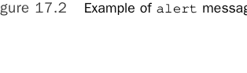

这种技术有时被描述为“穷人的调试器”。它能完成任务，并且在所有浏览器中都能运行——但存在几个问题。其中一个问题是，在部署应用程序时，你必须确保删除这些代码。你的用户肯定不想看到这些消息并让他们的工作被打断。

因此，我们的困境在于，我们希望编写一些消息来显示代码的内部状态，并且希望这些消息与页面的输出分开。此外，为了贪心地起见，我们还希望在将程序移出开发环境时，无需修改任何代码就能关闭这些消息。毕竟，如果我们相信基准测试，每次修改代码都有 5% 的概率无意中破坏某些功能，因此我们需要尽量减少代码更改。

### 17.2.1 基础日志记录

解决我们问题的方法是使用日志记录（logging）。你可能熟悉其他环境中的日志记录。例如，Java 提供了许多日志框架，如开源的`log4j`或直接内置在 JDK 中的新日志框架。Dojo 可以在 JavaScript 环境中为我们提供与这些现有日志框架类似的部分功能。

为了实现日志记录，Dojo 允许我们将消息写入页面上一个名为控制台（console）的独立区域。控制台将出现在网页的末尾。但是，如果我们恰好在使用 Firebug（一个 Firefox 插件），Dojo 将把日志消息写入 Firebug 控制台。要向页面添加日志记录，请在引用 Dojo 的`<script>`标签中将`isDebug`属性设置为`true`，如这里的代码所示（该属性为粗体）：

```html
<script type="text/javascript"
src="../dojo-release-1.1.0/dojo/dojo.js.uncompressed.js"
djConfig="parseOnLoad: true, isDebug: true"></script>
```

现在，你可以在任何时候编写日志消息。在 JavaScript 中任何你想显示程序内部状态的地方插入对`console.log`的调用。

```javascript
console.log("Value of x: ", x);
```

现在，每当你的程序执行`console.log`方法时，输出将被发送到控制台。当使用 Internet Explorer 或在没有 Firebug 的情况下使用 Firefox 时，控制台会附加在页面的末尾。图 17.3 提供了一个在 IE 中控制台输出外观的示例。

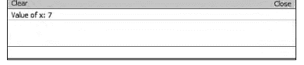

图 17.3 控制台日志记录示例

### 17.2.2 高级日志记录

Dojo 日志记录提供了一些非常实用的附加方法和配置选项。

#### 17.2.2.1 定时器

日志机制的一个非常实用的功能允许我们衡量执行某些 JavaScript 代码所需的时间。我们可以使用一个定时器，通过`console.time()`方法开启，然后通过`console.timeEnd()`关闭。请确保将定时器的名称传递给函数。通过为定时器命名，你可以同时运行多个计时。名称是任意的，仅用于标识计时。这里显示了一个简单定时器的示例：

```javascript
console.time("Timer 1");
// ... some code to be timed
console.timeEnd ("Timer 1");
```

自定时器启动以来经过的毫秒数将显示在控制台中（见图 17.4）。

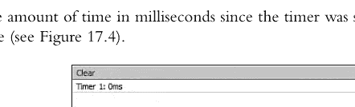

使用定时器有时很有用，但要注意某些问题。不要在被计时的代码中包含任何用户输入。此外，由于 JavaScript 的运行速度，单次执行一个代码块可能不需要太多时间——你经常会像前例那样看到计时结果为零。因此，在较慢的代码块变得明显之前，通常需要进行重复执行。

#### 17.2.2.2 日志消息类型

日志框架有一个有趣的变体，允许我们写出不同类型的日志消息。我们不再对所有消息都使用`console.log`，而是可以使用`debug`、`info`、`warn`或`error`中的任何一个作为日志方法，这样消息将以不同的颜色写入控制台。这使得在控制台中查看冗长的日志文件变得容易得多。你的眼睛会立即被更重要的消息所吸引。以下是编写各种类型日志消息的示例：

```javascript
console.error("This is a log message written using console.error()");
console.warn ("This is a log message written using console.warn()");
console.info ("This is a log message written using console.info()");
console.debug("This is a log message written using console.debug()");
console.log  ("This is a log message written using console.log()");
```

日志消息将在控制台中显示，如图 17.5 所示。

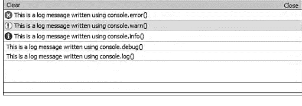

图 17.5 不同日志消息类型的示例

不同类型的日志消息具有不同的颜色。此外，某些类型还分配了图标，使其更加醒目。在某些日志框架中，可以设置一个选项，仅允许显示某些类型的消息——这在 Dojo 日志框架中还不是一个功能。

## 总结

- Dojo 提供了一个名为`doh`的单元测试框架，允许将单元测试创建为包含`runTest`方法的对象。
- Doh 单元测试必须使用`doh.register()`注册，并使用`doh.run()`执行。
- 控制台用于显示单元测试执行的结果，或者在使用 Firefox 的 Firebug 插件时显示在 Firebug 控制台中。
- Dojo 提供了一个可在大多数浏览器中运行的日志机制。
- 主要的日志方法是`console.log("...log message...")`。

我们现在已经完成了对 Dojo 的巡览。现在开始开发吧。祝你好运！

## A

- **AccordianContainer widget**（折叠容器部件），87
- **action attribute**（action 属性），59
- **adding**（添加）
  - client-side validation（客户端验证），26
    - address fields（地址字段），32–33
    - city fields（城市字段），33
    - email address fields（电子邮件地址字段），31–32
    - First Name fields（名字段），27–30
    - Last Name fields（姓字段），30–31
    - to standard HTML data entry forms（至标准 HTML 数据输入表单），13
    - User Name fields（用户名字段），31
    - zip code fields（邮政编码字段），33
  - server-side features to standard HTML data entry forms（向标准 HTML 数据输入表单添加服务端功能），13
  - server-side validation（服务端验证），36
    - assigning event handler functions（分配事件处理函数），36–38
    - making calls to servers（进行服务器调用），38–42
  - widgets to web pages（向网页添加部件），51
    - dijit，52
- **address fields**（地址字段）
  - standard HTML data entry forms（标准 HTML 数据输入表单），8
  - validating（验证），32–33
- **AIR (Adobe Integrated Runtime)**，196
- **Ajax**，51
  - history of（历史），190
  - remoting（远程调用），259–260
- **Ajax libraries**（Ajax 库），35
- **Ajax Remoting**（Ajax 远程调用），268
  - forms（表单），269–270
  - `dojo.formToJson`，274
  - `dojo.formToObject`，270
  - `dojo.formToQuery`，272–273
  - `dojo.objectToQuery`，271–272
  - `dojo.queryToObject`，274
- **Ajax requests**（Ajax 请求），35
- **animation**（动画），283–285
  - `dojo.animateProperty`，285–286
  - fades（淡出/入），284
  - fading background colors（背景色淡化），283
  - standard animation effects（标准动画效果），286
    - `dojo.fx.chain`，290–291
    - `dojo.fx.combine`，291
    - `dojo.fx.fadeIn`，290
    - `dojo.fx.fadeOut`，289
    - `dojo.fx.slideTo`，287
    - `dojo.fx.toggler`，291–292
    - `dojo.fx.wipeIn`，288–289
    - `dojo.fx.wipeOut`，287–288
- **AOL, CDN (Content Delivery Network)**（内容分发网络），19
- **AOP (Aspect Oriented Programming)**（面向切面编程），291，256–257
  - `dojo.connect`，257
- **API (Application Program Interface)**（应用程序编程接口），205
  - `dojo.declare`，231–233
- **Aspect Oriented Programming**（面向切面编程）。见 AOP
- **assigning**（分配/指定）
  - event handler functions（事件处理函数），36–38
  - event handlers（事件处理器）
    - with `dojo.connect`（使用`dojo.connect`），252–253
    - usage examples（使用示例），253–254
- **attribute selectors**（属性选择器），280
- **attributes**（属性），77
  - action，59
  - autoComplete，44
  - class，74
  - constraints（约束），54
  - dojoType，52–53
  - execute，61
  - forceValidOption，44
  - onChange，45
  - special Dojo attributes（特殊 Dojo 属性），29
  - ValidationTextBox，34

## B

- **behavioral methods**（行为方法），78
- **binding Dojo data stores to widgets**（将 Dojo 数据存储绑定到部件），49
- **build.txt**，202
- **buildRendering**，82
- **Burke, James**，205
- **Button widget**（按钮部件），83

## C

- **calls to servers, making**（进行服务器调用），38–42
- **Cascading Style Sheets (CSS)**（层叠样式表），137，214
- **CDN (Content Delivery Network)**（内容分发网络），19
- **CheckBox widget**（复选框部件），84
- **city fields**（城市字段）
  - standard HTML data entry forms（标准 HTML 数据输入表单），10
  - validating（验证），33
- **class attribute**（class 属性），74
- **class attribute selectors**（class 属性选择器），280
- **classes**（类），229–230
  - `dijit.form._FormWidget` class，92–93
    - methods（方法），93–94
    - properties（属性），93
  - `dijit.layout._LayoutWidget`，138
  - `dojo.declare` API，231–233
  - `dojo.extends`，234
  - `dojo.mixin`，233
  - inheritance（继承），231
  - superclasses（超类），231
- **client-side validation, adding**（添加客户端验证），26
  - address fields（地址字段），32–33
  - city fields（城市字段），33
  - email address fields（电子邮件地址字段），31–32
  - First Name fields（名字段），27–30
  - 姓氏字段，30–31
  - 标准 HTML 数据输入表单，13
  - 用户名字段，31
  - 邮政编码字段，33
- Dojo Toolkit 代码，包括，19–20
- 代码更改，教程中检查，21–22
- **ColorPalette 小部件**，89
- **ComboBox 小部件**，44
- **ComboButton 小部件**，84
- 评论字段，标准 HTML 数据输入表单，11–12
- **Dojo 小部件的组件**，70
  - HTML 标签，70–74
  - JavaScript，76–78
  - 样式，74–76
- **`console.log`**，38
- **`console.log`方法**，299
- constraints 属性，54
- **内容分发网络（CDN）**，19
- **ContentPane 小部件**，87
- 计数器，225
- **`create`方法，Widget**，81
- **CSS（层叠样式表）**，137，214
- **CSS 选择器**，279
  - 属性选择器，280
  - 类属性选择器，280
  - `dojo.query`，282–283
  - 元素 ID 选择器，279–282
  - 选择器分组，279
  - 简单选择器，279
  - 结构选择器，280

## D

- **数据**
  - 获取用户输入的数据，39–40
  - 发送到服务器，40–41，45–49
- 数据源，暴露，46–48
- 数据验证，改进，4
- **DateTextBox 小部件**，53–55，86
- 十进制值，283
- **DHTML（动态 HTML）**，189–190
- **Dialog 小部件**，89
- **`dijit`**，52，69
  - 一级目录，201
- **`dijit.byID()`**，52
- **`dijit.ColorPalette`**，172
- **`dijit.Dialog`**，164–165
- **`dijit.Editor`**，184
- **`dijit.form.Button`**，96–97
- **`dijit.form.CheckBox`**，104–105
- **`dijit.form.ComboBox`**，128–129
- **`dijit.form.ComboButton`**，100–101
- **`dijit.form.CurrencyTextBox`**，120–121


- `dijit.form.DateTextBox`，125-127
- `dijit.form.DropDownButton`，98-99
- `dijit.form.FilteringSelect`，131-132
- `dijit.form.Form`，133-134
- `dijit.form.MappedTextBox`，114-115
- `dijit.form.NumberTextBox`，118-119
- `dijit.form.RadioButton`，106-107
- `dijit.form.RangeBoundTextBox`，116-117
- `dijit.form.Slider`，176-178
- `dijit.form.Textarea`，183
- `dijit.form.TextBox`，108-110
- `dijit.form.TimeTextBox`，122-124
- `dijit.form.ToggleButton`，102-103
- `dijit.form.ValidationTextBox`，111-113
- `dijit.form._FormWidget`，80
- `dijit.form._FormWidget` 类，92-93
  - 方法，93-94
  - 属性，93
- `dijit.InlineEditBox`，181-182
- `dijit.layout.AccordionContainer`，150-151
- `dijit.layout.ContentPane`，140-142
- `dijit.layout.LayoutContainer`，143-144
- `dijit.layout.SplitContainer`，145-147
- `dijit.layout.StackContainer`，148-149
- `dijit.layout.TabContainer`，152-154
- `dijit.layout._Layout`，80
- `dijit.layout._LayoutWidget`，138
  - 方法，139
- `dijit.Menu`，157-161
- `dijit.MenuItem`，157
- `dijit.MenuSeparator`，157
- `dijit.PopupMenuItem`，158
- `dijit.ProgressBar`，170-171
- `dijit.Toolbar`，162-163
- `dijit.Tooltip`，168
- `dijit.TooltipDialog`，166-167
- `dijit.Tree`，173-175
- `dijit._Container`，80
- `dijit._Templated`，79，83
- `dijit._Widget`，79-82
  - 方法，80-81
- 目录
  - 一级目录，201
  - 二级目录，202-203
- `DIV` 标签，137
- 文档对象模型。请参阅 `DOM`
- `document.getElementById`，278
- `doh.register()`，296
- `doh.run`，296
- `Dojo`，4，12
  - 描述，192-193
  - 下载，19
  - 未来，197
  - 使用目标，4-5
- 历史，191
- 许可，195
- 应使用 `Dojo` 的人群，194-195
- `Dojo` 将解决的问题，193-194
- 目的，191-192
- `dojo`，一级目录，201
- `Dojo` 基础模块，205
  - `dojo.array` 模块，208
  - `dojo.color` 模块，208-209
  - `dojo.connect` 模块，206
  - `dojo.declare` 模块，206
  - `dojo.Deferred` 模块，207
  - `dojo.event` 模块，209
  - `dojo.json` 模块，207
  - `dojo.lang` 模块，205-206
  - `dojo._base.fx` 模块，216-217
  - `dojo._base.html` 模块，209-211
  - `dojo._base.NodeList` 模块，211-214
  - `dojo._base.query` 模块，214-215
  - `dojo._base.xhr` 模块，215-216
- `Dojo` 核心模块，217-219
  - 特性，219-220
- `Dojo` 数据存储，48-49
  - 绑定到小部件，49
- `Dojo` 事件对象，255
- `Dojo` 表单小部件，91
  - 创建，60-61
  - `dijit.form.Button`，96-97
  - `dijit.form.CheckBox`，104-105
  - `dijit.form.ComboBox`，128-129
  - `dijit.form.ComboButton`，100-101
  - `dijit.form.CurrencyTextBox`，120-121
  - `dijit.form.DateTextBox`，125-127
  - `dijit.form.DropDownButton`，98-99
  - `dijit.form.FilteringSelect`，131-132
  - `dijit.form.Form`，133-134
  - `dijit.form.MappedTextBox`，114-115
  - `dijit.form.NumberTextBox`，118-119
  - `dijit.form.RadioButton`，106-107
  - `dijit.form.RangeBoundTextBox`，116-117
  - `dijit.form.TextBox`，108-110
  - `dijit.form.TimeTextBox`，122-124
  - `dijit.form.ToggleButton`，102-103
  - `dijit.form.ValidationTextBox`，111-113
  - `dijit.form._FormWidget` 类，92-93
    - 方法，93-94
    - 属性，93
    - 文档说明，94-95

### `Dojo` 布局小部件，138

- `dijit.layout.AccordionContainer`，150-151
- `dijit.layout.ContentPane`，140-142
- `dijit.layout.LayoutContainer`，143-144
- `dijit.layout.SplitContainer`，145-147
- `dijit.layout.StackContainer`，148-149
- `dijit.layout.TabContainer`，152-154
- `dijit.layout._LayoutWidget`，138
  - 方法，139

### `Dojo` 菜单小部件，156

- `dijit.ColorPalette`，172
- `dijit.Dialog`，164-165
- `dijit.Editor`，184
- `dijit.form.NumberSpinner`，179-180
- `dijit.form.Slider`，176-178
- `dijit.form.Textarea`，183
- `dijit.InlineEditBox`，181-182
- `dijit.Menu`，157-161
- `dijit.MenuItem`，157
- `dijit.MenuSeparator`，157
- `dijit.PopupMenuItem`，158
- `dijit.ProgressBar`，170-171
- `dijit.Toolbar`，162-163
- `dijit.Tooltip`，168
- `dijit.TooltipDialog`，166-167
- `dijit.Tree`，173-175

## `Dojo` 对象

请参阅 `objects`。

## `Dojo` 打包系统，219

## `Dojo Toolkit`，包括代码，19-20

## `Dojo` 单元测试框架，294

- 创建新的单元测试，294-296
- 注册单元测试，296
- 检查单元测试结果，297
- 运行单元测试，296

## `Dojo` 小部件，52

- 组件，70
  - HTML 标签，70-74
  - JavaScript，76-78
  - 样式，74-76
- 创建你自己的，90
- `DateTextBox` 小部件，53-55
- 定义，68-70
- 层级结构，78-80
  - `dijit._Templated`，83
  - `dijit._Widget`，80-82
  - 富文本编辑器小部件，55-58
  - 特殊小部件，80
- `TextBox` 小部件，74
- 视觉概览，83
  - 表单小部件，83-86
  - 布局小部件，86-87
  - 特殊小部件，88-90

## `dojo.addOnLoad`，251

## `dojo.animateProperty`，285-286

## `dojo.array` 模块，208

## `dojo.byId()`，52

## `dojo.color` 模块，208-209

## `dojo.connect`

- AOP，257
- 分配事件处理器，252-253

### `dojo.connect` 模块

- `dojo.connect` 模块，206
- `dojo.date.locale` 函数，218
- `dojo.declare`，77
  - API，231-233
  - 对象，229
- `dojo.declare` 模块，206
- `dojo.Deferred` 模块，207
- `dojo.disconnect`，254
- `dojo.editor`，55
- `dojo.event` 模块，209
- `dojo.every`，63
- `dojo.exists`，236
- `dojo.extends`，234
- `dojo.formToJson`，274
- `dojo.formToObject`，270
- `dojo.formToQuery`，272-273
- `dojo.fromJson`，247-248
  - 使用示例，248
- `dojo.fx.chain`，290-291
- `dojo.fx.combine`，291
- `dojo.fx.fadeIn`，290
- `dojo.fx.fadeOut`，289
- `dojo.fx.slideTo`，287
- `dojo.fx.toggler`，291-292
- `dojo.fx.wipeIn`，288-289
- `dojo.fx.wipeOut`，287-288
- `dojo.getObject`，236
- `dojo.isObject`，237
- `dojo.json` 模块，207
- `dojo.lang` 函数，206
- `dojo.lang` 模块，205-206
- `dojo.mixin`，233
- `dojo.objectToQuery`，271-272
- `dojo.query`，选择器，282-283
- `dojo.queryToObject`，274
- `dojo.require` 函数，53
- `dojo.setObject`，236
- `dojo.string.pad`，239-241
  - 使用示例，241
- `dojo.string.substitute`，239-243
  - 使用示例，243-244
- `dojo.toJson`，246
  - 使用示例，246-247
- `dojo.xhrGet`，40-41，261-263
  - `handleAs`，264
- `dojo.xhrPost`，264-268
  - 错误处理，268-269
- `dojo._base.fx` 模块，216-217
- `dojo._base.html` 模块，209-211
- `dojo._base.NodeList` 模块，211-214
- `dojo._base.query` 模块，214-215
- `dojo._base.xhr` 模块，215-216
- `dojoType` 属性，52-53
- `dojox`，一级目录，201
- `DOM`（文档对象模型），193，277-278
  - 识别 DOM 元素，278-279
  - CSS 选择器，279-282
  - `dojo.query`，282-283
- 点表示法，对象，234-235
- 下载
  - `Dojo`，19
  - 下载后获得的内容，199-200
  - 教程源代码文件，15-18
- `DropDownButton` 小部件，83
- 双重许可，195
- 动态 HTML（DHTML），189

## E

- `Editor` 小部件，57
- EIAO（万物皆对象），234
- 元素 ID 选择器，279-282
- 元素节点，278
- 电子邮件地址字段
  - 标准 HTML 数据录入表单，8
  - 验证，31–32
- 封装，对象，224-225
- 错误条件，远程请求，267
- 错误处理，`dojo.xhrPost`，268-269
- 事件处理函数，分配，36-38
- 事件处理程序，252
  - 分配
    - 使用 `dojo.connect`，252–253
    - 用法示例，253–254
  - 移除，254
- 事件模型，249
  - 事件，251
    - 定义，250–251
- 事件，251
  - 定义，250–251
  - 表示为对象，254–255
- 一切皆对象（EIAO），234
- `execute` 属性，61
- 公开数据源，46-48
- 扩展点，78
- 视觉效果，14

## F

- 淡入淡出，284
- 背景颜色淡入淡出，283
- 特性，`Dojo` 核心模块，219-220
- 字段
  - 地址字段，验证，32–33
  - 城市字段，验证，33
  - 电子邮件地址字段，验证，31–32
  - 名字字段，验证，27–30
  - 姓氏字段，验证，30–31
  - 标准 HTML 数据录入表单
    - 地址字段，8
    - 城市字段，10
    - 备注字段，11–12
    - 电子邮件地址字段，8
    - 姓名字段，6–7
    - 服务日期字段，11
    - 州/省字段，8–9
    - 邮政编码字段，10–11
  - 用户名字段，验证，31
  - 验证，25–26
  - 邮政编码字段，验证，33
- `FilteringSelect` 部件，84
- Firebug，28
- Firefox 插件，Selenium，298
- 名字字段，验证，27–30
- 一级目录，201
- `focus()` 方法，62
- `forceValidOption` 属性，44
- 表单元素部件，92
- 表单元素，检查有效性，62
- 表单字段，验证，25-26
- 表单提交，拦截，61
- 表单，91，269-270
  - `dojo.formToJson`，274
  - `dojo.formToObject`，270
  - `dojo.formToQuery`，272–273
  - `dojo.objectToQuery`，271–272
  - `dojo.queryToObject`，274
  - 处理，59–60
    - 检查所有表单元素是否有效，62
    - 创建 `Dojo` 表单部件，60–61
    - 拦截表单提交，61
    - 将表单提交到服务器，63–64
  - 标准 HTML 数据录入表单，5–6
    - 地址字段，8
    - 城市字段，10
    - 备注字段，11–12
    - 电子邮件

标准 HTML 数据表单

- 在表单中包含 `Dojo`，12-13
- 名称字段，6-7
- 处理，14
- 添加服务器端功能，13
- 服务日期字段，11
- 添加专用 `Dojo` 部件，14
- 州字段，8-9
- 用户名，7
- 邮政编码字段，10-11

州字段，标准 HTML 数据表单，8-9

压力测试，298

字符串，239-240

- `dojo.string.pad`，240-241
- 使用示例，241
- `dojo.string.substitute`，241-243
- 使用示例，243-244

结构选择器，280

包含样式表，20-21

样式，`Dojo` 部件，74-76


`submit()` 方法，63

将表单提交到服务器，63-64

超类，231

## T

`TabContainer`部件，87

模板，对象模板，225-226

测试，293-294

- Dojo单元测试框架，294
- 创建新的单元测试，294-296
- 注册单元测试，296
- 查看单元测试结果，297
- 运行单元测试，296
- 功能测试，298
- 集成测试，298
- 压力测试，298
- 单元测试，294

文本字符串。另见字符串

- JSON，245
- `dojo.fromJson`，247-248
- `dojo.toJson`，246-247

`Textarea`部件，85

`TextBox`部件，74，85

计时器，日志记录，300

`ToggleButton`部件，84

工具提示，30

`Toolbar`部件，88

`Tooltip`部件，89

`TooltipDialog`部件，89

`Tree`部件，89

## U

教程

- 添加客户端验证，26
- 地址字段，32-33
- 城市字段，33
- 电子邮件地址字段，31-32
- 名字段，27-30
- 姓字段，30-31
- 用户名字段，31
- 邮政编码字段，33
- Dojo部件，52
- `DateTextBox`部件，53-55
- 富文本编辑器部件，55-58
- 目标，4
- 包含Dojo，15
- Dojo工具包代码，19-20
- 下载或创建源文件，15-18
- 样式表，20-21
- 简介，3-4

处理表单

- 检查所有表单元素是否有效，62
- 创建Dojo表单部件，60-61
- 拦截表单提交，61
- 将表单提交到服务器，63-64

从服务器检索数据，43

- 获取州值并发送到服务器，45-49
- 为城市字段选择部件，43-44

查看所有代码更改，21-22

运行新页面，22

添加服务器端验证，36-42

源代码，14

验证表单字段，25-26

验证

- 检查所有表单元素，62
- 添加服务器端验证，36-42

`ValidationTextBox`框，85

`ValidationTextBox`，32

Dojo部件可视化概览，83

- 表单部件，83-86
- 布局部件，86-87
- 专用部件，88-90

## V

单元测试，294

- Dojo单元测试框架，294
- 创建新的单元测试，294-296
- 注册单元测试，296
- 查看单元测试结果，297
- 运行单元测试，296

使用示例

- 分配事件处理器，253-254
- `dojo.formToObject`，270
- `dojo.fromJson`，248
- `dojo.string.pad`，241
- `dojo.string.substitute`，243-244
- `dojo.toJson`，246-247

用户名字段，验证，31

用户名，标准HTML数据表单，7

`userNameOnChange()`，37-38

用户，获取输入的数据，39-40

`util`，一级目录，201

## W

网页，向其添加部件，51

- `dijit`，52

部件，52，68

- 添加到网页，51
- `dijit`，52
- 绑定到Dojo数据存储，49
- `ComboBox`，44
- `DateTextBox`，53-55
- 定义，67-68
- Dojo表单部件。另见Dojo表单部件
- Dojo布局部件。另见Dojo布局部件
- Dojo部件。另见Dojo部件
- 表单元素部件，92
- 创建表单部件，60-61
- 富文本编辑器，55-58
- 为从服务器检索数据而选择部件，43-44
- 专用Dojo部件，14
- 专用部件。另见专用部件

## X-Y

`XHR (XMLHttpRequest)`，260-261

- `dojo.xhrGet`，261-263
- `handleAs`，264
- `dojo.xhrPost`，264-268
- 错误处理，268-269

`XHR`对象，51

`xhrGet()`，63

`xhrPost`，265

`XMLHttpRequest (XHR)`，215，260-261

- `dojo.xhrGet`，261-263
- `handleAs`，264
- `dojo.xhrPost`，264-268
- 错误处理，268-269

## Z

邮政编码字段

- 标准HTML数据表单，10-11
- 验证，33
