# Domino 5 Web 编程：XML、Java 和 JavaScript

**Associate Publisher（associate publisher）**

Tracy Dunkelberger

**Acquisitions Editor（acquisitions editor）**

Michelle Newcomb

**Development Editor（development editor）**

Laura Bulcher

**Managing Editor（managing editor）**

Thomas Hayes

**Project Editor（project editor）**

Tonya Simpson

**Copy Editor（copy editor）**

Cynthia Fields

**Indexer（indexer）**

Johnna VanHoose

**Proofreader（proofreader）**

Megan Wade

**Technical Editors（technical editors）**

Leigh Weber

Karen Hobert

Cameron Martin

Victor Mascari

Tim Patterson

Gene Stuckey

Andrew Walt

**Database Conversion Specialist（database conversion specialist）**

Steve Kern

**Team Coordinator（team coordinator）**

Cindy Teeters

**Media Developer（media developer）**

Michael Hunter

**Interior Designer（interior designer）**

Ruth Lewis

**Cover Designer（cover designer）**

Maureen McCarty

**Copywriter（copywriter）**

Eric Borgert

**Production（production）**

Mark Walchle

## 关于作者

**Randall A. Tamura** 是 PeopleLink 公司的工程副总裁，PeopleLink 是一家互联网公司，为网站提供社区服务外包。他是四本关于 Notes 和 Domino 的书籍的作者，其中包括最畅销的*《Special Edition Using Lotus Notes and Domino R5》*。

Tamura 在计算机领域拥有超过 25 年的经验，自 3 版起就开始从事 Notes 和 Domino 方面的工作。在加入 PeopleLink 之前，他是 Graphware 公司的总裁，该公司提供 Notes 和 Domino 咨询服务。在创立 Graphware 之前，Tamura 曾担任 IBM 洛杉矶地区工程系统开发组织的总经理。

## 献辞

谨以此书献给我的家人。我的妻子 Mari 和儿子 Eric 是我宇宙的中心。我为 Eric 在最近几个月获得鹰级童子军称号而感到骄傲。我的父母 Bud 和 Fumi 一直以来都支持着我。

## 致谢

我要感谢许多帮助本书得以问世的人。我的策划编辑 Michelle Newcomb 帮助本书通过了麦克米伦的重重关卡。开发编辑 Laura Bulcher 仔细审阅了所有章节。感谢 Karen Hobert、Victor Mascari、Tim Patterson、Leigh Weber、Cameron Martin、Gene Stuckey 和 Andrew Walt 的帮助。Leigh 负责了本书大部分的技术审校工作，他以及其他技术编辑都提出了许多宝贵的建议来改进本书。项目编辑 Tonya Simpson 帮助本书按计划推进，文字编辑 Cynthia Fields 润色了我粗糙的英文表达。

我还要感谢 Lotus 和 Iris 的许多人，他们为我提供了本书所需的许多信息。Lotus 的 Chris Reckling 和 Iris 的 Ned Batchelder 都提供了关于 Domino 5.0.3 版开始引入的新 XML 支持的宝贵信息。对此我非常感激。John Stack 和 Jim Frederick 提供了 5.0.3 版的测试代码，使我能够实际测试和开发书中的许多示例。在 Lotusphere 与 Mark Judd 的一次谈话促使我在 XML 部分增加了关于 XSL 的章节。

最后，像往常一样，我要感谢你，读者，感谢你投资购买本书，并花时间阅读它。我希望这本书能成为你构建出色网站的有价值工具。

## 告诉我们你的想法！

作为本书的读者，*你*是我们最重要的评论家和评论员。我们重视你的意见，想知道我们哪些方面做得好，哪些方面可以做得更好，你希望看到我们在哪些领域出版图书，以及你愿意传递给我们的任何其他金玉良言。

作为 Que 的副主编，我欢迎你的评论。你可以通过传真、电子邮件或写信直接告诉我，你对本书的哪些方面喜欢或不喜欢——以及我们可以做些什么来让我们的书更有分量。

*请注意，我无法帮助你解决与本书主题相关的技术问题，而且由于我收到的邮件数量庞大，我可能无法回复每一条消息。*

当你写信时，请务必包含本书的书名和作者，以及你的姓名和电话或传真号码。我将仔细审阅你的评论，并与参与本书工作的作者和编辑分享。

- **传真：** 317-581-4666
- **电子邮件：** quetechnical@macmillanusa.com
- **邮寄：** 副主编，Que，201 West 103rd Street，Indianapolis, IN 46290 USA

## 引言

你可能正在书店里阅读这篇引言，考虑是否值得投资购买本书。让我用几段话来告诉你这本书是关于什么的，以及我为什么认为你应该做出这项投资。简而言之，我对 XML、Java 和 JavaScript 以及它们与 Lotus Domino 的集成感到兴奋。它们现在是关键技术，_annotation_，并且在未来将具有战略重要性。

我已经撰写关于 Lotus Notes 和 Domino 的书籍多年。自 Notes 和 Domino 的 4 版和 5 版发布以来，信息技术领域发生了重大变化，其中最显著的是互联网重要性的指数级增长。随着这一变化，Lotus 不断成长并增强其 Notes 和 Domino 产品，以适应行业和互联网的需求。随着 XML 的出现，我们正处于下一次转型的边缘。

微软、Lotus、IBM 以及行业中的许多其他公司正在朝着将 XML 作为数据存储和交换模型的方向发展。例如，微软的 Internet Explorer 网页浏览器在 5 版中就已经支持 XML。Notes 和 Domino 在 5.0.2 版中有一些支持，5.0.3 版中有更多支持，未来还会有更多。IBM 开发了一个名为 XML for Java（XML4J）的解析器，已将其捐赠给 Apache XML 项目作为其解析器的基础，并且现已集成到 Domino 5.0.3 版中。XML 是从网络电话（WAP/WML）到流媒体集成（SMIL）再到电子数据交换格式等一切的基础。

几年前，Java 还是一项新兴技术，刚刚开始在行业中获得认可，但如今已经今非昔比。Java 现在是一项成熟的技术，许多公司已经在 Java 平台上部署了关键任务应用程序。它是服务器端 Web 编程的主要选择之一。现在有许多 Java 工具可用，很难找到不提供某种 Java 支持的供应商。

JavaScript 以各种形式已经存在了数年。对于客户端 Web 浏览器编程来说，实际上没有其他实用的浏览器独立脚本语言可供选择。JavaScript 提供了客户端编程的粘合剂，将您的 HTML、Java 小程序、图形和其他动态效果拼接在一起。

因此，每一项技术——XML、Java 和 JavaScript——单独对于制作最先进的 Web 应用程序都很重要。通过将这些工具与 Domino 服务器的强大功能相结合，您将为未来数年的 Web 开发奠定坚实的基础。

本书将这些重要的 Web 技术以及若干其他技术汇集在一起，向您解释它们的工作原理、如何与 Domino 集成，以及如何使用它们构建 Web 应用程序的示例。在本书中，我将向您展示如何在 JavaScript 中执行信用卡号的客户端验证。您将看到基于 XML 的 WML（无线标记语言）的示例，这是用于为 WAP（无线接入协议）手机编程的语言。此外，我还将向您展示如何使用 JDBC 从 Java 程序访问关系数据库系统，以及如何将其与 XML 和 Domino 集成。

这些只是本书中包含的少量示例，还有对 Java Domino 对象类的完整参考，这将是一个很好的资源。但是等等，还有更多。您还将免费获得 CD-ROM 上以 Notes 数据库格式提供的本书完整文本。这将使您能够对本书中的任何主题进行全文搜索。因此，尽管本书后面的纸质索引很棒，但您可能能够通过组合纸质索引中未明确列出的关键词来进行全文搜索找到某些内容。

所以，把这本书夹在腋下，带到书店的收银台去结账吧。如果您是通过网络从电子零售商处购买的这本书，那太好了；感谢您甚至在将本书放入电子购物车之前都无法浏览这篇引言的情况下投资了本书。我希望您觉得这本书物有所值。如果是这样，请在你最喜欢的在线书店网站上写一条好评。

### 谁应该阅读本书

当然，我很想说是每个人都应该阅读本书。不幸的是，我认为我的父母、兄弟，甚至我的妻子都不会觉得这本书有多大用处或趣味。所以，令人遗憾的是，有些人群不适合阅读本书。然而，你肯定不是其中之一。

本书对为目前已经拥有网站或正在考虑建立网站的公司工作的人员将是有用和有趣的。如果您目前正在使用 Domino 或正在考虑使用它，那么您更有可能找到一些重要信息。如果您想了解如何将 XML 与 Domino 结合使用，据我在本书出版时了解，这是唯一涵盖该主题的书籍。本书可以为您节省在其他地方搜索的时间。

本书面向开发人员。我的另一本书《*Special Edition Using Lotus Notes and Domino R5*》包含有关 Domino 系统管理的信息，但本书不涉及。在本书中，我收录了面向开发人员的实用信息，例如如何使用 Domino Java AgentRunner 进行调试。我还收录了 JavaScript 编程技巧与技术，以及有关如何遍历 XML 文档对象模型解析树的信息，这些内容在 Lotus 文档中似乎很少被涵盖（如果有的话）。

所以，如果你还在考虑是否购买本书，现在就把它拿到收银台吧。

### 本书的组织结构

本书分为五个部分。第一部分"Domino Designer 与 Domino 编程"，介绍使用 Domino Designer 进行用户界面编程的重要方面。它涵盖了传统的 Notes 和 Domino 设计元素，如表单、视图、文件夹、导航器、大纲和框架集。第二部分"使用 HTML 和 JavaScript 进行客户端编程"，介绍 HTML、JavaScript 以及它们与 Domino 的集成。这一部分还解释了 JavaScript 技巧，例如如何在 JavaScript 中验证信用卡号码。

第三部分"使用 Java 进行 Notes 和 Domino 开发"，介绍 Java 代理、小程序和应用程序之间的区别。它说明了如何在 Domino Designer 中以及使用第三方程序（如 Symantec 的 Visual Café 和 IBM 的 Visual Age for Java）创建 Java 代理。Java 小程序在 Web 浏览器中运行，现在可以通过 CORBA 和 IIOP 使用 Domino 对象类访问服务器上的 Domino 数据库。这一部分向你展示如何构建普通小程序以及可以访问 Domino 的小程序。

第四部分"用于 Java 的 Domino 对象"，是 Domino 对象类所有类、属性和方法的完整参考。第五部分"使用 XML、Java 和 Domino 进行企业集成"，介绍 XML 的基础知识、如何使用 XSL（可扩展样式表语言）以及如何从 Domino 提供 XML。它还向你展示如何使用 Domino 的新 `parseXML` 方法解析 XML 文档，如何使用 JDBC 访问关系数据库，以及如何将 Java Server Pages (JSPs) 与 Websphere 和 Domino 集成使用。

### 本书使用的约定

本书使用以下约定：

- 菜单名称与菜单选项之间用逗号分隔。例如，"File, Open"表示"选择 File 菜单并选择 Open 选项"。
- 新术语以*斜体*显示。
- 你输入的单词在常规文本中以`等宽字体`显示。
- 占位符（代表你实际输入内容的单词）在常规文本中以*斜体等宽*显示。
- 所有代码均以等宽字体显示。
- 代码中的占位符以*斜体等宽*显示。
- 当一行代码太长而无法在书的一行中完整显示时，会在合适的位置断开并延续到下一行。断行的延续部分前面有一个代码续行字符（➥）。当你看到带有此字符的代码行时，意味着你应该将其作为一行不间断的长代码输入。
- 省略号（...）表示为简洁起见，省略了完成语句或代码结构所需的剩余或中间代码。

## 引言

## Domino Designer 与 Domino 编程

1. Domino 架构与 Web 应用程序 7
2. Domino Designer 与集成开发环境 (IDE) 27
3. 使用 Domino Designer 开发页面 45
4. 创建和使用表单与子表单 69
5. 设计视图和文件夹 95
6. 使用大纲、框架集和导航器 137

## 第 1 章

## DOMINO 架构与 WEB 应用程序

本章内容

- 客户端/服务器计算 8
- 从局域网向 Internet 标准迁移 9
- 客户端技术 11
- Web 浏览器与 HTML 14
- 服务器端技术 16
- Web (HTTP) 服务器 18
- 编程语言的可用性 22
- 选择语言或工具 23
- 选择程序的执行位置 23
- 关于 XML 的一些说明 24

Lotus Notes 和 Domino 一直采用客户端/服务器架构。最初，这种架构基于专有技术，但现已演变为基于标准的通信基础设施。随着标准列表中包括 TCP/IP、用于目录访问的 LDAP、用于分布式对象的 IIOP 和 CORBA、HTML、Java 和 JavaScript 等，Lotus Notes 和 Domino 为 Internet、Intranet 或 Extranet 开发提供了强大的平台。

在本章中，我将向你介绍一些可用于为 Web 编程 Lotus Notes 和 Domino 的技术。这些相同的技术也可以在公司内部用于开发可通过 Web 浏览器或 Notes 客户端访问的应用程序。能够使用任意一种或两种类型的客户端，使 Domino 成为你的客户端/服务器计算平台的不错选择。在后面的章节中，我将更详细地介绍这些技术。本章的目的是在我们全书的其余部分重点关注 Java 和 JavaScript 之前，向你概述所有可编程选项。

## 客户端/服务器计算

从根本上讲，客户端/服务器计算的目标是将计算工作负载进行分配，以便容纳更多用户并获得更高的吞吐量。在计算文献中，关于瘦客户端和胖客户端的相对优劣一直存在讨论。本质上，*瘦客户端*执行很少的处理，依赖服务器完成大部分计算任务。另一方面，*胖客户端*将计算任务从服务器卸载，通常允许更多客户端连接到单个服务器。

### 带有 Domino 服务器的 Notes 客户端

Notes 客户端为最终用户提供了强大的功能。有人可能称之为胖客户端，但我认为 Notes 不一定超重。本质上，Notes 是一个桌面数据库管理器和通信软件包。它为电子邮件、日历和联系人管理等应用程序提供支持。此外，由于复制功能，你可以在桌面上的 Notes 客户端中存储、管理和执行完整的应用程序。

然而，所有这些功能都需要付出磁盘存储和复杂性的代价。当公司安装 Notes 时，通常需要管理员来管理用户、密码和软件安装。因此，过去除非是为了远程访问公司网络，否则很少发现个人在家使用 Notes 客户端。

然而，Notes 和 Domino 的趋势是使 Notes 客户端可用作 Web 浏览器，并能够使用 Domino 以外的服务器。Domino 也在朝着可以支持 Web 浏览器客户端以及 Notes 客户端的模式发展。例如，Domino 可以代表任何客户端（包括 Web 浏览器客户端）在服务器上执行代理。

### Web 浏览器和 Web 服务器

Web 服务器和 Web 浏览器传统上属于瘦客户端模式，因为 Web 浏览器的功能有限。为 Web 浏览器开发复杂的应用程序一直相对困难，因为它们不具备这样的能力。然而，由于几个因素，Web 浏览器正变得越来越强大。

JavaScript 由 Netscape 开发，作为一种为浏览器添加用户交互性的语言，正变得越来越普及，也越来越强大。JavaScript 通常用于实现鼠标悬停效果、字段输入验证和其他简单的客户端功能。

Java 小程序也被用于在 Web 浏览器客户端上添加智能功能。Java 可用于开发完整的用户界面、简单控件、数据库访问等。Java 语言也可以在服务器上使用。在此功能下，可以开发称为 servlet、Java Server Pages (JSP) 或 Enterprise JavaBeans (EJB) 的程序来提供额外的服务器端功能。

Web 浏览器中大型基于 Java 的应用程序的主要限制是通信带宽。在 Internet 上，大多数用户仍然使用调制解调器连接，这太慢而无法下载大型（例如 1MB）Java 小程序。随着通过电缆调制解调器、ISDN、DSL 线路等带宽的改善，Internet 上将会出现更多更大的应用程序。在企业环境中，带宽通常足以处理大型 Java 小程序。因此，由于带宽限制，Java 小程序今天可能在企业 Intranet 中比在 Web 上更有用。

### 从局域网向 Internet 标准迁移


在网络环境中使用多层通信协议。协议的较低层处理硬件和数据移动的管理。将数据包从源计算机通过网络移动到目的地是这些协议的职责。

更高层的协议由应用程序用于通信，例如在客户端应用程序和服务器应用程序之间。通常，对用户而言，这两个组件只是单个应用程序的组成部分。例如，`Notes`客户端和`Domino`服务器可以使用特殊协议在彼此之间传输数据库信息。

当应用程序的客户端和服务器部分相对紧密耦合时，所使用的协议并不太重要，只要客户端和服务器能够通信。然而，随着我们越来越多地使用`Internet`协议，即使在公司内部，标准也变得更加重要。

使用标准协议允许客户端和服务器程序变得不那么相互依赖，并允许用户更独立地选择软件组件。`Web`服务器和浏览器是这种现象最成功的例子。有许多不同类型的`Web`服务器可用，运行在许多不同类型的硬件平台上。你可以使用

## 图 1.1

`Domino/Web`架构。

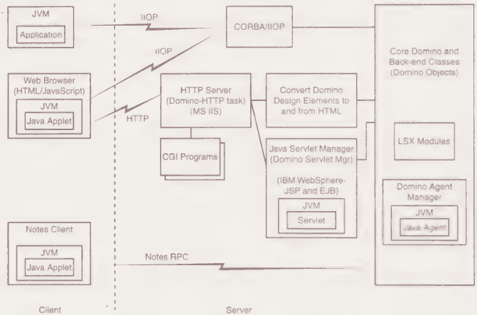

（用户）使用众多`Web`浏览器之一来访问这些`Web`服务器。实现这一切的魔法是超文本传输协议（`HTTP`）和相关的数据格式——超文本标记语言（`HTML`）。通过标准化通过`HTTP`流动的数据内容和含义，我们可以看到多样化的`Web`服务器和浏览器带来的好处。

你可以在图 1.1 中看到`Domino`和`Web`架构。我将在本章中详细讨论该图的各个组件。

在图 1.1 中，客户端技术位于图表的左侧，服务器技术位于右侧。该图被简化以说明你可以使用各种编程语言和通信协议的位置。在图 1.1 中，请注意`Web`服务器可以是`Domino`（`HTTP`任务）或`Microsoft Internet Information Server`（`IIS`），但不能同时是两者。同样，`Domino` servlet 管理器或`WebSphere`（但不能同时是两者）可以用作`Java Servlet`管理器。

以下是图 1.1 中使用的缩写：

- `CGI`（通用网关接口）——一个标准化的接口，用于外部程序与`Web`服务器协同工作。程序可以用`C`、`C++`、`Perl`或其他语言编写。

- `CORBA`（公共对象请求代理架构）——这是一种允许用不同编程语言编写的分布式组件进行通信的架构（而非产品）。组件的用户可以通过通信网络使用`IIOP`进行远程调用。此功能类似于远程过程调用（`RPC`）。

- `EJB`（企业 JavaBeans）——这些是基于服务器的组件，使你能够以面向对象的方式访问数据库。

- `HTTP`（超文本传输协议）——大多数`Web`服务器和浏览器使用的协议。

- `IIOP`（互联网 ORB 间协议）——一种允许分布式对象进行通信的面向对象协议。这是在`ORB`之间通信时使用的协议。

- `JSP`（Java 服务器页面）——一种将基于`Java`的逻辑与`Web`页面结合的标准。

- `JVM`（Java 虚拟机）——解释和执行`Java`指令的环境。

- `LSX`（Lotus 软件扩展 [原 LotusScript 扩展]）——允许编写集成`LotusScript`和`Java`的软件组件，运行于`Notes/Domino`环境中。

- `ORB`（对象请求代理）——允许客户端和服务器进行通信的程序。通过使用`ORB`，客户端无需了解服务器位置的详细信息。

- `RPC`（远程过程调用）——广义上，此技术允许通过网络调用子程序。`Notes`客户端和服务器实现了一个特定版本，称为`Notes RPC`。

## 客户端技术

到目前为止的讨论相当抽象，因此让我们来看看`Notes`客户端和`Web`浏览器中的一些具体技术，并看看它们如何比较。本质上，`Lotus`正在使用我讨论过的`Web`技术——`JavaScript`和`Java`——来实现传统上在`Notes`客户端中可用的功能。

注意图 1.1，左侧实际上显示了三种不同类型的客户端。第一种是独立的`Java`应用程序，第二种是带有嵌入式小程序的`Web`浏览器，第三种客户端是`Notes`客户端。虽然显示了所有三种客户端类型，但你通常一次只会使用其中一种客户端。这些不同类型的客户端最终可以通过几种不同的通信机制访问`Domino`后端。使用的三种协议是`Notes RPC`、`HTTP`和`IIOP`。我稍后将更详细地讨论这些协议。

让我们首先看看`Notes`客户端的可编程性功能。然后我们将介绍传统上在`Web`浏览器中可用的客户端技术。现在所有`Web`技术在`Notes`客户端中也可用。

### DOMINO 设计元素

`Domino`设计元素，如表单、视图和导航器，长期以来一直是`Notes`客户端用户界面的重要组成部分。每个设计元素都提供编程功能。你可以提供编程代码来处理特定对象中发生的操作。

例如，如果用户单击按钮，你可以编程`Click`事件以执行某些操作。不同类型的对象（如表单和视图）都有自己的一组可以编程的事件。你为这些操作提供的程序有时被称为脚本，因此这是`Lotus`选择`LotusScript`作为其`Basic`版本名称的原因。你通常可以使用公式语言、`LotusScript`、`JavaScript`或简单操作来提供事件-对象脚本。

#### 公式语言

公式语言是最初在`Lotus 1-2-3`中可用语言的一个变体。它经过改编和增强以用于`Lotus Notes`。凭借其允许客户在不同版本间迁移应用程序的悠久历史，公式语言在`Notes Release 5`中仍然受到支持。

事实上，公式在`Notes`的许多上下文中仍然扮演着重要角色。例如，它们用于默认值、视图选择、输入转换以及多种其他目的。基本上，公式的求值结果是一个值。结果值的使用取决于公式的上下文。

公式语言包含大量函数，每个函数以`@`开头。有时这种语言被称为`@`公式语言，函数被称为`@`函数。这里是一个`@`公式的示例：

```
@if(@IsNewDoc;"New Document"; DocTitle)
```

这是一个你可能在窗口标题中找到的公式示例。它将检查文档的状态，如果它是新的，标题将是“新建文档”。如果文档之前已创建，它将提取名为`DocTitle`的字段的值并将其用作窗口标题。

#### 简单操作

简单操作是`Domino`数据库中通常需要的预编程操作。有用于替换文档字段中的值、复制文档、发送电子邮件消息、运行代理，甚至自动回复电子邮件消息的简单操作。这些简单操作可以在不需要太多编程知识的情况下设置和执行。

#### LOTUSSCRIPT

`LotusScript`是`Lotus`版本的`Basic`语言。该语言类似于`Microsoft Visual Basic`，但存在差异。首先，`LotusScript`在所有`Notes/Domino`平台上都可用，这意味着`Windows`、`Macintosh`、`AIX`、`HP/UX`、`Solaris`、`UNIX`、`AS/400`、`RS/6000`、`S/390`和`Linux`。`Microsoft Visual Basic`仅在专有的`Microsoft Windows`操作系统平台上运行。

`LotusScript`可以在`Notes`客户端的多种不同上下文中使用，包括对象事件的脚本编写以及客户端代理。`LotusScript`在`Lotus`的其他一些产品中也可用，例如其电子表格产品`1-2-3`。

尽管它在`Notes`中可用，但`LotusScript`不能用于创建独立应用程序。这与`Java`不同，`Java`可以用于创建独立应用程序，也可用于`Notes`、`Web`浏览器或服务器环境。

#### DOMINO 对象

有一组类可用于访问`Domino`数据库中的数据。这些类有时被称为`Domino`后端类，以区别于处理`Notes`客户端用户界面的前端类。

后端类组目前被称为`Domino`对象。在此之前，它们被称为`Domino`对象模型（`DOM`）。名称`Domino`对象模型（`DOM`）的问题在于它与一个称为文档对象模型（`DOM`）的`JavaScript`概念冲突，后者为`JavaScript`提供了类似的概念但完全不同的类集。

无论它们当前的命名如何，这些类允许程序员查找和打开特定的`Domino`数据库，操作数据库中的数据，遍历视图中的文档，以及检查特定文档中的单个字段。

尽管在图 1.1 中被省略，但`Domino`对象可以在`Notes`客户端或`Domino`服务器上使用。`Notes`和`Domino`自动处理客户端和服务器之间的任何通信。在图 1.1 中，你会注意到客户端和服务器之间使用了远程过程调用（`RPC`）接口。

虽然`LotusScript`可以访问前端类，但`Java`中没有它们，因此我不会在本书中过多介绍前端类。`Java`中没有这些类，因为前端类是`Notes`客户端本身中许多代码的包装器。为了将`Notes`客户端代码与数据库功能分开，`Lotus`将前端类与后端类分开。如果你在使用后端类的同时使用`LotusScript`的前端类，请小心，因为进入数据库有两条独立的路径，你可能会发现细微的不一致。

#### LOTUS 软件扩展（LSX）模块

`Lotus`巧妙地重命名了`LSX`模块而无需更改缩写。`LSX`模块最初命名为`LotusScript`扩展。最初，这些附加的用户提供的模块是`LotusScript`的扩展。随着`LSX`工具包的第 2 版，`Lotus`引入了`Java`适配器，现在允许`LSX`模块与`Java`以及`LotusScript`协同工作。

你通常使用`LSX`工具包在`C++`中创建`LSX`模块。`LSX`模块向`LotusScript`或`Java`程序公开面向对象的接口。你可以开发自己的类和方法，它们将在`LotusScript`或`Java`中可访问。`LSX`扩展的典型应用是数据库访问、富文本应用程序以及任何其他类型的自定义数据或通信应用程序。

尽管图 1.1 中未显示，你也可以在`Notes`客户端中使用`LSX`模块（如果合适的话）。例如，`LSX`模块可用于处理富文本。这种类型的服务可以在`Notes`客户端上提供。

### WEB 浏览器和 HTML

当人们想到互联网的用户界面或客户端时，大多数人会想到`Web`浏览器。浏览器主要是用于格式化和显示超文本标记语言（`HTML`）代码的程序。尽管有许多可用的`Web`浏览器，但最著名的两个是`Netscape Navigator`和`Microsoft Internet Explorer`。通过`R5`版本的`Notes`，本节中描述的所有`Web`技术都可以在`Notes`客户端以及`Web`浏览器中使用。

#### 超文本标记语言（HTML）

超文本标记语言（`HTML`）是互联网上的*通用语言*。它基于标准通用标记语言（`SGML`），但已针对万维网进行了定制和更新。`HTML 4.0`已被万维网联盟（`W3C`）批准为标准，并被广泛使用。

该语言本身由被尖括号包围的标签组成。以下是一个非常简单的`HTML`文档：

```
<HTML>
<HEAD>
<TITLE>A Sample</TITLE>
</HEAD>
<BODY>
<H1>Hello, HTML</H1>
</BODY>
</HTML>
```

在示例中，请注意标签可以嵌套，每个标签指定文档结构的一个组成部分。`HTML`元素通常有一个开始标签和结束标签。结束标签使用与开始标签相同的单词，但结束标签包含一个正斜杠。在示例中，标签对`<TITLE></TITLE>`嵌套在`<HEAD>`元素内。该文档结构会被解析并存储在浏览器中，同时也可通过`JavaScript`进行访问。

#### JAVASCRIPT

`JavaScript`是`Netscape`公司发明的，用于在浏览器中提供交互性。你可能已经知道，`JavaScript`不是`Java`，它也不是`Java`的轻量级或简化版本。事实上，它最初被称为`LiveScript`，后来更名为`JavaScript`以便在市场推广中获得优势。

`JavaScript`是一种解释型语言，由于`Netscape`和`Microsoft`开发了各自独立的实现（`Microsoft`的版本实际上叫做`JScript`），不同实现之间存在语言差异。此外，每个版本的浏览器也带来了相关`JavaScript`语言的差异。`JavaScript`最早是在`Netscape Navigator 2`中引入的。从那时起，`Netscape`和`Microsoft`都改进了它们的产品。现在有一个大型的核心子集可以在`Netscape`和`Microsoft`浏览器中通用。

`JavaScript`的主要功能之一是能够访问和/或创建`HTML`文档。`JavaScript`程序实际上驻留在`Web`页面上，可用于读取或更新文档结构中的值。事实上，`JavaScript`可以用于动态创建`Web`页面的全部内容。

`JavaScript`程序始终以人类可读的文本形式从服务器发送到客户端。这与`Java`程序形成对比，`Java`程序通常以二进制形式下载。

`JavaScript`通过一组称为文档对象模型（`DOM`）的对象来访问页面对象。不要将其与`Domino`对象模型混淆，后者是`Domino`后端类的另一个名称。`JavaScript DOM`中的关键对象是*window*、*document*和*form*。同样，不要将这些术语与使用相同名称的`Domino`对象混淆。在`JavaScript`中，这些对象通常以小写形式出现，并且在与`JavaScript`关联时，上下文会帮助你区分它们与同名的`Domino`对象。第二部分"使用 HTML 和 JavaScript 进行客户端编程"对此有更详细的介绍。

#### JAVA 小程序

`Java`于 1995 年 5 月在`Sun World`大会上推出。`Sun`的开发团队使用了代号*Live Oak*，但*Oak*这个名称已被注册商标，无法使用，因此`Sun`选择了`Java`这个名称。在短短几年时间里，该语言变得极为流行。

`Java`语言与`C++`非常相似，但去除了`C++`中一些容易出错的特性。例如，`Java`没有指针变量，但它使用内存垃圾回收机制，因此`Java`中的内存管理比`C++`更简单，也更不容易出现内存泄漏。

`Java`语言可用于多种不同的用途。一种是用于小程序（applet），另一种是用于完整的应用程序。你可以编写独立的`Java`应用程序，它们可以在多种平台上运行，不依赖于`Notes`、`Domino`或`Web`浏览器。最后，你可以使用`Java`来实现服务器端功能以及客户端功能。不过，`Java`的一个主要用途是用于`Web`浏览器中的小程序。

在图 1.1 中，你可以看到*Java 虚拟机*（`JVM`）的多个实例，它是运行`Java`程序的环境。需要注意的是，每个`JVM`独立于可能在同一台计算机上运行的其他`JVM`。尤其要注意每个`JVM`的版本号。两个主要的版本是`1.1.x`和`2.x`（之前称为`1.2`）。同一台计算机上可能同时运行不同版本的`JVM`（因为它们具有不同的功能），因此请确保你运行的是预期的版本。

## 第 1 章 DOMINO 架构和 WEB 应用程序

小程序是用`Java`编写的，以二进制形式从`Web`服务器下载到浏览器。小程序可以提供简单的功能，如动画，也可以提供应用级逻辑。`Domino`可以下载多个内置小程序来执行管理视图、操作按钮和富文本编辑等功能。

`Java`小程序的安全性比`Java`应用程序更强。例如，下载的小程序无法与下载源服务器以外的服务器通信。它们也不能调用程序和操作硬盘上的文件。这是有益的，因为如果没有这些安全限制，恶意的`Java`小程序被下载后可能会在你的机器上造成破坏。`Java`应用程序则没有这些限制。你可以编写一个`Java`应用程序，与任何服务器通信、从硬盘访问文件并调用其他程序。通常是`Web`浏览器（而非`Java`语言本身）提供安全运行环境。

符合一组额外特定规范的小程序被称为*JavaBeans*。`JavaBeans`规范允许开发者创建可轻松与图形化`Java`开发环境配合使用的组件。许多商用`JavaBeans`可以从互联网上购买或下载。通过使用`JavaBeans`，你可以利用已经设计和测试过的组件，更快速、更轻松地创建应用程序。`JavaBeans`在概念上类似于`Microsoft ActiveX`组件。

## CORBA

`CORBA`是*Common Object Request Broker Architecture*（通用对象请求代理架构）的缩写，是一种用于实现分布式对象的架构规范。分布式对象是指一部分逻辑位于客户端、另一部分位于服务器端的对象。通过使用`CORBA`，运行在`Web`浏览器客户端（或`Java`应用程序）中的`Java`程序可以调用使用`Domino`对象的方法。

关键在于，程序员可以以面向对象的风格开发应用程序，就像对象驻留在客户端一样进行编程。实际上，`CORBA`会使所有通信变得透明，程序员无需编写显式的通信代码。这大大简化了实现任务，并允许更快地开发应用程序。`Domino`更进一步，代程序员处理了`CORBA`的大部分细节。

## 服务器端技术

在客户端/服务器计算的服务器端，也有许多技术在发挥作用。你可以使用这些技术来编程服务器对客户端请求的响应。我们将首先介绍`Domino`技术，然后介绍一些传统上与`Web`服务器相关联的技术。

### 设计元素、公式语言和简单操作

`Notes`和`Domino`长期以来一直提供了对程序员透明的远程客户端支持功能。作为开发者，你可以使用表单、视图和

其他设计元素，并且完全不用担心这些设计元素位于客户端还是服务器端。`Notes`和`Domino`会处理好功能的分发。

例如，在您开发了一个`Domino`数据库后，如果您将其放置在服务器上，它将与`Notes`客户端协同工作。如果您将该数据库复制或复制到`Notes`客户端，同一个数据库可以独立于`Domino`服务器运行。

您有许多工具可用于为`Domino`数据库编程。公式语言长期以来一直是`Notes`开发接口的一部分，并在前面标题为“公式语言”的部分中描述过。您可以使用公式来选择视图中的文档、基于其他字段的值定义某个字段，以及用于许多其他目的。在`R5`中，为公式语言添加了支持`Internet`寻址、硬/软文档删除和国家语言支持等功能，以及其他若干特性。


当您在服务器上使用设计元素或公式语言，但使用 Web 浏览器作为客户端时，`Domino`服务器必须将这些操作转换为 HTML。`Domino`服务器会自动执行此操作。然而，由于这种转换，某些用户界面元素在 Web 浏览器中的外观与在 Notes 客户端中不同。

如果启用了 JavaScript 选项，`Domino`服务器除了生成 HTML 外，还可以生成要发送到浏览器的 JavaScript。这允许`Domino`服务器将部分处理工作卸载到 Web 浏览器客户端。

请注意图 1.1 中的一个方框，它执行将`Domino`设计元素与 HTML 相互转换的功能。此组件的原始内部代码名称是“Domino”。最终，Lotus 以这个 HTML 转换模块的代码名称重命名了整个服务器（并获得了某家披萨公司的法律许可）。

### Domino 代理

代理是由各种事件触发的小型程序，这些事件可以发生在 Notes 客户端（但不在 Web 浏览器上运行）或服务器上。触发器可以在邮件到达时、按特定时间间隔、当文档被添加到数据库时等等发生。代理本身可以用公式语言、LotusScript、Java 或使用简单操作来编写，后者在标题为“客户端技术”的部分中描述过。

代理可以在`Domino`服务器上运行，以响应来自客户端的 URL 请求。以这种方式使用时，代理可以执行它们通常执行的任何数据库和计算功能，并生成一个 HTML 页面作为输出。然后，该 HTML 页面作为对 URL 请求的响应发送到客户端。

这些生成 HTML 的代理类似于 servlet。代理和 servlet 之间存在一些差异。首先，代理可以用公式语言、简单操作或 LotusScript 以及 Java 编程。Servlet 只能用 Java 编程。其次，代理存储在`Domino`的上下文中，因此具有`Domino`安全保护并可以复制。Servlet 通常存储在 Web 服务器的文件系统中。

### DOMINO WEB 服务器 API (DSAPI)

`DSAPI`代表 *Domino Web 服务器应用程序编程接口*。此接口专用于`Domino`Web 服务器，使您能够添加自定义身份验证（例如，在您自己的公司目录中查找用户），或用于日志记录、过滤或转换统一资源定位符（URL）地址。`DSAPI`通常使用 C 编程语言进行编程，不过通过努力，您可能也能使用其他语言。`DSAPI`接口类似于 Microsoft 用于 Microsoft Internet Information Server (IIS) 的 ISAPI 接口。

要实现`DSAPI`过滤器，您需要在 C 程序中实现至少两个入口点：`FilterInit`和`HttpFilterProc`。`FilterInit`允许您初始化过滤器程序并指定您想要监视的事件类型。事件包括身份验证和处理 URL 地址等。当事件发生时，您的`HttpFilterProc`入口点会被调用。您将收到有关事件类型的信息，并且可以处理该事件或告诉`Domino`使用其自身的默认处理。

### WEB (HTTP) 服务器

`Domino`服务器执行许多功能。一个功能是读取`Domino`数据库并与 Notes 客户端协作。另一个是读取这些相同的数据库并将其转换为 HTML，供 Web 浏览器使用。最后，`Domino`是一个 Web 服务器，因为它可以向 Web 浏览器提供 HTML 页面。在此功能方面，它具有与所有 Web 服务器共享的功能。

`Domino`的不同功能不必全部一起使用。例如，您可以将`Domino`配置为读取`Domino`数据库并将其转换为 HTML，但然后使用另一个 Web 服务器（如 Microsoft IIS）将 HTML 提供给客户端。在图 1.1 中，您会注意到 HTTP 服务器可以是`Domino`HTTP 服务器或 Microsoft IIS。

严格来说，Web 服务器只需要向 Web 浏览器客户端提供 HTML。然而，实际上，大多数 Web 服务器提供许多其他功能，包括一些服务器上的可编程特性。我将在接下来的几节中描述其中一些 Web 服务器功能。

### 公共网关接口 (CGI)

服务器端技术的鼻祖是 *公共网关接口 (CGI)*。定义此接口是为了让开发人员能够在不修改服务器本身的情况下为 Web 服务器添加功能。CGI 程序通常用 C、C++ 或一种称为 PERL 的语言编写，并通过 URL 地址访问。

每次客户端调用 CGI 程序时，服务器上都会生成一个新进程，满足请求，并将结果返回给客户端。创建和销毁这些服务器进程开销很大，因此对于简单任务，它们可能会降低性能。

如果您有一个现有的遗留应用程序并希望将其转换为 Web 使用，CGI 程序将是合适的。如果计算量相对于其调用次数来说相对较大，您可能需要考虑 CGI 程序。然而，如今许多公司正在认真考虑使用 servlet 来实现服务器端功能。

### SERVLETS

*Servlets* 是运行在服务器上的 Java 程序。与 CGI 程序相比，它们具有性能优势，因为它们可以被加载并保持运行在服务器上，服务于多个客户端或客户端请求。Servlets，像 CGI 程序一样，通常通过 URL 地址接收参数，如下所示：

`http://www.acme.com/servlet/dbquery?firstname=fred&lastname=flintstone`

Servlets 可以解析 URL 参数，并且通常会创建一个动态 HTML 页面返回给客户端。然后客户端显示该页面。

一个 servlet 管理器负责加载、卸载和管理 servlets。`Domino`有一个内置的 servlet 管理器，它与 HTTP 服务器任务协同工作。

`Domino`也可以使用第三方 servlet 管理器。特别是，它可以与 IBM WebSphere 服务器配合工作（参见图 1.1）。当以这种模式使用时，`Domino`允许 WebSphere 管理 servlets。这种配置是有益的，因为 WebSphere 服务器比内置的`Domino`servlet 管理器具有更多的功能。例如，WebSphere 支持 Java Server Pages (JSPs)、Enterprise JavaBeans (EJBs)、XML、易于管理的功能以及许多其他特性。WebSphere 与`Domino`非常互补，因为当它们一起使用时，功能上没有太多重叠，但它们一起使用可以利用两个服务器的优势。

### JAVA SERVER PAGES (JSPS)

`Domino`中没有明确支持 *Java Server Pages (JSPs)*，但当`Domino`与 IBM WebSphere 服务器结合使用时可以使用。您可以将 JSPs 视为即时 Java。这意味着您可以直接在网页的 HTML 中使用 Java 代码片段，Java 代码将由服务器动态编译和执行。这是 Java 版本的 Microsoft Active Server Pages (ASPs)。

使用 JSPs 的主要目标之一是它们允许将网页的形式与内容分离。网页的布局和图形外观与填补页面空白所需的后端数据管理分离。在清单 1.1 中，您可以看到一个 Java Server Page 的示例。

```
清单 1.1  一个 JAVA SERVER PAGE 的示例

<HTML>
<HEAD>
<TITLE>JSP Test</TITLE>
```

## 清单 1.1 续

```
</HEAD>
<BODY>
<H1>
<% if (null == request.getParameter("with")) {
out.println("JSP Rocks");
}
else {
out.println("JSP rocks with " + request.getParameter("with"));
}
%>
</H1>
</BODY>
</HTML>
```

用户可以通过以下 URL 调用此示例：

`http://server/JSPTest.jsp`

输出的页面将显示文本 JSP Rocks。如果使用以下 URL 调用，输出的页面将显示文本 JSP rocks with style and grace：

`http://server/JSPTest.jsp?with=style+and+grace`

请注意，在 URL 中必须使用加号（`+`）代替空格。加号会被自动转换为空格（参见图 1.2）。

## 图 1.2

使用 IBM WebSphere 配合`Domino`实现 Java Server Pages。

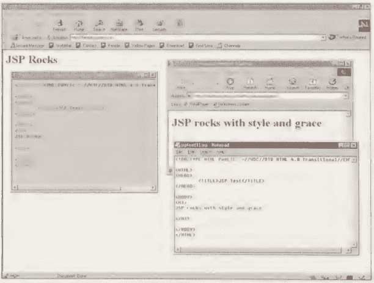

在图 1.2 中请注意，生成的 HTML 不再包含任何 Java 代码，而是完全由浏览器可以处理的纯 HTML 代码。

JSP 中提供的 Java 代码在页面被调用时进行编译。这意味着页面可以在不使用 Java 编译器及相关工具的情况下进行开发。当页面被调用时，代码会自动编译、转换为 servlet，并由 WebSphere 服务器加载和管理。

在一个更贴近实际的示例中，网页中包含的 Java 代码会调用由后端 Java 程序员开发的 Java 代码。网页设计师可以专注于网页的逻辑，而另一个人则可以编写从数据库访问数据的程序。这确实非常酷。

### CORBA 和企业 JavaBeans（EJB）

服务器上的 CORBA 技术允许客户端使用分布式对象和远程方法调用。在`Domino`的具体案例中，CORBA 用于允许 Java 小程序访问服务器上的`Domino`数据库。CORBA 与`Domino`的结合使用对程序员来说基本上是透明的。

在原生使用时，CORBA 要求你使用*接口定义语言*（IDL）来描述远程接口。然后对 IDL 规范进行编译，生成在客户端和服务器上运行的程序来实现通信。Lotus 已经开发了`Domino`对象的 IDL 语句和相应的程序，作为这些对象的用户，你不需要担心 IDL 定义。

不过，你可以自行使用 Java 结合 CORBA 来构建分布式面向对象程序。然而，这项任务并非轻而易举，因为你需要深入了解大量相关技术，包括 IDL 语句、对象请求代理（ORB）、存根（stubs）和骨架（skeletons）。一些 Java 编程环境可能会为你简化这项任务。虽然 CORBA 允许使用分布式对象，但它不支持事务处理功能。这是更高层次的功能，由企业 JavaBeans 规范提供。

企业 JavaBeans（EJB）是当你将 IBM WebSphere 与`Domino`结合使用时可以使用的另一项技术。正如 JavaBeans 是一种组件规范一样，EJB 是一种用于服务器端功能的组件模型。但你需要了解的是，企业 JavaBeans 并不是真正的 JavaBeans。这两种规范的组件模型完全不同，除了名称相似之外，它们之间毫无关系。

EJB 使你能够为面向事务的应用程序使用和开发标准化组件。你可以使用企业 JavaBeans 来管理安全性、持久性和资源管理等属性。该规范使你能够开发符合更大标准化框架的组件。本质上，你可以开发在服务器上运行的业务逻辑，而 EJB 将提供大量所需的基础设施。

企业 JavaBeans 有两种类型：实体 Bean 和会话 Bean。实体 Bean 用于对必须持久化的对象进行建模，通常存储在数据库系统中。

会话 Bean 不具有持久性，通常用于处理操作数据的流程。例如，在电子商务应用中，你可以使用实体 Bean 来表示待售商品，使用会话 Bean 来表示购买过程中使用的购物车。

## 编程语言可用性

我们已经快速介绍了一些可用于 Web 开发的关键技术和语言。虽然远非详尽，但这个介绍已经向你展示了许多用于 Web 开发的主要工具。由于有如此多不同的技术和如此多不同的编程语言或工具可供选择，我在表 1.1 中总结了关键对象场景和主要编程语言选择的列表。在下一节中，我将讨论如何在可用语言中进行选择。

| 对象场景 | LotusScript | JavaScript | Java | 公式语言 | 简单操作 | C/C++ | HTML |

| :--- | :---: | :---: | :---: | :---: | :---: | :---: | :---: |

| 对象脚本（例如按钮） | X | X | | X | X | | |

| Domino 对象 | X | | X | | | | |

| Notes 客户端代理 | X | | X | X | X | | |

| 小程序/JavaBean | | | X | | | | |

| LSX 模块 | X-使用 | | X-使用 | | X-创建 | | |

| Web 浏览器 | | X | X | | | | X-解释 |

| Notes 客户端浏览器 | X | X | X | X | X | | X-解释 |

| Domino 服务器 | | X-生成 | | | | X-加载项 | X-生成 |

| Domino 服务器代理 | X | | X | X | X | | X-生成 |

| Domino 服务器 servlet | | | X | | | | X-生成 |

| Java Server Pages（JSP） | | | X | | | | X-生成 |

| CGI 程序 | | | | | X | X-生成 | |

| 独立应用程序 | | X | | | X | | |

图例：

- X-使用—程序员可以在指定语言中使用该对象

- X-创建—程序员可以使用该语言创建此对象

- X-解释—指定的对象可以解释给定语言

- X-生成—对象为客户端生成给定语言

- X-加载项—`Domino`服务器加载项程序可以使用 C/C++ 编写

### 选择语言或工具

面对如此多的选择，你应该使用哪种语言或工具？为什么？这是一个好问题。答案是，这主要取决于你要做什么以及你的背景和经验。

正如我之前提到的，对于 Notes 和`Domino`中的各种功能，你只能使用某些特定的语言。例如，要制作小程序，你必须使用 Java。要编写对象脚本，你可以使用其他几种语言但不能使用 Java。当创建 LSX 模块时，你通常会使用 C/C++ 而不是 LotusScript 或 Java。因此，在许多情况下，语言的初始选择已由上下文为你决定了。

不过，在为对象编写脚本时，你仍然可以使用 LotusScript 或 JavaScript。如果你熟悉 BASIC，就选择 LotusScript。如果你熟悉 JavaScript 或 JScript，就使用 Notes 中的 JavaScript 支持。实际上，本书将教你如何做到这一点。世界正越来越多地转向 Internet 标准。随着 JavaScript 的日益普及，将会有更多使用 JavaScript 的程序员和程序可用。

在编写代理时，你可以使用 LotusScript 或 Java（或公式语言或简单操作），但不能使用 JavaScript。在这种情况下，同样使用你最熟悉的工具。如果情况足够简单，就使用简单操作。例如，要替换文档中的单个值，你可以使用简单操作。通常，有多种方法可以实现你的目标，你可以选择其中任何一种。如果你真的有雄心壮志，可以全部学习，然后为特定场合选择最合适的工具。

### 选择程序执行位置

本质上，程序执行位置只有两个通用选择：客户端或服务器。通常，为客户端编写的代码应该小而快，并且功能有限。例如，字段验证是客户端代码的一个很好的应用场景。而访问大型`Domino`数据库或 SQL 数据库则更适合在服务器端执行。

随着客户端计算机变得更加强大，你可能会考虑在 Web 浏览器的客户端提供更多功能。借助 CORBA 支持以及一些新 XML 的功能性，将功能卸载到客户端可能是可行的。然而，今天这样做时应该非常小心，并确保在部署一个在客户端有大量代码的大型应用程序之前，对其性能进行基准测试。如前所述，带宽可能比客户端的实际处理能力更令人担忧。

在通信带宽相对充裕的局域网中，下载一兆字节的代码到客户端不会是个大问题。然而，在为互联网设计应用程序时，请记住大多数用户将使用 56K 调制解调器，这将极大地改变用户体验。

在后续章节中，我将向你展示如何使用服务器端编程来创建动态 Web 内容。换句话说，HTML 页面不再是由网站管理员生成的静态 HTML 页面，而是完全由服务器根据数据库中的数据生成。这是电子商务中使用的一项关键能力。想象一下一个包含数千或数百万条目的目录。网站管理员不可能为这些项目生成网页。这显然是服务器端代码的工作。

## 关于 XML

*可扩展标记语言*（XML）是互联网的新标准之一。虽然它与 HTML 相似，但 XML 既不是 HTML 的专用版本，也不是 HTML 的超集。事实上，XML 的目的与 HTML 大不相同。HTML 的目的是提供一种用于显示网页并允许用户与这些页面交互的语言。

另一方面，XML 的目的是提供一种可以描述任何类型业务数据的语言。HTML 的主要目的是数据显示，而 XML 的目的是对信息进行逻辑组织、存储和传输。

XML 可以用于各种不同的应用程序。要使其有意义，XML 格式的文件还必须关联一个文档类型定义（DTD）文件。DTD 提供了给定 XML 文档类型允许的语法格式。例如，你可以为单个应用程序定义几种不同的 XML 文档类型。例如，在销售 CD 的电子商务应用程序中，你可能会定义一个`Artist` XML 文档类型、一个`CD` XML 文档类型、一个`Customer` XML 文档类型和一个`CreditCard` XML 文档类型。每种不同的文档类型都会定义所需的数据。以下是`Artist` XML 文档可能的示例：

```xml
<ARTIST>
<NAME>David Benoit</NAME>
<GENRE>Jazz</GENRE>
<INSTRUMENT>Piano</INSTRUMENT>
</ARTIST>
```

或者，使用不同的 DTD 规范，你可以要求 XML 看起来像这样：

```xml
<ARTIST NAME="David Benoit"/>
<GENRE>Jazz</GENRE>
<INSTRUMENT>Piano</INSTRUMENT>
</ARTIST>
```

这两种格式或其他多种格式之间的选择取决于 DTD 设计者。在某种程度上，这些选择是风格问题，但不同的选择可能赋予数据不同的语义含义。


从 5.0 版本开始，`Lotus`已经在其 Java 小程序和 `Domino` 服务器之间使用 `XML` 进行内部通信。`XML` 在 `Domino` 中的使用将持续增加，因此理解这项技术很重要。

## 总结

在本章中，我介绍了 `Notes` 和 `Domino` 的重要可编程性功能。`Lotus` 传统上提供客户端/服务器编程模型，但现在正转向通过互联网协议标准支持此模型。以前你必须使用 `Notes` 客户端配合 `Domino` 服务器，现在这两个组件作为独立部分变得越来越有用。

客户端和服务器端都有许多编程语言和工具可供选择。你对语言的选择将取决于你的应用程序以及你的背景和经验。很多时候，实现一个解决方案有不止一种方法。例如，在客户端，你现在可以使用 `JavaScript` 以及 `LotusScript` 来编写对象脚本。`JavaBeans` 是一种特殊的 Java 组件，为你提供了可用于实现用户界面元素的组件技术。

你可以在 `Domino` 服务器上使用 `servlet` 以及代理。通过 `IBM WebSphere Application Server`，你还可以包含 Java 服务器页面或企业 `JavaBeans`。

本章只是对这些功能的概述。在本书的其余部分，我将详细阐述这些功能，并向你展示如何在自己的应用程序中使用它们。

## 章节回顾

这里有一些问题供你思考：

1. 假设你正在使用 `Domino` 为互联网开发以下电子商务应用程序。这是一个专门销售帆船用品的网站。物品包括帆、缆绳、导航设备、马达、船桨等。

   a. 你会在网站设计中使用哪些 `Domino` 技术？

   b. 假设你已经有一个包含零件和库存的关系数据库系统。这会改变你的设计吗？

   c. 你如何利用 `Domino` 的优势将客户支持整合到你的网站中？

2. 使用 `LotusScript` 或 `JavaScript` 进行客户端编程各有什么相对优点？

3. 企业 `JavaBeans` 只是常规 `JavaBeans` 的专用版本吗？你能描述在哪些情况下应该使用每种技术吗？

4. 使用 `Domino` 代理或 `servlet` 进行服务器端编程各有什么相对优点？它们与 `CGI` 程序相比如何？

5. `Domino` 中 `CORBA` 支持的最大好处是什么？你会考虑在互联网应用程序中使用 `Domino` `CORBA` 支持吗？为什么？

6. 将 `IBM WebSphere` 与 `Domino` 结合使用有哪些好处？

# 第 2 章

## DOMINO 设计器与集成开发环境 (IDE)

本章内容

- 启动 `Domino Designer` 28
- `Domino Designer` 窗口 29
- 设计元素 31

如果你熟悉 `Notes` 和 `Domino` 的早期版本，你会立即看到 `Domino Designer` IDE 已经进行了重大更新。新设计环境的主要目标是它可以被两个不同的用户组使用：熟悉原始 `Notes` 设计器界面的设计师和熟悉现有第三方 Web 开发工具的设计师。

新的设计器界面使得使用原生 `HTML` 或使用传统的 `Notes` 和 `Domino` 设计元素来开发网页变得很容易。熟悉 `NetObjects Fusion` 或 `Microsoft FrontPage` 等工具的人应该能够快速学习并开始使用 `Domino Designer` 开发页面。

本章旨在概述 `Domino Designer`。它将向你介绍设计器的各个部分以及如何使用它们。我将涵盖你可以使用的各种不同类型的设计元素。本部分的后续章节将更详细地介绍每种主要的设计元素类型。

## 启动 DOMINO DESIGNER

在 `Notes` 的早期版本中，`Domino Designer` 是客户端用户界面的一部分。从版本 5 开始，`Domino Designer` 是一个单独的可执行程序。你可以直接从操作系统启动设计器。例如，在 `Windows` 中，你可以从“开始”按钮选择程序，或者如果你在桌面上放置了图标，则单击该图标。

你也可以通过单击常规 `Notes` 客户端中的 `Domino Designer` 图标来启动设计器。`Domino Designer` 图标是常规 `Notes` 客户端书签部分中的新导航图标之一（参见图 2.1）。

**图 2.1**

`Domino Designer` 图标出现在常规 `Notes` 客户端中。


请注意，如果你没有安装 `Domino Designer` 客户端，该图标将不会出现。启动设计器客户端后，你会注意到它出现在一个与 `Notes` 客户端分开的窗口中。你可以同时打开这两个窗口，如果你还安装了管理客户端，甚至可以同时打开所有三个客户端窗口。

打开设计器的另一种方法是在常规 `Notes` 客户端中打开一个数据库，然后从菜单中选择“视图”，“设计”。此时，如果设计器客户端尚未运行，它将被启动。如果你以前开发过 `Notes` 和 `Domino` 应用程序，这种方法对你来说应该已经很熟悉了。当菜单选项会启动一个完全独立的应用程序，但这使你能够立即开始使用新的设计器。你以一种非常熟悉的方式启动它，之后如果你愿意，也可以选择将它作为单独的应用程序来启动。

## Domino Designer 窗口

`Designer` 客户端启动后，你会看到 `Designer` 的欢迎屏幕。从这个窗口中，你可以创建新数据库，或者打开现有数据库。如果创建新数据库，你可以基于某个数据库模板来创建，这样会将模板的设计元素合并到新数据库中。图 2.2 展示了基于讨论模板创建的新数据库示例。与使用空白数据库相比，使用模板可以让你快速修改一组现有的设计元素以满足你的需求。

**图 2.2** 在设计窗格中点击"表单"，可以查看数据库中的表单列表。

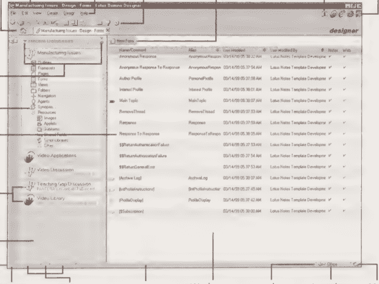

### Domino Designer 窗口的组成部分

注意，你可以在 `Designer` 中同时打开多个数据库。`Domino Designer` 会跟踪最近使用的数据库，并让你轻松访问它们。在图 2.2 中，你可以看到 `Domino Designer` 窗口的各个部分。这个窗口在很多方面与 `Notes` 客户端相似，但也有一些细微的差异。

最上面一行是窗口标题，与 `Notes` 客户端一样。当你在设计窗格中点击各种设计元素以切换上下文时，窗口标题会随之变化。例如，它可以包含数据库名称和你正在查看的设计元素类型。

菜单栏位于窗口标题正下方。菜单栏是上下文敏感的，因此当你从一种设计元素类型切换到另一种时，菜单也会随之变化。大多数元素都包含以下菜单项：`File`（文件）、`Edit`（编辑）、`View`（视图）、`Create`（创建）、`Design`（设计）和 `Help`（帮助）。在菜单栏右侧，你会看到一些用于测试数据库的图标。这些图标与普通 `Notes` 客户端中的图标不同。在普通 `Notes` 客户端中，这个区域包含全局导航图标。而在 `Domino Designer` 中，这个区域包含"属性"图标，以及用于预览设计的图标。通常至少会看到"属性"、"Notes 预览"和"Domino 预览"图标。在这三个图标之后，你可能还会看到 `Microsoft Internet Explorer` 预览图标和/或 `Netscape Navigator` 预览图标。图 2.2 中显示了 `IE` 和 `Navigator` 两种图标。

在图 2.2 中，菜单栏下方是智能图标栏。默认情况下，智能图标栏是关闭的，但这里我将其打开以说明屏幕的各个部分。该栏左侧包含全局智能图标，右侧是上下文敏感的，包含对设计任务有用的智能图标。例如，有创建表单和视图的图标。要打开或关闭智能图标栏，并修改左侧栏上的图标，可以从菜单中选择 `File`、`Preferences`、`SmartIcon Settings`。

智能图标栏下方是任务按钮。这些按钮使你可以在多个打开的窗口之间切换。每次打开新的设计元素时，都会出现一个新的任务按钮。你只需点击任务按钮，就可以轻松地在不同元素之间切换。你甚至可以在多个数据库中同时设计。这是一个非常有用的功能，因为现在审查和复制设计元素从一个数据库到另一个数据库变得更加容易。你只需打开第一个数据库的设计元素，将其复制到剪贴板，点击第二个数据库，然后粘贴即可。要关闭窗口，点击名称右侧出现的 `X`。

最左侧是一列书签。在图 2.2 中，书签列中只有一个图标。设计窗格紧挨在书签的右侧。普通 `Notes` 客户端没有设计窗格。当设计窗格打开时，它会显示最近使用的数据库以及每个数据库中包含的所有不同类型的设计元素。如果你希望在工作时保持设计窗格打开，可以点击设计窗格左上角的小图标。在 5.0 版本中，这个图标是矩形的；从 5.0.1 版本开始，它变为三角形。此时会出现一个下拉菜单。启用 `Pin Bookmarks On Screen` 选项，即可保持设计窗格打开。启用此选项后，当你关闭并重新打开设计窗格时，它会保持打开状态。如果禁用此选项，每次使用设计窗格后，它会自动关闭。在 5.0.1 版本中，设计窗格右上角 `X` 下方也有一个固定图标。点击此图标可以启用或禁用 `Pin Bookmarks` 选项。

屏幕右侧的大面积区域称为"工作窗格"。这个窗格的内容会随着你的上下文变化而变化。它可以包含设计元素列表，也可以包含你正在编辑的特定元素的工作区。

#### 状态栏

状态栏位于屏幕底部。它在所有上下文中都会出现，提供有关 `Notes` 会话各个方面的有用信息，还允许你更改某些设置（参见图 2.2）。

状态栏分为八个部分。以下是对这些部分的说明：

- **网络访问指示器**——当 `Notes` 访问网络时，网络访问指示器会显示一个闪电符号。如果你使用的是移动连接，则会显示一个带有闪烁灯光的调制解调器图标。

- **字体类型指示器**——字体类型显示你正在编辑文档时的当前字体。如果点击此指示器，可以通过在弹出列表中选择一个字体来更改当前字体。

- **字体大小指示器**——字体大小指示器的工作方式与字体类型指示器类似。你可以查看当前大小，并通过点击它并从列表中选择来更改大小。

- **字体样式指示器**——样式指示器显示当前样式（如果有的话），并允许你通过点击该指示器来更改样式。与字体类型和大小指示器一样，此指示器仅在你编辑文档或某些设计元素（如表单、子表单以及 `Help Using` 和 `Help About` 元素）时才会出现。

- **状态消息区域**——第五部分是状态消息区域。`Notes` 在这里显示状态消息，你可以通过点击此指示器查看最近的消息历史。

- **数据库访问级别图标**——此图标直观地显示你对当前选定数据库的访问级别。如果点击此图标，你将获得更详细的访问级别信息。

- **位置指示器**——位置指示器显示当前位置文档的名称。如果点击此指示器，你将看到所有位置的完整列表，并且可以从列表中选择一个新位置，或编辑当前的位置文档。

- **邮件图标**——当你有新邮件时，邮件图标会显示一个收件箱。否则，此图标会显示一个信封。如果点击此图标，你可以发送和接收邮件、打开邮件数据库以及创建新的电子邮件。

## 设计元素

图 2.2 中的设计窗格显示了可供你使用的设计元素类型。其中许多设计元素可能对你来说是 `Notes` 和 `Domino` 先前版本中的老面孔。也有一些是新的设计元素，如大纲、框架集、页面、图像和小程序。这些新设计元素的目的是让你更轻松地为你的内联网或互联网网站开发应用程序。

当你在左侧的设计窗格中点击某个设计元素类型时，右侧的工作窗格会显示一个视图，其中包含数据库中该类型的实际元素。例如，在图 2.2 中，左侧选择了"表单"，右侧则是数据库中的表单列表。注意，右侧窗格的格式与普通 `Notes` 视图类似。在本例中，你可以看到设计元素的名称以及可选的注释、可选的别名，还有上次修改时间的信息以及最后修改该元素的用户名称。

如果你在右侧工作窗格中双击某个实际设计元素的名称，所选设计元素将进入编辑模式。以下是你可以使用的设计元素列表：

- **大纲**——大纲是 5.x 版本中的新设计元素。大纲本质上是一种高级导航工具。在网站设计术语中，大纲类似于站点地图或经常出现在网页左侧的导航元素。在 `Notes`/`Domino` 术语中，你可以将大纲视为对传统导航窗格进行编程的一种方式。这就是通常列出数据库所有视图的窗格。

- **框架集**——框架集在 Web 术语中对应于 `Notes` 中的窗格。虽然在 `Notes` 的先前版本中，最终用户可以在一定程度上操纵窗格，但数据库设计师无法轻松创建窗格或框架来控制用户体验。框架集是用于控制向用户显示多个框架的布局。

- **页面**——页面对网页设计师来说非常熟悉。页面包含要展示给最终用户的主要信息。当然，如果页面包含复杂的 `HTML` 或 `JavaScript` 或调用 Java 小程序，它们可能会非常复杂。如果你有 `Domino` 背景，页面类似于 `Domino` 表单。主要区别在于页面不能包含 `Domino` 字段。它们可以包含 `HTML INPUT` 字段。

- **表单**——表单是传统 `Notes`/`Domino` 系统的一部分。表单是你查看文档时使用的可视化模板。这个模板通常包含静态信息以及字段定义。文档中的信息被提取并显示在表单上的字段位置中，然后渲染到显示屏上。

- **视图**——视图使你能够同时查看来自多个文档的表格化摘要信息。通过使用公式，你可以选择要在视图中查看的文档。视图列通常从数据库中的文档提取信息。

- **文件夹**——文件夹与视图相似。它们以表格格式呈现数据。主要区别在于，视图中的文档是通过公式选择的，而文件夹中的文档可以是任意集合。文件夹通常由最终用户用于组织数据库中的文档。

- **导航器**——导航器是在 `Notes` 和 `Domino` 4.x 版本中引入的，为用户提供了一种图形化的数据库导航方法。如果设计者在导航器中包含了指向数据库的各种链接，用户只需点击导航器的某个区域即可。

## 第二章 DOMINO设计者与集成开发环境（IDE）

导航器。导航器的主要功能现在也可以通过大纲或页面设计元素来完成。

- **代理**——代理是与数据库关联的小型程序，可以自动运行或在用户控制下运行。它们可以使用 `LotusScript`、`Java` 或公式语言编写，并且可以在 `Domino` 服务器或 `Notes` 客户端上运行。

在“代理”设计元素下方，你可以看到“*概要*”字样。这实际上并非一个设计元素。通过点击这个词，你可以获得数据库中所有已使用设计元素的概要或摘要，因此它实际上是一个命令而非设计元素。它位于设计元素类型列表中，以便无论你正在执行何种编辑任务，都能轻松访问。

以下设计元素可以在“资源”*折叠三角*与其他设计元素中找到。折叠三角是一个小三角形，通常位于可折叠部分名称的左侧。如果你点击“资源”旁边的折叠三角，将出现一组额外的资源项。这些资源代表可以在数据库内共享的项目。

- **图像**——图像资源是第 5 版的一项新功能，使你能够存储一次图像并在整个数据库中重复使用。你为每个图像命名，然后可以从其他设计元素（如页面、表单和子表单）中引用该图像。`Domino` 支持行业标准格式，如 `GIF`、`BMP` 和 `JPEG`。

- **小程序**——Java 小程序是用 `Java` 编写的小型程序，在浏览器环境（包括 `Notes` 客户端）中执行。`Domino` 设计者中的共享小程序功能使你能够将 Java 小程序保存在数据库的中心位置，为小程序命名，然后在整个数据库中重复使用。在第 5 版中，凭借 `Java` 和 `CORBA` 支持，现在有了机制使 Web 浏览器中的 Java 小程序能够访问服务器上的 `Domino` 对象模型。

- **子表单**——子表单在几乎所有主要方面都与表单相似。不同之处在于，子表单可以通过将其合并到多个不同的表单中来重复使用。子表单不能单独使用。子表单的典型用途包括页眉和其他你希望在多个表单之间保持一致性而重复使用的信息。你还可以根据上下文有条件地将不同的子表单包含在表单中。

- **共享域**——共享域是具有属性（如数据类型、编程、安全性和公式）的域定义，这些属性可以在多个 `Domino` 表单之间共享。通过使用共享域，你可以在多个表单或子表单之间实现公式编程的一致性。

- **脚本库**——你可以使用脚本库来共享通用的 `LotusScript` 或 `Java` 代码。存储在脚本库中的代码可以在整个数据库中使用。

- **共享操作**（位于“其他”部分中）——操作是通常在表单和视图中使用的小型程序。用户可以通过点击操作按钮或从菜单中调用操作。设计者可以启用这两种选项中的任一种或两种。

- **其他**——“其他”部分还包括数据库图标、“使用数据库”和“关于数据库”文档，以及在数据库打开时调用的“数据库脚本”。

### 大纲

现在我将总结 `Domino Designer` 第 5 版的各种设计元素。每个元素都将在后续章节中更详细地介绍，但本章为你提供了这些元素的概述。

如果你在右侧“工作”窗格中双击设计元素的名称，你将进入该元素的编辑模式（参见图 2.3）。

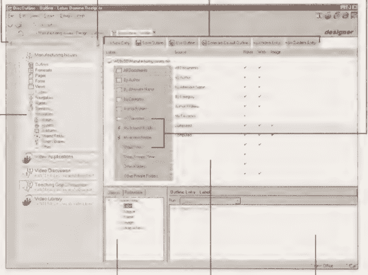

图 2.3 展示了大纲的设计环境。每个不同设计元素（如大纲、框架集、页面、表单等）在“工作”区域窗格中的屏幕布局不同，但大纲布局相当典型。

在“设计”窗格的右侧，窗口布局是三窗格视图。大纲的工作区域位于顶部窗格。右下角的窗格称为“程序员”窗格，包含两个部分。左侧通常是一个区域，你可以查看对象列表和参考资料。在“程序员”窗格的右侧，你通常可以输入影响设计元素的信息。

操作按钮位于任务按钮下方，显示你可以对当前设计元素类型执行的操作。对于大纲，你可以创建新条目、保存大纲、在页面上使用（嵌入）大纲、生成默认大纲以及控制大纲条目的缩进。在图 2.3 中，你可以看到有几个大纲条目。它们以以下内容开始：所有文档、按作者、按备用名称和按类别。

对于每个大纲条目，你可以通过查看每个大纲条目右侧的复选标记来确定该条目适用于 `Notes` 客户端、Web 客户端还是两者。你还可以提供一个小图像来替换大纲条目标签旁边出现的小图标。

在“程序员”窗格左半部分的“信息列表”窗格中，你可以看到对象的重要属性和方法。例如，在图 2.3 中，你可以看到大纲条目的所有属性。在这种情况下，大纲条目有五个属性：标签、源、框架、图像和“隐藏时”。

要修改条目的属性，请首先在顶部窗格中选择该条目，然后在“程序员”窗格的左侧选择属性。在右侧的“程序员”窗格中，你可以输入属性的定义。

我将在第 6 章“使用大纲、框架集和导航器”中更详细地介绍大纲。

### 框架集

框架集是 `Notes` 和 `Domino` 第 5 版的新功能。图 2.4 展示了框架集设计者。在这种情况下，我隐藏了“设计”窗格，因为在设计框架时，拥有尽可能多的屏幕空间通常更容易工作。


图2.4

你可以使用框架集设计者来设计框架的布局。

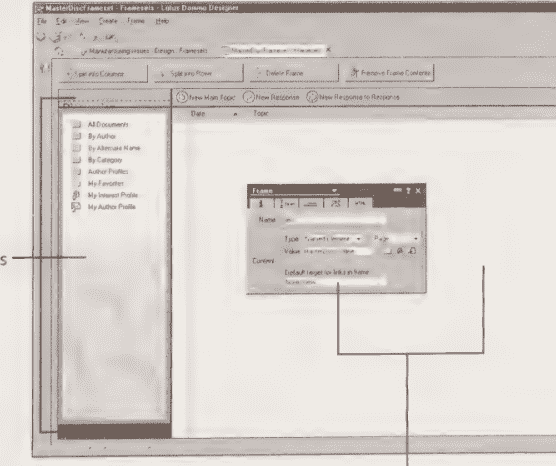

请注意，使用框架集设计者，你可以添加和删除框架、移动框架边框以及更改每个框架的内容。在图2.4中，实际上定义了四个框架，左边三个，右边一个。左边中间的框架被高亮显示。你可以在属性框中看到，左边这个中间框架的内容是一个名为`MasterDiscOutline`的页面。该页面包含一个大纲控件，当用户从页面上的大纲中选择一个项目时，默认目标是右侧框架。右侧框架名为`NotesView`，目标在属性框的底部指定。

我将在第6章更详细地介绍框架集。

### 页面

页面是Domino Designer第5版引入的设计元素（参见图2.5）。如果你熟悉其他Web设计工具，页面很容易理解。如果你来自Notes/Domino背景，页面就像一个简化的表单。首先，像表单一样，你可以使用某些设计元素。例如，你可以插入水平线、区段、热点、表格、图片、导航器以及其他几种元素。但是，你不能向页面添加字段。页面可以作为嵌入视图的容器。但请记住，你不会通过页面创建文档，并且页面不会出现在任何视图中。此外，你放置在页面上的任何内容都不会被全文索引或搜索，因为它是一个设计元素，而不是文档。你可以在URL中按名称引用页面。

图2.5

你可以在页面上定义富文本和热点。

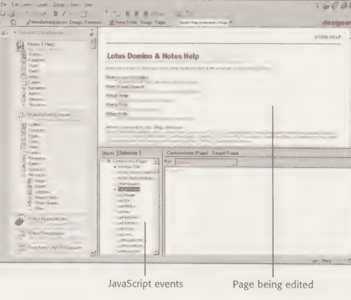

图2.5向你展示了帮助文件中的一个页面。通常，你想使用标准文档和表单，但借助页面功能，你可以对单页进行布局。如果你需要的话，可以使用单页。请记住，页面并未建立全文索引。在这种情况下，Help数据库使用一个页面作为欢迎页，这通常不需要在搜索中出现。当你定义页面时，可以使用Domino Designer的富文本编辑器以WYSIWYG方式编辑页面。你可以更改字体并使文本加粗。此外，你也可以像编辑HTML文本一样编辑页面。通过打开页面属性框并选中“将页面内容视为HTML”框，你可以直接向页面添加HTML标记。如图2.5所示，Domino也支持JavaScript，你可以使用Designer定义JavaScript处理。

使用字体和颜色时请务必小心。当你的页面通过用户的Web浏览器在Web上显示时，你无法控制软件级别、用户计算机上安装的字体或用户显示适配器的能力。你应该尽量避免使用花哨的字体或极端的颜色。一个允许显示任意字体的技巧是将字体渲染成位图。然后你可以显示该位图图像。通过这种方式实现字体，用户无需安装任何特定字体。如果你确实要为Web使用位图，请确保仔细关注其大小，因为大位图可能会导致使用调制解调器连接的用户下载时间过长。

我将在第3章“使用Domino Designer开发页面”中更详细地介绍页面及其使用方法。

### 表单和子表单

表单就像可视模板，可用于显示文档。Notes和Domino中的文档是基本的数据结构。Notes和Domino中的几乎所有数据都存储在数据库中的文档内。甚至设计元素也存储在数据库的特殊文档中。

文档通过名称在条目中存储信息。每个条目可以包含一个或多个值，但通常每个条目存储单个值。这些值可以是文本、日期/时间或数字。文档中的每个条目都有一个名称，因此你可以通过名称检索该值。

在图2.6中，你可以看到屏幕中间正在编辑的Domino表单。在表单中，你可以看到有几个字段，每个字段名称周围都有一个框。该表单通过将表单中的字段名称与文档中的条目名称关联起来来显示文档。只要文档中存在与该字段同名的条目，该条目的值就会显示出来。

在编辑表单时，你可以看到静态信息以及为表单定义的各种字段。例如，在图2.6中，你可以看到静态文本“主题:”和“类别:”。注意还有一个名为`Subject`的字段。你可以区分它们，因为字段名称是那些周围有框的名称，例如`DateComposed`、`WebCategories`和`NewCats`。名称右侧的图标表示数据字段的类型。例如，日历中的小“1”表示它是日期字段，因此`DateComposed`将显示日期。`WebCategories`有一个向下的小箭头，表示它是一个下拉列表。`NewCats`以及`Subject`字段都有一个“T”，表示它们是文本字段。富文本字段，例如名为`Body`的那个，用斜体`*T*`表示。当你使用Designer时，你将了解这些符号，它们非常有用。在图2.6的Designer窗口中，你会注意到表单右侧出现了一个额外的窗格。这个窗格称为操作窗格，包含已定义的操作列表。操作可以显示为操作按钮或在操作菜单中，或两者兼有。当你在操作窗格中高亮显示一个操作时，它将在屏幕底部设计窗格的对象窗口中被选中。你可以提供一个程序，当用户激活该操作时将执行该程序。

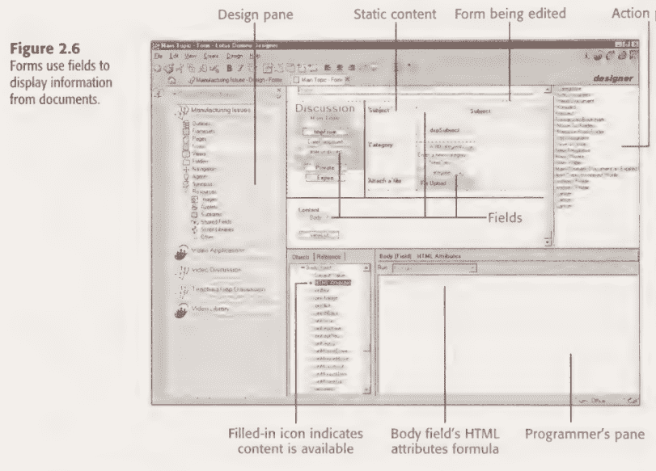

底部编程器窗格的左侧显示表单中可用的对象。有一个全局对象、表单对象、字段对象、嵌入对象以及表单中的操作。每个对象通常都有方法和属性。你可以在图2.6中看到，`Body`字段定义了额外的HTML属性。这些属性显示在编程器窗格的右半部分，并将用于HTML客户端。

> **提示**

编程器窗格提供的一个很棒的新功能是能够查看属性或方法是否包含定义。在Notes和Domino的先前版本中，你必须下拉一个列表框，然后打开一个元素来找出是否有任何定义。通常，没有定义任何内容，这会导致浪费精力。现在，如果有定义，属性的图标会被填充。你可以一目了然地看到哪些属性和方法有定义，并可以直接转到它们以了解其功能。

你编辑子表单的方式与编辑表单相同。表单和子表单的主要区别在于，子表单可以从数据库中的多个不同表单中引用。子表单设计元素类型位于设计窗格的资源区域内。我将在第4章“创建和使用表单及子表单”中更详细地介绍表单和子表单。

### 视图和文件夹

视图用于显示文档的摘要信息（参见图2.7）。正如表单向用户显示单个文档一样，视图显示来自一组文档的信息。通常，视图的每一行是从单个文档中提取的信息，因此如果显示20行，它们代表20个不同的文档。

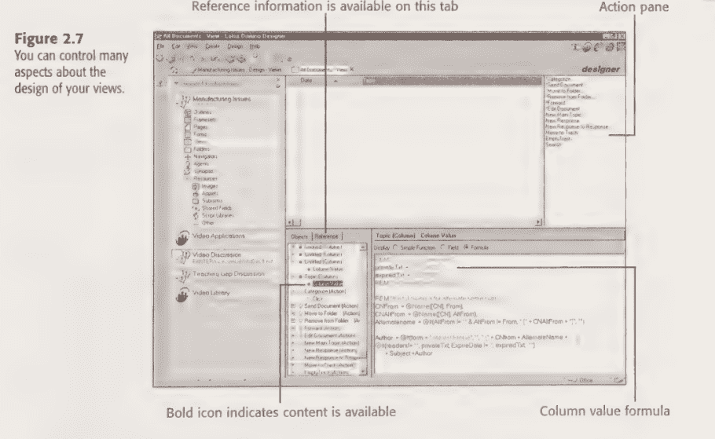

在图2.7中，你可以看到用于编辑视图的Designer窗格。主要的工作窗格显示视图本身，紧挨着其右侧你可以看到操作窗格。操作窗格显示可用的视图操作，类似于表单操作窗格。底部的编程器窗格左侧显示对象，右侧显示定义。在图2.7中，你可以看到“主题”列中要显示的值是使用公式计算的。你可以使用简单函数、文档字段或公式来在视图中显示信息。

在图2.7中，编程器窗格的左侧，你可以看到“对象”选项卡旁边有一个第二个选项卡。这个选项卡用于参考信息。如果你单击“参考”选项卡，你可以找到数据库中存储的所有字段的名称，以及@公式和@命令的参考信息。我将在第5章“设计视图和文件夹”中更详细地介绍视图和文件夹。

### 导航器

导航器在Notes和Domino的第4版中引入。在某些方面，它们是当前页面概念的前身。你可以向导航器添加图形元素，提供到多个不同位置的链接，并使用它们来提供吸引人的用户界面。有几种原因你可能想要使用导航器。

首先，你的数据库中可能已经有导航器，因此在第5版中提供它们是为了与4.x版本兼容。其次，导航器提供了一个使用简单图形编辑工具集的机会，这是页面元素无法提供的。如果你想创建带有关联热点链接的图形元素，导航器是一个不错的选择。第三，你现在可以将导航器嵌入到页面中，从而两全其美。

我将在第6章更详细地介绍导航器。

### 代理

*代理*是包含在Domino数据库中的程序（参见图2.8）。它可以用LotusScript、Java或公式语言编写，也可以是通过对话框输入的简单操作。代理可以通过多种方式触发运行，例如当某些事件发生时、在特定时间间隔或由用户手动触发。

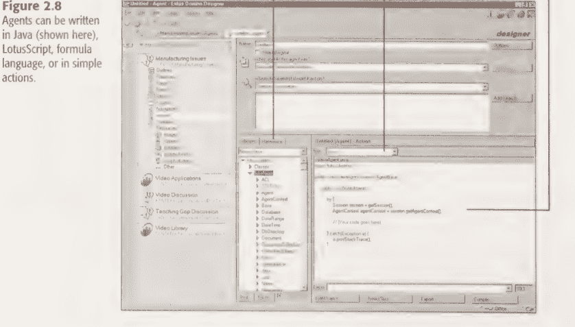

在图2.8中，你可以看到代理的Domino Designer窗格。在工作区窗格的上半部分，你看到代理的名称以及该代理是共享的还是私有的。你还可以指定此代理的触发机制，这可以是时间间隔或事件，例如在数据库内创建新文档时。

当代理运行时，它可以访问一组适用的文档。例如，如果代理在粘贴新文档时被触发，则粘贴的文档可用。如果代理按计划运行，例如每小时一次，文档可以是新的和修改过的文档，也可以是数据库中所有文档的完整集合。如果代理需要，你甚至可以添加更复杂的搜索标准。

下面的编程器窗格包括两个部分。在右侧部分，你可以用Java（如图所示）、LotusScript、公式语言或简单操作编写你的代理。参考信息可以出现在左侧。在Java部分，你可以找到Domino对象以及核心Java类（例如`java.awt`、`java.lang`等）的信息。如果你浏览参考资料并找到你想使用的方法，你可以双击它，它将被传输到设计窗格的编程区域。我将在第12章“Java代理、小程序和应用程序”、第13章“使用Domino Designer IDE创建Java代理”和第14章“将Domino Designer和第三方IDE与Java结合使用”中更详细地介绍Java代理编程。

### 资源

“资源”折叠组内有五种主要类型的资源，“其他”类别中还包含五种额外类型的资源。这五种主要类型是图像、小程序、子表单、共享字段和脚本库。在这五种类型中，图像和小程序是Domino第5版中的新增共享资源。我已经讨论过子表单了，因此在接下来的几节中，我将介绍图像、小程序、共享字段和脚本库。将信息存储在共享资源中允许你将这些资源与数据库一起复制。如果资源存储在文件系统中（就像大多数Web服务器那样），资源就无法轻松复制。

#### 图像

图像资源使你可以导入将在网站多个地方使用的图像，并在数据库中仅存储一次。你可以为资源命名，如图2.9所示，然后从数据库的其他部分引用图像名称。

图像资源对于存储你希望在网站多个页面上显示的徽标、页眉或其他图形非常有价值。此外，你可以在一个图像资源中存储多个图像。如果你有一组相关图像，这可以节省额外的开销。

共享图像

#### AddTopic 共享图像资源

**图 2.9**

图像库通过让您存储并命名单个图像资源副本来节省空间。

共享资源类型

APPLETS

Applet 是从服务器下载并在 Web 浏览器中执行的 Java 程序。以下是 applet 开发及执行的典型步骤：

- 1. 在 Java 开发环境（如 IBM Visual Age for Java、Borland JBuilder、NetObjects Bean Builder、Symantec Visual Café 或 Microsoft Visual J++）中使用 Java 语言开发 applet。

**注意**

如果使用 Microsoft Visual J++，可能会遇到一些困难，具体取决于您使用的版本。在法院裁决之前，Microsoft 使用了一些非标准的 Java 调用约定。Microsoft 最近发布了一个符合 Sun Microsystems 的 Java 本地接口（JNI）定义的 Visual J++ 版本。如果使用 Visual J++，请务必仔细测试 Java applet 的兼容性。

- 2. 在开发环境中编译 applet，以创建一组类文件。类文件类似于编译器目标代码。它们是定义机器操作的二进制文件。然而，类文件是独立于机器的。它们在一个称为 Java 虚拟机（JVM）的虚拟机中被读取和执行。所有主要的 Web 浏览器以及 Notes 客户端和 Domino 服务器都包含 JVM。JVM 是通过禁止 Java 程序访问系统资源（如文件系统）来强制 applet 安全性的组件。

- 3. 类文件可以选择性地分组在存档文件中，类型可以是 ZIP、JAR 或 CAB。这些格式以压缩格式存储一组文件。

- 4. 存档文件存储在 Web 服务器可以找到的目录或 Domino 数据库中。

- 5. 开发引用 applet 的 Web 页面，通过特殊的 HTML 标签。这些标签指定 applet 名称以及 applet 所需的任何参数。

- 6. 当用户查看引用 Java applet 的 Web 页面时，applet 类文件从服务器发送到 Web 客户端，并加载到 Web 浏览器的 JVM 中执行。

- 7. applet 在 JVM 中持续运行或运行直至完成。

注意 agent 和 applet 之间的区别。Domino agent 可以用多种语言编写，包括 Java、LotusScript、公式语言或简单操作。Applet 只能用 Java 编写。Agent 可以按预定计划触发，或在文档到达数据库时触发。Agent 可以在 Notes 客户端或服务器上运行，但不能在非 Notes Web 浏览器中运行。Applet 通过 HTML 标签触发，且仅在客户端运行。Applet 可以在 Web 浏览器或 Notes 客户端中运行，但不能在服务器上运行。

您可以在 Domino Designer 中用 Java 开发 agent，但 Designer 不包含开发 applet 的功能。您必须使用其他第三方工具来开发 applet。创建后，您可以将 Java applet 类文件导入到数据库中。我将在第 15 章“开发与 Domino 配合使用的 Java Applet”中更详细地介绍 applet。

#### 共享字段

Domino 字段在表单的上下文中定义。页面不能包含字段。字段用于数据输入和显示。它们可能包含格式信息以及编程信息。字段可以具有执行输入验证和转换等操作的公式。

通常，每个表单包含其所含字段的定义。但是，您可能有一个应用程序，其中某些字段显示在应用程序内的多个单独表单上。一些常见的例子可能是名称、文档创建日期或其他用户信息。

共享字段使您能够定义字段的通用编程属性，然后在多个表单之间共享这些定义。例如，假设您有一个具有复杂输入验证要求的字段。您可以编写一次验证公式，共享该字段，然后任何时候使用该字段时，验证公式将始终相同。

#### 脚本库

脚本库使您能够存储在整个数据库中使用的子程序。您可以创建 LotusScript 或 Java 库，但不能在库中混合使用 LotusScript 和 Java 类型。但是，您可以拥有两个或多个单独的脚本库，因此可以拥有每种类型的一个或多个。您为每个脚本库指定一个单独的名称。请注意（截至 5.0.1 版本），您不能使用脚本库功能来存储 JavaScript 程序，只能存储 LotusScript 和 Java。

创建脚本库后，您可以向库中添加子程序，然后从数据库中的其他位置引用它们。在共享库中共享您的 LotusScript 或 Java 代码是促进重用的一种良好技术。

## 小结

在本章中，我向您展示了如何启动 Domino Designer。该程序现在与 Notes 客户端分离。您可以直接从桌面启动可执行模块，或从 Notes 客户端内部启动。

启动 Designer 后，有许多不同类型的设计元素可供您使用。第 5 版中的一些新元素包括大纲、框架集和页面。您可以使用这些元素来创建 Web 站点，甚至无需使用原始的 Domino 设计元素。当然，通过使用传统的 Domino 表单和视图，您还拥有其他强大的工具供您使用。

第 5 版使您能够在数据库中使用多种类型的共享资源。这减少了容纳 Web 站点所需的存储量。此外，通过将所有设计元素存储在数据库中而不是操作系统文件结构中，这些元素更易于管理。

在后续章节中，我将向您详细介绍如何使用设计元素来创建支持 Web 的应用程序。

在本章中，我向您提供了有关如何使用 IDE 的信息。此外，我还向您介绍了一些主要的 Domino 设计元素。

## 本章回顾

- 1. 要编写在 Web 浏览器中显示并要求用户输入姓名和地址的 Web 应用程序，使用 Domino 表单还是页面更合适？为什么？

- 2. 假设我想创建一个 Domino 数据库来存储零件库存，并将此库存作为项目列表显示给用户。我应该使用哪个 Domino 设计元素？

- 3. Domino agent 和 applet 之间有哪些区别？

- 4. 我可以使用共享库功能来存储 JavaScript 程序吗？

- 5. 对图像、applet 等使用共享资源有哪些好处？

- 6. 除了帮助系统之外，您还可以在哪里找到有关 Domino Designer 中 Domino 对象或 Java 类的参考信息？

- 7. 您可以使用 Domino Designer 开发 Java applet 吗？其他供应商提供的用于开发 Java applet、应用程序和 agent 的工具有哪些？

# 第 3 章

#### 使用 Domino Designer 开发页面

本章内容

- 使用页面编辑器 46

- 增强您的页面 51

- 嵌入图片 61

- 使用规则、分节符和分页符组织数据 65

在 Notes 和 Domino 的早期版本中，主要的用户界面元素是表单。Domino 表单使您能够将静态文本和图形元素与字段一起放置，作为显示的模板。表单与不同的文档数据项相结合，并显示给最终用户。

Notes 和 Domino 的第 5 版引入了一种新的 Web 开发范式——页面。好吧，它并不是真正的新事物。这种范式正是其他 Web 页面开发工具所使用的，现在可以在 Domino Designer 中使用。现在 Domino 结合了以前版本的 Domino 的优点与其他 Web 开发工具的优点，您可以混合和匹配它们的功能。

## 使用页面编辑器

现在，这是完全不同的东西。如果您已经熟悉 Notes 和 Domino 设计，但对 Web 设计相对较新，让我向您展示页面开发与以前版本相比有何不同。为了说明，首先我将创建一个名为 Page Design 的新空白数据库。

您可以通过从桌面启动 Domino Designer 来跟随操作。要创建新数据库，您可以按 Designer 欢迎页面上的“创建新数据库”图标，或从菜单中选择“文件”、“数据库”、“新建”。将新数据库的标题和文件名命名为 **Page Design**。您可以将服务器保留为 **Local**，将模板名称保留为 **-Blank-**。我在 WEBJ50 目录中创建了我的数据库，但您可以使用 Domino 的根目录或您创建的其他目录。

### 创建您的第一个页面

创建数据库后，单击数据库设计窗格中的“页面”设计元素。您的屏幕应类似于图 3.1。

按照以下步骤创建新页面：

- 1. 打开要用于页面的数据库。

- 2. 在设计窗格中选择“页面”图标。


- 3. 单击“新建页面”操作按钮。您的新页面将出现。

这里就是事情变得有趣的地方。要跟随此示例，请执行以下步骤：

- 1. 通过单击屏幕右上角的“属性”图标或选择“文本”、“文本属性”来打开属性框。使用默认字体（`Default Sans Serif`），将大小更改为 24 磅，样式更改为**粗体**。

- 2. 在页面的第一行输入 **Some Text**。

## 任务完成

3. 跳过一行，然后从菜单中选择“文本”>“透传 HTML”。注意字体大小会变更为 10 磅，且样式会自动变为“纯文本”。

4. 在页面中输入以下内容：

```
<h1>This is a Header 1</h1>
```

图 3.1 选中了“页面”设计元素的 Domino Designer。


这行使用了超文本标记语言（HTML）标签。HTML 标签通常有一个开始标签和一个匹配的结束标签。在这里，`<h1>` 开始标题文本，`</h1>` 结束它。当你阅读 HTML 时，前面带有斜杠的标签表示它是一个配对标签的结束标签。注意 HTML 文本具有灰色背景，以便你可以区分 HTML 和直接在页面上输入的文本。此时，你的屏幕应该如图 3.2 所示。

这是测试你的网页的好时机。屏幕右上角的图标可以用来调用 Web 浏览器。如果你安装了 Internet Explorer 或 Netscape Navigator（或两者都安装了），你会看到它们各自的图标。要预览你的测试页面，请执行以下操作：

1. 单击其中一个浏览器图标来测试你的网页。如果你愿意，也可以选择“设计”>“在 Web 浏览器中预览”。此时，你会看到 Web 浏览器选项列表。选择你想要使用的 Web 浏览器。

2. 系统会提示你为页面输入名称。你可以为页面命名任意名称。我选择了 `PageTest`。

3. 单击“确定”，你的 Web 浏览器就会出现。Domino Designer 选择的浏览器将是你所选择的浏览器。在图 3.3 中，我将 Domino Designer 移到左侧，将浏览器放在右侧，以便你可以并排看到 Designer 版本和浏览器版本。

图 3.2 你可以直接在页面上输入一些文本，同时加入一些 HTML。

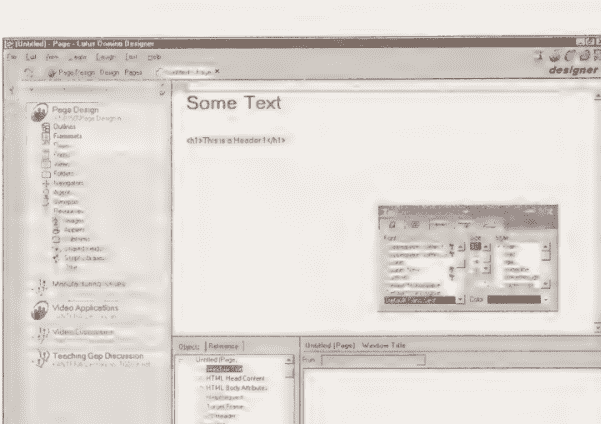

图 3.3 你可以使用 Internet Explorer（如图所示）或 Netscape Navigator 预览你的页面。


关于你的第一个网页，有以下几点需要注意：

- `Some Text` 的字体看起来不对，而且字号虽然很大，但与源文件略有不同。

- `This is a Header 1` 的字号比输入时要大，字体也不同。此外，开始标签和结束标签都消失了。

- 注意浏览器窗口中的统一资源定位符（URL）地址包含 `localhost`、数据库名称、页面名称以及打开页面的命令。

我想立即向你展示使用屏幕右上角浏览器按钮来测试网页设计的重要性和便利性。以下是对你的网页看起来可能与你预期的不同的解释：

- 第一行在浏览器中的显示与在 Designer 中不同，因为 Designer 中的字体在页面显示时不一定对浏览器可用。因此，标准 Web 字体已经被定义。由于我们使用了默认字体（`Default Sans Serif`），没有字体信息被发送到 Web 浏览器，文本以浏览器的默认字体显示，即 Times Roman。字号也被标准化了，默认情况下无法使用精细粒度，所以浏览器使用近似大小。

- `h1` 标签默认关联了一个字号，文本会使用该字号。其他标题标签——`h2`、`h3` 等——也已定义并使用不同的样式。字体也与 `h1` 标签关联，`h1` 标签再次使用默认浏览器字体。

我应该在此处指出，使用 HTML 你可以控制演示的许多不同方面。我在第 7 章“使用超文本标记语言（HTML）进行页面设计”中会更详细地介绍 HTML。

作为使用“透传 HTML”文本属性的替代方法，你可以将文本用方括号（`[]`）括起来，它将被视为透传 HTML。这使得直接在页面中混合 HTML 源代码变得非常容易和方便，而无需时刻借助菜单项。以下是我们使用方括号语法的示例：

```
[<h1>This is a Header 1</h1>]
```

### 页面属性

页面属性框的“页面信息”选项卡如图 3.4 所示。

图 3.4

你可以将整个页面视为 HTML。

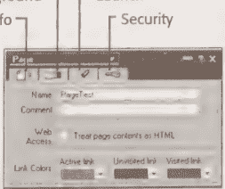

注意，你可以将整个页面视为 HTML。要这样做，只需勾选标题为“将页面内容视为 HTML”的复选框。如果你勾选此复选框，则不必包含方括号，因为你的整个页面将自动被视为 HTML。如果你是 Domino 的新手但已熟悉 HTML，或者你想使用单独的 HTML 编辑工具然后直接导入 HTML，这个设置非常有用。

我已经向你展示了在页面中指定 HTML 的三种不同方法：

- 在页面上创建文本，然后突出显示该文本并赋予其“透传 HTML”属性。你在“文本”菜单中执行此操作。使用此方法，你可以混合搭配 HTML 和非 HTML。

- 在页面上任何你希望被视为 HTML 的文本周围放置方括号（`[]`）。你不必使用菜单。使用此方法，你可以混合搭配 HTML 和非 HTML。

- 转到页面属性框并勾选标签为“将页面内容视为 HTML”的复选框。这将把页面的全部内容视为 HTML。这使得从另一个 HTML 创作工具直接导入文本更加容易。请记住，当你启用 HTML 设置时，页面中的文本将使用 HTML 格式化规则（例如其对空格的处理方式），而不是 Domino 的格式化规则。

在“页面属性”对话框中，你还可以设置“活动链接”、“未访问链接”和“已访问链接”的颜色。通常，你应该将这些保留为默认值。

### 粘贴和导入图形背景

你可以指定特定颜色或图形图像作为页面的背景。要更改图形背景，请执行以下操作：

1. 打开页面的“页面属性”框。

2. 单击“背景”选项卡（参见图 3.5）。你可以通过打开下拉框来选择背景颜色。

图 3.5

你可以使用“页面属性”框设置背景颜色和图像。

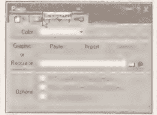

3. 使用以下方法之一获取图形背景：

- 你可以使用其他图形编辑程序并将图形复制到剪贴板。将图形复制到剪贴板后，转到“页面属性”对话框并单击“粘贴”按钮。

- 如果你想从文件导入背景图像，请单击“导入”按钮。系统会提示你，你可以找到你的文件。支持的图形导入文件类型有 BMP、GIF、JPEG、PCX 或 TIFF 5.0。

- 如果你已将图形图像保存为图像资源，请键入名称或单击“图像资源”行上的文件夹图标。你可以通过单击 `@` 符号来指定公式。该公式必须生成图像资源的名称。

4. （可选）你可以指定在设计期间或针对 16 色显示隐藏图像。在设计期间关闭图像可以使页面编辑更容易。在 16 色显示器上，有时 256 色（或更高）的照片或图形看起来更像是现代艺术而非吸引人的背景。这可能会分散用户的注意力，因此你可以关闭背景。

5. （可选）你可以指定关闭图形背景的平铺功能。通常，默认情况下，图形背景是平铺的。

### 增强你的页面

Domino Designer 中有大量用于创建用户界面元素的功能。这些元素包括表格、图片和区域，以及许多其他元素。让我们看看可以在页面编辑器中使用的一些功能，以增强你的页面。

#### 创建表格

虽然你可以使用 Domino Designer 通过所见即所得（WYSIWYG）编辑器创建页面，但 Domino 最终在将页面发送到 Web 浏览器之前会将其转换为 HTML。HTML 的一个限制（特性）是文本行会自动换行，因为浏览器会为你进行格式化。所以，如果你仔细将输入文本排列成列，浏览器会愉快地忽略你设置的列。你可以做什么来格式化你的文本，从而从你的页面中获得你想要的艺术效果呢？

你可以使用表格。事实上，使用表格是一项重要的技术，因为表格可以用作格式化工具，除了其传统的显示文本和数字的用途之外。HTML 4 具有额外的格式化功能和样式来完成定位，但许多用户尚未使用最新的浏览器，因此学习如何使用表格仍然很有价值。

使用 Domino Designer 第 5 版，你可以创建几种不同样式的表格，包括标签页界面、定时界面以及根据字段内容（在表单中）显示不同行的表格。然而，要格式化页面的不同元素，你只需要基本类型的表格。稍后我会向你展示其他类型。

##### 添加行和列

创建表格后，你可能需要添加行或列。根据添加的位置和数量，有多种添加行和列的方法。将鼠标光标点击到表格内，然后点击“表格”菜单（参见图 3.7）。

图 3.7 有多种添加和删除表格行和列的方法。

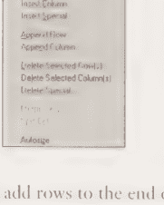

如果要在表格末尾添加行，可以选择“追加行”选项。该行将被添加到表格底部。要添加列，请选择“追加列”菜单选项。该列将被追加到表格的右侧。

要在表格的开头或中间插入行或列，请选择“插入行”或“插入列”菜单选项。行或列将被插入到当前选定行或列的前面。你也可以在设计模式下按 `Tab` 键退出表格的最后一个单元格来添加新行，系统会自动为你添加一个新行。

当你需要插入或追加多行或多列时，请使用“插入特殊”菜单选项。此时将出现“插入行/列”对话框（参见图 3.8）。

图 3.8

使用“插入特殊”向表格中插入多行或多列。

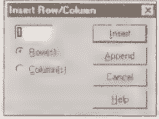

输入要添加的行数或列数，然后选择“插入”以在当前选定的行或列之前插入。使用“追加”将所需的项目追加到表格末尾。

##### 删除行和列

删除行和列的操作与插入类似。请按照以下步骤删除行或列：

- 1. 选择一个单元格——即要删除的一组行中最上方的单元格，或一组列中最左侧的单元格。

- 2. 拖动鼠标选择其余行或列中的单元格。如果删除行，你必须在要删除的每一行中至少选择一个单元格。如果删除列，请确保在要删除的每一列中至少选择一个单元格。

- 3. 选择单元格后，选择“表格”→“删除选定行”来删除行，选择“表格”→“删除选定列”来删除列。

> **注意**

“删除特殊”可用作删除连续行或列的快捷方式。首先，选择最上方或最左侧的单元格（如前面说明中的步骤 1）。然后，选择“删除特殊”。系统会提示你输入要删除的行数或列数。

##### 表格属性

你可以通过点击“属性”图标、执行“编辑”→“属性”，或按键盘上的 `Alt+Enter` 来查看表格属性。你也可以点击表格内的任意单元格，然后选择“表格”→“表格属性”。当属性对话框出现时，如果“表格”未显示在对话框的顶行，你可以点击下拉框并选择“表格”（参见图 3.9）。

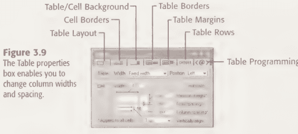

属性对话框中的“表格布局”选项卡（第一个选项卡）允许你更改宽度类型（固定、适应窗口或适应边距）、表格位置（左对齐、右对齐或居中），以及列和行之间的固定间距。请注意，你在列和行字段中输入的数值适用于所有列和行。此外，你输入的尺寸适用于单元格的每一侧。例如，如果你输入列间距为 0.5"，则列的左右两侧各为 0.5 英寸，这意味着列与列之间总共有一英寸的间距。请注意，列间距、行间距和最小高度在 Web 应用程序中不受支持。但其中一些值可能会影响单元格的宽度，而单元格宽度是按列支持的。

##### 更改表格边框和边距

图 3.10 显示了“单元格边框”选项卡。此选项卡影响的是单元格边框，而非整个表格的边框。“边框”选项卡控制的是整个表格的边框。


你可以将单元格边框的样式设置为实线、脊状或凹槽。点击“颜色”下拉框可以选择边框颜色。如果你点击“全部设为 0”按钮，所有边框将消失，因为所有边框的粗细都将为零。如果你将所有边框设为 1，则将获得默认粗细。请注意，脊状和凹槽样式选项以及单元格单独着色在 Web 浏览器中不受支持。你可以设置表格的边框颜色，但所有单元格将显示相同的颜色。

将所有边框设为零，同时设置列宽，可以让你指定页面上的文本格式。通过使用表格，你可以相对容易地放置元素。只需更改表格列宽，即可指定各个项目之间的间距。如果你的目标用户使用的是 Web 浏览器，这一点尤其有用。

如果你熟悉 Notes 中的布局区域，你应该知道它们无法在 Web 浏览器中渲染。通常，在 Notes 和 Domino 的早期版本中，你可能使用布局区域来实现精确定位。你应该熟悉将表格作为实现格式化的另一种手段，因为你可以使用零粗细的表格来调整位置，这在浏览器和 Notes 客户端中都能正常工作。你可以在 Domino Designer 中打开一个讨论数据库，查看“主主题”表单，以了解这些零粗细表格如何在表单中定位文本。

“表格边框”选项卡用于更改影响整个表格而非特定单元格的设置。你可以在图 3.11 中看到“表格边框”选项卡。

图 3.11

“表格边框”选项卡允许你更改表格边框的样式、颜色、粗细和间距。

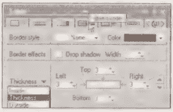

在“表格边框”选项卡中，你可以将表格边框样式设置为“无”或八种预定义样式之一，如实线、双线或虚线。这是围绕表格的边框所使用的线条样式。每个单元格都有自己的边框，但你可以在整个表格周围添加额外的边框。你可以设置表格边框的粗细和颜色。你还可以更改表格与其边框之间的间距，这种间距称为内边距。外边距设置是指表格边框外部将表格与周围环境分隔开的空间。（外边距设置在 Notes 的一个早期测试版中最初被称为“外部空间”。我想他们大概是觉得这个选项太超前了。）要设置粗细、内边距和外边距，首先使用下拉框选择要设置的项目，然后调整上、下、左、右的数值（参见图 3.11）。这三个参数中的每一个都可以有四个不同的数值。你可以使用对话框右侧的微调按钮同时增减所有四个值。最后，你可以通过勾选“阴影”复选框来添加阴影效果。如果启用了阴影，你可以控制其宽度。

“表格边距”选项卡紧邻“表格边框”选项卡的右侧，可用于指定表格的左右边距。你可以将每个边距指定为偏移量测量值或窗口的百分比。表格边距影响的是整个表格，而非单个单元格。

##### 实现新闻报栏式列

从第 5 版开始，你可以将表格中的列设置为新闻报栏格式，文本从表格的一列自动流入下一列（参见图 3.12）。

要创建基本表格，请执行以下操作：

- 1. 将光标放在页面（或表单）上你希望表格出现的位置。

- 2. 选择“创建”→“表格”。你将看到一个对话框，如图 3.6 所示。我们关注的是创建基本表格，它使用第一个图标按钮。你可以保留默认的行数和列数，也可以输入你想要的行数和列数。你的表格可以适应窗口宽度，也可以是固定宽度。默认情况下，表格为固定宽度。

图 3.6 创建表格时，你可以输入其尺寸、宽度类型和表格类型。

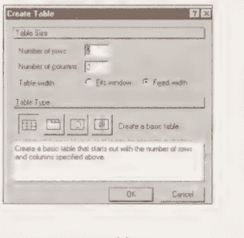

- 3. 点击“确定”创建表格。

默认情况下，表格创建时会显示边框，并将延伸到页面的整个宽度。

#### 使用 Domino Designer 开发页面

##### 图 3.12

“表格边距”选项卡用于创建类似报纸风格的、从一栏流向另一栏的排版效果。


在图 3.12 中，你可以看到表格在 Domino Designer 以及 Web 浏览器中的显示效果。该图展示了表格在 Domino Designer、Netscape Navigator 和 Microsoft Internet Explorer 中的格式。实现报纸风格的排版效果需要勾选“**在单元格之间自动换行**（`Inside Table Wrap Between Cells`）”选项。启用此功能后，必须在“**高度**（`At Height`）”输入框中指定列高。

文本会在同一行内的单元格之间流动。文本不会从右侧最后一个单元格自动换行到下一表格行。如果你在右列输入的文本超过了列高设置，表格行高将会自动扩展以适应更大的高度。

##### 设置表格/单元格背景

在 5 版本中，为表格设置背景颜色和/或图像有很多新选项。“表格/单元格背景”选项卡是表格属性框中的第三个选项卡（参见图 3.13）。

Web 表格必须是纯色。不过，由于你可能正在开发同时供 Notes 客户端和 Web 浏览器使用的应用程序，因此我将完整介绍相关选项。

你可以在属性框中设置表格颜色样式，这将一次性为整个表格着色。涉及两种颜色：一种称为“**颜色**（`Color`）”，另一种称为“**主体**（`Body`）”。你可以通过对话框中的下拉框更改这些颜色。默认情况下，“主体”颜色使用两种灰色色调：深灰色和高亮浅灰色。在“表格样式”下拉列表中，你可以选择以下样式之一：

- 无（`None`）— 无自动行或列标题高亮。

- 纯色（`Solid`）— 整个表格为单一颜色。这是 Web 浏览器唯一支持的选项。

- 交替行（`Alternating rows`）— 隔行使用不同颜色。默认使用两种灰色色调。

- 交替列（`Alternating columns`）— 隔列使用不同颜色。默认使用两种灰色色调。

- 左侧和顶部（`Left and Top`）— 突出显示顶行和左列。我已更改颜色，使标题颜色为深色，主体颜色为浅灰色。这是会计或电子表格专家会喜欢的表格样式（参见图 3.13）。

- 左侧（`Left`）— 用你指定的颜色突出显示左列。

- 右侧和顶部（`Right and Top`）— 突出显示顶行和右列。这有点不寻常。也许左撇子会计师会喜欢这个选项，或者你可以用它来突出显示右侧的行总计。

- 右侧（`Right`）— 用你的颜色突出显示右列。

- 顶部（`Top`）— 突出显示顶行。

图 3.13

“表格/单元格背景”选项卡可用于设置单元格背景、标题和渐变。

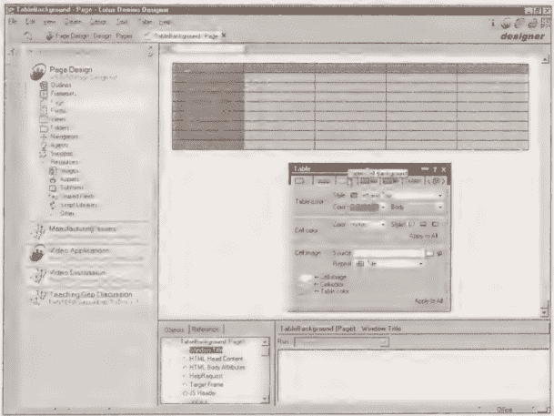


你可以通过高亮显示一个或多个单元格，然后单击单元格颜色下拉图标选择颜色来覆盖任何默认样式。系统将显示调色板。如果你选择颜色，它会覆盖样式的默认颜色。若要使样式颜色再次显示，你可以单击`（无）`（`(none)`）按钮，它是四个图标中的第二个，位于调色板顶部一行的右上角。

你可以在一个单元格内创建渐变（颜色逐渐过渡），通过三个选项实现：`颜色`（`Color`）字段为起始颜色，`到`（`To`）字段颜色为结束颜色，方向可以设置为`从上到下`（`Top to Bottom`）或`从左到右`（`Left to Right`）。你通过单击相应的`样式`（`Style`）按钮来指定方向。渐变仅在 Notes 客户端上显示。Internet Explorer 和 Netscape Navigator 都会显示纯色背景。

`表格/单元格背景`选项卡上的最后一个选项是设置`单元格图像`（`Cell image`）。通过此选项，你可以在表格单元格中包含图像。你可以使用此功能来格式化精美的页面（参见图 3.14）。

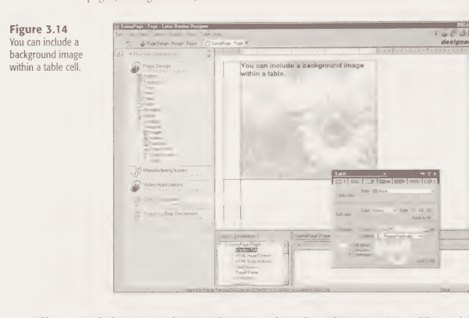

你可以通过公式或从图像库中按名称包含图像。图像库中的图像是资源，将随数据库一起复制。遗憾的是，单元格图像在 Web 上不受支持。

##### 合并和拆分单元格

在图 3.15 中，我使用了另一种表格技术，称为`单元格合并`。在这种情况下，我将顶行的所有单元格合并为一个单元格。之后，我使用了一个跨越整个标题宽度的渐变，并将文本居中显示在该长单元格中。

按照以下步骤将多个单元格合并为一个单元格：

1. 在表格中选择要合并的单元格。

2. 选择`表格` > `合并单元格`（`Table, Merge Cells`）。此选项仅在选择了多个表格单元格时才会在菜单中显示。你可以按行方向或列方向选择单元格。你也可以选择之前已合并过的单元格。

3. 你的单元格现在已合并。注意，当合并已包含文本的单元格时，Domino 会将单元格中的文本放入最左侧（或最顶部）的单元格中，并用换行符分隔。

图 3.15

你可以合并单元格以获得连续的渐变和居中文本。

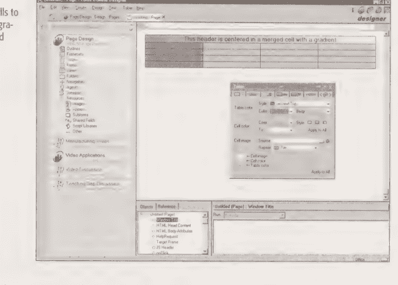

按照以下步骤拆分先前合并的单元格：

1. 选择表格中先前合并过的单元格。

2. 选择`表格` > `拆分单元格`（`Table, Split Cell`）。此选项仅在选择了先前合并过的单元格时才会在菜单中显示。你的单元格现在已拆分回合并前的原始基本状态。如果你多次合并单元格，以前的状态不会保留。你的单元格将拆分回原始的单一状态。如果合并单元格中有文本，拆分后文本将被放入最左侧（或最顶部）的单元格中。

##### 表格的高级趣味应用

你可以使用表格创建几种特殊效果。它们都围绕一个称为`可折叠表格`（`collapsible table`）的概念，你可以在创建表格时初始设置，或在表格属性框的`高级`（`Advanced`）选项卡上进行设置。这些表格的共同点是只显示表格的单一行。使用各种方法来确定要显示哪一行。有三种类型的特殊表格：

- `标签表格`（`Tabbed tables`）— 表格的每一行对应标签表格的一个标签。只有包含所选标签的行才会显示。

- `定时表格`（`Timed tables`）— 表格的每一行将显示指定的时间。默认值为两秒。你可以使用这些表格来显示动画。

- `程序化控制`（`Programmatic control`）— 除了表格外，你还必须提供一个字段。字段名称与表格名称相同，但带有 `$` 前缀。字段内容决定显示哪一行。你可以通过编程方式更新该字段，然后用于选择行。

你可以最初创建这三种类型中的任何一种表格或标准表格类型，之后可以将其转换为任何其他类型。你可以在表格属性框的`表格行`（`Table Rows`）选项卡上控制表格类型。这是属性框中的第六个选项卡。参见图 3.16 中的示例。

**图 3.16** 一个包含五行四列的标签表格。

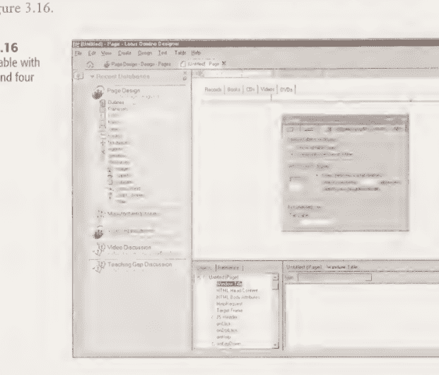

我创建了一个五行四列的标签表格。你可以在`创建表格`对话框中通过单击`表格类型`部分的标签表格图标（第二个图标），输入行数和列数，然后单击`确定`（`OK`）来创建标签表格。

创建表格后，你可以向每个表格行添加信息。在图 3.16 中，你可以看到我已经为每行添加了标签标签。要添加标签标签，首先在页面上选择标签，然后在属性框底部的`表格行`选项卡中输入标签标签。由于本示例中有五行，因此有五个标签。你必须选择标签并单独为每个标签输入名称。一种常见的用途可能是仅使用一列和多行。这样，你可以创建类似于对话框的标签界面。

表格的另一个选项是使用定时表格选项。这将使每行显示固定的时间。默认值为两秒，但你可以调整此时间。在图 3.16 中，你可以看到可以在属性框中间设置第二个单选按钮选项。定时显示可用于为用户创建动画视觉效果。定时表格在 Web 上不受支持。

要使用此选项，创建一个多行一列的表格。每行应包含来自图像库的图形文件，例如。设置每个图形显示的时间。你可以指定过渡效果，如从左到右。

溶解、爆炸等多种效果。你还可以指定是持续循环播放图形，还是在用户点击时播放。

> 从 Domino 第 5 版开始，你可以包含嵌套表格，即表格中的表格。这对于选项卡表格特别有用——你可以在选项卡表格中再包含一个选项卡表格。Domino 公共目录数据库中就使用了这种技术。

最后一类单行表格让你能够以编程方式控制向用户显示的表格。通常，这种表格类型应与表单一起使用，因为页面中不允许放置字段。我在第 4 章`创建和使用表单与子表单`中描述了字段、表单以及表格的编程控制。

#### 嵌入图片

在本章前面，我展示了如何更改背景颜色以及将图像设置为页面背景。在本节中，我将介绍如何在页面上嵌入较小的图形元素，例如按钮。在页面上使用图形元素有多种方法，具体取决于你希望如何使用它们。

##### 导入图形文件

使用图形图像的一种方法是直接将其嵌入到页面中。要将图形图片嵌入页面，请执行以下步骤：

1. 创建或打开要用于图形的页面。

2. 将光标移动到要放置图片的位置，然后选择`创建`→`图片`。你会看到一个类似于图 3.17 的对话框。

3. 注意，你可以从多种图形文件格式中进行选择。最常见的 Web 格式是 GIF 和 JPEG 格式。BMP 是原生 Windows 格式。还有其他几种图形格式也很流行。选择你要使用的格式。注意，如果你选择的格式不是 BMP、JPEG 或 GIF，Domino 必须对图形文件进行转换。如果可能的话，你可能希望考虑自己将图形转换为 JPEG 或 GIF（这样你就可以控制颜色、抖动等方面的转换），并且你可能还希望考虑使用共享图像资源（在下一节中描述）。

4. 选择格式后，该类型的文件将出现在对话框中。在这种情况下，你可以看到一个 `PushMe.JPG` 文件。

5. 你可以双击要导入的文件，也可以单击要导入的文件，然后点击`导入`按钮。然后你的图形将出现在页面上。

##### 图 3.17

`创建`→`图片`菜单命令后出现的`导入`对话框，用于导入图形。

##### 使用图像资源

第 5 版的一个重要新功能是可以在图像资源库中存储图形图像。然后你可以从数据库中的其他位置引用这些图像。在 Domino 的早期版本中，共享图像不是那么重要，因为表单和子表单及其内容已经是共享资源。然而，随着页面的出现，拥有共享图像变得很重要；否则，相同的图像将在每个页面上重复，占用不必要的空间。

按照以下步骤将新图像保存到你的图像资源库中：

1. 打开`资源`折叠项，然后在设计窗格中选择`图像`。

2. 点击`新建图像资源`操作按钮。将出现一个`打开`对话框。

3. 选择要存储在图像资源库中的图像类型。注意，仅支持 GIF、JPEG 和 BMP 类型图像。这比可直接导入页面的可用类型更为严格。

4. 双击要放入库中的文件。你也可以单击该文件，然后点击`打开`。该图像将存储在你的图像资源库中。

5. （可选）你可以通过打开图像的属性框并在框中输入别名来为图像资源添加别名。如果你通过别名引用此图像，你以后就可以自由更改图像，而无需更改引用库中图像的任何程序。你还可以输入一条注释，该注释将在查看图像资源列表时显示（参见图 3.18）。

##### 图 3.18

图像资源属性对话框。

将图像资源存储在库中后，你就可以在页面上使用它。按照以下步骤在页面上使用图像资源：

1. 创建或打开要用于图形的页面。

2. 将光标移动到要放置图片的位置，然后选择`创建`→`图像资源`。系统会提示你输入图像名称和图像类型，你会看到可用图像的列表（参见图 3.19）。

##### 图 3.19

`插入图像资源`选择对话框。

3. 如果你点击某个图像名称，会在对话框右侧看到该图像的预览。找到要包含的图像后，选择其名称并点击`确定`。

4. 你的图像将显示在页面上。

##### 使用图像资源集

你可能已经注意到，在图 3.18 中有用于指定单个图像资源中横向和纵向图像数量的字段。图像资源集有两种类型（有时也称为图像井），即横向和纵向。横向资源集可用于为单个图形指定悬停图像。纵向图像资源集用于为书签栏指定不同大小的图标。

通过横向指定四个图像，你可以控制 Notes 客户端在这些情况下使用的图像：

- 正常图像

- 鼠标悬停图像（鼠标悬停在图像上时）

- 选中图像（图像获得焦点时）

- 点击图像（图像被点击时）

你必须将四个图像存储在单个图形（例如 GIF 或 JPEG）文件中。你使用其他图形编辑程序来组合这些图像。用一条单像素宽的线将每个图像与其他图像分开。即使你没有使用其中某个状态，也必须提供图形图像。当然，你可以在四个位置中的多个位置使用相同的图像，这样可以给人图像没有变化的印象。

> **注意** 图像资源的悬停图像功能仅在 Notes 客户端中支持。它无法用于 Web 浏览器。要在 Web 浏览器中实现悬停效果，你应该使用 JavaScript。我将在第 11 章`Domino 的 JavaScript 技术`中向你展示如何操作。

纵向图像资源集用于书签栏中使用的图标。标准书签图标位于 `bookmark.nsf` 数据库中。每个书签图标有三种大小：小、中、大。小图标为 16×16，中为 24×24，大为 32×32 像素。这三种不同大小的图标都存储在同一个图像资源中（参见图 3.20）。

**图 3.20** 包含三个纵向图标的图像资源属性框。

要创建其中一种图像资源集，请使用图形编辑器创建一个高 98 像素、宽 32 像素的图像。三个图标之间各有一条单像素线分隔。顶部图标是大的，中间是中等大小的，底部是小的指战张大因虽然张大气虽轻松每张静疏松气谁小心清理。每个图标应定位在图形图像的左上角（参见图 3.21）。

**图 3.21**

用于书签栏的纵向图像资源映射图。

作为用户，你可以通过执行`文件`→`首选项`→`用户首选项`来更改书签栏中使用的图标大小。你可以在`用户首选项`对话框中更改`书签图标大小`。

##### 使用规则、分节符和分页符组织数据

为了使页面看起来更美观并提供更好的组织性，你可以使用水平规则（`horizontal rule`）和分节符（`section`）。水平规则就是横跨页面的一条线。然而，借助规则属性，你可以修改规则的宽度和高度。宽度可以表示为百分比，也可以指定精确测量值，例如英寸。

对于 Notes 客户端，规则还可以包含颜色渐变，即从一种颜色开始逐渐变为另一种颜色。渐变从顶部到底部改变颜色。渐变规则在 Web 上不受支持。要创建水平规则，请将光标移动到页面或表单上要显示规则的位置。然后选择`创建`→`水平规则`。创建规则后，你可以通过属性框更改其属性。你可以在图 3.22 中看到渐变规则的示例。

## 第3章 使用Domino设计器开发页面

创建节既简单又有趣。以下是创建节的步骤：

1. 将光标移动到要创建节的位置。输入所有要包含在节中的文本。

2. 文本输入到页面上后，使用键盘或鼠标选择要设为节的文本。

3. 选择`创建`、`节`以创建您的节。您所选文本的第一行将成为节标题，并在节关闭时显示。

4. （可选）节创建后，您可以通过`节`属性框更改标题。您还可以更改用于自动展开和折叠节的规则（参见图3.22）。

图3.22 可使用`节`属性框控制展开/折叠规则。

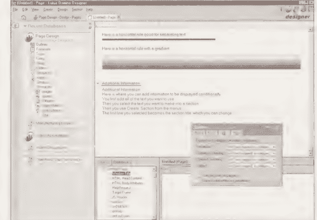

您可以通过插入分页符来控制打印机分页。要插入分页符，首先将光标移动到希望页面分隔的位置，然后选择`创建`、`分页符`。请注意，分页符不会影响在Notes客户端或Web浏览器中显示的格式。它纯粹是为了帮助格式化打印输出。

## 总结

本章中，我向您展示了如何创建页面，并探讨了用户界面的主要设计元素。页面可以包含图形、表格、热点、文本以及其他几种对象。此外，您还可以使用其他编辑器为页面创建HTML，并将HTML导入到Domino设计器中。

我向您展示了如何使用表格，并举例说明了可以对表格进行的各种格式化操作。您还可以通过使用表格来定位图形和文本，以便在Web浏览器中显示。表格可用于格式化报纸风格的文本和电子表格样式的数据，并可使用图形进行装饰。

通过使用仅显示单行的特殊表格，您可以为用户实现标签式界面。这将允许您向用户提供更多选择，而不会使其感到不知所措。这些单行表格也可以与计时器结合使用，实现简单的动画效果。

本章您学习了如何直接将图形导入页面以及导入到图片集中。通过使用包含多张图片的图片集，您可以在Notes客户端中实现鼠标悬停效果。

最后，分割线允许您通过分隔页面区域来改进用户界面。它们可以覆盖窗口的整个宽度，也可以是固定长度。节还允许您向用户提供可选择展开的附加信息。我将在下一章介绍有关表格和节的更多主题。

## 章节复习

1. 创建一个页面，在其右上角包含一个图形，例如公司徽标。该图形应距左页边距正好五英寸。确保在Notes客户端和Web浏览器中查看时，图形也正确定位。

2. 创建一个包含标签对话框界面的页面。应有三个标签，每个标签应包含不同的图形图像。当用户选择不同的标签时，将显示关联的图像。

3. 您可以通过哪三种不同的方式直接在页面上编码HTML？

4. 当您将图形图片从文件系统直接导入页面时，支持哪些不同的图形格式？对于图片资源，支持哪些图形格式？

5. 图片资源集有两种类型：水平和垂直。使用水平集和垂直集分别可以做什么？每种类型中应该有多少张图片？

6. 创建一个包含标签对话框界面的页面，包含两个标签。在每个标签内创建一个嵌套表格。第一个标签上的嵌套表格应有五行两列。第二个标签应有一个嵌套表格，包含三行六列。为每个嵌套表格设置不同的背景颜色。

7. 创建一个包含节的页面。在节内创建一个四行三列的表格。除了表格外，表格前后都应有文本。您应该能够显示和隐藏该节（包括表格）。设置属性，使得打开节进行阅读时表格始终初始为折叠状态。

# 第4章 创建和使用表单与子表单

本章内容

- 设计表单 70

- 创建新表单 71

- 从另一个数据库复制表单 72

- 表单属性 72

- 表单默认值 75

- 使用域 77

- 创建表单操作 84

- 以编程方式控制表格 86

- 使用布局区域 88

- 使用子表单 90

- 在表单上使用节 91

- 页面与表单比较 93

## 设计表单

上一章介绍了页面创建和使用的大部分基础知识，现在我们继续学习表单。表单一直是Notes和Domino的基础组成部分，因此如果您熟悉以前的版本，可能已经对表单了解很多。如果您之前没有使用过Notes或Domino的版本，接下来的几节将介绍表单和文档的工作原理。

### 表单和文档

在Domino中，`文档`是信息存储的基本单元。文档包含命名的条目以存储信息。这些条目具有数据类型，例如数字或文本，如果条目包含多个值，它们都属于同一类型。文档中的典型条目可能包含，例如，姓名、地址或电话号码。有时这些文档条目也称为域。

数据库中可能有数百、数千或更多文档。这些文档不必都具有相同的条目名称。例如，一个文档可能包含`姓名`和`地址`条目，而另一个文档可能包含`总金额`和`到期日`条目。

文档中包含的所有数据不一定都对用户可见。文档包含数据，但它们通常与用户界面元素（如表单和视图）结合使用。表单和视图是向用户呈现存储在文档中信息的方式。视图呈现来自多个文档的摘要信息，而表单使您能够查看来自一个文档的详细信息。

`表单`类似于可视模板。我的意思是，Domino中的表单非常像空白的纸质表单。想一想您在牙医办公室填写的带有姓名、地址和病史的表单。这个表单指出了所需的信息，并留出了几个空白区域供您填写。

对于Domino表单，空白区域称为域。表单中的每个域都有一个域名称，以便您可以引用它并获取所需的信息。表单包含静态信息和域信息。它是一个可视对象，非常像我在上一章中向您展示的页面设计元素。

假设Domino正在向用户显示一个空白表单。当用户填写表单的空白字段时，信息将存储在文档中。Domino将用户界面（表单）与存储在文档中的字段数据分开。这样，您可以使用不同的表单查看相同的字段，并且可以在不更改存储在文档字段中的底层数据的情况下更改应用程序的外观和感觉。

如果文档中的名称与表单中的名称不匹配会发生什么？实际上，这经常发生并且是正常的。如果文档包含名称未出现在表单上的条目，则这些值不会显示给用户。如果表单包含文档中没有的字段名称，当用户输入值时，它会自动在文档中创建相应的条目值。

当向Web浏览器提供表单和文档时，Domino的工作方式略有不同。因为Web浏览器支持HTML（超文本标记语言），所以Domino表单和文档必须首先转换为HTML。此转换在服务器上发生，然后才将信息发送给Web客户端。

总结一下，表单用于向用户进行可视显示，而文档用于在数据库中存储数据。表单和文档中名称的对应关系使Domino能够显示填充了文档值的字段。为了向Web浏览器显示，Domino首先将表单定义与文档值合并，然后将结果转换为HTML，再将其发送给浏览器。

### 表单和文档与页面有何不同？

我们已经讨论了页面、表单和文档。这些是如何使用的，它们之间有什么比较？在表4.1中，X表示该功能可用。可能有一些小的例外，但我试图向您展示主要区别，以便您可以对比数据库元素。

| 功能 | 页面 | 表单 | 文档 |

|---------|-------|-------|-----------|


| 可视用户界面 | X | X | |
| 可在Web浏览器中查看 | X | X | |
| 存储字段数据值 | | | X |
| 可包含Domino字段定义 | | X | |
| 可包含HTML格式和INPUT项（HTML类型字段） | X | X | |
| 是设计元素 | X | X | |
| 全文搜索 | | | X |
| 数据可在视图中显示 | | | X |
| 单个元素可与多个文档一起使用 | | X | |

### 创建新表单

要在数据库中创建新表单，请按照以下步骤操作：

1. 在Domino设计器中，打开您希望表单出现的数据库。如果您正在跟随操作，请创建一个名为“表单设计”的新空白数据库。我已将此数据库创建在`WEBJ50`目录中，但您可以将其放在任何方便的目录中。
2. 在设计窗格中单击“表单”。
3. 单击“新建表单”操作按钮。您的新表单将出现。

表单编辑器与页面编辑器类似。顶部有一个大面积区域用于布置表单，底部的程序员窗格用于操作表单内元素的详细内容。

### 从其他数据库复制表单

使用 Domino Designer 从其他数据库复制现有表单尤其方便。通常，从已创建的表单开始并进行修改，比从空白表单开始要容易得多。按照以下步骤从一个数据库复制一个或多个表单：

- 在 Domino Designer 中，同时打开源数据库和目标数据库。
- 在源数据库中，点击设计窗格中的“Forms”（表单）一词。这将在工作窗格中显示表单列表。
- 要复制单个表单，请在工作窗格右侧点击该表单。要选择一组连续的表单，请使用 `Shift` 键并点击起始和结束表单。要选择不连续的表单，请使用 `Ctrl` 键并点击每个要复制的表单。
- 选择完要复制的表单后，按键盘上的 `Ctrl+C` 或从菜单中选择 `Edit, Copy`（编辑，复制）。您的表单将被复制到剪贴板。
- 切换到目标数据库并点击设计窗格中的“Forms”（表单）一词。按键盘上的 `Ctrl+V` 或从菜单中选择 `Edit, Paste`（编辑，粘贴）。您的表单将从剪贴板复制到目标数据库。

### 表单属性

创建新表单或从其他来源复制表单后，您可以调整其属性。在图 4.1 中，您可以看到表单属性框的“表单信息”选项卡。

**图 4.1**

您可以在表单属性框中更改名称、别名和表单选项。

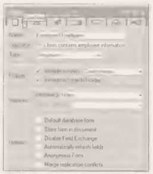

#### 表单名称

在“表单信息”选项卡中，您可以指定表单最重要的属性。在“名称”字段中，您可以指定表单的名称和别名。名称和别名之间用竖线分隔。别名很重要，因为它使您能够在编程期间为表单分配一个可用的名称。本质上，名称和别名就像是表单的外部名称和内部名称。

当您更新表单时，您可能希望更改显示给用户的文本。通过分配别名并在编程中使用它，您无需更改任何编程代码。因此，通常应该始终为表单分配别名，即使它与表单的外部名称相同。

注释字段显示在表单列表中，因此它是描述表单内容的便利位置。文档类型可以是 `Document`（文档，默认）、`Response`（答复）或 `Response to Response`（答复的答复）。这些不同的文档类型会影响文档在视图中显示时的行为方式。不同类型的详细信息在第 5 章“设计视图和文件夹”中描述。

#### 表单菜单显示选项

在“显示”部分，您可以选择将表单包含在“创建”菜单或“创建-其他”对话框中，或禁止在菜单中显示。如果希望将表单用于管理或其他数据库普通用户不需要的目的，您可以禁用菜单显示。您可能有一些希望提供给数据库普通用户使用的表单，但这些表单并不经常用到。因此，您希望将它们从主菜单选择中移除，以免“创建”菜单变得过于杂乱。在这种情况下，请选择“创建-其他”对话框选项。该表单仍可用于创建，但不会显示在表单的主列表中。

您可以选择将表单包含在搜索构建器中或从中排除。

#### 使用表单版本控制选项

当用户编辑现有文档然后保存时，可能会发生两种通用操作：

- 文档可以保存并覆盖替换现有文档。
- 文档可以保存在任何先前现有文档之外，而不替换旧版本。

如果版本控制设置为“无”，则使用第一种选项：任何保存的文档都会覆盖并替换文档的先前版本。如果您想保存文档的先前版本，可以使用版本控制功能。但是，在设计 Web 应用程序时要小心；Web 不支持版本控制。

使用版本控制时，您有三种选择。请注意，当您使用任何这些版本控制选项时，您将不会遇到任何保存冲突或复制冲突。保存冲突发生在同一服务器上的两个或多个用户同时编辑并保存同一文档时。复制冲突发生在复制期间，不同服务器上的两个或多个用户编辑并保存同一文档的副本时。保存冲突和复制冲突都通过在视图中违规文档旁边的黑色菱形指示。当您使用版本控制时，您可以避免这些文档冲突，因为任何更改都会保存为新的独立文档，而先前文档会保留在数据库中。

如果您创建支持答复层次结构的视图，主文档和答复文档将如下所示：

- 新版本成为答复——在这种情况下，现有文档保持为主文档，新文档显示在原始文档下方。
- 先前版本成为答复——通过使用此选项，文档的最新版本成为主文档。所有先前版本都显示为从属文档。
- 新版本成为同级文档——使用此选项，原始文档和所有新文档都是主文档。

选择要使用的版本控制类型后，您还可以选择何时创建新版本。默认是 `Automatic-File, Save`（自动-文件，保存）。此默认值将导致每次保存文档时都创建一个新版本。另一个选择是 `Manual, File, New Version`（手动，文件，新版本），它允许用户控制何时创建新版本。在这种情况下，用户必须选择 `File, Save as New Version`（文件，保存为新版本）来保存文档的新版本。

### 其他表单选项

版本设置下方是复选框选项列表。以下是这些选项的含义：

- 默认数据库表单——此选项将此表单选为数据库的默认表单。数据库不需要有默认表单，但如果存在，默认表单不能超过一个。
- 将表单存储在文档中——此选项使您能够将表单与文档一起存储，而不是单独存储。如果表单要通过电子邮件发送给表单可能不可用的用户或数据库，您将使用此选项。通常不希望启用此选项，因为它可能占用大量额外存储空间。请注意，如果文档随表单保存，它可以在 Web 上呈现。但是，Web 不支持将新文档与其表单一起保存。
- 禁用字段交换——此选项禁用使用 OLE 与其他应用程序进行 Notes/FX 数据交换。Web 不支持字段交换。
- 自动刷新字段——通过使用此设置，您可以让 Notes 客户端在用户输入信息时自动重新计算和刷新计算字段。Domino 不支持为 Web 浏览器客户端自动刷新字段。您可以通过为 Web 浏览器编写自己的 JavaScript 程序来提供对此功能的一些支持。
- `Anonymous Form`（匿名表单）——Notes 和 Domino 通常会跟踪文档创建者及随后编辑者的身份信息。这些信息保存在名为 `$UpdatedBy` 的字段中。对于某些应用程序，您可能希望保持文档编辑者身份未知。一个例子可能是员工调查，您希望保证匿名性。如果启用 `Anonymous Form`（匿名表单）选项，则不会创建 `$UpdatedBy` 字段，而是创建一个名为 `$Anonymous` 且值为 1（true）的字段。Web 浏览器不支持匿名表单。
- `Merge Replication Conflicts`（合并复制冲突）——如果启用此选项，Domino 会逐字段检查文档更改。如果不同服务器上的两个用户修改同一文档的不同字段，这些更改将被合并，不会创建复制冲突文档。但是，如果两个文档包含对同一字段的修改，仍会生成复制冲突。启用此选项时要小心，因为您可能会得到一些意外的结果。例如，假设包含客户信息的文档位于两个不同的服务器上。一个服务器上的用户修改了“名称”字段，另一个服务器上的用户修改了“地址”字段。Domino 将合并这两个更改，但您确定这真的是您想要的结果吗？与新地址关联的新名称可能完全不对。否则，创建复制冲突文档会突出显示这种情况并使您能够手动更正，而 `Merge Replication Conflicts`（合并复制冲突）选项会在没有通知的情况下静默允许这些更改。

### 表单默认值

表单默认值使您能够指定使用指定表单创建的文档在生命周期中发生某些事件时的处理方式。这些事件是文档首次创建时、打开进行编辑时、关闭时以及从 Web 访问时。在图 4.2 中，您可以看到表单属性对话框的“默认值”选项卡。

**图 4.2**

“默认值”选项卡使您能够指定文档生命周期内的操作。

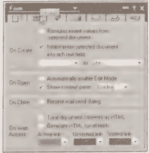

#### 文档创建

“创建时”部分使您能够指定文档首次创建时发生的情况。此选项涉及从现有文档继承。您使用此选项来保存防止用户输入已存在于其他文档中的信息。您有两种选择：

- **从选定文档继承公式值**——选定的文档可能包含在视图中，也可能是已显示的现有文档。勾选此选项可让新创建的文档从选定文档获取值。通常，您应该在源表单和目标表单中使用相同的字段名称来命名继承值的字段。接收表单中每个字段的值规范应包含要继承的字段名称。在 Web 上使用此选项创建新文档时，必须使用以下语法：

`http://server/db.nsf/receiveform?OpenForm&ParentUNID=hexvalue`

- **将整个选定文档继承到富文本字段**——此选项的主要用途是在邮件数据库中。回复电子邮件时，您可能希望在发送回复时包含原始邮件。选择此选项后，您可以选择要嵌入文档的字段；操作有三种选择：
  - **链接**——仅存储链接，而非文档的完整文本。此选项在 Web 上不受支持。
  - **可折叠富文本**——源文档包含在可折叠区域中，以免杂乱主文档。此选项在 Web 上不受支持。
  - **富文本**——源文档直接包含在目标文档的指定富文本字段中。如果启用了数据库属性“生成页面时使用 JavaScript”，且文档位于同一数据库中，则此选项在 Web 上受支持。

### 文档的打开和关闭

打开现有文档时，您可以自动启用编辑模式。选择此选项后，用户可以更快速地编辑文档。如果文档频繁或主要用于只读模式，则应保持此选项禁用。

“显示上下文窗格”选项可在显示与此表单关联的文档时显示上下文窗格。您可以选择“文档链接”或“父文档”作为上下文窗格信息。“显示上下文窗格”选项在 Web 上不受支持。对于 Web 应用程序，可以通过使用框架集来实现类似效果。

“显示邮件发送对话框”选项可在文档关闭时启用。这便于您将特定文档轻松设置为电子邮件。

### Web 访问文档

在第 3 章“使用 Domino Designer 开发页面”中，我讨论了“将文档内容视为 HTML”选项。此选项同样适用于表单。如果您要从其他来源导入 HTML、熟悉 HTML，或希望将 HTML 与 Domino 功能结合使用，此选项非常方便。

“为所有字段生成 HTML”是一个非常有用的选项。使用此选项可以让 Domino 为 Domino 隐藏字段生成 `<INPUT TYPE=HIDDEN>` HTML 字段。如果不启用此选项，隐藏字段将不会生成任何 HTML，因此可能无法正常工作。

隐藏字段在将 Domino 功能与 JavaScript 结合使用时特别有用。特别是，隐藏字段可以被 JavaScript 访问，因此您可以编写 Domino 上的代码来设置字段信息，并将其传输到 Web 浏览器客户端。然后，Web 浏览器中的 JavaScript 程序可以获取和使用该信息，修改后再发送回 Domino，所有这些操作对最终用户都不可见。在第二部分“使用 HTML 和 JavaScript 进行客户端编程”中介绍 HTML 和 JavaScript 时，我将向您详细介绍此选项的使用方法。

## 使用字段

字段可以放置在表单上，但不能放在页面上。它们代表纸质表单中的空白区域。在美国，我们填写表格向国税局（IRS）缴税。如果您在美国境外，您可能向自己的政府缴税。（如果不是，请告诉我您住在哪里。）在那些纳税表格上，您输入数字的空白框就是字段。好消息是，在 Domino 中使用字段比在纳税表格上填写字段要轻松得多。

### 向表单添加字段

要在表单上创建新字段，请执行以下操作：

1. 打开要添加字段的表单。
2. 选择“创建”，“字段”。您的新字段将以名称 `Untitled` 创建（参见图 4.3）。

**图 4.3**

您可以在属性框中更改字段的名称和类型。

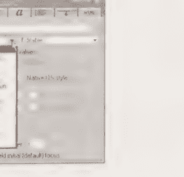

表单上的每个字段必须有唯一的名称，因此如果您输入已存在的名称，Domino Designer 将自动添加数字后缀。例如，第二个未命名字段将是 `Untitled2`。

您的首要任务之一应该是更改字段名称。一组名为 `Untitled`、`Untitled2` 和 `Untitled3` 的字段会非常乏味，更不用说调试起来相当困难了。应用程序设计的一个重要部分是为各种设计元素制定命名规范。

### 命名规范

创建字段名称时，您有很大的灵活性。您可以随意命名字段，它们不会向您抱怨。您可以将一个字段命名为 `Input`，另一个命名为 `Output`，第三个命名为 `TextField`。这三个名称的主要特点是它们都是糟糕的字段名称。它们是有效的，Domino 不会抱怨，但它们代表了糟糕的编程实践。

正式来说，字段名称必须以字母、`$` 或 `_` 开头。首字母之后，名称可以使用字母、数字、`$` 和 `_`。Notes/Domino 中的名称不区分大小写；但是，Java 和 JavaScript 都使用区分大小写的命名，因此请尽量使用一致的大小写方案并坚持使用。名称不能包含空格，最多可达 32 字节。对于单字节字符语言，这相当于 32 个字符。对于多字节语言，您只能使用一半数量的字符。

您的字段名称应在上下文中具有意义。例如，字段名称 `LastName`、`FirstName` 和 `PhoneNumber` 是更好的名称，因为您几乎可以从变量名称立即判断这些字段的用途。然而，字段 `PhoneNumber` 有点模糊。该字段是数字字段还是字符字段？答案是它可能是其中之一。通常，电话号码以文本字符串形式存储，但使用字段名称 `PhoneNumber` 后变得更为模糊。我们能做什么？

另一种日益普及的规范是向变量名添加前缀，并使用大写来帮助使名称更易于阅读。前缀代表变量的数据类型，变量名称的其余部分紧随其后。以下是一些示例前缀：

- `c` 或 `txt`：文本（字符）字段
- `n`：数字字段
- `rt`：富文本
- `dt`：日期/时间

使用这些前缀，字段名称将变为 `txtLastName`、`txtFirstName` 和 `txtPhoneNumber`。有些人使用 `c` 表示字符。这更短，所以如果您愿意，可以是 `cLastName`、`cFirstName` 和 `cPhoneNumber`。请注意，通过使用 `cPhoneNumber` 和 `nPhoneNumber`，您可以立即看出哪个字段是字符字段，哪个字段是数字字段。

如您从示例中看到的，您通常使用小写字母表示数据类型，变量名称使用首字母大写。您还可以使用单词的内部大写。尽管大小写对 Notes 或 Domino 不重要，但对 Java 和 JavaScript 很重要。

如果您将使用 JavaScript，请记住 Domino 将完全按照您在 Domino Designer 中输入的内容存储和提供字段名称，包括大小写。因此，即使大小写对 Domino 不重要，但对 JavaScript 很重要，您必须注意字段名称的大小写。由于 Java 将通过后端类而非作为语言的一部分来访问字段，因此字段名称的大小写不会影响 Java。

使用哪种规范并不重要，但您 definitely 应该为整个组织找到一种命名规范，然后在此规范上标准化。通过使用一种变量命名风格，您将促进整个团队更易于维护。一个人阅读另一个人的代码将变得更加容易。

命名规范也是一种简单、简单的提高生产力的方法，因为您将花费更少的时间来记住每个变量的数据类型。当您必须维护别人编写的代码时，您才能真正体会到这些规范的价值。

### 字段数据类型

我已经暗示过可以在文档中存储几种不同类型的数据。基本数据类型包括文本、富文本、日期/时间以及数值，但大多数数据以文本形式存储。有几种用户界面元素（称为字段类型）可用于显示和从用户获取信息。在图 4.4 中，您可以看到表单上可以使用的各种字段类型。字段右侧的图标显示其类型。

**图 4.4**

表单上可以使用许多不同类型的字段。

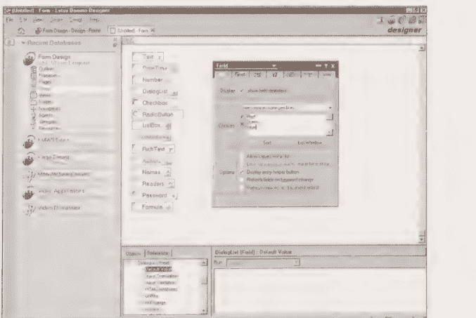

有几种字段类型可用于显示信息列表。列表的用户界面类型包括对话框列表、复选框、单选按钮、列表框和组合框。这些字段类型通常用于存储文本信息。在图4.4中，您可以看到对话框列表的控制选项卡，在这里您可以输入用户可以选择的项目列表，或者指定用于填充列表的公式。表4.2描述了各种字段类型。

### 表4.2 字段数据类型

| 数据类型 | 描述 |
|-----------|-------------|
| 文本 | 文本字段可以包含字母、数字和特殊字符。设计人员可以为常规文本字段分配格式属性，如**粗体**或*斜体*，但设置后，最终用户无法更改格式。 |
| 日期/时间 | 日期/时间字段存储日期和/或时间信息。它们可以以多种格式显示，包括仅日期或仅时间。 |
| 数字 | 使用数字字段来存储将用于计算的数值信息。数字可以以多种格式显示，包括小数、百分比、科学计数法和货币。 |
| 对话框列表 | 对话框列表字段显示一个选择列表。在Notes客户端中，对话框列表可以选配有辅助按钮，以便用户可以从一组预定义值中进行选择。Web不支持辅助按钮。您可以通过公式或直接输入来指定选项，也可以允许用户添加列表中没有的选项。 |
| 复选框 | 当您有一组选项并希望允许用户选择零个、一个或多个可用选项时，可以使用复选框。 |
| 单选按钮 | 单选按钮用于一组只允许选择一个选项的选择。 |
| 列表框 | 列表框显示一个可滚动的选项列表。列表可以包含预定义值或公式指定的值，或者您可以允许用户添加列表中没有的值。 |


| 组合框 | 组合框类似于列表框，但占用的屏幕空间更少。它以带有下拉按钮的单行显示。用户可以点击按钮以显示选项列表。与其他列表选项一样，您可以预定义值、输入公式或允许用户添加列表中没有的值。 |
| --- | --- |
| 富文本 | 富文本字段使用户能够添加`粗体`和`斜体`等格式信息。这些字段还可以保存额外信息，如附件、热点、文档链接和表格。富文本字段无法在视图中显示。在 Web 浏览器中，通过富文本小程序提供对富文本字段的完整支持。如果使用常规 HTML，富文本字段可提供多行纯文本支持。 |
| 作者 | 作者字段基本上影响具有作者级别 ACL 访问权限的用户。如果文档包含作者字段并且其中存储了用户名，则允许该用户编辑文档，即使他或她最初并未创建该文档。此字段类型不能用于覆盖 ACL。 |
| 名称 | 当您不需要关联作者或读者等权限时，可以使用名称字段来存储名称。当您希望以特定格式显示 Notes 名称时，可以使用名称类型字段。 |
| 读者 | 读者字段用于控制其他情况下能够阅读文档的用户的阅读权限。如果存在读者字段并包含用户名，则只有字段中找到的用户才能阅读文档。即使用户具有管理员 ACL 权限，如果该用户未列在文档的读者字段中，他或她也无法阅读该文档。此字段可细化 ACL 权限。 |
| 密码 | 密码字段用于在屏幕上显示星号以进行数据输入。 |
| 公式 | 公式字段用于存储选择公式的文本值。此字段类型用于标题订阅数据库中。 |

### 可编辑和计算字段

除了字段的数据类型外，每个字段还具有可编辑或计算的属性。以下是类型及其含义：

| 数据输入 | 描述 |
| --- | --- |
| 可编辑 | 在可编辑字段中，用户可以直接向字段中输入数据。这是最常见的字段类型。 |
| 计算 | 计算字段的值由公式确定。用户无法向字段中输入数据；它仅用于输出。计算字段在创建、刷新或保存表单时重新计算。计算值保存在文档中。 |
| 创建时计算 | 创建时计算字段也由公式指定。公式在文档创建时计算，但永远不会重新计算。值保存在文档中。 |
| 显示时计算 | 显示时计算字段的值在文档创建或打开时计算。在保存或刷新文档时重新计算。尽管保存文档时会重新计算，但显示时计算字段的值不存储在文档中。另一层的含义是，显示时计算字段不能在视图中使用，因为文档中没有存储值。 |

### 其他字段属性

创建字段时，可以通过字段属性框指定许多其他属性。可以指定与字段显示相关的几个属性：

- `允许多值`—这使字段能够接受多个值。值在内部以列表形式存储。此复选框对于任何列表和名称类型字段特别有价值。
- `验证后计算`—此复选框仅适用于计算字段。当字段依赖于其他字段时，此功能非常有用。如果选中，字段将仅在对其他字段进行验证后计算。请注意，Web 浏览器不支持此选项。
- `样式：Notes 样式/本机操作系统样式`—Notes 样式是控件的标准样式。某些控件（如日期/时间控件）仅在选中本机操作系统样式框时在 Notes 客户端中支持。Web 浏览器不支持本机操作系统样式控件。
- `显示字段分隔符`—此选项通常处于启用状态，可使围绕可编辑字段的括号出现。如果禁用此选项，请确保为用户提供提示，因为窗口中将没有可见标记来告诉用户存在接受用户输入的字段。

除了刚才提到的基本属性外，属性框还允许您更改字段的以下属性：

- `日期/时间格式（在控件中）`—多个选项使您能够指定日期格式的样式。例如，您可以指定始终使用四位数年份、仅 21 世纪显示四位数年份，或者仅当年份不是今年时显示年份。您可以指定星期几、日、月和年的顺序。显示时间时，可以显示小时、分钟和秒，并进行时区调整。您还可以要求用户输入四位数年份。
- `日期/时间格式（在布局区域中）`—在布局区域内，日期/时间字段具有日历控件，使用户可以直观地选择日期。常规表单日期控件中不提供此功能。
- `数字格式（在控件中）`—这使您能够将数字指定为小数、百分比、科学计数法或货币。您可以控制显示的小数位数，负数时使用括号，并在千位使用标点符号。
- `帮助描述（在高级选项中）`—这使您能够为字段指定帮助文本消息。Web 浏览器不支持帮助描述。
- `多值选项（在高级选项中）`—这使您能够指定用户在输入多个值时可以使用的分隔符。选项包括空格、逗号、分号、换行和空行。此部分还使您能够选择多值字段中显示多个值时使用的分隔符。
- `安全选项（在高级选项中）`—这使您能够对字段进行签名、启用加密或要求至少具有编辑者访问权限才能使用字段。启用加密和邮寄或保存时签名选项在 Web 浏览器中不受支持。
- `字体（在字体中）`—这使您能够指定字段的字体、字号和样式。
- `对齐方式（在段落对齐中）`—这使您能够指定字段是左对齐、右对齐、居中还是两端对齐。它还使您能够指定首行缩进样式、列表样式（编号、项目符号等）和段落间距（单倍、1.5 倍、双倍）。还可以为从右到左的语言指定段落类型。

隐藏段落（在“段落隐藏何时”中）——这使您能够控制是否在 Notes 客户端或 Web 浏览器中隐藏该段落。您还可以控制在文档预览以及打开进行阅读或编辑时是否隐藏。您可以指定一个公式来控制隐藏。

HTML（在“字段额外 HTML”中）——这使您能够添加 ID、Class、Style、Title 或其他额外的 HTML 属性。一些特别有用的属性是 `SIZE` 和 `MAXLENGTH`。当 Domino 将字段转换为 HTML 时，它会将其转换为 HTML `<INPUT>` 字段。`<INPUT>` 字段上的 `HTML SIZE` 参数指定屏幕上的宽度。`MAXLENGTH` 参数指定可以向该字段中输入多少字符。您还可以在字段名为 HTML Attributes 的伪事件中指定 HTML 属性。您可以在第 7 章“使用超文本标记语言（HTML）进行页面设计”中了解更多关于 HTML 的信息。

### 字段公式：默认值、输入转换和输入验证

Domino 字段可以有三个与其关联的特殊公式，称为`默认值`、`输入转换`和`输入验证`公式。这三个公式都是可选的。`默认值`公式为字段提供一个初始默认值。这使用户可以留空字段，而设计人员可以指定初始值。

`输入转换`和`输入验证`公式在文档刷新或保存时运行。`转换`公式使您能够进行处理，将数据放入规范格式。换句话说，您可以将单词大写，可以修剪前导和尾随空格，还可以将用户输入替换为您查找的代码。

执行输入转换后，将运行`输入验证`公式。此公式计算结果为成功或失败。如果成功，则字段通过验证。如果失败，则会提示用户您提供的错误消息，并且必须编辑字段以纠正问题。

### 单用途字段和共享字段

最常见的字段类型称为`单用途字段`，其定义包含在其创建的表单中。然而，有时您可能希望定义一个将在多个表单上使用的字段。在这种情况下，您可以创建`共享字段`，这是一种共享资源。请记住，这里我们讨论的是字段定义本身，而不是存储在任何文档中的任何数据。您不需要使用共享字段来共享文档中的数据。

共享字段定义使您能够定义字段的属性，例如其公式定义。例如，假设您想创建一个用于零件编号的字段。您希望对零件编号执行输入转换和/或验证，因此您指定与字段关联的公式。通过将此字段设为共享字段，您可以在整个数据库中使用零件编号输入字段，并且这些公式将被共享。

您可以通过创建常规单用途字段然后将其转换为共享字段来轻松创建共享字段。要将单用途字段转换为共享字段，请选择该字段，然后选择`设计` > `共享此字段`。

要将共享字段转换回单用途字段，请选择该字段，然后使用`编辑` > `剪切`，接着`编辑` > `粘贴`。

创建共享字段后，您可以通过以下步骤在表单上使用它：

1. 打开要用于共享字段的表单。
2. 将光标移动到希望共享字段出现的位置。
3. 选择`创建` > `插入共享字段`。将打开一个对话框，显示可用的共享字段名称。
4. 选择所需的共享字段，然后单击`确定`。您的共享字段将被插入到表单中。

## 创建表单操作

`操作`是可以使用预定义的简单操作来实现的功能；或者您可以用 LotusScript、JavaScript 或公式语言编写自己的自定义操作。简单操作包括修改字段、将文档复制到数据库或文件夹、运行代理或发送邮件消息。

操作可以通过单击表单或视图中的操作按钮来调用。它们也可以显示在`操作`菜单中。如果显示，操作栏会出现在文档或视图窗口的正上方。由于操作按钮不会出现在窗口内部，因此它们独立于文档窗口本身的任何滚动。

您可以将操作与单个表单或视图关联，或者您可以创建`共享操作`。当您需要在多个表单或视图中提供通用功能时，共享操作非常有用。共享操作可以在`设计`窗格中的`资源` > `其他` > `共享操作`下找到。

操作窗格中有六个预定义操作以星号标记。如果这些操作出现在表单上，该操作将应用于当前查看的文档。如果该操作出现在视图中，用户可以选择一个或多个文档并将操作应用于所选文档。预定义操作在 Web 上不起作用；但是，您可以使用带有公式和`@commands`的共享操作来代替。以下是预定义操作：

- `Categorize（分类）`——这将打开一个对话框，使用户能够从正在查看或在视图中列出的文档中添加和删除类别。要使用此功能，表单必须有一个名为`Categories`的关键字字段。
- `Edit Document（编辑文档）`——这使您能够编辑当前正在查看或在视图中列出的文档。这不能让用户覆盖 ACL；它只是提供了一种将文档置于编辑模式的便捷方法。
- `Send Document（发送文档）`——这将文档发送给用户或邮件数据库。表单必须包含一个`SendTo`字段，该字段中的值提供目标地址。
- `Forward（转发）`——这将在电子邮件消息中转寄该文档。
- `Move To Folder（移动到文件夹）`——这将所选文档移动到一个文件夹。
- `Remove from Folder（从文件夹移除）`——这将从文件夹中移除所选文档。

除了内置操作外，您还可以定义自己的操作。程序员定义的操作可以出现在操作栏和/或操作菜单中。在**图 4.5**中，我定义了`Lights, Camera`操作。您可以用公式、简单操作、LotusScript 或 JavaScript 程序来指定要执行的操作。该示例使用 LotusScript，当单击操作按钮时，将出现一个消息框。在**图 4.5**中，我指定了使用自定义图形而不是标准 Domino 图形之一。您可以在屏幕的右上角看到自定义图形的结果。您还可以通过在操作属性框中选择一个 Notes 图形来指定在操作按钮中显示的图形按钮。

**图 4.5**

定义自己的操作时，您可以在操作窗格中看到它们。

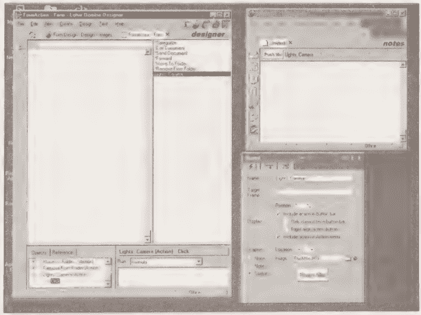

可以使用的操作图形的完整列表显示在**图 4.6**中。Release 5 新增了 24 个图形，总共达到 156 个选择。第一个用于指示不显示任何图形，因此实际上有 155 个可显示的图形。

**图 4.6**

您可以从 156 种不同的 Notes 图形中为操作选择。


### 表的编程控制

在第 3 章中，我介绍了表，但没有涉及表的编程控制，因为您必须使用字段才能实现此功能。由于不能在页面上使用字段，我将该主题的讨论推迟到现在。

现在让我们看看如何控制表的显示信息。**图 4.7**显示了`表`对话框。请注意，已经选中了`以编程方式切换行`选项。使用编程选择方法时，您可以选择显示选项卡。

**图 4.7**

您可以以编程方式显示表的行。


在对话框的底部，我可以为选项卡指定标签。此标签仅用于显示，不用于选择行。在**图 4.8**中，您可以看到 HTML 标题的对话框。

在`表编程`选项卡中，您可以为表命名，还可以为每一行命名。您可以通过行名称或其以 0 为起始的数字行索引来选取要显示的行。在此示例中，我将表命名为`Media Types`。显示的行名称为`Records`，这是第一行。

### 图 4.8

在“表格编程”选项卡中为表格及其行命名。

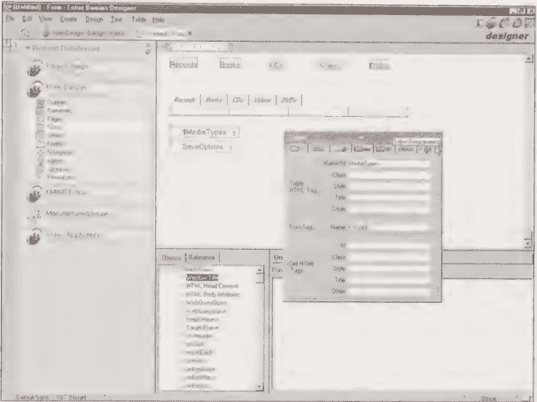

### 注意

行名区分大小写。在使用编程方式选择行时，请务必指定精确的字符串。还需注意，行的名称（列于“行标签”部分）不一定与其标签相同。在此示例中，我为行标签和行名都使用了“记录”一词，以避免混淆。如果它们不同，请记住，用于选择的是名称，而不是标签。

在图 4.8 所示的表单中，屏幕顶部有五个操作热点。这些热点是“记录”、“图书”、“CD”、“视频”和“DVD”。图 4.8 中的每个热点都有一个类似以下之一的点击公式：

```text
FIELD $MediaTypes:=0;
@Command([RefreshHideFormulas])
```

或：

```text
FIELD $MediaTypes:="Books";
@Command([RefreshHideFormulas])
```

第一种情况使用从 0 开始的索引，第二种情况使用行名。通常，你只使用其中一种类型，但为了示例目的，我同时展示了两种。`$MediaTypes`字段是控制显示哪一行的特殊字段。`$MediaTypes`字段名是通过在表格名前加上`$`构成的。我使用此字段来控制表格。操作热点可用于更改此字段的值。这两个公式语句先设置字段，然后刷新显示。请记住，放入`$MediaTypes`字段的值是行的名称（如在“行标签”中指定的），而不是其标签。

最后，请注意图 4.8 中我有一个`SaveOptions`字段。此字段也是一个特殊命名的字段，其值为`0`的计算字段。如果此特殊命名字段包含`0`，则使用此表单创建的文档将不会保存到数据库中。如果你不希望文档被保存，也不希望提示用户，这非常有用。你可以向用户隐藏`$MediaTypes`和`SaveOptions`字段。用户通常不需要看到这些字段。

请注意，除了像本例中那样使用热点外，你还可以使用大纲条目来更改表格的控制字段。如果使用操作类型大纲条目，你可以指定要使用的公式。这将以类似于我们在此示例中使用的热点操作的方式运行。

## 使用布局区域

布局区域为你提供了一种更精确地指定控件布局的方法。当你使用页面或表单时，设计元素的大部分布局都交给了显示程序。在某些方面，这是好的，因为你可以从 Notes 客户端和各种不同的 Web 浏览器查看表单。不幸的是，这无法让表单设计者对呈现进行精细控制。例如，字段可以左右移动，或者它们可以扩展并导致其他字段移动。

布局区域提供控制，使得输入字段不会改变大小，并且你可以精细调整表单的外观。然而，布局区域有一个主要缺点。布局区域无法出现在 Web 浏览器中，因此你放置在布局区域中的任何内容都只会对 Notes 客户端可见。如果你同时为 Notes 客户端和 Web 浏览器进行开发，你应该避免使用布局区域。如果你将仅使用 Notes 客户端，则可以使用布局区域。

要在你的表单中创建一个布局区域，请执行以下操作：

1. 打开要使用布局区域的表单。
2. 将光标移动到希望布局区域出现的位置。
3. 选择`Create`、`Layout Region`、`New Layout Region`。你的新布局区域将出现（参见图 4.9）。
4. 你可以通过属性框更改布局区域的大小并移动它。`Left`字段允许你调整左边距。`Width`和`Height`属性允许你更改大小。通常，使用鼠标和布局区域手柄来调整布局区域的大小更为方便。有时你可能希望精确到像素指定大小。在这些情况下，你可以使用`Properties`框。
5. 你可以选择显示边框并更改为 3D 样式。3D 样式使用灰色背景而不是白色背景。你还可以显示网格以便更容易对齐控件。`Snap to Grid`选项可自动化一些对齐任务。

### 图 4.9

你可以使用属性框更改布局区域的大小和位置。

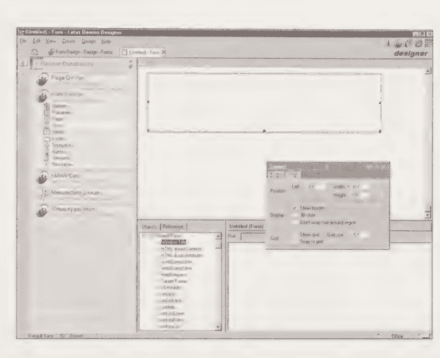

创建布局区域后，你可以添加元素。对于所有这些元素，你必须先突出显示布局区域。以下是可以添加到区域的元素：

- 静态文本——你可以通过选择`Create`、`Layout Region`、`Text`来创建静态文本。
- 图形——你可以在布局区域内创建图形图像。为此，首先将要使用的位图复制到剪贴板，然后选择`Create`、`Layout Region`、`Graphic`。
- 图形按钮——创建图形按钮的方式类似于常规图形。你必须先将位图复制到剪贴板，然后选择`Create`、`Layout Region`、`Graphic Button`。图形按钮与常规图形的主要区别在于，图形按钮被视为热点并具有 Click 事件，而常规图形对象则没有。你可以用简单操作、公式、LotusScript 或 JavaScript 为图形按钮编程。在布局区域内，图形可以覆盖图形按钮，反之亦然。
- 图片——图片实际上只是图形或图形按钮的另一个名称。如果你选择`Create`、`Picture`，你可以从文件系统导入图形。使用此方法，你不必使用剪切和粘贴。发出`Create`、`Picture`后，系统会提示你是否要将图像粘贴为图形或图形按钮。进行选择并单击`OK`。
- 字段——你可以在布局区域内通过发出`Create`、`Field`（突出显示布局区域）来创建字段。

> 请记住，布局区域在 Web 浏览器中不起作用，因此即使你使用 JavaScript 创建了图形按钮，你的程序仍然只能在 Notes 客户端中工作，而不能在 Web 浏览器中工作。

### 使用子表单

子表单使你可以创建一个可重复使用的组件，该组件可以嵌入到多个不同的表单中。子表单的一个典型应用可能是，当你想在表单上包含通用信息（例如姓名和地址），但又希望包含根据客户不同而变化的附加信息（例如保单信息）时。在这种情况下，通用信息可以直接存储在表单上，而可变信息可以存储在一组子表单中。Domino 可以动态选择用于可变信息的适当子表单。你还可以将子表单用于各种装饰，例如页眉或页脚。邮件数据库的信头功能就是使用子表单实现的。


在子表单上，你可以包含通常允许在表单中出现的任何设计元素。子表单可以在设计表单时包含在表单中，也可以将子表单的选择延迟到创建使用该表单的文档时。创建文档时，你可以以编程方式包含所需的子表单（如在邮件数据库中），或者你可以要求用户从你提供的列表中选择一个子表单。

要打开或创建子表单：

1. 打开要在其中创建子表单的数据库的设计窗格。
2. 单击设计窗格中的“资源”展开控件。
3. 单击“子表单”。一个显示现有子表单的视图将出现在右侧的工作区中。
4. 如果要打开现有子表单，请在工作窗格中双击其名称。如果要创建新子表单，请单击“新建子表单”操作按钮。
5. 当子表单打开后，你可以使用为表单描述的所有编辑工具。

当你插入基于公式的子表单时，它被称为计算子表单。该公式称为插入子表单公式。此公式在表单打开时计算，并且在文档更新和刷新时不会重新计算。公式必须计算为一个子表单名称。如果子表单名称不存在，将不会显示错误消息。子表单将简单地不会出现。

### 在表单中使用节

在第3章中，你学习了如何使用节来组织页面上的数据。标准节也可用于表单。你可以按照以下步骤在表单上创建一个标准节：

1. 打开要包含你的节的表单。
2. 添加要包含在节中的文本和字段。
3. 高亮选中要包含的所有文本和字段。
4. 选择“创建”、“节”、“标准”。你的节将会出现。你文本的第一行将显示为节的默认标题。你可以使用“节”属性框来修改标题。

#### 受控访问节

表单还有一种额外的节类型，称为受控访问节。受控访问节通常用于工作流应用中，在这类应用中，表单可能会流转，但只有特定人员被允许批准表单。通过控制对这些节的访问，以及实现签名字段（在“字段”属性的“选项”选项卡中），你可以确保只有授权人员才能批准表单。受控访问节控制的是对其中信息的编辑权，而非阅读权。

要创建受控访问节：

1. 打开将包含你的受控访问节的表单。
2. 添加要包含在节中的文本和字段。
3. 高亮选中要包含的所有文本和字段。
4. 选择“创建”、“节”、“受控访问”。你的节将会出现。你文本的第一行将显示为节的默认标题。你可以使用“表单节”属性框来修改标题。请注意，“表单”属性框有额外的选项卡。在“公式”选项卡中，你可以提供一个访问公式。还有用于编辑者和非编辑者的选项卡，用于控制该节是否展开。

在受控访问节中，你可以将访问列表定义为可编辑，这将允许文档创建者指定谁可以编辑该节。如果你想预先指定谁将能够编辑该节，可以提供一个访问公式。该公式可以由用户、群组或角色名称组成，或者你可以使用`@formula`（如`@DBColumn`）来填充列表。被列入节编辑者列表并不会授予用户额外的权限。如果用户未被允许编辑文档，那么即使被列入节编辑者列表，也无法编辑该节。节编辑者列表用于限制那些原本能够编辑文档的用户列表。

以下是受控访问节使用的一个示例。假设你有一个费用报销工作流应用程序。一名员工输入费用信息，然后提交给经理批准。你希望确保只有经理才能批准表单，因此你将批准部分包含在一个受控访问节中（参见图4.10）。

#### 图 4.10

受控访问节可用于审批。

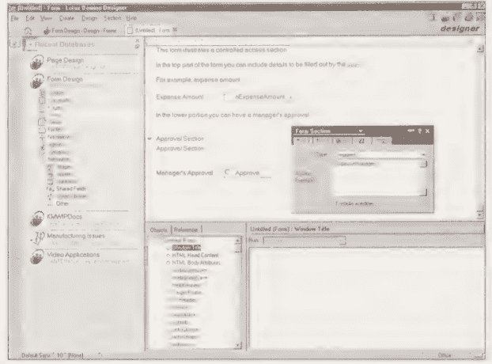

在图4.10中，我将访问公式显示为一个计算值，角色名称为`ExpenseManager`。你可以判断这是一个角色名称，因为它被括在方括号中。此访问公式值意味着，只有在ACL中拥有`ExpenseManager`角色的用户才能在编辑模式下访问“审批”节。

> **注意**
> 
> 谨慎使用受控访问节。请注意，任何拥有读取权限的人都可以阅读受控访问节的内容。访问控制仅适用于编辑该节的能力。还需注意，除非你在数据库ACL中指定了“对此数据库的所有复本强制实施一致的ACL”选项，否则访问控制仅适用于Domino服务器上的数据库。如果在ACL中未选择此选项，任何人都可以在数据库的本地复本上编辑该节。

你也可以使用`@DBColumn`查找或群组名称来指定访问公式。

如果你的表单需要两个或多个独立的批准，则必须为每个批准使用一个单独的节。单个受控访问节只能有一个批准者列表。例如，如果你需要两级审批，就可能出现这种情况。第一级将在第一个节中批准，第二级将在第二个节中批准。

### 页面与表单比较

页面和表单有许多相似之处，但也存在一些差异。页面和表单都可以包含许多相同的设计元素，但某些设计特征是每种独有的。以下是它们的成本及其异同点的总结。

页面是独立的元素，Domino可以将其渲染为HTML，或者可以承载直通HTML格式。它们可以包含图形、表格、热点、文本和其他几种对象。但是，你不能在页面上使用字段。你可以使用另一个编辑器创建HTML，然后将HTML导入Domino Designer。页面是一种设计元素，因此其内容不会在全文索引中被索引。页面可以通过URL从Web上直接按名称访问。

表单与文档结合使用。文档存储数据，而表单包含称为字段的用户界面元素。这使得用户界面可以独立于数据进行定义。当你查看表单和文档的组合时，你实际上是在查看来自文档的数据项填充在表单上的字段中。如果你向字段中输入信息，它们将被存储回文档中。

表单具有几个不能在页面上使用的设计元素。字段、子表单、布局区域和受控访问节是不能在页面上使用的最重要的设计元素。布局区域不会在Web浏览器中显示，因此仅在你计划不通过内联网或互联网的Web浏览器访问数据库时使用它们。

## 总结

在本章中，我向你展示了如何创建表单，并探讨了一些第3章未涵盖的其他设计元素。我介绍了可以与表单一起使用的各种类型的字段。最重要的字段类型是文本、数字和日期/时间。通过选择其他一些类型，如对话框列表或单选按钮，你可以控制字段的用户界面。

为字段命名时，请务必制定并使用命名约定。当你开发包含多个表单的数据库、在团队中开发，或者将使用多个数据库时，这一点非常重要。

你可以使用子表单来包含希望重复使用的表单部分。示例包括页眉和页脚、公司徽标或公共字段。受控访问节可用于工作流应用程序中的审批。

## 章节回顾

1. 解释页面、文档和表单之间的区别。
2. 布局区域允许你很好地为用户格式化字段、文本和其他信息。使用布局区域的主要缺点是什么？
3. 表格行的标签和名称之间有什么区别？
4. 在表单中创建一个具有程序控制的表格。在你的表单上包含热点。应该有三个热点，分别标记为“小”、“中”和“大”。每个热点应将表格移动到相应的选项卡。在每个选项卡内，包含一个与标签相应大小的图形。
5. 什么是别名，为什么通常应该为表单包含别名？
6. 与文档一起存储表单有什么好处？与文档一起存储表单的主要缺点是什么？
7. 解释三种不同类型的计算字段之间的区别。
8. 为什么对数据库中的所有对象使用命名约定很重要？
9. 你能直接在表单上（而不是页面上）编写HTML代码吗？如果可以，你如何操作？你能否在表单上将一些HTML与静态文本和常规字段定义混合使用，使得整个页面不全是HTML？如果可以，你如何操作？
10. 在表单上可以有多个同名字段吗？
11. 保存冲突和复制冲突之间有什么区别？你可以使用哪些技术来最小化这些冲突？
12. 受控访问节和普通节之间有什么区别？你能创建一个受控访问节来防止对该节的读取访问吗？如果可以，如何操作？

## 第五章

## 设计视图和文件夹

本章内容

- 在数据库中组织文档 96
- 创建和打开视图 96
- 视图类型 100
- 创建文件夹 102
- 视图列属性 102
- 对视图列排序 108
- 按隐藏列排序 110
- 在视图列中使用图标 111
- 视图属性 115
- 程序员窗格视图属性 126
- 视图操作 127
- 嵌入式视图 128
- 单类别嵌入式视图 133

## 在数据库中组织文档

你经常会看到视图和文件夹被放在一起讨论，因为它们非常相似。视图和文件夹的主要区别在于用于选择要显示文档的标准。

视图使用公式，因此文档的选择是自动的。该公式通常由设计者编写，一般用于过滤文档。设计者经常在数据库中使用几个不同的视图，每个视图都有不同的公式。这使用户能够看到各种文档集合，并以有意义的方式进行分组和排序。

文件夹不使用公式进行选择。文件夹中的文档通常由最终用户移动到文件夹中。例如，在邮件数据库中，用户可以创建和使用文件夹来组织电子邮件。用户可以决定将哪些文档放入每个文件夹。

由于视图和文件夹设计的相似性，本章我将描述视图设计，但文件夹设计本质上是等同的。文件夹和视图之间的主要区别在于用于选择文档的方法，而不是它们设计方式的不同。

## 创建和打开视图

视图是从一组文档中提取的数据的表格显示。表格的每一行代表一个文档，每一列中的值可以是字段数据，也可以基于公式。列公式可以组合多个字段的数据或使用`@`函数来计算结果。创建视图的过程首先是创建视图本身，然后定义应包含在每一列中的数据。

出于本示例的目的，我将从空白模板创建一个新数据库。如果你想跟着操作，请在你的本地机器上创建一个名为"View Design"的新Domino数据库。或者，你可以在CD-ROM上找到一个数据库的副本，该副本反映了最终的数据库内容。创建数据库后，单击左侧设计窗格中的"视图"行。你的屏幕应类似于图5.1。

这非常有趣。虽然你创建了一个空白数据库，但你的数据库中已经定义了一个视图。Domino始终要求数据库中至少有一个视图，因此即使你创建一个空白数据库，也会为你创建一个初始视图。你无法打开一个没有至少一个视图的数据库。如你所见，这个视图的名称是"无标题"。这很无趣，正如你可能想象的，这个初始视图的内容也很无趣。让我们看看Domino Designer默认为我们创建了什么。

图5.1 选择了视图设计元素的Domino Designer。

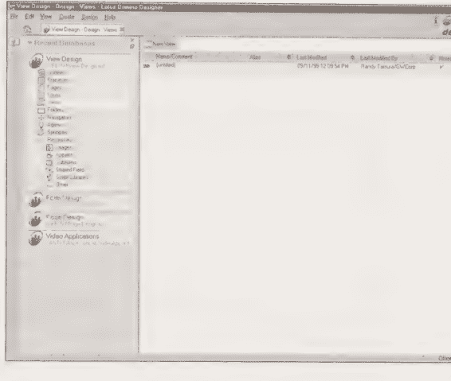

按照以下步骤打开或创建视图进行编辑：

1. 打开包含你的视图的数据库，并在左侧的设计窗格中高亮显示"视图"。
2. 要创建新视图，请单击"新建视图"操作按钮。要打开现有视图，请双击包含该视图的行。
3. 如果你双击"无标题"行，你将看到默认视图的定义（见图5.2）。

默认视图名为"无标题"，只包含一列。该列在列标题中显示为井号（`#`）。

## 选择要包含在视图中的文档

在图5.2中，注意"视图选择"一词出现在屏幕底部程序员窗格的下拉框上方。"视图选择"用于输入选择将在视图中显示的文档的公式。在程序员窗格的右半部分有一个下拉列表，你可以选择"简单"或"公式"。如果你选择"简单"然后单击"添加条件"按钮，你将看到"搜索构建器"功能的"添加条件"对话框（见图5.3）。

条件下拉框显示选项"按字段"。使用此选项，你可以选择在文档的特定字段包含指定值时将文档包含在视图中。例如，你可以选择字段`Color`，内容可以是`Red`。此规范仅在`Color`字段包含`Red`时才在视图中显示文档。你可以包含多个条件，因此如果有一个`Car`字段，你可以包含内容为`Ferrari`的规范。然后，你的视图选择将仅显示`Color`为`Red`且`Car`为`Ferrari`的文档。这个视图显然对汽车有很好的品味。

图5.2 Domino Designer最初创建的"无标题"视图。


图5.3 如果你为"视图选择"选择"简单"，则会出现"搜索构建器"对话框。

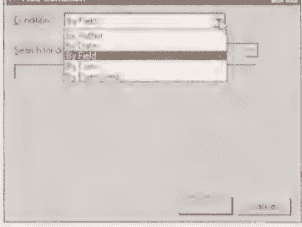

注意："搜索构建器"只会显示存在于数据库表单上的字段名称。如果你尚未定义任何表单（因此没有字段），你将无法使用带有"按字段"选项的"搜索构建器"。要继续此示例，你需要创建一个名为`Car`的表单，包含两个字段：`Car`和`Color`。如果你这样做，它们将显示在"搜索构建器"中。通常，在你的设计过程中，你会在构建视图之前设计和构建表单。

你可以使用"搜索构建器"中的以下关键字选择文档：

- 按作者 — 文档的作者。文档的作者名称必须包含你提供的文本。你也可以指明文档的作者不得包含你提供的文本。
- 按日期 — 你可以指定文档创建或最后修改的日期。你可以选择特定日期、早于或晚于特定日期，或在日期范围内或外。
- 按字段 — 如示例所示，你可以输入特定文本。文本必须包含在你指定的字段中。进行字符串比较，因此该字段应是文本字段。或者，你可以指明一个字段不得包含你提供的特定文本。
- 按表单 — 多个"按字段"规范的简写。选择此选项时，数据输入字段将显示表单上包含的所有字段。你可以一次为所有字段或其中一部分子集输入数据。不要将此选项与下一个选项"按使用的表单"混淆。
- 按使用的表单 — 你可以基于用于组合文档的表单选择文档。这是用于视图文档选择的最常用标准之一。使用此选项，你还可以通过使用高级数据库属性"文档表位图优化"来优化视图访问。

在创建视图选择时，它将出现在程序员窗格的右侧。每个条件将显示为窗格内的一个小按钮。要编辑已输入的条件，你可以双击该按钮（见图5.4）。

图5.4 由搜索构建器构建的每个条件在程序员窗格中都有一个单独的小按钮。

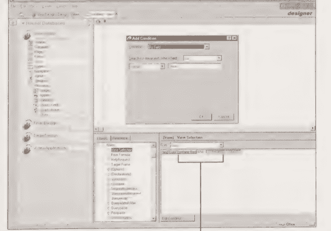

单击这些按钮进行编辑。

要按公式选择文档，请在运行下拉框中选择"公式"。如果你不修改公式，你也可以从"简单"切换到"公式"以查看Domino Designer为你创建的公式。

如果你精通`@`公式语言，你可能希望使用公式，因为它们比搜索构建器功能强大得多。

#### 视图类型

如前所述，要创建视图，首先在设计窗格中选择"视图"，然后单击"新建视图"操作按钮。你将看到"创建视图"对话框（见图5.5）。

**图5.5** 有几种类型的共享视图和私有视图。

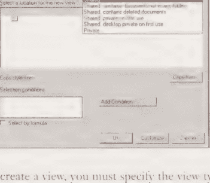

首次创建视图时，除了视图名称外，还必须指定视图类型。视图创建后无法更改类型。视图通常分为共享视图和私有视图。多个人可以使用共享视图，但私有视图仅限于单个用户。然而，在这些类别中，有几种可能性。以下是视图类型：

- **共享** — 共享视图是最常见的视图类型。共享视图可供对数据库至少具有读者访问权限的用户使用。在ACL中启用了"创建共享文件夹/视图"权限的编辑者级用户可以创建共享视图。否则，你必须具有设计者或管理者级别的访问权限才能创建共享视图。
- **共享，首次使用时私有** — 这些视图为设计者提供了向最终用户提供定制视图的机会。例如，你可以在视图选择中使用`@UserName`函数，以便视图中只显示单个用户的数据。每个用户将看到不同的数据，在用户使用视图后，它将变为私有。此设置的一个缺点是，视图变为私有后，用户将不再看到在共享版本中所做的更新。如果你在共享版本中添加或删除列或更改公式，如果视图已经变为私有，用户将看不到更改。除非用户的"创建个人文件夹/视图"ACL设置被禁用，否则此类视图将存储在数据库中。在这种情况下，视图存储在`DESKTOP.DSK`中。

# 第五章 设计视图和文件夹

除了从头开始创建视图，你还可以复制一个与你要创建的视图相似的现有视图，然后对其进行修改。要复制现有视图，你可以从视图列表中选中它，然后使用复制和粘贴操作。视图创建后，你可以重命名它并根据需要进行修改。

复制视图的另一种方法是使用视图构建器中的“复制”按钮。复制视图后，你可以重命名该视图并修改其列。

## 创建文件夹

创建文件夹的方式与创建视图几乎相同。具体步骤如下：

1. 在左侧的“文件夹”设计元素上单击；然后在右侧窗格中，单击“新建文件夹”按钮。
2. 在出现的对话框中为文件夹命名。选择文件夹类型。文件夹类型与视图的前四种类型相同。新的“非文件夹”类型和“软删除”类型的视图不能用于文件夹。
3. 在文件夹层次结构中为文件夹选择一个位置。通过选择你希望文件夹出现位置的父级来实现。
4. 一组默认的列将从“复制样式来源”中显示的视图/文件夹复制。如果你想选择不同的文件夹或视图，或者从空白视图开始，请单击“从...复制”按钮。然后你将看到一个对话框，你可以选择你的模板。
5. 你可以单击“确定”，你的文件夹将被创建；或者你可以单击“自定义”。如果你单击“自定义”，你的文件夹将被创建，并且你将被置于新创建文件夹的编辑模式中。
6. 自定义你的文件夹并保存它。

## 视图列属性

指定要在视图中选择的文档（通过视图选择公式）后，你必须定义要在视图中显示的字段和信息。视图的每一行代表数据库中的一个文档，列中的值是从这些文档中提取的信息。通常，一列将包含来自单个字段的值。然而，你也可以包含其他类型的信息。让我们回头看看视图设计数据库的默认视图。

### 视图列基础

每个视图列除了要显示的数据定义外，还有几个属性。图 5.6 显示了默认视图列的默认视图公式和属性框。

#### 图 5.6

一列可以通过一个简单的函数、字段或公式来定义。

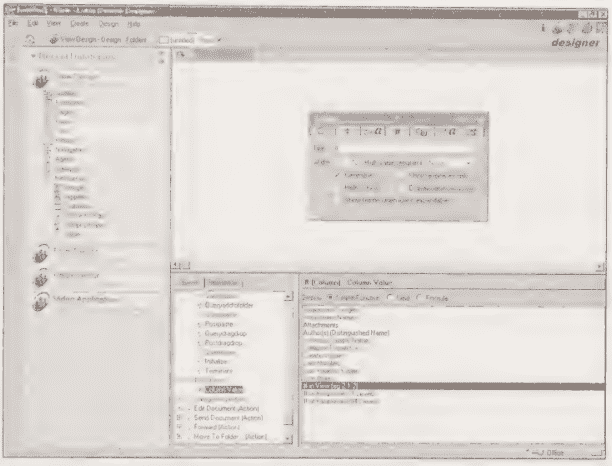

如你所见，列的标题在属性框中，是一个简单的井号（`#`）。在窗口底部的“程序员”窗格中，你会看到 `#` 列的“列值”在窗格的左半部分高亮显示，一个简单的函数出现在窗格的右半部分。

你可以用一个简单的函数来定义列的内容。这些函数可以是信息，例如附件长度或名称、作者、创建或修改日期，或者视图中的文档编号。按照以下步骤指定简单函数：

1. 打开包含要修改列的视图。
2. 在窗口底部“程序员”窗格的左半部分，单击列对象的“列值”。或者，你可以在窗口顶部“视图”窗格中单击要修改列的列标题。
3. 在“程序员”窗格的右半部分，在“显示”单选按钮组中选择“简单函数”。如果你之前选择了其他选项，可能会显示一条警告，提示你之前的定义将丢失。
4. 在下面的列表框中，选择要使用的简单函数。

作为简单函数的替代方案，你可以定义一列以包含文档中的字段值。按照以下步骤使用文档字段作为列值：

1. 打开包含要修改列的视图。
2. 在窗口底部“程序员”窗格的左半部分，单击列对象的“列值”。或者，你可以在窗口顶部“视图”窗格中单击要修改列的列标题。
3. 在“程序员”窗格的右半部分，在“显示”单选按钮组中选择“字段”。如果你之前选择了其他选项，可能会显示一条警告，提示你之前的定义将丢失。
4. 在下面的列表框中，选择要使用的字段名称。

最后，你可以使用公式作为列中显示内容的定义。要使用公式，请按照简单函数或字段的步骤操作，但改为单击“公式”单选按钮。在单选按钮下方的区域中键入公式。


要修改值以外的属性，你可以使用“列属性”框。你可以通过在“宽度”框中键入值、单击宽度值旁边的上下箭头，或者通过拖动要修改列右侧视图标题中的列分隔线来指定列的宽度。

### 添加和删除视图列

在 Domino Designer 中添加和删除列非常容易。要在视图右侧追加一列，你可以选择“创建”->“追加新列”。或者，你可以双击最后一列右侧的列标题。这将创建一个新列并弹出新创建列的属性框。

要在视图中间插入一个新列，请选择要插入位置右侧的列，然后选择“创建”->“插入新列”。你可以使用此技术将新列作为第一列插入。

要删除一列，请单击该列的标题，然后按“删除”键。或者，你可以单击列标题，然后选择“编辑”->“清除”。无论哪种方法，都会提示你一条警告，告知你即将永久删除一列。你可以选择多列进行删除：单击第一列的标题，然后按住 Ctrl 键并选择其他列。选择所有要删除的列后，按“删除”键或使用菜单。

### 文档类型和层次结构

在上一章介绍表单和文档时，我没有讨论不同类型的文档，因为在理解视图概念之前，它们有点难以理解。好吧，现在我们正在讨论视图，所以让我们回过头来谈谈不同种类的文档以及它们如何在视图中显示。

你可以使用表单创建三种文档：

- **文档**——一个正常的、常规的、普通的文档。它可以包含文本字段和我展示给你的所有其他好东西。这有时也称为主文档。
- **响应**——一种特殊类型的文档，是对主文档的响应。它的区别在于，在视图中，响应文档可以缩进显示在其父主文档下方。

#### 视图类型

以下视图类型在 Domino 的第 5 版中是新的。这些类型可用于视图，但不能用于文件夹。它们的类型隐含了视图选择公式，因此它们没有选择公式：

- **共享，首次使用时为私人**——这种类型的视图与“首次使用时为私人”视图相同，不同之处在于视图存储在用户的 `DESKTOP.DSK` 文件中。将视图存储在 `DESKTOP.DSK` 中的原因是，如果你有许多用户，如果每个用户的私人视图都存储在公共数据库中，数据库可能会变得非常大。
- **私人**——用户（而非设计者）创建私人视图。私人视图可用于以个人方式排序和组织数据，而不会影响其他用户的数据库操作。在 Notes 和 Domino 的 4.x 版本中，私人视图被称为个人视图。你可能会看到一些文档引用个人视图，但私人视图和个人视图只是同一事物的两个名称。

> 注意：数据库的访问控制列表（ACL）中有一个名为“创建个人文件夹/视图”的设置。此设置可以启用或禁用。如果你禁用此设置，并不意味着阻止用户创建私人（个人）文件夹和视图。Reader 级别及以上的用户始终可以创建私人视图或文件夹。ACL 设置控制是否允许用户在数据库内创建私人视图。如果禁用此设置，私人视图和文件夹将存储在用户本地计算机的 `DESKTOP.DSK` 文件中。

> 注意：还要注意，Web 浏览器无法查看私人视图，无论它们最初是作为私人创建的，还是最初是共享然后变成私人的。如果你想使一个自定义视图（类似于共享转私人视图）可供 Web 浏览器访问，你可以使用第 5 版的一个新功能，称为“单一类别嵌入视图”。本章后面将描述此功能。

- **共享，包含未放入任何文件夹的文档**——这种类型的视图显示所有未被用户放入文件夹的文档。你可以将此类型的视图用于收件箱类型的应用，其中你希望文档在用户将其移动到文件夹后从收件箱中消失。它出现在文件夹中后，将自动从收件箱中消失。
- **共享，包含已删除文档**——这种类型的视图用于支持新的软删除。软删除使你能够实现一个“回收站”类型的文件夹，文档可以暂时存储在其中，如果需要，以后可以恢复。要使用此类型的文件夹，你还必须在数据库属性的“高级”（豆豆帽）框中启用软删除。

> 注意：软删除是从第 5 版数据库结构开始才提供的功能。如果你在 4.x 版本的数据库上使用 Domino Designer，你将无法选择“已删除文档”类型的视图，因为数据库不支持它。你可以通过查看数据库属性框的“信息”选项卡来查找数据库的版本。ODS 版本应为 36 或更高才是第 5 版数据库。

### 答复的答复

这是一种特殊的答复。它既可以是对主文档的答复，也可以是对答复的答复。

在创建表单时，您需要指定要与该表单关联的文档类型。您在“表单属性”框中进行选择（参见图 5.7）。

**图 5.7** 在“表单属性”框中选择文档类型。

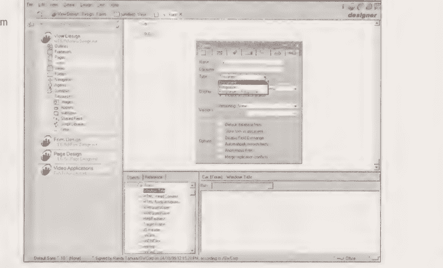

创建答复文档时，可以让答复文档从其父文档继承值。通常情况下，父文档和答复文档会有一些共同字段。通过在创建答复文档时从父文档继承值，用户的工作会更加轻松，因为某些字段会自动填充。除了您指定的继承字段外，Domino 还会自动创建一个名为 `$$Ref` 的特殊字段，其中包含父文档的通用标识符（UNID）。

要启用答复文档从父文档继承字段，您需要使用“表单属性”框中的“默认值”选项卡（参见图 5.8）。在答复文档上启用继承后，还必须在每个要继承的字段上创建公式。这样，您就可以仅对选定的字段控制继承。

为了说明这些概念，我创建了一个名为 `CarView` 的视图和三个表单。这三个表单分别用于主汽车文档（`Car` 表单）、答复（`CarResponse` 表单）和答复的答复（`CarRtoR` 表单）。每个表单都有两个字段：`Car` 字段和 `Color` 字段。

在示例的 `CarView` 视图中，我定义了三列。该视图如图 5.9 所示。

**图 5.8** 可以在答复文档的表单属性中选择相应选项来启用继承。

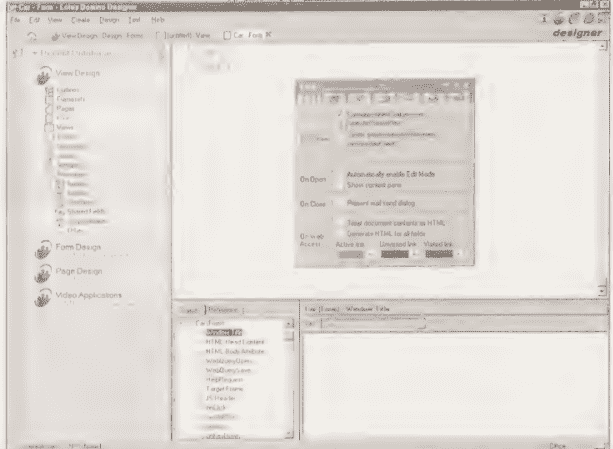

**图 5.9** 视图可以在其父文档下方显示答复文档。

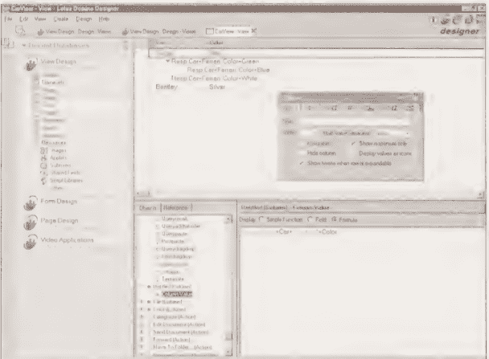

在该视图中，我定义了 `Car` 列和 `Color` 列来直接显示文档中的字段。在图中，只有视图的第一行和最后一行是主文档。第二行和第四行是答复文档，中间一行是答复的答复文档。

我说有三列，但看起来似乎只有两列，即 `Car` 列和 `Color` 列。另一列实际上是视图的第一列。“列属性”对话框显示了这第一列的属性。如图 5.9 所示，视图的第 2、3、4 行实际上是通过这一列显示的，这可以从程序员窗格中的公式定义看出。您可以判断出公式被使用了，因为这些行以文本字符串 `Resp` 开头。

答复文档的显示方式与主文档不同，因为它通常通过单列中包含的公式进行格式化。这就是我在示例中展示的效果，尽管您可能会为自己的应用程序使用更有趣的公式。要按所示方式显示答复，您应该：

- 在第一列数据列的左侧定义一列（通常宽度仅为 1）。在本例中，我将其设为视图的第一列。这一列不需要有标题。通常不需要，因为标题行中无需显示任何内容。
- 为此列启用“仅显示答复”复选框。启用此复选框后，其他列定义将不适用于该行，因此您必须使用公式定义该行的输出。输出可以扩展到整个视图的宽度。通常，您会希望包含摘要信息，例如文档作者、日期以及可能的标题字段。
- 启用“行可展开时显示展开图标”复选框。这将使用户能够展开和折叠视图的行。

您可能想知道常规答复文档与答复的答复文档之间的区别。以下是更多细节。在创建任何一种答复文档时，结果取决于两个因素：所选文档的类型（主文档或答复）以及用于创建新答复文档的表单类型。如果选定的行是主文档，并且您创建了任何一种答复，结果将是一个立即显示在所选主文档下方的文档。图 5.9 中视图的第 2 行是一个答复文档，它直接显示在主文档下方。

如果所选文档是任何类型的答复，并且您创建了新答复，则根据所创建文档的类型会得到两种不同的结果。如果您创建答复的答复，新文档将直接显示在选定文档的下方（视图的第 3 行），正如您所预期的那样。

如果所选文档是任何类型的答复，并且您创建常规答复文档，它将立即显示在相应主文档的下方，而不是从所选文档缩进。视图中的第 4 行（Ferrari-White 行）是通过高亮显示第 3 行（Ferrari-Blue 行）并创建答复文档而生成的。

最后，作为这个相当难以描述的现象的示例，请参阅图 5.9。在表 5.1 中，我向您展示了如果高亮显示某个文档并创建新文档时会发生什么。

#### 表 5.1 答复和答复的答复

| 创建时选定的行 | 创建的文档类型 | 显示为行 |
| --- | --- | --- |
| Red | 答复 | Green 或 White |
| Red | 答复的答复 | Green 或 White |
| Green | 答复 | White |
| Green | 答复的答复 | Blue |
| Blue | 答复 | White |
| Blue | 答复的答复 | Blue 下方的新行 |

作为设计者，您不会希望向用户解释那个表格。总之，如果您希望答复文档无论层级如何都继续缩进，则必须使用答复的答复表单。如果您希望所有答复都只保持在主文档下方的一个层级，则需要使用常规答复表单。您的数据库中可能不需要同时使用两种答复文档。如果这样做，对用户来说会相当混乱。选择一种类型并坚持使用。

### 排序视图列

定义视图内容后，您可能希望根据某些列对文档进行排序。虽然不是绝对必需，但我建议如果排序，请使用最左侧的列。这些列是用户首先会看到的内容，如果它们是有序的，会更加明显。还有一些 `@` 函数，例如 `@DBColumn`，是基于第一排序列工作的，如果将其保持在左侧，记忆和维护这些函数会更容易。

您在图 5.10 中可以看到排序选项。第一个选项是排序方向，即升序或降序。如果排序多列，它们可以有不同的方向，最左侧的列将具有最高优先级，列从左到右依次排序。

**图 5.10** 可以按列排序和上都和未归类项目。


分类列使文档能够根据文档中的字段进行排序和分组。此字段应定义为文本字段（或列表字段之一，例如对话框列表或组合框），您可能还希望启用多值。当用户在此字段中输入类别时，它用于分组显示文档。

例如，如果多个文档在视图列使用的字段中包含值 `sales`，则如果排序列已分类，这些文档将显示在一起。

用户可以在分类字段中输入两个或更多值。用户通常通过在对话框列表框中勾选多个项目来实现这一点。例如，假设用户输入 `sales`、`Contests` 作为两个值。如果启用了“将多值显示为单独条目”复选框，文档将在视图中显示两次：一次在 `sales` 类别下，第二次在 `Contests` 类别下。

创建分类视图时，会自动为每个类别创建特殊的类别行。类别内的文档显示在相应的类别行下方。分类字段本身不会显示在文档行内。但是，有时您希望类别作为常规字段显示在文档行中，而不是单独的行。您还可以指定多个按类别排序的列。从 5 版开始，您可以勾选“分类为平面版本 5 或更高版本”选项。这将使分类字段作为常规字段显示在文档行中，即使启用了“行可展开时显示展开图标”选项也是如此。

如果启用区分大小写的排序，大写字母将排在小写字母之前。区分重音符号的排序是英语以外语言的选项。排序将取决于工作站上使用的当前语言。

当你启用“单击列标题排序”选项时（参见图 5.11），属性框中会出现其他选项。你可以选择升序、降序、两者皆可或更改为视图。

**图 5.11** 可以启用让用户选择排序方法。

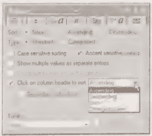

如果选择升序、降序或两者皆可，当用户使用视图时，列标题上会出现小三角形。升序排序由指向上方的三角形表示。如果用户点击此三角形，文档将按列中的值升序排序。降序排序的工作原理类似，当指定为“两者皆可”时，用户可以选择升序或降序排序。

## 第 5 章 设计视图和文件夹

“辅助排序列”选项允许你选择另一列作为辅助排序。系统会先对当前列进行排序，然后在主列每个相同值内部，再根据辅助列中的值对文档进行排序。

“更改为视图”选项可在点击列标题时实现指向另一个视图的超链接。例如，假设主视图是一个显示高级信息的摘要视图。有时，用户可能希望查看某个特定文档的详细信息。各列可以包含“更改为视图”选项，并且每一列都可以指向不同的详细视图。当用户点击某个特定列标题时，视图将发生变化，新视图会显示与主视图中选中的相同文档（但显示不同的字段）。这样，你就可以从同一文档中提取不同且可能更详细的信息。

### 按隐藏列排序

有时你希望按某个字段对信息进行排序，但不想显示该字段。例如，假设你有一个包含星期几的视图列：星期日、星期一、星期二，等等。通常的排序方式是按星期顺序排列，但如果使用常规排序，你会得到按字母顺序排列的列表，这并不是特别有用。要按星期顺序对星期几进行排序，你可以使用隐藏列。你可以在隐藏列中放入公式（参见图 5.12）。

**图 5.12** 公式和隐藏列可以改变排序顺序。

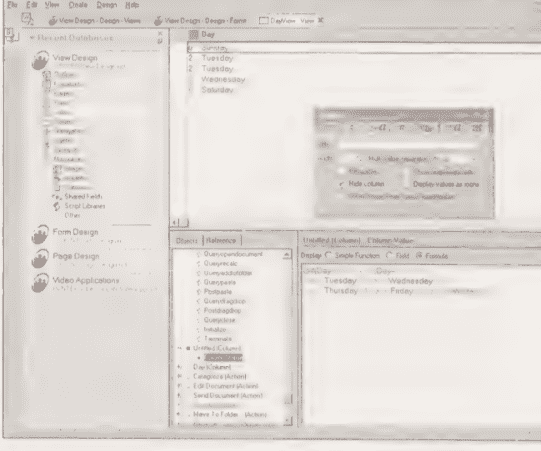

在图中，你可以看到列的值是由公式计算得出的。该公式在窗口右下角的程序员窗格中指定。它基本上将星期几转换为一个数字。然后你对隐藏列指定排序方式，而在实际的“星期”列中不指定排序。隐藏列后，用户将只看到从“星期”列开始的视图，该视图按星期顺序正确排序。

### 在视图列中使用图标

很多时候，应用程序会使用图标来显示状态。在图 5.13 中，你可以看到标准邮件数据库的收件箱。注意高亮显示的那一行包含一个回形针图标。这是表示文件附件的相当标准的方式。另一行包含一个感叹号，表示重要消息。

**图 5.13** 列图标可以非常紧凑地显示状态信息。

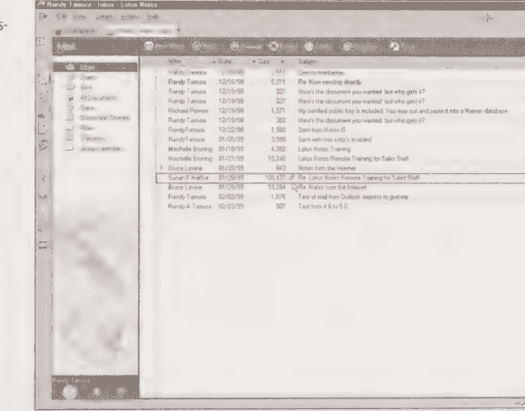

如果你能将自己的回形针、感叹号和其他图标整合到你自己的视图中，岂不是很好？嗯，确实可以，我来告诉你怎么做。（好吧，你不用对此过于兴奋。）

在列中使用图标，你只需要做以下几步：

1. 打开你希望包含图标的视图。
2. 选择你希望包含图标的列，并打开“列属性”框。你可以使用属性智能图标（SmartIcon）来完成，或者选择“设计” → “列属性”。
3. 在“列属性”框中，调整列的宽度。1 到 3 个字符的宽度可能比较合适。
4. 选中“将值显示为图标”复选框。
5. 作为列值，使用一个字段或公式，使其计算结果为一个数字。你可以使用 0 到 176 之间的数字。0 将不显示任何图标。

Domino Release 5 中有 176 个有效图标。你可以在图 5.14 中查看图标表格。

#### 图 5.14 Notes/Domino Release 5 中有 176 个有效图标


以下是如何阅读该表格的方法。第一行包含编号为 0 到 9 的图标。实际上，你可以使用 0 表示没有图标的空白空间。第二行包含编号为 10 到 19 的图标。浏览表格找到你想使用的图标，然后查看左侧和顶部的数字。将两个数字相加。例如，要使用笑脸图标，查看左侧你会看到 80。查看该列顶部，看到是 x5，因此要使用的值是 85。

另外，在 CD-ROM 的“视图设计”数据库中，有一个表单、一个代理和一个视图，我用它们来创建图 5.14。表单名为 `Icon`，代理名为 `Make Icons`，视图名为 `Icons`。

> 如果你有一个表单和一个关联的视图，可以使用名词的单数形式作为表单的名称，用名词的复数形式作为视图的名称。在这个例子中，我将表单命名为 `Icon`，视图命名为 `Icons`。例如，你可以使用 `Widget` 和 `Widgets` 作为输入小部件的表单和视图名称。这种命名方式使你可以为表单和视图使用两个不同的名称，但便于轻松识别它们是相关的。

### 设置视图列中的字体格式

当你创建和编辑视图列时，你可以在很大程度上控制列的格式。首先，你可以控制列本身使用的字体（参见图 5.15）。

在“字体”（第三个）选项卡中，你可以控制列的字体，而在“标题”（倒数第二个）选项卡中，你可以控制标题行的字体。

**图 5.15** 你可以控制视图列中使用的字体、字号和样式。

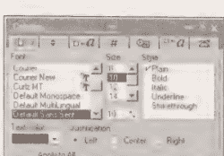

与大多数窗口程序一样，你可以控制字体（名称）、字号和样式（普通、粗体、斜体等）。你还可以选择列内的对齐方式：左对齐、居中或右对齐。如果你点击对话框底部的“应用到全部”按钮，你的更改将应用于视图的所有列。然而，在选择花哨的字体之前，请考虑你的应用程序是否会通过 Web 浏览器在 Web 上使用。如果是这样，你可能应该从 Domino 可用的通用字体族中进行选择。这三种是 `Default Serif`、`Default Sans Serif` 和 `Default Monospace`。它们分别对应常用的字体，如 Times Roman（Times）、Helvetica 和 Courier。当今 Web 开发中最令人困扰的问题之一就是字体的使用。

HTML 最初被构想出来时，其目的是标记 Web 页面的内容，赋予页面语义含义。换句话说，它旨在向浏览器告知标题、页眉、链接等信息。这些元素的格式由浏览器和用户决定。没错，用户能够——而且仍然能够——控制 Web 页面的外观。在 HTML 作者将某些文本标识为一级标题后，用户可以用 Serif 字体或 Sans Serif 字体来格式化这些元素，如果愿意的话还可以将它们设为紫色。

你可以想象由此产生的冲突，因为网站开发人员也希望控制其网站的外观和感觉。这场持续的争论至今仍未完全解决，尽管 Web 开发人员重获部分控制权的主要方式是使用层叠样式表（CSS）。我在这里解释这项技术未免离题太远，但如果你感兴趣，可以找一本当前关于 HTML 的书籍来阅读相关内容。

当然，如果你开发的视图仅由 Notes 客户端使用，你可以随意使用字体，只要确保这些字体在客户端机器上可用即可。如果你的应用环境同时包含 Mac 和 Windows 客户端，那么测试应用中使用的字体尤为重要。

### 设置视图列中的数字格式

图 5.16 显示了“列属性”框中的数字格式选项卡。

**图 5.16** 你可以通过列属性框控制数字的格式。


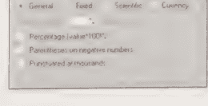

如果你对数字格式使用“常规”格式，数字的显示将因输入方式而异。前导零将被抑制。如果你使用“固定”格式，每个数字将格式化为你可以指定的固定小数位数。使用“科学”格式时，数字将以科学记数法显示。“货币”将显示货币符号和两位小数。

你还可以将值显示为百分比，这将显示为数值的 100 倍。你可以通过选中相应复选框在负值外添加括号，并且可以在千位处添加标点符号。货币符号、小数字符和千位标点符号因使用的国际语言而异。

### 设置视图列中的日期格式

图 5.17 显示了日期格式的选项。

图 5.17 你可以格式化日期/时间值以显示日期和时间，或只显示其一

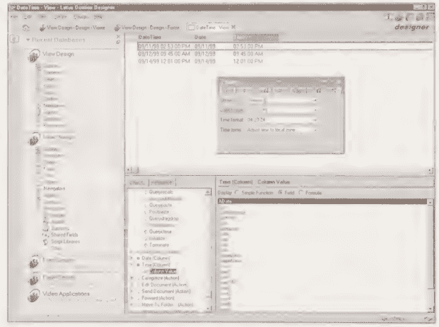

在“显示”选项中，你可以选择同时显示日期和时间（如视图的第 1 列所示）、仅日期（第 2 列）或仅时间（第 3 列）。日期格式本身可以是 月/日、月/年、月/日/年、月/4位年 或 月/日/4位年。操作系统的国际设置也会影响各组成部分的顺序以及分隔符。

时间值可以是 时:分 或 时:分:秒。时区可以自动调整为本地时区，并可以在显示中显示时区。

### 编程列名称

在视图“列属性”框的“高级”选项卡中，你会看到一个标题为“编程使用”的部分（参见图 5.18）。在该部分中，你可以为列指定一个名称。如果该列包含一个字段，列名的默认值就是字段名。如果视图列表达式，`Notes` 将自动以 `$n` 的格式构建名称。例如，你可能会看到诸如 `$0`、`$1` 或 `$2` 这样的名称。

### 图 5.18

列属性框允许你更改列名并指定链接。


虽然你可以更改列的名称，但很少需要这样做。你指定的名称可以通过 `LotusScript` 的 `NotesViewColumn` 类的 `ItemName` 属性获取。在 `Java` 中，你可以通过 `ViewColumn` 类的 `getItemName` 方法访问该名称。

允许你更改名称的对话框中提示，更改列名时应谨慎，因为如果列包含字段，你通常不会希望为它指定其他名称。此外，如果列包含公式，该公式会被编译、存储在 `Domino` 内部，并且可能被内部引用。因此，诸如 `$0` 和 `$1` 这样的名称可能在数据库内部被使用，更改它们可能会产生不可预测的结果。

### 将值显示为链接

当 `Domino` 在 `HTML` 中向浏览器显示视图时，它通常会用标签突出显示第一列以链接到文档。但有时，你可能希望突出显示非第一列作为链接列。你可以在视图列属性框的“高级”选项卡中进行此设置。

要启用此功能，首先高亮显示你希望用于链接的列，然后在高级（小帽形）选项卡中，启用“用于 Web 访问：在此列中显示值为链接”选项。你可以启用多个列，在这种情况下，你指定的所有列都会被突出显示，但它们都会打开同一个文档。

请注意，此功能在 `Java` 视图小程序中不受支持，该程序将在本章稍后的“Web 访问”部分进行描述。

## 视图属性

除了可以为每列调整的属性外，视图本身也有属性。图 5.19 显示了“视图基本属性”选项卡。

除了视图名称，你可以看到视图有一个别名。别名是视图的重要组成部分，你为每个创建的视图都可能应该包含一个。在为 `Notes` 和 `Domino` 开发应用程序时，你可能会发现的一个问题是，它们总是需要更改和更新。由于这些更改，你赋予设计元素的名称也可能改变。然而，当你更改视图和表单名称时，你不想回头去更改所有对新名称的引用。

### 图 5.19

“视图基本属性”选项卡允许你为视图设置别名和备注。


> 别名使你能够为视图或表单分配一个在其数据库生命周期内可以保持不变的名称。你可以在视图最初创建时分配别名。通常，你使用原始表单或视图名称作为初始别名。你对别名进行所有内部引用。你可以随意更改外部名称，而无需更改对视图的任何引用。

如果将视图名称（不是别名）用括号括起来，视图将变为隐藏视图。你可以将它用于 `@DBColumn` 和 `@DBLookup` 公式，但它不会对用户显示。视图常用于查找值，有时你可能需要专门为查找信息创建辅助视图。尽管这些视图对程序很重要，但它们只会使用户界面变得杂乱和复杂。因此，你应该隐藏这些最终用户并非直接需要的视图。

“视图基本属性”选项卡的“备注”字段用于为视图输入备注。当你在 `Domino` 设计器中查看所有视图时，此备注将显示在视图名称的正下方。

视图样式可以是标准大纲视图或日历视图。到目前为止，我们在本章中看到的所有视图都是标准大纲视图。日历视图允许你显示日历，并且可以在日历上放置视图中显示的文档，其方式类似于邮件数据库中的日历。

日历视图的格式受到相当严格的限制。它们通常有两到五列。前两列是必需的，后三列是推荐的。以下是应采用的布局：

| 视图列 | 内容 |
|-------------|----------|
| 1 | 日期/时间，隐藏，已排序。包含开始日期。 |
| 2 | 数字，隐藏。日历条目的持续时间（以分钟为单位）。 |
| 3 | 时间值，不隐藏。显示日历条目的开始时间。 |
| 4 | 整数数字，图标，不隐藏。在日历中显示一个图标。通常用于表示日历条目的类型。 |
| 5 | 文本，不隐藏。这是要显示在日历条目中的文本。 |

如果你创建一个包含这些类型列的日历视图，你可以使用日历视图样式来显示它。你可能会在需要显示日期、时间和持续时间的某些应用程序中发现此功能很有用。

### 视图选项

在视图属性的“选项”选项卡上可以启用多个视图选项（参见图 5.20）。

#### 图 5.20

视图“选项”选项卡允许你启用视图的各种选项。

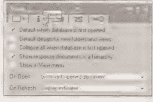

以下是选项：

- **数据库首次打开时设为默认** — 此选项使当前视图成为默认视图。在视图列表中，一个实心箭头将指示此视图是默认视图。一个数据库只能有一个默认视图。如果你为一个视图启用了此选项，它将禁用之前在其他视图上的选择。

- **新文件夹和视图的默认设计** — 创建新视图时，当前视图将作为新创建视图的模板。新创建的视图将从相同的列定义开始。如果你的数据库中有几个类似的视图，你可以创建一个，设置此选项，然后创建其他视图。这将为你节省一些创建视图的时间。此外，当代理或操作在程序上创建新文件夹时，会使用默认设计视图。

- **数据库首次打开时全部折叠** — 此选项将折叠任何将一组文档分组的折叠控件。通过设置此选项，初始视图将更紧凑，对用户来说可能更易于使用。

- **分层显示响应文档** — 你之前已经看到了如何创建分层响应文档。要使此功能正常工作，你必须启用此选项。如果你不启用该选项，每列将显示自己的数据，而不是使用响应列中指定的公式。

- **在视图菜单中显示** — 此选项在视图菜单中向用户显示视图的名称。如果你启用此选项，它将为你的用户提供另一种导航到视图的方式。普通导航是通过导航窗格，但如果你使用的是图形导航器，你可能还想启用视图菜单选项。

对话框底部有两个选项，“打开时”和“刷新时”。以下是这两个选项的可选值：

- **打开时** — 可选值为“转到上次打开的文档”、“转到首行”和“转到末行”。当视图首次打开时，视图将定位到你在此处指定的文档。

- **刷新时** — 可选值为“显示指示器”、“刷新显示”、“从首行刷新显示”和“从末行刷新显示”。此选项控制当有新文档可用于视图时的操作。这些选项仅适用于 `Notes` 客户端，因为 Web 浏览器没有指示器。

### 视图样式属性

视图样式属性位于视图属性的第三个选项卡上（参见图 5.21）。

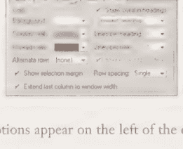

**图 5.21**

“视图样式”选项卡允许你控制视图的视觉方面。

对话框左侧有四个颜色选项：

- **背景颜色** — 这是视图的整体背景颜色。你可以从 256 色调色板中选择，或从自定义调色板中选择，颜色选择适用于 `Notes` 客户端和 Web 浏览器。同样，如果你的视图将在 Web 浏览器中显示，选择 Web 调色板中没有的颜色时应谨慎。除非你为网站使用了整体配色方案，否则通常应选择白色或其他浅色。

- **列总计** — 你可以从 16 色调色板中选择此选项。灰色是默认颜色，通常你可能希望选择一种能突出显示列总计的颜色。

- **未读行** — 在邮件数据库中，未读文档显示为红色。普通视图的默认颜色是黑色。如果你将未读行用作数据库的设计功能，你可能希望选择一种能显著突出显示它们的颜色。你可以从 16 色调色板中选择此选项。请注意，此选项在 Web 上不受支持。

- **交替行颜色** — 此选项允许你为交替行指定第二种颜色。你可以选择不使用交替行颜色、从 256 色调色板中选择颜色，或选择自定义颜色。如果你已经选择了一种颜色并希望返回无交替色，必须选择颜色选择器顶部行中最左边的图标。这非常隐晦，所以请参见图 5.22。中间的图标允许你选择

## 第5章 设计视图和文件夹

从256色调色板中选择颜色，最右侧的彩色圆圈图标允许你选择自定义颜色。请注意，交替行颜色在Web上不受支持。

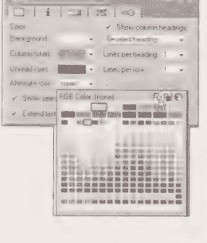

- **图 5.22**：要为交替颜色选择（无），请选择最上面一行最左侧的图标。

- **显示选择边距**：（参见图5.21。）此选项仅影响使用 `Java` 视图小程序（稍后介绍）时的 `Notes` 客户端和 Web 浏览器。如果使用不带 `Java` 视图小程序的 Web 浏览器，则此选项将被忽略。此选项允许在视图左侧显示一个图标列。该列显示未读标记（星号）、用户选择（对勾）、复制或保存冲突（菱形）和删除标记（垃圾桶）。通常情况下，你应将此选项保持启用。

- **将最后一列扩展至窗口宽度**：启用此选项允许视图最右列的内容超出列边界。如果未启用，最右列的内容将在列边界处截断，即使窗口中还有更多空间。

- **显示列标题**：选中此选项将显示列标题。此选项在 `Notes` 客户端和浏览器中均有效。

- **斜面或简单标题**：此选项更改显示标题的格式。它仅适用于 `Notes` 客户端，对 Web 浏览器无效。斜面标题为灰色（默认）；简单标题采用视图的背景色。

- **每标题行数**：这是标题应使用的行数。如果你有长标题或大量列，这将非常有用。当有大量列时，你可以使用多行标题，从而可能使列更窄。你可以为标题指定最多五行。

- **每行内容行数**：你可以为视图内容行使用最多九行。如果你需要显示大量内容，此选项将非常有用。`Domino` 会自动将文本字段的内容换行以适应列宽，并使用你允许的尽可能多的行。

- **根据内容收缩行**：如果你为每行使用多行内容，我建议启用此选项。它允许每行仅包含显示内容所必需的行数。每行的行数是单独计算的。如果你使用多行而不启用此选项，你可能会看到很多空白行。

- **行间距**—此选项可以是单倍、1 1/4、1 1/2、1 3/4 或双倍。通常情况下，除非你想为每行增加额外间距，否则应将此项设置为单倍间距。

## 视图高级属性

视图高级选项卡（带毛线帽图标）允许你更改视图索引设置、未读标记的处理、视图的表单公式以及 `ODBC` 和 Web 访问选项。前两个选项涉及视图索引。请参见图5.23。

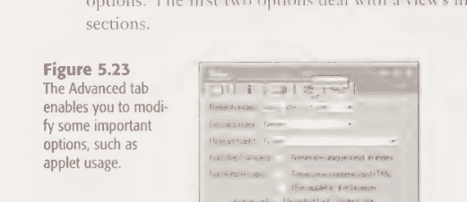

### 视图索引

每个视图都有一个关联的索引，用于显示该视图。此索引与全文索引不同。你在属性对话框中设置的视图索引选项控制该索引的创建时间和删除时间。视图索引具有重要的性能和可用性考虑因素。这些因素包括：

- 如果视图索引相对于其显示的文档已过期，用户将看到过时的信息。

- 视图索引的构建可能需要相当长的时间，特别是对于大型数据库，因此如果频繁构建，用户可能需要等待很长时间才能看到视图。

- 视图索引在数据库中占用大量空间，因此如果你构建了索引但并未使用，可能会为不需要的数据占用过多的数据库空间。

由于这些重要的考虑因素，`Domino` 无法为所有数据库中的所有视图猜测使用何种刷新策略。这项工作必须留给设计人员，并应基于数据库的使用模式以及视图中显示的数据类型和更改频率。

请注意，每个视图可以有单独的设置，因此在某些数据库中，你可能对不同的视图采用不同的策略。以下是可供选择的方式：

- **自动，首次使用后**—在这种情况下，在视图至少使用一次之前不会构建视图。之后，它将像下面列出的“自动”设置一样自动更新。使用此选项时，由于索引的创建，用户在首次使用视图时可能会注意到延迟。将此选项用于可以循环使用的数据库。例如，它可能在某段时间内频繁使用，然后在某段时间内不使用。在使用期间，索引将自动更新，但当不使用时，自动删除将丢弃索引，直到再次使用该视图时才会出现。

- **自动**—此选项始终保持视图更新。随着文档的添加，视图索引会增量更新。即使没有人使用数据库，此选项也会更新索引。由于索引始终是最新的，用户在首次使用视图时不会注意到构建索引的延迟。将此选项用于将频繁使用的视图。虽然视图会很快更新，但不会是瞬时的。`Domino` 会在有时间时更新视图。

- **手动**—此选项在用户按 `F9` 或通过等效的编程命令请求之前不会更新视图。它最适用于包含大量不经常更改的文档的视图。

- **自动，最多每 n 小时**—使用此选项，你还必须指定以小时为单位的时间限制。此选项限制视图索引更新的频率。如果使用默认值—例如12小时—视图自上次更新后最多每12小时更新一次。将此选项用于更改较慢的数据库。例如，假设每3小时只有一份文档更改。通过将视图索引更新限制为每12小时一次，你可以将4次更改分组为一次视图索引更新。请记住，用户也可以随时手动更新视图。

“丢弃索引”选项控制何时删除视图索引。这是空间与时间的权衡。将视图索引占用的空间与用户等待索引构建的时间进行权衡。丢弃实际上是在 `Domino` 服务器上完成的，默认情况下由 `UPDALL` 服务器任务在凌晨2点执行。“丢弃索引”选项如下：

- **从不**—索引永久保留。由于此选项会在服务器上为索引预留空间，你应将此选项用于频繁使用的视图。如果你能承担空间成本，对于非常大的视图，你也可以考虑此选项，因为对于大型视图，你的用户可能需要等待很长时间才能重建视图索引。通过永久保留视图索引，用户在首次打开视图时就不需要等待那么长时间。

- **每次使用后**—此选项将在视图关闭后将其标记为可丢弃。它实际上要到下一次 `UPDALL` 服务器任务运行时才会被丢弃。将此选项用于不经常使用的视图。

- **如果未活动 n 天**—此选项是上述“从不”和“每次使用后”选项之间的折中。你可以指定一个时间限制，如果视图在此期间未被使用，视图索引将在下一次 `UPDALL` 运行时被丢弃。你可以将此选项用于循环使用的视图。例如，会计视图可能每月只使用一次。该视图会活动一小段时间，但随后会有大约一个月处于非活动状态。

### 视图中的未读标记

未读标记是帮助数据库用户了解哪些信息是新的。未读标记是为每个用户单独计算的，因此如果两个人正在查看同一个数据库，他们会看到不同的未读标记集。你可以想象，跟踪未读标记会造成性能损失，因此作为设计人员，你可以控制多个选项。

> **注意**
>
> `R5` 中的一个新选项是一个名为“不维护未读标记”的数据库属性。这允许你完全禁用整个数据库的未读标记。可以在数据库属性框的高级（毛线帽）选项卡中找到它。为了提高性能，请选中此复选框。通常在你创建数据库时设置此选项。

请注意，数据库属性应比视图选项提供更多的性能提升，因为未读标记不会被维护。视图选项仅控制未读标记的显示，而在数据库中维护标记所需的所有时间仍然需要。

以下未读标记选项控制视图如何显示未读标记。这些选项不影响未读标记信息是否存储，仅影响其显示方式。例如，你可以在不同的视图中选择两个不同的选项，未读标记将以不同的方式显示。以下是选项：

- **无**—此选项使视图显示更快，因为未读标记不显示。

- **仅未读文档**—此选项仅在顶级文档上显示未读标记。它不会在视图中的折叠文档组上显示未读标记。

- **标准（在层次结构中计算）**—此选项在顶级文档或包含未读低层文档的折叠文档组上显示未读标记。

### ODBC访问

高级选项卡中的下一个选项用于 `ODBC` 访问。它显示“在索引中生成唯一键”。这是视图中最神秘的选项之一。首先，此选项不是用于访问 `ODBC` 数据库的，虽然它看起来可能是。通过 `ODBC` 访问当前 `Domino` 数据库的工具使用此选项。

`Lotus` 有一款名为 `NotesSQL` 的产品，允许通过 `ODBC` 将 `Notes/Domino` 数据库作为关系数据库访问。其他产品，如 `Visual Basic`、`Delphi` 或其他第三方工具，可以使用 `NotesSQL` 接口。如果你选中“在索引中生成唯一键”选项，`NotesSQL` 将使视图看起来像是其他程序中视图的排序列构成了唯一键。

然而，此选项需要谨慎使用。仅仅因为勾选了复选框并不意味着你已经定义了视图选择和列定义以满足

### WEB 访问

Web 访问部分包含两个在 Web 浏览器访问视图时使用的选项。这些选项包括：

- **将视图内容视为 HTML**——这是一个很棒的选项。它使你能够在视图列定义中指定 `HTML`。该 `HTML` 将被提供给浏览器。实际上，视图的每个文档行都可以包含你定义的 `HTML` 格式化内容。我将在讨论嵌入式视图时为你展示一个示例。

- **在浏览器中使用 Applet**——最初，`Domino` 的第一个实现方式是将视图转换为 `HTML`，然后提供给浏览器。这种方法仍然是默认设置，并且工作良好。但是，由于每次需要更新时视图都是在服务器端计算的，当用户浏览视图时可能会有多次客户端与服务器之间的往返。例如，仅仅打开视图上的展开图标就会导致与服务器的往返以重新显示。第 5 版新增了一项功能，即下载 `Java` applet 到浏览器来接管部分视图功能。如果你启用此复选框，视图的格式会略有不同，并且会有更多功能（见图 5.24 和图 5.25）。

> 注意


> 使用 Java applet 显示视图时，请仔细注意应用程序的性能。通常在局域网内没有问题。但是，当你通过调制解调器使用 Web 浏览器使用 Java applet 选项时，可能会注意到明显的性能下降。这种性能下降是因为浏览器必须通过相对较慢的线路下载视图 applet。视图 applet 相对较大，通过调制解调器下载的时间可能会非常长，因此请务必在部署前测试应用程序的性能。

另外请注意，透传 HTML、日历视图和链接颜色在视图 applet 中不受支持。

# 124 | 第5章 设计视图和文件夹

图 5.24 没有视图 applet 时，浏览器中的视图相对静态。


图 5.25 有了视图 applet，你可以在本地交互、选择文档以及打开和关闭展开图标。

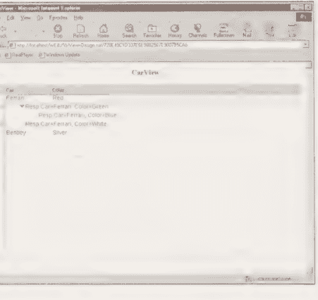

你还可以更改视图中活动链接、未访问链接和已访问链接的颜色。要更改其中一种颜色，请点击下拉框并在颜色选择器中选择颜色。

### 其他高级视图属性

以下是其余两个高级视图属性：

- **限制初始索引构建为设计者或管理者**——此选项很可能与"首次使用后自动刷新"选项一起使用。通过选择此限制，你可以控制数据库何时进入自动索引构建模式。

- **不显示包含零个文档的类别**——此功能使你可以在类别不加包含文档时抑制显示类别。通过启用此选项，用户不必浪费时间去浏览和导航无关的视图类别。此外，"不显示包含零个文档的类别"可以在类别名称本身包含敏感信息时使用。例如，即使类别中的敏感文档在视图中不显示，但类别名称可能会泄露信息。此选项允许你在这种情况下抑制类别名称的显示。

### 视图安全属性

你可以在图 5.26 中看到"安全"选项卡（钥匙图标）。此选项卡可用于控制对视图的访问。

图 5.26

通过视图"安全"选项卡，你可以控制谁可以使用该视图。


默认情况下，所有读者及以上权限的用户都可以使用该视图。你可以启用此复选框，这样就不必专门列出用户。如果你禁用该复选框，则可以精确指定你希望哪些用户能够使用该视图。此列表称为视图访问列表。此列表不会覆盖数据库的访问控制列表（ACL）；它只能细化访问权限。

请注意，视图访问列表实际上不是一种安全功能，只是一种可用性功能。虽然你可以限制人们使用你创建的视图，但用户完全可以创建一个私有视图，其中包含与你的视图完全相同的列和字段。然后该用户就能够查看文档中的所有数据。要保护文档中的数据，你应该在表单级别使用安全性。你可以启用表单访问列表以及读者和作者字段，并使用加密来保护你的文档。

如果你创建了视图访问列表，请确保直接或通过组包含服务器。如果不包含服务器，你的视图可能无法正确复制。

你可以通过选中"对 Public Access 用户可用"复选框来启用公共访问。启用此复选框将允许具有"无访问"或"存放者"访问权限的用户查看公共文档，前提是他们具有"读取公共文档"的 ACL 设置。除了启用视图的公共访问外，你还需要启用一个或多个表单的公共访问，并创建带有名为`$PublicAccess`的文本字段且值为"1"的文档。任何将此字段设置为"1"的文档都将在公共访问视图中可供查看。

## 程序员窗格视图属性

有几个视图属性不在视图属性对话框中。这些属性在屏幕底部的程序员窗格中设置。第一个选项"视图选择"我已经简要讨论过，但这里有一些额外的细节。

### 视图选择

"视图选择"属性使你能够指定一个公式，用于选择要在视图中显示的文档。默认是选择数据库中的所有文档。如果你指定了公式，则会对数据库中的每个文档评估该公式，以确定是否在该视图中显示该文档。正如你可能想象到的，这可能是一项耗时的任务。

第 5 版新增了一个性能增强选项，用于加速视图的显示。该选项位于数据库属性框的"高级"选项卡中，你也可以在创建数据库时指定它。该选项称为"文档表位图优化"。现在，虽然很明显该选项优化了某些内容，但并不清楚这项优化具体是什么、为什么或如何工作。

因为为视图选择文档可能意味着遍历数据库中的每个文档，Domino 存储了一些（位图）表来加速该过程。本质上，这些表链接了文档、表单和视图。这些表使 Domino 能够判断某个表单是否在视图中使用。然后，通过了解文档是否使用该表单，Domino 可以快速判断某个文档是否是视图的候选文档。此优化只有在你的视图选择公式包含一个或多个`Form=`条件时才能生效。如果你在视图中使用了`Form=`，这是相当常见的，你可以启用此选项来提高数据库性能。

什么时候你不想使用此优化呢？好吧，如果你不在视图中使用`Form=`，则需要额外的计算和存储，而且你不会获得任何好处。默认情况下此选项是关闭的。不过，你应该在适当的情况下考虑使用它，因为对于大型数据库，你可能能够显著提高视图性能。

### 表单公式

表单公式是与视图关联的公式，使你能够控制从视图内打开文档时用于显示文档的表单。表单公式是 Domino 用于选择显示文档所用表单的选择过程中的一个选项。以下是 Domino 使用的顺序：

1.  如果文档中存储了表单，则使用该表单显示文档。此选项在表单属性对话框的"默认值"选项卡中选择。使用此选项可以将文档发送到另一个可能不存在关联表单的数据库。例如，如果你要将文档邮寄给可能没有关联表单的其他人，你应该启用将表单随文档一起存储的选项。一般来说，你应该谨慎使用此选项，因为它会显著增加数据库中的空间占用。

2.  如果文档中未存储表单，则计算视图关联的表单公式。该公式必须计算为数据库中可用的表单名称。你可以通过在程序员窗格中突出显示视图下的"表单公式"属性来创建或编辑表单公式。然后，你可以在程序员窗格的右半部分输入公式。此选项的一种可能用途是根据文档的状态（新建与现有、查看与编辑、查询与新订单等）选择不同的表单。另一种用法是，在一个视图和表单中用于数据输入以创建将在 Web 上查看的文档，而第二个表单和视图则用于在 Web 上显示文档，但可以包含图形、不同的格式等。

3.  如果视图中没有表单公式，文档将使用文档中名为"Form"的字段中包含的表单名称进行显示。此字段会自动填充为用于创建或最近编辑文档的表单的表单名称同义词（如果不存在同义词，则为表单名称）。除非更改此字段，否则文档将使用用于创建文档的表单进行显示。此选项是大多数文档的默认选项。

4.  如果文档中没有名为"Form"的字段，或者找不到该表单，则使用数据库的默认表单。你可以在"表单属性"对话框的"默认值"选项卡中指定数据库默认表单。

5.  最后，如果没有默认表单，你将收到错误消息，并且文档将不会显示。

### 视图操作

视图操作使你可以通过操作按钮栏为用户提供常用的操作。有六个内置视图操作：分类、编辑文档、发送文档、转发、移动到文件夹和从文件夹移除。此外，你可以创建自己的自定义操作。

用户可以通过单击操作按钮或通过菜单作为"操作"菜单的选项来激活操作。作为设计者，你可以选择启用菜单访问、按钮访问、两者都启用，或者都不启用。

你有四种语言选项来编程操作。你可以使用公式语言、创建简单操作、使用 LotusScript 或使用 JavaScript。

如果你创建视图操作，它对于特定视图是唯一的，如果你希望功能相同，则必须为每个视图制作单独的副本。另一个选择是创建共享操作。共享操作是 Domino 第 5 版的新功能。共享操作可以在多个视图或表单中使用。这是另一个很好的方式，可以一次编写代码，然后在数据库中的多个位置使用。

要创建共享操作，请单击数据库设计窗格中的"资源"，然后单击"其他"。在工作区域中，你可以双击"共享操作"。将为你创建一个操作。你可以为其命名，提供代码，然后保存。

### 嵌入视图

通过 Domino 第 5 版，你可以在页面或表单中嵌入多个元素。在页面和表单上，你可以嵌入大纲、视图、导航器、日期选择器或文件夹窗格。在表单上，你还可以嵌入组调度器或文件上传控件。

在本节中，我将描述如何在表单中嵌入视图以便在 Web 浏览器中显示。此功能为你提供了很大的灵活性，可以通过使用 HTML 来格式化视图行。此外，通过使用单类别嵌入视图，你可以创建向用户展示自定义列表的视图。

让我们看看这是如何实现的。此示例包括一个用于数据输入的表单、一个视图以及一个嵌入该视图的第二个表单。我已尝试将此示例简化为最简单的组件，以解释如何使 Domino 表单和视图与 Web 良好协作。

以下是场景。你有一个通过 Web 销售游戏的在线商店。游戏有多个类别，有些游戏可能属于多个类别。你可以创建的第一个表单是允许公司人员在你的网站上输入新游戏的表单（参见图 5.27）。

**图 5.27** 示例游戏定义表单用于添加游戏及其类别。

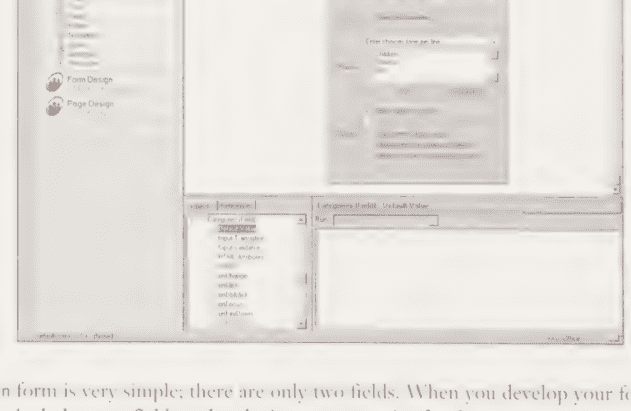

`GameInfo`表单非常简单；只有两个字段。当你开发表单时，你可能希望包含更多字段并使其对数据输入更具吸引力。请注意，有一个名为"Categories"的字段。此特殊字段名称将该字段标识为当视图通过"分类"系统操作进行分类时使用的字段。我还通过在"基本"选项卡上启用该字段具有多个值。此表单足够简单。

我们将创建的下一个设计元素是一个视图。此视图最终将嵌入表单中，我将说明如何使用 HTML 为你的视图和表单增添一些特色（参见图 5.28）。

### 图 5.28

示例`GameList`视图已启用"将视图内容视为 HTML"。


我创建的`GameList`视图有三列。第一列用于类别，第二列用于游戏名称，第三列将用于一个图标，该图标将在我们最近列出新游戏时显示。许多网站使用爆炸星形"New"。通过 Domino，我们可以通过编程自动添加这些图标。

第一列按升序排序并分类。该列的内容如图 5.28 所示。以下是第一列的公式：

```
"<p><b>"+Categories+"</b><br>"
```

请注意，我包含了一个段落标签、一个粗体标签、`Categories`字段、结束粗体和一个换行标签。这些 HTML 标签的效果将在新类别前留出间距，然后以粗体显示类别名称，后跟换行，以便后续文本在下一行显示。如果你不熟悉这些标签，请参阅第 7 章"使用超文本标记语言（HTML）进行页面设计"。

视图的第二列仅包含字段`GameName`。我没有包含任何特殊格式，尽管你可以使用 HTML 标签添加文档链接、粗体或其他特性。以下是第二列的公式：

```
@Repeat(" ";5)+GameName
```

## 130 第5章 设计视图和文件夹

第三列公式如图 5.29 所示。在此公式中，假设`actn124.gif`文件在图像资源库中。如下：

```
@if(@Now> @Adjust(@Created;0;0;7;0;0;0);"<br>";"<br>"
```

### 图 5.29

该公式使用 HTML 条件生成图标。


在图 5.29 中，你可以同时看到程序员窗格中的列值公式和视图窗口中生成的 HTML 示例。本质上，我正在生成一个对存储在数据库图像库中的 GIF 文件的引用。你可以如图所示使用 URL 提取并显示图像。使用此技术比将图形存储在文件系统中要好得多。所有相关的图形都可以存储在 Domino 数据库中，并将随应用程序自动复制。

我使用的公式将生成条件 HTML。也就是说，根据`if`语句的结果，将生成两个版本的 HTML。第一个版本的 HTML 将只生成一个`<br>`，这意味着换行。第二个版本的 HTML 将生成对图像库中图标（GIF 文件）的引用。

### 注

在引用图像文件的 URL 中，我使用`@ReplaceSubstring`将空格替换为加号（`+`）。URL 字符串中不允许使用嵌入空格。加号用于表示嵌入空格。执行此替换是因为（如此处所示）数据库名称中包含嵌入空格。在图 5.29 中，你可以看到`View`和`Design`之间的嵌入空格已被更改为加号，从而得到`View+Design`。

该公式的本质是：如果文档的创建日期在最近七天内，则会生成一个图标引用。`@Adjust`函数接收文档创建日期并加上七天，然后将调整后的日期与当前时间进行比较。如果当前时间晚于调整后的日期，说明文档已过期，此时仅生成一个换行符；如果不是，则说明文档日期在最近七天内，此时生成带有`IMG`标签的图片 HTML。

由于该视图引用了`@Now`函数，可能会导致视图索引被反复重建。如果使用此技巧，可以采用"最多每 n 小时刷新视图索引"选项。这将确保视图不会被持续刷新。您可以根据数据库的发帖频率来设置小时数。

我已将图片资源加载到数据库的图片库中，因此不需要为`IMG`标签输入路径。如果将图片资源保留在数据库内，它们会自动随数据库一起复制，从而使数据库自成一体。您觉得这样很酷吗？

现在，我们准备创建示例中的最后一个设计元素。接下来要创建一个表单，用于嵌入我们刚刚制作的视图。创建嵌入视图时，Domino 不会自动包含 Domino 原生显示视图时出现的导航栏。使用嵌入视图，我们可以更好地控制展示给用户的外观（见图 5.30）。

### 图 5.30

创建嵌入视图以控制视图的外观。


请按以下步骤创建嵌入视图：

1.  首先创建表单。将其命名为`GameSelection`。添加一些初始静态文本，例如`Here are our Categories and Games`。

2.  选择"创建"→"嵌入元素"→"视图"。请注意，每个表单只能包含一个嵌入视图。

3.  在出现的对话框中，选择特定视图，或勾选"基于公式选择视图"选项。在本示例中，我们将选择`GameList`视图。单击"确定"。

4.  如果选择了公式选项，必须在程序员窗格中输入公式。输入的公式必须计算结果为某个视图的名称。

5.  通过单击"属性"图标或选择"编辑"→"属性"，打开嵌入视图的属性。在本示例中，我们不能使用视图小程序，因为它无法正确处理我们正在创建的公式和动态生成的 HTML。在本示例的"基本"选项卡中，我们在"Web 访问显示"选项下选择"使用 HTML"。

> **注意**
>
> 视图小程序是用 Java 编写的，会下载到浏览器中。这段代码在客户端环境中执行，不使用 HTML 渲染视图。因此，直通 HTML 无法在视图小程序中生效。视图小程序非常适合提升标准视图的用户交互性和响应速度，但如果需要将 HTML 与视图结合使用，则必须使用 HTML（Domino 服务器生成）版本的视图。

6.  在本示例的"显示"选项卡（第二个选项卡）中，启用"适应窗口宽度"、"适应窗口高度"、"禁用滚动条"和"仅显示内容（不显示标题）"（见图 5.31）。在您的表单中，可以选择使用不同的选项。


现在，我们准备测试表单和嵌入视图。您可以单击屏幕右上角的某个浏览器图标。我们的示例输出见图 5.32。

在图中，您可以看到动态生成的图标。能够以编程方式生成这些图标，是 Domino 成为强大 Web 服务器的原因之一。在其他系统中，Web 管理员必须手动添加图标。而在 Domino 中，您只需添加文档，指定文档保持"新"状态的规则，然后图标会随文档过期自动出现和消失。

我在本示例中没有包含其他强大的 Domino 功能，如文档和 URL 链接，但我想您已经理解了其原理。


图 5.32

图标在新建文档中动态生成。

### 单一类别嵌入视图

单一类别嵌入视图是 5 版的一项简洁新功能。它们使您能够创建自定义视图，类似于"首次使用时共享私用"视图。单一类别嵌入视图的优势在于，它们在 Web 上能很好地工作。

您可以使用单一类别视图向特定用户提供自定义信息。其工作原理很简单。首先创建一个分类视图，并使用能够区分不同用户的数据作为类别值。例如，可以使用用户姓名作为分类值。其他示例应用还包括前面示例中的游戏类别、用户偏好设置类别，或几乎任何类型的分组，只要您想选择一组文档来定制用户体验。

为了演示单一类别嵌入视图，我将修改前面的游戏示例。我将创建一个额外的视图（单一类别视图）和一个表单，该表单包含嵌入视图。首先，我们来创建视图。

创建一个与`GameList`视图相同的额外视图。可以通过在视图列表中复制并粘贴来实现。将新视图重命名为`GameSingle`。对这个新视图唯一需要修改的是第一列（类别列）的列公式。在`GameList`中，公式为

```
"<p><b>"+Categories+"</b><br>"
```

在`GameSingle`视图中将其改为

```
Categories
```

我们希望它只是`Categories`字段的常规内容，不带 HTML 格式。保存并关闭`GameSingle`视图。

现在，创建一个新表单，同样命名为`GameSingle`。表单和视图同名没有限制。创建一个名为`Cat`的单选按钮字段（见图 5.33）。

图 5.33

在`GameSingle`表单中创建单选按钮，

并启用"关键字更改时刷新域"选项。


在"控制"选项卡中，输入`Children`、`Strategy`和`War`三个选项。同时请务必勾选"关键字更改时刷新域"选项。这将强制重新评估我们的单一类别视图。`Cat`字段的默认值为`Children`。

现在，您可以像前面的示例一样嵌入`GameSingle`视图。通过选择"创建"→"嵌入元素"→"视图"来实现。在表单中嵌入视图后，在程序员窗格中选择"显示单一类别"属性。在程序员窗格的公式区域中输入`Cat`（见图 5.34）。还应将"嵌入视图"属性框中的"显示"选项设置为"使用 HTML"，而不是默认的"使用 Java 小程序"。


通过在公式区域指定`Cat`，我们实际上是在告诉`Domino`使用`Cat`字段作为单一类别的标准。通过使用单选按钮，我们强制选项限制为已知的三个有效值之一。用户选择单选按钮选项后，“关键字更改时刷新域”选项将导致视图重新计算并显示`Cat`字段中指定的单一类别。示例见图5.35。

如果您看到视图选项后跟着“未找到文档”，则说明您没有将`Cat`字段的默认值设置为`Children`，或者没有使用`Children`值的游戏文档。


在本示例中，当用户选择不同的单选按钮选项时，显示的游戏会发生变化。每次都会像以前一样自动出现“新”图标。

## 小结

在本章中，我介绍了视图和文件夹的基础知识。我展示了如何创建视图或文件夹、如何指定其类型，以及如何选择要包含在视图中的文档。5版中有两种新类型的视图：一种显示不在文件夹中的文档，另一种显示已删除的文档。已删除文档功能使用了5版数据库的新软删除支持。

## 第5章 设计视图与文件夹

视图列用于展示您的数据。您可以使用公式来指定要显示的数据，因此数据值可以直接来自某个字段，或通过多个字段计算得出。您可以对视图列进行排序和分类。视图列还可以被隐藏，或用于显示图标。

您可以通过修改颜色以及使用多行表头或内容来为视图添加样式。第5版的一项新功能是，可以将视图小程序下载到Web浏览器中。这样用户就可以与视图小程序进行交互，展开和折叠部分，并选择文档。

我向您展示了如何将`Domino`表单和视图的功能与HTML结合使用的例子。您可以使用`Domino`编程来动态改变显示内容。在示例中，我展示了如何为最近修改过的文档添加一个新的图标。通过使用此技术，所有新文档都将被自动标记，并且在时间期限到期后，这些标记将被自动移除。

“单分类”嵌入式视图是第5版的新功能，它使您能够为用户提供个性化的信息。您可以使用公式来计算一个个性化标准，例如一个姓名，然后使用该姓名从视图中选择一个分类。这个“单分类”随后将只显示那些以该姓名作为分类的记录。

## 章节复习

1. 描述视图和文件夹的区别。

2. “视图选择”公式的目的是什么？

3. 假设您有一个数据库，其中包含您希望以两种不同方式显示的信息。数据录入表单包含所有信息，但当您将其显示给用户时，您希望向他们显示数据的子集。如何设置两个不同的视图，使得从一个视图访问文档时显示所有字段，而通过第二个视图访问时只显示子集数据？

4. 视图索引和全文索引有什么区别？

5. 假设您想开发一个使用视图的Web应用程序。您不太喜欢由HTML渲染或Java小程序版本的视图所提供的格式。如何格式化视图，使其看起来与内置的HTML或Java小程序格式不同？

6. 在哪里设置允许您在视图中显示图标（如回形针）的选项？

7. 假设您想构建一个电子商务应用程序，用户可以选择一个物品类别，如鞋子、领带或衬衫，系统将显示该类别中待售的物品。您会使用`Notes/Domino`的什么功能来实现这一能力？这能同时在Web上和Notes客户端中工作吗？

8. 您可以在页面上嵌入视图，也可以在表单上嵌入吗？

9. 假设您有一个Web应用程序，希望向用户以列表形式显示图像。您希望按照特定顺序对这个图像列表进行排序。您该如何做到这一点？如果可以，请创建一个数据库并测试您的想法。

# 第6章 使用大纲、框架集和导航器

## 本章内容

- 什么是大纲？ 138
- 使用大纲编辑器 138
- 大纲条目 139
- 使用框架和框架集 143
- 使用`Domino Designer`创建框架集 146
- 增强现有框架集 148
- 指定框架内容 148
- 设计导航器 152
- 使用带导航器和不带导航器的热点 157
- 在页面或表单上使用嵌入元素 163
- 嵌入元素的命名约定 164
- 综合运用：大纲、视图、框架集、导航器及其他 165

# 第6章 使用大纲、框架集和导航器

`Domino`提供了多种功能来组织信息并使用户能够在您的网页中导航。本章将向您介绍`Domino`第5版中一些可用的导航工具。大纲是您可以用来为用户启用导航功能的一种机制。框架集使您可以在窗口中创建多个窗格或框架。您可以控制框架的初始数量和布局。框架集显示后，用户通常可以移动框架之间的边界。导航器是`Notes`和`Domino`第4版的一项功能，在第5版中仍然可用。让我们更详细地了解这些功能。

## 什么是大纲？

大纲是一种用于控制用户导航的工具。大纲可以垂直或水平显示，大致对应于一个目标列表。通常，您会在主页的左侧、页面顶部或底部看到此类导航工具。在`Notes 4.x`版本中，左上角的“视图导航”窗格就是一种大纲。它列出了数据库中可用的视图，通过单击视图名称，您可以在右上窗格中看到该视图。大纲可以执行类似的功能。

您必须将大纲嵌入到页面或表单中才能使用它。您可以根据需要创建任意数量的大纲，也可以在一个页面上嵌入多个大纲。您可以使用“嵌入式大纲属性”框来设置大纲的格式，我稍后会向您展示。通常，您会在框架集中的页面内使用大纲，因为它们可以位于一个框架中，但控制另一个框架的内容。我将在标题为“使用框架和框架集”的部分中介绍这一点。

请注意，关于大纲有两种独立的信息。第一种是导航信息。您在创建和编程大纲条目时指定此信息。第二种信息是大纲的显示格式。同一个大纲可以在两个不同的页面中使用，并在每个页面中采用不同的格式样式。尽管大纲在每个页面上看起来不同，但每个条目对应的导航功能将是相同的。

## 使用大纲编辑器

如果您想跟着操作，可以创建一个新的、空白的本地数据库，命名为“大纲设计”。您可以通过在“设计”窗格中单击“大纲”来在`Domino Designer`中打开大纲编辑器。默认情况下，数据库中不会为您创建任何大纲。您可以按照以下步骤轻松让`Designer`为您创建一个：

1. 通过在“设计”窗格中单击“大纲”来打开大纲编辑器。
2. 单击“新建大纲”操作栏按钮。您将看到一组新的操作栏按钮。
3. 单击“生成默认大纲”操作按钮。您的新默认大纲将为您生成（见图6.1）。

### 图6.1

由`Domino Designer`最初创建的默认大纲。


从图6.1可以看出，`Domino Designer`将自动为您创建五个大纲条目：“无标题”（默认视图）、“其他视图”、“其他私有视图”、“其他文件夹”和“其他私有文件夹”。第一个大纲条目代表您数据库中的单个视图。如果您在创建了多个视图和文件夹之后才生成此大纲，它们也将包含在默认大纲中。

为您自动创建的四个额外大纲条目具有建议的名称，但您不必使用所有这些条目。如果某些条目不适用于您的应用程序，您可以删除它们。

如果您更喜欢从头开始创建整个大纲，请先创建大纲，然后按照以下部分所述开始添加大纲条目。

### 大纲条目

在图6.1中，您可以看到五个大纲条目，每个条目由一个灰色矩形框表示。当应用程序执行时，用户将看到每个大纲条目的文本或图形项目。通过单击其中一个条目，用户将能够浏览您的应用程序。您可以添加、删除、移动和重命名大纲条目。

要添加新条目，请按照以下步骤操作：

1. 创建一个新大纲或打开一个现有大纲。
2. 单击要放置新条目的现有大纲条目。新条目将位于您所选条目的下方。如果您希望新条目成为第一个条目，请单击数据库行。在我们的示例中，单击数据库行以创建新的第一个条目。
3. 点击“新建条目”（New Entry）操作按钮。一个新的条目将为您在选中的现有条目下创建。
4. 在“大纲条目属性”（Outline Entry properties）对话框中，为新条目输入一个标签。您输入的文本将显示给最终用户。在我们的示例中，您可以使用“首页”（Home）作为名称。
5. 您可以选择为大纲条目添加一个别名（alias）。如果您添加了别名，即使更改了大纲的名称，您仍然可以通过别名来引用该大纲条目。这使您能够在不重新编程应用程序的情况下更改用户界面。建议您添加一个别名。在我们的示例中，您可以使用“Home”作为别名。
6. “内容”（Content）部分描述了如果用户点击此大纲条目会发生什么。除了值（None）之外，还有四种类型：操作（Action）、链接（Link）、命名元素（Named Element）和URL（见图6.2）。这些选项将在下一节中介绍。


7. 您可以选择输入一个图像的名称。您可以输入图像库中图像的名称，也可以指定一个公式，该公式的结果将是图像的名称。该图像本身将显示为一个小图标，位于您之前指定的标签旁边。请注意，不能使用图像字段来显示大纲条目的大尺寸图形。
8. 大纲条目有一个状态，即被选中（即获得焦点）或未选中。当您点击一个大纲条目时，您指定的操作将会执行，并且焦点通常会切换到被点击的大纲条目。您可以通过启用“不保留选择焦点”（Does Not Keep Selection Focus）选项来指定不希望该大纲条目保留焦点。即使启用了此选项，大纲条目的操作仍然会生效。
9. 输入完所有字段后，您可以关闭属性框，或者点击另一个大纲条目并输入其信息。

### 大纲条目内容

如前所述，大纲条目的操作可以是以下四种类型之一：操作（Action）、链接（Link）、命名元素（Named Element）和URL。以下是每种类型的情况：

- 如果指定为“操作”（Action），您可以在点击大纲条目时提供一个要执行的`@`公式。您可以通过点击“值”（Value）行右侧的`@`字符来指定公式。随后将看到一个对话框，您可以在其中输入公式。
- 如果指定为“链接”（Link），大纲条目可以是跳转到数据库、视图、文档或锚点的链接。按以下步骤使用此类链接：
  1. 前往Notes客户端设置链接的目标。打开所需的数据库、视图或文档，然后选择“编辑”（Edit）、“复制为链接”（Copy As Link），接着选择您想要的链接类型：锚点链接（Anchor Link）、文档链接（Document Link）、视图链接（View Link）或数据库链接（Database Link）。
  2. 在`Designer`中，打开大纲条目的属性框。
  3. 将“类型”（Type）字段设置为“链接”（Link）。
  4. 点击“粘贴”图标。您的链接将被粘贴到大纲条目中。为了确认，链接的类型将显示在类型字段旁边。请注意，“值”行将包含对您的链接的引用，但它是不可编辑的。图6.3向您展示了已粘贴到大纲条目中的文档链接的结果。


- 如果为大纲条目类型指定“命名元素”（Named Element），您可以提供指向页面、表单、框架集或视图的链接。按以下步骤使用此类大纲条目：
  1. 打开要更改的大纲条目的属性框。
  2. 将“类型”（Type）字段设置为“命名元素”（Named Element）。
  3. 在“命名元素”（Named Element）字段的右侧，选择您要使用的元素类型。您可以选择页面（Page）、表单（Form）、框架集（Frameset）或视图、文件夹或导航器（View, Folder, or Navigator）。
  4. 选择要使用的命名元素类型后，您可以通过直接选择来指定实际元素，或者提供一个公式，该公式将计算为元素的名称。如果您点击文件夹图标，可以直接选择元素；如果您点击`@`图标，则可以提供一个公式。图6.4向您展示了点击文件夹图标的结果。您将看到第二个对话框，使您可以再次选择对象类型，然后从下拉列表中选择特定对象。

- 如果为大纲条目类型指定“URL”，您可以在“值”（Value）字段中指定一个URL。请务必指定完整的URL，包括字符串开头的`http:`。

### 隐藏大纲条目

您可以选择使用“大纲条目属性”框的“隐藏条目时机”（Entry Hide When）选项卡来隐藏大纲条目（见图6.5）。

您可以对`Notes 4.6`或更高版本隐藏该条目，也可以对Web浏览器隐藏该条目。这些选项使您能够创建根据用户的查看能力来条件显示的大纲条目。此外，您可以提供一个公式来隐藏大纲条目。如果您希望根据用户ID、角色、群组或其他条件来提供或限制应用程序功能，这种类型的“隐藏时机”（Hide When）公式非常有用。大纲条目的链接仅在您指定的条件下显示。

### 移动大纲条目

在大纲层次结构中移动条目非常简单。您只需点击该条目并将其拖动到新位置即可。您可以向上或向下移动条目。您还可以缩进条目，使其显示为另一个大纲条目的子条目。要缩进条目，请点击该条目，然后点击窗口顶部的“缩进条目”（Indent Entry）操作按钮。点击“取消缩进条目”（Outdent Entry）操作按钮可以取消已缩进条目的缩进状态。


## 使用框架和框架集

框架集（framesets）究竟是什么？为了回答这个问题，我将通过描述页面、框架集和框架的HTML定义来为您提供一些背景知识。实际上，您不需要了解所有这些细节就能使用`Domino Designer`的框架集设计器，但我认为了解`Domino`在后台为您做了什么将会对您有所帮助。在我们介绍完背景知识后，我将回到`Domino Designer`界面并向您展示如何使用它。

### 框架集的HTML背景

要描述框架集，让我们先从无框架的普通HTML页面的定义开始。HTML的更多细节我将在第7章“使用超文本标记语言（HTML）进行页面设计”中详细介绍。要显示一个普通的HTML页面，您必须指定一个具有以下结构的文档：

```
<HTML>
<HEAD>
</HEAD>
<BODY>
    ... 页面的主要内容放在这里 ...
</BODY>
</HTML>
```

使用这种结构，将显示一个单独的页面，显示`<BODY>`和`</BODY>`标签之间包含的内容。

关于网页的一个早期观察是，它们通常包含两种类型的信息：导航信息和内容。导航元素通常位于屏幕的边框：左侧、顶部、底部，有时在右侧。内容通常位于窗口的中央。

这两种信息具有不同的特点：页面内容因页面而异，而导航元素在用户浏览网站时通常相似或保持不变。希望导航元素始终可用，就像典型的Windows应用程序的顶部菜单栏始终可用一样。从网站内的任何位置，您都可以直接导航到另一个地方。

框架和框架集的开发是为了将相对静态的导航元素和相对动态的内容结合起来。框架集使您能够在一个窗口中定义单独的框架（类似窗格），其中一个框架可以保持可见且不变，而另一个框架的内容发生变化。以下是支持框架集的HTML文件的结构：

```
<HTML>
<HEAD>
</HEAD>
<FRAMESET>
    ... 框架定义放在这里 ...
</FRAMESET>
</HTML>
```

注意，普通HTML页面与带框架的页面之间的主要区别是，我们用`<FRAMESET>`标签替换了`<BODY>`标签。您不能在同一个文档中同时使用`<BODY>`标签和`<FRAMESET>`标签。如果您同时包含两者，浏览器将显示第一个并忽略第二个。

除了我展示的简单格式外，您还可以选择为不支持框架的浏览器包含一个`<NOFRAMES>`部分。您还可以拥有*嵌套框架集*，即框架集中的框架集。框架集标签本身用于在窗口中为各种框架分配空间，但不指定框架的内容，内容将在`<FRAME>`标签中。

您可以通过在框架集中使用`ROWS`或`COLS`属性来指定框架布局以及框架集的方向。虽然您可以同时指定这两个参数，但通常不会这样做。通常，对于给定的框架集，您只指定一个关键字。然而，在行向框架集中包含列向框架集，反之亦然，这是很常见的。以下是一个示例：

```
<FRAMEprev>
<FRAMESET ROWS="100,*,10%">
    ... 框架定义放在这里 ...
</FRAMESET>
```

在此示例中，我指定了三行，这意味着该框架集中将有三个框架。在这种情况下，所有框架都将占据窗口的整个宽度，因为它们是按行排列的。有三个单独的高度规格。第一个表示100像素，最后一个元素表示该框架将占据剩余窗口高度的10%，中间的元素（星号）将占据剩余的所有空间。

以下是一个更复杂的示例：

```
<FRAMESET ROWS="20,*,10%">
    <FRAME>
    <FRAMESET COLS="200,*">
        <FRAME>
        <FRAME>
    </FRAMESET>
    <FRAME>
</FRAMESET>
```

我在前一个示例的基础上进行了增强，将一个框架集嵌套在另一个框架集中。您可以在图6.6中看到这种框架集嵌套的结果。

在这种情况下，主要方向是具有三行的行向排列。然而，在中间一行中，我定义了另一个包含两列的框架集。这种布局（可能使用不同的框架比例）在Web上非常常见。事实上，在`Domino Designer`中，如果您指定要四个框架，这种配置就是四个框架的默认配置。

框架集定义了窗口中框架（如窗格）的布局和方向。每个框架的内容使用HTML定义，与页面相同。在下一节中，我将向您展示如何定义框架本身。

### 框架的HTML背景知识

在使用`<FRAMESET>`标签定义好网页结构后，你可以使用`<FRAME>`标签来定义各个框架的内容。如果使用标准HTML，`<FRAME>`标签的简化语法是

```
<FRAME SRC="url">
```

请注意，你需要通过URL来指定内容。这意味着框架页面的内容与框架和框架集的定义是分开存储的。这与普通页面（内容和结构存储在一起）形成了对比。你无法在定义`<FRAMESET>`时“内联”提供框架的内容。


`<FRAME>`标签还有其他属性参数，如`NAME`、`MARGINWIDTH`、`MARGINHEIGHT`、`SCROLLING`和`NORESIZE`。这些属性使你能够引用框架并提供有关框架可见显示的附加信息。例如，当你想将一个框架作为另一个不同框架的目标时，`NAME`属性是必需的，因为你需要通过名称来引用目标框架。

### 支持不具备框架功能的浏览器

框架和框架集最初并非HTML规范的一部分。在3.0版本浏览器（Netscape Navigator 3和Internet Explorer 3）的使用期间，测试浏览器是否支持显示框架非常重要。如今，几乎所有的浏览器都支持框架，但为了安全起见，你可能仍然需要进行防御性编码，测试访问你网站的用户是否能够使用框架。

为了在HTML中进行防御性编码，你需要使用`<NOFRAMES>`标签。这个标签的内容允许你为不支持框架的浏览器指定单独的HTML。

```
<HTML>
<HEAD>
</HEAD>
<FRAMESET>
    ... 框架定义在这里 ...
</FRAMESET>
<NOFRAMES>
    ... 为不支持框架的浏览器提供的 HTML。
</NOFRAMES>
</HTML>
```

在Domino中，你可以使用一个名为`@BrowserInfo`的@函数来确定浏览器是否具有框架支持功能。要在你的公式中使用它，你需要使用`@BrowserInfo("Frames")`。如果浏览器支持框架，这个公式返回`true`，否则返回`false`。

### 使用DOMINO DESIGNER创建框架集

在HTML中，框架集内一个框架的内容由一个URL指定。该URL指向一个文件，该文件可以包含HTML或者可能是一个图形文件，例如GIF或JPEG文件。使用Domino，你有更多选择，因为除了指定一个简单的URL，你还可以指定Domino设计元素，例如视图或文档。

现在你已经熟悉了框架集背后的一些HTML理论，让我们看看如何使用Domino Designer创建自己的框架集，而无需深入到HTML层面。

在Domino Designer中，按照以下步骤创建框架集：

1. 在Domino Designer的设计窗格中，点击“框架集”一词。如果你已有框架集，工作窗格将显示现有框架集的列表。

2. 要创建新的框架集，请点击操作栏上名为“新建框架集”的按钮。“新建框架集”对话框将出现。

3. 首先，从对话框中选择你要使用的框架数量。你可以输入2、3或4。图6.7展示了一个使用三个框架的框架集。这只是一个初始设置。在极少数情况下，如果你想使用超过四个框架，你可以通过添加和删除框架来修改初始配置。但是，你应该注意，大多数良好的图形设计不需要超过四个框架。开始时保持简单，如果需要再增加复杂性。

4. 选择框架数量后，通过点击对话框顶部的一张图片来选择所需的布局。

5. 选择布局后，点击“确定”。你的框架集将被创建（参见图6.8）。

**图6.7** 选择了三个框架的“新建框架集”对话框。


**图6.8** 一个新创建的三框架框架集。


为了与我们之前的HTML介绍进行比较，这里是Domino Designer为左侧一列、右侧两个框架的框架集生成的相应HTML代码：

```
<FRAMESET COLS="20%,80%">
    <FRAME>
    <FRAMESET ROWS="20%,80%">
        <FRAME>
        <FRAME>
    </FRAMESET>
</FRAMESET>
```

虽然Domino不会对HTML代码进行缩进，但为了清晰起见，我进行了缩进。请注意它与你原本需要手写的HTML代码的相似之处。Domino生成的HTML源代码会因浏览器和版本而异，因此你的代码可能略有不同。另外请注意，虽然你创建了一个包含三个框架的单个Domino框架集，但Domino实际上会生成两个嵌套的HTML框架集来达到所需的布局。

148 | 第6章 使用大纲、框架集和导航器

### 增强现有框架集

创建框架集后，你可以通过添加或删除框架来编辑布局。这些操作的结果是改变嵌套框架集及其内容的数量。在图6.8中，你可以看到框架集编辑器中有四个操作栏按钮。你可以使用这些按钮来更改框架集的布局。

要创建一个新框架，你必须拆分一个现有框架。你可以将框架拆分为两列或两行。前两个操作栏按钮就是完成这些任务的。点击任一按钮，你最终会得到一个额外的框架。

按照以下步骤向现有框架集添加框架：

1. 在工作窗格的名称列表中，双击框架集名称来编辑框架集。

2. 框架集打开后，点击你想要拆分的框架内部。深灰色高亮将显示当前选中的框架。

3. 点击“按列拆分”或“按行拆分”操作按钮。高亮显示的框架将变成两个框架，按列或按行排列。你的新框架已添加完成。

4. 通过高亮显示框架之间的边框并移动它来更改拆分百分比。

按照以下步骤删除现有框架集中的一个框架：

1. 在工作窗格的名称列表中，双击框架集名称来编辑框架集。

2. 框架集打开后，点击你想要删除的框架内部。深灰色高亮将显示当前选中的框架。

3. 点击“删除框架”操作按钮。高亮显示的框架将被删除并与其中一个相邻框架合并。

### 指定框架内容

如前所述，在Domino Designer中，你有多种选择来指定框架的内容。这为你提供了一种比直接使用HTML更简单、更高层次的设计范式。你可能希望一些框架存储相对静态的信息，而其他框架存储会随页面变化而变化的动态内容。此外，框架集内的框架可以相互关联。也就是说，点击一个框架中的项目可以导致另一个不同框架的内容发生变化。这是许多常见框架布局的核心。

在Web上，你经常会看到左侧框架包含图形菜单项，点击它们会导致右侧的主框架发生变化。在Domino中，左侧框架可以包含一个大纲（如本章前面所示），每个大纲元素可以在右侧显示不同的页面。

当我在本章前面介绍大纲时，我没有讨论框架之间的链接。现在你既了解了框架集也了解了大纲，让我们将这些概念结合起来。

### 在页面中使用嵌入式大纲

要使用大纲，它必须嵌入到页面或表单中。如果你还没有阅读第3章“使用Domino Designer开发页面”，你可能需要回去阅读那一章。

大多数情况下，你会将大纲与框架集结合使用，如果是这样，你通常希望将大纲嵌入到页面中。你通常会使用页面而不是表单，因为包含大纲的页面内容通常是静态的。包含大纲的导航框架通常不需要表单提供的动态内容。

创建大纲然后插入页面很容易。你只需执行以下操作：

1. 使用大纲编辑器创建所需的大纲。你可以使用“新建条目”操作按钮来添加大纲条目。图6.9展示了一个示例。


2. 大纲创建完成后，点击“使用大纲”操作按钮。系统将为你创建一个已嵌入该大纲的新页面。图6.10展示了该大纲生成的结果页面。

就是这样。你只需点击一个按钮：系统就会为你创建一个新页面，并自动将嵌入的大纲添加到这个新页面中。很酷，对吧？

**图6.10** 包含四个大纲条目的嵌入式大纲页面。


页面创建后，您可以像编辑普通页面一样正常编辑它。您还需要为嵌入式大纲设置属性。如图所示，您可以调整嵌入式大纲的许多属性。

在属性框的“信息”页面上，您应指定嵌入式大纲控件的名称及其类型。类型可以是“树状样式”或“平铺样式”。使用“树状样式”时，您会看到熟悉的缩进文件夹样式。“平铺样式”意味着当您在大纲中下钻一级时，新级别将替换显示中的原始级别。

您可以选中“显示展开/折叠三角”框，以在可展开的大纲条目左侧显示三角形。“标题样式”允许您在大纲上方隐藏或显示数据库标题。

“目标框架”条目是指定您希望如何链接框架的一个位置。如果您的大纲将显示在左侧框架中，内容显示在右侧框架中，您可以在属性框中指定期望的目标框架是右侧框架。

实际上，有几个地方可以指定目标框架。除了“嵌入式大纲”对话框外，您还可以在“大纲条目属性”对话框和“框架属性”对话框中定义目标框架。Domino如何协调这些多重定义？一般规则是，最小的设计元素将具有优先权。换句话说，“大纲条目”的定义将覆盖“嵌入式大纲”的定义，而后者又会覆盖在“框架属性”中找到的定义。这是合理的，因为一个框架内可能有多个链接，每个链接可以使用不同的目标框架。

通常，正如我所提到的，您应该从简单开始，只使用几个框架并保持设计一致。这样，您就不必担心定义冲突。例如，您可以只在框架级别定义目标框架，而完全不使用嵌入式大纲的定义。

### 在框架集中使用页面

生成大纲页面后，您可以像编辑任何其他页面一样正常编辑它。您可以添加其他项目或将大纲在页面上移动。编辑页面并对其外观满意后，您可以将其包含在框架集中。大纲页面将用于导航，并导致链接页面的内容发生变化。

要将您的页面包含在框架集中，请执行以下操作：

1. 在“设计”窗格中单击“框架集”，查看框架集列表。

2. 在工作区中双击列表中的框架集名称，以打开所需的框架集。

3. 通过在框架内单击，选择您要用于页面的框架。在我们的示例中，我们使用左侧框架。

> **提示**
>
> 您应该为框架制定命名约定，以便跟踪其内容。一个非常简单的命名约定是使用框架的位置作为其名称。在我的示例中，我为左侧框架使用名称`left`，为右上框架使用`top`，为右下（主）框架使用`right`。当然，您可以使用不同的约定，但为框架命名并指明其位置，可以让您在看到内容将出现在左侧或右侧框架时，更容易记住。

4. 选择框架后，将内容类型更改为“命名元素”和“页面”。

5. 单击文件夹图标。这会打开一个对话框，您可以从列表中选择您的页面。单击“确定”。将默认目标更改为右侧框架（参见图6.11）。

现在我们已经创建了一个包含三个框架的框架集。我们使用左侧框架进行导航。在左侧框架中，我们包含了一个页面，该页面又包含一个大纲。当用户单击左窗格中的大纲条目时，大纲将控制目标（右侧）框架中显示的内容。

起初可能看起来有点复杂，因为您必须熟悉大纲、页面和框架集。当您将它们组合在一起时，可以轻松创建运行效果出色的框架集。

第6章 使用大纲、框架集和导航器

**图6.11** 设置为左侧框架内容的大纲页面，其目标位于右侧框架。


## 设计导航器

Domino导航器自第4版起就已存在，因此对于使用过该版本的开发人员来说应该很熟悉。如果您有Web开发背景，可以将导航器视为图像映射。一个典型的导航器包含带有热点的背景图像，您可以对热点进行编程以执行各种操作。有几个内置的简单操作可供使用，或者您也可以使用@公式语言或LotusScript编程更复杂的操作。请注意，JavaScript和Java不可用于导航器。

以下是可以与导航器热点关联的内置简单操作列表：

- 打开另一个导航器
- 打开视图或文件夹
- 为文件夹创建别名
- 打开链接（文档、视图或数据库）
- 打开URL

如前所述，您还可以使用@公式语言或LotusScript编程自定义操作。

要创建新导航器，请按照以下步骤操作：

1. 在“设计”窗格中单击“导航器”。工作区将包含现有导航器的列表（如果有）。

2. 单击“新建导航器”操作栏按钮。您的新导航器就创建好了。

3. 然后，您将被置于导航器图形编辑器的编辑模式中。在导航器属性框中，应确保选中“Web浏览器兼容”复选框（这是默认设置）。此属性确保Web浏览器能够查看您的导航器。

### 图形背景：是否适合您？

在绘制任何对象到新导航器之前，请决定是否要使用图形背景。如果您手头有一张图片，其中包含用户可以立即识别为离散对象的区域，这些区域可以选择以启动操作，那么请使用图形背景。例如，书柜的图像可用作图形背景。图形背景上的每个书架或书籍都可以用作数据库中特定视图的链接。另一个明显的图形背景示例是地图，其中特定区域可用于启动操作。

> 要移除图形背景，请选择“设计”，“移除图形背景”。

### 绘制导航器对象

选择插入图形背景（或决定跳过此步骤）后，您可以插入导航器对象。导航器对象包括以下内容：

- 标准形状，包括矩形、圆角矩形、椭圆、线（称为折线）和多边形——除线外，所有这些形状都自动填充用户定义的颜色。折线在Web上不受支持。
- 热点，形式为矩形、圆形或多边形——热点只是一个轮廓，可用于标识图形背景的特定区域。因为热点只是轮廓，所以它们永远不会用颜色填充。例如，热点可用于勾勒地图上的城市或图片的部分区域。
- 文本框，允许在导航器的任何位置显示文本——您可以更改文本的字体、大小和颜色。
- 两种按钮——图形按钮（本质上是从剪贴板获得的矩形图片）和热点按钮（包含单行文本的标准按钮）。

您可以使用“创建”菜单或第二组代表各种可创建对象的智能图标来创建对象。创建对象最简单的方法是通过使用这些智能图标。要启用智能图标，请从菜单中选择“文件”，“用户首选项”，“智能图标设置”。启用“图标栏”选项并单击“确定”。示例导航器参见图6.12。


**图6.12** 包含一个矩形和一个椭圆的示例导航器。

第一次单击智能图标栏上的特定对象会启用对象创建模式，当鼠标指针悬停在导航器“设计”窗格上时，显示为十字准线光标。第二次单击同一智能图标对象会关闭创建模式并启用对象操作模式。在此模式下，您可以操作已绘制的对象；它们可以被移动、调整大小或删除。

选中对象后，绘制它相当直观——尤其是对于已经熟悉其他绘图程序的人来说。以下是一些快速绘图技巧：

- 要绘制椭圆、矩形、圆角矩形、热点矩形或热点圆形，请将光标移动到导航器中的锚点，然后单击并按住鼠标按钮。按住鼠标按钮的同时，移动鼠标指针以调整对象的大小。释放鼠标按钮以完成绘制。
- 要绘制多边形、热点多边形或折线，请将光标移动到第一个点，然后单击一次鼠标按钮开始绘制。随后每次单击鼠标按钮都会向多边形添加一个新点。要完成多边形类型对象的绘制，请双击鼠标按钮。对于多边形，双击会自动从最后一点到第一点绘制一条线，闭合对象的边界。

### 编程单击事件

在绘制导航器对象后，您必须确定对象如何对单击事件做出响应——这是导航器对象唯一的运行时事件。

当用户单击导航器对象时，可能会发生以下情况之一：

- 可以启动一个简单操作，使得无需编程即可开发常见的导航器功能，例如打开新视图。
- 对于熟悉Notes公式的用户，可以执行公式。
- 可以执行脚本，从而执行简单或复杂的LotusScript语句。请注意，您不能选择JavaScript。
- 什么也不发生。对象不一定非要启动上述操作之一。它们可以仅为美观原因而包含在导航器中。

要为导航器对象指定适当的操作，首先选择需要定义操作的对象。接下来，在“程序员”窗格中，选择要用于此对象的编程方法（简单操作、公式或LotusScript）。

在许多情况下，简单操作是处理导航器事件最合适的方式。每个对象可用的五种简单操作包括以下几种：

- 打开另一个导航器——使用此选项可将一个导航器链接到另一个导航器。选择后，将出现一个组合框，其中包含可用导航器的列表。
- 打开视图或文件夹——此选项用于在“视图”窗格中显示新的视图或文件夹。选择后，将出现一个组合框，其中包含可用视图的列表。
- 别名文件夹——此特别有用的选项执行两项操作。首先，它将“视图”窗格切换到指定的文件夹。其次，它允许将来自其他视图和文件夹的对象拖放到导航器对象本身。选择后，将出现一个组合框，其中包含可用文件夹的列表。
- 打开链接——此选项允许打开文档、视图或数据库链接。选择后，将出现一个按钮，用于粘贴链接。但是，首先必须切换到数据库、文档或视图；然后选择“编辑”、“复制为链接”以获取相应对象。链接复制到剪贴板后，切换回导航器设计器，然后单击“粘贴链接”按钮。
- 打开URL——此选项链接到万维网上的任意URL。选择此选项时，将出现一个附加按钮：“输入URL”。单击此按钮并输入要链接到导航器的URL。请务必记住在URL开头包含`http://`。

### 在有和无导航器的情况下使用热点

您不必使用导航器来使用热点。实际上，您可以在页面、表单以及导航器上创建热点。在页面和表单上创建的热点与在导航器上创建的热点功能略有不同。以下是差异摘要：

**导航器热点**

- 可以打开另一个导航器、视图或文件夹
- 可以别名文件夹（在Web上不可用）
- 可以打开文档、视图或数据库链接
- 可以打开任意URL
- 可以执行@公式或LotusScript程序
- 只能使用框架的目标规范

**页面或表单上的热点**

- 可以打开文档、视图、数据库或锚点链接
- 可以打开命名元素：页面、表单、帧结构或视图
- 可以打开任意URL
- 可以指定特定框架用作目标
- 可用于文本弹出窗口（在Web上不可用）
- 可以显示和用作按钮
- 可用作公式弹出窗口（在Web上不可用）
- 可用作操作热点，操作热点可以使用@公式、LotusScript、JavaScript或简单操作（简单操作在Web上不可用）

从这两个列表中可以看出，直接位于页面或表单上的热点与在导航器上创建的热点一样强大——或者可能更强大。

在Notes和Domino的版本5之前，没有页面，某些项目无法直接放在表单上，因此导航器非常重要。但是，随着版本5的出现，直接在页面或表单上创建导航图像可能更容易。这将简化您的设计并减少需要使用的设计元素数量。

您可以在Domino Designer中直接在页面和表单上使用热点。当您直接在页面或表单上使用热点时，它与文本相关联。您还可以直接在页面或表单上创建图像，然后在图像上创建热点。让我们首先研究文本热点的各种形式。

#### 链接热点


如前所述，您可以在页面或表单上使用几种不同类型的热点。第一种类型的热点是链接热点。这种热点允许您指定文档、视图、数据库或锚点。请按照以下步骤创建链接热点：

1. 首先，打开链接的目标。例如，在 Notes 客户机中打开要用作目标的特定文档、视图或数据库。从菜单中，选择“编辑”、“复制为链接”，然后根据您的偏好选择“锚点链接”、“文档链接”、“视图链接”或“数据库链接”。这会将链接复制到剪贴板。或者，您可以在 Domino Designer 中打开设计元素。您可以使用设计器内部的命名元素或数据库链接。同样，从菜单中选择“编辑”、“复制为链接”，然后选择您的选择。

   > **提示：** 锚点链接与其他类型的链接工作方式不同。锚点链接无法在 Domino Designer 中创建。它们只能在 Notes 客户机中创建，并且只能在已保存到数据库的文档内创建。创建并保存文档后，可以在富文本字段中创建锚点链接。将光标移动到希望放置锚点链接的位置，然后从菜单中选择“编辑”、“复制为链接”、“锚点链接”。“复制为链接”命令实际上会创建锚点链接。

2. 返回要包含热点的页面或表单。突出显示要用作链接的文本。

3. 从菜单中，选择“创建”、“热点”、“链接热点”。

4. 应出现“热点资源链接”属性框（参见图 6.14）。

   **图 6.14**

   “热点资源链接”属性框。

   

5. 如果您复制了文档链接，链接可能会自动出现。如果您复制了设计元素，则可能需要单击“粘贴”图标，无论如何您都可以这样做。剪贴板中的链接将被粘贴，链接的类型应更改为您复制到剪贴板的链接类型。您的链接已完成。

您还可以直接在属性框中更改一些链接属性。例如，您可以指定一个 URL 而不是文档链接作为热点目标。在这种情况下，手动将链接类型更改为 URL，然后在对话框的“值”字段中输入 URL。

最后，您可以指定希望热点结果显示的框架。如果未指定框架，则链接将出现在与热点相同的框架中，除非框架集目标框架覆盖了它。

### 热点文本弹出框

热点文本弹出框对于提供帮助信息非常有用。你可以进行设置，使得帮助文本在用户鼠标悬停在热点上或点击热点时出现（参见图 6.15）。

**图 6.15**

热点弹出属性框。


请按照以下步骤创建热点文本弹出框：

1. 将文档文本添加到页面或表单。

2. 突出显示将用于触发热点的文本。

3. 选择“创建”、“热点”、“文本弹出框”。

4. 热点弹出属性框将出现。输入弹出文本。选择文本是应在用户鼠标悬停时显示，还是在点击时显示（选择相应的单选按钮）。

5. 通过勾选相应的复选框，可以为热点显示边框或使用高亮颜色。

> 热点文本弹出框在 Web 浏览器中无效，仅在 Notes 客户端中有效。

### 热点按钮

`companyName`

`@formula`、LotusScript 程序或 JavaScript 程序。简单操作使你能够为字段赋值、复制文档、发送或回复电子邮件，并完成许多其他常见的预编程操作。如果你使用其他方法，则可以完全使用编程语言的全部功能。

请按照以下步骤创建热点按钮：

1. 将光标移动到页面或表单上你希望按钮出现的位置。

2. 选择“创建”、“热点”、“按钮”。

3. 按钮属性框将出现。在“按钮标签”字段中输入你希望显示在按钮上的标签。

4. 在“程序员”窗格中，选择你要使用的语言。默认是公式语言，但你也可以选择“简单操作”、LotusScript 或 JavaScript。

5. 选择语言后，你可以使用“程序员”窗格输入你的操作。

#### 公式弹出热点

公式弹出热点具有一些文本热点和热点按钮的特性。公式弹出热点必须与表单或页面上的文本关联。当用户点击热点时，将执行公式。请注意，公式热点不提供“鼠标悬停”选项。

请按照以下步骤创建公式热点：

1. 将光标移动到页面或表单上你希望公式热点出现的位置。突出显示你希望用于触发公式的文本。

2. 选择“创建”、“热点”、“公式弹出框”。

3. 热点弹出属性框将出现。你可以更改文本的属性，例如字体或颜色。

4. 在“程序员”窗格中，系统会自动为你选择公式语言。你不能为公式热点使用 LotusScript 或 JavaScript。

5. 在“程序员”窗格中，输入你希望在用户点击热点文本时执行的公式。

> 公式弹出框在 Web 浏览器中无效，仅在 Notes 客户端中有效。请改用操作热点。

#### 操作热点

操作热点比公式弹出热点强大得多，并且还有一个优势，即它在浏览器中也能工作。通过操作热点，你可以使用四种不同语言之一来指定你的操作：简单操作、公式语言、LotusScript 或 JavaScript。当用户点击热点时，你提供的操作将被执行。请注意，操作热点不提供“鼠标悬停”选项，但如果你使用 JavaScript，可以为 `onMouseOver` 事件指定一个 JavaScript 程序。另外，简单操作在 Web 上不受支持。

请按照以下步骤创建操作热点：

1. 将光标移动到页面或表单上你希望公式热点出现的位置。突出显示你希望用于触发公式的文本。

2. 选择“创建”、“热点”、“操作热点”。

3. 操作热点属性框将出现。你可以更改文本的属性，例如字体或颜色，并且如果需要，可以指定一个目标框架。

4. 在“程序员”窗格中，选择你要使用的语言。默认是公式语言，但你也可以选择“简单操作”、LotusScript 或 JavaScript。

5. 在“程序员”窗格中，输入你希望在用户点击热点文本时执行的公式或其他程序。如果你选择 JavaScript，可以编程多个鼠标操作。我在第二部分“使用 HTML 和 JavaScript 对客户端编程”中更详细地介绍了 JavaScript。

#### 图像映射上的热点

你可以像处理导航器上的热点一样，在图像映射上定义热点。图像映射，也称为图片，可以通过两种方式之一放置在页面上。你可以从文件系统导入图像文件，也可以使用共享图像，即已存储在数据库共享图像库中的图像。术语“图像”、“图片”和“图像映射”几乎可以互换使用。唯一区别在于，图像在添加了热点后通常被称为图像映射。因此，你可以称之为带热点的图像或图像映射。

请按照以下步骤从文件系统导入图像：

1. 打开你要使用的页面或表单。将光标移动到你希望图像出现的位置。

2. 选择“创建”、“图片”。一个显示文件系统的对话框将出现。

3. 你可以在文件系统中导航，寻找要导入的图像。你可以导入以下类型的文件：BMP、CGM、GIF、JPEG、Lotus PIC、PCX 和 TIFF 5.0。

4. 找到要导入的文件，然后单击“导入”按钮。你的图像将被导入。

请按照以下步骤使用已经存在于共享图像资源中的图像：

1. 打开你要使用的页面或表单。将光标移动到你希望图像出现的位置。

2. 选择“创建”、“图像资源”。一个对话框将出现，显示共享图像库中的所有图像。

3. 从图像列表中选择所需的图像，然后单击“确定”。你的图像将出现在页面或表单上。

通过上述任一方法在页面或表单上创建图像后，你可以为该图像添加热点。图像上的热点可以是以下三种形状之一：多边形、圆形或矩形。要在图像上创建热点：

1. 首先使用前面描述的技术之一将图像放置在页面或表单上。

2. 打开“图片信息”属性框（参见图 6.16）。

   

3. 单击右下方一行中用于多边形、圆形或矩形的其中一个图片。

4. 将光标移动到图像区域内。此时光标应显示为十字形。

5. 在你希望热点所在的区域的一个角上单击，然后将鼠标拖动到另一个角。你将看到一个橡皮筋形状的热点区域。你可以通过单击并拖动形状的控制柄（看起来像小点）来调整热点区域的位置和大小。要移动热点形状，单击并拖动它。

6. 将热点放置在图像上后，你可以指定当用户点击热点时要执行的操作。你可以选择链接、命名元素链接或 URL。链接可以是文档、视图、数据库或锚点链接。命名元素将链接到设计元素，例如页面、表单、框架集或视图。你在热点属性框中指定类型。

7. 你还可以选择为热点的 Click 事件指定要执行的操作。Click 事件可以被编程为简单操作、公式、LotusScript 或 JavaScript 程序。简单操作在 Web 上不受支持。

### 在页面或表单上使用嵌入元素

在定义页面时，你可以嵌入几种不同类型的元素。除了我在前一节讨论的大纲外，你还可以在页面中嵌入导航器、视图、文件夹窗格和日期选择器。在表单上，你还可以嵌入所有这些元素以及组日程安排和文件上传控件。要嵌入以下设计元素之一，请选择“创建”、“嵌入元素”，然后选择一种嵌入元素类型。以下是这些嵌入元素的概要：

- **嵌入大纲**——这使你能够为网站或数据库指定导航元素。使用大纲编辑器编辑大纲条目。每个大纲条目都可以作为页面、表单或数据库内 URL 的链接。嵌入大纲在与框架集一起使用时尤其有用。
- **嵌入视图**——你可以在页面上嵌入视图。嵌入视图是为了控制视图显示的格式。当视图嵌入到页面或表单中时，用户不会看到标准的视图导航元素。嵌入视图的一个重要属性是能够指定为 Web 浏览器使用 Java 小程序。你可以在嵌入视图属性框中启用 Java 小程序。
- **嵌入导航器**——当你嵌入导航器时，页面或表单会引用该导航器设计元素。导航器可以包含图形和热点定义。如果你更改了导航器，所有对该导航器的引用都将获取更改后的图形。
- **嵌入导入导航器**——当你选择“导入导航器”时，导航器的图形设计元素将被导入到页面中。设计元素导入后，你可以直接在页面上编辑它们。请注意，导入导航器后，它将不再与原始导航器定义链接。
- **嵌入文件夹窗格**——嵌入文件夹窗格使你能够在自己设计的页面或表单中嵌入一个文件夹窗格。文件夹窗格是在查看视图或文件夹时出现在左上角窗格中的窗格。它包含数据库的视图和文件夹的层级列表。将此窗格嵌入到你自己的页面或表单中，允许用户轻松导航到现有的视图或文件夹之一。嵌入文件夹窗格仅在页面或表单渲染为 HTML 时有效（无论是在 Notes 客户端内还是在 Web 浏览器中）。

#### 日期选择器

日期选择器仅在 Notes 客户端中有效；在 Web 浏览器中无法使用。如果选择此项，将显示一个日历。此对象与同一框架集内另一个框架中的日历视图配合使用。如果在某个框架中插入日期选择器，在另一个框架中插入日历视图，它们将自动关联。用户可以在日期选择器上选择日期，日历视图将自动跳转到该日期。

#### 组日程安排

组日程安排只能嵌入在表单中，不能嵌入在页面中。原因之一是组日程安排的刷新可以通过名为 `$GroupScheduleRefreshMode` 的保留字段来控制。页面不能包含字段，因此此选项不可用。刷新模式使您能够控制用户点击刷新（F9）键时发生的情况。由于可能涉及许多用户和多个数据库需要搜索更新，您可以控制 Domino 在刷新时搜索的详细程度。组日程安排在 Web 上不可用。

#### 文件上传控件

文件上传控件使 Web 用户能够将文件附加到文档。使用时，需将控件嵌入到表单中。当表单显示给用户时，会出现一个文本字段和一个浏览按钮，用户可以输入文件名或浏览要上传的文件。请注意，要使此控件正常工作，Domino 服务器管理员必须定义临时目录。如果未定义临时目录，附件将无法上传。此外，文件上传控件仅在 Web 浏览器中有效，在 Notes 客户端中无效。

#### 嵌入元素的命名约定

默认情况下，Domino 会以默认格式向 Web 浏览器用户显示视图。您可以在图 6.17 中看到这种格式的示例。


虽然这种格式功能可用，但从美观角度来看并不特别令人满意。默认视图格式的顶部和底部允许用户进行导航、展开、折叠（如果视图已分类）以及显示搜索面板。

您可能希望控制应用程序中显示的视图的默认格式。要创建此默认格式，您必须先创建一个带有嵌入视图的页面或表单。将此页面或视图命名为 `$$ViewTemplateDefault`。当 Domino 显示任何视图时，它将使用您的模板，而不是标准的默认格式。请注意，如果您覆盖 Domino 的默认设置，则必须提供您自己的视图导航功能。

要控制嵌入视图的视图导航，您必须使用以下 @Commands：

```text
@Command([ViewPageDown])
```

```text
@Command([ViewPageUp])
```

```text
@Command([ViewExpandAll])
```

```text
@Command([ViewCollapseAll])
```

```text
@Command([ViewShowSearchBar])
```

您可以将其附加到页面或表单的导航元素上。

如果您希望对视图的更精细控制，可以为数据库中的每个视图创建一个表单或页面。要将表单或页面与特定视图关联，请使用以下名称作为表单或视图的名称：`$$ViewTemplate for viewname`。例如，假设您有一个名为 Addresses 的视图。要创建关联的表单，您应将其命名为 `$$ViewTemplate for Addresses`。然后，任何显示 Addresses 视图的引用都将使用关联的表单及其嵌入视图。任何没有关联命名表单或页面的视图将使用默认模板（如果存在）。

您还可以使用类似于视图的命名方式将表单或页面与导航器关联。默认的导航器页面或表单名为 `$$NavigatorTemplateDefault`。将特定表单或视图与导航器关联时，请使用名称 `$$NavigatorTemplate for navigatorname`。

### 综合运用：大纲、视图、框架集、导航器及其他

Notes 5 版本为您提供了丰富的工具集，用于向 Notes 客户端和 Web 浏览器中的用户展示应用程序。很容易对各种设计元素的选择感到困惑，因此我将尝试在本节中将这些概念整合在一起。

向用户展示界面时，有几个重要的考虑因素，包括内容、布局和 week 布局和导航。这些并非独立的概念；事实上，它们应该无缝结合以形成用户界面。

您在页面或表单上为用户提供基本内容。如果您希望允许用户提供反馈，则必须使用表单。页面是一种只读设计元素，用户可以查看，但无法输入任何内容（除非您手动编写 HTML 和 JavaScript）。如果.zzz。如果希望向用户展示少量内容，页面是合适的选择。表单适用于希望采用更具数据库驱动型设计的情况，可能向用户展示数百或数千个文档。页面和表单也是容器，可以容纳嵌入元素，例如视图、导航器、大纲等。页面通常仅在希望包含大纲或导航器时使用。您可以通过编辑页面内容并将元素放置在希望出现的位置，在页面内提供基本布局。

更复杂的布局通过使用框架集来实现。框架集中的框架可以包含文档、URL、页面、表单、视图或其他框架集。对于大多数良好的设计，您不需要超过四到五个框架，并且通常应从简单的框架集设计开始。一个框架中的内容可以导致另一个框架发生变化。在一个框架中包含导航元素（例如页面中的大纲），当用户在导航框架中点击时，更改单独框架（目标）的内容，这是非常常见的。

最后一种设计类型是导航元素。此类别包括大纲、视图、图像映射和导航器。视图是传统的 Notes 导航元素，使用户能够在数据库中的文档之间导航。大纲中的每个大纲条目具有类似的用途，但功能更强大。使用大纲条目，您可以导航到 URL、页面和表单以及文档。导航器是一种设计元素，使您能够绘制图形项目并创建热点。它是一个独立的设计元素，通常包含在页面或表单中。因此，它可以创建一次并在多个位置使用。图像映射是创建并直接与特定页面或表单关联的。它类似于导航器，但不是独立的设计元素。您可以在图像映射上创建热点，并将其链接到页面、表单或 URL。

## 章节回顾

1. 解释大纲的目的。您是否可以在多个页面或表单上使用同一大纲？为什么要这样做？

2. 使用 Domino Designer 创建一个包含四个框架的框架集。应有一个顶行横跨整个窗口。中间应有两个框架，左和右。在窗口底部应有一个横跨整个窗口的框架。检查 Domino 为此框架集生成的 HTML。

3. 创建一个同时指定 ROWS 和 COLS 属性的 HTML 框架集。这会生成什么样的框架集？为什么通常不使用这种配置？

4. 创建一个包含两个框架的框架集，一个左框架和一个右框架。在左框架中创建一个带有嵌入大纲的页面。为左框架创建三个不同的大纲条目。点击时，左框架中的每个大纲条目应在右框架中显示不同的页面。

5. 创建一个包含两个框架的框架集，一个顶框架和一个底框架。顶框架应包含一个带有嵌入大纲控件的表单，该控件有三个条目。这三个条目分别对应不同的 URL。选择大纲条目时，URL 将显示在底框架中。顶框架还应有一个输入字段和一个按钮。在输入字段中，用户应能够输入任意 URL 地址，然后点击按钮在底框架中显示该 URL。

6. 创建一个显示图像映射的页面。选择您喜欢的任意图片，导入它，并将其用作背景。在图像映射上创建热点。每个热点应打开不同的 URL。

7. 创建一个包含两个框架的框架集，一个左框架和一个右框架。左框架应包含一个带大纲的页面。大纲中应有四个条目。其中两个条目应在右框架中显示 URL 网页。一个条目应在右框架中显示视图。最后一个条目应链接到另一个数据库，并在右框架中显示其打开页面。

# 第二部分：使用 HTML 和 JavaScript 进行客户端编程

- 7 使用超文本标记语言（HTML）进行页面设计 171
- 8 JavaScript 语言与文档对象模型 219
- 9 JavaScript 的窗口与文档对象 245
- 10 JavaScript 表单与表单元素 273
- 11 Domino 中的 JavaScript 技术 299

## 第 7 章：使用超文本标记语言（HTML）进行页面设计

### 本章内容

- 什么是超文本标记语言（HTML）？172
- HTML 基本语法 173
- HTML 文档结构 173
- 简单的文本格式化 178
- 通用属性 179
- DIV 与 SPAN 元素 179
- 图形规则 180
- 锚点与链接 180
- 列表格式化 181
- 表格 183
- 小程序与对象 185
- 表单 185
- 输入字段与控件 190
- 富文本字段 196
- 下拉框与列表框 197


- 使用`Domino URL` 199

## 什么是超文本标记语言（HTML）？

HTML已成为万维网的通用语言，这也是网络无处不在的原因之一。通过标准化一种可被多种Web服务器和浏览器使用的语言，几乎任何人都能访问互联网上几乎任何地方的信息。基本上，Web服务器使用HTML存储或生成信息，并通过互联网发送；而Web浏览器则能接收HTML并将其显示给最终用户。

HTML是一种用于“标记”文本的语言。也就是说，它用于在内容周围添加元素标签，以定义文本的显示方式。它基于一种类似的语言——标准通用标记语言（SGML），该语言最初是为标准化文字处理文档而开发的。

HTML已经历多次修订，但目前网络上最常用和受支持的版本是4.0版。微软和网景都支持4.0的许多特性，但每个浏览器都存在一些例外情况。除了支持该标准的大部分特性外，这两个浏览器还支持大量的扩展。重要的是要认识到，不同浏览器支持的语言可能存在差异，因为如果你使用了某些HTML扩展特性，你的网页可能无法在所有Web浏览器中正确显示。

为什么在这本关于`Domino`、`Java`和`JavaScript`的书中还要费心研究HTML呢？正如我提到的，HTML被Web服务器用于创建信息并将其发送到Web浏览器。`Domino` Web服务器也不例外。实际上，`Domino`服务器中有一个模块，可以将`Domino`表单、页面和视图转换为HTML，以便发送到Web浏览器。

`Domino`数据库表单和视图必须转换为HTML，这是某些功能在`Notes`客户端可用，但在Web浏览器中不可用的最根本原因。从根本上说，由于Web浏览器接收并呈现HTML给最终用户，HTML的任何局限都会表现为Web上相对于`Notes`客户端功能的限制。

我将在本书中深入描述HTML，以便你理解其能力和限制。我不会讨论HTML的每一个特性，但会描述HTML的基础知识，以及`Domino`如何使用HTML来呈现`Domino`数据库。特别是，我不会解释层叠样式表（CSS），尽管这是HTML的重要组成部分。要更深入地探索HTML，你应该获取一本关于HTML的优秀参考书。这个主题真的可以填满一整本书。如需更多信息，请参阅Molly Holzschlag所著的*Special Edition Using HTML 4, Sixth Edition*，该书描述了HTML、CSS以及许多其他HTML相关主题。

在本章中，我将向你展示如何手动创建自己的HTML，并提供一些关于`Domino`在显示`Domino`数据库信息时如何生成HTML的信息。

## HTML基本语法

让我们首先看看HTML的基本语法。HTML由元素组成。每个元素通常有一个开始标签、内容和一个结束标签。元素的开始标签和结束标签都包含在尖括号中，即键盘上的小于号和大于号。开始标签中的名称也是元素的名称。HTML元素的语法非常简单。其基本形式的语法是：

```
<start-tag> 元素内容 </end-tag>
```

HTML规范定义了元素的名称和HTML文档的结构，即元素可以如何嵌套和组合使用。以下是标题元素的示例：

```
<H1>简介</H1>
```

你可以在这个示例中看到，开始和结束元素标签除了斜杠外是相同的。更复杂的标签有时具有属性。使用属性的语法是：

```
<start-tag attr1="value1" attr2="value2" ... attrn="valuen"> 元素内容 </end-tag>
```

以下是带属性元素的示例：

```
<A HREF="http://www.gwcorp.com">点击此处访问我的网站。</A>
```

在这个示例中，你可以看到属性名为`HREF`，其内容在双引号内指定。该元素的内容显示在开始和结束标签之间。标签名和属性名的大小写被忽略，你可以使用小写或大写输入，但按照惯例，标签和属性通常以大写显示。

### 元素与标签

在HTML规范中，元素和标签是有区别的。标签有两种类型：开始标签和结束标签。它们是括在括号中的项目，表示元素的开始和结束。元素本身由开始和结束标签以及标签内的内容组成。在HTML文档中，即使在标记中没有指定相应的标签，元素也可能存在。例如，`HEAD`元素始终存在，但标记可能不包含`<HEAD>`或`</HEAD>`标签。如果未提供，则使用默认元素。

### HTML文档结构

HTML文档的基本结构实际上相当简单。为了符合标准，文档必须包含以下元素：

```
<!DOCTYPE>
<HTML>
<HEAD>
    <TITLE> 文档标题 </TITLE>
</HEAD>
<BODY>
</BODY>
</HTML>
```

如果你定义的是包含框架的文档，那么文档结构如下：

```
<!DOCTYPE>
<HTML>
    <HEAD>
        <TITLE> 文档标题 </TITLE>
    </HEAD>
    <FRAMESET>
    </FRAMESET>
</HTML>
```

我们只是用`<FRAMESET>`元素替换了`<BODY>`元素。你也可以参考第6章“使用大纲、框架集和导航器”，了解更多关于在`Domino Designer`中使用框架集的信息。

### HTML注释

HTML中的注释可以包含在HTML文档中任何出现元素的地方。你不能在另一个元素的定义内（即在尖括号内）包含注释。注释的语法如下：

```
<!-- 你的注释放在这里 -->
```

注释不能嵌套，因为第一次出现的`-->`将终止注释。

### 特殊字符

HTTP头由服务器提供给Web浏览器。其中包含两个关键信息：内容类型和使用的字符集。你可能见过HTTP头。以下是示例：

```
Content type: text/html; charset: ISO-8859-1
```

内容类型是众多已定义的MIME类型之一。字符集定义了网页上使用的字符编码。为了处理在网页内用作元字符的某些字符，你可以使用字符的符号名称。例如，小于号和大于号是用于包裹HTML标签的元字符，因此如果你想在页面中使用小于号，你必须使用符号名称。符号名称官方称为字符实体引用，以`&`开头，以`;`结尾。表7.1展示了一些示例。

| 符号名称 | 字符 | 含义 |
|---|---|---|
| `&lt;` | `<` | 小于号 |
| `&gt;` | `>` | 大于号 |
| `&amp;` | `&` | 和号 |
| `&quot;` | `"` | 双引号 |
| `&nbsp;` |  | 不间断空格 |

不间断空格可用于分隔您希望保持在一起的两个单词。

## HTML版本信息

包含版本信息的行应位于每个HTML文档的开头。文档类型由`<!DOCTYPE>`声明指定。要成为有效的HTML，文档类型声明是必需的，但它经常被省略。该声明指明该文档实际上是HTML，而不是XML或其他相关标准。如果指定了文档类型声明，它应该位于文档的第一行。以下是HTML 4.0文档的语法：

```
<!DOCTYPE HTML PUBLIC "-//W3C//DTD HTML 4.0 [规范级别]// 语言代码" ["规范URI"]>
```

*规范级别*是可选的，可以是以下之一：`Strict`、`Transitional`和`Frameset`。如果您省略*规范级别*，则假定为`Strict`。*语言代码*用于指定使用的国家语言。`EN`表示英语。*规范URI*是一个统一资源标识符，用于标识文档类型的文档类型声明（DTD）。以下是一个示例：

```
<!DOCTYPE HTML PUBLIC "-//W3C//DTD HTML 4.0//EN">
```

此文档声明表明该文档遵循严格的HTML 4.0规范级别并使用英语。以下是各级别的含义：

- **Strict**—不包含任何已弃用的元素。已弃用的元素已过时，并可能在HTML的未来版本中淘汰。
- **Transitional**—包含`Strict`级别的所有内容，也包含已弃用的元素。通常，如果您包含`DOCTYPE`规范，您会想要使用`Transitional`级别，除非您使用框架。
- **Frameset**—包含`Transitional`级别的所有内容以及支持框架的元素。

请注意，`Domino`通常不会为HTML文件生成`<!DOCTYPE>`元素。然而，对于XML文件的解析，`<!DOCTYPE>`是必需的，因此将来您可能会看到此元素被更广泛地使用。当然，XML `<!DOCTYPE>`规范将与其HTML对应部分不同。

## HTML元素

`<HTML>`标签是HTML文档的必需元素。但是，大多数浏览器非常宽容，即使没有HTML元素，也能正确显示HTML文档。文档中的所有其他元素都包含在`<HTML>`和`</HTML>`元素标签之间。

### HEAD元素

`<HEAD>`元素用于包含在整个文档中使用的对象的定义。特别是，这通常是您定义文档中使用的`JavaScript`程序的地方。我将在本书后面更详细地展示`JavaScript`的用法。`<TITLE>`元素出现在`<HEAD>`元素中。

### TITLE元素

文档的`<TITLE>`标签很重要，原因有二。首先，因为它显示在浏览器窗口的标题行中，其次因为这一行通常被`AltaVista`、`Yahoo!`、`Excite`等搜索引擎用于为您的网页建立索引。

**提示** 在您的`<TITLE>`元素中包含您希望搜索引擎用于查找您页面的关键词。大多数网络搜索引擎非常重视您`<TITLE>`元素中包含的词语。

以下是`<TITLE>`元素的示例：

```
<TITLE>WidgeCo 公司的小工具</TITLE>
```

### BODY元素

如果您的网页不包含框架，其主要内容都包含在`<BODY>`元素中。您的文档中只能有一个`<BODY>`元素。以下是一个示例：

```
<BODY>
  杰西，“躯体”，文图拉
</BODY>
```

当然，您的`<BODY>`标签可能包含更多、甚至不同的元素。

### META元素

`<META>`标签用于指定有关文档或文档处理的信息。`<META>`标签应包含在`<HEAD>`元素中。您可以有多个`<META>`元素，并且`<META>`标签不使用闭合的`</META>`标签。

`<META>`元素是一个开放标签，可用于多种用途。以下是四个重要用途：

- 自动将用户从一个URL转移到另一个URL。
- 强制网络浏览器从网络服务器读取页面，而不是使用其缓存中的页面版本。
- 为搜索引擎指定索引信息。
- 指定网页的内容分级，表明该页面是否包含例如色情、暴力、裸露或不良语言。

以下是使用`<META>`元素实现网络浏览器转移到另一个URL的示例：

```
<META HTTP-EQUIV="refresh" CONTENT="5;URL=http://www.newurl.com">
```

在此示例中，当前页面将显示五秒钟，然后转移到新URL。您可以更改此时间或目标URL。请注意，对此传输机制的支持取决于浏览器，但它应该在`Netscape`或`Microsoft`的大多数当前版本中工作。然而，您应该针对您的目标受众可能使用的所有浏览器版本仔细测试此功能。

网络浏览器通常具有用户访问过的页面缓存。此缓存通常存储在用户的本地硬盘上，从本地硬盘检索以前查看的页面可以提高浏览器的性能，因为减少了与网络服务器的通信。

然而，作为网页作者，有时您希望阻止网络浏览器使用缓存的页面。例如，如果您的页面从数据库动态检索信息，并且缓存的页面可能包含过时信息，您可能希望这样做。以下是使用`<META>`标签为网页指定过期日期的示例：

```
<META HTTP-EQUIV="expires" CONTENT="0">
```

您实际上可以指定一个日期而不是“0”，但使用“0”会强制浏览器始终从服务器检索页面。

以下是如何为网络搜索引擎指定信息的示例：

```
<META NAME="description"
    CONTENT="我超棒的网站。来看看所有最新的小工具。">
```

描述性`<META>`元素将被网络搜索引擎使用。确保包含重要的关键词，以便网络冲浪者能够找到您的网站。保持描述简洁，因为搜索引擎可能会在达到一定长度时截断您的描述。确保您最重要的信息位于描述的开头。

除了描述之外，您还可以指定应与您的网站相关联的关键词。这允许您添加可能不在您的`<TITLE>`或描述中的信息。以下是为您的网站指定关键词的方法：

```
<META NAME="keywords" CONTENT="小工具, 加利福尼亚, 制造, WidgeCo">
```

与您的描述一样，确保您最重要的关键词位于列表的开头，以防搜索引擎将其截断。

网页的内容分级指明该页面是否包含某些人可能认为具有冒犯性的材料。如果网页包含分级，某些浏览器可以使用此信息来过滤显示给最终用户的内容。有关此功能的更多信息，请参阅`http://www.w3.org/PICS`或`http://www.rsac.org/`上的网页。

## 简单文本格式化

您可以使用许多元素标签来格式化HTML文档中的文本。您应该记住的一个重要事实是，HTML源代码中出现的换行符会被忽略。要强制换行，您必须使用`<BR>`元素或`<P>`元素。表7.2描述了一些格式化元素。尽管它们在HTML 4.0中的使用不被鼓励，但它们被广泛使用，并且仍然非常有用。

| 元素 | 描述 |
|---|---|
| `<B></B>` | 粗体。使包含的文本加粗。 |
| `<I></I>` | 斜体。使包含的文本倾斜。 |
| `<S></S>` | 删除线（已弃用）。使包含的文本显示删除线。 |
| `<STRIKE></STRIKE>` | 删除线（已弃用）。使包含的文本显示删除线。 |
| `<U></U>` | 下划线（已弃用）。使包含的文本带下划线。 |
| `<CENTER></CENTER>` | 居中。使包含的文本（或图形）居中，并在其前后引起换行。 |
| `<BIG></BIG>` | 大号。以比当前字体大小更大的尺寸显示指定文本。 |
| `<SMALL></SMALL>` | 小号。以比当前字体大小更小的尺寸显示指定文本。 |

当一个元素被弃用时，意味着不鼓励使用它。尽管该元素将继续在大多数浏览器中工作，但通常有其他方法可以完成相同的任务。HTML 4.0正在转向使用样式表来格式化文本，而不是使用标签进行格式化。使用上表中的其他元素也不被鼓励，但它们尚未被弃用。表7.3中元素的使用与HTML 4.0一致。

| 元素 | 描述 |
|---|---|
| `<PRE></PRE>` | 预格式化文本。对包含的文本使用等宽字体，并在文本前后额外空一行以突出显示条目。 |
| `<EM></EM>` | 强调。此元素表示被包围的文本受到强调。大多数浏览器将以斜体字体渲染此强调。 |
| `<STRONG></STRONG>` | 强调。此元素表示其包含的文本具有强烈强调意义。大多数浏览器会以粗体字显示此强强调效果。 |
| `<BR>` | 换行。此元素会导致换行，下一行文本将从下一行开始。不会跳过任何行。 |
| `<P></P>` | 段落。此元素会中断当前行，执行额外的换行（即跳过一行），并开始一个新段落。结束段落标签经常被省略。 |

### 通用属性

有若干HTML属性几乎可用于任何元素。其中两个属性是`ID`属性和`CLASS`属性。`ID`属性用于为元素指定一个名称，而`CLASS`属性用于将元素分配给一个或多个类。通常，类与样式表一起用于格式控制。例如，你可以为特定类的所有元素分配一个包含红色和粗体的样式。下面是一个示例：

```
<P ID="disclaimer" CLASS="smallprint">
```

`ID`属性可以用作超链接的目标。我在名为“锚点与链接”的章节中更详细地描述了超链接。

`STYLE`属性用于控制元素的格式。样式信息可以包括字体、字号、颜色等。大多数元素都可以包含`STYLE`属性。

大多数元素还允许使用`TITLE`属性。此属性的定义可能因浏览器而异，但一个常见的实现是作为“工具提示”或帮助信息，在用户将鼠标悬停在元素上时显示。

### DIV和SPAN元素

`DIV`和`SPAN`元素用于将其他HTML元素分组，或为控制样式属性定义上下文。`DIV`元素定义一个块，可以包含其他元素，例如段落元素。`SPAN`用于行内内容。

HTML的发展方向是将HTML文档的格式与其逻辑标记分离。例如，段落是一个逻辑元素，而粗体字体规范是格式的一部分。`Netscape Navigator`和`Microsoft Internet Explorer`各自以不同方式实现了样式、定位和动态内容。在HTML 4.0规范中，样式使用层叠样式表；然而，无论是`Microsoft`还是`Netscape`浏览器都尚未完全支持HTML 4.0。

`DIV`和`SPAN`元素可与样式表一起使用，以共同格式格式化一组元素。例如，假设你想将三个连续的段落定义为斜体。你可以将这些段落分组在一个`DIV`元素内，然后应用包含斜体的样式。

### 图形规则

要将图像包含在网页中，你需要使用``元素。``元素有许多可能的属性，但以下语法显示了最重要的属性：

```

```

*source url*指定了图形图像的文件名。图形格式通常是GIF文件或JPEG文件。宽度、高度和边框均以像素为单位指定。以下是一些简单的示例：

```


```

如果你不指定高度或宽度，则使用图形文件的尺寸来显示图片。

你也可以使用`<HR>`元素在浏览器中显示水平线，这是水平线的另一个名称。`<HR>`元素的重要参数是`SIZE`和`WIDTH`属性。以下是一个示例：

```
<HR SIZE="4" WIDTH="300">
```

在此示例中，线的高度为四像素，宽度为300像素。你还可以将宽度指定为页面宽度的百分比。水平线对于分隔网页的部分非常有用。

## 锚点与链接


HTML 最重要的特性之一是一个页面能够链接到另一个页面或同一页面的另一个部分。*锚点*是页面内的一个位置（通常不在顶部），可以作为超文本链接的目标。*链接*是超文本跳转的起点。链接在网页中很常见，当你看到它们时，通常以下划线和不同于普通文本的颜色（例如蓝色）显示。

在 HTML 中，你使用相同的元素`<A>`来指定锚点和链接。以下是在用作锚点时`<A>`元素的示例：

```
<A NAME="chapter2"><h1>Chapter 2</h1></A>
```

当你将`<A>`用作锚点时，你会指定一个`NAME`属性。此属性将在稍后创建指向此目标的链接时使用。在锚点内，你可以指定一些内容，可能是章节的名称或其他表示有意义目标的信息。以下是你如何指定指向锚点的链接：

```
<A HREF="#chapter2">Go to Chapter 2</A>
```

注意，在链接中，我们使用`HREF`参数来指定锚点的名称。我们还必须在锚点名称前使用`#`字符。此链接将在同一页面内跳转；但是，如果你从另一个页面跳转，则可以将目标指定为：

```
http://site/page#anchor
```

这使你能够跳转到页面的中间。如果你只指定页面而不指定锚点，浏览器将跳转到页面顶部。以下是一个跳转到页面顶部的示例：

```
<A HREF="http://website/mypage"></A>
```

在此示例中，请注意我使用图像而不是文本链接。当你使用此技术时，用户可以单击图形图像并链接到目标页面。

你也可以使用`ID`属性而不是`NAME`属性来标识锚点。但是，`ID`属性和`NAME`属性共享相同的命名空间，这意味着你不能在不同的标签上使用相同的名称。在决定使用`ID`属性还是`NAME`属性时，你应该意识到`ID`属性也可与样式表一起使用，而`NAME`属性则不能。另一方面，一些较旧的 Web 浏览器识别`NAME`属性但不识别`ID`属性。

> 不要混淆锚点标签（`<A>`）和 HTML 的`<LINK>`标签。`<LINK>`标签主要用于文档的`<HEAD>`部分，主要用于描述性目的。其最有用的功能是指定一个 URL，该 URL 用于包含定义文档格式属性的样式表。你将主要使用`<A>`元素，而不是`<LINK>`元素来创建超文本链接。

## 列表格式

大多数文字处理程序使你能够轻松创建项目列表。这些列表可能是无序的项目符号列表，也可能是有序的编号列表。HTML 也使你能够创建列表。与许多其他元素一样，元素标签是嵌套的。你首先指定列表的类型，然后在列表中指定每个单独的列表元素。两种常见的列表类型是无序列表（`<UL>`）和有序列表（`<OL>`）。对于任一类型的列表，你都使用`<LI>`元素来指定每个列表项。以下是一个无序列表的示例：

```
<UL>
    <LI>Cookies
    <LI>Crackers
    <LI>Crayons
    <LI>Castanets
    <LI>Cathedrals
</UL>
```

以下是一个有序列表的示例：

```
<OL>
    <LI>Wake Up
    <LI>Eat Breakfast
    <LI>Work
    <LI>Eat Lunch
    <LI>Work
    <LI>Go Home
</OL>
```

请注意，只需更改列表类型即可轻松地从一种列表类型切换到另一种。同样轻松地在列表中插入或删除项目。`<UL>`和`<OL>`标签充当段落分隔符，它们会在列表开始前跳过一行。

另一种列表类型是定义列表。定义条目列表，其中每个条目由两部分组成：要定义的术语，然后是定义本身。使用三个元素来创建定义列表。首先是定义列表元素（`<DL>`），其次是定义术语（`<DT>`），第三是定义描述（`<DD>`）。以下是使用这三个 HTML 元素的示例：

```
<DL>
  <DT>Doe
  <DD>A deer, a female deer
  <DT>Ray
  <DD>A drop of golden sun
  <DT>Me
  <DD>A name I call myself
  <DT>Fa
  <DD>A long, long way to run
</DL>
```

在图 7.1 中，你可以看到 Web 浏览器显示的定义列表。我创建了一个 Domino 页面并指定整个页面应被视为 HTML。

# 表格

HTML 中的表格是通过使用多个元素来定义的。表格是 HTML 中一个重要的方面，因为它们可以用来定位文本和图形，无论是否带有边框。在不使用边框时，文本和图形可以被定位在页面上，从而创造出美观的视觉效果。

表格在与 Domino 视图结合使用时也非常有用。例如，你可以使用`Treat View Contents as HTML`属性，并在视图列中生成 HTML 表格元素标签。通过控制生成的 HTML，以及了解如何在 HTML 中使用表格，你可以用 Domino 创造出否则难以实现的效果。

正如你所预期的，HTML 中的表格由元素标签`<TABLE>`和`</TABLE>`包裹。表格有许多可以关联的属性，包括更改表格颜色、边框大小、表格对齐方式以及其大小的能力。以下语法中展示了`<TABLE>`元素的一些重要属性：

```
<TABLE BORDER="bpixels" WIDTH="wpixels" ALIGN="type" BGCOLOR="color" >
```

你可以查阅 HTML 参考资料了解表格的众多其他属性。当你开始创建表格时，可以定义表格的行。每一行以`<TR>`开始，以`</TR>`结束。如果你的表格有标题，每个列的标题由`<TH>`和`</TH>`包裹。最后，表格中的每个数据元素由`<TD>`和`</TD>`包裹。以下是一个示例表格：

```
<TABLE BORDER="2">
<TR><TH>Part No.</TH><TH>Name</TH><TH>Description</TH>
<TR><TD>00100</TD><TD>Donut Hole</TD>
<TD>Most expensive part of the donut</TD>
<TR><TD>00200</TD><TD>Socket</TD><TD>Same as the pocket</TD>
<TR><TD>00300</TD><TD>Bagel Hole</TD>
<TD>Most expensive part of the bagel</TD>
<TR><TD>00400</TD><TD>Vacuum</TD><TD>Cleaned by the vacuum cleaner</TD>
<TR><TD>00500</TD><TD>Nothing</TD>
<TD>What your son says he did in school today</TD>
</TABLE>
```

在图 7.2 中，你可以看到 Web 浏览器如何格式化上面指定的表格。另外请注意，表格的每一行以`<TR>`开始，但`</TR>`已被省略。这说明 HTML 具有很强的容错性，即使省略了结束标签也能理解表格。当我在第五部分“使用 XML、Java 和 Domino 进行企业集成”中讨论 XML 时，我会向你展示 XML 不允许这种缩写形式。

这是一个很好的时机来向你展示相同的 HTML 在不同的浏览器中可能呈现不同的外观。虽然`<COL>`元素在 HTML 4.0 中有定义，但 Microsoft Internet Explorer 实现了它，而 Netscape Navigator 4.6 则没有。`<COL>`标签使你能够指定表格中某列的对齐方式和宽度。正如你从图 7.3 中看到的，两个浏览器中的显示差异很大。你应该始终确保在你预期用户会使用的所有目标浏览器中检查你的 HTML 代码。

### 图 7.2

Web 浏览器显示的 HTML 表格。


### 图 7.3

COL 元素在 MS Internet Explorer 和 Netscape Navigator 中的行为不同。


虽然两个浏览器都尊重`Border="0"`属性，但列宽和对齐方式不同。其他功能在 Netscape 浏览器中实现，但在 Internet Explorer 中没有。两个浏览器都支持`TABLE`、`TH`、`TR`和`TD`元素。如果你坚持使用这些元素，你的表格应该在两个浏览器中都能正确显示。

## 小程序和对象

`APPLET`元素用于定义 Java 小程序。它已被正式弃用，这意味着它已被更新的元素`OBJECT`元素所取代。由于其广泛的使用，`APPLET`元素可能会在浏览器中继续得到很长时间的支持，但在你自己的编码中，你可以开始使用`OBJECT`元素来替代。以下是基本语法：

```
<APPLET CLASSID="javaclassURL" CODEBASE="URLPath" ARCHIVE="archivePath">
<PARAM NAME="p1name" VALUE="p1value">
<PARAM NAME="p2name" VALUE="p2value">
...
</APPLET>
```

```
<OBJECT CLASSID="javaclassURL" CODEBASE="URLPath" ARCHIVE="archivePath">
<PARAM NAME="p1name" VALUE="p1value">
<PARAM NAME="p2name" VALUE="p2value">
...
</OBJECT>
```

`CLASSID`属性用于指定 Java 类。你可以包含一个`CODEBASE`属性，在这种情况下，`ARCHIVE`和`CLASSID`的路径相对于`CODEBASE`路径。`ARCHIVE`属性可用于指定包含 Java 代码的 JAR 文件。你还可以使用`OBJECT`元素在 Microsoft Internet Explorer 中包含 OLE 对象。如果这样做，`CLASSID`必须是 OLE 对象的 CLSID。以下是一个示例：

```
<OBJECT CLASSID="clsid:923C845F-3EFA-21CF-B3D1-110036E12333">
```

## 表单

到目前为止，我描述的所有元素都是用于显示信息的，而不是用于从用户那里捕获信息。在 HTML 文档中，你还可以拥有一个或多个表单，它们可以用来收集用户的信息。你可以包含文本输入字段以及其他类型的控件，如按钮、下拉框、复选框等。

HTML 表单充当所显示控件的容器。虽然在一个 HTML 文档中可以拥有多个表单，但 Domino 通常只生成一个表单。

表单中包含的每个控件通常都有一个名称，由其`NAME`属性指定。此外，表单及其控件可以具有相关联的事件。事件通常由浏览器中最终用户的操作触发，例如，当用户点击按钮、按下按键或将鼠标移到特定控件上时可能会发生。以下是 HTML 中表单的一个示例：

```
<HTML>
<HEAD><TITLE>Form Example</TITLE></HEAD>
<BODY>
<FORM NAME="FormExample" METHOD="post">
<P>Hello, this is a form example.
<P>Please type your name here:
<INPUT TYPE="TEXT" NAME="USERNAME">

<P>Select your favorite color:<BR>
<INPUT TYPE="radio" NAME="color" value="red"> Red<BR>
<INPUT TYPE="radio" NAME="color" value="green"> Green<BR>
<INPUT TYPE="radio" NAME="color" value="blue"> Blue<BR>
<P>
<INPUT TYPE="submit" value="Send">
</FORM>
```

在图 7.4 中，你可以看到 HTML 表单的显示效果。请注意，这不是将输入发送回 Domino 服务器的推荐方式。当 Domino 格式化常规的 Domino 表单或文档以进行显示时，它会将其转换为 HTML 表单，用所需的 HTML 包裹它，然后将其发送到浏览器。因为这个表单是用 HTML 手动创建的，它不一定遵循 Domino 命名约定，Domino 将无法处理它。

### 图 7.4

Web 浏览器显示的 HTML 表单。


虽然图 7.4 中显示的 HTML 由浏览器显示，但用户指定的输入将不会被捕获并发送回 Domino 数据库，因为我们没有创建 Domino 能够理解的 HTML 表单。我们将在下一节中看到 Domino 约定是如何工作的。

### Domino 表单

区分 HTML 表单和 Domino 表单很重要。HTML 的`<FORM>`标签指定 HTML 表单元素。Domino 表单是在 Domino Designer 中创建的。让我们看看两者是如何关联的。作为第一个示例，我将在 Domino Designer 中创建一个完全空白的页面（不是空白表单）。我还关闭了 **Use JavaScript When Generating Pages** 数据库属性（参见图 7.5）。

### 图 7.5

Domino 生成 HTML 以供 Web 浏览器显示。


虽然我之前向你展示了如何使用 Domino Designer 创建 HTML，但在图 7.5 中，你可以看到 Domino 为空白页面（不是空白表单）自动生成的 HTML。现在你已经掌握了足够的 HTML 知识，可以识别以下所示的整个 HTML 文档：

```
<HTML>
<!-- Lotus-Domino (Release 5.0.1a - August 17, 1999 on Windows NT/Intel) -->
<HEAD>
</HEAD>
<BODY TEXT="000000" BGCOLOR="FFFFFF">

<FORM> </FORM>
</BODY>
</HTML>
```

> **注意**：你可以使用浏览器中的菜单命令查看正在查看的任何 Web 页面的 HTML 源代码。在 Microsoft Internet Explorer 中，使用菜单命令 **View, Source**。在 Netscape Navigator 中，使用命令 **View, Page Source**。如果你正在查看框架文档，这些命令将向你显示最高级别（框架集）的 HTML 源代码。要查看单个框架的源代码，你必须在框架内右键单击，然后选择 **View Source**（Microsoft IE）或 **View Frame Source**（Netscape Navigator）。

请注意，Domino 生成的 HTML 可能因版本不同而有所差异，并且也可能根据设计者选择的选项而有所变化。在图 7.6 中，你可以看到当我在 Domino 中启用 JavaScript 时生成的 HTML。

### 图 7.6

当启用 JavaScript 选项时，Domino 会生成不同的 HTML。


Domino 生成的 JavaScript 用于处理客户端事件，如前所述，它可能因版本不同而变化，并且不属于 Domino 文档接口的一部分。审查生成的 JavaScript 以深入了解 Domino 使用的机制是可以接受的，但如果你编写的自定义代码对生成的 JavaScript（或生成的 HTML）做了假设，你的程序可能在未来的 Domino 版本中无法正常工作。

## 事件

在图 7.7 中，你可以看到 Domino Designer，我在页面上定义了一个按钮和一个 JavaScript 事件处理程序。该事件名为`onClick`，JavaScript 代码出现在程序员窗格中。

以下是 JavaScript 代码：

```
alert("Hello world')
```

以下是`INPUT`元素：

```
<INPUT TYPE=button onClick="alert(&quot;Hello world&quot;)"
VALUE="DomButton" TITLE="Push Me.">
```

你可以看到，Domino 生成了一个表单和一个`TYPE=button`的输入字段。`onClick`事件处理程序将双引号转换为`&quot;`。当用户点击该按钮时，`alert`例程将显示一个包含“Hello world”字样的消息框。

## 表单

图 7.7 Domino 生成`INPUT TYPE=button`来显示一个按钮。


在左侧的框中，你可以看到按钮可以发生的事件，包括几个与键盘相关的事件和几个与鼠标相关的事件。通过使用 JavaScript 代码对这些事件进行编程，你可以编写浏览器程序，使其在用户执行特定操作时执行任务。我将在后面的章节中更详细地介绍这些事件和 JavaScript。

### METHOD 属性

当你提交表单时，可以使用两种方法之一：`get`和`post`。你通过`FORM`元素的`METHOD`属性来指定方法。除了方法之外，`FORM`元素的`ACTION`属性指定了数据将被发送到的 URL。

术语`get`和`post`有点令人困惑，因为实际上两者都会导致数据被发送到服务器。为了澄清它们的区别，让我们首先看看`get`方法。你可以将`get`方法视为从服务器指定数据库查询的方式。要向服务器发出某种查询，你需要指定一些参数。然而，你发送到数据库查询的参数数量和类型通常是有限制的。`get`方法只支持 ASCII 字符集，并且查询长度通常有限制。

如果你没有指定方法，`get`方法是默认值。以下是一个示例，说明如何使用`get`方法指定`FORM`元素：

```
<FORM NAME="Form1" METHOD="get" ACTION="http://www.mywebsite.com">
```


`get`方法会将输入值字段打包成一个长 URL。这里有一个例子。假设表单的`ACTION`属性是`http://www.mywebsite.com`，`METHOD`是`get`。如果表单上有两个字段，`FIELDA`和`FIELDB`，那么将生成的有效 URL 如下：

```text
http://www.mywebsite.com?FIELDA="DATA1"&FIELDB="DATA2"
```

在网站 URL 后面，附加一个问号（`?`），然后附加所有字段，包含字段的名称和值。空格被加号（`+`）替换，非 ASCII 字符被`%HH`替换，其中`HH`是该字符的十六进制等效值。每个字段之间用与号（`&`）字符分隔。

你可以将`post`方法视为用户填写传统表单的方式。与`get`方法不同，`post`方法可以支持除 ASCII 之外的多种编码，并且通常对发回服务器的数据没有长度限制。而`get`方法会将数据打包并随 URL 一起发送，`post`方法则累积所有数据字段，并将其作为 MIME 类型：`multipart/form-data`发回。由于数据以此类型发送，数据可以包含文本、图形和其他二进制数据以及其他类型的文件。

以下是使用`post`方法的表单示例：

```html
<FORM NAME="Form2" METHOD="post" ACTION="http://www.mywebsite.com">
```

你应该意识到，你不能随意在 Domino 中使用`get`和`post`方法。在接收端，Domino 必须接受来自浏览器的数据，然后解释并将其转换为（可能）存储在 Domino 数据库中的数据。当 Domino 负责生成发送到浏览器的 HTML 时，它可以以某种规范形式生成 HTML，使用名称和约定，以便当它接收回浏览器的结果时，它会知道如何以及在哪里存储数据。如果你随意自己生成 HTML，Domino 在接收到数据时可能不知道如何处理它。

然而，在你熟悉 Domino 的一些约定之后，你可以扩展 Domino 的功能，以更强大的方式使用它。也就是说，通过了解 HTML 的工作原理，以及了解 Domino 如何生成和使用 HTML，你可以插入额外的 HTML 代码，用 Domino 创建有趣的特殊效果。有关 Domino 约定的更多信息，请参见题为“使用 Domino URL”的部分。

# 第 7 章 使用超文本标记语言（HTML）进行页面设计

## 输入字段和控件

HTML 中的`<INPUT>`元素用于许多不同类型的用户输入。例如，你使用`<INPUT>`来创建按钮、文本输入字段、单选按钮和复选框。所有输入字段都必须包含在表单内。为了区分不同类型的输入字段，你在`INPUT`元素上使用`TYPE`属性。以下是可用的类型：

- `TEXT` — 文本框输入。
- `PASSWORD` — 输入时隐藏字符的文本框。
- `CHECKBOX` — 选择复选框。
- `RADIO` — 单选按钮选择。
- `BUTTON` — 按钮。类似于`<INPUT TYPE="BUTTON">`，但允许更丰富的格式，例如使用图像。
- `SUBMIT` — 提交按钮。这个特殊按钮会导致表单被提交到服务器。
- `RESET` — 重置按钮。这个特殊按钮会导致所有输入字段被重置。
- `IMAGE` — 这会创建一个图形提交按钮。
- `FILE` — 使用户能够选择要随表单提交的文件。
- `HIDDEN` — 一个用户看不到但可用于在浏览器本地存储值的值。隐藏值可以由 JavaScript 检查和修改，并将传输到服务器。

### 示例输入字段

在图 7.8 中，你可以看到一个 Domino 表单、生成的 HTML 以及 HTML 的视觉显示。该表单非常简单，只有一些静态文本和一个输入字段。它是在 Web Access：使用 JavaScript 选项关闭的情况下生成的。


关于这个简单的表单，有几点需要注意。让我们查看生成的 HTML。在 HTML、HEAD 和 BODY 标签之后，请注意 FORM 标签有几个属性。`METHOD`属性指定它将使用`post`。我已经解释过这个属性。最后一个属性`NAME`属性相当不言自明。它只是 Domino 中表单的名称，前面加了一个下划线。最后一个属性`ACTION`属性很有趣。`ACTION`属性如下：

```html
ACTION="/webjava50/html+design.nsf/57c1dc242297e2ea882567fb00677955?CreateDocument"
```

在`ACTION`属性中需要注意的第一点是 URL，它以斜杠开头。注意它不是以`http:`等协议开头。这个 URL 被称为*相对 URL*，在这种情况下，它意味着规范是相对于当前基础的。在此实例中，这意味着`webjava50`目录位于 Domino 服务器上的默认（数据）目录下。在该目录内是`html design.nsf`数据库。注意空格已被加号（`+`）替换。数据库名称之后是 Domino 表单的文档通用标识符。这个数字告诉 Domino 在创建新文档时使用哪个表单。当然，问号（`?`）后面的命令是创建一个新文档。

在 HTML FORM 元素之后，你可以看到静态文本，后面是 INPUT HTML 元素。因为未指定类型，所以假定该元素为`TYPE=TEXT`。初始值由`VALUE`属性指定，在此情况下为空。字段的名称由`NAME`属性指定，它与 Domino 中该字段的名称相同。

最后一点需要注意的是，如果我们没有自己的按钮，提交按钮将由 Domino 自动生成。当用户点击此按钮时，表单的内容将被包装并发送到 FORM 元素的`ACTION`属性中指定的 URL。正如我们所看到的，这将导致 Domino 在数据库中创建一个新文档。

### 调整文本字段大小

输入文本字段的默认大小约为 20 个字符，但取决于你使用的浏览器。20 个字符可能适用于许多字段，但毫无疑问你会想要创建更短或更长的字段。如何使用 HTML 和 Domino 做到这一点呢？这很容易。

要向文本字段添加 HTML 属性，请按照以下步骤操作：

1. 首先使用 Domino Designer 创建该字段。
2. 点击程序员窗格左侧的 HTML 属性项。
3. 你可以在程序员窗格的右侧输入以下内容：`"size=nn maxlength=mm"`。将规范包含在引号内。值`nn`代表用于调整文本框大小的字符数。值`mm`代表你希望允许用户在文本框中输入的最大字符数。长度可以大于或小于显示的文本框大小。

例如，假设你有一个名为`TextField`的输入字段。如果你指定`"size=40 maxlength=40"`，生成的 HTML 将是：

```html
<INPUT NAME="TextField" VALUE="" size=40 maxlength=40>
```

请注意，当生成 HTML 时，围绕`size`规范的引号被移除。引号实际上表示一个常量@公式表达式。你也可以使用更复杂的@公式来生成属性字符串。

### 使用单选按钮

图 7.9 展示了一个 Domino 表单，其中包含一个单选按钮字段和一个按钮。

**图 7.9**

单选按钮的 HTML 值是别名（如果存在别名）。


与前一节一样，HTML、HEAD、BODY 和 FORM 元素是自动生成的，这使得 Domino 能够知道在数据库中创建文档时使用哪个表单。

Domino 单选按钮字段可以很好地转换为`TYPE=radio`的 HTML INPUT 元素。在 HTML 中，通过`NAME`字段可以表明各个 INPUT 元素是关联在一起的。下面是一个示例：

```html
<INPUT TYPE=radio NAME="Size" value="S">Small<BR>
<INPUT TYPE=radio NAME="Size" value="M">Medium<BR>
<INPUT TYPE=radio NAME="Size" value="L">Large<BR>
```

在这个例子中，字段名是`Size`，并且在三个 INPUT 元素中都是相同的。单选按钮的选项是互斥的，因此选择一个选项会自动取消选择所有其他选项。当表单提交时，被选中的选项将作为字段的值被使用。请注意，HTML 中字段的值是`S`、`M`和`L`。这些是我在 Domino 中指定的值的同义词或别名。当提交按钮被按下时，只有`S`、`M`或`L`会被发送回 Domino。

最后，请注意我添加了一个名为`Size-it`的按钮。由于表单包含一个按钮，它会自动转换为提交按钮，因此 Domino 不会为此表单生成额外的提交按钮。

### 使用复选框

复选框与单选按钮类似。你可以使用 Domino Designer 轻松创建它们。与单选按钮一样，每个单独的复选框条目都会生成自己的 INPUT 元素。这些元素之所以关联在一起，是因为它们具有相同的名称（参见图 7.10）。

**图 7.10**

复选框允许用户选择多个项目。


然而，与单选按钮不同的是，复选框允许用户选择多个项目。在 Domino 中，每个选中的项目在复选框字段中都代表一个额外的值。如果某个项目有别名，则使用别名作为值。如果没有可用的别名，则显示的值与字段中存储的值相同。

单选按钮和复选框都包含一个名为`VALUE`的属性。请注意，此属性仅包含浏览器显示或返回的文本。特别要指出的是，`VALUE`属性并不指定单选按钮或复选框是否被选中。你必须访问`CHECKED`属性来确定特定条目是否被选中。当我在后续章节中讨论 JavaScript 时，你会看到这一区别的重要性。

### 使用隐藏字段

隐藏字段在 Notes 客户端中早已可用。设计者隐藏字段通常是出于以下几种原因之一：

- 安全性——某些用户可能没有权限查看字段中存储的数据。
- 持久性辅助存储——设计可能需要在文档中存储额外的信息，例如审计跟踪，这些信息无需对用户可见。
- 自定义通用表单——你创建了一个非常通用的表单，但只想向用户显示适用于特定交易的字段子集，因此某些字段被隐藏。

当然，在 Notes 客户端中隐藏字段可能还有许多其他用途。当使用 HTML 和 Web 浏览器时，还有另一个使用隐藏字段的原因。你可能希望存储额外的信息，因为 Web 的“无状态”环境。

Web 交互本质上是无状态的。我的意思是，浏览器到服务器的每个事务都独立于以前的事务。实际上并不存在连续会话的概念。当然，现在已经有很多方法可以使用无状态 HTTP 协议来模拟或实现会话，但关键是协议本身并不处理会话。为了解决这个问题，你可以在 HTML 中使用隐藏字段。本质上，服务器可以计算重要信息（例如状态信息），以隐藏字段的形式将其发送到浏览器，然后当浏览器提交表单时，隐藏的信息会返回给服务器。服务器随后可以使用这些信息来确定流程的下一步。

此外，隐藏的 HTML 字段可以被 JavaScript 程序访问，这些程序可以使用这些信息进行客户端处理。JavaScript 程序可以读取服务器发送的隐藏字段，根据用户操作更新它们，然后将结果发送回服务器，所有这些对浏览器用户都是不可见的。

在 HTML 中，使用以下语法指定隐藏字段：

```html
<INPUT TYPE="HIDDEN" NAME="fieldname" VALUE="value">
```

在 Domino Designer 中，按照以下步骤启用隐藏字段：

1. 首先创建要用作隐藏字段的文本字段。
2. 在字段属性框中，使用“按段落隐藏”选项卡来指定该字段应对 Web 浏览器隐藏。
3. 在表单属性框中，必须在“Web 访问”部分的“默认”（Beanie 帽）选项卡中指定“为所有字段生成 HTML”（参见图 7.11）。


你必须启用“为所有字段生成 HTML”选项，因为如果没有它，隐藏字段将不会发送到 Web 浏览器。如果你出于安全目的使用隐藏字段，当然你不想让隐藏字段传输到浏览器，即使用户看不到它们。请记住，用户始终可以使用浏览器的“查看源代码”功能来查看这些隐藏字段。因此，你应该将发送到浏览器的任何字段（即使是隐藏的）都视为用户可以看到。

### 富文本字段

Domino 中的富文本字段在 HTML 中使用`<TEXTAREA>`元素显示。此元素允许用户输入多行文本，而不仅仅是单行。除了`TEXTAREA`的`NAME`属性外，你还可以指定`rows`和`cols`。Domino 生成的默认规范如下：

```html
<TEXTAREA NAME="fieldname" ROWS=7 COLS=50>initial contents</TEXTAREA>
```

你可以在很大程度上以类似于覆盖常规文本字段大小的方式来覆盖字段大小。也就是说，在程序员窗格的 HTML 属性部分键入数值。你为 HTML 属性键入的任何值都将替换默认的`"ROWS=7 COLS=50"`值。

Netscape Navigator 和 Microsoft Internet Explorer 之间的一个区别是，当用户输入的文本超过 TEXTAREA 中单行可容纳的文本量时对文本的处理方式。Internet Explorer 默认会换行，而 Netscape 会向右滚动而不断行。你可以通过向 TEXTAREA 添加`wrap`属性来解决此问题。`wrap`属性在 HTML 4.0 中不是标准的，但 Netscape 和 Internet Explorer 都能理解它。你应该使用的形式是`wrap="VIRTUAL"`。

实际上有两个地方可以向富文本字段添加此属性。当然，你可以将其添加到 HTML 属性部分，就像我们对`rows`和`cols`属性所做的那样。然而，如前所述，如果你在该区域输入任何内容，它将完全取代 Domino 提供的任何默认值。此外，由于程序员窗格中的 HTML 属性部分定义的是一个公式，你必须输入以下内容：

```text
"WRAP=\"VIRTUAL\""
```

你必须在嵌入字符串内部的双引号前包含反斜杠。如果你尝试在 HTML 属性部分输入此字符串，你会发现换行功能正常，但由于`rows`和`cols`规范的默认值已消失，TEXTAREA 非常小。有没有办法在不覆盖 Domino 默认值的情况下添加`wrap`属性呢？有的。方法如下。

要在不覆盖 Domino 默认值的情况下添加属性，请按照以下步骤操作：

1. 单击你要修改的富文本字段。
2. 打开字段的属性框。
3. 单击最后一个选项卡，即`<HTML>`选项卡。
4. 在 HTML 标签部分内的“其他”字段中，输入`WRAP= VIRTUAL`。

注意：不要在字符串周围添加引号。你指定的属性将附加到 Domino 提供的任何默认值上（它们不会替换默认值）。如果你同时使用程序员窗格中的 HTML 属性部分和此字段，HTML 

#### 图 7.12

你可以在 Domino 的默认设置上附加 HTML 属性，使用字段属性框。


请注意，`WRAP="VIRTUAL"`属性被附加到 Domino 默认提供的尺寸规格之后。

### 组合框和列表框

尽管在 Notes 客户端中，组合框和列表框是明显不同的用户界面元素，但在 HTML 中它们是相关的。组合框有时也称为下拉框。它通常表现为一个字段，右侧有一个向下的箭头。通过点击此箭头，会出现一个包含选项的框，可以使用鼠标或键盘进行选择。组合框只允许选择一个选项。

相比之下，列表框通常显示多行文本选项，并且通常包含垂直滚动条以查看更多选择。用户可以在列表中突出显示一个或有时多个选项。通过使用 Ctrl 键可以选择第二个及后续的条目。

在 HTML 中，你可以使用相同的 HTML 元素`<SELECT>`来创建组合框和列表框。有一个名为`MULTIPLE`的属性。如果没有这个属性，则显示组合框；如果存在这个属性，则显示列表框（参见图 7.13）。

[PAGE 219]

#### 图 7.13

组合框和列表框都使用 HTML SELECT 元素。


在图 7.13 中，我在 Domino Designer 中创建了一个组合框和一个列表框。如右侧所示，我为组合框创建的选项是 Apples、Oranges、Bananas、Pears 和 Peaches。用户可以通过点击箭头查看可用选项。请注意，HTML 使用`<OPTION>`元素来表示组合框中的可用选项。

对于列表框，我在 Domino Designer 中创建了一个列表框。请注意，我在字段属性框中启用了“允许多值”属性。此属性允许在单个字段中存储多个值。启用此属性后，请注意 HTML 右侧出现了关键字`MULTIPLE`。中间的浏览器显示列表框的两行被选中。请注意，在 Domino Designer 中，我将列表框的高度设置为两英寸。此高度在 Designer 中得到了遵循，如图所示，但在 Web 浏览器中不受支持。

需要注意的是，如果你在 Domino Designer 中创建了一个列表框，但没有启用“允许多值”选项，你的列表框实际上对最终用户来说将显示为一个组合框。原因当然是`MULTIPLE`关键字不会出现在`SELECT`元素上，因此它将显示为一个组合框。

此外，还有一个名为`SIZE`的属性，你可以指定用于显示的行数。如果你向列表框添加一个`SIZE`属性，你可以更改显示的行数。如果你向一个组合框添加一个值为非 1 的`SIZE`参数，它将显示为一个列表框。你可以在 Programmer 窗格的“HTML 属性”部分或字段 HTML 属性框的“其他”字段中添加`SIZE`参数。

[PAGE 220]

以下是组合框的 HTML 语法：

```html
<SELECT NAME="*fieldname*" SIZE="*n*">
<OPTION>Option1
<OPTION>Option2
<OPTION>Option3
</SELECT>
```

以下是列表框的 HTML 语法：

```html
<SELECT NAME="*fieldname*" MULTIPLE SIZE="*n*">
<OPTION>Option1
<OPTION>Option2
<OPTION>Option3
</SELECT>
```


总之，以下是关于使用 `Domino` 显示 `SELECT` 元素的一些经验法则。请注意，这些规则并非由任何规范定义，并且可能随着 Web 浏览器或 `Domino` 的未来版本而更改。

- 如果你在 HTML 中添加了 `MULTIPLE` 关键字或在 `Domino Designer` 中启用了“允许多值”，则会显示一个列表框。
- 如果你在 HTML 中指定了 `SIZE` 参数，或在 `Domino Designer` 的“HTML 属性”部分使用行数大于 1 的行计数，则会显示一个列表框。
- 如果你没有添加 `MULTIPLE` 且 `SIZE` 参数被省略或设置为一行，则会显示一个组合框。

### 使用 Domino URL

`Domino` 数据库中有多种元素，包括文档、表单、视图、页面以及其他几个。要从 Web 浏览器访问这些元素，你必须指定统一资源定位符 (URL)。当 `Domino` 接收到此 URL 时，它会检查语法，找到对象，将其转换为 HTML，并在可能的情况下返回。否则，你将收到一条错误消息，指示找不到该对象。

### 通用 Domino URL 语法

所有 `Domino` URL 请求都具有以下语法：

```
http://Host/Database/ObjectSpec?Action&Arguments
```

此请求的各部分代表以下内容：

- **Host** — 表示 DNS 中指定的 `Domino` 服务器的 IP 地址或名称。请注意，此名称不一定与 `Domino` 目录（名称和地址簿）中使用的名称相同。示例包括 `www.ibm.com`、`www.lotus.com`。

- **Database** — 表示相对于基本 `Domino` 数据目录（通常为 `Domino\Data`）的目录和数据库名称。数据库名称应包含 `.nsf` 后缀。你也可以使用数据库副本 ID 而不是数据库名称。以下是示例：

    - `apps/expense.nsf`
    - `public/Y1999/survey.nsf`

- **ObjectSpec** — 指定文档、页面、表单、视图、代理、导航器等。此规范将根据对象的类型而有所不同。对象规范也可以是通用 ID (UNID) 或 `NoteID`。通用 ID 在数据库的所有副本中都是相同的。`NoteID` 在副本之间会有所不同，因此不建议使用。一种常见的格式是同时使用视图名称和文档键或 UNID。以下是示例，并且每个 URL 有更多示例：

    - `MyView`
    - `ExpView/Empno`
    - `57c1dc242297e2ea882567fb00677955`

- **Action** — 操作请求取决于特定对象。例如，要打开一个数据库，你使用 `OpenDatabase`。要打开一个视图，使用 `OpenView`。以下是一些示例：

    - `OpenForm`
    - `OpenDocument`
    - `CreateDocument`
    - `OpenAgent`

- **Arguments** — 操作的参数取决于该操作。许多操作不需要任何参数。一些操作，如 `OpenView`，有几个可选参数。以下是一些示例：

    - `Count=50`
    - `CollapseView`

### 服务器和数据库

以下是如何打开服务器和数据库。打开服务器将请求列出其数据目录或初始数据库，而打开数据库将打开由数据库设计器指定的设计元素。

**OpenServer**

`OpenServer` 命令浏览 `Domino` 服务器的数据目录。

语法：

```
http://Host/?OpenServer
```

示例：

```
http://www.yourserver.com/?OpenServer
```

### 使用 Domino URL

`OpenServer` 命令用于请求浏览 `Domino` 服务器的数据目录。如果未允许浏览，你将收到一条错误消息作为此操作的结果。请注意，出于安全目的，你通常希望在服务器文档的“Internet 协议”选项卡的“HTTP”选项卡上禁用 `Domino` 目录中数据库的浏览。

#### OpenDatabase

`OpenDatabase` 命令打开一个 `Domino` 数据库。

##### 语法：

```
http://Host/DatabaseFileName?OpenDatabase
http://Host/DatabaseReplicaID?OpenDatabase
http://Host/__DatabaseReplicaID.nsf?OpenDatabase
```

##### 示例：

```
http://www.yourserver.com/apps/expense.nsf?OpenDatabase
http://www.yourserver.com/y2kinfo.nsf?Open2
http://www.yourserver.com/85390FF70068BED6?OpenDatabase
http://www.yourserver.com/__85390FF70068BED6.nsf?OpenDatabase
```

使用 `OpenDatabase` URL 打开数据库是可选的。如果你使用另一个 URL（如 `OpenDocument`），数据库将自动打开。通常，你将通过文件名打开数据库。你必须指定相对于 `Domino` 数据目录的目录路径和文件名。请记住包含 `.nsf` 文件扩展名。

在从程序打开远程数据库时，你可能希望对 `OpenDatabase` 使用副本 ID 格式。特别是，如果你知道副本 ID，你就不需要知道目录信息。这可能是有帮助的，因为它将使你的程序免受另一台服务器上的数据库和目录重组的影响。

#### Login 参数

`Login` 参数用于强制使用用户 ID 和密码进行身份验证。

##### 语法：

```
http://Host/Database/ObjectSpec?Action&Login
http://Host/?OpenServer&Login
http://Host/Database?OpenDatabase&Login
```

##### 示例：

```
http://www.yourserver.com/apps/expense.nsf?OpenDatabase&Login
http://www.yourserver.com/?OpenServer&Login
```

`Login` 参数可以添加到任何 `Domino` URL 中以强制用户进行身份验证，不过它通常最适用于 `OpenDatabase` 或 `OpenServer` 命令。通常情况下，如果数据库访问控制列表（ACL）中存在 `Anonymous` 条目且权限为 `No Access`，则会强制要求登录。然而，如果数据库中没有 `Anonymous` 条目，则会使用 `Default` ACL 设置。数据库的 `Default` 设置可能适用于内部局域网，但可能不适用于 Web 访问。例如，您可能有一个数据库，其中没有 `Anonymous` 的 ACL 条目，但 `Default` 具有 `Editor` 访问权限。此设置将给予匿名 Web 用户 `Editor` 访问权限，这可能是不可取的。

使用 `OpenDatabase` 或 `OpenServer`（或其他 URL）的 `Login` 参数来要求登录，无论 ACL 设置如何。

### 视图和表单

打开视图可以让您为数据库内的文档提供导航界面。打开表单则允许用户创建新文档。

```
OpenView
OpenView 命令用于打开并显示视图。

语法：
http://Host/Database/ViewName?OpenView
http://Host/Database/$defaultview?OpenView
http://Host/Database/ViewNoteID?OpenView
http://Host/Database/ViewUniversalID?OpenView
```

参数：

| 参数 | 说明 |
|---|---|
| `CollapseView` | 以折叠格式显示视图。 |
| `ExpandView` | 以展开格式显示视图。 |
| `Count=n` | 指定视图中显示的行数。 |
| `Start=n` | 从第 `n` 行开始显示视图。该值可以包含层级值。例如，`Start=7.2.3` 表示从第七个主文档、第二个响应文档、然后第三个响应文档开始。 |
| `Expand=n` | 在层级视图中展开第 `n` 行。请勿将此参数与 `CollapseView` 或 `ExpandView` 组合使用。 |
| `Collapse=n` | 在层级视图中以折叠格式显示第 `n` 行。 |
| `RestrictToCategory=category` | 此选项允许您为“显示单一类别”类型视图指定类别。 |
| `StartKey=string` | 从与指定字符串匹配的第一个文档开始显示视图。该字符串与第一个排序列中的数据匹配。 |

示例：

```
http://www.yourserver.com/apps/expense.nsf/Trips?OpenView&ExpandView
http://www.yourserver.com/Empdata.nsf/LastNames?OpenView&StartKey=Smith&Count=75
http://www.yourserver.com/Empdata.nsf/Benefits?OpenView&RestrictToCategory=401K
http://www.yourserver.com/y2kinfo.nsf/Blowups?OpenView&Count=100
```

使用 `OpenView` 命令打开 `Domino` 视图。您可以在 `OpenView` 命令后选择性添加参数。这些参数使您能够控制视图的显示。您还可以在数据库中包含一个表单，用于格式化视图的显示。此类型表单的名称类似于 `$$ViewTemplate for 视图名称`。或者，您可以拥有一个名为 `$$ViewTemplateDefault` 的表单。如果使用任一表单，它应包含嵌入式视图。当处理 `OpenView` 命令时，将使用视图模板来显示视图。如果没有视图模板，则视图将以默认格式显示。默认格式在视图的顶部和底部包含导航元素。

`RestrictToCategory` 参数使您能够为“显示单一类别”视图设置将要使用的单一类别。

#### ReadViewEntries

`ReadViewEntries` 命令用于以 XML 格式返回视图的相关信息。

语法：

```
http://Host/Database/ViewName?ReadViewEntries
http://Host/Database/$defaultview?ReadViewEntries
http://Host/Database/ViewNoteID?ReadViewEntries
http://Host/Database/ViewUniversalID?ReadViewEntries
```

参数：

| 参数 | 说明 |
|---|---|
| `PreFormat` | 此选项使所有数据在服务器上使用服务器的区域设置信息转换为文本。所有数字、日期和其他数据类型在发送之前都将转换为文本。不使用 `PreFormat` 时，XML 数据将包含区域设置中性格式。 |
| `RestrictToCategory=category` | 此选项使您能够为“显示单一类别”类型视图指定类别。 |

示例：

```
http://www.yourserver.com/apps/expense.nsf/Trips?ReadViewEntries
http://www.yourserver.com/Empdata.nsf/LastNames?ReadViewEntries&PreFormat
http://www.yourserver.com/Empdata.nsf/Benefits?ReadViewEntries&RestrictToCategory=401K
```

使用 `ReadViewEntries` 命令以 XML 格式从 `Domino` 视图返回信息。您可以在 `OpenView` 命令后选择性添加参数。这些参数使您能够控制数据应预先格式化为文本还是以适当的数据类型返回。您还可以为“显示单一类别”视图指定要使用的类别。

`RestrictToCategory` 参数使您能够为“显示单一类别”视图设置将要使用的单一类别。

以下是此 URL 命令的示例输出：

```xml
<?xml version="1.0" encoding="UTF-8" ?>
<!-- Lotus-Domino (Release 5.0.2b - December 16, 1999
on Windows NT/Intel)  -->
<viewentries toplevelentries="3">
 <viewentry position="1" unid="4AD9B08B6BE05A0F88256756007E2B64"
noteid="8F6" siblings="3">
  <entrydata columnnumber="0" name="Form">
   <text>CtlSection</text>
  </entrydata>
 </viewentry>
 <viewentry position="2" unid="140F6C949D3993C38825687E0014DB23"
noteid="92E" siblings="3">
  <entrydata columnnumber="0" name="Form">
   <text>Listbox</text>
  </entrydata>
 </viewentry>
 <viewentry position="3" unid="246A24BC5CFDEECD8825687E00150BBF"
noteid="932" siblings="3">
  <entrydata columnnumber="0" name="Form">
   <text>Listbox</text>
  </entrydata>
 </viewentry>
</viewentries>
```

我在第五部分中更详细地讨论了 XML。

#### OpenForm

`OpenForm` 命令用于在数据库中创建新文档。

语法：

```
http://Host/Database/FormName?OpenForm[&ParentUNID=UNID][&Seq=1]
http://Host/Database/$defaultform?OpenForm[&ParentUNID=UNID][&Seq=1]
http://Host/Database/FormUniversalID?OpenForm[&ParentUNID=UNID][&Seq=1]
http://Host/Database/FormNoteID?OpenForm[&ParentUNID=UNID][&Seq=1]
```

参数：

| 参数 | 说明 |
|---|---|
| `Seq=1` | 如果使用 `Seq=1`，`OpenForm` 命令的作用类似于 `CreateDocument` 命令。`Domino` 在响应 `OpenForm` URL 命令时，会自动在 `<FORM>` 元素的 `ACTION` 属性中生成此参数。 |
| `ParentUNID=UNID` | `ParentUNID` 参数用于指定即将创建的文档的父文档。由于无法在 Web 中选择文档，这允许为继承目的或创建响应文档而选择父文档。 |

示例：

```
http://www.yourserver.com/apps/expense.nsf/Tripform?OpenForm
http://www.yourserver.com/Empdata.nsf/Employee?OpenForm
http://www.yourserver.com/y2kinfo.nsf/Problem?OpenForm&ParentUNID=57c1dc242297e2ea882567fb00677955
<FORM METHOD=post ACTION="/empdata.nsf/e7d5fc241897e2eb89259113f06779dd?OpenForm&Seq=1" NAME="_Employee">
http://www.yourserver.com/Empdata.nsf/$defaultform?OpenForm
```

使用 `OpenForm` 命令使用指定表单创建新的 `Domino` 文档。您可以选择性包含父文档的 `UniversalID`。此父文档用于处理继承和创建响应文档。

当您发出 `OpenForm` 命令时，`Domino` 将基于表单准备 HTML，然后将其发送到浏览器。嵌入在 HTML 中将是一个 `<FORM>` 元素，其中包含 `OpenForm&Seq=1` 或 `CreateDocument` URL 命令（取决于您的 `Domino` 版本）。文档实际上并未在数据库中创建，直到对服务器执行 `CreateDocument` 操作。有关其详细信息，请参阅 `CreateDocument` 命令说明。您还可以参见第 10 章“JavaScript 表单和表单元素”，在标题为“使用 HTML 和 JavaScript 编程客户端”的部分中，了解有关创建、显示和编辑文档的更多详细信息。

表单的通用 ID 不容易获取。要找到它，首先在 `Domino Designer` 中选择表单（但不要打开它）。然后打开 `Design Document` 属性框。选择 `Document IDs` 选项卡（豆帽图标）。您可以通过组合对话框中前两行的前两个字符和每行的冒号之外的文本，来确定表单的通用 ID。32 位十六进制数字的字符串即为表单的通用 ID。

您可以使用名为 `AutoFrame` 的功能在框架集中启动表单（或页面）。您可以在表单属性框的 `Launch` 选项卡上启用此功能。如果启用，您可以指定框架集和框架。当 `Domino` 收到表单 URL 时，不仅仅是显示表单，表单还将在您指定的框架集中显示。

#### ReadForm

`ReadForm` 命令用于以只读模式打开表单。

##### 语法：


```text
http://Host/Database/FormName?ReadForm
http://Host/Database/$defaultform?ReadForm
http://Host/Database/FormUniversalID?ReadForm
http://Host/Database/FormNoteID?ReadForm
```

##### 示例

```text
http://www.yourserver.com/apps/expense.nsf/Tripform?ReadForm
http://www.yourserver.com/Empdata.nsf/Employee?ReadForm
http://www.yourserver.com/y2kinfo.nsf/Problem?ReadForm
http://www.yourserver.com/Empdata.nsf/$defaultform?ReadForm
```

使用 `ReadForm` 命令以只读模式打开 Domino 表单。使用此命令时，输入字段将不会在 Web 浏览器中渲染或显示。

### 创建、打开、保存和删除文档

本节介绍如何在 Domino 数据库中访问文档。最简单的方法通常是创建一个视图，使用排序列作为键，然后在需要访问文档时在 URL 中指定该键。有关详细信息，请参阅各个命令。

#### OpenDocument

`OpenDocument` 命令用于以只读模式显示文档。也可以使用锚点链接打开文档，这通常会在文档中除顶部以外的某个位置打开文档。

##### 语法

```text
http://Host/Database/View/DocumentKey?OpenDocument[#Anchorlabel]
http://Host/Database/View/DocUniversalID?OpenDocument[#Anchorlabel]
http://Host/Database/View/DocNoteID?OpenDocument[#Anchorlabel]
http://Host/Database/View/$first?OpenDocument[#Anchorlabel]
```

##### 示例

```text
http://www.yourserver.com/Empdata.nsf/LastNames/Smith?OpenDocument
http://www.yourserver.com/y2kinfo.nsf/Sites/Nuclear?OpenDocument#ThreeMile
http://www.yourserver.com/y2kinfo.nsf/e7d5fc241897e2eb89259113f06779dd/57c1dc242297e2ea882567fb00677955?OpenDocument
http://www.yourserver.com/Contacts.nsf/PhoneList/$first?OpenDocument
```

使用 `OpenDocument` 命令打开 Domino 数据库中的文档。Domino 会找到该文档，将其连同表单一起转换为 HTML，然后发送到浏览器。此命令最简单的形式是使用排序视图和键来检索文档。该键用于搜索视图中的第一个排序列。

一个常见的错误是忘记指定键列已排序。通常，最佳做法是将第一列用作键，并在 Domino Designer 中指定其排序属性。如果忘记为键列添加排序属性，即使文档在 Notes 客户端的视图中显示正常，您也会收到 404-页面找不到错误。

锚点标签是可选的，如果存在，则以井号（`#`）表示。语法表示法中的方括号表示锚点标签是可选的。不要在 URL 中包含方括号。锚点与文档中找到的某些文本相关联。您可以在 Domino Designer 中创建锚点。也可以直接使用 HTML 编写锚点。HTML 锚点语法为：

```html
<A NAME="#Anchorlabel">
```

需要视图，因为 Domino 必须知道在显示文档时使用哪个表单。如果视图具有表单公式，则会对该公式求值并使用它来显示文档，除非文档中存储了表单。

要显示视图中的第一个文档，请使用 `$first` 关键字。

#### EditDocument

`EditDocument` 命令用于以编辑模式显示文档。

##### 语法

```text
http://Host/Database/View/DocumentKey?EditDocument[&Seq=1]
http://Host/Database/View/DocUniversalID?EditDocument[&Seq=1]
http://Host/Database/View/DocNoteID?EditDocument[&Seq=1]
http://Host/Database/View/$first?EditDocument[&Seq=1]
```

##### 参数

`Seq=1`

如果使用了 `Seq=1`，`EditDocument` 命令的行为将如同 `SaveDocument` 命令一样。此参数由 Domino 在响应 `EditDocument` URL 命令时，自动生成于 `<FORM>` 元素的 `ACTION` 属性中。

##### 示例

```text
http://www.yourserver.com/Empdata.nsf/LastNames/Smith?EditDocument
http://www.yourserver.com/y2kinfo.nsf/Sites/Nuclear?EditDocument
http://www.yourserver.com/y2kinfo.nsf/e7d5fc241897e2eb89259113f06779dd/57c1dc242297e2ea882567fb00677955?EditDocument
<FORM METHOD=post ACTION="/y2kinfo.nsf/e7d5fc241897e2eb89259113f06779dd/57c1dc242297e2ea882567fb00677955?EditDocument&Seq=1" NAME="_MyForm">
http://www.yourserver.com/Contacts.nsf/PhoneList/$first?EditDocument
```

使用 `EditDocument` 命令从 Domino 数据库中打开文档进行编辑。Domino 会找到该文档，将其连同表单一起转换为 HTML，然后发送到浏览器。此命令最简单的形式是使用排序视图和键来检索文档。该键用于搜索视图中的第一个排序列。

一个常见的错误是忘记指定键列已排序。通常，最佳做法是将第一列用作键，并在 Domino Designer 中指定其排序属性。如果忘记为键列添加排序属性，即使文档在 Notes 客户端的视图中显示正常，您也会收到 404-页面找不到错误。

需要视图，因为 Domino 必须知道在显示文档时使用哪个表单。如果视图具有表单公式，则会对该公式求值并使用它来显示文档，除非文档中包含了表单。

如果添加 `Seq=1` 参数，`EditDocument` URL 的行为将如同 `SaveDocument` 命令一样。此 URL 由 Domino 自动生成为对 `EditDocument` URL 的响应。此前，Domino 会生成 `SaveDocument` 命令作为对 `EditDocument` URL 的响应。有关 `SaveDocument` URL 的详细信息，请参阅其说明。有关 `EditDocument` URL 的更多详细信息，请参阅第 10 章中“使用 HTML 和 JavaScript 对客户端进行编程”部分。

要显示并编辑视图中的第一个文档，请使用 `$first` 关键字。

请注意，具有编辑者访问权限的 Web 用户将能够查看富文本字段中包含的隐藏文本。请确保使用其他技术来隐藏对具有编辑者访问权限的 Web 用户隐藏的信息。请务必测试您的实现。

#### DeleteDocument

`DeleteDocument` 命令用于从数据库中删除指定的文档。

##### 语法

- `http://Host/Database/View/DocumentKey?DeleteDocument`
- `http://Host/Database/View/DocUniversalID?DeleteDocument`
- `http://Host/Database/View/DocNoteID?DeleteDocument`
- `http://Host/Database/View/$first?DeleteDocument`

##### 示例

- `http://www.yourserver.com/Empdata.nsf/LastNames/Smith?DeleteDocument`
- `http://www.yourserver.com/y2kinfo.nsf/Sites/Nuclear?DeleteDocument`
- `http://www.yourserver.com/y2kinfo.nsf/e7d5fc241897e2eb89259113f06779dd/57c1dc242297e2ea882567fb00677955?DeleteDocument`
- `http://www.yourserver.com/Contacts.nsf/PhoneList/$first?DeleteDocument`

使用 `DeleteDocument` 命令从 Domino 数据库中删除文档。Domino 会找到并删除该文档。此命令最简单的形式是使用排序视图和键来检索文档。该键用于搜索视图中的第一个排序列。

一个常见的错误是忘记指定键列已排序。通常，最佳做法是将第一列用作键，并在 Domino Designer 中指定其排序属性。如果忘记为键列添加排序属性，即使文档在 Notes 客户端的视图中显示正常，您也会收到 404-页面找不到错误。

要删除视图中的第一个文档，请使用 `$first` 关键字。

#### SaveDocument

`SaveDocument` 命令用于在文档以编辑模式显示时，在 `<FORM>` HTML 元素的 `ACTION` 属性中使用。METHOD 类型为 `post`。

##### 语法

```text
http://Host/Database/View/DocumentKey?SaveDocument
http://Host/Database/View/DocUniversalID?SaveDocument
http://Host/Database/View/DocNoteID?SaveDocument
http://Host/Database/View/$first?SaveDocument
```

##### 示例

```text
http://www.yourserver.com/Empdata.nsf/LastNames/Smith?SaveDocument
http://www.yourserver.com/y2kinfo.nsf/Sites/Nuclear?SaveDocument
http://www.yourserver.com/y2kinfo.nsf/e7d5fc241897e2eb89259113f06779dd/57c1dc242297e2ea882567fb00677955?SaveDocument
http://www.yourserver.com/Contacts.nsf/PhoneList/$first?SaveDocument
```

通常，`SaveDocument` 命令由 Domino 生成，并嵌入到发送到浏览器的 HTML 中。较新版本的 Domino 将生成 `EditDocument&Seq=1` 而不是 `SaveDocument`。此 HTML 通常是 `EditDocument` URL 命令的结果。通常不需要直接使用此方法。以下是该 URL 在上下文中使用时由 Domino 生成的示例：

```html
<FORM METHOD=post ACTION="/y2kinfo.nsf/e7d5fc241897e2eb89259113f06779dd/57c1dc242297e2ea882567fb00677955?SaveDocument" NAME="_MyForm">
```

在此示例中，您可以看到 Domino 在 HTML `<FORM>` 元素中生成该命令。它使用相对地址形式，因此无需提供服务器名称。NAME 属性中的名称是 Domino 表单名称前面加上下划线（`_`）。

要保存视图中的第一个文档，请使用 `$first` 关键字。

#### CreateDocument

`CreateDocument` 命令用于在文档以编辑模式显示时，在 `<FORM>` HTML 元素的 `ACTION` 属性中使用。METHOD 类型为 `post`。

语法：

```text
http://Host/Database/FormName?CreateDocument
http://Host/Database/FormUniversalID?CreateDocument
http://Host/Database/FormNoteID?CreateDocument
```

##### 示例

```text
http://www.yourserver.com/Empdata.nsf/Employee?CreateDocument
http://www.yourserver.com/y2kinfo.nsf/MajorSite?CreateDocument
http://www.yourserver.com/y2kinfo.nsf/e7d5fc241897e2eb89259113f06779dd?CreateDocument
```

通常，`CreateDocument` 命令由 Domino 生成，并嵌入到发送给浏览器的 HTML 中。较新版本的 Domino 会生成 `OpenForm&Seq=1` 而不是 `CreateDocument`。此 HTML 通常是 `OpenForm` URL 命令的结果。通常您不需要使用此方法。以下是 Domino 生成时在上下文环境中使用的 URL 示例：

```html
<FORM METHOD=post ACTION="/empdata.nsf/e7d5fc241897e2eb89259113f06779dd?CreateDocument" NAME="_Employee">
```

在此示例中，您可以看到 Domino 在 HTML `<FORM>` 元素中生成了该命令。它使用相对寻址形式，因此不需要提供服务器名称不存在。NAME 属性中的名称是 Domino 表单名称，前面添加了一个下划线（`_`）。

### 框架集、页面和导航器

打开框架集、页面和导航器的语法类似。有关详细信息，请参阅各个命令。

#### OpenFrameset

`OpenFrameset` 命令用于打开存储在 Domino 数据库中的命名 Domino 框架集。

##### 语法

```text
http://Host/Database/FramesetName?OpenFrameset
http://Host/Database/FramesetUniversalID?OpenFrameset
http://Host/Database/FramesetNoteID?OpenFrameset
```

##### 示例

```text
http://www.yourserver.com/Empdata.nsf/MainFrameset?OpenFrameset
http://www.yourserver.com/y2kinfo.nsf/3341697abed7d36e8825675a0064bae6?OpenFrameset
```

`OpenFrameset` 命令用于打开在 Domino 数据库中定义的框架集。您不能使用此 URL 打开 HTML 中定义的普通框架集。您可以使用框架集名称或其 UniversalID。虽然您可以使用框架集的 NoteID，但其值会因数据库副本而异，因此不建议使用。

#### OpenPage

`OpenPage` 命令用于打开存储在 Domino 数据库中的命名页面。

##### 语法

```text
http://Host/Database/PageName?OpenPage
http://Host/Database/PageUniversalID?OpenPage
http://Host/Database/PageNoteID?OpenPage
```

##### 示例

```text
http://www.yourserver.com/Empdata.nsf/MainPage?OpenPage
http://www.yourserver.com/y2kinfo.nsf/3341697abed7d36e8825675a0064bae6?OpenPage
```

`OpenPage` 命令用于在 Domino 数据库中打开页面。页面与表单类似，但不能包含 Domino 字段。您可以使用页面名称或其 UniversalID。虽然您可以使用页面的 NoteID，但其值会因数据库副本而异，因此不建议使用。

页面的 UniversalID 不容易获取。要找到它，首先在 Domino Designer 中选择页面（但不要打开它）。然后打开 Design Document 属性框。选择 Document IDs 选项卡（豆帽图标）。您可以通过组合对话框前两行的内容来确定表单的 UniversalID，但要排除每行的前两个字符和冒号。这串由 32 个十六进制数字组成的字符串就是页面的 UniversalID。

您可以使用名为 AutoFrame 的功能在框架集中启动页面（或表单）。您在页面属性框的 Launch 选项卡上启用此功能。如果启用，您可以指定框架集和框架。当 Domino 接收到 Page URL 时，不仅仅是显示页面，该页面还会在您指定的框架集的上下文中显示。

#### OpenNavigator

`OpenNavigator` 命令用于打开存储在 Domino 数据库中的命名导航器。

##### 语法


`http://Host/Database/NavigatorName?OpenNavigator`
`http://Host/Database/NavigatorUniversalID?OpenNavigator`
`http://Host/Database/NavigatorNoteID?OpenNavigator`
`http://Host/Database/$defaultNav?OpenNavigator`

示例：

```
http://www.yourserver.com/Empdata.nsf/MainNav?OpenNavigator
http://www.yourserver.com/y2kinfo.nsf/3341697abed7d36e8825675a0064bae6?OpenNavigator
```

`OpenNavigator`命令用于在 Domino 数据库中打开导航器。`$defaultNav`选项将打开默认文件夹导航器。您可以使用导航器名称或其`UniversalID`。虽然您可以使用导航器的`NoteID`，但其值会因数据库副本而异，因此不建议使用。

## 代理

代理可以用 LotusScript 或 Java 编写。您可以通过 URL 调用任一类代理。当您调用代理时，您不知道实现该代理所使用的语言。

### OpenAgent

`OpenAgent`命令用于使用 URL 调用数据库中的代理。该代理将在 Domino 服务器上运行。

语法：

```
http://Host/Database/AgentName?OpenAgent[&ArgString]
```

示例：

```
http://www.yourserver.com/Empdata.nsf/HelloAgent?OpenAgent&Name=Fred
```

`OpenAgent`命令用于在 Domino 服务器上调用代理。当代理运行时，它使用最后编辑和保存该代理的用户的凭据。代理可以将 HTML 写入输出流，然后将其发送回浏览器。在 LotusScript 中，您只需在代理中使用`Print`命令。Java 代理使用`getAgentOutput`方法获取`PrintWriter`对象，该对象可用于将输出发送回客户端。

要从代理内部访问可选的参数字符串，请使用`DocumentContext`文档。然后访问名为`Query_String`的预定义字段。这只是可以从代理内部访问的多个 CGI 变量之一。有关 Java 代理的更多详细信息，请参阅第 13 章“使用 Domino Designer IDE 创建 Java 代理”。

## 关于、帮助、图标和元素

可以通过 URL 访问 Domino 数据库中的三个特殊元素。它们是关于文档、使用文档（也称为帮助文档）和图标。您还可以使用带有`OpenElement`命令的 URL 访问文档中的文件附件、图形或 OLE 对象。

### OpenAbout、OpenHelp 和 OpenIcon

`OpenAbout`、`OpenHelp`和`OpenIcon`命令具有类似的语法。它们分别用于打开关于文档、使用（帮助）文档和图标。

语法：

```
http://Host/Database/$about?OpenAbout
http://Host/Database/$help?OpenHelp
http://Host/Database/$icon?OpenIcon
```

示例：

```
http://www.yourserver.com/Empdata.nsf/$about?OpenAbout
http://www.yourserver.com/Empdata.nsf/$help?OpenHelp
http://www.yourserver.com/Empdata.nsf/$icon?OpenIcon
```

这三个命令将打开并显示 URL 中命名的特殊文档或项目。

### 用于文件附件的 OpenElement

`OpenElement`命令可用于打开文件附件。文档可以有多个附件，因此文件名允许您指定正确的一个。您必须使用以下语法指定附加文件的确切文件名。

语法：

```
http://Host/Database/View/Document/$File/Filename[?OpenElement]
```

示例：

```
http://www.yourserver.com/y2kinfo.nsf/Failures/thebigone/$File/readme.txt?OpenElement
http://www.yourserver.com/y2kinfo.nsf/Failures/thebigone/$File/readme.txt
http://www.yourserver.com/Empdata.nsf/Employees/New/$File/resume.doc?OpenElement
http://www.yourserver.com/Empdata.nsf/Employees/New/$File/resume.doc
```

您可以使用`OpenElement` URL 命令打开文件附件。请确保浏览器能够根据附件的扩展名处理该类型的文件。请注意，由于某些浏览器要求将文件类型放在查询末尾，Domino 会将`OpenElement`视为隐式命令，并且在使用嵌入式文件附件时可以省略它。

### 用于图形图像文件的 OpenElement

`OpenElement`命令可用于打开已导入到富文本字段中的图形图像。请使用以下语法。

语法：

```
http://Host/Database/View/Document/FieldName/FieldOffset?OpenElement[&FieldElemFormat=ImageFormat]
```

示例：`http://www.yourserver.com/books.nsf/BookIDs/Book37/CoverPic/0.7c?OpenElement&FieldElemFormat=GIF`

字段偏移量采用`xx.yy`格式指定，其中`xx`是字段编号，`yy`是字段内的字节偏移量。通常，这些偏移量很难提前确定。你可以将图形图像导入富文本字段，调用浏览器，然后查看页面源代码以查看偏移量。图像格式可以是`GIF`或`JPEG`。如果省略，则默认为`GIF`。

### 用于 OLE 对象的 OpenElement

`OpenElement`命令可用于获取 OLE 对象，然而该命令的语法使其在手动使用时不切实际。此处包含该命令以保证完整性。

语法：`http://Host/Database/View/Document/$OLEOBJINFO/FieldOffset.obj.ods?OpenElement`

示例：`http://www.yourserver.com/books.nsf/BookIDs/Book37/$OLEOBJINFO/0.7c/obj.ods?OpenElement`

字段偏移量采用`xx.yy`格式指定，其中`xx`是字段编号，`yy`是字段内的字节偏移量。通常，这些偏移量很难提前确定。作为替代方案，你可以将文件作为附件导入并使用`$File`语法。

## 搜索（SEARCH）

可以使用 URL 进行多种搜索。`SearchDomain`命令在整个域中搜索。`SearchSite`命令允许你搜索 Domino 站点，而`SearchView`搜索单个数据库视图。你可以使用允许用户输入的表单，或者以编程方式执行搜索。

### SearchDomain

`SearchDomain`命令可用于通过搜索站点数据库来搜索多个数据库，查找包含指定搜索条件的文档。

语法：`http://Host/Database/[TemplateForm]?SearchDomain&ArgumentList`

示例：`http://www.yourserver.com/srchDom.nsf/ResultsForm?SearchDomain&Query=Smith`

`TemplateForm`用于格式化搜索结果。如果你没有为结果提供表单名称，将使用默认名称`$$SearchDomainTemplate`。要搜索的数据库必须列在域目录中，并且必须标记为包含在多数据库索引中。对于此命令，你必须在`ArgumentList`中至少提供一个查询。`ArgumentList`的其他参数是可选的。有关详细信息，请参阅“搜索 ArgumentList”部分。如果你特别注重细节，请检查目录（5.0）数据库模板中名为“搜索表单”的表单上“搜索”按钮的公式代码。它给出了使用此 URL 的一个示例。

### SearchSite

`SearchSite`命令可用于通过搜索站点数据库来搜索多个数据库，查找包含指定搜索条件的文档。

语法：

```
http://Host/Database/[$SearchForm]?SearchSite[&ArgumentList]
```

示例：

```
http://www.yourserver.com/srchsite.nsf/$SearchForm?SearchSite
```

```
http://www.yourserver.com/srchsite.nsf/
?SearchSite&Query=Domino+Books&SearchOrder=1
```

`SearchSite` URL 命令中提供的数据库必须是搜索站点数据库。这是一个必须显式创建的特殊数据库。`$SearchForm`和`ArgumentList`参数都是可选的。当你指定`$SearchForm`时，Domino 将显示一个可供用户填写的表单，而`ArgumentList`将被忽略。有关详细信息，请参阅“搜索 ArgumentList”部分。

### SearchView

`SearchView`命令可用于搜索数据库中的某个视图，查找包含指定搜索条件的文档。

语法：

```
http://Host/Database/View/[$SearchForm]?SearchView[&ArgumentList]
```

示例：

```
http://www.yourserver.com/books.nsf/AllBooks/$SearchForm?SearchView
```

```
http://www.yourserver.com/books.nsf/AllBooks/
?SearchSite&Query=Domino+Books&Count=15&SearchMax=0
```

将搜索给定数据库中的指定视图。确保数据库已建立全文索引，否则你将在 Domino 服务器上收到错误。`$SearchForm`和`ArgumentList`参数都是可选的。当你指定`$SearchForm`时，Domino 将显示一个可供用户填写的表单，而`ArgumentList`将被忽略。有关详细信息，请参阅“搜索 ArgumentList”部分。

### 搜索参数列表（SEARCH ArgumentList）

如果你指定关键字`$SearchForm`，将向用户显示一个特殊的搜索表单，并且所有提供的其他参数都将被忽略。

如果使用`ArgumentList`参数，则必须提供`Query`参数。所有其他参数都是可选的，可以按任意顺序包含。以下是可以在`ArgumentList`参数中使用的参数表：

| 参数 | 描述 |
| :--- | :--- |
| `Query=string` | `Query`参数指定要查找的字符串。嵌入的空格应转换为`+`。 |
| `Count=n` | `Count`指定每页返回的行数。 |
| `Scope=0/1/2` | `Scope`指定搜索范围。对于 Notes 数据库使用`1`，对于文件系统使用`2`，对于两者都使用`0`。默认值为`0`。 |
| `SearchEntry=formname` | 仅限`SearchDomain`。此表单用于格式化搜索结果。 |
| `SearchFuzzy=TRUE/FALSE` | 启用或禁用模糊搜索。默认值为`FALSE`。关于此参数的细节有点模糊。 |
| `SearchOrder=1/2/3` | `1` = 按相关性排序，`2` = 按日期升序排序，`3` = 按日期降序排序。默认值为`1`。 |
| `SearchMax=n` | 要返回的最大项目数。`0`表示无限制。默认值由服务器决定。 |
| `SearchThesaurus=TRUE/FALSE` | 启用或禁用搜索同义词库。此选项是为了向后兼容而包含的，但会被 Domino R5 搜索引擎忽略。 |
| `SearchWV=TRUE/FALSE` | 启用或禁用搜索词变体。默认值为`TRUE`。 |
| `Start=n` | 从找到的第`n`个文档开始显示。这是为了支持次要页面的分页显示。`Start=0`表示不使用分页显示。 |

## 章节复习

1. 哪个 HTML 元素用于创建下拉框？单选按钮组呢？
2. HTML 元素和 HTML 标签有什么区别？
3. 可以使用`CreateDocument` URL 命令在 Domino 数据库中创建新文档吗？如果可以，你将如何指定参数？如果不可以，应该使用哪个 URL 命令来代替？
4. HTML `Form`元素和 Domino 表单有什么区别？它们之间有什么关系？
5. 在 HTML 中创建表格主要使用哪些 HTML 元素？如何创建一个不显示任何边框的表格？
6. 什么是相对 URL？
7. HTML 4.0 的三种不同规范级别是什么？不同的级别意味着什么，如何指定你要使用的级别？
8. 以下 HTML 有什么问题？

```
<HTML>
<HEAD><TITLE>Hello</TITLE></HEAD>
<INPUT TYPE=button onClick="alert(&quot;Hello&quot;)">
</HTML>
```

9. 如何确保浏览器不使用你正在创建的网页的缓存版本？
10. 假设你有一个 Domino 数据库中的文档，其中嵌入了一个名为`Sample.xls`的 Microsoft Excel 电子表格。给出一些你可以用来访问和打开该电子表格的 URL 示例。同时描述在数据库中使用这些 URL 所需的其他先决条件假设。

# 第 8 章

## JavaScript 语言与文档对象模型

### 本章内容

- JavaScript 基础 220
- JavaScript 语言版本 222
- JavaScript 入门 223
- `<SCRIPT>` 标签 223
- 注释 223
- 标识符和保留字 224
- 数值和字符串字面量 226
- 变量 228
- 函数 229
- 对象 230
- 数组 231
- 表达式 232
- 简单语句 234
- 选择语句 235
- 循环语句 236
- `break` 和 `continue` 语句 238
- `return` 语句 238
- `String` 对象 238
- `Date` 对象 241
- `Array` 对象 241
- JavaScript 文档对象模型（DOM） 242

## JAVASCRIPT 基础

JavaScript 语言，我相信你知道，与 Java 只有很远的关系。它的名字是为了通过与 Java 关联来更方便地进行市场推广而选择的。JavaScript 与 Java 有一些语法上的相似之处，而 Java 又与 C++ 相似。在本章中，我将介绍 JavaScript 的基础知识并引入其文档对象模型（DOM）。

如果你熟悉 Domino，你可能知道 LotusScript 语言和 Domino 对象之间的关系。*Domino 对象*包含用于访问 Domino 数据库的对象模型，并包括诸如`NotesSession`和`NotesDatabase`之类的类。虽然对象模型控制着数据库的组织和访问，但 LotusScript 语言描述了程序本身的语法和语义。也就是说，LotusScript 语言包含诸如`FOR`/`NEXT`循环、赋值语句、`WHILE`/`WEND`循环等结构。JavaScript 和 JavaScript 文档对象模型之间也存在相同的关系。

对于 JavaScript，该语言描述了循环和赋值语句的语法，而文档对象模型则描述了数据、其组织结构和访问方式。这里的数据由 HTML 文档中找到的数据组成。本质上，文本文档中指定的 HTML 元素描述了一个层次结构。浏览器将此结构转换为内部的、面向对象的格式，然后可以通过 JavaScript 程序进行操作。

清单 8.1 展示了一个带有 JavaScript 程序的简单 HTML 页面，以说明几个要点。我将在本章后面更详细地解释 JavaScript 语法。即使你以前没有使用 JavaScript 编程，这个程序也应该相对容易理解。

### 清单 8.1 一个包含 JavaScript 程序的示例 HTML 页面

```
<!DOCTYPE html public "-//W3C//DTD HTML 4.0 Transitional//EN">
<HTML>
<HEAD>
<TITLE>JavaScript Test</TITLE>
<SCRIPT LANGUAGE="JavaScript">
  function CheckIt() {
    if (document.forms[0].ChkOption.checked) {
      alert("Checked");
      document.forms[0].ChkOption.checked=false;
    };
    else {
      alert("Not checked");
      document.forms[0].ChkOption.checked=true;
    }
  }
</SCRIPT>
</HEAD>
<BODY>
<FORM>
  <INPUT type="checkbox" name="ChkOption">Check Option<BR>
  <INPUT type="button" onClick="CheckIt()" value="Check It">
```


在此示例中，HTML 表单内仅显示了两个项目。这些元素由文档底部 `<FORM>` 标签之间的 HTML `<INPUT>` 元素定义。第一个是关联文本为 "Check Option" 的复选框，第二个是文本为 "Check It" 的按钮。你可以看到图 8.1 所示的简单页面。

**图 8.1**

一个包含复选框和按钮的简单 HTML 页面。

当你点击按钮时，它将调用与 `onClick` 事件关联的例程，即 `CheckIt` 函数。请注意，JavaScript 是区分大小写的，因此你必须以相同的方式正确大写所有名称，否则将在你的 JavaScript 程序中引入错误。`CheckIt` 函数的定义位于 `<SCRIPT>` 标签之间。

`CheckIt` 函数将检查复选框的状态，显示当前状态的消息，并将复选框更改为相反的状态。在图 8.1 中，你可以看到已发出 "Not Checked" 的警报。用户点击 OK 按钮后，脚本将把复选框更改为选中状态。

这展示了一个非常简单的表单验证示例。通过使用 JavaScript，你可以检查字段元素，根据其状态采取操作，甚至可以更改这些元素的状态，以便它们向用户显示不同的内容。

请注意，`CheckIt` 函数是在 HTML `<HEAD>` 元素内声明的。即使此元素出现在 HTML 文件的开头，除非使用 `onClick` 事件调用它，否则它不会执行。这种类型的执行有时称为 *延迟* 执行。也可以包含在页面加载到浏览器时立即执行的 JavaScript 程序。

在本章中，我主要以 HTML 形式向你展示示例，如前一个示例所示。但是，如果你将使用 JavaScript 与 Domino 一起工作，主要优势之一在于 JavaScript 与 Domino 的结合。例如，你可以使用 Domino 定义你的输入字段（而不是在 HTML 中），并可以使用 JavaScript 执行字段验证任务。第 11 章 "JavaScript Techniques with Domino" 侧重于如何将 JavaScript 和 Domino 结合使用以获得最大效果。

## THE JAVASCRIPT LANGUAGE VERSIONS

在为 Web 浏览器编程 HTML 和 JavaScript 时，主要困难之一在于不同浏览器之间的实现。主要有两个供应商，Microsoft 和 Netscape，在每个供应商的产品中，存在不同的版本。JavaScript 在 Netscape Navigator 版本 2、3 和 4 中受支持。它在 Microsoft Internet Explorer 版本 3、4 和 5 中受支持。

JavaScript 1.0 语言本身始于 Netscape Navigator 2 和 Internet Explorer 3。JavaScript 1.1 版本用于 Netscape Navigator 3。由于 Internet Explorer 3 已经发布，它不支持 JavaScript 1.1 的一些功能。Netscape Navigator 4 引入了 JavaScript 1.2 级别，当 Internet Explorer 4 发布时，它支持带有附加扩展的 JavaScript 1.2。

与此同时，称为欧洲计算机制造商协会（ECMA）的标准化机构也在为该语言制定标准。由于商标限制，他们不能将其语言命名为 JavaScript，而是称为 ECMAScript。ECMAScript 本质上与 JavaScript 1.1 版本相同。Netscape Navigator 4、Microsoft Internet Explorer 4（和 5）以及 Notes 客户端都支持 ECMAScript 标准。Microsoft 将其 JavaScript 实现命名为 JScript。

正如你可能想象的那样，在存在这些不兼容性的情况下开发强大的 Web 应用程序是一个挑战。基本上有三种方法可以采用。第一种是找出客户端使用的 Web 浏览器的类型和版本，然后根据浏览器类型使用不同的代码。这种方法的优点是它使你能够针对每种浏览器类型优化用户界面。当然，主要缺点是这需要大量的工作，因为你可能必须为每种类型和版本的 Web 浏览器使用几种不同类型的代码并复制函数。

第二种方法是使用 Netscape 和 Internet Explorer 中都可用的核心函数子集。这种方法的优点是更容易实现，但缺点是可能无法在一种或另一种 Web 浏览器中提供最新功能。

第三种方法是只支持单一供应商的浏览器产品。当然，Microsoft 会倡导这一立场，并鼓励开发人员使用 Microsoft 浏览器独有的功能。如果你愿意禁用某些客户端查看你的网站的能力，你可以选择这种替代方案。例如，在你可以控制每台桌面上可用的浏览器的内部网络环境中，这可能是合适的。

## GETTING STARTED WITH JAVASCRIPT

既然你已经了解了 JavaScript 环境，我将向你快速介绍语言基础。本章假设你熟悉一般的编程语言，并熟悉 Visual Basic、LotusScript、C++ 或其他类似语言。

正如我在本书中多次提到的，JavaScript（和 Java）是区分大小写的语言。如果你从不区分大小写的 LotusScript 转换过来，这也许是最重要的需要记住的事项之一。特别是，语言关键字和变量名必须以正确的大小写键入，否则 JavaScript 将无法正确识别它们。

JavaScript 中的关键字始终是小写的。你应该使用 `if`、`while` 和 `for`，而不是 `IF`、`WHILE` 或 `FOR`。变量名通常以大小写字母的组合指定，但作为程序员，你可以决定自己的命名约定。

## THE `<SCRIPT>` TAG

JavaScript 程序包含在 HTML 页面中。要表示程序的文本，请将其包含在 `<SCRIPT>` 和 `</SCRIPT>` 标签中。你的 HTML 页面中可以有多个 `<SCRIPT>` 标签，它们几乎可以包含在页面上的任何位置。但是，通常 JavaScript 程序包含在 `<HEAD>` 部分，以便它们在页面开头附近定义，并且可以在定义之后使用。

以下是 `<SCRIPT>` 元素的语法：

```
<SCRIPT LANGUAGE="language">
```

对于 JavaScript，请指定以下内容：

```
<SCRIPT LANGUAGE="JavaScript">
```

其他语言选择是 VBScript，这是 Microsoft 用于 HTML 页面的 Visual Basic 方言，或 JScript，这是 Microsoft 的 JavaScript 方言。Microsoft 浏览器还允许你指定 JavaScript 关键字以实现兼容性。其他语言可能可用于脚本编写，但这些是主要的语言选择。

## COMMENTS

在 JavaScript 中，你可以使用两个正斜杠后跟注释文本向代码添加注释。JavaScript 会忽略直到行尾的任何文本。以下是一些示例：

```
//*******************************************************
// This is the Wizbang Framis routine. It calculates the *
// number of beans within a can of pork and beans.      *
//*******************************************************
nCount = nCount + 1  // Increment the Bean counter
```

你可以使用一种特殊的约定来对早期浏览器隐藏 JavaScript。Netscape Navigator 版本 1.0 和 Internet Explorer 版本 1 和 2 不支持 JavaScript。实际上，你可能不再需要以防御性方式进行编码，但以下是使用 HTML 和 JavaScript 注释组合来完成此操作的方法：

```
<SCRIPT LANGUAGE="JavaScript">
<!-- This is an HTML comment that causes early browsers to ignore.

// JavaScript program goes here
var nCount = 0      // Initialize variables

//  This is a JavaScript comment, that ends the HTML comment -->
</SCRIPT>
```

JavaScript 处理器忽略第一个 HTML 注释行，并在下一行开始处理。JavaScript 处理器继续处理程序，直到最后一行注释。早期的 HTML Web 浏览器忽略 `<!--` 和 `-->` 之间的文本。

## IDENTIFIERS AND RESERVED WORDS

标识符只是名称。你可以为程序中的对象和变量分配名称。标识符名称必须以字母、下划线（`_`）或美元符号（`$`）开头。在首字母之后，你可以使用字母、数字、下划线或美元符号字符的组合。JavaScript 中的标识符名称区分大小写，因此 `MyVar`、`Myvar` 和 `myvar` 表示三个不同的标识符。

JavaScript 中的一些标识符是保留的——也就是说，你不能将它们用作自己的标识符。保留字的示例是 `if`、`while` 和 `function`。这些词是 JavaScript 语言本身的一部分，如果你用自己的标识符命名这些词，你的程序将更难以处理，并且对人类读者来说会令人困惑。以下是 JavaScript 中的保留字列表：

- `break`
- `case`
- `continue`
- `default`
- `delete`
- `do`
- `else`
- `export`
- `for`
- `function`
- `if`
- `import`
- `in`
- `new`
- `return`
- `switch`
- `this`
- `typeof`
- `var`
- `void`
- `while`
- `with`

除了当前语言保留的单词外，还有一些单词被保留以供将来使用。它们被保留是因为它们可能出现在扩展中，或者可能出现在Java语言中。大多数Java保留字在JavaScript中也被保留以供将来使用。以下是这些额外的保留字：

- `abstract`
- `boolean`
- `byte`
- `catch`
- `char`
- `class`
- `const`
- `debugger`
- `double`
- `enum`
- `extends`
- `false`
- `final`
- `finally`
- `float`
- `goto`
- `implements`
- `instanceof`
- `int`
- `interface`
- `long`
- `native`
- `null`
- `package`
- `private`
- `protected`
- `public`
- `short`
- `static`
- `super`
- `synchronized`
- `throw`
- `throws`
- `transient`
- `true`
- `try`
- `volatile`

## 数值和字符串字面量

你将在几乎所有创建的JavaScript程序中使用数字或字符串常量。在本节中，我将描述这些常量的一些规则。

### 数字

你可以用三种不同的进制指定数字：十进制、八进制或十六进制。然而，你程序中的大多数数字可能使用十进制。在JavaScript中，所有数字都以浮点值存储，因此你可以指定十进制数的整数部分和小数部分。你还可以选择提供指数，这将按10的幂缩放值。

以下是一些示例：

```
3
3.14159
2.8147e+5
-1.82E-3
```

要指定八进制整数，数字的第一位必须是0。例如，`011`实际上是一个八进制数字，表示9。八进制数字中的所有数字必须在0到7之间。

要编写十六进制值，在数字前加上`0x`。数字可以包括0-9和六个字母字符A-F。以下是一些示例：

```
031        八进制
027415     八进制
0x31       十六进制
0x512247   十六进制
0xCAFEBABE 十六进制
```

### 字符串

字符串是JavaScript中的重要数据类型。在大多数JavaScript程序中，你都需要操作字符串。创建字符串常量很容易：只需将字符串放在单引号（`' '`）或双引号（`" "`）中。字符串中的大小写会保持不变。

在大多数情况下，你可以通过使用相反类型的引号来包含单引号或双引号。然而，有时你可能需要在单个字符串中同时使用两种类型的引号。在这种情况下，你必须使用转义序列。转义序列用于包含键盘上没有出现或难以作为字面字符包含在字符串中的字符。

转义序列以反斜杠（`\`）开头，后跟一个字符或一组数字。表8.1是你可以使用转义序列包含的特殊字符列表。

#### 表8.1 JavaScript特殊字符转义序列

| 转义序列 | 表示此字符 |
| :--- | :--- |
| `\b` | 退格符 |
| `\f` | 换页符（垂直空间） |
| `\n` | 换行符（通常是换页符 + 回车符） |
| `\r` | 回车符 |
| `\t` | 制表符 |
| `\'` | 单引号 |
| `\"` | 双引号 |
| `\\` | 反斜杠 |
| `\nnn` | 由八进制数字 `nnn` 表示的字符 |
| `\xHH` | 由十六进制数字 `HH` 表示的字符 |
| `\uHHHH` | 由四个十六进制数字 `HHHH` 表示的Unicode字符 |

以下是一些包含特殊字符的示例字符串：

```
"He said, \"Hello, world\""
"This is the end,\ and there is no more."
"\"I can't,\" she said."
'Two quotes(\") are better than one(\')'
```

## 布尔值

布尔值有两种类型：`true` 和 `false`。这些类型的值用于条件语句，如 `if` 和 `while`。你可能还想使用布尔值来跟踪状态是开还是关。

在JavaScript中，就像在C、C++和Java中一样，如果数字变量非零则为 `true`，如果为零则为 `false`。如果字符串变量为空则为 `false`，如果包含任何字符则为 `true`。

## 对象和数组字面量

有时你可能需要创建对象或数组的字面量。对象字面量在花括号`{}`内表示。你创建一个用逗号分隔的属性及其值的列表。对于每个属性，你指定其名称、冒号，然后是其值。以下是一些对象字面量的示例：

```
var cookie = {name:"email", value: "mailto:sam@walton.com"};
var jar = {type: "chocolate chip", count : 342 };
```

要指定数组常量，请使用方括号`[]`并用逗号分隔数组的元素。要将值保留为未定义，请连续放置两个逗号。以下是一些示例：

```
var states = ["Alabama", "Alaska", "Connecticut"]
var sizes = [3.7, 2.1+5.7, 82,, 55]
var mixed = ["First", "second", 3, 6.0 - 2.0 , "five"]
```

用于初始化对象和数组的值也可以是表达式。数组的元素可以是不同的类型。

## 变量

JavaScript不是像Java或C++那样的强类型语言。在强类型语言中，你必须将变量声明为特定类型，并且该类型在程序内不能更改。在LotusScript（和Visual Basic）中，你可以将变量声明为VARIANT类型。这种类型的变量可以在不同时间容纳不同类型的值。例如，你可以为变量分配一个数字，然后稍后为同一变量分配一个文本字符串。这与JavaScript变量类似。在JavaScript中，任何变量都可以容纳任何类型的数据。

在JavaScript中，七种类型的数据可以分配给变量。表8.2显示了有效数据类型的列表。

### 表8.2 JavaScript数据类型

| 类型 | 示例 | 描述 |
| :--- | :--- | :--- |
| 布尔值 | `true` 或 `false` | 真或假。可用于 `if/then` 类型的表达式。 |
| 数字 | `3.14` | 数字值可用于计算。 |
| 字符串 | `"Hello, world"` | 字符串。 |
| 空值 | `null` | 用于表示没有值。 |
| 对象 | `document` | 类的实例。对象包含属性和方法。 |
| 数组 | `[1,3,5]` | 数组包含多个值。数组的每个元素可以是不同的类型。 |
| 函数 | `alert()` | 函数的定义。 |

变量名，以及JavaScript中的所有名称，都是区分大小写的。为变量制定命名约定并严格执行非常重要。大多数JavaScript变量名使用大小写字母的组合。有些程序员喜欢在变量中包含前缀来指示其常规类型。例如，`nCount` 是一个数字变量。变量 `strName` 可能包含某种名称的字符串值。

要声明变量，请使用 `var` 语句。你也可以在声明变量时包含初始化。最后，你可以在单个语句中声明多个变量。以下是一些示例：

```
var nHits = 0;
var strLabel = "Frozen Foods";
var strAddress, strName;
var bStatus = true, nCount = 0;
```

如果你忘记声明变量，你的程序可能仍然可以工作，因为JavaScript会自动为你定义一个全局变量。但是，在函数内，你通常希望定义局部变量，因此自动引用全局变量通常不是你想要的。

### 注意

对单个变量名使用两种不同的大小写是常见的错误。例如，变量 `NCount` 和 `nCount` 是两个不同的变量名。例如，如果你声明了 `nCount`，但在程序中的某个地方使用了 `Ncount` 或 `NCount`，JavaScript将自动创建一个全局变量。这几乎肯定不是你想要的。如果你的程序表现得好像忽略了你对变量的赋值，请检查其大小写。

## 函数


函数是你创建的程序例程，用于执行操作并可选择返回结果。创建函数时，你通常给它一个名称并定义应传递给函数的参数。你可以使用`return`语句退出函数，并可选择向调用程序返回结果。

以下是声明函数的语法：

```
function funcname([parm1], [parm2], . . ., [parmn]) {
    函数体
}
```

这是一个示例函数：

```
function errmsg(code, msg) {
    alert("Error " + code + ". " + msg);
}
```

此例程接收两个参数，一个代码和一个消息。它显示一个警报消息框，其中包含代码和消息文本。请注意，在JavaScript中，参数是按值传递的。这意味着调用例程中的参数被求值，值被分配给参数变量，然后调用函数例程。原始参数不会在函数内部被修改。

JavaScript不检查传递的参数的数量或类型。如果提供了额外的参数，它们将被忽略；如果提供的参数太少，任何额外的参数将设置为`undefined`。如果你想处理可变数量的参数，你可以在函数内利用这个事实。

### 变量作用域

JavaScript中的变量可以是局部作用域或全局作用域。默认情况下，未使用`var`语句声明的变量是全局变量。通常，尽可能避免使用全局变量。如果必须使用全局变量，请以某种方式突出显示它们，以便你知道它们是全局的。我通常使用前缀`g_`，例如`g_userID`，来表示变量是全局的。

变量的作用域决定了哪些程序可以访问该变量，以及当多个同名变量存在时如何解决命名冲突。JavaScript使用静态作用域，这意味着你可以通过查看程序的源代码来确定将使用哪个变量。以下是一个示例：

```
var x = "global"       // the global version of x

function f() {
  var x = "x local f"      // a local version of x
  g();
}
function g() {
  alert (x);         // the global version of x is used.
}

f();           // invoke the function f.
```

此示例展示了变量`x`的两个版本。一个是全局版本，另一个包含在函数`f`内部。程序在最后一行调用函数`f`。当调用时，`f`内部定义了`x`的局部版本。此时，调用了函数`g`。在`g`内部有一个对变量`x`的引用。使用的是哪个`x`？规则是首先在程序内部查找该变量。如果找不到，则在源代码中查找外层代码中的变量。在这种情况下，使用的是全局变量`x`。我们不会使用调用程序中的变量版本。我们可以通过查看程序中的声明来确定使用了哪个变量。

注意使用全局变量`x`如何使这个程序变得混乱。实现此程序的一个好得多的方法是在内部程序中使用参数，并将值传递给函数。以下是使用参数编写函数`g`的方法：

```
function g(msg) {
  alert(msg);  // Parameter for message
}
```

我做了两项修改。首先，我修改了函数以使用参数；其次，我将名称更改为有意义的变量名。从长远来看，这两种技术都有助于你避免错误，并且不需要使用全局变量。再次强调，尽可能使用局部变量和函数参数。避免使用全局变量。

### 对象

对象类似于数组，因为它们都是聚合类型。也就是说，它们可以容纳多个独立的命名值。此外，对象可以包含被称为*方法*的子程序。这些方法通常操作内部值，这些内部值被称为*属性*。

例如，假设你想创建一个名为`employee`的对象，该对象包含多个属性。你可以这样做：

```
var employee = new Object();
employee.Name = "Fred Smith";
employee.Address = "1234 Main Street";
employee.Serial = 567890;
```

对象可以包含其他对象。例如，你可以将前面的示例修改如下：

```
var employee = new Object();
employee.Name = "Fred Smith";
employee.Address = new Object();
employee.Address.First = "Federal Expressions";
employee.Address.Second = "1234 Main Street";
employee.Address.Third = "San Francisco, CA 91234";
employee.Address.Fourth = "USA";
employee.Serial = 567890;
```

在这种情况下，`employee`对象的`Address`属性本身就是一个对象。它包含自己的属性，即地址的不同行。

正如我在本章后面将要展示的，JavaScript 文档对象模型 (DOM) 包含一个类似于嵌套地址示例的元素层次结构。

### 数组

你可以使用数组来持有数据的聚合；也就是说，将许多数据项组合在一起，只使用一个变量名。与某些其他语言不同，JavaScript 中的数组可以包含不同类型的值。例如，数组的第一个元素可能是一个数字，而第二个值是一个字符串。要访问数组，请使用方括号`[ ]`运算符并提供一个索引。数组下标从 0 开始，所以下标为 1 的是数组的第二个元素。

要创建一个新数组，请使用`new`运算符和关键字`Array()`。以下是一个示例：

```
var MyArray = new Array();
MyArray[0] = true;
MyArray[1] = 3.14159;
MyArray[2] = "The cat with the hat";
```

你也可以在创建数组时指定长度。这是一个包含 10 个元素的数组。

```
var Size10 = new Array(10);
```

该数组有 10 个元素，索引范围为 0–9。但是，指定大小并不会限制数组的大小。事实上，要向数组添加元素，你可以为元素赋值。以下是一个示例：

```
var BigOne = new Array(10);
BigOne[1000] = "Hello";
```

在这种情况下，我们定义了数组长度为 10（从 0–9），但随后为索引 1000 赋了一个值。在 JavaScript 中，数组是稀疏存储的，这意味着索引号 10–999 的项实际上并未分配空间。在这种情况下，只为总共 11 个元素（0–9 和 1000）分配了空间。如果你访问一个实际未分配的数组项，你将得到值`undefined`。

你可以通过使用方括号并用逗号分隔元素来指定数组字面量。以下是一个示例：

```
var AnotherArray = [3.14159, "Hot cat", false];
```

可以想象，当与数组结合使用时，循环结构非常有用：

```
for (i = 1; i <= 10; ++i)
    cNames[i] = "Name" + i;    // concatenate "Name" and the number
```

你也可以使用方括号语法来访问对象的属性。这被称为关联数组。你提供一个值，关联的值就会返回。例如，假设你有一个框架集，其中有一个名为"left"的框架。你可以通过指定以下内容来访问该框架：

```
frames["left"]
```

这比尝试通过数字索引来访问该框架更有意义。同样的语法类型也可以用于表单。

如前所述，使用全局变量容易引起混淆。在上面的例子中，使用全局变量`x`使得程序难以理解。一个好得多的方法是在内部程序中使用参数，并将值传递给函数。以下是使用参数编写函数`g`的方法：

```
function g(msg) {
  alert(msg);  // Parameter for message
}
```

有两项修改。首先，我修改了函数以使用参数；其次，我将名称更改为有意义的变量名。从长远来看，这两种技术都有助于你避免错误，并且不需要使用全局变量。再次强调，尽可能使用局部变量和函数参数。避免使用全局变量。

### 自增和自减

JavaScript 包含一个用于增加和减少变量的特殊运算符。以下两种结构在程序中非常常见：

```
variable = variable + 1
variable = variable - 1
```

这两种操作有特殊的语法。使用两个加号`++`表示增加，两个减号`--`表示减少。以下是一个示例：

```
++nCount;
```

这意味着获取`nCount`的值，增加一，然后将结果存回`nCount`。此外，你可以在表达式中间使用这种紧凑的语法，并访问增加前或增加后的值。

```
preIncr = 1;
value = ++preIncr    // Increment first, value contains 2
```

如果加号`++`出现在变量名之前，变量会先增加，增加后的值是表达式的结果。我们`preIncr`的例子得到的值是 2。在下面的`postIncr`例子中，结果值是 1：

```
postIncr = 1;
value = postIncr++    // Increment after use, value contains 1
```

减运算符`--`的使用方式类似。

### 逻辑运算符

逻辑运算符处理布尔值`true`和`false`。你通常使用产生布尔值的比较操作。当你有布尔值时，你可以使用三种逻辑运算来组合它们：`AND`、`OR`和`NOT`。以下是使用这三种运算的语法：

- `&&` AND（与）
- `||` OR（或）
- `!` NOT（非）

以下是一些如何使用这些运算的示例：

```
bRetired = false
if ((nAge > 65) && (! bRetired)) { alert("Still working!"); }
if ((cType == "police") || (nSpeed <= 65) ) { alert("Speed OK") }
```

当你使用`&&`组合运算时，如果两个操作数都为`true`，则结果为`true`。如果你使用`||`，则只要有一个操作数为`true`，结果就为`true`。NOT 运算符`!`的结果与操作数相反。例如，如果变量`bRetired`为`false`，则`!bRetired`的结果为`true`。

请注意不要将逻辑运算符与它们的位运算对应物混淆：按位与`&`、按位或`|`和按位非`~`。通常你不需要使用位运算版本。当你使用按位版本时，操作会将值转换为32位整数，然后以按位或逐位的方式对这些整数执行操作。换句话说，操作是在一个操作数的每一位与另一个操作数的对应位之间执行的。因此，按位与操作实际上会产生一个包含32个独立答案的32位整数。这几乎从来都不是你想要的结果。

### 字符串运算符

字符串是 JavaScript 中非常重要的一部分。字符串之所以重要，是因为你经常需要操作它们以在 Web 浏览器中产生所需的效果。使用 JavaScript 语言，你可以连接字符串并相互比较字符串。此外，还有一个功能强大的`String`类，你可以使用它来广泛地操作、组合和拆分字符串。

在 JavaScript 中，使用连接运算符 (`+`) 来组合两个字符串。操作的结果是一个组合字符串，将左右操作数取出来并合并成一个单一字符串。这里是一个例子：

```
"mother" + " in law"
```

结果为

```
"mother in law"
```

如果在任一操作数是字符串时使用加号，则另一个操作数首先被转换为字符串，然后两个操作数被连接。这里是一个例子：

```
3 + "5"
```

结果为

```
"35"
```

请注意，这与你将两个值相加所期望的结果有很大不同。只有当两个操作数都是数字时，才会执行加法。

### 简单语句

JavaScript 会忽略程序中的空格、制表符和换行符。这意味着你可以在一行上放置一条语句，也可以在多行上放置。你也可以在一行上包含多条语句。

JavaScript 中的语句由可选的分号终止。如果你省略分号，JavaScript 会尝试在适当的位置自动插入它。通常这不会引起问题，但偶尔 JavaScript 可能会在一行末尾假设有一个分号，如果它看起来像是一条完整的语句。

为了避免大多数问题，并使你的程序更具可读性：

- 通常每个输入行包含一条语句。
- 用显式的分号结束所有语句。

最简单和最常见的语句类型之一是赋值语句。它使用等号 (`=`) 作为赋值运算符。这里有一些例子：

```
nCount = 0;
cName = "Mary Smith";
```

赋值运算符也可以与另一个操作（如加法或乘法）结合使用。这里有一些例子：

```
nOdd += 2;        // 等同于：nOdd = nOdd + 2;
nTriple *= 3;      // 等同于：nTriple = nTriple * 3;
strHW = "Hello";
strHW += ", world"   // 等同于：strHW = strHW + ", world"
```

第一个例子获取变量`nOdd`，加上 2，然后将值放回变量中。第二个例子获取值`nTriple`，乘以 3，然后将结果存回变量中。第三个例子将值", world"追加到`strHW`变量中的现有值上。

### 选择语句

JavaScript 中的`if`语句类似于 Java、C、C++ 和大多数其他编程语言中的`if`语句。与 Visual Basic 或 LotusScript 不同，没有关键字`THEN`。你必须将条件括在括号内。你也可以指定一个`else`子句，但它是可选的。`if`语句的语法如下：

```
if (condition)
    statement
```

这里是一个例子：

```
if (cUserID = "admin")
    bAuthorized = true;
```

当你包含`else`子句时的语法如下：

```
if (condition)
    statement
else
    statement
```

请注意，当你使用超过一层的嵌套`if`语句时，`else`子句总是与最近的`if`语句配对。

你可以通过将一组语句括在大括号`{}`中来提供一组语句，而不仅仅是单条语句。尽管这种分组可以出现在程序中的任何地方，但它经常在`if`语句中使用。这里是一个例子：

```
if (cRadioButton=="red" && cType=="fruit") {
    cItem = "apple";
    cVariety = "delicious";
}
else {
    cItem = "food";
    cVariety = "generic";
}
```

`if`语句只能在两个选项之间进行选择。`switch`语句可用于在多个不同的选项之间进行选择，而不仅仅是两个。语法如下：

```
switch (expression) {
case n1:       // 当 expression == n1 时执行
    statements
    break;
case n2:       // 当 expression == n2 时执行
    statements
    break;
case n3:       // 当 expression == n3 时执行
    statements
    break;
default:       // 当没有先前匹配时执行
    statements
    break;
}
```

`switch`语句与 C、C++ 或 Java 中的相应语句相同。你提供一个表达式进行求值。该值与每个`case`中找到的值进行比较。当找到匹配时，将执行相应的语句组。请注意，每个组都以`break`语句结束。`break`语句结束语句组，并将跳转到`switch`语句之后的下一条语句。如果你省略`break`语句，控制将落入下一个`case`。虽然这在极少数情况下可能有用，但通常你应该始终使用`break`语句。如果你忘记在每个`case`中放入`break`语句，控制将继续通过每个后续语句，直到遇到`break`语句或`switch`语句结束。此操作与 LotusScript 中的`select/case`语句有很大不同。

### 循环语句

JavaScript 中的`for`语句提供了一种轻松循环遍历一组语句的方法。你可以提供一个初始化、一个结束条件和一个递增表达式。语法如下：

```
for (initialize; endcondition; incrementexpr)
    statement
```

这里是一个非常典型的用法：

```
for (i = 0; i < 10; ++i)
  myarray[i] = 0;
```

在这种情况下，变量最初被设置为 0，然后执行结束条件测试。如果测试为真，则执行语句。通过使用大括号，你可以使用一组语句而不是单条语句。如果测试为假，则循环终止。语句执行后，执行递增表达式。在这种情况下，变量`i`递增。这种情况下的循环将正好执行 10 次，变量`i`包含从 0、1、2、... 到 9 的每个值。请注意，循环从 0 开始，因为数组的索引从 0 开始，而不是 1。

`for`关键字的另一个重要用途是遍历对象的所有属性。你可以使用此语句来处理特定对象的所有属性，而无需事先知道属性的名称。这种类型的`for`语句的语法如下：

```
for (prop in object)
  statement
```

这种类型的`for`语句的典型用法示例如下：

```
for (p in obj) {
  alert(p + " = " + eval("obj." + p) );
}
```

此循环将遍历变量`obj`的所有属性，显示属性名和等号，并求值并显示属性的值。


`while` 循环使你可以指定一个进行测试的条件，如果为真，它将重复执行一条语句。如果你有一组语句，可以使用大括号将它们分组在一起。在这种情况下，条件在语句组的开头进行测试。如果条件为真，则执行语句组。周期性地重复测试条件和执行语句，直到条件求值为假。此时，循环将终止并继续执行下一条语句。如果条件最初为假，则循环根本不会执行。语法如下：

```
while (expression)
  statement
```

这里是一个例子：

```
bObjectFell = false;
bJuggling = true;
while (bJuggling) {
  if (bObjectFell) {
    bJuggling = false;
  }
  else {
    // 唱歌和跳舞
    bObjectFell = didItFall(); // 随机事件
  }
}
```

此循环将持续执行，直到对`didItFall`例程的调用返回`true`。循环的下一次执行时，它会将`bJuggling`设置为`false`，然后循环终止。

### `break` 和 `continue` 语句

`break`语句用于退出现有的控制结构，并转到程序中的另一个位置。我之前已向你展示了其在`switch`语句中的典型用法。你通常会在`switch`语句的每个`case`末尾使用一个`break`。当执行`break`语句时，程序控制将继续执行`switch`语句之后的语句。

你也可以在循环中使用`break`语句。在此方式下使用时，`break`语句会导致循环终止，并移动到循环之后的语句。以下是`break`语句的语法：

```
break [labelname];
```

你可以选择性地包含一个用于外层语句的标签名称。通常只有在你拥有嵌套循环或`switch`语句时，才需要提供此标签。

`continue`语句用于循环内部。通常，此语句会与一个条件相关联，并出现在循环的中间。`continue`语句的目的是跳过当前循环迭代的剩余代码。当执行`continue`语句时，程序控制将移动到循环中测试是否应继续的部分。它会递增或测试相应的值，然后继续进行循环的下一次迭代。

### `return` 语句

`return`语句可以包含在函数中，用于退出函数，并可选择性地返回一个值。以下是`return`语句的语法：

```
return [expression];
```

如果省略`expression`，则不返回任何值。如果包含`expression`，它将被求值并作为函数的值返回。以下是一个非常简单的函数示例，它将两个数字相加并返回结果：

```
function add(a, b) {
    var sum = a + b;
    return sum;
}
```

## `String` 对象

`String`对象用于操作字符串。当你使用字符串字面量时，它们是`String`对象的特例。你可以使用`new`关键字创建`String`变量。以下是创建自己的`String`变量的方法：

```
var strName = new String();
```

创建`String`后，你可以使用`String`对象的方法和属性。你将使用的`String`对象的主要属性是`length`属性。你可以这样确定字符串的长度：

```
iLen = strName.length;
```

`String`对象的方法可以分为两类：返回用 HTML 标签括起来的字符串的例程，以及操作字符串本身的例程。`String`对象的方法列在表 8.3 和 8.4 中。

### 表 8.3 返回标签的字符串对象方法

| 方法名 | 描述 |
|---|---|
| `anchor(name)` | 返回用`<A NAME="name">`和`</A>`括起来的字符串。如果未提供`name`，则使用值`undefined`。 |
| `big()` | 返回用`<BIG>`标签括起来的字符串。 |
| `blink()` | 返回用`<BLINK>`标签括起来的字符串。 |
| `bold()` | 返回用`<B>`标签括起来的字符串。 |
| `fixed()` | 返回用`<TT>`标签括起来的字符串。 |
| `fontcolor(color)` | 返回用`<FONT COLOR="color">`和`</FONT>`括起来的字符串。如果未提供`color`，则使用值`undefined`。 |
| `fontsize(size)` | 返回用`<FONT SIZE="size">`和`</FONT>`括起来的字符串。如果未提供`size`，则使用值`undefined`。 |
| `italics()` | 返回用`<I>`标签括起来的字符串。 |
| `link(href)` | 返回用`<A HREF="href">`和`</A>`括起来的字符串。如果未提供`href`，则使用值`undefined`。 |
| `small()` | 返回用`<SMALL>`标签括起来的字符串。 |
| `strike()` | 返回用`<STRIKE>`标签括起来的字符串。 |
| `sub()` | 返回用`<SUB>`标签括起来的字符串。`<SUB>`标签创建下标。 |
| `sup()` | 返回用`<SUP>`标签括起来的字符串。`<SUP>`标签创建上标。 |

### 表 8.4 查询和操作的字符串对象方法

| 方法名 | 描述 |
|---|---|
| `charAt(index)` | 返回指定索引处的字符。 |
| `charCodeAt(index)` | 返回指定索引处字符的 ISO-Latin-1 数字。 |
| `concat(str1, str2, ...)` | 将一个或多个字符串连接到当前字符串。 |
| `fromCharCode(n1, n2, ...)` | 从指定的数字代码点创建一个字符串。这是一个特殊方法。它只能使用以下语法调用：`String.fromCharCode()`。不能从现有的字符串对象调用。 |
| `indexOf(substring [,start])` | 在当前字符串中搜索`substring`的首次出现。你可以选择性地指定一个从 0 到长度减 1 的起始位置。它返回子字符串首次出现的第一个字符的索引。如果未找到，返回 -1。 |
| `lastIndexOf(substring [,position])` | 在当前字符串中搜索`substring`的最后一次出现。你可以选择性地指定一个值从 0 到长度减 1 的位置。如果指定了位置，搜索将只从字符串的开头搜索到指定位置。它返回子字符串最后一次出现的第一个字符的索引。如果未找到，返回 -1。 |
| `match(regexp)` | 返回与提供的正则表达式匹配的字符串数组。 |
| `replace(regexp, replacement)` | 替换与正则表达式匹配的子字符串的第一次出现或所有出现。 |
| `search(regexp)` | 返回与提供的正则表达式匹配的第一个子字符串的索引。如果未找到，返回 -1。 |
| `slice(start, end)` | 从当前字符串中提取子字符串，从`start`位置到`end`位置之前的字符。类似于`substring`，但`slice`允许负数。负数表示从字符串末尾开始的位置。 |
| `split(delimiter)` | 返回子字符串数组。在每次出现指定分隔符时分割当前字符串。分隔符不包含在返回的字符串数组中。此方法是`Array.join`方法的逆操作。 |
| `substr(from, length)` | 从当前字符串中提取子字符串，从`from`位置开始，长度为指定长度。 |
| `substring(start, end)` | 从当前字符串中提取子字符串，从`start`位置到`end`位置之前的字符。类似于`slice`，但`substring`不允许负数。 |
| `toLowerCase()` | 将当前字符串转换为小写。 |
| `toUpperCase()` | 将当前字符串转换为大写。 |

## `Date` 对象

`Date`对象用于在 JavaScript 中创建和操作日期。

> **注意**
>
> 对`Date`对象要非常小心。它的某些函数不符合 2000 年标准，具体取决于所使用的浏览器和版本。特别是，不要使用`getFullYear()`方法。在某些浏览器中，此方法假设世纪是 1900 年。请改用`getFullYear()`方法。`getFullYear()`方法总是返回四位数的年份。

使用`Date`对象，你可以创建日期对象、设置其日期和时间组件、将字符串解析为日期对象，以及将日期转换为字符串以进行显示。

## 数组对象

当你创建一个数组时，实际上是在创建一个`Array`对象。因此，你创建的数组具有属性和方法。除了标准的数组元素访问之外，你还可以调用`Array`方法。唯一的`Array`属性是`length`属性。它通常返回数组中的元素数量。如果数组不是连续的，它会返回一个比数组最后一个元素的索引大 1 的数字。表 8.5 给出了`Array`对象可用方法的列表。

### 表 8.5 数组方法

| 方法名 | 描述 |
|---|---|
| `concat(elem1, elem2, ...)` | 创建当前数组的新副本，并在末尾连接指定的元素。此方法不会修改当前数组。 |
| `join([separator])` | 将数组的元素连接成一个单独的字符串。如果指定了分隔符，则在每个元素之间使用它。此方法是`String.split`方法的逆操作。 |
| `pop()` | 移除并返回数组的最后一个元素。 |
| `push(elem1, elem2, ...)` | 按顺序在当前数组的末尾追加指定的元素。与`Array.concat`相比，后者不会修改当前数组。 |
| `reverse()` | 反转数组中元素的顺序。 |

**表 8.5 续**

| 方法名 | 描述 |
|---|---|
| `shift()` | 移除并返回数组的第一个元素。然后，将剩余元素向下移动一个位置。 |
| `slice(start, end)` | 从数组中提取一个项目子集。`start`位置是要返回的第一个项目的索引，`end`位置比要使用的最后一个位置大一。此方法创建一个新数组来返回，并且不会修改当前数组。 |
| `sort([function])` | 按升序对数组进行排序。如果提供了函数，则该函数应为一个比较函数，该函数将根据第一个参数是小于、等于还是大于第二个参数，分别返回 -1、0 或 1。 |
| `splice(start, delNum, elem1, elem2, ...)` | 从`start`指定的数组索引开始，首先删除`delNum`个项目，然后在该位置附加给定的元素。如果未指定`delNum`，则在附加之前删除所有剩余项目。 |
| `toString()` | 将当前数组转换为项目用逗号分隔的字符串。 |
| `unshift(elem1, elem2, ...)` | 转移现有数组，并在数组开头添加提供的元素。（仅限 Netscape Navigator 3/4。） |

## JavaScript 文档对象模型（DOM）

如果你熟悉 Domino 对象层次结构，那么从概念上理解 JavaScript 文档对象模型应该会很容易。它在功能和目的上相似，但该模型本身与 Domino 对象模型不同。

在图 8.2 中，你可以看到 JavaScript 文档对象模型（DOM）的层次布局。将每个方框想象为一个容器，显示在特定项目下方的项目包含在该容器中。例如，`location`对象包含在`window`对象中。`document`对象也包含在`window`对象中，而`document`对象本身也是一个容器。

# 图 8.2

JavaScript 的层次文档对象模型。


尽管包含层次结构向你展示了哪些类型的对象包含在其他对象中，但它并不反映任何特定文档。任何特定文档的数据通常通过检查 HTML 来查找。例如，假设你有以下 HTML：

```
<HTML>
<HEAD>
<TITLE>This is a test</TITLE>
</HEAD>
<BODY>

<FORM>
<INPUT TYPE="button" NAME="BTN1">
<A HREF="http://www.gosomewhere.com">Go Somewhere</A>
</FORM>
</BODY>
</HTML>
```

当浏览器解析文本时，它会在内存中创建一个数据结构。JavaScript 程序可以访问和操作该数据结构。`window`对象位于层次结构的顶部。这意味着该对象是最外层的容器。`window`对象包含其他对象，例如`document`对象。`document`对象又包含图像、表单、链接等等。

在第 9 章“JavaScript Window 和 Document 对象”中，我将展示更多关于层次结构以及这两个重要对象的详细信息。第 10 章“JavaScript Form 和 Form 元素”介绍了表单及其组件。

## 总结

在本章中，我向你展示了 JavaScript 语言的基本语法元素。与大多数编程语言一样，它包含常量、变量以及控制流语句（如`if`或`while`）。我向你展示了如何使用这些 JavaScript 基本元素，以及如何将 JavaScript 程序放置在 HTML 页面上。

我向你展示了一些重要的 JavaScript 内置对象，例如`String`对象和`Array`对象。你可以使用这些对象的方法来操作程序中的数据元素。

最后，我介绍了 JavaScript 文档对象模型。我将在接下来的两章中展示该模型的一些详细信息。

## 章节复习

1. 编写一个 JavaScript 函数，用于去除字符串参数的首尾空格并返回修改后的字符串。
2. 编写一个 JavaScript 函数，接受两个参数：一个数组和一个字符串。该函数应搜索数组中是否存在该字符串，如果找到则返回其索引。如果未找到，则返回 -1。
3. 通常应该在 HTML 页面的什么位置包含你的 JavaScript 程序？
4. 如果你熟悉 Domino 函数 `@Explode` 和 `@Implode`，哪些 JavaScript 函数对应这些 `@Functions`？
5. 以下程序片段有什么问题？为什么？

   ```
   var switch = true;
   if (switch) {alert("Switch is true")}
   else {alert("Switch is false")}
   ```

6. 编写一个 JavaScript 函数，接受三个字符串参数，函数声明如下：

   ```
   function replaceSubstring(Source, Findstring, Replacestring)
   ```

   你的函数应该在`Source`字符串中搜索`Findstring`的第一次出现，并将其替换为`Replacestring`。提示：使用`indexOf`。
7. 编写一个 JavaScript 函数，接受一个字符串参数。它应返回字符串的 ProperCase。字符串的 ProperCase 意味着每个单词的首字母都应该大写。

## 第 9 章：JavaScript Window 和 Document 对象

### 本章内容

- Web DOM 和 Notes DOM 246
- `window`对象 247
- Window 属性 248
- `window`对象方法 249
- Window 事件 256
- 状态行 256
- `navigator`对象 257
- `screen`对象 259
- `history`对象 260
- `location`对象 261
- 使用 Framesets 和多个窗口 262
- `document`对象 266
- Document 方法 268
- 带有 Internet Explorer 的 Notes 客户端 270

在本章中，我将描述 JavaScript 文档对象模型（DOM）中两个最重要的对象：`window`对象和`document`对象。`window`对象代表浏览器窗口，`document`对象代表窗口的内容。每个对象都有各种属性和方法，你可以使用它们来操作对象。你还可以使用这些对象在 DOM 层次结构中进行导航。在研究`window`和`document`对象之前，让我们更详细地看看 Web 文档对象模型和 Notes 文档对象模型之间的区别。

## Web DOM 和 Notes DOM

在第 8 章“JavaScript 语言和文档对象模型”的结尾，我向你展示了 DOM 对象层次结构。你可以将该层次结构视为通用的 JavaScript 层次结构。事实上，每个 Web 浏览器的 JavaScript 实现与这个概念模型略有不同。既然我们要探索对象的详细信息，了解各种模型之间的区别就很重要了。

Notes 的 DOM 实现是 W3C DOM 规范的一个子集，但它也增加了 Netscape Navigator 和 Microsoft Internet Explorer 浏览器模型的功能。它与 Netscape 或 Microsoft 的实现并不完全相同，但由于它是从 Netscape 获得许可的，因此更接近 Netscape 的实现。幸运的是，如果你坚持使用 Lotus 支持的子集，你的 JavaScript 程序很可能可以在 Netscape 和 Microsoft 浏览器以及 Lotus 浏览器中运行。


一个重要的点是，为了让 Notes 客户端识别 JavaScript，你必须在适当事件的程序员窗格中编写代码。例如，一个常见的位置是在表单的`JSHeader`事件中。如果你在 passthru HTML 中编写 JavaScript 程序，它在 Web 浏览器中会正常工作，但在 Notes 客户端中将无法工作。

让我们再看一下通用 DOM 层次结构。层次结构的顶部是`window`对象。我已在图 9.1 中重现了层次结构图。

让我们从研究`window`对象开始。


# 第 9 章 JavaScript 的 Window 和 Document 对象

## `window`对象

在非框架页面中，`window`对象代表当前浏览器窗口。当你使用框架时，每个框架都有自己的`window`对象。我将在本章后面更详细地讨论框架，所以现在让我们专注于单个`window`对象。

如你所见，`window`对象包含多个对象，例如`navigator`对象、`history`对象、`document`对象等等。此外，`window`对象还包含一些属性，你可以使用它们来查询状态或导航窗口层次结构。

要访问`window`对象的属性，请使用点表示法，如下所示：

```javascript
nav = window.navigator // 访问 window 的 navigator 属性
```

在示例中，我提取了`navigator`属性并将其赋值给名为`nav`的变量。`nav`变量现在引用`navigator`对象。`navigator`对象有自己的属性和方法，我很快会向你展示。

在继续之前，我想区分一下图 9.1 中显示的 DOM 层次结构和特定网页上存在的窗口层次结构。DOM 层次结构是静态的，代表了各种对象的包含模型，但窗口层次结构代表了程序执行过程中窗口和框架的包含关系。

在运行时，可能存在包含框架集和窗口的层级关系。这种层级关系在运行时由`window`对象组成。我将讨论静态 DOM 层级和运行时的窗口层级，但请记住两者的区别。随着我们本章后续对框架集的探讨，这种区别将变得更加清晰。

### 窗口属性

表 9.1 列出了窗口对象中的属性。

**表 9.1 窗口对象属性**

| 属性 | 描述 |
| :--- | :--- |
| `closed` | 如果窗口对象已被关闭，则返回`true`。窗口关闭后不要尝试操作该窗口对象。 |
| `defaultStatus` | 要在窗口状态栏中显示的默认消息。 |
| `document` | 文档对象。此对象包含与窗口内显示文本相关的方法和属性。 |
| `frames` | 这是一个数组，包含当前窗口中框架集内每个框架的窗口对象。如果窗口不使用框架，则此数组为空。 |
| `history` | `history`对象使你能够浏览浏览器已显示的网站列表。你可以使用`back`和`forward`等方法。 |
| `innerHeight` | 仅在 Navigator 4 及更高版本中受支持。这是浏览器中文档的高度，以像素为单位。不包含任何工具栏或状态栏。 |
| `innerWidth` | 仅在 Navigator 4 及更高版本中受支持。这是浏览器中文档的宽度，以像素为单位。不包含任何工具栏或状态栏。 |
| `length` | `frames`数组中的框架数量。 |
| `location` | `location`对象表示 Web 浏览器当前显示的 Web 位置。你可以从此对象中获取主机服务器名称、端口号和完整的 URL。 |
| `name` | `name`属性返回窗口（或框架）的名称。你可以使用`NAME=`属性来指定名称。 |
| `navigator` | `navigator`对象包含有关用于显示网页的浏览器的信息。 |
| `opener` | `opener`属性返回打开当前窗口的窗口对象。对于子窗口，它返回父窗口。 |
| `outerHeight` | 仅在 Navigator 4 及更高版本中受支持。这是浏览器窗口的高度，包括所有工具栏和状态栏。 |
| `outerWidth` | 仅在 Navigator 4 及更高版本中受支持。这是浏览器窗口的宽度，包括所有工具栏和状态栏。 |
| `pageXOffset` | 仅在 Navigator 4 及更高版本中受支持。`pageXOffset`属性返回页面水平滚动的偏移量，以像素为单位。值为 0 表示最左侧位置。Internet Explorer 有一个类似但不兼容的属性叫做`scrollLeft`。 |
| `pageYOffset` | 仅在 Navigator 4 及更高版本中受支持。`pageYOffset`属性返回页面垂直滚动的偏移量，以像素为单位。值为 0 表示最顶部位置。Internet Explorer 有一个类似但不兼容的属性叫做`scrollTop`。 |
| `parent` | `parent`属性表示当前框架的父级的窗口对象。你可以使用此属性浏览框架集层级。 |
| `screen` | `screen`对象使你能够获取有关当前屏幕分辨率和尺寸的信息。 |
| `self` | `self`属性引用当前窗口。 |
| `status` | `status`属性包含在浏览器状态行中显示的消息。 |
| `top` | `top`属性表示框架集层级顶部的窗口对象。 |
| `window` | `window`属性引用当前窗口。它是`self`的同义词。 |

### `window`对象方法

由于 JavaScript 的面向对象特性，库中没有独立的子程序。每个内置子程序实际上都是一个对象的方法。特别是`window`对象，许多常用程序都驻留其中。例如，`alert`和`prompt`程序实际上是`window`对象的方法。表 9.2 显示了与`window`对象相关的可移植方法。

### 表 9.2 `window`对象方法

| 方法 | 描述 |
| :--- | :--- |
| `alert(string)` | `alert`方法在对话框中显示一条消息。 |
| `blur()` | `blur`方法从当前窗口移除焦点。通常，浏览器窗口会将自身置于所有其他窗口之后。这与`focus`方法相反。 |
| `clearInterval(id)` | 清除由`setInterval`方法返回的`id`指定的周期性间隔定时器。 |
| `clearTimeout(id)` | 取消用`setTimeout`设置的待执行代码。你必须指定从`setTimeout`返回的`id`。 |
| `close()` | 关闭当前窗口对象。在 JavaScript 1.1 及更高版本中，只有通过 JavaScript 打开的窗口才能用此方法关闭。你应该只在顶层窗口上使用此方法，而不是在窗口内的框架上。你可以查询`closed`属性来查看窗口是否已关闭。 |
| `confirm(string)` | 显示一个带有可以回答是或否的问题的对话框。对话框实际上显示“确定”和“取消”。如果按下“确定”，则返回`true`，否则返回`false`。 |
| `focus()` | 将浏览器窗口带到所有其他窗口的前面。这与`blur`方法相反。 |
| `moveBy(hpix,vpix)` | 通过相对的水平和垂直像素数移动当前窗口。 |
| `moveTo(hpos,vpos)` | 将当前窗口的左上角移动到绝对的水平和垂直位置。值 0, 0 是屏幕的左上角。 |
| `open(URL,name,attribs,rep)` | 打开一个新窗口。所有参数都是可选的。如果未指定 URL，将打开一个空白窗口。如果指定，`name`参数可用作链接的目标。`attribs`参数可用于指定新窗口的属性，例如其大小、位置和要显示的任何工具栏。如果`rep`参数为`true`，URL 应该替换浏览历史中的当前条目，而不是创建一个新条目。此方法返回一个窗口对象。 |
| `prompt(msg,default)` | `prompt`方法在对话框中显示一条消息，并允许用户输入一个字符串。`default`参数将显示在输入区域中。如果你不提供默认值，则将使用`undefined`这个词作为默认值。通常，你会希望使用`""`作为默认值。该方法将返回用户输入的字符串，如果用户单击了“取消”按钮，则返回`null`。 |
| `resizeBy(hpix,vpix)` | 通过指定的像素数调整窗口大小。正值会增加窗口大小，负值会减小窗口大小。 |
| `resizeTo(width,height)` | 将窗口调整为绝对大小，以像素为单位。 |
| `scroll(hpos,vpos)` | 在 JavaScript 1.1 中，将窗口对象内容滚动到指定位置。此例程已弃用（即，不应在新代码中使用）。你应该改用`scrollTo`。 |
| `scrollBy(hpix,vpix)` | 从当前位置相对滚动窗口，滚动量为指定的水平和垂直像素数。 |
| `scrollTo(hpos,vpos)` | 滚动窗口，使指定的水平和垂直位置移动到窗口的 0, 0（左上角）位置。 |
| `setInterval(expr,ms)` | 设置一个以毫秒为单位的间隔定时器，以及一些要周期性执行的 JavaScript 代码。 |
| `setTimeout(expr,ms)` | 设置一个以毫秒为单位的超时值，以及一些在超时值到达时执行一次的 JavaScript 代码。 |

## 用户界面方法

在 JavaScript 中，你可以使用三种主要的用户界面方法。这三种方法是`window`对象的`alert`、`prompt`和`confirm`方法。本书中有许多使用这些方法的例子。在 JavaScript 中，由于`window`对象及其方法无处不在，可以省略`window`前缀，并且默认存在。这就是为什么你可以使用：

```javascript
alert("Hello, world");
```

而不是更冗长和正式的：

```javascript
window.alert("Hello, world");
```

当然，如果你愿意，也可以自由使用更长的版本。下面是一个使用`prompt`方法的例子：

```javascript
cUserName = prompt("Please enter your name", "");
if (null == cUserName) {
    alert("Null name");     // User pressed Cancel
}
else {
    if ("" == cUserName) {
        alert("Empty name"); // User pressed OK with empty field
    }
    else {
        alert("Hello, " + cUserName)
    }
}
```

这段代码区分了用户单击“取消”按钮和单击“确定”但字段为空的情况。顺便提一下，请注意我将比较的常量放在左边而不是右边。如果我不小心使用了单等号而不是双等号，这将突出显示错误。例如：

```javascript
if ("" = cUserName)
```

将生成一个运行时错误。另一方面：

```javascript
if (cUserName = "")
```

则不会产生任何错误。在这两种情况下，我实际上都想使用比较运算符`==`，但我犯了一个简单的错误。在第二种情况下，程序将继续执行，可能会给出错误的结果，并且你可能在花了很多时间调试之后才知道有错误。图 9.2 向你展示了 Netscape Navigator 生成的一个错误示例。Internet Explorer 也会生成错误消息。

如图 9.2 所示，Netscape Navigator 突出了错误。要显示控制台，你必须在浏览器的地址栏中键入以下内容，然后按回车键：

```javascript
javascript:
```

当你这样做时，控制台窗口将会打开。如果你没有打开控制台窗口，浏览器将不会报告任何错误，也不会显示任何输出。

最后一个用户界面方法是`window`对象的`confirm`方法。其用法与`prompt`方法类似。使用方式如下：

```javascript
bDelete = confirm("Delete all specified files?");
if (bDelete) {
    // Handle deletion
}
```

如果用户点击 Cancel 或不点击任何按钮就关闭对话框，该方法将返回`false`。只有在点击 OK 按钮时，才会返回`true`。

## 定时器方法

有两组与定时器相关的例程。这些例程是`setInterval`/`clearInterval`和`setTimeout`/`clearTimeout`方法。这两组例程的主要区别在于，`setTimeout`方法会导致表达式执行一次，而`setInterval`方法会定期重复执行表达式。

以下是如何使用`setTimeout`方法的示例：

```html
<BODY>
In 5 seconds you will be transported to the Lotus web site.
<SCRIPT>
window.setTimeout("window.location='http://www.lotus.com'", 5000)
</SCRIPT>
</BODY>
```

在此示例中，我将超时设置为 5000 毫秒（五秒）。在此时间结束时，我将`window.location`属性设置为 Lotus 网站 URL。浏览器将在五秒结束时执行该表达式，这将导致浏览器显示 Lotus 网站。

`setInterval`方法的用法与`setTimeout`类似。设置定时器间隔后，您指定的代码将定期执行。您可能想要使用间隔定时器的一个原因是基于时间来更新计数器。但是请记住，间隔定时器可能并不精确。虽然您指定了间隔时间，但它只是近似的。由于计算机上同时运行的其他活动和程序，代码可能不会在指定的时间精确运行。

`setInterval`方法的另一个用途是在框架集（frameset）中初始化框架。框架加载的精确顺序并未定义。框架集中框架的初始化顺序取决于计算机负载因素、通信延迟等。如果框架集的框架需要相互引用怎么办？当您不知道它们将按什么顺序加载时，一个框架如何引用另一个框架？

解决这一困境的一种方法是让 JavaScript 变量充当一种标志。如果该变量存在并设置为已知的初始值，则引用框架可以确保被引用框架已加载并可用。在这种情况下，引用框架将使用`setInterval`方法定期查询被引用框架，以查看该变量是否可用。它可以每隔 500 毫秒（半秒）或其他适当的间隔检查一次。当标志变量可用时，引用框架可以停止间隔定时器，并开始使用来自被引用框架的信息。

## 窗口操作方法

您可以使用多种方法来操作用户对窗口对象的视图。您可以打开新窗口；关闭已打开的窗口；以及移动、调整和滚动窗口。在本节中，我将为您提供这些方法的一些示例。

### `open`方法

要打开新窗口，请使用`open`方法。其语法如下：

```javascript
winobj = window.open(url, name, attributes, replace)
```

- `url`—`url`参数指定要在新窗口中打开的 URL。它是可选的，如果未指定，将打开一个空白的新窗口。请记住包含协议，`http:`。

- `name`—`name`参数指定新窗口或现有窗口的名称。如果它命名了一个现有窗口，则会打开该窗口并返回该窗口对象。此参数是可选的，但如果您要将窗口用作链接的目标，则应该给窗口命名。

- `attributes`—`open`方法的`attributes`参数是一个值字符串。这些属性使您能够指定浏览器窗口的大小和装饰。例如，您可以选择是否在窗口中显示工具栏、菜单栏或状态栏。如果使用`open`方法打开现有窗口，则忽略这些属性。如果在`open`方法上未指定属性，则使用浏览器默认值。但是，当您指定其中一个属性时，除非您在列表中明确包含它们，否则所有其他属性均被视为省略。以下是一些常见属性的列表。使用逗号分隔列表中的每一项，不要包含任何空格。

  - `location`—显示输入字段，以便用户可以输入新的 URL。

  - `menubar`—显示菜单栏。这是包含文本命令的行，例如 File 和 Edit。

  - `scrollbars`—必要时显示水平和垂直滚动条。

  - `status`—显示状态行。这是浏览器底部显示状态消息的行。

  - `toolbar`—显示工具栏行。这是带有后退和前进按钮的行。

Netscape 和 Microsoft 也有专有的（且不兼容的）属性，如果您知道浏览器类型，可以使用这些属性。特别是，浏览器窗口的初始大小和位置指定在 Netscape 和 Microsoft 之间是不兼容的。此外，Netscape 安全模型需要`UniversalBrowserWrite`安全权限才能指定某些属性。

- `replace`—对现有窗口使用`replace`参数。如果为`true`，新页面应替换浏览器历史列表中的当前项。

以下是`open`方法的一些示例：

```javascript
window.open();                    // open a new, blank window.
open("http://www.lotus.com");      // open a specific URL
open("http://www.gwcorp.com", "Mysite"); // open a URL and assign it a name
window.open("", "MyWin", "location,menubar"); //open with location and menubar
```

### `close`方法

`close`方法用于关闭已打开的窗口。在 JavaScript 1.1 及更高版本中，此方法只能用于关闭使用 JavaScript 打开的窗口。此限制是为了防止恶意脚本导致用户的浏览器退出。以下是关闭窗口的示例：

```javascript
aWin = window.open("http://www.gwcorp.com"); // Open the window
//
// Add your code here to manipulate the window
//
aWin.close();                      // and close it.
```

由于当前窗口的`window`前缀是隐含的，窗口可以通过执行`close()`来关闭自身。您也可以使用`window.close()`或`self.close()`。

### `moveBy`和`moveTo`方法


`moveBy`方法用于将窗口从当前位置移动一定数量的像素。这有时称为*相对移动*。`moveTo`方法用于移动到屏幕上的绝对位置。以下是您可以轻松用浏览器尝试的示例：

```
moveTo(30,30)           // Move to an absolute position
for(i=0;i<20;i++) {
    moveBy(10,10);      // Move down and to the right
}
```

此示例将当前窗口移动到屏幕绝对位置30,30，然后逐步向下和向右移动窗口。您应该能够在屏幕上看到窗口的移动。

### `resizeBy`和`resizeTo`方法

`resizeBy`和`resizeTo`方法用于更改浏览器窗口的大小。您使用负值的`resizeBy`来减小当前窗口的大小，使用正值来增大窗口。`resizeTo`方法可用于将浏览器设置为固定大小。以下是示例：

```
resizeTo(300,300);    // Size to an absolute size
for(i=0;i<20;i++) {
    resizeBy(-10,-10); // Get small
}

for(i=0;i<20;i++) {
    resizeBy(10,10);   // Get large
}
```

### 被误解的滚动

`scrollBy`和`scrollTo`方法用于按指定的像素数量滚动当前浏览器内容。您可以使用`scrollBy`进行相对滚动，使用`scrollTo`进行绝对滚动。在下面的示例中，我还将向您展示`setInterval`方法，因为滚动窗口是如此快速的操作，如果您在循环中执行它，将无法直观地看到任何移动。您将只能看到所有滚动的最终结果。以下是示例：

```
resizeTo(300,300);    // Set the window to an absolute size

for(i=0;i<50;i++) {
    document.write("blah " + i + " <BR>"); // Lots of blahs
}
setInterval("scrollBy(0,10)",200); // Every 200 ms., scroll by 10 pixels
```

在此示例中，我设置了一个间隔定时器。该定时器设置为200毫秒，即0.2秒。每秒五次，间隔定时器将导致`scrollBy`方法运行。这将导致浏览器滚动10像素。您应该能够看到浏览器滚动。您可以调整时间间隔和像素数量以获得各种滚动效果。我不建议您一定要在网页中包含这种类型的代码，但它是一个有趣的演示。

## 窗口事件

事件机制使您能够编写代码，当浏览器中发生某些关键事件时，这些代码将被调用。这些事件通常由用户与浏览器的交互触发。您可以在创建窗口时在HTML中指定事件处理程序，也可以通过修改动态创建的窗口的适当属性来指定。以下是一些事件处理程序的语法示例：

```
<BODY onBlur="handleblur()">
<BODY onLoad="doLoad()">
<FRAMESET onLoad="fsLoad()">
```

表9.3列出了主要的窗口对象事件及其描述。

| 事件 | 描述 |
|-------|-------------|
| `onBlur` | 当窗口失去焦点时执行`onBlur`事件。您可能希望暂停动画或其他用户界面效果，因为窗口甚至可能不可见。 |
| `onFocus` | 当窗口获得用户焦点时执行`onFocus`事件。 |
| `onLoad` | 当窗口完全加载时发生`onLoad`事件。您可以使用此方法设置一个状态变量，表明文档已完全加载并可用。 |
| `onResize` | 当窗口大小被调整时发生`onResize`事件。 |
| `onUnload` | 当窗口正在关闭或用户已向浏览器发出查看新页面的命令时，发生`onUnload`事件。 |

> 注意：当所有包含的框架都已加载时，`<FRAMESET>`标签的`onLoad`事件应触发。这在所有浏览器版本中可能无法可靠地工作。使用状态变量编写您的框架代码，您可以检查这些变量以确保所有框架都已实际加载。

## 状态行

状态行是浏览器底部可以包含消息的一行。它也可能包含安全图标、加载状态和其他信息。您可以使用两个窗口属性来更改状态行中包含的文本消息。

窗口对象的`defaultStatus`属性允许您分配一个字符串，当状态行未被其他内容使用时，该字符串将被显示。框架集中的每个框架都可以有单独的`defaultStatus`值。在多框架环境中，包含鼠标的框架的`defaultStatus`将被显示。例如，您可以使用此功能显示有关当前框架的信息。

窗口对象的`status`属性使您能够以临时方式更改消息。当您为`status`属性赋值时，它将显示在状态行中，但仅持续到另一个消息显示在其位置。随着用户移动鼠标，消息可能会迅速更改。

以下是如何设置这两个属性的示例：

```
window.defaultStatus = "Have a nice day"
window.status="Processing. . ."
```

## `navigator`对象

您通过窗口对象的一个属性来访问`navigator`对象。它描述了正在使用的浏览器的特性。表9.4列出了`navigator`对象的主要属性，以及Notes客户端、Netscape Navigator和Microsoft Internet Explorer的最新版本返回的值。这些只是示例。根据您的浏览器版本，您可能会获得不同的结果。

| 属性 | Notes客户端 | Netscape Navigator | Internet Explorer |
|---|---|---|---|
| `appCodeName` | Domino | Mozilla | Mozilla |
| `appMinorVersion` | | | ;3283; |
| `appName` | Lotus Notes | Netscape | Microsoft Internet Explorer |
| `appVersion` | 4.0 (compatible; Lotus-Notes/5.0; Windows NT) | 4.7[en](WinNT;U) | 4.0 (compatible; MSIE 5.0; Windows NT; DigExt) |
| `cookieEnabled` | | | true |
| `language` | | en | |
| `mimeTypes` | [object mimeTypeArray] | [mimeTypeArray] | [mimeTypeArray] |
| `platform` | | Win32 | Win32 |
| `plugins` | [object PluginArray] | [PluginArray] | [PluginArray] |
| `systemLanguage` | | | en-us |
| `userAgent` | Mozilla/4.0 (compatible; Lotus-Notes/5.0; Windows NT) | Mozilla/4.7 [en](WinNT; U) | Mozilla/4.0 (compatible; MSIE 5.0; Windows NT; DigExt) |
| `userLanguage` | | | en-us |

请注意，某些属性在某些浏览器中不可用，即使使用相同浏览器的不同版本，您的结果也可能不同。当您开发JavaScript程序时，您可以首先确定浏览器类型，并根据浏览器的类型（以及可能的版本）使用此信息来提供不同的操作。

以下是一些简单的JavaScript代码，可用于查找与`navigator`对象关联的所有属性。您可以修改此程序以查找任何内置对象的属性。请注意，根据您使用的浏览器，同一个程序会产生不同的结果。

```
nav = window.navigator
for (p in nav) {
    alert(p + ' = ' + eval("nav."+p))
}
```

要从Domino数据库使用此程序，请按照以下步骤操作：

1. 在Domino Designer中，打开您要用于测试的数据库。
2. 创建一个新页面。
3. 在页面的`JSHeader`事件中，输入前面的代码。
4. 单击Domino Designer右上角的某个浏览器测试按钮。

基本上，该代码将循环遍历在`navigator`对象中找到的每个属性，并显示其名称和值。请注意，`eval`函数用于计算动态创建的字符串。属性名被连接到字符串`"nav."`的右侧。对于每个属性，创建一个类似`"nav.appName"`的字符串，然后由`eval`函数进行计算。然后，计算结果由`alert`函数用于显示。

我在随附的CD-ROM上的一个名为JavaScript DOM的数据库中提供了一个稍微复杂版本的此程序。您可以在Domino Designer中打开此数据库以查看其构建方式。在图9.3中，您可以看到Netscape Navigator版本4.7、Internet Explorer版本5和Notes客户端的输出。

Notes客户端的实现与浏览器版本略有不同，因为对于Notes客户端的JavaScript，您无法覆盖当前显示的文档。相反，我创建了一个富文本字段，并将内容动态添加到该字段中。

以下是JavaScript显示例程的源代码：

```
// Show all properties for the object whose name is passed in.
function showProp (objName) {
    var win = window
    var obj = eval(objName)   // Turn the name into an actual object reference
    // We must handle Notes client differently from browser.
    if ("Domino" == window.navigator.appCodeName) {
        document.forms[0].JSValues.value = "Properties for the " +
            objName + " object in " +
            win.navigator.appName + " " + win.navigator.appVersion + "\n"
        for (p in obj) {
```

```
// Note the "+=" below appends the text string to the field.
document.forms[0].JSValues.value += p + " = " +eval("obj."+p)+"\n"
}
else { // It is a browser
    win.document.write("Properties for the " + objName + " object in " +
        win.navigator.appName + " "+ win.navigator.appVersion + "<br>")
    for (p in obj) {
        win.document.write(p + " = " + eval("obj."+p) + "<br>")
    }
    win.document.close();
}
}
```

图9.3

Notes、Navigator和Internet Explorer的navigator属性。


在此例程中，必须以不同于浏览器的方式处理Notes客户端，因为它目前不支持动态更改页面。相反，在表单上创建了一个名为`JSValues`的富文本字段。该字段填充了属性值。

## `screen`对象

您通过窗口对象的一个属性来访问`screen`对象。它描述了正在使用的屏幕的特性。以下是`screen`对象的主要属性：

- **`availHeight`** - 减去任何永久性工具栏或其他永久性对象后可用的垂直像素数。
- **`availLeft`** - 仅在Netscape Navigator中可用。从屏幕左侧到永久性工具栏或其他永久性对象之后的第一个可用像素的绝对偏移量（以像素为单位）。
- **`availTop`** - 仅适用于Netscape Navigator。指从屏幕顶部到永久工具栏或其他永久对象之后第一个可用像素的绝对偏移量（以像素为单位）。
- **`availWidth`** - 减去任何永久工具栏或其他永久对象后可用的水平像素数。
- **`colorDepth`** - 可用于颜色查找的位数。
- **`height`** - 屏幕上的垂直像素总数。
- **`pixelDepth`** - 在Internet Explorer中不可用。可用于颜色查找的位数。
- **`width`** - 屏幕上的水平像素总数。

在Netscape Navigator和Notes客户端中，你可以使用`for .. in`构造来遍历屏幕属性。Internet Explorer版本4和5处理`screen`对象的方式与其他对象略有不同。你不能像访问`navigator`对象那样，使用`for .. in`循环来访问`screen`对象的所有属性。但是，你可以直接使用点表示法来访问`screen`属性，例如：

```
scr = window.screen
wid = scr.width
```

`screen`对象的`availTop`和`availLeft`属性使你能够补偿Windows 95/98/NT的启动工具栏。如果工具栏位于屏幕的左侧或顶部，你可以使用这些属性来确定偏移量。

## `history`对象

`history`对象存在于`window`对象的`history`属性中。你可以使用`history`对象来查询最近访问页面的历史记录以及控制导航。以下是`history`对象的重要属性：

- **`length`**—history列表中包含的项目数量。
- **`current`**—仅在Navigator 4+中支持。当前页面的URL。需要启用`UniversalBrowserRead`安全设置。
- **`next`**—仅在Navigator 4+中支持。下一个页面的URL。需要启用`UniversalBrowserRead`安全设置。
- **`previous`**—仅在Navigator 4+中支持。上一个页面的URL。需要启用`UniversalBrowserRead`安全设置。

以下是`history`对象的重要方法：

- **`back()`**—将浏览器移动到当前URL之前查看的URL。这等同于点击浏览器中的“后退”按钮。
- **`forward()`**—将浏览器移动到当前URL之后查看的URL。这等同于点击浏览器中的“前进”按钮。
- **`go( n | target )`**—如果`n`是正数，则将浏览器在history列表中向前移动`n`个条目。如果`n`是负数，则将其向后移动`n`个条目。你也可以指定一个`target`，它是一个相对URL。

以下是如何将浏览器移回上一个URL的示例：

```
his = window.history;
his.back();
```

这等同于：

```
his = window.history;
his.go(-1);
```

## `location`对象

`location`对象可以从`window`对象的`location`属性中获得。`location`对象使你能够提取当前URL的组成部分，并修改整个URL或其组成部分。如果你修改了`location`对象，浏览器将显示新构建的URL的内容。

为了理解这个对象的方法，让我们回顾一下URL的组成部分：

*protocol://hostname:port/pathname?search#hash*

例如，在以下URL中：

http://www.somehost.com:80/ecommerce/buyit.nsf/catview/p123?opendocument#price

该URL将被解析如下：

| 组成部分 | 值 |
| --- | --- |
| `protocol` | `http:` |
| `hostname` | `www.somehost.com` |
| `host` | `www.somehost.com:80` |
| `port` | `80` |
| `pathname` | `/ecommerce/buyit.nsf/catview/p123` |
| `search` | `?opendocument` |
| `hash` | `#price` |

以下是`location`对象的属性：

- **`hash`**—返回URL的hash部分，包括`#`。这表示一个锚点链接的名称。
- **`host`**—URL的hostname和port部分。在上面的示例中，host值将是`www.somehost.com:80`。
- **`hostname`**—返回URL的hostname部分。
- **`href`**—返回完整的URL。
- **`pathname`**—仅返回URL的pathname部分。
- **`port`**—返回URL的端口号。
- **`protocol`**—返回URL的协议。对于Web浏览器，这是`http:`，对于Notes客户端，则是`Notes:`。
- **`search`**—返回URL中从问号开始到hash之前的部分。

`location`对象有两个方法：

- **`reload()`**—重新加载当前URL。其操作方式与“重新加载”（Navigator）和“刷新”（Internet Explorer）按钮相同。


- **`replace(newURL)`** — 用于将当前页面替换为在新 URL 处找到的页面。它会在 history 列表中替换当前页面。

以下是使用 `replace` 方法的一个简单示例：

```
url = prompt("Enter new URL");
window.location.replace(url);
```

前面的代码将提示输入一个新 URL，然后用输入的内容替换当前页面。

## 使用框架集和多个窗口

当在 HTML 和 JavaScript 中使用框架集时，框架集中的每个框架都是一个 `window` 对象。因此，当你在使用框架时，实际上是在处理多个 `window` 对象。框架集中的窗口遵循层级模式，从一个框架可以访问另一个框架的内容。

第 6 章“使用大纲、框架集和导航器”概述了在 HTML 中使用框架集的语法。正如你所记得的，当你创建一个框架集时，通常需要指定它是行定向的还是列定向的框架集（但不能两者都是）。为了获得更复杂的布局，你可以在一个行定向的框架集中嵌套一个列定向的框架集（反之亦然）。以下是一个嵌套在行定向框架集中的列定向框架集：

```
<FRAMESET ROWS="20%,*,20%" FRAMEBORDER="yes">
    <FRAME NAME="AFrame" SRC="AFrame.html">
    <FRAMESET COLS="20%,80%" FRAMEBORDER="yes">
        <FRAME NAME="BFrame" SRC="BFrame.html">
        <FRAME NAME="CFrame" SRC="CFrame.html">
    </FRAMESET>
    <FRAME NAME="DFrame" SRC="DFrame.html">
</FRAMESET>
```

此规范将生成一个三行的框架集，中间一行将有两列（见图 9.4）。

## USING FRAMESETS AND MULTIPLE WINDOWS

263

图 9.4

在单个嵌套框架集中排列的四个框架。


PART

II

CH

9

## FRAME NAMING AND ACCESS

框架命名和访问可能非常令人困惑，因为从一个框架访问另一个框架中的信息的方式不仅取决于框架的嵌套方式，还取决于文件的嵌套方式。让我从最简单的概念开始。

要引用最外层的窗口，有时称为最顶层窗口，你可以使用名为 `top` 的 `window` 对象。任何窗口都可以使用关键字 `self` 和 `window` 中的一个来引用自身。要引用一个窗口的父窗口，你可以使用 `parent` `window` 属性。在框架集上下文中窗口父级的定义可能是令人困惑的部分，所以我将推迟讨论。

每个窗口都有一个名为 `frames` 的属性，其中包含一个数组，列出了该特定窗口对象中包含的所有框架。此外，`window` 对象还有一个名为 `length` 的属性，它表示存储在 `frames` 数组中的框架数量。

参考图 9.4 及其源代码。如果你在文件 `AFrame.html` 中查询 `self.length`，你会发现其值为 0。然而，`parent.length` 的值将是 4。当然，原因是框架集中有四个框架。有趣的是，如果你从 `BFrame.html` 文件中查询 `self.length` 和 `parent.length`，你会找到相同的值。特别要注意的是，`parent.length` 的值将是 4，而不是 2。

表 9.5 列出了每个框架的 `frames` 数组长度的值。

| | `self.length` | `parent.length` |
|---|---|---|
| `top` | 4 | 4 |
| `AFrame` | 0 | 4 |
| `BFrame` | 0 | 4 |
| `CFrame` | 0 | 4 |
| `DFrame` | 0 | 4 |

如果窗口的 `length` 属性值为 4，这意味着 `frames` 数组中有四个对象。`frames` 数组，就像 JavaScript 中的所有数组一样，是从 0 开始索引的，因此数组中的值为 `frames[0]`、`frames[1]`、`frames[2]` 和 `frames[3]`。这四个对象就是四个框架的 `window` 对象。

假设你正在为 `AFrame.html` 文件编写代码。在这个文件中，你想引用名为 `DFrame` 的窗口。因为你知道 `DFrame` 在索引位置 3，所以你可以使用以下语法：

```
dwin = parent.frames[3];  // Access the DFrame window object
```

然而，你可以立即看出，如果更改框架的布局或嵌套方式，这可能会非常容易出错。如果你像我一样为框架分配了 `name` 属性，你可以使用以下替代表示法来引用该框架：

```
dwin = parent.DFrame;     // Access the DFrame window object by name
```

这显然要好得多，而且更不容易出错。当然，你可能希望根据你想用于框架的内容为你的框架分配更有意义的名称。

对于两个框架 `BFrame` 和 `CFrame`，`frames` 数组包含相同的内容。例如，你可以使用相同的语法——`parent.BFrame` 来访问 `BFrame`。这里起作用的一般原则是，`frames` 数组（和 `length` 属性）将包含在给定 HTML 文件中找到的每个 `<FRAME>` 标签的一个条目，无论 `<FRAMESET>` 标签的嵌套深度如何。

### 框架集中的框架集

到目前为止，从一个框架访问另一个框架似乎相当直接。现在让我们看看它如何变得更复杂。考虑以下框架集 HTML：

```
<FRAMESET ROWS="20%,*,20%" FRAMEBORDER="yes">
  <FRAME NAME="AFrame" SRC="AFrame.html">
  <FRAME NAME="MidFrame" SRC="MidFrame.html">
  <FRAME NAME="DFrame" SRC="DFrame.html">
</FRAMESET>
```

同时还要考虑 `MidFrame.html` 的以下定义：

```
<FRAMESET COLS="20%,80%" FRAMEBORDER="yes">
    <FRAME NAME="BFrame" SRC="BFrame.html">
    <FRAME NAME="CFrame" SRC="CFrame.html">
</FRAMESET>
```

当你将这组 HTML 文件与原始 HTML 文件一起显示时，你会发现结果页面在浏览器中与图 9.4 看起来完全相同。然而，框架的引用方式现在存在一些重大差异。

如果你从 `AFrame.html` 文件内部引用变量 `parent.length`，你会发现它现在的值是 3 而不是 4。此外，如果你在 `BFrame.html` 文件中引用变量 `parent.length`，你会发现它现在是 2 而不是 4。`self.length` 的值对于每个单独的框架 HTML 文件来说仍然是 0。

表 9.6 列出了你在每个框架的 `frames` 数组长度上会找到的值。

| | `self.length` | `parent.length` |
|---|---|---|
| `top` | 3 | 3 |
| `AFrame` | 0 | 3 |
| `Midframe` | 2 | 3 |
| `BFrame` | 0 | 2 |
| `CFrame` | 0 | 2 |
| `DFrame` | 0 | 3 |

由于我们现在将框架集分成两个不同的文件，我们改变了树层次结构（参见图 9.5）。

假设你想要引用名为 `DFrame` 的窗口。从 `AFrame.html` 文件，你仍然可以使用 `parent.DFrame`。但是，从 `BFrame.html` 文件，你需要将引用改为 `parent.parent.DFrame`。

你可能会想到使用诸如 `top.DFrame` 这样的引用。事实上，对于这个例子，这两种引用都能工作。然而，作为一般规则，你应该避免使用 `top` 这样的绝对引用。主要原因是，你可能想要更改页面布局，或者将整个页面包含到一个新的更高级别框架集中。如果你在 JavaScript 中编写了诸如 `top` 这样的绝对引用，当你以后做出更改时，代码可能不会按预期工作。

一个让相对引用更容易的建议是使用局部变量。你可以在 JavaScript 例程的开头包含以下内容：

```
var dwin = parent.parent.DFrame // assign local variable
```

图 9.5 使用两个文件的嵌套框架集与使用单个文件的框架集具有不同的命名方式。


现在，在你的代码中你可以引用局部变量 `dwin`，它将包含 `DFrame` 窗口的 `window` 对象。通过使用这种技术，你可能只需在代码开头更改几个局部变量，而不必在整个代码中进行更改。

## document 对象

JavaScript 的 `document` 对象是一个重要的容器。你会频繁使用 `document` 对象，因为它包含表单和数据元素，如字段。当你将 JavaScript 与 Domino 一起使用时，JavaScript 的 `document` 对象也对应一个 Domino 文档。你可以使用 `window` 对象的 `document` 属性来访问 JavaScript 文档。

### document 属性

表 9.7 列出了 `document` 对象的主要属性。

| 属性 | 描述 |
|---|---|
| `alinkColor` | `alinkColor` 属性是链接在活动状态（即获得焦点）时的颜色。此属性对应于 `<BODY>` 标签的 `ALINK` 属性。链接颜色（`alinkColor`、`linkColor` 和 `vlinkColor`）都使用 `#RRGGBB` 格式的字符串，其中 `RR`、`GG` 和 `BB` 表示十六进制数字。例如，`#00FF00` 表示纯绿色。 |
| `anchors` | `anchors` 属性是文档中所有锚点的数组。锚点使用 `<A NAME="name">` 标签作为目标。你可以使用 `anchors.length` 获取此数组的长度。 |
| `applets` | `applets` 属性是一个数组，包含文档中找到的所有小程序。你可以使用 `applets.length` 获取此数组的长度。 |
| `bgColor` | `bgColor` 是文档的背景颜色。它对应于 `<BODY>` 标签的 `BGCOLOR` 属性。 |
| `cookie` | `cookie` 属性允许 JavaScript 程序读取和写入 cookie。Cookie 是特殊的变量，用于促进 Web 客户端与服务器之间的通信。 |
| `domain` | `domain` 属性包含文档来源服务器的主机名。`domain` 属性用于控制文档安全性的某些方面。其使用使得同一域内的协作服务器能够共享某些信息。 |
| `embeds` | `embeds` 属性包含页面上所有嵌入对象的数组。嵌入对象包括 ActiveX 控件和 Netscape 插件。你可以使用 `embeds.length` 获取此数组的长度。 |
| `fgColor` | `fgColor` 属性是文档的默认前景文本颜色。你也可以使用 `<BODY>` 标签的 `TEXT` 属性来设置此值。 |
| `forms` | `document` 对象的 `forms` 属性包含文档中所有表单的数组。与 Domino 不同，JavaScript 表单包含在 `document` 对象中，并且一个文档中可以包含多个表单。然而，一般来说，当 Domino 生成 HTML 时，它只会在文档中创建一个表单。在 HTML 中使用 `<FORM>` 标签创建表单。表单很重要，因为字段和按钮等元素只能出现在文档中表单的上下文中。这些输入元素不能出现在文档中的其他位置。我将在第 10 章“JavaScript 表单和表单元素”中介绍表单及其元素。你可以使用 `forms.length` 属性获取文档中的表单数量。 |
| `images` | `images` 属性是文档中所有图像的数组。在 HTML 中使用 `` 标签创建图像。你可以使用 `images.length` 属性获取图像数量。你可以使用 `images` 数组通过 JavaScript 实现鼠标悬停效果。 |
| `lastModified` | `document` 对象的 `lastModified` 属性包含一个字符串，其中包含文档最后修改的日期和时间。然而，Web 服务器不需要维护此属性，因此使用时要小心。 |
| `linkColor` | `linkColor` 属性包含尚未访问的链接的颜色。 |
| `links` | `links` 属性是文档中所有链接的数组。链接使用 `<A HREF="url">` 标签链接到其他位置。你可以使用 `links.length` 获取此数组的长度。 |
| `referrer` | `referrer` 属性包含用于链接到当前文档的文档的 URL。 |
| `title` | `title` 属性包含表示文档标题的字符串。你可以在 HTML 中使用 `<TITLE>` 标签创建标题。 |
| `URL` | `URL` 属性是一个字符串，对应于当前文档的 URL。 |
| `vlinkColor` | `vlinkColor` 属性是用于已访问链接的颜色。 |

### document 方法

与 `document` 对象相关联的方法只有少数几个。重要的方法涉及从 JavaScript 动态生成 HTML。我很快就会展示如何操作。首先，让我们看一下表 9.8 中显示的主要 `document` 对象方法。

**表 9.8 主要 document 对象方法**

| 方法 | 描述 |
|---|---|
| `close` | `close` 方法关闭文档的输出流。 |
| `open` | `open` 方法打开一个输出流，你可以向其写入 HTML。 |
| `write` | `write` 方法将一个或多个字符串写入输出流。 |
| `writeln` | `writeln` 方法将一个或多个字符串写入输出流，并在行末追加一个换行符。 |

要向当前文档写入 HTML，你将使用输出流。你可以将 HTML 源文本写入流，浏览器会对其进行渲染。不需要打开流；你可以直接使用 `write` 方法开始写入。但是，当你完成后，应该关闭流，因为这会强制显示任何缓冲的输出。

> **注意：** 从 5.0.1 版本开始，Notes 客户端中包含的 Web 浏览器在使用预览功能时不实现 `document.write` 方法。如果你尝试使用它，将会收到消息“此功能尚未实现”。如果你使用 Notes Web 浏览器并通过 Domino 服务器进行预览，`document.write` 会被正确处理。

让我们看一个非常简单的创建 HTML 的脚本。

```
<HTML>
<SCRIPT LANGUAGE="JAVASCRIPT">
    document.write("<H1>Hello, doc!</H1>")    // write the HTML
    document.close();    // close the output stream
</SCRIPT>
</HTML>
```

这个简单的 HTML 文件会将 HTML `H1` 字符串写入输出流并关闭它。浏览器随后会显示 hello 消息。`write` 和 `writeln` 方法的实际语法是

```
document.write(value1, value2, . . .)
document.writeln(value1, value2, . . .)
```

每个值可以是表达式、变量或常量。这些值将直接连接以进行输出。使用 `writeln` 时，在最后一个值输出后，会追加一个换行符。请注意，换行符通常被浏览器忽略，因此 `write`

### 使用 Internet Explorer 的 Notes 客户端

如果你使用的是 Notes 客户端，你可以在个人通讯录的位置文档中指定浏览器选项。你可以选择 Notes、Netscape Navigator、Microsoft Internet Explorer，或者一个名为“Notes with Internet Explorer”的选项。虽然这个选项看起来很明显是将 Notes 客户端与 Microsoft Internet Explorer 结合在一起，但其中有一些重要的细微差别。本节将介绍 Notes 客户端的这一特性。

Microsoft 已将 Internet Explorer 实现为一个组件。这意味着其他应用程序可以在其用户界面中使用和控制 IE。Lotus 在其 Notes 客户端中实现了这一功能。此外，Lotus 还有自己的 Web 浏览器，该浏览器内置于 Notes 客户端中。当你选择“Notes with Internet Explorer”选项时，Notes 客户端会根据要显示的数据在两种实现之间无缝切换。

具体来说，Notes 并不总是使用 Internet Explorer。当你使用显示表单、视图或框架集的 URL 时，会使用 Notes 浏览器。例如，假设从 Notes 客户端发出以下 URL：

`http://server/db.nsf/Myview?OpenView`

在这种情况下，将使用 Notes 浏览器。判断当前是否使用 Notes 浏览器的一种方法是执行菜单命令 View、Show、HTML Source。如果使用的是 Notes 浏览器，该命令将处于可用状态，你可以看到 Notes 浏览器正在使用的 HTML 源代码。如果使用的是 Internet Explorer，HTML Source 菜单选项将不可用。

Notes 浏览器同样用于查看页面、表单和框架集。但是，当你查看文档时，会调用嵌入的 Internet Explorer 浏览器。例如，以下 URL 会使 Internet Explorer 渲染页面：

`http://server/db.nsf/Myview/Doc123?Opendocument`


了解将使用哪种浏览器来渲染页面非常重要，因为接受的 HTML 不同，而且 Internet Explorer 中的 JavaScript 对象、方法和属性与 Notes 浏览器中的有所不同。

要试验这些选项，请在 Domino Designer 中打开 JavaScript DOM 数据库。选中 ObjProperties 视图，然后点击屏幕右上角的各种浏览器预览按钮。祝你玩得开心。

## 章节回顾

1. 在 Domino Designer 中创建一个包含 JavaScript 的页面，用于显示浏览器类型（也称为 `userAgent`）。

2. 本章主要介绍了大多数常见浏览器中可用的属性和方法。假设你想利用仅在特定浏览器中可用的功能，该怎么做？为什么要做这个？针对特定浏览器进行优化可能会带来哪些问题？

3. 在 Domino Designer 中创建一个页面，包含一个文本输入框和三个按钮。第一个按钮应实现浏览器的“后退”功能，第二个应实现“前进”功能，第三个按钮应导航到文本输入框中指定的 URL。由于你使用的是 Domino 页面，无法使用 Domino 字段。你必须使用 HTML 创建输入框和按钮。

4. 编写一个 JavaScript 程序，将当前窗口在屏幕上垂直和水平居中。

5. 当框架集包含在同一文件中与包含在不同文件中时，命名框架有什么区别？

6. 解释文档对象模型（DOM）中的 `document` 对象与 Domino `document` 之间的区别。

7. 使用 Domino Designer 创建各种框架集配置。使用 Web 浏览器显示这些框架集，然后使用浏览器的 View Source 菜单命令查看 HTML 源代码。Domino 生成的是什么类型的嵌入框架集？使用框架集设计器拆分一些框架，查看生成的 HTML。现在，使用一个包含两个或三个框架的框架集，在其中一个框架中嵌入另一个框架集。查看 HTML 源代码。你从中学到了关于 Domino 如何生成框架的什么知识？这对从一个框架访问另一个框架有什么影响？

8. 编写一个 JavaScript 程序，在状态栏中显示一条消息，并以每秒五个字符的速度向左滚动。当到达左边缘时应停止。（提示：初始消息可以包含许多前导空格。）你会如何修改程序使其向右滚动？

9. 创建一个 HTML 页面，使用包含两个并排框架的框架集。在左侧框架中，创建一个带按钮的输入框。编写一个在按钮被点击时激活的 JavaScript 程序。该程序应读取输入框中输入的 URL，并在右侧框架中显示指定 Web 页面的内容。

## 第 10 章

# JavaScript 表单和表单元素

## 本章内容

- Domino 与 DOM 文档和表单之间的关系 274
- `form` 对象 278
- `form` 属性 278
- `form` 方法 279
- `form` 元素 281
- `button` 输入类型 283
- `checkbox` 输入类型 283
- `fileupload` 输入类型 284
- `hidden` 输入类型 284
- `password` 输入类型 285
- `radio` 输入类型 285
- `reset` 输入类型 286
- `select` 和 `option` 对象 287
- `submit` 输入类型 290
- `text` 输入类型 290
- `Textarea` 元素 292
- 将 Domino 设计元素映射到 DOM 元素 293
- 锚点和链接 294
- `area` 和 `map` 元素 295
- 使用图像 296
- `<Applet>` 标签 297

## DOMINO 与 DOM 文档和表单之间的关系

上一章介绍了文档对象模型（DOM）的 `window` 和 `document` 对象。本章介绍 `form` 对象及其元素。在 JavaScript DOM 的语境下，`document` 和 `form` 这两个术语与 Domino 中的对应概念有着不同的含义。本章首先介绍 Domino 与 DOM 文档和表单之间的关系。

在 Domino 中，表单类似于一个模板，包含文本常量、图形、输入框和控件。文档是数据的容器，类似于关系数据库中的一条记录。文档本身不包含格式信息，但可以通过表单进行查看。也就是说，文档中的信息与表单的显示元素组合在一起呈现给用户。同一个文档可以通过不同的表单供不同用户查看，或用于不同的业务目的。简而言之，文档包含数据，而表单包含可视化的格式。

在 JavaScript DOM 中，`document` 代表向用户显示的窗口内容。在框架集中，框架集中的每个框架实际上都是一个窗口，因此包含一个 `document` 对象。DOM 中的文档可以包含文本、图形以及 HTML 中几乎任何类型的格式。表单用于从用户那里收集信息并发送回服务器。表单包含输入元素，如字段、按钮、下拉列表和其他控件。表单包含在文档中，一个文档可以包含多个表单。表单列表可以在 `document` 对象的一个属性中找到，该属性被恰当地命名为 `forms` 属性。

那么，我们如何协调这两种不同的模型，它们如何协同工作呢？将 Domino 与 JavaScript DOM 结合使用存在两种场景。第一种是开发者使用直通 HTML（passthru HTML），本质上是直接编写一个 Web 页面。在这种情况下，由于开发者自行创建 HTML，Domino 对象与 HTML 之间的映射由开发者负责。这是一种比较棘手的技术，可能依赖于 Domino 中特定的实现约定，因此不建议使用。在你完全熟悉 HTML、Domino 和 JavaScript 如何协同工作之前，绝对应避免自行进行 HTML 映射。幸运的是，通常不需要使用这种技术。

更有趣的情况是当 Domino 服务器执行 Domino 对象与 HTML 之间的映射时。在这种情况下，Domino 表单设计元素（如按钮、字段和其他控件）会被转换为其 HTML 等效形式。Domino 的操作取决于用于显示 Web 页面的 URL。这意味着，例如，一个字段及其内容会根据用于访问它的 URL 生成不同的 HTML。有三个相似但不同的 URL 用于在 Web 浏览器中显示、创建和编辑 Domino 文档。

### 显示 Domino 文档及其表单

第一类 URL 使用后缀 `?OpenDocument` 来指定。可以从视图中选择文档，如下所示：

`http://server/db.nsf/viewname/documentkey?OpenDocument`

> 注意：本章将介绍最常用的 URL 格式。每种 URL 格式可能有多个版本。每种 URL 的变体语法将在第 7 章“使用超文本标记语言 (HTML) 进行页面设计”中介绍。

在此版本的 URL 中，Domino 会查找视图，在第一个排序列中查找关键字，并显示文档及其关联的表单。当 Domino 将文档和表单转换为 HTML 时，它会在文档中创建一个单独的 HTML `<FORM>`。HTML 中的这个 `<FORM>` 元素将在 DOM 对象层次结构中创建一个表单对象。DOM 表单对象将包含在文档对象的 `forms` 数组属性中。

请注意，由于我们显示的是 Domino 文档及其关联的表单，因此表单中的任何字段都将填充来自文档的信息。来自文档的字段信息将被转换为文本常量，不会作为输入字段显示给用户。该信息将以只读方式显示给浏览器客户端。

### 创建 Domino 文档

要显示用于在数据库中创建新 Domino 文档的网页，请使用后缀为 `?OpenForm` 的 URL。此 URL 实际上并不会创建文档，而是显示供用户填写的表单。以下是此类 URL 的语法：

`http://server/db.nsf/formname?OpenForm`

使用此类 URL 时，只涉及 Domino 表单，而不涉及 Domino 文档。使用 URL 的 `?OpenForm` 版本时，Domino 表单的字段将被转换为 HTML `<INPUT>` 元素。生成的 HTML 将发送到 Web 浏览器，然后浏览器用户可以填写字段信息。

你可能会想：“表单显示给浏览器用户并且用户填写字段后，会发生什么呢？”这是一个好问题。当然，我们希望答案是：用户输入到 HTML 表单中的信息被打包，发送回 Domino，然后创建一个新的 Domino 文档。这正是发生的事情，但有趣的部分是如何实现的。

要在 Domino 数据库中创建新文档，需要另一个由 Domino 生成的 URL。此 URL 使用后缀 `?OpenForm&Seq=1`。此 URL 由 Domino 嵌入到响应 `?OpenForm` 而发送的 HTML 中。`?OpenForm&Seq=1` URL 位于 HTML `<FORM>` 元素的 `ACTION` 属性中。以下是生成的 HTML 示例：

```html
<FORM METHOD=post ACTION="/empdata.nsf/e7d5fc241897e2eb89259113f06779dd?OpenForm&Seq=1"NAME="_Employee">
```

总而言之，上述 `<FORM>` 元素 HTML 是响应原始 `?OpenForm` URL 而生成的并发送的 HTML 的一部分。当用户提交该表单时，浏览器将 `?OpenForm&Seq=1` URL 发送回服务器。请注意，在以前的版本中，生成的是 `?CreateDocument` 而不是较新的修改版 `?OpenForm`。你仍然可以在 `action` 字段中使用 `?CreateDocument`。

在此示例中，使用了 `post` 方法，这是对 Web 浏览器如何打包字段并将其发送回服务器的具体指令。`ACTION` 属性指定了发送数据的位置。在本例中，长十六进制字符串是用于创建文档的 Domino 表单的通用 ID。最后，`name` 属性是 Domino 表单名称，前面加了一个下划线。

提交此表单时，Domino 将接收通用 ID 和用于创建文档的表单名称。它还将接收来自浏览器的字段内容信息，并很高兴地创建新文档。

### 编辑现有 Domino 文档

我们现在已经了解了如何（以只读模式）显示 Domino 文档以及如何创建新文档。让我们看看如何编辑现有文档。要编辑现有文档，请使用 URL 的 `?EditDocument` 版本。语法如下：

```text
http://server/db.nsf/viewname/documentkey?EditDocument
```

此 URL 类似于 `?OpenDocument` 格式。但是，`?EditDocument` 不是以只读模式打开文档，而是为 Domino 文档和表单生成 HTML，以便将文档字段指定为 `<INPUT>` 元素而不是文本常量。这将允许浏览器用户编辑数据并重新提交。

要发送回更新的数据，Domino 会生成另一个 URL。此 URL 是用于创建新文档的 `?OpenForm&Seq=1` URL 的对应部分。编辑现有文档时，Domino 将生成 `?EditDocument&Seq=1` URL。以下是一个示例：

```html
<FORM METHOD=post ACTION="/y2kinfo.nsf/e7d5fc241897e2eb89259113f06779dd/57c1dc242297e2ea882567fb00677955?EditDocument&Seq=1" NAME="_MyForm">
```

在此示例中，`ACTION` 属性 URL 中指定了两个通用 ID。这些通用 ID 用于要更新的视图和文档。另请注意，表单名称在 `<FORM>` 元素的 `NAME` 属性中指定。在以前的版本中，发出的是 `?SaveDocument` URL，而不是带有 `Seq=1` 参数的较新 URL。你仍然可以使用 `?SaveDocument` URL。

我们有以下成对的 URL 命令：

| 功能 | 显示表单和/或文档 | 提交新数据或更新后的数据（由 Domino 生成） |
| --- | --- | --- |
| 新建文档 | `?OpenForm` | `?OpenForm&Seq=1` `?CreateDocument` |
| 编辑现有文档 | `?EditDocument` | `?EditDocument&Seq=1` `?SaveDocument` |

其他命令，例如 `?ReadForm`，以只读模式显示表单，`?DeleteDocument` 删除文档。这些将在第 7 章中介绍。

### 使用纯 HTML 创建 Domino 文档

我已经描述了如何使用 URL 和 HTML 与 Domino 配合使用。是否可以通过直接编写 HTML 来创建（和编辑）Domino 文档？答案是有限制的可以。你必须使用 Domino Designer 来创建表单，但创建表单后，你可以使用原生 HTML 通过该表单创建文档。虽然你可以这种方式创建文档，但这并不一定推荐。主要原因是，对于大多数标准操作，使用 Domino Designer 设计你的网页，然后让 Domino 直接提供表单，会更容易、更简单。Designer 中的用户界面使你更容易添加构成页面的字段、文本和图形。

然而，尽管如此，如果你有特殊的编程情况，你可能希望使用 passthru HTML 创建 Domino 文档。以下是一个示例。

如前所述，你必须首先在 Domino Designer 中创建一个包含你将使用的字段定义的表单。例如，假设你创建一个名为 `DomDoc` 的 Domino 表单，其中包含两个字段 `cName` 和 `cComment`。这些字段都是文本字段。以下是可用于创建新 `DomDoc` 文档的 HTML。此示例可在本章数据库 DOM form Design 的 CD-ROM 中找到。

```html
<html>
<body>
<form method="post" action="http://server/database.nsf/DomDoc?CreateDocument">
<input type="text" name="cName" value="John Doe">
<input type="text" name="cComment" value="This is great!">
<input type="submit">
</form>
</body>
</html>
```

此 HTML 将显示两个字段和一个提交按钮。单击提交按钮时，文档将发布到 Domino 服务器，并在数据库中创建新文档。请注意，`<FORM>` 元素的 `NAME` 属性并非绝对必要。表单名称在 URL 中。

## form 对象

DOM 中的表单对象始终包含在文档对象中。在 DOM 中，文档可以包含多个表单对象；每个表单对应于 HTML 中的一个 `<FORM>` 元素。Domino 只会生成一个表单，但有时你可能会发现多个表单很有用，你可以直接编写 HTML 来实现多个表单。要在页面上显示的任何输入元素都必须包含在 `<FORM>` 元素内。因此，例如，要显示按钮，你可以使用以下 HTML：

```html
<HTML>
<HEAD>
<TITLE>Button Example</TITLE>
<SCRIPT LANGUAGE="JavaScript">
function DoIt() {
    alert("Thank you");
}
</SCRIPT>
</HEAD>
<BODY>
<FORM>
<INPUT TYPE="button" VALUE="Push This" onClick="DoIt()">
</FORM>
</BODY>
</HTML>
```

请注意，在此示例中，我没有给表单或按钮命名，因为我没有提交任何要存储回服务器的信息。现在让我们来看看 DOM 表单对象的属性和方法。

### `form` 的属性

表 10.1 列出了表单对象中的属性。

| 属性 | 描述 |
| --- | --- |
| `action` | `action` 属性包含 `<FORM>` 标签的 `ACTION` 属性的内容。此属性指定提交表单时发送表单数据的 URL。 |
| `elements` | `elements` 属性是表单中所有输入元素对象的数组。 |
| `elements.length` | `elements.length` 是 `elements` 数组的长度。 |
| `encoding` | `encoding` 属性对应于 `<FORM>` 标签的 `ENCTYPE` 属性。 |
| `length` | `length` 属性包含表单中元素的数量。这与 `elements.length` 属性相同。 |
| `method` | `method` 属性对应于 `<FORM>` 标签的 `METHOD` 属性。方法可以是 `GET` 或 `POST`。 |

### 表单提交过程

`<FORM>` 元素标签的属性被解析并存储为表单 DOM 对象的属性。这些属性控制着将表单提交回服务器的过程。这是一个通用过程，用于所有表单提交，但 Domino 以其特有方式使用它，正如我所描述的那样。以下是适用于所有 HTML 服务器和浏览器的更通用的过程。

1. 服务器将包含 `<FORM>` 的 HTML 发送到 Web 浏览器客户端。如果表单包含将由用户填写并提交的字段，`<FORM>` 元素将包含额外的属性。`ACTION` 属性指定用作提交目标的 URL。它通常包含一个相对 URL（即与原始发送 HTML 文档的服务器相同）。对于 Domino，它包含一个数据库名称、一些通用 ID 和一个命令，例如 `?OpenForm&Seq=1`（`?CreateDocument`）或 `?EditDocument&Seq=1`（`?SaveDocument`）。

2. `<FORM>` 还包含一个 `METHOD` 属性。两种方法是 `GET` 和 `POST`。`GET` 方法是默认方法，通常用于简单的查询类型操作。表单中的信息被转换为一个字符串，附加到 `ACTION` 属性中指定的 URL，并提交给服务器。`POST` 方法通常用于要提交大量数据时，例如填写表单时。在这种情况下，表单数据被打包并发送到请求正文中。服务器可以从标准输入流中读取表单数据。Domino 使用 `POST` 方法来创建和编辑 Domino 文档。

3. 服务器接收并处理数据后，会向浏览器客户端发送响应。如果在 `<FORM>` 标签中指定了 `target` 属性，则响应可能显示在与原始请求不同的窗口中。通常 Domino 不使用此属性。


| name | `name` 属性对应于 `<FORM>` 标签的 `NAME` 属性。如果 Domino 生成 HTML，这对应于 Domino 表单的名称，并以前导下划线开头。 |
| OnReset | `onReset` 属性包含在表单重置（输入字段重置为其默认状态）之前要执行的 JavaScript 事件处理程序代码。该例程应返回 `false` 以防止重置发生。 |
| OnSubmit | `onSubmit` 属性包含在表单提交之前要执行的 JavaScript 事件处理程序代码。此例程是整合表单字段验证的好位置。如果此例程返回 `false`，则表单不会被提交。 |
| target | `target` 属性对应于 `<FORM>` 标签的 `TARGET` 属性。`target` 指定应使用哪个窗口或框架来显示提交表单的结果。 |

### 表单方法

表 10.2 列出了表单对象中的方法。

**表 10.2** 表单对象方法

| 方法 | 描述 |
| :--- | :--- |
| `reset()` | 调用 `reset` 方法模拟用户点击重置按钮。会调用 `onReset` 事件处理程序，如果它返回 `false`，则表单实际上不会被重置。 |
| `submit()` | 调用 `submit` 方法模拟用户点击提交按钮。请注意，当你调用 `submit` 方法时，`onSubmit` 处理程序不会被调用。如果你想执行验证，需要在调用 `submit` 方法之前自己调用它。 |

以下是如何使用 `submit` 方法的示例：

```html
<SCRIPT LANGUAGE="JavaScript">
function validate() {
    if ("" == document.forms[0].UserName.value) {
        alert("You must enter a value for the User Name field.");
        return false;  // Fails validation
    }
    return true;  // Succeeds validation
}

function autosubmit() {
    // . . . Processing here . . .
    if (validate()) {
        document.forms[0].submit();  // submit the form
    }
}
</SCRIPT>
<FORM>
<INPUT TYPE="Text" NAME="UserName">
<INPUT TYPE="button" VALUE="Submit it" onClick="autosubmit()">
</FORM>
```

在这个示例中，有一个名为 `UserName` 的输入字段和一个按钮。请注意，在处理按钮的代码中，我验证了 `UserName` 字段的内容。由于验证例程的编写方式，它既可以作为 `onSubmit` 事件处理程序，也可以作为独立的验证例程。你的例程应在验证成功时返回 `true`，在验证失败时返回 `false`。

另请注意，我是通过索引 `document` 对象的 `forms` 数组来访问表单的。此数组包含所有表单对象。在这种情况下，因为我们只有一个表单（正常情况），你可以通过索引 `0` 访问它。使用 `forms` 数组，你无需给你的表单命名，如果你只有一个表单，你知道它将在索引 `0` 处。

然而，有时你会想处理多个表单。在这种情况下，为每个表单分配其自己唯一的名称可能是个好主意。如果你给表单一个名称，你可以使用其名称通过以下语法访问它：

`[window.]document.formname`

例如，假设你有以下 HTML：

```html
<FORM NAME="EmpData">
<INPUT TYPE="Text" NAME="FirstName">
</FORM>
```

你可以通过语法 `document.EmpData` 访问表单：

```javascript
document.EmpData
```

或者（如果没有其他表单）：

```javascript
document.forms[0]
```

### 表单元素

`<FORM>` 元素内的大多数元素使用 HTML `<INPUT>` 元素。例外情况是 `<SELECT>`、`<OPTION>` 和 `<TEXTAREA>` 元素。有 11 种类型的输入元素：

- **Button** — 这是一个标准按钮。
- **Checkbox** — 复选框使用户能够选择性地启用或禁用一个选项。
- **FileUpload** — 文件上传控件使最终用户能够将文件上传到服务器。
- **Hidden** — 隐藏字段对于存储临时 JavaScript 变量以及将计算值发送回服务器（而不对最终用户可见）非常有用。
- **Password** — 密码字段允许用户输入文本，并将显示掩码字符。
- **Radio** — 单选按钮用于使用户只能从一组选项中选择一个。
- **Reset** — 重置控件是一个清除所有输入字段的按钮。
- **Select and Option** — `select` 控件用于在用户界面中实现下拉框、列表框和组合框。
- **Submit** — 提交按钮将表单提交给服务器。
- **Text** — 文本输入元素显示为单行输入字段。
- **TextArea** — 文本区域用于多行文本输入。Domino 富文本字段在 HTML 中显示为文本区域。

对于各种类型的输入字段，请使用以下语法：

```html
<INPUT TYPE="type" [NAME="name"] [VALUE="value"] other-attributes>
```

以下是一个示例：

```html
<INPUT TYPE="button" NAME="BT" VALUE="Click Here" onClick="DoIt()">
```

请注意，`type` 不区分大小写。在后续部分中，我将描述用于各种输入类型的主要属性。我不会涵盖每个输入元素类型的每个属性。

#### 引用表单元素

有几种方法可以引用表单元素，如按钮或文本输入字段。首先，每个表单元素都可以从表单的 `elements` 属性获取。表单对象的 `elements` 属性是一个数组，可以从 0 开始下标访问。数组长度可以在表单的 `length` 属性中找到。以下是一个遍历每个表单元素的例程示例：

```html
<SCRIPT LANGUAGE="JavaScript">
function listall() {
  alert("There are " + document.forms[0].length + " elements")
  for (i=0; i < document.forms[0].length; ++i) {
     alert("element: " + document.forms[0].elements[i].name);
  }
}

</SCRIPT>
<FORM>
<INPUT type="button" name="fred">
<INPUT type="text" name="t1">
<INPUT type="text" name="t2">
<INPUT type="text" name="t3">
<INPUT type="button" name="list" value="list" onclick="listall()">
</FORM>
```

如果在 HTML 文件中使用，此例程将显示元素的数量并显示每个元素的名称。

如果你的目的是遍历整个列表并对每个元素进行操作，使用 `elements` 数组引用输入对象非常有效。然而，这通常不是你将如何使用文本输入字段或按钮的方式。通常，你会想直接从你的 JavaScript 程序获取或设置文本字段的值。

你可以给每个输入元素一个名称，然后通过该名称引用该元素。此语法只是我们访问表单本身时使用的命名约定的扩展。例如，要引用前面 HTML 中名为 `list` 的按钮，你将使用以下名称：

```javascript
document.forms[0].list
```

如果你有以下 HTML：

```html
<FORM NAME="Registration">
<INPUT TYPE="button" NAME="DoReg" Value="Register" onClick="DoReg()">
</FORM>
```

你可以使用以下名称引用该按钮：

```javascript
document.Registration.DoReg
```

#### `button` 输入类型

你已经看过几个按钮的示例。你可以使用以下 HTML 语法创建按钮：

```html
<INPUT TYPE="button" [NAME="name"] [VALUE="button label"] [onClick="handler"]>
```

按钮的 `VALUE` 属性用于指定要显示的标签。`onClick` 属性用于指定按钮被点击时应执行的 JavaScript 代码。

当你在 Domino 表单或页面中创建热点按钮时，Domino 会生成一个按钮元素。如果你在 Domino Designer 中为 `onClick` 事件指定了 JavaScript 代码，Domino 会生成在浏览器中执行该 JavaScript 代码的 HTML。

该按钮的 `value` 属性可以通过 `document.Registration.DoReg.value` 来访问。注意，如果表单也有名称，它会使你的引用更容易理解。你还可以为经常使用的对象分配中间名称。以下是一个示例：

```javascript
var regForm = document.forms[0]
```

或者：

```javascript
var regForm = document.Registration
```

为表单分配名称后，你就可以使用刚创建的变量来引用其元素。你现在可以用 `regForm.DoReg` 来引用表单中的按钮。

如果使用此技巧，你应该在 JavaScript 程序的顶部创建这些变量。然后，你可以在整个代码中引用它们。另一个优点是，如果你创建了其他表单或其他元素，更改单个定义要比在整个代码中更改引用容易得多。这在使用多个框架时尤为重要，因为框架的数量和排列方式可能会频繁更改。

#### `checkbox` 输入类型

HTML 中使用以下语法指定复选框输入元素：

```html
<INPUT TYPE="checkbox" NAME="name" VALUE="submission value" [CHECKED]
[onClick="handler"]>
```

复选框允许用户选择性地启用或禁用某个选项。复选框输入类型仅显示框本身，不显示标签。你需要根据文本的定位方式，在左侧或右侧显示标签文本。以下是文本显示在复选框右侧的示例：

```html
<INPUT TYPE="checkbox" NAME="expedite" VALUE="expedite">加急运输<BR>
```

`CHECKED` 属性用于设置复选框的默认值。如果包含此属性，复选框默认将处于选中状态。你也可以通过访问复选框的 `checked` 属性来查询复选框是否被选中。以下是一些示例：

```javascript
document.forms[0].expedite.checked = true // 选中复选框
if (document.forms[0].expedite.checked) { . . . }
```

使用复选框元素时一个常见的错误是使用 `value` 属性而不是 `checked` 属性。`value` 属性用作输入元素的提交值，但它不会告诉你复选框是否被选中。`value` 属性用于文本输入字段。`checked` 属性同时用于复选框和单选按钮输入元素。

如果你使用 Domino 生成复选框，`VALUE` 属性将被设置为所显示值的别名。

#### `fileUpload` 输入类型

`fileUpload` 输入元素类型用于将文件从客户端上传到服务器。其语法如下：

```html
<INPUT TYPE="file">
```

尽管大多数 HTML 文档中此控件被称为 `fileUpload` 对象，但注意你使用的是 `file` 类型而非 `fileUpload`。

当此输入元素在表单中使用时，它将显示一个文本输入框和一个浏览按钮。按下浏览按钮后，用户可以在本地文件系统中导航以找到要上传的文件。

你可以通过在表单设计器中执行以下菜单命令来让 Domino 生成此 HTML 元素：Create（创建）, Embedded Element（嵌入元素）, File Upload Control（文件上传控件）。注意，你不能在 Domino 页面中嵌入文件上传控件，只能在 Domino 表单中嵌入。

#### `hidden` 输入类型

`hidden` 输入类型用于存储临时值、中间结果或其他你不想让用户看到的信息。虽然 `hidden` 输入字段不会出现在网页中，但如果用户查看 HTML 源代码，它们是可见的，因此不要将 `hidden` 字段用于任何类型的安全用途。`hidden` 输入元素对于需要计算且应在用户干预之外发送回服务器的结果非常有用。以下是如何使用 HTML 创建 `hidden` 输入字段：

```html
<INPUT TYPE="hidden" NAME="name" [VALUE="submission value"]>
```

虽然值是隐藏的，但你可以以类似于文本字段的方式从 JavaScript 中引用和更改该值。以下是如何更改 `hidden` 字段值的示例：

```html
<SCRIPT LANGUAGE="JavaScript">
function AssignValue(newVal) {
    document.forms[0].theField.value = newVal
}
function ShowValue(newVal) {
    alert("The field's value is " + document.forms[0].theField.value )
}
</SCRIPT>
<FORM>
<INPUT TYPE="hidden" NAME="theField" VALUE="Initial">
<INPUT TYPE="Button" VALUE="SetField" onClick="AssignValue('Test')">
<INPUT TYPE="Button" VALUE="ShowField" onClick="ShowValue()">
</FORM>
```

你也可以通过使用 Domino Designer 来创建 `hidden` 字段。你可以在 Designer 中在表单内创建字段，并在字段的属性框中添加 `hidden` 属性。但此外，你还必须在表单属性框的 Defaults（帽子图标）选项卡的 On Web Access（Web 访问时）部分中指定 Generate HTML for All Fields（为所有字段生成 HTML）属性。如果不启用此选项，`hidden` 字段将不会在 HTML 中生成。HTML 中将直接不包含它们。

在使用 Domino Designer 创建表单上的 `hidden` 字段之后，你可以像我刚才演示的那样在 JavaScript 程序中引用它们。

#### `password` 输入类型

`password` 输入元素类型的用法类似于文本输入元素，但会显示掩码字符，这样就没人能看到输入了哪些字符。以下是此元素的语法：

```html
<INPUT TYPE="password" [NAME="name"] [SIZE="size"] [MAXLENGTH="maxlen"] [onClick="handler"]>
```

你以与文本字段相同的方式访问密码字段的值。此外，你还可以提供其他 TEXT 属性，如 `SIZE` 或 `MAXLENGTH`。详情请参见“文本输入类型”。

#### `radio` 输入类型

HTML 中使用以下语法指定单选按钮输入元素：

```html
<INPUT TYPE="radio" NAME="name" VALUE="submission value" [CHECKED] [onClick="handler"]>
```

单选按钮用于让用户从一组选项中选择一个。单选按钮输入类型仅显示圆形图标本身，不显示标签。你需要根据文本的定位方式，在左侧或右侧显示标签文本。以下是文本显示在单选按钮左侧的示例：

```html
普通运输 <INPUT TYPE="radio" NAME="shipping" VALUE="regular"> <BR>
加急运输 <INPUT TYPE="radio" NAME="shipping" VALUE="expedite"> <BR>
```

单选按钮以组的形式显示。组内的按钮一次只能有一个被选中。选择新按钮将取消现有选择。分组通过 `NAME` 属性指定。所有同名的单选按钮被视为一组，即使它们在物理上没有排列在同一区域。

`CHECKED` 属性用于设置单选按钮的默认值。如果包含此属性，单选按钮默认将处于选中状态。你也可以通过访问 `checked` 属性来查询单选按钮是否被选中。以下是一些示例：

```javascript
document.forms[0].shipping[1].checked = true  // 选中按钮
if (document.forms[0].shipping[0].checked) { . . . }
```

使用单选按钮元素时一个常见的错误是使用 `value` 属性而不是 `checked` 属性。`value` 属性用作输入元素的提交值，但它不会告诉你按钮是否被选中。`checked` 属性同时用于复选框和单选按钮输入元素。

如果你使用 Domino 生成单选按钮，`VALUE` 属性将被设置为所显示值的别名。

以下是一个示例，展示如何遍历单个组中的所有单选按钮：

```javascript
function radioDisplay() {
  var rg = document.forms[0].shipping  // 将单选按钮组获取为数组
  for (var i=0; i < rg.length; i++) {  // 遍历每一个
    alert("rg["+i+"]=" + rg[i].value + " and checked is " + rg[i].checked);
  }
}
```

#### `reset` 输入类型


重置按钮类似于普通按钮对象，但具有一些特殊特性。点击时，重置按钮将调用表单对象的`onReset`事件处理方法（如果存在）。如果`onReset`事件处理方法返回`true`，表单的所有输入字段将被重置为初始状态。如果返回`false`，操作将被中止，字段不会被清空。以下是重置按钮的语法：

```
<INPUT TYPE="reset" [NAME="name"] [VALUE="button label"] [onClick="handler"]>
```

如果你同时提供了按钮的`onClick`处理方法和表单的`onReset`处理方法，`onClick`处理方法将首先被调用。如果它返回`true`（继续处理），则表单的`onReset`处理方法将被调用。如果任一处理方法返回`false`，重置将被中止。注意下面的示例中，文本字段的初始值为`"Reset?"`。如果重置没有被中止，字段的值将被重置为此初始值；字段不会被清空。

#### THE submit INPUT TYPE

提交按钮类似于普通按钮对象，但具有一些特殊特性。当点击时，提交按钮会尝试打包当前表单的信息并将其发送到服务器。所使用的方法将是`GET`或`POST`，如`<FORM>`元素或表单对象的`method`属性所指定。`<FORM>`标签的`ACTION`属性将用作目标地址。以下是提交按钮的语法：

```
<INPUT TYPE="submit" [NAME="name"] [VALUE="button label"] [onClick="handler"]>
```

如果指定了`VALUE`属性，它将用作按钮标签。请注意，如果存在，按钮的`onClick`处理程序和表单的`onSubmit`事件处理程序都将被调用。按钮的`onClick`处理程序将首先被调用。如果两个事件处理程序的返回码都是`true`，则字段将被发送到服务器。如果任一处理程序返回`false`，操作将中止且字段不会被发送。此外，如果同时指定了两个事件处理程序且`onClick`处理程序返回`false`，则表单的`onSubmit`处理程序将不会被调用。以下是一个示例：

```html
<HTML>
<BODY>
<SCRIPT LANGUAGE="JavaScript">
function formsub() {
  alert("form.submit");
  return true;  // true to submit the form
}
</SCRIPT>
<FORM onSubmit="formsub()">
<INPUT type="submit" onclick="alert('onclick');return false">
</FORM>
<BODY>
</HTML>
```

在示例中，`onClick`处理程序返回`false`，而`onSubmit`处理程序返回`true`。由于`onClick`处理程序首先被调用，`onSubmit`处理程序从未被调用。

```html
<HTML>
<BODY>
<SCRIPT LANGUAGE="JavaScript">
function formreset() {
    alert("form.reset");
    return true;    // true to reset the form
}
</SCRIPT>
<FORM onReset="formreset()">
<INPUT type="text" value="Reset?">
<INPUT type="reset" onclick="alert('onclick');return true">
</FORM>
<BODY>
</HTML>
```

# THE select AND option OBJECTS

`select`对象包含一个`option`对象数组并对其进行操作。此对象用于从可能的选项列表中进行选择。要在 HTML 中创建`select`和`option`对象，请使用以下语法：

```html
<SELECT NAME="name" [MULTIPLE] [SIZE="rows"] onChange="handler">
<OPTION [VALUE="returnValue"] [SELECTED] >OptionText1
<OPTION [VALUE="returnValue"] [SELECTED] >OptionText2
<OPTION [VALUE="returnValue"] [SELECTED] >OptionText3
...
<OPTION [VALUE="returnValue"] [SELECTED] >OptionTextn
</SELECT>
```

`<SELECT>`元素的`SIZE`属性指定元素要显示的行数。Microsoft Internet Explorer 允许 JavaScript 更改`select`对象的`size`属性，但 Netscape Navigator 不允许。如果该值大于 1 或包含了`MULTIPLE`属性，`<SELECT>`元素将显示为列表框。如果`SIZE`为 1 且未选择`MULTIPLE`，则该元素将显示为组合框。

`onChange`属性指定一个你可以在选择在`<SELECT>`元素内发生变化时提供的事件处理程序。

表 10.3 列出了`select`对象中的属性。

## TABLE 10.3 THE select OBJECT PROPERTIES

| 属性 | 描述 |
| --- | --- |
| `Length` | 只读的`length`属性包含`options`数组中的元素数量。 |
| `OnChange` | `onChange`属性包含当所选项发生变化时要调用的处理程序代码。 |
| `options` | `options`属性包含一个`option`对象数组。每个对象代表一个可选择的项目。选项的数量和选项本身可以通过 JavaScript 代码更改。 |
| `selectedIndex` | 所选选项的整数索引。如果选择了`MULTIPLE`，此属性仅具有第一个选项的值。如果未选择任何选项，此属性将包含`-1`。 |
| `size` | 仅限 Internet Explorer。你可以更改对象占据的行数。此属性对应于 HTML 的`<SIZE>`属性。 |
| `type` | `type`属性在仅允许单个选项时包含`select-one`，在允许多个选择时包含`select-multiple`。 |

`option`对象包含与可以从选择列表中选择的单个选项有关的信息。`option`对象通常使用 HTML 创建，但 JavaScript 也可以动态创建它们。

`VALUE`属性用作如果该选项被选中时返回的值。如果你不提供返回值，则选项文本的值将用作返回值。请记住，返回的值是`<SELECT>`元素的值。例如，假设`<SELECT>`元素的名称为`COLOR`。如果所选选项的`value`属性是`RED`，则浏览器将返回`COLOR=RED`。

表 10.4 列出了`option`对象中的属性。

## TABLE 10.4 THE OPTION OBJECT PROPERTIES

| 属性 | 描述 |
| --- | --- |
| `defaultSelected` | 只读的`defaultSelected`属性在当前选项是默认选项时包含`true`，否则为`false`。 |
| `index` | `index`属性包含一个从零开始的整数，表示此选项在`options`数组中的索引。 |
| `selected` | `selected`属性是一个布尔值，表示当前选项是否被选中。你可以读取或写入此属性。如果你设置该属性，该选项将被选中，但`onChange`处理程序不会被调用。 |
| `text` | `text`属性表示向用户显示的文本字符串。 |
| `value` | `value`属性是在表单提交时如果选择了此选项将发送回服务器的字符串。 |

你可以使用 JavaScript 中的以下构造函数创建一个新的`option`对象：

```javascript
var opt = new Option(text, value, defaultSelected, selected)
```

构造函数的`text`、`value`、`defaultSelected`和`selected`参数代表相应的参数值。当你动态创建一个选项时，你必须首先使用`options.length`属性增加`options`数组的长度。以下是一个示例：

```html
<HTML>
<HEAD>
<SCRIPT LANGUAGE="JavaScript">
function AddOpt(optstring) {
  // First, create the new option
  var nopt = new Option(optstring, optstring, false, false)
  // Assign an alias for the options array
  olist = document.forms[0].OptList.options
  olist.length += 1              // Increase the length of the array
  olist[olist.length-1] = nopt   // Add the new option
}
</SCRIPT>
<BODY>
<FORM>
<SELECT NAME="OptList" SIZE=5 MULTIPLE>
<OPTION VALUE="RetValue1">Test1
<OPTION>Test2
</SELECT>
New Option:<INPUT TYPE="text" NAME="NewOpt"><BR>
<INPUT TYPE="button" VALUE="AddOption"
       onClick="AddOpt(document.forms[0].NewOpt.value)">
</FORM>
</BODY>
</HTML>
```

在此示例中，有一个选择列表（显示为列表框）、一个你可以输入新选项的输入字段和一个按钮。当按钮被点击时，将向选择列表添加一个新选项（参见图 10.1）。

## 图 10.1

一个向选项列表添加选项的简单 HTML 程序。


## THE text INPUT TYPE

`text`对象用于 HTML 中的大多数输入字段。它在浏览器中显示为单行输入字段。此类对象被 Domino 用于显示文本和日期时间类型的字段，以及数字。在 HTML 中，你可以指定要显示的字符数（`SIZE`属性）和要接受作为输入的最大字符数（`MAXLENGTH`属性）。

以下是文本字段的 HTML 语法：

```html
<INPUT TYPE="text" [NAME="name"] [VALUE="default"] [SIZE="size"]
[MAXLENGTH="maxlen"] [onChange="handler"]>
```

`VALUE`属性将作为初始值显示在输入字段内。`SIZE`属性是字段的宽度，指定为要在浏览器中显示的字符数。`MAXLENGTH`属性是浏览器可以接受作为输入的最大字符数。

该属性将允许用户在字段中输入内容。此值可能大于或小于`size`属性。用户将焦点移出字段时，将调用`onChange`处理程序。每次输入按键时都不会调用该处理程序。

对于字段验证，你有两个选择：一种是使用文本对象的`onChange`处理程序进行验证。只有当用户更改字段时，才会调用该处理程序。第二种通常更可取的选择，是使用表单对象的`onSubmit`处理程序。提交表单时，将自动调用该处理程序，除非你直接调用`form.submit()`方法。

在 Domino Designer 中，你可以在字段的 HTML Attributes 事件中指定`SIZE`和`MAXLENGTH`属性（参见图 10.2）。

## Figure 10.2

在 Domino Designer 的 HTML Attributes 事件中指定`SIZE`和`MAXLENGTH`属性。


在图 10.2 中，请注意 HTML Attributes 事件由 Domino 公式指定。因此，你必须在使用的表达式两侧加上引号。在此示例中，我指定了`SIZE`属性，但没有指定`MAXLENGTH`属性。你可以看到 Domino 生成的 HTML 包含我加入的`SIZE=45`规范。

使用 Domino Designer 或直接使用 HTML 创建字段后，可以使用`text`对象的`value`属性更改字段的值。一个常见错误是忘记必须使用`value`属性；不能直接为`text`对象赋值。以下是一个示例：

```javascript
<SCRIPT LANGUAGE="JavaScript">
function AssignValue(newVal) {
  document.forms[0].InField.value = newVal
}
</SCRIPT>
```

```html
<FORM>
<INPUT TYPE="text" NAME="InField" VALUE="">
<INPUT TYPE="Button" VALUE="SetTest" onClick="AssignValue('Test')">
</FORM>
```

如果点击此示例中的按钮，输入字段的值将发生变化。要引用另一个框架中的输入字段，名称还必须包含到其他窗口的导航路径。以下是一个示例。

假设你在一个框架集中有两个框架，分别为左框架和右框架。以下是左框架中的代码更改右框架中变量的方法：

```javascript
parent.right.document.forms[0].FirstName.value = "Sally";
```

你可以将表单赋给一个中间对象，以便于引用。以下是一个示例：

```javascript
var rightform = parent.right.document.forms[0];
rightform.FirstName.value = "Sally";
rightform.LastName.value = "Smith";
```

如前所述，请确保使用`value`属性。以下写法是不正确的：

```javascript
var rightform = parent.right.document.forms[0];
rightform.FirstName = "Sally";    // INCORRECT!!
rightform.LastName = "Smith";     // INCORRECT!!
```

## THE Textarea ELEMENT


`Textarea`元素可以直接通过HTML中的`<TEXTAREA>`元素创建。此外，Domino也会为表单中包含的任何富文本字段生成`<TEXTAREA>`元素。`Textarea`元素在Web浏览器中显示为多行编辑控件。当您希望允许用户编辑多行输入时，请使用`Textarea`对象。以下是HTML中`<TEXTAREA>`元素的语法：

```html
<TEXTAREA [NAME="name"] [ROWS="rows"] [COLS="cols"]
  [WRAP="off|virtual|physical"] [onChange="handler"]>
</TEXTAREA>
```

`ROWS`属性控制显示的行数，`COLS`属性是列数。默认值为2行和20列。您通常应该显式指定行数和列数，因为对于典型的`<TEXTAREA>`元素来说，2行和20个字符通常空间不足。

您可以控制文本是否在控件内自动换行。如果将`WRAP`设置为`off`，则不会进行换行，文本将显示在单行中并左右滚动。如果将`WRAP`设置为`virtual`，则会在屏幕上进行换行，但数据中不会出现回车换行符。如果将`WRAP`设置为`physical`，则数据中会出现回车换行符。

此外，由于Domino富文本字段显示为`<TEXTAREA>`元素，它们也会受到影响。我的建议是显式地向此元素添加`WRAP="virtual"`属性。如果文本不换行到多行，使用`<TEXTAREA>`元素的价值不大。

`<TEXTAREA>`的`onChange`事件处理程序与`<INPUT TYPE="text">`元素的工作方式相同。也就是说，当焦点转移到另一个控件时，事件发生。特别地，`onChange`事件不会在每次按键时触发。您可以使用`onChange`事件对`<TEXTAREA>`元素进行字段验证。

## 映射Domino设计元素到DOM元素

表10.5列出了Domino设计元素到DOM元素的映射。请注意，此映射代表Domino 5.0.1版本，但可能在将来版本中更改。未来，此映射也可能基于其他因素（如浏览器类型）而变化。将此表作为起点，但在各种浏览器（包括同一浏览器的不同版本）中彻底测试您的代码。

### 表10.5 Domino设计元素到DOM元素的映射

| Domino | DOM | HTML |
| --- | --- | --- |
| 文本字段 | text | `<INPUT TYPE="text" NAME="fldname">` |
| 日期/时间字段 | text | `<INPUT TYPE="text" NAME="fldname">` |
| 数字字段 | text | `<INPUT TYPE="text" NAME="fldname">` |
| 对话框列表 | select | `<SELECT><OPTION></SELECT>` |
| 复选框 | checkbox | `<INPUT TYPE="checkbox" NAME="fldname">` |
| 单选按钮 | radio | `<INPUT TYPE="radio" NAME="fldname">` |
| 列表框 | select | `<SELECT><OPTION></SELECT>` |
| 组合框 | select | `<SELECT><OPTION></SELECT>` |
| 富文本字段 | textarea | `<TEXTAREA NAME="fldname">` |
| 作者、姓名或读者字段 | text | `<INPUT TYPE="text" NAME="fldname">` |
| 密码字段 | password | `<INPUT TYPE="password" NAME="fldname">` |
| 公式字段 | text | `<INPUT TYPE="text" NAME="fldname">` |
| 操作 | link | `<A HREF="" onClick="handler">label</A>` |
| 计算文本 | N/A | 在服务器上计算，结果呈现为常规内联文本。 |
| 链接热点 | link | `<A HREF="url">label</A>` |
| 文本弹出热点 | N/A | 呈现为常规内联文本。弹出窗口在浏览器中不起作用。 |
| 按钮热点 | button | `<INPUT TYPE="button" onClick="handler" VALUE="label">` |
| 公式弹出热点 | N/A | 呈现为常规内联文本。弹出窗口在浏览器中不起作用。 |
| 操作热点 | link | `<A HREF="" onClick="handler">label</A>` |
| 图片 | image | `` |
| 图像资源 | image | `` |
| 图像资源或图片上的热点 | area | `<MAP><AREA SHAPE="shape" COORDS="coords" HREF="url"></MAP>` |

## 锚点和链接

锚点标签`<A>`既用于定义目标，也用于定义到目标的链接。在第7章中，我向您展示了如何将标签用于这两个目的。在HTML文档中定义了锚点和链接之后，您可以通过DOM中的两个不同数组来引用它们。

`links`数组和`anchors`数组都是`document`对象的属性。通过访问这些数组，您可以查询链接和锚点的属性。

锚点对象具有`name`属性以及其位置的坐标规范。Netscape Navigator使用`x`和`y`作为位置属性，而Internet Explorer使用`offsetLeft`和`offsetTop`。幸运的是，您通常不需要查询或设置锚点的位置。

链接对象包含几个有用的属性。链接在HTML文档中比锚点更常见。以下是链接的语法：

```html
<A HREF="url" [TARGET="windowname"]
   [onClick="handler" ]
   [onMouseOver="handler" ]
   [onMouseOut="handler"]
> text or image to display </A>
```

要理解此对象的属性，让我们回顾一下URL的组成部分：

```
protocol://hostname:port/pathname?search#hash
```

例如，在以下URL中：

```
http://www.somehost.com:80/ecommerce/buyit.nsf/catview/p123?opendocument#price
```

该URL将被解析如下：

| 协议 | http: |
| --- | --- |
| 主机名 | www.somehost.com |
| 端口 | 80 |
| 路径名 | /ecommerce/buyit.nsf/catview/p123 |
| 查询字符串 | ?opendocument |
| 哈希 | #price |

以下是链接对象的属性：

- `hash`—指定URL的哈希部分，包括`#`。这表示锚点链接的名称。
- `host`—URL的主机名和端口部分。在前面的示例中，`host`的值将是`www.somehost.com:80`。
- `hostname`—`hostname`属性指定URL的主机名部分。
- `href`—`href`属性指定完整的URL。
- `pathname`—`pathname`属性仅指定URL的路径名部分。
- `port`—`port`属性指定URL的端口号。
- `protocol`—`protocol`属性指定URL的协议。对于Web浏览器，这将是`http:`；对于Notes客户端，它将是`Notes:`。
- `search`—`search`属性指定URL中以问号开头、在哈希之前的部分。
- `target`—`target`属性指定用于显示链接的窗口名称。

### `area`和`map`元素

`area`和`map`元素一起使用。`<MAP>` HTML元素是一个容器，用于容纳一个或多个`<AREA>`元素。每个`area`定义浏览器窗口的一个区域，其行为类似于链接对象。

`<MAP>`元素主要用于命名一组`<AREA>`元素。`<MAP>`元素的语法非常简单：

```
<MAP NAME="name">
```

`<AREA>`元素的语法是：

```
<AREA SHAPE="shape" COORDS="coords" [ID="identifier"] [HREF="url"]
 [ALT="message"] >
```

`SHAPE`属性可以是`circle`、`polygon`或`rect`。默认是`rect`，表示矩形。`COORDS`属性指定形状的坐标；坐标的数量取决于形状的类型。`ID`用于命名区域。`HREF`指定链接目标，`ALT`指定用于显示区域的替代文本消息。如果用户将鼠标悬停在区域上，将显示替代消息。

如果您使用Domino Designer在图形图像（如图片或图像资源）上指定热点，Domino在向Web浏览器提供图像时会将引用转换为`<MAP>`和一组`<AREA>`元素。

在DOM模型中，`<AREA>`标签生成链接，并位于`document`对象的`links`数组中。您可以使用"Anchors and Links"部分中描述的链接对象的链接属性。

## 使用图像

图像是通过``元素标签来指定的。您可以在Web页面中的任何位置使用图像，包括在文本元素中。图像的一个流行用途是在超文本链接中。如果以这种方式显示，用户可以点击图像，它将表现为超文本链接。以下是``元素的HTML语法：

```

```

``标签的`SRC`属性指定用于定位图像的URL。如果您自己编写此标签，请注意`<A>`标签使用`HREF`属性，而``标签使用`SRC`属性。我不确定它们为什么不同，但这可能是历史原因。无论如何，请为HTML元素使用适当的属性。

`WIDTH`和`HEIGHT`属性以像素为单位指定图像的大小。标签中不指定图像的位置。图像的位置由``标签在HTML文件本身中的放置位置决定。定位图形的常用技术是使用HTML表格。

`NAME`属性允许您为图像指定名称。`BORDER`属性是一个数字，如果大于零，将在图像周围绘制边框。要消除边框，将`BORDER`属性指定为零。`HSPACE`和`VSPACE`以像素为单位指定，表示图像周围水平和垂直方向的额外间距。

`USEMAP`属性用于指定图像映射。图像映射是使用`<MAP>`和`<AREA>`标签创建的，如前所述。Domino将为图片或图像资源等图形图像上的热点生成`USEMAP`属性。

图像元素最重要的运行时功能可能是动态更改图像内容的能力。这是实现鼠标悬停效果的核心功能。我在第11章中描述鼠标悬停效果。

## `<APPLET>`标签

`<APPLET>`标签用于指定应在浏览器中加载的Java小程序。`<APPLET>`标签通常与`<PARAM>`标签一起使用，后者用于指定Java小程序的参数。以下是`<APPLET>`标签的语法：

```
<APPLET CODE="classname" WIDTH="width" HEIGHT="height"
        [CODEBASE="pathurl"] [ARCHIVE="zipfile"]
        [NAME="name"] [BORDER="borderwidth"]
        [HSPACE="horizsize"] [VSPACE="vertsize"]
        [ALT="message"]>
```

您可以使用`document`对象的`applets`属性访问包含文档中所有小程序的数组。在`<APPLET>`标签中，指定小程序的基类名称、您希望它在浏览器窗口中使用的宽度和高度，以及其他几个可选属性。`WIDTH`和`HEIGHT`属性以像素为单位指定小程序应占用的空间大小。


`CODE`属性指定小程序的主类文件。小程序可以由包含在存档文件中的多个类文件组成。但是，其中一个必须被指定为主文件。`ARCHIVE`参数指定包含构成小程序的所有 Java 类的 ZIP 或 jar 文件的名称。`CODEBASE`属性指定一个 URL，该 URL 包含指向包含主类文件和存档文件的目录的目录路径。

`NAME`属性允许您为小程序指定名称。`BORDER`属性是一个数字，如果大于零，将在小程序周围绘制边框。要消除边框，将`BORDER`属性指定为零。`HSPACE`和`VSPACE`以像素为单位指定，表示小程序周围水平和垂直方向的额外间距。

`ALT`属性是在小程序加载失败或出现其他问题时显示的替代文本。

`<PARAM>`标签允许您指定要发送给小程序的参数。`<PARAM>`标签的两个重要属性是`NAME`和`VALUE`。对于每个`<PARAM>`标签，您指定一个名称和值。在 Java 小程序中，您可以获取每个参数的`value`属性。以下是向您展示`<APPLET>`和`<PARAM>`标签的示例：

```
<APPLET CODE="Calendar.class" NAME="Cal"
        CODEBASE="applets\cal\" ARCHIVE="JavaCal.jar"
        WIDTH="400" HEIGHT="300" >
<PARAM NAME="year" VALUE="2000">
<PARAM NAME="month" VALUE="November">
<PARAM NAME="day" VALUE="27">
<PARAM NAME="style" VALUE="monthly">
</APPLET>
```

## 章节回顾

1. 解释 Domino 表单和文档与文档对象模型（DOM）表单和文档之间的区别。

2. 提交 HTML 页面时，`GET`方法和`POST`方法有什么区别？在哪里指定此参数？

3. 在 Domino Designer 中使用穿透式 HTML 创建一个页面。在页面上包含两个文本输入字段、一个复选框和一个按钮。编写 JavaScript 例程执行以下操作：当单击按钮时，检查复选框是否被选中。如果是，将第一个输入字段的信息复制到第二个输入字段。如果第一个输入字段为空，显示错误消息。如果复选框未被选中，则显示一条消息，指示不会进行复制。

4. 在 Domino Designer 中创建一个表单，包含两个输入字段、一个复选框和一个按钮。使其与练习 3 的操作方式相同。使用浏览器查看页面，并将 HTML 和 JavaScript 与您手动创建的 HTML 和 JavaScript 进行比较。

5. 在 Domino Designer 中创建隐藏字段时，必须启用哪个选项才能使该字段生成为 HTML 隐藏字段？在 Domino Designer 中创建一个带有隐藏字段的表单，并尝试启用和禁用该选项，以在浏览器中查看结果。

6. 为什么对`<TEXTAREA>` HTML 元素使用`WRAP`属性是一个好主意？

7. 如果不显式设置属性，Domino 富文本字段在浏览器中会显示多大？使用什么 HTML 元素显示富文本字段，以及必须使用哪些 HTML 属性来更改大小？

8. `<SELECT>`和`<OPTION>` HTML 元素在 Web 浏览器中如何显示？哪三个 Domino 用户界面元素使用这两个 HTML 元素进行显示？哪些规则决定了这些用户界面元素在浏览器中的显示方式？`MULTIPLE`属性的用途是什么？

9. `VALUE`属性对`<INPUT TYPE="button">`元素有什么作用？如果使用 Domino 生成复选框或单选按钮，它在生成的 HTML 中用什么作为`VALUE`属性？

10. `<MAP>`和`<AREA>` HTML 元素用于什么用途？Domino 的什么功能会生成这些 HTML 元素？`<AREA>`可以使用哪些形状？

11. 单选按钮通常成组出现。单击单选按钮之一会取消选择先前选中的按钮。组中一次只能选中一个按钮。使用什么 HTML 特性来指定单选按钮的分组？您可以在单个 Web 页面中有多个单选按钮组吗？如果可以，如何实现？

## 第11章

## Domino 中的 JavaScript 技术

## 本章内容

-   表单验证 300
-   验证信用卡号码 303
-   鼠标悬停效果 305
-   共享 JavaScript 库 308
-   通过 HTTP 进行客户端/服务器通信 311
-   Cookies 321

本章我将介绍一些可以与 JavaScript 和 Domino 一起使用的技术。你可以使用这些技术来改进 Web 应用程序的用户界面，通过执行验证来提高数据的完整性，以及通过将部分处理移到 Web 客户端而不是服务器来提高性能。

本章介绍的技术没有单一的主题。它们旨在形成一个横截面，展示在 Web 客户端执行常见任务的各种方法。让我们从最重要的任务之一开始：验证用户输入。

## 表单验证

当你在 Web 客户端使用 JavaScript 验证用户输入时，可以更早地捕获错误，并且由于用户无需等待与服务器的通信，用户体验得到改善。用户输入验证有多种类型，但以下是一些常见需求：

-   字段不应留空。
-   应检查用户输入的数据类型：数值字段不应包含字母。
-   字段应包含语义上正确的信息：日期字段应包含有效日期。电话号码应包含正确位数的数字。
-   应检查信用卡号码以确认校验和有效。
-   字段的选项应来自预定义的有效选项列表。预定义列表的示例可能包括部门名称、颜色、地点等。

### 检查空白字段

让我们从一个简单的验证开始。此验证检查用户是否为特定字段输入了值。以下是一些执行`UserName`字段验证的代码。其中，`validate`例程检查字段的值是否非空。如果字段未通过验证，它会显示消息并返回`false`。如果字段包含值，则返回`true`。

```javascript
<SCRIPT LANGUAGE="JavaScript">
function validate() {
   if ("" == document.forms[0].UserName.value) {
      alert("You must enter a value for the User Name field.");
      return false;  // Fails validation
   }
   return true;  // Succeeds validation
}
</SCRIPT>
```

尽管功能可用，但此例程存在几个问题。首先，该例程硬编码使用`UserName`字段。如果你的表单只有一个字段，这可能是可以接受的，但很可能你的表单包含多个输入字段。如果你想将这种方法扩展到表单上的多个字段，你将需要编写许多类似的验证例程。名称`validate`也过于宽泛，可能不适合你其他场合的验证需求。

让我们看看如何提取此程序的核心逻辑，并将其重塑为更可重用的格式。看下面的 JavaScript 程序：

```javascript
<SCRIPT LANGUAGE="JavaScript">
function nonBlank(field) {
    if ("" == field.value) {
        alert("You must enter a value for the " + field.name + " field.");
        return false;  // Fails validation
    }
    return true;  // Succeeds validation
}
</SCRIPT>
```

在此例程中，我将一个`field`对象传递给`nonBlank`例程。此例程将检查字段以确保其非空，有条件地发出消息，并在验证失败时返回`false`，在成功时返回`true`。注意`field`对象用于访问`value`属性和`name`属性。请记住，当你访问字段的值时，必须添加`.value`后缀。以下是此例程在网页中使用方式的示例：

```javascript
<SCRIPT LANGUAGE="JavaScript">
function autosubmit() {
    // . . . Processing here . . .
    if (nonBlank(document.forms[0].FirstName) &&
        nonBlank(document.forms[0].LastName)
       ) {
        document.forms[0].submit();   // submit the form
    }
}
</SCRIPT>
<FORM>
First Name: <INPUT TYPE="Text" NAME="FirstName"><BR>
Last Name:  <INPUT TYPE="Text" NAME="LastName"><BR>
<INPUT TYPE="button" VALUE="Submit it" onClick="autosubmit()">
</FORM>
```

在此示例中，`nonBlank`例程被调用了两次，一次检查`FirstName`字段，一次检查`LastName`字段。我在这里调用`nonBlank`例程时，没有包含`.value`后缀，因为我传递的是`field`对象本身，而不是字符串值。我将在子例程内部访问该值。我传递`field`对象本身，是因为在子例程内部，我不仅想访问字段的值，还想访问其名称。

如果你调用表单对象的`submit`方法，请记住，表单的`onSubmit`处理程序不会自动调用。因此，你需要负责调用任何验证例程，就像我在前面的示例中所做的那样。如果你使用`<INPUT type="submit">`按钮，表单的`onSubmit`例程将自动调用。

### 检查模式

你可以使用验证例程来检查字段是否全部由数字或某些标点符号（如电话号码）组成，或者是否表示有效日期。要执行更复杂的模式检查，你可能需要使用正则表达式。

正则表达式指定一个模式。指定模式后，你可以搜索字符串以查找模式，在字符串中查找一个或多个匹配项，或者用另一个字符串替换模式。

完整讨论正则表达式语言超出了本书的范围，但我将为你提供一些基础知识和围绕其使用的一些简单规则。字面正则表达式以正斜杠（`/`）开头和结尾，并且可以在最后一个斜杠后包含一些修改字符。以下是一些示例：

```
/Name/                  Literal string "Name"
/[abc]/                 'a', 'b', or 'c'
/[0-9]+/                A string of one or more digits
/[^0-9]/                Any character other than a digit
/\s/                    Any whitespace [\t\n\r\f\v]
/(first|last)/          The string "first" or "last"
/[a-zA-Z]/              Any upper- or lowercase letter
/[A-Z][a-z]*/           An initial capital followed by 0 or more lowercase letters
```

你可以使用重复修饰符来匹配字符序列。以下是重复修饰符：

```
{n,m}       Match the previous item at least n times, but at most m times.
{n,m}       Match the previous item at least n times.
{n}         Match the previous item exactly n times.
?           Match the previous item zero or one time. Equivalent to {0,1}.
+           Match the previous item one or more times. Equivalent to {1,}.
*           Match the previous item zero or more times. Equivalent to {0,}.
```

如果你想让字符串匹配特殊字符，必须在该字符前包含转义（反斜杠）字符。例如，要匹配左括号，必须在字符串中使用`\(`。以下是必须转义的特殊字符列表：

```
/ \ . * + ? | ( ) [ ] { }
```

你还可以使用八进制或十六进制转义码。对于八进制，使用反斜杠后跟三位数字。十六进制数字是反斜杠、`x`和两个十六进制数字。以下是一些示例：

```
\102    Octal for the decimal value 66
\x2F    Hexadecimal for the decimal value 47
```

某些非打印字符具有特殊符号：

```
\f      Form feed - Equivalent to \x0C
\n      Newline - Sometimes called linefeed. Equivalent to \x0A
\r      Carriage return - Equivalent to \x0D
\t      Tab - Equivalent to \x09
```

### 验证信用卡号码

如果你输入一个字面字符串，该模式将匹配该字符串。如果你输入一个带括号的字母集合，该模式将匹配括号内的任何单个字符。如果你在字符后添加加号（`+`），该模式将匹配一个或多个该字符。插入符（`^`）表示除其后的字符之外的任何字符。竖线（`|`）表示“或”。该模式将匹配竖线左侧或右侧的字符串。你可以通过将模式一个接一个地放置来连接它们。

`String`对象包含三个利用正则表达式的方法。它们是`match()`、`replace()`和`search()`。`match`方法将字符串与正则表达式匹配，并在至少有一个匹配时返回一个数组。数组的第一个元素是匹配的字符串；其他元素是与模式内任何带括号的表达式匹配的子字符串。`replace`方法将用替换字符串替换模式的第一个匹配项或所有匹配项。`search`方法将搜索字符串中的模式，并返回匹配的索引，如果没有匹配则返回`-1`。

以下是一个验证字段仅包含数字字符的例程：

```javascript
function IsDigits(field) {
    var v = field.value   // The string value to be searched
    var m = v.match(/[0-9]+/) // One or more digit characters
    if (null != m) {      // if we matched something
        // If we match the entire string, the lengths will match
        if (m[0].length == v.length ) {
            return true;   // Succeeds validation
        }
        // We only matched a substring. Fall through to error report
    }
    alert("You must enter only numbers for the " + field.name + " field.");
    return false;  // Fails validation
}
```

在`IsDigits`验证例程中，我们使用了`[0-9]+`的模式，这意味着我们必须匹配一个或多个数字字符。通过为正则表达式使用不同的模式，你可以匹配电话号码、日期、社会安全号码、信用卡号码等。

几乎所有信用卡都包含一个校验和数字作为卡片的最后一位。随着电子商务的兴起，你可能需要检查信用卡号码的有效性。此算法将检查卡片的数字是否正确对应于校验和。此例程显然不会检查号码是否已有效分配给个人。此外，虽然可能性不大，但无效号码也可能显示为有效。因此，你应仅将信用卡检查算法用作协助用户的初步、首次检查。此方法应能捕获大多数常见的输入错误、数字颠倒、单个数字错误、遗漏数字等。

代码清单 11.1 中呈现的 JavaScript 代码也包含在 CD-ROM 上的 JavaScript 库数据库中。

## LISTING 11.1 验证信用卡号码的示例代码：JSLib.nsf 中的 CredCard.js (1.0)


```javascript
// Credit Card Validity Check
// Copyright (c) 1999,2000 Randy Tamura

function isCCValid(cInputCardNo) {
    var cCardNo = ""; // Only digits allowed
    var i;            // Temporary variable
    var nCheckSum;    // Build the checksum here
    var nMult;        // 1 or 2
    var nDigit;       // Value of digit * mult
    // First delete any non-numbers
    for (i=0; i < cInputCardNo.length; i++) {
        if (-1 != "0123456789".indexOf(cInputCardNo.charAt(i))) {
            cCardNo += cInputCardNo.charAt(i); // append to card no
        }
    }
    if ("" == cCardNo) return false; // Empty: Not valid
    // If length is odd append a zero to the left
    if (1 == cCardNo.length % 2) cCardNo = "0" + cCardNo;

    // cCardNo should now be an even number of characters
    nCheckSum = 0;
    // Start from the first character
    nMult = 2;        // First multiplier is 2
    for (i=0; i < cCardNo.length; i++) {
        nDigit = parseInt(cCardNo.charAt(i)); // Get the digit value
        // Every other digit is multiplied by 2. We shift left to multiply
        if (2 == nMult) nDigit = nDigit << 1; // Multiply by 2
        // If the digit value is now greater than 9, reduce to single digit
        if (nDigit > 9) nDigit = nDigit - 9; // Single digit answer
        nCheckSum += nDigit; // Add to the checksum
        // Switch the multiplier
        if (2 == nMult) {nMult = 1} else nMult = 2;
    }
    // If the final answer is divisible by 10 it is valid
    if (0 == nCheckSum % 10) {
        return true; // Valid credit card number
    }
    else {
        return false; // Invalid number
    }
}
```

`isCCValid` 例程在信用卡号码有效时返回 `true`，否则返回 `false`。在声明了一些变量之后，该例程通过一个循环去除任何多余的字符，如空格或连字符。算法的其余部分仅处理纯数字字符串。

如果信用卡字符串不包含任何数字，则返回 `false`，表示该号码无效。主算法假设字符串包含偶数个数字，因此如果数字个数为奇数，则在字符串左侧追加一个零。

校验和的计算方式是对每隔一个数字进行加权，将其乘以 2。如果结果超过一位数（即大于 9），则通过减去 9 将其缩减为一位数。将这些数字相加求和。如果最终结果能被 10 整除，则认为该信用卡号码有效。需要注意的是，偶然情况下，用户可能输入了错误的信用卡号码，而该号码恰好可能是有效的（即另一个 10 的倍数）。然而，单个数字的错误不会导致有效号码，并且由于数字的奇偶加权，两个数字的交换也应该能被检测出来。

CD-ROM 中的 JavaScript 库包含该信用卡验证程序的副本，以及一个调用它的小型示例网页。如果你决定使用此程序，请进行彻底测试，因为它可能适用于也可能不适用于你的特定应用。如前所述，在使用该值进行处理之前，你还需要对信用卡号码进行进一步的合法性检查。此检查设计在 Web 客户端执行，以帮助用户发现打字错误，这些错误可以在不向服务器发送消息的情况下进行修正。

## 悬停效果（ROLLOVERS）

悬停效果是一种出色的用户界面功能。悬停效果是指当你将鼠标移到网页的某个图形区域上时发生的鼠标效果。当你将鼠标滑过该区域时，图形会发生变化。悬停效果的主要用途是给用户反馈当前选中的项目。

悬停效果自鼠标出现以来就一直是一个有用的功能。想想当你将鼠标移到 Microsoft Windows 窗口边缘时会发生什么。当鼠标移动到窗口的边缘或角落时，光标图标会改变形状，提示你可以拖动边缘或角落来调整窗口大小。这与网页悬停效果类似。

在当今的网络世界中，悬停效果被用于菜单中、创建弹出效果，以及各种其他创意用途。在所有情况下，悬停效果都用于给用户提供有关当前选中对象的反馈，或者提示点击当前对象将会发生什么。

在第 3 章"使用 Domino Designer 开发页面"中，我向你展示了如何在 Domino Designer 中使用图像资源来自动创建图像悬停效果。然而，Domino 内置的功能是有限的，可能会有你想要"自己动手"的情况。

创建自定义悬停效果相当简单。大多数定制设计的悬停效果依赖于这些 JavaScript 功能：`` 的事件处理属性 `onMouseOver` 和 `onMouseOut`，以及一个用于交换图像的通用子程序。

在实现鼠标悬停效果时，我们将使用两张图像：一张正常图像和一张鼠标悬停在图像上时显示的第二张图像。我们可以将这第二张图像称为高亮图像。此外，我们必须确保在来回交换这两张图像时性能非常快。我们无法承受返回服务器获取图像的开销，因此图像必须在需要之前预加载。

以下是我们的策略：

1. 在页面加载时，下载悬停效果所需的所有图像。这些图像将使用命名约定进行存储，以便我们稍后访问。

2. 每个悬停效果的正常版本和高亮版本都必须下载，但高亮版本不应显示。

3. 当鼠标移到图像上时，交换出正常图像并显示高亮图像。如果浏览器不支持图像和交换功能，不应产生不良影响。

4. 当鼠标移出图像时，交换出高亮图像并再次显示正常图像。

就是这样；实际上并不复杂。实现中的真正问题更多是 bookkeeping 而非困难的编码。我们有 bookkeeping 方面的问题，因为我们可能会有很多图像，可能多达数十张，而且它们可能分散在整个网页中。如何处理大量的图片呢？很简单。我们只需使用命名约定和一个子程序即可。方法如下。

命名约定的第一部分是认识到我们的图像是成对出现的。即，每个图像都有一个正常版本和一个高亮版本。我们为每对图像命名，但为每张图像赋予一个独特的后缀。例如，我喜欢使用 `in` 和 `out` 作为后缀。`out` 图像是正常图像，`in` 图像是在鼠标位于图像内时使用的。

假设我有一个包含主页按钮的图形菜单。我的两张图像将命名为 `homein.gif` 和 `homeout.gif`。一个标有 `about` 的按钮将生成 `aboutin.gif` 和 `aboutout.gif` 这两个图像名称。这个约定很容易理解。除了文件名之外，我还在程序中动态构造变量名。对于这些名称，我在名称中包含一个下划线，以表明该名称是构造出来的。例如，我使用基础名称 `home`，但后缀为 `_in` 或 `_out`，以创建诸如 `home_in` 或 `home_out` 之类的变量名。

以下是一些 JavaScript 代码示例：

```html
<SCRIPT LANGUAGE="JavaScript">
<!-- Hide script from older browsers
// First check to see if the browser supports images.
// This code will be executed when the page loads
if (document.images) {
    // Yes. Images supported. Load the images
    var home_in = new Image()
    home_in.src = "HomeIn.gif"
    var home_out = new Image()
    home_out.src = "HomeOut.gif"

    var about_in = new Image()
    about_in.src = "AboutIn.gif"
    var about_out = new Image()
    about_out.src = "AboutOut.gif"
}
// Invoked when the mouse moves out of given image.
function out(imgName)
{
    if (document.images)
        eval('document.'+imgName+'.src ='+imgName+'_out.src')
        // example: document.home.src = home_out.src
}

// Invoked when the mouse moves over of given image.
function over(imgName)
{
    if (document.images)
        eval('document.'+imgName+'.src ='+imgName+'_in.src')
        // example: document.home.src = home_in.src
}
// End hiding script -->
</SCRIPT>
```

示例代码由三个主要部分组成。第一部分在网页加载时执行，因为它不是 JavaScript 函数的一部分。我们检查 `document.images` 属性是否存在，因为某些早期浏览器不支持图像。所有当前浏览器都支持图像，但保留安全检查可能不会对性能造成太大影响。

该代码创建了四个新的图像对象。每个对象的 `src` 属性被设置为标识图形文件的 URL。JavaScript 的第二和第三部分是 `out` 和 `over` 两个例程序。`out` 例程序在鼠标移出指定图像时被调用，`over` 例程序在鼠标悬停在图像上时被调用。

在 `out` 和 `over` 两个例程序中，显示图像的 `src` 属性被覆盖为新值，即 `out` 或 `in` 图像对象。以下是页面中用于定义显示图像的 HTML：

```html
<A HREF="home.htm" onMouseOver="over('home')" onMouseOut="out('home')">

</A>
<A HREF="about.htm" onMouseOver="over('about')" onMouseOut="out('about')">

</A>
```

请记住，JavaScript 是区分大小写的。在此示例中，`over` 和 `out` 例程序接收到的字符串用于构造变量名。这意味着如果你的大小写不正确，`eval` 例程序将无法找到正确的图像。对于此示例，每个图形有三个图像位置。其中两个原始图像用于存储 `in` 和 `out` 版本，还有一个当前版本，在任何给定时刻包含两个原始图像之一。当前版本是用 HTML 中的 `` 标签创建的。请注意在 `` 标签中我使用了 `NAME` 属性。`` 的 `NAME` 是用于 `in` 和 `out` 例程序中 `eval` 表达式的名称。

请注意，图形图像本身可以存储在 Domino 图像资源库中。当它们位于那里时，你可以通过名称引用它们。JavaScript 库

CD-ROM 上的数据库展示了如何使用图像库中存储的图像的示例。

## 共享 JAVASCRIPT 库

在创建了大量有用的 JavaScript 代码之后，你可能希望重复使用它们。事实上，如果你没有重复使用 JavaScript 代码，那你很可能在浪费时间去重复造轮子。Domino 现在提供了一些功能，使你能够在脚本库中共享 LotusScript 和 Java 代码，使用图像库来重用图形图像，并在你的数据库中共享字段和子表单。但是，目前在你的数据库中或跨数据库共享 JavaScript 的功能尚不完善。

在本节中，我将向你展示如何利用 Domino 的核心功能来实现你自己的 JavaScript 库。我在本章的许多示例中都包含在 CD-ROM 上的 JavaScript 库数据库中。

创建 JavaScript 库有几种方法，每种方法都有其优缺点。我将向你展示如何使用子表单以及利用 Domino 文档、表单和视图来创建库。

### 使用子表单

创建 JavaScript 库的第一种方法是使用 Domino 子表单。使用子表单利用了这样一个事实：每个子表单都有自己的 `JSHeader` 事件。当你在一个主表单上包含一个或多个子表单时，所有子表单和主表单的 `JSHeader` 元素都会被执行。这使得你可以为一组函数定义一个子表单，然后根据需要混合搭配这些函数。

当你使用子表单来实现 JavaScript 库时，实际上只利用了子表单的 `JSHeader` 事件。子表单的格式部分不是必需的。不过，我建议你至少包含一行文字，用来命名或描述在 `JSHeader` 中定义的 JavaScript 例程的功能。确保这行描述对 Web 浏览器隐藏。这样，该注释在设计阶段可见，但不会传输给 Web 客户端。你还可以在表单上包含有关例程的其他信息，例如版本和日期。如果信息较多，你可能需要使用一些隐藏条件功能，使注释仅对设计者可见，而对最终用户不可见。

在本章的 JavaScript 库（`JSLib.nsf`）数据库中，我包含了一个示例子表单，其中包含一些 JavaScript 字符串处理例程。你可以看到该子表单是如何实现的，并在自己的数据库中使用相同的方法。

### 使用表单、文档和视图

使用子表单等设计元素来存放 JavaScript 例程的一个好处是，你可以使用内置的 JavaScript 编辑器。该编辑器包含彩色代码和语法检查功能。然而，使用这种方法的一个缺点是，你在维护有关程序的其他管理信息方面灵活性有限。例如，很难维护多个版本，也很难存储诸如最后修改代码的人的名字等信息。

你可以通过使用 Domino 的表单、文档和视图功能来添加这些特性及更多功能。图 11.1 显示了一个可用于存储 JavaScript 例程的示例表单。在这个表单中，我包含了名称、版本、简短摘要以及函数的较长描述。最后，还有一个专门用于存放 JavaScript 代码本身的字段。


在示例表单中，除了 JavaScript 字段（`cJS`）之外，我已将所有字段和标签对 Web 浏览器隐藏。这样，额外的管理信息将在 Notes 客户端中显示，但在将 JavaScript 发送到 Web 浏览器时不会被使用。

图 11.2 显示了 JavaScript 库数据库中的一个示例文档。该模块包含几个字符串处理实用例程，它们是以 LotusScript 等价函数为蓝本设计的。

从图 11.1 和图 11.2 所示的示例表单和文档中可以清楚地看出，你可以在自己的表单中包含其他信息，例如日期、时间、程序员姓名、签入和签出历史等。这些信息可用于组织你的 JavaScript 库。

在图 11.3 中，你可以看到数据库的 JS 视图。在此视图中，显示了模块的名称、版本和描述。如果你添加了其他信息，也可以在这里包含。这个视图很重要，不仅因为它是 JavaScript 程序的管理摘要，还因为它在访问 JavaScript 例程时也发挥着作用。

## 第 11 章 与 Domino 相关的 JavaScript 技术

图 11.2

`JSLib.nsf` 中的一个 JavaScript 文档。


图 11.3

JS 视图显示 `JSLib.nsf` 中的所有 JavaScript 文档。


现在我已经向你展示了如何设置 JavaScript 库的示例，让我们来看看如何引用存储在库中的代码。

有两种不同的方法可用于访问代码。使用哪种方法取决于你是要从同一数据库中还是从一个不同的数据库中引用 JavaScript 代码。让我先介绍你有一个应用程序数据库，并希望将 JavaScript 代码存储在单独的 Domino 数据库中的情况。为了说明问题，假设你的 Domino JavaScript 库名为 `JSLib.NSF`。

要引用库中的 JavaScript 代码，请使用 `<SCRIPT>` HTML 元素中的 URL。如果你想引用 `String.js` 模块，语法如下：


```html
<SCRIPT SRC="http://server/directory/JSLib.NSF/JS/String.js">
</SCRIPT>
```

你必须填写 JavaScript 库相应的服务器和目录。你可以将此 URL 放在页面或表单上作为穿透 HTML。本质上，此 URL 将访问数据库，然后是 JS 视图，然后使用`String.js`作为视图中的关键字。视图的第一列（包含模块名称的列）必须排序，以便视图查找能够正常工作。

另外，请注意我给例程起了带有`.js`后缀的名称。这是因为某些浏览器可能不允许使用任意文件作为 JavaScript。`.js`后缀将使浏览器知道内容是 JavaScript。

要使用此技术，用户必须在`JSLIB.NSF`的访问控制列表（ACL）中获得授权。根据你的应用程序，你可能希望按组、默认设置或匿名设置来授权用户。

就是这样。使用这种方法，你可以创建和更新你的 JavaScript 库，并在各个数据库中使用这些代码。这是生成标准化 JavaScript 例程并使其在整个组织中可用的好方法。

拥有一个集中式库的一个缺点是，如果你更改了共享的 JavaScript 例程，则必须测试使用它的所有应用程序。很有可能你修改了一个共享的 JavaScript 例程，然后某个未修改的应用程序就会停止工作。因此，使用中央共享库虽然非常强大，但也有些危险。使用此技术时，你必须有一个能够支持 JavaScript 例程的开发、测试和推广的开发基础设施。

我提到过有两种使用 Domino 表单、视图和文档作为 JavaScript 库的方法。第二种方法涉及将 JavaScript 表单、视图和文档复制到你的应用程序数据库中。你可能希望将 JavaScript 文档复制到应用程序数据库中的原因是为了避免集中式共享数据库可能出现的问题。

当文档存储在数据库中时，你可以更好地控制它们何时以及如何更新。你可以使用一组已知的 JavaScript 例程进行测试，它们不会更改，除非你作为设计者希望更改它们。

使用这种方法，你可以创建集中式 JavaScript 库，但将其更多地实现为 Domino 模板而不是共享数据库。也就是说，可以将集中式存储库的一些设计元素复制到你的应用程序中。通过使用复制技术，你可以控制设计元素的更新时间。它们可以自动或手动更新。

这种模板样式的方法也可以与子表单一起使用来实现你的 JavaScript 库。使用子表单可能略胜一筹，因为你只需要处理单个设计元素，而不是使用表单、文档和视图。

## 使用 HTTP 进行客户端/服务器通信

你知道，当你在浏览器中指定要检索网页时，你使用的是 HTTP 协议。你可能还知道 HTTP 代表超文本传输。

### HTTP 协议

尽管 HTTP 可能看起来很晦涩，但它其实相当简单。事实上，正是它的简单性使其如此强大。当前 HTTP 的规范级别是`1.1`，但许多客户端和服务器仍在使用`1.0`级别的规范。

使用 HTTP 进行通信发生在客户端（也称为用户代理）和服务器之间。你可以将使用 HTTP 进行的通信想象为一个四阶段过程。以下是步骤：

1. 建立连接。客户端发起与服务器的连接。HTTP 并未指定实际的通信协议，但在互联网上几乎总是使用 TCP/IP 协议。HTTP 的默认端口是`80`端口。
2. 客户端发出请求。客户端向服务器发送一个请求。请求可以使用多种方法之一，例如`GET`或`POST`，并且通常也包含附加信息。请求由头部和正文组成。`GET`请求通常用于检索信息，而`POST`用于从客户端向服务器发送信息。
3. 服务器发送响应。当然，响应取决于所发出的请求类型。当响应被发送时，它将包含头部和正文。响应头部的第一行包含服务器的 HTTP 版本以及一个数字响应代码。这就是无处不在的`404`状态码出现的地方。头部中还包含一个名为`Content-Type`的重要字段。我稍后会解释这个字段。
4. 关闭连接。客户端或服务器都可以关闭连接。在 HTTP`1.0`中，连接通常在每次事务后关闭。在 HTTP`1.1`中，连接可以保持打开状态以进行多次请求/响应交换。

#### HTTP 请求

既然你已经了解了协议的工作原理概览，让我们来看看使用 HTTP 发送的消息。如前所述，请求和响应都有头部和正文。连接建立后，用户代理（客户端）向服务器发送 HTTP 请求。HTTP 请求的一般语法由以下四个部分按顺序组成：

- HTTP 请求行
- 一个或多个头部行
- 一个空行
- 一个可选的正文

以下是 HTTP 请求行的语法：

```text
Method Request-URI HTTP-Version
```

`HTTP-Version`是`HTTP/1.0`或`HTTP/1.1`。`Request-URI`是统一资源标识符。这只是 URL 的另一个名称。Web 术语在许多情况下正转向使用 URI 而非 URL。尽管存在一些官方差异，但在实际用途中你可以将它们视为同义词。以下是使用`GET`方法的示例：

```http
GET http://www.gwcorp.com HTTP/1.1
```

表 11.1 列出了所有可用于 HTTP 的方法。

##### 表 11.1 HTTP 方法

| 方法 | 描述 |
|---|---|
| `OPTIONS` | `OPTIONS`方法请求服务器响应其可用的通信选项。Domino 在一个名为`Public`的响应头字段中返回答案。该字段将包含可用（已启用）HTTP 方法的列表。 |
| `GET` | `GET`方法请求由请求 URI 指定的信息。此方法是检索 Web 页面最常用的方法。 |
| `HEAD` | `HEAD`方法与`GET`请求相同，只是服务器不返回响应正文，只返回头部。 |
| `POST` | `POST`请求方法用于将信息发布或存储回服务器。这是 Domino 服务器用于将信息存储在 Domino 数据库中的方法。 |
| `PUT` | `PUT`方法用于将信息存储在服务器上。`POST`和`PUT`之间的主要区别在于，`POST`方法中的 URI 用于标识一个知道如何处理附带数据的资源或过程。`PUT`方法 URI 标识附带的数据。服务器被假定知道如何处理附带的数据。Domino 不使用`PUT`方法。 |
| `DELETE` | `DELETE`方法用于删除由 URI 指定的资源。Domino 不使用`DELETE`。Domino 使用自己的 URI 命令来删除 Domino 文档。 |
| `TRACE` | `TRACE`方法用于调用服务器的回环。服务器将在响应的正文部分中响应一条包含原始请求的消息。 |
| `CONNECT` | `CONNECT`方法是一个保留名称，用于可以动态切换到隧道模式的代理。 |
| `user-extension method` | 如果客户端和服务器就约定达成一致，可以定义扩展。服务器应忽略未知的方法请求。 |

请注意，每个 Web 服务器可能不会实现每个方法，或者可能会限制其使用。特别是，Domino 服务器的默认配置仅允许`GET`、`POST`和`HEAD`方法。任何其他方法都被禁用。这些方法的启用和禁用可以在 Domino 服务器 Data 目录下的`HTTPD.CNF`文件中找到。

##### GET 方法请求

`GET`方法用于从服务器检索数据，通常是一个 Web 页面。以下是来自 Microsoft Internet Explorer 的实际`GET`请求示例：

```http
GET / HTTP/1.1
Accept: image/gif, image/x-xbitmap, image/jpeg, image/pjpeg,
     -application/vnd.ms-powerpoint, application/vnd.ms-excel,
     -application/msword, application/x-comet, */*
Accept-Language: en-us
Accept-Encoding: gzip, deflate
User-Agent: Mozilla/4.0 (compatible; MSIE 5.01; Windows 98)
Host: porsche
Connection: Keep-Alive
```

在这个例子中，第一行是请求行。它包含方法`GET`，后跟一个斜杠。这个斜杠代表服务器的主页。客户端支持的 HTTP 版本由`HTTP/1.1`指定。

请求的第二行开始了请求头。请求头的每一行都是一个关键字后跟一个冒号，然后是一个空格，接着是头字段的值。该行以回车符和换行符结束。头部的每一行都使用相同的语法。

Internet Explorer 请求行之后的第一行是`Accept`行，表示浏览器可接受的响应 MIME 类型。在本书中它无法放在一行内，因此被人为地分成了几行。注意`Accept`行以`*/*`结尾，这意味着它将接受所有媒体类型。一个典型的响应类型是`text/html`。

`Accept-Language`字段包含作为响应首选的语言；`en-us`是美式英语。`Accept-Encoding`指定用户代理理解的压缩方案。通过将`User-Agent`字段从客户端发送到服务器，服务器可以访问客户端类型。请注意，这只是在头部传递的一个字符串。没有任何措施可以阻止程序提供虚假信息。`Host`字段用于发送客户端机器的名称，`Connection`字段告诉服务器是应该关闭连接还是保持连接活跃。

以下是 Netscape Navigator 4.61 发送的 GET 头进行比较：

```http
GET / HTTP/1.0
Connection: Keep-Alive
User-Agent: Mozilla/4.61 [en] (Win98; U)
Host: porsche
Accept: image/gif, image/x-xbitmap, image/jpeg, image/pjpeg, image/png, */*
Accept-Encoding: gzip
Accept-Language: en
Accept-Charset: iso-8859-1,*,utf-8
```

它具有大部分相同的字段，但顺序不同。Netscape 浏览器表明它支持 HTTP`1.0`，而不是`1.1`。值明显不同，并且还有一个额外的字段叫做`Accept-Charset`字段。这用于指示服务器响应中可接受的字符集。

如果你在 Domino 中使用`?OpenDocument` URL，你就是在使用`GET`方法。在这种情况下，请求行将包含类似以下内容：

```http
GET http://server/database.nsf/view/key?OpenDocument HTTP/1.0
```

当 Domino 服务器收到这样的请求时，它会检索输入文档并将其发送回客户端。如果你提交一个带有参数的表单，参数将以`&name=value`的格式附加到 URI 的末尾。以下是带有参数调用代理的示例：

```http
GET http://server/database.nsf/agent?OpenAgent&Fname=John&Lname=Smith HTTP/1.0
```

这种方法的缺点是某些客户端或服务器对 URI 有`255`个字符的限制。通常建议`GET`请求仅用于查询的原因是，通常查询的字段较少，内容也通常很短。一个大的表单，或者一个包含大字段的表单，很容易超过`255`个字符的限制。`POST`方法可以克服这个长度限制。

##### POST 方法请求

`POST`方法是 HTTP 的第二种主要请求类型。`POST`方法用于在 Domino 数据库中创建新文档和更新现有文档。它的用法与`GET`方法类似。以下是来自 Microsoft Internet Explorer 的`POST`请求示例：

```http
POST / HTTP/1.1
Accept: image/gif, image/x-xbitmap, image/jpeg, image/pjpeg, application/vnd.ms-powerpoint, application/vnd.ms-excel, application/msword, application/x-comet, */*
Accept-Language: en-us
Content-Type: application/x-www-form-urlencoded
Accept-Encoding: gzip, deflate
User-Agent: Mozilla/4.0 (compatible; MSIE 5.01; Windows 98)
Host: porsche
Content-Length: 39
Connection: Keep-Alive

field1=This+is+field1&field2=Now+field2
```

如你所见，请求行包含`POST`方法。`Accept`行与`GET`方法时相同。注意`Content-Type`现在被指定为`application/x-www-form-urlencoded`。此`Content-Type`向服务器表明内容（正文）代表一个 HTML 表单。`Content-Length`字段包含请求体。头部以空行结束，正文从下一行开始。

在示例中，最后一行头部是`Connection`字段行。正文中有 39 个字符。空格已被转换为加号（`+`）。此表单上的两个字段是`field1`和`field2`。每个字段的内容由等号指定，并用`&`符号分隔。请注意，由于字段及其内容存储在消息正文中，因此使用`POST`方法时基本上没有长度限制。

你刚刚看到的字符流是向 Web 服务器提交表单时传输的数据类型。现在让我们看看 Netscape 如何发送这个相同的表单。

```http
POST / HTTP/1.0
Connection: Keep-Alive
User-Agent: Mozilla/4.61 [en] (Win98; U)
Host: porsche
Accept: image/gif, image/x-xbitmap, image/jpeg, image/pjpeg, image/png, */*
Accept-Encoding: gzip
Accept-Language: en
Accept-Charset: iso-8859-1,*,utf-8
Content-type: application/x-www-form-urlencoded
Content-length: 39

field1=This+is+field1&field2=Now+field2
```

Netscape 发送的数据与 Microsoft Internet Explorer 发送的数据非常相似。存在明显的差异，例如在`User-Agent`字段中，`Accept`行也与`GET`请求时一样有所不同。但请注意，Netscape 的`Content-Type`同样指定为`application/x-www-form-urlencoded`，与 Internet Explorer 一致。数据长度也相同，都是 39 个字符。还需注意，空行仍然将正文与头部隔开。

#### HTTP 响应

服务器收到请求后，必须处理请求并准备响应。如果收到的是`HEAD`请求，响应可以只包含头部；如果发送的是`GET`请求，响应则可以包含正文。`GET`请求的响应通常是一个 HTML 页面，浏览器随后会使用该页面向终端用户显示内容。

HTTP 响应的格式与请求的格式类似。响应以状态行开始，后跟一系列头部行、一个空行，最后是一个可选的正文。

状态行的格式为：

`HTTP-Version Status-Code Reason-Phrase`

例如，一个常见的成功状态码是：

```http
HTTP/1.0 200 OK
```

此状态表示服务器的版本是 HTTP`1.0`，返回码是`200`，表示操作成功。以下是从 Web 服务器检索到的完整头部和前几行内容：

```html
HTTP/1.0 200 OK
Server: Microsoft-IIS/3.0
Date: Thu, 02 Dec 1999 02:32:52 GMT
Content-Type: text/html
Accept-Ranges: bytes
Last-Modified: Mon, 14 Jun 1999 08:56:50 GMT
Content-Length: 8402

<!DOCTYPE HTML PUBLIC "-//W3C//DTD HTML 3.2 FINAL//EN">
<HTML>
<HEAD>
<META HTTP-EQUIV="Content-Type" CONTENT="text/html; charset=ISO-8859-1">
<META NAME="Generator" CONTENT="NetObjects Fusion 4.0 for Windows">
<TITLE>Lotus Notes and Domino Consulting : Graphware Corporation</TITLE>
```

在这个示例中，你可以看到头部的语法与请求头部类似。虽然`Content-Type`和`Content-Length`与请求中的对应项相同，但响应中的所有其他头部都与请求中的不同。`Server`字段给出 Web 服务器的名称。`Date`字段是消息发出的日期和时间。`Accept-Ranges`用于告知客户端服务器接受字节范围请求。换句话说，客户端可以请求文件的部分信息。

这在重新启动中断的下载时最为有用。例如，在一次会话中传输了一个非常大的文件的部分内容。如果服务器接受范围请求，客户端可以通知服务器它只想下载文件的最后一部分，而不是重新开始下载。`Last-Modified`字段给出服务器认为该资源最后修改的日期和时间。缓存 Web 服务器内容的程序会使用这些信息。

##### HTTP 响应状态码

以下是 HTTP 定义的状态码信息。状态码在服务器发送给客户端的响应的第一行返回。状态码是三位数的代码，分为五个类别。这些类别是：

- **1XX：**信息性——请求已被接收，处理正在进行中。
- **2XX：**成功——请求的操作已被接收并处理。
- **3XX：**重定向——需要进一步的操作才能完成此请求。例如，服务器可能返回一个新的 URI，用户代理必须请求该新 URI。
- **4XX：**客户端错误——请求包含无效的语法或无法被处理。
- **5XX：**服务器错误——服务器无法完成看似有效的请求。

表 11.2 是 HTTP`1.1`的完整状态码列表。

##### 表 11.2 HTTP 状态码

| 状态码 | 描述 |
|---|---|


| 状态码 | 描述 |
| :--- | :--- |
| 100 | 继续。服务器发送此状态码以确认收到请求的初始部分。客户端可以发送剩余部分来完成请求。 |
| 101 | 切换协议。服务器能够遵从客户端更改协议的请求。 |
| 200 | 正常。正常的响应码。请求已成功。 |
| 201 | 已创建。创建新资源的请求已成功完成。 |
| 202 | 已接受。处理请求已被接受处理但尚未完成。此回复可能是对批量请求的响应。 |
| 203 | 非权威性信息。信息可能来自缓存或其他第三方来源。仅在替代状态码 200 时使用。 |
| 204 | 无内容。当响应消息中不发送正文时使用。 |
| 205 | 重置内容。服务器已完成请求，用户代理应重置文档视图。 |
| 206 | 部分内容。服务器已成功完成包含 Range 头部的请求。 |
| 300 | 多重选择。提供的 URI 可能对应多个不同的资源。 |
| 301 | 永久移动。请求的 URI 已被分配新的位置。如果可能，请将引用重新链接到新位置。新位置应在响应头部的 Location 字段中指定。 |
| 302 | 已找到。资源已临时移动到新位置。Location 字段应包含新位置。 |
| 303 | 参见其他。资源可以在不同的 URI 下找到，客户端应在新地址请求该 URI。 |
| 304 | 未修改。客户端已发出条件请求，且资源未被修改。通常客户端可以使用缓存的副本。 |
| 305 | 使用代理。必须通过 Location 字段中给出的代理来访问资源。 |
| 306 | （未使用）。此代码以前使用过，但现在不再使用。目前保留。 |
| 307 | 临时重定向。资源临时位于不同的 URI 下。临时 URI 应在 Location 字段中指定。 |
| 400 | 错误请求。服务器无法理解该请求。 |
| 401 | 未授权。请求需要身份验证。如果未提供身份验证凭据，用户代理可以提示用户并重新提交请求。如果提供了凭据，401 表示授权被拒绝。 |
| 402 | 需要付费。保留供将来使用。 |
| 403 | 禁止。服务器理解请求但拒绝满足它。授权不会有所帮助，不应重复该请求。 |
| 404 | 未找到。服务器找不到请求的 URI，或出于未公开的原因想要拒绝该请求。 |
| 405 | 方法不允许。请求的 URI 不允许使用所提供的方法。 |
| 406 | 不可接受。所请求的资源只能生成根据客户端的 Accept 头部不可接受的响应。 |
| 407 | 需要代理身份验证。类似于 401，但表示用户必须向代理进行身份验证。 |
| 408 | 请求超时。客户端未在服务器愿意等待的时间内发出请求。 |
| 409 | 冲突。由于与资源的当前状态存在冲突，无法满足该请求。 |
| 410 | 已删除。请求的资源不再位于指定的 URI，且已知没有转发地址。美国邮政服务将这些称为死信。 |
| 411 | 需要长度。服务器不接受没有 Content-Length 头部的请求。 |
| 412 | 前提条件失败。请求头部中给出的前提条件评估为 false，阻止了请求的满足。 |
| 413 | 请求实体过大。请求实体大于服务器能够或愿意处理的大小。如果是临时问题，服务器可以包含 Retry-After 头部。 |
| 414 | 请求 URI 过长。URI 大于服务器能够或愿意处理的大小。 |
| 415 | 不支持的媒体类型。请求正文的实体格式无法被请求的资源处理。 |
| 416 | 请求的范围不可满足。请求头部中指定的 Range 无法被服务器处理。 |
| 417 | 期望失败。客户端在请求头部中给出的期望无法被服务器满足。 |
| 500 | 内部服务器错误。服务器遇到未指明的问题，无法完成请求。 |
| 501 | 未实现。服务器不支持请求的方法或功能。 |
| 502 | 错误网关。服务器作为网关或代理时，从上游服务器收到了无效的响应。 |
| 503 | 服务不可用。由于服务器临时过载或维护，服务器当前无法处理请求。 |
| 504 | 网关超时。服务器作为网关或代理时，未从上游服务器收到及时的响应。 |
| 505 | 不支持的 HTTP 版本。服务器无法或不愿支持请求消息中使用的 HTTP 协议版本。 |

呼，HTTP 状态码的数量可能比你想象的还要多。希望你觉得这一节很有趣。如果你想了解更多关于 HTTP 的信息，可以在网上找到当前的规范，网址是`http://www.w3c.org`。HTTP/1.1 规范称为 RFC 2616，日期为 1999 年 6 月。

除了理解 HTTP 的整体流程之外，理解请求和响应头也很重要。通常当你查看网页时，永远看不到这些头信息，但它们是客户端和服务器之间通信的重要组成部分。

### Domino 生成 HTTP 头

当你使用 Domino 表单、视图和文档时，通常不需要担心 HTTP 头或 HTML。然而，当你生成自己的 HTML 时，完全控制 HTTP 头以及 HTML 通常是必要的。

当你用 Java 或 LotusScript 编写 Domino 代理时，你不仅可以控制生成的 HTML，还可以控制 HTTP 响应头。但是，默认情况下，Domino 会生成所有头信息以及一些围绕代理输出的“样板” HTML。下面是自动为你生成的 HTML 示例：

```html
<HTML>
<!-- Lotus-Domino (Release 5.0.1a - August 17, 1999 on Windows NT/Intel) -->
<HEAD>
</HEAD>
<BODY TEXT="000000">
. . Your Agent's Output Here . .
</BODY>
</HTML>
```

此外，还会生成 HTTP 响应头。生成这种结构的一个明显问题是，你无法使用框架集，因为`<BODY>`标签已经自动创建了。你可以避免让 Domino 生成这种结构。下面是一个 Java 代理示例，它不会生成样板代码：

```java
import lotus.domino.*;

import java.io.*;
public class JavaAgent extends AgentBase {
    public void NotesMain() {
        try {
            Session session = getSession();
            AgentContext agentContext = session.getAgentContext();
            PrintWriter out = getAgentOutput();
            out.println("Content-Type: text/html");
            out.println("<HTML><HEAD></HEAD><BODY>");
            out.println("<H1>Hello World</H1>");
            out.println("</BODY></HTML>");
        } catch(Exception e) {
            e.printStackTrace();
        }
    }
}
```

这个示例的关键是输出`Content-Type`头的`println`语句。Domino 会查看你写入`PrintWriter`的第一个输出。如果第一个标记以冒号结尾，它就假设这是一个响应头。因为你正在创建自己的响应头，所以 Domino 不会在你的输出周围包含任何样板 HTML。Domino 仍会创建一些自己的响应头行。每次你执行`println`时，Domino 都会检查第一个标记是否以冒号结尾。只要它看到格式正确的头，就会继续输出头信息。

> **注意** Domino 会仔细检查你的第一行输出。头信息要求标记中不能有任何空格，后面紧跟着冒号。例如，`Content-Type:`不包含任何空格。如果你的第一行包含`Content-Type :`（有空格），Domino 将不会将其识别为头信息，会包含样板代码，并将你的输出视为 HTML 文本。你可以有任意数量的头信息，但每个都必须遵循头信息格式。第一个看起来不像头信息的输出行将被视为 HTML 文本，并会导致所有其他行也被视为 HTML。

在示例中，以`<HTML>`开头的输出不符合约定，因此不能作为头信息。因此，Domino 终止头信息部分并开始输出主体。以下是示例 Java 代理生成的实际头信息和主体：

```http
HTTP/1.1 200 OK
Server: Lotus-Domino/5.0.1
Date: Mon, 06 Dec 1999 00:18:09 GMT
Connection: close
Content-Type: text/html
Content-Length: 61
<HTML><HEAD></HEAD><BODY>
<H1>Hello World</H1>
</BODY></HTML>
```

注意，我不需要输出分隔头信息和主体的空行。Domino 会自动插入这个空行。Connection 头字段值为 close，告诉客户端此连接将在本次响应后终止。Web 客户端需要打开新连接才能发送另一个请求。

### Cookie

Cookie 是你在使用 Domino 和 JavaScript 时可能想要利用的一项功能。Cookie 用于在客户端存储状态信息。Cookie 源自服务器，发送给客户端，之后可以从客户端发送回服务器。在本节中，我将描述 cookie 的工作原理以及如何利用 JavaScript 和 Domino 来利用它们。

Cookie 是通过在响应和请求头中发送信息来实现的。服务器在响应客户端时发出`Set-Cookie`头。然后，当域名和路径匹配时，客户端在请求头中将 cookie 发送回服务器。

每个 cookie 都有四个属性来控制 cookie 信息的生存期和可访问性。`Set-Cookie`响应头的语法是：

```http
Set-Cookie: Name=Value[;expires=Date] [;domain=Domain_Name][;path=Path] [;secure]
```

当用户代理（浏览器）解释这个响应头时，它会在内部保存该值。Cookie 默认是临时的。也就是说，除非`Set-Cookie`头中包含 expires 子句，否则它们会在当前浏览器会话结束时过期。expires 子句的日期格式为：

```text
Weekday, DD-Mon-YYYY HH:MM:SS GMT
```

基于各种 Internet 标准。域名用于允许同一域中的服务器共享 cookie。例如，如果域名指定为`lotus.com`，则允许以下名称：`java.lotus.com`和`shopping.partners.lotus.com`。

路径名用于定义域中有效的 URL 子集。最通用的路径是单条斜线（`/`）。路径`/main`将匹配`/mainstore`和`/main/Web/site.htm`。

最后一个属性是一个名为 secure 的布尔标志。如果包含此属性，则 cookie 仅当通信通道是安全通道（例如使用 SSL 的通道）时才会传输。

#### 从 JavaScript 访问 Cookie

你可以从 JavaScript 设置和访问 cookie。它们可以通过`document`对象的一个特殊属性`cookie`来访问。但是，该属性的行为与其他属性不完全相同。你可以将带有属性的名称/值对赋值给`cookie`属性。给`cookie`属性赋新值会导致浏览器实际解析和处理该字符串。如果你赋值一个新字符串，之前的名称/值对不会丢失。考虑以下示例：

```html
<script language="JavaScript">
document.cookie="First=Fvalue";
document.cookie="Second=Svalue";
document.cookie="First=" + escape("New First");
alert(document.cookie)
</script>
```

第一条赋值语句初始化第一个 cookie。对名为 Second 的 cookie 的赋值添加了另一个 cookie 值。接下来对名为 First 的 cookie 的赋值覆盖了原始赋值。最后，`alert`语句产生以下结果：

```text
First=New%20First; Second=Svalue
```

在`alert`语句中，Microsoft Internet Explorer 5.0 会用分号结束字符串，而 Netscape Navigator 4.6 则不会。每个浏览器和版本在输出上可能略有不同。注意，我使用了`escape`函数将嵌入的空格转换为其十六进制等价形式。你不应该在 cookie 值中使用空格，因此使用`escape`和`unescape`是管理特殊字符的简单方法。

要删除 cookie，请使用 expires 子句，并指定一个已经过期的日期。这种方法不是特别直观，但一旦你知道怎么做，就不难了。

#### 将 Cookie 发送回服务器

在 cookie 已被发送并可能通过 JavaScript 修改后，浏览器会自动将它们发送回服务器。浏览器检查活动的 cookie 和涉及的网页。当当前网页的域名和路径之间找到匹配时，浏览器会发送具有以下语法的请求头：

```http
Cookie: Name1=value1; Name2=Value2; . . .
```

注意，这种格式类似于我们在赋值后访问`document.cookie`属性时获得的格式。

服务器可以通过定位适当的请求头并读取值来访问 cookie。我将在第 13 章“使用 Domino Designer IDE 创建 Java 代理”中向你展示如何使用代理来做到这一点。

#### Cookie 限制

Cookie 旨在存储少量信息，因此你不应该用它们来存储大量数据。Netscape cookie 规范定义了客户端应支持的最低 cookie 数量，但这些限制在所有 Web 浏览器访问的应用程序之间共享。以下是最低规格：

- 总共 300 个 cookie。
- 每个 cookie 4KB，其中名称和值组合形成 4KB 限制。
- 每个服务器或域 20 个 cookie。完全指定的主机和域被视为独立的实体，每个都有 20 个 cookie 的限制。

这些是最低规格，因此浏览器必须支持至少这些资源数量。没有最大规格限制，浏览器可以自由支持更多资源。但是，在编程时，你应该假设浏览器仅支持最少数量的资源。

由于每个服务器 20 个 cookie 的限制，将你希望保存的所有值组合成单个 cookie 名称/值对是个好主意。在值字符串中，你可以编码进一步的名称/值对。然后你需要小心不要超过每个 cookie 值 4KB 的限制。

我在 CD-ROM 上包含了一些例程来支持字符串的打包和解包，以便你可以将它们保存到 cookie 中。它们存储在 CD-ROM 上的`JSLib.NSF`（JavaScript 库）数据库中。在清单 11.2 中，你可以看到 cookie 处理例程。

## 清单 11.2 示例 Cookie 处理程序：JSLib.nsf 中的 Cookies.js (1.0)


```javascript
// Cookie Support
// Copyright (c) 1999,2000 Randy Tamura

// appendCookie: Append a name/value pair to a CookieVal string
// cCookieVal - The CookieVal string to which the name/value pair should
// be appended.
// cName - The name of the name/value pair. Duplicate name checking not
// performed.
// cValue - The value of the name/value pair.
// returns - new CookieVal
function appendCookie(cCookieVal, cName, cValue) {
    // We concatenate a new name/value pair to the Cookie value.
    // This is stored in string format
    return cCookieVal + "&" + cName + ":" + escape(cValue);
}

// extractCookie: Given the name, extract a value from a CookieVal string
// cCookieVal - The CookieVal string from which the value should be extracted.
// cName - The name of the name/value pair.
// returns - value or empty string if not found.
function extractCookie(cCookieVal, cName) {
    // We look for the specified name and return its value
    // The CookieVal is stored in string format
    var cReturn;  // The return value
    if ("" == cCookieVal) return "";   // No values

    // Now find the specific cStoreName cookie in the string
    var nStart = cCookieVal.indexOf("&" + cName + ":");
    if (-1 == nStart) return "";  // cName not found
    nStart += cName.length + 2;  // Point at first data char
    var nEnd = cCookieVal.indexOf("&", nStart); // Find the end
    if (-1 == nEnd) {
        nEnd = cCookieVal.length; // Point at last char
    }
    cReturn = cCookieVal.substring(nStart, nEnd); // Extract the Cookie
    return cReturn;  // and return it
}

// saveCookie: Save a CookieVal - Save to Web browser. It may have several
// name/value pairs
// doc - The document object that should be used for the save.
// cStoreName - The actual cookie name that will be known by the browser.
// cCookieVal - The CookieVal string to save.
// nSeconds - (optional) (integer) The duration that the cookie should live,
// in seconds.
// cDomain - (optional) The domain name.
// cPath - (optional) The path associated with the cookie.
// bSecure - (optional) (boolean) The secure option
// returns - void
function saveCookie(doc, cStoreName, cCookieVal, nSeconds, cDomain, cPath,
    bSecure) {
    var cCooking;  // Used to store intermediate strings
    var dtExpires; // Date this cookie expires
    cCooking = cStoreName + "=" + cCookieVal; // The name=value
    if (nSeconds) {
        // Calculate expiration date
        dtExpires = new Date((new Date()).getTime() + 1000 * nSeconds);
        cCooking += "; expires=" + dtExpires.toGMTString();
    }
    if (cDomain) { // If the domain was supplied
        cCooking += "; domain=" + cDomain;
    }
    if (cPath) {  // If the path was supplied
        cCooking += "; path=" + cPath;
    }
    if (bSecure) { // If the secure parameter was supplied
        cCooking += "; secure";
    }
    // Done cooking, now assign the cookie
    doc.cookie = cCooking;
}

// loadCookie: Load a CookieVal - It may contain several name/value pairs.
// doc - The document object that should be used for the load
// cStoreName - The actual cookie name that will be known by the browser.
// returns - The CookieVal string or empty string if not found.
function loadCookie(doc, cStoreName) {
    var cCooking;  // Used to store intermediate strings
    var cReturn;   // The return value
    cCooking = doc.cookie; // Get all the Cookie name/values
    if ("" == cCooking) return "";   // No values

    // Now find the specific cStoreName cookie in the string
    var nStart = cCooking.indexOf(cStoreName + "=");
    if (-1 == nStart) return "";  // cStoreName not found
    nStart += cStoreName.length + 1; // Point at first data char
    var nEnd = cCooking.indexOf(";", nStart); // Find the end
    if (-1 == nEnd) {
        nEnd = cCooking.length; // Point at last char
    }
    cReturn = cCooking.substring(nStart, nEnd); // Extract the CookieVal
    return cReturn;  // and return it
}
```

`Cookies.js` 模块中提供了四个程序。这些程序可用于操作一个称为 `CookieVal` 的字符串。`CookieVal` 包含名称/值对。每个名称/值对之间用 `&` 字符分隔。名称与其值之间用 `:` 分隔。您可以使用这些程序向此字符串添加和提取值，也可以将 `CookieVal` 保存到浏览器。您可以直接使用这些程序，也可以添加额外的功能。它们没有检查 4KB 的限制，没有重复名称检查等等。

- `appendCookie`—向 `CookieVal` 添加一个名称/值对。
- `extractCookie`—给定一个名称，从 `CookieVal` 中提取该值。
- `saveCookie`—将 `CookieVal` 保存到浏览器。
- `loadCookie`—从浏览器加载一个 `CookieVal`。

您可以使用多个 `CookieVal`，但在将其提供给浏览器时，必须为每个 `CookieVal` 指定一个唯一的名称。当您调用 `saveCookie` 时，`CookieVal` 会被保存到浏览器。然而，为了使 Cookie 持久化，您必须向 `saveCookie` 程序提供一个以秒为单位的有效期。如果您不指定有效期，Cookie 将在当前浏览器会话结束时过期。如果您指定了有效期，Cookie 将在该时间限制到期之前一直保持有效。

我已经为您提供了这些程序的源代码，但没有详细解释它们如何运行，因为它们相当不言自明。请查看代码中的注释以获取更多信息。`JSLib.nsf` 数据库中还有一个示例 HTML 页面，说明如何使用 `Cookies.js` 模块。

## 章节复习

1. 使用表单的 `onSubmit` 事件与直接调用 `form.submit()` 有何不同？表单的 `onSubmit` 事件是如何以及何时被调用的？
2. 编写一个包含多个字段和一个隐藏字段的 HTML 页面。隐藏字段的初始内容应该是一个以逗号分隔的输入字段名称列表。编写一个 JavaScript 程序，该程序将读取隐藏字段，从存储在那里的值创建一个数组，然后验证每个命名字段以确保其非空。
3. 编写一个 JavaScript 程序，该程序将根据存储在隐藏字段中的有效值列表检查文本输入字段的值。如果用户输入了错误的值，请发出警报。其他哪种用户界面元素可能更易于用户使用？
4. 编写一个 JavaScript 程序来匹配一个十进制数。该模式应允许采用美国格式 `n[.n]]` 的数字。小数点前有一位或多位数字。小数点是可选的。如果存在小数点，则其后可以有更多的数字。如果字符串通过验证，该程序应返回 `true`，否则返回 `false`。如何扩展它以使像 `.5` 这样的数字被接受？如何扩展它以使可选的加号或减号被接受？如何扩展它以包含其他国家/地区使用的不同小数分隔符（例如逗号）？
5. 编写一个 JavaScript 程序，用于解析作为输入的建议电话号码。使用应匹配格式为 `(nnn) nnn-nnnn` 的 10 位美国式电话号码。如果它是有效的电话号码，您的程序应返回 `true`，否则返回 `false`。如何将其扩展到其他电话模式，例如在法国常用的 `nn.nn.nn.nn`？
6. 创建一个包含一个输入字段和一个按钮的 HTML 页面。在按钮的 `onClick` 事件中，调用信用卡验证程序。检查您的一些信用卡号码。它能准确地检查它们吗？尝试输入常见的打字错误，看看它们是否被发现。
7. 哪些 JavaScript 事件用于实现鼠标悬停效果？在示例中，我使用了多个具有命名约定的单独变量来实现鼠标悬停效果。使用关联数组而不是单独变量来实现鼠标悬停效果。关联数组使用名称而不是数字作为下标。例如，您可以有一个名为 `MyImages` 的数组，下标为 `"Home_In"` 和 `"Home_Out"`。您将像 `MyImages["Home_In"]` 和 `MyImages["Home_Out"]` 这样引用数组元素。
8. 列出几种实现 JavaScript 库的方法。您更喜欢哪种方法，为什么？编写一组可用于格式化数字的 JavaScript 程序。将这些程序存储在 JavaScript 库中，并从网页中引用它们以进行测试。
9. HTTP 的 `GET` 和 `POST` 方法的目的是什么？它们有何不同？您会在何时使用每种方法？HTTP 的 `POST` 和 `PUT` 方法之间有什么区别？列出 HTTP 通信事务的四个基本步骤。
10. HTTP 头字段的格式是什么？响应消息第一行的格式和目的是什么？HTTP 响应的状态代码分为哪五个类别？
11. 如果您想防止 Domino 在代理输出周围生成 HTML 模板代码，您该怎么做？Domino 如何知道它不应该生成模板代码？
12. Cookie 值在 Web 服务器及其客户端之间是如何以及在哪里来回发送的？为什么来自随机网站的恶意 JavaScript 程序无法读取您存储在来自不同网站的 Cookie 中的信用卡信息？为什么在存储 Cookie 值时将多个名称/值打包在一起是个好主意？

## 第二部分 第 11 章

# 第三部分

## 在 Notes 和 Domino 中使用 Java

- 12. Java 代理、小程序和应用程序 331
- 13. 使用 Domino Designer IDE 创建 Java 代理 355
- 14. 在 Java 中使用 Domino Designer 和第三方 IDE 379
- 15. 为与 Domino 配合使用而开发 Java 小程序 415

# 第 12 章

## JAVA 代理、小程序和应用程序

### 本章内容

- 设置 Java 环境 332
- Java 独立应用程序 339
- Java 应用程序和多线程 340
- `Session` 类 346
- Java 代理、Servlet、小程序和应用程序 346

在本章中，我将介绍一些关于 Java 和一些特定 Java 类（如 `Applet` 类）的重要信息，并展示 Domino 如何与这些类关联。在阅读第三部分“在 Notes 和 Domino 中使用 Java”的其余章节以及第四部分“Domino 的 Java 对象”之前，阅读并理解本章内容非常重要。第三部分和第四部分都假设你已理解本章的概念。

## 设置 Java 环境

如果你认真考虑在 Domino 中使用 Java，你应该考虑使用一个独立的第三方 Java 开发环境。尽管 Lotus 在版本 5 上取得了长足进步，但 Domino 中的 Java 支持仅适用于开发代理。要开发小程序、Servlet 或许多其他 Java 程序，你需要一个第三方 IDE。在第 14 章“在 Java 中使用 Domino Designer 和第三方 IDE”中，我将描述两种特定的开发工具：IBM 的 Visual Age for Java 和 Symantec 的 Visual Café。

有许多 Java 开发环境，你可以任选其一。以下是一些：IBM Visual Age for Java、Inprise（前身为 Borland）Jbuilder、Symantec Visual Café 以及 Sun 的 Java Workshop。可能还有数百种其他选择，你甚至可以从网上 `http://www.java.sun.com` 免费下载 Sun 的 Java 开发工具包（JDK）。然而，Sun 的 JDK 包极其基础，对于严肃的工作，你可能需要一个真正的开发环境。

### Java 概述

Java 最初由 Sun Microsystems 构想为一种用于嵌入式控制器（例如，像微波炉中那样的设备）的语言。随着网络的出现以及 Netscape 将其包含在浏览器中，这种语言变得极其流行。然而，它迅速发展，现在全世界可能有数百万 Java 程序员。

当然，你知道 Java 的主要优势之一是它独立于操作系统和硬件平台。Sun 的口号是“一次编写，随处运行”。但 Java 在技术上究竟是如何实现这一壮举的呢？答案在于你可能听说过的另一个术语：Java 虚拟机，即 `JVM`。`JVM` 是一个模拟真实机器的软件程序。`JVM` 接受二进制操作码作为输入，这些操作码存储在由 Java 编译器准备的文件中。这组二进制操作码对应于传统硬件（如 Intel Pentium）使用的机器语言代码。

二进制代码以类文件的形式存储在宿主操作系统的文件中。类文件组可以存储在操作系统的目录中，也可以收集在一个称为归档的单个文件中。有几种归档文件可供选择：`JAR` 文件、`CAB` 文件和 `ZIP` 文件。`ZIP` 是一种用于将一组文件压缩并保存为单个文件的标准格式。然而，由于某些用户认为 `ZIP` 文件需要解压而感到困惑，这种扩展名通常不再使用。`JAR` 文件是 Java 归档的标准格式，其内部存储格式与 `ZIP` 文件相同。

`CAB` 文件（cabinet 的缩写）由 Microsoft 创建，并用于其 Internet Explorer 和 Microsoft `JVM`。

Java 通过为类文件、归档以及类文件中包含的机器操作指定标准化格式来实现其机器和操作系统独立性。Java 虚拟机有多种实现。每个主要的 Web 浏览器，以及 Notes 和 Domino，都包含一个 `JVM`，并且你也可以运行独立的 `JVM`。独立的 `JVM` 随 Sun 的 `JDK` 一起提供。使用独立的 `JVM`，你可以编写不依赖于 Web 浏览器的 Java 应用程序。


这里有一个小花絮，给那些对 Java 趣闻感兴趣的人，你可以用它来给朋友留下深刻印象。Java 的创建者在 Java 类文件的前四个字节中使用了一个十六进制的魔数。这样 JVM 就可以在尝试执行文件之前对其进行完整性检查。因为魔数是任意数字，他们使用了十六进制值`CAFEBABE`。尽管这是一个有效的十六进制值，但它也相当有趣。找时间用十六进制编辑器查看一个 Java 类文件。然后你就可以去给你的朋友们留下深刻印象了。

## CLASSPATH

那么现在我们有了一个 JVM 和一个包含二进制操作码的类文件。我们还需要别的东西吗？嗯，是的，当然需要。你开发的类文件可能需要分配和管理资源，例如内存和数据。它可能需要通过用户界面与用户交互。应该有网络通信的能力，而且你必须有安全程序。你可能不想编写所有这类代码。通常，这些类型的服务由操作系统提供。嗯，我们很幸运。

已经用 Java 编写了一整套程序库，这些程序包含在随 Java 环境分发的归档文件中。它们执行许多通常由任何操作系统环境提供的常规任务。只有一个问题：JVM 如何找到这些文件？答案是`CLASSPATH`环境变量。

本节描述的`CLASSPATH`环境变量适用于 Java 开发工具包的 1.1.x 版本。这是随 Notes 和 Domino 一起发行的版本。在 Java 2.0 版本中，类文件的处理方式有所不同，如下一节所述。

`CLASSPATH`环境变量的概念实际上类似于你可能记得的旧时的`PATH`变量。`CLASSPATH`变量告诉 JVM 在哪里可以找到当前运行类中未包含的其他类。用户界面和许多其他功能的标准类包含在这些库中。除了标准库之外，你还可以编写自己的 Java 程序，将它们存储在归档文件中，并将它们包含在`CLASSPATH`中。事实上，Lotus 已经为 Notes 和 Domino 所需的许多支持功能完成了这项工作。因此，要使用这些 Lotus 编写的 Java 程序，你必须将 Lotus 归档文件包含在你的`CLASSPATH`中（供 Java 开发工具使用）。

当 Notes 或 Domino JVM 运行时，它实际上使用一个内部的`CLASSPATH`变量。Notes 和 Domino 不使用`CLASSPATH`环境变量。Domino 能够自动查找其自己的 Java 程序，例如那些实现 Java Domino 对象的程序。此外，它还能够自动查找作为代理存储在数据库中的 Java 程序。

然而，对于你自己的非代理自定义类，Domino 使用其自己的内部`CLASSPATH`变量。内部类路径在`Notes.ini`文件中指定，名为`JavaUserClasses`。为了使 Notes 或 Domino 能够找到你编写的、未存储在数据库中的任何自定义类，你必须确保修改`Notes.ini`中的`JavaUserClasses`变量。以下是一个示例：

```text
JavaUserClasses=c:\Development\MyJavaClasses\Util.jar
```

你可以指定多个目录，并用分号分隔它们。

如果在开发过程中收到一条错误消息，提示找不到你的类，请检查是否在`Notes.ini`中设置了`JavaUserClasses`变量。设置常规的`CLASSPATH`环境变量，尽管可能对你的 Java IDE 是必需的，但对于 Notes 和 Domino 来说将是不够的。

## Java 开发工具包版本

如果你用 C++ 编写 Windows 应用程序，有三个独立且不同的概念需要处理：编程语言本身（C++）、编译器工具和 Windows 应用程序编程接口（API）。这三个概念同样适用于 Java 编程。你需要了解 Java 编程语言，你必须有一个特定的 Java 编程/编译器工具，并且你需要一个编程 API。编程 API 由 Sun Microsystems 在 Java 开发工具包（JDK）中提供，但当你购买 Java 编程工具时，Java 工具供应商也几乎总是提供它。

Java 开发工具包提供了一个 API，其中包含窗口操作系统（如 Windows）的许多编程特性。这也许就是微软想要将 Java 仅仅描绘成一种编程语言的原因之一。尽管 Java 是一种语言，但 JDK 提供了创建窗口和按钮、使用网络、访问数据库以及我们在 Microsoft Windows 中认为理所当然的许多其他功能的能力。此外，你可以在 Windows、UNIX、Macintosh 或任何其他支持 JVM 的平台上使用 JDK。这包括 Notes 和 Domino。

Sun 的 JDK 经历了许多修订。在撰写本文时，有两个版本可用：JDK 1.1.x 和 JDK 2.0。1.1.x 版本随 Notes 和 Domino 一起发行，这归因于在 Domino 发布前所经历的测试和质量保证周期。

发布。Sun 公司于 1998 年 12 月 8 日发布了 Java 2.0 版本，因此没有足够时间来认证 Domino 代码与 Java 2.0 版本的兼容性，但我预计一旦能够进行测试，它将很快得到支持。Domino 的 5.0.2 版本支持 JDK 1.1.8，但这肯定会随着时间的推移而改变，因此请参考您特定版本 Domino 的发行说明以了解当前的 JDK 版本。

2.0 版本包含许多新功能，包括安全增强功能以及 Java 基础类（`JFC`）的加入。JFC 包括 Swing 组件、Java 2D 图形接口、拖放功能、可访问性以及许多其他应用服务。Swing 用户界面组件是对 JDK 1.1 版本中原始抽象窗口工具包（`AWT`）的增强。尽管 AWT 仍然可以兼容使用，但 Swing 组件集本质上是一个替代方案。

如前所述，在 2.0 版本中，`CLASSPATH`环境变量的作用不再那么突出。在 1.1.x 版本中，该变量的设置导致了很多配置问题（这也是为什么我在上一节中描述它的原因）。在 2.0 版本中，系统类由 JVM 自动查找。

## JAVA 类、包和归档文件

Java 中的所有程序都是某个类的一部分。正如我们所见，类是用 Java 源代码语言编写的，然后被转换为类文件。类文件由与机器无关的字节码组成。类文件字节码本质上代表了 Java 虚拟机的机器操作，是由 JVM 执行的指令。

如您所想象的那样，当您进行大规模开发时，您很快会发现需要一些方法来组织您的类文件，因为您可能很快就会有数百个文件需要组织和管理。

包是类文件的分层组合。它们是逻辑上的组合，可以在物理上以不同的方式实现。一种简单且常见的组织包中文件的方法是使用操作系统文件目录结构。您只需使用包含其他嵌套文件夹的文件文件夹（目录）的层次结构来实现分层结构。

在 Java 中，名称由标识符和句点的组合来指定。最右边的名称代表类名。名称中的所有其他限定符代表包。例如，在`java.lang.Object`中，`java.lang`代表包名，而`Object`代表类名。在名称`java.awt.event.ActionEvent`中，`ActionEvent`是类名，`java.awt.event`是包名。Java 命名约定使用首字母大写来表示类名，全部小写字母表示包名。

## 第 12 章 JAVA AGENTS、APPLETS 和 APPLICATIONS

如果您有`java.awt`、`java.awt.datatransfer`、`java.awt.event`、`java.awt.image`和`java.awt.peer`这些包，您可以想象一个能够容纳这些包的目录文件夹结构：

```text
java

  awt

    datatransfer

    event

    image

    peer
```

在这种情况下，java 级别以下还可以有其他包，例如`java.io`、`java.lang`和`java.net`。当您拥有这样的目录结构时，例如`java.awt.event`包中的所有类都存储在与该包对应的目录中。

当您独自从事小型项目时，这种结构可能没问题。您拥有一切所需，而且所有内容都可见且易于访问。然而，假设您正在开发一个大型系统，其中有数百个组件。很快，管理多个用户对数百个不同文件的访问将变得更加困难。因此，归档文件被开发出来。

Java 最初的归档文件格式是 ZIP 文件。这种文件是互联网上的事实标准，许多或大多数 PC 用户都有某种`/packages/`某种程序，例如`pkzip`、`pkunzip`或`winzip`，用于创建和从 ZIP 文件中提取文件。通过使用 ZIP 格式，所有类文件都可以合并到操作系统中的单个文件中。此外，文件内的目录结构可以被保留，这样您仍然可以拥有包的层次结构。

然而，人们很快发现，这些 ZIP 文件的用户并不知道可以直接使用 ZIP 归档内的文件，而且不需要解压缩就能被 Java 使用。因此，创建了一种称为 Java 归档（`JAR`）文件的新格式。这本质上只是 ZIP 文件的另一个名称，所有 ZIP 文件工具也可以用于创建和从这些文件中提取。唯一的区别是 JAR 文件还应该包含一个清单文件，它类似于目录，使 JAR 文件的成员可以具有属性。这些属性存储在 JAR 中的清单文件内。

最后，微软决定它要一种专属于其产品的格式。它已经有一种称为 CAB（cabinet 的缩写）的格式。它将 CAB 文件格式与其 Internet Explorer 结合。CAB 文件的优势在于它们具有更好的压缩算法，因此文件更小。它们的缺点在于这些文件采用微软专有标准格式，可能无法在 Windows 以外的平台上获得支持。如果某个产品确实支持 CAB 文件格式，它可能提供与 JAR 格式相同的功能。

对于广泛发布的包文件，包应遵循 Java 语言规范中概述的命名约定。如果来自不同来源的两个包碰巧具有相同的名称，用户修复该问题的能力可能非常有限，因为源代码可能不可用。因此，以下命名约定被用于命名 Java 类。如果生产 Java 代码的公司拥有互联网域名，包名的前两个级别应该使用反向顺序的域名。例如：

```text
com.ibm.CORBA.iiop
com.lotus.esuite.util
com.sun.java.swing
uk.acme.widgets.starter
gov.whitehouse.shredder.docs
```

Java 和 Javax 的最高级别限定符由 JavaSoft 保留用于标准库和扩展，因此您绝不应该用这些名称开头来命名您的类。如果您不想遵循标准命名约定，并且您的包不以域名类型开头，您可能至少应该使用您的公司名称作为高级别限定符，例如：

```text
lotus.chart
lotus.notes.addins
sun.net.ftp
```

Sun 建议如果您正在创建包，包的第一个字母应该小写。另一方面，类通常应该以大写字母开头。因此，在包`java.applet`中，您可以找到类`Applet`。该类的完全限定名是`java.applet.Applet`。

Java 中没有`#include`语句。在 C 和 C++ 中，您使用`#include`语句来包含额外的源代码模块。在 Java 中，您使用`import`语句来实现类似的效果。然而，Java `import`语句的目的与 C++ 的`#include`语句略有不同。Java `import`语句的目的是允许您的程序使用简写符号。

您可以导入单个类或整个包。以下是一些示例：

```java
import java.awt.Graphics;
import java.applet.*;
import lotus.domino.*;
```

第一个`import`语句导入单个类，后两个语句导入整个包。最后两个`import`语句允许对各自包中的所有类使用简写。

您可以将`Applet`类引用为：

```java
public class MyApplet extends java.applet.Applet
```

或者，如果您已经进行了导入，您可以将类引用为：

```java
public class MyApplet extends Applet
```

您始终可以通过完全限定名来引用类，因此在任何程序中严格来说导入类并不是必需的，但这可以使程序更加易读。您不需要导入`java.lang`包，因为该包中的所有方法都默认导入。决定类是否能找到的关键因素是类路径。

## Java 异常处理

与 C++ 类似，Java 使用异常处理来处理程序中发生的运行时错误。在 C++ 中，异常是在语言已经投入使用后才作为一项创新添加的，因此许多 C++ 程序不使用异常。相比之下，Java 从起源时就具有异常，因此您可能会发现大多数（如果不是全部）Java 程序都使用异常处理模型。事实上，如果可能发生异常但没有处理异常的代码，Java 编译器会抱怨。

异常处理涉及使用多个不同的语句和对象。异常处理的实质是您将可能引发异常的语句（包括在被调用的子程序中）分组，然后如果发生异常，您可以捕获并处理它。在语法上，您使用`try-catch`语句进行分组。以下是完整语法：

```java
try {
    // 这是 try 块。正常的程序语句在这里
    // 如果发生异常，这个块可能会提前退出。
}
catch (Exceptiontype1 e1) {
    // 这个块捕获类型为 Exceptiontype1 的异常
}
catch (Exceptiontype2 e2) {
    // 这个块捕获类型为 Exceptiontype2 的异常
}

// 这里可以出现更多的 catch 子句

finally {
    // 这里的语句在所有情况下都会执行。
    // 无论是否发生异常，这个块都会执行。
}
```

`Exceptiontype1`和`Exceptiontype2`代表从（即，它们直接或间接扩展）`Throwable`类派生的类。我很快会解释它们是如何使用的。

您可以处理任意多种不同类型的异常。`finally`子句在 C++ 中不存在。这是一个非常有用的子句，用于清理您在`try`子句中初始化的任何内容。在`finally`子句中进行清理比在`catch`子句中更好，因为这样清理将在错误和非错误情况下都发生。在错误情况下，`finally`子句将在`catch`子句之后执行。

异常是通过`throw`语句创建的。`throw`语句的语法为：

`throw expression;`

*表达式*必须是`Throwable`类的一个对象。所有异常都继承自此类。你可以创建自己的异常类，并抛出和捕获这些异常。当你的程序可能在子程序的深层检测到错误情况，但一旦发生错误，你希望程序能"回退"到更高层的例程进行处理时，这项技术就非常有用。Java 提供了一种优雅的语言机制来完成此操作，而无需依赖返回码。

任何由 Notes 或 Domino 生成的异常都使用`NotesException`类。该类继承自`java.lang.Exception`类，并包含两个字段：`id`和`text`。你可以在异常处理程序（`catch`块）中引用这些字段。以下是一个示例：

```java
try {
    ... Statements ...
}
catch (NotesException e) {
    System.out.println("NotesException: " + e.id + " ... " + e.text);
    e.printStackTrace();
}
catch (Exception e) {
    e.printStackTrace();
}
```

这段代码会打印出 Notes 错误码和消息，以及标准的 Java 堆栈跟踪信息。对于`NotesException`之外的异常，则只打印堆栈跟踪信息。

> 在 Notes 和 Domino 4.6 版本中，你使用`getErrorCode`方法从`NotesException`类中提取错误码。此方法在版本 5 中已不再可用。在版本 5 中，你必须使用`id`和`text`字段。错误码的符号名称可以在`NotesError`类中找到。

## Java 独立应用程序

与 LotusScript 不同，使用 Java 你可以创建可以从命令行提示符运行的独立应用程序。在 Windows 中，这类似于 EXE 程序模块的概念。Java 独立应用程序有一个`main`例程，它由运行时环境调用。

我将在本章及其他章节中使用一些独立应用程序来阐述一些概念，因此我想向你展示如何创建一个简单的 Java 独立应用程序。如下所示：

```java
public class MyMain0 {
    public static void main(String args[]) {
        System.out.println("Hello, Java");
    } // end main
} // end class
```

此例程会将 "Hello, Java" 打印到 Java 调试控制台。这个例子需要观察的关键点是，你必须有一个名为`main`的`public static void`方法，该方法接受一个表示字符串对象数组的参数。

你需要一个 Java 编译器将源代码转换为类文件。你可以使用任何 Java IDE，例如 IBM 的 Visual Age for Java、Symantec 的 Visual Café 或其他编译器。如果你使用的是 Sun JDK，编译器名为`javac`。以下是编译程序以生成类文件的命令行：

```shell
javac MyMain0.java
```

当你获得此类文件后，可以通过将类文件名传递给 Java 可执行文件来运行程序，如下所示：

```shell
Java MyMain0
```

这将运行编译后的类文件并显示输出。一些 Java 编译器实际上可能能够将类文件编译成可执行文件。

## JAVA 应用程序与多线程

多线程是一种并发编程方法。多线程允许两个或更多程序同时协作运行。当在仅有一个 CPU 的计算机上运行时，系统会在准备运行的线程之间分配 CPU 的时间。通过共享处理器时间，可以编写程序来提高响应速度或为给定的 CPU 提供更高的吞吐量。

在 Java 中，多线程是语言内置的特性。这是在某些代理程序中你可能考虑使用 Java 而不是 LotusScript 的原因之一。某些类型的程序比其他程序更容易实现多线程。如果多线程是你的应用程序的要求之一，Java 是一个不错的选择。


Java 语言提供了一个内置的类，名为`Thread`。该类的完全限定名为`java.lang.Thread`，因此它存在于`java.lang`包中。Notes 对此类提供了一个重要的扩展，称为`NotesThread`。让我们来看看这两个类。我将首先描述`Thread`，然后介绍`NotesThread`提供的扩展。

## Thread 类

`Thread`类用于实现 Java 中的所有线程。你可以使用`Thread`类以两种方式实现线程（使用`NotesThread`还有第三种方式）。第一种方法是编写你自己的类，该类扩展`Thread`类。在这种情况下，你的类实际上是一个线程的特例。你需要编写自己的类方法`run()`，该方法覆盖基类的方法。

第二种实现线程的方法涉及两个独立的类。在这种方式下，你创建的自己的类不扩展`Thread`类。相反，你实现一个称为`Runnable`接口的接口。此接口仅定义一个方法，即`run()`方法。你创建自己的类的实例，然后创建`Thread`类的实例，并将你的类传递给`Thread`构造函数。在适当的时候，你的`run()`方法将被调用。

你现在知道，你线程的代码将存在于`run`方法中。`run`方法中的代码何时被调用？你可能会认为它会在你的对象创建后立即启动，但事实并非如此。如果那样发生，在线程启动并运行之前，你将没有太多机会进行初始化或设置。因此，线程的创建和运行是分离的。要启动`run()`方法中的代码，你需要调用线程的`start()`方法。这使你在调用`start`方法之前有机会进行一些初始化。这也意味着，如果你忘记调用`start`，你的线程将永远不会运行。

`start`方法位于`Thread`类中。如果你的类扩展了`Thread`类，那么`start`方法将是你的类的一部分，因为它从`Thread`继承而来。如果你实现了`Runnable`接口，你需要从`Thread`对象（而不是你自己的对象）调用`start`。

下面是一个展示实现线程第一种方法的应用程序：

```java
public class MyMain1 {
    public static void main(String args[]) {
        try {
            ExtendedThread etMyThread = new ExtendedThread(); // My Thread
            etMyThread.start(); // This will eventually invoke my run();
            etMyThread.join(); // Wait for thread to finish
        }
        catch(InterruptedException e) {
        }
    }
}
public class ExtendedThread extends Thread {
    public void run() {
        System.out.println("ExtendedThread Running!");
    }
}
```

> 我已将主 Java 程序和`ExtendedThread`类作为单独的类展示，以便于理解。在 Java 中，通常将这两个例程合并到同一个类中，而不是分成两个不同的类。这是因为对于`javac`编译器，每个单独的类必须存储在单独的文件中，文件名即为类名。如果你想使用`javac`编译器编译，你需要在编译前将类分离到不同的文件中。

在这个例子中，`ExtendedThread`对象是用`new`语句创建的。线程实际上并不会启动，直到调用`start`方法。此时，`start`方法初始化线程并调用其`run`方法。同时，原始线程从对`start`的调用中返回并继续执行。此时，它执行`join`方法，该方法使主线程等待直到第二个线程执行完成。当它完成时，主线程再次唤醒并结束程序。

下面是实现线程第二种方法的示例：

```java
public class MyMain2 {
    public static void main(String args[]) {
        try {
            RunnableThread rtMyThread = new RunnableThread(); // My Thread
            Thread theThread = new Thread(rtMyThread);  // java.lang.Thread
            theThread.start();  // This will eventually invoke my run();
            theThread.join();   // Wait for thread to finish
        }
        catch(InterruptedException e) {
        }
    }
}
class RunnableThread implements Runnable {
    public void run() {
        System.out.println("RunnableThread Running!");
    }
}
```

在这个第二个例子中，请注意`RunnableThread`类本身并不是一个`Thread`类对象；它只是在一个与主线程分离的线程上运行。在这种情况下，你可以将`run`方法视为主程序的入口点。

在这两个例子中，都使用了`join`方法来使主线程与新创建的线程同步。通常认为，主线程在结束之前等待辅助线程完成是一个良好的编程实践。

你可能会问，什么时候应该扩展`Thread`类，什么时候应该使用`Runnable`接口。如果你对所有类都有完全的控制权，使用哪种方法关系不大。你都可以使用。然而，有时你并没有完全的控制权，因为你可能正在使用一些现有的类。在这种情况下，你可能无法让一个类扩展`Thread`类，因为在 Java 中你只能使用单继承，而你正在使用的类可能已经扩展了其他类。在这种情况下，你应该在你的现有类上实现`Runnable`接口，因为这样你就不需要扩展`Thread`类。你只需要添加`run`方法。以下是声明示例：

```java
public class MyClass extends MyBaseClass implements Runnable {
    // Here is your MyClass stuff

    public void run() {
        // Thread code here
    }
}
```

在这种情况下，你不需要修改`MyBaseClass`类中的任何代码。事实上，你甚至可能没有该类的源代码。你只需要实现对基类的扩展，实现一个额外的方法（`run`方法），并将你的类传递给`Thread`构造函数。之后，基类及其扩展都将在独立的线程上运行。

## 关于 Notes 和 Domino 多线程编程的说明

你可以在 Notes 和 Domino 中使用前一节介绍的线程机制。但若使用这些机制，将无法访问任何 Notes 或 Domino 数据。标准 Java 线程类仅适用于动画或其他标准 Web 处理（例如标准 Java 小程序）的场景。若需同时使用线程并访问 Domino 数据库或服务，则必须使用`NotesThread`类。

既然你已了解使用标准 Java 库实现线程的两种方式，现在让我介绍在 Notes 和 Domino 中使用线程所需的修改。由于`NotesThread`扩展了标准 Java`Thread`类，第一种创建线程的方式是扩展`NotesThread`。其运作方式与常规 Java 类似，但需实现`runNotes()`方法而非`run()`方法。

第二种实现 Notes 多线程的方式是实现`Runnable`接口。此时仍需实现`run()`方法而非`runNotes()`方法。以下是针对 Notes 和 Domino 环境稍作修改的两个示例。如前所述，此方法必须提供`runNotes`方法才能正常工作。在`NotesThread`中，`run`方法被指定为`final`，因此即使尝试也无法重写该方法。若使用`run`替代`runNotes`将收到编译时错误信息。

以下是第一种在 Notes 和 Domino 中实现线程的示例：

```java
import lotus.domino.*;

public class MyNotesMain1 {
    public static void main(String args[]) {
        try {
            ExtendedThread etMyThread = new ExtendedThread(); // 我的线程
            etMyThread.start();  // 这将最终调用我的runNotes();
            etMyThread.join();   // 等待线程完成
        }
        catch(InterruptedException e) {
        }
    }
    public class ExtendedThread extends NotesThread {
        public void runNotes() {
            System.out.println("ExtendedThread Running!");
        }
    }
}
```

注意主程序与我们为常规 Java 线程创建的版本基本相同。唯一的变化在`ExtendedThread`类中：它扩展了`NotesThread`而非`Thread`，并包含`runNotes`方法而非`run`方法。

> **注意**
>
> 你可能会看到某些 Domino 示例和文档将我之前展示的两个类合并为一个类。这个单类既扩展了`NotesThread`（如`ExtendedThread`），同时也包含静态`main`方法。
>
> 我使用两个类是为了说明`main`方法在调用者线程上调用，而`runNotes`方法在新创建的独立线程上运行。若将`main`和`runNotes`方法合并到同一个类中，请务必理解：即使它们定义在同一个类中，`main`和`runNotes`也将运行在不同的线程上。
>
> 同样的说明适用于后续示例中合并两个类的情况。

以下是第二种在 Notes 和 Domino 中实现线程的示例：

```java
import lotus.domino.*;

public class MyNotesMain2 {
    public static void main(String args[]) {
        try {
            RunnableThread rtMyThread = new RunnableThread(); // 我的线程
            // NotesThread扩展自java.lang.Thread
            NotesThread theThread = new NotesThread(rtMyThread);
            theThread.start();  // 这将最终调用我的run();
            theThread.join();   // 等待线程完成
        }
        catch(InterruptedException e) {
        }
    }
}
class RunnableThread implements Runnable {
    public void run() {
        System.out.println("RunnableThread Running!");
    }
}
```

通过对比 Notes/Domino 版本与前一版本，你能轻松发现两者接口非常相似。在 Notes 版本的应用中，主程序等待次要线程完成（通过`join`方法）更为关键。这是因为 Notes 或 Domino 会在主线程结束时自动终止所有附属线程，因此附属线程的运行时间不能超过主线程。

从示例中可以明显看出为什么`NotesThread`版本使用`runNotes`而`Runnable`版本使用`run`方法。当你扩展`NotesThread`时，你的类成为`NotesThread`的子类，而`NotesThread`又是`Thread`的子类。在`NotesThread`类中，Lotus 已实现`run`方法，该方法将由 Java 调用。`run`方法内的 Lotus 代码最终会在初始化 Notes 环境后调用你的`runNotes`方法。

另一方面，当你实现`Runnable`接口时，你的代码位于独立的类中，你的`run`方法不会与 Lotus 版本的`run`方法冲突。当你的`run`方法被调用时，`NotesThread`类已完成 Notes 环境的设置。以下是`Runnable`类启动时的调用序列：

1. `java.lang.Thread:start` 初始化新线程环境并在新线程上调用线程的`run`方法。
2. `NotesThread:run` 初始化 Notes 环境并调用你的`Runnable`类的`run`方法。此方法调用在`NotesThread`的线程上进行。
3. `YourClass:run` 是你的`run`方法中的线程代码。

除了适用于所有线程的两种标准方式外，创建`NotesThread`还有第三种方式。此方法使用`NotesThread`类内的静态方法在当前运行线程上初始化 Notes。当程序在你无法控制的线程上被调用时使用此方法。本质上，此方法不是创建新的`NotesThread`对象，而是在不创建独立`NotesThread`的情况下初始化 Notes，将当前运行线程转换为伪`NotesThread`。

在编写将使用 Domino Objects 类的独立 Java 应用程序时，也可以使用此初始化 Notes 的方式。编写 Java 事件的事件处理程序时，可能也需要静态初始化。有时你的方法会在 Java 的运行时线程（非你自己的线程）上被调用。若要在事件处理程序的线程上调用 Domino Objects，需要在事件处理程序操作期间进行静态初始化和终止。

若确实需要在当前运行线程上初始化 Notes，首先必须在使用任何其他 Notes/Domino 类之前调用`NotesThread.sinitThread()`。完成 Notes 类的使用后，必须调用`NotesThread.stermThread()`。这两个调用必须保持平衡。特别是即使发生异常，也必须确保在程序退出前调用`stermThread`。以下是示例代码：

```java
import lotus.domino.*;

public class MyNotesMain3 {
    public static void main(String args[]) {
        try {
            // 在当前运行线程上初始化Notes
            NotesThread.sinitThread();
            // 此处可放置任何Java代码
        }
        catch(Exception e) {
            e.printStackTrace();       // 打印堆栈跟踪
        }
        finally {
            NotesThread.stermThread(); // 无论如何都会调用此方法
        }
    }
}
```

注意在此代码中，我使用`finally`子句来放置`stermThread`调用。通过这种方式实现终止，无论是否发生异常，线程 Notes 环境都会被终止。若未能正确终止 Notes 环境，程序可能挂起或异常终止。

## Session 类

至此我们已了解 Notes 和 Domino 如何使用`NotesThread`类实现 Notes 和 Domino 环境的启动和关闭。但环境建立后，必须使用另一个类来启动对 Domino 的访问。这个类就是`Session`类，对应于 LotusScript 的`NotesSession`类。本节将介绍`Session`类，但更多细节请参见第 16 章《NotesThread、NotesFactory、NotesException、Session 和 Agent 类》。

`Session`类位于 Domino 对象模型层次结构的顶层。所有其他类都直接或间接通过`Session`获取。例如，从`Session`对象可获得`DbDirectory`对象，通过它可以访问 Domino 数据库。也可以从`Session`获取`AgentContext`对象（在代理中），它提供关于当前代理上下文的信息。

那么，既然`Session`类如此重要，如何创建它？问得好。获取`Session`对象有两种方式：可以全新创建，也可以从其他恰好拥有`Session`的类中获取。编写代理时，Notes 会为你创建`Session`对象，你可以直接获取它。编写其他类型的 Java 程序时，必须全新创建。

在 Java 中全新创建`Session`类似于使用 LotusScript 语句`Dim session As New NotesSession`。在 Java 中，你使用`NotesFactory`类的`CreateSession`方法。以下是 Java 中的实现方式：

```java
Session s = NotesFactory.CreateSession();
```

> 注意：在 Notes 和 Domino 4.6 版本中，使用静态`Session.newInstance`方法全新创建 Session 变量。现在`NotesFactory`方法已取代`Session.newInstance`。

如前所述，编写代理代码时可以获取为你创建的`Session`对象。在代理上下文中，必须执行两项操作：首先代理必须扩展`AgentBase`类，然后必须有`NotesMain`方法。在`NotesMain`方法内使用：

```java
Session s = this.getSession();
```

下一节将更详细地描述这一点。

## Java 代理、Servlet、Applet 和应用程序

Java 语言可用于 Notes 和 Domino 的多种不同环境。特别是可以在代理、servlet、applet 和应用程序中使用 Java。这些不同


不同的上下文与 Domino 环境的交互方式不同，因此让我来解释这些上下文。在第 2 章“Domino Designer 与集成开发环境（IDE）”中，我已经向你介绍了这些不同类型程序之间的区别以及每种语言的适用场景。现在，我想更详细地探讨每种 Java 上下文。

这些不同类型程序的一些主要特征在于它们的创建方式、调用方式以及终止方式。我将在每一节中描述这些特征。

### Domino Java 代理

Domino 中的 Java 代理实际上只是我们之前看到的`NotesThread`类的特例。要创建一个代理，你需要扩展`AgentBase`类。然而，`AgentBase`类本身只是`NotesThread`类的扩展，因此，即使不一定知道，你的代理也是一个`NotesThread`。

当我向你展示如何启动`NotesThread`时，我说过你只需要提供一个例程，即`runNotes`方法。当`NotesThread`启动时，`runNotes`方法会自动调用。然而，在代理的特殊情况下，Notes 系统在启动你的代码之前需要执行一些额外的管理工作。因此，在代理的情况下，Notes 系统会接管`runNotes`方法，将其声明为`final`，这样你就不能使用它，并用`NotesMain`方法替代你的代码。以下是 Notes Java 代理实际启动的过程：

1. `java.lang.Thread:start`初始化新的线程环境，并在新线程上调用线程的`run`方法。
2. `NotesThread:run`初始化 Notes 环境，并调用`AgentBase:runNotes`。
3. `AgentBase:runNotes`初始化代理环境，并调用你的代理的`NotesMain`方法。
4. `YourAgent:NotesMain`是你的代理代码。

`AgentBase`的`runNotes`方法会设置一个`AgentContext`对象并创建一个`Session`对象。因为你的代理扩展了`AgentBase`类，你可以使用`this.getSession`来获取由`runNotes`创建的`Session`对象。

如果我们查看 Domino Designer IDE 为 Java 代理自动生成的代码，现在应该非常清楚了。请注意，`getSession`调用省略了`this`限定符。你可以使用`this.getSession`或者直接使用`getSession`。理解这种简写形式以及为什么不需要使用`this`限定符很重要。（这是因为`getSession`定义在`AgentBase`中，而你的代理扩展了`AgentBase`，因此实际上你的代理就是一个`AgentBase`。）代码如下：

```java
import lotus.domino.*;

public class JavaAgent extends AgentBase {
    public void NotesMain() {
        try {
            Session session = getSession();
            AgentContext agentContext = session.getAgentContext();
            // (你的代码放在这里)
        } catch(Exception e) {
            e.printStackTrace();
        }
    }
}
```

你的 Java 代理会在`NotesMain`方法结束时自动终止。终止后，控制权会按照相反的顺序返回给`AgentBase::runNotes`，然后是`NotesThread::run`。当`run`完成时，线程本身也就结束了。

另外请注意，在自动生成的代码中，获取了一个`AgentContext`。`AgentContext`包含诸如有效用户名、当前数据库以及代理应处理的未处理文档集合等信息，还包括其他一些代理属性。

请记住，代理可以在 Notes 客户端或 Domino 服务器上运行。当代理在 Notes 客户端上运行时，有效用户是当前工作站的用户 ID。然而，当代理在服务器上运行时，有效用户是最后签署该代理的用户。此外，通过代理属性，你还可以设置代理以 Web 用户的身份运行。

你可以通过 URL 在 Domino 服务器上运行 Java 代理。你可以使用以下语法从 Web 浏览器执行此操作：

```
http://server/database.nsf/agentname
```

当然，数据库必须存在，并且指定的代理必须是数据库内的共享代理。要将输出发送回 Web 用户，你必须通过从`AgentBase`对象获取来创建一个`PrintWriter`对象。具体方法如下：

```java
Session s = getSession();
AgentContext ac = s.getAgentContext();
PrintWriter pw = getAgentOutput();  // 获取 AgentOutput
pw.println("<h1>Hello World</h1>");  // 将输出发送回浏览器
```

要使此功能正常工作，请确保你的代理被声明为共享代理。请注意，此选项只能在创建代理时指定。创建后，你无法将非共享代理转变为共享代理。你可以在“创建代理”对话框中，直接在代理名称下方勾选复选框来将代理设为共享。

在服务器上运行代理的功能类似于 servlet 功能。然而，存在一些差异。首先，代理存储在 Domino 数据库内。因此，它可以被复制，并可以随着数据库一起传播到其他服务器。此外，Java 代理使用 Domino 安全模型，比 servlet 更安全。代理通过如前所述扩展`AgentBase`来编写，并使用`NotesMain`方法作为代理代码。

### Java Servlets

Java servlets 以 Java 类文件和归档文件（JAR）的形式存储在服务器上的目录中。Servlets 可以被初始化并在 Domino 服务器内保持活动状态。当处于驻留状态时，servlet 可以以多线程方式同时处理来自多个 Web 客户端的许多请求。保持在内存中的能力可以为某些应用程序中的 servlet 提供重要的性能优势。由于 servlet 可能同时处理多个请求，因此确保 servlet 是线程安全的至关重要。

Servlet 的一个常见用途是通过 JDBC 访问非 Domino 数据库。你也可以使用前面章节中描述的 Java 技术来访问 Domino 数据库。Servlets 是服务器端 Java 编程的行业标准，而代理是 Domino 特定的。Servlets 通常实现为`javax.servlet.http.HttpServlet`类的扩展。第 27 章“使用 IBM WebSphere 运行 Java Servlets 和 Java Server Pages (JSP)”将对 servlets 进行全面讨论。

### Java Applets

Applet 是一组一个或多个 Java 类，它被下载到 Web 浏览器并在 Web 浏览器本身的 JVM 上下文中执行。常规的 Java applets 独立于 Notes 和 Domino。你可以拥有由 Web 服务器（如 Domino 或任何其他 Web 服务器）创建和提供的 Java applets。

正如 Domino Java 代理是 Java Thread 类的特例一样，使用 Notes 和 Domino 的第 5 版，你也可以拥有专门的 Domino applets。让我先描述一个常规的 Java applet，然后我将解释 Domino Java applets 有何不同。

Java 中的 applet 实际上是由 Web 浏览器调用的。Java applet 中没有`main`方法。实际上，Java applet 中有四个重要方法：`init`、`start`、`stop`和`destroy`。它们的定义如下：

- `void init()` — 此方法在 applet 首次加载时调用。它只调用一次。
- `void start()` — 此方法在`init`方法之后调用。当页面进入视图或浏览器从图标视图恢复时也会调用。
- `void stop()` — 当页面离开或浏览器最小化为图标时调用此方法。
- `void destroy()` — 当 applet 不再需要时调用此方法。它在`stop`方法之后调用。

为完整起见，我应该提到 Java applet 实际上并不是一个基类。事实上，它在继承层次结构中向下有四层。上层是`Component`、`Container`、`Panel`和`Applet`。换句话说，`Applet`扩展了`Panel`，`Panel`扩展了`Container`，`Container`扩展了`Component`。这些类可以在`java.awt`包中找到。

如果你使用的是 Java Swing 类，还有一个额外的类`JApplet`可用。这类似于`Applet`类，但使用的是 Swing 类而不是标准的用户界面类。

### Domino Java 小程序

究竟什么是 Domino Java 小程序？由 Domino 服务器提供给 Web 浏览器的普通小程序可能符合这个定义，但这并非我所指的 Domino Java 小程序。Domino Java 小程序是一种能够访问 Domino 对象的小程序。换句话说，它不仅能完成普通小程序能做的一切，还能访问 Domino。

访问 Domino 意味着什么？这是一个重要的问题。请记住，普通小程序是在 Web 浏览器中的 JVM 内运行的 Java 程序。考虑这个假设的情况。假设你有一个最新的小工具，一台支持网络的电视机。这台电视是一台纯 Java 机器。它安装了 Java 虚拟机，可以下载和执行 Java 程序，但它肯定不是个人电脑。你能执行 Domino Java 小程序吗？可以。在你的网络电视机中，你可以访问 Domino 数据库，遍历视图，并使用 Java 程序执行你以前可能用 LotusScript 完成的功能。

理解 Domino Java 小程序的能力以及它与普通、常见的 Java 小程序有何不同，这一点很重要。让我们来看看 Domino Java 小程序。

Domino Java 小程序在概念和实现上都与 Domino Java 代理相似。如果我们想创建一个 Domino Java 小程序，我们必须扩展`AppletBase`类。这类似于为代理扩展`AgentBase`类。在扩展`AppletBase`之后，我们的 Domino Java 小程序有四个重要的方法：

- `void notesAppletInit()` - 此方法在小程序首次加载时被调用。它只被调用一次。
- `void notesAppletStart()` - 此方法在`notesAppletInit`方法之后被调用。当页面进入视图或浏览器从图标视图恢复时，它也会被调用。
- `void notesAppletStop()` - 此方法在离开页面或浏览器被最小化为图标时被调用。
- `void notesAppletDestroy()` - 此方法在小程序不再需要时被调用。此方法在`notesAppletStop`方法之后被调用。

我确信你能立即看出这与为普通小程序定义的四个方法的相似之处。就像代理的情况一样，四个`notesApplet`方法对应于底层方法。我还应该提到，普通的`init`、`start`、`stop`和`destroy`方法在`AppletBase`中被声明为`final`，因此不允许你重写它们，也不应该直接调用它们。

`AppletBase`类中还有几个附加方法。这些方法是`openSession`、`closeSession`和`getSession`。`openSession`调用`getSession`，我认为`openSession`中没有执行任何额外的功能，这些功能不会在`getSession`中发生。因此，你可以认为它们是同义词，但`openSession`及其对应的`closeSession`是首选方法。

`openSession`（和`getSession`）方法类似于在`AgentBase`中找到的`getSession`方法。请记住，我们需要一个`Session`对象来访问 Domino 对象。一旦我们有了这个`Session`对象，我们基本上可以遍历整个对象模型层次结构。`openSession`在`AppletBase`中有两种形式：

```java
Session s = openSession();     // 匿名访问

Session s = openSession(String userid, String password);
```

第一个方法用于匿名访问，在第二个方法中，你传递用户 ID 和密码字符串。

当你用完`Session`对象时，你可以用`closeSession`关闭它。

```java
closeSession(s);     // 关闭之前打开的 Session。
```

`AppletBase`中的最后一个方法是`IsNotesLocal`方法。如果小程序在 Notes 客户端中运行并访问本地数据库，此例程返回`true`。如果你正在访问远程服务器，则返回`false`。

如果你使用 Java Swing 类，你可以从`JAppletBase`类而不是`AppletBase`类扩展你的小程序。`JAppletBase`类支持与`AppletBase`类相同的一组方法。

直到现在，我还没有描述用于实现从支持网络的电视机访问 Domino 的魔法。请系好安全带，这里来了缩写词：CORBA 和 IIOP。这两项技术很重要，因为它们基本上使你能够使用 Web 浏览器和 Java 在互联网上执行客户端/服务器计算。客户端可以是任何支持 Java 的 Web 浏览器，服务器是 Domino。我在第 15 章更详细地描述了这些技术。

## 从 Java 应用程序访问 Domino 数据库

从独立 Java 应用程序访问 Domino 有几种场景。首先，如果你的计算机上存在 Java 和 Notes 可执行文件，你可以访问本地 Domino 数据库。如果你正在使用 Notes 客户端，这通常是你的台式机或笔记本电脑上的配置。

其次，通过那些神奇的组件 CORBA 和 IIOP，你可以创建一个在你的台式机上运行但访问远程 Domino 服务器的独立 Java 应用程序。在这种情况下，你只需要在本地计算机上存在 JVM 和相应的存档文件。你不需要 Notes 可执行文件存在。

在前面的部分“Java 应用程序和多线程”中，我向你展示了独立 Java 应用程序的基础以及如何初始化 Notes/Domino 环境。如前所述，独立应用程序可以扩展`NotesThread`，或者你可以创建一个实现`Runnable`接口的类。在任何一种情况下，你还必须有一个静态的`main`例程。这个`main`例程由 JVM 机器调用。这是一个扩展`NotesThread`的 Java 程序示例。这是一个必须本地运行的例子。它不使用 CORBA 或 IIOP。

```java
import lotus.domino.*;

public class MyNotesMain4 {

    public static void main(String args[]) {

        try {

            ExtendedThread etMyThread = new ExtendedThread(); // My Thread

            etMyThread.start();  // This will eventually invoke my runNotes();

            etMyThread.join();   // Wait for thread to finish

        }

        catch(InterruptedException e) {

        }

    }

    public class ExtendedThread extends NotesThread {

        public void runNotes() {

            try {

                Session s = NotesFactory.createSession(); // Create a new Session

                String v = s.getNotesVersion();  // Notes version

                String p = s.getPlatform();      // Platform

                System.out.println("Running version " + v + " on platform " + p);

            }

            catch (Exception e) {

                e.printStackTrace();

            }

        }

    }

}
```


以下是此例程的启动方式：

1. JVM 调用`MyNotesMain4:main`，它创建一个扩展`NotesThread`的`ExtendedThread`。然后`main`调用`ExtendedThread:start`（这实际上是在`Thread:start`中实现的）。

2. `Thread:start`（`ExtendedThread:start`）初始化线程并调用`ExtendedThread:run`。因为`ExtendedThread`扩展了`NotesThread`，所以`run`方法实际上是在`NotesThread:run`中实现的。

3. `NotesThread:run`例程初始化`NotesThread`环境并调用`ExtendedThread:runNotes`方法。这是你的代码所在的地方。

> **注意**
>
> 不要将`Thread:start`例程与`Applet:start`例程混淆。虽然它们有相同的方法名，但它们是完全不同的方法。`Thread:start`是一个启动线程的系统例程；`Applet:start`是一个可选的用户编写例程，在小程序启动时由浏览器调用。

以下示例使用 CORBA 和 IIOP。此主程序可以在没有本地 Notes 可执行文件的客户端上运行。

```java
import lotus.domino.*;

public class MyNotesMain5 {

    public static void main(String args[]) {

        try {

            RunnableThread rtMyThread = new RunnableThread(); // My Thread

            // NotesThread extends java.lang.Thread

            NotesThread theThread = new NotesThread(rtMyThread);

            theThread.start();  // This will eventually invoke my run();

            theThread.join();   // Wait for thread to finish

        }

        catch(InterruptedException e) {

        }

    }

}

class RunnableThread implements Runnable {

    public void run() {

        try {

            String IOR = lotus.domino.NotesFactory.getIOR("ACMESERVER");

            System.out.println("IOR='" + IOR + "'");

            Session s = NotesFactory.createSessionwithIOR(IOR,

                "John Doe/AcmeCorp", "secretpassword");

            String v = s.getNotesVersion();  // Notes version

            String p = s.getPlatform();      // Platform

            System.out.println("Running version " + v + " on platform " + p);

        }

        catch (Exception e) {

            e.printStackTrace();

        }

    }

}
```

此代码是`Runnable`接口的一个例子。在这个例子中需要注意的主要一点是，我们有一个叫做`IOR`的新变量。IOR 代表可互操作对象引用。IOR 被指定为一个字符串。如果你打印出来，你会注意到它是一个巨大的十六进制字符串。这个字符串用于建立客户端和服务器之间的 CORBA 通信。如果你正在在线调试，你还会注意到创建`Session`时由于所有 CORBA 初始化而有一个相当长的延迟。然而，在 CORBA 初始化完成后，应用程序将运行得相当快。

如果你想消除对 IOR 的需要，你可以使用带有三个参数`host`、`userid`和`password`的`createSession`方法。语法如下：

```java
Session s = NotesFactory.createSession(hostname, userid, password);
```

`Hostname`是你传递给`getIOR`方法的相同参数。普通的`createSession`方法将为你获取 IOR，使其更容易使用。

两个示例`MyNotesMain4`和`MyNotesMain5`展示了创建独立应用程序的两种不同方式。`MyNotesMain4`创建了一个继承的线程，`MyNotesMain5`创建了一个`Runnable`类。你可以通过任一方法使用 CORBA。

关于此示例的最后一点说明：如果你想自己尝试此示例，必须在程序中的适当位置替换你的服务器名称、用户 ID 和密码。

## 总结

在本章中，我介绍了 Domino Java 代理、小程序和应用程序之间的区别，并向你展示了如何初始化这些不同的环境。

我向你介绍了可能需要创建的各种类型程序的使用方法。更详细的信息将在后续章节中提供。要了解更多关于代理的内容，请参阅第13章“使用 Domino Designer IDE 创建 Java 代理”和第14章“使用 Domino Designer 和第三方 IDE 进行 Java 开发”。要了解更多关于小程序的内容，请阅读第15章“开发用于 Domino 的 Java 小程序”。要了解更多关于 Java servlet 的内容，请阅读第27章“使用 IBM WebSphere 开发 Java Servlet 和 Java Server Pages”。

## 章节回顾

1. 如果你想创建一个 Java 应用程序，需要什么入口点？对于 Java 代理，是否需要相同的入口点？小程序呢？
2. 是否可以创建一个既能运行在 Web 浏览器中又能运行在 Notes 客户端中的 Java Domino 代理？小程序是否也可以做到？
3. 普通 Java 小程序使用哪些入口点？如果你创建一个使用 Domino Objects 类的小程序，是否使用相同的入口点？如果不是，它们是什么？
4. 扩展`java.lang.Thread`类和实现`Runnable`接口有什么区别？
5. Java 虚拟机（JVM）如何知道在运行时去哪里查找它必须加载的类？
6. 如果你有一个包含一组 Java 类文件的 ZIP 文件，在用于 JVM 之前是否需要先解压缩它？
7. 如果你想创建一个访问 Domino Objects 类的小程序，在创建小程序时必须扩展哪个类？
8. 描述在创建自己的 Java 类、包和方法名时应使用的命名约定，包括大小写规则。如果你有自己的互联网域名，并且打算共享、销售或以其他方式分发你的类，你的包名应该使用什么前缀？
9. 描述`NotesThread`类和内置 Java`Thread`类之间的区别。何时应使用其中的哪一个？
10. 描述一个你可能需要实现`Runnable`接口而不是扩展`NotesThread`的场景。
11. 创建一个独立的 Java 应用程序，该程序创建三个线程。让每个线程向调试控制台打印一条独特的消息，然后退出。

# 第13章 使用 Domino Designer IDE 创建 Java 代理

## 本章内容

- 什么是 Java 代理？356
- 创建 Java 代理 357
- 触发 Java 代理 360
- Java 代理将操作的文档 361
- 创建一个简单的垃圾邮件过滤器 361
- 使用 Java 代理创建网页 363
- 处理参数的实用程序类 366
- 使用 Java 共享库 370
- 使用 Domino 代理生成 XML 文档 373

## 什么是 Java 代理？

如果你已经熟悉 Notes 和 Domino，可能已经了解过 LotusScript 代理或用 @公式语言编写的代理。你也可以使用 Java 以及简单操作来编写代理。用这些语言中任何一种编写的代理，实际上都是一个具有以下特征的程序：

- 一个执行位置（客户端或服务器），代理将在其中运行。
- 一个代理所在的数据库。代理可以访问和修改它所在的数据库以及其他数据库。
- 一个触发代理运行的事件。
- 一组要操作的文档。
- 代理可以是个人的或共享的。只有创建个人代理的人才能运行它。任何授权用户都可以运行共享代理。
- 程序本身，用多种语言之一编写。

前五个特征是所有代理共有的，无论使用哪种语言实现。最后一项，即程序本身，是用 Java 或其他任何语言编写的部分。

### Notes 客户端与 Domino 服务器代理

代理可以在 Notes 客户端或 Domino 服务器上运行。代理不能在 Web 浏览器中运行。在浏览器中你当然可以运行小程序，但小程序是完全不同的东西。

使用 Notes 客户端时，代理可以在前台或后台运行。Notes 客户端中的后台代理可以在计划的时间调用，也可以在事件（如新邮件到达）发生时调用。无论代理在前台还是后台运行，它都以使用 Notes 客户端的用户的安全身份运行。要在 Notes 客户端中运行计划的后台代理，你必须在用户首选项对话框的“基本”选项卡的“启动选项”部分中启用“启用计划本地代理”选项。从菜单中选择“文件”、“首选项”、“用户首选项”来打开此对话框。

在 Domino 上运行的后台服务器代理可以由计划事件（如到达的邮件或来自 Web 浏览器的请求）触发。计划的后台代理没有关联的工作站用户，因此需要另一种安全机制。后台代理的有效用户 ID 是创建或最后修改该代理的用户。使用 Web 上的 URL 触发的代理可以使用最后修改者的凭据或 Web 用户的凭据运行。你可以在代理属性框的“设计”选项卡底部进行此选择。

### 代理安全

有效用户（或实际用户）决定了代理的安全授权。任何对数据库至少具有“读者”访问权限的用户通常可以执行个人代理。当代理在 Notes 客户端中运行时，通常不执行安全检查，因为用户被视为管理员。要在本地数据库上强制执行代理安全，你必须启用“对此数据库的所有复本强制执行一致的 ACL”选项。此选项可以在访问控制列表对话框的“高级”选项卡上找到。

Domino 公共目录（以前是名称和地址书）中的五个设置可用于控制对服务器代理的访问。三个选项涉及常规的 Notes/Domino 代理，两个选项与 IIOP 限制相关。基本的“代理限制”设置可以在 Domino 目录的服务器文档的“安全性”选项卡上找到。“代理限制”部分包含以下三个设置：

- **运行个人代理** —— 规定谁可以在服务器上运行个人代理。如果留空，任何人都可以运行个人代理。如果你想限制个人代理，应在目录中创建一个名为“个人代理”的组。这将使组的维护更容易。
- **运行受限的 LotusScript/Java 代理** —— 如果此字段留空（默认值），则无人可以在服务器上运行受限代理。受限代理只能执行 LotusScript 和 Java 语言正常功能的一个子集。例如，受限代理无法访问服务器的文件系统。如果你想允许在服务器上运行代理，应在目录中创建一个名为“受限代理”的组。出于安全和性能原因，你应将允许在服务器上运行代理的人数降至最低。
- **运行无限制的 LotusScript/Java 代理** —— 如果此字段留空（默认值），则无人可以在服务器上运行无限制代理。无限制代理可以完全访问 Domino 服务器的资源以及 LotusScript 和 Java 语言的所有功能。例如，无限制代理可以访问服务器的文件系统，可以调用外部（“C”语言）程序，并执行其他可能对服务器造成损害的操作。如果你想允许在服务器上运行代理，应在目录中创建一个名为“无限制代理”的组。出于安全和性能原因，你应将允许在服务器上运行代理（尤其是无限制代理）的人数降至最低。

两个 IIOP 设置对应于常规代理的受限/无限制设置。IIOP 设置控制从 Web 浏览器对代理的访问。

## 创建 Java 代理

创建个人代理所需的最低访问级别是“读者”，前提是数据库的 ACL 中启用了“创建 LotusScript/Java 代理”选项。要创建共享的 Java 代理，你需要至少对数据库具有“设计者”访问权限，并且需要在数据库的 ACL 中启用“创建 LotusScript/Java 代理”选项。如果你具有“设计者”访问权限，但 ACL 中没有启用“创建 LotusScript/Java 代理”选项，你仍然可以使用公式或简单操作创建代理。

在启用适当的授权后，你可以创建一个 Java 代理。Java 代理有几种不同的应用场景。一种场景是使用 Java 代理对 Domino 数据库进行定期或按需操作。在这种情况下，你需要访问 Domino Objects 后端类。另一种略有不同的场景是使用 Java 代理来响应 Web 上的用户。你可以用 Java 代理动态创建 HTML，并将其发送回 Web 用户。当然，这种类型的代理也可能需要访问后端类。另一种可能的场景是使用 Java 代理处理 XML（可扩展标记语言）数据，并将其发送到 Web 浏览器，甚至发送给使用 WML（无线标记语言）和 WAP（无线接入协议）的手机移动用户。

你可以在 Domino IDE 中创建 Java 代理，也可以使用第三方开发工具创建。当你使用 Domino IDE 时，在程序员窗格的“运行”框中指定语言 Java。如果你使用第三方工具创建你的 Java 类文件，则在程序员窗格的“运行”框中使用“导入的 Java”。我将在第14章“在 Java 中使用 Domino Designer 和第三方 IDE”中解释“导入的 Java”选项。

### 使用 Domino IDE 创建 Java 代理

让我们通过创建一个简单的代理来开始我们的 Java 代理之旅。我们将从创建一个简单的程序开始，该程序在 Java 调试控制台中打印“Hello, Java”。

> **注意**
>
> 这个简单示例的起源是 Kernighan 和 Ritchie 的经典著作 *The C Programming Language*。这本书中用来学习 C 语言的第一个示例是一个打印“Hello, world”的程序。自那时起，许多书籍都使用这个示例来向“K&R”致敬，因为这是最容易编写和理解的程序之一。

在图 13.1 中，你可以看到我们的 Hello 代理以及 Java 控制台。

要创建 Java 代理，请按照以下步骤操作：

1. 在设计窗格中单击“代理”一词。
2. 单击“新建代理”操作按钮。
3. 当新代理出现在工作区中时，输入名称 Hello 并选中“共享代理”复选框。
4. 将“要操作的文档集”的值设置为数据库中的所有文档。
5. 在`import lotus.domino.*;`语句下方添加以下行：

   ```java
   import java.io.*;
   ```

6. 在注释（`Your code goes here`）下方添加以下两行：

   ```java
   PrintWriter out = getAgentOutput();

   out.println("Hello, Java");
   ```

以下是代理的完整文本：

```java
import lotus.domino.*;

import java.io.*;

public class JavaAgent extends AgentBase {

    public void NotesMain() {

        try {

            Session session = getSession();

            AgentContext agentContext = session.getAgentContext();

            // (Your code goes here)

            PrintWriter out = getAgentOutput();

            out.println("Hello, Java");

        } catch(Exception e) {

            e.printStackTrace();

        }

    }

}
```


创建代理后，你可以保存它，并从“操作”菜单执行它。你将在 Java 调试控制台中看到输出。要显示 Java 调试控制台，请从菜单中选择“文件 > 工具 > 显示 Java 调试控制台”。

以下是对我们刚才所做工作的解释。我们需要`import java.io.*`语句，因为输入/输出类没有隐式包含在我们的 Java 程序中。具体来说，我们需要`PrintWriter`类的定义，该类包含在`java.io`包中。我们通过调用`getAgentOutput`方法来获取`PrintWriter`对象，这是`AgentBase`的一个方法。因为我们的代理扩展了`AgentBase`，所以代理始终可以使用`getAgentOutput`方法。获得`PrintWriter`后，我们使用`println`方法输出一串字符。

在 Java 中，存在一个输入/输出类的层次结构。层次结构的每一级都有几个类。在最低、最基础的级别是流类。流类处理字节流的输入和输出。在流类之上，你可以构建过滤流、数据流、内存流、压缩流和加密流。

另一组用于执行输入和输出的类是`Reader`和`Writer`类。这些类处理字符而不是字节。你可能在想，“但是字符不是和字节一样吗？”答案是，在 ASCII 中，一个字符表示为一个字节，但在 UNICODE 中，一个字符是多个字节。因此，由于`Reader`和`Writer`处理字符，它们可以处理多字节字符。`Reader`和`Writer`的示例包括`InputStreamReader`和`OutputStreamWriter`类。这些类使用流类作为其基本输入和输出功能。我在这个示例中向你展示的`PrintWriter`类也产生字符输出。默认情况下，如我们的示例所示，此输出将发送到 Java 调试控制台。

作为额外的好处，如果我们从 Web 浏览器调用此代理，此代理在服务器上运行的输出将以 HTML 格式发送回 Web 浏览器。这是因为`PrintWriter`类会确定调用方法，如果从 Web 调用，它会将其输出重定向回 Web。要从 Web 浏览器调用代理，请在浏览器中使用以下语法：

```text
http://server/database.nsf/Hello[?openAgent]
```

方括号表示`?openAgent`参数是可选的，前提是你在数据库中没有多个名为 Hello 的设计元素。例如，如果你有一个 Hello 页面和一个 Hello 代理，你可能应该包含 Domino 命令`?openPage`或`?openAgent`，以免你的意图不明确。

### 触发 Java 代理

代理可以通过多种方式调用。我已经提到了两种。你可以手动运行代理，或者代理可以由包含`?openAgent`命令的 URL 调用。除了这些方法之外，代理可以按定期计划调用，也可以在事件发生时调用，例如当数据库中有新邮件到达时。

无论你为代理选择哪种语言，这些触发机制都是相同的。Java、Imported Java 和 LotusScript 都具有相同的触发模型。

你在创建代理时选择触发方法。以下是你可以在代理编辑器中选择的、导致代理被触发的选项：

- 从操作菜单手动执行
- 从代理列表手动执行
- 新邮件到达之前
- 新邮件到达之后
- 如果文档已被创建或修改
- 如果文档已被粘贴
- 每天按计划执行多次
- 每天按计划执行
- 每周按计划执行
- 每月按计划执行
- 从不按计划执行

### Java 代理将操作的文档

选择代理的触发器后，你可以选择要操作的文档集。首次创建代理时，默认值是“选定的文档”。此选项仅适用于在视图中触发的代理或在特定文档打开时触发的代理。对于许多代理来说，这可能不是合适的设置。事实上，如果你在不适当的上下文中尝试调用此类代理，你会收到一条错误消息。当你有一个手动调用或通过 Web 调用的代理时，你应该将文档设置为“数据库中的所有文档”，以避免收到错误消息。

以下是可用的文档设置：

- 数据库中的所有文档
- 自上次运行以来的所有新建和修改的文档
- 视图中的所有未读文档
- 视图中的所有文档
- 选定的文档
- 运行一次（可以使用`@Commands`）

虽然可能有许多方法来标识要操作的具体文档，但在代理内部，这组文档被称为“未处理”。`AgentContext`类有两个重要的方法：`getUnprocessedDocuments`和`updateProcessedDoc`。`getUnprocessedDocuments`方法返回一个`DocumentCollection`，其中包含所有需要处理的文档的`Document`对象。如果你选择了“数据库中的所有文档”，那么此集合将包含数据库的所有文档。

当你处理新邮件或“自上次运行以来的所有新建和修改的文档”时，你需要一种方法来确定哪些文档是新的，哪些已经被处理过。要将一个文档标记为已处理，你需要将`Document`对象传递给`updateProcessedDoc`方法。如果你没有将文档标记为已处理，它将继续被标识为未处理。

### 创建一个简单的垃圾邮件过滤器

在我撰写本章时，我收到了一封来自匿名来源的电子邮件，主题行为：“一小时内减掉 5-15 英寸！介绍非手术吸脂术！”现在，我不确定我是否真的能减掉那 5-15 英寸，而且我不认为我想尝试非手术吸脂术。然而，它确实给了我一个很好的示例创意：一个简单的电子邮件垃圾邮件过滤器。在这种情况下，我将过滤掉任何主题行包含以下内容的电子邮件消息。

特别是那些主题行中包含“抽脂”一词的邮件。我相当确定，如果我收到任何带有这个特定词语的邮件，它肯定不会来自专业的同事。

因为这个代理将是一个过滤器，你应该将其设置为在“所有新建和修改的文档（自上次运行以来）”上运行。这将导致未处理的文档集合仅包含电子邮件数据库中的新建和修改文档。

让我们看看如何在 Java 中构建我们的过滤器。在这个例子中，我将不仅向你展示这个代理的具体细节，还会介绍一些编程技巧。例如，我们将看看如何调试你的代理。以下是该代理的代码清单，包括用于辅助调试的代码：

```java
import lotus.domino.*;

import java.util.*;

public class JavaAgent extends AgentBase {

    public void NotesMain() {

        Session session = getSession();

        AgentContext agentContext = session.getAgentContext();

        setDebug(true); // 为dbgMsg开启调试模式

        // 获取要处理的文档集合

        DocumentCollection dc = agentContext.getUnprocessedDocuments();

        Document doc = dc.getFirstDocument(); // 获取第一个文档

        StringTokenizer st; // java.util.StringTokenizer工具对象

        String token; // 单个标记

        while (doc != null) { // 当还有未处理的文档时

            dbgMsg("doc != null");

            // 我们有一个文档，现在对主题字段进行分词

            st = new StringTokenizer(doc.getItemValueString("Subject"));

            while (st.hasMoreTokens()) {

                dbgMsg("st.hasMoreTokens");

                token = st.nextToken(); // 从分词器获取下一个标记

                dbgMsg("Token: " + token);

                if (token.equalsIgnoreCase("liposuction")) {

                    dbgMsg("put in folder");

                    // 将文档放入Trash文件夹

                    doc.putInFolder("Trash");

                    // 标记此文档已处理

                    agentContext.updateProcessedDoc(doc);

                }

            }

            doc = dc.getNextDocument(); // 获取下一个Domino文档

        }

        dbgMsg("Done"); // 完成

    } catch(Exception e) {

        e.printStackTrace();

    }

}

```

首先需要注意的是此程序中的新导入语句。我导入了`java.util.*`。这个导入是为了`StringTokenizer`类。通过使用导入，我可以在不带包名前缀的情况下引用该类。例如，如果没有`import`语句，我需要在整个程序中将该类引用为`java.util.StringTokenizer`。有了`import`语句，我就可以不带`java.util`前缀地引用`StringTokenizer`类。

在标准的代理初始化之后，你会注意到`setDebug(true)`方法调用。这个调用启用了来自`dbgMsg`例程的输出记录。`setDebug`和`dbgMsg`方法都是`AgentBase`类的一部分。当`setDebug`为`true`时，任何对`dbgMsg`的调用都会导致输出到 Java 调试控制台。如果为`false`，调试消息将被抑制。有时当你包含许多调试消息时，输出可能会非常多。通过在代码的不同部分将标志设置为`true`或`false`，你可以有选择地启用调试消息。

设置好标志后，我获取了未处理的文档集合。程序将遍历每个文档，并检查每个文档的主题行。如果在主题行中找到`liposuction`一词，它将把该文档放入垃圾文件夹。

我在随书附带的 CD-ROM 中包含了一个 Domino 数据库，其中包含该代理、一个模拟的电子邮件表单以及相关文档。我首先创建了一个用于测试目的的单个文档。在主题字段中我输入了以下内容：Test Liposuction。以下是出现在 Java 调试控制台中的输出：

```text
dbg: doc != null

dbg: st.hasMoreTokens

dbg: Token: Test

dbg: st.hasMoreTokens

dbg: Token: Liposuction

dbg: put in folder

dbg: Done
```

我第二次运行代理，以下是产生的输出：

`dbg: Done`

如你所见，第二次运行代理时，文档集合为空，因为我已经使用`AgentContext`对象的`updateProcessedDoc`方法为每个文档做了标记。你可以从 CD-ROM 获取 Java Agents 数据库，并尝试创建自己的文档，观察结果。

### 使用 Java 代理创建网页

代理的一个更强大的功能是它们可以用于生成动态网页。动态页面与静态页面的不同之处在于，程序在生成 HTML，而不是从文件中提供静态 HTML。动态页面功能强大，因为程序可以进行查找，并为特定的查看者个性化网页。

你还可以使用 URL 向代理传递参数。传递给代理的参数可以用作 Domino 视图或甚至关系数据库系统中查找的键。结合客户端的 JavaScript，你可以创建非常强大的应用程序，这些应用程序在客户端（JavaScript）和服务器（在 Java 代理中）协同工作。

#### 公共网关接口（CGI）约定

公共网关接口（CGI）是最初为 Web 产生程序化输出的方式之一。几乎所有当前的 Web 服务器都支持这种接口，但其使用正在减少，因为如今有其他更好的替代方案。然而，CGI 很重要，因为为 CGI 开发的一些约定影响了服务器程序如何从客户端访问数据以及获取关于客户端的信息。

CGI 程序通常用 C、C++ 或 PERL 等编程语言编写。没有特定的语言要求，因为 CGI 程序实际上是一个在 Web 服务器上运行的可执行程序。例如，在 Windows NT 中，你可以用任何能生成 EXE 文件的语言编写 CGI 程序。CGI 程序的优点之一是它们可以用任何语言编写。然而，缺点之一是因为程序是可执行文件，操作系统必须为每次对 CGI 程序的请求加载并删除它。如果 Web 服务器非常繁忙，这可能会带来很大的开销。正如我将在第 27 章“使用 IBM WebSphere 进行 Java Servlet 和 Java Server Pages（JSP）”中向你展示的，Java Servlet 可以提供许多相同的功能，但开销要小得多，因为它们可以驻留在服务器的内存中。

必须将几条信息传递给 CGI 程序。一些信息描述客户端，例如用户代理名称、用户代理支持的 MIME 类型等等。其他信息可以被视为请求的参数。例如，`Query_String`表示 URL 中问号（`?`）之后的信息。

由于需要传递给 CGI 例程的变量数量众多，CGI 规范使用了操作系统环境变量。这些变量可以在程序外部设置或读取，也可以在程序内部设置或读取。Windows 中常用的环境变量包括`PATH`变量和用于 Java 类的`CLASSPATH`变量。

为了方便 CGI 程序，Web 服务器整合了来自多个来源的信息，并将所有值放置在 CGI 的环境变量中。具体来说，Web 服务器从以下几个位置收集信息：

- Web 服务器内部值——例如，客户端的 IP 地址、用于通信的 TCP/IP 端口以及 Web 服务器支持的 CGI 规范版本。
- HTTP 请求头——例如，用户代理名称、接受的 MIME 类型、请求方法（GET 或 POST）、内容 MIME 类型和内容长度。对于 GET 请求，查询字符串包含在请求头中。
- HTTP 请求体——对于 POST 请求，这里包含查询字符串。

有关 HTTP 协议和 HTTP 头的更多信息，请参见第 11 章“与 Domino 结合的 JavaScript 技术”。

对于 Domino 代理，使用了类似于 CGI 的约定。不过，Domino 并非使用环境变量，而是创建一个特殊文档。此特殊文档为所请求的实际操作提供环境或上下文。在 Domino 中，这个特殊文档被称为 DocumentContext 文档。你可以通过`getDocumentContext`方法从`AgentContext`对象中访问 DocumentContext。

#### 使用 DocumentContext 文档

我们来看看如何使用 DocumentContext 对象获取 CGI 变量。以下是一个示例程序：

```java
import lotus.domino.*;

import java.io.*;

import java.util.*;

public class JavaAgent extends AgentBase {

    public void NotesMain() {

        try {

            Session session = getSession();

            AgentContext agentContext = session.getAgentContext();

            PrintWriter out = getAgentOutput();

            Document doc = agentContext.getDocumentContext();

            out.println("<H1>CGI Variables Received by Agent</H1>");

            out.println("<TABLE><TR><TH>Name</TH><TH>Value</TH></TR>");

            // Get the CGI variables

            Vector items = doc.getItems();

            for (int iItem = 0; iItem < items.size(); iItem++) {

                Item item = (Item)items.elementAt(iItem);

                out.println("<TR><TD>" + item.getName() + "</TD><TD>" +

                            item.getText() + "</TD></TR>");

            }

            out.println("</TABLE>");

        } catch(Exception e) {

            e.printStackTrace();

        }

    }

}

```


在图 13.2 中，你可以看到由 Microsoft Internet Explorer 显示的代理程序输出。基本上，该程序通过获取`DocumentContext`对象，然后从`Document Context`获取所有 item 值来工作。我创建了一个 HTML 表格，并将每行中的名称和值进行了格式化。

为了测试，我从 Netscape Navigator 运行了同一个代理。除了以`HTTP_`为前缀的值（例如`HTTP_ACCEPT`、`HTTP_USER_AGENT`等）外，所有 CGI 值都是相同的。不仅这些值不同，实际的变量集合也不同。为什么？在第 11 章“使用 HTTP 的客户端/服务器通信”一节中，我描述了 HTTP 头，并向你展示了它们如何因浏览器而异。以`HTTP_`为前缀的 CGI 变量是 Domino 在 HTTP 请求头中找到的变量，它们不仅因浏览器而异，还因浏览器的版本而异。所以，故事的寓意是：在使用任何以`HTTP_`开头的 CGI 变量时要小心，因为如果用户使用的是旧版浏览器或与你测试时不同的浏览器，这些变量可能根本不存在。

**图 13.2** `DocumentContext`对象中包含的 CGI 变量。


可能你可以依赖的三个`HTTP_`变量是`HTTP_ACCEPT`、`HTTP_HOST`和`HTTP_USER_AGENT`。幸运的是，主机和用户代理变量是你最可能需要的`HTTP_`变量。你可能觉得有用的其他 CGI 变量是`Query_String`和`Query_String_Decoded`变量。我通常只使用`Query_String_Decoded`变量，因为它就是`Query_String`的值，但所有转义字符都已解析回其对应的字符。注意图 3.2 中的`Query_String`变量包含嵌入的`%20`（空格）字符，而解码后的版本已将这些字符解析为空格字符。不过要小心，因为如果没有查询字符串，`Query_String_Decoded`变量将不存在。

### 用于处理参数的实用工具类

现在你知道了如何检索 CGI 变量，就可以获取有关客户端的信息。此外，用户在调用代理时可以在 URL 中添加参数。传递给代理的字符串语法可以由你决定；Domino 或 HTTP 并不强制规定。但是，如果你遵循 HTTP 约定，可以使字符串的处理变得稍微容易一些。以下是你可使用的语法示例：

```text
?OpenAgent&Var1=value1&Var2=value2 . . .
```

此语法符合 HTTP 语法的精神。为了更容易处理，我们可以创建一个库，该库将按先前方式解析 URI，并将找到的变量与 CGI 变量组合成一个表格。这样，你就可以使用一组实用程序例程来访问 CGI 变量或 URL 变量。

在 CD-ROM 上的 Java Agents Domino 数据库中，我在一个 Java 共享库中包含了一个名为`AgentParameters`的类。此库基于最初由 Iris 的 Ned Batchelder 编写并发布在 www.Notes.net 上的示例。我修改并增强了代码。以下是此类的概述：

```java
class AgentParameters extends Hashtable{

    public AgentParameters();

    public void parseParameters(Session session);

    public void parseQueryString(String cQueryString);

    public String getString(key);

    public void printTable(PrintWriter out);

}
```

除了构造函数外，此类中还有四个方法。其中，你可能只需要两个：`parseParameters`和`getString`。`printTable`方法是一个实用程序例程，用于在 HTML 中格式化和输出表格。以下是使用`AgentParameters`类的示例代理：

```java
import lotus.domino.*;

import java.io.*;

public class JavaAgent extends AgentBase {

    public void NotesMain() {

        try {

            Session session = getSession();

            PrintWriter out = getAgentOutput();

            AgentParameters pt = new AgentParameters();

            pt.parseParameters(session);

            // Retrieve and print out a couple of selected variables

            out.println("http_user_agent=" + pt.getString("http_user_agent") + "<BR>");

            out.println("request_method=" + pt.getString("request_method") + "<BR>");

            // Now print the whole table

            out.println("<H1>CGI Variables Received by Agent</H1>");

            pt.printTable(out);

        } catch(Exception e) {

            e.printStackTrace(getAgentOutput());

        }

    }

}
```

从这个示例中可以看到，我们创建了一个新的`AgentParameters`对象，它是一个特殊的`Hashtable`。创建之后，我们解析 CGI 变量以及任何 URL 参数，并将它们放入一个表格中。完成此操作后，我们只需按名称检索变量即可。该示例展示了如何提取`http_user_agent`和`request_method`变量。

在图 13.3 中，你可以看到运行示例代理的输出。请注意，前两行是直接从代理打印的，而主表格是`printTable`方法的结果。同时注意，URL 中指定了两个变量，即`MyVar`和`Second`。这两个变量都已插入到图中显示的`AgentParameters`对象中。

**图 13.3** 一个处理参数的示例 Domino 代理。


以下是`AgentParameters`类的类定义。（此类的 Java 源代码位于 CD-ROM 上 Java Agents 数据库中的 AgentParameters 共享 Java 库中。）

```java
import java.util.*;

import java.io.*;

// AgentParameters - Parse and Store agent CGI and URL parameters

// Randy Tamura

// Based on sample routine posted on Iris Sandbox at  www.notes.net.

// Parts originally written by Ned Batchelder of Iris.

public class AgentParameters extends Hashtable {

    public AgentParameters () {}

    // Add CGI variables and URL parameters to hash table.

    public void parseParameters(Session session)

        throws lotus.domino.NotesException

    {

        AgentContext agentContext = session.getAgentContext();

        Document doc = agentContext.getDocumentContext();

        // First add all of the CGI variables. They are in the document context.

        Vector items = doc.getItems();

        for (int iItem = 0; iItem < items.size(); iItem++) {

            Item item = (Item)items.elementAt(iItem); // Get next CGI variable

            // and store into hash table

            put(item.getName().toUpperCase(), item.getText());

        }
```

一个用于处理参数的工具类

369

```java
// 并存储到哈希表中

}

// 如果没有查询字符串，DECODED 变量将不存在。

String qs = doc.getItemValueString("QUERY_STRING_DECODED");

if (null != qs) {

    // 现在解析 URL 查询字符串

    parseQueryString(qs);  // 我们知道确实有一个。

}

}

// 解析并添加 URL 参数到哈希表

public void parseQueryString(String cQueryString) {

    // 查询字符串:   OpenAgent&var1=value1&var2=value2

    // 第三个参数 true=返回分隔符标记

    StringTokenizer toks = new StringTokenizer(cQueryString, "&=", true);

    // 第一个标记是命令：跳过它。(即 OpenAgent)

    String tok = toks.nextToken();

    String key = null;      // 当前没有键值

    boolean bKeyNext = true; // 下一个标记是键

    // 注意：bKeyNext 保持为 true，直到我们看到 "=" 之后

    while (toks.hasMoreTokens()) {

        tok = toks.nextToken();      // 获取下一个标记

        // 检查下一个关键字起始标记

        if (tok.equals("&")) {        // 我们有 & 吗？

            if (bKeyNext && (key != null)) {  // 这是 &Key& 的情况吗？

                // 是的。使用空值

                put(key, "");   // 存储名称，值为空

            }

            // 我们已完成上一个键/值的处理，重新初始化

            key = null;             // 当前没有键值

            bKeyNext = true;   // 下一个标记是键

        }

        else if (tok.equals("=")) {

            bKeyNext = false;    // 我们看到了 =，下一个标记是值

        }

        else { // 它不是分隔符，必须是名称或值

            if (bKeyNext) {     // 如果我们正在寻找名称，

                // 规范化：将所有键转换为大写

                key = new String(tok).toUpperCase(); // 设置名称

            }

            else { // 我们正在寻找值

                if (key != null) { // 如果键已经存在，

                    put(key, tok);  // 很好，同时使用名称和值

                }

                key = null;  // 现在处理完这个键了

            }

        }

    }

    // 我们必须特别处理末尾无值的参数。

    if (bKeyNext && (key != null)) {

        // 空值

        put(key, "");

    }

}

```

### 第三部分

## 第 13 章

# 第 13 章 使用 DOMINO 设计器 IDE 创建 JAVA 代理

```java
// 一个简单的访问器，以避免类型转换。

public String getString(String key) {

    return (String) get(key.toUpperCase());

}

// 以 HTML 格式打印表格

public void printTable(PrintWriter out) {

    Object key;

    out.println("<TABLE><TR><TH>Name</TH><TH>Value</TH></TR>");

    Enumeration e = keys();

    while (e.hasMoreElements()) {

        key = e.nextElement();  // 获取下一个键

        out.println("<TR><TD>" + key.toString() + "</TD><TD>" +

            get(key).toString() + "</TD></TR>");

    }

    out.println("</TABLE>");

}

}

// AgentParameters 类的结束
```


`AgentParameters` 类的主要方法是 `parseParameters` 方法。它将把所有 CGI 变量添加到哈希表中，然后调用 `parseQueryString` 方法。`parseQueryString` 使用 `java.util` 中的 `StringTokenizer` 类来标记查询字符串。对于找到的每个参数，它会将名称和值添加到哈希表中。为确保不正确的大小写不会阻碍检索，所有键在存储到哈希表之前都会转换为大写。

表格构建完成后，有两种方法可以访问它。`getString` 方法从表格中检索给定名称的值。如果找不到键，该方法将返回 `null`。`printTable` 方法使用 HTML 打印表格。这个方法类似于我们之前看到的输出 CGI 变量的例程。

## 使用 Java 共享库

你可以将 Java 共享库与存储在同一数据库中的任何 Java 代理一起使用。实际上，Java 共享库位于设计面板的 Resources 部分的 Script Libraries 项目中。我确信它们被称为 Java 共享库，因为 Java Script libraries 这个名字很容易与 JavaScript libraries 混淆，而后者是一种完全不同的库。

要创建新的 Java 共享库，请按照以下步骤操作：

1. 单击设计面板中的 Script Libraries 名称，然后单击 New Script Library 操作按钮。
2. 在 Run 下拉框中，默认是 LotusScript。更改此选项并选择 Java。
3. 您的屏幕现在应如图 13.4 所示。

### 图 13.4

Java 共享库中的类对同一数据库中的代理可用。


Java 共享库不仅可以包含 Java 代码，还可以包含类和其他文件。要向共享库添加其他文件，请单击屏幕底部的 `Edit Project` 按钮。您将看到一个如图 13.5 所示的对话框。

### 图 13.5

您可以向 Java 共享库添加更多文件。


要添加更多文件，请在左窗格中选择您想要添加到项目的文件，然后单击下面的 `Add/Replace Files` 按钮。要添加左窗格中显示的所有文件，请单击 `Add/Replace All` 按钮。您可以通过选中对话框底部的复选框来选择性地在左窗格中显示文件。将文件添加到项目后，如果您在 Domino 之外进行了更改，可以通过单击 `Refresh` 按钮来刷新 Domino 数据库中的内容。添加完文件后，单击 `OK` 按钮关闭对话框。

您可以创建多个类并将其存储在您的 Java 库中。单击屏幕底部的 `New Class` 按钮。将出现一个灰色栏，您可以在其中编辑您的新类。

您可以通过滚动窗口并编辑相应的类来编辑显示的任何类。创建 Java 库后，您可以将内容导出到文件系统。这将使您能够使用另一个编译器编译例程，将其存储在另一个数据库中，或以任何其他您喜欢的方式处理它们。单击屏幕底部的 `Export` 键，您将看到一个文件对话框。选择您希望文件保存的目录，然后单击 `OK`。`Compile` 按钮使您能够编译编辑窗口中显示的 Java 代码。当您尝试保存 Java 共享库时，代码也会自动编译。

### 使用 Java 共享库

创建共享库后，您可以轻松地在 Java 代理中使用它。以下是将库添加到代理的方法：

1. 首先创建您的 Java 共享库。
2. 创建/编辑将引用该库的代理。
3. 在设计面板底部，单击 `Edit Project` 按钮。您将看到一个类似于图 13.6 的对话框。
4. 在 Browse 下拉框中，选择 Shared Java Libraries。
5. 选择您要使用的 Java 库。
6. 单击对话框中的 `Add/Replace File(s)` 按钮。您的库将出现在对话框的右侧，如图 13.6 所示。
7. 现在您可以在代理中引用 Java 共享库中的所有类。


将 Java 共享库包含在代理的项目中后，这些类的行为就如同它们位于 `CLASSPATH` 上一样（当库已添加到项目中时）。

## 使用 Domino 代理生成 XML 文档

通常，当您从代理产生输出并返回给 Web 客户端时，Domino 会在您的输出周围生成样板 HTML。这通常使得快速编写向用户返回结果的代理变得非常方便。然而，有时样板 HTML 会妨碍您。在这些情况下，您必须覆盖生成的 HTML。在第 11 章中，我详细解释了如何覆盖 Domino 的自动 HTML。简而言之，您写出的第一个字符串必须符合 HTTP 头的语法，即一个标记后跟一个冒号，如下所示：

`Content-Type: text/html`

对于某些专门的应用程序，您可能希望不仅覆盖头以消除生成的 HTML，而且还要返回与 HTML 不同的 MIME 类型。特别是，您可能希望返回 XML 而不是 HTML。XML 的 MIME 类型是 `text/xml`，您将在 HTTP 中将其指定为：

`Content-Type: text/xml`

一种称为无线标记语言（WML）的特殊 XML 方言是可用于称为 WAP 的无线电话的协议的一部分。这种 XML 方言使用内容类型 `text/vnd.wap.wml`。相应的 HTTP 头是：

`Content-Type: text/vnd.wap.wml`

在下一个示例中，我将向您展示如何生成 XML 并将其发送到 Web 浏览器。在我撰写本文时，Microsoft Internet Explorer 5 是唯一可以显示 XML 的主要浏览器，但其他浏览器肯定很快也会跟进。

我在第 22 章“可扩展标记语言（XML）简介”中更详细地解释了 XML。现在，重要的是要知道 XML 是一种看起来类似于 HTML 的语言。XML 元素包含在尖括号中，并且文档的元素以层次结构存储。XML 的强大之处在于，您可以使用 XML 语法定义自己的层次结构和数据语义。这使得 XML 可以用于不同领域的各种应用程序。XML 的主要用途之一是以规范格式存储数据以及在异构系统之间交换数据。

以下是 XML 文档的示例：

```xml
<?xml version="1.0"?>

<note>

<item name="UserName">

<text>JJones</text>

</item>

<item name="Password">

<text>secret</text>

</item>

</note>
```

# 第 13 章 使用 Domino Designer IDE 创建 Java 代理

这个简单的示例是一个包含两个项目的文档模型。第一个项目名为 UserName，其值为 JJones。第二个项目名为 Password，其值为 secret。下一个示例说明了如何使用 XML 来描述数据库的一些特性。在以下示例中，我使用了用于处理参数的共享 Java 程序。通过参数，你可以指定代理的输入。最终的输出将是一个 XML 文件，我使用 Internet Explorer 5 来显示它。

以下是代理将接受的 URL 语法：

```text
http://database.nsf/DbXML[?OpenAgent[&filepath=path][&managers]]
```

使用此语法，如果省略所有参数，代理将显示有关当前数据库的信息。如果包含路径，它将用于定位不同的数据库。如果包含 `managers` 参数，XML 将包含数据库管理员的列表。

图 13.7 展示了使用以下参数运行程序时的输出示例：

```text
?Openagent&filepath=help/help5_designer.nsf&managers
```

**图 13.7** Java 代理可以生成动态 XML 输出。


从输出中可以看到，XML 包含了数据库名称、路径、标题和其他信息。由于 URL 中包含了 `managers` 参数，因此也包含了数据库管理员的列表。

以下是产生此输出的 Java 代理：

```java
import lotus.domino.*;

import java.io.*;

import java.util.*;

public class JavaAgent extends AgentBase {

    public void NotesMain() {

        PrintWriter out = getAgentOutput();

        try {

            Session session = getSession();

            AgentContext agentContext = session.getAgentContext();

            AgentParameters pt = new AgentParameters();

            pt.parseParameters(session);

            // 获取请求的数据库名称

            String filepath = pt.getString("filepath");

            if (null == filepath) {

                // 如果未提供，则使用当前数据库

                filepath = agentContext.getCurrentDatabase().getFilePath();

            }

            // filepath 现在应该有一个有效的值

            String server = session.getServerName();

            DbDirectory dbd = session.getDbDirectory(server);

            if (null == dbd) {

                out.println("Error - Unable to get DbDirectory");

                throw new Exception();

            }

            Database db = dbd.openDatabase(filepath);

            printDBXML(db, out, pt);   // 输出xml

        } catch(NotesException e) {

            out.println(e.id + " " + e.text);

            e.printStackTrace(out);

        } catch(Exception e) {

            e.printStackTrace(out);

        } finally {

            out.flush();

            out.close();

        }

    }

    void printDBXML(Database db, PrintWriter out, AgentParameters pt) {

        try {

            out.println("Content-Type: text/xml");

            out.println("<?xml version='1.0'?>");

            out.println("<database filename='" + db.getFileName() +

                        "' filepath='" + db.getFilePath() +

                        "' server='" + db.getServer() + "'>");

            out.println("<title>" + db.getTitle() + "</title>");

            out.println("<created>" + db.getCreated().toString() + "</created>");

            out.println("<lastmodified>" + db.getLastModified().toString() +

                        "</lastmodified>");

            if (db.isFTIndexed()) {

                out.println("<ftindexed>" + db.getLastFTIndexed().toString() +

                            "</ftindexed>");

            }

            if (null != pt.getString("managers")) {

                out.println("<managers>");

                Vector vMgr = db.getManagers();

                for (int iMgr=0; iMgr < vMgr.size(); iMgr++) {

                    out.println("<manager>" + vMgr.elementAt(iMgr).toString() +

                                "</manager>");

                }

                out.println("</managers>");

            }

            out.println("</database>");

        } catch(NotesException e) {

            out.println(e.id + " " + e.text);

            e.printStackTrace(out);

        } catch(Exception e) {

            e.printStackTrace(out);

        }

    }

}
```


此代理中的两个方法是`NotesMain`方法和`printDBXML`方法。主方法解析参数并访问要处理的数据库。然后调用`printDBXML`方法实际输出XML。主程序确定要使用的数据库，打开数据库目录，最后打开数据库对象。数据库、输出（`PrintWriter`）类和参数（`AgentParameters`）类被传递给`printDBXML`方法。

此时你并不需要完全理解XML语法。我使用这个示例是为了让你对XML语法有一个初步的介绍。输出应该非常容易理解。

请注意，因为输出的第一行是MIME Content-Type，所以Domino不会自动生成Content-Type头或标准HTML样板。在这种情况下，我们根本不需要任何HTML，因为整个文件都是XML。

研究此例程的代码和输出。你应该能很明显地看出如何修改此例程以添加额外的XML元素或更新现有元素。

## 章节回顾

1. 代理可以以哪些方式被触发？

2. 要生成发送回Web浏览器的HTML输出，必须使用哪个Java类的对象？要访问此类，必须使用哪个`import`语句？你使用哪个方法来获取此对象，该方法位于何处？

3. Java中的Stream I/O类与Java中的Reader/Writer类有什么区别？

4. 当前的Domino Java IDE没有内置的调试器。在IDE中调试程序可以使用哪种编程技术？`AgentBase`类中有哪些方法可以协助你？

5. 什么是CGI环境变量？它们用于什么？如何在Domino中访问它们？

6. 以`HTTP_`开头的CGI变量有什么特别之处？

7. 复习本章文本中显示的`AgentParameters`类。它引用了两个例程：`get`和`put`。它们没有在程序中声明。这些例程在哪里声明，属于哪个类？为什么它们不需要声明？（提示：答案在章节中没有明确给出。这个问题将测试你对Java语言及其类库的理解。）

8. 什么是Java共享库？如何从你创建的代理中引用共享库中的代码？

9. 修改生成数据库XML输出的代理。你的修改应如下所示：

   a. 在`<title>`行下方添加一个额外的`<replicaid>`元素。它应包含数据库的副本标识符。

   b. 检查`forms`关键字和`views`关键字，类似于现有的`managers`关键字。如果包含了`forms`，则显示表单列表；如果提供了`views`，则显示视图列表。

# 第14章 将Domino Designer和第三方IDE与Java结合使用

## 本章内容

- Symantec VisualCafé 380
- 创建CORBA Java应用程序 387
- Domino AgentRunner 390
- IBM Visual Age for Java 398

在本章中，我将向你展示如何将两个Java集成开发环境（IDE）与Domino结合使用。这两个Java IDE是可用的Java开发环境类型的代表，之所以选择它们是因为它们都非常流行。Symantec的VisualCafé IDE现在已经发展到第四个版本，是最受欢迎的Java IDE之一。IBM的Visual Age for Java已经发布了第三个主要版本，并且因为它来自IBM，所以开箱即具有一些Domino特定的支持。

除了这两个开发环境，还有许多其他环境可供选择。在你理解了可以使用这两个环境的技术之后，你应该能够使用几乎任何Java开发环境。让我们从Symantec的VisualCafé开始。

## SYMANTEC VISUALCAFÉ

在撰写本文时，Symantec刚刚发布了其VisualCafé Java开发环境的第4版。它提供三个不同的版本：标准版、专业版和企业版。每个产品都针对不同的受众，并且从标准版到企业版，功能逐渐增多。

本书中的屏幕截图来自VisualCafé专业版，第4版。如果你使用的是不同的版本或不同的版本，你的屏幕截图可能会略有不同。

### 创建并运行一个简单的应用程序

使用VisualCafé或IBM的Visual Age for Java（或其他Java IDE）的一个主要优势是，这些开发环境具有广泛的调试工具。当你使用Domino内置的Java编辑器时，除了在程序执行期间写出消息的能力外，没有其他调试功能可用。

在执行过程中使用调试断点和检查变量的能力可以极大地帮助你的开发，并缩短开发周期。作为第一个示例，我将向你展示如何构建一个独立的Java应用程序。在后面的示例中，我将向你展示如何使用VisualCafé的调试功能以及如何将其与Domino结合使用。

我假设你已经获得了VisualCafé的副本并已安装。在创建第一个应用程序之前，你必须设置Java虚拟机版本。Symantec的VisualCafé默认是Java 1.2版。然而，在此时，Domino仅支持Java 1.1版。

> 撰写关于Domino和第三方产品的特定版本总是很棘手，因为行业发展非常迅速。例如，Domino的5.0和5.0.1版本支持Java 1.1.6。5.0.2版本支持Java 1.1.8。当你阅读本文时，你的Domino版本可能支持Java 1.2。如果是这样，请调整你的IDE以使用你想要使用的版本。

要设置版本，请执行以下操作：

1. 从菜单中，选择工具，环境选项。你将看到环境选项对话框。
2. 单击虚拟机选项卡。
3. 在使用虚拟机下拉框中，选择Java JDK 1.1.7a。你的版本可能具有不同的1.1修订版，例如1.1.8。这应该没问题。几乎任何1.1.x版本的Java都应与Domino兼容（参见图14.1）。
4. 你将收到一条警告消息，指出你的更改在重启VisualCafé之前不会生效。单击确定，然后重启VisualCafé以使更改生效。


在VisualCafé中，所有Java程序，无论是小程序、应用程序还是其他类型的程序，都是在项目的上下文中创建的。在Café中，一个项目可以包含Java源文件以及与你的项目相关的其他资源。

要创建一个新项目：

1. 从菜单中选择文件，新建项目。
2. 将出现一个对话框，其中包含多种不同类型的项目，包括JFC应用程序、JFC小程序等。对于我们的示例，选择空项目，这将给我们完全的控制权。单击确定（参见图14.2）。


创建项目后，添加第一个源文件。

3. 首先从菜单中选择文件，新建文件。
4. 当新文件打开时，在窗口中输入以下代码（参见图14.3）：

```java
public class Hello {

  public static void main(String args[]) {

    System.out.println("Hello, Java");

  }

}
```

# 图14.3

VisualCafé中Java应用程序的第一步。


5. 现在通过单击文件，另存为来保存文件。你将看到一个对话框。输入文件名Hello，然后单击保存。
6. 你还需要保存项目。使用文件，全部保存菜单命令执行此操作。你将看到一个对话框，提示将项目保存为`.vep`扩展名。将你的项目命名为`Hello.vep`，然后单击保存。
7. 现在你已准备好测试程序。单击工具栏上的调试器中运行按钮（它看起来像一个三角形播放按钮）。你也可以执行菜单命令项目，调试器中运行（或者你可以按F5）。你的输出应类似于图14.4。

# 图14.4

Hello, Java程序输出。


请注意，你的程序的输出显示在消息框中。第一条消息说`Hello.class successfully loaded`，第二条是你的程序的输出。审查完输出后，你可以关闭此项目。

当你单击调试器中运行按钮时发生了什么？首先，你的Java例程被编译了。如果你在消息框中单击构建选项卡，你将看到程序编译时生成的消息。最后一行是关键。它应该说`Build Successful`。当然，如果它没有，那么你的程序中可能存在拼写错误，导致无法编译。

Java编译器的输出是一个类文件。与需要链接编辑步骤的一些典型语言不同，Java虚拟机可以直接解释Java类文件。这些类文件是二进制文件，类似于特定计算机的目标代码。JVM解释这些类文件的方式类似于真实硬件CPU执行机器指令。

与一些其他IDE不同，Symantec Java编译器还具有生成Intel x86目标代码的能力，可用于创建Windows EXE文件或DLL模块。如果你的程序将重复运行，你可能需要考虑生成可执行模块而不是Java类文件。可执行模块在性能方面具有优势，但其缺点是它们不可移植。Java类文件可以在任何Java平台上执行，这使它们非常适合作为客户端Web浏览器中的小程序使用。

既然你已经掌握了在Symantec IDE中创建项目和编辑文件的基础知识，让我们来看看如何将Symantec IDE与Domino一起用于更有趣的示例。

## 使用VISUALCAFÉ进行调试

对于下一个示例，你将创建一个访问客户端工作站上Notes数据库的Java应用程序。要尝试此示例，请确保你的工作站具有正确的先决条件：

- 我假设你使用的是Win32 (95/98/NT) Intel工作站。
- 你的工作站上必须安装了Symantec VisualCafé。
- 你的工作站上必须安装Notes客户端，以便所有系统代码和DLL都可用。
- 包含Notes/Domino DLL文件的目录在你的`PATH`环境变量中。在Windows NT上，这使用系统属性对话框的环境选项卡进行设置。你可以通过使用控制面板中的系统图标或右键单击桌面上的我的电脑图标来访问此对话框。DLL文件通常位于`lotus/notes`目录中。确保此目录在你的`PATH`中。如果你省略此步骤，你可能会遇到一个运行时Java错误，表明Java找不到名为`nlsxbe`的DLL。
- 你的`CLASSPATH`环境中必须包含`notes.jar`文件。`notes.jar`通常位于与Notes/Domino可执行文件相同的目录中。Symantec IDE允许你在IDE内为项目设置`CLASSPATH`，我稍后将向你展示如何操作。其他IDE可能要求你在IDE外部设置此环境变量，因此请仔细检查开发环境的要求。

假设你已经设置了环境，你可以开始你的第一个Domino应用程序：

1. 通过从菜单中选择文件，新建项目来创建一个新项目。再次使用空项目。
2. 你将要在项目中访问`notes.jar`文件，因此为了允许Café找到它，你需要将`notes.jar`文件的路径添加到你的项目中。通过执行项目，选项来执行此操作。你将看到项目选项对话框。单击目录选项卡。在显示目录为输入框中选择输入类文件选项。你初始的目录列表将为空。单击新建图标（它是四个图标中最左边的一个，看起来像两条线之间的箭头）以向列表添加目录。添加`notes.jar`文件的路径。在我的系统上，它位于目录`D:\Lotus\notes`中，因此完整路径是`D:\Lotus\notes\notes.jar`（参见图14.5）。请注意，你必须包含`notes.jar`的完整路径，而不仅仅是`notes.jar`所在的目录。显然，你的路径可能有所不同。

图14.5 VisualCafé项目选项对话框。


3. 从菜单中，选择文件，新建，然后在IDE中输入以下程序或从CD-ROM上找到源代码：

```java
import lotus.domino.*;

public class NotesVersion {

    public static void main(String args[]) {
```

```java
try {

    // 在当前线程上初始化Notes

    NotesThread.sinitThread();

    // （你的代码放在这里）

    // 创建一个会话

    Session s = NotesFactory.createSession();

    System.out.println(s.getNotesVersion()); // 打印版本

}

catch (NotesException e) {

    // 发生Notes特定异常

    System.err.println(e.id + " " + e.text);

    e.printStackTrace(System.err);

}

catch (Exception e) {

    e.printStackTrace(System.err); // 通用错误，打印跟踪信息

}

finally {

    // 始终关闭Notes线程

    NotesThread.stermThread();

}

}
```

4. 将文件保存为`NotesVersion.java`，并将项目保存为`NotesVersion.vep`。
5. 你现在已准备好测试项目。首先按F7，即构建键。确保你能够无错误地构建程序。如果出现编译时错误，请检查是否已如步骤2所述正确包含了`notes.jar`文件，并且程序中没有任何拼写错误。特别注意大小写问题。Java区分大小写，因此如果你输入了错误的大小写，它可能无法识别名称。
6. 从菜单中，选择项目，步入。这将启动程序和调试器，并步入你的程序。调试器将停在`main`例程中的第一条可执行语句上，如你所见的图14.6。
7. 如图14.6所示，你可以在调试器中访问大量信息。你可以配置你查看的信息类型及其在屏幕上的位置。在图的左下角，你可以看到变量及其当前值。在第一条语句处，变量还没有值。在左侧，你可以看到项目的类和源代码的层次视图。调用堆栈和消息窗口也是可见的。
8. 调试器中有用的三个按钮位于右侧工具栏上。它们是步入、步过和步出按钮。你可以使用这些按钮来控制程序的执行。这些功能也作为调试菜单的菜单选项出现。

386 | 第14章 使用DOMINO设计器和第三方IDE进行JAVA开发

### 图14.6

VisualCafe调试器停在第一条语句处。


`NotesThread.sinitThread`方法在当前线程上初始化Notes环境。这是初始化环境的几种方式之一。有关初始化Notes环境的更多信息，请参见第12章 "Java 代理、小应用程序和应用程序"。现在，单击单步跳过按钮。

9. 你会看到红色高亮指示下一条要执行的行已经移动到将创建会话对象的行。

Notes环境已初始化。你正在使用Notes可执行库的本地副本（即，未连接服务器）。再次单击单步跳过按钮。

10. 现在注意左下角，变量`s`包含一个对象。这就是我们刚刚创建的会话对象。最后，再次单击单步跳过按钮以执行`println`语句。你将看到Notes版本号出现在调试输出窗口中，高亮移动到`try`语句。这是因为你已经到达了`try`块的末尾。再次单击单步跳过按钮。
11. 现在高亮移动到`finally`语句，它将终止`NotesThread`。注意，我已将其包含在`finally`子句中，这样即使主程序中的任何地方发生异常，线程也会在异常处理后终止。你必须始终确保为每次`sinitThread`调用都匹配一个`stermThread`方法调用（参见图14.7）。

### 图14.7

版本号出现在输出窗口中。


## 创建一个CORBA Java应用程序

我已经向你展示了如何创建一个使用驻留在你工作站上的Notes DLL的应用程序。在本节中，我将向你展示如何使用VisualCafé创建一个将与Domino服务器通信的CORBA应用程序。使CORBA应用程序工作需要一些配置，并且你需要Domino的管理权限。因此，如果你有一个可以用于测试的Domino服务器（非生产服务器），那么将其用于这些测试将是一个好主意。

### 为与CORBA应用程序配合使用而配置Domino

让我首先描述你需要执行的设置和配置。你可以使用Domino Administrator程序，也可以直接修改Domino Directory（公共通讯录）。

- 在服务器的`Notes.ini`文件中，确保在`ServerTasks`行中包含`HTTP`和`DIIOP`。例如：

```ini
ServerTasks=[其他任务],http,diiop
```


- 在你将使用的服务器的服务器文档中，单击“安全性”选项卡。在 5.0.2（或更高版本）中，一个部分标题为“Java/COM 限制”。你必须将用于测试的用户 ID 名称输入到受限或非受限条目中。受限 Java 程序将无法访问服务器上的文件并受到其他限制。非受限 Java 程序可以执行更多操作，但可能带来更大的安全风险。在 5.0 和 5.0.1 版本中，该部分标题为“IIOP 限制”而非“Java/COM 限制”。如果你将使用匿名连接（无用户名或密码），你必须在其中一个字段中输入 `anonymous` 名称。如果一个名称在两个字段中都存在，它将表现得如同非受限。最后，这些字段中的值不会立即被 DIIOP 任务获取。在你对这些字段进行任何更改后，你必须在 Domino 服务器控制台上发出 `tell diiop refresh` 命令。

- 你需要查看“服务器访问”部分，并可能更新“访问服务器”、“禁止访问服务器”、“创建新数据库”和“创建复本数据库”字段。

- 在“端口”选项卡下，在“Internet 端口”子选项卡下，在“IIOP”子子选项卡下，你可以找到 IIOP 用于常规和 SSL 连接的端口号。常规 IIOP 的默认端口是 63148，SSL 使用的是 63149。如果你打算通过防火墙使用 CORBA，你可能需要调整这些设置或允许这些端口号通过防火墙。否则，默认设置应该可以正常工作。

- 在“Internet 协议”选项卡下的“IIOP”子选项卡中，你可以指定线程数。默认值为 10。这对于我们的测试来说已经足够，但你可能希望为生产环境修改此值。

- 在客户端，你必须在 `CLASSPATH` 变量中包含 `NCSO.jar`。这个 jar 文件包含远程 CORBA 访问所需的客户端类。如果你还需要本地访问 Notes 数据库，你将需要包含 `notes.jar`。在 VisualCafé 中，`CLASSPATH` 在“项目选项”对话框中设置。对于 VisualCafé，在 `notes.jar` 行上方单独一行添加 `NCSO` jar 文件。其他 IDE 可以使用环境变量。

这是一个示例：

```bash
set CLASSPATH=[其他文件];D:\Notes\Data\domino\java\ncso.jar;D:\lotus\Notes\notes.jar
```

### 开发一个简单的 CORBA 应用程序

CORBA 应用程序是同时具有客户端和服务器组件的应用程序。这些组件可以在同一台机器上运行（例如用于测试），但通常位于不同的机器上。客户端和服务器组件使用 Internet 间 ORB 协议（IIOP）进行通信。在 Domino 的情况下，你不必编写服务器组件，因为 Domino 有一个名为 DIIOP 的内置任务，它将与你的应用程序通信。

我将向你展示 `NotesVersion` 程序的一个变体，它将同时打印服务器名称和 Notes 版本。程序如下：

```java
import lotus.domino.*;

// 这是一个 CORBA Java 应用程序

public class NotesServerVersion {

    public static void main(String args[]) {

        try {

            // 不需要在当前线程上初始化 Notes

            // （你的代码放在这里）

            // 创建一个会话

            Session s = NotesFactory.createSession("<你的服务器名称>");

            System.out.println(s.getServerName()); // 打印服务器名称

            System.out.println(s.getNotesVersion()); // 打印版本

        }

        catch (NotesException e) {

            // 发生了 Notes 特定的异常

            System.err.println(e.id + " " + e.text);

            e.printStackTrace(System.err);

        }

        catch (Exception e) {

            e.printStackTrace(System.err); // 通用错误，打印跟踪信息

        }

        finally {

            // 不需要关闭 Notes 线程

        }

    }

}
```

要使用 VisualCafé 运行此程序，你必须首先确保已按照上一节的说明配置了 Domino。创建一个名为 `NotesServerVersion` 的新项目。包含源代码并确保更新“项目选项”对话框。“目录”选项卡应包含 `NCSO.jar` 文件的路径。在我的系统中，路径是 `D:\notes\data\domino\java\ncso.jar`。当你输入代码时，请确保将文本 `<你的服务器名称>` 替换为你的 Domino 服务器的名称。

`NCSO` 代表 *Notes 客户端侧对象*。这个 jar 文件包含用于确定你是本地运行 Notes 还是必须使用 CORBA 和 IIOP 的类。如果你是远程运行，它会自动启用与服务器通信所需的代码。

注意，在示例代码中，你不再需要初始化 `NotesThread` 对象。为什么？当你本地运行时，你的程序调用本地计算机上的 Notes 可执行（DLL）文件。这些可执行文件必须按线程初始化。当你远程运行时，你的 Java 程序不需要在你的机器上拥有 Notes 可执行（DLL）文件。当你通过 `NotesFactory` 类创建 `Session` 对象时，Java 类将远程调用位于服务器上的例程。这个事实对于小应用程序非常重要，因为它们将在通常没有 Notes 可执行文件的机器上运行。

要执行示例中的代码，你必须在服务器文档的“安全性”选项卡的“Java/COM 限制”部分输入 `anonymous` 名称。此部分在 Domino 5.0.2 版本中已重命名，在你的 Domino 版本中，你可能会看到它之前的名字：IIOP 限制。或者，你可以在服务器名称之后添加用户名（Internet 短名称）和密码作为附加参数。这将提供一个经过身份验证的会话，而不是匿名会话。这是使用特定用户 ID 创建会话的代码：

```java
Session s = NotesFactory.createSession("<你的服务器名称>",
    "<用户名>", "<密码>");
```

第三部分 第14章

当然，你需要在语句中替换为你的服务器名称、用户名和密码。如果使用此格式，Java 应用程序将获得授权，可以访问该给定用户所能访问的所有内容。

配置完 Domino 目录、创建好 VisualCafé 项目并输入源代码后，你就可以编译它了。确保也在源代码中将 `<your server here>` 替换为你的 Domino 服务器名称。编译并运行程序。它应该会打印出你的服务器名称和你所运行的 Domino 版本。

如果代码无法运行，请检查以下几点：

- 如果收到关于安全异常或未授权的错误消息，请重新检查所有 Domino 目录配置。你也可以尝试使用已验证的会话，而不是匿名会话。
- 如果在编译时出错，请确保你已在“项目选项”对话框中包含了 `ncso.jar`。
- 确保你运行的是正确版本的 JDK。在 VisualCafé 中，你可以在“工具”->“环境选项”对话框中设置版本。点击“虚拟机”选项卡。确保你使用的是 JDK 1.1.x，而不是 JDK 1.2.x。CORBA 例程不支持 JDK 1.2，而这正是 Symantec VisualCafé 的默认设置。Domino 5.0.2 附带 Java 1.1.8 版本，而以前的 Domino 版本附带 Java 1.1.6 或更早版本。

#### DOMINO AGENTRUNNER

`AgentRunner` 工具随 Domino 一同提供，旨在帮助你在使用 VisualCafé 等第三方 IDE 时调试代理程序。在 4.x 版本中，`AgentRunner` 是一个独立工具，需与 Notes 和 Domino 配合使用。在 R5 版本中，`AgentRunner` 工具集成度更高。

对于 R5，`AgentRunner` 工具包含以下组件：`AgentRunner.nsf` Domino 数据库和一组位于 `notes.jar` 中的调试类。严格来说，使用 `AgentRunner` 运行 Java 程序所需的一切都已包含在 Domino R5 中。

不过，此外，Lotus 还有一个名为 Lotus Domino Toolkit for Java/CORBA 的产品。我建议你获取一份此工具包。在我撰写本文时，当前适用于 Domino R5 的工具包版本是 2.0 版。该工具包包含有关在 Domino 中使用 Java 和 CORBA 的文档、工具和示例程序。你应该可以从 Lotus 网站 `http://www.lotus.com` 下载此工具包的副本。点击“开发者”部分。

使用 `AgentRunner` 调试 Domino 代理程序的主要优势在于，你可以使用 IDE 的交互式调试器。虽然 Domino Designer 具备编辑、编译和保存代理程序的功能，但它没有交互式调试器。

与 Java 应用程序不同，Domino 中的代理程序需要一个上下文。也就是说，代理程序存放在 Domino 数据库中。代理程序具有安全属性，并与各种触发机制相关联，这些机制意味着代理程序应使用一组特定的文档。例如，用户可能运行一个代理程序，处理从某个视图中选出的某些文档；或者当新文档添加到数据库时运行一个代理程序。这些上下文信息在运行和调试代理程序时都很重要。

因为我们将要在 Domino 环境之外、Domino 数据库之外编译和调试代理程序，那么 `AgentRunner` 究竟是如何工作的呢？问得好。本质上，`AgentRunner` 类和数据库用于为你的代理程序模拟上下文。上下文信息被捕获并存储在 `AgentRunner.nsf` 数据库中，然后在代理程序调试期间使用。以下是使用 `AgentRunner` 的总体步骤：

1. 在文本编辑器或 Java IDE（如 Symantec VisualCafé）中编辑和创建你的 Java 代理代码。创建代理程序时，你需要扩展 `DebugAgentBase` 类，而不是普通的 `AgentBase` 类。使用你的 Java IDE 为代理程序创建类文件，并将其保存在文件系统中。
2. 打开将用于存放你的代理程序的数据库。创建一个新代理程序，并将其类型设置为“导入的 Java”。导入你使用 IDE 创建的类文件。
3. 设置代理程序的触发规范以及它应操作的文档。在数据库中运行该代理程序。当你运行代理程序时，`DebugAgentBase` 类将捕获当前代理程序上下文，并将信息写入你本地工作站上的 `AgentRunner.nsf` 数据库文件。请注意，`getSession` 方法将返回 `null`，代理程序中任何对 `Session` 对象的使用都可能导致空指针异常。此异常可以忽略，因为运行代理程序的目的是捕获上下文，而不是实际运行代理程序。
4. 运行代理程序所需的上下文信息现已捕获到 `AgentRunner` 数据库中。你现在应该打开此数据库，检查并编辑代理程序的上下文信息。你必须更改“代理运行位置”字段和“搜索条件”字段，因为这些字段无法自动生成。上下文还包括诸如代理程序名称、代理程序所在的数据库、服务器以及“未处理”文档的 Note ID 列表等信息。
5. 现在你可以回到你的 Java IDE，开始调试你的代理程序。当你启动代理程序执行时，`DebugAgentBase` 类将创建一个模拟环境。它实际上会启动 Notes 环境，访问 `AgentRunner` 数据库，查找上下文信息，并启动你的代理程序代码。这是 `AgentRunner` 方案的巧妙之处。`DebugAgentBase` 类在 Notes 客户端内运行时与从外部运行时，其初始化方式不同。在环境内部运行时，其目的是捕获上下文。在外部运行时（例如在 IDE 中），其目的是使用先前捕获的上下文，并为你的代理程序代码模拟它。
6. 当你的代理程序在此调试环境中运行时，如果它调用以访问某些上下文信息，将会访问并返回模拟的信息。你可以单步执行代码、检查变量，并通过交互式调试过程查找逻辑错误。
7. 调试完成后，将父类改回 `AgentBase`，而不是 `DebugAgentBase`，重新编译你的 Java 代理程序，并将类重新导入数据库。你应该测试你的代理程序在真实数据库中是否表现正常，但遇到的任何问题都应该是微小的。

#### 配置 DOMINO AGENTRUNNER

我想给你一些关于配置 `AgentRunner` 的提示，因为所有内容都必须正确设置，否则你的代理程序将无法运行。虽然每个因素都很简单，但文档记录并不完善，因此很容易忽略某些内容。

我们首先需要考虑的是 `AgentRunner.nsf` 数据库。你可能拥有此数据库的两个版本：一个安装在 Domino 服务器上，一个在你的工作站上。使用哪个？通常你会始终使用 `AgentRunner.nsf` 文件的本地（客户端）副本。这是因为当你手动运行代理程序以触发代理程序上下文文档的捕获时，代理程序将在本地运行，你不会指定任何服务器名称。因此，上下文文档将存储在本地的 `AgentRunner.nsf` 副本中。如果你在测试时在同一台机器上安装了客户端和服务器，理解这一点尤为重要。

此外，你应该确保你的 `AgentRunner.nsf` 文件位于 Notes 的根数据目录中。该目录通常名为 `d:\Notes\Data`。这是因为类文件在查找数据库时，不使用任何目录路径，你也无法配置其位置。这是 Notes 安装时的默认位置，但你应该注意，不能将 `AgentRunner.nsf` 数据库移动到另一个目录。

下一个需要考虑的问题是 Notes 可执行文件必须在系统路径中，因为 Java 类将打开 Notes 会话来读取 `AgentRunner.nsf`。如果你在同一台机器上安装了 Notes 客户端和 Domino 服务器进行测试，请确保你使用的是 Notes 客户端的可执行文件。

Notes 可执行文件将寻找 `Notes.ini` 文件，因为它包含数据目录的位置。因此，`Notes.ini` 文件必须在系统路径中，如果你有多个 `Notes.ini` 文件，需要格外小心。如果你将 `Notes.ini` 文件与可执行文件放在同一目录中，通过设置路径包含可执行文件，相应的 `Notes.ini` 文件也会被找到。

`AgentRunner.main` 程序接受三个参数：代理程序名称、数据库的完整路径和服务器名称。它使用这些参数在 `AgentRunner.nsf` 数据库中查找上下文。指定这些名称时，大小写无关紧要。如果省略服务器名称，它将默认为本地。你应该始终使用本地数据库。使用本地 IDE 调试远程（服务器）数据库似乎行不通。

如果您查看 `AgentRunner.nsf` 数据库中的 `AgentContext` 表单，您会看到几个字段。该表单中有三个字段对于启动您的代理至关重要。传入的参数会与 `AgentContext` 表单中的以下字段进行匹配。代理名称使用字段 `CurrentAgent`。数据库名称参数与 `CurrentDatabase_FilePath` 匹配，服务器名称则与 `CurrentDatabase_Server` 匹配。请记住，开始调试代理时，数据库名称必须指定完整的路径和文件名。

这些配置因素的最终结果是，如果 `AgentRunner` 类无法找到正确的 `AgentRunner.nsf` 数据库和上下文文档，您会收到一条晦涩的消息：“未找到代理的 AgentContext 文档。”如果您收到此消息，应执行以下操作：

- 首先检查您的路径。确保您的 Notes 客户端可执行文件在路径中，并且 `Notes.ini` 的位置也正确。我建议将 `Notes.ini` 保持在可执行文件目录中。
- 检查您是否正在向主例程传递命令行参数，并且它们的顺序是否正确。
- 检查 `AgentRunner.nsf` 数据库，确保数据库中确实存在上下文文档。您可以通过在数据库中运行代理来创建上下文文档。它将在 `AgentRunner` 数据库中创建该文档。
- 检查您传递给主例程的参数的准确拼写。您可以通过打开 `AgentRunner.nsf` 文件中的文档并检查相应的字段，来准确了解您的 `AgentRunner` 正在查找什么。

#### 在 VisualCafé 中使用 Domino AgentRunner

接下来，我将向您展示一个使用 VisualCafé 构建代理并运行调试器的具体示例。您可以通过创建一个名为 `AccessAgent` 的新项目来跟随 VisualCafé 的操作。以下是 `AccessAgent` 的代码：

```java
import lotus.domino.*;

import java.io.*;

// AccessAgent: Print user name and access to current database

// For Debugging: extend DebugAgentBase instead of AgentBase

public class AccessAgent extends DebugAgentBase {

    public void NotesMain() {

        PrintWriter out = getAgentOutput(); // For output

        // The printable list of ACL level names.

        // Must be defined in this order

        String aclnames[] = {

            "No Access",  // LEVEL_NOACCESS == 0

            "Depositor",  // LEVEL_DEPOSITOR == 1

            "Reader",     // LEVEL_READER == 2

            "Author",     // LEVEL_AUTHOR == 3

            "Editor",     // LEVEL_EDITOR == 4

            "Designer",  // LEVEL_DESIGNER == 5

            "Manager"} ; // LEVEL_MANAGER == 6

        try {
```


```java
// Get the session and agent context

Session session = getSession();

AgentContext agentContext = session.getAgentContext();

// Create a Name object from the UserName

Name user = session.createName(session.getUserName());

// Extract the common name and the organization

String cn = user.getCommon();

String org = user.getOrganization();

out.println("Hello " + cn + " of the " +

    org + " organization!");

// Now get the database from the context

Database db = agentContext.getCurrentDatabase();

ACL acl = db.getACL();  // and the ACL object

// Get the ACL entry for this user

ACLEntry acle = acl.getEntry(user.toString());

// Display the user's access

out.println("You have " + aclnames[acle.getLevel()] +

    " access to the " + db.getFileName() + " database.");

out.flush(); // Make sure output is flushed out.

}

catch (NotesException e) {

out.println(e.id + "  " + e.text);

e.printStackTrace(out);

}

catch (Exception e) {

e.printStackTrace(out);

}

}

}
```

在 VisualCafé 中创建代理后，编译它并记下生成的`AccessAgent.class`文件的位置。现在，打开 Domino Designer 到您希望存放代理的数据库。我创建了一个名为 TPIDE Agents (`TPIDEAge.nsf`) 的数据库，代表第三方 IDE 代理。按照以下步骤使用 Domino 导入和运行您的代理：

1. 创建或打开用于代理的 Domino 数据库后，单击左侧设计窗格中的单词“代理”。
2. 单击“新建代理”操作按钮以创建新的代理。
3. 将代理命名为`AccessAgent`并将其设置为共享代理。指定它应作用于数据库中的所有文档。
4. 将“运行”下拉框设置为“导入的 Java”，然后单击窗口底部的“导入类文件”按钮。
5. 在左侧窗格的本地文件系统中找到您的类文件，然后单击“添加/替换文件”。您的类文件将出现在右侧窗口中。请注意，导入文件一次后，每当您在 IDE 中进行更改时，都必须重新导入它们。届时，按钮和对话框将相同，只是标题指示您正在重新导入而不是首次导入（参见图 14.8）。

**图 14.8** 每当您在 Java IDE 中更改源代码时，都必须导入或重新导入您的 Java 代码。


6. 单击“确定”关闭窗口。关闭并保存您的代理。
7. 现在，通过单击数据库菜单中的“操作”，“AccessAgent”来运行您的代理。如果您通过选择“文件”，“工具”，“显示 Java 调试控制台”来打开 Java 控制台，您将看到一条消息，确认上下文已保存在`AgentRunner.nsf`数据库中。您的代理不会产生任何其他可见输出。运行代理后，会在数据目录中的 Java AgentRunner 数据库（`AgentRunner.nsf`）中创建一个文档。这就是包含您的代理上下文信息的文档。
8. 打开`AgentRunner.nsf`数据库。您应该会在“本地服务器”下看到您的数据库和代理的名称。单击“编辑文档”视图操作按钮打开文档进行编辑。
9. 您现在应该会看到代理的`AgentContext`文档。这就是 IDE 在代理实际运行于 Notes 环境之外时用于检索模拟信息的文档。如果您愿意，可以为代理添加描述性注释。
10. 您必须更改代理上下文文档中的“代理运行于”字段。当您运行代理时，代理无法确定此字段，因此必须手动设置该字段。在我们的例子中，我们将该字段更改为“数据库中的所有文档”（参见图 14.9）。
11. 如果您有搜索条件，还需要手动设置此字段。在我们的例子中，我们可以保留默认的空白字段。
12. 保存并关闭代理上下文文档。现在您可以返回 VisualCafé IDE 并测试您的代理了。您可以关闭`AgentRunner.nsf`数据库。

## 第三部分 第14章

# 第14章 将 DOMINO 设计器和第三方 IDE 与 JAVA 配合使用

为了完成我们的代理，我们必须添加一个主程序。当代理在 Notes 上下文中运行时，它不需要 Java 主程序，因为 Notes 环境会初始化 Java 并直接调用代理的`NotesMain`例程。然而，在 VisualCafé 环境中，我们有一个标准的 Java 应用程序，因此必须提供一个 Java 主程序。以下是`AgentMain`类和主例程的代码：

```java
import lotus.domino.*;

public class AgentMain

{

    public static void main (String[] args) {

        try  {

            AgentRunner.main(args);

        }

        catch (Exception e) {

            e.printStackTrace();

        }

    }

}
```

`AgentMain`类非常简单；它只是调用`AgentRunner.main`例程，并将从 Java 外部传入的参数传递给它。创建此类并将其添加到您的项目中。

最后，我们必须设置项目选项，以便使用正确的运行时参数调用我们的主例程。在 VisualCafé 中，单击“项目”，“选项”菜单项。您将看到“项目选项”对话框。单击“项目”选项卡，如您在图 14.10 中所见。确保您的“项目类型”是“应用程序”，并且您的主类是`AgentMain`。程序参数应包含代理的名称（`AccessAgent`）和数据库的完整路径。

## 图 14.10 使用项目选项设置项目类型、主类和程序参数


点击确定以关闭对话框。在我们启动代理之前，先添加一个断点，这将使 IDE 在程序运行时暂停，以便我们检查其运行状态。设置断点的步骤如下：

1. 在 VisualCafé IDE 中打开 Java 源文件。在我们的示例中，打开`AccessAgent.java`文件。
2. 将光标点击到你想要暂停的行。在我们的例子中，点击行`PrintWriter out = getAgentOutput();`。
3. 点击该行移动光标后，按 F9 键。这将设置断点。或者，你也可以右键点击该行，使用“设置断点”菜单项。一个红色的菱形将出现在该行左侧。

我们现在准备好开始调试了。点击屏幕顶部工具栏上的“在调试器中运行”箭头。VisualCafé 将编译并加载你的程序，然后运行它，直到到达你的断点。在“停止”按钮的右侧有三个调试按钮。这些调试按钮分别是“单步进入”、“单步跳过”和“单步跳出”。它们使你能够选择性地单步进入方法调用、跳过它们，或继续运行直到当前方法返回给其调用者。

目前，使用“单步跳过”按钮，逐步执行直到到达以下行：

```java
Session session = getSession();
```

你可以在我迄今为止的调试会话结果图 14.11 中看到。

在你窗口的帧中，你可以看到调用栈和变量。如果你的窗口显示与图 14.11 不完全相同，不用担心。你可以使用“视图”菜单项来控制窗口的外观。你可以添加各种信息帧，包括变量值、调用栈、消息等等。

## 图 14.11

使用“单步进入”、“单步跳过”和“单步跳出”按钮来控制程序执行。


此时，你可以点击“在调试器中运行”（播放）按钮让代理完成执行。你的输出应该会出现在“消息”窗口中。

## 在数据库中测试你的代理

在你使用 AgentRunner 测试完你的代理后，你可以在 Notes 环境中执行以下步骤来测试它：

1. 在 Java IDE（如 VisualCafé）中，将你的代理的基类从`DebugAgentBase`更改为`AgentBase`。编译你的程序，并记下新类文件的位置。
2. 在 Domino Designer 中，打开包含你代理的数据库。在我们的示例中，它是 TPIDE Agents。
3. 打开代理，然后点击窗口底部的“重新导入类文件”按钮。
4. 点击“全部刷新”按钮。你的类名在右窗格中应该变为红色，以指示它已被重新导入。点击确定关闭对话框。
5. 保存并关闭你的代理。你现在可以在 Notes 环境中测试真正的代理了。

## IBM VISUAL AGE FOR JAVA

在许多方面，使用 IBM 的 Visual Age for Java（VA Java）与 Domino 进行开发，类似于使用 Symantec 的 VisualCafé。在这两种情况下，你都是使用第三方 IDE 来开发和测试你的应用程序或代理。完成后，你可以将最终代码导回 Domino 进行最终测试。

然而，VA Java 具有一些独特的特点，因为其开发模型与许多其他 IDE 不同。例如，在大多数开发环境中，开发的基本单位是文件。例如，你编辑一个 Java 文本文件并创建一个类文件。但是，VA Java 不直接操作文件。它将你的程序及其相关信息存储在一个称为“仓库”的数据库中。该数据库被组织成实体，如项目、包和类。

然而，当你想将 VA Java 与 Domino 等其他系统一起使用时，编译后的 Java 类必须导出为文件。然后这些文件可以被导入到 Domino 环境中。让我们看看 VA Java 如何实现这个过程。

我将在示例中使用的 VA Java 版本是 IBM Visual Age for Java 2.0 版，企业版。在我撰写本文时，3.0 版刚刚发布，但其界面将与我使用的 2.0 版插图非常相似。

### 项目和包

在 VA Java 中，你所有的 Java 代码以及你使用的任何库都必须存储在 VA Java 仓库中。仓库可以同时存储类文件和 Java 源代码文件。例如，对于 Sun JDK 或 Lotus Domino 后端类库，你可能只有类文件。对于你创建的任何 Java 程序，你通常会同时拥有源文件和类文件。

VA Java 中的最高组织级别称为项目。一个项目可以包含一个或多个包。包是 Java 中的分组单元。通常，当你在 Java 程序中使用`import`语句时，你就是在导入一个 Java 包。包名称使用点表示法。

每个包由一个或多个类或接口组成。在 Java 中，你可以将一个类定义为默认的、未命名包的一部分。Symantec 的 VisualCafé 可以轻松处理这个未命名的包，事实上，我在前一节展示的每个示例都使用了一个未命名的包。另一方面，IBM 的 VA Java 将你的所有类都存储在仓库中，创建一个不属于任何显式包的“自由浮动”类并不容易创建或管理。

要创建一个类，你必须首先创建一个项目和一个包来存放你的 Java 代码。如果你想跟随操作，请安装 IBM 的 Visual Age for Java。你可以使用 2.0 或 3.0 版本；界面非常相似。

如果你使用的是 VA Java 3.0，Domino 5.0 库已包含在软件包中。如果你使用的是 VA Java 2.0，则包含 Domino 4.6 库，因此我们必须手动加载 Domino 5.0 库。因此，如果你使用的是 VA Java 2.0，请不要安装产品附带的 Domino 库。使用下一节中描述的过程将 Domino 5.0 库添加到你的安装中。

### 将 DOMINO 5.0 库导入 VA JAVA

在你使用 VA Java 为 Domino 进行开发之前，你必须确保已将 Lotus Domino Java 库导入到 VA Java IDE 中。首先，我将解释如何将 Domino 5.0 库添加到 Visual Age for Java 3.0，然后是如何添加到 2.0 版。对于 VA Java 3.0，5.0 库随产品一起提供。你可以通过以下步骤在 VA Java 3.0 中启用这些库：

1. 从菜单中选择“文件”、“快速启动”（或按 F2）。
2. 在左窗格中选择“功能”，然后在右窗格中双击“添加功能”。
3. 选择 Lotus Domino Java Library 5.0 并安装该功能。

如果你使用的是更新版本的 Domino，例如 5.0.x 而不是 5.0，你可能希望使用比 VA Java 3.0 附带的更新的 Domino 库。Lotus 确实在“点”版本中添加了功能，因此如果你想利用这些新功能，你需要访问最新的 Domino Java 类。你也可以使用以下过程，通过 VA Java 2.0 将当前的 Domino 库添加到你的 VA Java 环境中：

1. 从菜单中，选择“文件”、“快速启动”（或按 F2）。
2. 在左窗格中选择“基本”，在右窗格中选择“创建项目”。点击确定。
3. 将项目命名为`Lotus Domino Java Library`，然后点击“完成”。
4. 在工作区中，点击“项目”选项卡，然后选择新创建的项目。从菜单中，选择“选定项”、“导入”。
5. 在“导入”对话框中，选择“Jar 文件”。我们将把`notes.jar`和`NCSO.jar`文件导入到 VA Java 中。点击下一步。
6. 在“从 jar/zip 文件导入”对话框中，输入`notes.jar`文件的完整路径。典型路径可能是`D:\Lotus\Notes\notes.jar`。勾选“类”和“资源”复选框。确保项目名为 Lotus Domino Java Library。你可以关闭版本控制选项。点击“完成”。如果你看到询问是否覆盖现有文件的错误消息，请继续覆盖它们。这将确保使用 Domino 附带的代码，而不是可能较旧的 VA Java 附带的版本。
7. 通过在“项目”选项卡中选择 Lotus Domino Java Library 项目并执行“选定项”、“导入”，重复导入过程。再次选择“Jar 文件”选项，然后点击下一步。
8. 这一次，选择`NCSO.jar`文件，它位于 Notes 数据目录中。其路径类似于：`d:\Notes\Data\domino\java\NCSO.jar`。你可以使用“浏览”按钮导航到此目录和文件。点击“打开”将名称存储在“文件名”字段中。使用与之前相同的对话框设置，然后点击“完成”。
9. 如果你使用的是 Domino 5.0.3 或更高版本，请使用`xml4j.jar`文件重复导入过程。这将解决对`org.w3c.dom`和`org.sax`包的引用。

我们需要导入两个（或三个）jar 文件，因为`notes.jar`文件包含 Domino 库的`domino.local`实现，而`NCSO.jar`文件包含 CORBA 客户端实现类。`xml4j.jar`文件包含与 XML 相关的类。

### 创建和运行一个简单应用程序

导入 Domino Java 库后，你就可以开始使用 VA Java 开发应用程序了。本节中，我们将创建并运行第一个使用 VA Java 的简单应用程序。然而，在创建程序之前，必须先创建一个项目。

要在 VA Java 中创建新项目、包和类，请执行以下操作：

1. 点击工具栏中的文件夹图标，该图标称为“将新项目或现有项目添加到工作区”。
2. 在对话框中，输入项目名称：`Domino Examples`。点击“完成”。
3. 选中`Domino Examples`项目后，点击工具栏中的“C”按钮。此按钮用于创建类。你将看到“创建类”对话框。项目应为`Domino Examples`；将包名称设为`test`。按照惯例，包名全部小写。类名首字母大写。
4. 类名应为`NotesVersion`，超类应为空白，如图 14.12 所示。点击“完成”创建该类。

**图 14.12** 使用“创建类”按钮创建一个新类。


5. VA Java 将自动为你创建该类及其构造函数。你无需修改构造函数。
6. 现在添加`main`方法。要创建方法，首先高亮选中`NotesVersion`类，然后点击工具栏中的“M”（代表方法）按钮。因为我们正在创建`main`方法，所以选择“创建新的主方法”单选按钮。点击“完成”。一个空的`main`方法将为你创建。
7. 双击`main`方法以打开编辑窗口。以下是`main`方法的代码：

```java
public static void main(String args[]) {

    try {

        // Initialize Notes on the current thread

        NotesThread.sinitThread();

        // (Your code goes here)
```


```java
// Create a session

Session s = NotesFactory.createSession();

System.out.println(s.getNotesVersion()); // print version

} catch (NotesException e) {

// A Notes specific exception occurred

System.err.println(e.id + " " + e.text);

e.printStackTrace(System.err);

} catch (Exception e) {

e.printStackTrace(System.err); // Generic error,print trace

} finally {

// Always shut down the Notes thread

NotesThread.stermThread();

}

}
```

8. 你可以从光盘复制粘贴代码，或者根据文本输入代码。编辑完文本后，关闭窗口并保存文件。

9. 尝试保存文件时，你会看到一些编译错误，如图 14.13 所示。点击“保存”按钮，无论如何都要保存该方法。

10. 出现编译错误是因为你尚未输入 Domino 类的 Java 导入语句。以下是修复此问题的方法。在工作区中，点击`NotesVersion`类。在`NotesVersion`类名旁边有一行带有“C”，下面缩进显示了两个方法。在屏幕底部的源代码窗口中，在类声明上方添加以下行：

```java
import lotus.domino.*;
```

此行导入了所有 Domino 类。添加此行后，错误指示器应该消失。

11. 运行此程序之前，必须设置等效的`CLASSPATH`变量，以便在运行时能找到 Notes 类。可以通过右键点击工作区中的类名来完成此操作。选择“属性”。将出现`NotesVersion`的“属性”对话框。选择“类路径”选项卡（参见图 14.14）。

#### 图 14.13

缺少导入语句导致的编译错误。


#### 图 14.14

在主类的“属性”框中设置执行类路径。


12. 启用对话框中的前两个复选框。“立即计算”按钮用于动态查找从你的类导入的所有类。VA Java 将在仓库中查找并解析它能找到的所有引用。点击“立即计算”按钮，并注意`Lotus Domino Java Library`被找到并添加到对话框底部的类列表中。点击“确定”关闭对话框。

13. 现在可以测试你的 Java 应用程序了。点击工具栏中的运行程序图标。这将运行你的应用程序。图 14.15 显示了控制台窗口，你可以在其中看到程序的输出。请注意，根据计算机速度的不同，执行程序可能需要相当长的时间，因为你正在从应用程序内部初始化整个 Notes 系统。在初始化期间，你的系统可能看起来被锁定了，但它实际上正在运行。让系统运行即可。

#### 图 14.15

控制台窗口显示程序的输出。


### 使用 VA Java 进行调试

使用 VA Java 调试应用程序相当直接。调试器具有设置断点和检查变量的功能。你可以使用我们创建的`NotesVersion`应用程序来尝试调试器。

要设置断点，请右键点击要让调试器停止的代码行左侧的灰色区域。选择“添加”项，这会将该行添加到断点列表中。设置断点后，你会看到该行左侧有一个圆形图标。这表明该行上有一个断点。

要在`NotesVersion`应用程序中尝试此操作，请按照以下步骤操作：

1. 右键点击`sinitThread`方法语句行最左侧的灰色区域。选择“添加”以创建断点。一个圆形图标应出现在该行左侧。
2. 点击工具栏中的运行程序符号。这将启动程序。它将在你指定的断点处停止在调试器中。
3. 到达断点后，调试窗口出现。调试器具有与工作台不同的工具栏。调试工具栏中有三个按钮，其功能类似于 Symantec IDE 中的按钮。这三个按钮使你能够“步入”、“步过”和“运行到返回”。
4. 对于我们的示例，到达断点后，点击“步过”按钮。这将初始化`NotesThread`。`createSession`赋值语句的右侧被高亮显示，表示这是下一个将要计算的表达式，如图 14.16 所示。

#### 图 14.16

你可以使用 VA Java 调试器单步执行应用程序。


5. 你可以继续单步执行程序，或者直接点击“继续”按钮（看起来像播放按钮）。这将恢复程序的执行。因为你没有其他断点，程序将继续运行直到结束。程序的输出将出现在 VA Java 的控制台窗口中。

### 使用 VA Java 创建代理

我在本章前面的“Domino AgentRunner”一节中描述了 AgentRunner 的一般特性。如果在继续此部分之前你还没有阅读那一节，请先阅读。在本节中，我将向你展示如何创建一个代理，然后使用 AgentRunner 对其进行测试。

在 VA Java 中使用 AgentRunner 类似于在 Symantec 的 VisualCafé 中使用它。让我向你展示如何使用 AgentRunner 来运行我们与 VisualCafé 一起使用的同一个代理（`AccessAgent`）。

要使用 VA Java 创建代理，请执行以下操作：

1. 高亮选中我们在创建的`Domino Examples`项目中的`test`包。我们将使用同一个包，因为它很方便，但如果你愿意，也可以创建新项目或包。通常，你不会将任意程序放在同一个包中；它们应该按功能分组。

   高亮选中`test`名称后，点击工具栏中的“C”按钮创建一个新类。将出现“创建类”对话框。
2. 在对话框中，项目应为`Domino Examples`，包名称为`test`。在“类名”处输入`AccessAgent`。
3. 点击“超类”行旁边的“浏览”按钮。滚动到`DebugAgentBase`类。你也可以在“模式”字段中开始输入名称`DebugAgentBase`。找到`DebugAgentBase`后，在“超类”对话框的底部窗格中高亮选中`lotus.domino`条目（参见图 14.17）。点击“确定”关闭“超类”对话框。

#### 图 14.17

你的代理将扩展`lotus.domino.DebugAgentBase`类。


4. 点击“下一步”查看属性对话框。点击“添加程序包”按钮。我们想要添加`lotus.domino`程序包，因此在模式字段中开始输入`lotus.domino`。找到后，点击“添加”按钮。导入语句`import lotus.domino.*;`应会出现在属性对话框中，如图 14.18 所示。

#### 图 14.18

VA Java 可以自动将导入语句添加到您的 Java 程序中。


5. 以同样方式找到`java.io`程序包。点击“添加”按钮以添加导入语句。点击“关闭”按钮关闭导入语句对话框。点击“完成”按钮创建类。

6. 选中`AccessAgent`类行，点击工具栏上的 M 按钮。这将向我们的`AccessAgent`类添加一个新方法。您将看到“创建方法”对话框。

7. 保持选中“创建新方法”单选按钮。在包含方法原型头部的行中，将其更改为以下内容：

`void NotesMain()`

8. 请注意，您无需指定`public`属性（参见图 14.19）。如果您尝试指定，VA Java 会给出错误消息。您只需指定方法的返回类型。您可以点击“类型”按钮来更改方法将返回的对象类型。

9. 点击“下一步”按钮。您将看到属性对话框。您可以在此框中为方法指定任何属性。在我们的例子中，我们希望该方法是一个公共方法，因此保持启用`public`访问修饰符（参见图 14.20）。

#### 图 14.19

不要在头部行上指定任何方法修饰符。


#### 图 14.20

在属性对话框中指定修饰符。


10. 我们将在`NotesMain`方法中捕获所有异常，因此不会有异常抛出类外。点击“完成”按钮创建类。您将看到一个对话框，提示 Java 惯例要求方法名以小写字母开头。`NotesMain`这个名称是 Notes 所要求的，但以大写字母开头。由于我们必须保留大写，因此点击“继续”按钮。不要点击“改为小写并继续”按钮。您的方法将被创建。

11. 选中`AccessAgent`类的`NotesMain`方法。您可以在编辑器中输入`AccessAgent`类，或者使用记事本打开 CD 中的 Java 程序，并将文本剪切并粘贴到 VA Java IDE 中。

以下是`AccessAgent`类`NotesMain`方法的代码：

```java
public void NotesMain() {

    PrintWriter out = getAgentOutput(); // For output

    // The printable list of ACL level names.

    // Must be defined in this order

    String aclnames[] = {

        "No Access", // LEVEL_NOACCESS == 0

        "Depositor", // LEVEL_DEPOSITOR == 1

        "Reader",     // LEVEL_READER == 2

        "Author",    // LEVEL_AUTHOR == 3

        "Editor",    // LEVEL_EDITOR == 4

        "Designer",  // LEVEL_DESIGNER == 5

        "Manager" }; // LEVEL_MANAGER == 6

try {

    // Get the session and agent context

    Session session = getSession();

    AgentContext agentContext = session.getAgentContext();

    // Create a Name object from the UserName

    Name user = session.createName(session.getUserName());

    // Extract the common name and the organization

    String cn = user.getCommon();

    String org = user.getOrganization();

    out.println("Hello " + cn + " of the " +

        org + " organization!");

    // Now get the database from the context

    Database db = agentContext.getCurrentDatabase();

    ACL acl = db.getACL();  // and the ACL object

    // Get the ACL entry for this user

    ACLEntry acle = acl.getEntry(user.toString());

    // Display the user's access

    out.println("You have " + aclnames[acle.getLevel()] +

        " access to the " + db.getFileName() + " database.");

    out.flush(); // Make sure output is flushed out.

}

catch (NotesException e) {

    out.println(e.id + " " + e.text);

    e.printStackTrace(out);

}

catch (Exception e) {

    e.printStackTrace(out);

}
```

## 添加 Main 方法并导出类文件

您的程序的不同部分在 VA Java 中是分开存储的。请注意，通过选中工作台中的类行可以找到导入语句和类定义。每个方法都是单独存储的，在`NotesMain`方法的源代码中，我们看不到类定义或导入语句。当您对源代码进行更改时，请记住，要添加导入语句，必须修改类定义，而不是单个方法的源代码。

让我指出工作空间中出现的几个图标。看看您之前创建的`NotesVersion`类。在类行上，您可以看到它包含一个小运行图标。这意味着该类可以作为应用程序运行。同样在 main 方法上，出现了一个 S。这表示该方法是一个静态方法。我们的`AccessAgent`还没有运行图标，因为它目前还不完全符合应用程序的条件。

要成为一个有效的应用程序，Java 程序必须包含一个名为`main`的、返回`void`的静态公共方法。它应该接受一个参数，即一个字符串数组。由于`NotesVersion`类满足这些条件，它具有运行图标并且可以运行。为了使我们的`AccessAgent`能够运行，我们必须添加我们的 main 方法。

以下是添加 main 方法的方法：

1. 选中`AccessAgent`类行。点击工具栏上的 M 按钮以创建一个新方法。
2. 选择“创建新 main 方法”单选按钮。对应方法头部的字符串会更改为适当的值。点击“完成”按钮创建新的 main 方法。
3. 请注意，您的代理现在是可运行的，并且类名旁边有运行图标。但是，在您向 main 方法添加一些代码之前，它不会做太多事情。以下是添加到 main 方法的代码：
4. 现在您必须导出类文件，以便将它们发送到您的 Domino 数据库。选中`AccessAgent`行，然后选择“文件”、“导出”。选择“目录”选项并点击“下一步”。这将把文件导出到指定的文件目录。
5. 在“目录”字段中，输入您希望导出类文件的目录名称。对于“您要导出什么？”字段，选择“类”，并取消选择“Java”和“资源”。点击“完成”导出类。
6. 在 Domino Designer 中，打开您希望放置代理的数据库。通过点击设计窗格中的“代理”一词，然后点击“新建代理”操作按钮来创建一个新代理。
7. 将代理命名为`AccessAgentVAJ`以表示它是`AccessAgent`的 VA Java 版本。将代理设为共享代理，它将作用于数据库中的所有文档。运行类型应为“导入的 Java”。点击窗口底部的“导入类文件”按钮。
8. 将打开一个对话框，使您可以导入类文件。导航到您指定用于导出的目录。在该位置，您会注意到有一个名为`test`的子目录。这是因为我们创建的程序包名为`test`。不要打开`test`程序包。而是将导出目录作为基础目录，并在左窗格中保留`test`目录显示。
9. 在左窗格中选中`test`目录，然后点击“添加/替换文件”按钮。您的类应出现在右窗格中。在对话框右上角的“基类”下拉菜单中，确保已指定`test\AccessAgent.class`作为基类，如图 14.21 所示。

```java
public static void main (String[] args) {

    try  {

        AgentRunner.main(args);

    }

    catch (Exception e) {

        e.printStackTrace();

    }

}
```


### 使用 `AgentRunner` 测试 Visual Age for Java 代理

图 14.21  
使用 VA Java，除了类名外，您通常还会有程序包名称。


- 10. 点击“确定”关闭对话框。保存并关闭代理。
- 11. 使用菜单“操作”、“`AccessAgentVAJ`”运行代理。运行代理将在您的 `AgentRunner` 数据库中创建一个文档。

既然您已经创建了代理并在数据库上下文中运行它以捕获 `AgentContext` 文档，那么您就快要可以测试代理了。您只需在 IDE 中进行一些配置，就可以准备就绪了。

在 Visual Age for Java IDE 中，您必须指定主程序（用于 `AgentRunner`）的参数，并且必须调整 `CLASSPATH`，以便 VA Java 不仅能找到您的类，还能找到所有 Domino 类。以下是您在 VA Java IDE 中应该执行的操作：

- 1. 右键点击 `AccessAgent` 类行。选择“属性”。这将打开“AgentAccess 属性”对话框，请参见图 14.22。请注意，如果 Java 类不可运行（即它没有小运行图标并且没有静态 `main` 方法），您将无法设置命令行参数。

图 14.22  
右键点击可运行类并选择属性以设置命令行参数。


## 第14章 在 Java 中使用 Domino Designer 和第三方 IDE

- 2. 第一个选项卡名为 Program（程序），可用于指定命令行参数。要运行 `AgentRunner`，必须传入 Domino 对代理的名称（不一定是类名，如你所见）、代理所在的数据库，以及可选的服务器。在本例中，使用代理名称 `AccessAgentVAJ`。我的数据库路径为 `d:\notes\data\tpideage.nsf`。你的数据库名称和路径可能不同。服务器名称栏留空。
- 3. 输入命令行参数后，点击 Class Path（类路径）选项卡。与第一个 VA Java 程序一样，必须确保 VA Java 能够找到 Notes 类。如果不这样做，会出现运行时错误，提示找不到某个类。点击 Compute Now（立即计算）按钮，让 VA Java 自动查找适当的类并将它们添加到类路径中。找到后，点击 OK。
- 4. 在工作区中点击 `NotesMain` 方法行。这会在预览窗格中显示该方法的源代码。在想设置断点的行的最左侧灰色区域右键点击。整行会高亮显示。选择 Add（添加）。应当出现一个圆形图标，表示已在该行设置断点。
- 5. 点击工具栏中的运行按钮。程序会运行直到遇到断点。使用 Step Into（步入）、Step Over（步过）和 Run to Return（运行到返回）按钮来控制执行。你也可以在 Visible Variables（可见变量）窗格中点击变量名来查看变量值。
- 6. 探索完成后，点击 Resume（继续）键完成程序执行。

## 章节回顾

- 1. 使用第三方 Java IDE 与 Domino 配合的主要优势是什么？Domino 有自己的 Java IDE。使用 Domino IDE 可以做什么，不能做什么？
- 2. Java 应用程序和 Java 代理之间有什么区别？使用本地 Notes 可执行文件的 Java 应用程序与使用 CORBA 的 Java 应用程序之间有什么区别？
- 3. 为什么在为 Domino 编写 Java CORBA 应用程序的客户端时，不需要初始化 `NotesThread`？
- 4. 用 Java 编写一个 Domino 应用程序，使用 `session` 类中的以下方法输出名称：`getCommonUserName`、`getServerName`、`getUserName` 和 `getUserNameObject`。还应使用 `AgentContext` 类中的 `getEffectiveUserName`。如果使用 `NotesFactory` 类时有用户名和没有用户名会有什么不同？使用 CORBA 连接到服务器运行应用程序与使用本地 Notes 可执行文件运行相比，是否有区别？你能得出什么结论，能否解释在各种条件下输出差异的原因？
- 5. 编写一个 Domino Java 应用程序，打开 `DbDirectory` 并打印目录中每个数据库的名称、标题和完整路径。使用你的 Java IDE 调试该应用程序。
- 6. 如果在调试 Domino Java 应用程序时 `CLASSPATH` 变量设置不正确，你会遇到什么类型的错误？例如，假设它不包含任何 Domino jar 文件。
- 7. 假设你在 Domino 中使用 `AgentRunner` 时遇到错误消息“未找到代理的 AgentContext 文档”。有哪些配置问题可能导致此错误？
- 8. 假设你使用 IBM 的 Visual Age for Java 为 Domino 数据库创建代理。你已创建并测试了初始代码，但发现了一个问题。你必须采取哪些步骤来修改代码、重新编译并使用 VA Java 重新测试？使用 Symantec 的 VisualCafé 呢？
- 9. 你认为 IBM 在 VA Java 中采用的仓库方法可能有哪些优势？为什么仓库可能有益，特别是在团队开发环境中？
- 10. 在 VA Java 中，项目和包有什么区别？假设你使用另一个提供 jar 文件的第三方工具。如何将这些文件集成到 VA Java 开发环境中？
- 11. 如何在 Symantec 的 VisualCafé 中指定命令行参数？在 VA Java 中如何指定？

## 第15章

### 开发用于 Domino 的 Java 小程序

本章内容包括：

- 什么是 Java 小程序？416
- 构建你的第一个 Java 小程序 417
- 改变位置和形状 419
- 为小程序添加动画 420
- 使用 HTML 向小程序传递参数 424
- 创建密码框小程序 425
- 改进密码小程序的用户界面 429
- 将 Java 小程序整合到 Domino 数据库中 431
- 创建 CORBA Domino Java 小程序 433
- 什么是 JavaBean？439

## 什么是 JAVA 小程序？

在前几章中，我向你展示了如何创建 Java 应用程序和 Domino Java 代理。在本章中，我们将探索 Java 小程序。我将描述小程序，展示它们与应用程序的区别，并给你一些如何创建与 Domino 配合工作的小程序示例。

`applet`（小程序）一词用于描述一个预期比完整应用程序小的程序。正如 booklet（小册子）是一本小书，applet 是应用程序的小型版本。小程序还让我想到某部 Austin Powers 电影中的一个名叫 Mini-me 的角色，但那是完全不同的故事。

小程序通常不能独立作为应用程序运行；它们存在于宿主环境中，通常是 Web 浏览器。小程序不需要主程序；它们在作为宿主的主页生命周期的某些关键点被调用。此外，由于小程序是从服务器下载到 Web 浏览器的，它们有严格的安全要求。小程序在一个称为 `sandbox`（沙箱）的安全环境中运行，不能访问用户的本地文件系统或除下载来源之外的其他 Web 服务器。另一方面，应用程序通常是从本地文件系统调用的，通常没有访问限制。

浏览器在小程序生命周期的关键点调用以下四种方法：

- `init()` — 包含小程序的 Web 页面首次加载时调用此方法。`init` 方法在页面生命周期中只调用一次。
- `start()` — 此方法在 `init` 方法之后调用，指示小程序开始处理。在先前调用 `stop` 之后，也会调用此方法来启动处理。
- `stop()` — 当浏览器希望小程序停止处理时调用此方法。它通常在 `destroy` 之前调用，但也可能在浏览器最小化或小程序滚动到视图之外时调用。
- `destroy()` — 此方法在页面卸载之前调用。小程序应进行清理并准备终止。

浏览器还会调用第五种方法，即 `paint` 方法，在小程序需要重绘其用户界面时。如果你的小程序没有用户界面，则不需要为 `paint` 方法提供代码。然而，大多数小程序都提供某种用户界面，因此通常需要使用 `paint`。

编写小程序与编写应用程序的技术略有不同。通常，在应用程序中，你的主程序负责控制，当你想执行某些处理时，调用你创建的对象的方法。然而，小程序设计为在现有浏览器环境中运行。浏览器负责控制，你的小程序在被调用时提供服务。

例如，如果你想在应用程序中提供用户界面，你的应用程序会准备用户界面并展示给用户。另一方面，`paint` 方法是由浏览器调用以重绘屏幕的。通常不应从 `init` 或 `start` 方法中自行调用 `paint` 方法。让我们看看这些概念在具体示例中如何工作。

## 构建你的第一个 JAVA 小程序

在开发此示例时，我将首先向你展示一个简单的小程序，然后逐步为其添加功能。我将使用 Symantec 的 VisualCafé 进行开发。如果你有其他 Java IDE，也应该能够跟上。在下一节中，我将向你展示如何创建一个非常简单的图形应用程序，它绘制一个矩形并用随机颜色填充。

### 初始随机矩形

如果你想跟着做，启动你的 Java IDE 并创建一个名为 `RandRect` 的新项目，代表 Random Rectangle（随机矩形）。在 VisualCafé 中，你可以从创建 AWT 小程序开始。将你的新 Java 源文件命名为 `RandRect0.java`，内容如下：

```java
import java.awt.*;
import java.applet.*;

public class RandRect0 extends Applet
{
    public void init()  {
        // This code is automatically generated by VisualCafé when you add
        // components to the visual environment. It instantiates and initializes
        // the components. To modify the code, only use code syntax that matches
        // what VisualCafé can generate, or VisualCafé may be unable to back
        // parse your Java file into its visual environment.
        //{{INIT_CONTROLS
        setLayout(null);
        setSize(426,266);
       //}}
    }

    // paint is automatically invoked by the browser
    public void paint(Graphics g) {
        g.setColor(getRandomColor()); // Pick a random color
        g.fillRect(0, 0, 100, 100);   // Fill fixed size rectangle w/color
    }

    // This is a static array of color values that will be randomly sampled.
    public final static Color randColors[] = {
        Color.white, Color.lightGray, Color.gray, Color.darkGray,
        Color.black, Color.red, Color.pink, Color.orange,
        Color.yellow, Color.green, Color.magenta, Color.cyan,
        Color.blue};

    // Pick a random color from the color array. Returns a Color object
    public Color getRandomColor() {
```

# 第15章 开发用于与 Domino 配合使用的 Java 小程序

```java
// 数组索引从0开始。最大值为length-1。
int iColor = (int) ((randColors.length-1) * Math.random());
return(randColors[iColor]); // 返回一个颜色值
}
```

在这个第一个示例中，我只定义了小程序的两个方法：`init` 和 `paint`。我们先看看 `init`。这个例程中的所有代码都是由 VisualCafé 自动生成的。注意，在冗长的说明性文本之后，列出了一个名为 `INIT_CONTROLS` 的特殊注释。VisualCafé 会自动生成此部分内的代码，通常你不需要修改 Java 源代码。注意，尺寸被指定为宽 426 像素，高 266 像素。这恰好是小程序在 Java IDE 中的尺寸。如果我通过用户界面更改了尺寸，Café 会生成不同的数字。

`setLayout` 方法用于控制小程序内控件的布局。抽象窗口工具包（AWT）定义了几种布局，但默认布局对我们的示例来说就足够好了。

`paint` 方法是我们实际生成要显示的输出的地方。当小程序首次初始化时，以及每当浏览器中小程序区域的部分被其他窗口的移动覆盖后又重新暴露时，浏览器会自动调用 `paint` 方法。注意，`paint` 方法接受一个参数，一个图形上下文对象。所有输出都必须放置在图形上下文中。在我们的例子中，我们只是设置颜色并绘制一个固定大小的矩形。矩形的左上角应位于 0,0，宽度和高度均为 100 像素。请注意，第三和第四个参数是宽度和高度，而不是矩形的另一个角的坐标。

`randColors` 数组保存预定义的 `Color` 对象值。`getRandomColor` 方法将访问此数组。在 `getRandomColor` 中，`Math.random` 方法用于生成一个介于 0.0 和 1.0 之间的数字。然后我缩放该值以产生颜色数组的索引。因为数组索引从 0 开始，最大值比数组中的元素数量少 1。因此，在缩放索引值时，必须先减去 1。

你现在可以在 Java IDE 中编译这个小程序。这将生成一个类文件。在 VisualCafé 中，确保项目选项指示项目类型是 Applet。通过从菜单中选择 Project，Options 来执行此操作。在对话框中，将项目类型设置为 Applet——一个在网页内运行的程序。在 Debugger 选项卡中，为你的机器选择合适的浏览器。

将类型设置为 Applet 后，你可以通过单击 Run in Debugger（播放）按钮来测试它。这将自动生成一个 HTML 文件并运行默认的 Web 浏览器。以下是 VisualCafé 自动生成的一个 HTML 文件示例：

```html
<HTML>
<HEAD>
<TITLE>自动生成的 HTML</TITLE>
</HEAD>
<BODY>
<APPLET CODE="RandRect0.class" WIDTH=426 HEIGHT=266></APPLET>
</BODY>
</HTML>
```

现在运行程序。你的小程序应该会生成一个随机颜色并绘制一个 100 像素乘 100 像素的正方形。如果你使用另一个窗口并将其拖动到小程序正方形上方，你会发现它会以不同的颜色重绘正方形的部分区域。这种效果是因为，当你移动另一个窗口经过正方形上方时，浏览器会重复调用小程序的 `paint` 方法。试一会儿，注意你能创造的效果。

## 更改位置和形状

你可能已经注意到，尽管颜色是随机的，但矩形的大小和形状是固定的。事实上，大小将矩形限制为正方形。现在让我们增强我们的小程序，为颜色添加随机的大小和形状。我们还会加入一些图形文本。为此，我们只需要修改一个例程并添加一个例程。以下是更改。

首先，将类名更改为 `RandRect1`。Java 文件的名称应该是 `RandRect1.java`。通过修改类行如下所示来执行此操作：

```java
public class RandRect1 extends Applet
```

以下是应添加到类中的附加方法：

```java
public Rectangle getRandomRect() {
    Rectangle b = getBounds();     // 获取小程序边界
    Dimension size = b.getSize();

    int iX = (int) ((size.width-1) * Math.random()); // x位置
    int iY = (int) ((size.height-1) * Math.random()); // y位置
    int iWidth = (int) ((size.width - iX) * Math.random());
    int iHeight = (int) ((size.height - iY) * Math.random());

    return(new Rectangle(iX,iY, iWidth, iHeight));
}
```

`getRandomRect` 方法首先通过 `getBounds` 方法获取小程序的边界。`getBounds` 方法实际上是 `Component` 类的方法，它是小程序的层次父级。Applet 类的层次结构如下：

`Object`→`Component`→`Container`→`Panel`→`Applet`。`Applet` 类的任何父类的任何方法都可以在小程序内使用。

获取小程序的边界后，通过 `getSize` 方法获取矩形的大小。`Dimension` 对象仅包含两个值，宽度和高度。我使用宽度和高度生成矩形的随机左上角。确定位置后，我计算应使用 `Math.random` 方法的最大宽度和高度，以便随机矩形的大小不会超出小程序的边界。最后，创建矩形并返回给调用者。

还必须修改一个方法以使用我们新的 `getRandomRect` 方法。`paint` 方法必须更新如下：

```java
public void paint(Graphics g) {
    Rectangle r;

    g.setColor(getRandomColor());

    r = getRandomRect();


```java
g.fillRect(r.x, r.y, r.width, r.height);

Font font = new Font("SanSerif", Font.BOLD, 24);

g.setFont(font);

g.setColor(getRandomColor());

g.drawString("Lotus Domino", r.x, r.y);
}
```

`paint`方法现在生成一个随机颜色和一个随机矩形。`fillRect`例程用随机颜色填充随机矩形。创建矩形后，我创建一个新的字体，以便可以在与矩形左上角相同的坐标处绘制消息`Lotus Domino`。请注意，字符串的坐标指定为文本字符串的左下角，因此文本将显示在矩形顶部（见图15.1）。

### 图15.1

位于随机矩形顶部的`Lotus Domino`。


尽管你无法从这本书的黑白图片中看出，但`Lotus Domino`文本是可爱的粉色，矩形是洋红色。如果你尝试这个并多次最小化和打开`AppletViewer`，矩形的颜色和形状每次都会改变。通过这个事实，你可以验证每次浏览器打开时都会调用`start`，因为选择了新的颜色和大小。

### 为小程序添加动画

Web浏览器中小程序的一个优点是小程序可以提供动画。如果浏览器负责并向小程序发出`init`和`start`等命令，它如何实现动画呢？一个词：多线程。Java语言内置了许多多线程功能，你可以将这些功能用于图形动画。

在这个示例中，我将使用一个类、一个`RandRect2`对象，但两个线程。记住，`RandRect2`扩展了`Applet`，所以它只是一个小程序的专门版本。第一个线程是我们正常的小程序线程。在这个第一个线程上，浏览器将调用`init`、`start`、`stop`、`destroy`和`paint`方法。在`init`调用期间，我将创建第二个线程，用于绘图。通过使用多个线程，第一个线程可以响应来自浏览器的请求，第二个线程可以按自己的计划重新绘制。唯一棘手的部分是在需要关闭两个线程时。我将使用一个共享变量在两个线程之间进行通信。清单15.1向你展示了小程序的完整代码。

#### 代码清单15.1 `RandRect2`展示小程序中的多线程动画

```java
import java.awt.*;

import java.applet.*;

public class RandRect2 extends Applet implements Runnable

{

    Thread paintThread;

    private volatile boolean keepRunning;

    public void init()

    {

        // This code is automatically generated by VisualCafé when you add

        // components to the visual environment. It instantiates and initializes

        // the components. To modify the code, only use code syntax that matches

        // what VisualCafé can generate, or VisualCafé may be unable to back

        // parse your Java file into its visual environment.

        //{{INIT_CONTROLS

        setLayout(null);

        setSize(426, 266);

        //}}

        paintThread = new Thread(this);

        paintThread.start();

    }

    public void stop() {

        System.out.println("stop called");

        keepRunning = false;

    }

    public void destroy() {

        keepRunning = false;

    }

    public void run() {

        long sleepTime = 100;

        keepRunning = true;

        while (keepRunning) {

            try {

                Thread.sleep(sleepTime);

            }

            catch (InterruptedException e) {

                // ignore

            }

            repaint();

        } // end while

        // We've finished

        System.out.println("run thread finished.");

    }

    public void paint(Graphics g) {

        Rectangle r;

        g.setColor(getRandomColor());

        r = getRandomRect();

        g.fillRect(r.x, r.y, r.width, r.height);

        Font font = new Font("SanSerif", Font.BOLD, 24);

        g.setFont(font);

        g.setColor(getRandomColor());

        g.drawString("Lotus Domino", r.x, r.y);

    }

    public final static Color randColors[] = {

        Color.white, Color.lightGray, Color.gray, Color.darkGray,

        Color.black, Color.red, Color.pink, Color.orange,

        Color.yellow, Color.green, Color.magenta, Color.cyan,

        Color.blue};

    public Color getRandomColor() {

        int iColor = (int) ((randColors.length - 1) * Math.random());

        return (randColors[iColor]);

    }

    public Rectangle getRandomRect() {

        Rectangle b = getBounds();       // Get applet bounds

        Dimension size = b.getSize();

        int iX = (int) ((size.width - 1) * Math.random()); // Pos x

        int iY = (int) ((size.height - 1) * Math.random()); // Pos y

        int iWidth = (int) ((size.width - iX) * Math.random());

        int iHeight = (int) ((size.height - iY) * Math.random());

        return (new Rectangle(iX, iY, iWidth, iHeight));

    }

}
```

尽管小程序的尺寸有所增长，但其大部分内容包含的是我们已经见过的代码片段。事实上，`paint`例程、`randColors`数组、`getRandomColor`方法以及`getRandomRect`方法与我们之前的版本相比完全没有变化。

让我们聚焦于这个版本的小程序中引入的变化。第一个变化在类定义行。除了名称变更，你会注意到`implements Runnable`子句。这意味着该小程序实现了`Runnable`接口，该接口包含单一的`run`方法。

要创建一个多线程的小程序，你不能扩展`Thread`类，因为你必须扩展`Applet`类。Java语言不允许多重继承，因此你只能扩展一个类。然而，实现`Runnable`接口是多重继承的一个更可取的替代方案。我稍后会向你展示如何使用`run`方法。

在类内的第一行，我声明了一个新的`Thread`对象，称为`paintThread`。这个`Thread`对象将按计划定期重绘小程序的窗口区域。`keepRunning`变量被声明为`private`和`volatile`。它是`private`的，这样其他类就不能访问它；它被声明为`volatile`，因为这个变量将用于我们两个线程之间的通信。`paintThread`将检查`keepRunning`变量并持续绘图，直到它变为`false`。该变量必须被声明为`volatile`，因为否则Java代码优化可能会生成忽略另一个线程对该变量更改的代码。通常，Java不期望一个线程上的变量被另一个线程修改，因此我们必须通过`volatile`修饰符来通知编译器。

`init`方法中还有两行额外的代码：

```java
paintThread = new Thread(this);

paintThread.start();
```

第一行创建了一个新的`Thread`对象，并将小程序作为参数传递。传递给`Thread`构造函数的对象必须是`Runnable`的。也就是说，它必须实现`Runnable`接口并拥有一个`run`方法。`this`参数代表`RandRect2`小程序对象，因此它满足要求，因为它实现了`Runnable`。

第二行调用了`Thread`对象的`start`方法。这个方法不是小程序的`start`方法。请确保你理解这个区别。尽管名称相同，`Thread.start`方法用于启动一个新线程，与小程序无关。`Thread.start`方法将创建新线程并调用传递给构造函数的对象的`run`方法。这个`run`方法将在新线程上调用（见图15.2）。

**图15.2** 用于实现动画的两个线程使用同一个对象。


在图15.2中，你可以看到两个线程的线程模型。主小程序线程出现在左侧。它运行在调用者（浏览器）的线程上。中间的`Thread`对象，称为`paintThread`，是用`new Thread`语句创建的。注意，在`paintThread`的构造函数中，`this`对象作为参数传递。`this`对象就是小程序本身，它是`RandRect2`类的一个对象。这个图有点误导性，因为左边显示的线程和右边的线程实际上使用的是同一个对象！我们有两个线程，但只有一个小程序对象。左边的线程（在浏览器的线程上）永远不会调用我们对象的`run`方法。然而，右边的线程只会调用`run`方法。我们右边的次要线程将永远不会使用小程序的方法。

另外，因为我们只有一个对象，所以`keepRunning`变量的共享是自动的。变量只有一个版本，但有两个不同的执行线程正在访问同一个变量。

如果这一切看起来有点混乱，请记住只有一个小程序对象存在。对象只有在我们使用`new`关键字时才会创建。因为我们从未创建过任何次要的`RandRect2`类对象，所以只有一个可能。两个执行线程正在运行在我们单个对象上，正如你可以想象的那样，当多个线程访问同一个类变量（如`keepRunning`变量）时，你必须小心。

现在让我们回过头来看看在调用`Thread.start`之后，我们的主线程上发生了什么。调用`paintThread.start`的主小程序线程继续执行，然后从`init`调用返回。此时，在主线程中，浏览器通常会调用小程序的`start`方法。我特意没有定义这个方法，以突出小程序的`start`方法和`Thread.start`方法之间的区别。因为小程序没有`start`方法，所以浏览器已经完成了小程序的初始化。

在我们新创建的次要线程上，`Thread`类调用了`run`方法。`run`方法初始化了`keepRunning`变量并开始了一个while循环。如果你看看这个while循环，你会看到它似乎是一个无限循环。我们只有在`keepRunning`变为`false`时才能退出这个循环，但这个线程永远不会改变这个值。不过别担心，因为我们的主小程序线程会将我们从无限循环中解救出来。

在try块中，线程休眠100毫秒（十分之一秒）。在这个时间结束时，会发生一个`InterruptedException`，但我们只是忽略它并调用`repaint`方法。`repaint`方法设置一个标志，表明需要调用我们小程序的`paint`方法。最终，当系统看到这个标志时，它将调用`paint`方法（在主小程序线程上）。注意我们没有在次要线程上自己调用`paint`方法。我们只是设置标志，让系统自动调用`paint`，因为它将在小程序的主线程上发生。再次查看图15.2，看看`run`方法和`paint`方法在不同线程上的关系。

最后，当调用`stop`或`destroy`方法时，`keepRunning`标志被设置为`false`。这将终止`run`方法中的while循环。循环完成后，`run`方法将完成，当它返回时，次要线程也将完成。

## 通过HTML向小程序传递参数

你可以通过HTML向小程序传递参数。你可以使用`<PARAM>`元素来完成此操作。此HTML元素的语法如下：

```html
<PARAM NAME="name" VALUE="value">
```

你将`<PARAM>`标签放在HTML中的`<APPLET>`标签之间。如果你需要向Java小程序传递多个参数，可以有多个`<PARAM>`标签。要从Java中访问这些参数，你必须使用`getParameter`方法。

继续我们的示例，假设你希望用户能够调整小程序在每次重绘之间的休眠时间。默认值为十分之一秒，但用户可能希望重绘更快或更慢。我们将创建一个名为`sleepms`的参数。以下是使用休眠时间为15毫秒的小程序示例：

```html
<APPLET CODE="RandRect3.class" WIDTH=500 HEIGHT=400>

<PARAM NAME="sleepms" VALUE="15">

</APPLET>
```

在此示例中，我还更改了小程序区域的宽度和高度。我们如何编写Java小程序代码来读取这个参数呢？以下是一些示例代码，可在初始化期间用于设置`sleepTime`变量。设置之后，`run`方法的主体部分就可以使用`sleepTime`变量了。

```java
long sleepTime;

String strSleepMs = getParameter("sleepms");

sleepTime = 100; // 默认值

if (null != strSleepMs) {

    try {

        long lparm = Long.parseLong(strSleepMs);

        sleepTime = lparm;

    }

    catch (Exception e) {

        // 忽略

    }

}
```


在这个例子中，如果我们获取到了一个参数，我们会尝试将其解析为一个`long`类型的值。如果成功，我们就赋值休眠时间；如果不成功，我们直接忽略它并使用默认值。

我向你展示的示例的源代码、类文件和 HTML 文件都在 CD-ROM 上。你可以在浏览器中加载它们并进行实验。

### 创建密码框小程序

对于我们的下一个示例，我将向你展示如何创建一个密码对话框。和之前一样，我会从一个非常简单的例子开始，然后随着项目的扩展，我们会为其添加功能。我们的密码框将包含两个输入字段：一个用于用户 ID，另一个用于密码。它还将包含两个按钮：一个确定按钮和一个重置按钮。确定按钮将处理用户 ID 和密码，而重置按钮将清空输入字段。

在我们的随机矩形小程序中，我使用了抽象窗口工具包（AWT）。AWT 使用`Applet`类作为小程序的基类。因此，我们的随机矩形类都继承自`Applet`类。对于这个小程序，我将向你展示如何使用称为`JApplet`的 Swing 小程序基类。Swing 类是作为 Java 开发工具包（JDK）1.x 的附加组件包含的。在 Java 2 中，Swing 类是内置的。一些早期版本的 Swing 类使用了以`com.sun.java.swing`为前缀的包。在 Swing 类的 1.1 版本及更高版本中，包前缀是`javax.swing`。

如果你的 Java IDE 使用的是`com.sun.java.swing`前缀，请尝试获取该库的更新版本，以便你的代码能够与 Java 的未来版本兼容。在本书展示的示例中，我使用的是`javax.swing`版本。

在图 15.3 中，你可以在 Symantec VisualCafé 窗体设计器中看到`JPwdApplet0`小程序。你可以在编辑窗口上方看到组件面板工具栏。在工具栏中，你可以找到`JLabel`类、`JTextField`类、`JPasswordField`类和`JButton`类的图标。这些元素构成了对话框中的各项内容。

在屏幕左侧，你可以看到包含在小程序中的元素列表。我为标签字段使用了诸如`lblUserID`（用于用户 ID 的标签字段名称）、`fldUserID`（用于用户 ID 字段的名称）和`btnOK`（用于确定按钮的名称）之类的名称。

图 15.3 Symantec VisualCafé 窗体设计器自动生成 Java 代码。


在代码清单 15.2 中，你可以看到`JApplet`的源代码。VisualCafé 已自动生成了此代码的大部分。我对其进行了少量修改，并包含了一些额外的代码。构造函数中找到的初始化代码最初位于`init`方法中。我将其移至构造函数，以便在我们稍后修改`init`方法时，Symantec Café 不会报错。构造函数中的代码创建了所有的用户界面对象，例如输入字段、标签和按钮。每个元素的边界（位置和大小）是根据在窗体设计器中的位置自动生成的。

VisualCafé 还创建了一个`SymAction`类的对象。这是一个用于处理用户界面中发生的事件的实用工具类和对象。

`init`方法非常小。它只是调用`doClear`方法来清空输入字段。`doPasswordChk`例程目前除了显示用户输入的值之外什么都不做。这些值将显示在对话框的状态字段中。当用户单击两个按钮之一时，两个`actionPerformed`方法会自动被调用。

#### 代码清单 15.2 JpwdApplet0 展示了一个基于 Swing JApplet 类的小程序

```java
import java.awt.*;

import javax.swing.*;

/**
 * javax.swing.JApplet 类的一个基本扩展
 */

public class JpwdApplet0 extends JApplet
{
    public JpwdApplet0() {
        // 此代码由 VisualCafé 在你向可视化环境添加组件时自动生成。

        // 它实例化并初始化组件。要修改代码，请仅使用与 VisualCafé 能够生成的语法
        // 相匹配的代码语法，否则 VisualCafé 可能无法将你的 Java 文件
        // 反向解析为其可视化环境。

        //{{INIT_CONTROLS
        getContentPane().setLayout(null);

        setSize(426,266);

        lblTitle.setText("密码对话框示例");

        getContentPane().add(lblTitle);

        lblTitle.setBounds(24,12,264,24);

        lblUserID.setText("用户ID：");

        getContentPane().add(lblUserID);

        lblUserID.setBounds(24,60,72,24);

        lblPassword.setText("密码：");

        getContentPane().add(lblPassword);

        lblPassword.setBounds(24,96,72,24);

        getContentPane().add(fldUserID);

        fldUserID.setBounds(96,60,156,24);

        getContentPane().add(fldPassword);

        fldPassword.setBounds(96,96,156,24);

        btnOK.setText("确定");

        btnOK.setActionCommand("OK");

        getContentPane().add(btnOK);

        btnOK.setBounds(96,144,108,40);

        btnReset.setText("重置");

        btnReset.setActionCommand("Reset");

        getContentPane().add(btnReset);

        btnReset.setBounds(228,144,108,40);

        lblStatusLabel.setText("状态：");

        getContentPane().add(lblStatusLabel);

        lblStatusLabel.setBounds(24,192,72,24);

        getContentPane().add(lblStatus);

        lblStatus.setBounds(24,216,384,24);

        //}}

        //{{REGISTER_LISTENERS
        SymAction lSymAction = new SymAction();

        btnReset.addActionListener(lSymAction);

        btnOK.addActionListener(lSymAction);

        //}
    }

    //{DECLARE_CONTROLS
    javax.swing.JLabel lblTitle = new javax.swing.JLabel();

    javax.swing.JLabel lblUserID = new javax.swing.JLabel();

    javax.swing.JLabel lblPassword = new javax.swing.JLabel();

    javax.swing.JTextField fldUserID = new javax.swing.JTextField();

    javax.swing.JPasswordField fldPassword = new javax.swing.JPasswordField();

    javax.swing.JButton btnOK = new javax.swing.JButton();

    javax.swing.JButton btnReset = new javax.swing.JButton();

    javax.swing.JLabel lblStatusLabel = new javax.swing.JLabel();

    javax.swing.JLabel lblStatus = new javax.swing.JLabel();

    //}}

    public void init() {
        doClear();
    }

    class SymAction implements java.awt.event.ActionListener {
        public void actionPerformed(java.awt.event.ActionEvent event) {
            Object object = event.getSource();

            if (object == btnReset)
                btnReset_actionPerformed(event);
            else if (object == btnOK)
                btnOK_actionPerformed(event);
        }
    }

    void doPasswordChk() {
        lblStatus.setText("用户：" + fldUserID.getText() + ";   密码：" + fldPassword.getText());
    }

    void doClear() {
        fldUserID.setText("");

        fldPassword.setText("");

        lblStatus.setText("");

        fldUserID.requestFocus();
    }

    void btnReset_actionPerformed(java.awt.event.ActionEvent event) {
        System.out.println("执行清除操作");

        doClear();
    }

    void btnOK_actionPerformed(java.awt.event.ActionEvent event) {
        System.out.println("执行确定操作");

        doPasswordChk();
    }
}
```

#### 图 15.4

在图 15.4 中，你可以看到由 VisualCafé 的 Applet 查看器显示的对话框。请注意，对话框中已输入了用户 ID 和密码。点击了“确定”按钮，你可以看到状态行上显示的用户 ID 和密码。

这个密码对话框暴露了其秘密。


目前的这个密码示例涉及大量代码，但其处理过程其实并不十分有趣。当“确定”按钮被点击时，`doPasswordChk`方法被调用，它只是显示从用户那里收集到的信息。此外，该 applet 的用户界面相当难用。

例如，如果用户在输入用户 ID 后按下回车键，光标并不会移动到下一个字段。另外，在输入密码后，“确定”按钮的功能应该自动被调用。最后，用户无法使用任何快捷键。我们将在对该 applet 的下一次改进中解决所有这些用户界面问题。

## 改进密码 Applet 的用户界面

我们要对该 applet 进行的第一项更改是为每个字段和两个按钮添加快捷键。Java 有一个很好的功能，允许你指定一个标签与特定输入字段相关联。例如，提示“User ID:”是一个标签，但它实际上与名为`flduserID`的字段相关联。在 Symantec 的 VisualCafé 中，你可以通过在属性框中填写`LabelFor`属性来关联标签（见图 15.5）。

同时注意，在源代码窗口中，我添加了一行代码以突出显示标签中的助记符。代码如下：

```java
lblUserID.setDisplayedMnemonic((int)'U');
```

这行代码将为“User ID”标签中的“U”添加下划线。此外，因为我们调用了`setLabelFor`方法，这个助记符将与输入字段相关联。遗憾的是，你无法在属性框中为标签设置助记符；你必须在源代码窗口中手动添加 Java 代码。使用类似的代码为“Password”标签中的“P”添加下划线。

图 15.5 使用`JLabel`的`setDisplayedMnemonic`方法为标签中的助记符添加下划线。


按钮的助记符可以直接在属性框中设置。在“确定”按钮的属性框中，将字符 O 作为“Mnemonic”属性的值输入。对于“重置”按钮，使用 R。以下是 VisualCafé 为“重置”按钮生成的代码：

```java
btnReset.setMnemonic((int)'R');
```

这处理了字段和按钮的四个快捷键。现在让我们把注意力转向回车键。当用户在文本字段中输入文本并按下回车键时，该字段会发生一个动作事件。我们可以使用 VisualCafé 结构来为我们处理该事件；我们只需为这两个字段编写事件处理程序。以下是处理这两个输入字段的`actionPerformed`事件的方法：

```java
void fldUserID_actionPerformed(java.awt.event.ActionEvent event) {
    fldPassword.requestFocus();
}
```

```java
void fldPassword_actionPerformed(java.awt.event.ActionEvent event) {
    if (fldUserID.getText().equals("")) {
        fldUserID.requestFocus();
    } else {
        // process password.
        doPasswordChk();
    }
}
```


在“User ID”字段的事件处理程序中，我将焦点设置到密码字段，这样用户一旦输入用户 ID 并按下回车键，焦点就会移动到密码字段。当用户完成密码字段并按下回车键时，事件处理程序会检查确保“User ID”字段有值，然后用`doPasswordChk`处理密码。如果“User ID”字段为空，焦点将被设置回“User ID”字段。该 applet 的其余部分基本相同。

你可以从 CD-ROM 获取`JPwdApplet1` applet 的源代码和类文件。你可以尝试它并验证是否可以使用快捷键以及回车键。其视觉显示与我们的`JPwdApplet0`相同，只是在我们的对话框中快捷键带有下划线。接下来，我将向你展示如何在 Domino 数据库中使用此 applet。

## 在 Domino 数据库中整合 Java Applet

你可以在 Domino 页面、表单和文档中使用 Java applet。要在 Domino 设计器中使用 applet，请按照以下步骤操作：

1. 创建要用于承载你的 applet 的页面或表单。打开此页面或表单进行编辑。
2. 在向页面或表单添加任何静态文本或图形后，将光标移动到你希望放置 applet 的位置。你可以使用表格来定位页面上的 applet。
3. 从菜单中，选择“创建”、“Java Applet”。你将看到“创建 Java Applet”对话框（见图 15.6）。

**图 15.6** “创建 Java Applet”对话框允许你导入一个 applet。


4. 通常你会从文件系统或 applet 资源导入你的 applet，因此保留第一个单选按钮选中状态。如果你只有一个类文件，可以通过输入目录和类名来导入它。你也可以使用文件夹图标来定位它。我们的示例密码 applet 有两个类文件，一个主 applet 类文件和一个由 VisualCafé 生成的辅助类文件。因为我们有两个类文件，请单击“定位”按钮。
5. 单击“定位”按钮后，你将看到“定位 Java Applet 文件”对话框，如图 15.7 所示。在左窗格中，你可以浏览文件系统或共享的 applet 文件资源。找到 applet 所需的类文件后，在左窗格中高亮显示它们，然后单击左窗格下方的“添加/替换文件”按钮。如果要添加左窗格中的所有文件，可以单击“添加/替换全部”。

### 图 15.7

“定位 Java Applet 文件”对话框允许你选择要导入的 Java 文件。


6. 在右窗格中指定类文件后，从右窗格顶部的下拉框中选择基础类文件。
7. 要完成选择，请单击“确定”按钮。确保在“创建 Java Applet”对话框中正确指定了你的基础类文件，然后单击“确定”关闭它。
8. 在你的页面或表单上，你可以通过拖动代表 applet 显示区域的灰色框的右下角来调整 applet 大小（见图 15.8）。

### 图 15.8

你可以通过拖动灰色框的右下角来调整 applet 的大小。


在图 15.8 中，我使用了一个表格来将我的 applet 定位在页面上。我保留了表格边框可见以用于说明，但通常你会希望关闭表格的所有边框。图 15.9 显示了单击右上角“IE 预览”按钮的结果。


由于我未为文本“Login Page”指定字体，它使用了浏览器的默认字体。表格边框也显示在 applet 周围。

## 创建 CORBA Domino Java Applet

我已经向你展示了如何创建常规 Java applet、如何添加动画和多线程，以及如何将其存储在 Domino 数据库中。我们的下一个任务是为密码 applet 添加 CORBA 功能。通过使用 CORBA，applet 可以与 Domino 服务器通信并使用 Java Domino Objects 类。你可以在独立工作站上测试所有先前的示例，但本节将需要使用 Domino 服务器。不过，你可以使用一台同时运行服务器和客户端的单台计算机。

为了编译用于 CORBA 的密码 applet，我们必须做一些更改。令人惊讶的是，需要的更改非常少。

首先，你必须包含一个新的导入语句：

```java
import lotus.domino.*;
```

其次，你必须更改 applet 基类的名称。你必须使用`JAppletBase`而不是`JApplet`。

> **注意：** 你也可以使用`AppletBase`而不是`JAppletBase`。如果你使用 AWT 风格的用户界面而不是 Swing 类，则使用`AppletBase`。

## 15.3 开发用于与 Domino 配合使用的 Java 小程序

我还将小程序的名称更改为`JPwdApplet2`：

```java
public class JPwdApplet2 extends JAppletBase
```

第三，你必须更改`init`方法的名称。`JAppletBase`重写了四个小程序方法：`init`、`start`、`stop`和`destroy`。取而代之，`JAppletBase`提供了这四个方法：`notesAppletInit`、`notesAppletStart`、`notesAppletStop`和`notesAppletDestroy`。请使用这些方法而不是常规方法。

`JAppletBase`需要重写常规的小程序方法，因为它必须初始化 Domino CORBA 环境。这本质上意味着它必须创建一个 Domino 会话（`Session`）。在`JAppletBase`定义的`init`方法中，会创建一个`Session`，然后调用你的`notesAppletInit`方法。

请注意，使用 Symantec VisualCafé 时，如果你的控件初始化是在`init`方法而不是在构造函数中完成的，当你将`init`方法重命名为`notesAppletInit`时，编译器会报错。另一方面，你不能将初始化方法保留为`init`，因为`JAppletBase`不允许这样做。你可以解决这个困境，因为 VisualCafé 允许在其构造函数或`init`方法中启用初始化代码。通过将控件初始化移动到构造函数，你可以将你的`init`方法重命名为`notesAppletInit`。

以上就是我们 Java 代码中需要做的所有事情，以使我们的小程序成为一个 CORBA 小程序。这些更改只影响几行代码。当然，仅仅将其更改为 CORBA 小程序并不会很有趣，如果我们不能利用 CORBA 的威力。因此，这里是我们`doPasswordChk`例程的重定义。这个例程现在将使用提供的用户 ID 和密码与 Domino 服务器进行实际的身份验证。如果验证通过，将显示用户名；否则，将发出错误消息。

```java
void doPasswordChk() {
    try {
        Session session = getSession(fldUserID.getText(),
                                    fldPassword.getText());

        lblStatus.setText("Authenticated: " + session.getUserName());
    }
    catch (NotesException e) {
        lblStatus.setText("Notes error:" + e.id + " " + e.text);
        System.out.println(e.id + " " + e.text);
        e.printStackTrace();
    }
    catch (Exception e) {
        lblStatus.setText("Unidentified error during authentication");
        e.printStackTrace();
    }
}
```

在这个例子中，我检索用户 ID 和密码，使用它们调用（`JAppletBase`的）`getSession`，然后显示消息。如果用户未通过身份验证，将抛出`NotesException`。`catch`语句将显示错误和消息。

清单 15.3 展示了完整的身份验证小程序。

### 清单 15.3 `JPwdApplet2`执行实际的 Domino 身份验证

```java
import java.awt.*;
import javax.swing.*;
import lotus.domino.*;

/**
 * A basic extension of the javax.swing.JApplet class
 */
public class JPwdApplet2 extends JAppletBase
{
    public JPwdApplet2()
    {
        // This code is automatically generated by VisualCafe when you add
        // components to the visual environment. It instantiates and initializes
        // the components. To modify the code, only use code syntax that matches
        // what VisualCafe can generate, or VisualCafe may be unable to back
        // parse your Java file into its visual environment.

        //{{INIT_CONTROLS
        getContentPane().setLayout(null);

        setSize(426,266);

        lblTitle.setText("Password Dialog Box Example");
        getContentPane().add(lblTitle);
        lblTitle.setBounds(24,12,264,24);

        lblUserID.setText("User ID:");
        lblUserID.setLabelFor(fldUserID);
        getContentPane().add(lblUserID);
        lblUserID.setBounds(24,60,84,24);
        lblUserID.setDisplayedMnemonic((int)'U');

        lblPassword.setText("Password:");
        lblPassword.setLabelFor(fldPassword);
        getContentPane().add(lblPassword);
        lblPassword.setBounds(24,96,84,24);
        lblPassword.setDisplayedMnemonic((int)'P');

        getContentPane().add(fldUserID);
        fldUserID.setBounds(108,60,156,24);

        getContentPane().add(fldPassword);
        fldPassword.setBounds(108,96,156,24);

        btnOK.setText("OK");
        btnOK.setActionCommand("OK");
        btnOK.setMnemonic((int)'O');
        getContentPane().add(btnOK);
        btnOK.setBounds(96,144,108,40);

        btnReset.setText("Reset");
        btnReset.setActionCommand("Reset");
        btnReset.setMnemonic((int)'R');
        getContentPane().add(btnReset);
        btnReset.setBounds(228,144,108,40);

        lblStatusLabel.setText("Status:");
        getContentPane().add(lblStatusLabel);
        lblStatusLabel.setBounds(24,192,72,24);

        getContentPane().add(lblStatus);
        lblStatus.setBounds(24,216,384,24);
        //}}

        //{{REGISTER_LISTENERS
        SymAction lSymAction = new SymAction();

        fldUserID.addActionListener(lSymAction);
        fldPassword.addActionListener(lSymAction);
        btnReset.addActionListener(lSymAction);
        btnOK.addActionListener(lSymAction);
        //}}
    }

    //{{DECLARE_CONTROLS
    javax.swing.JLabel lblTitle = new javax.swing.JLabel();
    javax.swing.JLabel lblUserID = new javax.swing.JLabel();
    javax.swing.JLabel lblPassword = new javax.swing.JLabel();
    javax.swing.JTextField fldUserID = new javax.swing.JTextField();
    javax.swing.JPasswordField fldPassword =
        new javax.swing.JPasswordField();
    javax.swing.JButton btnOK = new javax.swing.JButton();
    javax.swing.JButton btnReset = new javax.swing.JButton();
    javax.swing.JLabel lblStatusLabel = new javax.swing.JLabel();
    javax.swing.JLabel lblStatus = new javax.swing.JLabel();
    //}}

    public void notesAppletInit() {
        // public void init() {
        doClear();
    }

    class SymAction implements java.awt.event.ActionListener
    {
        public void actionPerformed(java.awt.event.ActionEvent event)
        {
            Object object = event.getSource();

            if (object == fldUserID)
                fldUserID_actionPerformed(event);
            else if (object == fldPassword)
                fldPassword_actionPerformed(event);
            else if (object == btnReset)
                btnReset_actionPerformed(event);
            else if (object == btnOK)
                btnOK_actionPerformed(event);
        }
    }

    void fldUserID_actionPerformed(java.awt.event.ActionEvent event)
    {
        fldPassword.requestFocus();
    }

    void fldPassword_actionPerformed(java.awt.event.ActionEvent event)
    {
        if (fldUserID.getText().equals("")) {
            fldUserID.requestFocus();
        } else {
            // process password.
            doPasswordChk();
        }
    }

    void doPasswordChk() {
        try {


```java
Session session = getSession(fldUserID.getText(),
                             fldPassword.getText());

lblStatus.setText("Authenticated:" + session.getUserName());

}

catch (NotesException e) {

    lblStatus.setText("Notes error:" + e.id + " " + e.text);

    System.out.println(e.id + " " + e.text);

    e.printStackTrace();

}

catch (Exception e) {

    lblStatus.setText("Unidentified error during authentication");

    e.printStackTrace();

}

}

void doClear() {

    fldUserID.setText("");

    fldPassword.setText("");

    lblStatus.setText("");

    fldUserID.requestFocus();

}

void btnReset_actionPerformed(java.awt.event.ActionEvent event)

{

    System.out.println("clear action performed");

    doClear();

}

void btnOK_actionPerformed(java.awt.event.ActionEvent event)

{

    System.out.println("ok action performed");

    doPasswordChk();

}

}

```

虽然看起来这个小程序有大量的代码在这里，但 VisualCafé 自动生成了大部分代码。获取用户 ID 和密码并与 Domino 进行身份验证的实际代码相当小。

### 438 | 第15章 开发用于与 Domino 配合使用的 Java 小程序

要从 Domino 执行此小程序，我们必须设计一个页面或表单来承载该小程序。你可以按照上一节的过程来创建你的页面或表单。我在 Domino 设计器中创建了一个名为 `JPwdApplet2` 的页面。在我的页面上，我只有页面标题和小程序本身。

对于 CORBA 小程序，你必须执行一个额外的步骤，这非常重要。你必须在 Java 小程序属性框中启用“Applet uses Notes CORBA classes”选项，如图 15.10 所示。


你可以通过在设计器中右键单击小程序，然后选择“Java Applet Properties”来打开 Java 小程序属性框。如果你忘记启用此属性，可能会收到“Class Not Found”异常。

你说你想看这个程序？好的，我们差不多准备好了。在运行程序之前，这里有一些最终需要检查的项目：

- 你的数据库应该位于 Domino 服务器上。服务器和 Web 浏览器可以在同一台机器上，但你不能仅仅使用独立的 Notes 客户端进行测试。
- 确保你要进行身份验证的用户已被启用使用 CORBA。你在 Domino 目录（公共名称和地址簿）中执行此操作。打开服务器文档并选择“Security”选项卡。该部分对于 Domino 5.0.2 或更高版本将标题为“Java/COM Restrictions for Domino 5.0.2 or Greater”，对于 5.0 或 5.0.1 将标题为“IIOP Restrictions”。对于此测试，将用户 ID 名称添加到“Run restricted”字段中。如果你添加了“Anonymous”名称，你将能够使用空白用户 ID 进行身份验证。如果你的服务器正在运行，而你对此字段进行了更改，请确保在保存更改后在服务器控制台上发出 `tell diiop refresh` 命令。

你现在可以通过以下 URL 从浏览器测试该小程序：

`http://<your server>/AppletDesign.nsf/JPwdApplet2?OpenPage`

当然，如果你的数据库或页面有其他名称，请替换为你的值。图 15.11 显示了该小程序在浏览器中的输出。

恭喜！你现在已经创建了一个已与 Domino 服务器进行身份验证的小程序。你可以将此小程序作为使用 Java Domino Objects 类构建更有趣应用程序的基础。

**什么是 JavaBean？** 439

**第三部分 第15章**

图 15.11

你可以使用一个 CORBA 小程序与 Domino 进行身份验证。


## 什么是 JavaBean？

*JavaBeans* 是 Java 组件模型的应用程序编程接口（API）的名称。JavaBean 是符合某些标准化调用约定的组件。通过使用这些约定，图形用户界面（GUI）构建器可以使用 bean 并将它们连接起来，而无需用户编程。

例如，像按下按钮这样的事件可以触发另一个 bean 中的事件。事件的连接可以在 IDE 的用户界面中以图形方式显示。如果你熟悉 Microsoft Visual Basic 控件，那么 JavaBeans 就是 Java 的类似组件模型。

JavaBeans 具有以下特性：

- **内省**—此功能使 Java IDE 等工具能够检查类的属性、方法和事件。然后，该工具可以向用户呈现选项、属性列表和图形操作。
- **属性**—虽然 Java 语言没有内置功能来支持对象属性，但 JavaBeans 规范定义了用于获取和设置属性值的访问器函数。因此，使用 bean，Java IDE 可以显示一个包含属性名称和值的属性框。
- **事件**—JavaBeans 的事件处理机制使 JavaBean 设计者能够创建触发事件的代码，并且可以监听来自其他组件的事件。由于标准化的命名约定，用户可以安排组件之间的连接，而无需访问 bean 的源代码。
- **持久性**—JavaBeans 实现了 `Serializable` 接口。这使得 bean 能够将其状态信息存储到外部介质（如文件）。持久性使 JavaBean 用户能够更改属性值并保留新值。

要将你的类变量转换为属性，请确保你使用以下命名约定来编写访问例程：

```java
public void set<Property>(<PropType> p);

<PropType> get<Property>();
```

示例：

```java
public void setName(String name);

String getName();

public void setLevel(int level);

int getLevel();
```

你可以使用 Symantec VisualCafé 和 IBM 的 Visual Age for Java 创建 JavaBeans。创建 bean 后，你可以修改源代码。毕竟，bean 只是一个遵循命名约定的 Java 程序。

## 章节复习

1. 列举一些 Java 小程序（applet）和应用程序（application）之间的区别。一个 Java 程序是否可以同时既是小程序又是应用程序？如果可以，如何实现？
2. 为什么让小程序动画在独立于主线程的另一个线程上运行是可取的？
3. 解释 `Applet.start()` 和 `Thread.start()` 之间的区别。
4. 修改 `Password` 小程序，使用户 ID 和密码通过 HTML 中的 `<PARAM>` 元素传递给小程序。你应该使用两个 `<PARAM>` 标签：`<PARAM NAME="userid" VALUE="value">` 和 `<PARAM NAME="password" VALUE="value">`。
5. 编写一个模拟横幅广告的小程序。小程序的显示区域应每五秒改变一次颜色。每次改变颜色时，它应显示一条不同的消息。这些消息应通过 `<PARAM>` 标签传递给小程序。格式应为：`<PARAM NAME="msg0" VALUE="messagetext0">`、`<PARAM NAME="msg1" VALUE="messagetext1">`、……`<PARAM NAME="msgnnn" VALUE="messagetextnnn">`。
6. 如何将助记符快捷键与输入字段关联？（假设该字段有一个关联的标签。）
7. 使用 Domino CORBA 小程序可以做什么普通小程序无法做的事情？要在你的小程序中使用 CORBA 功能，必须启用哪个选项？它位于何处？如果在尝试执行 Domino CORBA 小程序时遇到安全异常，应该去哪里查看授权是否设置正确？
8. 设计 Domino CORBA 小程序时，哪四个小程序方法不会被使用？你会改用哪四个方法？你可以为你的 Domino CORBA 小程序使用两个不同的基类替代方案。它们是什么？
9. 编写一个 Domino CORBA 小程序，请求用户 ID 和密码，如果授权成功，则生成 `DbDirectory` 中所有数据库名称的列表。如果你熟悉 AWT 或 Swing，你可以在小程序的浏览器区域输出该列表。如果不熟悉，你可以将列表输出到 Java 调试控制台。
10. 编写一个 Domino CORBA 小程序，请求用户 ID 和密码，如果授权成功，则生成 `NAMES.NSF` 数据库的 ACL 中所有名称的列表。通过允许用户在 HTML 中使用 `<PARAM>` 元素传递数据库名称来增强程序。

## 第三部分

第15章

## DOMINO 的 Java 对象

1. NotesThread、NotesFactory、NotesException、Session 和 Agent 类 445
2. Database、DbDirectory 和 ACL 类 477
3. Document 集合类 515
4. Document、Outline 和 Form 类 563
5. 使用 Item 和 Formatting 类 601
6. Registration、Newsletter 和 Log 类 645

# 第16章

## NOTES THREAD 类

### 本章内容

- NotesThread 类 446
- NotesFactory 类 449
- NotesException 类 451
- 基类接口 452
- Session 类 453
- AgentContext 类 459
- AgentBase 类 463
- DebugAgentBase 类 465
- Agent 类 466
- AppletBase 和 JAppletBase 类 472

本章及接下来的五章（第四部分“DOMINO 的 Java 对象”）旨在为你提供所有 Domino 对象的 Java 类的参考。每个类、方法和属性都附有简短的解释或示例。在本章中，我将介绍为其他 Domino Java 类提供初始化、终止和环境的重要类。

### 类定义

```java
public class NotesThread extends java.lang.Thread
```

#### 方法

- `initThread`
- `runNotes`
- `sinitThread`
- `stermThread`
- `termThread`

当你需要在本地访问 Domino 对象时，会使用 `NotesThread` 类。此类为 Notes/Domino 可执行文件提供环境。你必须为每个将访问 Domino 对象类的 Java 执行线程初始化一个 `NotesThread` 对象。此类型不适用于进行远程调用的对象。

以下是初始化本地 Notes 环境的三种方式：

1. 创建一个扩展 `NotesThread` 的类，然后实现 `runNotes` 方法。在 Notes 环境建立后，你的 `runNotes` 方法将被调用。当你调用你的类的 `Thread.start` 方法时，`runNotes` 方法将在一个新线程上被调用。
2. 通过 `sinitThread` 和 `stermThread` 方法使用静态初始化和终止。这将使当前运行的线程被初始化以调用 Notes 环境。不会创建额外的线程。你必须为每次调用 `sinitThread` 调用一次 `stermThread`。未能调用 `stermThread` 方法是一个严重错误。
3. 创建你自己的类来实现 Java `Runnable` 接口。将此类的一个对象传递给 `NotesThread` 构造函数之一。在 Notes 环境初始化后，你的类的 `run` 方法将被调用。

如果你为你的 Domino 代理和小程序使用 `AgentBase` 或 `AppletBase`，则不需要初始化 `NotesThread`，因为这些类会为你处理。更多示例和信息，请参阅第 12 章“Java 代理、小程序和应用程序”。

### 常见的创建方法

此类的对象直接通过 Java 创建。有三种方式初始化 Notes 环境。第一种，你用自己的类扩展 `NotesThread`；第二种，你实际上并不创建 `NotesThread` 对象，只是使用静态方法。第三种方式是创建 `NotesThread` 对象并传递你自己的 `Runnable` 类给它。

```java
public NotesThread()

public NotesThread(Runnable runClass)

public NotesThread(String name)

public NotesThread(Runnable runClass, String name)

public NotesThread(ThreadGroup group, String name)

public NotesThread(ThreadGroup group, Runnable runClass, String name)

public NotesThread(ThreadGroup group, Runnable runClass)
```

你可以使用多个构造函数之一来创建 `NotesThread` 类的对象。

#### 方法

```java
public void initThread()
```

Notes 在调用 `runNotes` 之前会调用此例程。如果你想在 `runNotes` 之前执行初始化，可以覆盖此例程。但是，如果你确实覆盖了它，请确保在你的代码中调用 `super.initThread`（基类例程）。Lotus 关于此方法的文档非常少，所以它几乎属于未记录的方法。此例程没有被 Lotus 声明为 `final`，所以只要你调用了基类例程，就不应该有任何问题。通常你不需要使用此方法，但它可供你使用，以防你有特殊需求。

```java
public void runNotes() throws NotesException
```

当 Notes 环境初始化完成后，`NotesThread` 类会调用 `runNotes` 方法。请注意，仅当你的类扩展了 `NotesThread` 类时，才会调用此方法。如果你使用静态初始化或 `Runnable` 接口，`runNotes` 方法将不会被调用。以下是一个扩展 `NotesThread` 的示例：

```java
public class ExampleNT0 extends NotesThread {

    public static void main(String args[]) {

        try {

            ExampleClass0 myThread;

            myThread = new ExampleNT0(); // Initialize the current thread for Notes

            myThread.start(); // Start it. runNotes will be called.

            myThread.join(); // Wait for it.

        }

        catch (Exception e) {

            e.printStackTrace();

        }

    }

    public void runNotes() {

        // 你的代码放在这里。

        System.out.println("Hello, world");

    }

}
```

```java
public void sinitThread()

public void stermThread()
```

`sinitThread` 和 `stermThread` 方法用于为 Notes 环境初始化当前线程。以下是一个 Domino 应用程序示例：

```java
public class ExampleNT1 {

    public static void main(String args[]) {

        try {

            // Initialize the current thread for Notes

            NotesThread.sinitThread();

            // Your code goes here.

        }

        catch (Exception e) {

            e.printStackTrace();

        }

        finally {

            // Use finally clause to clean up

            NotesThread.stermThread();

        }

    }

}
```


你必须使用 `NotesThread` 方法来初始化任何将要调用 Domino 对象的线程。如果你在应用程序中创建了所有线程，这些位置是相当明确的。然而，在小程序（applet）的特殊情况下，需要注意浏览器可能会在其拥有的线程上调用你的某些方法，而不是你自己的线程。例如，这可能发生在响应按钮点击等动态事件的事件处理例程中。在这些情况下，如果你将要调用 Domino 对象，你必须在这些线程上使用静态初始化和终止例程（`sinitThread` 和 `stermThread`）。

## `termThread()` 方法

```java
public void termThread()
```

Notes 在调用 `runNotes` 之后会调用此例程。如果你想在调用 `runNotes` 之后执行终止并释放资源，可以重写此例程。但是，如果你确实重写了它，请确保在代码中调用 `super.termThread`（基类例程）。

Lotus 对此方法的文档非常少，几乎可以说是未文档化的。此例程没有被 Lotus 声明为 `final`，因此只要你调用了基类例程，就不会有任何问题。`final` 方法意味着你不能在子类中重写该方法。通常你不需要使用此方法，但它在你有特殊需求时可用。

## `NotesFactory` 类

### 类定义

```java
public class NotesFactory
```

### 属性

- `getIOR`

### 方法

- `createSession`
- `createSessionWithIOR`

`NotesFactory` 类用于创建本地或远程的 Session 对象。本地 Session 对象将访问当前机器上的数据库；远程 Session 对象将使用 CORBA 和 IIOP 远程访问 Domino 服务器。

如果你将使用本地类，请确保在创建会话之前初始化 Notes 环境。远程会话不需要初始化本地 Notes 环境。

### 通用创建方法

`NotesFactory` 的所有方法都是静态方法。这意味着你不需要实际创建一个 `NotesFactory` 对象。你可以直接调用所有方法，通常也不会创建 `NotesFactory` 对象。

#### 属性

```java
static public String getIOR(String server) throws Exception;
```

IOR 代表 Interoperable Object Reference（可互操作对象引用）。这是一个 CORBA 术语，描述了一个可用于标识远程机器上对象的字符串。

在 Domino 服务器上，一个文件存储了 IOR。该文件名为 `diiop_ior.txt`，位于 Domino 数据目录的 `domino\html` 子目录中。通常作为程序员你不需要担心此文件的内容，但如果你好奇，它包含一个非常长的十六进制字符串。字符串的内容由 CORBA 标准化。

`server` 参数指定要使用的服务器。服务器应运行 Domino diiop 任务。服务器名称应指定为 Domino 服务器的网络名称。

通常你不需要使用 IOR，但如果你有 IOR，你可以通过使用 `NotesFactory` 类的 `createSessionWithIOR` 方法来创建会话。IOR 仅在创建 CORBA/IIOP Domino 会话的过程中使用。

#### 方法

```java
static public Session createSession() throws NotesException

static public Session createSession(String server) throws NotesException

static public Session createSession(String server, String userID, String password) throws NotesException

static public Session createSession(String server, String args[], String userID, String password) throws NotesException

static public Session createSession(java.applet.Applet app, String userID, String password) throws NotesException

static public Session createSession(java.applet.Applet app, org.omg.CORBA.ORB orb, String userID, String password) throws NotesException
```

不带参数的 `createSession` 方法创建一个本地 Session 对象。三个带有 `server` 参数的 `createSession` 方法创建远程会话。在内部，远程 `createSession` 方法首先获取 IOR，然后调用 `createSessionWithIOR` 来实际创建 Session。

对于本地会话，请确保你已使用 `NotesThread` 类初始化了 Notes 运行时环境。

两个使用 `java.applet.Applet` 参数的方法用于 Java 小程序。这两个调用使你能够控制会话的创建。通常，你应该让你的小程序继承 `AppletBase`（或 `JAppletBase`），然后你就无需直接调用 `createSession` 方法。`AppletBase` 会为你处理此事。参见第 15 章，"为与 Domino 配合使用而开发 Java 小程序。"

远程会话安全性在 Domino 服务器的 Domino 目录（名称和地址簿）中控制。请确保你为指定用户（或 Anonymous）启用了 Java 远程访问。

要启用 SSL 安全性，使用带有 `args` 参数的方法，并为 `args[0]` 指定 `ORBEnableSSLSecurity`。

以下是创建本地会话的示例：

```java
public class ExampleNF0 extends NotesThread {

  public static void main(String args[]) {

    try {

      ExampleClass0 myThread;

      myThread = new ExampleNF0(); //Initialize the current thread for Notes

      myThread.start();   // Start it. runNotes will be called.

      myThread.join();    // Wait for it.

    }

    catch(Exception e) {

    }

  }

}
```

```java
public void runNotes() {

    try {

        Session session = NotesFactory.createSession();

        System.out.println("Notes Version: " + session.getNotesVersion());

    }

    catch(Exception e) {

        e.printStackTrace();

    }

}
```

```java
static public Session createSessionWithIOR(String IOR) throws NotesException

static public Session createSessionWithIOR (String IOR, String userID, String password) throws NotesException

static public Session createSessionWithIOR (String IOR, String args[], String userID, String password) throws NotesException
```

`createSessionWithIOR` 方法都创建远程会话。创建这些远程会话的线程不应使用 `NotesThread`。

远程会话安全性在 Domino 服务器的 Domino 目录（名称和地址簿）中控制。请确保你为指定用户（或 Anonymous）启用了 Java 远程访问。

要启用 SSL 安全性，使用带有 `args` 参数的方法，并为 `args[0]` 指定 `-ORBEnableSSLSecurity`。

## `NotesException` 类

### 类定义

```java
public class NotesException extends org.omg.CORBA.UserException
```

### 属性

- `id`
- `text`

当 Domino 对象检测到错误并抛出异常时，它们使用 `NotesException` 类。可以从异常对象访问两个公共属性：`id` 和 `text`。它们分别存储异常的整数代码和错误消息。

### 通用创建方法

此类的对象通常不是由用户程序创建的，而是由 Domino 对象直接通过 Java 创建的。

#### 属性

```java
public int id;
```

`id` 变量可以直接从 `NotesException` 对象访问，因为它是公共的。它包含 `NotesException` 错误代码。Notes 错误代码以 +001 开头。用户可读的错误代码定义在 `NotesError` 类中，在那里你可以找到诸如 `NOTES_ERR_DETACH_FAILED` 之类的命名错误代码。

```java
public String text;
```

`text` 变量包含与错误代码对应的错误消息。

以下是使用 `NotesException` 类的示例：

```java
try {

    // Your code here

}

catch (NotesException e) {

    System.out.println("Notes error " + e.id + ". " + e.text);

    e.printStackTrace();

}
```

## 基类接口

### 类定义

```java
public interface Base
```

### 方法

- `recycle`

大多数 Domino 对象类扩展了 `Base` 类接口。`Base` 类接口仅包含两个版本的 `recycle` 方法。通过扩展此类，可以轻松实现适用于所有 Domino 对象类的未来扩展和增强。此类不是直接创建的；它仅作为其他类的基类。

`Base` 类还促进了 CORBA 支持的实现。通过对 `Base` 类接口的多重实现，Domino 对象类的本地和 CORBA 版本都可以实现，而无需对类的使用者进行任何更改。

#### 方法

```java
public abstract void recycle() throws NotesException

public abstract void recycle(java.util.Vector objVect) throws NotesException
```

`recycle` 方法使你能够回收那些已被释放但尚未被 Java 垃圾回收器回收的 Java Domino 对象的空间。不带参数版本的 `recycle` `parameter` 会回收当前对象。请确保在调用 `recycle` 前已用完当前对象。

你也可以对一个包含对象向量的 Session 对象调用 `recycle`。如果你有多个对象需要同时回收，这是一种更高效的回收方式。

## `Session` 类

### 类定义

```java
public class Session extends lotus.domino.Base
```

### 属性

- `getAddressBooks`
- `getAgentContext`
- `getCommonUserName`
- `getInternational`
- `getNotesVersion`
- `getPlatform`
- `getServerName`
- `getURL`
- `getURLDatabase`
- `getUserName`
- `getUserNameList`
- `getUserNameObject`
- `isConvertMime/setConvertMime`
- `isOnServer`

### 方法

- `createDateRange`
- `createDateTime`
- `createLog`
- `createName`
- `createNewsletter`
- `createRegistration`
- `createRichTextParagraphStyle`
- `createRichTextStyle`
- `evaluate`
- `freeTimeSearch`
- `getDatabase`
- `getDbDirectory`
- `getEnvironmentString`
- `getEnvironmentValue`
- `resolve`
- `setEnvironmentVar`

`Session` 类代表一个 Notes 会话。每个会话通常与一个用户 ID 关联，尽管也存在匿名会话。`Session` 类是通常用于访问 Domino 数据库的 Domino 对象层次结构的顶层。你可以通过使用 `NotesFactory` 方法调用创建它，或者通过在代理或小程序中使用 `getSession` 来获取会话。

获取 Session 对象后，你可以获取其他附属对象，如 `DbDirectory`，或者访问当前会话的属性，如用户或服务器信息。

### 创建会话的常用方法

```java
AgentBase.getSession, NotesFactory.createSession, NotesFactory.createSessionWithIOR,

AppletBase.getSession, AppletBase.openSession
```

#### 属性

```java
public java.util.Vector getAddressBooks() throws NotesException
```

`getAddressBooks` 属性例程返回一个 Database 对象的向量，每个地址簿对应一个对象。Domino 目录和个人地址簿都会被返回。要访问返回的 Database 对象之一，必须首先打开该数据库。

```java
public AgentContext getAgentContext() throws NotesException
```

`getAgentContext` 属性例程返回 AgentContext 对象。此方法的结果仅在 Domino 代理内运行时才有定义。如果在 Domino 代理外使用，该例程将抛出异常。有关代理的更多信息，请参见第 13 章，“使用 Domino Designer IDE 创建 Java 代理”。

```java
public String getCommonUserName() throws NotesException
```

`getCommonUserName` 属性例程返回创建 Session 的用户 ID 的通用用户名。

```java
public International getInternational() throws NotesException
```

International 对象包含有关当前区域设置的信息。这些设置包括日期格式、时区、货币格式等信息。`getInternational` 属性例程访问 International 对象。

```java
public String getNotesVersion() throws NotesException
```

此属性返回运行会话的 Notes/Domino 版本的发行号和日期。

```java
public String getPlatform() throws NotesException
```

`getPlatform` 属性返回一个字符串，描述当前运行会话的操作系统平台。

```java
public String getServerName() throws NotesException
```

`getServerName` 属性例程返回一个字符串，包含当前运行会话的服务器的完整可分辨名称。如果会话未在服务器上运行，此属性返回 `null`。

```java
public String getURL() throws NotesException
```

`getURL` 属性例程返回一个字符串，包含与当前会话关联的 URL。如果在本地调用，则返回空字符串。

```java
public Database getURLDatabase() throws NotesException
```

`getURLDatabase` 属性例程返回一个 Database 对象，代表默认的 Web 导航器数据库。返回的数据库也会被打开。

```java
public String getUserName() throws NotesException
```

`getUserName` 属性返回一个字符串，包含创建会话的用户或服务器的完整可分辨名称。

```java
public java.util.Vector getUserNameList() throws NotesException
```

`getUserNameList` 属性例程返回一个 Name 对象的向量。第一个 Name 对象是常规用户名对象，第二个（如果存在）是替代名称的 Name 对象。从 5.0.2 版本开始，此类未针对 CORBA/IIOP 会话实现，并将抛出“未实现”异常。

```java
public Name getUserNameObject() throws NotesException
```

此属性返回一个 Name 对象，代表创建会话的用户或服务器。

```java
public boolean isConvertMime() throws NotesException
```


## Session 类

### 属性

```java
public void setConvertMime(boolean) throws NotesException
```

这些属性指定在实例化时是否将 `TYPE_MIME_PART` 项转换为富文本。将值设置为 `false` 以防止转换，设置为 `true` 以在实例化项之前强制转换为富文本。例如，你必须在发出`Document.getFirstItem("Body")`之前设置该值。默认值为 `true`。有关更多细节，请参见第 20 章，“使用 Item 和 Formatting 类”。

```java
public boolean isOnServer() throws NotesException
```

`isOnServer` 属性例程在会话位于 Domino 服务器上时返回 `true`，否则返回 `false`。

### 方法

```java
public DateRange createDateRange() throws NotesException

public DateRange createDateRange(DateTime startTime, DateTime endTime) throws NotesException

public DateRange createDateRange(java.util.Date startTime, java.util.Date endTime) throws NotesException
```

`createDateRange` 方法创建一个新的 `DateRange` 对象。你可以用显式的开始和结束日期/时间创建 `DateRange` 对象，也可以在创建后更改开始或结束时间。

```java
public DateTime createDateTime(String date) throws NotesException

public DateTime createDateTime(java.util.Date date) throws NotesException
```

`createDateTime` 方法创建一个新的 `DateTime` 对象。你可以传递日期和时间的字符串表示形式或 Java `Date` 对象表示形式。

```java
public Log createLog(String name) throws NotesException
```

`createLog` 方法使用指定的名称创建一个新的 `Log` 对象。该方法返回新创建的 `Log` 对象。

```java
public Name createName(String name) throws NotesException

public Name createName(String name, String language) throws NotesException
```

`createName` 方法从指定的名称字符串创建一个 `Name` 对象。此字符串应指定为缩写或完整可分辨名称。否则，它将被解释为简单名称。你还可以指定与名称关联的语言。对于主名称，语言应为 `null`，但对于替代名称，你可以指定语言。

```java
public Newsletter createNewsletter(DocumentCollection doccoll) throws NotesException
```

`createNewsletter` 方法接受指定的 `DocumentCollection` 并创建一个 `Newsletter` 对象。创建 `Newsletter` 对象后，你可以使用 `Newsletter` 方法对其进行格式化。

```java
public Registration createRegistration() throws NotesException
```

`createRegistration` 方法创建一个新的 `Registration` 对象。然后可以将 `Registration` 对象用于管理功能，例如交叉验证、注册新用户和服务器，以及许多其他管理功能。有关更多信息，请参见第 21 章，“Registration、Newsletter 和 Log 类”。

```java
public RichTextParagraphStyle createRichTextParagraphStyle() throws NotesException
```

`createRichTextParagraphStyle` 方法创建一个新的 `RichTextParagraphStyle` 对象。此对象随后可用于格式化富文字段落。

```java
public RichTextStyle createRichTextStyle() throws NotesException
```

`createRichTextStyle` 方法用于创建 `RichTextStyle` 对象。`RichTextStyle` 对象可用于设置富文本的属性，如字体、颜色和其他属性。

```java
public java.util.Vector evaluate(String formula) throws NotesException

public java.util.Vector evaluate(String formula, Document doc) throws NotesException
```

`evaluate` 方法用于求值 Domino @公式。你将 @公式指定为参数，结果在向量中返回。如果结果是标量值，则作为向量的第一个元素返回。如果 @公式引用字段，必须在第二个参数中指定文档。@公式不能用于更改文档的值；只有后端方法可用于修改文档。例如，你可以使用 `Document` 类的 `replaceItemValue` 方法。请记住包含 `java.util.*` 以获取 `Vector` 类。

以下是一个示例：

```java
try {
    Session session = getSession();

    AgentContext agentContext = session.getAgentContext();

    DocumentCollection dc = agentContext.getUnprocessedDocuments();

    Document doc = dc.getFirstDocument();

    Double dResult;

    // 公式为 true 返回数字 1.0，为 false 返回 0.0

    Double dTrue = new Double(1.0);

    Vector v;
```

## AgentContext 类

### 类定义

```java
public class AgentContext extends Base
```

### 属性

- `getCurrentAgent`
- `getCurrentDatabase`
- `getDocumentContext`
- `getEffectiveUserName`
- `getLastExitStatus`
- `getLastRun`
- `getSavedData`
- `getUnprocessedDocuments`

### 方法

- `unprocessedFTSearch`
- `unprocessedSearch`
- `updateProcessedDoc`

`AgentContext` 对象包含有关 Domino 代理当前上下文的信息。代理在数据库内运行，并与一个有效的用户 ID 关联。`AgentContext` 对象包含此信息以及其他上下文信息。你可以通过使用 `getAgentContext` 方法从 `Session` 对象获取 `AgentContext` 对象。有关 `AgentContext` 的更多信息，请参见第 13 章。

## 常用创建方法

`Session.getAgentContext`

### 属性

```java
public Agent getCurrentAgent() throws NotesException
```

`getCurrentAgent` 属性例程返回一个 `Agent` 对象，代表当前正在运行的代理。

```java
public Database getCurrentDatabase() throws NotesException
```

`getCurrentDatabase` 属性例程返回一个 `Database` 对象，代表包含当前代理的数据库。

```java
public Document getDocumentContext() throws NotesException
```

文档上下文是一个称为*内存中文档*的特殊文档。外部程序可以在代理运行之前创建它，以提供从程序到代理的通信。如果代理在用户界面中的视图内被激活，则内存中文档是视图中当前高亮显示的文档。如果代理是从 Web 触发的，则内存中文档包含有关 CGI 变量和 HTTP 头的信息。

使用 `getDocumentContext` 属性例程来检索文档上下文对象。以下是一个代理示例，可以通过 URL 调用，并将所有 CGI 变量和 HTTP 头显示回给用户。

**示例：**

```java
import lotus.domino.*;

import java.io.*;

import java.util.*;

public class JavaAgent extends AgentBase {

    public void NotesMain() {

        try {

            Session session = getSession();

            AgentContext agentContext = session.getAgentContext();

            PrintWriter out = getAgentOutput();

            Document doc = agentContext.getDocumentContext();

            out.println("<H1>CGI Variables Received by Agent</H1>");

            out.println("<TABLE><TR><TH>Name</TH><TH>Value</TH></TR>");

            // Get the CGI variables

            Vector items = doc.getItems();

            for (int iItem = 0; iItem < items.size(); iItem++) {

                Item item = (Item)items.elementAt(iItem);

                out.println("<TR><TD>" + item.getName() + "</TD><TD>" +

                    item.getText() + "</TD></TR>");

            }

            out.println("</TABLE>");

        } catch(Exception e) {

            e.printStackTrace();

        }

    }

}
```

```java
public String getEffectiveUserName() throws NotesException
```

*有效*用户名是用于代理安全和身份识别目的的用户名。在工作站上运行时，`Session.getUserName` 和 `AgentContext.getEffectiveUserName` 是相同的。在服务器上运行时，`EffectiveUserName` 是代理所有者（之前修改并保存代理的人）的名称，而 `UserName` 是服务器本身的名称。

```java
public int getLastExitStatus() throws NotesException
```

使用 `getLastExitStatus` 属性例程获取代理管理器在当前代理上次运行时返回的状态码。

```java
public DateTime getLastRun() throws NotesException
```

`getLastRun` 属性例程返回当前代理上次执行的日期和时间。如果代理从未运行过，此属性返回 `null`。

### 空闲时间搜索与环境方法

```java
public java.util.Vector freeTimeSearch(DateRange timeWindow, int duration,
    Object names, boolean firstfit) throws NotesException
```

`freeTimeSearch` 方法在指定的时间窗口内搜索可用的空闲时间段。持续时间以分钟为单位指定，你可以包含一个 `String` 或一个 `String` 的 `Vector`，代表要包含在搜索中的名称列表。`firstfit` 参数应为 `true` 以返回第一个空闲时间段，为 `false` 以返回时间窗口内的所有空闲时间段。

```java
public Database getDatabase(String server, String db) throws NotesException

public Database getDatabase(String server, String db, boolean createonfail)
    throws NotesException
```

`getDatabase` 方法为你指定的数据库和服务器创建一个 `Database` 对象。对于本地环境或 IIOP 调用，应使用空字符串，否则使用服务器的规范或缩写名称。如果你将 `createonfail` 指定为 `true`，即使找不到数据库，也会创建 `Database` 对象。如果未指定 `createonfail` 或其为 `false`，该方法将返回 `null`。

```java
public DbDirectory getDbDirectory(String server) throws NotesException
```

`getDbDirectory` 方法返回一个 `DbDirectory` 对象，代表你指定的服务器。如果服务器为 `null`，则使用当前会话的环境。对于 CORBA 远程会话，必须使用 `null`。

```java
public String getEnvironmentString(String varname) throws NotesException

public String getEnvironmentString(String varname, boolean systemvar) throws
    NotesException
```

`getEnvironmentString` 方法返回指定环境变量的字符串值。`varname` 参数代表变量的名称。如果 `systemvar` 为 `false` 或被省略，则在获取值之前会在 `varname` 前添加一个 `$`。如果 `systemvar` 为 `true`，则 `varname` 不被修改并直接用于获取值。该值从会话的 `notes.ini` 文件中获取。此方法可用于字符串或数值。

```java
public Object getEnvironmentValue(String varname) throws NotesException

public Object getEnvironmentValue(String varname, boolean systemvar) throws
    NotesException
```

`getEnvironmentValue` 方法返回指定数值环境变量的值。`varname` 参数代表数值变量的名称。如果 `systemvar` 为 `false` 或被省略，则在获取值之前会在 `varname` 前添加一个 `$`。如果 `systemvar` 为 `true`，则 `varname` 不被修改并直接用于获取值。该值从会话的 `notes.ini` 文件中获取。不要将此方法用于字符串值；请改用 `getEnvironmentString`。

```java
public Base resolve(String url) throws NotesException
```

`resolve` 方法返回一个 URL 引用的 Domino 对象。此方法将返回一个 `Database`、`View`、`Form`、`Document` 或 `Agent` 对象，你必须提供对相应类型的强制转换。

**示例：**

```java
Database db = (Database) session.resolve("http://server/name.nsf");
```

```java
public void setEnvironmentVar(String varname, Object value) throws NotesException

public void setEnvironmentVar(String varname, Object value, boolean systemvar)
    throws NotesException
```

`setEnvironmentVar` 方法设置指定环境变量的值。`varname` 参数代表变量的名称。`value` 对象可以是字符串或数值。如果 `systemvar` 为 `false` 或被省略，则在设置值之前会在 `varname` 前添加一个 `$`。如果 `systemvar` 为 `true`，则 `varname` 不被修改并直接用作名称。该值存储在会话的 `notes.ini` 文件中。如果环境变量已存在，其值将更改为新值；如果不存在，则将创建它。

```java
// 遍历未处理集合中的每个文档。

while (null != doc) {

    // 检查名称是否为 Homer
```


```java
v = session.evaluate("@Contains(Name; \"Homer\")", doc);

dResult = (Double) v.elementAt(0); // 提取结果

if (dResult.equals(dTrue)) {
    System.out.println("Name is Homer");
} else {
    System.out.println("Name is not Homer");
}

agentContext.updateProcessedDoc(doc); // 标记为已完成

doc = dc.getNextDocument(); // 现在获取下一个文档
}

System.out.println("Done.");

} catch (NotesException e) {
    System.out.println(e.id + ". " + e.text);
    e.printStackTrace();
} catch (Exception e) {
    e.printStackTrace();
}
```

#### 方法

```java
public Document getSavedData() throws NotesException
```

每个代理程序都关联一个名为 SavedData 文档的特殊文档。每次修改并保存代理程序时，SavedData 文档会被删除并重新创建。代理程序可利用此文档在两次调用之间存储信息。SavedData 文档随数据库一同复制，但仅对该代理程序可见，在常规视图中无法查看。若删除代理程序，SavedData 文档也会被删除。

```java
public DocumentCollection getUnprocessedDocuments() throws NotesException
```

创建代理程序时，可以指定希望其运行的文档集。选项包括数据库中的所有文档、新建和修改过的文档、视图中的所有文档等。你选择的这些文档统称为未处理文档。获取`getUnprocessedDocuments`属性时，将返回代理程序应处理的文档集合。处理完一个文档后，必须调用`updateProcessedDoc`方法将该文档标记为已处理，并确保该文档仅被处理一次。若不调用`updateProcessedDoc`方法，在代理程序后续运行时，该文档将再次出现在`UnprocessedDocuments`集合中。你可以使用`DocumentCollection`类的`updateAll`方法将文档集合中的所有文档标记为已处理。处理标记是按每个代理程序和每个文档独立保存的。也就是说，在一个代理程序中将文档标记为已处理，不会影响另一个代理程序的标记。有关`getUnprocessedDocuments`使用示例，请参见`Session.evaluate`例程的描述。

```java
public DocumentCollection unprocessedFTSearch(String query, int maxdocs)
    throws NotesException
```

```java
public DocumentCollection unprocessedFTSearch(
    String query,
    int maxdocs,
    int sortoptions,
    int otheroptions
) throws NotesException
```

`unprocessedFTSearch`方法在未处理文档集合中搜索与全文查询字符串匹配的文档。`maxdocs`参数包含要返回的最大文档数。`maxdocs`值为零表示应返回所有匹配文档。`sortoptions`参数可包含`Database.FT_SCORES`、`Database.FT_DATE_DES`或`Database.FT_DATE_ASC`。这些值分别表示文档应按相关度、降序日期或升序日期排序。`otheroptions`参数可包含`Database.FT_FUZZY`进行模糊搜索，或`Database.FT_STEMS`以词干为基础进行搜索。

示例：

```java
DocumentCollection dc = agentContext.unprocessedFTSearch(
    "scouting",
    0,
    Database.FT_SCORES,
    Database.FT_STEMS
);
```

```java
public DocumentCollection unprocessedSearch(
    String formula,
    DateTime afterDate,
    int maxdocs
) throws NotesException
```

`unprocessedSearch`方法从未处理文档集中返回与指定公式匹配且在指定日期之后修改或创建的文档集合。`maxdocs`参数指定要返回的最大文档数，或为零（表示返回所有匹配文档）。

示例：

```java
DateTime dt = session.createDateTime("12/31/1999");

DocumentCollection dc = agentContext.unprocessedSearch(
    "@Contains(Body; \"Y2K\")",
    dt,
    0
);
```

此示例将搜索所有 Body 字段包含字符串 Y2K 且在 1999 年 12 月 31 日之后创建或修改的未处理文档。

```java
public void updateProcessedDoc(Document doc) throws NotesException
```

`updateProcessedDoc`方法将特定文档标记为已处理。使用此方法可防止代理程序在后续运行同一代理程序时多次检索同一文档。在一个代理程序中将文档标记为已处理不会影响其他代理程序，特定文档可被一个代理程序处理而未被另一个代理程序处理。

示例：

```java
DocumentCollection dc = agentContext.getUnprocessedDocuments();

Document doc = dc.getFirstDocument();

while (doc != null) {
    // 此处为你的代码
    agentContext.updateProcessedDoc(doc);
    doc = dc.getNextDocument();
}
```

此示例将循环遍历未处理文档集合；处理完每个文档后，将其标记为已处理，然后获取下一个文档。

## AgentBase 类

### 类定义

```java
public class AgentBase extends lotus.domino.NotesThread
```

#### 属性

- `getAgentOutput`
- `getSession`
- `isRestricted`
- `setDebug`

#### 方法

- `dbgMsg`
- `NotesMain`

`AgentBase`类是你开发的 Java 代理程序的基类。它扩展了`NotesThread`，并为你的代理程序初始化 Notes 环境。你必须提供`NotesMain`方法作为类的一部分，该方法将由运行时系统调用。更多信息请参见第 13 章。

## 常用创建方法

此类通常不单独创建。创建 Java 代理程序时，你的源代码应扩展`AgentBase`类。

### 属性

```java
public java.io.PrintWriter getAgentOutput()
```

`getAgentOutput`属性例程返回一个`java.io.PrintWriter`对象，可用于输出代理程序的信息。当代理程序在工作站上运行时，输出将定向到 Java 调试控制台。输出是缓冲的，因此请务必刷新`PrintWriter`，以确保所有输出都能显示。你可以使用`PrintWriter`类的`flush`方法刷新`PrintWriter`。

在服务器环境中，输出将显示在 Domino 控制台上。如果代理程序是从 Web 调用的，`PrintWriter`表示将发送回 Web 客户端的 HTML 流。

请注意，如果你想将`java.io.PrintWriter`简写为`PrintWriter`，必须使用`import java.io.*`。

```java
public Session getSession()
```

`getSession`属性例程将返回为代理程序初始化的`Session`。获取`Session`对象后，你可以遍历对象层次结构以获取更多信息。

```java
public boolean isRestricted()
```

`isRestricted`属性例程在代理程序是受限代理程序时返回`true`。如果所有者（最后修改并保存代理程序的用户）列在 Domino 服务器安全选项卡的“受限用户”部分中，则该代理程序是受限的。受限代理程序被阻止在服务器上执行某些操作。

```java
public void setDebug(boolean msgon)
```

`setDebug`属性例程是一个只写属性，用于控制`dbgMsg`方法是否产生输出。如果为`false`，则任何对`dbgMsg`的调用都不会产生输出。如果为`true`，则对`dbgMsg`的调用将在 Java 调试控制台上产生输出。

### 方法

```java
public void dbgMsg(String message)
```

```java
public void dbgMsg(String message, java.io.PrintStream ps)
```

```java
public void dbgMsg(String message, java.io.PrintWriter pw)
```

`dbgMsg`方法将消息字符串输出到 Java 调试控制台或提供的`PrintStream`或`PrintWriter`。输出由 Debug 属性控制。可以使用`setDebug`方法打开或关闭 Debug 属性。

```java
public void NotesMain()
```

`NotesMain`方法在 Notes 环境初始化后由`AgentBase`类调用。这是你在编写 Java 代理程序时应提供的方法。如果你使用 Domino Designer IDE，会提供一个`NotesMain`方法的骨架版本。通常，`NotesMain`方法会获取`Session`和`AgentContext`对象，但访问这些对象不是必需的。

## DebugAgentBase 类

提供`DebugAgentBase`类是为了在 Domino 环境之外调试 Domino 代理程序。调试时，你可以使用`DebugAgentBase`类而不是常规的`AgentBase`类。`DebugAgentBase`有两种使用模式。第一种模式在 Domino 环境内使用，捕获上下文信息并将其存储在 AgentRunner 数据库中。Domino 环境外的 Java 程序使用第二种模式。在此模式下，`DebugAgentBase`读取先前保存的上下文信息，并为 Java 程序模拟上下文，允许在 Domino 环境外的 Java IDE 中进行调试。更多详情和示例，请参见第 13 章“使用 Domino Designer IDE 创建 Java 代理程序”和第 14 章“在 Java 中使用 Domino Designer 和第三方 IDE”。

## 常用创建方法

此类通常不单独创建。创建 Java 代理程序时，你的源代码应扩展`DebugAgentBase`类。在开发调试阶段，你可以用`DebugAgentBase`替换`AgentBase`，并在 Domino 环境外测试你的应用程序。

### SuperClass

`AgentBase`

### 属性与方法

`DebugAgentBase`类的属性和方法与`AgentBase`类提供的相同。

## Agent 类

### 类定义

```java
public class Agent extends Base
```

#### 属性

- `getComment`
- `getCommonOwner`
- `getLastRun`
- `getName`
- `getOwner`
- `getParameterDocID`
- `getParent`
- `getQuery`
- `getServerName`/`setServerName`
- `getTarget`
- `getTrigger`
- `getURL`
- `isEnabled`/`setEnabled`
- `isNotesAgent`
- `isPublic`
- `isWebAgent`

#### 方法

- `remove`
- `run`
- `runOnServer`
- `save`

`Agent`类用于获取存储在 Domino 数据库中的代理的信息。你可以找出代理的名称、所有者、上次运行的时间和日期以及代理的许多其他属性。此外，你可以在本地运行代理，也可以请求在包含该数据库的 Domino 服务器上运行代理。

### 创建代理的常用方法

`Database.getAgent`、`Database.getAgents`、`AgentContext.getCurrentAgent`

#### 属性

```java
public String getComment() throws NotesException
```

`getComment`属性例程返回描述代理的注释。该注释由代理的设计者指定。

```java
public String getCommonOwner() throws NotesException
```

使用`getCommonOwner`属性例程来访问最后修改并保存该代理的人员的通用名称。在检查对数据库项目的访问权限时，会根据数据库 ACL 使用所有者的授权级别。

```java
public DateTime getLastRun() throws NotesException
```

`getLastRun`属性例程返回当前代理上次执行的日期和时间。如果代理从未运行过，则此属性返回`null`。

```java
public String getName() throws NotesException
```

使用`getName`属性例程来访问当前代理的名称。代理的名称由设计者在创建或修改代理时指定。

```java
public String getOwner() throws NotesException
```

`getOwner`属性例程访问代理所有者的完全限定名。所有者是最后修改并保存该代理的人员。

```java
public String getParameterDocID() throws NotesException
```

`getParameterDocID`属性访问例程用于实现从在 Notes 客户端上运行的代理到在 Domino 服务器上运行的代理的参数传递。客户端代理创建一个文档并将其保存在数据库中。然后它获取该文档的文档 ID（也称为 Note ID），并将其传递给`runOnServer`方法。`getParameterDocID`方法可在服务器代理内用于检索文档 ID，随后获取文档和存储的参数。`getParameterDocID`例程在 Domino 5.0.2 及更高版本中可用。

```java
public Database getParent() throws NotesException
```

使用`getParent`属性来获取包含该代理的数据库的`Database`对象。

```java
public String getQuery() throws NotesException
```

`getQuery`属性例程返回在 Domino 设计器中使用“添加搜索”按钮指定的查询字符串。

```java
public String getServerName() throws NotesException

public void setServerName(String serverName) throws NotesException
```

你可以检索或设置当前代理应在其中运行的服务器的名称。如果字符串为`null`或空字符串，则表示本地工作站。如果代理是计划运行的，`getServerName`属性例程将返回代理计划在其中运行的服务器的名称。如果代理不是计划运行的，该例程将返回父数据库服务器的名称。

你可以将`serverName`设置为星号（`*`），以表示该代理可以在任何服务器上运行。

```java
public int getTarget() throws NotesException
```

`getTarget`属性访问例程返回一个代码，该代码指示当前代理作用的文档集。以下是有效值：

- `Agent.TARGET_ALL_DOCS`
- `Agent.TARGET_ALL_DOCS_IN_VIEW`
- `Agent.TARGET_NEW_DOCS`
- `Agent.TARGET_NEW_OR_MODIFIED_DOCS`
- `Agent.TARGET_NONE`
- `Agent.TARGET_RUN_ONCE`（版本 5.0.2 及更高版本）
- `Agent.TARGET_SELECTED_DOCS`
- `Agent.TARGET_UNREAD_DOCS_IN_VIEW`

```java
public int getTrigger() throws NotesException
```

`getTrigger`属性访问例程返回一个代码，该代码指示将运行当前代理的触发器类型。以下是有效值：

- `Agent.TRIGGER_AFTER_MAIL_DELIVERY`
- `Agent.TRIGGER_BEFORE_MAIL_DELIVERY`
- `Agent.TRIGGER_DOC_PASTED`
- `Agent.TRIGGER_DOC_UPDATE`
- `Agent.TRIGGER_MANUAL`
- `Agent.TRIGGER_NONE`
- `Agent.TRIGGER_SCHEDULED`

```java
public String getURL() throws NotesException
```

`getURL`属性例程返回一个包含与当前代理关联的 URL 的字符串。


```java
public boolean isEnabled() throws NotesException

public void setEnabled(boolean enable) throws NotesException
```

如果代理已启用以运行，则`Enabled`属性为 true；如果当前被禁用，则为 false。如果你用 false 调用`setEnabled`，则代理将被禁用。`isEnabled`和`setEnabled`属性例程仅影响计划运行的代理。它们对其他代理没有影响。

```java
public boolean isNotesAgent() throws NotesException
```

`isNotesAgent`属性访问例程在当前代理可以在 Notes 客户端环境中运行时返回 true，否则返回 false。

```java
public boolean isPublic() throws NotesException
```

`isPublic`属性例程在当前代理是共享（公共）代理时返回 true。如果它是个人代理，则返回 false。个人代理存储在所有者的桌面文件中，仅所有者可访问。

```java
public boolean isWebAgent() throws NotesException
```

`isWebAgent`属性访问例程在当前代理可以在 Web 浏览器环境中运行时返回 true，否则返回 false。

#### 方法

```java
public void remove() throws NotesException
```

`remove`方法从数据库中永久删除当前代理。

```java
public void run() throws NotesException

public void run(String noteid) throws NotesException
```

`run`方法允许从另一个程序动态调用代理。此方法适用于 CORBA，因此调用程序可以是客户端机器上的 Java 应用程序。第二种语法是在 Notes 和 Domino 5.0.2 版本中引入的。此语法允许你按以下段落所述将数据从调用程序传递给被调用程序。

要使用此机制，调用程序在数据库中创建一个文档，用要传递的值更新字段，保存文档，并获取该文档的 note ID。然后，调用程序获取被调用代理的`Agent`对象并调用`run`方法，同时传递 Note ID。被调用的代理可以使用`getParameterDocID`方法检索参数。然后，被调用的代理可以在返回之前检查并更新文档中传递的值。控制权返回调用程序后，可以检索更新后的值。

```java
public void runOnServer() throws NotesException

public void runOnServer(String noteid) throws NotesException
```

`runOnServer`方法类似于`run`方法，但它允许程序调用位于 Domino 服务器上的代理。此方法适用于 CORBA，因此调用程序可以是客户端机器上的 Java 应用程序。第二种语法是在 Notes 和 Domino 5.0.2 版本中引入的。此语法允许你按以下段落所述将数据从调用程序传递给被调用程序。

要使用此机制，调用程序在数据库中创建一个文档，用要传递的值更新字段，保存文档，并获取该文档的 Note ID。然后，调用程序获取被调用代理的`Agent`对象并调用`runOnServer`方法，同时传递 Note ID。被调用的代理可以使用`getParameterDocID`方法检索参数。然后，被调用的代理可以在返回之前检查并更新文档中传递的值。当控制权返回调用程序时，可以检索更新后的值。

以下示例涉及两个代理：调用代理（`JavaCaller`）和被调用代理（`JavaOutput`）。

示例：

```java
// 这是第一个代理 - JavaCaller

import lotus.domino.*;

public class JavaCaller extends AgentBase {

    public void NotesMain() {

        try {

            Session session = getSession();

            AgentContext agentContext = session.getAgentContext();

            Database db = agentContext.getCurrentDatabase();

            Agent agentToCall = db.getAgent("JavaOutput");

            if (session.isOnServer()) {

                System.out.println("JavaCaller is on server");

            }

            else {

                System.out.println("JavaCaller is on workstation");

            }

            // 创建用于传递值的文档

            Document doc = db.createDocument();

            String origname = session.getUserName(); // 传递用户名

            doc.replaceItemValue("Name", origname);  // 到 "Name" 字段。

            System.out.println("Name in document: " + origname);

            doc.save(true,true);  // 确保保存文档

            String docid = doc.getNoteID(); // 获取文档（便笺）ID
            System.out.println("JavaCaller: 正在调用代理, docid=" + docid);
            agentToCall.runOnServer(docid); // 现在在服务器上调用
            System.out.println("JavaCaller: 已从对次级代理的调用返回");

            doc.recycle(); // 从缓存中移除
            doc = db.getDocumentByID(docid); // 获取更新后的值
            String newname = doc.getItemValueString("Name");
            System.out.println("文档中的名称: " + newname);
        } catch (Exception e) {
            e.printStackTrace();
        }
    }
}

// 这是被调用的代理 - JavaOutput
import lotus.domino.*;

public class JavaOutput extends AgentBase {

    public void NotesMain() {

        try {
            Session session = getSession();
            AgentContext agentContext = session.getAgentContext();

            Agent agent = agentContext.getCurrentAgent();
            if (session.isOnServer()) {
                System.out.println("JavaOutput 在服务器上");
            } else {
                System.out.println("JavaOutput 在工作站上");
            }

            // 获取调用者传递的文档ID
            String paramdocid = agent.getParameterDocID();
            if (null != paramdocid) {
                System.out.println("ParamDocid = '" + paramdocid + "' ");
                Database db = agentContext.getCurrentDatabase();
                // 现在获取我们的调用者保存的文档（通过docid）。
                Document doc = db.getDocumentByID(paramdocid);
                // 提取保存的值
                String callername = doc.getItemValueString("Name");
                System.out.println("文档中的名称: " + callername);
                String servername = session.getServerName();
                // 替换值，以便调用者看到新的内容
                doc.replaceItemValue("Name", servername);
                System.out.println("正在用 " + servername + " 替换文档中的名称");
                doc.save(true, true); // 为调用者保存它
                doc.recycle(); // 从缓存中释放文档
            } else {
                System.out.println("ParamDocid = null");
            }
        } catch (Exception e) {
            e.printStackTrace();
        }
    }
}
```

该示例说明了代理参数传递机制的使用。调用代理创建一个文档，在字段中保存一个值，保存文档，获取文档（便笺）ID，并在服务器上调用次级代理。

被调用代理获取文档 ID，然后检索文档本身，并检查字段的内容。它随后也更新该字段，以便可以将其传回给调用代理。

以下是示例程序中来自调用者的示例输出：

```text
JavaCaller is on workstation

Name in document: CN=Randy Tamura/O=GWCorp

JavaCaller: Calling agent, docid=92A

JavaCaller: Returned from call to secondary agent

Name in document: CN=BENTLEY/O=GWCorp
```

由于被调用的 JavaOutput 程序在服务器上运行，控制台输出会发送到 Domino 控制台。以下是该代理出现的控制台输出：

```text
01/04/2000 12:21:43 PM  Addin: Agent printing: JavaOutput is on server

01/04/2000 12:21:43 PM  Addin: Agent printing: ParamDocid = '92A'

01/04/2000 12:21:43 PM  Addin: Agent printing: Name in document: CN=Randy Tamura/O=GWCorp

01/04/2000 12:21:43 PM  Addin: Agent printing: Replacing Name in document: with CN=BENTLEY/O=GWCorp
```

```java
public void save() throws NotesException
```

`save`方法用于保存对代理所做的更改。在调用`setServerName`或`setEnabled`之后，必须调用`save`方法。如果不调用`save`，你的更改将会丢失。

## AppletBase 和 JAppletBase 类

### 类定义

```java
public class AppletBase extends java.applet.Applet

public class JAppletBase extends javax.swing.JApplet
```

#### 属性

- `getSession`
- `isNotesLocal`

#### 方法

- `closeSession`
- `notesAppletInit`
- `notesAppletStart`
- `notesAppletStop`
- `notesAppletDestroy`
- `openSession`

`AppletBase`和`JAppletBase`类是创建将使用 CORBA 和 IIOP 来访问服务器上的 Domino 对象的 applet 时应使用的基础类。这些类将初始化 CORBA 环境以及与 Domino 服务器的通信。请注意，Domino 服务器必须正在运行 DIIOP 任务，并且你必须在 Domino 目录中设置安全属性以允许使用 IIOP 访问服务器。有关更详细的信息，请参见第 15 章“为与 Domino 一起使用而开发的 Java Applet”。

### 通常创建方式

此类通常不以独立方式创建。当你创建 Java applet 时，你的源代码应扩展`AppletBase`类或`JAppletBase`类。

#### 属性

```java
public Session getSession() throws NotesException

public Session getSession(String userID, String password) throws NotesException
```

`getSession`属性例程将返回为 applet 初始化的会话。获得`Session`对象后，你可以遍历对象层次结构以获取更多信息。你可以通过指定用户 ID 和密码来获取经过身份验证的会话，也可以获取匿名会话。

```java
public boolean isNotesLocal()
```

如果会话在本地运行，`isNotesLocal`属性例程将返回 true；如果在 Domino 服务器上运行，则返回 false。

#### 方法

```java
public Session closeSession(Session session) throws NotesException
```

`closeSession`方法用于关闭通过`getSession`或`openSession`打开的会话。

```java
public void notesAppletInit()

public void notesAppletStart()

public void notesAppletStop()

public void notesAppletDestroy()
```

这四个方法应用于替代标准的 Applet init、start、stop 和 destroy 方法。由于 CORBA 环境，`AppletBase`类必须在每个常规 Applet 方法中执行一些预处理，然后才能将控制权传递给你的代码。

```java
public Session openSession() throws NotesException

public Session openSession(String userID, String password) throws NotesException
```


`openSession` 方法例程将返回为 applet 初始化的会话。获得 `Session` 对象后，你可以遍历对象层次结构以获取更多信息。你可以通过指定用户 ID 和密码来获取经过身份验证的会话，也可以获取匿名会话。

## 章节复习

1. 描述你可以初始化 `Notes` 环境的三种方式。你是否总是需要创建 `NotesThread` 对象才能使用本地 Domino 类？如果不是，你是如何做的？
2. 描述一种你必须在你的类上实现 `Runnable` 接口以初始化 `Notes` 环境的情况。
3. `NotesFactory` 类的目的是什么，你如何创建 `NotesFactory` 对象？
4. `Session` 类代表什么？你如何创建 `Session` 对象？
5. 在 `AgentBase` 类之上紧邻的两级超类是什么？描述 `AgentBase` 类的初始化，从该类之上两级开始。追溯 `AgentBase` 之上的两级，并以调用 `NotesMain` 方法结束。
6. 假设你想跟踪某个特定代理运行的次数。此外，你想知道该代理在其运行期间使用的累积耗时。你可以使用什么功能来实现这一点？编写该代理并进行测试。
7. 编写一个 CORBA Java 应用程序，该程序接受以下命令行参数：服务器、用户、密码和数据库名称。该应用程序应使用用户和密码登录到服务器，然后为该数据库打印以下信息：数据库标题、其文件名和大小。
8. 编写一个代理，该代理将在数据库中每次更新文档时被调用。每次运行时，它应检查 `Name` 字段的值并更改该字段，使值处于适当的大小写。即，该字段每个单词的首字母应大写。确保文档不会被处理多次。（提示：回顾 `Session` 类的 `evaluate` 方法。）
9. 解释 `DebugAgentBase` 类的目的以及你如何使用它。（提示：参见第 14 章“将 Domino Designer 和第三方 IDE 与 Java 一起使用”。）使用 `DebugAgentBase` 类与第三方 IDE 来开发和测试代理。
10. 编写一个代理，该代理将生成同一数据库中所有代理的列表。对于每个代理，应列出代理的名称、所有者的通用名称以及代理上次运行的日期。

# 第17章

## `Database`、`DbDirectory` 和 `ACL` 类

### 本章内容

- `Database` 类 478
- `DbDirectory` 类 493
- `ACL` 类 498
- `ACLEntry` 类 501
- `Replication` 类 508

在第16章“`NotesThread`、`NotesFactory`、`NotesException`、`Session` 和 `Agent` 类”中，我描述了处理 Java Domino 对象基础设施的重要类。在本章中，我将描述 `Database`、`DbDirectory`、`ACL` 和 `Replication` 类。这些类使您能够查找和操作数据库。

## `Database` 类

### 类定义

```java
public class Database extends Base
```

### 属性

- `getACL`
- `getAgents`
- `getAllDocuments`
- `getCategories`/`setCategories`
- `getCreated`
- `getCurrentAccessLevel`
- `getDesignTemplateName`
- `getFileName`
- `getFilePath`
- `getFolderReferencesEnabled`/`setFolderReferencesEnabled`
- `getForms`
- `getLastFTIndexed`
- `getLastModified`
- `getManagers`
- `getMaxSize`
- `getParent`
- `getPercentUsed`
- `getReplicaID`
- `getReplicationInfo`
- `getServer`
- `getSize`
- `getSizeQuota`/`setSizeQuota`
- `getTemplateName`
- `getTitle`/`setTitle`
- `getURL`
- `getViews`
- `isDelayUpdates`/`setDelayUpdates`
- `isFTIndexed`
- `isMultiDbSearch`
- `isOpen`
- `isPrivateAddressBook`
- `isPublicAddressBook`

### 方法

- `compact`
- `createCopy`
- `createDocument`
- `createFromTemplate`
- `createOutline`
- `createReplica`
- `enableFolder`
- `FTDomainSearch`
- `FTSearch`
- `getAgent`
- `getDocumentByID`
- `getDocumentByUNID`
- `getDocumentByURL`
- `getForm`
- `getOutline`
- `getProfileDocCollection`
- `getProfileDocument`
- `getURLHeaderInfo`
- `getView`
- `getProfileDocCollection`
- `getProfileDocument`
- `getURLHeaderInfo`
- `getView`
- `grantAccess`
- `open`
- `queryAccess`
- `remove`
- `replicate`
- `revokeAccess`
- `search`
- `updateFTIndex`

`Database` 类是主要的 Domino 对象类之一，代表一个 Domino 数据库。您可以使用它来获取有关数据库的信息，例如其名称、最后修改时间、数据库中的文档、其表单、视图以及更多信息。获取 `Database` 对象的方法有很多。如果您知道服务器和文件名，可以直接打开它。此外，许多其他对象允许您使用 `getParent` 属性例程访问 `Database` 对象。

## 常用创建方法

`Session.getDatabase`、`Session.getURLDatabase`、`DbDirectory.createDatabase`、`DbDirectory.getFirstDatabase`、`DbDirectory.getNextDatabase`、`DbDirectory.openDatabase`、`DbDirectory.openDatabaseByReplicaID`、`DbDirectory.openDatabaseIfModified`、`DbDirectory.openMailDatabase`、`Database.createCopy`、`Database.createFromTemplate`、`Database.createReplica`、`AgentContext.getCurrentDatabase`、`Agent.getParent`、`Document.getParentDatabase`、`View.getParent`、`Form.getParent`、`DocumentCollection.getParent`、`ACL.getParent`

### 属性

```java
public ACL getACL() throws NotesException
```

`getACL` 属性访问例程返回一个代表数据库访问控制列表（ACL）的对象。您可以使用 `ACL` 对象来控制谁有权访问以及允许的访问类型。

```java
public java.util.Vector getAgents() throws NotesException
```

`getAgents` 属性例程返回一个包含数据库中所有代理的向量。向量的每个元素都是一个 `Agent` 对象。

```java
public DocumentCollection getAllDocuments() throws NotesException
```

`getAllDocuments` 属性例程返回一个未排序的 `DocumentCollection` 对象，其中包含数据库中每个文档对应的 `Document` 对象。

```java
public String getCategories() throws NotesException

public void setCategories(String categories) throws NotesException
```

`getCategories` 和 `setCategories` 属性方法用于获取和设置此数据库在数据库目录中使用的类别。数据库目录通常称为 `CATALOG.NSF`，并位于服务器上。如果您是从 `DbDirectory.getFirstDatabase` 或 `DbDirectory.getNextDatabase` 获取的 `Database` 对象，则无需打开数据库即可访问类别。否则，必须先打开数据库。设置类别时，您需要在字符串中使用逗号或分号分隔多个类别。

```java
public DateTime getCreated() throws NotesException
```

`getCreated` 属性返回数据库创建的日期和时间。它以 Domino `DateTime` 对象的形式返回。

```java
public int getCurrentAccessLevel() throws NotesException
```

`getCurrentAccessLevel` 属性例程返回一个整数代码，表示根据 ACL 确定的用户对数据库的访问级别。如果程序在本地运行或使用远程 CORBA/IIOP，则返回当前用户的访问级别。如果代理在服务器上运行，则返回代理所有者（上次保存代理的人）的访问级别。有效值范围从 0（无访问权限）到 6（管理访问权限）。`ACL` 类中定义了七个可用常量：

- `ACL.LEVEL_NOACCESS`
- `ACL.LEVEL_DEPOSITOR`
- `ACL.LEVEL_READER`
- `ACL.LEVEL_AUTHOR`
- `ACL.LEVEL_EDITOR`
- `ACL.LEVEL_DESIGNER`
- `ACL.LEVEL_MANAGER`

```java
public String getDesignTemplateName() throws NotesException
```

如果当前数据库从模板数据库继承其设计，`getDesignTemplateName` 将返回该模板的名称。如果当前数据库仅从模板继承某些设计元素（如表单或视图），或者不从任何模板继承，则该属性返回空字符串。

```java
public String getFileName() throws NotesException
```

`getFileName` 属性返回当前数据库的名称，不包括路径。

```java
public String getFilePath() throws NotesException
```

`getFilePath` 属性返回当前数据库的名称，包括路径。如果数据库位于本地，返回的路径是完整路径，包括驱动器号。如果数据库文件位于 Domino 服务器上，返回的路径是相对于数据目录的。例如，假设 Domino 服务器上的完整路径是 `D:\Domino\Data\eCommerce\Contact.nsf`。`getFilePath` 例程返回 `eCommerce\Contact.nsf`。在客户端运行并使用 CORBA/IIOP 访问服务器的 Java 程序返回服务器格式的路径。

```java
public boolean getFolderReferencesEnabled() throws NotesException

public void setFolderReferencesEnabled(boolean enable) throws NotesException
```

Notes 和 Domino 版本 5 中包含的一项新功能是跟踪文件夹引用的能力，可以列出特定文档所在的所有文件夹。`getFolderReferencesEnabled` 属性例程允许您查询此功能当前是启用还是禁用。`setFolderReferencesEnabled` 属性例程允许您开启和关闭此功能。但是，要使用此功能，您必须在数据库中创建一个名为 `($FolderRef)` 或 `($FolderRefInfo)` 的隐藏视图。没有这些视图之一，尝试调用 `setFolderReferencesEnabled` 属性例程会导致异常。`setFolderReferencesEnabled` 不会自动为您创建视图；您必须从 Domino 设计器创建它。您可以从邮件模板数据库中复制其中一个视图的设计。

视图在数据库中可用后，您可以打开此属性以跟踪文件夹引用。请注意，跟踪文件夹引用会导致性能下降。只有在 `setFolderReferencesEnabled` 属性启用时才会跟踪文档所在的文件夹。如果您禁用它，将文档添加到文件夹中，然后重新启用该属性，那么在属性禁用期间发生的任何文档移动都不会被记录。

## 示例

```java
import lotus.domino.*;

import java.util.*;

public class FolderTest {

    public static void main(String args[]) {

        try {

            // 使用本地 Notes 可执行文件

            NotesThread.initThread(); // 静态初始化

            Session session = NotesFactory.createSession();

            if (null == session) {
                System.out.println("session is null");
            } else {

                Database db = session.getDatabase("", "TempTest.nsf");

                // 获取标志的初始设置

                boolean fre = db.getFolderReferencesEnabled();

                System.out.println("before FRE: " + (fre ? "Enabled" : "Disabled"));

                // 启用文件夹引用标志，无论之前的设置如何

                db.setFolderReferencesEnabled(true);

                fre = db.getFolderReferencesEnabled();

                System.out.println("after FRE: " + (fre ? "Enabled" : "Disabled"));

                DocumentCollection dc = db.getAllDocuments();

                // 仅获取数据库的第一个文档

                Document doc = dc.getFirstDocument();

                // 查找第一个文档的文件夹引用

                Vector v = doc.getFolderReferences();

                System.out.print("Refs:");

                for (int i = 0; i < v.size(); i++) {
                    System.out.print((String) v.elementAt(i) + ", ");
                }

            }

        } catch (NotesException e) {

            System.out.println("Notes error: " + e.id + ". " + e.text);

            e.printStackTrace();

        } catch (Exception e) {

            e.printStackTrace();

        } finally {

            NotesThread.stermThread();

        }

    }

}
```

该示例程序打开一个测试数据库，查询并打印文件夹引用标志。此时它将强制该标志为 `true`，并打印数据库中第一个文档的文件夹引用。请注意，如果数据库中没有 `($FolderRef)` 或 `($FolderRefInfo)` 视图，尝试启用文件夹引用会引发 `NotesException`。在此示例中，如果文件夹中没有文档，还会收到空指针异常。请确保在你自己的程序中处理这些情况。

```java
public java.util.Vector getForms() throws NotesException
```

`getForms` 属性方法返回一个包含数据库中所有表单的 `Vector`，其中每个元素均为 `Form` 对象。

```java
public DateTime getLastFTIndexed() throws NotesException
```

`getLastFTIndexed` 属性方法返回一个 Domino `DateTime` 对象，指示数据库上次全文索引的日期和时间。如果数据库没有全文索引，此方法返回 `null`。

```java
public DateTime getLastModified() throws NotesException
```

`getLastModified` 属性方法返回一个 Domino `DateTime` 对象，指示数据库上次修改的日期和时间。

```java
public java.util.Vector getManagers() throws NotesException
```

`getManagers` 属性方法返回一个 `Vector`，其中包含所有对数据库具有管理者访问权限的人员、服务器和组名称，每个元素均为 `String` 对象。对于分层名称，名称以规范格式返回；对于组和 Web 用户，则以平面名称返回。

```java
public long getMaxSize() throws NotesException
```


`getMaxSize` 属性方法返回数据库的最大大小，单位为千字节（KB）。这是数据库可以扩展到的最大大小（以千字节计）。R5 数据库有 4 TB 的限制，这对大多数当前数据库来说通常不构成限制。R4 数据库有 4 GB 的限制，因此该属性对 R4 数据库最为有用。

## 484 | 第 17 章 Database、DbDirectory 和 ACL 类

```java
public Session getParent() throws NotesException
```

`getParent` 属性返回包含当前数据库的 Session 对象。

```java
public double getPercentUsed() throws NotesException
```

随着文档被添加和删除，数据库文件中的一部分空间会变得未使用。`getPercentUsed` 属性返回一个数值，表示数据库中被实际数据占用的百分比。

```java
public String getReplicaID() throws NotesException
```

数据库的副本 ID 是一个 16 位的十六进制字符串。同一数据库的所有副本都共享这个字符串。`getReplicaID` 属性访问方法返回数据库的副本 ID。

```java
public Replication getReplicationInfo() throws NotesException
```

`getReplicationInfo` 属性方法返回一个 Domino Replication 对象。该 Replication 对象包含有关数据库复制特性的各种属性和状态信息。

```java
public String getServer() throws NotesException
```

`getServer` 属性访问方法返回数据库所在服务器的完整限定名称。如果数据库位于本地计算机上，则返回空字符串。如果你从使用 CORBA 会话的客户端调用此方法，则返回服务器的完整限定名称。

```java
public double getSize() throws NotesException
```

`getSize` 属性返回当前数据库的文件大小，单位为字节。请注意，此方法返回的是字节数，而 `getMaxSize` 方法和 `SizeQuota` 方法处理的是千字节。

```java
public int getSizeQuota() throws NotesException
```

```java
public void setSizeQuota(int quota) throws NotesException
```

使用 `getSizeQuota` 属性方法获取数据库的大小配额。数据库的大小配额通常由系统管理员指定，表示在触发特殊处理之前可以使用的最大空间量。与反映绝对最大大小的 MaxSize 属性（针对 R4 数据库）不同，大小配额具有一定的灵活性。例如，当大小配额与邮件数据库关联时，路由器仍可以向数据库中添加邮件。用户被禁止向数据库中添加文档或视图，但仍可以阅读已发送的邮件。你可以使用 `setSizeQuota` 方法更改当前数据库的配额。

```java
public String getTemplateName() throws NotesException
```

如果数据库是模板，`getTemplateName` 属性返回其模板名称。请注意，此名称可能与当前数据库名称不同。如果当前数据库不是模板，则返回空字符串。

另请参阅 `getDesignTemplateName` 属性，该属性返回当前数据库继承其设计元素的设计模板名称。

```java
public String getTitle() throws NotesException
```

```java
public void setTitle(String title) throws NotesException
```

`getTitle` 属性方法返回数据库的标题。`setTitle` 方法可更改标题。如果你在运行程序所在的数据库中更改标题，标题要到数据库关闭后才会发生变化。

```java
public String getURL() throws NotesException
```

`getURL` 属性方法返回一个字符串，其中包含与当前数据库对象关联的 URL。

```java
public java.util.Vector getViews() throws NotesException
```

`getViews` 属性方法返回一个 Vector，其中包含代表数据库中所有视图和文件夹的 View 对象。

```java
public boolean isDelayUpdates() throws NotesException
```

```java
public void setDelayUpdates(boolean delayflag) throws NotesException
```

`DelayUpdates` 标志用于确定某些操作是否批量发送到服务器以提高性能。如果该标志为 false，则对服务器的操作是同步的，客户端会等待服务器操作完成后才继续。如果调用 `setDelayUpdates(true)`，则来自 `save` 和 `remove` 等调用的更新会被延迟并作为批量发送。虽然延迟更新可以提高性能，但它增加了某些数据可能丢失的风险，如果在某些更新已缓存但尚未发送到服务器时发生崩溃。

此属性的默认值为 true。此标志不是持久性的，如果要更改它，则每次打开数据库时都必须进行修改。

```java
public boolean isFTIndexed() throws NotesException
```

`isFTIndexed` 属性指示数据库是否具有全文索引。

```java
public boolean isMultiDbSearch() throws NotesException
```

`isMultiDbSearch` 属性指示数据库是否为多数据库搜索索引数据库。这种数据库是一种特殊数据库，用于整合来自其他数据库的索引信息。多数据库查询将搜索这个特殊数据库以找到查询的答案。

```java
public boolean isOpen() throws NotesException
```

`isOpen` 属性指示数据库是否已打开。如果数据库已打开则返回 true，否则返回 false。使用 `isOpen` 方法有时很重要，因为某些返回 Database 对象的方法会打开数据库，而另一些则不会。以下方法不会打开数据库对象。你必须显式使用 `Database.open` 方法。

- `Dbdirectory.getFirstDatabase`
- `Dbdirectory.getNextDatabase`
- `Session.getAddressBooks`

以下 Database 属性和方法可以在不打开数据库的情况下用于 Database 对象。有关更多信息，请参阅相应属性或方法的描述。

- `Database.getCategories`
- `Database.isDelayUpdates`
- `Database.getDesignTemplateName`
- `Database.getFileName`
- `Database.getFilePath`
- `Database.isOpen`
- `Database.isPrivateAddressBook`
- `Database.isPublicAddressBook`
- `Database.getParent`
- `Database.getReplicaID`
- `Database.getServer`
- `Database.getSizeQuota`
- `Database.getTemplateName`
- `Database.getTitle`

```java
public boolean isPrivateAddressBook() throws NotesException
```

如果数据库对象是通过 `Session.getAddressBooks` 获取的，`isPrivateAddressBook` 属性指示当前数据库是否为个人通讯录。如果数据库不是通过 `getAddressBooks` 访问的，此属性将为 false。

```java
public boolean isPublicAddressBook() throws NotesException
```

如果数据库对象是通过 `Session.getAddressBooks` 获取的，`isPublicAddressBook` 属性指示当前数据库是否为 Domino 目录。

### 方法

#### `public int compact() throws NotesException`

数据库对象的 `compact` 方法用于压缩数据库。数据库必须位于本地，否则该方法将抛出异常。它返回一个整数，表示压缩前后数据库大小的差异（以字节为单位）。

#### `public Database createCopy(String server, String dbfilename) throws NotesException`

`createCopy` 方法在指定服务器上以指定文件名创建当前数据库的副本。新数据库并非原始数据库的副本复制。副本将包含所有设计元素、访问控制列表（ACL）和数据库标题的副本。新数据库将不包含任何文档。如果具有指定文件名的数据库已存在，将抛出异常。将服务器名称指定为空字符串可创建本地副本。你必须拥有创建新数据库的权限，此方法才能成功。在服务器上运行或通过远程（IIOP）方法运行的程序无法在另一台服务器上创建数据库。

#### `public Document createDocument() throws NotesException`

`createDocument` 方法在当前数据库中创建一个新文档。如果你想将文档永久保存在数据库中，则必须调用文档的 `save` 方法。此外，最好在文档内创建一个名为 `Form` 的字段，并用应在用户界面中显示该文档的表单名称填充此字段。

#### `public Database createFromTemplate(String server, String dbfilename, boolean inherit) throws NotesException`

`createFromTemplate` 在指定服务器上以指定文件名创建一个新数据库。如果当前数据库对象是一个模板，它将用作新数据库的基础。如果你希望新数据库继承模板数据库的未来更改，则 `inherit` 标志应为 true。如果当前数据库不是模板，`createFromTemplate` 方法将像 `DbDirectory.createDatabase` 方法一样创建一个新的空白数据库。你必须在 Domino 目录中拥有创建新数据库的权限。

如果你在 CORBA Java 程序中使用此调用，服务器规范必须与 CORBA 会话服务器匹配。你也可以为空字符串作为服务器规范，这将导致数据库在会话服务器上创建。

#### `public Outline createOutline(String name) throws NotesException`

#### `public Outline createOutline(String name, boolean defaultOutline) throws NotesException`

`createOutline` 方法在数据库中创建一个具有指定名称的新大纲。如果你将 `defaultOutline` 设置为 true，将创建一个默认大纲。如果你将其设置为 false 或省略 `defaultOutline` 参数，将创建一个空大纲。创建大纲后，务必调用 `Outline.save` 方法将大纲永久保存到数据库。

#### `public Database createReplica(String server, String dbfilename) throws NotesException`

`createReplica` 方法在指定服务器上以指定文件名创建当前数据库的副本复制。如果具有指定文件名的数据库已存在，将抛出异常。将服务器名称指定为空字符串可创建本地副本。你必须拥有创建副本数据库的权限，此方法才能成功。在服务器上运行或通过远程（IIOP）方法运行的程序无法在另一台服务器上创建数据库。

#### `public void enableFolder(String folder) throws NotesException`

`enableFolder` 方法确保指定的文件夹存在。如果不存在，则创建它。

#### `public Document FTDomainSearch(String query, int maxdocs, int sortoptions, intotheroptions, int start, int count, String entryForm) throws NotesException`

`FTDomainSearch` 方法执行全域搜索。它搜索在域目录中列出并标记为多数据库索引的所有数据库。当前 Database 对象必须代表一个域目录。`maxdocs` 参数指定要返回的最大文档数。零表示返回所有文档。`sortoptions` 参数可以包含 `Database.FT_SCORES`、`Database.FT_DATE_DES` 或 `Database.FT_DATE_ASC`。这些值分别指示按相关性、降序日期或升序日期对文档进行排序。`otheroptions` 参数可以包含 `Database.FT_DATABASE` 以在搜索中包含 Domino 数据库，`Database.FT_FILESYSTEM` 以包含非 Domino 数据库的文件，`Database.FT_FUZZY` 以进行模糊搜索，或 `Database.FT_STEMS` 以使用词干作为搜索基础。查询字符串中的任何关键字必须用引号引起来，你可能需要转义引号。

`start` 参数指示要返回的起始页，`count` 参数是要返回的页数。`entryForm` 是域目录中搜索表单的名称。

返回值是一个包含查询结果的文档。

#### `public DocumentCollection FTSearch(String query) throws NotesException`

#### `public DocumentCollection FTSearch(String query, int maxdocs) throws NotesException`

#### `public DocumentCollection FTSearch(String query, int maxdocs, int sortoptions, int otheroptions) throws NotesException`

`FTSearch` 方法对数据库中的所有文档执行全文搜索。它返回与查询匹配的文档的 DocumentCollection，并按 `sortoptions` 排序。

`maxdocs` 参数指定要返回的最大文档数。零表示返回所有文档。`sortoptions` 参数可以包含 `Database.FT_SCORES`、`Database.FT_DATE_DES` 或 `Database.FT_DATE_ASC`。这些值分别表示文档应按相关性、降序日期或升序日期排序。默认值为 `FT_SCORES`。`otheroptions` 参数可以包含 `Database.FT_DATABASE` 以在搜索中包含 Domino 数据库，`Database.FT_FILESYSTEM` 以包含非 Domino 数据库的文件，`Database.FT_FUZZY` 以进行模糊搜索，或 `Database.FT_STEMS` 以使用词干作为搜索基础。

此方法无需数据库进行全文索引即可工作，但如果已建立索引，搜索将更高效。你可以通过 `IsFTIndexed` 属性以编程方式测试数据库是否已建立全文索引，并且可以使用 `updateFTIndex` 方法创建或更新索引（仅适用于本地数据库）。

此 `FTSearch` 方法搜索整个数据库，但如果你需要更精细的搜索，也可以使用 `View.FTSearch` 或 `DocumentCollection.FTSearch` 来搜索这些集合。

#### `public Agent getAgent(String name) throws NotesException`

`getAgent` 方法获取具有指定名称的 Agent 对象。如果指定的代理是私有的且当前用户不是所有者，或者找不到该代理，则将返回 null。

#### `public Document getDocumentByID(String noteid) throws NotesException`

`getDocumentByID` 从数据库中获取具有指定文档 Note ID 的文档。NoteID 是最多八个字符的十六进制字符串，在当前数据库中唯一标识文档。NoteID 在同一数据库的不同副本中会有所不同，因此通常应改用 `getDocumentByUNID`。

#### `public Document getDocumentByUNID(String noteid) throws NotesException`

`getDocumentByUNID` 从数据库中获取具有指定通用 ID（UNID）的文档。UNID 是最多 32 个字符的十六进制字符串，在数据库的所有副本中唯一标识文档。如果一个文档与副本数据库中的另一个文档具有相同的 UNID，则这些文档是彼此的副本。

## 第 17 章 Database、DbDirectory 和 ACL 类

#### `public Document getDocumentByURL(String url, Boolean reload) throws NotesException`

#### `public Document getDocumentByURL(String url, boolean reload, boolean reloadifmod, boolean urllist, String charset, String webuser, String webpassword, String proxyuser, String proxypassword, boolean nowait) throws NotesException`


`getDocumentByURL` 从 Web Navigator 数据库中返回一个文档。该数据库可以是个人 Web Navigator 数据库，也可以是服务器 Web Navigator 数据库。此方法也可用于返回文档之前先从互联网获取该文档。

`url` 参数指定要使用的统一资源定位器。它应以 `http:` 开头。如果你希望方法从其互联网服务器重新加载页面，请为 `reload` 参数使用 `true`。`False` 将仅在页面不在数据库中时才从互联网加载。`reloadifmod` 参数类似于 `reload`，但表示你希望仅当页面在互联网服务器上被修改时才重新加载。

如果你将 `urllist` 参数指定为 `true`，在页面上找到的 URL 链接列表将存储在名为 `URLLinksn` 的字段中。也就是说，`URLLinks1`、`URLLinks2` 等将在每个字段达到 64KB 时使用。`charset` 选项是用于处理 Web 页面的 MIME 字符集的名称。如果 URL 受密码保护，可以指定 `webuser` 和 `webpassword`。如果使用需要身份验证的代理服务器，可能需要 `proxyuser` 和 `proxypassword`。如果你不需要 `Document` 对象并且希望程序在不等待页面检索的情况下继续执行，请将 `nowait` 指定为 `true`。

### `public Form getForm(String formname) throws NotesException`

`getForm` 方法用于获取具有指定名称的 `Form` 对象。你可以提供实际名称或别名。

### `public Outline getOutline(String outlinename) throws NotesException`

`getOutline` 方法用于获取具有指定名称的 `Outline` 对象。你可以提供实际名称或别名。如果你在检索后修改了大纲，请确保调用 `Outline.save` 方法将其永久保存回数据库。

### `public DocumentCollection getProfileDocCollection(String profileName) throws NotesException`

配置文件文档是不出现在用户视图中的特殊文档。它们通常用于存储配置信息，并可用于个性化用户体验。配置文件文档在数据库中以两级层次结构存储。你可以指定一个配置文件名称，并且在该配置文件中可以指定一组键或该配置文件的用户。配置文件文档在服务器上被缓存，因此它们具有快速性能，但因此你应该谨慎使用它们。

# 第 17 章 数据库、DbDirectory 和 ACL 类

### `public Document getProfileDocument(String profileName, String profileUser) throws NotesException`

使用 `getProfileDocCollection` 方法可以获取特定配置文件名称下所有配置文件文档的 `DocumentCollection`。通常每个用户有一个配置文件文档，但实际上你可以使用任意字符串作为键。

使用 `getProfileDocument` 方法来检索或创建配置文件文档。配置文件文档与常规文档不同。通过指定键获取文档的操作，如果该文档不存在，实际上会创建它。

### `public String getURLHeaderInfo(String url, String header, String webuser, String webpassword, String proxyuser, String proxypassword) throws NotesException`

`getURLHeaderInfo` 方法可用于获取特定 URL 的 HTTP 响应头值。有关 HTTP 协议和 HTTP 中响应头使用的详细描述，请参阅第 11 章“Domino 中的 JavaScript 技术”中标题为“使用 HTTP 的客户端/服务器通信”的部分。

`url` 参数是要获取的网页，应以字符串 `http:` 开头。`header` 参数指定你希望从服务器响应头中提取的特定字段名。一些常见的响应头字段名包括 `Server`、`Date`、`Content-Type`、`Last-Modified` 和 `Content-Length`。

如果网页需要身份验证，可以使用 `webuser` 和 `webpassword` 参数。如果不需要，可以传递 `null` 值。如果使用需要身份验证的代理服务器，可以使用 `proxyuser` 和 `proxypassword` 参数。

### `public View getView(String viewname) throws NotesException`

`getView` 方法用于获取具有指定名称的 `View` 对象。你可以提供实际名称或别名。`getView` 方法用于公共视图或公共文件夹。当在本地数据库中调用时，它也可以访问个人视图或文件夹。

### `public void grantAccess(String name, int level) throws NotesException`

使用 `grantAccess` 方法可以添加或更改特定用户、组或服务器的 ACL 规范。你需要提供用户、组或服务器的名称，以及表示访问级别的代码。有效的访问级别范围从 0（无访问权限）到 6（管理者访问权限）。`ACL` 类定义了以下七个可使用的常量：

- `ACL.LEVEL_NOACCESS`
- `ACL.LEVEL_DEPOSITOR`
- `ACL.LEVEL_READER`
- `ACL.LEVEL_AUTHOR`
- `ACL.LEVEL_EDITOR`
- `ACL.LEVEL_DESIGNER`
- `ACL.LEVEL_MANAGER`

不要在同时使用数据库的 ACL 对象时使用此方法，因为你可能会得到不一致的结果。

### `public boolean open() throws NotesException`

`open` 方法用于打开数据库。一些创建 `Database` 对象的操作也会打开数据库。在这些情况下，你不需要打开数据库，如果你尝试重新打开它，可能会出错。此外，一些 `Database` 方法，如 `getFileName` 或 `getTitle`，不需要你打开数据库。在尝试打开数据库之前，你可以使用 `isOpen` 属性来测试数据库是否已打开。

### `public int queryAccess(String name) throws NotesException`

`queryAccess` 方法返回由 `name` 字符串指定的个人、组或服务器的访问级别。返回值是一个整数代码。返回级别范围从 0（无访问权限）到 6（管理者访问权限）。`ACL` 类定义了七个可使用的常量：

- `ACL.LEVEL_NOACCESS`
- `ACL.LEVEL_DEPOSITOR`
- `ACL.LEVEL_READER`
- `ACL.LEVEL_AUTHOR`
- `ACL.LEVEL_EDITOR`
- `ACL.LEVEL_DESIGNER`
- `ACL.LEVEL_MANAGER`

### `public void remove() throws NotesException`

`remove` 方法永久删除与当前 `Database` 对象关联的数据库。显然，应谨慎使用此方法。需要遵守正常的 ACL 访问权限。只有你拥有管理者访问权限时，才能删除数据库。通常，你会对本地数据库拥有管理者访问权限，除非在 ACL 中启用了“对所有副本强制执行一致 ACL”的高级选项，且你没有管理者权限。

### `public boolean replicate(String server) throws NotesException`

`replicate` 方法将当前数据库与指定服务器上的一个或多个副本进行复制。如果数据库复制没有错误，返回值为 `true`；如果有错误，则返回 `false`。`Database` 对象必须是本地的，否则会抛出异常。

### `public void revokeAccess(String name) throws NotesException`

`revokeAccess` 方法从 ACL 中移除指定的名称。这将恢复由 `name` 指定的个人、组或服务器的默认访问权限。请注意，发出 `revokeAccess` 与为用户指定 `ACL.LEVEL_NOACCESS` 不同。如果该名称在数据库 ACL 中包含“无访问权限”，则该用户将被完全阻止访问数据库。

### `public DocumentCollection search(String formula) throws NotesException`

### `public DocumentCollection search(String formula, DateTime sinceDate) throws NotesException`

### `public DocumentCollection search(String formula, DateTime sinceDate, int maxdocs) throws NotesException`

`search` 方法使用指定的 @公式作为选择标准。它的使用类似于视图选择公式（但不使用关键字 `SELECT`）。如果指定了 `sinceDate` 参数，则只返回比给定日期更新的文档。如果不想按日期过滤文档，可以使用 `null`。`maxdocs` 参数表示要返回的最大文档数。如果要检索所有文档，请指定 `0`。

请注意，此方法不执行全文搜索。指定的公式用于控制文档的选择。

### `public void updateFTIndex(boolean create) throws NotesException`

`updateFTIndex` 方法为数据库创建或更新全文索引。全文索引可以加速全文搜索，但并非执行全文搜索所必需。对于本地数据库，将 `create` 参数指定为 `true` 以创建索引。指定为 `false` 以更新现有数据库。如果尝试在远程数据库上创建索引，会抛出异常。要在服务器上创建索引，必须通过用户界面手动创建，并且你必须对数据库拥有设计者或管理者访问权限。

## DbDirectory 类

### 类定义

`public class DbDirectory extends Base`

### 属性

- `getName`
- `getParent`

### 方法

- `createDatabase`
- `getFirstDatabase`
- `getNextDatabase`
- `openDatabase`
- `openDatabaseByReplicaID`
- `openDatabaseIfModified`
- `openMailDatabase`

在 Java Domino 对象类中，`DbDirectory` 类与 LotusScript 中的等效类有显著不同。我在本书中没有描述 LotusScript 对象，但由于 `DbDirectory` 的功能打包方式不同，我确实提供了一些交叉引用信息，以防你同时使用 LotusScript 和 Java。

在 LotusScript 中，`NotesDbDirectory` 类只有两个方法（`GetFirstDatabase` 和 `GetNextDatabase`），主要用于遍历可用数据库。然而，在 Java 中，`DbDirectory` 类功能更强大、更有用。在 Java 中，创建和打开数据库的功能位于 `DbDirectory` 类中，而不是 `Database` 类本身。Java 的 `Database` 类用于访问数据库中的数据，而不是打开它。

以下是一个 Java 代理的开头部分：

```java
public void NotesMain() {
   try {
      Session session = getSession();
      AgentContext agentContext = session.getAgentContext();
      // (Your code goes here)
      DbDirectory dbd = session.getDbDirectory("");
      dbd.createDatabase("MyJavaDb");
```

请注意，在这个 Java 版本中，我们必须首先获取 `Session` 和 `DbDirectory` 对象，然后才能使用 `createDatabase`。对于此示例，`AgentContext` 对象不是必需的，但 IDE 会免费提供它。

`DbDirectory` 类包含在 LotusScript 的 `NotesDatabase` 类中能找到的 `createDatabase`、`openDatabase`、`openByReplicaID` 和 `openIfModified` 方法。`createCopy`、`createFromTemplate` 和 `createReplica` 方法包含在 Java 的 `Database` 类中。

表 17.1 显示了 LotusScript 和 Java 类在数据库方面的对应关系。前三列包含 LotusScript 方法，后三列是 Java 方法。

## LotusScript 与 Java 方法对照表

| LotusScript | Java | NotesDatabase Classes | Session | DbDirectory | Database |
| --- | --- | --- | --- | --- | --- |
| `GetDatabase` | `getDatabase` | `NotesDatabase` | `getFirstDatabase` | `getNextDatabase` | `createDatabase` |
| `GetDbDirectory` | `getDbDirectory` | `NotesDbDirectory` | `getFirstDatabase` | `getNextDatabase` | `createDatabase` |
| `GetFirstDatabase` | `getFirstDatabase` | `Create` | `CreateCopy` | `CreateFromTemplate` | `createCopy` |
| `GetNextDatabase` | `getNextDatabase` | `CreateCopy` | `CreateFromTemplate` | `createFromTemplate` |  |
|  |  | `CreateReplica` | `Open` | `openDatabase` | `openDatabaseByReplicaID` |
|  |  | `OpenIfModified` | `OpenMail` | `openDatabaseIfModified` | `openMailDatabase` |
|  |  | `OpenURLDb` | `OpenWithFailover` | `getURLDatabase` | `openDatabase`（带故障转移） |

## 常用创建方法

```java
Session.getDbDirectory
```

### 属性

#### `public String getName() throws NotesException`

`getName` 属性访问例程返回 `DbDirectory` 所在服务器的名称。如果 `DbDirectory` 位于本地计算机上，则该属性为 `null`。

#### `public Session getParent() throws NotesException`

`getParent` 属性例程返回包含 `DbDirectory` 对象的 `Session` 对象。

### 方法

#### `public Database createDatabase(String dbfilename) throws NotesException`

#### `public Database createDatabase(String dbfilename, boolean open) throws NotesException`

`createDatabase` 方法在与该会话关联的服务器上创建一个数据库。你指定的文件名应相对于服务器的数据目录。如果布尔标志 `open` 为 `true`，`Database` 对象将为你打开。

#### `public Database getFirstDatabase(int type) throws NotesException`

`getFirstDatabase` 方法返回指定类型的第一个数据库的 `Database` 对象。返回的 `Database` 对象是关闭状态。`Type` 值可以是以下值之一：

- `DbDirectory.DATABASE`—任意数据库（`.nsf`、`.ns4`、`.ns3`、`.nsg` 或 `.nsh`）
- `DbDirectory.TEMPLATE`—任意模板（`.ntf`）


- `DbDirectory.REPLICA_CANDIDATE`—未禁用复制的任意数据库
- `DbDirectory.TEMPLATE_CANDIDATE`—任意数据库或模板

将返回指定类型的第一个数据库，如果没有匹配的数据库则返回 `null`。

```java
public Database getNextDatabase() throws NotesException
```

此方法返回在 `getFirstDatabase` 调用中指定的相同类型的下一个数据库，如果没有更多则返回 `null`。你必须在调用 `getNextDatabase` 之前先调用 `getFirstDatabase`。

```java
public Database openDatabase(String dbfilename) throws NotesException
```

```java
public Database openDatabase(String dbfilename, boolean failover) throws NotesException
```

`openDatabase` 方法在会话的当前服务器上打开指定的数据库。如果数据库无法打开且未指定 `failover`，则该方法返回 `null`。如果 `failover` 为 `true`，则尝试在同一集群中的另一台服务器上打开数据库。你不能对远程（IIOP）数据库使用 `failover`。

```java
public Database openDatabaseByReplicaID(String replicaid) throws NotesException
```

`openDatabaseByReplicaID` 方法在 `DbDirectory` 的服务器上打开具有指定副本 ID 的数据库。以下是使用 `openByReplicaID` 的一个示例。

```java
Session session = getSession();
AgentContext agentContext = session.getAgentContext();
// (Your code goes here)
DbDirectory dbDirLocal = session.getDbDirectory(""); // Local db directory
// First open the server database
DbDirectory dbDirServer = session.getDbDirectory("<your server>");
Database dbLocal = dbDirLocal.openDatabase("MyJavaDb"); // Open the local db
// Now open the server replica of my local database
Database dbServer=dbDirServer.openDatabaseByReplicaID(dbLocal.getReplicaID());
// Now you can manipulate dbLocal and dbServer replica databases
System.out.println("Local title="+dbLocal.getTitle()); //Print out the title
System.out.println("Server title="+dbServer.getTitle()); //Print out the title
```

在此示例中，我首先打开一个数据库的本地副本。本地副本打开后，我获取副本 ID 并使用它来打开同一数据库的服务器副本。这很有用，因为即使服务器副本具有不同的文件名、不同的目录和不同的数据库标题，它也能正常工作。只要我知道本地副本是服务器版本的副本，我就不需要知道服务器数据库的任何这些属性。

```java
public Database openDatabaseIfModified(String dbfilename, DateTime sinceDate) throws NotesException
```

`openDatabaseIfModified` 方法在自 `sinceDate` 以来有一个或多个文档被修改的情况下打开指定的数据库。如果数据库自该日期以来未被修改，则该方法返回 `null`。

```java
public Database openMailDatabase() throws NotesException
```

`openMailDatabase` 方法打开当前用户的邮件数据库。此方法必须在工作站或代理所有者的邮件服务器上执行，因为服务器无法打开另一台服务器上的数据库。

如果无法打开数据库，此方法返回 `null`。

# ACL 类

## 类定义

```java
public class ACL extends Base
```

## 属性

- `getInternetLevel`/`setInternetLevel`
- `getParent`
- `getRoles`
- `isUniformAccess`/`setUniformAccess`

## 方法

- `addRole`
- `createACLEntry`
- `deleteRole`
- `getEntry`
- `getFirstEntry`
- `getNextEntry`
- `removeACLEntry`
- `renameRole`
- `save`

ACL 类表示数据库的访问控制列表。每个数据库只有一个 ACL 对象。ACL 对象具有多个属性和方法，是 `ACLEntry` 对象的容器。ACL 中的每个名称对应一个 `ACLEntry` 对象。该名称可以是对人员、组、服务器的引用，也可以是通配符条目（如 `*/orgname`）。你可以使用 ACL 对象来遍历 `ACLEntry` 对象。

## 常用创建方法

`Database.getACL`、`ACLEntry.getParent`

## 属性

```java
public int getInternetLevel() throws NotesException
```

```java
public void setInternetLevel(int level) throws NotesException
```

`getInternetLevel` 检索数据库的最大 Internet 访问级别。`setInternetLevel` 可用于设置访问级别。有效级别范围从 0（无访问权限）到 6（管理员访问权限）。ACL 类定义了以下七个可用常量：

- `ACL.LEVEL_NOACCESS`
- `ACL.LEVEL_DEPOSITOR`
- `ACL.LEVEL_READER`
- `ACL.LEVEL_AUTHOR`
- `ACL.LEVEL_EDITOR`
- `ACL.LEVEL_DESIGNER`
- `ACL.LEVEL_MANAGER`

```java
public Database getParent() throws NotesException
```

`getParent` 属性返回包含 ACL 对象的 `Database` 对象。

```java
public java.util.Vector getRoles() throws NotesException
```

`getRoles` 属性返回一个 `String` 元素的 `Vector`，表示 ACL 对象中的所有角色。每个角色名称都包含在方括号中。

```java
public boolean isUniformAccess() throws NotesException
```

```java
public void setUniformAccess(boolean uniform) throws NotesException
```

使用 `isUniformAccess` 属性例程查询数据库是否设置了统一访问。使用 `setUniformAccess` 方法更改统一访问属性。如果启用了统一访问，则在数据库的所有副本（包括本地副本）上强制执行一致的 ACL。

## 方法

```java
public void addRole(String name) throws NotesException
```

指定的名称将作为角色添加到 ACL 中。不要将名称包含在方括号中。请记住调用 `ACL.save` 方法以将更改永久保存到 ACL。

```java
public ACLEntry createACLEntry(String name, int level) throws NotesException
```

`createACLEntry` 方法使用指定的名称和级别创建一个新的 `ACLEntry`。你必须提供完整的层次名称，但可以使用缩写格式。请记住调用 `ACL.save` 例程以将更改永久保存到数据库。

有效级别范围从 0（无访问权限）到 6（管理员访问权限）。ACL 类定义了以下七个可用常量：

- `ACL.LEVEL_NOACCESS`
- `ACL.LEVEL_DEPOSITOR`
- `ACL.LEVEL_READER`
- `ACL.LEVEL_AUTHOR`
- `ACL.LEVEL_EDITOR`
- `ACL.LEVEL_DESIGNER`
- `ACL.LEVEL_MANAGER`

新创建的 `ACLEntry` 对象将被返回。请注意，此方法在功能上等同于 `Database.grantAccess` 方法。但是，您不应混合使用这两种方法，因为可能会在您的 ACL 中得到不一致的结果。

```java
public void deleteRole(String name) throws NotesException
```

`deleteRole` 方法从 ACL 对象中删除指定的角色名称。请勿在名称周围包含方括号。请记住调用 `ACL.save` 例程以将更改永久保存到数据库。

```java
public ACLEntry getEntry(String name) throws NotesException
```

`getEntry` 方法检索与指定名称对应的 `ACLEntry`。您必须提供完整的层次结构名称，但可以使用缩写格式。如果未找到该名称，则返回 `null`。

```java
public ACLEntry getFirstEntry() throws NotesException
```

`getFirstEntry` 方法检索 ACL 对象中的第一个 `ACLEntry`。第一个条目通常是 `-Default-` 条目。`getFirstEntry` 方法通常与 `getNextEntry` 方法结合使用，以访问每个 `ACLEntry` 对象。

```java
public ACLEntry getNextEntry() throws NotesException
public ACLEntry getNextEntry(ACLEntry entry) throws NotesException
```

不带参数时，`getNextEntry` 方法检索 ACL 对象中紧随上一个收到的条目之后的下一个 `ACLEntry`。如果指定了参数，`getNextEntry` 则检索给定条目之后的条目。不带参数的版本对于远程操作效率更高，因为 ACL 对象已被缓存。

```java
public void removeACLEntry(String name) throws NotesException
```

`removeACLEntry` 从 ACL 对象中移除指定的条目。名称可以是个人、组或服务器。您必须提供完整的层次结构名称，但可以使用缩写格式。请记住调用 `ACL.save` 例程以将更改永久保存到数据库。请注意，此方法在功能上等同于 `Database.revokeAccess` 方法；但是，您不应同时使用这两种方法，因为可能会在您的 ACL 中得到不一致的结果。

从 ACL 中移除一个条目会将访问权限重置为数据库默认值。这在功能上等同于将条目设置为无访问权限。

```java
public void renameRole(String oldname, String newname) throws NotesException
```

`renameRole` 更改 ACL 中角色的名称。请勿在旧名称或新名称上指定方括号。ACL 对象中任何被分配给旧角色名称的条目都将被分配新的角色名称。请记住调用 `ACL.save` 例程以将更改永久保存到数据库。

```java
public void save() throws NotesException
```

`save` 方法将已对 ACL 所做的更改永久保存。如果您对 ACL 对象进行了更改但未调用 `save`，则更改将丢失且不会生效。

# ACLEntry 类

## 类定义

```java
public class ACLEntry extends Base
```

## 属性

- `getLevel`/`setLevel`
- `getName`/`setName`
- `getNameObject`
- `getParent`
- `getRoles`
- `getUserType`/`setUserType`
- `isAdminReaderAuthor`/`setAdminReaderAuthor`
- `isAdminServer`/`setAdminServer`
- `isCanCreateDocuments`/`setCanCreateDocuments`
- `isCanCreateLSOrJavaAgent`/`setCanCreateLSOrJavaAgent`
- `isCanCreatePersonalAgents`/`setCanCreatePersonalAgents`
- `isCanCreatePersonalFolder`/`setCanCreatePersonalFolder`
- `isCanCreateSharedFolder`/`setCanCreateSharedFolder`
- `isCanDeleteDocuments`/`setCanDeleteDocuments`
- `isGroup`/`setGroup`
- `isPerson`/`setPerson`
- `isPublicReader`/`setPublicReader`
- `isPublicWriter`/`setPublicWriter`
- `isServer`/`setServer`

## 方法

- `disableRole`
- `enableRole`
- `isRoleEnabled`
- `remove`

ACLEntry 类代表 ACL 中的单个名称条目。该条目可以代表个人、组或服务器。不会为角色创建 `ACLEntry`。您可以使用 `ACL.getRoles` 属性获取角色。

要细化个人的 ACL 权限，您可以使用 `ACLEntry` 属性例程启用或禁用某些权限。表 17.2 指示了不同访问级别自动可用 (✓)、可选 (O) 或不可用（空白）的权限。可选权限可以打开或关闭。

| 权限 | 经理 | 设计者 | 编辑者 | 作者 | 读者 | 存放者 | 无访问权限 |
|---|---|---|---|---|---|---|---|
| 创建文档 | ✓ | ✓ | ✓ | O | - | ✓ | - |
| 删除文档 | O | O | O | O | - | - | - |
| 创建个人代理 | ✓ | ✓ | O | O | O | - | - |
| 创建个人文件夹/视图 | ✓ | ✓ | O | O | O | - | - |
| 创建共享文件夹/视图 | ✓ | ✓ | O | - | - | - | - |
| 创建 LotusScript/Java 代理 | ✓ | O | O | O | O | - | - |
| 读取公共文档 | ✓ | ✓ | ✓ | ✓ | ✓ | O | O |
| 写入公共文档 | ✓ | ✓ | ✓ | O | O | O | O |

## 常用创建方法

`ACL.createACLEntry`、`ACL.getEntry`、`ACL.getFirstEntry`、`ACL.getNextEntry`

## 属性

```java
public int getLevel() throws NotesException

public void setLevel(int level) throws NotesException
```

`getLevel` 方法返回当前 `ACLEntry` 的访问级别。返回值是一个整数代码。返回级别范围从 0（无访问权限）到 6（经理访问权限）。可以使用 ACL 类中定义的七个常量：

- `ACL.LEVEL_NOACCESS`
- `ACL.LEVEL_DEPOSITOR`
- `ACL.LEVEL_READER`
- `ACL.LEVEL_AUTHOR`
- `ACL.LEVEL_EDITOR`
- `ACL.LEVEL_DESIGNER`
- `ACL.LEVEL_MANAGER`

您使用 `setLevel` 方法设置当前条目的级别。如果更改了级别，请务必调用 `ACL.save`，以便您的更改永久存储在数据库中。

```java
public String getName() throws NotesException

public void setName(String name) throws NotesException

public void setName(Name name) throws NotesException
```

使用 `getName` 属性以字符串形式获取当前 `ACLEntry` 的名称。`setName` 属性例程有两个版本。您可以使用 `String` 或 `Name` 对象设置当前条目的名称。如果更改了当前条目的名称，必须调用 `ACL.save`，以便您的更改永久存储在数据库中。

```java
public Name getNameObject() throws NotesException
```

`getNameObject` 属性方法将当前 `ACLEntry` 名称作为名称对象而非字符串获取。没有 `setNameObject` 方法。请改为使用带有 `Name` 对象的 `setName`。

```java
public ACL getParent() throws NotesException
```

`getParent` 属性例程返回包含当前 `ACLEntry` 的 ACL 对象。

```java
public java.util.Vector getRoles() throws NotesException
```


`getRoles` 属性例程返回一个包含字符串元素的 Vector，表示为该 `ACLEntry` 启用的所有角色。每个字符串都是一个角色名称，用方括号括起来。例如，一个角色可能是 `[Supervisor]`。

```java
public int getUserType() throws NotesException
```

```java
public void setUserType(int usertype) throws NotesException
```

`getUserType` 属性例程返回一个表示此 `ACLEntry` 用户类型的代码。有效值为：

- `ACLEntry.TYPE_MIXED_GROUP`
- `ACLEntry.TYPE_PERSON`
- `ACLEntry.TYPE_PERSON_GROUP`
- `ACLEntry.TYPE_SERVER`
- `ACLEntry.TYPE_SERVER_GROUP`
- `ACLEntry.TYPE_UNSPECIFIED`

如果更改了 `UserType`，请务必调用 `ACL.save` 以将更改永久存储在数据库中。

```java
public boolean isAdminReaderAuthor() throws NotesException
```

```java
public void setAdminReaderAuthor(boolean flag) throws NotesException
```

`isAdminReaderAuthor` 属性指示管理服务器是否可以修改读者和作者字段。此属性对应于访问控制列表对话框高级选项卡上的类似选项。`setAdminReaderAuthor` 属性例程可以更改属性的值。指定 `true` 以允许管理服务器修改读者和作者字段。

`isAdminReaderAuthor` 属性仅适用于当前条目是管理服务器条目的情况（请参阅 `isAdminServer`）。如果您对非管理服务器的条目使用 `setAdminReaderAuthor(true)`，该操作将被忽略且不会抛出异常。

```java
public boolean isAdminServer() throws NotesException
```

```java
public void setAdminServer(boolean flag) throws NotesException
```

如果当前 `ACLEntry` 代表数据库的管理服务器，则 `isAdminServer` 属性为 `true`。`setAdminServer` 属性例程可用于将当前条目标记为管理服务器。请记住调用 `ACL.save` 例程以将更改永久保存到数据库。

### 注意

一个数据库只能定义一个管理服务器。但是，当您使用 `setAdminServer(true)` 设置管理服务器时，Domino 不会自动遍历并禁用任何先前的管理服务器设置。因此，最终会出现两个管理服务器的情况，这是一种未定义的状态。如果要更改管理服务器，必须确保对任何先前的管理服务器条目调用 `setAdminServer(false)`，并同时设置新的管理服务器。

## ACLEntry 属性

```java
public boolean isCanCreateDocuments() throws NotesException
```

```java
public void setCanCreateDocuments(boolean flag) throws NotesException
```

如果当前条目可以创建新文档，则 `isCanCreateDocuments` 属性为 `true`。对于“存入者”、“编辑者”、“设计者”或“管理者”访问权限，此属性始终为 `true`。对于“读者”或“无访问权限”，此属性始终为 `false`。对于“作者”级别的访问权限，创建文档的能力是有条件的。当你以“作者”访问权限创建新条目时，此属性默认为 `false`。要启用它，请使用 `setCanCreateDocuments` 属性例程并设置值为 `true`。请务必调用 `ACL.save` 例程，将更改永久保存到数据库。

```java
public boolean isCanCreateLSOOrJavaAgent() throws NotesException
```

```java
public void setCanCreateLSOOrJavaAgent(boolean flag) throws NotesException
```

如果当前条目可以创建 LotusScript 或 Java 代理，则 `isCanCreateLSOOrJavaAgent` 属性为 `true`。对于“管理者”访问权限，此属性始终为 `true`。对于“存入者”或“无访问权限”，此属性始终为 `false`。对于“读者”、“作者”、“编辑者”或“设计者”级别的访问权限，创建代理的能力是有条件的。当你以“读者”、“作者”、“编辑者”或“设计者”访问权限创建新条目时，此属性默认为 `false`。要启用它，请使用 `setCanCreateLSOOrJavaAgent` 属性例程并设置值为 `true`。请务必调用 `ACL.save` 例程，将更改永久保存到数据库。

```java
public boolean isCanCreatePersonalAgent() throws NotesException
```

```java
public void setCanCreatePersonalAgent(boolean flag) throws NotesException
```

如果当前条目可以创建个人代理，则 `isCanCreatePersonalAgent` 属性为 `true`。对于“设计者”或“管理者”访问权限，此属性始终为 `true`。对于“存入者”或“无访问权限”，此属性始终为 `false`。对于“读者”、“作者”或“编辑者”级别的访问权限，创建个人代理的能力是有条件的。当你以“读者”、“作者”、“编辑者”或“设计者”访问权限创建新条目时，此属性默认为 `false`。要启用它，请使用 `setCanCreatePersonalAgent` 属性例程并设置值为 `true`。请务必调用 `ACL.save` 例程，将更改永久保存到数据库。

```java
public boolean isCanCreatePersonalFolder() throws NotesException
```

```java
public void setCanCreatePersonalFolder(boolean flag) throws NotesException
```

如果当前条目可以创建个人文件夹，则 `isCanCreatePersonalFolder` 属性为 `true`。对于“设计者”或“管理者”访问权限，此属性始终为 `true`。对于“存入者”或“无访问权限”，此属性始终为 `false`。对于“读者”、“作者”或“编辑者”级别的访问权限，创建个人文件夹的能力是有条件的。当你以“读者”、“作者”、“编辑者”或“设计者”访问权限创建新条目时，此属性默认为 `false`。要启用它，请使用 `setCanCreatePersonalFolder` 属性例程并设置值为 `true`。请务必调用 `ACL.save` 例程，将更改永久保存到数据库。

```java
public boolean isCanCreateSharedFolder() throws NotesException
```

```java
public void setCanCreateSharedFolder(boolean flag) throws NotesException
```

如果当前条目可以创建共享文件夹，则 `isCanCreateSharedFolder` 属性为 `true`。对于“设计者”或“管理者”访问权限，此属性始终为 `true`。对于“作者”、“读者”、“存入者”或“无访问权限”，此属性始终为 `false`。对于“编辑者”级别的访问权限，创建共享文件夹的能力是有条件的。当你以“编辑者”访问权限创建新条目时，此属性默认为 `false`。要启用它，请使用 `setCanCreateSharedFolder` 属性例程并设置值为 `true`。请务必调用 `ACL.save` 例程，将更改永久保存到数据库。

```java
public boolean isCanDeleteDocuments() throws NotesException
```

```java
public void setCanDeleteDocuments(boolean flag) throws NotesException
```

如果当前条目可以删除文档，则 `isCanDeleteDocuments` 属性为 `true`。对于“读者”、“存入者”或“无访问权限”，此属性始终为 `false`。对于“作者”、“编辑者”、“设计者”或“管理者”级别的访问权限，删除文档的能力是有条件的。当你以“作者”、“编辑者”、“设计者”或“管理者”访问权限创建新条目时，此属性默认为 `false`。要启用它，请使用 `setCanDeleteDocuments` 属性例程并设置值为 `true`。请务必调用 `ACL.save` 例程，将更改永久保存到数据库。

```java
public boolean isGroup() throws NotesException
```

```java
public void setGroup(boolean flag) throws NotesException
```

`isGroup` 属性指示当前 `ACLEntry` 对象是否代表一个组。如果 `ACLEntry` 是以下类型之一，则该属性为 `true`：`ACLEntry.TYPE_MIXED_GROUP`、`ACLEntry.TYPE_PERSON_GROUP` 或 `ACLEntry.TYPE_SERVER_GROUP`。更多详情请参阅 `setUserType` 和 `getUserType` 属性例程。请务必调用 `ACL.save` 例程，将更改永久保存到数据库。

```java
public boolean isPerson() throws NotesException
```

```java
public void setPerson(boolean flag) throws NotesException
```

`isPerson` 属性指示当前 `ACLEntry` 对象是否代表一个人。如果 `ACLEntry` 是以下类型之一，则该属性为 `true`：`ACLEntry.TYPE_PERSON`、`ACLEntry.TYPE_PERSON_GROUP` 或 `ACLEntry.TYPE_MIXED_GROUP`。更多详情请参阅 `setUserType` 和 `getUserType` 属性例程。请务必调用 `ACL.save` 例程，将更改永久保存到数据库。

```java
public boolean isPublicReader() throws NotesException
```

```java
public void setPublicReader(boolean flag) throws NotesException
```

如果当前条目对数据库具有公共读者访问权限，则 `isPublicReader` 属性为 `true`。除非常规访问权限是“存入者”或“无访问权限”，否则此设置无效。其他类型的访问权限始终能够读取数据库，并将返回 `true`。对于“存入者”和“无访问权限”级别的访问权限，读取公共文档的能力是有条件的。当你以“存入者”或“无访问权限”级别的访问权限创建新条目时，此属性默认为 `false`。要启用它，请使用 `setPublicReader` 属性例程并设置值为 `true`。请务必调用 `ACL.save` 例程，将更改永久保存到数据库。

```java
public boolean isPublicWriter() throws NotesException
```

```java
public void setPublicWriter(boolean flag) throws NotesException
```

如果当前条目对数据库具有公共写入访问权限，则 `isPublicWriter` 属性为 `true`。对于“编辑者”、“设计者”或“管理者”访问权限，此属性始终为 `true`。对于“作者”、“读者”、“存入者”和“无访问权限”级别的访问权限，写入公共文档的能力是有条件的。当你以“作者”、“读者”、“存入者”或“无访问权限”级别的访问权限创建新条目时，此属性默认为 `false`。要启用它，请使用 `setPublicWriter` 属性例程并设置值为 `true`。请务必调用 `ACL.save` 例程，将更改永久保存到数据库。

```java
public boolean isServer() throws NotesException
```

```java
public void setServer(boolean flag) throws NotesException
```

`isServer` 属性指示当前 `ACLEntry` 对象是否代表一个服务器。如果 `ACLEntry` 是以下类型之一，则该属性为 `true`：`ACLEntry.TYPE_SERVER`、`ACLEntry.TYPE_MIXED_GROUP` 或 `ACLEntry.TYPE_SERVER_GROUP`。更多详情请参阅 `setUserType` 和 `getUserType` 属性例程。请务必调用 `ACL.save` 例程，将更改永久保存到数据库。

## 方法

```java
public void disableRole(String role) throws NotesException
```

`disableRole` 方法为当前 `ACLEntry` 禁用指定的角色。指定角色名称时请勿包含括号。该角色必须存在于数据库中。请务必调用 `ACL.save` 将更改保存回数据库。

```java
public void enableRole(String role) throws NotesException
```

`enableRole` 方法为当前 `ACLEntry` 启用指定的角色。指定角色名称时请勿包含括号。该角色必须存在于数据库中。请务必调用 `ACL.save` 将更改保存回数据库。

```java
public boolean isRoleEnabled(String role) throws NotesException
```

如果指定的角色在当前 `ACLEntry` 中已启用，则 `isRoleEnabled` 方法返回 `true`。指定角色名称时请勿包含括号。该角色必须存在于数据库中。

```java
public void remove() throws NotesException
```

`remove` 方法从 `ACL` 对象中移除当前的 `ACLEntry`。请务必调用 `ACL.save` 以将更改永久保存到数据库中。

## Replication 类

### 类定义

```java
public class Replication extends Base
```

### 属性

- `getCutoffDate`
- `getCutoffInterval`/`setCutoffInterval`
- `getPriority`/`setPriority`
- `isAbstract`/`setAbstract`
- `isCutoffDelete`/`setCutoffDelete`
- `isDisabled`/`setDisabled`
- `isIgnoreDeletes`/`setIgnoreDeletes`
- `isIgnoreDestDeletes`/`setIgnoreDestDeletes`

### 方法

- `clearHistory`
- `reset`
- `save`

`Replication` 类用于控制当前数据库的复制属性。每个数据库只有一个 `Replication` 对象，通过 `Database.getReplicationInfo` 属性获取。`Replication` 对象使你能够启用和禁用复制、控制截止日期、控制删除操作以及控制许多其他复制参数。对 `Replication` 属性进行任何更改后，必须调用 `save` 方法才能将属性永久保存到数据库中。

## 常用创建方法

`Database.getReplicationInfo`

### 属性

```java
public DateTime getCutoffDate() throws NotesException
```

```java
public long getCutoffInterval() throws NotesException
```

```java
public void setCutoffInterval(long interval) throws NotesException
```

```java
public boolean isCutoffDelete() throws NotesException
```

```java
public void setCutoffDelete(boolean cutoff) throws NotesException
```

`getCutoffDate`、`getCutoffInterval` 和 `isCutoffDelete` 方法协同工作，用于控制 Domino 的两个不同但相关的功能。第一个功能是自动清除删除存根，第二个是自动删除未更改的文档。以下是它们的工作原理。

`CutoffDate` 是当前日期减去 `CutoffInterval` 的天数。通过其中一个值和当前日期，你可以轻松计算出另一个值。请注意，你无法更改 `CutoffDate`，因为它是根据 `CutoffInterval` 自动计算的。

当文档从 Domino 数据库中删除时，它并不会完全从数据库中移除。相反，文档的数据会被移除，文档会变成一个删除存根。当数据库进行复制时，删除存根会被发送到副本数据库，并导致副本中的文档被删除。由于这些删除存根会占用数据库空间，如果不加以控制，它们会不断增长并浪费空间。因此，经过一段时间后，这些删除存根应该从数据库中移除。

然而，删除存根不应过早移除，因为一旦删除存根消失，就没有任何记录表明该文档曾经存在于数据库中，因为它和原始文档都已被移除。如果数据库仍与拥有原始文档的副本进行复制，该文档会从副本迁移回来，即使它已被删除也会重新出现。因此，必须在所有数据库副本中都删除该文档后，才能从数据库中移除删除存根。

`CutoffInterval` 控制的是预期所有数据库副本都将删除文档的时间窗口。`CutoffInterval` 过期后，删除存根会自动清除。你无法开启或关闭此自动删除功能；只能更改 `CutoffInterval` 的天数。它由 `Updall` 任务自动执行，默认情况下该任务安排在每晚 2:00 AM 运行。

为了减少移除删除存根所需的处理时间，在截止间隔内，给定数据库的删除存根只处理三次。例如，如果某个数据库的截止间隔设置为默认的 90 天，则删除存根仅每 30 天移除一次，即在 90 天内处理三次。并非每天都需要处理这些删除存根。因此，当 `Updall` 查看某个数据库时，如果距离上次清除删除存根已超过 `CutoffInterval` 的三分之一，它就会处理该数据库的删除存根。


在`Updall`任务处理删除存根的同时，它还可以检查在截止间隔内未发生更改的文档，并清除这些文档。你可以使用`setCutoffDelete`属性为数据库启用此未更改文档的清除功能，也可以使用`isCutoffDelete`属性进行查询。该属性默认关闭。此功能与删除存根处理使用相同的截止间隔，你可以开启和关闭它，但无法关闭删除存根处理。

通过`setCutoffDelete`标志清除的文档不使用删除存根；它们会从数据库中完全删除，这样自动删除的文档不会将删除传播到数据库的其他副本。如果该文档存在于其他副本中且被编辑过，该文档会复制回当前数据库，因为不存在删除存根。

你可以在 Notes 用户界面的“复制设置”对话框中的“节省空间”选项卡下更新`CutoffInterval`和`setCutoffDelete`的值。

如果更改了该属性，请务必调用`Replication.save`方法以将更改永久保存到数据库中。

```java
public int getPriority() throws NotesException

public void setPriority(int priority) throws NotesException
```

你可以为每个数据库关联一个复制优先级。`getPriority`和`setPriority`属性例程可用于获取和设置复制优先级。优先级值以整数代码形式设置。以下是有效的代码：

- `Replication.CNOTES_REPLCONST_PRIORITYLOW`（1547）
- `Replication.CNOTES_REPLCONST_PRIORITYMED`（1548）
- `Replication.CNOTES_REPLCONST_PRIORITYHIGH`（1549）
- `Replication.CNOTES_REPLCONST_PRIORITYNOTSET`（1565）

低、中、高复制设置本身实际上并不会改变复制计划。在 Domino 目录中，一组连接记录决定了复制的时间安排。管理员控制着复制计划，甚至可能出现（例如误操作）高优先级数据库比低优先级数据库复制频率更低的情况。`setPriority`属性所做的只是为数据库分配一个标签，告知复制器该数据库是低优先级、中优先级还是高优先级数据库。为低、中、高优先级数据库分配复制计划是管理员的职责。

如果更改了该属性，请务必调用`Replication.save`方法以将更改永久保存到数据库中。

```java
public boolean isAbstract() throws NotesException

public void setAbstract(boolean abstract) throws NotesException
```

`isAbstract`和`setAbstract`属性例程控制在复制期间是否应截断大型文档并移除附件。`Abstract`属性的目的是使本地副本（尤其是邮件数据库的副本）能够复制信息摘要，同时将完整文档保留在服务器副本上。

如果更改了该属性，请务必调用`Replication.save`方法以将更改永久保存到数据库中。

```java
public boolean isDisabled() throws NotesException

public void setDisabled(boolean disabled) throws NotesException
```

`isDisabled`和`setDisabled`属性例程使你能够控制复制是启用还是禁用。使用`setDisabled`并传入`true`值可禁用复制。你可以在 Notes 用户界面的“复制设置”对话框中的“其他”选项卡下更改禁用复制属性。

如果更改了该属性，请务必调用`Replication.save`方法以将更改永久保存到数据库中。

```java
public boolean isIgnoreDeletes() throws NotesException

public void setIgnoreDeletes(boolean ignoredel) throws NotesException
```

`isIgnoreDeletes`和`setIgnoreDeletes`属性例程使你能够控制当前数据库的删除存根是否传播到数据库外部的其他副本。使用`setIgnoreDeletes`并传入`true`值表示该数据库不应将任何删除存根复制到其他数据库。你可以在用户界面的“复制设置”对话框中的“发送”选项卡下更改此设置。如果启用“不要将此副本中的删除发送到其他副本”选项，`isIgnoreDeletes`返回`true`。

如果更改了该属性，请务必调用`Replication.save`方法以将更改永久保存到数据库中。

```java
public boolean isIgnoreDestDeletes() throws NotesException

public void setIgnoreDestDeletes(boolean ignoredel) throws NotesException
```

`isIgnoreDestDeletes`和`setIgnoreDestDeletes`属性例程使你能够控制其他副本的删除存根是否被复制到当前数据库。使用`setIgnoreDestDeletes`并传入`true`值表示不应将其他副本中的删除存根复制到当前数据库。你可以在用户界面的“复制设置”对话框中的“高级”选项卡下更改此设置。如果禁用“复制传入的删除”选项，`isIgnoreDestDeletes`返回`true`。

如果更改了该属性，请务必调用`Replication.save`方法以将更改永久保存到数据库中。

### 未实现的属性

显然，在 Lotus R5 文档完成之后、产品发布之前，发生了一些更改。`Replication`类的以下属性例程出现在 Lotus 的印刷文档中，但实际上（截至 5.0.3 版本）在`Replication`类中并未实现。这些方法也出现在 Lotus 提供的 Domino Objects for Java and CORBA 墙报中，尽管其中一些属性例程的名称以`get`而非`is`作为前缀。

# 512 | 第17章 数据库、DB目录和ACL类

在线帮助文档已更新，这些例程未出现在在线帮助中。

```java
public boolean isDoNotBrowse() throws NotesException
public void setDoNotBrowse(boolean nobrowse) throws NotesException
public boolean isDoNotCatalog() throws NotesException
public void setDoNotCatalog(boolean nocatalog) throws NotesException
public boolean isHideDesign() throws NotesException
public void setHideDesign(boolean hideit) throws NotesException
public boolean isMultiDbIndex() throws NotesException
public void setMultiDbIndex(boolean dbi) throws NotesException
public boolean isNeverReplicate() throws NotesException
public void setNeverReplicate(boolean nr) throws NotesException
public boolean isNoChronos() throws NotesException
public void setNoChronos(boolean nc) throws NotesException
```

#### 方法

```java
public int clearHistory() throws NotesException
```

`clearHistory`方法清除复制历史记录。

```java
public int reset() throws NotesException
```

`reset`方法将复制属性重置为其上次保存的值。

```java
public int save() throws NotesException
```

`save`方法将复制属性的更改永久保存。如果不调用`save`，对属性的更改将不会存储在数据库中。

## 章节回顾

1. 编写一个 Java 应用程序（本地或远程），访问`DbDirectory`并遍历目录中的每个`Database`对象。对于每个`Database`对象，打印其文件名、路径以及数据库上次修改的日期/时间。

2. 解释`Database.createCopy`、`Database.createFromTemplate`、`Database.createReplica`和`DbDirectory.createDatabase`方法之间的区别。你认为`createDatabase`方法为什么位于`DbDirectory`类中，而不是`Database`类中？

3. 解释`Database.FTDomainSearch`、`Database.FTSearch`和`Database.search`方法之间的区别。`Database.updateFTIndex`方法与任何搜索方法有何不同？

4. 编写一个审计例程代理，检查 Domino 目录（`names.nsf`）数据库的 ACL。代理应确保 ACL 中拥有`[ServerModifier]`角色的每个用户都具有管理员级别的访问权限。如果该用户没有管理员级别的访问权限，则使用`System.out.println`输出一条错误消息。

5. `Replication`对象中的`CutoffInterval`是做什么用的？`CutoffInterval`和`CutoffDate`之间有什么关系？

6. `Database`对象的`getMaxSize`、`getSize`和`getSizeQuota`属性有什么区别？

7. 删除存根（deletion stub）的用途是什么？它是如何创建的？删除存根与`Updall`任务之间有什么关系？

8. 在数据库的 ACL 中列为“无访问权限”的用户是否可能读取和/或写入该数据库中的某些类型的文档？如果可以，你需要对 ACL 进行哪些修改才能实现？

9. 用户将数据库的复制优先级设置为“高”。然而，该数据库似乎根本没有复制。这可能吗？如何以及为何会发生这种情况？

10. 文档 ID、副本 ID 和通用 ID 之间有什么区别？

11. 编写一个 Java 代理或应用程序，遍历`DbDirectory`中的每个数据库，检查数据库是否已建立全文索引，并找出其上次索引时间。对于任何索引在过去 30 天内未更新的数据库，更新其索引。使用`System.out.println`打印每个数据库的状态。

12. 编写一个 Java 代理或应用程序，遍历服务器邮件目录中的每个数据库，并使用`System.out.println`打印数据库名称和其大小配额。假设你想为所有邮件数据库实施特定的大小配额。你将如何修改该程序？

# 第18章

## 文档集合类

**本章内容**

- `DocumentCollection`类 516
- `View`类 522
- `ViewColumn`类 536
- `ViewEntry`类 545
- `ViewEntryCollection`类 548
- `ViewNavigator`类 553

516 | 第18章 文档集合类

本章介绍文档集合类。这组类中包括`DocumentCollection`类和与视图相关的类。`View`类表示一个视图或文件夹，而`ViewColumn`类表示单个列。R5 版本引入了三个新类：`ViewEntry`类、`ViewEntryCollection`类和`ViewNavigator`类。

## `DocumentCollection`类

### 类定义

```java
public class DocumentCollection extends Base
```

#### 属性

- `getCount`
- `getParent`
- `getQuery`
- `isSorted`

#### 方法

- `addDocument`
- `deleteDocument`
- `FTSearch`
- `getDocument`
- `getFirstDocument`
- `getLastDocument`
- `getNextDocument`
- `getNthDocument`
- `getPrevDocument`
- `putAllInFolder`
- `removeAll`
- `removeAllFromFolder`
- `stampAll`
- `updateAll`

`DocumentCollection`类表示一组文档。除非是搜索结果，否则文档不会排序。`View`和`ViewEntryCollection`类也提供对文档集合的访问。视图在数据库中建立索引，可以提供更高效的访问。但是，你可能需要处理一个没有视图的文档集合，此时可以使用`DocumentCollection`。文档集合的元素是`Document`对象，将在第19章“文档、大纲和表单类”中讨论。

`DocumentCollection`类有自己的导航方法；它不是`java.util.Vector`类的扩展。每个集合维护一个当前文档指针，许多方法会将此指针从一个文档移动到另一个文档。

`DocumentCollection`方法可能返回一个删除存根。删除存根代表已从数据库中删除但尚未永久移除的文档。保留它是为了让副本能够识别该文档已从数据库中删除。你可以使用`Document.isValid`方法来判断一个文档是否是删除存根。只有在集合定义后文档被删除时，才会出现删除存根。

### 创建文档集合的常用方法

你可以通过许多搜索例程或按关键字访问文档的例程来获取`DocumentCollection`。

```text
Database.FTSearch, Database.getAllDocuments, Database.getProfileDocCollection, Document.search, AgentContext.getUnprocessedDocuments, AgentContext.unprocessedFTSearch, AgentContext.unprocessedSearch, View.getAllDocumentsByKey, Document.getResponses
```

#### 属性

```java
public int getCount() throws NotesException
```

`getCount`属性返回集合中的文档数量。

```java
public Database getParent() throws NotesException
```

`getParent`属性例程返回包含该`DocumentCollection`的`Database`对象。

```java
public String getQuery() throws NotesException
```

`getQuery`属性访问例程返回产生此文档集合的查询文本（如果集合是搜索结果）。对于非搜索产生的集合，此属性返回空字符串。

```java
public boolean isSorted() throws NotesException
```

`isSorted`属性在`DocumentCollection`已排序时返回`true`，否则返回`false`。文档将因某个搜索方法的结果而排序。排序基于相关性分数，最相关的文档排在最前。

#### 方法

```java
public void addDocument(Document doc) throws NotesException
```

```java
public void addDocument(Document doc, boolean checkDups) throws NotesException
```

`addDocument`方法将指定文档添加到文档集合中。`checkDups`参数仅适用于远程调用。如果为`true`，则会立即检查重复项，而不是推迟到下一次调用服务器的方法时检查。如果该文档与集合中已有的文档重复，则会抛出异常。你无法将文档添加到多数据库搜索结果产生的集合中。

`addDocument`方法可用于创建标准 Domino 搜索方法无法创建的自定义集合。你可以用它将多个集合的结果合并为一个集合。

```java
public void deleteDocument(Document doc) throws NotesException
```

`deleteDocument`方法从文档集合中删除一个文档。如果文档不存在或已被删除，则会抛出异常。你无法从多数据库搜索结果产生的集合中删除文档。

从集合中删除文档与从数据库中删除文档不同。文档从集合中删除后，它仍然留在数据库中。你必须使用`Document.remove`方法将文档从数据库中移除。

```java
public void FTSearch(String query) throws NotesException
```

```java
public void FTSearch(String query, int maxdocs) throws NotesException
```

`FTSearch`方法对文档集合中的文档执行全文搜索。它将`DocumentCollection`中的文档子集缩减为与查询匹配的文档。生成的文档按相关性排序，最相关的排在最前。

`maxdocs`参数指定要返回的最大文档数。0 表示返回所有文档。


此方法不需要数据库已建立全文索引即可工作，但如果已建立，搜索会更高效。你可以通过`IsFTIndexed`属性以编程方式测试数据库是否已建立全文索引，并可以使用`updateFTIndex`方法创建或更新索引。

```java
public Document getDocument(Document doc) throws NotesException
```

`getDocument`方法返回与输入文档匹配的文档对象。如果它在集合中不存在，则返回`null`。

起初，这个方法看起来相当奇怪，因为如果你已经有这个文档了，为什么还要尝试从集合中访问它？答案是，这个方法真正最适合作为文档集合中的成员资格测试。例如，假设有两个集合，你想知道第一个集合中有哪些文档也出现在第二个集合中。你可以遍历第一个集合，对第二个集合调用`getDocument`。如果结果为`null`，则该文档未出现在第二个集合中。

```java
public Document getFirstDocument() throws NotesException
```

`getFirstDocument`方法返回集合中的第一个文档。如果文档是搜索结果，那么第一个文档是相关性得分最高的文档。如果集合中没有文档，此方法返回`null`。

```java
public Document getLastDocument() throws NotesException
```

`getLastDocument`方法返回集合中的最后一个文档。如果文档是搜索结果，那么最后一个文档是相关性得分最低的文档。如果集合中没有文档，此方法返回`null`。

```java
public Document getNextDocument() throws NotesException
public Document getNextDocument(Document doc) throws NotesException
```

`getNextDocument`方法返回当前文档或作为参数提供的文档之后的那个文档。

CORBA/IIOP 远程支持的实现会将来自服务器的文档本地缓存。当你不带参数使用`getNextDocument`时，可以使用缓存。但是，当你使用带有`Document`参数的`getNextDocument`时，缓存会失效，必须从服务器检索新信息。因此，在远程应用程序中应尽量避免使用这种构造。相反，请使用`getFirstDocument()`和`getNextDocument()`的循环。

```java
public Document getNthDocument(int n) throws NotesException
```

`getNthDocument`方法根据文档在集合中的位置返回文档。要检索第一个文档，请使用参数值 1（而不是 0）。第二个文档使用参数 2，依此类推。

Domino 在内部无法随机访问集合中的文档，因此使用此例程会导致对集合中前面的文档进行顺序访问。因此，要访问集合的第 1000 个文档，Domino 将会逐一数过前面的 999 个文档。如果你在循环中使用`getNthDocument`访问文档，循环时间将会越来越长。

CORBA/IIOP 远程支持的实现会将来自服务器的文档本地缓存。当你不带参数使用`getNextDocument`时，可以使用缓存。但是，当你使用`getNthDocument`时，缓存会失效，必须从服务器检索新信息。因此，在远程应用程序中应尽量避免使用`getNthDocument`。相反，请使用`getFirstDocument()`和`getNextDocument()`的循环。

```java
public Document getPrevDocument() throws NotesException
public Document getPrevDocument(Document doc) throws NotesException
```

`getPrevDocument`方法返回当前文档或作为参数提供的文档之前的那个文档。

CORBA/IIOP 远程支持的实现会将来自服务器的文档本地缓存。当你不带参数使用`getPrevDocument`时，可以使用缓存。但是，当你使用带有`Document`参数的`getPrevDocument`时，缓存会失效，必须从服务器检索新信息。因此，在远程应用程序中应尽量避免使用这种构造。相反，请使用`getLastDocument()`和`getPrevDocument()`的循环。

```java
public void putAllInFolder(String foldername) throws NotesException
public void putAllInFolder(String foldername, boolean createonfail) throws NotesException
```

`putAllInFolder`方法将当前`DocumentCollection`中的所有文档放入指定的文件夹。如果你指定`createonfail`为`false`，则当文件夹不存在时会抛出异常。如果你未指定`createonfail`，其默认值为`true`，因此如果文件夹不存在，则会被创建。

你可以通过在名称中使用反斜杠来指定嵌套文件夹，例如`"Basketball\\Lakers"`。你必须使用两个反斜杠来表示名称中的单个反斜杠。

示例：

```java
import lotus.domino.*;

public class JavaAgent extends AgentBase {
    public void NotesMain() {
        try {
            Session session = getSession();
            AgentContext agentContext = session.getAgentContext();
            Database db = agentContext.getCurrentDatabase();
            DocumentCollection dc = db.FTSearch("record");
            int count = dc.getCount();
            System.out.println("Collection has " + count + " elements.");
            if (count > 0) {
                dc.putAllInFolder("NewFolder"); // 如果不存在则创建
                View v = db.getView("NewFolder");
                if (null != v) {
                    System.out.println(v.getName() + " exists.");
                }
            }
        } catch(Exception e) {
            e.printStackTrace();
        }
    }
}
```

```java
public void removeAll(boolean force) throws NotesException
```

`removeAll`方法从数据库中删除文档集合包含的所有文档。对于在当前集合创建之后、但在执行`removeAll`之前被其他用户修改过的文档，有特殊处理。如果`force`参数为`false`，则这些特殊文档不会从数据库中删除。如果`force`为`true`，则无论其他用户对这些文档做了什么，集合中的所有文档都将被删除。

方法执行完成后，所有成功从数据库中删除的文档也会从文档集合中移除。

将此方法与`removeAllFromFolder`进行对比。`removeAll`方法从数据库中完全删除文档，而`removeAllFromFolder`只是从文件夹中移除文档，而将其保留在数据库中。

```java
public void removeAllFromFolder(String foldername) throws NotesException
```

`removeAllFromFolder`方法从指定的文件夹中移除文档集合中的所有文档。请注意，此方法实际上并不从数据库中删除文档；它只是将它们从文件夹中移除。你可以在文件夹名称中使用反斜杠来包含嵌套文件夹。

```java
public void stampAll(String itemname, Object value) throws NotesException
```

`stampAll`方法使你能够对整个文档集合执行批量更改。你可以指定一个字段名和一个新值。新值将替换所有文档中该字段的值。如果某个文档中不存在该字段，则会被创建。

请注意，此方法直接操作文档的磁盘版本。此例程不会影响任何内存中的`Document`对象。因此，你必须在使用此例程之前保存任何待定的文档更改，以便你的更改会反映在文档的磁盘副本中。此外，在执行此方法后，你必须刷新任何内存中`Document`对象的值，才能看到使用`stampAll`所做的更改。

```java
public void updateAll() throws NotesException
```

`updateAll`方法类似于`AgentContext.updateProcessedDoc`方法，不同之处在于`updateAll`将集合中的所有文档标记为已处理。你的方法不适用于远程（CORBA）调用，因为它必须在代理内调用。

此方法实际上并不更改每个文档内的任何值。它修改的是表示特定代理已处理该文档的标志。将此方法与`stampAll`方法进行对比，后者更新每个文档中的一个字段。`updateAll`方法不会导致文档成为复制候选者，而`stampAll`方法会。

## View 类

### 类定义

```java
public class View extends Base
```

### 属性

- `getAliases`
- `getAllEntries`
- `getBackgroundColor`
- `getColumnCount`
- `getColumnNames`
- `getColumns`
- `getCreated`
- `getHeaderLines`
- `getLastModified`
- `getName`
- `getParent`
- `getReaders/setReaders`
- `getRowLines`
- `getSpacing`
- `getTopLevelEntryCount`
- `getUniversalID`
- `isAutoUpdate/setAutoUpdate`
- `isCalendar`
- `isCategorized`
- `isConflict`
- `isDefaultView`
- `isFolder`
- `isHierarchical`
- `isModified`
- `isPrivate`
- `isProtectedReaders/setProtectedReaders`

### 方法

- `clear`
- `createViewNav`
- `createViewNavFrom`
- `createViewNavFromCategory`
- `createViewNavFromChildren`
- `createViewNavFromDescendants`
- `createViewNavMaxLevel`
- `FTSearch`
- `getAllDocumentsByKey`
- `getAllEntriesByKey`
- `getChild`
- `getColumn`
- `getDocumentByKey`
- `getEntryByKey`
- `getFirstDocument`
- `getLastDocument`
- `getNextDocument`
- `getNextSibling`
- `getNthDocument`
- `getParentDocument`
- `getPrevDocument`
- `getPrevSibling`
- `refresh`
- `remove`

`View`类表示数据库中的一个视图或文件夹。`View`类提供了文档的排序方式，并能够遍历视图中显示的文档。通过`View`类，你可以访问一个`ViewEntryCollection`，即`ViewEntry`对象的集合。每个`ViewEntry`代表视图中的一行。`ViewNavigator`对象允许你遍历`ViewEntry`元素。你也可以访问视图的`DocumentCollection`；但是，`DocumentCollection`无法让你访问非文档行，例如汇总行。`ViewNavigator`则允许你访问汇总行、分类行以及文档行。

## 常用创建方法

- `Database.getView`
- `Database.getViews`
- `ViewColumn.getParent`
- `ViewNavigator.getParentView`
- `ViewEntryCollection.getParent`
- `Document.getParentView`
- `ViewEntry.getParent`

### 属性

```java
public java.util.Vector getAliases() throws NotesException
```

`getAliases`属性例程允许你访问视图的别名列表。它不返回视图的名称。要访问视图名称，请使用`View.getName`属性例程。

```java
public ViewEntryCollection getAllEntries() throws NotesException
```

`getAllEntries`属性例程返回一个`ViewEntryCollection`，它表示视图中所有的文档条目。`ViewEntryCollection`的元素仅代表文档，不包括汇总行或分类行。你可以使用`ViewNavigator`导航到汇总行和分类行。

```java
public int getBackgroundColor() throws NotesException
```

`getBackgroundColor`属性例程返回一个代码，该代码表示 16 种有效背景颜色中的一种。你可以使用以下`RichTextStyle`颜色常量之一来设置颜色：

- `RichTextStyle.COLOR_BLACK`
- `RichTextStyle.COLOR_WHITE`
- `RichTextStyle.COLOR_RED`
- `RichTextStyle.COLOR_GREEN`
- `RichTextStyle.COLOR_BLUE`
- `RichTextStyle.COLOR_CYAN`
- `RichTextStyle.COLOR_YELLOW`
- `RichTextStyle.COLOR_MAGENTA`
- `RichTextStyle.COLOR_DARK_RED`
- `RichTextStyle.COLOR_DARK_GREEN`
- `RichTextStyle.COLOR_DARK_BLUE`
- `RichTextStyle.COLOR_DARK_CYAN`
- `RichTextStyle.COLOR_DARK_YELLOW`
- `RichTextStyle.COLOR_DARK_MAGENTA`
- `RichTextStyle.COLOR_GRAY`
- `RichTextStyle.COLOR_LIGHT_GRAY`

```java
public int getColumnCount() throws NotesException
```

`getColumnCount`属性例程返回视图中的列数。

```java
public java.util.Vector getColumnNames() throws NotesException
```

`getColumnNames`属性返回一个`String`对象的向量，每个对象代表视图的一列。名称按它们在视图中从左到右出现的顺序返回。

```java
public java.util.Vector getColumns() throws NotesException
```

`getColumns`属性返回一个`ViewColumn`对象的向量。对象按它们在视图中从左到右出现的顺序返回。

```java
public DateTime getCreated() throws NotesException
```

`getCreated`属性例程返回视图首次创建的日期和时间。另请参阅`getLastModified`属性，它返回视图最后修改的日期和时间。

```java
public int getHeaderLines() throws NotesException
```

`getHeaderLines`属性例程返回为视图页眉分配的行数。另请参阅`getRowLines`属性。

```java
public DateTime getLastModified() throws NotesException
```

`getLastModified`属性返回视图设计最后修改的日期和时间。另请参阅`getCreated`属性例程，它返回视图首次创建的日期和时间。

```java
public String getName() throws NotesException
```

`getName`属性返回视图的名称。使用`getAliases`属性获取视图的别名。

```java
public Database getParent() throws NotesException
```

`getParent`属性例程返回包含该视图的数据库的`Database`对象。

```java
public java.util.Vector getReaders() throws NotesException
```


```java
public void setReaders(java.util.Vector readers) throws NotesException
```

当你在 Domino Designer 中设计视图时，可以在“视图属性”对话框的“安全性”选项卡上控制谁有权访问该视图。默认情况下，所有“读者”及更高权限的用户都可以访问视图。你可以在对话框中指定特定的用户或组被允许使用该视图。在 Java 中，你可以使用 `getReaders` 和 `setReaders` 属性方法来访问此列表。读者列表还可以包括用方括号括起来的角色名称。

如果未更改默认设置且允许所有读者读取视图，则 `getReaders` 例程将返回一个包含零个元素的向量。

设置值时，你需要创建一个 `String` 元素的向量。每个元素代表一个名称。要移除读者限制并允许所有读者访问视图，请使用带空（null）参数的 `setReaders`。

示例：

```java
import lotus.domino.*;
import java.util.*;

public class JavaAgent extends AgentBase {
    public void NotesMain() {
        try {
            Session session = getSession();
            AgentContext agentContext = session.getAgentContext();
            Database db = agentContext.getCurrentDatabase();
            View v = db.getView("View1");
            Vector vr = v.getReaders();
            // Print out the current readers
            System.out.print("Readers: ");
            if (null == vr) {
                System.out.println("null");
            }
            else {
                System.out.println(vr.size() + " elements.");
                for (int i = 0; i < vr.size() ; i++) {
                    System.out.print(vr.elementAt(i) + "\n");
                }
            }
            System.out.println("");
            Vector newvr = new Vector(2);
            newvr.addElement("John Doe/Acme");
            newvr.addElement("Anonymous");
            v.setReaders(newvr);

        } catch(Exception e) {
            e.printStackTrace();
        }
    }
}
```

该示例将打印出当前的读者列表，然后将其更改为包含两个元素的列表：John Doe 和 Anonymous。

```java
public int getRowLines() throws NotesException
```

`getRowLines` 属性返回视图中每一行的行数。另请参阅 `getHeaderLines` 属性。

```java
public int getSpacing() throws NotesException
```

`getSpacing` 属性返回一个代码，该代码表示视图行之间应放置的间距大小。有效值如下：

- `View.SPACING_SINGLE`
- `View.SPACING_ONE_POINT_25`
- `View.SPACING_ONE_POINT_50`
- `View.SPACING_ONE_POINT_75`
- `View.SPACING_DOUBLE`

```java
public int getTopLevelEntryCount() throws NotesException
```

`getTopLevelEntryCount` 属性返回视图中顶层条目的数量。如果视图是分类的或包含汇总行，则仅这些行会被计入。当视图未分类时，返回所有主文档的数量。

```java
public String getUniversalID() throws NotesException
```

`getUniversalID` 属性返回视图的通用 ID。通用 ID 是一个 32 字符的十六进制字符串，用于在数据库的所有副本中唯一标识该视图。

```java
public boolean isAutoUpdate() throws NotesException
```

```java
public void setAutoUpdate(boolean update) throws NotesException
```

`isAutoUpdate` 属性例程返回一个标志，该标志指示如果视图已更改，是否应在导航操作前自动更新视图。`setAutoUpdate` 属性例程允许你设置此标志。对于本地操作，默认值为 true，这意味着如果自数据库打开或上次刷新以来视图已更改，将自动刷新视图。

对于远程操作（CORBA），默认值为 false。将此值设置为 true 将关闭远程操作的缓存。

```java
public boolean isCalendar() throws NotesException
```

如果视图表示日历视图，则 `isCalendar` 属性返回 true，否则返回 false。

```java
public boolean isCategorized() throws NotesException
```

如果视图是分类的，则 `isCategorized` 属性例程返回 true。

```java
public boolean isConflict() throws NotesException
```

如果启用了冲突检查，则 `isConflict` 属性为 true，否则为 false。

# 第 18 章 文档集合类

## `public boolean isDefaultView() throws NotesException`

如果当前视图是数据库的默认视图，则 `isDefaultView` 属性为 true。

## `public boolean isFolder() throws NotesException`

`View` 类同时代表文件夹和视图。你可以通过检查 `isFolder` 属性来确定一个 `View` 对象是文件夹还是视图。对于文件夹，该属性为 true；对于视图，则为 false。

## `public boolean isHierarchical() throws NotesException`

如果视图以层次结构显示响应文档，则 `isHierarchical` 属性为 true。你可以在用户界面的视图属性框的“选项”选项卡上设置此属性。启用“在层次结构中显示响应文档”复选框选项即可。

## `public boolean isModified() throws NotesException`

如果视图在检索后被修改过，则 `isModified` 属性返回 true。此属性与 `isAutoUpdate` 属性协同工作。如果 `AutoUpdate` 为 true，则视图在文档更改后会自动更新，因此 `isModified` 返回 false，因为视图是最新的。如果 `AutoUpdate` 为 false，则当文档更改时，`isModified` 返回 true。下面是一个示例代理程序，它说明了 `isModified` 和 `isAutoUpdate` 之间的关系。

```java
import lotus.domino.*;

public class JavaAgent extends AgentBase {
    public void NotesMain() {
        try {
            Session session = getSession();
            AgentContext agentContext = session.getAgentContext();
            Database db = agentContext.getCurrentDatabase();
            View v= db.getView("View1");
            System.out.println("* * * First Test * * *");
            System.out.println("View1 AutoUpdate: " + v.isAutoUpdate());
            System.out.println("View1 Before IsModified: " + v.isModified());
            Document doc = v.getFirstDocument();
            doc.replaceItemValue("Field1", "Modify Field1");
            doc.save();
            System.out.println("View1 After IsModified: " + v.isModified());

            System.out.println("\n* * * Second Test * * *");
            v.setAutoUpdate(false);
            System.out.println("View1 AutoUpdate: " + v.isAutoUpdate());
            System.out.println("View1 Before IsModified: " + v.isModified());
            doc.replaceItemValue("Field1", "Modify Field1 Again");
            doc.save();
            System.out.println("View1 After IsModified: " + v.isModified());

        } catch(Exception e) {
            e.printStackTrace();
        }
    }
}
```

以下是此代理程序生成的示例输出：

```
* * * First Test * * *
View1 AutoUpdate: true
View1 Before IsModified: false
View1 After IsModified: false
* * * Second Test * * *
View1 AutoUpdate: false
View1 Before IsModified: false
View1 After IsModified: true
```

在第一次测试中，`isAutoUpdate` 被设置为 false。注意在修改文档前后，`isModified` 都返回 false。在第二次测试中，文档被修改后，`isModified` 返回 true。

```java
public boolean isPrivate() throws NotesException
```

如果视图是私人（个人）视图或首次使用私人视图，则 `isPrivate` 属性返回 true。Lotus 在创建视图时使用术语“私人”，但在与访问控制列表（ACL）结合时使用“个人视图”这一术语。术语“私人视图”和“个人视图”是同义的。

```java
public boolean isProtectReaders() throws NotesException
```

```java
public void setProtectReaders(boolean protect) throws NotesException
```

当你使用 Domino Designer 设计视图时，可以在视图属性对话框的“安全性”选项卡上控制谁有权访问该视图。默认情况下，所有“读者”及更高权限的用户都可以访问该视图。你可以在此对话框中指定特定的用户或组被允许使用该视图。在 Java 中，你可以使用 `getReaders` 和 `setReaders` 属性方法访问该列表。

`isProtectReaders` 标志控制此读者列表在复制过程中是否受到保护。如果值为 true，则视图的读者列表在复制期间不会被更改。如果为 false，则列表可能被复制覆盖。你可以使用 `setProtectReaders` 属性例程设置此标志。

`ProtectReaders` 属性无法从 Domino Designer 用户界面设置。设置此属性的唯一方法是使用这些属性例程。Domino 将读者列表存储在一个名为 `$Readers` 的内部项中。当你保护 `$Readers` 项时，会创建另一个名为 `$RetainFields` 的内部项，其内容设置为“`$Readers`”。这可以防止复制覆盖 `$Readers` 字段。

### 方法

```java
public void clear() throws NotesException
```

`clear` 方法清除视图的任何全文搜索过滤。任何对 `getDocument` 方法的调用将引用视图中的所有文档，而不仅仅是搜索结果。

```java
public ViewNavigator createViewNav() throws NotesException
```

```java
public ViewNavigator createViewNav(int cacheSize) throws NotesException
```

`createViewNav` 方法为视图创建一个视图导航器。即使执行了全文搜索，视图导航器也包含视图的所有条目。使用 `ViewEntryCollection` 来导航经过全文搜索过滤的视图。你可以为远程（CORBA）会话指定缓存大小。缓存大小的值可以从 0 到 128，默认大小为 128。缓存可以提高顺序浏览视图的性能。

```java
public ViewNavigator createViewNavFrom(Object entry) throws NotesException
```

```java
public ViewNavigator createViewNavFrom(Object entry, int cacheSize) throws NotesException
```

`createViewNavFrom` 方法创建一个从特定文档或视图条目开始的视图导航器。`entry` 参数应为 `Document` 对象或 `ViewEntry` 对象。`cacheSize` 指定要保存的条目数，可以是 0 到 128 之间的整数，但仅适用于远程（CORBA）会话。

```java
public ViewNavigator createViewNavFromCategory(String categoryname) throws NotesException
```

```java
public ViewNavigator createViewNavFromCategory(String categoryname, int cacheSize) throws NotesException
```

`createViewNavFromCategory` 方法为指定类别下显示的条目创建视图导航器。`cacheSize` 指定要保存的条目数，可以是 0 到 128 之间的整数，但仅适用于远程（CORBA）会话。你可以在类别名称中包含反斜杠来使用子类别。例如，“`Accounts\\Western`”将表示一个子类别。

```java
public ViewNavigator createViewNavFromChildren(Object entry) throws NotesException
```

```java
public ViewNavigator createViewNavFromChildren(Object entry, int cacheSize) throws NotesException
```

`createViewNavFromChildren` 方法为指定文档或 `View` 条目的直接子条目创建视图导航器。`entry` 参数应为 `Document` 对象或 `ViewEntry` 对象，且不能为 null。`cacheSize` 指定要保存的条目数，可以是 0 到 128 之间的整数，但仅适用于远程（CORBA）会话。

```java
public ViewNavigator createViewNavFromDescendants(Object entry) throws
NotesException
```

```java
public ViewNavigator createViewNavFromDescendants(Object entry, int
cacheSize) throws NotesException
```

`createViewNavFromDescendants` 方法为指定文档或 `View` 条目的所有后代条目创建视图导航器。`entry` 参数应为 `Document` 对象或 `ViewEntry` 对象，且不能为 null。`cacheSize` 指定要保存的条目数，可以是 0 到 128 之间的整数，但仅适用于远程（CORBA）会话。

```java
public ViewNavigator createViewNavMaxLevel(int level) throws NotesException
```


```java
public ViewNavigator createViewNavMaxLevel(int level, int cacheSize) throws
NotesException
```

`createViewNavMaxLevel` 方法为距顶层一定层级范围内的条目创建视图导航器。`level` 参数的范围可以从 0（仅限顶层）到 30（默认值）。`cacheSize` 指定要保存的条目数，可以是 0 到 128 之间的整数，但仅适用于远程（CORBA）会话。

```java
public int FTSearch(String query) throws NotesException
```

```java
public int FTSearch(String query, int maxdocs) throws NotesException
```

`FTSearch` 方法对视图中的文档执行全文搜索。它将视图中的文档过滤为与查询匹配的文档。

`maxdocs` 参数指定要返回的最大文档数。0 表示返回所有文档。返回值表示搜索后视图中的文档数量。

此方法的工作不需要数据库建立全文索引，但如果已建立，搜索将更高效。你可以通过 `IsFTIndexed` 属性以编程方式测试数据库是否已建立全文索引，并且可以使用 `updateFTIndex` 方法创建或更新索引。

执行 `FTSearch` 方法后，视图导航和访问例程仅适用于过滤后的子集。例如，`getAllEntries` 仅返回过滤子集中的条目。像 `getNextDocument` 这样的导航方法仅访问过滤后的文档。

如果执行 `clear` 方法，则会移除全文搜索过滤器，视图的原始文档将被恢复。

```java
public DocumentCollection getAllDocumentsByKey(java.util.Vector keys) throws NotesException

public DocumentCollection getAllDocumentsByKey(Object key) throws NotesException

public DocumentCollection getAllDocumentsByKey(java.util.Vector keys, boolean exact) throws NotesException

public DocumentCollection getAllDocumentsByKey(Object key, boolean exact) throws NotesException
```

`getAllDocumentsByKey` 方法使你能够搜索一个视图，查找匹配一个或多个键的文档。这些键将与视图的排序列进行比较。向量中的每个键代表要搜索的一列。键值可以是字符串、数字、日期时间或日期范围对象，并与在排序列中找到的键进行比较。如果你将 `exact` 参数指定为 `true`，则结果中将只包含完全匹配的文档。默认情况下允许部分匹配。

返回值是一个未排序的 `DocumentCollection`，包含所有匹配这些键的文档。如果没有文档与这些键匹配，则 `DocumentCollection` 将为空。如果你想保留匹配文档的顺序或访问列值，请使用 `getAllEntriesByKey` 方法。

一个常见的错误是忘记为搜索列启用排序。如果结果集为空，请务必检查是否已为你用作键的列启用了排序。

```java
public ViewEntryCollection getAllEntriesByKey(java.util.Vector keys) throws NotesException

public ViewEntryCollection getAllEntriesByKey(Object key) throws NotesException

public ViewEntryCollection getAllEntriesByKey(java.util.Vector keys, boolean exact) throws NotesException

public ViewEntryCollection getAllEntriesByKey(Object key, boolean exact) throws NotesException
```

`getAllEntriesByKey` 方法使你能够搜索一个视图，查找匹配一个或多个键的文档。这些键将与视图的排序列进行比较。向量中的每个键代表要搜索的一列。键值可以是字符串、数字、日期时间或日期范围对象，并与在排序列中找到的键进行比较。如果你将 `exact` 参数指定为 `true`，则结果中将只包含完全匹配的文档。默认情况下允许部分匹配。

返回值是一个按视图顺序排列的 `ViewEntryCollection`，包含所有匹配这些键的文档。如果没有文档与这些键匹配，则 `ViewEntryCollection` 将为空。使用 `ViewEntryCollection`，你可以访问视图列值，而使用 `DocumentCollection` 则不一定能做到这一点。

一个常见的错误是忘记为搜索列启用排序。如果结果集为空，请务必检查是否已为你用作键的列启用了排序。

```java
public Document getChild(Document doc) throws NotesException
```

`getChild` 方法返回视图中指定文档的第一个响应文档。如果该文档没有响应，方法将返回 `null`。如果你已经调用了 `FTSearch`，`getChild` 方法将返回视图中的下一个文档，无论它是否是子文档。

```java
public ViewColumn getColumn(int columnNumber) throws NotesException
```

`getColumn` 方法返回一个表示指定列的 `ViewColumn` 对象。`columnNumber` 必须大于或等于一，其中一表示第一列。`ViewColumn` 对象可用于检索关于该列的各种格式化特性。

```java
public Document getDocumentByKey(java.util.Vector keys) throws NotesException
public Document getDocumentByKey(Object key) throws NotesException
public Document getDocumentByKey(java.util.Vector keys, boolean exact) throws NotesException
public Document getDocumentByKey(Object key, boolean exact) throws NotesException
```

`getDocumentByKey` 方法使你能够搜索一个视图，查找匹配一个或多个键的文档。这些键将与视图的排序列进行比较。向量中的每个键代表要搜索的一列。键值可以是字符串、数字、日期时间或日期范围对象，并与在排序列中找到的键进行比较。如果你将 `exact` 参数指定为 `true`，则结果中将只包含完全匹配的文档。默认情况下允许部分匹配。

返回值是匹配这些键的第一个文档。如果没有文档与这些键匹配，则结果为 `null`。

一个常见的错误是忘记为搜索列启用排序。如果结果集为空，请务必检查是否已为你用作键的列启用了排序。

```java
public ViewEntry getEntryByKey(java.util.Vector keys) throws NotesException
```

```java
public ViewEntry getEntryByKey(Object key) throws NotesException
```

```java
public ViewEntry getEntryByKey(java.util.Vector keys, boolean exact) throws NotesException
```

```java
public ViewEntry getEntryByKey(Object key, boolean exact) throws NotesException
```

`getEntryByKey` 方法使你能够搜索一个视图，查找匹配一个或多个键的文档。如果存在匹配文档，返回结果是该匹配文档的 `ViewEntry`。这些键将与视图的排序列进行比较。向量中的每个键代表要搜索的一列。键值可以是字符串、数字、日期时间或日期范围对象，并与在排序列中找到的键进行比较。如果你将 `exact` 参数指定为 `true`，则结果中将只包含完全匹配的文档。默认情况下允许部分匹配。

返回值是匹配这些键的第一个文档的 `ViewEntry`。如果没有文档与这些键匹配，则结果为 `null`。

一个常见的错误是忘记为搜索列启用排序。如果结果集为空，请务必检查是否已为你用作键的列启用了排序。

```java
public Document getFirstDocument() throws NotesException
```

`getFirstDocument` 方法返回视图中的第一个文档。如果视图中没有文档，则返回 `null`。如果视图被 `FTSearch` 过滤，则只返回匹配搜索条件的文档。`ViewNavigator` 和 `ViewEntryCollection` 类可以提供更高效的导航视图的方法，尤其是在远程（CORBA）会话中，因为它们支持缓存。

```java
public Document getLastDocument() throws NotesException
```

`getLastDocument` 方法返回视图中的最后一个文档。如果视图中没有文档，则返回 `null`。如果视图被 `FTSearch` 过滤，则只返回匹配搜索条件的文档。`ViewNavigator` 和 `ViewEntryCollection` 类可以提供更高效的导航视图的方法，尤其是在远程（CORBA）会话中，因为它们支持缓存。

```java
public Document getNextDocument(Document doc) throws NotesException
```

`getNextDocument` 方法返回视图中指定文档之后的文档。如果视图中没有更多文档，则返回 `null`。如果视图被 `FTSearch` 过滤，则只返回匹配搜索条件的文档。`ViewNavigator` 和 `ViewEntryCollection` 类可以提供更高效的导航视图的方法，尤其是在远程（CORBA）会话中，因为它们支持缓存。

```java
public Document getNextSibling(Document doc) throws NotesException
```

`getNextSibling` 方法返回视图中指定文档之后、同一级别的文档。如果指定的文档是主文档，则返回的文档也将是主文档。如果指定的文档是响应文档或类别中的文档，结果文档也将如此。如果视图中没有更多同级文档，则该方法返回 `null`。如果视图被 `FTSearch` 过滤，则只返回匹配搜索条件的文档。`ViewNavigator` 和 `ViewEntryCollection` 类可以提供更高效的导航视图的方法，尤其是在远程（CORBA）会话中，因为它们支持缓存。

```java
public Document getNthDocument(int n) throws NotesException
```

`getNthDocument` 方法返回视图中的第 N 个主文档。要检索第一个文档，请使用值 1。只返回主文档；响应文档将被跳过。如果指定位置没有文档，则该方法返回 `null`。如果视图被 `FTSearch` 过滤，则只返回匹配搜索条件的文档。`ViewNavigator` 和 `ViewEntryCollection` 类可以提供更高效的导航视图的方法，尤其是在远程（CORBA）会话中，因为它们支持缓存。

```java
public Document getParentDocument(Document doc) throws NotesException
```

`getParentDocument` 方法返回视图中指定文档的父文档。如果指定的文档是主文档，则返回 `null`。如果视图被 `FTSearch` 过滤，则返回视图中的前一个文档，无论其层级如何。

```java
public Document getPrevDocument(Document doc) throws NotesException
```

`getPrevDocument` 方法返回视图中指定文档之前的文档。如果视图中没有前置文档，则返回 `null`。如果视图被 `FTSearch` 过滤，则只返回匹配搜索条件的文档。`ViewNavigator` 和 `ViewEntryCollection` 类可以提供更高效的导航视图的方法，尤其是在远程（CORBA）会话中，因为它们支持缓存。

```java
public Document getPrevSibling(Document doc) throws NotesException
```

`getPrevSibling` 方法返回视图中指定文档之前、同一级别的文档。如果指定的文档是主文档，则返回的文档也将是主文档。如果指定的文档是响应文档或类别中的文档，结果文档也将如此。如果视图中没有前置同级文档，则该方法返回 `null`。如果视图被 `FTSearch` 过滤，则只返回匹配搜索条件的文档。`ViewNavigator` 和 `ViewEntryCollection` 类可以提供更高效的导航视图的方法，尤其是在远程（CORBA）会话中，因为它们支持缓存。

### `public void refresh() throws NotesException`

`View` 对象表示在特定时间点上视图内容的一个快照。在快照之后发生的添加和删除操作，在调用 `refresh` 方法之前不会影响视图导航。`refresh` 方法会用自上次刷新或视图创建以来的任何更改来更新视图的内容。如果 `isAutoUpdate` 为 `true`，则每次视图导航时视图都会自动刷新。

刷新后，现有的 `ViewEntry` 对象可能不再有效，因为文档可能已经更改或被删除。执行刷新后，请勿使用这些 `ViewEntry` 对象。

### `public void remove() throws NotesException`

`remove` 方法将当前视图从数据库中移除。由于此操作使用后端类工作，该视图在 Notes 用户界面中可能仍然可见。如果可能，请避免移除用户当前可见的视图。当用户关闭并重新打开数据库时，该视图将不再可见。视图从数据库中移除后，对该视图的任何进一步引用都将导致异常。

## THE `ViewColumn` CLASS

### 类定义

```java
public class ViewColumn extends Base
```

#### 属性

- `getAlignment`
- `getDateFmt`
- `getFontColor`
- `getFontFace`
- `getFontPointSize`
- `getFontStyle`
- `getFormula`
- `getHeaderAlignment`
- `getItemName`
- `getListSep`
- `getNumberAttrib`
- `getNumberDigits`
- `getNumberFormat`
- `getParent`
- `getPosition`
- `getTimeDateFmt`
- `getTimeFmt`
- `getTimeZoneFmt`
- `getTitle`
- `getWidth`
- `isAccentSensitiveSort`
- `isCaseSensitiveSort`
- `isCategory`
- `isField`
- `isFormula`
- `isHidden`
- `isHideDetail`
- `isIcon`
- `isResize`
- `isResortAscending`
- `isResortDescending`
- `isResortToView`
- `isResponse`
- `isSecondaryResort`
- `isSecondaryResortDescending`
- `isShowTwistie`
- `isSortDescending`
- `isSorted`

`ViewColumn` 类表示视图或文件夹中的一列。它主要用于查询列格式。

### 创建的常用方法

`View.getColumn`、`View.getColumns`

#### 属性

```java
public int getAlignment() throws NotesException
```

`getAlignment` 属性例程返回一个表示列内数据对齐方式的代码。有效值为：

- `ViewColumn.ALIGN_LEFT`—（值 0）
- `ViewColumn.ALIGN_RIGHT`—（值 1）
- `ViewColumn.ALIGN_CENTER`—（值 2）

对齐代码值不能组合。仅返回单个值。

`getDateFmt` 属性例程返回一个表示列内日期格式化的代码。有效值为：

- `ViewColumn.FMT_YMD`—（值 0）（年、月、日）
- `ViewColumn.FMT_MD`—（值 2）（月、日）
- `ViewColumn.FMT_YM`—（值 3）（年、月）
- `ViewColumn.FMT_Y4M`—（值 6）（4 位数的年和月）

`DateFmt` 代码值不能组合。仅返回单个值。

`getFontColor` 属性访问例程返回视图列内显示的文本颜色。有效值为：

- `RichTextStyle.COLOR_BLACK`
- `RichTextStyle.COLOR_WHITE`
- `RichTextStyle.COLOR_RED`
- `RichTextStyle.COLOR_GREEN`
- `RichTextStyle.COLOR_BLUE`
- `RichTextStyle.COLOR_CYAN`
- `RichTextStyle.COLOR_YELLOW`
- `RichTextStyle.COLOR_MAGENTA`
- `RichTextStyle.COLOR_DARK_RED`
- `RichTextStyle.COLOR_DARK_GREEN`


- `RichTextStyle.COLOR_DARK_BLUE`
- `RichTextStyle.COLOR_DARK_CYAN`
- `RichTextStyle.COLOR_DARK_YELLOW`
- `RichTextStyle.COLOR_DARK_MAGENTA`
- `RichTextStyle.COLOR_GRAY`
- `RichTextStyle.COLOR_LIGHT_GRAY`

`FontColor` 代码值不能组合。仅返回单个值。

`getFontFace` 属性例程返回列内数据的字体名称。

```java
public int getFontPointSize() throws NotesException
```

`getFontPointSize` 属性例程返回列内数据的字体磅值大小。

```java
public int getFontStyle() throws NotesException
```

`getFontStyle` 属性例程返回一个表示列字体样式的代码。以下是有效值：

- `ViewColumn.FONT_BOLD`—（值 1）
- `ViewColumn.FONT_ITALIC`—（值 2）
- `ViewColumn.FONT_UNDERLINE`—（值 4）
- `ViewColumn.FONT_STRIKEOUT`—（值 8）

返回的值可以由多个值组成。例如，字体样式可能同时是粗体和斜体。在下面的代码中，我使用按位与运算符（`&`）来测试标志是开启还是关闭。仅当指定的标志开启时，结果才为非零。按位与用于忽略可能包含在同一变量中的其他标志。

示例：

```java
import lotus.domino.*;

public class JavaAgent extends AgentBase {
    public void NotesMain() {
        try {
            Session session = getSession();
            AgentContext agentContext = session.getAgentContext();
            Database db = agentContext.getCurrentDatabase();
            View view = db.getView("View1");          // 获取视图
            ViewColumn vc = view.getColumn(1);        // 获取第一列
            String fontface = vc.getFontFace();       // 获取字体名称
            int fontsize = vc.getFontPointSize();     // 获取磅值大小
            int fontstyle = vc.getFontStyle();        // 获取样式
            System.out.println("Column1 Font: " + fontface + " " + fontsize +
                    " points");
            if (0 != (fontstyle & ViewColumn.FONT_BOLD))
                    {System.out.println("Bold");}
            if (0 != (fontstyle & ViewColumn.FONT_ITALIC))
                    {System.out.println("Italic");}
            if (0 != (fontstyle & ViewColumn.FONT_UNDERLINE))
                    {System.out.println("Underline");}
            if (0 != (fontstyle & ViewColumn.FONT_STRIKEOUT))
                    {System.out.println("Strikeout");}
        } catch(Exception e) {
            e.printStackTrace();
        }
    }
}
```

该示例获取名为 `View1` 的视图中的第一个视图列。它打印出字体名称和磅值大小。然后，为视图列开启的每个样式属性打印一行。

### `public String getFormula() throws NotesException`

`getFormula` 属性返回视图列的公式。如果视图列代表单个字段，该属性可能返回空字符串或仅包含字段名称的字符串。如果视图列的值代表一个字段，请使用 `getItemName` 属性例程获取项目的名称。你可以使用 `isFormula` 属性例程来确定公式是代表公式还是单个字段。

### `public int getHeaderAlignment() throws NotesException`

`getHeaderAlignment` 属性例程返回一个表示列标题对齐方式的代码。有效值为：

- `ViewColumn.ALIGN_LEFT`—（值 0）
- `ViewColumn.ALIGN_RIGHT`—（值 1）
- `ViewColumn.ALIGN_CENTER`—（值 2）

`HeaderAlignment` 代码值不能组合。仅返回单个值。

### `public String getItemName() throws NotesException`

`getItemName` 属性例程返回在列中用于显示的字段名称。如果列的值由公式指定，此属性返回一个内部名称。你可以通过 `getFormula` 访问该公式。你可以使用 `isField` 来测试公式是否代表单个字段。

### `public int getListSep() throws NotesException`

`getListSep` 属性返回一个表示多值（列表）字段所用分隔符的代码。以下是有效代码：

- `ViewColumn.SEP_SPACE`—（值 1）
- `ViewColumn.SEP_COMMA`—（值 2）
- `ViewColumn.SEP_SEMICOLON`—（值 3）
- `ViewColumn.SEP_NEWLINE`—（值 4）

`ListSep` 代码值不能组合。仅返回单个值。

### `public int getNumberAttrib() throws NotesException`

`getNumberAttrib` 属性返回一个表示数字字段所用格式化属性的代码。以下是有效代码：

- `ViewColumn.ATTR_PUNCTUATED`—（值 1）（千位分隔符）
- `ViewColumn.ATTR_PARENS`—（值 2）（负数用括号表示）
- `ViewColumn.ATTR_PERCENT`—（值 4）（格式化为百分比）

请注意，`NumberAttribute` 可以具有多个值，这些值通过添加代码来表示。可以使用类似于 `getFontStyle` 示例中的位与技术来提取格式属性。

```java
public int getNumberDigits() throws NotesException
```

`getNumberDigits` 方法返回列中数值的小数位数。

```java
public int getNumberFormat() throws NotesException
```

`getNumberFormat` 属性返回一个整数代码，该代码表示应为列中的数值使用的格式类型。以下是有效的代码：

- `ViewColumn.FMT_GENERAL`—（值 0）
- `ViewColumn.FMT_FIXED`—（值 1）
- `ViewColumn.FMT_SCIENTIFIC`—（值 2）
- `ViewColumn.FMT_CURRENCY`—（值 3）

`NumberFormat` 代码值不能组合。只返回单个值。

```java
public View getParent() throws NotesException
```

`getParent` 属性返回包含该视图列的视图的 `View` 对象。

```java
public int getPosition() throws NotesException
```

`getPosition` 属性返回列在视图中的列号或位置。列从最左边的 1 开始编号。

```java
public int getTimeDateFmt() throws NotesException
```

`getTimeDateFmt` 属性返回一个整数代码，该代码表示用于列中时间日期值的格式类型。以下是有效的值：

- `ViewColumn.FMT_DATE`—（值 0）
- `ViewColumn.FMT_TIME`—（值 1）
- `ViewColumn.FMT_DATETIME`—（值 2）
- `ViewColumn.FMT_TODAYTIME`—（值 3）

`TimeDateFmt` 代码值不能组合。只返回单个值。

```java
public int getTimeFmt() throws NotesException
```

`getTimeFmt` 属性返回一个整数代码，该代码表示用于列中时间值的格式类型。以下是有效的值：

- `ViewColumn.FMT_HMS`—（值 0）（时、分、秒）
- `ViewColumn.FMT_HM`—（值 1）（时和分）

`TimeFmt` 代码值不能组合。只返回单个值。

```java
public int getTimeZoneFmt() throws NotesException
```

`getTimeZoneFmt` 属性返回一个整数代码，该代码表示用于列中日期时间值的时区的格式。以下是有效的值：

- `ViewColumn.FMT_NEVER`—（值 0）（从不显示）
- `ViewColumn.FMT_SOMETIMES`—（值 1）（仅当非本地时显示）
- `ViewColumn.FMT_ALWAYS`—（值 2）（始终显示）

`TimeZoneFmt` 代码值不能组合。只返回单个值。

```java
public String getTitle() throws NotesException
```

`getTitle` 属性返回视图列的标题。如果没有标题，它将返回一个空字符串。

```java
public int getWidth() throws NotesException
```

`getWidth` 属性返回列的宽度。

```java
public boolean isAccentSensitiveSort() throws NotesException
```

如果视图列使用重音敏感排序，则 `isAccentSensitiveSort` 属性返回 `true`。在 Domino Designer 中，您可以在“列属性”框的“排序”选项卡上启用此属性。

```java
public boolean isCaseSensitiveSort() throws NotesException
```

如果视图列使用区分大小写的排序，则 `isCaseSensitiveSort` 属性返回 `true`。在 Domino Designer 中，您可以在“列属性”框的“排序”选项卡上启用此属性。

```java
public boolean isCategory() throws NotesException
```

如果视图列是分类的，则 `isCategory` 属性返回 `true`。

```java
public boolean isField() throws NotesException
```

如果视图列的值基于字段，则 `isField` 属性返回 `true`。您可以使用 `getItemName` 来检索字段的名称。

```java
public boolean isFormula() throws NotesException
```

如果视图列的值基于公式，则 `isFormula` 属性返回 `true`。请注意，在某些情况下，单个字段名称也可能使 `isFormula` 返回 `true`。您可以使用 `getFormula` 来检索公式的值。

```java
public boolean isHidden() throws NotesException
```

如果视图列被隐藏，则 `isHidden` 属性返回 `true`。在 Domino Designer 中，您可以在“列属性”框中启用此属性。

```java
public boolean isHideDetail() throws NotesException
```

如果视图列总计的详细信息被隐藏，则 `isHideDetail` 属性返回 `true`。

```java
public boolean isIcon() throws NotesException
```

如果视图列应渲染为图标而不是文本或数字，则 `isIcon` 属性返回 `true`。在 Domino Designer 中，您可以在“列属性”框中启用此属性。该选项称为“将值显示为图标”。

```java
public boolean isResize() throws NotesException
```

如果列可调整大小，则 `isResize` 属性返回 `true`。在 Domino Designer 中，您可以在“列属性”框中启用此属性。

```java
public boolean isResortAscending() throws NotesException
```

`isResortAscending` 属性与滑雪胜地无关。如果列可以按升序重新排序，则此属性为 `true`。也就是说，如果列具有“单击列标题进行排序”选项，并且启用了升序排序，则此属性将返回 `true`。请注意，此属性与 `isSorted` 和 `isSortDescending` 属性是分开的，后者返回列的常规排序状态。

```java
public boolean isResortDescending() throws NotesException
```

`isResortDescending` 属性与佛罗里达的度假胜地无关。如果列可以按降序重新排序，则此属性为 `true`。也就是说，如果列具有“单击列标题进行排序”选项，并且启用了降序排序，则此属性将返回 `true`。请注意，此属性与 `isSorted` 和 `isSortDescending` 属性是分开的，后者返回列的常规排序状态。

```java
public boolean isResortToView() throws NotesException
```

如果列可以通过用户单击列标题重新排序，则 `isResortToView` 属性为 `true`。在 Domino Designer 中，您可以在“列属性”框的“排序”选项卡上启用此属性。该选项名为“单击列标题进行排序”。

```java
public boolean isResponse() throws NotesException
```

如果列仅包含响应文档，则 `isResponse` 属性为 `true`。在 Domino Designer 中，您可以在“列属性”框中启用此属性。该选项称为“仅显示响应”。

```java
public boolean isSecondaryResort() throws NotesException
```

如果列具有可重新排序的次要列，则 `isSecondaryResort` 属性例程返回 `true`。在 Domino Designer 中，当您启用“单击列标题进行排序”时，该列可由用户排序。启用此选项将使另一个名为“次要排序列”的复选框可用。如果用户单击列标题以不同于默认顺序的顺序对视图进行排序，则使用次要排序列。如果启用“次要排序列”复选框，`isSecondaryResort` 属性将返回 `true`，指示当前列有一个将用于排序的次要列。在 Domino Designer 中，您可以指定哪个其他列用于次要排序。但据我所知，无法以编程方式确定哪个列是次要排序列。

> **注意**

与属性名称的含义以及您可能在某些文档中发现的内容相反，如果当前列是次要列，此属性不会返回 `true`。如果当前列是用户可排序的，并且指定另一个列用于次要排序，则返回 `true`。

```java
public boolean isSecondaryResortDescending() throws NotesException
```

当列指定了“单击列标题进行排序”选项时，可以启用可重新排序的次要列。如果您指定要一个次要排序列（例如，`isSecondaryResort` 为 `true`），您还可以指定希望次要列按升序还是降序排序。如果 `isSecondaryResortDescending` 属性返回 `true`，则次要排序为降序。如果此属性返回 `false`，则次要排序为升序。如果 `isSecondaryResort` 属性为 `false`，则此属性的结果无意义。

> **注意**

与属性名称的含义以及您可能在某些文档中发现的内容相反，此属性不反映当前列的排序状态。它反映用于次要排序的单独列的排序方向。

另请注意，没有对应的升序属性值。只有此属性的降序版本可用。返回 `false` 表示升序次要排序。

```java
public boolean isShowTwistie() throws NotesException
```

如果列启用了 twisties，则 `isShowTwistie` 属性返回 `true`。也就是说，如果列可以展开和折叠，此属性将为 `true`。

## 设计师，您可以在列属性框中启用此属性。该选项为“当行可展开时显示展开图标”。

```java
public boolean isSortDescending() throws NotesException
```

`isSortDescending` 属性仅在 `isSorted` 属性为 `true` 时有意义。如果 `isSorted` 为 `false`，则列未被排序，排序方向没有意义。如果列按降序排序，`isSortDescending` 属性返回 `true`；如果列按升序排序，则返回 `false`。

```java
public boolean isSorted() throws NotesException
```


如果列已排序，`isSorted` 属性返回 `true`；如果未排序，则返回 `false`。排序列对于视图查找非常重要。如果您忘记启用排序，查找将无法正常工作。

## `ViewEntry` 类

### 类定义

```java
public class ViewEntry extends Base
```

### 属性

- `getChildCount`
- `getColumnIndentLevel`
- `getColumnValues`
- `getDescendantCount`
- `getDocument`
- `getFTSearchScore`
- `getIndentLevel`
- `getNoteID`
- `getParent`
- `getSiblingCount`
- `getUniversalID`
- `getPosition`
- `isCategory`
- `isConflict`
- `isDocument`
- `isTotal`
- `isValid`

`ViewEntry` 类表示视图的一行。您可以使用 `ViewNavigator` 类或 `ViewEntryCollection` 类来访问 `ViewEntry` 对象。通常一个 `ViewEntry` 对应一个文档，但它并不总是引用文档。例如，视图的某些行表示分类行，其他行表示总计。`ViewEntry` 对象的属性可以让您了解该条目代表何种数据。

### 创建条目的常用方法

`View.getEntryByKey`、`ViewNavigator.getChild`、`ViewNavigator.getCurrent`、`ViewNavigator.getFirst`、`ViewNavigator.getFirstDocument`、`ViewNavigator.getLast`、`ViewNavigator.getLastDocument`、`ViewNavigator.getNext`、`ViewNavigator.getNextCategory`、`ViewNavigator.getNextDocument`、`ViewNavigator.getNextSibling`、`ViewNavigator.getNth`、`ViewNavigator.Parent`、`ViewNavigator.getPos`、`ViewNavigator.getPrev`、`ViewNavigator.getPrevCategory`、`ViewNavigator.getPrevDocument`、`ViewNavigator.getPrevSibling`、`ViewEntryCollection.getEntry`、`ViewEntryCollection.getFirstEntry`、`ViewEntryCollection.getLastEntry`、`ViewEntryCollection.getNextEntry`、`ViewEntryCollection.getNthEntry`、`ViewEntryCollection.getPrevEntry`

### 属性

```java
public int getChildCount() throws NotesException
```

`getChildCount` 属性例程返回当前视图条目的直接子项数量。

```java
public int getColumnIndentLevel() throws NotesException
```

`getColumnIndentLevel` 属性返回视图条目在其列中的缩进级别。主文档的缩进级别为 `0`，第一级响应文档为 `1` 级，第二级为 `2` 级，依此类推。

`getColumnIndentLevel` 与 `getIndentLevel` 的区别在于，前者代表主文档、响应文档和响应的响应层级，而 `getIndentLevel` 是分类的嵌套级别。

```java
public java.util.Vector getColumnValues() throws NotesException
```

`getColumnValues` 属性返回一个 `Vector`，其中包含各列中的值。`Vector` 中元素的类型取决于列中显示的数据类型。有效的返回类型有 `Double`、`DateTime` 或 `String`。

```java
public int getDescendantCount() throws NotesException
```

`getDescendantCount` 属性返回当前视图条目所有后代的总数。

```java
public Document getDocument() throws NotesException
```

`getDocument` 属性返回与当前视图条目关联的文档。如果当前视图条目未与文档关联，则返回 `null`。如果您使用 `ViewEntry` 检索 `Document` 对象，该文档将不具有以下属性：`FTSearchScore`、`ColumnValues` 或 `ParentView`。请使用 `ViewEntry` 对象中同名的相应属性。

```java
public int getFTSearchScore() throws NotesException
```

`getFTSearchScore` 在视图条目是从全文检索中检索到的情况下有效。如果对未建立全文索引的数据库执行 `FTSearch`，此例程将返回一个任意数字。分数基于在文档中找到的搜索词数量及分配的权重。如果数据库未建立全文索引，请勿使用返回的值。

```java
public int getIndentLevel() throws NotesException
```

`getIndentLevel` 返回视图条目在视图中的缩进级别。主文档为 `0` 级，响应文档为 `1` 级，依此类推。

`getColumnIndentLevel` 与 `getIndentLevel` 的区别在于，前者代表主文档、响应文档和响应的响应层级，而 `getIndentLevel` 是分类的嵌套级别。

```java
public String getNoteID() throws NotesException
```

如果 `ViewEntry` 代表文档，`getNoteID` 属性返回一个字符串，表示该视图条目的 Note ID（有时也称为 Document ID）。如果 `ViewEntry` 代表分类或总计，`getNoteID` 属性例程返回一个空字符串。Note ID 在给定数据库中唯一标识一个便笺。同一便笺在不同复本数据库中的副本很可能具有不同的 Note ID。请使用 `getUniversalID` 属性例程获取 UNID，它对于所有数据库中同一文档的所有复本副本都是相同的。

```java
public Object getParent() throws NotesException
```

`getParent` 属性返回一个 `Object`，其类型可以是 `ViewEntryCollection`、`ViewNavigator` 或 `View`，具体取决于 `ViewEntry` 的容器。您必须在 Java 中将返回的 `Object` 正确转换为适当的类型。

```java
public int getSiblingCount() throws NotesException
```

`getSiblingCount` 属性例程返回当前 `ViewEntry` 的同级条目数量。该计数包括自身，除非它是一个总计。

```java
public String getUniversalID() throws NotesException
```

Notes 数据库中的每个文档都有一个通用 ID。通用 ID 是一个 32 个字符的十六进制字符串，在数据库的所有复本副本中唯一标识该文档。也就是说，无论出现在哪个复本数据库中，同一便笺的每个复本副本都具有相同的通用 ID。

```java
public String getPosition() throws NotesException
```

`getPosition` 属性返回一个字符串，表示条目在视图层次结构中的位置。位置是一组由小数点分隔的数字。例如，位置 `2.4.1` 表示第二个分类中第四个分类的第一个文档。

```java
public boolean isCategory() throws NotesException
```

如果视图条目是视图中的分类行，`isCategory` 属性返回 `true`；否则返回 `false`。

```java
public boolean isConflict() throws NotesException
```

如果视图条目代表具有保存冲突或复制冲突的文档，`isConflict` 属性返回 `true`。这些文档在视图中用菱形突出显示。

```java
public boolean isDocument() throws NotesException
```

如果视图条目代表文档，`isDocument` 属性为 `true`。

```java
public boolean isTotal() throws NotesException
```

如果视图条目代表包含总计的行，`isTotal` 属性为 `true`。

```java
public boolean isValid() throws NotesException
```

如果视图条目不代表删除存根，`isValid` 属性返回 `true`。当文档被删除时，它不会立即从数据库中移除。相反，一个删除存根会替换有效的文档。这样，未来与其他数据库的复制才能意识到该文档已被删除。有效的文档是指那些不是删除存根的文档。

## `ViewEntryCollection` 类

### 类定义

```java
public class ViewEntryCollection extends Base
```

### 属性

- `getCount`
- `getParent`
- `getQuery`

### 方法

- `addEntry`
- `deleteEntry`
- `FTSearch`
- `getEntry`
- `getFirstEntry`
- `getLastEntry`
- `getNextEntry`
- `getNthEntry`
- `getPrevEntry`
- `putAllInFolder`
- `removeAll`
- `removeAllFromFolder`
- `stampAll`
- `updateAll`

`ViewEntryCollection` 类表示一组 `ViewEntry` 的集合，所有这些 `ViewEntry` 都代表文档。`ViewEntryCollection` 不包含任何代表分类或总计的条目。该集合维护一个当前指针。导航方法（如 `getNext`）使用并修改当前指针。

### 创建条目的常用方法

`View.getAllEntriesByKey`、`View.getAllEntries`、`ViewEntry.getParent`

### 属性

```java
public int getCount() throws NotesException
```

`getCount` 属性返回 `ViewEntryCollection` 对象中的条目数量。

```java
public View getParent() throws NotesException
```

`getParent` 属性例程返回作为 `ViewEntryCollection` 父对象的 `View` 对象。

### `getQuery`

```java
public String getQuery() throws NotesException
```

`getQuery` 属性例程返回用于创建 `ViewEntryCollection` 的查询字符串，前提是该集合是全文搜索的结果。如果集合不是全文搜索的结果，则此属性返回空字符串。

### 方法

```java
public void addEntry(Object obj) throws NotesException
public void addEntry(Object obj, boolean checkDups) throws NotesException
```

`obj` 参数可以是 `Document` 对象或 `ViewEntry` 对象，且不能为空。`addEntry` 方法将指定对象添加到视图条目集合中。`checkDups` 参数仅适用于远程调用。如果为 `true`，则会立即检查重复项，而不是延迟到调用服务器的下一个方法。如果文档是集合中已有文档的副本，则会抛出异常。你无法将文档添加到作为多数据库搜索结果的集合中。

```java
public void deleteEntry(ViewEntry entry) throws NotesException
```

`deleteEntry` 方法从 `ViewEntryCollection` 中删除一个 `ViewEntry`。`ViewEntry` 必须代表文档，不能是类别或总计。如果 `ViewEntry` 不存在或已被删除，将抛出异常。你无法从不同的集合中删除 `ViewEntry`。`ViewEntry` 被删除后，不能再用于导航。

从集合中删除 `ViewEntry` 时，并不会从数据库中删除文档，也不会从 `ViewEntryCollection` 所代表的文件夹中删除文档。

```java
public void FTSearch(String query) throws NotesException
public void FTSearch(String query, int maxdocs) throws NotesException
```

`FTSearch` 方法对 `ViewEntryCollection` 中的文档执行全文搜索。它会将集合中的文档子集缩减为与查询匹配的文档。结果文档按相关性排序，最相关的排在前面。

`maxdocs` 参数指定要返回的最大文档数。`0` 表示返回所有文档。

此方法的工作不需要数据库已建立全文索引，但如果已建立，搜索将更高效。你可以通过 `IsFTIndexed` 属性以编程方式测试数据库是否已建立全文索引，并且可以使用 `updateFTIndex` 方法创建或更新索引。

```java
public ViewEntry getEntry(Object entry) throws NotesException
```

`getEntry` 方法返回与输入 `ViewEntry` 匹配的 `ViewEntry` 对象。如果它在集合中不存在，将返回 `null`。

起初这个方法似乎很奇怪，因为如果你已经有 `ViewEntry`，为什么还要尝试将它从集合中移除？答案是，此方法实际上最适合作为 `ViewEntry` 集合中的成员资格测试。例如，假设你有两个集合，并且你想知道第一个集合中的哪些文档也存在于第二个集合中。你可以遍历第一个集合，并在第二个集合上调用 `getEntry`。如果结果为 `null`，则该文档未出现在第二个集合中。

```java
public ViewEntry getFirstEntry() throws NotesException
```

`getFirstEntry` 方法返回集合中的第一个视图条目。如果视图条目是搜索结果，则第一个文档是相关性得分最高的文档。

```java
public ViewEntry getLastEntry() throws NotesException
```

`getLastEntry` 方法返回集合中的最后一个视图条目。如果视图条目是搜索结果，则最后一个视图条目是相关性得分最低的文档。

```java
public ViewEntry getNextEntry() throws NotesException
public ViewEntry getNextEntry(ViewEntry entry) throws NotesException
```

`getNextEntry` 方法返回当前文档之后或作为参数提供的文档之后的文档。

CORBA/IIOP 远程支持的实现在本地缓存来自服务器的文档。当你不带参数使用 `getNextEntry` 时，可以使用缓存。但是，当你使用带有 `ViewEntry` 参数的 `getNextEntry` 时，缓存将失效，必须从服务器检索新信息。因此，对于远程应用程序，请避免使用此结构。相反，请使用 `getFirstEntry()` 和 `getNextEntry()` 的循环。

```java
public ViewEntry getNthEntry(int n) throws NotesException
```

`getNthEntry` 方法根据文档在集合中的位置返回文档。要检索第一个 `ViewEntry`，请使用参数值 `1`（而不是 `0`）。第二个文档使用参数 `2`，依此类推。

CORBA/IIOP 远程支持的实现在本地缓存来自服务器的文档。当你不带参数使用 `getNextEntry` 时，可以使用缓存。但是，当你使用 `getNthEntry` 时，缓存将失效，必须从服务器检索新信息。因此，对于远程应用程序，请避免使用此结构。相反，请使用 `getFirstEntry()` 和 `getNextEntry()` 的循环。

```java
public ViewEntry getPrevEntry() throws NotesException
public ViewEntry getPrevEntry(ViewEntry entry) throws NotesException
```

`getPrevEntry` 方法返回当前文档之前或作为参数提供的文档之前的文档。

## 第 18 章 文档集合类

CORBA/IIOP 远程支持的实现在本地缓存来自服务器的文档。当你不带参数使用 `getPrevEntry` 时，可以使用缓存。但是，当你使用带有 `ViewEntry` 参数的 `getPrevEntry` 时，缓存将失效，必须从服务器检索新信息。因此，对于远程应用程序，请避免使用此结构。相反，请使用 `getLastEntry()` 和 `getPrevEntry()` 的循环。

```java
public void putAllInFolder(String foldername) throws NotesException
public void putAllInFolder(String foldername, boolean createonfail) throws NotesException
```


`putAllInFolder` 方法将当前 `ViewEntryCollection` 中的所有文档放入指定的文件夹。如果你将 `createonfail` 指定为 `false`，则当文件夹不存在时会抛出异常。如果你未指定 `createonfail`，默认值为 `true`，因此如果文件夹不存在，将会创建一个。

你可以通过在名称中使用反斜杠来指定嵌套文件夹，例如“Basketball\\Lakers”。你必须使用两个反斜杠来表示名称中的单个反斜杠。

### 示例

```java
import lotus.domino.*;

public class JavaAgent extends AgentBase {
    public void NotesMain() {
        try {
            Session session = getSession();
            AgentContext agentContext = session.getAgentContext();
            Database db = agentContext.getCurrentDatabase();
            View view = db.getView("View1");
            ViewEntryCollection vec = view.getAllEntriesByKey("record", false);
            int count = vec.getCount();
            System.out.println("Collection has " + count + " elements.");
            if (count > 0) {
                vec.putAllInFolder("NewFolder"); // created if doesn't exist
                View v = db.getView("NewFolder");
                if (null != v) {
                    System.out.println(v.getName() + " exists.");
                }
            }
        } catch(Exception e) {
            e.printStackTrace();
        }
    }
}
```

```java
public void removeAll(boolean force) throws NotesException
```

`removeAll` 方法从数据库中移除 `ViewEntry` 集合中包含的所有文档。对于在创建当前集合之后、执行 `removeAll` 之前被其他用户修改的文档相关的视图条目，有特殊处理。如果 `force` 参数为 `false`，则这些特殊文档不会从数据库中删除。如果 `force` 为 `true`，则无论其他用户可能对相同文档执行了什么操作，都会删除集合中的所有视图条目。

方法完成后，所有已成功从数据库中移除的视图条目也将从集合中移除。

将此方法与 `removeAllFromFolder` 进行对比。`removeAll` 方法将文档完全从数据库中删除，而 `removeAllFromFolder` 仅将文档从文件夹中移除，并保留在数据库中。

```java
public void removeAllFromFolder(String foldername) throws NotesException
```

`removeAllFromFolder` 将与视图条目集合中的条目关联的所有文档从指定的文件夹中移除。此方法实际上并不从数据库中删除文档；它只是将文档从文件夹中移除。你可以在文件夹名称中使用反斜杠来包含嵌套文件夹，例如“Account\\Pacific”。

```java
public void stampAll(String itemname, Object value) throws NotesException
```

`stampAll` 方法使你能够对与视图条目关联的整个文档集合执行批量更改。你可以指定字段名称和新值。新值将替换所有文档中的字段值。如果文档中不存在该字段，则会创建它。

此方法直接在文档的磁盘版本上操作。任何内存中的 `Document` 对象都不受此例程的影响。因此，在使用此例程之前，你必须保存任何待处理的文档更改，以便你的更改将反映在文档的磁盘副本中。此外，方法执行后，你必须刷新任何内存中 `Document` 对象的值，以查看使用 `stampAll` 所做的更改。

```java
public void updateAll() throws NotesException
```

`updateAll` 方法类似于 `AgentContext.updateProcessedDoc` 方法，不同之处在于 `updateAll` 将集合中的所有文档标记为已处理。此方法不适用于远程（CORBA）调用，因为它必须在代理内调用。

此方法实际上不会更改每个文档中的任何值。它修改标志，表明特定代理已处理该文档。将此方法与 `stampAll` 方法进行对比，后者更新每个文档内的字段。`updateAll` 方法不会导致文档成为复制候选，而 `stampAll` 方法会。

## `ViewNavigator` 类

### 类定义

```java
public class ViewNavigator extends Base
```

# 第18章 文档集合类

### 属性

- `getCacheSize`
- `getMaxLevel`
- `getParentView`

### 方法

- `getChild`
- `getCurrent`
- `getFirst`
- `getFirstDocument`
- `getLast`
- `getLastDocument`
- `getNext`
- `getNextCategory`
- `getNextDocument`
- `getNextSibling`
- `getNth`
- `getParent`
- `getPos`
- `getPrev`
- `getPrevCategory`
- `getPrevDocument`
- `getPrevSibling`
- `gotoChild`
- `gotoEntry`
- `gotoFirst`
- `gotoFirstDocument`
- `gotoLast`
- `gotoLastDocument`
- `gotoNext`
- `gotoNextCategory`
- `gotoNextDocument`
- `gotoNextSibling`
- `gotoParent`
- `gotoPos`
- `gotoPrev`
- `gotoPrevCategory`
- `gotoPrevDocument`
- `gotoPrevSibling`

`ViewNavigator` 类允许你的 Java 程序遍历视图或视图子集中的 `ViewEntry` 集合。

`ViewNavigator` 类似于 `ViewEntryCollection`，因为两者都是 `ViewEntry` 元素的集合。两者都使你能够在集合中导航并维护一个当前指针。然而，`ViewNavigator` 使你能够访问汇总和类别，而 `ViewEntryCollection` 对象则不能。使用 `ViewNavigator`，你可以创建视图的子集集合，例如某个特定对象的所有子级或所有后代。

`ViewNavigator` 包含一组 `goto` 方法，这些方法比 `get` 方法更可取，因为 `goto` 方法无需创建 `ViewEntry` 对象。

对于远程（CORBA）操作，`ViewNavigator` 会缓存信息。如果你使用当前指针，将使用缓存。如果你不使用当前指针直接转到某个 `ViewEntry`，则必须刷新缓存。仅当 `AutoUpdate` 设置为 `false` 时，缓存才可用。

### 创建的常用方法

`View.createViewNav`、`View.createViewNavFrom`、`View.createViewNavFromCategory`、`View.createViewNavFromChildren`、`View.createViewNavFromDescendants`、`View.createViewNavMaxLevel`、`ViewEntry.getParent`

### 属性

```java
public int getCacheSize() throws NotesException
public void setCacheSize(int numEntries) throws NotesException
```

`getCacheSize` 属性例程返回 `ViewNavigator` 的当前缓存大小，以条目数表示。`setCacheSize` 属性例程可用于更改设置。有效值范围从 0（无缓存）到 128（默认值）。

```java
public int getMaxLevel() throws NotesException
public void setMaxLevel(int level) throws NotesException
```

`getMaxLevel` 和 `setMaxLevel` 属性例程用于获取和设置视图条目的最大嵌套级别。有效值范围从 0 到 30。

```java
public View getParentView() throws NotesException
```

`getParentView` 属性例程获取包含当前 `ViewNavigator` 的视图。

### 方法

```java
public ViewEntry getChild() throws NotesException
```

```java
public ViewEntry getChild(ViewEntry entry) throws NotesException
```

`getChild` 方法返回当前条目或指定 `ViewEntry` 的第一个子级。如果 `ViewNavigator` 为空，此例程将返回 `null`。

```java
public ViewEntry getCurrent() throws NotesException
```

`getCurrent` 方法返回当前的 `ViewEntry`。通常在使用某个 `goto` 方法导航后使用 `getCurrent`。如果 `ViewNavigator` 为空，此例程将返回 `null`。

```java
public ViewEntry getFirst() throws NotesException
```

`getFirst` 方法返回 `ViewNavigator` 中的第一个 `ViewEntry`。如果 `ViewNavigator` 为空，此例程将返回 `null`。

```java
public ViewEntry getFirstDocument() throws NotesException
```

`getFirstDocument` 方法返回 `ViewNavigator` 中对应于文档的第一个 `ViewEntry`。代表类别或汇总的 `ViewEntry` 元素将被跳过。如果 `ViewNavigator` 为空，此例程将返回 `null`。

```java
public ViewEntry getLast() throws NotesException
```

`getLast` 方法返回 `ViewNavigator` 中的最后一个 `ViewEntry`。如果 `ViewNavigator` 为空，此例程将返回 `null`。当存在汇总时，此方法返回具有总计值的 `ViewEntry`。

```java
public ViewEntry getLastDocument() throws NotesException
```

`getLastDocument` 方法返回 `ViewNavigator` 中对应于文档的最后一个 `ViewEntry`。代表类别或汇总的 `ViewEntry` 元素将被跳过。如果 `ViewNavigator` 为空，此例程将返回 `null`。

```java
public ViewEntry getNext() throws NotesException
public ViewEntry getNext(ViewEntry entry) throws NotesException
```

`getNext` 方法返回 `ViewNavigator` 中当前条目或指定 `ViewEntry` 之后的下一个 `ViewEntry`。如果 `ViewNavigator` 为空，此例程将返回 `null`。

```java
public ViewEntry getNextCategory() throws NotesException
```

`getNextCategory` 方法返回 `ViewNavigator` 中对应于类别或汇总的下一个 `ViewEntry`。如果你的视图同时包含类别和汇总，你应该进一步测试 `ViewEntry` 的类型。如果 `ViewNavigator` 为空，此例程将返回 `null`。

```java
public ViewEntry getNextDocument() throws NotesException
```

`getNextDocument` 属性返回 `ViewNavigator` 中对应于文档的下一个 `ViewEntry`。代表类别或汇总的 `ViewEntry` 元素将被跳过。如果 `ViewNavigator` 为空，此例程将返回 `null`。

```java
public ViewEntry getNextSibling() throws NotesException
public ViewEntry getNextSibling(ViewEntry entry) throws NotesException
```

`getNextSibling` 方法返回当前条目或指定 `ViewEntry` 的下一个同级 `ViewEntry`。如果 `ViewNavigator` 为空或没有更多同级，此例程将返回 `null`。

```java
public ViewEntry getNth(int n) throws NotesException
```

`getNth` 方法返回视图顶级中指定索引处的条目。第一个条目被视为索引号 1。如果 `ViewNavigator` 为空或请求的条目不存在，此例程将返回 `null`。

当调用者对数据库中的某些文档没有读取权限时，此方法具有特殊行为。如果调用者对某个文档没有读取权限，该方法将返回调用者拥有读取权限的下一个文档。这可能导致同一文档被多次返回。例如，假设你对文档 1-3 和 9-11 有读取权限。如果你请求文档 4，你将得到文档 9。如果你请求文档 5，你也会得到文档 9。所以，正如你所看到的，间隙内的所有文档都将返回文档 9。

```java
public ViewEntry getParent() throws NotesException
public ViewEntry getParent(ViewEntry entry) throws NotesException
```

`getParent` 方法例程返回 `ViewNavigator` 中当前或指定视图条目的父级 `ViewEntry`。

```java
public ViewEntry getPos(String pos, char separator) throws NotesException
```

`getPos` 方法根据位置字符串访问 `ViewEntry`。位置字符串类似于 `"2.4.1"`，它表示第二个 `ViewEntry` 内的第四个子级内的第一个子级。分隔符是用于分隔数字的字符，例如句点（`.`）。

如果 `ViewNavigator` 为空或指定位置没有文档，此例程将返回 `null`。

# 第18章 文档集合类

```java
public ViewEntry getPrev() throws NotesException
public ViewEntry getPrev(ViewEntry entry) throws NotesException
```

`getPrev` 方法返回 `ViewNavigator` 中当前条目或指定 `ViewEntry` 之前的上一个 `ViewEntry`。如果 `ViewNavigator` 为空，此例程将返回 `null`。

```java
public ViewEntry getPrevCategory() throws NotesException
```

`getPrevCategory` 方法返回 `ViewNavigator` 中对应于类别或汇总的上一个 `ViewEntry`。如果你的视图同时包含类别和汇总，你应该进一步测试 `ViewEntry` 的类型。如果 `ViewNavigator` 为空，此例程将返回 `null`。

```java
public ViewEntry getPrevDocument() throws NotesException
```

`getPrevDocument` 属性返回 `ViewNavigator` 中对应于文档的上一个 `ViewEntry`。代表类别或汇总的 `ViewEntry` 元素将被跳过。如果 `ViewNavigator` 为空，此例程将返回 `null`。

```java
public ViewEntry getPrevSibling() throws NotesException
public ViewEntry getPrevSibling(ViewEntry entry) throws NotesException
```

`getPrevSibling` 方法返回当前条目或指定 `ViewEntry` 的上一个同级 `ViewEntry`。如果 `ViewNavigator` 为空或没有更多同级，此例程将返回 `null`。

```java
public boolean gotoChild() throws NotesException
public boolean gotoChild(ViewEntry entry) throws NotesException
```

`gotoChild` 方法将当前指针移动到当前条目的第一个子级或指定条目的第一个子级。如果移动成功则返回 `true`，否则返回 `false`。


```java
public boolean gotoEntry(Object entry) throws NotesException
```

`gotoEntry` 方法的 `entry` 参数可以是 `ViewEntry` 或 `Document` 对象。`gotoEntry` 方法将当前指针移动到指定的文档或视图条目。如果移动成功则返回 `true`，否则返回 `false`。

```java
public boolean gotoFirst() throws NotesException
```

`gotoFirst` 方法将当前指针移动到 `ViewNavigator` 中的第一个 `ViewEntry`。如果移动成功则返回 `true`，否则返回 `false`。

## ViewNavigator 类

```java
public boolean gotoFirstDocument() throws NotesException
```

`gotoFirstDocument` 方法将当前指针移动到 `ViewNavigator` 中与文档对应的第一个 `ViewEntry`。表示类别或总计的 `ViewEntry` 元素将被跳过。如果移动成功则返回 `true`，否则返回 `false`。

```java
public boolean gotoLast() throws NotesException
```

`gotoLast` 方法将当前指针移动到 `ViewNavigator` 中的最后一个 `ViewEntry`。如果移动成功则返回 `true`，否则返回 `false`。

```java
public boolean gotoLastDocument() throws NotesException
```

`gotoLastDocument` 方法将当前指针移动到 `ViewNavigator` 中与文档对应的最后一个 `ViewEntry`。表示类别或总计的 `ViewEntry` 元素将被跳过。如果移动成功则返回 `true`，否则返回 `false`。

```java
public boolean gotoNext() throws NotesException
```

```java
public boolean gotoNext(ViewEntry entry) throws NotesException
```

`gotoNext` 方法将当前指针移动到 `ViewNavigator` 中当前条目之后或指定 `ViewEntry` 之后的下一个 `ViewEntry`。如果移动成功则返回 `true`，否则返回 `false`。

```java
public boolean gotoNextCategory() throws NotesException
```

`gotoNextCategory` 方法将当前指针移动到 `ViewNavigator` 中与类别或总计对应的下一个 `ViewEntry`。如果移动成功则返回 `true`，否则返回 `false`。

```java
public boolean gotoNextDocument() throws NotesException
```

`gotoNextDocument` 属性将当前指针移动到 `ViewNavigator` 中与文档对应的下一个 `ViewEntry`。表示类别或总计的 `ViewEntry` 元素将被跳过。如果移动成功则返回 `true`，否则返回 `false`。

```java
public boolean gotoNextSibling() throws NotesException
```

```java
public boolean gotoNextSibling(ViewEntry entry) throws NotesException
```

`gotoNextSibling` 方法将当前指针移动到当前条目或指定 `ViewEntry` 的下一个同级 `ViewEntry`。如果移动成功则返回 `true`，否则返回 `false`。

```java
public boolean gotoParent() throws NotesException
```

```java
public boolean gotoParent(ViewEntry entry) throws NotesException
```

`gotoParent` 方法将当前指针移动到 `ViewNavigator` 中当前或指定视图条目的父级 `ViewEntry`。如果移动成功则返回 `true`，否则返回 `false`。

```java
public boolean gotoPos(String pos, char separator) throws NotesException
```

`gotoPos` 方法根据位置字符串将当前指针移动到某个 `ViewEntry`。位置字符串类似于 `"2.4.1"`，表示第二个 `ViewEntry` 的第四个条目的第一个子条目。`separator` 是用于分隔数字的字符，例如句点（`.`）。如果移动成功则返回 `true`，否则返回 `false`。

```java
public boolean gotoPrev() throws NotesException
```

```java
public boolean gotoPrev(ViewEntry entry) throws NotesException
```

`gotoPrev` 方法将当前指针移动到 `ViewNavigator` 中当前条目之前或指定 `ViewEntry` 之前的上一个 `ViewEntry`。如果移动成功则返回 `true`，否则返回 `false`。

```java
public boolean gotoPrevCategory() throws NotesException
```

`gotoPrevCategory` 方法将当前指针移动到 `ViewNavigator` 中与类别或总计对应的上一个 `ViewEntry`。如果移动成功则返回 `true`，否则返回 `false`。

```java
public boolean gotoPrevDocument() throws NotesException
```

`gotoPrevDocument` 属性将当前指针移动到 `ViewNavigator` 中与文档对应的上一个 `ViewEntry`。表示类别或总计的 `ViewEntry` 元素将被跳过。如果移动成功则返回 `true`，否则返回 `false`。

```java
public boolean gotoPrevSibling() throws NotesException
```

```java
public boolean gotoPrevSibling(ViewEntry entry) throws NotesException
```

`gotoPrevSibling` 方法将当前指针移动到当前条目或指定 `ViewEntry` 的上一个同级 `ViewEntry`。如果移动成功则返回 `true`，否则返回 `false`。

## 章节回顾

1. 编写一个 Java 代理，在视图中查找第一个文档，该视图的第一个排序列中包含单词 Java。

2. 解释 `ViewNavigator` 与 `ViewEntryCollection` 之间的区别。

3. 为什么在遍历集合时，通常更推荐使用 `getNext` 类型的顺序方法而不是使用 `getNth` 类型的方法？

4. `getFTSearchScore`、`getColumnValues` 和 `getParentView` 这些例程出现在 `Document` 对象中。为什么更好的做法是在 `ViewEntry` 对象中使用与其等效的例程，而不是在 `Document` 对象中使用？提示：考虑一下如果文档出现在多个视图中会发生什么。

5. 使用 `ViewNavigator` 的 `goto` 例程而不是 `get` 例程有什么优势？

6. 视图或文件夹的不同行是否可以使用不同的字体？如果可以，如何通过编程方式指定？如果不可以，为什么？

7. 编写一个 Java 代理，搜索视图的第一列中所有在该列中包含单词 Blue 的文档。仅针对这些文档，累加第二列中的数值内容。使用 `System.out.println` 输出总和。

8. 假设你有一个包含三个文件夹的数据库：`FolderIn`、`FolderOut1` 和 `FolderOut2`。编写一个 Java 代理，遍历 `FolderIn` 中的每个文档，如果第一列中的日期字段小于 2000 年 1 月 1 日，则将其放入 `FolderOut1`；如果日期大于或等于 2000 年 1 月 1 日，则将其放入 `FolderOut2`。移动完成后将其从 `FolderIn` 中移除。可能会出现哪些类型的错误？

9. 视图的 `AutoUpdate` 有什么作用？打开或关闭此标志各有什么相对优缺点？

因此，阅读表现不仅取决于一个人的与阅读相关的能力，还取决于这些更基本的能力，等等。

Guangwei Chen 和 Sajedeh Eskandar Douik（2022）提出了一个有用的语言复杂性理论化框架，该框架将语言使用的复杂性与语言作为可识别语言复杂性系统并列，分别称为表现复杂性和系统复杂性。语言复杂性与语言能力共同构成语言能力，进而与其他个体特征相互作用，为普通读者和咨询专业语言学家及目标解读领域专家提供灵活性。

Grayson Knapp（2022）认为，限定词和连接词是最重要的决定因素。

## 第 19 章

## Document、Outline 和 Form 类

本章内容包括：

- `Document` 类 564
- `Outline` 类 585
- `OutlineEntry` 类 590
- `Form` 类 596

## Document 类

### 类定义

```java
public class Document extends Base
```

### 属性

- `getAuthors`
- `getColumnValues`
- `getCreated`
- `getEmbeddedObjects`
- `getEncryptionKeys`/`setEncryptionKeys`
- `getFolderReferences`
- `getFTSearchScore`
- `getItems`
- `getKey`
- `getLastAccessed`
- `getLastModified`
- `getNameOfProfile`
- `getNoteID`
- `getParentDatabase`
- `getParentDocumentUNID`
- `getParentView`
- `getResponses`
- `getSigner`
- `getSize`
- `getUniversalID`/`setUniversalID`
- `getURL`
- `getVerifier`
- `hasEmbedded`
- `isDeleted`
- `isEncryptOnSend`/`setEncryptOnSend`
- `isNewNote`
- `isProfile`
- `isResponse`
- `isSaveMessageOnSend`/`setSaveMessageOnSend`
- `isSentByAgent`
- `isSigned`
- `isSignOnSend`/`setSignOnSend`
- `isValid`

### 方法

- `appendItemValue`
- `computeWithForm`
- `copyAllItems`
- `copyItem`
- `copyToDatabase`
- `createReplyMessage`
- `createRichTextItem`
- `encrypt`
- `generateXML`
- `getAttachment`
- `getFirstItem`
- `getItemValue`
- `getItemValueDouble`
- `getItemValueInteger`
- `getItemValueString`
- `hasItem`
- `makeResponse`
- `putInFolder`
- `remove`
- `removeFromFolder`
- `removeItem`
- `renderToRTItem`
- `replaceItemValue`
- `save`
- `send`
- `sign`

`Document` 类表示 Domino 数据库中的单个文档。文档将信息存储在称为项目的元素中，这些项目存储在文档内部。你可以通过视图或其他文档集合类型对象导航来访问文档。

在 Notes 客户端中，用户在填写表单时创建文档。在 Java 中，你可以在不使用表单的情况下创建文档。表单显示文本和图形并提供字段用于用户交互。如果你用 Java 创建文档，请在文档中创建一个项目，用于存储用户界面中与该文档一起使用的表单名称。该项目的名称应为 `Form`。将文档中 `Form` 项目的内容设置为该文档表单的名称。否则，用户可能无法查看或编辑该文档。

如果你创建或修改文档，必须调用 `save` 方法才能将更改存储到数据库中。如果你忘记调用 `save`，对 `Document` 对象所做的任何更改都将丢失。当你保存文档时，一个名为 `$UpdatedBy` 的特殊字段会被创建并添加到你的文档中，即使文档中没有其他项目。此字段包含你的用户 ID 名称。

删除存根（deletion stub）表示已从数据库中删除但尚未永久移除的文档。保留它是为了让副本能够识别该文档已从数据库中删除。你可以使用 `Document.isValid` 方法来确定文档是否为删除存根。

通常，文档代表用户数据，但 Domino 数据库中也存在特殊文档。例如，设计元素实际上存储在 Domino 文档中。例如，如果你获取了某个视图的 Note ID，就可以获取与该视图对应的 `Document` 对象。

### 创建的常用方法

你可以使用许多集合类或通过按关键字访问文档的例程直接获取 `Document`。

- `AgentContext.getSavedDocument`
- `Database.createDocument`
- `Database.FTDomainSearch`
- `Database.getDocumentByID`
- `Database.getDocumentByUNID`
- `Database.getDocumentByURL`
- `Database.getProfileDocument`
- `Newsletter.formatDocument`
- `Newsletter.formatMsgWithDoclinks`
- `Document.copyToDatabase`
- `Document.createReplyMessage`
- `AgentContext.getDocumentContext`
- `DocumentCollection.getDocument`
- `DocumentCollection.getFirstDocument`
- `DocumentCollection.getLastDocument`
- `DocumentCollection.getNextDocument`
- `DocumentCollection.getNthDocument`
- `DocumentCollection.getPrevDocument`
- `Item.getParent`
- `View.getChild`
- `View.getDocumentByKey`
- `View.getFirstDocument`
- `View.getLastDocument`
- `View.getNextDocument`
- `View.getNextSibling`
- `View.getNthDocument`
- `View.ParentDocument`
- `View.PrevDocument`
- `View.getPrevSibling`
- `ViewEntry.getDocument`

### 属性

```java
public java.util.Vector getAuthors() throws NotesException
```

`getAuthors` 属性返回一个 `String` 元素的 `Vector`，其中每个元素代表一个编辑并保存了该文档的用户名称。在文档中，此列表保存在名为 `$UpdatedBy` 的项目中。你可以通过一个高级 `Database` 属性来限制 `$UpdatedBy` 项目中的条目数量。

此例程不返回具有 Author 访问权限的人员列表。

```java
public java.util.Vector getColumnValues() throws NotesException
```

`getColumnValues` 例程返回一个元素的 `Vector`，其中每个元素代表视图中某一列的值。仅当文档是从视图中获取时，此属性才有值且有意义。否则，返回值为 `null`。

在 `Vector` 返回值中，第一个项目代表视图中表示当前文档的行的第一列的值。

```java
public DateTime getCreated() throws NotesException
```

`getCreated` 属性访问例程返回文档创建的时间和日期。

```java
public java.util.Vector getEmbeddedObjects() throws NotesException
```

`Document` 类中的 `getEmbeddedObjects` 例程返回一个 `EmbeddedObject` 对象的 `Vector`。每个 `EmbeddedObject` 对应一个 OLE/2 或 OLE/1 嵌入对象。如果没有对象，`Vector` 为空。此属性在 OS/2、UNIX 或 Macintosh 上不受支持。

请注意，`RichTextItem` 类中也有一个 `getEmbeddedObjects` 例程。虽然它们名称相同，但操作方式略有不同。在文档级别，`getEmbeddedObjects` 属性包含在版本 4 或更高版本中创建的 OLE/1 和 OLE/2 对象；但它不返回文件附件或在 Notes 版本 3 中创建的 OLE/1 对象。请使用 `RichTextItem.getEmbeddedObjects` 来执行此功能。

```java
public java.util.Vector getEncryptionKeys() throws NotesException
public void setEncryptionKeys(java.util.Vector keys) throws NotesException
```

`getEncryptionKeys` 属性例程用于检索用于加密文档的加密密钥名称集合。这些密钥被 `encrypt` 方法使用。

`setEncryptionKeys` 设置用于加密文档的加密密钥名称。


设置加密密钥后，必须调用`encrypt`和`save`方法才能实际加密文档。在`setEncryptionKeys`例程中指定的值存储在文档中名为`SecretEncryptionKeys`的文本项目中。

```java
public java.util.Vector getFolderReferences() throws NotesException
```

Notes 和 Domino 版本 5 包含的一项新功能是跟踪文件夹引用的能力；即特定文档所在的文件夹。`getFolderReferences`属性访问例程返回一个`String`对象的`Vector`，这些对象表示包含当前文档的文件夹的通用 ID。但是，你不能为任意数据库获取文件夹引用。必须首先启用文件夹引用。

# 568 | 第 19 章 Document、Outline 和 Form 类

`getFolderReferencesEnabled`属性例程查询此功能当前是启用还是禁用。`setFolderReferencesEnabled`属性例程允许你开启和关闭此功能。但是，要使用此功能，你必须在数据库中创建一个名为`($FolderRef)`或`($FolderRefInfo)`的隐藏视图。如果没有其中一个视图，尝试调用`setFolderReferencesEnabled`属性例程将导致异常。`setFolderReferencesEnabled`属性例程不会自动为你创建视图；你必须从 Domino designer 中创建它。你可以从 Mail 模板数据库中复制其中一个视图的设计。

当视图在数据库中可用后，你可以开启此属性来跟踪文件夹引用。请注意，跟踪文件夹引用会导致性能损失：只有在`setFolderReferencesEnabled`属性启用时才会跟踪文档所在的文件夹。如果你禁用它，将文档添加到文件夹中，然后重新启用该属性，则在属性禁用期间的任何文档移动都不会被记录。

例如：

```java
import lotus.domino.*;
import java.util.*;

public class FolderTest {
    public static void main(String args[]) {
        try {
            // Use Local Notes executables
            NotesThread.sinitThread(); // Static initialization
            
            Session session = NotesFactory.createSession();
            if (null == session) { System.out.println("session is null");}
            else {
                Database db = session.getDatabase("", "TempTest.nsf");
                // Get the initial setting of the flag
                boolean fre = db.getFolderReferencesEnabled();
                System.out.println("before FRE: " + (fre?"Enabled":"Disabled"));
                // Enable the folder reference flag, regardless of previous setting
                db.setFolderReferencesEnabled(true);
                fre = db.getFolderReferencesEnabled();
                System.out.println("after FRE: " + (fre?"Enabled":"Disabled"));
                DocumentCollection dc = db.getAllDocuments();
                // Obtain just the first document of the database
                Document doc = dc.getFirstDocument();
                // Find the folder references for the first document
                Vector v = doc.getFolderReferences();
                System.out.print("Refs:");
                for (int i=0; i < v.size(); i++) {
                    System.out.print( (String) v.elementAt(i) + ", ");
                }
                System.out.println("");
            }
        }
        catch (NotesException e) {
            System.out.println("Notes error: " + e.id + ". " + e.text);
            e.printStackTrace();
        }
    }
}
```

```java
catch (Exception e) {
    e.printStackTrace();
}
finally {
    NotesThread.stermThread();
}
}
```

示例程序将打开一个测试数据库，执行查询，并打印文件夹引用标志。此时它会将该标志强制设为`true`，并打印数据库中第一个文档的文件夹引用。请注意，如果数据库中没有`($FolderRef)`或`($FolderRefInfo)`视图，尝试启用文件夹引用将导致`NotesException`。

```java
public int getFTSearchScore() throws NotesException
```

如果文档是从全文搜索中检索到的，且数据库已建立全文索引，`getFTSearchScore`属性例程将返回全文搜索评分。如果不是全文搜索的结果，该属性将返回`0`；如果数据库没有全文索引，则结果未定义。评分基于在文档中找到的搜索词数量及所分配的权重。由于在数据库未建立全文索引的情况下该属性例程的结果不可预测，请务必确保您的数据库已建立全文索引，然后再使用该属性例程返回的值。

```java
public java.util.Vector getItems() throws NotesException
```

`getItems`属性返回一个由`Item`对象组成的`Vector`，这些对象代表存储在文档中的所有项目。

```java
public String getKey() throws NotesException
```

`getKey`属性返回配置文件文档的键。这可以是任何字符串，但当配置文件按用户使用时，该字符串通常是用户名。`Database.getProfileDocument`方法用于获取和创建配置文件文档。`getProfileDocument`相当特殊，因为如果配置文件文档不存在，它将被创建。通常，像`getProfileDocument`这样的检索例程是只读的，不会创建任何数据。但是，对于配置文件文档，尝试读取该文档时，如果它不存在，就会创建它。

```java
public DateTime getLastAccessed() throws NotesException
```

`getLastAccessed`属性例程返回文档上次被修改或读取的日期和时间。此属性受一个名为"Maintain LastAccessed Property"的高级数据库属性影响。此选项的默认值为`false`，因此除非您更改默认值，否则此属性例程不会返回有意义的信息。如果您想使用此文档属性，必须确保在 Domino 用户界面中为该数据库启用 Maintain LastAccessed Property。自 Domino 5.0.2 版本起，尚无法通过编程方式启用此选项。

```java
public DateTime getLastModified() throws NotesException
```

`getLastModified`属性例程返回文档上次被修改的日期和时间。与`getLastAccessed`不同，Domino 始终记录上次修改的日期。

```java
public String getNameOfProfile() throws NotesException
```

`getNameOfProfile`属性返回配置文件文档的名称。这可以是任何字符串，但通常用于为一组配置文件文档提供分类。例如，配置文件文档可用于存储特定数据库的用户偏好设置。配置文件的名称可能是`Preferences`。`Database.getProfileDocument`方法用于获取和创建配置文件文档。`getProfileDocument`相当特殊，因为如果配置文件文档不存在，它将被创建。通常，像`getProfileDocument`这样的检索例程是只读的，不会创建任何数据。但是，对于配置文件文档，尝试读取该文档时，如果它不存在，就会创建它。

```java
public String getNoteID() throws NotesException
```

`getNoteID`属性返回一个`String`，表示文档的 Note ID（有时也称为 Document ID）。Note ID 是一个最多八个字符的十六进制字符串，在给定数据库中唯一标识该便笺（文档）。同一便笺在不同副本数据库中的副本很可能具有不同的 Note ID。

由于同一便笺的 Note ID 在不同数据库中会有所不同，因此通常应使用通用 ID（UNID）来引用文档，而不是 Note ID。您可以使用`getUniversalID`属性获取文档的 UNID。

```java
public Database getParentDatabase() throws NotesException
```

`getParentDatabase`属性返回一个`Database`对象，该对象代表当前文档所在的数据库。

```java
public String getParentDocumentUNID() throws NotesException
```

如果当前文档是响应文档，`getParentDocumentUNID`属性例程返回父文档的通用 ID。如果当前文档不是响应文档，则此属性返回`null`。

```java
public View getParentView() throws NotesException
```

如果当前文档是从视图中获取的，`getParentView`属性将返回该父视图的`View`对象。如果文档不是从视图中检索到的，此例程返回`null`。

```java
public DocumentCollection getResponses() throws NotesException
```

`getResponses`属性返回一个`DocumentCollection`，其中包含代表当前文档直接子级的`Document`对象。返回的集合不会遍历层次结构，也不会返回所有后代，例如响应的响应。

```java
public String getSigner() throws NotesException
```

`getSigner`属性例程返回一个字符串，其中包含已签署文档的人员名称（如果文档包含签名）。如果文档未签名，该属性将返回`null`。

```java
public int getSize() throws NotesException
```

`getSize`属性返回文档的大小（以字节为单位）。大小包括文档中所有附件的大小。

```java
public String getUniversalID() throws NotesException
```

```java
public void setUniversalID(String unid) throws NotesException
```

`getUniversalID`返回当前文档的通用 ID（UNID）。UNID 是一个最多三十二个字符的十六进制字符串，在数据库的所有副本中唯一标识该文档。如果一个文档与副本数据库中的另一个文档具有相同的 UNID，则这两个文档互为副本。

如果您修改了现有文档的 UNID，它的行为就好像变成了一个全新的、不同的文档。也就是说，它将不再与其他数据库中原始文档的副本进行复制。您不能将 UNID 更改为与数据库中另一个文档相同的值。如果您尝试这样做，将会收到运行时错误。

```java
public String getURL() throws NotesException
```

`getURL`属性例程返回文档对象的 Domino URL。

```java
public String getVerifier() throws NotesException
```

`getVerifier`属性例程返回一个字符串，其中包含验证当前文档签名的用户名。如果文档未签名，此属性将返回`null`。

```java
public boolean hasEmbedded() throws NotesException
```

`hasEmbedded`属性例程在文档包含一个或多个嵌入对象、文件附件或对象链接时返回`true`。`hasEmbedded`属性在 OS/2、UNIX 或 Macintosh 平台上不受支持。

**572** | 第 19 章 Document、Outline 和 Form 类

```java
public boolean isDeleted() throws NotesException
```

`isDeleted`属性例程在当前文档已被删除时返回`true`，否则返回`false`。

```java
public boolean isEncryptOnSend() throws NotesException
```

```java
public void setEncryptOnSend(boolean flag) throws NotesException
```

`isEncryptOnSend`属性例程在文档通过邮件发送时将被加密时返回`true`。Domino 将搜索每个收件人的公钥，无论是主收件人还是抄送收件人。如果找到收件人的密钥，文档将使用收件人的公钥进行加密。如果未找到公钥，文档将以未加密状态发送给该收件人。

此标志不影响将文档保存到数据库时的加密，仅影响使用电子邮件发送时的加密。

使用`setEncryptOnSend`属性例程来设置加密的开启（如果为`true`）或关闭（如果为`false`）。

要加密非邮件文档，请使用`encrypt`方法，该方法将在保存文档时对其进行加密。

```java
public boolean isNewNote() throws NotesException
```

`isNewNote`属性访问例程在文档是新的且尚未保存到数据库时返回`true`。

```java
public boolean isProfile() throws NotesException
```

配置文件文档是不出现在用户视图中的特殊文档。它们通常用于存储配置信息，可用于个性化用户体验。配置文件文档以两级层次结构存储在数据库中。您可以指定一个配置文件名称，然后在该配置文件内指定一组键或配置文件的用户。配置文件文档在服务器上被缓存，因此具有快速的性能，但正因如此，您应谨慎使用。

`isProfile`属性在`Document`对象是配置文件文档时返回`true`。另请参阅`getKey`和`getNameOfProfile`属性例程的说明。

```java
public boolean isResponse() throws NotesException
```

`isResponse`属性在当前文档是另一个文档的响应时返回`true`。

```java
public boolean isSaveMessageOnSend() throws NotesException
```

```java
public void setSaveMessageOnSend(boolean flag) throws NotesException
```

当您创建一个新消息时，您可以选择在消息发送时将其保存到邮件数据库。如果您使用参数`true`调用`setSaveMessageOnSend`，那么消息在发送时将被保存。您可以通过调用`isSaveMessageOnSend`来查询此标志的状态。

当您正在创建发送消息或创建日志的无人值守代理时，您可能会发现使用`false`值调用`setSaveMessageOnSend`很有用，这样消息会被发送但不会被保存。

```java
public boolean isSentByAgent() throws NotesException
```

如果消息是由詹姆斯·邦德发送的，这个属性例程将返回`true`。不对，只是确认您是否还在关注。实际上，`isSentByAgent`属性会在消息由 Notes/Domino 代理发送时返回`true`。此属性的目的是使您能够避免无限邮件循环，即一个代理向另一个发送响应的代理发送响应。如果消息是由代理发送的，文档将包含一个名为`$AssistMail`的特殊字段，其值为`1`。当您的代理向电子邮件消息发送自动响应时，您应首先检查它是否由代理发送。如果是，您则不需要发送响应。

```java
public boolean isSigned() throws NotesException
```

如果文档包含一个或多个数字签名，`isSigned`属性为`true`。在文档发送时，发送者可以对其进行数字签名，以验证其确实来自所声称的发件人。有关更多信息，请参阅`isSignOnSend`属性。

```java
public boolean isSignOnSend() throws NotesException

public void setSignOnSend(boolean flag) throws NotesException
```


`isSignOnSend` 属性在文档发送时将被签名则为 `true`。签名文档的过程涉及以下步骤：

- Notes 根据构成电子邮件消息的数据生成一个哈希码。
- 该哈希码使用发送者的私钥进行加密。这个加密的哈希码就是邮件消息的签名。
- 签名、发送者的公钥以及发送者的证书随电子邮件一起发送。
- 当接收者收到消息时，Domino 会尝试使用发送者的公钥解密签名。如果解密成功，消息的来源就得到了认证，您可以确信消息未被篡改。这是因为除了真正的发送者之外，任何人都应该没有发送者私钥的副本，并且哈希码是根据消息内容生成的。

尽管使用了发送者的公钥和私钥来生成和解密签名，但此加密与消息本身的加密是独立的。例如，您可以将签名与未加密的电子邮件消息一起发送。使用 `setEncryptOnSend` 属性来加密消息本身。

```java
public boolean isValid() throws NotesException
```

如果文档不代表一个删除存根，`isValid` 属性返回 `true`。当文档被删除时，它不会立即从数据库中移除。取而代之的是，一个删除存根替换了有效的文档。这样做的目的是为了将来与其他数据库进行复制时，能意识到文档已被删除。有效文档就是那些不是删除存根的文档。

`isValid` 属性与 `isDeleted` 属性相反，因此当一个为 `true` 时，另一个为 `false`。

#### 方法

```java
public Item appendItemValue(String itemname) throws NotesException
public Item appendItemValue(String itemname, int value) throws NotesException
public Item appendItemValue(String itemname, double value) throws NotesException
public Item appendItemValue(String itemname, Object value) throws NotesException
```

`appendItemValue` 方法在文档中创建一个新项目，如果指定了值，则设置该值。如果未指定值，将创建一个初始值为空字符串的文本字段。整数和浮点数都将在数据库中创建一个数字字段。如果传递一个 `DateTime` 对象，则在数据库中创建一个日期/时间值。要创建一个多值项目，您应该指定一个包含 `String`、`Integer`、`Double` 或 `DateTime` 元素的 `java.util.Vector`。

当您使用 `appendItemValue` 方法在文档中创建项目时，一个称为 `SUMMARY` 标志的特殊标志也会为该项目打开。`SUMMARY` 标志必须打开，该项目才能在视图中使用。

该方法返回新的 `Item` 对象。

> 在一个文档中，虽然通常不建议这样做，但可以拥有两个同名的项目。不建议这样做，因为某些属性或方法仅适用于给定名称的第一个项目。`appendItemValue` 例程将始终创建一个具有指定名称的新项目。也就是说，如果已存在同名项目，则 `appendItemValue` 将创建一个同名的附加项目。

因此，您通常应该使用 `replaceItemValue` 方法而不是 `appendItemValue` 方法。如果已存在同名项目，`replaceItemValue` 方法不会创建新项目。即使项目不存在于文档中，`replaceItemValue` 方法也有效。如果项目不存在，`replaceItemValue` 将创建它。如果您刚刚创建了一个新文档，可以安全地使用 `appendItemValue`。

```java
public boolean computeWithForm(boolean ignore, boolean throwexcp) throws NotesException
```

`computeWithForm` 方法使您能够通过执行表单中的默认值、转换和验证公式来验证文档。第一个参数被忽略。如果为 `throwexcp` 参数指定 `true`，则在验证失败时将抛出一个异常。如果为 `throwexcp` 指定 `false`，则在出错时方法将返回 `false`，但不会抛出异常。在任一情况下，如果验证成功，该方法将返回 `true`。

例如：

```java
try {
    Document doc = db.createDocument(); // 创建新文档
    doc.replaceItemValue("Form", "Expense Report");
    // 不抛出异常
    if (doc.computeWithForm(false, false)) {
        // 如果通过验证，则保存文档
        doc.save(true, true);
    } else {
        System.out.println("文档验证失败，未保存。");
        // 在此处进行任何其他错误处理
    }
} catch(Exception e) {
    e.printStackTrace();
}
```

```java
public void copyAllItems(Document destdoc, boolean replace) throws NotesException
```

`copyAllItems` 方法将当前文档的所有项目复制到目标文档中。如果 `replace` 参数为 `true`，则目标文档中的项目将被替换。如果为 `false`，则项目将被追加到目标文档中。通常您应该为 `replace` 参数指定 `true`。请参阅 `appendItemValue` 方法下的说明。

以下是一个示例代码片段：

```java
try {
    DocumentCollection dc = agentContext.getUnprocessedDocuments();//文档
    Document docOriginal = dc.getFirstDocument(); // 获取第一个文档
    Document doc = db.createDocument(); // 创建新文档
    docOriginal.copyAllItems(doc, true); // 复制到目标文档
    doc.save(true, true);  // 并保存目标文档
} catch(Exception e) {
    e.printStackTrace();
}
}
```

```java
public Item copyItem(Item item) throws NotesException

public Item copyItem(Item item, String newname) throws NotesException
```

`copyItem` 方法用于将一个项目复制到当前文档中，并且可以选择为该项目分配一个新名称。此方法返回新创建的项目。如果您未指定新名称，该项目将保留其现有名称。

如果文档中已存在同名项目，`copyItem` 方法将替换它。

```java
public Document copyToDatabase(Database db) throws NotesException
```

`copyToDatabase` 方法将当前文档复制到另一个数据库中。返回值是该指定数据库中的新文档。

```java
public Document createReplyMessage(boolean toall) throws NotesException
```

`createReplyMessage` 方法创建一个旨在作为当前文档回复的新文档。如果将 `toall` 参数指定为 `true`，回复文档将发送给所有收件人。

例如：

```java
import lotus.domino.*;

public class JavaAgent extends AgentBase {
    public void NotesMain() {
        try {
            System.out.println("CreateReply 开始");
            Session session = getSession();
            AgentContext agentContext = session.getAgentContext();
            Database db = agentContext.getCurrentDatabase();
            DocumentCollection dc = agentContext.getUnprocessedDocuments();
            Document doc = dc.getFirstDocument();
            Document reply;
            String subject;
            while (null != doc) {
                System.out.println("处理下一个文档");
                reply = doc.createReplyMessage(false);
                subject = doc.getItemValueString("Subject");
                // 如果存在原始主题
                if ("" != subject) {
                    subject = "Re: " + subject; // 关于原始主题
                    reply.replaceItemValue("Subject", subject);
                } else {
                    reply.replaceItemValue("Subject", "已收到您的查询");
                }
                reply.replaceItemValue("Body", "您的请求正在处理中。");
                reply.setSaveMessageOnSend(true);

                // 通过邮件回复发送者
                reply.send(doc.getItemValueString("From"));
                doc = dc.getNextDocument();
            }
        } catch(Exception e) {
            e.printStackTrace();
        }
        System.out.println("CreateReply Finished");
    }
}
```

该示例将回复一组未处理的文档。如果你将代理触发器指定为"新邮件到达后"，这组文档就是新邮件文档。此示例可以修改后用作一个非常简单的外出办公代理，也可以修改后用于工作流邮件收件数据库。

### `createRichTextItem`

```java
public RichTextItem createRichTextItem(String rtItemname) throws NotesException
```

`createRichTextItem` 方法用于在文档中创建一个新的富文本项。`rtItemname` 参数指定该项的名称，该方法返回新创建的项。

### `encrypt`

```java
public void encrypt() throws NotesException
```

`encrypt` 方法表示文档在保存时应被加密。文档的加密是逐字段进行的。所有 `Item.isEncrypted` 为 `true` 的项将被加密，而所有其他项对所有用户仍然可见。请注意，加密字段没有 `SUMMARY` 标志，这意味着它们不能在视图中使用。（虽然可以使用，但字段的内容将不可见，因此不太有用。）

你使用 `setEncryptionKeys` 来设置文档应使用的加密密钥。拥有其中任何一个加密密钥的用户都可以解密文档的所有加密字段。你无法为每个字段分别设置密钥。

如果文档没有关联的加密密钥，当前用户的公钥将用于加密文档，只有该用户才能用自己的私钥解密文档。

邮件加密的工作方式与文档加密不同，因为它涉及收件人的公钥。如果你想加密邮件，请使用 `setEncryptOnSend` 属性例程和 `send` 方法来加密邮件。

使用 `encrypt` 方法时，一定要调用 `save` 方法。否则，加密将不会生效。

例如：

```java
import lotus.domino.*;

import java.util.Vector;

public class JavaAgent extends AgentBase {

    public void NotesMain() {

        try {

            Session session = getSession();

            AgentContext agentContext = session.getAgentContext();

            // Select the document(s) to be encrypted in the view and run agent

            DocumentCollection dc = agentContext.getUnprocessedDocuments();

            // Get the first document

            Document doc = dc.getFirstDocument();

            // Create a vector to hold encryption key names

            Vector vKeys = new Vector(1);

            vKeys.addElement("Enlightenment"); // Key to enlightenment

            while (null != doc) {

                // For each document, set the Encryption keys

                doc.setEncryptionKeys(vKeys);

                // Get the item named "Field1" and enable encryption.

                Item item = doc.getFirstItem("Field1");

                if (null != item) item.setEncrypted(true);

                // Now flag that encryptable fields should be encrypted

                doc.encrypt(); // encrypt it

                // Encrypt the fields and save the document

                doc.save();

                doc = dc.getNextDocument(); // Get the next document

            }

        } catch (Exception e) {

            e.printStackTrace();

        }

    }

}
```

在该示例中，代理从视图中获取未处理的文档，并加密每个选定文档中名为 `Field1` 的字段。要运行此示例，你需要在用户 ID 文件中存储一个名为 `Enlightenment` 的加密密钥。你可以在 Notes 客户端的"工具"、"用户 ID"对话框中轻松创建一个。选择"加密"按钮，然后单击"新建"来创建密钥。

> **注意**
>
> 加密文档中的项与为表单字段启用加密是不同的。当你在"高级"选项卡的"安全选项"部分为表单字段启用加密并指定"为此字段启用加密"时，加密将应用于使用该表单创建或编辑的所有文档。相比之下，使用 Java 加密文档只会加密指定文档中的指定项，不会影响其他文档。此外，如果你使用 Java 加密文档，然后使用未指定该字段加密的表单进行编辑，系统将显示警告，并且数据将以纯文本形式保存。

### `generateXML`

```java
public String generateXML() throws NotesException

public void generateXML(XSLTResultTarget xsltRT) throws NotesException,
java.io.IOException, org.xml.sax.SAXException

public void generateXML(java.io.Writer wr) throws NotesException,
java.io.IOException
```

`generateXML` 方法创建当前文档的 Domino XML（DXL）表示，并以指定格式返回。在没有参数的情况下，`generateXML` 方法将返回一个包含生成的 XML 的字符串。如果使用 `XSLTResultTarget` 对象，结果可以发送到多种输出类型。有关该对象类型的更多信息，请参阅第 23 章"理解可扩展样式表语言（XSL）"中标题为"XSLTResultTarget"的部分。最后，如果你传递一个 `Writer` 对象，结果将发送到该类型的输出。

以下示例从个人通讯录中获取第一个文档，生成相应的 XML，然后将其打印到 Java 控制台。

```java
public void NotesMain() {

    try {

        Session session = getSession();
```


```java
AgentContext agentContext = session.getAgentContext();

DbDirectory dbdir = session.getDbDirectory("");

Database db = dbdir.openDatabase("Names.nsf");

DocumentCollection dc = db.getAllDocuments();

// Just pick up the first document of the database

Document doc = dc.getFirstDocument();

// Generate some XML from the personal address book.

String sXml = doc.generateXML();

System.out.println(sXml);  // Display the XML source

} catch(Exception e) {

e.printStackTrace();

}

}
```

### `getAttachment`

```java
public EmbeddedObject getAttachment(String filename) throws NotesException
```

`getAttachment` 方法可用于获取一个 `EmbeddedObject`，它表示存储在文档级别而非富文本项中的附件。该方法也可用于获取富文本项中的附件。`filename` 指定附件的文件名。

### `getFirstItem`

```java
public Item getFirstItem(String itemname) throws NotesException
```

文档可以包含多个同名的项。`getFirstItem` 方法返回具有给定名称的第一个项。通常你应该避免在文档中存在多个同名的项。多个同名的项可能因使用 `appendItemValue` 方法而产生。你应该改用 `replaceItemValue` 方法。

如果你有多个同名的项，请使用 `getItems` 属性例程遍历这些项，直到找到你需要的那个。

如果表单字段被定义为“显示时计算”值，则不会在文档中存储项的表示。

> **注意**
>
> 我在本章的多处提到可能存在多个同名的项，但这并不是一个好的做法。Lotus 为什么提供此功能？Lotus 使用多个同名的项来实现可以增长到任意长度的富文本字段。嵌入对象或文件附件也使用相同的技术。尽管这是系统的一般功能，但用户程序通常不应使用它。

### `getItemValue`

```java
public java.util.Vector getItemValue(String itemname) throws NotesException
```

`getItemValue` 方法类似于 `getFirstItem` 方法，但 `getItemValue` 方法返回第一个项的值而不是 `Item` 对象本身。如果存在多个同名的项，只返回第一个项的值。

该方法返回一个 `java.util.Vector`，其中包含 `String`、`Double` 或 `DateTime` 对象，具体取决于项中数据的类型。富文本以纯文本形式呈现为 `String` 对象。如果该项没有值，则返回一个空的 `Vector`。

### `getItemValueDouble`

```java
public double getItemValueDouble(String itemname) throws NotesException
```

`getItemValueDouble` 方法返回具有指定名称的第一个项的第一个值。如果该项不是数值型的，该方法返回 `0.0`。如果该项是多值的，只返回第一个值。

### `getItemValueInteger`

```java
public int getItemValueInteger(String itemname) throws NotesException
```

`getItemValueInteger` 方法返回具有指定名称的第一个项的第一个值。如果该项不是数值型的或该项不存在，该方法返回 `0`。因此，你应该先调用 `hasItem` 来确定该项是否存在，如果存在，再确定是否需要区分值的缺失和值为 `0` 的情况。

如果该项是多值的，只返回第一个值。`getItemValueInteger` 方法会将 0.5 及以上的值向上舍入，0.5 以下的值向下舍入。

### `getItemValueString`

```java
public String getItemValueString(String itemname) throws NotesException
```

`getItemValueString` 方法返回具有指定名称的第一个项的第一个值。如果该项没有值、是数值型的或是日期时间值，该方法返回 `null`（而不是空字符串）。如果存在多个值，该方法只返回第一个值。如果该项是富文本项，则只返回文本。格式特征和嵌入对象将被忽略。

### `hasItem`

```java
public boolean hasItem(String itemname) throws NotesException
```

`hasItem` 方法在文档中存在具有指定名称的项时返回 `true`，否则返回 `false`。

```java
public void makeResponse(Document parentDoc) throws NotesException
```

`makeResponse` 方法将当前文档设为指定文档的响应文档。此方法会创建或更新一个名为 `$Ref` 的字段，该字段包含指定 `parentDoc` 的 UNID。请确保在调用 `makeResponse` 后调用 `save` 方法，以便将更改保存到数据库中。

```java
public void putInFolder(String foldername) throws NotesException
```

```java
public void putInFolder(String foldername, boolean createonfail) throws NotesException
```

`putInFolder` 方法将当前文档放入指定的文件夹。如果将 `createonfail` 指定为 `false`，则当文件夹不存在时会抛出异常。如果不指定 `createonfail`，默认值为 `true`，因此如果文件夹不存在，将会创建一个新文件夹。

您可以使用反斜杠在名称中指定嵌套文件夹，例如 `Basketball\\Lakers`。必须使用两个斜杠来表示名称中的单个斜杠。

```java
public boolean remove(boolean force) throws NotesException
```

`remove` 方法从数据库中移除当前文档。如果在创建当前 `Document` 对象之后、执行 `remove` 之前，文档被其他用户修改，则会进行特殊处理。如果 `force` 参数为 `false`，并且其他人修改了该文档，则文档不会从数据库中删除。如果 `force` 为 `true`，则无论其他用户对同一文档进行了何种操作，该文档都将被删除。

```java
public void removeFromFolder(String foldername) throws NotesException
```

`removeFromFolder` 方法将文档从指定的文件夹中移除。请注意，此方法实际上并不会从数据库中删除文档；它只是将文档从文件夹中移除。

您可以使用反斜杠在名称中指定嵌套文件夹，例如 `Basketball\\Lakers`。必须使用两个斜杠来表示名称中的单个斜杠。

```java
public void removeItem(String itemname) throws NotesException
```

`removeItem` 方法从文档中移除指定的项。如果存在多个同名的项，则所有同名项都会被移除。请确保调用 `save` 方法以将更改保存到数据库。

```java
public boolean renderToRTItem(RichTextItem rtitemname) throws NotesException
```

`renderToRTItem` 方法将当前文档及其关联的表单渲染为图形图片，并将其存储在提供的富文本项中。如果渲染成功，返回值为 `true`，如果失败则为 `false`。如果输入验证公式失败，可能会失败。

## 第 19 章：Document、Outline 和 Form 类

```java
public Item replaceItemValue(String itemname, Object value) throws NotesException
```

`replaceItemValue` 创建一个具有指定名称的新项，并将给定的值存储在该项中。如果在文档中找到一个或多个同名的现有项，则会删除这些项并用新项替换。如果未找到具有该名称的先前项，则会创建一个新项。返回值是新创建的项。

您可以使用 `replaceItemValue` 方法向多值项中追加额外的项。首先，创建一个包含现有值的 `java.util.Vector`。将附加值添加到 `Vector` 中，然后调用 `replaceItemValue` 来更新该项。

```java
public boolean save() throws NotesException

public boolean save(boolean force) throws NotesException

public boolean save(boolean force, boolean makeresponse) throws NotesException

public boolean save(boolean force, boolean makeresponse, boolean markread) throws NotesException
```

`save` 方法将当前文档保存到数据库中。如果您对文档对象进行了任何修改，必须调用 `save` 方法才能永久保存您的更改。如果 `force` 参数为 `true`，则当前程序运行期间其他用户保存的任何更改都会被替换。如果 `force` 参数为 `false`，则使用 `makeresponse` 参数。

如果 `makeresponse` 参数为 `true`，并且发生了来自其他用户的修改，则当前文档将成为原始文档的响应。如果 `makeresponse` 为 `false` 或被省略，则保存操作将被取消。

`markread` 参数控制是否将文档标记为已读。如果为 `true`，则会被标记为已读。如果省略或为 `false`，则文档不会被标记为已读。

```java
public void send(String recipient) throws NotesException

public void send(java.util.Vector recipients) throws NotesException

public void send(boolean attachform, String recipient) throws NotesException

public void send(boolean attachform, java.util.Vector recipients) throws NotesException
```

`send` 方法将当前文档发送给指定的收件人或多个收件人。如果 `attachform` 参数为 `true`，则表单将作为附件存储到邮件中。收件人字符串或收件人向量包含收件人的名称。如果文档中没有名为 `SendTo` 的特殊字段，则使用此参数。如果文档中存在 `SendTo` 项，则忽略该参数，并使用该字段中的值。

文档中可以包含几个特殊命名的项来控制电子邮件的发送。以下是特殊字段及其用途：

| 字段名称 | 值 | 注释 |
| :--- | :--- | :--- |
| `BlindCopyTo` | 人员、组或邮件数据库的名称 | |
| `Body` | 电子邮件消息内容 | |
| `CopyTo` | 人员、组或邮件数据库的名称 | |
| `DeliveryPriority` | `L`、`N`、`H` | 低、普通或高优先级。 |
| `DeliveryReport` | `0`、`1` | `1` 表示邮件送达收件人时返回报告。 |
| `Encrypt` | `0`、`1` | `1` 表示加密邮寄的文档。您可以改用 `setEncryptOnSend` 属性。 |
| `Form` | `Memo` | `Memo` 通常是用于电子邮件的表单的名称。 |
| `MailFormat` | `M`、`T`、`E`、`B` | 控制 `cc:Mail` 收件人渲染的选项。`M` = Mail。文档的正文字段渲染为文本。`T` = Text。文档内容渲染为文本。`E` = Encapsulated。文档封装在 Notes 数据库中并附加。`B` = Both。文本和封装两者兼有。 |
| `MailOptions` | `0`、`1` | `1` 表示在保存时自动邮寄文档。 |
| `Principal` | 人员的名称 | 这是以其名义发送邮件的人员的名称。 |
| `ReplyTo` | 人员、组或邮件数据库的名称 | 如果您使用代理发送邮件，但希望回复发送给代理所有者以外的人，这会很有用。 |
| `ReturnReceipt` | `0`、`1` | `1` 表示收件人打开文档时发送回执。 |
| `SaveOptions` | `0`、`1` | `1` 表示保存邮寄的文档。您可以改用 `saveMessageOnSend` 属性。 |
| `SendTo` | 人员、组或邮件数据库的名称 | 表单中必需的字段。 |
| `Sign` | `0`、`1` | `1` 表示为启用签名的字段添加电子签名。您可以改用 `setSignOnSend` 属性。 |
| `Subject` | 主题行 | |

```java
import lotus.domino.*;

import java.util.*;

public class JavaAgent extends AgentBase {

    public void NotesMain() {

        try {

            Session session = getSession();

            AgentContext agentContext = session.getAgentContext();

            Database db = agentContext.getCurrentDatabase();

            // 创建电子邮件消息

            Document email = db.createDocument();

            // 使用 Email 表单

            email.appendItemValue("Form", "Memo");

            email.appendItemValue("Subject", "请勿发送垃圾邮件");

            Vector vTo = new Vector();

            vTo.addElement("Randy Tamura");

            vTo.addElement("John Smith");

            vTo.addElement("Fred Jones");

            // Domino 将在发送邮件时自动保存消息。

            email.setSaveMessageOnSend(true);

            // 发送它。我们不需要先保存。

            email.send(true, vTo);

        } catch(Exception e) {

            e.printStackTrace();

        }

    }

}
```

在示例中，创建了一个文档，指定了表单，然后给出了主题和收件人。将 `SaveMessageOnSend` 属性设置为 `true` 以导致邮件被保存，然后发送电子邮件。您也可以使用这样的电子邮件消息来触发邮件数据库中的代理。为与邮件数据库代理通信创建字段，用值填充它们，然后发送消息。

```java
public void sign() throws NotesException
```

`sign` 方法在当前文档中包含一个数字安全签名。签名使其他人能够验证文档的创建者。签名源于用户 ID，并基于文档的内容。如果该程序运行在服务器上，请记住在签名文档后调用 `save` 方法，以便将更改保存到数据库中。

## THE `Outline` 类

### 类定义

```java
public class Outline extends Base
```

### 属性

- `getAlias`/`setAlias`
- `getComment`/`setComment`

### 方法

- `addEntry`（已弃用；请改用 `createEntry`）
- `createEntry`
- `getChild`
- `getFirst`
- `getLast`
- `getNext`
- `getNextSibling`
- `getParent`
- `getParentDatabase`
- `getPrev`
- `getPrevSibling`
- `moveEntry`
- `removeEntry`
- `save`

`Outline` 类表示 Domino Designer 中的一个大纲。大纲用于在客户端级别控制导航。`Outline` 对象是 `OutlineEntry` 对象的容器。`Outline` 类的主要功能是使你能够遍历和操作 `OutlineEntry` 对象。如果你操作大纲，请务必调用 `save` 方法将更改保存到数据库。


在 5.0 和 5.0.1 版本中，可以存在独立的`OutlineEntry`对象。从 5.0.2 版本开始，Lotus 已更改了接口，使得`OutlineEntry`对象始终包含在大纲中。因此，`addEntry`方法不再必要，并且其他一些方法也受到了影响。每个从 5.0.2 开始行为不同的例程都包含自 5.0.2 以来的变更说明。

### 用于创建的常用方法

`Database.createOutline`、`Database.getOutline`

#### 属性

```java
public String getAlias() throws NotesException
```

```java
public void setAlias(String alias) throws NotesException
```

`getAlias`属性返回当前大纲的别名。`setAlias`属性例程可用于将别名设置为指定的字符串。如果更改了别名，请务必调用`save`方法。

```java
public String getComment() throws NotesException
```

```java
public void setComment(String comment) throws NotesException
```

`getComment`属性返回有关当前大纲的信息性注释。如果你在 Domino 设计器中设置了注释，可以使用`getComment`检索该值。`setComment`属性例程可用于将注释更改为指定的字符串。如果更改了注释，请务必调用`save`方法。

#### 方法

```java
public void addEntry(OutlineEntry newEntry, OutlineEntry referenceEntry) throws NotesException
```

```java
public void addEntry(OutlineEntry newEntry, OutlineEntry referenceEntry, boolean after) throws NotesException
```

```java
public void addEntry(OutlineEntry newEntry, OutlineEntry referenceEntry, boolean after, boolean asChild) throws NotesException
```

从 Notes/Domino 的 5.0.2 版本开始，`addEntry`方法已弃用。你应该改用`createEntry`方法。`addEntry`方法仍然可用以保持向后兼容性。如果你使用的是 5.0 或 5.0.1 版本，以下是该函数的说明：

`addEntry`方法将新的`OutlineEntry`添加到大纲中，相对于参考条目。如果省略布尔标志`after`或其为`true`，则新条目将放置在参考条目之后。如果布尔标志`asChild`为`true`，则新条目将作为参考条目的子项创建。当`asChild`为`true`时，`after`标志也必须为`true`。如果你尝试在参考条目之前插入子项，将抛出异常。

要将第一个条目添加到大纲中，可以对参考条目使用`null`。修改大纲后，请务必调用`save`方法。

```java
public OutlineEntry createEntry(String newName) throws NotesException

public OutlineEntry createEntry(String newName, OutlineEntry referenceEntry) throws NotesException

public OutlineEntry createEntry(String newName, OutlineEntry referenceEntry, boolean after) throws NotesException

public OutlineEntry createEntry(String newName, OutlineEntry referenceEntry, boolean after, boolean asChild) throws NotesException

public OutlineEntry createEntry(OutlineEntry fromEntry) throws NotesException

public OutlineEntry createEntry(OutlineEntry fromEntry, OutlineEntry referenceEntry) throws NotesException

public OutlineEntry createEntry(OutlineEntry fromEntry, OutlineEntry referenceEntry, boolean after) throws NotesException

public OutlineEntry createEntry(OutlineEntry fromEntry, OutlineEntry referenceEntry, boolean after, boolean asChild) throws NotesException
```

在 Domino 的 5.0 和 5.0.1 版本中，仅第一种语法可用。在 5.0.2 版本中，提供了其他形式的`createEntry`，并且最后三种形式替代了`addEntry`方法。

`createEntry`方法创建一个新的`OutlineEntry`对象。如果你未指定`referenceEntry`，则新的`OutlineEntry`将在大纲末尾创建。如果你指定了`newName`字符串，则创建一个具有指定名称的新`OutlineEntry`。如果你指定了`fromEntry`，则新的`OutlineEntry`将从`fromEntry`复制。

`createEntry`方法将新的`OutlineEntry`添加到大纲中，相对于参考条目。如果省略布尔标志`after`或其为`true`，则新条目将放置在参考条目之后。如果布尔标志`asChild`为`true`，则新条目将作为参考条目的子项创建。当`asChild`为`true`时，`after`标志也必须为`true`。如果你尝试在参考条目之前插入子项，将抛出异常。

修改大纲后，请务必调用`save`方法。

例如：

```java
import lotus.domino.*;

public class JavaAgent extends AgentBase {
    public void NotesMain() {
        try {
            Session session = getSession();
            AgentContext agentContext = session.getAgentContext();
            Database db = agentContext.getCurrentDatabase();
            Outline ol = db.createOutline("MyOutline");
```

```java
OutlineEntry oe1 = ol.createEntry("Reference"); // 创建独立条目
// 在 Reference 条目之前添加第二个条目（after=false）
OutlineEntry oe2 = ol.createEntry("Before Reference", oe1, false);
// 在 Reference 条目之后添加第三个条目（after=true）
OutlineEntry oe3 = ol.createEntry("After Reference", oe1, true);
// 将下一个条目作为参考条目的子项添加。
OutlineEntry oe4 = ol.createEntry("Below Reference as child",
    oe1, true, true);
ol.save();
} catch(Exception e) {
    e.printStackTrace();
}
}
```

示例程序将创建三个顶层大纲条目和一个作为参考条目子项的第二层大纲条目。

```java
public OutlineEntry getChild(OutlineEntry entry) throws NotesException
```

`getChild`方法返回指定`OutlineEntry`的第一个子项的`OutlineEntry`。如果未找到子项条目，则返回`null`。

```java
public OutlineEntry getFirst() throws NotesException
```

`getFirst`方法返回大纲中包含的第一个`OutlineEntry`对象。如果不存在任何条目，则返回`null`。

```java
public OutlineEntry getLast() throws NotesException
```

`getLast`方法返回大纲中包含的最后一个`OutlineEntry`对象。如果不存在任何条目，则返回`null`。

```java
public OutlineEntry getNext(OutlineEntry entry) throws NotesException
```

`getNext`方法返回紧随指定`OutlineEntry`之后的`OutlineEntry`。大纲的节点按层次顺序访问。也就是说，先访问第一个节点，然后是其所有子节点，接着是其下一个同级节点。如果没有下一个条目，则返回`null`。

例如：

```java
import lotus.domino.*;

public class JavaAgent extends AgentBase {
    public void NotesMain() {
        try {
            Session session = getSession();
            AgentContext agentContext = session.getAgentContext();
            Database db = agentContext.getCurrentDatabase();
            Outline ol = db.getOutline("MyOutline");
            // 获取第一个条目
            OutlineEntry oe = ol.getFirst();
            while (null != oe) {
                System.out.println(oe.getLabel());
                // 获取下一个条目
```

```java
oe = ol.getNext(oe);
}
} catch(Exception e) {
    e.printStackTrace();
}
}
}
```

示例程序获取名为`MyOutline`的大纲，然后按返回的顺序访问大纲的所有节点。以下是根据`createEntry`方法的示例所创建的大纲生成的输出：

- Before Reference
- Reference
  - Below Reference as child
- After Reference

```java
public OutlineEntry getNextSibling(OutlineEntry entry) throws NotesException
```

`getNextSibling`方法返回与指定`OutlineEntry`处于同一层次级别的下一个`OutlineEntry`。如果未找到下一个条目，则返回`null`。在`MyOutline`示例中，如果使用`getNextSibling`代替`getNext`，则将跳过子节点，输出将如下所示：

- Before Reference
- Reference
- After Reference

```java
public OutlineEntry getParent(OutlineEntry entry) throws NotesException
```

`getParent`方法返回作为指定`OutlineEntry`父项的`OutlineEntry`。如果未找到父项，则返回`null`，这意味着指定的`OutlineEntry`是顶层。

```java
public Database getParentDatabase() throws NotesException
```

`getParentDatabase`方法返回包含当前大纲的数据库。

```java
public OutlineEntry getPrev(OutlineEntry entry) throws NotesException
```

`getPrev`方法返回紧随指定`OutlineEntry`之前的`OutlineEntry`。大纲的节点按反向层次顺序访问。也就是说，一个节点的所有子节点按相反顺序访问，然后是节点本身。如果不存在前一个条目，则返回`null`。

```java
public OutlineEntry getPrevSibling(OutlineEntry entry) throws NotesException
```

`getPrevSibling`方法返回与指定`OutlineEntry`处于同一层次级别的前一个`OutlineEntry`。如果不存在前一个条目，则返回`null`。

```java
public void moveEntry(OutlineEntry theEntry, OutlineEntry referenceEntry) throws NotesException
```

590 第 19 章 Document、Outline 和 Form 类

```java
public void moveEntry(OutlineEntry theEntry, OutlineEntry referenceEntry,
boolean after) throws NotesException
```

```java
public void moveEntry(OutlineEntry theEntry, OutlineEntry referenceEntry,
boolean after, boolean asChild) throws NotesException
```

`moveEntry`方法将`OutlineEntry`从大纲中的一个位置移动到另一个位置。该条目将相对于参考条目进行移动。如果布尔标志`after`省略或为`true`，新条目将被放置在参考条目之后。如果布尔标志`asChild`为`true`，新条目将被创建为参考条目的子条目。

在 5.0 和 5.0.1 版本中，`asChild`标志默认为`true`。从 5.0.2 版本及更高版本开始，`asChild`标志默认为`false`。

```java
public void removeEntry(OutlineEntry entry) throws NotesException
```

`removeEntry`方法从大纲中移除指定的`OutlineEntry`。

在 5.0 和 5.0.1 版本中，`removeEntry`方法仅将`OutlineEntry`从大纲中移除。在 5.0.2 版本及更高版本中，`removeEntry`方法会移除并销毁指定的`OutlineEntry`及其所有子条目。在从大纲中移除后尝试使用`OutlineEntry`或其子条目之一将抛出异常。

```java
public int save() throws NotesException
```

`save`方法保存当前大纲。必须调用`save`方法，否则所做的任何更改都将丢失。正常保存将返回零。

## OutlineEntry 类

### 类定义

```java
public class OutlineEntry extends Base
```

#### 属性

- `getAlias`/`setAlias`
- `getDatabase`
- `getDocument`
- `getEntryClass`
- `getFormula`
- `getFrameText`/`setFrameText`
- `getHideFormula`/`setHideFormula`*
- `getImagesText`/`setImagesText`
- `getKeepSelectionFocus`/`setKeepSelectionFocus`*
- `getLabel`/`setLabel`
- `getLevel`
- `getNamedElement`
- `getParent`
- `getType`
- `getURL`
- `getUseHideFormula`/`setUseHideFormula`*
- `getView`
- `hasChildren`
- `isHidden`/`setHidden`
- `isHiddenFromNotes`/`setHiddenFromNotes`*
- `isHiddenFromWeb`/`setHiddenFromWeb`*
- `isInThisDB`
- `isPrivate`

#### 方法

- `setAction`
- `setNamedElement`
- `setNoteLink`
- `setURL`

`OutlineEntry`类表示`Outline`对象中的单个条目。单个`OutlineEntry`可以表示命名元素、链接或其他各种可能性。本质上，`OutlineEntry`将导致用户进行某种导航。使用属性和方法来确定`OutlineEntry`的类型。

标记有星号（*）的属性是 5.0.2 版本新增的功能，可能不会出现在您的文档中。

## 常用创建方法

`Outline.createEntry`

#### 属性

```java
public String getAlias() throws NotesException

public void setAlias(String alias) throws NotesException
```


`getAlias` 属性例程返回大纲条目的别名。可以使用 `setAlias` 属性例程来更改别名。别名用于以编程方式访问 `OutlineEntry`。对于大纲条目的名称，请使用 `getLabel/setLabel` 属性方法。

```java
public Database getDatabase() throws NotesException
```

`getDatabase` 属性例程返回作为大纲条目资源链接的数据库。此属性仅在条目类型为 `OUTLINE_TYPE_NOTELINK` 或 `OUTLINE_TYPE_NAMEDELEMENT` 且条目类为 `OUTLINE_CLASS_DATABASE`、`OUTLINE_CLASS_DOCUMENT` 或 `OUTLINE_CLASS_VIEW` 时适用。在其他情况下，`getDatabase` 属性将返回 null。可以使用 `getType` 查询 `OutlineEntry` 类型，使用 `getEntryClass` 查询条目类。

```java
public Document getDocument() throws NotesException
```

`getDocument` 属性例程返回作为大纲条目资源链接的文档。此属性仅在条目类型为 `OUTLINE_TYPE_NOTELINK` 且条目类为 `OUTLINE_CLASS_DOCUMENT` 时适用。在其他情况下，`getDocument` 属性将返回 null。

```java
public int getEntryClass() throws NotesException
```

`getEntryClass` 属性返回表示 `OutlineEntry` 类的整数代码。以下是有效代码：

- `OutlineEntry.OUTLINE_CLASS_DATABASE`---(2194)
- `OutlineEntry.OUTLINE_CLASS_DOCUMENT`---(2190)
- `OutlineEntry.OUTLINE_CLASS_FOLDER`---(2197)
- `OutlineEntry.OUTLINE_CLASS_FORM`---(2192)
- `OutlineEntry.OUTLINE_CLASS_FRAMESET`---(2195)
- `OutlineEntry.OUTLINE_CLASS_NAVIGATOR`---(2193)
- `OutlineEntry.OUTLINE_CLASS_PAGE`---(2196)
- `OutlineEntry.OUTLINE_CLASS_UNKNOWN`---(2189)
- `OutlineEntry.OUTLINE_CLASS_VIEW`---(219 sewn)

```java
public String getFormula() throws NotesException
```

`getFormula` 属性例程返回操作 `OutlineEntry` 的公式。此属性仅在条目类型为 `OUTLINE_TYPE_ACTION` 时适用。在其他情况下，`getFormula` 属性将返回空字符串。`setAction` 方法用于设置操作公式。

```java
public String getFrameText() throws NotesException
```

```java
public void setFrameText(String framename) throws NotesException
```

`getFrameText` 属性例程用于获取条目 `OnClick` 事件的目标框架名称。可以使用 `setFrameText` 设置框架名称。

```java
public String getHideFormula() throws NotesException
```

```java
public void setHideFormula(String formula) throws NotesException
```

`getHideFormula` 属性返回表示隐藏条件公式的字符串。如果没有公式，将返回空字符串。使用 `setHideFormula` 属性例程设置隐藏条件公式。此属性是 5.0.2 版本新增的功能。

```java
public String getImagesText() throws NotesException
```

```java
public void setImagesText(String imagename) throws NotesException
```

`getImagesText` 属性是用于在大纲条目旁边添加图像的图像资源名称（不是文件）。使用 `setImagesText` 设置图像资源的名称。

```java
public boolean getKeepSelectionFocus() throws NotesException
```

```java
public void setKeepSelectionFocus(boolean keepFocus) throws NotesException
```

如果条目应保持选择焦点，`getKeepSelectionFocus` 属性返回 true，否则返回 false。此属性在 Domino 设计器中通过复选框 `Does Not Keep Selection Focus` 进行重置和设置。使用 `setKeepSelectionFocus` 设置此属性。此属性是 5.0.2 版本新增的功能。

```java
public Outline getParent() throws NotesException
```

`getParent` 属性返回包含当前 `OutlineEntry` 的大纲。此属性在 5.0.2 版本及更高版本中支持。

```java
public String getLabel() throws NotesException
```

```java
public void setLabel(String label) throws NotesException
```

`getLabel` 属性返回为 `OutlineEntry` 显示的文本。使用 `setLabel` 属性例程设置显示文本。

```java
public int getLevel() throws NotesException
```

`getLevel` 属性返回 `OutlineEntry` 的缩进级别。级别 0 是最顶层的级别。

```java
public String getNamedElement() throws NotesException
```

`getNamedElement` 返回大纲条目引用的命名元素的名称。此属性仅在条目类型为 `OUTLINE_TYPE_NAMEDELEMENT` 时适用。对于任何其他条目类型，该属性将返回空字符串。

```java
public int getType() throws NotesException
```

`getType` 属性返回表示 `OutlineEntry` 类型的整数代码。以下是有效代码：

- `OutlineEntry.OUTLINE_OTHER_FOLDERS_TYPE`—(1589)
- `OutlineEntry.OUTLINE_OTHER_UNKNOWN_TYPE`—(1591)
- `OutlineEntry.OUTLINE_OTHER_VIEWS_TYPE`—(1588)
- `OutlineEntry.OUTLINE_TYPE_ACTION`—(2188)
- `OutlineEntry.OUTLINE_TYPE_NAMEDELEMENT`—(2187)
- `OutlineEntry.OUTLINE_TYPE_NOTELINK`—(2186)
- `OutlineEntry.OUTLINE_TYPE_URL`—(2185)

```java
public String getURL() throws NotesException
```

`getURL` 属性返回与 `OutlineEntry` 关联的 URL。此属性仅在条目类型为 `OUTLINE_TYPE_URL` 时适用。对于任何其他条目类型，该属性将返回空字符串。

```java
public boolean getUseHideFormula() throws NotesException
```

```java
public void setUseHideFormula(boolean useformula) throws NotesException
```

如果隐藏条件公式处于活动状态，`getUseHideFormula` 属性返回 true。如果未使用隐藏条件公式，该例程将返回 false。使用 `setUseHideFormula` 属性例程设置该属性。此属性是 5.0.2 版本新增的功能。

```java
public View getView() throws NotesException
```

`getView` 属性返回与 `OutlineEntry` 关联的视图。此属性仅在条目类型为 `OUTLINE_TYPE_NOTELINK` 或 `OUTLINE_TYPE_NAMEDELEMENT` 且条目类为 `OUTLINE_CLASS_VIEW` 时适用。对于任何其他条目类型，该属性将返回 null。

```java
public boolean hasChildren() throws NotesException
```

如果 `OutlineEntry` 有子条目，`hasChildren` 属性返回 true，否则返回 false。

```java
public boolean isHidden() throws NotesException
```

```java
public void setHidden(boolean hidden) throws NotesException
```

如果大纲条目对您隐藏，`isHidden` 属性返回 true，如果可见则返回 false。使用 `setHidden` 属性例程设置隐藏属性。

```java
public boolean isHiddenFromNotes() throws NotesException

public void setHiddenFromNotes(boolean hidden) throws NotesException
```

`isHiddenFromNotes` 属性在 `OutlineEntry` 对 Notes 用户隐藏时返回 true。如果 `OutlineEntry` 对 Notes 用户可见，则返回 false。使用 `setHiddenFromNotes` 方法设置此属性。此属性在 5.0.2 版本中新增。

```java
public boolean isHiddenFromWeb() throws NotesException

public void setHiddenFromWeb(boolean hidden) throws NotesException
```

`isHiddenFromWeb` 属性在 `OutlineEntry` 对 Web 浏览器隐藏时返回 true。如果 `OutlineEntry` 对 Web 浏览器可见，则返回 false。使用 `setHiddenFromWeb` 方法设置此属性。此属性在 5.0.2 版本中新增。

```java
public boolean isInThisDB() throws NotesException
```

`isInThisDB` 属性在 `OutlineEntry` 引用当前数据库中的元素时返回 true，否则返回 false。

```java
public boolean isPrivate() throws NotesException
```

`isPrivate` 属性在 `OutlineEntry` 仅适用于特定用户时返回 true，如果是公共条目则返回 false。据我所知，在 5.0.2 版本中，无论是通过用户界面还是编程方式，都不存在设置 `isPrivate` 属性的方法。此外，即使您可以将 `OutlineEntry` 设置为私有，也不存在指定该条目对哪个用户为私有的方法。因此，此属性例程通常总是返回 false。它可能会在未来的版本中实现。

#### 方法

```java
public boolean setAction(String formula) throws NotesException
```

`setAction` 方法用于设置操作型 `OutlineEntry` 的公式。此方法会将 `OutlineEntry` 的类型设置为 `OUTLINE_TYPE_ACTION`。要检索公式，请使用 `getFormula` 属性。如果传递的字符串不是有效的公式，则存储的公式不会被更改。

在 5.0.2 版本中，如果此方法成功完成，则返回 false；如果 `setAction` 失败，则返回 true。这与文档说明相反，因此代码或文档将来可能会更改。

```java
public boolean setNamedElement(Database db, String elementName, int entryClass) throws NotesException
```

`setNamedElement` 方法将 `OutlineEntry` 的类型设置为 `OUTLINE_TYPE_NAMEDELEMENT`。您需要指定包含命名元素的数据库、元素名称以及元素类。database 参数不能为空。有关类的列表，请参见 `getEntryClass` 属性。

在 5.0.2 版本中，如果此方法成功完成，则返回 false；如果 `setNamedElement` 失败，则返回 true。这与文档说明相反，因此代码或文档将来可能会更改。

```java
public boolean setNoteLink(Database db) throws NotesException

public boolean setNoteLink(Document doc) throws NotesException

public boolean setNoteLink(View view) throws NotesException
```

`setNoteLink` 方法将 `OutlineEntry` 的类型设置为 `OUTLINE_TYPE_NOTELINK`。它将资源链接设置为提供的对象。该方法会根据您提供的对象类型，将条目类设置为以下值之一：`OUTLINE_CLASS_DATABASE`、`OUTLINE_CLASS_DOCUMENT` 或 `OUTLINE_CLASS_VIEW`。如果方法成功完成，则返回 true。

在 5.0.2 版本中，如果此方法成功完成，则返回 false；如果 `setNoteLink` 失败，则返回 true。这与文档说明相反，因此代码或文档将来可能会更改。

```java
public boolean setURL(String url) throws NotesException
```

`setURL` 方法将 `OutlineEntry` 的类型设置为 `OUTLINE_TYPE_URL`。条目类将被设置为 `OUTLINE_CLASS_UNKNOWN`。它将资源链接设置为提供的 URL。如果提供空字符串，`OutlineEntry` 将不会更改其先前的设置。

在 5.0.2 版本中，如果此方法成功完成，则返回 false；如果 `setURL` 失败，则返回 true。这与文档说明相反，因此代码或文档将来可能会更改。

## FORM 类

### 类定义

```java
public class Form extends Base
```

### 属性

- `getAliases`
- `getFields`
- `getFormUsers/setFormUsers`
- `getName`
- `getParent`
- `getReaders`
- `isProtectReaders/setProtectReaders`
- `isProtectUsers/setProtectUsers`
- `isSubForm`

### 方法

- `remove`

`Form` 类使您能够获取和设置数据库中关于表单的信息。您可以找出表单中包含的字段，找出表单的名称和别名，并控制表单的用户。但是，您无法使用 `Form` 类（或任何其他类）创建表单。您必须在 Domino 设计器中创建实际的表单。您可以从 `Database` 类获取一个表单对象。

表单的字段不存储值。字段是被命名的，Notes 渲染引擎将字段名称与文档的条目名称进行匹配。当要显示的文档中有一个与表单字段同名的条目时，该条目的内容将显示在同名的表单字段中。对于计算公式，变量值也是从底层文档中同名的条目中检索的。

### 创建表单的常用方法

`Database.getForm`、`Database.getForms`

### 属性

```java
public java.util.Vector getAliases() throws NotesException
```

`getAliases` 属性返回表单的别名。此例程返回一个由 `String` 对象组成的 `Vector`，每个对象代表一个别名。如果没有别名，则 `Vector` 为空。名称列表不包括表单的主名称。使用 `getName` 属性获取此名称。

例如：

```java
import lotus.domino.*;
import java.util.*;

public class JavaAgent extends AgentBase {
    public void NotesMain() {
        try {
            Session session = getSession();
            AgentContext agentContext = session.getAgentContext();
            Database db = agentContext.getCurrentDatabase();
            java.util.Vector forms = db.getForms();
            Form form = (Form) forms.elementAt(0);
            System.out.println("Form " + form.getName() + "; Aliases= " + form.getAliases());
        } catch(Exception e) {
            e.printStackTrace();
        }
    }
}
```


此示例打印出数据库中第一个表单的名称和别名。

## 属性

```java
public java.util.Vector getFields() throws NotesException
```

`getFields` 属性返回一个由 String 对象组成的 Vector。每个字符串代表表单中一个字段的名称。如果没有字段，则 Vector 为空。

```java
public java.util.Vector getFormUsers() throws NotesException

public void setFormUsers(java.util.Vector users) throws NotesException
```

`getFormUsers` 属性返回一个由 String 对象组成的 Vector。每个字符串代表一个被允许使用该表单创建文档的人或组的名称。此用户列表存储在表单中名为`$FormUsers`的条目内。如果`$FormUsers`字段为空或不存在，则 Vector 为空。请注意，如果返回的 Vector 为空，则意味着应用默认的 ACL 规则。这并不意味着没有人被允许使用该表单创建文档。您必须访问 ACL 以查找用户列表。

您可以在 Domino 设计器用户界面中，在 Form 属性框的“安全性”选项卡上，标题为“谁可以使用此表单创建文档”的部分中修改用户列表。您也可以使用`setFormUsers`属性例程更改用户列表。用户列表不能覆盖数据库的 ACL 设置。它只能细化在 ACL 中找到的列表。

```java
public String getName() throws NotesException
```

`getName` 属性例程返回表单的名称。返回的名称不包含任何别名。使用`getAliases`属性获取别名的名称。

```java
public Database getParent() throws NotesException
```

`getParent` 属性例程返回包含该表单的数据库的 Database 对象。

```java
public java.util.Vector getReaders() throws NotesException

public void setReaders(java.util.Vector users) throws NotesException
```

`getReaders` 属性返回一个由 String 对象组成的 Vector。每个字符串代表一个被允许使用该表单读取文档的人或组的名称。此用户列表存储在表单中名为`$Readers`的条目内。如果`$Readers`字段为空或不存在，则 Vector 为空。请注意，如果返回的 Vector 为空，则意味着应用默认的 ACL 规则。这并不意味着没有人被允许使用该表单读取文档。您必须访问 ACL 以查找用户列表。

您可以在 Domino 设计器用户界面中，在 Form 属性框的“安全性”选项卡上，标题为“文档的默认读取权限”的部分中修改用户列表。通过此表单创建。你也可以通过`setReaders`属性例程更改用户列表。用户列表不能覆盖数据库的 ACL 设置。它只能细化 ACL 中找到的列表。

```java
public boolean isProtectReaders() throws NotesException
```

```java
public void setProtectReaders(boolean protect) throws NotesException
```

`setProtectReaders` 属性例程可用于保护`$Readers`项不被复制覆盖。如果你以 true 值调用`setProtectReaders`，复制操作将不会更改`$Readers`字段。你可以使用`isProtectReaders`属性访问例程来查询此标志的状态。

```java
public boolean isProtectUsers() throws NotesException
```

```java
public void setProtectUsers(boolean protect) throws NotesException
```

`setProtectUsers` 属性例程可用于保护`$FormUsers`项不被复制覆盖。如果你以 true 值调用`setProtectUsers`，复制操作将不会更改`$FormUsers`字段。你可以使用`isProtectUsers`属性访问例程来查询此标志的状态。

```java
public boolean isSubForm() throws NotesException
```

`isSubForm` 属性在表单是子表单时返回 true，在它是常规表单时返回 false。

### 方法

```java
public void remove() throws NotesException
```

`remove` 方法用于从数据库中永久删除表单。

## 章节回顾

1. 什么是删除存根？解释其目的。你如何判断一个 Document 对象是否是删除存根？哪个方法或属性会创建删除存根？什么会导致删除存根从数据库中被移除？
2. `setEncryptOnSend` 属性和`encrypt`方法有什么区别？假设你正在发送一个电子邮件文档并将其保存在你的邮件数据库中。你应该使用哪个？你能同时使用两者吗？每个的效果是什么？
3. 编写一个 Java 代理，用于计算文档中的项数并打印答案。
4. 文档上的数字签名的目的是什么？给出两个该功能在应用程序中可能有价值的场景。
5. 编写一个 Java 代理，遍历大纲并访问每个 OutlineEntry 对象。程序应先访问节点的所有子节点，然后再访问当前节点。在访问每个 OutlineEntry 时打印其名称。
6. 编写一个 Java 代理，检查数据库的 ACL，然后设置特定表单的安全属性，使得只有具有设计器级别及以上访问权限的用户才能使用该表单创建文档。
7. 一个名为`$AssistMail`的特殊字段有时会自动添加到文档中。此字段的目的是什么？你应该使用哪个属性例程来测试该字段是否存在？
8. 解释`appendItemValue`和`replaceItemValue`之间的区别。给出一个使用`appendItemValue`等同于`replaceItemValue`的场景。
9. 编写一个 Java 代理，遍历一个数据库并找到所有最后访问时间超过 30 天的文档。这些文档应被复制到一个单独的存档数据库中。复制后，它们应从原始数据库中删除。为了使此代理正常运行，必须正确设置哪个高级 Database 属性？
10. 编写一个 Java 代理，遍历一个数据库并找到所有大于 10KB 或包含附件的文档。这些文档应被复制到一个单独的存档数据库中。复制后，它们应从原始数据库中删除。
11. Document 类中包含三个例程：`getColumnValues`、`getFTSearchScore`和`getParentView`。考虑当一个文档出现在多个视图中时会发生什么。Domino 对象模型中哪些其他类更适合用于获取这些值？为什么？（提示：它们可能不在本章中。）
12. 表单上名为 TEST 的字段与文档中名为 TEST 的项之间有什么区别和关系？

# 第 20 章：使用 Item 和格式化类

## 本章内容

- Item 类 602
- DateTime 类 611
- DateRange 类 618
- RichTextItem 类 619
- RichTextStyle 类 624
- RichTextTab 类 629
- RichTextParagraphStyle 类 630
- MIMEEntity 类 635
- EmbeddedObject 类 639

## Item 类

### 类定义

```java
public class Item extends Base
```

### 属性

- `getDateTimeValue`/`setDateTimeValue`
- `getLastModified`
- `getMIMEEntity`
- `getName`
- `getParent`
- `getText`
- `getType`
- `getValueDouble`/`setValueDouble`
- `getValueInteger`/`setValueInteger`
- `getValueLength`
- `getValues`/`setValues`
- `getValueString`/`setValueString`
- `isAuthors`/`setAuthors`
- `isEncrypted`/`setEncrypted`
- `isNames`/`setNames`
- `isProtected`/`setProtected`
- `isReaders`/`setReaders`
- `isSaveToDisk`/`setSaveToDisk`
- `isSigned`/`setSigned`
- `isSummary`/`setSummary`

### 方法

- `abstractText`
- `appendToTextList`
- `containsValue`
- `copyItemToDocument`
- `parseXML`
- `remove`
- `transformXML`

`Item` 类表示 Domino 文档中的一个数据元素。每个项都有一个名称，可以包含单个值，也可以包含多个值。此外，尽管不推荐，但在一个文档中可以有多个同名的项。Lotus 使用此特性来实现可以包含大量数据的富文本项。多个项在内部链接，以支持存储非常大的项。

每个项还有一个类型，可以使用`getType`属性例程获取。该类型指示值是日期/时间、数字、文本项还是许多其他特殊项之一。特殊项的一些示例包括富文本、名称、作者和读者项。富文本项可以包含文本格式以及附件和嵌入对象。有关更多详细信息，请参见`getType`属性描述。

### 创建项的常用方法

`Document.appendItemValue`、`Document.copyItem`、`Document.getFirstItem`、`Document.replaceItemValue`、`Item.copyItemToDocument`

## 属性

```java
public DateTime getDateTimeValue() throws NotesException
```

```java
public void setDateTimeValue(DateTime dt) throws NotesException
```

`getDateTimeValue` 属性访问例程返回一个 DateTime 对象，表示该项的值（如果它是日期/时间项）。如果该项是其他类型，`getDateTimeValue` 例程将返回 null。你可以使用`setDateTimeValue`属性例程将项的值设置为指定的日期/时间值。新的日期/时间值将替换任何先前的值，并将项的类型更改为`Item.DATETIMES`。

```java
public DateTime getLastModified() throws NotesException
```

`getLastModified` 属性例程返回当前项最后修改的日期和时间。

```java
public MIMEEntity getMIMEEntity() throws NotesException
```

`getMIMEEntity` 属性例程返回此项表示的 MIMEEntity 对象。这通常是邮寄的 Internet 文档的 Body 项。此属性仅在 Domino 5.0.2 及更高版本中可用。有关更多信息，请参见 MIMEEntity 类。

```java
public String getName() throws NotesException
```

`getName` 属性返回项的名称。项的名称用于与表单中的字段名称匹配。当匹配发生时，项的值会显示在表单的相应字段中。例如，假设一个项名为 Address。当 Domino 显示一个包含 Address 字段的表单的文档时，文档的 Address 项的值将显示在表单的 Address 字段中。项的名称也用于公式表达式、选择公式和 Domino 中的其他公式表达式。

```java
public Document getParent() throws NotesException
```

`getParent` 属性返回包含当前项的文档的 Document 对象。

```java
public String getText() throws NotesException

public String getText(int maxlen) throws NotesException
```

`getText` 属性例程返回当前项值的纯文本表示形式。多个值用分号分隔。大值可能会被截断，富文本字段中的位图、文件附件和嵌入对象等非文本数据将被忽略。使用`maxlen`参数设置要返回的最大字符数。

```java
public int getType() throws NotesException
```

`getType` 属性返回一个整数代码，表示项的数据类型。以下是有效的代码：

- `Item.ACTIONCD`—(16)
- `Item.ASSISTANTINFO`—(17)
- `Item.ATTACHMENT`—(1084)
- `Item.AUTHORS`—(1076)
- `Item.COLLATION`—(2)
- `Item.DATETIMES`—(1024)
- `Item.EMBEDDEDOBJECT`—(1090)
- `Item.ERRORITEM`—(256)
- `Item.FORMULA`—(1536)
- `Item.HTML`—(21)
- `Item.ICON`—(6)
- `Item.LSOBJECT`—(20)
- `Item.MIME_PART`—(25)
- `Item.NAMES`—(1074)
- `Item.NOTELINKS`—(7)
- `Item.NOTEREFS`—(4)
- `Item.NUMBERS`—(768)
- `Item.OTHEROBJECT`—(1085)
- `Item.QUERYCD`—(15)
- `Item.READERS`—(1075)
- `Item.RICHTEXT`—(1)
- `Item.SIGNATURE`—(8)
- `Item.TEXT`—(1280)
- `Item.UNAVAILABLE`—(512)
- `Item.UNKNOWN`—(0)
- `Item.USERDATA`—(14)
- `Item.USERID`—(1792)
- `Item.VIEWMAPDATA`—(18)
- `Item.VIEWMAPLAYOUT`—(19)

```java
public double getValueDouble() throws NotesException

public void setValueDouble(double value) throws NotesException
```

`getValueDouble` 将项目的值以 Java 双精度浮点数的形式返回。如果该值不是数字或为空，则该属性将返回 0.0。如果项目有多个值，则仅返回第一个值。如果您需要区分真正的零值与非数字或空值，请务必在检索值之前检查数据类型。

`setValueDouble` 属性方法会将项目的任何现有值替换为所提供的值，并将项目的类型更改为`Item.NUMBERS`。

```java
public int getValueInteger() throws NotesException

public void setValueInteger(int value) throws NotesException
```

`getValueInteger` 将项目的值以 Java 整数的形式返回。如果该值不是数字或为空，则该属性将返回 0。如果项目有多个值，则仅返回第一个值。如果数字值不包含整数，该属性将对其进行四舍五入。如果您需要区分真正的零值与非数字或空值，请务必在检索值之前检查数据类型。

`setValueInteger` 属性方法会将项目的任何现有值替换为所提供的值，并将项目的类型更改为`Item.NUMBERS`。

```java
public int getValueLength() throws NotesException
```

`getValueLength` 属性返回项目的长度（以字节为单位），包括开销。由于长度中已包含开销，因此不应使用`getValueLength`属性来检查项目是否与给定字符串的长度匹配。

```java
public java.util.Vector getValues() throws NotesException

public void setValues(java.util.Vector values) throws NotesException
```

使用`getValues`属性方法来获取项目的所有值。虽然`getValueDouble`、`getValueInteger`和`getValueString`返回的格式更为方便，但当项目具有多个值时，它们仅返回第一个值。`getValues`属性返回的值与`Document.getItemValue`方法相同。

对于富文本项目，此属性将返回一个包含单个元素的 Vector，该元素包含纯文本渲染形式的 String。对于文本项目，将返回包含 String 元素的 Vector。对于数字，将返回包含 Double 元素的 Vector。对于日期/时间或日期范围值，将返回包含 DateTime 元素的 Vector。

您可以通过检索项目内的值 Vector、更新该 Vector，然后使用`setValues`属性方法来更改项目的值，从而添加、删除或更改多值项目的值。新项目的类型将更新为与所提供的值类型匹配。例如，类型可以是`Item.NUMBERS`、`Item.DATETIMES`或`Item.TEXT`。

```java
public String getValueString() throws NotesException

public void setValueString(String value) throws NotesException
```

`getValueString` 将项目的值以 Java String 对象的形式返回。如果该值是数字或日期/时间值，则此方法将返回空字符串。富文本项目将渲染为纯文本，不包含任何格式。嵌入式对象不会被渲染。如果项目有多个值，则仅返回第一个值。


`setValueString` 属性方法会将项目的任何现有值替换为所提供的值，并将项目的类型更改为 `Item.TEXT`。

```java
public boolean isAuthors() throws NotesException
```

```java
public void setAuthors(boolean authoritem) throws NotesException
```

`isAuthors` 属性访问方法在项目为 Authors 项目时返回 `true`，Authors 项目包含一个名称列表。Authors 项目仅影响通常具有 Author 级 ACL 访问权限的用户。具有 Author 级 ACL 访问权限的用户通常只能编辑其创建的文档。当在文档中创建 Authors 项目时，Author 级访问权限将受到进一步限制，任何此类用户只有在的名称出现在 Authors 项目列表中时才能编辑该文档。如果用户具有 Author 级 ACL 访问权限，但用户的名称（或包含用户的组名）未出现在列表中，则他/她对该文档仅有 Reader 级访问权限。当 Authors 项目出现在文档中但为空时，适用正常的 ACL 规则。

Authors 项目不影响具有 Editor 级 ACL 访问权限或更高权限的用户，并且不能用于向具有 No Access、Depositor 或 Reader ACL 级别的用户授予编辑权限。

```java
public boolean isEncrypted() throws NotesException
```

```java
public void setEncrypted(boolean encrypt) throws NotesException
```

`isEncrypted` 属性在项目已加密时返回 `true`，未加密时返回 `false`。使用 `setEncrypted` 属性方法来更改加密状态。

```java
public boolean isNames() throws NotesException
```

```java
public void setNames(boolean names) throws NotesException
```

`isNames` 属性在项目为 Names 项目时返回 `true`，否则返回 `false`。Names 项目是用户、服务器或组名称字符串的列表。名称以规范格式存储，例如 `CN=John Doe/OU=Engineering/O=Acme`。

使用 `setNames` 属性方法来指示项目代表一组名称。

```java
public boolean isProtected() throws NotesException
```

```java
public void setProtected(boolean names) throws NotesException
```

`isProtected` 属性在用户需要至少 Editor 访问权限才能修改项目时为 `true`。使用 `setProtected` 属性方法来更改项目的受保护状态。要在 Domino Designer 中更改此属性，请在表单设计器中突出显示该字段并打开字段的属性框。在"高级"选项卡的"安全选项"部分中，有一个下拉列表。启用"必须具有至少 Editor 访问权限才能使用"选项。

这类字段的一个例子可以在 Domino 目录的 Person 文档中找到。只有管理员才能更改人员的官方名称，但您可以允许人员自行更改其电话号码。

```java
public boolean isReaders() throws NotesException
```

```java
public void setReaders(boolean readeritem) throws NotesException
```

`isReaders` 属性访问方法在项目为 Readers 项目时返回 `true`，Readers 项目包含一个名称列表。当在文档中创建 Readers 项目时，ACL 指定的访问权限将受到进一步限制，用户只有在的名称（或包含用户的组名）出现在 Readers 项目列表中时才能读取该文档。即使用户具有 Editor 访问级别或更高权限，如果用户的名称未出现在 Readers 项目中，也会限制其读取该文档。

出现在 Readers 项目中不能覆盖 ACL 访问权限，如果用户的名称具有 No Access 级别，他/她仍然无法读取该文档。如果 Readers 项目出现在文档中但为空，则适用正常的 ACL 规则。

使用 `setReaders` 属性方法将项目更改为或从 Readers 项目更改。Reader 值以规范格式存储，例如 `CN=Sam Smith/OU=Engineering/O=Acme`。

```java
public boolean isSaveToDisk() throws NotesException
```

```java
public void setSaveToDisk(boolean save) throws NotesException
```

`isSaveToDisk` 属性方法在项目将在保存文档时保存到磁盘时返回 `true`。如果项目不会被保存，则返回 `false`。如果您将项目的状态从保存更改为不保存，则该项目将在保存文档时被删除。

使用 `setSaveToDisk` 属性方法来更改保存状态。

```java
public boolean isSigned() throws NotesException
```

```java
public void setSigned(boolean signed) throws NotesException
```

`isSigned` 属性在项目包含签名时返回 `true`，否则返回 `false`。签名源自用户 ID，用于验证项目中数据的创建者以及项目的内容。

例如：

```java
import lotus.domino.*;

public class JavaAgent extends AgentBase {
    public void NotesMain() {
        try {
            Session session = getSession();
            AgentContext agentContext = session.getAgentContext();
            Database db = agentContext.getCurrentDatabase();
            Document doc = db.createDocument();
            // 确保文档有一个表单
            doc.appendItemValue("Form", "Memo");
            doc.appendItemValue("SendTo", "SignTester");
            doc.appendItemValue("Subject", "Sign Test");
            // 将正文设为富文本项目
            RichTextItem body = doc.createRichTextItem("Body");
            body.setValueString("This is a signed rich text body");
            // 将其标记为需要签名
            body.setSigned(true);
            // 对字段进行签名并保存文档
            doc.save();
        } catch(Exception e) {
            e.printStackTrace();
        }
    }
}
```

此示例将创建一个新文档，填写多个字段，并对正文字段进行签名。结果将是正文字段上出现 SEAL 属性。

`Document.sign` 方法对整个文档进行签名，而 `Item.setSigned` 属性仅对单个项目进行签名。

```java
public boolean isSummary() throws NotesException
```

```java
public void setSummary(boolean summary) throws NotesException
```

`isSummary` 标志指示某个条目是否可以出现在视图或文件夹中。如果为 `true`，则该条目可以出现在视图或文件夹中；如果为 `false`，则不能。使用 `setSummary` 属性方法可使条目在视图或文件夹中可见。富文本条目不能出现在视图或文件夹中。

### 方法

```java
public String abstractText(int maxlen, boolean dropvowels, boolean userdict) throws NotesException
```

`abstractText` 方法检查并缩略当前条目中的文本。你指定最大长度字符串，它将返回缩略后的文本。如果将 `dropvowels` 参数指定为 `true`，则返回的字符串中将省略元音字母。如果将 `userdict` 参数指定为 `true`，Notes 将使用 `noteabbr.txt` 文件中定义的缩写。

`noteabbr.txt` 文件应包含缩写列表，每行一对词语。每行应先写要替换的词语，后跟缩写。例如：

```text
telephone phone
maximum max
minimum min
onomatopoeia ono
abbreviation abbr
```

```java
public void appendToTextList(String value) throws NotesException
```

```java
public void appendToTextList(java.util.Vector values) throws NotesException
```

`appendToTextList` 方法将单个字符串或字符串的 `Vector` 对象追加到条目末尾。现有条目应为文本类型条目，但可以包含单个值或多个值。你必须调用 `Document.save` 方法来保存对条目所做的任何更改。

例如：

```java
import lotus.domino.*;

public class JavaAgent extends AgentBase {
  public void NotesMain() {
    try {
      Session session = getSession();
      AgentContext agentContext = session.getAgentContext();
      Database db = agentContext.getCurrentDatabase();
      View view3 = db.getView("View3");
      // 检索文档
      Document doc = view3.getFirstDocument();
      // 获取条目
      Item item = doc.getFirstItem("Field1");
      System.out.println("Field1 Initial Values:" + item.getValues());
      // 向字段追加一个额外条目
      item.appendTextList("Another");
      System.out.println("Field1 New Values:" + item.getValues());
      // 即使我们是在条目对象上进行追加，保存
      // 文档也会一并保存我们对条目所做的更改。
      doc.save();
    } catch(Exception e) {
      e.printStackTrace();
    }
  }
}
```

`public boolean containsValue(Object value) throws NotesException`

`containsValue` 方法检查所提供的值是否与某个条目的值之一匹配。该方法不会执行文本来回搜索某个词语。它旨在搜索条目中是否包含给定的值列表，以查看其中一个值是否与所提供的值匹配。`value` 参数可以是 `String`、`Number` 或 `DateTime` 值。如果提供的值是专有名称（distinguished name），当当前条目包含 Domino 用户名列表时，它将匹配通用格式名称。

请看下面的示例。你正在查找词语 `phone`。如果某个条目包含内容 `My phone is broken`，`containsValue` 方法将返回 `false`。然而，如果某个条目包含值列表 `"radio" : "phone" : "television"`，`containsValue` 方法将返回 `true`，因为列表中的某个值完全匹配。

`public Item copyItemToDocument-sectorz.sh (Document doc) throws NotesException`

`public Item copyItemToDocument(Document doc, String newname) throws NotesException`

`copyItemToDocument` 方法将当前条目复制到指定文档。如果省略 `newname` 或为空字符串，条目将保留其当前名称。如果指定了 `newname`，则新复制的条目将使用给定名称。如果文档中已存在具有指定名称的条目，当前条目将替换（而非追加）先前的值。

如果当前条目是 `RichTextItem` 对象，所有嵌入对象、链接和附件都不会被复制到目标文档。

`public org.w3c.dom.Document parseXML boolean validated) throws NotesException, java.io.IOException, org.xml.sax.SAXException`

`parseXML` 方法解析当前条目的 XML 内容，并从 XML 创建文档对象模型（DOM）文档树。如果希望验证 XML，`validated` 参数应为 `true`；如果使用非验证解析器，则应为 `false`。

非验证解析器将检查 XML 语法是否有效，但不会检查 XML 是否符合特定的文档类型定义（DTD）。验证解析器将同时检查语法和 DTD 合规性。

如果输入包含相对或部分 URL，`parseXML` 方法会将部分 URL 解析为 `InputStream` 源数据库中的页面。例如，如果出现 URL `books.dtd`，`parseXML` 将查找名为 `books.dtd` 的页面。

> ➡ 有关 `parseXML` 方法的示例，请参阅第 25 章"使用 Domino 处理 XML"。标题为"一个简单的 DOM 示例"的部分说明了 `Item.parseXML` 方法以及 `Document.generateXML` 方法的使用。

```java
public void remove() throws NotesException
```

`remove` 方法从文档中删除当前条目。调用 `remove` 后，必须调用 `Document.save` 方法才能将更改保存到数据库。

```java
public void transformXML(Object style, XSLTResultTarget result) throws NotesException, java.io.IOException, org.xml.sax.SAXException
```

`transformXML` 方法使用指定的 XSL 样式对象转换当前条目。输出将写入到生成的 `XSLTResultTarget` 对象。

> ➡ 有关详细示例，请参阅第 23 章第 719 页中的"将 XSL 与 Domino 集成"。在该章中，我将向你展示如何使用 XSL，以及如何将 XSL 与 Domino 配合使用。

## DateTime 类

### 类定义

```java
public class DateTime extends Base
```

### 属性

- `getDateOnly`
- `getGMTTime`
- `getLocalTime`/`setLocalTime`
- `getParent`
- `getTimeOnly`
- `getTimeZone`
- `getZoneTime`
- `isDST`
- `setLocalDate`

### 方法

- `adjustDay`
- `adjustHour`
- `adjustMinute`
- `adjustMonth`
- `adjustSecond`
- `adjustYear`
- `convertToZone`
- `setAnyDate`
- `setAnyTime`
- `setNow`
- `timeDifference`
- `timeDifferenceDouble`
- `toJavaDate`

DateTime 类在 Domino Objects 类的各种上下文中使用。它用于表示通用日期和时间。也就是说，它以格林威治标准时间存储时间，并存储时区和夏令时标志以转换为本地时间。为了便于输入和显示，你可以使用两位数的年份。如果年份小于 50，则表示 20xx 格式的日期；如果年份为 50 或更大，则表示 19xx 格式的日期。你也可以使用四位数年份来明确无误地表示输入或输出的日期。

## 常用创建方法


`Session.createDateTime`、`Item.getDateTimeValue`、`Item.getLastModified`、`DateRange.getEndDateTime`、`DateRange.getStartDateTime`、`Database.getCreated`、`Document.getCreated`、`Document.getLastAccessed`、`Document.getLastModified`、`View.getCreated`、`View.getLastModified`、`Database.getLastFTIndexed`、`Database.getLastModified`、`Agent.getLastRun`、`AgentContext.getLastRun`、`Replication.getCutoffDate`、`Registration.getExpiration`

#### 属性

```java
public String getDateOnly() throws NotesException
```

`getDateOnly` 属性方法将返回当前 `DateTime` 日期部分的字符串表示。返回的日期为本地日期，而非 GMT 时间。格式由操作系统设置控制。在 Windows 中，这些设置可在控制面板中找到。

```java
public String getGMTTime() throws NotesException
```

`getGMTTime` 属性方法将返回当前 `DateTime` 转换为格林威治标准时间（时区 0）后的字符串表示。本地时区根据操作系统设置确定。

```java
public String getLocalTime() throws NotesException
```

```java
public void setLocalTime(String dt) throws NotesException
```

```java
public void setLocalTime(java.util.Date dt) throws NotesException
```

```java
public void setLocalTime(int hour, int minute, int second, int hundredth) throws NotesException
```

`setLocalTime` 属性使你能够使用本地时间值获取或设置 `DateTime` 对象时间。本地时间将在保存到 `DateTime` 对象之前转换为 GMT 时间。

```java
public Session getParent() throws NotesExceptionYYpplicable
```

`getParent` 属性返回包含 `DateTime` 对象的父 `Session` 对象。

```java
public String getTimeOnly() throws NotesException
```

`getTimeOnly` 属性仅返回 `DateTime` 对象时间部分的字符串表示。返回的时间为本地时间，而非 GMT 时间。格式由操作系统设置控制。在 Windows 中，这些设置可在控制面板中找到。

```java
public int getTimeZone() throws NotesException
```

`getTimeZone` 属性方法返回一个整数，表示当前 `DateTime` 对象的时区。该整数是本地时间转换为格林威治标准时间所需添加的值。因此，美国西海岸的值为 8，东海岸的值为 5。GMT 以东地区的值为负值。取值范围为 −12 到 +12。

请注意，Windows 中的设置约定具有相反的符号。Windows 值定义为 GMT 转换为本地时间所需添加的值。例如，东海岸的值为 −5，西海岸的值为 −8。

返回的整数值是运行程序的计算机的时区。如果客户端和服务器运行在不同的时区，这可能很重要。如果程序是 CORBA/IIOP 程序，则返回的时区是 Domino 服务器的时区。

```java
public String getZoneTime() throws NotesException
```

`getZoneTime` 属性对于将给定时间转换为其他时区很有用。你可以将此属性视为返回特定时区的时间。最初，`getZoneTime` 值与 `getLocalTime` 值相同。如果调用 `convertToZone` 方法，`getZoneTime` 值以及 `getTimeZone` 和 `isDST` 值都将改变。`getLocalTime` 的值不会改变。

## 第20章 使用项目和格式化类

例如：

```java
import lotus.domino.*;

public class JavaAgent extends AgentBase {
    public void NotesMain() {
        try {
            Session session = getSession();
            AgentContext agentContext = session.getAgentContext();
            DateTime dt = session.createDateTime("1/23/2000 11:00AM");
            System.out.println("Date Only: " + dt.getDateOnly());
            System.out.println("Time Only: " + dt.getTimeOnly());
            System.out.println("LocalTime: " + dt.getLocalTime());
            System.out.println("Time Zone: " + dt.getTimeZone());
            System.out.println("Is DST: " + dt.isDST());
            System.out.println("ZoneTime: " + dt.getZoneTime());
            System.out.println("Converting time.");
            dt.convertToZone(5, false);  // East Coast time zone
            System.out.println("LocalTime: " + dt.getLocalTime());
            System.out.println("Time Zone: " + dt.getTimeZone());
            System.out.println("Is DST: " + dt.isDST());
            System.out.println("ZoneTime: " + dt.getZoneTime());
        } catch(Exception e) {
            e.printStackTrace();
        }
    }
}
```

在以下示例输出中，请注意使用 `getLocalTime` 检索的值在转换时区后并未改变。这使您能够同时获取本地值和另一个时区的时间值。以下是当在美国西海岸生成时的示例输出：

```text
Date Only: 01/23/2000
Time Only: 11:00:00 AM
LocalTime: 01/23/2000 11:00:00 AM PST
Time Zone: 8
Is DST: false
ZoneTime: 01/23/2000 11:00:00 AM PST
Converting time.
LocalTime: 01/23/2000 11:00:00 AM PST
Time Zone: 5
Is DST: false
ZoneTime: 01/23/2000 02:00:00 PM EST
```

```java
public boolean isDST() throws NotesException
```

如果当前处于夏令时且计算机设置为反映夏令时，则 `isDST` 属性返回 true。如果未处于夏令时或计算机未设置为遵守夏令时，则该属性为 false。如果 `DateTime` 对象中不包含日期部分或时间部分，该属性也将返回 false。

```java
public void setLocalDate(int year, int month, int day) throws NotesException

public void setLocalDate(int year, int month, int day, boolean preserveLocalTime) throws NotesException
```

`setLocalDate` 属性将当前 `DateTime` 对象设置为指定的年、月、日。`preserveLocalTime` 参数用于控制跨越夏令时边界的调整。如果此参数为 true，一天（24小时）的调整将在新的一天产生相同的本地时间，而 GMT 时间将增加或减少一小时进行调整。如果 `preserveLocalTime` 参数为 false，当跨越夏令时边界时，一天的调整将导致本地时间增加或减少一小时。

#### 方法

```java
public void adjustDay(int nDays) throws NotesException

public void adjustDay(int nDays, boolean preserveLocalTime) throws NotesException
```

`adjustDay` 方法通过添加指定的天数来更改当前 `DateTime` 对象。要添加的天数可以是正数或负数。调整天数值也可能影响月份和年份值。要获取下个月，请使用 `adjustMonth` 而不是添加30天。

`preserveLocalTime` 参数用于控制跨越夏令时边界的调整。如果此参数为 true，一天（24小时）的调整将在新的一天产生相同的本地时间，而 GMT 时间将增加或减少一小时进行调整。如果 `preserveLocalTime` 参数为 false，当跨越夏令时边界时，一天的调整将导致本地时间增加或减少一小时。

```java
public void adjustHour(int nHours) throws NotesException

public void adjustHour(int nHours, boolean preserveLocalTime) throws NotesException
```

`adjustHour` 方法通过添加指定的小时数来更改当前 `DateTime` 对象。要添加的小时数可以是正数或负数。如果调整跨越午夜边界，`adjustHour` 方法也可能影响日期。

`preserveLocalTime` 参数用于控制跨越夏令时边界的调整。如果此参数为 true，一天（24小时）的调整将在新的一天产生相同的本地时间，而 GMT 时间将增加或减少一小时进行调整。如果 `preserveLocalTime` 参数为 false，当跨越夏令时边界时，一天的调整将导致本地时间增加或减少一小时。

```java
public void adjustMinute(int nMinutes) throws NotesException

public void adjustMinute(int nMinutes, boolean preserveLocalTime) throws NotesException
```

`adjustMinute` 方法通过添加指定的分钟数来更改当前 `DateTime` 对象。要添加的分钟数可以是正数或负数。如果跨越相应边界，`adjustMinute` 方法也可能影响小时和日期。

`preserveLocalTime` 参数用于控制跨越夏令时边界的调整。如果此参数为 true，一天（24小时）的调整将在新的一天产生相同的本地时间，而 GMT 时间将增加或减少一小时进行调整。如果 `preserveLocalTime` 参数为 false，当跨越夏令时边界时，一天的调整将导致本地时间增加或减少一小时。

```java
public void adjustMonth(int nMonths) throws NotesException

public void adjustMonth(int nMonths, boolean preserveLocalTime) throws NotesException
```

`adjustMonth` 方法通过添加指定的月份数来更改当前 `DateTime` 对象。要添加的月份数可以是正数或负数。如果跨越年份边界，`adjustMonth` 方法可能影响年份值。

`preserveLocalTime` 参数用于控制跨越夏令时边界的调整。如果此参数为 true，一天（24小时）的调整将在新的一天产生相同的本地时间，而 GMT 时间将增加或减少一小时进行调整。如果 `preserveLocalTime` 参数为 false，当跨越夏令时边界时，一天的调整将导致本地时间增加或减少一小时。

```java
public void adjustSecond(int nSeconds) throws NotesException

public void adjustSecond(int nSeconds, boolean preserveLocalTime) throws NotesException
```

`adjustSecond` 方法通过添加指定的秒数来更改当前 `DateTime` 对象。要添加的秒数可以是正数或负数。如果跨越相应边界，`adjustSecond` 方法可能影响分钟、小时或日期。

`preserveLocalTime` 参数用于控制跨越夏令时边界的调整。如果此参数为 true，一天（24小时）的调整将在新的一天产生相同的本地时间，而 GMT 时间将增加或减少一小时进行调整。如果 `preserveLocalTime` 参数为 false，当跨越夏令时边界时，一天的调整将导致本地时间增加或减少一小时。

```java
public void adjustYear(int nYears) throws NotesException

public void adjustYear(int nYears, boolean preserveLocalTime) throws NotesException
```

`adjustYear` 方法通过添加指定的年份数来更改当前 `DateTime` 对象。要添加的年份数可以是正数或负数。

`preserveLocalTime` 参数用于控制跨越夏令时边界的调整。如果此参数为 true，一天（24小时）的调整将在新的一天产生相同的本地时间，而 GMT 时间将增加或减少一小时进行调整。如果 `preserveLocalTime` 参数为 false，当跨越夏令时边界时，一天的调整将导致本地时间增加或减少一小时。

```java
public void convertToZone(int zone, boolean isDST) throws NotesException
```

`convertToZone` 方法用于将当前 `DateTime` 值转换为另一个时区。它实际上并不更改所表示的 GMT 日期时间值，仅更改 `getTimeZone`、`isDST` 和 `getZoneTime` 属性显示的时区。

请注意，使用 `convertToZone` 不会导致使用 `getLocalTime`、`getDateOnly` 或 `getTimeOnly` 检索的值发生变化。这使您能够同时获取本地值和另一个时区的时间值。

`zone` 参数可以是 -12 到 +12 的值，表示必须添加到本地时区编号以获得 GMT 的值。例如，美国西海岸为 8，东海岸为 5。`isDST` 指示是否处于夏令时。

请参阅 `getZoneTime` 属性下的示例。

```java
public void setAnyDate() throws NotesException
```

使用 `setAnyDate` 方法将 `DateTime` 的日期部分设置为通配符值。通配符值将匹配任何日期。时间部分不会更改。

```java
public void setAnyTime() throws NotesException
```

使用 `setAnyTime` 方法将 `DateTime` 的时间部分设置为通配符值。通配符值将匹配任何时间。日期部分不会更改。

```java
public void setNow() throws NotesException
```

`setNow` 方法将 `DateTime` 设置为当前日期和时间。`setNow` 方法重置 `isDST` 和 `TimeZone` 值以匹配操作系统的值。

## DateRange 类

### 类定义

```java
public class DateRange extends Base
```

#### 属性

- `getEndDateTime`/`setEndDateTime`
- `getParent`
- `getStartDateTime`/`setStartDateTime`
- `getText`/`setText`

`DateRange` 类表示一个日期和时间范围。也就是说，它包含一个起始 `DateTime` 和一个结束 `DateTime`。该范围表示起始时间和结束时间之间的间隔。你还可以将注释或文本字符串与 `DateRange` 对象关联。

## 常用创建方法

```java
Session.createDateRange
```

#### 属性

```java
public DateTime getEndDateTime() throws NotesException
```

```java
public void setEndDateTime(DateTime end) throws NotesException
```

你可以使用 `setEndDateTime` 属性例程来更改 `DateRange` 对象的结束时间。使用 `getEndDateTime` 查询当前的结束日期/时间值。

```java
public Session getParent() throws NotesException
```


`getParent` 属性将返回包含当前 `DateRange` 对象的 `Session` 对象。

```java
public DateTime getStartDateTime() throws NotesException
```

```java
public void setStartDateTime(DateTime start) throws NotesException
```

你可以使用 `setStartDateTime` 属性例程来更改 `DateRange` 对象的起始时间。使用 `getStartDateTime` 查询当前的起始日期/时间值。

```java
public String getText() throws NotesException
```

```java
public void setText(String text) throws NotesException
```

你可以使用 `setText` 属性例程将文本字符串或注释与 `DateRange` 对象关联。使用 `getText` 查询当前的文本字符串。

## `RichTextItem` 类

### 类定义

```java
public class RichTextItem extends Item
```

### 属性

- `getEmbeddedObjects`

### 方法

- `addNewLine`
- `addPageBreak`
- `addTab`
- `appendDocLink`
- `appendParagraphStyle`
- `appendRTItem`
- `appendStyle`
- `appendText`
- `embedObject`
- `getEmbeddedObject`
- `getFormattedText`
- `parseXML`
- `transformXML`

`RichTextItem` 类扩展了 `Item` 类，这意味着它继承了 `Item` 类的所有属性和方法，你可以使用它们。`RichTextItem` 对象使你能够包含格式化内容，例如字体、颜色和样式。此外，富文本项可以包含嵌入对象以及指向数据库、视图或文档的链接。

你可以使用 `Document.createRichTextItem` 方法创建新的 `RichTextItem` 对象。要获取现有的富文本项，可以使用 `Document` 对象的 `getFirstItem` 方法，但你必须将结果显式转换为 `RichTextItem`。

以下示例展示了如何追加文本、富文本样式和一些文档链接：

```java
import lotus.domino.*;

public class JavaAgent extends AgentBase {
    public void NotesMain() {
        try {
            Session session = getSession();
            AgentContext agentContext = session.getAgentContext();
            Database db = agentContext.getCurrentDatabase();
            Document doc = db.createDocument();
            // Make sure to have a Form item in the document
            doc.appendItemValue("Form", "RTTest");
            // Now create the rich text item
            RichTextItem rti = doc.createRichTextItem("TextField");
            // The first text is normal
            rti.appendText("Hello, this is first.");
            // Create and append a Bold RichTextStyle
            RichTextStyle rts = session.createRichTextStyle();
            rts.setBold(RichTextStyle.YES);
            rti.appendStyle(rts);
            // Now append the text. It will be bold.
            rti.appendText("This is BOLD!");
            // Get ready to add a document link. First get a view
            View view1 = db.getView("View1");
            // Now get the first document of the view
            Document doclink = view1.getFirstDocument();
            // Append a doclink
            rti.appendDocLink(doclink, "This is my doclink comment",
                "Hotspot text");
            // Get the second document of the view
            doclink = view1.getNextDocument(doclink);
            // Append another doclink
            rti.appendDocLink(doclink);
            // Save all the changes
            doc.save();

        } catch(Exception e) {
            e.printStackTrace();
        }
    }
}
```

## 常用创建方法

```java
Document.createRichTextItem, (RichTextItem) Document.getFirstItem,
EmbeddedObject.getParent
```

### 属性

```java
public java.util.Vector getEmbeddedObjects() throws NotesException
```

`getEmbeddedObjects` 属性返回一个 `Vector`，其中包含富文本项中每个嵌入对象、链接或文件附件对应的 `EmbeddedObject`。如果你需要访问文档中但不在特定富文本项内的富文本项，则必须使用 `Document` 对象的 `getEmbeddedObjects` 属性例程。

`getEmbeddedObjects` 方法在 OS/2、UNIX 或 Macintosh 上不可用。

### 方法

```java
public void addNewLine() throws NotesException
```

```java
public void addNewLine(int count) throws NotesException
```

```java
public void addNewLine(int count, boolean newparagraph) throws NotesException
```

`addNewLine` 方法向当前富文本项添加一行或多行新行。`count` 参数指定要添加的新行数。如果 `newparagraph` 参数为 `true`（默认值），新行将是段落分隔符。如果为 `false`，新行不会创建新段落。如果调用该方法时不带任何参数，将添加一个非段落的新行。

```java
public void addPageBreak() throws NotesException
```

```java
public void addPageBreak(RichTextParagraphStyle style) throws NotesException
```

`addPageBreak` 方法在当前富文本项的末尾添加一个分页符。如果你指定了样式，新页面将以指定的 `RichTextParagraphStyle` 开始。

```java
public void addTab() throws NotesException
public void addTab(int count) throws NotesException
```

你可以使用 `addTab` 方法在当前富文本项的末尾添加一个或多个制表符。你可以指定 `count`，表示要添加的制表符数量。如果省略，将添加一个制表符。

```java
public void appendDocLink(Document doc) throws NotesException
public void appendDocLink(Database db) throws NotesException
public void appendDocLink(View view) throws NotesException
public void appendDocLink(Document doc, String comment) throws NotesException
public void appendDocLink(Database db, String comment) throws NotesException
public void appendDocLink(View view, String comment) throws NotesException
public void appendDocLink(Document doc, String comment, String hotspottext) throws NotesException
public void appendDocLink(Database db, String comment, String hotspottext) throws NotesException
public void appendDocLink(View view, String comment, String hotspottext) throws NotesException
```

`appendDocLink` 方法在当前富文本项的末尾追加一个文档链接。你可以通过指定相应的对象来链接到文档、数据库或视图（或文件夹）。你可以选择添加一个与文档链接关联的注释。最后，`hotspottext` 是替代图标显示的带框文本。请注意，`hotspottext` 在 Web 上会被忽略。

```java
public void appendParagraphStyle(RichTextParagraphStyle style) throws NotesException
```

`appendParagraphStyle` 用于在当前富文本项的末尾追加一个 `RichTextParagraphStyle` 对象。紧跟在样式之后的任何文本都将使用样式中定义的属性进行渲染。`RichTextParagraphStyle` 控制文本对齐、边距和分页等属性。要控制字体、颜色、粗体和斜体等属性，请改用 `RichTextStyle` 类。

```java
public void appendRTItem(RichTextItem item) throws NotesException
```

`appendRTItem` 方法用于将一个富文本项追加到当前富文本项的末尾。指定的 `item` 参数将被追加到当前富文本项的末尾。

```java
public int timeDifference(DateTime dt) throws NotesException
```

```java
public double timeDifferenceDouble(DateTime dt) throws NotesException
```

`timeDifference` 和 `timeDifferenceDouble` 方法计算当前 `DateTime` 与作为参数提供的 `DateTime` 之间的差值。返回的值以秒为单位，表示当前 `DateTime` 对象减去 `DateTime` 参数的结果。你可以使用 `timeDifferenceDouble` 来计算超出整数容量的 `DateTime` 值之间的差值。

整数可以存储从 -2,147,483,648 到 +2,147,483,647 的值，这大约是 +/-68 年或 +/-24,855 天。如果你的日期值可能超过这些范围，请使用 `Double`。

```java
public java.util.Date toJavaDate() throws NotesException
```

`toJavaDate` 方法将当前 `DateTime` 对象转换为 Java 格式。Java 日期的存储格式与 Domino 的 `DateTime` 格式不同。Java `Date` 对象以 `long` 值存储，表示自 1970 年 1 月 1 日以来的毫秒数。负值表示 1970 年之前的时间。在 Java 中，你还可以使用 `Calendar` 和 `GregorianCalendar` 类来操作日期和时间。

```java
public void appendStyle(RichTextStyle item) throws NotesException
```

`appendStyle` 方法用于在当前富文本项的末尾追加一个 `RichTextStyle` 对象。该样式之后的任何文本都将使用该样式中定义的属性进行渲染。`RichTextStyle` 对象控制字体、颜色、粗体和斜体等属性。若要控制段落的文本对齐、边距和分页等项目，请改用 `RichTextParagraphStyle` 类。

```java
public void appendText(String text) throws NotesException
```

`appendText` 方法用于在当前富文本项的末尾追加文本。如果您希望文本以特定样式显示，应在追加文本字符串之前先追加一个 `RichTextStyle` 对象。

```java
public EmbeddedObject embedObject(int type, String class, String source, String name) throws NotesException
```

`embedObject` 方法将文件、对象或对象链接追加到当前富文本项中。`type` 的有效值为：

- `EmbeddedObject.EMBED_ATTACHMENT`—(1454)
- `EmbeddedObject.EMBED_OBJECT`—(1453)
- `EmbeddedObject.EMBED_OBJECTLINK`—(1452)

`class` 参数用于从特定应用程序创建一个空对象。该参数应填写应用程序名称。此参数与 `EMBED_OBJECT` 类型一起使用。其他情况下，`class` 参数应为空字符串。

如果您想嵌入文件，请将 `class` 参数指定为 `null`，使用 `EMBED_OBJECT` 或 `EMBED_ATTACHMENT` 类型，并为 `source` 参数指定文件名。对于 `EMBED_OBJECTLINK`，`source` 参数是要链接到的文件的文件名。

`name` 参数可以可选地用于指定一个名称，以便后续检索该对象。该参数可以为 `null`。

文件可以在任何 Notes/Domino 平台上附加，但对象和对象链接仅在支持 OLE 的平台上可用。

```java
public EmbeddedObject getEmbededObject(String name) throws NotesException
```

`getEmbededObject` 方法用于检索当前富文本项中包含的文件附件、对象或对象链接。要获取文件附件，请使用文件名（而非其完整路径）。对于对象或对象链接，请使用在 `embedObject` 方法调用中提供的名称，或用户界面中属性框中显示的名称。

```java
public String getFormattedText(boolean striptabs, int linelength, int maxlen) throws NotesException
```

`getFormattedText` 方法将当前富文本项中的文本格式化并作为纯文本返回。如果 `striptabs` 参数为 `true`，则从结果中去除制表符。`linelength` 参数指定每行的最大字符数。要使用默认值，请将 `linelength` 设为 0。`maxlen` 参数是返回的总最大字符数。

嵌入对象和图形等非文本数据不会由此方法返回。

```java
public org.w3c.dom.Document parseXML(boolean validated) throws
NotesException, java.io.IOException, org.xml.sax.SAXException
```

`parseXML` 方法解析当前富文本项的 XML 内容，并根据该 XML 创建文档对象模型（DOM）文档树。如果您希望 XML 被验证，则 `validated` 参数应为 `true`；如果应使用非验证解析器，则为 `false`。

非验证解析器会检查 XML 是否具有有效的语法，但不会检查 XML 是否符合特定的文档类型定义（DTD）。验证解析器将同时检查语法和 DTD 一致性。

如果输入包含相对或部分 URL，`parseXML` 方法将把部分 URL 解析为 InputStream 所来源的数据库中的一个页面。例如，如果出现 URL `books.dtd`，`parseXML` 将查找名为 `books.dtd` 的页面。

> 有关 `parseXML` 方法的示例，请参阅第 25 章“使用 Domino 处理 XML”。题为“一个简单的 DOM 示例”的部分演示了 `Item.parseXML` 方法以及 `Document.generateXML` 方法的使用。


```java
public void transformXML(Object style, XSLTResultTarget result) throws
NotesException, java.io.IOException, org.xml.sax.SAXException
```

`transformXML` 方法使用指定的 XSL 样式对象转换当前富文本项。输出将写入结果 `XSLTResultTarget` 对象。

> 有关详细示例，请参阅第 23 章“理解可扩展样式表语言”。在“将 XSL 与 Domino 集成”一节中，我将向您展示如何使用 XSL 以及如何将 XSL 与 Domino 结合使用。

## RichTextStyle 类

### 类定义

```java
public class RichTextStyle extends Base
```

### 属性

- `getBold`/`setBold`
- `getColor`/`setColor`
- `getEffects`/`setEffects`
- `getFont`/`setFont`
- `getFontSize`/`setFontSize`
- `getItalic`/`setItalic`
- `getParent`
- `getPassThruHTML`/`setPassThruHTML`
- `getStrikeThrough`/`setStrikeThrough`
- `getUnderline`/`setUnderLine`

`RichTextStyle` 类用于向富文本项添加文本样式特征。通过使用 `RichTextStyle` 类，您可以更改字体、字体大小、颜色以及斜体、粗体和其他效果等属性。文本的不同部分可以具有不同的样式属性。也就是说，整个富文本项不必具有相同的样式。在一个富文本项内可以进行多次样式更改。

要使用 `RichTextStyle` 对象，您首先创建一个 `RichTextStyle` 对象，更改其中包含的属性，然后将其追加到富文本项中。您使用 `RichTextItem` 的 `appendStyle` 方法来追加样式，然后您随后追加到富文本项中的任何文本都将具有 `RichTextStyle` 的属性。

如果您将在一个段落内使用多种样式，特别是如果您将重用样式，最好创建多个 `RichTextStyle` 对象，用各自的属性初始化每个对象，然后根据需要在富文本项内追加它们。

每个 `RichTextStyle` 属性的默认值是 `STYLE_NO_CHANGE`。这使您可以在不影响其他属性的情况下修改某些属性。

要控制富文本段落的边距和间距，请使用 `RichTextParagraphStyle` 类。

### 创建方法

```java
Session.createRichTextStyle
```

### 属性

```java
public int getBold() throws NotesException
```

```java
public void setBold(int bold) throws NotesException
```

`getBold` 和 `setBold` 属性例程用于获取和设置 `RichTextStyle` 的粗体属性。有效值为：

- `RichTextStyle.YES`—(1) 开启粗体
- `RichTextStyle.NO`—(0) 关闭粗体
- `RichTextStyle.STYLE_NO_CHANGE`—(255) 保持之前状态
- `RichTextStyle.MAYBE`—(255) 保持之前状态

```java
public int getColor() throws NotesException

public void setColor(int color) throws NotesException
```

`getColor` 属性访问例程返回一个代码，该代码表示 `RichTextStyle` 中显示的文本的颜色。`setColor` 属性例程设置颜色。有效值为：

- `RichTextStyle.COLOR_BLACK`—(0)
- `RichTextStyle.COLOR_WHITE`—(1)
- `RichTextStyle.COLOR_RED`—(2)
- `RichTextStyle.COLOR_GREEN`—(3)
- `RichTextStyle.COLOR_BLUE`—(4)
- `RichTextStyle.COLOR_CYAN`—(7)
- `RichTextStyle.COLOR_YELLOW`—(6)
- `RichTextStyle.COLOR_MAGENTA`—(5)
- `RichTextStyle.COLOR_DARK_RED`—(8)
- `RichTextStyle.COLOR_DARK_GREEN`—(9)
- `RichTextStyle.COLOR_DARK_BLUE`—(10)
- `RichTextStyle.COLOR_DARK_CYAN`—(13)
- `RichTextStyle.COLOR_DARK_YELLOW`—(12)
- `RichTextStyle.COLOR_DARK_MAGENTA`—(11)
- `RichTextStyle.COLOR_GRAY`—(14)
- `RichTextStyle.COLOR_LIGHT_GRAY`—(15)
- `RichTextStyle.STYLE_NO_CHANGE`—(255) 保持之前状态

颜色代码值不能组合。仅返回单个值。

```java
public int getEffects() throws NotesException

public void setEffects(int effects) throws NotesException
```

`getEffects` 属性例程返回一个代码，该代码表示特殊效果样式。您可以使用 `setEffects` 来设置特殊效果。以下是有效的代码：

- `RichTextStyle.EFFECTS_NONE`—(0)
- `RichTextStyle.EFFECTS_SUPERSCRIPT`—(1)
- `RichTextStyle.EFFECTS_SUBSCRIPT`—(2)
- `RichTextStyle.EFFECTS_SHADOW`—(3)
- `RichTextStyle.EFFECTS_EMBOSS`—(4)
- `RichTextStyle.EFFECTS_EXTRUDE`—(5)
- `RichTextStyle.STYLE_NO_CHANGE`—(255) 保持先前状态

```java
public int getFont() throws NotesException
```

```java
public void setFont(int font) throws NotesException
```

`getFont` 和 `setFont` 属性例程用于获取和设置 `RichTextStyle` 的字体属性。有效值为：

- `RichTextStyle.FONT_ROMAN`—(0)
- `RichTextStyle.FONT_HELV`—(1)
- `RichTextStyle.FONT_COURIER`—(4)
- `RichTextStyle.STYLE_NO_CHANGE`—(255) 保持先前状态

```java
public int getFontSize() throws NotesException
```

```java
public void setFontSize(int size) throws NotesException
```

`getFontSize` 和 `setFontSize` 属性例程用于获取和设置 `RichTextStyle` 的字体大小属性，单位为磅。有效值为 1–250 的整数，表示磅值大小。1 英寸等于 72 磅。`RichTextStyle.STYLE_NO_CHANGE` (255) 值表示字体大小不应更改。

```java
public int getItalic() throws NotesException
```

```java
public void setItalic(int italic) throws NotesException
```

`getItalic` 和 `setItalic` 属性例程用于获取和设置 `RichTextStyle` 的斜体属性。有效值为：

- `RichTextStyle.YES`—(1) 开启斜体
- `RichTextStyle.NO`—(0) 关闭斜体
- `RichTextStyle.STYLE_NO_CHANGE`—(255) 保持先前状态
- `RichTextStyle.MAYBE`—(255) 保持先前状态

`STYLE_NO_CHANGE` 和 `MAYBE` 常量代表相同的值。

```java
public Session getParent() throws NotesException
```

`getParent` 属性返回包含当前 `RichTextStyle` 对象的 `Session` 对象。

```java
public int getPassThruHTML() throws NotesException
```

```java
public void setPassThruHTML(int passthru) throws NotesException
```

`getPassThruHTML` 和 `setPassThruHTML` 属性例程用于获取和设置 `RichTextStyle` 的 `PassThruHTML` 属性。有效值为：

- `RichTextStyle.YES`—(1) 开启直通 HTML
- `RichTextStyle.NO`—(0) 关闭直通 HTML
- `RichTextStyle.STYLE_NO_CHANGE`—(255) 保持先前状态
- `RichTextStyle.MAYBE`—(255) 保持先前状态

`STYLE_NO_CHANGE` 和 `MAYBE` 常量代表相同的值。

```java
public int getStrikeThrough() throws NotesException
```

```java
public void setStrikeThrough(int strikethrough) throws NotesException
```

`getStrikeThrough` 和 `setStrikeThrough` 属性例程用于获取和设置 `RichTextStyle` 的删除线属性。有效值为：

- `RichTextStyle.YES`—(1) 开启删除线
- `RichTextStyle.NO`—(0) 关闭删除线
- `RichTextStyle.STYLE_NO_CHANGE`—(255) 保持先前状态
- `RichTextStyle.MAYBE`—(255) 保持先前状态

`STYLE_NO_CHANGE` 和 `MAYBE` 常量代表相同的值。

```java
public int getUnderline() throws NotesException
```

```java
public void setUnderline (int underline) throws NotesException
```

`getUnderline` 和 `setUnderline` 属性例程用于获取和设置 `RichTextStyle` 的下划线属性。有效值为：

- `RichTextStyle.YES`—(1) 开启下划线
- `RichTextStyle.NO`—(0) 关闭下划线
- `RichTextStyle.STYLE_NO_CHANGE`—(255) 保持先前状态
- `RichTextStyle.MAYBE`—(255) 保持先前状态

`STYLE_NO_CHANGE` 和 `MAYBE` 常量代表相同的值。

## RichTextTab 类

### 类定义

```java
public class RichTextTab extends Base
```

### 属性

- `getPosition`
- `getType`

### 方法

- `clear`

`RichTextTab` 类表示富文本段落样式中的一个制表符。制表符的属性在富文本段落样式的范围内有效。富文本制表符可以左对齐、右对齐、居中或小数点对齐，如果在 IDE 中显示标尺，则会出现在标尺上。

### 常用的创建方法

`RichTextParagraphStyle.getTabs`

### 属性

```java
public int getPosition() throws NotesException
```

`getPosition` 属性例程返回富文本段落样式中制表符的位置。返回值的单位称为*缇*。1 厘米等于 567 缇，1 英寸等于 1440 缇。

您可以使用两个常量将缇转换为有用的单位。它们是 `RichTextParagraphStyle.RULER_ONE_CENTIMETER` 和 `RichTextParagraphStyle.RULER_ONE_INCH`。以下是如何将结果转换为有用单位的示例：

```java
RichTextParagraphStyle rtps = session.createRichTextParagraphStyle();
rtps.setTab(1440, RichTextParagraphStyle.TAB_LEFT);
Vector tabs = rtps.getTabs();
RichTextTab tab = (RichTextTab) tabs.elementAt(0);
double pos = tab.getPosition();
System.out.println("First tab at: " +
    (pos/RichTextParagraphStyle.RULER_ONE_CENTIMETER) + " cm. ");
System.out.println("First tab at: " +
    (pos/RichTextParagraphStyle.RULER_ONE_INCH) + " in. ");
```

以下是结果输出：

```text
First tab at: 2.5396825396825395 cm.

First tab at: 1.0 in.
```

```java
public int getType() throws NotesException
```

`getType` 属性例程返回当前 `RichTextTab` 对象所代表的制表符类型。以下是有效值：

- `RichTextParagraphStyle.TAB_LEFT`—(0)
- `RichTextParagraphStyle.TAB_RIGHT`—(1)
- `RichTextParagraphStyle.TAB_DECIMAL`—(2)
- `RichTextParagraphStyle.TAB_CENTER`—(3)

### 方法

```java
public void clear() throws NotesException
```

`clear` 方法从标尺中清除单个制表符定义。此方法不会从富文本字段中移除制表符。

## RichTextParagraphStyle 类

### 类定义

```java
public class RichTextParagraphStyle extends Base
```

### 属性

- `getAlignment`/`setAlignment`
- `getFirstLineLeftMargin`/`setFirstLineLeftMargin`
- `getInterLineSpacing`/`setInterLineSpacing`
- `getLeftMargin`/`setLeftMargin`
- `getPagination`/`setPagination`
- `getRightMargin`/`setRightMargin`
- `getSpacingAbove`/`setSpacingAbove`
- `getSpacingBelow`/`setSpacingBelow`
- `getTabs`

### 方法

- `clearAllTabs`
- `setTab`
- `setTabs`

`RichTextParagraphStyle` 类用于控制段落属性，如边距和间距，以及控制制表符定义。字体、颜色等属性可在 `RichTextStyle` 类中找到。

### 常用的创建方法

```java
Session.createRichTextParagraphStyle
```

### 属性

```java
public int getAlignment() throws NotesException

public void setAlignment(int align) throws NotesException
```

`getAlignment` 属性返回一个代码，表示段落中文本的水平对齐类型。以下是有效的代码：

- `RichTextParagraphStyle.ALIGN_LEFT`—(0)
- `RichTextParagraphStyle.ALIGN_RIGHT`—(1)
- `RichTextParagraphStyle.ALIGN_FULL`—(2)
- `RichTextParagraphStyle.ALIGN_CENTER`—(3)
- `RichTextParagraphStyle.ALIGN_NOWRAP`—(4)

```java
public int getFirstLineLeftMargin() throws NotesException

public void setFirstLineLeftMargin(int margin) throws NotesException
```

您使用 `getFirstLineLeftMargin` 获取段落首行的左边距。返回值的单位称为缇。1 厘米等于 567 缇，1 英寸等于 1440 缇。

`setFirstLineLeftMargin` 和 `setLeftMargin` 的区别在于，`setLeftMargin` 控制所有行的边距并产生块效果，而 `setFirstLineLeftMargin` 仅控制第一行。通过控制第一行，您可以创建首行缩进效果或悬挂缩进效果，即第一行之后的所有行都缩进。

可用于将缇转换为有用单位的两个常量是 `RichTextParagraphStyle.RULER_ONE_CENTIMETER` 和 `RichTextParagraphStyle.RULER_ONE_INCH`。要将返回值转换为厘米，请将返回值除以 `RULER_ONE_CENTIMETER`。

您使用 `setFirstLineLeftMargin` 属性例程调用指定首行左边距。单位也是缇。您可以使用以下调用指定 1.5 英寸的左边距：


```java
rtps.setFirstLineLeftMargin((int)(RichTextParagraphStyle.RULER_ONE_INCH*1.5));
// 1.5 英寸左边距
```

# 632 | 第20章 使用 Item 和格式化类

```java
public int getInterLineSpacing() throws NotesException

public void setInterLineSpacing(int spacing) throws NotesException
```

`getInterLineSpacing` 属性例程返回一个代码，表示段落内各行之间的垂直间距。行间距可以在给定段落中变化。以下是有效的代码：

- `RichTextParagraphStyle.SPACING_SINGLE`—(0)
- `RichTextParagraphStyle.SPACING_ONE_POINT_50`—(1)
- `RichTextParagraphStyle.SPACING_DOUBLE`—(2)

使用 `setInterLineSpacing` 属性例程来更改间距。请使用间距代码。代码 `SPACING_ONE_POINT_50` 表示一倍半行距。

```java
public int getLeftMargin() throws NotesException

public void setLeftMargin(int margin) throws NotesException
```

`getLeftMargin` 属性例程返回每个段落除首行外所有行的左边距。返回值的单位是 twips（缇）。一厘米等于 567 twips，一英寸等于 1440 twips。

`setFirstLineLeftMargin` 和 `setLeftMargin` 的区别在于，`setLeftMargin` 控制所有行的边距并产生整体效果，而 `setFirstLineLeftMargin` 仅控制首行。通过控制首行，你可以为首行创建缩进效果，或创建悬挂缩进（即首行之后的所有行均缩进）。

你可以使用 `RichTextParagraphStyle.RULER_ONE_CENTIMETER` 和 `RichTextParagraphStyle.RULER_ONE_INCH` 这两个常量将 twips 转换为常用单位。要将返回值转换为厘米，请将返回值除以 `RULER_ONE_CENTIMETER`。

你通过 `setLeftMargin` 属性例程调用来指定左边距。单位同样是 twips。你可以使用以下调用指定一个 0.65 英寸的左边距：

```java
rtps.setLeftMargin((int)(RichTextParagraphStyle.RULER_ONE_INCH * 0.65)); // 0.65 英寸左边距
```

```java
public int getPagination() throws NotesException

public void setPagination(int pagination) throws NotesException
```

`getPagination` 属性例程返回一个代码，指示分页符将如何影响段落。以下是该代码的有效值：

- `RichTextParagraphStyle.PAGINATE_DEFAULT`—(0)
- `RichTextParagraphStyle.PAGINATE_BEFORE`—(1)
- `RichTextParagraphStyle.PAGINATE_KEEP_WITH_NEXT`—(2)
- `RichTextParagraphStyle.PAGINATE_KEEP_TOGETHER`—(4)

使用 `setPagination` 属性调用更改分页模式。

```java
public int getRightMargin() throws NotesException
public void setRightMargin(int margin) throws NotesException
```

`getRightMargin` 属性例程返回段落每行的右边距。返回值的单位是 twips。一厘米等于 567 twips，一英寸等于 1440 twips。

你可以使用 `RichTextParagraphStyle.RULER_ONE_CENTIMETER` 和 `RichTextParagraphStyle.RULER_ONE_INCH` 这两个常量将 twips 转换为常用单位。要将返回值转换为厘米，请将返回值除以 `RULER_ONE_CENTIMETER`。

你通过 `setRightMargin` 属性例程调用来指定右边距。单位同样是 twips。你可以使用以下调用指定一个 0.85 英寸的右边距：

```java
rtps.setRightMargin((int)(RichTextParagraphStyle.RULER_ONE_INCH * 0.85));
// 0.85 英寸右边距
```

```java
public int getSpacingAbove() throws NotesException
public void setSpacingAbove(int spacing) throws NotesException
```

`getSpacingAbove` 属性例程返回一个代码，表示每个段落上方的垂直间距。以下是有效的代码：

- `RichTextParagraphStyle.SPACING_SINGLE`—(0)
- `RichTextParagraphStyle.SPACING_ONE_POINT_50`—(1)
- `RichTextParagraphStyle.SPACING_DOUBLE`—(2)

使用相同的代码配合 `setSpacingAbove` 来设置段落前的间距。代码 `SPACING_ONE_POINT_50` 表示一倍半行距。

```java
public int getSpacingBelow() throws NotesException
public void setSpacingBelow(int spacing) throws NotesException
```

`getSpacingBelow` 属性例程返回一个代码，表示每个段落下方的垂直间距。以下是有效的代码：

- `RichTextParagraphStyle.SPACING_SINGLE`—(0)
- `RichTextParagraphStyle.SPACING_ONE_POINT_50`—(1)
- `RichTextParagraphStyle.SPACING_DOUBLE`—(2)

使用相同的代码配合 `setSpacingBelow` 来设置段落后的间距。代码 `SPACING_ONE_POINT_50` 表示一倍半行距。

```java
public java.util.Vector getTabs() throws NotesException
```

`getTabs` 属性返回一个包含 `RichTextTab` 对象的向量。每个元素表示 `RichTextParagraphStyle` 中的一个制表位。有关返回类的更多信息，请参见 `RichTextTab` 类描述。

### 方法

```java
public void clearAllTabs() throws NotesException
```

`clearAllTabs` 方法清除 `RichTextParagraphStyle` 对象中的所有制表位。此方法清除标尺中定义的所有制表位，但不会清除富文本字段中的制表位。

```java
public void setTab(int position, int type) throws NotesException
```

`setTab` 方法在 `RichTextParagraphStyle` 内设置单个制表位。你必须以 twips 为单位指定制表位的位置。一厘米等于 567 twips，一英寸等于 1440 twips。

你可以使用 `RichTextParagraphStyle.RULER_ONE_CENTIMETER` 和 `RichTextParagraphStyle.RULER_ONE_INCH` 这两个常量将常用单位转换为 twips。要将厘米转换为 twips，请将厘米数乘以 `RULER_ONE_CENTIMETER`。例如，`2.0*RULER_ONE_CENTIMETER` 就是两厘米对应的 twips 数。

对于制表位的类型，你可以使用四个值：

- `RichTextParagraphStyle.TAB_LEFT`—(0)
- `RichTextParagraphStyle.TAB_RIGHT`—(1)
- `RichTextParagraphStyle.TAB_DECIMAL`—(2)
- `RichTextParagraphStyle.TAB_CENTER`—(3)

例如：

```java
RichTextParagraphStyle rtps = session.createRichTextParagraphStyle();
rtps.setTab(1440, RichTextParagraphStyle.TAB_LEFT);
Vector tabs = rtps.getTabs();
RichTextTab tab = (RichTextTab) tabs.elementAt(0);
double pos = tab.getPosition();
System.out.println("First tab at: " +
    (pos/RichTextParagraphStyle.RULER_ONE_CENTIMETER) + " cm. ");
System.out.println("First tab at: " +
    (pos/RichTextParagraphStyle.RULER_ONE_INCH) + " in. ");
```

以下是输出结果：

```text
First tab at: 2.5396825396825395 cm.
First tab at: 1.0 in.
```

```java
public void setTabs(int count, int startposition, int interval) throws NotesException
```

```java
public void setTabs(int count, int startposition, int interval, int type) throws NotesException
```

`setTabs` 方法用于在 `RichTextParagraphStyle` 中设置等间距的制表位。`count` 参数指定要设置的制表位数量。`startposition` 参数和 `interval` 参数均以 twips 为单位指定。`type` 代码是要设置的制表位类型。所有制表位必须具有相同的类型。

一厘米等于 567 twips，一英寸等于 1440 twips。

你可以使用 `RichTextParagraphStyle.RULER_ONE_CENTIMETER` 和 `RichTextParagraphStyle.RULER_ONE_INCH` 这两个常量将常用单位转换为 twips。要将厘米转换为 twips，请将厘米数乘以 `RULER_ONE_CENTIMETER`。例如，`2.0*RULER_ONE_CENTIMETER` 就是两厘米对应的 twips 数。

以下是 `type` 参数的有效值：

- `RichTextParagraphStyle.TAB_LEFT`—(0)
- `RichTextParagraphStyle.TAB_RIGHT`—(1)
- `RichTextParagraphStyle.TAB_DECIMAL`—(2)
- `RichTextParagraphStyle.TAB_CENTER`—(3)

## MIMEEntity 类

### 类定义

```java
public class MIMEEntity extends Base
```

### 属性

- `getContentAsText`
- `getContentSubType`
- `getContentType`
- `getHeaders`

### 方法

- `getFirstChildEntity`
- `getNextSibling`
- `getParentEntity`
- `parseXML`
- `transformXML`

`MIMEEntity` 类表示一个多用途互联网邮件扩展（MIME）元素。MIME 实体可以嵌套，例如，一个 MIME 多部分消息可以包含多个部分，并且各部分之间可以存在关系。

一个典型的邮件消息可能包含相同消息的文本表示和 HTML 表示。每种不同的表示将具有不同的 MIME 内容类型和子类型。在此示例中，这两个部分将分别具有 MIME 类型 `text/plain` 和 `text/html`。

有一个新的 Session 属性叫做 `isConvertMIME`。当此属性为 true（默认值）时，MIME 消息会自动转换为富文本。如果你将此属性设置为 false，你可以获取并处理单个 MIME 实体。

例如：

```java
import lotus.domino.*;

public class JavaAgent extends AgentBase {
    public void NotesMain() {
        try {
            Session session = getSession();
            AgentContext agentContext = session.getAgentContext();
            // 处理 MIME，不进行富文本转换
            session.setConvertMime(false);
            Database db = agentContext.getCurrentDatabase();
            View view3 = db.getView("View3");
            Document doc = view3.getFirstDocument();
            // 对于 Body，使用 Item 而非 RichTextItem
            Item item = doc.getFirstItem("Body");
            // 现在获取主要的 mime 实体
            MIMEEntity me = item.getMIMEEntity();
            // 如果没有 mime 实体，则抛出异常并退出
            if (null == me) throw new Exception("no me");
            // 我们有了一个 MIMEEntity
            System.out.println("Mime Content Type: '" + me.getContentType()+ "'");
            System.out.println("Mime Content SubType: " + me.getContentSubType());
            System.out.println("Mime Headers: " + me.getHeaders());
            System.out.println("Mime Content as text: " + me.getContentAsText());
            MIMEEntity mec;
            // 如果这是多部分的，则会有子实体
            if (me.getContentType().equals("multipart") ) {
                // 获取第一个 MIME 子实体
                mec = me.getFirstChildEntity();
```

```java
while (null != mec) {
    System.out.println("****NEXT Mime child");
    System.out.println("Mime Content Type: " +
            mec.getContentType());
    System.out.println("Mime Content SubType: " +
            mec.getContentSubType());
    System.out.println("Mime Headers: " +
            mec.getHeaders());
    System.out.println("Mime Content as text: " +
            mec.getContentAsText());
    // Get the next MIME entity sibling
    mec = mec.getNextSibling();
}
}
} catch(Exception e) {
    e.printStackTrace();
}
}
}
```

以下是示例输出：


```text
Mime Content Type: 'multipart'
Mime Content SubType: alternative
Mime Headers: Content-Type: multipart/alternative;
    boundary="=_alternative 0064D87385256870_="

Mime Content as text: This is a multipart message in MIME format.
****NEXT Mime child
Mime Content Type: text
Mime Content SubType: plain
Mime Headers: Content-Type: text/plain; charset="us-ascii"

Mime Content as text: text of message
****NEXT Mime child
Mime Content Type: text
Mime Content SubType: html
Mime Headers: Content-Transfer-Encoding: quoted-printable
Content-Type: text/html; charset="iso-8859-1"

Mime Content as text:
<br><font size=3D2 face=3D'sans-serif'>text of message</font>
<br>
```

## 常用于创建的方法

`Item.getMIMEEntity`、`MIMEEntity.getFirstChildEntity`、`MIMEEntity.getNextSibling`、`MIMEEntity.getParentEntity`

### 属性

```java
public String getContentAsText() throws NotesException
```

`getContentAsText` 属性以文本字符串形式返回 `MIMEEntity` 的内容。

```java
public String getContentSubType() throws NotesException
```

`getContentSubType` 返回子类型字符串。如果 `ContentType` 请求头是 `text/plain`，则 `getContentSubType` 返回 `plain`。

```java
public String getContentType() throws NotesException
```

`getContentType` 返回子类型字符串。如果 `ContentType` 请求头是 `multipart/alternative`，则 `getContentType` 返回 `multipart`。

```java
public String getHeaders() throws NotesException
```

`getHeaders` 属性例程将所有 RFC822 请求头字段作为单个字符串返回。请求头字符串包含换行符以分隔各个请求头。

### 方法

```java
public MIMEEntity getFirstChildEntity() throws NotesException
```

`getFirstChildEntity` 方法返回当前 `MIMEEntity` 的第一个子 `MIMEEntity`。如果没有子项，该方法将返回 `null`。

```java
public MIMEEntity getNextSibling() throws NotesException
```

`getNextSibling` 方法返回当前 `MIMEEntity` 的下一个同级 `MIMEEntity`。如果没有更多同级项，该方法将返回 `null`。

```java
public MIMEEntity getParentEntity() throws NotesException
```

`getParentEntity` 返回当前 `MIMEEntity` 的父 `MIMEEntity`。如果当前 `MIMEEntity` 没有父项，该方法将返回 `null`。

```java
public org.w3c.dom.Document parseXML(boolean validated) throws NotesException, java.io.IOException, org.xml.sax.SAXException
```

`parseXML` 方法解析当前 `MIMEEntity` 的 XML 内容，并从 XML 创建文档对象模型（DOM）文档树。如果需要对 XML 进行验证，`validated` 参数应为 `true`；如果使用非验证解析器，则应为 `false`。

非验证解析器将检查 XML 是否具有有效的语法，但不会检查 XML 是否符合特定的文档类型定义（DTD）。验证解析器将同时检查语法和 DTD 合规性。

如果输入包含相对或部分 URL，`parseXML` 方法会将部分 URL 解析为 InputStream 来源数据库中的页面。例如，如果出现 URL `books.dtd`，`parseXML` 将查找名为 `books.dtd` 的页面。

> 有关 `parseXML` 方法的示例，请参见第 25 章“使用 Domino 处理 XML”。标题为“一个简单的 DOM 示例”的部分说明了 `Item.parseXML` 方法以及 `Document.generateXML` 方法的用法。

```java
public void transformXML(Object style, XSLTResultTarget result) throws
NotesException, java.io.IOException, org.xml.sax.SAXException
```

`transformXML` 方法使用指定的 XSL 样式对象转换当前 `MIMEEntity`。输出将写入到生成的 `XSLTResultTarget` 对象中。

有关详细示例，请参见第 23 章“了解可扩展样式表语言”中的“将 XSL 与 Domino 集成”部分。在该章中，我将向您展示如何使用 XSL，以及如何在 Domino 中使用 XSL。

# EmbeddedObject 类

## 类定义

```java
public class EmbeddedObject extends Base
```

### 属性

- `getClassName`
- `getFileSize`
- `getName`
- `getObject`
- `getParent`
- `getSource`
- `getType`
- `getVerbs`

### 方法

- `activate`
- `doVerb`
- `extractFile`
- `parseXML`
- `remove`
- `transformXML`

`EmbeddedObject` 类用于表示嵌入式或链接对象。它也用于文件附件。您可以激活对象、执行对象的某个动词，或提取文件附件。

## 常用于创建的方法

```java
Document.getAttachment、Document.getEmbeddedObjects、RichTextItem.embedObject、
RichTextItem.getEmbeddedObject、RichTextItem.getEmbeddedObjects
```

### 属性

```java
public String getClassName() throws NotesException
```

`getClassName` 属性返回创建该对象的应用程序名称。

```java
public int getFileSize() throws NotesException
```

`getFileSize` 属性返回文件附件的大小，以字节为单位。对于嵌入式对象和链接，此属性返回 `0`。

```java
public String getName() throws NotesException
```

`getName` 属性返回用于引用对象、链接或文件附件的名称。如果对象或对象链接没有名称，则此属性返回 `null`。如果对象是使用 `RichTextItem.embedObject` 方法创建的，则此属性返回 `name` 参数中指定的值。

```java
public int getObject() throws NotesException
```

`getObject` 属性返回 OLE 句柄，有时也称为 IUnknown 或 IDispatch 句柄。对于对象链接，此属性可能会也可能不会返回有效的 OLE 句柄，具体取决于用于创建对象链接的应用程序。使用 OLE 句柄，如果对象支持 OLE 自动化，则可以调用该对象的方法或属性。

```java
public RichTextItem getParent() throws NotesException
```

`getParent` 属性返回包含当前 `EmbeddedObject` 的 `RichTextItem`（如果适用）。

```java
public String getSource() throws NotesException
```

`getSource` 属性返回对象或对象链接源文档的内部名称。对于文件附件，源是原始文件的文件名。

```java
public String getType() throws NotesException
```

`getType` 属性返回表示嵌入式对象类型的代码。以下是有效的代码：

- `EmbeddedObject.EMBED_ATTACHMENT`—(1454)
- `EmbeddedObject.EMBED_OBJECT`—(1453)
- `EmbeddedObject.EMBED_OBJECTLINK`—(1452)

```java
public java.util.Vector getVerbs() throws NotesException
```

`getVerbs` 属性返回由 `String` 元素组成的 `Vector`。每个元素表示对象支持的某个动词或命令。`EmbeddedObject` 必须是 OLE/2 嵌入式对象。任何其他类型的 `EmbeddedObject` 都会引发异常。

### 方法

```java
public int activate(boolean show) throws NotesException
```

`activate` 方法将使 OLE 加载嵌入式对象或对象链接。如果 `show` 参数为 `true`，OLE 服务器应用程序将显示其用户界面。返回值是对象的 OLE 句柄。如果嵌入式对象或对象链接不支持 OLE 自动化，则返回 `null`。

在服务器上运行的 Domino 代理必须将 `false` 指定为 `show` 参数。如果在文件附件上调用此方法，则会引发异常。

```java
public void doVerb(String verb) throws NotesException
```

`doVerb` 方法将调用 `EmbeddedObject` 中指定的动词。

```java
public void extractFile(String path) throws NotesException
```

`extractFile` 方法将提取文件附件，并将其写入到指定路径的磁盘上。

```java
public org.w3c.dom.Document parseXML(boolean validated) throws NotesException, java.io.IOException, org.xml.sax.SAXException
```

`parseXML` 方法解析当前 `EmbeddedObject` 的 XML 内容，并从 XML 创建文档对象模型（DOM）文档树。如果需要对 XML 进行验证，`validated` 参数应为 `true`；如果使用非验证解析器，则应为 `false`。

非验证解析器将检查 XML 是否具有有效的语法，但不会检查 XML 是否符合特定的文档类型定义（DTD）。验证解析器将同时检查语法和 DTD 合规性。

如果输入包含相对或部分 URL，`parseXML` 方法会将部分 URL 解析为 InputStream 来源数据库中的页面。例如，如果出现 URL `books.dtd`，`parseXML` 将查找名为 `books.dtd` 的页面。

> 有关 `parseXML` 方法的示例，请参见第 25 章“使用 Domino 处理 XML”。标题为“一个简单的 DOM 示例”的部分说明了 `Item.parseXML` 方法以及 `Document.generateXML` 方法的用法。


```java
public void remove() throws NotesException
```

`remove` 方法会移除当前的 `EmbeddedObject`。您必须调用 `Document.save` 方法才能将您的更改永久保存到数据库中。

```java
public void transformXML(Object style, XSLTResultTarget result) throws NotesException, java.io.IOException, org.xml.sax.SAXException
```

`transformXML` 方法使用指定的 XSL 样式对象转换当前的 `EmbeddedObject`。输出将被写入结果 `XSLTResultTarget` 对象。

→ 有关详细示例，请参阅第 23 章“理解可扩展样式表语言”中的“将 XSL 与 Domino 集成”。在该章节中，我将向您展示如何使用 XSL 以及如何将 XSL 与 Domino 结合使用。

## 章节回顾

1. `RichTextStyle` 类和 `RichTextParagraphStyle` 类之间有什么区别？
2. `RichTextItem` 类和 `Item` 类之间有什么特殊关系？您可以加密 `RichTextItem` 对象吗？如果可以，如何操作？如果不可以，为什么？
3. 一个项上的 `Summary` 标志表示什么？对一个项调用 `setAuthors` 属性并设置为 `true` 会产生什么影响？
4. `DateTime` 类有一个方法，可用于将 `DateTime` 对象转换为 Java `Date` (`java.util.Date`)。请编写一个 Java 类，该类继承自 `DateTime` 类并添加一个方法，该方法接受一个 Java `Date` 作为参数并将其转换为 `DateTime`。
5. 编写一个 Java 代理，用于从现有文档中提取数据。该文档有三个现有项：`Author`、`Title` 和 `ISBN`。您的代理应读取现有的 `Author`、`Title` 和 `ISBN` 字段，并将它们格式化到一个新的 `Body` 项中。`Author` 应为粗体，`Title` 应为粗斜体，`ISBN` 应为蓝色。使用三种不同的字体大小来区分这三个不同的项。
6. 编写一个使用 CORBA 和 IIOP 的 Java 应用程序，该程序接收服务器名称和数据库名称作为输入。该应用程序应遍历数据库，检查数据库中的每个文档，并找出它使用的是哪个表单。程序应打印一个摘要，显示所有表单名称以及每个表单的使用次数。
7. 编写一个 Java 代理，用于遍历指定数据库的所有表单，并创建一个主列表，列出所有表单上出现的所有字段名称。创建一个应答数据库。应答数据库应为源数据库中找到的每个字段包含一个文档。该文档应包含字段名称以及包含该字段名称的表单数量。应答数据库应有一个包含字段名称和计数的视图。该视图应按字段名称排序（您可能需要此视图进行查找）。
8. 编写一个 Java 代理，用于检查数据库的每个文档。该代理应找到所有包含文件附件（但不包含其他类型的嵌入对象）的文档。对于每个包含文件附件的文档，如果其大小大于 32KB，代理应将文件分离并保存到特殊目录中。然后，它应从文档中移除文件附件（并保存文档）。
9. 编写一个 Java 代理，该代理通过视图中的选定文档进行调用。代理应创建一个新文档，并在其中包含一个富文本字段。该富文本字段应包含一行文本，外加一个指向视图中每个选定行的文档链接。文本应为每个文档视图第一列的内容。

# 第 21 章：`Registration`、`Newsletter` 和 `Log` 类

## 本章内容

- `Registration` 类 646
- `Newsletter` 类 656
- `Log` 类 659
- `Name` 类 666
- `International` 类 673

## `Registration` 类

### 类定义

```java
public class Registration extends Base
```

### 属性

- `getAltOrgUnit`/`setAltOrgUnit`
- `getAltOrgUnitLang`/`setAltOrgUnitLang`
- `getCertifierIDFile`/`setCertifierIDFile`
- `getCreateMailDb`/`setCreateMailDb`
- `getExpiration`/`setExpiration`
- `getIDType`/`setIDType`
- `getMinPasswordLength`/`setMinPasswordLength`
- `getOrgUnit`/`setOrgUnit`
- `getRegistrationLog`/`setRegistrationLog`
- `getRegistrationServer`/`setRegistrationServer`
- `getStoreIDInAddressBook`/`setStoreIDInAddressBook`
- `getUpdateAddressBook`/`setUpdateAddressBook`
- `isNorthAmerican`/`setNorthAmerican`

### 方法

- `addCertifierToAddressBook`
- `addServerToAddressBook`
- `addUserProfile`
- `addUserToAddressBook`
- `crossCertify`
- `deleteIDOnServer`
- `getIDFromServer`
- `getUserInfo`
- `recertify`
- `registerNewCertifier`
- `registerNewServer`
- `registerNewUser`
- `switchToID`

`Registration` 类用于以编程方式控制用户和服务器注册。您可以获取有关现有用户的信息，也可以注册新用户。此类不是您在典型应用程序中会使用的，但在大型组织中可能非常有用。例如，您可以将 `Registration` 类与人力资源或其他应用程序链接使用，以自动执行新用户的注册。此外，工具或公用事业公司也可能发现此类很有用。

您可以通过遵循以下一般步骤来使用 `Registration` 类：

1. 创建一个新的 `Registration` 对象。
2. 为 `Registration` 对象设置属性。
3. 调用执行所需功能的方法。

例如，要注册新用户，您将执行以下操作：

1. 创建一个 `Registration` 对象。
2. 为以下至少这些属性设置值：`Certifier ID file`、`Org Unit(s)`、`CreateMailDb`、`IDType`、`MinPasswordLength`、`Registration Log`、`Registration Server`、`UpdateAddressBook`、`Expiration` 和 `North American`。
3. 为具有相同属性的每个用户调用 `registerNewUser`。

其他方法将需要设置不同的属性，但相同的一般过程适用于 `Registration` 类的各种方法。

## 创建的通用方法

`Session.createRegistration`

### `getAltOrgUnit` 和 `setAltOrgUnit`

```java
public java.util.Vector getAltOrgUnit() throws NotesException
```

```java
public void setAltOrgUnit(java.util.Vector altorgunit) throws NotesException
```

替代名称允许将一个额外的名称（通常是英语以外的语言）与用户 ID 相关联。`getAltOrgUnit` 属性例程返回一个字符串 `Vector`，其中包含在创建用户 ID 时使用的组织单位的替代名称。`setAltOrgUnit` 属性例程可用于设置这些名称。

此属性是 Domino 5.0.2 版本的新功能。

### `getAltOrgUnitLang` 和 `setAltOrgUnitLang`

```java
public java.util.Vector getAltOrgUnitLang() throws NotesException
```

```java
public void setAltOrgUnitLang(java.util.Vector language) throws NotesException
```

替代名称允许将一个额外的名称（通常是英语以外的语言）与用户 ID 相关联。`getAltOrgUnitLang` 属性例程返回与替代组织单位名称相关联的语言。使用 `setAltOrgUnitLang` 属性例程设置语言。

此属性是 Domino 5.0.2 版本的新功能。

### `getCertifierIDFile` 和 `setCertifierIDFile`

```java
public String getCertifierIDFile() throws NotesException
```

```java
public void setCertifierIDFile(String filepath) throws NotesException
```

`getCertifierIDFile` 属性例程返回用于创建 ID 的验证者 ID 文件路径。您可以使用 `setCertifierIDFile` 属性例程更改验证者 ID。您必须指定完整的文件路径。

### `getCreateMailDb` 和 `setCreateMailDb`

```java
public boolean getCreateMailDb() throws NotesException
```

```java
public void setCreateMailDb(boolean create) throws NotesException
```

`getCreateMailDb` 属性例程指示在使用 `registerNewUser` 方法创建 ID 文件时是否应创建邮件数据库。您可以通过调用 `setCreateMailDb` 属性例程并设置值为 `true` 来更改设置。默认值为 `false`。

### `getExpiration` 和 `setExpiration`

```java
public DateTime getExpiration() throws NotesException
```

```java
public void setExpiration(DateTime date) throws NotesException
```

`getExpiration` 属性例程返回在创建新 ID 文件时使用的过期日期。您可以通过调用 `setExpiration` 例程更改过期日期。

### `getIDType` 和 `setIDType`

```java
public int getIDType() throws NotesException
```

```java
public void setIDType(int type) throws NotesException
```

`getIDType` 属性例程返回一个代码，指示在调用 `registerNewUser`、`registerNewServer` 或 `registerNewCertifier` 时创建的 ID 文件类型。您可以通过使用以下有效代码之一调用 `setIDType` 属性例程来更改 ID 类型。以下是有效的代码：

- `Registration.ID_FLAT`—(171)
- `Registration.ID_HIERARCHICAL`—(172)
- `Registration.ID_CERTIFIER`—(173)

### `getMinPasswordLength` 和 `setMinPasswordLength`

```java
public int getMinPasswordLength() throws NotesException
```

```java
public void setMinPasswordLength(int len) throws NotesException
```

在 ID 文件被验证时，密码的最小长度会存储在 ID 文件中。用户稍后可以更改密码，但不能小于指定的长度。使用 `getMinPasswordLength` 查询当前长度设置，并使用 `setMinPasswordLength` 用于更改长度的例程。该长度将应用于通过 `registerNewUser`、`registerNewServer` 和 `registerNewCertifier` 方法注册的 ID 文件。

### `getOrgUnit` 和 `setOrgUnit`

```java
public String getOrgUnit() throws NotesException
```

```java
public void setOrgUnit(String orgunit) throws NotesException
```

`getOrgUnit` 和 `setOrgUnit` 属性例程使你能够查询和设置创建新 ID 时使用的组织单元。如果你想指定单个组织单元，可以在字符串中包含组织单元名称。但是，如果你想包含两个或更多级别的组织单元，则必须使用完全区分名语法。例如，如果要注册的名称是 `John Doe/OrgA/OrgB/Acme`，则必须将 `setOrgUnit` 字符串指定为 `/OU2=OrgA/OU1=OrgB`。你必须在 `OU2` 前包含前导斜杠。

### `getRegistrationLog` 和 `setRegistrationLog`

```java
public String getRegistrationLog() throws NotesException
```

```java
public void setRegistrationLog(String log) throws NotesException
```

`getRegistrationLog` 和 `setRegistrationLog` 属性例程用于查询和设置将用于记录新 ID 创建的 Domino 数据库的名称。该数据库的典型名称可能是 `certlog.nsf`。没有默认的日志数据库。

### `getRegistrationServer` 和 `setRegistrationServer`

```java
public String getRegistrationServer() throws NotesException
```

```java
public void setRegistrationServer(String server) throws NotesException
```

`getRegistrationServer` 和 `setRegistrationServer` 属性例程用于获取和设置应用于注册新用户和服务器的服务器名称。注册服务器名称用于创建邮件数据库以及当 ID 文件要存储在服务器的 Domino 目录中时。

### `getStoreIDInAddressBook` 和 `setStoreIDInAddressBook`

```java
public boolean getStoreIDInAddressBook() throws NotesException
```

```java
public void setStoreIDInAddressBook(boolean flag) throws NotesException
```

`getStoreIDInAddressBook` 属性指示新创建的 ID 文件是否应存储在服务器的 Domino 目录中。如果为 `true`，则 ID 文件将存储在 Domino 目录中；如果为 `false`，则不会存储。使用 `setStoreIDInAddressBook` 例程可更改此属性。默认值为 `false`。

### `getUpdateAddressBook` 和 `setUpdateAddressBook`

```java
public boolean getUpdateAddressBook() throws NotesException
```

```java
public void setUpdateAddressBook(boolean flag) throws NotesException
```

`setUpdateAddressBook` 属性例程控制调用 `registerNewUser`、`registerNewServer` 或 `registerNewCertifier` 方法是否会导致在 Domino 目录中创建新条目。如果为 `true`，注册新用户将创建 ID 文件，并在 Domino 目录中创建新用户、服务器或验证者条目。如果为 `false`，将创建 ID 文件，但不会在 Domino 目录中创建条目。你可以使用 `addCertifierToAddressBook`、`addServerToAddressBook` 或 `addUserToAddressBook` 方法来添加在注册时未自动添加的用户。

如果你将 `setUpdateAddressBook` 设置为 `true`，则不应同时使用 `addxxxToAddressBook` 方法，因为这将导致在 Domino 目录中出现两个条目。

### `isNorthAmerican` 和 `setNorthAmerican`

```java
public boolean isNorthAmerican() throws NotesException

public void setNorthAmerican(boolean naflag) throws NotesException
```

`isNorthAmerican` 属性例程在 `registerNewUser`、`registerNewServer` 和 `registerNewCertifier` 方法将创建新的北美 ID 文件时返回 `true`。`setNorthAmerican` 属性例程使你能够更改 ID 文件的类型。如果为 `true`，则 ID 将是北美 ID；如果为 `false`，则将是国际 ID。

## 方法

### `addCertifierToAddressBook`

```java
public boolean addCertifierToAddressBook(String idfile) throws NotesException

public boolean addCertifierToAddressBook(String idfile, String password, String location, String comment) throws NotesException
```

`addCertifierToAddressBook` 方法用于将验证者 ID 文件添加到 Domino 目录。`idfile` 参数应为 ID 文件的完整路径。`password` 参数是 ID 文件的密码。你还可以指定 Domino 目录记录中验证者的位置和注释字段。

如果添加成功，该方法将返回 `true`；如果不成功，则返回 `false`。


```java
public boolean addServerToAddressBook(String idfile, String server, String domain) throws NotesException

public boolean addServerToAddressBook(String idfile, String server, String domain, String password, String network, String adminname, String title, String location, String comment) throws NotesException
```

`addServerToAddressBook` 方法用于在 Domino 目录中创建新的服务器记录。`idfile` 应指定服务器 ID 文件的完整路径。`server` 参数是服务器的名称，`domain` 参数是服务器的域。`password` 参数代表服务器 ID 文件的密码。`network` 参数是服务器所属的 Notes 命名网络。`adminname` 代表管理员的名称，`title` 是服务器的标题。位置和注释字段将添加到 Domino 目录的相应字段中。

如果添加成功，该方法将返回 `true`；如果不成功，则返回 `false`。

```java
public void addUserProfile(String username, String profile) throws NotesException
```

`addUserProfile` 方法会将一个设置配置文件的名称添加到服务器上 Domino 目录中指定用户的个人记录中。你必须首先调用 `setRegistrationServer` 来指定要使用的服务器。

```java
public boolean addUserToAddressBook(String idfile, String fullname, String lastname) throws NotesException

public boolean addUserToAddressBook(String idfile, String fullname, String lastname, String password, String firstname, String middleinit, String mailserver, String mailfilepath, String fwdaddress, String location, String comment) throws NotesException
```

`addUserToAddressBook` 方法在 Domino 目录中创建一个与指定用户对应的个人文档。`idfile` 参数必须指定完整路径名。`fullname` 代表用户的全名。`lastname` 参数代表用户的姓氏。`password` 参数是用户的密码。`firstname` 和 `middleinit` 参数包含用户的名字和中间名首字母。`mailserver` 参数是包含用户邮件数据库的 Domino 服务器的名称。`mailfilepath` 是邮件数据库的路径。`fwdaddress` 参数包含用户的转发地址。位置和注释字段将添加到 Domino 目录的相应字段中。

如果添加成功，该方法将返回 `true`；如果不成功，则返回 `false`。

```java
public boolean crossCertify(String idfile) throws NotesException

public boolean crossCertify(String idfile, String certpassword, String comment) throws NotesException
```

`crossCertify` 方法用于交叉验证特定的 ID 文件。`idfile` 参数指定要进行交叉验证的 ID 文件的完整路径。`certpassword` 参数是验证者 ID 文件的密码，`comment` 字段代表要放置在 Domino 目录中的注释。

尽管此方法是一个后端类，但它必须在 Notes 客户端内运行。在交叉验证过程中，将请求提供要进行交叉验证的用户 ID 文件的密码。

如果交叉验证成功，该方法将返回 `true`；如果不成功，则返回 `false`。

例如：

```java
import lotus.domino.*;

public class JavaAgent extends AgentBase {

    public void NotesMain() {

        try {

            Session session = getSession();

            AgentContext agentContext = session.getAgentContext();

            Registration reg = session.createRegistration();

            // 首先指定验证者 ID

            reg.setCertifierIDFile("c:\\notes50\\data\\IDs\\Cert.id");

            // 以及注册服务器

            reg.setRegistrationServer("AdmServer/AcmeCorp");

            // 现在交叉验证 John Doe。注意需要 John 的密码。

            // 将出现一个请求 John 密码的用户对话框。

            reg.crossCertify("c:\\notes50\\data\\IDs\\JohnDoe.id","certpw",

                "John is a good guy");

        } catch(Exception e) {

            e.printStackTrace();

        }

    }

}
```

```java
public void deleteIDOnServer(String username, boolean isserverid) throws NotesException
```

`deleteIDOnServer` 方法用于删除已附加到用户文档的用户 ID 文件。此方法不会删除个人文档。你必须指定完全合格的用户名，包括组织。它可以缩写。例如，你可以使用 `Susan Smith/Acme`，但 `Susan Smith` 将不起作用。`isserverid` 对于服务器 ID 文件应为 `true`，对于用户 ID 文件应为 `false`。

```java
public void getIDFromServer(String username, String filepath, boolean isserverid) throws NotesException
```

`getIDFromServer` 方法分离附加到 Domino 目录中指定用户名个人文档的用户 ID 文件的副本。ID 文件将写入指定的文件路径。`isserverid` 对于服务器 ID 文件应为 `true`，对于用户 ID 文件应为 `false`。

如果在 Domino 目录中未找到用户名，或者个人文档没有附加 ID 文件，则会抛出异常。

```java
public void getUserInfo(String username, StringBuffer mailserver, StringBuffer mailfile, StringBuffer maildomain, StringBuffer mailsystem, Vector profile) throws NotesException
```

`getUserInfo` 方法返回指定用户的个人文档中的信息。`mailserver` 参数返回用户邮件服务器的名称。`mailfile` 参数返回 Domino 目录中的邮件文件路径信息。`maildomain` 返回用户的邮件域。`mailsystem` 返回邮件系统类型的字符串表示。最后，`profile` 参数返回一个字符串的向量，代表该用户的设置配置文件。

> 截至 5.0.2B 版本，此例程中存在一个错误。邮件系统值被返回到 `maildomain` 参数中，而 `mailsystem` 参数始终返回空字符串。这些异常可能在未来的任何维护版本中得到修复，因此这里的主要信息是仔细检查返回值。

例如：

```java
import lotus.domino.*;

public class JavaAgent extends AgentBase {

    public void NotesMain() {

        try {

            Session session = getSession();

            AgentContext agentContext = session.getAgentContext();

            Registration reg = session.createRegistration();

            reg.setRegistrationServer("AdmServer/Acme");

            StringBuffer mailserver = new StringBuffer(30);

            StringBuffer mailfile = new StringBuffer(30);

            StringBuffer maildomain = new StringBuffer(30);

            StringBuffer mailsystem = new StringBuffer(30);

            java.util.Vector vprof  = new java.util.Vector();

            reg.getUserInfo("Randy Tamura", mailserver, mailfile, maildomain,

               mailsystem, vprof);

            System.out.println("mailserver:" + mailserver);

            System.out.println("mailfile:" + mailfile);

            System.out.println("maildomain:" + maildomain);

            System.out.println("mailsystem:" + mailsystem);

            System.out.println("Vector profile:" + vprof);

        } catch(NotesException e) {

            System.out.println(e.id + ". " + e.text);

            e.printStackTrace();

        } catch(Exception e) {

            e.printStackTrace();

        }

    }

}
```

```java
public boolean recertify(String idfile) throws NotesException

public boolean recertify(String idfile, String certpassword, String comment) throws NotesException
```

`recertify` 方法对指定的 ID 文件进行重新认证。`idfile` 参数应指定要重新认证的 ID 文件的完整路径。`certpassword` 参数是验证者密码。可以指定一个注释字符串，该字符串将被放置在 Domino 目录中。

```java
public boolean registerNewCertifier(String org, String idfile, String userpassword) throws NotesException

public boolean registerNewCertifier(String org, String idfile, String certpassword, String country) throws NotesException
```

## 第 21 章 注册、简报和日志类

`registerNewCertifier` 方法创建并注册一个新的验证者 ID 文件。`org` 参数用于指定新验证者所属的组织。`idfile` 是新验证者 ID 文件将被创建位置的完整路径。`certpassword` 参数是要在即将创建的验证者 ID 中使用的密码。

在调用 `registerNewCertifier` 方法之前，应设置 `setExpiration` 属性、`setCertifierIDFile` 属性、`setUpdateAddressBook` 属性，以及可选的 `setOrgUnit` 属性。

如果成功，此方法返回 `true`；否则返回 `false`。

例如：

```java
import lotus.domino.*;

public class JavaAgent extends AgentBase {

    public void NotesMain() {

        try {

            Session session = getSession();

            AgentContext agentContext = session.getAgentContext();

            Registration reg = session.createRegistration();

            // Set the ID that will certify the certifier ID

            reg.setCertifierIDFile("c:\\notes50\\data\\Cert.id");

            reg.setRegistrationServer("AdmServer/Acme");

            DateTime dt = session.createDateTime("1/1/2021");

            reg.setExpiration(dt);

            reg.setStoreIDInAddressBook(true);

            reg.setUpdateAddressBook(true);

            // Two additional levels of hierarchy

            reg.setOrgUnit("/OU2=OrgA/OU1=OrgB");

            // Dump out the current settings

            System.out.println("IDType: " + reg.getIDType());

            System.out.println("Create Mail Db: " + reg.getCreateMailDb());

            System.out.println("Expiration: " + reg.getExpiration());

            System.out.println("NA: " + reg.isNorthAmerican());

            System.out.println("Min PW: " + reg.getMinPasswordLength());

            System.out.println("OrgUnit: " + reg.getOrgUnit());

            System.out.println("Reg Log: " + reg.getRegistrationLog());

            System.out.println("Store ID in DD: " +reg.getStoreIDInAddressBook());

            System.out.println("Update AB: " + reg.getUpdateAddressBook());

            reg.registerNewCertifier("Acme","c:\\temp\\newcert.id", "secret", "");

        } catch(NotesException e) {

            System.out.println(e.id + ". " + e.text);

            e.printStackTrace();

        } catch(Exception e) {

            e.printStackTrace();

        }

    }

}
```

```java
public boolean registerNewServer(String server, String idfile, String domain,

String password) throws NotesException

public boolean registerNewServer(String server, String idfile, String domain,
```


`String serverpassword, String certpassword, String location, String comment,`

`String network, String adminname, String title) throws NotesException`

`registerNewServer` 方法用于创建新的服务器 ID 文件，并可选择将其注册到 Domino 目录中。`server` 参数是服务器的名称。`idfile` 应指定服务器 ID 文件的完整路径，`domain` 参数是服务器所属的域。`serverpassword` 参数是服务器 ID 文件的密码，`certpassword` 是验证者密码。`location` 和 `comment` 字段将被添加到 Domino 目录的相应字段中。

`network` 参数是服务器所属的 Notes 命名网络。`adminname` 是管理员的名称，`title` 是服务器的标题。

在调用 `registerNewServer` 方法之前，应设置 `setExpiration` 属性、`setCertifierIDFile` 属性、`setUpdateAddressBook` 属性，以及可选的 `setOrgUnit` 属性。

如果方法成功，将返回 `true`；否则返回 `false`。

```java
public boolean registerNewUser(String lastname, String idfile, String server)
    throws NotesException
```

```java
public boolean registerNewUser(String lastname, String idfile, String server,
    String firstname, String middleinit, String certpassword, String location,
    String comment, String mailfilepath, String fwdaddress, String userpassword)
    throws NotesException
```

```java
public boolean registerNewUser(String lastname, String idfile, String server,
    String firstname, String middleinit, String certpassword, String location,
    String comment, String mailfilepath, String fwdaddress, String userpassword,
    String altname, String altnamelang) throws NotesException
```

`registerNewUser` 方法创建新的用户 ID 文件，并可选择在 Domino 目录中创建与该用户对应的个人文档。`lastname` 参数是用户的姓氏。`idfile` 参数必须指定完整路径名。`server` 参数是包含 Domino 目录的 Domino 服务器的名称。`firstname` 和 `middleinit` 参数分别是用户的名字和中间名首字母。`certpassword` 参数是验证者的密码。`location` 和 `comment` 字段将被添加到 Domino 目录的相应字段中。`mailfilepath` 是邮件数据库的路径。`fwdaddress` 参数是用户的转发地址。`userpassword` 参数是用户的密码。

`altname` 和 `altnamefang` 参数用于存储替代用户名和替代用户名语言。替代名称允许将一个额外的名称（通常是非英语语言）与用户 ID 关联。支持替代名称的 `registerNewUser` 在 Domino 5.0.2 及更高版本中可用。

在调用 `registerNewServer` 方法之前，应设置 `setExpiration` 属性、`setCertifierIDFile` 属性、`setUpdateAddressBook` 属性，以及可选的 `setOrgUnit` 属性。

如果添加成功，将返回 `true`；否则返回 `false`。

```java
public String switchToID(String idfile, String userpassword) throws NotesException
```

`switchToID` 方法用于切换到不同的用户 ID 文件。`idfile` 参数应包含新 ID 文件的完整路径。`userpassword` 字段包含新 ID 文件的密码。

返回的字符串值是当前生效的新 ID 文件对应的用户名。

## Newsletter 类（简报类）

### 类定义

```java
public class Newsletter extends Base
```

#### 属性

- `getParent`
- `getSubjectItemName/setSubjectItemName`
- `isDoScore/setDoScore`
- `isDoSubject/setDoSubject`

`Newsletter` 类表示文档的集合，可用于创建单个摘要文档，该文档包含指向集合中文档的链接。创建摘要文档后，通常将其作为电子邮件发送，或用作数据库中的目录。此外，`Newsletter` 类可用于渲染集合中的单个文档，以便通过电子邮件使用或用于其他目的。

### 创建的常用方法

```java
Session.createNewsletter
```

## 属性

```java
public Session getParent() throws NotesException
```

`getParent` 属性返回包含当前 `Newsletter` 对象的 `Session` 对象。

```java
public String getSubjectItemName() throws NotesException

public void setSubjectItemName(String name) throws NotesException
```

`setSubjectItemName` 属性与 `setDoSubject` 属性配合使用。如果 `setDoSubject` 为 `true`，则 `formatMsgWithDoclinks` 将为每个文档格式化一个主题字符串。`formatMsgWithDoclinks` 方法将查看 `setSubjectItemName` 属性，以查找应用于每个文档主题字符串的条目名称。必须在调用 `formatMsgWithDoclinks` 之前调用 `setSubjectItemName`。

可以使用 `getSubjectItemName` 查询当前的主题条目名称。

```java
public boolean isDoScore() throws NotesException

public void setDoScore(boolean doit) throws NotesException
```

`isDoScore` 和 `setDoScore` 属性例程可用于查询和更改新闻稿是否包含相关度评分。此属性仅适用于使用 `formatMsgWithDoclinks` 方法创建的新闻稿文档。要使此属性生效，必须在调用 `formatMsgWithDoclinks` 之前更改其值。用于创建新闻稿的文档集合必须已排序。如果未排序，此属性将无效。已排序的集合是调用 `FTSearch` 方法或使用搜索条件的代理的结果。未排序的集合则来自对各种类的 `allDocuments` 或 `unprocessedDocuments` 的引用。

如果新闻稿应包含相关度评分，则此属性返回 `true`，否则返回 `false`。

```java
public boolean isDoSubject() throws NotesException

public void setDoSubject(boolean doit) throws NotesException
```

`isDoSubject` 和 `setDoSubject` 属性例程可用于查询和更改新闻稿是否包含主题字符串。此属性仅适用于使用 `formatMsgWithDoclinks` 方法创建的新闻稿文档。要使此属性生效，必须在调用 `formatMsgWithDoclinks` 之前更改其值。用于创建新闻稿的文档集合必须已排序。如果未排序，此属性将无效。可以使用 `setSubjectItemName` 属性例程来指定集合中每个文档包含主题的字段。

如果新闻稿应包含主题字符串，则此属性返回 `true`，否则返回 `false`。

#### 方法

```java
public Document formatDocument(Database db, int docindex) throws NotesException
```

`formatDocument` 方法对新闻稿集合中的单个文档进行格式化。`db` 参数指定在其中创建结果文档的数据库。如果为数据库指定 `null`，则使用用户的邮件数据库。`docindex` 用于指定要在集合中呈现的特定文档。第一个文档使用 `1`，第二个文档使用 `2`，依此类推。

新创建的文档不会自动保存或作为电子邮件发送。必须调用 `Document.save` 将其保存在数据库中，并调用 `Document.send` 将其作为电子邮件发送。

```java
public Document formatMsgWithDoclinks(Database db) throws NotesException
```

`formatMsgWithDoclinks` 方法用于创建包含 doclink 列表的单个文档，新闻稿集合中的每个文档对应一个 doclink。`db` 参数用作在其中创建文档的数据库；但是，除非调用 `Document.save` 方法，否则新创建的文档不会自动保存。

文档的创建和格式将由 `isDoScore` 和 `isDoSubject` 属性控制。如果 `isDoScore` 为 `true`（且集合已排序），则生成的文档将包含相关度评分。如果 `isDoSubject` 属性为 `true` 且 `getSubjectItemName` 属性包含值，则将为每个文档附加主题（标题）。

例如：

```java
import lotus.domino.*;

public class JavaAgent extends AgentBase {

    public void NotesMain() {

        try {

            Session session = getSession();

            AgentContext agentContext = session.getAgentContext();

            Database db = agentContext.getCurrentDatabase();

            DocumentCollection dc = agentContext.getUnprocessedDocuments();

            // Create the newsletter collection

            Newsletter nl = session.createNewsletter(dc);

            // Include the subject titles

            nl.setDoSubject(true);

            // Collect titles from each doc from the Subject field

            nl.setSubjectItemName("Subject");

            // Now create the Newsletter document

            Document doc = nl.formatMsgWithDoclinks(db);

            // Make sure it has a form for viewing

            doc.replaceItemValue("Form", "main");

            // Save it away in the database

            doc.save();

        } catch
```

## LOG 类

```java
} catch(Exception e) {

    e.printStackTrace();

}

}
```

```java
public Session getParent() throws NotesException
```

`getParent` 属性返回包含当前 `Log` 对象的 `Session` 对象。

```java
public String getProgramName() throws NotesException
public void setProgramName(String name) throws NotesException
```

您可以使用 `getProgramName` 属性返回在 `createLog` 方法中指定的程序名称。使用 `setProgramName` 来更改该名称。此名称用于在代理日志数据库中对消息进行分组。来自同一程序的所有消息将被分组在一起。

```java
public boolean isLogActions() throws NotesException
public void setLogActions(boolean logit) throws NotesException
```

您可以使用 `setLogActions` 属性有选择地启用或禁用操作日志记录。如果为 `true`，操作将通过 `logAction` 方法被记录。如果为 `false`，调用 `logAction` 将不会实际记录任何内容。此调用的目的是让您能在整个程序中包含日志调用，但有选择地关闭部分日志记录，以防止日志包含过多记录而变得难以使用。

```java
public boolean isLogErrors() throws NotesException
public void setLogErrors(boolean logit) throws NotesException
```

您可以使用 `setLogErrors` 属性有选择地启用或禁用错误日志记录。如果为 `true`，错误将通过 `logError` 方法被记录。如果为 `false`，调用 `logError` 将不会实际记录任何内容。此调用的目的是让您能在整个程序中包含日志调用，但有选择地关闭部分日志记录，以防止日志包含过多记录而变得难以使用。

```java
public boolean isOverwriteFile() throws NotesException
public void setOverwriteFile(boolean overwrite) throws NotesException
```

如果 `isOverwriteFile` 属性返回 `true`，则表示对于文件日志记录，日志应覆盖现有日志。如果返回 `false`，则文件日志记录应追加到现有文件中。此属性对数据库或邮件日志记录没有影响。请在调用 `openFileLog` 之前使用 `setOverwriteFile` 属性来控制覆盖设置。

### 第四部分 第 21 章

#### 方法

```java
public void close() throws NotesException
```

`close` 方法关闭当前日志。如果您使用的是邮件日志，该方法会将消息邮寄给收件人。

```java
public void logAction(String actionmsg) throws NotesException
```

`logAction` 方法用于写入单个日志条目。日志可以是文件、Domino 数据库或电子邮件备忘录。`actionmsg` 参数是要记录的文本字符串。

如果操作被记录到 Domino 数据库，将创建一个文档，并创建一个名为 `A$ACTION` 的项目。此项目包含指定的 `actionmsg`。

对于邮件备忘录，消息将被追加到 `Body` 项目；如果日志记录到文件，则追加一个新行。

```java
public void logError(int code, String errormsg) throws NotesException
```

`logError` 方法用于写入单个错误日志条目。日志可以是文件、Domino 数据库或电子邮件备忘录。`errormsg` 参数是要记录的文本字符串。

如果错误被记录到 Domino 数据库，将创建一个文档，并创建一个名为 `A$ERRCODE` 的项目以保存错误代码。在同一文档中会创建另一个名为 `A$ERRMSG` 的项目，以保存指定的 `errormsg`。

对于邮件备忘录，消息将被追加到 `Body` 项目；如果日志记录到文件，则追加一个新行。

例如：

```java
import lotus.domino.*;

public class JavaAgent extends AgentBase {

    public void NotesMain() {

        try {

            Session session = getSession();

            AgentContext agentContext = session.getAgentContext();

            Log log = session.createLog("Agent Error Log");

            log.openNotesLog("", "AgentLog.nsf");

            try {

                log.logAction("Agent Started");

                // 在此放置您的日志记录代码

            } catch(NotesException e) {

                log.logError(e.id, e.text); // 记录 Notes 错误
```


```java
System.out.println(e.id + ". " + e.text); // 控制台输出

e.printStackTrace();

} catch(Exception e) {

    e.printStackTrace();

}

log.logAction("Agent Finished");

log.close();

} catch(Exception e) {

    e.printStackTrace();

}

}

}

```

`public void logEvent(String msgtext, String queuename, int event, int severity) throws NotesException`

`logEvent` 方法用于向命名的队列发送事件。`msgtext` 参数指定要发送的消息。`queuename` 参数是队列的名称。如果 `queuename` 是空字符串，Domino 将选择一个队列。`event` 参数是指定事件类型的代码，`severity` 是事件严重性的代码。

使用 `logEvent` 将项目记录到操作系统日志，或引起 OpenView 或 NetView 等网络监视器的注意。

此方法只能在服务器上使用，不会影响任何其他打开的数据库、文件或邮件日志。

以下是事件代码：

- `Log.EV_ALARM` --- (8)
- `Log.EV_COMM` --- (1)
- `Log.EV_MAIL` --- (3)
- `Log.EV_MISC` --- (6)
- `Log.EV_REPLICA` --- (4)
- `Log.EV_RESOURCE` --- (5)
- `Log.EV_SECURITY` --- (2)
- `Log.EV_SERVER` --- (7)
- `Log.EV_UNKNOWN` --- (0)
- `Log.EV_UPDATE` --- (9)

以下是严重性代码：

- `Log.SEV_FAILURE` --- (2)
- `Log.SEV_FATAL` --- (1)
- `Log.SEV_NORMAL` --- (5)
- `Log.SEV_WARNING1` --- (3)
- `Log.SEV_WARNING2` --- (4)
- `Log.SEV_UNKNOWN` --- (0)

`public void openAgentLog() throws NotesException`

`openAgentLog` 方法打开当前代理的代理日志。如果调用程序不是代理，或者是由 CORBA/IIOP 程序调用的，该方法将失败。

代理日志用于跟踪特定代理上次运行的信息。代理日志信息在每次代理运行时更新，每个代理都有自己独立的代理日志。您可以在 Domino Designer 界面中检查日志。从代理列表中选择代理后，从菜单中选择 Agent, Log。

请注意，写入代理日志与从代理写入 Domino 数据库不同。使用 `openNotesLog` 方法打开 Domino 数据库进行日志记录。您可以在 Domino Designer 客户端中，通过点击设计窗格中的 Agents，然后从菜单中选择 Agent, Log 来查看代理日志。

`public void openFileLog(String filepath) throws NotesException`

`openFileLog` 方法打开指定的文件进行日志记录。如果从 Notes 客户端调用此方法，文件将在用户的本地磁盘上打开。如果从服务器调用，例如在计划代理中，代理所有者（最后修改和保存代理的人）必须被授权运行不受限制的代理。打开和使用文件日志是一项受限活动，受限代理无法执行。

要运行不受限制的代理，用户必须列在服务器文档安全选项卡的代理限制部分的“运行不受限制的 LotusScript/Java 代理”字段中。

> Lotus 文档关于 `openFileLog` 方法的信息存在矛盾。在某些情况下，它指出该方法不能在服务器上调用并会返回错误。在其他地方，它指出 `openFileLog` 是一个受限操作，只能由不受限制的代理执行。实际的检查可能因不同版本而异，因此请务必测试您的应用程序以确保兼容性。

要覆盖文件日志，应在打开文件日志之前调用 `setOverwriteFile` 属性例程并设置为 `true`。否则，新信息将追加到现有文件中。

例如：

```java
import lotus.domino.*;

public class JavaAgent extends AgentBase {

    public void NotesMain() {

        try {

            Session session = getSession();

            AgentContext agentContext = session.getAgentContext();

            Log log = session.createLog("Test Log");

            System.out.println("Restricted File log agent started");

            // 如果此代理在服务器上运行且所有者未被授权运行

            // 不受限制的代理，以下行将抛出错误。

        } catch (Exception e) {

            e.printStackTrace();

        }

    }

}

```

```java
log.openFileLog("c:\\temp\\test.txt"); // 受限操作

log.logAction("我有权运行不受限制的代理程序！");

log.close();

} catch(NotesException e) {

  System.out.println(e.id + ". " + e.text);

  e.printStackTrace();

} catch(Exception e) {

  e.printStackTrace();

}

}

}

```

`public void openMailLog(java.util.Vector recipients, String subject) throws NotesException`

`openMailLog` 方法用于创建一个新的邮件备忘录，该备忘录将用于日志记录。所有日志语句都将放置在该邮件备忘录中，并在调用 `Log.close` 方法时发送。

`recipients` 参数是一个由 `String` 对象组成的 `Vector`，每个对象代表一个用户的名称。`subject` 参数是电子邮件的主题。

此方法仅支持 Domino 代理程序。

`public void openNotesLog(String server, String database) throws NotesException`

`openNotesLog` 方法在指定服务器上打开用于日志记录的指定数据库。该数据库可以从名为 `alog4.ntf` 的 `StdR4AgentLog` 模板创建。此数据库的标题为“代理程序日志”。你必须在“新建数据库”对话框中启用“显示高级模板”选项才能看到此模板。使用此模板不是必需的，但这是创建日志数据库的一种简便方式，并提供了用于查看日志条目的表单和视图。

如果你为 `server` 指定一个空字符串，则使用本地计算机作为服务器。

每次调用 `logAction` 或 `logError` 时，都会在数据库中创建一个新文档。文档中会自动创建多个项目。以下是这些项目：

- `Form`（表单）——“日志条目”
- `A$PROGNAME`——程序名称
- `A$LOGTIME`——日志条目的日期和时间
- `A$USER`——创建日志条目时的用户
- `A$LOGTYPE`——“操作”或“错误”
- `A$ACTION`——操作消息文本（仅限操作）
- `A$ERRCODE`——错误代码（仅限错误）
- `A$ERRMSG`——错误消息文本（仅限错误）

## `Name` 类

### 类定义

`public class Name extends Base`

#### 属性

- `getAbbreviated`
- `getAddr821`
- `getAddr822Comment1`
- `getAddr822Comment2`
- `getAddr822Comment3`
- `getAddr822LocalPart`
- `getAddr822Phrase`
- `getADMD`
- `getCanonical`
- `getCommon`
- `getCountry`
- `getGeneration`
- `getGiven`
- `getInitials`
- `getKeyword`
- `getLanguage`
- `getOrganization`
- `getOrgUnit1`
- `getOrgUnit2`
- `getOrgUnit3`
- `getOrgUnit4`
- `getParent`
- `getPRMD`
- `getSurname`
- `isHierarchical`

`Name` 类表示 Notes 用户或 Domino 服务器的名称。你可以使用 `Name` 类来提取名称的各个组成部分。虽然你可以获取缩写格式和规范格式的名称，但它不会为某些属性解析名称。例如，某些命名标准允许你除完整的用户名外，还指定名字和姓氏。如果在输入中提供了名字（使用 `G=`），你可以使用 `getGiven` 属性检索它。但是，如果输入中没有将名字作为单独组件提供，Domino 不会自动从完整名称中解析出它。`getSurname` 属性的工作方式类似，也不会自动从完整名称中解析出来。请参阅 `getCanonical` 属性下的示例。

## 常用创建方法

`Session.createName`、`Session.getUserNameList`、`Session.getUserNameObject`、`ACLEntry.getNameObject`

#### 属性

```java
public String getAbbreviated() throws NotesException
```

`getAbbreviated` 属性以缩写格式返回当前的规范名称。如果缩写形式不可用，则返回 `null`。

例如：

```java
import lotus.domino.*;

public class JavaAgent extends AgentBase {

  public void NotesMain() {

    try {

      Session session = getSession();

      AgentContext agentContext = session.getAgentContext();

      Name name = session.getUserNameObject();

      System.out.println("规范名称: " + name.getCanonical());

      System.out.println("缩写名称: " + name.getAbbreviated());

      System.out.println("通用名称: " + name.getCommon());

      System.out.println("组织名称: " + name.getOrganization());

      System.out.println("名字: " + name.getGiven());

      System.out.println("姓氏: " + name.getSurname());

      System.out.println("关键字名称: " + name.getKeyword());

    } catch(Exception e) {

      e.printStackTrace();

    }

  }

}

```

以下是此代理程序产生的一些示例输出：

```text
规范名称: CN=Randy Tamura/O=GWCorp
缩写名称: Randy Tamura/GWCorp
通用名称: Randy Tamura
组织名称: GWCorp
名字:
姓氏:
关键字名称: GWCorp
```

注意，名称对象中未指定名字和姓氏，因此在输出中不可用。

# 第 21 章 Registration、Newsletter 和 Log 类

`getAddr821` 属性例程返回一个符合 RFC 821 地址格式语法的字符串。简单地说，这种格式是我们大多数人熟悉的互联网地址格式。例如：`RandyTamura@gwcorp.com`。这种格式由一个名称后跟一个 `@` 符号，再后跟互联网域名组成。

如果提供给 `Name` 对象的源输入不包含 `@` 符号，此例程将返回一个空字符串。如果字符串以 RFC 822 格式输入，则将解析并返回地址中对应于名称和域名的部分。

```java
public String getAddr821() throws NotesException
```

```java
public String getAddr822Comment1() throws NotesException
```

```java
public String getAddr822Comment2() throws NotesException
```

```java
public String getAddr822Comment3() throws NotesException
```

```java
public String getAddr822LocalPart() throws NotesException
```

```java
public String getAddr822Phrase() throws NotesException
```

`getAddr822Comment1`、`getAddr822Comment2` 和 `getAddr822Comment3` 属性将返回 RFC 822 地址格式中的前三个注释。虽然注释可能超过三个，但只有前三个可用。RFC 822 中的注释由括在地址组件中 `<` 和 `>` 之间的圆括号内的字符串组成。你可以在允许空白的任何地方插入注释。返回的字符串不包含外围圆括号。以下是 RFC 822 地址的一般格式：

```text
"Phrase" <LocalPart@domain.com>
```

`getAddr822LocalPart` 和 `getAddr822Phrase` 将从地址中提取本地部分和短语。请注意，注释不出现在地址的短语部分中。

例如：

```java
import lotus.domino.*;

public class JavaAgent extends AgentBase {

    public void NotesMain() {

        try {

            Session session = getSession();

            AgentContext agentContext = session.getAgentContext();

            String sName = "\"Randy Tamura (在短语中)"
               + "< (在名称前) RandyTamura(在名称后) @ (在@符号后)gwcorp.com>";

            System.out.println("源名称字符串: " + sName);

            Name iname = session.createName(sName);

            System.out.println("Addr821: " + iname.getAddr821());

            System.out.println("Addr822 本地部分: "+iname.getAddr822LocalPart());

            System.out.println("Addr822 短语: " + iname.getAddr822Phrase());

            System.out.println("Addr822 注释1: " + iname.getAddr822Comment1());

            System.out.println("Addr822 注释2: " + iname.getAddr822Comment2());

            System.out.println("Addr822 注释3: " + iname.getAddr822Comment3());

        } catch(Exception e) {

            e.printStackTrace();

        }

    }

}

```

此示例的输出如下：

```text
源名称字符串: "Randy Tamura (在短语中)"
< (在名称前) RandyTamura(在名称后) @ (在@符号后)gwcorp.com>

Addr821: (在名称前) RandyTamura(在名称后) @ (在@符号后)gwcorp.com

Addr822 本地部分: (在名称前) RandyTamura(在名称后)

Addr822 短语: "Randy Tamura (在短语中)"

Addr822 注释1: 在名称前

Addr822 注释2: 在名称后

Addr822 注释3: 在@符号后
```


`public String getADMD() throws NotesException`

`getADMD` 属性例程将返回管理管理域名称（ADMD）。输入必须包含一个 ADMD 组件（`A=`）。如果不存在 ADMD 组件，该属性将返回空字符串（而不是 `null`）。请参阅 `getCanonical` 属性下的示例。

`public String getCanonical() throws NotesException`

`getCanonical` 属性例程将以规范形式返回规范名称。规范形式包括组件标识符后跟等号，再后跟值。每个组件之间用正斜杠分隔。如果不存在规范值，该属性将返回空字符串。

例如：

```java
import lotus.domino.*;

public class JavaAgent extends AgentBase {

    public void NotesMain() {

        try {

            Session session = getSession();

            AgentContext agentContext = session.getAgentContext();

            String sName = "CN=Randy Tamura/S=Specified/P=Arbitrary/OU1=X
/OU3=Y/OU2=Z/O=GWCorp";

            Name name = session.createName(sName);

            System.out.println("输入: " + sName);

            System.out.println("规范名称: " + name.getCanonical());

            System.out.println("缩写名称: " + name.getAbbreviated());

            System.out.println("通用 (CN=) 名称: " + name.getCommon());

            System.out.println("国家 (C=) 名称: " + name.getCountry());

            if (null == name.getCountry()) System.out.println("国家为 Null");

            if (name.getCountry().equals(""))

                System.out.println("国家为空字符串");
```

# 第 21 章 注册、通知与日志类

```java
System.out.println("Organization (O=) name: "+name.getOrganization());

System.out.println("OrgUnit1 (OU1=) name: " + name.getOrgUnit1());

System.out.println("OrgUnit2 (OU2=) name: " + name.getOrgUnit2());

System.out.println("OrgUnit3 (OU3=) name: " + name.getOrgUnit3());

System.out.println("OrgUnit4 (OU4=) name: " + name.getOrgUnit4());

System.out.println("Given (G=) name: " + name.getGiven());

System.out.println("Initials (I=) name: " + name.getInitials());

System.out.println("Surname(S=) name: " + name.getSurname());

System.out.println("Generation(Q=) name: " + name.getGeneration());

System.out.println("ADMD (A=) name: " + name.getADMD());

if (null == name.getADMD()) System.out.println("ADMD Null");

if (name.getADMD().equals(""))

    System.out.println("ADMD empty string");

System.out.println("PRMD (P=) name: " + name.getPRMD());

System.out.println("Language name: " + name.getLanguage());

System.out.println("Keyword name: " + name.getKeyword());

System.out.println("Addr821: " + name.getAddr821());

} catch(Exception e) {

    e.printStackTrace();

}

}
```

请注意，在输入中我指定了未按顺序排列的组织单元。在输出中，组织单元的编号被省略并隐含。以下是此程序的输出：

```text
Input: CN=Randy Tamura/S=Specified/P=Arbitrary/OU1=X/OU3=Y/OU2=Z/O=GWCorp

Canonical name: S=Specified/CN=Randy Tamura/OU=Y/OU=Z/OU=X/O=GWCorp/P=Arbitrary

Abbreviated name: CN=Randy Tamura/S=Specified/P=Arbitrary/OU1=X/OU3=Y/OU2=Z/O=GWCorp

Common (CN=) name: Randy Tamura

Country (C=) name:

Country empty string

Organization (O=) name: GWCorp

OrgUnit1 (OU1=) name: X

OrgUnit2 (OU2=) name: Z

OrgUnit3 (OU3=) name: Y

OrgUnit4 (OU4=) name:

Given (G=) name:

Initials (I=) name:

Surname(S=) name: Specified

Generation(Q=) name:

ADMD (A=) name:

ADMD empty string

PRMD (P=) name: Arbitrary

Language name:

Keyword name: GWCorp\X\Z\Y

Addr821:
```

`public String getCommon() throws NotesException`

`getCommon` 属性例程返回层次名称的通用名称组件（CN=）。如果名称是 Notes 早期版本中的扁平名称，`getCommon` 将返回整个名称。如果未找到通用名称组件，此属性将返回空字符串。请参阅 `getCanonical` 属性下的示例。

`public String getCountry() throws NotesException`

`getCountry` 属性例程返回层次名称的国家名称组件（C=）。如果未找到国家名称组件，此属性将返回空字符串。请参阅 `getCanonical` 属性下的示例。

`public String getGeneration() throws NotesException`

`getGeneration` 属性例程返回层次名称的世代名称组件（Q=）（例如，Jr.）。如果未找到世代名称组件，此属性将返回空字符串。请参阅 `getCanonical` 属性下的示例。

`public String getGiven() throws NotesException`

`getGiven` 属性例程返回层次名称的名字组件（G=）。如果未找到名字组件，此属性将返回空字符串。请注意，此属性不会返回通用名称的一部分；只有在指定了 G= 组件时才会返回值。Notes 名称定义通用名称（CN），而不是名字、首字母或姓氏组件。请参阅 `getCanonical` 属性下的示例。

`public String getInitials() throws NotesException`

`getInitials` 属性例程返回层次名称的首字母组件（I=）。如果未找到首字母组件，此属性将返回空字符串。请注意，此属性不会返回通用名称的一部分；只有在指定了 I= 组件时才会返回值。Notes 名称定义通用名称（CN），而不是名字、首字母或姓氏组件。请参阅 `getCanonical` 属性下的示例。

`public String getKeyword() throws NotesException`

`getKeyword` 返回名称的国家、组织和组织单元组件，用反斜杠分隔。格式为：

```text
Country\Organization\OrgUnit1\OrgUnit2\OrgUnit3\OrgUnit4
```

任何缺失的组件都将被省略，包括分隔斜杠。此属性对于提取可用于组织、排序或分类一组名称的字符串表示非常有用。返回的字符串按层次顺序排列，因此可以用作方便的排序键值。

`public String getLanguage() throws NotesException`

`getLanguage` 属性返回与名称关联的语言标签，如果未定义则返回空字符串。语言标签是语言的两个或五个字符的缩写，可选地包括国家。例如，以下是 75 多种语言代码中的一部分：

| 代码 | 语言 |
|:---|:---|
| `en` | 英语 |
| `en-au` | 英语-澳大利亚 |
| `en-gb` | 英语-英国 |
| `en-us` | 英语-美国 |
| `fr` | 法语 |
| `fr-ca` | 法语-加拿大 |
| `ja` | 日语 |
| `zh-cn` | 中文-中国 |
| `zh-hk` | 中文-香港 |
| `zh-tw` | 中文-台湾 |

完整的代码列表请参阅 Lotus 文档。

`public String getOrganization() throws NotesException`

`getOrganization` 属性例程返回层次名称的组织组件（O=）。如果未找到组织组件，此属性将返回空字符串。请参阅 `getCanonical` 属性下的示例。

`public String getOrgUnit1() throws NotesException`

`public String getOrgUnit2() throws NotesException`

`public String getOrgUnit3() throws NotesException`

`public String getOrgUnit4() throws NotesException`

`getOrgUnitn` 属性例程返回层次名称的组织单元组件（OU=）。组织单元 1 是最高级别的组织单元，紧低于组织级别。组织单元 2 在组织单元 1 之下。如果不存在相应的组织单元组件，此属性将返回空字符串。请参阅 `getCanonical` 属性下的示例。

如果只存在一个组织单元，它是 OU1，如 `/OU1/O`。对于两个名称，顺序是 `/OU2/OU1/O`。如果所有组织单元都存在，则是 `OU4/OU3/OU2/OU1/O`。

`public Session getParent() throws NotesException`

`getParent` 属性例程返回包含当前 `Name` 对象的 `Session`。

`public String getPRMD() throws NotesException`

`getPRMD` 属性例程将返回私有管理域名称（PRMD）。输入必须包含 PRMD 组件（P=）。如果不存在 PRMD 组件，该属性将返回空字符串（不是 `null`）。请参阅 `getCanonical` 属性下的示例。

`public String getSurname() throws NotesException`

`getSurname` 属性例程返回层次名称的姓氏名称（S=）组件。如果不存在姓氏名称组件，此属性将返回空字符串。请注意，此属性不会返回通用名称的一部分；只有在指定了 S= 组件时才会返回值。Notes 名称定义通用名称（CN），而不是名字、首字母或姓氏组件。另请注意，此属性例程中 `getSurname` 中的 “u” 没有大写。

`public boolean isHierarchical() throws NotesException`

`isHierarchical` 属性例程在 `Name` 对象具有层次名称时返回 `true`，在是扁平名称时返回 `false`。

## International 类

### 类定义

```java
public class International extends Base
```

### 属性

- `getAMString`
- `getCurrencyDigits`
- `getCurrencySymbol`
- `getDateSep`
- `getDecimalSep`
- `getParent`
- `getPMString`
- `getThousandsSep`
- `getTimeSep`
- `getTimeZone`
- `getToday`
- `getTomorrow`
- `getYesterday`
- `isCurrencySpace`
- `isCurrencySuffix`
- `isCurrencyZero`
- `isDateDMY`
- `isDateMDY`
- `isDateYMD`
- `isDST`
- `isTime24Hour`

`International` 类用于保存控制因国家而异的特性的属性。您可以使用 `International` 类来查询，例如，货币符号、日期和时间分隔符，以及用于显示日期的格式。

## 创建的通用方法

```java
Session.getInternational
```

### 属性

`public String getAMString() throws NotesException`

`getAMString` 属性返回表示午夜到中午之间时间的字符串。例如，在英语中，此字符串是 AM。

`public int getCurrencyDigits() throws NotesException`

`getCurrencyDigits` 返回货币（数字）格式的小数位数。

`public String getCurrencySymbol() throws NotesException`

`getCurrencySymbol` 属性返回用于货币的符号。例如，它可能是美元符号、日元符号或英镑符号。

`public String getDateSep() throws NotesException`

`getDateSep` 属性返回用于分隔日期的月份、日期和年份的符号。例如，它可能是正斜杠。

`public String getDecimalSep() throws NotesException`

`getDecimalSep` 属性返回用于将整数与数字的小数部分分隔开的字符。在一些国家，此字符是句点（小数点），而在其他国家，它可能是逗号。也可以使用其他分隔符。

`public Session getParent() throws NotesException`

`getParent` 属性返回包含当前 `International` 对象的 `Session` 对象。

`public String getPMString() throws NotesException`


`getPMString` 属性返回表示中午到午夜之间时间的字符串。例如，在英语中，此字符串是 PM。

```java
public String getThousandsSep() throws NotesException
```

`getThousandsSep` 属性返回用于分隔千位以上数字的字符。该字符用于将数字分成三个一组。该字符通常是逗号，但在欧洲，它有时是句点。

```java
public String getTimeSep() throws NotesException
```

`getTimeSep` 字符用于分隔小时、分钟和秒。该字符通常是冒号。

```java
public int getTimeZone() throws NotesException
```

`getTimeZone` 属性返回一个表示时区的整数。此值可以是正数或负数，通常是为了获得格林威治标准时间而需要在本地时区上增加的小时数。例如，洛杉矶的值为 8。美国东海岸的值为 5。

```java
public String getToday() throws NotesException
```

`getToday` 属性返回在日期时间规范中表示“今天”的字符串。在英语中，该字符串是 Today。

```java
public String getTomorrow() throws NotesException
```

`getTomorrow` 属性返回在日期时间规范中表示“明天”的字符串。在英语中，该字符串是 Tomorrow。

```java
public String getYesterday() throws NotesException
```

`getYesterday` 属性返回在日期时间规范中表示“昨天”的字符串。在英语中，该字符串是 Yesterday。

```java
public boolean isCurrencySpace() throws NotesException
```

如果货币格式应在货币符号和数字之间包含一个空格，则 `isCurrencySpace` 属性返回 true。否则返回 false。

```java
public boolean isCurrencySuffix() throws NotesException
```

如果货币符号应位于数字之后，则 `isCurrencySuffix` 属性返回 true。如果货币符号应位于数字之前，则返回 false。对于美元，符号位于数字之前。

```java
public boolean isCurrencyZero() throws NotesException
```

如果小数货币值应在小数点（实际上是 `DecimalSep` 字符）前有一个零，则 `isCurrencyZero` 属性返回 true。如果为 false，则小数货币值不需要有一个零。此属性不适用于 UNIX 平台。

```java
public boolean isDateDMY() throws NotesException
```

如果日期格式是日、月、年，则 `isDateDMY` 属性返回 true。

```java
public boolean isDateMDY() throws NotesException
```

如果日期格式是月、日、年，则 `isDateMDY` 属性返回 true。

```java
public boolean isDateYMD() throws NotesException
```

如果日期格式是年、月、日，则 `isDateYMD` 属性返回 true。

```java
public boolean isDST() throws NotesException
```

如果时间格式包括夏令时，则 `isDST` 属性返回 true。

```java
public boolean isTime24Hour() throws NotesException
```

如果时间格式使用 24 小时制，则 `isTime24Hour` 属性返回 true。如果使用 12 小时制，则返回 false。

## 章节回顾

1. 编写一个 Domino 代理程序，该程序可以在新文档到达时被调用（例如，在邮件数据库中）。到达的文档应包含用户信息，例如姓氏、名字、服务器等。根据这些信息，在指定的服务器上注册新用户。你可以在传入的文档中包含任何你认为合适的信息。
2. 解释 `addUserToAddressBook` 和 `registerNewUser` 之间的区别。
3. 什么是注册日志？为什么创建和使用注册日志可能是个好主意？
4. 组织单元（organizational unit）和组织（organization）之间有什么区别？
5. 编写一个定期运行（例如，每天一次）的代理程序，该程序将包含在讨论数据库中。代理程序应执行全文搜索，并创建一个简报文档，其中包含指向所有包含关键字 xml 的新文档的链接。代理程序应将简报文档通过邮件发送给你。请注意，每天的简报应包含你以前未见过的文档的引用。如果没有新的文档包含 XML，则不应发送电子邮件。
6. 增强第 5 题中创建的代理程序，使其检查新文档的数量。如果存在三个或更少的文档，则在电子邮件消息中呈现实际文档，而不是发送链接。如果存在超过三个新文档，则仅在简报中发送文档链接。
7. 增强第 5 题（或第 6 题）中创建的代理程序，以将日志记录添加到 Notes 数据库。当代理程序启动和完成时，在日志数据库中添加一个操作。记录找到的文档数量。记录处理过程中检测到的任何错误以及你认为合适的任何其他操作。

## 章节回顾

8. 编写一个在代理日志数据库中运行的代理程序。它应该每天运行一次，并删除所有超过 14 天的旧日志条目。
9. 解释 RFC 821 和 RFC 822 格式的 Internet 名称之间的区别。哪种格式可以包含注释？
10. Sarah 通过 `Session.getUserNameObject` 方法获取了一个 `Name` 对象。然后她尝试使用 `Name.getSurname` 属性获取用户的姓氏。它返回了空字符串。为什么？
11. 为什么在开发可能由来自多个国家的人使用的应用程序时，使用 `International` 类中的值是个好主意？

# 第四部分

## 第 21 章

# 使用 XML、JAVA 和 DOMINO 进行企业集成

- 22 可扩展标记语言（XML）简介 681
- 23 理解可扩展样式表语言（XSL）703
- 24 从 Domino 提供 XML 服务 727
- 25 使用 Domino 处理 XML 753
- 26 使用 JDBC 将 Domino 与关系数据库集成 785
- 27 使用 IBM WebSphere 实现 Java Servlets 和 Java Server Pages (JSP) 807

## 第 22 章

# 可扩展标记语言（XML）简介

## 本章内容

- 什么是 XML？682
- 处理 XML 686
- 格式良好和有效的文档 687
- 文档类型定义（DTD）688
- `?ReadViewEntries` DTD 690
- `<!ENTITY>` 声明 693
- `<!ELEMENT>` 类型声明 695
- `<!ATTLIST>` 声明 697
- 条件部分 698
- `<!DOCTYPE>` 声明 699

## 什么是 XML？

如果你在过去一两年关注行业新闻，我相信你已经注意到关于可扩展标记语言（XML）的文章数量一直在增长。微软已将 XML 作为一项重要举措，甚至在电视广告中提及它。Lotus 也高度重视 XML，并将主要开发资源投入到这项技术中。其他公司，包括 IBM、Oracle 和 Sun，同样特别强调 XML。

为什么对 XML 有如此大的兴趣？这只是行业炒作，还是背后有更实质性的内容？那么，XML 到底是什么？在本章中，我将回答这些问题，并为你提供一个 XML 的概述。

## XML 的重要性

让我先说说我的结论，在本章和接下来的几章中，我将试图说服你我的结论是正确的。XML 确实是一项重要的技术，而这些供应商发现的不仅仅关乎他们自身的利益。XML 不仅对计算机行业有益，而且可能对每个使用互联网的行业都有益。你是否意识到有很多行业现在没有或将来不会使用互联网？

XML 根本上的重要性在于它提供了一个标准化的结构框架——一种交换数据的语法。这是改善计算机程序之间及程序内部数据交换的重要第一步。在许多方面，XML 对数据的重要性就像 Java 对编程的重要性一样。让我给你打个比方，以便你理解 XML 的意义（和局限性）。

在书面和口头语言中，信息既包含语法也包含语义内容。例如，英语中的语法规定了名词、动词、逗号、分号和句点的用法和位置。一个常见的英语句子格式是主语后跟动词，然后跟直接宾语。陈述句以句点结束。

当然，法语、意大利语或西班牙语的语法规则不同于英语的规则。然而，许多规则是相似或相同的。日语的规则完全不同，并且使用一套完全不同的符号。

如果我们能为所有这些语言找到一种通用的语法会怎样？换句话说，所有语言都将要求句子采用特定的格式。句子中的单词可以是西班牙语、法语或日语的词汇，但语法在所有语言中将是相同的。这不会使讲西班牙语的人理解英语，但我们可以标准化句子结构，以及问号是正向还是反向。

这会是一个重大的成就吗？我认为是的。然而，对于书面和口头语言，由于大量原因，我不确定尝试标准化人类语言的语法是否值得。但对于计算机来说，这是一个更温和的目标，并可能带来巨大的好处。

## XML、HTML 与词义

XML 为计算机程序之间的通信提供了通用语法。程序语法对于计算机程序而言，远比对人更重要。在书面和口头语言中，一个人通常可以使用几个词就让自己被理解，即使词序不正确。但对于程序来说，词序和用词选择非常重要。

XML 的力量在于它将信息从一种程序流向另一种程序的格式标准化了。虽然这是非常重要的一步，但这并不会自动让所有的程序都能通信。即使两个程序都理解 XML 语法，如果一个程序使用一种词汇，而另一个程序使用不同的词汇，这两个程序仍然无法对话。事实上，既然语法已经通过 XML 标准化了，我们下一个重大挑战就是标准化 XML 词汇。

在接下来的几年里，我预计许多标准化的 XML 词汇将开始出现。此外，随着标准化语法的出现，通用工具也成为可能。用于生成、解析和处理 XML 的工具成为可能，正是因为语法已被标准化。用于编辑 XML 以及将 XML 与其他格式相互转换的工具也成为可能。Microsoft Internet Explorer 已经支持 XML，其他 Web 浏览器也将很快增加对 XML 的支持。由于 Microsoft 坚信 XML 的重要性，您可以确信它将提供许多 XML 工具，其他厂商也正在加入 XML 阵营。Lotus、IBM、Sun、Netscape 和 Oracle 等厂商都在他们的产品中提供 XML 支持。

现在您已经了解了 XML 重要性的入门知识，让我们看一个简单的 XML 示例。XML 文件是简单的文本文件。这是我们的第一个 XML 示例：

```xml
<?xml version="1.0"?>

<message>

Hello, World!

</message>
```

这是我们再次见到的 Hello, World! 示例。您会立即注意到其格式与 HTML 相似。尽管它与 HTML 相似，但您应该理解 XML 既不是 HTML 的超集，也不是其子集。HTML 的目的是为 Web 浏览器中的信息显示和呈现格式化信息。XML 的主要目的是为计算机之间的交易表达信息。由于人们经常创建 HTML，大多数 Web 浏览器对语法错误非常宽容，会处理不正确的 HTML 文件。而 XML 则通常由程序创建并由程序读取，因此在语法方面要严格和严谨得多。

一个名为 XHTML 的新规范于 2000 年 1 月作为 W3C 推荐标准（本质上是一种标准）发布。这是使用 XML 语法对 HTML 4 的重新制定。从这项推荐标准可以清楚地看出，HTML 正在向 XML 发展，无论是现在还是未来。您可以在 `http://www.w3.org/TR/xhtml1/` 找到 XHTML 推荐标准。

## 第 22 章：可扩展标记语言（XML）简介

XML 文件必须以 XML 声明开头。截至本文撰写之时，唯一的版本是 1.0，但声明必须指定版本号，以便将使用未来版本的文档与 1.0 版本区分开来。以下是 XML 声明的示例：

```xml
<?xml version="1.0"?>
```

在版本号之后，我们的示例 XML 文档只有一个元素，即 `<message>` 元素。这个元素由起始标签、内容和结束标签组成。结束标签与 HTML 一样，以斜杠开头。在 XML 文件中，可以有嵌套元素，元素起始标签可以包含属性。

请注意，没有像 `</message>` 或 `</xml>` 这样的最终标签。声明行没有匹配的结束标签。

您可能会提出的下一个问题是：“`<message>` 标签是如何定义的，它是什么意思？”这实际上是两个问题，但我会一并为您解答。最好的答案可以总结为 Humpty Dumpty 在 Lewis Carroll 的《爱丽丝镜中奇遇记》中对爱丽丝所说的话：

> “当我使用一个词时，”Humpty Dumpty 用一种相当轻蔑的语气说，“它的意思就是我选择的意思——既不多也不少。”
>
> “问题是，”爱丽丝说，“你能不能让词有那么多不同的意思。”
>
> “问题是，”Humpty Dumpty 说，“谁说了算——就这么简单。”

使用 XML，您就是说了算的人。您可以为您的应用程序选择词汇，而且由于规则是预先定义的，您不必担心语法。在上面的示例中，我编写了元素名称 `message`。它看起来是个好元素名，所以我就用了。如果您正在编写自己的应用程序，可以使用自己的元素名称并为自己的文档提供结构。您 XML 文档的所有这些方面都在文档类型定义（DTD）中定义，我在题为“文档类型定义（DTD）”的部分中进行了描述。

## 基于 XML 的语言

正如您可能想象的那样，定义自己基于 XML 的语言可能既有趣又有意义。然而，除非您能让世界其他地方都采用您的语言，否则它对于与其他人或程序通信将毫无用处。使基于 XML 的语言被广泛接受的关键是定义一个应用领域，并通过汇聚相关方来标准化该领域的 XML 语言。

许多基于 XML 的语言已经存在：同步多媒体集成语言（SMIL）、数学表达式（MathML）、元数据（资源描述框架——RDF）和无线标记语言（WML），仅举几例。除了这个列表之外，金融机构和制造公司等工业团体正在为其行业内的交易开发基于 XML 的标准。

XML 的美妙之处在于，它既可以用于公司内部专有应用程序，也可以用于公司间标准化通信。通过标准化 XML 语法，可以开发各种工具和应用程序，这将极大地简化基于 XML 的信息处理。

## XML 语法

以下是一个更复杂的 XML 文件示例：

```xml
<?xml version="1.0" encoding="UTF-8" ?>

<!--  Lotus-Domino (Release 5.0.2b - December 16, 1999
on Windows NT/Intel)  -->

<viewentries toplevelentries="3">
  <viewentry position="1" unid="4AD9B08B6BE05A0F88256756007E2B64"
    noteid="8F6" siblings="3">
    <entrydata columnnumber="0" name="Form">
      <text>CtlSection</text>
    </entrydata>
  </viewentry>
  <viewentry position="2" unid="140F6C Grammy AwardsD3993C38825687E0014DB23"
    noteid="92E" siblings="3">
    <entrydata columnnumber="0" name="Form">
      <text>Listbox</text>
    </entrydata>
  </viewentry>
  <viewentry position="3" unid="246A24BC5CFDEECD8825687E00150BBF"
    noteid="932" siblings="3">
    <entrydata columnnumber="0" name="Form">
      <text>Listbox</text>
    </entrydata>
  </viewentry>
</viewentries>
```

这个示例，如您可能看出的那样，是由 Domino 生成的。第一行是 XML 声明，第二行是一条注释，告诉您 Domino 生成了该文件。以下是 Domino 注释，它提供了版本和发布日期（不是当前日期）以及平台信息：

```xml
<!--  Lotus-Domino (Release 5.0.2b - December 16, 1999
on Windows NT/Intel)  -->
```

此 XML 文件是由 `?ReadViewEntries` URL 命令生成的，Domino 5.0.2 及更高版本支持该命令。以下是 `?ReadViewEntries` URL 命令语法的示例：

```text
http://Host/Database/ViewName?ReadViewEntries
```


有关此命令的更多详细信息，请参阅第 7 章“使用超文本标记语言（HTML）进行页面设计”。

此处显示的 XML 文件对应一个显示三个文档且有一列的视图。列名是 Form，在本例中显示 Domino 文档使用的表单。

我不会对这个示例进行完整描述，但有几点值得注意。首先，所有 XML 文档都有一个单一的主元素。在此示例中，主元素是`<viewentries>`，可以在 Domino 注释行正下方找到。其次，元素可以嵌套，在`<viewentries>`元素中有三个`<viewentry>`元素。

反过来，在每个`<viewentry>`元素中都有一个`<entrydata>`元素，而在`<entrydata>`元素中可以找到一个`<text>`元素。

这种在 XML 文档中的层级包含关系很典型。还要注意，在某些元素的开始标签中可以找到属性。例如，`<viewentries>`标签有一个名为`toplevelentries`的属性。`<entrydata>`标签有两个属性：`columnnumber`和`name`。

在 XML 中，所有属性都必须始终用单引号或双引号括起来。HTML 的限制较为宽松，可以找到属性未用引号括起来的 HTML 文件。请注意，在 `ReadViewEntries` 示例中，即使是数值也用引号括起来。

与 HTML 不同，XML 区分大小写。所有由 Domino 生成的元素都使用小写字母。如果定义自己的 XML，请务必为元素名称制定命名约定。全部使用小写字母是一种简单且实用的约定。

在 HTML 中，某些元素（例如`<HR>`）没有结束标签。XML 不允许开始标签没有结束标签。XML 允许对不包含内容的元素使用简写表示法。以下两种写法是等价的：

```xml
<mytag></mytag>
```

和：

```xml
<mytag />
```

第二种表示法只是第一种写法的简写形式。也可以包含属性，例如：

```xml
<mynote priority="Important" timeframe="Immediate" />
```

## 处理 XML

处理 XML 有两个方面。

一方面是从数据源生成 XML。原始数据可以来自 Domino 数据库、关系数据库、文本文件、电子表格或任何其他类型的对象。生成的 XML 文件可以包含任意多或任意少的数据，具体取决于应用程序。当然，如果不将所有原始信息都包含在 XML 文件中，就无法执行完整的往返导出和导入。第 24 章“从 Domino 提供 XML”重点介绍 XML 文档的生成和提供。

另一方面是处理 XML 文件，即读取 XML 文件，然后对其执行某些操作。例如，可以读取 XML 文件，并在 Domino 数据库或关系数据库中创建文档；也可以读取 XML 文件，并在财务会计系统中创建交易；还可以读取 XML 文件，并显示多媒体演示。当然，这个列表可以无限延伸。第 25 章“使用 Domino 处理 XML”重点介绍 XML 文件的读取和解释。

## 什么是可扩展样式表语言（XSL）？

可扩展样式表语言是一种使用 XML 语法的语言。它提供了一种强大的 XML 文件处理机制。XSL 有两个主要用途。

第一个用途类似于 HTML 中样式表的用途，即通过指定字体、字号、样式等内容来设置文档格式，以便向用户显示。

XSL 的第二个用途，也是本书主要讨论的用途，是转换 XML 文档。

使用 XSL 转换 XML 文档时，可以将其转换为另一个 XML 文档、HTML 或指定的其他格式。XML 和 XSL 的这种转换功能非常强大，因为它使你能够将数据内容与数据表现形式分离。例如，使用同一个源 XML 数据文档，可以将它与不同的 XSL 样式表结合起来，并使用不同的格式和筛选方式显示数据。第 23 章“了解可扩展样式表语言（XSL）”将讨论 XSL。

将内容与格式分离这一概念，从 Notes 和 Domino 诞生之初就一直存在，但现在已经引起了业界的关注。在 Notes 和 Domino 中，长期以来都可以将存储数据的 Domino 文档与指定格式的 Domino 表单结合起来。XML 通过使用 XML 文档存储数据、使用 XSL 样式表设置格式，提供了这些功能。

## 格式良好的文档和有效文档

现在你已经知道，XML 用于描述信息，并且 XML 文件必须遵循严格定义的规则。这些规则是什么，又是如何定义的呢？规则分为两组。

第一组规则适用于所有 XML 文件，通常用于约束 XML 语法。

例如，XML 文件必须以`<?xml version="1.0"?>`声明开头。此外，XML 的开始标签和结束标签必须正确嵌套。以下内容在大多数 Web 浏览器中都能正确显示，但嵌套方式不正确，因为斜体标签`<I>`应该在粗体标签`<B>`之前结束。XML 会将其标记为错误，因为标签必须嵌套，不能相互交叠。

```xml
<B><I>Bold Italic Text</B></I>
```

这些规则适用于所有 XML 文件，与所使用的具体词汇无关。如果 XML 文件符合这些通用 XML 规则，就称为“格式良好”（well formed）。XML 还有许多其他规则。实际规范名为“Extensible Markup Language (XML) 1.0”，是 W3C 推荐标准 REC-xml-19980210，发布日期为 1998 年 2 月 10 日。附录 A 中提供了该规范的副本，也可以在 Web 上访问`http://www.w3.org/TR/REC-xml`。

第二组规则超越了格式良好文档的概念，用于控制特定文档类型中与应用程序相关的元素。因此，SMIL 的规则不同于 MathML 的规则，而 MathML 的规则又不同于 WML 的规则。每种独立的语言都称为一种文档类型，并且都有自己单独的规则集。

控制每种文档类型的规范称为文档类型定义（Document Type Definition，DTD）。既格式良好又符合其 DTD 的 XML 文档称为有效 XML 文档。XML 解析器是一种分析 XML 文档语法的程序。大多数解析器都会检查 XML 文档是否格式良好。除了检查文档是否格式良好之外，还会检查文档是否有效的解析器，称为验证 XML 解析器。

## 文档类型定义（DTD）

文档类型定义（DTD）文件向 XML 解析器提供有关文档结构的信息。例如，DTD 指定文档树根节点的名称，也就是文档类型的名称。在 HTML 中，文档类型是 HTML，`<HTML>`元素是文档树的根节点，并包含文档中的所有其他元素。

除根节点或文档类型外，DTD 还描述文档中的其他元素及其属性。为了说明 DTD 的语法，下面将介绍 Domino 的`?ReadViewEntries` URL 命令所使用的 DTD。此 URL 命令可以获取视图中的信息，并以 XML 格式返回。之后，可以操作视图信息，并以自定义格式在 Web 浏览器中呈现。

在介绍 DTD 之前，先看一个使用 Domino 内置 URL 命令`?ReadViewEntries`的示例。此命令将以 XML 格式返回视图中的数据。以下是`?ReadViewEntries`返回的视图的逻辑 XML 结构：

```xml
<viewentries toplevelentries="n">

  <!-- Each viewentry is one row -->

  <viewentry ViewEntryAttributes>

    <!-- Each entrydata is one column -->

    <entrydata columnnumber="n" indent="n" name="str" category="bool">

      <!-- data goes here -->

    </entrydata>

    <!-- More entrydata items here -->

  </viewentry>

</viewentries>
```

特定视图的数据会使用这种逻辑结构返回。为了使示例更加具体，下面来看一个包含三行的视图示例。将`?ReadViewEntries` URI 命令发送到 Domino 后，以下文本会返回到浏览器：

```xml
<?xml version="1.0" encoding="UTF-8"?>

<!-- Lotus-Domino (Release 5.0.2b - December 16, 1999 on Windows NT/Intel) -->

<viewentries toplevelentries="3">
```


```xml
<viewentry position="1" unid="3B2AE4A1A73B94A0882568800068BE2A"
  noteid="936" siblings="3">
  <entrydata columnnumber="0" name="TxtField">
    <text>MyText</text>
  </entrydata>
  <entrydata columnnumber="1" name="NumField">
    <number>3.17</number>
  </entrydata>
  <entrydata columnnumber="2" name="DateField">
```

在此示例中，请注意视图的每一行都由一个`<viewentry>`元素表示。在每个`<viewentry>`内部，每一列由一个`<entrydata>`元素表示。在每个`<entrydata>`元素内，指定了简单类型（如文本或数字）以及列内容。如前所述，所有属性都用双引号括起来，即使是数值。例如，属性`siblings`被指定为`siblings="3"`，而不是`siblings=3`。

从 Domino 5.0.3 版本开始，`<viewentry>`元素可以返回以下属性：

- `position`—一个由数字组成的字符串，用句点分隔，表示条目在层次结构中的位置。
- `unid`—文档的通用标识符。它是一个32个字符的十六进制字符串。如果条目不是文档，则省略该属性。
- `noteid`—文档的注释标识符。它是一个最多八个字符的十六进制字符串。如果条目不是文档，则省略该属性。
- `children`—在视图层次结构中，当前条目的子条目数量。
- `siblings`—在层次结构的当前级别中，包括当前元素在内的同级条目数量。
- `descendants`—当前条目的后代条目数量（包括其自身）。
- `collapsed`—此布尔值在当前条目处于折叠状态时为 true。
- `response`—此布尔值在当前条目是响应文档时为 true。
- `conflict`—此布尔值在当前条目是保存或复制冲突文档时为 true。
- `categorytotal`—此布尔值在当前条目是类别合计条目时为 true。
- `markedfordel`—此布尔值在当前条目标记为删除时为 true。
- `unread`—此布尔值在当前条目未读时为 true（5.0.3 新增）。
- `unreadchildren`—此布尔值在当前条目的任何子条目未读时为 true（5.0.3 新增）。
- `relevance`—此整数是当前条目的相关性分数（如果适用）（5.0.3 新增）。

考虑示例中的以下行：

```xml
<viewentry position="3" unid="CC3A6588F4265C4E8825688000693560"
  noteid="93E" siblings="3">
```

在此行中，已指定`position`、`unid`、`noteid`和`siblings`属性。尽管此行是从上下文中摘取的，但你可以根据`position`属性判断它在视图中的位置是第3位。其他属性提供了附加信息。

### `?ReadViewEntries` DTD

要理解 DTD，通常看示例比阅读规范更容易。我将向你展示`?ReadViewEntries` URI 命令的 DTD 并解释其组成部分。这样，你将在看到具体、有用的 DTD 示例的同时，了解其语句的用途。因为我将通过示例来解释 DTD，所以我不会涵盖 DTD 中的每一个选项，只涵盖主要选项。这足以让你入门。如果你感到好奇，DTD 在 XML 建议（规范）的附录 A 中有详细阐述。

该 DTD 有点长，但这部分原因是由于其中嵌入的注释。不要被它的长度吓倒。在我们逐步讲解的过程中，你会发现它实际上并没有那么复杂。

```xml
<!--

ViewEntries.dtd

    These types represent the information required to support

    the ?ReadViewEntries URL command that generates XML.

-->

<!--***************************************************-->

<!-- * Basic Types                                   * -->

<!--***************************************************-->

<!ENTITY % boolean "( true | false )">

<!ENTITY % hex "CDATA">

<!ENTITY % integer "CDATA">

<!-- NOTEIDs are 4-8 hex chars -->

<!ENTITY % noteid "CDATA">

<!-- UNIDs are 32 hex chars -->

<!ENTITY % unid "CDATA">

<!--

Domino TIMEDATES are represented in ISO8601 basic format,

for example:

    19990713T060306,52+05

TIMEDATES can have just a time, or just a date.

These use only the part of the ISO8601 representation

that are appropriate:

    T060306,52

    19990713

-->

<!ELEMENT datetime ( #PCDATA )>

<!-- Attributes for <datetime>:

    dst:         was daylight savings in effect

                 when this time was recorded?

-->

<!ATTLIST datetime

    dst              %boolean;        "false"

    >

<!--

This entity describes the attributes that can appear

on any of the potential root elements in the DTD.

-->

<!ENTITY % root.attrs "

    version          CDATA            #IMPLIED

    ">

<!--****************************************************-->

<!-- * Items                                           * -->

<!--****************************************************-->

<!ENTITY % simple.types "

    text |

    number |

    datetime |

    textlist |

    numberlist |

    datetimelist

    ">

<!ELEMENT text ( #PCDATA )>

<!ELEMENT number ( #PCDATA )>

<!ELEMENT textlist ( text* )>

<!ELEMENT numberlist ( number* )>

<!ELEMENT datetimelist ( datetime*, datetimepair* )>

<!ELEMENT datetimepair ( datetime, datetime )>

<!--

This is the output of the ?ReadViewEntries URL.

All of the requested entries are output as a list

of <viewentry> elements in a <viewentries> element.

The nesting implied by categories and response hierarchies

is flattened out.

-->

<!ELEMENT viewentries ( viewentry* )>

<!-- Attributes for <viewentries>:

     toplevelentries:  The number of top-level entries

                       in the entire view.

-->

<!ATTLIST viewentries

          %root.attrs;

          toplevelentries %integer;    #IMPLIED

          >

<!-- Each line in the view becomes an <viewentry> element. -->

<!ELEMENT viewentry ( entrydata* )>

<!ATTLIST viewentry

          position       CDATA         #IMPLIED

          unid           %unid;        #IMPLIED

          noteid         %noteid;      #IMPLIED

          children       %integer;     #IMPLIED

          siblings       %integer;     #IMPLIED

          descendants    %integer;     #IMPLIED

          collapsed      %boolean;     #IMPLIED

          response       %boolean;     #IMPLIED

          conflict       %boolean;     #IMPLIED

          categorytotal  %boolean;     #IMPLIED

          markedfordel   %boolean;     #IMPLIED

          unread         %boolean;     #IMPLIED

          unreadchildren %boolean;     #IMPLIED

          relevance      %integer;     #IMPLIED

          >

<!ELEMENT entrydata ( %simple.types; )>

<!-- Attributes for <entrydata>:

     category:  Is this entry data the name of a category?

-->

<!ATTLIST entrydata

          columnnumber   %integer;     #IMPLIED

          indent         %integer;     #IMPLIED

          name           %string;      #IMPLIED

          category       %boolean;     #IMPLIED

          >

<!-- end of ViewEntries.dtd -->
```

在 DTD 中需要注意的第一点是，尽管它很长，但它只有四种类型的语句。第一种只是注释。注释的格式如下：

`<!-- 任何注释文本 -->`

注释中的文本可以跨越多行，正如你在示例中看到的那样。

另外三种类型的语句是`<!ENTITY>`、`<!ELEMENT>`和`<!ATTLIST>`。实体用于符号替换。也就是说，你可以定义一个符号和一个替换字符串。

替换字符串将在适当的上下文中用于代替符号。元素是 XML 的基本单位；例如`<viewentries>`、`<entrydata>`和`<viewentry>`。`<!ATTLIST>`规范用于指定可与特定元素关联的属性列表。

因此，从高层次来看，理解 DTD 各个组件的用途相对容易。我现在将更详细地解释这些语句类型中的每一种。

### `<!ENTITY>`声明

您使用`<!ENTITY>`声明来定义实体。实体有两种类型：通用实体和参数实体。之所以有两种类型，是因为它们的使用取决于实体替换发生的位置和时间。

通用实体在 DTD 中定义，可以在 XML 文件中使用。要声明通用实体，您可以使用以下语法：

```xml
<!ENTITY entname "entvalue">
```

在此语法描述中，`entname`指的是实体名称，`entvalue`指的是实体的值。以下是一些通用实体声明的示例：

```xml
<!ENTITY copr "Copyright (c) 2000">

<!ENTITY allr "All rights reserved.">

<!ENTITY frm "the super-ultra framis contraption">
```

当您引用通用实体时，您需要在实体名称前使用与号（`&`），在名称后使用分号（`;`）。当解析 XML 文件时，通用实体将被替换为其指定的值。通用实体的一个常见用途是使您能够指定特殊字符，这些字符否则是 XML 语法的一部分。以下是一个示例：

```xml
<math>
  &copr; &allr;

  A &lt; B is true if A is less than B.

  A &gt; B is true if A is greater than B.
</math>
```

在此示例中，先前定义的`copr`通用实体将被替换为版权声明，`allr`通用实体将被替换为 All rights reserved 短语。`lt`实体是内置的，将被替换为小于（`<`）字符。

在 DTD 中定义的参数实体仅用于 DTD 内部的替换。参数实体使您能够在 DTD 中使用简写符号。要引用参数实体，您需要在实体名称前使用百分号（`%`），在名称后使用分号（`;`）。您不能在 XML 文件本身中使用参数实体。

凭借这些知识，让我们回顾一下 viewEntries DTD 的前几行：

```xml
<!ENTITY % boolean "( true | false )">

<!ENTITY % hex "CDATA">

<!ENTITY % integer "CDATA">
```

如您所见，这三个实体都包含百分号。这表明这些实体是参数实体。通用实体不使用百分号。参数实体引用与通用实体引用类似，只是参数实体在引用开头使用百分号（`%`）而不是与号（`&`），结尾使用分号。当您浏览 DTD 的其余部分时，可以看到对`boolean`和`integer`实体的多次引用。请注意，它们按以下方式引用：

```xml
descendants     %integer;     #IMPLIED

collapsed       %boolean;     #IMPLIED
```

参数实体引用以百分号（`%`）开头，以分号（`;`）结尾。我在稍后描述`<!ATTLIST>`的部分中解释`#IMPLIED`关键字的用途。`integer`引用将被替换为字符串`CDATA`，它代表字符数据。`boolean`引用将被替换为字符串`( true | false )`。请注意，开头和结尾的引号不会包含在替换字符串中。布尔值必须按以下字符串之一指定：true 或 false。竖线表示在 XML 文件中，任何一项选择都是可接受的。您会在名为`simple.types`的参数实体的定义中再次看到竖线。以下是`simple.types`的定义：

```xml
<!ENTITY % simple.types "
  text |
  number |
  datetime |
  textlist |
  numberlist |
  datetimelist
">
```

请注意，实体定义可以跨越多行。在这种情况下，定义跨越多行以使阅读定义更容易。

如前所述，定义实体的主要原因是为了让我们能够在定义中使用有意义的名称。例如，表明`descendants`属性是整数的定义使用了实体：

```xml
descendants     %integer;     #IMPLIED
```

这比不使用实体的等效形式更清晰：

```xml
descendants  CDATA   #IMPLIED
```

请注意，XML 规范还区分了已解析实体和未解析实体。已解析实体是要发送到 XML 处理器的实体。未解析实体不会被 XML 处理器处理，可以包含二进制数据，例如图像或任何对应用程序有用但不会被 XML 处理器解析的其他信息。

您还可以使用外部实体，它们是对文件或其他 Web 资源的引用。以下是对文件的引用示例：

```xml
<!ENTITY decls SYSTEM "sysdecls.xml">
```

### `<!ELEMENT>`类型声明

XML 中的元素由开始标签、元素内容和结束标签组成。例如，考虑以下内容：

```xml
<message>
Hello, World!
</message>
```

这是一个单一元素的示例，其开始标签为`<message>`，结束标签为`</message>`，内容为 Hello, World! 一般来说，请记住元素包含从开始标签到结束标签的所有内容。标签可能只是元素的一部分。

`<!ELEMENT>`类型声明用于指定元素的名称及其有效内容。以下是语法：

```xml
<!ELEMENT Name contentspec>
```


元素 `Name` 区分大小写。`contentspec` 可以是两个关键字 `EMPTY` 或 `ANY` 之一，或者是字符数据和/或子元素的列表。以下是 ViewEntries DTD 中的一些示例：

```xml
<!ELEMENT text ( #PCDATA )>
<!ELEMENT number ( #PCDATA )>
<!ELEMENT textlist ( text* )>
<!ELEMENT numberlist ( number* )>
```

前两种元素类型 `text` 和 `number` 由已解析字符数据（`#PCDATA`）组成。以下是您可能在 XML 文件中看到的一些示例：

```xml
<text>This is my text</text>
<number>3.17</number>
<number>Alpha characters?</number>
```

`<text>` 元素和第一个 `<number>` 元素是不言自明的。第二个 `<number>` 示例需要更多解释。您可以从 `text` 和 `number` 的 DTD 定义中看出，它们被定义为相同的（`#PCDATA`）。因此，XML 中的第二个 `number` 示例允许包含字母字符不应令人惊讶。

然而，这似乎有些不对劲。我们如何检查并强制 `<number>` 应仅包含有效数字？

答案有两个方面。第一个涉及 XML 的生成，第二个涉及 XML 从另一个来源生成后的解析。

当 Domino 为 `?ReadViewEntries` 请求生成 XML 时，它会查看项目数据类型并生成适当的元素类型。尽管可能有办法欺骗 Domino，但在正常情况下，这总是会生成适当的类型。

当您解析从另一个来源生成的数据时，您需要在解析输入时自己检查数据类型。尽管元素名称是 `<number>`，但 DTD 中没有强制内容必须是数字的内容。因此，XML 解析器本身不会强制内容为数字。

如果这对您的应用程序很重要（可能不重要），您将将其作为应用程序的一部分来处理。我在第 25 章中解释了更多关于解析 XML 的内容。

继续我们的示例，查看 DTD 中的以下几行：

```xml
<!ELEMENT textlist ( text* )>
<!ELEMENT numberlist ( number* )>
<!ELEMENT datetimelist ( datetime*, datetimepair* )>
<!ELEMENT datetimepair ( datetime, datetime )>
```

请注意，`<textlist>` 元素被指定为 `text` 元素后跟星号（`*`）。此语法意味着 `<textlist>` 元素可以包含零个或多个 `<text>` 元素的实例。以下是一些示例：

```xml
<textlist>
  <text>This is text</text>
  <text>Another text item</text>
</textlist>

<textlist/>

<textlist><text>Text item</text></textlist>
```

第一个 `<textlist>` 有两个 `<text>` 子元素，第二个示例没有，第三个有一个。`<numberlist>` 与 `<textlist>` 类似，但包含的是 `<number>` 元素而不是 `<text>` 元素。

当元素的内容包含多个名称（以逗号分隔）时，每个名称代表一个子元素。指定的子元素必须全部包含，并按顺序排列。

`<datetimelist>` 是零个或多个 `<datetime>` 元素后跟零个或多个 `<datetimepair>` 元素。`<datetimepair>` 元素是一个 `<datetime>` 元素立即后跟另一个 `<datetime>` 元素。`<datetimepair>` 中的两个 `<datetime>` 元素都不是可选的。

以下是可以在元素名称后使用的特殊字符：

- `*`—星号：元素的零次或多次出现。
- `+`—加号：元素的一次或多次出现。
- `?`—问号：元素的零次或一次出现。

除了使用这些特殊字符外，结合替代选择字符（竖线 `|`）和顺序字符（逗号 `,`），您可以创建非常复杂的模式来描述元素的内容。

以下是一些示例：

```xml
<!ELEMENT part ( head, (para | body)*, foot )>
<!ELEMENT section ( front, body, back? )>
<!ELEMENT datelist ( dateitem+ )>
<!ELEMENT generalitem ( text | number | datetime )>
```

您也可以使用参数实体作为元素内容的简写：

```xml
<!ELEMENT entrydata ( %simple.types; )>
```

根据前面定义的 `simple.types` 实体，这等价于以下规范：

```xml
<!ELEMENT entrydata (
    text |
    number |
    datetime |
    textlist |
    numberlist |
    datetimelist
)>
```

通过使用 `simple.types` 实体，如果以后添加新类型，`entrydata` 规范可以轻松地更改。

### `<!ATTLIST>` 声明

`<!ATTLIST>` 声明用于指定元素的属性列表。让我们从一个简单的例子开始学习属性列表：

```xml
<!ENTITY % root.attrs "
    version          CDATA                   #IMPLIED
">
```

```xml
<!ATTLIST viewentries
    %root.attrs;
    toplevelentries  %integer;               #IMPLIED
>
```

`ATTLIST` 关键字后的第一个标记是与属性列表关联的元素名称。这是 `<viewentries>` 元素属性的规范。

在这种情况下，请注意 `root.attrs` 是一个参数实体，这意味着它将在 DTD 被解析时被替换。使用此实体是为了让任何作为根元素的 XML 元素都可以包含一组公共属性。在我们的示例 DTD 中，我们只有一个根元素（`<viewentries>`）和一个根属性（`version`）。

回顾整数参数实体的定义，我们看到它被定义为 `CDATA`。因此，经过替换后，属性声明等价于以下内容：

```xml
<!ATTLIST viewentries
    version          CDATA                   #IMPLIED
    toplevelentries  CDATA                   #IMPLIED
>
```

`CDATA` 关键字，正如我之前提到的，代表字符数据，意味着这两个属性都可以包含字符数据。

除了 `CDATA` 类型（也称为字符串类型）外，属性值可以是标记化类型或枚举类型。标记化类型使您能够从一个元素引用到另一个元素。标记化类型未在 ViewEntries DTD 中使用，超出了我们的讨论范围。

我们已经看过布尔属性的枚举类型示例。下面是一个例子：

```xml
<!ENTITY % boolean "( true | false )">
```

```xml
<!ATTLIST viewentry
    response    %boolean;    #IMPLIED
>
```

在此示例中，布尔参数实体将扩展为枚举类型 `( true | false )`。在枚举类型定义之后，您可以包含一个默认值，如下所示：

```xml
<!ATTLIST example
    response    %boolean;    "false"
>
```

这表示 `false` 是默认值。

最后，一个关键字表明该属性是可选的还是必需的。`#IMPLIED` 关键字表示该属性是可选的。`#REQUIRED` 关键字表示该属性是必需的。`#FIXED` 关键字表示该属性必须匹配一个固定值。以下是一些示例：

```xml
<!ATTLIST example
    name        CDATA      #REQUIRED
    response    %boolean;  #IMPLIED
    style       CDATA      #FIXED "standard"
>
```

以下是来自符合此属性定义的 XML 文件的一些文本：

```xml
<example name="first" style="standard">
<example name="second" response="true" style="standard">
```

### 条件部分

有时在开发 DTD 期间，您可能希望有条件地包含或排除定义的某些部分。您可以使用 `INCLUDE` 或 `IGNORE` 关键字来实现这一点。以下是它们的用法：

```xml
<![INCLUDE[
    . . . included contents . .
]]>

<![IGNORE[
    . . . ignored contents . .
]]>
```

您也可以用参数实体代替关键字。例如：

```xml
<!ENTITY % mainversion "INCLUDE">
<!ENTITY % newversion  "IGNORE">

<![%mainversion;[
    . . . included contents . .
]]>

<![%newversion;[
    . . . ignored contents . .
]]>
```

您可以将此功能用于非常简单的版本控制或调试。您还可以使用此功能来测试一些新的 DTD 定义，而不会干扰已有的定义。

### `<!DOCTYPE>` 声明

`<!DOCTYPE>` 声明描述 XML 文档类型。`<!DOCTYPE>` 声明定义根元素，即文档中所有其他元素的父元素。

一个 XML 文件中最多只能有一个 `<!DOCTYPE>` 声明，因此最多只有一个根元素。指定的声明可以是内联的，也可以位于外部文件中（或两者兼有）。

以下是一个包含自包含 `<!DOCTYPE>` 声明的 XML 文件：

```xml
<?xml version="1.0"?>

<!DOCTYPE message [
<!ELEMENT message (#PCDATA)>
]>

<message>Hello, World!</message>
```

在此示例中，我内联定义了文档类型，并指定根元素（在本例中也是唯一元素）是 `message` 元素。

我可以按如下方式使用外部 DTD 引用：

```xml
<!DOCTYPE viewentries SYSTEM "ViewEntries.dtd">
```

此示例指定 `viewentries` 元素为根元素，要使用的 DTD 包含在 `ViewEntries.dtd` 文件中。以下是带有外部 DTD 引用的示例：

```xml
<?xml version="1.0"?>

<!DOCTYPE viewentries SYSTEM "ViewEntries.dtd">

<viewentries toplevelentries="1">
  <viewentry position="1" unid="3B2AE4A1A73B94A0882568800068BE2A"
    noteid="936" siblings="1">
    <entrydata columnnumber="0" name="TxtField">
      <text>MyText</text>
    </entrydata>
    <entrydata columnnumber="1" name="NumField">
      <number>3.17</number>
    </entrydata>
    <entrydata columnnumber="2" name="DateField">
      <datetime>20000229T144700,00-08</datetime>
    </entrydata>
    <entrydata columnnumber="3" name="NameField">
      <text>CN=John Doe/O=GWCorp</text>
    </entrydata>
  </viewentry>
</viewentries>
```


### 验证

您可能已经注意到，在 Domino 自动生成的 XML 中，不包含 `<!DOCTYPE>` 声明。`<!DOCTYPE>` 声明是可选的，仅在您希望 XML 处理器验证文档时才需要。正如您可能记得的，如果 XML 文档符合 XML 的所有规则，它就是格式良好的。如果 XML 文档有关联的 `<!DOCTYPE>` 声明且文档符合该声明，那么它就是有效的。

所有 DTD 声明仅在您希望验证 XML 文档时才需要。验证文档有什么优缺点？如果您从未知来源获取文档，您可能希望验证该文档。验证文档将使 XML 处理器能够检查元素类型、其属性以及元素嵌套，确保它们符合 DTD。

如果您正在处理来自已知来源的 XML 文档，例如 `?ReadViewEntries` URL，您可能希望跳过验证。验证会在接收 XML 的进程（如 Web 浏览器）中花费时间，您可能希望假设 Domino 生成的 XML 格式是正确的。实际上，由于 `?ReadViewEntries` URL 不包含 `<!DOCTYPE>` 声明，即使您想验证，也无法验证 XML 文档。验证文档的唯一方法是提供您自己的 DTD，类似于我在本章前面展示的那个，并在处理文件之前将 `<!DOCTYPE>` 声明添加到 Domino 生成的 XML 中。

## 总结

XML 是一种强大的技术，并且将随着时间的推移变得更加重要。它很重要，因为它提供了一种标准化格式，一种数据交换和通信的语法。由于互联网正在连接越来越多的计算机，数据交换的需求持续增长。

通过为文档规范提供通用语法，XML 允许创建整个工具库，如解析器、转换器和 XML 生成器。随着这些工具变得越来越丰富，以及 XML 数据变得越来越丰富，工具的价值将会增加，因为它们可以在许多不同的上下文中使用。

从 5.0.2 和 5.0.3 版本开始，Domino 提供了一套用于创建（`?ReadViewEntries`）、解析和转换 XML 文件的工具。Domino 有自己的 XML 方言（称为 DXL）来表示 Domino 数据库中包含的数据。`?ReadViewEntries` URL 命令公开了这种语言的一部分。

在接下来的几章中，我将为您提供更多关于使用 Domino 和 Java 转换、提供和解析 XML 文件的信息。

## 本章复习

1. 创建一个示例层级 XML 文件，描述你的办公室或家中的一间房间。办公室的元素可以是家具及其子组件。对你的汽车执行相同操作。
2. 描述 XML 和 HTML 之间的一些相似点和不同点。
3. 格式良好的 XML 文档与有效的 XML 文档之间有什么区别？
4. 一般实体和参数实体之间有什么区别？
5. 使用 Domino Designer（5.0.2 版或更高版本），设计一个包含三个字段的表单和一个包含三列的视图。每个字段应出现在视图的一列中。输入几个文档，并使用 Microsoft Internet Explorer 5.0（或更高版本），使用 `?ReadViewEntries` URL 显示该视图。创建其他字段或更改表单中的字段类型并重复你的实验。生成的 XML 有何不同？
6. 通过添加一些响应表单并创建层级视图来增强在第 5 题中创建的数据库。你能生成包含一些附加 viewentry 属性的 XML 文件吗？这些属性包含你预期的内容吗？为什么或为什么不？
7. 为你在第 1 题中创建的 XML 文件创建一个 DTD。
8. 考虑你的一个业务应用程序。它可以是库存、财务、销售或任何其他应用程序。假设你可以处理安全问题，该应用程序中的某些信息子集是否对你的客户有用？该信息中是否有一些你目前正在以纸质方式传输给供应商、供货商或客户的信息，如果自动化可以为你节省资金？取应用程序的一小部分，创建一个包含你希望传输的信息的示例 XML 文件。完成后为文件创建一个 DTD。你可以轻松地为此目的使用 XML 吗？为什么或为什么不？

## 第 23 章

### 理解可扩展样式表语言（XSL）

## 本章内容

- 什么是 XSL？ 704
- Xalan、Xerces 和 Apache XML 项目 705
- XSL 转换 705
- 模板规则 706
- 模式匹配 708
- Domino 可扩展语言（DXL） 710
- 显示文档条目 711
- 其他 XSL 元素 715
- 将 XSL 与 Domino 集成 719
- XSLTResultTarget 723
- 在 Internet Explorer 5 中使用 XSL 725

## 什么是 XSL？

可扩展样式表语言（XSL）是一种基于 XML 的语言，可用于转换和格式化 XML 文档。XML 文档的转换意味着 XSL 可用于描述将一种 XML 文档转换为另一种 XML 文档、HTML 文档或其他类型文档的过程。当你使用 XSL 格式化时，你使用 XSL 语法来描述页面、段落、边框和其他类型的文档格式特征等特性。XSL 格式化的标准不如转换成熟；截至本文撰写之时，它们仍处于工作草案级别，尚未达到推荐标准级别。因此，本书将不涵盖 XSL 格式化。

本章描述了 1999 年 11 月 16 日版本的 XSL 转换（XSLT）1.0 文档。截至该日期，XSLT 1.0 是世界万维网联盟（W3C）推荐标准，因此它相对较为稳定，适合实施。

## 你能用 XSLT 做什么？

如前所述，XSLT 是一种用于描述 XML 文档转换的语言。最典型的转换是从 XML 到 XML、XML 到 HTML 以及 XML 到文本文件。XSLT 可用于所有这些目的。此外，XSLT 可用于客户端或服务器端。

> **注意**
>
> 将一种 XML 文档转换为另一种 XML 文档发生在你有一种 XML 方言存储的数据，并希望将其转换为另一种方言时。例如，当你希望将数据从一个应用程序传输到另一个应用程序，或从你的系统传输到业务合作伙伴时，就会发生这种情况。

在服务器端，使用 XSLT 将 XML 文档转换为 HTML 是典型的用法。然后，任何 Web 服务器（包括 Domino）都可以用来向 Web 浏览器提供生成的 HTML。浏览器甚至不需要意识到 XML 参与了 HTML 的生成。

在客户端使用时，必须使用支持 XML 和 XSLT 的浏览器。Microsoft Internet Explorer 5 是本文撰写之时唯一提供此 XML 和 XSLT 支持的浏览器。在客户端使用时，XML 文档和 XSLT 转换文档都被提供给浏览器。然后浏览器在客户端执行转换并显示转换后的文档。Microsoft 在 XSLT 标准化之前实现了 IE5，因此其 XSLT 版本与 1999 年 11 月 16 日的推荐标准略有不同。如果你要使用客户端 XSL，应仔细测试你的实现。

## XALAN、XERCES 和 APACHE XML 项目

Apache 软件基金会是一个非营利组织，为开源项目提供组织、法律和财务支持。它起源于 Apache Web 服务器开源组织。现在它已经扩展，还有其他几个项目，包括 Apache XML 项目。

Apache XML 项目有几个子项目，其中两个对本书的读者很重要。Xalan 项目包含 Java 和 C++ 版本的开源 XSLT 处理器。Java 版本基于 Lotus 开发的 LotusXSL 处理器，Lotus 已将源代码贡献给 Apache XML 项目。LotusXSL 处理器（因此也是 Xalan 处理器）是基于 W3C 规范的转换引擎。它接受 XML 文档和指定转换的 XSLT 文档作为输入，并生成 XML 或 HTML 文档作为输出。

由于源代码来自 Lotus，Lotus 将 Xalan 软件包集成到 Notes 和 Domino 中相对容易。从 5.0.3 版开始，`transformXML` 方法已包含在 EmbeddedObject、Item 和 MIMEEntity Java 类中。请注意，`transformXML` 方法仅在 Java 中可用，不在 LotusScript 中。`transformXML` 方法调用 Xalan。在实现中，你有时会看到对 Xalan 的引用，有时是对 LotusXSL 的引用，但它们指的是相同的代码。

Xerces 是 Apache XML 项目的 XML 解析器项目。IBM 将 XML4J 源代码捐赠给了 Apache Xerces 项目。C++ 版本源自 IBM 的 XML4C 代码。同样，由于原始源代码来自 IBM，Lotus 直接将代码集成到 Domino 中。`parseXML` 方法调用 Xerces。此外，Xalan 软件包还使用 Xerces 代码在转换之前和期间读取和解析 XML。

> 你可能想知道 Xalan 和 Xerces 这两个名字的由来。我猜名字的第一个标准是它们以 X 开头。这很快缩小了选择范围。Xalan 是一种稀有乐器的名称，而 Xerces 是以 Xerces 蓝蝴蝶命名的。

## XSL 转换

XSLT 的主要目的是转换 XML 文档，因此我们现在来看看转换是如何进行的。正如我所提到的，转换获取源 XML 文档并使用 XSL 文档来控制转换。作为一个简单的例子，考虑以下 XML 文档：

```xml
<?xml version="1.0" ?>

<doc title="Hello World Example">

Hello there, World

</doc>
```

此 XML 文档只有一个元素，即 `<doc>` 元素。以下是我们可应用于 XML 源文档的 XSL 样式表：

```xml
<?xml version="1.0"?>

<xsl:stylesheet xmlns:xsl="http://www.w3.org/1999/XSL/Transform" version="1.0">

  <xsl:output method="html" indent="yes" />

  <xsl:template match="/">

    <xsl:apply-templates/>

  </xsl:template>

  <xsl:template match="doc">

    <html>

        <head><title><xsl:value-of select="@title"/></title></head>

        <body bgcolor="#ffffff" text="#000000">

          <h2 align="center"><xsl:value-of select="@title"/></h2>

          <xsl:apply-templates/>

        </body>

    </html>

  </xsl:template>

</xsl:stylesheet>
```

XSL 有一个名声，大概是有些名副其实的，即它很复杂。如你所见，XSL 文档的长度是它正在转换的文档的四倍。然而，当你将 XSL 文件分解为组成部件后，它相对来说就很直接了。

XSL 样式表以 XML 声明开头，就像任何 XML 文件一样。在标题之后是第一个 XSL 元素，`<xsl:stylesheet>`。请注意，前缀 `xsl` 后面跟着一个冒号。这种约定称为命名空间，XSL 使用单独的命名空间，以便将其命令与可能生成的任何输出分开。命名空间的详细描述见 http://www.w3.org/TR/REC-xml-names/。

`xmlns:xsl` 属性用于指定应使用的 XSL 转换规范的版本。在本例中，我们使用的是版本 1.0。

`<xsl:output>` 元素用于指示输出将为 HTML。请注意，截至本文撰写之时，Microsoft Internet Explorer 5 不支持此元素。然而，这不成问题，因为即使没有该元素，Internet Explorer 仍然可以将 XML 转换为 HTML。

XSL 文件中接下来定义了两个模板规则。模板规则是 XML 文档转换的关键，因为它们指定了转换应如何进行。

### 模板规则

如我们所见，样式表中可以存在多个模板规则。每个模板规则通常包含一个 `match` 属性。`match` 属性用于定义模板规则适用的上下文。也就是说，模板规则仅在特定上下文中适用，`match` 属性告知 XSL 处理器何时特定的模板规则是合适的。

从概念上讲，处理 XML 文档时，首先将其读取并解析到内存中。得到的解析文档被表示为一个树结构。然后，以 XML 树作为输入，处理 XSL 样式表指令。处理 XML 输入和 XSL 指令的结果是另一个树，随后可以以多种格式输出。因为您可以控制输出格式，所以除了 XML 或 HTML 之外，您还可以将输出写为任何您期望的格式。

模板规则的 `match` 属性指定输入 XML 树的哪些节点适用于该模板规则。如果模板规则适用于特定节点，则使用模板规则中的指令来构建输出。

解析后的 XML 树包含一个根节点和一个根元素。根节点被视为树的顶部。根节点的唯一内容是一个子节点，即 XML 树的根元素。根元素包含树中所有其他元素。在我们的 XML 示例中，`<doc>` 元素是根元素。因此，`<doc>` 元素的父节点是树的根节点。

让我们考虑 XSL 样式表中的第一个模板：

```xml
<xsl:template match="/">

    <xsl:apply-templates/>

</xsl:template>
```

`match` 属性中的单个斜杠匹配 XML 树的根节点（不是根元素）。因为它匹配此根节点，所以 XSL 处理器会自动处理它。这类似于 Java 中的主程序。

在处理的任何时刻，输入树中的一个节点被视为当前节点。处理开始时，当前节点是根节点。选择与当前节点最佳匹配的模板并进行处理。处理通常涉及递归匹配和处理当前节点的子节点。

让我们回到我们的示例。因为单个斜杠匹配根节点，所以选择了模板并进行处理。然后处理 `<xsl:apply-templates/>` 元素。此指令告诉 XSL 处理器递归处理当前节点的任何子节点。

根节点只有一个子节点，在此示例中是 `<doc>` 元素节点。XSL 处理器将寻找匹配 `<doc>` 元素的任何模板。令人惊奇的是，确实有一个：

```xml
<xsl:template match="doc">

    <html>

        <head><title><xsl:value-of select="@title"/></title></head>

        <body bgcolor="#ffffff" text="#000000">

            <h2 align="center"><xsl:value-of select="@title"/></h2>

            <xsl:apply-templates/>

        </body>

    </html>

</xsl:template>
```

在此模板中，您可以看到 `match` 属性表明当节点是 `<doc>` 元素时，模板规则适用。在开始标签之后，您可以看到一组 HTML 标签。这些标签会直接发送到输出，无需修改。

在 `<title>` 标签内，您看到表达式：

```xml
<xsl:value-of select="@title"/>
```

`<xsl:value-of>` 元素用于获取 `select` 属性中指定表达式的值。使用 `@` 符号表示该名称是指属性名称，而不是标签名称。在此情况下，因为当前节点是 `<doc>` 节点，`@title` 指的是 `<doc>` 标签的 title 属性。以下是源 XML 文件中的相应行：

```xml
<doc title="Hello World Example">
```

将此源与 XSL 行结合：

```xml
<head><title><xsl:value-of select="@title"/></title></head>
```

产生以下输出行：

```html
<head><title>Hello World Example</title></head>
```

`<h2>` 标签的处理方式类似。在 `<h2>` 标签之后，您看到我们将递归处理 `<doc>` 元素的所有子节点，因为存在 `<xsl:apply-templates/>` 元素。如前所述，此元素意味着我们应列出当前节点的所有子节点，并递归处理列表中的每个元素。在此特定示例中，没有其他标签，但 `<doc>` 标签内有一些静态文本。此文本将被发送到输出流。

以下是使用 XSL 文件处理输入 XML 文件产生的 HTML：

```html
<html>

<head>

<title>Hello World Example</title>

</head>

<body text="#000000" bgcolor="#ffffff">

<h2 align="center">Hello World Example</h2>

Hello there, World

</body>

</html>
```

请注意，由于原始输入的解析和树的处理，输出节点和换行符可能与输入不同。例如，请注意 `<head>` 标签之后有一个换行符。还要注意文本和 bgcolor 属性的顺序相反。但是，这些细微更改不会改变 HTML 输出的含义。

## 模式匹配

模式对于转换非常重要，因为模式用于搜索特定上下文。它们用于 `select` 属性和 `match` 属性中。我们已经见过 `/` 模式的用法，它匹配根节点（不是根元素）。我还向您展示了 `@title` 模式，它匹配当前节点上的 title 属性。

您可以在 `match` 属性中指定常量（如 doc），例如：

```xml
<xsl:template match="doc">
```

此模式将匹配源树中的 doc 元素。可以指定具有特定父节点的节点，例如 `noteinfo/created`。此字符串表示在 noteinfo 元素中查找 created 元素。如果您想指定 noteinfo 可以是任何祖先，则使用语法 `noteinfo//created`。

以下是一个示例：

```xml
<xsl:template match="noteinfo/created">

    <tr><td>Document created</td><td><xsl:value-of select="." /></td></tr>
```


此代码片段将匹配以下片段：

```xml
<noteinfo>
    <created>991105</created>
</noteinfo>
```

`<xsl:value-of>`元素的值将是`<created>`元素中找到的日期。

如果您在模式上附加方括号，则会添加条件。例如，`item[@name="form"]`匹配`name`属性为`form`的`item`元素。例如，该模式将匹配以下内容：

```xml
<item name="form"><text>Memo</text></item>
```

如果您在括号内使用数值，则指定子节点编号，从 1 开始。例如，`item[2]`表示第二个`item`元素。

星号`*`用于指示所有元素。因此，您可以指定`textlist/*`来匹配`textlist`元素的所有直接子节点。模式`textlist//*`将指示`textlist`元素的所有后代。

句点用于指示当前节点。查看以下表达式：

```xml
<xsl:value-of select="."/>
```

此表达式用于获取当前节点的值。

几个内置函数在模式中很有用：

- `position()`—返回当前节点相对于其父节点的位置。例如，如果一个节点是其父节点的第一个子节点，`position()`将返回 1。
- `text()`—匹配任何文本节点。
- `processing-instruction()`—匹配任何处理指令。
- `last()`—返回一组节点中最后一个节点的位置。

此表达式列表实际上是 XPath 语言的一部分，该语言旨在寻址 XML 文档的部分内容。该语言非常丰富，包括操作字符串、使用数字和布尔值以及引用节点集的能力。XPath 语言版本 1.0 自 1999 年 11 月 16 日起成为 W3C 推荐标准。有关 XPath 规范，请参阅<http://www.w3.org/TR/xpath>。

## Domino 可扩展语言（DXL）

Domino 5.0.3 版本新增的功能是生成 DXL 的能力，这是 Lotus 定义的基于 XML 的语言，用于描述 Domino 数据库的元素。截至 5.0.3 的实现是 Domino 功能的一个子集，但该语言将随着时间推移而扩展。在 5.0.2 中，引入了`?ReadViewEntries` URL 命令。这是 DXL 的首次亮相。在 5.0.3 中，可以以 XML 格式获取文档和项目。

5.0.3 DXL 中支持的数据类型是文本、日期时间值、数字以及这些类型的列表。您可以通过使用 Document 类的`generateXML`方法获取文档的 XML。请注意，`generateXML`方法仅在 Java 中可用，不能在 LotusScript 中使用。假设`doc`是一个 Document 对象，您可以轻松地为文档生成 DXL：

```java
String sDXL = doc.generateXML();
```

生成的 XML 将存储在字符串变量中。以下是此方法的一些示例输出：

```xml
<document form='local'>
  <noteinfo noteid='8F6' unid='9D13E3F0DCD373D485256282000CD1BF'>
    <created><datetime>19951127T212001,27-05</datetime></created>
    <modified><datetime dst='true'>19990623T133106,15-07</datetime></modified>
  </noteinfo>
  <item name='PriorityFlag'><text>0</text></item>
  <item name='country'><text/></item>
  <item name='RLANTag'><text/></item>
  <item name='Cost'><number>5</number></item>
  <item name='PortName'><text>TCPIP</text></item>
  <item name='PhoneNumber'><text>home.notes.net</text></item>
  <item name='$UpdatedBy' names='true'>
    <textlist><text>CN=Rob Slapikoff/O=Iris</text></textlist>
  </item>
  <item name='$Revisions'>
    <datetimelist><datetime>19951127T212121,38-05</datetime></datetimelist>
  </item>
</document>
```

DXL`<document>`元素包含一个`<noteinfo>`元素和一系列`<item>`元素，每个元素对应存储在文档中的一个项目。`noteid`和通用 ID（`unid`）是`<noteinfo>`元素的属性。

`<document>`元素可以有四个可选属性。`<document>`元素的属性如下：

- `parent`—如果当前文档是回复文档或冲突文档，则表示父文档的`unid`。
- `response`—如果当前文档是回复文档，则为 True。默认值为 false。
- `form`—文档所使用的表单名称。
- `conflict`—如果当前文档是保存冲突或复制冲突文档，则为 True。默认值为 false。

`<noteinfo>`元素包含有关文档创建日期时间以及最后修改日期时间的信息。

文档中的条目由`<item>`元素定义。富文本条目自 5.0.3 版本起不受支持。除了`name`属性外，还存在三个额外的属性。这些属性的默认值均为 false。属性如下：

- `authors`—如果该条目是 Authors 条目，则为 true。
- `names`—如果该条目是 Names 条目，则为 true。
- `readers`—如果该条目是 Readers 条目，则为 true。

有关 Names 条目的示例，请参阅样本 DXL 输出中的`$UpdatedBy`条目。

### 显示文档条目

作为使用 XSL 的练习，我将向您展示一个示例，该示例将 Domino DXL 格式化为可显示的 HTML。执行转换的 XSL 文件将 DXL 转换为两列的 HTML 表格。左列是条目名称，右列是值。前三行表示文档信息，表格的其余部分包含条目。表格中的条目按条目名称升序排列。清单 23.1 是用于转换的 Items.xsl 文档。

#### 清单 23.1 Items.xsl 文档

```xml
<?xml version="1.0"?>

<xsl:stylesheet xmlns:xsl="http://www.w3.org/1999/XSL/Transform" version="1.0">

    <xsl:output method="html" indent="yes"/>

    <xsl:template match="/">

        <xsl:apply-templates/>

    </xsl:template>

    <xsl:template match="document">

        <html>

            <head><title>UNID:<xsl:value-of select="noteinfo/@unid"/></title></head>

            <body bgcolor="#ffffff" text="#000000">

                <center><h2>Document Items</h2></center>

                <table bgcolor="#c0c0c0">               <!-- Begin HTML table -->

                    <xsl:apply-templates select="noteinfo"/>

                    <!-- select all item elements -->

                    <xsl:apply-templates select="item" >

                        <xsl:sort select="@name" /> <!-- sort based on name attribute -->

                    </xsl:apply-templates>                    <!-- end of sorted grouping -->

                </table>                                    <!-- End HTML table -->

            </body>

        </html>

    </xsl:template>

    <!-- Information at the document level -->

    <xsl:template match="noteinfo">

        <tr><td>UNID</td><td><xsl:value-of select="@unid"/></td></tr>

        <xsl:apply-templates/>   <!-- noteinfo/created and noteinfo/modified -->

    </xsl:template>

    <xsl:template match="noteinfo/created">

        <tr><td>Document created</td><td><xsl:value-of select="." /></td></tr>

    </xsl:template>

    <xsl:template match="noteinfo/modified">

        <tr><td>Last Modified</td><td><xsl:value-of select="." /></td></tr>

    </xsl:template>

    <!-- Information for each item -->

    <xsl:template match="item">

        <tr><td><xsl:value-of select="@name"/></td>  <!-- The item's name  -->

            <td><xsl:apply-templates/></td>    <!-- the item's value -->

        </tr>

    </xsl:template>

</xsl:stylesheet>
```

不要被这个 XSL 文档的相对复杂性所吓倒；我将解释它的所有部分。然而，在我解释这个 XSL 文档如何工作之前，让我先向您展示一些由这个样式表生成的样本输出。示例请参见图 23.1。该文档的 XML 输入数据来自我的个人通讯录，与本章前面“Domino 扩展语言（DXL）”一节中的样本 XML 数据类似。该 XML 数据代表我的个人通讯录中 home.notes.net 连接的记录。

在图 23.1 中，您可以看到左侧由浏览器格式化的表格，以及右侧的实际 HTML 代码。这段 HTML 代码是在 Domino 服务器上使用 5.0.3 版本的`transformXML`方法（Item 类的方法）生成的。该方法接受一个 XML 文档和一个 XSL 文档，转换 XML 文档，并生成结果。以下是 XML 输入文件的前几行：

```xml
<document form='local'>
  <noteinfo noteid='8F6' unid='9013E3F0DCD373D485256282000CD1BF'>
    <created><datetime>19951127T212001,27-05</datetime></created>
    <modified><datetime dst='true'>19990623T133106,15-07</datetime></modified>
  </noteinfo>
```

#### 图 23.1

XSL 用于将 DXL 文档转换为 HTML


与我们的第一个 XSL 示例一样，第一个模板规则匹配根节点，因为它包含一个正斜杠。该模板使用`<xsl:apply-templates/>`元素调用`<document>`元素模板规则。然后将找到匹配`<document>`元素的模式，第二个模板规则处理 document 元素。

在 XSL 文件中，您可以看到第二个模板规则从`<html>`标签开始处理。标题中的`<xsl:value-of>`标签有一个有趣的 select 属性。该属性指定为`noteinfo/@unid`。XSL 文件中的这一行如下：

```xml
<head><title>UNID:<xsl:value-of select="noteinfo/@unid" /></title></head>
```

在处理此元素时，当前节点是`<document>`元素。因此，select 子句引用`<document>`元素的子元素。在这种情况下，选择了 noteinfo 子元素，然后使用其 unid 属性的值。由于`@`的存在，表示这是属性。如果您仔细观察图 23.1，可以看到标题行包含字符串 UNID 和一个长十六进制字符串。生成的 HTML 输出如下：

```html
<head><title>UNID:9D13E3F0DCD373D485256282000CD1BF</title></head>
```

接下来的几行是常规 HTML，它们开始文档的主体，定义一个 h2 标题，并开始文档条目的表格。以下行表示 XSL 处理器应选择所有 noteinfo 元素并应用相关的模板：

```xml
<xsl:apply-templates select="noteinfo" />
```

当这种情况发生时，将调用以下模板规则：

```xml
<xsl:template match="noteinfo">

    <tr><td>UNID</td><td><xsl:value-of select="@unid"/></td></tr>

    <xsl:apply-templates/> <!-- noteinfo/created and noteinfo/modified -->

</xsl:template>
```

此规则将输出一些 HTML 表格标签，然后选择当前节点的 unid 属性。在此模板的上下文中，当前节点是 noteinfo 节点。请注意，因为这个模板的当前节点是 noteinfo 节点，所以 select 子句与 document 节点中的表达式不同，即使两个表达式引用的是同一属性。以下是从 document 节点引用的表达式：

```xml
<xsl:value-of select="noteinfo/@unid"/>
```

以下是在 noteinfo 节点中发现的表达式：

```xml
<xsl:value-of select="@unid"/>
```

两者之间的区别在于模板规则的上下文。当上下文是 document 节点时，您必须同时指定子节点及其属性，但在 noteinfo 节点内，您只需指定属性名称即可。

在 unid 行之后，遇到了`<xsl:apply-templates/>`指令。这将导致搜索任何与 noteinfo 元素的子元素匹配的模板。

以下是当前正在扫描的 XML：

```xml
<noteinfo noteid='8F6' unid='9D13E3F0DCD373D485256282000CD1BF'>
    <created><datetime>19951127T212001,27-05</datetime></created>
    <modified><datetime dst='true'>19990623T133106,15-07</datetime></modified>
</noteinfo>
```

请注意，noteinfo 元素中有两个子元素。它们是`<created>`元素和`<modified>`元素。`<created>`元素将匹配以下模板规则：

```xml
<xsl:template match="noteinfo/created">

    <tr><td>Document created</td><td><xsl:value-of select="." /></td></tr>

</xsl:template>
```

此模板规则将输出表格的另一行，包含一些静态文本以及表示文档创建时间的 datetime 值。请参阅图 23.1，查看第二行以了解此输出的示例。

处理完`<created>`元素后，将处理`<modified>`元素。该元素将匹配以下模板规则：

```xml
<xsl:template match="noteinfo/modified">

    <tr><td>Last Modified</td><td><xsl:value-of select="." /></td></tr>

</xsl:template>
```

此时，`noteinfo`元素已全部处理完毕。控制权返回到`<document>`模板规则。该规则中的接下来几条语句是：

```xml
<!-- select all item elements -->

<xsl:apply-templates select="item" >

  <xsl:sort select="@name" /> <!-- sort based on name attribute -->

</xsl:apply-templates>       <!-- end of sorted grouping -->
```


这三条语句将处理 XML 文件中的所有 `item` 元素。这些指令会选择所有 `item` 元素，按照 `name` 属性排序，并逐一应用与 `item` 元素对应的模板规则。如果你参考图 23.1，你会看到在前三行（由 `noteinfo` 处理生成）之后，所有条目都按条目名称排序。

接下来我们进入对每个单独条目的处理。条目由以下模板规则处理：

```xml
<!-- Information for each item -->

<xsl:template match="item">

  <tr><td><xsl:value-of select="@name"/></td>   <!-- The item's name  -->

      <td><xsl:apply-templates/></td>           <!-- the item's value -->

  </tr>

</xsl:template>
```

对于每个条目，我们选择条目的 `name` 属性放在第一列。条目的值通过 `<xsl:apply-templates/>` 指令处理。对于任何不匹配模板规则的元素，默认行为是直接将其文本数据传递到输出中。在本例中，这些值将显示在表格的第二列中。

就是这样。我们已经完整地讲解了这个 XSL 文件。正如你在本例中看到的，模板规则是转换的核心。每个模板规则匹配源树的一小部分。处理从 XML 树的顶部开始，查找匹配的模式，按顺序递归地处理模板规则，并构建输出结果树。

## 其他 XSL 元素

除了我已经描述的 XSL 元素之外，你还可以使用其他一些重要的 XSL 元素来控制从源文件到所需输出的转换。你可以使用 `<xsl:element>` 和 `<xsl:attribute>` 元素来创建动态元素和属性。

### 创建动态元素

`<xsl:element>` 元素用于创建动态元素。举一个简单的例子，考虑以下 XSL 代码：

```xml
<xsl:element name="qqq">

value

</xsl:element>
```

这段代码会产生以下输出：

```xml
<qqq>

value

</qqq>
```

当然，这并不特别有趣，因为你本可以手动编写。来看一个更有趣的例子，假设你有以下 XML 文件：

```xml
<?xml version='1.0'?>

<doc tag="test">

doc content

</doc>
```

与该 XML 文件关联的是以下 XSL 文件片段：

```xml
<xsl:template match="doc">

  <xsl:element name="{@tag}">

    <xsl:value-of select="." />

  </xsl:element>

</xsl:template>
```

这些语句产生的输出结果如下：

```xml
<test>

doc content

</test>
```

这个例子更加有趣，因为实际的 `<test>` 元素是从源 XML 文件中 `<doc>` 元素的 `tag` 属性动态生成的。

这里的新概念是，我们在 `@tag` 属性周围使用了花括号（大括号），表示应该使用 `tag` 属性的值，而不是引号内的字面字符串。

### 创建动态属性

除了创建动态元素之外，你还可以使用 `<xsl:attribute>` 元素为元素标签分配动态属性。这里有一个简单的例子。假设你有以下 XSL 样式表片段：

```xml
<xsl:template match="doc">

  <A>

    <xsl:attribute name="HREF">http://www.lotus.com</xsl:attribute>

    Go to Lotusland

  </A>

</xsl:template>
```

以下是产生的输出：

```xml
<A HREF="http://www.lotus.com">

Go to Lotusland

</A>
```

`<xsl:attribute>` 元素在最近的起始标签元素上创建一个属性。只有在该标签尚未产生任何输出时才能正常工作。例如，假设输入如下：

```xml
<xsl:template match="doc">

<A>

Go to Lotusland

<xsl:attribute name="HREF">http://www.lotus.com</xsl:attribute>

</A>

</xsl:template>
```

这种情况下输出将是：

```xml
<A>

Go to Lotusland

</A>
```

属性没有被应用，因为该元素已经产生了文本输出。现在让我们来看一个更有趣的动态示例。考虑以下 XML 输入文件：

```xml
<?xml version='1.0'?>

<doc>

<link html="A">

<url>http://www.lotus.com</url>

<text>Go to Lotus</text>

</link>

</doc>
```

以下是关联的 XSL 样式表片段：

```xml
<xsl:template match="link">

<xsl:element name="{@html}">

  <xsl:attribute name="HREF">

    <xsl:value-of select="url"/>

  </xsl:attribute>

  <xsl:value-of select="text" />

</xsl:element>

</xsl:template>
```

最后，以下是产生的输出：

```xml
<A HREF="http://www.lotus.com">Go to Lotus</A>
```

在这个例子中，元素名称 `<A>` 是根据 `<link>` 标签的 `html` 属性的内容生成的。`HREF` 属性以固定名称生成。`HREF` 属性的内容由 XML 输入的 `<url>` 元素指定。输入的 `<text>` 元素用于生成 `<A>` 元素内的内容。

### 创建注释

你可以使用 `<xsl:comment>` 元素来创建注释。这里有一个简单的例子：

```xml
<xsl:template match="/">

<xsl:comment>This is a test version. Be careful!</xsl:comment>

</xsl:template>
```

此模板生成以下输出：

```xml
<!--This is a test version. Be careful!-->
```

### 重复

你可以使用 `<xsl:for-each>` 元素来重复处理一组节点。使用该元素的 `select` 属性来指定要处理的节点组。这里有一个例子：

```xml
<xsl:template match="document">

  <table>

   <xsl:for-each select="item">

   <tr><td><xsl:value-of select="@name"/></td>

       <td><xsl:apply-templates/></td>

   </tr>

   </xsl:for-each>

  </table>

</xsl:template>
```

此示例将为表格中的每个条目创建一行。每行有两列；第一列包含名称，第二列包含值。

### 条件处理

`<xsl:if>` 元素用于有条件地处理元素的内容。你使用 `test` 属性来提供条件表达式。以下是一个在文本列表的成员之间插入冒号的示例：

```xml
<xsl:template match="textlist">

  <xsl:for-each select="text">

    <xsl:apply-templates/>

    <xsl:if test="not(position()=last())">: </xsl:if>

  </xsl:for-each>

</xsl:template>
```

除了 `<xsl:if>` 元素之外，还有一个 `<xsl:choose>` 元素，类似于 Java 的 `switch` 语句。还有三个相关元素：`<xsl:choose>`、`<xsl:when>` 和 `<xsl:otherwise>`。以下是这些语句的语法：

```xml
<xsl:choose>

  <xsl:when test="expression1">

    <!-- First case -->

  </xsl:when>

  <xsl:when test="expression2">

    <!-- Second case -->

  </xsl:when>

  <xsl:when test="expression3">

    <!-- Third case -->

  </xsl:when>

  <xsl:otherwise>

    <!-- Otherwise case -->

  </xsl:otherwise>

</xsl:choose>
```

## XSL 元素总结

XSLT 语言中还包含其他元素。我已尽力描述了重要的元素并给出示例，以便你能够开始使用 XSL。XSLT 语言的权威参考可以在网上找到，地址为 `http://www.w3.org/TR/xslt`。

现在我将解释如何使用 Domino 的 `transformXML` 方法通过 XSLT 将 XML 转换为 HTML 并发送到 Web 浏览器。

## 将 XSL 与 Domino 集成

5.0.3 版本提供了一个重要的新方法，名为 `transformXML`。该方法可用于 `EmbeddedObject`、`Item` 和 `MIMEEntity` Java 类。这些方法在 LotusScript 中不可用。它也可用于 `RichTextItem` 类，因为它从 `Item` 类继承了该方法。

为了演示 `transformXML` 方法的使用，我将创建一个名为 `TransXSL.nsf` 的 Domino 数据库。在此数据库中，我将创建一个用于输入 XML、XSL 和 HTML 代码的表单，以及一个视图和一个代理。在图 23.2 中你可以看到 XMLSource 表单。


`cName` 字段用于保存文档名称，`cDescription` 可用于描述。`cType` 和 `cResultType` 字段保存代码，`x` 表示 XML，`s` 表示 XSL，`h` 表示 HTML。最后，`cData` 字段用于保存文档的源代码。图 23.3 展示了之前在代码清单 23.1 中显示的 Items.xsl 文档。

## 第 23 章 理解可扩展样式表语言（XSL）

### 图 23.3

Items.xsl 文档用于格式化 DXL 项。


数据库还包含一个名为“docs”的视图。此视图显示数据库中每个 XMLSource 文档的名称和描述。此视图按名称排序，以便可在 Java 代理中用于查找。你可以在图 23.4 中看到此视图。

### 图 23.4

docs 视图按名称排序，以便可用于查找。


既然你已经看到了用于此数据库的表单和视图，我将向你展示用于提供 XML、XSL 和 HTML 文档的 Java 代理。需要 Java 代理的原因是，在提供 XML 文档时，必须使用正确的 MIME 类型。Domino 自动使用 `text/html` 作为 MIME 类型。这对于 HTML 页面是一个合适的默认值，但对于 XML 页面则行不通。为了设置 MIME 类型，我们使用 Java 代理，将文档存储在 Domino 数据库中，并通过使用文档中的字段来指定要使用的适当 MIME 类型。清单 23.2 包含用于从数据库提供文档的 `Serve.java` 代理。

### 清单 23.2 Serve.java 代理

```java
import lotus.domino.*;

import java.io.*;

public class JavaAgent extends AgentBase {

    public void NotesMain() {

        try {

            Session session = getSession();

            AgentContext agentContext = session.getAgentContext();

            Database db = agentContext.getCurrentDatabase();

            View view=db.getView("docs"); // 获取视图对象

            // 解析 URL 参数

            AgentParameters pt = new AgentParameters();

            pt.parseParameters(session);

            PrintWriter out = getAgentOutput(); // Web 服务器输出

            // 获取 doc 和 xsl URL 参数

            String docName = pt.getString("doc"); // 查找 doc=name

            String docXslName = pt.getString("xsl"); // 查找 xsl=name

            Document doc = null;

            Document docXsl = null;

            // 检查是否获得了 doc 参数。

            if (null == docName || docName.equals("")) {

                // 未指定文档名称，获取视图中的第一个文档

                doc = view.getFirstDocument();

                docName = doc.getItemValueString("cName"); // 获取此文档的名称

            }

            else {

                doc = view.getDocumentByKey(docName);

            }

            // 假设我们将转换 XML

            boolean bDoConvert = true;

            if (null == docXslName || docXslName.equals("")) {

                // 输出 XML 以在客户端进行转换。

                bDoConvert = false;

            }

            else {

                // 我们有一个 XSL 文档

                docXsl = view.getDocumentByKey(docXslName);

            }

            String sType = null;

            if (bDoConvert) {

                // 我们正在转换源文档

                Item iXml = doc.getFirstItem("cData");

                Item iXsl = docXsl.getFirstItem("cData");

                sType = docXsl.getItemValueString("cResultType");

                // 输出 MIME 类型

                out.println(getMimeType(sType));

                out.println("");    // 空行以终止头部

                XSLTResultTarget outxsl = new XSLTResultTarget();

                outxsl.setCharacterStream(out);

                iXml.transformXML(iXsl, outxsl); // 转换 XML

            }

            else {

                sType = doc.getItemValueString("cType");

                // 直接输出原生数据

                out.println(getMimeType(sType));

                out.println("");    // 空行以终止头部

                out.println(doc.getItemValueString("cData"));

            }

        } catch(Exception e) {

            e.printStackTrace();

        }

    }

    // 将 cType 字段转换为 Content type 头部

    public String getMimeType(String sType) {

        if (sType.equals("X")) {

            return("Content-Type: text/xml");

        }

        else {
```


```java
if (sType.equals("S")) {
    return("Content-Type: text/xsl");
} else {
    if (sType.equals("H")) {
        return("Content-Type: text/html");
    }

    // 未知时的默认值
    return("Content-Type: text/xml");
}
```

此代理使用了第13章“使用 Domino Designer IDE创建Java代理”中描述的`AgentParameters`类。`AgentParameters`类解析URL中的参数，并通过简单的方法使其可用。

在初始化、获取`docs`视图对象和解析参数之后，代理获取将用于向浏览器发送信息的`PrintWriter`对象。

URL可以有两个参数：`doc`参数和`xsl`参数。`doc`参数指定要提供的主文档。`xsl`参数（如果存在）意味着文档在返回给浏览器之前应使用`transformXML`方法进行处理。以下是包含`doc`和`xsl`参数的示例URL：

`http://<server>/TransXsl.nsf/Serve?OpenAgent&doc=Items.xml&xsl=Items.xsl`

如果指定了`doc`参数，则从视图中获取文档。程序不处理在视图中找不到文档的情况。这留给读者作为练习。

如果找到`xsl`参数，则设置`bDoConvert`标志，并用于确定是否应进行转换处理。MIME类型由`cResultType`字段确定。`getMimeType`方法会将单个字符转换为可用作HTTP头的字符串。对于大多数转换，XML将被转换为HTML，结果MIME类型将是HTML。

以下三行实际执行转换：

```java
XSLTResultTarget outxsl = new XSLTResultTarget();

outxsl.setCharacterStream(out);

iXml.transformXML(iXsl, outxsl); // 转换XML
```

`Item`对象`iXml`包含XML源文档。`Item`对象`iXsl`包含XSL转换文档，而`outxsl`对象包含输出规范。`outxsl`对象属于`org.apache.xalan.xslt.XSLTResultTarget`类。由于对此包存在隐式导入，因此缩写为`XSLTResultTarget`。在此示例中，我指定XSL转换的输出应直接发送到将返回到浏览器的输出流。其他处理输出的方式将在下一节中描述。

## XSLTResultTarget

`XSLTResultTarget`类包含在`org.apache.xalan.xslt`包中。此类用于指定XSLT转换的输出。输出可以定向到`java.io.Writer`，如前例所示，或者可以发送到其他三种类型的输出目标。输出目标可以是：

- `java.io.OutputStream`——这是一个字节流。
- `java.io.Writer`——这是一个字符流。Java中的字符是Unicode，因此这不等同于字节流。
- `org.w3c.dom.Node`——这是一个DOM树节点。
- `java.lang.String`——这是文件系统中输出文件的名称。

你可以在`XSLTResultTarget`的构造函数中设置输出类型，也可以实例化对象并通过方法调用更改输出类型。

以下是`XSLTResultTarget`类的构造函数：

- `XSLTResultTarget()`——默认构造函数
- `XSLTResultTarget(java.io.OutputStream byteStream)`
- `XSLTResultTarget(java.io.Writer charStream)`
- `XSLTResultTarget(org.w3c.dom.Node node)`
- `XSLTResultTarget(java.lang.String filename)`

`XSLTResultTarget`类的属性例程出现在以下部分。

```java
public java.io.OutputStream getByteStream()

public void setByteStream(java.io.OutputStream byteStream)
```

`getByteStream`属性例程返回在构造函数或`setByteStream`例程中使用的字节流。如果输出未设置为字节流，`getByteStream`例程将返回`null`。`setByteStream`属性例程将输出设置为字节流。

```java
public java.io.Writer getCharacterStream()

public void setCharacterStream(java.io.Writer characterStream)
```

`getCharacterStream`属性例程返回在构造函数或`setCharacterStream`例程中使用的字符流。如果输出未设置为字符流，`getCharacterStream`例程将返回`null`。`setCharacterStream`属性例程将输出设置为字符流。

```java
public String getFileName()

public void setFileName(String filename)
```

`getFileName`属性例程返回在构造函数或`setFileName`例程中使用的文件名。如果输出未设置为文件，`getFileName`例程将返回`null`。`setFileName`属性例程将输出设置为文件。

`to a filename.` `setFileName`属性例程将输出设置为具有指定文件名的文件。

```java
public org.w3c.dom.Node getNode()

public void setNode(org.w3c.dom.Node node)
```

`getNode`属性例程返回在构造函数或`setNode`例程中使用的节点。如果输出未设置为节点，`getNode`例程将返回`null`。`setNode`属性例程将输出设置为以指定节点为根的树。

以下示例说明如何将转换后的信息输出到文件，而不是输出流：

```java
XSLTResultTarget outxsl = new XSLTResultTarget();

outxsl.setFileName("c:\\temp\\myfile.html");

ixml.transformXML(ixsl, outxsl); // Transform the XML
```

## 在Internet Explorer 5中使用XSL

由于Microsoft Internet Explorer 5是在1999年11月16日XSLT和XPath推荐标准发布之前推出的，因此其实现与推荐标准略有不同。Microsoft已承诺遵循标准，因此当您阅读本文时，他们可能已经有了符合推荐标准的新浏览器。

Microsoft的XSL实现与Domino（LotusXSL和Xalan）实现之间存在一些重要差异。此列表并非详尽无遗，因此您可能会遇到其他差异。

首先，Internet Explorer在其`<xsl:stylesheet>`元素上使用了不同的版本。以下是您应该在Internet Explorer中使用的：

```xml
<xsl:stylesheet xmlns:xsl="http://www.w3.org/TR/WD-xsl"
                xmlns="http://www.w3.org/TR/REC-html40" version="1.0">
```

请注意，`WD-xsl`表示XSL的工作草案（Working Draft）。

Internet Explorer版本的XSL不处理内置模板规则。以下是两个重要的内置规则：

```xml
<!-- Built-in Template Rules -->

<xsl:template match="text()">
    <xsl:value-of select="."/>
</xsl:template>

<xsl:template match="*">
    <xsl:apply-templates/>
</xsl:template>

<!-- End Built-in Template Rules -->
```

如果您将这些模板规则放在XSL文档的开头，可以使Internet Explorer的行为更接近标准操作。请注意，XSL文档末尾的模板规则会覆盖开头的模板规则。因此，您需要将这些规则放在最开头，使其作为默认规则。您随后添加的任何自己的规则都将优先于这些默认规则。

最后，您可以在XML文件中放置以下处理指令：

```xml
<?xml-stylesheet type="text/xsl" href="yourfile.xsl"?>
```


当您将此处理指令添加到 XML 文件时，它会告知 Internet Explorer 您的 XSL 文件的位置，并告诉它在显示之前处理 XML 文件。在撰写本文时，我一直无法让 Internet Explorer 在 href 字段中使用 Domino 代理规范。这可能是由于 URL 中需要问号和与号（&）的原因。也可能是出于安全考虑。Internet Explorer 可能将 XSL 文件限制为必须与原始 XML 文件位于同一服务器和同一相对目录中。

无论如何，当 XML 和 XSL 文件都存储在本地磁盘上时，Internet Explorer 似乎确实能够处理它们。您可以通过在本地创建一些小型 XML 和 XSL 文件，并使用 Internet Explorer 显示它们来测试这一点。

## 本章回顾

1. XML 树的根节点与根元素之间有什么区别？哪个是树的"真正"根？

2. XSL 模板规则的确切目的是什么？什么会导致模板规则被调用？哪个模式匹配根节点？

3. 编写一个表达式来提取当前节点的 `noteid` 属性的值。

4. 为什么 XSLT 使用命名空间？附加题：在 Web 上探索并阅读有关命名空间的内容，并写下您的发现。

5. XPath 语言是什么？附加题：在 Web 上探索并阅读有关 XPath 的内容，并写下您的发现。

6. 模板规则的顺序是否有影响？如果有，哪些规则优先？

7. 在清单 23.2 中，`Serve.java` 代理未处理文档或 XSL 文档指定不正确的情况。添加错误处理代码来检查这种情况，并为用户准备一条消息。使用 Java 异常来实现此功能。

8. 创建一个 XML 文件和一个 XSL 样式表。使用 XSL 文件将 XML 转换为 HTML，并使用 Microsoft Internet Explorer 显示结果。您可以使用本地文件系统和任何文本编辑器。

9. 编写一个 Java 程序，读取您的 Domino 目录（公共名称和地址簿），创建 XML 格式的用户列表，然后使用 XSL 文档处理该列表。使用 XSL 按姓氏排序。在浏览器中以 HTML 格式显示结果。

# 第 24 章：从 DOMINO 提供 XML 服务

## 在本章中

- 使用页面、表单和视图提供 XML 服务 728
- 使用 Domino 代理提供 XML 服务 734
- 使用无线标记语言的案例研究 737

## 使用页面、表单和视图提供 XML 服务

从 Domino 提供 XML 服务的最简单方法之一可能是使用其内置的页面、表单和视图功能。通过为页面、表单和视图启用"将内容视为 HTML"选项，您可以从 Domino 提供 XML 服务。HTML 选项本质上告诉 Domino 不要在其内容周围添加标准的 HTML 元素标签。即使您生成的是 XML 而不是 HTML，该选项仍然可以正常工作。通过使用此选项，您可以在表单、页面和视图中生成自己的 XML。让我们看一些示例，了解这是如何完成的。

### 使用页面提供 XML 服务

如果您想跟随操作，可以创建一个新的 Domino 数据库或使用现有数据库。对于我的示例，我创建了一个名为 `ServeXML.nsf` 的数据库。如果您想跟随操作，可以创建同名数据库。

在图 24.1 中，我在 Domino 设计器中创建了一个表示员工记录的页面。您可以在背景中看到此页面。在前景中，您可以看到 Microsoft Internet Explorer 浏览器及其对此 XML 的显示。

> **注意**
>
> 您的 Internet Explorer 版本可能无法正确显示 XML，因为 Domino 使用 HTTP 标头 MIME 类型 `text/html` 而不是 `text/xml` 来提供此页面。某些较旧版本的 Internet Explorer 5 不检查数据内容，只检查 MIME 类型。较新版本检查第一行，看是否以 `<?xml` 开头。如果是，则使用 XML 格式而不是 HTML 格式显示页面。在"使用 Domino 代理提供 XML 服务"一节中，我将向您展示如何设置 MIME 类型来解决此问题。
>
> 此外，Domino 服务器 R5.0.2c 及更早版本如果您尝试以这种方式导出 XML 文本，将会报告错误消息。您必须将 Domino 服务器升级到 R5.0.3 才能获得此功能。

在页面的左侧，您可以看到页面属性框。在 Web 访问部分，您启用"将页面内容视为 HTML"属性。这使页面内容能够直接流向浏览器，而无需 Domino 添加额外的 HTML 标签。在 Internet Explorer 5 中，XML 标签使用不同颜色显示 XML 文件的不同部分。Internet Explorer 5 中的默认 XSL 样式表决定了 Domino 提供的 XML 的外观。

虽然此页面说明了如何在页面上使用 XML，但它并不实用，因为信息是硬编码在页面上的。对于更实用的应用，您可以使用 Domino 表单和文档来生成 XML。

### 使用表单提供 XML 服务

要将表单与 XML 一起使用，您可以在表单上每个希望替换数据值的位置创建一个字段。参见图 24.2，了解如何将硬编码页面转换为可与 XML 一起使用的表单。我创建了一个名为 `Employee` 的表单，用于输入和显示 XML 字段。

# 图 24.1

您可以使用 Domino 页面提供静态 XML 服务。


# 图 24.2

您可以将 Domino 表单与文档一起使用来提供 XML 服务。


在图 24.2 中，还要注意我在表单属性框的"Web 访问"部分启用了"将文档内容视为 HTML"表单属性。此选项位于表单属性框中的"默认值"选项卡（第二个选项卡）上。

图 24.3 展示了我创建的一个名为 `Employees` 的视图。我在数据库中添加了三份文档；其中两份文档分别在两个独立的 Internet Explorer 窗口中显示。

## 图 24.3

通过使用表单，Domino 文档可以以 XML 形式显示。


你可以看到，通过使用表单，创建显示 XML 的文档是很容易的。到目前为止，这种方法的主要缺点是对于最终用户来说，输入表单相当难看。用户不应该需要处理尖括号。

幸运的是，我们可以解决用户界面问题，同时仍然利用到目前为止我们所做的一切。方法是对同一份文档使用两个表单。一个表单用于用户输入，第二个表单用于我们的 XML 格式化。

在图 24.4 中，你可以看到另一个名为 `EmployeeInput` 的表单。原始的 `Employee` 表单仍然可以用于向浏览器输出 XML。

还要注意图 24.4，我包含了一个受控访问区域来保存员工的一些信息。受控访问区域并不能完全阻止未授权用户查看信息。你应该使用加密密钥来完全阻止未授权的信息查看。

然而，在 Web 上，你可以通过控制用于显示的表单来更容易地控制用户能够看到的信息。如果一份文档有多个表单，你可以使用视图的表单公式来指定将使用哪个表单显示文档。在这种情况下，将 `Employees` 视图的表单公式设置为 `Employee`。然后，即使文档是用 `EmployeeInput` 表单创建的，它也会以 `Employee` 表单的 XML 格式显示。


你可以通过在 Domino 设计器中打开视图，然后在程序员窗格的左侧高亮显示"Form Formula"字样来设置视图的表单公式。在右侧输入公式 `"Employee"`（包括引号）。

> **注意：** 你可能也不会直接向用户显示 XML。你通常会使用 XSL 转换将 XML 转换为格式化的 HTML 文档。我在第 23 章"理解可扩展样式表语言（XSL）"中介绍了 XSL 格式化。在本章中，我使用 Internet Explorer 中的默认 XSL 样式表直接显示 XML 输出，这样你就可以看到在 Domino 中使用 XSL 进行转换之前生成的 XML。

## 使用视图生成 XML

除了使用表单来提供 XML 之外，你还可以使用视图。视图非常有用，因为当你使用视图时，你可以发送包含聚合数据的 XML 文件。也就是说，你可以发送一个文档集合的信息，而不仅仅是单个文档的信息。

要使用视图，通常最方便的方法是将视图嵌入到页面中。当你将视图嵌入到页面中时，你可以在视图数据之前以及视图数据之后添加信息。以下是一个示例：

1. 创建一个名为 `EmployeesXML` 的视图。确保在视图属性框中启用"Treat View Contents as HTML"选项。还要确保在视图属性框的"Style"选项卡中禁用"Show Column Headings"选项。

2. 视图的第一列应包含以下公式：

   `<employee>" + "<empno>" + cEmpno + "</empno>"`

   请参见图 24.5 以获取程序员窗格中第一列的示例。`<employee>` 和 `<empno>` 标签已作为单独的字符串创建，以突出显示 XML 结构。

3. 其余每一列（最后一列除外）应具有如下公式：

   `<fieldtag>" + fieldname + "</fieldtag>"`

   例如，`<lastname>" + cLastName + "</lastname>"`。

4. 如果字段是数字或日期字段，你必须用 `@Text()` 包围字段名。

5. 最后一列应包含字段定义，后跟一个闭合的 `"</employee>"`。


在创建包含文档字段的视图之后，你可以创建你的页面。该页面将包含开始和结束标签以及嵌入式视图。

1. 在 Domino 设计器中创建一个新页面。将新页面命名为 `EmployeesXML`。在页面顶部包含一行 `<?xml version="1.0"?>`。在这一行下面，添加一行 `<employees>`。确保启用"Treat Page Contents as HTML"属性。

2. 嵌入 `EmployeesXML` 视图。确保在嵌入式视图属性框的"Web Access"部分中启用"Display Using HTML"选项（参见图 24.6）。此选项将防止视图与 Domino View Java 小程序一起显示。

3. 在嵌入式视图之后，添加一行 `</employees>`。

## 使用页面、表单和视图来提供 XML

733

## 图 24.6

使用带有嵌入式视图的页面，在视图数据周围添加开始和结束标签。


创建页面后，你可以在 Microsoft Internet Explorer 中显示它。图 24.7 展示了带有嵌入式视图的页面的输出。

## 图 24.7

视图的 XML 包含来自多个文档的信息。


请注意，Domino 数据库中的每一份文档都将成为视图的一行。视图的每一行都将成为生成的 XML 的一个分层部分。每个分层部分都包含在 `<employee>` XML 元素内。

## 使用 DOMINO 代理来提供 XML

虽然使用页面、表单和视图来显示 Domino 数据非常简便直接，但有时你需要在生成 XML 时包含逻辑。例如，你可能只想为某个特定部门、达到一定薪水或为特定经理工作的员工生成 XML。在 Domino 中，你可以使用视图来实现这类查询。但是，必须事先预定义这些视图。你不能将视图用于即席查询。要生成动态 XML，一种方法是使用 Domino 代理。

你可以使用代理来生成 XML，方法与生成 HTML 相同。在第 13 章"使用 Domino Designer IDE 创建 Java 代理"中，我向你展示了如何使用代理来提供 HTML 和 XML。

回想一下第 13 章，你可以通过在 Domino 服务器上使用 URL 来调用 Java 代理。当代理被调用时，它可以通过 `AgentBase` 类的 `getAgentOutput` 方法获取 `PrintWriter` 对象。由于你的代理扩展了 `AgentBase` 类，因此该方法实际上在你的代理类中。获得 `PrintWriter` 对象后，你可以使用它将字符流发送回 Web 浏览器。这个字符流可以是 HTML 或 XML。

以下是我在第 13 章中向你展示的代理。此代理使用包含在数据库的 Java 脚本库中的 `AgentParameters` 类。`AgentParameters` 类解析在代理的 URL 字符串中传递的参数。

```java
import lotus.domino.*;

import java.io.*;

import java.util.*;

public class JavaAgent extends AgentBase {

    public void NotesMain() {

        PrintWriter out = getAgentOutput();

        try {

            Session session = getSession();

            AgentContext agentContext = session.getAgentContext();

            AgentParameters pt = new AgentParameters();

            pt.parseParameters(session);

            String filepath = pt.getString("filepath"); //Get the requested db name

            if (null == filepath) {

                // If none supplied, use this database

                filepath = agentContext.getCurrentDatabase().getFilePath();

            }

            // dbname should now have a valid value

            String server = session.getServerName();

            DbDirectory dbd = session.getDbDirectory(server);

            if (null == dbd) {

                out.println("Error - Unable to get DbDirectory");

                throw new Exception();

            }

            Database db = dbd.openDatabase(filepath);

            printDBXML(db, out, pt);   // Output the xml

        } catch(NotesException e) {

            out.println(e.id + " " + e.text);

            e.printStackTrace(out);

        } catch(Exception e) {

            e.printStackTrace(out);

        }

        finally {

            out.flush();

            out.close();

        }

    }

    void printDBXML(Database db, PrintWriter out, AgentParameters pt) {

        try {

            out.println("Content-Type: text/xml");

            out.println("<?xml version='1.0'?>");

            out.println("<database filename='" + db.getFileName() +

                        "' filepath='" + db.getFilePath() +

                        "' server='" + db.getServer() + "'>");

            out.println("<title>" + db.getTitle() + "</title>");

            out.println("<created>" + db.getCreated().toString() + "</created>");

            out.println("<lastmodified>" + db.getLastModified().toString() +

                        "</lastmodified>");

            if (db.isFTIndexed()) {

                out.println("<ftindexed>" + db.getLastFTIndexed().toString() +

                            "</ftindexed>");

            }

            if (null != pt.getString("managers")) {

                out.println("<managers>");

                Vector vMgr = db.getManagers();

                for (int iMgr=0; iMgr < vMgr.size(); iMgr++) {

                    out.println("<manager>" + vMgr.elementAt(iMgr).toString() +

                                "</manager>");

                }

                out.println("</managers>");

            }
```


```java
    out.println("</database>");

} catch(NotesException e) {

    out.println(e.id + " " + e.text);

    e.printStackTrace(out);

} catch(Exception e) {

    e.printStackTrace(out);

}

}

}

```

# 使用 Domino 代理来提供 XML

## 第五部分

## 第 24 章

图 24.8 显示了执行此示例程序后的输出结果。使用的 URL 是：

```text
http://Server/Directory/ServeXML.nsf/dbxml
```

其中`server`和`directory`项必须与你的服务器名和目录名匹配。`ServeXML.nsf`是数据库名称，`dbxml`是代理名称。注意代理名称不区分大小写。数据库中的名称是`DbXML`，但 URL 中指定的是全小写名称。

注意 URL 中省略了`?OpenAgent`命令。如果`dbxml`这个名称没有歧义，这是允许的。如果你的数据库中存在多个同名的设计元素，则应该使用`?OpenAgent`命令。

## 图 24.8

Domino 代理可以创建动态 XML 文档。


要为代理指定`filepath`或`managers`参数，必须使用以下语法：

```text
http://Server/Directory/ServeXML.nsf/dbxml?OpenAgent[&filepath=dbpath][&managers]
```

如果提供参数，还必须为 Domino 使用`OpenAgent`关键字。`dbpath`值用作要使用的数据库名称。

让我们更详细地检查`printDBXML`方法。如果你查看 Java 代码，会注意到第一条语句指定了 MIME 类型。Java 输出例程的代码将检查输出行，如果它们符合 HTTP 头的语法，则会将其用作头而非内容。`header`的格式是一个标记，后跟冒号、空格，然后是值。第一行输出符合该描述，被用作 HTTP 头：

```text
Content-Type: text/xml
```

第二行输出不符合 HTTP 头的格式，被用作实际输出流的第一行。在本例中，它是我们的 XML 声明行：

```xml
<?xml version='1.0'?>
```

注意我在版本号周围使用了单引号，因为整个字符串是用双引号括起来的。你可以使用任意一种引号。如果你仔细查看图 24.8，会注意到 Internet Explorer 实际上显示的是版本号周围的双引号。这是因为 IE 已经解析了输入，并显示为重新格式化后的输出。

在例程的主体部分，代理访问了一些数据库属性，并将它们格式化为 XML 语法。在本例中，数据库文件名、文件路径、创建日期以及一些其他属性都被格式化以便显示。

一个可选参数是关键字`managers`。如果将此关键字附加到 URL，则会与其他属性一起显示数据库管理员列表。在图 24.9 中，你可以看到请求`names.nsf`数据库及其管理员的 URL 的输出。

## 图 24.9

代理可以将 URL 参数视为查询参数来创建动态 XML。


# 使用无线标记语言的案例研究

既然我已经向你展示了如何使用页面、表单、视图和代理来提供 XML，我想给你一个更详细的案例研究示例。这个示例基于无线标记语言（WML）。在短短几页中，我不会解释 WML 的所有选项，但我会展示基础知识。

如果你对这种 XML 应用感兴趣，可以在以下网址的 Web 上找到更多详细信息：http://updev.phone.com。在该网站上，你可以下载 WML 的开发工具包。对于这个案例研究，我使用的是该工具包的 4.0 测试版。当你读到这时，4.0 版可能已经是正式版了，而且 WML 语言或语法可能与我这里展示的示例有所不同。

如果你想跟着这个案例研究一起操作，你需要获取一份 WML 的开发工具包。没有它，你应该能够阅读并理解文本，但无法实际尝试该数据库。

## 什么是 WML 和 WAP？

WML 是一种基于 XML 的语言，用于无线设备。WAP 代表**无线接入协议**（Wireless Access Protocol），是用于传输 WML 文档的通信协议。有关 WAP 的信息可以在 http://www.wapforum.org/ 找到。

大多数情况下，硬件设备是无线电话；然而，开发工具包附带了一个模拟器，你可以与标准 HTTP 服务器一起使用。WML 就像一个使用 XML 语法的简化版 HTML。它被简化是因为传输到设备的数据量必须非常小。该设备通常一次处理约 1000–1500 字节。这与典型的网页相比是非常小的。

738 | 第 24 章 从 DOMINO 提供 XML

WML 中信息的基本显示单位称为卡片。通常，WAP 设备会下载一个牌组，其中包含一个或多个卡片。卡片类似于网页，但如前所述，通常包含的数据要少得多。在卡片中，你可以显示信息列表、使用指向其他卡片的超链接，甚至可以显示小型图标式图形。图 24.10 展示了开发工具包附带的 Windows 模拟器的图片。


图 24.10 显示了模拟器显示窗口中 WML 卡片的输出。“Domino WML Demo”出现在顶行。该模拟器不代表特定的蜂窝电话，而是功能等效物。模拟器上的功能可用于测试和调试 WML 应用程序。

WML 的架构模型包括两个可编程功能键，位于模拟器显示窗口的正下方。左侧的可编程键称为接受键，右侧的可编程键称为选项键。你可以为这些键添加标签。在图 24.10 中，接受键具有默认标签 OK。右键已被编程为标签 About。如果用户按下 About 键，将显示另一张卡片，其中包含有关演示的信息。

这是一个非常简单的 WML 卡片牌组。牌组是一个包含一个或多个可通过单个 URL 访问的卡片的 WML 文件：

```xml
<?xml version="1.0"?>

<!DOCTYPE wml PUBLIC "-//PHONE.COM//DTD WML 1.1//EN"
"http://www.phone.com/dtd/wml11.dtd" >

<wml>

<card>

<p>News<br/>

Now hear this! Domino serves WML!

</p>

</card>

</wml>
```

图 24.11 展示了第一个 WML 卡片牌组在模拟器上的输出。

## 图 24.11

显示从 Domino 提供的简单 WML 卡片的电话模拟器。


如果你检查 XML 文件和该图，理解这些组件应该是相当直接的。WML 卡片牌组由`<wml>`元素标识。单个卡片由`<card>`元素标识。在此示例中，我只使用了一个卡片，但可以在一个`<wml>`卡片牌组中包含多个`<card>`元素。

在`<card>`内，`<p>`元素标识应在窗口中显示的文本。与 HTML 一样，空格和其他空白字符会转换为一个空格。如有必要，文本会自动换行到多行。与所有 XML 文件一样，你必须使用结束标签正确终止所有元素。

如果元素仅由单例标签组成，可以在结束尖括号之前用斜杠关闭它。例如，`<br/>`是一个单例元素，由同一标签打开和关闭。`<br/>`语法与`<br></br>`可互换，因为它代表一个空的 XML 元素。正如你可能猜到的，XML`<br/>`标签的作用与 HTML`<br>`标签相同，即创建一个新行。因为在 XML 中每个开始标签都必须有结束标签，使用这种语法更简便，而且只是字符串`<br></br>`的简写形式。

## 使用 Domino 提供 WML

既然你已经看到了 WML 卡片牌组的示例，可以继续讨论如何用 Domino 实现此应用程序。有几种可能的选择：

1. 将每个单独的 WML 卡片牌组实现为 Domino 中的页面。每个页面将作为单独的、命名地址的 URL。
2. 使用单个表单配合多个文档。每个文档将代表一个 WML 卡片牌组。使用此方法时，需要一个视图来有选择地检索所需的文档。
3. 使用 Domino 代理程序以编程方式生成 WML 并发送到设备。
4. 使用类似于 Domino 代理程序的 Java Servlet 来生成 WML 并发送到设备。
5. 结合使用以上方法。

740 | 第 24 章 从 Domino 提供 XML 服务

在本案例研究中，我使用了第 5 种方案。也就是说，由于各种考量因素，我使用了多种技术。虽然这使演示稍显复杂，但也使其更有趣，并让我在描述实现过程中能够阐述更多要点。

我最初考虑实现 WML 案例研究时，想到的是使用表单、文档和视图。这种方法允许应用程序使用任意数量的不同卡组。每个卡组由一个单独的 Domino 文档表示。当我首次实现时，我发现 WML 模拟器（以及可能的真实 WAP/WML 设备）需要使用一种专用的 MIME 类型。该 MIME 类型用于传输中的 WAP 或 HTTP 头部部分。HTML 的头部格式如下：

```text
Content-Type: text/html
```

对于 WAP/WML，对应的头部必须是：

```text
Content-Type: text/vnd.wap.wml
```

遗憾的是，如果仅使用表单和文档，你无法指定 MIME 类型。只有使用基于服务器的程序（如代理程序或 Servlet）才能指定 MIME 类型。因此，由于 MIME 类型的限制，我决定使用 Java 代理程序来传递文档。

> **注意**
>
> 不要将 HTML 的`<HEAD>`元素与 HTTP 头部混淆。HTML 的`<HEAD>`元素包含 HTML 标记，如`<TITLE>`标签。Domino Designer 中包含一个名为“HTML Head Content”的表单事件（早期版本中称为“HTML Header”事件），可用于指定`<HEAD>`元素的内容。
>
> HTTP 头部是指定 MIME 类型以及许多其他头部变量的位置。第 11 章“Domino 中的 JavaScript 技术”对 HTTP 头部进行了详细讨论。它不是 HTML 文档的一部分，而是由 HTTP 协议传输的。

### 创建 WMLCard 表单

尽管我决定使用 Java 将最终文档传递到设备，但我仍然可以使用表单、文档和视图来准备要发送的数据。通过使用表单和文档，我可以使 WML 文件的编写变得相对简单。在图 24.12 中，你可以看到我创建的 WMLCard 表单。

在图 24.12 中你可以看到，除了卡组的名称和描述之外，我有三个用于存储 WML 信息的字段：`cCard`、`cCardHeader`和`cCardTrailer`。`cCardHeader`和`cCardTrailer`字段是计算字段，包含每个 WML 卡组必须包含的常量。你可以在图中看到`cCardHeader`字段的公式。通过标准化头部和尾部字段，每个卡组将具有统一的包装信息，使将来更容易修改。

## 图 24.12

WMLCard 表单用于创建简单的 WML 卡组。


`cCard`字段是包含卡组本身实际 WML 内容的字段。图 24.13 展示了我在图 24.10 中展示的主菜单的 WML 文件。此时你不需要理解此 WML 文件的语法，但你应该能够看到输入与手机上显示内容之间的一些关联。我将很快解释 WML 语法。

## 图 24.13

主菜单的 WML 卡组。


# 第 24 章 从 Domino 提供 XML 服务

### 创建 WMLCards 视图

创建表单后，你还需要一个可用于查找各种 WML 卡片的视图。这是一个非常简单的视图。要创建它，请按照以下步骤操作：

1. 创建一个名为 WMLCards 的新视图。
2. 该视图应仅包含一个名为`CardName`的列。该列应按升序排序。
3. 列的内容应为 WMLCard 表单的`cCardName`字段。

完成后，关闭并保存视图。

### 创建 getCard Java 代理程序

创建表单、文档和视图后，你可以创建一个 Java 代理程序，用于向设备显示文档。

```java
import lotus.domino.*;

import java.io.*;

import java.util.*;

// Initial Implementation of getCard.java routine.

public class JavaAgent extends AgentBase {

    public void NotesMain() {

        try {

            Session session = getSession();

            AgentContext agentContext = session.getAgentContext();

            // Parse the URL arguments

            AgentParameters pt = new AgentParameters();

            pt.parseParameters(session);

            PrintWriter out = getAgentOutput();

            out.println("Content-Type: text/vnd.wap.wml");

            out.println("");     // Header ends with blank line

            out.println("<?xml version='1.0'?>"); // Write the XML header.

            Database db = agentContext.getCurrentDatabase();

            View v;

            Document doc;

            String cardName = pt.getString("c"); // Looking for c=CardName

            // if there is a card name,

            if (null != cardName && !cardName.equals("")) {

                v = db.getView("WMLCards");     // Get the cards view

                doc = v.getDocumentByKey(cardName); // Get the card name

                if (null == doc) {   // Card not found

                    out.println(
                        "<!DOCTYPE wml PUBLIC \"-//PHONE.COM//DTD WML 1.1//EN\"
                         \"http://www.phone.com/dtd/wml11.dtd\" >");

                    out.println("<wml><card><p>Error, card " + cardName +
                        " not found.</p></card></wml>");

                }

                else {

                    // Get Header

                    String cCardHeader = doc.getItemValueString("cCardHeader");

                    // Get the WML Card

                    String cCard = doc.getItemValueString("cCard");

                    // Get Trailer

                    String cCardTrailer = doc.getItemValueString("cCardTrailer");

                    out.println(cCardHeader);  // Output the data

                    out.println(cCard);  // Output the data

                    out.println(cCardTrailer);  // Output the data

                }

            }

            else {

                out.println(
                    "<!DOCTYPE wml PUBLIC \"-//PHONE.COM//DTD WML 1.1//EN\"
                    \"http://www.phone.com/dtd/wml11.dtd\" >");

                out.println(
                    "<wml><card><p>No card specified in URL.</p></card></wml>");

            }

        } catch(Exception e) {

            e.printStackTrace();

        }

    }

}
```


以下是 Java 程序中需要注意的几个要点：

1. `Content-Type` 被指定为 `text/vnd.wap.wml`。
2. 查找格式为 `c=CardName` 的参数。该卡片名称是你将在视图中查找的键。
3. 如果未能成功获取所请求的卡片，则向设备发送错误消息。
4. 如果成功获取文档，则发送 `cCardHeader`、`cCard` 和 `cCardTrailer` 这三个字段。

让我们回顾一下到目前为止所完成的工作。你已经创建了一个表单、一个视图和一个 Java 代理程序。`WMLCard` 表单将用于创建 WML 文档。`WMLCards` 视图供 `getCard` Java 代理程序检索卡组使用。每个卡片文档都有一个名称，该名称同时也是 `WMLCards` 视图的查找键。你通过在 URL 中使用关键字参数来告知 Java 代理程序要显示哪个卡片。以下是一个示例 URL：

```text
http://<server>/<database>.nsf/getCard?OpenAgent&c=news
```

`c` 参数标识我们想要显示的卡片名称。代理程序将发送适当的 MIME `Content-Type`，随后是相应文档中三个字段的数据。它将通过在视图中使用键查找文档来找到该文档。

### 理解基本 WML 语法

现在我们已经有了显示卡片的基本架构，让我们将注意力转向实际的 WML 语法。以下是主菜单卡组的 WML 源代码。它不包含头部或尾部信息，这些信息将由代理程序自动添加。

```xml
<wml>
<card>
<p>
Domino WML 演示
<select>
  <option onpick="getCard?OpenAgent&amp;c=welcome">欢迎</option>
  <option onpick="getCard?OpenAgent&amp;c=news">新闻</option>
  <option onpick="getDir?OpenAgent">通讯录</option>
  <option onpick="getCard?OpenAgent&amp;c=timer">计时器</option>
</select>
<do type="options" label="关于">
  <go href="#about"/>
</do>
</p>
</card>
<card id="about">
<p>
  这是 Domino WML 演示。按确定返回主菜单。
</p>
</card>
</wml>
```

这个卡片组在 `<wml>` 元素中包含两张卡片。第一张卡片是一个菜单。`<p>` 标签表示随后的文本是普通文本，只需在窗口中显示即可。

`<select>` 元素表示浏览器应显示一个选项列表。`<option>` 元素包含在 `<select>` 元素中。每个 `<option>` 元素代表屏幕上的一个单独选项，并将作为指向新卡片的链接。

请注意，`onpick` 属性中包含的 URL 是相对 URL。它们将在当前数据库中构建。`&amp;` 实体将被替换为与符号（`&`）。欢迎卡片的完整 URL 为：

```text
http://<server>/<database>.nsf/getCard?OpenAgent&c=welcome
```

`<do>` 元素允许你将操作与某个可编程按钮关联起来。在此例中，指定的是手机模拟器右侧的选项按钮。该按钮的标签为“关于”。`<go>` 元素表示浏览器应跳转到 URL `#about`。该名称引用同一卡片组中包含的一张卡片。其余标签关闭关联的元素。

第二张卡片的 ID 为 `about`，即第一张卡片中引用的 ID。当按下选项按钮时，将显示这张第二张卡片。确定按钮默认显示“OK”字样，默认操作是返回到之前显示的卡片。默认操作类似于 Web 浏览器的后退按钮。

### 添加通讯录

在本章开头，我向你展示了一个以 XML 格式存储的员工通讯录示例。如果我们能使用该通讯录来访问员工的电话号码，岂不是很好？具体来说，假设我们可以访问该员工通讯录，呈现员工菜单，允许用户选择一名员工，然后拨打该员工的分机号。

太棒了！因为电话通讯录存储在服务器上，并通过 WML 提供给手机，所以它始终是最新的。手机本身不存储任何通讯录。手机中也没有需要更新的快速拨号号码。只需更新存储电话号码的 Domino 数据库，当服务器上的电话号码更新后，手机即可访问最新的号码。用户可以按姓名选择人员，然后按拨号按钮。让我们看看这是如何实现的。

增强 WML 应用程序的第一步是更新视图。我们需要为每个要显示的员工创建一张 WML 卡片。由于这是一个简化的示例，我没有处理超出屏幕显示范围的名字数量的情况。请记住，每张卡片组的大小应在 1000–1500 个字符范围内。如果你感兴趣，可以自行完成这项工作。

在 `WMLCards` 视图中，我已将 `CardName` 列的公式更改为以下内容：

```text
@If(@Contains(Form; "Employee");"e*"+cEmpno;cCardName)
```

该公式的工作方式如下：如果用于创建文档的表单包含“Employee”一词，则在员工编号前添加 `e*` 并将其用作键值。这样就可以使用 `Employee` 或 `EmployeeInput` 表单来初始输入员工信息。如果不是员工表单，则假定它是 `WMLCard` 表单，并使用 `cCardName` 字段作为文档的键值。

`WMLCards` 视图将用于像以前一样提供卡片或员工记录。如图 24.14 所示，你可以轻松区分员工记录，因为它们以 `e*` 开头（例如 `e*00020`）。


图 24.14  
`WMLCards` 视图包含员工编号和卡片名称。

**746** | 第 24 章 从 Domino 提供 XML

### 添加 EmployeesWML 视图

如果你回顾一下创建 `<select>`/`<option>` 列表的语法，你会发现通过创建一个启用“将视图内容视为 HTML”选项的视图，可以轻松构建该列表。我将为此创建 `EmployeesWML` 视图。

要创建 `EmployeesWML` 视图，请按以下步骤操作：

1. 创建一个名为 `EmployeesWML` 的新视图，其中包含一个名为 `Name` 的列。
2. 在视图样式属性中，关闭“显示列标题”属性。
3. 在高级视图属性中，启用“将视图内容视为 HTML”属性。
4. 对于 `Name` 列的内容，使用以下公式：

```text
"<option onpick=\"getCard?OpenAgent&amp;e=\" + cEmpno + "\">" + cLastname + ", " + cFirstname + "</option>"
```

以下是视图中一行数据的显示示例：

```html
<option onpick="getcard?OpenAgent&amp;e=000020">Thompson, Michael</option>
```

通常，理想的做法是将 `EmployeesWML` 视图嵌入页面中。然后你可以添加页眉和页脚信息，WML 就完整了。遗憾的是，如果你这样做，就无法更改 HTTP/WAP MIME `Content-Type`。这是我们之前遇到的同样问题。与之前一样，我们可以通过创建代理来绕过这个问题。在这种情况下，我们将创建一个名为 `getDir` 的新代理。

### 添加 getDir Java 代理

`getDir` 代理将生成包含 `<select>` 和 `<option>` WML 语句的卡片，用于从列表中选择员工。以下是我们期望从该代理获得的 WML 输出示例：

```xml
<?xml version='1.0'?>
<!DOCTYPE wml PUBLIC "-//PHONE.COM//DTD WML 1.1//EN"
  "http://www.phone.com/dtd/wml11.dtd" >
<wml><card><p><select>
<option onpick="getCard?OpenAgent&amp;e=000010">Haas, Christine</option>
<option onpick="getCard?OpenAgent&amp;e=000020">Thompson, Michael</option>
<option onpick="getCard?OpenAgent&amp;e=000030">Kwan, Sally</option>
<option onpick="getCard?OpenAgent&amp;e=000050">Geyer, John</option>
</select></p></card></wml>
```

为了生成此 WML 输出，该代理将使用我们在上一节中创建的 `EmployeesWML` 视图。请注意，所有 `<option>` 行都是从视图生成的。这允许可变数量的行数，但需要进行一些修改以适应手机有限的屏幕行数。以下是 `getDir` Java 代理的代码：

```java
public void NotesMain() {
    try {
        Session session = getSession();
        AgentContext agentContext = session.getAgentContext();
        PrintWriter out = getAgentOutput();

        out.println("Content-Type: text/vnd.wap.wml");
        out.println("");      // Header ends with blank line
        out.println("<?xml version='1.0'?>");  // Write the XML header.
        out.println("<!DOCTYPE wml PUBLIC \"-//PHONE.COM//DTD WML 1.1//EN\"
                    \"http://www.phone.com/dtd/wml11.dtd\" >");
        out.println("<wml><card><p><select>");

        Database db = agentContext.getCurrentDatabase();
        View view = db.getView("EmployeesWML");
        ViewEntryCollection vec = view.getAllEntries();

        Vector columns;
        ViewEntry ve;
        String optValue;

        ve = vec.getFirstEntry();

        // For each view entry
        while (null != ve) {
            // Get the value of the columns, we only need first
            columns = ve.getColumnValues();

            // Get first column value
            optValue = (String) columns.elementAt(0);
            out.println(optValue);

            ve = vec.getNextEntry();
        }

        out.println("</select></p></card></wml>");
    } catch(Exception e) {
        e.printStackTrace();
    }
}
```

图 24.15 显示了该代理在手机模拟器中的输出。

### 增强 getCard Java 代理

我们 WML 应用程序的最后一项任务是增强 `getCard` 代理，使其不仅能显示预定义的 WML 卡片，还能显示来自员工通讯录的信息。以下是我们将用于获取员工信息的示例 URL：

```text
http://<server>/<database>.nsf/getCard?OpenAgent&e=e*000010
```

使用此 URL，我们希望 `getCard` 代理能够获取员工信息。请注意，员工信息的键值是 `e`，而不是 `c`。`c` 参数用于卡片，`e` 参数用于员工信息。这两种情况之间的区别类似于静态生成的 HTML 页面与 Domino 代理动态生成的页面之间的区别。`c` 参数主要提供静态卡片，而 `e` 参数用于动态生成员工信息并使用户能够实际在手机上拨打员工电话。

## 第 24 章 从 Domino 提供 XML 服务

以下是更新后的 `getCard` Java 代理：

```java
import lotus.domino.*;

import java.io.*;
import java.util.*;

public class JavaAgent extends AgentBase {

    public void NotesMain() {

        try {

            Session session = getSession();

            AgentContext agentContext = session.getAgentContext();

            // Parse the URL arguments

            AgentParameters pt = new AgentParameters();

            pt.parseParameters(session);

            PrintWriter out = getAgentOutput();

            out.println("Content-Type: text/vnd.wap.wml");

            out.println("");     // Header ends with blank line

            out.println("<?xml version='1.0'?>");  // Write the XML header.

            Database db = agentContext.getCurrentDatabase();

            View v;

            Document doc;

            String cardName = pt.getString("c"); // Looking for c=CardName

            // if there is a card name,

            if (null != cardName && !cardName.equals( "" )) {

                v = db.getView("WMLCards");      // Get the cards view

                doc = v.getDocumentByKey(cardName); // Get the card name

                if (null == doc) {   // Card not found

                    out.println(

                        "<!DOCTYPE wml PUBLIC \"-/PHONE.COM//DTD WML 1.1//EN\""

                        + "\"http://www.phone.com/dtd/wml11.dtd\" >");

                    out.println("<wml><card><p>Error, card "+cardName +

                        " not found.</p></card></wml>");

                }

                else {

                    // Get Header

                    String cCardHeader = doc.getItemValueString("cCardHeader");

                    // Get the WML Card

                    String cCard = doc.getItemValueString("cCard");

                    // Get Trailer

                    String cCardTrailer = doc.getItemValueString("cCardTrailer");

                    out.println(cCardHeader);  // Output the data

                    out.println(cCard);  // Output the data

                    out.println(cCardTrailer); // Output the data

                }

            }

            else {

                String empNo = pt.getString("e");   // Looking for e=Empno

                if (null != empNo && !empNo.equals( "")) {

                    v = db.getView("WMLCards");       // Get the cards view
```


```java
doc = v.getDocumentByKey(empNo); // Get the employee number

if (null == doc) { // Employee not found
    out.println(
        "<!DOCTYPE wml PUBLIC \"-//PHONE.COM//DTD WML 1.1//EN\""
        + " \"http://www.phone.com/dtd/wml11.dtd\" >"
    );

    out.println(
        "<wml><card><p>Error, employee " + empNo
        + " not found.</p></card></wml>"
    );
} else {
    // Employee was found

    out.println(
        "<!DOCTYPE wml PUBLIC \"-//PHONE.COM//DTD WML 1.1//EN\""
        + " \"http://www.phone.com/dtd/wml11.dtd\" >"
    );

    out.println("<wml><card>");
    out.println("<do type=\"options\" label=\"Call\">");
    out.println(
        "<go href=\"wtai://wp/mc;"
        + doc.getItemValueString("cPhoneno") + "\"/>"
    );
    out.println("</do><p>");

    out.println(
        doc.getItemValueString("cFirstnme") + " "
        + doc.getItemValueString("cMidInit") + ". "
        + doc.getItemValueString("cLastname") + "<br/>"
    );

    out.println(
        "Extension: "
        + doc.getItemValueString("cPhoneno") + "<br/>"
    );

    out.println(
        "Department: "
        + doc.getItemValueString("cWorkdept") + "<br/>"
    );

    out.println("</p></card></wml>");
}
} else {
    // No "c" and no "e"

    out.println(
        "<!DOCTYPE wml PUBLIC \"-//PHONE.COM//DTD WML 1.1//EN\""
        + " \"http://www.phone.com/dtd/wml11.dtd\" >"
    );

    out.println(
        "<wml><card><p>No card specified in URL.</p></card></wml>"
    );
}
} catch (Exception e) {
    e.printStackTrace();
}
```

图24.16显示了点击Christine Haas条目时手机上的图像。

**图24.16**

你可以点击“呼叫”按钮来呼叫员工。

代理为单个员工生成的WML卡片信息如下：

```xml
<?xml version='1.0'?>

<!DOCTYPE wml PUBLIC "-//PHONE.COM//DTD WML 1.1//EN"
    "http://www.phone.com/dtd/wml11.dtd">

<wml><card>
<do type="options" label="Call">
<go href="wtai://wp/mc;3978"/>
</do><p>
Christine I. Haas<br/>
Extension: 3978<br/>
Department: A00<br/>
</p></card></wml>
```

请注意，此WML中的选项按钮标签为`Call`。点击时，`href`使用了带有`wtai`协议的URL。这是无线电话应用接口。`wtai`协议用于实际拨打电话。在此例中，只提供了电话分机号，但它显然可以轻松扩展到外部电话号码、长途或国际电话号码。

卡片的其余信息相对不言自明。

## 总结

在本章中，我向你展示了向客户端设备生成和发送XML数据的几种方法。你可以使用页面、表单和视图。除了内置的XML生成机制外，你还可以使用Java代理来生成XML。

我展示了一个使用WML的案例研究，WML是一种用于无线应用的基于XML的语言。该应用使用了Domino表单、文档、视图和Java代理来显示WML信息。通过利用Domino的强大功能，你可以为移动用户提供基于服务器的电话簿。基于服务器的电话簿的优势在于，当服务器上的信息更新时，移动电话将立即获取新信息。如果电话号码更新，用户下次查找该姓名时，电话中的信息就会更新，并可用于拨号。

该案例研究的真正目的不是为你提供一个工业强度的WAP/WML电话应用。相反，它是用来说明XML的强大功能以及你今天如何使用Domino通过各种技术生成XML。你对XML的应用可能完全不同，但你应该能够使用本章中介绍的技术。

## 章节复习

1. 列出向客户端设备生成和提供XML的四种不同方法。解释每种方法的优缺点。
2. 假设你需要将文档的MIME头设置为特定类型。例如，假设客户端设备想使用同步多媒体集成语言（SMIL），并且MIME头为`Content-Type: text/smil`。你会使用什么实现技术？为什么？
3. 假设MIME头不是问题，你可以使用标准的Domino `text/html` MIME头提供文档。假设Domino数据库中的每个文档代表一个小部件。你想向客户端发送包含每个小部件信息的XML，信息位于类似`<widget>`的元素中。你倾向于哪种实现技术？为什么？
4. 在WML案例研究中，我创建并使用了一个名为`getDir`的Java代理。该代理使用了一个名为`EmployeesWML`的视图。使用此视图有什么优势？通过使用视图而不是代理内部的逻辑，我在Java代理中节省了什么工作量？
5. 使用单个文档的两个表单——一个用于数据输入，一个用于XML格式化——有什么优势？
6. 表单公式（Form formula）的目的是什么？它是附加到表单还是视图？
7. 编写一个Java代理，它接受参数`n=lastname`，该代理将在Domino目录（姓名和地址簿）中查找姓名，并向WML客户端提供数据。要提供的数据应包括用户的姓名、电话号码和电子邮件地址。
8. 思考Domino单类别视图。开发一个场景，在该场景中你可以使用单类别视图来遍历WML的层次菜单树。你如何使用单类别视图来实现遍历？通过实现一个小型测试应用程序来测试你的想法。

# 第25章 使用DOMINO处理XML

## 本章内容

- W3C文档对象模型 754
- 文档对象模型第1级核心 754
- DOM结构 756
- 一个简单的DOM示例 758
- DOM应用程序编程接口 762
- 另一个DOM树打印程序 778
- 从头创建DOM树 779

## W3C文档对象模型

在本书中，我已经介绍了几种对象模型。在第四部分“Domino Java对象”中，我向你介绍了Domino对象，这是一个描述Domino数据库及其内容的对象模型。我还在第8章“JavaScript语言和文档对象模型”、第9章“JavaScript窗口和文档对象”以及第10章“JavaScript表单和表单元素”中描述了JavaScript文档对象模型。

现在我想介绍另一个对象模型，也称为文档对象模型（DOM）。这个DOM，正如你可能预料的那样，与我之前描述的文档对象模型相似，但又有不同。尽管它起源于JavaScript DOM，但其目的已经扩展。W3C文档对象模型的目的是定义一个用于处理XML和HTML文档的应用程序编程接口对象模型。它描述了文档的逻辑结构。它是一个平台无关和编程语言无关的定义。

该规范有两个级别。第1级于1998年10月1日被批准为W3C推荐标准。Domino支持DOM的第1级。第2级目前正在开发中，截至2000年5月是一个候选推荐标准，但尚未达到推荐标准状态。第2级包含第1级的所有内容，并增加了额外的功能，如命名空间、样式表和事件处理。由于Domino仅支持该规范的第1级，本章剩余部分将描述第1级。如果你对第2级感兴趣，可以在`http://www.w3c.org/TR/DOM-Level-2`找到它。第1级规范可以在`http://www.w3c.org/TR/REC-DOM-Level-1`找到。

第1级规范包含两个模块：核心模块和HTML模块。核心模块使你能够遍历DOM层次树结构并提取结构中的数据。你也可以创建树的新节点。HTML模块添加了处理HTML特定元素（如`<BODY>`、`<FORM>`和其他HTML元素）的附加接口。在本章中，我只讨论核心模块，Domino支持该模块。

## 文档对象模型第1级核心

XML的文本语法相对易于阅读和理解。尖括号包裹元素标签，属性由名称、等号和必须包含在单引号或双引号中的值表示。这种语法既易于计算机程序也易于人创建和理解。然而，这种文本语法对于程序处理来说并不真的方便。

计算机程序处理更有用的格式是层次树结构。在这种树结构中，树的最高层代表XML文档的最外层元素。这个元素也称为根元素。树的层次代表包含关系。层次结构的较低层代表被包含或封装在较高层元素中的元素。

树结构非常有用，因为遍历树的算法是众所周知的。大多数树遍历算法是递归的，但也可以是迭代的。遍历树涉及从根节点开始，按照明确定义的顺序处理每个节点。由于DOM树是按包含关系组织的，遍历可以在兄弟节点之间横向进行，也可以按深度进行，后者将“深入”特定元素的细节。

DOM第1级核心Java绑定由17个Java接口和1个Java类组成。Domino的XML解析器实现基于IBM XML4J处理器。该处理器已捐赠给Apache XML项目，在该上下文中也称为Xerces Java解析器。

### 图25.1

W3C文档对象模型核心第1级继承图。


如图25.1所示，W3C DOM中只定义了一个类，即`DOMException`类。该类扩展了`java.lang.RuntimeException`类。`DOMException`类定义了在执行DOM例程时可能发生的各种异常代码。

各种接口中的每一个都代表DOM树中的一个对象，或用于树的处理。你可以看出，大多数接口都扩展了`Node`接口。`Node`接口及其每个派生类代表树的一个节点。`NodeList`接口用于保存节点列表，类似于Java向量。列表可以通过从0开始的索引值进行访问。`NamedNodeMap`允许通过名称而非索引值来访问节点。`DOMImplementation`类可用于确定特定DOM实现中有哪些功能可用。

API使用接口而非类来定义，因为这实现了实现与接口的解耦。换句话说，一个实现可以定义自己的类，只要它暴露接口中定义的方法。例如，一个实现可以使用单个Java类来实现两个或多个DOM接口。

在本章中，我将在术语上做一些灵活处理，以使文本更易于阅读。当使用接口时，比如`Document`接口，从技术上讲，用于实现`Document`接口的类可以是任何类型的类，并且与该类对应的对象可以是任何类型的对象，只要它实现了`Document`接口。因此，从技术上讲，我应该谈论实现了`Document`接口的对象。然而，这给文本增加了复杂性而非清晰度。谈论`Document`对象比谈论实现了`Document`接口的对象要容易得多。有了这个说明，我将尽量做到技术上的精确，但偶尔我也会提到`Document`对象、`Element`对象或`Nodes`。实际上，大多数DOM实现会将单个接口映射到单个类，因此我的描述在实践中并非完全不正确。

由于使用了接口，`Document`接口中的工厂方法用于在树中创建额外的节点。例如，`Document`接口包括`createComment`、`createElement`、`createEntityReference`等方法。这种结构类似于Domino对象中的思想，后者使用`Session`对象或`Database`对象在给定上下文中创建元素。

## DOM结构

DOM树中的每个节点都由一个`Node`表示。`Node`接口提供了一组丰富的遍历和访问方法，你可以仅通过使用`Node`接口来遍历DOM树并访问其数据。对于某些应用程序，这可能是理想的，这取决于程序员的背景或应用程序的特性。

除了单一的`Node`处理模型外，DOM还提供了我在图25.1中展示给你看的类（接口）继承模型。如果你更习惯面向对象编程，并想使用更基于对象的编程模型，你可以使用这些接口而不是通用的`Node`接口。例如，你可以使用带有`getTagName`方法的`Element`对象，而不是`Node`接口更通用的`getNodeName`。对于`Element`节点，这些方法都将返回相同的结果，但`getTagName`更具描述性，并且特定于`Element`节点的上下文。

表25.1显示了DOM树中可能出现的各种节点类型，以及每个节点允许的子节点类型。

### 表25.1 节点类型表

| 节点类型 | 描述 | 子节点 |
| :--- | :--- | :--- |
| 文档 | 树中只有一个`Document`节点。此节点代表整个文档。 | 元素（最多一个）、处理指令、注释、文档类型 |
| `DocumentFragment` | 这种轻量级类型可用于在构建过程中存储一个或多个树的部分。 | `Element`、`ProcessingInstruction`、`Comment`、`Text`、`CDATASection`、`EntityReference` |
| `DocumentType` | 在DOM Level 1中，此节点仅存储文档中可用实体和符号的列表。此对象是只读的。 | 不允许有子节点 |
| `EntityReference` | 当源文档中存在实体引用时，实体引用可以出现在DOM模型中。然而，这些是可选的，因为XML处理器可以扩展并替换任何实体引用。 | `Element`、`ProcessingInstruction`、`Comment`、`Text`、`CDATASection`、`EntityReference` |
| `Element` | 元素节点表示源文档中的一个XML（或HTML）元素。 | `Element`、`ProcessingInstruction`、`Comment`、`Text`、`CDATASection`、`EntityReference` |
| `Attr` | 属性对象引用一个`Element`的单个属性。 | `Text`、`EntityReference` |
| `ProcessingInstruction` | 处理指令包含来自源文档中XML处理指令的信息。 | 不允许有子节点 |
| `Comment` | 一个注释。这是`<!--`和`-->`之间的文本。 | 不允许有子节点 |
| `Text` | 这是在元素的开始和结束标签之间找到的文本，或者是`Attr`对象的子节点。 | 不允许有子节点 |
| `CDATASection` | `CDATASection`用于转义那些可能被视为标记的字符序列。 | 不允许有子节点 |
| `Entity` | `Entity`接口用于表示一个XML实体。解析器可以扩展实体定义，因此它们是可选的。 | `Element`、`ProcessingInstruction`、`Comment`、`Text`、`CDATASection`、`EntityReference` |
| `Notation` | `Notation`接口用于表示在DTD中声明的XML符号。这些用于处理指令目标。 | 不允许有子节点 |

## 一个简单的DOM示例

当看到一个示例时，理解新的概念性思想通常会更容易。以下示例说明了`Item`类的新`parseXML`方法（在5.0.3版本中添加）。这是Java代理的第一个方法。它旨在从个人通讯簿生成XML，然后用`parseXML`进行解析。

```java
public void NotesMain() {
    try {
```


```java
Session session = getSession();

AgentContext agentContext = session.getAgentContext();

DbDirectory dbdir = session.getDbDirectory("");

Database db = dbdir.openDatabase("Names.nsf");

DocumentCollection dc = db.getAllDocuments();

// Just pick up the first document of the database

Document doc = dc.getFirstDocument();

// Generate some XML from the personal address book.

String sXml = doc.generateXML();

System.out.println(sXml);  // Display the XML source

// We create a new temp item to contain the XML, but we do not

// save it back to the database

Item iXml = doc.replaceItemValue("iXml", sXml);

// Now parse the XML that was generated

org.w3c.dom.Document domdoc = iXml.parseXML(false);

System.out.println("Parsed OK");

// Get the root element

org.w3c.dom.Element docelem = domdoc.getDocumentElement();

System.out.println("docelem: " + docelem.getTagName());

// Print the tree, starting at the root

printTree(docelem);

} catch(Exception e) {

    e.printStackTrace();

}

}
```

在`NotesMain`方法中，我获取个人通讯簿，然后获取数据库中的第一个文档。从该文档，我生成 XML 并将其放入字符串变量`sXml`。我使用生成的 XML 创建一个 Domino `Item`。这个临时 `Item` 不会保存回数据库。

XML 存储在 `Item` 中后，你可以使用`parseXML`方法。此方法将创建一个 DOM 树并返回 `Document` 对象。在程序中，你可以看到我将变量定义为`org.w3c.dom.Document`类。我使用全限定名是为了将其与 Domino `Document` 对象区分开来。获得 `Document` 对象后，我可以通过`getDocumentElement`方法获取主文档 `Element`。

`Document` 对象和 document Element 之间存在差异。`Document` 对象是 document Element 的父级，每个都由一个节点表示。`Document` 对象为树提供上下文，用于创建其他对象，并提供关于整个文档的信息。document Element 是最顶层（或最外层）的 XML 元素。因此，它有时也被称为根元素。

获得 document Element 后，我调用`printTree`例程打印出树的内容。`printTree`例程将递归遍历树，在遍历节点时打印节点。

以下是`printTree`方法的代码：

```java
public void printTree(org.w3c.dom.Node node) {

    boolean isElem = printNode(node);  // Visit the node

    org.w3c.dom.NodeList nl = node.getChildNodes(); // get all children

    if (null != nl) { // Check that the NodeList is not empty

        org.w3c.dom.Node cNode = nl.item(0);

        while (null != cNode) {

            printTree(cNode);    // Recurse

            cNode = cNode.getNextSibling();

        }

    }

    // If the node was an Element node, then print the closing tag

    if (isElem) {

        // finish off this node.

        System.out.println("</" + node.getNodeName() + ">");

    }

}
```

`printTree`方法将通过首先打印根节点，然后按顺序打印每个子节点来打印一棵树。在打印完所有子节点之后，如果树的顶部是一个 Element 节点，则还必须打印结束标签。

# 第 25 章 使用 DOMINO 处理 XML

方法的第一条语句将打印当前节点，它代表此树结构的顶部。Node 接口的`getChildNodes`方法返回一个 `NodeList`。`NodeList`在概念上与`java.util.Vector`非常相似。你可以通过使用`item`方法和索引来遍历 `NodeList`。`NodeList`的索引从 0 开始。如果`getChildNodes`方法返回`null`，则当前节点没有任何子节点。

`while`循环将从第一个项目开始，遍历 `NodeList` 中的每个节点。Node 接口的`getNextSibling`例程使你能够获取下一个节点。当你获取每个节点时，你会在该节点上调用`printTree`方法。这将递归访问每个节点。

唯一需要研究的方法是`printNode`方法。以下是`printNode`的代码：

```java
public boolean printNode(org.w3c.dom.Node node) {

    // If the node is an element node, print the opening tag

    if (node.ELEMENT_NODE == node.getNodeType()) {

        System.out.print("<" + node.getNodeName() );

        // Get ready to append all the attributes

        org.w3c.dom.NamedNodeMap nmap = node.getAttributes();

        if (null != nmap) {

            for (int i=0; i < nmap.getLength(); i++) {

                System.out.print(" " + nmap.item(i).getNodeName() +

                        "=\"" + nmap.item(i).getNodeValue() + "\"" );

            }

        }

        System.out.print(">");

        return (true); // This is an element

    }

    else {

        // If the node is a text node, just print the data

        if (node.TEXT_NODE == node.getNodeType()) {

            System.out.print( ((org.w3c.dom.Text) node).getData() );

        }

        else {

            // Otherwise, we don't handle it. Just print a message.

            System.out.println("Node: " + node.getNodeName() +

                    ", type=" + node.getNodeType() );

        }

    }

    // Anything else is not an Element type node

    return (false);

}
```

`printNode`例程使用`getNodeType`方法检查当前节点的类型。表 25.2 是可用节点类型及其相关 Java 常量的列表。

### 表 25.2 节点类型的 Java 常量名

| 节点类型 | Java 常量 | 值 |
| :--- | :--- | :--- |
| Document | `DOCUMENT_NODE` | 9 |
| DocumentFragment | `DOCUMENT_FRAGMENT_NODE` | 11 |
| DocumentType | `DOCUMENT_TYPE_NODE` | 10 |
| EntityReference | `ENTITY_REFERENCE_NODE` | 5 |
| Element | `ELEMENT_NODE` | 1 |
| Attr | `ATTRIBUTE_NODE` | 2 |
| ProcessingInstruction | `PROCESSING_INSTRUCTION_NODE` | 7 |
| Comment | `COMMENT_NODE` | 8 |
| Text | `TEXT_NODE` | 3 |
| CDATASection | `CDATA_SECTION_NODE` | 4 |
| Entity | `ENTITY_NODE` | 6 |
| Notation | `NOTATION_NODE` | 12 |

如果当前节点是 Element 节点，程序将使用`getNodeName`方法获取元素的名称。打印元素名称后，它使用`getAttribute`方法获取属性。此方法返回一个 `NamedNodeMap` 对象。`NamedNodeMap`使你可以通过名称而不是索引来访问节点。`NodeList`提供了对属性的索引访问方法。

如果找到任何属性，程序将循环遍历每个属性，打印属性名称和值，中间用等号连接，并用引号括起属性值。最后，程序将打印一个闭合尖括号以表示标签的结束。对于一个元素，该例程将返回一个`true`值，表示该节点代表一个 Element。

如果节点是一个 Text 节点，程序将打印出节点的值。否则，如果它不是 Text 节点，程序只打印节点的名称和类型。

对于以下输入：

```xml
<item name='PriorityFlag'><text>0</text></item>

<item name='country'><text/></item>
```

程序将产生以下输出：

```xml
<item name="PriorityFlag"><text>0</text>

</item>

<item name="country"><text></text>

</item>
```

你可以看到，输出与输入的格式并非完全一致。然而，输入和输出树的逻辑意义是相同的。请确保你理解为什么输出的格式与输入不同。我将把修改程序以产生类似于本示例输入格式的输出这一任务留作练习留给读者。

## DOM 应用程序编程接口

本节描述每个 DOM 接口以及 `DOMException` 类。由于该 API 主要指定为一组接口，因此实现可以自由提供不同的类结构。

DOM 的类和接口都包含在`org.w3c.dom`包中。在类和接口定义中，包名被省略。然而，当你将此 API 的使用与 Domino Objects API 结合时，可能需要限定接口名称。例如，Domino Objects API 有一个名为 `Document` 的类，而 DOM API 也有一个名为 `Document` 的接口。为了明确引用哪个名称，你可以使用完全限定名，例如`org.w3c.dom.Document`。

### DOMException 类

```java
public abstract class DOMException extends RuntimeException {

    public DOMException(short code, String message) {

        super(message);

        this.code = code;

    }

    public short code;

    // ExceptionCode

    public static final short INDEX_SIZE_ERR = 1;

    public static final short DOMSTRING_SIZE_ERR = 2;

    public static final short HIERARCHY_REQUEST_ERR = 3;

    public static final short WRONG_DOCUMENT_ERR = 4;

    public static final short INVALID_CHARACTER_ERR = 5;

    public static final short NO_DATA_ALLOWED_ERR = 6;

    public static final short NO_MODIFICATION_ALLOWED_ERR = 7;

    public static final short NOT_FOUND_ERR = 8;

    public static final short NOT_SUPPORTED_ERR = 9;

    public static final short INUSE_ATTRIBUTE_ERR = 10;

}
```

`DOMException`类被指定为抽象类。每个 DOM 规范的实现都必须提供该类的实现。底层的 DOM 例程可能会抛出异常。此类定义了可能发生的错误。

### Document 接口

```java
public interface Document extends Node {

    public DocumentType getDoctype();

    public DOMImplementation getImplementation();

    public Element getDocumentElement();

    public Element createElement(String tagName) throws DOMException;

    public DocumentFragment createDocumentFragment();

    public Text createTextNode(String data);

    public Comment createComment(String data);

    public CDATASection createCDATASection(String data)

        throws DOMException;

    public ProcessingInstruction createProcessingInstruction(String target,

        String data) throws DOMException;

    public Attr createAttribute(String name) throws DOMException;

    public EntityReference createEntityReference(String name)

        throws DOMException;

    public NodeList getElementsByTagName(String tagname);

}
```

`Document`接口表示 XML（或 HTML）文档的最外层容器。正如你在前面的示例中所看到的，你可以使用`getDocumentElement`来获取文档的根元素。其他方法使你能够创建和获取 DOM 树中的信息。

#### 属性

```java
public DocumentType getDocType();
```

`getDocType`属性例程返回一个 `DocumentType` 对象。DOM 的文档类型旨在提供来自 DTD 的信息。在第一级中，`DocumentType`接口本质上只提供对实体的访问，并不提供对所有 DTD 信息的完全访问。

```java
public DOMImplementation getImplementation();
```

`getImplementation`属性返回一个 `DOMImplementation`对象。此对象旨在封装不依赖于文档对象模型特定实例的属性和方法。有关更多信息，请参阅本章中的 DOMImplementation 描述。

```java
public Element getDocumentElement();
```


DOM 树的根元素称为`document`元素。你可以通过`getDocumentElement`属性例程从`Document`对象中检索此元素。假设`iXml`是一个`Domino Item`对象。以下代码将解析其中的 XML，返回 DOM 文档，然后检索文档元素：

```java
org.w3c.dom.Document domdoc = iXml.parseXML(false);

// 获取根元素

org.w3c.dom.Element docelem = domdoc.getDocumentElement();
```

#### 方法

```java
public Element createElement(String tagName) throws DOMException;
```

`createElement`方法将创建一个实现`Element`接口的新对象。`Element`扩展了`Node`，因此所有`Node`的属性和方法也都可用。`tagName`参数指定要创建的`Element`的名称（而不是类型）。

```java
public DocumentFragment createDocumentFragment();
```

`DocumentFragment`是一个轻量级组件，可以用来代替完整的`Document`对象。`DocumentFragment`在 XML 文档的构建或解析中可能很有用，类似于临时变量的使用。`createDocumentFragment`方法用于创建`DocumentFragment`对象。

```java
public Text createTextNode(String data);
```

`Text`对象用于存储 DOM 树中`Element`或`Attr`对象的文本。`createTextNode`方法用于创建`Text`对象。

```java
public Comment createComment(String data);
```

`createComment`方法创建并返回一个`Comment`节点。`Comment`对象可用于获取注释的文本。

```java
public CDATASection createCDATASection(String data) throws DOMException;
```

CDATA 段用于转义那些可能看起来像标记的文本段。`CDATASection`对象用于在 DOM 树中处理这种类型的对象。CDATA 段不能嵌套，唯一为此类型段识别的分隔符是`]]>`。所有其他标记都包含在数据中。

以下是一个示例：

```xml
<![CDATA[
This appears <asif>it is markup</asif>
even though it is not.
]]>
```

请注意，CDATA 段内的`<asif>`元素将被视为文本，即使它看起来像标记。

`CDATASection`接口扩展了`Text`接口，但没有提供额外的属性或方法。

```java
public ProcessingInstruction createProcessingInstruction(
    String target,
    String data
) throws DOMException;
```

`createProcessingInstruction`方法创建并返回一个`ProcessingInstruction`节点。处理指令是在文档中存储特定于处理器的指令的一种方式。

```java
public Attr createAttribute(String name) throws DOMException;
```

`createAttribute`方法创建一个具有指定名称的`Attr`（属性）节点。此方法将创建一个独立的`Attr`节点。为了使其有用，应使用`Element`的`setAttributeNode`方法将其附加到`Element`节点。你也可以直接使用`Element`的`setAttribute`方法在`Element`节点上创建属性。

```java
public EntityReference createEntityReference(String name) throws DOMException;
```

`createEntityReference`方法创建一个具有指定名称的`EntityReference`节点。如果原始源文档中存在实体及其引用，处理器可能不会展开引用。此方法可用于显式创建对实体的引用。

```java
public NodeList getElementsByTagName(String tagName) throws DOMException;
```

`getElementsByTagName`方法返回一个`NodeList`，其中包含所有具有指定`tagName`的`Element`列表。它们按 DOM 树的前序遍历顺序返回。`tagName`的特殊值`"*"`与树中的所有标签匹配。

### DocumentFragment 接口

```java
public interface DocumentFragment extends Node {

}
```

`DocumentFragment`旨在提供`Document`对象的轻量级替代方案。`DocumentFragment`接口扩展了`Node`接口。如你所见，在第一级中，除了`Node`中可用的之外，没有其他属性或方法，因此该接口显然通过了轻量级的测试。此接口可能在 DOM 规范的未来版本中进行扩展。

### Node 接口

```java
public interface Node {

  // NodeType

  public static final short ELEMENT_NODE              = 1;

  public static final short ATTRIBUTE_NODE            = 2;

  public static final short TEXT_NODE                  = 3;

  public static final short CDATA_SECTION_NODE         = 4;

  public static final short ENTITY_REFERENCE_NODE      = 5;

  public static final short ENTITY_NODE                = 6;

  public static final short PROCESSING_INSTRUCTION_NODE = 7;

  public static final short COMMENT_NODE               = 8;

  public static final short DOCUMENT_NODE              = 9;

  public static final short DOCUMENT_TYPE_NODE         = 10;

  public static final short DOCUMENT_FRAGMENT_NODE     = 11;

  public static final short NOTATION_NODE              = 12;

}
```

766 | 第 25 章 使用 DOMINO 处理 XML

```java
public String             getNodeName();

public String             getNodeValue() throws DOMException;

public void               setNodeValue(String nodeValue) throws DOMException;

public short              getNodeType();

public Node               getParentNode();

public NodeList           getChildNodes();

public Node               getFirstChild();

public Node               getLastChild();

public Node               getPreviousSibling();

public Node               getNextSibling();

public NamedNodeMap       getAttributes();

public Document           getOwnerDocument();

public Node               insertBefore(Node newChild, Node refChild)
                             throws DOMException;

public Node               replaceChild(Node newChild, Node oldChild)
                             throws DOMException;

public Node               removeChild(Node oldChild) throws DOMException;

public Node               appendChild(Node newChild) throws DOMException;

public boolean            hasChildNodes();

public Node               cloneNode(boolean deep);
```

`Node`接口可能是 DOM API 中最重要的接口。DOM 树的所有元素都是节点，你可以使用`Node`方法遍历 DOM 树。其他接口（如`Element`接口）扩展了`Node`接口，为树中的节点提供了更高层次的概念模型，仅作为编程便利。虽然该接口定义了创建子节点的能力，但对于某些类型的节点（如`Text`节点）可能不允许有子节点。如果尝试添加子节点，将会抛出`DOMException`。

你可以使用`getNodeType`属性例程来确定当前节点的类型。

#### 属性

```java
public short getNodeType();

public String getNodeName();

public String getNodeValue() throws DOMException;

public void setNodeValue(String nodeValue) throws DOMException;
```

`Node`名称和值取决于节点的类型。表 25.3 列出了 DOM 对象与`Node`属性之间的对应关系。

表 25.3 DOM 对象 Node 属性

| DOM 对象 | 节点类型 | 节点名称 | 节点值 |
|---|---|---|---|
| `Element` | `ELEMENT_NODE` | `tagName` | `null` |
| `Attr` | `ATTRIBUTE_NODE` | 属性名称 | 属性值 |
| `Text` | `TEXT_NODE` | `#text` | 文本节点的内容 |
| `CDATASection` | `CDATA_SECTION_NODE` | `#cdata-section` | CDATA 节的内容 |
| `EntityReference` | `ENTITY_REFERENCE_NODE` | 所引用实体的名称 | `null` |
| `Entity` | `ENTITY_NODE` | 实体名称 | `null` |
| `ProcessingInstruction` | `PROCESSING_INSTRUCTION_NODE` | `target` | 除去`target`之外的全部内容 |
| `Comment` | `COMMENT_NODE` | `#comment` | 注释的内容 |
| `Document` | `DOCUMENT_NODE` | `#document` | `null` |
| `DocumentType` | `DOCUMENT_TYPE_NODE` | 文档类型名称 | `null` |
| `DocumentFragment` | `DOCUMENT_FRAGMENT_NODE` | `#document-fragment` | `null` |
| `Notation` | `NOTATION_NODE` | `notation`名称 | `null` |

节点类型列中的值是`getNodeType`方法将返回的 Java 整数常量的名称。`getNodeName`例程将返回一个包含“节点名称”列内容的文本字符串。`getNodeValue`例程将返回“节点值”列中指示的内容。`setNodeValue`例程接受一个字符串值。如果某种特定类型的节点不允许设置值，将会抛出值为`NO_MODIFICATION_ALLOWED_ERR`的`DOMException`。

```java
public Node getParentNode();
```

`getParentNode`属性例程将返回当前节点的父节点。如果某个`Node`尚未添加到树中，则父节点将为`null`。`Document`、`DocumentFragment`和`Attr`节点的父节点将始终返回`null`。

```java
public NodeList getChildNodes();
```

`getChildNodes`属性返回一个包含当前节点所有子节点的`NodeList`。如果不存在子节点，则`NodeList`为空。`NodeList`中包含的子节点会动态反映在`NodeList`创建之后对其进行的任何更改，它们不是节点的静态快照。

```java
public Node getFirstChild();

public Node getLastChild();
```

`getFirstChild`和`getLastChild`属性例程将分别返回当前节点的第一个或最后一个子节点。如果不存在子节点，该属性例程将返回`null`。

```java
public Node getPreviousSibling();

public Node getNextSibling();
```

`getPreviousSibling`和`getNextSibling`属性例程将分别返回与当前节点处于同一层级的前一个或后一个节点。如果不存在对应的节点，该属性例程将返回`null`。

```java
public NamedNodeMap getAttributes();
```

`getAttributes`属性例程将返回当前`Element`节点的属性的`NamedNodeMap`。如果当前节点不是`Element`，该属性将返回`null`。

```java
public Document getOwnerDocument();
```

`getOwnerDocument`返回与当前节点关联的`Document`。此`Document`对象可用于创建新节点。如果当前节点是`Document`，该属性将返回`null`。

#### 方法

```java
public Node insertBefore(Node newChild, Node refChild) throws DOMException;
```

`insertBefore`方法将在当前节点的子节点列表中将`newChild`节点插入到`refChild`节点之前。如果`refChild`为`null`，则新节点将被追加到树的末尾。如果`refChild`不是当前节点的子节点，或者当前节点是只读的，将会抛出`DOMException`。如果`newChild`节点是从不同的文档创建的，或者会导致树中的循环引用，将会抛出`DOMException`。如果`newChild`已经在树中，它将先被移除，然后再重新插入。如果`newChild`是`DocumentFragment`，则其所有子节点将按照相同的顺序插入到 DOM 树中。

```java
public Node replaceChild(Node newChild, Node oldChild) throws DOMException;
```

`replaceChild`方法将在当前节点的子节点列表中用`newChild`节点替换`oldChild`节点。如果`oldChild`不是当前节点的子节点，或者当前节点是只读的，将会抛出`DOMException`。如果`newChild`节点是从不同的`Document`创建的，或者会导致树中的循环引用，将会抛出`DOMException`。如果`newChild`已经在树中，它将先被移除，然后再重新插入。

```java
public Node removeChild(Node oldChild) throws DOMException;
```

`removeChild`方法将从当前节点的子节点列表中移除`oldChild`节点。如果`oldChild`不是当前节点的子节点，或者当前节点是只读的，将会抛出`DOMException`。

```java
public Node appendChild(Node newChild) throws DOMException;
```

`appendChild`方法将`newChild`节点追加到当前节点子节点列表的末尾。如果当前节点是只读的，将会抛出`DOMException`。如果`newChild`节点是从不同的文档创建的，或者会导致树中的循环引用，将会抛出`DOMException`。如果`newChild`已经在树中，它将先被移除，然后再重新插入。

```java
public boolean hasChildNodes();
```

`hasChildNodes`方法在当前节点有子节点时返回`true`，否则返回`false`。

```java
public Node cloneNode(boolean deep);
```


`cloneNode` 创建当前节点的副本。新节点没有父节点。如果 `deep` 参数为 `false`，则仅复制当前节点和属性（如果节点是 `Element`）。如果 `deep` 参数为 `true`，克隆将包含当前节点整个子树的副本。如果你想复制 `Element` 的文本，应该将 `deep` 参数指定为 `true`，因为文本信息包含在 `Element` 节点的 `Text` 子节点中。

### NodeList 接口

```java
public interface NodeList {

    public Node item(int index);

    public int getLength();

}
```

`NodeList` 接口表示一个节点列表。它类似于 Java 的 `Vector`。你可以使用 `item` 方法并提供索引来访问列表中的每个节点。`getLength` 方法将返回列表中的节点数量。

```java
public Node item(int index);
```

`item` 方法返回指定索引处的节点。如果找不到该索引，该方法将返回 `null`。此方法不会抛出任何异常。

```java
public int getLength();
```

`getLength` 方法返回 `NodeList` 中的元素数量。

### NamedNodeMap 接口

```java
public interface NamedNodeMap {

    public Node getNamedItem(String name);

    public Node setNamedItem(Node arg) throws DOMException;

    public Node removeNamedItem(String name) throws DOMException;

    public Node item(int index);

    public int getLength();

}
```

`NamedNodeMap` 接口用于实现一个可以通过名称或索引访问的项目列表。列表中的所有项目都是节点。你可以向列表中添加或移除节点。

```java
public Node getNamedItem(String name);
```

`getNamedItem` 方法返回具有指定名称的节点。如果找不到给定名称的项目，该方法将返回 `null`。此方法不会引发任何异常。

```java
public Node setNamedItem(Node arg) throws DOMException;
```

`setNamedItem` 方法设置具有指定名称的节点。`NamedNodeMap` 不能包含名称重复的节点。如果你使用一个与 `NamedNodeMap` 中已有节点同名的节点调用 `setNamedItem`，则该节点会被替换。返回的节点代表被替换的旧节点。如果没有进行替换，则返回 `null`。

```java
public Node removeNamedItem(String name) throws DOMException;
```

`removeNamedItem` 方法移除具有指定名称的节点。返回的节点是被移除的节点。如果找不到该名称，将引发一个 `DOMException`。

```java
public Node item(int index);
```

`item` 方法返回指定索引处的节点。如果找不到这样的索引，该方法将返回 `null`。此方法不会引发任何异常。

```java
public int getLength();
```

`getLength` 方法返回 `NamedNodeMap` 中的元素数量。

### Element 接口

```java
public interface Element extends Node {

    public String getTagName();

    public String getAttribute(String name);

    public void setAttribute(String name, String value) throws DOMException;

    public void removeAttribute(String name) throws DOMException;

    public Attr getAttributeNode(String name);

    public Attr setAttributeNode(Attr newAttr) throws DOMException;

    public Attr removeAttributeNode(Attr oldAttr) throws DOMException;

}
```

```java
public NodeList getElementsByTagName(String name);

public void normalize();
```

`Element` 接口用于处理元素标签。一个元素标签可以包含属性。但是，属性不被视为 `Element` 的子节点。你可以以字符串或节点的形式检索或设置属性。如果你使用字符串方法，实体不会被展开，并且任何看起来像实体的文本都将被视为字面文本。要处理实体引用，请使用 `Node` 例程，例如 `getAttributeNode`。

考虑以下 XML 片段：

```xml
<doc name="Holiday" place="Southwest">
```

```xml
<item type="Western"/>
```

```xml
<item type="Movies"/>
```

```xml
</doc>
```

在这个例子中，`<doc>` 元素有两个子元素 `<item>`，但是 `name` 和 `place` 属性是通过 `getAttribute` 方法或从 `Node` 接口继承的 `getAttributes` 方法从 `Element` 节点中检索的。

#### 属性

```java
public String getTagName();
```

`getTagName` 属性例程返回当前 `Element` 的标签名称。此属性是只读的。

#### 方法

```java
public String getAttribute(String name);
```

`getAttribute` 属性例程返回指定属性的字符串值。如果找不到这样的属性，它将返回空字符串。

```java
public void setAttribute(String name, String value) throws DOMException;
```

`setAttribute` 方法使用指定的值设置命名属性。

```java
public void removeAttribute(String name) throws DOMException;
```

`removeAttribute` 方法从元素中移除指定的属性。如果该属性具有默认值，则默认值将被恢复。

```java
public Attr getAttributeNode(String name);
```

`getAttributeNode` 属性例程将指定属性的值作为 `Attr` 节点返回。如果不存在这样的属性，该方法将返回 `null`。

```java
public Attr setAttributeNode(Attr newAttr) throws DOMException;
```

`setAttributeNode` 方法使用指定的 `Attr` 节点设置命名属性。如果该属性正在替换另一个同名属性，则返回旧属性；否则返回 `null`。

```java
public Attr removeAttributeNode(Attr oldAttr) throws DOMException;
```

`removeAttributeNode` 方法移除指定的属性。返回被移除的属性。如果找不到该属性，则引发异常。

```java
public NodeList getElementsByTagName(String name);
```

`getElementsByTagName` 方法返回所有与指定标签名称匹配的元素的 `NodeList`。如果你使用 `"*"` 作为名称，它将匹配所有元素。节点按前序遍历（先访问节点，然后是其子节点）的顺序返回。

```java
public void normalize();
```

`normalize` 方法通过将相邻的 `Text` 节点合并为单个 `Text` 节点来规范化元素树。这样，`Text` 节点之间就仅由标记分隔。此方法使你可以在构建树时无需考虑前后的节点。在树或子树构建完成后，你可以对其执行 `normalize` 操作以合并相邻的 `Text` 节点。

### Attr 接口

```java
public interface Attr extends Node {

    public String       getName();

    public boolean      getSpecified();

    public String       getValue();

    public void         setValue(String value);

}
```

`Attr` 接口用于存储附加到 `Element` 的属性值。`Attr` 节点不会显式地保存在 `Element` 树中。它们只能通过它们所附加的 `Element` 来访问。

#### 属性

```java
public String getName();
```

`getName` 属性例程返回属性的名称。

```java
public boolean getSpecified();
```

`getSpecified` 属性例程在属性在原始文档中或通过 `setValue` 方法被指定时返回 `true`，否则返回 `false`。一旦值被设置为 `true`，将其重置为原始状态的唯一方法是删除该属性。

```java
public String getValue();

public void setValue(String value);
```

`getValue` 属性例程获取属性的值，`setValue` 属性例程设置属性的值。

### CharacterData 接口

```java
public interface CharacterData extends Node {

    public String  getData() throws DOMException;

    public void    setData(String data) throws DOMException;

    public int     getLength();

    public String  substringData(int offset, int count) throws DOMException;

    public void    appendData(String arg) throws DOMException;

    public void    insertData(int offset, String arg) throws DOMException;

    public void    deleteData(int offset, int count) throws DOMException;

    public void    replaceData(int offset, int count, String arg)
                    throws DOMException;

}
```

`CharacterData` 接口被 `Text` 接口和 `Comment` 接口用于表示树中的字符数据。你可以获取和设置字符串数据，并可以向字符串插入、删除、替换和追加额外数据。没有 DOM 对象直接对应于 `CharacterData` 节点。所有例程中的偏移量都从 0 开始。

#### 属性

```java
public String getData() throws DOMException;

public void setData(String data) throws DOMException;
```

`getData` 属性例程以字符串形式返回字符数据。`setData` 例程设置字符数据的当前值。

```java
public int getLength();
```

`getLength` 属性例程返回字符数据的长度。

#### 方法

```java
public String substringData(int offset, int count) throws DOMException;
```

`substringData` 方法从字符数据中从指定偏移量开始提取长度为指定计数的子字符串。如果计数为负数或大于字符串的长度，则引发异常。

```java
public void appendData(String arg) throws DOMException;
```


`appendData` 方法将新字符串追加到现有字符字符串的末尾。

```java
public void insertData(int offset, String arg) throws DOMException;
```

`insertData` 方法在现有字符字符串的指定偏移量处插入新的 `arg` 字符串。

```java
public void deleteData(int offset, int count) throws DOMException;
```

`deleteData` 方法从字符数据的指定偏移量开始删除指定数量的字符。如果 `count` 为负数或大于字符串的长度，则会引发异常。

```java
public void replaceData(int offset, int count, String arg) throws DOMException;
```

`replaceData` 方法从字符数据的指定偏移量开始，将指定数量的字符替换为新的 `arg` 字符串。如果 `count` 为负数或大于字符串的长度，则会引发异常。

### `Comment` 接口

```java
public interface Comment extends CharacterData {
}
```

`Comment` 接口用于将节点标识为注释。此接口继承自 `CharacterData` 接口，但不添加任何独特的属性或方法。

### `Text` 接口

```java
public interface Text extends CharacterData {
    public Text splitText(int offset) throws DOMException;
}
```

`Text` 接口继承自 `CharacterData` 接口，并包含其所有属性和方法。`Text` 接口提供的唯一独特方法是 `splitText` 方法。

#### 方法

```java
public Text splitText(int offset) throws DOMException;
```

`splitText` 方法通过创建一个新的 `Text` 节点兄弟来拆分当前的 `Text` 节点。当前 `Text` 节点将包含偏移量之前（从 0 开始）的文本。调用后，当前节点的长度将等于偏移量。一个新的 `Text` 节点将在当前 `Text` 节点之后立即创建，并将包含剩余的字符。

### `CDATASection` 接口

```java
public interface CDATASection extends Text {
}
```

CDATA 分段用于转义否则会被视为标记的字符。`CDATASection` 接口继承自 `Text` 接口，但不添加任何独特的属性或方法。

### `DocumentType` 接口

```java
public interface DocumentType extends Node {
    public String getName();
    public NamedNodeMap getEntities();
    public NamedNodeMap getNotations();
}
```

`getName();`

`getName` 属性例程获取 DTD 的名称。这是紧跟在 DOCTYPE 关键字后面的名称。

```java
public NamedNodeMap getEntities();
```

`getEntities` 属性例程返回一个 `NamedNodeMap`，其中包含 DTD 中定义的一般实体。仅在 DTD 内部使用的参数实体不会被返回。

```java
public NamedNodeMap getNotations();
```

`getNotations` 属性例程返回一个 `NamedNodeMap`，其中包含 DTD 中定义的符号。符号用于外部引用。

### `Entity` 接口

```java
public interface Entity extends Node {
    public String getPublicId();
    public String getSystemId();
    public String getNotationName();
}
```

`Entity` 接口用于对实体值建模。可以使用基础 `Node` 类获取名称和值。扩展节点接口的属性用于外部实体。请注意，处理器可以在将实体放入树之前展开实体，因此实体定义可能不可用。

#### 属性

```java
public String getPublicID();
```

`getPublicID` 属性例程返回在 DTD 中为实体定义的公共 ID。

```java
public String getSystemID();
```

`getSystemID` 属性例程返回在 DTD 中为实体定义的系统 ID。

```java
public String getNotationName();
```

`getNotationName` 属性例程返回已声明符号的名称。这是在 DTD 中 NDATA 关键字后面的名称。

### `EntityReference` 接口

```java
public interface EntityReference extends Node {
}
```

`EntityReference` 接口用于实体引用。请注意，处理器可以展开实体，因此原始源文档中的实体引用可能不会出现在 DOM 树中。

### `Notation` 接口

```java
public interface Notation extends Node {
    public String getPublicId();
    public String getSystemId();
}
```

`Notation` 接口表示 DTD 中声明的符号。它要么由处理指令使用，要么由未解析的实体使用。

#### 属性

```java
public String getPublicID();
```

`getPublicID` 属性例程返回在 DTD 中为符号定义的公共 ID。

```java
public String getSystemID();
```

`getSystemID` 属性例程返回在 DTD 中为符号定义的系统 ID。

### `ProcessingInstruction` 接口

```java
public interface ProcessingInstruction extends Node {
    public String getTarget();
    public String getData();
    public void setData(String data) throws DOMException;
}
```

`ProcessingInstruction` 接口用于在文档中存储 XML 处理指令。处理指令包含可供处理器用于控制文档处理的信息。

#### 属性

```java
public String getTarget();
```

`getTarget` 属性例程返回处理指令的目标。目标是处理指令开始标记后的第一个令牌。

```java
public String getData();
```

`getData` 属性例程返回处理指令的数据部分。数据部分是从目标后的第一个非空白文本开始，直到处理指令结束标记 `?>` 之前的字符为止的内容。

### `DOMImplementation` 接口

```java
public interface DOMImplementation {
    public boolean hasFeature(String feature, String version);
}
```

`DOMImplementation` 接口的用途是保存不依赖于 DOM 特定实现的任何信息。可以通过 `Document` 对象的 `getImplementation` 属性获取 `DOMImplementation` 对象。

#### 方法

```java
public boolean hasFeature(String feature, String version);
```

如果 DOM 支持指定的特性和版本，`hasFeature` 方法返回 `true`。DOM 第 1 级中唯一支持的特性字符串是 `xml` 和 `html`。对于 DOM 第 1 级，版本字符串应为 `1.0`。

从 5.0.3 版本开始，Domino 实现仅支持 XML 特性，不支持 HTML 特性。特性字符串不区分大小写。

以下代码将为 `hasFeature` 方法输出 `true`：

```java
org.w3c.dom.Document domdoc = ixml.parseXML(false);

org.w3c.dom.DOMImplementation di = domdoc.getImplementation();

System.out.println("Has feature xml 1.0: " + di.hasFeature("xml", "1.0"));
```

本章前面我给出了一个示例程序，可以打印简化的 DOM 树。这是另一个涵盖其他节点类型且更完整的程序：

## 又一个 DOM 树打印程序

```java
import org.w3c.dom.*;

import java.io.*;

// Print XML DOM Tree

class PrintDOMTree {

    // Constructor

    public PrintDOMTree() {};

    // Prints the specified Dom tree node, recursively.

    public void printTree(Node node, PrintWriter out) {

        int type = node.getNodeType();

        switch (type) {

            // Print the main document node (root element)

            case Node.DOCUMENT_NODE: {

                out.println("Content-type: text/xml");  // Print the MIME type

                out.println("");                        // Close out header

                out.println("<?xml version=\"1.0\" ?>");

                printTree(((org.w3c.dom.Document)node).getDocumentElement(), out);

                break;

            }

            // Print an Element and its attributes plus child nodes (if they exist)

            case Node.ELEMENT_NODE: {

                out.print("<" + node.getNodeName());

                NamedNodeMap attrs = node.getAttributes();

                for (int i = 0; i < attrs.getLength(); i++) {

                    Node attr = attrs.item(i);

                    out.print(" " + attr.getNodeName() +

                             "=\"" + attr.getNodeValue() + "\"");

                }

                out.println(">");

                NodeList cNodes = node.getChildNodes();

                if (null != cNodes) {

                    int len = cNodes.getLength();

                    for (int i = 0; i < len; i++)

                        printTree(cNodes.item(i), out);

                }

                out.println("");

                out.println("</" + node.getNodeName() + ">");

                break;

            }

            // Print Text nodes

            case Node.TEXT_NODE: {

                out.print(node.getNodeValue());

                break;

            }

            // Print CDATA sections

            case Node.CDATA_SECTION_NODE: {
                out.print("<![CDATA[" + node.getNodeValue() + "]]>");
                break;
            }

            // 打印实体引用节点
            case Node.ENTITY_REFERENCE_NODE: {
                out.print("&" + node.getNodeName() + ";");
                break;
            }

            // 打印处理指令
            case Node.PROCESSING_INSTRUCTION_NODE: {
                out.print("<?");
                out.print(node.getNodeName()); // 目标
                String cPI = node.getNodeValue(); // 处理指令
                out.print(" " + cPI + "?>");
                break;
            }
        }
    }
}
```

这个程序的运行方式与上一个程序大致相同，但在这里我使用 `switch` 语句而不是一组嵌套的 `if` 语句。既然你已经了解了完整的 DOM API，那么打印程序的工作原理应该更加清晰了。

如你所知，树中只有一个 `Document` 节点。遇到该节点时，会输出 XML 头。`Element` 节点处理 `Element` 标签及其属性。其他节点实际上并没有做太多工作。

## 从头创建 DOM 树

除了使用 DOM API 解析和处理 XML 文档外，你还可以使用 DOM API 从头创建一棵树。下面是一个 Domino 代理，它可以作为 Web 代理运行，并将 XML 返回给浏览器。XML 是通过调用 DOM API 动态生成的。树构建完成后，它使用上一节中的 `printTree` 例程来打印并将 XML 发送到浏览器。

```java
import lotus.domino.*;

import java.io.*;

import org.w3c.dom.*;

public class JavaAgent extends AgentBase {

    public void NotesMain() {

        try {

            Session session = getSession();

            AgentContext agentContext = session.getAgentContext();

            Database db;            // Domino 数据库

            PrintWriter out = this.getAgentOutput();

            org.w3c.dom.Document doc = (org.w3c.dom.Document)Class.

                forName("com.ibm.xml.dom.DocumentImpl").newInstance();

            Element root = doc.createElement("Session");

            Attr attrIsOnServer = doc.createAttribute("IsOnServer");

            attrIsOnServer.setValue(session.isOnServer()?"true":"false");

            root.setAttributeNode(attrIsOnServer);

            Attr attrNotesVersion = doc.createAttribute("NotesVersion");

            attrNotesVersion.setValue(session.getNotesVersion() );

            root.setAttributeNode(attrNotesVersion);

            Attr attrPlatform = doc.createAttribute("Platform");

            attrPlatform.setValue(session.getPlatform() );

            root.setAttributeNode(attrPlatform);

            Attr attrServerName = doc.createAttribute("ServerName");

            attrServerName.setValue(session.getServerName() );

            root.setAttributeNode(attrServerName);

            Element username = doc.createElement("UserName");

            username.appendChild(doc.createTextNode(session.getUserName()));

            root.appendChild(username);
```


```java
Element commonusername = doc.createElement("CommonUserName");

commonusername.appendChild(
    doc.createTextNode(session.getCommonUserName())
);

root.appendChild(commonusername);

Element url = doc.createElement("URL");

url.appendChild(doc.createTextNode(session.getURL()));

root.appendChild(url);

Element urldatabase = doc.createElement("URLDatabase");

db = session.getURLDatabase();

urldatabase.appendChild(doc.createTextNode(db.getFilePath()));

root.appendChild(urldatabase);

Element addressbooks = doc.createElement("AddressBooks");

java.util.Vector ab = session.getAddressBooks();

Element addressbk;

for (int i = 0; i < ab.size(); ++i) {
    db = (Database) ab.elementAt(i);

    addressbk = doc.createElement("AddressBook");

    addressbk.appendChild(doc.createTextNode(db.getFilePath()));

    addressbooks.appendChild(addressbk);
}

root.appendChild(addressbooks);

Element agentctx = doc.createElement("AgentContext");

Element currentdb = doc.createElement("CurrentDatabase");

db = agentContext.getCurrentDatabase();

currentdb.appendChild(doc.createTextNode(db.getFilePath()));

agentctx.appendChild(currentdb);

Element effectivusername = doc.createElement("EffectiveUserName");

effectivusername.appendChild(
    doc.createTextNode(agentContext.getEffectiveUserName())
);

agentctx.appendChild(effectivusername);

root.appendChild(agentctx);

doc.appendChild(root);

PrintDOMTree pt = new PrintDOMTree();

pt.printTree(doc, out);
}
catch (Exception e) {
    System.err.println(e);
}
}
}
```

代理开头的几行是熟悉的代码，用于获取会话、代理上下文和代理的输出 `PrintWriter`。下一条语句如下：

```java
org.w3c.dom.Document doc =
    (org.w3c.dom.Document) Class
        .forName("com.ibm.xml.dom.DocumentImpl")
        .newInstance();
```

这条语句需要一些解释。回想一下，`Document` 节点代表 DOM 树的根节点。`Document` 是一个 Java 接口，而不是类。你可能知道，不能使用定义为接口的类型来创建对象。换句话说，你不能直接创建新的 `Document` 对象。以下语句将无法工作：

```java
org.w3c.dom.Document doc = new org.w3c.dom.Document(); // 无法工作
```

你只能实例化类的对象，而不能实例化接口的对象。事实证明，`xml4j.jar` 文件确实包含一个你可以用来实例化文档的类：即 `com.ibm.xml.dom.DocumentImpl` 类。这个类是实际实现 `Document` 接口的类。我使用了 `forName` 和 `newInstance` 方法来创建对象，因为你可能想使用另一个实现 `Document` 接口的类。例如，如果你使用 Apache 组织的 Xerces 实现，完整类名将是 `org.apache.xerces.dom.DocumentImpl`。你只需用这个名称替换 IBM 的名称即可。

文档创建后，你就可以创建 `Element`。在本例中，根（第一个）`Element` 将代表一个 Domino 会话。根 `Element` 创建后，我创建了 `Session` 节点的四个属性。这些属性分别是 `IsOnServer`、`NotesVersion`、`Platform` 和 `ServerName`。每个属性创建后，我使用 `setAttributeNode` 方法将其附加到根元素。

程序的其余部分查询 Domino 会话类的属性并将其格式化为 XML。以下是该代理的一些示例输出：

```xml
<?xml version="1.0" ?>

<Session IsOnServer="true" NotesVersion="Build V503_02152000 |
    February 15, 2000" Platform="Windows/32"
    ServerName="CN=BENTLEY/O=GWCorp">

    <UserName>
        CN=BENTLEY/O=GWCorp
    </UserName>

    <CommonUserName>
        BENTLEY
    </CommonUserName>

    <URL>
    </URL>

    <URLDatabase>
        web.nsf
    </URLDatabase>

    <AddressBooks>
        <AddressBook>
            names.nsf
        </AddressBook>
    </AddressBooks>

    <AgentContext>
        <CurrentDatabase>
            Testing\TestXML.nsf
        </CurrentDatabase>

        <EffectiveUserName>
            CN=Randy Tamura/O=GWCorp
        </EffectiveUserName>
    </AgentContext>
</Session>
```

当然，你的输出将包含不同的信息。树的格式化是通过 `PrintDOMTree` 类的 `printTree` 例程完成的。

## 章节回顾

1. 解释为什么 DOM 节点在 Java 中被定义为接口而不是类。接口和类之间有什么区别？
2. `Element` 和 `Node` 之间有什么区别？
3. 在题为“一个简单的 DOM 示例”的章节中，我创建了一个代理，该代理会遍历 DOM 树并打印格式化的 XML 作为输出。该示例中的格式化与 Domino 的 `generateXML` 方法提供的格式化不同。更新该示例以格式化输出，使换行符出现在与输入相同的位置。此外，你的输出应包含像 `<text/>` 这样的标签，而不是 `<text></text>`。
4. 假设你有一个员工数据库。数据库中的文档包含员工姓名、ID 号、地址和其他信息。编写一个 Java 代理，该代理将通过参数调用以识别员工。代理应在视图中查找该员工，获取相应的文档，然后根据文档内容创建一个 XML DOM 树。之后，它应格式化该树并以 XML 格式将其发送回浏览器。
5. 什么是 `NamedNodeMap`，它是如何使用的？`NamedNodeMap` 和 `NodeList` 之间有什么异同？
6. 编写一个 Java 代理，该代理可以接受一个 XML 文件作为输入，然后调用 `parseXML` 方法来创建 DOM 树。然后，程序应遍历 DOM 树，并为在树中找到的数据创建一个 Domino 文档。例如，假设……

# 第26章 使用 JDBC 集成 Domino 与关系型数据库

## 本章内容

- 为何要与关系型数据库集成？ 786
- IBM DB2 简介 786
- 使用 Java 数据库连接 788
- 用于 JDBC 的 Lotus Domino 驱动程序 793
- 从 Domino 代理访问关系型数据库 796
- Java 安全上下文、代理与 JDBC 799
- 使用 Domino 代理从关系型数据库提供 XML 服务 800
- 将工作流与关系型数据库结合 803

## 为何要与关系型数据库集成？

阅读有关 Lotus Notes 和 Domino 技术的书籍时，你可能会觉得 Domino 似乎能满足你所有的数据库需求。毕竟，它本身就是一个数据库系统。那么，何时以及为何需要将 Domino 与关系型数据库系统（RDB）（如 IBM 的 DB2、Oracle、Microsoft 的 SQL Server 或其他系统）集成呢？

有多种理由可以解释将关系型数据库系统与 Domino 集成是有益的。首先，你可能已经有一个使用关系型数据库系统的应用程序。在这种情况下，集成 Domino 可能比尝试转换或移植应用程序简单得多。其次，某些类型的应用程序更适合使用关系型数据库系统而非 Domino。

尽管 Domino 是一个数据库系统，但其优势在于它是一个文档数据库。也就是说，Domino 擅长处理信息非结构化的场景——电子邮件、工作流、网页、知识管理、讨论数据库以及任何需要显著沟通组件与数据库组件并存的应用程序。

关系型数据库（RDB）则擅长处理数据结构化的场景，例如，你可能拥有海量数据，但大部分数据格式相同的应用程序。用于计数的应用程序，如库存、会计或记录保存，是关系型数据库的良好候选者。需要实时访问中央数据仓库的应用程序则是关系型数据库的另一类适用场景。

要为工作选择合适的工具。因此，在实现库存管理系统时，应使用 RDB；而在实现电子邮件系统时，则应使用 Domino。那么，很明显，在同一公司内部同时拥有 Domino 和关系型数据库系统是有充分理由的。事实上，几乎难以想象任何拥有 Domino 的公司会*不*为其他应用配备关系型数据库系统。

所以，鉴于你的公司可能同时拥有 Domino 和 RDB，你是否会在某些时候希望将两者集成？同样，你几乎显然会希望将它们连接起来。例如，当库存不足时，你集成的系统可以向订单处理员发送电子邮件通知。由 Domino 驱动的网站可以包含来自你 RDB 的最新定价信息。你可能希望将客户购买信息保存在 RDB 中，但使其可用于知识挖掘。当然，这种清单可以轻松扩展或应用于你的业务。我相信你能立刻想出几个点子。

## IBM DB2 简介

为了在本章中进行说明，我将使用 IBM 的 DB2。由于 Lotus 是 IBM 的子公司，Domino 与 DB2 之间存在协同效应。特别是，Lotus 开发了一个特殊的 DB2 Lotus 软件扩展（LSX）。你可以使用 JDBC 访问 DB2，这是 Java 访问关系型数据库的标准。Domino 企业连接服务（DECS）接口也使得 Domino 能够使用简单的表单用户界面来访问 DB2 数据。

安装 DB2 后，你可以使用控制中心来添加和修改表、用户以及许多其他数据控制元素，如触发器和索引。图 26.1 展示了 DB2 控制中心。

### 图 26.1

DB2 控制中心允许你修改关于数据库的系统信息。


请注意，你可以控制多个系统、多个 DB2 实例，以及 DB2 内部的不同数据库。我已在 SAMPLE 数据库中高亮显示了 EMPLOYEE 表。SAMPLE 数据库随标准 DB2 安装附带，因此如果你有 DB2，可以跟着操作。如果你没有 DB2，你可以在自己的数据库系统中创建一个表。我将展示的示例不需要你数据库系统的复杂功能。我的目的是向你展示如何使用 Java 集成 Domino 和你的数据库系统，而不是深入讲解如何使用 DB2 或任何其他数据库系统。

### 查看和更新列

图 26.2 展示了一个对话框，允许你修改 EMPLOYEE 表中的列定义。

#### 图 26.2

你可以在 DB2 控制中心内查看和修改列。


所有 RDB 系统都具有类似的功能。你可以控制表中每个字段的名称、数据类型和长度。在此示例中，EMPLOYEE 表具有表 26.1 所示的特性。

**表 26.1 Employee 表的数据特性**

| 列名 | 数据类型 | 长度 | 精度 | 小数位数 | 可为空 |
|---|---|---:|---:|---:|---|
| EMPNO | 字符型 | 6 |  |  | 否 |
| FIRSTNME | 可变字符型 | 12 |  |  | 否 |
| MIDINIT | 字符型 | 1 |  |  | 否 |
| LASTNAME | 可变字符型 | 15 |  |  | 否 |
| WORKDEPT | 字符型 | 3 |  |  | 是 |
| PHONENO | 字符型 | 4 |  |  | 是 |
| HIREDATE | 日期型 |  |  |  | 是 |
| JOB | 字符型 | 8 |  |  | 是 |
| EDLEVEL | 小整型 |  |  |  | 否 |
| SEX | 字符型 | 1 |  |  | 是 |
| BIRTHDATE | 日期型 |  |  |  | 是 |
| SALARY | 十进制型 |  | 9 | 2 | 是 |
| BONUS | 十进制型 |  | 9 | 2 | 是 |
| COMM | 十进制型 |  | 9 | 2 | 是 |

EMPLOYEE 表的主键是 EMPNO 列。

## 使用 Java 数据库连接

Java 数据库连接（JDBC）是访问关系型数据库的 Java 标准。使用 JDBC 的 Java 程序由几个组件组成。除了 Java 应用程序本身，JDBC 管理器提供 JDBC API（应用程序编程接口）。JDBC 管理器是一个与数据库无关的层，提供通用的 JDBC 服务。JDBC 管理器依赖于一组 JDBC 驱动程序来提供实际的数据库访问。

数据库供应商，如 IBM 或 Oracle，通常编写 JDBC 驱动程序。通过提供 JDBC 驱动程序，数据库供应商为 Java 程序员提供了访问数据库的途径。由于每个供应商通常提供自己的 JDBC 驱动程序，因此驱动程序的功能可能因供应商而异。尽管基本功能是通用的，但高级功能通常是特定于数据库的。除了特定于数据库的 JDBC 驱动程序外，Sun Microsystems 还提供了一个 JDBC-ODBC 桥接驱动程序。这个桥接驱动程序使得 Java JDBC 程序能够访问任何已经有 ODBC 驱动程序的数据库。ODBC 代表*开放数据库连接*，是微软的数据库 API 标准。

你可以在 `java.sql` 包中找到 JDBC API 例程。因此，在任何访问 JDBC 的程序开头，你都应该使用如下语句导入 `java.sql` 包：

```java
import java.sql.*;
```

### 加载数据库驱动

使用 JDBC 访问关系数据库的第一步是加载数据库驱动。如前所述，这些驱动通常随数据库系统本身一起提供。例如，IBM 的 DB2 就附带了一个 Java JDBC 驱动。它通常位于 `sqllib\java` 目录下的 `db2java.zip` 文件中。JDBC-ODBC 数据库驱动则位于随 Java 开发工具包（JDK）或各种编译器和集成开发环境（IDE）一起发布的 `classes.zip` 文件中。

确保将驱动的 Zip 或 jar 文件路径列入 `CLASSPATH` 变量或其 IDE 等效设置中。以下是 DB2 和 ODBC 驱动类的实际名称：

```text
DB2    COM.ibm.db2.jdbc.app.DB2Driver (for applications)
DB2    COM.ibm.db2.jdbc.net.DB2Driver (for applets)
ODBC   sun.jdbc.odbc.JdbcOdbcDriver
```

请注意，名称的大小写至关重要。特别是 IBM 驱动中的 `COM` 必须全大写。使用大写字母是最初 Java 的推荐做法，尽管现在大多数包名（包括 Sun 的）已不再遵循这一约定。

在知道代表驱动的类名后，你可以使用 `Class` 的 `newInstance` 方法来加载它。以下是一些示例：

```java
Class.forName("COM.ibm.db2.jdbc.app.DB2Driver").newInstance();

Class.forName("sun.jdbc.odbc.JdbcOdbcDriver").newInstance();
```


```java
String driver = "COM.ibm.db2.jdbc.app.DB2Driver";
```

```java
Class.forName(driver).newInstance();
```

你通常使用`newInstance`方法来实例化驱动，因为这样可以让你使用各种驱动，并在运行时而非 Java 程序编译时选择合适的驱动。作为开发人员，你可能不知道运行时可能需要哪种特定的数据库或驱动。

如果你在 Domino 代理中使用 JDBC，请参阅标题为 "The Java Security Context, Agents, and JDBC" 的章节，了解在代理中加载驱动的更多信息。

### 建立数据库连接

加载数据库驱动后，你就可以使用它来连接数据库了。要在 JDBC 中定位数据库，需要使用 URL 语法指定数据库名称。命名语法如下：

```text
jdbc:<subprotocol>:<db identification>
```

以下是两个示例：

`jdbc:db2:sample`

`jdbc:odbc:sample`

要建立数据库连接，需要使用 URL 和`java.sql.Connection`对象。你可以从`DriverManager`获取`Connection`对象。以下是一个示例：

```java
String url = "jdbc:db2:sample";

Connection con;

con = DriverManager.getConnection(url, "<user name>", "<password>");
```

如果你在 Domino 代理中使用 JDBC，请参阅本章后面标题为 "The Java Security Context, Agents, and JDBC" 的章节，了解在代理中建立连接的更多信息。特别地，你必须使用替代方法在代理中获取连接。

### 执行查询

连接到数据库后，你可以通过创建`Statement`对象来执行查询。`ResultSet`对象包含查询结果。以下是创建语句和执行查询的方法：

```java
Statement st = con.createStatement();

String query = "Select * from EMPLOYEE where EMPNO < '000100'";

ResultSet rs = st.executeQuery(query);
```

`ResultSet`包含查询检索到的记录。其中一条记录被视为当前记录。你可以通过各种`getxxx`方法（如`getString`、`getDouble`、`getDate`等）从当前记录中获取字段。你可以通过调用`ResultSet`的`next`方法遍历结果。当存在有效的当前记录时，`next`返回`true`。当你到达`ResultSet`末尾且不再有记录时，`next`返回`false`。

你可以调用`getString`将当前记录中的字段作为`String`对象返回。如果调用`getDate`，字段将以`java.sql.Date`的形式返回；如果调用`getDouble`，则可以将数字字段检索为双精度浮点值。每个方法都有一个整数参数，用于指定返回当前记录的哪个字段。`ResultSet`的字段编号从 1 开始（不是 0）。

### 综合示例

以下是一个示例程序，展示了简单 JDBC 程序的所有组成部分：

```java
import java.sql.*;

class JdbcDb2 {

    public static void main(String args[]) {

        String driver = "COM.ibm.db2.jdbc.app.DB2Driver";

        String url = "jdbc:db2:sample";

        //String driver = "sun.jdbc.odbc.JdbcOdbcDriver";

        //String url = "jdbc:odbc:sample";

        try {

            System.out.println("Starting");

            // Load the Database driver

            Class.forName(driver).newInstance();

            // Enable the Logging String

            DriverManager.setLogStream(java.lang.System.out);

            // Connect to the database

            Connection con;

            con = DriverManager.getConnection(url, "<user name>", "<password>");

            System.out.println("Using driver " + driver + ", on database " + url);

            // Create a statement

            Statement st = con.createStatement();

            String query = "Select EMPNO, LASTNAME, FIRSTNME, HIREDATE, SALARY from EMPLOYEE where EMPNO < '000100'";

            // Execute the SQL statement

            ResultSet rs = st.executeQuery(query);

            // Loop through each record of the result set

            while (rs.next()) {

                System.out.print("EMPNO: " + rs.getString(1));

                System.out.print(": " + rs.getString(2) + ", " + rs.getString(3));

                System.out.print(", hired: " + rs.getDate(4));

                System.out.println(", salary: " + rs.getDouble(5));

            }

            System.out.println("Done");

            // Close the statement and the connection

            st.close();

            con.close();

        }

        catch (Exception e) {

            e.printStackTrace();

        }

    }

}
```

该程序首先为驱动名称和数据库 URL 规格赋值两个变量。打印消息后，程序加载 DB2 驱动。

`DriverManager.setLogStream`方法用于启用来自驱动的日志消息。这些消息未标准化，某些驱动可能会比其他驱动打印出更多或不同的信息。

设置日志流后，程序使用`DriverManager`的`getConnection`方法连接到数据库。`createStatement`方法创建`Statement`对象，`executeQuery`方法执行 SQL 查询并生成`ResultSet`。`while`循环打印出`ResultSet`中的每条记录。

`Statement`和`Connection`对象都在程序末尾关闭。

以下是示例程序产生的输出：

```text
Starting

DriverManager.getConnection("jdbc:db2:sample")

    trying driver[className=COM.ibm.db2.jdbc.app.DB2Driver,

    context=null,COM.ibm.db2.jdbc.app.DB2Driver@1d3376]

getConnection returning driver[className=COM.ibm.db2.jdbc.app.DB2Driver,

    context=null,COM.ibm.db2.jdbc.app.DB2Driver@1d3376]

Using driver COM.ibm.db2.jdbc.app.DB2Driver, on database jdbc:db2:sample

EMPNO: 000010: HAAS       , CHRISTINE, hired: 1965-01-01, salary: 52750.0

EMPNO: 000020: THOMPSON   , MICHAEL  , hired: 1973-10-10, salary: 41250.0

EMPNO: 000030: KWAN       , SALLY    , hired: 1975-04-05, salary: 38250.0

EMPNO: 000050: GEYER      , JOHN     , hired: 1949-08-17, salary: 40175.0

EMPNO: 000060: STERN      , IRVING   , hired: 1973-09-14, salary: 32250.0

EMPNO: 000070: PULASKI    , EVA      , hired: 1980-09-30, salary: 36170.0

EMPNO: 000090: HENDERSON  , EILEEN   , hired: 1970-08-15, salary: 29750.0

Done
```

## 使用不同的驱动

由于 JDBC 的架构特性，使用不同的驱动时，基本上可以使用相同的程序。示例程序开头的两个注释指定了使用 JDBC ODBC 驱动替代原生 DB2 驱动。

```java
String driver = "sun.jdbc.odbc.JdbcOdbcDriver";

String url = "jdbc:odbc:sample";
```

如果这两条语句用于指定驱动和数据库，以下是输出结果的前几行：

```text
Starting

DriverManager.getConnection("jdbc:odbc:sample")

    trying driver[className=sun.jdbc.odbc.JdbcOdbcDriver,

    context=null,sun.jdbc.odbc.JdbcOdbcDriver@1d336c]

*Driver.connect (jdbc:odbc:sample)

JDBC to ODBC Bridge: Checking security

No SecurityManager present, assuming trusted application/applet

JDBC to ODBC Bridge 1.1001

Current Date/Time: Fri Feb 18 23:12:56 PST 2000

Loading JdbcOdbc library

Allocating Environment handle (SQLAllocEnv)

hEnv=57867356

Allocating Connection handle (SQLAllocConnect)

hDbc=57867516

Connecting (SQLDriverConnect), hDbc=57867516, szConnStrIn=DSN=sample;

    UID=<server>;PWD=<password>

*Connection.getMetaData

*DatabaseMetaData.getDriverName

Get connection info string (SQLGetInfo), hDbc=57867516, fInfoType=6, len=300

DB2CLI.DLL

Driver name:   JDBC-ODBC Bridge (DB2CLI.DLL)

*DatabaseMetaData.getDriverVersion

Get connection info string (SQLGetInfo), hDbc=57867516, fInfoType=7, len=300

05.02.0000

Driver version: 1.1001 (05.02.0000)

Caching SQL type information

*Connection.getMetaData

*DatabaseMetaData.getTypeInfo

Allocating Statement Handle (SQLAllocStmt), hDbc=57867516

hStmt=56822624

Get type info (SQLGetTypeInfo), hStmt=56822624, fSqlType=0

Number of result columns (SQLNumResultCols), hStmt=56822624

value=19
```

```text
Get connection info string (SQLGetInfo), hDbc=57867516, fInfoType=10, len=300

03.51.0000

Fetching (SQLFetch), hStmt=56822624

Column attributes (SQLColAttributes), hStmt=56822624, icol=1, type=2

value (int)=12

Column attributes (SQLColAttributes), hStmt=56822624, icol=1, type=3

value (int)=128

Get string data (SQLGetData), hStmt=56822624, column=1, maxLen=129

BLOB

Get integer data (SQLGetData), hStmt=56822624, column=2

value=-98

Get integer data (SQLGetData), hStmt=56822624, column=3

value=2147483647
```

这仅仅是跟踪输出的十分之一左右。正如你所见，JDBC ODBC 驱动程序在调试时产生的输出要比 DB2 驱动程序详细得多。再次运行该程序，但禁用跟踪后，产生如下结果：

```text
Starting

Using driver sun.jdbc.odbc.JdbcOdbcDriver, on database jdbc:odbc:sample

EMPNO: 000010: HAAS, CHRISTINE, hired: 1965-01-01, salary: 52750.0

EMPNO: 000020: THOMPSON, MICHAEL, hired: 1973-10-10, salary: 41250.0

EMPNO: 000030: KWAN, SALLY, hired: 1975-04-05, salary: 38250.0

EMPNO: 000050: GEYER, JOHN, hired: 1949-08-17, salary: 40175.0

EMPNO: 000060: STERN, IRVING, hired: 1973-09-14, salary: 32250.0

EMPNO: 000070: PULASKI, EVA, hired: 1980-09-30, salary: 36170.0

EMPNO: 000090: HENDERSON, EILEEN, hired: 1970-08-15, salary: 29750.0

Done
```


最值得关注的一点是，同一个数据库在使用不同的驱动程序访问时会产生略有不同的结果。ODBC驱动程序会去除姓名字段末尾的空白字符，而DB2原生驱动程序则保留末尾空白。由于这些是VARCHAR字段，末尾空白实际上可能并未存储在字段中，因此很难判断两个驱动程序中哪一个才是正确的。人们或许可以争辩说两种返回值都是正确的。

在开发JDBC应用程序时，务必使用运行时可能使用的各种驱动程序来测试你的程序，并确保获得预期的结果。细微的差异，例如是否包含末尾空白，可能会影响Java中的比较操作或其他运算符。此外，不同的驱动程序具有不同的性能特征。某些驱动程序确实可能在性能上优于其他驱动程序。最后，由于数据类型的差异，从RDB向Domino数据库传输数据时可能导致不正确的舍入或转换。务必小心检查转换过程中的数据。

## 用于JDBC的Lotus Domino驱动程序

到目前为止，本章一直在讨论如何使用标准Java和JDBC访问关系数据库，而且还没有涉及Notes或Domino的使用。现在我想要介绍用于JDBC的Lotus Domino驱动程序（LDDJ）。与你的想法可能相反，这个驱动程序并不是用来从Domino访问关系数据库的。相反，这是一个JDBC驱动程序（正如我们在DB2中看到的那样），用于使用Java和JDBC访问Domino数据库，就好像它们是关系数据库一样。

换句话说，我们可以使用Java创建和运行JDBC程序，并访问Domino数据库中的文档，就好像它们是关系数据库的记录一样。以下是使用LDDJ必须执行的操作：

- 安装用于JDBC的Lotus Domino驱动程序软件。你可以从Lotus网站`http://www.lotus.com/home.nsf/welcome/techzone`下载此软件。
- 更新执行类路径以包含`JdbcDomino.jar`文件，该文件包含驱动程序。同时确保LDDJ中的可执行DLL可用。
- 如果您的IDE需要，更新IDE类路径或计算机的环境变量。
- 将JDBC驱动程序名称更新为`lotus.jdbc.Domino.DominoDriver`。
- 将URL更新为`jdbc:Domino:/<dbpath.nsf>/<server>`。如果数据库路径包含多个层级，则必须使用反斜杠（`\`）。由于反斜杠是转义字符，必须使用两个连续的反斜杠来表示一个反斜杠。

以下是两行指定驱动程序和示例数据库的代码：

```java
String driver = "lotus.jdbc.domino.DominoDriver";

String url = "jdbc:domino:/WebJava50\\DomJDBC.nsf/BENTLEY";
```

与往常一样，驱动程序名称是区分大小写的，因此务必使用正确的大小写。URL字符串显示了如何指定下一层级的数据库。WebJava50目录位于数据目录下方。DomJDBC.nsf数据库位于BENTLEY服务器上。必须使用反斜杠，因为正斜杠后的字符串是服务器名称。

以下是用于指定查询的查询语句：

```java
String query = "Select cEmpno, cLastname, cFirstname, dtHireDate,

nSalary from Employee where cEmpno < '000100' order by cEmpno";
```

从Domino数据库获取数据时，可以将表单或视图当作关系表来使用。如果使用表单，Domino将搜索每个文档以查看其是否具有指定表单名称的表单项。如果数据库非常大，这可能会花费大量时间。如果使用视图，则将检索视图中的文档。

通常在Domino中，字段名称不区分大小写。然而，当使用LDDJ时，字段、表单和视图名称都区分大小写。必须确保在指定名称时，大小写正确，否则将无法找到该名称。

如果使用视图，同时在SELECT语句中指定了ORDER BY子句，请确保排序顺序与视图中的顺序一致。如果不同，Domino必须创建临时表并按正确顺序重新排序文档。这可能会带来严重的性能损失，而且用户必须具有数据库的读/写权限才能创建临时索引。

除了将表单和视图当作表来使用之外，LDDJ还有一个称为通用关系的概念。你可以将此关系视为数据库中所有文档的列表。通过使用数据库名称代替表名来访问此虚拟表。用户必须具有数据库的读/写权限才能使用通用关系，即使是SELECT语句也是如此。例如：

```java
String query = "Select cEmpno, cLastname, cFirstnme, dtHireDate,

	nSalary from ServeXML where cEmpno < '000100' order by cEmpno";
```

即使此SELECT语句带有ORDER BY子句，通用关系也会忽略排序。如果你希望检索并非全部来自同一表单或不在同一视图中的文档，这种类型的查询非常有用。

以下是经过修改以使用LDDJ的先前示例JDBC程序：

```java
import java.sql.*;

class JdbcDomino {

    public static void main(String args[]) {

        //String driver = "COM.ibm.db2.jdbc.app.DB2Driver";

        //String url = "jdbc:db2:sample";

        //String driver = "sun.jdbc.odbc.JdbcOdbcDriver";

        //String url = "jdbc:odbc:sample";

        String driver = "lotus.jdbc.domino.DominoDriver";

        String url = "jdbc:domino:/WebJava50\\DomJDBC.nsf/BENTLEY";

        try {

            System.out.println("Starting");

            // Load the Datatabase driver

            Class.forName(driver).newInstance();

            // Enable the Logging String

            //DriverManager.setLogStream(java.lang.System.out);

            // Connect to the database

            Connection con;

            con = DriverManager.getConnection(url);

            System.out.println("Using driver " + driver + ", on database " + url);

            // Create a statement

            Statement st = con.createStatement();

            String query = "Select cEmpno, cLastname, cFirstnme, dtHireDate,

	nSalary from Employee where cEmpno < '000100' order by cEmpno";

            // Execute the SQL statement

            ResultSet rs = st.executeQuery(query);

            // Loop through each record of the result set

            while (rs.next()) {

                System.out.print("EMPNO: " + rs.getString(1));

                System.out.print(": " + rs.getString(2) + ", " + rs.getString(3));

                System.out.print(", hired: " + rs.getDate(4));

                System.out.println(", salary: " + rs.getDouble(5));

            }

            System.out.println("Done");

            // Close the statement and the connection

            st.close();

            con.close();

        }

    }

}

```

```java
catch (Exception e) {

    e.printStackTrace();

}

}

}

```

以下是此Java JDBC程序的输出结果：

```
Starting

Using driver lotus.jdbc.domino.DominoDriver, on database
jdbc:domino:/WebJava50\ServeXML.nsf/BENTLEY

EMPNO: 000010: Haas, Christine, hired: 1965-01-01, salary: 52750.0

EMPNO: 000020: Thompson, Michael, hired: 1973-10-10, salary: 41250.0

EMPNO: 000030: Kwan, Sally, hired: 1975-04-05, salary: 38250.0

Done
```

请注意，此Domino数据库并不包含DB2数据库中的所有信息，因此输出中仅显示了三条记录。你可以看到，此程序生成的格式与基于DB2的程序相同。我在SELECT语句中包含了ORDER BY子句，因为我使用的是Domino表单来检索信息，而不是视图。如果没有ORDER BY子句，结果数据将不会被排序。

## 从Domino代理访问关系数据库

在本章中，我已经向你展示了如何使用JDBC从普通Java程序访问关系数据库。现在，让我们来看看如何从Java代理中完成同样的事情。因为Java代理本身就是一个Java程序，所以如果我们正确配置了环境，我们就应该能够访问关系数据库并将数据与Domino集成。

在这个示例中，我将使用一个Employee XML表单。此表单可用于显示来自Domino文档的XML数据。我将使用JDBC来访问DB2数据库，以填充这些文档。

此代理依赖于DB2 JDBC驱动程序。由于Domino的类加载器将加载代理，而DB2驱动程序使用了Java本地接口（JNI），因此必须在Domino加载器的类路径变量中指定DB2驱动程序。JNI允许Java程序调用外部模块，例如Windows的DLL文件。Domino类路径在Notes.ini文件中通过参数名JavaUserClasses指定。你需要在Notes.ini文件中添加一行来指定`db2java.zip`文件。示例如下：

```ini
JavaUserClasses=D:\sqlib\java\db2java.zip;<其他jar/zip文件>
```

如果从Notes客户端运行此代理，你必须修改Notes客户端的Notes.ini文件。如果代理将在服务器上运行，你必须修改Domino的Notes.ini文件。

以下是读取DB2数据库并填充Domino文档的Java代理：

```java
import lotus.domino.*;

import java.sql.*;

import java.util.Properties;

import java.util.Enumeration;

public class JavaAgent extends AgentBase {

    static final int icEmpno      =  1;   // 字段1

    static final int icFirstnme   =  2;   // 字段2

    static final int icMidinit    =  3;   // 字段3

    static final int icLastname   =  4;   // 字段4

    static final int icWorkdept   =  5;   // 字段5

    static final int icPhoneno    =  6;   // 字段6

    static final int icHiredate   =  7;   // 字段7

    static final int icJob        =  8;   // 字段8

    static final int icEdlevel    =  9;   // 字段9

    static final int icSex        = 10;   // 字段10

    static final int icBirthdate  = 11;   // 字段11

    static final int icSalary     = 12;   // 字段12

    static final int icBonus      = 13;   // 字段13

    static final int icComm       = 14;   // 字段14

    public void NotesMain() {

        // 在这里声明驱动程序，以便我们可以在

        // try和finally块中使用它。

        Driver drv = null;

        try {

            Session session = getSession();

            AgentContext agentContext = session.getAgentContext();

            Database db = agentContext.getCurrentDatabase();

            View empview = db.getView("Employees"); // 获取员工视图

            String dbuser = "<用户>";

            String dbpassword = "<密码>";

            String driver = "COM.ibm.db2.jdbc.app.DB2Driver";

            String url = "jdbc:db2:sample";

            //String driver = "sun.jdbc.odbc.JdbcOdbcDriver";

            //String url = "jdbc:odbc:sample";

            System.out.println("Starting");

            // 显式将数据库驱动程序加载为Object

            drv = (Driver) Class.forName(driver).newInstance();

            // 启用日志字符串

            DriverManager.setLogStream(java.lang.System.out);

            // 连接到数据库

            Connection con;

            // 以下行在代理安全上下文中将不起作用

            // con = DriverManager.getConnection(url, dbuser, dbpassword);

            Properties p = new Properties();

            p.put("user", dbuser);

            p.put("password", dbpassword);

            con = drv.connect(url, p);    // 直接使用DB驱动程序连接

            System.out.println("Using driver " + driver + ", on database "+ url);

            // 创建语句

            Statement st = con.createStatement();

            String query ="Select EMPNO, FIRSTNME, MIDINIT, LASTNAME, WORKDEPT,"+

                          "PHONENO, HIREDATE, JOB, EDLEVEL, SEX, BIRTHDATE, SALARY," +

                          "BONUS, COMM from EMPLOYEE";

            // 执行SQL语句

            ResultSet rs = st.executeQuery(query);

            Document doc;

            // 遍历结果集的每条记录

            while (rs.next()) {

                // 从数据库获取数据

                String cEmpno = rs.getString(icEmpno);

                String cFirstnme = rs.getString(icFirstnme);

                String cMidinit  = rs.getString(icMidinit);
```


```java
String cLastname = rs.getString(icLastname);

String cWorkdept = rs.getString(icWorkdept);

String cPhoneno  = rs.getString(icPhoneno);

java.sql.Date dtHiredate = rs.getDate(icHiredate);

String cJob    = rs.getString(icJob);

int iEdlevel   = rs.getInt(icEdlevel);

String cSex    = rs.getString(icSex);

java.sql.Date dtBirthdate = rs.getDate(icBirthdate);

double dSalary = rs.getDouble(icSalary);

double dBonus  = rs.getDouble(icBonus);

double dComm   = rs.getDouble(icComm);

// 在视图中查找文档

doc = empview.getDocumentByKey(cEmpno); // 获取文档

if (null == doc) {

    // 文档不存在，创建它。

    doc = db.createDocument();

    doc.replaceItemValue("Form", "Employee");

    System.out.println("Empno "+cEmpno+" does not exist, created.");

}

// 文档存在。现在替换所有值

doc.replaceItemValue("cEmpno", cEmpno);

doc.replaceItemValue("cFirstnme", cFirstnme);

doc.replaceItemValue("cMidinit", cMidinit);

doc.replaceItemValue("cLastname", cLastname);

doc.replaceItemValue("cWorkdept", cWorkdept);

doc.replaceItemValue("cPhoneno", cPhoneno);

doc.replaceItemValue("dtHireDate", dtHiredate.toString());

doc.replaceItemValue("cJob", cJob);

doc.replaceItemValue("nEdlevel", new Integer(iEdlevel));

doc.replaceItemValue("cSex", cSex);

doc.replaceItemValue("dtBirthdate", dtBirthdate.toString());

doc.replaceItemValue("nSalary", new Double(dSalary));

doc.replaceItemValue("nBonus", new Double(dBonus));

doc.replaceItemValue("nComm", new Double(dComm));

// 保存文档。

doc.save(true, true);

System.out.println("Empno " + cEmpno + " saved.");

}

System.out.println("Done");

// 关闭语句和连接

st.close();

con.close();

} catch(NotesException e) {

System.out.println("Error " + e.id + ". " + e.text);

e.printStackTrace();

} catch(Exception e) {

e.printStackTrace();

} finally {

    try {

        // 注销任何关联的驱动程序

        Enumeration eDrivers = DriverManager.getDrivers();

        for ( ; eDrivers.hasMoreElements(); ) {

            System.out.println("Drivers not empty.");

            DriverManager.deregisterDriver((Driver) eDrivers.nextElement());

        }

    } catch(Exception e) {

        e.printStackTrace();

    }

}

}

}

```

如果你想使用此代理，请在程序中的适当位置替换你的服务器名称和密码。在此程序中，请注意我定义了静态常量来表示字段编号。程序首先连接到 DB2 数据库，访问记录，并创建一个结果集。

创建结果集后，程序一次遍历一条记录，并更新 Domino 数据库中的文档。请注意，程序没有处理数据库记录的删除。如果 DB2 数据库中存在一条记录，但 Domino 中没有，那么将创建一个对应的文档。每个值都存储在 Domino 文档中，然后保存该文档。程序继续遍历结果集，直到所有文档都已处理完毕。

## Java 安全上下文、代理和 JDBC

如果你注意到了，为代理获取数据库驱动程序的代码与我之前展示的使用`DriverManager.getConnection`的代码略有不同。虽然`getConnection`方法在常规 Java 应用程序中可以正常工作，但在 Domino 代理中运行时可能会出现问题。原因是，对于 Domino 代理，每个代理都被赋予自己的 Java 安全上下文。这对 JDBC DB 驱动程序有影响，因为`DriverManager`试图共享数据库驱动程序。

如果你使用`getConnection`方法，第一个运行的代理将使用`Class.forName`方法加载数据库驱动程序，并且一切都会正常工作。然而，在加载时，数据库驱动程序与第一个代理的安全上下文相关联。当第二个代理加载并发出`Class.forName`时，Java 会注意到该类已经加载，即使它在不同的安全上下文中也不会再次加载它。当第二个代理随后调用`getConnection`时，`DriverManager`将遍历其可用驱动程序列表，包括它们的安全上下文，但将无法找到匹配项，因为第二个代理具有单独的安全上下文。驱动程序管理器随后将抛出一个`SQLException`，指示“无合适的驱动程序”。

为了避免这些问题，请显式创建数据库驱动程序对象并直接调用`connect`方法。这样，`DriverManager`就不需要先找到驱动程序再进行连接。

进行连接。这种技术还有一个额外的好处，就是效率稍高一些。以下是连接代码：

```java
Properties p = new Properties();

p.put("user", dbuser);

p.put("password", dbpassword);

con = drv.connect(url, p);    // Connect directly using DB driver
```

因为您管理着数据库驱动程序，所以必须确保在程序结束后将其注销。为此，我在代理的`finally`块中包含了注销操作。将其包含在`finally`块中，即使执行过程中检测到异常，驱动程序也会被注销。如果您不注销数据库驱动程序，每次运行代理时都会注册一个额外的驱动程序，这将导致内存泄漏，最终会耗尽内存。以下是注销驱动程序的代码：

```java
try {

    // Deregister any associated drivers

    Enumeration eDrivers = DriverManager.getDrivers();

    for ( ; eDrivers.hasMoreElements(); ) {

        System.out.println("Drivers not empty.");

        DriverManager.deregisterDriver((Driver) eDrivers.nextElement());

    }

} catch(Exception e) {

    e.printStackTrace();

}
```

## 使用 Domino 代理从关系数据库提供 XML

您已经了解了如何使用 Domino 代理访问关系数据库和 Domino 文档。现在让我们看看如何利用 Domino 的可编程性功能，从关系数据库提供 XML 服务。

假设您想使用 DB2 中的员工数据库来生成一个电话目录。在这种情况下，您不想在 Domino 数据库中复制数据；您只想访问 DB2 并返回一个包含电话列表的 XML 文件。以下是一个代理示例：

```java
import lotus.domino.*;

import java.sql.*;

import java.io.*;

import java.util.Properties;

import java.util.Enumeration;

public class JavaAgent extends AgentBase {

    static final int icEmpno       = 1;    // Field 1

    static final int icFirstnme    = 2;    // Field 2

    static final int icMidinit     = 3;    // Field 3

    static final int icLastname    = 4;    // Field 4

    static final int icWorkdept    = 5;    // Field 5

    static final int icPhoneno     = 6;    // Field 6

    public void NotesMain() {

        Driver drv = null;

        try {

            Session session = getSession();

            AgentContext agentContext = session.getAgentContext();

            PrintWriter out = getAgentOutput();

            // Parse the URL arguments

            AgentParameters pt = new AgentParameters();

            pt.parseParameters(session);

            String dbuser = "<user>";

            String dbpassword = "<password>";

            String driver = "COM.ibm.db2.jdbc.app.DB2Driver";

            String url = "jdbc:db2:sample";

            // String driver = "sun.jdbc.odbc.JdbcOdbcDriver";

            // String url = "jdbc:odbc:sample";

            System.out.println("Starting");

            // Load the Database driver

            drv = (Driver) Class.forName(driver).newInstance();

            // Enable the Logging String

            DriverManager.setLogStream(java.lang.System.out);

            // Connect to the database

            Connection con;

            Properties p = new Properties();

            p.put("user", dbuser);

            p.put("password", dbpassword);

            con = drv.connect(url, p);

            System.out.println("Using driver " + driver + ", on database " + url);

            // Create a statement

            Statement st = con.createStatement();

            String query = "Select EMPNO, FIRSTNME, MIDINIT, LASTNAME, WORKDEPT," +

                           "PHONENO from EMPLOYEE order by LASTNAME";

            // Execute the SQL statement

            ResultSet rs = st.executeQuery(query);

            Document doc;

            out.println("Content-Type: text/xml");

            out.println("");

            out.println("<?xml version='1.0'?>");  // Write the XML header.

            out.println("<phonelist>");

            // Loop through each record of the result set

            while (rs.next()) {

                // Get the data from the database

                String cEmpno = rs.getString(icEmpno);

                String cFirstnme = rs.getString(icFirstnme);

                String cMidinit  = rs.getString(icMidinit);

                String cLastname = rs.getString(icLastname);

                String cWorkdept = rs.getString(icWorkdept);

                String cPhoneno  = rs.getString(icPhoneno);

                out.println("<employee empno=\"" + cEmpno + "\">");

                out.println("<firstname>" + cFirstnme + "</firstname>");

                out.println("<midinit>" + cMidinit + "</midinit>");

                out.println("<lastname>" + cLastname + "</lastname>");

                out.println("<dept>" + cWorkdept + "</dept>");

                out.println("<phone>" + cPhoneno + "</phone>");

                out.println("</employee>");
```


```java
            }

            out.println("</phonelist>");

            System.out.println("Done");

            // Close the statement and the connection

            st.close();

            con.close();

        } catch(NotesException e) {

            System.out.println("Error " + e.id + ". " + e.text);

            e.printStackTrace();

        } catch(Exception e) {

            e.printStackTrace();

        } finally {

            try {

                Enumeration eDrivers = DriverManager.getDrivers();

                for ( ; eDrivers.hasMoreElements(); ) {

                    System.out.println("Drivers not empty.");

                    DriverManager.deregisterDriver((Driver) eDrivers.nextElement());

                }

            } catch(Exception e) {

                e.printStackTrace();

            }

        }

    }

}

```

此代理设计用于通过 URL 调用。假设此代理的名称为 `PhoneList`。您将通过如下 URL 调用该代理：

```text
http://<server>/<database.nsf>/PhoneList?OpenAgent
```

这将调用代理并返回一个 XML 数据流。如果您使用的是能够识别 XML 的浏览器，它将被适当地显示。请注意，SQL `SELECT` 语句按姓氏升序排序列表。

通过使用 URL 参数，您可以使代理为特定部门生成电话号码，按其他字段排序，选择记录子集，或者甚至按姓名或员工号搜索特定人员。

您也可以选择生成 HTML 而不是 XML。这将使您能够从普通浏览器访问信息，而无需额外的转换、解析或格式化。

另一个有趣的修改是对接收到的查询进行统计。您可以直接将这些统计信息保存在 Domino 数据库中。通过保存查询统计信息，您可以获得宝贵的管理信息。然后，您可以根据客户请求的信息提供内置查询或添加其他功能。

## 将工作流与关系数据库相结合

工作流通常使用电子邮件来跟踪企业中的事务。通过使用电子邮件，您可以自动化用户原本需要手动执行的消息和任务。例如，假设您在人力资源部门工作，当员工的工作周年纪念日或生日时，必须执行某些任务。这种类型的系统可以很容易地通过单独使用 Domino 来实现。但是，也许您已经在 DB2 数据库中存储了人员信息，并且您宁愿不复制这些信息。通过使用每月触发的代理，您可以收到关于当月所有生日的电子邮件消息。

以下是一个访问 DB2 数据库以查找生日的代理。它为当月发生的所有生日向指定的收件人发送电子邮件消息。

```java
import lotus.domino.*;

import java.sql.*;

import java.util.*;

public class JavaAgent extends AgentBase {

    static final int icEmpno    = 1;   // Field 1

    static final int icFirstnme = 2;   // Field 2

    static final int icMidinit  = 3;   // Field 3

    static final int icLastname = 4;   // Field 4

    static final int icWorkdept = 5;   // Field 5

    static final int icPhoneno  = 6;   // Field 6

    static final int icHiredate = 7;   // Field 7

    static final int icJob      = 8;   // Field 8

    static final int icEdlevel  = 9;   // Field 9

    static final int icSex      = 10;  // Field 10

    static final int icBirthdate = 11; // Field 11

    static final int icSalary   = 12;  // Field 12

    static final int icBonus    = 13;  // Field 13

    static final int icComm     = 14;  // Field 14

    public void NotesMain() {

        // Declare driver here so we can use it in both the

        // try and finally blocks.

        Driver drv = null;

        try {

            Session session = getSession();

            AgentContext agentContext = session.getAgentContext();

            Database db = agentContext.getCurrentDatabase();

            View empview = db.getView("Employees"); // Get the employees view

            String dbuser = "<user>";

            String dbpassword = "<password>";

            String mailrecipient = "<mail recipient>";

            String driver = "COM.ibm.db2.jdbc.app.DB2Driver";

            String url = "jdbc:db2:sample";

            //String driver = "sun.jdbc.odbc.JdbcOdbcDriver";

            //String url = "jdbc:odbc:sample";

            System.out.println("Starting");
```

## 第 26 章 使用 JDBC 将 Domino 与关系数据库集成

```java
// 加载数据库驱动程序，显式加载到对象中

drv = (Driver) Class.forName(driver).newInstance();

// 启用日志字符串

DriverManager.setLogStream(java.lang.System.out);

// 连接到数据库

Connection con;

// 以下行在代理安全上下文中将不起作用

// con = DriverManager.getConnection(url, dbuser, dbpassword);

Properties p = new Properties();

p.put("user", dbuser);

p.put("password", dbpassword);

con = drv.connect(url, p);    // 直接使用数据库驱动程序连接

System.out.println("Using driver " + driver + ", on database "+ url);

// 创建语句

Statement st = con.createStatement();

String query ="Select EMPNO, FIRSTNME, MIDINIT, LASTNAME, WORKDEPT,"+

       " PHONENO, HIREDATE, JOB, EDLEVEL, SEX, BIRTHDATE, SALARY," +

       " BONUS, COMM from EMPLOYEE";

// 执行 SQL 语句

ResultSet rs = st.executeQuery(query);

Document doc;

// 循环遍历结果集中的每条记录

while (rs.next()) {

    // 从数据库获取数据

    String cEmpno = rs.getString(icEmpno);

    String cFirstnme = rs.getString(icFirstnme);

    String cMidinit  = rs.getString(icMidinit);

    String cLastname = rs.getString(icLastname);

    String cWorkdept = rs.getString(icWorkdept);

    String cPhoneno  = rs.getString(icPhoneno);

    java.sql.Date dtHiredate = rs.getDate(icHiredate);

    String cJob    = rs.getString(icJob);

    int iEdlevel   = rs.getInt(icEdlevel);

    String cSex    = rs.getString(icSex);

    java.sql.Date dtBirthdate = rs.getDate(icBirthdate);

    double dSalary = rs.getDouble(icSalary);

    double dBonus  = rs.getDouble(icBonus);

    double dComm   = rs.getDouble(icComm);

    java.util.Date dtToday = new java.util.Date();    // 今天

    if (dtToday.getMonth() == dtBirthdate.getMonth()) {

        // 任何本月过生日的人

        doc = db.createDocument();

        doc.replaceItemValue("Form", "Memo");

        doc.replaceItemValue("Subject", "Birthday this month: "

                + cLastname);

        doc.replaceItemValue("Body", "Hello. " + cFirstnme + " "

                + cLastname + " has a birthday this month." +

                "The birthdate is " + dtBirthdate.toString());

        doc.send(mailrecipient);

        System.out.println("Empno " + cEmpno + " sent.");

    }

}

System.out.println("Done");

// 关闭语句和连接

st.close();

con.close();

} catch(NotesException e) {

    System.out.println("Error " + e.id + ". " + e.text);

    e.printStackTrace();

} catch(Exception e) {

    e.printStackTrace();

} finally {

    try {

        // 注销任何关联的驱动程序

        Enumeration eDrivers = DriverManager.getDrivers();

        for ( ; eDrivers.hasMoreElements(); ) {

            System.out.println("Drivers not empty.");

            DriverManager.deregisterDriver((Driver) eDrivers.nextElement());

        }

    } catch(Exception e) {

        e.printStackTrace();

    }

}

}
```


此示例与前面的示例类似，但你可以看到只需使用`Document.send`方法，就可以将Domino的优势与电子邮件结合起来。

## 章节回顾

1. 给出三个将Domino与关系数据库系统结合使用合理的示例场景。你的示例应结合Domino的优势和关系数据库系统的优势。
2. 编写一个独立的Java程序来访问`EMPLOYEE`表。它应该打印出服务年限超过20年的员工列表。列表应按服务记录最长的人开始排序。
3. 什么是`JDBC`数据库驱动程序？使用包含驱动程序的数据库检索架构有什么优势？
4. 什么是`JDBC`数据库连接？给出两种获取数据库连接的不同方法。
5. 为什么应该小心卸载已加载的数据库驱动程序？
6. 如果你将使用数据库驱动程序或任何使用Java本机接口（`JNI`）访问外部`DLL`模块的程序，你必须做什么才能使Domino类加载器能够找到这些类？
7. 假设你编写了一个使用`JDBC`访问关系数据库的代理。它第一次工作正常，但之后每次失败时都显示错误消息`"No Suitable Driver"`。问题出在哪里，如何纠正？
8. 更新`PhoneList`代理以生成HTML。使用HTML`<table>`标签来格式化电话列表。
9. 更新`PhoneList`代理以接受指定排序的URL参数。提供按姓氏、名字、部门和员工编号排序。

# 第五部分

## 第26章

# 第27章 使用IBM WebSphere进行Java Servlets和Java服务器页面（JSP）

## 本章内容

- 什么是Servlet？808
- Java Servlet开发工具包（`JSDK`）809
- Hello World Servlet 809
- 从Servlet提供XML 811
- Servlet与Domino代理的对比 812
- `HttpServlet`类 813
- `ServletRequest`接口 814
- `getParameter`示例 816
- `HttpServletRequest`接口 818
- `ServletResponse`接口 820
- `HttpServletResponse`接口 821
- 在Servlet中使用Cookie 822
- 从Servlet访问Domino对象 825
- 使用`JDBC`从Servlet访问DB2 827
- Domino Servlet管理器 828
- 将WebSphere Servlet管理器与Domino一起使用 829
- Java服务器页面 832
- 综合示例：在JSP中展示Domino、WebSphere、XML、JDBC和DB2 833

## 什么是Servlet？

Servlet是基于服务器的Java程序，可以添加到Web服务器中，为网站提供额外功能。Servlet由特殊的URL规范调用。当Web服务器看到特殊的servlet URL时，它会将请求交给servlet管理器。servlet管理器然后加载并执行servlet。

在许多方面，servlet类似于Web的Domino代理。它们提供了一种为Web用户生成可定制输出的方式。当使用静态Web页面时，所有用户都获得相同的体验。当程序（如servlet或代理）为用户生成HTML或XML时，可以使用逻辑来创建独特的用户体验。你通常根据对用户的了解、基于URL参数或基于网站独有的其他因素来为用户定制输出。

对于内容定制，servlet可以检查URL参数或cookie值。这两者都是servlet接收参数化信息以控制其执行的重要方法。servlet的输出被发送到返回给客户端的输出流。通常客户端是Web浏览器，servlet使用HTTP协议进行通信，但这不是servlet的必要条件。对于基于表单的输入，servlet可以从表单的输入字段获取参数信息。

servlet管理器负责控制servlet的生命周期。也就是说，它控制servlet何时被加载以及何时从内存中丢弃。servlet加载后，通常会驻留在内存中，除非存在严重的内存限制。因此，servlet相对于类似的老技术（如CGI（通用网关接口））具有优势。

## Servlet与其他基于服务器的技术的比较

除了servlet之外，还有其他几种基于服务器的技术可以与Web服务器一起使用。这些插件技术中最古老的一种是CGI。CGI提供了通过使用可执行模块实现服务器可编程性的能力。每次发出请求时，服务器都必须加载可执行模块（一个进程）。然后它将执行，并从内存中删除。重复加载、执行和删除模块的开销可能非常消耗服务器资源。对于很少使用的功能，这可能不是问题，但它无法为高容量Web应用程序提供可扩展性。

除了老式的CGI技术之外，还有许多新的可编程选项。例如，Microsoft提供Active Server Pages（ASP）；Domino提供代理；存在Java Server Pages（JSP）；以及中间件服务器，如Allaire的ColdFusion、BEA的Weblogic和IBM的WebSphere。这些技术中的每一种在提供基于服务器的功能方面都各有优缺点。

本章不可能涵盖所有这些技术，因此我将重点关注与Lotus Domino、XML和Java用户最相关的产品和技术。在本章中，我将讨论一般的servlet、Java服务器页面，以及Domino如何与WebSphere和DB2集成。我将以一个示例结束本章，该示例展示了如何结合Domino、WebSphere和DB2的技术来提供XML文档服务。

## Java Servlet开发工具包（JSDK）

Java Servlet开发工具包是一组用于开发servlet的Java类和相关文档。包含`JSDK`类的`jsdk.jar`文件随Domino一起发布，因此你可以在Domino中使用servlet。

如果你还没有阅读第11章“Domino中的JavaScript技术”，我建议你至少阅读名为“使用HTTP进行客户端/服务器通信”的那一节。在那一章中，我介绍了HTTP协议、请求、响应、头部和cookie。理解HTTP协议的基础知识非常重要，因为servlet的编码和运行与许多HTTP概念相对应。

在继续之前，请确保你理解`GET`方法和`POST`方法之间的区别。HTTP `GET`方法通过URL传递参数，而`POST`方法通过HTTP请求的主体发送数据。虽然还存在许多其他HTTP请求方法，但`GET`和`POST`方法是迄今为止最重要的。

## Hello World Servlet

用一个例子来解释新概念通常是最简单的。servlet存在两个抽象层次。最高抽象层次是通用servlet，它不依赖于HTTP——它可用于各种协议。第二个抽象层次以通用servlet类为基础，对其进行扩展以专门处理HTTP。

对于所有servlet，其模型包括来自客户端的请求、由servlet实现的服务以及发送回客户端的响应。`javax.servlet.GenericServlet`类实现了一个通用servlet。

`javax.servlet.HttpServlet`类扩展了`GenericServlet`类，添加了HTTP协议特有的方法。下面是一个servlet的示例：

```java
import java.io.*;

import javax.servlet.*;

import javax.servlet.http.*;

public class HelloServlet extends HttpServlet {

    public void doGet(HttpServletRequest req, HttpServletResponse res)

            throws ServletException, IOException {

        PrintWriter out;

        res.setContentType("text/html");

        out = res.getWriter();

        out.println("<html>");

        out.println("<head><title>Hello World Servlet</title></head>");

        out.println("<body>");

        out.println("<h1>Hello World Servlet!</h1>");

        out.println("</body>");

        out.println("</html>");

    }

}
```

在这个示例中，你只看到一个方法，即`doGet`方法。该方法是`HttpServlet`类的一部分，默认情况下会返回一条错误信息。我们在`HelloServlet`类中重写了默认行为，使其返回HTML页面。

该方法接受两个参数：请求和响应。请求封装在`HttpServletRequest`对象中，响应封装在`HttpServletResponse`对象中。`doGet`方法在方法声明中还有一个`throws`子句。这表明两个指定的异常`ServletException`和`IOException`在方法内部没有被处理，可能会被抛给该方法的调用者。

第一行可执行代码设置了结果的内容类型。内容类型将在响应的HTTP头部中发送。在本例中，内容类型被设置为`text/html`。下一条语句获取了可用于向客户端输出的`PrintWriter`对象。该调用类似于Domino代理的`getAgentOutput`方法。获取`PrintWriter`后，你就可以向该writer发送HTML输出。在图27.1中，你可以看到该servlet生成的输出以及发送到浏览器的HTML源代码。

**图27.1** servlet将HTML输出发送到Web浏览器。


用于生成输出的URL是`http://<server>/servlet/HelloServlet`。

请注意，servlet的名称区分大小写。调用servlet时请务必使用正确的大小写。

## 通过Servlet提供XML服务

只需对我们的HTML servlet做两个小改动，就可以将其转变为提供XML服务而非HTML服务的servlet。以下是同一个servlet，但用于提供XML服务而非HTML服务：

```java
import java.io.*;

import javax.servlet.*;

import javax.servlet.http.*;

public class HelloXMLServlet extends HttpServlet {

    public void doGet(HttpServletRequest req, HttpServletResponse res)

            throws ServletException, IOException {

        PrintWriter out;

        res.setContentType("text/xml");

        out = res.getWriter();

        out.println("<?xml version='1.0' ?>");

        out.println("<html>");

        out.println("<head><title>Hello World Servlet</title></head>");

        out.println("<body>");

        out.println("<h1>Hello World Servlet!</h1>");

        out.println("</body>");

        out.println("</html>");

    }

}
```

除了更改名称之外，我只将内容类型更改为`text/xml`，并插入了一行XML声明。在图27.2中请注意，浏览器现在显示的是格式化的XML而非HTML。

**图27.2** servlet可以同时用于XML和HTML。


## Servlet与Domino代理的比较

Servlet在很多方面与Domino代理类似。servlet和代理都能让你向HTTP请求提供可编程的输出。然而，servlet和代理之间存在一些区别。在本节中，我将描述这些区别，以便你选择适合工作的工具。

Domino代理存储在Domino数据库中。这使它们能够使用Domino安全机制，例如ACL。默认情况下，Domino代理以代理所有者（最后修改和保存代理的人）的安全级别运行。或者，你可以在代理属性框的“设计”选项卡上选中“Web访问”部分中的“以Web用户身份运行代理”标志，使代理以Web用户的安全级别运行。参见图27.3中的示例。

**图27.3** 代理可以使用Web用户的安全级别运行。


由于代理存储在Domino数据库中，因此它们可以从一个服务器复制到另一个服务器。这使你能够将代理分发到多个Web数据库站点。但请注意，默认情况下，复制的代理被设置为仅在指定的一个服务器上运行。

每次发出URL请求执行时，代理都会被加载和执行。虽然这个开销相对较小，但如果你的网站获得了数百万次访问，这个方面可能变得重要。

Servlet存储在服务器的文件系统中。在某些情况下，这可以为你提供增强的安全性，因为你不想将servlet功能复制到其他服务器。由于servlet不存储在Domino数据库中，因此该功能不会意外地被复制到另一个服务器。

Servlet是一种Java标准，这意味着它们可以在大多数Web服务器和环境中运行。Servlet不需要以任何方式依赖Domino。在某些情况下，实现Java标准更有利于可移植性。

Servlet在首次被调用时由servlet管理器加载。它们会一直保留在内存中，直到servlet管理器关闭或操作员将其移除。这种servlet生命周期策略意味着，servlet被加载后，后续的每次请求不再承担加载开销。对于某些应用，这种性能优势可能非常重要。此外，由于servlet驻留在内存中，它可以缓存一些结果并使用其他性能增强特性，例如提前连接数据库而非在请求时才连接。

简单总结一下：使用代理可以利用Domino的安全特性来增强安全性；使用servlet通常可以为大规模应用优化性能。

## HttpServlet类

现在让我们回到`HttpServlet`类，它将作为你编写的任何HTTP servlet的基类。`HttpServlet`实现的`Servlet`接口包含三个重要方法：`init`、`destroy`和`service`方法。当servlet被加载到内存中时，会调用`init`方法。`init`方法也可以应操作员的请求被调用以重新初始化servlet。`init`方法保证在`service`方法的首次调用之前被调用。

`destroy`方法在servlet卸载之前被调用。在`destroy`方法中，servlet应该清理获取的任何内存或其他资源，并且可以写出配置信息或关闭文件。

`service`方法作为`Servlet`接口的一部分提供。在`GenericServlet`类中，你可以使用该方法根据请求提供任意服务。在`HttpServlet`类中，基类实现了该方法，解析HTTP请求字符串，并调用几个HTTP特有方法之一。这种方法使编写HTTP servlet比编写通用servlet来处理HTTP要容易得多。你只需实现适用于你的应用的那些请求。以下是你可以实现的HTTP方法：

- `doDelete`——处理HTTP `DELETE`方法
- `doGet`——处理HTTP `GET`方法
- `doHead`——处理HTTP `HEAD`方法
- `doOptions`——处理HTTP `OPTIONS`方法
- `doPost`——处理HTTP `POST`方法
- `doPut`——处理HTTP `PUT`方法
- `doTrace`——处理HTTP `TRACE`方法

这些方法都具有相同的参数：

```java
void doMethod(HttpServletRequest req, HttpServletResponse resp)
```

你之前已经看到，通过实现`doGet`方法，你可以向Web浏览器返回HTML或XML。通常，你还应该至少实现`doPost`方法。幸运的是，你可以编写一次代码，然后将请求转发。以下是一个示例：

```java
public void doPost(HttpServletRequest req, HttpServletResponse res)

        throws ServletException, IOException {

    doGet(req, res);

}
```

## ServletRequest接口

`ServletRequest`接口定义了Servlet可以获取的关于特定请求的信息。从`ServletRequest`接口获取的信息并不专门依赖于HTTP协议。某些方法，例如`getParameter`，在`GenericServlet`和`HttpServlet`中都很有用。

```java
public Object getAttribute(String name)
```

`getAttribute`方法返回指定的命名属性。属性的命名遵循与包名相同的约定。属性的目的是获取接口本身未处理的其他信息。

```java
public void setAttribute(String name, Object object)
```


`setAttribute` 方法设置具有给定名称的属性的值。它可用于将信息传递给嵌套的 Servlet。

```java
public Enumeration getAttributeNames()
```

`getAttributeNames` 方法返回一个包含与请求关联的所有属性名称的 `Enumeration`。

```java
public String getCharacterEncoding()
```

`getCharacterEncoding` 方法返回输入流的字符集编码，如果未指定字符编码则返回 `null`。

```java
public int getContentLength()
```

`getContentLength` 方法返回 MIME 指定的内容长度，如果长度未知则返回 `-1`。

```java
public String getContentType()
```

`getContentType` 方法返回请求的 MIME 内容类型，如果类型未知则返回 `null`。

```java
public ServletInputStream getInputStream() throws IOException
```

`getInputStream` 方法返回一个可用于从请求中读取二进制数据的输入流。你不能同时使用此方法和 `getReader` 方法。如果你在调用 `getReader` 之后调用 `getInputStream`，将会抛出一个异常。

```java
public String getParameter(String name)
```

`getParameter` 方法返回指定参数名称的 `String` 值。在 `HttpServlet` 中，该值可以在 URL 中指定，也可以在从表单提交的字段中指定。如果指定的参数存在多个值，则只返回第一个。你可以使用 `getParameterValues` 方法获取指定名称的所有值。如果指定的参数不存在，则返回 `null`。

```java
public Enumeration getParameterNames()
```

`getParameterNames` 方法返回一个包含此请求参数的 `String` 对象的 `Enumeration`。如果不存在参数，则 `Enumeration` 将为空。

```java
public String[] getParameterValues(String name)
```

`getParameterValues` 方法返回一个包含此请求所有参数值的 `String` 对象数组。如果不存在参数，返回值将是 `null`。

```java
public String getProtocol()
```

`getProtocol` 方法返回一个表示协议的字符串。其格式为 `protocol/major.minor`。例如，如果请求是 HTTP 1.1，结果字符串将是 `HTTP/1.1`。

```java
public BufferedReader getReader() throws IOException
```

`getReader` 方法返回一个用于从请求中读取文本的缓冲读取器。你不能同时使用此方法和 `getInputStream` 方法。如果你在调用 `getInputStream` 之后调用 `getReader`，将会抛出一个异常。

```java
public String getRemoteAddr()
```

`getRemoteAddr` 方法返回一个表示发送请求的客户端 IP 地址的字符串。

```java
public String getRemoteHost()
```

`getRemoteHost` 方法返回一个表示发送请求的客户端完全限定主机名的字符串。它也可能返回 IP 地址的点分字符串形式。

```java
public String getScheme()
```

`getScheme` 方法返回一个表示请求 URL 方案的字符串。例如，HTTP 请求将返回 `http`。

```java
public String getServerName()
```

`getServerName` 方法返回一个表示接收请求的服务器的字符串。

```java
public int getServerPort()
```

`getServerPort` 方法返回接收请求的端口号的整数。

### `getParameter` 示例

`getParameter` 例程是一个重要的方法，因为它使你能够获取传递给 Servlet 的 URL 参数。下面是一个简单的 Servlet 示例，它获取一个参数并显示它。如果未找到参数，则用一个常量代替。

```java
import java.io.*;

import javax.servlet.*;

import javax.servlet.http.*;

public class ParamServlet extends HttpServlet {

    public void doGet (HttpServletRequest req, HttpServletResponse res)

        throws ServletException, IOException  {

        PrintWriter    out;

        try {

            res.setContentType("text/html");

            out = res.getWriter();

            out.println("<html>");

            out.println("<head><title>Parameter Example</title></head>");

            out.println("<body>");

            // Get from URL: ?myname=Name

            String name = req.getParameter("myname");

            if (null == name) {

                name = "Stranger";

            }

            out.println("<h1>Hello, " + name + "</h1>");

            out.println("</body></html>");

        }

        catch (Exception e) {

            e.printStackTrace();

        }

    }

}
```

在这种情况下，`doPost` 方法调用了 `doGet` 方法。当然，你也可以实现 `doPost` 方法并从 `doGet` 中调用它。你还可以为这两个例程提供完全不同的实现。如果你不实现某个方法，其默认行为是 Servlet 引擎向浏览器返回一个错误代码。

除了 HTTP 方法例程外，你还应该考虑实现 `getLastModified` Servlet 方法。当浏览器请求一个页面时，它可以在页面自某个特定日期和时间以来被修改过时发出请求。对于静态文件，Web 服务器可以自行确定此信息。然而，对于 Servlet，Web 服务器和 Servlet 引擎无法知道最后修改信息，因为它可以动态更改。

当 Servlet 引擎向浏览器返回响应时，它将调用 `getLastModified` 例程以获取要返回给浏览器的日期/时间。此外，在检索页面之前，它会在发出 `doGet` 之前调用此例程。如果该日期/时间与上次的日期/时间相同，`doGet` 将被跳过，服务器可以向浏览器返回一个代码，表明可以安全地使用页面内容的缓存版本。以下是 `getLastModified` 方法的签名：

```java
protected long getLastModified(HttpServletRequest req)
```

请注意，`getLastModified` 方法返回一个 `long` 值。这是 Java `Date` 值的格式。它表示自 1970 年 1 月 1 日 GMT 以来的毫秒数。你返回的值应四舍五入或截断到最近的秒。你可以通过以下方式实现：

```java
long timeValue = <calculated value>;

timeValue = timeValue / 1000 * 1000; // Truncate to nearest second

return timeValue;
```

你是四舍五入还是截断并不重要，但你必须对返回值的使用保持一致。

# 图 27.4

Servlet 可以访问 URL 参数以自定义输出。

## `HttpServletRequest` 接口

`HttpServletRequest` 接口扩展了 `ServletRequest` 接口，并为 Servlet 定义了特定于请求的信息。`HttpServlet` 类的大多数方法使用 `HttpServletRequest` 对象来传递关于请求的传入参数。当你扩展 `HttpServlet` 类并实现这些方法之一时，将传递给你一个 `HttpServletRequest` 对象。例如，`doGet`、`doPost`、`doHead` 以及 `HttpServlet` 的其他 `doXxx` 方法都使用 `HttpServletRequest` 对象作为第一个参数。因为此接口扩展了 `ServletRequest`，你可以在 Servlet 中调用任一接口的方法。

以下是 `HttpServletRequest` 接口的方法。

```java
public String getAuthType()
```

`getAuthType` 方法返回请求的认证类型。

```java
public Cookie[] getCookies()
```

`getCookies` 方法返回一个包含此请求所有 Cookie 的 Cookie 对象数组。

```java
public long getDateHeader(String name)
```

`getDateHeader` 方法返回转换为 `long` 值的命名头的值。该值表示自 1970 年 1 月 1 日 GMT 以来的毫秒数。如果头无法转换为日期，将抛出一个异常。名称不区分大小写。

```java
public String getHeader(String name)
```

`getHeader` 方法返回命名头的值。名称不区分大小写。

```java
public Enumeration getHeaderNames()
```

`getHeaderNames` 方法返回一个 `String` 对象的 `Enumeration`，表示请求的所有头名称。

```java
public int getIntHeader(String name)
```

`getIntHeader` 方法返回转换为整数的命名头的值。名称不区分大小写。

```java
public String getMethod()
```

`getMethod` 方法返回表示为字符串的 HTTP 方法（GET、POST、HEAD 等）。

```java
public String getPathInfo()
```

`getPathInfo` 方法返回 servlet 路径之后的任何额外路径信息。它不包含查询字符串。

```java
public String getPathTranslated()
```

`getPathTranslated` 方法返回 servlet 路径之后的任何额外路径信息，该信息已被转换为真实路径。它不包含查询字符串。

```java
public String getQueryString()
```

`getQueryString` 方法返回 URL 中问号（`?`）之后的字符串。如果不存在查询字符串，该方法返回 `null`。

```java
public String getRemoteUser()
```

`getRemoteUser` 方法返回发出请求的用户名称。该信息可由 HTTP 认证提供。如果不存在关联的用户，该方法返回 `null`。

```java
public String getRequestedSessionId()
```

`getRequestedSessionId` 方法返回客户端请求的会话 ID。如果请求的会话 ID 无效，它可能与当前会话 ID 不同。

```java
public String getRequestURI()
```

`getRequestURI` 方法返回 HTTP 请求第一行中的 URI 字符串。它不包含查询字符串。此字符串包含 servlet 路径和路径信息。

```java
public String getServletPath()
```

`getServletPath` 方法返回与正在调用的 servlet 对应的 URL 部分。

```java
public HttpSession getSession()
public HttpSession getSession(boolean create)
```

`getSession` 方法返回与当前请求关联的 `HttpSession` 对象。如果不带参数调用，会话不存在时将会创建一个会话。如果以 `false` 作为参数调用，会话不存在时不会创建会话，该方法将返回 `null`。此方法必须在向响应发送任何输出之前调用。

```java
public boolean isRequestedSessionIdValid()
```

如果存在有效的关联会话，`isRequestedSessionIdValid` 方法返回 `true`。

```java
public boolean isRequestedSessionIdFromCookie()
```

如果会话 ID 是通过客户端的 cookie 获取的，`isRequestedSessionIdFromCookie` 方法返回 `true`，否则返回 `false`。

```java
public boolean isRequestedSessionIdFromURL()
```

如果会话 ID 是通过 URL 作为一部分从客户端获取的，`isRequestedSessionIdFromURL` 方法返回 `true`，否则返回 `false`。

## `ServletResponse` 接口

`ServletResponse` 接口定义了一个由 servlet 引擎生成并传递给 servlet 的对象。此对象包含允许 servlet 与客户端进行通信的信息。它也是 `HttpServletResponse` 接口的基接口，后者通常与 HTTP 协议配合使用。

```java
public String getCharacterEncoding()
```

`getCharacterEncoding` 方法返回用于响应 MIME 主体的字符集编码。在 HTTP 中，此信息通过 Accept-Charset HTTP 头从客户端传递。

```java
public ServletOutputStream getOutputStream() throws IOException
```

`getOutputStream` 方法返回一个可用于向客户端发送二进制数据的输出流。你不能同时使用此方法和 `getWriter` 方法。如果在调用 `getWriter` 之后调用此方法，将抛出异常。

```java
public PrintWriter getWriter() throws IOException
```

`getWriter` 方法返回一个用于向客户端返回文本数据的打印写入器。你不能同时使用此方法和 `getOutputStream` 方法。如果在调用 `getOutputStream` 之后调用此方法，将抛出异常。你应该在调用 `getWriter` 之前调用 `setContentType`。

```java
public void setContentLength(int length)
```

`setContentLength` 方法设置响应的内容长度。它将覆盖任何先前的长度规范。如果调用，此方法必须在向底层输出流发送任何输出之前调用。

```java
public void setContentType(String type)
```

`setContentType` 方法设置响应的内容类型。它将覆盖任何先前的类型规范。如果调用，此方法必须在向底层输出流发送任何输出之前调用。

## `HttpServletResponse` 接口

`HttpServletResponse` 接口扩展了 `ServletResponse` 接口。它添加了特定于 HTTP 协议的方法。表示 `HttpServletResponse` 的对象被传递给 `HttpServlet` 类的 `doXXX` 方法。

```java
public void addCookie(Cookie cookie)
```

`addCookie` 方法将指定的 cookie 添加到响应中。你可以多次调用此例程来添加多个 cookie，但调用必须在响应提交到输出流之前进行，因为 cookie 是通过 HTTP 头传递的。

```java
public boolean containsHeader(String name)
```

如果指定的名称已在响应头中设置，`containsHeader` 方法返回 `true`，否则返回 `false`。

```java
public String encodeRedirectURL(String url)
```

`encodeRedirectURL` 方法对 URL 进行编码，以便与 `sendRedirect` 方法配合使用。URL 必须是绝对 URL。你必须在调用 `sendRedirect` 之前调用此方法，以便正确处理会话跟踪。此方法与 `encodeURL` 不同，因为重定向 URL 可能需要与其他 URL 不同的编码方式。

```java
public String encodeURL(String url)
```


`encodeURL` 方法通过在 URL 中添加会话 ID 来对其进行编码。servlet 返回的任何 URL 都应使用此方法，以便为所有浏览器正确处理会话跟踪。

```java
public void sendError(int code) throws IOException
```

```java
public void sendError(int code, String message) throws IOException
```

`sendError` 方法向客户端发送带有指定错误码的错误响应。如果提供了消息，它将作为响应体发送。此方法会立即发送响应，因此调用此方法后不应再向响应输出任何内容。

```java
public void sendRedirect(String url) throws IOException
```

`sendRedirect` 方法使用指定的 URL 发送临时重定向（代码 302）。URL 应该是绝对 URL；相对 URL 将导致抛出异常。此方法会立即发送响应，因此调用此方法后不应再向响应输出任何内容。

## 第 27 章 使用 IBM WebSphere 进行 Java Servlet 和 JavaServer Pages（JSP）开发

```java
public void setDateHeader(String name, long date)
```

`setDateHeader` 方法用于以日期格式设置具有指定名称的头字段。提供的日期应为 long 值，表示自 1970 年 1 月 1 日 GMT 以来的毫秒数。此方法将覆盖任何具有相同名称的先前头，并且应在任何输出提交到输出流之前调用。

```java
public void setHeader(String name, String value)
```

`setHeader` 方法用于设置具有指定名称的头字段。此方法将覆盖任何具有相同名称的先前头，并且应在任何输出提交到输出流之前调用。

```java
public void setIntHeader(String name, int value)
```

`setIntHeader` 方法用于设置具有指定名称和整数值的头字段。此方法将覆盖任何具有相同名称的先前头，并且应在任何输出提交到底层输出流之前调用。

```java
public void setStatus(int code)

public void setStatus(int code, String message)
```

`setStatus` 方法用于设置响应的状态码。此方法将覆盖任何先前的状态码，并且应在任何输出提交到底层输出流之前调用。如果提供了消息，它将作为响应体发送。

## 在 Servlet 中使用 Cookie

HTTP 协议是一种无状态协议；也就是说，每个请求和响应都是单独处理的。不会在一次事务到下一次事务之间保留任何信息。虽然这适用于某些应用，但其他应用至少需要一些信息从一个 HTTP 请求到另一个请求的持久性。例如，电子购物车应用程序必须跟踪购物车中的商品。当然，还有许多其他示例。

通过使用 cookie，客户端和服务器可以交换持久性信息。该信息通过 HTTP 头传递。在第 11 章题为“Cookie”的部分中，我从客户端的角度解释了 cookie 的工作原理。在本节中，我将描述 `Cookie` 类，该类在 servlet 中用于实现服务器端的 cookie 处理。

以下是 `Cookie` 构造函数。

```java
public Cookie(String name, String value)
```

使用初始的名称/值对创建一个 cookie 对象。名称必须是有效的 HTTP/1.1 令牌值，并且不能以 `$` 开头。如果名称无效，将抛出异常。cookie 创建后，值和其他属性可以更改，但名称不能更改。

### Cookie 属性方法

以下是 `Cookie` 的属性方法。

```java
public String getComment()

public void setComment(String purpose)
```

`getComment` 和 `setComment` 方法用于获取和设置描述 Cookie 用途的注释。如果注释未定义，`getComment` 属性方法将返回 null。

```java
public String getDomain()

public void setDomain(String pattern)
```

`getDomain` 和 `setDomain` 方法用于获取和设置 Cookie 的域名模式字符串。域名模式以一个点号开头（`.lotus.com`）。DNS 区域中的主机（`www.lotus.com`，但不包括 `www.java.lotus.com`）可以看到该 Cookie。

```java
public int getMaxAge()

public void setMaxAge(int maxage)
```

`getMaxAge` 和 `setMaxAge` 方法用于获取和设置 Cookie 的最大存活时间，以秒为单位。负值表示 Cookie 不应在客户端持久保存，零值将导致 Cookie 从客户端删除。

```java
public String getName()
```

`getName` 方法用于返回 Cookie 的名称。名称通过 Cookie 构造函数设置，之后不能再更改。

```java
public String getPath()

public void setPath(String uri)
```

`getPath` 和 `setPath` 方法用于获取和设置 Cookie 的路径属性。`getPath` 方法返回 Cookie 对其有效的所有 URL 路径的前缀。如果路径未定义，则返回 null。

```java
public boolean getSecure()

public void setSecure(boolean secure)
```

`getSecure` 和 `setSecure` 方法用于获取和设置一个标志，该标志指示 Cookie 是否应仅通过安全通道（如 HTTPS）发送。

```java
public String getValue()

public void setValue(String value)
```

`getValue` 和 `setValue` 方法用于获取和设置 Cookie 的当前值。版本 0 的 Cookie 应避免使用空白字符和特殊字符。

```java
public int getVersion()

public void setVersion(int version)
```

`getVersion` 和 `setVersion` 方法用于获取和设置 Cookie 的版本号。版本 0 对应最初的 Netscape Cookie 规范，并且是默认使用的。版本 1 符合 RFC 2109。

### Cookie 示例

以下示例展示了如何设置 Cookie 并检索它。第一次运行时，你会看到输出 “You sent no cookies.”。在初始执行之后，它将显示一个表格，其中 CChip 作为名称，值为 Tasty。

```java
import java.io.*;

import javax.servlet.*;

import javax.servlet.http.*;

public class CookieServlet extends HttpServlet {

    public void doGet(HttpServletRequest req, HttpServletResponse res)
        throws ServletException, IOException {

        PrintWriter out;

        res.setContentType("text/html");

        out = res.getWriter();

        Cookie cookie = new Cookie("CChip", "Tasty");

        res.addCookie(cookie);

        try {
            out.println("<html>");

            out.println("<head><title>Cookie Example</title></head>");

            out.println("<body>");

            // Retrieve the cookies

            Cookie[] cookies = req.getCookies();

            if (null != cookies) {
                // There are some cookies. Format them.

                out.println("<table border='3'>");

                out.println("<tr><td>COOKIE</td><td>VALUE</td></tr>");

                for (int i = 0; i < cookies.length; i++) {
                    out.print("<tr><td>" + cookies[i].getName() + "</td>");

                    out.println("<td>" + cookies[i].getValue() + "</td></tr>");
                }

                out.println("</table>");
            } else {
                out.println("You sent no cookies.");
            }

            out.println("</body></html>");
        } catch (Exception e) {
            e.printStackTrace();
        }
    } // doGet
}
```

当该程序第一次运行时，会创建一个名为 CChip、值为 Tasty 的新 Cookie。它与显示的信息 “You sent no cookies.” 一起发送到浏览器。此时浏览器确实拥有该 Cookie 值，并将其存储。如果用户随后执行相同的程序，浏览器将自动将 Cookie 发送回服务器。服务器随后会在 `getCookies` 方法返回的数组中找到 Cookie。然后它会将数组格式化为表格并返回给浏览器。

> **注意**
>
> 根据你的浏览器版本，浏览器可能会自动发送 `sessionid` 的 Cookie。如果是这样，第一次运行程序时，它可能会显示 `sessionid` 而不是该消息。

## 从 Servlet 访问 Domino 对象

现在我已经向你展示了如何创建完全独立于 Domino 的 HTTP Servlet，让我们来看看如何将 Domino 对象与 Servlet 集成。

你可以通过初始化 Domino 环境、创建会话然后终止环境，将 Domino 与 Servlet 集成。以下是一个启动 Domino 环境并打印 Domino 信息的程序：

```java
import java.io.*;

import javax.servlet.*;

import javax.servlet.http.*;

import lotus.domino.*;

public class DominoServlet extends HttpServlet {

    public void doGet(HttpServletRequest req, HttpServletResponse res)
        throws ServletException, IOException {

        PrintWriter out;

        res.setContentType("text/html");

        out = res.getWriter();

        try {
            // Initialize Domino on this thread

            NotesThread.sinitThread();

            // Create a session

            Session session = NotesFactory.createSession();

            // Get the Notes/Domino version

            String version = session.getNotesVersion();

            out.println("<html>");

            out.println("<head><title>Domino Example</title></head>");

            out.println("<body>");

            out.println("<h1>Running Domino " + version + "</h1>");

            out.println("<h2>on platform: " + session.getPlatform() + "</h2>");

            out.println("<h2>User is: " + session.getUserName() + "</h2>");

            out.println("</body></html>");
        } catch (NotesException e) {
            System.out.println(e.id + ". " + e.text);

            e.printStackTrace();
        } catch (Exception e) {
            e.printStackTrace();
        } finally {
            // Make sure to terminate the environment

            NotesThread.stermThread();
        }
    } // doGet
}
```

在此示例中，我导入了 `lotus.domino` 包。设置内容类型后，我在当前线程上初始化 Domino。`NotesFactory.createSession` 方法将使用服务器的 ID 创建一个会话。获得会话后，我可以访问各种信息方法。我将这些信息与 HTML 结合，生成输出。图 27.5 显示了程序生成的输出。

**图 27.5** Servlet 可以访问 Domino 对象。


在你能够初始化 Notes 并创建会话之后，你可以访问数据库和 Domino 对象层次结构的其余部分。使用本书中描述的技术和类来实现你的应用程序。

如果你使用 WebSphere 作为 Servlet 管理器，则必须确保 Domino 对象的 jar 文件（`Notes.jar`）在 WebSphere 类路径中。

## 使用 JDBC 从 Servlet 访问 DB2

我们已经看到了与 Domino 一起使用和独立使用的 Servlet。现在让我们看看如何使用 Servlet 与 JDBC 以及 DB2 数据库。以下是运行在 Servlet 中的 JDBC 程序的版本：

```java
import java.io.*;

import javax.servlet.*;

import javax.servlet.http.*;

import java.sql.*;

public class DB2Servlet extends HttpServlet {

    public void doGet(HttpServletRequest req, HttpServletResponse res)
        throws ServletException, IOException {

        PrintWriter out;

        res.setContentType("text/html");

        out = res.getWriter();

        String driver = "COM.ibm.db2.jdbc.app.DB2Driver";

        String url = "jdbc:db2:sample";

        // String driver = "sun.jdbc.odbc.JdbcOdbcDriver";

        // String url = "jdbc:odbc:sample";

        try {
            System.out.println("Starting");

            // Load the Database driver

            Class.forName(driver).newInstance();

            // Enable the Logging String
```


```java
DriverManager.setLogStream(java.lang.System.out);

// Connect to the database

Connection con;

con = DriverManager.getConnection(url, "<user>", "<password>");

System.out.println("Using driver " + driver + ", on database " + url);

// Create a statement

Statement st = con.createStatement();

String query = "Select EMPNO, LASTNAME, FIRSTNME, HIREDATE, SALARY from EMPLOYEE where EMPNO < '000100'";

out.println("<html>");

out.println("<head><title>DB2 Example</title></head>");

out.println("<body>");

out.println("<table border='3'>");

out.println("<tr><td>EMPNO</td><td>NAME</td><td>HIRED</td>");
```

## DOMINO SERVLET 管理器

Servlet 管理器，有时也称为 Servlet 引擎，用于加载和卸载 Servlet。它还用于为 Servlet 提供上下文，以便 Servlet 能够获取请求和响应对象。Domino 提供了一个内置的 Servlet 引擎来实现此目的。

默认情况下，Servlet 支持并未启用。要启用 Servlet 支持，必须更新 Domino 目录（公共通讯录）中的服务器文档。在服务器文档中，单击“Internet Protocols”选项卡，然后选择“Domino Web Engine”选项卡。你会看到一个标题为“Java Servlets”的部分。在该部分中，将“Java Servlet Support”字段的值从“None”更改为“Domino Servlet Manager”。当你希望使用 WebSphere 作为 Servlet 管理器时，请使用“Third Party Servlet Support”选项。

你可以保留 Servlet URL Path（`/servlet`）和 Class Path（`domino/servlet`）的默认值。Servlet URL 字段表示触发 Domino 查找 Servlet 而非数据库的标识。例如，格式为 `http://<server>/servlet/<servletname>` 的 URL 会被识别为 Servlet，因为 URL 路径中包含了关键字 `servlet`。

Class Path 字段是相对于 Domino 数据目录的 Servlet 类文件所在位置。例如，如果 Domino 数据目录为 `D:/Domino/Data`，则 Servlet 目录为 `D:/Domino/Data/domino/servlet`。

启用 Domino Servlet 管理器后，必须将 Java 类文件复制到 Servlet 目录中，之后即可通过 URL 调用它们。注意，还必须在 Domino 中加载 HTTP 任务，即 Web 服务器任务。

## 在 DOMINO 中使用 WEBSPHERE SERVLET 管理器

除了使用 Domino Servlet 管理器外，你还可以使用 IBM 的 WebSphere Application Server 作为 Servlet 管理器。WebSphere 提供了 Domino Servlet 引擎未提供的额外功能。WebSphere 提供的两个最重要的功能是 Java Server Pages 和 Enterprise Java Beans（EJB）。WebSphere 的当前版本为 3.0，但本书中介绍的是 2.0 版本，因为目前随 Domino 一起发布的是 2.0 版本。本章中描述的所有功能同样适用于 WebSphere 3.0 版本。

Java Server Pages 允许你将 HTML 与 Java 代码片段混合使用。这使你能够使用 HTML 构建大部分网页，同时使用 Java 提供一定的可编程性。我将在下一节中详细介绍 JSP。

EJB 提供了一种基于组件的模型，用于将 Web 技术与 Java 及关系数据库相结合。EJB 的目的是实现功能分离，使数据库专家能够提供高级的、面向对象的数据库访问。应用专家可以利用这些访问组件快速编写企业应用程序。

EJB 支持需要 WebSphere Application Server 的高级版（Advanced Edition）。本书中不会详细讨论 EJB。

使用 WebSphere Servlet 管理器时，必须将 Servlet 类文件移动到 `WebSphere\AppServer\servlets` 目录中。请注意，这与使用 Domino Servlet 管理器时的默认位置不同。

## 使用 WEBSPHERE 配置 SERVLET

安装 WebSphere 后，你可以使用浏览器来配置和管理它。WebSphere 管理应用程序中有四个主要控制区域，分别是 Setup（设置）、Servlets（Servlet）、Security（安全）和 Server Execution Analysis（服务器执行分析）。

在 Setup 部分，你可以控制管理员密码、数据库连接管理、目录服务、Java Engine 设置、Session 管理、用户配置文件和虚拟主机。

Java Engine 设置允许你为 Java 虚拟机设置参数。该部分中最重要的字段之一是允许你设置 Application Server Classpath 的字段。在开发 Servlet 时，你可能需要引用外部 JAR 或 Zip 文件。你必须在系统 classpath 中指定这些文件并告知 WebSphere 使用系统 classpath，或者在 WebSphere classpath 中显式指定这些文件。参见图 27.7 中的 Application Server Classpath 字段。

**图 27.7** WebSphere 使用 Application Server Classpath 字段来查找 JAR 和 Zip 文件。


如果收到 ClassNotFound 错误，请检查 Java Engine 部分中的 WebSphere classpath。你还可以指定可重载的 Servlet classpath。该 classpath 在开发过程中非常有用。如果从可重载 Servlet classpath 加载的任何类发生了更改，系统将在检测到更改时使所有 Servlet、类和会话失效并重新加载。必须序列化的 Java 对象所使用的任何类都不能放置在可重载路径中。

在 Security 部分，你可以添加和删除授权使用 WebSphere 的用户和组。在 Server Execution Analysis 部分，你可以控制 JVM 调试、日志记录和监控。

图 27.8 显示了 Servlet Configuration（Servlet 配置）页面，该页面使你可以查看和更新 Servlet 的设置。你可以控制 Servlet 是否在启动时加载以及 Servlet 当前是否已加载。

**图 27.8** Servlet Configuration 页面使你可以查看和修改 Servlet 的设置。


除了 Servlet 配置外，你还可以控制 Servlet 别名。别名允许 WebSphere 在 URL 中使用特定的文件扩展名或指定特定目录时自动调用 Servlet（参见图 27.9）。

从图 27.9 中可以看到，当 URL 路径中发现 `/servlet` 目录时，invoker Servlet 会被调用。该 Servlet 实际上调用了 URL 中指定的 Servlet。任何格式为 `*.jsp`（或 `*.jhtml`、`*.shtml`）的文件名都会导致该页面被编译并作为 Java Server Page（JSP）处理。Java Server Pages 将在下一节中介绍。

**图 27.9** 别名允许在 URL 中使用特定扩展名或目录时自动调用 Servlet。


## JAVA SERVER PAGES

Java Server Pages 提供了一种将静态 HTML 与 Java 结合以生成动态输出的方法。Java Server Pages 的目标是允许将格式化代码与程序逻辑分离。在标准 Servlet 中，即使是静态 HTML 也必须在 Java Servlet 本身中指定。而使用 Java Server Pages，HTML 可以直接以 HTML 形式表达，Java 代码则作为独立部分高亮显示。

Domino Servlet 引擎不支持 JSP。要使用 JSP，必须使用 WebSphere。JSP 支持默认已启用，因此无需特殊配置。使用 Domino Web 服务器时，将 JSP 文件与其他 HTML 页面一起放置在 `Domino\html` 目录中，即使你使用的是 WebSphere 服务器。如果你使用其他 Web 服务器（如 IIS），则 JSP 文件的位置取决于你的 Web 服务器。

如果同时使用 Domino 和 WebSphere，应先安装 Domino，然后安装 WebSphere，因为 WebSphere 可以自动配置为与 Domino HTTP 服务器协同工作。此外，还必须修改服务器文档中 Internet Protocols 选项卡下的 Domino Web Engine 选项卡中的 Domino 目录 Java Servlets 部分。Java Servlet Support 字段应指明将使用第三方 Servlet 引擎。有关更多信息，请查阅你所使用的 Domino 和 WebSphere 版本的发行说明。

以下是使用 Domino 对象的 Java Server Page 示例：

```jsp
<html>

<head><title>Domino Example</title></head>

<body>

<%

try {

    // Initialize Domino on this thread

    lotus.domino.NotesThread.sinitThread();

    // Create a session

    lotus.domino.Session session = lotus.domino.NotesFactory.createSession();

    // Get the Notes/Domino version

    String version = session.getNotesVersion();

    out.println("<h1>Running Domino " + version + "</h1>");

    out.println("<h2>on platform: " + session.getPlatform() + "</h2>");

    out.println("<h2>User is: " + session.getUserName() + "</h2>");

}

catch (lotus.domino.NotesException e) {

    System.out.println(e.id + ". " + e.text);

    e.printStackTrace();

}

catch (Exception e) {

    e.printStackTrace();

}

finally {

    // Make sure to terminate the environment

    lotus.domino.NotesThread.stermThread();

}

%>

</body>

</html>
```

该程序的文件名为 `Domino.jsp`。JSP 扩展名表明这是一个 Java Server Page。此 JSP 的输出与图 27.5 完全相同；请参阅该图及相关的 servlet，以了解 JSP 与之相比的异同。

## 在 JSP 中展示 Domino、WebSphere、XML、JDBC 和 DB2 的综合示例

本节的标题可能是本书中缩写最多的标题了。好在本书已近尾声。到目前为止，你已经掌握了这些缩写并了解它们的含义。在本节中，我将创建一个由 Domino Web 服务器和 WebSphere 提供服务的 JSP。WebSphere 会将该 JSP 转换为 servlet，进行编译并执行。该 servlet 将使用 JDBC 访问 DB2 数据库，并将数据格式化为 XML。然后，XML 被移交给 Domino，由 Domino 将结果发送到浏览器。

以下是该 JSP：

```jsp
<% response.setContentType("text/xml"); %>

<?xml version="1.0" ?>

<html>

<head><title>XML Display of Directory</title></head>

<body>

<table border='3'>

<tr><td>EMPNO</td><td>NAME</td><td>HIRED</td><td>SALARY</td></tr>

<%

    String driver = "com.ibm.db2.jdbc.app.DB2Driver";

    String url = "jdbc:db2:sample";

    //String driver = "sun.jdbc.odbc.JdbcOdbcDriver";

    //String url = "jdbc:odbc:sample";

    try {

        // Load the Database driver

        Class.forName(driver).newInstance();

        // Enable the Logging String

        java.sql.DriverManager.setLogStream(java.lang.System.out);

        // Connect to the database

        java.sql.Connection con;

        con = java.sql.DriverManager.getConnection(url, "<user>", "<password>");

        System.out.println("Using driver " + driver + ", on database " + url);

        // Create a statement

        java.sql.Statement st = con.createStatement();

        String query = "Select EMPNO, LASTNAME, FIRSTNAME, HIREDATE, SALARY from EMPLOYEE where EMPNO < '000100'";

        // Execute the SQL statement

        java.sql.ResultSet rs = st.executeQuery(query);

        // Loop through each record of the result set

        while (rs.next()) {

            out.print("<tr><td>" + rs.getString(1) + "</td>");

            out.print("<td>" + rs.getString(2) + ", " + rs.getString(3) + "</td>");

            out.print("<td>" + rs.getDate(4) + "</td>");

            out.println("<td>" + rs.getDouble(5) + "</td></tr>");

        }

        out.println("</table>");

        // Close the statement and the connection

        st.close();

        con.close();

    }

    catch (Exception e) {

        e.printStackTrace();

    }

%>

</body>

</html>
```


执行该 JSP 的结果如图 27.10 所示。之所以结果是 XML，是因为 MIME 类型被设置为`text/xml`，且输出的第一行包含 XML 版本号。文件的其余部分实际上是 HTML，因此通过更改这两个特性，可以轻松地将该 JSP 转换为返回 HTML 而非 XML。

当然，你也可以使用 XSL 处理生成的 XML，将其格式化为 HTML。请注意，由于 JSP 不允许导入 Java 类库，因此必须使用完全限定的包名和类名。例如，必须使用`java.sql.Connection`而非简写的`Connection`。

有关 JDBC 使用方法的详细信息，请参阅第 26 章"使用 JDBC 将 Domino 与关系数据库集成"。

在 JSP 的 Java 部分中，可以使用以下名称：

- `out`——指代可用于输出的`PrintWriter`
- `request`——指代请求对象，对应于`HttpServletRequest`接口
- `response`——指代响应对象，对应于`HttpServletResponse`接口

## 本章回顾

1. 描述使用 servlet 而非 Domino 代理的相对优势。在什么情况下你会选择使用其中一种类型的程序？
2. 在第 24 章中，我介绍了提供 WML（无线标记语言）服务，这是一种基于 XML 的语言。创建一个可用于提供 WML 服务的 Java servlet。WML 文件可以存储在文件系统、Domino 数据库或关系数据库中。请尽量使你的程序足够灵活，以轻松支持这三种类型的数据源。
3. `HttpServlet`类的`doGet`方法的用途是什么？`doGet`和`doPost`方法有什么区别？HTTP GET 和 POST 方法有什么区别？（提示：有关 HTTP 的一些信息，请参阅第 11 章"使用 Domino 的 JavaScript 技术"。）
4. 在访问 Domino 的示例中，我使用了`NotesThread.sinitThread`方法。为什么？是否有其他方法可以用来初始化 Domino 环境？如果有，请使用替代初始化技术更新其中一个示例。
5. 编写一个可用于保存用户姓名和密码的 servlet。你应该使用 cookie 来实现该 servlet。由于 cookie 存储在用户本地磁盘上，你应该对密码进行加密。你可以使用任何技术来加密密码。用户第一次访问该 servlet 的 URL 时，应请求用户名和密码。后续调用应识别出该用户之前已登录过。
6. 在本章的最后一节中，我向你展示了一个访问关系数据库并生成 XML 的示例 servlet。请更新该示例，将标签更改为更有意义的元素名称，如`<empno>`、`<name>`等。同时添加 XSL 转换，以将你新创建的 XML 格式化为 HTML 输出。
7. 创建一个 servlet，用于读取你的 Domino 目录（公共姓名和地址簿）并根据查询参数格式化信息。你应该有多个可能的查询参数。例如，你应该能够按名字、姓氏或 Internet 用户名查找某人。查找该用户并格式化结果。
8. 创建一个执行与练习 7 相同功能的 Java Server Page。

## 附录 A

### 可扩展标记语言（XML）1.0

## XML 推荐标准

本附录包含 1998 年 2 月 10 日的 XML 1.0 推荐标准的完整文本。W3C 推荐标准是一项行业标准的推荐标准。该规范实际上很短，如果你将要进行任何 XML 工作，我建议你阅读整个规范。

该规范也可以在以下 Internet 地址获取：

`http://www.w3.org/TR/REC-xml`

### XML 1.0 W3C 1998 年 2 月 10 日推荐标准

可扩展标记语言（XML）1.0 REC-xml-19980210

可扩展标记语言（XML）1.0

W3C 推荐标准 1998 年 2 月 10 日

- **本版本**
  - `http://www.w3.org/TR/1998/REC-xml-19980210`
  - `http://www.w3.org/TR/1998/REC-xml-19980210.xml`
  - `http://www.w3.org/TR/1998/REC-xml-19980210.html`
  - `http://www.w3.org/TR/1998/REC-xml-19980210.pdf`
  - `http://www.w3.org/TR/1998/REC-xml-19980210.ps`
- **最新版本**
  - `http://www.w3.org/TR/REC-xml`
- **上一版本**
  - `http://www.w3.org/TR/PR-xml-971208`

# 附录 A 可扩展标记语言（XML）1.0

## 编辑者

Tim Bray, Textuality and Netscape (`tbray@textuality.com`)  
Jean Paoli, Microsoft (`jeanpa@microsoft.com`)  
C. M. Sperberg-McQueen, University of Illinois at Chicago (`cmsmcq@uic.edu`)

## 摘要

可扩展标记语言（XML）是 SGML 的一个子集，在本文档中进行了完整描述。其目标是使通用 SGML 能够在 Web 上以服务、接收和处理的方式实现，就像现在 HTML 所能做到的那样。XML 的设计目标是易于实现，并与 SGML 和 HTML 都保持良好的互操作性。

## 本文档的状态

本文档已经过 W3C 成员及其他相关方的审阅，并经总监认可为 W3C 推荐标准。这是一份稳定的文档，可用作参考资料，或作为规范性参考文献从另一份文档中引用。W3C 在制定推荐标准方面的作用是引起对该规范的注意，并促进其广泛部署。这增强了 Web 的功能性和互操作性。

本文档规定了通过子集化一种现有的、广泛使用的国际文本处理标准（标准通用标记语言，ISO 8879:1986(E)，经修订和更正后）用于万维网的语法。它是 W3C XML 活动的产物，详细信息可在`http://www.w3.org/XML`找到。当前 W3C 推荐标准和其他技术文档的列表可在`http://www.w3.org/TR`找到。

本规范使用了术语 URI，该术语由 [Berners-Lee et al.] 定义，这是一项正在进行的工作，预计将更新 [IETF RFC1738] 和 [IETF RFC1808]。本规范中已知错误的列表可在`http://www.w3.org/XML/xml-19980210-errata`找到。

请将本文档中的错误报告给`xml-editor@w3.org`。

# 可扩展标记语言（XML）1.0

# 目录

## 1. 引言

- 1.1 起源与目标
- 1.2 术语

## 2. 文档

- 2.1 格式正确的 XML 文档
- 2.2 字符
- 2.3 常用语法结构
- 2.4 字符数据与标记
- 2.5 注释
- 2.6 处理指令
- 2.7 CDATA 节
- 2.8 文档序言与文档类型声明
- 2.9 独立文档声明
- 2.10 空白处理
- 2.11 行尾处理
- 2.12 语言标识

## 3. 逻辑结构

- 3.1 开始标签、结束标签与空元素标签
- 3.2 元素类型声明
  - 3.2.1 元素内容
  - 3.2.2 混合内容
- 3.3 属性列表声明
  - 3.3.1 属性类型
  - 3.3.2 属性默认值
  - 3.3.3 属性值规范化
- 3.4 条件节

## 4. 物理结构

- 4.1 字符引用与实体引用
- 4.2 实体声明
  - 4.2.1 内部实体
  - 4.2.2 外部实体
- 4.3 已解析实体
  - 4.3.2 格式正确的已解析实体
  - 4.3.3 实体中的字符编码
- 4.4 XML 处理器对实体和引用的处理
  - 4.4.1 不识别
  - 4.4.2 包含
  - 4.4.3 在验证时包含
  - 4.4.4 禁止
  - 4.4.5 在字面量中包含
  - 4.4.6 通知
  - 4.4.7 绕过
  - 4.4.8 作为 PE 包含
- 4.5 内部实体替换文本的构建
- 4.6 预定义实体
- 4.7 表示法声明
- 4.8 文档实体

## 5. 一致性

- 5.1 验证与非验证处理器
- 5.2 使用 XML 处理器

## 6. 表示法

## 附录

- A. 参考文献
  - A.1 规范性引用
  - A.2 其他参考文献
- B. 字符类
- C. XML 与 SGML（非规范性）
- D. 实体引用与字符引用的展开（非规范性）
- E. 确定性内容模型（非规范性）
- F. 字符编码的自动检测（非规范性）
- G. W3C XML 工作组（非规范性）

## 1. 引言

可扩展标记语言，简称 XML，描述了一类称为 XML 文档的数据对象，并部分描述了处理这些数据对象的计算机程序的行为。XML 是 SGML（标准通用标记语言）[ISO 8879] 的一个应用简档或受限形式。从结构上讲，XML 文档是符合标准的 SGML 文档。

XML 文档由称为实体的存储单元组成，这些实体包含已解析或未解析的数据。已解析数据由字符组成，其中一些字符构成字符数据，另一些构成标记。标记对文档的存储布局和逻辑结构进行编码描述。XML 提供了一种对存储布局和逻辑结构施加约束的机制。

一个称为 XML 处理器的软件模块用于读取 XML 文档并提供对其内容和结构的访问。假定 XML 处理器代表另一个称为应用程序的模块来完成其工作。本规范描述了 XML 处理器的所需行为，包括它必须如何读取 XML 数据以及必须向应用程序提供哪些信息。

### 1.1 起源与目标

XML 由 W3C（万维网联盟）于 1996 年组建的 XML 工作组（最初称为 SGML 编辑审查委员会）开发。该工作组由 Sun Microsystems 的 Jon Bosak 担任主席，并有由 W3C 同样组织的 XML 特别兴趣小组（此前称为 SGML 工作组）的积极参与。XML 工作组的成员名单见附录。Dan Connolly 担任该工作组与 W3C 的联络人。

XML 的设计目标如下：

1. XML 应当可以直接在互联网上使用。
2. XML 应当支持广泛的应用。
3. XML 应当与 SGML 兼容。
4. 应当便于编写处理 XML 文档的程序。
5. XML 中可选特性的数量应当保持在绝对最少，理想情况下为零。
6. XML 文档应当便于人类阅读，且清晰易懂。
7. XML 的设计应当能够快速完成。
8. XML 的设计应当是正式且简洁的。
9. XML 文档应当易于创建。
10. XML 标记的简洁性并不重要。

本规范连同相关标准（用于字符的 Unicode 和 ISO/IEC 10646，用于语言标识标签的 Internet RFC 1766，用于语言名称代码的 ISO 639，以及用于国家名称代码的 ISO 3166），提供了理解 XML 1.0 版本并构建处理它的计算机程序所需的全部信息。

本版本的 XML 规范可以自由分发，前提是所有文本和法律声明保持完整。

### 1.2 术语

用于描述 XML 文档的术语在本规范的正文中定义。以下列表中定义的术语用于构建这些定义以及描述 XML 处理器的行为：

- **可以（may）**  
  一致的文档和 XML 处理器允许但不必按所述方式行为。

- **必须（must）**  
  一致的文档和 XML 处理器要求按所述方式行为；否则即为错误。

- **错误（error）**  
  违反本规范规则的行为；结果未定义。一致的软件可以检测并报告错误，也可以从中恢复。

- **致命错误（fatal error）**  
  一致的 XML 处理器必须检测并报告给应用程序的错误。遇到致命错误后，处理器可以继续处理数据以搜索更多错误，并可以将此类错误报告给应用程序。为了支持错误纠正，处理器可以将文档中未处理的数据（包含字符数据和标记的混合）提供给应用程序。然而，一旦检测到致命错误，处理器不得继续正常处理（即，不得以正常方式继续将字符数据和关于文档逻辑结构的信息传递给应用程序）。

- **用户可选（at user option）**  
  一致的软件可以或必须（取决于句子中的情态动词）按所述方式行为；如果这样做，必须为用户提供启用或禁用所述行为的手段。

- **有效性约束（validity constraint）**  
  适用于所有有效 XML 文档的规则。违反有效性约束属于错误；必须由验证型 XML 处理器根据用户选项进行报告。

- **格式正确性约束（well-formedness constraint）**  
  适用于所有格式正确的 XML 文档的规则。违反格式正确性约束属于致命错误。

- **匹配（match）**  
  （字符串或名称：）被比较的两个字符串或名称必须完全相同。在 ISO/IEC 10646 中具有多种表示形式的字符（例如既有预组合形式又有基本字符+变音符号形式的字符），只有在两个字符串中具有相同的表示形式时才匹配。根据用户选项，处理器可以将此类字符规范化为某种规范形式。不执行大小写折叠。（语法中的字符串和规则：）如果一个字符串属于该语法产生式所生成的语言，则该字符串匹配该语法产生式。（内容和内容模型：）当元素按照约束**第 3 节：元素有效性**中描述的方式符合其声明时，该元素匹配其声明。

- **为了兼容性（for compatibility）**  
  XML 包含的某个特性仅用于确保 XML 与 SGML 保持兼容。

- **为了互操作性（for interoperability）**  
  包含的非约束性建议，旨在增加 XML 文档能够被早于 ISO 8879 的 WebSGML 适应性附录的现有 SGML 处理器处理的可能性。

## 2. 文档

如果一个数据对象符合本规范中定义的格式正确性，则它是一个 XML 文档。格式正确的 XML 文档如果满足某些进一步的约束，还可以是有效的。

每个 XML 文档既有逻辑结构又有物理结构。在物理上，文档由称为实体的单元组成。一个实体可以引用其他实体以将其包含在文档中。文档从一个"根"或文档实体开始。在逻辑上，文档由声明、元素、注释、字符引用和处理指令组成，所有这些都在文档中通过显式标记标出。逻辑结构和物理结构必须正确嵌套，如**第 4.3.2 节 格式正确的已解析实体**中所述。

### 2.1 格式正确的 XML 文档

一个文本对象在满足以下条件时是格式正确的 XML 文档：

1. 从整体上看，它匹配标为`document`的产生式。
2. 它满足本规范中给出的所有格式正确性约束。
3. 文档中直接或间接引用的每个已解析实体都是格式正确的。

#### 2.1 文档

```markdown
[1] document ::= prolog element Misc*
```

匹配`document`产生式意味着：

1. 它包含一个或多个元素。
2. 有且仅有一个元素，称为根元素或文档元素，其任何部分都不出现在任何其他元素的内容中。对于所有其他元素，如果其起始标签位于另一元素的内容中，则其结束标签也位于同一元素的内容中。

更简单地说，由起始标签和结束标签界定的元素，彼此正确嵌套。

因此，对于文档中的每个非根元素 C，文档中存在另一个元素 P，使得 C 位于 P 的内容中，但不位于 P 的内容中任何其他元素的内容中。P 称为 C 的父元素，C 称为 P 的子元素。

### 2.2 字符

已解析实体包含文本，即字符序列，可表示标记或字符数据。字符是由 ISO/IEC 10646 [ISO/IEC 10646] 指定的文本原子单位。合法字符包括制表符、回车符、换行符，以及 Unicode 和 ISO/IEC 10646 的合法图形字符。不鼓励使用 [Unicode] 第 6.8 节中定义的"兼容性字符"。

#### 字符范围

```text
[2] Char ::= #x9 | #xA | #xD | [#x20-#xD7FF] | [#xE000-#xFFFD] | [#x10000-#x10FFFF]    /* 任何 Unicode 字符，不包括代理块、FFFE 和 FFFF。 */
```

将字符代码点编码为位模式的机制可能因实体而异。所有 XML 处理器必须接受 10646 的 UTF-8 和 UTF-16 编码；关于如何指示使用这两种编码中的哪一种，或如何使用其他编码的机制，将在后面的**第 4.3.3 节：实体中的字符编码**中讨论。

### 2.3 通用语法构造

本节定义语法中广泛使用的符号。

S（空白）由一个或多个空格（#x20）字符、回车符、换行符或制表符组成。

#### 空白

```text
[3] S ::= (#x20 | #x9 | #xD | #xA)+
```

为便于处理，字符分为字母、数字或其他字符。字母由字母或音节基字符（可能后跟一个或多个组合字符）或表意文字组成。每类字符的完整定义见**附录 B：字符类别**。

名称（Name）是以字母或少数几个标点字符开头，后跟字母、数字、连字符、下划线、冒号或句点（统称名称字符）的标记。以字符串"xml"开头，或任何匹配`('X'|'x') ('M'|'m') ('L'|'l')`的字符串的名称，保留用于本规范的本版本或未来版本的标准化。

> **注意**
>
> XML 名称中的冒号字符保留用于名称空间实验。其含义预计将在未来某个时候标准化，届时那些将冒号用于实验目的的文档可能需要更新。（不保证为 XML 采用的任何名称空间机制会实际使用冒号作为名称空间分隔符。）在实践中，这意味着作者不应在 XML 名称中使用冒号，除非作为名称空间实验的一部分，但 XML 处理器应将冒号作为名称字符接受。

Nmtoken（名称标记）是名称字符的任意组合。

#### 名称与标记


```text
[4] NameChar ::= Letter | Digit | '.' | '-' | '_' | ':' | CombiningChar | Extender
[5] Name ::= (Letter | '_' | ':') (NameChar)*
[6] Names ::= Name (S Name)*
[7] Nmtoken ::= (NameChar)+
[8] Nmtokens ::= Nmtoken (S Nmtoken)*
```

文字数据是不包含用作该字符串分隔符的引号的任何带引号字符串。字面量用于指定内部实体的内容（EntityValue）、属性的值（AttValue）和外部标识符（SystemLiteral）。注意，`SystemLiteral` 可以在不扫描标记的情况下进行解析。

#### 字面量

```text
[9] EntityValue ::= '"' ([^%&"] | PEReference | Reference)* '"'
                    | "'" ([^%&'] | PEReference | Reference)* "'"
[10] AttValue ::= '"' ([^<&"] | Reference)* '"'
                    | "'" ([^<&'] | Reference)* "'"
[11] SystemLiteral ::= ('"' [^"]* '"') | ("'" [^']* "'")
[12] PubidLiteral ::= '"' PubidChar* '"' | "'" (PubidChar - "'")* "'"
[13] PubidChar ::= #x20 | #xD | #xA | [a-zA-Z0-9] | [-'()+,./:=?;!*#@$_%]
```

### 2.4 字符数据与标记

文本由字符数据和标记混合组成。标记的形式包括起始标签、结束标签、空元素标签、实体引用、字符引用、注释、CDATA 节分隔符、文档类型声明和处理指令。

所有不是标记的文本构成文档的字符数据。

& 符号（&）和左尖括号（<）仅当用作标记分隔符，或位于注释、处理指令或 CDATA 节中时，才能以其字面形式出现。它们在内部实体声明的字面实体值中也是合法的；见**第 4.3.2 节：格式良好的已解析实体**。如果在其他地方需要它们，必须使用数字字符引用或字符串 `&amp;` 和 `&lt;` 分别进行转义。右尖括号（>）可以使用字符串 `&gt;` 表示，并且为了兼容性，当它在内容中的字符串 `]]>` 中出现时（该字符串不标记 CDATA 节的结尾），必须使用 `&gt;` 或字符引用进行转义。

在元素内容中，字符数据是不包含任何标记起始分隔符的任何字符字符串。在 CDATA 节中，字符数据是不包含 CDATA 节关闭分隔符 `]]>` 的任何字符字符串。

为了允许属性值同时包含单引号和双引号，撇号或单引号字符（'）可以表示为 `&apos;`，双引号字符（"）可以表示为 `&quot;`。

#### 字符数据

```text
[14] CharData ::= [^<&]* - ([^<&]* ']]>' [^<&]*)
```

### 2.5 注释

*注释*可以出现在文档中其他任何标记之外的地方；此外，它们也可以出现在文档类型声明中语法允许的位置。它们不属于文档的字符数据；XML 处理器可以（但不一定必须）使应用程序能够检索注释的文本。为了兼容性，字符串 `--`（双连字符）不得出现在注释中。

#### 注释

```text
[15] Comment ::= '<!--' ((Char - '-') | ('-' (Char - '-')))* '-->'
```

注释示例：

```xml
<!-- declarations for <head> & <body> -->
```

### 2.6 处理指令

*处理指令*（PI）允许文档包含供应用程序使用的指令。

#### 处理指令

```text
[16] PI       ::= '<?' PITarget (S (Char* - (Char* '?>' Char*)))? '?>'
[17] PITarget ::= Name - (('X' | 'x') ('M' | 'm') ('L' | 'l'))
```

处理指令不属于文档的字符数据，但必须传递给应用程序。处理指令以目标（`PITarget`）开头，用于标识指令所针对的应用程序。目标名称 `"XML"`、`"xml"` 等保留用于本规范的本版本或未来版本的标准化。XML 记号机制可以用于处理指令目标的正式声明。

### 2.7 CDATA 节

CDATA 节可以出现在任何可以出现字符数据的地方；它们用于转义包含将被识别为标记的字符的文本块。CDATA 节以字符串 `<![CDATA[` 开始，以字符串 `]]>` 结束：

#### CDATA 节

```text
[18] CDSect    ::= CDStart CData CDEnd
[19] CDStart   ::= '<![CDATA['
[20] CData     ::= (Char* - (Char* ']]>' Char*))
[21] CDEnd     ::= ']]>'
```

在 CDATA 节中，只有 `CDEnd` 字符串被识别为标记，因此左尖括号和 & 符号可以其字面形式出现；它们无需（也不能）使用 `&lt;` 和 `&amp;` 进行转义。CDATA 节不能嵌套。

CDATA 节的示例，其中 `<greeting>` 和 `</greeting>` 被识别为字符数据，而非标记：

```xml
<![CDATA[<greeting>Hello, world!</greeting>]]>
```

### 2.8 序言和文档类型声明

XML 文档可以（而且应该）以 XML 声明开头，该声明指定所使用的 XML 版本。例如，以下是一个完整的 XML 文档，格式良好但无效：

```xml
<?xml version="1.0"?>
<greeting>Hello, world!</greeting>
```

以下也是这样：

```xml
<greeting>Hello, world!</greeting>
```

版本号 `"1.0"` 应用于表明符合本规范的此版本；如果文档不符合本规范的此版本，却使用值 `"1.0"`，则是错误的。XML 工作组的意图是为本规范的未来版本赋予 `"1.0"` 以外的编号，但这一意图并不表示承诺制作任何未来版本的 XML，也不表示如果制作任何未来版本，将使用任何特定的编号方案。由于不排除未来版本的可能性，因此提供了这一构造，以便在需要时允许自动版本识别的可能性。如果处理器收到标有它们不支持版本的文档，可以发出错误信号。

XML 文档中标记的作用是描述其存储和逻辑结构，并将属性-值对与逻辑结构相关联。XML 提供了一种机制，即文档类型声明，用于定义对逻辑结构的约束并支持预定义存储单元的使用。如果 XML 文档具有关联的文档类型声明，并且文档符合其中表达的约束，则该文档是有效的。文档类型声明必须出现在文档的第一个元素之前。

#### 序言

```text
[22] prolog ::= XMLDecl? Misc* (doctypedecl Misc*)?

[23] XMLDecl ::= '<?xml' VersionInfo EncodingDecl? SDDecl? S? '?>'

[24] VersionInfo ::= S 'version' Eq (' VersionNum ' | " VersionNum ")

[25] Eq ::= S? '=' S?

[26] VersionNum ::= ([a-zA-Z0-9_.:] | '-')+

[27] Misc ::= Comment | PI | S
```

XML 文档类型声明包含或指向标记声明，这些标记声明为一类文档提供了语法。此语法被称为文档类型定义，或 DTD。文档类型声明可以指向一个外部子集（一种特殊的外部实体），其中包含标记声明；也可以直接在内部子集中包含标记声明；或者两者兼有。文档的 DTD 由这两个子集共同组成。

标记声明可以是元素类型声明、属性列表声明、实体声明或表示法声明。如以下格式正确性和有效性约束所述，这些声明可以全部或部分包含在参数实体中。有关更完整的信息，请参见第 4 节：物理结构。

#### 文档类型定义

```text
[28] doctypedecl ::= '<!DOCTYPE' S Name (S ExternalID)? S? [ VC: Root Element
    ('[' (markupdecl | PEReference | S)* Type ]
    ']' S?)? '>'

[29] markupdecl ::= elementdecl | AttlistDecl | EntityDecl | [ VC: Proper
    | NotationDecl | PI | Comment    Declaration/PE
                                     Nesting ]
                                     [ WFC: PEs in
                                       Internal Subset]
```

标记声明可以全部或部分由参数实体的替换文本组成。本规范后面针对各个非终结符（`elementdecl`、`AttlistDecl` 等）的产生式描述的是所有参数实体都已包含之后的声明。

> 有效性约束：根元素类型。文档类型声明中的 `Name` 必须与根元素的元素类型相匹配。

> 有效性约束：正确的声明/PE 嵌套。参数实体的替换文本必须与标记声明正确嵌套。也就是说，如果标记声明（上面的 `markupdecl`）的第一个字符或最后一个字符包含在参数实体引用的替换文本中，则两者都必须包含在同一个替换文本中。

> 格式正确性约束：内部子集中的 PE。在内部 DTD 子集中，参数实体引用只能出现在标记声明可以出现的位置，而不能出现在标记声明内部。（此约束不适用于出现在外部参数实体中的引用，也不适用于外部子集。）

与内部子集一样，外部子集和 DTD 中引用的任何外部参数实体必须由一系列完整的、符合非终结符符号 `markupdecl` 所允许类型的标记声明组成，其间穿插空白符或参数实体引用。但是，外部子集或外部参数实体的内容部分可以使用条件节构造有条件地忽略；这在内部子集中是不允许的。

#### 外部子集

```text
[30] extSubset    ::= TextDecl? extSubsetDecl

[31] extSubsetDecl ::= ( markupdecl | conditionalSect | PEReference | S )*
```

外部子集和外部参数实体与内部子集的另一个不同之处在于，在外部子集中，参数实体引用允许出现在标记声明*内部*，而不仅仅是在标记声明*之间*。

以下是一个带有文档类型声明的 XML 文档示例：

```xml
<?xml version="1.0"?>

<!DOCTYPE greeting SYSTEM "hello.dtd">

<greeting>Hello, world!</greeting>
```

系统标识符 `"hello.dtd"` 指定了文档 DTD 的 URI。

声明也可以在本地给出，如以下示例：

```xml
<?xml version="1.0" encoding="UTF-8" ?>

<!DOCTYPE greeting [
<!ELEMENT greeting (#PCDATA)>
]>

<greeting>Hello, world!</greeting>
```

如果同时使用外部子集和内部子集，则内部子集被视为出现在外部子集之前。这使得内部子集中的实体和属性列表声明优先于外部子集中的声明。

### 2.9 独立文档声明

标记声明可以影响从 XML 处理器传递给应用程序的文档内容；例如属性默认值和实体声明。独立文档声明可以作为 XML 声明的一个组成部分出现，它用来指明是否存在出现在文档实体外部的此类声明。

#### 独立文档声明

```text
[32] SDDecl    ::=  S 'standalone' Eq (("'" ('yes' | 'no') "'") [ VC: Standalone
                   | ('"' ('yes' | 'no') '"'))                         Document
                                                                           Declaration ]
```

在独立文档声明中，值 `"yes"` 表示没有出现在文档实体外部的标记声明（无论是在 DTD 外部子集中，还是在从内部子集引用的外部参数实体中）会影响从 XML 处理器传递给应用程序的信息。值 `"no"` 表示存在或可能存在此类外部标记声明。请注意，独立文档声明仅表示外部*声明*的存在；文档中对外部*实体*的引用，只要这些实体是在内部声明的，并不会改变其独立状态。

如果没有外部标记声明，则独立文档声明没有意义。如果有外部标记声明但没有独立文档声明，则假定值为 `"no"`。

任何满足 `standalone="no"` 的 XML 文档都可以通过算法转换为独立文档，这对于某些网络传输应用程序可能是可取的。

**有效性约束：独立文档声明。** 如果任何外部标记声明包含以下声明，则独立文档声明的值必须为 `"no"`：

- 具有默认值的属性，如果这些属性适用的元素在文档中出现时未指定这些属性的值，或者
- 实体（`amp`、`lt`、`gt`、`apos`、`quot` 除外），如果对这些实体的引用出现在文档中，或者
- 其值受*规范化*影响的属性，当该属性在文档中出现时，其值会因规范化而发生变化，或者
- 具有元素内容的元素类型，如果这些类型的任何实例中直接出现空白符。

以下是一个带有独立文档声明的 XML 声明示例：

```xml
<?xml version="1.0" standalone='yes'?>
```

### 2.10 空白符处理

在编辑 XML 文档时，通常方便使用“空白符”（空格、制表符和空行，在本规范中用非终结符 `S` 表示）来分隔标记以提高可读性。此类空白符通常不打算包含在文档的最终交付版本中。另一方面，应在交付版本中保留的“有意义的”空白符很常见，例如诗歌和源代码中的空白符。

XML 处理器必须始终将文档中不是标记的所有字符传递给应用程序。验证 XML 处理器还必须通知应用程序这些字符中哪些构成出现在元素内容中的空白符。

可以将一个名为 `xml:space` 的特殊属性附加到元素上，以表示在该元素中应由应用程序保留空白符的意图。在有效文档中，此属性与任何其他属性一样，如果使用则必须声明。声明时，必须将其定义为枚举类型，其唯一可能的值为 `"default"` 和 `"preserve"`。例如：

```xml
<!ATTLIST poem xml:space (default|preserve) 'preserve'>
```

值 `"default"` 表示应用程序的默认空白符处理模式对于此元素是可以接受的；值 `"preserve"` 表示应用程序应保留空白符的意图。

保留所有空白符。此声明意图被认为适用于其指定元素内容中的所有元素，除非被另一个 `xml:space` 属性实例覆盖。

任何文档的根元素被认为未就应用空白处理发出任何意图，除非它为此属性提供了值，或者该属性被声明了默认值。

### 2.11 行结束处理

XML 解析实体通常存储在计算机文件中，为了编辑方便，这些文件被组织成行。这些行通常由回车符（#xD）和换行符（#xA）的某种组合分隔。为了简化应用程序的任务，无论何时，当外部解析实体或内部解析实体的字面实体值包含字面的两字符序列 `#xD#xA` 或独立的字面 `#xD` 时，XML 处理器必须向应用程序传递单个字符 `#xA`。（这种行为可以通过在解析前将所有换行符规范化为 `#xA` 来方便地实现。）

### 2.12 语言标识

在文档处理中，识别内容所使用的自然语言或形式语言通常很有用。一个名为 `xml:lang` 的特殊属性可以插入到文档中，以指定 XML 文档中任何元素的内容和属性值中使用的语言。在有效文档中，此属性像任何其他属性一样，如果使用则必须被声明。属性值是 [IETF RFC 1766] 中定义的语言标识符，即“用于标识语言的标签”：

#### 语言标识

```text
[33] LanguageID       ::= Langcode ('-' Subcode)*

[34] Langcode         ::= ISO639Code | IanaCode | UserCode

[35] ISO639Code       ::= ([a-z] | [A-Z]) ([a-z] | [A-Z])

[36] IanaCode         ::= ('i' | 'I') '-' ([a-z] | [A-Z])+

[37] UserCode         ::= ('x' | 'X') '-' ([a-z] | [A-Z])+

[38] Subcode          ::= ([a-z] | [A-Z])+
```

`Langcode` 可以是以下之一：

- [ISO 639] 中定义的双字母语言代码，“语言名称表示代码”
- 在互联网号码分配机构 [IANA] 注册的语言标识符；这些以 `"i-"`（或 `"I-"`）为前缀
- 用户分配的语言标识符，或私有使用中双方约定的标识符；它们必须以 `"x-"` 或 `"X-"` 为前缀，以确保它们与后来标准化或在 IANA 注册的名称不冲突

字母，它必须是该语言在 IANA 注册的子代码，除非 `Langcode` 以 `"x-"` 或 `"X-"` 为前缀。

通常，语言代码使用小写，国家代码（如果有）使用大写。请注意，这些值与 XML 文档中的其他名称不同，不区分大小写。

例如：

```xml
<p xml:lang="en">The quick brown fox jumps over the lazy dog.</p>

<p xml:lang="en-GB">What colour is it?</p>
```


<p xml:lang="en-US">What color is it?</p>

<sp who="Faust" desc='leise' xml:lang="de">
  <l>Habe nun, ach! Philosophie,</l>
  <l>Juristerei, und Medizin</l>
  <l>und leider auch Theologie</l>
  <l>durchaus studiert mit heißem Bemüh'n.</l>
</sp>

```
用 `xml:lang` 声明的意图被认为适用于其指定元素的所有属性和内容，除非被该内容中另一个元素上的 `xml:lang` 实例覆盖。
```

`xml:lang` 的一个简单声明可能采取以下形式：

```
xml:lang  NMTOKEN  #IMPLIED
```

但如果适当，也可以给出具体的默认值。在为英语学生编写的法语诗歌集中，附有英语注释和说明，`xml:lang` 属性可以这样声明：

```
<!ATTLIST poem   xml:lang NMTOKEN 'fr'>
<!ATTLIST gloss  xml:lang NMTOKEN 'en'>
<!ATTLIST note   xml:lang NMTOKEN 'en'>
```

## 3. 逻辑结构

每个 XML 文档包含一个或多个*元素*，其边界由开始标签和结束标签分隔，或者对于空元素，由空元素标签分隔。每个元素都有一个类型，由名称标识，有时称为其“通用标识符”（GI），并且可能有一组属性规范。每个属性规范都有一个名称和一个值。

### 元素

```
[39] element ::= EmptyElemTag
               | STag content ETag
                 [ WFC: Element Type Match ]
                 [ VC: Element Valid ]
```

此规范不限制元素类型和属性的语义、用法或（语法之外的）名称，但以`(('X' | 'x') ('M' | 'm') ('L' | 'l'))`开头的名称除外，这些名称在此规范或此规范的未来版本中被保留用于标准化。

#### 良好格式约束：元素类型匹配

元素结束标签中的*名称*必须与开始标签中的元素类型匹配。

#### 有效性约束：元素有效

如果存在与`elementdecl`匹配的声明，其中*名称*与元素类型匹配，并且满足以下条件之一，则元素是有效的：

1. 声明与`EMPTY`匹配，并且元素没有内容。
2. 声明与`children`匹配，并且子元素序列属于内容模型中正则表达式生成的语言，每对子元素之间有可选的空白符（与非终结符`S`匹配的字符）。
3. 声明与`Mixed`匹配，并且内容由字符数据和类型与内容模型中的名称匹配的子元素组成。
4. 声明与`ANY`匹配，并且任何子元素的类型都已被声明。

### 3.1 开始标签、结束标签和空元素标签

每个非空 XML 元素的开头都由一个*开始标签*标记。

#### 开始标签

```
[40] STag     ::= '<' Name (S Attribute)* S? '>'  [ WFC: Unique Att Spec ]

[41] Attribute ::= Name Eq AttValue              [ VC: Attribute Value Type ]
                                                   [ WFC: No External Entity References ]
                                                   [ WFC: No < in Attribute Values ]
```

开始和结束标签中的`Name`给出元素的类型。`Name`-`AttValue`对被称为元素的属性规范，每对中的`Name`称为*属性名称*，`AttValue`的内容（`"`或`'`分隔符之间的文本）称为*属性值*。

#### 良好格式约束：唯一属性规范

同一开始标签或空元素标签中不得出现重复的属性名称。

#### 有效性约束：属性值类型

属性必须已被声明；值必须是为其声明的类型。（有关属性类型，请参阅**第 3.3 节 属性列表声明**。）

#### 良好格式约束：无外部实体引用

属性值不能包含对外部实体的直接或间接实体引用。

#### 良好格式约束：属性值中无 <

在属性值中直接或间接引用的任何实体（`"&lt;"`除外）的替换文本不得包含`<`。

一个开始标签的例子：

```
<termdef id="dt-dog" term="dog">
```

每个以开始标签开头的元素的结尾必须由一个*结束标签*标记，其中包含与开始标签中给出的元素类型呼应的名称。

#### 结束标签

```
[42] ETag ::= '</' Name S? '>'
```

一个结束标签的例子：

```
</termdef>
```

开始标签和结束标签之间的文本称为元素的*内容*。

#### 元素的内容

```
[43] content ::= (element | CharData | Reference | CDSect | PI | Comment)*
```

如果一个元素是*空的*，它必须由一个开始标签紧跟着一个结束标签表示，或者由一个空元素标签表示。*空元素标签*采用特殊形式：

#### 空元素的标签

```
[44] EmptyElemTag ::= '<' Name (S Attribute)* S? '/>' [ WFC: Unique Att Spec ]
```

空元素标签可用于任何没有内容的元素，无论其是否使用关键字`EMPTY`声明。为了互操作性，空元素标签必须使用，并且只能用于声明为`EMPTY`的元素。

空元素的例子：

```


<br></br>

<br/>
```

### 3.2 元素类型声明

XML 文档的元素结构可以为了验证目的而使用元素类型和属性列表声明进行约束。元素类型声明约束元素的内容。

元素类型声明通常约束哪些元素类型可以作为该元素的子元素出现。根据用户选项，XML 处理器可以在声明提到一个没有为其提供声明的元素类型时发出警告，但这不是一个错误。

*元素类型声明*采取以下形式：

#### 元素类型声明

## 858 附录 A 可扩展标记语言（XML）1.0

元素类型声明示例：

```
<!ELEMENT br EMPTY>

<!ELEMENT p (#PCDATA|emph)* >

<!ELEMENT %name.para; %content.para; >

<!ELEMENT container ANY>
```

#### 3.2.1 元素内容

当某类型元素必须仅包含子元素（不含字符数据），且可选择性地由空白字符（匹配非终结符`S`的字符）分隔时，该元素类型具有元素内容。在这种情况下，约束包含一个内容模型，即一个简单的文法，用于约束允许的子元素类型及其允许出现的顺序。该文法基于内容粒子（cps）构建，内容粒子由名称、内容粒子的选择列表或内容粒子的序列列表组成。

##### 元素内容模型

```
[47] children ::= (choice | seq) ('?' | '*' | '+')?

[48] cp       ::= (Name | choice | seq) ('?' | '*' | '+')?

[49] choice   ::= '(' S? cp ( S? '|' S? cp )* S? ')'
                  [ VC: Proper Group/PE Nesting ]

[50] seq      ::= '(' S? cp ( S? ',' S? cp )* S? ')'
                  [ VC: Proper Group/PE Nesting ]
```

其中每个`Name`为可作为子元素出现的元素类型。选择列表中的任何内容粒子可出现在元素内容中该选择列表在文法中出现的位置；序列列表中出现的内容粒子必须按列表中给出的顺序出现在元素内容中。名称或列表后面的可选字符控制该元素或列表中的内容粒子可出现一次或多次（`+`）、零次或多次（`*`），或零次或一次（`?`）。缺少此类运算符意味着该元素或内容粒子必须恰好出现一次。此语法和含义与本规范中使用的产生式相同。

当且仅当可以通过内容模型追踪出一条路径，遵循序列、选择和重复运算符，并将内容中的每个元素与内容模型中的元素类型匹配时，元素的内容才匹配内容模型。为了兼容性，如果文档中的元素可以匹配内容模型中某个元素类型的多次出现，则属于错误。更多信息请参阅附录 E：确定性内容模型。

> 有效性约束：Proper Group/PE Nesting。参数实体替换文本必须与括号组正确嵌套。也就是说，如果选择、序列或混合构造中的开括号或闭括号之一包含在参数实体的替换文本中，则两者都必须包含在同一替换文本中。

为了互操作性，如果参数实体引用出现在选择、序列或混合构造中，其替换文本不应为空，且替换文本的第一个和最后一个非空白字符都不应是连接符（`|`或`,`）。

元素内容模型示例：

```
<!ELEMENT spec (front, body, back?)>

<!ELEMENT div1 (head, (p | list | note)*, div2*)>

<!ELEMENT dictionary-body (%div.mix; | %dict.mix;)*>
```

#### 3.2.2 混合内容

当某类型元素可能包含字符数据，并可选择性地穿插子元素时，该元素类型具有混合内容。在这种情况下，子元素的类型可能受到约束，但其顺序或出现次数不受约束。

##### 混合内容声明

```
[51] Mixed ::= '(' S? '#PCDATA' (S? '|' S? Name)* S? ')'* 
               | '(' S? '#PCDATA' S? ')'
                 [ VC: Proper Group/PE Nesting ]
                 [ VC: No Duplicate Types ]
```

其中`Names`给出可作为子元素出现的元素类型。

> 有效性约束：No Duplicate Types。同一名称在单个混合内容声明中不得出现多次。

混合内容声明示例：

```
<!ELEMENT p (#PCDATA|a|ul|b|i|em)*>

<!ELEMENT p (#PCDATA | %font; | %phrase; | %special; | %form;)* >

<!ELEMENT b (#PCDATA)>
```

### 3.3 属性列表声明

属性用于将名称-值对与元素相关联。属性规范只能出现在开始标签和空元素标签中；因此，用于识别它们的产生式出现在第 3.1 节：开始标签、结束标签和空元素标签中。

属性列表声明可用于：

- 定义与给定元素类型相关的一组属性。
- 为这些属性建立类型约束。
- 为属性提供默认值。

属性列表声明指定与给定元素类型相关联的每个属性的名称、数据类型和默认值（如有）。

#### 属性列表声明

```
[52] AttlistDecl ::= '<!ATTLIST' S Name AttDef* S? '>'

[53] AttDef      ::= S Name S AttType S DefaultDecl
```

`AttlistDecl`规则中的`Name`为元素的类型。用户可选择让 XML 处理器在属性为未声明的元素类型声明时发出警告，但这并非错误。`AttDef`规则中的`Name`为属性的名称。

当为给定元素类型提供了多个`AttlistDecl`时，所有提供的内容将被合并。当为给定元素类型的同一属性提供了多个定义时，第一个声明具有约束力，后续声明将被忽略。为了互操作性，DTD 编写者可以选择为给定元素类型最多提供一个属性列表声明，为给定属性名称最多提供一个属性定义，并在每个属性列表声明中至少提供一个属性定义。为了互操作性，XML 处理器可选择在用户选项下，当为给定元素类型提供了多个属性列表声明，或为给定属性提供了多个属性定义时发出警告，但这并非错误。

#### 3.3.1 属性类型

XML 属性类型有三种：字符串类型、一组标记化类型和枚举类型。字符串类型可以取任何字面字符串作为值；标记化类型具有不同的词法和语义约束，如下所示。

##### 属性类型

```
[54] AttType       ::= StringType | TokenizedType | EnumeratedType

[55] StringType    ::= 'CDATA'

[56] TokenizedType ::= 'ID'
                       [ VC: ID ]
                       [ VC: One ID per Element Type ]
                       [ VC: ID Attribute Default ]

                     | 'IDREF'
                       [ VC: IDREF ]

                     | 'IDREFS'
                       [ VC: IDREFS ]

                     | 'ENTITY'
                       [ VC: Entity Name ]

                     | 'ENTITIES'
                       [ VC: Entity Name ]

                     | 'NMTOKEN'
                       [ VC: Name Token ]

                     | 'NMTOKENS'
                       [ VC: Name Token ]
```

**有效性约束：ID。**`ID`类型的值必须匹配`Name`产生式。一个名称在 XML 文档中作为此类型的值不得出现多次；即 ID 值必须唯一标识其所属的元素。

**有效性约束：One ID per Element Type。**任何元素类型不得指定多个 ID 属性。

**有效性约束：ID Attribute Default。**ID 属性的声明默认值必须为`#IMPLIED`或`#REQUIRED`。

**有效性约束：IDREF。**`IDREF`类型的值必须匹配`Name`产生式，`IDREFS`类型的值必须匹配`Names`；每个`Name`必须匹配 XML 文档中某元素的 ID 属性的值；即`IDREF`值必须匹配某个`ID`属性的值。

**有效性约束：Entity Name。**`ENTITY`类型的值必须匹配`Name`产生式，`ENTITIES`类型的值必须匹配`Names`；每个`Name`必须匹配 DTD 中声明的未解析实体的名称。

**有效性约束：Name Token。**`NMTOKEN`类型的值必须匹配`Nmtoken`产生式；`NMTOKENS`类型的值必须匹配`Nmtokens`。

枚举属性可以取声明中提供的一个值列表。枚举类型有两种：

###### 枚举属性类型

```
[57] EnumeratedType ::= NotationType | Enumeration

[58] NotationType   ::= 'NOTATION' S '(' S? Name
                        (S? '|' S? Name)* S? ')'
                        [ VC: Notation Attributes ]

[59] Enumeration    ::= '(' S? Nmtoken
                        (S? '|' S? Nmtoken)* S? ')'
                        [ VC: Enumeration ]
```

`NOTATION`属性标识一个标记，该标记在 DTD 中声明，并带有相关的系统和/或公共标识符，用于解释属性所附加的元素。

> 有效性约束：Notation Attributes。此类型的值必须匹配声明中包含的某个标记名称；声明中的所有标记名称都必须已声明。

有效性约束：Enumeration。此类型的值必须匹配声明中的某个`Nmtoken`词元。

为了互操作性，同一个`Nmtoken`不应在单个元素类型的枚举属性类型中出现多次。

#### 3.3.2 属性默认值

属性声明提供属性出现是否为必需的信息，如果不是，XML 处理器应如何对文档中缺少的已声明属性作出反应。

##### 属性默认值

```
[60] DefaultDecl ::= '#REQUIRED'
                  | '#IMPLIED'
                  | (('#FIXED' S)? AttValue)
                    [ VC: Required Attribute ]
                    [ VC: Attribute Default Legal ]
                    [ WFC: No < in Attribute Values ]
                    [ VC: Fixed Attribute Default ]
```


在属性声明中，`#REQUIRED`表示必须始终提供该属性，`#IMPLIED`表示未提供默认值。如果声明既非`#REQUIRED`也非`#IMPLIED`，则`AttValue`值包含声明的默认值；`#FIXED`关键字表示该属性必须始终具有默认值。如果声明了默认值，当 XML 处理器遇到遗漏的属性时，其行为应如同该属性以声明的默认值存在一样。

> 有效性约束：Required Attribute。如果默认声明是关键字`#REQUIRED`，则必须为属性列表声明中该类型的所有元素指定该属性。

有效性约束：Attribute Default Legal。声明的默认值必须符合已声明属性类型的词法约束。

有效性约束：固定属性默认值。如果某个属性的默认值是用`#FIXED`关键字声明的，那么该属性的实例必须与其默认值匹配。

属性列表声明示例：

```xml
<!ATTLIST termdef
    id ID #REQUIRED
    name CDATA #IMPLIED>

<!ATTLIST list
    type (bullets|ordered|glossary) "ordered">

<!ATTLIST form
    method CDATA #FIXED "POST">
```

#### 3.3.3 属性值规范化

在将属性值传递给应用程序或进行有效性检查之前，XML 处理器必须按如下方式对其进行规范化处理：

- 字符引用通过将所引用的字符追加到属性值中进行处理。
- 实体引用通过递归处理该实体的替换文本来处理。
- 空白字符（`#x20`、`#xD`、`#xA`、`#x9`）通过将`#x20`追加到规范化值中进行处理，但对于作为外部已解析实体或内部已解析实体字面量值一部分的`#xD#xA`序列，仅追加单个`#x20`。
- 其他字符通过将其追加到规范化值中进行处理。

如果声明的值不是`CDATA`，则 XML 处理器必须进一步处理规范化的属性值，即丢弃所有前导和尾随的空格（`#x20`）字符，并将连续的空格（`#x20`）字符序列替换为单个空格（`#x20`）字符。

对于未读到任何声明的属性，非验证解析器应将其视为已声明为`CDATA`的属性。

### 3.4 条件节

条件节是文档类型声明外部子集的一部分，根据控制它们的关键字被包含在 DTD 的逻辑结构中，或从 DTD 的逻辑结构中排除。

#### 条件节

```text
[61] conditionalSect     ::= includeSect | ignoreSect

[62] includeSect         ::= '<!' S? 'INCLUDE' S? '[' extSubsetDecl ']]>'

[63] ignoreSect         ::= '<!' S? 'IGNORE' S? '[' ignoreSectContents* ']]>'

[64] ignoreSectContents ::= Ignore ('<![' ignoreSectContents ']]>' Ignore)*

[65] Ignore              ::= Char* - (Char* ('<![' | ']]>') Char*)
```

与内部和外部 DTD 子集一样，条件节可以包含一个或多个完整的声明、注释、处理指令或嵌套的条件节，中间可夹杂空白。

如果条件节的关键字是`INCLUDE`，则该条件节的内容属于 DTD 的一部分。如果条件节的关键字是`IGNORE`，则该条件节的内容在逻辑上不属于 DTD 的一部分。请注意，为了可靠的解析，即使是被忽略的条件节的内容也必须读取，以便检测嵌套的条件节，并确保最外层（被忽略的）条件节的结束被正确检测到。如果关键字为`INCLUDE`的条件节出现在一个更大的关键字为`IGNORE`的条件节内部，那么外层和内层的条件节都将被忽略。

如果条件节的关键字是一个参数实体引用，那么在处理器决定是否包含或忽略该条件节之前，必须用该参数实体的内容替换该参数实体。

一个示例：

```xml
<!ENTITY % draft 'INCLUDE' >

<!ENTITY % final 'IGNORE' >

<![%draft;[

<!ELEMENT book (comments*, title, body, supplements?)>

]]>

<![%final;[

<!ELEMENT book (title, body, supplements?)>

]]>
```

## 4. 物理结构

一个 XML 文档可以由一个或多个存储单元组成。这些单元称为*实体*；它们都有*内容*，并且都（除了文档实体，见下文，以及外部 DTD 子集）通过*名称*来标识。每个 XML 文档都有一个称为文档实体的实体，它作为 XML 处理器的起始点，并且可能包含整个文档。

实体可以是已解析的或未解析的。*已解析实体*的内容被称为其替换文本；该文本被视为文档不可分割的一部分。

*未解析实体*是其内容可能为文本也可能不是文本的资源，如果是文本，也可能不是 XML。每个未解析实体都有一个关联的记号，通过名称标识。除了要求 XML 处理器将实体和记号的标识符提供给应用程序之外，XML 对未解析实体的内容不作任何限制。

已解析实体通过名称使用实体引用来调用；未解析实体通过名称调用，该名称在`ENTITY`或`ENTITIES`属性的值中给出。

*通用实体*是供文档内容中使用的实体。在本规范中，通用实体有时在不会引起歧义时以非限定词*实体*来指代。参数实体是供 DTD 内部使用的已解析实体。这两种类型的实体使用不同形式的引用，并在不同的上下文中被识别。此外，它们占据不同的命名空间；相同名称的参数实体和通用实体是两个不同的实体。

### 4.1 字符和实体引用

*字符引用*指向 ISO/IEC 10646 字符集中某个特定的字符，例如无法直接从可用输入设备访问的字符。

#### 字符引用

```text
[66] CharRef ::= '&#' [0-9]+ ';'
              | '&#x' [0-9a-fA-F]+ ';'       [WFC: Legal Character]
```

> **格式良好的约束：合法字符。** 使用字符引用所引用的字符必须符合`Char`的产生式。

如果字符引用以`&#x`开头，则从开始到终止符`;`之间的数字和字母提供该字符在 ISO/IEC 10646 中的十六进制码点。如果仅以`&#`开头，则到终止符`;`之间的数字提供该字符的十进制码点。

*实体引用*指向一个命名实体的内容。对已解析通用实体的引用使用和号（`&`）和分号（`;`）作为定界符。*参数实体引用*使用百分号（`%`）和分号（`;`）作为定界符。

#### 实体引用

```text
[67] Reference   ::= EntityRef | CharRef

[68] EntityRef   ::= '&' Name ';'              [WFC: Entity Declared]
                                                   [VC: Entity Declared]
                                                   [WFC: Parsed Entity]
                                                   [WFC: No Recursion]

[69] PEReference ::= '%' Name ';'              [VC: Entity Declared]
                                                   [WFC: No Recursion]
                                                   [WFC: In DTD]
```

> **格式良好的约束：实体已声明。** 在没有任何 DTD 的文档中，在仅包含内部 DTD 子集且不含参数实体引用的文档中，或在`standalone='yes'`的文档中，实体引用中的`Name`必须与实体声明中的名称匹配，但格式良好的文档无需声明以下任何实体：`amp`、`lt`、`gt`、`apos`、`quot`。参数实体的声明必须出现在任何对它的引用之前。同样，通用实体的声明必须出现在属性列表声明默认值中出现的任何对它的引用之前。请注意，如果实体在外部子集或外部参数实体中声明，非验证处理器没有义务读取和处理它们的声明；对于此类文档，实体必须声明这一规则仅在`standalone='yes'`时才是格式良好的约束。

> **有效性约束：实体已声明。** 在具有外部子集或`standalone='no'`的外部参数实体的文档中，实体引用中的`Name`必须与实体声明中的名称匹配。为了互操作性，有效文档应按照**第4.6节：预定义实体**中指定的形式声明实体`amp`、`lt`、`gt`、`apos`、`quot`。参数实体的声明必须出现在任何对它的引用之前。同样，通用实体的声明必须出现在属性列表声明默认值中出现的任何对它的引用之前。

> **格式良好的约束：已解析实体。** 实体引用不能包含未解析实体的名称。未解析实体只能在声明为`ENTITY`或`ENTITIES`类型的属性值中被引用。

> **格式良好的约束：禁止递归。** 已解析实体不能包含对其自身的递归引用，无论是直接的还是间接的。

> **格式良好的约束：位于 DTD 中。** 参数实体引用只能出现在 DTD 中。

字符和实体引用示例：

```xml
Type &lt;key&gt;less-than&lt;/key&gt; (&amp;#x3C;) to save options.

This document was prepared on &amp;docdate; and

is classified &amp;security-level;.
```

参数实体引用示例：

```xml
&lt;!-- declare the parameter entity "ISOLat2"... --&gt;

&lt;!ENTITY % ISOLat2
          SYSTEM "http://www.xml.com/iso/isolat2-xml.entities" &gt;

&lt;!-- ... now reference it. --&gt;

%ISOLat2;
```

### 4.2 实体声明

实体的声明方式如下：

#### 实体声明

```text
[70] EntityDecl ::= GEDecl | PEDecl

[71] GEDecl    ::= '<!ENTITY' S Name S EntityDef S? '>'

[72] PEDecl    ::= '<!ENTITY' S '%' S Name S PEDef S? '>'

[73] EntityDef ::= EntityValue | (ExternalID NDataDecl?)

[74] PEDef     ::= EntityValue | ExternalID
```

*Name*用于在实体引用中标识该实体，或者对于未解析实体，在`ENTITY`或`ENTITIES`属性的值中标识。如果同一实体被声明多次，则以首次遇到的声明为准；根据用户选项，当实体被多次声明时，XML 处理器可以发出警告。

#### 4.2.1 内部实体

如果实体定义是一个*EntityValue*，则所定义的实体称为*内部实体*。没有单独的物理存储对象，实体的内容在声明中给出。请注意，可能需要对字面实体值中的实体引用和字符引用进行一些处理，才能生成正确的替换文本：参见**第4.5节：内部实体替换文本的构造**。

### 4.2.2 外部实体

内部实体是已解析实体。

内部实体声明的示例：

```xml
<!ENTITY Pub-Status "This is a pre-release of the
    specification.">
```

如果实体不是内部的，则它是一个*外部实体*，声明方式如下：

#### 外部实体声明

```text
[75] ExternalID ::= 'SYSTEM' S SystemLiteral
                 | 'PUBLIC' S PubidLiteral S SystemLiteral

[76] NDataDecl  ::= S 'NDATA' S Name          [ VC: Notation Declared ]
```

如果存在`NDataDecl`，则这是一个通用未解析实体；否则它是一个已解析实体。

**有效性约束：记号声明。** `Name`必须与一个记号的已声明名称匹配。

`SystemLiteral`称为该实体的*系统标识符*。它是一个 URI，可用于检索该实体。注意，与 URI 经常一起使用的井号（`#`）和片段标识符在形式上并非 URI 本身的一部分；如果将片段标识符作为系统标识符的一部分给出，XML 处理器可能会发出错误信号。除非本规范范围之外的信息另有规定（例如，由特定 DTD 定义的特殊 XML 元素类型，或由特定应用规范定义的处理指令），相对 URI 是相对于实体声明所在资源的位置而言的。因此，URI 可能相对于文档实体、包含外部 DTD 子集的实体，或其他某些外部参数实体。

XML 处理器应当通过将 URI 中的非 ASCII 字符用 UTF-8 表示为一个或多个字节，然后使用 URI 转义机制对这些字节进行转义（即，将每个字节转换为`%HH`，其中`HH`是该字节值的十六进制表示）来处理。

除系统标识符外，外部标识符还可以包含一个*公共标识符*。试图检索实体内容的 XML 处理器可以使用公共标识符来尝试生成替代 URI。如果处理器无法这样做，则必须使用系统字面量中指定的 URI。在尝试匹配之前，公共标识符中的所有空白字符串必须规范化为单个空格字符（`#x20`），并且必须去除前导和尾随空白。

外部实体声明的示例：

```xml
<!ENTITY open-hatch
         SYSTEM "http://www.textuality.com/boilerplate/OpenHatch.xml">

<!ENTITY open-hatch
         PUBLIC "-//Textuality//TEXT Standard open-hatch boilerplate//EN"
         "http://www.textuality.com/boilerplate/OpenHatch.xml">

<!ENTITY hatch-pic
         SYSTEM "../grafix/OpenHatch.gif"
         NDATA gif >
```

### 4.3 已解析实体

#### 4.3.1 文本声明

外部已解析实体可以分别在开头有一个文本声明。

##### 文本声明

```text
[77] TextDecl ::= '<?xml' VersionInfo? EncodingDecl S? '?>'
```

文本声明必须直接提供，不能通过对已解析实体的引用来提供。文本声明不能出现在外部已解析实体开头以外的任何位置。

#### 4.3.2 格式良好的已解析实体

如果文档实体与标记为`document`的产生式匹配，则它是格式良好的。如果外部通用已解析实体与标记为`extParsedEnt`的产生式匹配，则它是格式良好的。如果外部参数实体与标记为`extPE`的产生式匹配，则它是格式良好的。

##### 格式良好的外部已解析实体

```text
[78] extParsedEnt ::= TextDecl? content

[79] extPE        ::= TextDecl? extSubsetDecl
```

如果内部通用已解析实体的替换文本与标记为`content`的产生式匹配，则它是格式良好的。所有内部参数实体按定义都是格式良好的。

实体格式良好的一个结果是 XML 文档中的逻辑结构和物理结构是正确嵌套的；任何开始标签、结束标签、空元素标签、元素、注释、处理指令、字符引用或实体引用都不能在一个实体中开始而在另一个实体中结束。

#### 4.3.3 实体中的字符编码

XML 文档中的每个外部已解析实体可以使用不同的编码来表示其字符。所有 XML 处理器必须能够读取 UTF-8 或 UTF-16 编码的实体。

以 UTF-16 编码的实体必须以 ISO/IEC 10646 附录 E 和 Unicode 附录 B 中描述的字节顺序标记（零宽度不间断空格字符，`#xFEFF`）开头。这是一个编码签名，不是 XML 文档的标记或字符数据的一部分。XML 处理器必须能够使用此字符来区分 UTF-8 和 UTF-16 编码的文档。虽然 XML 处理器只要求读取 UTF-8 和 UTF-16 编码的实体，但认识到世界上还使用其他编码，并且可能希望 XML 处理器读取使用这些编码的实体。以 UTF-8 或 UTF-16 以外的编码存储的已解析实体必须以包含编码声明的文本声明开头：

##### 编码声明

```text
[80] EncodingDecl ::= S 'encoding' Eq
                     ('"' EncName '"' | "'" EncName "'")

[81] EncName     ::= [A-Za-z] ([A-Za-z0-9._] | '-')*
                     /* Encoding name contains only Latin characters */
```


在文档实体中，编码声明是 XML 声明的一部分。`EncName` 是所使用的编码的名称。

在编码声明中，值 `"UTF-8"`、`"UTF-16"`、`"ISO-10646-UCS-2"` 和 `"ISO-10646-UCS-4"` 应用于 Unicode/ISO/IEC 10646 的各种编码和转换，值 `"ISO-8859-1"`、`"ISO-8859-2"`、...、`"ISO-8859-9"` 应用于 ISO 8859 的各部分，值 `"ISO-2022-JP"`、`"Shift_JIS"` 和 `"EUC-JP"` 应用于 JIS X-0208-1997 的各种编码形式。XML 处理器可以识别其他编码；建议将已在互联网号码分配机构 [IANA] 注册为字符集（charsets）的字符编码（除刚才列出的以外）用其注册名称来引用。注意，这些注册名称被定义为大小写不敏感的，因此希望与它们匹配的处理器应以大小写不敏感的方式进行匹配。

在没有外部传输协议（例如 HTTP 或 MIME）提供信息的情况下，如果包含编码声明的实体以声明中命名以外的编码呈现给 XML 处理器，或者编码声明出现在外部实体的开头以外的位置，或者既不以字节顺序标记开头也不以编码声明开头的实体使用 UTF-8 以外的编码，都是错误的。注意，由于 ASCII 是 UTF-8 的子集，普通 ASCII 实体严格来说不需要编码声明。

当 XML 处理器遇到其无法处理的编码的实体时，这是一个致命错误。

编码声明的示例：

```xml
<?xml encoding='UTF-8'?>

<?xml encoding='EUC-JP'?>
```

### 4.4 XML 处理器对实体和引用的处理

下表总结了字符引用、实体引用和未解析实体调用可能出现的上下文，以及 XML 处理器在每种情况下的必需行为。最左列的标签描述了识别上下文：

#### 内容中的引用

作为元素开始标签之后和结束标签之前任何位置的引用；对应于非终结符 `content`。

#### 属性值中的引用

作为开始标签中属性值或属性声明中默认值内的引用；对应于非终结符 `AttValue`。

#### 作为属性值出现

作为名称而非引用出现，或者作为已声明为 `ENTITY` 类型的属性的值，或者作为已声明为 `ENTITIES` 类型的属性值中空格分隔的标记之一。

#### 实体值中的引用

作为实体声明中参数实体或内部实体的字面实体值内的引用；对应于非终结符 `EntityValue`。

#### DTD 中的引用

作为 DTD 的内部或外部子集中的引用，但在 `EntityValue` 或 `AttValue` 之外。

|  | 参数 | 内部通用 | 外部已解析 | 未解析 | 字符 |
| :--- | :--- | :--- | :--- | :--- | :--- |
| 内容中的引用 | 不识别 | 包含 | 仅验证时包含 | 包含 | 禁止 |
| 属性值中的引用 | 不识别 | 按字面包含 | 禁止 | 禁止 | 包含 |
| 作为属性值出现 | 不识别 | 禁止 | 禁止 | 通知 | 不识别 |
| 实体值中的引用 | 按字面包含 | 绕过 | 绕过 | 禁止 | 包含 |
| DTD 中的引用 | 作为 PE 包含 | 禁止 | 禁止 | 禁止 | 禁止 |

#### 4.4.1 不识别

在 DTD 之外，`%` 字符没有特殊意义；因此，在 DTD 中会是参数实体引用的内容在内容中不会被识别为标记。类似地，未解析实体的名称除了在适当声明的属性的值中出现时外，不会被识别。

#### 4.4.2 包含

当检索并处理实体的替换文本以代替引用本身时，实体被包含，就好像它是文档在引用被识别位置的一部分一样。替换文本可以包含字符数据和（参数实体除外）标记，这些必须按通常方式识别，但替换文本可能包含通用实体引用...

#### 4.4.3 若进行验证则包含

当 XML 处理器识别到对已解析实体的引用时，为了验证文档，处理器必须包含其替换文本。如果该实体是外部实体，且处理器不试图验证 XML 文档，则处理器可以包含该实体的替换文本，也可以不包含。如果非验证解析器不包含替换文本，则必须向应用程序告知它识别了但未读取该实体。

这一规则基于如下认识：SGML 和 XML 实体机制提供的自动包含功能，主要是为支持编写的模块化而设计的，但这一功能对其他应用程序未必适用，特别是对文档浏览而言。例如，浏览器在遇到外部已解析实体引用时，可能会选择提供该实体存在的可视化提示，并且仅在需要时才检索该实体进行显示。

#### 4.4.4 禁止

以下情况是被禁止的，并且构成致命错误：

- 出现对未解析实体的引用。
- 在 DTD 中出现任何字符引用或通用实体引用，但位于 `EntityValue` 或 `AttValue` 中的除外。
- 在属性值中引用外部实体。

#### 4.4.5 包含在字面量中

当实体引用出现在属性值中，或参数实体引用出现在字面实体值中时，其替换文本会在引用本身所在位置进行处理，如同它是文档中该引用被识别位置的一部分，但替换文本中的单引号或双引号字符始终被视为普通数据字符，不会终止该字面量。例如，如下是格式良好的：

```xml
<!ENTITY % YN '"Yes"' >

<!ENTITY WhatHeSaid "He said &YN;" >
```

而如下则不是：

```xml
<!ENTITY EndAttr "27'" >

<element attribute='a-&EndAttr;>
```

#### 4.4.6 通知

当未解析实体的名称作为标记出现在已声明类型为 `ENTITY` 或 `ENTITIES` 的属性值中时，验证处理器必须向应用程序告知该实体及其关联记号的系统标识符和公共标识符（如果有的话）。

#### 4.4.7 绕过

当通用实体引用出现在实体声明的 `EntityValue` 中时，它会被绕过并保持原样。

#### 4.4.8 作为参数实体包含

与外部已解析实体一样，参数实体也只有在验证时才需要被包含。当参数实体引用在 DTD 中被识别并被包含时，其替换文本会通过附加一个前导空格（`#x20`）和一个后继空格（`#x20`）字符而扩展；其目的是将参数实体的替换文本限制为包含整数个语法标记。

### 4.5 内部实体替换文本的构造

在讨论内部实体的处理时，区分实体值的两种形式是有用的。字面实体值是实体声明中实际存在的带引号的字符串，对应于非终结符 `EntityValue`。替换文本是实体的内容，在替换了字符引用和参数实体引用之后。

内部实体声明中给出的字面实体值（`EntityValue`）可以包含字符、参数实体和通用实体引用。此类引用必须完全包含在字面实体值内。按照上述方式包含的实际替换文本必须包含所引用参数实体的替换文本，并且必须包含字面实体值中任何字符引用所引用的字符；然而，通用实体引用必须保持原样，不予展开。例如，给定以下声明：

```xml
<!ENTITY % pub   "Éditions Gallimard" >

<!ENTITY   rights "All rights reserved" >

<!ENTITY   book  "La Peste: Albert Camus,

&#xA9; 1947 %pub;. &rights;" >
```

则实体 `"book"` 的替换文本为：

```text
La Peste: Albert Camus,

© 1947 Éditions Gallimard. &rights;
```

如果引用 `"&book;"` 出现在文档内容或属性值中，通用实体引用 `"&rights;"` 将会被展开。

这些简单规则可能产生复杂的交互作用；关于一个复杂示例的详细讨论，参见附录 D：实体和字符引用的展开。

### 4.6 预定义实体

实体引用和字符引用都可以用于转义左尖括号、和号及其他分隔符。为此指定了一组通用实体（`amp`、`lt`、`gt`、`apos`、`quot`）。也可以使用数字字符引用；它们在识别时会立即展开，并且必须作为字符数据处理，因此当 `<` 和 `&` 出现在字符数据中时，可以使用数字字符引用 `"&#60;"` 和 `"&#38;"` 来转义它们。

所有 XML 处理器都必须识别这些实体，无论它们是否被声明。为了互操作性，有效的 XML 文档应像其他实体一样，在使用之前声明这些实体。如果相关实体被声明，则必须将它们声明为内部实体，其替换文本为被转义的单个字符或指向该字符的字符引用，如下所示：

```xml
<!ENTITY lt     "&#38;#60;"

<!ENTITY gt     "&#62;"

<!ENTITY amp    "&#38;#38;"

<!ENTITY apos   "&#39;"

<!ENTITY quot   "&#34;"
```

注意，`lt` 和 `amp` 声明中的 `<` 和 `&` 字符是双重转义的，以满足实体替换必须是格式良好的要求。

### 4.7 记号声明

*记号（Notation）*通过名称标识未解析实体的格式、带有记号属性的元素的格式，或处理指令所发往的应用程序。

*记号声明*为记号提供一个名称，用于实体和属性列表声明以及属性规范中，并提供该记号的外部标识符，这可能允许 XML 处理器或其客户端应用程序找到能够处理给定记号数据的一个辅助应用程序。

#### 记号声明

```ebnf
[82] NotationDecl ::= '<!NOTATION' S Name S (ExternalID | PublicID)
                      S? '>'

[83] PublicID    ::= 'PUBLIC' S PubidLiteral
```

XML 处理器必须向应用程序提供在属性值、属性定义或实体声明中声明并引用的任何记号的名称和外部标识符。它们还可以额外将外部标识符解析为系统标识符、文件名或其他信息，以允许应用程序调用所述记号数据的处理器。（但是，XML 文档声明并引用那些在其运行的 XML 处理器或应用程序的系统上没有可用特定记号应用程序的记号，这不是错误。）

### 4.8 文档实体

*文档实体*作为实体树的根节点以及 XML 处理器的起点。本规范不指定 XML 处理器如何定位文档实体；与其他实体不同，文档实体没有名称，而且可能完全没有任何标识地出现在处理器输入流中。

## 5. 一致性

### 5.1 验证和非验证处理器

符合规范的 XML 处理器分为两类：验证型和非验证型。验证型和非验证型处理器都必须报告文档实体内容以及它们读取的任何其他已解析实体中违反本规范格式良好性约束的情况。

*验证型处理器*必须报告由 DTD 中的声明所表达的约束的违反情况，以及未能满足本规范给出的有效性约束的情况。为此，验证型 XML 处理器必须读取并处理整个 DTD 以及文档中引用的所有外部已解析实体。

非验证处理器只需要检查文档实体的格式良好性，包括整个内部 DTD 子集。虽然它们不需要检查文档的有效性，但它们需要处理在内部 DTD 子集以及它们读取的任何参数实体中读取的所有声明，直到第一个它们不读取的参数实体引用为止；也就是说，它们必须使用这些声明中的信息来规范化属性值、包含内部实体的替换文本，并提供默认属性值。它们不得处理在遇到对未读取的参数实体的引用之后遇到的实体声明或属性列表声明，因为该实体可能包含覆盖性声明。

### 5.2 使用 XML 处理器

验证型 XML 处理器的行为高度可预测；它必须读取文档的每一部分并报告所有格式良好性和有效性违规。对非验证处理器的要求则较少；它不需要读取文档实体以外的任何部分。这可能对 XML 处理器的用户产生两个重要影响：

- 某些格式良好性错误，特别是那些需要读取外部实体的错误，可能不会被非验证处理器检测到。示例包括标题为*实体已声明（Entity Declared）*、*已解析实体（Parsed Entity）*和*无递归（No Recursion）*的约束，以及**第 4.4 节：XML 处理器对实体和引用的处理**中描述为禁止的某些情况。
- 从处理器传递到应用程序的信息可能有所不同，这取决于处理器是否读取参数实体和外部实体。例如，非验证处理器可能无法规范化属性值、包含内部实体的替换文本或提供默认属性值，如果这样做依赖于读取外部或参数实体中的声明。

为了在不同 XML 处理器之间互操作时获得最大可靠性，使用非验证处理器的应用程序不应依赖于这些处理器未要求的任何行为。需要使用默认属性或在外部实体中声明的内部实体等功能的应用程序，应使用验证 XML 处理器。

## 6. 标注

XML 的形式化文法使用简单的扩展巴科斯范式（EBNF）标注在本规范中给出。文法中的每条规则以如下形式定义一个符号：

```ebnf
symbol ::= expression
```


如果符号是通过正则表达式定义的，则用首字母大写书写；否则用首字母小写书写。字面字符串用引号括起。

在规则右侧的表达式中，使用以下表达式来匹配一个或多个字符的字符串：

- `#xN`

  其中 `N` 是十六进制整数，该表达式匹配 ISO/IEC 10646 中规范（UCS-4）码值等于该值（解释为无符号二进制数）的字符。`#xN` 形式中前导零的个数没有意义；相应码值中前导零的个数取决于所使用的字符编码，对 XML 来说没有意义。

- `[a-zA-Z]`、`[#xN-#xN]`

  匹配值在所指范围内（含两端）的任何字符。

- `[^a-z]`、`[^#xN-#xN]`

  匹配值在所指范围之外的任何字符。

- `[^abc]`、`[^#xN#xN#xN]`

  匹配值不在所给字符之中的任何字符。

- `"string"`

  匹配与双引号内所给内容一致的字面字符串。

- `'string'`

  匹配与单引号内所给内容一致的字面字符串。

这些符号可以组合以匹配更复杂的模式，如下所示，其中 `A` 和 `B` 代表简单表达式：

- `(expression)`

  表达式被视为一个单元，可以按照本列表中的描述进行组合。

- `A?`

  匹配 `A` 或空；可选的 `A`。

- `A B`

  匹配 `A` 后跟 `B`。

- `A | B`

  匹配 `A` 或 `B` 但不同时匹配两者。

- `A - B`

  匹配与 `A` 匹配但与 `B` 不匹配的任何字符串。

- `A+`

  匹配一个或多个 `A` 的出现。

- `A*`

  匹配零个或多个 `A` 的出现。

产生式中使用的其他标注有：

`/* ... */`

注释。

`[ wfc: ... ]`

良好格式约束；通过名称标识与产生式相关的良好格式文档上的约束。

`[ vc: ... ]`

有效性约束；通过名称标识与产生式相关的有效文档上的约束。

## 附录

### A. 参考文献

#### A.1 规范性参考文献

**IANA**

（互联网号码分配机构）*字符集官方名称*，Keld Simonsen 等编。见 `ftp://ftp.isi.edu/in-notes/iana/assignments/character-sets`。

**IETF RFC 1766**

IETF（互联网工程任务组）。*RFC 1766：语言识别标签*，H. Alvestrand 编。1995。

**ISO 639**

（国际标准化组织）。*ISO 639:1988 (E)。语言名称表示代码*。[日内瓦]：国际标准化组织，1988。

**ISO 3166**

（国际标准化组织）。ISO 3166-1:1997 (F)。*国家及其细分名称表示代码——第 1 部分：国家代码*。[日内瓦]：国际标准化组织，1997。

**ISO/IEC 10646**

ISO（国际标准化组织）。ISO/IEC 10646-1993 (E)。信息技术——通用多八位编码字符集（UCS）——第 1 部分：体系结构和基本多语言平面。[日内瓦]：国际标准化组织，1993（含修订 AM 1 至 AM 7）。

**Unicode**

Unicode 联盟。*The Unicode Standard, Version 2.0*。Reading, Mass.：Addison-Wesley Developers Press，1996。

#### A.2 其他参考文献

**Aho/Ullman**

Aho, Alfred V., Ravi Sethi, and Jeffrey D. Ullman. *Compilers: Principles, Techniques, and Tools*。Reading：Addison-Wesley，1986，修订重印 1988。

**Berners-Lee 等**

Berners-Lee, T., R. Fielding, and L. Masinter. *Uniform Resource Identifiers (URI): Generic Syntax and Semantics*。1997。（进行中；见 RFC1738 的更新。）

- Brüggemann-Klein, Anne. *Regular Expressions into Finite Automata*。扩展摘要，载于 I. Simon, Hrsg., LATIN 1992, S. 97-98。Springer-Verlag, Berlin 1992。完整版见 Theoretical Computer Science 120: 197-213, 1993。
- Brüggemann-Klein, Anne, and Derick Wood. *Deterministic Regular Languages*。Universität Freiburg, Institut für Informatik, Bericht 38, Oktober 1991。
- James Clark. Comparison of SGML and XML。见 `http://www.w3.org/TR/NOTE-sgml-xml-971215`。
- IETF（互联网工程任务组）。*RFC 1738: Uniform Resource Locators (URL)*，T. Berners-Lee, L. Masinter, M. McCahill 编。1994。
- IETF（互联网工程任务组）。*RFC 1808: Relative Uniform Resource Locators*，R. Fielding 编。1995。
- IETF（互联网工程任务组）。*RFC 2141: URN Syntax*，R. Moats 编。1997。
- ISO（国际标准化组织）。ISO 8879:1986(E)。*Information processing—Text and Office Systems—Standard Generalized Markup Language (SGML)*。第一版——1986-10-15。[日内瓦]：国际标准化组织，1986。
- ISO（国际标准化组织）。ISO/IEC 10744-1992 (E)。*Information technology—Hypermedia/Time-based Structuring Language (HyTime)*。[日内瓦]：国际标准化组织，1992。*Extended Facilities Annexe*。[日内瓦]：国际标准化组织，1996。

### B. 字符类

根据 Unicode 标准中定义的特征，字符被分类为基本字符（除其他外，这些字符包含拉丁字母表的字母字符，不含变音符号）、表意字符和组合字符（除其他外，此类字符包含大多数变音符号）；这些类别组合形成字母类。此外还区分了数字和扩展字符。

# 附录 A 可扩展标记语言（XML）1.0

#### 字符

```text
[84] Letter ::= BaseChar | Ideographic

[85] BaseChar ::= [#x0041-#x005A] | [#x0061-#x007A] | [#x00C0-#x00D6]

| [#x00D8-#x00F6] | [#x00F8-#x00FF] | [#x0100-#x0131]

| [#x0134-#x013E] | [#x0141-#x0148] | [#x014A-#x017E]

| [#x0180-#x01C3] | [#x01CD-#x01F0] | [#x01F4-#x01F5]

| [#x01FA-#x0217] | [#x0250-#x02A8] | [#x02BB-#x02C1]

| #x0386 | [#x0388-#x038A] | #x038C

| [#x038E-#x03A1] | [#x03A3-#x03CE] | [#x03D0-#x03D6] | #x03DA | #x03DC

| #x03DE | #x03E0 | [#x03E2-#x03F3] | [#x0401-#x040C]

| [#x040E-#x044F] | [#x0451-#x045C] | [#x045E-#x0481]

| [#x0490-#x04C4] | [#x04C7-#x04C8] | [#x04CB-#x04CC]

| [#x04D0-#x04EB] | [#x04EE-#x04F5] | [#x04F8-#x04F9]

| [#x0531-#x0556] | #x0559 | [#x0561-#x0586]

| [#x05D0-#x05EA] | [#x05F0-#x05F2] | [#x0621-#x063A]

| [#x0641-#x064A] | [#x0671-#x06B7] | [#x06BA-#x06BE]

| [#x06C0-#x06CE] | [#x06D0-#x06D3] | #x06D5

| [#x06E5-#x06E6] | [#x0905-#x0939] | #x093D

| [#x0958-#x0961] | [#x0985-#x098C] | [#x098F-#x0990]

| [#x0993-#x09A8] | [#x09AA-#x09B0] | #x09B2

| [#x09B6-#x09B9] | [#x09DC-#x09DD] | [#x09DF-#x09E1]

| [#x09F0-#x09F1] | [#x0A05-#x0A0A] | [#x0A0F-#x0A10]

| [#x0A13-#x0A28] | [#x0A2A-#x0A30] | [#x0A32-#x0A33]

| [#x0A35-#x0A36] | [#x0A38-#x0A39] | [#x0A59-#x0A5C]

| #x0A5E | [#x0A72-#x0A74] | [#x0A85-#x0A8B] | #x0A8D

| [#x0A8F-#x0A91] | [#x0A93-#x0AA8] | [#x0AAA-#x0AB0]

| [#x0AB2-#x0AB3] | [#x0AB5-#x0AB9] | #x0ABD | #x0AE0

| [#x0B05-#x0B0C] | [#x0B0F-#x0B10] | [#x0B13-#x0B28]

| [#x0B2A-#x0B30] | [#x0B32-#x0B33] | [#x0B36-#x0B39]

| #x0B3D | [#x0B5C-#x0B5D] | [#x0B5F-#x0B61]

| [#x0B85-#x0B8A] | [#x0B8E-#x0B90] | [#x0B92-#x0B95]

| [#x0B99-#x0B9A] | #x0B9C | [#x0B9E-#x0B9F]

| [#x0BA3-#x0BA4] | [#x0BA8-#x0BAA] | [#x0BAE-#x0BB5]

| [#x0BB7-#x0BB9] | [#x0C05-#x0C0C] | [#x0C0E-#x0C10]

| [#x0C12-#x0C28] | [#x0C2A-#x0C33] | [#x0C35-#x0C39]

| [#x0C60-#x0C61] | [#x0C85-#x0C8C] | [#x0C8E-#x0C90]

| [#x0C92-#x0CA8] | [#x0CAA-#x0CB3] | [#x0CB5-#x0CB9]

| #x0CDE | [#x0CE0-#x0CE1] | [#x0D05-#x0D0C]

| [#x0D0E-#x0D10] | [#x0D12-#x0D28] | [#x0D2A-#x0D39]

| [#x0D60-#x0D61] | [#x0E01-#x0E2E] | #x0E30

| [#x0E32-#x0E33] | [#x0E40-#x0E45] | [#x0E81-#x0E82]

| #x0E84 | [#x0E87-#x0E88] | #x0E8A | #x0E8D

| [#x0E94-#x0E97] | [#x0E99-#x0E9F] | [#x0EA1-#x0EA3]

| #x0EA5 | #x0EA7 | [#x0EAA-#x0EAB] | [#x0EAD-#x0EAE]

| #x0EB0 | [#x0EB2-#x0EB3] | #x0EBD | [#x0EC0-#x0EC4]

| [#x0F40-#x0F47] | [#x0F49-#x0F69] | [#x10A0-#x10C5]

| [#x10D0-#x10F6] | #x1100 | [#x1102-#x1103]

| [#x1105-#x1107] | #x1109 | [#x110B-#x110C]

| [#x110E-#x1112] | #x113C | #x113E | #x1140 | #x114C

| #x114E | #x1150 | [#x1154-#x1155] | #x1159

| [#x115F-#x1161] | #x1163 | #x1165 | #x1167 | #x1169

| #x116D-#x116E] | [#x1172-#x1173] | #x1175 | #x119E

| #x11A8 | #x11AB | [#x11AE-#x11AF] | [#x11B7-#x11B8]

| #x11BA | [#x11BC-#x11C2] | #x11EB | #x11F0 | #x11F9

| [#x1E00-#x1E9B] | [#x1EA0-#x1EF9] | [#x1F00-#x1F15]

| [#x1F18-#x1F1D] | [#x1F20-#x1F45] | [#x1F48-#x1F4D]
```

### C. XML 与 SGML（非规范性）

XML 被设计为 SGML 的子集，即每个有效的 XML 文档也应该是符合规范的 SGML 文档。关于 XML 对文档施加的超出 SGML 范围的额外限制的详细比较，请参阅 [Clark]。

### D. 实体和字符引用的展开（非规范性）

本附录包含一些示例，说明了**第 4.4 节 XML 处理器对实体和引用的处理**中规定的实体引用和字符引用识别与展开的序列。

如果 DTD 包含如下声明：

```xml
<!ENTITY example "<p>An ampersand (&#38;#38;) may be escaped

numerically (&#38;#38;#38;) or with a general entity

(&amp;amp;).</p>">
```

那么 XML 处理器在解析实体声明时将识别字符引用，并在存储以下字符串作为实体 `"example"` 的值之前解析它们：

```xml
<p>An ampersand (&#38;#38;) may be escaped

numerically (&#38;#38;#38;) or with a general entity

(&amp;amp;).</p>
```

文档中对 `"&example;"` 的引用将导致该文本被重新解析，此时 `"p"` 元素的起始标签和结束标签将被识别，三个引用也将被识别并展开，最终生成一个具有以下内容的 `"p"` 元素（全部为数据，无分隔符或标记）：

An ampersand (`&`) may be escaped numerically (`&#38;`) or with a general entity (`&amp;`).

一个更复杂的示例将完全说明这些规则及其效果。在以下示例中，行号仅供引用。

```xml
1 <?xml version='1.0'?>

2 <!DOCTYPE test [

3 <!ELEMENT test (#PCDATA)>

4 <!ENTITY % xx '&#37;zz;'>

5 <!ENTITY % zz '&#60;!ENTITY tricky "error-prone" >' >

6 %xx;

7 ]]>

8 <test>This sample shows a &tricky; method.</test>
```


这产生以下结果：

- 在第 4 行，对字符 37 的引用立即展开，参数实体 `xx` 以值 `%zz;` 存储在符号表中。由于替换文本不会被重新扫描，对参数实体 `zz` 的引用不会被识别。（如果识别了，那将是一个错误，因为 `zz` 尚未声明。）
- 在第 5 行，字符引用 `&#60;` 立即展开，参数实体 `zz` 以替换文本 `<!ENTITY tricky "error-prone" >` 存储，这是一个格式良好的实体声明。
- 在第 6 行，对 `xx` 的引用被识别，其替换文本（即 `%zz;`）被解析。`zz` 的引用被依次识别，其替换文本（`<!ENTITY tricky "error-prone" >`）被解析。通用实体 `tricky` 现在已被声明，替换文本为 `error-prone`。
- 在第 8 行，对通用实体 `tricky` 的引用被识别并展开，因此 `test` 元素的完整内容是自描述性的（且不符合语法的）字符串：This sample shows a error-prone method。

### E. 确定性内容模型（非规范性）

为了兼容性，要求元素类型声明中的内容模型必须是确定性的。

SGML 要求确定性内容模型（它称之为“无歧义的”）；使用 SGML 系统构建的 XML 处理器可能将非确定性内容模型标记为错误。

例如，内容模型 `((b, c) | (b, d))` 是非确定性的，因为给定初始的 `b`，解析器在不向前查看后面跟着哪个元素的情况下，无法知道模型中哪个 `b` 被匹配。在这种情况下，两个对 `b` 的引用可以合并为单个引用，使模型变为 `(b, (c | d))`。初始的 `b` 现在显然只匹配内容模型中的单个名称。解析器不需要向前查看后面跟着什么；`c` 或 `d` 都将被接受。

更正式地说：可以从内容模型使用标准算法构建有限状态自动机，例如 Aho、Sethi 和 Ullman [Aho/Ullman] 第 3.9 节中的算法 3.5。在许多此类算法中，为正规表达式中的每个位置（即正规表达式语法树中的每个叶节点）构建一个后继集；如果任何位置的后继集中有多个后继位置被标记为相同的元素类型名，则该内容模型有误，可报告为错误。

存在算法允许许多（但并非全部）非确定性内容模型自动简化为等价的确定性模型；参见 Brüggemann-Klein 1991 [Brüggemann-Klein]。

### F. 字符编码的自动检测（非规范性）

XML 编码声明充当每个实体的内部标签，指示正在使用哪种字符编码。然而，在 XML 处理器读取内部标签之前，它显然必须知道正在使用哪种字符编码——而这正是内部标签试图指示的内容。在一般情况下，这是一种无望的情况。然而，在 XML 中这并非完全无望，因为 XML 在两个方面限制了一般情况：假定每个实现仅支持有限数量的字符编码，并且 XML 编码声明在位置和内容上受到限制，以便在正常情况下能够自动检测每个实体中使用的字符编码。此外，在许多情况下，除 XML 数据流本身外，还有其他信息来源可用。根据 XML 实体呈现给处理器时是否伴随任何（外部）信息，可以区分两种情况。我们先考虑第一种情况。

由于每个非 UTF-8 或 UTF-16 格式的 XML 实体必须以 XML 编码声明开头，其中前几个字符必须是 `<?xml`，因此任何符合规范的处理器在输入两到四个字节后即可检测以下哪种情况适用。阅读此列表时，了解 UCS-4 中 `<` 是 `#x0000003C`、`?` 是 `#x0000003F` 可能会有所帮助，而 UTF-16 数据流要求的字节顺序标记是 `#xFEFF`。

- `00 00 00 3C`：UCS-4，大端机器（1234 顺序）
- `3C 00 00 00`：UCS-4，小端机器（4321 顺序）
- `00 00 3C 00`：UCS-4，异常八位字节顺序（2143）
- `00 3C 00 00`：UCS-4，异常八位字节顺序（3412）
- `FE FF`：UTF-16，大端序
- `FF FE`：UTF-16，小端序
- `00 3C 00 3F`：UTF-16，大端序，无字节顺序标记（严格来说，这是错误的）
- `3C 00 3F 00`：UTF-16，小端序，无字节顺序标记（严格来说，这是错误的）
- `3C 3F 78 6D`：UTF-8、ISO 646、ASCII、ISO 8859 的某些部分、Shift-JIS、EUC，或任何其他确保 ASCII 字符位于其正常位置、宽度和值的 7 位、8 位或变宽编码；实际编码声明必须被读取以检测具体适用哪种编码，但由于所有这些编码对 ASCII 字符使用相同的位模式，因此编码声明本身可以被可靠地读取
- `4C 6F A7 94`：EBCDIC（某种变体；必须读取完整的编码声明才能确定所使用的代码页）
- 其他：不带编码声明的 UTF-8，或者数据流已损坏、不完整，或以某种方式封装在包装器中

这种自动检测级别足以读取 XML 编码声明并解析字符编码标识符，这仍然是必要的，以便区分每个编码族中的各个成员（例如，区分 UTF-8 与 8859，区分 8859 的各个部分，或区分所使用的特定 EBCDIC 代码页，等等）。

由于编码声明的内容仅限于 ASCII 字符，一旦处理器检测到正在使用的编码族，它就可以可靠地读取整个编码声明。由于在实践中，所有广泛使用的字符编码都属于上述类别之一，因此 XML 编码声明允许相当可靠的内带字符编码标记，即使在操作系统或传输协议层面的外部信息来源不可靠时也是如此。

一旦处理器检测到正在使用的字符编码，它就可以采取适当的行动，无论是通过为每种情况调用单独的输入例程，还是通过对输入的每个字符调用适当的转换函数。

像任何自标记系统一样，如果任何软件更改了实体的字符集或编码而未更新编码声明，则 XML 编码声明将无法工作。字符编码例程的实现者应小心确保用于标记实体的内部和外部信息的准确性。

第二种可能的情况是当 XML 实体附带编码信息时，如某些文件系统和某些网络协议中的情况。当多个信息来源可用时，它们的相对优先级以及处理冲突的首选方法应作为用于交付 XML 的更高级别协议的一部分来指定。例如，内部标签和外部标头中 MIME 类型标签的相对优先级规则，应作为定义 `text/xml` 和 `application/xml` MIME 类型的 RFC 文档的一部分。然而，出于互操作性的考虑，建议遵循以下规则。

- 如果 XML 实体位于文件中，则使用（如果存在）字节顺序标记和编码声明处理指令来确定字符编码。所有其他启发式方法和信息来源仅用于错误恢复。
- 如果 XML 实体以 `text/xml` 的 MIME 类型交付，则 MIME 类型上的 `charset` 参数决定字符编码方法；所有其他启发式方法和信息来源仅用于错误恢复。
- 如果 XML 实体以 `application/xml` 的 MIME 类型交付，则使用（如果存在）字节顺序标记和编码声明处理指令来确定字符编码。所有其他启发式方法和信息来源仅用于错误恢复。

这些规则仅在缺少协议级文档时适用；特别是，当定义 MIME 类型 `text/xml` 和 `application/xml` 时，相关 RFC 的建议将取代这些规则。

### G. W3C XML 工作组（非规范性）

本规范由 W3C XML 工作组（WG）准备并批准发布。WG 对本规范的批准并不一定意味着所有 WG 成员都投票赞成其批准。XML WG 的现任和前任成员包括：

- Jon Bosak，Sun（主席）
- James Clark（技术负责人）
- Tim Bray，Textuality 和 Netscape（XML 联合编辑）
- Jean Paoli，Microsoft（XML 联合编辑）
- C. M. Sperberg-McQueen，伊利诺伊大学（XML 联合编辑）
- Dan Connolly，W3C（W3C 联络人）
- Paula Angerstein，Texcel
- Steve DeRose，INSO
- Dave Hollander，HP
- Eliot Kimber，ISOGEN
- Eve Maler，ArborText
- Tom Magliery，NCSA
- Murray Maloney，Muzmo 和 Grif
- Makoto Murata，富士施乐信息系统
- Joel Nava，Adobe
- Conleth O'Connell，Vignette
- Peter Sharpe，SoftQuad
- John Tigue，DataChannel

Copyright © 1998 W3C (MIT, INRIA, Keio)，保留所有权利。W3C 的责任、商标、文档使用和软件许可规则适用。

## W3C 文档声明

Copyright © 1994-2000 World Wide Web Consortium, (Massachusetts Institute of Technology, Institut National de Recherche en Informatique et en Automatique, Keio University). All Rights Reserved. http://www.w3.org/Consortium/Legal/

W3C 网站上的公共文档由版权持有者根据以下许可提供。与 W3C 规范相关的软件或文档类型定义（DTD）受软件声明的约束。通过使用和/或复制本文档，或此声明所链接的 W3C 文档，您（被许可方）同意您已阅读、理解并遵守以下条款和条件：

特此授予在任何媒介中以任何目的使用、复制和分发本文档内容，或此声明所链接的 W3C 文档的权限，且无需支付费用或版税，但前提是您必须在所使用的文档或文档部分的所有副本上包含以下内容：

1. 指向原始 W3C 文档的链接或 URL。
2. 原始作者的现有版权声明，如果不存在，则采用以下形式的声明：“Copyright © World Wide Web Consortium, (Massachusetts Institute of Technology, Institut National de Recherche en Informatique et en Automatique, Keio University). All Rights Reserved. http://www.w3.org/Consortium/Legal/”（优先使用超文本，但允许纯文本表示。）
3. 如果存在，W3C 文档的状态。

当空间允许时，应提供此声明的全文。我们要求在您根据本文档内容或其中任何部分的实现所创建的任何软件、文档或其他项目或产品中提供作者归属。根据本许可，不授予创建 W3C 文档的修改或衍生作品的权利。然而，根据版权常见问题解答中记录的附加要求，W3C 有时会授予遵守这些条款的个人修改或衍生作品。

本文档按“原样”提供，版权持有者不作任何明示或暗示的陈述或担保，包括但不限于适销性、特定用途适用性、非侵权性或所有权的担保；该文档内容适用于任何目的；或该等内容的实现不会侵犯任何第三方的专利、版权、商标或其他权利。

版权持有者不对因使用本文档或其中内容的实施或执行而引起的任何直接、间接、特殊或后果性损害承担责任。

# 886 附录 A 可扩展标记语言（XML）1.0

未经具体、书面的预先许可，不得在与此文档或其内容相关的广告或宣传中使用版权持有者的名称和商标。本文档的版权所有权将始终归版权持有者所有。

---

W3C 此通知和许可的表述于 1999 年 4 月 5 日生效，以便处理 DTD、模式和绑定。有关此日期之前的政策，请参阅较早的表述。有关使用我们网站材料的常见问题，包括 libwww、Amaya 和 Jigsaw 等软件包的具体条款和条件，请参阅我们的版权常见问题解答。有关此声明的其他问题可发送至 `site-policy@w3.org`。

网站管理员  
（最后由 reagle 于 1999/04/99 更新。）

# 索引

## 符号

- `#include` 语句，337

## A

- `<A>` 锚点，HTML，NAME 属性，180
- 缩写格式，服务器名称，666-667
- 文本缩写，609
- 关于文档，212-214
- `abstractText` 方法，609
- `accept` 键，WML，738
- 访问
  - 框架，263-264
  - ODBC，视图，122-123
  - 公共读者，506
  - 撤销，493
  - 统一，499
  - Web，视图，123-124
- Access DB2，JDBC 小服务程序和，827-828
- 访问级别，492，503
  - Internet，498
- AccessAgent，393-394
- ACL（访问控制列表），480
  - 创建个人文件夹/视图，101
  - 角色，名称，501
- ACL 类，498-501
  - 方法，499-501
  - 属性，498-499
- 操作栏，84
- 操作按钮，大纲设计元素，34
- 操作热点，160-161
- 操作大纲条目，140，595
- 操作窗格，39
- 操作
  - 关联，84
  - 表单，84-85
  - 公式，592
  - 热点，87，152
  - 日志记录，661
  - 对象，156
  - 预定义，84
  - 视图，127
- `activate` 方法，641
- `addCertifierAddressBook` 方法，650
- `addDocument` 方法，518
- `addEntry` 方法，586
- `addNewLine` 方法，621
- `addPageBreak` 方法，621
- 地址簿，486，649
  - 用户，添加，651
- `addServerToAddressBook` 方法，650
- `addTab` 方法，622
- `addUserProfile` 方法，651
- `addUserToAddressBook` 方法，651
- `adjustDay` 方法，615
- `adjustHour` 方法，615
- `adjustMinute` 方法，616
- `adjustMonth` 方法，616
- `adjustSecond` 方法，616
- `adjustYear` 方法，617
- 行政管理域名称（ADMD），669
- Agent 类，466-472
  - 方法，469-472
  - 属性，467-469
- 代理触发规范，391
- AgentBase 类，463-465
  - 方法，465
  - 属性，464-465
- AgentContext 类，348，459-463
  - 方法，460-463
  - 属性，460-462
- AgentParameters 类，723
- AgentRunner，390-398
  - 配置，392-393
  - VisualCafé 和，393-398
- 代理，17，212
  - Domino，XML 文档生成，373-376
  - Domino Designer 设计元素，33，40-41
  - `getCard`，742-743，747-750
  - `getDir`，746-747
  - Java，347-348，356-357
    - 访问，357
    - 创建，357-360
    - 操作的文档，361
    - Domino 服务器，356
    - IDE，358-360
    - Notes 和，356
    - 安全性，356-357
    - 共享库和，372
    - 垃圾邮件过滤器示例，361-363
    - 触发，360
    - Web 页面创建和，363-366
  - 日志，664
  - 日志和，659
  - 邮件，573
  - 打开，212
  - 个人，创建，505
  - 关系数据库，796-799
  - 安全性和，799-800
  - 与小服务程序比较，812-813
  - 测试，398
  - VA Java，406-409
    - 测试，411-412
  - WML，740
  - XML，734-737
    - 关系数据库和，800-802
- `alert` 方法，window 对象，251-252
- 别名，116，156
  - 表单，73，597-598
  - 大纲条目，591
  - 大纲，586
  - 视图，524
- 对齐
  - 列，标题，540
  - 字段，82
  - HTML，178
- 交替行选项，视图样式，118
- 替代名称，647
- `anchor` 对象，294
- 锚点，294-295
  - HTML，180-181
  - 链接，158
- `anchors` 数组，294
- AND 运算符，JavaScript，233
- 动画小程序，420-424
- 匿名表单，75
- API，W3C DOM，756，762
- `appendDocLink` 方法，622
- `appendItemValue` 方法，574
- `appendParagraphStyle` 方法，622
- `appendRTItem` 方法，622
- `appendStyle` 方法，623
- `appendText` 方法，623
- `appendToTextList` 方法，609
- APPLET 元素，HTML，185
- AppletBase 类，472-474
- 小程序，15-16，42-43，297
  - 动画，420-424
  - 编译，42
  - CORBA 和，433-438
  - 数据库和，431-432
  - Domino Java 小程序，350-351
  - 表单验证，300
  - HTML，185
  - Java，9，349-350
  - JavaBeans，16
  - 概述，416-417
  - 参数，传递，424-425
  - 密码框，425-429
  - 资源，33
  - 安全性，16
  - 视图和，123
- 应用程序
  - 代理，33
  - CORBA，388-390
  - Java，Domino 数据库访问，351-353
  - 名称，640
  - 独立，Java，339-340
  - VA Java，401-402，404
  - VisualCafé，创建，380-383
- area 元素，295-296
- ArrayList 命令，215
- 参数，Login，201-202
- 数组方法，241-242
- 数组对象，JavaScript，241-242
- 数组
  - 锚点，294
  - 关联，232
  - JavaScript，227，231-232
  - 链接，294
- 升序排序，109
- 赋值符号，232
- 关联数组，232
- 附件
  - 文件，111
    - 提取，641
    - 大小，640
  - OpenElement 命令，213
- `<!ATTLIST>` 声明，DTD，697-698
- Attr 接口，772-773
- 属性
  - 动态，XSL，716-717
  - 字段，81-82
  - HTML，179，189-190
  - 图像，296
- 作者字段，80
- Authors 条目，606
- AWT（抽象窗口工具包），425

## B

- 背景
  - 颜色，524
    - 视图样式，118
  - 导航器，图形，153
  - 表格，56-58
- Web 页面，图形，50-51
- 带宽，9
- Base 类，452-453
- `bDoConvert` 标志，723
- 空白字段，验证和，300-301
- `<BODY>` 标签，HTML，176
- 粗体文本，625
  - HTML，178
- 书签，Domino Designer 图标，28-30
- 布尔值，JavaScript，227
- 边框
  - 框架，36
  - 表格，54-55
- 方括号 `[ ]`
  - 数组和，232
  - HTML 和，50，173
- `break` 语句，JavaScript，238
- 断点，397
- 浏览器，9，14-16
  - 框架功能和，145
  - HTML 和，172
  - 私有视图和，101
- `button` 元素，表单元素，281
- `button` 输入类型，283

## C

- 电缆调制解调器，9
- 日历视图，116，527
- 规范格式，服务器名称，666，669-670
- 变量名称的大小写，229
- 卡片，WML，738
- 大小写敏感性，78
  - 排序和，109
  - XML，686
- 类别
  - 数据库，480
  - 配置文件文档，570
  - 视图，527
  - 分类，预定义操作，84
- 分类列，109
- CDATASection 接口，775
- 单元格，表格
  - 边框，54
  - 合并，58-59
  - 拆分，58-59
- 居中，HTML，178
- 认证者 ID 文件，648-650，654
- 认证者 ID，648
- CGI（通用网关接口），10，18
  - DocumentContext 文档和，365-366
  - Web 页面和，364-365
- CharacterData 接口，773
  - 方法，773-774
  - 属性，773
- 复选框字段，80
- `checkbox` 输入类型，283-284
- 复选框，194，281
- `CheckIt` 函数，221
- 子条目，大纲，594
- `CLASS` 属性，HTML，179
- 类文件，383
  - VA Java，409-411
- 类
  - ACL，498-501
  - ACLEntry，501-508
  - Agent，466-472
  - AgentBase，463-465
  - AgentContext，459-463
  - AgentParameters，723
  - AppletBase，472-474
  - Base，452-453
  - CLASSPATH 环境变量，333
  - Database，478-493
  - DateRange，618-619
  - DateTime，611-618
  - DbDirectory，493-497
  - IDebugAgentBase，391，465-466
  - 文档，564-585
  - IDocumentCollection，516-522
  - DOMException，755，762
  - EmbeddedObject，639-642
  - Form，596-599
  - HttpServlet，813-814
  - International，673-676
  - Item，602-610
  - JAppletBase，472-474
- Java，335
  - NotesThread，343-346
  - Session，346
  - Thread，340-342
- Java 共享库，371
- Log，659-665
- MIMEEntity，635-639
- Name，666-673
- Newsletter，656-659
- NotesException，451-452
- NotesFactory，449-451
- NotesThread，446-449
- 大纲，585-590
- OutlineEntry，590-596
- Registration，646-656
- Replication，508-511
- RichTextItem，619-624
- RichTextParagraphStyle，630-632
- RichTextStyle，624-628
- RichTextTab，629-630
- Session，453-459
- View，522-536
- ViewColumn，536-545
- ViewEntry，545-548
- ViewEntryCollection，548-553
- ViewNavigator，553-560
- XSLTResultTarget，723-725
- CLASSPATH 环境变量，Java，333-334
- `clear` 方法，529，630
- `clearAllTabs` 方法，634
- `clearHistory` 方法，512
- Click 事件，156
- 客户端技术，11-14
- 客户机/服务器，8-9
- 剪贴板
  - 复制到，Domino Designer，30
  - 图形，50
- `close` 方法，662
  - window 对象，254
- 关闭
  - 文档，76
  - 窗口，254
- `cName` 字段，XSL，719
- 文档集合。参见文档，集合
- 颜色
  - 背景，118，524
  - Domino Designer，37
  - 字体，视图，538
  - 渐变，57
  - 链接，视图，124
  - 表格，56
  - 文本，626
- 列
  - 分类，109
  - 内容，103
  - 缩进，546
  - 编程，命名，114-115
  - 属性，查看，102-108
  - 响应文档，107
  - 排序，隐藏，110-111
  - 表格，52-53
    - 删除，53
    - 报纸样式，55-56
  - 总计，视图样式，118
  - 值，567
    - 文档字段，103
    - 链接，115
  - 视图列，112-114
  - 视图样式，119
  - 视图，525，533
    - 添加/删除，104
    - 对齐，537
    - 基础，102-104
    - 格式化，538
    - 标题对齐，540
    - 图标，111-115
    - 位置，541
    - 排序，108-110
    - 标题，542
    - 宽度，542
- 组合框
  - 字段，80
  - HTML，197-199
- 命令
  - ArgumentList，215
  - CreateDocument，209-210
  - DeleteDocument，208-209
  - EditDocument，207-208
  - OpenAbout，212-213
  - OpenAgent，212
  - OpenDatabase，201
  - OpenDocument，206-207
  - OpenElement，213-214
  - OpenForm，204-205
  - OpenFrameset，210-211
  - OpenHelp，212-213
  - OpenIcon，212-213
  - OpenNavigator，211-212
  - OpenPage，211
  - OpenServer，200
  - OpenView，202-203
  - ReadForm，206
  - ReadViewEntries，203-204
  - SaveDocument，209
  - SearchDomain，214
  - SearchSite，215
  - SearchView，215

# 注释接口

注释接口，774  
注释，668  
HTML，174  
JavaScript，223-224  
大纲，586  
视图，116  
XSL，717

- `compact` 方法，487
- 压缩数据库，487
- 比较运算符，232
- 编译小程序，42
- 计算字段，81
- `computeWithForm` 方法，575
- 连接运算符（`+`），234
- 条件处理，XSL，718
- DTD 文件的条件部分，698-699
- 配置
  - AgentRunner，392-393
  - CORBA 和，387-388
  - servlet、WebSphere 和，830-831
- `confirm` 方法，window 对象，251-252
- 包含层次结构，248
- `containsValue` 方法，610
- 内容类型，MIME 类型，174
- `continue` 语句，JavaScript，238
- 受控访问部分，表单，91-92
- 以编程方式控制表单，86-88
- 控件
  - HTML，190-196
  - 表单，185
  - 布局区域，88-90
- `convertToZone` 方法，617
- Cookie，321-326
  - 从 JavaScript 访问，322-323
  - 限制，323-326
  - 发送回服务器，323
  - servlet 和，822-825
- `copyAllItems` 方法，575
- 复制
  - 剪贴板和，Domino Designer，30
  - 数据库，487
  - 文档，575-576
  - 表单在数据库之间，72
  - 项目到文档，610
- `copyItem` 方法，576
- `copyItemToDocument` 方法，610
- `copyToDatabase` 方法，576
- CORBA（公共对象请求代理架构），10，16，387-390
  - 应用程序，388-390
  - 配置 Domino，387-388
  - EJB 和，21-22
  - Java 小程序，433-438
- 国家/地区名称，671
- “创建视图”对话框，100
- `createACLEntry` 方法，499
- `createCopy` 方法，487
- `createDatabase` 方法，496
- `createDateRange` 方法，456
- `createDateTime` 方法，456
- CreateDocument 命令，209-210
- `createDocument` 方法，487
- `createEntry` 方法，587
- `createFromTemplate` 方法，487
- `createName` 方法，456
- `createOutline` 方法，488
- `createRegistration` 方法，457
- `createReplica` 方法，488
- `createReplyMessage` 方法，576-577
- `createRichTextItem` 方法，577
- `createSession` 方法，450
- `createViewNav` 方法，530
- `createViewNavFrom` 方法，530
- `createViewNavFromCategory` 方法，530
- `createViewNavFromChildren` 方法，530
- 信用卡号验证，303-305
- `crossCertify` 方法，651

### 货币

- 小数位数，674
- 格式设置，675
- 后缀，675
- 符号，674

## D

- 数据类型
  - 字段，79-81
  - 项目，604-605
  - JavaScript，228
- Database 类，478-493
  - 方法，479，487-493
  - 属性，478-486
- Database 对象，570
- `Database.createOutline` 方法，586
- `Database.getOutline` 方法，586
- 数据库
  - 访问，Domino Designer 状态栏，31
  - 通讯录，486
  - AgentRunner.nsf，392
  - 小程序，431-432
  - 分类，480
  - 压缩，487
  - 连接，789-790
  - 复制，487
  - 日期和时间，481，483
  - DB2 (IBM)，786-788
  - 删除，492
  - Designer 访问权限，Java 代理和，357
  - 文档
    - 复制到，576
    - 创建，487
    - 删除，208-209
    - 注释 ID，489
    - 组织，96
    - 移除，521，581
    - 保存，582
  - Domino，Java 应用程序和，351-353
  - 驱动程序，JDBC，792-793
  - 文件大小，484
  - 文件夹，启用，488
  - 表单
    - 在之间复制，72
    - 默认，74
    - HTML 和，172
  - 索引，485
  - JDBC，788-793
  - 邮件，648
  - 打开，486，492
  - 日志记录，665
  - 多个，29
  - URL，200-202
  - 视图和，96
  - 大纲，当前，589
  - 页面，打开，211
  - 关系型，集成，786
  - 副本标识符，484
  - 复制，492，510
  - 搜索，214
  - 大小，483
  - 大小配额，484
  - 模板，481，487
  - 标题，485
  - 未使用空间，484
  - 用户，级别，481
- 日期
  - 夏令时，676
  - 文档创建，567
  - 格式，676
  - 项目，603
  - 分隔，674
  - 视图列，114
- 日期和时间，数据库，483
- `date` 对象，JavaScript，241
- 日期选择器，164
- 日期/时间字段，80
- DateRange 类，618-619
- DateRange 对象，619
- DateTime 类，611-618
- 夏令时，614
- DB2，833-835
- DB2 (IBM)，786-788
- DbDirectory 类，493-497
  - 方法，494-497
  - 属性，493，496
- `dbgMsg` 方法，465
- `<DD>` 元素，HTML，182
- DebugAgentBase 类，391，465-466
- 调试
  - VA Java，404-405
  - VisualCafé，383-386
- 小数位数，货币，674
- 卡片组，WAP，738
- 声明函数，语法，229
- 声明变量，228
- 定义列表，HTML，182
- 调试，输出，465
- `DelayUpdates` 标志，485
- 已删除文档，574
- DeleteDocument 命令，208-209
- `deleteDocument` 方法，518
- `deleteIDOnServer` 方法，652
- `deleteRole` 方法，500
- 删除
  - 数据库，492
  - 文档，506
    - 从数据库，208-209
  - 框架从框架集中，148
  - 项目从文档，611
  - 软删除，101
- 删除存根，511
- 分隔符，字段，82
- 已弃用的 HTML 元素，178
- 降序排序，109

### 设计元素

- Domino Designer，31-44
  - 代理，33，40-41
  - 文件夹，32，39-40
  - 表单，32，37-39
  - 框架集，32，35-36
  - 导航器，32，40
  - 大纲，32，34-35
  - 页面，32，36-37
  - 子表单，37-39
  - 概述和，33
  - 视图，32，39-40
- Notes，11，16-17
  - 子表单，90

- 设计窗格，Domino Designer，30
- 框架集，146
- Designer 访问权限，Java 代理和，357
- 设计表单，70-71
- `destroy` 方法，416
- 对话框列表字段，80
- 数字签名，584
- 目录
  - Java 包，335
  - WML，744-745
- `disableRole` 方法，507
- 丢弃索引选项，121
- 磁盘，保存到，608
- DIV 元素，HTML，179
- `<DL>` 元素，HTML，182
- `doc` 参数，723
- 文档链接，658
- `!DOCTYPE` 声明
  - DTD，699-700
  - HTML，175
- document 类，564-585
- document 元素，DXL，710
- 文档生成，XML 和，373-376
- Document 接口，762
  - 方法，764-765
  - 属性，763
- document 对象，247，266-267
  - 方法，268-269
  - 属性，266-267
- 文档类型，HTML，175
- DocumentCollection 类，516-522
- DocumentContext 文档，CGI 变量和，365-366
- DocumentFragment 接口，765

### 文档

- 文档，70-71，274
  - 代理和，361
  - 关闭，76
  - 集合
    - 添加，518
    - 删除，518
    - 数量，517
  - 复制，575-576
  - 创建，75-76，275-276
  - 数据库，487
    - 组织，96
    - 从移除，521，581
    - 保存到，582
  - 创建日期和时间，567
  - 已删除，572，574
  - 删除，506
    - 从数据库，208-209
  - 显示，表单和，275
  - DocumentContext，CGI 变量和，365-366
  - 编辑模式，207-208
  - 编辑，276-277
  - 嵌入对象，571
  - 加密，572，577-578
  - 字段
    - 列值，103
    - 隐藏，77
  - 文件夹引用，567-569
  - 文件夹，520，581
  - 表单，74，104，274-277
  - 公式值，继承，76
  - 全文搜索和，569
  - 图形，渲染为，581
  - 层次结构，104-108
  - 仅 HTML，277
  - 内存中，460
  - 项目
    - 复制，610
    - 删除，611
    - 移除，581
    - 重命名，576
    - 值，574，580
    - XSL，711-715
  - Java，565
  - JavaScript 库，308-311
  - 键，569
  - 主文档，104
  - 方法，566，574-585
  - 修改日期，570
  - 命名项目，70
  - 名称，表单名称和，70
  - 新建，572
  - 新闻通讯，格式设置，658
  - Notes，565
  - 打开，76，206-207
  - 页面比较，71
  - 父文档，通用标识符，570
  - 配置文件，490，569，572
  - 属性，566-574
  - 回复，576-577
  - 响应文档，104，107-108，570，581
    - 列，107
    - 显示，107
    - 字段继承，105
    - 展开/折叠控件，107
    - 值继承，105
  - 响应的响应，105-108
  - 响应文档，572
  - 富文本项目，577
  - `save` 方法，566
  - SavedData，462
  - 选择，视图包含，97-100
  - 发送，582-584
  - 设置，Java 代理和，361
  - 签名，571-573，584
  - 签署，573-574
  - 大小，571
  - 主题字符串，657
  - 类型，104-108
  - 通用标识符，571
  - 验证，575
  - Web 访问，76
  - XML，687-688

- DocumentType 接口，775
- DOM（文档对象模型），13-15，246
  - JavaScript，242-243
  - 映射 Domino 设计元素到，293
  - Notes，246
  - W3C，246，754-782
  - Web，246
  - XML，从中创建，610
- DOMException 类，755，762
- DOMImplementation 接口，777
- Domino Designer
  - 书签，30
  - 剪贴板，复制到，30
  - 设计元素，31-44
  - 框架，内容，148-151
  - 框架集，创建，146-147
  - 智能图标栏，30
  - 启动，28
  - 状态栏，31
  - 窗口，29-31
    - 设计窗格，30
    - 菜单栏，30
    - 任务按钮，30
- Domino IDE，Java 代理和，358-360
- Domino Java 小程序，350-351
- “不保留未读标记”选项 (R5)，122
- 双精度值，Java，605
- `doVerb` 方法，641
- 绘图对象，导航器，153-155
- 驱动程序
  - 数据库，JDBC，789，792-793
  - LDDJ，793-796
- 下拉框，197
- DSAPI（Domino Web 服务器应用程序编程接口），18
- DSL 线路，9
- `<DT>` 元素，HTML，182
- DTD（文档类型定义）文件，688-690
  - `!ATTLIST` 声明，697-698
  - `!DOCTYPE` 声明，699-700
  - `!ELEMENT` 声明，695-697
  - `!Entity` 声明，693-694
  - `?ReadViewEntries`，690-693
  - 条件部分，698-699
- DXL（Domino 可扩展语言），710-711
- 动态属性，XSL，716-717
- 动态元素，XSL，715-716

## E

- ECMA（欧洲计算机制造商协会），222
- ECMAScript，222
- Edit Document，预定义操作，84
- 可编辑字段，81
- EditDocument 命令，207-208
- 编辑文档，276-277
- 编辑器
  - 表单编辑器，72
  - 大纲编辑器，138-139
- 有效用户名，461
- EJB（企业 JavaBeans），9-10
  - CORBA 和，21-22
- `!ELEMENT` 声明，DTD，695-697

## E

- Element 接口，770-771
  - 方法，771-772
  - 属性，771
- elements（元素）
  - 表单元素，281-283
  - input（输入），281-283
  - XSL，719
- 省略号，153-154
- 电子邮件，垃圾邮件过滤器示例，361-363
- 嵌入式元素
  - 命名约定，164-165
  - 页面和表单，163-164
- 嵌入式文件夹窗格，163
- 嵌入式导入导航器，163
- 嵌入式导航器，163
- 嵌入式对象，567，621
  - 文档，571
  - 加载，641
  - 移除，642
  - 类型，640
  - 动词，调用，641
- 嵌入式大纲属性框，138
- 嵌入式大纲，163
  - 控件，命名，150
- 嵌入式视图，128-132，163
  - 单一类别，133-135
- EmbeddedObject 类，639-642
- 嵌入视图，731
- `embedObject` 方法，623
- EmployeesWML 视图，746
- `enableFolder` 方法，488
- `encrypt` 方法，577-578
- 加密，567
  - 文档，572，577-578
  - 条目，607
  - 密钥，设置，577
- `!Entity` 声明，DTD，693-694
- Entity 接口，775-776
- EntityReference 接口，776
- 条目，大纲，139-142
  - 操作，595
  - 别名，591
  - 浏览器，对其隐藏，595
  - 子项，594
  - 内容，140-141
  - 元素，已命名，593
  - 隐藏，594
  - 图像，593
  - Notes，对其隐藏，595
  - 文本，593
  - 类型，594
  - URL，594
  - 视图，594
- 环境变量，字符串值，458
- 错误
  - 记录，661
  - 编号，记录，660
- `evaluate` 方法，457
- 事件代码，日志，663
- 事件
  - Click 事件，156
  - JavaScript，188-189
  - 对象，155
  - 排队，663
  - 窗口，256
- 异常处理，Java，338-339
- 执行位置，23-24
- 过期日期，文件，648
- 表达式，JavaScript，232-234
- ExtendedThread 对象，341
- `extractFile` 方法，641

## F

- 字段交换，禁用，74
- 字段
  - 对齐，82
  - 属性，81-82
  - 作者，80
  - 空白，验证和，300-301
  - 复选框，80
  - 组合框，80
  - 计算，81
  - 验证后计算，81
  - 数据类型，79-81
  - 日期/时间，80，82
  - 分隔符，显示，82
  - 对话框列表，80
  - 文档，列值，103
  - 可编辑，81
  - 字体，82
  - 表单，70
    - 创建，77-78
    - 刷新，74
  - 公式，81，83
  - 输入转换，83
  - 输入验证，83
  - 隐藏，77，194-196
  - HTML，83
  - 继承，答复文档，105
  - 输入，HTML，190-196
  - 列表框，80
  - 名称，80
    - 前缀，78
    - 搜索构建器，98
  - 命名，78-79
  - Notes 样式，82
  - 数字，80
  - 数字格式，82
  - 密码，81
  - 单选按钮，80
  - 读者，81
  - 富文本字段，继承文档，76
  - 富文本字段，80，196-197
  - 安全性，82
  - 共享，43，83-84
  - 一次性使用，83-84
  - 文本，80
    - 大小，192
  - 值
    - 默认值，83
    - 表单，597
    - 多个，81
- 文件附件，111
- 文件上传控件，164
- 文件
  - 附件
    - 提取，641
    - OpenElement 命令，213
    - 大小，640
  - 类文件，VA Java，409-411
  - 目录，Java 包，335
  - DTD（文档类型定义），688-690
  - 过期日期，648
  - 图形文件，OpenElement 命令，213-214
  - ID，648
  - 导入，图形，61
  - JAR，336
  - Java 共享库，371
  - 打开，记录，664
- FileUpload 控件，表单元素，281
- `fileUpload` 输入类型，284
- 标志
  - `bDoConvert`，723
  - `DelayUpdates`，485
- 浮点值，JavaScript，226
- 焦点，选择焦点，593
- 文件夹引用，文档，567-569
- 文件夹
  - 别名，156
  - 创建，102
  - 数据库，启用，488
  - 文档，520，581
  - Domino Designer 设计元素，32，39-40
  - 嵌入式文件夹窗格，163
  - 打开，156
  - 引用，跟踪，482
- 字体，627
  - 颜色，视图，538
  - Domino Designer，31，37
  - 字形，538
  - 字段，82
  - HTML，113
  - 大小，539
  - 视图列，112-113
  - Web 页面，48
- `for` 循环，237
- Form 类，596-599
- 表单编辑器，72
- 表单元素，281-283
- 表单公式，程序员窗格，126-127
- Form 对象，278，490
  - 方法，280-281
  - 属性，278-279
  - 向量，483
- `formatDocument` 方法，658
- `formatMsgWithDoclinks` 方法，658
- 格式化
  - 货币，675
  - 日期，676
  - 文档，新闻稿，658
  - 字体，视图列，112-113
  - 列表，HTML，181-182
  - 数字，视图列，113-114
  - 富文本条目和，624
  - 文本，HTML，178-179
- 表单，70-71，274，565，597
  - 操作，84-85
  - 别名，73，597-598
  - 匿名，75
  - 受控访问区段，91-92
  - 在数据库之间复制，72
  - 创建，71
  - 信用卡号验证，303-305
  - 数据库，默认，74
  - 默认值，75-77
  - 设计，70-71
  - 显示，275
  - 文档创建，104
  - 文档，274-277
    - 关联，105
    - 在其中保存，74
  - Domino Designer 设计元素，32，37-39
  - 嵌入式元素，163-164
  - 字段交换，74
  - 字段，70
    - 空白，300-301
    - 创建，77-78
    - 刷新，74
    - 值，597
  - 公式，731
  - 热点，157
  - HTML，185-190
    - 比较，186-188
  - JavaScript 库，308-311
  - 布局区域，创建，88
  - 菜单，73
  - 名称，73，598
    - 文档名称和，70
  - 打开，202-206
  - 选项，74
  - 页面比较，71，93
  - 模式检查，302-303
  - 属性，72-75，729
  - 单选按钮，193
  - 复制冲突，75
  - 区段，91-92
  - 子表单，90，599
  - 提交过程，279
  - 验证，JavaScript 和，300-303
  - 版本控制选项，73-74
  - WML，739-741
  - XML，728，730-731
- 公式字段，81
- 公式语言，12，16-17
- 公式
  - 操作，592
  - 文档，按公式选择，100
  - 字段，83
  - 表单公式，程序员窗格，126-127
  - 隐藏公式，593-594
  - 弹出框，热点，160
  - 值，从文档继承，76
  - 视图选择和，97
- 转发，预定义操作，85
- 框架
  - 访问，263-264
  - 内容，Domino Designer，148-151
  - 框架集，144
    - 添加到，148
    - 从框架集中删除，148
    - 链接，148
  - HTML 背景和，145
  - 布局，HTML，144
  - 命名，151，263-264
  - 属性，36
  - 目标，592
  - window 对象，247
- 框架集规范级别，HTML，175
- FRAMESET 标签，144
- 框架集，138
  - 包含层次结构，248
  - 创建，Designer，146
  - Domino Designer，146-147
  - Domino Designer 设计元素，32，35-36
  - 框架布局，144
  - 框架，148，274
  - HTML 背景和，143-144
  - 在框架集中，264-265
  - 布局，编辑，148
  - 多窗口和，262-266
  - 嵌套，148
  - 打开，210-211
  - 页面，151
  - window 对象，262
- `freeTimeSearch` 方法，458
- `FTDomainSearch` 方法，488
- `FTSearch` 方法，489，518，531
- 全文搜索，489，569
- 函数
  - `CheckIt`，221
  - 列，内容，103
  - 声明，语法，229
  - JavaScript，229-230

## G

- `get` 方法，189-190，314-315
- `getAbbreviated` 属性，667
- `getACL` 属性，480
- `getAddr821` 属性，668
- `getAddr822Comment1` 属性，668
- `getAddr822Comment2` 属性，668
- `getAddr822Comment3` 属性，668
- `getAddressBooks` 属性，454
- `getADMD` 属性，669
- `getAgent` 方法，489
- `getAgentContext` 属性，454
- `getAgents` 属性，480
- `getAlias` 属性，586，591
- `getAliases` 属性，524，597-598
- `getAlignment` 属性，537
- `getAllDocuments` 属性，480
- `getAllDocumentsByKey` 方法，532
- `getAllEntries` 属性，524
- `getAllEntriesByKey` 方法，532
- `getAltOrgUnit` 属性，647
- `getAltOrgUnitLang` 属性，647
- `getAMString` 属性，674
- `getAuthors` 属性，566
- `getBackgroundColor` 属性，524
- `getBold` 属性，625
- `getByteStream` 属性，724
- `getCanonical` 属性，669-670
- `getCard` 代理，742-743，747-750
- `getCategories` 属性，480
- `getCertifierIDFile` 属性，648
- `getCharacterStream` 属性，724
- `getChild` 方法，533，588
- `getClassName` 属性，640
- `getColor` 属性，626
- `getColumn` 方法，533
- `getColumnCount` 属性，525
- `getColumnNames` 属性，525
- `getColumns` 属性，525
- `getColumnValues` 属性，567
- `getComment` 属性，467，586
- `getCommon` 属性，670
- `getCommonOwner` 属性，467
- `getContentAsText` 属性，637
- `getContentSubType` 属性，638
- `getContentType` 属性，638
- `getCount` 属性，517，549
- `getCountry` 属性，671
- `getCreated` 属性，481，525，567
- `getCreateMailDb` 属性，648
- `getCurrencyDigits` 属性，674
- `getCurrencySymbol` 属性，674
- `getCurrentAccessLevel` 属性，481
- `getCutoffDate` 方法，509
- `getCutoffInterval` 方法，509
- `getDatabase` 属性，592
- `getDateOnly` 属性，612
- `getDateSep` 属性，674
- `getDateTimeValue` 属性，603
- `getDecimalSep` 属性，674
- `getDesignTemplateName` 属性，481
- `getDir` 代理，746-747
- `getDocument` 方法，518
- `getDocument` 属性，592
- `getDocumentByID`，489
- `getDocumentByID` 属性，489
- `getDocumentByKey` 方法，533
- `getDocumentByUNID` 属性，489
- `getDocumentByURL` 属性，490
- `getEffects` 属性，626
- `getEmbeddedObject` 方法，623
- `getEmbeddedObjects` 属性，567，621
- `getEncryptionKeys` 属性，567
- `getEntry` 方法，500
- `getEntryClass` 属性，592
- `getExpiration` 属性，648
- `getFields` 属性，598
- `getFileName` 属性，481，724
- `getFilePath` 属性，481
- `getFileSize` 属性，640
- `getFirst` 方法，588
- `getFirstChildEntity` 方法，638
- `getFirstDatabase` 方法，496
- `getFirstDocument` 方法，519
- `getFirstEntry` 方法，500
- `getFolderReferences` 属性，567-569
- `getFolderReferencesEnabled` 属性，482
- `getFont` 属性，627
- `getFontSize` 属性，627
- `getFormattedText` 方法，624
- `getForms` 属性，483
- `getFormula` 属性，540，592
- `getFormUsers` 属性，598
- `getFrameText` 属性，592
- `getFTSearchScore` 属性，569
- `getGeneration` 属性，671
- `getGiven` 属性，671
- `getGMTTime` 属性，612
- `getHeaderAlignment` 属性，540
- `getHeaderLines` 属性，525

### GETHEADERS 属性

- `getHeaders` 属性，638
- `getHideFormula` 属性，593
- `getIDFromServer` 方法，652
- `getIDType` 属性，648
- `getImagesText` 属性，593
- `getInitials` 属性，671
- `getInternetLevel` 属性，498
- `getItalic` 属性，627
- `getItems` 属性，569
- `getItemValueInteger` 方法，580
- `getItemValueString` 方法，580
- `getKeepSelectionFocus` 属性，593
- `getKey` 属性，569
- `getKeyword` 属性，671
- `getLabel` 属性，593
- `getLanguage` 属性，671
- `getLast` 方法，588
- `getLastAccessed` 属性，569
- `getLastDocument` 方法，519
- `getLastExitStatus` 属性，461
- `getLastFTIndexed` 属性，483
- `getLastModified` 属性，483，525，570，603
- `getLastRun` 属性，461，467
- `getLeftMargin` 属性，632
- `getLevel` 属性，593
- `getListSep` 属性，540
- `getManagers` 属性，483
- `getMaxSize` 属性，483
- `getMinPasswordLength` 属性，648
- `getMIMEEntity` 属性，603
- `getName` 属性，496，503，598，603，640
- `getNamedElement` 属性，593
- `getNameObject` 属性，503
- `getNameOfProfile` 属性，570
- `getNext` 方法，588-589
- `getNextDocument` 方法，519
- `getNextSibling` 方法，589，638
- `getNode` 属性，725
- `getNoteID` 属性，570
- `getNthDocument` 方法，519
- `getNumActions` 属性，660
- `getNumberFormat` 属性，541
- `getNumErrors` 属性，660
- `getObject` 属性，640
- `getOrganization` 属性，672
- `getOrgUnit` 属性，649，672
- `getOutline` 方法，490
- `getPagination` 属性，632
- `getParameter` 方法，816-817
- `getParent` 方法，589
- `getParent` 属性，467，484，496，499，517，593，598，604，613，619，628，640，657，661
- `getParentDatabase` 方法，589
- `getParentDatabase` 属性，570
- `getParentDocumentUNID` 属性，570
- `getParentEntity` 方法，638
- `getParentView` 属性，570
- `getPassThruHTML` 属性，628
- `getPercentUsed` 属性，484
- `getPMString` 属性，674
- `getPosition` 属性，629
- `getPrev` 方法，589
- `getPrevDocument` 方法，520
- `getPrevSibling` 方法，589
- `getPRMD` 属性，672
- `getProfileDocCollection` 属性，491
- `getProfileDocument` 属性，491
- `getProgramName` 属性，661
- `getQuery` 属性，517
- `getReaders` 属性，598
- `getRegistrationLog` 属性，649
- `getRegistrationServer` 属性，649
- `getReplicaID` 属性，484
- `getResponses` 属性，571
- `getRightMargin` 属性，633
- `getRoles` 属性，499，503
- `getRowLines` 属性，526
- `getServer` 属性，484
- `getServerName` 属性，455
- `getSession` 属性，464
- `getSize` 属性，484，571
- `getSizeQuote` 属性，484
- `getSource` 属性，640
- `getSpacing` 属性，527
- `getSpacingAbove` 属性，633
- `getSpacingBelow` 属性，633
- `getStoreIDInAddressBook` 属性，649
- `getStrikeThrough` 属性，628
- `getSurname` 属性，673
- `getTabs` 属性，634
- `getTarget` 属性，468
- `getTemplateName` 属性，485
- `getText` 属性，604
- `getThousandsSep` 属性，675
- `getTimeOnly` 属性，613
- `getTimeSep` 属性，675
- `getTimeZone` 属性，613，675
- `getTitle` 属性，485
- `getToday` 属性，675
- `getTomorrow` 属性，675
- `getTopLevelEntryCount` 属性，527
- `getTrigger` 属性，468
- `getType` 属性，594，604-605，630，640
- `getUnderline` 属性，628
- `getUniversalID` 属性，527，571
- `getURL` 属性，455，485，571，594
- `getUseHideFormula` 属性，594
- `getUserInfo` 方法，652
- `getValueDouble` 属性，605
- `getValueInteger` 属性，605
- `getValueLength` 属性，605
- `getValues` 属性，606
- `getValueString` 属性，606
- `getVerbs` 属性，641
- `getVerifier` 属性，571
- `getView` 方法，491
- `getView` 属性，594
- `getViews` 属性，485
- `getYesterday` 属性，675
- `getZoneTime` 属性，613-614
- GIF 文件，180
- 全局变量，JavaScript，229
- 渐变，颜色，57
- `grantAccess` 方法，491
- 图形按钮，布局区域，89
- 图形
  - 背景，导航器，153
  - 剪贴板，50
  - 文档，渲染，581
  - 文件
    - 导入，61
    - OpenElement 命令，213-214
  - HTML 和，180
  - 布局区域，89
  - 页面背景，50-51
  - Web 页面，61-64
- 格林威治标准时间，612
- 组日程安排，164

## H

- `hasChildren` 属性，594
- `hasEmbedded` 属性，571
- `hasItem` 方法，580
- `<HEAD>` 标签，HTML，176
- 头部
  - 列，对齐，540
  - HTTP，生成，320-321
  - Set-Cookie，321
- 标题，视图样式，119
- 帮助文档，212-214
- 十六进制值，JavaScript，226
- 隐藏列，排序，110-111
- 隐藏字段，77，194-196，281
- `hidden` 输入类型，284-285
- 隐藏公式，593-594
- 层次树结构，754
- 层次结构
  - 包含层次结构，248
  - 文档，104-105，107-108
  - 视图和，528
- 历史复制，删除，512
- `history` 对象，247，260-261
- 热点按钮，159-160
- 热点，157-162
  - 操作热点，160-161
  - 操作，87
  - 公式弹出窗口，160
  - 图像映射，161-163
  - 链接，158
  - 导航器，152-153
  - 文本弹出窗口，159
- HREF 参数，HTML，锚点，180
- HTML（超文本标记语言），10，14-16
  - 锚点，180-181
  - 小程序，185
  - 属性，179
  - 粗体文本，178
  - 括号，173
  - 浏览器和，172
  - 复选框，194
  - 组合框，197-199
  - 注释，174
  - 控件，190-196
  - 数据库，172
  - 定义列表，182
  - 文档
    - 创建，277
    - 结构，173-178
    - 类型，175
  - 元素，176
    - APPLET，185
    - DIV，179
    - `<DL>`，182
    - `<DT>`，182
    - OBJECT，185
    - SPAN，179
  - 强调文本，178
  - 事件，JavaScript，188-189
  - 字段，83
  - 字体，113
  - 表单，185-190
  - 框架和，144-145
  - FRAMESET 标签，144
  - 框架集和，143-144
  - 图形，180
  - 图像和，180
  - 内联内容，179
  - 斜体文本，178
  - JavaScript 和，15，220-221
  - 换行，178-179
  - 线条，180
  - 链接，180-181
  - 列表格式，181-182
  - 列表框，197-199
  - METHOD 属性，189-190
  - 打开表单，202-206
  - 打开视图，202-206
  - 有序列表，181
  - 概述，172
  - 分页符，178-179
  - 段落分隔，179
  - 透传属性，50
  - 透传，274
  - 预格式化文本，178
  - 单选按钮，193
  - 富文本字段，196-197
  - 规则线，180
  - 源代码，查看，187
  - 特殊字符，174-175
  - 删除线文本，178
  - 强强调，179
  - 语法，概述，173
  - 表格，183-184
  - 标签
    - `<BODY>`，176
    - 已弃用，178
    - `<HEAD>`，176
    - `<HTML>`，176
    - `<ID>` 属性，181
    - ``，180
    - `<INPUT>`，190-196
    - `<META>`，176-178

### HTML（超文本标记语言）

- 语法，172
- `<TABLE>`，183
- `<TEXTAREA>`，196
- `<TITLE>`，176
- 文本对齐，178
- 文本格式，178-179
- 文本大小，178
- 下划线文本，178
- 无序列表，181
- 版本信息，175
- 视图内容显示为，123
- Web 页面，HTML 标签语法，172
- HTTP（超文本传输协议），10-11，312
  - 头部生成，320-321
  - 请求，312-314
  - 响应，316-317
  - 响应头部，值，491
  - 响应状态码，317-320
  - 服务器，18
- HttpServlet 类，813-814
- HttpServletRequest 接口，818-820
- HttpServletResponse 接口，821-822
- Icon 元素，212-214
- 图标
  - Domino Designer 窗口，30
  - 通用导航，30
  - 视图列，111-115
- ID 属性，HTML，179
- ID 文件，648
  - 认证者，注册，654
  - 交叉认证，651
  - 删除，652
  - 重新认证，653
  - 注册，655
  - 服务器 ID，创建，655
- `<ID>` 属性，HTML，181
- IDE（集成开发环境），28
  - Java 代理和，358-360
- 标识符，JavaScript，224-225
- IDL（接口定义语言），21
- IIOP（互联网 Inter-ORB 协议），11，388
- 图像资源集，63-65
- 图像映射，热点，161-163
- 图像，296
  - 文件，OpenElement 命令，213-214
  - HTML 和，180
  - 资源，33，41，62-63，593
  - 翻转效果和，305-308
- `` 标签，HTML，180
- 导入导航器，嵌入式，163
- 导入
  - 文件，图形，61
  - 库，Domino 到 VA Java，400
- `import java.io.*` 语句，359
- 内存中文档，460
- 递增/递减，运算符，233
- 缩进，大纲，593
- 索引
  - 数据库，485
  - 更新，493
  - 视图，120-121
- 继承
  - 字段，响应文档，105
  - 公式值，76
  - 响应文档，105
- `init` 方法，416
- 输入元素，281-283
- 输入字段，290-292
  - HTML，190-196
- `<INPUT>` 标签，HTML，190-196
- 整数代码，Outline Entry 类，592
- 整数
  - Java，项目值，605
  - 时区，613
- 集成开发环境。参见 IDE
- 集成关系数据库，786
- 集成，XSL 和 Domino，719，721-723
- 接口
  - Attr，772-773
  - CDATASection，775
  - CharacterData，773-774
  - Comment，774
  - Document，762-765
  - DocumentFragment，765
  - DocumentType，775
  - DOMImplementation，777
  - Element，770-772
  - Entity，775-776
  - EntityReference，776
  - HttpServletRequest，818-820
  - HttpServletResponse，821-822
  - NamedNodeMap，770
  - Node，765-769
  - NodeList，769
  - Notation，776
  - password 小程序和，429-430
  - ProcessingInstruction，777
  - ServletRequest，814-816
  - ServletResponse，820
  - Text，774
- International 类，673-676
- International 对象，454
- 互联网访问级别，498
- Internet Explorer
  - Notes 和，270
  - XML 和，728
- Internet Explorer 5，XSL 和，725-726
- IOR（可互操作对象引用），449
- `isAbstract` 属性，510
- `isAdminReaderAuthor` 属性，504
- `isAdminServer` 属性，504
- `isAuthors` 属性，606
- `isAutoUpdate` 属性，527
- `isCanCreateDocuments` 属性，505
- `isCanCreateLSOrJavaAgent` 属性，505
- `isCurrencySpace` 属性，675
- `isCurrencySuffix` 属性，675
- `isCurrencyZero` 属性，675
- `isCutoffDelete` 方法，509
- `isDateDMY` 属性，676
- `isDateMDY` 属性，676
- `isDateYMD` 属性，676
- `isDeleted` 属性，572
- ISDN 线路，9
- `isDoScore` 属性，657
- `isDST` 属性，614，676
- `isEncrypted` 属性，607
- `isEncryptOnSend` 属性，572
- `isHidden` 属性，594
- `isHiddenFromNotes` 属性，595
- `isHiddenFromWeb` 属性，595
- `isHierarchical` 属性，528
- `isIgnoreDeletes` 属性，511
- `isInThisDB` 属性，595
- `isModified` 属性，528
- `isMultiDbSearch` 属性，485
- `isNames` 属性，607
- `isNewNote` 属性，572
- `isNorthAmerican` 属性，650
- `isNotesAgent` 属性，469
- `isOpen` 属性，486
- `isOverwriteFile` 属性，661
- `isPrivate` 属性，595
- `isProfile` 属性，572
- `isProtected` 属性，607
- `isPublicReader` 属性，506
- `isPublicWriter` 属性，507
- `isReaders` 属性，607
- `isResponse` 属性，572
- `isRestricted` 属性，464
- `isSaveToDisk` 属性，608
- `isSentByAgent` 属性，573
- `isServer` 属性，507
- `isSigned` 属性，573，608
- `isSignOnSend` 属性，573-574
- `isSorted` 属性，517
- `isSubForm` 属性，599
- `isTime24Hour` 属性，676
- `isUniformAccess` 属性，499
- `isValid` 属性，574
- 斜体文本，627
  - HTML，178
- item 类，602-610
- item 元素，DXL，711
- items
  - 访问级别，607
  - Authors 项，606
  - 数据类型，604-605
  - 日期，603
  - 文档，610-611
    - 移除，581
    - 重命名，576
    - 值，574
    - 值，580
  - 加密，607
  - 长度，605
  - 名称，603
  - Names 项，607
  - Readers 项，607
  - 富文本
    - 追加，622-623
    - 行，添加，621
    - 链接，622
    - 分页符，621
    - 制表符，622
  - 保存，磁盘，608
  - 签名，/antd /

#### 方法

- `makeResponse`，581
- `moveBy`，window 对象，255
- `moveEntry`，590
- `moveTo`，window 对象，255
- Node 接口，768-769
- NotesException 类，451
- NotesFactory 类，449-451
- NotesThread，447-449
- 对象和，230
- `open`，window 对象，253-254
- `openAgentLog`，664
- `openDatabase`，497
- `openFileLog`，664
- `openMailLog`，665
- `openNotesLog`，665
- `paint`，416，418
- `parseXML`，610，624，638，641，705
- `post`，189-190，315-316
- 属性，230
- `putAllInFolder`，520
- `putInFolder`，581
- `queryAccess`，492
- `certify`，653
- `recycle`，452
- `registerNewCertifier`，654
- `registerNewServer`，655
- `registerNewUser`，655
- `remove`，492，581，599，611，642
- `removeAll`，521
- `removeEntry`，590
- `removeFromFolder`，581
- `removeItem`，581
- `renameRole`，501
- `renderToRTItem`，581
- `replaceItemValue`，582
- `replicate`，492
- Replication 类，512
- `reset`，512
- `resizeBy`，window 对象，255
- `resizeTo`，window 对象，255
- `revokeAccess`，493
- `run`，341
- `runNotes`，347，447
- `save`，566，582，590
- `scrollBy`，window 对象，255
- `scrollTo`，window 对象，255
- `search` 方法，493
- `send`，582-584
- Session 类，453-454
- Sessions 类，456-459
- `setAction`，595
- `setAnyDate`，617
- `setAnyTime`，617
- `setNamedElement`，595
- `setNoteLink`，596
- `setNow`，617
- `setTab`，634
- `setTabs`，635
- `setURL`，596
- `sign`，584
- `sintThread`，448
- `stampAll`，521
- `start`，341，416
- `stop`，416
- `string` 对象，JavaScript，239
- `switchToID`，656
- `timeDifference`，618
- `timeDifferenceDouble`，618
- `toJavaDate`，618
- `transformXML`，611，624，639，642，705，719
- `unprocessedSearch`，463
- `updateFTIndex`，493
- `updateProcessedDoc`，463
- window 对象，249-255
  - 操作方法，253-255
  - 计时器方法，252-253
  - 用户界面方法，251-252

- MIME 类型，内容类型，174
- MIMEEntity 类，635-639
- MIMEEntity 对象，603
- 鼠标悬停效果，305-308
- 移动到文件夹，预定义操作，85
- `moveBy` 方法，window 对象，255
- `moveEntry` 方法，590
- `moveTo` 方法，window 对象，255
- 移动
  - 对象，多个，155
  - 大纲条目，142
  - 窗口，255
- 多线程，Java，340-346

- NAME 属性，HTML，`<A>` 锚点，180
- Name 类，666-673
- 命名元素大纲条目，141
- 命名项，文档，70
- NamedNodeMap 接口，770
- 名称
  - 别名和，116
  - 备选，647
  - 应用程序，640
  - 国家/地区名称，671
  - 字段，前缀，78
  - 表单，73，598
  - 框架，151，263-264
  - 项，603
  - 对象，640
  - 程序化列，114-115
  - 行，表格，87
  - 服务器，666
    - 缩写格式，666-667
    - 规范格式，666，669-670
    - 通用格式，670
    - 名，671
    - 姓名首字母，671
    - 语言标记，671
    - 组织机构，672
    - 组织单元，672
    - 姓，673
  - 源文档，640
  - 视图，116，525
- names 字段，80
- Names 项，607
- 命名空间，XSL 和，706
- 命名
  - 嵌入元素，164-165
  - 字段，78-79
  - Java，335
  - 包，337
- 导航窗格，编程，32
- `navigator` 对象，247，257-259
- 导航器，138，152-156
  - 背景，图形，153
  - 按钮，153
  - Domino Designer 设计元素，32，40
  - 嵌入式，163
  - 热点，152-153，157
  - 对象，绘图，153-155
  - 打开，211-212
  - 打开多个，156
  - 文本框，153
- NCSO (Notes 客户端侧对象)，389
- 嵌套框架集，148
- 网络访问，Domino Designer 状态栏，31
- Newsletter 类，656-659
- Newsletter 对象，657
- 简报
  - 文档链接，658
  - 文档，格式化，658
  - 相关性分数，657
- 报纸风格列，表格，55-56
- Node 接口，765-766
  - 方法，768-769
  - 属性，766-768
- Node 接口，W3C DOM，756-758
- NodeList 接口，769
- 节点，XSL，718
- NOT 运算符，JavaScript，233
- Notation 接口，776
- 注释 ID，570
- noteinfo 元素，DXL，710
- Notes，8
  - CLASSPATH 和，334
  - 设计元素，11，16-17
  - 文档，565
  - 公式语言，12，16-17
  - Internet Explorer 和，270
  - Java 代理和，356
  - LotusScript，12
  - LSX 模块，13
  - 多线程，Java，343-346
  - 简单操作，12，16-17
  - VisualCafé 和，383
- Notes 样式，字段，82
- NotesException 类，451-452
- NotesFactory 类，449-451
- NotesSQL，122
- NotesThread 类，343-346，446-449
  - 方法，447-449
  - 静态初始化，446
  - 静态终止，446
- 数字字段，80，540
- 数字
  - JavaScript，226
  - 视图列，113-114

## O

- OBJECT 元素，HTML，185
- 对象创建模式，154
- 对象，13
  - 访问，servlet 和，825-827
  - 操作，156
  - 锚点，294
  - Database，570
  - DateRange，619
  - 文档，247，266-267
    - 方法，268-269
    - 属性，266-267
  - DOM，13
    - 嵌入式，567，621
      - 文档，571
      - 加载，641
      - 移除，642
      - 类型，640
      - 动词，调用，641
  - 事件，155
  - ExtendedThread，341
  - 表单，278，490
    - 方法，280-281
    - 属性，278-279
  - 历史记录，247，260-261
  - International，454
  - `java.io.PrintWriter`，464
  - JavaScript，227，230-231
    - 日期，241
    - 字符串对象，238-240
  - 链接，294-295
  - 位置，261-262
  - 方法和，230
  - MIMEEntity，603
  - 移动，多个，155
  - 名称，640
  - navigator，247，257-259
    - 绘图，153-155
    - 形状，153
  - Newsletter，657
  - option，287-289
  - OutlineEntry，587
  - Registration，457
  - 远程机器和，449
  - Replication，484
  - 资源链接，设置，596
  - ResultSet，790
  - RichTextParagraphStyle，622
  - RichTextStyle，623
  - 屏幕，259-260
  - select，287-289
  - View，491，570
  - window，247-248
    - 框架，247
    - 方法，249-255
    - 属性，247-249
- ODBC（开放数据库连接），788
  - 访问，视图，122-123
- OLE（对象链接与嵌入）
  - 句柄，640
  - 对象，241
- `open` 方法，window 对象，253-254
- OpenAbout 命令，212-213
- OpenAgent 命令，212
- `openAgentLog` 方法，664
- OpenDatabase 命令，201
- `openDatabase` 方法，497
- OpenDocument 命令，206-207
- OpenElement 命令
  - 文件附件和，213
  - 图形图像文件，213
  - OLE 对象，214
- `openFileLog` 方法，664
- OpenForm 命令，204-205
- OpenFrameset 命令，210-211
- OpenHelp 命令，212-213
- OpenIcon 命令，212-213
- 打开
  - 数据库
    - URL，200-202
    - 视图和，96
  - 文档，76，206-207
  - 文件，记录日志，664
  - 表单，202-206
  - 框架集，210-211
  - 链接，156
  - 导航器，211-212
  - 页面，数据库，211
  - 服务器，URL，200-202
  - 视图，96-97，99-100，202-206
  - 窗口，253-254
- `openMailLog` 方法，665
- OpenNavigator 命令，211-212
- `openNotesLog` 方法，665
- OpenPage 命令，211
- OpenServer 命令，200
- OpenView 命令，202-203
- 运算符
  - 比较，232
  - 连接（`+`），234
  - 递增/递减，233
  - JavaScript，232
  - 逻辑，233-234
  - 数学，232
  - 字符串，234
- 选项控件，表单元素，281
- option 对象，287-289
- 选项
  - 表单，74
  - 视图，117-118
- options 键，WML，738
- OR 运算符，JavaScript，233
- ORB（对象请求代理），11
- 有序列表，HTML，181
- `org.apache.xalan.xslt` 包，723
- 组织单元，服务器名称，672
- 大纲类，585-590
- 大纲编辑器，138-139
- 大纲条目，139-142
  - 内容，140-141
  - 隐藏/显示，142
  - 移动，142
- 大纲条目属性对话框，140
- OutlineEntry 类，590-596
- OutlineEntry 对象，587
- 大纲，490
  - 别名，586
  - 注释，586
  - 创建，149，488
  - 数据库，589
  - 显示格式，138
  - Domino Designer 设计元素，32，34-35
    - 操作按钮，34
    - 工作区，34
  - 嵌入式，163
    - 控件，150
    - 页面，149-150
  - 条目
    - 操作，595
    - 别名，591
    - 浏览器，对其隐藏，595
    - 子项，594
    - 元素，命名，593
    - 隐藏，594
    - 图像，593
    - Notes，对其隐藏，595
    - 文本，593
    - 类型，594
    - URL，594
    - 视图，594
  - 缩进级别，593
  - 导航信息，138
  - 概述，138
- 输出
  - servlet，808
  - 流，HTML，写入文档，268
- 覆盖日志，661

## P

- 包
  - Java，335
  - 命名，337
  - `org.apache.xalan.xslt`，723
  - VA Java，399
- 分页符
  - HTML，178-179
  - 段落和，632
- 页面编辑器，46-47，49-51
  - 字体，48
  - 图形，61-64
  - 导入，50-51
  - 分页符，65-66
  - 页面属性，46，49-50
  - 页面，46-47，49
  - 规则，65-66
  - 区段，65-66
  - 表格，51-52
  - 测试页面，47
  - URL，49
- 页面
  - 数据库，打开，211
  - 文档比较，71
  - Domino Designer 设计元素，32，36-37
  - 嵌入元素，163-164
  - 表单比较，71，93
  - 框架集，151
  - 热点，157
  - 大纲
    - 嵌入式，149-150
    - 插入，149
  - 属性，46
  - WML，739
  - XML，728
- `paint` 方法，416，418
- 段落分隔符，HTML，179
- 段落
  - 页边距，633
  - 分页符和，632
  - 间距，垂直，633
- 参数
  - 小程序，传递给，424-425
  - `doc`，723
  - 实用工具，366-370
  - `xsl`，723
- 父文档，通用标识符，570
- `parseXML` 方法，610，624，638，641，705
- Pass-Thru 属性（HTML），50
- passthru HTML，274
- 密码框小程序，425-430
- 密码字段，81
  - 表单元素，281
- 密码
  - 输入类型，285
  - 长度，648
- 模式检查，表单验证和，302-303
- 模式，XSL，708-710
- 个人代理，505
- 个人文件夹，505
- 图片选项，布局区域，90
- 多边形，153-154
- 折线，153-154
- `post` 方法，189-190，315-316
- 预定义操作，84
- 前缀，字段名称，78
- 预格式化文本，HTML，178
- 打印树结构，778-779
- PrintWriter 类，Java，360
- 私有管理域名（PRMD），672
- 私有视图，101，529
  - 浏览器和，101
- PRMD（私有管理域名），672
- 处理，条件（XSL），718
- ProcessingInstruction 接口，777
- 配置文件文档，490，569，572
  - 类别，570
- 配置文件，设置，651
- 程序化列，命名，114-115
- 程序化控制，表格和，59，86-88
- 程序员面板，38
- 列值，103
- 表单公式，126-127
- 属性，视图，126-127
- 视图选择属性，126
- 编程语言，可用性，22-23
- 项目
  - AccessAgent，393-394
  - RandRect，417-432
  - VA Java，399
- 提示方法，窗口对象，251-252
- 属性
  - ACL 类，498-499
  - ACLEntry 类，501，503-507
  - Agent 类，467-469
  - AgentBase 类，464-465
  - AgentContext 类，460-462
  - AppletBase 类，473
  - Attr 接口，772-773
  - CharacterData 接口，773
  - 列，查看，102-105，107-108
  - Database 类，478-486
  - DbDirectory 类，493，496
  - DebugAgentBase，466
  - Document 接口，763
  - 文档对象，266-267
  - DocumentCollection 类，517
  - 文档，566-574
  - DocumentType 接口，775
  - Element 接口，771
  - Entity 接口，776
  - 表单对象，278-279
  - 表单，72-75
  - XML，729
  - 框架，36，263
  - `getAbbreviated`，667
  - `getACL`，480
  - `getAddr821`，668
  - `getAddr822Comment1`，668
  - `getAddr822Comment2`，668
  - `getAddr822Comment3`，668
  - `getAddressBooks`，454
  - `getADMD`，669
  - `getAgentContext`，454
  - `getAgents`，480
  - `getAlias`，586，591
  - `getAliases`，524，597-598
  - `getAlignment`，537
  - `getAllDocuments`，480
  - `getAllEntries`，524
  - `getAltOrgUnit`，647
  - `getAltOrgUnitLang`，647
  - `getAMString`，674
  - `getAuthors`，566
  - `getBackgroundColor`，524
  - `getBold`，625
  - `getByteStream`，724
  - `getCanonical`，669-670
  - `getCategories`，480
  - `getCertifierIDFile`，648
  - `getCharacterStream`，724
  - `getClassName`，640
  - `getColor`，626
  - `getColumnCount`，525
  - `getColumnNames`，525
  - `getColumns`，525
  - `getColumnValues`，567
  - `getComment`，467，586
  - `getCommon`，670
  - `getCommonOwner`，467
  - `getContentAsText`，637
  - `getContentSubType`，638
  - `getContentType`，638
  - `getCount`，517，549
  - `getCountry`，671
  - `getCreated`，481，525，567
  - `getCreateMailDb`，648
  - `getCurrencyDigits`，674
  - `getCurrencySymbol`，674
  - `getCurrentAccessLevel`，481
  - `getDatabase`，592
  - `getDateOnly`，612
  - `getDateSep`，674
  - `getDateTimeValue`，603
  - `getDecimalSep`，674
  - `getDesignTemplateName`，481
  - `getDocument`，592
  - `getDocumentByUNID`，489
  - `getDocumentByURL`，490
  - `getEffects`，626
  - `getEmbeddedObjects`，567，621
  - `getEncryptionKeys`，567
  - `getEntryClass`，592
  - `getExpiration`，648
  - `getFields`，598
  - `getFileName`，481，724
  - `getFilePath`，481
  - `getFileSize`，640
  - `getFolderReferences`，567-569
  - `getFolderReferencesEnabled`，482
  - `getFont`，627
  - `getFontSize`，627
  - `getForms`，483
  - `getFormula`，540，592
  - `getFormUsers`，598
  - `getFrameText`，592
  - `getFTSearchScore`，569
  - `getGeneration`，671
  - `getGiven`，671
  - `getGMTTime`，612
  - `getHeaderAlignment`，540
  - `getHeaderLines`，525
  - `getHeaders`，638
  - `getHideFormula`，593
  - `getIDType`，648
  - `getImagesText`，593
  - `getInitials`，671
  - `getInternetLevel`，498
  - `getItalic`，627
  - `getItems`，569
  - `getKeepSelectionFocus`，593
  - `getKey`，569
  - `getKeyword`，671
  - `getLabel`，593
  - `getLanguage`，671
  - `getLastAccessed`，569
  - `getLastExitStatus`，461
  - `getLastFTIndexed`，483
  - `getLastModified`，483，525，570，603
  - `getLastRun`，461，467
  - `getLeftMargin`，632
  - `getLevel`，593
  - `getListSep`，540
  - `getManagers`，483
  - `getMaxSize`，483
  - `getMIMEEntity`，603
  - `getMinPasswordLength`，648
  - `getName`，496，503，598，603，640
  - `getNamedElement`，593
  - `getNameObject`，503
  - `getNameOfProfile`，570
  - `getNode`，725
  - `getNoteID`，570
  - `getNumActions`，660
  - `getNumberFormat`，541
  - `getNumErrors`，660
  - `getObject`，640
  - `getOrganization`，672
  - `getOrgUnit`，649
  - `getOrgUnitn`，672
  - `getPagination`，632
  - `getParent`，467，484，496，499，517，593，598，604，613，619，628，640，657，661
  - `getParentDatabase`，570
  - `getParentDocumentUNID`，570
  - `getParentView`，570
  - `getPassThruHTML`，628
  - `getPercentUsed`，484
  - `getPMString`，674
  - `getPosition`，629
  - `getPRMD`，672
  - `getProfileDocCollection`，491
  - `getProfileDocument`，491
  - `getProgramName`，661
  - `getQuery`，517
  - `getReaders`，598
  - `getRegistrationLog`，649
  - `getRegistrationServer`，649
  - `getReplicaID`，484
  - `getResponses`，571
  - `getRightMargin`，633
  - `getRoles`，499，503
  - `getRowLines`，526
  - `getServer`，484
  - `getServerName`，455
  - `getSession`，464
  - `getSigner`，571
  - `getSize`，484，571
  - `getSizeQuote`，484
  - `getSource`，640
  - `getSpacing`，527
  - `getSpacingAbove`，633
  - `getSpacingBelow`，633
  - `getStoreIDInAddressBook`，649
  - `getStrikeThrough`，628
  - `getSurname`，673
  - `getTabs`，634
  - `getTarget`，468
  - `getTemplateName`，485
  - `getText`，604
  - `getThousandsSep`，675
  - `getTimeOnly`，613
  - `getTimeSep`，675
  - `getTimeZone`，613，675
  - `getTitle`，485
  - `getToday`，675
  - `getTomorrow`，675
  - `getTopLevelEntryCount`，527
  - `getTrigger`，468
  - `getType`，594，604-605，630，640
  - `getUnderline`，628
  - `getUniversalID`，527，571
  - `getURL`，455，485，571，594
  - `getUseHideFormula`，594
  - `getValueDouble`，605
  - `getValueInteger`，605
  - `getValueLength`，605
  - `getValues`，606
  - `getValueString`，606
  - `getVerbs`，641
  - `getVerifier`，571
  - `getView`，594
  - `getViews`，485
  - `getYesterday`，675
  - `getZoneTime`，613-614
  - `hasChildren`，594
  - `hasEmbedded`，571
  - `isAbstract`，510
  - `isAdminReaderAuthor`，504
  - `isAdminServer`，504
  - `isAuthors`，606
  - `isAutoUpdate`，527
  - `isCanCreateDocuments`，505
  - `isCanCreateLSOrJavaAgent`，505
  - `isCurrencySpace`，675
  - `isCurrencySuffix`，675
  - `isCurrencyZero`，675
  - `isDateDMY`，676
  - `isDateMDY`，676
  - `isDateYMD`，676
  - `isDeleted`，572
  - `isDoScore`，657
  - `isDST`，614，676
  - `isEncrypted`，607
  - `isEncryptOnSend`，572
  - `isHidden`，594
  - `isHiddenFromNotes`，595
  - `isHiddenFromWeb`，595
  - `isHierarchical`，528
  - `isIgnoreDeletes`，511
  - `isInThisDB`，595
  - `isModified`，528
  - `isMultiDbSearch`，485
  - `isNames`，607
  - `isNewNote`，572
  - `isNorthAmerican`，650
  - `isNotesAgent`，469
  - `isOpen`，486
  - `isOverwriteFile`，661
  - `isPrivate`，595
  - `isProfile`，572
  - `isProtected`，607
  - `isPublicReader`，506
  - `isPublicWriter`，507
  - `isReaders`，607
  - `isResponse`，572
  - `isRestricted`，464
  - `isSaveToDisk`，608
  - `isSentByAgent`，573
  - `isServer`，507
  - `isSigned`，573，608
  - `isSignOnSend`，573-574
  - `isSorted`，517
  - `isSubForm`，599
  - `isTime24Hour`，676
  - `isUniformAccess`，499
  - `isValid`，574
- JappletBase 类，473
- 链接对象，295
- 链接，158
- 方法，230
- 导航器对象，257-258
- Node 接口，766-768
- 大纲，138
- 页面编辑器页面，49-50
- 页面，46
- ProcessingInstruction 接口，777
- 复制，512
- Replication 类，511-512
- 屏幕对象，259-260
- Session 类，453
- Sessions 类，454-456
- `setAbstract`，510
- `setCategories`，480
- `setDoScore`，657
- `setEndDateTime`，619
- `setFont`，627
- `setFontSize`，627
- `setIgnoreDeletes`，511
- `setItalic`，627
- `setLocalDate`，615
- `setLocalTime`，613
- `setLogActions`，661
- `setLogErrors`，661
- `setOrgUnit`，649
- `setPassThruHTML`，628
- `setProtectReaders`，599
- `setProtectUsers`，599
- `setRegistrationLog`，649
- `setRegistrationServer`，649
- `setSaveMessageOnSend`，573
- `setStartDateTime`，619
- `setStrikeThrough`，628
- `setSubjectItemName`，657
- `setSummary`，609
- `setText`，619
- `setUnderline`，628
- `setUpdateAddressBook`，649
- 表格，53-54
  - 视图样式，118-120
- 视图，115-125
  - 高级，120-125
  - 程序员面板，126-127
  - 安全，125
- 窗口对象，247-249

## 协议，9-11

- 公共读者访问，506
- `putAllInFolder` 方法，520
- `putInFolder` 方法，581

## Q-R

- 查询，JDBC，790
- `queryAccess` 方法，492
- 单选按钮字段，80
- 单选按钮
  - 表单元素，281
  - 表单，193
- `radio` 输入类型，285-286
- RandRect 项目，417-432
- RDB（关系数据库系统），786
- RDF（资源描述框架），元数据，684
- Reader 类，Java，360
- readers 字段，81
- Readers 项，607
- ReadForm 命令，206
- ReadViewEntries 命令，203-204
- `?ReadViewEntries` DTD 文件，690-693
- `recertify` 方法，653
- 矩形，153
- `recycle` 方法，452
- 引用
  - 文件夹，跟踪，482
  - 表单元素，282-283
- `registerNewCertifier` 方法，654
- `registerNewServer` 方法，655
- `registerNewUser` 方法，655
- Registration 类，646-656
- Registration 对象，创建，457
- 关系数据库
  - 代理与，796-799
  - 集成，786
  - 工作流与，803-805
  - XML，代理与，800-802
- 相关性分数，简报，657
- 从文件夹中移除，85
- `remove` 方法，492，581，599，611，642
- `removeAll` 方法，521
- `removeEntry` 方法，590
- `removeFromFolder` 方法，581
- `removeItem` 方法，581
- `renameRole` 方法，501
- `renderToRTItem` 方法，581
- `replaceItemValue` 方法，582
- 副本 ID，484
- `replicate` 方法，492
- 复制，492
  - 数据库，优先级，510
  - 历史记录，删除，512
  - 属性，512
- Replication 类，508-511
  - 方法，512
  - 属性，511-512
- 复制冲突，表单，75
- Replication 对象，484
- 保留字符，JavaScript，224
- 重置控件，表单元素，281
- `reset` 输入类型，286-287
- `reset` 方法，512
- `resizeBy` 方法，窗口对象，255
- `resizeTo` 方法，窗口对象，255
- 资源链接，对象，设置，596
- 资源，41
- Resources 折叠控件，33，41
- 响应文档，104，107-108，570，572，581
  - 列，107
  - 显示，107
  - 字段，继承，105
  - 值，继承，105
- 响应层次结构，版本控制与，74
- 响应的响应文档，105，107-108
- ResultSet 对象，790
- `return` 语句，JavaScript，238
- `revokeAccess` 方法，493
- RFC822 头，638
- 富文本字段，80
  - HTML，196-197
  - 继承文档，76
  - 覆盖大小，196
- 富文本项
  - 添加项，622
  - 添加文本，623
  - 嵌入对象，623
  - 格式化与，624
  - 添加行，621
  - 链接，622
  - 分页符，621
  - 样式，625
  - 制表符，622，629
    - 位置，629
    - 类型，630
  - XML 内容，解析，624
- RichTextItem 类，619-624
- RichTextParagraphStyle 类，630-632
- RichTextParagraphStyle 对象，622
- RichTextStyle 类，624-628
- RichTextStyle 对象，623
- RichTextTab 类，629-630
- 角色
  - ACL，名称，501
  - ACLEntry，507
- 鼠标悬停效果，305-308
- 根元素，DOM，754
- 行
  - 表格，52-53
    - 删除，53
    - HTML，183
    - 名称，87
  - 视图，119
    - 行数，526
    - 间距，527
- RPC（远程过程调用），11，13
- 规则
  - HTML，180
  - 页面编辑器，65-66
- `run` 方法，341
- Runnable 接口，Java，342
- `runNotes` 方法，347，447

## S

- 沙盒，小程序，416
- `save` 方法，566，582，590
- SavedData 文档，462
- SaveDocument 命令，209
- 保存
  - 文档中的表单，74
  - 项到磁盘，608
  - 邮件数据库中的消息，573
- 作用域，变量（JavaScript），229-230
- 屏幕对象，259-260
- 脚本库，33，43
- SCRIPT 标签，JavaScript，223
- `scrollBy` 方法，窗口对象，255
- 滚动窗口，255
- `scrollTo` 方法，window 对象，255

## 搜索构建器

- 字段名称，98
- 关键字，99
- 搜索方法，493

## SearchDomain 命令，214

## 搜索，214-216

- 清除，529
- 域，488
- `FTSearch` 方法，518
- 全文，489，518，569
- 视图，531-532

## SearchSite 命令，215

## SearchView 命令，215

## 次级排序，110

## 部分

- 表单，91-92
- 页面编辑器，65-66

## 安全性

- 代理，391，799-800
- Java，356-357
- 小程序，16
- 数字签名，584
- 有效用户名，461
- Java，799-800
- JDBC，799-800
- 视图，属性，125

## 选择控件，表单元素，281

## `select` 对象，287-289

## 选择焦点，593

## 选择语句，JavaScript，235-236

## 分号，语句，234

## 发送文档，预定义操作，85

## `send` 方法，582-584

## 发送文档，582-584

## 服务器 ID 文件，创建，655

## 服务器端技术，16-18

## 服务器

- HTTP，18
- 名称，666
  - 规范格式，669-670
  - 通用，670
  - 名，671
  - 首字母缩写，671
  - 语言标签，671
  - 组织组件，672
  - 组织单元，672
  - 返回，484
  - 姓氏，673
- 打开，URL 和，200-202
- Web，9

## Servlet 管理器

- Domino，828-829
- WebSphere，829-835

- ServletRequest 接口，814-816
- ServletResponse 接口，820
- Servlet，9，19，808-809
  - 代理比较，812-813
  - Cookies，822-825
  - Hello World，809-810
  - HttpServlet 类，813-814
  - Java，349
  - JDBC，访问 DB2，827-828
  - JSDK，809
  - 对象，访问，825-827
  - 输出，808
  - 概述，808-809
  - WML 和，740
  - XML 和，811
- Session 类，346，453-459
  - 方法，453-454
  - 属性，453
- Sessions 类
  - 方法，456-459
  - 属性，454-456
- Set-Cookie 头，321
- 设置配置文件，651
- `setAbstract` 属性，510
- `setAction` 方法，595
- `setAnyDate` 方法，617
- `setAnyTime` 方法，617
- `setCategories` 属性，480
- `setDoScore` 属性，657
- `setEndDateTime` 属性，619
- `setFont` 属性，627
- `setFontSize` 属性，627
- `setIgnoreDeletes` 属性，511
- `setItalic` 属性，627
- `setLocalDate` 属性，615
- `setLocalTime` 属性，613
- `setLogActions` 属性，661
- `setLogErrors` 属性，661
- `setNamedElement` 方法，595
- `setNoteLink` 方法，596
- `setNow` 方法，617
- `setOrgUnit` 属性，649
- `setPassThruHTML` 属性，628
- `setProtectReaders` 属性，599
- `setProtectUsers` 属性，599
- `setRegistration` 属性，649
- `setRegistrationLog` 属性，649
- `setSaveMessageOnSend` 属性，573
- `setStartDateTime` 属性，619
- `setStrikeThrough` 属性，628
- `setSubjectItemName` 属性，657
- `setSummary` 属性，609
- `setTab` 方法，634
- `setTabs` 方法，635
- `setText` 属性，619
- `setUnderline` 属性，628
- `setUpdateAddressBook` 属性，649
- `setURL` 方法，596
- 严重性代码，日志，663
- SGML（标准通用标记语言），14
- 形状，对象，153
- 共享操作，资源，33
- 共享字段，33，43，83-84
- 共享库
  - Java，370-372
  - JavaScript，308-311
- 共享视图，100
- 共享
  - 包含已删除文档视图，101
  - 包含任意文件夹中文档的视图，101
  - 桌面首次使用时为私有视图，101
  - 首次使用时为私有视图，100
- 兄弟文档，535
- `sign` 方法，584
- 签名，项，608
- 简单操作，16-17
- Notes，12
- 单类别嵌入视图，133-135
- 单次使用字段，83-84
- `sinitThread` 方法，448
- 大小，文档，571
- 调整窗口大小，255
- 智能图标栏，Domino Designer，30
- SMIL（同步多媒体集成语言），684
- 软删除，101
- 排序
  - 大小写敏感和，109
  - 隐藏列和，110-111
  - 视图列，108-110
    - 升序，109
    - 大小写敏感，109
    - 降序，109
    - 次级排序，110
- 源，查看，187
- 源文档，内部名称，640
- 间距
  - 段落，垂直，633
  - 视图，527
- 垃圾邮件过滤代理示例，361-363
- SPAN 元素，HTML，179
- 特殊字符，HTML，174-175
- 特殊效果，文本，626
- 拆分单元格，表格，58-59
- 方括号（`[ ]`），XSL 模式，709
- 方括号，数组和，232
- `stampAll` 方法，521
- 独立应用程序，Java，339-340
- 标准大纲视图样式，116
- `start` 方法，341，416
- 语句
  - `import java.io.*`，359
  - JavaScript，234-235
    - `break`，238
    - `continue`，238
    - 循环，236-238
    - `return`，238
    - `var`，228
- 静态初始化，NotesThread 类，446
- 静态终止，NotesThread 类，446
- 静态文本，布局区域，89
- 状态栏，Domino Designer，31
- 状态行，256
- 状态消息区域，Domino Designer 状态栏，31
- `sTermThread` 方法，448
- `stop` 方法，416
- Stream 类，Java，359
- 严格规范级别，HTML，175
- 删除线文本，628
  - HTML，178
- String 类，JavaScript，234
- 字符串对象，238-240
  - 向量，598
- 字符串运算符，JavaScript，234
- 字符串
  - JavaScript，226-227
  - 主题，657
- STYLE 属性，HTML，179
- 样式
  - 富文本项，625
  - 视图，116-120
- 样式表。参见 XSL
- 子表单，90，599
  - Domino Designer 设计元素，37-39
  - JavaScript 库和，308
  - 资源（Domino Designer），33
- 主题字符串，657
- 提交按钮，表单元素，281
- 提交输入类型，290
- 提交表单，279
- Swing 类，JApplet，425-428
- `switchToID` 方法，656

## T

- 符号名称，HTML 元字符，174
- 概要，Domino Designer 设计元素，33
- 语法
  - HTML（超文本标记语言），172-173
  - URL，199-200
  - WML，743-744
  - XML，683-686，754
- 带标签的表格，59-60
- `<TABLE>` 标签，HTML，183
- 表格
  - 背景，56-58
  - 单元格
    - 边框，54
    - 合并，58-59
    - 拆分，58-59
  - 颜色，56
  - 列，报纸样式，55-56
  - HTML，183-184
  - 页面，51-52
    - 边框，54-55
    - 列，52-53
    - 属性，53-54
    - 行，52-53
  - 程序化控制，59，86-88
  - 行，名称，87
  - 带标签的，59-60
  - 定时，59-60
  - XSL，711
- 制表符，富文本项，622，629
  - 位置，629
  - 类型，630
- 标签
  - HTML，语法，172
  - XML，687
- 任务按钮，Domino Designer 窗口，30
- 模板
  - 数据库，481，487
  - XSL 规则，706-708
- 测试，代理，398
- 文本
  - 缩写，609
  - 粗体，178，625
  - 居中，HTML，178
  - 颜色，626
  - 强调，HTML，178
  - 字段，大小，192
  - 字体，627
  - 格式，HTML，178-179
  - 输入，290-292
  - 斜体，627
    - HTML，178
  - 页边距，632
  - 大纲条目，593
  - 段落
    - 页边距，633
    - 分页符，632
    - 间距，633
  - 预格式化，HTML，178
  - 大小，HTML，178
  - 特殊效果，626
  - 静态，布局区域，89
  - 删除线，628
    - HTML，178
  - 下划线，628
    - HTML，178
- 文本框，导航器，153
- 文本字段，80
- 文本输入元素，表单元素，281
- Text 接口，774
- 文本弹出框，热点，159
- textarea 元素，292-293
- `<TEXTAREA>` 标签，HTML，196
- TextArea，表单元素，281
- Thread 类
  - 扩展，342
  - Java，340
- 时间，674
  - 24 小时制，676
  - 转换时区，613-614
  - 日，615
  - 夏令时，614
  - 文档创建，567
  - 格林威治标准时间，612
  - 小时，615
  - 项，603
  - Java 格式，618
  - 本地，615
  - 分钟，616
  - 月，616
  - 秒，616
  - 时区，675
    - 明天，675
  - 值，613
  - 年，617
  - 昨天，675
- 时区，613
  - 转换，613-614，617
- 定时表格，59-60
- `timeDifference` 方法，618
- `timeDifferenceDouble` 方法，618
- 定时器方法，window 对象，252-253
- 标题，数据库，485
- `<TITLE>` 标签，HTML，176
- `toJavaData` 方法，618
- `transformXML` 方法，611，624，639，642，705，719
- 过渡规范级别，HTML，175
- 树结构
  - 打印，778-779
  - W3C DOM，754
- 截断，510
- twip，632
- 扭曲控件
  - Domino Designer，资源，33
  - 资源，41
  - 响应文档，107

## U

- 下划线文本，628
  - HTML，178
- 统一访问，499
- 通用标识符
  - 文档，571
  - 父文档，570
- 通用导航图标，30
- 无序列表，HTML，181
- `unprocessedSearch` 方法，463
- 未读标记，视图，122
- `updateFTIndex` 方法，493
- `updateProcessedDoc` 方法，463
- 更新视图，527
- URL（统一资源定位符），199-216，485
  - 页面编辑器和，49
  - Servlet 和，808
  - 语法，199-200
- 用户界面方法，window 对象，251-252
- 用户名，有效，461
- 使用文档，212-214
- 实用程序，参数和，366-370

## V

- VA Java（Visual Age for Java），398-412
- 验证表单，JavaScript 和，300-303
- 验证，文档，575
- 值
  - 列，567
    - 链接，115
  - 字段
    - 默认，83
    - 表单，597
    - 多个，81
  - 公式，从文档继承，76
  - 项，606，610
    - 文档，574，580
    - Java 双精度，605
    - Java 整数，605
    - Java 字符串，606
    - 纯文本和，604
  - 响应文档，105
  - 时间，613
  - twip，632
  - 通配符，日期，617
- `var` 语句，228
- 变量
  - 大小写，229
  - 声明，228
  - 环境，字符串变量，458
  - 全局，JavaScript，229
  - 输入字段，HTML，190-191
  - JavaScript，228-230
- 向量，Form 对象，483
- 动词，调用，641
- 版本信息，HTML，175
- 版本控制，表单，73-74
- 垂直间距，段落，633
- View 类，522-536
- 视图列
  - 日期，114
  - 字体，112-113
  - 图标，111-115
  - 数字，113-114
- 值，链接，115
- 视图属性，115-125
- View 对象，491，570
  - 视图选择，公式和，97
  - View Selection 属性，程序员窗格，126
- ViewColumn 类，536-545
- ViewEntry 类，545-548
- ViewEntryCollection 类，548-553
- ViewNavigator 类，553-560
- 视图
  - 操作，127
  - 别名，116，524
  - 小程序和，123
  - 日历，527
  - Calendar 样式，116
  - 类别，527
  - 子项，546
  - 颜色，字体，538
  - 列，525，533
    - 添加/删除，104
    - 对齐方式，537
    - 基础，102-104
    - 格式设置，538
    - 标题对齐，540
    - 缩进，546
    - 位置，541
    - 属性，102-105，107-108
    - 排序，108-110
    - 标题，342
  - 注释，116
  - 冲突检查，527
  - 创建，96-97，99-100
  - 设计，525
  - 文档
    - 选择要包含的，97-100
    - 同级，535
  - Domino Designer 设计元素，32，39-40
  - 嵌入的，128-135，163
  - EmployeesWML，746
  - 首个文档，534
  - 表单，嵌入到，128
  - 层级结构，528
  - HTML，内容作为，123
  - 索引，120-121
  - JavaScript 库，308-311
  - 最后一个文档，534
  - 链接，颜色，124
  - 修改，528
  - 名称，525
    - 隐藏，116
  - 导航，530
  - 数字字段，540
  - ODBC 访问，122-123
  - 打开，96-100，156，202-206
  - 打开数据库和，96
  - 选项，117-118
  - 大纲，条目，594
  - 私有，101，529
  - 属性，115-125
    - 高级，120-125
    - 程序员窗格，126-127
    - 安全性，125
  - 行
    - 线条，526
    - 间距，527
  - 搜索，215，531-532
  - 共享，100
    - 包含已删除文档，101
    - 包含任何文件夹中的文档，101
    - 首次使用时桌面私有，101
    - 首次使用时私有，100
  - Standard Outline 样式，116
  - 样式，116
    - Alternate Rows 选项，118
    - 背景色，118
    - 列标题，119
    - 列总计，118
    - 列宽，119
    - 标题，119
    - 边距，119
    - 属性，118-120
    - 行，119
    - 未读行选项，118
  - 类型，100-102
  - 通用 ID，527
  - 未读标记，122
  - 更新，527
  - Web 访问，123-124
  - WML，742
  - XML，731-733

### 虚拟机，版本，381

## VisualCafé，380-386

- AgentRunner 和，393-398
- 应用程序，创建，380-383
- 调试，383-386
- 版本，381

## W3C DOM，246，754-782

- API，756，762
- 从头创建，779-782
- 示例，758-762
- Level 1，754-756
- 结构，756-758
- 树打印程序，778-779

## WAP（无线访问协议），737

### Web 访问

- 文档，76
- 视图，123-124

### Web 应用程序，版本控制和，73

### Web 页面

- 背景，图形，50-51
- CGI 和，364-365
- 字体，48
- 图形，61-64
- HTML，语法，172
- Java 代理和，363-366
- 表格，51-52
  - 背景，56-58
  - 列，52-53
  - 边距，54-55
  - 编程控制，59
  - 属性，53-54
  - 行，52-53
  - 标签式，59-60
  - 定时，59-60
- 测试，47

### Web 服务器，9

### WebSphere Servlet 管理器，829-835

### 通配符，日期值，617

### 窗口层级结构，DOM 层级结构比较，247

## `window` 对象，247-248

- `document` 对象，247
- 框架，247
- 框架集，262
- `history` 对象，247
- 操作方法，253-255
- 方法，249-255
  - `close`，254
  - `moveBy`，255
  - `moveTo`，255
  - `open`，253-254
  - `resizeBy`，255
  - `resizeTo`，255
  - `scrollBy`，255
  - `scrollTo`，255
  - 定时器方法，252-253
- 用户界面，251-252
- `navigator` 对象，247
- 属性，247-249

### 窗口

- 关闭，254
- 包含层级结构，248
- Domino Designer，29-31
- 事件，256
- `frames` 属性，263
- 框架集，262-266
- 移动，255
- 打开，253-254
- 滚动，255
- 调整大小，255

### 无线电话应用接口，750

### WML（无线标记语言），737-750

### WMLCard 表单，740-741

### WMLCards 视图，742

### 工作区，大纲设计元素，34

### 工作流，关系数据库和，803-805

### Writer 类，Java，360

### `wtai` 协议，750

### WYSIWYG 编辑器，51

## X-Y-Z

### Xalan 包，705

### Xalan 项目，705

### Xerces 项目，705

### XHTML，683

## XML（可扩展标记语言），24-25，682-686，833-835

- 代理，关系数据库和，800-802
- 区分大小写，686
- 文档生成，373-376
- 文档，687-688
- DOM，创建，610
- Domino 代理，734-737
- DTD 文件，688-700
- 示例，683-684
- 表单，728-731
- Internet Explorer 和，728
- 页面，728
- 处理，686-687
- 富文本条目，解析，624
- Servlets 和，811
- 语法，683，685-686，754
- 标签，687
- 视图，731-733

### 基于 XML 的语言，684-685

### XPath 语言，710

## XSL（可扩展样式表语言），687，704

- 属性，动态，716-717
- 注释，717
- 条件处理，718
- 文档条目，显示，711-715
- Domino 集成，719，721-723
- 元素，719
  - 动态，715-716
- Internet Explorer 5 和，725-726
- LotusXSL 处理器，705
- 命名空间，706
- 节点，重复，718
- 模式，708-710
- 表格，711
- 模板，规则，706-708

### `xsl` 参数，723

### XSL 样式表，706

### XSL 转换，705-706

### XSLT（XSL 转换），704

### XSLTResultTarget 类，723-725

### Zip 文件，Java，336

---

您请求的 IT 网站……


InformIT 是一个完整的在线图书馆，为 IT 专业人员、学生和企业用户提供信息、技术、参考资料、培训、新闻和观点。

# 在此找到 IT 解决方案！

`www.informit.com`

InformIT 是 Pearson Education, Inc. 的商标。  
版权所有 © 2000 Pearson Education, Inc.

---

## 打开软件前请阅读此内容

打开本包装即表示您同意受以下协议约束：

- 您不得整体复制或重新分发整张 CD-ROM。CD-ROM 上各个软件程序的复制和重新分发受各版权持有者设定的条款约束。
- 出版商和作者拥有安装程序和代码的版权。CD-ROM 上的各个程序及其他项目由其各自的作者或其他版权持有者拥有版权。
- 本软件按“原样”销售，不提供任何形式的担保，无论是明示的还是暗示的，包括但不限于对适销性和特定用途适用性的暗示担保。出版商及其经销商或分销商不对因使用本程序而引起的任何所谓或实际损害承担责任。（某些州不允许排除暗示担保，因此该排除条款可能不适用于您。）

对于某些第三方软件，请阅读此重要说明：

| 说明 | 重要说明：此 CD-ROM 上的某些软件具有“超时”功能，在您将软件加载到系统后三十（30）天内会过期。“超时”功能可能会在您的系统上安装隐藏文件，如果未删除，在软件移除后这些文件可能仍会保留在您的计算机上。“超时”功能的目的是确保软件不会超出其预期用途使用。 |
| --- | --- |
| 说明 | 附加说明：此 CD-ROM 使用长文件名和混合大小写文件名，需要使用保护模式 CD-ROM 驱动程序。 |

使用 `VISUALAGE FOR JAVA, WINDOWS` 入门版，版本 3.0 即表示您接受 CD-ROM 上包含的许可条款。

VisualAge for Java, Windows 入门版，版本 3.0 仅用于评估，不得转售。

此 CD-ROM 包含 Sun Microsystems, Inc. 的 Forte™ for Java™ 社区版 1.0。

## 版权声明：

版权所有 2000 Sun Microsystems, Inc., 901 San Antonio Road, Palo Alto, CA 94303 USA。保留所有权利。Forte、Java、JavaScript 及其他相关标记是 Sun Microsystems, Inc. 在美国和其他国家的商标或注册商标。

联邦采购：商业软件—政府用户受标准许可条款和条件约束。

## 光盘内容

配套 CD-ROM 包含各种软件的试用版以及本书通篇使用的示例。

## Windows 95 安装说明

1. 将 CD-ROM 光盘插入 CD-ROM 驱动器。
2. 从 Windows 95 桌面，双击“我的电脑”图标。
3. 双击代表您的 CD-ROM 驱动器的图标。
4. 双击标题为 `START.EXE` 的图标以运行安装程序。

> **注意**：如果您的计算机上安装了 Windows 95，并且启用了自动播放功能，则每次将光盘插入 CD-ROM 驱动器时，`START.EXE` 程序会自动启动。

## Windows NT 安装说明

1. 将 CD-ROM 光盘插入 CD-ROM 驱动器。
2. 从文件管理器或程序管理器中，从文件菜单中选择运行。
3. 键入 `<drive>\START.EXE` 并按 Enter 键，其中 `<drive>` 对应于您的 CD-ROM 的驱动器号。例如，如果您的 CD-ROM 是 D 驱动器，请键入 `D:\START.EXE` 并按 Enter 键。

## Macmillan 技术支持

我们无法帮助您解决 Windows 或 Macintosh 问题或第三方软件问题，但如果 CD-ROM 本身出现问题，我们可以协助您。

**电子邮件支持：** 发送电子邮件至 `http://www.mcp.com/support`

**电话：** (317) 581-3833

**传真：** (317) 581-4773

**邮件：**

Macmillan Computer Publishing  
收件人：支持部门  
201 West 103rd Street  
Indianapolis, IN 46290-1093

以下是通过 Internet 联系我们的方式：

万维网  
`http://www.quecorp.com`

## Domino 5™ Web 编程与 XML、Java™ 及 JavaScript™


### IBM VisualAge for Java™

使用适用于 Windows 的 VisualAge for Java™ 入门版 3.0，即表示您接受 CD-ROM 中包含的许可条款。适用于 Windows 的 VisualAge for Java，入门版 3.0 仅供评估使用，不得转售。

## QUE®

`0-7897-2275-5`

如果 AutoPlay 已禁用，请双击 `START.EXE` 运行 CD-ROM。

© 2000 Que Corporation 及其许可方，版本 1.0。

授权材料 - IBM® VisualAge® for Java™ 入门版（适用于 Windows®）3.0 版。© 版权所有 IBM Corp. 1991, 1999 及其他方。保留所有权利。美国政府用户受限权利 - VisualAge for Java 的使用、复制或披露受 GSA ADP 计划合同与 IBM Corporation 的限制。IBM 和 VisualAge 是 IBM Corp. 在美国和/或其他国家/地区的商标。Java 和所有基于 Java 的商标是 Sun Microsystems, Inc. 在美国和/或其他国家/地区的商标。Windows 是 Microsoft Corporation 的商标。

## Domino™ 5 Web 编程与 XML、Java™ 及 JavaScript™

*Domino 5 Web 编程与 XML、Java 和 JavaScript* 为 Domino 开发者提供了使用 Domino 开发引人入胜的 Web 应用程序所需的知识和示例。本书包含在 Domino Designer 中使用 JavaScript 和 HTML 编程客户端接口的最新信息，并为所有 Java Domino 对象类提供了类参考。本书超越了教授传统 Domino 设计元素（如表单、视图和导航器）的范畴——它向开发者展示了一种以 Web 为导向的 Domino 设计方法，涵盖页面、帧集和 JavaScript 文档对象模型。

Java 开发者将了解 XML，以及如何利用最新的 Domino 功能，使用可扩展样式表语言（XSL）来解析和转换 XML 文档。本书还涵盖了专业开发人员和程序员能够使用的高级主题和技术——包括 Lotus Notes® 和 Domino 如何与 Java 线程交互、如何通过将 IBM WebSphere™ 应用服务器与 Domino 集成来创建 Java 服务器页面，以及更多内容。

- 使用 XML 和 Domino 创建无线应用协议（WAP）应用程序
- 编写访问 Domino 或 DB2 数据库并向客户端提供 XML 的 Java 程序
- 在 Web 浏览器中使用 JavaScript 进行简单的信用卡验证和其他输入有效性检查
- 学习如何使用 XSL 格式化 XML 文档并将其转换为 HTML
- 使用 Java 数据库连接（JDBC）从 Domino 访问关系数据库

Randall A. Tamura 是首席认证 Lotus 专家，此前曾撰写了四本关于 Lotus Notes 和 Domino 的书籍，包括其最近的 *Special Edition Using Lotus Notes and Domino R5*。Tamura 是社区服务外包提供商 PeopleLink 的工程副总裁。在加入 PeopleLink 之前，Tamura 曾担任 IBM 工程系统开发总经理。离开 IBM 后，他创立了 Graphware Corporation。

- CD-ROM 包含
  - 书中所有示例的源代码
  - Symantec VisualCafé、IBM® VisualAge® for Java™、Inprise JBuilder、NetObjects Fusion、Allaire HomeSite 和 Tek-Tools Kawa 的试用版
  - 一个包含本书全部内容的全书可搜索 Domino 数据库

| 类别 | 编程 |
| :--- | :--- |
| 涵盖内容 | Lotus Domino 5——XML、Java 和 JavaScript |
| 用户级别 | 中级——高级 |


