# Domino Designer 7：JavaScript 开发指南

## 描述

在本课程中，您将使用 Domino Designer 7 为通过浏览器访问的 Domino 应用程序添加 JavaScript。课程涵盖 JavaScript 的基本语言元素、如何使用 Domino Designer 添加脚本，以及如何利用各种浏览器和语言对象事件处理程序。课程重点强调浏览器对象模型及其与 Domino 对象模型的关系。课程还涉及如何将动态 HTML、Java 小程序、LiveConnect、ActiveX 控件和 AJAX 整合到基于 Web 的应用程序中。

## 课程目标

本课程将：

- 建立关于在现代浏览器使用的 Domino 应用程序中应用 JavaScript 的基础知识。
- 提供实际的编程和调试经验，以确保具备 JavaScript 技能基础。
- 理解 JavaScript 与 Domino 数据类型之间的关系。
- 阐明各种对象模型的使用，包括 Domino 对象模型、原始浏览器文档对象模型、JavaScript 语言对象以及较新的 W3C Level 1 文档对象模型。
- 使用 JavaScript 编写字段、按钮和表单事件处理程序。
- 建立对数据验证和错误捕获的实用理解。
- 使用 DHTML 创建交互式网页。
- 使用 LiveConnect 控制 Java 小程序。
- 通过 CORBA 远程访问 Domino 对象。
- 编写 ActiveX 对象脚本。
- 使用 AJAX 请求和处理 Domino 生成的 XML。
- 开发检测正在使用的浏览器以及如何适当编码的实用方法。

## 受众

本课程假设您已具备：

- 对 Domino Designer 7 开发环境的全面了解，包括表单、页面、视图、框架集和代理设计，以及如何设置属性和访问控制列表（ACL）。
- Web 技术知识，包括服务器、浏览器、HTML、层叠样式表，以及一些基本的 JavaScript（或其他浏览器脚本语言），并了解浏览器对象的属性和方法。
- 对 LotusScript 和各种 Notes 产品对象的基本理解。
- 由于本课程*不*涉及使用 Domino Designer 开发应用程序的任何非 JavaScript 方面，因此需要掌握以下课程所涵盖的主题：
  - *Lotus Domino Designer 7: Basic Notes Applications*
  - *Lotus Domino Designer 7: Basic Browser Applications*

本课程是一系列 Domino Designer 7 培训课程的一部分。遵循以下路径以掌握使用 Domino Designer 开发应用程序的所有方面：

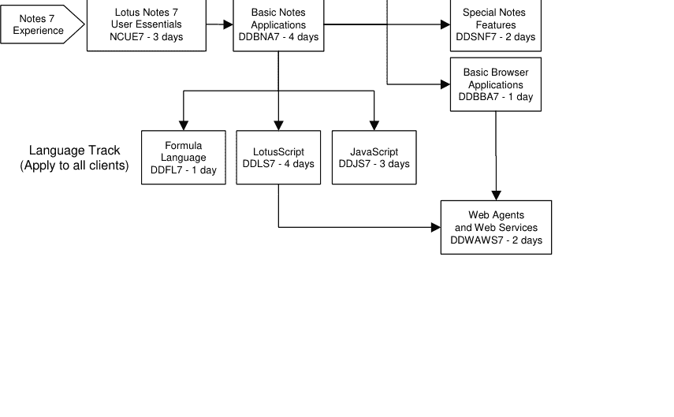

Domino Designer 7: Basic Notes Applications 为这些额外培训提供基础知识。

### 客户端方向

- 配置 Domino 以使用 DB2 作为数据库引擎，并构建访问关系数据的应用程序，DB2 for Domino 7 Administrators and Developers。
- 专注于为 Notes 应用程序编程以响应内置用户界面功能，Domino Designer 7: Special Notes Features。
- 将面向 Notes 客户端编写的应用程序转换为在浏览器中使用，Domino Designer 7: Basic Browser Applications。
- 为前沿 Web 应用程序提供数据，Domino Designer 7: Web Agents and Web Services。

### 语言方向

这些语言适用于 Notes 和浏览器客户端：

- 在 Domino Designer 7: Formula Language 中学习充分利用公式语言的复杂应用技术。
- 在 Domino Designer 7: LotusScript 中使用 LotusScript 开发复杂的应用程序和代理。
- 在 Domino Designer 7: JavaScript 中为浏览器应用程序添加强大的客户端脚本。

## 课程设计

本课程采用面向任务的方法，在此过程中您将使用 JavaScript 代码，这些代码将直接应用于您的 Domino 应用程序。

由于本课程讲授 JavaScript 如何与 Domino 协同工作，您将能够利用作为开发人员可获得的许多 JavaScript 资源。

## 数据文件

为了让你的计算机和 Domino 服务器为课程做好准备，你必须在运行 Domino Designer 的计算机上，从课程软盘运行`INSTALL.EXE`程序。在安装过程中请指定默认的 Notes `\Data`目录；如果你将其放在`\Data`目录之外的子目录中，示例将无法正常运行。默认情况下，会为你创建一个名为`\DataDDJS7`的子目录。

*DDJS7演示*（`DDJS7DEMO.NSF`）数据库将被安装。它用于演示课程中使用的所有代码，并作为练习的起点。在第一个练习中，你将在 Domino 服务器上创建自己的*DDJS7演示*数据库的非副本副本，并在那里完成练习。

还会有一些其他资源文件安装到你的本地驱动器（示例 ActiveX 控件和 Java 小程序），你将在课程中使用它们。

所有练习都必须从你在 Domino 服务器上运行的数据库副本中进行，并从那里进行测试。你的计算机上应安装 Domino Designer 7 和 Internet Explorer 6+（IE 将运行所有示例代码）。你还应安装 Mozilla Firefox 1.5+ 以测试跨浏览器兼容性。

确保你可以访问*Domino Designer 7帮助*，该帮助应该已建立全文索引。

## 约定

本课程遵循以下字体约定：

- *斜体*：数据库、视图、表单、文档、宏和字段名称，以及对象事件处理程序。
- **粗体**：菜单选项、命令按钮名称、快捷键、函数/语句名称（为了清晰起见）。
- `Courier`：用户输入、示例值、代码示例、常量。
- **Helvetica**：HTML 和 JavaScript 代码示例。
- $\rightsquigarrow$：表示脚本行在文本中换行，但在编程窗格中应为一行连续代码。

### 注释

## 主题 1：浏览器对象与 JavaScript

### 要点

本主题提供了 JavaScript 如何与浏览器关联和交互的历史和概念背景。它还描述了 Domino 服务器如何动态且安全地向浏览器提供包含 JavaScript 的页面。

### Domino/浏览器交换预览

此图说明了 Domino 与浏览器之间的交换（你将在以下章节中了解更多细节）：

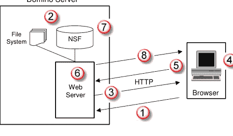

下表描述了 Domino 与浏览器之间的交换：

| 阶段 | 说明 |
| :--- | :--- |
| 1 | 浏览器请求 Domino 服务器上的 URL。在此示例中，URL 打开一个表单，用户将在其中为多个字段添加值，并将结果保存回服务器上 NSF 中的文档。相当简单。 |
| 2 | Domino 从 NSF 中提取必要的资源，在此示例中是一个表单。 |
| 3 | 表单本身是在 Domino Designer 中设计的，Domino 负责将各种设计元素转换为 HTML：<br><br>- 字段转换为 HTML `\<INPUT>` 标签。<br>- 设计为运行`@Command([FileSave])`；`@Command([FileCloseWindow])`的保存按钮被转换为 JavaScript，点击时将文档提交回服务器。<br>- 表单也可能包含嵌入 HTML 标签（包括内联`\<SCRIPT>`标签）的文本，并已标记为 Passthru HTML，因此 Domino 不需要进行任何转换。<br>- 表单可能有“passthru”元素，即在 Domino Designer 中添加的代码位于各种浏览器特定位置，例如：<br>&nbsp;&nbsp;- **HTML Head Content**。添加到 HTML 页面`\<HEAD>`标签中（使用函数语言动态定义内容）。<br>&nbsp;&nbsp;- **JS Header**。添加到页面`\<HEAD>`中`\<SCRIPT>`块的 JavaScript。<br>&nbsp;&nbsp;- **OnLoad**。添加到`\<BODY>`标签 `onLoad` 事件处理程序的 JavaScript。<br>- 如果表单在其 WebQueryOpen 事件中调用代理，则代码（使用 LotusScript 或 Java 编写）将被执行（通常用于以编程方式设置默认字段值）。<br><br>在所有计算执行完毕后（无论任何元素的原始形态如何），表单将完全转换为浏览器兼容的 HTML，并通过 HTTP 发送到浏览器。 |
| 4 | 浏览器渲染 HTML 页面中的元素。<br><br>在此示例中，表单有一个`\`标签指向 Domino 服务器上`\HTML`目录中的 JPG，因此当浏览器渲染页面时，它会获取该图像。<br><br>你可以将页面视为具有视觉方面（用户看到的内容）和代码。一些代码在视觉部分渲染之前运行（如 `onLoad` 事件中的代码），但其他客户端代码直到用户采取某些操作（如点击按钮）才会执行。<br><br>这里需要指出的是，视觉方面的所有“东西”和嵌入 HTML 页面中的客户端代码都已从 Domino 发送到浏览器，现在轮到浏览器来处理它。<br><br>这对开发者来说意味着，你必须深入理解至少以下两件事：<br>- Domino 如何转换（或传递）你在 Domino Designer 中添加的内容。<br>- 浏览器在页面到达后如何处理它（包括浏览器是否有能力处理该页面）。 |
| 5 | 在此示例中，用户点击**保存**按钮，页面被提交回 Domino。<br><br>关于**保存**按钮，作为表单开发者，你不仅需要添加页面在浏览器中渲染和正常运行所需的所有内容，还必须预见用户完成页面后会发生什么。在这种情况下，你添加了一个**保存**按钮的图像，点击时将表单提交回服务器。<br><br>表单也可能有**取消**按钮，或**返回视图**按钮；视图可能有**下一页**按钮来显示视图中的下 20 个文档，或**新建文档**按钮。<br><br>因此，由于你还必须预见用户离开页面时的导航，你现在有三个关于表单需要担心的问题。 |
| 6 | Domino 从浏览器接收页面，现在负责将其信息转换为数据库中的文档。<br><br>为此，Domino 获取原始表单以解释字段数据。它运行字段公式（计算、输入转换、输入验证）。如果存在输入验证失败，Domino 会将错误页面发送回浏览器。<br><br>如果表单在其 WebQuerySave 事件中调用代理，则代码（使用 LotusScript 或 Java 编写）将被执行（通常用于更优雅地处理字段验证错误，或在成功将文档写入数据库后将用户重定向到应用程序的其他位置）。 |
| 7 | 一旦原始表单的所有条件和代码都得到满足，文档将在数据库中创建。 |
| 8 | 根据你编写的内容，Domino 可以向浏览器返回某些内容，如错误或确认消息，返回表单进行错误修正，或转到应用程序中的下一个逻辑位置。<br><br>这是你的代码工作的另一个机会，也是另一个需要担心的领域。 |

### 编程挑战

为浏览器编程 Domino 应用程序确实是一个相当大的挑战。如上所述，有几个机会可以应用代码：

- 在 HTML 页面发送到浏览器之前运行的服务器端代码。
- 完全在浏览器中运行并最终 asymmetrically 客户端代码，最终负责将某些内容（通常是 HTML 表单）发布回服务器。
- 处理来自浏览器的响应的服务器端代码。

在本课程中，重点是客户端代码，特别是如何使用 JavaScript 操纵由当前 HTML 页面中包含的标签创建的浏览器和文档对象模型（DOM）对象，以及 JavaScript 语言本身：

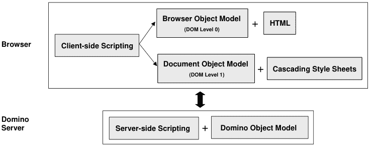

本课程也有必要涉及 Domino 作为 Web 服务器的内容，因此你也将使用 Domino 对象模型以及如何：

- 使用`@Functions`创建视图，以及使用`@Functions`的子集对按钮和操作按钮进行编码（代码由 Domino 自动转换为 JavaScript）。
- 使用 LotusScript（和/或 Java）进行功能强大的服务器端处理，例如动态创建 HTML 页面或执行提交后处理。

### 客户端脚本的历史

最初，Web 浏览器的概念是使用简单的标记语言（HTML）显示粗略格式化的文本和图像，并提供指向其他页面的超链接。只花了几年的时间，这种简单的仅显示方法就发生了巨大变化，浏览器现在成为自定义应用程序的通用用户界面。

浏览器中的脚本实现为运行时解释语言，无法在由浏览器解释的 HTML 页面之外运行。这是因为代码实际上是以人类可读的文本形式与 HTML 内容一起发送到浏览器进行本地执行的。浏览器渲染 HTML，并从各种事件中查找和执行脚本。

JavaScript 有其自身与浏览器平行但独立的发展历史。它应该真正被视为独立于浏览器对象模型，因为有些浏览器支持其他脚本语言（例如 Perl、Java、Python 等），而且 JavaScript 也用于非浏览器产品（例如 Windows Script Host、Groove 等）。

为简洁起见，本课程将“JavaScript”作为各种脚本语言变体的通用标签，这些变体用于最流行的浏览器中：

- JavaScript 是用于具有 Netscape 血统的浏览器的脚本语言，例如新的基于 Mozilla/Gecko 的浏览器。
- Microsoft Internet Explorer 使用 JScript（以及 VBScript），这是一种支持 COM 的 JavaScript 变体。
- ECMAScript（欧洲计算机制造商协会的 ECMA-262 语言）来自 Web Standards Project，旨在标准化浏览器脚本的本机语言元素和基于语言的对象。Microsoft 和 Netscape 都声称与 ECMAScript 兼容，尽管双方都添加了对方无法解释的扩展。例如，Mozilla 尽可能遵循 ECMAScript 标准。Notes 客户端也使用在一定程度上遵循 ECMA 标准的 JavaScript 解释器（ECMAScript 1.4，尽管它缺少完整的浏览器 DOM，如下所述）。

JavaScript 是一种功能相当完整的脚本语言，具有多种数据类型的变量、各种数学、字符串、等价和布尔运算符、语句、函数、数组、错误捕获、对象以及对象事件/方法/属性，使其能够执行计算并通过对话框与用户交互。JavaScript 语言对象用于操作数据，这些数据可能/不可能源自浏览器对象：

| JavaScript 语言对象 | 对象 |
| :--- | :--- |
| JavaScript 语言对象 | `Array`、`Boolean`、`Date` |
| JavaScript 语言对象 | `Enumerator`、`Event`、`Function`、`Object` |
| JavaScript 语言对象 | `Math`、`Number`、`Object` |
| JavaScript 语言对象 | `RegExp`、`Screen`、`String` |

### 浏览器对象模型简史

使用 JavaScript 编写浏览器行为代码一直具有挑战性，因为浏览器的开发周期很快。随着每个浏览器品牌（Internet Explorer、Netscape Navigator 等）和版本的推出，都会出现一个改进的新对象模型。由于通常无法控制用户计算机上安装的浏览器品牌或版本，你的代码要么必须找到最低公分母，要么分支以适应尽可能多的浏览器品牌/版本组合。你将在本课程后面了解更多关于浏览器兼容性的知识。

当 JavaScript 首次引入浏览器时，第一个对象模型是*浏览器对象模型*，现在称为文档对象模型（DOM）Level 0。早期浏览器 Netscape Navigator 2 和 Internet Explorer 3 支持 Level 0 DOM。

随着浏览器的发展，Microsoft 和 Netscape 在其第 4 版浏览器中开发了相互竞争且不兼容的专有 DOM，以支持动态 HTML 和层叠样式表。忽略这些模型会很方便（但 alas 不可能），因为这些差异既显著又令人头疼。虽然 IE 在其当前版本中继续支持其第一个 DOM 的大部分内容，但 Netscape 完全放弃了其第 4 版 DOM，并从 Netscape 6 开始用 W3C DOM 取而代之。当 Netscape 的开发于 1998 年移交给开源 Mozilla 组织时，Mozilla 浏览器继续实施 W3C DOM。

这些是基于标准的、与供应商无关的模型，由 W3C 推广（[http://www.w3.org/DOM](http://www.w3.org/DOM)；在 [http://www.mozilla.org/docs/dom/reference/levels.html](http://www.mozilla.org/docs/dom/reference/levels.html) 上有很好的总结）：

- DOM Level 1 整合并扩展了 Level 0，并提供对动态 HTML（DHTML）的完整支持。Level 1 在某种程度上被大多数当前的“第 5 代”浏览器支持，例如 Netscape 6+ 和 Internet Explorer 5+（以及大量基于标准的浏览器，如 Mozilla 1+ 和 Opera 7+）。这被认为是当前的 DOM。
- 2000 年，DOM Level 2 添加了样式表对象模型，以便更轻松地访问附加到文档的样式。它还引入了事件模型和对 XML 命名空间的支持。第 5 代浏览器（例如 Mozilla）支持 DOM Level 2 的某些方面，但并非全部。
- 2003 年 2 月，W3C 发布了 DOM Level 3 的 1.0 规范（[http://www.w3.org/TR/DOM-Level-3-Core](http://www.w3.org/TR/DOM-Level-3-Core)）。它扩展了 DOM Level 2，主要是为了增强对 XML/XHTML 的支持。

即使有标准可循，浏览器厂商仍可以按自己的意愿实施标准，这在实践中意味着支持参差不齐和专有扩展。网页开发人员也必须编写代码，使其与当前和过去的浏览器都能工作。


`Notes`客户端本身，以及当你访问 URL 时启动的`Notes`浏览器（不是 IE）（如果`Notes`浏览器在当前*位置*文档中被指定为你的浏览器），对任何标准浏览器 DOM 的支持程度各不相同。

> **注意：** 本课程的大部分内容基于 DOM Level 0，然后在后面的主题中转向 DOM Level 1，讨论动态 HTML（DHTML）。

### 浏览器对象模型（DOM Level 0）

浏览器环境中的几乎所有内容以及 HTML 页面上的内容都被视为对象，具有其相关的事件、属性和方法。浏览器 DOM 中的阴影框代表浏览器对象，而非阴影框代表使用 HTML 标签创建的 HTML 对象：

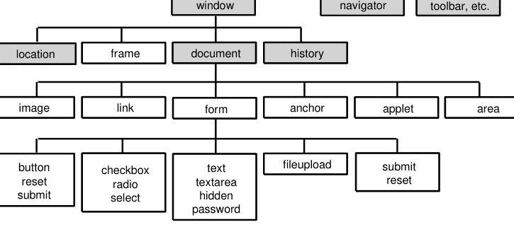

这与用户在网页上看到的内容有何关系？此图展示了构成网页的 HTML 与嵌套对象层次结构之间的关系：

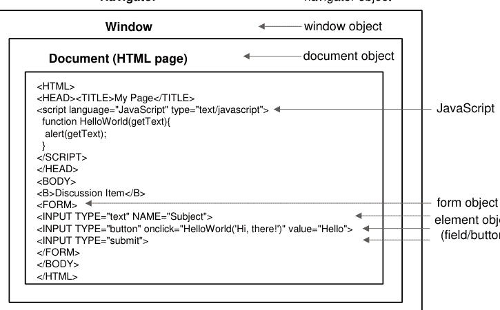

`Navigator`对象代表浏览器本身。`Window`对象包含`Document`对象，`Document`对象又包含元素，包括一个或多个`Form`对象，每个`Form`对象包含一个或多个`Element`对象。

### JavaScript 与浏览器对象的关系

JavaScript 可以访问浏览器对象的方法的属性。尽管各种浏览器在对象模型上略有差异，但它们都有一个庞大的语言、浏览器和 HTML 对象的共同基础。

JavaScript 的全部理念是创建交互式网页，无需往返服务器执行服务器端代码。对于双客户端应用程序来说，同样重要的目标是为两个受众提供等效的功能和体验。

凭借处理这些语言、浏览器和 HTML 对象的能力，使用 JavaScript 你可以：

- 自动导航
- 动态生成 HTML 内容
- 使用动态 HTML（HTML、层叠样式表和 JavaScript 的组合）更改文本和图形的位置和格式
- 在浏览器状态栏或弹出窗口中显示字段级帮助，当用户悬停在链接上时
- 使用内置的`alert`、`confirm`和`prompt`对话框提示用户输入信息，或通过模拟`@DialogBox`或`@Picklists`，数据来自 Notes 文档或视图
- 在浏览器中交互式地执行简单的字段转换和验证，无需刷新表单，这需要往返和页面刷新（Domino 运行字段输入转换和验证公式并返回显示结果的新页面）
- 通过在*onload*浏览器事件处理程序中调用 JavaScript 函数来改变表单打开行为；可以通过在*Submit*事件处理程序中调用函数来改变表单提交行为
- 创建或销毁窗口（例如模拟自定义对话框）
- 动态更新窗口和框架的位置和内容
- 将用户偏好存储在本地计算机的 cookie 中，以便稍后调用或作为 URL 链接的一部分传递，用于基于偏好的页面预处理。

所有这些都是可能的，因为 JavaScript 可以完全访问浏览器对象。

> **注意：** 同样，由于 Lotus Notes 也支持 JavaScript（尽管支持的浏览器对象较少），开发人员的目标是为浏览器和 Notes 编写无需重新编码即可工作的应用程序。在实践中，你会发现这对于非常基本的事情是可能的，因为 Notes 并不完全支持所有浏览器对象。

### Mozilla 的 DOM 和 JavaScript 对象检查器

想了解网页上有关 DOM 和 JavaScript 对象的所有信息吗？在 Firefox 1.5 或 Netscape Browser 8+ 自带的 DOM Inspector 中打开该页面！

要打开该工具，选择**工具 – DOM Inspector**。在左窗格中，你可以导航 DOM 节点，并在右窗格中查看该 DOM 节点的 JavaScript 对象属性：

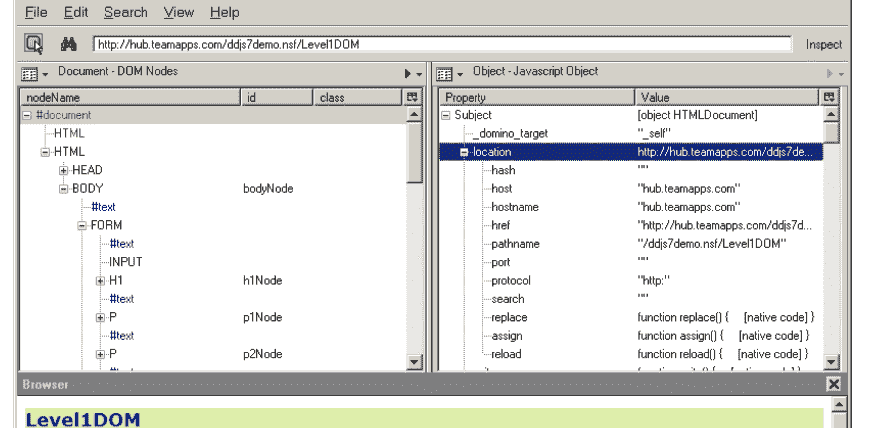

我们认为这个工具对于理解 DOM 和 JavaScript 对象层次结构有极大的帮助。随着课程的进展，你将同时使用这两组对象。

### 作为 Web 服务器的 Domino

`Domino Designer`用于创建结合了 HTML 和 JavaScript 的设计元素，但将页面提供给浏览器的任务由`Domino Server`负责。

Domino 由一个核心可执行程序和若干插件任务组成，以实现各种功能，如数据库访问、复制、邮件路由等。这些任务共同构成了 Domino 服务和对象列表，如下图所示：

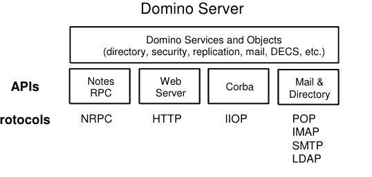

Domino 通过多种协议为各种 API 提供客户端访问。浏览器通过 Domino Web 服务器使用 HTTP 协议访问 Domino 服务和对象。

### Domino "Web 服务器"

Domino "Web 服务器"由应用服务器和 HTTP 引擎组成。下图展示了服务器组件之间的关系以及 HTTP 服务器执行的 URL 解析：

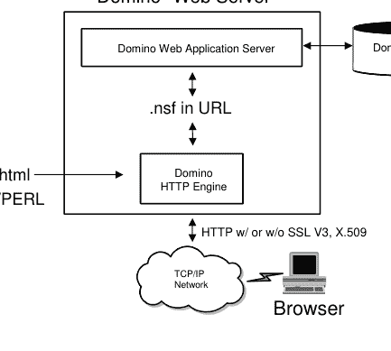

- **HTTP 服务器**。原生 Domino HTTP 服务器任务与典型的 HTTP 服务器非常相似，它解析来自浏览器的 URL 请求，并解释/返回页面（包含 HTML 和客户端脚本），或将调用转交给其他解释器（CGI/PERL）或服务器（如流媒体视频服务器）。除 HTTP 服务外，Domino 还包括：
    - 来自 Domino 目录、X.509 证书或 LDAP 引荐的用户身份验证
    - 连接、服务器请求和 Cookie 日志记录
    - URL 映射和重定向
    - 身份验证域、单点登录（Domino 服务器之间以及 Domino 与 WebSphere 之间）和基于会话的身份验证（您可以创建自定义表单来输入用户名和密码）
    - HTML 文件保护
    - 用于负载均衡和故障转移的 Internet 集群管理器
    - Domino Web 服务器 API 过滤器（DSAPI）
    - 运行 Java Servlet 的能力。

- **应用服务器**。如果 URL 包含`.nsf`，则附加到 URL 的命令（如`?OpenForm`）将被传递到应用服务器进行处理。应用服务器使用应用中编码的逻辑即时生成页面，并将标准 HTML 返回给 HTTP 服务器，由其传递给浏览器。

请记住，HTTP 服务器任务和应用服务器使用相同的 Domino 数据库；因此，如果设计得当，您的应用可以同时为 Notes 客户端和浏览器客户端提供服务。

### 第三方 Web 服务器插件

将 Domino Web 服务器与其他 Web 服务器产品集成有两种方式：

- 它可以插入到第三方 Web 服务器中，如 Microsoft IIS（首个认证服务器）和 IBM HTTP Server（IHS）（未来还会有更多）。第三方 Web 服务器处理静态页面和其他资源（ASP、JSP、CGI 等），而对`.nsf`数据库的调用则传递给 Domino Web 服务器，即使两台服务器之间有防火墙（第三方 Web 服务器位于 DMZ 中，而 Domino 位于防火墙内部）。
- 更多第三方插件可以在 Domino Web 服务器下运行，这得益于其扩展的 DSAPI 支持。例如，IBM WebSphere 应用服务器的 Servlet 引擎（J2EE 应用服务器）可以插入到 Domino Web 服务器中（这实际上从 Domino 5.0.5 就开始了，但在每个版本中都有增强）。其好处——除了运行 Servlet 之外——是 WebSphere 可以通过 LDAP 使用*Domino 目录*进行身份验证，用户可以单次登录 Domino 或 WebSphere，其身份验证凭证将在服务器之间传递。

### 练习：创建项目数据库

在本练习中，您将在本地硬盘上安装两个产品数据库和其他资源文件，然后在教室服务器上创建这两个数据库的非副本副本。

| 步骤 | 操作 |
| :--- | :--- |
| 1 | 教室内告诉您找到课程数据安装程序（`INSTALL.EXE`）。 |
| 2 | 运行安装程序，将文件复制到本地硬盘上 Notes `\Data`目录下的文件夹中。文件将保存到本地的`\Data\DDJS7`文件夹。 |
| 3 | 教员已将您注册为 Domino 用户，并授予您在教室服务器上创建新数据库的权限。教员将提供您的 Notes 用户名、Notes 用户 ID 密码和 Internet 密码（将与您的 Notes 密码相同）。 |
| 4 | 按照以下步骤在 Domino 服务器上创建`DDJS7 Demo`数据库的新副本，您将在所有练习中使用该数据库：<br><br>- 启动 Lotus Notes。<br>- **选择 文件 – 数据库 – 打开**，浏览到包含`DDJS7 Demo`数据库的本地文件夹。打开该数据库。<br>- 数据库打开后，选择 **文件 - 数据库 - 新建副本**。<br>- 将教员提供的教室服务器名称指定为新数据库的位置。<br>- 将文件名称更改为唯一的名称，或许可以包含您的姓名缩写，如`JJBExercises.NSF`。<br>- **输入一个您会记住的标题，如 JOE 的练习数据库。**<br><br>**注意：** 在所有练习中，此数据库将被称为 *Your Exercises* 数据库。在看到此名称的地方，请替换为您的数据库名称。<br><br>- 取消选择 **访问控制列表**，因为您希望自己和 Domino 服务器都被列为 ACL 中的管理者。<br>- 将所有其他设置保留为默认值。<br>- 单击 **确定** 创建数据库（同样，您已获得在此服务器上创建新数据库的权限）。 |
| 5 | 如果尚未打开，请在教室服务器上打开 *Your Exercises* 数据库。 |
| 6 | 选择 **文件 - 数据库 - 访问控制**。目前，单击 **-Default-** 设置并选择 **作者** 访问权限。同时选择可以创建和删除文档的权限。单击 **确定** 保存设置。 |
| 7 | 切换到浏览器，测试 Domino 查找 *Your Exercises* 数据库的能力。输入此 URL 创建 *Discussion* 文档：`http://server/jjbExercises.nsf/discussion?openform`。务必替换服务器和目录/数据库名称，以便打开您的数据库副本到 *Discussion* 表单。如果表单打开，则您成功了，可以继续进行。 |
| 8 | 重复前面的步骤，但这次是创建 *DDJS7 Products* 数据库的新非副本副本。尝试使用此 URL 打开数据库中的 *Main* 视图：`http://server/jjbProducts.nsf/main?openview`。根据教室服务器的配置方式，您可能需要在 URL 中包含完整的主机名，例如：`http://host.domain.com/jjbProducts.nsf/main?openview` |
| 9 | 当所有人都完成在服务器上创建两个数据库后，教员将使用 Domino Administrator 使用教员 ID 对所有数据库进行签名。（有几个代理需要在教室服务器上运行前进行签名。） |

### 说明

## 主题 2：在 Domino Designer 中编写 JavaScript

### 要点

本主题介绍如何在 Domino Designer 中使用各种设计元素编写 HTML 和 JavaScript。它还解释了 Domino 服务器如何解释您创建的设计，并渲染包含 HTML 和 JavaScript 的页面。

### HTML 页面结构

`Domino Designer`开发环境将 HTML 和 JavaScript 集成在一起，使您编写的代码能够正确翻译，并在发送到浏览器以及 Notes 时放置在 HTML 页面的适当上下文中。

Domino 使用表单设计作为指令集即时构建 HTML 表单。它输出相当通用的 HTML，并进行必要的转换，以生成原始设计的合理近似效果。

为了方便讨论 Domino 如何解释表单并将其转换为发送到浏览器的 HTML，让我们看看 *DDJS7 Demo* 数据库中的一个简单表单，*DesignToHTML* 表单：

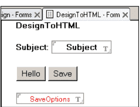

以下是该表单在浏览器中呈现的样子：

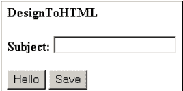

以下是 Domino 下发并在浏览器中查看的 HTML 源代码。这是浏览器需要处理的全部内容——用于显示页面的 HTML 和使其具有交互性的 JavaScript（为便于讨论已添加行号）：

```javascript
1. <!DOCTYPE HTML PUBLIC "-//W3C//DTD HTML 4.01 Transitional//EN">
2. <html>
3. <head>
4. <title>DesignToHTML Test Form</title>
5. <script language="JavaScript" type="text/javascript">
6. <!--
7. function upCase(FieldObj){
8. getValue = FieldObj.value
9. FieldObj.value = getValue.toUpperCase()
10. }
11. function confirmSave(){
12. form=document.forms[0];
13. getConfirm = confirm('Do you want to save this document?\nClick OK to save, Cancel to NOT save.');
14. if (getConfirm==false) {
15. form.SaveOptions.value='0';
16. }
17. form.submit()
18. }
19. function HelloWorld(getText){
20. alert(getText);
21. }
22. // -->
23. </script>
24. <script language="JavaScript" type="text/javascript">
25. <!--
26. document._domino_target = " self";
27. function _doClick(v, o, t, h) {
28. var form = document._DesignToHTML;
29. if (form.onsubmit) {
30. var retVal = form.onsubmit();
31. if (typeof retVal =="boolean" && retVal == false)
32. return false;
33. }
34. var target = document._domino_target;
35. if (o.href != null) {
36. if (o.target != null)
37. target = o.target;
38. } else {
39. if (t != null)
40. target = t;
41. }
42. form.target = target;
43. form__.Click.value = v;
44. if (h != null)
45. form.action += h;
46. form.submit();
/* 本行为系统生成说明，不属于原文内容 */ 47. return false;
48. }
49. // -->
50. </script>
51. </head>
52. <body text="#000000" bgcolor="#FFFFFF"onload="document.forms[0].Subject.focus()">
53. <form method="post"
    action="/DDJS7DEMO.nsf/DesignToHTML?OpenForm&amp;Seq=1"
    name="_DesignToHTML">
54. <input type="hidden" name="__Click" value="0"><b>DesignToHTML</b><br>
55. <b>Subject: </b>
56. <input name="Subject" value="" MAXLENGTH=30, SIZE=30
    onchange="upCase(document.forms[0].Subject)"
    onblur="upCase(document.forms[0].Subject)"
    onfocus="window.status='Please enter a Subject.'">
57. <input type="button" onclick="HelloWorld('Hi, there sparky!')" value="Hello">
58. <input type="button" onclick="confirmSave()" value="Save">
59. <input name="SaveOptions" type="hidden" value="1">
60. </form>
61. </body>
62. </html>
```

Domino 发送到浏览器的这个页面包含了浏览器处理表单所需的所有 HTML 和 JavaScript，包括一个用于将表单提交回服务器的按钮。


尽管 HTML 页面是作为整体发送的，但各个元素的编程工作是在 Domino Designer 中的多个地方完成的。下图展示了 `JS Header` 事件如何最终被放置到 HTML 页面的 `<HEAD>` 部分的一个实例：

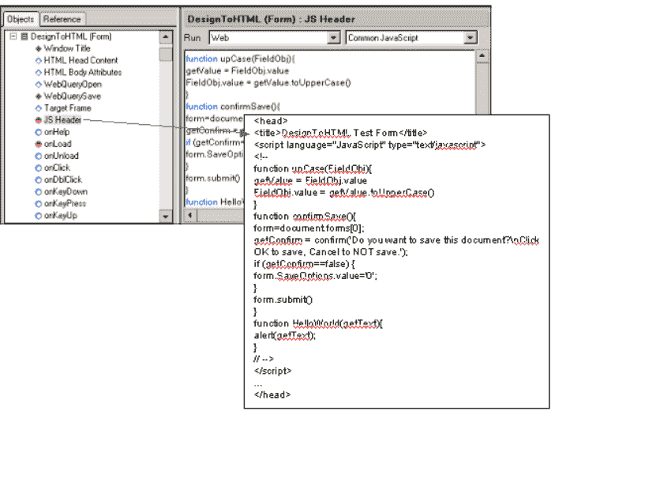

下表展示了在 Domino Designer 中的工作位置，并标明了上述源代码中相关内容最终出现的行号（如有）：

| 行号 | HTML 源代码 | Designer 位置 |
|------|-------------|---------------|
| 1-3 | Domino 自动添加 `DOCTYPE`、`HTML` 和 `HEAD` 标签。 | 服务器生成 |
| 4 | `Window Title` 事件公式确定放置在 `<HEAD>` 中的 `<TITLE>` | `Window Title` 事件 |
| n/a | `<HEAD>` 中的其他标签，例如包含关键字或文档刷新信息的 `<META>` 标签、链接信息、语言或其他定义文档的信息，可以在此处使用 `@Functions` 定义。 | `$$HTMLHead` 字段或 `HTML Head Content` |
| 5 | 标记 HTML 中语言解释器应注意的部分。虽然大多数浏览器假定 `<SCRIPT>`（不带 `language` 参数）是 JavaScript，但最好指定语言，以防文件被能够处理其他或多语言的浏览器解释。 | 服务器生成 |
| 6, 22 | 建议包含注释符号（`<!--` 和 `//-->`）以向不支持或已禁用 JavaScript 的浏览器隐藏代码。对这些浏览器来说，这只是注释掉的 HTML。兼容的浏览器可以毫无问题地读取代码。"//" 作为 JavaScript 注释添加，以防止浏览器尝试计算 `-->`，否则会导致错误。您将在后续主题中了解更多关于浏览器兼容性的内容。 | 服务器生成 |
| 7-21 | 输入到 HTML 页面 `<HEAD>` 块中的 JavaScript 函数。将它们放在此处可使其在整个文档中全局可用，并可以通过引用容器文档作为代码源从其他窗口或帧调用。另请注意，在 `<HEAD>` 中声明的任何变量对该页面上的所有其他 JavaScript 都是全局的。**注意：** 尽管在 Domino Designer 中与其他 JavaScript 事件归为一组（在对象浏览器中以圆圈显示），但 `JS Header` 不是浏览器对象事件处理程序，而是一个用于编写将放置在页面 `<HEAD>` 部分中的 JavaScript 函数的地方。 | `JS Header` 事件 |
| 24-50 | Domino 服务器生成的 JavaScript 函数，用于处理使用 `Function Language` 编写的按钮和操作的点击动作。您无法修改或删除此代码。**注意：** 必须设置数据库属性 `Web access: Use JavaScript when generating pages`（这是为 Web 编码时的首选设置）才能实现此功能。 | 服务器生成 |
| 52 | 主要用于设置各种 `<body>` 属性，例如背景、文本、链接、已访问链接的颜色。 | `HTML Body Attributes` 事件 |
| 53 | `<FORM>` 标签，包含提交时将表单 `Post` 的 HTTP 命令以及容器表单名称（前面加下划线）以便在代码中轻松引用。表单中的所有元素（字段、按钮、图像等）都包含在 `<FORM>` 块中。 | 服务器生成 |
| 54 | 一个隐藏字段，作为服务器生成代码的一部分用于处理按钮点击（第 21-47 行） | 服务器生成 |
| 56 | `Subject Field` 定义，包含 `onchange`、`onblur` 和 `onfocus` 事件处理程序。对 `document.forms[0].Subject` 的引用将文档中 `<FORM>` 标签数组里第一个 `<FORM>` 中找到的 `Subject Field` 对象的引用传递给 `upCase()` 函数，该函数又使用 `value` 属性访问字段内容。这也可以写成：`upCase(document._DesignToHTML.Subject)` 使用表单名称，或使用对当前对象的自引用：`upCase(this)`。其他属性出现在 `<INPUT>` 字段中，例如 `MAXLENGTH` 和 `SIZE`。 | `onChange`、`onBlur` 和 `onFocus` 事件；`HTML Attributes "event"` |
| 57 | `HelloWorld` 按钮，演示如何调用函数。 | `HelloWorld` 按钮 |
| 58 | `Save` 按钮，从其 `onclick` 事件处理程序调用在 `JS Header` 中定义的 `confirmSave()` 自定义函数。 | `Save` 按钮 |
| 59 | 另一个隐藏字段 `SaveOptions`，设置为 "1"，意味着提交时将保存文档。必须设置表单属性 `Generate HTML for all fields` 才能使隐藏字段对 JavaScript 可用，即使对用户隐藏。 | `Computed when composed` 字段 |
| 60–62 | `Form`、`Body` 和 `HTML` 块的结束。 | 服务器生成 |

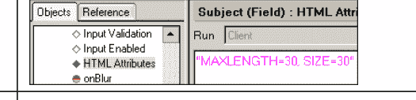

### 编写自己的 HTML

Domino 将在发送到浏览器之前，将使用 Domino Designer 添加到表单或页面中的所见即所得文本和设计元素（例如表单本身、窗口标题、字段和按钮）转换为 HTML。

要*手动*向表单或页面添加 HTML，您可以：

- 将选定的文本标记为透传 HTML（无论是从**文本**菜单，还是将透传 HTML 用大括号括起来），以便添加您自己的 HTML 格式标签。

> **注意：** 如果您希望 Notes 渲染 HTML，请务必在表单/页面属性**信息**选项卡上设置此属性：
>
> 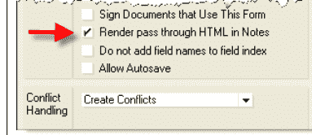
>
> **提示：** 选择**视图 - HTML 框架**以使用嵌入式 HTML 编辑器编辑当前选定的透传 HTML。

- 在表单属性**默认值**选项卡上设置 Web 访问\内容作为 HTML：

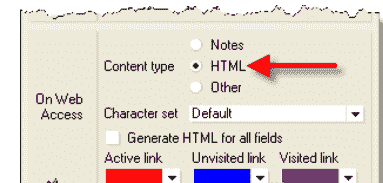

随后您必须手写*整个*表单/页面，因为 Domino 不会进行任何转换，并假定所有内容都是 HTML。

### 其他 HTML 来源

除了放置在页面和表单上的 HTML 外，Domino 还可以从另外两个地方提供 HTML 服务：

- 作为共享文件资源存储的 HTML 文件。

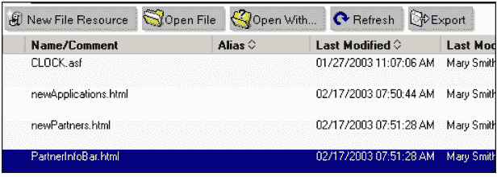

将 HTML 文件存储在数据库内部的优势包括：

- 文件存储安全，访问权限由数据库 ACL 控制。
- 文件可以复制到其他服务器以提高可用性和可扩展性，也可以复制到笔记本电脑供离线使用。
- 部署简便，因为文件已经与使用它们的数据库在一起。
- 可以利用主模板数据库，从中获取所有 HTML（以及图像、CSS 和 `.JS` 文件、其他 Web 相关文件，以及所有设计元素），并在每晚进行刷新。
- 编码简单，因为文件位置更可预测，且相对 URL 允许数据库在服务器之间移动时仍能正常工作。
- 由于 Domino Web 服务器也提供存储在文件系统中的 HTML 页面（默认位于 `\DATA\DOMINO\HTML` 目录下），因此可以动态交错使用 Domino 应用服务器生成的页面、表单和视图。

Domino 扩展了其安全模型以保护 HTML 文件。使用 *Internet 站点* 视图可为特定目录和/或文件创建 *文件保护* 配置文件：

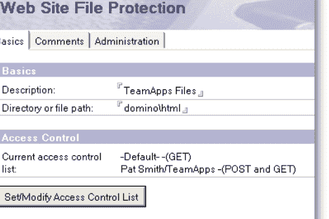

您可以设置 ACL 来控制谁有权读取/执行和读取/写入/执行文件，以及谁没有访问权限。

Domino 还允许您在域搜索功能中包含 HTML 文件。

### 将 JavaScript 放入 HEAD 标签

在使用 Domino Designer 进行浏览器编程时，需要记住的重要一点是：结果必须遵循浏览器 HTML 和 JavaScript 解释器执行的规则。

从设计角度来看，如何将 HTML 和 JavaScript 放到表单上并不重要，只要发送到浏览器时能产生包含有效 HTML 和 JavaScript 的页面即可。

> **注意：** 不要同时使用两种或多种重叠的技术，例如在 `HTML Head Content`、`JS Header` 和 `$$HTMLHead` 字段中同时编写 JavaScript 函数。虽然在很多情况下它能工作，但可能会产生不可预测的结果。

考虑到这一点，使用 Domino Designer 编写 JavaScript 有多种方式。选择使用哪一种取决于您，但要注意 Notes 客户端仅解释写在 `JS Header` 事件中的 JavaScript。没有一种"正确"的方式，您常常需要根据手头需求混合搭配不同技术。

您可以在 DDJS7 演示数据库的 `JSONonForm` 表单中看到这些技术的实际应用：

- **HTML Head Content。** 此"事件"必须使用公式语言编码，其结果放在发送到浏览器的页面的 `<HEAD>` 部分中。`HTML Head Content` 公式的结果必须是包含正确 HTML 的字符串，包括您想要包含的任何 JavaScript 函数。虽然通常使用 `JS Header` 事件在头部包含 JavaScript 函数，但在此处编写 JavaScript 函数的优势在于，您可以轻松地使用公式语言字符串拼接（`+`）将 Notes 字段值和 `@公式` 混合到 JavaScript 中，例如：

```
"<SCRIPT LANGUAGE=\"JavaScript\">function sayHiUser() { (alert('Hi : ' + @UserName + '')) } </SCRIPT> "
```

注意，您需要添加 `<SCRIPT>` 标签，因为这些不是默认假设的，而且公式语言引号和 JavaScript 引号的混合使用可能会有点棘手。所有嵌入在 JavaScript 中的引号前面都必须加上公式语言转义字符 `\`。然而，这种技术的优势在于，您可以将完整的公式语言与 JavaScript 代码混合使用。使用 `HTML Head Content` 事件的另一个原因是用于其他您可能想包含在 `<HEAD>` 中的标签，例如 `<META>` 和 `<STYLE>` 标签。

- **$$HTMLHead 字段。** `HTML Head Content` 事件的使用取代了旧的保留 `$$HTMLHead` 字段（放置在表单顶部的隐藏计算显示字段），但仍为保持向后兼容而支持。

- **JS Header。** `JS Header` 事件是放置 JavaScript 函数的首选位置。此事件接受（并执行语法检查的）JavaScript。生成的代码会自动连同必要的 `<SCRIPT>` 标签一起放置在页面的 `<HEAD>` 部分中。

如果需要在 JavaScript 中使用 Notes 字段值或 `@Function`，必须通过编码一个（隐藏的）字段来间接实现，然后使用 JavaScript 读取该字段的 `value` 属性。例如，如果您想从 `@UserName` 函数获取用户名，不能直接在本事件 `JS Header` 事件中这样做。您必须创建一个隐藏的计算字段（在此示例中命名为 `getUserName`），该字段使用公式，然后在 HTML 表单上使用字段的 `value` 属性访问该字段：

```
function sayHiUser0(){
  form=document.forms[0];
  alert('0: ' + form.getUserName.value)}
```

> **注意：** 如果您希望 JavaScript 函数对 Notes 可见，则必须将它们放入 `JS Header` 事件，因为 Notes 不会计算 `HTML Head Content` 事件或 `$$HTMLHead` 字段。

### 练习：JavaScript 函数

您将在下一个主题中了解更多关于 JavaScript 语言元素的知识，并在课程进行过程中在后续主题中了解函数。在此练习中，您将简单地在 `JS Header` 事件中输入一个 JavaScript 函数。您将在下一个练习中调用该函数。

| 步骤 | 操作 |
|------|------|
| 1 | 在 Domino Designer 中，切换到表单列表并创建一个新表单。打开表单属性，将表单命名为 `Topic1`。 |
| 2 | 展开表单的对象事件，然后单击 `JS Header` 事件。 |
| 3 | 选择 **Common JavaScript** 作为代码作用域。 |
| 4 | 在程序员窗格中输入以下 JavaScript：<br><br> `function saySomething(msg) { alert(msg); }` |
| 5 | 保存表单。<br><br> 在下一个练习中，您将从按钮调用此函数，然后进行测试。 |

### 将 JavaScript 放到 HTML 页面上

现在您已经知道将全局 JavaScript 函数和变量放在 `<HEAD>` 部分中，接下来的任务是编写调用这些函数的 JavaScript。

根据您希望 JavaScript 何时/如何执行，有多种方式将 JavaScript 放到 HTML 页面上：

- **表单、热点、按钮、操作、图像等事件。** 当您定义这些元素并指定语言为 JavaScript 时，Designer 会打开完整的事件处理程序集进行编码。例如，当您创建按钮时，按钮事件会出现在对象列表中：

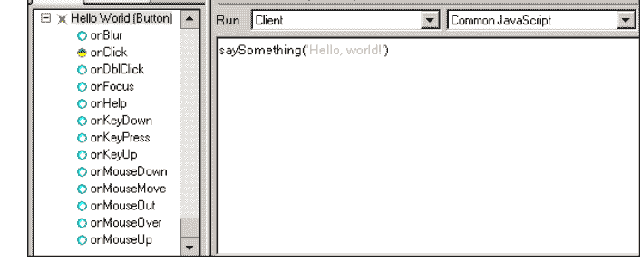

如果您在浏览器中打开表单并查看源 HTML，您会看到 Domino 将事件处理程序代码添加到定义按钮的标签中：

```
<input type="button" onclick="saySomething('Hello, world!') " value="Hello World">
```

> 注意：您将在后续主题中了解更多关于浏览器事件的知识。

- **文本 - 直通 HTML。** 虽然大部分代码会出现在 `JS Header` 和元素事件中，但也可以将 `<SCRIPT>` 标签放在 `<HEAD>` 之外的 `<BODY>` 部分中。此脚本在 `<BODY>` 加载时执行。您必须添加自己的 `<SCRIPT>` 标签并将代码标记为直通 HTML。此屏幕截图显示了在表单上编写的两个 JavaScript 函数：

```
<SCRIPT LANGUAGE="JavaScript">
function sayHiUser2(){
  form=document.forms[0];
  alert('2: ' + form.getUserName.value)}

function sayHiUser3(){
  form=document.forms[0];
  alert("3: " + getUserName_1_T.value)}
</SCRIPT>
```

因为您可以将计算文本和字段混合到内联脚本中，所以您可以以这种方式在运行时动态生成 JavaScript。在此示例中，第一个函数使用 JavaScript 方法引用表单上的字段；第二个函数使用放置在 JavaScript 中的 Notes 计算显示字段来计算部分 JavaScript。

内联 JavaScript 通常用于在与 `<SCRIPT>` 标签相同的位置动态输出 HTML。例如，`DDJS7 Demo` 数据库中 `JavaScript on Form` 表单上的此脚本以这样一种方式显示电子邮件地址，使得收割者更难找到该地址：

```
<script language=javascript>
<!--
var linktext = "Email TeamApps Sales";
var email1 = "sales";
var email2 = "teamapps.com";
document.write("<a href=" + "mail" + "to:" + email1 + "@" + email2 + ">"+
linktext + "</a>")
//-->
</script>


> 注意：务必将内联代码的字体设置为 10 pt. Default Sans Serif。如果设置为其他任何字体类型或字号，Domino 创建的 HTML 可能会插入 `<font>`、`<br>` 或 `<tt>` 标签，从而导致 JavaScript 错误。此外，除在 `;`、`{` 或 `}` 之后外，切勿使用 Enter 键换行。如果使用 Enter，Domino 在解释 HTML 页面时会插入 `<br>` 标签，这在 JavaScript 代码中是无效的。请改用 Ctrl-Enter。

### 练习：创建一个按钮

在本次练习中，你将创建一个用于调用上一练习中所创建函数的按钮。

请按照以下步骤创建按钮：

| 步骤 | 操作 |
| :--- | :--- |
| 1 | 在 `Your Exercises` 数据库中打开 `Topic1` 表单。 |
| 2 | 在表单上创建一个新按钮。将按钮命名为 `Hello World`。 |
| 3 | 展开按钮的事件列表。 |
| 4 | 点击按钮的 `onClick` 事件，并选择 **Common JavaScript** 作为代码作用域。 |
| 5 | 在程序员窗格中输入以下 JavaScript 代码：<br><br>`saySomething("Hello, world!")`<br><br>完成后的代码将如下所示：<br>![代码截图] |
| 6 | 保存表单。 |
| 7 | 选择 **设计 - 在 Web 浏览器中预览 - Internet Explorer** 或点击工具栏上的 ![图标] 工具。 |
| 8 | 表单将在浏览器中打开。 |
| 9 | 点击按钮以确保其正常工作。 |

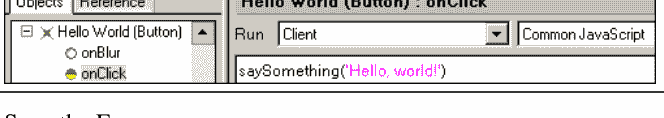

### 按钮问题的故障排除

除了你编写的 JavaScript 本身可能存在的问题外，在向表单或页面添加按钮时，你可能还会遇到一些 Domino 特有的问题：

- 如果你使用了无法转换的 `@函数` 或 `@命令`，或者你犯了其他编码错误，该操作或按钮将不会在浏览器中显示。这是告诉你有问题存在的线索。
- 如果按钮被添加在被标记为“传递 HTML”的文本中间，该按钮将不会显示。同时，请检查段落的“隐藏时”属性是否设置正确，以确保它不会对 Web 客户端或在读取/编辑模式下隐藏（具体取决于按钮的用途）。
- 如果你将代码放在了 Notes 客户端的 JavaScript 下（而不是 Web 端），或者没有将代码作用域标记为 Common JavaScript。结果就是，当你测试代码（并查看 HTML 源文件）时，你的更改并未被发送到浏览器。

### JavaScript 库

在使用 JavaScript 一段时间后，你会发现有些例程在多个表单、页面以及应用程序之间是通用的。在每一个使用它们的设计元素中重复并维护它们是毫无意义的。

解决方法是将这些通用函数存储在一个 `.JS` 文件中，该文件在运行时由浏览器下载。`.JS` 文件必须保存为 ASCII 文本，并且不能包含任何 HTML——它只包含 JavaScript 函数，例如这个名为 `Jslib.js` 的文件：

```javascript
function sayMessage(message)
{
    alert(message)
}
```

在普通的浏览器应用程序中，`.JS` 文件存储在 Web 服务器的文件系统中，并在 `<HEAD>` 块中使用如下标签进行链接：

```html
<SCRIPT src="Jslib.js" language="javascript" type="text/javascript"></SCRIPT>
```

但对于 Domino，你可以将 `.JS` 文件作为脚本库集成到数据库设计中。

> **注意：** 在设置 **传递 HTML** 属性时，请务必在应用文本属性时高亮显示所有字符，因为该属性是逐字符应用的（与按段落应用不同）。如果有一个按钮、表格、计算文本或热点独立存在或位于传递 HTML 流中，请关闭 **传递 HTML** 属性，否则该元素在 Domino 渲染页面时将被忽略。反过来，你可以通过在应用属性之前选中字段前的空格、字段本身和字段后的空格，将字段或计算文本的输出设置为传递 HTML。

#### 将文档/页面内容视为 HTML

这是一种完全手动的方法，通常没有实际用途。当你启用此表单属性时，必须在表单或页面上编写每个 HTML 标签，包括 `<HTML>` 标签。虽然你可以使用字段（在表单上）来计算 HTML，但其他一切都不是自动的——不包含事件代码，不会转换任何按钮或表格——并且 Domino 服务器会将表单剥离为纯文本，忽略所有文本格式、字体、表格和热点。

使用此表单属性的另一个问题是，设置后无法保存文档。该表单只能通过调用 `?readform` URL 命令来使用，任何 **Submit** 按钮都将失败（你会收到错误消息 Error 500, HTTP Web Server: Application Exception - Documents treated as HTML cannot be edited）。在以前的 Domino 版本中，这些表单用于创建包含嵌入式视图或导航器元素的页面，或创建存储框架集的文档。但页面和框架集设计元素已经取代了这种变通方法。

> **注意：** 如果你设置了此表单属性，任何与 Web 相关的特殊字段名（例如 `$$HTMLHead` 或 `$$Return`）都将不起作用。此外，这些字段应设置为“计算以显示”，并在读取和编辑时隐藏（但不要对 Web 浏览器隐藏）。

> **提示：** 如果你只需要一个静态 HTML 页面，考虑使用“页面”，或者简单地将 HTML 页面添加到设计的 **共享资源 - 文件** 区域；如果你不想将其放在 NSF 文件中，请要求你的 Domino 管理员将文件放在服务器的 `\HTML` 目录中。

#### WebQueryOpen 事件代理

如果你更喜欢使用 LotusScript 动态生成 JavaScript，可以通过将表单上的一个字段设置为包含内联 JavaScript 代码的字符串来实现。当然，该字段必须使用 **文本 - 传递 HTML** 属性进行标记。例如：

```html
<SCRIPT LANGUAGE="JavaScript">
  JS1
</SCRIPT>
```

然后，编写代理代码（使用 LotusScript 或 Java），例如：

```lotusscript
WebOpenJSOnForm (Agent) : Initialize

Sub Initialize

  On Error Goto ErrorHandler

  Dim Session As New NotesSession

  Dim Doc As NotesDocument

  Set Doc = Session.DocumentContext

  Dim getName As NotesName

  Set getName = Session.CreateName(Doc.getUserName(0))

  L1="function sayHiUser4() {"

  L2="form=document.forms[0];"

  L3="alert('4: | & getName.Common & ')|"

  Doc.JS1 = L1 & L2 & L3

  Exit Sub

ErrorHandler:

  Doc.LSErrorMessage = Error()

  Exit Sub

End Sub
```

最后，在表单的 `WebQueryOpen` 事件公式中填入代理名称，例如：

```text
JSOnForm (Form) : WebQueryOpen
```

输入运行代理的公式：

```text
@Command([ToolsRunMacro]; "WebOpenJSOnForm")
```

代理的最终输出设置了 `JS1` 字段。请注意，代码依赖于一个字段值（`getUserName`）来获取用户的真实姓名。这确保了返回的是实际浏览器用户的姓名，而不是服务器名称或代理签名者姓名（如果你使用 NotesSession 对象的 `UserName` 或 `EffectiveUserName` 属性，就会出现这种情况）。

使用 LotusScript 编写 JavaScript 在处理字面量引号时也很有趣。为了绕过这个问题，在 LotusScript 中使用字面量引号时使用竖线符号。同时注意使用 `ErrorHandler` 例程将错误写入 `LSErrorMessage` 字段。由于 `WebQueryOpen` 代理无法像 `WebQueryClose` 代理那样向浏览器输出，这为你提供了调试代码的能力。

#### @函数的使用及 @命令到 JavaScript 的自动转换

有许多非常 Web 特定的 `@函数`，它们返回的信息如果仅使用 JavaScript 将更难或不可能获取（例如 `@ClientType`、`@BrowserInfo`、`@WebDBName`、`@GetHTTPHeader`、`@SetHTTPHeader`、`@UrlQueryString` 和 `@DbCommand`），并且能够利用众多独特 `@函数` 的全部计算能力进行计算。

大约有 40 个左右的 `@命令` 可用于按钮、操作按钮和操作热点。除非你设置了数据库属性 **生成页面时使用 JavaScript**，否则 Domino 不会为你执行此 `@命令` 到 JavaScript 等效项的转换：

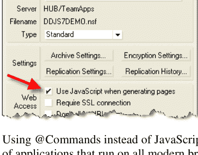

使用 `@命令` 而不是 JavaScript 可以显著加快在所有现代浏览器以及 Notes 上运行的应用程序的开发速度。你将在后续主题中了解更多关于此转换的信息。

> **注意：** 在 *Domino Designer 7 帮助* 中搜索 “Web 上的 @函数” 和 “Web 上的 @命令”，可以全面了解 `@函数` 和 `@命令` 在浏览器应用程序中的使用（或禁止使用）方式。

一旦你将脚本库添加到数据库并正确引用，就可以像在 `JS Header` 事件中定义的那样，从表单或页面上的任何位置调用这些函数。

将大型 JavaScript 库文件与其他设计元素分开的额外好处是提高了性能，因为浏览器可以缓存库文件，而不是每次都花费时间下载。这也减少了服务器开销和网络流量。

请按照以下步骤创建和引用 JavaScript 库：

| 步骤 | 操作 |
| :--- | :--- |
| 1 | 在对象浏览器中展开 **Shared Code**，然后单击 **Script Libraries** 以打开脚本库列表。 |
| 2 | 单击 **New JavaScript Library** 按钮。 |
| 3 | 右键单击程序员窗格并选择 **Import**： |
| 4 | 从你安装课程数据盘的位置选择所需的 `.js` 文件，例如：<br><br>![Import Dialog Box]<br><br>单击 **Import**。 |
| 5 | 代码已导入。<br><br>![Javascript Library Editor]<br><br> |
| 6 | 按 `Esc` 键为库命名并关闭。 |
| 7 | 现在开始使用 JavaScript 库。 |
| 8 | 打开要使用 JavaScript 库的表单或页面。 |
| 9 | 单击 `JS Header` 事件，右键单击程序员窗格并选择 **Insert Resource**。 |

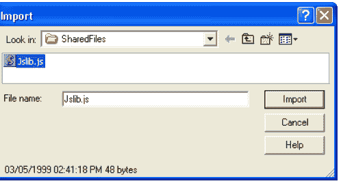

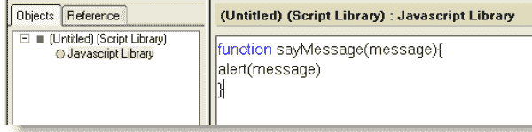

| 步骤 | 操作 |
| :--- | :--- |
| 10 | 因为你在 JS Header 事件中操作，所以只会出现 JavaScript 库。<br><br><br><br>选择所需的库并单击 **OK**。 |
| 11 | 对库的引用已插入到 JS Header 中：<br><br><br><br>你现在可以调用 JavaScript 库中的任何函数。 |

请记住，JavaScript 库可能来自另一个数据库，在那里可以集中编码和调试，并且只要你在所有插入了共享资源的地方，新代码就始终可用。

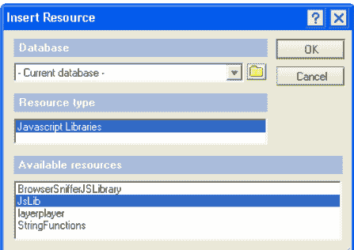


### 页面上的 JS 文件

如果你正在使用 Domino Designer 5 创建的应用程序，你可能会发现从文件系统引用的 `.JS` 文件（这是包含 `.JS` 文件的传统方式），或者将一个 `.JS` 文件附加到页面。当然，将 `.JS` 文件包含在数据库中的优点是它们会被服务器复制和保护。

要包含 `.JS` 文件，请将此公式（该公式计算结果为 JavaScript）添加到页面或表单的 `HTML Head Content` 事件中：

```text
db:=@WebDbName;

"<SCRIPT SRC=" /" + DB + "/JSLIB/$\u{FILE}/JSLIB.JS" LANGUAGE="JavaScript">+</SCRIPT>"
```

在此示例中，当前数据库包含一个名为 `JSLIB` 的页面，该页面附加了 `JSLIB.JS` 文件。如果需要，你可以更改数据库名称以指向另一个数据库。如果页面存储在当前数据库中，你可以将引用缩短为：

```text
"<SCRIPT SRC="$\u{FILE}/JSLIB.JS" LANGUAGE="JavaScript">+</SCRIPT>"
```

要查看此示例的实际效果，请使用以下 URL 在 `DDJS7 Demo` 数据库中打开 `TestJSFile` 页面：

```text
http://server/DDJS7demo.nsf/testjsfile
```


### JavaScript 库安全性

在某个时候，你会希望考虑阻止任何人使用你的 JavaScript 库。你可以使用通常的 Domino 安全机制，或者使用 [http://www.javascriptkit.com/javatutors/externalrestrict2.shtml](http://www.javascriptkit.com/javatutors/externalrestrict2.shtml) 中的技术以编程方式实现。基本思想是将当前 URL 与允许的 URL 或 IP 域名列表进行比较。

### 语法检查

正如你可能已经发现的那样，当你在接受 JavaScript 的事件中输入 JavaScript 时，Domino Designer 会执行简单的语法检查。尽管语法检查非常重要（因为大多数错误最终都是由于引号/大括号/括号不匹配或大小写错误造成的），但它没有交互式调试功能。

### 运行时错误报告

浏览器通常具有运行时错误报告功能，让你知道解释器在哪里发现了问题，这是来自 Internet Explorer 的示例：

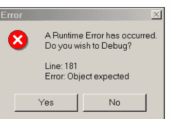

在 Navigator 中，JavaScript 控制台（`Tools – JavaScript Console`）显示错误的运行历史记录，直到你清除它：

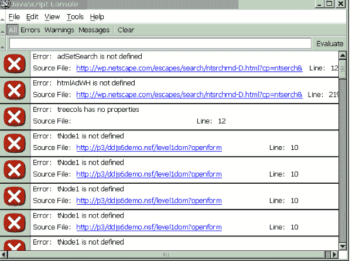

### Microsoft Script Debugger

如果你使用客户端调试器，通常可以找到错误，但你必须回到 Domino Designer 进行修复，然后保存更改并重试。

> 注意：然而，在许多情况下，问题在于这些工具无法很好地处理嵌入在 `NSF` 文件中的 JavaScript，因为它们无法写入文件。但至少你会获得比根本不使用工具更多的问题信息。

Microsoft Script Debugger 是一个免费的加载项，你可以从 [http://msdn.microsoft.com/scripting/default.htm](http://msdn.microsoft.com/scripting/default.htm) 网站获取它。它为调试嵌入在 `NSF` 文件中的 JavaScript 提供了某种程度的有用性。

当 JavaScript 解释器遇到错误时，你可以选择调试当前页面：

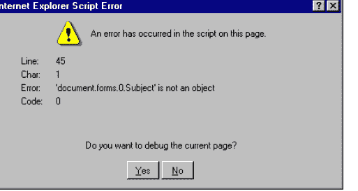

如果你单击 **Yes**，并且安装了 Microsoft Script Debugger，调试器将启动：

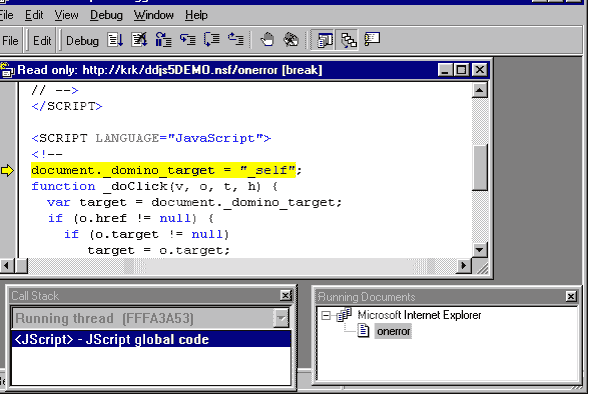

你可以单步执行代码并设置断点，这些断点在刷新页面时触发。这有助于你跟踪代码路径并检查代码逻辑。你可以刷新浏览器中的页面，以查看代码在断点处停止。

可能最有用的功能是状态栏显示行号，因此你可以轻松找到错误发生的位置。

在功能和成本上更进一步的是 Microsoft Visual InterDev，它提供了更广泛的调试功能。

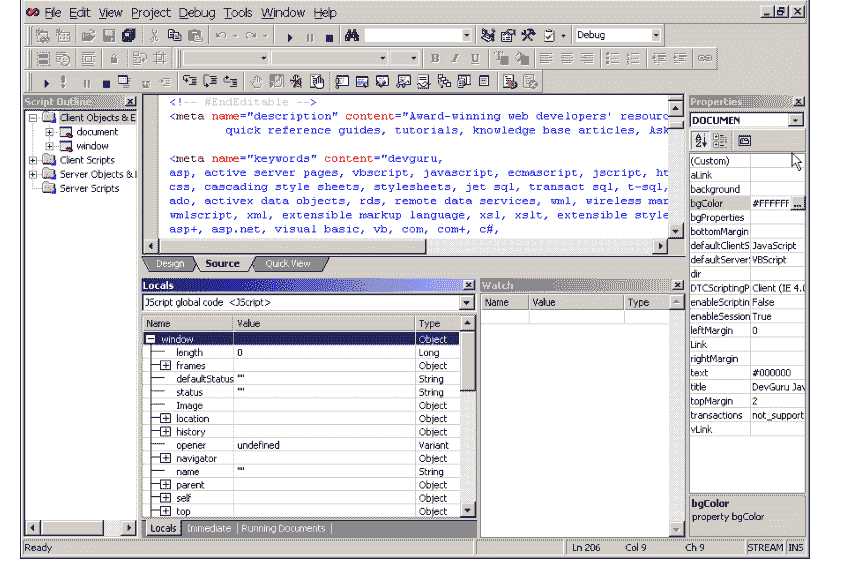

> 注意：可以在 IE 的 `Tools-Internet Options` 下的 `Advanced` 选项卡中启用/禁用调试。另请参阅 http://support.microsoft.com/kb/q284973/ 以编辑 Windows 注册表来指定在安装了两者的情况下启动哪个调试器。

### Mozilla 和 Netscape JavaScript Debugger

Mozilla 的 JavaScript Debugger（代号 Venkman）是一个强大的 JavaScript 调试环境，适用于基于 Mozilla 的浏览器。其多窗格窗口可与 Microsoft Visual InterDev 相媲美，但优点在于它是免费的。

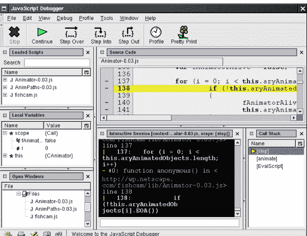

你可以从 http://www.mozilla.org/projects/venkman/ 安装最新版本。

调试器会突出显示任何错误代码，并且与 Microsoft 调试器一样，允许你设置断点并让你单步执行代码。

### 自行调试

最有用的技术之一是简单地临时在你的代码中添加一个 JavaScript `alert`。你可以使用 `alert` 来暂停执行并报告变量值。`alert` 是一个非常有用的工具，可以检查你的假设，特别是在循环或分支结构之前或内部。在调试代码时，不断将 `alert` 在代码中向下移动。

另一种技术是创建自己的调试/日志窗口。在 `JS Header` 的顶部添加代码以创建一个新窗口，然后使用 `document.write()` 方法向其写入变量值或条件。与使用 `alert` 不同，你可以保持窗口打开并向其写入而不停止程序。这在处理循环时特别有帮助。你将在后续主题中使用 `document.write`。

## 主题 3：基本语言元素

### 要点

每种语言都有其基本元素和语法，JavaScript 也不例外。本主题涵盖一些基本的 JavaScript 语言元素。

> **注意：** *Domino Designer 7 Help* 不提供任何 JavaScript 或特定于浏览器的帮助。

关于 ECMA JavaScript 的最佳参考资料之一可以在 http://www.devguru.com/Technologies/ecmascript/quickref/js_objects.html 找到。在那里你可以打开函数、语句、运算符、常量和对象的参考页面。在对象下，你可以找到对象方法、事件和属性的参考页面。所有内容都使用颜色编码，因此在查看各种 JavaScript 对象和阅读示例代码时，可以轻松区分，例如，属性和方法。

另一个很好的参考资料在 http://www.w3schools.com/jsref/default.asp。这个网站最好的部分是它区分了 Firefox、Netscape 和 Internet Explorer 支持的内容。它还包括一个可用的“TryIt Editor”，你可以在其中更改示例脚本并运行它。

### 演练：基本元素

探索一些基本语言元素的最佳方法是实际进行一些编码，并在此过程中学习语法。

请按照以下步骤探索一些基本的 JavaScript 语言元素和语法：

| 步骤 | 操作 |
| :--- | :--- |
| 1 | 在 *Your Exercises* 数据库中创建一个名为 `Topic3` 的新表单。 |
| 2 | 在表单上创建一个新按钮。将按钮命名为 `Test`。 |
| 3 | 展开按钮的事件。 |
| 4 | 单击按钮的 `onClick` 事件并选择 **Common JavaScript** 作为代码范围。 |
| 5 | 输入以下脚本行：<br>`var getMsg1;`<br><br>这段代码展示了几点：<br>- 变量的创建。有效的变量名必须以字母或下划线字符开头，不能使用空格，且不能与任何 JavaScript 关键字或 HTML 标签名相同。变量名可以包含数字，但只能在第一个字符之后。为了避免使 JavaScript 运行时解释器混淆，变量名不应以 `"html"`、`"css"` 或 `"style"` 为前缀。<br><br>**注意：** 曾有多种尝试旨在将变量和函数命名标准化（例如在变量名中包含数据或对象类型），但目前尚无统一标准。按照惯例，大多数 JavaScript 程序员以小写字母开始变量名，然后将变量名中随后的所有单词首字母大写，例如：`lastName`。<br><br>- JavaScript 行之间的分隔符是分号。每个代码语句通常输入在新行中，以便更具可读性；行之间任何额外的空白字符（新行、制表符）都会被运行时解释器忽略。<br><br>**警告：** 在某些浏览器中，JavaScript 代码行不能超过 254 个字符。为了避免此限制，请使用变量来分配中间值，并在随后的代码中将它们连接起来。<br><br>- 程序员面板（Programmer's Pane）会对代码进行着色。右键单击并选择 **Programmer's Pane Properties** 即可更改颜色和字体。<br><br>关于常见 JavaScript 编码错误的优秀介绍，请阅读 [http://javascript.internel.com/debug-guide.html](http://javascript.internel.com/debug-guide.html)，特别是标题为 "Six mistakes everyone makes"（每个人都会犯的六个错误）的部分。在本主题的末尾，您将学习如何处理运行时错误。 |
| 6 | 如果您好奇的话，可以使用此语法一次声明多个变量：<br>`var i, nType, nValue, nName, nlD;`<br><br>我们在当前的示例中没有这样做。 |
| 7 | 在现有代码的末尾添加一行并输入此行：<br>`getMsg1 = 'hello';`<br><br>这一行使用赋值运算符 `"="` 将一个值赋给变量。<br><br>JavaScript 中的字符串需要加引号，因此 `'hello'` 被单引号包围（推荐）。也可以写成带双引号的 `"hello"`。<br><br>JavaScript 是一种 *弱类型* 语言；变量不需要预先声明为特定的数据类型。所有未赋值的变量都是变体；JavaScript 根据赋的值来确定数据类型。<br><br>如果可能，JavaScript 运行时解释器将执行自动数据类型转换，例如，它将通过在连接之前将数字转换为字符串来处理此操作：<br>`'hello ' + 23` |
| 8 | 在现有代码的末尾添加一行并输入此行：<br>`var getMsg2 = 'goodbye';`<br><br>可以使用 `var` 关键字在创建变量的同时为其赋值。 |
| 9 | 添加新行并输入此行脚本：<br>`var msg = getMsg1 + '\n' + getMsg2;`<br><br>这段代码展示了两点：<br>- 字符串连接运算符 `"+"` 的使用。<br>- 转义字符的使用，在本例中为 `\n`，当输出到对话框时，它会创建一个换行符。以下是所有有效的转义字符：<br>  `\b` 退格 (Backspace)<br>  `\f` 换页 (Form Feed)<br>  `\n` 换行 (New Line)<br>  `\r` 回车 (Carriage Return)<br>  `\t` 制表符 (Tab)<br>  `\'` 单引号 (Single Quote)<br>  `\"` 双引号 (Double Quote)<br>  `\\` 反斜杠 (Backslash) |
| 10 | 在现有代码的末尾添加一行并输入此行：<br>`alert(msg);`<br><br>`alert` 语句会显示三种内置对话框之一。它会显示一条消息和一个 **OK** 按钮。 |
| 11 | 保存表单。 |
| 12 | 选择 **Design** - **Preview in Web Browser - Internet Explorer** 或点击工具栏中的 Internet Explorer 工具。 |
| 13 | 表单在浏览器中打开。 |
| 14 | 点击按钮以确保其正常工作。<br><br>在这种情况下，您将收到一个错误，因为 JavaScript 语句是对大小写敏感的；`Alert` 与 `alert` 不同。 |
| 15 | 返回代码并编辑最后一行：<br>`alert ( msg );` |
| 16 | 在浏览器中再次测试按钮。<br><br>您将再次收到错误。这一次是因为变量不正确。 |
| 17 | 再回去一次并编辑最后一行：<br>`alert ( msg );`<br><br>变量名同样是对大小写敏感的。`MSG` 与 `msg` 不同。<br><br>如果您习惯于使用 LotusScript 等语句和变量大小写不敏感的语言进行编程，这将会是一个真正的“陷阱”。 |
| 18 | 在浏览器中再次测试按钮。现在它应该能正常工作了。 |
| 19 | 在现有代码的末尾添加一行并输入这些行：<br>`var getBool = getMsg1 == getMsg2;`<br>`alert ( getBool );`<br><br>在浏览器中测试按钮。<br><br>这展示了等值运算符（双等号）以及返回值常量 `false`，表示布尔值 "false"。 |
| 20 | 返回代码并将 `"=="` 等值运算符更改为不等运算符 `"!="`。<br><br>在浏览器中测试按钮。<br><br>警报显示 `true`。这两个变量不相等。 |
| 21 | 在现有代码的末尾添加一行并输入这些行：<br>`var getNo1 = 1, getNo2 = 2;`<br>`alert(getNo1 + getNo2);`<br><br>您可以使用逗号运算符在一行中创建并赋值多个变量。这也展示了将数值赋给两个变量的操作。<br><br>第二行显示了两个变量的相加，结果之和显示在 `alert` 中。JavaScript 使用与其他语言相同的算术运算符，包括：<br>- `+` 加法<br>- `-` 减法<br>- `*` 乘法<br>- `/` 除法<br>- `%` 取模 (例如 `myMod=18 % 4;`)<br>- `()` 优先级 (括号)<br>- `++` 变量值加 1<br>- `--` 变量值减 1<br>- `+=` 累加 (加) 运算符<br>- `*=` 累乘 (乘) 运算符<br><br>在浏览器中测试按钮。<br><br>**注意：** 幸运的是，`alert` 框比较宽松，它会将数字转换为字符串；您稍后将学习如何将数字转换为字符串，以便更精确地处理数据类型。 |
| 22 | 在现有代码的末尾添加一行并输入此行：<br>`alert(typeof(getMsg1) + '\n' + typeof(getBool) + '\n' + typeof(getNo1));`<br><br>在浏览器中测试按钮。<br><br>这展示了 `typeof` 函数的使用，该函数返回表达式的数据类型。 |

### 简单数据类型

JavaScript 中有几种简单的数据类型。

| 数据类型 | 赋值示例 |
|---|---|
| 字符串 (String) | `var firstName = 'Mary';` (推荐)<br>`var firstName = "Joe";` |
| 数字 (Number) | 整数：`var qty = 123;`<br>浮点数：`var price = 123.34;`<br>**注意：** 如果您对不同类型的变量执行数学运算，JavaScript 会自动将数字变量转换为正确的类型（整数或浮点数）。例如，在本例中 `revenue=qty*price` 将导致浮点数据类型。 |
| 布尔值 (Boolean) | `var flag = true;`<br>`var flag = false;` |
| 空值 (Null) | `null` (不存在值) |
| 未定义 (Undefined) | `undefined` (使用了未定义过的变量) |

**注意：** 您稍后将学习如何测试变量是否包含有效数据，以及这些数据类型如何与从 HTML 字段读取并写回 Domino 的数据相对应。

**注意：** JavaScript 还支持几种 *复杂* 数据类型：对象 (Object)、数组 (Array) 和函数 (Function)，您将在后面的主题中学习这些内容。

### 内置函数

JavaScript 提供了一系列内置函数，可以用一些通过基础 JavaScript 运算符难以或无法实现的方式来创建和操作数据。

要查看这些函数的实际运行效果，请在 *DDJS7 Demo* 数据库中创建一个新的 *TestFunctions* 表单并点击相应的按钮。

下表描述了一些内置的 JavaScript 函数：

| 函数 | 描述 |
|---|---|
| `Escape` / `Unescape` | 对字符串进行编码，使其可以用作 (ASCII) URL。所有非标准字符都被转换为它们的十六进制转义序列。例如，空格被转换为 `%20`。<br><br>`Unescape` 则执行反向操作，将转义的十六进制转换回非标准字符。 |
| `Eval` | 由于 JavaScript 是一种解释型（而非编译型）语言，您可以通过程序/动态地生成代码，然后使用 `Eval` 执行它。<br><br>`Eval` 计算包含 JavaScript 代码的字符串并返回最后一条语句的值。`Eval` 可用于即时构建和执行 JavaScript，例如包含用户提供的 JavaScript。<br><br>**注意：** `Eval` 也经常被用于测试 JavaScript 代码片段。例如，在 Domino Designer 的 *DDJS7 Demo* 中打开 *EvalJavaScript Form* 并在浏览器中预览。您在输入区域中输入的代码将使用 `Eval` 运行。 |
| `isFinite` / `isNaN` | 用于验证数据。`isFinite` 测试一个表达式以查看其是否包含一个有限且合法的数字。<br><br>`isNaN` 是相反的测试，用于查看一个表达式 **是否不是数字 (is Not a Number)**。<br><br>如果其中一个值不是数字，数学表达式将返回 `NaN`，因此 `isNaN` 用于捕获该错误（您将在后面的主题中为此目的使用 `isNaN`）。 |
| `Number` | `Number` 将字符串对象转换为数字对象。什么是字符串对象？常见的来源有两种：<br><ul><li>由 HTML 中的 `<INPUT>` 标签创建的文本对象。你可以通过以下方式访问该对象：<br>`var stringObj = document.forms[0].Price.Price.value;`</li><li>你创建的字符串对象，例如：<br>`var stringObj = new String("22");`</li></ul>然后使用 `Number` 函数创建 `Number` 对象：<br>`var getPrice = Number( stringObj );`<br>如果该对象无法转换为数字，则返回 `NaN`。<br>**注意：** 你将在后续主题中了解更多关于 JavaScript 对象的内容。<br>`parseFloat` 和 `parseInt` 将字符串转换为浮点数或整数。它们的特点在于字符串必须以数字开头，但第一个数字之后的任何内容可以是字母字符（将被忽略）。如果第一个字符不是数字，则返回 `NaN`。 |
| `parseFloat`<br>`parseInt` | |
| `String` | 将字符串字面量或数字对象转换为字符串对象。什么是数字对象？常见的来源有两种：<br><ul><li>使用 `Number` 函数转换为数字对象的文本对象。</li><li>你创建的数字对象，例如：<br>`var numObj = new Number( '22' );`</li></ul>然后使用 `String` 函数创建 `String` 对象：<br>`var stringObj = String( numObj );`<br>**提示：** 将数字转换为字符串的另一种方法是简单地将一个空字符串与之拼接，例如：<br>`var getNum=10;`<br>`var getStr=getNum+""` |

> **注意：** JavaScript 有几个内置对象，包括 `Array`、`Boolean`、`Date`、`Event`、`Math`、`Object`、`RegExp`、`Screen` 和 `String`。所有对象都有用于操作数据的属性和方法。你将在后续主题中了解这些对象。

### `var` 关键字和变量作用域

在上面的演练中，你使用了 `var` 关键字来声明变量。从技术上讲，使用 `var` 声明变量并不是必须的。例如：

```


`var getMsg2= 'goodbye';`

等同于：

```
getMsg2= 'goodbye';
```

变量的作用域是什么？在 *JS Header* 事件中、`<BODY>` 部分的 `<SCRIPT>` 元素中或任何事件中声明的变量都是全局变量，可在页面上的所有元素事件中使用——无论是否使用 `var` 声明。

但你编写的 JavaScript 函数除外。在函数中，`var` 关键字使变量成为函数的私有变量。考虑以下代码：

```
price = 24.95;

function dispStuff()
{
    var price = 22.00;
    alert ( price );
}

dispStuff();
alert( price );
```

会弹出两个提示框；第一个提示框显示 "22"，因为函数内部使用 `var` 使得该变量成为函数的局部变量，暂时覆盖了在函数外部设置的全局变量。第二个提示框显示 "24.95"，这是在函数外部设置的全局变量的值。

现在考虑一段类似的代码，有一个细微的变化（加粗部分）：

```
price = 24.95;

function dispStuff()
{
    price = 22.00;
    alert ( price );
}

dispStuff();
alert( price );
```

在这个示例中，变量 `price` 在函数内部赋值时*没有*使用 `var` 关键字。这会带来什么效果？它重新赋值了全局变量。因此两个提示框都显示 "22"。通过在函数内部不使用 `var` 关键字，你可以更改现有的全局变量并创建新的全局变量。

> **注意：** 一些专家建议你应该使用 `var` 关键字声明所有变量，以使代码更易于阅读和调试，并防止函数中使用的变量意外覆盖全局变量。但是，你*不被要求*必须使用 `var`，除非在函数内部你希望变量为函数私有。

### 简单对话框

有三个内置的模态对话框，它们实际上是浏览器 `Window` 对象的方法。

#### alert

你已经见过 `alert` 对话框，它显示一条消息和一个 **OK** 按钮。例如：

```
window.alert( 'hi' );
```

大多数浏览器允许你使用更简短的版本（省略 `Window` 对象引用）：

```
alert( 'hi' );
```

如果将 `alert` 方法赋值给一个变量，它不会返回任何值，例如：

```
var myVar = alert( 'hi' ); alert( myVar )
```

`alert` 方法返回 `undefined`，这是一个 JavaScript 常量，表示已声明但从未赋值（或从未声明）的变量。你可以使用 `typeof` 运算符来测试这个常量。

#### confirm

`confirm` 方法：

```
confirm('Do you want to come out and play?')
```

显示一个包含确定/取消的对话框：

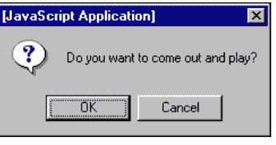

如果赋值给一个变量，它返回 `true` 或 `false`。

#### prompt

`prompt` 方法：

```
prompt('When do you want to come out and play?', 'Right Now')
```

显示一个带有 **OK** 和 **Cancel** 的简单输入对话框：

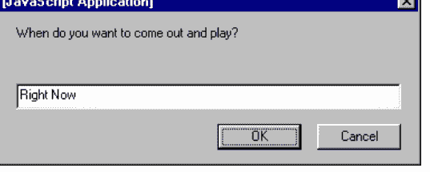

如果用户输入一个值并点击 **OK**，则返回字符串值；如果用户点击 **Cancel**，则返回 `null`。

> 注意：你将在后续主题中了解如何使用浏览器的 `window` 对象创建自定义对话框。

### 注释代码

在 JavaScript 中有三种方式来注释代码：

- 在行中需要注释的代码之后使用两个正斜杠进行单行注释，例如：

```
// this is a commented line of code
```

- 注释一行中标记之后的所有内容，例如：

```
alert('hi'); //this is a silly alert
```

- 块注释，使用 `/*` 开头和 `*/` 结尾，例如：

```
/*
Everything in this block is commented.
*/
```

### 练习：对话框

按照以下步骤收集并显示用户输入：

| 步骤 | 操作 |
| :--- | :--- |
| 1 | 在 *Your Exercises* 数据库中打开名为 *Topic3* 的表单。 |
| 2 | 在表单上创建一个新按钮。将按钮命名为 `Test User Input`。 |
| 3 | 展开按钮的事件。 |
| 4 | 点击按钮的 `onClick` 事件，并选择 **Common JavaScript** 作为代码范围。 |
| 5 | 输入以下两行脚本：`var getMsg = prompt ('Please enter your name: ', ""); //collect input` `alert('You name is: ' + getMsg ); //display input` |
| 6 | 保存表单。 |
| 7 | 选择 **Design - Preview in Web Browser - Internet Explorer** 或点击工具栏中的 🌐 工具。 |
| 8 | 测试按钮，查看你是否正确编写了代码。 |

### try/catch 语句

`try/catch` 语句是 JavaScript 中与 BASIC 的 `On Error` 语句等价的语句（JavaScript 1.5，ECMAScript 3）。其思想是你"尝试"执行一段语句，如果出现错误，则跳转到"catch"块来捕获"try"块中产生的错误，并相应地运行一些修正代码。

*DDJS7 Demo* 数据库中的 *TryCatch* 表单演示了一个简单的 `try/catch` 语句，位于按钮后面：

```
try
{
  myVar.toString(); //produces an error
  return true;
}
catch(e)
{
  strErrMsg = "Error Number: " + e.number + "\n";
  strErrMsg += "Description: " + e.description + "\n";
  strErrMsg += "Message: " + e.message ;
  alert( strErrMsg );
  return false;
}
```

如果 `try` 中没有错误，则会跳过 `catch`。

变量 `e` 代表什么？它代表 JavaScript 错误对象，该对象具有 alert 消息中使用的 `number` 和 `description`/`message` 属性。

你可以有多个 `try/catch` 语句，并根据需要进行嵌套。如果内部的 `try` 没有匹配的 `catch`，则会使用外部的 `catch`。

但是，没有"恢复"功能。

> **注意：** 如果你在想，"description" 和 "message" 返回的是相同的消息，但 ECMAScript 使用 `message` 而 JavaScript 使用 `description`。根据浏览器支持的 JavaScript 版本，你显然只需要一种消息即可。

> **注意：** 由于 `try/catch` 是最近才添加的，旧版浏览器无法识别它们并会生成错误。因此，你甚至不能在代码分支中包含 `try/catch`；你只能在外部的 `.JS` 文件中使用它们，然后为旧版和现代浏览器选择合适的 `.JS` 文件。

### throw 语句

除了使用标准的 `catch` 块来处理意外的运行时错误外，你还可以在 `try` 语句内部使用 `throw` 语句来定义自定义错误编号和消息。

*TryCatch* 窗体中的 **抛出异常** 按钮展示了向 `catch` 抛出自定义错误编号的能力：

```
var getParts;
try
{
    getParts = prompt('Enter a number over 3.', '');
    if (getParts <= 3 )
    {
            throw 'myError100';
            return true;
    }
}
catch (e)
{
    strErrMsg = 'Error Number: ' + e.number + '\n';
    if (e == "myError100")
    {
        strErrMsg += 'Description: ' + 'You didn\'t enter a number over 3.' + '\n';
    }
    else
    {
        strErrMsg += 'Description: ' + e.description + '\n';
    }
    alert (strErrMsg);
    return false;
}
```

`catch` 既可以处理自定义错误，也可以处理一般错误。

### 自定义错误对象

你刚才已经看到了如何抛出自定义异常。如果你测试了 **抛出异常** 按钮，你会注意到错误编号是未定义的：

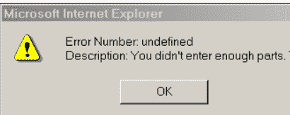

你可以通过首先创建一个代表你异常的错误对象来解决这个“问题”，例如（来自 **自定义错误对象** 按钮）：

```
var errorBadNumber = new Error (111, 'You didn\'t enter enough parts. Try 4.');
```

指定错误编号和描述/消息。然后，当你抛出异常时，使用自定义的 `Error` 对象名称：

```
throw errorBadNumber;
```

现在你可以使用通用错误处理程序，它会报告错误编号以及描述/消息：

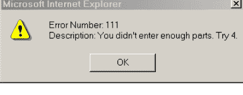

> **注意：** 你将在后面的章节中了解更多关于 JavaScript 对象的内容。

### 垃圾回收

当你声明一个变量或对象引用变量时，运行时解释器会动态分配所需的内存；当变量不再需要或超出作用域时，它还负责释放内存。

解释器会定期扫描当前变量以查看它们是否仍在使用，如果不在，则执行垃圾回收以释放内存。作为程序员，你不需要做任何事情来清理你的变量或对象。

关于 JavaScript 垃圾回收（与函数内函数的闭包相关）以及如何防止内存泄漏的技术讨论，请访问以下页面：

- http://www.bazon.net/mishoo/articles.epl?art_id=824
- http://jibbering.com/faq/f Africa/faq_notes/closures.html - 闭包
- http://www.quirksmode.org/blog/archives/2005/02/javascript_memo.html

### 备注

## 第4章：分支和循环结构

### 要点

JavaScript 支持分支结构（`if` 和 `switch`）和循环结构（`while` 和 `for`）。这些结构用于控制事件或函数代码的流程，并重复代码行以执行复杂的字符串替换功能、填充数组或动态地向文档写入 HTML。

### If 结构

`if` 结构允许你测试一个条件，然后在条件评估为 `true` 时执行一组语句，并可选择在条件评估为 `false` 时执行另一组语句。基本结构如下：

```
if (condition 1)
{
  // code runs if condition1== true
}
else if (condition2)
{
  // code runs if condition2 == true
}
else
{
  // code runs if condition1 == false or condition2 == false
}
```

条件必须放在括号内，并评估为布尔值 `true` 或 `false`。如果条件为 `true`，则评估 *true result* 语句块。如果条件为 `false`，则执行 *false result* 语句块。每个代码块都用大括号包围。

`else if` 语句是可选的，如果第一个 "if" 条件为 `true`，则不会评估它。你可以有多个 `else if` 语句，但如果你有多个，最好使用 `switch` 语句。

如果 `else` 和 `else if` 语句都不为 `true`，那么可选的 `else` 语句将被执行。

当结果块内有多个语句时，它们用分号分隔，例如：

```
if( X!=Y )
{
    X=0;
    alert('X was cleared.');
}
else
{
    alert('X was not cleared.');
}
```


与其他语言不同，整个 `if/else` 结构周围没有分隔符。结构的每一部分（`if`、`else if`、`else`）都用大括号定义和结束。

> **注意：** 如果你的逻辑需要，你可以在另一个 `if` 结构的代码区域内嵌套一个 `if` 结构。

### 练习：If 结构

请按照以下步骤创建一个 `if` 结构：

| 步骤 | 操作 |
|------|------|
| 1 | 在*你的练习*数据库中创建一个名为`Topic4`的新窗体。 |
| 2 | 在窗体上创建一个新按钮。将按钮命名为`测试 If`。 |
| 3 | 展开按钮的事件。 |
| 4 | 点击按钮的`onClick`事件，并选择**通用 JavaScript**作为代码范围。 |
| 5 | 输入以下脚本行：<br>`var getMsg = prompt ( 'Please enter test value: apple, 2, 3apple' , '');`<br>`var myNumber = parseFloat( getMsg );`<br>`if ( isNaN(myNumber) )`<br>`{`<br>`  alert ( getMsg + ' is NOT a number.' );`<br>`}`<br>`else`<br>`{`<br>`  alert ( String(myNumber) + ' IS a number.' );`<br>`}` |
| 6 | 保存窗体。 |
| 7 | 选择**设计 - 在 Web 浏览器中预览 - Internet Explorer**，或点击工具栏中的`![icon]`工具。 |
| 8 | 测试按钮以查看你是否正确编码。依次输入三个测试值来测试`if`结构。 |

请注意，第三个测试值 "3apple" 被认为是一个数字，因为其首字符是数字。如果数字不在开头，该字符串就不会被认为是数字。

### 布尔运算符

有两个布尔运算符可用于增加`if/else if`语句中条件测试的复杂性：

- `&&`（两个与号）是逻辑与
- `||`（两个竖线）是逻辑或。

你可以使用括号来分组逻辑语句。

### 练习：布尔运算符

请按照以下步骤创建一个使用逻辑“与”条件的`if`结构：

| 步骤 | 操作 |
|:---|:---|
| 1 | 打开*你的练习*数据库中名为`Topic4`的窗体。 |
| 2 | 复制并粘贴`测试 If`按钮。将按钮重命名为`测试布尔条件`。 |
| 3 | 展开按钮的事件。 |
| 4 | 点击按钮的`onClick`事件，并选择**通用 JavaScript**作为代码范围。 |
| 5 | 修改脚本行以与此示例匹配（更改/添加部分加粗）：<br><br>`var getMsg = prompt ('Please enter a number between 1 and 10:', '');`<br>`var myNumber = parseInt(getMsg);`<br>`if (isNaN(myNumber))`<br>`{`<br>`  alert ( getMsg + ' is NOT a number.' );`<br>`}`<br>`else if (myNumber>=1 && myNumber <= 10 )`<br>`{`<br>`  alert ( String(myNumber) + ' is between 1 and 10.' );`<br>`}`<br>`else`<br>`{`<br>`  alert ( String(myNumber) + ' is NOT between 1 and 10.' );`<br>`}`<br>`}` |
| 6 | 保存窗体。 |
| 7 | 选择**设计 - 在 Web 浏览器中预览 - Internet Explorer**，或点击工具栏中的`![tool icon]`工具。 |
| 8 | 测试按钮以查看你是否正确编码。输入 1-10 测试范围内外的数字以查看结果。<br><br>注意点击**取消**时返回的内容。这意味着你还可能需要测试 null，也许还要测试空输入值（这两者在 JavaScript 中是不同的），例如：<br>`if (getMsg == null \|\| getMsg == "")`<br><br>此测试必须是 "if"，因为根据步骤 5 中的逻辑，null 和 "" 都不是数字。 |

## 使用 ? 的简单 if

你可能会发现一种简单的、单行的`if`语句很有用，它使用`?`运算符，语法如下：

`((condition) ? true statement : false statement)`

整个语句用括号括起来，`?`放在条件之后，用 ":" 分隔两个结果（`true` 和 `false`）。每个结果只允许包含一条语句。

下面是前面见过的示例，改用简单 if 重写：

```
var getMsg = prompt ( 'Please enter these test values: apple, 2, 3test' , '');

var myNumber = parseFloat( getMsg );

( ( isNaN(myNumber) ) ? alert ( getMsg + ' is NOT a number.') : alert ( String(myNumber) + ' IS a number.' ));
```

### Switch

`Switch`是 JavaScript 版本的 case 语句，它测试一个简单的变量，并测试一个或多个 case，根据值的不同选择不同的代码路径。

`DDJS7 Demo`数据库中的`控件与循环`表单在`Switch`按钮中演示了`switch`语句的典型语法：

```
var getChoice=prompt('Please enter 1, 2, or 3','');

switch (getChoice) {

  case '1' :

    alert('You chose 1.');

    break;

  case '2' :

    alert('You chose 2.');

    break;

  case '3' :

    alert('You chose 3');

    break;

  default :

    alert('Sorry, you did not choose 1, 2, or 3.');

}
```

`getChoice`表达式必须求值为其中一个 case 选项，在本例中为 "1"、"2" 或 "3"。如果有匹配项，则执行相应的代码。

编写`switch`语句时请记住以下几点：

- 注意整个`switch`只有两个大括号；各个 "case" 语句是自我定义的。

- 条件不能是需要求值的表达式——它只能是值。

- default case 是可选的。如果没有选项匹配，则选择 default case。如果你省略 default 选项且没有其他选项匹配，则`switch`结构之后的代码继续执行。

- 与其他语言在条件满足时跳出结构不同，如果你不希望下一个 case 被评估，则必须在每个 case 的语句块之后包含 break。

> **注意：** Switch 在 JavaScript 1.2（第 4 版浏览器）中实现。

### While 结构

`if`结构只评估一次。`while`结构与`if`结构类似，只是它会重复（循环）直到条件为真。基本语法如下：

```
while ( condition )

{

  // run this code block

}
```

与`if`结构不同，这里没有 `false` 结果。当条件不再为真时，循环退出。

例如，这段代码提示用户输入一个值，只要提示框留空，就会继续提示：

```
x="";

while (x=="") {

  x=prompt('Please enter a value:',"')

}
```

确保在循环外部初始化测试变量。

此示例展示了如何限制提示用户的次数。在`DDJS7 Demo`数据库的`控件与循环结构`表单中单击`While`按钮来运行此代码：

```
tries=0;

x="";

while (x=="") {

  if (tries==3){break};

  x=prompt("Please enter a value:","");

  tries++=1

}
```

注意聚合运算符 (`+=`) 的使用，它是`tries=tries + 1`的快捷方式。如果你只想增量 1，还可以使用更短的版本`tries++`。

> **警告：** 确保条件确实会变为真，否则整个结构将无限循环。防止无限循环的一种方法是创建一个计数器，例如上面示例中的`tries`，如果条件不满足则跳出循环。

> **注意：** 如果你的逻辑需要，可以在一个循环结构的代码区域内嵌套另一个循环结构。

### Do while 结构

`do while`循环与`while`循环类似，但条件在末尾测试。这意味着代码至少会运行一次。基本语法如下：

```
do

{

  // run this block of code

}

while (condition);
```

while 条件后的最终分号是必需的。

### For 结构

`for`结构与 while 结构类似，但它只将一组语句循环指定次数。基本语法如下：

```
for ( countervariable; condition; incrementcounter )

{

  // run this code block

}
```

此示例也尝试三次获取用户的响应。在`DDJS7 Demo`数据库的`控件与循环结构`表单中单击`For`按钮来运行此代码：

```
x="";

for (tries=0; tries<3; tries++){

  x=prompt('Please enter a value:', "");

  if(x!=""){

    break

  }

}
```

`for`结构与`while`结构的区别在于，你不需要/不应该预先声明计数器变量或在循环内递增它。`++`运算符在每次循环运行时将变量递增 1。

此外，条件直接编码在前面，因此如果条件不返回 true，代码块将永远不会运行。

> **注意：** 你将在后面的主题中看到如何使用 for/in 语句。它用于循环遍历对象中的每个属性。

### Break

上面你看到`break`语句如何用于结束 switch case。你也可以使用 break 语句在条件为真时立即终止当前的 while 或 for 循环。虽然你可以在函数内部使用 return 语句来停止函数的执行并返回值，但 break 语句实际上是停止循环的更恰当方式。

例如，`DDJS7 Demo`数据库的`控件与循环结构`表单中的`Break`按钮运行此代码：

```
var x=1;

while(x<=100){

  if(x>3){

    break

    break

  }

  else{

    x++

  }

}

alert ( x );
```

如果没有`break`，循环将运行到 99；但由于对`x>3`的条件测试，循环因 break 而停止。一旦跳出循环，`x`的值将返回给调用代码。

### Continue

与 break 相反的是`continue`语句，它立即将执行返回到循环顶部。请注意，continue 在`for`、`while`和`for..in`循环中的工作方式不同。

> **注意：** Continue 也可以与标签一起使用来模拟 BASIC 中备受喜爱和憎恶的 Goto 语句。

### 练习：循环结构

按照以下步骤给用户三次机会输入 1 到 10 之间的数字：

| 步骤 | 操作 |
| :--- | :--- |
| 1 | 在*Your Exercises*数据库中打开名为*Topic4*的表单。 |
| 2 | 创建一个名为`Looping Structures Using While`的新按钮。 |
| 3 | 展开按钮的事件。 |
| 4 | 单击按钮的`onClick`事件，并选择**Common JavaScript**作为代码作用域。 |
| 5 | 输入以下代码行来声明变量：

`var getMsg="";`<br>`var getPrompt='Please enter a number between 1 and 10:';`<br>`var myNumber=0;`<br>`var isOKNumber=false;`<br>`tries=0;` |
| 6 | 继续添加以下代码行： `while (isOKNumber == false ) { tries+=1; if (tries==4) { alert ( 'You tried three times and failed.') break; } else { getMsg = prompt ( getPrompt , ''); myNumber = parseInt( getMsg ); if ( isNaN(myNumber) ) { getPrompt=getMsg + ' is NOT a number. Please enter a number.'; } else if ( myNumber>=1 && myNumber <= 10 ) { alert ( String(myNumber) + ' is between 1 and 10.' ); isOKNumber=true; } else { getPrompt= String(myNumber) + ' is NOT between 1 and 10.'; } } }` |
| 7 | 保存表单。 |
| 8 | 选择**Design** - **Preview in Web Browser** - **Internet Explorer** 或单击工具栏中的``工具。 |
| 9 | 测试按钮以查看你是否正确编码。输入测试范围 1 - 10 内外的数字以查看结果。务必测试当你连续三次未能提供 1 到 10 之间的数字时会发生什么。 |
| 10 | 如果你有时间，复制并粘贴按钮，更改循环结构以使用`for`语句代替。两个提示：

* 记住你不应该预先声明计数器变量

`for (tries=0; tries<3; tries++)`

* 将失败消息放在`for`语句之外，例如：

`getPrompt='You tried three times and failed.';`
`( (tries==3) ? alert ( getPrompt): " ");` |

## 专题 5：自定义函数

### 要点

到目前为止，你一直在使用 JavaScript 内置的语句函数。本专题将介绍如何编写和调用自定义函数。

### 函数语句

与其他语言一样，你可以在 JavaScript 中创建自定义函数。函数是一个命名的语句块，当被调用时执行一个动作或返回一个值。

函数的名称自然应当是唯一的，不应与 JavaScript 本身使用的任何名称或关键字冲突。

函数通常在 HTML 页面的 `<HEAD>` 部分创建（放入 *JS Header* 中），以便它们首先被加载，并且可以从页面上的任何其他对象/事件调用。另一个放置它们的好地方是 JavaScript 库或 .JS 文件中，然后在 *JS Header* 事件中包含该库。

函数的基本结构可以通过这个简单的函数来演示：

```
function alertString(msg)

{

  alert(msg);

}
```

这个函数，无论多么简单，都接受一个参数，在函数内部被赋值给变量 "`msg`"。该函数使用该变量作为参数运行 alert 语句。

函数可以包含一个或多个用分号分隔的语句。花括号包围整个语句块。

代码块也可以包含对另一个函数的调用。

关于如何格式化代码行，没有严格的规定；在此示例中，函数花括号用于将函数体与其余代码分开，要执行的代码行被缩进。但这主要是风格问题，而非标准。同一个函数也可以写在一行上，例如：

```
function alertString(msg){alert(msg);}
```


> **注意：** 从技术上讲，函数的最后一行在 `}` 之前不需要 `;`。但没有理由不使用它，而且它使得在函数内部重新排列代码行更容易。

> **注意：** 实际上在 JavaScript 中有三种创建函数的方法，如 http://builder.com.com/5100-6371-1044599.html 所述。我们选择描述最常用的方法，即函数语句。

### 函数参数

函数由 `function` 关键字定义，后跟一个空格和函数名，然后是其参数列表。参数列表由圆括号定义：

- `()` 如果不传递任何参数（也称为 `void` 函数）
- `oneParam` 如果传递一个参数（可以是字符串/数字、数组或对象引用）
- `oneParam, twoParam` 如果传递多个参数，使用逗号分隔参数。

当然，你传递给函数的参数必须是该函数所期望的。

> **注意：** 研究 `DDJS7 Demo` 数据库中 `TestFunctions` 表单中的五个按钮（在标有 **Function Arguments** 的部分），它们演示了向函数传递参数的方式。函数本身在 **JS Header** 事件中定义。需要注意几点：

- 你稍后将了解更多关于如何使用 `value` 属性读取文本对象（“字段”）内容的信息。将值作为参数传递给函数与让函数读取值之间的区别在于是传递字符串还是传递对象引用：

    `alertString(form.Subject.value);` 与 `alertObject(form.Subject);`

- 传递未知数量的多个参数很有趣，因为该函数被编写为可以处理任意数量的参数。

### 如何调用函数

当你想调用该函数时，只需在其他代码中或在事件处理程序中引用该函数名。函数名区分大小写，并且必须传递函数所期望的正确数量和数据类型的参数，例如：

```javascript
alertString(' hello world');
```

`alertString` 函数被传递了一个字符串参数。函数内部的代码非常简单；它只是使用传递给函数的参数变量名调用 `alert` 语句。

### 在何处调用函数

有多个地方可以调用函数，包括：

- 按钮的 `onClick` 事件（无论是通过 HTML 手动编码还是在 Domino Designer 的 `onClick` 事件中）：

  `<INPUT TYPE="button" VALUE="button title" onclick="function name">`

- 任何其他事件处理程序，例如字段（例如 `onBlur`）、表单（例如 `onLoad`）等。

- 指定 JavaScript 为伪协议并标记为通过 HTML 传递的锚点标签：

  `<A HREF="javascript:functionName()">Run Function</A>`

> 注意：你将在后面的专题中了解更多关于事件处理程序和通常不推荐的 `javascript:` 伪协议的信息。

- 在 HTML 页面上作为通过 HTML 传递的内联代码，以便在页面上遇到时运行，例如：

  `<SCRIPT>myFunc()</SCRIPT>`

> 注意：如果在函数内（或在 `<SCRIPT>` 元素内的任何位置）使用了 `document.write()` 方法，生成的 HTML 将放置在函数在页面上的位置。这种技术通常用于创建动态页面内容。你将在后面的专题中了解更多关于 `document` 对象方法（包括 `write`）的信息。

### 从函数返回值

虽然一些函数旨在链接在一起的动作（提交表单、启动新窗口、将用户返回到视图等）并且不需要向调用代码返回值，但其他函数执行某种计算，并期望向调用代码返回一个修改后的值。这通过在函数内放置 `return` 语句来完成。

通常，函数返回以下值之一：

- 一个值（或对象引用或数组）
- `null`
- `true` 或 `false`。

> **重要：** 除了返回值之外，`return` 关键字还会立即终止函数，因此任何后续代码都将被忽略。

> **注意：** 要了解函数如何返回对象或数组，请研究 `DDJS7 Demo` 数据库中 `TestFunctions` 表单中的 **Return Object** 和 **Return Array** 按钮。

这个简单的函数期望两个数字参数并将它们相加：

```javascript
function sumTwoNumbers(x,y)
{
  return x + y;
}
```

然后该函数将总和返回给调用代码，例如，这个按钮的 `onClick` 事件处理程序：

```javascript
var z = sumTwoNumbers(2, 3);
alert ( z );
```

如果函数使用循环或分支结构，请确保所有可能的结果都返回一个值给调用代码，例如，这个检查单选按钮字段是否被选中、提醒用户并返回 `true` 或 `false` 给调用代码的字段验证函数：

```javascript
function checkEmptyRadio(fieldObj){
  if ( getRadio(fieldObj)==null ){
    alert('No ' + fieldObj[0].name + ' was selected.')
    return false;
  }
  return true;
}
```

### 练习：测试数字的函数

在之前的练习中，你创建了一个 `while` 循环，最多提示用户三次输入一个 1 到 10 之间的数字。在这个练习中，你将把检查数字的逻辑放入一个函数中，并将提示用户的逻辑放入按钮中。

按照以下步骤将代码拆分到函数和按钮中：

| 步骤 | 操作 |
|------|------|
| 1 | 在 *Your Exercises* 数据库中创建一个名为 `Topic5` 的新表单。 |
| 2 | 为了简化操作，打开 *Topic4* 表单并将按钮复制到剪贴板。将按钮粘贴到新的 *Topic5* 表单中。这将为你提供一个起点。 |
| 3 | 该函数的目的是在传递一个字符串参数时，确定它是否是一个数字以及是否在 1 到 10 之间。如果是，则返回 `true`。如果不是，则返回一条错误消息。此函数依赖于 JavaScript 动态地将变量数据类型从布尔值转换为字符串的能力。以下是代码： |
| 4 | 保存表单以备安全。 |

```javascript
function testNumber( getStr )
{
  var myNumber = parseInt( getStr );

  if ( isNaN(myNumber) )
  {
    return getStr + ' is NOT a number. Please enter a number.';
  }
  else if ( myNumber>=1 && myNumber <= 10 )
  {
    return true;
  }
  else
  {
    return String(myNumber) + ' is NOT between 1 and 10. Try again.';
  }
}
```

> **注意：** 编写此函数的一种更好的方法是向调用代码返回一个数组，在这种情况下，第一个元素将是 `true/false`，第二个元素是错误消息。你将在后面的专题中学习数组。

| 步骤 | 操作 |
|------|------|
| 5 | 该按钮代码与现有代码非常相似。`var getPrompt='Please enter a number between 1 and 10:'; var myNumber=0; var isOKNumber= false; tries=0; while (isOKNumber != true ) { tries+=1; if (tries==4) { alert ( 'You tried three times and failed.') break; } else { myNumber=prompt( getPrompt,''); isOKNumber = testNumber( myNumber ) if (isOKNumber != true ) { getPrompt= isOKNumber; continue; } else { alert ( myNumber + ' is between 1 and 10.' ); } } }` |
| 6 | 保存表单。 |
| 7 | 选择“设计”-“在 Web 浏览器中预览”- Internet Explorer，或单击工具栏中的 [IE 图标] 工具。 |
| 8 | 测试按钮以查看函数和调用代码是否正常工作。 |

## 主题 5：自定义函数

### 按值传递参数

在向使用 `function` 语句创建的函数传递参数时，函数内部对参数变量所做的任何更改，在函数结束时是否会被丢弃，取决于你是按引用传递还是按值传递参数。

`DDJS7 Demo` 数据库中的 `TestFunctions` 表单中有三个按钮，演示了向函数传递值：

- **按值传递。** 这是默认行为，即变量的*副本*作为参数传递给函数。如果在函数内部更改了该副本，一旦函数结束，该变量的副本就会被丢弃。只有函数中 `return` 语句返回的值会保留。

  在 **按值传递** 按钮的 `onClick` 事件处理程序中，变量 `myNumber` 被赋值为 1，然后传递给函数，在函数中乘以 7。当函数结束时，`myNumber` 恢复为其原始值 1。

- **操作全局变量。** 你可以选择不向函数传递任何参数，而是让它操作全局变量。

  在 **操作全局变量** 按钮中，全局变量 `myNumber` 被赋值为 1。函数将 `myNumber` 的值乘以 7，并将 `myNumber` 重新赋值为 7。当函数结束时，全局变量的值当然是 7。

- **按引用传递。** 你也可以按引用传递参数，这意味着不是传递变量的副本，而是传递原始变量的内存地址。结果是，函数内部对变量所做的任何更改也会作用于原始变量。不过，诀窍在于这只适用于对象，而不适用于变量本身。

  因此，你在 **按引用传递** 按钮中看到的是创建一个对象，其 `value` 属性设置为 1。然后将该对象作为参数传递给函数。函数重新赋值 `value` 属性，该属性在函数终止后仍然存在。

> 注意：你将在后续主题中使用 JavaScript 对象。

> 注意：如果你也是 LotusScript 程序员，LotusScript 中的默认行为是按引用传递参数，这与 JavaScript 相反。

### 递归函数

函数可以调用其他函数，这与函数调用自身（也称为*递归函数*）有很大不同。

递归函数有一个导致函数退出的条件，这一点非常重要，以避免无限循环。

递归函数通常用于处理层级数据结构，当结构中节点和子节点的数量未知时。Notes 中的类似情况是处理数据库中的所有文档、所有文档的回复，以及所有回复文档的回复文档。

在 *DDJS7 Demo* 数据库的 *TestFunctions* 表单底部有两个使用递归函数的有趣示例。

### 将 @Commands 转换为 JavaScript 函数

当你添加一个包含 `@Commands` 的操作并成功转换为 JavaScript 时，Domino 会为脚本元素中的每个实例在 **`<HEAD>`** 标签中添加一个辅助函数：

`function _doClick(v, o, t, h) {...`

（此转换仅在启用了数据库属性 **“生成页面时使用 JavaScript”** 时发生。）

一般来说，你不需要知道这个函数的作用或工作原理。Lotus 没有记录该函数，你也不能依赖该函数内部的代码在不同上下文或 Domino 的未来版本中保持一致。但是，许多 Domino Web 站点都有开发人员反向工程 `_doClick` 函数并发现其有用用途的帖子。

要反向工程 `_doClick` 函数，请查看由 Domino 转换的 `@Commands` 按钮的 HTML 源代码。例如，如果你查看使用 `@Command([FileSave]); @Command([FileCloseWindow])` 的 **Save** 操作背后的代码，你会在 HTML 源代码中看到以下内容：

```html
<a href="" onclick="return _doClick('85256CB5005A172D.d88639e3721793085256ccd004cce85$V5ACTIONS/0.1B6', this, null)" target="_self"> Save</a>
```

关键在于，你可以在其他事件处理程序中调用该函数，并传递适当的参数。

你稍后将看到如何调用 `_doClick` 函数，但与此同时，以下是 `_doClick` 函数的四个参数：

| 参数 | 描述 |
| :--- | :--- |
| `v` | 由三部分组成：UNID/ITEM/OFFSET：<br>• UNID 是对包含按钮或热点的表单、子表单、视图或导航器的**唯**一**标**识符（**UN**ique **ID**entifier）的引用。<br>• ITEM 是操作在设计元素中的存储位置。如果是表单，操作存储在 `$ACTIONS` 字段中。或者，操作可能是另一个项目，例如 `$Refresh`、`$Body`、`$ViewMapLayout` 等。<br>• OFFSET 是包含操作背后公式的 ITEM 的字节偏移量。 |
| `o` | 通常设置为 `this`，`o` 参数是对链接对象（一段文本、图像或被标识为超文本链接的图像区域）的引用。 |
| `t` | 目标，一个字符串，指定表单提交后响应所在的窗口（或框架）名称。常见值为 `'_self'`，用于重新加载当前窗口。 |
| `h` | 可选的页面锚点（`'#'`）引用，浏览器应定位到该锚点。 |

> **注意：** 关于何时以及如何调用 `_doClick` 函数的更多示例，请访问 http://www.searchdomino.com/ 并搜索 `_doClick`。

### 自定义函数库

尽可能不要在未先检查是否已有人构建了类似函数的情况下创建自定义函数。本课程的最后一个主题列出了许多可以找到代码示例的资源，但这些站点有很好的自定义函数集合，你可以从中获取思路：

- Prototype 是一个旨在简化动态 Web 应用程序开发的自定义函数库。从 http://prototype.conio.net/ 下载最新版本，并在 http://www.sergiopereira.com/articles/prototype.js.html 阅读包含的函数。
- 底层 JavaScript 函数：http://www.tneoh.zoneit.com/javascript/js_func.html
- 一个古老（1997 年）但仍然非常有价值的表单验证函数库 `formchek.js`，由 Netscape 创建：http://www.webquencher.com/javascript/script_formchek_demo.asp

## 主题 6：JavaScript 对象

### 要点

浏览器环境中的几乎所有内容以及 HTML 页面的内容都被视为对象，具有相关的事件、属性和方法。在主题 8 中，我们将详细研究浏览器对象模型，但在我们这样做之前，重要的是要了解 JavaScript 语言本身定义了哪些对象：

| JavaScript 语言对象 | `Array`, `Date`, `Enumerator`, `Event`, `Function`, `Math`, `Number`, `Object`, `RegExp`, `Screen`, `String` |
| :--- | :--- |

因为 JavaScript 和浏览器都是关于对象的，所以你也可以像在其他语言（如 C++ 或 Java）中一样创建和操作“自定义”对象，这并不奇怪。但 JavaScript 本身通常不被认为是真正的面向对象编程语言。

在这个主题中，你将使用一些内置的语言对象并创建自定义对象，而下一个主题将涵盖 `Array` 对象。之后，我们将转向浏览器提供给 JavaScript 的对象。

### Date 对象

JavaScript 中没有日期数据类型，但 `Date` 对象允许你以编程方式操作日期。

JavaScript 中处理日期的方式与 Notes/Domino 非常不同。几乎一切都不同：

- JavaScript 不是用秒来度量时间，而是用毫秒来度量，一天包含 86,400,000 毫秒。Notes 用百分之一秒来度量时间（一天 86,400 秒）。
- JavaScript 中的默认时间/日期是 1970 年 1 月 1 日 00:00:00 AM。Notes 中的默认时间是公元 1 年 1 月 1 日。
- JavaScript 中的日期范围可以是从默认日期前后的 -100,000 到 +100,000 天。
- JavaScript 同时支持格林威治标准时间（GMT）和协调世界时（UTC，精度可达一秒或更好）。

Notes 和浏览器内部都以 GMT 保持时间，但可以按本地时区向用户显示日期/时间。

#### 浏览器还是 Domino 服务器时间？

在使用 `@Now` 为 Notes 客户端编写代码时，你可以选择读取当前计算机时钟或 Domino 服务器的时钟。当在基于服务器的数据库中创建或保存文档时，使用服务器的时钟来为文档打上日期/时间戳（保存文档到本地副本数据库时使用客户端时钟）。

对于浏览器来说，情况略有不同。JavaScript 日期对象创建的默认时间始终是浏览器的本地时间。任何在 HTML 发送到浏览器之前于服务器端计算的日期（例如使用 `@Now` 或 LotusScript 的 `Now` 语句），或用于为新文档或修改后的文档标注日期/时间的，都使用服务器的时间。

#### 创建日期对象

在进行任何日期计算之前，你必须先创建日期对象：

```javascript
var todaysDate = new Date();
```

默认情况下，日期/时间值是本地计算机的时间。你可以使用任何其他日期（整数）预加载日期：

```javascript
var anyDate = new Date(YYYY, MM, DD, hh, mm, ss, ms)
```


你可以使用各种 `set` 方法重设日期对象的日期/时间值，例如，设置年、月和日期：

```javascript
todaysDate.setFullYear(2100); // 年
todaysDate.setMonth(0); // 从零开始
todaysDate.setDate(1); // 日
```

> 注意：要计算两个日期之间的差值，使用 `Date.getTime()` 将两个日期都转换为毫秒数（自 1970 年 1 月 1 日起），然后相减。详情请参见 http://www.javascriptkit.com/javatutors/datedifference.shtml。

#### Domino 可接受的日期输入

如果你只是想显示当前本地浏览器时间，可以创建一个新的日期对象并读取 `toLocaleString` 方法：

```javascript
alert('Now: ' + todaysDate.toLocaleString());
```

如果你想记录本地浏览器时间并保存到 Domino 文档中作为有效的日期/时间值，你必须将正确格式化的值写入日期/时间字段。“正确格式化”的含义完全取决于特定的 Domino 服务器被设置为接受什么格式（如果是 Windows，则是服务器的区域设置）。

对于美国服务器，日期格式为 MM/DD/YYYY。要正确格式化字段值，你还需要对单数字数进行补零。如需查看示例，请参见 *DDJS7 Demo* 数据库中 *JavaScriptLanguageObjects* 表单的 `onLoad` 事件：

```javascript
function pad(getN) {
  // 函数接收整数并返回补零后的字符串
  var getNum = new String(getN);

  if (getNum.length == 1) {
    getNum = '0' + getNum;
  }

  return getNum;
}

var YYYY = todayS.getDateFullYear();
var MM = todayS.getDateMonth() + 1; // 从 0 开始，0 = 一月
var DD = todayS.getDate();
var hh = todayS.getDateHours();
var mm = todayS.getDateMinutes();
var ss = todayS.getDateSeconds();

form.Date5.value = pad(MM) + '/' + pad(DD) + '/' + YYYY + ' ' +
  pad(hh) + ':' + pad(mm) + ':' + pad(ss);
```

此示例将值写入 `Date5` 字段。如果你提交表单并在 Notes 中查看结果，会看到该字段具有有效的日期/时间值。本地时区值是默认的。

> 注意：稍后你将了解如何创建一个用户界面，确保每次都能进行符合“Domino 规范”的时间/日期输入。

如果你使用 `new` 方法将文本字段转换为日期对象，可以这样做：

```javascript
var datefield = document.forms[0].StartDate.value;
var calcDate = new Date(datefield);
```

你还可以使用 `Date.parse` 方法将文本字段转换为其通用协调时间值（自 1970 年 1 月 1 日起的毫秒数），例如：

```javascript
var datefield = document.forms[0].StartDate.value;
var entryDate = Date.parse(datefield);
```

`new` 和 `parse` 方法接受多种输入格式，包括 **January 12, 2000** 或 **2/1/99**。

#### 练习：日期对象

按照以下步骤创建一个函数，创建新的日期对象并向用户显示当前日期：

| 步骤 | 操作 |
| :--- | :--- |
| 1 | 在 Domino Designer 中打开你的 *Your Exercises Database* 副本。 |
| 2 | 切换到页面列表并创建一个新的**页面**。打开页面属性，将页面命名为 **Topic6**。 |
| 3 | 在 JS Header 事件中输入以下代码行：<br><br>```javascript
<br>function writeDOW() {<br>  todaysDate = new Date();<br>  todaysDay = todaysDate.getDay();<br>  switch (todaysDay) {<br>    case 0: DOW = "Sunday"; break;<br>    case 1: DOW = "Monday"; break;<br>    case 2: DOW = "Tuesday"; break;<br>    case 3: DOW = "Wednesday"; break;<br>    case 4: DOW = "Thursday"; break;<br>    case 5: DOW = "Friday"; break;<br>    case 6: DOW = "Saturday"; break;<br>  }<br>  return DOW;<br>}<br>```<br><br>`writeDOW()` 函数创建一个 Date 对象 `todaysDate`（默认为浏览器系统日期），并调用 `getDay()` 方法确定星期几的数字。函数的其余部分将数字转换为星期几的单词。 |
| 4 | 将以下代码行添加到页面本身。<br><br>```html<br>&lt;SCRIPT&gt;<br>document.write("Today is &lt;B&gt;" + writeDOW() + "&lt;/B&gt;.")<br>&lt;/SCRIPT&gt;<br>```<br><br>将文本设置为通过 HTML 传递。<br><br>当 JavaScript 在 HTML 流中遇到 `document.write` 语句时，它会将文本输出为其周围 HTML 的一部分。 |
| 5 | 保存页面。 |
| 6 | 选择 **Design - Preview in Web Browser - Internet Explorer** 或点击工具栏中的 ![icon] 工具。 |
| 7 | 确保日期显示正确。 |

### Math 对象

Math 对象可能是最容易使用的对象，因为它是内置的（你不需要使用构造函数来创建新的 Math 对象），随时可用。Math 对象有一些属性，例如 `PI` 的值：

```javascript
alert(Math.PI);
```

Math 对象还有几十种方法，如 `abs`、`max`、`min`、`round`、`random`、`sqrt` 以及常用的三角函数选择。例如，要生成 1 到 100 之间的随机数，使用 `floor` 和 `random` 方法：

```javascript
var upperLimit = 100;
var randomNumber = Math.floor(Math.random() * upperLimit) + 1;
alert(randomNumber);
```

### Number 对象

你已经了解了如何创建包含数字的变量、如何执行数学计算，以及如何字符串与数字相互转换。Number 对象的目的是使用一些属性和方法进行进一步的操作。某些函数（如 `String`）需要 Number 对象作为参数（仅使用数字会失败），因此你必须先将原始数字转换为 Number 对象，然后再传递给 `String`。有两种方法可以创建 Number 对象：

- 使用 `new` 构造函数，例如：`var myNumObj1 = new Number(10);`
- 使用 `Number` 函数，例如：
  ```javascript
  var myStrNum = '22';
  var myNumObj2 = Number(myStrNum);
  ```

获得对象后，你就可以调用其方法，例如 `valueOf`，来读取 value 属性：

```javascript
alert(myNumObj1.valueOf());
```

### String 对象

你可能会比其他任何对象都更频繁地使用 String 对象，因为 JavaScript 的所有便捷字符串操作功能都可以通过这个对象的属性和方法来实现。

你已经通过简单地为变量分配字符串值创建了一个字符串字面量，例如：

```javascript
myString = 'hello world';
```

要创建字符串对象，使用 `new` 关键字：

```javascript
myStringObj = new String('hello world');
```

你还可以使用 `String` 函数将字符串字面量转换为字符串对象：

```javascript
var myStrObj = String('hello world');
```

现在你可以调用它的十几个属性和方法了。例如，获取字符串对象值的长度：

```javascript
alert(myStrObj.length);
```

有多种方法可以更改字符串对象的 HTML 格式，例如在此 HTML 传递中自动添加 `<B>` 和 `</B>` 标签：

```html
<SCRIPT>
  var myStrObj = String('hello world');
  document.write('This is bold: ' + myStrObj.bold());
</SCRIPT>
```

> **注意：** 说实话，当你尝试在字符串字面量上调用字符串对象的属性/方法时，JavaScript 通常是宽容的。在大多数情况下，你可以毫无问题地这样做。例如，`Number` 函数应该是对对象操作的，但使用字符串字面量也能正常工作。要证明这一点，请点击 *DDJS7 Demo* 数据库中 *JavaScriptLanguageObjects* 表单的 **Test Number Function** 按钮。

## 字符串对象的解析方法

当然，字符串对象的真正威力在于它的字符串操作方法。要查看这些方法的实际应用，请打开 *DDJS7 Demo* 数据库位置中的 *StringParsing* 表单。在浏览器中测试该表单，注意 *Subject* 字段，以及下面帮助你理解字符串对象方法的表格：

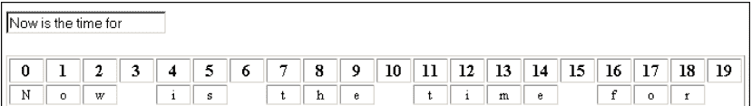

在点击 **Parse Subject** 按钮之前，先看看它所调用的代码（字符串对象方法以粗体显示）：

```javascript
function parseSubject() {
  var getValue = document.forms[0].Subject.value;

  alert('length=' + getValue.length);
  alert('substring(7, 13)=' + getValue.substring(7, 13));
  alert('substring(7)=' + getValue.substring(7));
  alert('charAt(5)=' + getValue.charAt(5));
  alert('indexOf("the")=' + getValue.indexOf("the"));
}
```


下表定义了在测试短语 `Now is the time for` 上操作时最常用的解析方法：

| 方法 | 定义 |
|---|---|
| `length` | 返回一个整数，指定字符的总数，包括任何空格。测试短语以空格结尾，因此长度为19：<br><br>`alert('length=' + getValue.length)`<br><br>尽管有20个字符，但所有字符串对象都从索引0开始。 |
| `substring` | 返回一个子字符串，从第一个参数开始，到第二个参数之前结束。如果省略第二个参数，则返回字符串的剩余部分：<br><br>`alert('substring(7,13)='+ getValue.substring(7,13))`<br><br>返回 `"the ti"`<br><br>`alert('substring(7)='+ getValue.substring(7))`<br><br>返回 `"the time for "`<br><br>第一个字符位于位置零（0）。 |
| `charAt` | 返回指定索引处的字符：<br><br>`alert('charAt(5)='+ getValue.charAt(5))`<br><br>返回 `"s"`，即字符串中的第6<sup>th</sup>个字符。 |
| `indexOf` | 返回指定字符串的起始索引值：<br><br>`alert('indexOf("the")='+ getValue.indexOf("the"))`<br><br>返回7，因为 `"the"` 从第8<sup>th</sup>个字符开始。<br><br>`lastIndexOf` 方法从右向左查找字符串中子字符串的*最后*一个实例。 |
| `match` | 在字符串对象中查找子字符串的匹配，并返回匹配值的数组。允许使用全局标志（以返回所有匹配）和忽略大小写标志。在此示例中：<br><br>`getString="All dogs and cats.";`<br>`getMatch = getString.match(/cats/gi)`<br>`alert ( "Match for \\"cats\\": " + getMatch[0]);`<br><br>在第一个数组位置返回 `"cats"`，因为 `"cats"` 最先找到（且在此示例中，只出现一次）在字符串中。<br><br>第一个参数是要与字符串对象匹配的子字符串，用正斜杠包围以形成*正则表达式*（见下文有关正则表达式的更多信息）。`g` 参数代表全局（global），即查找子字符串的所有出现位置，`i` 代表忽略大小写（ignore case）。<br><br>返回的数组可能包含零个、一个或多个元素。要读取第一个元素（第一个匹配），必须使用下标 `[0]` 读取数组的第一个元素（数组是基于零的）。<br><br>**注意：**你将在后面的主题中了解更多关于数组的内容。 |
| `search` | 查找字符串对象中找到的子字符串的索引：<br><br>`getString="All dogs and cats.";`<br>`getSearch=getString.search("cats");`<br>`alert( "\\"cats\\" is at location: " + getSearch )`<br><br>返回13，即 `"cats"` 开始的索引。<br><br>**注意：**`search` 方法接受正则表达式的使用（见下文描述）。 |
| `replace` | 将字符串对象中的 `"from"` 子字符串替换为 `"to"` 子字符串，例如：<br><br>`getString="All dogs and cats.;"`<br>`getReplace = getString.replace(/cats/gi, "mice");`<br>`alert ("Replace \"cats\" with \"mice\": " + getReplace);`<br><br>返回 `"All dogs and mice."`。第一个参数是空格分隔的两条斜杠（这是 `"from"` 字符串）。`g` 代表全局（global），即更改 `"from"` 字符串的所有出现，`i` 代表忽略大小写（ignore case）。第二个参数是 `"to"` 字符串。<br><br>**注意：**`replace` 方法接受正则表达式的使用。 |
| `slice` | 返回字符串对象的一个片段，从第一个参数索引开始，直到（但不包括）第二个索引，例如：<br><br>`getString="All dogs and cats.;"`<br>`getSlice=getString.slice( 0, 6);`<br>`alert ("Slice 0, 6: " + getSlice );`<br><br>返回 `"All do"`。 |

### 正则表达式

许多字符串对象方法允许使用正则表达式代替字面字符串。二者的区别在于，正则表达式是字符串中的字符*模式*，可以包含字面字符的匹配以及代表模式的其他符号。以下是正则表达式中用于构建模式的众多特殊符号中的一部分：

- `\` 是 JavaScript 转义字符，用于表示其他特殊字符是字面量（例如 `\?` 是字面量 `"?"`，而 `\d` 代表一个数字），或用于表示特殊字符。
- `\d` 代表任何数字。
- `\d{3}` 期望三个数字。
- `\d{3,6}` 期望至少三个但不超过六个数字。
- `\S` 匹配单个非空格字符。
- `\s` 匹配任何产生“空白”的内容（空格、制表符、换页符和换行符）。
- `\w` 匹配“单词”字符（任何大写或小写字母、数字或下划线）。
- `^` 匹配从字符串开头开始的字符。
- `$` 匹配字符串末尾的字符。
- `*` 匹配前面字符的0次或多次出现（如果是0次，则像可选字符一样）。
- `+` 匹配前面字符的1次或多次出现。
- `?` 匹配前面字符的0次或1次出现（如果是0次，则像可选字符一样）。
- `.` 匹配除换行符以外的任何单个字符。
- `[abc]` 匹配括号中的任何一个字符（可以用连字符指定范围，例如 `[0-9]`）。
- `[^abc]` 匹配除这些字符以外的任何字符（可以用连字符指定范围，例如 `[^0-9]`）。
- `|` 管道符号分隔替代子表达式（类似于逻辑 OR）。
- `( )` 将字符分组以形成子句。

> 注意：还有其他特殊字符可用于匹配或搜索任何字符串模式。使用 Google 搜索 `"JavaScript" +"regular expression"`，你会找到关于正则表达式的详尽介绍。你还会发现大量示例，用于匹配电话号码、社会保险号码、ISBN号码、日期等各种内容。网上有许多巧妙的解析算法，例如解析 CSV 文件（`(,(?=(([^""][^"]*")*([^"]*)))`）或从页面中提取所有 HTML 标签（`<[^>]*>`）。关于正则表达式的一个好教程可以在 <http://wsabstract.com/javatutors/re.shtml> 找到。你可以在 <http://www.breakingpar.com/bkp/home.nsf/Doc!OpenNavigator&87256B280015193F87256C40004CC8C6> 看到如何使用正则表达式验证互联网电子邮件地址（虽然验证电子邮件地址的方法有很多，但没有什么“唯一正确”的方法！）。

> 注意：通常有多种方法可以使用正则表达式匹配相同的文本；没有什么“唯一正确”的写法。学习如何编写更复杂正则表达式的最好方法是研究示例。

#### 简单示例

正则表达式的目的是构建一个模式，然后将其应用于字符串，看看字符串是否匹配该模式。正则表达式通常与其他方法结合使用，用于字段输入验证，例如对输入长度进行测试（使用字符串对象的 `length` 属性）。

你可以使用 `DDJS7 Demo` 数据库中 `JavaScriptLanguageObjects` 表单上的字段来测试正则表达式：

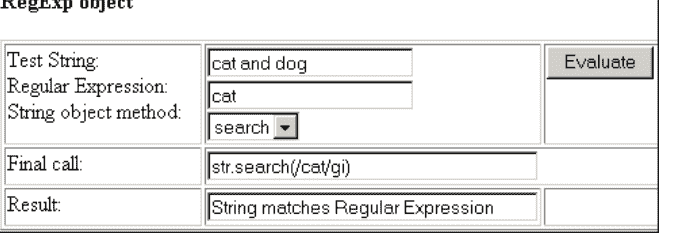

以下是一些字符串匹配的简单示例：

- **字符串长度。**要找出字符串中是否有至少指定数量的字符，检查单词字符的数量：

  `var getMatch = str.match(/\w{3}/gi)`

  `"cat"` 会匹配，`"kitty"` 也会匹配，因为它们都至少有三个字符。但 `"ID"` 不会，因为它只有两个字符。

- **匹配特定字符。**假设你想查看字符串是否包含字符 A、B、a、b、1 或 2 中的任何一个。为此，使用替代子表达式（用管道分隔）：

  `var getMatch = str.match(/([AB][aB][12][aB][12])/gi);`

  输入字符串可以是 `"cat"`，其中包含 `"a"`，或者 `"dog1"`，其中包含 `"1"`。

- **字符串模式。**假设你想查看字符串是否匹配某个模式，例如一个（任意）字符，字母 `"a"`，后跟一个（任意）字符：

  `var getPattern= str.match(/\w{1}a\w{1}/gi)`

  该匹配会找到 `"dad"` 但不会找到 `"dod"`。但它也会匹配 `"daddy"`。

- **跟随在字面量后的字符串模式。**假设你想要将当前文档的 URL 替换为进入编辑模式的 URL。请搜索问号（`?`）之后的所有内容，并将其替换为 `?editdocument`（你将在后续主题中了解 `location` 对象）：

```javascript
self.location.href=self.location.href.replace(/\?\w*$/,'?editdocument');
```

#### 有效的数字

验证数字输入的有效性有多种方法。一种方法是使用此正则表达式查找字符字符串：

```javascript
var re = /(^-*\d+$)|(^-*\d+\.\d+$)/
```

有效的数字包含所有数字，开头可选的减号，以及末尾可选的后跟更多数字的小数点。

#### 中级示例：替换

DDJS7 示例数据库中 `JavaScriptLanguageObjects` 表单里的“替换‘错误’字符”按钮包含以下代码：

```javascript
txt = new String ('Now is the \f time \n for all \t good          people \r.');

alert (txt);

getPlainTxt = txt.replace(new RegExp('([\\f\\n\\r\\t\\v ]*)+', 'g'), " ");

alert (getPlainTxt);
```

输入字符串包含换行符、制表符、换页符和额外的空格。正则表达式的作用是排除这些字符，字符串对象的 `replace` 方法则将它们替换为空格字符。

#### 高级示例：模式与字面量

这是一个使用了许多特殊字符来匹配字符串中多个字符集的高级示例：

```javascript
re = /^\w+([\.-]?\w+)*@\w+([\.-]?\w+)*(\.\w{2,3})+$/;
```


你能看出这个正则表达式是用于什么的吗？

请注意，表达式中唯一的字面量字符是`@`。这个字符将表达式分成了两半：`@`之前的部分和`@`之后的部分。

| 部分 | 用途 |
|---|---|
| `^\w+` | 字符串的第一部分必须以字母数字字符开头。 |
| `([\.-]?\w+)*` | 表达式中括号内的部分更为复杂。从方括号开始，我们知道字符串的这部分（在`@`之前）不能同时包含句点和连字符。这并不意味着它们不能分开存在。`*`确保测试整个字符串。 |
| `@`在字符串中出现的位置 | |
| `\w+` | `@`之后的字母必须以字母数字字符开头。 |
| `([\.-]?\w+)*` | 此部分用于确保`@`之后没有同时出现句点和连字符。 |
| `(\.\w{2,3})+$` | 结束字符串的字符（`$`）必须包含一个句点。花括号用于计算前一个字符的出现次数：`{N}`匹配前一个字符的N次出现，`{N,}`匹配前一个字符的至少N次出现，`{N,M}`匹配前一个字符的至少N次、至多M次出现。在此例中，结束字符串的部分必须包含至少两个、但不多于三个字符。 |

### 练习：修复URL函数

在这个练习中，你将创建一个自定义函数，使用许多上述的字符串解析方法。

如你所知，URL不能接受空格。此函数将其替换为`+`符号。你将在后续主题中看到这个函数如何派上用场。

你还将添加第二个函数，该函数调用第一个函数，并负责读取一个字段的值，然后用第一个函数的结果设置另一个字段的值。

> **注意：** 你还需要去除任何前导、尾随或多余的空格，你将在后续主题中学习如何操作。

请按照以下步骤创建单个字符替换函数：

| 步骤 | 操作 |
|---|---|
| 1 | 在Domino Designer中打开*Your Exercises*数据库。 |
| 2 | 切换到页面列表，打开名为`Topic6`的页面。 |
| 3 | 在页面上创建两个`<INPUT>`标签：**SearchString：** `<input name="SearchString" value="" size=50>`，**Translation：** `<input name="TranslateSearch" value="" size=50>`。确保将它们标记为传递HTML。 |
| 4 | 将以下代码添加到*JS Header*事件：<br><br>```<br>function changeText(InputText) {<br>&nbsp;&nbsp;var GoodPool = "";<br>&nbsp;&nbsp;for ( i = 0; i < InputText.length; i++ )<br>&nbsp;&nbsp;{<br>&nbsp;&nbsp;&nbsp;&nbsp;GetString = InputText.substring ( i , i+1);<br>&nbsp;&nbsp;&nbsp;&nbsp;if ( GetString ==" " )<br>&nbsp;&nbsp;&nbsp;&nbsp;{<br>&nbsp;&nbsp;&nbsp;&nbsp;&nbsp;&nbsp;GoodPool = GoodPool + "+"<br>&nbsp;&nbsp;&nbsp;&nbsp;}<br>&nbsp;&nbsp;&nbsp;&nbsp;else<br>&nbsp;&nbsp;&nbsp;&nbsp;{<br>&nbsp;&nbsp;&nbsp;&nbsp;&nbsp;&nbsp;GoodPool = GoodPool + GetString<br>&nbsp;&nbsp;&nbsp;&nbsp;}<br>&nbsp;&nbsp;}<br>&nbsp;&nbsp;return GoodPool<br>}<br>``` |
| 5 | 继续将第二个函数添加到*JS Header*事件：<br><br>```<br>function doTranslation()<br>{<br>&nbsp;&nbsp;form=document.forms[Object[]];<br>&nbsp;&nbsp;form.TranslateSearch.value=changeText(form.SearchString.value);<br>}<br>``` |
| 6 | 创建一个标题为`Translate`的热点按钮。将语言选项更改为JavaScript，并输入以下代码：<br><br>`doTranslation()` |
| 7 | 保存页面。 |
| 8 | 选择**Design - Preview in Web Browser - Internet Explorer**或单击工具栏上的工具。 |
| 9 | 测试按钮，查看你是否正确编写了代码。依次输入以下三个测试值来测试`if`结构。 |
| 10 | 通过在第一个字段中输入几个单词（用空格分隔）来测试字段值。然后单击该按钮，查看值是否出现在第二个字段中。 |
| 11 | 如果你有时间，可以提高`changeText()`函数的效率。该函数目前使用`for`循环逐个检查搜索字符串中的每个字符是否为空格“ ”，并将其替换为`+`。这对于短字符串来说没问题。对于更长的字符串，你将需要使用`indexOf`字符串方法更快地定位搜索字符串的实例，例如：<br><br>```<br>function changeText(InputText) {<br>&nbsp;&nbsp;var SearchFor=" ";<br>&nbsp;&nbsp;var ReplaceWith="+";<br>&nbsp;&nbsp;while (InputText.indexOf(SearchFor) != -1) {<br>&nbsp;&nbsp;&nbsp;&nbsp;var Before = InputText.substring(0, InputText.indexOf(SearchFor));<br>&nbsp;&nbsp;&nbsp;&nbsp;var After = InputText.substring(InputText.indexOf(SearchFor) + SearchFor.length, InputText.length);<br>&nbsp;&nbsp;&nbsp;&nbsp;InputText = Before + ReplaceWith + After;<br>&nbsp;&nbsp;}<br>&nbsp;&nbsp;return InputText;<br>}<br>```<br>此函数不是将字母逐个添加到`GoodPool`中，而是添加从开头到`SearchFor`字符第一次出现位置之间的所有字母块，将其替换，并追加字符串中剩余的字母。然后它会从`while`结构的顶部重新开始搜索。 |
| 12 | 好的，如果你真的需要更高效的代码，并且知道用户使用的是Navigator 4或Internet Explorer 4或更高版本，你可以使用`replace`方法：<br><br>`return InputText.replace(/ /gi, "+");`<br><br>表达式（两个斜杠之间）是一个空格。你可以忘记所有的循环和解析，而是使用字符串对象的`replace`方法。 |
| 13 | 另一种可接受的方法是完全忘记用`+`替换空格，而让JavaScript使用`escape`函数将空格（以及任何其他标点符号或非字母数字空格）替换为其十六进制等效值（以`%`为前缀），例如：<br><br>`return escape(InputText);`<br><br>如果用户搜索“IBM and Lotus”，`escape`函数将返回“IBM%20and%20Lotus”，这在大多数情况下对于URL命令来说是可接受的。<br><br>> **注意：** `escape`函数不会替换以下字符：`* @ - _ + . /`<br><br>如果你需要将字符串恢复到其原始形式，请使用`unescape`函数。 |
| 14 | 保存并测试对页面的更改。 |

### RegExp（正则表达式）对象

正如你在上面看到的，几个字符串对象方法允许你使用字面正则表达式。如果你事先知道将使用什么模式，这没问题。但如果你想在运行时构建表达式（可能由用户提供），那么你应该改用创建`RegExp`对象。

以下是使用对象构造函数创建新`RegExp`对象的基本语法：

```
var getString = "All dogs and cats.";
var RegExpObj = new RegExp("cat", "gi") ;
if (RegExpObj.test(getString) == true)
{
    alert('Found: ' + RegExpObj.toString());
}
else
{
    alert('Sorry, not found.')
}
```

此示例可以通过在*DDJS7 Demo*数据库的*JavaScriptLanguageObjects*表单中单击**Search using test method**按钮来演示。

与正则表达式字面量不同，你不需要用正斜杠将表达式包围，而是使用引号。匹配选项`"g"`、`"i"`和`"gi"`也可以指定，同样需要加引号。更显著的区别是，你必须在特殊符号前加上一个额外的反斜杠，例如：

```
var form=document.forms[0];
var getString=form.PhoneNumber.value;
var re="\\d{3}\\d{3}\\d{4}";
var RegExpObj = new RegExp(re);
```

一旦实例化了对象实例化，你可以使用以下方法来验证输入：

- `test`用于执行匹配测试，如下面的函数所示，如果传入一个`Field`对象，它能确保用户仅输入数字或字母：

```
function validateCookieEntry(obj)
{
    var re = new RegExp ("^[A-Za-z0-9]$^", 'gi');
    if (re.test(obj.value) )
    {
        return true;
    }
    else
    {
        alert(obj.name + ' field only allows numbers and letters.');
        obj.focus();
        return false;
    }
}
```

- `exec`用于在字符串中搜索匹配项（返回一个结果数组）
- `replace`（实际上是一个字符串对象方法）用于搜索匹配的模式并将其替换为另一个值：

```
var getReplace = getString.replace(RegExpObj, "mice");
alert ("Replace \"cats\" with \"mice\": " + getReplace);
```

- `compile`用于更改存储在`RegExp`对象中的表达式，例如：

```
RegExpObj.compile('dog');
```

### Screen对象

`screen`对象是另一个开箱即用的对象，它报告计算机显示器的分辨率和颜色能力。你可以利用这些信息，根据显示器的实际特性动态调整窗口/框架/页面的大小、布局或颜色。

例如，这段按钮代码可以动态设置一个新浏览器窗口的大小：

```
function openURL(url) {
    var getWidth=screen.availWidth -200;
    var getHeight=screen.availHeight -200;
    window.open(url, "YourURL", 'height=' + getHeight + ',width=' + getWidth);
}
openURL( prompt('Enter a URL: ' , 'http://www.yahoo.com') );
```

### 自定义对象

到目前为止，你已经看到了JavaScript内置对象的实用性。使用JavaScript，你还可以使用`new Object()`构造函数创建自己的对象，以封装逻辑和数据：

```
var myCarObj = new Object();
```

你可以通过点击*DDJS7 Demo*数据库中*JavaScriptLanguageObjects*表单里的**Create New Object**按钮来查看演示。

然后你可以为该对象添加并赋值属性：

```
myCarObj.color='blue';
myCarObj.doors=4;
myCarObj.seats=2;
myCarObj.type='Truck';
myCarObj.mfg='Nissan'
```

要读取属性，请使用对象的点符号并指定属性名称：

```
alert (myCarObj.type);
```

需要方法吗？添加一个属性并创建一个同名函数，例如：

```
myCarObj.getDesc=getDesc ;
function getDesc()
{
    return this.mfg + ' ' + this.type;
}
```

调用该方法就像调用任何其他函数一样：

```
alert ( myCarObj.getDesc() );
```

### for...in语句

如果你想迭代所有属性和方法，请使用`for...in`语句，例如**Create New Object**按钮中所示：

```
var objStr="";
for(member in myCarObj)
{
    objStr=objStr + member + ' = ' + myCarObj[member] + '\n';
}
alert(objStr);
```

`for...in`语句用于迭代对象中的所有属性/方法。语句块中的代码将为每个属性/方法执行一次。

变量`member`代表对象中属性/方法的名称，而`myCarObj[member]`返回该属性的值（名称+值）。即使你预先不知道有多少个属性/方法，`for...in`语句也能迭代对象中的所有内容。

### with语句

`with`语句为接下来的语句块设置一个默认对象。延续**Create New Object**按钮的示例，`myCarObj`对象被设置为默认对象：

```
with(myCarObj)
{
    alert('Using with statement: ' + type)
}
```

因为已经假定了`myCarObj`对象，因此只需通过名称即可调用该对象的任何属性（如`type`）或方法。

### delete运算符

使用`delete`运算符来删除对象属性或对象本身。这会释放内存并使对象引用变量可用于重新赋值。如果在`with`语句内部，你只需通过名称即可删除属性。延续**Create New Object**按钮的示例：

```
with(myCarObj)
{
	alert('Using with statement: ' + type)
	delete type;
}
```

如果在`with`语句外部，你必须同时引用对象，例如：

```
delete myCarObj.type;
```

如果删除成功，该运算符返回`true`，否则返回`false`：

```
var flag=delete myCarObj.type;
alert ('Object property was deleted: ' + flag)
```

如果你想完全删除对象，同样使用`delete`运算符：

```
delete myCarObj;
```

如果你尝试调用被删除对象的任何属性或方法，将返回`undefined`，你可以对其进行捕获：

```
if (confirm('Do you want to delete the object?')==true){
	delete myCarObj;
	if (myCarObj.type == undefined){
		alert('Sorry, you just deleted the object.');
	}
}
```

### 自定义对象原型

在大多数情况下，创建仅使用一次的对象（`new Object()`构造函数）是没有意义的。你更有可能创建对象的原型（类构造函数），它们可用于创建同一对象的多个实例，且所有实例都使用相同的类原型。

你可以通过点击*DDJS7 Demo*数据库中*JavaScriptLanguageObjects*表单里的**Create Object Prototype**按钮来查看演示。

你通过创建一个函数来创建对象原型，例如这个名为`myCarClass`的类：

```
function myCarClass()
{
    //Properties
    this.color="";
    this.doors="";
    this.seats="";
    this.type="";
    this.mfg=""
    // Method
    this.getSubject = getSubject ;
    function getSubject()
    {
        return this.mfg + ' ' + this.type;
    }
}
```

与上述一次性对象不同，这里的属性都没有被赋值。

`this`关键字指的是当前对象，在这种情况下，是指将使用该原型创建的对象。

方法的函数实际上嵌套在定义类的总函数内部。请记住，内部函数只能由外部函数中的语句访问，不能被页面上的其他代码调用。同时请记住，内部函数可以使用传递给外部函数的参数并访问其变量，但外部函数不能使用内部函数的私有变量。

你可以根据需要添加更多属性和函数。

> **注意：** 函数本身是一种带有值的数据类型。要返回该值，请在外部函数中添加`return`语句。

要使用该类，请使用`new`构造函数创建对象的实例，例如：


`var myCarObj2 = new myCarClass;`

现在对象已实例化，你可以设置它的属性：

```
myCarObj2.color='black';
myCarObj2.doors=4;
myCarObj2.seats=4;
myCarObj2.type='Jetta';
myCarObj2.mfg='Volkswagon';
```

设置好属性后，你可以读取属性并调用其方法：

```
alert (myCarObj2.type); //property
alert (myCarObj2.getSubject() ); //method
```

### 示例：自定义类

在浏览器中使用 JavaScript 的一个明确好处是进行客户端字段输入验证，从而消除与服务器的往返通信，并给用户提供即时响应。

作为程序员，简化工作的一种方法是将所有字段验证例程封装到单个对象中。

*DDJS7 Demo* 数据库中 *JavaScriptLanguageObjects* 表单里的 **Validate Fields Using validateInput class** 按钮演示了如何使用一个对象类来验证三个字段（电话、电子邮件、日期）。以下是该按钮背后的代码：

```
//create new instance of validateInput prototype
var myTest = new validateInput;
var strMsg;

//set fieldObj property to the PhoneNumber field object
myTest.fieldObj=document.forms[0].PhoneNumber;

//with the property set, run testField method using a regular expression
strMsg+='Valid phone number? ' + myTest.testField() + '\n';

//reset property to Email field object
myTest.fieldObj=document.forms[0].Email;
strMsg+='Valid email address? ' + myTest.testField() + '\n';

//reset property to Date field object
myTest.fieldObj=document.forms[0].Date;
strMsg+='Valid date? ' +  myTest.testField() ;
alert (strMsg); //report results of three field tests
```

`validateInput` 原型非常简单，定义了一个属性（用于 Field 对象）和一个方法（如果 Field 的值与正则表达式匹配则返回 `true`）。该原型在 JS Header 事件中定义：

```
function validateInput()
{
  //Properties
  this.fieldObj="";
  // method
  this.testField = testField ;
  function testField()
  {
    var getString=this.fieldObj.value;
    switch (this.fieldObj.name)
    {
      case "PhoneNumber":
        var re="^(\\d{3}\\)\\d{3}-\\d{4}";
        break;
      case "Email":
        var re="^([\\w+([\\w\\.-]?\\w+)*@\\w+([\\w\\.-]?\\w+)*)(\\.\\w{2,3})+$";
        break;
      case "Date":
        var re="^(\\d{4})(\\/[0-1]?[0-9])\\/(0[1-9]|[12]\\d|3[01])";
        break;
    }
  }
  var RegExpObj = new RegExp(re);
  return RegExpObj.test(getString); //returns true or false
}
}
```

使用 Field 对象的 `name` 属性，`switch` 语句选择合适的正则表达式字符串，然后用于创建 `RegExp` 对象。最后，使用 `RegExp` 对象的 `test` 方法来测试 Field 对象的 `value` 属性。`test` 方法返回 `true` 或 `false` 给调用代码。

> **注意：** 比起点击按钮更合适的是，稍后你会看到如何使用这个对象类来阻止表单提交，并将光标聚焦到有问题的 Field 上。

### 示例：为 JavaScript 对象添加方法

你已经看到：1）如何使用字符串对象方法；以及，2）如何创建自定义对象类。

将这两个想法结合起来，你就能够通过对象原型扩展现有对象的方法和属性。这包括为内置 JavaScript 对象添加方法和属性的能力！

JavaScriptLanguageObjects 表单的 JS Header 事件中有这个函数，用于为字符串对象添加方法：

```
String.prototype.fullTrim = function()
{
    return this.replace(/^\s+/).replace(/\s+/gi, ' ').replace(/\s+$/);
}
```

这里的关键是 `prototype` 关键字，它用于为现有对象添加方法和属性。

要查看新方法的用法，请看 `trimBefore` 字段的 `onblur` 事件处理代码：

```
var str = new String ( this.value );
this.form.trimAfter.value = str.fullTrim();
```

第一步，当然是将 `trimBefore` 字段的值变成字符串对象。然后使用新字符串对象的 `fullTrim()` 方法来修剪对象中所有多余的空格，然后设置 `trimAfter` 字段的值。

> 注意：在后面的主题中你会看到 `this` 关键字到底是怎么回事。它是当前浏览器对象的快捷方式，在这种情况下是 `trimBefore` 字段，也是遍历浏览器对象层次结构以设置 `trimAfter` 字段值的一种方式。

### Enumerator 对象

`enumerator` 对象用于遍历其他对象的属性集合，包括浏览器对象、数组或自定义对象，很像 `for...in` 语句，但更简单。

当然，并非所有对象都以集合形式存储，所以在大多数情况下应该使用 `for...in` 语句。

> 注意：如果你是 LotusScript 程序员，你已经熟悉集合的概念以及遍历集合的方法。例如，`NotesDocumentCollection` 使用 `GetFirstDocument` 和 `GetNextDocument` 方法进行遍历。

`enumerator` 对象有几种方法：

| 方法 | 用途 |
| :--- | :--- |
| `moveFirst()` | 初始化遍历集合的循环。 |
| `moveNext()` | 步进到对象中的下一个属性。 |
| `atEnd()` | 测试是否到达对象属性的末尾。 |
| `item()` | 返回属性的值。 |

前三个方法可以方便地应用在 `for` 语句中，例如：

```
for (linkEnum.moveFirst(); linkEnum.atEnd(); linkEnum.moveNext())
```

第一个参数从集合的开头开始；第二个告诉循环何时停止（在集合的末尾），而"计数器"通过 `moveNext` 方法递增。本着 `for` 语句的精神，你不需要事先知道集合中存在多少个元素。

尽管你还没有接触过数组对象（下一个主题）或浏览器对象模型（后面的主题），既然我们在讨论对象这个话题，不妨展示两个 `enumerator` 对象如何工作的示例。

两个示例都在 *DDJS7 Demo* 数据库中 *JavaScriptLanguageObjects* 表单的 **Enumerator Object** 按钮中。第一个示例构建了一个简单的数组，然后遍历其所有元素：

```
var donorArray=new Array();
donorArray[0]="Bob Smith";
don OfficeArray[1]="Bob Jones";
donorArray[2]="Mary Wilson";
```

使用 **new** 构造函数创建一个新的 `enumerator` 对象：

```
var arrayEnum = new Enumerator(donaorArray);
```

现在使用 **for** 语句遍历集合中的元素，使用 `item` 方法显示元素的值：

```
for (arrayEnum.moveFirst(); !arrayEnum.atEnd(); arrayEnum.moveNext())
{
    alert('Donor array: ' + arrayEnum.item());
}
```

第二个示例使用浏览器文档对象的 `links` 对象创建 `enumerator` 对象，然后列出它们：

```
linkEnum = new Enumerator(document.links);
for (linkEnum.moveFirst(); !linkEnum.atEnd(); linkEnum.moveNext()) {
    alert('Tag <' + linkEnum.item().tagName + '> = ' + linkEnum.item());
}
```

结果是一个显示标签名称和值的警报，例如：

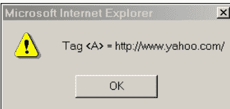

> **注意：** 一般来说，你不需要费力创建 `enumerator` 对象来遍历对象的属性。后面你会看到一种情况——当处理 Windows Script Host 调用的返回值时——你*必须*将其视为 `enumerator` 对象。

### Image 对象

每个 HTML 中的 **** 标签都会创建一个 `image` 对象，例如，从文件系统显示图像（相对于 `\Data\Domino\` 目录）：

```

```

或者，从当前数据库中的共享图像资源：

```
/bangdesk.gif?openfileresource'>
```

其中 **<Computed Value>** 返回 `@WebDbName`。

在这两种情况下，都会创建 `image` 对象，并将 **SRC** 属性设置为与 Web 兼容的图像文件名称。

文档中的所有图像都可以通过 **NAME=** 属性或文档中的图像对象数组来访问：`document.images[i]`。要查看实际效果，请点击 *DDJS7 Demo* 数据库中 *JavaScript Language Objects* 表单的 **List Images** 按钮，它运行以下代码：

```
for(i=0;i<document.images.length;i++)
{
	alert (document.images[i].src) ;
}
```

你也可以使用 JavaScript 使用 **new** 构造函数创建 `image` 对象，可选择将 X/Y 像素大小作为参数设置：

```
image0= new Image(21,21);
image0.src = '/icons/actn010.gif';
```

现在你已经创建了 `image` 对象，可以随时重置 **SRC** 属性（但如果你设置了图像大小，这些现在变为只读）。

例如，*JS Header* 预加载了两个 `image` 对象（由浏览器缓存供后续使用）：

```
image0= new Image(21,21);
imageCounter = 10;
image0.src = '/icons/actn0' + imageCounter + '.gif';
```

```
image1= new Image(21,21);
imageCounter = 11;
image1.src = '/icons/actn0' + imageCounter + '.gif';
```

你会注意到在 *JavaScript Language Objects* 表单上有一个没有 SRC 属性的 **<IMAGE>** 标签：

```

```

当你首次打开页面时，找不到该图像：

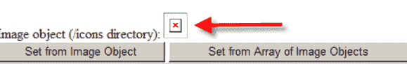

现在点击 **Set from Image Object** 按钮，它使用 `NAME` 属性定位正确的图像，并将 `SRC` 属性设置为 `image0` image 对象的 `SRC` 属性：

```
document['imageA'].src = image0.src;
```

除了图像缓存的好处之外，`image` 对象还使页面的其他部分易于编码，例如，这个图像悬停效果：

```

```

由于 `image` 对象的 `SRC` 属性在 *JS Header* 事件中只设置一次，你可以在多个地方重用该 `image` 对象，而不必担心必须在所有使用的地方更改文件名。例如，在前面的代码片段中，`imageB` 图像的 `SRC` 属性在 *onload* 事件处理程序中设置：

```
document.images['imageB'].src = image1.src;
```

## 主题 7：数组

### 要点

数组对象是非常有用的数据结构，多个值以编号集合的形式存储在其中。本主题介绍如何创建、填充和操作数组对象及其元素。在后续主题中，你将使用数组来处理从浏览器和 Domino 对象模型中获取的值。

> **注意：** 本主题中的所有示例均在 *DDJS7 Demo* 数据库的 *TestArrays* 表单中演示。

### 数组属性

数组对象是一种包含多个位置的结构，每个位置包含一个值，也称为元素。下表显示了一个由三个元素组成的数组：

| 数组位置 | 值 |
|---|---|
| `DonorArray[0]` | Bob Smith |
| `DonorArray[1]` | Bob Jones |
| `DonorArray[2]` | Mary Wilson |

你可以使用变量下标来访问数组中的每个元素，例如，`DonorArray[2]`。由于起始位置是 **0**，这代表第三个值。

在代码中使用时，引用 `DonorArray[2]` 将返回 "Mary Wilson"。

> **注意：** JavaScript 中的数组始终从位置零开始计数元素，表示为 `[0]`。

### 如何声明数组

声明数组有三种常用方式：

- 声明数组对象并在后续行中填充其值，例如：

```
var donorArray=new Array();
donorArray[0]="Bob Smith";
donorArray[1]="Bob Jones";
donorArray[2]="Mary Wilson";
```

数组可以容纳任何数据类型，包括其他对象。数组中的每个元素甚至可以是不同的数据类型。

你更可能会使用循环结构来分配数组元素，就像你在后续练习中要做的那样。

> **注意：** 要查看此代码的实际运行，请查看 **Donor Array** 按钮背后的代码。

- 在同一语句中创建并填充数组，例如：

```
var donorArray=new Array("Bob Smith", "Bob Jones", "Mary Wilson")
```

- 使用 `split` 方法，允许你从分隔字符串创建数组，在此示例中使用逗号分隔：

```
donorString="Bob Smith, Bob Jones, Mary Wilson";
var donorArray=donorString.split(",");
```

> **注意：** 稍后你将看到许多浏览器对象如何返回元素数组，例如表单数组，你可以使用 `document.forms[0]` 从 HTML 文档中选择第一个表单。`[0]` 表单对象是从页面顶部开始找到的第一个表单。Radio 按钮/复选框字段对象中的锚点、小程序、框架、图像、链接、插件和选项也返回对象数组。

> **注意：** 如果你想预先声明初始数组大小，可以在首次创建数组时指定上限，例如：
> `var donorArray=new Array(2);`
> 但在 JavaScript 和 Domino 的实际工作中很少这样做。

### 从 @DbColumn 创建数组

如果使用通配 HTML（插入一个使用以下公式的"计算显示"字段）或 *HTML Head Content* 事件，你可以将 Domino 后端文档数据与 JavaScript 结合使用来创建值数组。例如，**Array from @DbColumn** 按钮列出了在 *HTML Head Content* 事件中使用以下公式创建的数组中的值：

```
getNames:=@DbColumn("Notes":"NoCache"; @DbName;
"($PeopleGroupsFlat)"; 2);
makeList :=@Implode(getNames; ",\",\"");
```


`<SCRIPT>var peopleArray=new Array(\"" + makeList + "\"></SCRIPT>`

`peopleArray`全局变量包含从`@DbColumn`获取的值数组，页面上的其他 JavaScript 可以使用它。

### 元素数量

一旦值存储在数组中，你就可以使用数组对象的`length`方法来确定元素数量（上限），例如：

```
var donorArray=new Array();
donorArray[0]="Bob Smith";
donorArray[1]="Bob Jones";
donorArray[2]="Mary Wilson";
alert(donorArray.length);
```

在这种情况下，`length`返回 2，这是三个元素数组的上限。

### 追加元素

数组会随着你添加的每个元素动态增加大小。默认情况下，新元素添加到数组末尾。

如果你没有使用变量跟踪位置编号，可以通过使用数组对象的`length`属性安全地添加新元素，例如：

```
donorArray[donorArray.length]="Fred Adams";
```

由于数组是基于零的，`length`属性返回的值正确地为新元素编号。

### 读取一个元素

数组元素通过在数组名后使用`[#]`下标来访问，例如：

```
alert( donorArray[0] );
```

### 读取所有元素

使用循环结构遍历元素，使用以下技术之一：

- **for 循环**；使用`length`确定循环次数：

`for (i=0; i < donorArray.length; i++) { alert(donorArray[i]) }`

- **for...in 循环**访问所有元素，无论有多少个：

`for (var i in donorArray){alert(donorArray[i])}`

- 创建枚举器对象来循环访问所有元素，无论有多少个：

```
var arrayEnum = new Enumerator(donorArray);
for (arrayEnum.moveFirst(); !arrayEnum.atEnd(); arrayEnum.moveNext())
{
    alert('Loop using enumerator object: ' + arrayEnum.item());
}
```

> 注意：要查看这三种技术的实际运行，请查看 **Donor Array** 按钮背后的代码。

### 越界错误

使用数组时最常遇到的错误是运行时越界错误。这意味着你引用了一个不存在的数组索引。

例如，你定义并填充了一个名为`donorList`的数组，包含 5 个元素，索引从 0 到 4。引用`donorList[16]`将导致越界错误消息。

### 复制整个数组

如果你已经创建了一个数组，可以将其整个结构和元素值复制到一个变量：

```
var donorArray=new Array();
donorArray[0]="Bob Smith";
donorArray[1]=true;
donorArray[2]=2;
var copyArray=donorArray;
copyArray[3]="BLUE";
```

变量`copyArray`包含四个元素，这是由于最后一行添加了`[3]`。而且你可能会惊讶地发现`donorArray`也有四个元素！以这种方式复制数组只是创建了一组指向同一数组的重复指针。这可能不是你想要的。

要创建真正的、独立的数组副本，你必须遍历第一个数组并逐个元素添加到第二个数组，例如：

```
var trueCopyArray = new Array();
for (i=0; i < donorArray.length; i++)
{
  trueCopyArray[i] = donorArray[i];
}
trueCopyArray[trueCopyArray.length] = "RED";
```

数组`donorArray`仍然有四个元素，但`trueCopyArray`有四个元素并添加了新的第五个元素。

> **注意：** 要查看此代码的实际运行，请查看 **Copy Array** 按钮背后的代码。

### 数组对象方法

下表列出了一些更常用的数组对象方法：

| 方法 | 描述 |
| --- | --- |
| unshift shift | 默认情况下，通过简单地为下一个最高索引号分配新值，将新元素添加到数组末尾，例如：<br><br>`donorArray[donorArray.length]="Fred Adams";`<br><br>但如果想将新元素添加到数组的*顶部*，请使用`unshift`方法，例如：<br><br>`var fruitArray=new Array('apple', 'banana', 'orange') ;`<br>`fruitArray.unshift('kiwi', 'strawberry') ;`<br><br>`shift`方法移除数组中的第一个元素。<br><br>**注意：** 要查看此代码的实际运行，请查看 **unshift Method** 按钮背后的代码。 |
| reverse | `reverse`方法反转数组中元素的顺序。<br><br>点击 **reverse Method** 按钮查看此方法如何将数组翻转：<br><br>`fruitArray.reverse() ;` |
| sort | `sort`方法对字符串排序非常有效。**sort Method** 按钮展示了排序数组有多简单：<br><br>`var fruitArray=new Array('orange', 'banana', 'apple');`<br>`fruitArray.sort();`<br><br>但如果你想对数字排序，你会发现这种"字典"排序会将数字作为字符串排序，这与它们的数字顺序不同。要完成数字排序，你必须创建一个`compareFunction`用于评估数组中任意两个元素的顺序，并将其作为参数添加到`sort`方法中。创建`compareFunction`使其返回三个值：-1、0 和 1：<br><br>• 如果`compareFunction(a, b) <0`，则顺序为 a->b<br><br>• 如果`compareFunction(a, b) ==0`，则 a 和 b 的相对顺序不变<br><br>• 如果`compareFunction(a, b) >0`，则顺序为 b->a<br><br>例如，数字排序的标准`compareFunction`应如下所示：<br><br>`function compareFunction(a, b) {`<br>&nbsp;&nbsp;`if (a < b)`<br>&nbsp;&nbsp;&nbsp;&nbsp;`return -1;`<br>&nbsp;&nbsp;`if (a > b)`<br>&nbsp;&nbsp;&nbsp;&nbsp;`return 1;`<br>&nbsp;&nbsp;`return 0;`<br>`}`<br><br>当然，你可以创建更复杂的逻辑或按不同属性排序。例如，按长度排序：<br><br>`if(a.length < b.length)`<br><br>然后要使用`compareFunction`，将函数名作为参数添加到`sort`方法：<br><br>`fruitArray.sort(compareFunction);` |

### 方法

| 方法 | 描述 |
| :--- | :--- |
| concat | 如果你有两个或多个数组，并希望将它们合并成一个数组对象，请使用`concat`方法。<br><br>例如，**concat 方法**按钮将两个数组连接成一个单一数组：<br><br>`var fruitArray=new Array('orange', 'banana', 'apple');`<br>`var breadArray=new Array('rye', 'whole wheat', 'white');`<br>`var picnicArray=fruitArray.concat(breadArray);`<br><br>新数组`picnicArray`包含了来自另外两个数组的所有元素。 |
| join | 你在上面已经看到如何使用`split`方法从一个分隔字符串创建数组。`join`和`toString`方法则逆转了这一过程，将数组转换为分隔字符串。 |
| toString | 将数组转换为字符串的典型原因是为了能够使用强大的字符串对象方法，例如`search`或`replace`元素值。然后你可以使用`split`将它们恢复为数组结构。<br><br>`join`和`toString`方法的基本工作原理相同，区别在于`join`允许你指定分隔符，例如：<br><br>`var myStr=fruitArray.join(',');` |

### 删除元素

`delete`语句可用于删除元素值，但会使元素变为 undefined。使用此语法：

```
delete donorArray[1];
```

如果你希望保留空元素位置以便后续重用，这是完全合适的。你可以使用类似下面的代码测试一个 undefined 元素：

```
if (donorArray[i]==undefined)
{
    //此处为语句
}
```

但如果你想要*压缩*数组（移除空白元素）呢？你必须完全移除该元素的位置。为此，**Delete Element** 按钮调用此函数：

```
function deleteElement(arrayObj, loc)
{
    for (loc; loc < arrayObj.length; loc++)
    {
        arrayObj[loc] = arrayObj[loc + 1];
    }
    arrayObj.length = arrayObj.length - 1;
}
```

然后，要删除一个元素及其位置*并*压缩数组，请调用该函数，传递数组对象和要删除的元素索引号：

```
deleteElement(donorArray, 1);
```

### 在数组中查找值

没有数组对象方法可以搜索数组中的值。你有两个选择：

- 遍历数组并测试每个元素。
- 使用`join`或`toString`方法将数组转换为字符串，然后使用字符串对象方法搜索该值。

一旦找到该值，你就可以对该元素执行所需的操作。

## “多维”数组

JavaScript 不直接支持多维数组，但你可以创建一个数组的数组来模拟多维。在此上下文中，数组可以拥有你想要的任意多“维度”（仅受内存限制）。

创建“多维”数组的一种方法是首先创建单独的数组，然后创建一个“容器”数组（在 **Multi-dimension Container Array** 按钮中演示）：

```
var names=new Array("Bob Smith", "Bob Jones", "Mary Wilson");
var streets=new Array("Bob Smiths Street", "Bob Jones Street", "Marys Street");
var towns=new Array("Bob Smiths Town", "Bob Jones Town", "Marys Town");
var mda=new Array(names, streets, towns);
```

一旦多维数组填充完毕，你可以使用双下标访问单个元素，例如：

```
alert(mda[0][1]);
```

或者，你可以使用嵌套的`for`语句遍历所有元素：

```
var msg="";
for (i=0; i < mda.length; i++)
{
    for (j=0; j < mda[0].length; j++)
    {
        msg+=mda[i][j] + "\n";
    }
}
alert(msg)
```

另一种创建“多维”数组的方法是首先声明容器数组本身，然后在容器数组的每个元素中创建一个数组，每个“维度”一个：

```
var mda=new Array();
mda[0]=new Array();
mda[1]=new Array();
mda[2]=new Array();
```

然后使用双下标加载元素：

```
mda[0][0]="Bob Smith";
mda[0][1]="Bob Jones";
mda[0][2]="Mary Wilson";
mda[1][0]="Bob Smiths Street";
mda[1][1]="Bob Jones Street";
mda[1][2]="Marys Street";
mda[2][0]="Bob Smiths Town";
mda[2][1]="Bob Jones Town";
mda[2][2]="Marys Town";
```

以这种方式思考多维数组需要一些时间适应，但幸运的是，当你使用 Domino 对象时可能不需要多维数组。然而，当需要以多维方式表示多个文档及其项时，它们可能会派上用场。

### 关联数组

如果你是 LotusScript 程序员，你可能已经熟悉列表。列表是数组，但不是使用索引号来寻址元素，而是使用标签值。所以，你不是检索`myArray[34]`，而是检索`myArray['smith']`。'Smith'是用于定位所需元素的标签值。当然，标签值唯一性很重要。

例如，你可以像 **Associative Array** 按钮中看到的那样创建一个关联数组：

```
var donorList = new Array(0);
donorList['1234'] = 'Bob Smith';
donorList['5434'] = 'Bob Jones';
donorList['8978'] = 'Mary Wilson';
```

要返回'Mary Wilson'，请输入她的标签值：

```
alert(donorList['8978']);
```

说实话，关联数组实际上根本不是数组，而更像是一个通用的 JavaScript 对象，每个值都是一个属性。实际上，“数组”定义同样可以是一个对象定义：

```
var donorList = new Object();
donorList.n1234 = 'Bob Smith';
donorList.n5434 = 'Bob Jones';
donorList.n8978 = 'Mary Wilson';
```

```
alert(donorList.n8978);
```

唯一的区别是对象属性不能以数字开头，所以标签（属性）名称前加了"n"。

无论是关联数组还是对象，你都无法使用数组对象的`length`属性来确定关联数组中有多少个元素。

这排除了使用`for`循环遍历数组中所有值的可能性。作为替代方案，你可以使用`for...in`循环遍历属性：

```
var objStr="";
for(member in donorList)
{
    objStr=objStr + member + ' = ' + donorList[member] + '\n';
}
alert(objStr);
```

### 复合数据类型

思考关联数组的另一种方式是将其视为一种构造复合数据类型的方法。**Associative Array** 按钮使用对象字面量语法创建了一个关联数组：

```
var myCar={color:'blue', doors:'2', seats:'2', type:'Truck', mfg:'Nissan'};
//使用成员遍历属性
var msg;
for(member in myCar)
{
    msg+=member + ' = ' + myCar[member] + '\n';
}
alert(msg);
//调出一个属性
alert(myCar.mfg);
```


这是一个有趣的构造定义。从技术上讲，使用花括号和`name+value`对创建了一个对象（就像你在前一个主题中所做的那样，但没有添加方法的能力），但它的行为类似于关联数组，你可以通过名称引用每个属性来获取或设置其值。

这种构造看起来也很像其他语言中所谓的复合数据类型或“用户定义”数据类型。无论你怎么称呼它，你都可能会发现它很有用！

### 练习：解析 URL 命令字符串

如你所知，你可以将可选参数作为 URL 命令字符串的一部分传递给`Domino Server`，例如，传递给代理，或作为打开表单或页面的一部分，例如：

`http://server/db.nsf/superform?open&CODE=12&ID=DRI3&NAME=Fred+Wilson`

虽然不是必需的，但`?open`命令后的参数通常用`&`分隔，并以可读性命名。

`?`和特定的`Domino`命令（`open`、`read`、`delete`等）之后的所有内容都被视为可选。有三种方式捕获此信息：

- 在`WebQueryOpen`代理中从`DocumentContext`对象读取`query_string`变量。
- 在表单上放置一个名为`query_string`的字段。
- 使用`JavaScript location`对象的`search`属性，它读取从`?`开始（包括`?`）的所有内容。

当然，目标是解析出所需的值，并基于这些值执行一些操作。

虽然你可以使用字符串对象解析方法，但另一种看待命令字符串`?open&CODE=12&ID=DRI3&NAME=Fred+Wilson`的方式是将其视为一个关联数组：

| 标签 | 值 |
| :--- | :--- |
| CODE | 12 |
| ID | DRI3 |
| NAME | Fred+Wilson |

一旦放入关联数组，要读取一个值，你只需指定标签值。

按照以下步骤解析命令行参数，将它们存储在关联数组中，然后读取任何指定标签的值：

| 步骤 | 操作 |
| :--- | :--- |
| 1 | 在`Domino Designer`中打开你的`Your Exercises`副本。 |
| 2 | 切换到表单设计列表，创建一个名为`Topic7`的新表单。 |
| 3 | 创建一个名为`Add Arguments to Current Location`的新按钮。输入此`onClick`事件代码，它将重置当前浏览器位置<br><br>`location.href=location.href + '&CODE=12&ID=DRI3&NAME=Fred+Wilson'`<br><br>这将使测试你的解析代码变得更容易。 |
| 4 | 创建另一个按钮。输入此`onClick`事件代码，该代码将调用用于解析 URL 命令字符串的函数：<br><br>`var getKey = 'ID';`<br>`var fromStr = ParseQueryString(location.search, getKey);`<br>`alert( fromStr );`<br><br>请注意，您传递了两个参数：URL 命令字符串和要返回值的标签。如果要读取不同的标签，请更改`getKey`变量的值。 |
| 5 | 将此代码添加到`JS Header`事件中。这是一个接受两个参数并返回值的解析函数。<br><br>`function ParseQueryString(getQS, Key)`<br>`{`<br>&nbsp;&nbsp;&nbsp;&nbsp;`var QArray=new Array(); // array for initial split`<br>&nbsp;&nbsp;&nbsp;&nbsp;`var myList = new Array(); //associative array`<br>&nbsp;&nbsp;&nbsp;&nbsp;`var thisElem, KeyValue, ListKey;`<br>&nbsp;&nbsp;&nbsp;&nbsp;`var pos=0;`<br>&nbsp;&nbsp;&nbsp;&nbsp;`var QArray =getQS.split('&');`<br>&nbsp;&nbsp;&nbsp;&nbsp;`// skip first element as it contains ?openxxxxx`<br>&nbsp;&nbsp;&nbsp;&nbsp;`for (i=1; i < QArray.length; i++)`<br>&nbsp;&nbsp;&nbsp;&nbsp;`{`<br>&nbsp;&nbsp;&nbsp;&nbsp;&nbsp;&nbsp; |

该列表包含一个`forms`对象。再次深入研究`Forms`对象：

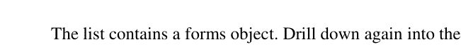

在这里，您将找到名为`_BrowserObjectBrowser`的`Form`（当前的`Form`名称），其中包含其他被包含的对象和属性，例如`Subject`字段：

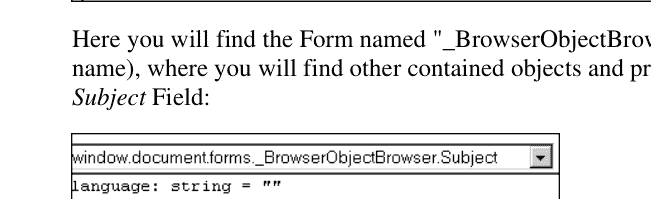

> **注意：** 这里并没有什么神奇的操作——显示的基础是一个`for...in`循环，它报告了所选对象的所有属性：

```javascript
for (var propName in object)
{
  var getProp=object[propName]
  var t = typeof(getProp);
  getProp = (t == "function") ? "..." : (t == "string") ? ("\"" + getProp + "\"") : getProp;
  properties+="<b>" + propName + ": "+ t + " = </b>" + getProp + "<br>";
}
```

您在之前的主题中已经见过如何这样操作，只不过这一次它被应用于浏览器对象，而不是您创建的自定义对象。

### 浏览器对象表

本表简要描述了浏览器对象模型（BOM）中的各种对象（请记住，有些是由浏览器提供的，而另一些是通过 HTML 标签实例化的）：

| 对象 | 功能 |
| :--- | :--- |
| window (浏览器) | 顶级对象，包含当前窗口中的所有其他对象，其中最重要的是包含页面上整个 HTML 的`document`对象。<br><br>用户打开的每个窗口或通过`window`对象的`open`方法打开的窗口都有一个相应的`window`对象，其特点是具有唯一的 URL（由`location`对象得知），并在之前的页面历史记录中显示一个页面（`history`对象）。<br><br>因为您在通过 JavaScript 打开窗口时为其命名，因此可以通过引用其名称来控制其他窗口中的各种对象。您将在后面的主题中看到如何操作。 |
| location (浏览器) | 文档的 URL，它具有可读/写的`href`属性，允许您通过编程方式更改当前文档或控制另一个窗口中文档的位置。 |
| frame (HTML) | `frame`对象在某种程度上被处理为“窗口中的窗口”，每个`frame`都被赋予一个名称并引用一个页面的 URL，而该页面本身就是一个`document`对象。<br><br>`frame`的`parent`是包含定义各种`frame`的`<FRAMESET>`标签的控制文档。父文档可以包含一个 JavaScript 函数库，但用户看不到父文档的内容。他们看到的是由父文档定义的最终`frame`。 |
| document (浏览器) | `document`对象是另一个容器对象，包含页面上每个`Form`、图像和链接的属性。`Form`尤为重要，因为它包含字段（Fields）和按钮等元素。<br><br>您已经见过使用内联 JavaScript 调用`document`对象的`write`方法来动态添加内容的用法。稍后您将使用此方法生成整个窗口的内容。 |
| history (浏览器) | `history`对象包含一个之前访问过的 URL 数组。您可以使用`back`方法将用户送回之前的 URL，而无需他们点击浏览器的`Back`按钮。<br><br>在`frameset`激活时使用`history`对象仅向当前激活的`frame`返回单个文档，因此您最好为每个`frame`设置`location`对象的`href`属性。 |
| images (HTML) | `images`对象代表文档中的图像，可以通过给定名称或数组索引来引用。`images`对象使您能够在用户用鼠标指针悬停在图像上时显示不同的图像。 |
| links (HTML) | `links`对象包含页面上链接的数组。虽然使用`length`属性获取页面上的链接数量可能很有趣，但更有用的是根据用户的选择或变化的条件来更改页面上现有链接的 URL。 |
| forms (HTML) | `forms`对象非常重要，因为所有用于捕获用户输入的 HTML 元素（主要是字段 Fields）都包含在其中。当`Domino`以编辑模式将文档发送到浏览器时，字段包含在一个 HTML `Form`中（由`<FORM>`标签定义）；但当以读取模式发送时，没有定义`form`对象，仅发送 HTML。<br><br>除非您添加了自己的`<FORM>`标签，否则由`Domino`提供的`Form`上只有一个`Form`存在。 |
| anchors (HTML) | 锚点（Anchors）是文档中可以作为链接一部分指定的位置。锚点简单地使用标签`<A NAME="top">`定义。同一文档中其他部分的链接可以使用`<A HREF="#top">Goto Top</A>`跳转到该锚点，而其他文档中的链接可以通过在 URL 中添加锚点名称来打开文档 *并* 跳转到文档中的特定位置，例如：`http://www.waresource.com/home.html#part1`。指向锚点的链接经常用于在文档中创建目录。这里的重点是，`anchors`对象返回页面上所有锚点的数组。 |
| elements (HTML) | `Form`的元素包括任何：<br>- 按钮<br>- 复选框、单选按钮、选择列表（单值或多值）<br>- 文本、文本区域或隐藏字段<br>- 文件上传控件<br>- 提交或重置按钮。<br><br>当您提供默认值或使用 JavaScript 执行翻译或验证时，这些对象就会发挥作用。所有元素都包含在`Form`的`elements`数组中，但更常见的是通过在 Designer 中使用的名称（可能在字段属性的 HTML 选项卡上）或最终生成的 HTML 标签`NAME`属性来引用。 |

### 遍历层级结构

每个浏览器对象都有您可以使用 JavaScript 访问的属性和方法。诀窍在于如何实例化对象；为此，您必须从最全局的容器对象向下导航到更具体的被包含对象。

在引用字段（Field）对象的“路径”时，您必须自顶向下地操作，以提供该特定字段可被“找到”的上下文：

`window` → `document` → `form` → `field`

如果文档位于`frame`中，您还必须引用容器`frame`：

```
window → frame → document → form → field
```

对于在当前窗口中运行的代码（例如`Form`、`Field`或按钮事件处理程序），默认假设为`window`对象，因此您可以从`document`对象开始以节省输入。但如果您创建了多个窗口，则需要在深入研究其对象之前指定正确的`window`对象。

为什么访问 HTML 页面上的对象似乎如此困难？因为一个页面可以有多个`Form`、文本、图像、链接、锚点等对象。

> **注意：** 您稍后将看到如何从当前对象*向上*遍历对象层级结构到容器对象，然后再向下遍历到容器中的另一个元素。

### 示例：访问 Form 对象

使用浏览器对象模型（DOM Level 0），有几种方法可以“寻址”对象，在本例中是访问`Form`对象（由`<FORM>`标签创建）：

- 最佳方法是通过名称。这样即使 HTML 中对象的顺序发生变化，代码仍然可以找到它，例如：

```javascript
var myForm = document.forms['_Discussion'];
```

此示例显示了一个名为`Discussion`的`Domino Form`。当在 JavaScript 中通过名称引用`Domino Form`时，必须在名称前加上下划线。层级结构中的对象使用点号表示法从左（容器对象）向右（被包含对象）引用。

- 如果特定浏览器支持，您可以将特定对象作为容器对象的属性来引用：

```javascript
var myForm = document._Discussion;
```

- 大多数对象被存储为该类型对象的数组，可以通过引用数组位置进行“寻址”，顺序为在源代码中出现的顺序，从`[0]`开始。例如，要实例化`document`对象包含的第一个`form`对象，请指定`[0]`数组位置：

```javascript
var myForm = document.forms[0];
```

### 示例：访问 Field 对象

你编写的大部分 JavaScript 代码将在当前窗口中运行，例如字段翻译和验证例程。

有几种方式可以访问`Form`上的`Field`对象：

- 使用`Forms`数组指定`Document`对象中找到的第一个 HTML `Form`，然后将字段名称作为`Form`的属性进行标识：

```javascript
getSubject = document.forms[0].Subject;
alert(getSubject.value);
```

`getSubject`是`Subject`元素的一个实例，在本例中是一个文本对象。`alert`显示该文本对象的`value`属性。

- 将`Form`别名指定为`Forms`数组的索引值（Notes `Form`名称始终以开头下划线开头），然后将字段名称作为`Form`的属性进行标识：

```javascript
getSubject = document.forms["_Discussion"].Subject;
alert(getSubject.value);
```

- 使用点号表示法指定`Form`别名，然后将字段名称作为`Form`的属性进行标识：

```javascript
getSubject = document._Discussion.Subject;
alert(getSubject.value);
```

- 要意识到`document`可能包含一个`Form`对象数组，每个`Form`又包含一个`Element`对象数组。例如，选择第一个`Form`（按源代码中出现的顺序）和该`Form`中的第十二个元素（基于 0 的数组）：

```javascript
var myField = document.forms[0].elements[11];
```

如果你不知道元素或`Form`的确切编号，可以使用`for`语句遍历这两个对象数组，例如，如`BrowserObjectBrowser Form`上`List Elements`按钮的输出所示：

| # | Name | Type | Value |
|---|------|------|-------|
| 0 | _BrowserObjectBrowser | undefined | undefined |
| 0.0 | __Click | hidden | 0 |
| 0.1 | Subject | text | Greetings! |
| 0.2 | Choices | select-one | |
| 0.3 | RGBColors | checkbox | Red |
| 0.4 | RGBColors | checkbox | Green |
| 0.5 | RGBColors | checkbox | Blue |
| 0.6 | Body | hidden | |
| 0.7 | AlertButton | button | AlertButton |
| 0.8 | | button | List Elements |
| 0.9 | | button | Traverse UP the Hierarchy |
| 0.10 | Objects | select-one | |
| 0.11 | | button | Show Properties (in textarea) |
| 0.12 | | button | Show Properties (in window) |
| 0.13 | ShowProperties | textarea | |
| 1 | FormNav | undefined | undefined |
| 1.0 | formName | hidden | BrowserObjectBrowser |

如果你正在查找第一个文本对象（Field），当`type="text"`时即可跳出循环。

> **注意：** 在上面显示的所有示例中，由于包含文本对象的`document`对象位于当前窗口中，因此`window`引用是可选的。如果`document`对象位于另一个窗口或框架中，则必须指定该窗口/框架的名称。

### 链式对象引用

当然，你可以从上到下链接对象引用，例如，读取名为`_FieldValidation`的`FieldValidation Form`对象中名为`Topic`的`Field`对象的`value`属性，该`Form`对象包含在当前窗口的`document`对象中：

```javascript
document.forms[0].Topic.value = fullTrim(document.forms[0].Topic.value);
```

或

```javascript
document.forms['_FieldValidation'].Topic.value =
```


`fullTrim(document.forms['_FieldValidation'].Topic.value);`

或

```javascript
document._FieldValidation.Topic.value = fullTrim(document._FieldValidation.Topic.value);
```

> 注意：有关如何访问 JavaScript 和 DOM 对象的详细讨论，请参见 http://jibbering.com/faq/faq_notes/square_brackets.html。

## “this”关键字

幸运的是，你可以使用`"this"`关键字来表示当前对象。当然，关键在于要知道`"this"`引用的是哪个对象！

`"this"`经常在字段事件处理程序中用作当前字段对象的快捷方式。因此，在`FieldValidation` Form 中的`Topic`字段，你可以使用此快捷方式：

```javascript
this.value = fullTrim(this.value);
```

在函数中使用时，`"this"`指的是函数对象本身；在按钮中使用时，指的是按钮对象。但如果`"this"`在函数或其他对象之外的通用位置使用，则指的是 window 对象。

你将在下一个主题中了解更多关于使用`"this"`关键字的内容。

## “self”关键字

为了消除打开多个窗口或框架时的歧义，你可以使用 window 对象的`self`属性，它引用当前活动的窗口或框架，例如：

```javascript
getSubject = self.document.Discussion.Subject.value
```


但是，在以下情况下`self`属性将不起作用：

- 使用`open()`方法打开了另一个窗口（为窗口命名），你需要将`self`替换为该窗口的名称，例如：
  `address.document.forms[0].Subject.value`

- 使用了框架，你需要沿着框架层次结构向上（始终从名为`top`的顶层容器开始），然后再向下返回，例如，要访问名为`Content`的框架中的`document`容器对象：
  `top.Content.document.forms[0].Subject.value`

> **注意：** 你将在后续主题中学习使用窗口和框架。

## 浏览器对象模型的帮助

Domino Designer 试图在使用浏览器 DOM 时提供两种帮助方式。

- 在 Designer 欢迎页面上选择 Javascript Object Model：

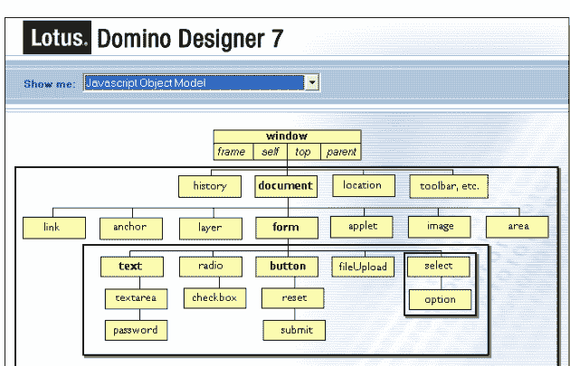

点击任何一个方框将打开关于 "JavaScript 对象模型" 的通用帮助，而不是每个对象的特定帮助。

- 在使用支持 JavaScript 的事件时，程序员面板中的 `Reference` 选项卡会切换显示浏览器和 Notes 客户端支持的各种浏览器对象的方法和属性：

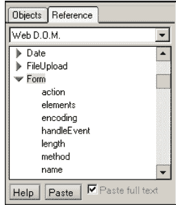

提供此功能是为了让你不必将这些对象记在脑海中。

但与查看 @Function 或 LotusScript 元素时按 F1 不同，Web DOM `Reference` 选项卡后面没有帮助内容。

> **注意：** 你必须自行寻找浏览器对象的帮助资源。关于基于标准的浏览器 DOM 的最佳参考资料可在 [http://www.devguru.com/Technologies/ecmascript/quickref/js_objects.html](http://www.devguru.com/Technologies/ecmascript/quickref/js_objects.html) 找到。Internet Explorer DOM 参考资料可在 [http://msdn.microsoft.com/workshop/author/dhtml/reference/objects.asp](http://msdn.microsoft.com/workshop/author/dhtml/reference/objects.asp) 找到。

## 练习：访问 Field 对象

按照以下步骤创建并调用一个函数，该函数从 Form 上的 Field 读取值，本例中为当前文档的作者（当前用户）：

| 步骤 | 操作 |
| :--- | :--- |
| 1 | 在 `Your Exercises` 数据库中创建一个名为 `Topic8` 的新 Form。 |
| 2 | 创建一个在文档创建时计算的 `Authors` 字段，命名为 `DocAuthor`。<br>[截图显示一个表单字段，标签为 'Author:'，名称为 'DocAuthor'，旁边有一个按钮图标。]<br>添加以下 Value 事件公式：<br>`@UserName` |
| 3 | 将以下代码添加到 `JS Header` 事件：<br><br>```<br>function getAuthor()<br>{<br>    form=document.forms[0];<br>    getField=form.DocAuthor.value;<br>    return getField;<br>}<br>```<br><br>此脚本实例化 `document` 中的第一个 Form 对象，并读取 `DocAuthor` 文本（Field）对象的 `value` 属性。 |
| 4 | 创建一个运行 `getAuthor` 函数的按钮：<br><br>`alert( getAuthor() );` |
| 5 | 保存 Form。 |
| 6 | 由于你正在创建文档，你的名字应该显示在 `alert` 中。但是等等！作者显示为 "Anonymous"。 |
| 7 | 创建第二个按钮，标签为 `Log In`。将以下代码添加到 onClick 事件：<br><br>```<br>var loc=window.location;<br>location.replace('http://' + loc.host + loc.pathname + '?open&login' );<br>```<br><br>这比让用户输入以下 URL 命令更简单：<br><br>`http://server/mydb.nsf/Topic8?openform&login` |
| 8 | 保存 Form。 |
| 9 | 选择 `Design - Preview in Web Browser - Internet Explorer` 或点击工具栏中的  工具。 |
| 10 | 点击 `Login` 按钮。然后点击第一个按钮。<br><br>注意 "Anonymous" 如何变为了你的名字。这是因为你已经向 Server 进行了身份验证，Server 知道了你的身份。 |

# 浏览器对象与Domino对象的交互

不应将浏览器对象模型与Domino对象模型混淆，更重要的是，两者之间没有直接交互；它们存在于不同的世界中。但从某种意义上说，它们通过嵌入HTML文档中的指令相互“通信”，这些指令在浏览器与服务器之间传递。该图展示了两个对象模型的关系如何在HTML Form对象上交汇：

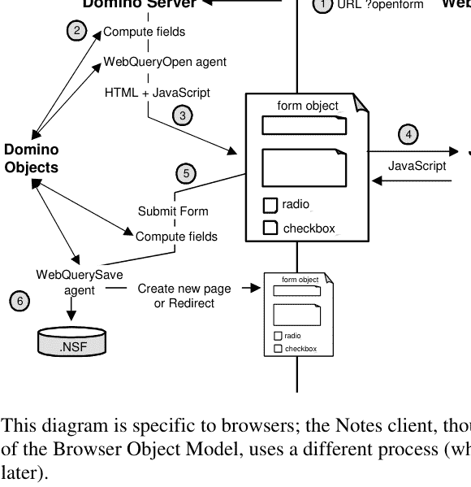

该图专门针对浏览器；虽然Notes客户端支持浏览器对象模型的一个子集，但使用不同的处理流程（稍后将定义）。

下表描述了浏览器中创建和提交文档时“对象模型到对象模型”交互的关键步骤：

| 步骤 | 操作 |
| :--- | :--- |
| 1 | 浏览器向Domino服务器提交一个URL，使用`?openform`命令创建新文档。<br><br>此URL可指定为锚点标签的`href=`属性，或作为Domino服务器在操作热点或按钮中转换`@Command([Compose])`的结果。 |
| 2 | Domino服务器获取表单，并按照自上而下、从左到右的顺序计算已计算字段值事件代码和可编辑字段默认值事件代码。窗口标题代码也会被评估，以及所有隐藏条件公式和已计算子表单（包括那些基于`@ClientType`以区分Notes客户端和浏览器、各种`@BrowserInfo`变体以确定浏览器能力、以及`@UserAccess`/`@UserRoles`以根据用户访问权限确定特定能力的公式）。<br><br>表单计算完成后，服务器运行`WebQueryOpen`事件中指定的代理（使用LotusScript编写以访问Domino对象模型），该代理可以进一步修改字段值或执行复杂的数据库操作或查询外部数据源。请注意，`WebQueryOpen`代理无法创建全新的HTML文档或将浏览器重定向到另一个位置。 |
| 3 | 现在所有表单规范已完成，服务器构建HTML页面，添加必要的`<FORM>`和`<INPUT>`标签来构建最终的HTML表单。<br><br>带有嵌入表单和JavaScript代码的HTML页面被发送到浏览器。 |
| 4 | 页面加载时，任何内联JavaScript都会被评估，并且`JS Header`中的函数已准备就绪可供调用。<br><br>HTML页面和所有图像（如果存在）加载完成后：<br><ul><li>document onLoad事件触发</li><li>`<HEAD>`部分中的`<META HTTP-EQUIV=refresh CONTENT=URL或"秒数">`标签会在指定秒数后强制刷新当前文档或重定向到另一个位置。</li></ul><br>假设用户没有被重定向到其他页面，浏览器对象可供表单上的JavaScript使用。JavaScript可以根据代码要求更改任何字段值（或隐藏字段值）。 |
| 5 | 使用表单时，JavaScript通过各种JavaScript和浏览器对象控制用户交互，例如转换或验证字段。<br><br>用户完成表单后提交表单，这将运行表单的`onSubmit`事件处理程序。否则，完成的表单将使用HTTP Post命令返回给Domino服务器。 |
| 6 | 在服务器端，表单元素与Notes表单合并，值使用字段转换和验证公式重新计算。<br><br>如果使用输入验证公式并产生任何错误，则创建一个新页面并返回给浏览器，显示`@Failure`消息的输出。<br><br>其他错误或条件会导致错误页面（可通过创建`$$ReturnDocumentDeleted`、`$$ReturnAuthenticationFailure`、`$$ReturnAuthorizationFailure`和`$$ReturnGeneralError`表单来自定义）。<br><br>如果没有错误：<br><br>• 一个简单的默认"表单已处理"消息返回给浏览器<br>• 或者，使用用于显示的计算字段`$$Return`中的公式生成自定义响应<br>• 或者，覆盖以上两者，`WebQuerySave`代理中PRINT语句的结果返回给浏览器。<br><br>文档被保存（除非在任何位置将`SaveOptions`设置为"0"），并且使用`$$Return`字段或`WebQuerySave`代理代码，浏览器可以重定向到：<br><br>• 当前文档进行更多编辑，这可以包括由计算字段生成的任何页面上错误消息<br>• 另一个位置，例如视图。<br><br>或者，可以从`WebQuerySave`代理动态生成全新的HTML页面（包括嵌入的JavaScript）并发送到浏览器。<br><br>`WebQuerySave`事件代理可以完全访问文档字段以及所有其他Domino对象。 |

## 示例：表单处理

既然您已经了解了Domino和浏览器对象模型如何交互的技术描述，让我们看一个实际示例：

| 步骤 | 操作 |
| :--- | :--- |
| 1 | 在Domino Designer中打开`FormProcessingForBrowser`表单。 |
| 2 | 有几个字段具有默认值（`EyeColor`）或计算公式（`Subject`）。这些首先被计算。 |
| 3 | 有三个操作按钮使用`@Commands`，这些将转换为浏览器的JavaScript替代代码。 |
| 4 | 点击`FormWebQueryOpen`事件以找到正在运行的此代理：<br>`@Command([ToolsRunMacro]; "WebOpenForm")` |
| 5 | 打开`WebOpenForm`代理设计。它实例化`NotesSession`和`NotesDocument`对象（Domino对象模型）并设置`Topic`字段的默认值：<br><br>```<br>Dim Session As New NotesSession<br>Dim Doc As NotesDocument<br>Set Doc = Session.DocumentContext<br>Doc.Topic="Testing browser processing!"<br>```<br><br>关闭代理设计。 |
| 6 | 点击`JS Header`事件。<br><br>`trimField`函数旨在修剪文本对象（字段）中的多余空格。<br><br>此代码将通过HTML的`<HEAD>`标签发送，字段（如`Subject3`）的事件处理程序代码也是如此，该字段在其`onblur`事件处理程序中调用`trimField`函数。 |
| 7 | 在处理的这一点，HTML文件被下载到浏览器进行渲染和执行（JavaScript）。<br><br>选择`设计 - 在Web浏览器中预览 - Internet Explorer`或单击工具栏中的工具。 |
| 8 | 页面加载时，请注意操作按钮位于顶部。查看页面背后的HTML源代码并搜索"Save"。您会找到调用`_doClick` JavaScript函数的链接，传递执行保存操作（作为`@Command([FileSave]); @Command([FileCloseWindow])`，或在浏览器语言中，提交表单）所需的必要参数。 |
| 9 | 回到页面，请注意`Topic`字段已被`WebQueryOpen`事件代理设置为"Testing browser processing!"。<br><br>`EyeColor`字段默认值在字段设计中设置为"Please Select"。<br><br>`Author`字段也被计算为返回经过身份验证的用户名。<br><br>当然，字段和标签的布局方式类似于您在Domino Designer中看到的。 |
| 10 | 点击`Refresh`操作按钮。请注意，计算的`Subject`字段有一个字段转换公式，只是将`Topic`字段中的值大写。<br><br>此转换是在Domino服务器上完成的，因此页面在服务器上重新组装并发送回浏览器。 |
| 11 | 点击`Subject3`字段然后按Tab键移出。`onBlur`事件中的JavaScript测试空值并通过警告消息提醒您，并将焦点设置在该字段上。<br><br>这都是在客户端运行的JavaScript。<br><br>在`Subject3`字段中输入一个值，在单词之间放置一些额外空格。<br><br>按Tab键移出字段。请注意，`onBlur`事件现在执行转换以删除额外空格。再次，JavaScript在发挥作用。 |
| 12 | 不要在`Subject1`字段中输入任何内容。它有一个输入验证公式。<br><br>点击`Save`。`Subject1`字段的错误消息显示，包括一些用于创建返回链接的HTML。 |

| 步骤 | 操作 |
|------|--------|
| 13 | 在`Subject1`和`Subject3`字段中输入值，并选择一种眼睛颜色。这三个字段是唯一在其后带有某种验证代码的字段（服务器端使用@Function，浏览器端使用JavaScript）。从`WebQuerySave处理类型`字段中选择`Send JavaScript`。 |
| 14 | 单击`保存`。这会调用等效的JavaScript函数（由Domino从操作按钮中的@Commands转换而来）提交表单。表单被打包并上传到服务器。 |
| 15 | 由于您已满足字段输入验证代码要求，服务器现在运行`WebQuerySave`事件中列出的`WebSaveForm`代理。 |
| 16 | 由于您选择了`Send JavaScript`，`WebSaveForm`代理分支到OPTION5情况：<br><br>```<br>Print "<script>alert ('Thanks for submitting the document.');" <br>Print "top.location.href='/" & DB.FilePath & "/AllDocs?openview'" <br>Print "</script>"<br>```<br><br>`WebQuerySave`代理收集Print语句，当代理到达其代码末尾时，将这些行返回给浏览器。在这种情况下，发送的第一件事是JavaScript，具体来说是一个感谢用户的警报。随后是更多的JavaScript，将浏览器的位置对象`href`属性更改为在当前数据库中打开`AllDocs`视图。<br><br>请注意,"DB"是对`NotesDatabase`对象（Domino对象模型）的引用，而"top.location.href"是浏览器对象模型的引用。 |
| 17 | 我们将在后面的主题中回到这个示例，以进一步探讨Domino和浏览器对象模型之间的更多交互。 |

## 浏览器对象到Domino对象的限制

您使用JavaScript开发的所有交互性都限于在HTML页面上交付给浏览器的内容。

这意味着您将信息返回到Domino应用程序的唯一方法是间接的，并且只能通过以下方式传递：

- 提交HTML文档（及其`<FORM>`和输入元素）时的字段值
- URL中`?`命令后的命令行参数，例如打开另一个页面或代理时传递的值；这些参数使用LotusScript读取和解析，以访问CGI变量`Path_Info`或`Query_String`。

## 例外情况

上述声明有两个例外：

- 在本课程的后面，您将看到LiveConnect（一种Netscape技术）如何使JavaScript与页面上的Java Applet进行通信。如果该Applet恰好使用Domino Java类和CORBA（通用对象请求代理体系结构），它可以通过IIOP（互联网Inter-ORB协议）提供对Domino服务器上运行的ORB的实时访问。这意味着JavaScript*可以*访问Domino对象，尽管是通过Java Applet间接且非常缓慢地实现。
- Web服务。我们的`Domino Designer 7：Web代理和Web服务`课程展示了浏览器如何使用基于Domino的Web服务，并在不刷新页面的情况下将值返回到HTML表单。

## 主题9：浏览器事件处理程序

### 要点

浏览器是事件驱动环境，等待用户操作（如打开文档、单击按钮或向字段输入值）来触发代码。

本主题探讨各种浏览器事件以及如何编写事件处理程序，以及几乎同样重要的，各种事件执行的顺序。

### 可能的事件

Domino Designer允许您在这些"事件"中放置代码；当Domino Web服务器生成HTML页面时，它将"事件"代码放入适当的浏览器对象事件处理程序中：

| onFocus | onLoad | onKeyDown | onMouseDown |
| onBlur | onReset | onKeyPress | onMouseUp |
| onChange | onSubmit | onKeyUp | onMouseMove |
| onClick | onUnload | | onMouseOut |
| onDblClick | | | onMouseOver |

作为JavaScript程序员，您的工作是添加必要的代码，以便在浏览器中触发事件处理程序时使某些事情发生。这就是使用户界面具有交互性的方式。

当然，您的工作并不总是那么简单，因为：

- 并非所有事件都支持您可以在HTML页面上定义的所有元素。
- Domino Designer仅支持基本事件集；还有许多其他事件，如`onAbort`、`onDragDrop`、`onError`、`onMove`、`onResize`、`onSelect`、额外的专有事件、DHTML事件以及Internet Explorer数据绑定设施的事件。由于这些事件不受Domino Designer支持，您必须在HTML中手动编码它们，或通过JavaScript以编程方式设置它们（您将在本主题后面看到如何做到这一点）。
- 某些事件是特定对象独有的（例如，`onLoad`、`onReset`、`onSubmit`和`onUnload`仅适用于表单而不适用于页面）。
- 某些事件在不同浏览器（和浏览器版本）中的处理方式不同或被简单忽略。
- 不同对象可能具有相同的事件，例如，如果您为`<BODY>`（容器元素）和`<INPUT>`（被包含元素）都编码了`onClick`事件，当用户单击字段时，应该先执行哪一个？浏览器在执行哪个事件处理程序方面存在差异（是的，您可以控制这一点，但必须实现`captureEvents()`方法，这将带您进入本课程之外的高级主题）。在Internet Explorer的情况下，事件从最低级别元素冒泡到最高级别（例如，单击字段会导致字段`onclick`事件处理程序先运行，然后是`<BODY>`的`onclick`事件处理程序）。
- 某些事件处理程序很少对脚本有用，例如，`onMouseOver`事件可能不适用于`<BODY>`元素，因为它将始终触发。

就Domino Designer而言，它：

- 通常善于显示特定元素的适当事件处理程序。
- 不太善于指示哪些事件很少编码或仅在某些浏览器中工作；所有可能的事件处理程序都被平等地呈现，就好像编码所有事件是有意义的一样。

### 事件处理程序基础

Domino将您为各种事件编写的脚本填充到各种HTML元素的适当事件属性中，如`<BODY>`、`<FORM>`和`<INPUT>`。

当元素加载时，浏览器为各种对象注册事件处理程序，例如，`<BODY>`元素的`onLoad`事件代码在页面完成加载时触发：

```


```html
<BODY TEXT="000000" BGCOLOR="FFFFFF" onload="window.status='Please enter a Subject'; focusSubject()">
```

事件处理程序名称被添加到 HTML 元素。例如，触发 `<BODY>` 元素的 `onload` 事件处理程序的是页面的加载。此事件可用于生成其他窗口、将一个或多个 URL 加载到框架中，或向用户提示某些条件。

其他事件处理程序更具用户交互性，例如这个**保存**按钮：

```html
<input type=button value="Save" onclick="confirmSave()">
```

当事件发生时，浏览器执行事件处理程序中指定的脚本。

> **注意：** 您可能已经注意到，在 Domino Designer 中，事件使用 JavaScript 变量约定进行大写（首字母小写，单词首字母大写），例如 `onClick` 或 `onBlur`。然而，当发送到浏览器时，Domino 将事件处理程序名称转换为全部小写，例如 `onclick` 或 `onblur`。在以编程方式定义事件处理程序时，您也应该使用全部小写，如上所示。

> **提示：** 最佳实践是将实际代码定义在 `JS Header` 事件中定义的函数中（出现在 HTML 的 `<HEAD>` 部分），然后在实际事件处理程序中仅指定函数名称。

然而，本课程中显示的大多数事件处理程序代码并不遵循这种做法，以便您能够直接看到代码，而不必在 `JS Header` 事件中挖掘以找到被调用的函数。

### 常用编码事件

下表描述了更常用的表单和字段（在 Domino Designer 中定义为字段，但在 HTML 输出中转换为 `<INPUT>` 标签）事件处理程序：

| 事件 | 事件处理程序 |
| :--- | :--- |
| `onLoad`<br>`onUnload` | `<BODY>` 标签的事件处理程序。<br><br>`onLoad` 事件在页面或 `<FRAMESET>` 标签内的所有框架完全加载完成时运行。此事件处理程序可用于设置字段默认值。另一个用途是将焦点设置到某个字段，以便用户可以立即开始输入而不必单击/按 Tab 键到字段，例如，到 `Price` 字段：<br><br>`document.forms[0].Price.focus()`<br><br>`onUnload` 事件在用户刷新或使用任何机制离开页面时运行。它在表单提交之后运行，因此不能用于在保存之前更改字段值（请使用手动编码的 `onSubmit` 事件代替）。`onUnload` 事件的一些用途可能是将用户重定向到另一个位置、如果您使用登录过程则注销用户，或运行 CGI 脚本。 |
| `onSubmit`<br>`onReset` | `FORM` 标签的事件处理程序。<br><br>`onsubmit` 事件处理程序在用户提交表单时执行 JavaScript 代码。它在表单发送到 Domino Server 保存之前运行。类似于 LotusScript 中 `NotesUIDocument` 对象的 `QuerySave` 事件。<br><br>`onreset` 事件处理程序在用户单击 **Reset** 按钮（假定提供了该按钮）时运行，之后所有字段内容都会被删除。 |
| `onFocus` | 由可编辑字段创建的 `INPUT` 标签的事件处理程序。<br><br>`onFocus` 事件中的代码在用户单击字段或使用 Tab 键进入字段时，字段获得输入焦点后运行。类似于 LotusScript 中字段对象的 `Entering` 事件。<br><br>通常用于设置状态栏，以提供字段级帮助（这是一个窗口属性），例如：<br><br>`window.status="Enter a subject"`<br><br>`onFocus` 也会在框架获得焦点时触发。 |
| `onClick` | `INPUT` 或 `A` 标签的事件处理程序。通常在创建热点链接、按钮或图像并选择 JavaScript 语言选项时使用。<br><br>`onClick` 事件中的代码会在链接、按钮或图像被单击时执行。 |
| `onChange`<br>`onBlur` | `INPUT` 标签的事件处理程序。<br><br>`onChange` 事件中的代码会在字段失去焦点且其值已修改时执行。<br><br>“to focus”的反义词是“to blur”。应用到字段时，进入字段会获得焦点，离开字段则相反，即失去焦点。`onBlur` 事件会在字段失去焦点时运行，无论字段是否发生变化。<br><br>`onBlur` 也会在焦点离开框架时触发。 |

### 演练：探究事件处理程序

在本演练中，您将了解事件处理程序在浏览器中如何以及何时运行，然后切换到 Domino Designer 以了解这些处理程序为何如此运行。

按照以下步骤查看表单的 `onload` 事件和字段的 `onblur` 事件处理程序在触发时如何调用 JavaScript 函数：

| Step | Action |
| :--- | :--- |
| 1 | 在 Domino Designer 中打开 *DDJS7 Demo* 数据库中的 `FormEventTrigger` 表单。 |
| 2 | 选择 **Design - Preview in Web Browser - Internet Explorer**，或点击工具栏中的  工具。 |
| 3 | 首先运行的 JavaScript 根本不是事件处理程序！<br><br><br><br>任何内联 `<SCRIPT>` 标签会首先执行。切换到 Domino Designer 以查找生成该警告的嵌入式代码：<br><br>`<script language="JavaScript">alert("alert from some inline code")</script>`<br><br>切换回浏览器并点击 **OK**。 |
| 4 | 现在表单 HTML 已完成渲染，表单的 `onLoad` 事件触发：<br><br><br><br>切换到 Domino Designer 并打开表单的 `onLoad` 事件。该事件的第一行代码生成了该警告。<br><br>切换回浏览器并点击 **OK**。 |
| 5 | 注意第一个字段。它的值由 `WebQueryOpen` 事件代理设置为“Set by WebQueryOpen event Agent”。<br><br>注意第二个字段。它的值由表单的 `onLoad` 事件通过以下代码设置：<br><br>`form=document.forms[0];`<br>`form.onLoadEvent.value='onLoad event ran';` |
| 6 | 注意光标所在的位置。它在 *Topic* 字段中。<br><br>`onLoad` 事件中的以下代码将焦点设置在 `onLoadEvent` 字段：<br><br>`form.Topic.focus();`<br><br>这样用户无需在表单上点击任何位置即可开始工作。 |
| 7 | 在 *Topic* 字段中输入一些文本。<br><br>按一次 Tab 键切换到 *Article* 字段。<br><br>注意 *Topic* 字段中的文本已转换为大写。当您离开该字段时，`onblur` 事件处理程序运行以下代码：<br><br>`this.value=this.value.toUpperCase();`<br><br>使用 `this` 是一个特殊关键字，是对当前对象的引用，可在事件处理程序中使用。如果不使用 `this`，您可以这样编写事件处理程序：<br><br>`TopicField=document.forms[0].Topic;`<br>`TopicField.value = TopicField.value.toUpperCase();` |
| 8 | 点击回到 *Topic* 字段。<br><br>注意 EVENT LOG 记录了 *Topic* 字段的 `onClick` 事件，然后将该事件冒泡到 `<body>` 的 `onClick` 事件，以便您也可以在该事件级别捕获它。<br><br>*Topic* 字段的 `onClick` 事件包含以下代码：<br><br>`logEvent("Topic field onClick event fired");`<br><br>这会调用 *JS Header* 事件中的 `logEvent()` 函数，该函数会在日志事件字段前面添加值。 |
| 9 | 注意 *Subject Field* 有一个默认值或“提示”文本。这实际上是在 *Default Value* 事件中设置的。<br><br>点击或使用 Tab 键进入该字段。注意文本消失了。这是由于 `onFocus` 事件代码：<br><br>`var defaultSubjectValue="Enter a value";`<br>`if (this.value==defaultSubjectValue){`<br>`  this.value="";`<br>`}`<br><br>这种技术通常用于让用户了解应在字段中输入什么内容。<br><br>点击离开该字段。如果留空，提示文本会恢复。这得益于 `onBlur` 事件中的代码。 |
| 10 | 点击回到 *Subject Field*。输入几个字母。注意在输入时，您的字母会变成大写。这是 `onkeypress` 事件处理程序的作用，它包含以下代码：<br><br>`ucaseKeyPress(this);`<br><br>该函数在 *JS Header* 事件中定义：<br><br>`function ucaseKeyPress(obj) {`<br>`  fieldVal = new String(obj.value);`<br>`  obj.value = fieldVal.toUpperCase();`<br>`}`<br><br>请记住，`onKeyPress` 事件在字段中每次按键时触发；因此该函数每次也会被求值。所以与将相同代码应用于 `onBlur` 事件并一次性执行不同，它会在每次按键后被求值。<br><br>请注意，这本身并不是为了演示如何捕获按键。您很快就会看到相关内容。这仅仅是演示 `onKeyPress` 事件何时触发。 |

### Capture key presses

实现按键捕获需要了解两点：

- 不同浏览器对按键返回的值不同。要从 Netscape 读取按键，需要使用事件对象的 `which` 属性，而 Internet Explorer 返回的是键码。无论哪种情况，都使用字符串对象的 `fromCharCode()` 函数将值转换为字符。
- 了解 `event` 对象类型。这个预先实例化的对象在事件发生时提供有关事件的信息（事件类型、图层 X-Y-Z 位置、光标 X-Y 坐标等）。这也是使用 DHTML 进行复杂拖放操作的基础。

#### 示例 1：捕获按键

例如，*Office* 字段演示了捕获用户按键并做出相应响应的能力。在该字段中输入时，键码会被转换为 ASCII 字符并显示在事件日志中。虽然这本身没有意义，但在第二个示例中您将看到这种能力的应用。

`onkeypress` 事件处理程序包含以下代码：

```javascript
showKey(event);
```

在 *Office* 字段中每次按键时，事件处理程序都会运行 `showKey` 函数，并将事件对象传递给它。

*JS Header* 事件定义了该函数：

```javascript
function showKey(getEvent)
{
  if (navigator.appName=='Netscape')
  {
    var getKey=getEvent.which;
  }
  else
  {
    var getKey=window.event.keyCode;
  }

  var getKeyText=String.fromCharCode(getKey)
  window.status=getKey;
  logEvent(getKeyText + " (" + getKey + ') key pressed in the Office field.');
  return false;
}
```

第一部分检测 `navigator` 对象的浏览器类型（您将在后续主题中了解更多关于此对象的内容）：

- 如果是 Netscape，事件对象的 `which` 属性返回一个数字，表示鼠标按钮（1=左键，2=中键，3=右键）或事件触发时按下的键的 ASCII 值。
- 否则（假定是 Internet Explorer），特殊属性 `window.event` 包含最后发生的事件，`keyCode` 属性在事件触发时返回用户按下的键。

然后将按键代码转换为字符并输出到事件日志。

#### 示例 2：捕获 Esc 和双击

第二个示例具有更实际的应用，主要是提供超越“点击按钮”范式的“类 Notes”用户导航。

在 `FormEventTrigger` 表单中操作时：

- 点击任何字段或按钮外部并按 **Esc**。
- 在任何字段或按钮外部双击。

发生了什么？`<BODY>` 的 `onKeyPress` 和 `onDblClick` 事件包含监视按键 27（**Esc**）和鼠标双击的代码。

> **Note:** 您将在后续主题中了解如何将这些事件处理程序绑定到提示用户编辑文档（双击）和保存当前文档（**Esc**）的函数中，以模拟这两个 Notes 快捷键。

### Event handler registration

事件处理程序有两种注册（链接）到其对应对象的方式：

- 到目前为止，您一直使用 Domino Designer 支持的“内联”事件注册方式编写事件处理程序。代码作为 HTML 元素的属性输出。

  ```html
  <input type=button value="Save" onclick="confirmSave(arg1, arg2)">
  ```

  这种注册事件处理程序的方式在大多数情况下都能很好地工作，并允许您向函数传递参数。这种方式的唯一缺点是它不够灵活，因为事件处理程序是预先编码的。而且即使 Domino Designer 使用这种方法，它也没有列出所有可能存在的事件，因此如果你偏离了 IDE 呈现的基本事件模型，就必须手动编写自己的事件处理程序。

### 程序化事件处理程序

- 你可以将字段事件处理程序放在 `JSHeader` 事件中（或在链接的 `.js` 文件中），而不是“内联”方式，方法是将事件名称添加到字段名称并用下划线分隔，例如：

  ```javascript
  function Subject_OnBlur(fieldObj)
  {
    fieldObj.value = fullTrim(fieldObj.value);
  }
  ```

  变量 `fieldObj` 被传递给函数，代表字段对象。函数 `fullTrim()` 是一个自定义函数，你将在第 11 个主题中了解它。

- “运行时”过程是指事件处理程序动态注册，而不是预先编码为 HTML 元素属性。这种事件注册过程随着 4+ 版本浏览器的出现而出现（DHTML 需要），它开辟了一种全新的方式，仅使用 JavaScript 来动态创建、重置和清除事件处理程序。

- 这种注册事件处理程序方式的局限性在于，你无法向事件处理程序运行的函数传递参数。如果你尝试这样做，会发现函数在表单加载时运行，而不是在事件触发时运行。

让我们看一个非常简单的例子。查看 Domino Designer 中的 *Name* 字段。没有定义事件处理程序。但当在浏览器中测试表单时，当你点击该字段时，似乎有一个 `onClick` 事件被定义了！注意 alert 中的消息。

如果你查看表单的 *onLoad* 事件，会发现它调用了一个名为 `initObjectEventHandlers()` 的函数。这个神秘的函数定义在 *JS Header* 事件中：

```javascript
function initObjectEventHandlers()
{
  document.forms[0].Name.onclick=NameonClickBasic;
}
```


这个函数以编程方式为`Name`字段注册`onclick`事件处理程序，使其运行`NameonClickBasic`函数（再次注意，以编程方式注册事件处理程序时不允许传递参数）。

如你所料，`JS Header`事件也定义了`NameonClickBasic`函数。

为了让事情更有趣，在浏览器中点击**Clear onClick event**按钮，然后再次点击`Name`字段。现在没有事件处理程序了。该按钮通过将其设置为`null`来清除`onclick`事件处理程序：

```javascript
document.forms[0].Name.onclick = null;
```

最后，点击浏览器中的**Verbose onClick event handler**按钮，然后点击`Name`字段。事件处理程序已被设置为运行`NameonClickVerbose`函数。

你所看到的是能够在元素 HTML 中预先编码事件处理程序的情况下，**以编程方式**定义事件处理程序的能力。

### `"this"`关键字

还记得学习如何从最顶层的容器对象向下遍历浏览器对象层次结构到元素对象（如字段）吗？嗯，也可以从底部向上编码。

使用`this`的一个巧妙方法是向上遍历 DOM 层次结构。例如，按钮的`onclick`事件处理程序包含以下代码：

```javascript
alert("Subject: " + this.form.Subject.value);
```

`this`指的是按钮对象本身，而`form`是按钮的容器；`Subject`是表单上的一个字段。因此，与其从顶部开始向下（`window.document.forms[0].Subject.value`），这个例子从当前对象开始，向上遍历，然后再向下访问表单上的另一个元素。

`this`关键字的另一个用途是将当前对象引用（通常是字段）作为参数传递给在`JS Header`事件中定义的函数。例如，假设在`JS Header`事件中定义了以下函数：

```javascript
function upCase(FieldObj) {
    getValue = FieldObj.value;
    FieldObj.value = getValue.toUpperCase();
}
```

然后`Article`字段的`onblur`事件处理程序将调用该函数，传递当前字段对象：

```html
<input name="Article" value="" onblur="upCase(document.forms[0].Name)">
```

然而，更好的方法是使用`this`关键字，例如：

```html
<input name="Article" value="" onblur="upCase(this)">
```

`this`关键字是对当前代码正在运行的元素的对象引用。由于此脚本运行在`Article`字段的事件处理程序中，`this`返回对`Article`字段对象的引用。你必须将对象引用变量传递给任何你调用的函数；它不会自动知道`this`所代表的上下文或对象。

`this`关键字的优势在于，你可以对多个元素重用该函数，而对象引用对于该元素始终是正确的。

> **注意：** 如果在元素事件处理程序的上下文之外使用，`this`关键字指向`window`对象。

> **提示：** 顺便说一下，大多数元素对象都有一个`form`属性。因此，你可以传递对象引用，而不是只传递一个元素给函数。例如，要从元素事件处理程序传递对容器`<FORM>`的引用给函数：
>
> `correctForm(this.form);`
>
> 然后函数将负责识别要操作的各种元素。要查看此操作，请点击*DDJS7 Demo*数据库中`FormEventTrigger`表单的**Uppercase All Elements**按钮。

### 对象事件的默认操作

当你在 Domino Designer 中创建热点链接时，步骤是选择要用于链接的文本或图形，然后创建链接：

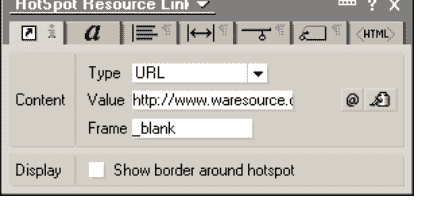

Domino 将这些信息转换为浏览器的锚点标签：

```html
<a href="http://www.waresource.com" target="_blank">Visit our Web Site</a>
```

然而，Domino Designer 不会显示由锚点标签创建的链接对象的事件。只能定义`href`和`target`属性。如果你想为链接对象事件处理程序编码（更常见的是`onclick`、`onmouseover`和`onmouseout`），你需要自己手写锚点标签（使用透传 HTML）。

操作按钮和操作热点则不同。它们的`href`属性设置为空字符串，但 Domino Designer 允许你编码事件，最常见的是`onClick`事件处理程序，例如：

```html
<a onclick="alert('hello world');return false;" href="">Hello</a>
```

Domino 为你添加`return false`作为事件处理程序中的最后一条语句，以阻止对象打开`href`属性中的 URL（在这种情况下，空 URL 会在浏览器中导致错误）。

拥有空 URL 但拥有`onClick`事件是如何工作的呢？

每个对象都有一个默认操作，对于链接对象来说，就是打开`href`属性中的 URL。但当用户点击链接时，规则是`onClick`事件处理程序先运行，然后默认操作才运行。但如果`onClick`事件将当前位置对象的`href`属性更改为另一个 URL，然后浏览器打开链接对象`href`属性中的 URL，这就会成为一个问题。用户会看到一个 URL 打开，然后另一个打开。这不好。

为了防止这种情况发生，添加`return false`会阻止默认操作的执行，对于链接对象来说，就是阻止打开`href`属性中的 URL。

省略返回值或添加`return true`将允许默认操作运行，但会在`onClick`事件执行之后。在某些情况下这是可取的，在这种情况下，你需要再次使用透传 HTML 手写自己的锚点标签。

当然，你可以通过编程方式确定返回值，甚至提示用户输入值：

```javascript
return confirm("Do you want to continue?");
```

> **注意：** 某些对象的默认操作无法被阻止。例如，`<BODY>`元素中的`onunload`事件处理程序无法被阻止，但`<FORM>`元素中的`onsubmit`事件处理程序可以。稍后讨论表单验证时，你将使用这些事件。

### 编写`javascript:`伪协议代码

除了为链接对象（在 HTML 中使用锚点标签`<a>`创建）编写`onclick`事件处理器外，你还可以为`href`属性使用伪 URL 协议`javascript:`来运行简单的脚本。

> **注意：** 普遍认为在文本链接中使用`javascript:`不是一个好主意，因为它们执行的行为与用户预期不同。即使在显示图像的链接（如按钮）中使用，也存在问题。请参阅[http://www.evolv.org/Article/links_and_JavaScript_Living_Together_in_Harmony/17/20938/](http://www.evolv.org/Article/links_and_JavaScript_Living_Together_in_Harmony/17/20938/)，了解为什么你不应该使用`javascript:`的原因。

好吧，你别无选择，只能在链接中使用`javascript:`。让我们继续！

例如，`DDIJS7 Demo`数据库中的`LinkObject`表单就以这个链接开头：

```html
<a href="javascript:alert('hello world')">Hello, World</a>
```

关于这段代码，有几点需要注意：

- 与其将`href`属性设置为一个 URL，不如将协议设置为`javascript:`，后面跟着脚本。
- 双引号和单引号交替使用；因为整个“URL”必须放在引号中，所以内部的引号必须使用单引号。
- 如果脚本返回一个值，它将被传递给浏览器，浏览器会将其显示在新页面上；这很可能**不是**你想要的结果，所以确保脚本不返回任何值。
- 代码应该在 HTML 中写成连续的一行，以避免将`\n`引入到你的代码中。

注意，当用户鼠标悬停在该链接上时，这个链接还会在状态栏中显示一个“用户友好”的 URL：

```html
<a href="javascript:alert('hello world')" onMouseOver="window.status='Say hello, would you?';return true" onMouseOut="window.status='';return true">Hello, World with one statement but friendly status bar</a>
```

如果你有多个语句，只需用分号分隔它们，例如：

```html
<a href="javascript:var msg='hello world'; alert(msg)">Hello, World with multiple statements</a>
```

要使用`onclick`事件处理器，而不是将链接对象的`href`属性设置为`javascript:`协议，你可以在`href`属性中使用`void`语句，以确保没有值返回给浏览器：

```html
<a href="javascript:void(0)" onClick="alert('hello, world')"
onMouseOver="window.status='Say hello, would you?';return true"
onMouseOut="window.status='';return true">Hello, World with multiple statements
and onMouseOver/onMouseOut (hides URL from status bar)</a>
```

`void`运算符的计算结果为`0`，但链接事件调用内置 JavaScript 或在`JS Header`中定义的自定义函数。

因为 JavaScript 语句包含在事件处理器代码中（而不是调用函数），所以你必须包含第二个语句`return true`。

另一种写法是：

```html
<a href="javascript:void(document.form.submit())">Submit</a>
```

该链接在传统的 URL 跳转意义上“无处可去”，但 JavaScript 表达式会被求值，在本例中，执行表单的`submit`方法。

将链接对象的`href`属性设置为使用`javascript:`协议存在几个问题：

- 没有地方可以为不同的浏览器、不支持`javascript:`协议的浏览器，或浏览器未启用 JavaScript 的用户编写分支代码。
- 脚本应尽可能简短，因为长 URL 可能会在某些浏览器中产生错误（保持代码简短的一种方法是让脚本调用你在`JS Header`中定义的函数）。
- 你总是需要一个`return`。
- 如果你不同时编写`onMouseOver`和`onMouseOut`事件，用户可能会在状态栏中看到 JavaScript 代码显示时感到困惑。
- 某些浏览器不支持`javascript:`协议，但你可以通过添加一个“回退”`href` URL 来优雅地解决这个问题，例如：

```html
<a onClick="someFunction('data');return false"
href="nojavascriptfallbackpage.html">
Some Function</a>
```

### 在公式中编写`javascript:`

尽管这样做并没有什么好处，但你可以从运行公式的按钮中调用`javascript:`伪协议，例如，在`Link Object`表单的**Call javascript: from Formula button**中可以看到：

```formula
@URLOpen("javascript:alert(\"Hello, \" + document.forms[0].Username.value + \".\")")
```

使用`@URLOpen`有两个问题：

- 调用的上下文是在 JavaScript/浏览器世界中，所以你不能在公式中使用任何其他`@Functions`。这就是为什么`alert`使用来自 Field 的值，而不是直接计算`@Username`本身。
- 保持转义引号的正确性既耗时又容易出错。在这种情况下，使用花括号作为特殊文本分隔符（针对代码的 Function Language 方面）不那么令人困惑：

```formula
@URLOpen({javascript:alert("Hello, " + document.forms[0].Username.value + ".")})
```

## 主题 10：字段访问

### 要点

HTML 仅支持少数几种“字段”类型：

| 类型 | HTML 标签 | 描述 |
| :--- | :--- | :--- |
| 文本 | `<input>` | |
| 文本区域 | `<textarea>` | 由不使用 Java 小程序的富文本字段生成。 |
| 选择列表 | `<select>` | 由*对话框列表、组合框或列表框*字段生成的单选或多选。 |
| 单选按钮 | `<input type="radio">` | |
| 复选框 | `<input type="checkbox">` | |
| 密码 | `<input type="password">` | 用点或星号隐藏输入内容的文本字段。 |
| 隐藏 | `<input type="hidden">` | 包含用户不输入的数据的不可见元素。如果在设置隐藏条件时使用（来自浏览器和/或使用公式）且表单属性**为所有字段生成 HTML**，JavaScript 可以访问该数据。 |

本主题展示如何以编程方式读取用户在这些类型的字段中输入或选择的值。

你还将看到如何读取富文本 Java 小程序或 ActiveX 对象的内容。

> **注意：** 我们试图区分你在 Domino Designer 中添加到表单的“Field”和 HTML 中存在的“field”，但可能并未完全成功！

> **注意：** 本主题中的所有示例均来自*DDJS7 Demo*数据库中的*FieldValues*表单。

### HTML 字段数据类型

所有字段，无论在 Domino Designer 中如何定义，当 JavaScript 读取它们时都是字符串。

尽管 JavaScript 会在一定程度上执行自动数据类型转换，但你可以：

- 使用内置函数（如`parseInt()`）将文本转换。
- 在创建数字或日期等新对象类型时传递文本参数。

### 文本字段访问

文本对象`value`属性用于读取和写入特定`<FORM>`元素中可编辑文本字段的值。访问对象时，如果需要重用对象用于其他目的，可以拆分对象引用：

```javascript
getForm = document.forms[0];
getField = getForm.Subject;
getValue = getField.value;
```

你可以将对象引用链接在一起，例如：

```javascript
getValue = document.forms[0].Subject.value;
```

无论你如何获取字段对象的句柄，都必须从浏览器对象模型层次结构中的容器对象开始，向下逐级访问到元素对象。

在`Subject`字段中输入一个值，然后点击**Read**按钮，该按钮包含以下代码：

```javascript
alert(document.forms[0].Subject.value);
```

###`with`语句

如果你在一个表单中处理多个字段，可以使用`with`语句来简化编码，并减少发送给浏览器进行求值的 HTML 数量。

在`Subject`和`Subject2`字段中输入值，然后点击**Read**（w/with）按钮，该按钮包含以下代码：

```javascript
with (document.forms[0]) {
    alert(Subject.value + "\n" + Subject2.value);
}
```

`with`语句中引用的所有对象都被视为以参数中指定的对象为前缀。字段对象`Subject`和`Subject2`被假定为`document.forms[0]`对象中的字段实例。

如果你正在设置多个属性或运行多个方法，可以将`with`语句向下推进到层次结构的另一个级别。例如：

```javascript
with (document.forms[0].Subject2) {
    alert("Value: " + value + "\nType: " + type + "\nLength: " + value.length);
}
```


> **注意：** 虽然你可以在`with`语句中进行明确的对象引用，这些引用是其他对象的实例，但应避免这样做，因为可能会造成混淆。

### JavaScript 访问编辑模式下的计算/隐藏字段

计算字段、显示计算字段和组合计算字段在传输到浏览器时仅显示为 HTML 文本。由于它们只是 HTML 而不是定义为`<INPUT>`字段，JavaScript 无法访问这些字段的值。

但是，如果你需要读取或写入这些字段，有两种方法可以使字段可供 JavaScript 访问：

- **为所有字段生成 HTML** 表单属性：

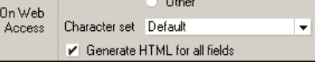

此表单属性的结果是，对于所有计算字段，Domino 服务器显示：
- HTML 文本
- 并添加一个并行的`<INPUT>`标签，类型设置为 "Hidden"，`VALUE=`属性设置为字段的值。

因此，字段值可供 JavaScript 进行读/写操作。如果存在输入翻译/验证或计算公式，它将在表单提交后使用你用 JavaScript 设置的值运行。

> **注意：** 当你设置此表单属性时，Domino 不仅为计算字段创建并行的隐藏`<INPUT>`标签，还为所有隐藏字段创建它们。这意味着用户可以查看 HTML 源代码并看到隐藏的字段数据。

- **创建你自己的并行隐藏字段。** 第二个选项是只 "公开" 你需要使用 JavaScript 访问的字段，从而保护其他计算和隐藏字段免受好奇用户的窥探。

使用文本属性 **Pass-Thru HTML**，将 HTML（通常是）添加到表单底部：

```html
<INPUT NAME="echoUserName" TYPE=hidden VALUE="$echoUserName">
```

然后，为`VALUE`属性插入一个显示计算的 Notes 字段，使用真实的计算字段名称作为公式。不要在字段属性中隐藏该字段，因为`TYPE="hidden"`参数负责隐藏该字段。

## `<INPUT>`标签和字段

当你在 Domino Designer 中向表单添加文本字段时，由 Domino 负责将其转换为正确的 HTML (`<INPUT>`)，并且当页面提交回 Domino 时，服务器负责获取`value=`属性并将其驱动回与`<INPUT>`标签同名的字段（使用`name=`属性）。

一般来说，这运行得非常好，你不需要在 HTML 中编写自己的输入标签。

如果你出于某种原因必须手动将`<INPUT>`标签添加到表单作为直通 HTML，你还必须添加一个同名的字段，以便输入到`<INPUT>`标签中的值将保存到文档中。

如果你无法避免需要自己编写`<INPUT>`标签，你必须在表单的其他位置创建 "影子" 字段，例如：

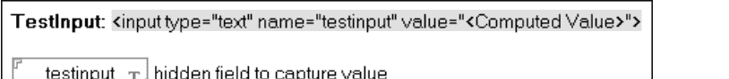

字段`testinput`被添加并隐藏于 Web 浏览器。此示例还显示了在`value=`属性中添加计算文本（公式是字段名称 "testinput"），以便用户在编辑文档时看到字段的值。

### JavaScript 访问读取模式下的计算/隐藏字段

刚刚建议不要在 HTML 中编写自己的输入标签，但有一种情况你需要这样做：如果用户需要在页面或文档的读取模式下输入数据（例如收集搜索词）。

为了实现这一点，你必须通过向表单或页面添加自己的`<FORM>`和`<INPUT>`标签来手动创建一个 "字段"（确保设置文本属性 **Pass-Thru HTML**），例如：

```html
<FORM>
<INPUT NAME="SearchString" VALUE="" LENGTH=30>
</FORM>
```

即使在读取模式下打开的页面或文档无法保存为文档，你这样做是为了将输入值用于其他目的，主要是作为页面上 JavaScript 例程的输入。这些例程可以将值用于多种目的，包括将其传递给`location`对象的`href`属性以向 Domino 发送命令（例如打开另一个设计元素或运行 Domino 代理）。你将在练习中使用此技术将用户提供的搜索查询传递给页面以进行搜索。

### 将多值字段解析为数组

HTML 中没有与 Notes 多值字段等效的输入元素。对于 JavaScript，多值字段只是一个带有分隔符的字符串，必须进行解析才能理解。

例如，`MVField`字段被定义为多值字段，使用逗号分隔值：

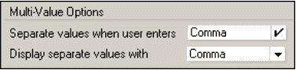

要从多值字段解析值，`JS Header`事件包含`parse1()`函数：

```javascript
function parse1(FieldObj, d){
  var getField = FieldObj.value;
  var MVArray = getField.split(d);
  for (var i=0; i < MVArray.length; i++){
   alert (MVArray[i])
  }
  alert ( 'To string: ' + MVArray.toString())
}
```

该函数：
- 接收字段对象引用和用作分割分隔符的字符。
- 使用`split`方法创建`MVArray`。
- 使用简单的`for`结构循环遍历元素并在警报对话框中显示每个值（仅用于演示目的）。

例如，**解析多值字段**按钮调用该函数并传递文本对象和分隔符：

```javascript
parse1(document.forms[0].MVField, ',');
```

## `<SELECT>`字段访问

你不能使用`value`属性来读取或设置对话框列表或*组合框*字段的值。Domino 使用 HTML`<SELECT>`标签将对话框列表字段转换为弹出菜单（单值）或滚动列表（多值）。

用户可以选择的选项以值数组的形式表示。

对于**单选**选项，`selectedIndex`属性决定哪个选项被选中，从`"0"`元素开始。例如，`State`字段的选择由相应**Read**按钮中的代码读取：

```javascript
with (document.forms[0]) {
  var get1Choice = State.selectedIndex;
  alert("State choice: " + get1Choice + "/" + State.options[get1Choice].text);
}
```

`options`属性确定所选元素的序列号，而`text`属性返回该元素的文本值。

如果用户未做选择，则返回`[0]`元素，因此最好将其设为非选项，例如 "Select Option"。

对于**多选**选项（列表框），`selected`属性更合适，因为`selectedIndex`属性只返回第一个选择。如果未选择任何选项，则返回 "-1"。要确定哪些选项被选中（可以通过先按**Shift**或**Ctrl**键选择多个选项），你必须循环遍历选项列表并检查每个选项的`selected`属性是否为`true`。例如，`Regions`字段中的选项使用**Read w/Loop**按钮中的此代码检查值：

```javascript
with (document.forms[0]) {
  for (var i = 0; i < Region.options.length; i++) {
    if (Region.options[i].selected) { alert(Region.options[i].text) }
  }
}
```

每个选定的选项都会出现一个显示所选选项的警报。

如果你只想知道选项是否被选中，请省略`text`属性，例如：

```javascript
for (var i = 0; i < Region.options.length; i++) {
  alert (Region.options[i].selected)
}
```

每个选项都会出现一个警报，如果选中则为`true`，如果未选中则为`false`。

另一个例子，`Single and Text`字段的选择运行`onchange`事件处理程序，其中包含以下代码：

```javascript
var GetVal = form.PickRegion.options[form.PickRegion.selectedIndex].text;
if (GetVal != 'Pick Region') {
    form.RegionText.value = GetVal;
}
else {
    form.RegionText.value = "";
}
```

当用户从列表中选择一个值时，该值被驱动到`RegionText`字段。你稍后将使用此技术创建 URL 跳转列表。

#### 选择选项

要以编程方式选择现有选项，请指定索引并将其设置为`true`，例如：

```javascript
var i = 4;
document.forms[0].State[i].selected = true;
```

当然，假设你事先知道索引值。

要选择或取消选择所有选项，只需使用`for`语句循环遍历所有可能的值，在每次循环中将`[i]`的值设置为`true`或`false`。

#### 向选择列表添加新选项

与 Notes UI 不同（用户可以向对话框列表或组合框添加新值（如果设置了 **Allow new values not in list** 字段属性）），浏览器没有这样的 UI。你必须添加自己的设施。

要查看此工作原理，请单击 **Add new town** 选择框中的 **other** 选项。你将被提示输入一个新值，该值将被添加到选择列表中。

将字段设置为对话框列表，允许多个值，并允许不在列表中的值。无论选择列表如何，最后两个条目必须是：
- **Other**
- **None**

将此代码放入`onChange`事件：

```javascript
addNewOption(this);
```

然后将此函数添加到`JS Header`事件中：

```javascript
function addNewOption(obj)
{
  var j = obj.length-2;    //change to -1 if last choice is "Other" and not "None"
  var newother = "";
  var aname = navigator.appName;
  var aversion = navigator.appVersion;
  var oldtext = obj.options[j].text;
  var oldtext1 = obj.options[j+1].text;
  if (((aname.indexOf("Microsoft")!=-1 || aname.indexOf("Internet Explorer")!=-1) &&
aversion.indexOf("4.")!=-1) || aname.indexOf("Netscape")!=-1)
  {
    if (obj.options[j].selected)
    {
      newother = prompt ("Please specify '" + oldtext + "':", oldtext );
      if (newother!=null && newother!=oldtext)
      {
        obj.options[j].text=newother;
        obj.length=obj.length+1;
        obj.options[obj.length-2].text=oldtext;
        obj.options[obj.length-1].text=oldtext1;
      }
    }
  }
  return 1;
}
```

这是如何工作的？当用户通过选择来更改字段的值时，`onchange`事件处理程序就会运行。如果用户选择了"Other"，则会提示用户输入一个新值，以添加到选择列表的选项中。

### 移除选项

要从选择列表中移除一个选项，将其设置为`null`，例如：

```javascript
obj.options[i] = null;
```

仅就这一条语句而言，并不那么令人兴奋，但应用于菜单列表时，你就能看到它的用途：

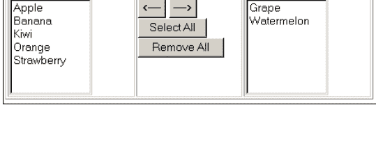

这组选择和按钮背后的思路是：将一个或多个选中的选项在两个选择列表之间移动。两个操作分别是：在一侧创建一个新选项，然后从另一侧将其移除。

当你查看`JS Header`事件中的`addOption()`函数时，唯一棘手的部分是从选择列表中移除选项时——你必须按 reverse 顺序执行，否则选中的选项索引值将不正确。

为了趣味性，目标列表会通过将选项放入一个对象数组（每个对象由选项文本、值、`defaultSelected`和`selected`属性组成）来进行排序，然后使用数组对象的`sort`方法进行排序。正如你所记得的，`sort`方法可以指定一个比较函数来确定排序结果。最后，目标列表会从数组重新加载，所有选项都会按排序后的顺序替换进去。

### 单选按钮

读取单选按钮有点像读取多选项选择字段。必须检查每个可能选项的`checked`属性是否为`true`或`false`。如果为`true`，则可以使用`value`属性来确定选择。

选项存储在一个数组中，你必须使用索引来访问。例如，`FieldValues`表单上的`Color`单选按钮包含四个选项，可以使用索引值 0、1、2、3 来读取，如**Read**按钮中所示：

```javascript
with (document.forms[0]) {
  if (Color[0].checked==true) {alert (Color[0].value)};
  if (Color[1].checked==true) {alert (Color[1].value)};
  if (Color[2].checked==true) {alert (Color[2].value)};
  if (Color[3].checked==true) {alert (Color[3].value)};
}
```

由于单选按钮只允许一个选择，因此只有一个可以为`true`。如果字段中没有默认值，则所有测试都可能返回`false`。`alert`会显示已被选中的选项的`value`属性。

当然，你可能事先不知道会有多少个选项可用，因此可以使用`for`循环遍历数组，如**Read w/Loop**按钮中所示：

```javascript
with (document.forms[0]) {
  for (var i=0; i<Color.length; i++) {
    if (Color[i].checked==true) {
      alert (Color[i].value); testRadio=true
    }
  }
}
```

此代码返回选中的单选按钮值。如果用户未选择任何选项，所有选项都返回`false`，不会显示`alert`。

如果选项数量很多，应在`alert`后退出`for`循环，以节省处理时间。

> **注意：** 当我们最初编写此示例时，上面加粗的行是：`for (var i in Options)`。虽然这在 Navigator 中用来遍历已选选项的数组时工作正常，但在 Internet Explorer 中却失败了。一旦我们将其改为`for`语句，两个浏览器都能正常工作了。

### 复选框

读取复选框使用的代码与读取单选按钮相同，只是可以返回用户选择的多个值。

读取复选框值的唯一其他区别是：如果只有一个选项，则不会创建值数组。在这种情况下，你可以在不引用数组位置的情况下确定单个复选框是否被选中，例如：

```javascript
with (document.forms[0]) {
 if (CarParts[0].checked==true) {alert (CarParts[0].value)};
}
```

要读取所有已选中的复选框，遍历元素即可，如`FieldValues`表单上的`CarParts`复选框所示：

```javascript
var allPicks="";
with (document.forms[0]) {
 for (var i=0; i<CarParts.length; i++) {
  if (CarParts[i].checked==true) {
   alert (CarParts[i].value)
   allPicks= allPicks + CarParts[i].value + "; "
  }
 }
}
alert ('To string: ' + allPicks)
```

此示例还创建了一个所有已选复选框的聚合（在加粗行中），并在最后的`alert`对话框中显示它们。

### 全选复选框

为了加快全选（或取消全选）复选框的速度，你可以添加一个

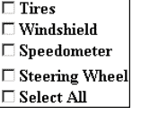

表单布局实际上使用两个字段：

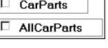

`AllCarParts`字段只有一个选项`Select All`。秘诀是将代码放在`onClick`事件中（**不是**你预期的`onChange`事件！）：


`checkAll(document.forms[0].CarParts, this.checked);`

请记住，如果复选框中只有一个选项，则值将返回 `true` 或 `false`。了解这一点后，调用`checkAll()`函数，向其传递`CarParts`字段的对象引用，以及`true`（`Select All`复选框被选中）或`false`（未选中）。

*JS Header*事件中的`checkAll`函数只需遍历复选框中的所有元素，并将它们设置为`doCheck`（`true`/`false`）：

```
function checkAll(objToCheck, doCheck)
{
	for (i = 0; i <objToCheck.length; i++)
	{
	}
		objToCheck[i].checked=doCheck;
}
```

### 练习：访问字段

在此练习中，你将在表单上创建三个字段（文本、单选按钮、选择），然后在`alert`中显示这些值。你将在后续练习中使用这些字段的HTML源代码。

按照以下步骤创建和读取三个字段：

| Step | Action |
| :--- | :--- |
| 1 | 在*Your Exercises*数据库中创建一个名为`Topic10`的新表单。 |
| 2 | 向表单添加一个可编辑文本字段，并将其命名为`SearchString`。 |
| 3 | 添加一个可编辑对话框列表字段，并将其命名为`SearchMax`。**输入以下选项：**<br><br>5<br>10<br>20<br>25<br>50<br><br>将默认值设置为"10"。 |
| 4 | 添加一个可编辑单选按钮字段，并将其命名为`SortOrder`。**输入以下选项：**<br><br>By Relevance \| 1<br>By Date Ascending \| 2<br>By Date Descending \| 3<br><br>将列数设置为3，使按钮水平排列。<br><br>将默认值设置为"1"。 |
| 5 | 在`SearchMax`字段右侧创建一个热点按钮，并将其标记为`Search`。在*onClick*事件中输入以下JavaScript：<br><br>`showInfo()` |

| Step | Action |
|------|--------|
| 6 | 此时你的表单应类似于： |
| 7 | 在*JS Header*事件中输入以下JavaScript： |
| 8 | 保存表单。 |
| 9 | 选择**Design - Preview in Web Browser - Internet Explorer**或点击工具栏中的工具。 |
| 10 | 在三个字段中输入/选择值，然后点击按钮，测试你读取三个字段值的成功程度。 |
| 11 | 离开浏览器前，查看页面源代码HTML。 |
| | 你将把其中一部分复制到剪贴板，以便在下一个练习中使用。 |

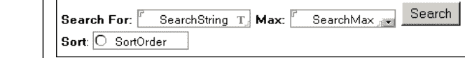

```
function showInfo(){
    with (document.forms[0]){
        var searchString = SearchString.value;
        for (var i=0;i<SortOrder.length;i++){
            if(SortOrder[i].checked==true){
                var searchOrder=SortOrder[i].value}
        }
        var getMax = SearchMax.selectedIndex ;
        var searchMax = SearchMax.options[getMax].text;
    }
    alert( searchString + "/" + searchOrder + "/" + searchMax)
}
```

此函数确定用户输入的每个值，然后将它们显示在`alert`中。

### 练习：在页面中进行搜索

在上一个练习中，你在表单上创建了三个字段。如你所知，你无法使用Domino Designer向页面添加字段。不过，你可以向页面添加HTML字段。尽管数据不会被存储，但你可以在页面的任何JavaScript中使用这些字段值。

在本练习中，你将创建一个默认"全文搜索表单"的替代方案，其外观如下所示：

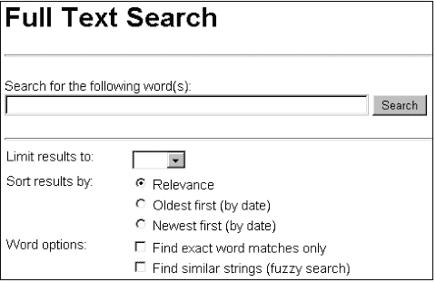

此表单是使用包含`@Command([ViewShowSearchBar])`的热点/操作生成的。

该替代表单将是视图的一部分，外观如下所示：


搜索表单中选中的选项用于创建一个传递给服务器的URL，例如：

```
http://host/db.nsf/AllDocs?SearchView&Query=One&SearchOrder=1&SearchMax=5
```


唯一必需的参数是`&Query=`，但还有许多其他参数可以更改结果集。

搜索结果是显示全文搜索引擎找到的文档的视图。你可以通过创建一个名为`$$SearchTemplateDefault`的表单来自定义结果视图，该表单包含一个名为`$$ViewBody`的空白可编辑文本字段。如果你想为一个或多个视图覆盖默认模板，请将每个表单命名为`$$SearchTemplate for viewname`，例如：

`$$SearchTemplate for AllDocSearch`

你可以通过多种方式自定义*搜索*表单。其中一种最佳方式是将搜索框直接呈现在视图中。你可以通过在页面中嵌入视图，然后向页面添加 HTML 字段来实现这一点。用户可以输入搜索短语，按 **Enter** 或点击链接，即可看到搜索结果。

按照以下步骤创建"可搜索的"视图：

| 步骤 | 操作 |
| :--- | :--- |
| 1 | 本练习要求数据库已建立全文索引。 |
| 2 | 打开 *Your Exercises* 数据库的数据库属性（在 Domino Designer 中右键点击数据库标题，选择 **数据库 - 属性**）。<br><br>点击 **全文** 选项卡（放大镜图标）。使用以下选项创建索引： |
| 注意 | **注意：** 测试时"即时"可能不够快，因为服务器基于队列工作，可能无法像你希望的那样快速处理你的数据库。如果在创建索引后添加文档，你可以点击 **更新索引** 按钮强制更新索引。 |


| 步骤 | 操作 |
| :--- | :--- |
| 3 | 点击 **确定**，然后关闭数据库属性。 |
| 4 | 切换到 *页面* 视图并创建一个新的**页面**。将页面命名为`Topic10`。 |
| 5 | 在页面最顶部添加此标签：`</FORM>`<br><br>与设计表单不同，设计页面在定义上是只读的。尽管如此，Domino 会添加自己的`<FORM>`标签，这使你无法添加自己的`<FORM>`标签。当你在页面顶部结束默认的`<FORM>`标签后，这允许你稍后创建自己的标签。这是一种变通方法，但确实有效。 |
| 6 | 在你添加到页面的`</FORM>`标签之后添加以下代码：`<FORM METHOD=POST ACTION="javascript:searchView()">`<br><br>这就是你结束默认`<FORM>`标签的原因之一，这样用户既可以使用 **Enter** 键，也可以点击链接来运行执行搜索的函数。`<FORM>`标签中的`ACTION`属性设置为运行该函数，而非提交页面。 |
| 7 | 切换到上个练习的 HTML 源代码，将这些字段定义复制到剪贴板：<br>`<FONT SIZE=2>Search For: </FONT><b><FONT SIZE=2><INPUT NAME="SearchString"></FONT><b><FONT SIZE=2></FONT></b><b><FONT SIZE=2>Max: </FONT></b><FONT SIZE=2><SELECT NAME="SearchMax"><OPTION>5<OPTION>10<OPTION SELECTED>25<OPTION>50</SELECT></FONT><BR><b><FONT SIZE=2>Sort</FONT></b><FONT SIZE=2>: </FONT><FONT SIZE=2><INPUT TYPE=radio NAME="SortOrder" VALUE="1" CHECKED>By Relevance<INPUT TYPE=radio NAME="SortOrder" VALUE="2">By Date Ascending<INPUT TYPE=radio NAME="SortOrder" VALUE="3">By Date Descending</FONT><FONT SIZE=2> </FONT><BR><BR>` |
| 8 | 然后切换回 Domino Designer，将剪贴板中的代码粘贴到页面上。<br><br>最后添加表单关闭标签：<br>`</FORM>`<br><br>这会关闭页面上的 HTML 表单。 |
| 9 | 选中页面上的所有 HTML，选择 **文本 - 透传 HTML**。 |
| 10 | 选择 **设计 - 在 Web 浏览器中预览 - Internet Explorer**，或点击工具栏中的工具。<br><br>检查源 HTML，确保所有必要的 HTML 标签都已就位。 |
| 11 | 返回页面设计，将以下 JavaScript 添加到 *JS Header* 事件中：<br><br>`function changeText(InputText)`<br>`{`<br>`  var SearchFor=" ";`<br>`  var ReplaceWith="+";`<br>`  while (InputText.indexOf(SearchFor) != -1)`<br>`  {`<br>`    var Before = InputText.substring(0, InputText.indexOf(SearchFor));`<br>`    var After = InputText.substring(InputText.indexOf(SearchFor) + SearchFor.length, InputText.length);`<br>`    InputText = Before + ReplaceWith + After;`<br>`  }`<br>`  return InputText;`<br>`}`<br><br>你已经在前面的练习中见过此函数（*Topic6 页面*），因此可以从那里复制，无需重新输入。 |
| 12 | 在`JS Header`中第一个函数之后追加第二个函数。<br><br>`function searchView()`<br>`{`<br>`  with (-document.forms[1])`<br>`  {`<br>`    var searchString = SearchString.value;`<br>`    for (var i=0;i<SortOrder.length;i++)`<br>`    {`<br>`      if(SortOrder[i].checked==true)`<br>`      {`<br>`        var searchOrder=SortOrder[i].value;`<br>`      }`<br>`    }`<br>`    var getMax = SearchMax.selectedIndex;`<br>`    var searchMax = SearchMax.options[getMax].text;`<br>`  }`<br>`  queryString = changeText(searchString);`<br>`  var oldPath=window.location.pathname;`<br>`  var lastSlash=oldPath.lastIndexOf("/");`<br>`  var getPath=oldPath.substring(0, lastSlash);`<br>`  var newURL=getPath + '/AllDocs?searchView&Query=' + queryString + '&SearchOrder=' + searchOrder + '&SearchMax=' + searchMax;`<br>`  top.location.href = newURL;`<br>`}`<br><br>加粗的代码直接取自上一主题的练习中的函数，除了使用`document.forms[1]`之外。这是因为你添加了自己的`<FORM>`标签来创建页面上的第二个表单。`searchView`函数将窗口的位置设置为一个 URL，该 URL 打开 AllDocs 视图并传递搜索字符串。 |
| 13 | 在字段下方、但在`</Form>`标签之前创建一个热点按钮。确保关闭该按钮的透传 HTML。<br><br>将语言选项改为 JavaScript，并添加以下代码：<br>`searchView()` |
| 14 | 最后，转到页面最底部，那里未启用透传 HTML。<br><br>选择 **创建 - 嵌入元素 - 视图**，然后选择`AllDocs`视图。<br><br>插入视图元素后，打开视图元素属性。将 **Web 访问显示** 属性更改为`使用 HTML`。 |
| 15 | 你的页面现在应该类似如下所示： <br><br>`<FORM>`<br>`<FORM METHOD=POST ACTION="javascript:searchView()"> <P>`<br>`<FONT size="2">Search for:</FONT> <INPUT NAME="SearchString" size=50> Max:`<br>`<SELECT NAME="SearchMax">`<br>`<OPTION>5`<br>`<OPTION>10`<br>`<OPTION SELECTED>25`<br>`<OPTION>50</SELECT>`<br>`<BR>Sort by:`<br>`<INPUT TYPE="radio" NAME="SortOrder" VALUE="1" CHECKED>By Relevance`<br>`<INPUT TYPE="radio" NAME="SortOrder" VALUE="2">By Date Ascending`<br>`<INPUT TYPE="radio" NAME="SortOrder" VALUE="3">By Date Descending`<br>`<FONT> <BR>`<br>`</FORM>`<br><br>| # | Subject | UNID |<br>|---|---|---|<br>| 1 | Help Doc One | 66B31043DF8595A3852566EF007CE04E |<br>| 2 | Help Doc Two | D0B6A5E66869BB3852566EF007CEEB2 |<br>| 3 | adf | 0F313DDB0DFF869D88525677C005B0F009 | |
| 16 | 保存页面设计。 |
| 17 | 选择 **设计 - 在 Web 浏览器中预览 - Internet Explorer**，或点击工具栏中的工具。 |
| 18 | 如果视图为空，请在 Notes 中打开数据库，使用 *Discussion* 表单创建一些新文档。 <br><br>创建文档后，请务必从数据库属性中更新全文索引，以防它们未能及时添加以执行**搜索按钮**的测试。 |
| 19 | 请输入一个搜索词或短语（你知道存在的），然后点击链接或按 **Enter**，测试你添加到页面的搜索功能。 |

### 富文本值

有三种方式可以捕获富文本：

- `<textarea>`。这实际上并非真正的富文本；它只是未使用应用程序捕获富文本的结果。

如示所示，您可以使用 HTML 标签来标记文本；唯一的缺点是，这些标签不能被 Notes 读取，因为它们没有使用传递 HTML 文本属性。

- **Java 小程序。**

- **ActiveX 控件。** 如果您将字段标记为使用"操作系统最佳适配"，并且在运行于 Windows（或其他支持 ActiveX 的浏览器）的 Internet Explorer 中，则会得到嵌入的 DHTML 编辑器 ActiveX 控件，而不是 Java 小程序。

这是三种捕获富文本的方法中功能最强大的，因为它可以包含表格和图像。

由于使用了三种技术，您通过编程访问这些值的方式也各不相同。请参阅 *FieldValues* 表单底部三个 **读取** 按钮背后的代码，以了解如何从三个富文本字段中读取值。当您测试这些按钮时，请记住，文档必须处于编辑模式才能读取字段。

### 备注

## 主题 11：字段输入转换与验证

### 关键点

当用户点击或切换到某个字段、更改值或离开该字段时会发生什么？如果您没有为这些事件处理程序定义任何 JavaScript，那么什么也不会发生。

本主题探讨了使用`onblur`和`onchange`字段事件处理程序进行字段转换和验证，以模拟在提交文档时服务器端运行的输入转换和验证事件。

虽然输入转换是事件字段处理程序的一个强项，但您会发现，虽然客户端字段验证很诱人，但这是一项更适合由表单级代码（在下一个主题中介绍）完成的任务。

同样重要的是要理解，仅仅因为您使用 JavaScript 编写了客户端输入转换和验证，可能仍然需要执行一些服务器端工作。本主题也涵盖了此要求。

> 注意：本主题中的大多数示例来自`DDJS7 Demo`数据库中的`FieldValidation`表单。例外情况是本主题末尾的日期相关字段，它们在`DateValidation`和`DateTimeEntry`表单中展示。

### 字段级帮助

在我们讨论输入转换和验证之前，帮助提高用户输入数据质量的一种方法是提供字段级帮助。

`onfocus`事件处理程序的一个常见用途是以以下方式之一显示字段级帮助：

- 将帮助文本写入状态栏。*主题* 字段展示了如何在`onfocus`事件处理程序中使用此代码设置`window`对象的`status`属性：

```javascript
window.status='Please enter a value in: ' + this.name
```

然后，在`onblur`事件处理程序中清除消息：

```javascript
window.status=""
```

在字段事件处理程序中工作时，您可以使用`this`关键字表示当前字段对象。`name`属性返回相应 HTML 标签的`name=`属性值。

- 显示提示文本，当用户点击或切换到该字段时消失。*Body* 字段的默认值为"**Please enter a value.**"。这是用户在表单首次打开时看到的内容。当用户点击该字段时，`onfocus`事件处理程序运行此代码：

```javascript
var defaultValue="Please enter a value.";
if (this.value==defaultValue){
    this.value="";
}
```

结果是提示文本消失，大概是为了允许用户输入文本。当用户切换出该字段时，如果用户留空，`onblur`事件处理程序会替换提示文本：

```javascript
var defaultValue="Please enter a value.";
if (this.value==""){
    this.value=defaultValue;
}
```

- 打开一个新窗口，并将其位置设置为帮助页面，或者更少见地使用`document.write()`方法动态生成页面（您将在后面的主题中执行此操作）。

- 在框架中显示帮助文本（您将在后面的主题中执行此操作）。

### 字段转换

放置输入转换代码的最佳位置是`onchange`或`onblur`字段事件处理程序。

例如，*Title* 字段在`onblur`事件处理程序中调用字符串对象的`toUpperCase`方法：

```javascript
this.value=this.value.toUpperCase()
```

然后，`onblur`事件继续调用一个自定义函数（模拟`@Trim`）以删除前导、尾随和重复空格：

```javascript
this.value = fullTrim(this.value);
```

`fullTrim()`函数（在`JS Header`事件中定义）链式调用三个使用正则表达式的字符串对象`replace`方法：

```javascript
function fullTrim(objVal)
{
    return objVal.replace(/^\s+/,'').replace(/\s+/gi,' ').replace(/\s+$/,'');
}
```

> **注意：** 如果用户从未进入某个字段，则`onblur`事件处理程序不会运行。您稍后会看到如何在表单级验证例程中处理此问题，该例程会阻止用户在所有字段正确输入之前提交表单。

### 字段验证

使用 JavaScript 进行验证背后的思路是，验证在用户出错时立即发生，并报告错误，以便用户可以在继续之前修复问题。您必须决定需要多少错误捕获才能确保数据可接受。

如果您想确保特定的值或数据类型，必须自己编写例程。很多时候，您将被迫遍历所有输入字符，测试每个字符。或者，您可以使用字符串对象方法，如`indexOf`、`match`或`search`。

使用`onblur`或`onchange`事件处理程序，您可以直接在浏览器中验证字段，而无需往返服务器进行验证。

对用户的反馈可以是一个警报框，或者只是在状态栏中报告错误。而且，您会希望将焦点设置在出错的字段上。

*Subject* 字段的`onblur`事件处理程序调用此函数：

`validateEmptyInput(this)`

*JS Header* 事件定义了`validateEmptyInput()`函数：

```javascript
function validateEmptyInput(obj)
{
  if (obj.value=="")
  {
      var msg = 'You forgot to enter a value in the ' + obj.name + ' Field.'
      window.status=msg;
      obj.focus()
  }
}
```


验证公式检查空值属性，并在状态栏中用错误消息提醒用户（您可以使用`alert`获得更明显的错误消息）。`focus`方法将光标移回`Subject`字段。

现在切换到`Amount`字段。此验证公式要求一个介于 1 和 5 之间的数字。注意，当您切换*进入*该字段时，值会被选中。这是在`onfocus`事件处理程序中完成的：

```javascript
this.select();
```

> **注意：** 要开始使用字段验证例程，请查看 http://www.devarticles.com/c/a/JavaScript/Developing-a-simple-validation-library-in-JavaScript/ 和 http://www.devarticles.com/c/a/JavaScript/Developing-a-simple-validation-library-in-JavaScript-continued/ 上的示例。

### 测试数据类型

尽管 JavaScript 是一种松散类型的语言，并且对数据类型不匹配有一定的容忍度，但如果您不向函数提供正确类型的数据，您将会遇到问题。

您可以使用`typeof`运算符测试变量或表达式的数据类型。

例如，以下变量包含这些值：

| 表达式 | typeof 返回... |
| :--- | :--- |
| `typeof(document);` | object |
| `var qty=2; typeof(qty);` | number |
| `var Sname="Joe"; typeof(Sname);` | string |
| `typeof(newVar);` (newVar 未声明) | undefined |

### 验证数字

`Amount`字段在`onblur`事件处理程序中使用此测试来确保用户输入介于 1 和 5 之间的数字：

```javascript
if (x.length!=1 || x.charAt(0)==" " || x>"5" || x<"1" )
```

它捕获多种情况。

更优雅的解决方案使用正则表达式：

```javascript
if (!x.match(/^[1-5]{1}$/) )
```

这测试单个数字是否在 1 到 5 的范围内。

### 测试 NaN

您可以使用内置的`isNaN`函数测试表达式是否为`NaN`（非数字）。

当使用`parseFloat`或`parseInt`将文本转换为数字时，如果不成功，每个都返回`NaN`。`isNaN`函数测试此返回值，如果表达式*不是*数字则返回`true`，如果是数字则返回`false`。

例如，您可以通过简单地检查`Revenue`字段是否返回`NaN`来消除`Sales`和`Price`字段中的大量错误验证。`Recalc`按钮调用`JS Header`中的`calcprice()`函数，该函数演示了对`NaN`的测试：

```javascript
function calcprice (form)
{
 with (form)
 {
   getPrice = Price.value;
   getSales = Sales.value;
   var total=Revenue.value = getPrice * getSales
   if ( isNaN (parseInt(total)))
   {
     form.Revenue.value=0;
     alert('Please enter valid Price and Sales Field values.')
   }
   else
   {
     form.Revenue.value=total
   }
 }
}
```

### 检测 "null"、"undefined" 和 ""

如果你未初始化变量，它会假定值为`null`。如果你尝试在拼接字符串或执行算术函数时使用未初始化的变量，它会返回`undefined`。你可以对可能未初始化的变量`getVal`使用以下检测来捕获这两种情况：

```
if (getVal+""=="null")
```

以及

```
if (getVal+""=="undefined")
```

在这两种情况下，都会尝试拼接变量，这会强制产生错误。

你也可以在调用对象的方法或使用其属性之前检测`null`，例如：

```
if(frameWriteWindow!= null)
```

如果你将变量赋值为空字段，变量会返回""（空字符串），可按如下方式检测：

```
if(document.forms[0].Subject.value=="")
```

如果你不确定变量返回什么，可以将输出发送到警告对话框。

可以使用布尔运算符将所有检测组合起来，例如：

```
if (cookieValue=="undefined" || cookieValue=="" || cookieValue==null)
```

> **注意：** `undefined`条件在 JavaScript 1.3（ECMA-2.62）中实现。在检测`undefined`之前，务必检查浏览器版本。

### 验证文件附件名称

在文档提交之前，你无法真正使用 JavaScript 知道文件是否已实际附加到文档。提交后，你可以使用服务器端验证，通过`NotesDocument`对象的`HasAttachment`属性来检测有效的附件。你可以使用 JavaScript 检测的是文件上传元素中是否有条目。

虽然不够完美，但至少你可以阻止用户输入任何文件名。

`FieldValidation`表单有一个嵌入式文件上传设计元素：


**验证附件**按钮调用`hasAttachment()`函数，该函数运行以下代码：

```
function hasAttachment ()
{
	form=document.forms[0];
	for( i=0; i < form.elements.length; ++i)
	{
		var elem = form.elements[i];
		if (elem.type == "file")
		{
			var eleVal=elem.value.replace(/^\s+/,"").replace(/\s+/gi,'').replace(/\s+$/,"");
			if (eleVal == "")
			{
				alert ("There is no file attached.");
				return false;
			}
			else
			{
				alert ("Attachment Name: " + elem.value);
				return true;
			}
		}
	}
}
```

定位该对象并不容易。与从其他命名字段读取值不同，你必须遍历表单上的所有元素，查找 type 属性设置为`file`的未命名元素。value 属性返回附件的名称。

### onblur、alert 和 focus 的交互

虽然在同一个`onblur`或`onchange`事件处理程序中使用`alert`和`focus`很诱人，但结果并不理想。问题在于，在`onblur`事件处理程序中使用`alert`会将焦点从字段中移出，这也会改变`this`关键字的上下文。

更糟糕的是，当你同时使用`alert`和`focus`时，可能会将浏览器置于无限循环中，因为焦点被分配到了 alert 上的按钮。如果两个字段都有`onblur`事件处理程序，并试图将焦点设置到自身，也会发生同样的事情。在这种情况下，浏览器也会在两个字段之间进入循环，你必须使浏览器崩溃才能停止它。

此外，你会发现如果多个字段都有执行字段验证的`onblur`事件处理程序，表单会变得非常难以使用。

即使特定浏览器版本避免了循环，用户也会困惑于哪个字段有错误。

因此，你应该仅在编写表单级验证时使用`focus`，这将在下一个主题中讨论。

### 选择字段验证

对于**单选**选择，未选择任何选项会返回第 0ᵗʰ 个元素。因此，你应该始终将第一个选项设置为用户指示"进行选择"的选项，然后检测是否选择了第 0ᵗʰ 个元素。

例如，`State`字段由`keywordInfo()`函数使用以下代码检测：

```
if (State.options.selectedIndex==0 )
{
	alert('No State was selected.');
	State.focus()
}
```

对于**多选**选择，未选择任何选项返回 -1。

例如，`Region`字段由`keywordInfo()`函数使用以下代码检测：

```
if (Region.selectedIndex==-1 )
{
	alert('No Regions were selected.')
}
```

### 单选框和复选框验证

由于必须检测复选框和单选按钮中每个选项的`true`或`false`，因此检测是否未选择任何选项的最简单方法是预先设置变量为`false`，然后如果有任何选项被选择则将其设置为`true`。

例如，`Options`复选框由`keywordInfo()`函数使用以下代码检测：

```
with (document.forms[0]) {
    var testCheck=false;
    for (var i=0; i<Options.length; i++) {
        if (Options[i].checked==true) {
            testCheck=true;
            alert (Options[i].value)
        }
    }
}
//test for no choice
if (testCheck==false) {alert('No Options were selected.')}
```

### 字符串格式验证

检测空字段就讲到这里。那么如何检测数据是否以特定格式输入呢？

`PhoneNumber`字段通过点击**验证电话**按钮进行验证。该函数使用字符串对象的 match 方法，利用正则表达式检查非常具体的输入：

```
function validatePhone(){
    form=document.forms[0];
    getString=form.PhoneNumber.value;
    getMatch = getString.match(/^\(?\d{3}\)?\s?-\d{3}-\d{4}$/)
    if (getMatch==null){
        alert ('Incorrect phone format')}
    else{ alert('OK phone format')}
}
```

此处使用的正则表达式查找字符串开头的三个数字（可选地被括号包围）、一个字面意义的连字符、三个数字、一个字面意义的连字符，以及字符串末尾的四个数字。

### 使用 JavaScript 进行日期验证

日期验证是一个具有挑战性的话题，因为有许多无法控制的因素在与你作对。你将遇到的几个问题包括：

-   如何处理闰年
-   JavaScript 直到 1.3 版本才具备 Y2K 兼容性，当时添加了`getFullYear`和`setFullYear`方法（返回 1000 到 9999 作为一个四位数字）；在这些函数之前，旧的`getYear`函数在年份介于 1900 和 1999 之间时返回两位数字，但如果超过 2000 年则返回四位数字
-   用户输入日期时的错误（MM/DD/YY、YY/MM/DD 等格式）
-   用户操作系统认可的可接受日期
-   如果日期保存回 Domino，服务器操作系统认可的可接受日期。

在此示例中，用户必须在文本字段中输入一个有效的未来日期。代码可在`DateValidation`表单的`JS Header`事件中找到：

```
function valiDate(obj)
{
  var entryDate=Date.parse(obj.value);
  if (!entryDate)
  {
       alert('Please enter a valid future date.');
       obj.focus();
       return false;
  }
  else
  {
       var calcDate= new Date(obj.value);
       var nowDate = new Date();
       if (entryDate<nowDate)
       {
            msg=calcDate.toLocaleString() + ' is before today. Please enter a future date.'
            alert(msg);
            obj.focus();
            return false;
       }
  }
  return true;
}
```

验证函数从`FutureDate`字段的`onblur`事件处理程序调用：

`valiDate(this)`

`Date`对象的`parse`方法用于验证用户输入是否为有效日期（UTC 格式），如果是，则使用用户输入创建新的`Date`对象。

幸运的是，用户可以输入各种日期格式，例如`January 23, 1999`或`3/4/98`，`new`和`parse`方法会正确解析它们。

有趣的是，输入`2/31/99`（一个明显错误的日期）仍被接受为"有效日期"，但会被调整为下一个适当的日期，即 1999 年 3 月 3 日（因为"31 日"是在"28 日"之后的第 3 天）。

### 处理闰年

`DateValidation`表单的`JS Header`事件中的`isValidDate()`函数展示了一种验证日期的方法。请记住，闰年由三条规则决定：

-   能被 4 整除的是闰年
-   能被 4 整除，除非该年份能被 100 整除，则*不是*闰年
-   能被 400 整除的是闰年。

### 强制有效的日期输入

为了防止日期输入问题或歧义，**不要**允许用户在文本字段中自由输入日期，因为这会使验证工作复杂化。相反，设置三个*组合框*字段来捕获三条信息，如`DateTimeEntry`表单所示：


使用这种技术消除了字段验证问题，因为输入是明确的。

主要优点是，由于服务器负责在表单提交后计算日期（使用隐藏字段中的`@Functions`），它将始终采用可接受的格式。

### 字段计算

*日*字段的选项范围是 **1 - 31**，*月*字段的范围是 **一月 - 十二月**（并使用别名，例如 **一月 | 1**）。

请记住，虽然日期的索引从1开始，但月份是从0开始索引的，因此一月是第0个月！

将*年*字段的选择设置为使用五年滚动公式，这样您就无需重新编写表单：

```
@Text (@Year (@Today)) :
@Text (@Year (@Today) + 1) :
@Text (@Year (@Today) + 2) :
@Text (@Year (@Today) + 3) :
@Text (@Year (@Today) + 4) :
@Text (@Year (@Today) + 5)
```

然后，使用此默认值：`@Text (@Year (@Today) )`

根据您的应用程序，您可能希望：

- 决定当前年份前后允许多少年
- 将当前年份设置为默认选择
- 从当前月份开始向前列出月份
- 添加一个时间值的选择列表以确保正确输入时间
- 添加一个时区的选择列表。

如果您使用 JavaScript 进行验证，请记住选择列表中的值返回的是文本。

> 注意：您稍后将在主题17中看到一个示例，允许用户从一个小型 DHTML 日历小部件中选择日期，然后在主题20中看到一个 ActiveX 控件日期选择器的示例。另一个选项是从 [http://www.wnc.net.au/wnc/website.pma/gp?OpenPage&name=DatePicker](http://www.wnc.net.au/wnc/website.pma/gp?OpenPage&name=DatePicker) 获取的日期选择器 Java 小程序。

您可以使用`onblur`事件处理程序在用户输入数据时在字段（如电子表格）中执行数字计算。

执行“实时”计算有两个问题。第一个问题是 HTML 中没有数字数据类型；每个输入都是文本。另一个问题是 HTML 中没有等效于 Notes 中计算字段的东西。

`FieldValidation`表单演示了如何克服这两个问题。两个字段被定义为数字字段，因此它们在文档中以数字形式存储回。两个数字字段中的`onblur`事件处理程序都包含以下代码：

`totalNumbers()`

这个函数在`JS Header`中定义，使用`parseInt`函数将文本转换为数字：

```
function totalNumbers(){
  with (document.forms[0]) {
  getValue = parseInt(Number1.value) + parseInt(Number2.value);
  If(isNaN(getValue)){Result.value=0
  }
```


```javascript
else {Result.value=getValue}
```

如果`getValue`结果不是数字，它将返回`NaN`（“Not A Number”），`Result`字段将被赋值为零。否则，这些数字将被相加并分配给`Result`字段。

为了防止用户在数字字段中输入非数字，`Number1`和`Number2`的`onblur`事件处理程序都包含以下代码来去除任何非数字字符：

```javascript
this.value=this.value.replace(/[^0-9]/gi,'');
```

本示例的最后一部分在`Result`字段中，它是“计算”字段。由于实际计算是在其他两个字段的`onblur`事件处理程序中执行的，因此`Result`字段中唯一需要的代码是防止用户进入该字段。当用户试图进入该字段时，`onfocus`事件处理程序会使该字段失去焦点并将用户弹出。有两种方法可以做到这一点。

- 第一种方式是其`onfocus`事件处理程序编码为：

  ```javascript
  this.blur();
  ```

- 这样做是可行的，但光标只是消失了，用户不知道自己在哪里。最好将光标“发送”到某个合理的地方，在此示例中，是发送到第一个`Number1`输入字段以进行另一个操作：

  ```javascript
  document.forms[0].Number1.focus();
  ```

> **注意：** 对于任何涉及字段计算的表单，您还应在表单的`onsubmit`事件处理程序中运行执行计算的函数，以防用户从未进入任何依赖字段。您将在下一个主题中研究表单级别的验证。

### 何时必须使用服务器端输入转换/验证

字段**输入验证**是验证可编辑字段中的数据是否以某种方式“正确”，或者至少不为空。

虽然 JavaScript 通常适用于独立的输入验证，但有几个原因说明您可能希望使用字段输入验证事件执行服务器端验证：

- 公式语言具有强大的字符串解析功能，只需很少的编码，并且对 Domino 对象模型有很好的“控制”。
- 您可以使用`@Db`函数对其他 Notes 文档（在此数据库或其他数据库中）以及外部数据库系统执行查找。
- `@Functions`允许您使用`@GetProfileField`检查配置文件文档（全局或按用户）中的值。
- `@Functions`可以轻松访问文档信息，包括文档属性和字段值（隐藏和/或计算字段）。
- 执行验证使您能够保密信息——数据和代码算法——因为它在 HTML 源代码中不可见。

### 示例：服务器端输入验证

这个来自`Category`字段的简单输入验证公式展示了用法：

```text
DB:=@WebDBName;

ID:=@Text(@DocumentUniqueID);

DOCCOUNT:=@Text(@Elements(@DbColumn("Notes"; "NoCache"; @DbName; "AllDocs"; 1)));

URL:="<a href=\"javascript:window.history.go(-1);\">Return to Document</a>";

FailureHTML:= "<CENTER>FONT COLOR=\"RED\" SIZE=\"+2\">Error - You must enter a category!</FONT><HR>" + URL +

"<CENTER><HR><br>Database:</b>" + DB + "<br><b>Documents:</b>" + DOCCOUNT + "<br><b>This DocID: </b>" + ID + "<HR>";

@If (Category=="")

@If (ClientType=="Web"; @Failure(FailureHTML); @Failure("You must enter a Category.")); @Success)
```

此公式测试空字段，并区分 Notes 和浏览器客户端的失败消息。对于 Notes 客户端，它显示一个对话框；对于浏览器，它返回一个包含 HTML 和简单 JavaScript 的页面（该链接运行`javascript:`伪协议）。


只是为了展示，代码演示了它访问当前浏览器页面上下文之外的 Domino 对象的能力。

使用服务器端验证的缺点当然是，用户必须等待文档被提交（但此时未保存）、评估，然后错误消息才能返回。

优点是服务器端验证易于编写，并且由服务器执行，可能涉及复杂的逻辑和查找，以根据外部数据验证数据输入。

> 注意：执行服务器端验证的另一个常见——也许更好——的地方是由`WebQuerySave`事件调用的代理。区别在于，除了必须使用 LotusScript/Java 之外，这是表单级别的验证。您将在下一个主题中了解如何做到这一点。

### 通过 @Functions 进行日期验证

如果您可以在文档提交后执行验证，这里有一种方法可以避免编写冗长的 JavaScript 日期验证例程，并使您的表单更直观。此示例可以在`DDJS7 Demo`中的`DateValidation`表单上找到。

这种方法的前提是，如果用户输入了一个日期，例如 2 月 31 日，他们想要的是 2 月的最后一天，但不确定是哪一天。因此，此公式在计算字段中不是提示用户修正日期（这是验证字段最常见的方式），而是简单地为用户修正了日字段：

```text
GetYear:=@TextToNumber(FromYear);

GetMonth:=@TextToNumber(FromMonth);

GetDay:=@TextToNumber(FromDay);

GetDate:=@Date (GetYear; GetMonth; GetDay);

@If (@Month (GetDate) < GetMonth; @Set ("GetDate"; @Date (GetYear;

GetMonth; GetDay - 1)); "");

@If (@Month (GetDate) < GetMonth; @Set ("GetDate"; @Date (GetYear;

GetMonth; GetDay - 2)); "");

@If(@Month(GetDate) < GetMonth; @Set("GetDate"; @Date(GetYear;

GetMonth; GetDay - 3)); "");

@SetField("FromDay"; @Text(@Day(GetDate)));

GetDate
```

之所以有效，是因为`@Date`函数的工作方式类似于`@Adjust`，即任何“剩余”天数都会将日期推到下一个月。因此，如果`@Date`函数处理 2 月 31 日，在闰年情况下最终会变成类似 3 月 2 日这样的日期。接下来的`@If`函数只是将结果日期每次推回一天，直到月份与用户选择的月份（本例中为 2 月）匹配。

### 练习：使用 JavaScript 重新计算

字段验证并不总是必须阻止用户进行修正；它也可以为用户进行修正。

在这个练习中，您将使用各种字段转换和验证技术。

此表单的目标是创建一个乘以两个数字的迷你工作表：


当用户输入价格并按 Tab 键转到销售字段时，会验证价格非空且为整数，并尝试计算收入。当用户在销售字段中输入值时，也会发生相同的事情。如果用户试图进入收入字段，光标将返回到价格字段。重新计算按钮有些多余，但如果用户没有按 Tab 键离开价格或销售字段，它确实会执行计算。

按照以下步骤创建此工作表：

| 步骤 | 操作 |
|---|---|
| 1 | 在 Domino Designer 中打开您的 Your Exercises 数据库副本。 |
| 2 | 切换到 Forms 视图并创建一个名为`Topic11`的新表单。 |
| 3 | 创建并标记三个可编辑的数字字段，分别命名为：<ul><li>`Price`</li><li>`Sales`</li><li>`Revenue`</li></ul>我们将其设置在一个表格中： |
| 4 | 切换到`JS Header`事件。在这里你将定义两个函数。 |
| 5 | 输入第一个函数，该函数负责在输入验证（位于`calprice()`函数中）失败时报告错误：`function errorField(FieldObj) { window.status='Please enter a number in ' + FieldObj.name + ' Field.'; FieldObj.focus(); }` 当传入一个字段对象变量时，此函数会提醒用户并将焦点设置到引用的字段上。 |
| 6 | 输入此函数，该函数执行将价格和销售量相乘的计算：`function calcprice () { window.status=""; with (document.forms[0]) { if (Price.value==""){errorField(Price); return false;} if (Sales.value==""){errorField(Sales); return false;} Revenue.value = Price.value * Sales.value ; return true; } }` 此函数在相乘之前验证`Price`和`Sales`字段中的值。 |
| 7 | 现在处理事件处理器。首先，将此代码添加到表单的`onLoad`事件中，以便在表单加载时将用户带到`Price`字段：`document.forms[0].Price.focus();` |
| 8 | 当用户离开`Price`字段时，从`onblur`事件处理器运行此代码：`with (document.forms[0]) { Price.value = Price.value.replace(/[^0-9]/gi,""); calcprice() }` 第一个任务是通过去除任何非数字字符来转换输入，然后调用`calcprice`函数。 |
| 9 | 当用户离开`Sales`字段时，从`onblur`事件处理器运行此代码：`with (document.forms[0]) { Sales.value = Sales.value.replace(/[^0-9]/gi,""); calcprice() }` |
| 10 | 在`Revenue`字段中输入此`onfocus`事件处理器代码，以防止用户在那里输入值：`document.forms[0].Price.focus()` 当用户点击或使用 Tab 键进入该字段时，焦点将转移到`Price`字段。 |
| 11 | 最后，为了让用户能够按需执行计算，创建一个运行 JavaScript 的热点按钮。在`onClick`事件中输入此代码：`calcprice()` 此按钮运行与字段事件处理器相同的代码。 |
| 12 | 保存表单。 |
| 13 | 选择**设计 - 在 Web 浏览器中预览 - Internet Explorer**或点击工具栏中的![工具图标]工具。 |
| 14 | 尝试在字段中输入各种数字和非数字字符，看看事件处理器如何工作。 |

### 注释

## 主题 12：表单验证

### 要点

字段验证的一个重要方面是不允许用户在正确输入所需数据之前提交文档。你已经看到了字段事件处理器（如`onblur`）用于验证数据的用法，但当你有太多可能的事件处理器交互时，这种方法存在问题。

本主题将验证提升一个层次，到表单级别。使用本主题中的技术，你可以在一个或多个字段无效时阻止文档提交。这实际上是在提交之前验证表单上字段的更好方式。

### 字段级事件处理器的注意事项

虽然适用于字段转换和计算，但使用字段级事件处理器进行验证存在几个问题：

- 验证逻辑分散，因此更难维护。
- 当与`alert`对话框和`focus`方法一起使用时，定义了多个`onblur`事件处理器的字段可能使浏览器陷入焦点混乱状态，通常导致无限循环。
- 如果用户从未进入该字段，事件处理器永远不会运行，表单将带有错误提交。
- 用户在通过 Tab 键浏览字段时经常被错误消息惹恼。

解决方案是在表单级别而不是字段级别执行验证，并一次性报告表单错误。你可以使用相同的验证逻辑和代码，只需将其移到表单级别并更改提醒用户的方式。

### "Object is not defined" 错误

你将使用的所有字段和表单验证技术都假设所有对象在代码运行时都可用。如果未定义为函数，任何 JS Header 或表单顶部的内联 JavaScript 甚至在页面完成加载之前就开始执行。

尝试访问页面上尚不“存在”的对象（通常是图像或字段对象）（因为它在页面下方）会导致用户看到错误消息（通常是"Object is not defined"）并终止页面上剩余的脚本。

这可能发生在以下情况：

- 你将 JavaScript 代码放在函数之外，作为页面加载时的内联代码调用。
- 为了方便用户，你在长表单顶部添加了第二个提交按钮，用户在页面其余部分加载之前点击了该按钮。当验证例程运行时，它无法访问尚未渲染的对象。
- 假设你设计了一个双框架应用程序，其中顶部框架包含“控件”，如保存、取消和帮助，较大的底部框架包含表单内容。此屏幕截图显示了一个示例：

  

  不耐烦的用户点击了保存按钮，该按钮在底部框架完成加载之前调用了表单验证例程。因为表单底部的元素尚未创建，JavaScript 失败。
- 如果表单使用需要时间加载的 Java 小程序，如编辑器或查看器小程序，用户会在小程序加载之前尝试使用表单上的按钮/操作，导致错误消息。

有几种解决方案可以解决这个潜在问题：

- **在使用每个对象之前检查它。** `DDJS7 Demo`数据库中的`TestObject`表单展示了如何通过测试对象是否为`null`来测试每个元素。在此`JS Header`事件代码中，如果无法访问`Subject`字段对象，则会提醒用户：

  ```javascript
  function verifyObject(formObj)
  {
    if (formObj==null)
    {
      alert ('Please wait for the page to finish loading.')
    }
    else
    {
      alert ('Page is done loading now. You may continue.')
    }
  }
  ```

  其他代码，如在**提交**按钮中使用的代码，可以将对象测试作为其验证例程的一部分：

  ```javascript
  verifyObject(document.forms[0].Subject);
  ```

  一旦字段存在，对对象的测试就会通过（在这种情况下，你可以移除 alert）。

  这种方法的问题在于，你必须测试*每个*对象，这将需要一些对每个表单来说都唯一的代码。

- **在表单`onLoad`事件中设置一个隐藏字段中的标志。** 如果必须在用户访问任何功能之前加载**整个**页面，包括所有 HTML 和图像，你可以使用`onLoad`事件来设置一个字段的值。然后，每个脚本在继续之前都测试该值。

  当然，这样做的问题是，如果用户想在不等待图像加载的情况下继续，什么都不会发生，用户将不得不使用浏览器的**停止**按钮。

- **检查页面上的最后一个对象。** 最后一个选项是简单地检查放置在表单底部的一个名为`IsLoaded`的隐藏计算显示文本字段是否存在（你可以将其放入子表单中）。计算其值为"1"：

  ```html
  <input type=hidden name='IsLoaded' value='[IsLoaded]'>
  ```

  然后，在执行任何依赖于表单上任何元素的 JavaScript 之前，检查`IsLoaded`的存在，例如，考虑对上面显示的被**提交**按钮调用的`SaveDoc()`函数进行此修改：

  ```javascript
  function SaveDoc()
  {
    with (document.forms[0])
    {
      if (form.IsLoaded == null)
      {
        alert('Please wait for the page to load.')
      }
      else
      {
        if (checkEmptyTextFields(Subject, Category))
        {
          submit()
        }
      }
    }
  }
  ```


在运行验证表单的函数之前，第一个 `if` 结构测试整个表单是否已加载。如果没有，会提醒用户，用户可以在清除 alert 后重试。

### 在页面加载完成前隐藏 `<BODY>`

对于现代浏览器（支持 CSS/DHTML 的浏览器），在 *HTML Body Attributes* 事件中添加以下代码：


并在 *onLoad* 事件的末尾添加以下内容：


页面首次加载时，`<BODY>`（以及相应的 `<FORM>`）会被隐藏。加载完成后，`onload` 事件处理程序会取消隐藏 body。

此技术用于 *DDJS7 Demo* 数据库中的 *HideBodyUntilFormLoads* 表单。

### 使用 try/catch 包裹代码

如果运行的是 JavaScript 1.4 或更高版本，使用 try/catch 块被认为是最佳做法。

### onsubmit 事件处理程序

表单的 `onsubmit` 事件处理程序在 `<FORM>` 标签中定义。它通常用于验证整个表单，并根据条件执行提交操作。

在表单的 `onSubmit` 事件中编写的 JavaScript 最终返回 `true` 或 `false`。如果为 `true`，则提交发生；如果为 `false`，则提交被取消。

例如，*DDJS7 Demo* 数据库中 *SimpleFormValidation* 表单的 `onSubmit` 事件会验证 *Subject* 字段：

```javascript
if (document.forms[0].Subject.value=="")
{
    document.forms[0].Subject.focus();
    alert ('Please enter a Subject');
    return false;
}
else
{
    return true;
}
```

如果字段通过验证测试，表单将被提交，因为事件处理程序返回了 `true`。默认情况下假定为 `true`，因此只需设置 `false` 条件来阻止提交即可。

要使 `onsubmit` 事件处理程序运行，表单必须使用 **Submit** 按钮进行提交，该按钮可通过以下任一方式编码：

- HTML `<INPUT type=submit value=Submit>` 标签
- 使用以下代码编码的热点：

```text
@Command({[FileSave]}); @Command({[FileCloseWindow]});
```

热点不能使用表单对象的 `submit()` 方法编码，因为这会绕过 `onsubmit` 事件处理程序（你将在下面看到如何做到这一点）。

### 保持 `<FORM>` 标签简洁

由于 `onsubmit` 事件处理程序代码会输入到 `<FORM>` 标签中，因此将代码限制为函数调用是合理的，例如：

```javascript
return validateForm();
```

然后，在 *JS Header* 事件中编写一个函数，该函数向 `onsubmit` 事件处理程序返回 `true`（允许提交）或 `false`（取消提交），例如：

```javascript
function validateForm()
{
    form=document.forms[0];

    if (form.Subject.value=="")
    {
        alert('Please enter a subject');
        form.Submit.focus();
        return false;
    }
    else
    {
        return true;
    }
}
```

在此示例中，测试了 *Subject* 字段的值，如果为空，则向 `onsubmit` 事件处理程序返回 `false`，这会取消提交并提醒用户。

> **注意：** 由于 Domino 不允许保存使用表单属性 **Treat document contents as HTML** 的文档，因此在使用此属性时无法编码 `onsubmit` 事件处理程序。

### 有条件地调用 form.submit()

作为使用标准 **Submit** 按钮和在 `onsubmit` 事件处理程序中编码的替代方案，你可以修改最初提交表单的方式。为此，创建你自己的 **Submit** 按钮并插入验证逻辑，有条件地调用 `form.submit()` 方法。执行此操作时，请勿向 `onSubmit` 事件添加任何代码。

下图展示了 *DDJS7 Demo* 数据库中 *FormValidationClientSide* 表单演示的验证函数逻辑：


不要使用典型的 **Submit** 按钮，而是添加一个运行以下 JavaScript 代码的热点：

### SaveDoc()

在 *JS Header* 中定义的 `SaveDoc()` 函数有条件地调用 `form.submit()` 方法：

```javascript
function SaveDoc() {
    with (document.forms[0]){
        if ( checkEmptyTextFields(Subject, Category)) {
            submit()
        }
    }
}
```

这里有一些巧妙的处理。使用 `with` 结构，`checkEmptyTextFields()` 函数将两个字段对象作为参数传递。你将在下面看到这个函数如何处理可变数量的参数，并检查每个字段对象。

如果该函数返回 `true`，则调用表单对象 `submit` 方法。如果没有 `with` 结构，将使用 `document.forms[0].submit()` 调用此方法。

> **注意：** 你可以使用 `&&` 运算符向 `if` 结构添加更多验证函数，例如：

```javascript
function SaveDoc() {
    with (document.forms[0])
    {
        if ( checkEmptyTextFields(Subject, Category) && checkSelectFields(State))
        {
            submit()
        }
    }
}
```

此技术的最后一部分是 `checkEmptyTextFields()` 函数，如果所有字段都有效则返回 `true`，否则返回 `false`：

```javascript
function checkEmptyTextFields() {
    var getFields=checkEmptyTextFields.arguments;
    for(i=0; i<getFields.length; i++){
        if ( getFields[i].value=="" ) {
            alert('Please enter a value in: ' + getFields[i].name);
            getFields[i].focus();
            return false
        }
    }
    return true
}
```

现在这是真正 tricky 的部分。

以 `var getFields=` 开头的行实际上是使用 arguments 属性创建一个函数对象，该属性返回传递给函数的参数数组。

由于我们传递了字段对象作为参数，因此可以使用 `for` 结构遍历数组并处理每个字段。在循环内部，对空值属性的简单检查会导致出现警告消息、设置字段焦点，并向 `SaveDoc()` 函数返回 `false`，从而阻止表单提交的发生。

通用验证处理程序在减少发送到浏览器的代码量方面大有帮助，但你经常会发现自己需要对特定字段进行独特的测试。你还会发现使用 JavaScript 执行某些类型的验证（例如涉及日期的验证）很困难，并且可能会发现使用 @Functions 或 LotusScript 恢复到服务器端验证更容易。

> **注意：** 请记住，页面上可能有多个 `<FORM>` 块。如果你在上面没有注意到，提交总是针对所需的表单调用的，例如，针对第一个表单（如源代码中所示）：

```javascript
document.forms[0].submit();
```

> **提示：** 你可以像对字段一样为按钮（例如 **Save** 或 **Submit**）设置焦点：

```javascript
document.forms[0].OK.focus();
```

在所有表单验证常规成功之后执行此操作是一个好时机，以便用户可以简单地按 **Enter** 提交。只需确保在按钮属性的 **button extra HTML** 选项卡上设置按钮的 HTML 名称（在本例中为 "OK"）。

### 练习：表单验证

在本练习中，你将重新处理 *SalesPrice=Revenue* 示例，从字段事件处理程序中删除字段验证代码，并在保存表单时执行验证。

按照以下步骤创建执行表单级验证的新表单：

| 步骤 | 操作 |
|------|------|
| 1 | 在 Domino Designer 中打开 *Your Exercises* 数据库。 |
| 2 | 打开表单设计视图并创建 *Topic11* 表单的副本。 |
| 3 | 打开该表单副本并将其命名为 `Topic12`。 |
| 4 | 创建一个名为 `Subject` 的文本字段。 |
| 5 | 打开 *FieldValidation* 表单并将 *State* 字段复制到剪贴板。关闭该表单。切换回新表单并将 *State* 字段粘贴到 *Subject* 字段下方。 |
| 6 | 在 *State* 字段下方创建一个名为 **Save** 的按钮，并输入以下 JavaScript 代码：`saveDoc();` |
| 7 | 此时，表单应如下所示（表格是可选的）： |
| 8 | 请注意，已经有一个名为 *WebSaveFormValidation* 的简单代理，它只是将用户返回到 *AllDocs View*。 |
| 9 | 在 `onSubmit` 事件中输入此代码以禁用 `onsubmit` 事件处理程序： |
| 10 | 在 *JS Header* 事件中输入此代码： |

这是 **Save** 按钮运行的函数。它将两个字段对象传递给 `validateFields()` 函数。


```text
@Command([ToolsRunMacro]; "WebSaveFormValidation")
```

```javascript
return false;
```

```javascript
function saveDoc()
{
    with (document.forms[0])
    {
        if ( validateFields(Subject, State) )
        {
            submit() ;
        }
    }
}
```

| 步骤 | 操作 |
| :--- | :--- |
| 11 | 继续在 *JS Header* 事件中输入以下代码（两个 case 语句几乎相同，因此复制并粘贴第一个，然后进行修改）：<br><br>`function validateFields()<br>{<br>    var getFields=validateFields.arguments;<br>    for(i=0; i<getFields.length; i++)<br>    {<br>        switch (getFields[i].name)<br>        {<br>            case 'State' :<br>                if ( getFields[i].options.selectedIndex==0)<br>                {<br>                    alert('Please select a State.');<br>                    getFields[i].focus();<br>                    return false;<br>                }<br>                break;<br>            case 'Subject' :<br>                if ( getFields[i].value=="")<br>                {<br>                    alert('Please enter a value in:' + getFields[i].name);<br>                    getFields[i].focus();<br>                    return false;<br>                }<br>                break;<br>        }<br>    }<br>    return true;<br>}`<br><br>此函数处理多个参数，并根据字段名进行分支逻辑处理。*State* 字段的测试是判断所选索引是否为 0（"Select State"），而 *Subject* 的测试则是空字符串。如果任一测试失败，函数将向调用代码返回 *false*；如果两个测试都通过，则返回 *true*，从而允许执行 *submit()*。 |
| 12 | 保存表单。 |
| 13 | 选择 **Design - Preview in Web Browser - Internet Explorer** 或点击工具栏中的  工具。 |
| 14 | 通过不输入任何值就点击 **Save** 按钮来测试验证功能，然后输入一个值并再次点击 **Save**。 |

### 混合表单验证

有人建议在表单级别进行输入验证。同时也有人指出，对于某些验证，必须访问 Domino 对象模型以获取数据，而这些数据无法通过客户端 JavaScript 获得。

*FormValidationServerSide* 表单演示了一种混合的表单验证方法，同时使用了客户端和服务器端验证技术。

表单的布局如下：


*IsError* 字段是一个标志，用于触发在表单 `onload` 事件处理程序中编写的警报。如果设置为 "1"，警报将触发，告知用户表单存在问题。如果没有错误，则清除该标志。

*ErrSubject* 和 *ErrCategory* 字段报告特定字段的输入错误。

验证背后的引擎是由 *WebQuerySave* 事件调用的 *WebServerSideValidation* 代理。

当您尝试提交没有有效数据的表单时，系统会通过警报警告您，并显示哪些字段存在问题：


> **注意：** 作为单个错误消息字段的替代方案，您可以收集所有错误并将它们写入一个字段中。

### 确保只提交一次

如果网络较慢，或者由 *WebQuerySave* 事件调用的代理有大量工作要做，用户很可能会多次点击 **Submit** 按钮。问题在于，同一文档将被多次提交，而它本应只提交一次。

如果用户使用浏览器的 **Back** 按钮返回到同一文档并尝试再次提交，同样的问题也会发生。

虽然您可以在服务器端检查多个/重复文档，但从一开始就防止这种情况发生更为容易。*DDJS7 Demo* 数据库中的 *FormSubmissionProblems* 表单演示了这一点，它依靠几种策略来阻止多次提交：

- 为防止用户多次点击 **Submit** 按钮，创建一个名为 *Submitted* 的隐藏字段，设置表单属性 **Generate HTML for all Fields**，然后从 **Submit** 按钮设置 *Submitted* 字段的值：

```javascript
with (document.forms[0])
{
    if (Submitted.value=="0")
    {
        Submitted.value="1"
        submit() ;
    }
    else
    {
        alert ('Sorry, you have already submitted this document.');
    }
}
```

务必使用 `return false;` 禁用 `onsubmit` 事件处理程序，并在由 *WebQuerySave* 事件调用的代理中将 *Submitted* 的值重置为 "0"。

- 为防止使用 **Back** 按钮，在 *HTML Head Content* 事件中放入两个 `<META>` 标签定义，使用过去的日期使页面过期，并从浏览器缓存中删除文档：

```html
"<META HTTP-EQUIV=\"expires\" content=\"Monday, 01-Jan-2003 12:00:01 GMT\">"

<META HTTP-EQUIV=\"Pragma\" CONTENT=\"no_cache\">"
```

**注意：** 作为替代方案，您可以使用公式将过期时间设置为过去的日期，例如：

```formula
@SetHTTPHeader("Expires"; "Fri, 30 May 2003 12:16:40 GMT")
```


日期（通常是计算得出的）必须是有效的 HTTP 日期，以 GMT 设置。

当测试您的 `FormSubmissionProblems` 表单时，请注意由 `WebQuerySave` Agent 调用的 Agent 包含一个 Sleep 语句，这让您有几秒钟的时间尝试多次提交文档。

**注意：**既然提到了缓存，浏览器和中间代理对页面的缓存可以提高性能并减轻服务器和网络的负载。建议为所有页面标记过期信息，以便中间代理知道缓存页面是安全的（如果页面永远不会重新计算，将其设置为一年后过期）。对于需要每次都刷新的页面，您应将过期时间设置为“昨天”。根据浏览器的不同，您可能可以使用这些 META 标签强制浏览器每次都请求页面：

```html
<HEAD>
<META HTTP-EQUIV="Pragma" CONTENT="no-cache">
<META HTTP-EQUIV="Expires" CONTENT="-1">
</HEAD>
```

如果不行，您将不得不使用 HTTP Header Rule（最不理想，因为它是服务器范围的设置）或 `@SetHTTPHeader`（首选）在标头中设置 cache-control。不过请记住，来自 Domino 的大多数页面通常都不会被缓存，因为它们是动态生成的。

有关浏览器缓存的详细信息，请参阅 [http://www.mnot.net/cache_docs/](http://www.mnot.net/cache_docs/)。

### `window.onerror` 事件处理程序

表单验证的一个重要方面是捕获意外的运行时错误。想必您已经使用 try/catch 语句捕获了所有逻辑和其他“预期”错误。

良好的设计和彻底的测试应该可以防止大多数运行时错误。虽然无法阻止所有运行时错误，但您应该尽一切努力防止用户遇到这类问题：

- 浏览器不兼容性
- 不良的用户输入或行为（例如关闭窗口、在自身窗口中打开框架，或在页面加载完成之前点击按钮）
- 状态丢失（例如用户关闭 cookie）
- 资源缺失（从悬停按钮 GIF 到插件的所有内容）。

当发生运行时错误时，`window` 对象的 `onerror` 事件处理程序会触发。该对象有三个属性：错误消息、问题页面的 URL 以及错误的行号。

通过在事件处理程序中调用自定义函数，您可以向用户显示错误消息，或完全禁止错误报告。

`DDJS7 Demo` 数据库中的 `onError` 表单展示了如何捕获错误条件（`JS Header` 事件）：

```javascript
function errorHandler(msg, url, linenumber)
{
  errorBox=window.open("","","width=500,height=200");
  var winStr='<HTML><BODY><H3>Errors</H3><P>';
  winStr+='<b>Error:</b> '+msg+ '<br>';
  winStr+='<b>URL:</b> '+url+'<br>';
  winStr+='<b>Line Number:</b> '+linenumber + '<br>';
  winStr+='<form><input type="button" value="Close"
  onclick="window.close()"></form>';
  winStr+='</BODY></HTML>';
  errorBox.document.write(winStr);
  errorBox.document.close();
  errorBox.document.bgColor='white';
  return true;
}

window.onerror=errorHandler;
```

以下是错误处理程序和函数的要求：

- 代码应放在 `JS Header` 事件中，以便适用于整个表单。
- 由 `onerror` 事件处理程序调用的函数可以任意命名，但在调用时（加粗的行），应使用函数引用（`=`）而不是函数调用。要引用该函数，请省略括号。
- 您可以在自定义函数中使用警报、不显示消息、显示窗口或执行任何 JavaScript 例程，但 `return true` 是必需的。上面的窗口示例展示了如何使用 `onerror` 事件处理程序自动传递给函数的三个参数（`msg, url, linenumber`）。

> **注意：**在代码完全调试完毕之前，请勿启用此功能！

> **注意：**在 IE 中，如果启用了脚本调试，捕获 `onerror` 事件处理程序将不会触发。要关闭它，请在 Internet 选项下取消选择该选项：


## 主题 13：`Window` 对象

### 关键点

浏览器 `window` 对象是最高层级的容器，是浏览器对象层级结构中其他对象的根节点。本主题将介绍如何创建、填充和关闭窗口。

窗口的一个最佳用途是模拟你在为 Notes 客户端编程时所习惯的对话框。

> **注意：**本主题中的大多数示例均来自 `DDJS7 Demo` 数据库中的 `WindowOpener` 表单。在查看这些示例时需要注意的一点是，所有窗口都是通过按钮打开的；但这仅为了演示目的。窗口可以通过任何浏览器事件处理器打开。

> **警告：**`window` 对象的属性和方法是你会注意到不同浏览器类型和版本之间存在烦人差异的领域之一。在本课程的后续部分，你将学习如何区分浏览器并相应地分支代码。关于打开窗口和跨浏览器兼容性，我们发现的最佳信息在 [http://developer.mozilla.org/en/docs/DOM:window](http://developer.mozilla.org/en/docs/DOM:window)。

### 使用 HTML 打开窗口

打开窗口的一种方法是指定锚点链接的 TARGET 属性，例如：

```html
<A HREF="/<Computed Value>/alldocs?open" TARGET="newWindow" TITLE="Open the All Docs View in a new window.">Open English Site using HTML Link</A>
```

通过使用不同的 target 值，你可以：

- 创建一个名为 `newWindow` 的新窗口（推荐，因为随后你可以通过 JavaScript 访问该新窗口对象）
- 使用 `_blank` 创建一个无名新窗口
- 使用 `_self` 覆盖当前窗口（如果未指定 target，则为默认值）
- 如果链接位于由另一个框架包含的框架中（嵌套框架集），使用 `_parent` 覆盖包含框架集定义的直接父级
- 如果链接位于框架中，使用 `_top` 覆盖框架树的顶层。

该 HTML 的结果为：


点击链接可创建一个名为 `newWindow` 的新窗口，并用指定 URL 的内容填充。

这种技术的局限性在于：

- 无法控制窗口的外观，如大小或位置
- 窗口没有名称，因此无法通过程序引用它，例如无法通过按钮将其关闭。

### 使用 JavaScript 打开窗口

一种更好的生成新窗口的方法是使用 JavaScript 的 `open` 方法。其基本语法如下：

```javascript
Variablename=window.open(URL, windowname, features)
```

以下是 `open` 方法的参数：

- **Variablename**。由 `open` 方法创建的 `window` 对象的对象引用变量名。这是你在 JavaScript 中用于引用窗口属性和方法的变量。如果由于任何原因打开窗口出现问题，它将被设置为 `null`。
- **URL**。包含 `URL` 的字符串或变量，或者使用 `""`（两个单引号或两个双引号）以打开空白页。Domino URL 通常是相对路径，以数据库路径和文件名开头。
- **Windowname**。可选字符串，代表窗口名称，该名称可被 `<FORM>` 或 `<A>`（锚点）标签的 TARGET 属性引用。如果你不在页面的其他地方使用它，可以将其设置为 `null` 或 `""`。
- **Features**。列出可选窗口处理方式的字符串（见下文）。

这是一个示例，它打开一个 300 x 400 像素的新窗口，并将对象名称设置为全局变量 `homeWindow`：

```javascript
var newWindow=window.open("http://waresource.com", "newWindow", "height=300,width=400,status=yes,toolbar=yes,menubar=yes,location=yes")
```

`WindowOpener` 表单中的 **Open All Docs View in new Window via JavaScript** 按钮调用了打开新窗口的 `openWindow()` 函数。请注意在按钮属性的 **HTML** 选项卡中，你可以为 `<input type="button">` 标签的 TITLE 属性提供文本。

> **注意：**如果你在函数内部创建窗口，请务必**不要**使用 `var` 来设置对象变量。如果这样做，窗口对象变量将成为该函数的私有变量，你将无法从其他代码中调用该窗口。

### 混合 HTML 链接/JavaScript 链接

在新窗口中打开 URL 的第三种方法是以一种即使在 JavaScript 被禁用时也能工作的方式来实现，例如：

```html
<A HREF="http://www.waresource.com" TARGET="newWindow" <input TITLE="Open the All Docs View in a new window." onclick="openWindow('http://www.waresource.com'); return false;">Hybrid HTML Link/JavaScript link</A>
```

当同时指定 HREF 和 onclick 事件处理器时，JavaScript 首先尝试评估 onclick 事件。假设浏览器启用了 JavaScript，则运行 `openWindow()` 函数并使用指定的 features 创建一个新窗口。`return false;` 将防止链接的默认操作执行（即打开 HREF 指定的 URL）。如果 JavaScript 被禁用，浏览器将忽略 onclick 事件处理器，并在一个新的通用窗口中打开 HREF 中指定的 URL。

### 窗口特性（Window features）

`window.open` 方法可用的窗口特性列表用于描述新窗口。如果你：

- 省略该列表，则包含所有特性，且窗口以当前默认的浏览器窗口大小打开（由用户之前打开的窗口决定）。
- 在特性列表中添加任何空格，则空格后的任何特性将被忽略。
- 添加其中任何一项特性，你可能会发现必须添加其余所有特性才能保证结果。
- 想要一个小窗口，请保持在 100 x 100 以上，以避免 Navigator 的安全限制。此外，小窗口不允许你设置许多特性，例如菜单栏。
- 想要跨浏览器的窗口定位，请同时添加两组属性，无关的属性将被忽略。
- 混合使用参数来开启/关闭特性，可能会产生不可预测的结果。为了安全起见，所有参数请统一使用 yes/no 或 1/0。

除了使用数字的属性外，你可以使用 yes/no、1/0 或简单地列出特性名称来设置属性。上面的示例可以改写为：

```javascript
newWindow=window.open("http://waresource.com", "newWindow", "height=300,width=400,status=1,toolbar=1,menubar=1,location=1")
```

甚至：

```javascript
newWindow=window.open("http://waresource.com", "newWindow", "height=300,width=400,status,toolbar,menubar,location")
```

虽然每个浏览器都有独特的特性，但下表显示了 Navigator 和 Internet Explorer 共同支持的特性（仅最后两项不同）：

| 特性 | Navigator | Explorer |
|---|---|---|
| 依赖窗口 | `dependent` | `dependent` |
| 目录按钮 | `directories` | `directories` |
| 窗口高度（像素） | `height=#` | `height=#` |
| 窗口宽度（像素） | `width=#` | `width=#` |
| 位置 | `location` | `location` |
| 菜单 | `menubar` | `menubar` |
| 窗口可调整大小 | `resizable` | `resizable` |
| 状态栏 | `status` | `status` |
| 窗口标题栏 | `titlebar` | `titlebar` |
| 窗口工具栏 | `toolbar` | `toolbar` |
| 垂直和水平滚动条 | `scrollbars` | `scrollbars` |
| 窗口定位（距离顶部，像素） | `screenY=#` | `top=#` |
| 窗口定位（距离左侧，像素） | `screenX=#` | `left=#` |

> 注意：如果你不想自己编写窗口代码，或者想确保它与各种浏览器兼容，请使用交互式窗口构建器 http://www.webreference.com/js/column7/attributes.html。你也可以在该站点找到完整的窗口特性列表。

### 引用窗口

理想情况下，你希望通过循环使用现有窗口并关闭不再需要的窗口，来限制应用程序打开的窗口数量。能够引用窗口的主要原因是为了对该窗口执行任何额外操作，例如替换其内容甚至将其关闭。你还必须考虑到用户可能已手动关闭窗口的情况。

有几种方法可以引用现有窗口：

- 在当前窗口运行的代码中，你可以使用：

  ```javascript
  window.status="Welcome to our site";
  ```

  或者使用 `self` 关键字：

  ```javascript
  self.status="Welcome to our site";
  ```

- 对于使用 `window.open` 方法或链接的 TARGET 属性创建的子窗口，你可以使用新窗口的对象引用变量或 TARGET 名称从其他窗口对其进行控制，例如，从调用窗口对其状态栏进行操作：

```javascript
if(newWindow!=null)
{
    newWindow.status="Welcome to our site";
}
```

在对子窗口执行任何操作之前，检查该子窗口是否确实已打开，始终是一个好主意，这可以通过 `open` 和 `closed` 属性来实现。例如，以下是一个检测窗口是否存在并将其位置更改为当前表单中指定位置的跨浏览器测试：

```javascript
if(newWindow && newWindow.open && !newWindow.closed)
{
    newWindow.location = document.forms[0].getLocation.value;
}
```

JavaScript 从左到右求值条件。如果任何测试为假，则整个语句被视为假，并且不会执行剩余的测试。这三个测试是为了检查窗口的对象引用变量是否存在，如果存在，它是否是一个窗口对象，以及该窗口对象是否继续存在，或者其 `closed` 属性是否为真。只有当所有三个测试都为真时，对窗口执行进一步操作才是安全的。

理想情况下，你应该能够找到一个现有的已打开窗口，而无需关闭它再打开一个新的。

例如，回顾 `WindowOpener` 表单中 **Open All Docs View in new Window via JavaScript** 按钮所调用的 `openWindow()` 函数，看看如何回收利用窗口：

```javascript
var newWindow=null;

var oldURL;

var args = "top=50,left=100,width=750,height=500";

function openWindow(getURL)
{
    if(newWindow == null || !newWindow.open || newWindow.closed)
    {
        newWindow = window.open(getURL, "newWindow", args);
    }
    else if(oldURL != getURL)
    {
        newWindow = window.open(getURL, "newWindow", args);
    }
    else
    {
        //do nothing, just focus
    }

    oldURL = getURL;
    newWindow.focus();
}
```

（代码改编自 http://developer.mozilla.org/en/docs/DOM:window）。

对于在子窗口中运行的代码，你可以将生成该子窗口的父窗口称为“opener”窗口：

```javascript
self.opener.status='Welcome to our site';
```


### 跨域脚本安全限制

为了防止一个窗口窥探或修改来自其他互联网域的其他窗口的内容，所有浏览器通常都会限制跨域脚本（具体实现有所不同）。更具体地说，如果脚本来自另一个域或协议（例如，`http` 与 `https`），则在一个窗口中运行的脚本无法控制另一个窗口。

> **注意：** 有关跨域脚本安全限制的详细信息，请参阅：
> 
> - http://www.devtarticles.com/c/a/JavaScript/JavaScript-Security/1/
> - http://www.mozilla.org/projects/security/components/same-origin.html
> - http://msdn.microsoft.com/library/default.asp?url=/workshop/author/om/xframe_scripting_security.asp

请按照以下步骤操作，以查看此限制的实际效果：

| 步骤 | 操作 |
| :--- | :--- |
| 1 | 在浏览器中打开`WindowOpener`表单。 |
| 2 | 点击 **Open All Docs View in new Window via JavaScript** 按钮。一个新的子窗口打开，显示所有文档视图。 |
| 3 | 点击子窗口右上角的 **Search** 链接。搜索页面打开。 |
| 4 | 点击 **Back** 按钮返回到视图。点击 **Forward** 按钮返回到搜索页面。这一切都能正常工作，因为父窗口和子窗口都来自同一服务器和域。 |
| 5 | 关闭子窗口。 |
| 6 | 现在让我们看看跨域脚本安全限制的实际效果。 |
| 7 | 点击 **Open All Docs View in new Window via JavaScript** 按钮。子窗口切换到所有文档视图。 |
| 8 | 点击 **Change contents of newWindow to MSN** 按钮。MSN 加载在子窗口中。你可以更改窗口的`location`属性，因为更改`location.href`属性免受跨域脚本安全限制，因为它是在替换整个页面。 |
| 9 | 右键单击子窗口并选择 **Back**。所有文档视图在子窗口中打开。用户在不同域的页面之间来回切换没有问题。 |
| 10 | 现在点击 **Forward** 按钮。 |
| 11 | 你会看到 JavaScript “Access is denied” 错误消息。这是因为脚本试图在子窗口的历史记录中前进，这是一个受限制的操作（在 Internet Explorer 中）。在某些条件下，你的脚本将失去对子窗口的程序化控制，甚至 **Close** 按钮也无法工作。 |
| 12 | 点击 **Back** 按钮。此按钮演示了一种优雅地防止尝试操作来自不同域的另一个窗口的方法。它调用 JSHeader 中的`checkDomains(thisLoc,childLoc)`函数，该函数验证协议和主机名是否匹配。如果不匹配，你将看到此错误消息： |
| 13 | 当然，**Back** 按钮中额外代码的需求引出了这样一个问题：“如果是我编写脚本，我会记住不要打开来自其他域的窗口……所以没问题，对吧？”唯一会遇到这种情况的情况是，如果用户被允许在字段中输入网页的 URL，然后你的脚本去打开它。当然，你可以编写脚本打开该 URL 的窗口，但随后你会让用户控制子窗口，而不是试图控制它。另一方面，如果你假设用户将输入来自你公司域名的 URL，你应该验证该 URL 是否与你自己的域匹配。只有当用户试图输入某个外部 URL 时，你才应该使用步骤 12 中演示的代码来阻止用户（或者生成一个新的、未命名的子窗口，你不再希望对其进行程序化控制）。 |

> **注意：** 在处理框架和 AJAX 时，你也会看到此限制。

### 窗口焦点

一旦窗口被打开（并且你持有一个有效的窗口对象句柄），你可以使用`focus`方法将焦点设置到新窗口，例如：

```javascript
helpWindow.focus()
```

这会将窗口带到前台，即使它已最小化。如果跨浏览器兼容性是一个问题，请首先测试`focus`方法的可用性：

```javascript
if(window.focus){helpWindow.focus()}
```

### 打印窗口

窗口对象的`print`方法会打开打印对话框，例如，在此热点按钮代码中：

```javascript
window.print()
```

要打印你打开的窗口，请调用其`print`函数：

```javascript
helpWindow.print()
```

如果在多框架环境中工作，你可以指定要打印的框架，例如，如果框架名称是`Content`：

```javascript
top.Content.print()
```

### 写入窗口

一旦你打开了一个新窗口，你可以使用其对象引用变量名来：

- 向下遍历层次结构以实例化各种窗口对象（`document`、`Form`等）
- 使用`document`的`write`方法向窗口写入内容。

> **注意：** 一些较旧的浏览器存在问题，可能会影响使用`document.write()`将 JavaScript 代码写入新窗口的能力。为了避免这些错误，只需打开一个已经包含必要文本的页面或表单，不要依赖`document.write`，除非是简单的 HTML 内容。

**Write to a new Window** 按钮使用此代码，向`writeWindow()`函数传递两个参数：

```html
<INPUT TYPE='button' VALUE='Write to a new Window'
onClick='writeWindow("New Window","This is a new window.")'>
```

> **注意：** 你可以定义一个操作热点或按钮，并在`onClick`事件中输入函数及其参数，而不是输入传递的 HTML 代码。

`writeWindow()`函数打开一个新窗口，并使用`document.write`方法将 HTML 发送到该窗口：

```javascript
var helpWindow=null;

function writeWindow(getTitle,getText){

  helpWindow = window.open("", "", 'top=50,left=100,width=450,height=300');

  if(helpWindow!= null)

  {

    var winStr='<HTML><BODY><H3>' + getTitle + '</H3><P>';

    winStr+=getText;

    winStr+='</BODY></HTML>';

    helpWindow.document.write(winStr);

    helpWindow.document.close();

    helpWindow.focus()

  }

}
```

当你向新窗口写入内容时，你需要自行负责 HTML 的格式化。`document.write`方法可以接受一个变量或带引号的字符串。你可以反复调用此方法，或者如示例所示，将所有文本构建到一个变量中，然后只调用一次该方法。

同样重要的是调用`document.close`方法，它会终止向浏览器发送的 HTML 流。不要将此方法与`window.close`方法混淆，后者用于关闭浏览器窗口。

### 调整大小、移动窗口

窗口打开后，你可以根据需要调整其大小和位置。

要查看实际效果，首先使用 **Write to a new Window** 按钮创建一个窗口。然后点击各个按钮来放大、缩小或移动窗口。

### 关闭窗口

你可以通过新窗口中调用`close`方法的按钮来关闭窗口，例如：

```html
<INPUT TYPE="button" NAME="Close" VALUE="Close" onclick="self.close()">
```

你也可以从另一个窗口（很可能是打开者窗口）中的按钮关闭窗口。有两种方式，取决于你最初是如何打开新窗口的：

- 如果你使用语法`var helpWindow=null;`在函数外部声明了窗口对象引用变量（使其对表单全局可用），你只需使用窗口名称调用`close`方法：

```javascript
function closehelpWindow(){

  if(helpWindow!=null)

  {

    helpWindow.close()

  }

}
```

  例如，回顾`WindowOpener`表单中的 **Close** 按钮，看看窗口是如何被关闭的。需要注意的是，如果用户手动关闭窗口，`window.open`属性仍然设置为 true。**Close** 按钮会逐步执行你之前看到的各种窗口测试，报告每次测试的结果。只有当窗口存在且已打开但未被关闭时，按钮才会调用`window.close`方法。

- 如果你忽略了我们的建议，使用语法`var helpWindow = window.open()`在函数内部声明了窗口对象引用变量（该变量为函数局部变量），那么你必须先使用相同的名称“重新打开”窗口对象，然后再关闭它：

```javascript
function closehelpWindow()

{

    var helpWindow = window.open("", "",'width=450,height=300');

    if(helpWindow!=null)

    {

        helpWindow.close()

    }

}
```

> **注意：** 一般来说，JavaScript 无法关闭它未打开的窗口。

### Window opener 属性

使用`open`方法创建的`window`对象有一个`opener`属性，它引用打开新窗口的那个窗口的`window`对象。

例如，新窗口上的一个按钮使用以下代码来聚焦到打开者窗口，而不关闭新窗口：

```html
<INPUT TYPE="button" NAME="Close" VALUE="Return to Opener" onclick="self.opener.focus()">
```

`window.opener`属性的一个常见用途是在打开者窗口中设置字段或运行其函数。这就是在模拟对话框中输入的值被传回底层表单的方式。

### 练习：帮助窗口

按照以下步骤创建一个包含 HTML 文本以及两个按钮（用于关闭窗口和聚焦到窗口打开者）的新窗口：

| 步骤 | 操作 |
| :--- | :--- |
| 1 | 在 *Your Exercises* 数据库中创建一个名为`Topic13`的新表单。 |
| 2 | 创建一个标题为`Open Help Window`的热点按钮。 |
| 3 | 在`onClick`事件中输入以下 JavaScript：<br><br>`writeHelp("Thanks for stopping by!")`<br><br>该按钮调用`writeHelp()`函数，并将窗口的文本内容传递给它。 |
| 4 | 在`JS Header`事件中输入以下函数：<br><br>```javascript
<br>var helpWindow=null;<br>function writeHelp(helpText)<br>{<br>  if(helpWindow == null)<br>  {<br>    helpWindow = window.open("", "",'width=450,height=300');<br>  }<br>  var winStr='<HTML><HEAD><TITLE>Help Window</TITLE></HEAD>';<br>  winStr+='<BODY><H3>Help Window</H3><P>';<br>  winStr+=helpText;<br>  winStr+='<P><FORM>';<br>  winStr+='<INPUT TYPE="button" NAME="Close" VALUE="Close" onclick="self.close()">';<br>  winStr+='<INPUT TYPE="button" NAME="Close" VALUE="Return to Opener" onclick="self.opener.focus()">';<br>  winStr+='</FORM></BODY></HTML>';<br>  helpWindow.document.write(winStr);<br>  helpWindow.document.close();<br>  helpWindow.focus();<br>  return false();<br>}<br>```<br><br>除了向窗口写入文本外，该函数还添加了两个按钮。第一个按钮使用假定的窗口对象`self`上的`close`方法来关闭窗口。第二个按钮使用`window.opener`属性来定位并聚焦到调用窗口。 |
| 5 | 保存表单。 |
| 6 | 选择 **Design - Preview in Web Browser - Internet Explorer** 或点击工具栏中的工具。 |

### 自定义对话框

内置的`alert`、`prompt`和`confirm`对话框能做的事情很快就会用尽。既然你可以创建窗口，那么至少有两种“Notes 风格”的对话框可以模拟：

- `@PickList`，用户从视图中选择，值被传回调用表单。
- `@Dialogbox`，你创建自己的表单来捕获用户输入并将其返回给调用表单。

### 使用标准 `window.open` 模拟 `@Picklist`

DDJS7Demo 数据库中的 WindowOpener 表单还展示了如何使用 JavaScript 模拟`@PickList`。在这个示例中，我们将展示如何使用简单的`window.open`并通过`window.opener`属性引用父窗口。

按照以下步骤来逐步了解实现方式：

| 步骤 | 操作 |
| :--- | :--- |
| 1 | 在了解驱动此功能的机制之前，先看看它是如何工作的。 |
| 2 | 在 Domino Designer 中打开 WindowOpener 表单。<br><br>选择 **Design - Preview in Web Browser - Internet Explorer** 或点击工具栏中的工具。 |
| 3 | 点击 Picklist 按钮。 |
| 4 | 当视图打开时，点击一个文档。如果没有文档，你需要进入 AllDocs 视图并创建一些讨论文档。<br><br>当你点击文档时，文档的主题和 UNID（通用笔记 ID）会被返回到 WindowOpener 表单。 |
| 5 | 切换到 Domino Designer 中的表单。 |
| 6 | 打开 **Picklist** 按钮的设计。<br><br>该按钮在 JS Header 事件中调用`picklistwindow()`函数。此函数负责创建一个新窗口并打开指向`picklistview`视图的 URL。 |
| 7 | 打开`picklistview`的`$$ViewTemplate`表单。<br><br>`$$ViewTemplate`表单允许你创建一个表单并嵌入视图元素，从而兼具表单的设计优势和视图的列表功能。 |
| 8 | `picklistview`的`$$ViewTemplate`表单包含`picklistview`视图元素。该表单还在其`JS Header`事件中定义了以下函数：

```javascript
function updateParent(docField, docID) {
  opener.document.forms[0].Subject.value = docField;
  opener.document.forms[0].DOCID.value = docID;
  self.close();
}
```

此函数接收两个参数，并使用这些值来设置打开者窗口中的字段并关闭视图。但这些参数是从哪里传入的呢？诀窍在于视图元素中引用的视图。


| 9 | 打开`picklistview`视图设计。秘密在于，一旦视图被包含在`$$ViewTemplate`表单中，它就只是表单的另一个组件。因此，在`$$ViewTemplate`表单中显示的视图信息可以包含 HTML，包括调用表单中定义的 JavaScript 函数的能力！视图列包含以下`@Formula`来定义直通 HTML 链接（使用方括号包裹 HTML）：

```formula
DOCID:=@Text(@DocumentUniqueID);
["<a href="\"javascript:updateParent('" + Subject + "','" + DOCID + "')">" + Subject + "</a>"]
```

请注意，视图列的高级属性`Show values in this column as links`未被选中，因此列公式负责创建链接。当用户点击文档链接时，不会执行视图的正常打开文档行为，而是调用`updateParent()`函数，并传递`Subject`字段的值和文档的 UNID。

## 使用模态对话框模拟`@Dialogbox`

所有浏览器普遍支持`window`对象的`open`方法和`opener`属性。然而，如果仅使用 Internet Explorer，你可以使用`showModalDialog`或`showModelessDialog`方法打开新窗口。

模态对话框会弹出到父窗口的前面，必须关闭后用户才能返回父调用窗口。

非模态对话框会弹出到前面，但用户可以切换回父窗口。如果用户关闭父窗口，非模态对话框窗口会自动关闭。

除了能更好地控制子窗口行为（用户必须关闭模态对话框后才能继续操作）和外观之外，这两个打开窗口的其他方法最有趣的特性是第二个参数`vArguments`：

```javascript
vReturnValue = window.showModalDialog(sURL [, [vArguments]] [, sFeatures])
```

第二个参数允许你“发送”一个字符串（最多 4096 个字符）、变量、数组或对象引用变量名到子对话框窗口。

当子对话框窗口打开时，其`onLoad`事件处理程序代码可以通过`window.dialogArguments`属性读取你发送给它的内容。

当需要向父窗口返回值时，子窗口可以设置`window.returnValue`属性，通常为一个字符串。回到调用它的父窗口，变量`vReturnValue`将包含该值。

##`window.find`

`window`对象的`find`方法允许用户在渲染的 HTML 页面中查找文本。实际上，只有 Netscape 支持`window`对象的`find`方法，但存在一个跨浏览器的解决方案，该方案实际上使用了 DHTML 基础的`TextRange`对象。

在`WindowOpener`窗体底部附近，`Find`按钮背后可以找到一个简单的搜索功能。这非常直接。稍显复杂的是查找搜索字符串的下一个或上一个实例。`Next`和`Previous`按钮演示了这段代码。

##`clipboardData`对象

`WindowOpener`窗体有一个名为`Copy to Windows Clipboard`的按钮，它使用`clipboardData`对象将窗口中选中的文本复制到剪贴板。

`Copy Text`按钮调用一个函数，该函数使用`TextRange`对象来选择和复制文本。同一个函数也被`Copy to Windows Clipboard`按钮调用的`copyToClipboard()`函数所调用。

## 备注

# 主题14：Frame对象

## 要点

本主题探讨`frame`对象以及如何使用 JavaScript 动态创建`frame`。

除了在当前窗口中使用`frame`，本主题还研究如何在另一个窗口中创建`frame`和管理`frame`内容。

> 注意：`frame`在 Web 应用程序中已有些过时，已被层叠样式表和 DHTML 所取代（DHTML 甚至可以模拟带框架的窗口）。但我们仍然认为`frame`在许多应用程序中有其重要价值。

## Frame就是窗口

虽然创建方式与窗口不同，但每个`frame`本身就是一个窗口。与窗口一样，你可以：

- 为`frame`命名。
- 使用`frame`名称来访问`frame`对象的属性和方法，以及实例化其文档和窗体对象。
- 将新 URL 定向到一个或多个`frame`中显示。

## Frame基础

创建`frameset`最简单的方法是使用 Domino Designer 中的`Frameset`工具来创建`frameset`，并使用 Frame 属性框来创建`frameset`文档。这个过程你应该已经熟悉了。尽管 Domino Designer 有一个很好的 Frameset 设计器，但你对最终浏览器产品（尽管它在 Notes 应用程序中效果很好！）的控制力有限。

如果你只为浏览器编码，并希望对`frameset`定义有最终控制权，有两种方法可以自己编写`frameset`代码：

- 创建一个包含`<FRAMESET>`标签的页面、表单或文档。你可以嵌入字段，使各种 Frame 参数和位置动态化。

> 注意：你必须设置页面属性`Treat page contents as HTML`，这样 Domino 就不会在页面中插入`<BODY>`标签，这在 Frameset 文档中是不允许的。

- 创建一个包含`<FRAMESET>`标签的外部 HTML 文件，然后将该文件作为共享文件资源添加到数据库中。可以使用这种类型的链接打开它：

```html
<a href="/<Computed Value>/newFrame.html?OpenFileResource">Partners</a>
```

（其中`<Computed Value>`包含公式`@WebDBName`）。

无论如何，包含`frameset`定义的 HTML 页面被称为“frameset 父页面”。`frameset`父页面包含构建和加载`frame`所需的必要指令——以一个或多个`<FRAMESET>`和`<FRAME>`标签的形式。

数据库启动属性可以指定 Frameset 或 Page 设计注释，从而将站点打开到带框架的环境中。

当然，当你嵌套`frameset`时，事情会变得稍微复杂一些，但基本结构是相同的，只是在一个`frame`内重复。

## 支持不支持 Frames 的浏览器

目前，可以相当肯定地说所有浏览器都支持`frame`。但是，你可以通过以下任一方法来适应旧版浏览器：

- 定义一个`<NOFRAMES>`标签以提供替代内容。
- 在页面顶部（`<HEAD>`部分内）添加计算文本，该文本使用`@BrowserInfo("Frames")`检查 Frame 支持，如果`FALSE`，则指定一个`<META>`标签将用户重定向到另一个 URL：

```html
<META HTTP-EQUIV="Refresh" CONTENT="0; URL=http://waresource.com">
```

这两种方法都需要你手动创建自己的`frameset`（而不是使用 Domino Designer 中的 Frameset 工具）。

## 示例 Frameset

例如，在 Domino Designer 中打开`DDJS7 Demo`数据库中的`MainFrame` Frameset，然后在浏览器中预览它。

将打开一个双 frame 窗口：


虽然你无法直接查看由 Frameset 设计注释在 Domino Designer 中生成的代码，但你可以通过查看 HTML 源代码来查看结果：

```html
<FRAMESET ROWS="33%,80%">
  <FRAME NORESIZE SCROLLING=no NAME="Navigator"
    SRC="/DDJS7DEMO.nsf/FrameNavigator?OpenForm">
  <FRAME NAME="Content" SRC="/DDJS7DEMO.nsf/FrameContent?OpenForm">
</FRAMESET>
```

你会认出`<FRAMESET>`标签，它告诉浏览器有两个`frame`，第一个占据窗口顶部的 33%。随后的两个`<FRAME>`标签定义了`frame`的属性和内容，它们被命名为：

- `Navigator`，其内容初始化自`/DDJS7DEMO.nsf/FrameNavigator?OpenForm`。
- `Content`，其内容初始化自`DDJS7DEMO.nsf/FrameContent?OpenForm`。

当打开`frameset`父页面时，带框架的环境被创建，用户在此例中会看到两个`frame`：


## 使用 HTML 定位 Frame 内容

在编写 anchor URL 时，你可以使用`target=`属性来指定希望页面在其中显示的`frame`的名称。一个常见的用途是在 navigator frame 中拥有链接，以控制 content frame 中显示的内容。

你也可以使用以下四个特殊目标之一，而不是指定`frame`名称：

- `_self`，将内容加载到与链接相同的`frame`中。
- `_top`，将内容加载到整个窗口中，从而覆盖所有`frameset`。
- `_parent`，当`frameset`被加载到另一个`frameset`的`frame`中时，将内容加载到包含当前`frame`的`frameset`中。
- `_blank`，将内容加载到一个没有名称的新窗口中。

> **注意：**大多数浏览器都有一个内置的安全模型，要求`frameset`中所有`frame`的内容必须来自同一域并使用相同的协议。这是许多门户网站不使用`frame`的原因之一，因为内容必然来自多个地方。

## 使用 JavaScript 动态创建 Frame

有两种方法可以使用 JavaScript 动态创建和填充`frame`，而无需预先创建 Frameset 或 Page 设计注释。

在解释如何使用 JavaScript 创建`frame`之前，先在 Domino Designer 中打开`LaunchFramesPage`页面并在浏览器中预览。

`LaunchFramesPage`页面包含两个链接，展示了如何使用 JavaScript 构建`frame`：

- **In new window。**使用`document`对象的`write`方法创建一个新窗口，并在其中构建和填充`frame`。`Frames in New Window`按钮运行一个函数，该函数使用`write`方法创建一个带有`frame`的新窗口。以下是将`frameset`写入新窗口的代码：

```javascript
function framesViaWrite()
{
  var frameWriteWindow = window.open("", "", 'width=600,height=450');

  if (frameWriteWindow != null)
  {
    var winStr = '<HTML>';
    winStr += '<FRAMESET ROWS="33%,80%">';
    winStr += '<FRAME NORESIZE SCROLLING=no NAME="Navigator" SRC="'
      + getPath + '/FrameNavigator?OpenForm">';
    winStr += '<FRAME NAME="Content" SRC="'
      + getPath + '/FrameContent?OpenForm">';
    winStr += '</FRAMESET>';
    winStr += '</HTML>';

    frameWriteWindow.document.write(winStr);
    frameWriteWindow.document.close();
  }
}
```

创建新窗口后，该函数将`frameset`定义写入其中，然后该定义加载到窗口中。唯一需要注意的是`getPath`的值，它应该每次计算，而不是硬编码。你之前已经看到如何使用当前位置的`pathname`属性来计算它。

- **在相同窗口中。**这本质上是相同的代码，只是这个按钮使用`write`方法在当前窗口中创建并填充框架。以下是使用 return 语句创建框架集的代码：

```javascript
function framesViaJS()
{
  var winStr = '<HTML>';

  winStr += '<FRAMESET ROWS="33%,80%">';
  winStr += '<FRAME NORESIZE SCROLLING=no NAME="Navigator" SRC="'
    + getPath + '/FrameNavigator?OpenForm">';
  winStr += '<FRAME NAME="Content" SRC="'
    + getPath + '/FrameContent?OpenForm">';
  winStr += '</FRAMESET>';
  winStr += '</HTML>';

  document.write(winStr);
}
```

你可以看到，当不必创建新窗口时，代码更简单。`return winStr`这一行就足以将框架集父项的定义发送到当前窗口。

## 从另一个框架调用函数

在框架集布局中，你可以通过在函数名称前加上定义函数的`window.frame`位置，来调用在父 HTML 页面（父页面包含`<FRAMESET>`定义）上或任何其他命名框架上定义的函数。

例如，此链接从父页面（框架集中的“top”页面）调用`JobPostingsView()`函数：

```html
<a href="javascript:top.JobPostingsView('Job+Postings+By+Date',
'JobPostingsByDate')"
   onMouseover="turnOn('Menu3');self.status='Open the Job Postings views';return true"
   onMouseOut="turnOff('Menu3');self.status='';return true">
  
</a>
```

此链接调用在名为`Content`的框架中定义的`SaveDoc()`函数（`top.Content`）：

```html
<a href="javascript:form = top.Content.document.forms[0]; if (form.IsLoaded == null) {
  alert('Please wait for the page to load.');
} else {
  top.Content.SaveDoc();
}"
   onMouseover="self.status='Save this document and return to the view.';return true"
   onMouseOut="self.status='';return true">
  
</a>
```


### 练习：帮助框架

大多数应用程序都需要帮助才能使用。最有效的帮助是上下文相关的，即帮助内容与用户正在阅读的特定表单、文档或视图相匹配。

练习中的一些设计组件已在你的练习数据库中为你创建：

- 帮助表单，用于创建两个标题为 `"Help Doc One"` 和 `"Help Doc Two"` 的帮助文档。
- `LookupHelp` 视图，其视图选择公式用于选择帮助文档。
- `$$ViewTemplate for LookupHelp`，一个显示 `LookupHelp` 视图的表单。
- `HelpActionBar`，一个用于在导航器中提供帮助窗口简单导航的页面。

在继续之前，你应该熟悉这些设计组件。

有了这些组件，你将编写代码来创建包含两个框架的新窗口，如下例所示：


按照以下步骤创建上下文相关的帮助窗口：

| 步骤 | 操作 |
|---|---|
| 1 | 在你的练习数据库中创建一个名为 `Topic14` 的新表单。 |
| 2 | 创建一个名为 `Help` 的热点按钮，并在 `onClick` 事件中输入以下 JavaScript：<br><br>`writeFramedHelp('HelpDocOne');`<br><br>该按钮调用 `writeFramedHelp()` 函数，并传递一个键值，该键值将用于查找此特定页面的上下文相关帮助。假设你会根据粘贴按钮的位置更改此键值，并匹配在主题字段中具有相同值的预先存在的帮助文档。 |
| 3 | 在 `JS Header` 事件中输入此函数：<br><br>```javascript
var frameWriteWindow="";
function writeFramedHelp(helpKey)
{
 if(frameWriteWindow && frameWriteWindow.open && 
   !frameWriteWindow.closed)
 {
    frameWriteWindow.close();
 }
 frameWriteWindow = window.open("", "",'width=400,height=250');
 var oldPath=window.location.pathname;
 lastSlash=oldPath.lastIndexOf("/");
 getPath=oldPath.substring(0, lastSlash);
 getHost=window.location.host;
 var winStr='<HTML>';
 winStr+='<FRAMESET ROWS="20%,80%">';
 winStr+='<FRAME NORESIZE SCROLLING=no NAME= 
     "Navigator" SRC="' + getPath + '/helpactionbar?Open">';
 winStr+='<FRAME NAME="Content" SRC="http://' + 
     getHost + getPath + '/lookuphelp/'+ helpKey + '?Open">';
 winStr+='</FRAMESET>';
 winStr+='</HTML>';
 frameWriteWindow.document.write(winStr);
 frameWriteWindow.document.close();
 frameWriteWindow.focus();
}
```<br><br>除了创建新窗口外，此函数还创建了两个框架：导航器和内容。它将导航器框架打开到 `HelpActionBar` 页面，将内容框架打开到它使用传递给函数的 `helpKey` 关键字在 `LookupHelp` 视图中找到的帮助文档。 |
| 4 | 保存表单。 |
| 5 | 选择 **设计 - 在 Web 浏览器中预览 - Internet Explorer** 或单击工具栏中的  工具。 |
| 6 | 测试按钮，查看函数和调用代码是否正常工作。 |
| 7 | 对帮助窗口顶部框架中的页面感到好奇？在 Domino Designer 中打开 `HelpActionBar` 页面。它完全是传递的 HTML，包含三个链接：<br><br>- 一个标准链接，用于在名为内容的下方框架中打开一个视图。<br>- `javascript`：用于打印下方框架的协议：`top.Content.print()`。<br>- `javascript`：用于关闭帮助窗口的协议：`top.window.close()`。 |

### 示例：表单上的帮助框架

在 Domino Designer 中打开 `FormWithFramedHelp` 表单，找到如何在当前窗口中使用框架显示帮助信息的示例：


此表单实际上展示了三种写入下方帮助框架的技术：

- 按 Tab 键进入 `Name` 字段会触发 `onfocus` 事件处理程序。
- 鼠标悬停在 `Age` 链接上会触发 href 属性中的 `javascript` 伪协议。
- 单击 `ID Number` 链接会触发 `onmouseover` 事件处理程序；鼠标移出会清除帮助框架。

### IFrame 对象

“IFrame”是内联框架，类似于 Notes 表单或页面上的嵌入式视图，只不过在这种情况下，框架是网页上的一个小型浏览器窗口。

IFrame 作为传递 HTML 使用 `<IFRAME>` 标签添加到表单或页面设计中，例如：

```html
<IFRAME ID="IFrameA" SRC="/<Computed Value>/alldocs?open" WIDTH="800" HEIGHT="400" SCROLLING="yes"></IFRAME>
```

在此示例中，`<Computed Value>` 返回 `@WebDbName`，初始内容在页面加载时提供。

你可以从 `DDJS7 Demo` 数据库中 `MainFrame` 框架集的底部框架运行 `Demo` 示例。IFrame 位于底部。

为了演示如何使用 ID 属性来定位 IFrame，请单击：

- **Change IFrame** 按钮以在同一数据库中打开不同的视图。
- **Write to IFrame** 按钮以将 HTML 发送到 IFrame 对象包含的文档对象。

如 http://www.quirksmode.org/index.html?/js/iframe.html 所指出的，根据浏览器的不同，IFrame 有时可以被视为命名的框架对象（用于设置框架的 `location.href`）或 IFrame 对象（用于设置 `src` 属性）。我们选择了 IFrame 对象（由 `ID=` 属性标识），Internet Explorer 支持该对象。

你可以向表单或页面添加一个或多个 IFrame。

> **注意：** 在这些站点上阅读更多关于 IFrame 的信息：  
> http://www.w3schools.com/htmldom/dom_obj_iframe.asp 和  
> http://www.devarticles.com/c/a/JavaScript/Working-with-IFRAME-in-JavaScript/。

## 主题 15：Location 对象

### 关键点

如果这是一门房地产课程，你会听到“什么是最重要的事情？地段，地段，地段。”即使在浏览器的世界里，`location` 也同样重要。

`location` 对象是 JavaScript 了解用户正在查看哪个页面以及如何以编程方式将其发送到另一个页面的方式。

本主题探讨设置当前窗口的位置以及如何设置其他窗口和框架的位置。

### Location 是你所在的地方

Web 已经具有了一种地点感；你“去到”或“访问”网站上的一个页面。在这种思维方式中，页面的位置可以用其 URL 来描述。`location` 对象代表这个位置，允许 JavaScript 读取 `href` 属性以确定窗口或框架的位置，并通过设置 `href` 属性来更改位置。

### 数据库属性

有两个数据库属性会影响你使用 JavaScript 操纵应用程序中用户位置的能力：


- **生成页面时使用 JavaScript** 严格来说不是必需的，除非你希望 Domino 将任何 `@Commands` 转换为 JavaScript 函数。如果未设置，在编码应用程序方面你完全需要自己负责。
- **不允许 URL 打开** 如果设置，将不允许你使用 JavaScript 控制浏览器位置。此属性基本上禁止浏览器使用 URL 链接或 JavaScript 来打开数据库资源或更改位置的任何能力。

因此，我们将假设你已如图所示设置了这两个属性。

### 位置属性

`location` 对象包含在 `window` 对象中，因此为了实例化该对象，你通常使用以下语法：

```javascript
var getLocation=window.location;
```

`getLocation` 变量是一个对象引用变量，你可以使用它来读取或设置各种 `location` 对象属性，例如 `href`：

```javascript
getHREF=getLocation.href
```

使用如下 URL 打开 `DDJS7 Demo` 数据库中的 `TestLocations` 表单：

```text
http://hub/DDJS7demo.nsf/testlocation?openform#top
```

下表列出了在 `TestLocations` 表单（左上角）中看到的 URL 的各种 `location` 对象属性：

| 属性 | 描述 |
|---|---|
| `hash` | 返回：`#top`<br><br>指哈希标记，这是在打开 URL 时跳转到文档中指定锚点的方式。 |
| `host` | 返回：`pro.com`<br><br>返回 TCP/IP 主机机器名称。 |
| `href` | 返回：<br><br>`http://hub.com/DDJS7demo.nsf/testlocation?openform`<br><br>这是该位置的完整 URL。 |
| `pathname` | 返回：`/DDJS7demo.nsf/testlocation`<br><br>返回主机名之后但查询字符串之前的所有内容（包括 `"?"` 及其随后的 URL 命令，也称为“搜索”）。 |
| `port` | 返回：端口号<br><br>如果在 URL 中指定了 TCP/IP 端口，则将其返回。默认 HTTP 端口为 80，但可能会分配另一个端口，特别是当服务器运行虚拟 HTTP 服务器或 SSL 时。你可以通过修改打开 `TestLocation` 页面的 URL 来测试：<br><br>`http://hub:80/DDJS7demo.nsf/testlocation?openform`<br><br>注意：取决于服务器的配置方式，你可能无法从 `location` 对象中看到端口号。 |
| `protocol` | 返回：`http`<br><br>返回页面的协议，如果来自 HTTP 服务器，则始终为 `http`。 |
| `search` | 返回：`?openform`<br><br>返回从 `?` 开始到 `#` 为止的所有内容，用于向 HTTP 和 Domino 服务器传递命令。 |

### Location 对象与 CGI 变量

Domino 支持的一些 CGI 变量也会报告当前位置的部分相同信息。`DDJS7 Demo` 数据库中的 `TestLocations` 表单包含一个由 Domino 返回的部分 CGI 变量的子表单：

```text
CGI variables

HTTP_COOKIE=CookieLife=expires=Fri, 31-Dec-10 00:00:01 GMT

HTTP_FROM

COOKIE_STATUS

REMOTE_HOST

REMOTE_ADDR=10.0.0.15

REMOTE_USER

HTTP_AUTH_USER

HTTP_AUTH_PASS

HTTP_USER_AGENT=Mozilla/4.0 (compatible; MSIE 6.0; Windows NT 5.1; SV1; NET CLR 1.1.11322)

HTTP_REFERER

SERVER_URL

SERVER_SOFTWARE=Lotus-Domino

SERVER_NAME=hub.teamapps.com

SERVER_ADDR=10.0.0.9

REQUEST_METHOD=GET

PATH_INFO=/ddjs7demo.nsf/testlocation
```

你可以为所需信息创建隐藏的可编辑字段。最有用的一项可能是 `Path_Info`。

即使你在表单中没有包含 CGI 变量字段，你仍然可以通过 LotusScript 捕获它们的值，例如在通过 `?OpenAgent` URL 命令调用的代理中将其作为“字段”，在操作按钮中的 `@Command([RunAgent])` 中，或者在 `WebQuerySave` 事件中。

虽然你可以读取并解析 CGI 变量的值，但通过编程方式更改它们没有效果。另一方面，`location` 对象的 `href` 属性不仅能返回当前页面或任何命名窗口或框架的完整 URL，你还可以将其设置为一个新位置。

### 将位置设置为当前数据库

至少有三种方法可以将 `location` 对象的 `href` 属性设置为当前数据库（在当前 Domino 服务器上）：

- 在之前的示例代码中，你已经看到如何读取 `location` 对象的 `pathname` 属性以获取当前数据库的相对 URL。该 URL 是相对的，因为没有指定主机名；当前服务器会用自己的主机名替代。`pathname` 属性返回当前数据库目录和文件名（前面带有斜杠），例如：

  `/DDJS7demo.nsf/alldocs?OpenView`

  例如，点击 `TestLocation` 表单中的 **Database Name via pathname** 按钮。

- 如果你需要绝对 URL，请对 `href` 属性使用正则表达式，例如：

  ```javascript
  var re = /(.+nsf)/;

  var hostDB = location.href.match(re);

  if (hostDB != null)
  {
      alert (hostDB[0])
  }
  ```

  例如，点击 `TestLocation` 表单中的 **Database Name via href** 按钮。

- 如果是在表单中调用代码，而不是使用纯 JavaScript 方式创建指向当前数据库的相对 URL，你可以创建一个隐藏字段并使用公式 `@WebDBName`。如果是从页面调用，你可以手动创建 `<INPUT>` 标签，并将值设置为使用 `@WebDBName` 的 `<计算值>`（computed text）。

  例如，点击 `TestLocation` 表单中的 **Database Name via @WebDBName** 按钮。请注意，需要一个隐藏字段来捕获 `@WebDBName` 的值，并且需要启用表单属性 **Generate HTML for all fields**。

- 不要使用计算字段来存储 `@WebDBName`，而是在 `HTML Head Content` 事件中设置全局变量。例如，**Database Name from Global Variable** 按钮假设存在一个全局变量 `thisDB`，该变量在 `HTML Head Content` 中使用公式语言设置：

  ```formula
  @Explode("<SCRIPT>var thisDB = ' ' + @WebDBName + ' '</SCRIPT>")
  ```

- 不使用 JavaScript，而是使用公式语言（在热点、按钮或操作按钮中）：

  ```formula
  host:= @GetHTTPHeader ( "Host" );

  db:= @WebDBName;

  @URLOpen ( "http://" + host + "/" + db );
  ```


### URL 编码

如果目标 URL 可能包含空格或任何其他非字母数字字符，你必须将这些字符转换为相应的十六进制替代字符。

如果在计算字段或 HTML Head Content 事件中编写代码，可以使用`@URLEncode`。你应仅将`@URLEncode`用于 URL 中不将特殊字符作为合法分隔符的部分，绝不要用它来编码整个 URL（例如，你不希望转换`/`，否则`http://`将失效）。

在使用 JavaScript 编码 URL 时，你有几种选择。TestLocation 表单展示了 JavaScript 中的三个内置函数以及一个用于编码/解码 URL 的自定义函数：

| 函数 | 示例 URL（第一个字符为空格）`@[#%&'()[] ]=/?*+` | 编码后的 URL |
|----------|-----|-----|
| `escape()` |  | `%20%25%26%27%28%29%7B%20%28%29%7B%20%28%29%7B%20%3B%20%3A%2B%3F%22` |
| `encodeURI()` |  | `%20%25%26%27%28%29%7B%20%28%29%7B%20%3D%20%3F%22` |
| `encodeURIComponent()` |  | `%20%25%20%26%27%28%29%7B%20%28%29%7B%20%60%3D%3A%2B%3F%2B%22` |
| `URLEncode()`（自定义函数） |  | `+%20%25%23%24%25%26%27%28%29%7B%20%28%29%7B%20%3D%3A%2B%3F%2B%22` |

> **注意：** 关于应使用哪个 JavaScript 函数的建议，请阅读这篇文章：[http://xkr.us/articles/javascript/encode-compare/](http://xkr.us/articles/javascript/encode-compare/)。

### 设置位置

`location`对象的`href`属性也可以被设置，这会在指定的窗口或框架中打开 URL。

DDJS7Demo 数据库中 TestLocation 表单上的 **Change Graphic (File System)** 按钮提供了一个简单的演示：

```javascript
if (GIFWindow.name == null) {
  loadGIFWindow();
}

GIFWindow.location = "/icons/actn002.gif";
GIFWindow.focus();
```

该按钮更改了`GIFWindow`窗口的位置，然后使用窗口对象的`focus()`方法将该窗口带到前台。

虽然这听起来很奇怪，但在大多数情况下，你应该将整个`location`设置为新 URL（而不仅仅是`href`属性），以便其他相关属性也能随之重置。这就是为什么我们在设置位置时省略`href`的原因。

当然，你可以根据需要设置多个框架或窗口位置的`href`属性。

如果你想跳转到在窗口或框架中打开的页面中的某个锚点，请设置`hash`属性，例如：`GIFWindow.location.hash = '#part2'`。

> **注意：** `/icons`目录（`C:\DOMINO\DATA\.LOGO\ICONS`）包含 Domino 在构建模拟 Notes 客户端页面时使用的所有图像。你可以使用所示语法使用这些图像。我们在这里使用它们仅仅是因为我们知道它们可以作为演示 URL。如果图像存储在当前数据库的共享图像中，你可以使用相对 URL 提取图像，例如：`GIFWindow.location='/' + this.form.WebDBName.value + '/actn057.gif?OpenImageResource';`。表单中有一个名为 WebDBName 的隐藏字段（默认值为`@WebDBName`），它返回当前数据库名称。

### 更改位置

用户访问的每个窗口都会被记录到`history`对象中，用户可以通过**后退**和**前进**按钮访问它，程序员也可以通过`history`对象的`back`和`forward`方法来操作。

然而，在某些情况下，例如在订单处理应用中，你可能不希望用户能够返回到上一页。为了阻止这种情况，你可以用另一个 URL 替换当前窗口或框架的 URL，从而擦除历史记录中的当前位置。

例如，从 Domino Designer 中的 DDJS7 Demo 数据库打开 TestLocation 表单，并在浏览器中预览它。

TestLocation 表单上的 **Replace Graphic** 按钮使用了以下代码：

```html
<INPUT TYPE='button' VALUE='Replace Graphic' onClick='GIFWindow.location.replace("/icons/actn002.gif"); GIFWindow.focus()'>
```

按照以下步骤测试典型的历史记录行为，并查看`replace`方法如何改变此行为：

| 步骤 | 操作 |
|------|--------|
| 1 | 注意`GIFWindow`窗口中的图像：![graphic1] |
| 2 | 点击 **Change Graphic** 按钮。它会变为：![graphic2] |
| 3 | 右键点击`GIFWindow`窗口并选择**后退**。之前的图像会出现。 |
| 4 | 关闭`GIFWindow`窗口。 |
| 5 | 使用 **Reload** 按钮（或 **Ctrl+R**）重新加载浏览器窗口（包含 TestLocation 表单）。 |
| 6 | 点击 **Replace Graphic** 按钮。 |


| 步骤 | 操作 |
|------|--------|
| 7 | 右键点击`GIFWindow`窗口。<br><br>后退和前进选项会是：<br><br>* 灰色不可用（如果你重新加载了整个窗口）<br>* 跳转到同一个页面（如果你点击了 **Reload Frameset Parent** 按钮）。<br><br>无论哪种情况，该窗口都没有历史记录，因为你使用了`replace`方法。 |

### 示例：ESC 和双击

你可能还记得在之前的主题中，我们看到了如何捕获 **Esc** 和**双击**。当时，你看到了警报。但现在你知道了`location`对象，现在可以模拟 Notes 的行为了：

- 当用户按下 **Esc** 时保存文档。
- 当用户在文档（当前处于阅读模式）中的任意位置双击时，将文档置于编辑模式。

按照以下步骤查看此行为的实际效果：

| 步骤 | 操作 |
|------|--------|
| 1 | 在浏览器中预览 DDJS7 Demo 数据库中的 Discussion 表单。 |
| 2 | 在 Subject 字段中输入一个值。按 Tab 键跳出字段以保留其值。<br><br>**注意：** 如果你按下 **Esc**，浏览器会将字段的值恢复为之前的值。如果你没有按 Tab 键，当你刚刚输入到 Subject 字段的值会被`onkeypress`事件处理程序捕获 **Esc** 按键而消失。 |
| 3 | 按下 **Esc**。系统会提示你保存文档。<br><br>点击**是**以保存文档。 |
| 4 | 由于`WebQuerySave`事件调用的代理程序，文档在阅读模式下重新打开。 |
| 5 | 双击文档上的任意位置。文档在阅读模式下打开。 |

你已经知道`<BODY>`的`onKeyPress`和`onDblClick`事件已被编码来监视按键 27（**Esc**）和鼠标双击。这两个事件处理程序都调用此函数：

`NotesLikeHandler(event);`

记住`event`关键字返回浏览器事件类型。`NotesLikeHandler()`函数在 JS Header 事件中定义：

```javascript
function NotesLikeHandler(event) {
  form = document.forms[0];

  if (event.keyCode == 27 && form.isEditMode.value == '1') {
    // ESC to save
    choice = confirm('Save document?');

    // also would want to validate fields here before allowing save
    if (choice) {
      document.forms[0].submit();
    }

    return true;
  }

  if (event.type == 'dblclick' && form.isEditMode.value == '0') {
    // DOUBLE-CLICK to edit
    self.location.href = self.location.href.replace(/\?w*$/, '?editdocument');
  }

  return true;
}
```

该函数区分传递给它的两种事件类型（`event.keyCode==27`和`'dblclick'`）：

- **ESC** 条件验证用户是否按下了按键 27，并且文档是否在编辑模式下打开（隐藏字段 isEditMode 设置为`"1"`），然后再提交文档。注意，你可能还希望在这里看到一个表单验证例程，在允许提交之前验证表单。
- **双击** 条件使用正则表达式和字符串对象`replace`方法，将`"?"`之后的所有内容替换为`"?editdocument"`，以将文档置于编辑模式。它首先检查文档是否在阅读模式。如果用户没有编辑文档的权限（在 ACL 中不是 Editor+ 或是在 Authors Field 中有名字的 Author），则文档不会被置于编辑模式。请查看这三个隐藏字段下方的代码，让 JavaScript 有办法确定当前用户是否有权对当前文档进行操作：

```html
<input type="hidden" name="isEditMode" value="<Computed Value>">

<input type="hidden" name="isDocEditor" value="<Computed Value>">

<input type="hidden" name="canDelete" value="<Computed Value>">
```

> **注意：**`event.keyCode`似乎不返回**Del**键的值，因此要删除当前处于阅读模式的文档，你必须坚持使用**操作按钮**。

### 刷新/重新加载窗口

刷新/重新加载窗口等同于用户在浏览器中点击刷新/重新加载按钮，这会丢弃当前页面并向服务器请求新页面。

你可能熟悉使用`<META>`标签（包含在`<HEAD>`部分）在指定秒数后重新加载当前窗口：

```html
<META HTTP-EQUIV="refresh" CONTENT="2">
```

然而，这个标签的问题在于你无法通过编程方式控制刷新。另一个可能的问题是某些浏览器不支持`<META>`标签（但这些浏览器也可能不支持 JavaScript！）。

FrameContent 表单（从 DDJS7Demo 数据库的 MainFrame 框架集打开）中的 **Reload Frameset Parent** 按钮的`onclick`事件处理程序演示了`location`对象`reload`方法的应用，用于重新加载父框架集文档：

```javascript
parent.location.reload();
```

要重新加载浏览器中任何命名的窗口或框架，请指定其名称而不是`"parent"`，例如：

```javascript
top.Navigator.location.reload();
```

### 使用框架位置

`location`对象包含在 JavaScript 对象层次结构中的`window`对象中，或者在框架的情况下，包含在特定的框架对象中。

例如，在 Domino Designer 中打开 DDJS7 Demo 数据库中的 MainFrame 框架集，并在浏览器中预览它。

框架集文档打开两个框架，每个框架包含一个表单：


此表格描述了每个按钮的代码：

| 按钮 | 代码 |
| :--- | :--- |
| This Frame Location | 当前窗口或框架的位置。由于按钮在 Content 框架中，因此该框架就是当前的“窗口”。<br><br>`alert(window.location.href)`<br><br>**注意：** 记住`self`和`window`对于当前框架或窗口是同义的。 |
| Top Frame Location | 命名为 Navigator 的框架（顶部框架）的位置。<br><br>`alert(top.Navigator.location.href)`<br><br>要访问任何框架，你必须遍历框架层次结构到顶部框架集文档，然后再返回到所需的框架。顶部框架集文档不能被命名，因此它通过`parent`或`top`表示，在本例中它们是同义的。 |
| Parent Location | 创建 Navigator 和 Content 框架的父框架集文档的位置。<br><br>`alert(parent.location.href)` |
| Help Window Location | 由 Content 框架的`onload`事件处理程序生成的窗口被命名为 helpWindow。<br><br>`alert(helpWindow.location.href)` |
| Back | 使用以下方法将用户带到当前历史记录中的上一个条目：<br>`history.back()` |
| Back before Parent | 使用以下方法将用户带到当前框架集父级之前的上一个历史记录条目：<br>`history.back()` |

### 重定向

你可能熟悉使用`<META>`标签（包含在`<HEAD>`部分）将窗口重定向到另一个 URL，例如：

```html
<META HTTP-EQUIV="refresh" CONTENT="2;URL=http://www.teamapps.com">
```

窗口在等待两秒后使用新 URL 刷新。

你可以通过`<BODY>`中的内联 JavaScript 或将其放入 JS Header 事件中来实现相同的功能。此示例来自 DDJS7 Demo 数据库中的 Redirector 页面，使用传递 HTML：

```html
<strong>欢迎来到我们的网站。在重定向到我们的主页期间请稍候。</strong>

<SCRIPT>
var macro = "window.location='/<Computed Value>/english?openpage'";
var timerVer = window.setTimeout(macro, 2000);
</SCRIPT>
```

这段代码会等待两秒后再进行重定向，但当然，你也可以直接设置`window.location`来实现立即重定向。如果重定向页面上没有任何文本，且背景色与目标页面相同，用户甚至不会察觉到重定向的发生。

如你所知，Domino Web Site 文档（位于 Server 文档或 Internet Sites 视图中的 Web Site 文档，具体取决于服务器配置方式）在 **Home URL** 字段中指定了默认的打开文件（可以指定任何有效的 Web 资源）。例如：


如果指定了 Domino 数据库，数据库的启动属性将接管并打开任何框架集、页面、导航器等：


重定向的需求通常出现在 **Home URL** 字段中的资源不再正确，而你（作为开发者）又无权修改 Web Site 文档的情况下。但你可以将资源更改为一个指向有效资源的指针。这个指针数据库可以简单地是一个单页数据库，用于将用户重定向到正确的资源（可能基于用户名、角色、cookie 值、语言偏好等进行条件判断）。

### 重定向到用户邮件

一种常见的重定向是从主页或门户页面重定向到用户的邮件文件（Domino Web Access 或 WebMail）。这样用户就不需要知道文件的确切 URL。

> **注意：** 用户必须已经登录（认证）到 Domino 服务器，因为这是在 Domino 目录中查找用户邮件数据库名称的基础。

你可以使用`<META>`标签或某种链接或按钮来添加此功能。无论用户界面如何，实现此功能的代码都是在 Domino 目录中查找用户的邮件数据库文件名。该代码如下：

```text
httpserver := "/";

filename := @LowerCase(
  @NameLookup(
    [NoUpdate];
    @UserName;
    "MailFile"
  )
);

temp := @Left(filename; "\\") + "/" + @Right(filename; "\\");

@If(
  @Contains(temp; ".nsf");
  httpserver + temp;
  httpserver + temp + ".nsf"
)
```


请按照以下步骤测试重定向到你的邮件文件：

| 步骤 | 操作 |
| :--- | :--- |
| 1 | 在浏览器中预览`TestLocation`表单。数据库必须运行在 Domino 服务器上，并且你必须在该服务器上拥有邮件数据库。 |
| 2 | 点击`Login First`按钮以强制进行身份验证。你会看到页面刷新，并且在按钮右侧显示你邮件文件的 URL。 |
| 3 | 点击`Open My Mail`按钮。你的邮件将打开。 |

> **注意：** 如果 Domino 服务器没有用于跨目录认证用户的`Authentication Realm`文档，请务必要求你的 Domino 管理员创建它们，这样用户就不会被提示两次登录。如果当前数据库与用户邮件数据库位于不同的服务器上，管理员还需要配置`Web SSO Configuration`文档，以便对第一个服务器的认证能够延续到同一 IP 域中的其他服务器。

> **注意：** Domino 7 附带了`Domino Web Access Redirect`模板（`iwaredir.ntf`），这可能比你自己编写重定向代码是更好的解决方案。你必须在每个承载用户邮件数据库的服务器上拥有一个`Domino Web Access Redirect`数据库。

### 重定向到 SSL 连接

安全套接字层（SSL）用于加密浏览器与服务器之间的通信，以帮助防止网络窃听。SSL 协议位于 TCP/IP 和各种 Internet 协议之间，如下图所示：


SSL 是一种加密技术，需要服务器消耗大量开销来支持。这种开销转化为每个服务器支持的用户数量减少。

Domino 管理员负责通过 Domino（`Internet Sites`视图中的`Web Site`文档）配置 SSL。使用的密钥越长，加密越强（为此密钥支付的费用也越高）。浏览器也可能被颁发 X.509 证书以提供身份验证（而不是标准的用户名和密码身份验证）。

虽然管理员可以强制所有连接重定向到 SSL（URL 将更改为`https://`），但由于涉及的开销，通常不会这样做。

假设服务器已配置为 SSL，开发者也可以将此数据库属性设置为强制所有对数据库的调用都使用 SSL 连接：


但除非数据库中的每个资源都需要 SSL，否则这也不是一个好的解决方案。

当然，答案不是在服务器或数据库级别启用 SSL，而是仅在保护特别私有或敏感的资源（如注册表单、购买表单等）时，使用 JavaScript 选择性地将用户重定向到 SSL。

例如，此函数将 URL 转换为使用 SSL：

```javascript
function gotoSSLURL(passURL)
{
  return 'https://' + location.host + '/' + passURL
}
```

此函数则将其关闭：

```javascript
function gotoAnyURL(passURL)
{
  return 'http://' + location.host + '/' + passURL
}
```

然后将调用该函数，并传递“标准” URL：

```javascript
window.location=gotoSSLURL(this.form.WebDBName.value) +
'/testlocation?openform';
```

这在`TestLocation`表单上的两个按钮中得到了演示：`Enable SSL`和`Disable SSL`。当然，在大多数情况下，切换到 SSL 将作为其他代码的一部分来完成，以便对用户透明地打开敏感表单。第三个按钮`@URLOpen (SSL) to This Database`展示了如何使用公式语言来实现相同的功能：

```text
host:= @GetHTTPHeader( "Host" );

db:=@WebDbName;

@URLOpen( "https://" + host + "/" + db );
```

## 手动重定向：“菜单选项”

你刚刚了解了几种重定向策略，它们设置 location 对象的`href`属性值。但假设你想为用户提供一种跳转到网站其他部分的方式呢？

有多种方法可以实现，包括以下三种可能性：


- 为每个目标使用单独的锚点标签（尽管如果你有几十个链接，这会变得拥挤）。
- 带按钮的下拉列表。
- 不带按钮的下拉列表，用户只需进行选择即可跳转到新位置（当然，你同样可以添加一个按钮！）。

第一种方法你已经知道如何做了。下面将讨论另外两种方法，并在`DDJS7 Demo`数据库中的`LinkMenu`表单中进行演示。

### 菜单选项 1：带按钮的选择列表

一旦你使用锚点标签创建了“菜单链接”，你就无法以编程方式更改`HREF=`参数中指定的 URL。

要动态更改链接指向的 URL，请使用锚点标签的`onClick`事件来运行一个函数，该函数根据代码中的某些逻辑选择 URL。

要查看实际效果，请在浏览器中预览`LinkMenu`表单。以下是`Go`按钮`onclick`事件处理程序中的代码：

```javascript
window.location.href=getHomeLink()
```

`onclick`事件处理程序将当前窗口的位置设置为`gethomeLink()`函数返回的值，该函数使用语言选择来动态返回一个合适的 URL：

```javascript
function gethomeLink()
{
  var oldPath=window.location.pathname;
  lastSlash=oldPath.lastIndexOf("/");
  getPath=oldPath.substring(0, lastSlash);

  with (document.forms[0])
  {
    var getLang = Language_1.selectedIndex;

    if(getLang==0){newURL=getPath + "/english?open";}
    else if(getLang==1){newURL=getPath + "/spanish?open";}
  }

  return newURL;
}
```

> **提示：** 如果选项列表很长，请考虑使用关联数组，或者至少使用`switch`语句。

此函数完成多项任务，将 URL 返回给`onclick`事件处理程序。首先，它解析 location 对象的`href`属性，以确定 URL 存根的服务器和数据库名称（还记得其他获取此信息的方法吗？）。根据用户选择的选项，将相应的页面名称连接到 URL 存根。`Go`按钮将位置设置为新的 URL。

### 菜单选项 2：无按钮的选择列表

你也可以在没有`Go`按钮的情况下实现相同的功能。此选项允许用户选择可能的位置，例如：


当用户释放鼠标时，字段的`onchange`事件处理程序运行，并将当前位置更改为所选位置。

要查看实际效果，请在浏览器中预览`LinkMenu`表单。

虽然你可以使用 HTML 或通过 JavaScript 的`document.write`方法在页面加载时动态构建`<SELECT>`标签来将字段放置在页面上，但你也可以采用更简单的方式，使用 Domino Designer 通过以下公式创建对话列表字段的选项：

```text
DB:=@WebDBName;

URL0:="What language do you speak? | #";

URL1:="English | " + DB + "/english?open";

URL2:="Spanish | " + DB + "/spanish?open";

URL0 : URL1 : URL2
```

第一个选项可以写任何内容，因为用户只需对该字段进行更改即可触发`onchange`事件处理程序，该处理程序使用以下代码：

```javascript
gotoURL()
```

生成的 HTML 源代码会产生带有`VALUE`属性设置和事件处理程序定义的`<SELECT>`标签：

```html
<SELECT NAME="Language" onChange="gotoURL()">
<OPTION VALUE="#">What language do you speak?</OPTION>
<OPTION VALUE="//DDJS7DEMO.nsf/english?open">English</OPTION>
<OPTION VALUE="//DDJS7DEMO.nsf/spanish?open">Spanish</OPTION>
</SELECT>
```

> **提示：** 如果你有大量且经常变化的选项，你应该考虑采用其他策略，而不是在设计中硬编码选项。一种替代方案是将条目添加到`Profile`文档（由你的 Web 管理员编辑）的多值字段中，然后在代码中解析它们以创建选项。或者你可以创建特殊的表单/视图组合（由 Web 管理员创建文档），并执行`@DBColumn`以返回要打开的选项/URL 列表。

最后，添加到`JS Header`事件中的`gotoURL()`函数负责切换当前窗口的位置：

```javascript
function gotoURL()
{
  with (document.forms[0])
  {
    var getSelection=Language.selectedIndex;
    var getLang=Language.options[getSelection].value
  }

  window.location.href=getLang;
  return false;
}
```

此函数确定所选选项，并将 location 对象的 href 属性设置为所选 URL。

### 练习：页面选择器

按照以下步骤在模拟网站上安装菜单选项 2：

| 步骤 | 操作 |
|---|---|
| 1 | 以下是你将要构建的内容：<br><br>![显示 TeamApps, Inc. 及语言选择器设置为英语的网页截图]<br><br>两个页面`TeamAppsHomeEnglish`和`TeamAppsHomeSpanish`已经创建好了。你需要做的就是创建框架集，并在顶部框架中编写选择器代码以更改底部框架中的页面。 |
| 2 | 在`Your Exercises`数据库中创建一个名为`Topic15`的新页面。<br><br>这就是将包含选择器的页面。 |
| 3 | 输入以下直通 HTML：<br><br>`<table width='100%' border='0'><tr><td align='right'>`<br><br>`<SELECT NAME="PagePicker" onchange="gotoURL()"><Computed Value></SELECT>`<br><br>`</td></tr></table>`<br><br>你将在下一步中插入计算文本。<br><br>`onchange`事件处理程序调用你将在后续步骤中编写的`gotoURL()`函数。 |
| 4 | 以下是构建选项的计算文本公式：<br><br>`DB:=@WebDbName;`<br><br>`opS:="<OPTION VALUE=' ";`<br><br>`opE:="'>";`<br><br>`URL1:=opS + "/" + DB + "/teamappshomeenglish?openpage" + opE + "English" ;`<br><br>`URL2:= opS + "/" + DB + "/teamappshomespanish?openpage" + opE + "Español";`<br><br>`URL1 + URL2`<br><br>我们在这里使用计算文本的原因是我们想展示如何使用 @Functions 来获取数据库名称以构建 URL。<br><br>（输入 Alt+0241 来创建 ñ 字符。） |
| 5 | 将`gotoURL()`函数添加到`JS Header`事件：<br><br>```javascript
<br>function gotoURL()<br>{<br>  with (document.forms[0])<br>  {<br>    var getSelection=PagePicker.selectedIndex;<br>    var getPage=PagePicker.options[getSelection].value<br>  }<br>  top.Content.location.href=getPage;<br>}<br>```<br><br>关键的一行当然是设置`Content`框架的`href`属性的那一行。 |
| 6 | 保存页面。 |
| 7 | 创建一个包含两个框架的新框架集。<br><br>将框架集命名为`Topic15`。 |
| 8 | 将你刚创建的页面添加到顶部框架（`Topic15`）。<br><br>将`TeamAppsHomeEnglish`页面添加到底部框架。 |
| 9 | 设置框架集标题。 |
| 10 | 保存框架集。 |
| 11 | 选择`Design - Preview in Web Browser - Internet Explorer`或点击工具栏中的工具。 |
| 12 | 尝试切换到另一种语言。底部框架中的页面应更改为相应的语言。 |

### 防止被框架嵌套

也许你访问过一些门户网站，它们在被访问的网站周围保留了自己的导航框架。这当然会将被访问的网站挤入更小的区域，并让用户感觉这两个网站之间存在某种关联。

要防止被“框架嵌套”，你可以在`JS Header`事件的末尾插入以下内联 JavaScript：

```javascript
if(top.location!=self.location){
  top.location=self.location
}
```

此代码检查当前窗口是否为顶层窗口，如果不是，则将其设置为顶层窗口。

如果你的网站以框架集文档打开，你应该将该脚本放在该页面的头部（但如果使用的是框架集设计注释，则无法直接这样做，这种情况下你可以从页面启动框架集）。

### 将页面放入框架

如果用户在框架中收藏了孤立页面，或者搜索引擎将内容页面列在带有框架的页面中，你可以使用 location 对象强制将页面放入框架集（插入在`JS Header`部分的末尾）：

```javascript
if(top.location==self.location)
{
  top.location.href="myURL"
}
```


`"myURL"` 当然应该是包含孤立页面在其正确框架位置中的框架集文档的 URL。

你必须处理为框架设置多个位置的细节，以防页面属于无法从 URL 正确加载的框架上下文。初始 URL 可用于构建框架环境，后续脚本可以为页面设置相应的位置。

一种替代方案是将页面名称作为命令传递到 URL 的末尾，然后让框架集文档解析页面名称并在每个框架中打开相应的 URL。

或者，对于无需代码的解决方案，在表单/页面属性的 **Launch** 选项卡上设置框架集选择，以强制表单/页面进入指定框架集的某个框架：


这样，如果表单或页面被打开，它将仅在指定框架集的上下文中打开。

### 无效 URL 和缓冲区溢出

在你将大量 KB 数据加载到`location.href`属性中并将其传递给 Domino 服务器之前，请注意 Domino 管理员可能已经限制了可以在 URL 中传递的数据量。

HTTP 请求由一个或多个头部和一些内容组成。黑客经常试图通过探测不良的 URL 解析、不良的错误处理，或在 HTTP 头部中填充大量数据来查找/导致缓冲区溢出或耗尽服务器内存，从而破坏 Web 服务器。

要查找服务器的设置，请打开 *Server* 文档的 **Internet Protocols\HTTP** 选项卡。向下滚动到 **HTTP Protocol Limits** 部分：


在这里你会找到以下限制：

- URL 的总长度，包括查询字符串（`?` 之后的部分）
- 路径段的数量（例如 `http://www.ad.com/a/b/c/d/e/f/...` 等）
- 请求头部的最大数量和总大小（以防止缓冲区溢出或内存问题）
- 通过表单或文件上传提交的内容量。

> 注意：这些设置仅保护核心 HTTP 协议栈。它们不保护在 Domino 下运行的 CGI 脚本或 Java Servlet。

注意：管理员还可能通过 *Server* 文档中 **Internet Protocols\Domino Web Engine** 选项卡或 *Web Site* 文档中 **Domino Web Engine** 选项卡上的此设置，设置了使用 POST 命令（文件上传或表单提交）可以添加的最大数据量：


此设置防止黑客向文档添加巨大的附件或在字段中填充过多数据，以试图填满服务器磁盘或“崩溃”应用程序。

新的 **Maximum size of request content** 字段通常设置得比 **Maximum POST data** 大小更大，并且对所有请求强制执行，而不仅仅是对 NSF 的请求。因此，第一道防线在数据库级别，第二道防线在服务器级别。

## 主题 16：浏览器状态

### 关键点

默认情况下，浏览器在页面之间没有状态持久性；即使你刷新同一个页面，所有变量都会被丢弃并重新初始化。浏览器页面默认是无状态的。

在会话之间持久化浏览器状态的一个例子是用户个性化。Web 上一些较为成功的站点利用个性化技术来提供定制的内容和服务，以实现：

- 根据用户偏好（内容、布局、字体、颜色）动态调整站点
- 跟踪用户访问并监控活动（访问次数、访问过哪些页面）
- 在应用程序之间设置用户的默认信息（姓名、密码、信用卡号）
- 在页面之间维护变量值（计数器、选择项、购物篮应用程序中的购买项）。

本主题涵盖了使用 *cookies* 和 *Profile（配置文件）文档* 来持久化页面之间以及会话之间的浏览器状态。虽然你可以使用其中一种或两种机制来持久化状态，但它们的区别在于：cookies 是由浏览器存储在本地计算机上的值，而 *Profile* 文档存储在服务器的数据库中。

本主题还触及了浏览器状态的第三种方式：`userData` 行为，它允许你在本地计算机上以 XML 结构存储信息。这种技术的缺点是它仅适用于 IE 5+ 或兼容浏览器。

> **注意：** 你已经了解了如何通过 URL 传递数据并解析其值。这是传递临时状态信息的另一种方式，但由于 URL 不具备持久性，因此不能真正被视为存储浏览器状态的一种方式。

> **注意：** Notes 7 客户端也支持 cookies，不过对于这些客户端，还有其他几种（更好）的存储状态变量的方法。

### 用户是谁？

持久化浏览器状态的手段部分取决于 Domino 服务器是否能够唯一地识别用户。

- **已认证用户 (Authenticated Users)。** 通过默认浏览器密码挑战或通过使用基于会话认证的表单登录的用户是已认证用户（其身份已通过 Domino 认证）。一旦认证，应用程序可以通过`@UserName`返回的内容来确定唯一的用户身份。可以使用`@UserName`作为键，通过查找偏好设置文档或 *Profile* 文档来存储和检索个人偏好。

  已认证登录的最大优点是你可以使用数据库 ACL 以及文档中的 *Authors/Readers* 字段来控制安全性。

  缺点是认证需要为每个用户创建一个 *Person* 文档（存储在主或次 *Domino Directory* 中），对于无法控制注册用户数量的大型 Internet 站点来说，这可能不切实际。此外，你还必须考虑如何实现用户注册流程以及用户身份或密码更改的自动化。这还涉及许可问题，这意味着你必须为每个没有 Notes 许可的已认证用户付费（或者你可以购买 Domino Utility Server 许可，它不限制已认证用户的数量，但不允许他们使用邮件功能）。

- **未认证用户 (Non-Authenticated Users)。** 所有未认证用户都被视为“匿名 (Anonymous)”（应在 ACL 中输入）。这种安全模型对于只读 Web 站点运行良好。

  然而，对于安全或个性化的 Web 应用程序，你必须能够在不依赖内置 Domino 安全机制的情况下区分用户。你可以模拟登录过程，但任何“认证”方案都需要由你来编写代码。

  例如，要求用户输入唯一信息（如电子邮件地址和密码组合），随后为其分配一个唯一的用户代码。所有这些信息都存储在配置文件文档以及存储用户代码的临时 cookie 中。从登录页面开始，根据用户代码执行查找以找到用户的配置文件，生成一个新的 Session ID 并将其写入 cookie；如果未找到用户代码，则要求完整注册。如果找到了用户代码，则在用于在站点内导航的每个 URL 后面附加 Session ID。你还可以通过在用户创建的文档中存储用户代码来模拟 *Authors* 字段。但随后为了允许该用户编辑/删除文档，需要查找配置文件以确认当前的 Session ID 是否与用户代码匹配。

如你所见，这对程序员和服务器来说都是大量的工作——因为服务器需要额外的查找来验证安全性。而且黑客也有机会破解你的方案。

如果没有真正的认证，真正的安全应用程序几乎是不可能的，因为 cookies 和 URL 很容易被黑客攻击。

#### 什么是 cookie？

就像 Notes 客户端的`NOTES.INI`文件一样，浏览器可以被指令将一个文本字符串存储在本地 cookie 文件中。这就是大多数站点存储个性化信息以便稍后检索的方式。用户填写表单或以其他方式告知偏好，然后设置 cookie。在需要时，读取 cookie，将其传递给服务器，并用于使应用程序适应用户。这种机制的缺点是它由浏览器控制。此外，除非你通过某种方式（如通过 URL 命令行）将信息传回 Domino 服务器，否则服务器端代码无法直接读取 cookie 信息。

> **警告：** 不要将 cookies 用于敏感或安全应用程序，并且永远不要在代码中假设你在一个会话中设置的 cookie 在下一个会话中依然存在。尽管它们采用了多种安全机制，但 cookies 被认为是不安全且不可靠的。

Set Cookie HTTP 协议允许 Web 服务器向浏览器发送少量信息（<4000 字节），浏览器随后将该信息存储在本地 cookie 文件（通常为`COOKIE.TXT`）中。大多数浏览器（Internet Explorer、Mozilla、Netscape 等）都支持 cookies，但你可能会发现它们在读取和设置 cookie 的方式上存在一些不一致。

例如，此 cookie 文件包含三个 cookie 变量（文件中每行一个）：

```text
#### Netscape HTTP Cookie File

#### http://www.netscape.com/newsref/std/cookie_spec.html

#### This is a generated file! Do not edit.

www.staples.com FALSE /st FALSE 1262322073 ShopperManager%2FSHOPPERMANAGER%2F=1E

.netscape.com TRUE / FALSE 1293839989 UIDC 12.68.9.36:0914275824:298478

.cnet.com TRUE / FALSE 946684787 u_vid_1_0 00c539a7
```

根据浏览器的不同，cookie 文件最多可包含 300 个 Web 服务器的设置，每个服务器（或域中的任何服务器）最多可包含 20 个变量。

> **注意：** 由于你可以设置的 cookie 数量有限，你应该努力通过将多个值写入单个 cookie 变量来节省 cookie。你可以确定自己的分隔符，例如标准逗号分隔格式或不常用的字符（如 `~`）。接下来的示例显示每个 cookie 变量一个值，但本主题末尾的练习将四个值设置到一个 cookie 变量中。

### 隐私问题

Cookies 在某种程度上具有争议，因为许多人并不希望 Web 服务器能够跨会话存储关于用户的信息。

在大多数浏览器中，每当 Web 服务器尝试写入 cookie 时，你都可以收到通知并决定阻止该操作。例如：

- Mozilla 1.5 有一个 **Privacy\Cookies** 选项卡，允许你定义默认的 cookie 处理行为以及例外情况：

  

- Netscape 8.1 允许你确定 cookie 安全级别以及在服务器发送 cookie 时是否希望收到警告：

  

  然后你可以在 **Privacy** 页面进一步管理 cookie 行为：

  

- Internet Explorer 6 使用隐私设置来确定其 cookie 处理方式，然后允许你覆盖自动 cookie 处理：

  

此外，大多数用户还会安装个人防火墙软件（Norton Internet Security、ZoneAlarm 等），这些软件也会在 cookie 处理方面控制用户隐私。

### 使用 META 标签设置 cookie

可以使用存储在 HTML 文档 **`<Head>`** 部分的 **`<META>`** 标签来设置 cookies。这段示例代码放置在 *DDJS7 Demo* 中 *BrowserState* 表单的 *`$$Return`* 字段中，当页面提交时，它将表单上 *`GetCount`* 字段的值（如上所示的公式）写入浏览器的 cookie 变量 **`COUNT`** 中：

```text
"<HEAD><META HTTP-EQUIV=\"Set-Cookie\" CONTENT=\"COUNT=" + GetCount + "; path=/; expires=Thu, 01-Jan-2009 12:00:00 GMT\"></HEAD>"
```

要删除特定的 cookie 变量，再次执行 **`<META>`** 标签且不为变量指定值即可。

### 使用 CGI 变量读取 cookie

如果你想知道浏览器是否支持 cookies，请使用`@BrowserInfo("Cookies")`函数。这并不能告诉你浏览器是否 *接受* cookies，而仅是它是否 *支持* cookies。

如果你只想查看一个变量的值（例如 **`COUNT`** 变量）的值，可以在表单中包含一个与名为 *`HTTP_Cookie`* 字段的 CGI 变量相匹配的字段。作为打开页面的 HTTP 事务的一部分，Domino 服务器会请求它设置的所有 cookies，并将它们放入此字段中。

你需要创建一个独立的字段来解析所有潜在的 Cookie 变量，以获取单个值。例如，*DDSJ7 Demo* 数据库中`BrowserState`表单的`CookieValue`字段使用以下公式来获取 Cookie 变量`COUNT`的值：

```text
@If (HTTP_Cookie = ""; @Return(""); "");

MyVar="COUNT";

GetList:@Uppercase(@Explode(@ReplaceSubstring(HTTP_Cookie; " "; ""); ""); "");

GetShortList:@Left(GetList;"=");

GetNumber:@Member(MyVar; GetShortList);

GetVar=@Subset(@Subset(GetList; GetNumber);-1);

GetGoodValue:@If(GetNumber=0; 0; @Right(GetVar; "="));

FinalValue:@If (GetGoodValue = "" | @IsError (GetGoodValue); 0; @TextToNumber(GetGoodValue));

FinalValue
```

此公式考虑了同一服务器/域的多个 Cookie 变量，或缺失/为空的 Cookie 变量的情况。它假设变量中只有一个字符串值，并且字符串中未使用 `;` 字符。

### HTTP/HTML 方法的缺点

使用涉及`<META>`标签设置以及 CGI 变量`HTTP_Cookie`获取 Cookie 值的 HTTP/HTML 方法存在问题，因为：

- `<META>`标签仅在页面加载时写入 Cookie，因此这排除了在不使用包含`<META>`标签的回复页面的情况下保存 Cookie。
- CGI 变量仅在你创建新文档（使用表单）时才会读取，因此在创建另一个文档之前，当前文档上设置的 Cookie 不可用。

另一方面，JavaScript 提供了一种更直接和强大的方式来使用`document.cookie`属性设置和获取 Cookie。

### 使用 JavaScript 设置 Cookie

设置 Cookie 时，你只需要关注设置一个单独的 Cookie 变量。浏览器会负责插入 Cookie 并管理 Cookie 文件中的 Cookie 变量集合。

> **注意：** 每次你写入同名的 Cookie 变量时，值都会被覆盖。你必须小心，不要覆盖来自同一 Domino 服务器的其他应用程序使用的现有值。你应该与公司其他开发人员协调工作，以确保不会互相覆盖 Cookie，并在适当时使用相同的 Cookie。

`document`对象的`cookie`属性允许你一次设置一个 Cookie 变量。该属性有五个可能的属性：

```javascript
document.cookie("

    cookieName=value;

    expires=Wdy, DD-Mon-YY HH:MM:SS GMT;

    path=serverpath;

    domain=domainname;

    secure")
```

如果你没有设置特定属性，请将其省略。每个属性之间用分号分隔。浏览器会负责在每个 Cookie 变量后添加尾部分号。

下表定义了 Cookie 属性的五个属性：

| 部分 | 功能 |
| :--- | :--- |
| `name=value` | 必需。你要设置的 Cookie 变量的名称及其值，例如`UserName=Fred`。 |
| `expires` | 可选，但通常需要设置。浏览器可能丢弃 Cookie 的日期（GMT 时间）。必须使用`Thu, 07-Jan-99 12:00:00 GMT`格式设置，这可以是硬编码的，也可以使用`new Date()`返回的 JavaScript 日期对象计算得出。<br><br>如果你不设置日期，Cookie 是临时的，可能会在浏览器关闭之前一直使用。如果 Cookie 文件变得太大，未过期的 Cookie 无论如何都会被丢弃。将过期日期设置为过去，以强制在浏览器关闭时移除 Cookie。 |
| `domain` | 可选，通常不设置。主机的域名，例如`waresource.com`。如果未指定，则使用服务器主机名。 |
| `path` | 可选，通常设置为`/`。<br><br>如果域匹配，路径会进一步区分 Cookie，因此同一服务器/域可以设置多个 Cookie。不要对不同路径使用同名变量，否则浏览器将返回第一个匹配的 Cookie。 |
| `secure` | 可选，通常不设置。如果设置，只有在启用 SSL 时（使用`HTTPS://`打开页面）才会接受 Cookie。否则，Cookie 将以纯文本形式发送。 |

### 示例：设置 Cookie

DDJS7Demo 数据库中的 Browser State 表单演示了使用 JavaScript 设置 Cookie。该表单有三个字段：


要使用该表单，请输入变量名、值以及浏览器删除该 Cookie 变量的天数。

当你点击“Set Cookie”按钮时，`setCookie()`函数会运行以下代码行：

```javascript
1. function setCookie(getName,getValue,getDays){

2. if(getName==""){
```


```javascript
cookieString=getName + '=' + escape(getValue);
var newExpDate=new Date();
var expTime=getDays*24*60*60*1000;
newExpDate.setTime(newExpDate.getTime() + expTime);
cookieString+='; expires=' + newExpDate.toGMTString();
cookieString+='; path=/';
document.cookie=cookieString;
}
else{alert("Please enter a cookie name.")}
}
```

下表描述了关键代码行：

| 行号 | 描述 |
|--------|-------------|
| 1 | 接受三个字段值作为参数。 |
| 2 | 测试空的 Cookie 名称。 |
| 3 | 在表单中将 Cookie 变量名和值赋值为 `name=value`。<br><br>在第 3 行中使用 `escape` 函数将空格和其他非字母数字字符替换为它们的十六进制替代字符（包括分号，这使得 `escape` 函数是必需的，因为 Cookie 值可能包含分号）。 |
| 4 | 创建一个新的日期对象。 |
| 5-6 | 通过将日期对象的当前日期向前调整 `getDays` 参数中指定的天数对应的毫秒数，来调整日期对象中的当前日期。 |
| 7 | 将 `expires=` 属性设置为日期对象的 GMT 字符串版本。 |
| 8 | 设置 `path=` 属性。 |
| 9 | 将 `document.cookie` 属性设置为 `cookieString` 的累积值。 |

### 使用 JavaScript 获取 Cookie

`document` 对象的 `cookie` 属性也用于检索 Cookie，但不幸的是，它返回的是服务器/域设置的整个 Cookie 列表。这意味着你必须解析列表以查找特定 Cookie 的值。

`DDJS7Demo` 数据库中 `BrowserState` 表单的 **Get All Cookies** 按钮演示了多个 Cookie 变量的布局：


警报是由 `getAllCookies()` 函数产生的：

```javascript
function getAllCookies()
{
    alert(document.cookie)
}
```

幸运的是，你只需要解析 Cookie 变量名和值。剩余的属性，如过期时间、路径、域和安全属性，并未返回。

你看到的其他警报是循环遍历此服务器/域的所有 Cookie 数组的结果。

### 使用公式设置 Cookie

你可以使用 `@SetHTTPHeader`（例如在计算热点中）来定义从 Domino 服务器返回给浏览器的自定义响应头。

请记住，可能存在一个 HTTP 头规则来决定 Domino 服务器的默认行为，但使用 `@SetHTTPHeader` 并不需要该规则，并且任何对 `@SetHTTPHeader` 的使用都将覆盖该规则。

你可以设置所有可读写字段，包括 Cookie，正如 `DDJS7Demo` 数据库中 `BrowserState` 表单的 **Save using @SetHTTPHeader** 按钮所示：

```text
@SetHTTPHeader("Set-Cookie";Name + "="+ @Text(cookieValue));
```

然后，你可以在需要时使用下面描述的任何技术来提取 Cookie 值。

点击包含 `@SetHTTPHeader` 的按钮的唯一缺点是，如果不重新加载页面，Cookie 就不会被设置。

> 注意：有关请求头规范，请参见 http://www.ietf.org/rfc/rfc2616.txt。

### 解析 Cookie 值

尽管有许多 Cookie 解析例程在各种 JavaScript 站点上流传（有关列表，请参见最后一个主题），但可能没有完美的解决方案。解析返回的 Cookie 名称+值组合列表有两个特殊挑战：

- 可能有零到多个 Cookie 变量。
- Cookie 变量名前面有一个空格，但第一个变量除外。

当你点击 **Get One Cookie** 按钮时，`getOneCookie()` 函数会运行以下代码行：

```javascript
function getOneCookie(cookieName){
    if(cookieName!=""){
        var nameEquals="" + cookieName + "=";
        var allCookies=document.cookie;
        var allCookiesLen=allCookies.length;
        if(allCookiesLen==0) {
            alert('No cookies have been set by this server.');
            return null
        }
        var cookieArray=allCookies.split(';');
        cookieArray[0]=" " + cookieArray[0];
        for (var i=0;i<cookieArray.length;i++){
            if(cookieArray[i].indexOf(nameEquals)==0){
                startPos=cookieArray[i].indexOf("=");
                var cookieValue=cookieArray[i].substring(startPos+1);
                break
            }
        }
        if (cookieValue==""){
            alert (cookieName + ' value was not found.');
            return null
        }
        finalCookie=unescape(cookieValue);
        alert(cookieName + '=' + finalCookie)
    }
    else{alert("Please enter a cookie name.")}
    return null
}
```

下表描述了代码的重要行：

| 行号 | 描述 |
| :--- | :--- |
| 10 | 使用第 10 行的 `split` 函数以分号为分隔符将 Cookie 拆分为数组。 |
| 11 | 在第一个元素前添加一个空格，使所有元素都以空格开头，从而防止对变量名称进行部分匹配（必须以空格开头，以等号结尾）。 |
| 12 | 从此处开始循环遍历数组元素。 |
| 13, 15 | 测试数组元素中是否包含模式为 `" " + name + "="` 的 Cookie 变量名；如果是，第 15 行解析 `=` 右侧的值。 |
| 19 | 测试 Cookie 值是否返回 null，以防 Cookie 在设置时没有值；如果是，则提醒用户并通过返回 `null` 结束函数。 |
| 23 | 通过运行 `unescape` 函数将 Cookie 值转换回其转义前的版本。 |

### 删除 Cookie

Cookie 值由浏览器缓存在内存中，直到浏览器（正常）关闭时，才会写入 Cookie 文件。如果在设置 Cookie 时没有使用有效日期指定 expiration 属性，则该 Cookie 是临时的，不会写入 Cookie 文件。

当 Cookie 过期日期到期或 Cookie 文件达到其容量时，Cookie 将按 FIFO（先进先出）原则删除。

如果要强制删除某个 Cookie 变量，可以重新设置该 Cookie，不过这一次将过期日期设置为过去的日期。

当你点击 **Delete Cookie** 按钮时，`deleteCookie()` 函数会运行与设置 Cookie 非常相似的代码，只是日期对象被设置为昨天：

```javascript
newExpDate.setTime(newExpDate.getTime() -1*24*60*60*1000);
```


### 练习：使用 cookie 设置字段默认值

在本练习中，你将修改一个现有表单，使用 cookie 添加字段默认值。该练习还回顾了前面主题中的重要概念。

`Topic16` 表单是一个简单的登录表单，要求用户输入姓名和其他一些信息，然后才能访问站点的其他部分。假设此表单将由匿名用户使用，因此你不能依赖`@UserName`来发现用户身份并从查找中填充字段默认值。

> **注意：** 除非你采用其他机制，否则这不是一个安全的登录。在处理安全性和 JavaScript 时，请记住用户可以：
>
> - 阅读代码源，因此不要在代码中放置任何密码。
> - 禁用 JavaScript，因此请务必以不依赖 JavaScript 启用的方式来限制对敏感信息的访问。

在开始练习之前，先看一下已经为你添加到`Topic16`表单中的内容：

- 几个字段，全部用于向 cookie 写入值和从 cookie 读取值。其中三个是文本字段，一个是单选按钮，另一个是复选框。
- `$$Return`，由 Domino 服务器在表单提交后求值。在此示例中，该字段生成一个 HTML 文档，使用`<META>`标签在一秒后刷新新文档并显示`AllDocs`视图。但由于重定向到另一个网页，它被忽略了。
- `SaveOptions`，设置为`"0"`以防止文档被保存。如果你想记录用户的访问，可以将其更改为`"1"`。即使文档未保存，`$$Return`仍会被求值，这是件好事。
- `SaveAsDefault`，一个复选框字段，如果选中，代码会设置 cookie；如果未选中，则删除 cookie。
- 一个调用`SaveDoc()`函数的按钮。你在前面的主题中已经看到过该函数的一个版本。
- `SaveDoc()`函数由`Login`按钮调用。它调用`checkEmptyTextFields()`函数来验证三个文本字段是否为空，然后使用`checkEmptyRadio()`函数测试单选按钮是否有值。

如果字段有效，则调用`setCookie()`函数将三个文本字段的值写入 cookie，并使用`getRadio()`函数确定单选按钮的值。

写入 cookie 后，提交表单。因为整个函数使用`with (document.forms[0])`包装，所以所有对象属性和方法都是表单对象的一部分。同样重要的是，由于这一点，字段对象引用变量（不仅仅是字段名称）被传递给各种函数。

- `checkEmptyTextFields()`函数验证三个文本字段。注意，由于使用了函数对象`arguments`属性，该函数可以接收任意数量的字段对象引用。你在其他示例和练习中已经看到过这些技术。`for`结构循环遍历字段对象引用，检查每个是否为空；如果为空，则提醒用户，并且函数返回`false`给`SaveDoc()`函数以阻止提交。
- `getRadio(fieldObj)`函数是一个小型实用程序，用于检索单选按钮中选中的值。它将从两个地方调用：一处是检查值是否为空，另一处是在将值写入 cookie 时使用。重要的是，如果没有选中任何选项，该函数返回`null`。这样，该函数既可以用于验证目的，也可以用于读取字段值。
- `checkEmptyRadio(fieldObj)`函数使用上一步创建的`getRadio()`函数返回的值（或`null`）来验证单选按钮。如果`getRadio()`返回的值是`null`，则此函数返回`false`给`SaveDoc()`函数。
- `setCookie()`函数负责接收从`SaveDoc()`函数传递过来的字段值，并将它们写入 cookie。该函数不写入四个 cookie 变量，而是将四个值写入一个 cookie 变量，用`"~"`分隔值。

注意 cookie 名称硬编码为`LoginDefaults`，过期日期设置为 5 天。还要注意加粗的行，它检查`SaveAsDefault`字段以确定是否应将 cookie 过期日期设置为昨天以删除 cookie。因为只有一个复选框，所以不需要引用值数组元素。

- `getCookie()`函数负责读取 cookie 文件并使用`split`函数从其他变量中解析值。请记住，此函数返回的值将是以`"~"`分隔的多值列表。
- `setDefaults()`函数负责调用`getCookie()`函数读取变量、解析它并设置相应的字段。注意此函数由下一步将定义的`onload`事件处理程序调用。如果 cookie 尚未设置，`setDefaults()`函数返回`null`。最后一个`if`结构将单选按钮从其文本版本转换回将`checked=true`的元素之一，这是设置单选按钮默认值所必需的。
- `getOneCookie(cookieName, cookieIndex)`函数解析 cookie 并返回`cookieIndex`值（在此示例中，共有四个）。
- `openHomePage()`函数调用`getOneCookie`函数获取从`Language`字段设置的 cookie 值。使用`split`语句，打开用户首选主页的 URL。

你的任务是在`JS Header`和`onLoad`事件中加入少量代码，以完成表单设计。

| 步骤 | 操作 |
| :--- | :--- |
| 1 | 在 Domino Designer 中打开你的`Your Exercises`数据库副本。 |
| 2 | 打开表单列表并打开`Topic16`表单。这是练习的起点。<br><br>花几分钟时间查看上述描述的字段和功能。然后在下一步输入代码后，跟踪你所调用函数的逻辑。 |
| 3 | 打开表单的`onLoad`事件，调用`setDefaults()`函数：<br><br>`setDefaults();`<br>`document.forms[0].FName.focus()`<br><br>此函数读取 cookie 并在字段中设置默认值。<br><br>既然你已经在那里了，顺便添加 focus 方法，使光标放置在表单的第一个字段中。 |
| 4 | 将以下代码添加到`Login`按钮：<br><br>`SaveDoc();`<br>`openHomePage();`<br><br>第一个函数调用使用提供的值设置 cookie。默认情况下，`SaveOptions`字段设置为`"0"`，因此文档实际上并未保存；只是设置了 cookie。<br><br>第二个函数解析 cookie 以查找用户选择的语言，然后将当前位置设置为相应的 URL。 |
| 5 | 保存表单。<br><br>在测试表单之前，设置你的浏览器，使其在保存 cookie 时提示你收到通知。这不是必需的——只是了解它们何时被设置会很有趣。 |
| 6 | 选择 **Design - Preview in Web Browser - Internet Explorer** 或点击工具栏中的  工具。 |
| 7 | 点击 **Login** 按钮，查看字段验证函数是否工作。逐个添加字段值，查看每个字段的工作情况。当所有字段都完成后，再次点击 **Login** 按钮。如果你将浏览器配置为在设置 cookie 时提示，它会警告你 cookie 已设置。在浏览器中预览`Topic16`表单。 |
| 8 | 如果你取消选择 `"Save as Default"`复选框，可以测试 cookie 变量的删除：<br>• 取消选择 `"Save as Default"`复选框。<br>• 点击 **Login** 按钮（以保存 cookie 删除标志）。<br>• 退出浏览器。<br>• 重新启动浏览器。<br>• 在浏览器中预览`Topic16`表单。 |
| 9 | 现在让我们看看是否可以在网站的其他地方使用 cookie。 |
| 10 | 在离开`Topic16`表单之前，进入`JS Header`事件并将这两个函数复制到剪贴板：`function getCookie(cookieName)`、`function getOneCookie(cookieName, cookieIndex)`。 |
| 11 | 在 Designer 中打开`TeamAppsHomeEnglish`页面的`JS Header`事件。 |
| 12 | 将剪贴板中的两个函数粘贴到`JS Header`事件中。 |
| 13 | 在页面设计的某个位置添加此内联 JavaScript：确保将这些行设置为 pass through HTML。 |

```html
<script>
document.write('<font size="5" color="#FFFFFF">' + getOneCookie('LoginDefaults', 1) + ' ' + getOneCookie('LoginDefaults', 2) + '</font>')
</script>
```

| 步骤 | 操作 |
| :--- | :--- |
| 14 | 保存页面。 |
| 15 | 选择 **Design - Preview in Web Browser - Internet Explorer** 或点击工具栏中的 ![icon] 工具。 |
| 16 | 如果你有时间，修改`TeamAppsHomeSpanish`页面以显示用户名。 |

### 简要文档

Cookie 提供了一种在页面之间保持状态信息的方法，并在浏览器重新启动后将其恢复到特定状态。除了上述缺点外，还有一个缺点：如果用户移动到另一台计算机，将找不到 cookie，用户将不得不重新填写另一个配置文件表单。

另一种保持状态的方法是使用`Profile`文档，它们存储在数据库中（并复制到镜像服务器）；因此，无论用户坐在哪台计算机上，它们始终可用。

`Profile`文档最初设计用于满足数据库范围全局变量的需求。`Profile`文档实际上是数据结构中的一个笔记，在某些方面类似于文档，因为它可以使用卡片创建并使用标准保存技术保存到数据库中。

`Profile`文档的行为与使用表单创建的文档有以下不同：

- 数据库中可以有一种或多种类型的`Profile`文档（基于表单），但每种类型只能有一个唯一键的实例（使用相同表单和相同唯一键的`Profile`文档会被覆盖，而不会像文档一样产生复制/保存冲突）。
- 使用 @Functions 和等效的 LotusScript 命令创建、设置和读取。
- 不使用 LotusScript 无法删除。

> **注意：** 在 Domino 支持`Profile`文档之前，我们必须为每个用户生成一个文档，然后对这些“配置”文档的视图执行查找。这仍然有效，而且在某些情况下比`Profile`文档稍微直观一些，但使用`Profile`文档更容易。当然，如果你已经出于其他原因为每个用户提供了文档，那么在现有文档上添加任何额外的配置数据比生成一个全新的（且冗余的）`Profile`文档更有意义。

### Profile 文档和安全性

在 Web 应用程序中使用`Profile`文档的唯一“缺点”是用户必须具有作者权限才能创建和修改它们。因此，它们不适用于“只读”数据库。

如果用户经过身份验证，这不是问题，因为你可以使用经过身份验证的用户名作为唯一键。作为使用`Profile`文档的一个糟糕示例，前一个练习的结构方式（用户可以更改唯一键）将不是创建`Profile`文档的安全方式。

如果没有经过身份验证的用户访问数据库，但仍想使用`Profile`文档，你可以将`-Default-` ACL 条目设置为 Author（或添加名为`"Anonymous"`的用户并授予该用户 Author 权限）。然后不使用经过身份验证的用户名，而是想出一些其他方法来唯一标识每个用户（可能是存储服务器生成的会话 ID 的 cookie 或计算机 IP 地址）。

与文档一样，存款人无法访问`Profile`文档数据（即使 Profile 文档表单标记为对公共访问用户可用）。

### 创建 Profile 文档

此命令使用你创建的表单打开 Profile 文档进行编辑在 Web 上不起作用：

```text
@Command([EditProfile]; "FormName"; "OptionalKey")
```

相反，你可以动态创建 Profile 文档而无需使用表单，并使用以下函数在 Profile 文档上设置字段值：

```text
@SetProfileField("FormName"; "FieldName"; "Value"; "OptionalKey")
```

如果调用函数时 Profile 文档不存在，则会创建它；如果存在，则该字段将被新值覆盖。

可选键允许你使用同一表单拥有多个 Profile 文档，例如每个用户一个。唯一键通常是最常见的经过身份验证的用户名，以便每个用户可以在数据库中拥有个人配置文件。键值不区分大小写，但在使用名称时要小心，确保名称格式一致（通用格式 vs. 区分名称格式 vs. 规范格式）。

如果不使用可选键值，可以使用对所有用户可用的单个 Profile 文档，例如数据库管理员设置的一般程序参数。

必须使用`@SetProfileField`命令；没有 JavaScript 等效命令（或 URL 命令）。这使得使用`Profile`文档非常容易编码。

> **警告：** 如果键是用户名，用户名的任何更改都将使用户的配置文件失效。由于你无法使用 Function Language 删除`Profile`文档，数据库将存储旧的以及新的`Profile`文档。如果使键字段可编辑，键值的更改将导致新的`Profile`文档。由于这种行为，`Profile`文档有点难以管理。

> **注意：** 每个数据库存储自己的`Profile`文档，你无法使用 Function Language 以编程方式访问其他数据库中的`Profile`文档（但你可以使用 LotusScript 这样做）。如果这是必需的，那么你应该使用查找技术。

## 从 Profile 文档字段读取

你可以使用`@GetProfileField`函数从 Profile 文档的字段值中读取：

```text
@GetProfileField("ProfileDocName"; "FieldName"; "OptionalKey")
```

如果指定了键，它必须与创建 Profile 文档时使用的键完全匹配。

## 示例：Profile 文档

例如，在浏览器中打开`DDJS7 Demo`数据库中的`BrowserState`表单并预览：


显然，按钮背后的代码会隐藏在各种表单事件处理程序中，以便用户不知道正在发生什么。

要查看代码的实际运行效果，请点击第一个按钮。在您通过 Domino 进行身份验证后，您的用户名会显示在右侧：


选择一种语言，然后点击 **Set Profile** 按钮。数据库中将创建一个唯一的`Profile`文档。

当表单刷新时，`DisplayProfile`字段使用以下公式从`Profile`文档中返回语言：

```text
"[<b>]UniqueKey:[</b>] " + UniqueKey + "[<br>]" +

"[<b>]ProfileName:[</b>]  " + ProfileName + "[<br>]" +

"[<b>]ProfileFieldName:[</b>]  " + ProfileFieldName + "[<br>]" +

"[<b>]ProfileValue:[</b>]  " +

@GetProfileField(ProfileName; ProfileFieldName; UniqueKey)
```

现在点击 **Home Page** 按钮。该按钮会根据语言选择来选取主页：

```text
ProfileFieldValue := @GetProfileField(ProfileName; ProfileFieldName; UniqueKey);

PageName := @If(
    ProfileFieldValue = "1";
    "TeamAppsHomeEnglish";
    ProfileFieldValue = "2";
    "TeamAppsHomeSpanish";
    "TeamAppsHomeEnglish"
);

@URLOpen("/" + @WebDbName + "/" + PageName + "?openpage")
```


通过重复步骤 2 和 3 来再次测试 `Profile` 文档，这次请更改语言。

### 行为和数据持久性

认识到 Cookie 在大小、结构和灵活性方面的局限性，微软引入了一种更好的方式来持久化浏览器状态。Internet Explorer 5+ 允许您通过四种方式持久化网页信息：

- `saveFavorite` 将当前 URL 保存为收藏夹。
- `saveHistory` 在您加载不同页面时保存该页面。
- `saveSnapshot` 在您将数据输入到字段中时保存数据。数据被存储到本地计算机上的 HTML 文件中。这是一种高效存储自定义和起始页的方式，因为数据是按用户本地存储的。
- `userData` 在本地计算机的 XML 结构中存储离散数据。这是我们将在这里介绍的持久化类型。

> 注意：关于行为和数据持久性的权威信息来源是微软，可搜索“Introduction to Persistence”访问 http://msdn.microsoft.com/。

> 注意：可持久化的数据量取决于 Internet Explorer 的安全区域。在低端，受限区域仅允许每个文档 64KB、每个域 640KB。在高端，本地 Intranet 区域允许每个文档 512KB、每个域 10,240KB。

### Userdata 和 IE 安全性

用户必须启用 `Userdata` 持久化。对于默认的 Internet 和 Intranet 安全区域，默认是启用的，但对于受限区域是禁用的。以下是启用设置：


### 示例：Userdata

`DDJS Demo` 数据库中的 `PersistuserData Form` 演示了将表单的一个字段持久化到本地 XML 文件的编码方法。要运行演示，请在浏览器中预览表单。


输入一些文本，然后点击 `Save`。为了演示目的，`Save` 按钮还会清空该字段。

要检索该值，请点击 `Load` 按钮。

这是如何工作的？持久化行为实际上是通过存储在 `HTML Head Content` 中的层叠样式表（CSS）类来为网页定义的：

```html
<STYLE>
 .storeuserData {behavior:url(#default#userData);}
</STYLE>
```

您希望持久化的字段通过匹配的 `CLASS` 属性来标识（您将在后续主题中了解更多关于此属性的信息）：

```html
<INPUT CLASS="storeuserData" TYPE="text" ID="oPersistInput">
```

持久化用户数据需要两个函数：`fnSaveInput()` 用于将数据保存到 XML 文档，`fnLoadInput()` 用于读取数据。这些在 `JS Header` 事件中定义。

当值被保存时，它被保存到指定的 XML 文件（`oPersist.save("oXMLBranch")`）以及 XML 结构中的一个节点，在此示例中名为 `sPersist`（`oPersist.setAttribute("sPersist",oPersist.value());`）。以下是 XML 文件 `oXMLBranch` 的内容：


**注意：** `PersistuserData Form` 中演示的代码基于 MSDN 上关于 `userData` 行为的参考文档：

[http://msdn.microsoft.com/workshop/author/persistence/overview.asp](http://msdn.microsoft.com/workshop/author/persistence/overview.asp)

### 备注

## 主题 17：动态 HTML

### 要点

动态 HTML（DHTML）不是单一产品或规范，而是 HTML3/HTML4、层叠样式表（CSS）和 JavaScript 的融合，为您提供了更多控制浏览器窗口中发生的事情的能力。

正如在浏览器对象模型简史中所述，最初的浏览器对象模型被扩展为 DOM 级别 1，以包含 DHTML 所需的对象和可编程性支持。

您已经习惯了浏览器中的所有内容（窗口、框架、表单、字段等）都是对象，以及 JavaScript 如何操纵浏览器对象。因为页面上的每个元素都是一个对象，JavaScript 允许您在元素层次结构中定位元素，并更改元素的样式属性和位置。

本主题仅触及 DOM 级别 1 的表面，以查看它与 Domino Designer 功能的交汇点，以及它如何添加对 Domino 开发者特别感兴趣的功能。

> **注意：** 本主题中的示例很可能仅适用于 Internet Explorer 5+。假设情况如此，如果您发现它们在其他浏览器中不起作用，您也不会感到失望。但使用 Mozilla Gecko/Netscape、Opera 和其他“第五代”浏览器的新版本，您也可能会对某些示例有好运气。

### DOM 级别 1 增强

最初浏览器对象模型的局限在于，您只能以编程方式访问有限数量的对象。通过 W3C DOM 级别 1，您可以直接以编程方式访问每个元素，这意味着您有能力：

- 为所有 HTML 元素编程事件处理程序。
- 以编程方式控制元素的内容、样式和位置。现在您可以将自己制作的飞行烤面包机添加到浏览器窗口，随意隐藏或显示元素、更改文本、向表格添加行、创建弹出菜单等。

> **注意：** DOM 级别 1 的最新规范可以在 [http://www.w3.org/TR/REC-DOM-Level-1/](http://www.w3.org/TR/REC-DOM-Level-1/) 找到。为了便于阅读，关于级别 0 的描述请访问 [http://www.xs4nil.pk/~/dpk/js/dom0.html](http://www.xs4nil.pk/~/dpk/js/dom0.html)，关于级别 1 的描述请访问 [http://www.xs4nil.pk/~/dpk/js/dom1.html](http://www.xs4nil.pk/~/dpk/js/dom1.html)。关于 DOM 级别 1 最实用的参考可以在 [http://developer.mozilla.org/en/docs/Gecko_DOM_Reference](http://developer.mozilla.org/en/docs/Gecko_DOM_Reference) 找到。

### DOM 级别 1 层次结构

与浏览器对象模型一样，DOM 是按层次组织的：


对于 Domino 开发者来说，大部分操作都集中在 `document` 对象上，它是 HTML 结构定义的子元素、文本和属性节点对象的根元素节点容器。

### 元素节点

所有的 HTML 标签（`<A>`、`<DIV>`、`<P>`、`<LI>`、`<INPUT>`、`<TABLE>`、`<TR>`、`<TD>` 等）都创建元素节点。

正如您所看到的，HTML 文档是由 HTML 标签和嵌套 HTML 标签创建的对象容器。例如，`Level1DOM` 表单包含这个 HTML 表单：


点击 `Make nodemap` 按钮。它会报告文档的结构（向下滚动），可以图形化地表示为节点层次结构：


### 浏览节点层次结构

如果我们查看节点层次结构中的关系，我们可以看到，例如，`TABLE` 节点具有：

- 一个父节点（`FORM`）
- 多个兄弟节点（`P, INPUT, P, INPUT, P, UL`）
- 一个子节点（`TR`）

要遍历层次结构，节点对象能够实例化层次结构中的其他相关节点。

这些属性对于 `TR` 节点会返回什么？

- `node.firstChild`
- `node.lastChild`
- `node.childNodes.length`
- `node.childNodes[0]`
- `node.parentNode`
- `node.nextSibling`
- `node.prevSibling`
- `node.lastChild.parentNode.parentNode.prevSibling`

### Mozilla 的 DOM 和 JavaScript 对象检查器

我们的 `Level1DOM` 表单位于 `DDJS7 Demo` 数据库中，它很有趣，但如果你在本课程前面没有看过 Mozilla 的 DOM 检查器，你会想要使用它来了解关于网页上 DOM 和 JavaScript 对象的所有知识。

要打开该工具，选择 **工具 – DOM 检查器**。在左窗格中，你可以导航 DOM 节点，并在右窗格中查看该 DOM 节点的 JavaScript 对象属性：


这里的关键点在于，所有这些对象作为开发者都是可以访问的。

### 实例化节点对象

要使用上述属性，你必须先实例化一个 `node` 对象，作为导航的起点。与浏览器对象模型类似，我们可以从树的顶端开始，然后向下遍历：

```javascript
var rootNode = document.documentElement;
```

通过 `document.Element` 属性，`rootNode` 变量现在代表整个元素节点层次结构的对象。要访问子节点，你可以使用上述属性来实例化子节点：

- `node.firstChild`
- `node.lastChild`
- `node.childNodes[0]`

因为 `document.Element` 返回一个对象数组，而且许多子节点也返回数组（例如 `TABLE`、`UL` 等），你可以遍历树中的所有节点。例如，`List Nodes` 按钮使用 `for` 块遍历文档对象的所有子节点：

```javascript
var node = document.documentElement;

for (i = 0; i < root.childNodes.length; i++)
    ...
    nValue = root.childNodes[i].nodeValue;
```

但除了演示目的之外，遍历节点通常没什么用处。

而且通过列出所有下标来实例化节点并不实用，特别是因为如果你在 HTML 中移动了一个标签，所有下标都会出错：

```javascript
nValue = document.documentElement.childNodes[4].childNodes[2].nodeValue;
```

相反，你应该使用更直接、更可靠的方式来实例化特定节点。例如，这三个文档对象方法允许你直接实例化节点对象：

- `getElementById('inputText1')`。使用元素的 `ID` 属性返回指定元素的（单个）对象引用，在此示例中，`ID='inputText1'`。
- `getElementsByName('Subject')`。返回匹配 `NAME` 属性的元素数组，在此示例中，`NAME='Subject'`。
- `getElementsByTagName('P')`。返回匹配指定标签类型的元素数组，在此示例中，所有 `<P>`（段落）标签。

## 示例：实例化 `Subject` 字段

例如，`Level1DOM` 表单定义了 `Subject` 标签和字段，如下所示：


**Field Extra HTML** 选项卡将字段的 ID 指定为 `"inputText1"`：


当然，你在表单上只有一个 `ID='inputText1'` 的实例，对吧？

`Read Subject value Attribute` 按钮使用此代码来实例化 `Subject` 字段：

```javascript
var node = document.getElementById('inputText1');
```

当然，由于 Domino Designer 添加的所有字段都已经有一个名称（并且不允许你在表单上添加两个同名的字段），只要你记得指定数组中的第一个元素，就可以使用 `getElementsByName` 属性：

```javascript
var node = document.getElementsByName('Subject')[0];
```

### 获取和设置字段值

`Level1DOM` 表单演示了读取字段值的 DOM Level 0 技术（`Read Subject value` 按钮）：

```javascript
alert(document.forms[0].Subject.value);
```

另一方面，`Read Subject value Attribute` 按钮展示了读取字段值的 DOM Level 1 方式：

```javascript
var node = document.getElementById('inputText1');
var getValue = node.getAttribute('value');
alert(getValue);
```

如果你对 `node` 变量没有其他用途，可以将属性和方法链式调用：

```javascript
alert(document.getElementById('inputText1').getAttribute('value'));
```

这里的关键方法是 `getAttribute` 方法。正如你可能猜到的，这允许你读取用于创建字段的 HTML 标签中定义的任何属性。

设置字段对象的 `value` 属性使用 `setAttribute` 方法：

```javascript
var node = document.getElementById('inputText1');

node.setAttribute('value', 'set by node.setAttribute: Howdy Partner');
```

> 注意：一种涉及 DHTML 的有趣字段验证方法可以在 http://jennifermadden.com/steroidVal/formDocumentation.html 找到。该表单会隐藏已正确输入的字段。

### 设置字段样式属性

这里事情变得更有趣了。一旦你掌握了节点对象，你还可以设置其样式属性。`Level1DOM` 表单上的 `Set Subject style` 按钮演示了更改 `Subject` 字段样式的能力：

```javascript
var node = document.getElementById('inputText1');

node.style.color = 'white';
node.style.fontSize = '10pt';
node.style.background = 'blue';
```

样式和值应该看起来很熟悉，因为它们与你可以在 CSS 样式文件中或 HTML 标签的 `STYLE=` 属性中设置的相同。

### 元素对象快捷方式

你刚才看到了实例化元素的正确方法。

`Level1DOM` 表单上的 `Shortcut to Element` 按钮表明，已分配 ID 的元素已经为你预先实例化了，你只需要开始处理它们。

例如，`Subject` 字段已通过字段属性分配了 `ID=inputText1` 属性：


`Shortcut to Element` 按钮中的代码不使用 `document.getElementById`，而是直接开始在 `inputText1` 对象上设置属性：

```javascript
inputText1.setAttribute('value', 'Easy street....');
inputText1.style.color = 'red';
inputText1.style.fontSize = '16pt';
```

> **注意：** 目前在 IE 5.5、IE 6 和 Netscape 7 中可以正常工作——如果使用其他浏览器，请自行承担风险。

### TextNode 对象

这里事情变得真的很有趣了。因为一切都是节点，你可以将其实例化为对象来设置其属性和运行其方法。

还记得用于定义 `Subject` 字段标签的 `<P>` 标签吗？它分配了一个 ID：

```html
<p ID="p1Node">Meeting Subject Subject T</p>
```

它也可以使用 `getElementById` 方法实例化：

```javascript
var node = document.getElementById('p1Node');

node.firstChild.data = 'Enter the subject, OK?';
node.style.color = 'red';
node.style.fontSize = '16pt';
```

`<P>` 标签没有 `VALUE=` 属性，所以 `setAttribute` 方法在这里不起作用。事实上，如果你注意到，`P` 节点实际上有一个单独的子节点 `#text`：

```text
3. P
   id=p1Node
   1. #text
      Meeting Subject
```

这个子节点是一个 `TextNode` 对象，包含值 `"Meeting Subject"`。

要更改文本节点的值，你需要实例化第一个子节点（文本节点），然后使用其 `data` 属性来更改值，如上所示：

```javascript
node.firstChild.data = 'Enter the subject, OK?';
```


`TextNode` 对象还有一个 `length` 属性。

> **注意：** 其他节点对象类型（例如图像）有其自己独特的属性和方法。请注意，有时属性或方法会返回 HTML 元素而不是 DOM 节点。因此请仔细检查文档，确保你正确处理正确的对象！节点定义在 <http://www.devguru.com/Technologies/xmldom/quickref/obj_node.html>。元素定义在 <http://developer.mozilla.org/en/docs/DOM:element>。

### 节点事件处理程序

Level1DOM 表单演示了为几乎任何标签定义事件处理程序的能力，例如：

```html
<h1 STYLE="font-color:blue;background-color:#DDEEAA" ID='h1Node'
onmouseover="this.style.color='orange';"
onmouseout="this.style.color='blue';">Level1DOM</h1>
```

当你鼠标悬停在`<h1>`上时，`onmouseover`事件处理程序运行，在本例中，用于更改`style.color`属性。

请注意，与 Level 0 DOM 一样，你可以使用`this`关键字来表示当前对象。这当然使事件处理程序的编码变得容易（只要你影响的唯一对象就是当前对象）。

### DHTML 示例

现在你已经了解了 DOM Level 1 中正在发生的事情，我们来看看一些 DHTML 对 Domino 开发者可能有用处的示例。并非所有内容都解释了，所以你需要在 <http://www.mozilla.org/docs/dom/domref/> 等地方查找文档。

> 注意：除非另有说明，以下所有示例均来自 DHTML 表单。

### 在表单加载时更改样式表

你在此主题的前面已经看到了如何将多个样式表链接到 HTML 文档。

JavaScript 可用于有选择地启用/禁用链接的样式文件。在本示例中，两个样式表已链接到表单。

因为样式文件链接首先出现在源代码中作为`<LINK>`标签，你可以在表单`onload`事件处理程序中可靠地将它们识别为`[0]`和`[1]`，以禁用或启用指向样式文件的所需链接：

```javascript
if(document.getElementById && document.childNodes )
{
  var links = document.getElementsByById("link");

  links[0].disabled=false; //这意味着它是启用的
  links[1].disabled=true;
}
```

因为旧浏览器不支持`getElementById`方法，它们会忽略以编程方式更改链接样式表的`disabled`属性的尝试。但对于现代浏览器，第二个样式表将被禁用。

那么旧版浏览器呢？它们会使用哪个样式表？你可以通过手动编写 HTML Head Content 事件中的`<LINK>`标签，而不是使用插入资源向导来插入它们，以此指定旧版浏览器使用的样式表。这样你就可以为不适合旧版浏览器的样式表设置 disabled 属性，例如：

```text
(`<link rel="stylesheet" type="text/css" href="/') + @WebDbName + (/basic.css?OpenCssResource" disabled>)
```

```text
(`<link rel="stylesheet" type="text/css" href="d/') + @WebDbName + (/basicHeadings.css?OpenCssResource">)
```

因此，旧版浏览器会使用第二个样式表，而由于`onLoad`事件中的代码在样式表链接之后运行，现代浏览器会使用第一个样式表。

> **提示：** 由于 HTML Head Content 是使用`@Functions`编写的，你可以使用`@BrowserInfo`来区分不同浏览器，以返回正确的样式文件链接标签，从而完全不必使用`onload`事件处理程序代码！

### 动态更改样式表

`pickStyleSheet`字段是一个单选按钮，允许用户为文档选择样式表：


`onClick`事件处理程序运行`changeStyle()`函数，该函数的大部分职责是组装指向所选样式的 URL。前两行确保第一个样式表链接处于活动状态：

```javascript
var links = document.getElementsByTagName("link");

links[0].disabled=false;

document.styleSheets[0].href = getFilePath;
```

第三行是将`href`属性值替换为用户所选新样式文件名称的链接。

> **注意：** `document.styleSheets`的`addRule`方法允许你动态添加样式规则，或更改现有规则中的属性。这并不会更改实际的样式文件；只是更改浏览器持有的特定规则的内存版本。

### 示例：重置元素的样式

你已经了解了如何更改单个`<P>`标签的`style`属性，但**设置 `<p>` 字体**按钮更进一步，可以更改文档中每个`<P>`标签的样式：

```javascript
var pTags = document.getElementsByTagName("p");

for (var i = 0; i < pTags.length; i++)
{
    pTags[i].style.color = 'navy';
    pTags[i].style.fontFamily = 'impact';
    pTags[i].style.fontSize = '14pt';
}
```

这同样可以轻松地制作成函数，然后从表单的`onload`事件处理程序调用。

### 示例：隐藏条件

为文本、字段、按钮和操作按钮等设置的隐藏条件在浏览器中工作正常，唯一的问题是在用户面前更改它们需要页面重新加载。

相反，你可以使用 DHTML 通过将`style.display`属性设置为`'none'`来隐藏任何元素（包括带标签的文本、图像、表格行和列、输入字段等）。你可以在响应用户操作（任何事件处理程序）或经过一段时间之后执行此操作。

**隐藏**按钮调用`hideWhen`函数，向其传递元素 ID 和显示指令。`hideWhen`函数为相应元素对象设置`style.display`属性：

```javascript
function hideWhen(tagID, dispFlag)
{
    var elem = document.getElementById(tagID);
    elem.style.display=dispFlag;
}
```

`dispFlag`的一些允许值包括：

- `" "`（空白字符串），使用元素默认的块/内联样式渲染元素
- `block`，将元素渲染为块（在其自己的"行"上）
- `none`，隐藏元素
- `inline`，在同行渲染元素，空间允许的情况下
- `table-header-group`，用于即使表格跨越多页也应显示在表格顶部的表格行。

要切换隐藏条件，可以读取`style.display`属性的值：

```javascript
if (elem.style.display=="none")
```

再举一个例子，回答**座位选择器**图例下的第一个问题。如果你回答**是**，则会显示一个后续问题。选择器（靠窗/过道）在表单首次加载时默认是隐藏的，因为 HTML Head Content 事件中使用了 class 选择器`.hidden`的嵌入式 STYLE。单击第一个问题的单选按钮会更改包含第二个问题的表格单元格的`style.display`属性。

> **注意：** 当你设置隐藏条件属性时，隐藏的内容不会被发送到浏览器（甚至在源 HTML 中也不存在），这可以被视为对浏览器用户隐藏信息的一种较为安全的方式。然而，当你使用`style.display`属性隐藏元素时，内容仍然是 HTML 源的一部分，可以被好奇的用户发现。

> **注意：** 想要动态隐藏 IFrame？没问题。有关良好示例，请参见 <http://bontragerconnection.com/library/hide-reveal-examples/reveal-iframe.shtml>。

### 示例：展开所有部分

在浏览器中查看 *DDJS7 Demo 中的 TestSections 页面*，展开第一部分：


Domino 根据你使用的浏览器类型和版本构建 HTML。

### 非 IE 浏览器的部分

如果使用旧版 Internet Explorer 或任何非 IE 浏览器（即使是 Mozilla 1.5 或 Netscape 8.1 也属于此类），Domino 5/6/7 使用一系列 name 参数中包含`"_Section"`的锚标签来构建部分的 HTML，例如：

```html
<a name="_Section1"></a><a href="//DDJS7DEMO.nsf/TestSections?OpenPage&amp;ExpandSection=1#.Section 1" target="_self"></a> Section 1<br>
```

```html
<a name="_Section2"></a><a href="//DDJS7DEMO.nsf/TestSections?OpenPage&amp;ExpandSection=2#.Section 2" target="_self"></a> Section 2<br>
```

```html
<a name="_Section3"></a><a href="//DDJS7DEMO.nsf/TestSections?OpenPage&amp;ExpandSection=3#.Section 3" target="_self"></a> Section 3<br>
```

当你单击折叠标记展开某个部分时，锚点中的 URL 会被发送，Domino 返回另一个包含已展开部分内容的完整 HTML 页面。

### Internet Explorer 的部分

当 Domino 5/6 检测到 Internet Explorer 5+ 时，它会在 HTML 中包含所有部分的内容，并且这些部分在初始渲染时使用 DHTML "折叠"显示，打开部分（单击折叠标记）会运行以下函数来展开或折叠部分：

```html
<script language="JavaScript" type="text/javascript">
<!--
function dSectionExpand(sec) {
    document.all["cSec"+sec].style.display = "none";
    document.all["xSec"+sec].style.display = "";
}

function dSectionCollapse(sec) {
    document.all["xSec"+sec].style.display = "none";
    document.all["cSec"+sec].style.display = "";
}
// -->
</script>
```

现在查看 HTML 源代码，了解单个折叠部分的结构：

```html
<span id="cSec2" style="position:relative; ">
<br>
<a onclick="return _dSectionExpand('2');">Section 2</a></span>
<span id="xSec2" style="position:relative; display:none;">
<br>
<a onclick="return _dSectionCollapse('2');">Section 2</a><br>This is in Section 2<br>
</span>
```

每个部分有两个`<SPAN>`块：

- 如果折叠，显示 ▶ 折叠标记和部分标题。
- 隐藏第二个`<SPAN>`，它显示 ▼ 折叠标记、部分标题和部分内容。

当用户单击折叠标记/部分标题锚点时，隐藏第一个`<SPAN>`并显示第二个`<SPAN>`。请注意，命名`<SPAN>`元素的`ID=`属性以`"c"`（折叠）和`"x"`（展开）开头，后跟`"Sec"`和一个递增数字。

### Internet Explorer 和 Domino 7 的部分

还有一个变化需要考虑，那就是 Domino 7 如何为 Internet Explorer 生成其部分 HTML。基本上与 Domino 5/6 相同，只是不使用`<SPAN>`标签，而是使用`<DIV>`标签。

### 展开所有章节

没有内置的展开所有章节的功能，例如在打印页面之前。

遗憾的是，`@Command([SectionExpandAll])`和`@Command([SectionCollapseAll])`并没有被转换为等效的 JavaScript，因此你需要自己编写解决方案来一次性展开所有章节。

现在你已经了解了 Domino 如何使用`<SPAN>`元素为 Internet Explorer 构建 HTML 的结构，以及`_dSectionExpand()`函数如何展开单个章节，让我们来看看**展开所有章节**（**IE**）操作按钮所调用的`SectionExpand()`函数背后的机制：

```javascript
function SectionExpand()
{
    var mySpans = document.getElementsByTagName('SPAN');

    for (myEnum=0; myEnum<mySpans.length; myEnum++)
    {
        var a = mySpans[myEnum].id;

        if (a.indexOf('cSec') != -1)
        {
            var secNum=a.substring(4);
            document.getElementById('cSec'+secNum).style.display = 'none';
            document.getElementById('xSec'+secNum).style.display = "";
        }
    }
}
```


该脚本首先构建所有 `<SPAN>` 元素的集合。其中一些元素可能不是章节，因此循环遍历元素时的首要任务是确定章节的 ID 是否包含 `"cSec"`（没有必要展开已经展开的章节！）。如果是，则解析出章节编号，并使用该编号来定位要隐藏或显示的正确 `<SPAN>` 元素。

你可以查看**展开所有章节**（**非 IE 浏览器**）操作按钮背后的代码，该按钮调用的是`expandAll()`函数。

如果运行的是 Domino 7，请查看**展开所有章节**（**IE Domino 7**）操作按钮，该按钮调用的是`expandAllDIVSections()`函数。这与`expandAll()`函数相同，只是它使用`getElementsByTagName('DIV')`而不是`document.getElementsByTagName('SPAN')`。

当然，如果你有一些空闲时间，可以开始为两种浏览器类型以及 Domino 5/6/7 编写那些`CollapseAll`函数！

### 示例：禁用元素

之前你已经了解了如何通过在`onfocus`事件处理程序中放入`this.blur();`（或一些其他代码将用户跳转到另一个字段）来防止用户在字段中输入值。这种方法效果很好，但还有一种方法可以禁用元素（使其变灰），例如字段标签、字段和按钮。

*DHTML* 表单上有两个示例：

- 注意，**显示**按钮默认是禁用的。这是在字段属性的**按钮额外 HTML**选项卡中设置的，ID 也是在那里设置的。
- 点击**隐藏**按钮会隐藏右侧的图像，但也会禁用自身并启用**显示**按钮：

```javascript
hideWhen('img1', 'none');
disableWhen('btn1', -1);
disableWhen('btn2', 0);
```

*您是否需要托运行李？*问题还会询问*多少件？*，其标签和字段是禁用的。在你点击**是**单选按钮之前，你无法输入行李数量。


### 练习：禁用元素

按照以下步骤修改你之前创建的*主题 10（第 2 部分）*页面，以禁用**搜索**按钮，直到用户在`SearchString`字段中输入搜索词：

| 步骤 | 操作 |
|------|------|
| 1 | 在*Your Exercises*数据库中打开*Topic10*页面（不是同名的表单）。 |
| 2 | 打开**搜索**按钮属性，切换到**按钮额外 HTML**选项卡。输入此 ID，以便在你将添加的代码中引用该按钮。 |
| 3 | 将此函数添加到*JS Header*事件： |

```javascript
function disableWhen(tagID, disFlag)
{
    var elem = document.getElementById(tagID);
    elem.disabled = disFlag;
}
```

| 4 | 将此调用添加到`onLoad`事件： |

```javascript
disableWhen('btnSearch', -1);
```

这会在表单首次打开时禁用**搜索**按钮。

| 5 | 修改定义`SearchString`输入元素的 HTML，以添加`onkeypress`事件处理程序： |

```html
<INPUT NAME="SearchString" size=50 onkeypress="disableWhen('btnSearch', 0);">
```

| 6 | 保存并在浏览器中预览页面。 |

**搜索**按钮在你于`SearchString`字段中输入文本之前是禁用的。

### 表格

表格与其他实体一样，由父节点（`<TABLE>`）、其行子节点（`<TR>`）和每行的子节点（`<TD>`）组成。表格的几乎所有方面都是可编程的，包括其大小、样式或内容。

`Level1DOM`表单展示了一个简单的示例，说明如何使用 Domino Designer 中的所见即所得编辑器追加行、删除最后一行以及设置创建的表格的样式。

我们不再花更多时间在表格操作上的唯一原因是从 Domino 的角度来看，这种能力不会让你走得太远，原因如下：

- 动态显示数据的表格很可能是使用表单上 HTML 和 @Functions 的混合体生成的，或者使用 LotusScript/Java 编码的代理。
- 你使用 DOM Level 1 技术添加到表格单元格的文本内容不会存储回文档中，因为表单上没有匹配的字段来捕获数据。好吧，这不完全正确。你可以在提交过程中将所有单元格文本收集起来，并将所有值填充到一个字段中（可能是隐藏字段），然后由`WebQuerySave`事件调用的代理将这些值解析到字段中。

> 注意：有关使用 DOM Level 1 技术操作表格的所有信息，请访问 <http://www.mozilla.org/docs/dom/technote/tn-dom-table/>。

### 元素定位

使用 DHTML 进行动画和弹出菜单的基础是能够为元素分配 x 和 y 坐标（以及 z 平面坐标）的能力。

`DHTML表单`中的`Snow`按钮展示了如何通过调整`style.left`和`style.top`属性来移动`<SPAN ID='divPic1'>`。在代码中添加几十个图像和几个嵌套循环，你就具备了制作暴风雪的要素。

你还可以从 <http://dynamicdrive.com/> 等网站下载许多其他元素定位的示例。通常，像弹出菜单这样的东西非常容易集成到 Domino 应用程序中。

### 日期选择器

用户非常喜欢选择日期而不是手动输入。这个来自 DHTML 表单的最后一个示例是由 Bjørn Bouet Smith（<http://www.lotus.com/ldd/sandbox.nsf>）创建的日期选择器：


日期选择器小部件由`datepickerIE.js`和`propertiesIE.js`库驱动，我们将它们作为 JavaScript 库添加到了 DDJS7 Demo 数据库中。还有三个图像文件，我们将其作为共享资源\文件添加：`left.gif`、`right.gif`和`cal_icon.gif`。要自定义小部件，请编辑`propertiesIE.js`中的变量。

关键变量是你希望日期返回到的字段名称：

```javascript
myPickProp2.retField = "document._DHTML.date";
```

> 注意：另一个专为 Domino 设计的、外观精美的基于 DHTML 的日期选择器，可以从[http://www.nsftools.com/tips/DatePickerTest.htm](http://www.nsftools.com/tips/DatePickerTest.htm)下载。

### 字段输入掩码行为

本主题中我们要展示的最后一点与 CSS 的关联仅在于使用了`<STYLE>`标签来创建样式。但与定义特定样式属性不同，此样式定义了一种*行为*。

你可以定义几种行为（仅限 IE），其中一种你已经在将数据持久化到外部 XML 文件时见过了。这种行为定义了字段输入掩码。

如果你在字段中直接提供正确的模式，可以使字段输入更准确。例如，在浏览器中预览 InputMask 表单并点击第一个字段：


开始输入数字。你会看到`#`符号被你的数字替换。这种行为之所以成为可能，是因为两件事：

- 脚本小程序文件`mask.sct`存储在共享资源\文件中。它是通过将 <http://www.microsoft.com/mind/0998/ie5/ie5.asp> 中的示例复制并粘贴到一个文本文件中，并创建一个新的文件资源而创建的。
- 在*HTML Head Content*事件中定义了一个`<STYLE>`标签，该标签指向脚本小程序文件作为其行为：

```html
"<STYLE>
.MASK
{
  behavior:url(" + @WebDbName + "/mask.sct?openfileresource)
}
</STYLE>"
```

你可以对任何数字字段使用相同的脚本小程序行为，只需更改`<INPUT>`标签中的掩码模式，例如：

```html
SSN: <input name=ssn type=text class="mask" mask_Value="###-##-####">
```

当然，你也可以编写自己的脚本小程序文件来定义其他行为。

## 主题 18：JavaScript 与 Java 小程序

### 关键要点

本主题探讨浏览器上运行的 JavaScript 如何与嵌入在表单或页面中的 Java 小程序进行交互。

我们将通过几个示例，展示与嵌入在页面或表单中（在浏览器上运行）的 Java 小程序相关技术的演进，以及如何使用 JavaScript 与你可能嵌入的以下三类小程序进行“通信”：

- 视觉装饰类（菜单、滚动文本、悬停按钮、游戏等）。这类小程序通常不可编写脚本，可以轻松嵌入到页面/表单中：
  - 嵌入在页面/表单中或链接到单个或多个文件的 Java 小程序。
  - 可能需要也可能不需要在 HTML 或小程序参数页面中定义的启动参数。
- 增强应用程序可用性的小程序，包括 Domino 附带的富文本、操作栏、视图和大纲 Java 小程序。在一定程度上，支持 LiveConnect 的浏览器可以对这些小程序进行脚本编写，以调用小程序公开的 Java 函数。（关于视图小程序的更多信息，请参阅下一个主题。）
- `lotus.domino.AppletBase`小程序，它提供使用 IIOP 实时访问 Domino 对象的功能，并可通过 LiveConnect 进行完全的脚本访问。

> **注意：**在你对 Java 小程序过于兴奋之前，应该了解它们在 Web 开发者中已有些失宠，因为它们加载非常慢，并且许多用户已禁止其运行。如今，DHTML 和插件技术（如 Macromedia Flash，现为 Adobe 所有）正被用于创建交互式/图形用户界面。

### Java 与 Domino

Domino 已以多种方式演进以使用 Java。最直接的方式是，Domino Designer 允许你创建在 Domino 上运行的 Java 代理。Domino 7 也继续运行 Java servlet（R5 Servlet 引擎在 Domino 7 中得以保留），并且 Domino 可以运行 Java servlet。


Domino 6 发布时，IBM 还提供了一组 Java Server Page（JSP）标记，用于在另一台计算机上完整安装的 Websphere Application Server（WAS）上使用，在这种情况下，WAS 通过 IIOP 与 Domino 通信。

你还可以创建使用 Domino Java 类并通过 IIOP 与 Domino 服务器上运行的 Domino 对象进行远程通信的 Java 应用程序。

就直接数据访问而言，Lotus Domino JDBC 驱动程序允许 Java 应用程序和小程序读取、报告和更新存储在 Domino 中的信息。Domino 还能够将视图、文档和设计数据返回为 XML。

本课程仅关注如何在基于浏览器的应用程序中使用 Domino Designer 包含 Java 小程序。

### 导入/嵌入单个文件的 Java 小程序

你可以嵌入到页面或表单中的最简单 Java 小程序包含在单个文件中，运行不需要任何参数。这些小程序通常用于向页面添加动画、声音或其他有限的功能。

以下过程的结果可以在*DDJS7 Demo*数据库的*WelcomeApplet*页面中找到。该小程序已包含在课程数据盘中。

请按照以下步骤从文件系统将一个简单的小程序导入到页面中，例如本例中一个简单的滚动字幕 Java 小程序：

| 步骤 | 操作 |
| :--- | :--- |
| 1 | 在 Domino Designer 中打开页面或表单。 |
| 2 | 将光标放在你希望小程序出现的位置。 |
| 3 | 选择**创建 - Java Applet**。 |
| 4 | 在“创建 Java Applet”对话框中点击文件夹图标，选择你首次安装课程文件目录下的`RESOURCES\WELCOME`目录。选择`WELCOME.JAR`文件。 |


JAR 文件（**Java 归档文件**）是可能包含一个或多个图像、音频和`.CLASS`文件的单一资源文件。CLASS 文件包含 Java 代码。下载单个`.JAR`文件的想法是为了避免分别下载资源的开销。其他归档格式包括`.ZIP`（Netscape 的解决方案）和`.CAB`（Microsoft 的解决方案）。

> **注意：**如果小程序可以在 Web 服务器上找到，请选择第二个单选按钮，而不是嵌入小程序。如果另一方负责维护小程序（例如股票行情、搜索栏或点击式广告横幅），这是首选方案。此选择还假设所有当前和未来的用户都能可靠地找到该小程序。

| 步骤 | 操作 |
| :--- | :--- |
| 5 | 注意已找到基类名`Welcome.class`。 |
| 6 | 点击**确定**。 |
| 7 | 由于此小程序没有其他文件，点击**确定**按钮。 |
| 8 | 保存页面，并在 Notes 和浏览器中测试设计。 |

### 嵌入带参数的小程序

小程序通常使用`<APPLET>`标签嵌入到 HTML 中，例如，以下标签从本地驱动器嵌入 Sun 的示例时钟小程序（对于 Internet Explorer 5.5+，类文件存储在`c:\WINNT\JAVA\CLASSES`）：

```html
<applet codebase="classes" code="JavaClock.class" width="150" height="150">
  <param name="delay" value="100">
  <param name="link" value="http://java.sun.com/">
  <param name="border" value="5">
  <param name="nradius" value="80">
  <param name="cfont" value="TimesRoman|BOLD|18">
  <param name="bgcolor" value="ffffff">
  <param name="shcolor" value="ff0000">
  <param name="mhcolor" value="00ff00">
  <param name="hhcolor" value="0000ff">
  <param name="ccolor" value="dddddd">
  <param name="ncolor" value="000000">
</applet>
```


小程序参数在标签中指定，决定了时钟的外观。此列表通常作为 HTML 文件包含在小程序套件中，你可以导入。

> **注意：** 如果需要使用 Java VM 的插件（例如来自 Sun），你可能需要使用替代标签嵌入小程序：
>
> - Internet Explorer 中的 `<OBJECT>` 标签
> - Netscape Navigator 中的 `<EMBED>` 标签（无法通过 LiveConnect 进行脚本编写）。

### 导入/嵌入带参数的多文件小程序

前面的示例假设`JavaClock.class`文件在本地驱动器上，但这通常并非如此。更可能的情况是，它们存储在 Web 服务器的驱动器上，并通过基类文件的 URL 找到。

但即使链接到小程序也可能不是存储或管理类文件的最简单方式。将小程序文件直接导入到表单或页面中可能更可取。

以下示例可以在`DDJS7 Demo`数据库的`ClockApplet`表单中看到。该小程序已包含在课程数据盘中。

使用 Domino Designer 导入和嵌入小程序的过程比手动编码`<APPLET>`标签稍微容易一些。在此示例中，你将把小程序导入到页面或表单中：

| 步骤 | 操作 |
| :--- | :--- |
| 1 | 在 Domino Designer 中打开页面或表单。 |
| 2 | 将光标放在你希望小程序出现的位置。 |
| 3 | 选择**创建 - Java Applet**。出现“创建 Java Applet”对话框。输入可以找到小程序文件的目录。选择与你需要支持的浏览器类型和版本匹配的`.CLASS`文件或归档文件。同时输入类名，例如： |


| 步骤 | 操作 |
| :--- | :--- |
| 4 | 如果小程序需要多个文件才能运行，请点击**定位**按钮。出现“定位 Java Applet 文件”对话框。选择文件并点击**添加/替换文件**按钮以选择相关文件：该时钟需要四个`.CLASS`文件才能运行。选择`JavaClock.class`作为基类。准备好后，点击**确定**按钮两次以导入文件。 |
| 5 | 返回 Domino Designer，显示小程序大纲。**注意：** 如果你想在设计器中查看运行的小程序，请选择**视图 - 显示正在运行的 Java Applet**。 |


| 步骤 | 操作 |
| :--- | :--- |
| 6 | 右键单击小程序大纲，打开 Java Applet 属性： |
| 7 | 右键单击小程序大纲，选择**刷新**以添加或删除文件。 |
| 8 | 要设置小程序参数，请在“对象”列表中向下滚动到**Applet Parameters**： |


由于小程序文件存储在当前页面或表单中，`CodeBase`指定当前设计文档中的`$File`字段名作为文件的来源。


点击**添加**以添加新参数，然后在右侧设置其值。当然，你必须拥有小程序开发者的文档才能添加有效的参数！

| 步骤 | 操作 |
| :--- | :--- |
| 9 | 添加参数最简单的方法是用记事本打开小程序参数文件，然后复制一条或全部参数行。接着在 Designer 中点击**粘贴**按钮。例如，打开`CLOCK.HTM`文件并将以下行复制到剪贴板：`<param name="cfont" value="TimesRoman|BOLD|18">`。然后将其粘贴到 Applet Parameters 窗格： |
| 10 | 添加到 Applet Parameters 窗格后，您可以修改这些值来调整启动参数。 |
| 11 | 保存页面或表单。 |

### Applet 参数

在`Clock`小程序中，实际上没有影响小程序内容的参数。而`DDJS7 Demo`中的`ScrollerApplet-ImportedFromFileSystem`页面则允许您更改文本滚动器的参数，从而影响其外观和显示内容。

请注意，该小程序是从文件系统导入的，但随后标记为对 Web 隐藏。使用这种技术，您可以通过导入 Java 小程序文件来设置参数，而无需在 Domino Designer 的 Applet Parameters 窗格中设置参数。然后您可以手动编写`<APPLET>`和`<PARAM>`标签值。这是设置参数最灵活的方式，因为您可以：

- 使用计算文本或字段（在表单上）动态设置值。
- 使用 JavaScript 设置参数，可以使用`document.write()`方法创建`<APPLET>`和`<PARAM>`标签，或使用实体（仅限 Netscape），例如：

```html
<param name="msg" value="&{'howdy'.toUpperCase()};">.
```

一旦小程序参数设置完成，在小程序加载后就无法用普通 JavaScript 技术更改它们。这就是 LiveConnect 发挥作用的地方。

### 共享小程序资源

除了从文件系统导入 Java 小程序外，您还可以导入作为共享资源存储的小程序。当然，第一步是将小程序作为共享资源导入。该过程与上述相同，结果是一个可在整个应用程序中共享的小程序：


以下示例可以在`DDJS7 Demo`数据库中的`ScrollerApplet-ImportedFromSharedResource`页面中看到。

按照以下步骤在页面或表单上使用共享小程序资源：

| 步骤 | 操作 |
| :--- | :--- |
| 1 | 在 Domino Designer 中打开页面或表单。 |
| 2 | 将光标放在希望小程序出现的位置。 |
| 3 | 选择**创建 - Java 小程序**。将显示“创建 Java 小程序”对话框。 |
| 4 | 点击**定位**按钮。 |
| 5 | 将显示“定位 Java 小程序文件”对话框。选择**共享资源**选项以查找小程序文件：滚动器只需要一个`.CLASS`文件即可运行。选择基本类。准备就绪后，点击**确定**按钮两次以导入文件。 |
| 6 | 返回 Domino Designer 后，将显示小程序轮廓。 |
| 7 | 按照前面的示例设置 Applet 参数。 |


### LiveConnect

Java 小程序可以编写为向 JavaScript 公开公共方法。`LiveConnect`使 JavaScript 能够：

- 将 Java 小程序视为任何其他浏览器对象并调用其方法。
- 使用这些相同的技术引用浏览器内置的 Java AWT 类（取决于浏览器，这可能要求先将这些类包含在小程序中）。
- 由 Java 小程序调用以访问 JavaScript 和浏览器对象的属性和方法。

LiveConnect 是 Netscape 的一项技术，包含在 Navigator 3+、Internet Explorer 4+ 和 Notes 5+ 客户端中。它在 Mozilla 1.5 和 Netscape 8.1 中也有部分支持。

> **注意：** 不过，在您过于兴奋之前，LiveConnect 并不是一项前沿技术，而且有些缺陷，各种浏览器的实现方式不同（也取决于它们如何实现 Java 小程序），速度也较慢。不过当它正常工作时，确实非常棒！

> **注意：** 虽然对嵌入 Java 小程序的支持很广泛，但使用 JavaScript 和 LiveConnect 来控制它们则是另一回事。在您的特定计算机/浏览器/Java VM 组合上，LiveConnect 很可能完全无法工作。因此，尽管这是一项有趣的技术，但除非您能严格控制执行环境，否则它可能不是您在构建应用程序时应该依赖的东西。

要使用 LiveConnect 与 Java 小程序通信，小程序必须公开公共方法，并且您必须拥有小程序属性和方法的文档。

假设小程序是使用`<APPLET NAME="applet1">`标签嵌入的，小程序的名称用于访问小程序对象，例如：

```javascript
var myApplet = document.applet1;
```

或：

```javascript
var myApplet = document.applets[0];
```

然后您可以像调用任何浏览器对象方法一样调用小程序的公共方法（或属性），例如：

```javascript
var session = document.applet1.getTime();
```

在尝试编写小程序脚本之前，确保小程序已加载是一种良好的做法。最简单的方法是让浏览器进入循环，直到小程序处于活动状态，例如对于名为`"view"`的小程序：

```javascript
applView = document.view;

if (applView != null)
{
  // 等待 view 小程序初始化
  while (!applView.isActive()) {};
}

...代码继续...
```

**注意：** 您的浏览器必须允许对 Java 小程序进行脚本编写。Internet Explorer 在其安全设置中控制此功能：


### 小程序访问 JavaScript 对象

如果 Java 小程序想要访问 JavaScript 对象，您需要使用以下某种`"mayscript"`选项为小程序授予权限（取决于您如何嵌入小程序或插件）：

- `<APPLET>`标签中的`MAYSCRIPT`参数。
- 如果使用 Sun 的 Java VM 插件和 Internet Explorer 中的`<OBJECT>`标签，则使用`<PARAM NAME="MAYSCRIPT" VALUE="true">`。
- 如果使用 Sun 的 Java VM 插件和 Netscape Navigator 中的`<EMBED>`标签，则使用`MAYSCRIPT=true`参数。

### 日期选择器 Java 小程序

在上一主题中，我们展示了 DHTML 日期选择器，稍后我们还将展示 ActiveX 日期选择器。`DDJS7 Demo`中的`JavaDatePicker`表单演示了一个可脚本化的 Java 小程序，允许用户选择日期：


今天被设置为字段中的默认日期。当您选择日期时，日历会打开到默认日期。当您选择新日期时，该值会被返回到字段中。

要了解该小程序的运行方式，有几个关键点需要注意：

- `DatePicker.jar`文件作为共享资源添加到 Applets 下。
- 在表单上创建小程序时，基本类名是手动输入的，并显示在 Java Applet 属性中：

  

- 大小被更改为 20x20 像素，并添加了一些替代文本。
- 添加了三个小程序参数：

  

- `Value`
- 添加了一个 Input 元素，并使用`<Computed Text>`设置为今天作为默认日期（与小程序参数`datemask`中指定的格式匹配）。
- `jsDatePicker`函数被添加到 JS Header 事件中。此函数由 Java 小程序用来与 HTML 表单交互。
- 添加了 HTML 属性`"MAYSCRIPT"`，以便 Java 小程序可以使用`jsDatePicker`函数从`TestDate`字段对象读取和写入数据：

  

> **注意：** 上述 DatePicker 小程序是免费软件，最新版本可以从开发者的网站下载：[http://www.wnc.net/wnc.ant/wnc/Website.pma/p?OpenPage&name=DatePicker](http://www.wnc.net/wnc.ant/wnc/Website.pma/p?OpenPage&name=DatePicker)。该小程序在[http://www.codestore.net/store.mns/cmnts/3D1C6E74CA1799C686256A220054D4F7?OpenDocument](http://www.codestore.net/store.mns/cmnts/3D1C6E74CA1799C686256A220054D4F7?OpenDocument)中有描述和讨论。

### Domino 小程序

Domino Designer 允许您将 Domino 小程序（大纲、视图、操作栏、编辑器）嵌入到页面和表单中，以扩展基于 Web 的应用程序的可用性。它们易于添加，并且无需任何额外代码即可独立良好工作。

遗憾的是，Lotus 不支持使用 LiveConnect 调用小程序方法，因此没有提供相关文档。您将不得不自己进行逆向工程。

`LiveConnect`表单包含四种小程序类型以及一个经过修改的对象浏览器。利用它，你可以查询小程序的方法；不过需要注意，由于 Internet Explorer 不支持文档对象中的小程序数组，因此在那里不会得到太多结果。请改用 Netscape。例如，以下是 View 小程序（即`applets[1]`对象）的方法：


但 Internet Explorer 和 Netscape 都可以调用小程序的公共方法。

要查看使用 LiveConnect 和 Domino 小程序可以实现什么的示例，请在浏览器中运行的`LiveConnect`表单上执行以下两项测试：

- 在 View 小程序中选择几个文档，然后点击**Grab Info**按钮。将返回视图名称（`getViewName()`函数）以及所选文档的 UNID（`getSelectedDocumentsEx()`函数）。
  
  在文档仍处于选中状态时，点击**Run Agent**按钮。UNID 将通过查询字符串传递给代理。该代理只是返回 UNID，但也可以对文档进行任意程度的处理。

- 在`Body2`富文本小程序中输入一些文本，然后点击**Read HTML**按钮。这将运行`getText()`方法。

> **注意：** 在下一个主题中，你将更多地使用 View 小程序。

### 练习：Editor Java Applet

按照以下步骤调用 Editor Java Applet 中的`setText()`函数：

| 步骤 | 操作 |
| :--- | :--- |
| 1 | 在`Your Exercises`数据库中创建一个新表单，并将其命名为`Topic19`。 |
| 2 | 创建一个名为`Body`的富文本字段，该字段使用 Java Applet。将`HTML 属性`设置为调整小程序大小： |
| 3 | 在字段定义的下方或上方创建一个按钮，并将其命名为**Set Text**。 |
| 4 | 在`onClick`事件中输入以下代码： |
| 5 | 保存表单并在浏览器中预览以测试该按钮。 |

```javascript
var form = document._Topic19;

for(i=0;i<form.elements.length;i++)
{
  if(form.elements[i].editorApplet != null)
  {
     if(form.elements[i].editorApplet.name='lnaBody')
     {
       str = form.elements[i].editorApplet.getText('text/plain');
       form.elements[i].editorApplet.setText('text/plain', str +
           prompt('Enter some text:', ''));
     }
  }
}
```


（“`lnaBody`”中的第一个字符是小写的“L”。）

| 步骤 | 操作 |
|---|---|
| 6 | 如果你有时间，再创建两个按钮，分别命名为 **Tools Off** 和 **Tools On**。<br><br>以下是 **Tools Off** 按钮的代码：<br><br>```javascript
<br>var form = document._Topic19;<br>for(i=0;i<form.elements.length;i++)<br>{<br>&nbsp;&nbsp;if(form.elements[i].editorApplet != null)<br>&nbsp;&nbsp;{<br>&nbsp;&nbsp;&nbsp;&nbsp;if(form.elements[i].editorApplet.name='lnaBody')<br>&nbsp;&nbsp;&nbsp;&nbsp;{<br>&nbsp;&nbsp;&nbsp;&nbsp;&nbsp;&nbsp;form.elements[i].editorApplet.setUIVisible(false);<br>&nbsp;&nbsp;&nbsp;&nbsp;}<br>&nbsp;&nbsp;}<br>}<br>``` |
| 7 | 从 **Tools Off** 按钮复制代码并粘贴到 **Tools On** 按钮中。<br><br>**Tools On** 按钮中的代码唯一需要更改的地方是将 `setUIVisible` 属性设置为 `true`。 |
| 8 | 保存表单并在浏览器中预览以测试这些按钮。 |

### `lotus.domino.AppletBase` 小程序

使用 Java 小程序的最后一个示例是嵌入一个使用 CORBA 访问 Domino 服务器上 Domino 对象的小程序。

到目前为止，你已经看到，尽管 JavaScript 对象层次结构和 Domino 对象模型在某种程度上是平行的，但它们之间似乎并没有紧密的关系。你不得不通过 URL 和字段在两者之间间接传递信息。

还有一个 Java 小程序 `lotus.domino.AppletBase`，你可以将其嵌入到表单中。尽管这个小程序通常是 Java 开发人员开发完整 Java 小程序和 servlet 的起点，但它也可以原样使用，通过 JavaScript 访问 Domino 对象。

> **注意：** 在你对这项技术过于兴奋之前，Domino 对 Web 服务的支持基本上已经使其对 IIOP 的支持过时了。（尽管 Domino 7 的一个特性是改进了 IIOP 性能。）请参阅课程 *Domino Designer 7: Web Agents and Web Services*，了解如何在你的基于浏览器的应用程序中使用 Web 服务。从某种意义上说，AJAX 也减少了 IIOP 的使用，这将在本课程的后面部分介绍。

> **注意：** `lotus.domino.AppletBase` 小程序约为 780 KB，ORB 为 300 KB，因此这明显不是拨号连接的解决方案。小程序初始化需要一些时间，但在建立第一个 IIOP 连接后，后续的数据检索相对高效。因此，你的应用程序设计应依赖于打开一个表单并从各种文档中将数据读取到字段中（经典的客户端-服务器 UI 设计）。

### `lotus.domino.AppletBase` 小程序的工作原理

`lotus.domino.AppletBase` 小程序扩展了浏览器的对象以包含 Domino 对象，并且使用 JavaScript，可以使用 Java 接口中 Domino 对象的所有方法和属性（这在 *Domino Designer 7 Help* 中有详细记载）。

下图显示了该小程序相对于 DOM 模型的 DOM 添加：


使用此小程序**不**需要成为 Java 程序员，但你需要知道如何转换 Domino 对象模型的 Java 实现。你所要做的只是将小程序嵌入到表单中，并使用 JavaScript 调用小程序的属性和方法。

下表描述了通过 JavaScript 访问 Domino 对象的过程：

| 步骤 | 操作 |
|---|---|
| 1 | 浏览器向 Domino 服务器请求一个表单。 |
| 2 | 表单包含嵌入的 `lotus.domino.AppletBase` Java 小程序。<br>与小程序一起，服务器还会发送必要的客户端 ORB（对象请求代理）软件，以便与 Domino 服务器建立超出现有 HTTP 连接之外的连接。 |
| 3 | 小程序就位后，使用 JavaScript/LiveConnect 调用小程序的属性和方法，从而直接访问后端 Domino 对象类。 |
| 4 | `lotus.domino.AppletBase` 小程序与大多数 Java 小程序不同，因为它整合了 CORBA（公共对象请求代理体系结构）。你见过的大多数小程序（时钟、滚动横幅、日期选择器、跳舞的猪）主要是一种显示设备；而这个是 JavaScript 和 DOM 之间的数据通道。<br><br>与使用 Notes 远程过程调用（NRPC）访问 Domino 服务器的 Notes 客户端类似，CORBA 允许任何整合了 Domino 客户端 ORB 的软件实时访问 Domino 对象。但客户端 ORB 不是进行 RPC，而是通过 IIOP（互联网 Inter-Orb 协议）与服务器端 ORB 通信。<br><br>**注意：** 尽管你在浏览器和 Notes 客户端中以相同方式编码，但当 Notes 客户端调用时，ORB 实际上会切换到使用 NRPC，因为效率更高。较高的效率。 |
| 5 | Domino 服务器运行 DIIOP（Domino IIOP）任务，该任务监听对其服务器端 ORB 的 IIOP 请求。服务器端 ORB 进而代表浏览器用户访问 Domino 对象。 |

### Domino 服务器设置

在使用 `lotus.domino.AppletBase` 小程序之前，Domino 服务器上必须设置以下几项：

- DIIOP 任务必须正在运行。这在服务器上的 `NOTES.INI` 中指定为 `ServerTask=` 行中的另一个任务（或在服务器控制台输入 `>load diiop`）。
- 必须在 `Domino Directory` 的 `Server` 文档中启用 IIOP Internet 端口，并为标准和 SSL 访问设置安全选项（启用密码/启用匿名）。这在 **Ports - Internet Ports - IIOP** 选项卡上进行设置。
- 对 DIIOP 任务进行调用的用户必须在 `Domino Directory` 的 `Server` 文档中列出，具有运行代码的权限（在 **Programmability Restrictions** 下）。在大多数情况下，你只希望允许受限访问，这种访问不能在 Domino 对象模型之外进行任何操作系统调用。
- 你还需要在 `Internet Sites` 视图中创建一个 `IIOP Site` 文档，以在服务器上启用 Domino IIOP（DIIOP）任务（允许 Domino 使用 Domino 对象请求代理，即 ORB）。
- 用户必须与服务器进行身份验证，并且数据库 ACL 必须设置为通过 IIOP 访问数据库的那些用户至少具有对数据库的读取权限。未经身份验证的用户无法与 DIIOP 任务建立会话。

### 客户端设置

浏览器必须启用 Java 和 JavaScript。

尽管从逻辑上讲没有理由从 Notes 使用 IIOP，但你可以在 Notes 客户端中使用进行 IIOP 调用的 Java 小程序（以及使用 Domino Designer 中的 Preview in Notes 功能）。必须设置几个 Notes 首选项（**File - Preferences - User Preferences - Additional Options**）：

- Enable Java applets
- Enable JavaScript
- Enable Java access from JavaScript
- Launch the CORBA (DIIOP) Server on Preview in Web browser（这允许从 Designer 进行预览）。

### 如何嵌入 `lotus.domino.AppletBase` 小程序

*DDJS7Demo* 数据库中的 *DominoDOMApplet* 表单展示了将 `lotus.domino.AppletBase` 小程序嵌入表单的结果，可用于测试与 DIIOP 服务器任务的连接。该表单并没有做特别有用的功能，因为它只是一个概念验证。

嵌入 `lotus.domino.AppletBase` 小程序的步骤与嵌入其他小程序略有不同，而且有点迂回。

按照以下步骤嵌入和测试 `lotus.domino.AppletBase` 小程序：

| 步骤 | 操作 |
|---|---|
| 1 | 在 Domino Designer 中打开该表单。 |
| 2 | 将光标放置在希望小程序出现的位置，然后选择 **创建 - Java 小程序**。此时会弹出“创建 Java 小程序”对话框。 |
| 3 | 选择链接到 Web 服务器上的小程序。在 **基本 URL** 中输入占位符 `#`，在 **基本类名** 中输入 `lotus.domino.AppletBase`：<br><br>在此示例中，您将小程序导入到表单中，但也可以使用 URL 进行链接。 |
| 4 | 单击 **确定**。<br>您会收到 URL 无效的警告。单击 **否** 继续。<br>小程序轮廓将出现。 |
| 5 | 右键单击该小程序并打开 Java 小程序属性。 |
| 6 | 修改以下属性：<br><ul><li>从 `CodeBase` 字段中移除 `#`</li><li>将小程序大小设置为较小尺寸，例如 4 x 4 像素。该小程序不显示任何输出，因此没有必要设置得更大。</li><li>选中 **first CORBA Classes** 属性：</li></ul><br><br> |
| 7 | 单击 HTML 选项卡并为小程序添加一个名称。在 JavaScript 中实例化该小程序时，你将使用此名称。<br><br>在此示例中，小程序被命名为 `DOMObjects`：<br><br><br><br>关闭属性窗口。 |

### 通过 JavaScript 访问 Domino 对象

嵌入 `lotus.domino.AppletBase` 小程序后，下一步是编写必要的 JavaScript 代码来访问该小程序呈现的对象。

在 *DDJS7 Demo* 数据库中 *DominoDOMApplet* 表单的示例按钮中，会建立与服务器的会话并打开当前数据库以读取文档数量：

```javascript
var getDB = document.forms[0].DBName.value;

var session = null;

if (!session) session = document.applets["DOMObjects"].openSession();

alert(session.getUserName());

// Server name must be null for remote (IIOP) operations in browser
// but must use a server name if running it in Notes client.

var db = session.getDatabase("", getDB);

var coll = db.getAllDocuments();

alert(db.getFilePath() + " - has " + coll.getCount() + " documents.");
```

加粗的行至关重要，因为它使用小程序的名称（在 Java 小程序属性的 **HTML** 选项卡上定义）将小程序声明为对象。

> **注意：** DOM 属性和方法的语法可在 *Domino Designer 7 帮助* 的“Java Classes A-Z”下找到。尽管你不需要了解 Java，但确实需要对 Domino 对象模型有扎实的理解。

### Java 控制台

浏览器和 Notes 客户端都有 Java 控制台，你可以使用它来查看 Java 函数调用以及到服务器的 IIOP 连接尝试。

例如，这是从 Internet Explorer 启动的 Sun Java 控制台（跟踪级别设置为 5）：


### `lotus.domino.AppletBase` 的常见错误

如果你收到 JavaScript 错误，很可能是因为 Java 小程序尚未完全加载。请等到看到类似“Applet DOMObjects Running”（Navigator）或“Applet lotus.domino.AppletBase started”（Notes）的提示。你应该修改代码，在执行 JavaScript 代码之前检查有效对象。

你可能还会遇到的另一个 JavaScript 错误是 `JavaScript Error: uncaught Java exception: lotus/domino/NotesException ("null")`。你可以通过打开 Java 控制台来缩小问题范围，控制台很可能会显示 `Failed to get session due to NotesException Server access denied`。请在 Domino 目录中检查 Domino Server *Server* 文档，确保你已被列在 **安全性** 选项卡下的访问字段中。

## 主题 19：Domino 视图

### 要点

在本主题中，我们将探讨嵌入表单或页面中的 Domino 视图的一些有趣方面，以及如何使用 JavaScript 控制它们。

### `$$ViewTemplateDefault` 作为重定向器

视图可以嵌入到表单或页面中，以便 Web 开发人员更好地控制视图周围的 HTML，包括其他 HTML 元素、Domino 嵌入式设计元素以及用于完善视图相关用户界面的 JavaScript。

你可以在表单或页面中使用嵌入式视图元素，或者在表单上使用保留字段名 `$$ViewBody`，该字段返回视图的名称。

你可以选择使用以 `$$ViewTemplate` 开头的保留名称将视图与单个表单或页面关联，例如，`$$ViewTemplate for Discussion`。每当打开该视图时，它会在具有匹配名称的表单或页面上下文中打开。例如，每当打开名为 Discussion 的视图时，它会在名为 `$$ViewTemplate for Discussion` 的表单中打开。

另一个保留名称是 `$$ViewTemplateDefault`，用于打开任何未被其他 `$$ViewTemplate` 表单/页面专门打开的视图。

使用 `$$ViewTemplate` 表单或页面对于向浏览器用户一致地显示视图非常有用。问题在于应用程序中包含仅用于编程查找但不应由用户打开的视图。

尽管这不是一个经过验证的安全措施，但你可以通过为每个“公共”视图创建 `$$ViewTemplate` 表单/页面，然后将 `$$ViewTemplateDefault` 视图用作重定向页面，来有效地阻止用户打开查找视图。

要创建重定向页面，请将其命名为 `$$ViewTemplateDefault` 并添加以下透传 HTML：

```html
<SCRIPT Language=JavaScript>
  top.location="/<Computed Value>/homepage?open"
</SCRIPT>
```

其中 `<Computed Value>` 返回 `@WebDbName`，URL 指向适当的位置。

如果用户尝试破解 URL 来打开查找视图，他们将被重定向到另一个“公共”视图或应用程序或站点的主页（或到惩罚性警告页面）。

然后，你需要为希望用户能够打开的每个视图创建一个唯一的 `$$ViewTemplate for Form` 或 `$$ViewTemplate for Page`。

> **注意：** 如果你使用表单，请务必添加一个名为 `SaveOptions` 的隐藏计算字段，并将其设置为 `"0"`，以便无法从该表单创建文档。

### 列公式中的 JavaScript 函数调用

视图列属性允许你将某一列定义为显示用于打开文档的锚点标签：


此属性的结果是 Domino 将值转换为可供用户单击以打开文档的锚点标签。通常你希望有一列显示链接。

要更多地控制锚点标签的操作方式，请取消选中视图中所有列的此属性。编写自己的链接可让你在文档打开方式方面拥有更大的灵活性，例如，HTML 可以：

- 在其自己的窗口或另一个框架中打开文档。
- 根据某些用户偏好（如语言）打开文档的替代版本。
- 在打开文档之前检查用户的凭据（例如，用户是否对此特定文档有付费订阅？）。这可以通过将用户登录名和文档 ID 传递给代理来实现（注意括号表示透传 HTML）：

```text
["<a href="\"javascript:top.location.href='\" + @WebDbName + "/OpenPaidDocAgent?openagent=Code=" + @Text(@DocumentUniqueID) + "&UserID=" + @UserName + '\"">] + Subject + ["</a>"] ;
```


代理负责检查用户的订阅，然后重定向到正确的文档（该文档还将有`Readers 字段`来控制真正的安全性）。如果不允许查看该文档，代理会将用户重定向到“立即付款”流程。

### 练习：列公式中的 JavaScript

按照以下步骤，在从 HTML 视图打开的文档中通过小窗口启动文档：

| 步骤 | 操作 |
| :--- | --- |
| 1 | 在`Your Exercises`数据库中打开`DKSCVSource View`。 |
| 2 | 目前，第二列仅返回`Subject 字段`的值。<br><br>还要注意，已经有一个名为`$$ViewTemplate for DKSCVSource`的表单，其`JS Header`事件中包含一个名为`displayDoc()`的函数，用于打开指向特定 UNID 的窗口。 |
| 3 | 将第二列公式更改为：<br><br>`{[<a href="javascript:displayDoc(' + @Text(@DocumentUniqueID) + ')">] + Subject + [</a>]}`<br><br>这将调用该函数，并向其传递被单击文档的 UNID。 |
| 4 | 取消选中`Show values in this column as links`属性。 |

### 视图中的 HTML 复选框

当您选择使用 HTML 显示视图时，可以通过**允许选择文档**属性来启用复选框，如`SelectDocsHTML`视图所示：


这会产生一个视图，其中每个文档旁边都有一个复选框，例如：


但如果不进行进一步的代码开发，这些复选框将不会执行任何操作。为了向您展示复选框可以实现什么功能，请在`DDJS7 Demo`数据库（也可以是一个`$$ViewTemplate`）中的`ViewActionsHTML`表单中，并在浏览器中进行预览。

其中定义了多个操作按钮：


请记住，对于浏览器来说，这只是一份 HTML 页面。指向文档的链接只是表格中的行，其中包含一个打开文档的链接：

```html
<td nowrap><a href="/DDJS7DEMO.nsf/c3d6e8f050f2998a85256cb6004ba142/5d70fe27f66ddce385256cb6004b5836?OpenDocument">Blue</a></td>
```

如果您在列属性中将该列设置为 Web 链接，这将是自动生成的。复选框是一个 HTML 复选框，其`VALUE`属性设置为文档的 UNID：

```html
<td><input type="checkbox" name="$$SelectDoc" value="5D70FE27F66DDCE385256CB6004B5836"></td>
```

JavaScript 可以通过循环遍历所有元素并测试复选框来找到它们：

```javascript
for (var i = 0; i < form.elements.length; i++)
{
  form.elements[i].type == 'checkbox'
```

找到后，可以确定该框是否被选中：

```javascript
if (form.elements[i].checked)
```

如果该框被选中，只需读取`VALUE`属性即可：

```javascript
sDocUNID = form.elements[i].value;
```

由此，您想对文档执行什么操作取决于您构建的 URL，例如在新窗口中编辑选中的文档：

```javascript
var sOpenURL = "AllDocsSelect" + "/" + sDocUNID + "?EditDocument";

window.open(sOpenURL, "framContent");
```

下一个挑战是处理多个复选标记。对于多个操作按钮来说，这很容易，因为当您启用复选框时，Domino 会提供三个 JavaScript 函数：`_SelectMarkForDelete()`、`_SelectDelete()`和`_SelectAllDocs(select)`（设置为`true`表示全选，`false`表示取消全选）。

**构建表格**操作按钮是唯一收集多个文档 UNID 进行处理的按钮，在本示例中，用于创建文档表格：

| | |
|---|---|
| Low | 1/22/2003 8:52:24 AM |
| Blue | 1/22/2003 8:52:24 AM |
| Rock | 1/22/2003 2:50:47 PM |

代码循环遍历选中的文档，并将 UNID 存入一个隐藏字段（表单属性**为所有字段生成 HTML**已启用）。有了 UNID 列表后，可以采用两种方法之一：

- 如果 UNID 数量相对较少（不超过服务器`query_string`的最大字符数），您可以使用`?OpenAgent&UNIDs=`URL 命令将 UNID 传递给代理进行处理。由于用户只能从当前页面选择复选框，因此不太可能超过命令长度限制。
- 提交文档，并让`WebQuerySave`事件中调用的代理解析隐藏字段中的 UNID，并循环遍历它们进行处理。这种策略之所以有效，是因为`SaveOptions`被设置为`"0"`，并且即使没有文档会被保存，Domino 仍然会运行`WebQuerySave`代理。

### 小程序视图中的文档处理

当您嵌入 Java 视图小程序而不是在 HTML 中显示视图时，从编程角度看会有些不同。这是因为您无法使用相同的 JavaScript 函数，而必须使用 LiveConnect 来运行 Java 小程序的公共方法。

在`DDJS7 Demo`数据库中预览`ViewActionsApplet`表单，以查看您可以对选中文档执行的操作：


编辑选中文档通过调用此视图小程序函数获取选中文档的 UNID：

```javascript
var sDocUNID = appletView.getCurrentDocument();
```

然后，它使用该 UNID 构建并调用指向该文档的 URL，并将其置于编辑模式。

全选和取消全选操作按钮不执行任何操作，因为没有记录的调用小程序 API 来选择多个文档的方法。

构建表格操作按钮使用此视图小程序函数获取选中文档 UNID 的数组：

```javascript
var SelectedDocs = document.applets.view.getSelectedDocumentsEx();
```

然后，它将 UNID 列表传递给上面 HTML 视图中调用的同一个代理。

标记文档以删除和清除选中文档是对小程序函数的调用，设置属性操作按钮也是如此（只是为了展示某些函数允许您设置小程序属性）。

### 字母索引

`DDJS7 Demo`数据库中的`SingleCategoryView`表单展示了嵌入单一类别视图以在浏览器中工作并使用对话框列表字段进行驱动是多么容易，例如：


这通过为`Category`字段设置**关键字更改时刷新字段**字段属性得以实现。当关键字更改时，页面将使用新类别重新加载。

为用户提供对文档类别的快速访问的另一种方式是使用指向各类别的链接列表。这在`DDJS7 Demo`数据库中的`$$ViewTemplate for Discussion`页面中得到了演示：


此列表是通过在此计算文本公式中从视图类别动态生成的：

```text
ThisFile:=@WebDbName;

AlphaList:=@DbColumn("Notes":"Cache"; @DbName; "Discussion"; 1);

HTMLList:= @Implode({<a href = "javascript:openAlpha ( '" +
AlphaList + '")"  onMouseover="self.status='Open the category
starting with: " + AlphaList + ". ';return true"
onMouseOut="self.status=''; return true">} + AlphaList + {</a>});

{<font size=-1><a href="/"} + @WebDbName +
{/Discussion?openView"><b>All</b></a>   } + HTMLList + {</font>}
```

该公式的结果是一系列锚点链接，这些链接使用`javascript:`伪协议运行`openAlpha()`函数。`openAlpha()`函数使用传递的 HTML 内联定义，因此它可以使用计算文本来读取数据库名称：

```html
<script>
function openAlpha ( firstLetter )
{
  location.href = "/<Computed
Value>/Discussion?OpenView&Count=12&StartKey="
  + firstLetter ;
}
</script>
```

这些链接传递了视图中第一列的文本。

### 从视图进行搜索

当您正在设计`DDJS7 Demo`数据库中的`$$ViewTemplate for Discussion`页面时，您会注意到其中包含一个简单的搜索框，用户可以在其中输入一个词，然后只需按 Enter 键即可执行搜索。


他们能够按 Enter 键是通过强制结束默认`<FORM>`并添加一个新的`<FORM>`标签来实现的，该标签的`ACTION`属性设置为运行`searchView()`函数：

```html
<FORM METHOD=POST ACTION="javascript:searchView('<Computed Value>','Discussion')">
```

## 主题 20：JavaScript 和 ActiveX 控件

### 要点

JavaScript 和 Java 之间的 LiveConnect 是一种控制嵌入式小程序的技术。另一种方法是嵌入 ActiveX 控件，然后使用 JScript 或 VBScript 以编程方式控制它们。

ActiveX 控件和 Java 小程序之间的一个重要区别是，ActiveX 控件必须首先安装在本地计算机上才能使用（一个`.ocx`文件），而 Java 小程序通常是每次下载的。这使得 ActiveX 的运行速度比 Java 小程序更快（尽管 Java 小程序在本地安装也变得越来越普遍）。一旦安装了 ActiveX 控件的代码（并在 Windows 注册表中注册），则只需从 Web 服务器下载内容。例如，当安装了 Macromedia Flash Player`.ocx`时，只需从 Web 服务器下载实际的影片。

与 JavaScript 可以调用 Java 方法的方式相同，JScript 可以通过 OLE 自动化控制 ActiveX 对象。

虽然 Internet Explorer 原生支持这些功能，但您需要在其他浏览器中安装插件才能运行 ActiveX 控件。

> **注意：** 与嵌入式 Java 小程序和 LiveConnect 一样，ActiveX 控件的嵌入通常具有广泛的支持，这可以从几乎每个浏览器都安装并运行 Macromedia Flash Player 这一 ActiveX 控件得到证明。根据 http://www.adobe.com/products/player_census/ 上的数据，Macromedia 声称 97.7% 的互联网用户安装了 Flash Player，55.4% 安装了 Macromedia Shockwave Player。然而，能够编写脚本控制 ActiveX 控件并通过 COM/OLE 激活控制外部应用程序则是另一回事。因此，尽管使用带有 ActiveX 的脚本是一项有趣的技术，但除非您能要求每个人都使用 Internet Explorer，否则它可能不是您在构建应用程序时应该依赖的技术。

> **注意：** 本主题中的所有演示均来自`DDJS7 Demo`数据库中的`ActiveX Form`。在 Domino Designer 中打开表单以检查代码，然后在浏览器中预览以查看结果。

### ActiveX 与安全性

与 Java 的沙箱概念不同，ActiveX 可以完全访问用户计算机，包括对硬盘驱动器、注册表等的完全访问权限。在某些环境中，管理员根本不允许用户运行 ActiveX 控件，或者至少会在每次尝试加载时提示用户。


当然，此时您不知道哪个控件正在加载。确实，ActiveX 控件可以由开发者签名，但即使是签名也可能被伪造。

除了浏览器警告外，大多数用户还装有个人防火墙软件，如果 ActiveX 控件试图在浏览器上下文之外执行操作（在本示例中为写入 Windows 注册表），防火墙也会发出警告。


对于开发者（无论合法与否）来说，ActiveX 的强大功能极具吸引力；但对于用户和系统管理员来说，这却是一场噩梦。作为 ActiveX 组件开发者，您需要为每个组件签名，以增加用户接受运行您控件的可能性。

> **注意：** 有关 ActiveX 安全性的更多信息，请在 http://msdn.microsoft.com/ 搜索“Designing Secure ActiveX Controls”。

### 示例 1：Shockwave - 无脚本

您可以为网页添加多种类型的“视觉效果”，包括这些实际上是 Macromedia Flash 文件的导航按钮，创建于 http://www.flashbuttons.com/。这些是可工作的按钮，用于打开您之前看到的`DDJS7 Demo`数据库中的两个主页。


当然，如果您有 Macromedia Flash Professional 或 Dreamweaver，您可以毫不费力地创建自己的 Flash 按钮，并且这些产品还会提供可以粘贴到 Domino 表单或页面中的 HTML。

要在表单或页面中嵌入任何 ActiveX 控件，请使用`<OBJECT>`标签定义一个浏览器本身不支持的对象（如文本或图像）。`<OBJECT>`标签指定对象类型、浏览器查找可执行代码的位置以及对象的 ID，以便可以通过 JavaScript 访问它。对象启动所需的任何数据都由一个或多个`<PARAM>`标签定义。

例如，以下是用于嵌入显示导航栏的 Flash Shockwave Player 的代码：

```html
<OBJECT classid="clsid:D27CDB6E-AE6D-11cf-96B8-444553540000" codebase="http://download.macromedia.com/pub/shockwave/cabs/flash/swflash.cab#version=4,0,2,0" width="129" height="57">
  <PARAM name="movie" value="LanguageSelector.swf">
  <PARAM name="quality" value="high">
  <PARAM name="menu" value="true">
  <EMBED src="LanguageSelector.swf" quality="high" menu="true" pluginspage="http://www.macromedia.com/shockwave/download/index.cgi?P1_Prod_Version=ShockwaveFlash" type="application/x-shockwave-flash" width="129" height="57">
  </EMBED>
</OBJECT>
```


`<EMBED>` 标签是可选且冗余的；包含它是为了支持旧版浏览器。

该控件打开一个名为 `LanguageSelector.swf` 的 Flash 影片（作为共享文件资源存储在数据库中），其数据（URL）在创建时编码，无法通过 `<PARAM>` 标签或 JavaScript 设置。如果 URL 发生变化，您必须重新创建该影片。

### 示例 2：Flash - 脚本化

第一个将 Shockwave Player 嵌入网页的示例没有利用 JavaScript 与控件交互的能力，而这个嵌入式 Macromedia Flash Player 示例则利用了：


在此示例中，用户可以通过多个按钮控制播放器，还可以利用 Flash 影片允许用户输入的功能。Flash Player 向脚本语言公开其多种方法，包括获取和设置其字段的能力。

以下是 Macromedia Flash MX 6.0 中的布局：


控件的 `ID` 为 `myFlash`，输入文本框的变量名为 `text1`。

**Receive Data** 按钮调用对象的 `GetVariable` 方法，并传递 Flash 影片中的字段名称。它将值返回到表单上的 `Data Field`：

```javascript
document.forms[0].Data.value = window.document.myFlash.GetVariable(":/text1");
```

### 示例 3：Windows Media Player

您可以将 Windows Media Player 嵌入表单或页面，并且由于所有用户都已安装，只需将 `.wmv` 文件作为共享文件资源放入数据库即可。在本示例中，出于演示目的，`AutoStart` 参数设置为 `"0"`：

```html
<param name="AutoStart" value="0">
```

要将播放器设置为页面加载时开始播放影片，请将值设置为 `-1`。

在此示例中，播放器的控件已被隐藏，一对按钮让用户启动和停止播放：


在此示例中，嵌入对象的 ID 适当地命名为 `MediaPlayer`，例如，**Stop** 按钮只需调用对象的 `Play()` 方法：

```javascript
document._ActiveX.MediaPlayer.Play();
```

### 示例 4：日历控件

另一种 ActiveX 对象旨在通过添加 UI 小部件来扩展浏览器——几乎您在 Windows 应用程序中见过的任何内容都可以包含在网页中。

作为此类控件的示例，Microsoft 日历对象随 Office Professional 以及其他 Microsoft 开发者产品一起提供。


此控件具有许多属性，您可以在控件启动后进行设置，如控件的 `<OBJECT>` 标签后的传递 HTML 所示：

```javascript
<script>
  var form = document._ActiveX;
  var calObj = form.Calendar;
  var td = new Date();

  calObj.Day = td.getDate();
  calObj.Month = td.getMonth() + 1;
  calObj.Year = td.getYear();
```

此脚本不是使用静态 `<PARAM>` 属性来设置日期，而是在每次加载控件时将默认的日、月、年属性设置为当前日期。

此脚本的独特之处在于它展示了如何使用 JScript 的 `attachEvent` 方法为嵌入控件中触发的事件设置事件监听器：

```javascript
calObj.attachEvent('click', changeDate);

function changeDate()
{
  form.pickDate.value = calObj.Month + '/' + calObj.Day + '/' + calObj.Year;
}
</script>
```

当控件中触发点击事件时，`changeDate` JavaScript 函数会运行。在这种情况下，`changeDate` 函数使用用户点击的日期值设置 HTML 表单中的一个字段。

> **注意：** 如果 `ActiveX` 表单未显示此控件，请将 `\ActiveX\MSCAL.OCX` 文件从类磁盘复制到计算机的 `\WINDOWS\SYSTEM32` 目录（通常是 `\WINNT\SYSTEM32`）。然后选择 **“开始” - “运行”**，并输入以下命令在 Windows 注册表中注册 OCX：
>
> `regsvr32 c:\winnt\system32\mscal.ocx`

### 示例 5：FileSystemObject

除了与嵌入式 ActiveX 对象交互外，JavaScript 还能够在浏览器窗口上下文之外实例化其他应用程序，并使用 COM 控制它们。

要创建 COM 对象，请使用 JavaScript 的 `ActiveXObject()` 构造函数创建对象的实例，然后使用变量名引用该对象。

第一个示例使用 FileSystemObject（包含在 Internet Explorer/VBScript 附带的 Scripting 类型库 `Scrrun.dll` 中）。此对象允许您处理文件和文件夹。

单击 **FileSystemObject** 按钮以读取本地驱动器：


此按钮使用标准的 Microsoft 示例代码实例化一个新的 FileSystemObject：

```javascript
var fso, drives;

fso = new ActiveXObject('Scripting.FileSystemObject');

if (fso == null)
{
  var errorNoObj = new Error(100, 'FSO object not created.');
  throw errorNoObj;
}

drives = fso.Drives;

...
```

`Drives` 属性返回一个驱动器描述符的枚举器，您可以通过 JavaScript 的 Enumerator 对象进行遍历。

> **注意：** 有关 FileSystemObject 的信息，请访问 [www.microsoft.com/scripting.](http://www.microsoft.com/scripting/)

### 示例 6：Windows Script Host

下一组按钮展示了如何使用 Windows 实用程序 Windows Script Host (`wscript.exe`) 设置 Windows 注册表变量。此实用程序功能非常强大，能够执行大量操作系统功能，包括读写本地驱动器和 Windows 注册表的能力。

这三个按钮都首先实例化一个新的 WScript 对象：

```javascript
var xObj = new ActiveXObject("WScript.Shell");
```

从那里，调用脚本宿主方法非常简单，例如，设置一个注册表变量：

```javascript
var getKey =
  "HKEY_CURRENT_USER\Software\wareSource\DDJS7\CourseDataDir";

var getValue = "c:\wareSource\DDJS7";

xObj.RegWrite(getKey, getValue);
```

> **注意：** 有关 Windows Script Host 的信息，请访问 [www.microsoft.com/scripting.](http://www.microsoft.com/scripting/)

### 示例 7：OLE 自动化

大多数 Windows 应用程序都可以通过 OLE 自动化来控制（包括 Notes）。这个最后的例子相当有趣，因为它结合了两种能力：一是运行嵌入式 DHTML 编辑器 ActiveX 控件的方法（如果你使用 Internet Explorer 并且为富文本字段选择了“操作系统最佳匹配”属性，Domino 会提供此控件）；二是通过 OLE 自动化控制 Word 来读取文件。

外部文件的文本被发送到嵌入式编辑器中：


在你点击**插入文件**按钮之前，你可能需要创建一个名为 `c:\temp\junk.doc` 的 Word 文档。添加一些容易记住的文本，以便确认你导入了正确的文件。

Word 对象是使用新的 `ActiveXObject` 构造函数创建的：

```javascript
var word = new ActiveXObject("Word.Application");
```

**插入文件**按钮进一步深入 Word 对象模型，创建“打开文件”对话框的实例，以允许用户选择文件：

```javascript
var wdDialogFileOpen = 80;
var dialog = word.Dialogs(wdDialogFileOpen);
```

你也可以使用标准的文件上传控件来选择文件名。

> **注意：** 当你测试**插入文件**按钮时，请注意，根据你的窗口显示方式，对话框可能会在浏览器窗口后面打开。我们没有花时间去研究如何使对话框可靠地显示在前面。

此外，请只从“打开文件”对话框中选择一个文件；我们没有花时间去编写多文件选择的代码。

> **注意：** 有关 DHTML 编辑器控件的信息，请在 [http://msdn.microsoft.com/](http://msdn.microsoft.com/) 搜索“DHTML Editing Component Overview”。

### Office OLE 标识符

创建 Word 对象时，你可以使用以下标识符：

- `Word.Basic`（不推荐，除非是 Word 6）
- `Word.Application`

你选择的对象决定了你在对象层次结构中的入口点。

像 Word 或 WordPro 这样的文字处理程序会暴露通用应用程序操作（如“打开”、“打印”、“保存”），以及段落、句子、书签等。

以下是 Word 对象层次结构的起点——Application 对象：


一旦你将一个对象引用变量设置为新对象，你就可以设置其从属对象（根据其对象层次结构），并访问该对象的方法和属性。

如果你尝试使用不属于该对象的方法或属性，你将收到错误。这提示你，你所处的对象层次结构位置与你所想的不同！

创建 Excel 对象时，你可以使用以下标识符：

- `Excel.Application`
- `Excel.Chart`
- `Excel.Sheet`

电子表格程序会暴露工作簿、工作表、区域/单元格、图表等。以下是 Excel 对象层次结构的起点，同样是 Application 对象：


这些图表来自 VBA（Visual Basic for Applications）帮助系统，并且带有超链接，因此你可以快速浏览各种对象以查找其属性和方法。

> **注意：** 你可以在 [www.webreference.com/js/column55/index.html](http://www.webreference.com/js/column55/index.html) 找到一篇关于 OLE 自动化和 JavaScript 的好文章。

## Notes

382 专题 20：JavaScript 和 ActiveX 控件

# 专题 21：异步 JavaScript 和 XML

### 要点

本专题介绍了将现有技术组合成一种被称为“AJAX”的事物，这是“**A**synchronous **J**ava**S**cript and **X**ML”（**异步** **Java** **脚本**和 **X** **ML**）的缩写。AJAX 增强了浏览器应用程序，因为它允许它们从 Web 服务器获取新数据并更新用户界面，而无需刷新整个页面。换句话说，它允许传统的逐页浏览的浏览器应用程序表现得更像非浏览器应用程序。

AJAX 本身不是一种产品，而是一种技术组合——其中大部分你已经学过——主要涉及使用 JavaScript 处理浏览器的文档对象模型，并使用 DHTML 更新当前显示而无需刷新页面。

本专题的新内容是如何使用 `XMLHttpRequest` 对象，这是从 Web 服务器请求 XML 数据（异步或同步）背后的引擎。此图显示了将 `XMLHttpRequest` 对象添加到你之前看到的浏览器-服务器架构中：


对于 Internet Explorer 6，`XMLHttpRequest` 对象由 ActiveX 组件提供，而在新的基于 Mozilla 的浏览器和 Internet Explorer 7 中，它是一个原生对象。

> **注意：** AJAX 和浏览器消费 Web 服务之间有几种架构上的相似之处。消费 Web 服务更灵活，但需要在每个浏览器上安装 SOAP 工具包。`XMLHttpRequest` 对象已经安装在较新的浏览器中，因此目前，部署使用 AJAX 的应用程序更容易。Domino Web 服务将在我们的 *Domino Designer 7：Web 代理和 Web 服务* 课程中介绍。

### AJAX 的再发现

AJAX 背后的各种技术已经存在了一段时间，但直到 Google 推出了三个基于 AJAX 的应用——Maps（http://www.google.com/maps）、Gmail（http://gmail.google.com/）和 Suggest（http://www.google.com/webhp?complete=1&hl=en）——开发者们才对使用 AJAX 的可能性感到兴奋。特别是 Google Maps 很有趣，因为它持续预取所有方向的地图数据，使得拖动地图时感觉无缝衔接。在没有 ActiveX 控件或 Java 小程序的情况下，没人认为这是可能的。

现在 AJAX 风靡一时。开发者们重新发现了如何利用现有的、无处不在的浏览器功能来提供丰富的客户端体验。供应商们争相推出 AJAX 工具包，承诺能够创建符合 HTML 标准、无需插件且可在大多数常见浏览器中工作的丰富图形用户界面功能。开发者工具包括：

- http://www.tibco.com/software/ria/default.jsp
- http://www.backbase.com/

### Domino 示例

由于 Domino 可以从其视图输出 XML 而无需额外编程，AJAX 成为在浏览器应用程序中使用它的 Domino 开发者的自然选择，例如：

- 一个更好的地址簿界面，用于从 Domino 目录中选择姓名。详情和示例代码请参见 http://www.11tmr.com/11tmr.nsf/d6plinks/MWHE-6FAQYX。
- 像在 Notes 中使用 `@DBLookup` 和 `@DBColumn` 那样返回数据的能力，参见 http://searchdomino.techtarget.com/tip/1,289483,sid4_gci1111966,00.html 和 http://searchdomino.techtarget.com/tip/1,289483,sid4_gci1126394,00.html。
- 验证表单以防止重复文档的能力，参见 http://www.openntf.org/Projects/codebin/codebin.nsf/CodeSearch/D66E40692EB59A78862570FB007B175D。

这些示例与你过去在不使用 AJAX 的情况下所做的工作的区别在于，它们都使用 `XMLHttpRequest` 对象来请求和处理来自 Domino 的数据，并在不刷新整个页面的情况下显示它。

### 向 Domino 7 发送 GET 或 POST 数据

正如你稍后将看到的，打开 `XMLHttpRequest` 对象的第一个参数是发送“GET”或“POST”数据：

- 在查询 Domino 数据库时发送“GET”数据。这是 AJAX 和 Domino 最常见的用法，你几乎总是从 `DB/View?ReadViewEntries` URL 命令返回的 XML 中获取数据。此命令返回命名视图的 XML 版本，例如：

```xml
<?xml version="1.0" encoding="UTF-8" ?>

<viewentries totalentries="3">

  <viewentry position="1" unid="DC6C90B016C740984525717600667039F" noteid="96E" siblings="3">

    <entrydata columnnumber="0" name="Subject">

      <text>Apples</text>

    </entrydata>

    <entrydata>

      <entrydata columnnumber="1" name="PartNumber">

        <text>33</text>

      </entrydata>

      <entrydata columnnumber="2" name="Price">

        <number>40</number>

      </entrydata>
```


```xml
<entrydata columnnumber="3" name="Quantity">
  <number>10</number>
</entrydata>

</entrydata>

</viewentry>

<viewentry position="2" unid="E126A7B8FFD8B40B85371760066C409" noteid="96A" siblings="3">

<viewentry position="3" unid="B24CA4558ZBEEDD852571760065BAF2" noteid="966" siblings="3">

</viewentries>
```

`?ReadViewEntries` URL 命令支持多个可选参数来控制返回哪些数据，例如从第一列中键值为“tires”的行开始显示：

`DB/View?ReadViewEntries&StartKey=tires`

其他可选参数允许你：

- 折叠或展开全部或仅一个类别
- 使用时间值作为`StartKey`的值
- 按任何列号升序或降序排序
- 仅显示来自单个类别的行
- 从特定行号开始显示视图
- 指定一个“until”键，与开始键配合使用，显示值范围内的所有条目
- 指定要显示的行数或数量

下面的示例使用`GET`方法，通过`?ReadViewEntries` URL 命令从服务器异步获取 XML 数据。

> 注意：在*Domino Designer 7 帮助*中搜索“用于打开服务器、数据库和视图的 URL 命令”以获取完整的参数列表。

- 使用`POST`方法将数据发送到期望接收一个或多个 URL 参数的 Domino 代理，例如：
  
  `DB/Agent?OpenAgent&PartNumber=22&Quantity=1`

该代理负责解析参数，并在数据库中创建或编辑文档。该代理很可能还会向客户端返回一些确认代码。

> 注意：Domino Web 代理在我们的*Domino Designer 7：Web 代理和 Web 服务*课程中有详细介绍。

如果要开发用于输出 XML 的 servlet，请在*Lotus Domino Designer 7 帮助*中搜索“Using a Java servlet to generate XML”。

有关返回 XML 的代理示例，请参见[http://www.mindwatering.com/supportref.nsf/NotesDevelopers!OpenView&Start=1&Count=999&Expand=15 - 15.](http://www.mindwatering.com/supportref.nsf/NotesDevelopers!OpenView&Start=1&Count=999&Expand=15%20-%2015.)（打开标题为“AJAX Sample for Domino”的文档。）

### XMLHttpRequest 对象示例

*DDJS7 Demo*数据库中的*FindPartXML*表单通常使用以下 URL[http://hub.teamapps.com/DDJS7DEMO.nsf/FindPartXML?OpenForm](http://hub.teamapps.com/DDJS7DEMO.nsf/FindPartXML?OpenForm)显示，并在选择类别后如下所示：


此图显示了`onChange`事件处理程序如何运行`checkCategory()`函数，该函数又调用`loadXMLDoc()`。`processReqChange()`函数是一个回调，当`XMLHttpRequest`对象完成从服务器检索 XML 时运行。


此示例的数据来自以下 URL：

`http://hub.teamapps.com/DDJS7DEMO.nsf/flatpartsbycategory?readviewentries`

在将 URL 传递给`XMLHttpRequest`对象之前，代码会附加`&RestrictToCategory=`参数，并将其设置为类别选择框中所选的值。

从`XMLHttpRequest`对象返回的 XML 使用标准 DOM 方法进行解析，`createTable()`函数创建一个 HTML 表格并将其附加到由`<P>`标签（具有`ID=`属性）创建的元素。

> 注意：了解更多关于`XMLHttpRequest`对象的好地方是`http://www.w3schools.com/dom/dom_http.asp`。

> 注意：此示例是根据以下网址找到的代码精心制作的：`http://www.xml.com/pub/a/2005/02/09/xml-http-request.html`（XMLHttpRequest）和`http://www.quirksmode.org/dom/importxml.html`（将 XML 转换为表格）。您将找到关于如何使用`XMLHttpRequest`对象以及如何使用 DOM 方法动态创建 HTML 表格的详细说明。

### XMLHttpRequest 与安全性

所有 Domino 安全措施都将强制执行，以控制谁可以使用`?ReadViewEntries`。

`XMLHttpRequest`对象的`open`方法实际上有四个参数，最后两个是用户名和密码。然而，我们无法创建一个 Domino 将其作为基本认证有效手段的场景。但这并不一定意味着在某些其他情况下它不会工作。

无论如何，如果数据库以及特别是由`?ReadViewEntries`打开的视图受到限制，则用户必须首先进行身份验证，也许使用如下 URL：

`http://hub.teamapps.com/DDJS7DEMO.nsf/FindPartXML?OpenForm&login`

> **注意：**有关 Microsoft`XMLHttpRequest`对象的安全问题，请参见`http://www.ciac.org/ciac/bulletins/m-051.shtml`。

### JavaScript AJAX 函数库

本课程前面提到了 Prototype 库，这是一组旨在简化动态 Web 应用程序开发的自定义函数。从`http://prototype.conio.net/`下载最新版本，并在`http://www.sergiopereira.com/articles/prototype.js.html`了解所包含的函数。其中有几个与 AJAX 相关的函数可以加快开发速度。

另一个 AJAX 函数库是 Sarissa，一个跨浏览器的 ECMAScript 库，用于 XML 操作，包括从 URL 或字符串加载 XML（非常适合`?ReadViewEntries`）。从`http://sourceforge.net/projects/sarissa`下载 Sarissa。在`http://sarissa.sourceforge.net/doc/`了解更多关于 Sarissa 的信息，并在`http://www.yourhtmlsource.com/javascript/AJAX.html`阅读一篇关于使用 Sarissa 创建投票应用程序的文章。

您还应该查看 IBM 的 AJAX Toolkit Framework，它用于为 AJAX 开发人员开发 DHTML/JavaScript IDE 功能。在`http://www.alphaworks.ibm.com/tech/AJAXtk`了解更多信息。

### XML 文档转换

在结束本主题之前，需要指出的是，如果您的目标只是以不同于 Domino Designer 所能实现的方式显示视图数据，那么您根本不需要使用`XMLHttpRequest`对象或 AJAX。相反，您可以使用以下技术以任意方式显示从`?ReadViewEntries`返回的数据：

- `Microsoft.XMLDOM`解析器
- XSL 样式表，用于将 XML 处理为 HTML
- 层叠样式表，用于控制 HTML 的外观

作为一个非常简单的示例，使用`http://hub.teamapps.com/ddwaws7demo.nsf/AllDocs` URL，*DDJS7* Demo 数据库中的*AllDocs*视图通常如下所示：

| # 创建时间 | 表单 | 主题 | 作者 | 描述 |
|---|---|---|---|---|
| ↓ 03/09/006 11:22:39 | Main | 船只 | Pat Smith | 用于水上作业的交通工具。 |
| ↓ 03/09/006 11:22:30 | Main | 飞机 | Pat Smith | 设计用于空中作业的交通工具。 |
| ↓ 03/09/006 11:22:19 | Main | 汽车 | Pat Smith | 设计用于陆地作业的交通工具。 |

现在在 URL 后附加`?ReadViewEntries`，Domino 将返回描述*AllDocs*视图的 XML 页面：

```xml
<?xml version="1.0" encoding="UTF-8" ?>

<viewentries totalviewentries="3">
  <viewentry position="1" uid="542CBEC65F7B44852712C0059FDE0059FDD" noteid="A86" siblings="3">
    <entrydata columnnumber="0" name="$2">
      <textlist>
        <text>1</text>
      </textlist>
    </entrydata>

    <entrydata columnnumber="1" name="$3">
      <datetime>20060309T112239_01</datetime>
    </entrydata>

    <entrydata columnnumber="2" name="Form">
      <text>Main</text>
    </entrydata>

    <entrydata columnnumber="3" name="Subject">
      <text>Boats</text>
    </entrydata>

    <entrydata columnnumber="4" name="$4">
      <text>Pat Smith</text>
    </entrydata>

    <entrydata columnnumber="5" name="Description">
      <text>Vehicles used to operate on water.</text>
    </entrydata>
  </viewentry>

  <viewentry position="2" uid="2C179E6098038E329CB525712C0059F35B" noteid="A82" siblings="3">

  <viewentry position="3" uid="a92D0AEA52A72A27B2C525712C0059EF4A" noteid="A7E" siblings="3">

</viewentries>
```


对于普通用户来说，这是不可读的，因此需要客户端使用可扩展样式表语言（XSL）将结构化的 XML 转换为人类可读的格式。

要查看视图显示如何使用 XSL 的示例，请打开`DDJS7` Demo 数据库中的`XMLView`表单：

http://hub.teamapps.com/ddwaws7demo.nsf/XMLView?openform

`XMLView`表单的`onLoad`事件中的 JavaScript 创建了两个客户端 Microsoft.XMLDOM ActiveX 对象（因此这只是 Internet Explorer 的示例），一个用于源 XML（来自`?ReadViewEntries`），另一个用于 XSL 样式表。然后代码使用 XSL 样式表将 XML 转换为原始 HTML。

在表单的 HTML Head Content 事件中指定了一个层叠样式表，以完成原始 HTML 的格式化，结果产生如下输出：


在大多数情况下，客户端是浏览器，但实际上它可以是任何用任何语言编写的应用程序，只要该应用程序能够发出 URL 并处理由`?ReadViewEntries`产生的 XML 以提取视图数据。该应用程序的目标可能是报告数据或以其他方式使用数据。从这个意义上说，`?ReadViewEntries`的 XML 输出只是呈现视图数据的一种基于标准的方式，然后可以被任何应用程序使用。

> **注意：** 在 http://www.w3.org/Style/XSL/ 可以找到 XSL 标准“用于定义 XML 文档转换和表示”，但 CSS、XSL 和 XSLT 之间的区别可以从 http://www.perfectxml.com/cssxsl.asp 学习。

要了解更多关于 XML 的一般信息，请访问 http://www.xmlfiles.com/。

有关如何在 Domino 中使用 XML 的信息，请访问 http://ibm.com/Redbooks 并下载名为“XML Powered by Domino”的红皮书。

要查看一组非常强大的 XSL 转换，请查看 http://www.screenbooks.net/jorr/js/。

## 使用 Domino XML 输出的其他示例

以下是两个额外的基于 Domino 的应用程序示例，它们从视图的 XML 输出开始，并使用 XSL 进行转换：

- 我们在`DDJS7 Demo`数据库的`FindPartXML`表单中包含了一个示例，演示如何使用 Microsoft.XMLDOM 解析器转换来自`?ReadViewEntries`的 XML。要查看此示例，请输入以下 URL：http://hub.teamapps.com/DDJS7DEMO.nsf/FindPartXML?OpenForm。单击**使用 Microsoft.XMLDOM 的所有零件**按钮以查看结果：

  

  此示例使用相同的`createTable()`函数来生成表格。

- 有关如何将视图通过 XML 转换为 HTTP 的高级示例，请从 http://www.openntf.org/Projects/Pmt/nsf/ProjectLookup/Domino Web Tools 下载`Domino Web Tools`模板。
- 查看 Domino Web Access 中的视图。它们都使用`?ReadViewEntries`，而不是 Domino 的原生视图渲染功能。

> 注意：稍加处理，任何表单或嵌入式视图都可以被结构化并进行标记以表示 XML，无论是否使用样式表以使其对人类用户可读。代理或 servlet 可以使用 LotusScript 和 Java 的 DXL（Notes 数据的 XML 表示）类动态生成或存储 XML。阅读 developerWorks 文章，《在 Domino Designer 中运用 XML》（http://www.ibm.com/developerworks/lotus/library/ls-XML_Designer/），了解如何将 XML 集成到 Domino 应用程序中。

### 说明

## 主题 22：浏览器兼容性

### 要点

颇具讽刺意味的是，最初旨在创建一款多功能、通用且易于使用的软件——浏览器——最终却成为 Web 程序员众多头痛问题的根源。诚然，为任何一款浏览器编写任何一个功能脚本都很容易——而且如果您所在的组织已将浏览器类型和版本标准化为单一选项，那么您是幸运的少数派。但现实情况是，您必须尽可能适应尽可能多的浏览器变体，否则就要牺牲功能。

尽管各种标准机构持续尝试标准化 HTML（包括层叠样式表和动态 HTML）、客户端脚本语言、插件架构以及浏览器的文档对象模型，浏览器厂商仍在继续添加专有扩展，这些扩展不受其他浏览器或其自身先前版本的支持。

> **注意：** Notes 本身附带了一个浏览器，当您点击 URL 时会启动。然而，*Location* 文档中的默认设置是使用 Notes 与（最新安装版本的）Internet Explorer。为了减少对 Notes 和浏览器进行独特代码编写的工作量，从 Notes 7 开始，Notes 客户端本身可以在表单上渲染某些 HTML（在表单属性中设置），并支持 JavaScript 1.4（但仅支持 DOM 的一小部分）。

### 正在使用什么浏览器？

浏览器类型、这些类型的版本以及平台的组合究竟有多少种？数百种。

幸运的是，大多数用户倾向于使用随其计算机操作系统免费提供的浏览器（主要是 Windows，即 Internet Explorer）。

Web 浏览器类型/版本的典型快照如下所示：


> 来源：http://www.upsdell.com/BrowserNews/stat.htm。

大多数正在使用的浏览器是某个版本的 Internet Explorer。基于开源 Gecko 引擎的较新浏览器（Camino、Firefox、Mozilla、Netscape 6-8、SeaMonkey 等）尝试更严格地遵循标准，但其实现仍存在差异。较少的基于 KHTML 的浏览器（Konqueror、OmniWeb 4.5+、Safari 等）和 Opera 浏览器也在使用中。

如果您将平台（PC、Macintosh、Sun 工作站、Linux、手机/PDA、电视、游戏机等）以及从慢速调制解调器到高速的各种连接速度纳入考虑，浏览器的可能总数似乎几乎是无限的。

### 问题所在

所有这些可能的浏览器都会让您头疼，因为它们对 HTML（3、4）、脚本（JScript、JavaScript 1.0、1.1、1.2、1.3、1.4、1.5、ECMAScript、JScript、VBScript）和 DOM（Level 0、专有、1、2、3）的支持各不相同。


以下是您将遇到的其他一些变化：

- CSS 支持程度（CSS1、CSS2、CSS3）
- Java 小程序/ActiveX 支持
- 用户变量，如语言（英语、西班牙语、德语、法语、中文、日语等）以及视觉或行动障碍
- 不支持框架或图像的旧浏览器（或用户已关闭图像渲染）
- 硬件平台的差异也会影响页面的显示，例如显示器分辨率，或者浏览器是否在 PDA 或其他小尺寸/低分辨率显示器上运行
- 操作系统（Windows、Macintosh 或 UNIX）会影响字体和布局等方面
- 与服务器的连接速度（从慢速调制解调器到高速局域网）会影响富图形页面的整体可用性和可接受性，通常需要为连接速度较慢的用户设计一个并行的非图形化网站
- 用户偏好和个人防火墙软件阻止了某些功能（JavaScript/Java/ActiveX、Cookie、图像、引荐来源 URL 等）
- 必要的插件和插件版本可能未安装或无法正常工作（例如 Macromedia Flash、Adobe Acrobat Reader、QuickTime、Shockwave 或 Real Player）
- 如果使用 Java（如 Domino Java 小程序），浏览器具有不兼容的 Java 版本（可能安装了 Sun 的 Java 虚拟机、Microsoft 时有时无的版本或其他变体）
- 对安全套接字层（SSL）传输和客户端证书的支持各不相同。

> **注意：** 要了解各种浏览器支持哪些技术和功能，请访问 [http://www.howtocreate.co.uk/why.html#browsers](http://www.howtocreate.co.uk/why.html#browsers)。

更有趣的是，某些浏览器可以在特定网站包含默认引擎无法处理的元素时自动切换到另一个渲染引擎。例如，Netscape 8.1 可以在每个网站的基础上在 Firefox 和 Internet Explorer 引擎之间切换：


典型的场景是用户遇到包含 Internet Explorer 专有元素（如 ActiveX 控件）的页面。使用 Firefox 渲染引擎时，页面无法正常工作；用户切换到 Internet Explorer 渲染引擎，页面重新加载，然后正常工作。Netscape 会记住该网站使用哪个引擎。

### 代码策略

通常，Domino Designer 和 Domino 都不会自动生成适合不同浏览器版本或功能的 HTML 或 JavaScript——这取决于您作为网页设计师来设计和编写代码。

有几种可能的策略来适应访问您网站的各种浏览器：

- **单一浏览器/版本。** 在某个时刻，大多数开发者会划定界限，选择仅支持最流行的浏览器版本，并为其他所有人默认采用最低标准（或完全禁止次要浏览器访问）。使用旧版或非主流浏览器的用户将被拒绝访问，或被重定向到简单的 HTML 替代方案，或被告知在返回之前“升级”到受支持的浏览器。当您知道大多数用户拥有适当的浏览器，并且您不在乎给其他用户带来不便时，这种方法是有效的。

- **最低标准。** 这里的策略是编写一个简单的网站，不要过度使用 JavaScript 或对象模型。以 JavaScript 1.1 级别进行编码是最安全的选择，因为仍有大量 Navigator 3 浏览器在使用。如果您为 JavaScript 1.2 编码，通常会在 Navigator 4 和 Internet Explorer 4 中成功，前提是您远离专有的 DOM 扩展。

  本课程中您看到的 JavaScript 通常是 JavaScript 1.1，但使用`split`、检测`undefined`以及某些数组对象方法除外，这些是在 JavaScript 1.2 中引入的。在下一个主题中，您将使用`try/catch`块，这是在 JavaScript 1.4 中引入的。

  > **注意：** 要帮助确定您的页面是否符合最新标准，请使用 <http://validator.w3.org/> 上的工具。

- **代码分支。** 虽然您可以开发在大多数平台上的大多数浏览器下都能正常工作的相当复杂的页面，但最复杂的应用程序是使用针对各种浏览器的并行代码流编写的。使用各种浏览器检测测试，可以遵循条件代码路径，包括选择适合浏览器的`.JS`文件。

  您将看到浏览器类型/版本以及特定功能的测试。

- **页面分支。** 不是在同一个页面/表单中分支代码，而是整个页面/表单可以特定于特定的浏览器类型或版本。因此，问题就变成了如何将正确的表单/页面呈现给用户面前的正确浏览器。一种相关的方法是使用相同的表单，但为每种浏览器类型和版本有条件地从一组子表单中进行选择。

  Domino 的一大优点是数据与设计分开存储，因此您只需更改单个表单中的代码，就可能影响数千个页面。而且，不同的浏览器，每个都使用其专用表单，可以读取和操作相同的数据。

- **`.JS` 文件分支。** 前文提到，可以在 *HTML Head Content* 事件中使用 @Functions 手动引用`.JS`文件。在此上下文中，也可以使用`@BrowserInfo`根据浏览器类型或版本在各种`.JS`文件之间进行选择。

  也可以在 *JS Header* 事件中实现这种分支，例如，使用浏览器类型之类的条件：

```javascript
bName=navigator.appName;

bVer=parseFloat(navigator.appVersion);

switch (bName)
{
    case "Netscape":
        document.write("<SCRIPT LANGUAGE='JavaScript1.2' SRC='/menu1.js' TYPE='text/javascript'><\/SCRIPT>");
        document.write("<SCRIPT LANGUAGE='JavaScript1.4' SRC='/menu2.js' TYPE='text/javascript'><\/SCRIPT>");
        break;
    case "Microsoft":
        document.write("<SCRIPT SRC='/menu3.js' TYPE='text/javascript'><\/SCRIPT>");
        break;
}
```

  在本主题的后文中，你将了解如何执行客户端浏览器检测。

- **服务器端代码。** 最后一种策略是不在客户端使用任何 JavaScript 来检测正在使用哪种浏览器。你可以使用服务器端代码创建功能完善的 Web 应用程序。所有字段和表单验证都可以使用 @Functions 和 LotusScript 完成，所有导航都可以通过你编写的 HTML 链接或由服务器从 @Functions 和 DocLinks 转换而来的链接来完成。

### 使用`@BrowserInfo`进行服务器端分支

应对浏览器差异的一种非常有效的方法是：一开始就控制在浏览器中显示哪些表单/页面、子表单和 JavaScript。

实现这一点的核心机制是`@BrowserInfo`，它可以检测多种浏览器属性。`@BrowserInfo`的所有测试都由 DDJS7 演示数据库中的 BrowserInfo 表单演示：


Domino 服务器在 HTTP 事务过程中检测浏览器类型和版本。使用`@BrowserInfo`，应用程序可以利用这些信息为每种浏览器选择或构建适当的表单/页面。

有多个可以有效使用`@BrowserInfo`的位置（均由 BrowserInfo 演示）：

- **HTML Head Content 事件。**

```lotusscript
BT:=@BrowserInfo("BrowserType");

MT1:="<META HTTP-EQUIV=\"Refresh\" CONTENT=\"1\";URL=http://www.microsoft.com\">";

MT2:="<META HTTP-EQUIV=\"Refresh\" CONTENT=\"1\";URL=http://www.netscape.com\">";

MT3:="<META HTTP-EQUIV=\"Refresh\" CONTENT=\"1\";URL=http://www.lotus.com\">";

@If(BT="Microsoft"; MT1; BT="Netscape"; MT2; BT="Compatible"; MT3; " ");
```

  你可以使用`@WebDbName`将用户定向到当前应用程序中的正确表单/页面，例如：

```lotusscript
URL="/" + @WebDbName + "/NNForm?openform"
```

- **计算子表单公式。** 当 Domino 服务器为浏览器构建页面时，它会选择适当的子表单。子表单又包含代表浏览器特定代码的警报，例如：

```lotusscript
@If(@Contains(BrowserInfo; "Netscape"); "NN";
@Contains(BrowserInfo; "Microsoft"); "IE";
@Contains(BrowserInfo; "Compatible"); "LN"; "")
```

- **计算文本或计算显示字段。** 这些公式可以返回文本，或者如果设置为传递 HTML，则可以返回 HTML 代码或内联 JavaScript 代码（经常使用`document.write`）。

> **注意：** `@BrowserInfo` 的问题在于，尽管它能检测浏览器名称和版本，但它对 JavaScript、cookie、SSL 等功能的检测无法确定用户是否在浏览器首选项中*禁用*了这些功能。它仅报告浏览器是否*支持* JavaScript。

### `@GetHTTPHeader`

当浏览器向 Web 服务器发送请求时，它还可以在 HTTP 请求头中发送有关请求和客户端本身的附加信息。你可以使用`@GetHTTPHeader`读取请求头的值，包括：

```http
@GetHTTPHeader

User-Agent: Mozilla/5.0 (Windows; U; Windows NT 5.1; en-US; rv:1.8.0.3) Gecko/20060426 Firefox/1.5.0.3

Host: hub.teamapps.com

Authorization (if authenticated):

Referer:

Accept (media types):
```


`text/xml,application/xml,application/xhtml+xml,text/html;q=0.9,text/plain;q=0.8,image/png,*/*;q=0.5`

### 客户端浏览器类型/版本检测

在深入基于浏览器类型或版本进行代码分支或用户重定向之前，你应该知道这是一条死胡同，因为浏览器类型和版本数不胜数。更好的做法是：在使用特定对象之前，简单测试浏览器是否支持该对象——无论浏览器类型或版本如何。你将在本主题的后文中进行这样的操作。

如果你仍然想要进行浏览器类型/版本测试，可以使用 JavaScript `navigator` 对象检测浏览器类型或版本（或子版本）（不要与 Netscape Navigator 混淆）。`navigator` 对象通过 `navigator.appCodeName`、`navigator.userAgent`、`navigator.appName` 或 `navigator.appVersion` 属性公开了多个与浏览器功能相关的属性。

然后你可以解析这些信息并相应地分支代码（使用 `parseInt` 从 `appVersion` 属性获取主版本，或使用 `parseFloat` 获取点发行版本）。

> **注意**：有关 `navigator.userAgent` 可能返回的字符串列表，请参见 http://www.zytrax.com/tech/web/browser_ids.htm 或 http://www.psychedelix.com/agents/index.shtml。你可能会发现访问你网站的甚至不是浏览器，而是搜索机器人、蜘蛛、爬虫和病毒。

对于这些和其他测试，各种浏览器版本/类型检测都在 *BrowserSniffer* 表单的顶部执行：


然后为每段浏览器特定代码开始浏览器类型/版本测试（此测试用于将网站限制为 Navigator 3+ 和 Internet Explorer 4+）：

```javascript
if ((bName == "Netscape" && bVer >= 3) || (bName == "Microsoft Internet Explorer" && bVer >= 4)) {
  // code here
} else {
  alert('Sorry, you have an old browser.');
}
```

以下是几个获取浏览器检测代码的优质来源：

- http://www.cyscape.com/showbrow.asp?bhcp=1
- http://developer.apple.com/internet/javascript/sniffer.html
- http://www.quirksmode.org/js/detect.html

一个问题是，在某些情况下，`navigator.userAgent` 返回的字符串不可靠。某些浏览器可以配置为模拟其他浏览器，以免被拒绝。

> **注意：** 有关如何将浏览器应用程序升级到最新标准以及如何检测正在使用的浏览器的说明，请参见 http://www.mozilla.org/docs/web-developer/upgrade_2.html。有关如何检测当前和未来版本的 Microsoft Internet Explorer 的指导，请参见 http://msdn.microsoft.com/library/default.asp?url=/workshop/author/dhtml/overview/browserdetection.asp。

### 使用 CGI 变量检测浏览器类型/版本

CGI 变量 `HTTP_User_Agent` 报告浏览器类型、版本和平台。

要捕获 CGI 变量，请创建一个与 CGI 变量名称匹配的可编辑字段。由于 Domino 在履行 HTTP 请求时添加这些值，因此它们对表单中位置较低的字段公式（后端）可用，并且在表单渲染后对 JavaScript 可用（前端）。

打开 *DDJS7Demo* 数据库中的 *BrowserInfo* 表单，查看此变量的实际应用。

### 对非兼容浏览器隐藏 JavaScript

你应该做的第一件事是对不支持任何版本 JavaScript 的早期浏览器隐藏 JavaScript 代码，方法是在代码中添加注释，使其显示为 HTML 注释：

```html
<SCRIPT LANGUAGE="JavaScript">

<!--

// all JavaScript statements and functions go here

//-->

</SCRIPT>
```

请注意，结束标签（`//-->`）与 HTML 注释结束标签不同。如果不使用 `//` 作为前缀，JavaScript 解释器将尝试执行 `-->`，这会导致错误。

支持 JavaScript 的浏览器将正确解释 JavaScript 代码。当然，如果你使用 Domino Designer 事件输入代码，则必须使用其他技术来“隐藏”JavaScript。

### JavaScript 版本检测

如果你不知道哪个浏览器版本支持哪个版本的 JavaScript，可以使用在 `<SCRIPT>` 标签中指定 JavaScript 版本号的传递 HTML 来测试 JavaScript 版本：

```html
<SCRIPT LANGUAGE="JavaScript1.1">

<!--

var JSVersion = "1.1";

// -->

</SCRIPT>

<SCRIPT LANGUAGE="JavaScript1.2">

<!--

var JSVersion = "1.2";

// -->

</SCRIPT>

<SCRIPT LANGUAGE="JavaScript1.3">

<!--

var JSVersion = "1.3";

// -->

</SCRIPT>

<SCRIPT LANGUAGE="JavaScript1.4">

<!--

var JSVersion = "1.4";

// -->

</SCRIPT>
```

```html
<SCRIPT LANGUAGE="JavaScript">
<!

document.write('JavaScript version supported by this browser: ' + JSVersion + '<BR>');

if (document.images != null) {
  document.write('Support for Image object.<BR>');
} else {
  document.write('No support for Image object.');
}

if (document.layers != null) {
  document.write('Support for Layers object.<BR>');
} else {
  document.write('No support for Layers object.<BR>');
}

if (document.styleSheets != null) {
  document.write('Support for Style Sheets object.<BR>');
} else {
  document.write('No support for Style Sheets object.<BR>');
}

//-->
</SCRIPT>

<script language="Vbscript">
msgBox("This text is only alerted for Internet Explorer users!")
</script>
```

因为浏览器会忽略它不支持的代码块，所以通过指定 `language` 属性（例如 `LANGUAGE="JavaScript1.4"`），从某种意义上说，你是在编写条件性 JavaScript，而无需用 `if` 语句包裹每个脚本。

由于 Internet Explorer 也支持 VBScript 和 JScript，因此你也可以包含这些语言的代码块。

### 客户端对象检测

分支代码最可靠的方式是基于当前浏览器对特定对象类型的支持能力。与其依赖浏览器名称、版本号或 JavaScript 级别，不如在使用之前测试特定的对象特性。

对于这些以及其他测试，各种浏览器功能检测都在 *BrowserSniffer* 表单的底部执行：

```text
对象检测测试

document.all: false

document.anchors: true

document.body: true

document.forms: true

document.images.length: true*

document.getElementsByTagName: true

document.styleSheets: true

document.images: true

document.layers: false // IE6 在此处返回 false**

document.links: true

window.frames: true

window.length: 0

方法检测测试

window.alert: true

window.Option: true

屏幕属性

window.screen: true

screen.height: 1200

screen.width: 1600

screen.availHeight: 1172

screen.availWidth: 1600

screen.colorDepth: 32
```

以下是一些常见的测试：

- 检测 Level 0 DOM：

  ```javascript
  if (document.all && !document.getElementById) {
  ```

- 检测 Level 1 DOM：

  ```javascript
  if (document.getElementById && document.childNodes) {
  ```

- 检测 `image` 对象：

  ```javascript
  if (document.images != null)
  ```

- 检测旧版 Netscape Navigator：

  ```javascript
  if (document.layers != null)
  ```

- 检测 StyleSheets 对象：

  ```javascript
  if (document.styleSheets != null)
  ```

如果浏览器支持该特性，代码就可以适当地分支。

> **注意：** 要查看完整的 DOM 对象嗅探器，请访问 [http://www.w3.org/2003/02/06-dom-support.html](http://www.w3.org/2003/02/06-dom-support.html)。[http://www.quirksmode.org/js/support.html](http://www.quirksmode.org/js/support.html) 上的文章也非常有启发性。

> **注意：** 这与在使用对象的方法和属性之前检测对象是否存在不同，这是你在课程前面学过的。

### 案例研究：“Layers”

图层（Layers）由 Netscape 引入，用于将其他 HTML 元素分组到一个“盒子”中，通过指定 x-y 坐标可以在屏幕上随意移动，甚至可以通过指定 z-layer 坐标来与底层窗口重叠或夹在其他图层之间。

基于这一理念，Domino Designer 7 允许你在表单和页面上创建“图层”。“图层”可以包含覆盖基础图层或其他图层的文本和图形。

你可以使用图层属性精确地叠加和控制各种图层的位置：


“图层”在 Notes 以及现代浏览器中都能工作。

为什么我们把“图层”加上引号？因为在浏览器中渲染时，“图层”实际上是 `<div>` 标签——根本不是 `<LAYER>` 标签！在为现代浏览器编码时，不再推荐使用 `<LAYER>` 标签。

具有讽刺意味的是，这意味着“图层”在 Navigator 4.x 等旧浏览器中**无法**工作，而正是该浏览器引入了 `<LAYER>` 标签（但不支持 `<div>` 标签）。

> **提示：** 使用图层的一个例子是在表单中，你可以叠加一个基于纸张的表单的位图图像，然后创建一个包含数据录入字段的图层。

要创建图层，请选择**创建 – 图层**。图层以一个可调整大小的框形式出现，例如：


图层属性框允许你设置 ID、大小和背景颜色，以及 Z-index（如果你有多个图层，数字越大越靠前）。只要出现选择控制柄，你就可以移动、调整大小或删除图层框。

要向图层中添加文本，请点击框的*内部*然后开始输入。你可以在图层中添加文本、图像、表格等。

> **提示：** 如果你有多个重叠且难以选择的图层，请选择**设计 – 图层树**来在图层之间进行选择，并暂时隐藏选中的图层。

### 以编程方式访问“图层”

Notes 支持的 DOM 似乎无法使用 `document.all` 或 `document.getElementById[id]` 访问 `<DIV>` 标签，所以这意味着它们是 Notes 客户端的绝佳布局工具，但不要期望用 JavaScript 操作它们的位置或样式。

但对于支持 DOM Level 0 和 Level 1 的浏览器，你可以使用条件代码路径来编写脚本。例如，要更改图层的 Z 索引，请使用如下函数：

```javascript
function zIndexLayer(id, z) {
  if (document.all) {
    // thisbrowser="ie 4/5"
    document.all[id].style.zIndex = z;
  }

  if (document.getElementById) {
    // thisbrowser="DOM level 1";
    document.getElementById(id).style.zIndex = z;
  }
}
```

然后从热点调用该函数，传递图层 ID：

```javascript
zIndexLayer('Layer2', 2)
```

另一个函数用于隐藏图层，包括图层中的所有字段、文本和图像：

```javascript
function showorhide(id, f) {
  if (f) {
    visi = "visible";
  } else {
    visi = "hidden";
  }

  if (document.all) {
    // thisbrowser="ie 4/5"
    document.all[id].style.visibility = visi;
  }

  if (document.getElementById) {
    // thisbrowser="DOM level 1";
    document.getElementById(id).style.visibility = visi;
  }
}
```

然后从热点调用该函数，传递图层 ID：

```javascript
showorhide("Layer1", 0)
```

要查看此代码的实际效果，请在 Internet Explorer 5+ 中预览 *DDJS7 Demo* 中的 *Layers* 页面。这些按钮展示了操作 **`<DIV>`** 标签位置的各种方法。**使用详细浏览器检测移动图层**按钮展示了适用于更多浏览器类型的更多代码路径。

### 跨浏览器编码

你刚刚看到了基于浏览器对特定对象类型的支持来分支代码的能力。这通常是最好的策略。

在某些情况下，你可以编写辅助代码来桥接两个 DOM，从而让大部分代码都能用于两者。

例如，你会发现很多代码示例，尤其是来自 Microsoft 的，使用 `document.all` 来表示 HTML 中的所有元素。尽管这在最新版本的 Internet Explorer 中仍然有效，但它是微软最初为支持 DHTML 而创建的专有 DOM 的遗留产物（用于 Internet Explorer 4）。因此，你确实应该使用 `document.getElementById` 来获取所有元素的引用，以使代码面向未来。

当然，如果你是专门面向 Internet Explorer 4 浏览器编写代码，那么你必须使用 `document.all`，因为 Internet Explorer 4 是在 `document.getElementById` 被添加到标准 DOM 之前编写的。

一般来说，将使用 `document.all` 的行替换为使用 `document.getElementById` 是足够简单的。但这样在旧浏览器中就无法工作了。此时你的选择是分支代码，或者编写能同时适用于两代浏览器的代码。选择后者，你可能还记得在之前的主题中如何向内置 JavaScript 对象添加方法（向 String 对象添加了 `fullTrim` 方法）。你可以对 `document` 对象做同样的事情（将此代码放在 *JS Header* 事件中）：

```javascript
if (document.all && !document.getElementById) {
  document.getElementById = function (id) {
    return document.all[id];
  };
}
```

对于支持 `document.all` 但不支持 `document.getElementById` 的早期浏览器，此例程向 `document` 对象添加了 `getElementById` 方法。

无论是在上一代还是当前一代的浏览器中，都可以使用这一行代码来获取由 HTML 定义的所有元素的句柄：

```javascript
document.getElementById('theID')
```


### 使用 JavaScript 进行浏览器检测的问题

使用`navigator`对象属性来确定浏览器功能存在的问题是，如果用户在浏览器安全设置或个人防火墙中禁用了 JavaScript，这些方法将不起作用！

例如，以下是 Internet Explorer 中的安全设置，它会禁用任何类型的浏览器脚本，包括 JavaScript、JScript 或 VBScript：


有多种方法可以检测 JavaScript 是否已启用：

- 最简单的方法是使用`<NOSCRIPT>`标签，如在 *DDJS7 Demo* 数据库中的 JSONForm 表单（从浏览器打开[http://hub/DDJS7DEMO.nsf/JSONForm?OpenForm](http://hub/DDJS7DEMO.nsf/JSONForm?OpenForm)）所示：

```html
<NOSCRIPT>
Your browser does not support JavaScript or you have JavaScript disabled.
</NOSCRIPT>
```

如果浏览器支持 JavaScript 并且已在浏览器中启用脚本，它会忽略`<NOSCRIPT>`标签。

对于不支持 JavaScript 的浏览器，`<NOSCRIPT>`标签中的内容会显示出来，而`<SCRIPT>`标签中的任何内容都会被忽略。

> Note：有关`<NOSCRIPT>`标签的更多信息，请参见 http://www.w3schools.com/tags/tag_noscript.asp。

- 基于`<NOSCRIPT>`标签的功能，Jake Howlett 在 http://www.codestore.net/ 的 *Testing for JavaScript Support in WQS Agents* 中描述了如何在`<NOSCRIPT>`块中嵌入一个 HTML 字段，以便在提交表单时，由表单的 WebQuerySave Agent 运行的 Agent 可以确定浏览器上是否启用了 JavaScript，然后相应地有条件地执行代码。

- 将 JavaScript 隐藏为通过式 HTML 以避开非兼容浏览器，测试浏览器版本，然后分支到另一个位置，例如：

```html
<SCRIPT LANGUAGE="JavaScript">
<!--
bName=navigator.appName;
bVer=parseInt(navigator.appVersion);
if(bName=="Netscape" && bVer>=3 ||(bName=="Microsoft Internet Explorer"
&& bVer >= 4) )
{
	top.location.href="/db/view/JSHomepage?open"
}
//-->
</SCRIPT>

Welcome non-JavaScript user!
```


非兼容浏览器或禁用了 JavaScript 的浏览器看到的是当前页面，其中包含一条明文消息：“Welcome non-JavaScript user!”

启用了 JavaScript 的用户会被重定向到网站的 JavaScript 支持部分。

要查看此标签的实际效果，请在浏览器（或个人防火墙）中禁用脚本，然后打开`JSONForm`表单。看到错误（`noscript`）消息是如何显示的了吗？然后启用脚本并重新加载页面，以查看 JavaScript 的运行情况。

## 主题 23：JavaScript 资源

### JavaScript 参考资料和教程

JavaScript 是一种文档完善的语言，有很多方法可以了解更多相关知识。在网上也有很多地方可以复制脚本并根据你自己的需求进行调整。

Mozilla 拥有任何公司中最好的文档网站之一。请查看其 Documentation 和 Technologies 部分：

http://developer.mozilla.org/en/docs/JavaScript

有关 JavaScript 的其他网站的长列表：

http://oop.rosweb.ru/cetus/oo_javascript.html

特定于 Domino 的 JavaScript 学习指南：

http://searchdomino.techtarget.com/originalContent/0,289142,sid4_gci1023522,00.html?track=NL-583&ad=545578

其他参考网站和教程：

- http://www.devguru.com/Technologies/ecmascript/quickref/js_objects.html
- http://www.npac.syr.edu/users/saleh/Homepage/JavaScript/jsintro/tutorial.htm
- http://webdeveloper.com/javascript/javascript_js_tutorial.html
- http://www.htmlgoodies.com/primers/jsp/
- http://hotwired.lycos.com/webmonkey/programming/javascript/

### JScript 参考资料

关于 JavaScript 的网站、新闻组和在线出版物非常丰富，但关于 JScript 和 Internet Explorer 对象模型的资料却几乎没有。

虽然 Netscape 将 JavaScript 和 DOM 呈现为集成的，但 Microsoft 却将 JScript 与 Internet Explorer 对象模型严格区分开来。

http://msdn.microsoft.com/scripting/default.htm

请记住，Internet Explorer 也支持 VBScript。

### ECMAScript-262 参考资料

Web Standards Project 创建了 ECMAScript-262 标准（欧洲计算机制造商协会），该标准基于 JavaScript 1.1。要阅读该标准，请参见：

- [http://www.ecma-international.org/publications/standards/Ecma-262.htm](http://www.ecma-international.org/publications/standards/Ecma-262.htm)
- [http://www.webstandards.org/about/](http://www.webstandards.org/about/)（右侧有标准列表）

### 浏览器对象模型（DOM）

各种 DOM 参考资料，通常作为 DHTML 文档的一部分进行描述：

- [http://developer.mozilla.org/en/docs/DOM:document](http://developer.mozilla.org/en/docs/DOM:document)
- [http://www.devguru.com/Technologies/ecmascript/quickref/js_objects.html](http://www.devguru.com/Technologies/ecmascript/quickref/js_objects.html) 和 [http://www.devguru.com/technologies/xmldom/QuickRef/obj_node.html](http://www.devguru.com/technologies/xmldom/QuickRef/obj_node.html)
- [http://www.w3.org/DOM/](http://www.w3.org/DOM/)
- [http://msdn.microsoft.com/workshop/author/dhtml/reference/objects.asp](http://msdn.microsoft.com/workshop/author/dhtml/reference/objects.asp)（Internet Explorer DOM）

### JavaScript 示例

一旦你掌握了 JavaScript 的基础知识并了解它在 Domino 中的工作原理，你可以在这些网站上搜索更高级的代码示例，并根据你的目的进行调整：

- [http://www.jsmadeeasy.com/](http://www.jsmadeeasy.com/)
- [http://www.javascriptkit.com/](http://www.javascriptkit.com/)
- [http://www.scriptsearch.com/JavaScript/](http://www.scriptsearch.com/JavaScript/)
- [http://www.geocities.com/SiliconValley/7116/](http://www.geocities.com/SiliconValley/7116/)
- [http://www.vbweb.co.uk/jscript/](http://www.vbweb.co.uk/jscript/)
- [http://www.js-examples.com/](http://www.js-examples.com/)
- [http://webreview.com/](http://webreview.com/)
- [http://www.htmlgoodies.com/](http://www.htmlgoodies.com/)
- [http://www.insidedhtml.com/](http://www.insidedhtml.com/)
- [http://www.irt.org/](http://www.irt.org/)
- [http://www.javascript.com/](http://www.javascript.com/)
- [http://www.javascripts.com/](http://www.javascripts.com/)
- [http://www.webreference.com/js/](http://www.webreference.com/js/)

构建一个使用 Domino 作为后端数据库的浏览器应用程序会带来其独特的挑战。以下是有关技巧和技术的来源：

http://www.mindwatering.com/supportref.nsf/NotesDevelopers!OpenView&Start=1&Count=999&Expand=14 - 14

### DHTML 示例

许多网站在很大程度上依赖 DHTML，而不是较为沉重的技术，如 Java Applets 或 ActiveX 控件。

例如，许多网站现在会弹出 DHTML 窗口，而不是你在本课程前面看到的标准浏览器窗口。你可以使用以下示例代码创建自己的 DHTML 窗口：

http://www.dynamicdrive.com/dynamicindex8/dhtmlwindow.htm

他们将此技术描述为“使用包含在可拖动`<DIV>`内的`<IFRAME>`”。

你可以在以下网站找到数百个 DHTML 示例：

http://www.dynamicdrive.com/

有关使用 DHTML 的 Domino 特定示例，请访问：

http://www-128.ibm.com/developerworks/lotus/library/ls-dhtml/

### Java 小程序

你可以从各种来源找到预编码的共享软件和打包的 Java 小程序，但对于任何认真的工作，你都需要自己编写代码。有许多工具可用于编写 Java 小程序，例如 Sun 的免费 SDK（[http://java.sun.com/downloads/](http://java.sun.com/downloads/)）或 Borland 的 JBuilder（[http://www.borland.com/jbuilder](http://www.borland.com/jbuilder)）。你不能使用 Domino Designer 创建 Java 小程序，因此一般来说你需要使用外部 IDE 并导入该小程序。

一些 Java 小程序的好来源：

- [http://java.sun.com/openstudio/guide.html](http://java.sun.com/openstudio/guide.html)
- [http://javaboutique.internet.com/](http://javaboutique.internet.com/)
- [http://www.freewarejava.com/applets/index.shtml](http://www.freewarejava.com/applets/index.shtml)
- [http://www.freewarejava.com/](http://www.freewarejava.com/)

> **注意：** Lotus 几年前发布的 eSuite DevPack JavaBeans/小程序包含健壮且文档完善的 LiveConnect 调用。虽然 Lotus 不再支持这些小程序，但你仍然可能在某个地方找到它们的旧副本。又一个不错的想法，只是没有流行起来。

### ActiveX 控件

ActiveX 控件的好来源：

[http://www.eztools-software.com/](http://www.eztools-software.com/)

## AJAX

可以进一步了解 AJAX 的网站列表：

- AJAX 的权威介绍：  
  http://www.adaptivepath.com/publications/essays/archives/000385.php

- AJAX 最完整的介绍：  
  http://developer.mozilla.org/en/docs/AJAX

- 一篇带示例的优秀综合性文章：  
  http://www.yourhtmlsource.com/javascript/AJAX.html

- Apple 对`XMLHttpRequest`对象的介绍：  
  http://developer.apple.com/internet/webcontent/xmlhttpreq.html

- SearchDomino AJAX 学习指南（务必查看“快速入门”链接）：  
  http://go.techtarget.com/r/51994/293411

- IBM 的 AJAX 指南：  
  http://www.ibm.com/developerworks/web/library/wa-AJAXintro1.html  
  http://www.ibm.com/developerworks/web/library/wa-AJAXintro2/.

- 如何处理跨域 AJAX 请求时出现安全问题：  
  http://developer.yahoo.com/javascript/howto-proxy.html

- 另一篇优秀的 AJAX 介绍：  
  http://www.ibm.com/developerworks/library/wa-httpget/?ca=dnt-63

### 注释

### 索引

@

@函数

- `@ClientType` · 40, 153, 210
- `@Dialogbox` · 246, 248, 249
- `@Picklist` · 246, 247
- `@UserAccess` · 153
- `@UserRoles` · 153

#### A

ActiveX 控件 · 371, 372

代理 · 5, 6, 10, 12, 23, 39, 132, 153, 154, 155, 156, 157, 158, 164, 179, 211, 226, 228, 229, 230, 254, 270, 274, 332, 336, 350, 353, 363, 366, 367, 383, 386, 391, 401, 402, 410

AJAX · 383

数组 · 30, 82, 84, 85, 99, 109, 117, 118, 119, 121, 122, 123, 124, 125, 126, 127, 128, 129, 130, 131, 132, 133, 134, 136, 137, 143, 144, 145, 146, 180, 181, 184, 185, 224, 248, 249, 284, 300, 302, 305, 319, 320, 350, 367, 397

`Array` 对象 · 121

附件 · 203

#### B

布尔运算符 · 14, 71, 202

分支 · 50, 65, 69, 84, 249, 397, 398, 399, 400

`break` 语句 · 77

浏览器兼容性 · 393

浏览器事件处理程序 · 159

浏览器对象模型 · 14, 16, 139, 140, 142, 145, 149, 152, 155, 157, 176, 315, 316, 319

#### C

层叠样式表 (CSS) · 5, 15, 17, 257, 315, 393

CGI · 20, 21, 158, 161, 269, 270, 290, 296, 297, 402

`charAt` · 97, 98, 201

`continue` 语句 · 77

Cookie · 293

CORBA · 4, 158, 352, 354, 355, 357

#### D

数据库访问控制列表 (ACL) · 5, 22, 32, 33, 276, 292, 309, 355

`Date` 对象 · 91, 93, 94, 207

调试 · 49

- JavaScript 控制台 · 47
- Microsoft 脚本调试器 · 47, 48
- Microsoft Visual InterDev · 49, 50

DIIOP 服务器任务 · 354, 355, 356

- `do while` 结构 · 75

文档对象模型 · 4, 13, 14, 383, 393

DOM 检查器 · 18, 318

Domino 目录 · 20, 21, 253, 280, 292, 355, 360, 384

Domino 视图

- 小程序视图 · 367
- HTML 复选框 · 364

DXL · 391

动态框架 · 261

动态 HTML · 4, 15, 17, 159, 166, 168, 195, 208, 221, 255, 257, 315, 321, 323, 325, 327, 330, 332, 333, 335, 348, 379, 383, 388, 393, 408, 412, 413

#### E

- `ECMAScript` · 14, 64, 388, 394, 412

枚举器对象 · 117, 118, 124

`escape` 函数 · 108, 299

事件处理程序 · 161

外部数据 · 153, 210, 211

#### F

- 文件夹 · 21, 22, 337

`for` 结构 · 76, 180, 224, 304

`Form` 对象 · 122, 143, 145, 170, 252, 257

表单验证 · 217, 228

`form.submit()` · 26, 173, 223

`Frame` 对象 · 142, 257, 277

全文 · 7, 190, 194

函数参数

- 按引用 · 87
- 按值 · 87

#### G

- 为所有字段生成 HTML · 30, 271, 366

`getElementById` · 319, 320, 321, 322, 323, 325, 329, 331, 405, 407, 408, 409

`getElementsByName` · 319, 320

`getElementsByTagName` · 319, 323, 324, 325, 329

#### H

- `History` 对象 · 142, 143, 273

`href` 属性 · 142, 143, 157, 171, 172, 173, 179, 240, 265, 267, 270, 272, 283, 284, 285, 287, 289, 324

HTML Body 属性事件 · 29, 221

#### I

- `if` 结构 · 69, 70, 71, 74, 106, 220, 224, 305

`Images` 对象 · 143

`indexOf` · 97, 98, 107, 134, 183, 192, 199, 302, 329

输入转换 · 12, 197, 198, 210

输入验证 · 12, 102, 114, 210, 213, 228

`isNaN` · 58, 70, 72, 73, 79, 85, 201, 209

迭代 · 111, 117, 131, 147

#### J

Java · 2, 4, 7, 10, 12, 13, 20, 39, 91, 140, 158, 175, 195, 208, 211, 218, 290, 332, 335, 336, 337, 338, 339, 340, 341, 342, 343, 344, 345, 346, 347, 348, 349, 351, 352, 353, 354, 355, 356, 358, 359, 360, 367, 371, 372, 384, 386, 391, 395, 413, 414

JavaScript 对象 · 91

JScript · 14, 371, 376, 394, 404, 409, 411

#### L

`Links` 对象 · 118, 143

LiveConnect · 4, 158, 335, 338, 344, 345, 346, 349, 350, 354, 367, 371, 414

`Location` 对象 · 103, 133, 142, 143, 157, 171, 179, 267, 268, 269, 270, 272, 274, 276, 277, 283, 284, 285, 288

循环结构 · 69

`lotus.domino.AppletBase` 小程序 · 335, 352, 353, 354, 355, 356, 358

LotusScript 类

- `NotesDatabase` · 157
- `NotesDocument` · 155, 203
- `NotesDocumentCollection` · 117
- `NotesSession` · 39, 155
- `NotesUIDocument` · 162

#### M

`Math` 对象 · 95

META · 28, 34, 153, 229, 230, 258, 276, 278, 280, 296, 297, 304, 399

#### N

名称和密码验证 · 281

`Navigator` 对象 · 16

Netscape JavaScript 调试器 · 50

`NOTES.INI` · 293, 355

`null` · 72, 202

`Number` 对象 · 59, 95

#### O

OLE · 371, 379, 380, 381

`onBlur` · 30, 83, 156, 159, 161, 162, 165

`onChange` · 30, 159, 162, 182, 186, 285, 387

`onClick` · 41, 51, 63, 70, 71, 78, 83, 84, 87, 133, 134, 151, 159, 160, 161, 162, 164, 168, 169, 171, 173, 186, 187, 215, 242, 245, 264, 273, 283, 351

`onDblClick` · 159, 167, 275

`onFocus` · 30, 159, 162, 165

`onKeyDown` · 159

`onKeyPress` · 159, 165, 167, 275

`onKeyUp` · 159

`onLoad` · 10, 11, 83, 93, 153, 159, 160, 161, 163, 164, 168, 214, 219, 221, 249, 252, 306, 324, 331, 389

`onMouseDown` · 159

`onMouseMove` · 159

`onMouseOut` · 159, 172, 173, 262, 369

`onMouseOver` · 159, 160, 172, 173

`onMouseUp` · 159

`onReset` · 159, 162

`onSubmit` · 154, 159, 161, 162, 221, 223, 226

`onUnload` · 159, 161

`opener` 属性 · 244, 245, 246, 248, 252, 253

#### P

`parseFloat` · 59, 70, 73, 201, 398, 401

`parseInt` · 59, 72, 79, 85, 176, 201, 209, 401, 410

内联 HTML · 10

简要表文档 · 210, 285, 291, 292, 308, 309, 310, 311

`Prompt` · 17, 62, 63, 65, 70, 72, 73, 74, 75, 76, 79, 85, 86, 110, 167, 171, 183, 246, 307, 351, 372

#### R

递归函数 · 88

正则表达式 · 100, 102

响应文档 · 88

#### S

`Screen` 对象 · 110

`self` 关键字 · 237

服务器文档 · 279, 289, 290, 355, 360

`slice` · 100

`substring` · 97, 98, 99, 100, 106, 107, 134, 192, 193, 264, 284, 302, 329

`switch` 语句 · 73

#### T

`Target` 属性 · 233, 234

`this` 关键字 · 113, 116, 169, 170, 197, 204, 323

`throw` 语句 · 65

将文档内容视为 HTML · 222

`try/catch` 语句 · 64, 231

#### U

`undefined` · 202

`unescape` 函数 · 108, 302

#### V

`var` 关键字 · 53, 60, 61

#### W

- `WebQueryOpen` · 153

`while` 结构 · 74, 75, 76, 107

`Window` 对象 · 16, 61, 233

#### X

- `XMLHttpRequest` 对象 · 383, 384, 386, 387, 388, 415

XSL 样式表 · 388
