# HTML、CSS 和 JavaScript 移动开发入门指南

**你将学会：**

- 使用标准 Web 工具为 iPhone®、iPad®、BlackBerry® 和 Android™ 平台构建网站
- 为所有移动设备优化网站
- 适配不同的移动浏览器和安全功能
- 充分利用 HTML5


## 在 Dummies.com® 获取更多，做得更多


### 从免费速查表开始

速查表包括：

- 检查清单
- 图表
- 常用说明
- 以及其他实用内容！

**要获取专为本书创建的速查表，请访问 `www.dummies.com/cheatsheet/htmlcssjavascriptmobilewebdevelopment`**

### 在 Dummies.com 变聪明

Dummies.com 让你的生活更轻松，提供数千个问题的答案，涵盖从去除壁纸到使用最新版本 Windows 的方方面面。

查看我们的：

- 视频
- 插图文章
- 分步说明

此外，每月你还可以通过参加 Dummies.com 的抽奖活动赢取丰厚奖品。*

想要每周获取 Dummies 资讯？订阅以下通讯：

- 数码摄影
- Microsoft Windows 和 Office
- 个人理财与投资
- 健康与养生
- 计算机、iPod 和手机
- eBay
- 互联网
- 美食、家居与园艺


### 在 Dummies.com 发现“怎么做”

*抽奖活动并非在所有国家/地区可用；有关官方规则，请访问 Dummies.com。

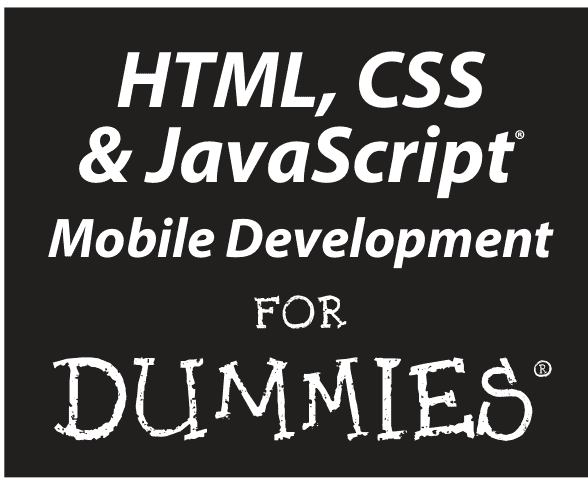


## 关于作者

**William Harrel** 拥有近 25 年的数字设计经验。他是桌面计算机出版领域的先驱之一，最早使用 `PageMaker` 和 `Photoshop` 这两款最初的数字设计和图形程序。与许多早期的“桌面出版商”一样，随着万维网的出现，他发现转向网页设计是合乎逻辑的下一步。他的设计公司设计了数百个网站、Flash 网站和电子文档。他早先关于 `Photoshop`、`PageMaker` 和数字媒体的著作是这些主题的首批出版物之一。

William Harrel 已撰写或合著了 19 本关于设计印刷媒体和电子文档（如网站、PDF、Flash 网站和 Flash 应用程序、幻灯片和多媒体演示）的书籍，涵盖 `Photoshop`、`Acrobat`（*Acrobat For Dummies*）、`PageMaker`、`Flash`、`Director` 以及其他几个图形和出版软件包。

他最新的在线课程——Adobe Flash CS4 入门、Adobe Flash CS5 入门、Adobe Flash CS4 中级和 Adobe Flash CS5 中级——目前正在超过 2,500 所学院和大学开设。这些是完全认可的课程，提供关于 Flash 的深入指导，包括为手持设备开发 Flash 应用程序的课程。

他还撰写了数百篇杂志文章，主题涵盖 Mac、PC 和其他硬件评测，以及各类软件包——包括页面排版、图形、网页设计、Flash、多媒体和文字处理——发表于 *PC World、Home Office Computing、Compute、Windows Magazine、Publish、Entrepreneur、Home Office* 等许多知名杂志。他目前为 *Computer Shopper* 评测打印机、笔记本电脑和平板电脑。

Harrel 的博客 Communications Technology Watch（`http://commtechwatch.com`）是关于计算机设计和媒体信息的知名来源。Communications Technology Watch 包含大量关于使用 Flash 和其他应用程序的材料，包括 Adobe Creative Suite 中的大多数程序。

William Harrel 还曾是一家全国性互联网服务提供商（ISP）的所有者兼经营者长达 14 年。除了托管数千个网站外，他的 ISP 公司还设计并维护了数百个客户的网站。该公司还专注于互联网协议语音（VoIP）电信技术，其中包括（部分）设计 Web 应用程序，将移动设备集成到客户的 VoIP 电话系统中。

Harrel 担任其设计公司的经理兼首席设计师已超过二十年。该公司为 California Spine Institute、当地红十字会分会、当地麻醉品匿名互助会分会以及许多其他知名公司设计了网站和其他营销材料。如今，为客户设计网站的移动版本是其公司业务的正常组成部分。

## 献词

致我可爱的13岁女儿 Samantha，感谢你对我长时间且时间不便地坐在电脑前工作所表现出的耐心地忍受。

## 作者致谢

如果不是因为 Wiley 出版社的优秀同仁们，包括 Katie Feltman, Christopher Morris, Barry Childs-Helton, Debbye Butler, Brian Walls 和 Ronald Norman，这本书是不可能完成的。这类项目需要每个人的艰苦努力。感谢你们的辛勤工作，将本书打造成为一部顶尖的出版物。

同时感谢 sunlight.com 的 Bill Sanders 在本书 JavaScript 章节开发中提供的巨大帮助。如果没有他的贡献，这本书在移动网站开发方面的完整度将远不及现在。Bill 在接到通知后立即介入并提供帮助，我对此深表感激。

我的家人同样值得衷心的感谢，因为他们忍受了我为了完成如此规模的项目而付出的漫长且离谱的工作时间。他们已经陪我经历了 19 次这样的过程。我希望他们能明白我是多么真诚地感激他们。

最后，感谢我多年来阅读过的所有书籍的作者——其中很多是 Wiley 出版社的出版物。这些书让像我这样自学成才的设计师能够学习在当今高科技信息技术时代生存所需的知识。我为能加入他们的行列而感到自豪。我可以亲身证明，这些艰苦的工作——编写这些冗长且高度技术性的出版物所付出的心血——确实为信息技术的进步以及许多设计专业人士的职业生涯做出了宝贵贡献。谢谢。

## 出版商致谢

我们为这本书感到自豪；请将您的评论发送至 `http://dummies.custhelp.com`。对于其他意见，请联系我们的客户关怀部门，美国境内请拨打 877-762-2974，美国境外请拨打 317-572-3993，或发送传真至 317-572-4002。

帮助将本书推向市场的部分人员包括以下人员：

### 收购、编辑和垂直网站

| 角色 | 姓名 |
| :--- | :--- |
| 高级项目编辑 | Christopher Morris |
| 项目协调员 | Kristie Rees |
| 高级收购编辑 | Katie Feltman |
| 文字编辑 | Barry Childs-Helton, Debbye Butler, Brian Walls |
| 技术编辑 | Ronald Norman |
| 编辑经理 | Kevin Kirschner |
| 编辑助理 | Amanda Graham |
| 高级编辑助理 | Cherie Case |

### 排版服务

| 角色 | 姓名 |
| :--- | :--- |
| 排版与图形 | Lavonne Roberts, Corrie Socolovitch |
| 校对 | ConText Editorial Services, Inc. |
| 索引编制 | Potomac Indexing, LLC |
| 垂直网站项目经理 | Laura Moss-Hollister, Jenny Swisher |
| 监制 | Rich Graves |
| 垂直网站助理监制 | Josh Frank, Marilyn Hummel, Douglas Kuhn, Shawn Patrick |
| 封面照片 | © istockphoto.com / Ali Mazzrae Shadi; © istockphoto.com / David Humphrey |
| 漫画 | Rich Tennant (www.the5thwave.com) |

### Technology Dummies 出版与编辑

| 角色 | 姓名 |
| :--- | :--- |
| 副总裁兼执行集团出版人 | Richard Swadley |
| 副总裁兼出版人 | Andy Cummings |
| 执行收购总监 | Mary Bednarek |
| 编辑总监 | Mary C. Corder |

### Consumer Dummies 出版

| 角色 | 姓名 |
| :--- | :--- |
| 副总裁兼执行出版人 | Kathy Nebenhaus |

### 排版服务

| 角色 | 姓名 |
| :--- | :--- |
| 排版服务总监 | Debbie Stailey |

## 索引.................................................................................................................................. 393

## 引言

当我刚开始撰写关于网站设计的内容时，主要的设计考量之一是如何补偿低带宽和低分辨率显示器的问题。创建网站是在视觉内容——图像、声音和视频——与构成网页的文件总体积之间进行权衡。然而渐渐地，电脑屏幕分辨率越来越高。高速互联网连接也日益普及。网页设计师得以解放，去创建高度视觉化的网站，包含数字视频、Flash 内容和大量图像。

随后，支持网络的移动电话和其他移动设备登上了历史舞台——它们的屏幕更小、分辨率更低，带宽更小，处理器也更弱。现在，设计限制比互联网诞生之初还要严苛。媒体文件必须更小，而我们习惯部署的众多功能——大而精美的图像、数字视频、Flash 内容——在这些小型设备上几乎没有支持。

好消息是移动技术正在飞速进步。最新一代的智能手机和手持电脑——平板电脑——拥有出色的高分辨率屏幕。处理器日新月异。最新一代的 iPhone、iPad、安卓智能手机和平板电脑几乎支持桌面电脑支持的每一项网页功能。它们还支持 Wi-Fi 以及 3G 和 4G 数据网络。为这些设备设计已经不再是一种克制的练习。

不过，并非每个移动用户都用上了最新一代的手持设备。这就是为什么本书兼顾回顾与展望。为了让尽可能多的移动用户能够浏览你的网站，你确实需要创建既能利用最新技术、又能兼容旧技术的页面。创建满足新设备用户期望的移动网站很重要，同时，也要弥补旧设备的局限性。

## 关于本书

我设计*《HTML、CSS 和 JavaScript 移动开发入门》*的目的是覆盖 10 年间的支持网络的手持设备谱系——从早期几乎不支持网络的普通功能手机，到最新一代的闪电般快速的智能手机和平板电脑。这涵盖了广泛的技术。本书旨在教你如何为所有这些设备设计和开发网站及网络应用。

尽管本书的基础内容在前，然后逐步进入更高级的主题，但每个部分都是独立的——你不必从头到尾阅读全书来找到你需要的解决方案。比如说，如果你想为移动网站创建联系表单，可以直接跳到第 9 章。你想学习 JavaScript 的基础知识？翻到第 3 章即可。

你更愿意循序渐进地学习网页开发，从基础概念到更复杂的内容——就像网页设计课程一样？本书的编排也能让你这样做。只需从第 1 章开始。

## 你可以不读的部分

真正的问题是你为什么买这本书？它包含几个面向任务的章节，旨在帮助创建特定的手持设备网络应用。如果你不打算在移动网站上销售任何东西，那就别看第 17 章了。如果你没有时间和意愿创建多个版本，那就别看第 5 章和第 6 章。

换句话说，使用目录和本引言中的“本书的组织结构”部分来确定哪些章节能帮助你实现目标。不想读的就别读了，我不会知道的。

## 本书使用的约定

*约定*是一个表示*惯例*或*标准*的术语。既然它是一个术语，我就选择定义它（因为我想也许你不知道这个术语），用斜体表示。用斜体介绍新术语是本书的约定之一。以下是其他一些约定：

- URL（网址）、代码、文件名、计算机文件夹名称、链接、菜单命令和电子邮件地址用`这种等宽字体`显示，以便你轻松识别和查找。
- 当我以分步演示的方式展示如何做某事时，这些指令用**粗体**表示；我要求你输入的单词、短语、URL 和其他内容也用粗体表示。
- 当我以分步方式教授程序时，我使用编号列表，以便你更容易跟上。

## 天真的假设

互联网上的许多网页在某些手持设备上显示不佳。然而，随着移动设备能力越来越强，网站对移动设备越来越友好，这种情况——就像互联网技术世界中的其他一切一样——正在迅速改变。

本书假设你几乎没有网页设计经验。只要你知道如何打开电脑，并且对计算机如何存储和整理文件有基本的了解，你就应该能够使用本书。

然而，网页设计不会在真空中发生。创建网页通常需要许多其他技术或程序的协助，例如图形编辑器、数字视频编辑器和 Flash 应用。很大比例的设计师使用 Adobe Dreamweaver 设计网站（我也是）。如果你不熟悉这些应用以及它们创建的文件类型，你很幸运。有一大批“傻瓜书”可以帮助你。

本书介绍了几种高度复杂的网络技术，如 HTML、CSS 和 JavaScript。本书不是其中任何一种的完整手册或参考大全。相反，它是一本面向任务的参考书，提供你完成任务所需的信息。不过，我确实为你提供了几个描述这些技术的页面链接。如果你有兴趣深入学习这些技术中的任何一项或全部，你可能会发现 Ed Tittel 和 Jeff Noble 的*《HTML、XHTML 和 CSS 全能入门》*等书籍很有帮助。

## 本书的组织结构

*《HTML、CSS 和 JavaScript 移动开发入门》*是一本完整的参考书，旨在让你无需阅读整本书就能完成特定的网页开发任务。然而，如果你对手头的主题没有经验，你可能会发现需要参考前面的部分来帮助补充你对所讨论概念的了解。当我认为你可能需要额外信息时，我会为你提供包含该信息的部分的参考。

本节概述了五个部分以及每个部分包含的内容。每一章都以对该章内容的介绍开始。有些章节有完成任务的分步说明，有些章节则从多选项、你想实现什么的角度描述完成任务的方法。

## 第 1 部分：最初，还没有移动设备……

第 1 部分首先向你介绍普通移动设备用户，以及他们的上网习惯与普通台式机或笔记本电脑用户有何不同。然后你会看到 HTML、CSS 和 JavaScript 的概览——这三种技术是做什么的，以及它们如何协同工作来创建网站。本部分最后介绍设计软件、工具以及许多其他可帮助你成为 Web 开发者的资源。

## 第 2 部分：创建移动网站

在第 2 部分中，你将直接开始创建一个移动网站。首先探讨为手持设备设计与为标准计算机设计有何不同。然后学习如何引导移动流量访问你的移动页面，以及如何根据移动设备的类型和功能创建不同的页面组。本部分最后通过练习创建你网站的主页——网站的第一页——以及如何设计模板系统来完成网站的其余部分，并在未来修改和添加内容。

## 第 3 部分：通过高级交互性和多媒体增强你的网站

在本部分中，你将学习如何让你的移动网站“唱歌”和“跳霹雳舞”。首先创建一个联系表单，你的网站访问者可以用它来请求关于网站或你组织的信息。然后你将快速了解如何使用数字媒体——图像、数字视频、音频和 Flash。本部分最后介绍最新的移动 Web 技术、HTML5、CSS3 和 WebKit 扩展。你将了解如何使用最新最棒的设计工具来帮助你创建外观精美的网站和交互式 Web 效果。

## 第 4 部分：构建真实世界的应用程序

现在我们谈论的是高级移动网站开发——真正能做事情的真实世界应用程序，例如使用 JavaScript 验证 HTML 表单字段，以及编写存储数据和根据用户输入做出决策的脚本。你将学习如何创建 JavaScript 测验、如何让你的网站对搜索引擎友好以便人们能够找到它，以及如何为你的网站构建搜索页面以便人们能在上面找到信息。你想在你的网站上销售商品吗？在本部分中，我还向你展示如何创建移动购物车。本部分最后讨论如何创建博客移动界面。

## 第 5 部分：十大秘诀

本部分提供了大量你应该会发现的实用内容的链接。第 18 章向你展示在哪里可以找到 10 种不同的移动模拟器，这些小型应用程序允许你看到你的网站在特定设备上的显示效果。第 19 章包含多个拥有移动 Web 模板的网站链接——有些是免费的；有些需要购买。在第 20 章中，你会找到 10 个小部件的链接，这些是可以用来创建页面元素的小型代码片段，例如菜单、Google 地图、3D 产品查看器以及其他多种有用的 Web 页面功能。

## 本书中使用的图标

与其他“傻瓜书”一样，本书在页边空白处使用了几种图标，或称为小图片，以表示有用或重要的信息。

- **提示**：提示图标表示我正在给你一条提示——告诉你关于当前主题或流程的一些信息，这些信息应该能让过程更简单或为你节省时间和金钱。
- **警告！**：这看起来很明显，不是吗？当你看到这个图标时，请阅读它！我正在告诉你一些能帮助你避免问题的信息，或者告诉你不要做某些事情以避免陷入麻烦。
- **技术细节**：好吧。从某种意义上说，这本书的大部分内容都是技术性的。当你看到这个图标时，我正在指出一些超级极客的内容，例如某些东西的工作原理，或者详细阐述一个高度技术性的过程。不过别担心，它们都简短而切中要点。我尽量不过多使用它们，因为我知道它们有点像按了贪睡按钮。
- **记住**：这个图标指出我认为至关重要的信息，一两个值得你特别关注的要点。换句话说，我认为它重要到足以让你知道并且不要忘记。

## 从这里往何处去


你想做什么？你想学习使用 HTML、CSS 和 JavaScript 的基础知识吗？如果是这样，那就从第 1 章开始，阅读它和接下来的两章。你更愿意直接深入创建一个移动网页吗？如果是这样，请翻到第 7 章。渐入佳境了吗？查看本引言中的"本书的组织方式"部分，决定你想做什么。然后，翻到那一章。

你还可以从 *HTML、CSS & JavaScript Mobile Development For Dummies* 配套网站 `www.wiley.com/go/htmlcssjavascriptmobiledev` 获取本书的代码示例。

# 第 I 部分

## 最初，还没有移动设备……

## 第五次浪潮

作者：Rich Tennant

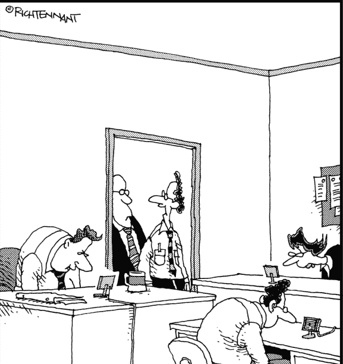

> "好消息——我们找到了功耗更低的 PC。"

## 在本部分中……

没有什么比移动技术更能代表 21 世纪了——人类的所有知识都通过你后口袋里的那个小玩意即时传递给你。作为移动设计师，你的工作是创建使这一切发生的网站。

在本部分中，你将认识并熟悉参与为手持设备设计内容的关键角色。首先，你认识关键角色——移动 Web 用户——并发现他或她与台式计算机用户有何不同。然后你认识并了解 HTML、CSS 和 JavaScript 技术——它们是什么以及它们如何协同工作。本部分最后介绍设计程序、工具和其他可帮助你成为成功 Web 开发者的软件。

## 第 1 章

## 为大屏幕和小屏幕设计网站

*本章内容*

- 分析普通移动用户
- 初识 HTML
- 了解 HTML 的局限性
- 认识 XHTML 和 HTML5

与任何一位从事网页设计一段时间的人聊聊。他们中的大多数人认同的一点是，为手持设备创建网站是向前迈进了一大步倒退。另一方面，移动用户认为能够将 Web 内容传送到他们的智能手机、PDA 和移动平板电脑上是前沿技术。对他们来说，（在这个星球上）很少有比从口袋里掏出一个小玩意、按几个按钮，然后*瞧*：你几乎能得到每个问题的答案、访问几乎任何解决方案、了解几乎每种产品的信息、访问人类积累的所有知识——位于 Web 上的那部分，不管怎样——掌握在你的指尖，更先进的事情了。

那么到底是哪一个？移动 Web 是信息技术的最前沿，还是一次回到互联网时代中世纪之旅？

在互联网早期，除了少数用户外，所有人都通过非常慢的计算机（以今天的标准而言）"网上冲浪"，这些计算机通过令人痛苦地缓慢且不可靠的拨号调制解调器连接到互联网。互联网用户不仅无休止地等待内容下载并显示在屏幕上，他们还要应对频繁的断线、过载的纯旧电话系统（POTS）网络、忙音信号以及许多其他令人恼火的不足。

# 第 I 部分：最初，还没有移动设备……

那些日子的 Web 设计是一种平衡艺术。设计师常常不得不抑制他们提供吸引人、丰富内容的愿望，转而考虑更实际的问题，例如文件大小和下载时间。直到有一天，负担得起的宽带的到来——相对快速可靠的 DSL 和有线互联网连接——以及 Web 浏览器和内容压缩技术的进步。

这些进步释放了设计精神。不再有必要为技术限制做出补偿。Web 内容从由小型图像和文本组成的适中页面，发展到丰富的、多媒体充斥的豪华页面。然后移动设备出现了，带着它们的小屏幕、慢处理器和低带宽手机网络——将网页设计几乎带回了原点。再次地，Web 设计师发现自己被限制于以小型、可管理的块提供内容，为熟悉的限制做出补偿。

在本章中，我向你介绍普通移动用户，并展示为什么为他/她设计不同于为使用台式机或笔记本电脑访问互联网的普通用户进行设计。然后我将向你介绍最基本的网页设计工具——HTML——它是什么以及它如何工作。

关于 HTML 的一句话：它最初是，并且仍然是一种基本的网页设计语言。如果没有 XHTML 和 CSS 等增强功能，它实际上并不适合移动 Web 设计。本章还简要讨论了 HTML5——Web 设计的未来——以及 HTML 的演变如何影响移动 Web 设计。

### 认识移动互联网用户

在某些方面，很难相信互联网已经存在了足够长的时间，以至于可以按代际来讨论它，或者按照*何时*开始使用互联网来对用户群体进行分类。当然，对人进行分类和概括总是有风险（尤其是谈论人的时候），但有时是必要的。不过，在我开始之前，我应该让你知道，我知道我即将做出的刻板区分正是如此——刻板印象，或泛化。（此处使用的）泛化展示了共性，但它们绝没有*定义*该类别的成员。

话虽如此，让我大胆地迈出这一步。有两种类型的移动互联网用户：

- **守旧派：** 就本次讨论而言，守旧派已经上网多年。他们在手持设备出现之前就开始使用互联网。他们习惯于大量信息通过大屏幕呈现，有大量的空间可以舒展和放松。而且他们喜欢这种方式。对他们来说，通过移动设备浏览互联网似乎，嗯，很不自然。
- **新潮派：** 新潮派——通常是守旧派的后代——在移动时代长大。对他们来说，通过移动设备访问互联网——网页、电子邮件、短信，全部内容——是事物自然秩序的一部分。他们从未经历过没有移动网络的生活，也真的不明白事情并非一直如此。

#### 守旧派的做法

守旧派，或称前移动互联网用户，有一些共同习惯和态度。关于他们，最重要的一点是，尽管他们欣赏移动技术（甚至对其 somewhat 敬畏），但这并非他们使用网络的主要方式：虽然他们在手持设备上访问网络，但他们真正希望的是坐在自己那台大而舒适的台式或笔记本电脑前。

尽管移动互联网很方便，但当你习惯了大量信息呈现在电脑屏幕上时，被 spoon-fed 小碎片信息以适应三四英寸屏幕可能会令人烦恼。许多前移动互联网用户根本不喜欢移动互联网那种简短、直奔主题、零碎的内容传播方式。

不管你喜不喜欢，不可否认的是，人越老越容易固执己见。年纪越大，越不喜欢改变。大多数前移动互联网用户已经在地球上生活了一段时间。从宽敞的 15、17 甚至 24 英寸（或更大）的显示器——配有舒适好用的键盘和极易使用的鼠标——切换到小小的手持设备，令人震惊；这是一种文化冲击体验。有点像把 SUV 换成 Smart 小车。

许多守旧派不情愿地使用移动设备访问网络。尽管他们欣赏随时随地快速获取信息，但他们宁愿不眯着眼睛看小屏幕，笨拙地操作小按钮、按键和导航轮。这是一种爱恨交织的关系——既方便又令人沮丧，同时兼具。

#### 移动互联网技术真的是一种倒退吗？

本章（以及任何其他关于移动设备设计的书籍）中大量讨论到，为移动网络设计是一种倒退。诚然，目前移动互联网技术整体上充满限制——小屏幕、小内存分配、小处理器、低带宽等等。然而，正如信息技术本身在进步，移动技术也在不断进步。

例如，硬件方面的最新改进，如一些新款 Android 手机和平板电脑，以及 iPhone 4 和 iPad，正在为移动市场带来更大、更高分辨率的屏幕、更快的处理器和更大的内存库。一些移动设备现在可以使用标准 HTML 和层叠样式表（CSS）格式，以及增强的 Flash 和数字视频播放——性能可与中档台式机和笔记本电脑媲美。

我们还看到了互联网传输网络的显著改进，例如更快的 4G 蜂窝网络的大规模扩展以及大量 Wi-Fi 热点的创建。现在在移动设备上访问移动互联网看起来像是倒退了一步，但技术本身正在快车道上变得与传统电脑一样 capable。今天我们被迫做出的妥协可能一两年后就再也不需要了。

#### 在移动时代成长

如今，大多数人认为技术进步的速度是理所当然的。但请停一停。想一想这两类用户的多样性。当前这一代人，在大多数情况下，从未见过黑胶唱片，甚至可能从未见过磁带。这一代，iPod 一代，从未听说过 Walkman CD 播放器。他们从未经历过没有移动网络的生活。对他们来说，短信不是一种新奇事物或便利设施。这是他们生活中所知的一部分。

以简短、快速迸发的方式获取信息和交流是他们生活经验的主要部分。他们用片段式思维思考。向新潮派或后移动互联网用户说声*你好*。向未来*问好*。

新潮移动用户年轻、敏捷、四处移动。他们可以在守旧派拨通电话所需的时间内，向 20 个熟人群发一条短信。新潮派的手机不是一种便利；它是附属物，是植入物；使用它如同走路、说话、吃饭一样，是第二天性。他们使用手持设备的方式与他们对待生活的方式相同：搞定它，然后继续。

即便现在还不是，新潮派很快将成为我们两大移动互联网用户群体中最大的一个。考虑到人口统计学因素（年轻与成熟），新群体无疑将是最持久的。

公司、其他实体，甚至网页设计师本身，如果忽视这个不断扩大的互联网用户群体，将自担风险。仅凭其庞大的数量，移动互联网用户就是一股不可忽视的力量——他们值得为其量身定制网页内容。

年轻且忙碌的性格中蕴含着一种缺乏耐心。这些互联网用户不喜欢等待。面对一个充满巨大、笨重页面、需要 forever 才能下载的网站——或者即使加载了也不适合移动设备——移动互联网用户就会离开。（说到等待内容下载，没人喜欢那样。新潮派和*守旧派*在这方面有共同之处。）

因此，作为网页设计师，你的工作就是给那些游牧式网页用户他们想要的——以他们想要的方式——快速。除了教你如何使用 HTML、CSS 和 JavaScript 创建适合移动设备的网页之外，我的工作还要向你展示如何创建移动互联网用户愿意留下来实际使用的网站。

## 为移动设备设计

尽管移动互联网用户的需求往往与通过台式机和笔记本电脑访问网络的用户不同，但实际上只有一个网络。如此多类型移动设备的出现，都在访问网络，这确实改变了游戏规则。这让我想起那个时代，当时世界上大多数人通过电话拨号连接访问互联网。

在那些日子里，我们经常为同一个网站设计两个或更多版本，然后为用户提供链接，将他们引导到针对其连接速度优化的网站版本。（见图 1-1。）

尽管为移动设备设计不会把网页设计拖回到那么远，但那个时代的设计关注点有两个又回到了我们面前：为移动网络设计迫使我们在内容之间取得平衡和妥协，并聚焦于预期信息。

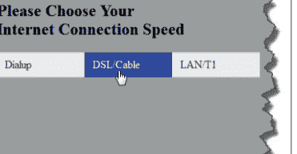

**图 1-1：** 允许用户选择最适合他们的网站。

### *平衡与妥协*

最近我读了一位著名小说作家的采访，采访中，在讨论作者最新小说的故事情节时， interviewer 问道："那么，是什么让你决定把这个故事写成小说？"

作者回答："我没时间写一个短篇故事。"

表面上，这个回答似乎毫无意义。一个几千字的短篇怎么可能比一个几十万字的小说花更多时间去写呢？作者当然是在开玩笑，但 point 是，短篇故事需要更多对故事构思和细节的关注。逐字而言，短篇故事工作量更大。

为移动网络设计也是如此。平衡与妥协——尽可能简洁地提供最重要的信息——当你为小屏幕设计时优先级高得多。通常，决定*不*包含什么——哪些图像、Flash 内容、数字视频等要省略——需要 painstaking 评估，以及一种不带感情色彩、愿意砍除所有但最相关信息的态度。

### *聚焦信息*

这看起来多余吗？平衡与妥协和聚焦信息不是一回事吗？嗯，算是吧。我所说的*聚焦信息*是指确定信息——最重要的要点，或结论——是什么，然后首先提供该信息。

报纸文章就是很好的例子。它们的写作基于这样一种理解：许多读者不会读完整篇文章，正如移动互联网用户很可能不会阅读（或关注）你移动网站上的所有信息——甚至不会读完主页上的所有材料。专业记者构建他们的故事，使故事的精髓——文章的要点和结论——在前几段中就阐明。剩余的信息充实或支持开篇段落中得出的结论。

这种技巧——用我的一位作文老师的话来说：*告诉他们你要告诉他们什么。告诉他们，然后告诉他们你告诉过他们*——是一种非常实用的方法，不仅适用于移动网站设计，也适用于所有网站设计。当然，当你考虑到典型移动网站的有限空间，以及移动互联网用户直奔主题的心态时，就值得自律，密切关注*如何*呈现网站的信息，这可以决定你设计的成败。

许多新手设计师（不仅仅是网页设计师，而是所有类型的文档设计师）用各种各样令人印象深刻的图像、Flash 特效和一大堆其他设计元素来 overload 他们的作品，以炫耀他们新学到的技能。嘿，为什么不呢？把学到的付诸实践。但如果你*真的*想展示自己作为移动网页设计师的能力，那就把关注展示效果和信息流作为优先事项。

## HTML简介

HTML代表*超文本标记语言*。虽然存在多种网页标记语言，但HTML，或其某种变体或扩展，迄今为止是互联网上占主导地位的标记语言。

在我开始讲解HTML是什么以及它的作用之前，我应该先澄清一个常见的误解：HTML不是一种编程语言。事实上，它根本不算是一种"语言"；它不能告诉你的计算机该做什么。（是的，我知道我在本章引言里说过什么。我不会再说了。但我们只能继续使用这个术语，好吗？）相反，HTML是一种*页面标记语言*，也称为*页面描述语言*：它不是发出命令，而是为网页浏览器描述页面。浏览器解释这些描述，并将其显示在计算机或移动设备的屏幕上。

### 为浏览器描述页面

即使这个定义——*为网页浏览器描述页面*——也是过于简化的。毫不夸张地说，HTML告诉浏览器关于页面的所有信息，从页面使用什么类型的HTML，或HTML的扩展（如XHTML和CSS），到如何在页面上格式化和显示单个元素，如文本和图像。（是的，我知道我同时向你抛出了一堆缩写和术语。我会在讲解过程中定义它们——很快，我保证。）

### 构建基本HTML页面结构

无论你的HTML网页是简单还是复杂，它们都以相同的基本结构开始——四个基本*标签*（标签在本章后面讨论），如清单1-1所示。

#### 清单1-1：基本HTML页面

```
<!DOCTYPE html PUBLIC "-//WAPFORUM//DTD XHTML Mobile 1.0//EN" "http://wapforum.org/DTD/xhtml-mobile10.dtd"> 
<html xmlns="http://www.w3.org/1999/xhtml">
<head>
<meta http-equiv="Content-Type" content="text/html charset=utf-8" />
<title>世界上最好的移动网站</title>
<link href="/styles.css" rel="stylesheet" type="text/css" media="handheld" />
</head>

<body>

</body>

</html>
```

- **第1行（doctype）**：`doctype`标签在第7章中讨论，描述页面使用的HTML类型。
- **第3行和第15行（`<html></html>`）**：`<html>`标签对在第7章中讨论，它有几项功能，但最重要的功能是指示页面的开始和结束。你将所有关于此页面的信息——以及页面上的所有元素，如文本、图形和其他媒体——放在这两个标签之间。
- **第5行和第9行（`<head></head>`）**：`<head>`标签对在第7章和第12章（以及其他几个章节）中讨论，它保存*关于*页面的信息，包括页面标题、帮助搜索引擎索引网站的元数据，以及更多更多内容。（不过，这可能是最简化的定义了。）虽然也有例外，但在大多数情况下，`<head>`标签保存不显示的页面数据。
- **第11行和第13行（`<body></body>`）**：`<body>`标签对标记页面内容的开始和结束，即在页面上显示的元素。虽然也有例外（不总是这样吗？），但大多数显示在你的页面上的图形、照片、视频和文本都放在（`<body>`）标签对之间，如图1-2所示。

> ### 玫瑰无论何名
>
> 到目前为止，你已经看到我将出现在网页上的内容——如文本和图形、视频等对象——称为*元素*、*对象*和*内容*。而这才刚刚开始！那么它们真正被称为什么呢？对于显示在网页上的对象，实际上并没有一个能涵盖所有情况的技术术语。在进入下面关于HTML标签的讨论之前，我想我应该先澄清这一点。

在`<body>`标签之间

### 为浏览器描述页面对象

HTML不仅为浏览器描述网页；它还描述或格式化页面上的对象或内容。例如，在图1-3中，`<b></b>`和`<i></i>`标签告诉浏览器以粗体斜体显示文本。

### 理解HTML标签

HTML，如本章前面所讨论的，为网页浏览器（如Internet Explorer（IE）和Firefox）描述网页。HTML是用HTML*元素*编写的，这些元素由尖括号（即大于号和小于号）括起来的*标签*组成，如下所示：`<tag>`。

例如，段落标签`<p>`表示新段落的开始，如下所示：

```
<p>段落文本。</p>
```

HTML页面上没有标签就什么都没有。HTML标签承担了所有繁重的工作——一切事务，包括设置页面（本章前面讨论过）、描述用于格式化页面的HTML类型、在哪里找到支持文件（如CSS样式表文件，在第2章、第4章和第7章中讨论），以及单个页面对象的格式化（见图1-4）。

#### HTML标签的解剖

许多标签支持属性，或称为*属性*。属性提供额外的信息，如如何格式化对象、在哪里找到文件，或在页面上哪里显示对象。例如，下面的段落标签包含`"center"`属性，它告诉浏览器将段落居中：

```
<p align="center">段落文本。</p>
```

虽然存在少数变体，但属性通常如前面的示例所示编写，即由等号（=）分隔的*名称-值对*。在该示例中，`align`是*名称*，`"center"`是*值*。

##### 用标签格式化文本

与大多数计算机上格式化文本的方法一样，HTML从默认设置开始——一切总得有个起点，对吧？用计算机术语来说，*默认*的意思是：*除非被告知做其他事情，否则就这么做*。除非另有指示，浏览器将所有文本显示为正文文本，或使用段落标签`<p>`格式化的文本。

`<p>`标签的默认属性，如字体、大小、颜色等，由浏览器决定。开箱即用，除非用户更改，在大多数Windows浏览器中，默认字体（或称字体样式）是Times New Roman；在Mac上，是Times。在每种情况下，字体大小和颜色都是基础（默认）字体。每当你用标签格式化文本时，你实际上是在修改或覆盖基础字体。例如，在下面的`<font>`标签中，三个属性`face`、`size`和`color`覆盖了所有基础设置，并将文本更改为白色、18磅Arial：

### 关于HTML标准的一点说明


HTML 起初是一种非常简单的、非常宽松的标记语言。例如，当你使用基本 HTML 格式而不使用 XHTML（本章稍后讨论）或某些其他扩展或增强时，标签可以用“松散”格式编写。另一方面，XHTML 强制你小写编写标签。基本 HTML 支持大写和小写，甚至是组合，如`<P></p />`。

HTML 也不强制你关闭标签。例如，你可以用一个单独的`<p>`标签开始新段落，在开始前一个段落（`</p>`）之前不需要关闭它。但有一个问题：如今很少有网页是用基本 HTML 编写的，主要是因为仅凭自身 HTML 不够健壮（功能不够），以及为了避免这些松散的标准。

格式化文本当然是创建网页非常重要的一部分，我们在本书的多个地方会重新讨论这个话题。

### 标签标记其他标签再标记其他标签

标签不仅能修改和覆盖默认设置；它们还能修改和影响其他标签的行为。标签以自上而下、层次化或构建模块的方式格式化对象。根据它们在页面上的位置和放置方式，浏览器会不同地读取和使用它们。（第 2 章描述浏览器如何读取和应用标签来格式化页面。）理解标签之间的这种动态关系，随着你的网页变得越来越复杂，变得越来越重要。

这里有一个简单的例子。在这个例子中，`<p>`标签及其属性设置了默认段落文本，然后`<font>`及其属性覆盖了默认设置：

```html
<p align="center"><font face="Arial" size="18" color="#FFFFFF">用HTML格式化的文本</font></p>
```

图 1-4 显示了第二个标签及其属性如何修改第一个标签。

### 媒体格式化标签

媒体——这个词在计算机界被频繁使用。根据上下文，对不同的人来说意味着不同的东西。在这个语境下——网页内容——媒体指的是加载到 HTML 页面中并在其中显示（或播放）的特定类型的计算机文件。最常见的媒体文件类型是图像（或图形）；Flash 电影和动画；以及数字视频、3D 动画和声音文件。

与直接键入 HTML 页面中从而成为 HTML 文件一部分的文本不同，媒体文件存放在别处：你使用标签将页面链接到它们；如果它们是嵌入的，你使用标签来格式化它们。它们作为单独的文件保存在 Web 服务器上，并在运行时，或当用户的浏览器加载网页并读取标签时，从服务器请求该文件，并在页面上显示（或播放）它，按照标签内指定的格式进行格式化。

### 第一部分：起初，还没有移动设备……

媒体类型决定了你使用哪些标签。例如，要在页面中嵌入图像，你需要使用``标签，如下所示：

```html

```

这个名称-值对当然就是`img src="img02.jpg"`。`width=`和`height=`属性设置了图像的宽度和高度。例如，在这种特定配置中，你可以通过更改这些属性的值来调整页面上的图像大小，就像这样：

```html

```

图 1-5 展示了调整属性如何改变图像的显示方式。

使用标签属性来调整媒体大小是一个非常方便的技巧，尤其是在为移动设备设计时（我们在第 10 章讨论）。然而，只要可行，最好还是按照 1:1 的显示尺寸比例来嵌入媒体。换句话说，在你创建媒体的应用程序中——将图像、Flash 动画、数字视频或其他任何内容——调整到你目标移动设备的大小，**然后**以该尺寸在网页中显示嵌入的媒体。为什么要这么麻烦呢？嗯，让用户的浏览器来调整嵌入媒体的大小有时会产生意想不到的结果，通常不是令人愉快的结果。

此外，当你将大型媒体文件调整大小以在小屏幕上显示时，请记住文件本身的大小和以前一样：无论你在显示时对媒体文件施加什么尺寸，浏览器仍然必须下载整个文件，如果它需要调整图像大小的话。例如，在 320x240 的屏幕上显示 640x480 的图像会迫使移动设备下载两倍于显示图像所需的数据量。图 1-6 说明了这一点。

## 第 1 章：为大小屏幕设计网站

图 1-5：调整标签属性如何重新格式化图像显示的示例。

图 1-6：让浏览器重新格式化过大的图像会迫使你的移动设备下载远远多于显示媒体所需的数据量。

### 链接到其他页面和 URL

如果没有对链接的支持，网络就不会是今天的网络。链接当然就是我们点击的菜单、按钮和文本字符串，用于导航到互联网上的其他页面。与 HTML 网页上的所有其他内容一样，链接也是用标签创建的——更具体地说，是`<a> href`和`</a>`标签对。这两个标签之间的数据成为可点击的链接，如下所示：

```html
<a href="http://www.AnyURLOnTheInternet.com">可点击的链接</a>
```

要将图形变成按钮，你只需将嵌入图形文件的标签（如前一部分所述）放在`<a> href`和`</a>`标签之间，如下所示：

```html
<a href="http://www.AnyURLOnTheInternet.com"></a>
```

当然，关于链接还有很多内容，本书的多个章节都有涉及，包括第 7 章和第 10 章。

### HTML 的局限性——一切上桌

信不信由你，曾几何时，前一节描述的基本 HTML 元素几乎就是创建网页的全部。事实上，前面的几页描述了你真正需要了解的所有内容，足以创建一个基本网页。此外，你使用前一节的信息创建的任何页面都很可能显示在支持网页浏览的任何移动设备上。至于它看起来好不好，那是另一个问题。

简单，对吧？但它也相当有限。这组简单的格式化标签让你对页面的布局和功能控制甚少。早期的网页由一个接一个垂直排列在页面上的对象组成——它们通常相当无聊且无吸引力。幸运的是，时间继续前进，HTML 也是如此。

HTML 的早期更新之一是增加了 HTML 表格。你知道表格是什么。你可能在 Word 或 Excel 中使用过它们来显示表格数据或创建电子表格。最初，这一功能——显示表格数据——就是向 HTML 标记语言添加`<table>`标签的全部原因。但富有创新精神的设计师们 figured out 如何使用这些同样不起眼的标签来安排页面上的对象，以创建更复杂、更吸引人的布局。

#### 更多的表格以及表格中的表格中的表格

如果你对 HTML 表格有任何了解，或者对任何程序的表格功能有所了解，那么将不同对象放在表格单元格中以将它们锚定到页面上的位置的概念可能看起来很简单。虽然概念本身相当简单，但 HTML 嵌套表格的能力以及设计师对艺术自由的坚定执着，将这种方式的页面布局变成了一种艺术。

设计师们开始创建整个图形界面，将它们逐片拆解，然后用 HTML 表格重新组装。Photoshop、Illustrator 和其他媒体应用程序（如 Flash）开始支持 9 切片缩放，这基本上允许你在一个程序中将图像或作品切片，然后将它们保存在复杂关联的 HTML 表格单元格中。

图 1-7 所示的网页展示了被切割并保存在表格单元格各部分的网页。所有倒角框都代表表格单元格。注意某些对象位于四到五层表格之深的单元格中。

表格单元格

图 1-7：表格中的表格中的表格。

#### 表格太多，但还不够

虽然使用表格设计布局确实有效，但它可能耗时且繁琐。它还需要太多的代码，并且存在一些严重的限制，例如无法精确控制单元格填充和边距。

这种做法已被 CSS`<div>`标签容器所取代（第 2 章一般性讨论，第 7 章详细讨论）。CSS 容器比表格更可取，原因有几个。例如，CSS`<div>`标签容器允许你编写一组格式化指令，可以在一个页面上的多个位置或多个页面中使用。这使你只需编辑一组指令就能更改多个页面，这是 CSS 的主要吸引力之一。

> **记住**
>
> CSS，即层叠样式表，在第 2 章讨论，不是 HTML。它是 HTML 的附加组件或扩展，允许你对 HTML 页面及其内容执行额外的格式化。CSS 大幅扩展了你的页面和内容格式化选项。它还提供了比标准 HTML 其他几个巨大的优势，如第 2 章和第 7 章所述。

### XHTML 和 HTML5 简介

从技术上讲，HTML 已经过时了。如今，XHTML，代表 *eXtensible HyperText Markup Language*（可扩展超文本标记语言），是 Web 上推荐使用的（参见旁边启发性的边栏）和最广泛使用的页面标记语言。XHTML 源于 XML，这是 HTML 更严格、更健壮的扩展。XHTML 不仅扩展了 HTML 的设计可能性，而且它对 CSS 的支持（在第 2 章讨论）也大大增强了网页设计的可能性。XHTML 对更严格的“格式良好”标签结构的遵守也确保了与各种设备——*尤其是移动设备*的更大兼容性。

#### 基于设备配置文件设计网站

简而言之，我们今天使用 XHTML 而不是 HTML 是因为它*更好*。其更严格的标准确保了跨设备类型的更高兼容性，而且它对 CSS 的支持大大扩展了网页和网站设计的可能性。*XHTML 更强大*的一个例子，尤其是在移动网页设计中，是它对设备配置文件的支持。

##### 为特定设备设计

本书的大部分内容涵盖了如何创建为在不同类型的移动设备上最佳工作而设计的网页。这个过程的一部分涉及设计同一网站的不同版本。有几种方法可以做到这一点；这些技术范围从相当简单的——适用于许多移动设备的通用方法——到复杂的设备分析系统，这些系统引用数据库并决定使用哪个设备“配置文件”来显示网站的特定版本。

评估设备、确定其能力以及基于设备配置文件设计网站的详细内容在第 5 章和第 6 章中介绍。

第一章：为大屏和小屏设计网站 25

## 标记语言是如何被“推荐”的？

当你听到老师、作家或某种技术专家发表类似“如今，XHTML……是**推荐**且使用最广泛的网页标记语言”这种笼统的说法时，你会停下来思考是谁做出了这些推荐吗？我会。一种标记语言是如何比另一种更被*推荐*的？是否有一个全知的、掌控网页标记语言的高级权力机构在从高处颁布法令？

嗯，并非完全如此。在监督和开发网页标记语言方面，如果你愿意的话，最终的权威机构是万维网联盟，即 *W3C*。W3C 是一个由几百名（大部分是）志愿者组成的委员会，他们分析并开发网络标准。早在 2000 年 1 月，他们就推荐我们都开始使用 XHTML 1.0。随后在 2001 年 6 月，他们推荐了 XHTML 1.1。

对于某些人，尤其是初学者网页设计师来说，这种由不同版本和类型的标记语言——XML、HTML、XHTML、CSS、XHTML-MP（移动配置文件）等——组成的大杂烩，让网页开发看起来再次像是一个混乱的“西部荒野”。坦率地说，如果没有 W3C 的指导，针对当今所有不同设备的网页开发将成为一个更加难以捉摸的目标。W3C 的监督确实让这个“巨兽”处于可控状态。

此外，它正在持续开发最新的标准 HTML5（在本章稍后讨论），该标准将 HTML、XHTML 和 CSS 整合进一种强大且全面的网页创作标记语言中，有望进一步标准化网页设计——尤其是移动端网页设计——并为网络带来显著的设计能力。如果你想了解更多关于 W3C 的信息，查看标准是如何开发的，参与讨论，或者成为该联盟的成员，你可以访问 W3C 的网站（`www.w3c.org`）。

#### XHTML MP

XHTML MP 代表 XHTML Mobile Profile（XHTML 移动配置文件），是一种专门为手机设计的标记语言。它是由开放移动联盟 (OMA) 定义的一种 HTML 文档类型（doctype）。与 W3C 类似，OMA 由一群对移动市场感兴趣的公司在 2002 年 6 月共同创立——涵盖了从运营商（如 AT&T、Verizon 和 Sprint）到手机制造商（如诺基亚、三星、爱立信等），再到移动软件供应商（如微软、苹果和谷歌）。

OMA 的目标是将所有移动设备的 XHTML 标准化。你可以想象，OMA 在为手机和其他移动设备开发网站方面发挥着重要作用。XHTML MP 将在第 2 章和第 6 章中讨论。

26 第一部分：起初，并没有移动设备……

### 介绍 HTML5

如果你开始怀疑为移动设备创建网站是一个不断变化的目标，那么你是对的。在许多方面确实如此。由于有这么多能力迥异的不同设备，以及如此多的页面标记标准和版本，能够让它们在不仅仅是几个设备上正常运行，这本身就令人惊讶。为什么会有这么多变动？为什么我们不能就定下一个优秀的 HTML 标记标准，开发它并一直使用它呢？

每一个参与网页设计的人都深知这些不同标准带来的不一致性和挑战；诚然，这对于现代网页设计来说是一种过于碎片化的方式。移动网络的出现——尤其是移动设备的多样性——使得这些缺陷变得更加明显。

大约在 2004 年，将完全开发的 HTML 页面重新连接。虽然在这一新标准完成并被采纳之前可能还会过去几年，但 HTML5 的许多部分已经完成、被宣布为稳定并被采纳——它们已经投入使用了。一些智能手机，如 iPhone、Droid、大多数新平板电脑以及其他几种设备已经支持部分 HTML5 规范。

在我撰写本书时，推测 HTML5 将在 2012 年的某个时间达到候选推荐 (CR) 状态。CR 状态类似于软件应用程序的 beta 测试版本：HTML5 将发布给开发社区——由他们反过来评估该候选版本是否准备好实施。在 CR 期间（可能持续数年），该标准的更多内容将变得普及。

当我们在这本书中学习如何使用 HTML 和 CSS 时，我会指出你可以在何时何地使用 HTML5，并向你简要介绍为什么这个新标准比目前使用的 XHTML 标准更好。同样，你可以在第 11 章中找到关于 HTML5 的详细讨论。

## 第 2 章：使用层叠样式表 (CSS) 为 HTML 带来更多功能

### 本章内容

- 理解 CSS
- 结合 XHTML 和 CSS
- 创建 CSS 布局
- 了解 CSS 版本

层叠样式表，层叠样式表——对于一种页面标记语言（或者更准确地说，一种样式表语言）来说，这是一个听起来非常高级的术语。它听起来更像是一种艺术形式，或者某种古典音乐术语，比如 *渐强 (crescendo)*、*共鸣 (resonance)*、*抑扬顿挫 (intonation)*，或者音乐鉴赏课上那些令人印象深刻、悦耳的术语之一。它唤起的是一种意象：一层层级联的样式表。但实际上，“层叠 (cascade)”本质上是一种优先级方案，决定了规则如何应用以及应用的顺序。

例如，如果一个页面元素被分配了多个规则，浏览器会计算一个优先级级联（或权重）来决定应用哪个规则：优先级越高意味着权重越大；可以将高优先级想象成压在肩膀上的重量。

因此，所有这些“层叠”的目的在于可靠性——或者更准确地说，是可预测性。这对你——网页设计师——意味着，与纯 HTML 相比，CSS 是一种更可靠（且更灵活）的创建网页的方式。

虽然 CSS 优于标准 HTML 的原因很多，但其中一个更有说服力的原因是，与 HTML 表格（在第 1 章中讨论）不同，CSS 允许你将内容与用于格式化的标签和其他代码分离开，同时也与内容所在的页面分离开。本章将向你展示这种安排如何运作——以及为什么它优于标准 HTML。

我们还将研究如何创建 CSS 容器，它们类似于 HTML 表格单元格，但灵活得多。我们还会讨论 CSS 的不同版本，包括一些不断演进的移动标准，以及不同类型的样式表。

### 理解 CSS

简单来说，CSS 是一种样式表语言，用于描述用标记语言（通常是 HTML 或 XHTML）编写的文档的外观和格式。它也适用于用 XML (eXtensible Markup Language) 编写的页面，你可以使用 CSS 来格式化 Flash 动画中的文本以及许多其他应用程序。层叠样式表有助于布局页面，各种类型的页面都可以，但最常见的是网页。样式表包含样式，而样式是指令列表，例如用于格式化页面元素的尺寸、颜色、位置、字体等。

这种创建并保存格式化指令以应用于多个对象（通常跨多个页面或文档）的概念，既不是新鲜事，也不是网页设计所独有的。如果你使用文字处理软件，如 Microsoft Word 或 Apple Pages，你可能熟悉文字处理软件中的“样式”版本。页面布局软件，如 Adobe InDesign 或 Microsoft Publisher，同样使用样式。你可能熟悉的其他程序，如 Photoshop 或 Flash，使用一种称为 *预设 (presets)* 的就绪样式形式。

### 换个名字也是样式

一个样式（style）是一组文本格式化指令，例如字体、颜色、大小等。层叠样式表还可以格式化页面和容器（即页面区域或盒子，如本章稍后讨论的侧边栏）；此类指令包括背景颜色和页边距。通常，与文字处理软件中的工作方式非常相似，样式在全局范围内发挥作用；然后你可以在局部覆盖部分或全部格式化指令。

哈？我的意思是：例如，你创建了一个样式，将所有正文（`<body></body>`）或段落（`<p></p>`）文本设置为 Arial，12 点，常规体。不可避免地，某些词语或短语需要进一步的格式化，例如加粗或斜体。就像在文字处理软件中一样，你可以将这些更具体的更改——覆盖原有样式——直接应用于你想要加粗或倾斜的文本。

不过，巨大的区别在于（除非你使用 Dreamweaver 或其他支持 CSS 的网页设计软件，如我在第 4 章中讨论的那样），你是通过 XHTML 和 CSS 标签来应用格式的，而不是简单地选中文本字符串然后点击一个按钮。

## 第二章：通过层叠样式表（CSS）为 HTML 增添更多功能

CSS 样式在功能上远超文字处理软件的样式。您还可以用它们来格式化其他内容，例如图像、Flash 内容和数字视频。当我说*格式化*时，我当然不是指 CSS 能让图片加粗或变斜体，而是指您可以使用 CSS 样式来调整媒体内容项的大小、在其周围添加边框和内边距等等。

而且，正如我在第 11 章（以及本书其他几处）讨论的，您可以使用尚未正式发布但已被广泛使用和支持的最新版本 CSS——CSS3——来添加特殊效果，例如投影或圆角边框，甚至是简单的动画，如淡入淡出过渡效果。

事实上，CSS3 即将彻底革新网页设计，这使得当下成为网页设计师大展身手的激动人心的时刻。


阅读完这个CSS简介后，您可能会想：既然HTML和CSS都能格式化网页上的元素，那它们是不是同一回事？其实不然。类似于软件应用程序插件，CSS是HTML的附加组件。它增强了HTML的功能，并与HTML协同工作。尽管它们协同工作，但这两种标记语言各自拥有独立的规则集、标签、属性和特性。实际上，HTML从CSS那里接收格式化指令，并将其应用于页面元素。HTML与CSS相结合，提供的格式化能力比HTML单独能做到的要广泛得多。

## 全局格式化

不过，这个全局格式化概念的内涵要丰富得多。您可以设置您的层叠样式表，让它们格式化一页、十页，甚至一万页的内容。假设您是一个幸运的网站设计师和管理员，负责一个拥有一万页内容的网站。经过数月的工作，您的客户终于找到您说：“干得漂亮。工作完成得很出色。我们明天就要上线了，但我们需要把所有标题从红色改成蓝色。”

（是的，我明白。如果您有任何网页设计经验，您就会知道，没有任何头脑正常的人会通过逐个创建静态页面的方式来构建一个拥有一万页内容的网站。但这并非这个故事的重点。请耐心听我说完。）

如果您正确设置了样式表，那么您只需更改一个标签，就能将所有一万页的标题全部更改。

您不仅可以为网站中的每个页面使用相同的样式表，还可以将同一个样式表用于多个网站。如果真的有需要，您甚至可以用一个样式表来格式化一万甚至更多的网站！另一方面，您也可以使用多个样式表来格式化同一个网页。这种灵活性，正如本书全文所展示的（并在侧边栏中进行了解释），使得CSS成为创建移动网站时一个非常有用的工具。

## 一个页面，多个样式表；一个页面，多个页面

许多网页由多个部分组成，例如页眉、侧边栏、多栏布局、页脚。您不仅可以使用样式表创建所有这些“容器”以及更多内容，还可以使用多个样式表来实现。例如，您可以为您的双栏或三栏页面分别使用不同的样式表，为页脚使用另一个样式表，为信息框或轮播横幅再使用一个样式表，为侧边栏再使用一个样式表。

这为什么重要？原因有很多。例如，在大型多页网站中，页面布局千篇一律可能会变得单调乏味——不仅对您如此，对网站的访问者也是如此。通过为网站页面的不同部分或功能创建单独的样式表，您可以通过混合搭配样式表轻松地变换布局。实际上，使用这种方法，您可以创建一个页面功能库。（根据所讨论的页面元素类型，本书许多章节都涵盖了创建和使用样式表的内容。例如，第9章介绍了创建和格式化表单字段的样式表。第10章讨论了格式化和处理数字视频及Flash电影的样式表，等等。）

您的网页也可以由多个页面组成。（我听到您在想：*一个页面怎么可能由多个页面组成？*）正如网页会调用和嵌入外部媒体内容（如第1章讨论并在第10章详细讲解的图像和视频）一样，它们也可以调用并嵌入其他HTML页面——这种操作被称为*包含*。

为什么您会想要在网页中*包含*其他页面呢？嗯，原因与您使用样式表相同：为了使更新内容和格式的过程更加轻松。例如，假设您的每个页面底部都有一个包含联系信息（电子邮件、电话号码、传真等）的连续页脚。如果您将这些数据保存在一个包含文件中，那么当您需要更改它时，只需编辑该包含文件，就能为网站中的所有页面进行更改。

例如，我的一个网站的每个页面底部都有一个包含版权信息的连续页脚。该网站大约有20个页面。每年一月，我都需要更新版权年份。为了避免每年都要编辑每个页面，我使用了一个包含文件。图2-1演示了其工作原理。

在页面中使用包含通常需要进行一些基本的编程，例如JavaScript或某种*服务器端脚本*（在托管页面的服务器上运行的脚本，而非在用户的浏览器中运行）。这并不像听起来那么复杂。我将在第8章向您展示如何操作。

## 样式类型，或样式规则

CSS支持三种类型的样式，通常称为*规则*：内联、内部和外部。您可以在网站的每个页面中只使用一种样式类型，也可以使用两种或更多类型的组合，并且每个页面可以使用不同的组合。此外，正如前面侧边栏中讨论的，您可以*使用（或附加）*多个不同的外部样式表来格式化同一个文档。

### *内联样式*

您可以使用内联样式来格式化单个元素，例如，您希望与页面上其他标题有所不同某个标题。总体而言——除了提供更广泛的格式化选项之外——与使用基本的XHTML或HTML标签相比，内联样式并没有提供显著的优势。您将它们直接附加到对象本身，并且它们只应用于您附加到的对象，因此内联样式不具备像其他类型的CSS样式那样格式化然后快速更改多个对象格式的能力。

另外，由于内联样式直接附加到单个对象，因此无需引用它（稍后在讨论另外两种样式类型时会谈到），并且由于不需要引用，它也不需要唯一的名称。如图2-2所示，内联样式使用`<span></span>`标签。

通常所有属性（如字体、颜色、大小等）都作为开始标签的一部分包含在内。

此时，大多数作者会告诫您不要使用内联样式，除非您完全确定不会将该样式的格式附加到页面上的其他元素或网站其他页面的对象上。根据我的经验，您根本无法预知未来会发生什么——情况是会变化的。因此，我的建议是您根本不应该使用内联样式。这种样式类型也最容易创建和使用，有时您会经不住诱惑，想快速完成这“就一次”的小格式化工作。但千万别这么做。您以后会感谢自己的这个决定。

### 内部样式

与内联样式不同，您需要将内部样式与内容分开设置。换句话说，内部样式允许您使用相同的样式格式化多个对象，这反过来又使您能够通过编辑单个样式来进行全局格式化更改。然而，由于内部样式是内部的——即包含在它们所格式化的对象所在的文档中——因此它们相当受限。您会在仅包含单个页面的网站（这种网站不多见）或页面需要与文档中其他页面不同的格式化时使用它们。内部样式位于`<head></head>`标签之间，如代码清单2-1所示。`<head></head>`标签在第1章、第7章以及其他几个与当前主题相关的章节中有讨论。

```
代码清单2-1：   内部样式表

<style type="text/css">
<!--
body {
    font: 100%/1.4 Verdana, Arial, Helvetica, sans-serif;
    background: #42413C;
    margin: 0;
    padding: 0;
    color: #000;
}
```

## 第二章：通过层叠样式表（CSS）为HTML增添更多可能

```css
ul, ol, dl {
    padding: 0;
    margin: 0;
}

h1, h2, h3, h4, h5, h6, p {
    margin-top: 0;
    padding-right: 15px;
    padding-left: 15px;
    font-size: small;
}

a img {
    border: none;
}

a:link {
    color: #42413C;
    text-decoration: underline;
}

.container {
    width: 960px;
    background: #FFF;
    margin: 0 auto;
    overflow: hidden;
}

.sidebar1 {
    float: left;
    width: 180px;
    background: #EADCAE;
    padding-bottom: 10px;
}
```

</style></head>

```

尽管内部样式不如外部样式强大，但在某些情况下它们更可取。例如，假设你决定在页面中使用页眉和页脚，这在前面的边栏和第8章中有所讨论。内部样式非常适合格式化实际的包含HTML页面本身，使每个页面都成为一个独立、易于跟踪和编辑的模块。

### 外部样式

在三种样式类型中，外部样式是迄今为止最通用的。顾名思义，它们是外部的或单独的文件。样式表文件的扩展名为`.css`。

这种安排的主要好处之一是能够用同一个样式表格式化多个页面。表面上看，这似乎有点平淡无奇——哦，不过——直到你停下来思考一下。此外，在为移动设备进行设计时，这些好处变得更加显著。让我们来思考一下——我的意思是，这里列举了一些更重要的好处：

- **全局格式化和重新格式化：** 用计算机术语来说，*全局格式化*简单来说就是用相同的样式格式化多个对象，通常是在多个页面上。这个优势本身就很巨大，原因有些显而易见，有些则不太明显。在创建网站页面时拥有一套外部样式表，就无需在操作过程中格式化每个对象。你只需引用该样式即可。无需重新创建它，这对于拥有多个页面的网站来说，可以节省大量时间、工作和繁琐操作。（在网页设计中，特别是在专业的网页设计中，时间真的就是金钱！）但真正的省钱省时在于，当你需要进行格式更改时，只需更改一个样式，就能改变所有附加到该样式在每个页面上的元素。

- **保持一致性：** 当你处理网站、为页面添加页面、文本和其他元素时，很快就会发现网站变得太大，无法完整地保存在你那低效得可怜的生物记忆中。我数不清有多少次——在CSS出现之前——在进行简单的格式更改后，我不得不逐页检查大型网站，逐个实例、逐页地进行相同的更改。这不仅耗时，而且效率极低，几乎无法做到万无一失。即使你采取最谨慎的态度，也很容易不经意地遗漏重要细节。当你的样式表就位并正常运行时，这种碰运气的情况就会大大减少。

使用CSS还可以帮助确保你的网站看起来更像你的常规网站或非移动网站（前提是它也使用了CSS进行格式化）。为什么这很重要？嘿，我只是一个搞设计的技术宅，但问问任何营销专家，她都会告诉你，一个组织的营销材料具有相同的外观和感觉非常重要——这有助于建立品牌识别度和一致性。

- **减少代码量：** 在移动网页设计中，任何能减小文件大小的方法都是巨大的福音。在同一个页面上反复应用同一组标签和属性，用不了多久就会开始降低普通移动设备的性能。沿着网络内容传递路径——从有限的带宽，到微小的内存，再到微小的处理器——越小越好。

- **提高小组或团队效率：** 许多网站是在团队环境中创建的，团队的不同成员负责各个部分。将外部样式表分发给团队成员可以确保一致性，并大大减轻工作量。同样，作为自由职业者，我经常发现我需要将工作分包给其他自由职业者以赶上截止日期。为分包商提供样式表有助于确保他们负责制作的页面与网站的其余部分保持一致。

- **符合标准：** 为了让任何行业或技术为所有人——或尽可能多的人——发挥最佳作用，参与者或制造商必须遵守既定标准。例如，如果你制造和分发的小部件与同一行业中所有其他小部件的接口不同，那么很可能没有人能使用你的产品。网页设计师制作网页、网站和网络应用程序。遵守第1章中讨论的W3C标准，可以确保最多的浏览器和设备能够使用你的产品。

- **针对不同用户和设备使用不同的样式表：** 在第6章中，我将向你展示如何检测特定设备并根据设备类型切换到合适的布局。CSS允许你根据设备类型创建不同的样式表。换句话说，你可以使用相同的内容，并使用样式表对其进行格式化，以便为各种设备提供最佳显示效果。

例如，你可以为台式机和笔记本电脑创建一个样式表；为iPhone、Droid和其他高端移动设备创建另一个；为iPad和其他平板电脑移动设备再创建一个。

这些只是外部样式表的一些最重要的优势。我相信随着你对本书的使用，你会认识到更多优势。图2-3展示了一个外部样式表及其生成的页面。

代码清单2-2：外部样式表

```css

@charset "utf-8";

body {

    font: 100%/1.4 Verdana, Arial, Helvetica, sans-serif;

    background: #000000;

    margin: 0;

    padding: 0;

    color: #333333;

}

ul, ol, dl {

    padding: 0;

    margin: 0;

}

h1, h2, h3, h4, h5, h6, p {

    margin-top: 0;

    padding-right: 5px;

    padding-left: 15px;

    color: #CCC;

    text-align: left;

}

a img {

    border: none;

}

a:link {

    color:#6aa3a0;

    text-decoration: underline;

}

/* 代码清单 2-2 (续) */

.container {

    width: 100%;

    max-width: 800px;

    min-width: 320px;

    background: #000000;

}

.header {

    background: #000000;

}

.sidebar1 {

    float: left;

    width: 25%;

    background: #000000;

    padding-bottom: 10px;

}

.content {

    padding: 10px 0;

    width: 75%;

    background: #333333;

    float: left;

}

```

### 将XHTML与CSS结合使用

CSS作为一种样式表语言，并非独立的语言；如果你尝试单独使用它——不与HTML或XHTML等标记语言结合——你将无法取得太大进展。CSS被设计为在标记语言中或与其配合使用。XHTML（在第1章中讨论）是HTML的最新“推荐”版本，也就是W3C（也在第1章中讨论）建议我们所有人使用的标准。

XHTML有自己的一套基础或默认标签，其中许多标签是由网络浏览器决定的，除非你添加某种修改或覆盖标签。例如，XHTML有自己的标题标签——`<h1>`、`<h2>`等——以及正文文本或段落标签`<p>`，还有用于格式化图像和其他媒体类型的默认标签。

网页设计中最常见和最简单的方法之一是使用CSS类和规则来覆盖XHTML的内置标签或创建它们的变体。例如，你可以使用CSS将标题实例从衬线字体更改为无衬线字体（参见附带的边栏），或更改标题的大小、位置和颜色等。

## 第一部分：最初，还没有移动设备……

## 衬线体 versus 无衬线体——小脚丫的争论

在人类文明使用书面文字进行交流的漫长历史中，在电子设备上显示文字还是全新的事物。排版——以可读的格式机械地排列文本（通常是在纸上）——则并不新鲜。不过，如今的技术会让排字工人——那些为纸张和其他媒介排列铅字以供印刷的人——比如本杰明·富兰克林（世界上最著名的排字工人），羡慕得*脸色发青*。以下是一些即使在今天你也需要了解的排版术语的快速概述……

除了*展示*字体或装饰性字体（如 Stamp 或 Broadway）之外，用于创建英文文本的字型都是拉丁字符集的变体。因此，它们分为两种类型：*衬线体（serif）*和*无衬线体（sans-serif）*——分别意为有或无衬线（见下图）。衬线，也称为*脚*，是完成*字符*（字母和数字）末端的小笔画。一套设计一致的完整字符集称为字型，或*字体*。衬线字体，包括 Times、Times New Roman 和 Garamond（以及数千种其他字体），有这些小脚；*无衬线*字体（*sans* 意为*没有*）则没有。

在排版中，关于哪类字体最适合哪类文本有各种各样的理论。例如，人们认为衬线有助于引导读者的眼睛在密集、大块的细小文本中从一个词移到下一个词，比如*正文*，你现在正在阅读的就是一个例子。无衬线字体被认为更适合较大的字号，如横幅、标题和副标题。

不过，如今——尤其是在涉及电脑和移动设备显示时——整个衬线体与无衬线体的问题基本上已成为*个人口味*的问题。有一种观点认为，无衬线字体最适合用作电子显示设备上的正文，原因很简单：它们在低分辨率下显示效果更好。我更倾向于在网页上使用它们，尤其是移动网页上，因为我觉得它们看起来更好——就这么简单。

无论如何，有些时候，尤其是在为小型屏幕设计时，你应该注意所使用的字体。你个人认为某种字体更具吸引力的看法，很少应该凌驾于文本的整体可读性之上。然而有趣的是，大多数浏览器将衬线字体设为默认字体，无论是用于标题还是正文。（关于如何覆盖默认字体的讨论，参见第7章。）

## 使用 CSS 对 XHTML 页面进行布局

除非你使用内联样式（本章前面已讨论），否则你需要一种方式来告诉浏览器哪些样式与你要格式化的页面元素相关联或附加。除了用于格式化文本字符串和媒体内容的样式外，你还可以使用 XHTML 标签创建容器或盒子来容纳内容，然后使用 CSS 对它们进行格式化。

从概念上讲，类似于第1章讨论的 HTML 表格，XHTML 容器将页面分区。当与 CSS 结合使用时，XHTML 盒子比 HTML 表格具有*无限的灵活性和可调性*。它们不仅允许你对容器本身——就位置、大小、对齐、边框、外边距和内边距而言——进行更广泛的控制，而且还为你提供了更多样化的选项来格式化内容——即容器中的东西。

### 创建容器

要创建 XHTML 容器，你使用 `<div></div>` 标签对，并将 CSS 容器名称或*选择器*（稍后讨论）作为属性，如下所示：

```
<div class="header">

Your content

</div>
```

创建容器并对其进行格式化的内容在第7章中有详细讨论并付诸实践，并在其他几个章节中根据需要反复使用，以创建特定类型的内容。同时，图 2-4 应该能让你了解这一切是如何运作的。

### 格式化容器

要告诉浏览器使用哪些 CSS 样式来格式化你的容器，你需要使用*样式选择器*。选择器后面跟着格式化指令。请看下面的例子：

```
container {

    width: 100%;

    max-width: 800px;

    min-width: 320px;

    background: #000000;

}
```


如你所见，CSS 的好处在于你通常不需要翻译器就能明白某个样式的含义。它是用* plain ol' 日常英语*编写的。上面给出的例子说的是："为每个类型为 `container` 的容器创建一个容器；将其大小设置为浏览器窗口的 100%，但宽度不超过 800 像素，不小于 320 像素；并将背景设置为十六进制值 `#000000`，即黑色。"（如果对十六进制颜色不熟悉，参见第7章。）

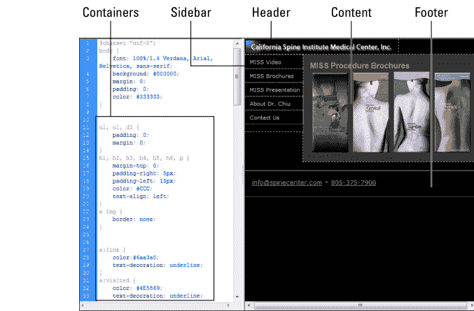

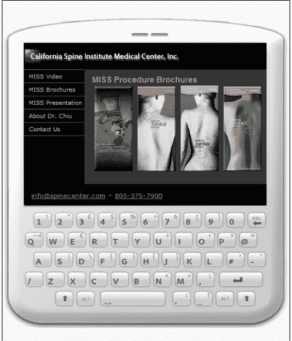

图 2-4：使用容器标签和样式选择器创建页面分区。

## CSS 标准与版本

正如信息和计算机技术的几乎每个方面一样，CSS——以及网页设计本身——处于不断的变化之中，日新月异，持续演进。目前 CSS 有三个版本——没错，你猜对了：`CSS1`、`CSS2` 和 `CSS3`。哦，对了，还有 CSS2 的"推荐"版本，即 CSS 2 修订版 1，或称 `CSS 2.1`，它修复了一些 bug 并移除了原始 CSS2 中一些支持不佳的功能。（如果你想知道标记语言或样式表语言是如何以及为何成为推荐标准的，第1章中有解释。）

开发和部署标记语言及样式表语言的过程充其量是模糊的，而且可能令人非常困惑。通常，新版本的语言会被*逐块*投入使用；设计社区和网页浏览器制造商在 W3C 宣布"我们已经开始着手开发"之后几乎立即开始实施新版本的部分内容。以 HTML5 为例。它距离成为候选推荐标准还有一段距离，但其部分功能已经被广泛使用。大多数流行的网页浏览器，如 Internet Explorer、Firefox、Apple 的 Safari 和 Google 的 Chrome——以及许多移动设备浏览器——都支持大部分 HTML5。CSS 也是如此。虽然 2.1 版是推荐标准，但 CSS3 已经被广泛支持。

决定何时使用哪个版本可能像是瞄准一个移动的目标——而且往往确实如此，尤其是当你为广泛多样的移动设备市场进行设计时。这就是为什么（在第4章和第5章中有详细讨论）了解你设计的目标设备及其能力是非常重要的。

> **提示** 网页设计令人兴奋的一个方面是它是一个不断发展的学科。你可以日复一日地从事这项工作多年，却永远学不完，甚至永远学不到它的皮毛。对我来说，分析其他设计师的作品一直很有帮助。HTML、XHTML 的优点——有时甚至包括 CSS 样式（当页面使用内部样式设计时）——是它们就挂在互联网上，等待我的审视。当你遇到一个具有你觉得 interesting 的功能的页面，想知道这些效果是如何实现时，你通常可以直接从你的浏览器中找到答案。所有流行的网页浏览器都有让你查看网页背后源代码的功能。在 Firefox 中，例如，你只需右键单击页面并选择"查看页面源代码"。在 Internet Explorer（IE）中，则是"查看源代码"。


### CSS1

CSS 已经存在相当长一段时间了。事实上，CSS1 早在 1996 年 12 月就达到了推荐标准级别，这意味着它的开发在此之前就开始了。与如今设计师使用 CSS 所做的工作相比，CSS1 相当简单且有些局限。但它开启了网页设计使用 CSS 进行一些重要的定位和格式化任务的道路，尤其是用于：

- 容器的背景、外边距、边框和内边距
- 元素属性，如文本颜色、字体、单词间距、字母间距和行间距
- 许多简单 HTML 及其繁琐的表格依赖所不支持（或严重缺乏）的其他功能

虽然 CSS1 花了一些时间才流行起来，但它为 HTML 表格带来了很多选项，如果你愿意这么说的话。但我们真正开始看到向 CSS 的重大转变要等到 CSS2。事实上，直到 2000 年 3 月 IE 5.0 for Mac 发布时，才有浏览器支持超过 99% 的 CSS1 规范，而那时距离 W3C 发布 CSS2 的推荐标准已近两年。

如果你有兴趣查看 CSS1 推荐标准，其中包括完整的规范本身——可以说是 CSS1 手册——你可以在 W3.org 网站上看到，网址为 `www.w3.org/TR/REC-CSS1/`。

### CSS2（CSS 2.1）

CSS2 是 CSS1 的超集（即它包含 CSS1）；W3C 于 1998 年 5 月将 CSS2 发布为推荐标准。其最重要的增强功能之一是包含*特定媒体的样式表*，这使设计师能够为各种设备创建量身定制的页面和网站，如特殊访问的可视浏览器、供听力障碍人士使用的听觉设备、盲文设备以及移动手持设备。

与 CSS1 相比，CSS2 还提供了对元素定位更强的控制。*2.1 版*是当前的推荐标准，在许多智能手机和其他移动设备中得到广泛支持。关于如何确定哪些设备支持哪些 CSS 版本以及支持到何种程度，参见第5章。

你可以在 `www.w3.org/TR/CSS2/` 查看完整的 CSS 2.1，包括完整的文档和規范。

### CSS3

CSS3 在第11章中有详细讨论，它是一项重大的增强功能，以至于很难决定先讲什么。它使许多我们目前需要借助其他程序才能实现的效果成为可能——比如文字投影、简单动画、文字和对象的旋转等等。这一 CSS 级别真正标志着网页设计技术的成熟，堪比21世纪初桌面出版行业所取得的进步。

我并不是说设计师不再需要 Photoshop 或 Flash 了，但他们不会像以前那样经常需要为每一个小效果单独创建文件了。

关于移动设备，可以预见 CSS3 将出现在许多较新的智能手机中，比如 iPhone、Droid 等（不过不包括 Windows Phone 7，至少在撰写本书时还不支持）。然而，移动世界并非完全由高级智能手机用户组成。你不能忽略数百万部"不太智能"的手机的用户。这并不明智。

CSS3 中更令人兴奋的功能之一，尤其对移动网页设计师而言，是一项名为**媒体查询**（Media Queries）的功能。通常（如第4章和第5章所述），在使用 CSS1 和 CSS2 为移动设备设计时，你是基于设备配置文件来设计样式表的。结果是一个基于配置文件内置信息的静态网页版本。媒体查询不是根据已知的设备网页配置来工作，而是直接询问设备本身的性能。例如：你的屏幕尺寸、方向和分辨率是多少？你处于竖屏（直立）还是横屏（旋转）模式？这些答案，连同一大堆其他有用信息，会一并返回。然后样式表据此来格式化页面。第11章介绍了一些 CSS3 更令人兴奋的功能。你可以在 `www.w3.org/TR/css3-roadmap` 查看 CSS3 规范。

如果你真想感受 CSS3 背后的强大功能，可以搜索"CSS3 features"，看看设计社区对此的评价。设计师们确实非常兴奋，迫不及待地想要使用它。例如，查看 `www.1stwebdesigner.com/freebies/22-handy-html5-css3-tools-resources-and-guides` 上的"22个实用的 HTML5 和 CSS3 工具、资源与指南"。

图2-5展示了一些仅使用 CSS3 格式化的简单文本框。

## 光明的前景

这些功能令人兴奋。但请记住，所有的 CSS3 魔法都是由移动设备执行的——更具体地说，是由设备的浏览器执行的。如果设备不支持 CSS3，媒体查询就无法工作。虽然智能手机正热卖，但仅依靠 CSS3 来进行移动设备设计，会让你的网站对大量移动网页用户不可用。不过别灰心：你可以相信，市场需求

## 第3章

## 介绍用于构建移动网页的 JavaScript

### 本章内容

- 在移动浏览器中使用 JavaScript
- 将 HTML 与 JavaScript 整合
- 使用 head 部分添加 JavaScript 代码
- 创建自动启动的 JavaScript 文件
- 为用户提供页面内容的动态控制
- 使用 JavaScript 和文档对象模型动态更改图形

JavaScript 的好处在于，少量代码就能发挥大作用。你可以在 HTML 代码中添加一小段脚本，然后反复使用它。JavaScript 可以帮助你让你的网站在27英寸屏幕的大电脑、笔记本电脑、平板电脑和智能手机上都呈现最佳效果——使用同一个 HTML 页面。只需让 JavaScript 来完成识别设备类型和大小的所有工作。

你可以使用任何编写 HTML 的应用程序来编写 JavaScript。这包括 Adobe Dreamweaver 等网页开发程序，以及 Notepad 和 TextEdit 等文本编辑器。正如歌中所唱，*按照你自己的方式去做*。无论你用哪种方式，都会发现编写 JavaScript 代码轻而易举。更重要的是，你会发现它将极大地扩展你能用网页做的事情，尤其是在移动设备上。

JavaScript 适用于*大多数浏览器*——无论是电脑上的还是移动设备上的。所有代码的解释工作都由浏览器完成，而不是由操作系统、硬件，或住在你电脑里打字很快的小老鼠完成。它被认为是*解释型*的，因为你不需要将其编译成二进制代码。就像 HTML 一样，JavaScript 完全依赖于浏览器，而且由于 HTML 和 JavaScript（以及 CSS）共同存在和工作，你可以在 HTML 页面的中间直接输入 JavaScript。

那么，除了对在移动设备上查看的网页进行调整之外，JavaScript 还能做什么呢？一言以蔽之，它增加了网页的交互性。仅使用 HTML 时，用户点击链接时唯一发生的反应就是打开一个不同的页面。使用 JavaScript，你可以在不切换页面的情况下让页面以多种方式响应。例如，JavaScript 可以弹出一个警告窗口，提醒用户注意及时的信息、友好的问候，或提醒去遛猫。

### 在移动设备上使用 JavaScript

在移动和非移动设备上，JavaScript 都在浏览器中运行——而非操作系统中。和 HTML 一样，尽管存在标准（称为 ECMAScript），但并非所有 JavaScript 实现都完全相同。此外，用户可以开启或关闭 JavaScript，如果关闭了，JavaScript 将不会启动。在撰写本文时，JavaScript 已在多种常见移动浏览器中实现，并广泛应用于为移动设备设计的 HTML 应用程序中，因此你不会很难找到支持 JavaScript 的浏览器。不过，你应该准备好应对不同的实现方式。例如，世界上使用最广泛的智能手机平台是 Symbian S60——一个你可能从未听说过的平台。较新版本的浏览器"S60v3 浏览器"支持 JavaScript，但旧版的 S60 浏览器不支持。同样，大多数较新且广泛使用的移动浏览器都支持 JavaScript；所以不要以为只有少数移动浏览器支持它。大多数都支持。

> **提示** 当你用 JavaScript 创建移动应用程序时，一定要在不同的移动浏览器上测试。这样，当它在某些浏览器上以意想不到的方式运行时——或者根本无法运行时——你就不会感到惊讶了。

### 在 HTML 脚本中放置 JavaScript 的位置

通常，JavaScript 程序的代码放在脚本中称为 head 的区域。你可以很容易地通过其周围的标签识别 head 容器——它是开始标签 `<head>` 和结束标签 `</head>` 之间的区域。例如，你可能见过类似下面的代码片段：

```
<head>

<style type="text/css">

body {

    background-color:#fbf7e4;

    font-family:Verdana, Geneva, sans-serif;

    margin-left:20px;

    color:#8e001c;

}

</style>

<title>My Mobile Page</title>

<meta http-equiv="Content-Type" content="text/html; charset=UTF-8">

</head>
```

你常见的 head 标签包括以下几种：

- **样式表：** CSS 样式表就在这里。
- **标题：** 标题出现在网页的顶部。
- **Meta 标签：** 这些标签向网页服务器提供页面信息。
- **脚本：** 这些标签将 JavaScript（或其他脚本语言）嵌入到 HTML 页面中。

HTML 页面的 head 区域可以包含很多内容，也可以只有很少的内容。现在让我们看看添加 JavaScript 需要做什么。

## JavaScript 脚本

在编写第一个 JavaScript 程序之前，先看一下用于表明脚本是 JavaScript 而非其他语言的标签。以下是在 `<head>` 容器内显示的 `<script>` 容器：

```
<script type="text/javascript">

    //This is where the JavaScript goes

</script>
```

`<script>` 容器中的所有代码都被视为一个完整的程序。

网页 head 区域的重要特性是，其中的所有内容都会优先加载。这样，当页面其余部分加载时，你的 JavaScript（或 CSS 样式表）就已经准备好了。可以把 head 区域想象成排在队伍最前面。

## 第一部分：起初，并没有移动设备……

有时你希望确保你的 JavaScript 在页面加载完成后*才*启动。因为 `<head>` 容器中的所有内容都会首先启动，所以你可以直接将脚本放在 `<body>` 容器中。通用格式如下所示：

```
<body>

<h1>My Big Page</h1>

<script type="text/javascript">

    //JavaScript

</script>

<p>This is more interesting material..

</body>
```

在文本中添加小段 JavaScript 不会干扰访问者的视觉体验。`<script>` 标签内的 JavaScript 是不可见的。

如果你发现某些 JavaScript 代码被频繁重复使用，你可以将其放在一个外部文本文件中，而不是直接放在 HTML 脚本中。然后，每当你需要使用它时，只需调用该文件名，你的 JavaScript 就会像 HTML 的一部分一样运行。你可以将 JavaScript 引用放在与直接输入相同的位置，即 head 或 body 中。例如，以下可能是一个你放置在所有 HTML 页面中的问候语：

```
<head>

    <script src="welcome.js"></script>

</head>
```

名为 `welcome.js` 的文本文件中的 JavaScript 就是纯 JavaScript，没有 HTML 标签。你也可以在 body 中放置相同类型的标签。例如，你可能在每个页面的底部放置一个通知：

```
<body>

    ...all the rest of your HTML

    <script src="welcome.js"></script>

</body>
```

所以请记住，JavaScript 尽可能地尝试提供便利！请按照*你自己的*方式添加 JavaScript。

## 你的第一个 JavaScript 程序

为了开始学习，请看一个名为 `alert()` 的内置 JavaScript 函数，它会在你的 HTML 页面上弹出一个警告框。要设置此函数，请在 Dreamweaver 或你喜欢的文本/HTML 编辑器中打开一个新的 HTML 页面，输入代码清单 3-1 中的代码，然后将文件保存为 `alert1.html`。

### 代码清单 3-1：JavaScript 警告框

```
<!DOCTYPE HTML>

<html>

<head>

<script type="text/javascript">

alert("Hello from your mobile!");

</script>

<meta http-equiv="Content-Type" content="text/html; charset=UTF-8">

<title>Alert!</title>

</head>

<body>

</body>

</html>
```


如果你使用 Google Chrome 浏览器测试此文件，你将看到如图 3-1 所示的警告框。（其他浏览器将显示不同的结果。）

### 图 3-1：在台式电脑的 Chrome 浏览器中显示的 JavaScript 警告框

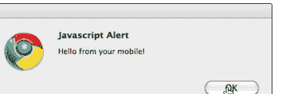

现在你已经有了一个可以操作的示例，你可以查看它在移动设备上的显示效果。与台式或笔记本电脑不同（在电脑上你可以使用浏览器直接测试 HTML 和 JavaScript），移动设备要求你将脚本放置在服务器上，然后使用移动浏览器像访问电脑上的任何远程网站一样查看它。

在将 HTML 文件放置在 Web 服务器之前，你需要一个托管服务或可以使用电脑上的 Web 服务器。如果你有托管服务（可能是通过工作或学校获得的），系统管理员会有关于将 HTML 文件放置在 Web 服务器上的指南。如果你的电脑上安装了 Web 服务器（大多数电脑都有！），你需要拥有一个可以通过互联网访问你电脑的 IP 地址。如果你设置了局域网 (LAN)，你可以使用它来访问你的文件。常见的 LAN IP 地址以 `192.168...` 开头。例如，我的电脑 LAN 地址是 `196.168.1.26`。我将 `alert1.html` 文件放在了名为 `js` 的文件夹中——就在我 Web 服务器的根目录下。每当我想要在移动设备上查看网站的外观时，我可以输入 `196.168.1.26/js/alert1.html`。详情请参阅以下网站：


- Windows 系统：http://windows.microsoft.com/en-US/windows-vista/Setting-up-a-home-network
- Mac 系统：www.apple.com/support/

另一种测试移动页面的方法是安装一个功能齐全的 Apache 模拟器作为测试服务器。Apache 是在 Linux 服务器（大多数 Web 托管平台所使用的系统）上流行的 Web 服务器应用程序。关于如何安装和使用测试服务器的说明，请参阅第 4 章。

## 移动端视图

现在你在 HTML 页面中拥有了一个实际的 JavaScript 函数，你需要在移动浏览器上查看它。图 3-2 显示了在使用 Safari 移动浏览器时，移动设备上打开的警告窗口。

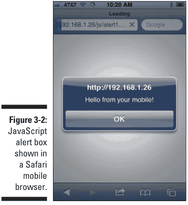

如图 3-2 所示，弹出式警告窗口与你在桌面端看到的不同，但这只是一个细微的样式问题。Safari 移动浏览器没有图形图标，并且它显示了网页的 URL。在图 3-2 中，显示的是 LAN IP 地址而不是描述性的域名地址。无论如何，桌面浏览器和移动浏览器视图之间没有太大区别。然而，当我们尝试不同的移动浏览器时，外观会有很大不同。图 3-3 显示了 Opera 移动浏览器显示托管在远程服务器上的同一个页面。

## 第 3 章：介绍用于构建移动网页的 JavaScript

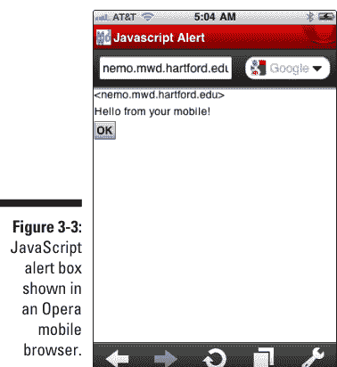

如图 3-3 所示，Opera 移动浏览器中出现了完全不同的视图。它看起来一点也不像其他的警告框。用户会将其识别为警告窗口吗？这可能取决于你将它用于什么目的——以及它使用的通用上下文。此外，警告框执行任务的效果将取决于网页设计的视觉外观和感觉。不要假设只要它在你的电脑上看起来是你喜欢的样子，在移动设备上就会获得同样的外观。

## 函数：等待被调用！

head 容器中的 JavaScript 会在你加载网页时立即执行。或者，你可以创建一个函数，让它等待被调用——即发生一个事件告诉该函数：“嘿，你！需要你的服务了！”一个函数实际上就是一组打包在一起的 JavaScript 语句，旨在某个特定事件发生时立即运行。在你深入研究函数之前，首要任务是理解如何通过事件和事件处理程序来调用（请求）一个函数。

## 事件、监听器及其处理程序

当你查看网页时，你可能认为它没什么动作，但请相信我；你的页面是一个巨大的“派对动物”！当你打开网页时，这是一个事件。当你播放或停止视频时（在第 11 章讨论的 HTML5 中），这是一个事件。当你点击鼠标或轻触移动显示屏时，这是一个事件。据最后统计，你的 HTML5 页面可以识别 71 个事件！（XHTML 识别的较少。）事件可分为以下几类：

- **窗口事件 (Window events)**：这些事件发生在电脑的窗口中。当网页加载完毕时，这就是由 `onload` 事件监听器检测到的事件。
- **表单事件 (Form events)**：表单容器内的任何事件。例如，当你点击发送表单数据的提交按钮时，`onsubmit` 事件监听器会检测到该事件。
- **键盘事件 (Keyboard events)**：在键盘上敲击肯定是一个事件——它可以被 `onkeypress` 和其他键盘监听器捕获。
- **鼠标事件 (Mouse events)**：在移动设备上，你的手指取代了鼠标；当你轻触时，设备会接收到 `onclick` 以及其他几种类似鼠标的操作。
- **媒体事件 (Media events)**：你移动设备上的媒体事件不涉及记者和狗仔队，而是音频和视频事件——例如媒体进程启动时的 `onplay` 和结束时的 `onended`。

JavaScript 允许你通过几种不同的方式输入事件监听器。你可以使用这里讨论的 `onload`、`onclick` 选项，或者在本章稍后以及第 15 章中讨论的 `addEventListener` 方法。你应该使用哪个选项取决于脚本和上下文。

事件处理程序 (event handler) 不过就是一个在指定事件发生时执行某些操作的函数。JavaScript 可以以函数的形式创建事件处理程序。一个函数的格式如下：

```javascript
function myFunction()
{
    //do something
}
```

JavaScript 函数通常写在页面头部，就像任何其他 JavaScript 一样。要试用一个函数，请在 Dreamweaver 或你喜欢的文本/HTML 编辑器中打开一个新的 HTML 页面，输入代码清单 3-2 中的代码，然后将文件保存为 `WriteFunction.html`。

### 代码清单 3-2：一个 JavaScript 函数

```html
<!DOCTYPE HTML>
<html>
<head>
<script type="text/javascript">
function sayHello()
{
    var greetVar="This greeting... ";
    var lineBreak="<br/>";
    var moreGreet="...is brought to you by a function.";

    document.write(greetVar);
    document.write(lineBreak);
    document.write(moreGreet);
    document.write(lineBreak);
}
</script>

<meta http-equiv="Content-Type" content="text/html; charset=UTF-8">
<title>Greeting Function</title>
</head>
<body onLoad="sayHello()">
</body>
</html>
```

将此文件放在网络服务器上，在移动设备上打开浏览器，然后找到带有 `WriteFunction.html` 的 URL 并在浏览器中选择它。在移动设备上，你会看到类似图 3-4 的图像，具体取决于你的设备和移动浏览器。

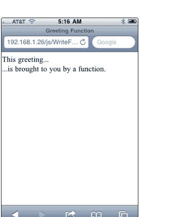

你可能会想，这和把 JavaScript 放在函数外面、在页面加载时触发没什么区别啊！区别在于细微之处。使用 `onload` 事件会等待页面加载完成，然后再触发函数。而之前你看到的是在页面加载之前运行的 JavaScript——头部先加载。

并非所有事件在所有移动设备和浏览器上的处理方式都相同。例如，屏幕上的“点击”和“单击”之间的技术差异可能相当显著。同样，并非所有移动设备都能很好地响应其他鼠标事件，如鼠标悬停（mouseovers）、鼠标移出（mouseouts）或双击。移动设备上的键盘只在特定情境下出现——因此你需要检查 JavaScript 中的任何键盘事件，看看它们的情境是否正确。如果你使用 JavaScript 事件处理程序，在尽可能多的不同设备上测试你的程序，你会找到最广泛接受的事件——以及一些根本不支持移动设备的事件。


## 用变量和一点 DOM 制作函数

JavaScript 使用变量来存储信息以备将来使用。变量是一种存储信息的属性。有些信息是文本——称为字符串——其余大部分是数字。所以如果我写：

```javascript
var sayHi="Hello there!";
```

名为 `sayHi` 的变量存储了文本（称为字符串）。当需要该存储文本时，它会被放置到一个函数中，显示在屏幕上。

在这个示例中，我们使用了 HTML5 中的文档对象模型（DOM），这在第 11 章中有讨论。DOM 是一种组织 HTML 属性（attributes）和方法（functions——导致动作发生的元素）的方式，它将 HTML 页面视为一个称为文档的对象。使用 JavaScript 可以让你利用 DOM 来指定值并通过可用的 DOM 函数发出命令。例如，DOM 包含一个名为 `write()` 的函数。所以只需要这个语句：

```javascript
document.write(sayHi);
```

无论变量中存储了什么（`sayHi`），一旦 `onload` 事件监听器调用该函数，它就会立即出现在屏幕上。要了解更多关于 DOM 的内容，可以在 `www.w3.org/DOM/` 找到官方说明。

## 等我告诉你！

现在，如果你不想发生任何事情，直到你说可以，你就需要某种方式来输入或点击你的意图。`onload` 事件很好，还有其他事件监听器，但当用户需要直接与页面交互时就不行了。

要让函数等待用户，你可以使用 `onclick`。在移动设备上，你的手指就是点击工具，所以你可以把 `onclick` 想象成 `ontap`。下面的脚本展示了一个非常简单的例子。要进行实验，在 Dreamweaver 或你喜欢的文本或 HTML 编辑器中打开一个新的 HTML 页面，输入清单 3-3 中的代码，然后将文件保存为 `tap-Function.html`。

### 清单 3-3：点击与单击

```html
<!DOCTYPE HTML>
<html>
<head>
<script type="text/javascript">
function headTap()
{
    var elTappo="I just got tapped in the head(er)";
    alert(elTappo);
}
</script>

<meta http-equiv="Content-Type" content="text/html; charset=UTF-8">
<title>Function On Tap</title>
</head>
<body>
<header onclick="headTap()">
  <h1>Tap Me!</h1>
</header>
</body>
</html>
```

将此文件放在网络服务器上，在移动设备上打开浏览器，然后找到带有 `tapFunction.html` 的 URL 并在浏览器中选择它。当页面打开时，你会看到 `Tap Me!` 这几个字。用手指点击这些字——把你的指尖当作鼠标按钮。一旦你用指尖点击了文字，就会显示图 3-5 所示的提示窗口。（完成后点击确定。）

如你所见，你能够触发 JavaScript 提示窗口，而且不需要按钮或鼠标——只要你的手指够“灵光”。在 HTML5 中，第 11 章会讨论，你可以添加结构性标签如 `<header>`，并放置事件监听器（`onclick`）并为其分配一个 JavaScript 事件处理程序（一个函数）。你的移动设备会将你的手指点击视为单击。

## 创建和移除你自己的事件处理程序

你可以把事件和事件处理程序做得非常花哨。请记住，目前只有部分鼠标和键盘事件支持移动设备，你可以组合函数并添加或移除事件处理程序。

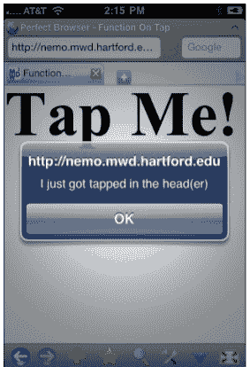

*图 3-5：点击 `<header>` 容器中的文字触发了函数。*

首先，你需要一些可以触发事件的东西——一些可以轻触、踢或挠的东西。因为你的移动设备无法识别踢或挠，让我们看看如何给 HTML 按钮添加点击，然后移除点击功能。需要的材料包括：

- 两个按钮
- 一个在页面加载时为两个按钮添加事件的函数
- 另外两个函数，在每个按钮被点击时执行某些操作

要给对象添加事件监听器，你必须用一个变量名来设置对象的名称。然后你给对象添加事件监听器，如下面的代码片段所示：

```javascript
var tapper = document.getElementById("tapButton");

tapper.addEventListener("click", Tapped, false);
```

要移除事件监听器，你基本上做同样的事情，只是使用移除事件监听器的操作，如下所示：

```javascript
var tapper = document.getElementById("tapButton");

tapper.removeEventListener("click", Tapped, false);
```

在添加或移除事件监听器之后，你输入事件类型，输入它跳转到的函数名称（去掉括号），并在最后一个参数中添加 `false`。`false` 表示你希望事件处理程序在“冒泡”阶段启动。`true` 会在“捕获”阶段启动事件。正确的答案是“两者皆可”，但如果你不确定，使用 `false`。

要尝试这个，在 Dreamweaver 或你喜欢的文本或 HTML 编辑器中打开一个新的 HTML 页面，输入清单 3-4 中的代码，然后将文件保存为 `tapButton.html`。

### 清单 3-4：添加和移除事件监听器

```html
<!DOCTYPE HTML>
<html>
<head>
<script type="text/javascript">
function Tapped()
{
    alert("I just got tapped");
}

function Remover()
{
    var tapper = document.getElementById("tapButton");

    tapper.removeEventListener("click", Tapped, false);
    tapper.style.background='black';
    tapper.style.color='white';

    alert("Tap Man is broken!");
}

function setUp()
{
    var tapper = document.getElementById("tapButton");

    tapper.addEventListener("click", Tapped, false);

    var killer = document.getElementById("spoiler");
    killer.addEventListener("click", Remover, false);
}
</script>

<meta http-equiv="Content-Type" content="text/html; charset=UTF-8">
<title>Tap Button</title>
</head>
<body onload="setUp()">
    <button id="tapButton">Tap Man</button>
    <button id="spoiler">Killer</button>
</body>
</html>
```


将此文件放在网络服务器上，在移动设备上打开浏览器，然后找到带有`tapButton.html`的 URL 并在浏览器中选择它。当页面打开时，你会看到两个按钮——一个名为`Tap Man`，另一个名为`Killer`。点击`Tap Man`按钮，会弹出提示消息告诉你刚刚被点击了。现在点击`Killer`按钮，会弹出提示消息告诉你刚刚弄坏了`Tap Man`按钮。你真正做的是从`Tap Man`上移除了事件监听器；现在它再也无法触发该函数了。此外，`Tap Man`按钮上的黑白颜色也会反转。

再次点击`Tap Man`按钮。没有任何反应；不过，`Killer`按钮仍然可以工作——你可以点击它来弹出警告消息。

图 3-6 展示了添加和移除事件时发生的不同事件和变化。

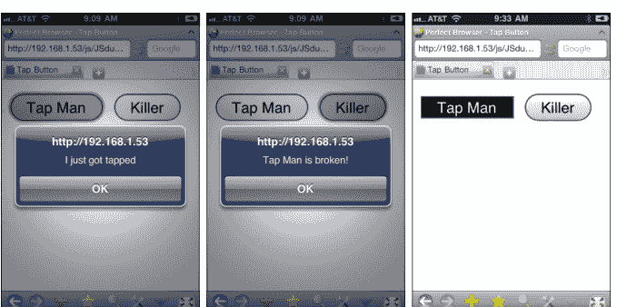
> 图 3-6：使用和移除事件处理程序。

## 让 JavaScript 来思考！

你可能听说过计算机能够思考。嗯，你说得对。使用 JavaScript 的网页同样可以。你只需要给它们一个问题来解决。需要计算如何添加销售税？让 JavaScript 来干活吧。

例如，你可以让网页帮你计算销售税。这个特定问题可以分解为以下几个简单步骤：

- 1. 输入购买金额：14.95
- 2. 输入销售税率：5%
- 3. 计算购买的销售税：14.95 乘以 .05，即 75¢
- 4. 计算总额：购买金额加上销售税：$15.70（四舍五入）

现在，JavaScript 只需要一些基本的算术运算符来完成计算，它们如下：

- `+` 加法
- `-` 减法
- `*` 乘法
- `/` 除法

要使用运算符，你只需将它放在两个变量或实际数字之间，如下面的例子：

```
9 / 3 = 3
10 * 5 = 50
```

使用变量时，你会这样写：

```
var alpha = 15;
var beta = 10;
alpha + beta = 25
```

在 JavaScript 代码列表中放入表达式也同样简单。要创建一个根据销售税率和购买金额计算总成本的函数，步骤如下：在 Dreamweaver 或你喜欢的文本或 HTML 编辑器中打开一个新的 HTML 页面，输入清单 3-5 中的代码，然后将文件保存为`salesTax.html`。

### 清单 3-5：计算总成本

```html
<!DOCTYPE HTML>
<html>
<head>
<style type="text/css">
section
    {
    font-family:"Comic Sans MS", cursive;
    color:#900;
    }
</style>
<script type="text/javascript">
function salesClerk()
{
    var purchasePrice=14.95;
    var taxRate=.05;
    var taxOnPrice=purchasePrice * taxRate;
    var total=purchasePrice +taxOnPrice;
    alert("Your bill is $" + total);
}
</script>
<meta http-equiv="Content-Type" content="text/html; charset=UTF-8">
<title>The Thinker</title>
</head>
<body>
<article>
<section onClick="salesClerk()">
    <h1>Your total is...(tap me)</h1>
</section>
</article>
</body>
</html>
```

将此文件放到 Web 服务器上，在移动设备上打开浏览器，然后找到包含`salesTax.html`的 URL 并在浏览器中选择它。

你可能注意到我们添加了一点 CSS（在第 2 章中讨论过）来让它更生动一些。图 3-7 展示了查看该文件时可以看到的效果。

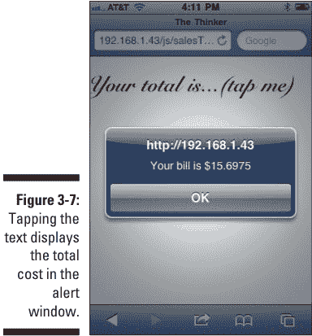

如果你熟悉 comic sans 字体，你可能会好奇移动浏览器显示中的草书体是怎么回事。这只是提醒你，移动设备的字体仍然有限。

你还可能好奇为什么总价没有四舍五入。这是因为我们没有告诉 JavaScript 处理这个细节。现在我们就来处理。与此同时，让我们将税率从百分之五改为百分之四。只需更改以下两行：

首先将：
```javascript
var taxRate=.05;
```
改为：
```javascript
var taxRate=.04;
```

然后将：
```javascript
alert("Your bill is $" + total);
```
改为：
```javascript
alert("Your bill is $" + Math.round(total*Math.pow(10,2))/Math.pow(10,2));
```

保存你的程序并再次运行。这一次，结果不同了，而且小数点后只有两位整数——就像真正的货币一样！（顺便说一下，新的税率很有用。看看图 3-8——移动设备都晕倒了，侧着显示结果。）

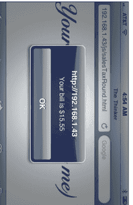
图 3-8：调整后显示两位小数的结果。

处理两位小数的`math`语句可能有点难以理解，但它只是一种花哨的写法，实际上等同于：

```javascript
Math.round(total*100)/100
```

> **提示**
> 更好的是，把这个公式（极客说法叫*算法*）保存在电脑上方便取用的地方，当你需要将值四舍五入到两位小数时把它拿出来用。如果你使用 Dreamweaver，可以把它保存在该程序的 Snippets 面板中，随时插入到你的文档里。

## JavaScript 的图形魔法

也许你不喜欢数学，但 JavaScript 就是爱它！然而，JavaScript 更艺术的一面呢？JavaScript 也有艺术气质吗？是的，它有！在本节中，你将看到 JavaScript 如何使用文档对象模型（DOM）处理图形。

### DOM 与图形

如果你把 HTML DOM 看作一个很大的对象（`document`），它有很多属性，你会发现更容易理解。在很多方面，DOM 只是你网页的另一种表现形式——只是表达方式不同。在 HTML 中，你以如下格式加载图形文件：

```html

```

要在 DOM 中用 JavaScript 表达同一行，你写道：

```javascript
var mygr = new Image();
mygr.src="myGraphic.png"
document.graphicLand.src=mygr.src
```

你可能在想 JavaScript 方法看起来有点复杂，但逻辑是一样的。图形"容器"的名称在 HTML 和 DOM 版本中都是`graphicLand`。图形文件的名称在 HTML 和 DOM 编码中都被赋值给`src`属性，但在 DOM 版本中，创建了一个名为`mygr`的图像对象来保存对实际图形文件的引用。

### 我心依旧

在纯 HTML 中，你的图形是固定不动的。通过添加一些 JavaScript，你可以将它们移入和移出由 JavaScript 定义的 DOM 位置。要查看你可以做什么，考虑两个心形图形——缩略图和大图尺寸——创建为 PNG 文件。缩略图是原始的；当用户点击缩略图时，出现一个大心形图像。通过使用`onclick`事件监听器，你可以用大的心形替换缩略图心形。为此，在 Dreamweaver 或你喜欢的文本或 HTML 编辑器中打开一个新的 HTML 页面，输入清单 3-6 中的代码，然后将文件保存为`imageSwap.html`。

### 清单 3-6：将缩略图转换为大图

```html
<!DOCTYPE HTML>
<html>
<head>
<script language="Javascript">
var bigHeart= new Image()
bigHeart.src="bigHeart.png"
function goBig()
{
  document.heart.src=bigHeart.src
}
</script>
<meta http-equiv="Content-Type" content="text/html; charset=UTF-8">
<title>Big Heart</title>
</head>
<body>
<header onclick="goBig()"> </header>
</body>
</html>
```


将此文件放到 Web 服务器上，在移动设备上打开浏览器，然后找到包含 `imageSwap.html` 的 URL 并在浏览器中选择它。程序加载时，你会看到一个小的心形图像。当你点击心形图像时，一个大心形出现在屏幕上。在图 3-9 中，你可以看到点击前的原始图像在左，点击后的大图在右。

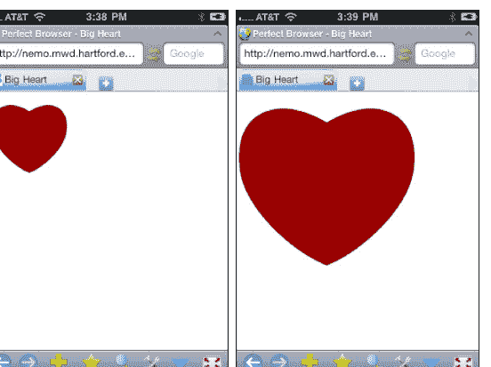

图 3-9：点击使图像变大。


移动浏览器似乎有自己的想法。如果你双击大的心形，它变得更大！再双击一次，它又变小了。正如你在代码中看到的——以及点击缩略图时体验到的——只需单击一次即可。然而，双击——无论是特定浏览器的功能还是由于移动设备的操作系统——则是另一回事；在某些移动浏览器上，什么都没有发生！所以一定要先在你期望使用的移动浏览器上测试你的 HTML 应用。

如你所见，你可以用 JavaScript 在移动 Web 应用中打开一个全新的可能性领域，而这一章只是触及了表面。JavaScript 可以像你应用的需求那样简单或复杂——但不要搞错：有了 JavaScript，你可以用 HTML 配合 JavaScript 做到比没有它时多得多的东西！

## 第四章：移动网页设计软件与实用工具

### 本章内容

- 理解手动编码与使用网页设计软件之间的区别
- 探讨源代码编辑器
- 分析是否应使用 Adobe Dreamweaver
- 了解 Adobe Creative Suite 套件的优势
- 搭建本地测试环境
- 在工作站上安装用于测试的网页服务器

在专业的网页设计领域，本质上存在两种学科、流派或阵营——无论你如何称呼它们。一方面，是纯粹主义者——通常是手动编码者，他们“手工”输入代码来创建网页，不依赖所见即所得（读作 `with-zee-wig`，即 What You See Is What You Get，所见即所得）软件。这引出了第二种专业网页设计师：你猜对了——那些确实使用所见即所得设计软件来创建网页的专业人士。

曾几何时，大约有 20 种左右的网页设计应用程序。然而如今，只剩下寥寥几种，并且可以轻易地分为两类：高端的专业网页设计套件和低端的入门软件。（此外，还有众多其他程序，如 Microsoft Word 和 PowerPoint——它们显然旨在做网页设计之外的事情——允许你将创建的文档导出为 HTML 或其他某种网络就绪格式。例如，Word 还允许你将文字处理文件导入 XML，这是 HTML 的一种更为复杂的近亲。）

如今，唯一一款工业级的专业所见即所得网页设计程序只剩下 Adobe 的 Dreamweaver。另一方面，手动编码者倾向于使用源代码编辑器——专为输入和编辑源代码而设计的程序——他们拥有各种程序和实用工具可供使用，包括几种流行的网页浏览器——Firefox 和 Google 的 Chrome。这些免费且易于获取的程序允许你安装附加组件（同样免费），将普通浏览器转变成功能相当强大的手动编码和测试环境。

本章将比较这两种方法——手动编码和使用 Dreamweaver。每种方法都有显著的优缺点。本章还将讨论在源代码编辑器中应寻找哪些 HTML 和 CSS 特定功能，以及一些用于生成和测试移动站点的流行浏览器附加组件。如果你尚未搭建移动网站的创建和测试环境，本章的信息应有助于你做出更轻松的选择。

### 手动编码 vs 网页设计程序

如果你是网页设计新手，并考虑手动编码，可用的大量应用程序、实用工具和技巧可能会令人望而生畏。经过多年教授网页设计和为客户设计网站的经验，我注意到，大多数情况下，新手设计师倾向于坚持他们入门时所用的方法——或者他们老师和导师所用的应用程序和实用工具。此外，还有那些自学成才的人，他们通过浏览网络和自学书籍，尤其是 *Dummies* 系列书籍来学习。这些专业人士似乎是从一种“无论什么方法有效”的任务导向心态出发学习和创作——追求完成工作的最短路径。

创建网站有许多方法。让我们仔细看看并比较可用的工具，这些工具可以帮助你创建移动网站。

入围的有：

- **文本编辑器：** 你可以使用简单的文本编辑器，如 Windows 记事本或 Mac OS 文本编辑，或者你的文字处理器来手动编写页面代码。这是最简陋的方法，尤其是如果你使用操作系统内置的文本编辑器。这种方法不提供任何帮助，完全依赖你对 HTML 和 CSS 编码的知识。选择这种方法，成为一名手动编码的角斗士。
- **源代码编辑器：** 你可以使用众多 HTML/CSS 源代码编辑器之一——例如 UltraEdit 或 Aptana——来帮助你手动编写页面。源代码编辑器是增加了编写代码功能的文本编辑器。
- **浏览器附加组件：** 你可以使用浏览器，如 Firefox 或 Chrome，配合第三方附加组件来增加浏览器的功能，以手动编码和测试你的网页。
- **Adobe Dreamweaver：** 你可以使用唯一幸存的工业级所见即所得网站设计和 Web 应用程序开发程序——Adobe Dreamweaver——来创建你的网站和设计你的页面。图 4-1 展示了 Dreamweaver 的所见即所得编辑模式——设计视图中的网页。Dreamweaver 是一个功能非常强大的程序，本章稍后将进行讨论。
- **Adobe Creative Suite：** 你可以对网页设计做出终极承诺，投资 Adobe 的网页设计套件——Creative Suite Web Premium——来创建所有支持内容、样式表和脚本；并设计和布局你的网站及支持页面和文件。此选项将在本章后面讨论。

你可以像许多专业设计师和开发者那样，选择其中一个选项，深入学习并坚持使用；或者你可以像许多其他设计师那样，结合使用两种或多种方法。每种方法都有其自身的优点和缺点。俗话说，没有完美的东西，一些网页设计工具和实用工具比其他的更不完美。但这不应阻止你寻找完美的设计工具——或者至少是适合你和你的工作方式的最佳工具。

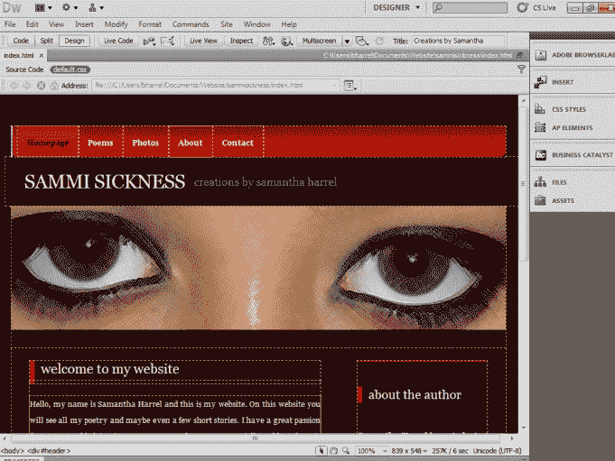

图 4-1：使用 Dreamweaver 的所见即所得界面来创建和实时查看你的新网页。

### 手动编码（或用玻璃刮胡子）

你可能已经猜到了，我不是手动编码的忠实粉丝。对我来说，手工编写网页代码与编程太接近了——我认为编程需要一种我所不具备的特殊心态。我对程序员怀有最崇高的敬意。然而，在网站和 Web 应用程序设计这一行中，要成为一名优秀的、最先进的、前沿的设计师，有时你无法避免手动编码和编程。

一些手动编码者非常坚持不使用所见即所得软件来创建他们的网站。例如，经常能看到这样的网页设计师招聘广告：“招聘网页设计师。如果你使用 Dreamweaver，请勿申请。”

那么，为什么这些设计师认为手动编码优于网页设计软件呢？


大多数可用的所见即所得设计程序——除了 Adobe Dreamweaver 之外——实际上针对的是初型企业主，他们更关心的是快速、尽可能少麻烦地让网站上线，而不是学习 HTML 和 CSS 的复杂性。为了便于讨论，我们假设唯一幸存的专业所见即所得编辑器是 Dreamweaver。从现在起，当我提到网页设计软件时，我指的是 Dreamweaver。

那么，让我们看看手动编码者声称偏爱手动编码而非使用 Dreamweaver 的主要原因。

#### 对代码拥有更多控制权

我多年来与之交谈过（并经常在项目上合作）的手动编码者表示，直接在代码中工作，而不是让设计软件为他们生成代码，可以提供更高层次的控制，从而允许他们创建更优的文档。这里显然的问题是，如何更优？以下是一些更常见的回答：

- **手动编码让你能够使用图形编辑器不支持的功能和优化。** 换句话说，你可以通过手动编码做到用 Dreamweaver 做不到的事情。
- **手动编码对代码语法提供更好的控制。** 你可能从高中和大学的写作课上熟悉语法这个术语。（不，我不是指政府对饮酒和赌博的征税。）语法指的是代码的整体结构——它的组织方式。就像写作中这很重要一样，在页面标记和编程语言中也很重要。
- **手工编写的代码更有可能符合 W3C 标准。** 这句话本身已经说明了问题。它暗示 Dreamweaver 无法生成符合标准的代码标准的代码。W3C 标准在第 1 章和第 2 章中已有讨论。
- **手工编码可以产生更精简、更高效的“机器就绪”代码。** 与前一点类似，这表明 Dreamweaver 生成的代码质量较低，且机器（计算机和移动设备）在解析和执行这些代码时比执行手工编码的代码更困难。

这些听起来都是远离 Dreamweaver 的极佳理由，不是吗？冒着像个 Adobe 大股东的风险，让我这样说：如果这些理由是真的，那么它们确实是选择手工编码的充分理由。在过去的一段时间里，这些抱怨不仅针对 Dreamweaver，而且针对所有其他网页设计软件包。然而，自从几年前从 Macromedia 收购 Dreamweaver 以来，Adobe 在纠正这些缺陷方面做得非常出色。这些理由已不再适用于避开 Dreamweaver。

#### 手工编码成本较低

这是真的吗？如果我们讨论的是初始投资——即避免购买网页设计软件的费用——那么是的，手工编码成本较低。毕竟，无论你使用的是 Windows 机器还是 Mac，你已经拥有了一个可以用来自行编码的文本编辑器，对吧？而且你可能已经有了 Word 或其他文字处理器。所以，如果你打算手工编码，确实不需要购买其他任何东西。

但你不能仅凭初始支出来衡量成本。无论你是自由设计师还是公司的指定网页设计师，时间在评估成本时是一个极其重要且相关变量。在网页设计方面，那句陈词滥调“时间就是金钱”毫无疑问是非常真实的。Dreamweaver 的价格不到 200 美元。一名专业的平均设计师每小时收费 50 美元以上（许多人每小时收费 100 美元或更多）。如果使用 Dreamweaver 仅在一个项目中为你节省了几个小时，那么手工编码就不再是成本较低的选择。

为了在手工编码方面变得高效，你需要培养极高的专业知识。手工编写网站的专业设计师必须非常精通他们所使用的程序或标记语言。如果你选择了这种方法，你也必须如此。否则，你会发现自己经常在研究、查阅参考资料、尝试各种方法——花费过多的时间来确保事情正确。

在决定是手工编码还是使用网页设计程序时，请记住，你花在学习、研究和测试页面上的时间会迅速累积。手工编码所花费的额外时间，很快就会让你的项目严重超出预算和截止日期。

#### Dreamweaver 是一种拐杖

许多手工编码者说，Dreamweaver 的用户变得过于依赖 WYSIWYG（所见即所得）界面和其他自动化工具。他们并没有真正学习如何（或者忘记了如何）使用 HTML 和 CSS 代码。在列出的所有理由中，这一点最具有说服力。你可能会过于依赖程序，从而阻碍你在学习 HTML、XHTML、CSS 以及任何其他标记或编程语言实际运作方式方面的成长。

但很少有事情——尤其是在网页设计中——是如此非黑即白的。这个论点忽略了一个非常重要的组成部分：人性。虽然我们可能在创造时是平等的，但在能力和气质方面，我们并不完全相同。在设计网站多年、与众多专业人士合作并教授设计之后，我有不同的看法。

通常，偏好手工编码的专业人士是从左脑、更具逻辑性的开发或编程视角来创建网站的。他们发现将项目分解为小的、分析性的片段，并用代码将所有这些片段拼接在一起更容易。另一方面，使用 WYSIWYG 软件的专业人士通常倾向于从更偏右脑、视觉化的设计观点出发。就像世界上几乎所有其他事物一样，网页设计领域需要这两类专业人士。

我们不能和谐共处吗？当然可以。我们一直这样做吗？是的。例如，大型设计公司和大型企业的设计部门通常同时雇用这两类网页设计师，并且让他们协同工作。WYSIWYG 设计师专注于网站的实际外观和感觉，即视觉方面，如主题、布局、按钮、信息流等。网站的这些元素通常被称为网站的前端。手工编码者（通常是程序员）则负责网站的幕后或后端功能，如数据库集成、购物车和其他应用程序。

> **提示：** 许多程序可以将它们的原生文档格式导出或转换为 HTML 和 XHTML。例如，Microsoft Office 套件中的程序——尤其是 Word、PowerPoint 和 Excel——都有“另存为 HTML”选项。这些程序以及大多数并非真正网页设计程序的软件，通常会破坏 HTML 标签和层叠样式表（CSS）。这些程序生成的复杂样式表和其他代码会让移动浏览器崩溃。（Word 的 HTML 输出以“肮脏”著称，以至于 Dreamweaver 专门提供了一个导入选项，用于从 Word 导出的 HTML 文件中剔除垃圾标签。）所以，请帮你自己一个忙：千万不要考虑使用那些尝试将其原生内容转换为 HTML 的程序来创建移动端网页内容。

手工编码的一个长期优势是——如果你强迫自己手工编码——一段时间后，你会非常熟悉 HTML 和 CSS。非常熟悉。也许比你仅依赖 Dreamweaver 时要熟悉得多，因为当你使用 WYSIWYG 模式工作时，它为你编写了大部分代码。我发现，在手工编码和 WYSIWYG 编辑之间来回切换是最有效的方法（就效率而言）。

我认识的许多坚定支持手工编码的人说，手工编码更容易。我相信对他们而言更容易。但我也相信，从头到尾手工编码整个网站需要一种特殊的思维方式和巨大的耐心。许多人觉得这太乏味且耗时——既然使用舒适且优雅的电动剃须刀要容易得多（且痛苦更少），为什么还要用一块钝玻璃片刮胡子呢？

本书中的大多数示例都是手工编写的——这不是因为这是我的工作方式，也不是因为我认为你应该这样工作，而是因为本书是关于学习使用 HTML 和 CSS 的，而不是关于使用 Dreamweaver 的。尽管如此，正如本章后面所示，Dreamweaver 是一个强大的网页设计工具，非常值得考虑。如果你想学习 Dreamweaver，我建议你查看 Janine Warner 所著的 *Dreamweaver CS5 For Dummies*。

> ### Dreamweaver 被冤枉了吗？

坚定手工编码者的一个普遍抱怨是，Dreamweaver 有自己的处理方式，并且经常不符合第 1 章和第 2 章中讨论的公认 W3C HTML、XHTML 和 CSS 标准。抱怨点在于，Adobe 的 WYSIWYG 编辑器并不总是使用 W3C 推荐的标签和标签属性，并且经常使用过多的标签或错误的语法来实现特定任务。

在过去，不符合 W3C 标准确实是 Dreamweaver 一个相当严重的问题——但那是几个版本之前的事了。在那些日子里，手工编码者的抱怨是有道理的。自从几年前从 Macromedia 收购该程序以来，Adobe 在改进程序方面做得很好；现在 Dreamweaver 的代码已经相当干净了。

在为移动设备设计（精度至关重要）时，不合规的代码可能会带来麻烦。无论你决定手工编码、使用 Dreamweaver 还是结合两种方法，作为一名移动端网页设计师，你都有理由关心对标准的合规性。然而，在我卑微的观点中，不合规不再是 *不* 使用 Dreamweaver 的正当理由。事实上，Adobe 在开发设计标准方面一直是一个主要参与者——而且是在许多方面。

### 使用源代码编辑器进行手写编码

源代码编辑器是专为编写和编辑代码而设计的程序。从根本上说，它们是为编程提供额外功能的文本编辑器。即使是最高端的手写编码者也会使用它们来编写计算机程序、创建网站和 Web 应用程序。源代码编辑器形态各异、大小不一。大多数只专注于一种或少数几种语言。其中不少（而且数量众多）专注于 HTML、XHTML 和 CSS，以及其他网页标记语言和 Web 专用编程语言。

在数以百计的源代码编辑器中，价格范围大多从免费到超过 100 美元不等。其中许多已经存在相当长的时间了。（许多支持不佳的免费软件和共享软件已不再定期升级——这使得它们过于陈旧，不太适合手写编码那些不断变化的标记语言。因此请谨慎选择。）

源代码编辑器的功能和所支持的语言差异很大。图 4-2 展示了一款流行的 HTML 友好型源代码编辑器 UltraEdit 的实际使用情况。不过，大多数编辑器都有一些标准的共同功能：

- **行号：** 每一行都有编号，便于定位和修正问题。在报告错误时，程序编译器、测试环境甚至某些 Web 浏览器通常会根据出现问题的代码所在行来标识错误。
- **颜色编码：** 不同的颜色标识程序或 HTML 文档的不同特征。在网页中，不同类型的标签、标签属性、注释、正文文本以及页面的所有其他部分在屏幕上以不同的颜色显示，使其更容易查找、识别和相互区分。
- **自动标记：** 能够选择一行或一块文本，并通过单击应用标签。
- **标签列表：** 可从列表中分配的完整标签列表。
- **错误报告：** 能够查找并高亮显示代码中的错误。
- **代码提示：** 有时称为代码自动完成，某些代码编辑器中的代码提示功能会在你输入代码时进行监视，并尝试推断你正在输入的内容。程序会显示“提示”，你可以随时接受（通常按 Enter 键），代码就会自动为你完成。一些源代码编辑器还会自动闭合代码对。当你输入 `</` 时，程序会查找最后一个未闭合的标签并输入相应的闭合标签。（这听起来对你帮助不大，只是帮你输入几个字符而已。但如果你编写数百甚至数千行代码，累积起来的帮助就很大了。）

### HTML/CSS 源代码编辑功能一览

较受欢迎的 HTML 源代码编辑器之一是 UltraEdit。它是一款共享软件，在紧跟 Web 技术、HTML 和 CSS 的变更，以及其他 Web 专用编程和标记语言的发展方面做得非常出色。UltraEdit 具备许多让手写编码更轻松的功能。

UltraEdit 及类似程序几乎逼近 WYSIWYG 的边缘，尽可能接近却又不真正迈出最后一步——让你在 WYSIWYG 视图中对实际页面文件本身进行编辑。到了那一步，程序本身就开始决定使用哪些标签，而你就不再是手写编码了。

考虑到这一点，以下是在用于创建和编辑 HTML 和 CSS 网页的源代码编辑器中应寻找的功能列表：

- **标签和代码语法检查：** 好的源代码编辑器会自动检查你放置标签的方式和位置，并在你使用不当时指出。常见的例子是指出你没有正确闭合标签（`</p>`、`/>`）。
- **支持 JavaScript 和其他流行的 Web 脚本语言：** 通常，网站的许多功能超出了简单的 HTML 和 CSS 编码。例如，动画下拉菜单、可折叠（手风琴式）和标签式部分通常依赖于 JavaScript。（JavaScript 在第 3 章介绍，并在本书多个地方讨论。第 13 章和第 14 章介绍使用 JavaScript 创建特定应用。）第 5 章讨论的移动设备检测和切换到适当设备配置文件，通常依赖于 JavaScript（第 13 章讨论）、PHP 或 CGI 脚本。你的源代码编辑器应具有这些语言的基本支持，这样你就不必使用多个编辑器。
- **用于自动化冗长或重复任务的宏：** 许多程序支持宏，即使它们有时称之为其他名称。例如，Photoshop 称之为动作；Microsoft Word 称之为宏。无论名称如何，它们本质上都是包含顺序程序命令和任务的脚本。你可以通过逐一录制任务来创建它们，然后通过单击鼠标或键盘快捷键来播放。
- **频繁升级：** 确保你选择的源代码编辑器仍然得到良好的支持，并定期升级以符合最新的 HTML 和 CSS 标准。
- **浏览器预览：** 你的源代码编辑器应内置预览器，以便你可以轻松查看页面的外观，或至少快速跳转到系统中的浏览器并在那里预览文件。
- **项目或文件组：** 能够将文件组定义为项目，这对于创建整个网站很有帮助。

### 终极源代码编辑器

我所知道的最好的源代码编辑器（不，我不是 Adobe 的员工）是 Dreamweaver。如图 4-3 所示，你可以在程序的代码模式或拆分模式下工作，而无需在设计模式的 WYSIWYG 编辑器中做任何操作。除了支持上一节中的所有功能外，它还有许多其他让手写编码更轻松的功能，例如自动闭合标签和代码提示——为你建议并输入标签和其他代码。

### 一个永远不够

大多数源代码编辑器并不昂贵（UltraEdit 在 30 天试用期后约 60 美元）。即使你确实使用 WYSIWYG Web 设计软件，你也会发现合适的源代码编辑器很有用。例如，UltraEdit 的拼写检查器比 Dreamweaver 的拼写检查器更擅长在标签之间穿梭，并框选文档内容来检查页面内容的拼写。

没有程序是完美的。在 Dreamweaver 中，你可以将源代码编辑器设置为辅助编辑器，这样可以快速跳转过去进行特定类型的编辑，例如拼写检查。只需转到 Dreamweaver 的首选项对话框，如图 4-4 所示（Windows 中为编辑 → 首选项，Mac 上为 Dreamweaver → 首选项）；在类别列表中选择文件类型 → 编辑器；在“在代码视图中打开”字段中输入要编辑的文件类型；然后单击外部代码编辑器字段旁边的浏览按钮，浏览并选择源代码编辑器的可执行程序文件。

你永远不知道拥有一款好的源代码编辑器（并知道如何使用它）会在什么时候派上用场。不止一次——在咨询或与其他设计师合作时——我被要求不要使用 Dreamweaver 处理他们的文件。我很久以前就学到，有时候最好是不要多管闲事。

在查看源代码编辑器时，请记住这一点：好的源代码编辑器除了你手动输入的内容外，不会对你的文件进行任何更改。绝不。

### 设计软件的优势

Web 设计软件最明显的优势是你可以实时看到所做的编辑。软件会为你重写 HTML 并更新 CSS 规则。如本章前面所述，并非所有人都认为这是一个优势。使用设计软件的目的当然是为了让你的设计项目更轻松，从而节省你的时间（和精力）。大多数 Web 设计程序——例如 Back to the Beach Software 的 Web Studio 或 Virtual Machine 的 SiteSpinner——严重依赖内置模板和预设计页面模块，将设计师（通常是初学者或偶尔从事网站工作的人）与实际代码隔离开来。

这种做法的问题，尤其是从移动设计的角度来看，在于虽然它们易于使用，但它们生成的代码很少能满足移动设备的简洁或精简要求。更糟糕的是，在某些程序中访问代码往往是一项挑战。它们确实是围绕单一概念设计的——易用性——不利于为移动设备创建或改造网站。此外，使用它们对提高你的 HTML 或 CSS 技能几乎没有帮助。

### 使用 Adobe Dreamweaver

然后是 Dreamweaver，大多数 Web 设计专业人士的首选应用程序。从易用性的角度来看待 Dreamweaver 并不相关。你选择如何使用它决定了难度水平。这个程序几乎无所不能，甚至更多。它也是唯一的高端网页设计程序，并且，由于它是 Adobe 的产品，它与 Adobe 广受欢迎的图形编辑器 Photoshop 和 Illustrator 集成良好——同样也与 Flash 集成良好，后者是创建动画和应用内容的极其流行的平台。

Dreamweaver 不仅是一个所见即所得的页面编辑器；它还是一个功能强大的源代码编辑器。你可以选择在“设计”模式下工作，在页面的所见即所得视图中进行编辑，也可以完全在“代码”视图中手动编码。Dreamweaver 甚至有一个“拆分”视图，允许你同时在所见即所得和代码视图中处理页面，如图 4-5 所示。

#### Dreamweaver 与 CSS

除了其直观的编码和布局工具——例如检查代码错误的“标签检查器”以及无需离开设计环境即可显示和播放 Flash 及其他媒体文件的“实时视图”——Dreamweaver 对 CSS 样式的支持也非常出色。它允许你轻松创建全站样式表和模板，使你的页面适应多种设备，并轻松应用 JavaScript 和其他支持代码。当你打开一个使用 CSS 格式化的页面时，Dreamweaver 会引用所有相应的样式表，在“设计”视图中渲染页面。当你对不同对象进行更改时，程序会显示相应的代码，为你提供创建新 CSS 规则或修改现有规则的选择，如图 4-6 所示。

图 4-5：在 Dreamweaver 中，你可以选择手动编码或在“设计”视图中工作——或者同时进行两者。

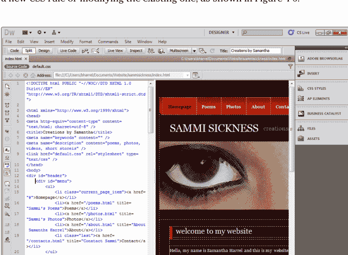

## 第一部分：起初，没有移动设备……

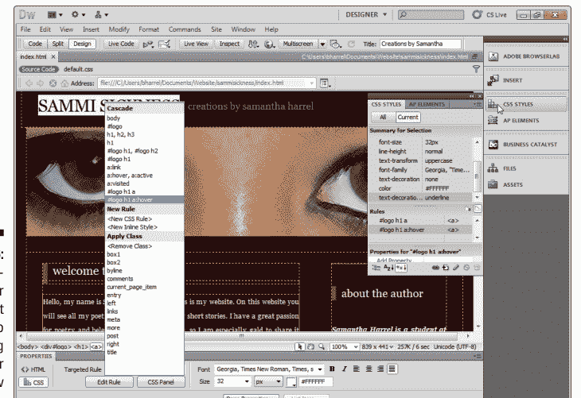

图 4-6：Dreamweaver 使编辑现有样式或创建新样式变得轻而易举。

#### 功能强大的源代码编辑器

该程序有一个“实时代码”选项，当在“拆分”视图中工作时，它会高亮显示在“设计”窗口中所做的更改，并实时更新“代码”窗口，在你工作时为你提供宝贵的反馈。还有一个代码提示选项：当你在“拆分”或“代码”视图中手动编码时，程序会尝试识别你正在输入的标签，并随着它提供可用的代码选项而持续更新。在任何时候，你都可以选择让程序为你完成代码。

你可以在“检查”视图中逐步浏览文件，在“设计”窗口中选择各种对象，Dreamweaver 会在“代码”窗口中显示相应的 CSS 代码，同时检查其错误和标准符合性。每次保存文件时，程序都会提醒你代码错误或不一致之处。

正如你所看到的，除了使设计过程变得简单之外，如果你愿意，该程序还可以帮助你学习 HTML、CSS 以及一大堆其他语言。而且这个列表只是 Dreamweaver 如何帮助你创建和维护 CSS 页面和网站的极小一部分。它确实自动化了许多流程——并为你跟踪各种事物。

#### Dreamweaver 扩展、小组件和代码片段

再次强调，使用 Dreamweaver 而非手动编码的主要原因是节省时间（以及减少烦恼，尽管学习这样一个功能强大的程序本身也有其固有的挫折感）。尽管手动编写页面代码是一项高尚、甚至令人钦佩的工作，但在预算内按时完成项目有很多好处。本节前面的小节探讨了该程序的内置功能如何帮助你做到这一点，但 Dreamweaver 还支持多种第三方附加组件，称为扩展，这些扩展可以在创纪录的时间内极大地帮助你创建专业质量的页面和页面元素。

Dreamweaver 还提供了多种将预制内容部署到页面中的方法；其中包括小组件和代码片段。小组件实际上是可自定义的微型应用程序，而代码片段顾名思义——就是你可以保存并在需要时随时使用的小代码块。

##### 扩展

与大多数 Adobe 程序一样，Dreamweaver 支持第三方扩展。扩展是你可以通过“扩展管理器”安装到 Dreamweaver 中的小程序。你可以在 Dreamweaver Exchange（从“帮助”菜单中选择 Dreamweaver Exchange）或互联网上的其他几个地方找到扩展。有些是免费的，有些是第三方产品，价格从几美元到几百美元不等。只需搜索 Dreamweaver 扩展。

你会发现扩展几乎能做所有事情——从为你的网站创建搜索引擎和插入 Google 地图，到创建完整的 CSS 页面模板。有成百上千，也许数千个 CSS 模板扩展，用于创建可自定义的页面元素，如下拉菜单、表单、页眉和页脚等。扩展可以为你节省各种时间，而生成的代码为学习如何创建和自定义特定 CSS 页面元素和效果提供了绝佳机会。图 4-7 显示了一个用于创建 CSS 菜单的扩展。

##### 小组件

小组件是预制的、可自定义的页面元素，通常由 CSS 样式和 JavaScript 组成。Dreamweaver 附带了一组内置小组件，用于创建菜单、可折叠区域、用户身份验证字段和许多其他对象。你还可以从 Dreamweaver Exchange 导入几个第三方小组件。（小组件由 Dreamweaver 用户创建并提供，通常是免费的。）有用于创建菜单、实时 Google 地图、弹出对话框、数据图表等的小组件，新的小组件定期发布。图 4-8 显示了一个创建 Google 地图并自动将其插入网页的小组件。

## 80 第一部分：起初，没有移动设备……

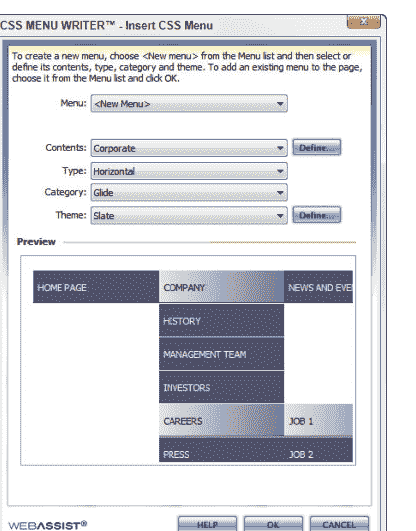

图 4-7：Dreamweaver 扩展几乎无所不能（这个扩展创建 CSS 格式的弹出菜单），无需你编写代码。

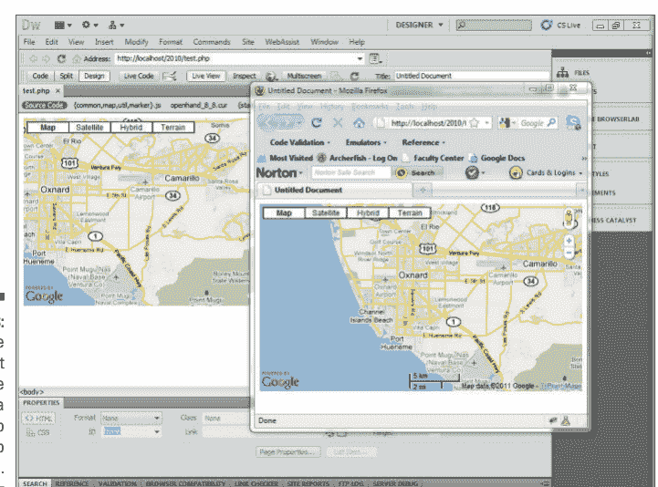

图 4-8：你可以使用这个小组件创建 Google 地图并将其插入网页。

##### 代码片段

代码片段是你可以在需要时保存并使用的代码片段。Dreamweaver 附带了几个用于常见元素的片段，例如下拉菜单、表单字段和其他几个对象——你可以轻松创建并保存自己的片段。例如，当你创建了一个喜欢的对象，或者从小组件或扩展生成了一个对象时，你可以将该代码保存在“代码片段”面板中。当你想使用片段时，只需将光标放在文档中，然后单击“插入”按钮。图 4-9 演示了使用片段在网页上放置表单下拉菜单。

即使你不用 Dreamweaver，你也应该考虑建立一个代码片段库，这样你就不用每次需要常用的页面元素时都重写代码。你可以将片段保存在静态文本文件中，或者使用剪贴簿程序（如 Microsoft Notes）来保存和组织你的片段。

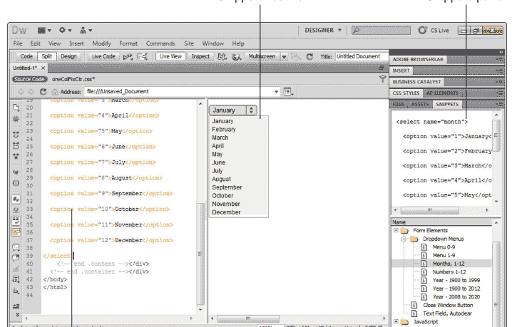

**图 4-9：** 不要重复造轮子；将一些代码保存为 Dreamweaver 片段，并在需要时重复使用。

已插入的片段代码

### 使用 Dreamweaver 的多屏幕视图

将同一个网站用于多种设备的一种方法是为每种设备类型创建一个单独的样式表文件，正如第 5 章和第 6 章所讨论的那样。例如，你可以为手机创建一个样式表，为平板电脑创建另一个，为电脑创建又一个。然后，为了查看你的页面在所有不同设备上的外观，你需要出去购买每一种设备。例如，在平板电脑类别中，你可以购买一个 10 英寸的 iPad 和一个 7 英寸的 Samsung Galaxy Tab……。

好吧。所以（显然）这种方法行不通。你能想象你需要购买多少部手机吗？一个替代方案是 Dreamweaver 的“多屏幕”功能，它允许你在不同的屏幕显示尺寸下查看网页的不同版本，如图 4-10 所示。“多屏幕”功能不仅让你在不同分辨率下查看页面，你还可以使用“多屏幕”面板中的“媒体查询”选项，为每个显示选项选择不同的 CSS 样式表：只需设置屏幕宽度和对应的 CSS 文件。

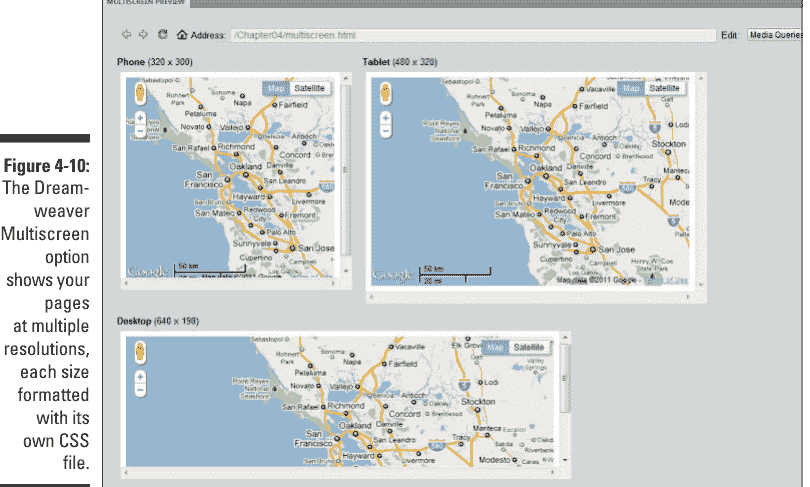

### 认识 Adobe Device Central

Adobe Device Central 是一款用于创建和转换 Adobe 应用程序内容（如 Dreamweaver 网页或 Flash 影片）为移动设备内容的工具。本质上，该程序是一个庞大的移动设备数据库和设备模拟器（设备模拟器将在第 4 章讨论）。它收录了几乎所有曾经生产过的移动设备的配置文件和关键信息，或者说至少涵盖了那些具备最基本互联网功能的移动设备。Device Central 将你所设计的移动设备的所有关键信息——显示尺寸、内存、支持的 CSS 版本、支持的内容——汇集于一身。此外，你还可以测试自己的内容，看看它在任意或所有设备上的显示效果。

遗憾的是，你无法单独购买这个程序。不过，如图 4-11 所示，Device Central 随附于大多数主要的 Adobe 产品（CS4 及更高版本）中，例如 Dreamweaver、Photoshop、Illustrator、Flash Professional 等。在我看来，如果你要为移动设备进行设计，即便不使用 Dreamweaver 来创建网页，仅为了获得 Device Central，也值得花上购买 Dreamweaver 的费用（零售价约 200 美元）。你找不到一个像 Device Central 这样全面的模拟器资源——以及你所设计的移动设备的信息来源量大到你可以将其安装到电脑上。而且，它还在不断更新，更新者不仅有 Adobe，还有 Adobe 产品的用户以及设备制造商自己。

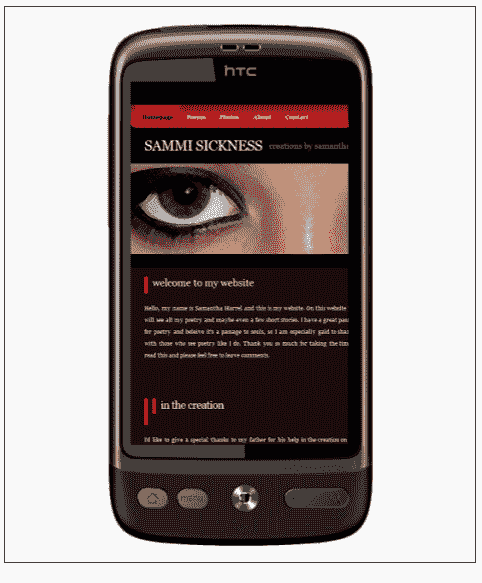

第 5 章将讨论基于移动设备类别创建移动站点。（第 5 章还将介绍如何使用 Device Central 帮助你设置移动设备类别。）Device Central 的一个非常实用的功能是，它可以创建类似设备的测试组——或者具有相似屏幕尺寸和功能的设备测试组——然后在每个组中测试你的移动站点内容。

### 将浏览器用作测试环境

要在所有可用的各种移动设备上测试网站，唯一万无一失的方法是获得每台设备，然后在每台设备上打开网站，看看网站的显示效果和性能。Dreamweaver 和 Device Central 等工具（本章前面已讨论）很有帮助，但它们无法测试所有内容——而且它们绝非完全准确。事实是，你不可能在所有移动设备上都看到你的网站，而且你永远无法确定它在每台设备上的确切显示效果和性能。

除了本章前面讨论过的 Dreamweaver 的多屏幕功能和 Adobe Device Central 之外，还有许多其他工具可供你使用。好消息是，它们中的大多数都是免费且容易获取的。例如，你可以使用在线移动设备模拟器。你还可以将网络浏览器用作移动设备模拟器和测试环境。你所需要做的只是安装一些浏览器附加组件，也称为扩展。

在我撰写本文时，两款流行的浏览器——开源的 Mozilla Firefox 和 Google 的 Chrome——都拥有相当丰富的附加组件，可用于编辑代码、模拟移动设备以及测试 HTML 和 CSS 代码。Firefox 存在的时间最长，选择范围更广，但 Chrome 也不遑多让，正在迅速追赶。

让我们来看看一些可用的附加组件、如何查找和安装它们，以及它们的功能和如何帮助你。

#### 查找和安装 Firefox 附加组件

无论你使用 Windows 还是 Mac OS，你的电脑都不会预装 Firefox。在 Firefox 中安装附加组件之前，你当然需要先安装 Firefox 本身。很长一段时间以来，最新版本的 Firefox 安装文件都可以在 `http://www.mozilla.com/en-US/firefox/new/` 获取。

如果出于某种原因，Mozilla 的人决定移动 Firefox 文件的位置，你总是可以通过 Google 搜索 Mozilla Firefox 来找到它。进入下载页面后，只需点击“下载 Firefox”按钮并按照安装说明操作即可。

#### 浏览器附加组件能为你做什么？

你知道你有一个代理吗？好吧，准确地说，它是一个用户代理——而且（更精确地说）它是你的浏览器。当你浏览网站时，你的浏览器会向服务器自我介绍，告诉服务器关于它自己的一切信息，如第一个图所示。

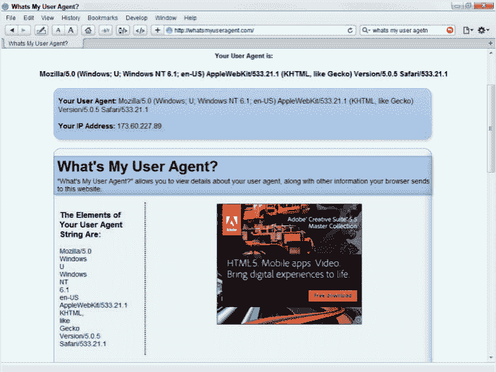

用户代理在第 4 章和第 6 章有讨论，对于你——移动网页设计师来说非常重要。用户代理与 Web 服务器的交互通常（取决于你如何设计页面）决定了哪些文件和哪些 CSS 样式表会被传送到浏览器。其中一款更受欢迎的浏览器附加组件是 User Agent Switcher——顾名思义，它允许你以不同的用户代理身份打开网站。

为什么？当你将 User Agent Switcher 与其他浏览器附加组件结合使用时，这有助于你了解页面在移动设备上的外观和行为。例如，在下图中，我将用户代理切换到了 iPhone 3.0，启用了另一个名为 Small Screen Renderer 的 Firefox 附加组件，然后又启用了另一个名为 Firebug 的插件。使用 Firebug 我可以检查有关页面的各种信息、查看用于格式化页面的 CSS 文件，并直接编辑代码。

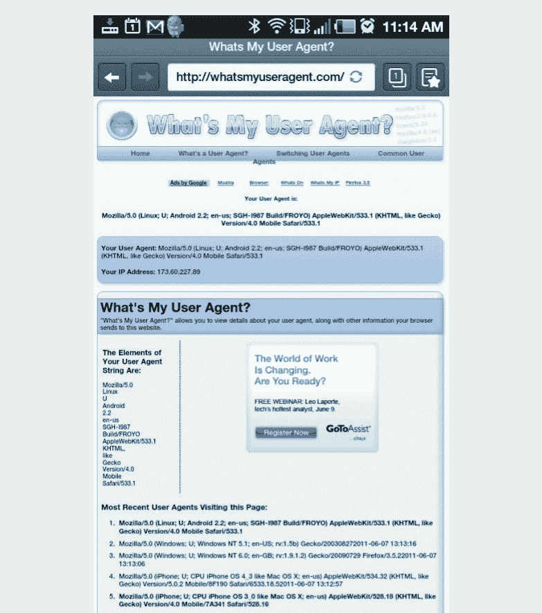

如你所见，使用免费的网络浏览器和免费的附加组件可以为你的移动设备页面提供一套相当 handy 的编辑和测试工具。

安装 Firefox 后，查找附加组件就是小菜一碟。只需按照以下步骤操作：

1. 启动 Firefox，点击“工具”菜单，然后选择“附加组件”。
2. 在“附加组件”对话框中，点击“获取附加组件”。
3. 使用搜索字段（按钮下方）搜索特定的附加组件，或点击“浏览所有附加组件”链接进入列出所有 Firefox 附加组件的页面。

按照上述查找附加组件的步骤操作后，你可以像这样在 Firefox 中安装它们：

1. 点击“添加到 Firefox”按钮。
2. 在“软件安装”对话框中，点击“立即安装”按钮。当附加组件完成安装后，Firefox 会返回到“附加组件”对话框。你需要重启 Firefox 才能使用新的附加组件。
3. 点击“重启 Firefox”按钮。

#### 查找和安装 Google Chrome 扩展程序

无论你使用 Windows 还是 Mac OS，你的电脑都不会预装 Chrome。因此，在你安装 Chrome 扩展程序之前，你必须（当然）先安装 Chrome 本身。你可以在 `www.google.com/chrome/` 找到最新版本的 Chrome 安装文件。

进入下载页面后，只需点击“下载 Chrome”按钮并按照安装说明操作即可。

安装 Chrome 后，你可以通过以下步骤找到附加组件（Google 称之为扩展程序）：

1. 点击应用程序窗口右上角的“选项”（扳手图标）。
2. 从弹出菜单中选择“工具”，然后选择“扩展程序”。
3. 在扩展程序网页上，点击“获取更多扩展程序”链接。
4. 使用 Chrome 网上应用店网页右上角的搜索字段，或从页面左侧边栏的“扩展程序”列表中选择一个类别。

你可以尝试选择“Web 开发”。不过请注意，在我撰写本文时，这个列表并不完整。我不得不搜索许多我需要的附加组件。


找到你喜欢的附加组件后，按照以下步骤安装它：

1. **当你找到想要安装的扩展程序时，点击它。** 这会带你进入一个描述该附加组件的页面。你应该特别注意安装按钮下方名为 `This extension can access` 的小黄色框。它会告诉你安装该附加组件可能带来的安全问题。
2. **点击“安装”按钮。**

就是这样。附加组件安装完成。

### 对 Web 开发人员有用的附加组件

Firefox 和 Chrome 的 Web 开发人员附加程序列表非常广泛，而且还在不断增长。许多附加组件功能相同或功能重叠。以下是我觉得最有用的附加组件列表（大多数两款浏览器都有；我已注明了那些不支持的）：

- **User Agent Switcher：** 此扩展程序允许你“伪装”特定的用户代理。如果你不知道什么是用户代理，请参阅旁边的边栏“浏览器附加组件能为你做什么？”。基本上，这个附加组件告诉 Web 服务器你不是在使用标准网络浏览器的电脑。例如，你可以将用户代理切换为 iPhone 3.0。
- **Modify Headers：** 当你浏览网站时，浏览器会向 Web 服务器发送一系列标头。标头包含有关浏览器的信息，在移动设备上，还包含有关设备本身的信息。修改标头与 User Agent Switcher 类似，告诉 Web 服务器你是其他东西。例如，你可以修改标头以告诉 Web 服务器你是特定类型的移动设备或移动浏览器。此附加组件不适用于 Chrome。不过，Chrome 自带内置的“开发者工具”选项，允许你修改标头。要访问它，请点击应用程序窗口右上角的扳手图标，选择“工具”，然后选择“开发者工具”。
- **Live HTTP Headers：** 此附加组件只是让你看到浏览器和服务器之间的标头交换，这有助于你了解要使用 Modify Headers 附加组件修改哪些标头。此附加组件不适用于 Chrome。不过，Chrome 的内置开发者工具（在前面的 Modify Headers 小节中讨论过）具有类似功能。
- **Small Screen Renderer：** 此附加组件名副其实。它以小巧的、类似移动设备的格式渲染和显示网页内容。此附加组件不适用于 Chrome。
- **Firebug：** Firebug 实际上是一组插件，允许你查看和分析网页的多个方面，包括所有内部和外部样式表，或图像、视频或 Flash 内容的格式——这只是众多选项中的一小部分。Firebug 还有一个编辑模式，允许你直接修改网页。
- **CSS 插件：** 除了此处列出的插件外，两个浏览器都有几个特定于 CSS 的插件，用于检查和修改层叠样式表。有些相当有用；有些则毫无用处。要找到它们，只需从浏览器内置的查找插件（或扩展程序）的网页中搜索 CSS，如本节前面所述。

## 安装测试 Web 服务器

无论你是在 Dreamweaver 中创建网页还是手工编码，你都需要经常查看和测试你的页面及网站的功能。你可以通过持续将修改过的页面和支持文件上传到远程 Web 服务器来实现；然而，大多数设计师发现使用本地测试服务器（有时称为测试平台）要容易得多、更快、也更方便。

如果你使用 Dreamweaver，该程序本身就可以测试 HTML、XHTML、CSS、嵌入式视频、Flash 动画以及其他一些网页功能的各个方面。然而，有些事情，例如对移动网站设计可能至关重要的服务器端 PHP 脚本，Dreamweaver 无法测试。此外，某些浏览器对某些内容的处理方式不同，没有真正的替代品来查看页面在浏览器中的实际显示效果。

市面上有许多适用于 Windows 和 Mac OS 的共享软件 Web 服务器。我和我的许多同事使用由 apachefriends.org 开发和维护的 XAMPP。你可以从 `www.apachefriends.org/en/xampp.html` 阅读相关信息并下载它。

在线安装和设置说明非常出色。XAMPP 易于使用，并且在不需要时可以轻松关闭。如果出于某种原因，你选择使用其他软件，帮自己一个忙，确保你选择的是模拟 UNIX 及其衍生系统（Linux、RedHat、Mandrake 等）的 Apache Web 服务器的软件。为什么？因为这将使你与目前约 90% 的在用 Web 服务器兼容。

你还应确保软件附带 MySQL，这也是出于兼容性考虑，并且因为我们在本书第 16 章和第 17 章中使用 MySQL 来设置移动购物车和移动博客。

### 配置你的测试平台

安装 Web 服务器软件后，从现在起，你应该开始在服务器的公共文档文件夹内创建你的网站——至少是那些你想在创建过程中进行测试的网站。在 Apache Web 服务器上，网站从 `htdocs` 文件夹提供服务，如图 4-12 所示。为每个网站创建一个单独的文件夹。

Apache Web 服务器将网站网页存储在此文件夹中。

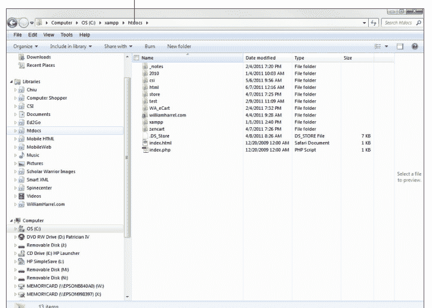

图 4-12：在新测试服务器内创建所有新网站。

### 使用你的 Web 服务器

要在新的测试平台上测试你的页面和网站的功能，只需打开浏览器并输入 URL。你的工作站或本地机器上的 Web 服务器的 URL 始终以 `localhost` 开头，这是服务器的根目录。只需在 `localhost` 后跟包含你本地网页文件的目录，如下所示：

```text
localhost/你的本地网页文件目录
```


`http://localhost/myWebFiles/filename.extension`

```
如果文件是主页，或网站的第一个页面，`index.extension`，你不需要文件名。它看起来像这样：
```

`http://localhost/myWebFiles/`


主页为何以及如何命名为`index.extension`将在第 6 章中讨论。

## 在 Dreamweaver 中设置测试服务器

并非所有 Dreamweaver 网站都需要本地测试服务器。如果你的页面只包含静态 HTML、CSS 和 JavaScript，你可以直接在程序的实时视图中或使用“在浏览器中预览/调试”选项来测试页面。Dreamweaver 也可以显示包含 Flash 内容的网页。

只有当你使用服务器端技术（如 ASP 或 PHP）时，才需要测试服务器。在设计移动网站时，通常更倾向于使用服务器端技术来检测并选择适合发送到移动设备的正确文件，如第 4 章所述。测试服务器需要处理脚本和代码，并将其转换为可在实时视图或浏览器中显示的 HTML 输出。测试服务器的工作原理与普通网站相同，只是它实际上不在互联网上。

此外，虽然本书的重点不是服务器端脚本（如 PHP），但它确实在几个章节中探讨了使用简单的 PHP 脚本。例如，在第 5 章中，讨论了检测移动用户代理并使用 PHP 选择适当的网页文件和 CSS 文件。在第 7 章中，我将向你展示如何使用 PHP 进行服务器端包含，并且在其他几章的其他解决方案中也涉及了使用 PHP。关键在于，在 Dreamweaver 中设置一个测试服务器来尝试本书中讨论的一些技术是值得的。

在 Dreamweaver 中定义测试服务器的过程因版本而异，并且与设置远程生产服务器有些相似。然而，与其在这里为每个版本复制说明，我会告诉你如何找到 Adobe 为每个 Dreamweaver 版本提供的说明。准备好了吗？浏览到 Adobe 的支持网站（`www.adobe.com/support`）并搜索*在 Dreamweaver [版本] 中设置本地测试服务器*。

当你到达选择服务器模型的部分时，选择`PHP MySQL`。

仅此而已。

## 第一部分：起初，没有移动设备……

# 第二部分：创建移动网站

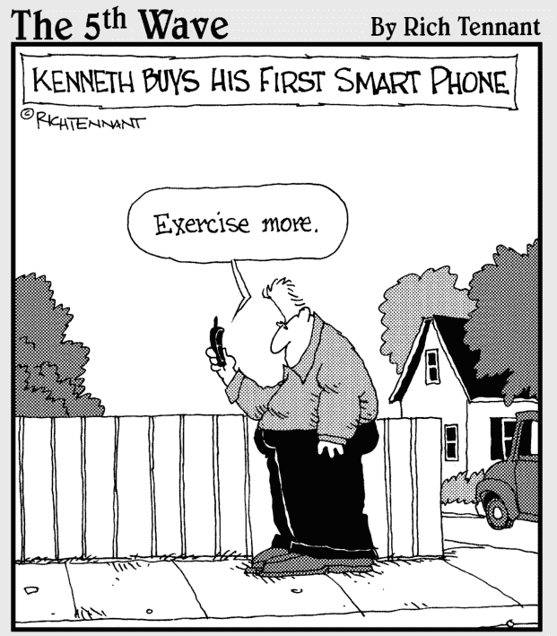

## 本部分包含……

本部分涵盖了启动移动网站的基础知识。你首先要识别和分类你将为其设计网页内容的设备——如何创建你的分类或配置文件，如何创建定义，以及如何确定哪些设备被分配到哪个类别。

设置好移动类别体系后，你需要一个“检测与适配”系统，该系统确定你的访客正在使用哪个设备，然后将他们引导到适合该设备的网站版本。一旦完成，你就可以开始设计你的网页了。

我偏好的方法是首先设计第一个页面，即主页，所以我们将采用这种方法。这可以让你理清网站的基本外观和感觉——整体的“设计”。一旦你完成了这个，就可以开始为网站创建各种模板页面了。

## 第五章：化整为零，精益求精

### 本章内容

- 了解为手持设备与桌面设备设计的区别
- 了解智能手机与功能手机的区别
- 探索移动操作系统和移动浏览器
- 介绍用户代理
- 补偿移动用户界面的差异

如果你热衷于小玩意，尤其是无线移动通信和娱乐设备，那么现在是一个激动人心的时代。苹果最近发布的 iPad 以及随之而来的大量竞品迅速涌入市场，正在快速改变我们思考和使用移动网络的方式。这些新平板设备——以及它们的小兄弟，最新一轮的智能手机——实际上就是微型计算机，尤其是在访问和使用互联网方面。这两种技术——功能齐全的计算机（台式机和笔记本电脑）和无线手持设备（智能手机和平板电脑）——正在快速融合，注定将改变我们使用互联网的方式。

专门为移动设备创建网站的书籍和课程很快就会变得无关紧要。所有这些设备使用互联网的方式将不会有显著差异。技术已经就位。现在，和往常一样，只是等待市场或消费者跟上的问题。如果我们依靠通信技术的近期历史来帮助我们预测未来，这可能需要一点时间。

为什么？嗯，最终，消费者对技术成为主流的速度有着最大的影响力。为了触及尽可能多的消费者，网站创建的基本原则之一一直是：为最低公分母设计。例如，设计师们多年来都在补偿低分辨率、800x600 像素（VGA）的计算机显示系统——远远超过了该技术被业内大多数人（尤其是计算机制造商）认为过时的时间。信不信由你，每个使用计算机（或手机）的人都会对最新、最先进的技术进步感到兴奋或受到激励。许多人——比你想象的要多得多——会比你想象的更长时间地保留他们的设备。此外（这对我们来说更难，

# 第二部分：创建移动网站

正如许多技术狂热者所坚信的，许多移动设备用户其实并不在意那些花里胡哨的尖端技术。他们宁愿省下一两百美元，买一部功能不那么齐全的设备，对自己的新设备不能做什么或可能会错过什么毫不在意，毫无顾虑。想想看吧！

如果情况并非如此——如果每个人都争相抢购下一代小玩意——我们作为设计师的工作就会轻松得多。作为网页设计师，你*必须*考虑到数量庞大的消费者*正在使用并且将继续使用*那些不支持最新技术的移动设备。而这正是本章的重点：创建能够覆盖尽可能多移动设备用户的移动网站。不了解移动设备，就无法为其设计。因此，本章将从介绍你需要了解的移动设备知识以及如何获取这些信息开始。

同样重要的是要认识到，手持设备不是计算机，至少不是传统意义上的计算机。除了微小的屏幕、有限的内存分配和其他限制之外，移动设备并不真正支持点击操作技术——没有鼠标。相反，它们使用按键、按钮和其他小工具进行导航，例如导航轮或上、下、右、左方向键。而更新、更智能的移动设备则配备了触摸屏和多点触控屏幕。关键在于：尽管在许多方面，为移动设备创建网站与为计算机设计并无二致，但在许多*其他*方面却截然不同。现在，是时候去了解那些你即将为其创建内容的设备了。

### 不落下任何一部移动设备

在撰写本文时，根据尼尔森（Nielsen）——追踪此类数据的最知名机构之一——的统计数据，智能手机（包括但不限于苹果的 iPhone、部分谷歌 Android 设备、几款 RIM 的黑莓手机以及微软的 Windows Phone（也称为 Windows Mobile 7））在美国手机市场中约占 28%，在欧洲约占 35%。这意味着，作为网页设计师，你设计的设备中约有 72% 不支持所有最新的移动网页技术。换句话说，如果你创建一个由 HTML5、CSS3 和 JavaScript 构成的移动网站，当今使用的大多数移动设备将无法使用该网站的部分或全部功能。

同一项市场研究中另一个有力的统计数据显示，在 2010 年第四季度销售的所有手持设备中，智能手机仅占 40%。因此，如果你曾以为可以只针对智能手机市场进行设计——期望消费者会很快跟上——那就大错特错了。除非你愿意忽视近三分之二的移动网页用户，否则你就得适应那些无法利用最新、最强大移动技术的设备。我也不喜欢这样。

#### 苹果和 Flash 是怎么回事？

除非你一直生活在山洞里，否则你应该知道苹果的移动设备——iPhone、iPod 和 iPad——不支持 Adobe Flash 网页内容。相反，苹果决定依赖更新的、新兴的技术，例如 HTML5、CSS3 和 JavaScript 的最新移动增强功能。虽然这里不适合讨论苹果这一决定背后的动机和营销策略，但我想说的是，这一立场不仅极大地影响了移动网站设计社区，也影响了整个网页设计社区。苹果移动设备的用户几乎占据了“智能”手持设备用户群的三分之一。这是一个庞大的用户群体——大到绝不能忽视。

最近发布的支持 Flash 的平板设备，例如三星基于 Android 的 Galaxy Tab，以及其他即将推出的来自摩托罗拉、HTC、惠普等巨头的手持平板，无疑将对 Flash 内容在移动设备上的未来产生重大影响。同时，请记住，未来计划中针对 Flash 本身的触摸和多点触控增强功能也应该会改变现状。

尽管 HTML5、CSS3 和经过改进、适用于手持设备的 JavaScript 都极大地提升了设计师在没有 Flash 的情况下所能做的事情，但在我看来，这些技术还不够强大，足以*取代* Flash。问题在于，作为移动网站设计师，你应该如何应对这个问题。我无法替你回答。但我可以告诉你我的做法。当我认为某个网站会从 Flash 内容中受益时，我就会使用它。访问我设计的网站的 iPhone 和 iPad 用户知道为什么他们看不到 Flash 内容。然而，如果信息足够重要，以至于我无法从逻辑上证明可以排除数百万台苹果手持设备，那么我就不会将该信息制作为 Flash 内容。而且，坦率地说，作为一个设计师，我对这种情况并不满意。

我怀疑，没有人——甚至包括苹果和 Adobe——真正知道这两家科技巨头之间的这场争斗最终将如何收场。

### 创建你自己的手持设备阶层社会

众所周知，刻板印象是错误的，对吧？但在为移动设备设计时，情况并非如此。事实上，这样做至关重要。当你想到当今有数百种移动手持设备型号在使用中，每种型号至少有两三个版本，而每个版本又有多个固件和软件修订版……我相信你明白我的意思了：在哪些设备支持哪些网页内容方面，存在着成千上万种变量。你不可能为每种不同类型的手持设备创建单独的网站版本。从技术意义上进行刻板分类——按照类别进行分类，例如屏幕尺寸、支持的网页格式等——是确保你的内容在大多数设备上看起来不错且运行正常的唯一方法。

#### 智能手机与功能手机

通常，手持设备市场由四种不同类型的设备组成：平板电脑、智能手机、功能手机和功能简陋的手机。在这四种类型中，只有前三种支持网页浏览。因此，将第四种类型——功能简陋的手机——排除在你的考虑之外。它们的拥有者用它们来打电话和发短信；它们不是你的目标市场。那就剩下其他三种：平板电脑、智能手机和功能手机。正如你可能猜到的那样，就像智能手机和计算机之间的界限日益模糊一样，智能手机和功能手机之间的界限也是如此。以下是具体的分类：

- **平板电脑：** 手持平板电脑确实是令人兴奋的技术。在撰写本文时，计算机和手机行业的几乎每家制造商都在推出手持平板电脑。在很短的时间内，这些设备已经变得相当成熟。例如，有些是完全意义上的计算机，只是采用了平板电脑的形式。一些公司，如惠普，已经推出了运行完整版 Windows 系统的平板电脑，它们几乎可以做任何 Windows 计算机能做的事情。其他一些公司，如三星、苹果和摩托罗拉，则在销售运行最初为智能手机设计的操作系统的平板电脑，例如 Android 和 iPhone OS。

在许多方面，为大多数这些设备创建网页内容与为标准计算机设计并无不同。大多数平板电脑拥有相当大的屏幕、不错的处理器以及支持大多数高级网页内容（如 Flash、HTML5 和 CSS3）的网页浏览器。然而，并非所有平板电脑都生而平等。例如，Coby Electronics 和其他一些制造商销售低端平板电脑，其性能并不优于普通智能手机。自第一代 iPad 发布以来仅几年时间，在开发网页内容方面，平板电脑领域已经变得多样化。为了确保你的移动网站在大多数平板电脑上运行良好，你需要熟悉此类别中的设备及其功能。

- **智能手机：** 为了本次讨论，让我们这样定义智能手机：智能手机支持第三方应用程序，并可与公司电子邮件、联系人和日历同步，从而兼具个人数据助理（PDA）的功能。智能手机与其他手机的不同之处在于，它们通常具有更快的处理器、更多的内存，并运行完整的操作系统。这使得应用程序开发人员可以为其创建应用程序。大量设备符合此定义，包括 iPhone、一些 Droid 以及其他基于 Google Android 操作系统的设备、一些 Windows Phone 手持设备、一些黑莓手机、一些 Palm 设备等等。

除了大多数平板电脑之外，这一组——我们的“上流社会”设备——将拥有最强大的网页支持。然而，如同任何阶层一样，其中也有子类别；并非所有智能手机都生而平等：今天上市的产品比一年前上市的产品拥有更好的互联网支持，依此类推。此外，对第三方应用程序的支持允许用户下载并安装不同的网页浏览器，并且通常这些设备上的浏览器支持插件和其他扩展功能。换句话说，在我们试图将智能手持设备归入特定类别的过程中，我们不能真的将所有智能手机归入一个类别然后就不管不顾了，对吧？

- **功能手机：** 这些是低端移动电话。它们的计算能力较弱，通常比智能手机技术含量低。尽管一些新功能手机可以运行基于精简版 JavaScript 的简单应用程序，但其操作系统不支持原生应用，例如 iPhone 和 Android 操作系统上可用的应用。功能手机的网络浏览器通常较小，缺乏运行高级网络功能的能力，例如 Flash、CSS3 和 HTML5。

你可能会认为，无法使用第三方应用程序会让为功能手机设计变得更加容易。毕竟，它们使用的是出厂预装的浏览器——唯一的升级方式是通过固件更新。但功能手机类型如此繁多，拥有众多版本、功能和各种屏幕尺寸，因此将功能手机归入特定类别也确实颇具挑战性。在我们开始对手持设备进行社会层级划分之前，首要任务是明确哪些设备支持哪些功能。

### 理解移动操作系统和浏览器

手持设备开发是一场针锋相对、你追我赶的军备竞赛。每当一位开发者发布更新的移动操作系统（OS）版本，就等于向竞争对手发起了挑战。每当像（比方说）苹果这样的操作系统开发者发布一组新功能时，谷歌、微软、RIM（黑莓）以及其他操作系统开发者都会立即 rush 去整合这些新功能的等效物，并开发能让他们在这场竞赛中领先的新功能。如此循环往复。

这场军备竞赛的一个重要成果是移动浏览器技术的进步——这部分与你这位移动网站开发者息息相关。在搭建手持设备类别体系时，你需要考虑的两个最关键因素是设备屏幕尺寸和浏览器功能。访问网站的手持设备支持的 Flash Player 版本（如果有）以及它能播放的数字视频格式也同样重要。通常，是操作系统本身——而非移动浏览器——定义了许多这些功能。其他因素还包括移动服务运营商，以及设备制造商是否为其内置了一些服务特定的功能。这实际上是一张相当错综复杂的网络——一个精心设计、似乎旨在让移动网站设计师抓狂的复杂方案。

#### 移动操作系统

详细讨论移动操作系统——除了枯燥乏味之外——可能对设计移动网站并无实际帮助。此外，每个平台都有众多版本，而且操作系统通常针对特定设备进行定制。例如，在功能手机上运行的 Android 与在智能手机上运行的 Android 具有不同的功能。更复杂的是，运行在三星 Galaxy 上的 Android 与运行在 HTC Inspire 上的同一操作系统功能也不同——尽管从技术上讲，这两款设备都属于智能手机。

### 根据动态内容和动态移动设备配置文件创建对设备友好的网站

在移动网络设计中，如同生活中的大多数事情一样，解决问题的方法不止一种。本书侧重于使用 HTML 创建传统的*静态*移动网站和页面——这是大多数网络设计师使用的方法。另一种方法——高度复杂、非常精妙，并且（在正确执行时）最终更有效——是根据移动设备的动态配置文件创建和部署动态内容：网站被设计为“即时”或按需提供内容。

使用这种方法时，你只需创建一两个页面——除了 PHP、ASP 或 Cold Fusion 代码（包含对数据库文件和一些格式信息的引用）外，这些页面是*模板*：可以说是空的框架。在用户访问网站之前，它们不包含任何实际内容。内容存储在数据库中；另一个数据库存储设备配置文件或所有各种移动设备的信息。（不，你不必自己收集所有这些信息。它可以从多个来源获取，包括开源的无线通用资源文件，即*WURFL*，本章稍后会讨论。）

当移动设备访问网站时，它会通过公布其*用户代理*来自我介绍。（用户代理在第 3 章、本章以及第 6 章中有所讨论。）然后，利用用户代理信息，一组复杂的脚本会引用包含设备配置文件的数据库，获取设备信息——屏幕尺寸、设备支持的 HTML 和 CSS 版本、设备是否支持 Flash 和 JavaScript 等等。掌握了这些信息后，另一组复杂的脚本会从内容数据库中引用和调用正确的内容，并确定使用哪些 CSS 样式表和其他格式信息。

呼！听起来很像魔法，不是吗？

尽管这种方法能为更广泛的手持设备提供格式更准确的内容，但实现起来却很困难。它不仅需要大量的工作，还需要非常有天赋的程序员。创建此类动态网站几乎不需要 HTML 和 CSS 格式化。相反，服务器端编程（非本书主题）完成了网站的大部分工作。如果你有兴趣研究这类移动网站开发，可以查阅 Andy Harris 所著的*HTML, XHTML, & CSS All-in-One For Dummies*。

然而，如果不使用某种有限的*检测与适配编程*（无论是使用客户端 JavaScript（第 13 章讨论）还是服务器端 PHP 或 ASP（第 6 章讨论）），为手持设备创建网站既困难又笨拙。“检测与适配”指的是确定向手持设备交付哪些页面和样式表的过程：你使用脚本检测用户代理和设备信息，再使用另一组脚本来部署相应的页面和格式数据。

我可以向你展示绕过这个基本编程要求的方法——但在我看来，额外的工作、复杂的技巧（甚至最终结果，会导致网站质量低劣）将造成巨大的损害。我们还是别走那条路了。

然而，这并不意味着操作系统无关紧要。手持设备通常将操作系统作为用户代理进行公布，而非浏览器类型和版本。（正如第 6 章和第 13 章所讨论的，设备公布其用户代理是为了开始与网络服务器协商。）因此，设备之间的事务并非以

“你好。我是移动 Safari 操作系统。你有什么适合我的内容？”

开始，设备实际上说的是，

“嗨。我是 iPhone 3.0，一个特定设备。有什么*专门为我准备的*东西吗？”

有时，主要取决于你如何配置设备的检测与适配系统，手持设备的操作系统或平台类型更有用，或者能提供关于设备的更多信息。然而，正如我在第 6 章中讨论的，这通常取决于你告诉服务器（或当你使用客户端检测与适配时，你的网页）如何处理用户代理信息。

#### 移动浏览器

正如传统计算机上有多种网络浏览器可供选择一样，大多数平板电脑和智能手机级手持设备上也可以下载和安装几种不同的浏览器。用户更换浏览器的原因当然有很多。例如，我不使用 Internet Explorer，因为它与我在我教授数字设计的在线学院中必须使用的表单不兼容。我在一些移动浏览器上也有类似的问题。

移动浏览器的多样性非常广泛，并受许多变量影响——包括但不限于浏览器运行的设备类型。例如，运行在功能手机上的 Opera Mini 往往不支持它在智能手机上支持的功能。同样，浏览器所使用的手持设备类型通常在浏览器能做什么方面扮演着重要角色。确定浏览器和浏览器版本，类似于确定操作系统平台，对于手持设备的用户代理来说再次变得重要。换句话说，服务器或你的检测与适配脚本如何识别谁（更具体地说，*什么*）在访问网站。

### 找出哪些设备能做什么

我绝不是在主张你需要确定每个在用的手持设备能做什么和不能做什么。那将是，嗯，疯狂的。你当然会成为移动设备专家，但别的几乎什么也做不了。此外，当你刚了解一种设备能做什么时，制造商们正加紧发布（比方说）新的 BIOS 或浏览器版本，让你对任何特定设备所知的信息在明天就过时。但是，为了搭建你的

## 第五章：往小处想，更小，最小

在当今社会，你确实需要一个总体思路——一种对潜在用户群体访问你网站时所使用设备进行分类的方法。要做到这一点，你需要对不同设备的性能和局限性有一个大致的了解。

你设计的任何检测与适配系统都将主要依赖于用户代理，这一点在本章以及第六章和第十三章中都有讨论。换句话说，无论你是使用客户端还是服务器端脚本（同样将在第六章和第十三章中讨论）来检测设备类型并确定向设备推送哪些页面和样式表，该过程中*检测*这一环节都取决于用户代理。用户代理包含有关设备类型及其功能的信息。

为了对设备进行分类，你需要了解它们能做什么、不能做什么。如何获知这些信息呢？好消息是，其中许多信息都很容易获取。

在本节中，我将向你展示如何查找这些信息。在下一章中，我将展示如何运用这些信息。

### 制定分类策略

当你为传统计算机设计时，设计师通常采用最低兼容策略。换句话说，他们通过确保网站与最旧的技术和显示尺寸兼容，来使网站在所有计算机上都能正常显示和运行。而为移动设备设计时，通常采用相反的方法——为功能最丰富的设备设计网站，然后逐步剥离功能，创建新的网站。

例如，初始网站可能支持最大的屏幕尺寸：HTML5、CSS3、JavaScript、Flash Player 10.x 等。然后设计师基于原始设计为下一类设备创建新网站——通常是通过降低功能、适配更小的屏幕尺寸、取消对最新标记语言的支持，以及完全舍弃 JavaScript 来实现。接着，根据分类结构的复杂程度（以及当前项目可用的时间和资源），设计师可能还会创建另一组页面，进一步剥离更多功能。

或者，另一种方法是从一组非常简单的页面开始，逐步向上扩展，增加对更高级功能和特性的支持。两种方法都可行。在移动设计中*行不通*的是为传统台式机和笔记本设计时常用的一刀切方法。

#### 无线通用资源文件（WURFL）

查找特定设备、操作系统和移动浏览器信息的最流行资源之一是 WURFL——一个包含大量用户代理信息的在线数据库。设计师和开发人员以各种方式使用 WURFL 信息。例如，动态检测与适配系统的设计者——参见边栏“从动态内容和动态移动设备配置文件创建手持友好型网站”——使用这个数据库（而非自行创建）作为动态移动设备配置文件的来源。*你*可以用它来收集移动设备阶层中设备的信息。

WURFL 的一个衍生网站是 Tera-WURFL（`www.tera-wurfl.com`），在那里你可以输入用户代理名称，获取关于该用户代理或设备本身的详细信息。在图 5-1 中，例如，我输入了`iPhone 3`，返回了关于该设备的各种信息；远超我为这款手机设计网站所需的信息。不过，如果我知道自己在找什么，可以从中筛选出需要了解的信息。例如，“标记”部分显示了 iPhone 3 支持哪些版本的 HTML。另一部分“显示”则展示了设备的屏幕尺寸，以及当用户将手机侧翻时是否支持双方向显示（纵向和横向）。

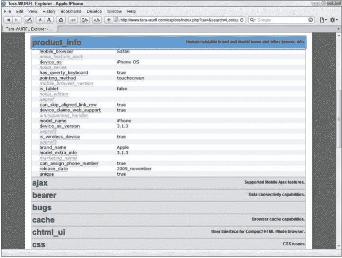

图 5-1：Tera-WURFL 上的用户代理查询提供有关特定设备、浏览器和操作系统的详细信息。

尽管 WURFL 可能是最大的用户代理数据库，但它也存在一些不足。例如，虽然它有 CSS 类别，但仅列出有限的支持的 CSS 特性，而非列出支持的 CSS 版本（CSS1、CSS2 或 CSS3）。这种方法迫使你做出有根据的推测。例如，如果某设备支持 XHTML（列在“标记”下），你可以推测它也支持 CSS1 和 CSS2。如果它支持 HTML5，则可以合理假设它也支持 CSS3。另一个不足是，WURFL 的信息并不总是最新的。它主要依赖志愿者输入。手持设备的 BIOS 和软件变更并不总是得到更新。

### Adobe Device Central

Adobe 的 Device Central（第四章中讨论过）或许是最全面且最易用的设备配置文件数据库。它不仅提供有关设备支持哪些 Web 功能的详细信息，还能模拟设备，让你了解页面将如何显示、哪些功能可用、数字视频、Flash 电影和脚本在设备上的运行情况，等等。你甚至可以通过查看下载时间以及内存和处理器使用情况的图形化表示，来测试网站的性能。

不仅各种设备在 Device Central 中易于查找和查看，你还可以根据不同的标准对设备进行排序和列表，例如屏幕尺寸或色深（可显示的颜色数量），以精确了解特定手持设备支持什么。图 5-2 显示了设备库视图中的 Device Central 应用程序窗口。滚动此列表时，请特别注意“已发布”列。该列中的日期告诉你配置文件何时上传到 Device Central 数据库，这能让你很好地了解信息的更新程度。

然而，这个非常实用的工具并非独立产品——你需要购买 Adobe 设计程序或图形编辑器，如 Dreamweaver、Photoshop、Illustrator 或 Flash Professional，才能获得 Device Central。对于专业设计师来说，这通常不是问题。大多数设计师至少拥有一款 Adobe 产品。例如，Photoshop 就是网页设计行业的标配。

Device Central 以非常有利于 Web 和内容设计师的方式组织并展示特定设备的信息。例如，在图 5-3 中，在“常规”页面上，你可以看到设备的屏幕尺寸、支持的 Flash Player 版本、操作系统以及接受的输入类型。Device Central 的网页还会显示用户代理和支持的 Web 格式，包括 CSS 级别和 JavaScript 版本。

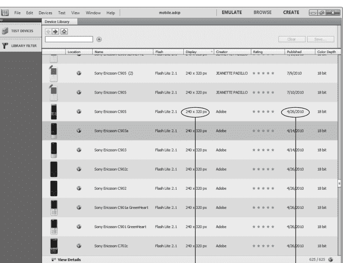

图 5-2：Device Central 的扩展手持设备库允许你基于功能对配置文件进行排序。

#### 制造商规格

你当然可以前往设备制造商的网站获取特定设备的规格。但这是非常繁琐、耗时且技术含量低的方法。我只在为某个组织设计 Web 应用程序时才会使用这种方法，而该组织的员工团队都使用相同（或相似）的手持设备。当然，这种情况并不少见。许多组织为销售和支持团队创建移动应用程序，针对特定设备量身定制网站，然后将这些设备分发给团队成员。

如你所见，这个工具使确定特定设备的信息变得相当简单。

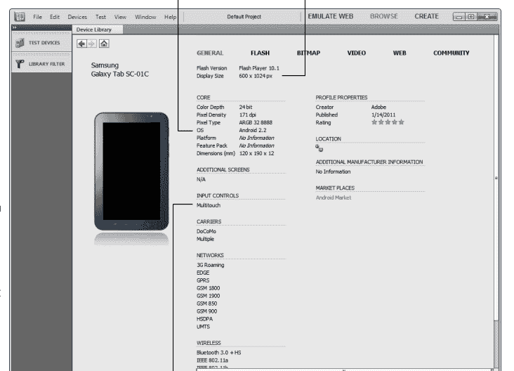

图 5-3：Device Central 将设计相关的信息集中在一处，便于查找。

### 当鼠标点击变成按键、触摸和多点触控

当你为移动设备设计页面时，必须记住大多数手持设备与传统计算机的 Web 内容交互方式并不完全相同。通常，不是“指向并点击”，而是“跳转并点击”。手持设备用户使用箭头、滚动条、滚轮或按键来导航到超链接和表单字段。这种以及其他界面差异通常会影响你如何设计移动 Web 页面。

事实证明，移动用户没有鼠标。好吧，你可能会想，“废话。这不明摆着的吗？”——但这种缺失很重要：一些用于计算机网站设计的技巧在手持设备上根本行不通。例如，在为传统计算机屏幕设计的页面上，设计师有几种重要的工具帮助用户识别热点（可点击链接）——例如，取决于鼠标操作的悬停效果和替代描述。当用户*悬停*（将鼠标指针移到超链接或按钮上并停留）时，*悬停效果*会改变超链接的外观；*替代描述*会在类似工具提示的方框中提供反馈（通常是对链接功能的描述），如图 5-4 所示。

#### 滚动按钮和滚轮

在许多手持设备上，用户通过方向键或某种滚动选择轮来滚动到链接，如图 5-5 所示。用户在滚动到链接之前收到的唯一反馈来自你的物理布局——链接的某些特征使其明显表现为一个按钮或超链接。用户滚动到按钮后，你可以提供类似悬停效果的功能——如图 5-5 所示的高亮显示，确认该链接确实是一个热点区域。虽然这很有用，但它不如传统计算机上用户悬停在热点区域时提供的信息那么有帮助。你的任务是确保热点区域易于识别，并提供充分的反馈来说明链接的功能或指向何处。

悬停效果

替代描述

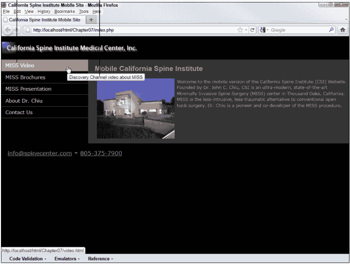

**图 5-4：** 当鼠标指针悬停在按钮和链接上时，悬停效果和类工具提示描述会提供反馈。手持设备不使用这些功能。

**图 5-5：** 当用户滚动到热点区域时，你可以提供类似悬停效果的高亮显示来帮助他们识别按钮和链接。

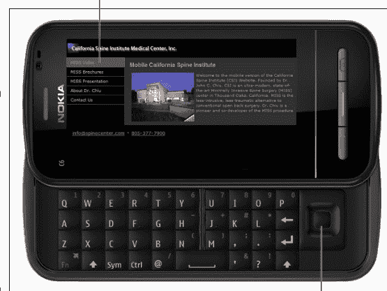

此外，由于许多移动用户依赖某种滚动按钮，因此创建一个合理的 Tab 顺序也很重要——即用户可以使用键盘（标准计算机上的 Tab 键）按钮操作来选择按钮、链接、表单字段和其他交互对象的顺序。例如，在图 5-5 中，你要确保 Tab 顺序将光标从上到下依次移动左侧的按钮列表，而不是随机地从一对象跳到另一对象。你可以在标记代码中使用`tabindex`属性控制 Tab 顺序，第 9 章将对此进行讨论。

#### 触控和多点触控屏幕

某些设备，如 iPhone、iPad、Galaxy Tab、部分 BlackBerry 设备、Droids 和 Windows Phone 手持设备，除了通过触控和多点触控屏幕外，不提供任何导航方式。尽管触控屏幕很酷，但用户确定某个对象是否为链接的唯一方法就是触摸它。然后，如果它确实是链接，就会加载新页面。用户获得的关于按钮是否为链接的唯一反馈来自于你的按钮设计方式，如图 5-5 所示。在为这些设备设计时，尤其重要的是不要让用户猜测。确保你的链接易于识别。

### 为双方向手持设备设计

为手持设备设计时，你必须应对的另一个特性是*双方向*——根据你如何转动设备而显示横屏或竖屏视图的功能。（见图 5-6。）毕竟，你无法拿起你的电脑显示器或笔记本电脑，将其河内把它侧向一边，然后让屏幕重新绘制以匹配新的方向。（如果你能这样做的话那就太酷了。）从技术上讲，你可以完全忽略这一高端功能，但请放心，许多使用双方向设备访问你网站的人都会注意到这一点。很有可能，如果他们拥有这类设备，双方向就是他们喜爱的功能之一。而如果这是他们购买该设备的原因之一，如果你忽略了它，他们很可能会*非常*想念这个功能。

好消息是，应对这种来回切换并不算困难。事实上，你为确保网站在各种屏幕尺寸上都能美观显示所采取的一些措施，*同时*也有助于兼容支持横屏和竖屏查看的设备。我将在第 12 章和第 13 章向你展示如何解决这一设计问题，届时我们会讨论 WebKit 扩展以及 JavaScript 检测和切换。

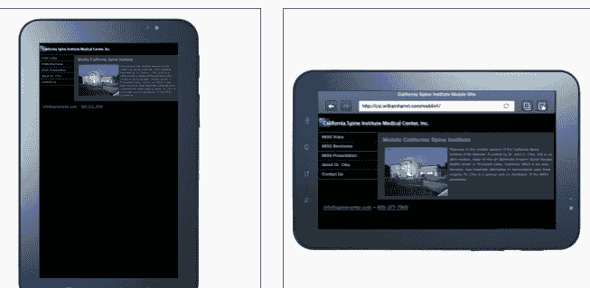

**图 5-6：** 竖屏和横屏模式下的内容示例。

110 第二部分：创建移动网站

## 第6章

## 开发移动设备检测和适配系统

**本章内容**

- 比较检测移动设备的方法
- 区分客户端检测和服务器端检测
- 创建服务器端检测系统
- 创建设备类别配置文件
- 让用户选择要使用的配置文件

在手持设备显示网页内容的短短几年间，大约有 6,000 到 8,000 种不同的设备被投放到移动设备市场。想象一下，如果你必须为每一款设备设计一个不同的网站！那当然是很荒谬的。

即便如此，创建适用于不同类型设备的内容仍然有多种方法，从非常简单到极其复杂不等。统一战线你选择哪种方法，从长远来看，归根结底都是要开发两个系统：*检测*和*适配*。*设备检测*系统确定访问网站的设备类型，*适配*系统则为该设备提供适当的内容。

大多数专业设计师通过服务器端脚本实现设备检测，通常使用 PHP 编写。*服务器端*，当然，是指由服务器而非用户的浏览器来解释和执行脚本。在大多数情况下，服务器端编程无法通过 HTML 或 CSS 标记实现——因此这远远超出了本书的范围。好消息是，有一些开源（且免费）的设备检测系统可供使用；本章将向你介绍其中几个，并提供一些使用建议。我还会向你展示几种快速简便的检测方法，它们不需要大量的编程技能，却能帮助你向相当数量的移动设备提供移动内容。

## 了解移动设备检测

下面是对检测过程的简化描述：当用户浏览网站时，浏览器和服务器会进行一段对话。在对话开始时，浏览器（或有时是手持设备本身，取决于设备如何处理此功能）通过一个称为*用户代理*的字符串向服务器介绍自己，如第 5 章所述；此时，当浏览器向服务器*打招呼*时，从技术上说，服务器已经检测到设备类型了。它大致了解以下全部或部分信息：设备使用的操作系统（OS）和 OS 版本；设备使用的浏览器类型和版本；设备类型和类型（BIOS）版本；以及支持哪些扩展，如 WebKit（第 12 章讨论），如适用。

根据你如何设置检测系统，这段开场对话可能是检测过程的结束，也可能只是开始。尽管这似乎是很多信息，但往往还不足以充分识别设备的功能。复杂设备检测系统中的脚本使用用户代理数据来发现有关设备属性和功能的更多信息，例如屏幕尺寸和分辨率。例如，该手持设备是否支持多点触控和双方向？你开始理解了吗？

但话又说回来，有时候，取决于你的检测切换系统的复杂程度，用户代理数据已经绰绰有余了。有时，检测切换应用程序只需要知道网站访客正在使用移动设备。同样，这实际上取决于你希望检测系统如何工作，或者更准确地说，在什么情况下你希望它做什么。

### 服务器端与客户端检测

你应该使用服务器上的脚本来检测设备类型，还是让浏览器执行检测脚本？答案取决于你希望为哪些范围的设备提供优化格式的网站版本。原因如下：如今，几乎所有的客户端脚本都是用 JavaScript 编写的。许多移动设备，尤其是较旧的设备，不支持 JavaScript。

因此，基于 JavaScript 的检测系统将无法检测到相当大一部分访问您网站的手持设备。换句话说，禁用 JavaScript 的手持设备会忽略这些脚本，并尝试显示网站的默认版本——而这通常是桌面电脑版本。

不过，这确实不是世界末日。过去几年中，无论是智能手机还是功能手机，制造商的趋势都是加入对 JavaScript 的支持。诚然，使用基于 JavaScript 的检测系统意味着某些手机无法获得为您移动端优化的页面，但这类设备在移动浏览中的实际使用率已经很低，而且其数量正在迅速减少。使用服务端脚本是确保所有支持网络的手持设备都能访问您网站移动页面的唯一可靠方法。现在，为了创建服务端检测系统，托管您网站的服务器必须支持 PHP（或您使用的任何脚本类型）。从技术上讲，这意味着您必须创建 PHP 页面而非 HTML。但请保持关注：在本章稍后部分，我们将向您展示一种绕过此限制的方法。与此同时，请参阅随附的侧栏，了解关于使用 JavaScript 进行设备检测的一些提示。此外，第 13 章讨论了优秀的 JavaScript “检测并切换”技术。

## 创建服务端检测系统

设计公司和大型公司的网页设计部门投入了大量时间和精力来开发“检测与适配”系统。最复杂的系统需要维护一个设备数据库和一套复杂的 PHP 脚本，用于检测用户代理（User Agent）并随后查询数据库。然后，利用数据库中关于设备的信息，另一套 PHP 脚本将决定向该设备交付哪些内容。

同样，这需要极强的 PHP 编程技能，这远远超出了本书的范围。如果您有兴趣学习如何创建此类系统，您需要学习 PHP。我建议您参考 Andy Harris 编写的《HTML, XHTML, & CSS All-in-One For Dummies》。目前有一些免费的开源解决方案（我将在本节稍后向您介绍），但即使是这些方案也需要一些基础的 PHP 编程技能。

别担心——我不会只告诉您必须学习编程才能获得一个检测与适配系统就此打住。相反，我将逐步向您展示如何使用现有的 PHP 解决方案之一：来自 `http://detectmobilebrowsers.mobi` 的 Andy Moore 的检测与适配系统。该系统的设置和实现相当简单。它的工作原理是检测设备的操作系统，然后将浏览器重定向到相应的 URL。使用该系统，如果您愿意，可以为每个操作系统创建不同的站点，并为不属于预定义操作系统类别的设备创建一个通用的兜底站点。

## 使用 JavaScript 检测设备

如果您时间或资源有限（或者您的客户不想支付为多种不同类别的设备开发内容的费用），且只能创建一个版本的移动站点，该怎么办？无论您创建 1 个版本还是 20 个版本，您仍然需要一种方法来检测用户代理或其他能将其识别为手持设备的特定设备信息。

我发现的一个相对高效的方法是检测设备的分辨率——更具体地说，是其屏幕宽度——然后根据该信息切换到网站的移动版本。这个简单的方法基于这样一个假设：如果设备的屏幕小于某个特定宽度（以像素为单位），那么它就是移动设备。诚然，这不是一个非常复杂的系统，但它在每个移动设备上都能起作用，其运作方式如下：

1. 您创建网站的移动版本。
2. 为移动站点分配一个唯一的 URL——一个子域名——例如 `mobile.mysite.com`。

如果您不理解子域名，请参阅本章稍后名为“子域名或子目录”的侧栏。

3. 打开桌面版本网站的首页 HTML 文件，通常是 `index.html`。
4. 将以下 JavaScript 放置在首页 `<body>` 部分的顶部，如图所示。

将脚本放在 `<body>` 部分的顶部可确保浏览器在处理页面的其余部分之前执行该脚本。

```javascript
// 示例 JavaScript 代码
if (screen.width < 480) {
    window.location = "http://mobile.mysite.com";
}
```


`<script type="text/javascript">`

```
<!--

if (screen.width <= 1024) {

	document.location = "http://mobile.mysite.html";

}

//-->

</script>
```

此脚本检测设备的屏幕宽度：`if (screen.width <= 1024)`。如果宽度小于 1024 像素（或您想要使用的任何宽度），脚本会将浏览器重定向到包含移动内容的页面的 URL：`document.location = "http://mobile.mysite.html"`。

再次强调，由于两个非常重要的原因，这种方法绝非万无一失：(a) 并非所有手持设备都支持 JavaScript，且 (b) 并非所有用户代理都会发送屏幕分辨率。尽管如此，根据我的经验推测，这种方法对目前使用的约 70% 到 80% 的移动设备有效。

## 第 6 章：开发移动设备检测与适配系统

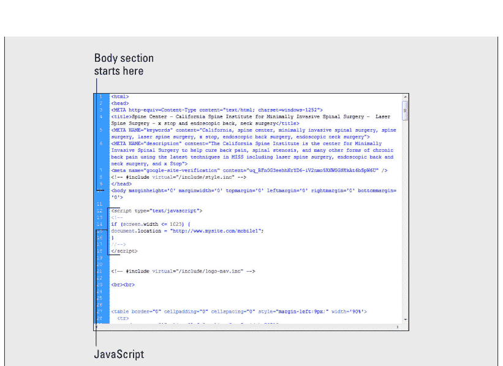

该系统运行得相当不错，但它不能让您基于特定属性（如屏幕尺寸或设备支持的 CSS 版本）进行检测和适配。那种类型的系统需要一套更为复杂的 PHP 脚本和设备数据库。在本节稍后部分，我将讨论几种较受欢迎的解决方案，并向您展示如何使用 Andy Moore 的系统。

### Andy Moore 的检测与重定向系统

要开始这个练习，您至少需要两个版本的网站——一个面向桌面和笔记本电脑的标准电脑版本，以及一个面向手持设备的移动版本。关于如何对站点进行分类并创建不同的移动版本，将在本章稍后部分以及本书的其余部分中讨论。此外，请确保您的托管服务支持 PHP（大多数都支持）。

> 提示：此解决方案允许您基于操作系统，为多达七种不同类型的设备创建不同的站点。这有点大材小用了，您很少需要这么多变体。如果您只是想试用一下，您只需要一个移动版本的站点。实际上，为了测试目的，您只需要一个简单的页面。要开始操作，请遵循以下步骤：

## 使用 CSS3 媒体查询创建适配解决方案

CSS3 即将到来的一项令人兴奋的功能（而且还有很多）就是**媒体查询（media query）**。

媒体查询向设备询问特定属性，例如屏幕宽度和高度、方向（手机当前是垂直持有还是横向持有）等等。然后，根据来自设备的信息，页面将使用针对该设备属性设计的样式表进行格式化。CSS3 样式表决定了页面的格式化方式、加载哪些图像和数字媒体文件等，而无需为同一个站点创建多个不同版本。（从技术上讲，CSS2 也支持媒体查询，但只有支持 CSS2 而不支持 CSS3 的浏览器中，很少有实现了这一功能的。这在仅支持 CSS2 的浏览器中实现媒体查询时造成了一些困惑/争议，且其带来的麻烦超过了其价值。）

正如我所说，这项功能总有一天会普及——但现在还不是。然而，目前部署它们的一个潜在缺陷是，它们通常需要 CSS3 的支持，而今天的许多设备并不具备。使用不支持 CSS3 的设备访问您网站的用户可能无法使用媒体查询，因此不会被引导至相应的内容。但是，一旦 CSS3 得到更广泛的使用，它们将消除维护设备数据库和编写复杂服务端脚本的必要。不过，您现在只有在专门为高端手持设备（如 iPhone、iPad 和其他平板电脑；较新的 Android 设备，以及较新的 Palm 和 Blackberry 智能手机）设计站点时才会使用它们。

这听起来像魔法吗？它确实会消除大量工作以及创建相同内容的多个版本的需要。如果您有兴趣看到媒体查询在实际中如何运作，并想深入了解其原理，这里有几个带有您可以尝试的示例的链接：

- **CSS3 媒体查询与创建适配布局：** http://robertnyman.com/2010/09/09/css3-media-queries-and-creating-adaptive-layouts/
- **如何使用 CSS3 媒体查询创建网站的移动版本：** www.smashingmagazine.com/2010/07/19/how-to-use-css3-media-queries-to-create-a-mobile-version-of-your-website/
- **CSS3 媒体查询：** www.webdesignerwall.com/tutorials/css3-media-queries/

## 1. 为网站的移动版本创建子域名。

*子域名（subdomain）*是网站的二级层级。您在到处都能看到它们。对于您的移动子域名，您可以使用如下的命名方案：

```
mobile1.mysite.com

mobile2.mysite.com

mobile3.mysite.com
```

如果你只有一个版本的移动网站，当然只需要一个子域名。如果你计划使用网络托管账户，你需要向托管服务商设置子域名，并为子域名创建域名服务器（DNS）记录。如果你不知道如何创建子域名和DNS记录，你的托管服务商可以提供帮助。（如果你计划设计移动网站，这肯定是你未来需要的知识。）

2. 打开浏览器并访问 `http://detectmobilebrowsers.mobi`。

如图6-1所示，这个页面允许你输入网站不同版本的URL。你可以为几种不同类型的设备（如iPhone、iPad、Android设备、Windows设备等）输入不同的URL。还有一个通用设置，可以重定向所有移动设备；如果你愿意，甚至可以重定向桌面浏览器（如图6-1所示）。

> 不用担心“立即购买”按钮。Detect Mobile Browsers 提供的解决方案是免费的，除非你计划将其部署在商业网站上。如果是这种情况，Andy 会要求你以 50 美元的价格购买代码，考虑到它节省的时间，这非常划算。

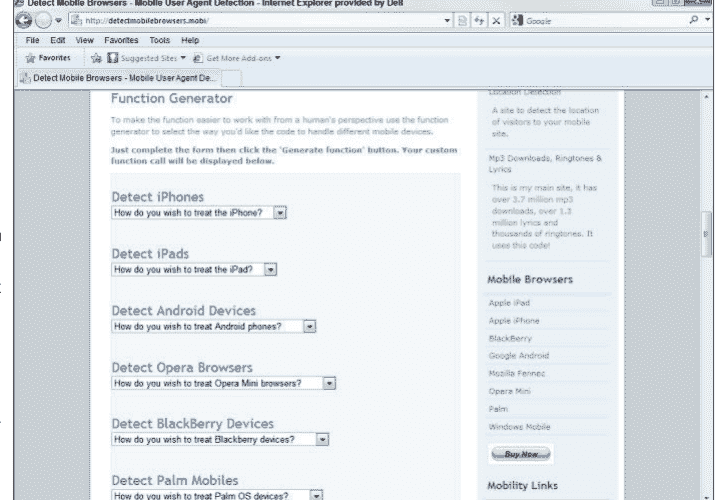

图 6-1：Detect Mobile Browsers 帮助你创建一组用于重定向移动流量的 PHP 脚本。

3. **在“Detect iPhones”下的第一个下拉菜单中，选择“Redirect iPhones to a Specific URL”。**

下拉菜单下方会出现一行新内容：

```
Where do you want iPhone users redirect to: http://
```

如图6-2所示。最后一部分 `http://` 是一个文本字段。

4. **输入你希望将 iPhone 流量重定向到的网站 URL。**

5. **完成其余每个重定向的设置，输入替代内容的 URL。**

此脚本要求你为每个选项设置标准。将“Redirect Desktop Browsers”设置设置为“No – Do Not Redirect Visitors – Function Will Return FALSE”。

6. **点击最后一个下拉菜单下方的“Generate Function”按钮。**

这将生成相应的 PHP 函数（如图6-3所示），可插入你的网页。不过，我们还有几件事需要先做。

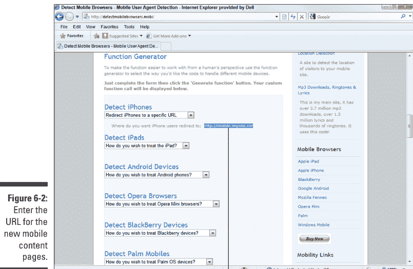

**图 6-2：** 输入新移动内容页面的 URL。

## PHP 检测与重定向函数

通常，PHP 页面的扩展名是 `.php` 而不是 `.html`；扩展名告诉服务器如何处理页面。`.html` 扩展名告诉服务器将页面交给浏览器处理。另一方面，`.php` 扩展名告诉服务器该页面包含需要服务器执行的脚本。因此，我们通过告诉服务器在 HTML 文件中查找并执行 PHP 代码来绕过这个小问题。为此，我们创建一个 `.htaccess` 文件，也称为分布式配置文件。在 Apache Web 服务器（大多数托管公司使用，尤其是在支持 PHP 的服务器上）上，分布式配置文件提供了一种按目录进行配置更改的方法。在打开网页之前，服务器会读取 `.htaccess` 文件，以确定特定目录中的文件——或包含 `.htaccess` 文件的目录的子目录中的文件——是否需要特殊处理。

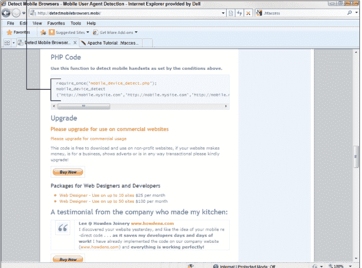

7. 打开一个文本编辑器，在第一行输入以下内容：

```
AddHandler php5-cgi .html .htm
```

这一行告诉服务器在具有 HTML 和 HTM 扩展名的文件中运行 PHP5 脚本。如果你的托管服务器使用的是早期版本的 PHP（不太可能），你可以使用以下几行，而不是步骤7中显示的代码：

```
AddType application/x-httpd-php .html

AddType application/x-httpd-php .htm

AddHandler x-httpd-php .html .htm .cgi .php
```

8. 将文件保存为 `.htaccess`，并将其上传到你网站的根目录或包含桌面版主页的目录（很可能是 `index.html`）。

9. 选择并复制包含 PHP 函数代码的文本字段中的所有文本。

10. 在文本编辑器或你用于创建和编辑网页的任何程序中，打开网站的桌面版主页（很可能是 `index.html`）。

11. 在文件的第一行（如果你使用的是 Dreamweaver，请确保你在代码视图中），输入：

```
<?php
```

粘贴你从 Detect Mobile Browsers 复制的函数，然后输入：

```
?>
```


你的 `index.html` 文件顶部应类似于图 6-4。我们将此代码放在文件顶部，这样浏览器和服务器首先看到并执行它。如果访问页面的用户代理是移动设备，那么服务器会将备用 URL 推送给浏览器，而不是继续读取此页面。

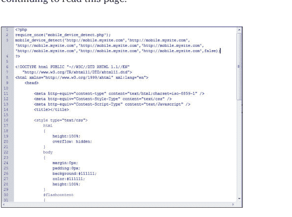

图 6-4：包含移动检测和自适应 PHP 脚本的主页文件。

22. 前往 Detect Mobile Browser 网页底部，在“Usage Guide”部分下，点击橙色的 `mobile_device_detect.php` 链接。

同意条款并按照一些提示操作后，此链接会将一个压缩的 PHP 文件下载到你的计算机。

23. 从压缩文件中提取 `mobile_device_detect.php`，并将其上传到根目录或包含网站桌面版的目录。

就这样完成了。如果你使用移动设备——或者用户代理已更改为移动设备类型的桌面浏览器——浏览该网站，你应该会被重定向到网站的移动版本。

## 基于数据库的检测与重定向系统

如果前面步骤中描述的检测用户代理和自适应内容的方法不能提供你需要的设备分类系统，你总是可以创建一个基于数据库的检测系统。因为已经有一些相当完善的开源系统可用，我建议你不要从头开始——除非你确实有大把时间且无事可做。这就是为什么接下来列出了三个广泛使用的选项；因为它们被广泛使用，你可以在互联网上找到大量关于如何设置和使用它们的信息。

> 并非所有解决方案都是免费的。例如，Device Atlas，根据你选择的版本，价格大约在 100 美元到几百美元之间。当你将其与你可能花费许多小时来创建自己的系统相比时……我相信你明白我的意思。综合考虑——即使那些需要支付少量费用的解决方案——它们也几乎可以说是免费的。

以下是一些最受欢迎的开源、基于数据库的检测与重定向系统的简短列表：

- **Device Atlas**（`http://deviceatlas.com`）：Device Atlas 提供了一个相当完整的设备数据库，并定期更新。而且，为了让你不必重新发明轮子，它提供了几种不同流行语言（如 PHP、Java（一种与 JavaScript 无关的服务器端语言）和 Windows Server 的 ASP.NET）的 API（应用程序编程接口）。Device Atlas 还提供免费的评估许可证，根据该许可证，你可以在服务器上下载并安装所有必需的文件，并尝试 API 组件。
- **WURFL**（`http://wurfl.sourceforge.net`）：WURFL（无线通用资源文件）在第 5a 章中作为查找特定设备信息的资源进行了讨论，它是一个移动设备的 XML 数据库。它由移动网络设计社区维护，并且是免费的。虽然这个文件本身不是一个完整的检测与自适应系统，但它提供了系统中最大且最令人畏惧的部分——设备数据库——已经完成。不过，你需要一些编程技能来使用它。


- **Tera-WURFL**（`http://www.tera-wurfl.com`）：Tera-WURFL 从 WURFL 获取其设备信息。第 5 章也详细讨论了它，涉及使用它来查找特定设备的属性。这是一个免费的开源解决方案（他们确实接受值得的捐赠），它几乎是一个完整的解决方案。缺少的只是重定向脚本——你必须自己编写这些脚本。这个解决方案的文档相当齐全；然而，由于它是免费的，支持通过用户论坛和你在互联网上能找到的任何其他方式来处理。你需要学习一些编程，做一些研究，并花费一些时间来整合这个解决方案，但如果你需要一个基于设备的复杂检测与自适应系统，这是一个很好的起点。

### 按类别定义设备

在移动设备开始访问网络内容之前，创建网站是一个相当简单的命题。使用的计算机之间在能力范围上有些多样化。然而，所有不同机器所能做的事情之间的差异并不大，以至于设计师不必过多担心创建在某些机器上根本无法工作的网站。网络设计师主要关心两件事：带宽和显示尺寸或显示器分辨率。他们设计网站，使得带宽较低的互联网连接用户不必坐在那里苦等所有图像和其他多媒体内容下载完成——并且他们确保页面不会宽到让分辨率较低的显示系统的用户被迫进行大量不自然的左右滚动。

随着时间的推移，几乎所有的计算机用户都拥有了宽带互联网连接，并且很少有人使用低分辨率的显示系统。设计师利用这些技术进步，开始创建内容丰富的网站，能够提供高分辨率多媒体图像、数字视频和交互式 Flash 内容。正当我们开始适应所有这些新获得的自由时，支持网络的手持设备出现了——极大地复杂化了网络设计过程。

这花了一些时间，但移动网络技术最终达到了这样一个阶段：为手持设备设计将不再是一项追逐无情移动目标的练习——使这项技艺完整地回到了我们在这个整个移动革命开始时所处的位置：为最低公分母进行设计（我将在本节稍后讨论这一点）。

如果你决定根据设备属性和功能创建几个不同的网站，你需要一种方法来对设备类型进行分类——一个系统，将它们归入具有相似网络功能集和能力的设备组——实际上，就是一个移动设备分类系统。要创建这样的分组，你可以创建一组配置文件，每组对应一个配置文件。每个配置文件代表网站的一个版本。例如，如果你决定需要四个独立的网站，你将创建四个类别配置文件，这些配置文件将由功能和能力的相似性组成。

#### 寻找最低公分母

从技术角度而言，最低公分母指的是某种东西能够在同类所有设备上正常工作的临界点。在网页设计中，针对最低公分母进行设计，简单来说就是寻找一系列设备中最普遍的共同点，或者说是最基础、最常见的标准功能。例如，在为台式电脑设计时，如果你将页面宽度限制在 900 像素以内，那么访问该网站的绝大多数用户都能在不左右滚动的情况下正常查看内容。900 像素是相当大的显示区域，你有足够的空间来创建一些外观美观、易于导航的页面。

然而，在手持设备中寻找最低公分母则远非如此简单。首先，我们讨论的屏幕尺寸范围从约 100 或 200 像素一直到超过 1000 像素（而且屏幕尺寸并非唯一需要考虑的公分母）。面对如此巨大的差异，你无法设计一个适用于所有移动设备的通用页面。例如，图 6-5 模拟了同一个网站在三种尺寸差异巨大的移动屏幕上的显示效果。除非页面内容极其平淡无奇，否则很难找到一个适用于所有手持设备的通用屏幕尺寸——也就是说，除非你不在乎忽略所有能在高端设备上使用的令人兴奋的功能。那样就完全失去了网站设计的乐趣——也无法吸引访客再次光顾。

虽然屏幕尺寸是最重要的考量因素，但你还需要确定其他几项功能的公分母，例如：

- 支持的 HTML 和 CSS 版本
- 对 JavaScript 的支持
- 对数字视频的支持（及支持的格式）
- 对 Flash 的支持（及支持的 Flash Player 版本和 Flash 功能）

你需要多少个网站版本？这可是一个难题。答案呢？你有多少时间？你的雇主（就你的薪资而言）或客户愿意投入多少资金？移动网络用户是否是你营销策略的重要部分？你愿意为这个网站投入多少工作？你还能想到多少其他相关问题来帮助你回答首要问题：你需要多少个网站版本？

#### 选择分析策略

与网页设计的许多不同方面一样，创建一组设备配置文件的方法有很多种。然而，有两种方法（至少在我看来）最合理：

- 从包含最少功能集的配置文件开始，然后逐步添加功能以创建更复杂的配置文件。
- 从高端功能集开始，然后逐步削减功能以创建较简单的配置文件。

你可以选择其中一种方法，或者制定自己的策略。为了演示所有这些分析是如何工作的，你不妨从为最新、最复杂的设备创建配置文件开始，然后逐步向下，为功能较少的手持设备创建配置文件。请记住，在这个过程中，尽管创建一个包含多种配置文件的、高度通用的分类系统很有诱惑力，但每一个配置文件都需要网站的另一个版本。

为了跟踪你的配置文件，你还需要一个命名方案。因为每个新的配置文件都代表网站的一个新版本，所以你还需要一个单独的目录来存放每个版本的文件。此外，每个版本都需要一个子域名（或至少是一个子目录），以便为访问每个版本提供一个唯一的 URL。你可以随心所欲地命名你的配置文件，但如果你的配置文件、子目录和子域名使用相同的名称，你会发现跟踪所有内容会容易得多。在这个创建配置文件的演示中，我使用一个命名方案，配置文件名称以 `mobile1`、`mobile2` 等开头，如下所示：

- **mobile1**：就我写这篇文章时而言，为响应苹果公司极其成功的 iPad，几家制造商正在发布手持平板电脑。这些实际上是微型计算机。它们中的大多数都支持台式计算机的大部分网络功能，例如 HTML5、CSS3、Flash Player 10.x（与大多数设备上的 Flash Player Lite 相对）以及宽度为 1024 像素或更宽的高分辨率显示屏。（当然，需要注意的是 iPad 不支持 Flash。）

  考虑到这些设备完全支持网络功能，没有必要为它们创建单独的网站。然而，它们确实是手持设备——它们没有指向设备（鼠标），但它们支持触摸和多点触控。它们还支持方向切换，这在横屏模式下大大增加了屏幕宽度，并且两种方向模式下的屏幕尺寸存在巨大差异（如图 6-6 所示）。基于这些原因，值得考虑将此类设备包含在你的移动设备分类结构中。如果你这样做，并且想为它们的使用者提供最佳的网络体验，那么它们值得拥有自己的分类。

- **mobile2**：下一个分类满足 `mobile1` 的所有标准，只是此配置文件中的设备屏幕要小得多。这个分类将包括 iPhone、iPod、最新的 Android 智能手机、最新的 Palm OS 设备以及许多 Windows Phone 7 设备。这些设备能够实现许多花哨的功能，你可以为它们创建功能丰富的网站。由于它们的屏幕尺寸较小（例如 iPhone 屏幕在横屏模式下宽度仅为 480 像素），为 `mobile1` 屏幕设计的页面可能无法在 `mobile2` 设备上良好运行。

  请记住，这个组别的屏幕尺寸范围相当广泛——大致从约 320 像素宽到约 640 像素宽（有些甚至更宽一点）。CSS 提供了一些方法来弥补这一点，这将在第 7 章和第 8 章中讨论。

- **mobile3**：这个分类主要包括较旧的智能手机，它们不支持 HTML5、CSS3 或 JavaScript。然而，这些设备的屏幕尺寸大多与 `mobile2` 分类中的设备相似。缺乏 JavaScript 支持极大地限制了设备的功能——这也就限制了你的设计选项。例如，你无法创建具有自我验证字段的表单（除非使用服务器端脚本）。表单字段验证确保必填字段不会留空，并检查用户在表单字段中输入的内容——特别是像信用卡号和电话号码这样的数字字符串——以确保输入符合预定义的标准。（移动表单的设计将在第 9 章讨论。）此外，你无法使用非常有益的 Ajax 调用（在第 16 章讨论），否则这些调用将帮助你创建各种东西，例如交互式谷歌地图、搜索页面或下拉菜单和菜单选项卡（再次强调，除非你使用服务器端脚本）。关键点是：在 `mobile3` 设计分类中，你必须时刻注意功能的局限性。

- **mobile4**：现在我们进入了不够智能的功能手机领域。这些设备大多屏幕较小，宽度约为 320 像素或更小，并且只支持最简单的 CSS 格式化（如果有的话）。你为这个分类创建的网站将由简单直接的 HTML 组成——除非你是一个相当熟练的程序员。这些网站中内置的任何花哨功能都将来自服务器端技术。对 Flash 和数字视频的支持也相当有限。这并不是说你完全不能使用多媒体格式，但你能勉强使用的将是简单（且小巧）的格式。

### 子域名还是子目录？

当你从子目录向 Web 部署内容时，你有两种设置 URL 的方式：

- 将子目录 `/path` 作为 URL 的一部分，例如 `http://www.mysite.com/subdirectory`。
- 从 DNS 子域名指向子目录，例如 `http://subdomain.mysite.com`。

两种方法都可以正常工作，但在创建备用站点时，我更喜欢使用子域名。为什么呢？毕竟，它们确实是分开的网站。在我看来，子域名看起来更加精致、更加专业。不过，它们的设置也稍微复杂一些。对于子目录，你所要做的就是创建目录并在链接中引用它们。不需要额外的设置。

对于子域名，你必须为每个备用站点创建一个 DNS 记录。如果你使用的托管公司允许你自己创建 DNS 记录并将它们指向特定目录，那么这个要求并不会增加太多工作量——只是多几个步骤而已。然而，有些托管公司要求你申请 DNS 更改（通常通过电子邮件），然后等待支持团队来执行这些更改。有时这可能需要几天时间，这可能会影响你的设计进度。但你也可以解决这个问题——通过安装测试服务器，如第 4 章所讨论的那样。

### 完善你的分类系统

你掌握到要领了吗？目前你已经有四个版本的站点了。幸运的是，这组配置文件几乎涵盖了所有支持 Web 的手持设备。从这里开始添加的任何配置文件都是为了完善或微调，而不是试图包含所有设备。例如，你可以为不支持 Flash 的 Apple 设备创建 `mobile1` 和 `mobile2` 的子类。你也可以为非常小的屏幕（约 240 像素宽或更小）创建 `mobile4` 的子类。

你可以根据需要创建任意数量的配置文件。然而，同样地，你在这方面能做到什么程度取决于你的时间、资源，以及你认为所有这些工作和时间投入与营销策略或网站目的相比是否合理。例如，一家销售移动配件的在线商店会比一家在线冲浪用品店在其检测和适配系统上投入更多时间。（提示：考虑一下市场规模。）

### 让用户自己选择

最简单——也许是最可靠的——适配系统就是让用户自行选择是否查看网站的移动版本。只需提供一个指向网站移动版本的链接——或者多个链接，基于设备类型或屏幕大小。这是一种相对低技术门槛的方法，但并不少见。世界上一些最大的网站也会为用户提供这种选项，如图 6-7 所示。

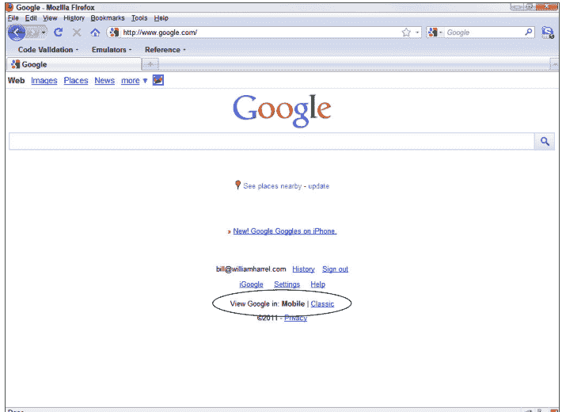

**图 6-7：** Google 为用户提供以移动模式或经典模式查看网站的选项。

当然，这个选项消除了创建服务器端检测系统的需要。然而，除非你计划采用单一版本的适配系统，否则你仍然需要基于设备配置文件创建多个版本的网站。你经常在数字视频中看到类似的呈现方式——你知道的，根据你的互联网连接下载速度选择观看哪个版本的视频。允许用户在网站的 Flash 版本和非 Flash 版本之间进行选择，这也并不罕见。

然而，如果你选择这种方法，你可能不应该自动向每个访问你网站的人展示移动替代方案的菜单。相反，至少使用一些检测方法，比如 Andy Moore 的 Detect Mobile Browsers 解决方案（本章前面讨论过），来确定访问者确实在使用手持设备——然后再提供备用网站的菜单。我认为，这种方法更加简洁，看起来更专业——也许你可以添加一个设置消息，比如这样：

> “我们注意到您正在使用移动设备。为了获得最佳的网站体验，请选择以下移动选项之一。”

# 第 7 章：设计主页布局

### 本章内容

- 设计主页框架
- 使用 CSS 创建页眉、页脚和侧边栏
- 使用 CSS 格式化文本
- 使用 CSS 添加菜单和导航
- 在布局中添加图片

大多数设计师都认同一个网站最重要的页面是主页——用户访问网站时看到的第一个页面。一个好的主页同时发挥多种功能，包括：

- 迎接网站的访客。
- 宣布网站的目的。
- 吸引访客的注意力。
- 吸引访客留下来四处看看。
- 清晰地展示如何查找信息。

### 行动号召

虽然所有主页都应该执行本章介绍中列出的五项基本功能，但对于移动网站来说，网站第一页的有效性至关重要。移动网络用户是行动导向的。他们想要即时获取信息，并且想要立即采取行动。页面需要快速加载，并立即为用户提供选择。许多访问你网站的移动用户只想知道两件事：你是做什么的，以及如何联系到你。

**130**   第二部分：创建移动网站

那么，你的任务就是为他们提供一个主页，清晰地展示所有内容（如图 7-1 所示），同时也让访客轻松决定下一步该做什么——无论是点击链接获取更多信息，点击链接发送电子邮件，甚至点击链接用他们正在查看网站的移动设备给你打电话。（继续读下去。我会在本章稍后展示如何做到这一点！）

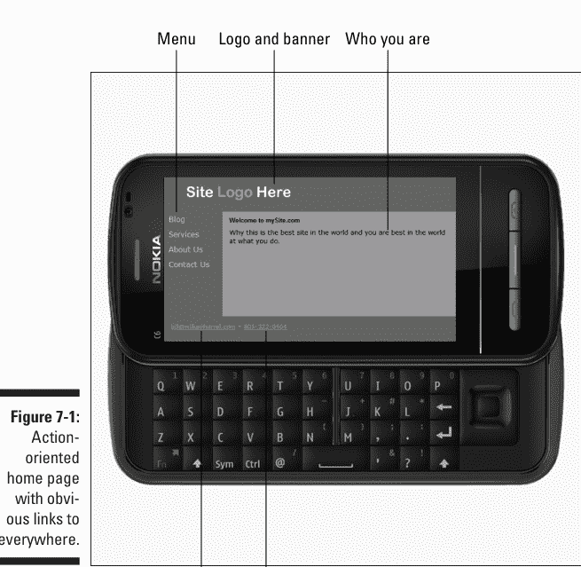

### 设计框架

好了。谈得够多了。是时候动手了。在下面的练习中，你将快速轻松地创建一个主页，包含横幅（通常称为页眉）、交互式侧边栏菜单，以及包含易于执行的电子邮件和电话号码链接的页脚。

**131**   第 7 章：设计主页布局

这种方法快速简单，用它创建的页面可以在各种移动设备上工作。我知道这里介绍的许多概念对你来说可能是新的。考虑到这一点，我会简要讨论其中的大部分。但请记住，本章的目的是让你初步接触——设计一个可用的移动友好页面。这是一个起点。接下来的几章会更仔细地研究这里使用的许多标签和技术，当你学习创建更复杂的页面和移动 Web 应用程序时，我会更详细地讲解它们。

让我们开始吧。


你可以从本书的配套网站下载一些文件来练习。这些是本节中你将要创建的内容的示例。下载并参考它们将帮助你更好地理解这个过程。下载文件 `chapter07.zip`。它包含三个文件：`index.html`，即网页本身；`chapter7.css`，即外部样式表；以及 `logo.png`，即 logo 占位图。logo 占位图是一个图形文件，位于名为 `images` 的子目录中。我还包含了一个 `logo.png` 的 Photoshop PSD 文件，以防你想编辑它来创建自己的 logo 用于此练习。

### 开始 HTML 页面

无论你是使用 Dreamweaver 还是手写代码，你创建移动 HTML 页面的方式与其他页面一样。所有 HTML 页面都有相同的基本结构。换句话说，重要的不是你如何使用标签，而是你使用哪些标签。或者说，重要的不是你怎么说，而是你说了什么？类似这样的道理……

Web 浏览器读取标签来确定如何格式化页面。然而，浏览器如何解释和使用标签，往往取决于初始标签，或者说 HTML 页面最顶部的第一个标签，即 `doctype`。doctype 向浏览器介绍页面，并告诉浏览器页面支持什么标准——HTML、XHTML、XML 等等。


好吧，严格来说，`doctype` 并不是真正的标签。用 geekSpeak 来说，它是一个声明或指令。它向浏览器“声明”文档类型，但本身并不进行任何格式化。诚然，它被放在小于号（`<`）和大于号（`>`）符号之间，这让它看起来像个标签。但由于它实际上并不格式化页面上的任何东西，即使它走起路来像只鸭子，它说话也不像鸭子。

虽然有几个 `doctype` 可用，但如今只有很少几个被广泛使用，而用于移动站点的就更少了。以下是最常用于移动网站的两个 `doctype` 以及你应该在何时使用它们：

## XHTML Mobile 1.0

也称为 XHTML Mobile Profile，或 XHTML MP，此文档类型通常用于移动网站。目前它有三个版本：Mobile 1.0、Mobile 1.1 和 Mobile 1.2。每个版本大致相同，只是较新版本修正了之前版本的技术错误。在为不支持许多现代 CSS 和 HTML 格式（如 CSS2、CSS3 和 HTML5）的设备设计页面时，应使用此文档类型。

XHTML MP 标准由两个不同的联盟定义。例如，Mobile 1.0 标准由 `wapforum.org` 定义。而 Mobile 1.1 和 Mobile 1.2 由 `openmobilealliance.org` 定义。因此，在为不同版本声明文档类型时，需要在声明中引用正确的标准合规 URL。Mobile 1.0 的声明如下所示：

`<!DOCTYPE html PUBLIC "-//WAPFORUM//DTD XHTML Mobile 1.0//EN">`


`"http://www.wapforum.org/DTD/xhtml-mobile10.dtd"`

## Mobile 1.1 和 1.2 的声明

Mobile 1.1 和 1.2 的声明如下所示：

```html
<!DOCTYPE html PUBLIC "-//WAPFORUM//DTD XHTML Mobile 1.1//EN">
"http://www.openmobilealliance.org/tech/DTD/xhtml-mobile11.dtd"
```

```html
<!DOCTYPE html PUBLIC "-//WAPFORUM//DTD XHTML Mobile 1.2//EN">
"http://www.openmobilealliance.org/tech/DTD/xhtml-mobile12.dtd"
```

请注意，Mobile 1.1 和 Mobile 1.2 引用的是 `openmobilealliance.org`，而非 `wapforum.org`。

## XHTML 1.0 Transitional

现代设备，如平板电脑和最新智能手机，其浏览器支持桌面计算机和笔记本电脑支持的几乎所有 CSS 和 HTML 元素。为这些设备创建网页时，你并不真正需要专门为移动设备设计的文档类型。

在为最新的 iPhone、iPad 或 Android 设备，以及其他使用 WebKit 扩展（在第 12 章讨论）的设备设计页面时，应使用此文档类型。声明如下所示：

```html
<!DOCTYPE html PUBLIC "-//W3C//DTD XHTML 1.0 Transitional//EN">
"http://www.w3.org/TR/xhtml1/DTD/xhtml1-transitional.dtd"
```

## 创建移动网页

既然我们已经介绍了所有技术信息，现在让我们创建一个移动网页。以下步骤创建页面本身以及随附的外部 CSS 文件：

1. 在 Dreamweaver、源代码编辑器或文本编辑器中开始一个新页面。
2. 将页面保存为 `index.html`。
3. 在页面的第一行，键入以下标签：

```html
<!DOCTYPE html PUBLIC "-//WAPFORUM//DTD XHTML Mobile 1.0//EN" "http://www.wapforum.org/DTD/xhtml-mobile10.dtd">

<html xmlns="http://www.w3.org/1999/xhtml">

</html>
```

第一个标签声明了文档类型，第二个标签声明了 W3C 标准兼容性（在第 2 章讨论）。第二个标签也标志着 HTML 页面内容部分的开始。所有格式化此页面的标签和内容都位于开始 `<html>` 和结束 `</html>` 标签之间。

4. 保存页面。

> **提示**
>
> Dreamweaver 可以自动生成文档类型以及一些其他基本的 HTML 结构标签，还可以链接到你的样式表。只需使用“文件”菜单上的“新建”命令来开始你的页面，这将打开如图 7-2 所示的“新建文档”对话框。从对话框右侧窗格的“文档类型”下拉菜单中选择 XHTML Mobile 1.0，即可为此过程正确设置页面。在“新建文档”对话框中选择 XHTML Mobile 1.0 会为你完成步骤 1-3。

> **记住**
>
> Dreamweaver 可以自动化本章及全书中讨论的许多过程。在本书中，我试图指出 Dreamweaver 可以提供很大帮助或为你节省大量时间的地方。（但请注意，本书中的示例是手工编码的，因此我在这些练习中向你展示的分步技术与 Dreamweaver 的格式选项有很大不同。）

# 第二部分：创建移动网站

很好！现在 HTML 页面框架已经开始了，是时候创建样式表了。第 2 章讨论了三种类型的样式表——外部、内部和内联——以及何时使用何种类型及其原因。除非你的样式仅用于格式化单个文档或网页，否则你应该始终使用外部样式表。

在以下步骤中，我将向你展示如何创建一个外部 CSS 文件并在 HTML 页面中引用它，以便网页使用它来格式化页面元素。

1. 开始一个新的文本文档并将其保存为 `chapter7.css`。（确保将其保存在与 `index.html` 相同的目录中。）
2. 在新文档的第一行，键入以下内容：

```css
@charset "utf-8";
```

这第一行通过声明其使用的字符集来设置样式表。几乎所有网站，尤其是用 HTML、XHTML 和 CSS 编写的网站，都使用 utf-8 字符集。

如果你不将样式表的信息（其名称、类型和位置）告诉 `index.html`，那么你的新样式表就没有什么用处。

3. 在 `index.html` 中，将文本光标放在 `<html xmlns="http://www.w3.org/1999/xhtml">` 标签的末尾，按两次 `Enter` 键。

这将在此标签和你即将创建的标签之间创建一个空行。这不是必需的，许多设计师不会以这种方式编写代码。这种额外的空格（Web 浏览器会忽略）是个人偏好，它使得代码对于人类（你和我）来说更容易阅读。

出于设计目的，HTML 页面由两个部分组成：`<head>` 部分，你在其中声明文档的样式表以及许多其他关于页面的数据。HTML 标签 `<link href="X">` 告诉浏览器关于样式表的信息，提供文档文件名、文件位置和 CSS 类型等信息。无论你的页面使用一个还是 20 个样式表，你都需要为每个 CSS 文件提供一个 `<link href="X">` 标签，并且它们都放在文档的 `<head></head>` 标签之间。

4. 键入以下标签：

```html
<head>

<meta http-equiv="Content-Type" content="text/html; charset=utf-8" />

<title>My Mobile-Friendly Site</title>

<link href="chapter7.css" rel="stylesheet" type="text/css" media="screen"
/>

<meta name="HandheldFriendly" content="True" />

</head>
```

前面代码中的第一个 `<meta>` 标签再次设置了文档类型。是的，我知道你在想什么：*我需要做多少次？* 简短的回答是：*需要多少次就做多少次。* 并非网页的所有元素都从样式表格式化。此标签确保那些不依赖样式表的文档部分得到正确处理，或者使用正确的字符集。请记住，确保你的页面在尽可能多的设备上正确显示通常取决于你是否面面俱到。

是的，这里还有一个 `<meta>` 标签的例子。这些标签提供关于文档的重要信息。用某位名人的话说，“你还没见过真正的本事呢”——因为 `<meta>` 标签有许多功能。例如，它们还用于设置和提供搜索引擎（在第 15 章讨论）和调用包含文件（在第 8 章讨论，该章涵盖创建模板）的信息。

`<title>` 标签为文档命名。搜索引擎不仅使用 `<title>` 数据来帮助查找和索引页面，而且这些标签之间的文本还是显示在浏览器标题栏中的页面标题，如图 7-3 所示。

**图 7-3：** `<title>…</title>` 标签的内容出现在浏览器的标题栏和选项卡标签中。

`<link href=` 行声明了样式表。请注意媒体属性声明 `"screen"`。这当然告诉浏览器该内容设计用于哪种类型的媒体或设备。支持的 CSS 媒体类型选项之一是 handheld，但它非常严格，并且我认为它会导致浏览器忽略过多的 CSS 和 XHTML 格式，尽管现在许多更新的智能手机支持更多的标签和 CSS 样式。下一个 `<meta>` 标签 `<meta name="HandheldFriendly" content="True" />` 具有类似的目的——它告诉浏览器 `index.html` 对手持设备友好——而没有那么严格。

就是这样！现在是时候开始格式化页面元素了——也就是用户看到的内容。

## 浏览器如何知道哪个页面是首页？

如你所知，除了主页，大多数网站由许多页面组成。你是否曾好奇，在所有这些页面中，无论你访问哪个网站，你的浏览器总是知道该选择哪个页面？猜怎么着——它其实不知道。尽管网络浏览器很聪明，但这个决定它们做不了。实际上，是由服务器决定哪个页面作为网站的首页。

大多数网络服务器的一个标准是将主页命名为 `index.html`（或 `index.asp`，或 `index.php` 等，具体取决于网站的编写语言）。但这只是一个标准。大多数网络服务器可以设置为将服务器上的几乎任何页面作为主页交付，并且出于各种原因，它们经常这样做。

## 使用 CSS 格式化列和框

样式表由类和选择器组成，通常被称为“样式”。你在样式表中定义样式，然后在 HTML 页面中“调用”它们。样式几乎可以做任何事情，包括将你的页面划分为用于容纳内容的列和框，这种方式类似于（但比 HTML 表格在第 1 章讨论的）更通用和简洁。这些部分被称为“容器”，将在第 2 章讨论。

有几种使用样式创建容器的方法，包括 `<div>`（分割器）标签和 `<p>`（段落）标签。将 `<div></div>` 标签对视为一个用于设置页面区域的容器，例如页眉、侧边栏、页脚和页面的正文区域。我们将在本章先探讨 `<div>`，稍后探讨 `<p>`。一旦你用 `<div>` 在页面上设置了一个容器，该部分就会受到样式表中为该容器定义的所有 CSS 格式的影响——容器中的对象会自动采用该 CSS 格式。

不过请记住，你可以在 HTML 页面本身或使用样式表中的额外 CSS 样式进一步格式化页面元素，或覆盖 CSS 格式化，稍后你将看到这一点。

在设置 `<div>` 容器时，你需要将样式表中的样式选择器与 HTML 页面中的容器关联起来，如图 7-4 所示。

## 第 7 章：布局主页


图 7-4：`<div>` 标签和关联的样式选择器。

### 理解选择器

选择器，或样式选择器，是 HTML 页面用于将页面元素与样式关联的机制。有四种基本类型的选择器：类选择器、类型选择器、ID 选择器和复合选择器。以下是每种类型的简要描述以及如何使用它们：

- **类选择器**：类样式在样式表中用句点或点号定义：`.container`。但当你从文档中调用它时，你省略了点号：`<div class="container">`。类选择器可能是最常用的，也是最通用的。你可以用它来格式化多个对象——文本、图像或多媒体——在你的任何页面上，并且可以在同一页面上根据需要多次使用它。在创建类选择器名称时，请记住不能使用任何空格或特殊字符，除了短横线和连字符。

- **类型选择器**：你可以使用类型选择器来修改现有的或内置的 XHTML 标签，例如标题标签 `<h1>`、`<h2>` 等。你在样式表中创建它们时无需任何预定义字符，像这样：

```css
h1, h2, h3, h4, h5, h6, p {
    margin-top: 0;
    padding-right: 15px;
    padding-left: 15px;
    color: #CCC;
}
```

当你在文档中使用前面的某个标签时，该标签会自动采用此格式——除非你在文档中覆盖它或稍后在样式表中进一步修改它。

- **ID 选择器**：与类选择器不同，每个页面只能使用一次 ID 选择器。用它在页面上创建独特的部分。ID 选择器在样式表中用井号标识：`#header`，你在 HTML 页面中使用 `<div id=>` 标签调用它，例如 `<div id="header">`。

- **复合选择器**：复合选择器或复合样式允许你组合样式。例如，假设你希望有序列表 `<ol>` 标签在 `.content` 容器中的显示与在 `.sidebar` 容器中不同。你可以设置一个复合样式来实现这一点，像这样：

```css
.container .content ol {
    font-family: Arial, Helvetica, sans-serif;
    font-size: small;
    color: #000;
}
```

此复合样式在页面的子容器 `.content`（或主体容器）中设置了一个独特的有序列表。是的，我知道我还没怎么谈论容器。接下来就讲。

### 创建容器

容器，嗯，包含你页面上的元素。根据你的设计，一个页面可以有多个容器——每个页面元素一个。或者你可以将页面设计为几个部分，例如页眉、侧边栏、页脚和主体或内容区域。在设置容器时，你可以随意命名它们，但有一些通用的标准——你将在本章使用这些标准。通常遵循标准是一个好主意，即使没有其他原因，也是为了以防别人需要编辑你的页面。

### `<body>` 标签对

一般来说（也有例外），正如所有不出现在页面上的元素（例如 `<meta>` 信息）都放在 `<head></head>` 标签对之间一样，所有出现在页面上的元素都放在 `<body>` 标签之间。

所以，你的容器标签需要放在开始 `<body>` 和结束 `</body>` 标签内。你通过创建一个主容器或顶层容器来开始定义你的容器，这实际上就是页面本身。

按照以下步骤创建一个顶层容器：

1. 转到你的 `index.html` 页面，在结束的 `</head>` 标签后输入一个空行，然后输入以下标签：

```html
<body>

<div class="container">

<!-- end .container --></div>

</body>
```

注意结束的 `</div>` 标签之前的 `<!-- end .container -->` 文本字符串。这被称为注释。就像在代码的关键位置留出空白使代码更易于人类阅读一样，注释也有助于处理速度较慢的人类理解代码。注释是笔记或注解，除了提供关于代码的信息（或你想放入其中的任何其他信息，例如，也许是对开发团队其他成员的问题？）之外，它们什么也不做。当浏览器看到 `<!--注释-->` 这种格式时，它们会忽略它。随着你的页面变得越来越复杂，注释在标记你在文档中的位置或提醒你代码的功能或为什么你以特定方式做某事等方面会非常方便。

2. 转到 `chapter7.css` 并输入以下类选择器：

```css
.container {
    width: 100%;
    max-width: 800px;
    min-width: 320px;
    background: #FFF;
    margin: 0 auto;
}
```

如果你熟悉编程，你会认出这种格式。`.container` 是样式的名称（在许多编程语言中称为函数），其他所有内容——两个大括号之间的部分——定义或设置了样式的属性。从上到下，这个顶层容器的格式定义如下：

- `width: 100%;` = 使此容器占据页面大小的 100%。
- `max-width: 800px;` = 不让页面调整大小超过 800 像素宽。
- **`min-width: 320px;`** = 不让页面调整大小小于 320 像素宽。（这迫使屏幕小于 320 像素的设备横向滚动，但另一种选择是页面元素装不下并相互重叠——前者当然是两害相权取其轻。）
- **`background: #FFF;`** = 使容器的背景为白色。此代码 `#FFF` 是十六进制代码 `#FFFFFF` 的缩写。（如果你不知道计算机如何使用十六进制代码定义和选择颜色，请参阅侧栏“理解十六进制颜色”。）如果你使用 Dreamweaver，这相当于在页面属性（位于修改菜单）中设置背景选项。它设置整个页面的底层背景颜色。
- **`margin: 0 auto;`** = 自动将边距设置为零。

同样，所有其他容器都放在这个顶层容器内。

### 理解十六进制颜色

如果你曾好奇计算机如何选择和定义颜色，一种最常见的方法，特别是对于网页，是十六进制代码系统。十六进制表示法（在 CSS 和 HTML 的上下文中）简单来说，是一个用于定义和调用颜色的系统。当你的浏览器遇到十六进制代码时，它会告诉计算机如何为定义区域内的像素着色。你几乎可以在任何图形或设计程序（如 Photoshop 或 Dreamweaver）中找到大多数颜色的十六进制代码。只需查看这些程序中的颜色定义框或面板即可，如图所示。

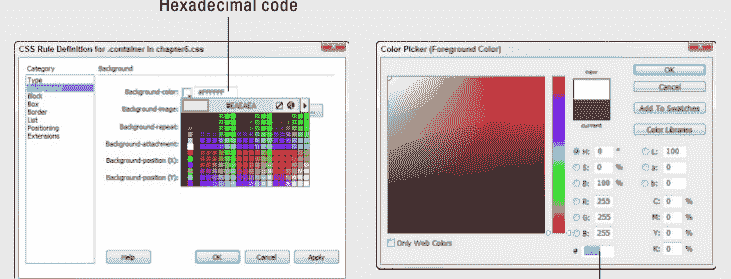

十六进制代码

# 第七章：设计主页布局

## 创建页头

页头通常横跨页面顶部，用于展示标识网站本身以及网站所属组织的信息。例如，页头可能包含公司徽标和其他象征公司及其产品或服务的图形。以一家临时办公人员服务公司为例，它可能会展示员工在办公环境中工作的图片。页头容器与其他所有容器一样，放置在主容器或顶层容器内部。

要添加页头，请按以下步骤操作：

1. 在 `index.html` 中放置 `.header` 容器标签，如下所示：

```html
<body>

<div class="container">

    <div class="header"></div>

<!-- end .header --></div>

<!-- end .container --></div>

</body>
```

2. 打开 `chapter7.css`，在 `.container` 样式下方（花括号下方）插入一个空行，然后输入以下页头样式：

```css
.header {
    background: #666;
}
```

如您所见，此容器样式仅包含背景颜色。在这种情况下，您没有为页头容器定义尺寸属性，因此页头的大小将由页头内容——即您在本章稍后创建并导入的图片——来决定。

## 创建侧边栏

在网页上，左侧边栏通常包含菜单，这正是您将要用到此处侧边栏的方式。然而，位于网页右侧的侧边栏通常包含联系信息、广告、图片或其他不属于主内容区域的内容。比如说，在电子杂志中，右侧边栏可能包含相关或辅助数据，类似于本书中的边栏。

要创建侧边栏，请按以下步骤操作：

1. 在 `index.html` 中，于 `.header` 标签下方输入以下侧边栏容器标签：

```html
<body>

<div class="container">

    <div class="header">
```


打开`/path/to/xxx`目录，找到`xxx.json`。

在表达式`cvar = avar + bvar`中，加法运算符（`+`）将`avar`与`bvar`相加，得到它们的和`cvar`。

在`List.of(arg0, arg1, arg2)`中，`List`接口的工厂方法`of()`接受一系列的元素，返回包含它们的只读列表。

之后我们这样调用`cmd`命令：`cmd arg0 arg1 arg2`。

```
if (condVar > someVal) {console.log("xxx")}
```

打开`chapter7.css`，在页头样式下方插入一个空行，然后输入以下样式：

```
.sidebar1 {
    float: left;
    width: 25%;
    background: #666666;
    padding-bottom: 10px;
}
```

请注意此样式中的`float: left`和`width: 25%`。两者结合使侧边栏列可以自适应调整大小。浮动选项保持列的大小流动，随页面大小或页面缩放而调整。`width: 25%`属性声明将列限制在页面宽度的25%。还记得您之前使用的`min-width`属性吗？当它与这里的`width: 25%`结合时，您确保了无论侧边栏出现在何种设备上，其宽度都不会小于320像素的25%（即80像素）。以这种方式限制您的布局——使用限制其他标签效果的标签——可防止浏览器在缩放时做得太过火。在本例中，如果您让侧边栏缩放到小于80像素，它将无法容纳您的按钮。

## 创建主体容器

`<body>`容器（也颇为冗余地称为`.content`容器）通常是页面最大的部分。它主要包含信息类内容，如文章或产品和服务说明。它也被放置在主容器内部。

要添加`<body>`容器，请按以下步骤操作：

1. 在`index.html`中，于`.sidebar1`标签下方添加以下内容标签：

```
<body>
<div class="container">
    <div class="header">
    <!-- end .header --></div>
    <div class="sidebar1">
    <!-- end .sidebar1 --></div>
    <div class="content">
    <!-- end .content --></div>
<!-- end .container --></div>
</body>
```

2. 在`chapter7.css`中，直接在`.sidebar1`样式下方输入此样式：

```
.content {
    padding: 10px 0;
    width: 75%;
    background: #333333;
    float: left;
}
```

这是浮动列的另一面：浮动和宽度属性确保内容容器占据页面的另外75%，并且也能随页面大小进行调整。您的容器创建即将完成。您的文档应如清单7-1和7-2所示。

### 清单 7-1：设置页面容器的HTML选择器

```
<!DOCTYPE html PUBLIC "-//WAPFORUM//DTD XHTML Mobile 1.0//EN" "http://www.
                    wapforum.org/DTD/xhtml-mobile10.dtd">
<html xmlns="http://www.w3.org/1999/xhtml">
<head>
<meta http-equiv="Content-Type" content="text/html; charset=utf-8" />
<title>My Mobile-Friendly Site</title>
<link href="chapter7.css" rel="stylesheet" type="text/css" />
<meta name="HandheldFriendly" content="True" />
</head>
<body>
<div class="container">
    <div class="header">
    <!-- end .header --></div>
    <div class="sidebar1">
    <!-- end .sidebar1 --></div>
    <div class="content">
    <!-- end .content --></div>
    <!-- end .container --></div>
</body>
</html>
```

### 清单 7-2：创建容器样式的CSS

```
@charset "utf-8";
.container {
    width: 100%;
    max-width: 800px;
    min-width: 320px;
    background-color: #666;
    margin: 0 auto;
}
.header {
    background: #666666;
}
.sidebar1 {
    float: left;
    width: 25%;
    background: #666666;
    padding-bottom: 10px;
}
.content {
    padding: 10px 0;
    width: 75%;
    background: #333333;
    float: left;
}
```

## 创建页脚

与页头和侧边栏一样，页脚通常包含从页面到页面保持不变的信息或链接。在本例中，您将添加一个电子邮件链接和一个电话拨号链接，让访问者能够轻松地从您的网站联系您。他们（以及所有这些满意的访问者，您）会为此感到高兴。

要创建页脚，请按以下步骤操作：

1. 在`index.html`中，添加以下`footer`标签：

```
<body>
  <div class="container">
    <div class="header">
    <!-- end .header --></div>
    <div class="sidebar1">
    <!-- end .sidebar1 --></div>
    <div class="content">
    <!-- end .content --></div>
    <div class="footer">
    <!-- end .footer --></div>
    <!-- end .container --></div>
</body>
```

2. 打开`chapter7.css`，输入以下样式：

```
.footer {
  padding: 10px 0;
  background: #666666;
  position: relative;
  clear: both;
}
```

太好了！现在您已经定义好了页面的四个部分。如果此时在浏览器中测试页面，它并不会显示太多内容，如图7-5所示，只是一些空盒子。和任何像样的网页一样，它需要内容！

页脚通常沿页面底部全宽延伸，两侧没有任何内容——没有列或其他任何元素。因此，为了确保页脚被推到底部，我们使用了`position: relative;`。这只是使页脚的位置相对于其他容器而言是"相对的"，意味着它会相应地调整位置。`clear: both;`属性"清除"页脚的两侧；没有其他内容或容器可以位于页脚的"两侧"。

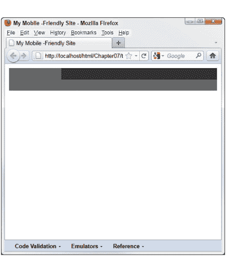


图 7-5：迄今为止您的移动页面。

### 使用CSS格式化文本

XHTML包含一组默认标签，如`<h1>`、`<h2>`等用于标题，以及`<p>`标签用于标准段落或正文文本。您可以使用CSS样式来修改默认标签或创建全新的文本标签。请记住，许多移动设备不支持大量CSS格式化，当您偏离基础时反应不佳。因此，为了保持尽可能简单，这个操作——格式化文本——正是那些您不想太过花哨的领域之一；更多往往反而是过犹不及。

在为移动设备创建文本样式时，牢记这一点，通常使用并用CSS样式修改XHTML的内置标签是个好主意，而不是创建全新的标签——这在为大屏幕设计时是一种较为常见的做法。（想想看——就在不久前，大家还认为笔记本电脑显示器太小了。）

在设计页面时，请记住浏览器从上到下、从左到右读取和格式化HTML页面。因此，大多数设计师将所有文本格式化样式放在CSS文件的顶部，确保在浏览器遇到需要它们的文本块*之前*将它们全部读入内存。（还要记住，您可以在各自的容器样式中进一步修改文本或覆盖样式，这些都将在本章稍后部分教您如何做。）

正文（body text）当然是文档中标准的段落文本——你知道的，就是那些内容，或者不需要像标题、列表、题注等那样进行特殊格式处理的文本。

以下步骤为你的网站定义基本字体样式：

1. 转到`chapter7.css`的顶部，在字符集声明（第一行）之后插入一个空行，然后输入以下`body`样式：

```
body {
    font: 100%/1.4 Verdana, Arial, Helvetica, sans-serif;
    background: #666666;
    margin: 0;
    padding: 0;
    color: #333333;
}
```

`body`样式属性`font: 100%/1.4 Verdana, Arial, Helvetica, sans-serif;`为文档设置了基础字体。这样书写时，该属性声明实际上为浏览器提供了几个备选方案，以防用户的系统没有安装所需字体。（移动设备很可能根本没有Verdana。我在这里使用它只是演示这一点。）浏览器从第一种字体开始，或者说尝试查找并使用第一种字体——在本例中是Verdana。它首先检查用户设备上是否有该字体。如果该字体不可用（未安装在用户的移动设备上），它会转到下一个字体，然后是再下一个，依此类推。你应该始终按照优先顺序列出字体。例如，在这里你确实希望页面使用Verdana，但这并不总是可行的，所以次优字体是Arial，然后是Helvetica，最后是`sans-serif`，即每种设备都有的默认字体。

除了`padding`和`font`声明外，大多数属性都一目了然。`Padding`是以像素为单位、围绕该样式格式化元素的空间。`font`声明中的`100%/1.4`属性告诉浏览器以`body`或默认`<p>`文本大小的100%显示文本；并将行间距设置为1.4，即文本大小的1.4倍。在你输入一些文本后，这会更容易理解。

2. 输入一个空行并输入以下样式：

```
ul, ol, dl {
    padding: 0;
    margin: 0;
}
```

此样式简单地告诉浏览器不要为文档中添加的任何有序列表`<ol>`、无序列表`<ul>`或定义列表`<dl>`添加外边距或内边距。当你为菜单创建列表时，你会看到这是如何工作的。

3. 在列表样式下方插入一个空行并输入以下样式：

```
h1, h2, h3, h4, h5, h6, p {
  margin-top: 0;
  padding-right: 5px;
  padding-left: 15px;
  color: #CCC;
  text-align: left; }
```

好的。现在你可能想知道，为什么在`.content`样式中将边距和`padding`设置为零，然后却又在这里为所有标题和段落文本添加15像素的左右`padding`。简短的答案是，这是*层叠样式表*（*Cascading Style Sheets*）中"层叠"效果的一部分。你的类样式从最基础的格式开始，然后你可以使用标签选择器和复合选择器来进行特定的格式更改。我知道这变得越来越复杂。但当你将附加样式应用于各个容器时，这会更容易理解。

不过现在——为了让你看看目前为止已完成的工作——下一步你要在`.content`容器中添加一些文本。

4. 转到`index.html`并在`.content`容器标签之间插入以下标签和文本：

```
<div class="content">
<h1>Welcome to MySite</h1>
<p>Introduce yourself here.</p>
<!-- end .content --></div>
```

如果你使用Dreamweaver，可以通过该程序的"多屏幕"选项（如图7-6所示）了解你的页面在各种屏幕尺寸下的显示效果。（"多屏幕"是工具栏上的一个选项。）

如果你不使用Dreamweaver，只需在Web浏览器中打开`index.html`，确保先保存它和`chapter7.css`。（根据你使用的编辑器，可能必须先在编辑器中关闭这些文档，这也是我更偏好源代码编辑器（如UltraEdit）的另一个原因。大多数源代码编辑器都有在一个或多个浏览器中测试页面的选项。）

如您所见，XHTML的默认顶级标题`<h1>`太大了——特别是对于屏幕较小的手持设备。有多种方法可以解决这个问题，包括简单地使用下一级标题标签`<h2>`。但这只能解决这一个实例中的问题，而且某种程度上违背了使用外部样式表的目的。

现在你知道标题不太合适，你可以创建一个复合样式来修正它。因为这个复合样式修改的是现有容器，所以它应该放在设置容器的类样式下方。

5. 在`chapter7.css`中，在`footer`类样式下方插入一个空行，然后输入以下复合样式：

```
.container .content h1 {
    font-size: medium;
}
```

如果你现在测试页面，标题应该会合适得多。既然你在这里创建修改容器文本的样式，你应该再添加一个复合样式来重新设置侧边栏文本的颜色。侧边栏有一个深灰色背景，所以比黑色更浅的颜色看起来会更好（也更易于阅读）。浅灰色如何？

6. 插入一个空行并输入以下复合样式：

```
.container .sidebar1 p {
    font-family: Arial, Helvetica, sans-serif;
    color: #999;
    font-size: xx-small;
    text-align: center;
    line-height: 15px; }
```

## 设计菜单和导航

通过在左侧边栏中提供菜单，你可以让移动用户更容易找到信息。与为计算机屏幕设计的菜单一样，你一定会认同为手持设备设计的菜单在易于识别为链接时效果更好。使菜单项或按钮可识别的一种技术是设计它们以提供反馈。例如，你可以告诉链接和按钮在用户选择或使用Tab键切换到它们时改变颜色——使它们看起来高亮显示。

### 让按钮和文本链接变为活动状态

如果你做过任何网页设计，那么你一定熟悉用于创建超链接的标准`<a href>`标签。超链接（有时简称为链接；一些设计师对二者有所区分，将*hyperlink*保留给可点击文本，将*link*保留给可点击图形）使按钮、图形或文本字符串变为"活动的"——即可点击的。例如，此设计中菜单列表里的每个项目都包含一组`<a href></a>`标签。在本例中，你可以通过将井号（`#`）替换为有效的URL，使每个列表项链接到Internet上的任何页面或URL。（注意，井号是我添加到代码中的占位符，以便让我单独演示如何创建链接。如果你正常创建此菜单，没有必要先用占位符创建每个菜单项，然后再回来将占位符替换为URL。我这样做是为了能给你讲讲如何创建链接。）

还有另外两个非常有用的超链接：`mailto`和`tel`。第一个是`mailto`，允许你创建可点击的（或移动设备上的热选）电子邮件链接。当用户选择配置了`mailto`的对象时，她的浏览器会与其计算机的默认邮件客户端（Windows中通常是Outlook，Mac OS X中通常是Mail）交互，向超链接中指定的地址发送电子邮件。例如，如果你在Windows机器上点击以下`mailto`超链接……

```
<li><a href="http://www.myblog.com">Blog</a></li>
```

`</a>`标签关闭超链接，而`<a href>`和`</a>`之间的元素，在本例中是*Blog*这个词，成为实际可点击的超链接。你还可以用这种方法将图像变成超链接，我在本章稍后部分会向你展示。

```
<a href="mailto:bill@williamharrel.com">bill@williamharrel.com</a>
```

……你会启动Outlook的"新建邮件"窗口，邮件地址`bill@williamharrel.com`会出现在"收件人："字段中。用户只需输入主题、撰写邮件并点击发送即可。

`tel`标签在手机上的用处极大，它创建的链接在点击时会自动拨打超链接中配置的号码。此标签的配置与`mailto`非常相似：

```
<a href="tel:555-555-5555">555-555-5555</a>
```


对用户来说，这两个超链接看起来与任何其他文本链接一样。

另一种经过验证的识别文本链接的方法是使用下划线。当你在侧边栏中创建菜单，并在页脚中创建电子邮件和电话链接时，你将同时使用这两种 CSS 方法来格式化主页上的导航链接。

使用样式表创建菜单的方式有很多。我在这里向你展示的是最简单的方法之一；它创建的菜单外观也相对朴素。不过朴素简单是好事，尤其是在移动网站设计中。这些菜单不会飞出、炸开、抖动或跳霹雳舞。相反，它们专注于完成任务——通过为用户提供一种高效的导航方式，而无需让他们等待大量花哨的图形下载。

### 创建菜单列表

创建菜单项的一种方法是使用简单的 HTML 无序列表，它使用 `<ul>` 和 `<li>` 标签。这无疑是那种“展示比讲解更有效”的情况之一。所以我就不再多说了，你直接动手操作吧。

要创建菜单列表，请按照以下步骤操作：

1. 在 `index.html` 中找到 `<div class="sidebar1">` 标签，在 `<div>` 标签之间输入以下列表标签和文本，如下所示：

```html
<div class="sidebar1">
  <ul class="nav">
    <li><a href="#">Blog</a></li>
    <li><a href="#">Services</a></li>
    <li><a href="#">About Us</a></li>
    <li><a href="#">Contact Us</a></li>
  </ul>
</div>

<!-- end sidebar1 -->
```

顺便说一下，上段代码中的井号（`#`）是我为了方便你而添加的占位符。与其像我稍后要你做的那样先添加井号然后再替换它们，正常情况下，当你输入这个列表时，你通常直接输入菜单项链接到的 URL，而不是井号。我这样做是为了强调这种菜单的工作方式。例如，如果你使用 Dreamweaver 添加这些链接，Dreamweaver 不会插入这些符号，而是会要求你输入菜单项链接到的 URL。这一点稍后你就会完全理解。

HTML 和 XHTML 都支持无序列表和有序列表（有序列表用 `<ol>` 表示，即编号列表）。`<ul>` 标签用于设置或启动列表。`<li></li>` 标签对用于定义各个列表项，`</ul>` 标签表示列表的结束。

注意开头的 `<ul>` 标签引用了一个名为 `nav` 的类。在这里，你可以看到标签选择器的实际应用。`<ul class="nav">` 这个标签告诉浏览器：创建一个无序列表，并使用 `nav` 类来格式化它。


2. 转到 `chapter7.css`，在 `.container .sidebar p` 样式下方（在右花括号下方）插入一个空行，然后输入以下样式：

```css
ul.nav {
    list-style: none;
    border-top: 1px solid #666;
    margin-bottom: 15px;
}

ul.nav li {
    border-bottom: 1px solid #666;
}

ul.nav a, ul.nav a:visited {
    padding: 5px 5px 5px 15px;
    display: block;
    text-decoration: none;
    background: #666666;
    color: #CCCCCC;
}

ul.nav a:hover, ul.nav a:active, ul.nav a:focus {
    background: #999999;
    color: #FFF;
}
```

> 表面上看这些样式很复杂。它们所做的不过是将你的无序列表变成按钮。（“他说的所有这些，”）如果你从这个角度来审视它们，大部分样式属性就会很好理解。最后两个选择器用于控制用户交互时按钮的外观，需要做一些解释：

- `ul.nav a, ul.nav a:visited` 控制用户访问该链接后菜单项的显示方式。换句话说，如果用户已经访问过该链接，文本会以不同的颜色显示。（不过并非所有移动设备都支持此选项。当制造商和浏览器发布商为了节省资源而舍弃功能时，像这样的细微差异正是他们首先去掉的。）
- `ul.nav a:hover, ul.nav a:active, ul.nav a:focus` 控制按钮在悬停时或在移动设备上激活时的显示方式。在此示例中，当用户导航到某个菜单项时，文本和背景颜色都会改变，以指示当前哪个按钮处于激活状态或即将被选中（点击）。这相当于标准电脑上的悬停翻转效果——你知道的，就是当用户将鼠标光标悬停在按钮上时的效果。按照现在的写法，这个样式适用于标准电脑浏览器和移动浏览器。


如果你现在测试页面，你的菜单会看起来更像一个菜单，而且当你将鼠标悬停在每个菜单项上时，它们都会高亮显示，如图 7-7 所示。在标准电脑上，你可以通过将鼠标指针悬停在菜单项上来查看悬停翻转效果。你的移动用户当然无法悬停，但当他们触摸按钮或使用手持设备上的导航键切换到按钮时，每个按钮都会高亮显示。

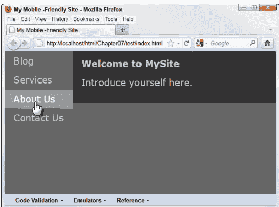

### 创建页脚链接

该网站导航方案中的两个重要部分是页脚中的电子邮件和电话链接。要创建它们，你需要使用随附侧栏（“让按钮和文本链接变得可交互”）中讨论的 `mailto` 和 `tel` 标签。然后你创建一个复合样式，将页脚链接的文本颜色更改为与侧边栏中文本颜色相匹配。

要创建页脚链接，请按照以下步骤操作：

1. 转到 `index.html`，在页脚容器标签之间插入以下标签和文本：

```html
<p><a href="mailto:bill@williamharrel.com">yourEmail@yourDomain.com</a> - <a href="tel:555-555.5555">555-555.5555</a></p>
```

## 向布局中添加图片

为了完成你的布局，你应该在页面顶部添加一张横幅图片。标题容器被设计为可以适应任何高度的图片；然而，为了保持标题与布局其余部分的比例协调，它的高度最好不要超过约 70 像素。标题图片的长度也可以是任意的——最大不超过 800 像素的页面宽度。不过，我不建议你将其做得比约 320 像素更大。你真的不希望访客需要滚动才能看到横幅。从用户的角度来看，这非常令人恼火——更不用说它通常会大大降低横幅的效果。你可以使用从本书配套网站下载的 `logo.jpg` 图片文件。步骤如下：

1. 转到 `chapter7.css`，在第一个容器样式上方添加以下样式：

```css
a img {
    border: none;
}
```

这个样式当然是确保如果你将图片设置为链接，浏览器不会在它周围显示边框。

2. 转到 `index.html`，在标题容器标签之间输入以下文本和标签：

```html
<a href="index.html" class="header"></a>
```

> 一种常见的设计技巧是将 Logo 或横幅图片链接到网站的首页，这样无论用户在网站的哪个位置，都可以通过点击横幅返回网站顶部。标签 `<a href="index.html" class="header">` 使横幅图片成为一个可点击的按钮，点击后加载 `index.html`，而 `alt="Return to Home Page"` 属性会在悬停或选中时显示一条类似工具提示的消息，告知用户该链接的目标地址。

完成后的 `index.html` 文件和 `chapter7.css` 文件分别见代码清单 7-3 和 7-4。

### 代码清单 7-3：完整的 `index.html` 文件

```html
<!DOCTYPE html PUBLIC "-//WAPFORUM//DTD XHTML Mobile 1.0//EN" "http://www.wapforum.org/DTD/xhtml-mobile10.dtd">

<html xmlns="http://www.w3.org/1999/xhtml">

<head>
<meta http-equiv="Content-Type" content="text/html; charset=utf-8" />
<title>My Mobile-Friendly Site</title>
<link href="chapter7.css" rel="stylesheet" type="text/css" media="screen" />
<meta name="HandheldFriendly" content="True" />
</head>

<body>

<div class="container">

  <div class="header">

    <a href="index.html" class="header"></a>

  <!-- end .header --></div>

  <div class="sidebar1">

     <ul class="nav">

        <li><a href="#">Blog</a></li>

        <li><a href="#">Services</a></li>

        <li><a href="#">About Us</a></li>

        <li><a href="#">Contact Us</a></li>

     <!-- end .sidebar1 --></div>

  <div class="content">

    <h1>Welcome to MySite</h1>

    <p>Introduce yourself here.</p>

  <!-- end .content --></div>

  <div class="footer">

    <p><a href="mailto:bill@williamharrel.com"> yourEmail@yourDomain.com</a> -
           <a href="tel:555-555.5555">555-555.5555</a></p>

  <!-- end .footer --></div>

<!-- end .container --></div>

</body>

</html>
```

### 代码清单 7-4：完成的 `chapter7.css` 文件

```css
@charset "utf-8";

/* CSS Document */

body {
   font: 100%/1.4 Verdana, Arial, Helvetica, sans-serif;
   background: #666666;
   margin: 0;
   padding: 0;
   color: #333333;
}

ul, ol, dl {
   padding: 0;
   margin: 0;
}

h1, h2, h3, h4, h5, h6, p {
   margin-top: 0;
   padding-right: 5px;
   padding-left: 15px;
   color: #CCC;
   text-align: left;
}

.container {
   width: 100%;
   max-width: 800px;
   min-width: 320px;
   background: #666;
   margin: 0 auto;
}

.header {
   background: #666;
}

.sidebar1 {
   float: left;
   width: 25%;
   background: #666666;
   padding-bottom: 10px;
}

.content {
   padding: 10px 0;
   width: 75%;
   background: #333333;
   float: left;
}

.footer {
   padding: 10px 0;
   background: #666666;
   position: relative;
   clear: both;
}

.container .content h1 {
   font-size: medium;
}

.container .footer p a {
   font-size: small;
   color: #CCC;
}

.container .sidebar p {
   font-family: Arial, Helvetica, sans-serif;
   color: #999;
   font-size: xx-small;
   text-align: center;
   line-height: 15px;
}

ul.nav {
   list-style: none;
   border-top: 1px solid #666;
   margin-bottom: 15px;
}

ul.nav li {
   border-bottom: 1px solid #666;
}

ul.nav a, ul.nav a:visited {
   padding: 5px 5px 5px 15px;
   display: block;
   text-decoration: none;
   background: #666666;
   color: #CCCCCC;
}

ul.nav a:hover, ul.nav a:active, ul.nav a:focus {
   background: #999999;
   color: #FFF;
}

a img {
   border: none;
}
```


## 第 7 章：布局主页

# 第 8 章：使用模板

### 本章内容

- 通过使用模板来保持一致性
- 使用模板节省时间和金钱
- 了解预制的第三方模板的好处
- 使用 Dreamweaver 模板
- 处理服务器端模板

如果你使用电脑超过十分钟，你就应该知道什么是模板，对吧？例如，Microsoft Word 就附带了各种模板，可用于创建从普通信函到法律摘要的所有内容。通常，模板是一个空的文档框架，包含一组预定义的样式或样式表，用于指定内容的格式。

尽管 XHTML 模板在概念上相似，但在实践中却大相径庭。例如，与你典型的 Word 模板（你打开它，添加内容，然后将其另存为文档文件）不同，XHTML 模板——尤其是那些使用 CSS 格式化的模板——通常由多个不同的文件组成。一个网页引用两个或多个 CSS 文件是很常见的。网页还可以依赖多个不同的文档文件来构成单个页面的各个部分——页眉、侧边栏、页脚、正文等等。

在本章中，我们将探讨如何使用模板创建网站的基本结构。使用模板构建网站的方法多种多样——从简单的静态、可重用的“一刀切” HTML 文件，到完全模块化的网站，其中每个页面由多个不同的文件组成，这些文件被称为包含文件（includes）。

与网页设计的许多方面一样，在网站中使用包含文件需要你超越基础的 HTML 和 CSS 编码，进行一些编程——但结果是非常值得的。因此，在本章中，我们正是这样做的——超越基础的 HTML 和 CSS 编码——向你展示如何创建一个 PHP 服务器端模板结构。

### 理解为什么专业人士依赖模板

你是否曾遇到过这样的网站：你点击的每一个链接都会带你进入一个外观迥异、拥有全新配色方案和导航布局的页面？我遇到过。每一个新页面都像是访问一个不同的国家。更糟糕的是，每个新页面都要求访客重新熟悉布局，并弄清楚如何浏览和查找信息。最重要的是——尤其是在移动网站上——你的网站设计应该让内容易于查找。实现这一目标的一种方法是在整个网站中保持一致的“外观和感觉”。尽管内容本身可能不同，但网站本身的总体风格，即“外观和感觉”，应该在网站中保持一致。

设计和遵守结构是模板帮助你创建专业外观网站的众多方法之一。在探讨创建和使用模板的实践之前，让我们简要看看为什么专业设计师依赖它们——模板如何节省你的时间和金钱，并帮助你创建和维护专业外观的网站：

- **控制一致性：** 好吧，听起来我是不是在唠叨？嘿，我说的不仅仅是让每个页面看起来相似，因为它看起来不错。完全不是。想想你使用网站的方式。当你浏览主页时，你的大脑正在归档关于内容组织方式的信息：顶部或侧边的菜单是做什么的？它们有子菜单吗？页面底部是否有与整体菜单结构相匹配的导航链接？我如何联系这些人？

  在设计良好的网站上，这种结构不会改变。在你的网站上只花几分钟后，用户就能够转换思维，直观地知道如何前往他们下一步想去的地方。

- **更易于更新：** 互联网的一个巨大优势是，网页内容与印刷品不同，它是（或者应该是）易于更新的。许多网站每天都在变化，甚至每小时、每分钟或每秒都在变化。如果不是设计良好的模板，这种持续的、事件驱动的更新将变得不可能。更新这些网站内容的人员只处理内容，很少考虑其格式和呈现方式。如果他们必须处理模板所处理的任务，他们的工作和结果（所有那些闪电般快速的内容）将会变得无比复杂、更加耗时，而且一致性也会大大降低。

- **更易于扩展：** 你永远不知道网站项目的范围何时会发生变化。有好几次，我遇到客户向我提出对他们网站的更改建议——新产品线、购物车等等——这些改变立刻将一个小型、易于管理的网站变成了一个庞大、耗时的企业。在这种时候，你会感谢自己花了时间和精力，围绕一个健全的模板系统来设计哪怕是最简单的网站，而不是随便拼凑几个页面就转向下一个项目。

- **避免错误：** 任何设计环境中的一个基本常识是，你进行的编辑越多，为项目引入错误的机会就越多。假设你的网站有 25 个页面，你需要对所有 25 个页面进行相同的更改。这就提供了 25 个犯错的机会。模板、外部 CSS、包含文件——所有这些工具都能帮助你避免错误。（当然，另一面是，如果你在一个模板资源上犯了错误，这个错误会出现在所有 25 个页面上。但是，如果这种情况发生，纠正错误也变得容易得多。）

- **节省时间和金钱：** 归根结底，尽可能快、尽可能高效地完成最好的工作难道不是始终排在首位的关注点吗？大多数网站都需要长期的承诺。我今天维护和更新的网站，有些是我近 20 年前设计和发布的。花时间思考、规划和执行网站的结构有时可能看起来像是多余的工作和浪费时间——而且，有时你可能很难说服客户，额外的几个设计小时是必要的。走捷径常常会把你引上黑暗、曲折、难以导航的道路，或者让你走进死胡同，你所能做的就是掉头原路返回。一个健全的模板结构可以为你节省宝贵的时间。作为一名设计师，你的时间确实是你最重要的资产。

### 使用预制的第三方模板

使用模板的一个巨大优势是，有如此多预制的、由第三方专业设计的模板可用。只需在谷歌上搜索“网页模板”，就会出现如此多的结果，你可能一辈子都看不完。许多是免费的，或者价格如此低廉，以至于对于整个网页设计项目来说，它们几乎等同于免费。

网络上有许多第三方模板网站，它们做得相当好。为什么？因为，与其完全从头开始（这很耗时），许多专业设计师更喜欢使用这些网站上出售的模板。以`TemplateMonster.com`这样的网站为例（如图所示）。像这样的网站有数百个设计精良的 HTML 模板，价格合理。你所要做的就是用你自己的内容替换掉现成的内容，进行任何你想要的设计更改，然后——砰！——你就拥有了一个专业设计的网站，所用时间只是从头开始所需时间的一小部分。（第 20 章提供了一份包含十个优秀资源的列表，用于查找第三方网页模板。）

（续）

## 使用 Dreamweaver 模板

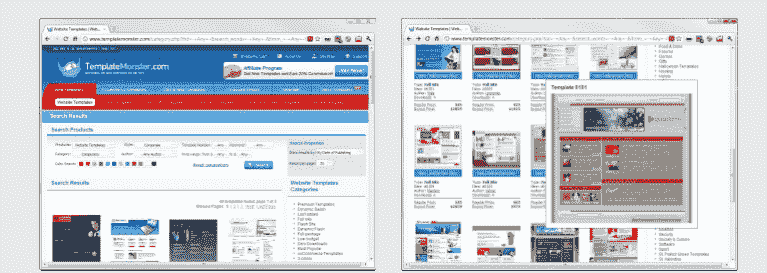

你可能会担心其他人使用同一模板导致你的网站与竞争对手的网站过于相似。首先，这种情况不太可能——在我从事网站设计的这些年里，从未见过这种情况发生。此外，对这些模板进行颜色、字体以及其他设计和布局的修改非常容易；它们允许你灵活地将其改造成你独有的样式。

确保模板有完善的文档说明。事实上，尝试在购买模板前查看其文档。如果无法做到，尝试获取一份退货协议，以便在文档不足以让你在无需大量反复试验的情况下进行修改时，可以改变主意。毕竟，目的是节省时间，对吧？

这就引出了选择第三方模板时一个非常重要的考量：

像 Dreamweaver 这样的设计程序自带许多美观的模板。预制模板不仅节省大量时间，还为初学者提供了学习如何构建 HTML 页面及随附 CSS 文件的绝佳途径。Dreamweaver 自带的模板非常灵活，易于适应你的需求。此外，还有数百个专为在 Dreamweaver 中修改而设计的预制第三方模板。（请参阅边栏“使用预制第三方模板”。）

> **警告！** 许多非为网页设计构建的程序——如 Microsoft Word、PowerPoint 和 Excel——允许你将文档保存为 HTML 或其他网页格式。在此提醒明智的读者：不要尝试将这些程序用作网页设计工具。例如，Word 会创建极其“杂乱”的代码——充满多余的内容，以至于 Dreamweaver 有一个专门的导入功能，用于“清理”在 Word 中保存为 HTML 的文件。相信我：Word 不是网页设计程序。句号。

即使我很多时候手工编码，我几乎总是先从设置和修改 Dreamweaver 模板的基本框架开始。为什么？因为这是一个将结构（如页面和容器布局、标记语言类型、CSS 文件等）就位的绝佳方式，同时在此过程中节省一两个小时的时间。当然，你可以完全手工完成这些（如果你没有 Dreamweaver 或为你完成所有这些初步工作的源代码编辑器，你就必须这么做），但为什么要在不必要的时候做更多的工作、花更多的时间呢？（我也用洗碗机！）

## Dreamweaver 的“新建文档”对话框

如果你是网页设计新手，如图 8-1 所示的 Dreamweaver “新建文档”对话框可能看起来有点令人望而生畏——内容很多。不过从另一个角度看，你可以用它来设置模板和 CSS 文件，然后查看源代码，了解某些页面功能是如何实现的。让我们让 Dreamweaver 为我们创建一个布局，然后看看它是如何组装页面的。只需按照以下步骤操作：

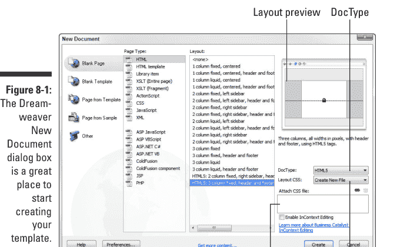

图 8-1：Dreamweaver “新建文档”对话框是开始创建模板的好地方。

1. 点击“文件”菜单，选择“新建”。

   如你所见，Dreamweaver 允许你创建各种类型的文件，包括 HTML、CSS、JavaScript 和 PHP，这些是我们在本章（以及本书其余部分）中使用的四种文件类型。
2. 在“页面类型”栏中，选择 HTML，然后在“布局”栏中，选择“两列弹性布局，左侧边栏，页头和页脚”。

   右侧的小预览图（如图 8-2 所示）向你展示了布局——页头横跨顶部，页脚横跨底部，侧边栏和主体区域位于侧边栏右侧。总共有四个容器（如果算上页面本身，则是五个）。主体容器上的百分比符号表示两个垂直容器——侧边栏和内容容器——的宽度是弹性的，这意味着列会自动调整大小；它们会根据浏览器窗口的大小自行调整，而其他列则保持固定大小，无论窗口大小如何都不调整。

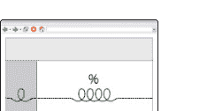

图 8-2：此预览图向你展示了所选布局的容器结构。

3. 点击“文档类型”下拉菜单，选择 XHTML 1.0 Transitional。

   你可能注意到有一个 XHTML Mobile 1.0 文档类型（文档类型在第 2 章和第 7 章讨论）。我的经验是，它过于严格，不允许某些 CSS 格式在较新的设备上显示。因此，我更喜欢用 CSS 样式来控制格式，而不是 Dreamweaver 的移动文档类型。
4. 点击“布局 CSS”下拉菜单，选择“创建新文件”。

   注意，还有一个“链接现有文件”选项，如果你要为已有 CSS 样式表的现有网站创建新的页面模板，可以使用此选项。在新网站中（你稍后会看到），“创建新文件”选项会启动一个新的外部 CSS 文件。
5. 点击“创建”。
6. Dreamweaver 会根据你选择的布局为 CSS 文件建议一个名称。

   我不太喜欢这个命名方案，所以我直接在这里重命名文件。稍后你会看到，Dreamweaver 创建的外部 CSS 文件包含了格式化这些容器及其内容（容器内的文本和图形）所需的所有必要标签。

完成这五个简单步骤后，你实际上已经完成了手动操作需要花费相当多时间的多项任务。在短短几分钟内，Dreamweaver 就处理了以下任务：

- 创建了一个 HTML 页面，包含布局页头、侧边栏、主体和页脚容器的所有必要代码。
- 创建了所有格式化这些容器内文本的必要 CSS 选择器。（当然，格式可能并不完全符合你的需求，但修改标签比创建它们容易得多。）
- 创建了一个带有类似翻转按钮菜单的侧边栏。我们只需要更改按钮文本并创建链接即可。
- 创建了一个包含所有基本格式标签的外部 CSS 样式表，并附有详尽的注释，指导你编辑样式以满足需求。
- 创建了“占位符”内容，为你提供页面整体外观的视觉参考。
- 等等，还有更多！如果你是新手，它完成了你原本需要进行研究和实验才能达到此目的的一大堆功能。相反，你已经有了一个可工作的原型可供学习。

### 完成的模板文件

如图 8-3 所示，Dreamweaver 创建了一个相对基础的页面。（有一点我不太喜欢的是 Adobe 设计师为这些布局选择的配色方案，但它们很容易更改。）每个容器内的占位符文本描述了布局的各个方面，并提供了修改格式和内容的建议。另请注意代码视图中的`<div class=>`标签。正如第 7 章所讨论的，这些标签设置了容器本身。

从技术上讲，在 Dreamweaver 的术语中，这并不是 Dreamweaver 所称的“模板”。（Dreamweaver 模板本身是不同的东西。）相反，你得到的是两个文件：页面文件本身和一个扩展名为`.css`的文件。就我们的目的而言，这是你模板的起点。从这里，你将开始用你自己的内容替换占位符内容——徽标、菜单标签和链接、页头和页脚内容——然后保存文件。所有这些更改将在第 7 章讨论。

当你替换完所有内容并保存文件后，这就成了你的模板。页面之间唯一变化的是`.content`容器中的内容。你只需打开页面，用不同的名称保存，然后创建你的主体内容。

## 166 第二部分：创建移动网站

图 8-3：Dreamweaver 创建了一个基础的“空白”页面和一个随附的 CSS 文件——启动网站所需的一切都已创建完成。

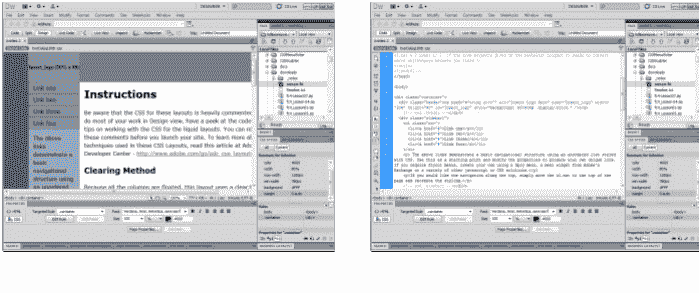

浏览 HTML 文件和 CSS 文件，检查容器是如何创建的，以及文本是如何格式化的。如果你手工创建模板，这就是你用来设置列和其他容器的基本结构。注意 CSS 文件带有大量注释，描述了每个样式的作用和方式，以及更改样式的若干建议。图 8-4 展示了一个通过修改此 Dreamweaver 创建的模板而制作的网站。

图 8-4：右图：Dreamweaver 生成模板的示例。左图：同一模板改编为移动网站。

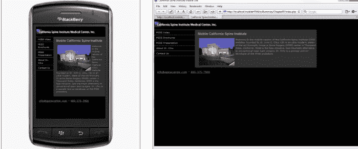

## 选择合适的模板结构

搭建网站模板系统有多种方法。在本节中，我们将介绍两种最常见的方法：创建静态模板文件并在每个新页面中重复使用，以及通过组装多个部分来创建动态模板系统。两种方法各有优缺点。

### 创建静态模板文件

这种方法是创建一个包含所有必要元素的文件，并将其用于网站的每个新页面，最适合小型网站。这种方法的主要缺点是，如果你需要对模板文件的任何组成部分进行修改，那么使用该模板文件的每个页面也都需要进行修改。

> **提示：** 这并不像听起来那么糟糕。如果你使用 Dreamweaver 或 UltraEdit 等源代码编辑器，这些程序都有查找和替换功能，允许你一次性在多个——甚至数千个——文件中查找和替换文本和代码。你只需要非常小心地构造查找和替换的条件。换句话说，在点击全部替换之前，一定要确保修改的构造是正确的。

图 8-4 中的网站就是静态模板文件的一个很好的例子。该网站只有五个页面，并且只有`.content`容器会随着页面的不同而变化。我设计这类模板的方法是：先设计首页，然后将其（或其副本）作为模板文件使用。

### 创建模块化模板文件

我所说的模块化的术语是包含文件（includes）。包含文件是页面的片段，或者说模块。例如，看看图 8-5。是的，我知道这看起来和图 8-4 中的页面一样——而且，本质上来说，确实如此。但是，它的创建方式（或者说“组装方式”）不同：它不是由一个 HTML 文件组成，而是由三个 PHP 文件组成；侧边栏和页脚都是包含文件。

## 168 第二部分：创建移动网站

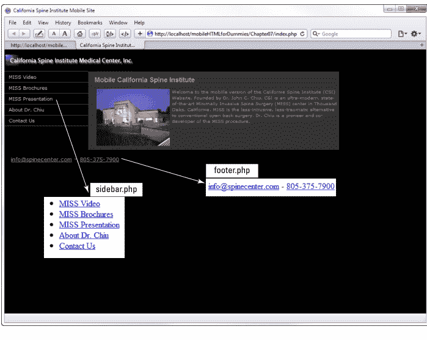

**图 8-5：** 由一系列包含文件创建的模块化网页。

> **提示**

你可能在想为什么页眉没有也做成包含文件。想想看，页面的这一部分是作为模块的吗？！这部分的页面已经是模块化的，因为它只包含公司标志，一个单独的图形文件。如果公司更换标志，在这种情况下改变页眉就只需要编辑图形即可。然而，如果页眉包含（比如）横跨页面顶部的菜单，那么创建页眉包含文件就是明智之举。随附的侧边栏提供了在 Dreamweaver 中创建包含文件的快速指南。

那么，为什么要用这种方式构建页面呢？你可能已经知道答案了。如果（将来）你需要更改或扩展菜单，或者更改页脚信息，你只需要修改包含文件即可。这些更改会自动影响网站上使用该模板的每个页面——即使你的网站包含大约一百万个页面！

坦率地说，实现这一点的唯一无缝方式是使用服务器端包含，这有很多非常好的理由。有一些方法可以使用 JavaScript 创建包含文件，但由于并非所有移动设备都支持 JavaScript，使用它们就没有太大意义。特别是考虑到服务器端方法非常容易使用，而且无论网站访问者的设备支持什么技术都可以正常工作。

那么，综上所述，请记住：要使用这种类型的模板，你托管移动网站的服务器必须支持 PHP。大多数托管公司的服务器都支持。虽然还有一些其他技术可以用于此目的，例如 Microsoft 服务器的 Active Server Pages (ASP)，但 PHP 是迄今为止最广泛使用和支持的。

### 使用 Dreamweaver 的库（资源）技术 Windows、Mac OS 和 Linux 技术创建包含文件

如果你使用 Dreamweaver，它有一个内置的创建包含文件的功能；它被称为**库**。这是 Dreamweaver 独有的功能，库中的“资源”可以在你的页面中反复使用。库资源具有`.lbi`文件扩展名，并保存在 Library 子目录中。这项技术使用 CSS 选择器，除了非常易于使用之外，它也运行得非常好——当然，前提是用户的移动设备支持 CSS。使用方法如下：

1. **首先创建你想要包含在包含文件中的内容，包括链接和样式表无法处理的特殊格式。**

   （没错！你可以使用一些用于格式化文档其余部分的 CSS 文件来格式化你的包含文件！）例如，我们医疗中心网站的页脚包含文件的内容看起来是这样的：

   ```html
   <p><a href="mailto:info@pinecenter.com">info@pinecenter.com</a> - <a href="tel:805-377-7900">805-377-7900</a></p>
   ```


```
就像你将它插入到主文档中时的格式一样，对吧？
```

2. **转到 Dreamweaver 的资源面板（在文件面板旁边，除非你更改了 Dreamweaver 的默认工作区）并点击库图标（它看起来像一本打开的书）。**
3. **点击面板右下角的新建库项目按钮，然后命名新的库资源。**
4. **复制你为此资源创建的内容，包括所有代码。**
5. **点击资源面板右下角的编辑按钮。**
6. **如果 Dreamweaver 尚未处于拆分视图，请点击文档窗口左上角的拆分，然后将内容粘贴到现有代码的底部。**

好了——你现在有了一个可以随意部署的新资源。要使用库项目，请按照以下步骤操作：

7. **将光标放在文档中你想要包含文件的位置。**
8. **点击资源面板底部的插入按钮。**

就这样！只要用户的设备支持 CSS，你的新包含文件就会正常工作。（如果用户的设备不支持 CSS，你应该将他们引导离开此页面。）

## 服务器端包含

如前所述，让服务器来完成这项工作确实是唯一可靠的方法。此外，当你为手持设备创建内容时，尽可能多地移交处理工作总是一个好主意，以免给设备过度劳累的小大脑带来压力。

创建和部署服务器端包含是一个两步过程。首先，你创建内容并保存它，然后在文档中引用内容文件。我们现在就来操作：

1. **新建一个空白文本文档。**

   除了链接和任何覆盖的格式外，你可以使用主内容页面所使用的相同 CSS 文件来格式化你的包含文件内容。事实上，你的包含文件不需要任何额外的代码，例如 `<html>`、`<head>`、`<body>` 等等。如果你使用 Dreamweaver 创建了新页面，请继续删除页面上的所有内容。

2. **在空白页面上创建你的包含文件内容。**
3. **使用 `.php` 扩展名保存包含文件。**

   例如，如果你正在创建侧边栏包含文件，可以将其命名为 `sidebar.php`。

4. **转到主文档文件中你想要插入包含文件的代码位置，然后输入以下代码：**

   ```php
   <?php include("/includes/filename.php"); ?>
   ```

   这里给出的示例假设你已经为包含文件创建了一个名为 `includes` 的子目录——这是个好主意，特别是如果你的网站有多个包含文件。当然，你将代码放在哪里取决于你的页面布局。在我们一直在处理的医疗中心页面中，你会将包含代码放在容器 `<div class>` 标签之间，如清单 8-1 所示。

**清单 8-1：** 在主网页中部署侧边栏和页脚包含文件

```html
<body>

<div class="container">

<div class="header"><a href="index.html" target="_self"></a>

<!-- end .header --></div>

<div class="sidebar">

<!--#include file="includes/sidebar.php" -->

<!-- end .sidebar --></div>

</div>
```

## 移动版加州脊柱研究所

欢迎访问加州脊柱研究所（CSI）网站的移动版本。由赵忠熙医生创立的 CSI，是位于加利福尼亚州千橡市的一家超现代、尖端的微创脊柱手术（MISS）中心。MISS 是传统开放式背部手术的一种创伤更小、侵入性更低的替代方案。赵医生是 MISS 手术的先驱者和共同开发者。

## 您的模板主题变体

这个系统虽然能与大多数移动网站良好协作，但它并非一种万能的解决方案。（有什么东西是万能的吗？）根据您网站的复杂程度，您可能需要不止一个模板和不止一组包含文件。许多网站拥有不同的部门，每个部门的菜单和页面结构可能略有不同。此外，您可能还需要以几种不同的语言呈现相同的内容。

关键在于，这个模板系统能让您入门。并且它被设计成易于扩展。

# 第三部分：使用高级交互性和多媒体增强您的网站

## 本部分内容

本部分探讨如何让您的移动网站超越简单导航按钮的基础功能。它首先向您介绍交互式 HTML 表单。之后，您将了解如何在网站中使用多媒体——图像、数字视频和 Flash，从讨论媒体文件格式开始。（哪些是最佳格式？为什么？以及如何将它们加载到页面上并进行格式化？）

本部分最后讨论了一些新技术，例如 HTML5、CSS3 和 WebKit 扩展。掌握这些技术可以为您节省大量时间。毕竟，时间就是金钱！

# 第 9 章：设计移动表单

**本章内容**

- 理解基本表单构建
- 了解不同的表单元素
- 使用 CSS 格式化表单
- 创建联系表单
- 使用服务器端表单处理

回顾信息时代初期，当个人电脑刚作为家用电器被引入时，预言家们对这些设备——以及互联网——将如何改变我们的生活做出了各种预测。其中一个预测是，到现在我们都将享受无纸化办公的好处。当我们都不再使用那么多纸张时，森林终于可以喘口气了。结果证明，这些预言完全偏离了事实。

个人电脑的出现产生了相反的效果。世界使用的纸张比以往任何时候都多——这主要是计算机和个人打印机普及的结果。然而，我们确实看到了我们使用和处理表单方式的转变。虽然我们使用表单比以往任何时候都多，但大多数都是电子形式。我们在线提交它们，而不是手工填写然后通过传真或普通邮件发送。

没有人喜欢填写表单。然而我们的生活却充满了它们。大多数网站至少有一种或另一种形式的表单，从简单的“联系我们”表单到用于访问博客或在线账户的登录表单。因此，无论喜欢与否，当您选择成为网页设计师时，您就自动承担了表单设计师的角色。

网络表单是互联网上最常见的故障点之一。很少有什么事情比设计拙劣、难以使用或出现故障的网络表单更能激怒移动网站用户——促使他们匆忙离开，转向您的竞争对手网站。如果您的表单太长、难以理解，或者用户第一次点击“提交”按钮时无法正常工作，那么您极有可能会失去一个潜在客户。

在本章中，您将更深入地了解网络表单的设计。首先，我将介绍所有可用的表单部件或元素。然后，我将向您展示如何创建一个简单的“联系我们”电子邮件表单，以收集有关您用户的基本信息，例如姓名、电子邮件地址和评论。

您有多种元素可供使用——例如复选框、单选按钮组、选择列表（菜单）以及其他几种。将组件与数据类型匹配对于表单的有效性至关重要。

## 理解 XHTML 表单

XHTML 表单收集用户在网页上提交的信息，然后对这些数据进行处理。表单如何处理信息取决于您告诉它做什么。表单可以将数据通过电子邮件发送到某处，保存到文本文件或数据库中，或者简单地将信息发送到另一个网页并显示出来。

XHTML 内置了大约十种表单元素，您可以使用 CSS 按照自己的喜好对它们进行格式化。（请参见侧边栏“使用 CSS 格式化表单标签和元素”。）然而，XHTML 本身并没有能力对表单或表单数据执行任何操作。为此，您需要客户端（通常是 JavaScript）或服务器端（通常是 PHP）脚本。因为您是为移动设备创建表单，所以应该尽可能使用 PHP 来处理表单数据。为什么？因为并非所有手持设备都能运行 JavaScript，而且在处理移动设备时，让服务器承担负载总是一个好主意。它更干净、更可靠，并且不会让手持设备的处理器做任何不必要的工作。

## 基本表单构建

您可以创建占据整个页面的表单，也可以让表单成为更大页面的一部分。表单本身——表单主体和所有表单元素——位于 `<form></form>` 标签对内。例如，图 9-1 中的表单元素是通过将表单字段和按钮标签放置在清单 9-1 所示的 `<form></form>` 标签之间创建的。

图 9-1：这个简单表单的两个元素是通过将表单标签放置在 `<form></form>` 标签对之间创建的，如清单 9-1 所示。

### 清单 9-1：使用 `<form></form>` 标签对的示例

```html
<body>

<form id="form1" name="form1" method="post" action="">

    <p><label for="name">Name</label>

    <input type="text" name="name" id="name" /></p>

    <p><input type="submit" name="submit" id="submit" value="Submit" /></p>

</form>

</body>
```

您可以在页面上希望的任何位置开始放置表单。图 9-2 显示了一个位于右栏中的表单。设计者通过将表单标签放在 `rightColumn1` 选择器内实现了这一点。（参见清单 9-2。）

图 9-2：您可以在页面上任何想要的位置创建表单。

### 清单 9-2：表单出现在页面上放置第一个 `<form></form>` 标签对的位置

```html
<div id="rightColumn1">

    <h2>Contact CSI</h2>

    <h3>Required*</h3>

<div id="contact">

    <form class="Dark_Default" id="contact" name="contact" method="post"

          action="<?php echo $_SERVER["PHP_SELF"]; ?>">
```

在开始添加表单元素之前，表单标签如下所示：

```html
<form id="contact" name="contact" method="post" action="">

</form>
```

以下是每个表单属性及其功能的描述：

- **form id** 为表单提供一个唯一的 ID，这很重要，原因有几个。首先，您可以在一个页面上拥有多个表单或表单区域。每个表单都需要自己的 ID。根据您的应用程序，您还可以在脚本中使用此 ID 来引用表单，或者可以在样式表中使用它进行引用。
- **name** 具有与表单 ID 类似的功能，但您会在 CGI 和 Perl 脚本中使用它进行引用，这些脚本如今不如以前那样广泛使用了。即便如此，许多网络托管公司在其默认的表单处理脚本中使用 CGI；它是一种服务器端脚本形式。
- **method** 告诉浏览器如何提交数据。有两个选项：GET 和 POST。GET 将数据附加到 URL 的末尾，通常用于数据库搜索；POST 通常用于更改数据库中的值、通过电子邮件发送数据或将文件上传到服务器。
- **action** 用于指定处理表单数据的脚本或 PHP 页面的名称。您可以在本章后面的“创建联系表单”部分了解其工作原理。

Dreamweaver 在创建表单方面非常熟练。您可以在“插入”菜单的“表单”子菜单中找到每个表单元素。当您选择其中一个时，Dreamweaver 会引导您完成一个类似向导的一系列对话框，您在其中定义元素属性。完成后，程序会创建创建该元素所需的所有标签。

## 表单元素

如果您在互联网上花费过不止几分钟时间，您可能已经遇到过所有大约十种 XHTML 表单元素。每个元素都旨在处理特定类型的数据，策略性地部署它们不仅使用户填写表单更容易，还可以帮助您控制用户如何输入数据。数据——包括格式、实际措辞和标点符号——的提交方式对于某些数据收集应用程序通常至关重要。图 9-3 显示了各种不同的表单类型，接下来的几节将对其进行描述。

### 文本字段

文本字段有时也称为文本框，是最常见的表单元素。文本字段允许用户输入一行文本，通常响应于字段标签，标签通常显示在字段的左侧或上方。文本字段用于姓名、电话号码、电子邮件地址等。文本字段使用 `<input type>` 标签，设置方式如下：

```html
<input type="text" name="First Name" id="firstName" tabindex="1" />
```

你可以使用 `<label>` 标签为字段创建配套标签。例如，要在字段前方放置标签，代码如下所示：

```html
<label for="firstName">First Name:</label> <input type="text" name="firstName" id="firstName" tabindex="1" />
```

要将标签放在字段上方，只需在文本字段前添加换行 `<br />`，或用段落 `<p> </p>` 标签将其包围。

注意，`<input>` 没有对应的闭合标签 `</input>`。XHTML 中使用的许多标签源自早期的 HTML 版本。与 XHTML 不同，HTML 不要求闭合标签。标签末尾的斜杠（`/`）用于关闭标签。事实上，你可以使用这种语法来闭合几乎任何 XHTML 标签，例如换行标签 `<br />`。

你还可以控制文本字段的其他属性，例如：

- **size**：控制文本字段的长度（以字符为单位）。例如，要使字段长度为 32 个字符，可以使用 `size="32"`。（这不会限制用户可以在字段中输入的文本字符串长度，它只是控制字段的显示大小。你可以使用下一个标签来控制文本字符串的长度。）
- **maxlength**：使用此属性设置用户可以在字段中输入的最大字符数。属性 `maxlength="100"` 将可能的字符数限制为 100。
- **value**：使用此属性为文本字段创建默认文本字符串，或在用户未填写字段时该字段将持有的数据。例如，假设填写表单的大多数人都来自美国，你可以使用 `value` 标签为他们填写此字段，如下所示：`value="United States"`，如图 9-4 所示。用户可以通过替换现有文本来覆盖默认值。清单 9-3 展示了如何在代码中使用 `value` 属性。

你可以通过将输入类型更改为 password（`<input type="password">`）来使用文本字段元素创建密码字段，如图 9-4 所示，如清单 9-3 所示。密码字段在用户输入时显示星号而非文本。使用 value 属性设置密码，如下所示：`value="mypassword"`。不过，你需要一些脚本才能让此字段执行除显示星号之外的任何操作。

### 清单 9-3：设置初始字段值和创建密码字段

```html
<form id="form1" name="form1" method="post" action="">

  <p><label for="country">Country:</label>

  <input name="country" type="text" id="country" value="United States" /></p>

  <p><label for="pwd">Password:</label>

  <input name="pwd" type="password" id="pwd" value="mypassword" /></p>

</form>
```

### 文本区域

文本区域表单元素通常用于表单上的评论框。在合理范围内，你可以将其设置为任意大小，并且可以接收任意数量的字符。文本区域使用 `<textarea></textarea>` 标签，典型的文本区域代码如下所示：

```html
<label for="comment">Text Area: </label><textarea name="comment" id="comment"
cols="50" rows="10" tabindex="2">Type your comment here</textarea>
```

注意，此代码将评论框设置为 50 列和 10 行。列相当于字符，行相当于文本行。要在文本区域框中显示默认文本，你不需要 value 属性。用户输入的文本量没有限制。如果她输入的文本行数超过定义的行数，文本区域框会自动在框的右侧添加滚动条。（在将文本区域添加到表单时要记住这一点。如果你不希望表单提交冗长、散漫的评论，请考虑不要使用文本区域。）

### 选择（列表或菜单）

许多表单提供选项列表供用户选择。选择表单元素允许你创建列表，可以是下拉菜单或显示列表。列表可以显示整个列表，也可以显示部分列表并带有滚动条来显示剩余的列表值，如图 9-5 所示。

图 9-5：选择菜单和列表的示例。

### 使用 `tabindex` 使导航更轻松

你有没有注意到，在网页表单上可以使用 Tab 键在字段之间移动？在设计良好的表单上，按 Tab 键应该将光标按逻辑从一个字段移动到下一个字段。在设计不佳的表单上，按 Tab 键会不规则地在表单中移动光标。两种表单之间的区别在于，设计良好的表单的设计者花时间插入了 `tabindex` 属性在表单元素标签中。例如，假设表单上的第一个字段是名字，第二个字段是姓氏。用户在名字字段中输入后，按 Tab 键应该将光标移动到姓氏字段。要设置此功能，在每个字段中使用 `tabindex` 属性，如下所示：

```html
<label for="firstName">First Name:</label> <input type="text" name="firstName" id="firstName" tabindex="1" />

<label for="lastName">Last Name:</label> <input type="text" name="lastName" id="lastName" tabindex="2" />
```

在移动网站上使用 Tab 顺序尤为重要。许多移动设备，尤其是较早的智能手机和功能手机，使用按键或选择轮来导航网页。这相当于在标准计算机上使用 Tab 键。未正确实现 Tab 顺序会很快让移动用户感到沮丧。当你未标识 Tab 顺序时，每个浏览器的行为都会有所不同。没有它，你通常无法预测光标下一步会去哪里。

选择菜单和列表使用 `<select></select>` 标签对，列表选项放置在 `<option></option>` 标签对之间，如下所示：

```html
<select name="month">

  <option value="1">January</option>

  <option value="2">February</option>

  <option value="3">March</option>

  <option value="4">April</option>
```


```html
<option value="5">May</option>
<option value="6">June</option>
<option value="7">July</option>
<option value="8">August</option>
<option value="9">September</option>
<option value="10">October</option>
<option value="11">November</option>
<option value="12">December</option>
</select>
```

引号之间的值是此列表提交的值，标签之间的值是用户看到的内容。上面给出的示例设置了一个下拉菜单。要从下拉菜单更改为显示列表，你只需向`select`标签添加`size`属性，如下所示：

```html
<select name="month" size="4">
  <option value="1">January</option>
  <option value="2">February</option>
  <option value="3">March</option>
  <option value="4">April</option>
  <option value="5">May</option>
  <option value="6">June</option>
  <option value="7">July</option>
  <option value="8">August</option>
  <option value="9">September</option>
  <option value="10">October</option>
  <option value="11">November</option>
  <option value="12">December</option>
</select>
```

上述代码将创建一个显示列表，显示前四个选项，其余选项可滚动。要显示整个列表，只需将`size`值设置为选项的数量。在上面的示例中，`size`值应为 12。

#### 下拉列表还是显示列表？

使用选择列表而非文本字段有几个很好的理由。强制用户从列表中选择可以控制数据的提交方式——而在某些应用程序中，控制表单发送的内容是有益的。例如，假设你正在数据库中收集地址。强制用户从列表中选择其所在州可以确保你的数据库中不会有几千种密西西比州的变体。

使用列表来控制日期的发送方式还可以避免你不得不按地区整理过时的日期格式版本：东南部、中西部等。你是否会考虑让用户决定哪个州属于哪个地区，还是宁愿让他或她选择一个州，然后由你——或你的选择列表——来决定该州属于哪个地区？对于你的数据收集目的，北卡罗来纳州可能属于东南部。填写表单的人可能不这么认为。或者也许你只是想向用户展示月份名称，但希望它们以数字形式提交。

我相信你明白了。用户有成千上万种方式可以破坏你的数据收集。选择列表的另一个好处是，表单发送的值可以与用户选择的值不同。这有什么好处？让我给你举个例子；然后，我相信你会想到更多原因：假设你的公司收集客户信息。

最后，你应该使用下拉菜单还是显示列表？这当然取决于你的应用程序以及你希望表单的外观。如果你的列表很长，例如国家或州，下拉菜单或部分显示列表可以节省大量屏幕空间——而且坦率地说，它们看起来更有吸引力、更专业。

我使用的一条经验法则是：两个或三个列表选项放在显示列表中；超过三个则放在下拉菜单中。

如果你使用 Dreamweaver，该程序会在“代码片段”面板中安装几个常见的选择列表。例如，要使用前面的月份选择列表，你只需将光标放在文档中希望出现列表的位置，打开“代码片段”面板（点击“窗口”菜单并选择“代码片段”），导航到“表单元素，下拉菜单”子文件夹，选择你想要的列表，然后点击面板底部的“插入”按钮。

你也可以在“代码片段”面板中保存选择列表。例如，我第一次创建州下拉菜单时，就将其保存为代码片段。这样我就不用再输入那 50 个州名了！

你还可以为列表设置默认值——也就是当用户未选择任何内容时自动选中的首选值，例如（假设是）购物车应用中你销售的最高价商品——只需在`<option>`标签中添加`selected`属性即可：

```html
<option value="3" selected="selected">March</option>
```

### 复选框

复选框允许用户开启或关闭一个值。你肯定见过它无数次，尤其是在网上购物或同意软件条款和条件时。复选框有两种状态——选中或未选中——但你可以为选中状态分配一个值（例如，“agreed”），以明确选中状态的含义。

复选框使用`<input>`标签：

```html
<input type="checkbox" name="agree" id="agree" value="Agreed" />

<label for="agree">I agree <br /></label>
```

在上面的示例中，如果复选框被选中，表单会发送值“Agreed”。如果没有`value`属性，发送的值将是“checked”。

与文本字段元素一样，你也可以使用`<label>`标签在复选框上方、前面、后面或下方放置标签。你可以通过在`<input>`标签中添加`checked`属性，将初始值从`unchecked`更改为`checked`，像这样：

```html
<input type="checkbox" name="agree" id="agree" value="Agreed" checked="checked" />
```

#### 复选框组

复选框组允许你创建一组相关的选项供用户选择，如图 9-6 所示。所有复选框具有相同的名称，但有不同的 ID 和值。其目的是收集同一主题的相关数据。例如，你可以在医疗历史表单中使用复选框组，因为该问题可能需要用户进行多项选择。换句话说，复选框组允许用户在每个组中进行多项选择。

复选框组的代码如下所示：

```html
<label>
  <input type="checkbox" name="CheckboxGroup1" value="apples" id="CheckboxGroup1_0" />
  Apples
</label>
<br />
<label>
  <input type="checkbox" name="CheckboxGroup1" value="oranges" id="CheckboxGroup1_1" />
  Oranges
</label>
<br />
<label>
  <input type="checkbox" name="CheckboxGroup1" value="bananas" id="CheckboxGroup1_2" />
  Bananas
</label>
```

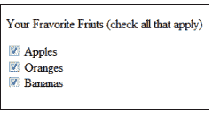

**图 9-6：** 支持多选的复选框组示例

### 单选按钮

单选按钮设计为成组使用。当你想将用户的选择限制为唯一一个时，请使用它们。例如，假设你的购物车表单要求选择帽子尺码。使用如图 9-7 所示的单选按钮组，可以确保你只获得一个尺码。

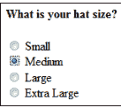

**图 9-7：** 单选按钮组仅允许每组选择一个选项。

## 第 9 章：设计移动表单 187

单选按钮使用带有`radio`属性的`<input>`标签。组中的所有按钮具有相同的名称，但每个按钮都有不同的 ID 和值，如下所示：

```html
<label>
  <input type="radio" name="hatSize" value="small" id="hatSize_0" />
  Small
</label>
<br />
<label>
  <input type="radio" name="hatSize" value="medium" id="hatSize_1" />
  Medium
</label>
<br />
<label>
  <input type="radio" name="hatSize" value="large" id="hatSize_2" />
  Large
</label>
<br />
<label>
  <input type="radio" name="hatSize" value="xLarge" id="hatSize_3" />
  Extra Large
</label>
```

你可以使用`checked`属性设置默认选项——即用户未选择时自动选中的单选按钮，如下所示：

```html
<input type="radio" name="hatSize" value="xLarge" id="hatSize_3" checked="checked" />
```

## 字段集

*字段集*是一组在同一个标题（或`legend`）下的字段，如图 9-8 所示。作为字段集的一部分，并不会真正影响字段集中字段和其他元素返回数据的方式。相反，字段集以一种对用户或填写表单的人有帮助的方式来安排和呈现字段。


**图 9-8：** 字段集示例。

### 使用 CSS 格式化表单标签和元素

默认情况下，所有标签使用正文或`<p>`格式化 CSS 规则，而表单字段本身有自己的格式——黑色文本白色背景。通常，这没问题。但是，良好的设计通常要求你的表单页面与站点中的其他页面匹配。或者你可能将表单放置在一个不是白色背景黑色文本的现有页面上，如左图所示。在这些情况下，你可以为表单元素创建一套专门的 CSS 规则。

示例中的黑色标签难以阅读，深色背景上白色表单字段的对比度也过于强烈。你可以通过为表单字段创建并格式化容器，以及为表单标签和表单文本创建选择器来修正这个问题。要更改标签，你可以创建一个专门针对表单标签的选择器，像这样：

```css
#form1 .labels label {
  font-family: Arial, Helvetica, sans-serif;
  font-size: 14px;
  font-weight: bold;
}
```

此选择器针对`<form id="form1"></form>`标签内所有使用`<label></label>`标签格式化的文本——本例中是“Name:”和“Comments:”标签。

要格式化字段本身，特别是字段背景和用户输入的文本，你可以创建一个具有所需格式的选择器，然后将其应用于表单字段。以下是一个示例：

```css
.fields {
  background: #666;
  font-size: 12px;
  color: #CCC
}
```

现在，当你将此选择器应用于表单元素时，使用`class`属性，像这样：

```html
<textarea name="comment" cols="45" rows="5" class="fields" id="comment" tabindex="2">Type your comment here.</textarea>
```

你会得到重新格式化的表单字段，在你的深色页面上看起来好多了，如右图所示。

你可以将此技术用于所有表单元素。它也会改变选择下拉菜单和列表的外观。你还可以使用 CSS 在页面上定位表单元素和标签，就像定位任何其他对象一样，如第 7 章所述。

字段集使用`<fieldset></fieldset>`标签对，如下所示：

```html
<fieldset>
  <legend>Tell Us About Yourself</legend>

  <label for="name">Name:</label>
  <input type="text" name="name" id="name" tabindex="1" />

  <p>
    <label for="city">City:</label>
    <input type="text" name="city" id="city" tabindex="2" />
  </p>

  <p>
    <label for="phone">Phone:</label>
    <input type="text" name="phone" id="phone" tabindex="3" />
  </p>
</fieldset>
```

### 按钮

XHTML 支持几种不同类型的按钮——但最常用的是“提交”和“重置”。XHTML 按钮本身——没有编程——实际上什么也不做。（重置按钮是个例外；它可以在不需要额外编程的情况下清除表单字段。）

当然，你可以点击它们，按钮会显示模拟的“按下”或已点击状态，但仅此而已。按钮实际上不会提交用户的数据，除非你应用一些代码来告诉按钮如何处理这些数据。按钮的功能实现将在本章后面的“创建联系表单”部分讨论。

你使用`<input>`标签创建按钮，像这样：

```html
<input type="submit" name="submit" id="submit" value="Submit" tabindex="4" />
```

你可以通过将`type`属性设置为`reset`来创建重置按钮，如下所示：

```html
<input name="reset" type="reset" value="Reset" tabindex="6" />
```

重置按钮当然会清除表单字段，允许用户从一个空表单重新开始。

按钮的标签或标题——按钮本身上的文本——来自`value`属性。按钮与所有其他表单元素的不同之处在于，你还可以使用图形文件或图像（如小 GIF、PNG 或 JPEG 文件）作为按钮。这允许你在表单中创建风格化的自定义按钮，而不是默认的按钮图像。有关更多内容，请参阅边栏“创建和使用自定义按钮”。

正如我所说，按钮——就像其他所有表单元素一样——在编写一些处理提交表单的代码之前，几乎是毫无用处的，这将在下一节中描述。

## 创建联系表单

无论表单多长、有多少元素，创建将表单数据通过电子邮件发送到特定邮箱地址的表单的过程基本上都是相同的。该过程的步骤如下：

1. 创建 HTML 页面和基本格式。您可以使用标准 HTML 或 XHTML 格式，也可以使用 CSS 样式表，具体讨论请参见“使用 CSS 格式化表单标签和元素”侧边栏。
2. 创建所有表单元素并根据需要应用格式。
3. 创建处理表单的脚本。您可以使用 JavaScript 客户端脚本或服务器端 PHP 脚本。只要有可能，您应该使用服务器端脚本。表单不是应该为各种手持设备制作多个相同 HTML 页面​​的文件类型。如果使用 JavaScript，并非所有手持设备都能使用该表单，而且无论如何您都需要为这些设备单独准备一个服务器端表单。

您可以在本书的配套网站上找到以下练习的文件和示例代码。


### 设置表单 XHTML 文件

XHTML 表单标签非常基础——除了即将出现的 HTML5 标签之外，已经很久没有太多变化了。在移动设备上显示表单元素并不需要任何特殊处理。

考虑到这一点，新建一个 HTML 文件并将其保存为`contact.html`。然后添加清单 9-4 中的代码。

#### 清单 9-4：XHTML 表单标签

```html
<!DOCTYPE html PUBLIC "-//W3C//DTD XHTML 1.0 Transitional//EN" "http://www.w3.org/TR/xhtml1/DTD/xhtml1-transitional.dtd">

<html xmlns="http://www.w3.org/1999/xhtml">
<head>
  <meta http-equiv="Content-Type" content="text/html; charset=utf-8" />
  <title>Contact Form</title>
</head>

<body>
  <h1>Tell Us About Yourself</h1>

  <form id="contact" name="contact" method="post" action=" ">
    <p>
      <label>
        First Name:<br />
        <input type="text" name="firstName" id="firstName" tabindex="1" />
      </label>
    </p>

    <p>
      <label>
        Last Name:<br />
        <input type="text" name="lastName" id="lastName" tabindex="2" />
      </label>
    </p>

    <p>
      <label>
        Email:<br />
        <input type="text" name="email" id="email" tabindex="3" />
      </label>
    </p>

    <p>
      <label>
        Comments:<br />
        <textarea name="comments" id="comments" cols="45" rows="5" tabindex="4"></textarea>
      </label>
    </p>

    <p>
      <input type="submit" name="submit" id="submit" value="Submit" tabindex="5" />
      <input name="reset" type="reset" value="Reset" tabindex="6" />
    </p>
  </form>
</body>
</html>
```


关于清单 9-1 的一些说明：

- **第 6 行：** 如果您想使用 CSS 来格式化表单的图例、标签和其他表单元素，您也可以输入 CSS 文件的链接。（您可以使用本书配套网站上的 `chapter9.css` 文件。如果要使用 `chapter9.css`，代码应如下所示，将其直接插入到 `<title></title>` 标签对的下方：

  ```html
  <link href="pathToFile/chapter9.css" rel="stylesheet" type="text/css" />
  ```

- **第 13 行和第 40 行：** 其余的表单元素放在这些 `<form>` 标签之间。稍后，您将返回并填写 `action` 属性，以告知服务器如何处理表单。

这是第一个表单字段。下一行的 `tabindex` 属性可能看起来多余（毕竟，这是第一个字段），但不要省略它。没有它，用户将无法通过 Tab 键切换到第二个字段。

其余的表单元素。

### 为表单编写脚本

有许许多多的方法可以为表单编写脚本，使其提交表单数据到电子邮件并发送。但在移动网站上，唯一可靠的方法是使用服务器端脚本，例如 PHP。即便如此，也有许多方法和许多不同的脚本来实现这一点。例如，大多数托管公司在其服务器上至少有一个表单邮件处理脚本。然而，这些脚本的缺点在于您的表单通常必须满足某些条件，或者具有必填字段，或者以某种其他方式限制您的设计自由。

总而言之，脚本应该完成这三件事：

- 收集和处理所有数据字段。
- 以易读的格式通过电子邮件发送数据。
- 通知用户相应的表单已发送。

#### 构建 PHP 脚本

本节的标题有点名不副实。我并不建议您尝试编写自己的 PHP 脚本（当然，如果您是一位经验丰富的 PHP 程序员，您可以这么做——但为什么呢？）。好消息是，互联网上有成百上千个 PHP 邮件表单脚本可用。您完全没必要重新发明那个轮子——除非您真的想这么做，那就是另一回事了。

我在这里给您的脚本的优点是，它无论表单中有多少元素都会收集并发送您的表单数据，而且它不在乎您如何命名字段。无论您给它什么，它都会处理数据、通过电子邮件发送数据，并将用户发送到确认页面，在那里您可以包含任何文本和图像来告知用户表单已处理完毕。

您可以在本书的配套网站上找到该脚本。

为了使此过程正常工作，您的服务器需要支持 PHP 并设置为允许从 PHP 脚本发送电子邮件。如果您的网站托管在支持 PHP 的服务器上，那么它很可能已正确设置以处理此脚本。


要设置您的脚本，请按照以下步骤操作：

1. **下载文件 `sendresults.php`，然后在 Dreamweaver 或源代码编辑器中打开该文件。**

这是该脚本：

```php
<?php

//---------------------------------------------------Set these paramaters---------------------------------------------------

    // Subject of email sent to you.

    $subject = 'Results from Contact form';

    // Your email address. This is where the form information will be sent.

    $emailadd = 'your@emailaddress.com';

    // Where to redirect after form is processed.

    $url = 'http://www.williamharrel.com/mobileHTML/confirmation.html';

    // Makes all fields required. If set to '1' no field cannot be empty. If

    // set to '0' any or all fields can be empty.

    $req = '0';

    // --------------------------------------------------Do not edit below this

    // line------------------------------------------------------------------

    $text = "Results from form:\n\n";

    $space = '  ';

    $line = '

';

    foreach ($_POST as $key => $value)

    {

        if ($req == '1')

        {

            if ($value == '')

            {

                echo '$key is empty";die;)

            }

        }

        $j = strlen($key);

        if ($j > 20)

        {

            echo "Name of form element $key cannot be longer than 20 characters";die;)

        }

        $i = 20; $j = ;

        for ($i = 1; $i <= $j; $i++)

        {

            $space .= ' ';

        }

        $value = str_replace('\n", "$line", $value);

        $conc = "{$key}:$space{$value}$line";

        $text = $conc;

        $space = '  ';

    }

    mail($emailadd, $subject, $text, "From: ".$emailadd.");

    echo '<META HTTP-EQUIV=Refresh CONTENT=0; URL='.$url.'>';

?>
```

为了使此脚本为您正确工作，您需要进行三项简单的更改，具体步骤如下：

2. **在脚本顶部附近找到这一行，并将当前电子邮件地址更改为要接收表单数据的地址：**

   ```php
   $emailadd = 'your@emailaddress.com';
   ```

3. **找到直接位于上一步中那一行下方的这一行，并将 URL 更改为要上传此脚本的网站的 URL：**

   ```php
   $url = 'http://yourdomain.com/subDirectory/confirmation.html';
   ```

我们将立即创建文件 `confirmation.html`。它将是一个简单的 HTML 文件，包含一句话告知用户表单数据已发送。只需提供您将上传该文件的 URL 即可。

4. **在脚本中找到直接位于上一步中那一行下方的以下这一行，并根据以下说明更改值：**

   ```php
   $req = '0';
   ```

这一行将表单中的字段设为必填。换句话说，使用当前值 `'0'` 时，所有字段都必须填写，否则当用户点击提交时，她会收到错误提示，告诉她遗漏的字段为空。如果任何字段留空，表单将不会提交。如果您不希望所有字段都是必填的，请将值设置为 `'1'`。（这种特定方法是要么全有要么全无。创建只有某些字段为必填的表单需要更复杂的 PHP 编程。）

5. **保存文件并将其上传到您的托管服务器。**

#### 创建确认页面

您是否曾经提交过互联网表单，结果它在那儿转了一分钟，然后仅仅显示您提交的同一个表单？这让您怀疑表单是否真的提交了。更好的方法是将用户重定向到一个确认页面，告知她数据已发送。

尽管您可以构建（或找到）复杂的 PHP 脚本来显示用户提交的数据，或者允许用户在提交前查看和修改数据的脚本，又或者只是显示确认数据已收到的消息的脚本。要创建确认页面，新建一个 HTML 页面并将其保存为 `confirmation.html`。然后添加清单 9-5 中的代码。

### 清单 9-5：确认页面

```html
<!DOCTYPE html PUBLIC "-//W3C//DTD XHTML 1.0 Transitional//EN" "http://www.

		w3.org/TR/xhtml1/DTD/xhtml-transitional.dtd">

<html xmlns="http://www.w3.org/1999/xhtml">

<head>

	<meta http-equiv="Content-Type" content="text/html; charset=utf-8" />

	<title>Form Submission Successful</title>

</head>

<body>

	<h2>Your Information has been Received. Thank You! </h2>

</body>

</html>
```

剩下的就是告诉表单如何关联 PHP 脚本。

### 让表单生效

要让表单生效，你只需在 `action` 属性中填写 PHP 脚本的路径和文件名。具体操作步骤如下：

1. **打开 `contact.html`。**

2. **前往 `<form>` 标签，在 `action` 属性的引号之间输入 `sendresults.php` 的路径和文件名。**

根据你上传 `sendresults.php` 的位置，在 `action` 属性的引号之间输入路径和文件名。如果 `contact.html` 和 `sendresults.php` 位于同一目录，你的 `<form>` 标签将如下所示：

```html
<form id="contact" name="contact" method="post" action="sendresults.php"/>
```

有些设计师会将所有脚本放在名为 `"scripts"` 或 `"php"` 的单独文件夹中。如果你的脚本很多，这是一个好习惯。如果你将 `sendresults.php` 保存到了子目录，你的 `<form>` 标签应如下所示：

```html
<form id="contact" name="contact" method="post" action="subdirectory/

sendresults.php"/>
```

3. **保存 `contact.html` 并将其上传到你的托管服务器。**

就是这么简单。你应该能够填写表单并提交。数据将被发送到你用于 `sendresults.php` 中的电子邮件地址。此外，你应该能够点击重置按钮来清空表单内容，并且当你提交表单时，应该会被重定向到 `confirmation.html`，如图 9-9 所示。


图 9-9：用户收到此确认信息，表明表单已发送。

**提示：** 如果你使用 Dreamweaver，可以通过选择表单或 `form` 标签，然后在属性面板（有时称为属性检查器）的 Action 字段中填写 PHP 脚本的路径和文件名来设置 `action` 属性。此外，你也可以通过“插入”菜单下的“表单”子菜单插入每个表单元素，这将弹出类似向导的对话框来创建每个元素。

## 创建和使用自定义按钮

某些表单应用需要使用自定义按钮，即来自图形文件的非 XHTML 按钮。你可以使用任何受 Web 支持的图形格式，例如 PNG、JPEG 或 GIF，这些格式可以在 Photoshop、Illustrator、Fireworks 或任何其他图形程序中创建——而且你可以使用几乎任何图形文件作为自定义按钮。要部署自定义按钮，请使用 `src` 属性指定指向图像文件的路径和文件名，如下所示：

```html
<input name="Submit" type="image"

value="Submit" src="images/dw.png"

alt="Submit" />
```

## 第 10 章：处理图像、视频和 Flash 影片

### 本章内容

- 了解基本的 Web 图像技术
- 为 Web 编码数字视频
- 将图像和视频嵌入网页
- 分析在移动网页中使用 Flash
- 在网页中嵌入 Flash 影片

移动 Web 用户和其他互联网用户一样喜欢多媒体——图像、数字视频和 Flash。然而，他们不喜欢的是等待缓慢得令人痛苦的多媒体文件下载太久，或者更糟糕的是，下载的文件无法正常工作或根本无法工作。作为移动 Web 设计师，你的工作就是让用户在你的网站上的多媒体体验尽可能愉快。

处理媒体文件时——尤其是移动设备上的媒体文件——这很少只是简单地将文件加载到网页中然后继续下一个任务。设计用于在计算机上显示的媒体文件通常需要优化以在网页中播放——而且，再次强调，当将它们加载到移动网页中时尤其如此。

在本章中，你将学习如何将多媒体文件放入网页中，这本身很容易——你只需编写必要的代码来指向并将文件加载到页面中。你还将学习如何优化你的多媒体文件，以便访问你网站的用户不必等待太久就能查看和与你的媒体文件交互。

### 在移动网站上使用图形和图像

图形和图像？有区别吗？嗯，就本讨论而言，是的。从技术上讲，图形就是*图形*。但在讨论计算机生成的图形时，我们通常会做这个区分来讨论两种不同类型的计算机图形：*矢量*和*位图*。矢量图（如 Adobe Illustrator 或其他“绘图”类程序生成的图）通常被称为*图形*，而位图（如 Photoshop 和其他“绘画”类图像编辑器生成的图）通常被称为*图像*。

#### 矢量与位图

矢量图像格式与位图图像格式之间的差异很大，但就这两种格式与 Web 设计的关系而言，你只需要知道几点：

- 除非你的网站是用 HTML5 设计的，否则你不能在网站中使用矢量图像。你必须将它们转换为位图。
- 矢量图像是通过数学方式绘制的，而位图图像由数千个——甚至数百万个——微小的“位图化”点组成。这一差异——这两种格式的渲染方式——对于你如何使用互联网上的图像至关重要。


Web 浏览器支持的矢量图形的一个例外是可缩放矢量图形（SVG）。SVG 图形是用 XML 创建的，虽然它们在非 HTML5 桌面浏览器中得到支持，但尚未被移动浏览器广泛支持。我的预测是，HTML5 矢量图形将成为在移动浏览器中使用矢量图像的常态。HTML5 在第 11 章中讨论。

##### 矢量图——远不止眼见

基于矢量的绘图的优势在于它们是通过数学方式绘制的。因为它们是通过计算创建的，所以可以调整大小而不会导致图形质量下降。此外，与位图不同，矢量文件格式非常小，而且无论你调整绘图多大，它们始终保持小巧。通常，矢量文件格式是 Illustrator 的 AI 和 EPS（Postscript）格式。要在网页中使用它们，在 HTML5 之前，你必须将它们转换为位图格式，例如 JPEG。HTML5 支持类似于可缩放矢量图形（SVG）的矢量。HTML5 矢量图形支持对于 Web 图形来说简直是一个游戏规则改变者。在你的网页中使用矢量图形在第 11 章中讨论。

##### 位图——所见即所得

位图图像由 strategically arranged 的点模式组成。这是它们与矢量图之间的关键区别。因为矢量图形是通过数学方式绘制的，并且可以轻松缩放而不会降低图形质量，所以它们被称为*与设备无关*（或有时称为*与分辨率无关*），这意味着无论它们在哪里显示或复制，都能适应其分辨率。例如，在计算机显示器上显示时，它们以 72 dpi 显示。在印刷机上印刷时，它们可以以 300 dpi 及更高的分辨率印刷——即使你将图像大小加倍、三倍或四倍。

位图图像是*与设备相关的*，这意味着它们保持*创建该图像的设备*的*分辨率*，或*每英寸点数*（dpi）。例如，如果你以 72 dpi 扫描图像，数据——构成图像的点——就构成了整个图像。就是这样——无法向图像添加任何更多数据（或点）。当你调整它们的大小时，你会改变 dpi。换句话说，如果你增大 72 dpi 图像的大小，你就会降低分辨率，因为你增大了点之间的距离。这可能导致锯齿边缘，或称为“锯齿”，如图 10-1 所示。

**图 10-1：** 增大的 `bitmapometries` 的位图会拉伸位图化点之间的距离，降低图像质量。


##### 显示分辨率

直到最近，所有计算机显示器和几乎所有手持设备都以 72 dpi 显示。新的 HD（高清）设备以 96 dpi 显示。如果你制作更高分辨率的图像，即使必须下载，用于创建更高分辨率的数据也会被忽略（或丢弃）。因此，创建高于 72（或 96）dpi 分辨率的图像实际上并不能提高图像质量。相反，你所做的只是创建更大的文件大小，你的移动用户设备必须在图像显示之前下载。

##### 颜色（或位）深度

在平衡图像质量和文件大小时，另一个重要的考虑因素是*颜色，或位，深度*。图像的位深度衡量其能包含的颜色数量，如表 10-1 所示。

**表 10-1：每种位深度对应的颜色可能数量**

| 位深度 | 可能的颜色数 |
| :--- | :--- |
| 4 位 | 16 种颜色 |
| 8 位 | 256 种颜色 |
| 16 位 | 数千种颜色 |
| 24 位 | 数百万种颜色 |

对于不需要高位深度设置的图形，调整其颜色深度可以显著减小文件大小。

### 使用 HTML 部署图像

当您将图像文件设置并保存为正确的尺寸、分辨率和颜色深度后，可以使用 `` 标签将其导入网页。当您将此代码插入页面或 CSS 容器（参见第 7 章）时，它会告诉浏览器在页面的何处加载图像。`` 标签还告诉浏览器在服务器的何处查找图像文件。在以下代码中，浏览器会在网站根目录的 `images` 子目录中查找：

```html

```


> **提示** 您也可以通过代码修改图像显示尺寸，如本章后面“图像显示尺寸”一节所述，但通常以一对一的显示尺寸加载网页上的图像是个好主意。换句话说，使用图形软件创建您需要尺寸的图像。为什么？因为放大图像会降低图像质量，除非您创建它们时使用了高于 72 dpi 的分辨率。然而，在为移动网站创建图像时，您可以从一个足够大的图像开始，以便在屏幕较大的设备上使用，然后为屏幕较小的设备缩小尺寸。只要文件大小一开始不会太大，这种方法效果很好。

### 图像文件大小

那么，用于移动设备的图像，其合适的文件大小是多少？最佳答案是：在不过度降低整体图像质量的前提下，尽可能小。对于像徽标和按钮这样的简单图形，保持

### 图像显示尺寸

图像的显示尺寸当然是其在屏幕上占据的像素数。您可以使用 `width` 和 `height` 属性控制其在页面上的显示尺寸。这些属性以像素为单位输入，如下所示：

```html

```

如果省略这些属性，图像将按其原始尺寸显示。

### 将图像设为可点击链接

您可以通过将图像包裹在 `<a href>` 标签中，使其成为一个热点，或可点击的链接，如下所示：

```html
<a href="http://www.domain.com/page.html"></a>
```


Internet Explorer 和一些其他浏览器在将图像放入链接标签内时，会在其周围添加一条难看的蓝线。您可以在 `` 标签内使用 `border="0"` 属性来去除边框。不过，您也可以通过在 CSS 文件中添加以下选择器来去除所有图像的边框：

```css
a img {
  border: none;
}
```

## 在移动网页中使用数字视频

将数字视频传递到网页可能尤其棘手，主要是因为视频文件非常大。不过，如果部署得当，视频片段既具有很高的娱乐性，也具有教学意义。与图像（在本章前面部分讨论过）类似，在将视频嵌入网页之前，您应确保不仅视频本身，而且视频文件都经过了针对移动设备观看的优化。

### 理解数字视频文件

与标准计算机不同，大多数手持设备支持的视频文件格式相当有限。事实上，许多设备仅限于 3GPP 和 MPEG4。因此，为稳妥起见，您确实应该在这两种格式之间做出选择：

- **3GPP**：3GPP（第三代合作伙伴计划）是一种为通过 3G 电话网络进行流式播放而设计的文件格式。大多数支持 3G 的手机都支持以 3GPP 格式播放和录制视频。其他流行的视频格式，如 AVI 和 MOV（QuickTime），可以使用流行的视频文件转换器（例如随 Flash 和 Photoshop 等多款 Adobe 产品附带的 Adobe Media Encoder）转换为 3GPP（文件扩展名为 `.3gp`）。此格式在功能上与 MPEG4 非常相似。
- **MPEG4**：除了 Adobe 的 `.FLV`（Flash Video）格式外，MPEG4（动态图像专家组 4）或 MP4 可能是互联网上最常见的视频格式。它用途广泛，在压缩视频以使文件足够小、能够在低带宽环境下流式传输和播放方面表现出色。

### 嵌入、下载和播放数字视频

视频在网页（尤其是移动网页）中的下载和播放效果如何，取决于许多相关因素，包括：

- 每秒帧数（FPS）或帧率
- 显示尺寸（或帧尺寸）
- 压缩
- 声音重采样（或压缩）
- 流式传输

平衡数字视频的这些方面对其在互联网上的播放效果至关重要，尤其是在手持设备的移动网络上。让我们简要地看一下每一项。

#### 每秒帧数（FPS）

看待数字视频的一种方式是将其视为一系列略有不同的图像快速连续出现以模拟运动。每张这样的图像就是一个*帧*，运动的模拟通常取决于每秒出现多少帧。该度量实际上是每秒帧数，或 FPS。

如果将每帧视为一张单独的图像，您就能看到此设置如何极大地影响文件大小。移除帧就是移除图像——大量的数据——但移除太多帧会使视频播放变得卡顿。

您可以使用媒体编码器（如 Adobe Media Encoder）来减少视频中的每秒帧数。

> **请记住**
>
> 通常，使媒体文件变小的过程，无论是丢弃帧、减小显示尺寸还是压缩，都涉及移除数据。移除数据会降低质量。数据一旦被移除，就无法将其放回或逆转该过程——损害已经造成。因此，您应尽可能对媒体文件的副本进行这些更改。您无法回头。Adobe Media Encoder 会创建一个单独的编码文件，保持原始文件不变。

#### 显示尺寸

通常称为*帧尺寸*，其作用方式与本章前面讨论的图像类似，并极大地影响视频的文件大小。您可以通过创建不同版本的视频或单独的文件来设置视频的各种显示尺寸。虽然很想将它们重采样为目标设备的屏幕全尺寸，但请记住，显示尺寸越大，文件大小就越大。将视频格式化为（比如）iPad 的全屏显示尺寸会创建一个巨大的文件，您可能需要一个非常好的媒体服务器和相当不错的带宽才能将如此多的数据流式传输到移动设备。

与图像不同，调整显示尺寸并非简单地在像 Photoshop 这样的程序中打开视频并立即更改高度和宽度。相反，更改数字视频的显示尺寸需要在某种视频转换器或编码器程序中对文件进行*重采样*或*编码*。

您也可以使用视频编辑程序，如 iMovie 或 Adobe Premiere，但编码器和转换器往往完成得更快。视频转换器或编码器的另一个优点是，大多数允许您批量编码多个文件，而无需一次设置一个视频。例如，在图 10-2 中，我有多个文件排队等待依次编码。当视频在后台编码时，我可以小睡一会儿或继续工作。

> **提示**
>
> 媒体编码程序（如 Adobe Media Encoder）随 Flash、Premiere 和 Photoshop 等多款流行的 Adobe 程序免费提供，允许您对视频文件进行多种格式更改——帧宽度、帧高度、格式、声音压缩、裁剪以及许多其他设置——如图 10-3 所示。

#### 压缩

在所有减小视频文件体积的方法中，压缩能删除最多的数据，从而减小文件体积——这也是让文件能够通过网络下载的最有效手段。不过，如果压缩过度，也会严重降低视频质量。

如本章前面关于图像处理部分所述，压缩分为两种类型：*有损*压缩和*无损*压缩。通常，在重新采样视频时，需要使用有损压缩。无损压缩删除的数据太少，对文件大小几乎没有影响。MPEG4 和 3GPP 都能在不过度降低质量的情况下很好地压缩视频，只要你不做得太过火。

压缩通过对文件中的数据应用较为复杂的公式来实现。大多数编码器不会让你去理解这些公式，而是允许你选择压缩百分比或不同的质量级别，例如“最大”、“高”、“良好”和“低”。我在编码或视频编辑程序中使用视频压缩设置的经验是，你通常需要反复试验才能找到质量与文件大小之间的恰当平衡，至少在你熟悉程序之前是这样。有些程序自带互联网流式传输的预设，这些通常都能正常工作。但并非所有数字视频都是一样的，所以对所有视频使用相同的压缩设置并不总是有效。


图 10-2：Adobe Media Encoder 等媒体编码器允许你批量处理多个视频文件。

#### 裁剪


图 10-3：使用媒体编码器在编码文件之前指定设置和更改格式。

#### 音频重采样（压缩）

几乎每个视频文件都带有音轨。事实上，当你在视频编辑程序中打开视频文件时，你不仅能单独看到音轨，还可以单独编辑它。

更改视频中的音频设置也能在很大程度上帮助减小文件体积。一个好的媒体编码器（如 Adobe Media Encoder）会让你在编码设置过程中设置音频压缩和质量选项。主要有以下三项设置：

- **采样率：** 音频文件的采样率以*千赫兹*（kHz）为单位。我们不必在这里深究它的技术含义。只需知道，kHz 越高，音质越好，文件越大；kHz 越低则相反。网页数字视频的一个合适且稳妥的设置是 44 kHz。
- **采样类型：** 此设置以*每秒比特数*（bps）来指定音质。同样，bps 越高，音质越好，文件越大，反之亦然。网页的合适设置是 128 bps 或 16 Kbps。
- **单声道与立体声：** 是的，如今电脑的立体声音乐和各类立体声音频文件播放效果已经相当不错了。但请记住，并非所有文件都需要两个声道。音效——例如鼠标点击声、玻璃破碎声等——并不需要立体声播放。仅在文件内容确实需要立体声时才使用立体声设置。单声道文件体积要小得多。大多数移动设备不支持立体声（除非用户戴耳机听音乐），而即使支持的设备，立体声效果也不理想。


你可能会忍不住要把视频音轨做成华丽的大作，但面对现实吧：很多电脑，尤其是笔记本电脑，并没有能够充分利用所有这些数据的音响系统。而且，Certainly 没有理由强迫你的移动用户下载那么多额外的音频数据——除非，声音的音质是视频整体信息中极其必要的一部分（比如，当用户在对比选购音乐设备时）。

#### 流式传输

流式传输并非在网页部署视频之前对视频文件进行压缩或处理的一种形式，而是一种将视频文件从服务器传送到终端用户设备的过程。流式传输所做的是在服务器和设备之间打开一个视频通道，或者说流；在传送视频的同时，两端还会就视频下载情况来回传递信息。

流式传输的主要目的有两个：首先是消除终端用户需要等待整个视频下载完毕后才能开始播放的需求；其次是确保视频在下载过程中能够流畅、不间断地播放。

基本上，视频流式传输分为两种类型：*视频流式传输*本身，这需要视频（或媒体）流式传输服务器；以及*渐进式流式传输*，这不需要。渐进式流式传输发生在视频文件与播放器之间——即设备上播放视频的软件。没有媒体服务器参与。对渐进式流式传输的支持必须编码到视频文件中。

或许最成熟的渐进式流式传输形式是 Adobe 将后续版本的 Flash Player 和 Flash Video 文件格式扩展为 FLV 和 SWF 等文件类型。Flash Player 也可以流式传输 MP4 和 3GP 文件，但这些文件需要嵌入到 Flash 影片中，Flash Player 才能流式传输它们。由于很多移动设备不支持 Flash，所以这并不总是最佳方案。

视频流式传输需要为此目的设置的媒体服务器，即所谓的（当然）*流式传输服务器*。媒体服务器的经典例子就是 YouTube。当用户在电脑上播放嵌入网页中的视频时，YouTube 视频会流式传输到 Flash Player，但 YouTube 也为不支持 Flash 的设备提供其他传送方式。

### 在网页中部署数字视频

许多托管公司提供媒体服务器作为其托管服务的一部分。有些收费，有些不收费。通常，使用媒体服务器需要对视频文件进行特殊处理——不仅在网页代码中如此，在服务器和视频文件本身方面也是如此。由于这些都可能因托管服务而异，所以我在这里无法详细说明。如果你的托管公司提供流式传输服务，它也应该提供如何使用该服务的说明，包括代码规范以及视频文件的处理要求。

如果这听起来很复杂，好吧，如果你在移动网页中使用较长的高质量视频，这是值得的。你的视频效果会更好，用户也会感激。

YouTube 提供了一种简单有效的方式来在你的网站中部署视频——无需高深的学习曲线。如果你的视频足够小、足够短，无需媒体服务器也能流畅播放，你可以用 `<embed></embed>` 标签对将其插入网页，如下所示：

```html
<embed src="video/filename.3gp"></embed>
```

你可以用 `height` 和 `width` 属性控制视频大小，如下所示：

```html
<embed src="video/filename.3gp" width="352" height="288"></embed>
```

此外，你可以设置视频自动开始播放，如下：

```html
<embed src="video/filename.3gp" width="352" height="288" autostart="true"></embed>
```


如果你不希望视频自动播放，将`autostart`设为`"false"`。此配置会在页面或 CSS 容器中插入代码的位置显示并播放视频，如第 7 章所述。你应将视频保存为 3GP 格式；否则，要显示带有播放控件的播放器，你需要一些辅助工具，例如某种插件（这也是 Flash 和/或 YouTube 在设计师中如此受欢迎的另一个原因——部署起来非常容易）。

图 10-4 展示了将上述代码插入网页后，使用 iPhone 3.0 用户代理查看时的结果（用户代理在第 4 章和第 5 章中讨论）。

## 第三部分：利用高级交互性和多媒体增强你的网站

## 了解移动设备上的 Flash

Adobe Flash 是互联网的重要组成部分。事实上，在我撰写本文时，Flash Player 的装机量已超过任何其他软件——即使在移动设备上也是如此，尽管 Apple 拒绝在其手持设备上支持它。大多数人想到 Flash 时，会联想到动画，但 Flash 的功能远不止于此。Flash Video (FLV) 是当前最主流的数字视频内容分发方式。你在网页上看到的许多花哨的动画按钮和菜单都是用 Flash 制作的，Flash 也是在线课程、调查问卷以及许多其他数据驱动型应用等互联网应用的推动力。

然而，移动设备上的 Flash 表现一直参差不齐。其部署零散且问题重重，原因之一是 Flash 应用和 Flash Player 往往非常消耗内存。此外，直到最近，移动设备的处理器和内存分配相对来说都比较弱小。

Adobe 最初通过发布一个专门针对移动设备的、功能精简的小型 Flash Player 版本——即`Flash Lite`——来应对这个问题。在我撰写本文时，Flash Lite 已经发展到第七个版本，并且还有一个专门针对 iPhone OS 的版本——而当今使用的众多不同手持设备各自使用不同的版本。

iPhone OS 是用于通过 Flash 开发 iPhone 应用的，而不是用于为 iPhone 开发网页内容的。

在简要了解这些不同版本以及它们如何影响为网页设计 Flash 应用之前，我应该指出，上一节中关于数字视频的大部分讨论同样适用于 Flash 内容。Flash 动画的质量和文件大小同样是通过控制显示尺寸、压缩率、每秒帧数和声音重采样来管理的：Flash 也非常受益于部署在媒体服务器上。

### Flash Lite

Flash Lite 已部署在数十万台移动设备上。Flash Lite 共发布了七个主要版本。要了解每个版本支持什么功能，你需要了解一些 Flash 的历史——或者至少了解 Flash 背后的编程语言 ActionScript 的历史。自 Flash 推出以来，ActionScript 共经历了三个主要版本：`ActionScript 1.0`、`ActionScript 2.0` 和`ActionScript 3.0`。ActionScript 的每一次重大更新都极大地增强了应用的功能，以及 Flash 设计师和开发者利用 Flash 所能实现的效果。

`Flash Lite 1.0` 和`1.1` 是`ActionScript 1.0`的子集，这意味着它们支持精简版的 ActionScript 函数集。`Flash Lite 2.0` 和`2.1` 是`ActionScript 2.0`的子集，这意味着它们支持精简版的 ActionScript 2.0 函数集。`Flash Lite 3.0` 是`ActionScript 3.0`的子集，ActionScript 3.0 是当今广泛使用的最新版本。`Flash Lite 4.0` 是`Flash Lite 3.0`的升级版，它增加了多点触控功能，并基于当前最新的完整版 Adobe Flash Player——`Flash Player 10`。

这些版本中没有一个能实现 Flash Player 的全部功能——但 Flash Lite 4.0 除外，它确实能实现——一些当前版本 Flash Player 无法做到的功能（如电脑上的多点触控）。当你为使用 Flash Lite 的移动设备创建或部署 Flash 内容时，可以作为创建网站不同版本的一部分，为 Flash 内容创建子类。当然，这需要大量的工作，大多数设计师并不会这样做。

了解哪些设备支持哪些版本 Flash 的最佳途径是 Adobe Device Central，我们将在第 4 章中讨论。你可以按设备支持的 Flash Lite 版本来对 Device Central 的移动设备数据库进行排序，如图 10-5 所示。

### Flash Player 10

Flash Player 最新且最强大的版本是`10.x`版。当今市场上许多最新的智能手机和平板电脑已经抛弃了 Flash Lite，转而采用完整版的 Flash Player。更快的处理器和更大的内存，当然是制造商能够在设备中内置完整 Flash 支持的原因。在我撰写本文时，第一批双核处理器设备正在进入市场；它们播放 Flash 内容的速度和效果将远超以往在移动设备上所能达到的水平。这对 Flash 设计师和网页设计师来说都是一个好消息。

例如，图 10-6 中的页面嵌入了三个 Flash 动画：主动画本身——允许用户根据语言查看不同版本的动画——以及两个按钮。尽管将 Flash 内容嵌入网站可以是一个相当简单直接的过程，但许多 Flash 动画通过使用 JavaScript 指令来控制其行为和外观而受益匪浅，我稍后将会讨论这一点。

## 在网页中部署 Flash 动画

大多数设计师使用 Flash Professional 或 Dreamweaver 将 Flash 内容嵌入网站。为什么？嗯，因为有很多可能的变量控制着动画的播放方式，而这两个程序都能很好地涵盖所有这些方面。

例如，Dreamweaver 和 Flash 都包含 JavaScript 指令，用于检查用户的 Flash Player 版本，以确保用户所拥有的版本与动画兼容。如果不兼容，它会为用户提供下载并安装最新版本 Flash Player 的选项。（当然，目前这在许多移动设备上并非必需，但我们已经看到一些平板电脑和其他手持设备使用 Flash Player 10，并且能够通过浏览器进行更新。）

**图 10-5：** Adobe 的 Device Central 允许你按设备支持的 Flash Player 版本对设备进行排序。

> 图 10-6：网页中嵌入的三个 Flash 动画。

Flash 动画也受益于使用带有参数的`<object>`标签来控制动画播放的各个方面——例如动画质量、背景颜色、是否允许全屏播放，以及其他几个选项。（`object`元素为浏览器提供加载和渲染非浏览器原生对象的信息，如 Flash 动画和数字视频。）同样，所有这些并非仅仅在网页中播放动画所必需的，但它们都有各自的价值。

然而，在网页中播放 Flash 动画通常确实需要一些 JavaScript。通常最好让 Flash Professional 或 Dreamweaver 自动生成这些脚本，所以你确实应该使用其中一个程序来将 Flash 动画嵌入你的页面。

### 为不支持 Flash 的设备切换内容

那么，对于使用完全不支持 Flash 的手持设备（即 iPhone、iPod 和 iPad）访问你网站的移动用户，该怎么办呢？以下是为这些用户提供替代内容的两种方法。第一种方法是简单地用静态图像替换 Flash 内容（如横幅和菜单）。第二种方法是将 iPhone、iPod 和 iPad 用户重定向到一个替代页面。

#### 提供替代内容

如果你想使用 PHP 方式，你需要将文件扩展名从`.html`改为`.php`，这样服务器才会将请求通过 PHP 引擎进行处理。

你可能不需要提供单独的页面——如果 Flash 内容只是页面的一部分而非整个页面或网站，那么你可以像这样添加备用图像/内容：

```html
<object
  type="application/x-shockwave-flash"
  data="../flash/banner.swf"
  width="600"
  height="66">
  <param name="movie" value="../flash/banner.swf" />
  <param name="loop" value="false" />
  <param name="wmode" value="transparent" />
  
</object>
```

如果 Flash 不可用，则显示图片；如果图片被禁用，则显示替代文本。

#### 重定向 Apple 手持设备

你需要将这段代码添加到`<head>`部分的顶部附近，这样重定向才能立即生效，用户不会加载任何不必要的内容。我把它放在 content-type `<meta>`标签下方，`<title>`标签上方。

```html
<script type="text/javascript">
if (navigator.userAgent.match(/iP(od|hone)/i)) {
  location.href = 'http://www.yourdomain.com/iPhone/index.html';
}
</script>
```

此外，你必须将相同的代码片段添加到每个页面中——也就是说，在你的其他非移动页面上，你需要将 iPhone 用户重定向到`/iPhone/index.html`。为什么？嗯，如果人们是通过搜索引擎来到你的网站的，他们并不总是会从首页进入。

# 第 11 章

## 认识 HTML5 和 CSS3

## 本章内容

- 浏览最有用的 HTML5 特性
- 学习如何使用新的 HTML5 页面容器
- 理解新的 HTML5 多媒体标签
- 使用新的 HTML5 表单输入字段输入数据
- 回顾最有用的 CSS3 特性
- 使用新的 CSS3 特效
- 使用 CSS3 多栏布局排列元素

过去几年中出售的数百万部智能手机、iPad 和其他平板电脑大多都支持 HTML5 和 CSS3。因此——随着时间的推移，它们只会越来越普及——网页设计师的工作变得更加轻松。最终，我们都将按照这些新标准进行设计，无需再担心哪些设备支持什么功能。

我曾读到过一些说法，称 HTML5 将淘汰第三方动画（如 Flash）以及 JavaScript 和 PHP，我们只需要 HTML5 和 CSS3 就够了。但我怀疑这些发表观点的人是否真正理解这些技术作为网页设计工具的本质。Flash 远不止是一个用于创建动画菜单、淡入淡出、悬停效果等的简单动画程序——JavaScript 和 PHP 也不仅仅是用来格式化页面的。HTML5 远无法创造出开发者使用客户端和服务器端编程所能构建的应用程序。

然而，HTML5 和 CSS3 仍然非常出色。它们消除了为简单效果——如盒子和容器的投影阴影和圆角——而跳转到 Photoshop 等第三方应用的必要性。简而言之，新标准相当先进，无疑会为我们节省大量时间，同时使网页文件更小，但它们并不能取代编程、应用开发、动画程序和图形编辑器的需要。

话虽如此，本章将深入探讨 HTML5 和 CSS3，以及最有趣和最有用的新特性。

### 探索 HTML5 最新最棒的特性

那么，你可能会问自己，如果有一种新的做事方式——HTML5——即将出现，为什么我还要学习旧的方式（HTML4）？欢迎来到计算机设计的世界：它甚至在你眼前就过时了，在这方面它与 21 世纪的任何其他技术职业没有什么不同。正如医生和教师需要跟上各自领域的最新技术一样，网页设计师（成功的那些）必须跟上行业内的变化。好消息是，通常情况下，这些变化都是好的，从长远来看，它们能为你节省时间和金钱。不过，就在我写这篇文章的时候，网页设计师——尤其是移动网页设计师——如果仅依赖 HTML5 和 CSS3 是无法应付工作的。这些技术，就像一般的移动网页技术一样，尚未完全成熟。尽管它们正在变得广泛支持，但还没有足够多的移动设备支持它们，因此你不能忽视旧的技术。

#### 那么，HTML5 究竟有哪些新特性？

尽管 HTML5 的变化巨大，但很容易将其归类——至少我想讨论的特性——归纳为六个基本方面，如下：

- **结构**：在第 7 章中，我向你展示了如何使用`<div>`标签将页面划分为容器——你知道的，页眉、页脚、菜单（或导航）区域等等。HTML5 内置了许多这些常见的区域。正如你很快会看到的，这非常方便。

- **矢量图形**：正如第 10 章所讨论的，在 HTML5 之前，并非所有浏览器都支持矢量图形，或者说类似 Illustrator 的绘图图形。此外，HTML5 之前的网页中显示的位图不支持运行时修改——即在页面加载时或加载过程中对图形进行动态更改。为了弥补这一缺陷，网页设计师使用 Flash 或 Microsoft Silverlight 来创建这一功能。尽管学习用代码创建矢量图形可能具有挑战性，但你现在可以直接在页面上用 HTML5 进行绘制。

在非 HTML5 浏览器中使用矢量图形的一个例外是可缩放矢量图形（SVG）。由于 SVG 在最广泛使用的浏览器——Internet Explorer——中需要下载插件才能显示，大多数设计师不使用它。此外，它在移动设备上的支持还不够广泛。

- **多媒体**：设计师在网页中使用音频和视频已经有一段时间了——但由于这些元素在早期的 HTML 版本中并非原生支持，他们不得不依赖第三方应用来帮助部署声音和动态内容。尽管这些功能仍在开发中，但最终它们将使多媒体在网站中的部署变得更加容易。

### 使用 HTML5 文档类型

- **增强的表单元素**：正如第 9 章所讨论的，如果不将验证编程到表单字段中，让用户以特定格式输入数据是很麻烦的。HTML5 有一系列新的表单字段类型，可以帮助你控制用户如何在表单中输入数据。

- **更好的字体使用**：字体使用在 Web 上一直有些笨拙。直到现在，你只是简单地列出你偏好的字体，然后寄希望于最好的结果。新的浏览器允许你在网页中包含字体文件——以确保在浏览器中显示正确的字体。

- **其他新特性**：Web 已经存在一段时间了，我们一直依赖浏览器 Cookie 来保存特定网站的用户信息。HTML5 的本地数据存储允许网站保存更多的数据，以及更多关于用户在你网站上会话的有用信息。此外，如果你的用户能够在页面上拖放元素——比如说，当他们将文件移动到页面上传到你的服务器时——岂不更好？（你现在就可以做到，但只能依赖大量脚本。）HTML5 允许你在页面上创建拖放功能。最后，想象一下，如果你能在用户访问你的网站时确定他们在世界的哪个位置，那该多有帮助。HTML5 的新地理定位功能将帮助你获取这些信息。

要利用 HTML5，你必须使用正确的文档类型。（在第 1 章中，我向你展示了使用正确文档类型以确保浏览器知道如何正确格式化页面的重要性。）HTML5 文档类型看起来像这样：

```html
<!DOCTYPE HTML>
```

没有比这更简单的了！在所有这些新信息中，这一点应该是最容易记住的，对吧？这个新的文档类型还消除了页面`<head></head>`区域中对 URL 和`<html xmlns>`语句的需要。不过，你仍然应该添加`Content-Type`和`charset`语句，如下：

```html
<meta http-equiv="Content-Type" content="text/html; charset=utf-8" />
```


你可以在以下网址找到完整的 W3C HTML5 词汇表参考，其中包括整个 HTML5 标准和标签：`http://dev.w3.org/html5/spec/Overview.html`。

这个网址的参考是编辑草案，并且不断变化。它非常庞大，而且不一定是本引人入胜的书，但它是新标记语言标准的综合参考。

## 了解新的容器标签

技术上称为*语义元素*，新的容器（或区域）标签使划分页面变得更加容易（也更合乎逻辑）。HTML5 为几乎每一种你通常会创建的页面区域都提供了新标签。以下是最重要的新标签（标签名称本身就能说明问题）：

`<header>`：此元素用于定义页面上各区域的标题区域。你也可以用它来创建头部区域。如第 7 章所示，页眉通常横跨整个页面顶部，或者至少横跨页面顶部的某个部分。

`<section>`：此元素创建页面的通用区域，通常是内容区域。例如，在第 7 章中，我向你展示了如何创建一个名为 content 的`<div>`标签来容纳页面的主体部分。在 HTML5 页面中，`<section>`标签将是一个很好的替代选择。`<section>`区域也可以有`<header>`区域，但这不是强制的。

`<article>`：`<article>`元素用于定义页面上可以独立发布的独立项目。根据 W3C 的说法，"`<article>`标签指定独立的、自包含的内容。一篇文章应该自身有意义，并且应该可以从网站的其余部分独立分发。"他们提供的一些例子包括论坛帖子、报纸文章、博客帖子和用户评论。

`<footer>`：此新元素定义页面某一部分的页脚。此标签不必放在页面、文章或区域的末尾，但在我看来，不放在末尾就不算真正的页脚了。在第 7 章中，我向你展示了如何使用`<div>`标签创建页脚。在本章中，我将向你展示如何使用`<footer>`标签创建页脚。

`<nav>`：你能猜到这个标签是做什么的吗？这个标签是页面上主要导航链接或菜单的容器。根据 W3C 的说法，此元素不适用于所有链接组，应保留给主要导航块使用。例如，如果你有一个包含导航链接的`<footer>`元素，标准并不要求你将这些链接包含在`<nav>`元素中。`<footer>`元素可以独立存在。

`<aside>`：使用这个新元素来创建侧边栏或某些与周围内容某种程度上分离的其他内容。一个很好的例子是广告块。在第 7 章中，我向你展示了如何使用`<div>`标签创建侧边栏。在 HTML5 中，你可以使用`<aside>`标签。

`<hgroup>`：有时，页面、文章或区域可能有多个标题，如标题和副标题。请查看图 11-1 的示例。在图中，"Article Heading"上的投影阴影、菜单框上的圆角以及日期元素都是不使用图形文件完成的。页面顶部的"Company and Heading"和"Subtitle or tagline"是使用`<hgroup>`元素创建的，使用`<h1>`标签作为主标题，使用`<h2>`标签作为副标题。

# 第 11 章：初识 HTML5 与 CSS3

## 使用新的语义元素

使用新的容器标签比创建 CSS 容器再在 HTML 代码中调用它们要简单得多。要使用这些新标签，只需将标签插入代码即可。在 HTML5 这一节中，我们创建图 11-1 所示的页面各个部分；稍后在本章的 CSS3 部分，我们将对其进行格式化。

首先创建 HTML5 页面，并添加清单 11-1 中的代码。

### 清单 11-1：HTML5 语义元素

```html
<!DOCTYPE HTML>
<html>
<head>
  <meta http-equiv="Content-Type" content="text/html; charset=utf-8">
  <title>HTML5 Semantic Elements</title>
</head>
<body>
  <header>
    <hgroup>
      <h1>Company or Heading</h1>
      <h2>Subtitle or tagline</h2>
    </hgroup>
  </header>
  <nav>
    <ul>
      <li><a href="#">Home</a></li>
      <li><a href="#">Services</a></li>
      <li><a href="#">Products</a></li>
    </ul>
  </nav>
  <article>
    <header>
      <h1>Article Heading</h1>
    </header>
    <p>This is an example of an article section. As we work through this
    chapter, we'll flesh it out. Right now it's just a place holder.</p>
    <section>
      <header>
        <h1>Section heading created with &lt;header&gt; element</h1>
      </header>
      <p>Here is a section create with &lt;section&gt; element. Normally
      you would include main body information here. But you can have
      several sections on a single page.</p>
    </section>
  </article>
  <footer>
    <p>&copy; 2011 WilliamHarrel.com. This is a footer created with
    &lt;footer&gt; element.</p>
  </footer>
</body>
</html>
```

以下是关于清单 11-1 的一些说明：

**第 1–16 行：** 这段代码创建页面以及页面顶部的`<hgroup>`标题。

如果你使用 Dreamweaver（CS5 或更高版本），可以从“新建文档”对话框中的“文档类型”下拉列表中选择`HTML5`。此外，当你使用 HTML5 文档类型时，Dreamweaver 的代码提示功能会为 HTML5 提供代码输入建议。

**第 18–24 行：** 导航部分和菜单列表。井号（`#`）只是占位符。你可以使用任何你想要的 URL——而且整个文档中的任何文本也都可以随意更改。

**第 26–36 行：** `<article>`部分。注意`&lt;`和`&gt;`围绕在`header`和`section`这两个词的周围。这实际上是用于在页面上显示大于号（`>`）和小于号（`<`）所需的代码。除非这样输入，否则浏览器会认为这些符号是标记的一部分。

生成的页面应该如图 11-2 所示。

**图 11-2：** 由 HTML5 代码创建的网页。

## 绘制矢量图形

HTML5 支持 SVG——在运行时使用`<canvas>`标签动态创建。（矢量图形在第 10 章中讨论。）绘图可以通过`<canvas>`标签和一些内在的 JavaScript 绘图能力来实现（这有点超出了本书的范围）。你也可以使用`<svg>`标签以及对 w3c.org 的 xmlns 引用，如图 11-3 所示。但这仍然需要一些编程技能和投入。我用昂贵的图形编辑器画图都已经够困难的了，更不用说用代码来画了。（如果你有兴趣用 JavaScript 绘图，我建议你查看 Andy Harris 的 *JavaScript and AJAX For Dummies*。）

如果你愿意接受这个挑战，你可以用这个功能做很多事情，包括创建界面，让用户通过输入参数来创建自己的绘图，例如图表数据和其他预编程信息。正如人们所说，天空才是极限。例如，看看图 11-4 中那只猫的画。令人印象深刻吧？绘制它的代码也同样令人印象深刻！

**图 11-3：** 使用代码绘制 SVG 二维图形的示例。

**图 11-4：** 这只猫是用 HTML5`<svg>`标签绘制的。

## HTML5 多媒体标签

在第 10 章中，我向你展示了如何使用`<embed>`在页面上显示视频。我还建议你使用 YouTube 或其他视频传输服务作为媒体服务器。HTML5 在各种浏览器中的当前实现并不能让我改变这个建议。目前浏览器对 HTML5 标准这部分的实现充其量也只是零零散散的。

HTML5 中有两个新的多媒体标签：用于嵌入数字视频的`<video>`和用于嵌入音频的`<audio>`。问题在于，不同的浏览器厂商似乎无法就支持哪些视频格式达成一致或协议。

### 数字视频

W3C 原本打算使用免费的开放标准 OGG 容器格式。但一些浏览器厂商对此有异议。截至今天（2011 年春季），只有少数浏览器——最明显的是 Firefox、Chrome 和 Opera——支持该格式。最终，所有这些纷争会得到解决，到那时，OGG 格式（或最终商定的任何格式）应该像下面练习中演示的那样工作。要跟着做，你需要从本书配套网站下载 OGG 格式的视频。

创建一个新的网页并添加清单 11-2 中的代码。

#### 清单 11-2：HTML5 语义元素

```html
<!DOCTYPE HTML>
<html>
<head>
<meta http-equiv="Content-Type" content="text/html; charset=utf-8">
<title>HTML5 Video Example</title>
</head>
<body>
<section>
  <header>
    <h1>Video Header</h1>
  </header>
  <p>
    <video src="big_buck_bunny.ogg" width="320" height="200" controls
           autoplay>
    </video>
  </p>
</section>
</body>
</html>
```

完成的页面应该如图 11-5 所示。

**图 11-5：** HTML5`<video>`标签及所得视频的示例。

YouTube 已经跟风并提供了 HTML5 替代方案，取代其当前的 Flash Player 实现。总的来说，它比试图找到一种能在所有浏览器中播放的 HTML5`<video>`标签视频格式要好得多。你可以在`www.youtube.com/html5`注册使用 YouTube 的 HTML5 解决方案（前提是你已经拥有 YouTube 账户）。

### 数字音频

与上一小节讨论的视频情况一样，在 HTML5 当前（2011 年春季）的实现状态下，让音频文件在所有不同的浏览器中播放是很棘手的，如果不是不可能的话。原因也相同：在支持格式标准方面有些迟缓（而且可能存在分歧）。

话虽如此，在 HTML5 页面中嵌入音频文件的方式与嵌入视频的方式几乎完全相同。不过，你不是使用`<video>`标签，而是使用`<audio>`标签，像这样：

```html
<audio src="audiofile.ogg" controls> You can place whatever caption text you want here. </audio>
```

## HTML5 表单

HTML 表单已经存在一段时间了。（HTML5 之前的表单在第 8 章中讨论。）而且，在 HTML5 之前，它们没有太多变化。大多数常见表单功能——主要是按字段类型的验证、提交等——通常来自某种形式的脚本，要么是客户端 JavaScript，要么是服务器端 PHP。HTML5 中的许多新表单字段类型旨在消除所有这些编程，这真是个好消息！

坏消息是，到目前为止，大多数浏览器还没有实现大部分或任何这些表单功能。到目前为止（在我写这篇文章时），只有 Opera 在实现这些新功能方面取得了重大进展，如图 11-6 所示。正如你在图中看到的，当这些新功能得到广泛使用时，它们将会非常方便。

| 滑动优先级条 | 数字调节器 | 日历小部件 | 日期和时间元素组合 |
|---|---|---|---|

这些新元素不仅对你有益，对设计师和用户也有帮助，因为它们能帮助控制用户输入数据的方式。在某些应用中，如第 9 章所述，接收数据的方式至关重要。这些新元素到底有多实用，很大程度上取决于浏览器开发者和移动设备制造商的实现效果。目前还有待观察。以下是一些较有前景的 HTML5 元素概览：

- **Number（数字）**：`number`元素将输入框限制为数字输入。根据其具体实现方式，你可以定义几个不同的属性来指定输入框的行为。例如，该元素支持一个`step`值，强制用户输入按照`step`标准变化的值。例如，`step="2"`属性强制输入增量跳 2，如 2、4、6、8 等。`Number`还支持`min`和`max`属性，将输入限制在一个值范围内。例如，如果你使用`min="0"`和`max="10"`属性，用户就无法输入 0-10 范围之外的值。某些浏览器还会显示一个“微调器”，即一组上下箭头，点击时可以自动递增或递减数值，如图 11-6 所示。在这种情况下，如果你将`step`、`min`和`max`与微调器结合使用，点击箭头将根据属性中设置的值来调整数字。例如，如果你使用本段中提到的 0-10、步长为 2 的值，微调器将以 2 为单位递增数字，并在 10 处停止。

- **Url（网址）**：此元素用于输入网址。它没有特定的格式。不过对于移动设备，（在实现正确的情况下）它会弹出专门用于输入网址的键盘配置。一些移动设备在标准的非 HTML5 表单字段上已经这样做了——当它们识别到该字段用于输入网址时，通常是你在移动浏览器地址栏中输入时。

- **Email（电子邮件）**：此元素在正确实现时，会为输入电子邮件地址配置用户的移动键盘——提供更便捷的`@`符号访问——并检查输入是否为有效的电子邮件地址。

- **Date（日期）**：当受支持时，此元素（如图 11-7 所示）提供一个交互式日历，允许用户通过从日历中选择来输入日期。其巨大优势在于，它让你能控制用户输入数据的方式，而无需编写验证脚本。

- **Time（时间）**：此元素显示一个小的时间字段和一个微调器（上下箭头），用户可以输入时间或使用微调器。无论哪种情况——当浏览器支持时——`time`元素让你能控制从用户接收时间数据的方式。

你也可以组合使用`date`和`time`元素，如图 11-6 中“Callback on”行所示。代码如下所示：

```html
<label for="contact_callback">Callback on:</label>
<input type="datetime" id="contact_callback" />
```

> **Range（范围）**：此元素，如图 11-6 中“Priority”行所示，允许用户（在支持它的浏览器中）使用滑块输入数据。`range`元素与之前讨论的`number`类似，因为它也支持`step`、`max`和`min`属性。

以下是一些其他值得一提的新元素，其名称在经过前面的讨论后已不言自明：

- `color`（颜色）
- `datetime-local`（本地日期时间）
- `month`（月份）
- `number`（数字）
- `search`（搜索）
- `tel`（电话）
- `time`（时间）
- `week`（周）

### 部署 HTML5 表单元素

在大多数情况下，新元素的代码构建方式与之前版本 HTML 中使用表单元素的方式非常相似，如第 9 章所述。主要区别在于现在有了更多元素，并且它们带来了一些新属性。图 11-6 中表单的代码如代码清单 11-3 所示。

#### 代码清单 11-3：HTML5 表单

```html
<!DOCTYPE HTML>
<html>
<head>
<meta http-equiv="Content-Type" content="text/html; charset=utf-8">
<title>HTML5 Forms</title>
<link href="forms.css" rel="stylesheet" type="text/css">
</head>
<section>
    <header>
        <h1>Contact Me Please</h1>
    </header>
    <p><form>
        <label for="contact_name">Name:</label>
        <input id="contact_name" width="150" placeholder="Your name" autofocus><br />
        <label for="contact_email">E-mail:</label>
        <input type="email" id="contact_email" placeholder="Your email address"><br />
```

**代码清单 11-3（续）**

```html
<label for="contact_phone">Phone:</label>
<input type="tel" id="contact_phone" placeholder="Your phone number"><br />
<label for="contact_callback">Callback on:</label>
<input type="datetime" id="contact_callback"><br />
<label for="time">Time</label>
<input type="time" id="time" width="100"><br />
<label for="contact_priority">Priority:</label>
<input type="range" min="1" max="5" value="1"><br />
<input type="submit" value="Request Call">
</form></p>
</section>
```


### 附加表单功能

除了新的表单元素，HTML5还有两个新的有用表单字段特性。第一个是`autofocus`，它告诉浏览器在页面渲染时自动将焦点置于——或激活——某个特定表单字段。之前的HTML版本需要JavaScript来完成此操作。第二个特性是`placeholder`属性，它允许设计师定义当字段为空时显示的文本。`autofocus`和`placeholder`的示例如图11-7所示。

图11-7：autofocus和placeholder表单字段属性示例。

### 嵌入字体

在PDF、Flash SWF和多种其他类型文档中嵌入字体已经存在相当长一段时间。然而，对于浏览器技术来说，这是一项新特性（严格来说，这是一个新的浏览器功能，并不一定局限于HTML5）。字体嵌入的思路是字体随页面文件（此处为HTML文件）一起传输。通常，字体嵌入涉及将字体文件包含在文档文件内。不过在这种情况下，你只需将字体文件与HTML文件一起保存在服务器上，并在代码中引用它，就像引用图像或视频文件一样。

字体文件并不小。你的移动用户将不得不为每个使用的字体或每个字体样式（如常规、粗体和斜体）下载单独的文件。因此，你应该谨慎使用此功能，不要在移动页面上加载大量嵌入字体。

#### 关于字体文件

严格来说，许多字体文件是“有许可证的”，意味着分发它们是非法的。将它们保存在服务器上并允许用户下载，等同于分发文件。所以，为了避免麻烦，请使用开源格式。你可以在互联网上的多个地方找到它们，例如Google Web Fonts，网址为`www.google.com/webfonts`。

此外，并非所有浏览器支持所有字体格式。大多数支持TrueType或TTF字体，或OTF（TTF的免费版本）。Internet Explorer使用自己的EOT格式。

为确保所有浏览器都能获得字体，你应该嵌入并上传几个不同版本的字体。你可以在`www.microsoft.com/typography/weft.mspx`找到用于转换Internet Explorer字体的工具。

#### 如何嵌入字体

字体实际上是嵌入在你的样式表中，而不是HTML文件中，如代码清单11-4所示。当它们在样式表中被引用后，你就可以像通常一样使用它们，如第6章所述。

##### 代码清单11-4：嵌入字体

```css
@charset "utf-8";

/* CSS Document */

@font-face {
    font-family: "Tahoma";
    src: url(Tahoma.otf);
}

@font-face (
```

## 第228节 第三部分：使用高级交互性和多媒体增强你的网站

##### 清单11-4（续）

```css
font-family: "Tahoma";

  src: url ("Tahoma.eot");

}

h1 {

  font-family: Tahoma;

  font-size: 200%

}

h1 {

  font-family: Tahoma;

  font-size: 100%

}
```

要嵌入和使用字体，请遵循以下步骤：

1. 在网站的本地根目录下创建一个子目录——我称之为`fonts`。
2. 在CSS文件中声明字体，如清单11-4所示。将字体声明放在CSS文件的顶部附近，以便它们能立即开始下载。`@`符号开始一个新的CSS元素。确保在`url`属性中包含路径。
3. 将字体添加到样式选择器中，如清单11-4所示。
4. 像往常一样格式化你的文本。

当没有这些字体的用户访问你的网站时，字体将会下载，浏览器会用它们来格式化文本。但请记住，使用不具备现代浏览器的掌上设备访问你网站的用户无法利用此技术。你只应为班级概况中讨论的较新的智能手机和平板设备使用此功能。

## 其他值得注意的HTML5特性

HTML5为设计师的工具箱带来了很多新特性。有些比其他特性更值得注意。我特别感兴趣的是三个：拖放、本地存储和地理位置。以下是每个特性的简要概述：

- **拖放：** 在非HTML5页面上，在网络上的任何应用程序中实现拖放都需要复杂的PHP或JavaScript。如果你使用过Google Docs（或其他允许你上传文件的在线应用程序），该应用程序允许你将文件从桌面、Windows资源管理器或Mac的Finder中拖动并放置到浏览器窗口的指定位置。一些网站使用Flash来实现此功能；当HTML5完全实现时，将允许你无需特殊编程或Flash即可完成此操作。

## 第11章：认识HTML5和CSS3

- **本地存储：** Google Docs为这个特性提供了一个很好的例子。本地存储选项，在浏览器中实现并内置到你的代码中后，会自动将这些文档（在线电子表格、文字处理文档、演示文稿和其他文件格式，如图11-8所示）保存在用户的机器上。然后用户可以在离线时对文档进行更改，当浏览器检测到互联网连接时，它会同步这些文档。目前，使用Google Docs等应用程序，用户必须手动保存文档并手动上传。文件会被完全替换。


**图11-8** 这个在线电子表格是一种可以利用HTML5本地存储功能的应用程序类型。

二十九个独立的客户购物者评论更新并添加了图11-8中电子表格的信息。HTML5的本地存储功能会自动将电子表格保存到每个用户的本地机器上，允许他们离线处理，然后在评论者重新上线时同步更改。

- **地理位置：** 此选项使用当今许多掌上设备中发现的GPS功能来确定用户的位置。正如你所想象的，这有许多应用——例如确定位置以帮助填写购物车表单、根据位置获取报价以及搜索本地服务。我访问过具有此功能的移动网站（虽然是通过脚本实现的，而非HTML5）。它们都要求获取定位我的权限——非常重要，原因显而易见。其中一些网站，例如Staples的移动网站，可以将我定位到我浏览时所在建筑的地址。这有点令人不安，但能节省大量时间——并且可以在用户填写表单时减轻一些移动用户的挫败感。

## 检查最有用的CSS3增强功能

如前一节所述，HTML5在所有流行浏览器中的支持相当不均衡。就我撰写本文时而言，CSS3的情况也类似，并且与HTML5一样，使用新规则和选择器的结果因浏览器而异。最终，在不远的将来，这一切将会趋于一致，我们将从使用新标准中获得更可预测的结果。CSS3——当实现得当时——显著拓宽了HTML文档中的格式化选项。在本节中，我将介绍一些更有前景的选项以及如何使用它们。

> CSS3选项列表——规则、选择器、标签等等——相当广泛。你可以在CSS.info博客上找到大量关于CSS3开发的信息，以及最新的新闻、更新和更改，网址为`www.css3.info`。整个标准本身，最广泛的文档，在W3C网站上（见图11-9），网址为`www.w3.org/Style/CSS/current-work.en.html`。

再次说明，新的格式化选项非常广泛。我很难决定在这里重点介绍哪几个。我建议你浏览W3C网站，找到其他你可能觉得有用的选项。


**图11-9：** W3C关于CSS格式标准（包括CSS3）的页面。

W3C的CSS也有一个广泛的教程网站。它描述了所有HTML和CSS元素和属性，并配有很好的示例。你可以通过页面右上角的搜索选项或左栏的W3C教程菜单轻松找到任何版本的HTML或CSS的信息。例如，要查找HTML5信息，只需搜索`HTML5`。如图11-10所示的CSS教程页面，起始网址是`www.w3schools.com/w3c/w3c_css.asp`。


**图11-10：** W3Schools网站提供了关于如何使用HTML5和CSS3的广泛教程和示例。

尽管CSS3中支持的新元素列表有些广泛，但并非所有新特性都是突破性的。以下列表讨论了我认为最有用的特性：

- **特效：** CSS3有一系列新的效果属性，在许多情况下确实可以消除对图形应用程序的需求。特别有趣的是`border-radius`（圆角方框和容器角）、`box-shadow`（容器投影）和`text-shadow`（文本投影）。
- **多列：** 这个特性意义重大。类似于文字处理和页面布局程序（如Adobe InDesign），这个选择器将允许你将文本“流动”排列成多列。例如，当你编辑第一列中的文本时，其后的文本会自动流动或重新排列以反映更改。多列还有其他一些有用的选项，将在本章稍后讨论。
- **其他有用特性：** CSS3中另外一些有趣的特性包括对一些新色彩空间的支持，例如RGBA（红、绿、蓝、Alpha）、HSL（色相、饱和度、亮度）和HSLA（色相、饱和度、亮度、Alpha）。我们将不再局限于RGB（红、绿、蓝）色彩空间中的颜色，从而提供更广泛的可用颜色范围。HTML5还将支持*媒体查询*，允许你为特定的屏幕或视图区域创建样式。换句话说，你可以根据各种设备的显示尺寸创建样式；浏览器会相应地格式化页面以适应该屏幕尺寸，因此有时你不必为同一网站创建多个版本。浏览器实际上是查询设备的当前显示尺寸。

## 使用新的CSS3特性

看一下图11-11中的页面。注意页脚框周围的投影、菜单栏以及“公司或标题”和“文章标题”文本字符串上的文字投影。同时注意菜单栏和包含日期的小框上的圆角。在CSS3之前，所有这些效果都需要你在外部程序中创建一个图形。我用CSS3完成了所有这些（以及几个其他效果）。


**图11-11：** 使用CSS3可以实现的特效示例。

大多数情况下，使用新的CSS特效与使用旧的方法相同，如第2章和第6章所述。你只需要了解它们以及它们支持哪些属性，当然还需要知道如何在选择器中输入这些属性。既然如此，让我们来做几个示例。

**Box shadows（盒子阴影）：** 盒子阴影（`box-shadow`）在CSS盒子或容器周围创建投影，赋予它们3D外观。投影不仅美观，而且在正确使用时不会过度，还可以打破页面的单调感——通过巧妙地将其分区。在HTML5之前，要在网页上实现投影，只能通过嵌入背景图片或使用JavaScript绘制，这可不是一件易事。

要为图11-11中的菜单栏创建投影，你需要在CSS选择器中使用`box-shadow`属性，像这样：

```css
box-shadow: 4px 4px 5px #333;
```

从左到右，`box-shadow`的属性分别是：

- 水平偏移的长度，即阴影的水平尺寸
- 垂直偏移的长度，即盒子指定侧阴影的尺寸
- 阴影的模糊半径

前两个属性使用正值时，阴影将位于元素的右侧和底部。负值则将阴影置于左侧和顶部。因此，我们这里使用的设置为菜单栏添加了一个向右偏移4像素、底部偏移的阴影，模糊度为5像素。最后一个属性是投影的颜色。在本例中，它是灰色。

**Text shadows（文本阴影）：** 文本阴影的工作原理和属性与盒子阴影相同。区别在于它们使用`text-shadow`而非`box-shadow`，并且文本本身具有投影，而不是文本所在的容器。要为图11-11中的文本“Article Heading”创建投影，代码如下所示：

```css
text-shadow: 2px 2px 5px #333;
```

从左到右，`text-shadow`的属性分别是：

- 水平偏移的长度，即阴影的水平尺寸
- 垂直偏移的长度，即文本指定侧阴影的尺寸
- 阴影的模糊半径

前两个属性使用正值时，阴影将位于文本的右侧和底部。负值则将阴影置于左侧和顶部。因此，我们这里使用的设置为文本添加了一个向右偏移2像素、底部偏移的阴影，模糊度为5像素。最后一个属性是投影的颜色。在本例中，它是灰色。

页面顶部标题容器中的文本具有更强的阴影。它的属性如下所示：

```css
text-shadow: 4px 4px 5px #333;
```

**Rounded corners（圆角）：** 圆角，如图11-11中菜单栏和日期框所示，将盒子的角变圆，赋予它们更柔和、更完整的外观。你可以使用`border-radius`属性创建圆角。然而，事情并非那么简单。在我撰写此文时，并非所有浏览器都以相同方式处理此选项。要在某些浏览器中实现该效果，你必须为属性添加浏览器前缀。例如，要在WebKit浏览器（iPhone、iPad、iPod和大多数Android设备的默认浏览器）中实现此效果，你需要这样编写属性：

```css
-webkit-border-radius: 6px;
```

该属性当然是以像素为单位设置圆角的大小。要在Firefox Mobile、Chrome Mobile和其他基于Mozilla的浏览器中设置圆角，你需要使用`-moz-`扩展：

```css
-moz-border-radius: somehow;
```

Opera浏览器，包括Opera Mobile，使用`-o-`扩展。

```css
-o-border-radius: 6px;
```

CSS3中有大量新特效，远非单一章节所能列举和讲解。与此同时，以下是一些酷炫效果的列表：

- `background`：这个不是新的，但现在它支持多背景。
- `background-clip`：你可以使用这个来裁剪背景，使其不会延伸到边框中。
- `background-origin`：这个用于确定某个盒子中背景的`background-position`是如何计算的。
- `background-size`：这个不言而喻，不是吗？
- `border-image`：这个——没错——允许你使用图像作为边框。
- `border-color`：这个不是新的，但现在你可以使用渐变。
- `opacity`：此选项控制对象或容器背景的透明度。
- `outline-offset`：与`outline`配合使用时，此选项允许你为容器添加轮廓，然后将轮廓偏移指定数量的像素。
- `resize`：这个，正如我听年轻人说的，非常酷。它允许你创建用户可调整大小的`textarea`字段，如图11-12所示。
- `text-overflow`：在包含的文本超出其显示能力的文本框中，此选项允许你创建视觉提示（或*暗示*），例如省略号，告诉用户该框包含更多文本。
- `word-wrap`：此选项允许你拆分单词，以创建更好看的文本列。


Resize control（调整大小控件）

### 使用多栏布局

此功能，技术上称为*多栏布局*，让你无需为每列创建单独的容器即可创建多列文本。与文字处理软件和页面排版程序类似，文本在各栏之间“流动”。这意味着：浏览器知道这些列是一个文本字符串，而不是单独的文本字符串——每列一个，如图11-13所示。

这确实是一个很棒的、期待已久的功能。在我撰写此文时，多栏布局尚未完全实现；你需要使用浏览器扩展。

你注意到第二列第一行那种锯齿状效果了吗？这当然是将文本设置为两端对齐（`text-align: justify`选项）的结果。CSS3提供了多种调整字间距的选项来修复这个问题。（你也可以使用`word-wrap`来拆分长单词，以抵消这种不美观的效果。）或者，你可以选择不对齐列中的文本。但是，如果你更喜欢两端对齐的列（对于某些类型的文档确实看起来更好），你可以在W3.org找到有关调整字间距、`word-wrap`和其他几个有用功能的信息，网址是`www.w3.org/TR/2011/WD-css3-text-20110215/`。

# 第236页 第三部分：通过高级交互和多媒体增强你的网站


**图11-13：** CSS3多栏布局示例，带有分隔列的规则（线条）。

#### 设置多栏布局

多栏布局在我撰写此文时并未完全实现，但大多数浏览器已采用它。因此，你可以使用Web扩展来使用它。考虑到这一点，让我们设置图11-13所示的三栏布局。只需按照以下步骤操作：

1. 使用HTML5文档类型新建一个HTML5文档，像这样：

```html
<!DOCTYPE HTML>

<html>

<head>

<meta http-equiv="Content-Type" content="text/html; charset=utf-8">

<title>Multicolumn Layout</title>

<link href="multi.css" rel="stylesheet" type="text/css">

</head>

<body>

</body>

</html>
```

2. 将该文档保存为`multi.html`。

3. 新建一个CSS文档，如下所示，然后将其保存为`multi.css`：

```css
@charset "utf-8";

/* CSS Document */

* {

  font-family: Lucida Sans, Arial, Helvetica, sans-serif;

}
```

4. 找到一段与图11-13中的三列文本一样长或更长的文本块，并将其复制到系统剪贴板。

5. 在`multi.html`中，在`<body></body>`标签之间，设置以下容器框架：

```html
<section>

  <header>

    <p><h1></h1></p>

  </header>

  <p></p>

</section>
```

6. 在`<h1></h1>`标签之间，输入你想要的任何标题。

7. 将剪贴板上的文本粘贴到第二组`<p></p>`标签之间。

8. 在`multi.css`中，在字体选择器语句下方，插入以下选择器和属性：

```css
header > h1 {

  font-size: 200%;

  font-weight: bold;

  color: #000;

  text-shadow: 2px 2px 5px #333;

}

section {

  -moz-column-count: 3;
```


```css
-webkit-column-count: 3;
}
```

此示例为大多数移动设备（如所有 Apple 手持设备、Android 设备以及任何其他使用基于 WebKit 或 Mozilla 的浏览器的设备）设置了三栏布局。这样做的设备列表广泛且不断增长。在我撰写此文时，Opera 和 Internet Explorer 不支持 CSS3 的这一部分。

> 手持设备的多栏布局有限。例如，截至 2011 年初春，Internet Explorer 不支持 HTML5 或 CSS3 多栏布局。你可以在这些设备上使用 CSS2 `<div>` 容器创建多栏，如第 2 章和第 7 章所述，以及 cvwdesign.com 人员提供的 JavaScript 解决方案，网址为`www.cvwdesign.com/txp/article/360/multi-column-layout-with-css3-and-some-javascript`。

## 格式化多列布局

要控制列间距（列与列之间的空间）和分隔线（列之间的垂直线），可以使用带有浏览器扩展的 CSS3 属性，具体步骤如下：

1. 在`multi.css`中的`section`选择器（在上一节中创建）中，插入以下属性和浏览器扩展：

   ```css
   -moz-column-gap: 1em;
   -webkit-column-gap: 1em;
   ```

   列间距以`em`为单位进行测量。`em`是排版学中的一个度量单位。它定义了字母的宽度和高度相对于当前字体点大小的比例。在本例中，列间距为 1 em。

2. 要在列之间添加分隔线，请在`section`选择器中插入以下属性：

   ```css
   -moz-column-rule: 1px solid black;
   -webkit-column-rule: 1px solid black;
   ```

3. 要对齐列，请在`section`选择器中插入以下属性：

   ```css
   text-align: justify;
   ```

保存两个文件并在 WebKit 或 Mozilla 浏览器中打开`multi.css`后，你的页面应该会有三列，并由分隔线分开。如果没有，请仔细检查你的代码。它应该如清单 11-5 和 11-6 中的示例所示。

### 清单 11-5：多列 HTML5 页面

```html
<!DOCTYPE HTML>
<html>
<head>
<meta http-equiv="Content-Type" content="text/html; charset=utf-8">
<title>Multicolumn Layout</title>
<link href="multi.css" rel="stylesheet" type="text/css">
</head>
<body>
  <section>
    <header>
      <p><h1>Multicolumn Layout:</h1></p>
    </header>
<p>Lorem ipsum dolor sit amet, consectetuer adipiscing elit. Aenean egestas blandit murbi. Morbi nulla metus, luctus et, ullamcorper sit amet, commodo quis, nisl. ut. Blandit lacus nec nibh. Phasellus eleifend enim et risus. Nam condimentum. Praesent euismod auctor dui. Nun cut leo vep magna adipiscing tempor. Donec pretium, ligula et hendrerit faucibus sem, accumsan maximus tortor, sodales tempo rest ligula non velit. Nulla sagittis, odio quis porta molestie, mauris arcu gravida odio, quis aliquam lacus elit non libero. Proin aliquam augue accumsan augue. Quisque ut eros at utraces ultrices sodales. Nunc vitae ipsum. Mauris in elit in dolor imperdiet interdum. Vivamus egestas sagittis justo. Sed lorem. Sed vel neque in ipsum gravid nonum my. Nulla tempor blandit </p>
</section>
</body>
</html>
```

### 清单 11-6：多列 CSS3 页面

```css
@charset 'utf-8';

/* CSS Document */

* {
    font-family: Lucida Sans, Arial, Helvetica, sans-serif;
}

header > h1 {
    font-size: 200%;
    font-weight: bold;
    color: #000;
    text-shadow: 2px 2px 5px #333;
}

section {
    -moz-column-count: 3;
    -moz-column-gap: 1em;
    -moz-column-rule: 1px solid black;
    -webkit-column-count: 3;
    -webkit-column-gap: 1em;
    -webkit-column-rule: 1px solid black;
    text-align: justify
}
```

`text-align`属性对 CSS3 来说并不新鲜。你也可以将其用于非 CSS3 和非 HTML5 页面。

### 其他有趣的 CSS3 特性

CSS3 还包含许多其他有用的新特性——足以写满整整一本书，甚至更多。以下是我从列表中挑选出的几个我认为值得一提的：

- **新的颜色空间：** CSS3 允许你从几种新的颜色模型中定义颜色，包括对新的颜色值的支持，例如 HSL（色相、饱和度、亮度）以及两种带有 alpha 属性的颜色值——RGBA（红、绿、蓝、透明度）和 HSLA（色相、饱和度、亮度、透明度）。`Alpha`度量的是不透明度，或者说透明度。你可以在 W3C 网站`http://www.w3.org/TR/css3-color`上看到关于 CSS3 颜色空间的深入讨论。
- **媒体查询：** 媒体查询允许你根据不同的设备及其视口或显示大小来定义不同的样式。设备会被查询其当前的显示大小；浏览器会选择合适的选择器。例如，你可以为视口小于或等于 480 像素的设备（如某些 iPhone）提供特定的样式。

# 第 12 章

## 了解移动 WebKit 扩展及其他移动专用选项

### 本章内容

- 了解 WebKit 扩展
- 处理手持设备方向（横屏和竖屏）
- 使用 WebKit 扩展创建图稿、渐变和过渡效果
- 使用 WebKit 扩展制作动画

随着移动设备变得越来越强大，以及浏览器发布商开发自己的扩展——例如苹果的 WebKit 扩展——设计选项的数量不断增加，复杂程度也随之提高。幸运的是——正如新兴技术通常的情况一样——在某个时刻，特定的协议和产品开始脱颖而出，从众多竞争者中分离出来，并最终成为公认的做事方式。Photoshop 在图像编辑领域的主导地位以及 Dreamweaver 在网页设计市场的稳固地位就是很好的例子。

开源的基于 WebKit 的移动浏览器正在移动设备市场中变得越来越普遍。即使是那些没有预装 WebKit 浏览器的设备，也开始包含对 WebKit 扩展的支持。在我撰写本文时，微软已经开始在 Mobile Windows 7 Internet Explorer 中支持 WebKit 扩展。关键是 WebKit 正在成为移动网页设计中不可忽视的力量。考虑到这一点，本章将深入探讨移动浏览器中支持的一些 WebKit 扩展以及如何使用它们。虽然我当然无法向你展示如何使用所有的 WebKit 扩展，但部署这些扩展的概念——适用于大多数扩展——将让你对如何在移动网页中使用它们有一个大致的了解。

本章还将向你展示如何使用一些专门为手持设备设计的 HTML 和 CSS 特性，例如`viewport`选项，以及一些移动专用选项，以确保你的网站以全屏模式和其他指定分辨率显示。尽管这些选项中的许多最初是作为 iPhone、iPad 和 iPod 上的 WebKit 扩展出现的，但现在它们已在多个移动浏览器中广泛支持。

### 什么是 WebKit 扩展？

也许很少有技术能像 WebKit 扩展那样为移动网页开发的标准化做出更多贡献。WebKit 最初是一个浏览器引擎，由增强的 HTML 和 JavaScript 组件组成，最初由苹果开发。但现在 WebKit 是开源的：代码几乎对任何想要修改和适配它的人开放。基于 WebKit 的移动浏览器是许多新智能手机和平板电脑上的默认浏览器，包括所有苹果手持设备、安卓智能手机和平板电脑，以及其他几种设备。

WebKit 扩展是 HTML、CSS 和 JavaScript 的增强功能，为网页设计师提供了多种通过标准 HTML 标记和 CSS 样式无法实现的设计选项。然而，许多 WebKit 扩展在 HTML5 和 CSS3 中也可以获得——或即将获得——这取决于移动浏览器和设备。

并非所有基于 WebKit 的浏览器可用的选项都是这些浏览器独有的。例如`viewport`特性——它允许你控制网站在移动设备上的显示大小——就是一个典型的例子。此外，一些最初出现在苹果（移动 Safari）手机上的方向（竖屏与横屏）选项，现在也可以在许多非苹果手持设备上工作。考虑到这一点，`viewport`和方向选项是专门为手持设备设计的。毕竟，大多数桌面和笔记本计算机用户不会不断地切换他们显示器的方向。对吧？

`viewport`扩展只是非 WebKit 浏览器的发布商如何采用 WebKit 扩展概念并将其适配到他们浏览器中的一个例子。每个浏览器都采用了不同的概念，而哪些概念被采用则因浏览器而异。此外，非 WebKit 浏览器的每次更新都会引入新特性，有些受 WebKit 启发，有些则不是，这使得确定哪些浏览器采用了哪些特性成为有点难以捉摸的目标。

### 视口

由于移动设备以如此多变的大小和分辨率显示网站，很难控制你的网页在不同设备上的外观。

# 第 12 章：理解移动 WebKit 扩展

一种实用的方法是使用`viewport`元标签来控制多种显示选项，例如页面的高度和宽度、用户可以缩放页面的多少，或者是否允许用户进行缩放。在创建各种移动配置文件和不同的移动页面集时，你可以利用此选项更好地控制 HTML 和 CSS 在各种设备上的显示效果。

与大多数其他元标签一样，`viewport`使用`name`和`content`属性，如下所示：

```html
<meta name="viewport" content="width=320, height=240 user-scalable=yes" />
```

要控制用户缩放或缩放级别，可使用`initial-scale`、`maximum-scale`和`minimum-scale`属性，如下所示：

```html
<meta name="viewport" content="width=320, height=240 user-scalable=yes, initial-scale=1.5, maximum-scale=3.0, minimum-scale=1.0" />
```

当将`viewport`与定义整体页面宽度的 CSS 样式以及设置为百分比的各种 CSS 容器尺寸结合使用时（如第 7 章所述），你可以强制内容适应各种屏幕尺寸，而无需为每个设备类别创建单独的样式表，如图 12-1 所示。


**图 12-1：** 使用 viewport 强制页面适应屏幕的示例。

你也可以使用`viewport`属性`device-width`来自动强制网页填充屏幕宽度。但是，此选项不控制页面显示高度，有时可能产生不理想的结果，特别是当不希望用户在特定页面上滚动时。例如，如果你想让页面填充屏幕宽度并禁止缩放，可使用以下`viewport`元标签和属性：

```html
<meta name="viewport" content="width=device-width user-scalable=no" />
```

`device-width`属性强制页面以设备屏幕的全宽显示。`user-scalable=no`属性禁止调整大小。这确保页面始终以所需宽度显示，无论用户如何尝试更改它。

## 处理设备方向

大多数新款智能手机和所有新款平板电脑都支持竖屏（直立）和横屏（横向）*方向*。如果你拥有或曾试用过这样的智能手机，你可能注意到当将设备横向放置时，网页并不总是调整以适应新方向，而是呈现类似图 12-2 所示的结果。这是因为许多设备无法自动（或充分）补偿由于旋转手持设备而导致的屏幕尺寸变化。


**图 12-2：** 更改手机方向后屏幕重绘不匹配的示例。

基于 WebKit 的浏览器和其他一些浏览器支持内置函数和事件，用于检测设备方向何时改变并重绘屏幕以进行补偿。其中最常见的两个函数如下：

- `window.orientation`事件报告当前屏幕方向，使用以下值：
  - `0`为*竖屏模式*，即用户直立握持设备时。
  - `90`为*向左旋转*，即用户逆时针转动手持设备时。
  - `-90`为*向右旋转*，即用户顺时针转动手持设备时。
  - `180`为*上下颠倒*，即用户将手机旋转 180 度时。此值并非所有设备都支持。例如，早期的 iPhone 就不支持。（请注意，在撰写本文时，并非所有移动浏览器都支持此选项。）
- `orientationchange`事件在用户每次将设备旋转 90 度时触发。

单独使用这两个选项作用不大。但结合 CSS 和 JavaScript 使用时，它们就非常方便，可以节省大量时间——无需为不同屏幕尺寸创建多个类配置文件。实际上，该过程包含三个部分和三个相应的待创建文件：HTML 页面、外部 CSS 文件和 JavaScript 文件。你可以在本书的配套网站上找到这些文件。

### 设置可旋转页面

设置可旋转页面与设置任何其他移动网页非常相似。唯一的真正区别是你使用`viewport`元标签（本章前面讨论过）来设置初始和最大页面缩放比例。为了使页面方向脚本正常工作，初始缩放级别和最大缩放级别必须相同，通常为`1.0`。

要设置可旋转页面，请创建一个新的 HTML 页面并插入清单 12-1 中的代码。将文件保存为`index.html`。

**清单 12-1：设备方向项目的 HTML 代码**

```html
<!DOCTYPE html PUBLIC "-//W3C//DTD XHTML 1.0 Transitional//EN"
  "http://www.w3.org/TR/xhtml1/DTD/xhtml1-transitional.dtd">

<html xmlns="http://www.w3.org/1999/xhtml">

<head>

<meta http-equiv="Content-Type" content="text/html; charset=utf-8" />

<meta name="viewport" content="width=device-width; initial-scale=1.0;
  maximum-scale=1.0;">                                    →7

<link href="smartphone.css" rel="stylesheet" type="text/css" />

<title>检测和更改手持设备方向 </title>

<script type="text/javascript" src="orientScreen.js"></script>  →10

<script type="text/javascript">

  window.addEventListener("load", function() {
    setTimeout(loaded, 100) }, false);

  function loaded() {
    document.getElementById("page_background").style.visibility
      = "visible";
    window.scrollTo(0, 1);
  }

</script>                                                      →18

</head>

<body onorientationchange="updateOrientation();">              →22
```

*（续）*

#### 清单 12-1（续）

```html
<div id="page_background">

  <div id="page_ccw"
    <h2>手持设备处于横屏模式 - 逆时针方向</h2>
  </div>

  <div id="page_cw">
    <h2>手持设备处于横屏模式 - 顺时针方向</h2>
  </div>

  <div id="page_portrait">
    <h2>手持设备处于竖屏模式</h2>
  </div>

  <div id="page_upsideDown">
    <h2>手持设备上下颠倒。</h2>
  </div>

</div>

</body>

</html>
```


关于清单12-1中代码的一些说明：

- **第7行：** `viewport` 元标签中的 `maximum-scale=1.0` 属性禁止用户缩放。如果没有此属性，当用户缩放页面时，在旋转页面后，它会保持缩放后的显示尺寸，这不是此过程想要达到的效果。
- **第10-18行：** 这些行告知浏览器外部JavaScript文件的存在以及何时、如何使用它。此脚本主要引用并交互一个名为 `orientScreen.js` 的外部JavaScript。然后它告诉外部脚本何时启动。查看第三行中的事件监听器。它会"监听"手持设备方向的变化；当检测到变化时，它会触发一个名为 `loaded` 的函数——该函数继而告诉外部脚本显示适合设备方向的CSS选择器。查看外部脚本（在本章后面的"创建JavaScript"部分）应能使所有这些更加清晰。
- **第22行：** `<body>` 标签中的 `onorientationchange="updateOrientation()";` 属性由两部分组成：`onorientationchange` 是 `orientationchange` 事件的变体，它引用了你稍后在此过程中创建的JavaScript中的 `updateOrientation()` 函数。

在此部分以及其他脚本中，你使用 `document.getElementById` 方法来识别和调用相应的CSS选择器。在此示例中，CSS `page_background` 选择器包含你想要显示的内容——背景。这是在JavaScript中部署选择器的标准方法。

> 第24-37行：此代码控制用户每次旋转设备时看到的内容。如你所见，每个方向都有一个条目，由CSS `<div>` 容器选择器标识。换句话说，每个方向都有不同的内容。

此页面还有一些工作要做——需要一个引用外部脚本并告诉浏览器如何以及何时触发它的JavaScript，我们稍后将在本过程中创建。

### 创建外部CSS文件

此应用程序的CSS文件包含几个字体配置标签选择器（在第2章和第6章中讨论）、用于四种方向的10个选择器，以及用于6种方向的类选择器。不同类型的选择器也在第2章和第6章中讨论。除了这些选择器外，还有四个类选择器从JavaScript中被引用和控制——正是这一切的魔法所在。我意识到这听起来有点复杂，但随着我们逐步推进此过程，一切都会清晰起来。

让我们从创建标签选择器开始。完成此特定练习不需要所有这些选择器——生成的页面仅包含 `<h2>` 文本字符串。我将其设置为就像你正在创建一个完整的、功能齐全的网页或网站。所有这些选择器对于在外部CSS文件中格式化包含各种类型文本块和字符串的多个页面都是必需的。换句话说，你可以使用此样式表创建一个具有可旋转、自适应内容的移动网站。

创建一个新的CSS文件，将其保存为 `smartphone.css`，输入清单12-2中的标签选择器，然后将此文件与 `index.html` 保存在同一目录中。

#### 清单12-2：设备方向项目的外部CSS文件

```css
html, body, form, fieldset, p, div, h1, h2, h3, h4, h5, h6{
    margin:0;
    padding:0;
    -webkit-text-size-adjust:none;
    color: #000;
}

body{
    font-size: 100%;
}

ul, ol, dl, dd, dt{
    list-style:none;
    padding:0;
    margin:0;
}
```

*（续）*

第三部分：利用高级交互性和多媒体增强你的网站

#### 代码清单 12-2（续）

```css
}

a{
    text-decoration:none;
}

body{
    background:#999;
    font-family: Arial;
    color:#F00;
}

p{
    font-size:12px;
    padding-bottom:8px;
    color: #F00;
}

a{
    color:#333;
    text-decoration:none;
}

h1{
    display:block;
    width:112px;
    height:41px;
    text-indent:-5000px;
}

#page_background{
    padding-top:100px;
    background:#000 url(images/page_background.gif) repeat-x;
    overflow:auto;
}

#page_ccw,
#page_cw,
#page_portrait,
#page_upsideDown{
    display:none;
}

.display_portrait,
.display_upsideDown{
    width:device-width;
}

.display_ccw,
.display_cw{
    width:device-width;
}
```

```css
}
```

```css
.display_ccw #page_ccw,
.display_cw #page_cw,
.display_portrait #page_portrait,
.display_upsideDown #page_upsideDown{
    display:block;
}
```

关于代码清单 12-2 的一些说明：

- 第 1–44 行：同样，所有这些选择器的作用只是格式化网站页面上的各种文本字符串。不过请注意第一个选择器中的第三个属性。这是一个 WebKit 扩展的示例，由 `-webkit-` 前缀标识。这个特定的扩展告诉浏览器不要调整字体大小。换句话说，无论显示尺寸在设备方向改变后切换到多大，字体都将保持相同的大小。
- 第 45–49 行：这个选择器创建了此页面上唯一的内容，如图 12-3 所示。要添加其他内容，你只需创建其他选择器。注意我插入了一个重复的背景图像。这就是图 12-3 中文本后面的渐变背景。

你可以使用这种方法为单个容器、整个页面甚至表格单元格创建图像背景。例如，要创建图像背景，你只需将 `background` 属性添加到主选择器或顶层选择器（即包含所有其他容器的容器）中。在 Dreamweaver 中，你可以从"修改"菜单访问"页面属性"对话框，为整个页面添加图像背景：只需在"背景图像"字段中键入图像的文件路径和文件名即可。

**图 12-3：** 在 `page_background` 容器内重复一个简单的图形，从而在文本后面创建渐变效果。

---

250 第三部分：利用高级交互性和多媒体增强你的网站

- **第 51–56 行：** 这另外四个选择器是四种不同的方向选择器——分别对应手持设备四种可能的方向。注意它们是用逗号分组在一起的，而且它们的唯一属性是 `display:none`。默认情况下，它们都不显示。设备的方向和JavaScript决定了哪个选择器在何时显示。
- **第 57–64 行：** 这里的头四个选择器是JavaScript用来根据设备方向控制显示哪个内容的。注意两个纵向选择器——直立和倒置——被归为一组，因为它们的显示尺寸相同，两个横向选择器也是如此。`width:device-width` 属性告诉浏览器将页面大小调整为适合屏幕。这使你能够使用相同的页面和样式表来适配多种设备。
- **第 66–71 行：** 下一组选择器将类选择器与 ID 选择器关联起来。当你看到下一小节中的JavaScript时，这将更有意义。这一整个选择器部分旨在根据检测到的方向显示适当的 ID 选择器。

### 创建JavaScript

现在你已经创建了 HTML 页面和 CSS 文件，是时候编写一小段JavaScript代码来将所有内容整合起来了：新建一个纯文本文件，将其保存为 `orientScreen.js`，放在与 HTML 文件相同的目录中，然后输入代码清单 12-3 所示的JavaScript代码。

#### 代码清单 12-3：用于设备方向项目的JavaScript文件

```javascript
window.onload = function initialLoad(){
    updateOrientation();
}

function updateOrientation(){
    var contentType = "display_";

    switch(window.orientation){
        case 0:
            contentType += "portrait";
            break;

        case -90:
            contentType += "cw";
            break;

        case 90:
            contentType += "ccw";
            break;

        case 180:
            contentType += "upsideDown";
            break;
    }
}
```

```javascript
break;
}

document.getElementById("page_background").setAttribute("class", contentType);
```

如果你将这三个文件——HTML、CSS 和JavaScript——放在一起，你就能看到它们是如何相互作用的。例如，HTML 页面 `<body>` 标签中的 `onorientationchange="updateOrientation();"` 引用（或触发）JavaScript文件中的 `updateOrientation` 函数。`updateOrientation` 函数中的 `var`（变量）和 `case` 语句引用你的外部样式表底部的选择器，即那些定义 HTML 文件中四个 `<div>` 容器的选择器。完成的应用程序应该如图 12-4 所示，具体取决于设备的方向。

如需了解JavaScript如何与 CSS 和 HTML 文件协同工作的更多详细信息，请参阅第 3 章和第 13 章。

## 使用 WebKit 扩展创建 artwork

WebKit 提供了多种用于 2D 和 3D 绘图及动画效果的扩展，包括（但绝不限于）阴影、圆角、过渡、动画以及径向和线性渐变。（有关阴影和圆角的示例，请参阅第 11 章。）在本节中，你将使用 CSS WebKit 扩展创建渐变背景、颜色过渡的盒子以及动画。

与许多 WebKit 扩展一样，渐变和其他效果的外观有大量选项可供控制。不可能记住所有选项（至少我记不住）。你可以在 Apple 的 Safari 开发网站上找到详细信息，包括所有支持的 CSS 规则和属性，网址为 `http://developer.apple.com/library/safari`。有关 WebKit 的所有信息，包括几种开发人员工具，请访问 WebKit 开源网站 `http://webkit.org`。不过请记住，并非所有 WebKit 扩展都在所有设备上受支持，有些仅在标准计算机浏览器中受支持。

### 创建 WebKit 渐变

使用 WebKit 快速创建一个渐变，可以很好地了解如何使用 WebKit CSS 扩展来创建其他特殊效果，例如过渡和动画。许多这些 WebKit 效果都是以类似方式创建的，通常只有函数名称和属性不同。这些类型的 CSS 属性接受函数作为属性或参数。许多 WebKit 扩展都是函数。在几种面向对象编程（OOP）语言中，函数的编写格式如下（有关函数的详细讨论，请参阅第 3 章）：

```text
functionName(function arguments, parameters or properties)
```

WebKit 函数的编写方式类似。括号内的信息定义或设置函数的参数。例如，在以下选择器中，`-webkit-gradient` 是函数；括号内的数据定义渐变的放置位置、大小和颜色：

```css
body {
    background-image: -webkit-gradient(
        linear,
        right bottom,
        left top,
        color-stop(0.13, rgb(131,234,200)),
        color-stop(0.57, rgb(158,255,240)),
        color-stop(0.79, rgb(190,255,255))
    );
}
```

从上到下，如图 12-5 所示的渐变属性定义了渐变，如表 12-1 所述：

你也可以在基于 Mozilla 的浏览器中创建渐变和其他特殊效果，例如 Firefox 移动浏览器，使用 Mozilla 扩展，可以在以下网址找到：

```text
https://developer.mozilla.org/en/css_reference/mozilla_extensions
```

刚才给出的渐变，如果为 Mozilla 浏览器编写，将如下所示：

```css
-moz-linear-gradient (
    Center bottom
    rgb(131,234,200) 13%,
    rgb(158,255,240) 57%,
    rgb(190,255,255) 79%
)
```

| 属性 | 效果 |
| --- | --- |
| `linear` | 设置表格的属性。 |
| `right bottom` | 设置渐变右侧颜色的方向。你也可以使用 `left` 使渐变沿不同方向流动。 |
| `left top` | 设置渐变左侧颜色的方向。你也可以使用 `right` 使渐变沿不同方向流动。 |
| `color-stop(0.13, rgb(131,234,200))` | 设置颜色停止位置和 RGB 颜色值。 |
| `color-stop(0.57, rgb(158,255,240))` | 设置颜色停止位置和 RGB 颜色值。 |
| `color-stop(0.79, rgb(190,255,255))` | 设置颜色停止位置和 RGB 颜色值。 |

# 第254页 第三部分：通过高级交互性和多媒体增强您的网站

请注意 `color-stop` 语句。第一组值根据页面显示宽度的百分比，设定一种颜色停止（下一种颜色开始）的位置。换言之，第二个 `color-stop` 语句在距离页面左侧57%的位置停止第二种颜色，第三个语句在页面79%的位置停止。RGB颜色定义*嵌套*在颜色密度属性中，即括号套括号。有时，根据您的渐变（或其他类型效果）的复杂程度，您可能需要在其他属性内嵌套多个属性，如下面的示例所示，我在同一个参数中嵌套了多个颜色选项：

```css
background: -webkit-gradient(radial, 50% -50, 0, 50% 0, 300, from(#676767), to(black)) black;
```

如果您调整第一个 `color-stop` 值（即 0.13、0.57 和 0.79 这些值），您将更好地理解这些设置如何影响渐变。这些数字只是告诉浏览器在渐变中何处开始改变颜色。浏览器本身实际上使用这些数字（以及RGB值）作为参考来绘制渐变。（参见图12-5。）

如果您熟悉编程，这些复杂的参数很常见。您可以在第3章和第13章中找到更多关于编程的一般信息。

## 创建 WebKit 过渡效果

*过渡*，当然，是指从一种状态*过渡*到另一种状态的效果。如果您曾经创建过，比如，一个PowerPoint幻灯片，也许您已经在幻灯片之间创建了过渡效果，例如淡入淡出或擦除。一种更常见的过渡效果是*淡入淡出*，即一个对象——或整个屏幕——逐渐出现或消失。（图12-6应该能让您有个大致的概念。）您可以创建过渡效果，让页面的某部分、单个 `<div>` 部分淡入，或者创建一个覆盖整个页面的过渡效果。

创建WebKit过渡效果包括三个部分——HTML页面、CSS和JavaScript。在这个例子中，由于代码量很少（而且这通常不是您会在多个页面上创建的那种效果），我们将CSS放在HTML文件的头部。实际上，对于这个示例，您需要在同一个文件中创建整个页面的全部三部分——HTML、CSS和JavaScript。（参见清单12-4。）

与大多数包含使用WebKit扩展和JavaScript创建的效果的页面一样，包含WebKit过渡的HTML页面没有什么特别之处。您设置它们的方式与设置任何其他移动网页相同。在这种情况下，开始一个新页面，将其保存为 `transitions.html`，然后输入清单12-4中的代码。

### 清单12-4：WebKit过渡文件

```html
<!DOCTYPE html PUBLIC "-//W3C//DTD XHTML 1.0 Transitional//EN" "http://www.w3.org/TR/xhtml1/DTD/xhtml1-transitional.dtd">

<html xmlns="http://www.w3.org/1999/xhtml">

<head>
    <meta http-equiv="Content-Type" content="text/html; charset=utf-8" />

    <title>Transition</title>

    <style>
        #box {
            width: device-width;
            height: 480px;
            background-color: black;
            color: #FFF;
            font-size: 50px;
            font-style: italic;
            padding-top: 180px;
            padding-left: 170px;
            -webkit-transition: opacity 3s;
        }

        .transition {
            opacity: 0;
        }


```html
</style>

<script type="text/javascript">

function show() {

    var box = document.getElementById("box");

    box.className = (box.className == "transition text goes here" ? "" :
        "transition text goes here");

    box.innerHTML = box.className;

}

</script>

</head>

<body>

<h2>Transition</h2>

<input type='button' onclick='show()' value='Transition' />

<div id='box'>

</div>

</body>

</html>
```

关于清单 12-4 的一些说明：

- **第36–39行**：这是用于设置用户将用来启动动画的按钮的 HTML 代码，并为动画创建一个 `<div>` 容器，我们使用 CSS 和一个非常简单的 JavaScript 来创建它。请注意 `onclick="show()"` 属性，它调用 JavaScript 中名为 `show` 的函数，您稍后会看到。

- **第6–18行**：CSS 部分。除了实际告诉浏览器创建动画的扩展属性外，设置 CSS 与设置任何其他选择器完全相同。过渡本身是使用 `-webkit-transition` 扩展创建的，如下所示：

```css
-webkit-transition: properties;
```

有几个可用的属性可用于设置淡入的持续时间、延迟以及几种特殊效果：CSS 值，如 `linear`、`ease-in`、`ease-out` 以及许多其他不一定仅特定于过渡扩展的值。您可以在 `developer.apple.com` 获取 CSS 属性和函数列表及其功能。点击“CSS属性函数”链接。

请记住，并非所有扩展都可在所有移动设备上使用。

用于控制过渡的最常用属性是 `name`、`duration`、`timing` 和 `delay`。

您可以像我这里所做的那样，将所有属性放在同一行或同一语句中编写此 WebKit 扩展函数和其他扩展函数，也可以将它们编写为单独的扩展（我将在下一条语句中向您展示），如下所示：

```css
-webkit-transition-property: opacity;

-webkit-transition-duration: 3s;

-webkit-transition-timing-function: ease-in;
```

将它们写在一行需要特定的语法——属性必须按特定顺序编写。将它们编写为单独的扩展，因为不需要特定的顺序，有时会更容易。有关此内容以及一般使用 WebKit 变换扩展的更多信息，请查看以下 URL 处的“CSS动画”页面：`www.webkit.org/blog/138/css-animation/`。

## 第258页 第三部分：通过高级交互性和多媒体增强您的网站

请注意，当设置内部样式——HTML 文件内的样式时——CSS 代码位于 `<style></style>` 标签对之间，这与您在第2章和第7章中讨论的外部样式表的设置方式明显不同。

这些属性大多设置了图形框及其内部文本的大小和形状。`-webkit-transition` 语句告诉浏览器如何将过渡混合为 `opacity`，这是过渡的属性，并将过渡持续时间设置为三秒。（是的，我知道编程术语，即不同术语根据代码编写方式而变化，这令人困惑。我发现部署代码而不纠结于不同部分的名称会很有帮助——当然，如果您正在参加编程课程，学习术语对您的成绩至关重要……）

- **第20–22行**：此选择器将 `opacity` 值设置为 `0`。换言之，`opacity` 值是100%透明。它将过渡到完全透明。例如，如果您使用 `.50` 的值，方框将过渡到50%透明。

- **第25–31行**：JavaScript 部分。这个用于动画过渡的简单 JavaScript 由按钮标签的 `onclick` 属性触发。它触发一个名为 `show` 的函数，该函数通过 `var`（变量）语句引用 `#box` CSS 选择器。（有关变量的更多信息，请参见第3章。）

这个脚本只是根据 CSS 中设置的参数来制作过渡动画。它还在 `box.className = (box.className=="transition text goes here") ? "" : "transition text goes here";` 语句中创建文本“transition text goes here”，并根据 CSS 对其进行格式化。

`innerHTML` 属性可以动态修改文档的 HTML。它无需刷新整个页面即可更改页面内容，使页面重绘更快，从而看起来响应更灵敏。当在 JavaScript 代码中与 `getElementById` 一起使用时，此属性引用一个 HTML 元素并更改其内容。

在您输入完清单 12-4 中的代码后，请保存并测试您的页面。方框应该会从页面上淡出，方框中的文本也应该会淡出。（好吧，文本实际上*什么也没做*。它只是随着方框淡出而显得像消失了。）再次点击按钮应会使方框淡入页面。

## 创建 WebKit 动画

网络上许多人声称 WebKit 扩展和 HTML5（将在第10章讨论）将消除对 Flash 和其他类型动画软件的需求。虽然其中一些增强功能确实可能消除对最简单的动画和其他效果所需的外部程序的需求，但使用 WebKit 扩展所能做的事情是有限的。Flash 和其他网页特效工具并未因此面临巨大危险。

话虽如此，使用 WebKit 扩展*能*做的事情相当巧妙，并且——由于 WebKit 扩展是原生的且通常经过硬件加速——用它们构建的动画和其他效果在网页上的显示和运行速度，比用外部工具创建并嵌入网页的动画要快得多。因此，使用 WebKit 扩展 `-webkit-animation` 创建的动画不仅制作起来有趣，而且启动快、运行流畅。毕竟，没有庞大的外部文件需要下载；动画仅用几行代码实现，其余工作由浏览器完成。

这个动画由三部分组成：HTML 页面标签、CSS 和 JavaScript。为了便于演示，我们将所有代码放在 HTML 文件中（参见清单 12-5）。完成后，你将创建一个动画，该动画使一个动态绘制的盒子在屏幕上沿方形路径移动，如图 12-7 所示。

此动画与上一节的过渡动画在 HTML 方面的一个关键区别在于，此动画从 `<body>` 标签启动，或*触发*，类似于之前“使用设备方向”小节中的设备方向脚本。换句话说，动画是自动开始的，而不是需要用户点击按钮。

你可以使用此技术自动触发几乎任何其他 JavaScript，从而使脚本在无需用户交互的情况下执行。例如，如果你想创建一个自动运行的过渡效果，只需使用以下方法触发脚本，而不是将其关联到按钮。

新建一个网页，输入清单 12-5 中的代码。将其保存为 `animation.html`。


**图 12-7：** 沿四角方形路径移动的动画示例。

## 第12章：了解移动 WebKit 扩展

### 清单 12-5：WebKit 动画文件

```html
<!DOCTYPE html PUBLIC "-//W3C//DTD XHTML 1.0 Transitional//EN" "http://www.w3.org/TR/xhtml1/DTD/xhtml1-transitional.dtd">

<html xmlns="http://www.w3.org/1999/xhtml">

<head>

<meta http-equiv="Content-Type" content="text/html; charset=utf-8" />

<title>Animation</title>

<style>

#box {

    width: 200px;

    height: 200px;

    background-color: black;

    position: absolute;

    top: 0px;

    left: 0px;

}

.squarePath {

    -webkit-animation-name: squarePath;

    -webkit-animation-duration: 8s;

    -webkit-animation-timing-function: ease-in-out;

    -webkit-animation-iteration-count: infinite;

}

@-webkit-keyframes squarePath {

    from {

        top: 0px;

        left: 0px;

    }

    25% {

        top: 0px;

        left: 200px;

    }

    50% {

        top: 200px;

        left: 200px;

    }

    75% {

        top: 200px;

        left: 0px;

    }

    100% {

        top: 0px;

        left: 0px;

    }

}
```

### 清单 12-5（续）

```html
}

</style>

<script type="text/javascript">

function move() {

    document.getElementById("box").className = "squarePath";

}

</script>

</head>

<body onload="move()">

<div id="box">

</div>

</body>

</html>
```

关于清单 12-5 的一些说明：

- **第61行：** 注意开始 `<body>` 标签中的 `onload="move()"` 属性。这会触发 JavaScript 中名为 `move` 的函数，正如你将在本练习稍后看到的。

- **第8-51行：** CSS。如前一节关于 CSS 过渡的讨论，`-webkit-animation` 有几个属性定义，例如 `-webkit-animation-name`、`-webkit-animation-duration` 等。每个属性都允许你设置扩展的单独属性。

  第一个选择器 `#box` 自然创建了动态绘制的图形框。下一个选择器 `squarePath` 启动动画。请注意，动画的几个方面都有单独的属性语句，例如动画名称（在脚本中引用）、持续时间、计时（参见边栏“理解动画计时”）和迭代次数（运行动画的次数。在此例中，`infinite` 值设置动画无限期运行）。它永远不会停止——直到用户导航离开页面。

  许多 WebKit 扩展支持相同的属性定义。在本章前面“创建 WebKit 过渡”一节的过渡动画中，你也可以使用这些（以及其他）属性来控制过渡的行为。

- **第18-49行：** 这段代码设置了动画的方形路径。`@-webkit-keyframes` 扩展启动动画并引用 `squarePath` 选择器。如果你熟悉动画和视频软件，那么你知道，`关键帧` 存储有关动画对象的信息，或者启动动画对象属性的更改。在此例中，方形路径上的每个方向变化都相当于一个关键帧。


然而，这更像是一个比喻性的关键帧，而不是传统意义上的实际关键帧。总共有五个关键帧——原始或起始位置（from），以及动画改变方向的四个位置，由 *25%*、*50%*、*75%* 和 *100%* 选择器指定。

我之所以说*比喻性的*，是因为当你在 Flash 等动画程序中工作时，你实际上是在时间线上或帧范围内设计动画。你在时间线上创建关键帧。像这样在网页中设置动画时，时间线和关键帧都是模拟的。

盒子向右移动 200 像素，转弯向下移动 200 像素，再次转弯，向右移动 200 像素，然后再次转弯并返回到起始位置。有五个选择器是因为有五个目的地——包括将框返回到其原始位置。

- **第53-57行：** 此动画的 JavaScript 由一个包含两行代码的函数组成。它只是获取 `#box` 选择器并引用 `squarePath` 选择器。浏览器完成其余工作。

输入清单 12-5 后，保存并测试你的页面。方形框应沿方形模式在屏幕上的四个点移动——向右、向下、向左、向上——然后不断重复此过程，直到你导航离开页面。你可以使用此代码来动画化使用 WebKit 扩展或 JavaScript 绘制的任何对象。

### 理解动画计时

*动画计时* 控制动画移动的方式和时间。例如，在动画和视频软件中，动画通常在跨越时间的范围内控制，该范围被分解为帧。动画序列通常以每秒帧数（FPS）为单位评级。（有关动画和 FPS 的更多信息，请参阅第10章。）除了 FPS，大多数动画程序（如 Flash）还允许你使用 *计时* 设置（如 *ease-in*、*ease-out*、*ease-in-out* 等）进一步控制动画的行为。

这些计时设置为动画提供了一些额外效果。例如，*ease* 是逐渐的停顿或减慢。换句话说，当动画对象 *ease-in*（缓入）时，它会减速到动画整体速度的一小部分，使其在开始时看起来显著减慢或 *ease*（缓动）。然后它赶上并以正常速度移动。*Ease-out*（缓出）当然会反转效果，在序列结束时减慢动画。*Ease-in-out*（缓入缓出）在动画的两端都停顿。有关缓动和其他动画设置的示例，请参阅本书的配套网站。

我们在本节创建的动画有四条路径——每条路径对应它移动的方形路径的一边。在这种情况下，缓入缓出发生在所有四条路径或边上。在单路径线性动画中，缓动效果只发生一次——或者，在缓入缓出的情况下，在动画开始时发生一次（in），在动画结束时发生一次（out）。

## 第四部分：构建实际应用

> “大卫将为我的幻灯片切换添加丰富、动态的音频。”

## 本部分内容

本部分涵盖了复杂的 Web 应用程序，例如使用 JavaScript 进行自动化，以及创建一个 JavaScript 测验应用程序，该程序可以跟踪用户的回答并统计分数。你将学习如何使你的网站对搜索引擎友好，以便人们可以找到你的网站，以及如何为你的网站创建搜索引擎，以便你的用户可以在你的网站上查找信息。你还将学习如何创建一个移动购物车或电子商务界面。

## 第13章：使用 JavaScript 自动化你的网站

### 本章内容

- 检测用户代理并重定向 URL
- 切换 CSS 外部文件和选择器
- 检测屏幕尺寸并切换 URL 和/或 CSS 外部文件和选择器
- 验证表单字段

对于移动设备，JavaScript 可以成为真正的主力。它可以告诉你浏览你网站的浏览器是否是移动设备——并通过改变 URL 或改变 CSS 来自动改变屏幕上显示的内容。同样，JavaScript 可以确定设备的屏幕尺寸——是像平板电脑那样的大屏幕，还是与键盘共享空间的手机小屏幕？了解屏幕尺寸有助于确定你展示内容的格式。

这还不是 JavaScript 能做的全部。像表单验证这样的小任务——以及 HTML5 中像 `<canvas>` 这样的专门新元素——都严重依赖 JavaScript。搜索和计算之所以可能，是因为 JavaScript 可以将结果与字符串和数字进行比较以找到匹配（或不匹配），并为你处理细节。

本章解释了如何使用可以区分不同浏览器的 JavaScript 创建网页。如果你的页面检测到移动设备，它可以为小屏幕重新格式化页面；否则，它会为通用计算机屏幕显示页面。这样，你的页面可以为使用不同观看设备的用户提供服务。

### 谁在访问？

你希望 JavaScript 确定的首要事情之一是，查看你网站的浏览器是移动浏览器还是非移动浏览器。设备使用的是大的显示区域还是小的？如果显示区域在移动设备上，JavaScript 可以通过切换显示的材料来提供帮助。

为了找到用户的设备和浏览器，你可以使用文档对象模型 (DOM)。DOM 包含 `navigator` 属性，该属性本身有几个不同的属性，其中一个是 `userAgent`（在第5章中讨论）。`userAgent` 也有自己的属性和方法，但仅凭它本身就能提供有关屏幕是移动设备还是非移动设备的信息。

> 就我们这里的用途而言，*属性* 是 DOM 中的任何特征，而 *方法* 是一个执行某些操作的函数——例如找出哪种浏览器正在查看你的页面。

通过检查 `navigator.userAgent` 的内容，你可以检测出查看你页面的具体设备和浏览器类型。那么，第一步是编写一些 JavaScript 来显示用户正在使用什么样的设备。

#### 查找基础信息

要开始追踪查看你页面的具体设备，可以从一个简单的 JavaScript 程序开始，该程序会为你打印出详细信息。在你喜欢的 HTML 文档编辑器或文本编辑器中打开一个新的 HTML 页面，添加清单 13-1 中的脚本，然后将文件保存为 `basicSniff.html`。

**清单 13-1：基础嗅探脚本**

```html
<!DOCTYPE HTML>

<html>

<head>

<script type="text/javascript">

var sniffer = new Object();

sniffer.agentNow = navigator.userAgent;

document.write(sniffer.agentNow);

</script>

<meta http-equiv="Content-Type" content="text/html; charset=UTF-8">

<title>JS Work</title>

</head>

<body>

</body>

</html>
```


关于清单 13-1 中代码的一些说明：

- **第 5 行：**脚本首先将一个 `Object` 实例放入名为 `sniffer` 的变量中。对象是你可以在程序中使用的“东西”。你的汽车是一个对象，有座椅、方向盘和刹车（属性）；以及它做的事情——行驶、停止、加热和冷却（方法）。要使对象“活起来”，你将它放入一个变量中。你通过使用等号（`=`）运算符将其分配给变量（如 `sniffer`）来实现这一点。当你这样做后，`sniffer` 就拥有了该对象的所有属性和方法。
- **第 6 行：**属性 `agentNow` 被添加到 `sniffer` 中，并被赋予 `navigator.userAgent` 的值。这个过程将 `navigator.userAgent` 的值（即当前查看页面的代理）更改为 `sniffer.agentNow`。

在你的计算机上使用任何浏览器测试该文件，你会看到类似以下的内容：

```text
Mozilla/5.0 (Macintosh; U; Intel Mac OS X 10.6; en-US; rv:1.9.2.16)

Gecko/20110319 Firefox/3.6.16
```

这些结果是你会在使用 Firefox 浏览器的 Macintosh 上看到的内容。如果你在 iPhone 上测试同一个网页，你会看到类似图 13-1 的内容。

**图 13-1：**iPhone 浏览器显示代理结果。

这些结果提供了有用的信息，但你真正需要找出的只是页面是否正在被 iPhone 查看。（就目前而言，结果是*信息过多*的一个例子。）因此，这是一个很好的开始，但我们需要添加更多内容来缩小我们的发现范围。

270 第四部分：构建实际应用

## 追踪 iPhone

进一步研究 `navigator.userAgent`，我们发现它有几个可以使用的属性和方法。（记住，方法是对象的特征，它*执行某些操作*。）首先，它有一个方法可以将所有信息转换为小写文本。这很方便，这样我们就不必使用大小写混合的搜索（iPhone 使用*大小写混合*的字母——单词中间有大写字母）。其次，`userAgent` 有一个 `search` 方法，它可以检查自己的内容以找到你试图查找的字符串（文本）。如果找到搜索字符串，它返回一个正数；如果没有找到，它返回一个负数。所以你只需要找出返回值是否为 0 或更大。（即使是 0 也大于 –1！）以下几行代码处理搜索：

```javascript
var agentNow=navigator.userAgent.toLowerCase();

agentNow.search("iphone");
```

如果结果值为 true，它可以返回很多不同的正数。（我的 iPhone 返回了 13。）但是，你只想知道返回值是否大于 –1。因此，你可以编写搜索语句，使其返回 `true` 或 `false`（称为布尔值），其中 0 或更大的值表示 `true`，如下所示：

```javascript
agentNow.search("iphone")>=0;
```

编写上一行的另一种方式是再次使用 `sniffer` 对象，并将结果存储在 `sniffer` 的一个 iPhone 属性中。在这种情况下，你已将属性 `iphone` 添加到 `sniffer`。`sniffer.iphone` 的值要么是 `true`，要么是 `false`。如果代理值大于或等于 0，则为 `true`。否则为 `false`。

```javascript
sniffer.iphone=(agentNow.search("iphone")>=0);
```

现在你可以使用 `sniffer.iphone` 来找出代理是否是 iPhone。为此，请在你喜欢的 HTML 文档编辑器或文本编辑器中打开一个新的 HTML 页面，添加清单 13-2 中的脚本，然后将文件保存为 `sniffApple.html`。

**清单 13-2：嗅探 iPhone**

```html
<!DOCTYPE HTML>

<html>

<head>

<script type = "text/javascript">

    var sniffer=new Object();

    var agentNow=navigator.userAgent.toLowerCase();

    sniffer.iphone=(agentNow.search("iphone")>=0);

    document.write(sniffer.iphone);

</script>

<meta http-equiv="Content-Type" content="text/html; charset=UTF-8">

<title>iPhone Sniffer</title>

</head>

<body>

</body>

</html>
```

如果你在计算机上用任何浏览器测试此文件，你会在屏幕上看到单词 `False`。然而，如果在 iPhone 上测试，你会得到单词 `True`。（如果你没有 iPhone，别担心。下一节将向你展示如何测试任何移动设备。）

## 查找任何移动设备

现在你已经看到了如何找到 iPhone。这很好，但像 Android、黑莓或人们使用的任何其他移动小玩意儿这样的设备呢？找到这些设备就像找到 iPhone 一样，但不是列出 `iPhone` 的名称，而是输入另一个名称，例如 `Android`。

使用对象的原因在于，你可以用任意多的属性和方法来填充一个对象。因此，当你想向你正在查找的设备列表中添加其他对象时，你只需使用一个循环遍历该对象，以查看其中任何一个元素是否为 `true`。一种特殊的循环结构遍历对象并显示其属性的值。对象就像一个装满不同东西的袋子，每个东西都有一个可寻址的编号。例如，我们可以这样查看 `sniffer`：

```javascript
sniffer[0];

sniffer[1];

sniffer[2];

sniffer[3];
```

该列表等同于编写以下内容：

```javascript
sniffer.iphone;

sniffer.android;

sniffer.blackberry;

sniffer.series60;
```

每个都有一个值；在任何时候，我们都可以向 `sniffer` 对象添加更多类型的移动设备（属性）。随着时间的推移，你可能会添加很多不同的属性，但不用担心。通过使用 `for ..in` 循环，你可以找到对象的所有属性及其值。基本格式如下：

```javascript
for(var myVariable in myProperty)
{
    document.write(myProperty[myVariable]);
}
```

# 第四部分：构建实际应用程序

使用 `document.write()` 只是将值显示到屏幕的一种方式。你可以将值存储在变量或其他数据存储结构中。

回到使用 `sniffer` 对象的示例，当找到 `true` 值时，你就知道已检测到你在该对象中定义的某一个移动设备。下面展示了使用名为 `mobile` 的变量来查找 `sniffer` 对象中每个属性的代码：

```javascript
for(var mobile in sniffer)
{
  document.write(sniffer[mobile]);

  document.write("<br/>");
}
```

每个 `sniffer[mobile]` 的值要么是 `true`，要么是 `false`，就像你在 `sniffer.iphone` 中看到的那样。如果你在 `sniffer` 对象中放入多个不同设备的名称，你将在屏幕上看到一系列由 `true` 和 `false` 组成的输出文本。要查看如何设置此程序，请新建一个 HTML 页面，输入清单 13-3 中的脚本，并将文件保存为 `sniffType.html`。

### 清单 13-3：嗅探任意移动设备

```html
<!DOCTYPE HTML>

<html>

<head>

<script type = "text/javascript">

  var sniffer=new Object();

  var agentNow=navigator.userAgent.toLowerCase();

  sniffer.android=(agentNow.search("android")>=0);

  sniffer.series60=(agentNow.search("series60")>=0);

  sniffer.iphone=(agentNow.search("iphone")>=0);

  sniffer.blackberry=(agentNow.search("blackberry")>=0);

  sniffer.windowsce=(agentNow.search("windows ce")>=0);

  for(var mobile in sniffer)
  {
    document.write(sniffer[mobile]);

    document.write("<br/>");
  }

</script>

<meta http-equiv="Content-Type" content="text/html; charset=UTF-8">

<title>Mobile Sniffer</title>

</head>

<body>

</body>

</html>
```

如果你在计算机上用任何浏览器测试此文件，你会看到屏幕上多次出现单词 `false`。然而，如果你在 iPhone 上测试它，你会看到多次出现 `false`，同时会出现一次 `true`。（图 13-2 显示了在 iPhone 上的输出外观。）


请记住，目的是确定*是否*有移动设备访问你的网站。你能识别的移动设备代理类型越多，你的网站就能越好地处理移动访客。

如果有新的移动设备上市，只需将其添加到列表中即可。例如，添加以下内容即可定位所有 `gizmo` 移动设备：

```javascript
sniffer.gizmo=(agentNow.search("gizmo")>=0);
```

当然，真正的问题仍然存在——那又怎样？如果你识别出了一个移动设备，你能做什么？接下来的几节将探讨可用的选项。

## 为移动设备进行调整

人们倾向于为他们当前使用的屏幕来格式化网页。在不同时期，屏幕尺寸的“标准”会发生变化——过去是 800 x 600 像素，然后变成了 1024 x 768，将来还会再变。然而与此同时，用于浏览网页的设备却越来越小。理想情况下，如果用户使用的是台式机或笔记本电脑，网页应显示为“全尺寸”；如果是移动设备，则显示为“移动尺寸”。在本节中，你将了解如何设置多套网页。默认尺寸是全尺寸，如果 JavaScript 检测到移动设备，则将其切换为移动尺寸。

### 跳转到移动页面

既然你知道了如何检测移动设备访问，你可能想添加一个专门为优化移动浏览而设计的特殊页面。要了解如何创建特殊的移动浏览页面，可以从一个普通网页开始，并在计算机和移动设备上分别查看它。如果页面在两者上看起来都不错，你就不必为移动设备创建单独的页面。但是，有时在计算机屏幕上看起来刚刚合适的页面，在移动设备上看起来却很糟糕。

首先，请看下面代码片段中的 JavaScript：

```html
<script type = "text/javascript">

  var sniffer=new Object();

  var agentNow=navigator.userAgent.toLowerCase();

  sniffer.android=(agentNow.search("android")>=0);

  sniffer.series60=(agentNow.search("series60")>=0);

  sniffer.iphone=(agentNow.search("iphone")>=0);

  sniffer.blackberry=(agentNow.search("blackberry")>=0);

  sniffer.windowsce=(agentNow.search("windows ce")>=0);

  for(var mobile in sniffer)
  {
    if(sniffer[mobile])
    {
      window.location = "MobileSize.html";
    }
  }

</script>
```

如你所见，第一部分是上一节中完成的移动设备检测代码。

第 12 行用于确定是否存在移动设备。如果正在使用移动设备，`sniffer[mobile]` 的值将为 `true`。当检测到移动设备时，JavaScript 代码 `window.location` 会将用户重定向到一个专门为移动设备浏览而设计的特殊页面——`MobileSize.html`。以下步骤提供了如何为不同的用户代理创建双版本页面的示例：

1. 创建一个宽约 200 像素、高约 245 像素的 PNG“锚标”图片，并将其保存为 `anchor.png`。
2. 使用相同的图片，将其尺寸更改为 40 x 49 像素，并保存为 `anchorMobile.png`。
3. 在你喜爱的 HTML 文档编辑器或文本编辑器中打开一个新的 HTML 页面。
4. 添加清单 13-4 中的脚本，并将文件保存为 `FullSizeSwitch.html`，与你的图片文件放在同一目录中。

# 第 13 章：使用 JavaScript 自动化你的网站

### 清单 13-4：为不同用户代理创建双版本页面

```html
<!DOCTYPE HTML>

<html>

<head>

<script type = "text/javascript">

  var sniffer=new Object();

  var agentNow=navigator.userAgent.toLowerCase();

  sniffer.android=(agentNow.search("android")>=0);

  sniffer.series60=(agentNow.search("series60")>=0);

  sniffer.iphone=(agentNow.search("iphone")>=0);

  sniffer.blackberry=(agentNow.search("blackberry")>=0);

  sniffer.windowsce=(agentNow.search("windows ce")>=0);

  for(var mobile in sniffer)
  {
   if(sniffer[mobile])
   {
    window.location = "MobileSize.html";
   }
  }

</script>

<meta http-equiv="Content-Type" content="text/html; charset=UTF-8">

<title>Two Size Full</title>

</head>

<body>


<H1 style="color:blue; font-family:'Arial Black', Gadget, sans-serif">The Blue
Anchor Inn</H1>

<header style="font-family:Verdana, Geneva, sans-serif;font-style:italic;
             font-size:16px; margin-left:220px; margin-right:300px"> A place
where you can drop your anchor and relax with good food and good
friends. Founded in 1844 it served as a Civil War port for Union
gunboats, monitors and full sail ships of the line. In World Wars
I and II, American troops disembarked to the African and European
theaters of war from this port. During Prohibition, the Inn was
used as a place of transfer for smuggled rum from Cuba and whiskey
from Canada. Presidents Roosevelt, Kennedy and Nixon have been our
guests. </header><p>

<p><p>

<h3>Open daily for Lunch and Dinner:</h3>

</h4>

Monday-Thursday: 11:30am-10:00pm<br>

Friday-Saturday: 11:30-Midnight<br>

Sunday: 1:pm -10:00pm

</h4>

<ul>

<li>Fish </li>

<li>Lobster</li>

<li>Crab</li>

<li>Clams </li>

</ul>

</body>

</html>
```


## 第四部分：构建实际应用程序

### 5. 在计算机上用任何浏览器测试此文件

图 13-3 显示了在典型计算机屏幕上应出现的内容。如果你在移动设备上测试完全相同的页面（不使用将其重定向到另一个文件的 JavaScript 代码），图 13-4 显示了出现的内容：


在这里你可以清楚地看到旅馆的名称和锚标，但历史文本无法阅读，营业时间通知也难以阅读。幸运的是，可以针对移动设备重新设计页面。一个解决方案是使用清单 13-5 中的脚本。新建一个 HTML 页面，添加清单 13-5 中的脚本，然后将其保存为 `MobileSize.html`。

### 清单 13-5：用于切换到移动设备的脚本

```html
<!DOCTYPE HTML>
<html>
<head>
<meta http-equiv="Content-Type" content="text/html; charset=UTF-8">
<title>Mobile Size</title>
</head>
<body>

<H1 style="color:blue; font-family:'Arial Black', Gadget, sans-serif">The Blue Anchor Inn</H1>
<header style="font-family:Verdana, Geneva, sans-serif;font-style:italic; font-size:32px; margin-left:10px; margin-right:20px"> A place where you can drop your anchor and relax with good food and good friends. Founded in 1844, it served as a Civil War port for Union gunboats, monitors, and full-sail ships of the line. In World Wars I and II, American troops disembarked to the African and European theaters of war from this port. During Prohibition, the Inn was used as a place of transfer for smuggled rum from Cuba and whiskey from Canada. Presidents Roosevelt, Kennedy, and Nixon have been our guests. </header>

<p><p><p>

<h3 style="color:blue; font-size:48px">Open daily for Lunch and Dinner:</h3>

<section style="font-family:Verdana, Geneva, sans-serif;font-style:bold; font-size:24px; margin-left:10px; margin-right:20px"> Monday-Thursday: 11:30am-10:00pm<br>

Friday-Saturday: 11:30-Midnight<br>

Sunday: 1pm -10:00pm

<ul>
<li>Fish </li>
<li>Lobster</li>
<li>Crab</li>
<li>Clams </li>
</ul>
</section>
</body>
</html>
```

在清单 13-4 和 13-5 中可以看到几个不同之处：

- ✔ 图片尺寸从 200 x 245 变为 40 x 49
- ✔ 在 `<header>` 容器中，字体大小从 16px 变为 32 px
- ✔ 边距（左/右）从 220/300px 变为 10/20px
- ✔ H3 从默认变为蓝色，字体大小为 48px
- ✔ 默认正文字体改为 24px 无衬线字体，边距为 10/20px

## 第四部分：构建实际应用程序

现在，请在您的移动设备上使用任意移动浏览器加载名为 `FullSize.html` 的 HTML 文件。加载后的浏览器页面应会自动切换到 `MobileSize.html`——其效果如图 13-5 所示。


**图 13-5：** 改进后的移动设备显示效果。

如图 13-5 所示，页面呈现了很大不同。图形标志被缩小为一个小图标，标题材料的完整内容清晰可见，营业时间信息以大号蓝色标题显示，其后清晰地列出了营业时间和主要菜品。所有重要信息一目了然，用户无需手忙脚乱地调整屏幕大小。

关键点在于，移动页面通常需要与电脑全尺寸屏幕显示不同的内容。我们不希望要求用户选择查看哪个文件；因此，我们让 JavaScript 来完成这项工作，由它决定页面是为大屏幕还是移动屏幕选择材料。

### 不要更改页面——更改样式表

与其为电脑和移动设备屏幕创建两个不同的 HTML 页面，您可以使用单个页面来更改样式表。由于开发是在电脑而非移动设备上进行的，默认样式表是为电脑屏幕开发的。通过使用两个（或更多）样式表，您可以为不同类型的屏幕构建样式表，如第 5 章所讨论的那样。

## 第 13 章：使用 JavaScript 自动化你的网站

移动和电脑屏幕的一个讽刺之处在于，移动屏幕在默认渲染时需要更大的字体，这样用户无需用拇指和手指拉伸屏幕放大视图区域就能看清。（我用两只拇指操作——现在你知道“笨手笨脚”这个表达的来源了。）如果你的网站能让用户无需放大移动屏幕就能查看，那么你更可能拥有满意的移动用户。

### 移动设备和电脑屏幕样式表

在本练习中，我使用两个不同的样式表来说明一个简单的观点——电脑和移动设备屏幕需要不同大小的字体。我首先展示一个典型的电脑页面在移动电话上查看时的效果，以及不同的样式表如何影响页面在移动屏幕上的可见性。在图 13-6 中，即使文本在标准电脑屏幕上非常清晰，在左侧你也几乎看不清文字。然而，在右侧——使用不同的样式表——正文文本和标题都相当清晰。


**图 13-6：** 同一个网页在移动电话上使用不同样式表的效果。

图 13-6 的重要特点是，这两个视图都是由一个网页生成的。此外，我们可以重用大部分用于检测移动设备的 JavaScript 代码，只需使用一个 `document.write()` 语句即可完成切换。但是，在查看主页面之前，您需要两个样式表。要制作这些样式表，首先在您喜欢的 HTML 文档编辑器或文本编辑器中打开一个新的 CSS 页面。（注意，HTML 文档编辑器通常有一个创建 CSS 文件的选项。）输入清单 13-6 中的脚本，并将其保存为 `standard.css`。然后打开另一个 CSS 页面，输入清单 13-7 中的脚本，并将文件保存为 `styleMobile.css`。

### 清单 13-6：标准样式表

```css
@charset "UTF-8";

/* CSS Document */

body {
  background-color: #dcdcdc;
  font-family: Arial, Helvetica, sans-serif;
  font-size: 14px;
  color: #cc0000;
}

h1 {
  font-family:"Arial Black", Gadget, sans-serif;
  color:#00f;
  margin-left:40px;
}
```

如您所见，清单 13-6 中的正文字体是相当大的 14 像素，标题使用 h1 元素。这在电脑屏幕上会很容易看清——但正如您在图 13-6 中看到的，在移动设备上几乎看不清。

### 清单 13-7：移动设备样式表

```css
@charset "UTF-8";

body {
  background-color: #0000cc;
  font-family: Arial, Helvetica, sans-serif;
  font-size: 48px;
  color: #00ff00;
}

h1 {
  font-family:"Arial Black", Gadget, sans-serif;
  color:#FF0;
  margin-left:20px;
  font-size:72px;
  text-align:center;
}
```

在清单 13-7 中，正文字体被放大到 48 像素，虽然这看起来可能很极端，但生成的文本在移动设备上无需放大屏幕就能轻松查看。为了强调差异，颜色被更改，h1 元素被居中，并且字体大小也被提升到 72 像素。

### 进行切换

现在您有了两个不同的外部样式表，您所要做的就是在移动设备查看时切换它们。您可能还记得，安装外部样式表的标签是：

```html
<link rel="stylesheet" type="text/css" href="sty.css">
```

如果您在同一个头部放置两个指向不同样式表的链接，页面将只使用最后一个样式表链接。换句话说，它会取消第一个样式表。

因此，您所需要做的就是仅当脚本检测到移动设备时添加第二个 `link` 标签。实现的方法是使用 DOM 语句 `document.write()` 来动态写入第二个样式表。以下脚本包含了用于检测移动设备的 JavaScript 代码，并为您添加了第二个链接。要创建一个可以切换样式表的网页，请在您喜欢的 HTML 文档编辑器或文本编辑器中打开一个新的 HTML 页面，输入清单 13-8 中的脚本，并将文件保存为 `styleSwitch.html`。

### 清单 13-8：自动切换样式表

```html
<!DOCTYPE HTML>
<html>
<head>
<link rel="stylesheet" type="text/css" href="standard.css">

<script type = "text/javascript">
  var sniffer=new Object();
  var agentNow=navigator.userAgent.toLowerCase();
  sniffer.android=(agentNow.search("android")>=0);
  sniffer.series60=(agentNow.search("series60")>=0);
  sniffer.iphone=(agentNow.search("iphone")>=0);
  sniffer.blackberry=(agentNow.search("blackberry")>=0);
  sniffer.windowsce=(agentNow.search("windows ce")>=0);

  for(var mobile in sniffer)
  {
    if(sniffer[mobile])
    {
      document.write('<link rel="stylesheet" type="text/css" href="styleMobile.css">');
      break;
    }
  }
</script>

<meta http-equiv="Content-Type" content="text/html; charset=UTF-8">
<title>Style sheet swap</title>
</head>
<body>
<h1>Style H1</h1>
This is standard size text.
</body>
</html>
```

您可以将 `styleSwitch.html` 加载到服务器上，并使用任何移动浏览器查看。同时，也在您的电脑上测试该脚本。您将看到默认样式，它在电脑屏幕上看起来很好。通过这个程序，您可以让您的页面在移动设备或标准电脑屏幕上都能正确显示。

## 第四部分：构建实际应用程序

### 请验证您的表单

表单验证用于密码保护的网站，以及几乎所有从 HTML 接收数据输入并存入数据库的应用程序。例如，假设您只允许注册用户访问您的网站（他们为此特权付费！）。您需要验证他们的输入。

使用 HTML `<form>` 元素，您可以构建一个网页，用户在被允许进入之前需要输入用户名和密码。JavaScript 会检查两个输入项，并决定请求是否有效。

### 在表单中使用 DOM

由于 JavaScript 处理 DOM 对象，您必须理解表单对象和 DOM 之间的关系。在代码中，表单的名称包括应用于 `<form>` 元素的名称以及应用于不同输入元素的名称。（表单在第 9 章有详细讨论。）考虑以下 HTML 代码片段：

```html
<form name="validate" onsubmit="return vaidationFunction()">
<input type="text" name="userName">
```

用 DOM 的术语来说，引用应该是这样的：

```javascript
document.forms["validate"]["userName"].value;
```

`.value` 属性是用户在文本输入表单中输入的任何内容。第一个方括号内的值（`validate`）是表单的名称，第二个方括号内的值（`username`）是输入元素的名称。一开始看起来可能有点奇怪，但它非常合乎逻辑；当您习惯了这种格式后，它就变得非常合理。

> 请注意，语句 `document.forms[...]` 使用的是复数形式 `forms`，而不是 `form`。如果您记住这一点，将节省数小时的挫败感！

接下来，您将表单中输入的值放入变量中。然后将这些变量与有效的用户名和密码进行比较，同时它们也被放入变量中。例如，以下语句将 `uname` 的小写值与字符串 `"tycoon"` 进行比较，如果值相同，则将 `true` 值作为布尔值放入变量 `unb` 中：

```javascript
var unb=(uname.toLowerCase()=="tycoon");
```

（记住，布尔值只是 `true` 或 `false` 的一种时髦说法。）如果两个布尔变量（一个用于用户名，一个用于密码）都为真，那么表单验证通过。要比较两个值，JavaScript 使用逻辑 AND 运算符（`&&`）。例如，这个语句只有在两个变量都为 `true` 时，才会将 `true` 值放入 `success` 变量中：

```javascript
var success=unb && pwv;
```

然后，你可以输入一个条件语句来评估是否应该允许用户访问。

## HTML 和 JavaScript 共同验证

现在，你准备创建一个验证表单。该网页为成功输入正确用户名和密码的用户提供宝贵的财务信息（“Buy low. Sell high.”）。首先，在你最喜欢的 HTML 文档编辑器或文本编辑器中打开一个新的 HTML 页面，输入清单 13-9 中的脚本，然后将文件保存为 `Validate.html`。

### 清单 13-9：验证表单

```html
<!DOCTYPE HTML>
<html>
<style type="text/css">
h1 {
  color:blue;
  font-size:48px;
  text-align:center;
}

body {
  margin-left:20px;
  font-family:Verdana, Geneva, sans-serif;
  font-size:24px;
  color:#C60;
  background-color:#FC0;
}
</style>

<script type="text/javascript">
function vaidationFunction()
{
  var uname=document.forms["validate"]["userName"].value;
  var pw=document.forms["validate"]["secret"].value;
  var unb=(uname.toLowerCase()=="tycoon");
  var pwv=(pw.toLowerCase()=="money");
  var success=unb && pwv;

  if(success)
  {
    alert("Big tip!->Buy low. Sell high.");
  }
  else
  {
    alert("Please check your user name and password.");
  }
}
</script>

<head>
<meta http-equiv="Content-Type" content="text/html; charset=UTF-8">
<title>Password Validation</title>
</head>

<body>
<h1>Valuable financial advice for logged in users!</h1>

Enter User Name:

<form name="validate" onsubmit="return vaidationFunction()">
  <input type="text" name="userName">
  <br/>
  Enter Password:<br/>
```


```html
<input type="password" name="secret">

<br/>

<input type="submit" value="Validate" name="sub">

</form>

</body>

</html>
```

现在，在你的移动设备上使用任何移动浏览器加载名为`Validate.html`的 HTML 文件。图 13-7 展示了你将看到的内容。样式表为移动用户放大了文本——但一旦用户点击数据输入框（输入表单），图像就会变得非常大——实际上非常巨大，如图 13-7 所示。这里的文本必须足够大，以便移动用户立即看到需要执行的操作，但也必须足够小，以便当设备放大到数据输入区域时，它仍然可以阅读。24 像素的字体是一种折衷方案，但正如你所看到的，它们不太可能再小多少或大多少。“Validate”按钮最初只是隐约可见，但一旦开始数据输入，它就清晰可见；因此似乎没有必要尝试更改其大小。


## 第 14 章：创建移动端测验

### 本章内容

- 将大型项目分解为可管理的部分
- 规划项目
- 开发应用程序
- 从 HTML 用户界面开始
- 使用 CSS 调整大小和外观
- 使用 HTML 表单
- 将 HTML 值传递给 JavaScript
- 使用 JavaScript 计算结果

JavaScript 为你的网站带来了交互性，这是其众多有趣且令人兴奋的功能之一。它允许你开发超越 HTML 和 CSS 提供的漂亮表面的网站。JavaScript 允许你让这个漂亮的表面变得才华横溢——让你的好看的网页跳舞、歌唱，甚至跳霹雳舞。除了为你的网络创作提供有趣的动画选项外，你还可以创建基于用户输入做出决策的 JavaScript 应用程序——例如，一个交互式测验。

假设你正在教授 JavaScript，并希望组建一个在线测验，以在学生的移动设备上测试他们对 JavaScript 概念和术语的掌握程度。这样，当他们排队等候、被搁置或坐在公交车站时，他们就可以复习和测试自己的 JavaScript 术语和概念。随着时间的推移，你可以更新你的测验，添加新材料——要么通过添加额外的问题来扩展它，要么用全新的问题替换现有问题。

本章将介绍你将成为测验构建大师所需的过程和技术！与大多数大型项目一样，通常最好将一个完整的 Web 应用程序分解为不同的任务，定义每个任务并单独处理它们。也就是说，你要将这个有点复杂的过程简化为一系列逻辑步骤。在这种情况下，创建在线测验的主要部分包括三种不同的技术：HTML、CSS 和 JavaScript。

此外，测验本身将由不同的阶段或操作组成。这些操作并非单一技术的专属领域。你可能必须将两种或更多技术结合使用来完成不同的阶段。本章将向你展示如何构建各个阶段，并将它们组合成一个单一的应用程序。

## 理解多阶段应用程序开发

每种类型的 Web 应用程序都有其自己的一组阶段，有时称为*操作*或*例程*。例如，在线测验将包括以下阶段：

- **用户输入：** 这是一个技术性的说法，意思是参加测验的人需要一种方式来输入测验问题的答案。
- **数据存储：** 输入答案后，你需要一种存储它们的方式。对于这个测验，存储是临时的，因此你不必担心尝试将答案写入永久存储技术，例如数据库甚至本地硬盘驱动器。所有存储都在内存中完成，保存用户的答案，以便应用程序可以统计和评分测验。
- **测验评估：** 参加测验的人会想知道她在测验中的表现如何。（当然，在你花时间创建测验之后，*你会得 100 分！*）应用程序的最后一个阶段是评分并向用户展示结果。

为了使测验全面（且有用），这些例程必须组合成一个无缝的应用程序。让我们首先检查不同的操作部分以及每个阶段所需的技术。

## 用户界面

应用程序的用户界面（UI）代表用户与网页交互的程序部分。在这种情况下，UI 是用户实际*参加*测验的部分。因此，首先你应该确定哪些技术提供了哪些选项来帮助创建用户的 UI。例如，HTML 提供了必要的表单字段，在这种情况下是文本框、单选按钮和复选框。第 9 章详细讨论了表单和表单字段。

在为移动环境开发时要记住的重要一点是，一旦用户开始用拇指调整查看窗口的大小，UI 的相对大小就会发生变化。通过将 CSS 定义为相对于查看 UI 元素的表单，你可以优化相对大小。因此，如果要调整文本大小，请务必在表单标签以及 body 元素中定义它。

无论你做什么，请记住你的 UI 在移动设备上看起来会与在开发它的屏幕上不同。因此，请务必注意输入元素的相对大小——文本输入、单选按钮输入和复选框输入——以及字体的大小。

### 文本框

在为移动设备设计测验时，你可能不会有太多的显示区域来放置论述题（而且反正也没人喜欢它们）。此外，长的多词和多句答案用 JavaScript 评分会非常困难。

你*可以*包含一个使用第 9 章讨论的`<textarea>`标签的大论述区，但这会为其他问题留出太多空间。因此，我们不会为这个测验创建任何论述题。但是，你确实可以容纳简短的答案，例如单词答案。JavaScript 有许多不同的命名部分，用你的学生应该知道的术语定义。因此，你可以测试你的学生对 JavaScript 术语和概念的了解。让我们这样做吧！

例如，你可能问的一个问题是：“JavaScript 中哪些元素用于临时存储？”

答案是*variables*（变量）。

为了在将其放入 JavaScript 变量之前保存此信息，你使用 HTML`text input`或*text field*（文本字段）表单元素。文本字段（也称为*文本框*）和其他表单元素在第 9 章中讨论。图 14-1 显示了一个文本字段的示例。

在某些移动设备上，如图 14-1 所示的 iPhone，只要你点击输入框，文本框就会放大，并出现键盘。当点击“Done”按钮时，键盘消失，用户可以用手指和拇指拉伸屏幕来调整屏幕大小——这个过程称为多点触控。

图 14-1：文本输入框，文本字段。

### 单选按钮

创建测验的另一个便捷工具是单选按钮，这在第 9 章中也有讨论。当你希望在包含两个或更多可能响应的列表中只获得一个正确答案时，就可以使用单选按钮。例如，判断题（对/错题）就是一种典型的、适合使用单选按钮的互斥选择题型。如果你点击一个按钮，其他按钮的状态就会变为未选中。例如，图 14-2 显示了一个由三种政治倾向组成的单选按钮组。如果任何一个按钮被点击（选中），另外两个按钮的状态就会变为未选中。

> 提示：如果你正在创建一份收集用户人口统计信息的问卷，受访者通常不愿意填写多个文本框。（我们以前用纸和笔做这个。人类变得如此娇气了！）单选按钮让他们更容易回答，你也更有可能获得你想要的信息！

### 复选框

我们 JavaScript 测验中的第三个 UI 组件是复选框，也在第 9 章中讨论过。与单选按钮类似，复选框也通过预定义选项收集用户响应。然而，与单选按钮不同的是，复选框不是互斥的。用户可以在任何单个问题上选择任意多个响应。例如，在设计一个在线商店时，开发者可能希望包含礼品包装、加急运输和接收公司促销通讯的选项。用户可能希望选择所有、部分或不选这些选项，而复选框使得选择所需的选项成为可能（并且很容易）。图 14-3 展示了一个复选框可能派上用场的示例：

**图 14-2：** 一个包含三个可能答案的单选按钮组。

**图 14-3：** 复选框允许用户进行多项选择。

## 数据存储

*数据存储*的概念常常让人联想到服务器端编程和非常复杂的东西。但这里并非如此。每当你在 HTML 中使用表单时，你很可能就是在存储数据。大多数 HTML 标签都有名称和值。当用户在表单中输入信息时，他们将输入的数据放入一个临时存储区域，即字段。JavaScript 可以访问该存储的信息并对其进行处理。在本节中，你将了解不同类型的表单如何存储数据以及如何检索这些数据。

### 表单中的基本数据存储

为了理解表单中的数据存储，我们需要看看第 3 章讨论过的文档对象模型（DOM）。为了用代码表达 DOM，我们必须设想一个大纲。大纲的顶部是*文档*——这是“网页”的一个花哨名称。因此，DOM 术语中所有对页面的引用都是：

```javascript
document
```

这很容易记住。文档（页面）中的内容通过点（句点）附加到文档上。因此，你典型的 DOM 语句看起来像这样：

```javascript
document.myForm.myInput.value
```

该 DOM 语句在大纲中如下所示：

- 1. 我的网页（document）
  - a. 我的表单（form 元素）
    - i. 我的输入（文本、单选按钮、文本框）
      - 1. 左侧紧邻元素的值（内容）。

现在，你准备好用所有配料编写一个简单的 HTML 脚本了。为此，请用你喜欢的 HTML 文档编辑器或文本编辑器打开一个新的 HTML 页面，添加清单 14-1 中的脚本，并将其保存为`DataStorage.html`。

### 清单 14-1：HTML 数据存储脚本

```html
<!DOCTYPE HTML>

<html>

<head>

<script type="text/javascript">

function showDOM()

{

alert(document.myForm.myInput.value);

}

</script>

<style type="text/css">

/*BEC0CA,A99570,8B7155,6C4A36,491E42 */

body {

    font-family:Verdana, Geneva, sans-serif;

    color:#491E42;

    background-color:#BEC0CA;

}

form {

    font-size:24px;

}

</style>

<meta http-equiv="Content-Type" content="text/html; charset=UTF-8">

<title>Data in Elements</title>

</head>

<body>

<form name="myForm">

Enter text:<br/>

    <input type="text" name="myInput"><p/>

    <input type="submit" value = "Click Me" onClick="showDOM()">

</form>

</body>

</html>
```

如果你在移动设备上使用任何浏览器测试此文件，你将看到类似图 14-4 的内容。

回顾该 DOM 语句，你可以看到`alert()`函数显示了输入到文本框中的任何内容：

```javascript
document.myForm.myInput.value
```

这是因为名为`myInput`的文本输入框的内容位于名为`myForm`的表单容器内，而所有这些都位于网页（`document`）上。

将这些小点视为*链条中的环节*——就像钥匙链上用的那种小串珠链。DOM 语句只是一种获取表单元素中存储的内容并对其进行处理的方法——例如，用 JavaScript 函数显示它。

### 在单选按钮中存储和检索数据

处理单选按钮比处理文本稍微复杂一些。对于单选按钮，你必须提供 value 属性，并且必须检查该单选按钮是否被选中或“checked”。最好从一些简单的代码开始：

```html
Choose favorite:<br/>type of pet:<br/>

<input type="radio" name="zapRadio" value="cats">Cats<br/>

<input type="radio" name="zapRadio" value="dogs">Dogs<br/>

<input type="radio" name="zapRadio" value="birds">Birds<br/>
```

首先，字符串、数字或布尔值被分配给每个单选按钮的 value 属性。在上面的列表中，`cats`、`dogs`和`birds`已被分配给单选按钮的值。其次，每个单选按钮可以处于`checked`或`unchecked`状态。第三，一组中每个单选输入元素的所有名称*必须完全相同*。

#### 在单选按钮中存储值

在单选按钮中存储值只需将值分配给`value`属性即可。用户通过点击其中一个按钮来选择值，这*非常容易*。在屏幕上，单选按钮看起来会像图 14-5。

看看图 14-5，然后问问自己，*我如何获取被点击的单选按钮的值？* 你不能使用 DOM 语句，因为所有单选按钮都有*相同的名称*：

```javascript
document.formName.zapRadio.value
```

此外，你必须指定一个已被选中的单选按钮。这需要一个两步过程：

1. 确定按钮是否被选中（checked）。
2. 获取被选中按钮的值。

**图 14-5：** 单选按钮存储按钮是选中还是未选中。

单选按钮名称的秘密之一是，虽然一组必须都具有相同的名称，但每个名称都会被赋予一个编号。（这正是数组元素的工作方式。）以下是查看这三个按钮 DOM 的另一种方式：

```javascript
document.formName.zapRadio[0].checked;

document.formName.zapRadio[1].checked;

document.formName.zapRadio[2].checked;
```

DOM 语句可以是`True`或`False`。因为一组中任何时候只有一个按钮可以被选中，所以只有一个可以是`True`。因此，下一个技巧是确定哪个按钮被选中。

> 计算机讨厌浪费任何整数，因此 DOM 中的数组和类数组元素从 0 开始编号，而不是从 1 开始。与数组一样，你可以通过检查`length`属性来找到表单或输入组（如单选按钮）的长度。如果你最高编号的单选按钮是`myRadio[8]`，长度将是 9，因为尽管数组以 8 结束，从 0 到 8 编号，但元素总数是 9。

#### 循环遍历单选按钮

为了找出哪个单选按钮被选中以及该单选按钮的值，JavaScript 使用循环。循环就像重复询问：*我们到了吗？* 当我们到达时，我们宣布，“*我们到了！*”问题就不再被问及。然而，我们现在需要问：*我们在哪里？* 位置的“值”就是我们停下来的地方——*我们在动物园！*

## 第四部分：构建实际应用

JavaScript 中的循环格式会不断询问，*这个被选中了吗？* 当循环找到被选中的单选按钮时，它接着会问，*值是什么？* 在 DOM 中，查询写法如下：

```javascript
True? document.formName.zapRadio[XX].checked;

Value? document.formName.zapRadio[XX].value;
```

其中的 XX 代表一个未知值。

`for`循环有一个起始值，将被设置为 0，因为单选按钮数组从 0 开始。该组中单选按钮的数量决定了循环将运行多少次——每一次“运行”被称为一次*迭代*。我们将使用一个变量来表示单选按钮组的长度，该长度可以通过组的名称（`zapRadio`）获取。

```javascript
var radioSize=document.myForm.zapRadio.length;
```

接下来，使用`radioSize`变量，我们将启动`for`循环，并用一个变量来保存当前迭代的值，同时声明循环的起始点：

```javascript
for(var fl=0;fl<radioSize;fl++)

{
```

第一行声明，“*从一个设置为 0 的变量（fl）开始循环。然后，检查它是否小于按钮组的长度（radioSize），并将下一次迭代递增（增加）1（fl++）。*”

每次循环迭代时，它都会使用以下代码检查单选按钮是否被选中：

```javascript
if(document.myForm.zapRadio[fl].checked)

{
```

记住，按钮要么被选中，要么未被选中，并相应地返回`True`（已选中）或`False`（未选中）。如果它检测到`True`响应，那么它就宣布该按钮已被选中。在这种情况下，一个`alert()`函数就能搞定：

```javascript
alert(document.myForm.zapRadio[fl].value);
```

就这么简单。我们现在可以制作一个小程序来找出用户喜欢的宠物。为此，请在你喜欢的 HTML 文档编辑器或文本编辑器中打开一个新的 HTML 页面，添加清单 14-2 中的脚本，然后将文件保存为`ChoiceDataStorage.html`。

### 清单 14-2：使用单选按钮

```html
<!DOCTYPE HTML>

<html>

<head>

<script type="text/javascript">

function showDOM()

{

var radioSize=document.myForm.zapRadio.length;

    for(var fl=0;fl<radioSize;fl++)

    {

        if(document.myForm.zapRadio[fl].checked)

        {

            alert(document.myForm.zapRadio[fl].value);

        }

    }

}

</script>

<style type="text/css">

body {

    font-family:Verdana, Geneva, sans-serif;

    color:#491E42;

    background-color:#BEC0CA;

}

form {

    font-size:24px;

}

</style>

<meta http-equiv="Content-Type" content="text/html; charset=UTF-8">

<title>Data in Elements</title>

</head>

<body>

<form name="myForm">

Choose favorite<br/>type of pet:<br/>
```


```html
<input type="radio" name="zapRadio" value="cats">Cats<br/>

<input type="radio" name="zapRadio" value="dogs">Dogs<br/>

<input type="radio" name="zapRadio" value="birds">Birds<br/>

<input type="submit" value = "Click Me" onClick="showDOM()">

</form>

</body>

</html>
```

在你的移动设备上使用任何浏览器测试该文件。图 14-6 展示了你将会看到的内容。

从单选按钮中获取信息比从文本输入表单中获取信息更具挑战性，但请记住，它们对用户来说容易得多。一般来说，*对用户越容易，对开发者就越困难。*

## 在复选框中存储和检索数据

使用复选框与使用单选按钮非常相似，但有一个重要的例外：在一个复选框组中，你可以做出多个选择。你可以像单选按钮一样将复选框命名为数组类型的分组，也可以将它们视为独立的选择。上一节关于单选按钮的大部分信息都适用于复选框——我们可以跳过一些初步内容。然而，你会看到一个重要的区别，在这个示例中，每个复选框都有不同的名称，如下所示的 DOM 表示：

```javascript
document.codeForm.checkH.value;

document.codeForm.checkC.value;

document.codeForm.checkJ.value;

document.codeForm.checkP.value;

document.codeForm.checkA.value;
```

所有的复选框都属于同一个表单（`codeForm`），但每个都有一个唯一的名称。然而，我们仍然需要确定一个复选框是否被选中。此外，我们不是简单地发送单个选择的名称，而是发送所有被选中的值。为此，将每个选中的值放入一个变量中，然后将其与该变量中任何其他被选中的复选框连接（连接）起来。以下代码片段展示了该过程：

```javascript
if (document.codeForm.checkC.checked)
{
    mycode += " " + document.codeForm.checkC.value;
}
```

使用带有复合运算符 `+=` 的变量 `mycode`，程序可以存储所有不同的选择，并用空格（`" "`）分隔。好的，你应该准备好创建一个复选框操作了。为此，请在你喜欢的 HTML 文档编辑器或文本编辑器中打开一个新的 HTML 页面，添加清单 14-3 中的脚本，并将文件保存为 `CheckboxDataStorage.html`。

### 清单 14-3：使用复选框

```html
<!DOCTYPE HTML>

<html>

<head>

<script type="text/javascript">

function checkPlease()

{

    var mycode=" ";

    if(document.codeForm.checkH.checked)

    {

        mycode +=document.codeForm.checkH.value;

    }

    if(document.codeForm.checkC.checked)

    {

        mycode += " " + document.codeForm.checkC.value;

    }

    if(document.codeForm.checkJ.checked)

    {

        mycode += " " +document.codeForm.checkJ.value;

    }

    if(document.codeForm.checkP.checked)

    {

        mycode += " " +document.codeForm.checkP.value;

    }

    if(document.codeForm.checkA.checked)

    {

        mycode += " " + document.codeForm.checkA.value;

    }

    alert(mycode);

}

</script>

<style type="text/css">

body {

    font-family:Verdana, Geneva, sans-serif;

    color:#3C4631;

    background-color:#EAE9C0;

}

form {

    font-size:24px;

}

</style>

</style>

<meta http-equiv="Content-Type" content="text/html; charset=UTF-8">

<title>Checkbox Data</title>

</head>

<body>

<form name="codeForm">

 Which internet coding

<br/>

 do you use?<br/>

  <input type="checkbox" name="checkH" value="html5">

  HTML5<br/>

  <input type="checkbox" name="checkC" value="css3">

  CSS3<br/>

  <input type="checkbox" name="checkJ" value="javascript">

  JavaScript<br/>

  <input type="checkbox" name="checkP" value="php">

  PHP<br/>

  <input type="checkbox" name="checkA" value="actionscript">

  ActionScript<br/>

  <input type="submit" value = "Click Me" onClick="checkPlease()">

</form>

</body>

</html>
```

在你的计算机或移动设备上使用任何浏览器测试该文件。图 14-7 展示了带有多个选中项的复选框以及显示不同选择的警告窗口：

图 14-7：多项选择及其显示。

既然你已经了解了如何使用多种不同的 HTML 表单来收集和检索数据，你就已经具备了创建可以在移动设备上使用的东西的基础。正如本章开头所述，你将制作属于你自己的 JavaScript 测验。

## JavaScript 测验项目

为了完成这个项目，你可能需要定期回顾如何通过不同类型的表单输入存储和检索数据，以及如何在 DOM 格式中处理它们。你需要知道的一切，都可以在本章前面的章节中找到。

为了专注于项目的不同部分，我将其分为三个部分：用于用户界面的 CSS、用于收集和存储数据的 HTML，以及用于检索和显示数据的 JavaScript。该项目为 HTML 文件使用的 CSS 和 JavaScript 使用了单独的文件。因此，请务必将所有三个文件放在同一目录中。

### JavaScript 测验的 CSS

对于我们这些在艺术方面有挑战性的人来说，获得一套好的配色方案可能令人望而生畏。幸运的是，帮助就在手边。来自世界各地的数字艺术家使用 Adobe Kuler（http://kuler.adobe.com）。它是免费的，在线的，并且易于使用。要开始使用，请前往 Kuler，在搜索窗口中输入术语 Java Script（两个单词）。因为有人保存了一个名为 Java Script 的颜色组合，你将获得一个颜色协调的配色方案。拥有超过五十万种颜色组合，你会发现大多数搜索词都有你需要的类似配色。当你找到 Java Script 颜色组合时，你会看到以下十六进制颜色值：

```text
FFC30D, 4F3817, FFF95, E89840, B8B86A
```

使用十六进制值的颜色描述，用你最喜欢的编辑器打开一个新的 CSS 页面，添加清单 14-4 中的代码，并将文件保存为 `js.css`。

#### 清单 14-4：JavaScript 测验的 CSS

```css
@charset "UTF-8";

/* CSS Document

Orange-Yellow FFC30D, Brown 4F3817, Cream FFFF95,

Lt Burnt Orange E89840, Light Rusted green B8B86A*/

body

{

    background-color:#FFFF95;

    font-family:Verdana, Geneva, sans-serif;

    color:#4F3817;

    font-size:24px;

}

form

{

    font-size:24px;

}

h1

{

    font-size:62px;

    background-color:#4F3817;

    color:#B8B86A;

    text-align:center;

    padding-bottom:6px;

}

#notice

{

    background-color:#E89840;

}
```

该 CSS 与本章及本书其他地方创建的样式表类似。为了这个测验，添加了一个特殊的 `#notice` ID，以便突出显示某些术语。在这种情况下，一个否定选择需要高亮显示。

### HTML UI 和存储模块

移动设备测验的核心在 HTML 中。该测验包括一个文本表单、两个单选按钮表单和一个复选框表单。这些表单都可以临时存储数据。提交按钮表单会调用一个 JavaScript 程序来收集数据并生成分数呈现给用户。要创建 HTML 页面，请在您喜欢的编辑器中打开一个新的 HTML 页面，添加清单 14-5 中的脚本，然后将文件保存为 `JSquiz.html`，与 `js.css` 文件位于同一目录中。

#### 清单 14-5：JavaScript 测验的 HTML

```html
<!DOCTYPE HTML>

<html>

<head>

<!-- //Java Script

//Orange-Yellow FFC30D, Brown 4F3817, CreamFFFF95,

//Lt Burnt OrangeE89840, Light Rested green B8B86A

-->

<script src="jsquiz.js"></script>

<link rel="stylesheet" type="text/css" href="js.css" />

<meta http-equiv="Content-Type" content="text/html; charset=UTF-8">

<title>JavaScript Quiz</title>

</head>

<body>

<h1>JavaScript Quiz</h1>

<form name="jsquiz">

  1. What is the name of the structure used to defer execution of a script?

  <input type="text" name="defer">

  <p/>

  2. JavaScript requires a statement of data type for variables.<br/>

  <input type="radio" name="wtype" value ="true">

  True &nbsp;&nbsp;&nbsp;

  <input type="radio" name="wtype" value ="false">

  False

  <p/>

  3. What is used to launch a function? (Check all that are correct.)<br/>

  <input type="checkbox" name="launch">

  a. Tag name<br/>

  <input type="checkbox" name="launch">

  b. Event<br/>

  <input type="checkbox" name="launch">

  c. Function call<br/>

  <input type="checkbox" name="launch">

  d. Form attribute

  <p/>

  4. Which of the following<span class="notice">&nbsp;cannot&nbsp;</span>be accomplished with JavaScript?<br/>

  <input type="radio" name="uses" value ="turnpg">

  a. Go to different web page<br/>

  <input type="radio" name="uses" value ="alert">

  b. Display an alert message<br/>

  <input type="radio" name="uses" value ="db">

  c. Enter data into a database<br/>

  <input type="radio" name="uses" value ="validate">

  d. Validate data entry<br/>

  <input type="submit" name="done" value="Send in answers" onClick="evalNow()">

</form>

</body>

</html>
```

## 第四部分：构建真实世界的应用程序

此时，不要测试页面。它仍然需要它的 JavaScript。但是，您应该注意一些稍微独特的特征。

- **第 5-6 行**：颜色组合描述位于页面顶部。这有助于直观地看到存储在 CSS 模块中的调色板。
- **第 8 行**：JavaScript 位于外部文件中，并使用 `<script>` 标签调用。
- **第 26-32 行**：复选框输入元素都具有相同的名称（`"launch"`）。这是因为 JavaScript 能够像处理单选按钮一样将每个元素视为单独的数字元素。唯一的区别是，对于单选按钮组，只能进行单选。复选框则不然。

还要注意，复选框不包含 `value` 属性。实际上，没有任何表单需要它，但将它们添加到单选按钮中，以防您想扩展评分。（当然，您可以为复选框表单添加值。）

现在测验只需要一个“引擎”来计算测验结果。正如您将在下一节中看到的，这并不困难。

## 测验的 JavaScript 评分引擎

测验拼图的最后一块是外部 JavaScript 文件。正如您将看到的，JavaScript 模块只是一个大的函数（`evalNow`），用于确定提交了多少个正确答案。

要检查整个测验，您需要添加 JavaScript 模块。为此，请使用您喜欢的编辑器打开一个新的文本页面，添加清单 14-6 中的脚本，并将文件保存为 `jsquiz.js`，与 `JSQuiz.html` 和 `js.css` 文件位于同一文件夹中。

一些文档编辑器（如 Adobe Dreamweaver）有 JavaScript 模板，但即使是一个简单的文本编辑器也能完成这项工作。

### 清单 14-6：JavaScript 测验的 JavaScript 评分引擎

```javascript
// JavaScript Document

function evalNow()

{

    var score=0;

    var q1=document.jsquiz.defer.value;

    if(q1.toLowerCase() =="function")

    {

        score++;

    }

    var q2bC=document.jsquiz.wtype[1].checked;

    if(q2bC)

    {

        score++;

    }

    var q3bC=document.jsquiz.launch[1].checked;

    var q3cC=document.jsquiz.launch[2].checked;

    if(q3bC && q3cC)

    {

        score++;

    }

    var q4cC=document.jsquiz.uses[2].checked;

    if(q4cC)

    {

        score++;

    }

    alert("You have " + score + " correct responses.");

}
```

测验评估设置为每答对一题加一分。该值被添加到名为 `score` 的变量中。分数使用附加在评分变量末尾的 `++` 运算符相加。

首先将文本框的值转换为小写响应。然后将其与正确答案 `function` 进行比较。无论用户以何种大小写形式输入正确答案（`Function`、`FUNCTION` 或任何其他大小写组合），评分系统都可以正确评估它。

复选框和单选按钮只需评估它们是否被选中。如果正确的选项被选中，则加一分。对于复选框，需要两个正确选项，因此使用以下代码：

```javascript
var q3bC=document.jsquiz.launch[1].checked;

var q3cC=document.jsquiz.launch[2].checked;

if(q3bC && q3cC)

{

    score++;

}
```


复选框问题中的第二个和第三个选项是正确的，因此使用逻辑与运算符（`&&`）确保两者都被选中。请注意，元素通过 `launch[1]` 和 `launch[2]` 来标识，以查看第二个和第三个复选框是否被选中——记住 `launch[0]` 是第一个复选框。

当所有答案都被评估后，`score` 变量被放入 `alert()` 函数内的字符串语句中，以向用户显示好（或坏）的消息。图 14-8 显示了测验在移动设备上评分期间和之后的外观。


**图 14-8：** 一个包含三种不同类型表单字段问题的已完成移动测验。

# 第 15 章：使您的移动网站对搜索引擎友好

## 本章内容

- 了解搜索引擎如何查找网站
- 了解搜索引擎如何索引和排名网站
- 使用元标签
- 在网站文案中使用关键词
- 了解关键词位置和密度
- 使用站点地图将您的网站提交给搜索引擎

搜索引擎？它们与 HTML 和 CSS 有什么关系？考虑到在主流搜索引擎上让您的网站被发现很大程度上取决于您的标记代码，使您的网站对搜索引擎友好与您的代码有很大关系。

传统上，衡量网站成功与否的主要指标之一是它获得的流量——访问者数量或点击量。尽管在广播、电视和杂志广告上花费了大量资金，但搜索引擎——主要是 Google——才是真正塑造互联网流量的力量。如果您的网站是成功的，那么通过搜索引擎找到并导航到您网站的人数将超过任何其他媒介。

如今，毫无疑问，最成功的搜索引擎是 Google。事实上，一些研究人员估计 Google 的搜索引擎市场份额高达 72%，或超过其所有竞争对手市场份额总和的 3 倍。因此，当您为搜索引擎优化网站时，以 Google 作为主要焦点是完全合理的。此外，在许多情况下，为 Google 优化网站也为许多其他搜索引擎做好了准备。

本章探讨了为使您的网站在 Google 上被发现而准备您的网站和代码的多种方法中的一部分。您将了解搜索引擎如何查找和索引网站，包括除了付费之外，哪些标准能使网站获得排名，更接近搜索引擎网站列表的顶部。信不信由你，仅仅是最相关或最接近用户搜索词的匹配，通常并不总是足够好。有时，甚至离足够好还差得远。

你可以做很多事情来提升你的网站在 Google 上的排名，例如在网页的 `<head>` 部分创建高效的 `<meta>` 标签；使用相关的页面标题、标题和副标题；关键词在文案中的密度或出现频率；关键词在页面上的位置；图片替代文本；站点地图；以及许多其他技术。本章将探讨最有效的搜索引擎优化实践。

## 你建好了，但他们不来

在我为客户设计网站的多年经历中，我遇到过一些人，他们认为要在互联网上取得成功，只需要建一个好看、信息丰富的网站，然后坐等发财就行。这让我想起凯文·科斯特纳主演的热门棒球电影《梦幻之地》中的一句名言。电影中的一个鬼魂告诉正在考虑在自家玉米地里建一个棒球场的主人公（科斯特纳）：“只要你建好了，他们就会来。”

就产生网站流量而言，这种态度极其天真。大多数网站，无论以何种方式，都被设计用来执行某种营销——即使网站本身就是产品。营销是一项艰巨、持续且耗时的任务。搜索引擎优化是营销的一种形式，也是整体营销计划的重要组成部分。作为网站设计师，为搜索引擎优化网站的工作通常就落在了你身上。

## 理解搜索引擎如何找到网站

坦率地说，“搜索引擎如何找到网站？”这个问题的答案很简单。你——网站设计师、网站所有者或 SEO 专业人士——告诉搜索引擎这个网站以及在哪里（URL）可以找到它。决定网站在列表中位置（排名）的是你如何在页面本身中向他们介绍这个网站。

例如，Google 有一套复杂的标准来评估网站在搜索结果页面上的位置。它根据几个因素对网站进行评分，这些因素是通过检查和索引网站来计算的。要做到这一点，Google 必须首先被告知这个网站以及在哪里可以找到它。

# 第 15 章：让你的移动站点对搜索引擎友好

## 注册你的站点

尽管所有搜索引擎都略有不同，但它们在确切知道网站存在位置和查找位置之前，无法检查和索引你的站点。例如，Google 要求你注册该站点。注册你的站点很简单，如图 15-1 所示。只需导航到 `google.com/addurl/?continue=/addurl/`。

多年来，这个 URL 已经更改了几次。你总是可以通过搜索 `register site guide` 来找到当前的注册页面。


图 15-1：Google 的站点注册页面。

### 爬虫、抓取、机器人、bots 以及其他科幻术语

随着新技术的出现，它们带来了一套独特的、常常令人困惑（有时甚至有点好笑）的术语。不熟悉互联网搜索引擎技术的人，听到 `spiders`、`crawling`（或 `web-crawling`）、`bots` 和 `robots` 这样的术语时，肯定会挠头。本质上，所有这些术语主要指的是同一种技术——搜索引擎（如 Google）用来检查和索引网站的软件。无论你怎么称呼它们，这些应用程序本质上都做同样的事情：访问网站并收集和存储有关它们的信息。它们通常被称为 `spiders`，因为从比喻意义上说，它们会在网络上爬行。

#### 冷酷的点击换现金

人们经常问我如何让他们的网站在 Google 搜索结果页面上排在顶部或接近顶部。答案是：“确保在 Google 和大多数其他搜索引擎上获得优先展示位置的唯一可靠、经过测试和验证的方法就是付费。”

当你查看如图所示的 Google 搜索结果页面时，注意顶部的三个位置。

前三名结果是每次点击付费……


以及页面右侧的结果列表。这些广告主是 Google AdSense 计划的订阅者，他们为这些位置付费。或者，更准确地说，他们对这些位置进行了“竞价”。排名靠前的广告主出价最高。

……右侧的所有结果也是如此。

然而，事情并不完全这么简单。这些广告主实际上并非每次其广告出现在顶部位置时都会被收费。相反，只有当用户点击广告并进入广告主的网站时，他们才需要付费。换句话说，他们竞价的是他们愿意为“点击通过”支付的金额。用互联网术语来说，这就是一种通称为“按点击付费”广告的产品。

## 为搜索引擎优化你的站点

在你告诉 Google 你的网站后不久，它就会派出其爬虫来读取和索引你的站点。索引过程包括建立列表——页面、页面标题、标题、副标题、`meta keywords`、`meta descriptions`、图片 `alt` 属性中的文本（在第 7 章中讨论），以及站点上的其他几个位置，包括 `Sitemaps`。

爬虫收集到关于你站点的信息后，Google 的服务器应用程序会使用 Google 专有的算法对数据进行权衡或排名。其他搜索引擎使用类似的方法，但排名标准不同。例如，Google 会排除冠词（`a`、`an` 和 `the`）和其他“不重要的”词。其他搜索引擎，如 AltaVista，则不会。词语在网站中出现的位置、出现的频率等等，都是排名系统的一部分。例如，页面标题、副标题和 `meta` 标签中的词语比正文中或文案中的词语权重更高。

因此，本章描述的 SEO 技巧有助于让你在搜索引擎结果页面的免费（或非按点击付费）部分中名列前茅。有时，根据你的预算，你只能满足于此。

你如何为 Google 和其他搜索网站优化你的网站，实际上取决于你打算如何使用搜索引擎。如果你使用侧边栏“冷酷的点击换现金”中描述的按点击付费方法，其过程与不使用该方法时有很大不同。付费广告 SEO 主要是在搜索引擎的 SEO 设置页面上执行的，并不真正依赖于你如何设置你的页面。事实上，许多公司会聘请 SEO 专业人士来优化按点击付费服务。有时，根据你销售的产品或服务，你设置关键词的方式可能会在你花费多少钱方面起到巨大作用。我们说的是数千美元。聘请一个了解各种服务运作方式的人可能是一项明智的投资。

不过，用于免费搜索引擎展示的 SEO 在财务上风险较小，因此你可以放心尝试。本节描述的技巧大多经过验证和测试——不仅由我测试过，也由许多网站设计和 SEO 专业人士测试过。请记住，我排列这些技巧的顺序至关重要。从第一到最后，我按照 Google 对它们的权重顺序列出。例如，页面标题和其他 `meta` 标签中的关键词比网站正文文本或文案中的关键词排名更高。

### 使用 meta 标签进行优化

正如第 2 章和第 7 章所讨论的，你将 `meta` 标签放在 HTML 页面的 `<head>` 部分。除了用它们来定义 `Content-Type` 和页面的字符集之外，你还可以用它们来创建关键词和描述，搜索引擎会用这些来索引你的站点。最重要的三个是 `<title>`、`<META NAME="keywords">` 和 `<META NAME="description">`。

页面标题和描述不仅对搜索引擎索引你的网站至关重要，Google 和其他一些网站还使用这些数据在搜索结果列表中描述该网站。例如，在图 15-2 中，`<title></title>` 标签之间的数据和 `<META NAME="description">` 标签中的数据，分别被 Google 用作搜索结果中的站点标题和站点描述。（注意没有按点击付费的列表。没人竞标使用我的名字作为关键词——所以我不需要付费就能排在列表顶部！）


#### 至关重要的页面标题

从技术上讲，`<title>` 不是一个 `meta` 标签。但它与本节描述的其他元素对于搜索引擎排名和索引至关重要。为了方便和清晰起见，我在这里将它们归为一组。

除了在浏览器标题栏中命名页面（如第 6 章所述）之外，`<title></title>` 标签之间的数据对 SEO 至关重要。

# 第 15 章：让您的移动网站对搜索引擎友好

在可能的情况下，且不做过分，您应该尝试将尽可能多的关键词融入其中。这确实是一项平衡之举，需要在以下几方面取得平衡：让所有内容都适应浏览器标题栏、让标题有意义，并且包含关键词。我认为图 15-2 中的标题效果就很好。（即使是我自己说的。）

同时请记住，如果您为网站中的每个页面设置不同的标题，就能让搜索引擎索引更多数据并获得多个搜索结果列表。例如，如果您或您的客户提供多项服务，请考虑为每个页面使用不同的页面标题——例如“公司名称–此项服务”或“公司名称–彼项服务”。描述（接下来讨论）也是如此。

有些人倾向于在标题中塞入过多关键词。是的，搜索引擎非常看重标题，但它们同样非常看重其他元标签数据。这些元标签数据更适合用来“硬塞”关键词。

### 页面描述

页面描述之所以重要，原因有很多，而不仅仅是为了向搜索引擎提供数据。搜索引擎不仅使用它们来索引关键词并在搜索结果列表（如图 15-2 所示）中描述页面，而且，如果您不使用它们，谷歌和其他一些搜索引擎将会使用页面正文中的文本。

描述比标题为您的关键词提供了更多的空间。由于部分或全部描述会显示在搜索列表中（如图 15-3 所示），您的描述应该是一个连贯的句子，或者至少是一系列连贯的短语。

页面描述使用带有 `description` 属性的元标签，如下所示：

```html
<META NAME="description" content="The California Spine Institute is the center for Minimally Invasive Spinal Surgery to help cure back pain, spinal stenosis, and many other forms of chronic back pain using the latest techniques in MISS including laser spine surgery, endoscopic back and neck surgery, and x Stop" />
```

您应该认真思考您的描述。前面的例子就不错。它包含了很多信息，既不会太难阅读或理解。（它太长了，无法完全放入谷歌的描述字段中，但这很常见。）思考一下您想使用的所有关键词，以及您想传达的信息，并将它们优雅地结合起来。比如说，您的业务只服务于特定的地理区域。您可以从这个信息开始您的描述：“服务南加州地区 15 年，我们……”。看，短短几句话就完成了多少事情？此外，加州和南加州现在也成了您搜索词或关键词的一部分。


**图 15-3：** 页面描述的部分或全部内容会出现在搜索结果列表中，并位于页面预览缩略图之上。

### 关键词

与标题和描述不同，`keywords` 元数据在大多数搜索结果页面中不会显示。因此，您不必担心措辞或整个标签是否合理。并且，您可以使用任意多的关键词。然而，并非所有搜索引擎都会使用它们，所以请将最重要的放在前面。

关键词 `meta` 标签使用 `keywords` 属性，编写如下：

```html
<META NAME="keywords" content="California, spine center, minimally invasive

        spinal surgery, spine surgery, laser spine surgery, x stop,

        endoscopic back surgery, endoscopic neck surgery" />
```


关键词以及标题和描述都不区分大小写，但出于显而易见的原因——它们会显示在搜索结果列表中——您应该在后两者中适当地使用大写。然而，有一些基本的格式和其他准则您应该遵循，以确保最大化效果，例如：

- **使用逗号**分隔每个关键词或短语。
- **正确排列术语。** 使用两词和三词短语没问题，但您应该按照用户通常输入的顺序来排列它们。例如，`技术作家`不应出现在您的关键词中为`作家技术`。有经验的搜索引擎用户经常使用引号来搜索特定的短语。例如，当他们搜索“`网页设计`”（包括引号）时，搜索引擎会首先查找然后按原样匹配该术语。
- 使用**缩写和首字母缩写。** 如果您的网站宣传的领域或产品有流行的缩写和标题，例如`电视`的`TV`，或`互联网`的`WWW`，请将它们包含在关键词中。
- 使用**关键词的变体和替代拼写。** 如果您是动画师，您应该同时使用`动画师`和`动画`。使用关键词的复数形式也没有坏处。有些单词还有替代拼写，一些英语国家对某些单词的拼写不同；他们甚至经常用完全不同的词来指代同一事物。例如，英国人将`睡衣`拼写为`pyjamas`。然而，这种变体有数百种，您不可能全部使用。
- 当常见时使用**缩写。** 我当然不是主张将所有东西都缩写。但对于某些服务和产品，缩写相当常见——甚至更受青睐。想到`Dr.`用于`医生`。

### 关键词与网站内容

除了索引和评估您的`<title>`和`<meta>`标签的内容外，谷歌和其他搜索引擎还会索引和评估实际页面内容，即网站访客阅读的文本（或者至少您希望他们阅读）。这些数据的排名不像*元*数据那样高，而且——尽管您应该注意谷歌和其他搜索引擎会从页面文本中提取并索引关键词——在我看来，您应该在这之间取得平衡。不要牺牲清晰、易读的文本。换句话说，不要因为您想使用关键词而损害页面的信息传达。

另外，请记住关键词的位置很重要。标题和子标题中的关键词比正文段落中的关键词排名更高。此外，各种搜索引擎有不同的标准，您不可能满足所有搜索引擎的要求——也就是说，如果您想编写有意义的、专业水准的文本的话。

## 理解和使用关键词

在所有的SEO技巧和操作完成之后，关键词才是搜索引擎索引的对象。没有它们，搜索引擎就没有什么可发现和显示在搜索结果页面上的了。您最重要的关键词是将潜在客户引导到您网页的线索。关键词产生网站流量。

### 谷歌如何读取和索引网站

谷歌的爬虫或机器人通常被称为`Googlebot`。在谷歌服务器得知一个新网站后，通常`Googlebot`会去寻找该网站的首页。除了读取和索引元数据和页面文本外，`Googlebot`还会读取页面上的所有链接。然后，它会跟踪链接（爬取）到这些页面，并读取和索引它们。如果这些页面上有新的链接，它会再次重复整个过程，如此循环往复。

这就是`Googlebot`爬取网络并收集和索引网站的基本过程。这种方法使谷歌能够包含您网站上的所有页面——只要它们都是不间断链接链的一部分。换句话说，如图所示，只要`Googlebot`能够以某种方式从首页访问到每个页面，所有页面都将被索引。

例如，在图中，`index.html`并未直接链接到`map.html`。然而，`Googlebot`在读取和索引`contactUs.html`时会了解`map.html`的存在和位置。爬虫只是不断地从一个页面爬取到另一个页面，直到它用完所有链接为止。


在文本中使用关键词时，需要考虑的两个最重要的方面是：

- **位置**：关键词所在的位置，对于主要搜索引擎来说，在不同程度上都很重要。
- **密度**：页面上出现多少关键词，对所有搜索引擎的算法都有影响。选择每个页面要针对哪些关键词通常至关重要——尤其是在使用竞争激烈的关键词时。

## 第15章：让你的移动网站对搜索引擎友好

本章对网页关键词使用的简要讨论仅作为概述。如需了解搜索引擎如何使用关键词的详细说明，请参阅Howie Jacobson所著的*Google AdWords For Dummies*。

### 关键词布局

每个主流搜索引擎对页面*正文*（即主要文本）中关键词排名的标准各不相同。例如，Google似乎并不在意关键词出现在页面的哪个位置——顶部、中部还是底部。另一方面，Yahoo!似乎更重视放置在页面较上方位置的关键词。所有搜索引擎对标题和副标题中使用关键词的排名，都略高于相同词汇在标准段落中的使用。此外，放置在粗体（`<b></b>`）和斜体（`<i></i>`）标签之间的词汇排名也略高。

另外，请特别注意你在`<image>`标签的替代（`alt`）属性中放置的文本，这在第6章中讨论过。不过请记住，大多数搜索引擎仅在图片带有超链接时才会索引和排名`alt`属性中的文本。否则，大多数搜索引擎会完全忽略替代文本。

换句话说，以下带有`image`标签替代文本的代码将被索引和排名：

```html
<a href="index.html" target="_self"></a>
```

而以下`image`标签替代文本将不会被索引和排名：

```html

```

### 关键词密度

每个搜索引擎使用不同的关键词密度标准。一些搜索引擎允许页面上有更高的关键词数量和密度，而另一些如Google则对其允许的密度水平严格得多。Google允许每页约2%的关键词浓度；其他一些允许高达5%。当你超过这些百分比时，一些搜索引擎会将其视为一种垃圾信息形式。这可能导致排名降低，或导致这些关键词被完全忽略。

为了获得最大效益，网站首页和其他页面应各有略微不同的侧重点。这对于高度竞争的关键词——即互联网上集中度或存在度很高的产品或服务——尤为重要。例如，关键词短语`网页设计`就是一个高度竞争的搜索词。在这种情况下，好的做法是每页不要专注于超过一个关键词或短语。

对于不太常见的搜索词，你无需专注于单一关键词。由于针对这些搜索词的网站较少，页面可以专注于更多的词汇和短语，使页面能够通过不同的关键词组合被找到。

好的。那么如果你的网站上有不希望被Google索引和列出的页面怎么办？（你不想索引某个页面可能有很多原因。也许它是一个仅限会员的页面，或者你对阅读网站上的特定页面收费。）要告诉`Googlebot`*不要*索引你的页面，只需在HTML页面的`<head>`部分插入以下代码：

```html
<META name="googlebot" content="noindex" />
```


在针对搜索引擎优化页面之后，优化是否正确呢？互联网上有许多免费工具。其中一些不错且相当有信息量——最重要的是，易于使用。`seoworkers.com/tools/report.html`上的SEO分析工具会运行完整检查，并提供免费报告，包含若干优化建议。不过，如果你正在寻找终极分析工具，请查看Google的站长工具。你需要一个Google账户才能使用它（免费）。站长工具会分析你的网站，跟踪你的网络流量，并提供各种有用的信息，例如哪些关键词为你带来最多流量，如图15-4所示。


### 使用站点地图向搜索引擎提交你的网站

你可能认为本节讨论的是许多网站上找到的站点地图，它们提供特定网站内所有页面的列表和链接。但不是，这是一种不同类型的站点地图。这个`Sitemap`以大写`S`开头，执行完全不同的功能。这个`Sitemap`通知Google和其他搜索引擎你网站中的页面。它提供搜索引擎可用于查找页面和在搜索结果页面上列出页面信息的信息。

创建和使用`Sitemap`超出了本书的范围，但我想让你了解它们。本节提供的信息主要是为了激发你的兴趣。

#### 为什么要使用站点地图？

站点地图执行许多有用的功能。最重要的是，它们确保搜索引擎知道你网站中的所有页面，或至少是站点地图中的所有页面。此外，它们提供了一种很好的方式来列出没有正文内容的页面信息，例如数字视频和Flash页面。例如，站点地图中的视频条目可以指定视频长度（以分钟和秒为单位）、主题和观众分级（PG、R等）。图片条目可以描述图片的主题、类型、许可信息等。图15-5显示了Google创建站点地图页面中站点地图视频条目的示例。


你明白了吗？站点地图还可以包含关于页面的其他有用信息，例如页面创建日期、最后更新日期，以及你预计页面何时以及如何频繁更改。

#### 创建你的站点地图

Google接受几种不同格式的站点地图。然而，所有搜索引擎接受的标准协议是`XML`。我实际上使用一个名为`Zoom Search Engine Indexer`的程序；它在分析网站后自动生成站点地图。我从未尝试从头创建一个。在撰写本文时，如图15-6所示的`Zoom Search Engine Indexer`可以免费创建多达99页的`XML`站点地图。（不，我不使用免费版本。我的许多网站都有远超这个数量的页面。）即便如此，我经常不得不在`Dreamweaver`或`UltraEdit`中打开`XML`文件并微调一些条目。

我的观点是：除非你有一些使用`XML`的经验，否则你可能最好使用某种站点地图生成器。不过，如果你想尝试手动方法，Google在其站长中心页面上有一些相当广泛的帮助页面，从`google.com/support/webmasters/`开始。


# 第16章：构建移动搜索页面

## 本章内容

- 查找和使用搜索引擎实用软件
- 定义搜索页面参数
- 定义结果页面参数
- 为你的网站创建Google自定义搜索
- 向你的网站添加Google地图API

虽然菜单和超链接是帮助移动用户查找和浏览网站的好工具，但到了某个时候，网站变得太大，包含的数据太多，无法依赖简单的导航和交互机制。此外，简单的一个或几个词的菜单条目并不总是能充分描述页面的内容。例如，一个描述激光手术程序的页面可能包含各种术语，而这些术语并未隐含在菜单条目或超链接文本字符串中。

也许比其他计算机用户更甚，移动用户往往很匆忙。为他们提供尽可能快速地在你的移动网站上查找信息的方式，将使网站更成功，因此更受欢迎。毫无疑问，帮助用户在你的网站上查找数据的最有用工具之一是搜索页面，或者现有页面上的搜索字段。

通常，为网站创建搜索功能有三种方法：

- **使用实用工具**为你创建可搜索的数据库以及搜索和结果页面。有多种此类工具可用，其中一些如WrenSoft的`Zoom Search Engine`是免费或价格低廉的。
- **使用搜索引擎API（应用程序编程接口）**，如Google的自定义搜索API或Yahoo的搜索API。这些工具使你能够创建Google或Yahoo!搜索引擎，仅根据你定义的网站和页面进行搜索和显示结果。
- **从头创建你自己的搜索引擎**，包括创建你自己的可搜索数据库以及搜索和结果页面。

## 320 第四部分：构建真实世界的应用

本章涵盖前两种选项。首先，我将向你展示如何根据需求找到并选择合适的搜索引擎构建工具。然后，我将向你展示如何使用其中之一——`Zoom Search Engine`——为你的网站创建一个搜索应用。本章还将介绍如何使用 Google Custom Search API，这是目前创建可搜索网站最流行的技术。我将向你展示如何向 Google 注册以使用该 API、如何部署它，以及如何自定义搜索和结果页面。

在我看来，考虑到第三种选项的复杂性和所需时间，从零开始创建搜索引擎并不是一个明智的方法。其他现成的、易于部署的选项使从头开始创建引擎变得过于复杂且不必要。除非你的客户坚持要使用她自己的定制搜索引擎（我的客户从未有过这样的要求），否则我不会费心。此外，这需要太多的编程工作，远远超出了本书的范围。

## 让你的网站可搜索

*索引*包括收集网站上的关键词和短语，并将它们保存为易于搜索的格式，如纯文本文件、电子表格或数据库。事实上，这正是 Google 和大多数其他搜索引擎所做的。它们的蜘蛛和机器人抓取你的页面，并将数据保存在其服务器上*庞大的*数据库中。要使你的网站可搜索，你本质上需要做同样的索引工作，当然规模要*小得多*。

本质上，无论用户是从 Google 等搜索引擎（在第 15 章中描述）搜索你的网站，还是在本地搜索你网站的内容，构成你网站的数据——元标签、内容、图片 alt 标签、PDF 等等——都应该被索引。另一种替代方案——当用户点击"搜索"时即时搜索和整理单个页面内容的脚本——效率太低、太耗时，难以奏效，除非网站很小——小到不需要搜索功能！相反，搜索引擎脚本是搜索索引的。

### 查找和使用搜索引擎工具

我将要谈论的产品称为"工具"可能有些用词不当。它们实际上是搜索引擎。但当大多数人听到"搜索引擎"时，他们会想到 Google 和雅虎。然而，在本地索引并随后搜索和显示网站结果（与搜索网站相对）的程序也被称为搜索引擎。

### 第16章：构建移动搜索页面 321

如果你搜索**搜索引擎**这个术语，你会找到许多在线搜索引擎，甚至在线工具，它们可以索引和搜索单个网站。你必须仔细梳理搜索结果，找到安装在 Web 服务器上的程序，这些程序随后可以对网站进行索引并提供搜索功能。有几种可供选择，它们的功能差异很大。许多程序只在有限数量的 Web 服务器平台上运行。例如，`Perfect` 是一个免费搜索引擎，但只在 Unix、Linux 和 Windows NT 上运行，这排除了许多其他可能性。其他的，如`Zoom Search Engine`，声称是免费的，但免费版本缺少许多重要的搜索条件，例如索引 PDF 和其他重要文件格式的能力。

确保你选择的搜索引擎支持并满足你的需求。在接下来的几页中，我将带你了解最重要的功能以及为什么值得考虑它们。

#### 选择你的搜索引擎

几年前，当我开始在一些较大的网站上添加搜索引擎时，我寻找了很久。是的，在找到满足我需求的那个之前，我试过了不少糟糕的选项。我从那次经历中学到的是，并非所有搜索引擎都是平等创建的。找到一个价格合理、易于使用，并且具有足够灵活性来控制搜索如何处理——搜索什么以及如何显示结果——对于在合理的时间内创建高度可用的搜索引擎至关重要。这在为移动网站定义搜索应用规范时尤为重要。效率至关重要。

考虑到这些标准，以下是在浏览数量庞大的搜索引擎领域时需要考虑的六点：

- **成本**：考虑到你可以免费（或者如果你的网站代表小型企业，可以以相当便宜的价格）设置 Google 或雅虎的网站搜索，为搜索引擎工具支付大量费用是不合理的。有些工具限制你可以搜索的页面数量、可以搜索的内容，甚至允许的搜索次数。确保"免费"不包括为了获得你确切需要的内容而支付高额升级费用。还要确保购买许可不会限制你只能在一个网站上使用软件。许多产品允许你随心所欲地使用软件，这可以为你节省大量资金。
- **索引的文档类型**：另一个重要的考虑因素是可以索引什么类型的文档。一些搜索引擎，尤其是免费和共享软件解决方案，只索引基于 HTML 和 HTM 的文档。确保你选择的软件可以索引网站上使用的所有类型的文档，包括 PDF、SWF（Flash）、XML、PHP、DOC（Microsoft Word）等等。同样重要的是，该软件提供了一种简单的方法来排除目录和文档不被索引。

## 322 第四部分：构建真实世界的应用

- **易用性**：在购买之前，仔细查看你选择的软件的文档。有些软件需要编写脚本和设置 SQL 或 MySQL 数据库，这会大大增加学习曲线。例如，我选择`Zoom Search Engine`的几个原因之一是，它可以作为`Dreamweaver`扩展安装，并在`Dreamweaver`内部使用来索引网站和部署搜索引擎。它还会创建自己的数据库。此外，它使我可以在工作站上索引网站，然后上传搜索应用和数据库文件。我发现所有这些都非常方便。
- **平台**：确保搜索引擎软件运行在你网站托管的 Web 服务器上。例如，如果网站的搜索和结果页面需要`PHP`，请确保你的服务器支持`PHP`。只要有可能，除非你只期望较新的智能手机和平板电脑访问，否则请使用支持服务器端代码的程序。这增加了可以使用搜索引擎的设备数量。此外，使用支持服务器端代码的程序意味着访问你网站的移动设备不必做所有工作。让服务器处理应用代码要快得多、高效得多，尤其是因为这种应用可能有多达几千行代码！第 6 章有关于服务器端与客户端脚本优势的更多信息。
- **支持**：务必了解你程序的支持条款。一些免费和共享软件程序只提供电子邮件或 FAQ 和博客支持。这没问题，但看一下 FAQ 或博客支持页面，注意软件发布者的支持人员回复支持问题需要多长时间。如果应用提供了文档，确保你能理解它。另外，花几分钟看看程序设置和使用的难度如何。创建搜索应用并部署它需要多长时间？
- **可定制性**：你选择的软件应该能够以多种方式自定义搜索应用。例如，应该可以轻松更改搜索和结果页面的外观；你不希望你的搜索页面像 sore thumbs 一样突兀。它们应该看起来像同一网站的一部分。你应该能够以多种方式修改索引内容，例如按文档类型或目录，并且你应该能够排除特定的单词和短语。能够应用*权重*，或偏好，来确定对正在索引的文档特定部分给予多少相关性，这也是很方便的。例如，你可能想给页面标题比正文文本更多的权重。有关搜索引擎权重的更多信息，请参见第 15 章。

## 创建搜索应用程序

你可能会认为，为网站建立索引并进行搜索就是这么简单——给网站建立索引并进行搜索，对吧？在大多数网站上，通常会有一些数据，甚至是整个页面，你不希望被索引。你通常希望某个页面上的数据在搜索结果列表中排名高于另一个页面上相同的数据。当然，你还希望搜索页面和结果页面的外观尽可能与网站的其他页面保持一致。对于一直在黑色页面、白色文字环境下浏览的用户来说，突然进入一个 stark white background with black text（纯白背景配黑色文字）的页面可能会非常突兀！

在本节中，我将向你展示如何使用`Zoom Search Engine`提供的功能创建搜索应用程序——不是因为我建议你使用这个应用程序，而是因为它为我提供了一个背景，来描述在网站上设置搜索功能时重要的是什么。很少有搜索引擎工具能提供像`Zoom Search Engine`一样多的功能。`Zoom Search Engine`程序功能高度灵活且可定制，提供了创建高效实用搜索引擎所需的所有功能。

我喜欢`Zoom Search Engine`还有其他几个原因。它价格实惠。99 美元的专业版可以为多达 200,000 个页面建立索引，包含超过 500,000 个独立关键词和短语。它还支持`PHP`、`JavaScript`、`ASP`、`ASP.NET`和`CGI`格式的搜索和结果页面。除了 HTML 和 HTM 页面外，它几乎可以为所有其他类型的文档建立索引，包括 PDF、DOC（Microsoft Word）、PowerPoint 等。根据各种标准排除文档和目录也很容易。而且它还可以作为`Dreamweaver`扩展安装，这对我来说非常有用。


我喜欢`Zoom Search Engine`的另一个原因是它能让我创建站点地图以供提交给 Google 和其他搜索引擎。站点地图的讨论请参阅第 15 章。

你可以选择任何你想要的解决方案。然而，无论你选择什么程序，本节讨论的概念对你的搜索应用程序的成功都至关重要。图 16-1 展示了我使用该工具创建的搜索和结果页面示例。


图 16-1：使用搜索引擎工具创建的 PHP 移动搜索引擎搜索和结果页面示例。

## 选择搜索引擎脚本语言

你需要为你的搜索引擎选择一种编程语言，你的选择取决于你的网站托管在哪个服务器上。虽然许多应用程序允许你选择`JavaScript`作为搜索引擎脚本语言，除非你设计的搜索引擎仅在最新的手机和平板电脑上运行，否则你应该选择其他格式。正如第 3、13 和 14 章所讨论的，`JavaScript`是一种客户端脚本语言，在多种移动设备上无法运行。而且，并非所有移动设备都支持所有的`JavaScript`命令和功能。

`CGI`、`Perl`和`PHP`是最常见的服务器端语言。你可以使用其中任何一种。然而，在这三种语言中，`PHP`是最快、最常用且使用最广泛的。此外，大多数`PHP`代码都包含在搜索和结果页面本身中，因此你不必担心上传和跟踪单独的脚本文件和目录。`ASP`和`ASP.NET`也是服务器端语言。这些主要在基于 Windows 的 Web 服务器上运行。如果你的网站托管在 Windows 服务器上，这两种语言都很能干。在这两种语言中，`ASP.NET`是最新且最精简的。


不使用`JavaScript`编写搜索引擎代码的另一个原因是，移动设备——更具体地说，移动浏览器——必须解释和处理代码。服务器在这方面的处理速度比一般的移动设备快得多。与许多`JavaScript`应用程序不同，搜索引擎可能需要相当多的代码行，因此速度很重要。

### 决定索引什么内容

使用像`Zoom Search Engine`这样开发良好的搜索引擎工具的一个便利之处是，它允许你选择要索引哪些文件，而无需编写大量耗时的代码。程序会为你编写代码。例如，在图 16-2 中，`Zoom Search Engine`仅索引"扫描扩展名"列表中指示的文件，以及"索选项"对话框中显示的页面元素。


使用搜索引擎工具的另一个原因是，扫描和索引非 HTML 页面（如 Flash SWF 和 Acrobat PDF）所需的代码非常高端。一个好的工具会为你创建这些代码。我不想一直重复，但为你的网站从头开始创建一个好的搜索引擎需要大量的编程知识。

决定索引什么内容包含两部分：要索引哪些 URL，以及要索引哪些文件。在大多数情况下，你只索引一个 URL，即你要为其创建搜索引擎的网站地址。然而，许多工具允许你索引和搜索多个 URL，你可以使用这个内置选项来索引子域名，例如`mobile.mysite.com`。

> 第 16 章：构建移动搜索页面 325


图 16-2：搜索引擎工具使你能够轻松指定要扫描哪些文件，而无需研究如何编写代码。

> 使用 PHP 脚本输出的 Spider 模式索引

### 决定不索引什么内容

如果你网站上有不希望被索引和搜索的部分，一个好的实用程序会让你以几种不同的方式排除它们。除了根据页面和文件名排除内容外，例如，`Zoom Search Engine`还允许你排除特定的关键词索引。如果你不希望特定内容出现在搜索中，这是理想的选择。排除最少数量的字母的单词的选项也很有帮助。

> 第 326 第四部分：构建真实世界的应用程序

### 设计搜索和结果页面

设计搜索和结果页面包含两个阶段：修改页面的行为和修改其外观。行为由代码控制，即创建搜索引擎应用程序的`PHP`或其他脚本语言；外观由 HTML 和 CSS 控制。搜索页面的行为关注点包括允许哪些类型的搜索，例如布尔运算符或通配符；是否允许用户额外的选项，例如匹配搜索词中的任何单词或要求搜索字段中输入的所有单词都匹配；搜索结果列表中显示的项目数量，等等。

图 16-3 中的搜索页面展示了旨在让用户搜索更成功的选项的相当不错的示例。`Zoom Search Engine`对话框为你提供了值得考虑的选项的相当不错的示例，以及如果你尝试自己编程搜索应用程序，完成所有这些功能的脚本会有多么复杂。


图 16-3：具有多种搜索选项的搜索页面示例，以及用于创建选项的搜索引擎工具对话框。

> 第 16 章：构建移动搜索页面

各种搜索引擎工具在控制搜索和结果页面外观方面有不同的方法。我喜欢`Zoom Search Engine`方法的地方在于，你可以在模板中编辑 HTML 和 CSS 代码，搜索应用程序在创建页面前会读取该模板。通过这种方法，你永远不会直接编辑应用程序页面本身——即包含所有复杂代码的页面。应用程序的搜索页面可能有近 3,500 行复杂的、集成的`PHP`脚本。（每个脚本都依赖于其他脚本的完整性。）你不应该尝试自己编辑这些页面。

设计结果页面需要决定页面上以及列表条目本身中显示什么内容。例如，你是否应该在结果列表项中包含搜索结果数量、页面标题和元描述？你希望匹配项突出显示、显示搜索相关性分数、列表中页面的创建日期、页面的 URL 等等吗？图 16-4 展示了重要的结果页面项对话框，以及所选项目在列表条目中显示的示例。


图 16-4：设计结果页面时，你可以控制页面本身以及搜索结果列表项中显示哪些项目。

### 权重

权重是搜索引擎术语中的*优先级*或*评级*。（有关权重的更多信息，请参阅第 15 章。）当你对页面元素或部分（如页面标题、元描述等）应用权重时，你是在告诉搜索引擎优先选择这些元素中的关键词，而不是其他元素中的相同关键词。给页面标题中的关键词比页面正文中的关键词更高的评级，这很合理，不是吗？图 16-5 展示了为各种页面元素应用权重的对话框。请注意，对话框右侧的部分允许你根据单词在页面上的位置应用权重。靠近顶部的关键词可以比靠近底部的关键词获得更高的权重。

## 推荐结果、同义词、自定义元数据字段及其他

信不信由你，搜索引擎还有许多本章节未列出的功能——所有这些都旨在帮助您为用户提供更优质的搜索体验。以下是考虑搜索引擎工具时需要关注的更多选项：

- **推荐：** 除了为关键词评分外，您还可以在搜索结果中*推荐*它们。换句话说，当用户搜索特定关键词时，您的搜索结果页面可以列出您希望用户优先查看的页面——甚至将它们以"推荐"形式展示出来。
- **同义词：** 这含义不言自明，不是吗？创建同义词匹配让您能够进一步控制显示结果。
- **自定义元数据字段：** 我认为特别 useful 的功能是能够创建自定义元标签来控制搜索结果。此选项提供了另一种影响哪些页面在搜索结果中首先列出 的方式。

## 在您的网站上部署 Google 搜索

您可能想知道为什么要在自己的网站上使用 Google 搜索。这不会提供互联网上其他站点的搜索结果，将您的用户带离您的网站吗？答案是，如果您不希望如此，就不会。Google、Yahoo!、Bing 及其他主要搜索引擎提供 API 和服务——通常是免费的——让您可以使用它们的搜索引擎仅搜索您的站点。

Google 提供两种工具来设置您网站的搜索。选择哪一种取决于您的需求。两种产品都需要 Google 账户，您可以免费注册。这两种工具是：

- **Google 标准版**：标准版是免费的，但除非您的站点是非营利组织、大学或政府机构的，否则您必须允许 Google 在结果页面上投放广告。有些网站管理员并不介意。这是在您网站上获得搜索引擎的免费且简单的方式。此选项还让您可以通过 Google 的 `AdSense`计划在访客实际点击广告时赚取一些收入。
- **Google 网站搜索**：Google 网站搜索是 Google 的商业搜索解决方案。网站搜索在我撰写本文时，起价为每年 $100，最多支持 20,000 次搜索。这还不错，考虑到这平均每月 1,667 次搜索。如果您的搜索量达到如此之多，您的站点将获得可观的流量，尤其是在移动网站上。（并非所有访客都会搜索站点。）然而，网站设计得越好，所需的搜索次数就越少。下一层级为 50,000 次搜索，年费为 $250。如果站点流量足以达到每月超过 4,000 次搜索，您或您的客户应该不会介意每月支付不到 $25 的费用来使用搜索引擎，尤其是当站点正在产生收入时！

### 注册 Google 搜索引擎

如果您尚未使用 Google 产品，例如 Gmail 或 YouTube，您可以在`google.com`免费注册账户。创建账户后，您可以在`www.google.com/intl/en/options/`（显示如图 16-6 所示的页面）开始创建您的 Google 搜索引擎。

只需在左栏中选择"自定义搜索"选项。

自定义搜索链接会打开 Google 自定义搜索页面，如图 16-7 所示。点击页面右上角的"创建自定义搜索引擎"按钮，进入流程的下一阶段，在那里您可以了解搜索引擎产品的优势和功能。

### 设置您的搜索引擎

最后，您来到设置搜索引擎的页面，如图 16-8 所示。该页面有三个部分：描述您的搜索引擎、定义您的搜索引擎和选择版本。填写此表单时，请考虑以下五点：

- ✓ **名称：** 此字段仅用于为搜索引擎指定一个工作名称。它*不会*用于搜索，也与选项在搜索结果列表中的显示方式无关。
- ✓ **描述：** 此字段不会影响您的搜索或搜索和结果页面的外观。请记住，许多人，尤其是设计师，拥有多个搜索引擎。此字段仅帮助人们跟踪他们的搜索引擎。
- ✓ **语言：** 您可以为每种语言重复此过程，创建同一搜索引擎的多个语言版本。
- ✓ **要搜索的站点：** 在此处输入您网站的 URL，或如果您搜索多个站点，则输入多个 URL。您还可以通过在 URL 中提供特定子目录来控制此处搜索的内容。
- ✓ **选择版本：** 在此处选择您想要的账户类型，即页面上显示广告的标准免费搜索引擎，或不显示广告并提供更多自定义选项的网站搜索。如果选择免费版本，您可以稍后升级。注意两个版本选项下方的"了解详情"按钮。点击它以查看两个版本的说明。除了无广告之外，网站搜索版本还提供更多的配置选项。

### 设计搜索字段和结果页面

填写完图 16-8 中的表单、同意条款和条件并点击"下一步"后，您将被带到"试用"页面。在这里，您可以选择搜索字段和结果页面的配色方案。截至我撰写本文时，提供了六种选项，如图 16-9 所示。选择尽可能接近您站点的配色方案。

您可以稍后使用 Google 的 CSS 和 JavaScript API 选项自定义配色方案，这在搜索引擎的 API 文档中有描述。然而，这需要具备相当成熟的 JavaScript 技能。如果您想尝试，请点击页面右下角的 CSS 和 JavaScript 链接。

### 试用您的搜索引擎

您可以通过选择配色方案来查看每种方案将如何显示您的搜索字段结果页面，选择后会自动更改搜索字段的外观。要查看结果页面的外观，请在字段中输入关键词或搜索词并点击搜索。图 16-10 显示了极简主题的结果。

注意页面顶部和右侧的广告。我搜索了关键词*laser*。注意广告与我的搜索词匹配。可以想象，在商业网站上，显示可能竞争对手的广告并不是理想结果。通过注册每年 $100 的网站搜索版本而非标准免费版本来消除广告。

如果您使用"试用您的搜索引擎"选项来测试配色方案，要返回"试用"页面，请点击浏览器的后退按钮。确定配色方案后，点击"下一步"。

> 您可以注册 Google 的 `AdSense`产品，与 Google 签订收入分享协议。这意味着每当用户点击您结果页面上的广告时，您都能获得少量收入。每次点击仅支付几美分，具体取决于关键词或搜索词以及广告商为点击支付的费用。要了解更多关于 AdSense 的信息并注册，请访问`https://google.com/adsense/`。

### 部署您的 Google 搜索引擎

部署搜索引擎只需复制 Google 在此流程结束时为您生成的代码。选择上述配色方案并点击"下一步"后，您将被带到"获取代码"页面，如图 16-11 所示。

您可以创建专用的搜索页面，如图 16-12 所示，或者将代码放在`<div>`容器中——在第 2 章和第 7 章中讨论过——以将搜索部署到现有页面的某个部分。

# 第16章：构建移动搜索页面


```html
<!DOCTYPE HTML>

<html>

<head>

<meta http-equiv="Content-Type" content="text/html; charset=utf-8">

<title>Untitled Document</title>

</head>

<body>

<h2>Search spinecenter.com</h2>

<div id="cse" style="width: 100%;">Loading</div>

<script src="//www.google.com/jsapi" type="text/javascript"></script>

<script type="text/javascript">

  google.load('search', '1', {language : 'en', style : google.loader.themes.MINIMALIST});

  google.setOnLoadCallback(function() {

    var customSearchControl = new google.search.CustomSearchControl(

      '000132753867663850299:s_nivzkdzdi');

    customSearchControl.setResultSetSize(google.search.Search.FILTERED_CSE_RESULTSET);

    customSearchControl.draw('cse');

  }, true);

</script>

</body>

</html>
```


**图16-12：** Google自定义搜索引擎示例：代码视图、搜索页面和结果页面。

## 将Google搜索添加到现有网站模板中

创建好Google搜索引擎后，你可能希望将其整合到网站结构中，使搜索引擎页面看起来与网站其余部分尽可能一致。如果你为网站创建了基础模板，这其实相当简单——只需决定将代码放在页面的哪个位置，或放在哪个`<div>`容器内即可。关于CSS选择器和容器的创建与使用，将在第2章和第7章中讨论。

Google允许你修改结果列表的外观，并在代码的核心或应用层面进行许多其他更改。但这确实是经验丰富的程序员的工作。如果你想修改Google搜索引擎结果列表的外观，请查看`http://code.google.com/apis/customsearch/docs/js/cselement-devguide.html`。

你可以将Google搜索引擎代码放在页面上任意位置。在合理范围内，宽度会自动适应并调整到你指定的区域——高度除外，如图6-13所示。无论你把代码放在哪里，用户都需要滚动才能看到搜索结果。这在Google结果页面上（无论是移动端还是其他端）都很常见。

### Web API和Ajax

也许你已经从帮助页面和页面标题中注意到，Google的搜索引擎API（应用程序编程接口）使用了一种叫做`Ajax`的技术。`Ajax`（Asynchronous JavaScript and XML，异步JavaScript和XML）是一种设计方法和技术集，旨在为浏览器中的Web应用程序提供交互式的、类似桌面应用的用户体验。`Ajax`通过仅重新加载页面的部分内容（而非整个页面）来响应用户输入，从而实现这一目标。它用少量数据与服务器交换来替代整个页面刷新，使应用程序能够快速可用。这在移动设备上非常有用。

`Ajax`之所以对网页设计师具有吸引力，是因为它无需庞大的后端基础设施即可提供响应式Web应用程序。用户从中受益，享受到与桌面应用程序相似的熟悉体验，同时获得扩展的功能。

`Ajax`正成为创建低开销应用程序的重要技术，例如Google自定义搜索引擎和Google Maps API（将在本章下一节讨论）。你可以在互联网上找到数千个现成的`Ajax`应用程序，其中一些专为在Dreamweaver中使用而设计。如需了解更多关于`Ajax`的信息，请访问W3Schools教程`w3schools.com/ajax/default.asp`。


**图16-13：** 部署在网站模板中的Google搜索引擎示例。

## 在网站上放置Google地图

许多类型的企业，特别是零售店和律师事务所、诊所等服务型公司，通过提供地图和路线导航来帮助客户找到其所在位置而受益。Google Maps API使得在计算机和手持设备上部署地图变得轻而易举。本质上，这个过程只需将代码复制到模板中并插入正确的地图坐标即可。我将在本节中向你展示具体操作方法。

### 获取Google Maps API代码

Google提供了多种地图API，包括面向Flash和其他一些平台的版本。最新且最强大的是Google Map JavaScript API V3，它针对移动设备进行了优化。除了道路地图外，它还支持卫星图、航拍图和全景街景视图。

如果你在Google上搜索`Google Maps API`，会得到多个选项，包括JavaScript API的早期版本。最新的V3版本可在HTML5中运行，是适用于移动设备的更全面的应用程序。你可以在`http://code.google.com/apis/maps/documentation/javascript/`找到最新版本的地图API（页面如图16-14所示）。点击右上角"How Do I Start"部分第2步中的Tutorial链接。


**图16-14：** Google Maps JavaScript API代码和文档的入口页面。

### 嵌入Google Maps API代码

在Google Maps JavaScript API V3 Tutorial页面上，你可以阅读并按照分步说明操作，也可以将示例文档代码复制到空白网页中并进行必要的修改。如果你想将地图整合到网站模板中，过程会稍微复杂一些，但不会复杂太多。按照以下步骤将代码复制到空白HTML页面中，并修改它以显示你的或你的客户的营业地点：

1. 在Google Maps JavaScript API V3 Tutorial页面上，向下滚动以显示如图16-15所示的代码框。

   

   **图16-15：** Google Maps API代码。

2. 复制框中的所有代码。
3. 新建一个空白HTML页面，将代码粘贴到文档中。
4. 找到以下代码行：

   `src="http://maps.google.com/maps/js?sensor=set_to_true_or_false"`，将`set_to_true_or_false`改为`true`。

   这会告诉应用程序使用移动设备内置的GPS来感知用户的当前位置。将其设置为`false`则会告诉应用程序不感知当前位置。

5. 测试页面。

默认情况下，地图设置为澳大利亚悉尼的一个地址。该位置通过以下代码行中的经度和纬度进行设置：

```javascript
var latlng = new google.maps.LatLng(-34.397, 150.644);
```


要将此设置为你的（或你的客户的）营业地点，需确定该位置的经纬度并更改这些值。你可以通过修改`zoom:`选项来更改缩放级别，它是`var myOptions`下的第一行。默认值为8，数字越大表示放大越多，数字越小表示缩小越多。

> **提示** 网络上有许多用于查询经纬度的网站。我发现 iTouchMap.com 效果不错。只需访问该网站（[http://itouchmap.com/latlong.html](http://itouchmap.com/latlong.html)），输入企业地址，iTouchMap.com 就会给出坐标。请注意，部分坐标以减号（−）开头——请留意这些减号（−），它们对正确显示位置至关重要。

# 第17章：创建移动购物车

## 本章内容

- 分析你的购物车需求
- 处理付款、税费和运费
- 了解 SSL 证书
- 了解在线电子商务服务
- 使用服务器端购物车应用程序

在互联网上销售产品和服务已成为一个数十亿美元的产业。使用移动设备在互联网上购买产品的用户数量与日俱增，可能很快就会超过使用标准台式电脑和笔记本电脑购买的用户数量。为互联网购物（即电子商务）提供界面的 Web 应用程序被称为*购物车*。

如果你曾在互联网上购买过任何东西，你很可能使用过购物车。事实上，世界上一些最大、最成功的公司，如亚马逊和 eBay，本质上就是巨大的购物车。而这些庞大的购物车都已经有了移动版本。

专门为手持设备设计购物车——由于屏幕尺寸和设备多样性限制——面临着一系列独特的挑战。例如，驱动典型购物车的代码通常很长且对处理器有一定要求，因此你不想创建一个在移动设备本身上处理大部分代码的购物车。此外，购物车通常会显示许多产品图片，每个产品往往有多个版本和尺寸的图片——而且同一页面上通常有许多图片。因此你需要特别注意图片文件大小和下载时间。

购物车解决方案形式多样，来源众多。然而，与搜索引擎（在第16章中讨论）一样，为移动网站开发购物车实际上只有三种方法：使用在线解决方案，如 MobiCart 或 Google Checkout；使用现成的服务器端购物车应用程序，如 X-Cart 或 Zen Cart；或从零开始设计自己的购物车。

## 决定你的购物车需要实现什么功能

哈？你只想在网上销售产品并收款？这难道不是小题大做吗？我保证，读完本节后，你就会明白为什么决策和规划对于创建一个成功的购物车至关重要。不仅你的需求会根据所售产品而变化，购物车行为的许多其他方面也至关重要。

例如，大多数购物车都需要与几个第三方资源进行服务对接和交互。比如，为了计算并收取运费，你的购物车需要与至少一家快递服务（UPS、FedEx、USPS）的费率表进行交互。如果你想在交易过程中实时处理信用卡付款，你需要一个信用卡处理商，比如 PayPal，或者一个与你银行关联的商户账户。你选择的电子商务解决方案需要支持这些服务——包括你使用这些服务的供应商！如果你的客户已经与提供这些服务的供应商有业务往来，你的电子商务解决方案应该支持她现有的服务。要说服一家公司更换这些关键业务的供应商并不总是那么容易，特别是如果他们对现有的供应商很满意的话。

所以，如你所见，你有一些规划和研究工作要做。

## 处理付款

无论你在网上销售什么，你都需要一种处理付款的方式——某种商户账户供应商，负责从客户的信用卡或银行账户中收款，并将其存入你的银行账户。实际上，有数百种解决方案可供选择。有些易于注册和使用；有些则需要广泛的信用记录和个人财务担保。

你选择的付款流程也必须是安全的。你如何处理安全性——确保客户的私人信息在传输过程中不被窃取——取决于你选择的付款解决方案。本节将探讨如何选择支付处理商和确保付款安全。

> 人们选择在网上购物的一个主要原因是其便捷性。无论你选择哪种付款方案，它都必须简单直接。我见过有人试图建立和运营需要客户寄支票或员工从电子邮件中获取订单并处理信用卡的电子商务系统。除非你销售的是永生不老药，否则许多人不会继续这样的结账流程，或者干脆放弃寄送支票。

### 支付处理商

如果你的公司或客户已经有一个与信用卡处理商合作的商户账户，那么该供应商很可能已经拥有一个安全的在线支付接口。在这种情况下，你需要将该解决方案整合到购物车中。确保你选择的购物车软件或 Web 应用程序要么支持该商户账户接口，要么至少提供一种将支付信息传递给第三方处理商并接收已完成交易结果的方法。有时，根据软件的不同，包含此功能可能需要一些最少的编程来创建两个应用程序之间的桥接。你应该确保这个过程有完善的文档记录——并且你要清楚其中涉及的内容。

如果你还没有商户账户，最流行、且最容易获取、设置和使用的之一是 PayPal。（如果你曾在 eBay 上购买过任何东西，你可能对 PayPal 很熟悉。）除了易于部署之外，选择 PayPal 作为你的解决方案还有其他一些充分的理由：

- **值得信赖的品牌认知度：** 使用 PayPal 的一个明显好处是，你的很大一部分客户都熟悉它，不会犹豫输入他们的支付信息。
- **无需账户：** 与许多其他解决方案不同，PayPal 允许你的客户在无需拥有现有账户或经历设置账户的麻烦的情况下付款。
- **多样的支付选项：** PayPal 允许你的客户使用几乎所有可用的信用卡，或直接从他们的支票账户扣款。这种安排确保你不会因为支付方式的限制而损失任何销售。
- **无缝集成：** 如图 17-1 所示，购物车软件与 PayPal 之间的交接几乎是无缝的——客户不会感觉到从购物车界面转换到支付处理界面的突兀感。


## 安全性

无论你使用何种付款方案，客户的交易都应该通过安全、加密的连接进行处理。精明的互联网用户知道，当他们在网站上输入的数据受到保护免受窥探时，他们会知道这一点。他们知道寻找其喜爱的浏览器提供的指示，确认网页是“安全的”。图 17-2 显示了一个在 WebKit 浏览器中受保护的网页，地址栏中的锁形图标和`https`（相对于`http`）部分表明了这一点。

> 如果你使用 PayPal 或其他支付处理商，交易中的支付部分将自动获得安全保障。然而，你的许多客户会*在*进入流程中的支付步骤*之前*，就寻找交易安全的指示。在我的网站上，我总是*保护所有购物车页面*，这样当用户注册账户或输入任何其他个人数据时，这些数据也是加密的。

### 理解安全套接字层（SSL）

SSL 是用于在 Web 服务器和浏览器之间建立和维护加密链接的行业标准安全机制。这个“套接字”确保在 Web 服务器和浏览器之间传递的所有数据都是加密的，或者在传输过程中被重新排列，这样即使被截获也无法被破译。

通常，SSL 证书会包含你的域名、公司名称、地址、城市、州和国家。它还包含证书的有效期以及颁发证书的认证机构（CA）的信息。当浏览器连接到一个 SSL 站点时，它会获取 SSL 证书，检查其有效期，并验证：(a) 证书是否由受信任的认证机构颁发，以及 (b) 域名是否确实属于为其颁发证书的网站所有者。如果这些信息有任何不符，用户将收到该站点不安全的通知。

要为网站创建 SSL 套接字，Web 服务器需要该网站的 SSL 证书。SSL 证书是可以从多个来源购买的产品，包括大多数网络托管公司。此外，为了允许 Web 服务器和浏览器传递加密数据，它们还会为每个用户验证域名是否确实属于 SSL 证书的所有者，以及 SSL 颁发者是否已验证了公司的信息。

使用 SSL 会为网站托管增加一点费用。使用 SSL 证书的网站需要一个静态 IP 地址，这每月需要几美元（通常不超过 5 美元），以及证书本身的费用，根据加密位级别和证书颁发者的不同，每年大约在 90 到 150 美元之间。如果你在网站上销售产品或收集用户数据，你的客户和用户会欣赏你考虑到了保护他们的数据。如果你不这样做，有些用户将不会使用你的网站。

加密提交数据的过程对你的客户是不可见的。相反，他们的浏览器会显示一个指示器，让他们知道正在使用 SSL 加密页面——大多数浏览器会在浏览器窗口的某个位置显示一个锁形图标。当用户点击锁形图标时，浏览器会显示 SSL 证书、所有者、加密级别（64 位、128 位或 256 位）。SSL 证书颁发给已通过颁发证书的认证机构（CA）验证的公司或个人。

安装 SSL 证书后，你可以通过使用 HTTPS 协议（如`https://mystore.mydomain.com`或`https://www.mydomain.com/mystore`）安全地加载页面。

使用 HTTPS 协议保护页面需要安全套接字层（SSL）。（事实上，每当要求用户输入个人数据（如地址、电话号码等）时，你都应该考虑使用 SSL。）你可以从你的网站托管供应商那里为你的网站购买 SSL。有关此安全措施的更多信息，请参阅附带的侧边栏。

## 第四部分：构建实际应用


**图 17-2：** 这把锁和 URL 中的 HTTPS 协议表明这是一个安全站点。

## 你在卖什么？

网上卖的东西令人惊讶。而且，我也常常对有些人愿意买什么感到不可思议。不过，无论你在卖什么，大概都可以归入三类之一：可运输的产品、可下载的产品或服务。每种类型的产品对你的购物车都有不同的要求。

### 销售可运输的产品

这是目前互联网上最普遍的产品类型。在线销售的产品范围非常广泛——从电脑线缆到船只和汽车，应有尽有。要有效地销售这些类型的产品，你的购物车必须支持许多功能。以下列表包括最关键的几项：

- **图片：** 你可能需要展示产品图片，提供多种不同视角的展示，或者向用户展示放大视图，如图 17-3 所示。并非所有购物车都能实现这些功能。
- **运输：** 关于运输，有太多事情需要考虑。例如，你想提供免运费、统一费率运费还是基于实际成本的运费——根据哪家运输公司的费率？你想加收手续费吗？这样的问题不胜枚举。在确定解决方案之前，你应该事先了解这些需求，而不是试图将这些策略适配到你所选择的电子商务软件上。

如果你运输的是超大和/或超重的产品（如家具），请记住这类物品通常需要通过货运而非标准运输来发送。在这种情况下，你可能需要联系承运人，根据尺寸、重量和目的地获取报价；这类运输报价无法通过互联网自动提供。你的电子商务解决方案必须提供一种方式，在你获取运输成本后向客户提供运输报价。

**图 17-3：** 根据你所销售的产品，客户可能希望查看产品的放大视图或多角度视图。


### 销售可下载的产品

可下载的产品当然是软件——可以包括计算机程序、美术作品、文档、电子书等等。基本上，这个定义涵盖了你销售的任何类型的计算机文件，然后将它们从你的 Web 服务器传输到客户的计算机上。这些产品不需要运输，但它们确实给你的购物车应用带来了其他方面的挑战。例如，你的电子商务解决方案必须为用户提供安全访问可下载产品的方式，如图 17-4 所示。

它还需要控制对文件的访问。换句话说，你不希望提供一个不受控制的链接或 URL，允许无限次下载——除非你不在乎把你的产品白送给别人。（你的客户或老板可能会在乎！）

### 在线销售服务

嗯……你会在网上销售什么样的服务呢？法律咨询？医疗检查？信不信由你，有些人确实在网上销售这些服务，也有人购买。但我更多想到的是，比如说，在线支持合同——或者访问专业博客或其他类型的 Web 内容。这些类型的服务通常有经常性费用，例如月费或年费。

如果你销售的是订阅性质的服务，你需要一个支持这类产品的电子商务解决方案——类似于会员费或会费的东西。这类产品通常是自动支付的。当服务到期或需要续费时，购物车会自动“扣取”客户的信用卡或银行账户。

一些支付处理解决方案（如 PayPal）提供了每月、每两个月、每年等定期向客户账户收费的功能。但这里的关键在于，如何将支付信息回流到电子商务软件中。当然，关键点是确保你选择的解决方案支持经常性费用*并且*为你的员工提供一种简便的方式来核实客户的账户是否为最新或活跃状态。

例如，如果你在销售支持合同，你的支持人员应该能够在继续支持电话之前快速检查客户合同的状态。

## 部署在线移动电子商务服务

正如本章开头所提到的，创建在线商店有两种基本选择：

- **使用在线服务：** 这通常是让购物车上线并投入运营最简单、最快捷的方式——但这种方案通常也最受限制。它在配置和产品展示方面没有太多选项。
- **使用服务端购物车软件应用：** 这种方法通常提供更丰富的功能集和配置选项，但这些软件包的设置和部署往往也更为复杂和耗时。

本节将探讨如何寻找和设置在线移动电子购物车解决方案。下一节“创建服务端移动购物车”将讨论如何在你的 Web 服务器上寻找和设置电子商务解决方案。

在线电子商务解决方案就是这样——一个 Web 应用，让你能够列出产品并将其出售给访问你网站的人。在我撰写本文时，这类解决方案正在互联网上大量涌现。有些是免费的；有些收取少量月费或年费。还有一些按每笔交易或每笔销售额收取少量百分比的费用。

在 Google 上搜索*移动购物车*会得到数百万条结果——远远超出你可能审查和分析的范围（也远远超出我可能撰写的范围）。在开始寻找解决方案之前，我建议你先阅读本章前面的“确定你的购物车需要实现的功能”一节。在寻找帮助你销售产品的服务之前，先了解你需要*什么*。

除了做出本章前面讨论的信息所涵盖的决策之外，我还建议你考虑以下几点：

- **费用：** 这项服务需要花费你多少钱？是否有月费或年费？服务是否按每笔销售额的百分比收费？如果服务是免费的，那么*免费*是否意味着你必须允许该服务在你的移动购物车页面上投放广告？
- **支持的设备：** 该服务支持哪些设备？该服务使用什么技术来确保兼容性？服务端代码？应用程序（客户下载并安装在其设备上的小型程序）？JavaScript 或其他限制哪些设备可以使用在线商店的客户端技术？
- **易用性：** 选择在线服务的主要原因是易用性和部署便利性。确保你在开始之前就了解将会面临的情况！
- **与你的网站集成：** 该在线服务与你网站的其他部分集成得如何？是否容易接近你现有网站的布局和配色方案？客户是否会被重定向到另一个网站来完成交易？如果是的话，这种页面跳转有多明显？

如今，在设置 PC 商店时，大多数在线电子商务服务都通过以下两种方式之一来适配移动设备：

- 移动设备用户将自动看到网站的移动版本。
- 网站的 CSS 和 HTML 被设计为自动调整页面以便在手持设备上查看。

考虑到这一便利功能，以下是与移动设备配合良好的在线电子商务解决方案的简短列表：

- **Yahoo Store：** 也许是互联网上最受欢迎和最大的服务，Yahoo Store 提供了强大的功能集和相当便捷的途径来修改你的商店界面以匹配你的网站。它内置了支付处理、运输、库存管理和订单管理模块。它还支持可下载产品和经常性付款。然而，这个解决方案也是最昂贵的之一。它每月大约收费 $36.00，并对每笔销售额收取 1.5% 的交易费。你可以在`store.yahoo.com`了解更多并注册 Yahoo Store。
- **Big Commerce：** 一个快速增长的服务，Big Commerce 高度可定制，允许你上传多种不同尺寸的不同图片。它还针对移动 WebKit 浏览器（在第 12 章中讨论）进行了优化。你可以设置多种可收费选项（如雕刻或压花），它还有多个用于在 Facebook 和其他社交网站上销售的模块。Big Commerce 的定价采用分级制，基于你商店中的产品数量和网站流量。价格在每月 $25 到 $300 之间。你可以在`www.bigcommerce.com`了解更多并注册 Big Commerce。
- **MobiCart：** MobiCart 是创建购物车的另一种方式。它依赖移动应用的概念来建立移动在线商店。你创建一个在线购物车，你的客户使用你的商店从 Apple 的 App Store 或 Google 的 Android Market 下载一个应用。诚然，对于进行单次购买的客户来说，这不是一种理想的在线销售方式。然而，对于经常从你的商店订购的客户来说，这是一种很棒的方式，可以为他们提供一种便捷的订购方式，无论他们身在何处或在做什么。在我撰写本文时，MobiCart 是免费的。你可以在`www.mobi-cart.com`了解更多关于 MobiCart 的信息。

## 创建服务端移动购物车

尽管在线移动购物车服务快速便捷——正如上一节所讨论的，非常适合在流量较低到中等的网站上销售少量产品，但它们有几个缺点。尤其是你正在销售大量产品，购物车也获得了大量流量。我对移动解决方案的主要担忧是它们可能成本高昂——销售越多，费用越高——而且如果你决定需要不同的解决方案，它们不容易迁移。

在本节中，我将引导你完成服务器端购物车的安装、设置和部署。在讨论过程中，我将以 Zen Cart 作为背景。我选择 Zen Cart 是因为它支持本章前面“决定你的购物车需要做什么”部分讨论的所有功能（甚至更多）。你可以在任何支持 PHP 和 MySQL 或 CGI 和 MySQL 的服务器上运行 Zen Cart，而互联网上大多数 Web 服务器都支持这些。它很容易迁移到另一个 Web 服务器。而且它是免费的。使用 Zen Cart 唯一产生的费用是来自你的信用卡处理器或商户账户的支付处理费。

Zen Cart 还使用了自适应 HTML 和 CSS 样式表编写，这意味着你不必为台式计算机和移动设备创建单独的购物车，如图 17-5 所示。因为 Zen Cart 页面依赖 CSS 和 HTML，所以你可以轻松地配置它们以匹配你现有的网站。你可以从`www.zencart.com`了解更多关于 Zen Cart 的信息并下载它。

> 许多主机服务提供免费的购物车应用程序；事实上，许多服务提供 Zen Cart。在决定解决方案之前，请咨询你的主机服务，看看它提供什么。确保它提供的软件满足你的需求。请记住，在大多数情况下，你不必使用主机服务提供的程序。像 Zen Cart 这样的解决方案相对容易安装在任何服务器上。


### 安装和部署购物车

无论你选择哪个服务器端购物车程序，其设置和启动过程都将包括以下八个基本步骤：

1. 创建数据库。
2. 安装软件。
3. 配置软件。
4. 自定义界面。
5. 输入和配置你的产品。
6. 设置支付处理。
7. 设置配送处理。
8. 部署购物车。

每个通用步骤都可能涉及多个程序，具体取决于你销售的产品以及软件如何处理特定任务。


在本演示中，我将使用安装在我工作站上的测试服务器来设置和部署服务器端购物车。你可以按照以下步骤，通过安装适用于 Windows 或 Macintosh 的 XAMPP（如第 4 章所述）来创建自己的购物车。

#### 创建数据库

任何有价值的购物车程序都会*动态*创建其页面。换句话说，购物车不是让你为产品、结账页面等创建多个静态页面，而是根据需要动态生成 HTML 页面内容。为此，内容保存在数据库中。服务器端脚本（通常是 PHP）调用数据库并请求每个特定页面所需的内容。

这种方法比为购物车应用程序创建多个页面具有许多优势。通常，购物车是动态的——你经常更改产品、价格、特价、运费和税率以及购物车的其他几个方面。从数据库中保存和提取数据允许你或你的客户进行此类更改，而无需重新配置现有页面和创建新的网页。这种方法还确保了更高的准确性和完整性；它消除了每次更改产品或价格时都需要更改多个页面的需要。

大多数购物车软件包使用 MySQL 数据库服务器；大多数基于 Apache 的 Web 服务器——大多数 Web 主机服务中的主要 Web 服务器——为其客户提供 MySQL。设置购物车的第一步是创建一个空数据库来保存你的产品和其他信息。通常，你只需要创建数据库和一个购物车软件可用于配置数据库表并填充数据库的用户。

你的主机服务应该为你提供一个用于创建 MySQL 数据库的 URL，类似于图 17-6 所示的页面。（我使用的是 XAMPP MySQL 界面页面。毫无疑问，你主机公司的页面会有所不同。但它应该提供类似的功能——一种创建数据库和默认数据库用户的方法。）要创建你的购物车数据库，请按照以下步骤操作：


1. 转到你的主机公司提供的 URL。
2. 在相应的字段中输入新数据库的名称。
3. 单击相应的按钮创建数据库。


**图 17-7：** 为购物车软件创建用户帐户，以便使用该帐户填充你的数据库。


本节中的图显示了我工作站上的 MySQL 服务器界面页面。这些页面提供对服务器的完全、无过滤访问。很可能，出于安全原因，你的主机公司提供的界面不会为你提供这种访问级别。因此，大多数这些选项将不会显示，从而大大简化了为数据库创建用户帐户的过程，如图 17-7 中 DreamHost 上的“添加新用户”页面所示。事实上，如果你在主机服务的服务器上设置数据库，我建议你参考服务支持文件以获取有关创建数据库和新用户帐户的说明。

4. **输入用户名和密码，然后单击相应的按钮保存更改。**

如果你在 XAMPP 测试服务器上设置购物车，请务必在“全局权限”部分单击“全选”链接，以便向新用户帐户提供所有权限。


#### 安装购物车软件

在这种情况下，*安装*这个词有点用词不当。几乎没有，如果有的话，网络托管公司会允许你在其服务器上实际*安装*任何东西。相反，你通常在工作站上解压应用程序，将文件上传到 Web 服务器，然后通过 URL 访问设置应用程序。


**图 17-8：** 你的主机服务的 MySQL 配置页面为你完成了大部分设置决策。

如果你在测试服务器上安装购物车，只需解压文件并将其复制到你将运行该购物车的子目录中。之后，你可以浏览到该 URL 并开始设置软件，如图 17-9 所示。对于 Zen Cart，大部分初始设置涉及连接到数据库并创建一些基本记录，例如公司名称、联系信息和购物车管理员凭据。


**图 17-9：** 将购物车文件上传到服务器后，你可以浏览到购物车的 URL 以开始安装过程。


如果你安装的是不同的购物车程序，设置页面和过程当然会有所不同。但是，以下步骤中提供的信息——选择哪些选项以及为什么选择——与任何使用 MySQL 作为数据库、PHP 作为访问数据库并创建应用程序网页的脚本的应用程序相关。你应该手头有你正在安装的程序的设置说明，以防过程差异很大或你遇到术语差异。

以下步骤将引导你完成在测试服务器上设置 Zen Cart 的初始过程。如果你不使用 Zen Cart，可以将它们作为设置你正在使用的软件的指南。

1. **从供应商网站下载购物软件。**
2. **解压（解压缩）文件并将其复制到你将运行购物车的子目录。**

我已经将文件复制到测试服务器上的`Zencart`子目录。如果你在 Web 服务器上安装购物车，可以使用 Dreamweaver 或 FTP 客户端（如 FileZilla，你可以在`http://filezilla-project.org/`免费下载）将它们 FTP 到服务器。

3. **浏览到购物车的初始设置页面。**

Zen Cart 欢迎页面提供了一些关于软件的信息和开始安装过程的说明。在这种情况下，说明是浏览到`zc_install/index.php`，一个位于`zencart`目录子目录中的 URL，这将打开设置欢迎页面。

4. **浏览到`/Zencart/zc_install/index.php`。**
5. **单击继续按钮。**
6. **选择单选按钮同意许可协议，然后单击继续。**

Zen Cart 执行系统检查，以确保服务器运行兼容版本的 PHP，如图 17-10 所示。如果检查发现服务器上存在任何不兼容性或所需的 PHP 功能未激活，它将在此页面上通知你。


XAMPP 和其他 Apache 服务器通常默认配置正确，可以运行 Zen Cart 和大多数其他 PHP 应用程序。如果你的网络主机默认不运行必要的功能，你需要联系他们以了解如何启用它们。如果你运行的是 XAMPP 以外的测试服务器，请参考该服务器的文档以获取配置信息。同样，在大多数情况下，这并非必要。

# 第17章：创建移动购物车

357


7. 如果检查确定你的服务器已准备好运行购物车，请点击“安装”。

第7步会打开“数据库设置”页面。虽然此页面上有很多选项，但你真正需要关注的只有“数据库信息”部分，如图17-11所示。以下是对这些选项的描述以及你应如何填写：

- **数据库类型**：除非系统上除了 MySQL 之外还运行着其他数据库软件（可能性不大），否则此下拉菜单应该只有一个选项——MySQL。无论如何，你都应该选择 MySQL。
- **数据库主机**：数据库主机是数据库的 DNS 名称。如果你要将购物车安装在远程托管服务器上，你应该使用你的托管服务提供商提供的 DNS 名称。如果你要安装在工作站的测试服务器上，请使用`localhost`。
- **数据库用户名**：这是你在本章前面“创建数据库”部分设置数据库时创建的用户名。
- **数据库密码**：这是你在本章前面“创建数据库”部分设置数据库时创建的密码。
- **数据库名称**：这是你在本章前面“创建数据库”部分设置数据库时创建的数据库名称。

358 第四部分：构建真实世界的应用程序


8. **在必填字段中输入相应的信息，然后点击“保存数据库设置”。**

第8步显示“系统设置”页面。你可以接受此页面上的所有默认设置。

如果你是在远程服务器上安装，并且已经购买并安装了 SSL 证书（如本章前面“理解安全套接字层（SSL）”侧边栏中所述），你应该点击屏幕底部的“启用 SSL”和“在管理区域启用 SSL”单选按钮，并使用你的托管服务提供商提供的信息填写此页面上“SSL 详细信息”部分的字段。

9. **点击“保存系统设置”。**

## 配置你的购物车

在安装购物车软件并配置数据库后，你需要配置你的商店。点击上一节第9步中的“保存系统设置”按钮，会显示如图17-12所示的“商店设置”页面。以下是此页面上的选项列表：


- **商店名称：** 你可以用它来命名商店。这是从商店发送给客户的电子邮件中显示的名称。使用一些描述性的名称，例如“我的公司在线商店”。
- **商店所有者：** 商店所有者是拥有并运营商店的个人或公司。
- **商店所有者电子邮件：** 这是商店所有者的电子邮件地址。请注意，购物车不会使用此地址通知商店管理员购买和其他事件。该选项在下一个屏幕上。
- **商店国家/地区：** 输入商店所在的国家/地区。
- **商店区域：** 这是商店的位置。对于位于美国的商店，请输入州。
- **商店地址：** 这是商店的实际地址。
- **默认语言：** 输入商店的语言（Zen Cart有几种不同的语言模块，你可以稍后安装。）
- **默认货币：** 输入商店的默认货币，或者你希望用于交易的货币。
- **商店演示：** Zen Cart 附带几个示例产品，你可以安装它们来查看商店的工作原理。如果你想安装它们，请使用此选项。你以后可以轻松地删除它们。

### 使你的购物车安全

作为在线商店的运营商，你负有重大责任：大多数购物车存储客户信息，包括信用卡号和其他信息——确保这些信息永远不会泄露是你的责任。每个购物车应用程序都有自己保护购物车数据的程序。例如，Zen Cart 会指示你删除包含安装文件的文件夹`zc_install`。你还应该按照“设置完成”页面上的说明，将几个`configure.php`文件设为只读，以防止入侵者更改应用程序的配置。

此外，当你第一次尝试访问应用程序的管理页面时，你会看到此处显示的警告。


在保护好管理页面之前，程序不会让你访问它们。在继续自定义商店并向其填充产品之前，你需要点击“重命名管理文件夹的帮助可以在这里找到”链接，并按照说明保护管理页面。这个过程相当直接和简单。

要配置你的商店，请按照以下步骤操作：

1. **在“商店设置”页面上输入所需的信息，然后点击“保存商店设置”。**

这会打开“管理员帐户设置”。从这里你可以配置商店管理员、用户名、密码和电子邮件地址。这是商店在发送购买和其他事件通知时使用的电子邮件地址。

361

2. **填写“管理员帐户设置”页面上的字段，然后点击“保存管理员设置”。**

购物车的设置过程到此结束。下一页“设置 - 完成”提供了使你的电子商务网站安全的说明。你可以点击页面上的“点击此处前往商店”按钮前往购物车。

## 自定义你的购物车界面

如果你的购物车像 Zen Cart 一样使用 CSS 来格式化页面，那么修改购物车的外观以匹配你现有的网站应该相当简单。你需要做的就是找到 CSS 文件，并根据你的需要更改代码。编辑 CSS 样式表在本书的几个章节中有讨论，主要在第2章和第7章。

当然，每个购物车程序在修改界面外观方面的选项会略有不同。Zen Cart 鼓励你创建默认模板的副本并修改它。你可以在`http://tutorials.zen-cart.com/index.php?category=4`找到执行此操作以及许多其他外观更改的说明。

### 输入和配置你的产品

通常，将产品输入购物车数据库包括创建产品类别、添加产品信息（如价格和描述）以及创建产品图像。除了创建和调整图像大小外，大部分操作都是在购物车的后端或管理页面完成的，如图17-13所示。

#### 创建产品类别

并非所有的购物车都需要多个类别——当然，这取决于你销售的产品数量以及它们是否逻辑上属于不同的类别。在 Zen Cart 中，你至少需要一个类别。你可以从“类别”页面创建它以及其他类别，点击“目录”菜单，然后选择“类别/产品”即可进入。从那里，你点击“新建类别”按钮，会显示如图17-14所示的“新建类别”页面。只需填写简单的表格，为类别命名并给出描述。然后点击“保存”。（如果你愿意，你也可以添加类别图片。这只是个人偏好的问题。）

362 第四部分：构建真实世界的应用程序


#### 创建产品图像

每个购物车应用程序处理产品图像的方式不同。例如，有些要求特定的显示尺寸。有些支持同一产品的多个图像；有些则不支持。有些能够以不同尺寸显示同一图像。Zen Cart 支持这两种选项——多个图像以及以多个缩放级别显示同一图像的能力。


尽管像 Zen Cart 这样的程序允许你以多个缩放级别使用同一图像，但你应该小心处理。为了使此功能正常工作——在所有尺寸下都能良好显示图像——图像必须配置为最大显示尺寸。这意味着移动设备将会无论页面上的图片尺寸有多大，都必须下载整个文件。在一个包含多张产品图片的页面上，为了以*最小*尺寸显示这些图片，你最终可能需要下载许多巨大的文件，这会显著减慢整个页面的下载和显示速度。

在 Zen Cart 中配置和使用产品图片的选项相当广泛；因此，描述如何使用它们的信息也很多。除了这里提供的信息以及第10章（涵盖为网络格式化媒体）的内容外，你可以在`http://tutorials.zen-cart.com/index.php?article=58`找到关于在你的购物车中创建和部署图片的更多信息。

请记住，在为你的购物车配置图片时，对称性很重要（如图17-15所示）。保持所有*缩略图*——初始显示图片——尺寸相同，这样你的产品页面就不会看起来像一堆尺寸不一、杂乱无章的图片拼贴。

**图17-15：** 保持购物车中所有缩略图尺寸相同，以使你的页面保持对称。


### 添加产品

创建好类别和图片后，你就可以开始将产品填充到数据库中了。同样，每个购物车应用程序的处理方式会有些不同。Zen Cart 允许你在一个屏幕上创建所有产品，并同时选择和上传图片。

产品是在类别内创建的。在本章“创建产品类别”部分讨论的类别页面（如图17-15所示）上，点击你想要添加产品的类别，然后点击“新产品”按钮，这将显示如图17-16所示的界面。

364 **第四部分：构建真实世界的应用**


**图17-16：** Zen Cart 的“类别中的产品”页面，允许你输入和配置你的产品。

你如何填写此页面对产品的显示方式至关重要。以下列表描述了每个选项及其配置方式：

- **有货/缺货：** Zen Cart 和其他功能齐全的购物车允许你控制库存。此选项是该系统的一部分。如果你勾选“缺货”，产品将在你的产品页面上显示为已售罄。
- **上架日期：** 使用此选项控制产品在购物车中变得可见的日期。此选项还控制产品何时出现在购物车的“新产品”部分。
- **产品免费/产品致电询价/产品按属性定价：** 前两个选项不言自明。第三个选项“产品按属性定价”允许另一个更高级的应用程序部分使用多个变量来控制定价，例如客户订购的是可下载版本还是可运输版本的产品。
- **税务类别：** Zen Cart 和其他功能齐全的应用程序允许你创建多种税务场景，例如按州或地区。使用此选项为产品分配特定的税务类别。
- **产品价格（净价）/产品价格（总价）：** 这两个选项允许你为产品设置两个价格：单件价格和批量或多件价格。
- **产品是虚拟的：** *虚拟产品*是可下载的产品。当然，你不需要为可下载的产品提供送货地址。
- **始终免运费：** 使用此选项控制免运费选项。
- **产品数量框显示：** 此选项与页面下方显示的“产品数量”页面配合使用。用它来控制你的客户是否可以看到你有多少库存产品。
- **产品最低数量/产品最高数量/产品数量单位/产品最低数量/单位混合：** 这些选项允许你批量或按批销售产品。换句话说，客户必须购买特定数量的产品。这些选项如何协同工作有些复杂。你可以在`http://tutorials.zen-cart.com/index.php?article=37`找到更多信息。
- **产品描述：** 这个选项有点不言自明——但你应该知道，此字段支持大多数标准 HTML 标签。因此，你可以按需格式化文本，创建超链接、列表和任何其他文本格式化功能，如图17-17所示。
- **产品数量：** 这是 Zen Cart 库存控制系统的一部分。除了跟踪手头的单位数量外，它还会向客户显示当前库存数量。
- **产品型号：** 你可以使用此选项为产品创建或包含型号。
- **产品图片：** 使用此选项选择产品图片文件。此选项还会将图片上传到远程服务器，并创建图片的链接，以便正确显示。
- **产品网址：** 使用此选项创建指向产品页面的链接，向客户提供更详细的产品描述。你可以自己创建产品页面，也可以链接到制造商的产品页面。
- **产品运输重量：** 如果你使用基于产品重量的运输系统，购物车会使用此选项计算运费。

**图17-17：** 使用 HTML 标签控制产品描述外观和功能的示例。


366 **第四部分：构建真实世界的应用**

### 设置支付处理

在线支付处理是一个庞大的话题，正如本章前面“处理支付”部分所讨论的，有许多许多选项。Zen Cart 支持几种流行的支付处理选项，包括 Authorize.Net 和 PayPal，这两者是使用较广泛的选项。支付处理选项通过“支付”模块进行配置，你可以从“模块”菜单进入。安装每个选项的说明也在此页面上。

### 设置配送处理

处理配送的选项几乎和支付处理一样多。功能齐全的购物车允许你创建自己的配送参数，或使用主要承运商（如 UPS、FedEx 和美国邮政服务）的配送费率表。Zen Cart 允许你同时做到这两点，还可以配置单独的“处理费”。或者你可以选择收取固定费率或按产品收取的费率。你可以在“配送”模块中设置配送参数，该模块可以从“模块”菜单进入。进入后，选项相当直观。如果你想与承运商的费率表交互，可以在`http://tutorials.zen-cart.com/index.php?category=12`找到相关信息。

### 部署购物车

终于！你已经安装了购物车，配置了数据库，自定义了界面，输入了产品，设置了支付和配送处理——最后你可以将你的商店上线并开始赚钱了。你需要做的就是从你的网站创建一个指向它的链接。如果该网站将运行在 SSL 证书下——如侧边栏“了解安全套接字层 (SSL)”中所讨论的——你应该在超链接中使用`https`协议。

此外，你可以通过优化你的页面以适应 Google 和其他搜索引擎（如第15章所讨论的）来进一步提高你购物车的曝光率。


如果你已将 Zen Cart 安装在测试服务器上，并希望将其迁移到你的网络托管服务器上，可以找到相关信息：`http://tutorials.zen-cart.com/index.php`

# 第五部分：十大精选部分

## 第5波浪潮

作者：Rich Tennant


> “看这个，妈妈！我自定义了浏览器，这样我就可以按照我想要的方式浏览网络了。”

## 本部分内容

本部分提供了一些你应该觉得有用的资源链接。第19章向你展示了在哪里可以找到十种不同的移动模拟器，这些是允许你查看你的网站在特定设备上外观的小型应用程序。第20章包含多个拥有移动网络模板的网站的链接——有些是免费的，有些是付费的。在第21章，你将找到十个小工具的链接，这些是你可以用来创建页面元素的小代码片段，例如菜单、Google 地图、3D 产品查看器以及其他几个有用的对象。

# 第18章：十大移动设备模拟器

移动设备模拟器允许你查看移动网站在特定移动设备上的仿真效果。虽然这完全无法与在真实移动设备上查看网站相提并论，但它们已是次优选择。毕竟，除非你工作在移动手机店里，否则绝无可能看到网站在所有市面上不同的手持设备上的显示效果。

你应尽可能多地在移动设备模拟器中测试你的网站——或者是在你有时间的情况下尽可能多测。互联网上有许多移动设备模拟器。有些针对特定类型的移动设备，如 iPhone 或 BlackBerry 手持设备；有些则允许你在各种移动设备之间切换。有些是你可以下载并安装到计算机上的实用工具，也有些是在线网站，你只需输入移动网站的 URL，即可在网页上查看结果。

本章将介绍一些更流行、更实用的移动设备模拟器。你将了解在哪里可以找到这些模拟器以及如何使用它们。在模拟器中查看移动网站可以让你在发布网站并使其面向全世界之前，对布局进行关键性调整。

## Adobe Device Central

Adobe 的 Device Central（见图 18-1）或许是最为全面的设备模拟器。Device Central 是大多数 Adobe 流行设计和媒体编辑软件（如 Flash、Dreamweaver、Photoshop 和 Illustrator）附带的实用工具。你无法单独购买这一应用程序（尽管如果能单独购买会更好）。

据我所知，Device Central 拥有模拟器中最大的移动设备数据库，而且该数据库每日更新，不仅由 Adobe 更新，Adobe 用户也会参与更新。Device Central 还提供我所见过最丰富的信息和模拟选项。你不仅可以看到页面在特定设备上的外观，还可以获取每个设备支持哪些技术（如 HTML 和 CSS 版本）的详细描述，以及海量其他信息。

例如，你可以来回切换方向、查看页面或媒体占用的内存量（见图 18-2），甚至可以查看网站在各种光照条件下的模拟效果，如室内、室外和阳光场景（见图 18-3）。坦白说，如果你有这个工具，可能就不需要再费心上网寻找其他模拟器了。

这确实已经好得不能再好了。Device Central 甚至能显示你点击链接或加载新页面时内存使用量的变化。

该影片使用的内存

**图 18-2：** Device Central 展示一个 Flash SWF 文件正在使用多少内存。

模拟影片中的光照环境

**图 18-3：** Device Central 可以模拟页面在室内、室外或直射阳光下的显示效果。

## Opera Mini 模拟器

Opera Mini 是流行网页浏览器 Opera 的移动版本。许多中高级移动用户会在他们的手持设备上下载这款浏览器，因为它提供了一系列默认浏览器所不支持的功能，适用于多款流行设备。它速度也很快，并且支持大多数 WebKit 扩展（在第 12 章讨论过）。你可以在`www.opera.com/mobile/demo`找到 Opera Mini 模拟器。

使用 Opera Mini 模拟器非常简单。只需访问上述网址，在模拟器右上角的地址栏中输入你想查看的移动网站地址即可。主页加载完成后，你还可以点击链接和菜单项，查看网站中其他页面的显示效果。

## TestiPhone—iPhone 模拟器

互联网上有许多 iPhone、iPod 和 iPad 模拟器都相当不错。我使用 TestiPhone 的效果很好，它显示内容相对准确。你可以通过`www.testiphone.com`访问 TestiPhone。

我注意到的一点是——包括 TestiPhone 在内的模拟器——似乎忘记了 iPhone 和其他苹果手持设备不支持 Flash。它们还是会播放 Flash 内容。此外，与上一节的 Opera Mini 模拟器不同，一些 iPhone 模拟器会忽略 JavaScript；还有一些会忽略检测和切换脚本（在第 6 章讨论过）。如果你使用的模拟器存在这种情况，只需直接输入移动版网站的 URL 即可。

使用 TestiPhone（见图 18-4）只需访问上述网址，并在模拟器顶部的地址栏中输入 URL。当你的移动主页加载完成后，即可通过点击菜单和链接项来测试其他页面。

## iPad Peek

iPad Peek iPad 模拟器（`http://ipadpeek.com`）是一个很好的资源，用于查看你的移动页面在 defence 上的显示效果。这些设备的屏幕相当大，通常你不需要在代码中对它们做特殊处理。不过，它们不支持 Flash。

要使用 iPad Peek（见图 18-5），只需访问`http://ipadpeek.com`，并在地址栏中输入你想测试的移动网站。主页加载完成后，你可以通过点击菜单项和其他链接来测试网站的其他页面。你可以通过点击 iPad 边框（显示屏周围的黑色区域）来旋转 iPad 模拟器。

**图 18-5：** 要在 iPad Peek 中旋转 iPad，点击 iPad 边框的任意位置。

## Android 模拟器

不知何故，很难找到 Android 模拟器，特别是在线版本。在我撰写本文时，我能找到的模拟器只有 Android 软件开发工具包（SDK）中附带的那款。大多数操作系统（OS）都有 SDK，通常由操作系统的开发者发布。SDK 旨在帮助你为特定 OS 创建应用程序。

好消息是你不必下载和安装 Android SDK（这是一个较为复杂繁琐的过程）来获取模拟器。RedmondPie 的团队已经从 SDK 中提取了该模拟器，并将其打包成一个标准的 Windows 安装可执行文件，你可以下载并轻松安装到你的 Windows 计算机上。你可以在`www.redmondpie.com/android-emulator-for-windows`找到 Android 模拟器的安装文件以及安装和使用说明。

并非所有手持平台都有良好的在线模拟器。例如，很难找到 BlackBerry 和 Android 设备的好的在线模拟器。事实上，我甚至很难找到一款好的 BlackBerry 模拟器，即便是可下载的模拟器。大多数都是针对特定设备的，仅模拟一种类型的 BlackBerry 手持设备，如 BlackBerry Storm。这是本章前面讨论的 Adobe Device Central 等综合模拟器值得关注的另一个重要原因。Device Central 允许你在大多数移动设备的模拟器上进行测试，而无需在互联网上四处搜寻特定于操作系统的模拟器。

## DeviceAnywhere

DeviceAnywhere 是一款面向移动应用开发者和网站设计师的在线订阅服务。该服务允许你根据制造商或操作系统购买月度订阅“套餐”。他们还提供按小时计费的费率。这项服务拥有庞大的模拟器列表，但价格不便宜。你真的得是一个认真（且相对成功）的设计师，才能让使用这类服务具有成本效益。但这种类型的服务确实能提供高精度的模拟器。

## Mobile Simulator

Mobile Simulator 是一个小巧易用的网站，让你可以在模拟的 BlackBerry Storm、iPhone、小屏幕 Android 和 Nokia E72 上查看你的网站。与其他模拟器相比，我觉得它的 iPhone 模拟器并不那么实用，但你可以使用这个网站来了解你的网站在小屏幕 Droid 设备和部分 BlackBerry 上的显示效果。遗憾的是，你无法旋转这个模拟器。你可以通过`http://mobilesimulator.info/blackberry1.htm`访问 Mobile Simulator。

使用 Mobile Simulator 只需访问上述网址，然后在模拟器左侧的字段中输入移动网站地址。要在设备之间切换，只需点击模拟器左侧的设备名称。主页加载完成后，你可以通过点击菜单项和其他链接来测试网站的其他页面。

## User Agent Switcher

这款 Firefox 附加组件允许你“伪装”特定的用户代理。我在第 3、4、5 和 13 章中讨论了用户代理。这个附加组件可以在 Firefox 浏览器内部模拟各种移动设备。它实际上的作用是告诉网络服务器你的浏览器是指定的用户代理，比如说 iPhone，而不是标准的计算机浏览器。你可以在`https://addons.mozilla.org/en-US/firefox/addon/user-agent-switcher`找到适用于 Firefox 的 User Agent Switcher 附加组件。

安装附加组件后（在 Firefox 4.0 中从 Firefox 菜单选择“附加组件”），你可以更改默认的用户代理。要在 Firefox 中更改用户代理，只需点击“工具”菜单并选择“Default User Agent”，这将打开已安装用户代理的子菜单。选择你想要的用户代理，然后按 Ctrl+R 重新加载页面。

Firefox 会将新的用户代理字符串发送到服务器，服务器则根据你开发网站的方式（这正是本书的主题）来发送针对该用户代理设计的页面。

不时会有针对“用户代理切换器”开发的额外用户代理。你可以从开发者的帮助页面`http://chrisperderick.com/work/user-agent-switcher/help`找到它们以及有关如何使用此附加组件的更多信息。

> **提示** 苹果的 Safari 也有强大的调试和 WebKit 扩展检查功能，你可以通过将 Safari 置于开发者模式来启用。开发者模式选项位于`开发`菜单上。`开发`菜单上还有一个`用户代理`选项，可以模拟苹果的 iOS，用于 iPhone、iPad 和 iPod。

## 手机模拟器

手机模拟器允许你测试一些其他模拟器上不可用的设备，例如 HTC 和三星手持设备。它还允许你输入许多模拟器中不可用的值，例如屏幕分辨率和操作系统类型。你可以在`www.mobilephoneemulator.com`找到手机模拟器。

要使用此模拟器，你只需在“手机终端”下的第一个下拉菜单中选择设备，并在“要模拟的网站”下的第一个字段中输入网址。这不是世界上最精确的模拟器，但我喜欢它的一点是它能识别并使用我的检测与切换脚本。

# 第19章：十大移动模板网站

移动网站设计过程中最耗时的部分之一是创建和布局网站的初始设计——也就是构思网站的模板。（创建移动网络模板在第8章中讨论。）通常，获得整体设计，例如 CSS 容器、菜单、按钮和配色方案，需要经过大量的反复试验。对我来说，这往往是过程中比较艰苦的部分之一。

当你为客户设计时，有时你需要提出几种不同的设计供客户考虑。即使是经验最丰富的设计师也会使用第三方模板，尤其是当客户不愿意为你花费时间设计其网站的定制设计付费时。在这些情况下，从模板开始可以节省时间，并为客户省钱。

设计师和客户使用模板的一个主要顾虑是，你有开发出与其他人网站过于相似的网站的风险。但我可以根据多年的经验告诉你，等到你更换了模板中的图像和配色方案后，它看起来像另一个使用相同模板的网站的可能性微乎其微。此外，互联网上有成千上万的网页模板。你或你的客户不太可能选择许多其他公司或组织也选择的那个。

你可以在互联网上找到许多免费的移动网页模板，以及许多价格相对便宜的模板。所谓便宜，我指的是低于100美元。考虑到设计一个原创设计可能花费的时间，这确实是一笔划算的交易。

在本章中，我将向你介绍互联网上十个最佳的移动模板网站或模板商店。同时，我将为你提供一些选择模板的建议。这些网站是从数百个设计精良的模板中进行选择的好地方，这些模板都附有详细的自定义和添加内容的说明文档。这些网站可以将整体设计和部署过程缩短数小时。

## 如何选择网页模板

好的，你在想，*选择模板能有多难？* 这本身并不*困难*；选择模板时你只需要三思而后行。哪个模板能为你节省最多时间并提供最高效的成功路径？例如，选择一个你必须费力调整、操纵并做出妥协才能让你的内容适应的模板，远不如选择一个能轻松容纳你内容的模板。同样重要的是模板的文档。如果模板创建者提供了关于如何修改模板和替换样板内容的充分描述，那将会非常有帮助。

### 将模板与你的内容匹配

查看图19-1中的三个网站。显然，这三个模板风格完全不同，适用于不同类型的内容。请记住，你将用自己的图像、图标和文本来替换你所看到的内容。你可能还会更改颜色。


例如，其中一个模板使用了完全填满屏幕的图像。一个仅由徽标、图标和菜单项组成。另一个在顶部有一个小横幅。所有三个都传达了不同的基调。在为你的网站选择模板时，你应该考虑所有这些客观的技术问题，以及更主观的设计风格和基调问题。思考你的内容，包括图像的大小、页面需要多少文本，以及你的网站是一个严肃的商业网站还是一个花哨有趣的网站。

你明白了吧？

### 文档

许多免费模板的缺点是它们没有良好的文档。*并非所有*付费模板都有良好的文档，但较大的模板商店，如 TemplateMonster.com 和 Templates.com，要求它们的设计师创建关于如何修改模板外观和用自己的内容替换样板内容的良好文档。许多模板商店还有强大的支持页面，描述如何编辑模板附带的 CSS、HTML 和图像。

诚然，你可能可以弄清楚模板的构建方式——尤其是在阅读本书之后。但拥有为你提供的信息可以为你节省大量时间。例如，如果网站的按钮和菜单是通过 CSS 样式构建的，你如何更改按钮上的标签？

帮你自己一个忙，在购买或投入太多时间使用模板之前，查看该网站的帮助文件、常见问题解答和其他支持页面。如果可能的话，查看模板的文档，并确保你理解自定义它并添加你的内容所需的要求。

### Templates.com

如图19-2所示，Templates.com 是一个相当大的网页模板库，以及各种其他可用于网页设计的产品，例如剪贴画和3D模型。它提供付费模板，以及一些免费模板，包括免费移动模板。Templates.com 上的所有模板都是专业设计且文档齐全的。

380 第五部分：十大精选


### TemplateMonster.com

也许是世界上最大的模板库，TemplateMonster.com 拥有数百个专业设计的移动网页模板，包括许多 HTML5 移动模板。模板按业务类型分类，但你当然不必局限于使用为特定业务类别设计的模板。

虽然有几种免费模板，但移动模板的平均价格约为40美元。所有模板都具有非常好的文档和支持。

### MoveToDotMobi

如图19-3所示，MoveToDotMobi 提供大约40个（截至撰写本文时）设计精良的移动模板。每个模板价格约为90美元，设计为根据手持设备的屏幕重新格式化。虽然该网站提供的模板数量不多，但种类齐全。你应该能找到一个符合你网站整体基调和主题的模板。你可以在`www.webdesignformobiledevices.com/html-ready-mobile-website-templates.php`找到 MoveToDotMobi。


**图19-3：** MoveToDotMobi 专业设计的移动模板。

### MEE Templates

如图19-4所示，MEE Templates 拥有数量不断增长的非常精美的移动模板和移动博客模板。每个价格约为30美元，并提供多种不同语言版本。该公司还为自由职业者和营销公司提供40%的折扣，使其更具性价比。该公司在网站上的广告声称你可以在20分钟内启动你的网站。我不知道是否如此，但自定义这些模板并用你的内容替换样板内容非常容易。你可以在`www.meetemplates.com`找到 MEE Templates。

## OSWD

OSWD 提供约2000个免费模板。并非所有模板都适用于手持设备，因此需要进行选择。例如，为移动网站不要选择具有三列或更多列的模板。几乎所有模板都采用自适应 CSS 设计，强制页面根据查看设备的屏幕尺寸调整大小。该网站的优势在于提供了大量*免费*模板。同时还提供了一系列优质的付费模板。您可以在`www.oswd.org`找到 OSWD。

## mobiHybrid

Allwebco Design Corporation 的 mobiHybrid 模板（如图19-5所示）是基于 PHP 的模板，旨在适配各种尺寸的计算机和手持设备屏幕。服务器端脚本根据查看设备的屏幕尺寸提供相应的页面。由于所有脚本均为 PHP 编写，这些模板应能与几乎所有移动设备良好兼容。大多数模板价格略高于20美元，性价比极高。您可以在`http://allwebcodesign.com/setup/mobi-templates.htm`找到这些模板。

**图19-5：** MobiHybrid 模板是为所有设备屏幕设计的 PHP 网站。所有工作由服务器端脚本完成。

## Perfectory

Perfectory 是另一个庞大的移动网络模板库。此处提供的许多模板也同时在其他模板商店（如 TemplateMonster.com）以相近价格出售。移动模板价格约为40美元。你还会发现一些其他网站没有的模板。许多移动模板采用 HTML5 和 CSS3 设计，非常适合较新的手持设备，但可能需要进行一些修改才能与所有移动设备兼容。Perfectory 的移动模板位于`www.perfectory.com/category/mobile-templates.htm`。

## FreeTemplatesOnline

尽管网站名为 FreeTemplatesOnline（`freetemplatesonline.com`），但它提供的各类移动网络模板平均价格约为40美元。我未能找到许多免费移动模板。不过，该网站确实提供了多种 Zencart 购物车模板，其中一些相当不错。（Zencart 在第17章讨论。）自定义 Zencart 内置模板可能相当费事。这些价格在130至150美元之间的购物车模板，是快速简便地让您的 Zencart 页面满足设计需求的途径。

## bMobilized

这不是一个模板网站，而是一个移动网站转换工具，可将现有网站转换为移动网站。您只需输入 URL，bMobilized（`bmobilized.com`）就会完成其余工作。（见图19-6。）我在几个网站上尝试了这个工具，总体效果相当不错。它创建的并非我所见过最精美的网站，但其产出是可接受的——尤其考虑到其技术和快速转换能力。

如果您订阅该网站（每月19.99美元，价格稍高），即可访问模板和其他工具，以帮助您自定义 bMobilized 生成的代码。至少每月使用一次才划算。但您可以随时取消订阅，并保留 bMobilized 为您生成的网站。我想20美元对于一个移动网站来说并不算多，而且综合考虑，我用此工具生成的网站还是过得去的。

**图19-6：** bMobilized 是一个在线工具，可快速将现有网站转换为移动网站，效果令人满意。

# 第20章：十大移动小部件

Web 应用？小部件？有何区别？如果您在 Google 上搜索其中一个，会同时得到两者的结果。就本章而言，这种区别微乎其微。此处的*web 应用*或*小部件*仅指您粘贴到网页中以创建所需对象的代码片段，例如菜单、按钮、按钮组、某种类型的媒体查看器（如3D旋转查看器等）。互联网上有数百种 Web 应用和小部件，功能各异。为简便起见，从现在开始，我们统称它们为*小部件*。

小部件的优势在于避免重复造轮子。您可能想在网站中使用的许多页面元素已经开发完成并放置在互联网上——您只需将代码复制到网页的相应位置，然后进行一些微调，即可使小部件呈现您想要的外观和行为。

本章将介绍并描述十个最受欢迎且最实用的小部件。您可以将这些小部件用于未来的项目。

## Google Maps JavaScript API

此小部件允许您将 Google 地图（如图20-1所示）添加到您的网站。最新版本 V3 旨在兼容标准计算机和移动设备。有关在网站中安装的说明，请参阅第16章。您可以在`http://code.google.com/apis/maps/documentation/javascript/`获取此小部件的代码。

# 第五部分：十大部分

## jQueryUI Accordion 菜单

Accordion 菜单可在页面上创建可折叠部分。用户可以通过点击各个部分标题来展开内容，如图20-2所示。网上有多种 accordion 小部件，也有用于创建它们的 Dreamweaver 小部件。您可以在`http://jqueryui.com/demos/accordion/`找到一个不错的。

**图20-2：** Accordion 菜单小部件帮助您在页面上创建可折叠部分。

## YouTube Video Bar 小部件

YouTube Video Bar 小部件让您可以将 YouTube 播放器放置在网页上。访客即可使用它播放您网站上的 YouTube 内容。您也可以将其与 Video Search Control 小部件结合使用，允许用户搜索 YouTube 内容。此小部件允许您设置参数，控制哪些 YouTube 内容可在您的网站上搜索。例如，如果您的组织或客户有 YouTube 频道，您可以将搜索限制在您的频道内。有关安装这两个小部件的信息，请访问`http://code.google.com/apis/youtube/getting_started.html#widgets`。

## jQueryUI Tab 菜单小部件

类似于本章前面讨论的 accordion 菜单，Tab 菜单允许您在页面上创建标签页以显示内容，如图20-3所示。互联网上有多种标签页菜单小部件。其中一个功能最全面且最易用的位于`http://jqueryui.com/demos/tabs`。

**图20-3：** 标签页菜单小部件允许用户点击标签页来显示内容。

## 两栏小部件

用 CSS 创建两栏布局并不像看起来那么简单，因此我创建了此小部件，如图20-4所示。您所需的一切——整个页面的 HTML 和 CSS——都在这里。您只需复制代码，根据需要进行修改，并将示例文本替换为自己的内容。您可以在`http://commtechwatch.com/?p=1058`找到此小部件。

您可以在本书的配套网站上找到此小部件的代码。

## jQuery Droppable 小部件

此小部件允许您创建拖放功能。（见图20-5。）用户将一个对象拖放到另一个对象上，会立即获得任务成功完成的反馈。这是一个创建简单匹配测验（即“找到匹配对象”）的绝佳小部件。您可以在`http://jqueryui.com/demos/droppable`找到此小部件。

**图20-4：** 此简单小部件帮助您创建两栏文本页面。

**图20-5：** 此小部件允许您创建简单的拖放应用程序。

## 3D 旋转查看器

这个工具将为你节省大量时间。它提供了创建 3D 产品查看器所需的全部代码，如图 20-6 所示。最棒的是，智能手机和平板电脑用户可以用手指旋转 3D 图像。你可以在`www.uize.com/examples/3d-rotation-viewer.html`找到该组件的示例。

创建图像和实现该组件的说明位于`www.uize.com/reference/Uize.Widget.Drag.html`。


## HTML5 视频播放器组件

该组件需要 Dreamweaver 来实现，但它是将视频嵌入移动网页的绝佳方式。它不使用 Flash，因此在 Apple 设备上也能良好运行。它还提供了对旧技术的回退支持，以便在不支持 HTML5 的旧设备和浏览器上播放。你可以在 Adobe Exchange 上找到该组件，地址为`www.adobe.com/cfusion/exchange/index.cfm?event=extensionDetail&extid=2294029`。

## 圆角、渐变和投影阴影组件

HTML5 的圆角、渐变和投影阴影在第 11 章中已讨论过，它们通常可以免除在第三方图形应用程序中创建这些效果的需要。然而，创建这些效果可能需要研究和反复试验。如图 20-7 所示的这个组件——由作者 Andrew Polhill 简单命名为 CSS Widget——可以为你创建这些效果。你只需更改 CSS 和 HTML 代码以满足你的特定需求。你可以在`http://thatguynamedandy.com/blog/css-widget-rounded-corner-gradient-drop-shadow`找到该组件及使用说明。

## Google Web Toolkit 按钮

该组件可以创建标准的 HTML 按钮，而无需编写所有典型的附属表单代码——如今，按钮在网站中的使用不仅仅是为了发送表单信息。该组件允许你创建启用和禁用状态的按钮，以及带有事件监听器以触发脚本的按钮。事件监听器在第 3 章中进行了讨论。

你可以在`www.gwtapps.com/doc/html/com.google.gwt.user.client.ui.Button.html`获取此 Google 组件，如图 20-8 所示。


# 第五部分：十大精选

392


**图 20-8：** 你可以使用此 Google 组件为你的脚本创建简单的按钮。

# 索引

## 符号和数字

- `+`（加法），58–61
- `/`（除法），58–61
- `*`（乘法），58–61
- `#`（井号），150–151
- `\`（斜杠），180
- `-`（减法），58–61
- 3D 旋转查看器，390
- 3GPP（第三代合作伙伴计划）文件格式，202
- 九宫格缩放，23
- “22 个实用的 HTML5 和 CSS3 工具、资源和指南”，43

## A

- `action` 属性，195
- 操作，74
- ActionScript 1.0，209
- 激活表单，195–196
- 适配系统，111
- 添加
  - 事件监听器到对象，56–57
  - Google 搜索到现有网站模板，336–337
  - 页眉，141
  - 图像到布局，154–157
  - 产品到购物车，363–365
- 加法（`+`），58–61
- 附加组件
  - 浏览器，66，85–86
  - Firefox，84–87
  - Google Chrome，87–88
  - 面向 Web 开发者，88–89
- 管理
  - 博客用户，BC14–BC18
  - 博客，BC5
- Adobe Creative Suite，67
- Adobe Device Central，83–84，104–105，209–210，369–371
- Adobe Dreamweaver
  - 关于，67，76–77
  - 优势，74–75
  - 自动化流程，133
  - 代码片段，81
  - 缺点，70–71
  - CSS，77–78
  - 扩展，79–80
  - 使用生成基本结构 HTML 标签，133
  - 使用生成文档类型，133
  - 库（Assets）技术，169
  - 多屏视图，82
  - 新建文档对话框，163–165
  - 设置测试服务器，91
  - 作为源代码编辑器，78
  - 模板，162–166
  - 组件，79–80
- Adobe Flash。参见 Flash
- Adobe Kuler，299
- Adobe Media Encoder，203
- AdSense（Google），308
- Ajax，336
- 警告框（JavaScript），49
- `alert()` 函数，48–50，292，294，304
- `alt` 属性，307，315
- 博客主题的结构，BC9–BC14
- Android 模拟器，374
- 动画
  - 创建 WebKit 动画，259–264
  - 计时，263
- Apple
  - 不支持 Flash，97
  - Safari 网站，252
- 算术运算符，58–61
- `article` 元素，216
- 图形设计，使用 WebKit 扩展创建，252–258
- `aside` 元素，216

## HTML、CSS 和 JavaScript 移动开发入门

- ASP 语言，324
- ASP.NET 语言，324
- 属性
  - 关于，18
  - `action`，195
  - `alt`，307，315
  - `autofocus`，226
  - `background`，234
  - `background-clip`，234
  - `background-origin`，234
  - `background-size`，234
  - `border-color`，234
  - `border-image`，234
  - `border-radius`，231，234
  - `box-shadow`，231，233
  - `color-stop`，253–254
  - `content`，243
  - `description`，312
  - `device-width`，243
  - `gradient`，253
  - `initial-scale`，243
  - `keywords`，312
  - `left top`，253
  - `linear`，253
  - `maximum-scale`，243
  - `maxlength`，181
  - `minimum-scale`，243
  - `name`，243
  - `opacity`，234，258
  - `outline-offset`，235
  - `placeholder`，226
  - `resize`，235
  - `right bottom`，253
  - `size`，181，183–184
  - `text field`，181
  - `text-overflow`，235
  - `text-shadow`，231，233–234
  - `value`，181，189
  - `word-wrap`，235
- 音频（数字），HTML5 标签，222
- `<audio>` 标签，221
- 作者（博客），BC14–BC15
- `autofocus` 属性，226
- 自动标签，72
- 网站自动化
  - 浏览器，268–269
  - iPhone，270–273
  - 使用 JavaScript，267–284
  - 为移动设备做更改，273–281
  - 验证表单，282–284

## B

- `<b>` 标签，315
- 后端
  - 博客，BC4–BC5
  - 定义，70
- `background` 属性，234
- `background-clip` 属性，234
- `background-origin` 属性，234
- `background-size` 属性，234
- 横幅，130
- 基本 HTML 页面结构，15–16
- Big Commerce，350
- Birley, Shane（作者）
  - *《博客入门》*，BC2
- 位深度，200
- 位图图像，与矢量图像的比较，198–200
- 每秒比特数（bps），205
- Blogger（Google），BC6。另见博客
- 博客
  - 关于，BC1–BC2
  - 管理博客用户，BC14–BC18
  - 管理博客，BC5
  - 后端，BC4
  - 基础知识，BC3–BC5
  - 服务器检测和切换选项，BC6
  - 主题，BC5–BC20
- *《博客入门》*（Gardner 和 Birley），BC2
- bMobilized，384
- `<body>` 标签
  - 关于，16，142–144，259
  - 使用创建容器，138–140
- 本书
  - 约定，2
  - 图标，5
  - 结构，3–5
- `border-color` 属性，234
- `border-image` 属性，234
- `border-radius` 属性，231，234
- 网络爬虫，307，309
- 使用 CSS 格式化框，136–146
- `box-shadow` 属性，231，233
- bps（每秒比特数），205
- `<br />` 标签，180
- 浏览器预览（源代码编辑器），74
- 浏览器
  - 附加组件，66，85–86
  - 为浏览器描述对象，17
  - 为浏览器描述页面，15–17
  - 移动浏览器，101
  - 页面顺序，136
  - 与网站自动化的关系，268–273
  - 用作测试环境，84–91
- 按钮
  - 关于，189
  - 创建自定义按钮，196
  - 制作热点按钮，151–152
  - 滚动按钮，107–108

## C

- 计算总成本，59
- 调用，51
- 行动号召，129–130
- `<canvas>` 标签，219–220，267
- CAPTCHA 验证码，BC17–BC18
- 层叠样式表（CSS）。另见 CSS3
  - `div` 标签容器，24
  - 关于，27–31
  - 附加组件，89
  - 创建 `body` 容器，142–144
  - 创建容器样式，144
  - 创建容器，138–146
  - 创建页脚链接，153–154
  - 创建页脚，144–146
  - 创建页眉，141
  - 创建侧边栏，141–142
  - Dreamweaver，77–78
  - 编辑选项，BC12–BC14
  - 格式化框，136–146
  - 格式化列，136–146
  - 格式化元素，188
  - 格式化表单标签，188
  - 格式化文本，146–149
  - 未来，44
  - 全局格式化，29–30
  - JavaScript 测验的 CSS，299–300
  - 选择器，137–138
  - 衬线字体与无衬线字体的比较，38
  - 源代码编辑功能，73–74
  - 标准，41–44
  - 样式类型，31–36
  - 使用 CSS 布局 XHTML 页面，38–41
  - XHTML 与 CSS 配合使用，36–37
  - 版本，41–44
- CGI 语言，324
- `chapter7.css` 文件，155–157
- 复选框
  - 复选框表单元件，185，288–289
  - 复选框组表单元件，185–186
  - 在复选框中存储和检索数据，296–299
- Checkout（Google），341
- 选择
  - 分析策略，124–126
  - 搜索引擎脚本语言，324
  - 搜索引擎，321–322
  - 模板结构，167–171
  - 模板，378–379
- Chrome（Google），84，87–88
- 类，通过类定义设备，122–127
- 类选择器，137
- 类系统，优化，127
- 分类策略，102
- 点击，与轻触的比较，55
- 客户端检测，与服务器端检测的比较，112–113
- 代码，精简，34
- 代码补全，72
- 代码提示，72
- 代码片段（Dreamweaver），81
- 代码语法检查，74
- 颜色编码，72
- 颜色深度，200
- `color` 元素，225
- 颜色空间支持（CSS3），232，240

## HTML、CSS与JavaScript移动应用开发入门

颜色

- 编辑，BC12–BC14
- 十六进制，140

`color-stop` 属性，253–254

使用 CSS 格式化列，136–146

注释，139

*《通信技术观察》*（博客），BC3

为博客撰写文章正文，BC18–BC19

复合选择器，138

压缩，204–205

计算机屏幕样式表，278–280

配置

- 购物车中的产品，361–365
- 购物车，358–361
- 测试环境，89–90

创建确认页面，194–195

一致性

- 使用模板控制，160
- 保持，34

构建

- PHP 脚本，192–194
- XHTML 表单，176–179

创建联系表单，190–196

容器标签（HTML5），216–219

容器

- 创建，39，138–146
- 格式化，39–41

内容。*另见* 对象

- 关键词，312–313
- 将模板与内容匹配，378–379
- 为非 Flash 设备切换内容，212

`content` 属性，243

贡献者（博客），BC14–BC15

控制

- 使用模板保持一致性，160
- 文本字段属性，181
- 用户缩放/比例，243

约定，说明，2

转换

- Internet Explorer 的字体，227
- 缩略图为更大的图形，63

成本

- 手工编码，69–70
- 在线移动电子商务服务，349
- 搜索引擎，321

抓取，307，309

创建

- `body` 容器，142–144
- 使用 CSS3 媒体查询的自适应解决方案，116
- 使用 WebKit 扩展绘制图形，252–258
- 确认页面，194–195
- 联系表单，190–196
- 容器，39，138–146
- 自定义按钮，196
- 用于购物车的数据库，352–354
- 为不同用户代理创建双页面，275
- 外部 CSS 文件，134，247–250
- 页脚链接，153–154
- 页脚，144–146
- 页眉，141
- 包含文件，169
- JavaScript，250–251
- 菜单列表，150–153
- 移动测验，285–304
- 移动网页，132–133
- 模块化模板文件，167–171
- 密码字段，182
- 产品类别，361–362
- 购物车的产品图片，362–363
- 搜索应用程序，323–328
- 服务器端检测系统，113，115–122
- 服务器端移动购物车，350–366
- 侧边栏，141–142
- 网站地图，318
- 基于动态移动设备配置文件的网站，100
- 静态模板文件，167
- WebKit 动画，259–264
- WebKit 渐变，252–254
- WebKit 过渡，255–258

Creative Suite（Adobe），67

CSS（层叠样式表）。*另见* CSS3

- 关于，27–31
- 插件，89
- 创建 `body` 容器，142–144
- 创建容器样式，144
- 创建容器，138–146
- 创建页脚链接，153–154
- 创建页脚，144–146
- 创建页眉，141
- 创建侧边栏，141–142
- `div` 标签容器，24
- Dreamweaver，77–78
- 编辑选项，BC12–BC14
- 使用 CSS 格式化盒子，136–146
- 使用 CSS 格式化列，136–146
- 使用 CSS 格式化元素，188
- 使用 CSS 格式化表单标签，188
- 使用 CSS 格式化文本，146–149
- 未来发展，44
- 全局格式化，29–30
- 用于 JavaScript 测验，299–300
- 选择器，137–138
- 衬线字体与无衬线字体对比，38
- 源代码编辑功能，73–74
- 标准，41–44
- 样式类型，31–36
- 用于布局 XHTML 页面，38–41
- 与 XHTML 一起使用，36–37
- 版本，41–44

数据库驱动的检测和重定向系统，121–122

创建用于购物车的数据库，352–354

`date` 元素，224

`datetime-local` 元素，225

声明，131

默认，18

默认主题（博客），BC8–BC9

`delay` 属性，257

`density`（关键词），315–316

部署

- 网页中的数字视频，207–208
- 网页中的 Flash 影片，210–211
- 主网页中的页脚包含文件，170–171
- 小工具，BC10–BC12
- Google 搜索引擎，334–335
- 您网站的 Google 搜索，328–337
- HTML5 表单元素，225–226
- 使用 HTML 的图像，200–201
- 在线移动电子商务服务，348–350
- 购物车，351–361，366
- 主网页中的侧边栏包含文件，170–171
- 小部件，BC10–BC12

CSS1，42

CSS2（CSS 2.1），42

CSS3

- 关于，43，213
- 使用媒体查询创建自适应解决方案，116
- 在 CSS3 中格式化多列布局，238–239
- 新特性，230–232
- 在 CSS3 中设置多列，236–237
- 使用，232–240

描述

- 为浏览器描述对象，17
- 为浏览器描述页面，15–17

`description` 属性，312

设计软件，优势，76–82

设计

- 菜单，150–154
- 为移动设备设计，13–15
- 导航，150–154
- 搜索和结果页面，326–327，331–332
- 搜索字段，331–332

检测与适应系统，115–121

使用 JavaScript 检测设备，114–115

Device Atlas，121

Device Central（Adobe），83–84，104–105，209–210，369–371

设备检测系统，111

设备配置文件，基于配置文件的网站设计，24–25

自定义元字段，在搜索结果中，328

自定义

- 搜索引擎，322
- 购物车界面，361

数据存储

- 关于，286，290
- 在复选框中，296–299
- 在表单中，290–292
- 在单选按钮中，292–296

DeviceAnywhere，375

设备无关，199

设备。*另见* 移动设备

- 通过类定义，122–127
- 使用 JavaScript 检测，114–115
- 方向，244–251

`device-width` 属性，243

数字音频，HTML5 标签，222

数字视频

- 部署在网页中，207–208
- 下载，202–207
- 嵌入，202–207
- HTML5 标签，221–222
- 播放，202–207
- 在移动网页中使用，201–208

显示

- 分辨率，199
- 尺寸，203

显示列表，与下拉列表对比，184

分布式配置文件，119

`<div class=>` 标签，165

`<div>` 标签，24，39，136–137，216

除法（`/`），58–61

Docs（Google），229

文档类型

- 定义，131
- HTML5，215

文档类型标签，16

文档对象模型（DOM）

- 定义，54
- 图形，62
- 用于表单中的数据存储，290–292
- 与表单一起使用，282–283

文档类型，搜索引擎的，321

文档模板，379

`document.forms` 语句，282

`document.write()` 语句，271，279，281

DOM（文档对象模型）

- 定义，54
- 图形，62
- 用于表单中的数据存储，290–292
- 与表单一起使用，282–283

每英寸点数（dpi），199

可下载产品，销售，347

下载数字视频，202–207

dpi（每英寸点数），199

拖放功能（HTML5），228

绘制矢量图形，219–220

Dreamweaver（Adobe）

- 关于，67，76–77
- 优势，74–75
- 使用自动化流程，133
- 代码片段，81
- 缺点，70–71
- CSS，77–78
- 扩展，79–80
- 使用生成基本结构 HTML 标签，133
- 使用生成文档类型，133
- 库（Assets）技术，169
- 多屏幕视图，82
- 新建文档对话框，163–165
- 在 Dreamweaver 中设置测试服务器，91
- 作为源代码编辑器，78
- 模板，162–166
- 小部件，79–80
- *《Dreamweaver CS5 入门》*（Warner），71

Dreamweaver Exchange，79

下拉列表，与显示列表对比，184

双方向功能，109

`duration` 属性，257

## E

易用性

- 在线移动电子商务服务，349
- 对搜索引擎而言，322

`ease-in`，263

`ease-in-out`，263

`ease-out`，263

电子商务购物车

- 关于，341–342
- 创建服务器端移动购物车，350–366
- 部署在线移动电子商务服务，348–350
- 需求，342–348

安全套接层（SSL），345

安全性，360

编辑博客，BC12–BC14

元素。*另见* 表单元素；对象

- `article`，216
- `aside`，216
- 复选框，185，288–289
- 复选框组，185–186
- 颜色，225
- 日期，224
- 日期时间本地，225
- 电子邮件，224
- `fieldset`，187，189
- 页脚，216
- 使用 CSS 格式化，188
- `getElementByID`，258
- 页眉，216
- `hgroup`，216
- 月份，225
- 导航，216
- 数字，224，225
- 对象，211
- 范围，225
- 搜索，225
- 部分，216
- `select`，182–185
- 电话，225
- 文本区域，182
- 时间，224，225
- Url，224

`email` 元素，224

`<embed>` 标签，207–208，221

嵌入

- 数字视频，202–207
- 字体，227–228
- Google Maps API 代码，339–340

模拟器（移动）

- Adobe Device Central，369–371
- Android 模拟器，374
- DeviceAnywhere，375
- iPad Peek，373–374
- Mobile Phone Emulator，376
- Mobile Simulator，375
- Opera Mini Simulator，372
- TestiPhone，372–373
- User Agent Switcher，375–376

将产品输入购物车，361–365

错误

- 使用模板避免，161
- 报告，72

`evalNow` 函数，302–304

事件处理程序，52，55–58

事件监听器

- 向对象添加，56–57
- 移除，56–57

事件，51–54

- `onclick`，54
- `onload`，54
- `orientationchange`，244
- `window.orientation`，244

使用模板进行扩展，161

可扩展超文本标记语言（XHTML）

- 关于，24–25
- 使用 CSS 布局页面，38–41
- 与 CSS 一起使用，36–37

可扩展超文本标记语言（XHTML）表单

- 关于，176
- 基本构建，176–179
- 元素，179–189
- 标签，190–191

扩展（Dreamweaver），79，80

外部 CSS 文件，134，247–250

外部样式表，35–36

外部样式，33–36

## F

淡入淡出，255

功能手机，与智能手机对比，98–99

`fieldset` 表单元素，187，189

`<fieldset>` 标签，189

文件组（源代码编辑器），74

文件

- 数字视频，202
- 字体，227

查找

- Firefox 插件，84–87
- Google Chrome 插件，87–88
- 移动博客主题，BC7–BC9
- 移动设备，271–273
- 搜索引擎工具，320–328

## HTML、CSS与JavaScript移动应用开发入门

- Firebug附加组件，89
- Firefox（Mozilla）
  - 附加组件，84–87
  - 查找并安装附加组件，84–87
- 火焰，259
- Flash
  - 在移动设备上，208–212
  - 与苹果公司的关系，97
- Flash Lite，209
- Flash Player，208，210
- Flash视频（FLV），208
- 浮动属性，143
- FLV（Flash视频），208
- `<font>`标签，18
- 字体
  - 为Internet Explorer转换字体，227
  - 编辑字体，BC12–BC14
  - 嵌入字体，227–228
  - 在HTML5中，215
- `<footer>`元素，216
- 页脚包含，在主网页中部署，170–171
- 页脚链接，创建，153–154
- 页脚，创建，144–146
- `for`循环，294
- `for..in`循环，271
- 表单元素。另见元素
  - 关于，179–180
  - 按钮，189
  - 复选框，185
  - 复选框组，185–186
  - 字段集，187，189
  - 在HTML5中，215
  - 单选按钮，186–187
  - 下拉选择框，182–185
  - 文本区域，182
  - 文本字段，180–182
- 表单事件，52
- 表单标签，使用CSS格式化，188
- `<form>`标签，176–179，282–283
- 表单验证
  - 关于，282
  - HTML，283–284
  - JavaScript，283–284
  - 使用DOM，282–283
- 表单XHTML文件，设置，190–192
- 格式化
  - 使用CSS格式化框，136–146
  - 使用CSS格式化列，136–146
  - 容器，39–41
  - 使用CSS格式化元素，188
  - 使用CSS格式化表单标签，188
  - CSS3中的多列布局，238–239
  - 使用CSS格式化文本，146–149
  - 使用标签格式化文本，18–19
- 表单字段验证，126
- 表单。另见移动表单
  - 激活，195–196
  - 在其中存储数据，290–292
  - HTML5，223–226
  - 脚本，192–196
- FPS（每秒帧数），202–203，263
- 帧大小，203
- 每秒帧数（FPS），202–203，263
- 框架，布局，130–135
- FreeTemplatesOnline，383–384
- 前端，70
- 函数
  - `alert()`，48–50，292，294，304
  - 已定义，51
  - `evalNow`，302–304
  - 格式，52
  - JavaScript，52–53
  - 使用变量创建，54

## G

- 小工具，部署，BC10–BC12
- 加德纳，苏珊娜（作者）
  - *博客入门经典*，BC2
- 地理定位功能（HTML5），229
- `getElementByID` 元素，258
- 全局格式化，29–31，34
- 谷歌。另见搜索引擎
  - 读取和索引网站，314
  - 网站管理员工具，316
  - 网站，329
- 谷歌 AdSense，308
- 谷歌支付，341
- 谷歌 Chrome，84，87–88
- 谷歌文档，229
- 谷歌地图，338–340，385–386
- 谷歌搜索
  - 添加到现有网站模板，336–337
  - 部署，328–337
  - 注册，329–330
- 谷歌站点搜索，329
- 谷歌标准版，329
- 谷歌网页字体（网站），227
- 谷歌网页工具包按钮，391–392
- *谷歌AdWords入门经典（雅各布森）*，315
- 谷歌机器人，314
- 谷歌的 Blogger，BC6。另见博客
- 渐变
  - 属性，253
  - WebKit，252–254
- 图形
  - 使用 JavaScript，62–64
  - 在移动网站上使用，198–201

## H

- 手工编码
  - 优点，68–71
  - 与网页设计程序比较，66–67
  - 定义，65
  - 使用源代码编辑器，72–76
- 哈里斯，安迪（作者）
  - *HTML、XHTML与CSS全能教程*，113
  - *JavaScript与AJAX入门经典*，219
- 头部容器，46–47
  - `<head>` 部分，212，309–313
  - `<head>` 标签，16
- `header` 元素，216
- 页眉
  - 创建，141
  - 定义，130
- 十六进制颜色，140
- `hgroup` 元素，216
- 主页
  - 向布局中添加图像，154–157
  - 号召性用语，129–130
  - 设计菜单和导航，150–154
  - 使用 CSS 格式化框，136–146
  - 使用 CSS 格式化列，136–146
  - 使用 CSS 格式化文本，146–149
  - 布局框架，130–135
  - 制作按钮和文本链接热区，151–152
  - 页面顺序，136
- HTML（超文本标记语言）。另见 HTML5
  - 关于，10，15
  - 数据存储脚本，290–291
  - 使用 HTML 部署图像，200–201
  - 为浏览器描述页面，15–17
  - 局限性，22–24
  - 选择器，使用选择器设置页面容器，143–144
  - 源代码编辑功能，73–74
  - 标准，19
  - 开始页面，131–135
  - 表格，22–24
  - 标签，18–22
  - 用户界面和存储模块，300–302
  - 在脚本中使用 JavaScript，46–51
  - 使用 JavaScript 验证进行验证，283–284
- *HTML、XHTML与CSS全能教程（哈里斯）*，3，113
- `<html>` 标签，16
- HTML5
  - 关于，26，313
  - 容器标签，216–217
  - 部署表单元素，225–226
  - 文档类型，225
  - 表单，222–226
  - 多媒体标签，221–222
  - 新功能，214–220
  - 语义元素，217–218
  - HTML5视频播放器小工具，390
- HTTPS 协议，345
- 超链接。另见链接
- 超文本标记语言（HTML）。另见 HTML5
  - 关于，10，15
  - 数据存储脚本，290–291
  - 使用 HTML 部署图像，200–201
  - 为浏览器描述页面，15–17
  - 局限性，22–24
  - 选择器，使用选择器设置页面容器，143–144
  - 源代码编辑功能，73–74
  - 标准，19
  - 开始页面，131–135
  - 表格，22–24
  - 标签，18–22
  - 用户界面和存储模块，300–302
  - 在脚本中使用 JavaScript，46–51
  - 使用 JavaScript 验证进行验证，283–284

## I

- `<i>` 标签，315
- 图标，解释，5
- ID 选择器，138
- `` 标签，315
- 图像
  - 添加到布局中，150–157
  - 位图图像，198–200
  - 使用 HTML 部署，200–201
  - 显示尺寸，201
  - 文件大小，200–201
  - 在博客中插入，BC20
  - 制作可点击链接，201
  - 用于购物车，346
  - 在移动网站上使用，198–201
  - 矢量图像，198–200
- `` 标签，200
- `` 标签，201
- `` 标签，200
- 包含文件
  - 创建，169
  - 定义，159
- `index.html` 文件，155
- 索引
  - 定义，320
  - 索引什么内容，324–325
- 初始字段值，设置，182
- `initial-scale` 属性，243
- 内联样式，31–32
- `innerHTML` 属性，258
- `<input>` 标签，180，185，189
- 在博客中插入图像，BC20
- 安装
  - Firefox 附加组件，84–87
  - Google Chrome 附加组件，87–88
  - 购物车软件，354–358
  - 购物车，351–361
  - 测试 Web 服务器，89–91
- 指令，131
- 大小写字母，270
- 界面，自定义购物车，361
- 内部样式，32–33
- Internet Explorer（微软）
  - 为其转换字体，227
  - HTML5 和 CSS3 支持，237
- 互联网资源
  - 3D旋转查看器，390
  - Adobe Kuler，239
  - Android 模拟器，374
  - 苹果 Safari，252
  - Big Commerce，350
  - bMobilized，384
  - CSS3 媒体查询，116
  - Device Atlas，121
  - Firebox，84
  - FreeTemplatesOnline，383–384
  - 谷歌，329
  - 谷歌 Blogger，BC6
  - 谷歌 Chrome，87
  - 谷歌地图 API，338，385
  - 谷歌网页字体，227
  - 谷歌网页工具包按钮，391
  - HTML5 视频播放器小工具，390
  - iPad Peek，373
  - iTouchMap，340
  - jQuery Droppable 小工具，388
  - jQueryUI 折叠菜单，386
  - jQueryUI 标签菜单小工具，387
  - MEE 模板，381–382
  - MobiCart，350
  - mobiHybrid，382–383
  - 手机模拟器，376
  - 移动模拟器，375
  - MoveToDotMobi，380–381
  - Opera Mini 模拟器，372
  - OSWD，382
  - Perfectory，383
  - 圆角、渐变和阴影小工具，391
  - Safari（苹果），252
  - TemplateMonster.com，161，380
  - Templates.com，379–380
  - Tera-WURL，103，122
  - TestiPhone，372
  - 双栏小工具，388
  - 用户代理切换器，375–376
  - W3C，230
  - W3C HTML5 词汇表参考，215
  - W3.org，42，86
  - WebKit 开源，252
  - WordPress 插件，BC6
  - WURLF（无线通用资源文件），121
  - XAMPP，88
  - WordPress 的 XML 站点地图生成器，BC20
  - 雅虎商店，350
  - YouTube，222
  - YouTube 视频栏小工具，387
  - iPad Peek，373–374
- iPhone，209，270–271
- 迭代，294
- iTouchMap.com，340

## J

- 雅各布森，霍维（作者）
  - *谷歌AdWords入门经典*，315
- JavaScript
  - 关于，45–46，267
  - 警告框，49
  - 使用 JavaScript 自动化网站，267–284
  - 计算器，58–61
  - 创建，250–251
  - 使用 JavaScript 检测设备，114–115
  - 事件处理器，55–58
  - 事件，51–55
  - 函数，51–58
  - 图形，62–64
  - 移动用途，46
  - 移动视图，50–51
  - 测验项目，299–304
  - 脚本，47–48
  - 支持，74
  - 在 HTML 脚本中使用，46–51
  - 验证，283–284
  - 变量，54
  - 编写程序，48–50
- *JavaScript与AJAX入门经典（哈里斯）*，219
- jQuery Droppable 小工具，388–389
- jQueryUI 折叠菜单，386–387
- jQueryUI 标签菜单小工具，387–388
- 跳转到移动页面，274–278

## K

- 键盘事件，52
- 关键词
  - 关于，312–313
  - 博客关键词，BC20
  - 关键词密度，315–316
  - 关键词放置，315
  - 网站内容关键词，313
  - 使用关键词，313–316
- `keywords` 属性，312
- kHz（千赫兹），205
- Kuler（Adobe），299

## L

- `<label>` 标签，188
- 横向模式，244
- 布局，向布局中添加图像，154–157
- `.lbl` 文件扩展名，169
- `left top` 属性，253
- `<li>` 标签，150–153
- 库（资源）技术（Dreamweaver），169
- HTML 的局限性，22–24
- 行号显示，72
- `linear` 属性，253
- 链接
  - 制作图像可点击链接，201
  - 链接到其他页面和 URL，22
- Live HTTP Headers 附加组件，88
- 本地存储功能（HTML5），229
- 遍历单选按钮，293–296

## M

- Mac，查看网站在移动设备上的外观，50
- 宏，74
- 使按钮和文本链接可点击，151–152
- 管理购物车中的支付，343–346
- 制造规范，105–106
- 推荐的标记语言，25
- 将模板与内容匹配，378–379
- `maximum-scale` 属性，243
- `maxlength` 属性，181
- Media Encoder（Adobe），203
- 媒体事件，52
- 媒体格式化标签，19–21
- 媒体查询，116，240
- MEE 模板，381–382
- 成员（博客），BC15–BC18
- 创建菜单列表，150–153
- 设计菜单，150–154
- `<meta>` 标签，47，135，212，309–313
- 方法，268
- Microsoft Internet Explorer
  - 为其转换字体，227
  - 对 HTML5 和 CSS3 的支持，237
- Microsoft Office 套件，70–71
- `minimum-scale` 属性，243
- MobiCart，341，350
- mobiHybrid，382–383
- 移动浏览器，101
- 移动设备检测
  - 关于，112
  - 创建服务器端检测系统，113，115–122
  - 使用 JavaScript 检测服务，114–115
  - 服务器端与客户端检测的对比，112–113
- 移动设备。*另请参阅* 设备
  - 为其设计，13–15
  - 发现，271–273
  - 鼠标点击，106–109
  - 鼠标事件，54
  - 切换到，277
  - 技术进步，96–101
- 移动设备模拟器
  - Adobe Device Central，369–371
  - Android 模拟器，374
  - DeviceAnywhere，375
  - iPad Peek，373–374
  - Mobile Phone Emulator，376
  - Mobile Simulator，375
  - Opera Mini Simulator，372
  - TestiPhone，372–373
  - User Agent Switcher，375–376
- 移动表单。*另请参阅* 表单
  - 关于，175–176
  - 联系表单，190–196
  - XHTML，176–189
- 移动互联网用户，10–11
- 移动操作系统，99，101
- 跳转到移动页面，274–278
- Mobile Phone Emulator，376
- 移动测验
  - 创建，285–304
  - 数据存储，290–299
  - JavaScript 测验项目，299–304
  - 多阶段应用程序开发，286
  - 用户界面，286–289
- 移动屏幕样式表，278–280
- 移动搜索页面
  - 关于，319–320
  - Ajax，336
  - 部署 Google 搜索，328–337
  - 设计，326–327
  - 使网站可搜索，320
  - 将 Google 地图放置在网站上，338–340
  - 搜索引擎实用工具，320–328
  - Web API，336
- 移动购物车
  - 关于，341–342
  - 创建服务器端移动购物车，350–366
  - 部署在线移动电子商务服务，348–350
  - 要求，342–348
  - 安全套接字层（SSL），345
  - 安全性，360
- Mobile Simulator，375
- 移动视图，50–51
- 创建移动网页，132–133
- 移动网络技术，12
- `mobile1` 配置文件名，125
- `mobile2` 配置文件名，125
- `mobile3` 配置文件，126
- `mobile4` 配置文件，126
- Modify Headers 附加组件，88
- 模块化模板文件，167–171
- 使用模板省钱，161
- 单声道与立体声的对比，206
- 月份元素，225
- Andy Moore（软件设计师），113，115–121
- 移动设备的鼠标点击，106–109
- 鼠标事件，52，54
- MoveToDotMobi，380–381
- Mozilla Firefox
  - 附加组件，84–87
  - 查找和安装附加组件，84–87
- 多栏布局，235–239
- 多栏功能（CSS3），231，235–239
- 多媒体
  - 关于，197
  - 移动设备上的 Flash，208–212
  - HTML5 中的，214
  - 标签（HTML5），221–222
  - 在移动网页中使用数字视频，201–208
  - 在移动网站中使用图形和图像，198–201
- 多阶段应用程序开发，286
- 乘法（`*`），58–61
- 多点触摸屏，108
- `mycode` 变量，297
- MySQL 数据库服务器，352–353
- 导航设计，150–154
- `navigator` 属性，268
- `navigator.userAgent`，270
- 嵌套颜色定义，254
- “新建文档”对话框（Dreamweaver），163–165
- 新派人士，11–13
- 九切片缩放，23
- 非 Flash 设备，切换内容，212
- 数字元素，224–225

## O

- 对象元素，211
- `<object>` 标签，211
- 对象
  - 为其添加事件监听器，56–57
  - 为浏览器描述对象，17
- `<ol>` 标签，151
- 老派人士，11
- OMA（开放移动联盟），25
- `onclick` 事件，54
- 部署在线移动电子商务服务，348–350
- `onload` 事件，54
- `opacity` 属性，234，258
- 开放移动联盟（OMA），25
- 开源，242
- Opera，223
- Opera Mini Simulator，372
- 操作，286
- 运算符（算术），58–61
- 使用 meta 标签优化，309–313
- `<option>` 标签，183
- 本书结构，3–5
- 方向（设备），244–251
- `orientationchange` 事件，244
- OSWD，382
- OTF 字体，227
- `outline-offset` 属性，235

## N

- `name` 属性，243
- `name` 属性，257
- `nav` 元素，216

## P

- `<p>` 标签，18，19
- 页面描述语言。参见 HTML（超文本标记语言）
- 页面描述，311–312
- 页面标记语言。参见 HTML（超文本标记语言）
- 密码字段，182
- 支付处理器，343–344，366
- 购物车中的支付，343–346
- PayPal，342–346
- “按点击付费”广告，308
- Perferctry，383
- Perl 语言，324
- PHP 语言，324
- PHP 脚本，192–194
- `placeholder` 属性，226
- 关键字布局，315
- 将 Google 地图放置在您的网站上，336–340
- 搜索引擎平台，322
- 播放数字视频，202–207
- 插件（WordPress），BC6
- 纵向，244
- 向博客发布文章，BC18–BC20
- 井号（`#`），150–151
- 为搜索引擎准备网站，309–316
- 产品
  - 添加到购物车，363–365
  - 在购物车中配置，361–365
  - 为购物车创建图像，362–363
  - 输入到购物车，361–365
- 配置策略选择，124–126
- 渐进式流，206
- 项目组（源代码编辑器），74
- 属性
  - `delay`，257
  - `duration`，257
  - `float`，143
  - `innerHTML`，258
  - `name`，257
  - `navigator`，268
  - `tabindex`，183
  - `text-align`，239
  - `timing`，257
  - `userAgent`，268
  - `value`，282
  - `width`，143
- 属性，268
- 提供备用内容，212
- 测验（移动）
  - 创建，285–304
  - 数据存储，290–299
  - JavaScript 测验项目，299–304
  - 多阶段应用程序开发，286
  - 用户界面，286–289

## R

- 单选按钮，186–187，288，292–296
- `radioSize` 变量，294
- `range` 元素，225
- 排名，309
- 推荐的搜索结果，328
- 重定向 Apple 手持设备，212
- 减少代码，34
- 优化类系统，127
- 重新格式化，34
- 向搜索引擎注册网站，306–307
- 移除事件监听器，56–57
- 购物车的要求，342–348
- 重采样（声音），205–206
- `resize` 属性，235
- 使用标签属性调整媒体大小，20–21
- 分辨率无关，199
- 分辨率（显示），199
- 结果页面，326–327，331–332
- 检索
  - 复选框中的数据，296–299
  - 单选按钮中的数据，292–296
- `right bottom` 属性，253
- `rightColumn1` 选择器，177
- 机器人，307，309
- 设置可旋转页面，245
- Rounded Corners, Gradients, and Drop Shadow Widget，391
- 例程，286

## S

- S60v3 浏览器，46
- Lisa Sabin-Wilson（作者）
  - WordPress For Dummies，BC2
- Safari（Apple），252
- 采样率，205
- 采样类型，205
- 无衬线字体与衬线字体的对比，38
- “另存为 HTML”选项，70–71
- 可缩放矢量图形（SVG），198，214
- `score` 变量，303–304
- 评分引擎（JavaScript），302–304
- 脚本（JavaScript），47–48
- `<script>` 标签，47–48
- 为表单编写脚本，192–196
- 滚动按钮，107–108
- 滚轮，107–108
- 搜索（Google）
  - 添加到现有网站模板，336–337
  - 部署，328–337
  - 注册，329–330
- 创建搜索应用程序，323–328
- `search` 元素，225
- 搜索引擎优化（SEO）。参见搜索引擎
- 搜索引擎脚本语言选择，324
- 搜索引擎
  - 关于，305–306
  - 选择，321–322
  - 自定义，322
  - 查找和使用实用工具，320–328
  - Google，314
  - 它们如何查找网站，306–309
  - 为搜索引擎准备网站，309–316
  - 设置，330–331
  - 网站地图，317–318
  - 向搜索引擎提交博客，BC20
  - 测试，333–334
- 设计搜索字段，331–332
- 搜索方法，270
- 搜索页面（移动）
  - 关于，319–320
  - Ajax，336
  - 部署 Google 搜索，328–337
  - 使网站可搜索，320
  - 将 Google 地图放置在网站上，338–340
  - 搜索引擎实用工具，320–328
  - Web API，336
- `section` 元素，216
- 安全套接字层（SSL），345
- 安全性
  - 购物车，360
  - 购物车的安全性，344–346
- `select` 表单元素，182–185
- `<select>` 标签，183
- 选择
  - 配置策略，124–126
  - 搜索引擎脚本语言，324
  - 搜索引擎，321–322
  - 模板结构，167–171
  - 模板，378–379
- 选择器
  - 关于，137–138
  - 使用 HTML 设置页面容器，143–144
- 销售
  - 可下载产品，347
  - 在线服务，347–348
  - 可配送产品，346–347
- 语义元素。参见容器标签
- SEO（搜索引擎优化）。参见搜索引擎
- SEO 分析工具，316
- 衬线字体与无衬线字体的对比，38
- 服务器（博客）。参见博客
- 服务器检测与切换选项，BC6
- 服务器端
  - 与客户端检测的对比，112–113
  - 定义，111
  - 检测系统，113，115–122
  - 包含，170–171
  - 移动购物车，350–366
  - 脚本，30
- 在线销售服务，347–348
- 设置
  - 表单 XHTML 文件，190–192
  - 初始字段值，182
  - CSS3 中的多栏，236–237
  - 支付处理，366
  - 可旋转页面，245
  - 搜索引擎，330–331
  - 运费处理，366
  - Dreamweaver 中的测试服务器，91
- 销售可配送产品，346–347
- 从购物车发货，346
- 设置运费处理，366

## 索引

# 407

## 408

## 面向傻瓜的 HTML、CSS 与 JavaScript 移动开发

- 购物车
  - 概述，341–342
  - 创建服务器端移动购物车，350–366
  - 部署在线移动电子商务服务，348–350
  - 需求，342–348
  - 安全套接字层（SSL），345
  - 安全性，360

- 侧边栏包含项，在主网页中部署，170–171
- 侧边栏，创建，141–142
- 注册 Google 搜索引擎，329–330
- 网站搜索（Google），329
- 网站地图，使用网站地图向搜索引擎提交网站，317–318

- 尺寸
  - 显示，203
  - 图像显示，201
  - 图像文件，200–201

- `size` 属性，181，183–184
- 斜杠（`\`），180
- 小屏幕渲染器插件，88
- 智能手机，与功能手机对比，98–99
- 嗅探器对象，270–273

- 软件
  - 概述，65–66
  - 设计优势，76–82
  - 购物车，354–358
- 声音重采样（压缩），205–206

- 源代码编辑器
  - 概述，65–66
  - 手动编码，72–76
  - 使用 Dreamweaver 作为源代码编辑器，78
- 特效（CSS3），231
- 网络爬虫，307，309
- SSL（安全套接字层），345
- 标准版（Google），329

- 标准
  - 合规性，34–35
  - CSS，41–44
  - HTML，19
  - W3C，69，71
- 起始 HTML 页面，131–135

- 语句
  - `document.forms`，282
  - `document.write()`，271，279，281
- 静态 IP 地址，345
- 静态模板文件，167
- 立体声，与单声道对比，206
- 存储（数据）
  - 概述，286，290
  - 在复选框中，296–299
  - 在表单中，290–292
  - 在单选按钮中，292–296

- 存储模块，300–302
- 策略（分析），124–126
- 流媒体，206–207
- 流媒体服务器，206
- 字符串，54
- 结构
  - HTML5，214
  - 模板，167–171

- 样式
  - 定义，28
  - 类型，31–36
- 样式选择器，39
- 样式表
  - 更改，278–281
  - 自动切换，281
- `<style>` 标签，47，258

- 子目录，127
- 子域名，116，127
- 提交
  - 博客到搜索引擎，BC20
  - 使用网站地图向搜索引擎提交网站，317–318

- 订阅者（博客），BC15–BC18
- 减法（`-`），58–61
- 支持
  - JavaScript，74
  - 对搜索引擎的支持，322
- 支持的设备，349

- SVG（可缩放矢量图形），198，214
- `<svg>` 标签，219–220
- 切换
  - 针对非 Flash 设备的内容，212
  - 到移动设备，277
  - 样式表，278–281
- 同义词，在搜索结果中，328
- 语法，68

## T

- `tabindex` 属性，183
- `<table>` 标签，22
- 表格（HTML），22–24
- 平板电脑，98
- 标签列表，72
- 标签语法检查，74
- 自动标签，72
- 标签
  - `<audio>`，221
  - `<b>`，315
  - `<body>`，16，138–140，142–144，259
  - `<br />`，180
  - `<canvas>`，219–220，267
  - `<div>`，24，39，136–137，216
  - `<div class=>`，165
  - doctype，16
  - `<embed>`，207–208，221
  - `<fieldset>`，189
  - `<font>`，18
  - `<form>`，176–179，282–283
  - 使用标签格式化文本，18–19
  - `<head>`，16
  - `<html>`，16
  - `<i>`，315
  - `<image>`，315
  - ``，201
  - ``，200
  - `<input>`，180，185，189
  - `<label>`，188
  - `<li>`，150–153
  - 媒体格式化标签，19–21
  - `<meta>`，47，135，212，309–313
  - `<object>`，211
  - `<ol>`，151
  - `<option>`，183
  - `<p>`，18，19
  - `<script>`，47–48
  - `<select>`，183
  - `<style>`，47，258
  - `<svg>`，219–220
  - `<table>`，22
  - `<textarea>`，287
  - 标签其他标签，19
  - `<title>`，47，135，212，309–313
  - `<ul>`，150–153
  - `<video>`，221

- 轻触，与点击对比，55
- 团队效率，34
- 技术，95–96
- `tel` 元素，225
- TemplateMonster.com（网站），161，380
- 模板
  - 概述，377
  - 向现有网站添加 Google 搜索，336–337
  - 选择，378–379
  - 选择结构，167–171
  - Dreamweaver 中的完成文件，165–166
  - 定义，159
  - 文档，379
  - Dreamweaver 模板，162–166
  - 预制第三方模板，161–162
  - 专业用途，160–161
  - 推荐网站，377–384
  - 主题变体，171
- Templates.com，379–380
- Tera-WURFL（网站），103，122
- 测试平台，89
- 测试服务器，在 Dreamweaver 中设置，91
- 测试搜索引擎，333–334
- TestiPhone，372–373
- 文本
  - 使用 CSS 格式化，146–149
  - 使用标签格式化，18–19
- 文本区域表单元件，182
- 文本框，180–182，287–288
- 文本编辑器，66
- 文本字段，180–182，287
- 文本链接，设置为热区，151–152
- `text-align: justify` 选项，235
- `text-align` 属性，239
- `<textarea>` 标签，287
- `text-overflow` 属性，235
- `text-shadow` 属性，231，233–234
- 主题（博客）
  - 概述，BC5–BC7
  - 管理用户，BC14–BC18
  - 结构，BC9–BC14
  - 寻找，BC7–BC9
  - 向博客发布文章，BC18–BC20
  - 服务器检测和切换选项，BC6
  - 向搜索引擎提交博客，BC20
- 第三代合作伙伴计划（3GPP）文件格式，202
- 第三方主题（博客），BC9
- 3D 旋转查看器，390
- 3GPP（第三代合作伙伴计划）文件格式，202
- 缩略图，转换为更大的图形，63
- 时间，使用模板节省，161
- `time` 元素，224–225
- 定时动画，263
- `timing` 属性，257
- `<title>` 标签，47，135，212，309–313
- 总成本，计算，59
- 触摸屏，108
- 过渡效果（WebKit），255–258
- TrueType（TTF），227
- “22 个便捷的 HTML5 和 CSS3 工具、资源与指南”，43
- 两栏部件，388
- 类型选择器，137–138

## • U •

- 用户界面（UI）
  - 概述，286–287
  - 复选框，288–289
  - HTML，300–302
  - 单选按钮，288
  - 文本框，287–288
- `<ul>` 标签，150–153
- `ul.nav a, ul.nav a:visited`，152
- `ul.nav a:hover, ul.nav a:active, ul.nav a:focus`，152–153
- UltraEdit，72–73，75
- 使用模板更新，160
- 升级（源代码编辑器），74
- Url 元素，224
- URLs，链接到，22
- 用户代理，112
- 用户代理切换器，88，375–376
- 用户选择，127–128
- 用户输入，286
- 用户界面（UI）
  - 概述，286–287
  - 复选框，288–289
  - HTML，300–302
  - 单选按钮，288
  - 文本框，287–288
- `userAgent` 属性，268
- 用户（博客），管理，BC14–BC18
- 实用工具，65–66

## • V •

- 验证表单
  - 概述，282
  - HTML，283–284
  - JavaScript，283–284
  - 使用 DOM，282–283
- `value` 属性，181，189
- 值，在单选按钮中存储，292–293
- `.value` 属性，282
- 变量
  - 概述，287
  - 定义，54
  - 用变量创建函数，54
- 矢量图形
  - 绘制，219–220
  - 在 HTML5 中，214
- 矢量图像，与位图图像对比，198–200
- 版本（CSS），41–44
- 视频，数字
  - 在网页中部署，207–208
  - 下载，202–207
  - 嵌入，202–207
  - HTML5 标签，221–222
  - 播放，202–207
  - 在移动网页中使用，201–208
- 视频流，206
- `<video>` 标签，221
- 视口扩展，242–243

## • W •

- W3C（网站），230
- W3C HTML5 词汇参考（网站），215
- W3C 标准，69，71
- W3.org（网站），42–43

## 索引

411

- Janine Warner（作者）
  - *面向傻瓜的 Dreamweaver CS5*，71
- Web APIs，336
- 网页设计程序，与手动编码者对比，66–67
- 网页设计软件，优势，76–82
  - 网络开发者，插件，88–89
- 网页
  - 部署数字视频，207–208
  - 部署 Flash 电影，210–211
  - 向浏览器描述，15–17
  - 标题，310–307
- Web 服务器
  - 安装测试，89–91
  - 使用，90
  - 网络爬取，307，309
- WebKit 动画，创建，259–264
- WebKit 扩展
  - 概述，241–42
  - 使用扩展创建图形，252–258
  - 视口扩展，242–243
- WebKit 渐变，创建，252–254
- WebKit 开源（网站），252
- WebKit 过渡，创建，255–258
- 网站管理员工具（Google），316
- 网站自动化
  - 浏览器，268–269
  - iPhone，270–273
  - 使用 JavaScript，267–284
  - 为移动设备进行更改，273–281
  - 验证表单，282–284
- 网站设计
  - 概述，9–10
  - 基于设备配置文件，24–25
- 网站集成，349
- 网站
  - Adobe Kuler，299
  - Android Emulator，374
  - Apple Safari，252
  - Big Commerce，350
  - bMobilized，384
  - 书籍，6
    - 从动态移动设备配置文件创建，100
    - CSS3 媒体查询，116
    - 部署 Google 搜索，328–337
  - 检测与适应系统，113
  - Device Atlas，121
  - Firefox，84
  - FreeTemplatesOnline，383–384
  - Google，329
  - Google Blogger，BC6
  - Google Chrome，87
  - Google Maps API，338，385
  - Google Web Fonts，227
  - Google Web Toolkit Button，391
  - 搜索引擎如何找到网站，306–309
  - HTML5 视频播放器部件，390
  - iPad Peel，303
  - TouchMap.com，340
  - jQuery Droppable Widget，388
  - jQueryUI 手风琴菜单，386
  - jQueryUI 标签页菜单部件，387
  - MEE Templates，381–382
  - MobiCart，350
  - mobiHybrid，382–383
  - 手机模拟器，376
  - 移动模拟器，375
  - MoveToBotMobi，380–381
  - Opera Mini Simulator，372
  - OSWD，382
  - Perfectory，383
  - 在网站上放置 Google 地图，338–340
  - 为搜索引擎准备网站，309–316
  - 向搜索引擎注册，306–307
  - 圆角、渐变和阴影部件，391
  - Safari（Apple），252
  - 使用网站地图向搜索引擎提交网站，317–318
  - TemplateMonster.com，161，380
  - Templates.com，379–380
  - Tera-WURL，103，122
  - TestiPhone，392
  - 3D 旋转查看器，390
  - 两栏部件，388
  - 用户代理切换器，375–376
  - W3C，230
  - W3C HTML5 词汇参考，215
  - W3.org，42–43
  - WebKit 开源，252
  - WordPress 插件，BC6
  - WURLF（无线通用资源文件），121
  - XAMPP，89
  - WordPress 的 XML 站点地图生成器，BC20
  - Yahoo Store，25
  - YouTube，222
  - YouTube 视频栏小部件，387
  - `week` 元素，225
  - 权重，327–328
  - 小部件
    - 关于，385
    - 博客，BC9
    - 部署，BC10–BC12
    - Dreamweaver，79–80
    - Google Maps JavaScript API，385–386
    - Google Web Toolkit 按钮，391–392
    - HTML5 视频播放器小部件，390
    - jQuery 可放置小部件，388–389
    - jQueryUI 折叠菜单，386–387
    - jQueryUI 标签菜单小部件，387–388
    - 圆角、渐变和阴影小部件，391
    - 3D 旋转查看器，390
    - 双栏小部件，388
    - YouTube 视频栏小部件，387
  - `width` 属性，143
  - 窗口事件，52
  - `window.orientation` 事件，244
  - Windows，在移动设备上查看网站外观，50
  - 无线通用资源文件（WURLF），103–104
  - WordPress，参见博客
  - WordPress 入门（Sabin-Wilson 著），BC2
  - WordPress 插件，BC6
  - `word-wrap` 属性，235
  - 工作组效率，34
  - WURLF（无线通用资源文件），103–104，121
  - WYSIWYG 软件，65，68

# X

- XAMPP，89，352
- X-Cart，341
- XHTML（可扩展超文本标记语言）
  - 关于，24–25
  - 使用 CSS 进行页面布局，38–41
  - 与 CSS 配合使用，36–37
- XHTML 1.0 Transitional，132
- XHTML（可扩展超文本标记语言）表单
  - 关于，176
  - 基本构造，176–179
  - 元素，179–189
  - 标签，190–191
- XHTML Mobile 1.0，132
- XHTML MP（移动配置文件），25
- WordPress 的 XML 站点地图生成器，BC20

# Y

- Yahoo Store，350
- YouTube，222
- YouTube 视频栏小部件，387

# Z

- Zen Cart，341。另见电子商务购物车
- Zoom 搜索引擎，323–328

# Apple 与 Mac

- iPad 入门
  978-0-470-58027-1
- iPhone 入门，第4版
  978-0-470-87870-5
- MacBook 入门，第3版
  978-0-470-76918-8
- Mac OS X Snow Leopard 入门
  978-0-470-43543-4

# 商业

- 簿记入门
  978-0-7645-9848-7
- 求职面试入门，第3版
  978-0-470-17748-8
- 简历入门，第5版
  978-0-470-08037-5
- 在线创业入门，第6版
  978-0-470-60210-2
- 股票投资入门，第3版
  978-0-470-40114-9
- 成功时间管理入门
  978-0-470-29034-7

# 计算机硬件

- BlackBerry 入门，第4版
  978-0-470-60700-8
- 老年人计算机入门，第2版
  978-0-470-53483-0
- PC 入门，Windows 7 版
  978-0-470-46542-4
- 笔记本电脑入门，第4版
  978-0-470-57829-2

# 烹饪与娱乐

- 烹饪基础入门，第3版
  978-0-470-11435-7
- 葡萄酒入门，第4版
  978-0-470-04579-4

# 饮食与营养

- 节食入门，第2版
  978-0-7645-4149-0
- 营养入门，第4版
  978-0-471-79868-2
- 举重训练入门，第3版
  978-0-471-76845-6

# 数码摄影

- 数码单反相机与摄影入门，第3版
  978-0-470-46606-3
- Photoshop Elements 8 入门
  978-0-470-52967-6

# 园艺

- 园艺基础入门
  978-0-470-03749-2
- 有机园艺入门，第2版
  978-0-470-43067-5

# 绿色/可持续发展

- 养鸡入门
  978-0-470-46544-8
- 绿色清洁入门
  978-0-470-39106-8

# 健康

- 糖尿病入门，第3版
  978-0-470-27086-8
- 食物过敏入门
  978-0-470-09584-3
- 无麸质生活入门，第2版
  978-0-470-58589-4

# 爱好/综合

- 国际象棋入门，第2版
  978-0-7645-8404-6
- 卡通与漫画绘制入门
  978-0-470-42688-8
- 编织入门，第2版
  978-0-470-28747-7
- 整理收纳入门
  978-0-7645-5300-4
- 数独入门
  978-0-470-01892-7

# 家居改善

- 家居维护入门，第2版
  978-0-470-43063-7
- 家庭影院入门，第3版
  978-0-470-41189-6
- 乡村生活大全入门
  978-0-470-43061-3
- 家用太阳能入门，第2版
  978-0-470-59678-4

各书店均有销售。如需更多信息或直接订购：美国客户请访问`www.dummies.com`或致电 1-877-762-2974。英国客户请访问`www.wileyeurope.com`或致电 (0) 1243 843291。加拿大客户请访问`www.wiley.ca`或致电 1-800-567-4797。

# 互联网

- 博客入门，第3版
  978-0-470-61996-4
- eBay 入门，第6版
  978-0-470-49741-8
- Facebook 入门，第3版
  978-0-470-87804-0
- 网络营销入门，第2版
  978-0-470-37181-7
- WordPress 入门，第3版
  978-0-470-59274-8

# 数学与科学

- 代数 I 入门，第2版
  978-0-470-55964-2
- 生物学入门，第2版
  978-0-470-59875-7
- 微积分入门
  978-0-7645-2498-1
- 化学入门
  978-0-7645-5430-8

# Microsoft Office

- Excel 2010 入门
  978-0-470-48953-6
- Office 2010 大全入门
  978-0-470-49748-7
- Office 2010 入门，图书+DVD 套装
  978-0-470-62698-6
- Word 2010 入门
  978-0-470-48772-3

# 音乐

- 吉他入门，第2版
  978-0-7645-9904-0
- iPod 与 iTunes 入门，第8版
  978-0-470-87871-2
- 钢琴练习入门
  978-0-470-38765-8

# 育儿与教育

- 育儿入门，第2版
  978-0-7645-5418-6
- 1 型糖尿病入门
  978-0-470-17811-9

# 宠物

- 猫咪入门，第2版
  978-0-7645-5275-5
- 狗狗训练入门，第3版
  978-0-470-60029-0
- 幼犬入门，第2版
  978-0-470-03717-1

# 宗教与灵感

- 圣经入门
  978-0-7645-5296-0
- 天主教入门
  978-0-7645-5391-2
- 圣经中的女性入门
  978-0-7645-8475-6

# 自助与关系

- 愤怒管理入门
  978-0-470-03715-7
- 克服焦虑入门，第2版
  978-0-470-57441-6

# 体育

- 棒球入门，第3版
  978-0-7645-7537-2
- 篮球入门，第2版
  978-0-7645-5248-9
- 高尔夫入门，第3版
  978-0-471-76871-5

# 网页开发

- 网页设计大全入门
  978-0-470-41796-6
- 自己动手建网站入门，第2版
  978-0-470-56520-9

# Windows 7

- Windows 7 入门
  978-0-470-49743-2
- Windows 7 入门，图书+DVD 套装
  978-0-470-52398-8
- Windows 7 大全入门
  978-0-470-48763-1

# 语言与外语

- 法语入门
  978-0-7645-5193-2
- 意大利语短语入门
  978-0-7645-7203-6
- 西班牙语入门，第2版
  978-0-470-87855-2
- 西班牙语入门，音频套装
  978-0-470-09585-0

各书店均有销售。如需更多信息或直接订购：美国客户请访问`www.dummies.com`或致电 1-877-762-2974。英国客户请访问`www.wileyeurope.com`或致电 (0) 1243 843291。加拿大客户请访问`www.wiley.ca`或致电 1-800-567-4797。

# DUMMIES.COM

无论您身处人生的哪个阶段，Dummies 都能让您更轻松。

从时尚到 Facebook®，从葡萄酒到 Windows®，以及介于两者之间的一切，Dummies 都能让您更轻松。

请访问 Dummies.com。

# Dummies 产品让生活更轻松！

- DIY
- 消费电子
- 手工艺
- 软件
- 厨具
- 爱好
- 视频
- 音乐
- 游戏
- 以及更多！

如需更多信息，请访问 **Dummies.com®** 并按类别搜索商店。

## 这个和那个都有傻瓜书应用

Dummies（傻瓜书）品牌已出版超过2亿册图书，涵盖1,600多种独有书目，是全球领先的实用信息指南品牌。现在你可以在应用中获取同样出色的 Dummies 信息。涵盖葡萄酒、西班牙语、数码摄影、资格认证等多个主题，你可以即时获取需要了解的内容，并以值得信赖的格式呈现。

如需了解所有 Dummies 应用的信息，请访问以下地址：

- `www.Dummies.com/go/mobile`（从电脑访问）。
- `www.Dummies.com/go/iphone/apps`（从手机访问）。
