# ISA Server 2004 配置指南

免费注册会员

```
solutions@syngress.com
```

在过去几年中，Syngress 出版了多本畅销且广受好评的书籍，包括 Tom Shinder 的*配置 ISA Server 2000*、Brian Caswell 和 Jay Beale 的*Snort 2.0 入侵检测*，以及 Angela Orebagh 和 Gilbert Ramirez 的*Ethereal 数据包嗅探*。这些书籍之所以成功，原因之一在于我们独特的 solutions@syngress.com 计划。通过该网站，我们能够为读者提供纸质书的实时延伸内容。

作为本书的注册拥有者，您将有资格免费访问我们的会员专属 solutions@syngress.com 计划。注册后，您将享受以下多项权益：

- 四本与本书主题相关的可下载电子书。每本电子书约 20-30 页，采用 Adobe PDF 格式。它们由我们的编辑从其他畅销 Syngress 书籍中精选而出，提供与本图书内容直接相关的主题覆盖。
- 一份全面的 FAQ 页面，将本书的所有要点整合到一个易于搜索的网页中，为您提供简洁、易于访问的数据，帮助您完成工作。
预计今年晚些时候推出。
- 一个"来自作者"论坛，让本书作者能够发布及时更新、相关网站链接，或读者可能要求的额外主题内容。

只需访问**www.syngress.com/solutions**，并按照简单的注册流程操作即可。注册时您需要携带本书。

感谢您给予我们为您服务的机会。请务必告诉我们还有什么可以帮您使工作更加轻松。

## 献词

本书献给：

一如既往，我们的家人：孩子们（Kris 和 Kniki）、兄弟们（Rich 和 D），以及我们的父母，包括那些已经离开我们的亲人。

我们的朋友，其中很多人也是我们的业务同事。

我们的猫，它们在键盘上漫步、在书桌上睡觉，帮助我们在这漫长的写作过程中保持正确的视角。

与所有其他作品一样，我们也把这本书献给彼此。没有多少人能幸运地与配偶一起工作，在大多数日子里每天 24 小时相伴，并如此享受其中。我们真的很幸福。


| 密钥 | 序列号 |
| --- | --- |
| 001 | HJIRTCV764 |
| 002 | PQ9873D5FG |
| 003 | 829K8MNJH2 |
| 004 | JKGQGBSR29 |
| 005 | CVPLQ6WQ23 |
| 006 | VBP965T3T2 |
| 007 | HIJB63WDJE |
| 008 | 2987GQTWMK |
| 009 | 629MP5SDJT |
| 010 | IMWQ295T6T |


## 致谢

Syngress 希望感谢以下人员的善意支持，使本书得以出版。

Syngress 书籍现由 O'Reilly Media, Inc. 在美国和加拿大发行。O'Reilly 的热情和职业道德令人难以置信，我们要感谢那里的每一位为将 Syngress 书籍推向市场付出时间和努力的人：Tim O'Reilly、Laura Baldwin、Mark Brokering、Mike Leonard、Donna Selenko、Bonnie Sheehan、Cindy Davis、Grant Kikkert、Opol Matsutaro、Steve Hazelwood、Mark Wilson、Rick Brown、Leslie Becker、Jill Lothrop、Tim Hinton、Kyle Hart、Sara Winge、C. J. Rayhill、Peter Pardo、Leslie Crandell、Valerie Dow、Regina Aggio、Pascal Honscher、Preston Paull、Susan Thompson、Bruce Stewart、Laura Schmier、Sue Willing、Mark Jacobsen、Betsy Waliszewski、Dawn Mann、Kathryn Barrett、John Chodacki 和 Rob Bullington。同时热烈欢迎 Aileen Berg——很高兴与您合作。

Elsevier Science 团队中极其勤奋的工作人员，包括 Jonathan Bunkell、Ian Seager、Duncan Enright、David Burton、Rosanna Ramacciotti、Robert Fairbrother、Miguel Sanchez、Klaus Beran、Emma Wyatt、Rosie Moss、Chris Hossack、Mark Hunt 和 Krista Leppiko，感谢他们确保我们的视野始终保持全球性。

STP Distributors 的 David Buckland、Marie Chieg、Lucy Chong、Leslie Lim、Audrey Gan、Pang Ai Hua 和 Joseph Chan，感谢他们以极大的热情接受我们的书籍。

Acorn Publishing 的 Kwon Sung June，感谢他的支持。

Woodslane 的 David Scott、Tricia Wilden、Marilla Burgess、Annette Scott、Andrew Swaffer、Stephen O'Donoghue、Bec Lowe 和 Mark Langley，感谢他们在澳大利亚、新西兰、巴布亚新几内亚、斐济、汤加、所罗门群岛和库克群岛分销我们的书籍。

Global Publishing 的 Winston Lim，感谢他在菲律宾分销 Syngress 书籍方面提供的帮助和支持。

## 关于作者

**Thomas W. Shinder, MD** 是 MCSE，并因其在 ISA Server 方面的工作而被授予微软最有价值专家（MVP）奖项，在防火墙领域被公认为 ISA Server 最顶尖的专家之一。Tom 曾与多家大型公司和组织咨询合作，如 Microsoft Corp.、Xerox、Lucent Technologies、FINA Oil、Hewlett-Packard 和美国能源部。

Tom 在俄勒冈州、德克萨斯州和阿肯色州行医，在与妻子 Debra Littlejohn Shinder 于 90 年代中期结婚后不久，将他日益增长的计算机技术热情转变为新职业。他们共同拥有 TACteam（培训师、作者和顾问），通过该机构教授技术主题、开发课件、撰写书籍、文章、白皮书和企业产品文档及营销材料，并帮助小型和大型企业部署技术解决方案。

Tom 与 Deb 合著了畅销的*配置 ISA Server 2000*（Syngress Publishing, ISBN: 1-928994-29-6）、*Dr. Tom Shinder 的 ISA Server 及更高版本*（Syngress, ISBN: 1-931836-66-3）和*故障排除 Windows 2000 TCP/IP*（Syngress, ISBN: 1-928994-11-3）。他还参与了其他几本关于 Windows 2000 和 Windows 2003 MCSE 考试等主题的书籍，并为各种电子和印刷出版物撰写了数百篇关于 Windows 服务器产品的文章。

Tom 是 ISAserver.org（www.isaserver.org）上的"主要肇事者"，他每周在讨论板上回答数百个问题，是主要的内容贡献者。

**Debra Littlejohn Shinder** 是 MCSE，并在服务器安全领域被授予微软最有价值专家（MVP）奖项。她曾是警察和大学级别的刑事司法教官，这使她产生了对计算机安全和计算机犯罪的关注。她撰写了多本关于计算机操作系统、网络和安全的著作。这些包括*网络犯罪现场：计算机取证手册*（Syngress, ISBN: 1-931836-65-5）和 Cisco Press 出版的*计算机网络基础*。她与丈夫

乐队成员，Dr. Thomas Shinder，著有最畅销的《Configuring ISA Server 2000》（Syngress Publishing，ISBN：1-928994-29-6）、《Dr. Tom Shinder's ISA Server and Beyond》（Syngress，ISBN：1-931836-66-3）以及《Troubleshooting Windows 2000 TCP/IP》（Syngress，ISBN：1-928994-11-3）。

Deb 还担任技术编辑、开发编辑和撰稿人，参与了超过15本其他书籍的编写，涉及 Windows 2000 和 Windows 2003 MCSE 考试、CompTIA Security+ 考试和 TruSecure 的 ICSA 认证等主题。她曾任 Brainbuzz A+ Hardware News 的编辑，目前担任 Sunbelt Software 的 WinXP News（www.winxpnews.com）的编辑。她的文章定期发表在 TechRepublic 的 TechProGuide 网站和 Windowsecurity.com 上，并曾刊登在《Windows IT Pro Magazine》（前身为《Windows & .NET》）等印刷杂志中，她还为 Microsoft Corporation、DigitalThink、Sunbelt Software、CNET 及其他科技公司撰写过培训材料、企业白皮书、营销材料和产品文档。Deb 目前专注于安全问题与微软产品。

Deb 和 Tom 在达拉斯-沃斯堡地区生活和工作，偶尔在 Eastfield College 教授计算机网络和安全课程。

## 技术编辑

**Martin Grasdal**（MCSE+I、MCT、CNE、CNI、CTT、CTT、A+）作为一名拥有超过10年计算机行业经验的独立顾问，Martin 在 IT 管理和网络领域拥有广泛的经验。他自1995年起成为 MCT，自1996年起成为 MCSE。他的培训和 networking 经验涵盖多种产品，包括 NetWare、Lotus Notes、Windows NT、Windows 2000、Windows 2003、Exchange Server、IIS 和 ISA Server 等。Martin 目前积极从事顾问、作者和编辑工作。他最近的顾问经验包括为 Microsoft 担任 MCP 项目的技术贡献者，参与与服务器技术相关的项目。Martin 与妻子 Cathy 及两个儿子居住在加拿大阿尔伯塔省的埃德蒙顿。


## 来自作者 Deb 和 Tom Shinder

ISA Server 在过去四年中一直是我们的重要组成部分。这是我们关于微软快速演进的防火墙和缓存解决方案的第三本书，我们对它的新版本 ISA Server 2004 感到前所未有的兴奋。

我们从一开始就参与了这项工作，并有机会在软件的 alpha 和 beta 阶段体验到其变化、新增功能和改进。

这本书是我们两人的共同 effort，但也是团队 effort。有数十人为之贡献，没有他们，这本书无法完成：

我们深深感谢微软 ISA Server 团队的成员，感谢他们让我们参与 ISA 的开发、文档和营销工作。我们特别要感谢雷德蒙德、达拉斯和夏洛特的同事们：Mike Nash、Steve Brown、Tony Bailey、Joseph Landes、Josue Fontanez、Marcus Schmidt、Risa Coleman、Mark Mortimer、Red Johnston、Dave Gardner、Joel Sloss、Julia Polk、Steve Riley、Zach Gutt、Mike Chan、Suzanne Kalberer、Kelly Mondloch、Alan Wood、Clint Denham、Ellen Prater、Scott Jiles、Sibylle Haupert、Anny Logan、Ari Fruchter、Ronen Boazi、Barclay Neira、Ben Guterson、Colin Lyth、Eric Rosencrantz、Jan Shanahan、Jim Edwards 和 Walter Boyd，我们还要感谢 Joern Wettern 和 Ronald Beekelaar 的所有帮助和支持。

我们还要感谢以色列的 ISA 团队：Avi Nathan、Adina Hagege、Keren Master、Ron Mondri、Itai Greenberg、Yossi Siles、Sigalit Bar、Nathan Bigman、Linda Lior、Neta Amit、Imrit Finkelstein、Meir Shmoutley、Nir Ben Zvi、Opher Dubrovsky、Oren Trutner、Yigal Eder、Ziv Mador、Raz Goren、Mooly Beeri、Nir Caliv、Ziv Caspi、Gregory Bershansky、Ariel Katz、Dan Bar-Lev、Max Uritsky、Ronen Barenboim、Nir Michalowitz 和 Uri Barash。

感谢硬件供应商给了我们与他们基于 ISA Server 的设备合作的机会：Network Engines 的 John Curtin、Josh Amaral、Mike Druvar、Kevin Murphy、Erika Batten、Bonnie Anderson 和 Mark Roden，RimApp 的 Abdul Azhan，Hewlett Packard 的 Marc Semadeni，以及 Celestix 的 Thong Yee Lin 和 Yong Ping Lin。

我们要感谢我们的技术编辑 Martin Grasdal，他一丝不苟地努力确保我们概述的每个程序都能正常运行，我们的描述和说明准确完整，我们的文字通俗易懂——即使是我们连续工作18小时后、仅靠意志力及无数杯咖啡勉强保持清醒和理智时所写的部分。我们还要感谢我们的文字编辑 Edwina Lewis，她与术语搏斗，用她敏锐的眼睛发现我们的打字错误，即使我们有点暴躁时也始终保持着甜美和开朗。

我们还要感谢 Isaserver.org（www.isaserver.org）和 Windowsecurity.com（www.windowsecurity.com）的 Stephen Chetcuti 和 Sean Buttgieg，他们为我们提供了论坛，使我们能够推广 ISA Server 本身以及这本书，并让我们结识了世界各地的其他 ISA Server 爱好者。

还要感谢 Tech Republic/TechProGuild（www.techproguild.com）的 John Sheesley，他们主持了我们关于 ISA Server 2004 的系列文章，以及《Windows IT Pro Magazine》（前身为《Windows & .NET》）的 Amy Eisenberg 和 Patricia Colby，他们刊发了我们多篇关于 ISA Server 2004 的文章。

我们要感谢所有其他 ISA Server MVP，他们的想法和帮助对本书的编写弥足珍贵：Chris Gregory、Kai Wilke、Stefaan Pouseele、Jason Ballard、Bud Ratliff、Christian Groebner、Dieter Rauscher、Frédéric Esnouf、Jesper Hanno、Philippe Mathon、Phil Windell、Slav Pidgorny、Abraham Martínez Fernández。

此外，特别感谢那些支持和维护 MVP 项目的人：Jerry Bryant、Emily Freet、Janni Clark 和 John Eddy。

此外，我们要感谢 ISA Server 新闻组、邮件列表和留言板中的参与者们，他们的问题启发了本书中的许多场景，以及其他以不同方式做出贡献的人。特别地，我们向 John Tolmachoff、Jeffrey Martin、Amy Babinchak、Steve Moffat、Greg Mulholland、Shawn Quillman、Joseph Kravitz、Tiago de Aviz、David Farinic、Aman Bedi、Bill Stewart、AWJ (Al)、Susan Bradley 以及许许多多其他人表示感谢。伙计们，谢谢你们！

我们还要特别表彰 Jim Harrison。Jim Harrison 在微软 ISA Server QA 团队工作，并维护着卓越的网站：www.isatools.org。如果没有 Jim 的工具和他不断敦促我们成为比今天更好的网络工程师和防火墙管理员，我们很多人都会迷失方向。

以上所有人对本书的开发和制作都起到了关键作用，但任何错误或遗漏完全由我们承担责任。我们尽力让文稿尽可能准确无误，但完美是目标而非成就。如果我们遗漏了任何人，请接受我们最诚挚的歉意（应该说，完成文稿的最后几天 hectic 至极）并请告知我们，以便我们在本书的下一版中纠正这个错误。

最后，我们要特别感谢 Syngress Publishing 的同仁们，他们推动我们完成这本书，在截止日期 delay 时表现出了非凡的耐心和理解，并从始至终将信任支持我们：我们的出版人 Andrew Williams，以及我们的编辑 Jaime Quigley。嘿，伙计们，信不信由你，它终于完成了！


第 4 章  ISA 2004 网络概念与网络基础设施准备 ....................................235

- ISA 防火墙网络设计与防御策略的方法 ............................................................................236

纵深防御 ..............................................................................................................237

ISA 防火墙的认识误区 .....................................................................................................247

软件防火墙本质上很薄弱 ..........................................................................248

不能信任 Windows 操作系统上运行的任何服务是安全的 ..............................................249

ISA 防火墙适合用作代理服务器，但我需要"真正的防火墙"来保护我的网络 ...................................250

ISA 防火墙运行在 Intel 硬件平台上，防火墙应该"没有活动部件" ..............................252

"我有一台防火墙和一台 ISA 服务器" ..............................................................................252

为什么 ISA 应该部署在关键资产前面 ....................................................................253

更优的网络和防火墙拓扑 ........................................................................254

Tom 和 Deb Shinder 的 ISA 2004 配置网络布局 ..................................................................................255

创建 ISALOCAL 虚拟机 ................................................................260

ISA 防火墙如何定义网络和网络关系 ................................................................................273

ISA 2004 多网络功能 ................................................................................................276

ISA 防火墙的默认网络 ...............................................................................279

本地主机网络 ...................................................................................................279

内部网络 .......................................................................................................281

外部网络（默认） ..........................................................................................290

VPN 客户端网络 .................................................................................................290

隔离的 VPN 客户端网络 .............................................................................291

创建新网络 .................................................................................................291

使用网络规则控制路由行为 ...........................................................295

ISA 2004 网络对象 .......................................................................................297

网络 ..................................................................................................................298

网络集 ............................................................................................................298

计算机 .................................................................................................................300

地址范围 .........................................................................................................301

子网 ....................................................................................................................302


# 第 5 章  ISA 2004 客户端类型及客户端自动配置自动化 ....... 359

- 了解 ISA 2004 客户端类型 .... 360
  - 了解 ISA 2004 SecureNAT 客户端 .... 363
    - SecureNAT 客户端的限制 .... 365
    - SecureNAT 客户端的优势 ..... 369
  - SecureNAT 客户端的名称解析 ....... 371
  - 了解 ISA 2004 防火墙客户端 ....... 377
    - 为使用 TCP 和 UDP 协议的所有 Winsock 应用程序提供强大的基于用户/组的认证 ....... 377
    - 允许将用户和应用程序信息记录到 ISA 2004 防火墙的日志文件中 ... 378
    - 增强对网络应用程序的支持，包括需要辅助连接的复杂协议 ................378
    - 为防火墙客户端计算机提供"代理"DNS 支持 .................................................379
    - 网络路由结构对防火墙客户端透明 ..................................380
  - 防火墙客户端的工作原理 .............................................................................................383
  - 安装防火墙客户端共享 .....................................................................................385
  - 安装防火墙客户端 ..............................................................................................386
  - 防火墙客户端配置 ..............................................................................................388
  - 客户端防火墙客户端设置 ......................................................................................393
  - 防火墙客户端配置文件 .......................................................................................396
  - ISA 2004 防火墙上的防火墙客户端配置 .............................................................401
  - ISA 2004 Web 代理客户端 ..................................................................................................402
    - 改进防火墙客户端和 SecureNAT 客户端的 Web 访问配置性能                                                            403
    - 使用自动配置脚本绕过站点（直接访问）的能力 ..........................403
    - 允许提供 Web 访问（HTTP/HTTPS/FTP 下载）而不启用用户对其他协议的访问 ......404
    - 允许对 Web 访问实施基于用户/组的访问控制 ..............................405
    - 允许限制出站 Web 代理客户端连接数 ...............................411
    - 支持 Web 代理链接，可进一步加快 Internet 访问速度 ..............................412
  - ISA 2004 多客户端类型配置 ...........................................................414
  - 选择 ISA 2004 客户端类型 ................................................................415
  - ISA 2004 客户端配置自动化 ..............................................................417
    - 配置 DHCP 服务器以支持 Web 代理和防火墙客户端自动发现 ..................419
      - 安装 DHCP 服务器 ....................................................................................420
      - 创建 DHCP 作用域 ......................................................................................420
      - 创建 DHCP 252 作用域选项并将其添加到作用域 ........................................................................423
      - 将客户端配置为 DHCP 客户端 ................................................................................................................................................................................................................................................................................................................................................................................................


 连接限制 ........................................................ 531
DHCP 欺骗攻击防护 .......................................... 533
小结 .............................................................................. 537
快速解决方案 ........................................................... 537
常见问题解答 ................................................. 539


- 简介 ........................................................................ 544
- ISA 防火墙访问规则元素 ....................................... 546
  - 协议 ........................................................................ 547
  - 用户集 .......................................................................... 548
  - 内容类型 ................................................................... 548
  - 计划 .......................................................................... 554
  - 网络对象 ................................................................. 555
- 为通过 ISA 防火墙的出站访问配置访问规则 ................................................................... 555
  - 规则操作页面 .......................................................... 556
  - 协议页面 ............................................................. 556
  - 访问规则源页面 ............................................ 558
  - 访问规则目标页面 ........................................ 559
  - 用户集页面 .............................................................. 559
- 访问规则属性 ............................................................ 560
  - **常规**选项卡 ................................................................... 561
  - **操作**选项卡 ..................................................................... 561
  - **协议**选项卡 ................................................................. 562
  - **从**选项卡 ........................................................................ 563
  - **到**选项卡 ............................................................................ 564
  - **用户**选项卡 ...................................................................... 565
  - **计划**选项卡 ................................................................... 566
  - **内容类型**选项卡 .......................................................... 566
- 访问规则上下文菜单选项 .................................... 568
- 配置 RPC 策略 ............................................................. 569
- 配置 FTP 策略 ............................................................. 570
- 配置 HTTP 策略 ........................................................... 570
- 排序和整理访问规则 ....................................... 570
- 如何阻止选定协议的日志记录 .............................. 571

## 为 SecureNAT 客户端禁用自动 Web 代理连接 ........................................................................... 573

## 使用脚本填充域名集 ........................................................................... 574

## 使用导入脚本 ........................................................................... 576

## 扩展用于 Web 访问的 SSL 隧道端口范围以支持备用 SSL 端口 ........................................................................... 581

## 避免通过 ISA 防火墙回环访问内部资源 ........................................................................... 583

## 即使对 Web（HTTP 连接）强制实施身份验证，匿名请求仍会出现在日志文件中 ........................................................................... 585

## 使用访问规则阻止 MSN Messenger ........................................................................... 585

## 允许通过 Web 代理出站访问 MSN Messenger ........................................................................... 588

## ISA 防火墙策略的更改仅影响新连接 ........................................................................... 590

## 创建和配置公共地址三宿主 DMZ 网络 ........................................................................... 591

## 配置上游路由器的路由表 ........................................................................... 597

## 配置网络适配器 ........................................................................... 598

## 安装 ISA Server 2004 防火墙软件 ........................................................................... 599

## 在 DMZ 服务器上安装和配置 IIS WWW 和 SMTP 服务 ........................................................................... 599

## 创建 DMZ 网络 ........................................................................... 600

## 创建 DMZ 与外部网络之间以及 DMZ 与内部网络之间的网络规则 ........................................................................... 602

## 创建允许从 DMZ 到内部的 DNS 服务器发布规则 ........................................................................... 603

## 创建允许从内部到外部的 DNS 访问规则 ........................................................................... 604

## 创建允许从内部到外部的 DNS 访问规则 ........................................................................... 605

## 创建允许从外部到 DMZ 的 HTTP 访问规则 ........................................................................... 606


## 第8章 使用 ISA 2004 防火墙发布网络服务 ......................................................................631

- Web 发布和服务器发布概述 ........................................................................................632
  - Web 发布规则 ...................................................632
    - 为受 ISA 防火墙保护的网站提供代理访问 ..............................................................633
    - 对发布网站的连接执行深度应用层检查 .....633
    - 路径重定向 ..............................................................634
    - 对发布网站的连接进行预身份验证 ...............................................634
    - 发布网站的反向缓存 ..........................635
    - 能够使用单个 IP 地址发布多个网站 .................................................................635
    - 能够使用 ISA 防火墙的链接转换器重写发布网站返回的 URL ..636
    - 支持将 ISA 防火墙的 IP 地址或原始 Web 客户端的 IP 地址转发到网站 ...........................................637
    - 支持 SecurID 身份验证 ................................637
    - 支持 RADIUS 身份验证 ...................................637
    - 能够计划允许连接到发布网站的时间 ...............................................638
    - 端口和协议重定向 ..........................................638
  - 服务器发布规则 ..................................................638
    - 服务器发布规则是一种反向 NAT 或"端口映射"形式，不代理连接 ..............................................................639
    - 几乎所有 IP 级别和 TCP/UDP 协议都可以使用服务器发布规则发布 ..............................................................639
    - 服务器发布规则不支持身份验证 ............................639
    - 可以将应用层筛选应用于已定义的服务器发布协议子集 ..........................................639
    - 配置端口覆盖以自定义侦听端口和端口重定向 ......640
    - 可以使用 IP 地址控制谁可以访问已发布的资源 .....640
    - 外部客户端源 IP 地址可以保留或替换为 ISA 防火墙的 IP 地址 ..............................................641
    - 应用计划限制何时可以通过服务器发布规则访问已发布服务器 ..........................................................641
    - 支持端口重定向或 PAT（端口地址转换） ..............................641
- 创建和配置非 SSL Web 发布规则 ....................................................................................................641
  - 选择规则操作页面 ..............................................642
  - 定义要发布的网站页面 ...................................642
  - 公共名称详细信息页面 ...........................................645
  - 选择 Web 侦听器页面和创建 HTTP Web 侦听器 ..............................................................................................646
  - 用户集页面 .................................................................654
  - Web 发布规则属性对话框 ........................655
    - **常规**选项卡 ..................................................................655
    - **操作** .................................................................................656
    - **从** .................................................................................656
    - **到** ....................................................................................657
    - **流量** ..............................................................................659
    - **侦听器** ...........................................................................659
    - **公共名称** ..................................................................660


## 第 9 章 使用 ISA 防火墙创建远程访问和站点到站点 VPN

- ISA 防火墙 VPN 网络概述 ...........................712
  - 应用于 VPN 客户端连接的防火墙策略 ..............713
  - 应用于 VPN 站点到站点连接的防火墙策略 ...........715
  - VPN 隔离 .......................................715
  - VPN 客户端的用户映射 ...........................716
  - VPN 连接的 SecureNAT 客户端支持 ................717
  - 使用隧道模式 IPSec 的站点到站点 VPN .............718
  - 发布 PPTP VPN 服务器 ............................719
  - IPSec VPN 连接的预共享密钥支持 ..................719
  - VPN 客户端的高级名称服务器分配 .................720
  - VPN 客户端连接监控 .............................721

#### 创建远程访问 PPTP VPN 服务器

- 启用 VPN 服务器 ...................................722
- 创建允许 VPN 客户端访问允许资源的访问规则 ........731
- 启用拨入访问 ....................................733
- 测试 PPTP VPN 连接 ..............................736

#### 创建远程访问 L2TP/IPSec 服务器

- 向 ISA 防火墙和 VPN 客户端颁发证书 ...............738
- 测试 L2TP/IPSec VPN 连接 ..........................743
- 监控 VPN 客户端 ..................................744
- 为 VPN 客户端远程访问连接使用预共享密钥 ...........745

#### 创建 PPTP 站点到站点 VPN

- 在总公司创建远程站点网络 .........................750
- 在总公司创建网络规则 .............................753
- 在总公司创建访问规则 .............................754
- 在总公司创建 VPN 网关拨入账户 ....................756
- 在分公司创建远程站点网络 .........................758
- 此处空间充足，但暂时关闭
- 在分公司创建网络规则 .............................759
- 在分公司创建访问规则 .............................760
- 在分公司创建 VPN 网关拨入账户 ....................762
- 激活站点到站点链路 ...............................763
- 创建 L2TP/IPSec 站点到站点 VPN ...................764
- 启用总公司防火墙上的系统策略规则以访问企业 CA ...765
- 为总公司防火墙请求并安装网站证书 .................766
- 配置总公司 ISA 防火墙为站点到站点链路使用 L2TP/IPSec 769
- 启用分公司防火墙上的系统策略规则以访问企业 CA ...770
- 为分公司防火墙请求并安装网站证书 .................770
- 配置总公司 ISA 防火墙为站点到站点链路使用 L2TP/IPSec 772
- 激活 L2TP/IPSec 站点到站点 VPN 连接 ..............773
- 为站点到站点 L2TP/IPSec VPN 链路配置预共享密钥 ...774
- 使用下级 VPN 网关的 IPSec 隧道模式站点到站点 VPN ...774
- 使用 RADIUS 进行 VPN 认证和远程访问策略 ............775
- 配置 Internet 认证服务 (RADIUS) 服务器 ...........776
- 创建 VPN 客户端远程访问策略 ......................777
- 远程访问权限和域功能级别 ...........................780
- 更改用户账户拨入权限 .............................782
- 更改域功能级别 ...................................782
- 通过远程访问策略控制远程访问权限 .................784
- 在 ISA 防火墙上启用 VPN 服务器并配置 RADIUS 支持 ...785
- 创建允许 VPN 客户端访问已批准资源的访问规则 ........788
- 从 PPTP VPN 客户端建立连接 .......................789

- 为远程访问 VPN 使用 EAP 用户证书认证 ..............791
  - 配置 ISA 防火墙软件以支持 EAP 认证 ..............792
  - 为 EAP 认证用户启用用户映射 ......................793
  - 向远程访问 VPN 客户端计算机颁发用户证书 ..........794

- 支持通过 ISA 防火墙的出站 VPN 连接 ..................797

- 在 ISA 防火墙上安装和配置 DHCP 服务器和 DHCP 中继代理 800

- 在 ISA Server 2000 和 ISA 防火墙之间创建站点到站点 VPN 802
  - 在 ISA Server 2000 防火墙上运行本地 VPN 向导 .....805
  - 更改远程 VPN 用户账户的密码 ......................807
  - 更改 ISA Server 2000 防火墙用于与总公司按需拨号连接的凭据 807
  - 更改 ISA Server 2000 VPN 网关按需拨号接口的空闲属性 808
  - 为 VPN 客户端和网关创建静态地址池 ..............809
  - 在总公司 ISA 防火运行远程站点向导 ................810
  - 创建定义总公司和分公司之间路由关系的网络规则 ....811
  - 创建允许从总公司到分公司流量的访问规则 ..........812
  - 为远程 VPN 路由器创建用户账户 ...................813
  - 测试连接 .........................................814


## 第 10 章 ISA 2004 状态检测与应用层过滤……825

- 引言……826

### 应用过滤器……827

- SMTP 过滤器与邮件筛选器……827
  - 在专用 SMTP 中继上安装 SMTP 邮件筛选器……828
- DNS 过滤器……840
- POP 入侵检测过滤器……842
- SOCKS V4 过滤器……842
- FTP 访问过滤器……843
- H.323 过滤器……844
- MMS 过滤器……845
- PNM 过滤器……845
- PPTP 过滤器……845
- RPC 过滤器……846
- RTSP 过滤器……846

### 网页过滤器……846

- HTTP 安全过滤器（HTTP 过滤器）……846
  - HTTP 安全过滤器设置概览……848
  - HTTP 安全过滤器日志记录……859
  - 导出和导入 HTTP 安全过滤器设置……860
  - 调查 HTTP 头以发现潜在危险应用程序……862
  - HTTP 安全过滤器策略示例……865
  - 常见被阻止的标头和应用程序签名……869
- SSL 隧道的危害……871
- ISA Server 链接转换器……873
  - 确定自定义词典条目……876
  - 配置自定义链接转换词典条目……877
- Web 代理过滤器……878
- SecurID 过滤器……879
- OWA 基于表单的身份验证过滤器……880
- RADIUS 身份验证过滤器……881
- IP 过滤与入侵检测/入侵防御……882
- 常见攻击的检测与防御……882
  - 拒绝服务攻击……883
  - 扫描与欺骗……889
  - DNS 攻击检测与防御……890
  - IP 选项与 IP 分段过滤……891
  - 源路由攻击……892
- 总结……893
- 快速解决方案……893
- 常见问题……894

## 第 11 章 利用 ISA 2004 缓存功能加速 Web 性能

- 理解缓存概念……898
  - Web 缓存类型……899
    - 正向缓存……899
    - 反向缓存……899
  - Web 缓存架构……901
  - Web 缓存协议……903
- 理解 ISA Server 2004 的 Web 缓存功能……904
  - 使用缓存功能……905
  - 理解缓存规则……906
    - 使用缓存规则指定可缓存的内容类型……906
    - 使用缓存规则指定如何从缓存中检索和提供对象……907
  - 理解内容下载功能……908
- 将 ISA Server 2004 配置为缓存服务器……910
  - 启用和配置缓存……910
    - 如何在标准版中启用缓存……911
    - 如何在标准版中禁用缓存……912
- 如何配置缓存属性……913
- 配置要缓存的内容……913
- 配置缓存中对象的最大大小……914
- 配置是否从缓存返回过期对象……915
- 为缓存分配内存百分比……915
- 创建缓存规则……916
  - 如何创建缓存 rule……916
  - 如何修改现有缓存规则……920
  - 如何禁用或删除缓存规则……921
  - 如何更改缓存规则的顺序……922
  - 如何复制缓存规则……922
  - 如何导出和导入缓存规则……922
- 配置内容下载……925
  - 如何确保内容下载作业可以运行……925
  - 如何创建和配置计划内容下载作业……929
  - 如何修改现有内容下载作业……932
  - 如何禁用或删除内容下载作业……932
  - 如何导出和导入内容下载作业配置……932
  - 如何立即运行内容下载作业……934
- 总结……935
- 快速解决方案……935
- 常见问题……937

## 第 12 章 使用 ISA Server 2004 的监控、日志记录和报告工具……941


- 引言……942
- 探索 ISA Server 2004 仪表板……943
  - 仪表板各区域……944
    - 仪表板连接区域……945
    - 仪表板服务区域……946
    - 仪表板报告区域……947
    - 仪表板警报区域……948
    - 仪表板会话区域……949
    - 仪表板系统性能区域……950
  - 配置和自定义仪表板……951
- 创建和配置 ISA Server 2004 警报……952
  - 触发警报的事件……952
  - 查看预定义警报……954
  - 创建新警报……955
  - 修改警报……960
  - 查看已触发的警报……961
- 监控 ISA Server 2004 的连接、会话和服务……963
  - 配置和监控连接……963
    - 创建连接验证器……964
    - 监控连接……967
  - 监控会话……970
    - 查看、停止和暂停会话监控……970
    - 使用筛选器定义监控特定会话……972
    - 断开会话……975
    - 导出和导入筛选器定义……975
  - 监控服务……975
- 使用 ISA Server 2004 日志和报告……976
  - 理解 ISA Server 2004 日志……976
    - 日志类型……976
    - 如何配置日志记录……978
    - 如何使用日志查看器……981
    - 如何筛选日志信息……983
    - 将日志查看器数据保存到文件……985
    - 导出和导入筛选器定义……986
  - 使用 ISA Server 2004 生成、查看和发布报告……986
    - 如何生成一次性报告……987
    - 如何配置自动报告作业……989
    - 其他报告任务……992


## 第1章

### 防火墙的演进：从代理服务器 1.0 到 ISA 2004

### 本章主题：

- 本书内容及其适用读者
- 安全：新明星
- 防火墙：网关守卫
- ISA：从代理服务器到功能完备的防火墙

### 本书内容及其适用读者

我们的第一本 ISA Server 专著，*Configuring ISA Server 2000: Building Firewalls for Windows 2000*（Syngress 出版社），探讨了微软首次尝试推出企业级网络防火墙产品。与大多数初次尝试一样，ISA 2000 在很大程度上是一次学习经历——无论是对微软，还是对我们这些使用和管理它的人来说。

借助 ISA 2000，微软提供了全面的**网络安全**、多层防火墙功能，远远超越了传统的包过滤防火墙，并附带了一些"额外功能"，如入侵检测与防御（IDS/IDP）和 Web 缓存——这些功能许多其他防火墙厂商要么完全不提供，要么作为附加模块或单独产品额外收费。

 inevitably，ISA 被拿来与其他流行的防火墙产品进行比较，如 CheckPoint 的 Firewall-1/VPN-1 和 Cisco 的 PIX，以及过去几年来大量涌入市场的来自 NetScreen、WatchGuard、SonicWall、Symantec 等厂商的众多低成本安全"设备"。尽管 ISA 证明了自己是一个强有力的竞争者，但 ISA 管理员们很快开始编制"愿望清单"，列出可以让 ISA 更加完善的功能和特性。

> **注意**

有人可能会争辩说，客户的"愿望清单"在某些情况下甚至导致了不必要或更糟的功能的加入，以及理想功能的移除。根据产品团队的说法，ISA 2000 中包含的 H.323 网关等功能由于客户兴趣缺乏而从 ISA 2004 中移除。另一方面，ISA 2004 增加了将所有流量转发到内部服务器（"全端口转发"）的能力，这是因为使用包含此功能的低成本防火墙设备的用户施加了压力。

与任何软件产品一样，总有一些怪癖需要解决。随着安全形势变得更加复杂，全新威胁不断出现，需要新技术，旧技术也需要改进。微软着手创建 ISA Server 的新版本，一个将许多用户要求的功能纳入其中、同时提高易用性和安全性的新版本。

ISA 2004 中的一些变化是深远的——如此深远，以至于微软认真考虑过完全更改产品名称，最终决定保留"Internet Security and Acceleration Server"，以便更好地利用现有用户基础并避免市场混乱。我们从 alpha 阶段到私人和公共测试版，见证 ISA 2004 逐渐演变成一个硬核的综合安全产品，能够在各种网络场景中发挥多种作用。

### 书中内容：我们所涵盖的

撰写 ISA 2000 专著，就像使用该软件本身一样，也是一次学习经历。在 ISA 2000 完成后继续研究的过程中，我们发现了新的问题（和新的答案），希望当初能包含进去。读者向我们提供了宝贵的反馈，告诉我们希望看到哪些内容。我们将所有这些考虑在内，为这本 ISA Server 2004 专著制定了规划。

### 两部分，两种用途

通过 www.isaserver.org、www.windowssecurity.com 及其他互联网论坛，我们在本地和全球范围内与 ISA 2000 用户合作时发现，许多网络管理员对 ISA 的疑问甚至在他们组织决定部署之前就开始了。他们需要关于 ISA 功能的可靠信息，这些功能在内部如何工作，以及 ISA 如何与同等价位类别的其他流行防火墙解决方案进行比较。一些新接触网络安全方面的用户表示希望获得更多背景信息——防火墙和 VPN 如何工作，甚至一些理解防火墙功能所必需的基本 TCP/IP 概念。

因此，我们将本书分为两个不同的部分：

- **第一部分：ISA Server 2004 概念。** 这一部分（包含第 1 章至第 3 章）旨在作为"开胃菜"。它提供了对计算机安全总体、特别是防火墙、以及 ISA Server 具体方面的背景理解。我们追溯了 ISA 从 MS Proxy Server  humble origins 的发展历程。我们回答了经常被问到的问题"在安全性方面，我为什么要信任微软？"我们解释了不同的防火墙模型和架构，描述了 ISA 2004 的功能集（包括关于功能如何在内部工作的"深入探究"信息）。我们甚至用了一整章来比较 ISA 2004 与同等价位类别中的其他流行防火墙解决方案。

- **第二部分：ISA Server 2004 操作指南。** 这一更长的部分（包含第 4 章至第 11 章）提供了"主菜"——在常见网络场景中如何安装和管理 ISA Server 2004 的分步说明，考虑了不同的网络配置、业务模型和 ISA Server 角色。在这里，你可以找到关于如何创建和使用防火墙访问策略、如何将网络服务发布到互联网、如何使用 ISA Server 保护远程访问和 VPN 连接、ISA Server 如何与 Exchange Server 协同工作、如何充分利用 ISA Server 的 Web 缓存，以及其他使 ISA Server 区别于竞争对手的"额外"功能的详细信息。

在书的末尾，你还会找到一个涵盖一些 TCP/IP 和网络安全基础知识的附录。这些额外材料是为那些需要复习 TCP/IP 安全漏洞的人准备的。其中一些材料取自 *Configuring ISA Server 2000*，对不熟悉那本书的读者最有用。就像甜点一样，它是可选的。

我们相信这种结构将使本书更易于使用，也会对更广泛的读者更有价值。

> **提示**

尽管一些读者要求我们提供更多的概念信息和更广泛的背景资料，但更有经验的读者或有特定问题和困难的人可能会想跳过前几章，直接转到"操作指南"部分。

如果你在寻找针对你自己具体情况的具体场景，或解决 ISA 部署中出现问题的答案，我们已尽量让你能轻松找到并翻到本书中你需要的部分。我们在书中加入了许多关于现实世界中处理 ISA 的技巧和窍门，并提供了参考资料，以便你在使用 ISA 时遇到相关主题时能获得更多信息。遵循"一图胜千言"这句格言，我们还提供了许多图表和截图来准确说明我们在文本中所讨论的内容。

### 逐章指南

我们规划本书的方式使其可以用作参考书，其中各个"操作指南"部分相互独立。对于那些逐步学习本书的人，我们也提供了逻辑顺序，以便你可以先学习术语和概念，然后再进行逐步讲解。


 ## 第一章：防火墙的演进：从代理服务器到 ISA 2004

本章开篇的标题为*安全：瞩目的新星*，概述了安全在新千年中所扮演的新晋重要角色。在*安全：与微软有何关系？*一节中，我们讨论了微软通过"可信计算"计划（Trustworthy Computing Initiative）将安全作为首要任务的新承诺。我们在*安全：一个移动的目标*中探讨了安全格局的不断变化。接着，我们在*安全：多层防护方法*中审视了保护贵重资产（无论是实物还是电子资产）的最佳实践，其中我们考察了流行的"纵深防御"概念。

在本章的下一节中，我们更加具体地审视了防火墙在*防火墙：网关的守护者*中的角色。我们考察了当今防火墙背后的历史和理念，并讨论了不同防火墙模型之间的差异（基于主机的与基于网络的、硬件与软件的）。随后，我们审视了现代防火墙产品提供的功能和特性，以及防火墙如何从简单的包过滤代理逐步演变为全面的"安全解决方案"。

本章的最后一部分*ISA Server：从代理服务器到功能完备的防火墙*，将焦点拉近到本书后续内容的核心：ISA Server。我们追溯了微软进军安全市场的历程，从 ISA Server 还只是 MS Proxy Server 的一个构想，到 ISA Server 2004 的发布。我们讨论了它能为你和你的公司带来什么、如何让你以一款产品的价格获得两款产品，以及缓存如何融入其中。我们还对 ISA Server 的未来以及微软将安全功能 increasingly 整合到其软件中的趋势进行了展望。

## 第二章：深入探究 ISA Server 2004 的功能集

本章深入介绍了 ISA 2004 的每一项主要功能：既有功能（从 ISA 2000 移植过来的）、新增（和改进的）功能，以及消失的（ISA 2000 中包含但在新版本中取消的功能）。

在第一节*旧功能获得新能力*中，我们重点介绍了 ISA 2000 中已增强或扩展的功能，例如 VPN 管理、用户身份验证、防火墙规则、基于用户和组的访问策略、Outlook Web Access (OWA) 发布和安全 Web 发布、FTP 支持、缓存规则、SMTP 邮件筛选器、日志记录和报告的改进，以及更新的图形界面。

我们还详细考察了 ISA 2004 内置的许多新功能，包括其多网络功能、VPN 隔离及其他新增 VPN 功能、防火墙用户组、可自定义的协议定义和对复杂协议的支持、基本身份验证的委托、针对 Web 代理客户端的 SecurID 身份验证支持、防火墙生成的基于表单的身份验证表单、PPTP 服务器发布、用于访问终端服务的 SSL VPN、安全 Exchange RPC 连接的强制加密、新增 HTTP 过滤功能、链接转换，以及新增管理功能。

在下一节中，我们深入*内部原理*，讨论 ISA 2004 某些最重要功能的工作方式，涵盖了应用层过滤 (ALF)、VPN 隔离和 SSL 桥接的底层技术。

最后，对于那些对 ISA 2004 开箱即用功能仍不满足的用户，我们讨论了*利用第三方产品增加功能和特性*。

## 第三章：追踪竞争对手：ISA 2004 的表现如何

应众多读者的询问，我们专门用一章的篇幅来讨论 2004 年的防火墙市场以及 ISA Server 2004 与竞争对手相比的表现。在本章中，我们讨论了当前的防火墙和缓存服务器市场，并审视了各种比较要点，包括：

- 许可结构、初始成本和总运营成本（管理开销、支持合同、附加组件和升级）。
- 规格参数
- 防火墙和 IDS/IDP 功能
- VPN 功能
- Web 缓存功能
-  Vallidation

我们审视了各种防火墙产品如何实现应用层过滤、平台支持和系统要求、VPN 功能、容量和客户端许可问题、与其他网络组件（如 Exchange、SharePoint、Active Directory 和非 Microsoft 操作系统）的互操作性和集成，以及界面和易用性。

具体而言，我们考察了 ISA Server 2004 与以下流行防火墙和/或缓存产品的对比表现：

- CheckPoint NG 软件和 Nokia 设备（运行 CheckPoint）
- Cisco PIX 防火墙/VPN 设备
- NetScreen/Juniper Networks 防火墙/VPN 设备
- SonicWall 防火墙/VPN 设备
- Symantec 防火墙/VPN 软件和硬件
- Watchguard 防火墙/VPN 设备
- 基于 Linux 的开源防火墙软件
- BlueCoat 防火墙/VPN/缓存设备
- Novell Volera 缓存产品
- Squid 开源缓存软件

我们审视了每种竞争产品与 ISA Server 2004 相比的优势和劣势，并讨论了如何有效地将 ISA 2004 与第三方防火墙产品结合使用，为内外网络边界提供多层安全防护。

## 第四章：为 ISA 2004 准备网络基础设施

我们在排查 ISA Server 2000 安装问题时遇到的最常见问题之一是缺乏适当的基础设施支持。我们预计，在没有适当支持网络基础设施的情况下安装 ISA Server 2004，也会出现类似问题。

我们在本章中讨论了若干关键的网络基础设施问题：

- 理解 ISA Server 2004 的网络模型
- 在 ISA Server 2004 防火墙上配置路由表
- 为 ISA Server 2004 防火墙和 ISA Server 2004 客户端提供 DHCP 支持
- 为 ISA Server 2004 防火墙和 ISA Server 2004 客户端提供 WINS 支持
- 为 ISA Server 2004 防火墙和 ISA Server 2004 客户端提供 DNS 支持
- 为 ISA Server 2004 防火墙和 ISA Server 2004 客户端提供 RADIUS（Internet 验证服务 IAS）支持
- 为 ISA Server 2004 防火墙和 ISA Server 2004 客户端提供证书服务支持

在第四章中，我们逐一介绍了支持 ISA Server 2004 防火墙以及通过 ISA Server 2004 防火墙连接的主机所必需的关键网络服务。此外，我们讨论了 ISA Server 2004 的网络、网络集、网络关系以及跨网络访问控制等概念。我们还讨论了"网络中的网络配置"以及如何使用 ISA Server 2004 和内部网络路由器配置来解决其带来的问题。

## 第五章：配置 ISA 2004 客户端以及自动化客户端部署

本章介绍了三种 ISA 2004 网络客户端类型：

- SecureNAT 客户端
- 防火墙客户端
- Web 代理客户端

每种客户端类型以不同的方式工作，使客户端计算机能够通过 ISA 服务器访问 Internet 或其他外部网络。我们详细解释了每种客户端类型"内部原理"的工作方式。每种类型都有其优势和劣势，"最佳"客户端选择取决于多种因素，包括客户端操作系统、客户端计算机需要访问的协议，以及你是否希望（或政策或情况允许）在客户端计算机上安装额外的软件。我们提供了所需信息，帮助你就给定情况下应部署哪种（些）客户端类型做出正确决策。

在了解客户端选项之后，我们提供了分步说明，演示如何配置每种客户端类型，并针对每种类型提出了需要特别注意的事项。我们处理了不同客户端类型带来的常见问题，例如名称解析问题，以及如何通过部署拆分 DNS 基础设施来解决通过 ISA 服务器"回环"的问题。

由于在为企业环境中的大量客户端手动安装或配置可能是一项艰巨的任务，我们还提供了如何自动化客户端部署流程以降低管理开销的说明。在本节中，我们涵盖了自动化 Web 代理和防火墙客户端配置的多种方式，包括：

- 配置 DHCP 服务器以支持 Web 代理和防火墙客户端的自动发现
- 配置 DNS 服务器以支持 Web 代理和防火墙客户端的自动发现
- 使用组策略自动化 Web 代理客户端配置
- 使用 Internet Explorer 管理工具包 (IEAK) 自动化 Web 代理客户端配置

你将学习如何自动化防火墙客户端软件的安装过程，可以通过使用基于组策略的软件安装和管理，也可以通过创建和使用静默安装脚本。我们还讨论了使用系统管理服务器 (SMS) 来部署防火墙客户端软件。

## 第六章：安装和配置 ISA Server 2004 软件

本章以分步说明开始，介绍如何在两种可能的配置中安装 ISA Server：

- **在多台主机服务器上安装 ISA 2004。** 如果 ISA Server 要作为防火墙使用，无论是仅用于防火墙功能还是作为防火墙和缓存服务器的组合，都必须将其安装在具有多个网络接口的计算机上。
- **在单网卡服务器上安装 ISA 2004。** 与 ISA 2000 不同，ISA 2004 不再提供仅缓存安装模式，但在只有单个网络接口的服务器上安装该软件可以实现相同的效果，因为单网卡服务器不能用作防火墙。

ISA Server 2004 可以在 Windows 2000 Server 或 Windows Server 2003 计算机上运行。我们根据使用的操作系统讨论了一些功能差异，并指出了安装过程中需要注意的一些事项，以避免后续出现问题。

ISA Server 2000 中的旧本地地址表 (LAT) 已经取消，因此你可以安装多个网络接口来创建多个内部网络（利用

ISA 2004 最出色的新功能之一是多网络（multinetworking），此外还支持多个公共或私有地址的 DMZ。我们将在本章中介绍如何实现这一点。

ISA Server 2004 包含多种网络模板，旨在帮助新的 ISA Server 2004 防火墙管理员尽快上手并开始运行。我们将考察前端防火墙、边缘防火墙、后端防火墙、三宿主 DMZ 和单宿主防火墙模板，了解它们如何帮助 ISA Server 2004 防火墙管理员在简单和复杂的网络设置中快速上手。我们还将探索新的图形用户界面，以及如何在其中导航以执行常见的管理任务。

我们还将探讨升级问题：具体来说，我们将展示如何将 ISA Server 2000 计算机升级到 ISA Server 2004，以及如何升级 Microsoft Proxy Server 2.0 计算机（这需要首先升级到 ISA Server 2000，然后再升级到 ISA Server 2004）。

最后，本章包含一个"快速入门"部分，提供了尽快让 ISA 2004 运行起来的基本知识，以及如何创建临时的"全部开放"出站访问策略的说明，以便在安装 ISA 服务器后验证其是否正常工作。

## 提示

> 如果先在原型环境中测试该产品，ISA Server 2004 在生产网络中的部署将会顺利得多；这可以让你确定 ISA Server 2004 将如何与现有的网络服务和应用程序交互。使用虚拟化软件（如 Microsoft 的 Virtual PC 或 VMWare）是模拟具有完整功能的企业级网络的最具成本效益的方法，而无需投资额外的硬件。

## 第七章：创建和使用 ISA 2004 防火墙访问规则

ISA Server 2004 访问规则使新版 ISA Server 2004 防火墙与其前身 ISA Server 2000 区别开来。与 ISA Server 2000 不同，ISA Server 2004 防火墙使用统一的规则库，其中访问规则和发布规则从上到下进行处理。你不再需要像使用 ISA Server 2000 时那样试图弄清楚哪个规则在什么时候会生效。现在你知道，列表中第一个匹配连接请求参数的规则将处理该请求。

ISA Server 2004 访问规则基于多个参数控制流量，核心参数包括：源、目标、协议和用户。然而，你可以微调每个规则，使其在一天中的特定时间、针对特定用户集和/或特定服务器应用。你可以使用访问规则来阻止网站、文件、弹出窗口和对等应用程序。ISA Server 2004 访问规则让你能够完全控制允许（和不允许）哪些连接通过 ISA 防火墙。

ISA Server 2004 的主要改进之一是在访问规则向导中创建几乎任何规则元素的能力。无法在 ISA Server 2000 中"即时"创建策略元素是一个主要的争议点。ISA Server 2000 防火墙管理员开始创建协议规则时，经常会忘记所需的协议定义尚未创建。ISA Server 2004 允许你从向导中创建每个策略元素。

在本章中，我们将讨论 ISA Server 2004 访问规则的工作原理，以及如何配置它们来控制通过防火墙的访问。此外，我们还将讨论提前创建策略元素所需的步骤，并展示如何使用访问规则工具集来简化访问规则的创建。我们提供了具体的示例，展示如何允许和拒绝即时通讯（IM）和对等（P2P）应用程序，如何允许访问远程 Exchange 服务器等等。

## 第八章：使用 ISA 2004 向 Internet 发布网络服务

发布网络服务使你可以让企业网络上的服务器和服务能够被 Internet 上的用户以及其他不受信任的远程位置访问。在企业网络上发布服务充满危险，因为它会将宝贵的网络资源暴露给 Internet。挑战在于提供对网络服务器和服务的远程访问，同时不损害安全性。这正是 ISA Server 2004 防火墙的优势所在。作为一台复杂的有状态应用层过滤防火墙，ISA Server 2004 防火墙可以轻松应对试图破坏你服务器的攻击者。

在本章中，我们将讨论 Web 发布规则和服务器发布规则。Web 发布规则使你能够安全地将网站和服务发布到 Internet，以便 Internet 用户可以访问这些服务器。Web 发布规则为已发布的 Web 服务提供了最高级别的安全性，因为它们具有执行 SSL 到 SSL 桥接和基本身份验证委托的独特能力。此外，HTTP 安全过滤器使你能够控制通过防火墙的 HTTP 通信的几乎任何方面；该过滤器会在可疑和危险的连接到达已发布的网站之前将其丢弃。

服务器发布规则可用于发布几乎任何服务。你可以使用服务器发布规则来允许对 HTTP（如果你不想使用 Web 发布规则，可以使用服务器发布规则）、HTTPS、FTP、NNTP、SMTP、POP3、IMAP4、VNC、pcAnywhere、终端服务等的入站访问。此外，你可以在 ISA Server 2004 防火墙后面发布 PPTP 和 L2TP/IPSec VPN 服务器。你几乎可以发布任何基于 TCP/UDP 的协议。

在本章中，我们将介绍使用 Web 和服务器发布规则发布几乎任何网络服务所需的概念和分步操作。我们提供了具体的说明，展示如何发布所有流行的 Internet 协议，以及如何使用自定义配置和在已发布服务器上使用防火墙客户端来发布一些更特殊的服务。

## 第九章：使用 ISA 防火墙创建远程访问和站点到站点 VPN

ISA Server 2004 防火墙包含的最令人兴奋和强大的新功能可能是其显著改进的 VPN 服务器和网关功能。ISA Server 2000 可以配置为允许 ISA Server 2000 防火墙成为 VPN 服务器和 VPN 网关，但 ISA Server 2000 防火墙没有将 VPN 连接暴露给防火墙策略。相比之下，在 ISA Server 2004 中，VPN 远程访问和网关到网关的连接都以与通过 ISA Server 2004 防火墙进行的任何其他连接相同的方式暴露给防火墙策略。

ISA Server 2004 防火墙的 VPN 功能使你能够基于用户/组来控制 VPN 客户端可以连接到的资源。例如，如果你希望一组用户仅能在通过 VPN 连接时使用 Outlook 2002 客户端通过安全的 Exchange RPC 协议连接到 Exchange 服务器，你可以创建一条防火墙策略，将该组限制为仅访问 Exchange 服务器，并且仅在使用通过完整 Outlook MAPI 客户端连接所需的协议时。

ISA Server 2004 防火墙现在可以使用 IPSec 隧道**模式**创建网关到网关的 VPN 连接。这使你可以将 ISA Server 2004 防火墙连接到使用 IPSec 隧道模式的第三方厂商制造的其他 VPN 网关。现在你可以将 ISA Server 2004 防火墙带到分支机构，并轻松将其与主办公室的非 Microsoft VPN 服务器或集中器连接。然而，如果你选择在主办公室和分支机构都使用 ISA Server 2004 防火墙作为 VPN 网关，你可以受益于使用 L2TP/IPSec 作为站点到站点 VPN 协议的更高安全性。

在本章中，我们将介绍使 ISA Server 2004 防火墙同时成为 VPN 远程访问服务器（RAS）和 VPN 网关（用于站点到站点 VPN 连接）所需的概念和分步操作。这包括连接到第三方 VPN 网关，还涉及在 ISA Server 2004 防火墙后面发布 PPTP 和 L2TP/IPSec VPN 服务器的特殊情况。另一个涉及的问题是为使用 PPTP、L2TP/IPSec NAT-T 和第三方 IPSec NAT-T 解决方案的 VPN 客户端提供出站访问。

## 第十章：状态检查和应用层过滤

ISA 2004 最具吸引力的功能之一是其"深度"应用层过滤（ALF）能力。借助 ALF，你可以抵御应用层攻击，阻止用户访问危险或冒犯性网站，甚至可以在防火墙级别提供对抗垃圾邮件的第一道防线。借助 ALF，你可以执行特定于协议的任务，并基于应用程序（FTP、H.323、SOCKS4 等）控制对网络的访问以及从网络的出站访问。

在本章中，我们将讨论 ALF 的优势及其在网络安全计划中的定位，并提供如何配置 ISA 2004 自带的应用程序过滤器和 Web 过滤器的分步说明，以及如何使用附加过滤器进一步扩展 ISA 2004 的应用层过滤功能。在这里，你将学习如何使用 DNS 过滤器、POP 入侵检测过滤器、RPC、PPTP 和 SMTP 过滤器、Web 代理过滤器等。我们还将讨论支持

OWA 表单式身份验证、SecurID 身份验证和 RADIUS 身份验证，你还将全面了解链接转换以及如何借助适当的筛选器强制执行可配置的 HTTP 策略。

## 第十一章：利用 ISA 2004 缓存功能加速 Web 性能

ISA Server 2004 最大的竞争优势之一在于，它不仅是一台防火墙、VPN 服务器和网关，还是一台 Web 缓存服务器。Web 缓存组件可以帮助你加速企业网络用户的 Web 访问，并有可能降低所有 Internet 链路的总体带宽使用量。

在本章中，我们将介绍将 ISA Server 2004 防火墙配置为 Web 缓存服务器所需的概念和分步操作。你将了解优化 Web 缓存性能所需的设置，以及如何配置 Web 代理链，从而改善分支办公室用户的 Web 性能，并降低分支办公室与主办公室之间链路的总体带宽使用量。

## 第十二章：使用 ISA 2004：监控、报告和日志

ISA Server 2004 管理控制台中的"监控"节点相比 ISA Server 2000 中的同一功能有了巨大的改进，提供了一个便捷的"仪表板"视图，让你能够一览各个领域监控情况的"全景"，以及性能信息。

直观的选项卡式界面使得快速深入了解特定监控领域的更多细节变得十分容易，我们将提供如何配置警报、如何使用会话和服务信息、如何配置日志和生成报告，以及如何使用连接验证功能的分步说明。

## 附录：网络安全基础

要理解防火墙的作用以及各种防火墙功能的工作原理，你必须对 TCP/IP 协议栈有基本的了解，以及常见的入侵和攻击是如何利用开放式系统互连（OSI）模型和国防部（DOD）网络模型中不同层协议的漏洞来实施破坏的。

对于没有网络经验或需要快速复习 TCP/IP 基本概念和漏洞的读者，建议在继续阅读本书其余部分之前先查看附录 A。

## 本书适合你：我们的目标读者

本书适合所有想要了解 ISA Server 2004 是什么、它与 ISA 2000 以及第三方防火墙和缓存产品的区别，以及如何充分利用它来保护你的网络、提升内部和外部用户的 Web 内容性能的人。

本书*不是*作为考试备考或学习指南而设计的。尽管它包含有用的概念信息和分步练习，可以帮助读者更好地理解 ISA Server 2004，并可以作为培训套件和课程的背景补充资料，帮助考生备考 MCSA/MCSE 考试，但本书的目的是解决实际工作中遇到的安装、配置、管理和故障排除问题。其结构和内容并非基于考试目标，因此考生不应将其视为主要备考资料。

## 工具与陷阱……

**微软认证考试 70-350**

在撰写本书时，微软认证考试 70-350（安装、配置和管理 Microsoft Internet Security and Acceleration (ISA) Server 2004）尚未出台，考试目标也尚未公布。请访问微软学习网站 www.microsoft.com/learning/mcpexams/default.asp 获取有关该考试的最新信息。

对于那些想要提前开始准备 ISA Server 2004 考试的人，一个好的起点是考试 70-227（安装、配置和管理 Microsoft Internet Security and Acceleration (ISA) Server 2000 企业版）的备考指南。在撰写本书时，考试 70-227 不仅可以作为微软认证系统管理员（MCSA）和微软认证系统工程师（MCSE）认证路径的选修科目，还是 MCSA 和 MCSE 安全专业认证路径的核心安全考试。预计考试 70-350 同样会计入安全专业认证。

与所有当前的微软认证考试一样，最重要的准备工作是在各种网络环境中实际动手操作产品。在家庭网络、企业网络或虚拟网络环境中部署 ISA Server 2004，并在日常工作中使用它，是获得界面、概念和管理任务方面深入熟悉程度的最佳方式，而这些正是成功回答考试问题所必需的。

本书在很大程度上基于我们自己使用 ISA Server 2004 过程中的经验和挑战（以及偶尔的"尤里卡！"时刻）。在这本书中，我们面向的是与我们相似的人——经验丰富的 Windows 网络管理员，他们希望保护自己的网络，加速用户的 Web 访问，而不必将其作为全职职业，不必学习编程、重新编译内核，或与全新的命令语法作斗争。我们面向的是希望获得能够与其 Windows 域控制器和 Microsoft 服务器（如 Exchange 和 SharePoint）互操作的安全解决方案的人。我们面向的是有经验的 ISA 2000 管理员，防火墙领域的新人，以及从第三方防火墙产品迁移过来的人。

书籍就其本质而言，是一种从作者单向流向读者的对话。然而，我们的每一本书都建立在读者的问题和评论之上，当书籍最终印刷并上架时，我们不认为话题就此结束。相反，这只是对话的开始，你们的反馈将帮助我们撰写下一本书、文章或课件项目。你可以通过 www.syngress.com 网站与我们取得联系，也可以在 www.isaserver.org 以及我们的网站 www.msfirewall.org 上找到关于 ISA Server 2004 的大量附加和更新信息。

## 安全：新千年舞台上的新星

新千年 ushered in a new era。在计算领域，如同日常生活的其他方面一样，焦点急剧转向一个 newly urgent concern：安全。世界事件让我们突然意识到，我们生活在一个比以往想象中危险得多的时代。微软首次认真涉足防火墙市场并非偶然—— command occurred in 2000 年，发布了其第一款功能完备的防火墙产品——Internet Acceleration and Security Server（ISA）。

自那时起，这家全球最大的软件公司持续加强其承诺，致力于创建不仅能提供特性和功能，还能保护用户免受黑客、破解者和网络攻击者侵害的产品，这些人似乎潜伏在每个虚拟角落。

正如我们在第一本 ISA Server 书中讨论的，全面的安全解决方案必须能够应对不同类型的安全威胁。保护网络免受安全威胁涉及多种不同因素。你的整体安全计划应设计成保护以下部分或全部内容：

- 敏感数据的机密性
- 敏感数据和非敏感数据的完整性
- 敏感数据和非敏感数据的可用性
- 数据来源或出处的验证
- 网络可操作性（保护系统文件免受病毒或直接入侵的恶意破坏）

安全威胁有多种"类型"，但大致可分为两类：外部威胁和内部威胁。远程位置的黑客发起的拒绝服务（DOS）攻击属于外部安全威胁。公司员工在现场意外删除重要文件属于内部威胁。尽管防火墙的首要功能是防止外部威胁——即那些试图从 Internet 渗透到你的局域网的威胁，但 ISA Server 还允许你限制出站网络流量，从而它也提供了对部分（尽管 certainly not all）内部安全威胁的保护。

在本章中，我们将讨论 ISA Server 如何随着计算本质的演变而演变。要完全理解 ISA Server 是什么以及它从何而来，我们必须追溯到它还在 Bill Gates 脑海中酝酿之前，看看微软是如何看待安全问题的（以及这种看法如何变化），从 Windows 的诞生一直到今天。

安全：微软有何关联？

替代操作系统（OS）的支持者很快会宣称所有微软产品本质上都是不安全的。与许多神话一样，这一说法基于事实，但这些都是过时的旧事实。与UNIX不同，Windows最初是为在单用户PC上运行而设计的，而不是作为网络操作系统。在这种情况下，安全功能不那么重要，而用户友好性则被优先考虑。

### Windows崛起的简要历史

对用户友好性的关注促成了Windows的普及，先是桌面领域，然后是服务器领域。其他桌面操作系统，如苹果的Mac OS以及当前的基于UNIX的OS X和各类Linux发行版，吸引着小众用户群体，甚至像MS-DOS和OS/2这样的较旧操作系统在某些商业环境中仍在使用。然而，Windows拥有迄今为止最大的用户安装基数，尤其是在消费者和商业客户端计算市场中。大多数新PC都预装了硬件制造商提供的最新版本Windows。这意味着大多数计算机用户都熟悉Windows界面。最受欢迎的UNIX/Linux图形桌面环境（例如KDE）使这些操作系统"看起来像"Windows，这一事实也支持了这就是用户想要的界面。

在1990年代初，Novell的NetWare是大多数企业的"首选服务器"，而大学和ISP则普遍运行UNIX网络。到1990年代末，Windows NT几乎将NetWare挤出了自己的市场。

1990年代还发生了另一件事：互联网的商业化及其随后以低价向消费者和企业开放，改变了计算的本质。个人计算机不再主要用作独立的机器来创建文字处理文档、处理数字或玩单人游戏。现在，大多数家庭和办公计算机都连接到全球网络，要么直接连接，要么通过局域网（LAN）。互联网在研究、通过电子邮件和实时聊天与他人通信、"网上冲浪"以及玩多人游戏中的普及，也导致了家庭局域网数量的增加，其中许多局域网是专门为共享互联网连接而建立的。

### 对安全的新重视

随着计算从孤立活动转变为交互式活动，Windows也必须改变。网络的核心是可访问性，但网络的本质也要求对这种可访问性加以限制。微软可能被认为是安全领域的"后来者"，就像他们在互联网连接理念上有点慢一拍一样。然而，随着威胁水平的上升和安全重要性的显现，每个后续的Windows操作系统都包含了更多旨在保护其自身及其数据免受未经授权访问和攻击的功能。

这种从功能和特性到安全的关注转变并非自发产生。微软——以及其他软件公司——通过惨痛的教训认识到安全对他们和他们的客户有多重要。2001年，红色代码（Code Red）和尼姆达（Nimda）蠕虫严重打击了Windows服务器，这起到了"警钟"的作用。不久之后，该公司引入了"可信计算"的概念。

使用微软而非其竞争对手的优势——这是微软成功战胜竞争对手的主要因素——也成为其安全漏洞的重要因素。例如，微软通过其发布的API，使编写能够与操作系统交互的应用程序变得容易。（为NetWare操作系统编写NetWare可加载模块（NLM）并不容易。）随着微软越来越成功，对公司的敌意也随之增加，而那些API和其他操作系统钩子被有动机的黑客所利用。

### 可信计算计划

就安全性而言，与互联网连接一样，一旦微软决定拥抱一个概念，该公司的领导者和员工就会投入大量资源来将其做好。通过其可信计算计划，微软将其对安全的承诺列为第一优先事项。如今的Windows操作系统包含多种内置安全功能。存在特殊安全风险的服务，如互联网信息服务（IIS），默认情况下被关闭并锁定。该公司还将注意力和才能转向创建和改进专门致力于提供安全各个方面的软件；包括微软身份识别和集成服务器（MIIS）、微软基线安全分析器（MBSA）、软件更新服务（SUS），当然还有ISA服务器。

> **注意**
>
> 软件更新服务（SUS）正在更名为Windows更新服务（WUS）；在撰写本文时，新产品仍处于测试阶段。

可信计算计划包括"SD³安全框架"，其组成部分在表1.1中解释。

| **SD³组件** | **实施方式** |
|:---|:---|
| 设计安全（Secure by Design） | 程序员接受安全培训。代码接受安全审查。软件设计过程包括威胁建模，安全保护措施被构建到代码中。 |
| 默认安全（Secure by Default） | 软件配置为"开箱即用"时更安全，存在安全风险的服务和功能默认被锁定或关闭。 |
| 部署安全（Secure in Deployment） | 免费向管理员提供安全工具，帮助监控和解决安全问题。自动更新确保安全修复程序和增强功能更容易、更广泛地安装。 |

> 在框架启动后，又增加了第四个组件：沟通。这指的是一个双向沟通流程，包括倾听（实际上是征求）客户的安全关切，以及向客户和公众传播安全信息。

微软还在其与第三方开发人员、合作伙伴公司和客户的关系中强调安全。微软网站报道称，微软预计在2004年2月至6月期间，通过各种地点举办的一系列安全"活动"，为超过50万客户提供安全培训。他们发起了一项营销活动，以提高其产品用户——无论是消费者层面还是企业层面——的安全意识。Windows XP Service Pack 2的推出就是一个很好的例子。该服务包解决了许多安全问题，该公司预计将在通过各种渠道分发CD方面花费数百万美元。

除了修复代码中的安全缺陷外，服务包还包括接口更改和说明，帮助最终用户更清楚地了解采取特定操作的安全后果。例如，Authenticode警告和功能已被更改，以消除软件"唠叨"安装ActiveX代码的问题。这解决了软件反复要求用户安装的问题，导致许多用户最终因沮丧而屈服并说"是"。

MCSE/MCSA认证路径现在包含安全专家选项，而考试70-298《*Designing Security for a Microsoft Windows Server 2003 Network*》是Server 2003 MCSE轨道中的核心设计考试。

### ISA Server 2004在微软安全计划中的角色

对ISA Server 2000的更新——构建更好的防火墙——是公司安全计划的合理进展。安全新重视的一个例证是，比尔·盖茨在2003年11月COMDEX的主题演讲中重点介绍了ISA Server 2004测试版的演示。

通过ISA 2004，微软希望与企业防火墙市场的"大玩家"CheckPoint和思科一较高下，同时也与NetScreen、WatchGuard、SonicWall和其他几家厂商推出的众多低成本一体化防火墙/VPN设备竞争。


 ISA Server 防火墙谬误

在与 isaserver.org、Microsoft 活动以及其他论坛的网络管理员合作过程中，我们不断听到关于 ISA Server 的**神话**、半真半假的言论，甚至是彻头彻尾的谬误。本节将讨论一些最常见的谬误，包括：

-   软件防火墙本质上是脆弱的。只有硬件防火墙才能被信任来保护网络安全。
-   你无法信任 Windows 操作系统上运行的任何服务是安全的。运行在 Windows OS 上的防火墙永远不可能做到安全。
-   ISA 机器适合用作代理服务器，但我需要真正的防火墙来保护我的网络。
-   ISA 防火墙运行在 Intel 硬件平台上，而只有所有组件都是"固态"的防火墙才能算防火墙。防火墙不应该有活动部件。
-   我有一个防火墙和一个 "ISA Server"。
-   真正的防火墙应该配置起来像噩梦一样困难，而且理想情况下应该使用命令行界面（CLI），这样只有经过高度训练的专业人员才能使用。

## 谬误 #1：软件防火墙本质上是脆弱的

作为一名 ISA 防火墙管理员，你可能会遇到这样一些人：

-   不知道 ISA 防火墙是什么，
-   认为它是某种缓存服务器，类似于旧的 CacheFlow 产品（被 Bluecoat 收购）或 Squid，或者
-   相信只有硬件防火墙才是不可侵犯的，而所谓的"软件"防火墙就像温热的蛋奶冻一样容易被穿透，根本不适合作为数据中心或企业级外围防火墙。

教那些从未听说过 ISA 防火墙的人可以说是一种非常有意义的体验。你可以告诉他们 ISA 防火墙如何以其他防火墙无法提供的方式提供强大的入站和出站访问控制；如何阻止文件共享程序；如何防止恶意用户违反网络安全策略，例如下载受版权保护的材料；ISA 防火墙如何为 Microsoft Exchange 服务（包括 OWA 和 MAPI/RPC）提供卓越的保护，以及它的配置是多么容易，这一点让市场上所有其他防火墙都相 molds形见绌（如果你不相信，看看 CheckPoint NG 的管理界面吧）。

另外两类人则考验着我们的耐心。

首先，有那种"ISA 是 Web 代理或缓存服务器之类的东西吧，我想"的人。这个人可能读了一些行业小报，或者参加了一个会议，会上某个从未见过 ISA 防火墙的安全或防火墙"*大师*"骄傲地、预言式地宣称："ISA Server 不过是 Proxy Server 2.0 的升级版。"

## 第 1 章 • 防火墙的演进：从 Proxy 1.0 到 ISA 2004

如果这是真的，微软可能会把它叫做 Proxy Firewalls 3.0。他们选择全新名称是有原因的：ISA 防火墙是货真价实的、企业级的防火墙，能够提供保护*当今*网络所需的强大入站和出站访问控制以及应用层过滤，而不是针对传统基于数据包过滤的防火墙所瞄准的昨日网络。

那些"硬件防火墙从天而降"的人是最难应对的。多年来他们被告知 IBM 的特定应用集成电路（ASIC）防火墙是所有可能防火墙中的"*登峰造极之作*"，任何不基于 ASIC 的防火墙都是低劣的软件防火墙，甚至不配称为"防火墙"。人们不禁好奇，他们如何将自己的教条与这样一个事实和解：销量第一的防火墙产品是 CheckPoint，一个（天哪！）基于软件的防火墙。

硬件防火墙的幻想实际上基于历史现实。过去，防火墙可以使用简单的数据包过滤机制提供合理的安全性和性能，这些机制查看源地址和目标地址、端口和协议，并快速做出决策。由于逻辑被"固化"到 ASIC 中，黑客很难攻击基本系统。然而，攻击者已经发现，你不需要黑客核心指令集就能绕过基于硬件的系统相对较差的安全性。

你可以在 www.isadvisor.com/viewtopic.php?t=368 找到一篇驳斥 ASIC 优越性神话的优秀文章。作者很好地论证了硬件防火墙将永远无法跟上现代威胁的演变，而一体式软件防火墙才是网络防火墙和边界安全的未来。这正是 ISA 防火墙的巨大优势所在：它可以快速升级和增强，不仅能够应对当今的威胁，还能防御未来你将需要抵御的漏洞利用。

ISA 防火墙，无论是 ISA Server 2000 还是 ISA Server 2004，都是理想的主干企业防火墙（"主干"在此上下文中意味着它保护关键任务系统）。然而，你会反复看到"ASIC 是唯一真正的防火墙"这种谬误。例如，http://infosecuritymag.techtarget.com/ss/0,295796,sid6_iss346_art676,00.html 这篇文章 perpetuates 了 ISA 防火墙不适合作为企业边界防火墙的误解。诸如"ISA 2004 不会取代主干、边界防火墙，也不打算作为 Microsoft 应用程序的唯一保护层，但它是安全洋葱各层的相当不错的补充"之类的评论，暗示着只存在单一的网络或安全边界。

事实上，正如我们早先在**本章**中讨论的，企业网络包含许多安全边界。是的，我们不会希望将 ISA 防火墙放在互联网边缘或极高流量的骨干网段边缘，因为只有非常简单的（因此快速的）数据包过滤防火墙才能满足那里的数据包转发*性能*要求。然而，重要的是要认识到，高速数据包转发加上简单的数据包过滤和"修复"并*不等于*可接受的安全性。这些基于硬件的数据包转发防火墙对极高流量的边界很有用，但在靠近服务器和客户端系统的边界上却几乎没有用处，因为它们缺乏深度的应用层智能。

## 谬误 #2：你无法信任 Windows 操作系统上运行的任何服务是安全的

这是我们在**本章**早些时候讨论的基于一些因素的常见谬误。人们经常问我们，考虑到基本操作系统需要大量的安全漏洞修补程序和错误修复，我们怎么能在运行 Windows 操作系统的机器上运行 ISA Server 2004 防火墙。这是一个合理的问题。以下是在 Windows 上运行 ISA 防火墙需要考虑的一些事实：

-   **并非所有热修复程序都适用于 ISA Server 2004 防火墙。** 许多热修复程序是基于服务的。由于您不在 ISA Server 2004 防火墙计算机上运行客户端或服务器服务，因此大多数热修复程序都是无关的。

-   **有些热修复程序确实涉及核心操作系统组件的问题，例如远程过程调用（RPC）（曾被 Blaster 蠕虫利用）。** 由于 ISA Server 2004 防火墙对所有接口应用安全策略，您必须创建允许攻击访问防火墙的防火墙策略。就 RPC 而言，安全 RPC 过滤器会阻止 Blaster 及相关攻击。IIS 问题不是问题，因为您不在防火墙上运行 IIS 服务（可能除 IIS SMTP 服务外）。其他服务只有在您打开防火墙上的端口允许攻击进入时才能访问。因此，正确配置的 ISA Server 2004 防火墙比基础操作系统安全得多，因为对防火墙的网络访问被严重削减。

-   **其他热修复程序涉及稳定性问题。** 您需要应用这些热修复程序和服务包。然而，所有防火墙供应商都会定期发布修复程序（如果他们不这样做，他们就没有引起注意，他们的软件就有漏洞——即使他们不知道，即使他们没有向公众承认这些漏洞）。

-   **某些热修复程序需要重新启动。** 您也可以将重新启动安排在方便的时间。请注意，您不需要安装所有热修复程序，因为并非所有（甚至其中很大一部分）都适用于您的 ISA Server 2004 防火墙。所需的重新启动次数应该是微不足道的。

-   **ISA Server 2004 防火墙上的底层操作系统可以被加固。** 事实上，Windows Server 2003 SP1 安全配置向导（SCW）中有一个配置文件，允许您自动、轻松地加固底层操作系统。

-   **如果您不想使用 SCW 或无法访问它，您可以手动加固底层操作系统。** 将有一个操作系统加固指南与 ISA Server 2004 同时发布。它将引导您完成加固底层操作系统的过程，同时不会影响 ISA Server 2004 防火墙服务。这是 ISA Server 2000 的一个显著问题，因为许多人尝试加固操作系统，但产生了我们没有意识到或并非故意的副作用。

虽然底层操作系统的问题是任何应用程序安全性的一个因素，但在正确配置的情况下，底层的 Windows Server 2003 操作系统并不是一个重大漏洞。至于 Windows 2000，保护底层操作系统可能会有点问题，但你仍然可以将操作系统加固到与任何硬件防火墙相媲美的程度。

如果你无法信任 Windows 操作系统上运行的任何服务，那么你如何能够信任你的 Exchange、SQL、SharePoint 以及其他 Microsoft 服务器安装的底层操作系统呢？

## 谬误 #3：ISA 防火墙可以做好代理服务器，但我需要真正的防火墙来保护我的网络

确实，ISA Server 2004 机器是优秀的代理服务器。事实上，ISA Server 2004 是一种*代理防火墙*，它是你能使用的最复杂、最安全的防火墙类型，因为它可以在最高层（应用层）进行过滤，含有多种 kubernetes 常用命令 `kubectl get`、`describe`、`apply`、`delete`、`exec`、`logs` 等，适合初学者快速上手，让初学者能够快速上手并掌握 kubernetes 的日常操作。事实上，ISA Server 2004 是一种*代理防火墙*，它是你能使用的最复杂、最安全的防火墙类型，因为它可以在最高层（应用层）进行过滤。除了作为代理防火墙之外，ISA Server 2004 还是一种包过滤和电路层防火墙。

正如我们在本章后面讨论防火墙架构的部分中所讨论的，传统的包过滤防火墙使用非常简单的机制来控制入站和出站访问：源端口和目标端口、源 IP 地址和目标 IP 地址，以及对于 ICMP，源 IP 地址和目标 IP 地址加上 ICMP 类型和代码。必须为每个入站和出站连接显式创建包过滤器。更复杂的包过滤器可以动态打开响应端口。ISA Server 2004 防火墙能够通过其*动态包过滤*功能动态打开端口。

"电路层"防火墙类似于大多数评论者所说的"状态防火墙"。应该指出的是，"状态化"这个词可以有任何你想要的含义。它是作为一个营销术语引入的，像大多数营销术语一样，旨在销售产品，而不是量化和指定任何特定的功能或行为。然而，大多数行业专家认为*状态过滤*（与*状态检测*相对）是一种状态过滤器在传输层（第 4 层）跟踪连接状态的机制。TCP 包含多个定义连接状态的字段，而用户数据报协议（UDP）则没有。因此，UDP 通信必须وسط状态过滤设备强制实施*伪状态*。状态过滤有助于防止许多次应用层攻击，例如会话劫持。

大多数消费级（以及许多非常昂贵的商业级硬件防火墙）就到此为止。它们可以执行简单的包过滤、动态包过滤和状态包过滤（状态过滤）。这些防火墙还经常提供高级路由功能，这使它们更像是网络路由器，而不是真正的现代防火墙。相比之下，ISA Server 2004 防火墙的路由功能比你在传统基于包过滤的防火墙中看到的要逊色。

正如我们之前讨论的，包过滤防火墙在互联网边缘很有用，因为它的处理速度快。这些防火墙的主要问题是，它们实际上无法提供阻止漏洞到达内部周边所需的保护级别，而必须在那里执行高级应用层检测。

这就是代理防火墙进入方程的地方。代理防火墙能够通过解构和重构整个应用层消息来检查应用层通信的完整内容。例如，代理防火墙解构整个 HTTP 消息，检查消息中的命令和数据，状态检测内容并将其与应用层规则进行比较，然后根据为 HTTP 协议配置的应用层规则通过或阻止通信。

更常见的 HTTP 漏洞之一是目录遍历攻击。许多流行的蠕虫利用目录遍历来访问 Web 服务器上的可执行文件，使攻击者能够控制 Web 服务器。例如，考虑以下 URL：

```
www.iuseproxyfirewalls.com/scripts/.../%5c..%5cwinnt/system32/cmd.exe?c+dir+c:\
```

此 URL 中包含的代码执行 cmd.exe 文件并运行 "dir c:\" 命令，该命令列出 C:\ 目录中的所有文件。注意 "%5c" 字符串。这是一个 Web 服务器转义码。转义码以 %nn 的形式表示普通字符，其中 nn 代表两个字符的条目。转义码 "%5c" 代表字符 "\"。IIS 根目录强制器可能不会检查转义码并允许执行请求。Web 服务器的操作系统理解转义码并执行命令。

转义码对于绕过对用户输入执行的编写不当的过滤器也非常有用。如果过滤器查找 ".."，则攻击者可以轻松地将输入更改为 "%2e%2e/"。这与 "../" 具有相同的含义，但不会被过滤器检测到。转义码 %2e 代表字符 "."（点）。ISA Server 2004 防火墙作为一种复杂的状态检测（应用层感知）防火墙，可以轻松阻止这些漏洞（ISA 2000 也是如此）。尽管现代 Web 服务器软件已更新以防止目录遍历攻击，但这仍然可以作为 ISA Server 防火墙如何保护旧 Web 服务器的示例。

代理防火墙有潜力阻止任何应用层协议的漏洞。其他应用层协议包括 SMTP、NNTP、即时通讯协议、POP3、IMAP4 等。ISA Server 2004 等混合防火墙结合了状态过滤和状态（应用层）检测防火墙，可以轻松通过软件升级来阻止最新的应用层攻击。相比之下，基于包过滤的防火墙完全不知道应用层攻击，即使是具有基本应用层检测功能的硬件防火墙也无法快速升级以应对最新的应用层漏洞，因为 ASIC（硬件）处理和开发的限制。

## 谬误 #4：ISA 防火墙运行在 Intel 硬件平台上，而防火墙应该"没有移动部件"

我们听过很多次这个说法，每次都让我们挠头。为什么防火墙不应该有移动部件，而我们的 Exchange 服务器、SQL 服务器、Web 服务器、FTP 服务器以及任何其他关键任务服务在的有移动部件的情况下却能正常工作？以下是使用基于 Intel PC 平台作为防火墙的一些优势：

- 当设备上的内存、处理器或网卡出现故障时，你可以更换简要介绍了传统的防火墙解决方案，并介绍了现代防火墙如何更加复杂，可以在没有相同性能问题的情况下使用相同的安全功能。我们总结了这些神话的答案，并深入讨论了关于 ISA Server 2004 防火墙产品的五个谬误。

### 5.1. 五大 ISA 防火墙神话的答案总结

简而言之，防火墙的五大神话是：

- 神话 #1：**硬件防火墙比软件防火墙更安全**——错误。设计良好的软件防火墙运行在安全的操作系统上可以像任何硬件防火墙一样安全。
- 神话 #2：**企业级防火墙需要专用硬件**——错误。标准服务器硬件可用于构建有效的防火墙。
- 神话 #3：**防火墙应该对攻击者不可见**——错误。虽然隐蔽有好处，但通过晦涩实现安全并不可靠。
- 神话 #4：**最好的防火墙使用状态检测**——错误。状态检测很重要，但应用层感知提供更好的安全性。
- 神话 #5：**如果你有一个防火墙，就不需要另一个**——错误。纵深防御与多个防火墙提供更好的保护。

这些神话中的每一个都代表了关于防火墙技术的常见误解。通过了解为什么这些神话是错误的，防火墙管理员可以对其网络安全架构做出更好的决策。关键是，ISA Server 2004 等现代软件防火墙可以提供相当于或优于专用硬件解决方案的安全性，同时提供更大的灵活性和成本效益。

### 5.2. 关于 ISA SERVER 2004 防火墙的五个谬误

我们在防火墙神话中已经提到了它们，现在我们将再次审视它们，因为你会反复听到这些话。我们几乎可以确定。五个谬误是：

- 谬误 #1：ISA 防火墙只是另一种软件防火墙，不能当真
- 谬误 #2：因为 ISA 防火墙运行在 Windows 上，所以它不可能安全
- 谬误 #3：ISA 防火墙可以做好代理服务器，但我需要真正的防火墙来保护我的网络
- 谬误 #4：ISA 防火墙运行在 Intel 硬件平台上，防火墙应该"没有移动部件"吗？这是个陷阱问题。
- 谬误 #5："我有一个防火墙和一个'ISA Server'"

这些谬误中的每一个都源于对 ISA Server 2004 防火墙究竟是什么以及它如何工作的误解。在下面的章节中，我们将详细讨论每个谬误并解释为什么它是错误的。我们还将讨论使用基于软件的防火墙（如 ISA Server 2004）的优势。

我们探讨的关键主题之一是防火墙安全方面的感知与现实之间的差异。许多管理员对什么是"真正的"防火墙有先入为主的观念，通常基于营销或过时信息。ISA Server 2004 防火墙通过在标准硬件上提供企业级安全功能来挑战这些观念。

另一个重要主题是纵深防御的概念。与其依赖单一的安全解决方案，组织应该实施多层保护。ISA Server 2004 防火墙可以是这种分层方法的一个组成部分，与其他安全措施一起工作以保护网络。

在下面的章节中，我们逐一审视每个谬误，提供技术细节和真实世界的例子来说明我们的观点。我们从第一个也是可能最基本的谬误开始：ISA 防火墙只是另一种软件防火墙，不能当真。

#### 5.2.1. 谬误 #1："ISA 防火墙"只是另一种软件防火墙，不能当真

我们在第 1 章中花了大量时间讨论 ISA 防火墙在网络安全周边环境中的优势，因此这里不再重复。但是，我们想澄清几点 ISA Server 2004 与其他软件防火墙之间的重要区别。

大多数软件防火墙是我们所说的"个人"防火墙。这些是旨在保护单台机器免受传入攻击的应用程序。它们通常运行在网络层或传输层PCM择<emphasis>dash</emphasis>层，提供基本的包过滤功能。虽然这些个人防火墙对于单个用户可能有效，但它们缺乏企业环境所需的功能和可扩展性。

[cisco internetwork operating system (]软件防火墙与硬件防火墙的对比。另一方面，ISA Server 2004 防火墙从头开始设计为企业级应用层防火墙。它提供超越简单包过滤的全面安全功能，包括：

- 多种协议的高级应用层检测
- VPN 集成和安全远程访问
- Web 缓存和内容过滤
- 入侵检测和预防功能
- 全面的日志记录和报告

此外，ISA Server 2004 防火墙与其他 Microsoft 技术集成，为使用基于 Windows 基础设施的组织提供无缝的安全解决方案。这种集成允许跨企业进行集中管理和策略执行。

ISA Server 2004 的可扩展性是另一个关键区别因素。与个人防火墙或仅限于单台机器的其他软件防火墙不同，ISA Server 2004 可以部署在阵列中以处理高流量并提供冗余。这使其适用于各种规模的组织，从小型企业到大型企业。

#### 5.2.2. 谬误 #2：因为 ISA 防火墙运行在 Windows 上，所以它不可能安全

这个谬误可能是最持久且最难以消除的。它源于长期以来认为 Windows 操作系统比 Unix 或 Linux 等替代品固有地更不安全的信念。虽然 Windows 确实多年来一直是众多攻击的目标，但这主要是由于其广泛使用，而不是其设计中存在任何固有缺陷。

现实是，正确配置的 Windows Server 2003 系统可以像任何其他操作系统一样安全。微软在提高其服务器操作系统的安全性方面取得了重大进展，实施了以下功能：

- 自动安全更新和补丁管理
- 内置防火墙和入侵检测功能
- 改进的身份验证和访问控制机制
- 增强的日志记录和审计功能

当与 ISA Server 2004 的安全功能结合使用时，基于 Windows 的防火墙可以为企业网络提供强大的保护。关键是正确的配置和持续维护，这对任何安全解决方案来说都是必不可少的，无论底层操作系统如何。

还值得注意的是，ISA Server 2004 防火墙运行在 Windows Server 2003 之上，而不是 Windows 的桌面版本。服务器操作系统已经加固并针对安全性进行了优化，许多不必要的服务和功能默认禁用。这减少了攻击面，使系统对潜在威胁更具弹性。

#### 5.2.3. 谬误 #3：ISA 防火墙可以做好代理服务器，但我需要真正的防火墙来保护我的网络

这个谬误反映了对 ISA Server 2004 防火墙实际功能的基本误解。正如本章前面所讨论的，ISA Server 2004 确实是一种代理防火墙，但它不仅仅是代理服务器。它是一个功能齐全的、应用层感知的防火墙，为企业网络提供全面的安全保护。

认为 ISA Server 2004 只是代理服务器的误解可能源于其起源。早期版本的 ISA Server（及其前身 Microsoft Proxy Server）主要用作 Web 访问的代理服务器。然而，ISA Server 2004 已经显著发展，融入了先进的防火墙功能，可与专用硬件解决方案相媲美或超越它们。

ISA Server 2004 防火墙的一个关键优势是能够在应用层检查流量。这意味着它可以分析通信的实际内容，而不仅仅是数据包头。例如，防火墙可以：

- 检查 HTTP 请求和响应中的恶意内容
- 过滤电子邮件附件并阻止危险文件类型
- 监控即时通讯对话以发现策略违规
- 检查 SSL 加密流量中的隐藏威胁

这种级别的检测对于传统的包过滤防火墙来说根本不可能实现，后者在网络堆栈的较低层运行。正是这种应用层感知能力使 ISA Server 2004 在各个方面都成为"真正的"防火墙。

#### 5.2.4. 谬误 #4：ISA 防火墙运行在 Intel 硬件平台上，而防火墙应该"没有移动部件"

这个谬误基于这样的假设：硬件防火墙固有地比软件防火墙更可靠，因为它们使用硬盘等没有移动部件的专用组件。虽然确实一些硬件防火墙使用固态存储，但这并不一定使它们优于 ISA Server 2004 等基于软件的解决方案。

"没有移动部件"的论点存在缺陷有几个原因：

- **成本和灵活性**：专用硬件防火墙昂贵且难以维护。如果组件发生故障，你必须以高价从原始供应商处购买替换件。相比之下，ISA Server 2004 使用标准的基于 Intel 的硬件，因此替换件以商品价格在市场上随时可用。

- **可扩展性和性能**：软件防火墙可以通过添加更多内存、更快的处理器或额外的网卡轻松升级。这使得组织可以根据需要扩展其安全基础设施，而无需更换整个设备。

- **恢复和灾难规划**：ISA Server 2004 的配置存储在 XML 文件中，使其易于备份和恢复。在硬件故障的情况下，新的防火墙可以在几分钟内启动并运行，而不是几小时或几天。

- **现代硬件可靠性**：如今的硬盘非常可靠，平均无故障时间（MTBF）以年为单位。即使 IDE 驱动器在正常使用下通常也能使用三到五年。当故障确实发生时，基于软件的防火墙易于恢复的优势超过了固态存储的微小优势。

"没有移动部件"的理念也忽视了这样一个现实：即使硬件防火墙也需要某种形式的存储来保存日志和配置数据。无论是在设备本身还是在网络服务器上，任何形式的可写存储对于任何防火墙的有效运行都是必要的。

#### 5.2.5. 谬误 #5："我有一个防火墙和一个'ISA Server'"

这个最终的谬误可能是最让 ISA Server 支持者沮丧的。它反映了对 ISA Server 2004 防火墙在网络安全中角色的基本误解。"我有一个防火墙，我想在它后面放置一个 ISA Server。我该如何做？"这个问题表明，即使是一些 ISA Server 管理员也没有意识到 ISA Server 2004 *就是* 一种防火墙。

ISA Server 2004 防火墙不应被视为附加或补充安全措施。它是功能齐全的防火墙，能够保护网络边界、提供安全远程访问以及过滤内部网段之间的流量。正确部署时，ISA Server 2004 防火墙是网络*主要的*防火墙，而不是另一个防火墙后面的辅助设备。

也就是说，在某些情况下，将 ISA Server 2004 部署在另一个防火墙后面是有意义的。例如，一些组织可能出于性能原因选择在网络边缘使用更简单的包过滤防火墙，而 ISA Server 2004 为特定服务提供应用层检测。然而，这是一个设计选择，不是必须的，这不会降低 ISA Server 2004 防火墙的能力。

关键信息是，组织应该根据 ISA Server 2004 防火墙本身的有点来评估它，而不是作为代理服务器或辅助安全设备，而是作为一种能够满足大多数企业环境需求的全面安全解决方案。

### 5.3. 结论

本章讨论的五个谬误代表了关于 ISA Server 2004 防火墙的常见误解。这些谬误中的每一个都源于过时信息、对技术的误解，或关于什么构成"真正的"防火墙的先入为主的观念。

现实是，ISA Server 2004 是一个强大的企业级防火墙，提供与专用硬件解决方案相媲美或超越它们的安全功能。它的应用层感知、与 Microsoft 技术的集成以及灵活性使其成为各种规模组织的有吸引力的选择。

通过理解和解决这些谬误，防火墙管理员可以对其网络安全架构做出明智的决策。与其一概否定软件防火墙，他们应该根据每个解决方案的功能、性能以及对其特定环境的适用性进行评估。

ISA Server 2004 防火墙已在世界各地的无数部署中证明了自己。是时候超越神话和谬误，认识到这个产品真正的本质：一个适用于现代企业网络的强大、灵活且具有成本效益的安全解决方案。


网络，以及 ISA 防火墙前部署的数据包过滤器，通常只执行基本的数据包过滤功能，这有助于减轻处理器负担。

这个谬误很容易通过更改措辞来纠正："我有一个数据包过滤防火墙部署在 ISA 防火墙前面；如何让它们协同工作？"或者"我有一个 Sonicwall 防火墙部署在 ISA 防火墙前面；如何让它们协同工作？"

公平地说，我们必须承认并非所有人都将 ISA Server 2004 防火墙用作防火墙。你确实可以选择以单网卡（NIC）模式安装 ISA Server 2004 防火墙，这类似于 ISA Server 2000 包含的"仅缓存"模式。然而，在单 NIC 模式下，你浪费了 ISA Server 2004 防火墙一半的功能。大多数防火墙功能被移除，该机器仅提供有限的 Web 代理服务器功能。

这并不是说单 NIC 模式下的 ISA Server 2004 防火墙不安全。系统保留了足够的防火墙功能，使 ISA Server 2004 防火墙能够自我保护，并确保通过单 NIC ISA Server 2004 防火墙建立的 Web 代理连接的安全。ISA Server 2004 单 NIC 防火墙仅允许那些通过防火墙系统策略显式允许连接到自身的连接。它允许到企业网络主机的连接仅包括那些通过 Web 发布规则显式允许的连接，而通过单 NIC ISA Server 2004 防火墙建立的出站连接仅限于通过精简的仅 HTTP/HTTPS 访问规则列表允许的连接。

虽然我们更希望看到所有组织将 ISA Server 2004 防火墙用于其预期用途——即作为一个功能完整、混合状态的数据包过滤和应用层防火墙——但我们确实认识到，大型组织已经在其他防火墙解决方案上花费了数百万美元，不太可能为了 ISA Server 而将它们弃之不用。然而，这些组织确实希望从 ISA 提供的反向代理组件中受益，以获得更出色的 OWA、OMA、ActiveSync 和 IIS 保护。因此，有必要指出，ISA Server 2004 防火墙即使在" crippled"的单 NIC 模式下，也能为正向和反向代理连接提供高水平的保护。

## 安全性：基于策略的方法

警察部门没有法律可执行就无法很好地为社区服务。同样，防火墙和其他安全机制对你的网络来说，除非有策略来定义它们将执行的规则和指导方针，否则用处不大。

公司最关键的大量信息，包括财务数据、人事记录、客户信息和商业机密，都集中在一个虚拟的"地方"：组织的网络。这使得网络容易受到未授权访问以及意外或有意破坏的威胁，既可能来自内部，也可能来自外部入侵者（假设本地网络连接到互联网，如今大多数都是如此）。安全措施的实施，若要有效，必须基于一个有组织的计划，该计划考虑到组织安全需求的各个方面。必须有管理该计划如何实施规则和指南。这些以*策略*的形式在整个组织内传播。防火墙是这些策略的执行机制。

### 什么是安全策略？

一般而言，安全策略指的是一份书面文件，定义了组织在安全性或特定安全领域（在本例中是计算机和网络安全）方面的方针，并制定了一套规则，用于实施组织的安全理念。

> **注意**
> *指南*通常作为推荐程序而非硬性规则发挥作用。指南可以补充策略，但不能替代它们。

组织可以制定与安全事项相关的书面和不成文规则，并可能发布多种不同类型的文件来处理这些问题。

### 安全标准和规范

*标准*和*规范*通常是在实施系统特定安全程序时需要满足的要求，可用于衡量或评估系统的整体可靠性、兼容性或其他特征。例如，美国政府制定了在*《美国国防部可信计算机系统评估标准》*手册（也称为"橙皮书"）和*《TCSEC 的可信网络解释》*（"红皮书"）中定义的标准，用于评估安全实施。其他国家也有类似的评级系统。国际标准化组织（ISO）制定了 ISO 17799，作为国际公认的 IT 安全"最佳实践"集合。你的安全策略可以指定遵守特定的标准或规范。

### 评估安全需求

如果我们接受上述安全策略的定义，那么显而易见，不存在也不可能有适用于所有组织的"一刀切"IT 安全策略。安全需求因以下因素而异：

- 风险因素
- 感知和实际的威胁级别
- 组织漏洞
- 组织理念（开放系统 vs 封闭系统）
- 法律因素
- 可用资金

在制定既能提供充分保护又能实现理想访问级别的策略时，仔细分析所有这些因素非常重要。

安全功能现已内置于操作系统软件中；Windows NT、2000、XP 和 Windows Server 2003 包含众多安全功能。IT 安全产品，无论是硬件还是软件， abound。安全培训和众多安全认证可供选择，IT 专业人士正在积极获取它们。

这些都是组织整体安全计划的重要组成部分，但它们还不够。要使所有这些部分有效协调和相互作用，还需要一件事：一套全面的安全策略。

### 定义责任区域

要准确评估安全需求，应由某人审查公司的基础设施、流程和程序，并尽可能让组织内部各级别人员和各个不同部门的员工参与。理想情况下，这些任务将由一个精心挑选的团队完成，该团队至少包括管理层成员、IT 人员以及一名公司法律代表。应为每位团队成员分配具体的责任区域，并设定完成截止日期。制定政策所涉及的步骤包括：

- 分析风险因素
- 评估威胁和威胁级别
- 分析组织和网络漏洞
- 分析组织理念
- 分析法律因素
- 分析成本因素
- 评估安全解决方案

### 分析风险因素

在策略制定团队制定策略之前，他们需要确定组织面临的安全风险的性质和级别。传统上，风险分析涉及：

- 确定组织容易受到哪些类型的安全破坏
- 针对每种类型，确定此类破坏发生的概率
- 针对每种类型，确定如果破坏确实发生将遭受的损失程度

这被称为定量风险分析。

##### 工具和陷阱……

#### 定量风险分析公式

定量风险分析的行业标准公式为：(ALE = SLE x ARO)。即，年度化损失期望（ALE）= 单次损失暴露（SLE）x 年度化发生率（ARO）。

SLE 的计算方式为资产价值 x 暴露因子。例如，假设发生重大病毒爆发的风险因素为 80%，即每年至少发生一次，且在病毒被控制之前，网络上 60% 的计算机将被感染。进一步假设从工作站中清除病毒的成本约为每个工作站 60 美元（基于每小时费率和所需时间），而你有 500 台工作站。SLE 将为 500 x $60 x 0.6 = $18,000。ALE 将为 $18,000 x 0.8（ARO）= $14,400。

请注意，本示例未将数据和员工生产力损失计入成本，因此实际成本会更高。

另一种风险分析，*定性风险分析*，忽略概率因素，专注于潜在威胁以及使系统/网络容易受到这些威胁影响的特征。然后，开发用于预防或降低破坏发生可能性的方法，检测破坏何时发生，以及减少和修复破坏发生时造成的损害。

风险分析工具可用于帮助识别威胁和漏洞、评估威胁级别、估计对组织的影响并提出建议解决方案。一个例子是 C&A Systems Security Ltd. 的 COBRA 风险顾问。COBRA 方法被大型企业和政府实体使用。

为什么需要风险分析？有以下几个原因：

- 从 IT 专业人士的角度来看，详细的风险分析是向管理层证明实施所需安全措施的合理性的第一步，也是最重要的一步。

- 从业务经理的角度来看，风险分析文件为制定预算和人员影响决策提供了坚实的客观依据。

- 风险分析过程中收集的数据迫使 IT 和管理层面对并承认他们可能没有意识到或以前能够忽视的威胁和漏洞。

- 风险分析使组织能够将资源集中在现有威胁和漏洞上，避免在不必要的措施上浪费时间和资金。

由于风险分析过程涉及整个组织的员工，它可以提高安全意识，并帮助使适当的安全做法成为职责所在。


 bility of everyone who uses the computers and network. This is a basic tenet of crime prevention.

### 评估威胁与威胁等级

字典将威胁定义为"可能造成损害的人或事物"。风险分析中的威胁评估部分应包括：

- 潜在威胁的来源
- 潜在威胁的性质
- 每种潜在威胁类型的发生可能性
- 每种潜在威胁类型的估计影响

潜在威胁的来源可分为内部和外部。虽然许多安全策略侧重于来自网络/组织外部的安全漏洞威胁（通过因特网），但实际上，许多组织会发现他们最大的潜在损失来自内部——员工、承包商和其他拥有合法网络访问权限的人故意或无意识的行为。在进行威胁评估时，同时关注这两个类别非常重要。

进一步定义威胁来源需要评估团队确定谁和什么可能对网络构成威胁。例如，可能构成威胁的人包括第3章中讨论的大多数网络犯罪分子类型；例如：

- **随机黑客**，出于乐趣、侵入网络的个人挑战，或与其他黑客竞争。
- **数据窃贼**，专门针对组织和信息；这包括商业间谍活动。
- **出于恶意动机的人**，例如寻求报复的前雇员、希望破坏公司业务能力的企业竞争对手，或对公司、其员工或所属行业怀有怨恨的人。
- **意外或无意中造成损害或数据丢失的人**（最常见的是内部威胁，例如"试验"时无意中删除服务器上重要文件的员工）。

可能威胁的性质是这个等式中的"什么"。上述任何人员都可能发起以下一种或多种性质的威胁：

- 未经授权访问数据
- 未经授权披露信息
- 数据销毁
- 数据修改或损坏
- 引入病毒、蠕虫或木马
- 拒绝或中断服务或网络拥塞/减速

> **注意**

全面的威胁检查计划不会忽视火灾、洪水和停电等事件造成的威胁，以及人为因素造成的威胁。

威胁分析的下一步是为每种威胁事件赋予可能性或概率。**高概率**表示威胁事件很可能发生，例如过去曾发生过。**中等概率**表示威胁事件可能发生也可能不发生。**低概率**表示威胁事件不太可能发生，但仍有可能。最后，评估团队必须评估每种潜在威胁事件对组织的可能影响。例如：

- 如果公司的客户数据库被销毁，这将如何影响销售和计费等活动？
- 如果公司网络中断一天，对公司的潜在成本是多少，包括有形和无形的损失，例如销售损失或员工生产力损失？
- 如果公司的客户记录被公开，在诉讼、客户业务流失和其他影响利润的因素方面可能造成多大损失？

一旦所有这些问题都已提出并得到回答，构建一个威胁评估矩阵就相对简单，这将把信息放到合适的视角，帮助策略制定团队将公司的安全策略集中在可能性最高和影响最显著的威胁领域。

### 分析组织和网络漏洞

网络的*技术漏洞*是指攻击者可利用的特征或配置，以获得未经授权的访问或滥用网络及其资源。网络漏洞通常被称为*安全漏洞*。安全漏洞应在策略制定过程中被识别。这些漏洞可能由操作系统、协议或服务以及应用程序的编程特性或（错误）配置引起。例如：

- 操作系统代码允许黑客通过访问路径包含某些保留字的文件来使计算机崩溃
- 黑客可以用来进入系统或获取系统信息的不必要的开放TCP/UDP端口
- Web浏览器处理JavaScript的方式允许恶意代码执行不需要的命令

网络与因特网及其他网络的连接显然会影响漏洞。通过高速链路24/7连接的网络比仅间歇性连接到外界的网络更容易受到攻击。允许多个外部连接的网络（例如多台计算机上的调制解调器和电话线）增加了外部攻击的脆弱性。拨号调制解调器连接值得特别考虑。虽然拨号连接比全职专用连接更不容易受到入侵——既因为它与外界连接的时间较短，减少了入侵的机会窗口，也因为它通常具有动态IP地址，使入侵者更难在多次尝试中定位它——但允许网络上的工作站拥有调制解调器和电话线可能带来巨大的安全风险。

如果配置不当，一台通过拨号连接到因特网同时又连接到内部网络的计算机可以作为路由器，使外部入侵者不仅可以访问连接到调制解调器的工作站，还可以访问局域网中的其他计算机。允许在工作站安装调制解调器的一个原因是允许用户拨号连接到其他私有网络。更安全的方法是移除调制解调器，让用户通过局域网的因特网连接与其他私有网络建立虚拟专用网络（VPN）连接。最佳安全策略是尽量减少从内部网络到外界连接的数量，并在这些入口点（*网络边界*）控制访问。

> **注意**

称为**漏洞扫描器**的第三方软件工具旨在发现网络上的漏洞，使用已知常见被利用弱点的数据库，并在您的网络上探测这些弱点。

*组织漏洞*是指如果暴露于攻击下可能面临危险或损害的区域和数据。为了确定这些漏洞，策略团队应首先识别可能暴露于先前识别的威胁类型之下的资产。例如：

- 公司的财务记录
- 商业机密
- 人员信息
- 客户/顾客信息
- 私人通信
- 知识产权
- 营销和业务策略文件
- 网络完整性
- 系统和程序文件

评估漏洞时应考虑许多因素，包括通过组织网络传输的数据的性质。高度机密（如商业机密）或不可替代（如原始艺术品或著作）的数据的脆弱性应列为最高优先级。脆弱性还受组织和网络规模的影响。拥有网络访问权限的人数越多，表明暴露于想要造成损害的人的机会越大。

### 分析组织因素

评估安全需求的下一步是确定组织管理层对安全与可访问性的理念。重要的是要记住，这两个特性是相互冲突的——系统拥有越多的一个特性，就越少另一个特性。组织理念将决定特定网络在安全-可访问连续体上的位置（从而决定其策略）。

一些公司采用高度结构化、正式的管理风格。员工应尊重严格的指挥链，信息通常按"需要知道"的基础传播。政府机构，特别是与执法相关的部门，如警察部门和调查机构，通常遵循这一理念。这有时被称为*军事化模型*。

其他公司，特别是在"创意"行业和受国家监管较少的其他领域，建立在相反的前提下：所有员工应尽可能获得信息和参与，管理者应作为"团队领导者"而非权威主管发挥作用，只有在为组织的效率和生产力所必需时才应限制员工行为。这有时被称为"一个快乐的大家庭"模型。创造力比"循规蹈矩"更受重视，工作满意度被认为是提高员工业绩和生产力的重要方面。

在商业管理界，这两个截然相反的模型被称为*X理论*（传统的军事化风格）和*Y理论*（现代的团队导向方法）。虽然近年来还有许多其他管理模型被推广，如目标管理（MBO）和全面质量管理（TQM），但每家公司的管理风格都会落在X理论和Y理论之间的连续体上的某个位置。管理模型基于公司最高决策者关于管理层与员工关系的个人理念。

管理模型可能对网络安全规划中什么是或不是可接受的有深远影响。在X理论组织中被认为适当的"拒绝所有访问"的安全策略在Y理论公司中可能会引起如此多的不满和员工不满，以至于扰乱业务运营。策略制定者必须始终将公司"氛围"作为安全规划的一部分。如果在Y理论氛围中有充分理由实施严格安全，限制可能必须向管理层解释并"推销"给员工，而这些同样的限制在更传统的组织中可能会被毫无疑问地接受。


 ## 分析法律因素

安全需求不仅取决于公司管理层的意愿，还可能受到特定司法管辖区刑法和民法的约束，或至少受其指导。如果公司所在行业受到政府监管，或其网络上的信息属于隐私保护法的范畴，或公司合同禁止披露公司网络上的信息，这些都是制定安全政策时必须考虑的法律因素。

> 损害与防御……

### 安全为强制要求时

在美国，如同在许多其他国家一样，存在着针对特定行业的隐私保护法律，这些法律将影响组织的安全计划和政策。例如，《健康保险可移植性与责任法案》（HIPAA）管理患者信息的电子存储和传输，要求医生及其他医疗保健提供者实施特定的安全标准，向患者告知现有的隐私措施，并记录向外部实体披露患者信息的每一次行为（有一些例外）。所有医疗机构必须在2003年4月之前遵守HIPAA。违反HIPAA规定可能导致从每次违规100美元到25万美元的罚款，以及在故意披露患者信息以图出售、转让或将其用于个人利益或商业、恶意目的的情况下，最高可判处十年监禁。

HIPAA是联邦法律；一些州还制定了法律，对医疗行业施加更为严格的隐私保护。

其他行业也受到类似法律的约束。例如，《格拉姆-里奇-布莱利法案》（GLB）对金融机构披露客户个人信息的行为施加了限制，违规处罚也类似。

保护公司免受因员工或其他使用网络的人违法而可能产生的赔偿责任十分重要。因此，安全政策开发团队必须包括一名或多名精通适用法律（例如英国的《数据保护法》、美国的《数字千年版权法》）的律师，并且他们还应熟悉公司与合作伙伴、供应商、客户及其他方的合同条款。

### 分析成本因素

最后，需求评估必须考虑加强安全实施的金钱成本。确定可用于安全升级的资金将影响安全政策，因为这会迫使开发团队区分组织的安全需求和安全"愿望"。这正是定量风险分析能够发挥作用的地方，因为它依靠可验证的数据来衡量成本/效益。

成本因素也可能迫使团队对安全需求进行优先级排序，以便首先应对那些最可能发生或最紧迫的威胁，保护最重要的资产，并首先修复那些最严重的漏洞。

### 评估安全解决方案

一旦公司识别并记录了其安全需求，并确定了用于解决这些需求的工作预算，就可以评估解决方案并确定哪些方案在预算范围内满足这些需求。网络安全解决方案通常可分为三大类：纯政策解决方案、硬件解决方案和软件解决方案。

### 纯政策解决方案

虽然大多数硬件和软件安全措施都会有相应的政策规定其部署和使用的时间及方式，但许多安全措施仅由政策构成。例如：

- 禁止用户向他人披露其密码的政策
- 要求用户离开工位时锁定工作站的策略
- 要求用户在机器上安装任何软件前必须获得许可的政策
- 禁止用户在登录后允许他人使用计算机的政策

当然，在许多情况下，政策将通过软件或硬件来强制执行。例如，禁止用户关闭计算机的政策可以通过本地安全策略对象中的组策略设置来执行。要求用户每30天更改一次密码的策略可以通过将密码设置为在该时间段后过期来执行。

### 硬件解决方案

基于硬件的安全解决方案涉及添加某种物理设备，例如用于保护网络的专用防火墙，或用于登录验证的智能卡读卡器。从台式计算机上移除软驱和光驱，以防止将文件未授权复制到可移动媒体或引入病毒，也是一种基于硬件的解决方案。其他安全硬件设备包括：

- 用于监控计算机使用的击键记录设备
- 用于存储安全密钥的硬件令牌
- 用于卸载加密运算处理负载的加密硬件设备
- 生物识别认证设备，如指纹或视网膜扫描仪

硬件解决方案可能比纯软件解决方案成本更高，但具有若干优势。硬件安全通常更为安全，因为安全信息（如私钥）的暴露较少，而且篡改硬件比篡改软件更为困难。硬件解决方案通常还能提供更快的性能。

### 软件解决方案

软件解决方案包括入侵检测系统、数据包/电路/应用过滤软件、安全审计软件，以及微软互联网安全与加速服务器（ISA）等软件防火墙包，后者整合了这些功能。其他软件安全解决方案包括：赛门铁克和迈克菲等公司生产的防病毒程序、用于监控计算机使用方式的"间谍软件"（包括可捕获和分析网络流量的数据包嗅探软件），以及整合了安全功能的网络管理包。修补安全漏洞的操作系统和应用程序"补丁"也可归入此类。

如您所见，防火墙只是用于执行安全政策的众多机制之一。这引出了*多层安全*的概念。

## 安全：多层方法

*安全*的一个通用定义（来自《美国传统词典》）是"免于风险或危险；安全"。这个定义在涉及计算机和网络安全时可能有些误导，因为它暗示了一种在现代以连接为导向的计算环境中本质不可能实现的保护程度。

这就是为什么同一本词典提供了另一个专门针对计算机科学的定义："程序或设备免受未授权使用的*程度* [强调添加]"。这个定义中隐含的前提是，*安全*和*可访问性*的目标——这两个目标是许多网络管理员最关心的首要任务——就其本质而言，是相互对立的。数据的可访问性越高，安全性就越低。同样，安全措施越严格，对可访问性的阻碍就越大。任何安全计划都是试图在这两者之间取得适当平衡。

第一步是确定*什么*需要保护，以及保护到什么程度。由于并非每项资产都具有同等价值，有些资产需要比其他资产更强的保护。这引出了建立多层安全的概念。多层安全是一个广泛的概念，不仅适用于信息安全，也适用于物理安全。IT界采用"纵深防御"一词来描述与保护计算机和网络相关的这一概念，尽管该术语最初由军方使用。在以下各节中，我们将讨论多层安全和纵深防御解决方案的重要性。


 ## 多层安全的重要性

有效的安全计划并不依赖单一技术或解决方案，而是采取多层次的方案。这好比企业的物理安全措施；大多数公司不会仅仅依靠建筑物的门锁来阻止入侵者和窃贼。相反，他们可能还设有周边安全（围栏），或许还有额外的外部安保，如保安或护卫犬，外部和内部警报系统，以及为了保护特殊贵重物品，进一步设置内部防护措施，如保险箱。IT 安全同样应该分层。例如：

- 网络接入点的防火墙（以及可能位于局域网和连接到互联网的网络接口之间的 DMZ 或屏蔽子网），作为周边防护
- 本地计算机的密码保护，要求用户进行身份验证才能登录，以防止未授权人员进入
- 对单个网络资源设置访问权限，以限制那些已经"进入"（登录到网络）的人员的访问
- 对通过网络传输或存储在磁盘上的数据进行加密，以保护特别有价值、敏感或机密的内容
- 将服务器、路由器和集线器放置在锁定的房间中，防止那些具有物理接触权限的人劫持数据

采用多层方案，不仅 IT 安全应该分层，整个组织的安全策略都应该如此。也就是说，安全需要关注技术、运营和人员。例如，拥有良好的安全策略和实践、良好的招聘实践，以及提供培训和用户教育，都是多层安全的一部分。

### 多重防火墙

由于大型网络有不止一个"入口"点，防火墙本身可以在企业网络的多个层级最有效地部署。回到物理安全的比喻，在保护您的家庭或企业免受入侵者侵害时，您会设立不止一个周边。您可能用一道围绕物业的围栏来界定外部周边。在那道围栏之内，您的房屋或办公楼的外墙构成了内部周边。

同样，大型网络会在"边缘"（公司网络连接到互联网的地方）部署防火墙。各个部门或子网也可能使用防火墙来创建内部周边，保护其中的服务器和客户端计算机免受公司网络内其他部门或子网的侵害。

多台防火墙也可以部署来执行不同的功能。在我们的比喻中，您有一道围栏旨在阻止人们进入您的院子。您可能还有一只大狗，它在同一层级提供保护（保护外部周边），但比围栏更具辨别力。这只狗能够识别您经常来家里的朋友和家人，并让他们通过，而当陌生人穿过围栏时会吠叫和咆哮。

包过滤防火墙就像围栏。它们几乎没有"智能"。它们基于数据包报头中包含的简单标准进行筛选。放置在"围栏"内（包过滤防火墙之后）的应用层过滤防火墙则更具辨别力。正如狗可以检查试图进入您物业的人的特征，以确定他或她是朋友还是陌生人，应用级过滤器可以检查数据包的内部，以确定它们是否包含危险的特征。

分层部署防火墙或将不同类型的防火墙一起使用以实现不同目的，可以大大增强安全计划的有效性。我们在下一节的子节 *防火墙：特性与功能* 中更详细地讨论不同类型的防火墙（包过滤、电路过滤和应用过滤）。

### 防火墙：网关的守护者

CERT 协调中心网站记录了这样一个事实：报告的安全漏洞数量正以每年 50% 到 100% 的速度增长。黑客正在创建更复杂的攻击工具来自动化攻击过程，从而降低发起网络攻击所需的技术专长水平。"脚本小子"不需要具备编程知识就能攻击您的服务器和网络，但这些工具的广泛获取使"脚本小子"成为日益严重且重大的威胁。我们只能预期未来这种情况会变得更糟。由于威胁日益增长，每台连接到互联网的网络或单独计算机都应该有防护机制，以抵御黑客攻击、病毒和不需要的电子邮件（垃圾邮件）。

在攻击者基础不断增加的同时，企业和个人越来越依赖快速、安全的通信。他们需要能够在网络上进行研究，通过互联网向同事、客户和合作伙伴发送消息，以及通过拨号远程访问或虚拟专用网络（VPN）从家里或在旅途中访问他们的公司网络。所有这些都必须安全地完成，而且不能牺牲性能。

防火墙通过过滤传入和传出的数据包，并阻止未授权的数据包进入网络，为当今的企业提供必需的保护。许多防火墙厂商通过包含其他功能来扩展其防火墙产品的功能，例如 VPN 网关和 Web 缓存代理。这些组合产品通常被称为*综合安全解决方案*，并且通常集成在 turnkey 硬件设备中，在防范攻击的同时，提供安全的远程 VPN 访问并加速 Web 访问。

防火墙创建了一个所有数据必须通过的检查点，以便从一个网络或计算机移动到另一个网络或计算机。防火墙软件可以根据管理员设置的标准（如数据包大小、源地址，甚至文件类型或数据内容）来检查、记录和阻止特定的数据包。

### 防火墙：历史与理念

"防火墙"一词早在计算机网络出现之前就已经使用了。它被用来描述一种防火屏障，防止建筑物或车辆某一部分的火灾蔓延到另一部分。对网络专业人员来说，防火墙是一种软件程序（ Broadcom 防火墙软件用户体验相关搜索"个人"防火墙（也称为"基于主机的"防火墙），为本地计算机提供保护，尤其是在通过调制解调器或宽带连接直接连接到互联网时。

在计算机网络的初期，网络是封闭系统，只有建筑物内或小地理区域内的计算机相互连接。然而，很快网络发展壮大并变得更加复杂，相距遥远的计算机能够通过广域网链路相互通信。第一次广泛的网络尝试是 ARPANET，它由一小群政府与大学计算机用户精英组成。最终，它扩展成为互联网。在 20 世纪 90 年代，互联网接入变得更加容易和实惠。商业互联网服务提供商（ISP）遍地涌现，使计算机用户能够以合理的成本从家里访问互联网。很快，全球各地的商业和个人用户，即使互不相识，也能够通信和开展业务。电子商务成为一种可行的购买产品和服务的方式，而网上银行和其他金融服务则增强了保护机制的需求。

最早的互联网病毒alem病毒之一，莫里斯蠕虫，于 198完整性1988 年袭击了多所主要教育机构。这使公司和个体互联网用户更加意识到从外部进入网络的信息所带来的危险。需求很快催生了防火墙的发明。

最初的防火墙是路由器。路由器连接两个网络，是建立数据包可以被评估和阻止或允许通过的"检查点"的逻辑位置。这些最早基于路由器的防火墙设计目的更多是防止数据外泄，而非防止数据入侵。路由器将网络划分为称为子网的网段（例如，公司或大学的不同部门）。这样做有几个优点，其中之一是某个网段的问题不会影响其他网段中的计算机。随后不久，具有过滤功能的 IP 路由器被设计出来，用于阻止入侵者或未授权用户进入。按今天的标准来看，这些都是非常原始的防火墙。它们只能基于 IP 地址或 TCP/UDP 端口号来阻止或允许数据包。它们无法检查数据的内容，因为它们工作在 OSI 网络模型的网络层。

"堡垒主机"是一种专门设计用于保护内部网络免受外部攻击的网关。最早的此类商用防火墙之一，使用过滤器与应用网关（应用代理），由 DEC 在 20 世纪 90 年代初制造。1993 年，Trusted Information System（TIS）推出了一款开源防火墙

称为防火墙工具包（FWTK）的软件发布了，TIS 还基于相同的代码推出了一款商业防火墙，名为 Gauntlet。CheckPoint 于 1994 年推出了 Firewall-1（FW-1）软件。它是第一款采用友好图形界面的流行防火墙，后来还被用作诺基亚制造的防火墙设备的基础。

多年来，网络攻击者的技术手段日益精进，网络协议也变得更加繁多和复杂。这促使防火墙从简单的包过滤路由器演变为多层次的专用安全设备。

### 防火墙：理解其架构

防火墙可以通过多种方式进行分类：按厂商/品牌、按功能特性或按架构模型。在以下小节中，我们将探讨几个重要的架构要素：

- 硬件与软件模型
- 基于主机的模型与基于网络的模型

#### 硬件与软件模型

我们要讨论的第一个架构考虑是物理架构：防火墙可以是基于软件的，也可以是基于硬件的。虽然这是标准术语，但并不完全准确。所有防火墙都包含软件和硬件两部分。真正的区别在于产品的营销方式。"软件防火墙"是作为软件应用程序出售的，可以安装在标准操作系统和硬件平台上。"硬件防火墙"则仅作为"一揽子交易"出售，防火墙软件预先安装在特定硬件上，通常运行在专有的操作系统上，而该操作系统的设计目的仅仅是为了运行防火墙应用程序。

##### 理解硬件防火墙模型

你购买的基于硬件的防火墙是一个整体：硬件（通常称为"设备"）预装了防火墙软件。大多数硬件防火墙运行在专门设计的专有操作系统上，旨在运行防火墙软件，不过有些设备则在 Linux 或 BSD 上运行防火墙。专有操作系统不包含通用操作系统中的许多网络服务。这被认为是一种安全优势，因为操作系统已经自动"加固"了，不易受到一些针对通用操作系统的攻击。

设备是一种为特定用途设计的独立箱体。有些设备实际上服务于多种用途，厂商通常称其为"安全设备"而非"防火墙设备"。许多设备除了防火墙功能外还包含 VPN 网关功能，有些还包括其他功能，如 Web 缓存。一些厂商销售不同的硬件组件（称为安全刀片），可插入防火墙机箱中。例如，NetScreen 的 IDP 刀片就可以插入其防火墙设备中。

有些防火墙设备本质上是 PC，拥有与标准 PC 相同类型的硬盘、内存和其他组件。另一些则称为"固态"设备，因为它们几乎没有活动部件。它们使用闪存，没有硬盘。由于使用高速固态电路而非需要物理旋转的机械磁盘，固态存储速度更快。

专用集成电路（ASIC）是一种为实现特定应用功能而制造的芯片。基于 ASIC 的防火墙使用为防火墙应用设计的芯片。

基于硬件的防火墙既有优点也有缺点。固态技术和使用优化的操作系统（没有不必要的服务）能够实现更快的性能。固态技术还提高了可靠性，因为不存在像基于硬盘的防火墙那样的机械故障点。

然而，基于硬件的防火墙适应性较差，升级也更为困难。由于 ASIC 芯片是大规模生产的，而且硬件重新设计的成本高昂，这些产品需要更长的时间才能适应新的威胁。设备厂商很难跟上计算机处理能力的提升。运行防火墙软件的标准 PC 的成本几乎总是低于具有相同处理能力和内存的设备。此外，基于软件的防火墙可以更容易地与其他网络设备集成，因为这些设备使用的技术与防火墙相同。基于 ASIC 的防火墙使用的专有操作系统使得移植附加程序变得更加困难。

ASIC 技术的另一个优势——用于 VPN 和 SSL 的加密算法烧录在芯片中——正遭到抵消，因为英特尔已开始在其常规芯片中内置加密算法，可供基于软件的防火墙利用。

最后，用于深度应用层过滤的算法的动态性和复杂性使其不太适合 ASIC 技术。一些性能比较表明，基于软件的产品在性能和可靠性方面都优于基于 ASIC 的防火墙。

##### 理解软件防火墙模型

所谓的"软件防火墙"是指作为软件程序销售的防火墙产品，可以安装在一种或多种不同的操作系统和一种或多种不同的硬件平台上。ISA Server 2004 是一种软件防火墙，可以安装在运行 Windows 2000 Server 或 Windows Server 2003 的 PC 上。

有些防火墙产品既作为软件程序销售，也作为预安装的设备销售。CheckPoint NG 是一种软件防火墙，可以安装在运行 Windows NT 或 2000 或 Linux 的 PC 上，也可以安装在 Sun 的 Solaris 或 IBM 的 AIX 等各种 UNIX 上。它也是诺基亚防火墙设备的基础。

> **注意**
> 
> ISA Server 2004 预计将可以预安装在即插即用的设备产品上，此外还作为软件防火墙销售。在撰写本文时，几家硬件厂商已经制造了基于 ISA 的设备，或正在讨论从微软获得 ISA 2004 的许可以这样做。作者们有机会对一些此类设备进行 Beta 测试，事实上，我们的生产网络中正在运行其中两台。

关键的一点是，你购买这些防火墙时是以软件包的形式，然后将其安装在支持的操作系统上，而该操作系统除了运行防火墙软件外还可以服务于其他功能。

与其硬件对应物一样，软件防火墙模型也有其优点和缺点。由于软件防火墙通常运行在通用的网络操作系统上，如 Windows、UNIX/Linux 或 Solaris，你可能已经拥有可以安装它的系统，从而节省了硬件成本。

配置和管理通常比较容易，因为软件运行在管理员熟悉的操作系统上。另一个主要优势是可以轻松升级硬件。你可以相对廉价地添加新处理器或更多内存。你也可以完全更换设备，并将软件安装到新系统上（在许可协议允许的范围内）。

还有一个优点是，在许多情况下，你可以在购买前下载软件防火墙的评估版本进行试用（试着让硬件厂商借你一台设备试用一段时间，除非你是高优先级客户，否则很难做到）。

软件防火墙也有缺点。它们通常比基于硬件的防火墙慢，而且由于运行在标准操作系统上，如果未经过适当加固，底层操作系统可能比专有操作系统更容易受到攻击。

#### 基于主机的模型与基于网络的模型

对防火墙进行分类的另一种方式取决于防火墙产品是设计运行在单个主机计算机上以保护该计算机，还是设计放置在一组计算机前面以保护整个网络或子网。这种区别决定了防火墙是基于主机模型还是基于网络模型构建的。

##### 理解基于主机的防火墙模型

低成本的基于主机的防火墙更常见的营销术语是"个人防火墙"。个人防火墙安装在工作站或便携式计算机上，以保护其免受常见的网络攻击。个人防火墙的售价通常在 100 美元以下，也有许多免费的个人防火墙。Windows XP 和 Windows Server 2003 内置了个人防火墙，即 Internet 连接防火墙（ICF）。

简单的基于主机的防火墙根据源或目标 IP 地址和端口号阻止传入的数据包，使用预配置的规则，这些规则考虑到了正常的

已安装应用程序和操作系统组件的行为。更高级的版本还可以基于内容过滤数据包（参见本章后面标题为*多层过滤*的部分）。

任何直接连接到互联网但没有基于网络的防火墙的计算机都应安装基于主机的防火墙。这包括几乎所有通过模拟调制解调器连接连接到互联网的计算机，以及那些直接连接宽带的计算机（除非宽带"调制解调器"或"路由器"已启用内置防火墙软件）。

许多公司政策要求任何通过拨号远程访问或虚拟专用网络（VPN）连接到其网络的计算机都必须安装并启用个人防火墙。这是为了防止基于互联网的攻击从远程客户端传播到企业网络。基于企业网络的防火墙通常是执行这些策略的实体。

##### 理解基于网络的防火墙模型

基于网络的防火墙，顾名思义，保护整个网络或子网，而不是单个计算机。基于网络的防火墙通常是一台专用计算机或设备，除了防火墙软件外不运行其他软件，或许还有相关程序或"模块"，如缓存、入侵检测/防御和网络防病毒软件。添加这些额外功能有两种方法：

- **"盒内"**：额外功能要么集成到防火墙应用程序中，要么通过附加程序安装在同一台机器上。
- **"盒外"**：额外功能在单独的计算机上实现，这些计算机与防火墙计算机或设备协同工作。

虚拟专用网络（VPN）和某种程度的入侵检测集成到大多数网络防火墙应用程序中。缓存、防病毒和其他"附加功能"可以集成在防火墙软件中（如ISA Server），可以作为同一台机器上的附加组件安装（如CheckPoint），或者作为单独的计算机或设备实现（如Cisco PIX）。

基于网络的防火墙比个人防火墙昂贵得多，因为它们具有更高的复杂性和功能性。基于网络的防火墙设计用于比个人防火墙处理更多的流量，并支持更多的协议和并发连接。大多数设计为使用复杂的管理工具，允许远程管理、多个防火墙的集中管理，以及详细的、可配置的监控、报告和日志记录功能。基于网络的防火墙范围从相对简单的"边缘"防火墙（设计为作为网络唯一的防火墙运行）到企业级防火墙（可以在层次结构中链接在一起，从数据包级别到应用级别提供多层保护，或者可以在网络同一级别的防火墙集群中提供负载均衡）。

### 防火墙：特性与功能

防火墙的主要功能很简单：保护网络。现代防火墙使用多种复杂的方法来完成这一使命。

- **抵御网络攻击的第一道防线。**除了阻止源自特定源IP地址、特定域或特定电子邮件地址的数据包外，有效的防火墙还能识别构成常见网络攻击类型的数据包的"特征"或特定特征，如拒绝服务（DOS）攻击或IP欺骗（IP数据包中源地址的伪造）。这是防火墙入侵检测系统/入侵防御系统（IDS/IPS）的功能。
- **抵御病毒和垃圾邮件的第一道防线。**有效的防火墙还必须能够识别病毒、蠕虫、特洛伊木马和其他旨在破坏计算机程序或网络上数据的恶意代码，在您不知情或未同意的情况下将数据发送给未经授权的方，和/或使用您网络上的系统作为中介（僵尸）来攻击其他远程计算机。
- **"事后"取证工具。**防火墙的主要作用是防止攻击者、恶意代码和未经授权的用户进入网络，但它还在为攻击或试图攻击后的取证工具方面发挥着重要的辅助作用。现代防火墙在日志中记录事件，这些日志可用于生成事件响应报告中使用的报告，以及作为起诉安全漏洞案件的证据。良好的日志记录/报告系统对于提供可用的审计追踪和填补任何现有安全漏洞至关重要。

> **注意**
>
> 良好的防火墙是有效防止许多类型安全漏洞的手段，但没有任何防火墙能保证您网络100%的安全。黑客有办法破坏网络安全，例如社会工程学，这些方法绕过了防火墙提供的保护。因此，真正的多层安全方法还必须关注培训、用户教育、人力资源政策和实践等。

现代防火墙中包含的一些重要功能包括：

- 多层过滤
- VPN网关
- 入侵检测和防御
- 防病毒
- Web缓存
- 高级管理工具

在以下部分中，我们将更详细地讨论每一个。

#### 多层过滤

根据防火墙执行过滤操作的级别，有三种基本防火墙类型。早期的防火墙仅在一个级别进行过滤，通常是数据包级别。大多数现代防火墙使用多层过滤以提供更好的安全性。多层防火墙有时称为*混合*防火墙。多层防火墙执行以下两个或更多级别的过滤：

- 数据包过滤
- 电路过滤
- 应用层过滤

这三层过滤及其与开放系统互连（OSI）网络模型的关系如图1.1所示，并在以下小节中更详细地讨论。

> **注意**
>
> OSI模型由国际标准化组织（ISO）开发，提供一个多层模型，网络软件和硬件产品供应商可以使用它来确保其产品之间更好的兼容性。更多信息，请参见www.cisco.com/univercd/cc/td/doc/cisintwk/ito_doc/introint.htm。

##### 图1.1 与OSI网络相关的三层过滤

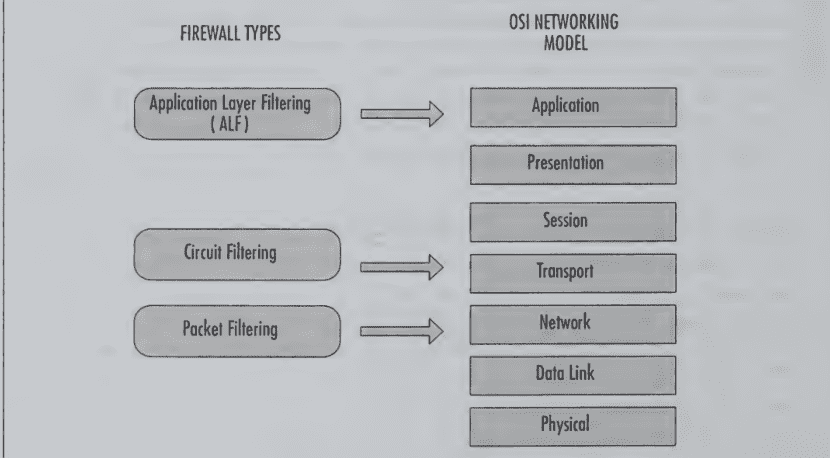

##### 数据包过滤

第一代防火墙是在OSI网络模型的网络层工作的数据包过滤防火墙。它们检查包含IP地址和数据包选项的数据包头部，并根据该信息阻止或允许流量通过防火墙。数据包过滤防火墙可以使用以下三种技术之一：

- **静态数据包过滤**：规则是手动设置的，特定端口保持打开或关闭状态，直到手动更改
- **动态数据包过滤**：更智能的过滤，规则可以根据事件或条件动态更改，因此端口仅在需要时打开，然后关闭
- **有状态数据包过滤**：使用表来维护会话的连接状态，以便数据包必须按照过滤策略授权的顺序通过

> **注意**
>
> *有状态检查*是一种技术，通过该技术对数据包中包含的信息进行更深入的分析（直到应用层），并基于防火墙从之前检查的数据包中"学到"的内容进行后续过滤决策。

##### 电路过滤

电路过滤防火墙（也称为电路级网关）在OSI模型的传输层和会话层工作。它可以检查计算机之间发送的TCP握手信息，以验证会话请求是否合法。

电路过滤器在OSI模型的更高层——传输层（DOD模型中的主机到主机层）工作。电路过滤器通过处理TCP和UDP数据包头部中的信息，基于主机机器（而非用户）限制访问。这允许管理员创建过滤器，例如，禁止任何人使用计算机A使用FTP访问计算机B。

当使用电路过滤器时，访问控制基于TCP数据流或UDP数据报。电路过滤器除了源和目标地址及端口号外，还可以基于TCP和UDP状态标志及序列信息采取行动。电路级过滤允许管理员检查会话，而不是数据包。会话有时被认为是一个连接，但实际上一个会话可以由多个连接组成。会话仅在响应用户请求时建立，这增加了安全性。

电路过滤器不基于用户信息限制访问；它们也无法解释数据包的含义。也就是说，它们无法区分应用程序发送的**GET**命令和**PUT**命令。要做到这一点，必须使用应用过滤。


应用层过滤（ALF）由应用网关（也称为应用代理）执行。ALF 防火墙在 OSI 模型的应用层运行，能够实际检查数据的*内容*（例如，HTTP 通信中包含的 URL 或 FTP 通信中包含的命令）。

有时最佳的策略是根据数据本身包含的信息来过滤数据包。数据包过滤器和电路过滤器不会使用数据流的内容来做出过滤决策，但应用过滤*可以*做到这一点。应用过滤器在网络模型的最上层运行，即（恰当命名的）应用层。应用过滤器可以使用数据包头部信息，但也能够根据数据内容和用户信息来允许或拒绝数据包。

管理员可以使用应用过滤来基于用户身份和/或用户尝试执行的特定任务来控制访问。借助应用过滤器，可以基于应用程序发出的命令来设置条件。这意味着，例如，管理员可以限制特定用户通过 FTP 将文件下载到指定计算机。同时，他可以允许该用户通过 FTP 将文件上传到同一台计算机。这是可能的，因为根据用户是从服务器检索文件还是将文件存入服务器，会发出不同的命令。

应用网关被许多防火墙专家认为是所有过滤技术中最安全的。这是因为它们用于过滤的标准比其他方法涵盖的范围更广。有时黑客会编写恶意程序，使用授权应用程序的端口地址，例如端口 53，即 DNS 地址。数据包或电路过滤器无法识别该数据包不是有效的 DNS 请求或响应，会允许其通过。然而，应用过滤器能够检查数据包的内容，并确定它*不*应该被允许。

这种过滤类型也存在缺点。最大的问题是，防火墙需要支持的每个互联网服务都必须有单独的应用网关。这会增加更多的配置工作；然而，这个弱点也是一个增强防火墙安全性的优势。由于每个服务的网关必须显式启用，管理员不会意外允许对网络构成威胁的服务。应用过滤是防火墙服务执行的最复杂的过滤级别，特别适用于保护网络免受特定类型的攻击，例如恶意 SMTP 命令或试图渗透本地 DNS 服务器的攻击。

应用过滤的另一个缺点是性能——或者说缺乏性能。应用过滤是一个缓慢的过程，因为必须检查数据包内部的数据。因此，当拥有非常快速的传入连接（如 OC-3 线路）时，您可能不希望将 ALF 防火墙放置在网络的边缘。相反，应该在那里放置简单（且快速）的数据包过滤防火墙，而应用过滤可以在更下游、更靠近应用本身的位置进行。

#### VPN 网关

大多数现代防火墙都包含集成的 VPN 网关。VPN 网关允许远程用户通过公共互联网建立虚拟专用网络"隧道"连接到 VPN 服务器或整个内部网络，或者允许两个不同位置的局域网通过互联网安全地相互连接。这两种类型的 VPN 分别称为客户端到服务器 VPN 和站点到站点 VPN。

##### 客户端到服务器 VPN

客户端到服务器 VPN 用于单个远程计算机（例如在家工作的员工或带着笔记本电脑出差的高管）连接到公司局域网时，首先建立与互联网的连接，然后使用 VPN 客户端软件、VPN 隧道协议（如 PPTP 或 L2TP）建立与同样连接到互联网的公司局域网的连接。因为通过此"隧道"发送的数据是加密的（使用 MPPE 或 IPSec 等协议），所以连接也是私密的。

##### 站点到站点 VPN

站点到站点 VPN 用于将整个网络相互连接。与客户端到服务器 VPN 的情况一样，"虚拟网络"的双方都必须连接到互联网。使用相同的隧道和加密协议。不同之处在于，使用站点到站点 VPN 时，连接的双方都有网关（而不是一端是单个客户端计算机）。某些防火墙仅支持站点到站点 VPN。

##### ISA Server VPN 支持

ISA Server 2004 支持以下 VPN 协议：

- 点对点隧道协议（PPTP）
- 第二层隧道协议/IPSec（L2TP/IPSec）
- IPSec 隧道模式

PPTP 和 L2TP/IPSec VPN 协议可用于远程访问和站点到站点 VPN 连接。IPSec 隧道模式*仅*可用于站点到站点 VPN 连接。

IPSec 隧道模式*仅*用于与第三方 VPN 服务器的兼容性。当 ISA Server 2004 防火墙与另一款 Microsoft VPN 产品（Windows 2000/Windows Server 2003 RRAS 或 ISA Server 2000）之间创建站点到站点连接时，不应使用它。

ISA Server 2004 的 VPN 功能支持两种类型的 VPN  connections：客户端到服务器（也称为远程访问 VPN）和站点到站点。

远程访问 VPN 允许配置为 VPN 客户端的单个计算机连接到 ISA Server 2004 防火墙并访问公司网络上的资源。

远程访问 VPN 客户端可以使用 PPTP 或 L2TP/IPSec VPN 协议。ISA Server 2004 VPN 远程访问服务器支持高级身份验证机制，如 SecurID、RADIUS、EAP/TLS 证书、生物识别等。

站点到站点 VPN 允许 ISA Server 2004 防火墙连接到另一台 VPN 服务器，并通过互联网将整个网络相互连接。站点到站点 VPN 使组织能够移除昂贵的专用租用线路，从而实现显著的成本降低。

ISA Server 2004 的一个主要竞争优势是防火墙策略访问应用于 VPN 远程访问和站点到站点连接。与允许 VPN 客户端完全访问公司网络的竞争对手产品不同，ISA Server 2004 的 VPN 连接受到防火墙访问策略的约束。这使 ISA Server 2004 防火墙管理员能够按用户对 VPN 连接设置限制性访问控制。当用户与 ISA Server 2004 防火墙建立 VPN 连接时，该用户只能访问完成工作所需的资源。其他网络资源将不可用。

所有 Windows 操作系统都包含 Windows VPN 客户端软件。使用 Windows VPN 客户端的优点包括：

- 无需安装第三方软件
- 无需排查第三方 VPN 客户端软件与 Windows 操作系统之间的兼容性问题
- 使用连接管理器管理员工具包（CMAK）简化 VPN 客户端的配置和部署
- 支持 IETF RFC Internet 标准 IPSec NAT 穿越

ISA Server 2004 还包括 VPN 安全功能，如 VPN 隔离，我们将在第 2 章《ISA Server 2004 功能集》中讨论。

#### 入侵检测与防御

许多防火墙（包括 ISA Server）都包含入侵检测系统（IDS），可以识别正在尝试的特定类型攻击，并在识别到此类入侵时执行预定义的操作。

入侵检测系统可以识别许多不同的常见网络入侵形式，如端口扫描、LAND 攻击、死亡之 Ping、UDP 炸弹、带外攻击等。还可以内置特殊的检测过滤器，例如 POP（邮局协议）入侵检测过滤器，用于分析 POP 邮件流量以防止 POP 缓冲区溢出，或 DNS 入侵检测过滤器，可配置为查找 DNS 主机名溢出或长度溢出攻击。

ISA Server 2004 包含一组从 Internet Security Systems（ISS）获得许可的入侵检测过滤器。这些入侵检测过滤器专注于检测和阻止网络层攻击。此外，ISA Server 2004 还包括检测和阻止应用层攻击的入侵检测过滤器。

 ISA Server 2004 可以检测以下入侵或攻击：

- Windows 带外攻击 (WinNuke)
- Land
- Ping of Death
- IP 半开扫描
- UDP 炸弹
- 端口扫描
- DNS 主机名溢出
- DNS 长度溢出
- DNS 区域传送
- POP3 缓冲区溢出
- SMTP 缓冲区溢出

当 ISA Server 2004 防火墙检测到上述攻击之一时，可以执行以下操作：

- 向 ISA Server 2004 事件日志发送警报
- 停止或重新启动 ISA Server 2004 服务
- 运行管理脚本或程序
- 向管理员的邮箱或寻呼机发送电子邮件

一个缺点是，ISA Server 2004 内置的入侵检测系统不可配置，且无法创建自己的入侵特征。不过，第三方应用程序（如 Internet Security System 的 **Real Secure** IDS）可以用来扩展入侵检测功能，但需要客户额外付费。

#### Web 缓存

Web 缓存是另一个可以内置到防火墙软件中的重要功能。ISA Server 是少数几款免费提供 Web 缓存功能的流行防火墙之一。许多防火墙厂商要求用户购买附加模块（CheckPoint）、购买单独的硬件设备（Cisco），或使用第三方缓存解决方案与其防火墙配合使用。ISA Server 是少数几款将防火墙和 Web 缓存结合在一起的主要防火墙产品之一（另一款是 BlueCoat）。

在大多数联网组织中，Web 流量一直在持续增长。在很多情况下，用户定期访问相同的网站，或者组织内的多个用户访问相同的站点并查看相同的页面。与此同时，整体网络和 Internet 流量稳步增加，常常接近可用 Internet 带宽的饱和点。

Web 缓存提供了一种方法来减少内部用户向 Internet 上 Web 服务器发出出站 Web 请求的流量，以及外部用户访问内部网络上托管的 Web 服务器时发出的入站 Web 请求的流量。在以下小节中，我们将讨论这些缓存方法：

- 正向缓存
- 反向缓存
- 分布式缓存
- 分层缓存

###### 正向缓存

一些 ISP 按使用量向 T-1 和 T-3 用户收费。减少 Internet 带宽消耗的一种方法是将经常访问的 Web 对象存储在本地网络中，内部用户可以直接从中检索，而无需访问 Internet 上的服务器。这就是**正向 Web 缓存**，它的额外优势是使内部用户的访问速度更快，因为他们是通过快速的 LAN 连接（通常为 100Mbps 或更高）来检索 Web 对象（页面、图形、声音文件等），而不是通过可能只有 1.5Mbps 的较慢 Internet 连接。

###### 反向缓存

另一种类型的 Web 缓存称为**反向缓存**，当公司托管自己的网站时，它可以减少内部网络流量并加快外部用户的访问速度。在这种情况下，内部 Web 服务器上频繁请求的对象被缓存在网络边缘的代理服务器上，从而减轻 Web 服务器的负载。

##### 分布式缓存

多台 Web 缓存服务器可以一起使用以实现更高效的缓存。顾名思义，分布式缓存将缓存的 Web 对象分布到两台或更多台缓存服务器上。这些服务器在网络中处于同一层级。图 1.2 说明了分布式缓存的工作原理。

##### 分层缓存

分层缓存是使用多台 Web 缓存服务器的另一种方式。缓存服务器放置在网络的不同层级上。上游缓存服务器与下游代理通信。例如，每个分支机构放置一台缓存服务器。这些服务器与主办公室的缓存阵列通信。如图 1. FC 图 1rec 录3Hier3 示。

# 图 1.3 分层缓存使用位于不同层级的多个 Web 代理服务器

分层缓存比分布式缓存更高效地利用带宽。然而，分布式缓存对磁盘空间的需求更低。兼取两者优点的混合缓存方案结合了分布式和分层缓存。这提高了性能和效率。图 1.4 展示了一种混合缓存方案。

# 图 1.4 混合缓存结合了分布式和分层缓存方法

### 防火墙：在网络中的角色和放置位置

防火墙可以简单也可以复杂。根据它们在网络基础设施中的放置位置以及在那里期望执行的任务，防火墙可以在网络中扮演多种不同的角色。

小型组织可能只有一台防火墙，用于保护内部网络免受来自外部网络的攻击。大型组织通常在不同位置和角色部署多台防火墙。这提供了更完整的覆盖范围，并且能够利用不同类型防火墙的优势，实现更好的性能。防火墙可以放置在多种不同的角色中，包括以下几种：

- **前端防火墙** 前端防火墙也称为"边缘"防火墙，因为它位于内部网络的边缘，在 LAN 和 Internet 之间。前端防火墙有一个网络接口连接企业网络，另一个网络接口直接连接 Internet。所有进出企业网络的数据都将暴露给防火墙，并必须由其过滤器检查后才能被阻止或允许进出。
- **后端防火墙** 后端防火墙也位于内部网络的边缘，但不在 Internet 的边缘。相反，它被放置在一台或多台前端防火墙的后面。一个典型的场景是前端防火墙执行数据包过滤，数据包通过之后，它们还必须经过执行更深入应用层过滤的后端防火墙。这分散了处理负载，使前后端防火墙都能以更高的速度执行各自的职责。
- **外围网络** 需要向 Internet 提供服务的服务器（如 Web 服务器）可以放置在前端防火墙和后端防火墙之间，使内部网络不会直接暴露给它们。防火墙之间的区域称为外围网络、 screened network 或**非军事区 (DMZ)**。
- **外围网络内的应用过滤网关** 具有应用层过滤 (ALF) 功能的防火墙可以放置在前端和后端防火墙之间的外围网络中，以减少攻击面并提供非常高的安全级别。由于它将内容过滤的负担从边缘防火墙移开，边缘防火墙的性能得到增强。边缘防火墙可以是简单、快速的数据包过滤防火墙。
- **部门防火墙** 可以在内部网络内部署防火墙以保护各个子网。这不仅保护特定部门或网络的其他部门免受 Internet 的攻击，还保护它们免受其他部门或部门的攻击。在这种情况下，防火墙位于部门子网和内部网络的其余部分之间。
- **分支机构防火墙** 通过站点到站点 VPN 连接等方式连接到更大内部网络的分支机构，应在其 Internet 边缘部署防火墙进行保护。
- **远程办公人员防火墙** 通过远程访问 VPN 连接回企业网络的远程用户（如远程办公人员或出差的高管）应为其远程机器提供防火墙保护。这可以通过个人防火墙软件或为此设计的简单低成本防火墙设备来实现。
- **多防火墙配置** 来自不同厂商的防火墙可能必须在多防火墙配置中协同工作。为了实现有效保护，防火墙必须设计为与网络操作系统和部署在网络上的应用服务器相互操作。

防火墙的放置位置和角色将在第 4 章*为支持 ISA Server 2004 防火墙准备网络基础设施*中更详细地讨论。

### ISA：从代理服务器到全功能防火墙

ISA Server 并非由微软的开发团队凭空诞生、一蹴而就。相反，它是一个逐渐演进的产品，每次迭代都变得更加成熟，成为更全面的安全解决方案。ISA Server 的根源在于 MS Proxy Server。在短短不到十年的时间里，它已经发展成为截然不同的产品。

#### ISA：MS Proxy Server 眼中的一丝闪光

代理服务器已经存在相当长一段时间了。尽管有了新名称，ISA Server 仍然是一个代理服务器，但它远不止于此。*Proxy* 的原始含义是"被授权代表他人行事的人"。这个词最著名——或最臭名昭著——的用法与**代理婚姻**有关，即由一名替代者"代替"一方当事人，即使新郎（较少情况下是新娘）不在场，也可以举行婚礼仪式。代理婚礼曾一度是夫妇在 groom 服役时"成婚"的流行方式。

*代理服务器*之所以这样命名，是因为它们就像那个在说"我愿意"时不幸的替身——实际上另有其人——充当**中间人**，使必须保持分离的系统之间能够进行网络通信。

代理服务器"站"在 LAN 上的计算机和外部公共网络上的计算机之间。另一个恰当的比喻是 stationed 在庄园入口处的门卫，负责检查所有来访客人，确保他们在受邀嘉宾名单上。代理实际上可以隐藏 LAN 上的计算机，使其对外部不可见。只有代理服务器的 IP 地址对 Internet 上的其他人"可见"；内部计算机使用**私有 IP 地址**（在 Internet 上不可路由），从代理的另一侧无法看到。

事实上，代理服务器可以更进一步，其功能更像是一名监狱看守——不仅确保只有经过授权的人才能进入，还确保只有获得许可的人才能出去。正如看守在放行任何人进出之前都会核对名单一样，代理服务器会根据预定义的标准过滤出站和入站数据。此时，代理服务器就扮演着防火墙的角色。

##### 初始阶段：MS Proxy Server

微软于1996年11月发布了其首个版本的代理服务器。它包含了一些独特的功能，例如Winsock代理功能，这使得那些传统代理服务器不支持的应用程序也能正常使用。

然而，遗憾的是，1.0版本存在一些重大局限性，使其无法作为大型企业网络的缓存和安全解决方案而广受欢迎。其中一个主要缺点是缺乏冗余机制。竞争对手（如Netscape的代理服务器）采用跨多个服务器的分布式缓存来提供容错能力，而微软代理服务器的第一个版本并未包含此类功能。微软代理服务器似乎更适合小型网络，或者那些其缓存和安全功能并非关键任务的场景。

冗余问题在Proxy Server 2.0版本中得到了解决。事实上，微软通过引入**代理服务器阵列**的概念，超越了Netscape的实现方案。阵列是由两个或多个代理服务器组成的群组，它们互为镜像运行，并在共同名称下作为一个整体发挥作用。在2.0版本中，多个代理可以链接在一起以实现更好的负载均衡，微软还开发了一种名为**缓存阵列路由协议（Cache Array Routing Protocol, CARP）**的新协议，用于在代理服务器之间共享数据。

> **注意**
>
> CARP是一种专有（仅限微软）协议。它用于管理跨代理服务器阵列的多个用户Web请求。互联网缓存协议（Internet Cache Protocol, ICP）是其他代理解决方案供应商使用的一种类似协议（例如，Novell的Border Manager）。尽管CARP和ICP的功能相似，但它们使用不同的哈希算法。CARP相比ICP具有一些优势，尤其是在性能方面，因为CARP不会像ICP那样在服务器之间交换查询消息.keys_msg。此外，CARP消除了阵列中服务器上内容不必要冗余的问题。

自动同步功能被加入，以将配置更改传播到阵列中的所有服务器。缓存能力得到了扩展，增加了对文件传输协议（File Transfer Protocol, FTP）和超文本传输协议（HyperText Transfer Protocol, HTTP）缓存的支持。所有这些服务都很容易配置。

2.0版本还新增了**反向代理**功能，允许从受保护的Web服务器发布Web内容。利用多宿主支持，单个代理服务器上可以发布多个网站。此外，2.0版本还包括**反向托管**（代理服务器代表其背后的多个服务器监听和响应传入的Web请求）以及通过**服务器绑定**发布其他服务的能力。

从一开始，与竞争产品相比，微软的Proxy Server在设置和配置的便捷性方面就获得了高分。第二版还包含了用于互联网信息服务（IIS）4.0微软管理控制台（MMC）的快照管理模块，为管理员提供了一种方便而强大的方式来管理单个或多个代理服务器。

##### 微软首款真正的防火墙：ISA Server 2000

微软代理 pushes 的第三个实现版本获得了一个全新的名称，因为它包含了一系列超越代理服务器定义的功能增强。在新千年初发布时，**互联网安全与加速服务器（Internet Security and Acceleration, ISA）2000**至少是一个**功能完备的防火墙解决方案**，除此之外还具备缓存和加速能力。

> **注意**
>
> 什么是或不是防火墙，在网络安全社区内是一个有争议的问题。所有人都认同防火墙是位于网络网关的程序（或程序组），它们保护内部网络的资源免受外部侵害。美国国家标准与技术研究院（NIST）在SP-800-10中将防火墙定义为一种安全方法，通过创建外围防御来帮助实施更大的安全策略，所有入站和出站流量都必须通过这个防御，从而控制对受保护网络或站点的访问。
>
> 一些行业参与者使用广泛的防火墙定义，包括代理服务器。在此前提下，微软将Proxy Server 2.0作为防火墙进行营销，但一些安全专家认为它并不是，并认为要满足"防火墙"的标准，必须不仅仅是路由器、堡垒主机或其他为网络提供安全保护的设备。这些纯粹主义者要求，要被认定为防火墙，实现必须是**基于策略的**。

除了其多层防火墙功能（数据包过滤、电路过滤和应用过滤）之外，ISA Server 2000还提供了以下新功能或改进功能：

- **集成虚拟专用网络（VPN）** — ISA Server可用于设置客户端与网关之间的远程访问VPN，或服务器到服务器的多成员VPN隧道。
- **与Active Directory集成** — ISA访问策略和服务器配置信息与Windows 2000 Active Directory集成，以实现更简便、更安全的管理。
- **入侵检测** — 这项令人兴奋的新功能可以设置为在特定类型的攻击针对您的网络时向您发送警报（例如，当外部人员尝试扫描您的端口时）。
- **支持安全网络地址转换（SecureNAT）** — ISA实现的可扩展NAT架构为未安装防火墙客户端软件的客户端提供安全连接，包括Macintosh和UNIX客户端以及其他运行传输控制协议/互联网协议（TCP/IP）的非微软操作系统。
- **带宽分配** — 管理员可以创建服务质量规则来控制分配给特定用户、通信、客户端或目的地的带宽量，以优化网络流量使用。
- **安全服务器发布** — 内部服务器可以在受到保护免受未经授权访问的同时，对特定客户端可用。
- **企业管理** — 与Windows 2000一样，ISA的设计比之前微软产品具有更强的可扩展性，并更加关注企业市场。ISA允许您设置企业级策略以及阵列级策略，并且ISA阵列的管理可以轻松集中化。
- **监控和报告生成** — ISA Server允许您监控其性能并创建详细的安全和访问日志以及图形报告。报告生成可以按计划进行，远程管理使管理员能够从异地位置跟踪ISA服务器的使用和性能。
- **电子邮件内容筛选** — ISA Server提供通过关键词筛选电子邮件内容的功能，使管理员能够实施和执行严格的安全策略。
- **H.323网守功能** — 此功能允许通过代理使用视频会议软件（如Microsoft NetMeeting），以及NetMeeting目录功能（替代ILS的部分功能）。
- **增强软件** — 这些软件可用于流媒体，包括实时流拆分和Windows Media内容的缓存（使用Windows Media Server时）。

##### 全新改进：ISA Server 2004

ISA Server 2000自推出以来逐步增加了其市场份额，与竞争对手抗衡。根据IDC的数据，微软在2002/2003年的销售额和市场份额增长是防火墙行业中最快的之一。然而，许多ISA用户编制了"愿望清单"，列出了他们希望在下个版本中看到的特性和改进。微软响应了这一需求，ISA团队投入了大量努力，以提供更友好和


更直观的图形界面，更好地支持VPN等关键功能，更灵活、更全面的策略，支持多网络，以及更简单的自定义功能。

ISA Server 2004 新增了许多功能并改进了其他功能，同时彻底改进了界面，大大增强了功能，尤其是在企业级层面。表 1.2 展示了 ISA 2004 中的一些新功能。这些内容将在第 2 章中更详细地讨论。

##### 表 1.2 ISA Server 2004 的新增功能

| 新增功能 | 功能说明 |
| --- | --- |
| 多网络支持 | 允许您配置多个网络，每个网络与其他网络都有独特的关系。您可以根据网络定义访问策略。与 ISA Server 2000 不同，后者所有网络流量都是相对于仅包含本地网络地址的本地地址表（LAT）进行检查的，而 ISA Server 2004 允许您将防火墙和安全功能应用于任何网络或网络对象之间的流量。 |
| 按网络策略 | ISA Server 2004 的新多网络功能使您能够通过限制组织内部客户端之间的通信，保护网络免受内部和外部安全威胁。多网络功能支持复杂的外围网络（也称为 DMZ、非军事区或屏蔽子网）场景，允许您配置不同网络中的客户端如何访问外围网络。网络之间的访问策略可以基于每个网络所代表的独特安全区域。 |
| 路由和 NAT 网络关系 | 您可以使用 ISA Server 2004 根据网络之间所需的访问和通信类型来定义网络之间的路由关系。在某些情况下，您可能希望在网络之间实现更安全、透明度更低的通信；对于这些场景，您可以定义网络地址转换（NAT）关系。在其他场景中，您只是想简单地通过 ISA Server 路由流量；在这种情况下，您可以定义路由关系。与 ISA Server 2000 相比，在路由网络之间移动的流量将完全暴露给 ISA Server 2004 的状态过滤和检查机制。 |
| VPN 的状态过滤和检查 | 虚拟专用网络（VPN）客户端被配置为独立的网络区域。因此，您可以为 VPN 客户端创建不同的策略。防火墙规则引擎对来自 VPN 客户端的请求进行无差别检查，根据访问策略对这些请求进行状态过滤和检查，并动态打开连接。 |
| 通过站点到站点 VPN 隧道的流量的状态过滤和检查 | 通过 ISA Server 2000 站点到站点链接连接的网络被视为受信任网络，防火墙策略不适用于通过该链接的通信。ISA Server 2004 对通过站点到站点 VPN 连接的所有通信引入了状态过滤和检查。这使您能够控制特定主机或网络在链接另一端可以访问的资源。基于用户/组的访问策略可用于对通过链接的资源利用进行精细控制。 |
| 连接到 ISA Server 2004 VPN 服务器的 VPN 客户端的 Secure NAT 客户端支持 | 使用 ISA Server 2000 时，只有配置为防火墙客户端的 VPN 客户端才能通过其连接的 ISA Server 2000 VPN 服务器访问 Internet。ISA Server 2004 扩展了 VPN 客户端支持，允许 SecureNAT 客户端在未安装防火墙客户端的客户端系统上访问 Internet。您还可以通过强制对 VPN SecureNAT 客户端实施基于用户/组的防火墙策略来增强企业网络安全。 |
| VPN 隔离 | ISA Server 2004 利用 Windows Server 2003 的 VPN 隔离功能。VPN 隔离允许您将 VPN 客户端隔离在单独的网络中，直到它们满足一组预定义的安全要求。通过安全测试的 VPN 客户端可以根据 VPN 客户端防火墙策略获得网络访问权限。未通过安全测试的 VPN 客户端可能会获得对服务器的有限访问权限，以帮助它们满足网络安全要求。 |
| 发布 PPTP VPN 服务器的能力 | 使用 ISA Server 2000 时，只能发布 L2TP/IPSec NAT-T VPN 服务器。ISA Server 2004 服务器发布规则允许您发布 IP 协议，并允许您发布 PPTP 服务器。ISA Server 2004 智能 PPTP 应用程序过滤器执行复杂的连接管理。此外，您可以使用 ISA Server 2004 服务器发布轻松发布 Windows Server 2003 NAT-T L2TP/IPSec VPN 服务器。 |
| 站点到站点 VPN 链接的 IPSec 隧道模式支持 | ISA Server 2000 可以使用 PPTP 和 L2TP/IPSec VPN 协议通过 VPN 站点到站点链接连接 Internet 上的网络。ISA Server 2004 通过允许您使用 IPSec 隧道模式作为 VPN 协议，改进了站点到站点链接支持。 |
| 扩展的协议支持 | ISA Server 2004 扩展了 ISA Server 2000 的功能，允许您控制任何协议的访问和使用，包括 IP 级协议。这使用户能够使用 ping 和 traceroute 等应用程序，并创建 PPTP VPN 连接。此外，可以允许 IPSec 流量通过 ISA Server。 |
| 对需要多个主连接的复杂协议的支持 | 许多流媒体以及语音/视频应用程序要求防火墙管理复杂的协议。ISA Server 2000 能够管理复杂的协议，但需要防火墙管理员创建复杂的脚本来创建需要多个主出站连接的协议定义。ISA Server 2004 大大改善了这种情况，允许您在易于使用的新协议向导中创建协议定义。 |
| 可自定义的协议定义 | ISA Server 2004 允许您为创建防火墙规则的任何协议控制源端口号和目标端口号。这使 ISA Server 2004 防火墙管理员能够非常高地控制允许通过防火墙入站和出站的数据包。 |
| 防火墙用户组 | ISA Server 2000 利用在 Active Directory 或本地防火墙计算机上创建的用户和组进行基于用户/组的访问控制。ISA Server 2004 也使用这些源，但允许您创建由本地账户数据库或 Active Directory 域中的现有组组成的自定义防火墙组。这增加了基于用户或组成员身份控制访问的灵活性，因为防火墙管理员可以从这些现有组创建自定义安全组。这消除了防火墙管理员必须是域管理员才能为入站或出站访问控制创建自定义安全组的要求。 |
| 将防火墙客户端凭据转发到 Web 代理服务 | HTTP 重定向器必须将请求转发到 Web 代理服务，以便防火墙客户端能够从 ISA Server 2000 的 Web 缓存中受益。在此过程中，用户凭据被删除，如果需要用户凭据，请求将失败。ISA Server 2004 通过允许防火墙客户端通过 HTTP 过滤器访问 Web 缓存解决了这个问题。 |
| Web 代理客户端身份验证的 RADIUS 支持 | 为了让 ISA Server 2000 对 Web 代理客户端进行身份验证，计算机必须是 Active Directory 域的成员，或者用户账户必须存在于防火墙计算机的本地用户数据库中。ISA Server 2004 允许您使用 RADIUS 查询 Active Directory 来对 Active Directory 和其他身份验证数据库中的用户进行身份验证。Web 发布规则也可以使用 RADIUS 对远程连接进行身份验证。 |
| 基本身份验证的委派 | 发布的 Web 站点受到保护，防止未经身份验证的访问，因为 ISA Server 2004 防火墙要求在转发连接之前对用户进行身份验证。这防止了来自未经身份验证用户的攻击到达发布的 Web 服务器。 |
| Web 发布规则中源 IP 地址的保留 | ISA Server 2000 Web 发布规则在将请求转发到发布的 Web 服务器之前，用防火墙内部接口的 IP 地址替换了远程客户端的源 IP 地址。ISA Server 2004 纠正了这个问题，允许您按规则选择防火墙应该用自己的 IP 地址替换原始 IP 地址，还是将远程客户端的原始 IP 地址转发给 Web 服务器。 |
| Web 代理客户端的 SecurID 身份验证 | ISA Server 2004 可以使用 SecurID 双因素身份验证对远程连接进行身份验证。这提供了非常高水平的身份验证安全性，因为用户必须"知道"某些东西并且"拥有"某些东西才能访问发布的 Web 服务器。 |
| 基于表单的身份验证 | ISA Server 2004 可以为 Outlook Web Access 站点生成用于基于表单的身份验证的表单。这通过防止未经身份验证的用户接触 OWA 服务器来增强对 OWA 站点远程访问的安全性。 |


 ## 表 1.2 ISA Server 2004 的新增功能

| 新增功能 | 功能说明 |
|---|---|
| 通过 SSL VPN 远程访问终端服务 | Windows Server 2003 Service Pack 1 计算机支持基于 SSL 的 RDP，以便安全地通过 SSL VPN 连接到 Windows Server 2003 终端服务。ISA Server 2004 允许您使用安全的 SSL VPN 技术安全地发布终端服务器。 |
| 安全 Web 发布向导 | 新的安全 Web 服务器发布向导允许您创建到内部网络网站的安全 SSL VPN 隧道。SSL 桥接选项允许 ISA Server 2004 解密加密流量，并将流量暴露给 HTTP 策略的有状态检查机制。SSL 隧道选项将未经修改的加密流量中继到已发布的 Web 服务器。 |
| 强制加密以确保安全的 Exchange RPC 连接 | 可以在 ISA Server 2004 防火墙上设置 RPC 策略，以阻止远程 Outlook MAPI 客户端通过 Internet 连接时进行非加密通信。这通过防止用户凭据和数据以非加密格式交换来增强网络和 Exchange 安全性。 |
| 基于每条规则的 HTTP 过滤 | ISA Server 2004 HTTP 策略允许防火墙执行深度 HTTP 有状态检查（应用层过滤）。检查的范围是按策略配置的。这允许您为 HTTP 入站和出站访问配置自定义约束。 |
| 阻止访问所有可执行内容的能力 | 您可以配置 ISA Server 2004 防火墙，阻止所有对 Windows 可执行内容的连接尝试，无论资源使用的文件扩展名是什么。 |
| 按文件扩展名控制 HTTP 文件下载的能力 | ISA Server 2004 HTTP 策略允许您允许所有文件扩展名、允许除指定组以外的所有扩展名，或阻止除指定组以外的所有扩展名。 |
| 将 HTTP 过滤应用于所有 ISA Server 2004 客户端连接 | ISA Server 2000 可以通过 MIME 类型（对于 HTTP）或文件扩展名（对于 FTP）阻止 Web 代理客户端的 HTTP 和 FTP 连接的内容。ISA Server 2004 HTTP 策略允许您控制所有 ISA Server 2004 客户端连接的 HTTP 访问。 |
| 基于关键字或字符串（签名）阻止 HTTP 内容的能力 | ISA Server 2004 深度 HTTP 检查允许您创建"HTTP 签名"，可以与请求 URL、请求头、请求正文、响应头和响应正文进行比较。这使您能够精确控制内部和外部用户可以通过 ISA Server 2004 防火墙访问的内容。 |
| 控制允许哪些 HTTP 方法的能力 | 您可以通过对用户在各种方法上的访问设置访问控制，来控制允许通过防火墙的 HTTP 方法（也称为"HTTP 动词"）。例如，您可以限制 HTTP POST 方法，以防止用户使用 HTTP POST 方法向网站发送数据。 |
| 阻止来自完整 Outlook MAPI 客户端的未加密 Exchange RPC 连接的能力 | ISA Server 2004 安全 Exchange 服务器发布规则允许远程用户通过 Internet 使用功能完整的 Outlook MAPI 客户端连接到 Exchange。但是，Outlook 客户端必须配置为使用安全 RPC，以便连接被加密。ISA Server 2004 RPC 策略允许您阻止所有未加密的 Outlook MAPI 客户端连接。 |
| FTP 策略 | ISA Server 2004 FTP 策略可以配置为允许用户通过 FTP 上传和下载，或者您可以将用户的 FTP 访问限制为仅下载。 |
| 链接转换器 | 某些已发布的网站可能包含对计算机内部名称的引用。由于只有 ISA Server 2004 防火墙和外部命名空间对外部客户端可用，而不包括内部网络命名空间，这些引用将显示为断链。ISA Server 2004 包含链接转换功能，允许您创建内部计算机名称映射到公共知名名称的定义字典。 |
| 日志条目的实时监控 | ISA Server 2004 允许您实时查看防火墙、Web 代理和 SMTP 邮件筛选器日志。监控控制台在日志条目记录到防火墙日志文件时显示它们。 |
| 内置日志查询工具 | 您可以使用内置日志查询工具来查询日志文件。可以查询日志中记录的任何字段包含的信息。您可以将查询范围限制为特定时间段。结果显示在 ISA Server 2004 控制台中，可以复制到剪贴板并粘贴到另一个应用程序中进行更详细的分析。 |
| 连接验证器 | 您可以使用连接验证器通过定期监控从 ISA Server 2004 计算机到特定计算机或 URL 的连接来验证连接性。您可以配置使用哪种方法来确定连接性：ping、TCP 连接到端口或 HTTP Get。您可以通过指定 IP 地址、计算机名或 URL 来选择要监控的连接。 |
| 报告发布 | ISA Server 2004 报告作业可以配置为自动将报告副本保存到本地文件夹或网络文件共享。保存报告的文件夹或文件共享可以映射到网站虚拟目录，以便其他用户可以查看报告。您还可以手动发布尚未配置为自动发布的报告。 |
| 报告创建的电子邮件通知 | 您可以配置报告作业在报告作业完成后向您发送电子邮件。 |
| 自定义日志摘要创建时间的能力 | ISA Server 2000 被硬编码为在凌晨 12:30 创建日志摘要。报告基于日志摘要中包含的信息。ISA Server 2004 允许您轻松自定义创建日志摘要的时间。这使您在确定创建报告的时间时具有更大的灵活性。 |
| 记录到 MSDE 数据库的能力 | 日志现在可以以 MSDE 格式存储。记录到本地数据库可提高查询速度和灵活性。 |
| 导入和导出配置数据的能力 | ISA Server 引入了导出和导入配置信息的功能。您可以使用此功能将配置参数保存到 XML 文件，然后将信息从文件导入到另一台服务器。 |
| 防火墙管理员角色的委派权限向导 | 管理委派向导可帮助您为用户和用户组分配管理角色。这些预定义的角色委派用户对其指定的 ISA Server 2004 服务允许的管理控制级别。 |

除了这些新功能之外，ISA Server 2000 中已有的许多功能也得到了增强和改进。在第 2 章中，我们将深入探讨这些功能。

> 注意
> 表中提到的一些功能可以通过功能包 1 添加到 ISA Server 2000，但不像 ISA Server 2004 那样"开箱即用"包含在内。

#### ISA：一种个人理念

自从我们从这个产品的 alpha 阶段开始工作以来，我们一直在阅读关于 ISA Server 2004 即将发布的各种信息。虽然我们所读到的很多内容都是好的、事实性的信息，但也有一些只是强化了我们在本章前面讨论过的那些谬误。看看这些不太值得引用的言论吧：

- "这是一个很好的清理更新，但我不会说它是重大的。它不会突然让他们成为 CheckPoint 的竞争对手。"(www.infoworld.com/article/04/05/03/HNisaserver_1.html)
- "他们坚持说 ISA Server 是防火墙，但它是一个服务器。Gartner 坚信防火墙是网关包和流处理设备，而不是服务器。市场支持这一点；大多数新安装都是设备。"(www.infoworld.com/article/04/05/03/HNisaserver_1.html)
- "我曾与大型企业合作，我们在前端使用 Cisco [系统]，后面使用 ISA，"位于加利福尼亚州萨克拉门托的咨询公司 TCP-IP Inc. 的顾问 Chris Darrow 说。"它是 Checkpoint 或 Cisco 防火墙的良好补充，但我仍然不会单独使用它。"(http://searchwin2000.techtarget.com/originalContent/0,289142,sid1_gci967964,00.html)
- "Franco 在'Strange Setup'主题下想知道为什么 Microsoft ISA 服务器是双宿主以绕过防火墙的。后续发帖者解释说，ISA Server 需要这样的设置，并且它是 Windows 网络的优秀 HTTP 代理/缓存/认证器。（意思是：比防火墙更好。）所有

 other traffic should still go through the firewall."
(http://sandbox.rulemaker.net/ngps/infosec/fwiz/fwiz-2004-02-28)

这些评论和讨论中贯穿的共同主题包括：
- 对"硬件"防火墙神话的迷信。我们在去年三月的 ISAServer.org 通讯中破除了这个神话，(www.isaserver.org/pages/newsletters/march2004.asp)
- 假定 Cisco 和 Checkpoint（以及其他传统防火墙）解决方案本质上更安全，却丝毫不了解 ISA Server 2004 防火墙，也说不出到底是什么让他们相信这些其他防火墙产品能提供更好的保护。
- 预设运行在微软 Windows 操作系统上的软件不可信（持此观点的人大概不使用微软 Exchange 或微软 SQL 服务器，因为它们也运行在微软操作系统上）。
- 假定你应该把最薄弱的环节直接放在最宝贵的企业资产前面（就像在银行前面放一名持枪保安，而在咖啡馆的敞开着的大门口放一只贵宾犬）

很明显，不少评论者和行业分析师不理解 21 世纪防火墙安全的本质，仍然紧抓着 1997 年从防火墙领域领导者那里收到的营销材料不放。问题在于，昔日被美化的"状态化数据包过滤器"根本无法与 ISA Server 2004 这样认真的应用层感知防火墙相抗衡。

在以下小节中，我们将讨论个人防火墙理念，基于网络安全的"纵深防御"方法，以及我们认为 ISA Server 2004 应该在你的网络安全计划中扮演什么角色。

##### 纵深防御

如前所述，"纵深防御"已被 IT 界采纳，用以描述多层级安全方法。从最广泛的意义上讲，纵深防御不仅关注技术，还关注运营和人员。一个例子是城堡的设计：护城河、高墙、多重城墙、狭窄的窗户，以及缺乏从外围直通中心的笔直走廊，提供了一种侧重于技术的纵深防御。然而，如果城堡管理者没有为长期围困做准备（运营），不能保证其士兵的忠诚（人员），城堡就会变得脆弱。

几乎每个防火墙管理员都听过这个老笑话：IT 人员的老板问，"我们的网络安全吗？"回答是："当然，我们有防火墙！"不幸的是，这正是许多现实中的网络和防火墙管理员的态度。他们将网络边缘的防火墙视为应对所有网络安全问题的主要防御手段。从纵深防御的角度来看，防火墙管理员没有资格或能力回答这个问题。防火墙管理员无法控制公司的招聘和培训实践，而这些可能带来与配置不当的防火墙同样多（或更多）的风险。

即使从纯粹的技术角度来看，事实是，虽然互联网边缘防火墙是你网络安全方案的关键组成部分，但它只是其中一部分，单凭这一部分无法提供*纵深防御*——这在当今高风险环境中是绝对必要的。技术纵深防御指的是这样一种安全理念：存在多个分区或安全区域必须加以保护，每个区域之间的接口代表着需要定制化安全方法和访问控制的特定*边缘*。

需要保护的安全区域数量因组织及其网络布局而异。较小的组织可能只在互联网边缘防火墙后面有一个单一的网络段。较大的组织通常拥有非常复杂的网络，具有多个安全区域以及安全区域中的安全区域。无论你的网络复杂程度如何，最小权限原则都应该是确定防火墙放置和配置的指导原则。

###### 防火墙之环

为了帮助说明安全区域如何决定访问控制和防火墙配置及放置，我们将介绍一个典型的企业级网络及其如何划分安全区域。我们将这些区域称为"环"。你可以把每个环比作洋葱的一层，洋葱的中心代表你最核心的网络资产，这些资产必须不惜一切代价加以保护。这些环是：

- 环 1：互联网边缘
- 环 2：主干网边缘
- 环 3：资产网络边缘
- 环 4：本地主机安全

###### 环 1：互联网边缘

图 1.5 展示了最外层的环，即互联网边缘。

###### 图 1.5 环 1 代表互联网边缘

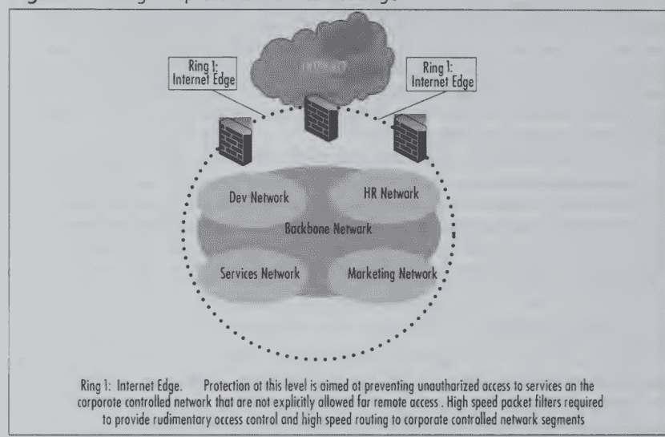

互联网边缘是外部主机发起攻击的第一接触点。因此，大多数网络和防火墙管理员认为他们应该把最智能、最强大的防火墙放在这个位置。如果你不多加思考，这似乎合理。但如果你考虑一下这种做法与世界上其他安全措施的保护方式多么背道而驰，你就会意识到互联网边缘防火墙*不应该*是你最安全或最复杂的防火墙，它应该是你*最快*的防火墙。

想想银行是如何保护其内部资金资产的。首先，有联邦机构在我们所有人的周围无形盘旋。这是银行安全的"最外层"级别，它不能阻止太多进行中的银行抢劫，但有助于阻止守法公民在无所事事的那天决定抢劫银行。向核心银行资产的下一层防御是地方警察局。他们整天开车巡逻，也许当银行抢劫犯即将开始抢劫时，他们正好在银行前面。这比联邦特工更贴近一些，但当地警察不可能一直在银行前面，而且当他们响应时，往往是在事后，此时 perpetrator 早已逃之夭夭。

更接近核心银行资产的下一环可能由前门或停车场摄像头代表。监控这些摄像头的银行安保人员如果保持警惕，并在罪犯开始抢劫企图之前识别出他，也许能够阻止抢劫发生。这种方法的问题在于，在抢劫犯做出表明抢劫企图正在进行的行为之前，他们实际上无能为力。然而，这种方法比联邦安全环或地方警察安全环更加复杂，更有可能阻止进行中的抢劫企图。

下一环位于银行外部与出纳员区域之间。这一区域通常会部署某种武装警卫。武装警卫提供了更好的保护水平，因为他可以在抢劫开始时阻止它，*如果*他识别出抢劫并在抢劫犯开枪之前将其抓获或击毙的话。大堂里的武装警卫比监控大楼外部的摄像头、在街上巡逻的当地警察以及远在地区办公室的联邦人员提供了高得多的安全级别。

下一层安全位于存放资金的银行金库与大堂和出纳员区域之间的界面。如果抢劫犯飞越联邦特工的监控、在没有警车出现的时候抵达、看起来像普通顾客、没有被安全摄像头标记，并在武装警卫开枪之前将其射杀，最后的障碍就是金库门。除非这家伙是弹药专家或保险箱破解者，否则金库门每次都能拦住他。

金库门提供了最高级别的安全性，它是银行防御中"最坚固"和"最不可穿透"的。这就是为什么它被放在银行核心资产正前方的原因——在入侵者突破了所有其他旨在保护银行资产的安全环之后，保护这些资产。

然而，没有任何一环，无论保护得多好，是不可穿透的。假设抢劫犯不是弹药专家或保险箱破解者。相反，他可能会使用我们计算机安全领域所称的*社会工程学*。在这种情况下，社会工程学方法可能包括威胁客户和出纳员的生命，如果银行经理不开金库门的话。因为你总能找到更多的钱，但人的生命只有一次机会，银行经理打开了金库门。当然，如果抢劫犯有不忠诚员工作为内应，我们就有了另一种安全问题。这种"人为因素"可以使大多数技术防御变得无用。

此时，你可能认为游戏结束，抢劫犯赢了。他已经突破了最后的防御环，钱是他的了（让我们忽略这样一个事实：要真正赢得抢劫游戏，你还必须成功地带着现金离开银行）。然而，还有最后一层防御，那就是钱本身所能提供的防御。钱袋中可能有爆炸墨水袋，如果在错误的时间或以错误的方式移动或取出，就会激活；或者钱被做了标记，如果在公共场合使用就很容易被识别。这相当于防火墙的审计和日志机制，可以提供追踪线索，你可能借此识别并证明对黑客的指控，该黑客入侵了你的网络。

这个故事的要义在于，银行以及大多数其他保护其核心资产的实体，将其最坚固、最复杂、最不可逾越的屏障放在这些资产的正前方。敌人在最外层环时总是处于状态中中停的翻译，让我继续从断掉的地方翻译：

敌人总是最佳状态，而当他到达最内层环时，要么已经完全耗尽了资源，要么准备放弃。无论哪种情况，随着他继续深入而遇到越来越强的防御机制，只会加速他的最终失败。


现在，考虑到这些事实，你如何解释网络和防火墙管理员的态度——他们声称："虽然我认为 ISA 防火墙很棒，但如果前面没有一个 PIX，我不会感到安心"？真正讽刺的是，这些网络和防火墙管理员的做法是正确的——但理由却是错的。多年来，他们被所谓的"防火墙专家"和"硬件防火墙"营销人员反复灌输，认为只有 ASIC（"硬件"）防火墙才能确保安全；所谓的"软件防火墙"由于 X、Y、Z 等原因而天生不安全。原因 "X" 总是与底层操作系统的某些方面有关，在热情洋溢地重复了数分钟"Windows 不安全"之后，他们似乎永远也说不出原因 "Y" 和 "Z" 来。

事实是，硬件防火墙*确实应该部署在网络的互联网边缘*，但并不是因为那些"防火墙专家"所宣扬的理由。实际的原因是，尽管传统防火墙无法为现代互联网连接网络提供高水准的安全性，但它们*能够*非常快速地转发数据包，并进行*有状态*的数据包过滤。这种速度对于拥有多千兆位互联网连接的组织来说非常重要。高安全性、应用层感知防火墙无法处理如此巨大的流量，同时提供现代网络防火墙所需的深度应用层有状态检查。

## 注意

> 在互联网边缘部署不同类型的防火墙也可以被视为"多样性安全"的一个例子，因为它确实能带来安全优势。同时，它也引入了复杂性，可能带来不利影响。例如，管理员必须接受不同产品的培训。

正因为如此，硬件防火墙确实应该放置在**互联网边缘**。它们能够处理高流量，执行基本的数据包过滤，并且只允许远程用户访问您打算提供的服务的入站流量（在互联网边缘的高速数据包过滤防火墙上，出站访问控制并不是很有效）。例如，如果您打算仅向远程用户提供对企业资源、HTTPS 和 IMAP4 的访问，那么高速有状态数据包过滤防火墙将仅允许对 TCP 端口 80、143 和 443 的新入站连接请求。高速数据包过滤防火墙可以快速确定目标端口以及第 4 层及以下信息的有效性，并决定接受或拒绝流量。虽然这种方法提供了一定程度的安全性，但远远不足以保护现代网络。

###### Ring 2：骨干网边缘

Ring 2 是*骨干网边缘*，它标志着互联网边缘防火墙的内部接口与骨干网段防火墙的外部接口之间的界限。

图 1.6 展示了围绕企业骨干网边缘部署的四台骨干网边缘防火墙的位置。

###### 图 1.6 骨干网边缘

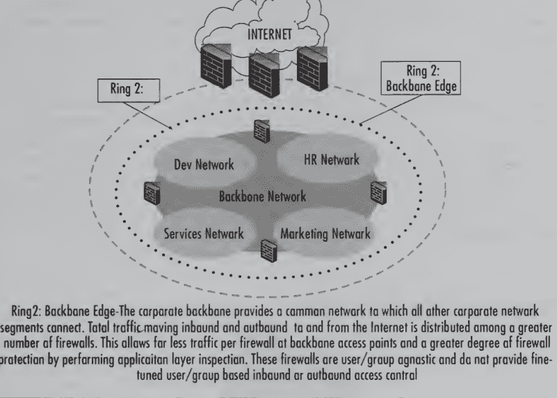

> Ring 2：骨干网边缘——企业骨干网提供了一个通用网络，所有其他企业网段都连接到该网络。进出互联网的总流量分布在更多的防火墙上。这使得骨干网接入点每台防火墙的流量更少，并通过执行应用层检查来提供更高程度的防火墙保护。这些防火墙与用户/组无关，不提供基于用户/组的精细入站或出站访问控制

企业骨干网提供了一个通用网络，所有其他企业网段都连接到该网络。通过骨干网防火墙的进出总流量在每台防火墙上的平均值低于互联网边缘防火墙，因为骨干网防火墙的数量更多。例如，您可能在互联网边缘有两台高速数据包过滤防火墙，每台处理 5 Gbit/s，总共 10 Gbit/s。骨干网边缘有四台防火墙，假设负载在这些防火墙之间平均分配，每台骨干网边缘防火墙处理 2.5 Gbit/s。

骨干网边缘防火墙可以开始执行网络防火墙的真正工作：对入站和出站流量进行有状态应用层检查。由于现代攻击目标都是应用层（那里才有"价值"所在），骨干网应用层防火墙负责检查通过它们的通信的有效性。例如，如果您允许入站 HTTP，骨干网上的有状态检查应用层感知防火墙可以通过检查 HTTP 通信的详细信息并阻止可疑连接通过防火墙，从而开始实现真正的网络安全。

这是部署 ISA Server 2004 防火墙的理想位置。因为 ISA Server 2004 防火墙是有状态检查应用层感知防火墙的典范，它能够执行保护企业骨干网及其内部网络所需的重型工作，同时确保不适当的流量（如蠕虫生成的流量）不会跨越骨干网边缘环。此示例中的流量对于 ISA Server 2004 防火墙来说不是问题，因为它们已被测试并确认为多千兆位防火墙，这基于其硬件配置和防火墙规则库。

###### Ring 3：资产网络边缘

Ring 3 位于骨干网边缘与包含企业资产的网段之间的边界。企业资产可以代表用户工作站、服务器、部门局域网、管理网络以及您希望保护免受未经授权访问的任何其他资源。骨干网与资产网络之间的界限就是*资产网络边缘*。这是您需要最强、最复杂保护级别的环，因为如果入侵者能够破坏此环的完整性，他就能够直接访问您的企业资产并实施可能成功的攻击。

图 1.7 展示了 Ring 3 中资产网络边缘的位置。

###### 图 1.7 资产网络边缘

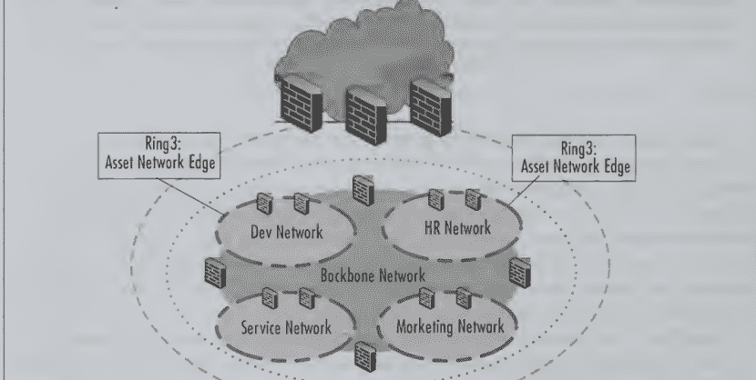

> Ring 3：资产网络边缘——资产网络包含必须从外网发起的攻击中保护起来的关键资源，并且必须阻止从资产网络发起的出站攻击。通过资产网络防火墙的入站和出站流量在每台防火墙上的平均值更低，以便进行更深层次的应用层检查和更强大的基于用户/组的入站和出站访问控制。资产网络可能代表部门局域网、用户局域网、网络服务网段/网络、管理网络等。最安全、最强大的防火墙必须部署在这一层，因为它是网络防御的最后一道防线。

正是在这一层，ISA Server 2004 防火墙变得至关重要。与数据包过滤硬件设备相比，当您接近"价值"所在时，您需要*真正的*防火墙保护。简单的数据包过滤不足以保护网络资产环中的资源。我们不仅要确保所有入站连接都经过深度应用层检查，还必须使用强大的基于用户/组的访问控制来管理离开资产网络的流量。

强大的出站基于用户/组的访问控制是绝对必需的。与典型的硬件数据包过滤防火墙允许所有出站流量不同，资产网络边缘的防火墙必须能够基于用户/组成员身份来控制出站连接。原因包括：

- 您必须能够记录所有出站连接的用户名，以便让用户对其互联网活动负责。
- 您必须能够记录用户用于访问互联网内容的应用程序；这使您能够确定是否使用了网络使用策略不允许的应用程序，并使您能够采取有效的对策。
- 您的组织可能对离开网络的资料（色情内容、病毒、攻击）承担法律责任；因此，您必须能够阻止不适当的内容。
- 敏感的企业信息可能从资产网络位置传输到网络外部。您必须能够阻止这种情况，并记录用户名以及用户用于将专有信息传输到网络外部位置的应用程序。

ISA Server 2004 防火墙是资产网络边缘的理想防火墙，因为它满足所有这些要求。当防火墙后的系统正确配置为防火墙客户端和 Web 代理客户端时，您能够：

- 记录用户向互联网（或用户通过 ISA Server 2004 防火墙连接的任何其他网络）发起的所有 TCP 和 UDP 连接的用户名。
- 记录用户通过 ISA Server 2004 防火墙对这些 TCP 和 UDP 连接使用的应用程序。
- 基于用户名或组成员身份阻止到任何域名或 IP 地址的连接。
- 基于用户名或组成员身份阻止对外部网络任何内容的访问。
- 基于用户名或组成员身份阻止从资产网络向任何其他网络的信息传输。

所有这些深度应用层有状态检查和访问控制都需要处理能力。您应该适当地调整服务器规模，以满足强大的有状态应用层处理的需求。幸运的是，即使规则集很复杂，

 ISA Server 2004 防火墙每台服务器能够处理超过 1.5 千兆比特/秒的流量，并且在适当的硬件配置下甚至可以处理更高的流量。

###### 环 4：本地主机安全

最后一环是环 4，即基于主机的安全环。这代表了主机系统与其直接连接的网络之间的连接点。图 1.8 展示了环 4 的位置。

###### 图 1.8 基于主机的安全环

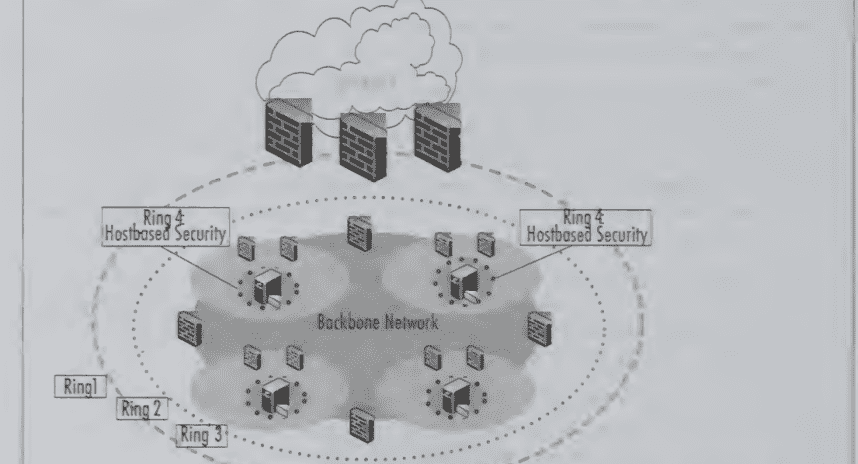

环 4：基于主机的安全。这是最重要却也最常被忽视的安全环。当蛮族兵临城下时，你最好准备好最强大、最精良的防御武器，因为这是你保护核心资产的最后机会。基于主机的安全包括：基于主机的防火墙；禁用会增加"攻击面"的未使用服务；在可用的情况下使用 IPSec 筛选器，仅允许必要的流量；确保操作系统软件、应用程序和主机上的服务配置为仅允许合法流量并自动丢弃攻击载荷。这还要求主机系统上的软件在编写时将安全性纳入考量，并且不易受到已知攻击的影响，例如缓冲区溢出。

基于主机的安全方法与网络防火墙保护有所不同，但其原则是相通的。基于主机的安全要求你控制允许进出主机的流量，并且主机上的应用程序在设计时必须考虑安全性。在处理基于主机的安全环时，您应考虑以下一些事项：

- 使用基于主机的防火墙来控制允许哪些传入和传出连接，以及哪些应用程序可以发送和接收数据。这是典型的"个人防火墙"方法，但可以扩展以支持服务器应用程序，同时为用户工作站提供个人防火墙支持。

- IPSec 策略（在支持的系统上）可用于控制允许从特定主机传入和传出到特定主机的流量。如果某个特定工作站或服务器不需要连接到所有可能的计算机，您可以使用 IPSec 策略将其锁定，将连接限制到预定义的机器集合。

- 主机上运行的应用程序和服务必须将安全性纳入设计考量。这意味着这些应用程序和服务不易受到常见攻击的影响，例如缓冲区溢出和社会工程学攻击（例如 HTML 电子邮件漏洞利用和打开附件）。

- 必须使用防病毒软件来阻止来自其他网络位置或由受损的热修复程序和软件引入的病毒。

- 必须安装反垃圾软件来保护机器，防止广告软件和其他恶意软件被安装到机器上。

- 如果安装了电子邮件客户端，必须在机器上安装反垃圾邮件软件。反垃圾邮件软件也应安装在处理传入和传出邮件的 SMTP 中继上，不仅是为了阻止 offensesPayload 的潜在危险载荷的垃圾邮件，也是为了减少与垃圾邮件相关的员工生产力损失。

基于主机的安全环是最后一道防线。ISA Server 2004 和资产网络在一定程度上可以帮助解决这个问题，但没有任何防火墙能够完全弥补主机层存在的弱点。网络防火墙安全有助于控制从企业网络到企业网络的访问，以及来自必须穿越 ISA Server 2004 防火墙的非本地网络的攻击，但只有基于主机的安全才能处理来自本地网络的攻击，因为这些连接不会穿越网络防火墙。

请注意，对于可能只有一个环（即互联网边缘环）的小型网络而言，整个讨论都是没有意义的。在单边界网络中，将传统的数据包筛选防火墙放在 ISA 防火墙前面的唯一原因就是在浪费金钱。您不如购买两台 ISA 防火墙，或购买另一台复杂的应用层防火墙，让 ISA 防火墙位于另一台应用层防火墙之后，这样 ISA 防火墙就可以实施强大的基于用户/组的安全机制，这是网络深度防御所必需的。

### 摘要

安全意识多年前就开始让网络管理员们"深有体会"，但新千年的事件——包括网络攻击水平的提升，以及针对美国及其海内外盟友的物理攻击—— heightened 了我们的认识：当今的世界是一个危险的地方，这种危险延伸到了保存着我们生活诸多方面数据的计算机网络。保护数字资产已成为企业和个人的首要 priorities，而保护任何连接到网络的计算机（如今这包括了大多数计算机）的关键要素就是防火墙。

ISA Server 2004 起源于 Microsoft Proxy Server，以及后来的 ISA Server 2000，但 Microsoft 将其视为一个全新的产品。用户界面已完全改变，关键功能已被添加（同时一些功能已被移除），ISA 已成长为一款成熟的防火墙，旨在与防火墙行业的"大腕"竞争，无论是企业级软件防火墙还是设备型硬件防火墙。

Microsoft 在安全方面的声誉因早期过分强调功能和特性而忽视安全性而受损。然而，该公司已完全扭转了优先事项，如今每年在安全方面投入数百万美元。可信计算倡议及其 SD³——Secure by Design（设计安全）、Secure by Default（默认安全）、Secure in Deployment（部署安全）的三重目标，将安全性提升到了前所未有的高度，并已融入 ISA Server 2004 设计的每个层面。

ISA Server 2004 采用基于策略的安全方法，使管理员能够轻松执行管理层决定的安全策略。制定适当的策略是规划防火墙部署的关键步骤，包括评估安全需求、分析风险因素、评估威胁和威胁级别、分析组织和网络漏洞、分析影响安全的组织因素、分析法律因素，最后还要分析成本因素。

为了有效，良好的安全计划必须采取多层方法。这意味着认识到大多数网络包含多个边界，并实施多种安全措施（可能包括多个防火墙），以最好地保护网络核心中的重要资产（关键任务应用程序和数据）。

防火墙充当网关处的守护者（网络或子网的入口）。最初的防火墙是简单的数据包筛选设备，但如今复杂的多层防火墙可以在 OSI 网络模型的网络层、传输层和应用层进行筛选，从而在更大范围内提供安全覆盖。ISA Server 2004 是一款基于数据包筛选、电路筛选和应用层筛选的基于网络的软件防火墙，还包括 VPN 网关功能、入侵检测和防御，以及 Web 缓存功能以加速内部和外部用户的性能。

ISA Server 2004 包含许多新功能，并且与其前身 ISA 2000 共享的许多功能也得到了改进和增强。当您阅读本书时，您将首先了解最新版 ISA 背后的概念，然后您t 将以详细的分步方式学习如何安装、配置、管理、使用和排除故障。

让我们开始吧！


 ## 第 2 章

### 考察 ISA Server 2004 的功能集

本章主题：

- 全新 GUI：不仅仅是漂亮的界面
- 旧功能的新花样
- 新功能登场
- 消失的功能：虽去犹忆

ISA 2004 保留了管理员们熟悉并喜爱的许多 ISA 2000 功能，而且在很多情况下对它们进行了改进，使其更加功能齐全且易于使用。例如，虚拟专用网络（VPN）管理、身份验证、防火墙规则、Outlook Web Access（OWA）发布、FTP 支持、安全 Web 发布、缓存规则、SMTP 邮件筛选器、报告定制等方面都做了增强和改进。

ISA 2004 还增加了大量新功能，例如支持多网络、对 VPN 流量的有状态过滤和检查、VPN 隔离、防火墙用户组、由防火墙生成 OWA 表单认证所用的表单、链接转换等等。

图形用户界面（GUI）已完全重新设计，以提供更直观、更友好的用户体验。

在本章中，我们将概述 ISA 2004 的新 GUI，并讨论已改进的旧功能以及将使 ISA Server 管理员工作更轻松的新增功能。我们还将查看 ISA 2000 中存在的、在 ISA 2004 中已移除的一些功能，这使得产品更加精简高效，反映了微软将 ISA 2004 首先作为防火墙/安全产品进行营销的重点，使其能够在该市场与顶级竞争对手抗衡，然后作为缓存/加速服务器，为需要这两种功能但不想购买两个单独产品或昂贵防火墙附加组件的组织增加价值和节省成本。

#### 全新 GUI：不仅仅是漂亮的界面

首先，我们来看看 ISA 用户最先看到的东西——图形界面。毫无疑问，ISA 2004 的界面比 ISA 2000 的界面更加直观。通过让界面更友好来改善用户体验是开发团队的主要目标，他们做得很好。不熟悉 ISA 2000 的人也可以轻松坐在 ISA 2004 界面前，通过点击就能执行许多常见的防火墙管理任务，而无需查阅帮助文件。

##### 考察图形界面

图 2.1 显示了 ISA Server 2000 的管理 GUI，图 2.2 显示了新的 ISA Server 2004 GUI。如您所见，前者看起来与任何其他 Microsoft 管理控制台（MMC）几乎一样，具有简单的左窗格树和右侧详细信息窗格。

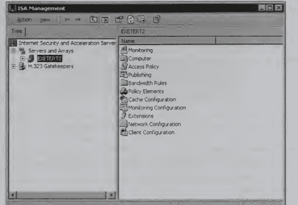

ISA Server 2004 控制台要丰富得多，采用三窗格窗口，左窗格仍然包含熟悉的树结构，但中间和右窗格为您提供标签页，使您可以轻松选择要执行的任务类型并获得精确的执行帮助。不再需要在对话框中的对话框里点击几十个才能找到所需的配置设置。相反，常见的管理任务可以说是触手可及。任何 IT 管理员都可以轻松学会这种点击式界面，无需大量培训。

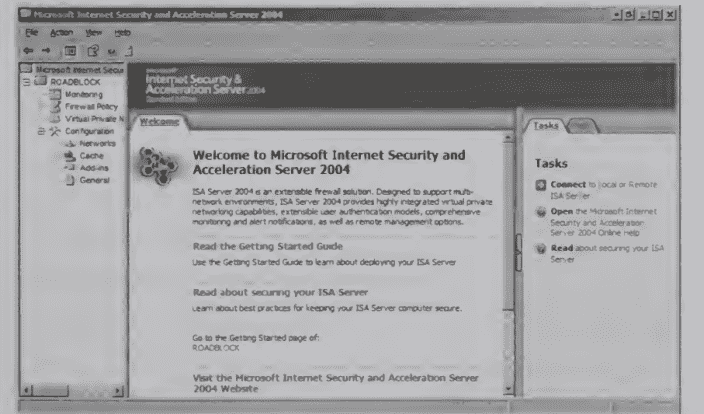

**注意**

您可以使用管理控制台连接远程 ISA 服务器以及本地 ISA Server。也可以在工作站或非 ISA 服务器上安装管理控制台，远程管理您的 ISA 计算机。通过在右控制台窗格的**任务**选项卡上点击**连接到本地或远程 ISA 服务器**来选择要管理的 ISA 计算机。

点击管理控制台左窗格中的顶部节点（标记为 **Microsoft Internet Security and Acceleration Server 2004**）会在中间窗格显示*欢迎*页面。该界面提供指向以下选项的快速链接：

- **入门指南**，一份 HTML 文档（图 2.3），为安装和配置 ISA Server 2004 提供详细指导，并包含一个"功能导览"，向您展示执行特定常见任务的场景。
- **保护 ISA 服务器的最佳实践**会带您进入 ISA Server 2004 帮助文件的安全和管理部分。还有一个链接指向 ISA Server 网站上的指南和文章页面，http://www.microsoft.com/isaserver/techinfo/howto/，您可以在那里找到最新版本的安全最佳实践文档。
- **入门页面**（不要与入门指南混淆）提供一个逻辑组织的任务驱动步骤列表，让您能够快速轻松地设置 ISA Server（在下一节中讨论）。
- **Microsoft ISA 2004 网站** www.microsoft.com/isaserver 包含产品更新、客户支持信息和有关 ISA Server 的最新消息。
- **合作伙伴产品网站**提供广泛的第三方附加组件列表，以增强 ISA Server 的功能，并包含指向合作伙伴网站、案例研究以及合作伙伴新闻和评论的链接。

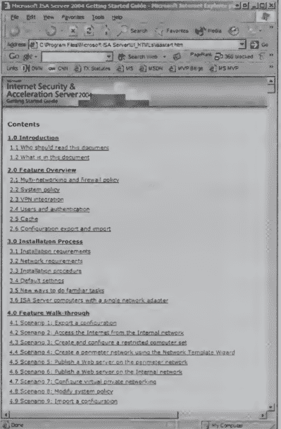

##### 考察管理节点

根据您在左窗格中的选择，中间窗格会显示不同的可点击配置项。左窗格节点包括：

- ISA Server（名称）顶级节点
- 监控节点
- 防火墙策略节点
- 虚拟专用网络（VPN）节点
- 配置节点

配置节点包含四个子节点：

- 网络
- 缓存
- 加载项
- 常规

在以下小节中，我们将查看每个节点及其界面，以及您可以使用每个节点执行的操作。

##### ISA Server（名称）顶级节点

如果您选择代表 ISA Server 防火墙的节点（在图中，防火墙的名称为 ROADBLOCK），中间窗格将显示**开始使用 ISA Server 2004**页面，如图 2.4 所示。再次提醒，不要将其与入门指南混淆。

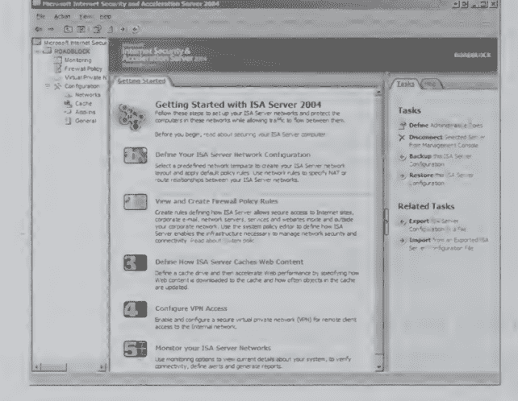

入门页面使设置 ISA Server 防火墙和/或缓存服务器变得简单。您将在此处看到用于执行以下任务的选项：

- **定义 ISA Server 网络配置**允许您选择预定义的网络模板，用于创建 ISA Server 网络布局并应用默认策略规则。您可以指定多个 ISA Server 网络之间的 NAT 或路由关系。
- **查看和创建防火墙策略规则**让您配置规则，以确定 ISA Server 如何允许对内部和外部网站、其他 Internet 站点、服务器、电子邮件和其他服务的安全访问。
- **定义 ISA Server 如何缓存 Web**配置缓存，首先定义缓存驱动器，然后创建缓存规则来控制 Web 内容将如何下载到缓存以及缓存更新的频率。
- **配置 VPN 访问**允许您创建 VPN 网关，让远程用户通过虚拟专用网络连接到您的内部网络。
- **监控 ISA Server 网络**提供查看系统详细信息和验证连接性的选项（包括实时监控哪些用户连接到哪些网站以及应用程序使用情况）。您还可以创建警报，通过电子邮件通知管理员指定的事件，并设置生成一次性或计划报告。

> **注意**
>
> 入门页面上的每个选项实际上都会将您带到左窗格中显示的某个节点。因此，点击"**定义 ISA Server 网络配置**"会将您带到与点击左窗格中"配置"下的**网络**节点相同的界面；点击"**查看和创建防火墙策略规则**"会将您带到与点击左窗格中**防火墙策略**相同的界面，依此类推。熟悉 ISA 2004 管理控制台后，您可能会发现直接点击左窗格中的相应节点更容易，但**入门**页面在您首次设置 ISA Server 计算机时将所有配置选项以有序列表的形式集中在一起。

当选中顶部 ISA Server 节点时，在右窗格的**任务**选项卡中，您会看到用于执行与整个 ISA 服务器相关的几项任务的可点击图标。这些包括：

- **定义管理角色**调用管理委派向导，您可以使用它为单个用户或组分配管理角色。这些角色定义了这些用户管理 ISA Server 的权限。
- **从管理控制台断开所选服务器**将使您与本地或远程 ISA Server 断开连接。
- **备份此 ISA Server 配置**允许您将 ISA 配置保存为 .XML 文件。
- **还原此 ISA Server 配置**允许您使用备份选项创建的 .XML 文件来还原配置。

相关任务包括导出和导入 ISA 服务器配置文件（XML 格式）。


 # ISA Server 秘籍

##### 备份/还原与导出/导入有何不同？

我们收到的一个常见问题是："备份和还原功能与导出和导入功能有何不同？" 这是一个好问题，因为乍一看，它们是一样的。在这两种情况下，你都将 ISA Server 配置保存到 .XML 文件，然后将其恢复并应用到 ISA 服务器。你在两个保存文件的对话框之间看到的唯一区别是，导出对话框包含两个复选框，而使用备份功能保存文件时则看不到：

- 导出用户权限设置
- 导出机密信息（将使用加密）

这两组功能都允许你保存配置信息，但导出/导入功能使你能对保存哪些信息以及如何保存进行更细粒度的控制。

使用**备份/还原**时，会保存服务器的常规配置信息。这包括防火墙策略规则、规则元素、警报配置、缓存配置和 VPN 配置。你无法选择只保存其中的一部分信息；这是一个"全有或全无"的交易。

使用**导出/导入**，你可以保存整个配置，或者仅保存其中的特定部分。例如，你可以只保存网络，或仅保存一个网络；只保存 Web 链规则，甚至仅保存一个特定的链规则；只保存选定的防火墙策略；只保存缓存配置，等等。如果你选择导出整个配置，以下内容将被保存：

- 访问规则
- 发布规则
- 规则元素
- 警报配置
- 缓存配置
- ISA Server 属性和所有常规配置信息

你可以选择是否导出机密信息，例如用户密码、IPSec 的预共享密钥和 RADIUS 共享密码。你还可以选择是否导出用户权限设置。使用备份功能时，你没有选择余地：机密信息和用户权限设置会自动保存。无论哪种方式，当你保存机密信息时，都会对其进行加密保护。你在导出操作期间指定一个密码，在导入配置时必须输入该密码。

> 为什么要导出整个配置而不是使用备份？这通常用于克隆服务器，创建具有相同配置的第二个 ISA Server。如果你需要让多个 ISA Server 防火墙配置为完全相同的副本（例如，用于多个分支机构），这是最快的方法。

需要注意的一个重要事实是，当你导出整个配置时，证书设置会被包含在内。如果你将配置导入到另一个未安装相同证书的 ISA Server，防火墙服务将无法启动。

我们将在第六章*安装和配置 ISA Server 2004 软件*中更详细地重温入门任务。

##### 监控节点

ISA Server 2004 中的*监控节点*相比 ISA Server 2000 的监控和日志界面有了很大改进。这是一个繁忙的节点，中间窗格显示了七个选项卡页面：

- 仪表板
- 警报
- 会话
- 服务
- 报告
- 连接
- 日志

*仪表板*正如其名称所示：一个"大局"视图，汇总了由选项卡代表的每个区域（日志除外）的信息。就像汽车的仪表板一样，你可以从一个界面监控不同区域的运行情况。仪表板如图 2.5 所示。

**图 2.5** 仪表板 — 所有监控区域一目了然的大局视图

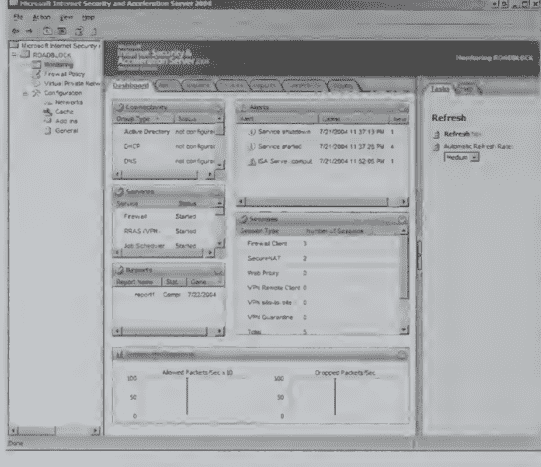

仪表板还提供系统性能信息；你可以图表格式查看每秒允许的包数（x10）和每秒丢弃的包数。

仪表板的每个部分都包含一个图标，指示该区域的状态：

- **绿色圆圈内带对勾**：表示一切正常
- **黄色三角形内带感叹号**：表示警告
- **红色圆圈内带 X**：表示问题或潜在问题

你可以通过点击相应的选项卡来获取每个监控区域的更多详细信息。

我们将在第 12 章*使用 ISA Server 2004 监控、日志记录和报告工具*中详细介绍如何使用仪表板。

**警报**选项卡提供有关已发生的重要事件的信息（例如，服务启动或关闭时、检测到入侵、超出连接限制等）。你可以配置哪些操作会触发警报。警报选项卡如图 2.6 所示。

**图 2.6** 警报选项卡通知你 ISA Server 上发生的重要事件

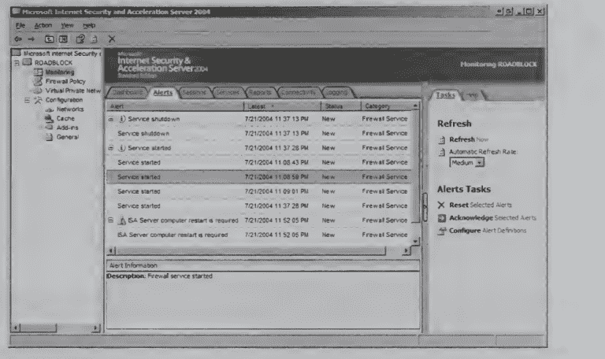

如图 2.6 所示，如果你点击某个警报，关于它的更多信息将显示在底部中间窗格中。警报用图标标记以指示每个的相对重要性。这些图标对 Windows 管理员来说很熟悉，因为它们与事件查看器的系统和应用程序日志中使用的相同：

- 白色圆圈内带小写 "i"：表示信息性警报。无需采取操作。
- 黄色三角形内带感叹号：表示警告。可能需要采取行动。
- 红色圆圈内带 "X"：表示错误、问题或潜在问题，需要立即关注。

右侧任务窗格允许你手动刷新警报窗口，或者你可以设置自动刷新率（无、低、中、高）。在警报任务下，你可以通过点击要重置的警报（按住 CTRL 键可选择多个警报）然后点击重置来重置选定的警报。系统会询问你是否确定要重置警报。点击"是"即可重置。

你还可以选择**确认**以表明你正在处理该警报。这不会将其从警报窗口中移除；但是，该警报将从仪表板视图中移除。

最后，你可以通过从预定义的警报事件列表中进行选择来配置警报，并且可以指定事件必须发生的次数，或每秒的事件数，以触发警报。你还可以指定警报触发时应采取的操作（向管理员发送电子邮件、运行指定程序、记录到 Windows 事件日志，或启动或停止指定的服务）。

我们将在第 12 章*使用 ISA Server 2004 监控、日志记录和报告工具*中逐步讨论如何配置警报。

> **提示**
>
> 如果你重置一组警报，该组中的所有警报都将从警报窗口中消失。除非你/直到再次发生触发它们的操作，否则你不会在那里再看到它们。

*会话*选项卡使管理员可以轻松查看谁正在通过 ISA Server 防火墙连接以及他们过去连接过的情况，以及他们使用的应用程序。这些信息可以过滤以便更容易查看。会话窗口如图 2.7 所示。

我们将在第 12 章*使用 ISA Server 2004 监控、日志记录和报告工具*中更详细地讨论如何使用会话信息。

**图 2.7** 使用会话选项卡 — 查看有关谁已通过 ISA Server 防火墙连接的信息

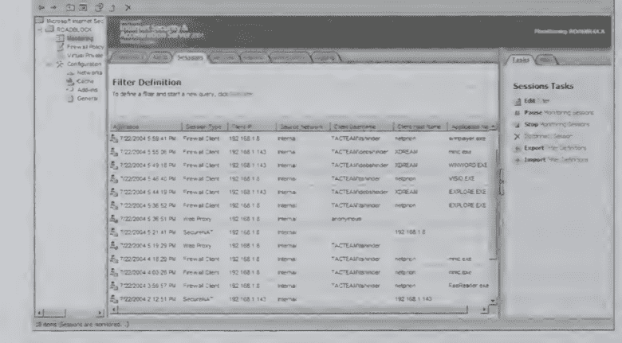

*服务*选项卡向你显示运行在 Windows 2000 或 Server 2003 计算机上的 ISA Server 和 ISA 相关服务的状态和运行时间。你可以从此窗口停止和启动服务，可以从右窗格的**服务任务**部分执行，也可以右键单击要启动或停止的服务。服务选项卡如图 2.8 所示。我们将在第 12 章*使用 ISA Server 2004 监控、日志记录和报告工具*中更多地讨论服务选项卡。

**图 2.8** 服务选项卡 — 停止和启动 ISA 相关服务

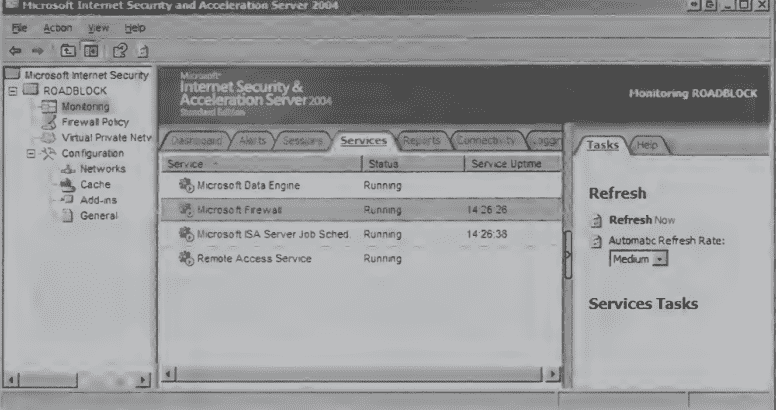

你可以使用图 2.9 所示的*报告*选项卡生成一次性报告或配置计划的报告任务。新建报告向导会引导你完成创建一次性报告的步骤。报告任务可以每天、每周或每月安排报告。你可以指定报告中要包含哪些信息。我们将在第 12 章*使用 ISA Server 2004 监控、日志记录和报告工具*中讨论生成报告的分步操作步骤。

**图 2.9** 报告选项卡 — 从日志生成报告

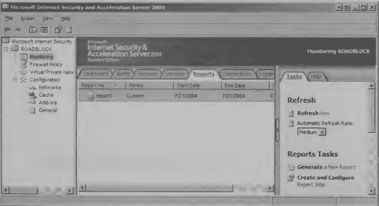


 *连接性*（*Connectivity*）选项卡允许你创建、导出和导入连接验证器（connectivity verifiers）。这些对象用于监控 ISA Server 计算机与特定计算机或 URL 之间的连接状态。连接性可以通过 PING 消息、TCP 端口或 HTTP 请求来确定。连接性选项卡如图 2.10 所示。

我们将在第 12 章《*使用 ISA Server 2004 监控、日志记录和报告工具*》（*Using ISA Server 2004 Monitoring, Logging and Reporting Tools*）中介绍如何配置和使用连接验证器。

# 图 2.10 连接性选项卡 — 监控 ISA Server 与特定计算机或 URL 之间的连接状态

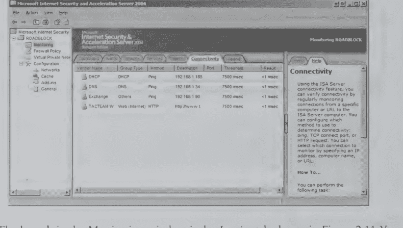

监视窗口中的最后一个选项卡是*日志记录*（*Logging*）选项卡，如图 2.11 所示。你可以使用它来配置防火墙、Web 代理和 SMTP 邮件筛选器的日志记录过程。你还可以编辑筛选器以限制显示的数据、导出和导入筛选器定义，以及查询日志。

我们将在第 12 章《*使用 ISA Server 2004 监控、日志记录和报告工具*》（*Using ISA Server 2004 Monitoring, Logging and Reporting Tools*）中讨论如何配置、筛选和查询日志文件。

# 图 2.11 日志记录选项卡 — 筛选和查询 ISA 日志文件中的数据

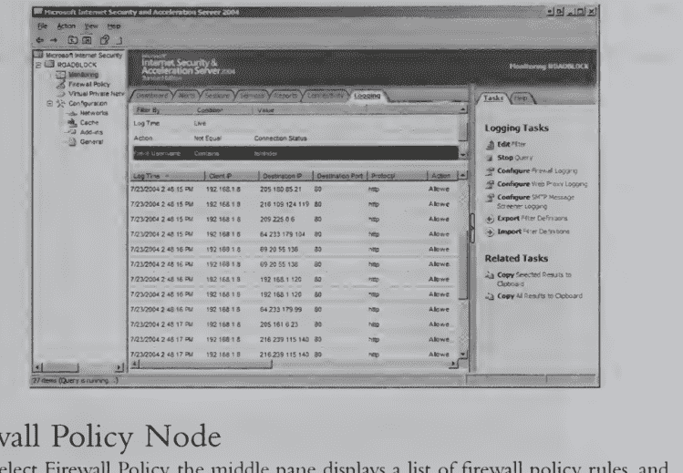

##### 防火墙策略节点（Firewall Policy Node）

如果选择了防火墙策略（Firewall Policy），中间窗格会显示防火墙策略规则列表，右侧窗格则包含标有工具箱（Toolbox）、任务（Tasks）和帮助（Help）的选项卡，如图 2.12 所示。

# 图 2.12 防火墙策略 — 配置规则

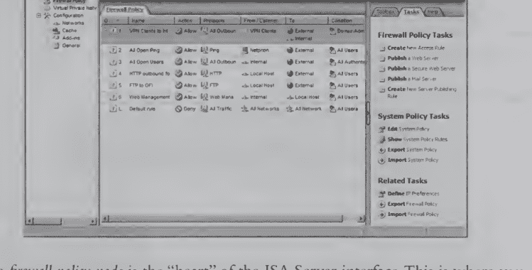

*防火墙策略节点*（*firewall policy node*）是 ISA Server 界面的"心脏"。在这里，你可以创建访问规则、Web 发布规则、邮件服务器发布规则和其他服务器发布规则，以控制对你的网络的访问以及来自你网络的访问。此外，你还可以编辑系统策略、定义 IP 首选项，并导出和导入系统策略及防火墙策略。如图 2.13 所示，使用新建访问规则向导（New Access Rule wizard）可以轻松创建新的访问规则。

# 图 2.13 新建访问向导 — 创建新的访问规则和发布规则

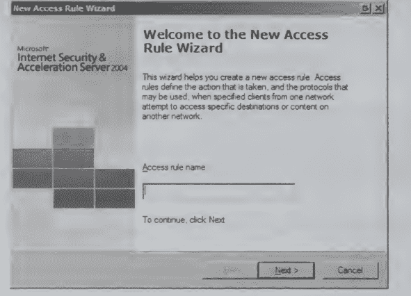

有关创建和使用访问策略及发布规则的详细分步说明，请参阅第 7 章《创建和使用 ISA Server 2004 防火墙访问策略》（Creating and Using ISA Server 2004 Firewall Access Policy）以及第 8 章《使用 ISA Server 2004 将网络服务发布到 Internet》（Publishing Network Services to the Internet with ISA Server 2004）。

##### 虚拟专用网络（VPN）节点

你可以轻松地将 ISA Server 防火墙设置为远程访问用户或站点到站点的 VPN 网关。如图 2.14 所示，虚拟专用网络节点（Virtual Private Networks node）提供了一个友好的界面，用于执行常见的 VPN 配置任务和控制客户端访问。

# 图 2.14 虚拟专用网络节点，用于配置 VPN


中间窗格显示了一系列配置任务，包括：

- 验证是否启用了 VPN 客户端访问
- 指定允许 VPN 访问的 Windows 用户，或选择 RADIUS 服务器进行身份验证
- 验证 VPN 属性和远程访问配置
- 查看针对 VPN 客户端网络的防火墙策略规则
- 查看指定 VPN 客户端网络与其他网络之间网络关系的规则

从右侧的"任务"窗格中，你可以配置客户端访问（指定同时进行的 VPN 连接数、选择允许 VPN 访问的组、指定允许的 VPN 协议，以及映射来自非 Windows 命名空间的用戶）。你甚至可以单击一下即可禁用所有 VPN 访问。

我们将在第 9 章《*使用 ISA Server 2004 保护远程访问和 VPN 通信*》（*Protecting Remote Access and VPN Communications with ISA Server 2004*）中带你了解创建和管理 VPN 所涉及的步骤。

##### 配置节点：网络子节点（Networks Subnode）

*配置节点*（*Configuration node*）有四个子节点。如果选择了*网络子节点*（*Networks subnode*），中间窗格将显示一组包含选项卡的页面，其中包括*网络*（*networks*）、*网络集*（*network sets*）、*网络规则*（*network rules*）和 *Web 链*（*Web chaining*），如图 2.15 所示。

**图 2.15** 网络选项卡 — 配置网络、网络集、网络规则和 Web 链

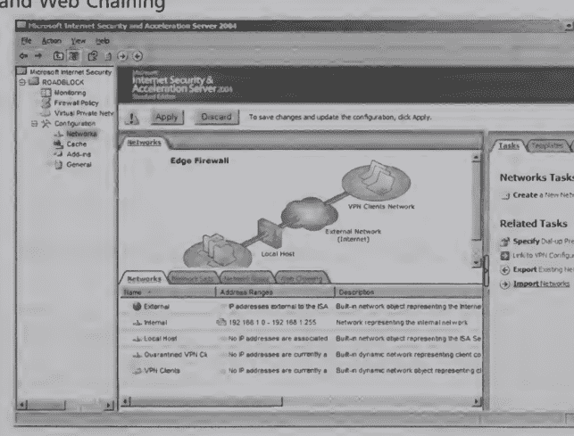

右侧窗格将包含标有**任务**（**Tasks**）、**模板**（**Templates**）和**帮助**（**Help**）的选项卡。

*网络*（*Networks*）选项卡用于在多网络环境中创建和配置网络。*网络集*（*Network Sets*）选项卡允许你对网络进行分组，并将规则应用于一组或一系列网络。*网络规则*（*Network Rules*）选项卡用于创建、导出和导入规则，这些规则定义了是否允许以及允许何种类型的连接性在不同网络之间通过转换（NAT）或路由连接进行通信。*Web 链*（*Web Chaining*）选项卡用于创建 Web 链规则，使你能够将客户端请求路由到上游 ISA Server 或备用位置。

我们将在*配置企业网络、缓存阵列和网络负载均衡*（*Configuring Enterprise Networks, Caching Arrays and Network Load Balancing*）这一奖励章节中讨论多网络配置，该章节将在 ISA Server 2004 企业版发布后，通过 www.syngress.com/solutions 免费提供给本书的购买者。

##### 配置节点：缓存子节点（Cache Subnode）

如图 2.16 所示，*缓存子节点*（*Cache subnode*）用于在 ISA Server 上配置缓存。

# 图 2.16 缓存子节点 — 在 ISA Server 上配置或禁用缓存

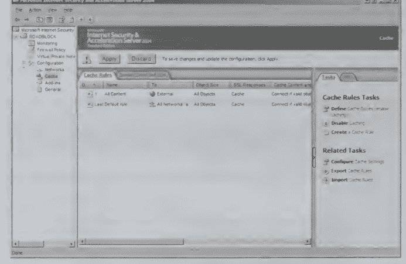

你可以定义用于存储缓存内容的缓存驱动器，并通过新建缓存规则向导（New Cache Rule wizard）创建缓存规则。这些规则应用于特定网络，并确定在请求时如何从缓存中检索存储的对象，以及何时缓存内容，以及对缓存对象大小的限制。你可以在此处配置常规缓存设置，并导出和导入缓存规则。你还可以完全禁用缓存，使 ISA Server 仅作为防火墙运行。

我们将在第 11 章《*使用 ISA Server 2004 缓存功能加速 Web 性能*》（*Accelerating Web Performance with ISA Server 2004 Caching Capabilities*）中向你展示配置和使用 ISA Server 作为缓存服务器的分步操作步骤。

检查 ISA Server 2004 功能集 • 第 2 章 97

##### 配置节点：加载项子节点（Add-ins Subnode）

*加载项子节点*（*Add-ins subnode*）用于配置 ISA Server 的应用程序层筛选（ALF）。在这里，你可以启用、查看、修改和禁用应用程序筛选器和 Web 筛选器。某些筛选器在安装 ISA Server 时会默认安装并启用。加载项子节点如图 2.17 所示。

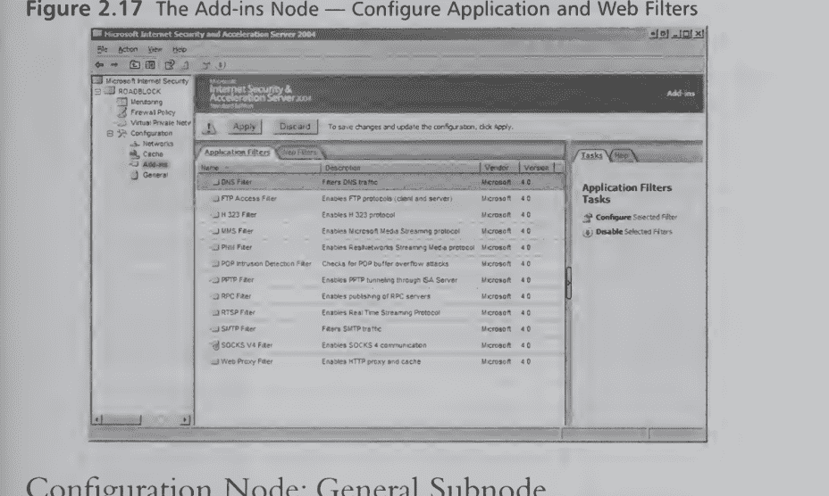

##### 配置节点：常规子节点（General Subnode）

最后，*常规子节点*（*General subnode*）包括常规管理任务，包括：

- **管理委派**（**Delegation of administration**），授予用户和组执行特定管理任务的权限
- **防火墙链配置**（**Configuration of firewall chaining**），指定来自防火墙客户端和安全 NAT 客户端的请求如何转发到上游服务器
- **拨号首选项设置**（**Specification of Dial-up preferences**），如果你使用拨号账户
- **证书吊销设置**（**Specification of certificate revocation**），以便 ISA Server 可以验证传入证书不在证书吊销列表（CRL）中
- **防火墙客户端设置定义**（**Definition of Firewall client settings**），包括应用程序设置
- **查看 ISA Server 计算机详细信息**（**Viewing of ISA Server computer details**），例如 ISA 版本、名称、产品 ID、创建日期和安装目录
- **链接转换配置**（**Configuration of link translation**），选择定义将应用链接转换的页面内容类型

此子节点还允许你执行高级安全任务，例如：

- 定义 RADIUS 服务器
- 启用入侵检测和 DNS 攻击检测
- 定义 IP 首选项
- 定义连接限制

常规子节点如图 2.18 所示。

**图 2.18** 常规子节点用于常规管理和高级安全任务

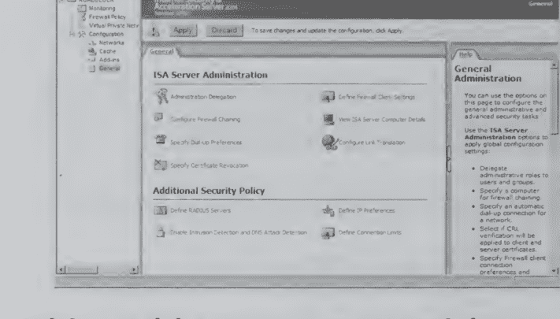

##### 让旧功能学会新本领

GUI 并不是 ISA 2004 中唯一得到增强和改进的功能。事实上，防火墙管理员在 ISA 2000 中执行的许多熟悉任务在 ISA 2004 中都变得更加容易。在以下各节中，我们将讨论其中一些最重要的改进，分为以下几类：

- 远程管理
- 防火墙功能
- 虚拟专用网络和远程访问
- Web 缓存和 Web 代理
- 监控和报告


 ## 增强和改进的远程管理

管理员需要能够从远程位置管理 ISA Server 防火墙：从他们自己的台式机、外出或异地时的便携电脑，有时甚至是从他们无法控制的主机（如公共访问计算机）。如果你的公司在不同位置部署了多台 ISA Server，你肯定不想为了对每台 ISA Server 执行管理任务而亲自去现场。

> **注意**

如果需要，你可以将 ISA Server 2004 帮助文件复制到你的工作站或非 ISA 服务器上，这样即使你没有通过 ISA 管理控制台或终端服务/远程桌面连接到 ISA Server 计算机，也能随时查阅。为此，请在 ISA Server 上导航到 Microsoft ISA Server 文件夹（通常安装在 Program Files 文件夹中）并找到 `isa.chm` 文件。将此文件复制到你的工作站或非 ISA 服务器的硬盘中，这样无需连接到 ISA Server 即可访问 ISA 帮助文件。

使用 ISA 2004，有多种不同的方式可以远程管理防火墙。在下面的子节中，我们将讨论三种远程管理方法：

- ISA 2004 管理控制台
- Windows 2000 终端服务或 Server 2003 远程桌面
- 第三方 Web 界面

##### 通过 ISA Server 2004 管理控制台进行远程管理

你可以使用管理控制台连接到远程 ISA Server 或多台 ISA Server 防火墙。每个 ISA Server 都会在左窗格中拥有自己独立的顶级节点，如图 2.19 所示

**第 2 章** • 探索 ISA Server 2004 功能集

##### 图 2.19 可以使用管理控制台同时连接多台 ISA Server 防火墙

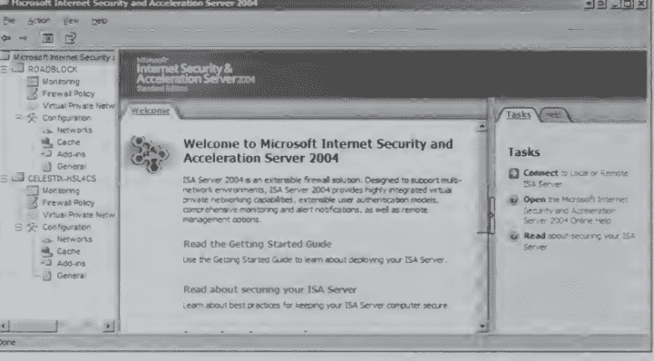

要连接第二台或后续的 ISA Server，请在右窗格中单击**连接到本地或远程 ISA Server**，然后输入远程服务器的名称或 IP 地址以及访问凭据，如图 2.20 所示。

## 提示

> 如果无法连接，请按照以下说明将你的计算机添加到 ISA 防火墙策略节点中的远程管理计算机列表中。

##### 图 2.20 使用"连接到"对话框将远程有机资源添加到管理控制台

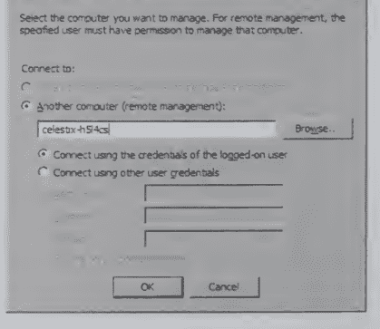

> 注意

只能使用管理控制台远程连接到 ISA Server 2004 防火墙。如果尝试连接 ISA Server 2000 防火墙，将收到错误消息："发生故障。任务未激活。"

要远程管理 ISA Server，必须配置系统策略以允许远程管理。配置系统策略的步骤如下：

1. 在 ISA Server 计算机上，单击管理控制台左窗格中的**防火墙策略**节点。
2. 单击标记为 "Allow remote management from selected computers using MMC" 的**系统策略**规则以查看该规则。
3. 要添加计算机，请在右窗格中单击**系统策略任务**下的**编辑系统策略**。这将打开**系统策略编辑器**。
4. 在**编辑器**右窗格的**配置组**下，导航到**远程管理**，然后单击**Microsoft 管理控制台 (MMC)**。
5. 单击**从**选项卡，默认情况下，你会在标记为**此规则适用于来自以下源的流量**的框中看到**远程管理计算机**，如图 2.21 所示。

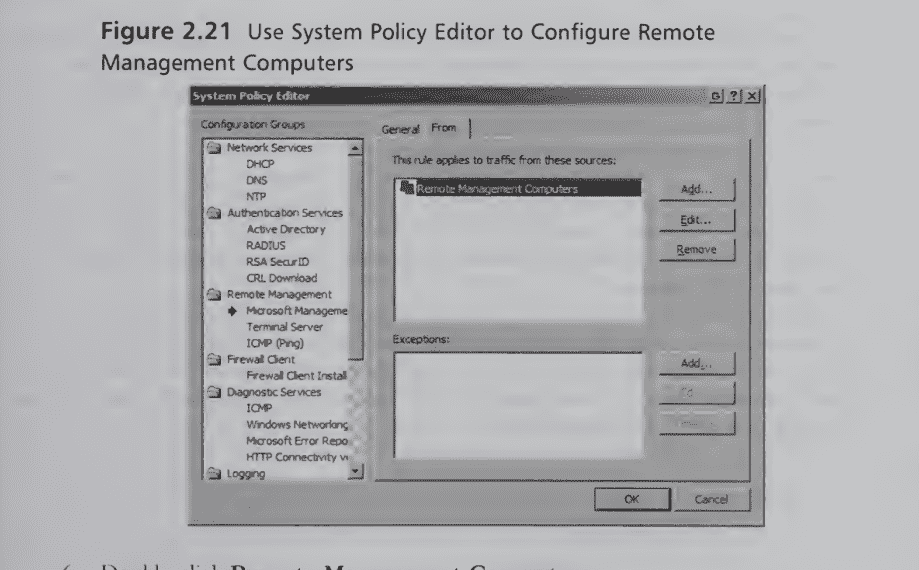

6. 双击**远程管理计算机**。

7. 在属性框中，如图 2.22 所示，单击**添加**并选择计算机、地址范围或子网。

##### 图 2.22 将计算机、地址范围或子网添加到远程管理计算机列表

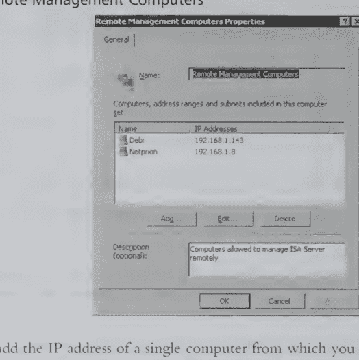

你可以添加用于远程管理 ISA Server 的单台计算机的 IP 地址、地址范围或整个子网。此规则适用的计算机将是你能够从中管理 ISA Server 的唯一计算机。

你还可以直接将网络实体（整个网络、网络集、计算机、地址范围、子网和计算机集）添加到规则中，而不是将它们添加到远程管理计算机列表中。例如，如果要允许 VPN 客户端远程管理 ISA Server，这将非常有用。在这种情况下，请在**从**选项卡页面上单击**添加**，然后在**添加网络实体**对话框中，展开**网络**，并选择**VPN 客户端**。

最佳（最安全）做法是向远程管理计算机列表中添加单个计算机。但是，如果你需要从组织内不同的工作站管理 ISA Server，并且事先不知道将使用哪些计算机，则可以选择允许子网、地址范围甚至整个内部网络（*不推荐*）。

##### ISA Server 秘诀

##### 安装管理控制台

在从未安装 ISA Server 的计算机上管理 ISA Server 之前，你需要安装管理控制台。你可以在 Windows Server 2003、Windows XP 和 Windows 2000 计算机上安装该控制台。

为此，请插入 ISA Server CD 或导航到文件服务器上的 ISA Server 安装文件。双击 isaautorun.exe 文件以启动 ISA Server 2004 安装程序。在安装首页上单击**安装 ISA Server 2004**。

如果要在未运行 Windows 2000 Server 或 Windows Server 2003 的计算机上安装控制台，将收到提示信息，说明无法在此计算机上安装 ISA Server 2004。仍然单击**继续**，然后会显示可安装组件的列表，其中包括管理控制台。按照安装向导的操作步骤在计算机上安装管理控制台。它将显示在你的程序列表中，名称为 "Microsoft ISA Server"。

通过管理控制台连接到远程 ISA Server 计算机后，你可以执行与坐在本地 ISA Server 前相同的任何管理任务。与 ISA Server 2000 远程管理控制台相比，这是一个重大改进。例如，使用 ISA Server 2000 时无法配置或管理 VPN。而使用 ISA 2004，你可以远程管理 ISA Server 的所有组件。

##### 通过终端服务/远程桌面进行远程管理

从远程计算机管理 ISA Server 的另一种方法是通过终端服务（如果在 Windows 2000 服务器上运行 ISA Server 2004）或远程桌面（如果在 Windows Server 2003 计算机上运行 ISA Server 2004）。这种方法的优点是无需在远程计算机上安装 ISA Server 管理控制台软件。

如果使用 Windows XP 或 Server 2003 计算机远程管理 ISA，则完全不需要安装任何软件，因为远程桌面连接 (RDC) 客户端软件已经安装（可在**程序 | 附件 | 通讯**下找到）。

如果要使用 Windows 2000 或 9x 计算机管理 ISA 服务器，则需要先安装终端服务客户端或 RDC 客户端软件。

> 注意

如果 ISA 在 Windows 2000 Server 上运行，服务器需要安装并运行终端服务，无论是远程管理模式还是应用程序服务器模式。如果 ISA 在 Windows Server 2003 计算机上运行，则需要确保在控制面板的**系统**属性小程序的**远程**选项卡上已勾选**允许用户远程连接到此计算机**。此外，你的用户账户必须具有通过终端服务或远程桌面连接到服务器的权限。

完成上述所有步骤后，通过终端服务/远程桌面管理 ISA Server 就很容易了。像连接到任何终端服务器/远程桌面服务器一样连接到服务器，该服务器的桌面将显示在你的桌面的窗口中，允许你执行与坐在服务器本地相同的任何管理任务，如图 2.23 所示。

##### 图 2.23 使用终端服务或 RDC 客户端时，ISA Server 的桌面显示在桌面窗口中

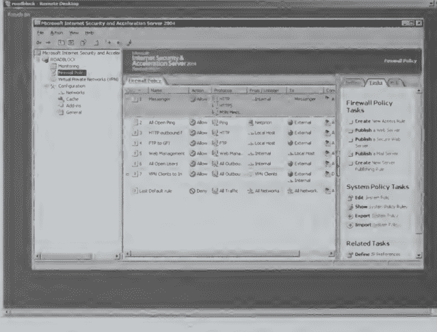

与使用管理控制台进行远程管理一样，在使用这种远程管理方法之前，你可能需要修改 ISA Server 的系统策略以允许通过终端服务进行管理。操作步骤相同，只是在 ISA 管理控制台的右窗格中单击**编辑系统策略**（左窗格中选择了**防火墙策略**）后，在**远程管理**下单击**终端服务器**。然后，在**从**选项卡上，单击**添加**按钮以添加网络、网络集、计算机、计算机集、IP 范围或子网。这些

 将允许通过终端服务/远程桌面管理 ISA Server 的计算机。

##### 第三方远程管理 Web GUI

第三方厂商提供了可用于从任何计算机管理 ISA Server 的 Web 界面。无需在客户端计算机上安装任何软件，也无需在 ISA Server 上进行特殊配置。但是，您可能需要使用 Internet Explorer 浏览器，并且/或者可能需要配置浏览器的安全设置才能使用 Web GUI（例如，可能需要启用 ActiveX 控件）。您还可能需要将 ISA Server 的网站添加到"受信任的站点"或"本地 Intranet"安全区域。

图 2.24 展示了两个用于基于 ISA 的防火墙设备的 Web 界面示例。第一个展示了 RimApp（www.rimapp.com）销售的 RoadBLOCK 设备。第二个展示了 Network Engines（www.networkengines.com）销售的 NS6000 设备。您可以看到 Web 界面可能存在很大差异。设备厂商可以添加许多增强功能，使基于 ISA 的防火墙更具功能性，根据客户的优先级提供独特的功能。其他与 Microsoft 合作制造基于 ISA 的设备的厂商还包括惠普（Hewlett-Packard）、Celestix Networks 和 Advantis。

**图 2.24** 第三方厂商为基于 ISA 的防火墙设备提供 Web 界面

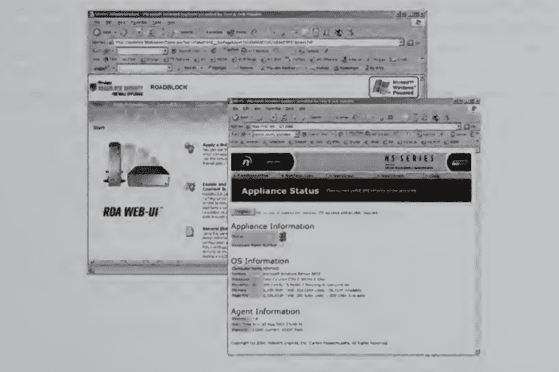

#### 增强和改进的防火墙功能

防火墙功能是 Microsoft 在 ISA Server 2004 中最关注的方面，可能比在 ISA 2000 中更突出。虽然它仍被称为"Internet Security *and* Acceleration Server"，但开发和市场营销的重点更多地放在了安全功能上，而较少关注加速功能。ISA 2004 旨在与那些不包含缓存功能的流行防火墙产品竞争。因此，ISA 的安全和防火墙功能进行了许多改进，包括更好的协议支持、改进的身份验证、更轻松地访问流行服务器（OWA 和热泪美景FTP）、扩展定义网络对象的能力、防火墙规则功能的改进、服务器发布和 Web 发布的改进。

##### 更好的协议支持

ISA Server 2004 允许您控制任何协议的访问和使用，包括 IP 层（第 3 层）协议，如 Internet 控制消息协议（ICMP）。这使得用户能够使用 ping 和 traceroute 等应用程序，还允许他们使用点对点隧道协议（PPTP）创建 VPN 连接。Internet 协议安全（IPSec）流量也可以通过 ISA Server 启用，而在 ISA 2000 中无法控制 IPSec。

在传输层（第 4 层），ISA Server 2004 还增加了对端口重定向和更好的 FTP 支持的新功能。使用 ISA Server 2004，在一个端口上接收的连接可以重定向到不同的端口号，FTP 服务器可以在替代端口上发布，而无需客户端进行任何特殊配置，只需创建一条 FTP 服务器发布规则即可。

流媒体以及语音/视频应用程序经常需要防火墙管理复杂的协议。复杂协议是指需要进行多个连接的协议。ISA Server 2000 可以管理复杂协议，但这要求您能够创建复杂脚本来为需要多个主出站连接的协议创建协议定义。使用 ISA Server 2004，您可以使用"新建协议向导"轻松创建协议定义。这些协议定义可以在创建访问规则时"即时"创建，或者您可以在 **防火墙策略** 节点中通过从右侧窗格的 **工具箱** 选项卡中选择 **协议**，然后单击 **新建** 来创建新协议，如图 2.25 所示。

##### 图 2.25 ISA Server 2004 使创建新协议定义变得简单

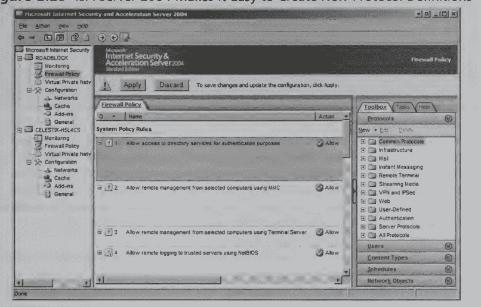

此外，使用 ISA Server 2004，您可以为您创建防火墙规则的任何协议控制源和目标端口号。这为 ISA Server 2004 防火墙管理员提供了非常高级别的控制，精确控制允许哪些数据包通过防火墙。

##### 改进的身份验证

ISA Server 2004 对身份验证过程进行了改进。用户可以通过内置的 Windows 身份验证、远程身份验证拨入用户服务（RADIUS）或其他命名空间进行身份验证。您可以将规则应用于任何命名空间中的用户或用户组。使用软件开发工具包，第三方厂商可以扩展这些内置身份验证类型，以提供额外的身份验证机制。

ISA Server 2000 的一个常见身份验证问题已得到解决：在 ISA 2000 中，HTTP 重定向器必须将请求转发到 Web 代理服务，以便防火墙客户端能够使用 Web 缓存。在此过程中，用户凭据会被移除，而如果需要用户凭据，请求就会失败。ISA Server 2004 通过允许防火墙客户端经由 HTTP 筛选器访问 Web 缓存而无需与 Web 代理服务进行单独身份验证，解决了这一问题。

使用 ISA Server 2000 时，Hotmail 网站也存在一些身份验证问题。这需要将该网站配置为直接访问。ISA Server 2004 中改进的 HTTP 筛选器也解决了这个问题。现在所有用户都可以通过易于配置的防火墙规则访问 Hotmail，而无需在客户端或防火墙上进行任何特殊配置。

##### 流行pekëlê哭得我popular 服务（如 OWA 和 FTP）更易于访问

由于 OWA 发布向导的存在，现在设置 Outlook Web Access (OWA) 以配合 ISA 2004 工作变得很容易。SSL VPN 通过使用安全套接字层（SSL）协议的安全连接提供无需客户端的远程访问。

ISA Server 2004 的 OWA 发布向导会引导您完成创建防火墙规则的过程，该规则会为您的 Exchange Server 创建一个 OWA SSL VPN。所有网络元素都可以"即时"创建，您无需离开向导来创建策略元素。此外，OWA 发布向导现在支持 Outlook Mobile Access 和 ActiveSync，这些在 ISA 2000 中无法通过向导配置。Web 侦听器的配置在 ISA 2000 的向导中未包含，但在 ISA 2004 中已包含。Web 侦听器也更具可配置性；在 ISA 2000 中，您必须全局设置 Web 侦听器的属性。也就是说，如果启用了 HTTP 侦听器，它将对所有 Web 侦听器启用。使用 ISA 2004，您可以为每个 Web 侦听器单独设置属性。

在 ISA Server 2000 中，配置对非标准端口上侦听的 FTP 服务器的出站访问很困难，并且需要防火墙客户端。ISA Server 2004 允许您访问在替代端口号上侦听的 Internet FTP 服务器，而无需在客户端或 ISA Server 2004 防火墙上进行任何特殊配置。此外，在替代端口号上发布 FTP 服务器在 ISA Server 2000 中是个问题，但在 ISA Server 2004 中很简单，只需创建一条 FTP 服务器发布规则即可。您将在第 8 章"使用 ISA 2004 将网络服务发布到 Internet"中学习如何操作。

##### 工具和陷阱……

##### 安全套接字层的工作原理

Netscape 最初开发安全套接字层（SSL）作为一种安全协议，用于通过 Web 浏览器传输信息。Netscape 从 RSA 获得了公钥加密技术的许可。SSL 使用公钥（非对称）加密来提供身份验证，并保护在两台计算机之间交换的消息的机密性和完整性。以下是其工作原理的简化版本：

- 1. 客户端计算机向服务器发送安全连接请求。
- 2. 服务器将其身份验证证书和公钥发送给客户端。


 3. 客户端检查证书是否有效，如果有效，客户端会生成一个随机加密密钥，并使用服务器的公钥对其进行加密，然后发送给服务器。
4. 服务器使用与其公钥匹配的私钥解密该加密密钥。
5. 客户端和服务器现在可以使用基于会话的对称密钥加密安全地交换数据。

##### 扩展的网络对象定义能力

在 ISA Server 2000 中，您基于 IP 地址（客户端地址集）或完全限定域名（目标集）来定义网络对象。而在 ISA Server 2004 中，定义网络对象的灵活性大大提高。您可以按照以下类别进行指定：

- **网络（Networks）**：在此上下文中，网络被定义为一段 IP 地址范围。
- **网络集（Network sets）**：这是一组网络的集合。
- **计算机（Computers）**：此处计算机被定义为代表单个 IP 地址。如果要将规则应用于具有多个网卡或单个网卡上分配了多个 IP 地址的计算机，您需要使用计算机集、地址范围甚至子网。
- **地址范围（Address ranges）**：顾名思义，这是一段 IP 地址范围。
- **子网（Subnets）**：子网也被定义为一段 IP 地址范围，在这种情况下，这些地址构成一个子网络。
- **计算机集（Computer sets）**：正如网络集是一组网络，计算机集是一组计算机（更具体地说，是一组非连续的 IP 地址）。
- **URL 集合（URL set）**：这是一组统一资源定位符（Web 地址）。
- **域名集（Domain name set）**：这是一组域名。
- **Web 侦听器（Web listener）**：这是一个软件构造，用于确定将使用哪些 IP 地址和端口来"侦听" Web 请求。

这些网络对象定义了防火墙规则的源和目标。每当创建规则时，您都需要指定要应用该规则的源对象和目标对象。完整的类别及其子类别列表如图 2.26 所示。

您将在第 4 章《*为 ISA 2004 准备网络基础设施*》中学习如何使用网络对象。

##### 防火墙规则功能的改进

控制通过 ISA 防火墙访问的核心组件是防火墙策略，它由系统策略规则、发布规则和访问规则组成（统称为防火墙策略规则）。ISA Server 2004 包含一套新的规则向导，使创建访问策略比以往更加容易。使用 ISA 2000 时，出站访问策略需要 IP 数据包筛选器、站点和内容规则以及协议规则。ISA Server 2004 的访问策略可以使用高级防火墙规则向导来创建，该向导允许您"即时"配置任何所需的策略元素。您无需像使用 ISA 2000 时那样离开规则向导来创建网络对象；任何规则所需的网络对象或关系都可以在新的向导中创建。

ISA Server 2000 的访问控制基于允许（Allow）和拒绝（Deny）规则。通常，先处理拒绝规则，然后处理允许规则。ISA Server 2004 的规则处理已完全重新设计。系统策略规则先处理，然后是用户定义的规则。防火墙规则现在表示为一个有序列表，其中连接参数首先与列表顶部的规则进行比较。ISA Server 2004 向下移动规则列表，直到找到与连接参数匹配的规则，然后强制执行该匹配规则的策略。这种防火墙策略方法使故障排除变得更加容易，并能够确定为什么允许或拒绝特定连接。

要更改列表中规则的顺序，请右键单击要移动的规则并选择**下移**或**上移**，如图 2.27 所示。

##### 图 2.27 更改访问和发布规则的处理顺序

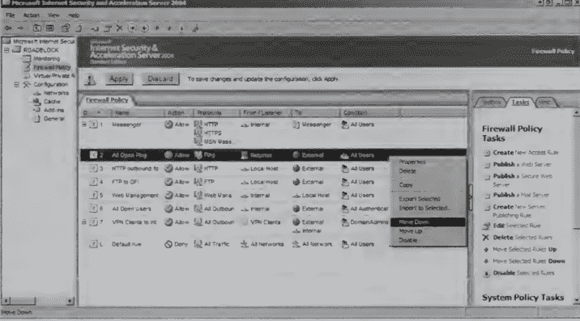

## 注意

您可以更改用户定义（发布和访问）规则的顺序，但不能更改系统策略规则的顺序。

ISA Server 2000 允许您指定用户可以访问哪些站点和协议，但不能允许用户使用选定协议访问特定站点，或使用特定协议访问特定站点。ISA Server 2004 的增强型防火墙规则允许您为允许用户或组访问的每个单独协议定义源和目标。这增加了通过 ISA 防火墙控制入站和出站访问的灵活性。

系统策略规则将在第 6 章《*安装和配置 ISA Server 2004 软件*》中详细讨论。您将在第 7 章《*创建和使用 ISA 2004 防火墙访问策略*》和第 8 章《*使用 ISA 2004 将网络服务发布到 Internet*》中学习创建和使用用户定义防火墙规则的所有细节。

##### 服务器发布和 Web 发布的改进

ISA 2004 在服务器发布和 Web 发布方面进行了多项改进。在 ISA Server 2000 中，服务器发布规则将传入连接转发到与原始请求接收端口相同的发布服务器上的端口。ISA Server 2004 允许您在特定端口号接收连接，然后将请求重定向到发布服务器上的不同端口号。

使用 ISA Server 2004，您可以将服务器置于防火墙后面，无论是在企业网络还是外围网络上，并安全地发布其服务。与 ISA 2000 不同，ISA 2004 有两个单独的 Web 发布向导。第一个是用于发布安全 Web 服务器，允许远程用户通过 SSL 访问 Web 服务器（如图 2.28 所示）。

**图 2.28 ISA 2004 发布 SSL Web 站点的向导**

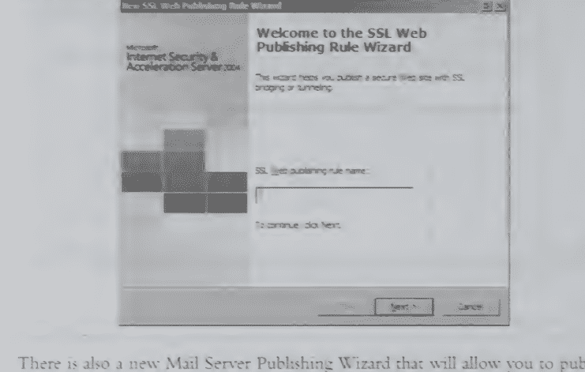

还有一个新的邮件服务器发布向导，允许您发布任何基于 IMAP、POP3、SMTP 或 RPC 的邮件服务器或 NNTP 新闻服务器，或者您可以发布 Outlook Web Access、Outlook Mobile Access 或 Exchange ActiveSync。ISA 2000 包含邮件服务器安全向导和单独的 OWA 发布向导，后者归类在 Web 发布下。ISA 2000 向导不支持 OMA 或 ActiveSync。

改进后的 Web 发布向导使您能够快速轻松地发布 Web 站点。例如，在 ISA 2000 中，Web 侦听器的配置不包含在向导中，而在 ISA 2004 中则包含在内。Web 侦听器也比以往更易配置；在 ISA 2000 中，您必须全局设置 Web 侦听器的属性。也就是说，如果启用 HTTP 侦听器，它将为所有 Web 侦听器启用。而在 ISA 2004 中，您可以为每个 Web 侦听器单独设置属性。

在 ISA 2000 中，在创建服务器发布规则或 Web 发布规则之前，您必须创建规则所需的一些新策略元素。而在 ISA 2004 中，策略元素可以在规则向导中"即时"创建。

##### 增强和改进的虚拟专用网络和远程访问

虚拟专用网络（VPN）对公司越来越重要，因为远程办公员工、高管和销售人员在出差或下班后需要从家里访问网络，以及合作伙伴和组织外部其他人员需要访问企业网络的需求不断增加。ISA Server 2004 在 VPN 和远程访问功能方面进行了许多改进和增强，包括：

- 站点到站点 VPN 链接的更大灵活性
- 对 VPN 客户端的更好控制
- PPTP 服务器发布
-  Secure Exchange RPC 连接的强制加密

在以下各小节中，我们将介绍每个类别中的改进之处。

###### 站点到站点 VPN 链接的更大灵活性

ISA Server 2004 改进的 VPN 功能允许它使用隧道模式的 IPSec 与其他 VPN 服务器创建站点到站点链接。这提高了 VPN 网络互操作性，超越了 ISA Server 2000 所提供的水平。这意味着 ISA Server 2004 可以部署在分支机构，并通过隧道模式 IPSec 站点到站点链接将分支机构网络连接到总部网络，即使总部使用的是第三方边缘防火墙，如 Cisco PIX、Check Point 或任何其他支持 IPSec VPN 的防火墙。ISA Server 2000 只能使用 PPTP 和 L2TP/IPSec VPN 协议通过 VPN 站点到站点链接连接 Internet 上的网络。

在 ISA Server 2000 中，通过站点到站点链接连接的网络被视为受信任网络；因此，防火墙策略不应用于通过该链接传输的通信。ISA Server 2004 引入了针对通过站点到站点 VPN 连接传输的所有通信的有状态筛选和检查。这意味着您可以控制特定主机或网络能够访问链接另一侧的哪些资源。基于用户/组的访问策略可用于精确控制通过该链接的资源使用。

###### 对 VPN 客户端的更好控制

与 ISA 2000 不同，ISA Server 2004 的防火墙策略应用于*所有*网络接口。这包括 VPN 接口。为了获得更好的安全性和控制，您可以将 VPN 客户端限制为仅访问内部网络上的选定服务器和协议集。例如，您可能希望允许 VPN 客户端对内部网络上的 Exchange 服务器具有完整的 Outlook MAPI 客户端访问权限，但不希望这些用户访问网络上的任何其他服务器或协议。在这种情况下，您可以

配置 ISA Server 2004 防火墙规则，将 VPN 用户的访问权限限制为仅允许访问 Exchange Server 的 MAPI 客户端服务，其他一律不允许。

VPN 客户端配置为一个独立的网络区域。这意味着你可以为 VPN 客户端创建独立的策略。防火墙规则引擎对来自 VPN 客户端的请求进行有区分的检查，根据访问策略对这些请求进行有状态过滤和检查，并动态地打开连接。

在 ISA Server 2000 中，只有配置为防火墙客户端的 VPN 客户端才能通过其连接的 ISA Server 2000 VPN 服务器访问 Internet。ISA Server 2004 改进了对 VPN 客户端的支持，允许 SecureNAT 客户端访问 Internet，而无需在客户端计算机上安装防火墙客户端。你还可以通过对通过 VPN 连接的 SecureNAT 客户端实施基于用户/组的防火墙策略，来增强企业网络的安全性。

##### PPTP 服务器发布

VPN 服务器的发布也得到了改进。使用 ISA Server 2000 只能发布 L2TP/IPSec NAT-T VPN 服务器。ISA Server 2004 允许发布位于 ISA Server 2004 防火墙后面的 PPTP VPN 服务器。ISA Server 2004 的智能 PPTP 应用程序过滤器执行复杂的连接管理。此外，你还可以使用 ISA Server 2004 服务器发布功能轻松发布 Windows Server 2003 的 NAT-T L2TP/IPSec VPN 服务器。ISA Server 2004 还支持位于防火墙后面且兼容 NAT-T 的基于 IPSec 的 VPN 服务器。

##### 安全 Exchange RPC 连接的强制加密

可以在 ISA Server 2004 防火墙上设置 RPC 策略，以防止来自通过 Internet 连接的远程 Outlook MAPI 客户端的非加密通信。这样可以增强网络和 Exchange 的安全性，防止用户凭据和数据以非加密格式进行交换。

##### 增强和改进的 Web 缓存与 Web 代理

需要记住的是，尽管 Microsoft 强调其安全性，ISA Server 2004 不仅仅是一个防火墙；它还是一个功能完善的缓存服务器。ISA Server 中的 Web 缓存和 Web 代理功能已经进行了多项改进。这些改进包括：

- 缓存规则向导的改进
- SSL 内容缓存的更大灵活性
- Web 发布规则的路径映射
- 计划内容下载的增强

在以下小节中，我们将更详细地讨论这些改进和增强。

###### 缓存规则向导的改进

与 ISA Server 2000 一样，缓存规则可以通过便捷的向导界面创建。但是，缓存规则向导在 ISA Server 2004 中得到了改进。首先，你可以找到它了。在 ISA Server 2000 界面中，缓存规则是通过"新建路由规则"向导设置的，如图 2.29 所示，该菜单位于左侧控制台窗格的"网络配置"节点中（*而不是*人们可能期望的"缓存配置"节点中），位置相当不直观。

**图 2.29** ISA 2000 中的缓存规则

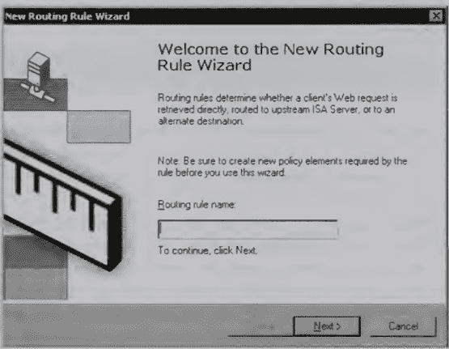

在 ISA Server 2004 中，缓存规则是从**配置 | 缓存**节点创建的——就在大多数人自然会查找的位置——可以通过右键单击"缓存"节点并选择**新建**，然后选择**缓存规则**来创建，如图 2.30 所示；或者只需单击右侧**任务**窗格中的**创建缓存规则**，如图 2.30 所示。

**图 2.30** 在 ISA Server 2004 中创建缓存规则

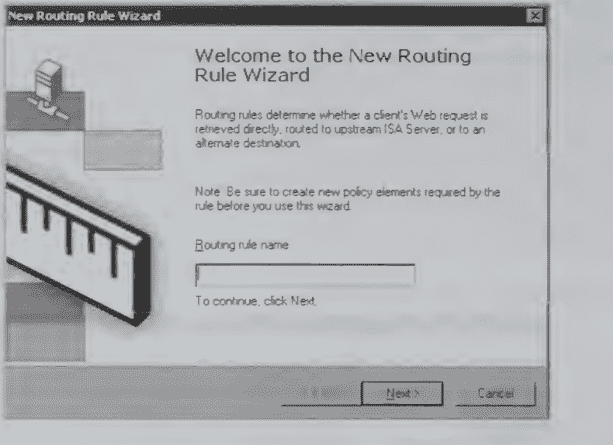

此外，在选择缓存规则将应用的网络实体时，你拥有更大的灵活性和清晰度。在 ISA Server 2000 中，你的选择包括：所有目标、所有内部目标、所有外部目标、指定的目标集，或除选定集之外的所有目标。

在 ISA Server 2004 中，你可以将缓存规则应用于前面讨论过的任何网络实体列表：整个网络、网络集、单个计算机、地址范围、子网、计算机集、域名集或 URL 集。

在 ISA Server 2004 向导中，你还可以更细粒度地配置检索到的内容在何种情况下存储在缓存中。除了选择当源和请求头指示缓存时将内容存储在缓存中外，你还可以选择缓存动态内容、缓存内容以供离线浏览，以及按规则缓存需要用户身份验证的内容。

我们将在第 11 章*利用 ISA Server 2004 缓存功能加速 Web 性能*中更详细地讨论缓存规则向导。

###### SSL 内容缓存的更大灵活性

在 ISA Server 2000 中，无法选择*不*缓存 SSL 内容。这是一个问题，因为 SSL 是安全内容，出于安全考虑，你可能不希望将其存储在缓存中。

在 ISA Server 2004 中，这个问题得到了解决。当你创建缓存规则时，默认会缓存 SSL 内容，但你可以在缓存高级配置页面上通过取消选中复选框来选择不缓存它。或者，在规则创建后，你可以通过右键单击该规则，选择**属性**，然后选择**高级**选项卡，再取消选中复选框来配置不缓存 SSL 内容，如图 2.31 所示。

**图 2.31** ISA Server 2004 — 你可以选择*不*缓存 SSL 内容

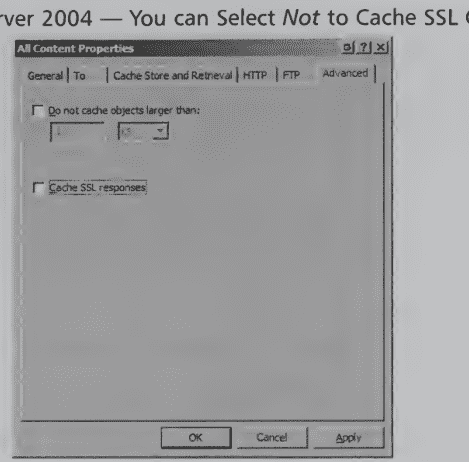

能够控制是否缓存 SSL 响应是 ISA Server 2004 中广受欢迎的新增功能。

###### Web 发布规则的路径映射

ISA Server 2000 的 Web 发布规则要求，用户在原始请求中包含的路径必须与已发布 Web 服务器上的路径相同。ISA Server 2004 显著提高了 Web 发布的灵活性，允许你将用户发送到防火墙的路径重定向到已发布 Web 服务器上的任何路径。

在 ISA Server 2004 中配置路径映射时，ISA 会将请求中包含的路径替换为你已经映射的路径。

路径映射是在创建 Web 发布规则后通过编辑该规则来配置的。在发布规则的**属性**对话框中，选择**路径**选项卡，并以**/path/*** 的格式添加要映射请求的目标路径。

在讨论第 8 章*使用 ISA 2004 将网络服务发布到 Internet*中的发布规则创建时，你将了解更多关于路径映射的信息。

###### 计划内容下载的增强

计划内容下载功能在 ISA Server 2004 中也得到了改进。在 ISA Server 2000 中，无法计划从需要用户身份验证的站点下载内容。这限制了你自动化内容下载过程的能力。

在 ISA Server 2004 中，你现在可以指定用于身份验证的帐户，从而允许你计划从需要身份验证的站点下载内容。

##### 增强和改进的监控和报告

ISA Server 2000 中令一些用户不太满意的一个方面是监控和报告功能（公平地说，这也是许多其他厂商防火墙的通病）。当然，"纸质记录"——或者在这种情况下是数字记录——远没有其他功能那么令人兴奋，但在当今的商业环境中，文档是保护你的网络和你自己的必要元素。

Microsoft 听取了客户的意见，并对 ISA Server 2004 的日志记录、监控和报告功能进行了大量的改进和补充，包括：

- 日志条目的实时监测
- 防火墙会话的实时监控和过滤
- 内置的日志查询机制
- 连接验证器
- 自定义报告的功能
- 发布报告的功能
- 报告作业的电子邮件通知
- 配置日志摘要时间的能力
- 更好的 SQL 日志记录
- 记录到 MSDE 数据库的能力

我们将在以下小节中简要介绍这些内容。

###### 日志条目的实时监测

使用 ISA Server 2004，你可以实时查看防火墙、Web 代理和 SMTP 邮件筛选器日志。监控控制台在日志条目记录到防火墙日志文件时显示它们（图 2.32）。这与 ISA Server 2000 形成对比，在 ISA Server 2000 中，你必须查看实际日志文件（默认情况下每天创建）或生成报告才能看到记录的信息。


 **图 2.32** 使用 ISA Server 2004 实时监控日志

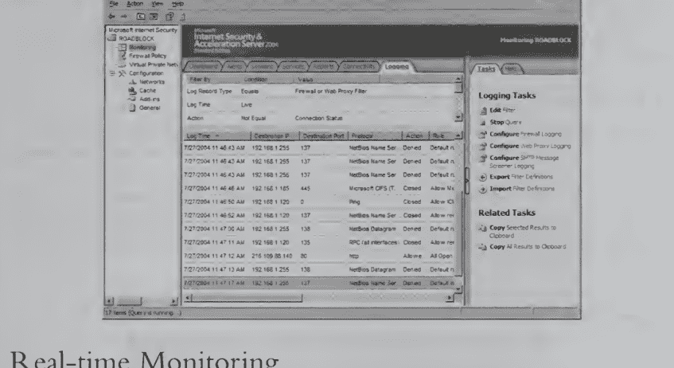

###### 防火墙会话的实时监控与过滤

ISA Server 2004 允许您查看所有与防火墙的活动连接。使用**监控**控制台中的**会话**选项卡，如图 2.33 所示，您可以对单个或成组会话进行排序或断开连接。您还可以使用内置的会话过滤功能，对会话界面中的条目进行筛选，以关注您感兴趣的特定会话。

**图 2.33** 会话功能 — 查看通过防火墙的所有活动连接

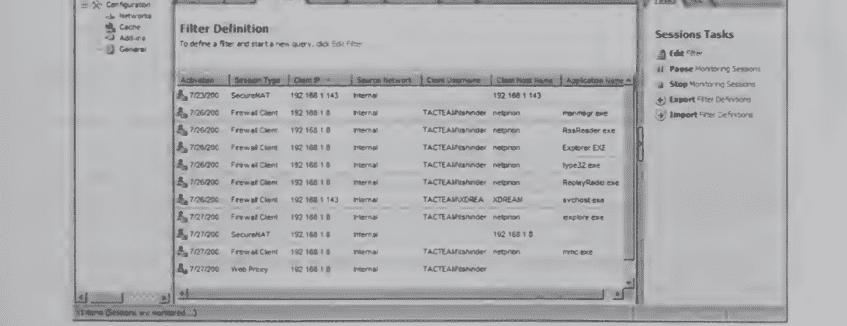

如图所示，您可以看到会话类型（客户端是通过防火墙客户端、SecureNAT 还是 Web 代理客户端进行连接）、用户的 IP 地址、用户名和客户端计算机名称，甚至正在使用的应用程序。

这对故障 排除以及确定用户是否正在使用未经授权或有问题的应用程序非常有用。

###### 内置日志查询机制

借助 ISA Server 2004，您可以使用内置的日志查询机制来查询日志文件。您可以针对日志文件中记录的任何字段所包含的信息进行查询。结果将显示在 ISA Server 2004 控制台的日志查看器中，并可以复制到剪贴板，然后粘贴到另一个应用程序中进行更详细的分析。

您可以配置筛选器以限制查询结果。例如，您可以将查询范围限制在特定的时间范围内，或指定查询使用实时数据。配置非常简单，如图 2.34 所示。

###### 图 2.34 配置筛选器以限制查询结果

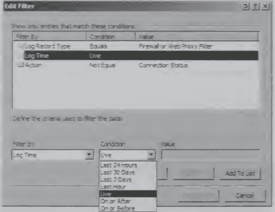

## 注意

> 日志查看器可用于查看有关防火墙和 Web 代理日志的信息，但不能查看 SMTP 邮件筛选器日志。

除了日志时间之外，您还可以根据许多不同的标准进行筛选，包括（但不限于）客户端或目标 IP 地址、用户名、协议、服务器名称、服务或 URL。

我们将在第 12 章*使用 ISA Server 2004 的监控、日志记录和报告工具*中更详细地讨论如何筛选查询。

检查 ISA Server 2004 的功能集 • 第 2 章 121

###### 连接验证器

ISA Server 2004 能够通过 ISA Server 2004 计算机上的**监控**控制台的**连接**选项卡，使用连接验证器定期监控与特定计算机或 URL 的连接，从而验证连接性。您可以配置使用哪种方法来确定连接性：ping、连接到某个端口的 TCP 连接或 HTTP GET。您可以通过指定 IP 地址、计算机名称或 URL 来选择要监控的连接。

连接验证器向导将引导您完成创建新连接验证器的过程。

###### 更好的报告自定义功能

ISA Server 2000 允许对防火墙生成的报告进行一些有限的自定义。但是，ISA Server 2004 包含了增强的报告自定义功能，允许您在防火墙报告中包含更多信息。

新建报告向导可帮助您自定义一次性报告，而新建报告作业向导可帮助您自定义计划的报告作业。在这两种情况下，您都可以选择要包含的内容、涵盖的时间段以及是否/在何处发布报告。

###### 发布报告的功能

借助 ISA Server 2004，可以将单个报告或报告作业配置为自动将报告的副本保存到本地文件夹或网络文件共享中。已发布的报告以 HTML 格式保存，保存报告的文件夹或文件共享可以映射到网站虚拟目录，以便其他用户查看报告。您还可以手动发布未配置为在报告创建后自动发布的报告。

###### 报告作业的电子邮件通知

在 ISA 2004 的新建报告向导和新建报告作业向导中，您都可以配置报告或报告作业，以便在报告或作业完成后向您或其他管理员发送电子邮件。您可以自定义要发送的消息，如果您已将报告配置为发布，则可以自动在电子邮件中包含指向报告的链接。

###### 配置日志摘要时间的能力

ISA Server 2000 被硬编码为在每天凌晨 12:30 创建日志摘要。报告基于日志摘要中包含的信息，因此这限制了可以生成准确报告的时间。ISA Server 2004 允许您轻松自定义创建日志摘要的时间。反过来，这也让您在确定每天创建报告的时间时拥有更大的灵活性。

默认时间仍然是凌晨 12:30，但更改它就像点击框中的**向上**和**向下**箭头一样简单，如图 2.35 所示。

###### 图 2.35 借助 ISA Server 2004，您可以更改生成日志摘要的时间

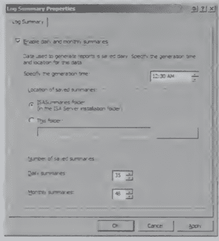

###### 更好的 SQL 日志记录

借助 ISA Server 2004，您可以记录到位于内部网络上另一台计算机的 SQL 数据库中。ISA Server 2004 的 SQL 日志记录还经过了优化，与 ISA Server 2000 中的 SQL 日志记录相比，性能显著提高。

我们将在第 12 章*使用 ISA Server 2004 的监控、日志记录和报告工具*中讨论如何设置记录到远程 SQL 服务器。

###### 记录到 MSDE 数据库的能力

借助 ISA Server 2004，日志现在可以存储为 Microsoft 数据引擎 (MSDE) 格式。记录到本地数据库可提高查询速度和灵活性。保存在 MSDE 数据库中的数据可以在日志查看器中查看，并可以保存为文本文件。

> **提示**
> 
> 如果您拥有 SQL Server 2000 许可证，您可以使用 SQL 工具（如企业管理器、查询工具等）来查看数据库并执行查询。

我们将在第 12 章*使用 ISA Server 2004 的监控、日志记录和报告工具*中讨论如何设置记录到 MSDE 数据库。

##### 新功能

除了上一节中讨论的所有改进功能外，Microsoft 还向 ISA Server 2004 添加了许多全新的功能。在接下来的章节中，我们将介绍三个最重要的新功能：

- 多网络支持
- 新的应用层过滤 (ALF) 功能
- VPN 隔离控制

###### 多网络支持

ISA 2000 的一个重大局限性在于它不支持多个网络。当今复杂的网络要求您能够使用多个网络并定义它们之间的关系。借助 ISA Server 2004，Microsoft 引入了适用于许多公司使用的互联网络的多网络模型。现在，您可以创建网络规则并控制不同网络之间的通信方式。

ISA Server 2004 包含多个内置网络定义，包括：

- 内部网络（包括主受保护网络上的地址）
- 外部网络（包含不属于任何其他网络的地址）
- VPN 客户端网络（包括分配给 VPN 客户端的地址）
- 本地主机网络（包括 ISA 服务器上的 IP 地址）

您可以配置一个或多个网络，每个网络与其他网络之间都有独特的关系。在 ISA Server 2000 中，所有流量都是相对于本地地址表 (LAT) 进行检查的，该表仅包含内部网络上的地址范围，但 ISA Server 2004 将防火墙和安全功能扩展为适用于任何网络或网络对象之间的流量。

###### 按网络策略

ISA Server 2004 的新多网络功能使您能够轻松保护网络免受内部和外部安全威胁，方法是限制客户端之间的通信，即使在您自己的组织内部也是如此。多网络功能支持复杂的外围网络（也称为 DMZ、非军事区或屏蔽子网）方案，允许您配置不同网络中的客户端如何访问外围网络。网络之间的访问策略可以基于每个网络所代表的独特安全区域。


 ## 网络关系

你还可以使用 ISA Server 2004 来定义网络之间的路由关系，具体取决于网络之间所需的访问和通信类型。例如，在某些情况下，你可能希望在网络之间实现更安全、透明度更低的通信。你可以为这些网络定义网络地址转换（NAT）关系。在其他场景中，你可能只是希望通过 ISA Server 路由流量；在这种情况下，你可以定义路由关系。与 ISA Server 2000 不同，在路由网络之间移动的流量完全暴露于 ISA Server 2004 的状态过滤和检查机制之下。

##### 网络模板

ISA Server 2004 提供了网络模板，你可以使用这些模板轻松配置管理多个网络之间流量的防火墙策略。这些模板旨在解决常见场景，包括：

- 作为边缘防火墙的 ISA Server
- 外围网络（DMZ）
- 作为前端防火墙并与第三方后端防火墙配合使用的 ISA
- 部署在外围网络和内部网络之间的 ISA Server
- 使用单块网卡（NIC）的缓存/Web 代理服务器

你将在第 4 章《为 ISA Server 2004 准备网络基础设施》中了解有关如何配置多网络、创建网络规则和应用网络模板的更多内容。

##### 新应用程序层过滤（ALF）功能

应用程序层过滤是 ISA Server 2004 的一大强项：与传统的数据包过滤防火墙不同，ISA 可以深入探查应用程序层通信，以保护你的网络免受该层发生的许多现代漏洞利用的攻击。ISA Server 2000 的 ALF 功能通过添加以下新特性得到了增强：

- 按规则进行 HTTP 过滤
- 阻止访问所有可执行文件的能力
- 按文件扩展名控制 HTTP 下载的能力
- 将 HTTP 过滤应用于所有客户端连接
- 基于签名的 HTTP 访问控制
- 对允许的 HTTP 方法的控制
- 强制安全 Exchange RPC .cv 连接的能力
- 基于策略的 FTP 控制
- 链接转换

在以下小节中，我们将逐一介绍这些特性。

###### 按率军函数 HTTP 过滤

ISA Server 2004 的 HTTP 策略允许防火墙执行深度 HTTP 状态检查（应用程序层过滤）。你可以在逐个规则的基础上配置检查范围。这意味着你可以为 HTTP 入站和出站访问配置自定义约束。使用 ISA Server 2000 时，HTTP 过滤必须全局执行，使用随 ISA Server 2000 Feature Pack 1 一起安装的 URLScan 版本。

###### 阻止访问所有可执行文件的能力

你可以配置 ISA Server 2004 的 HTTP 策略，以阻止所有对 Windows 可执行内容的连接尝试，而不考虑资源使用的文件扩展名。这将阻止所有下载二进制文件的第一个字为 MZ 的响应。你还可以按文件扩展名进行阻止（参见下一小节）。

> **警告**
> 
> 阻止所有 Windows 可执行文件并不一定能阻止所有可能有危险的文件类型。例如，.pif 和 .com 文件不会被此过滤器阻止，因为这些二进制文件的前两个字节不是 MZ。你可以通过配置按文件扩展名阻止的过滤器来阻止这些其他可能有危险的文件类型。

> **注意**
> 
> 文件的前两个字节包含其文件签名。MZ 文件签名最初用于 MS-DOS 可执行文件，代表微软程序员 Mark Zbikowski 的名字。

###### 按文件扩展名控制 HTTP 下载的能力

ISA Server 2004 的 HTTP 策略使你能够轻松允许所有文件扩展名、允许除指定组之外的所有扩展名，或阻止除指定组之外的所有扩展名。这使你在控制用户可以下载的文件类型方面具有很大的灵活性，尤其是因为这是按规则进行的。这意味着你可以将某些扩展名的阻止应用于特定用户或组。

###### 将 HTTP 过滤应用于所有客户端连接

ISA Server 2000 能够根据 HTTP 和 FTP 连接按 MIME 类型（对于 HTTP）或文件扩展名（对于 FTP）阻止 Web 代理客户端的内容。借助 ISA Server 2004 的 HTTP 策略，你可以控制所有 ISA Server 2004 客户端连接的 HTTP 访问，而不考虑客户端类型。ISA Server 2000 开箱即用时没有对出站连接进行深入检查。

###### 基于签名的 HTTP 访问控制

ISA Server 2004 的深度 HTTP 检查还允许你创建可以与请求 URL、请求头、请求正文、响应头和响应正文进行比较的"HTTP 签名"。这使你能够对内部和外部用户通过 ISA Server 2004 防火墙访问的内容进行极其精确的控制。

签名是 ISA Server 将搜索请求正文、请求头、响应正文和/或响应头的字符串。如果找到该字符串，数据将被阻止。你可以搜索文本或二进制字符串。基于文本签名的阻止只能在 HTTP 请求和响应使用 UTF-8 编码时进行。

###### 对允许的 HTTP 方法的控制

你可以通过对用户访问各种方法设置访问控制来控制允许哪些 HTTP 方法通过防火墙。例如，你可以限制 HTTP POST 方法，以防止用户使用 HTTP POST 方法向网站发送数据。你可以选择允许所有方法、允许选定的方法，或阻止指定的方法并允许其他所有方法。

> **注意**
> 
> HTTP 方法是告诉服务器对给定请求执行什么操作的命令。它们有时也被称为"HTTP 动词"，因为它们由动作词组成：GET（检索由 URI 标识的数据）、PUT（将数据存储在 URL 下）、POST（创建与指定对象链接的对象）等。

###### 强制安全 Exchange RPC 连接的能力

ISA Server 2004 的安全 Exchange Server 发布规则允许远程用户通过 Internet 使用功能完整的 Outlook MAPI 客户端连接到 Exchange 服务器。然而，必须将 Outlook 客户端配置为使用安全 RPC，以便连接将被加密。ISA Server 2004 的 RPC 策略允许你阻止所有未加密的 Outlook MAPI 客户端连接。

使用传统防火墙时，你必须打开多个端口才能启用使用 Outlook MAPI 客户端对 Exchange RPC 服务的远程访问，这会带来安全风险。使用 ISA Server 2004 时，RPC 过滤器解决了这个问题。

###### 基于策略的 FTP 控制

你可以配置 ISA Server 2004 的 FTP 策略，允许用户通过 FTP 上传和下载，或者你可以将用户 FTP 访问限制为仅下载。这使你对 FTP 活动有更多的控制和更细粒度的安全性。通过在配置 FTP 过滤时在**协议**选项卡上选择**只读**，你可以阻止 FTP 上传。

FTP 访问过滤器比用户定义的 FTP 协议功能更强大，因为它会动态打开指定端口用于辅助连接，并可以执行辅助连接所需的地址转换。该过滤器还能够区分读写权限，因此你可以细粒度地控制访问。

## 链接转换

你发布的一些网站可能包含对计算机 NetBIOS 名称的引用。只有 ISA Server 2004 防火墙和外部命名空间可供外部客户端使用，而内部网络命名空间不可用。这意味着当外部客户端尝试通过这些链接访问网站时，这些引用将显示为损坏的链接。

ISA Server 2004 包含链接转换功能，允许你创建内部计算机名称映射到公共已知名称的定义字典。例如，这在发布 SharePoint 网站时特别有用。链接转换目录还可以转换对标准端口以外端口发出的请求，链接转换器在将 URL 发送回客户端时会包含端口号。

> **注意**
> 
> 尽管链接转换在 ISA Server 2000 中不是开箱即用的功能，但可以通过安装 Feature Pack 1 将其添加到 ISA 2000 中。

> **提示**
> 
> 默认情况下，链接转换仅适用于 HTML 文档，但你可以根据需要添加其他内容组。


 VPN 隔离控制

这是 ISA Server 2000 中不具备的另一项功能。ISA Server 2004 利用 Windows Server 2003 内置的网络访问隔离控制功能来提供 VPN 隔离，使你能够将 VPN 客户端隔离到一个独立的网络上，直到它们满足一组预定义的安全要求。即使 ISA Server 2004 安装在 Windows 2000 上，你仍然可以使用隔离控制，但会有一些限制。无论哪种情况，你都能够指定 VPN 客户端必须满足哪些条件才能被允许访问内部网络，例如：

- 必须安装安全更新和服务包
- 必须安装并启用防病毒软件
- 必须安装并启用个人防火墙软件

通过预定义安全测试的 VPN 客户端将根据 VPN 客户端防火墙策略获得网络访问权限。未通过安全测试的 VPN 客户端可能会被提供有限的访问权限，以便访问能够帮助它们满足网络安全要求的服务器（例如，可以下载所需补丁和更新的服务器）。

##### ISA Server 2004 VPN 隔离控制的优势

VPN 隔离控制是一项令人兴奋的功能，有助于保护你的网络免受那些从安全补丁和服务包未更新的客户端计算机建立 VPN 连接的远程用户的威胁，这些计算机可能未安装并启用防病毒软件，和/或未安装个人防火墙来防止 Internet 攻击。许多其他防火墙供应商也提供类似功能，尽管名称通常不同——但在大多数情况下，你必须使用它们专有的 VPN 客户端软件（需要额外付费）才能利用此功能。使用 ISA Server 2004，无需特殊的客户端软件；客户端使用所有现代 Windows 操作系统内置的 PPTP 或 L2TP 客户端即可。

##### 使用 VPN 隔离控制的选项

要通过路由和远程访问使用 VPN 隔离控制，ISA Server 2004 需要安装在 Windows Server 2003 计算机上。然后，你能够基于 RADIUS 服务器策略隔离 VPN 客户端。如果 ISA Server 2004 安装在 Windows 2000 服务器上，你仍然可以通过 ISA Server 启用隔离模式，并为隔离的 VPN 客户端网络设置防火墙策略。

当用户从外部位置使用 VPN 访问网络时，隔离控制非常适合强制遵守组织的安全策略，但设置它并非轻而易举。你必须使用 Windows 2000 Server 和 Windows Server 2003 附带的连接管理器管理员工具包（CMAK）为 VPN 客户端创建连接管理器配置文件和连接项。

然后，你可以在服务器上启用隔离，可以使用 RADIUS 策略，也可以使用 ISA Server 策略。如果你运行的 ISA 安装在 Windows Server 2003 计算机上，并且网络上有 RADIUS 服务器，Microsoft 建议你使用 RADIUS 策略。否则，你将不得不使用 ISA Server 策略。

你可以设置客户端在尝试通过 VPN 连接时处于隔离状态的时间长度。如果客户端在此指定时间段内未遵守安全策略要求，从而无法从隔离的 VPN 客户端网络移动到 VPN 客户端网络，它将被断开连接。如果你有一些即使未通过安全测试也不应被隔离的客户端（例如，老板的电脑），你可以创建豁免列表，使隔离控制不适用于它们。

##### 启用 VPN 隔离控制的要求

要使用隔离控制，你必须在 ISA Server 防火墙上安装一个侦听器组件。这是一个软件构造，用于侦听来自 VPN 客户端的消息，这些消息告诉 ISA 服务器隔离控制脚本已成功运行。侦听器侦听来自通知器组件的消息。ISA Server 2004 资源包包含一个侦听器，即远程访问隔离代理服务（Rqs.exe），以及一个你可以使用的通知器组件（Rqc.exe），或者你也可以创建自己的侦听器。当客户端计算机符合安全策略时，通知器会向侦听器发送通知消息，客户端将被解除隔离。

这是棘手的部分：你必须精通脚本编写，才能创建将由连接管理器配置文件在客户端计算机上运行的隔离脚本。

> **警告**
> 
> 通知消息既未加密也未经过身份验证。这意味着黑客有可能伪造消息。

那些不符合策略的客户端怎么办？你可以设置一个允许匿名访问的 Web 服务器，供这些客户端下载遵守策略所需的说明和/或软件。被隔离的客户端可以访问此服务器，但无法访问网络上的其他资源。

我们将在第 9 章，*《使用 ISA 防火墙创建远程访问和站点到站点 VPN》*中讨论如何配置 ISA Server 2004 隔离控制策略。

##### 失踪：虽去犹忆

ISA Server 2004 提供了一些出色的新功能，并对 ISA Server 2000 中已存在但功能较弱或不够友好的许多功能进行了改进和增强。然而，如果我们不提到在 ISA Server 2004 中有一些你可能在 ISA Server 2000 中使用过的功能"失踪"了，那就是我们的疏忽了。

大多数 ISA Server 防火墙管理员不会想念这些功能，因为它们要么是使用不多的功能，要么是在 ISA 2000 中运行不佳的功能。然而，请注意，如果你对这些功能有特定需求，你可能考虑不升级到 ISA 2004，或添加能够处理这些功能的第三方产品。最显著的"虽去犹忆"功能包括：

- 实时媒体流拆分
- H.323 网关
- 带宽控制
- 主动缓存

让我们简要介绍一下这些功能各自的用途，以及 Microsoft 为何选择在 ISA Server 2004 中不再包含它们。

###### 实时媒体流拆分

ISA Server 2000 能够使用 Windows Media 技术（WMT）拆分实时媒体流，以减少流式传输音频或视频所使用的带宽，具体取决于观看同一流媒体内容的内部客户端数量。如果你的组织内有大量人员经常观看或收听相同的流媒体源，这将是有益的。该功能可以应用于使用位于内部网络上的 WMT 服务器的流，或者你也可以将 WMT 服务器安装在 ISA Server 本身上。

根据客户反馈，实施 ISA Server 的大多数公司没有使用流媒体拆分功能，因此 Microsoft 未在 ISA Server 2004 中包含它。

###### H.323 网关

H.323 网关用于 IP 语音（VoIP）呼叫的呼叫处理和路由。VoIP 允许你通过 Internet 进行语音通话，而不是使用电话公司的线路。这对于必须进行大量长途呼叫的组织来说，可以大大节省长途费用。

据报道，当畸形数据包 directed at 该服务时，ISA Server 网关服务中存在内存泄漏问题。如果未在 ISA Server 上配置 H.323 网关，这些攻击不会产生任何影响。尽管该问题已通过 ISA Server 2000 Service Pack 1 得到纠正，但由于这些问题以及许多 ISA Server 用户发现 H.323 网关配置困难，许多用户停止使用 H.323 网关服务或未使用它。此外，许多较新的 VoIP 产品使用会话发起协议（SIP）代替 H.323。SIP 复杂度较低，是作为 H.323 的替代方案而设计的。Cisco 和其他供应商销售基于 SIP 的 IP 电话（Cisco 也有自己的专有 VoIP 协议，称为 Skinny）。要使 H.323 有效可行，连接的双方都必须有 H.323 网关。

由于这些原因导致使用率低下，Microsoft 在 ISA Server 2004 中取消了对 H.323 网关的支持。

###### 带宽控制

ISA Server 2000 包含带宽控制功能。你可以右键单击"带宽规则"节点，选中一个复选框来启用带宽控制，然后设置以 Kbps 为单位的有效带宽。有效带宽是指调制解调器等设备使用的实际带宽，或整体网络带宽。你可以使用带宽规则来指定哪些连接将优先于其他连接。

尽管这看起来是个好主意，但用户抱怨 ISA Server 2000 中的带宽控制不起作用，或未能按预期工作。用户期望带宽控制能够限制每个连接可以使用的带宽量。但实际情况并非如此。相反，带宽规则由服务质量（QoS）数据包计划程序服务使用，以确定如何对连接进行优先级排序。更令人不安的是，即使当你理解了带宽规则的作用和限制并正确配置它们之后，仍然存在规则随时间推移停止工作的广泛问题。唯一的解决办法似乎是重新格式化并重新安装操作系统和 ISA Server——这不是普通的防火墙管理员希望定期做的事情。

由于这些原因，ISA Server 2004 取消了对带宽控制功能的支持。

###### 主动缓存

ISA Server 2000 不仅支持正向/反向和分布式/分层缓存类型，还支持主动缓存。此功能会自动发起请求来更新缓存中存储的对象，无需用户干预。这些更新可以根据对象在缓存中的时间长短或上次从源服务器检索的时间来触发。启用主动缓存时，ISA Server 会在对象过期前自动刷新缓存内容。ISA 服务器会跟踪缓存中最受欢迎的对象，即使没有人请求它们，也会重新缓存它们。

你能够配置主动缓存策略，以确定应多久更新一次对象，以平衡缓存对象时效性与网络性能之间的关系。


尽管主动缓存可以确保频繁请求的对象保持最新，但它也会占用大量网络带宽并影响整体网络性能。ISA Server 2000 默认未启用主动缓存，客户反馈表明这一功能对大多数 Microsoft ISA Server 用户来说并不重要。鉴于 Microsoft 在 ISA Server 2004 中强调防火墙功能，主动缓存功能被移除。

### 摘要

ISA Server 2004 功能丰富。本章讨论了彻底改进的图形用户界面，这是 ISA Server 软件最明显的改动之一。通过 ISA Server 2004，Microsoft 又朝着远离 Proxy Server、进军严肃防火墙产品领域迈出了一大步。尽管 ISA Server 2004 建立在 ISA Server 2000 的基础上，但从很多方面来说，它更像是一款全新的产品，而非版本升级。其重点比以往任何时候都更侧重于安全性。

ISA Server 2004 仍保留了 ISA Server 2000 的许多功能，但大多数功能都已得到改进或增强。从更实用的向导到更大的配置灵活性，再到执行旧有熟悉防火墙管理任务的全新方式，ISA Server 发生了许多变化。

Microsoft 还为 ISA Server 2004 添加了一些全新的功能。最广泛且可能最受欢迎的新功能是多网络支持，这扩展了 ISA Server 2004 在大型复杂网络环境中作为首选防火墙的能力。新的应用层过滤（ALF）功能使 ISA Server 2004 在前线防御垃圾邮件等功能方面更具优势，而 VPN 隔离控制则为管理员提供了一种强大的方式，确保远程 VPN 客户端必须达到与内部网络客户端相同的安全配置标准。

在本章中，我们没有试图涵盖 ISA Server 中所有已改进或新增的功能。我们试图让你了解 ISA Server 2004 与其前代产品之间的一些差异。本章没有详细介绍如何使用所有这些新功能和改进功能，但我们向你介绍了其中许多功能，并将在本书后续章节中提供逐步使用说明。

我们还花了一些时间缅怀几位已逝去的老朋友：在 ISA Server 2000 中我们已经习惯（或在某些情况下没有习惯）但未能进入 ISA Server 2004 的功能。总体而言，我们认为 ISA Server 2004 的功能集是稳固的，而且我们发现它更易于设置和管理。我们对 ISA Server 2004 的信心可以通过以下事实来说明：我们目前有多台 ISA Server 2004 机器在保护我们自己的网络。就功能而言，我们认为 ISA Server 是现有性价比最高的防火墙/缓存解决方案之一。在下一章中，我们将把它与一些竞争对手进行比较，并向你说明为什么我们认为它具有竞争力。

#### 快速解决方案

##### 新 GUI：不只是赏心悦目

- 通过使界面更加友好来改善用户体验是 ISA Server 2004 开发团队的主要目标之一，他们做得很好。
- ISA Server 2004 控制台比 ISA 2000 丰富得多，采用三窗格窗口，左窗格仍包含熟悉的树状结构，但中间和右窗格提供标签页，便于选择要执行的任务类型并获取精确的执行帮助。
- 左窗格节点包括：ISA Server（名称）顶级节点、监控节点、防火墙策略节点、虚拟专用网络（VPN）节点和配置节点。
- 配置节点包含四个子节点：网络、缓存、加载项和常规。
- "入门"页面使设置 ISA Server 防火墙和/或缓存服务器变得简单。
- *仪表板*正如其名称所示——一个"全景"视图，概括了由标签页代表的每个监控区域（日志记录除外）。
- 防火墙策略节点是 ISA Server 界面的"核心"。在这里，你可以创建访问规则、Web 发布规则、邮件服务器发布规则和其他服务器发布规则，以控制对网络的访问和网络对外的访问。
- *虚拟专用网络*节点提供了执行常见 VPN 配置任务和控制客户端访问的友好界面。
- *网络*标签页（配置节点）用于在多种网络环境中创建和配置网络。
- *缓存*子节点用于定义缓存驱动器、创建缓存规则、配置常规缓存设置或完全禁用缓存，使 ISA 服务器仅作为防火墙运行。
- *加载项*子节点用于配置 ISA Server 的应用层过滤（ALF）。你可以在此处启用、查看、修改和禁用应用程序筛选器和 Web 筛选器。
- *常规*子节点包含常规管理任务。

##### 旧功能的新技巧

- 如果你的公司在不同地点有多个 ISA Server 安装，你肯定不想亲自前往每台 ISA Server 机器来执行管理任务。
- 远程管理 ISA Server 防火墙的三种方式是：ISA Server 管理控制台、Windows 2000 终端服务或 Server 2003 远程桌面，以及通过第三方 Web 界面。
- ISA Server 2004 允许你控制对任何协议的访问和使用，包括 IP 级协议。
- ISA Server 2004 对身份验证流程进行了改进。用户可以通过内置的 Windows 身份验证、远程身份验证拨入用户服务（RADIUS）或其他命名空间进行身份验证。
- 得益于 OWA 发布向导，现在设置 Outlook Web Access（OWA）以配合 ISA 2004 工作变得更加容易。
- 使用 ISA Server 2004，你在定义网络对象时具有更大的灵活性，因为你可以按照以下类别指定它们：网络、网络集、计算机、计算机集、地址范围、子网、URL 集、域名集和 Web 侦听器。
- ISA Server 2004 包含一套新的规则向导，使创建访问策略比以往任何时候都更加容易。
- 在 ISA Server 2000 中，服务器发布规则将传入连接转发到发布服务器上的同一端口，即原始请求接收端口。ISA Server 2004 允许你在特定端口号上接收连接，然后将请求重定向到发布服务器上的不同端口号。
- ISA Server 2004 对 VPN 和远程访问功能进行了许多改进和增强，包括站点间 VPN 链接更大的灵活性、对 VPN 客户端更好的控制、PPTP 服务器发布，以及安全 Exchange RPC 连接的强制加密。
- ISA Server 中的 Web 缓存和 Web 代理功能进行了多项改进，包括缓存规则向导的改进、SSL 内容缓存更大的灵活性、Web 发布规则的路径映射，以及计划内容下载的增强。
- Microsoft 听取客户意见，对 ISA Server 2004 的日志记录、监控和报告功能进行了多项改进和增补。这些包括日志条目的实时监控、防火墙会话的实时监控和筛选、内置日志查询机制、连接验证器、自定义报告的能力、发布报告的能力、报告作业的电子邮件通知、配置日志摘要时间的能力、更好的 SQL 日志记录，以及记录到 MSDE 数据库的能力。

##### 新功能登场

- 通过 ISA Server 2004，Microsoft 引入了适用于许多公司使用的互联网络的多网络模型。
- 现在，你可以创建网络规则并控制不同网络之间的通信方式。
- ISA Server 2004 包含多个内置网络定义，包括：内部网络（包括主受保护网络上的地址）、外部网络（包括不属于任何其他网络的地址）、VPN 客户端网络（包括分配给 VPN 客户端的地址）和本地主机网络（包括 ISA Server 上的 IP 地址）。
- ISA Server 2004 的新多网络功能使你能够轻松保护网络免受内部和外部安全威胁，即使在组织内部也能限制客户端之间的通信。
- 你可以使用 ISA Server 2004 根据网络之间所需的访问和通信类型来定义网络之间的路由关系。
- ISA Server 2004 提供网络模板，可用于轻松配置管理多个网络之间流量的防火墙策略。
- ISA Server 2004 的 HTTP 策略允许防火墙执行深度 HTTP 状态检测（应用层过滤）。你可以按规则配置检测范围。
- 你可以配置 ISA Server 2004 的 HTTP 策略来阻止所有对 Windows 可执行内容的连接尝试，无论资源使用的文件扩展名是什么。
- ISA Server 2004 的 HTTP 策略使你能够轻松允许所有文件扩展名、允许除指定组以外的所有扩展名，或阻止除指定组以外的所有扩展名。
- 借助 ISA Server 2004 的 HTTP 策略，你可以控制所有 ISA Server 2004 客户端连接的 HTTP 访问，无论客户端类型如何。
- ISA Server 2004 的深度 HTTP 检测还允许你创建"HTTP 签名"，这些签名可以与请求 URL、请求头、请求正文、响应头和响应正文进行比较。


 - 您可以通过设置用户对各种方法的访问控制，来控制防火墙允许哪些 HTTP 方法。
- ISA Server 2004 的安全 Exchange Server 发布规则允许远程用户通过 Internet 使用功能完整的 Outlook MAPI 客户端连接到 Exchange 服务器。
- 您可以将 ISA Server 2004 的 FTP 策略配置为允许用户通过 FTP 上传和下载，或者将用户的 FTP 访问限制为仅下载。
- ISA Server 2004 包含链接转换功能，该功能允许您创建内部计算机名称映射到公开知名称的定义字典。
- ISA Server 2004 利用 Windows Server 2003 内置的网络访问隔离控制功能来提供 VPN 隔离，这允许您将 VPN 客户端隔离在单独的网络中，直到它们满足一组预定义的安全要求。
- ISA Server 2004 增加了对端口重定向的支持，以及在其他端口上发布 FTP 服务器的能力。

#### 失踪行动：已移除但未被遗忘

- ISA Server 2000 能够使用 Windows Media 技术（WMT）分割实时媒体流，以减少流式传输音频或视频所使用的带宽，具体取决于查看相同流媒体内容的内部客户端数量。根据客户反馈，大多数实施 ISA Server 的公司并未使用流媒体分割功能，因此 Microsoft 未将其包含在 ISA Server 2004 中。
- H.323 网关用于 IP 语音（VoIP）呼叫的呼叫处理和路由。由于使用率较低，Microsoft 在 ISA Server 2004 中取消了对 H.323 网关的支持。
- ISA Server 2000 包含带宽控制功能，但用户抱怨 ISA Server 2000 中的带宽控制不起作用，或未按预期工作。ISA Server 2004 取消了对带宽控制功能的支持。
- ISA Server 2000 不仅支持正向/反向和分布式/分层缓存类型，还支持主动缓存。此功能会自动启动请求来更新存储在缓存中的对象，无需用户干预。鉴于 Microsoft 在 ISA Server 2004 中强调防火墙功能，主动缓存功能被省略。

#### 常见问题解答

以下常见问题解答由本书作者提供，旨在衡量您对本章所呈现概念的理解，并帮助您在现实生活中实施这些概念。要让作者回答您关于本章的问题，请浏览 www.syngress.com/solutions 并点击"Ask the Author"表单。您还将获得 ITFAQnet.com 上数千个其他常见问题解答的访问权限。

**问：ISA Server 2004 是防火墙还是缓存服务器？**

**答：** ISA Server 2000 可以配置为集成防火墙和缓存解决方案，或者可以仅作为锁定防火墙部署。缓存功能默认禁用，只有在防火墙管理员采取行动启用后才会启用。组织需要强大的防火墙解决方案。ISA Server 2004 防火墙通过 ISA Server 2004 动态数据包过滤（有状态过滤）、入侵检测、系统强化和深度应用层检查来保护其网络安全。Microsoft 在开发和营销 ISA Server 2004 时的重点是其防火墙功能。

**问：实施缓存功能是否会损害 ISA Server 作为防火墙的安全性？**

**答：** 不会。缓存是一种复杂的内存和基于磁盘的存储引擎，通过存储频繁检索的对象来提高网络访问性能。Web 缓存集成到提供超文本传输协议（HTTP）连接、过滤功能以及内容筛选和统一资源定位符（URL）阻止等与安全相关任务的防火墙服务引擎中。

**问：我可以仅部署防火墙功能吗？**

**答：** ISA Server 2004 防火墙架构与 ISA Server 2000 架构有很大不同。因此，ISA Server 2004 防火墙不区分防火墙和缓存服务——所有服务都由强化的防火墙服务介导。如果您的组织不需要 Web 缓存，您可以完全禁用它。

**问：我必须运行 Active Directory 才能使用 ISA Server 2004 防火墙吗？**

**答：** 不需要。Active Directory 不是必需的。虽然 ISA Server 2004 防火墙可以利用 Active Directory 中包含的用户和组来提供市场上其他防火墙无法提供的精细入站和出站访问控制，但您不需要 Active Directory 或 NT 域即可从 ISA Server 2004 防火墙中受益。

**问：ISA Server 如何处理流媒体？**

**答：** ISA Server 2004 包含管理复杂媒体流连接的应用程序筛选器。它特别支持基于 Microsoft Windows Media 的流式传输、RealAudio 和 Apple QuickTime。ISA Server 2004 已取消对媒体流分割的支持。

**问：ISA Server 2004 访问策略与 ISA Server 2000 有何不同？**

**答：** ISA Server 2000 访问策略基于协议规则、站点和内容规则、IP 数据包筛选器、服务器发布规则和 Web 发布规则，其中拒绝规则在允许规则之前处理。相比之下，ISA Server 2004 访问策略是一个单一的、统一的按顺序排列的防火墙规则列表，从上到下应用。与连接特征匹配的最高位置的规则将被应用。

**问：ISA Server 2004 如何支持 Exchange Server？**

**答：** ISA Server 2004 为 Microsoft Exchange Server 提供了独特的保护级别。使用 ISA Server 2004 安全 RPC 发布、安全 Outlook Web Access 发布以及安全 POP3/IMAP4/SMTP 发布，可以以高度安全的方式远程访问 Microsoft Exchange。防火墙执行 SSL 到 SSL 桥接，提供了 ISA Server 2004 同类产品中其他防火墙无法提供的 SSL 流内容检查级别。此外，ISA Server 2004 防火墙可以代表内部网络上的 OWA 站点执行基于表单的身份验证，方法是自己生成登录表单。这可以防止对 OWA 站点的未认证连接。

**问：我可以在 ISA Server 2004 防火墙后面放置 VPN 服务器吗？**

**答：** 可以。与 ISA Server 2000 不同，您可以使用 ISA Server 2004 发布非 TCP/UDP 协议（GRE）。您可以发布位于 ISA Server 2004 防火墙后面的 PPTP 或 NAT-T 兼容的 L2TP/IPSec VPN 服务器。事实上，您可以将 ISA Server 2004 防火墙本身设为 VPN 服务器，并发布位于 ISA Server 2004 防火墙后面的 VPN 服务器。

**问：什么是 ISA Server 2004 多网络？**

**答：** ISA Server 2004 多网络大大增加了您在部署防火墙时的灵活性，并扩展了 ISA Server 2000 防火墙使用的基于 LAT 的网络视图。ISA Server 2004 防火墙将防火墙策略应用于所有网络接口，防火墙管理员可以设置这些接口之间的路由关系。每个防火墙规则都包含对源网络和目的网络的引用。与其他防火墙不同，您不需要为每个接口创建规则，因为 ISA Server 2004 防火墙会根据用于源网络和目的网络的接口自动创建所需的有状态筛选器来允许或拒绝连接。

**问：什么是防火墙系统策略？**

**答：** 防火墙系统策略是一组默认的防火墙规则，允许 ISA Server 2004 防火墙与内部网络上的重要网络基础架构服务通信。防火墙系统策略在 ISA Server 2004 软件安装后立即生效。防火墙管理员可以在防火墙首次启动后调整防火墙系统策略。

**问：ISA Server 2004 支持哪些 VPN 协议？**

**答：** ISA Server 2004 支持 PPTP 和 L2TP/IPSec 用于客户端/服务器 VPN 连接。当 ISA Server 2004 安装在 Windows Server 2003 上时，VPN 客户端可以利用 IPSec NAT 穿越（NAT-T）。这允许 VPN 客户端、VPN 服务器或两者都位于 NAT 设备后面，并使用安全的 L2TP/IPSec 连接。ISA Server 2004 防火墙对站点到站点 VPN 链路支持 PPTP、L2TP/IPSec 和 IPSec 隧道。

**问：什么是应用层过滤？**

**答：** 应用层过滤允许 ISA Server 2004 防火墙通过检查应用层协议命令和数据来确定通过它的通信的有效性。ISA Server 2004 防火墙配置为识别应用层协议的合法命令和数据，然后通过有效连接并拒绝无效连接。传统防火墙无法评估连接尝试或消息的有效性，因为它们只知道源 IP 地址和目标 IP 地址以及端口号。传统防火墙会传递攻击代码，因为它们不理解应用层协议。ISA Server 2004 防火墙对当今 Internet 上使用的大多数流行应用层协议有深入了解。这种理解使

 ISA Server 2004 防火墙，以保护您的网络免受当前和未来的已知与未知漏洞利用。

**Q：** ISA Server 2004 应用层过滤是否会影响性能？

**A：** 对应用层协议命令和数据进行深入检查确实会产生一些内存、磁盘和处理开销。开销水平取决于防火墙每秒评估的规则数量和通信量。较大的防火墙规则集比较小的规则集产生更大的开销。ISA Server 2004 包含一个内置的性能控制台，您可以用它来评估不同规则集配置的影响。由于 ISA Server 2004 运行在 PC 架构硬件上，升级性能分析表明造成瓶颈的硬件组件非常简单。传统的硬件防火墙则要求在升级硬件时购买新的许可证，更糟糕的是，需要购买新设备。

**Q：** 我可以自定义 ISA Server 2004 报告中显示信息的呈现方式吗？

**A：** ISA Server 2004 报告引擎允许您自定义内置 ISA Server 2004 报告的许多组件。例如，您可以增加 Web 使用报告中显示的用户名数量、Web 使用报告中显示的网站数量，以及应用程序使用报告中显示的应用程序的排序顺序。这只是您可以对 ISA Server 2004 报告进行自定义的一小部分示例。

## 第 3 章

### 追踪竞争对手：ISA 2004 如何脱颖而出

本章主题：

- 防火墙比较问题
- 将 ISA 2004 与其他防火墙产品进行比较

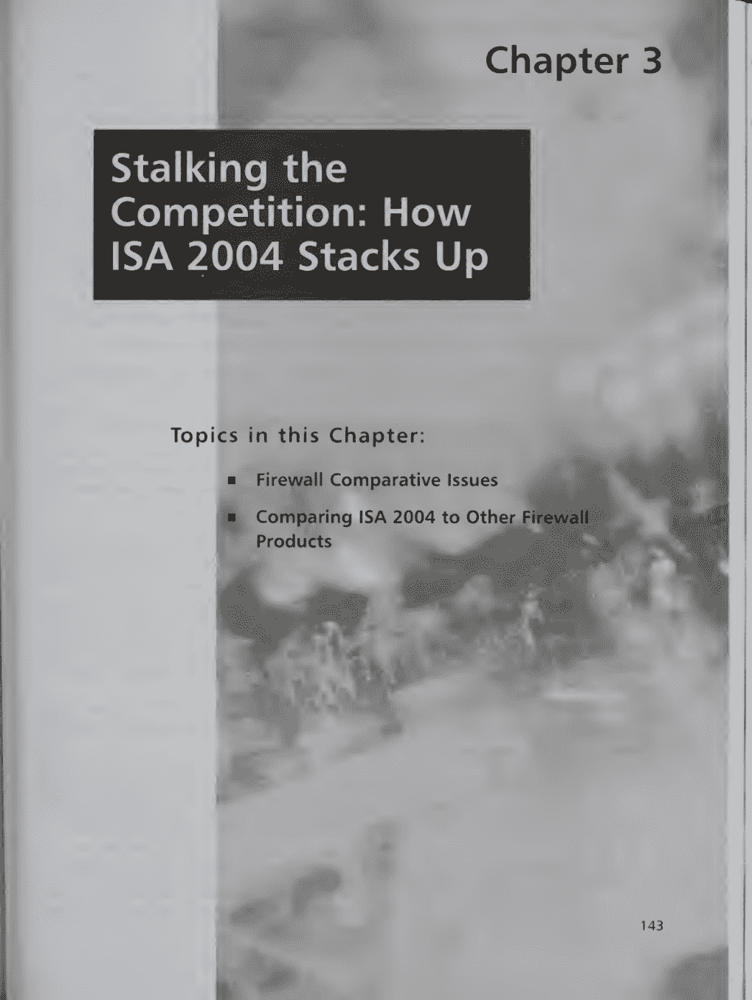

#### 防火墙比较问题

向 IT 安全社区介绍 ISA Server 并非易事。一旦我们解决了第 1 章中提到的基本问题（"ISA Server 真的是防火墙吗？"），潜在用户接下来 inevitably 想知道的是："ISA Server 与其他防火墙相比如何？"

通常，这个问题来自 CheckPoint 或 PIX 爱好者的挑战。其他时候，它来自新手或经验丰富的网络管理员，他们受命为公司选择或推荐防火墙解决方案，却被大量的营销材料、防火墙厂商的宣传以及其他防火墙用户的赞誉或抱怨搞得困惑和不知所措。

为了能够明智地回答这个问题，我们不仅要熟悉 ISA Server 2004 本身，还要了解竞争产品的功能和定价/许可结构。本章旨在实现三个主要目的：

- 为负责为其网络选择防火墙和/或缓存产品的读者解答一些常见问题。
- 提供基于证据和事实而非偏见的 ISA Server 2004 选择依据。
- 为已经知道想要在其网络上实施 ISA Server 2004 并需要说服公司管理层的读者提供"弹药"。

如果您查看大多数主要防火墙设备供应商的产品线，您会发现几种不同的型号，更不用说各种不同的许可方案，以及大量增强功能且需要额外付费的附加组件。

对不同厂商的产品进行有见地的比较可能是一项艰巨的任务，而且通常在这样的比较中没有明确的"赢家"。相反，您会发现做出正确的选择很大程度上取决于您现有的网络基础设施、您希望防火墙扮演的角色，以及在某些功能与其他功能之间的权衡。

我们经常听到网络管理员抱怨："我可以花不到 500 美元购买 SonicWall 防火墙。ISA Server 的价格是三倍，而且还不包括硬件。"这在一定程度上是正确的——但故事还有另一面：

- 低于 500 美元的 SonicWall（或 NetScreen、WatchGuard）并不适合在大型甚至中型企业网络上使用。这些低成本的防火墙设备是 SOHO（小型办公室/家庭办公室）和"远程办公"型号。
- SOHO 防火墙的用户数量有限（通常为 10-25 个用户），而远程办公防火墙旨在保护在家远程连接公司网络的单台计算机（更像是个人防火墙）。

追踪竞争对手：ISA 2004 如何脱颖而出 • 第 3 章 145

- SOHO 和远程办公防火墙可能不支持远程访问 VPN，或者只附带单个 VPN 许可证；额外的 VPN 客户端需要额外付费。即使购买了额外的许可证，它们也可能只支持有限数量的 VPN 隧道（5-10 个）。
- 低端防火墙运行在低功耗硬件上。例如，SonicWall SOHO 3 使用 133MHz 处理器和 16MB RAM，而您可以选择安装 ISA Server 和其他基于软件的防火墙的硬件（只要它满足运行操作系统和防火墙所需的最低要求）。
- 低成本防火墙的性能/吞吐量通常很低（例如，75Mbps 的防火墙吞吐量，相比之下 ISA Server 的测试吞吐量高达 1.5Gbps）。

当您深入研究比较功能时，您会开始意识到简单的成本比较是没有意义的。比较分析还必须考虑管理开销、许可结构和所比较产品的功能集。说"我可以花不到 500 美元购买防火墙"就像说"我可以花 5 美元买块手表"，或者"我可以花 10,000 美元买辆新车"一样。所有这些说法都是真的，但许多消费者仍然选择花 50 美元、500 美元甚至 5000 美元买手表，以及花 20,000 美元、30,000 美元或更多钱买新车。为什么？大多数人会告诉您，可靠性、功能和使用寿命是重要的考虑因素。当然，地位在他们的决定中也可能起到一定作用，尤其是在价格范围的极端高端。

当然，如果低于 500 美元的防火墙就足以满足所有人的网络保护需求，那么同样的供应商就不会还提供比其低端产品贵三倍、五倍、十倍甚至二十倍的防火墙。

本章并不试图证明 ISA Server 是每种网络、每种情况下的"最佳"防火墙产品。它确实提供了支持我们观点的事实，即 ISA Server 是企业防火墙市场的有力竞争者，并且能够在与"大玩家"（Cisco 和 Check Point）以及许多目前使用的低成本防火墙/VPN 设备的竞争中立足。

> **注意**
> 在企业环境中，为所有应用选择单一防火墙解决方案通常既无必要也不理想。良好的"纵深防御"策略通常会"混合搭配"来自多个供应商的产品，以实现对现代威胁最有效的防护。例如，一家公司可能会决定在互联网边界部署一个或多个快速包过滤防火墙（如 PIX），并在 DMZ 中或每个部门子网前放置一个深度应用层过滤防火墙（如 ISA Server）。

在下面的章节中，我们将研究在比较不同防火墙产品时应考虑的一些因素。这些被分为三大类：

- **成本和许可。** 这不仅包括软件、硬件或设备的初始资本投资，还包括特殊许可考虑因素（如 VPN 客户端需要单独许可证）、提供完整竞争功能所需的附加模块和增强功能、支持合同、升级的比较成本，以及影响总拥有成本（TCO）的其他因素，如管理开销、培训需求等。
- **规格和功能。** 这指的是架构和操作系统、支持的吞吐量和并发会话、过滤功能、入侵检测和预防功能、VPN 功能（协议支持、客户端支持、支持的隧道数量、VPN 隔离/安全）、Web 缓存功能（如有），以及与 Windows 和其他服务器的集成和互操作性。
- **认证。** 由美国 ICSA Labs 和英国 Checkmark 等独立实体进行的认证可以确保防火墙符合基于标准化测试的最低标准。

本章的比较分析基于从供应商文档、供应商查询、针对使用各种产品的管理员的问卷调查以及对（部分）产品的实际评估中收集的信息。

> **警告**
> 本章中的信息在研究和撰写时是当前有效的，但安全软件市场在不断变化。新产品不断推出，现有产品每天都在升级。业务结构或所有权的变化很常见（例如，本分析中提及的主要公司之一 NetScreen，在本文撰写前不久被 Juniper Networks 收购），这可能会也可能不会导致产品本身发生变化。

以下分析将比较 ISA Server 2004 与防火墙市场中一些主要竞争对手的成本、功能和特性。我们在本章中讨论的竞争对手包括：

- CheckPoint（包括 Nokia 设备）
- Cisco 的 PIX 安全设备
- NetScreen 安全设备（现为 Juniper Networks 所有）
- SonicWall 安全设备


 - Watchguard 安全设备
- 赛门铁克企业防火墙软件（包括赛门铁克硬件设备）
- Blue Coat Systems ProxySG 设备
- 开源防火墙（IPchains、Juniper FWPTK、IPCop）

这绝不包括当今市场上所有可用的防火墙产品；然而，它确实涵盖了那些市场份额最大的产品。

##### 防火墙运维成本

对于网络/安全管理员来说，在选择最适合您情况的防火墙产品时，成本可能不是首要考虑因素。您希望选择一款能够最有效、最高效地完成工作，并且对您和您的员工来说最容易部署、管理、维护和更新的产品。然而，对于那些可能拥有最终决策权的人来说（如首席财务官、采购代理或小型企业主），成本是一个非常重要的考量因素。

然而，重要的是要记住，成本远不止设备或软件/硬件包的初始购买价格。注重预算的决策者关心的是"底线"，即在整个产品生命周期内该决策的全部财务影响。在比较不同产品时，您需要关注以下几个方面：

- 资本投资
- 附加模块和增强功能
- 许可结构
- 技术支持
- 升级
- 总拥有成本

我们在以下小节中逐一讨论这些问题。

###### 资本投资

所谓"资本投资"，我们指的是软件许可证和/或硬件设备的初始成本，加上部署防火墙或缓存解决方案以实现网络完整功能所需的任何附加模块、客户端许可证或其他组件。许多厂商宣传的"基础价格"不一定包含您想要实现功能所需的一切（例如，如果您想将防火墙用作 VPN 网关，您可能需要为每个 VPN 客户端购买防火墙价格中未包含的许可证）。

###### 附加模块和增强功能

许多防火墙产品通过附加模块或额外的"外部"设备或软件提供部分功能。例如，大多数防火墙厂商不会将 Web 缓存作为防火墙的标准功能，但有些允许您通过软件模块添加该功能（例如 CheckPoint），或提供执行该功能的额外硬件设备（如思科）。ISA Server 2004 与 BlueCoat 则将 Web 缓存内置于防火墙中，从而为您节省数百甚至数千美元，因为您无需购买额外的软件和/或设备即可获得该功能。

要准确比较 ISA Server 与这些设备的成本，您还必须考虑为达到与 ISA Server"开箱即用"同等功能水平所需的附加组件成本。

厂商通过附加组件提供的一些功能包括：

- Web 缓存
- IDS/IDP
- 病毒扫描和检测
- 多台防火墙的集中管理
- 报告生成
- 高可用性/负载均衡
- PKI/智能卡认证

ISA Server 2004 开箱即包含许多这些功能，因此不会产生额外成本。

此外，值得注意的是，由于 ASIC 设备不包含可供写入日志文件的硬盘，它们通常需要单独的计算机硬件进行日志记录。例如，您可能需要设置一台服务器来收集 PIX 日志。这通常在成本考虑中被忽视。人们经常抱怨 ISA 需要购买计算机硬件和操作系统许可证，但记录 ASIC 生成的日志文件通常也需要这笔支出。

###### 许可结构

软件许可结构往好了说是令人困惑的。然而，要做出有效的比较，理解每个产品的许可结构非常重要。许可结构会极大地影响防火墙/安全设备的总成本。有些厂商按订阅方式授予许可，要求您每年重新支付软件许可费用。其他厂商收取初始许可费，除非/直到您升级到产品的新版本，否则不需要额外费用（首次购买者与升级时相比，您可能获得折扣许可费）。

许可证的价格也可能因您打算如何使用防火墙而异。例如，故障转移/容错集群中的第二台防火墙的许可证可能低于主动防火墙的第一个许可证。厂商可能使用不同的术语来区分许可级别。例如，思科为其 PIX 许可证提供受限版（R）和无限制版（U）许可，此外还有故障转移模式（FO）许可。许可模式由您的激活密钥定义。受限版（R）许可对支持的接口数量以及软件可用的 RAM 数量有限制。无限制版（UR）许可允许您使用硬件支持的全部 RAM 和硬件支持的最大接口数量。受限版许可不支持故障转移配置，而无限制版支持。您还可以购买特殊的"R 升级至 UR"许可来从受限版升级至无限制版，或"FO 升级至 R"或"FO 升级至 UR"许可来从故障转移许可升级至受限版或无限制版。

有些防火墙按照"用户数"来许可。防火墙可能通过发送 ping 并统计响应主机的回复来执行此操作（在这种情况下，分配了 IP 地址的网络打印机和其他设备可能被计为"用户"），或通过跟踪在外部接口上访问互联网的内部节点数量。例如，Check Point FireWall-1（FW-1）监听所有内部接口上的 IP 流量，并统计不同的 IP 地址。当 IP 地址数量超过许可限制时，将向管理员发送电子邮件通知，并记录该事件。

许多厂商还提供批量许可计划或企业许可计划，为大客户或购买大量防火墙的客户提供更低的价格。软件防火墙厂商还可能提供在指定天数后过期的评估许可。

> **注意**
软件防火墙（如 ISA Server 2004、Check Point 和赛门铁克企业防火墙）的一个显著优势是，通过安装产品的评估版本，可以轻松实现"先试用后购买"。

您还需要考虑除防火墙软件本身之外，是否需要额外的许可证才能实现完整功能。有些厂商对每个 VPN 连接的 VPN 许可证额外收费。即使费用相对较低（每个许可 15-35 美元是典型价格），但如果您有数百个 VPN 用户，这笔费用也会迅速累积。您可能还需要获得额外许可才能使用某些功能，例如 3DES 加密。最后，您可能需要额外的许可来运行附加模块。例如，在 FW-1 4.1 及以上版本中，运行 Motif GUI 连接到 Check Point FW-1 管理控制台需要您额外支付 Motif 许可费用。如果您想将 LDAP（轻量级目录访问协议）功能与 FW-1 一起使用，也需要额外的许可。

###### 技术支持成本

在比较各种解决方案的成本时，另一个您应该考虑的"隐藏"成本因素是支持成本，这取决于厂商的不同可能有很大差异。支持合同的费用每年可能从不到一百到几千美元不等。

有些厂商在设定的时间内提供免费支持。例如，思科提供 90 天的免费技术支持，而 Check Point FW-1 要求您购买支持/升级合同才能访问其技术支持，此类合同的费用每年可能高达原始软件价格的 50%。

有些厂商提供不同级别的支持合同。例如，赛门铁克为其防火墙产品提供金卡、白金卡和至尊白金卡维护和支持合同。金卡支持在工作日正常工作时间提供电话支持，白金卡支持提供非工作时间支持。选择至尊白金卡支持，您将获得一名技术客户经理和三名额外的技术联系人（金卡和普通白金卡提供两名技术联系人）。

如果您计划购买支持合同，应将成本纳入比较考量。

> **注意**
有些厂商要求您每年维持支持协议。这意味着如果您让支持协议中断了一年，厂商可能要求您为当前年度和中断年度都购买支持协议。

###### 升级成本

防火墙的升级成本是进行成本比较时必须考虑的另一个重要因素。安装在标准硬件上的软件防火墙可以轻松利用更快或额外的处理器、更快的网卡、更多的 RAM，或安装到新的、更强大的机器上。另一方面，硬件设备可能需要完全更换，或升级成本更高。例如，思科 PIX 防火墙 Classic、10000 和 510 型号已停产，无法运行 PIX 防火墙软件 6.0 或更高版本。这意味着如果您想要新软件的功能，就必须购买新的 PIX 设备。

> **注意**
另一个重要考虑因素是，当您需要为您的基于软件的防火墙升级到更强大的硬件时，您可以"重新利用"原始硬件作为文件服务器、工作站上，或在网络中担任其他角色。运行专有操作系统的基于硬件的安全设备重复利用的可能性较小。

无论您拥有的是"硬件防火墙"还是"软件防火墙"，定期升级软件的成本也很重要。您需要考虑以下内容：

 - 更新和补丁是免费提供的，还是需要付费？
- 软件升级版本是否有折扣，还是必须购买azine购买完整版本？

另一个需要考虑的因素是执行升级所需的管理开销。例如，将运行5.0或更早版本的PIX进行升级时，无法使用简单文件传输协议（TFTP）将软件映像直接传输到设备的闪存中，因此你必须进入boothelper或监视器模式。较新版本的PIX软件支持一条命令，允许你直接从TFTP服务器将软件映像复制到设备上。无论哪种方式，你都必须使用命令行界面输入适当的命令来升级软件。

###### 总拥有成本

当所有成本因素都被考虑在内时，你可以为每个产品计算出一个总拥有成本（TCO），以便进行更精确的价格比较。在计算每种竞争产品的TCO时，你必须考虑的不仅是前文讨论过的各项直接成本，还包括间接成本，例如：

- **学习曲线**：管理员学习配置和管理防火墙所需的材料、培训课程等费用。
- **管理开销**：配置和管理防火墙所需的相对管理时间；所需的管理专业水平（这可能会增加人员成本）。
- **生产率成本**：对网络用户生产率的影响。
- **停机成本**：与防火墙的部署和可靠性相关的生产率损失和收入损失，例如来自潜在电子商务销售的损失。

大多数TCO模型将所有成本因素分为两大类：购置成本和持续/运营成本。第一类包括硬件的购买价格、软件的初始许可费以及一次性安装成本，包括管理时间的成本、必要时聘请顾问的费用、初始培训等。第二类包括供应商支持合同、内部IT管理成本、聘请独立顾问进行故障排除和维护、硬件维护和升级、软件更新和升级、持续培训以及其他支持成本。当然，其中一些成本会因客户而异，具体取决于防火墙的部署方式以及现有人员的经验和技能。

> 软件防火墙具有更大的价格灵活性，你对TCO有更多的控制权，因为你可以利用不同硬件供应商之间的竞争性定价，而基于硬件的防火墙，你可能只能在小范围内选择不同的硬件配置，不同经销商之间的价格差异较小。

##### 规格与功能

一旦成本问题得到解决并确定了预算，第二个广泛的比较类别就涉及每种产品的特性和功能。我们可以将这个类别分为以下子类别：

- 一般规格（包括硬件和软件规格）
- 防火墙功能（包括入侵检测等相关功能）
- VPN网关功能
- Web缓存功能（如果包含）
- 防火墙认证

让我们分别来看看这些。

###### 一般规格

一般规格涉及所包含的硬件（对于设备而言）或最低硬件要求（对于软件防火墙而言），以及产品在部署中被证明的可扩展性、可扩展性和可靠性，以及它是否以及如何支持高可用性/容错功能，如集群/故障转移和负载均衡。其他重要的比较点包括与网络上其他软件和设备的兼容性和互操作性，以及易用性（这直接影响管理开销）。下面的列表提供了比较这些规格的起点：

- **硬件规格。** 这包括硬件架构（软件防火墙、基于硬盘的设备、ASIC设备）。对于软件防火墙，你需要了解最低系统要求以及防火墙可以使用的最大硬件资源。该子类别还包括处理器速度、内存容量、端口数量（以及端口类型：10/100以太网、千兆以太网等）、磁盘大小（对于基于硬盘的设备）以及其他物理因素。这对于基于硬件的防火墙来说尤为重要，因为你可能无法轻松升级硬件。

- **可扩展性。** 这是指软件防火墙或设备随着组织和网络的增长而扩展的能力。你需要考虑防火墙可以处理多少连接、支持多少同时VPN隧道等因素，以及其他因素，具体取决于你的特定网络设置。你还需要能够配置多个设备协同工作并提供集中管理的能力。

- **可扩展性。** 这是指内部开发人员或第三方可以轻松创建附加组件以增强防火墙功能的程度。

- **可靠性。** 这是指最小化停机时间，是多种因素的产物，包括硬件和软件因素。例如，基于ASIC的设备的一个可靠性优势是没有移动部件，从而消除了机械故障的可能性。软件可靠性取决于防火墙应用程序和底层操作系统的编程准确性和复杂性，以及与盒子上运行的任何其他应用程序（附加模块、第三方增强功能或其他应用程序）的互操作性。可靠性的一个要素是*容错性*，这是指系统在发生故障后能够继续运行的能力。

- **高可用性。** 这与可靠性密切相关，指的是冗余（如冗余电源或具有自动故障转移的多个防火墙集群），以确保在硬件或软件发生故障时功能能够继续。

- **负载均衡。** 这是指将处理负载分散到多个防火墙设备的能力，以提高性能并适应流量的增加。

- **兼容性/互操作性。** 这是指防火墙与网络上其他设备、服务器和客户端互操作的能力；例如，防火墙能否与你的邮件服务器集成，为RPC通信提供保护？特别是，如果你在Windows网络环境中运行，你需要了解防火墙与Active Directory的集成程度（能否使用AD用户和组帐户进行身份验证？）、Exchange、SharePoint以及你已在网络上部署的其他Microsoft服务器产品。

- **易用性。** 这是指安装和配置的简单性（适用于基于软件的防火墙）、管理界面的用户友好性（GUI、基于Web的或CLI），以及远程管理防火墙和集中管理多个防火墙的难易程度。

> 有些因素，如易用性，是不可量化的，而是主观评估的结果。对一个用户来说友好的界面可能会让另一个用户感到困惑。与硬件规格或软件功能（如支持的VPN隧道数量）不同，你无法依赖供应商文档来确定界面的易用性。我们建议在评估这一因素时，与使用该产品的防火墙管理员交谈，或者，理想情况下，在测试实验室环境中亲自试用该产品。这对于提供试用版本的软件防火墙来说尤其容易，而且这是一个不应省略的步骤，因为你将每天与这个界面打交道。

##### 防火墙及相关功能

在比较不同供应商的产品时，有几个特定于防火墙的功能你应该寻找。供应商网站上的产品数据表可以提供一个起点，但当你缩小选择范围时，你需要更深入地挖掘，阅读独立的产品评论和/或与亲自使用过你正在考虑的特定产品的IT专业人员交谈。

请记住，供应商声称支持特定功能可能并不能说明全部情况；你还必须评估该功能是*如何*实现的。例如，应用层过滤（ALF）可能仅意味着有滤镜来检测一些应用层攻击，如DNS或POP3缓冲区溢出。防火墙可能不支持*深度*ALF（检查数据包内容以查找特定的管理员定义文本字符串）。

> 广告材料总是会倾向于以最佳角度展示产品。还要注意，不同的供应商经常使用不同的术语来描述相同的功能，这使得仅基于供应商文档来比较产品变得更加困难。例如，微软称之为"SSL桥接"的功能，其他一些供应商称之为"SSL终止和启动"。

一些重要的防火墙功能比较包括以下内容：

- **应用层过滤**：大多数现代防火墙产品现在都包含了某种形式的ALF，但不同产品之间的ALF支持水平可能差异很大。最常见的实现提供了检查应用层攻击的滤镜，如利用DNS和POP3的攻击。另一种ALF是URL扫描，它允许你筛选Web请求并拒绝那些不符合基于内容、字符集、长度、HTTP方法（动词）、头部、扩展名的管理员定义规则的请求

sions, and so on. SMTP filters and screeners can inspect e-mail traffic and can be used as an anti-spam mechanism to block messages from particular domains, source addresses, or containing particular content.

- **协议支持：** 在比较协议支持时，您不仅应确定特定产品支持哪些协议，还应了解每种协议的*支持方式*。例如，访问策略能否应用于特定的应用程序、服务或协议？VPN策略呢？服务质量（Quality of Service, QoS），如适用？确定产品包含哪些应用程序过滤器；了解有哪些附加过滤器可用，并查看**创建自己的过滤器**的难度如何。根据组织的需求，您可能需要关注以下类别的应用程序、服务和协议的支持情况：认证/安全服务（HTTPS、IPSEC、ISAKMP/IKE、LDAP、RADIUS、SecurID、TACACS/TACACS+、CVP）、邮件服务（POP3、SMTP、IMAP）、互联网服务（IM、文件共享、NNTP、P2P）、企业服务（DCOM、Citrix ICA、Sun NFS、Lotus Notes、SQL）、路由协议（EGP、IGRP、GRP、OSPF、RIP）、TCP/UDP服务（Bootp、Finger、Echo、FTP、NetBEUI、NetBIOS over IP、SMB、RAS、PPTP）、RPC服务、ICMP服务，以及多媒体流服务。

- **入侵检测：** 大多数现代防火墙都包含一定程度的内置入侵检测与防御（IDS/IDP）。某些产品提供独立的IDS模块或"外部"IDS解决方案。其他防火墙则包含基础的IDS功能，但提供更高级的IDS/IDP版本，需额外付费。请比较防火墙IDS配置可检测的常见攻击类型（例如，WinNuke、死亡之Ping、泪滴攻击和缓冲区溢出攻击较为常见，但前三种是较旧的攻击方式，大多数更新了补丁的现代系统已能防护）。您可能还需要考虑IDS警报的发送方式（例如，电子邮件、寻呼机），以及检查IDS附加产品的可用性（无论是防火墙厂商还是第三方的产品），以提高IDS的有效性。

> **注意**
>
> 评估IDS有效性的一个重要因素是IDS返回的"误报"数量。

- **防火墙吞吐量/连接数：** 组织的规模将决定您对防火墙支持的并发会话数量的需求。这一数字在不同厂商之间，乃至同一厂商产品线上的不同产品之间，可能存在很大差异。您还需要考虑防火墙的吞吐量，单位为兆比特每秒或吉比特每秒（Mbps或Gbps）。请注意，由于VPN开销的存在，这一数字通常与VPN吞吐量不同（且更高），尤其是在使用3DES或AES等强加密用于VPN连接时。吞吐量和连接规格通常是同一厂商不同设备型号之间的主要区别因素，但购买软件防火墙时，这些数字也可能取决于您安装它的硬件。

- **日志记录/报告：** 大多数现代防火墙都包含一定程度的日志记录功能，但日志的复杂度和范围各不相同。请考虑日志格式，以及将日志导入电子表格或其他程序的便捷程度，同时也要考虑组织的日志需求。纯文本日志是否足够，还是需要将数据记录到SQL数据库？某些防火墙自带报告功能，能够将日志中包含的信息分析并汇总为可配置的报表。其他产品则将此功能作为附加模块提供。此外，还应考虑第三方日志文件分析和报告软件的可用性。

## 第3章 • 追踪竞争对手：ISA 2004 的表现如何

##### VPN功能

大多数现代防火墙，除了仅用作个人防火墙或"远程办公"型号的之外，都集成了VPN网关。虚拟专用网络是许多组织远程访问通信的基本要素。员工依赖VPN在家工作或出差时使用。比较不同安全设备的VPN支持时，有几个因素需要考虑。

- **VPN协议支持：** 支持哪些VPN协议：IPSec、PPTP、L2TP、SSL VPN？是否支持NAT穿越（NAT-T）？VPN连接支持哪些认证协议？是否支持双因素认证（ActivCard、Authenex、SecurID）？支持哪些加密方法（DES、3DES、AES）？某些厂商需要对强加密功能额外授权并付费。

- **远程访问/站点到站点VPN：** 组织需求决定了您需要支持站点到站点VPN（连接两个网络）、远程访问VPN连接（也称为客户端-服务器VPN，允许单台计算机连接到网络），还是两者都需要。某些低成本防火墙仅支持站点到站点VPN。

- **VPN客户端：** 远程访问VPN连接需要在客户端计算机上安装VPN客户端软件（SSL VPN通过Web浏览器连接）。所有现代版本的Windows操作系统都内置了微软的PPTP和L2TP客户端。许多防火墙/VPN设备需要专用的客户端软件，可能需要额外授权付费。在某些情况下，您可以使用微软客户端配合第三方防火墙进行基本VPN操作，但需要厂商的专有软件才能实现高级功能。

- **VPN连接数/吞吐量：** 组织需求将决定所需的并发VPN连接数量。在防火墙文档中，这通常表示为支持的VPN隧道数量。如果支持多种VPN协议，请检查每种协议允许的连接数（例如，支持的PPTP连接数可能与L2TP连接数不同）。VPN吞吐量通常以Mbps表示。吞吐量将因使用的加密方法而异。例如，AES吞吐量将慢于3DES。

- **VPN隔离：** 这是指根据管理员定义的条件阻止或允许VPN连接的能力（例如客户端是否运行防病毒程序或防火墙，或是否已安装安全更新）。不符合标准的用户机器可以被重定向到一个网站，以便下载所需的更新。某些厂商将此功能称为远程策略执行、客户端配置验证，或其他术语，并通过第三方软件包或额外付费的VPN客户端软件提供。

> **注意**
>
> NAT穿越，即NAT-T，是一种使IPSec能够与网络地址转换配合使用的技术，而这在以前是无法实现的。微软将NAT-T定义为"一组功能，使支持网络感知的应用程序能够发现其位于NAT设备之后，获取外部IP地址，并配置端口映射以便将NAT的外部端口上的数据包转发到应用程序使用的内部端口——所有这些均以自动化方式完成，用户无需手动配置端口映射或其他类似机制。"

##### Web缓存功能

比较Web缓存解决方案时，有许多功能需要考虑。您需要的功能将取决于组织的规模和结构、网络用户对外部Web访问的使用方式和频率，以及组织是否托管自己的Web服务器等因素。

- **正向缓存：** 所有Web缓存服务器都支持正向缓存。这用于加速内部网络用户向互联网上的服务器请求Web对象时的出站请求响应。频繁请求的对象存储在缓存服务器上，因此可以通过更快的本地网络连接进行检索。对ISA Server的研究表明，在典型的商业网络环境中，35%到50%的请求可以从正向缓存中检索。

- **反向缓存：** 反向缓存用于组织拥有面向外部互联网用户的内部网站时。缓存服务器存储从内部Web服务器频繁请求的对象并提供

将它们提供给互联网用户。这加快了外部用户的访问速度，减轻了内部 Web 服务器的负载，从而减少了内部网络的流量。

- **分布式缓存：**这是一种在多个以对等方式运行的缓存服务器之间分散负载的方法。
- **分层缓存：**这是一种在网络中以分层方式放置多个缓存服务器的方法，以便首先从本地缓存处理请求，然后从集中式缓存处理请求，最后再向互联网服务器请求。分布式缓存和分层缓存可以组合使用。
- **缓存规则：**缓存服务器可以使用管理员定义的规则来确定如何处理来自内部和外部 Web 客户端的请求。规则可以控制对特定协议的访问、控制带宽或控制内容。规则可以根据用户账户或组成员身份来应用。

##### 防火墙认证

对于您的组织而言，另一个可能重要也可能不重要的因素是，您正在考虑的防火墙产品是否已获得"认证"。认证意味着某个组织已确定该防火墙符合特定的最低标准。要有意义，认证应由独立实体（而非供应商）基于实验室标准化实操测试（而非仅仅是对功能的"纸上"比较）来完成。

ICSA 实验室（TruSecure 公司的部门）是最知名的提供防火墙和其他网络安全产品测试和认证的组织。ICSA 测试目前依据模块化防火墙产品认证标准第 4 版进行，描述见 http://www.icsalabs.com/html/communities/firewalls/certification/criteria/criteria_4.0.shtml。

ICSA 测试基于使用"黑盒"方法对防火墙产品进行实操评估，该方法基于功能性。

在英国，NSS 网络测试实验室为计算机安全产品提供 Checkmark 认证。参见 http://www.nss.co.uk/Certification/Certification.htm。其他已开发的用于评估计算机安全产品的测试/认证计划包括信息技术安全评估标准（ITSEC），获得法国、德国、荷兰和英国的认可；以及美国国防部可信计算机系统评估标准（TCSEC）。这些政府评估计划已被通用准则安全评估流程所取代，该流程通过国际标准化组织（ISO）被批准为标准。

> **注意**
ISA Server 2000 在 MFPCC 第 3a 版下获得认证，运行在 Windows 2000 Server 上。ICSA 实验室报告（2001 年 11 月更新）见 http://www.icsalabs.com/html/communities/firewalls/certification/rxvendors/microsoft-isas2000/labreport_cid303.shtml。在发布时，ISA Server 2004 尚未进行 ICSA 认证测试。

#### 将 ISA 2004 与其他防火墙产品进行比较

在本节中，我们将比较 ISA Server 2004 的规格、特性和功能与选定的竞争产品。由于许多供应商销售多种型号的防火墙，我们已尝试选择每个供应商的产品中在使用、目标市场和价格点方面与 ISA Server 2004 最相似的产品。将专为中大型企业网络设计的 ISA Server 与个人和 SOHO 防火墙进行比较将毫无意义。同样，我们也没有尝试将 ISA Server 与价格高出十倍的高端企业级防火墙进行比较。

具体而言，我们将研究 ISA Server 2004 与以下供应商的选定型号防火墙产品相比表现如何：

- CheckPoint
- Cisco PIX
- NetScreen
- SonicWall
- WatchGuard
- Symantec Enterprise Firewall
- BlueCoat SG

##### ISA Server 2004 比较要点

微软将 ISA Server 2004 定义为"一种先进的应用层防火墙、VPN 和 Web 缓存解决方案，使客户能够通过提高网络安全性和性能来轻松最大化现有 IT 投资。ISA Server 2004 是微软 Windows Server System™ 的成员，这是一个全面且集成的服务器基础设施，旨在满足开发人员和 IT 专业人员的需求。"让我们在我们的比较分析模型背景下快速回顾其一些关键特性和规格。

###### 关键特性和一般规格

ISA Server 2004 提供以下关键特性，以提供针对黑客、破解者和网络攻击者的高级防护：

- **多层检查** 有助于保护 IT 资产和企业知识产权（如 IIS、Exchange Server、Sharepoint 和其他网络基础设施）免受黑客、病毒和未授权使用的侵害，具有全面且灵活的策略、可定制的协议过滤器和网络路由关系。
- **高级应用层过滤（ALF）** 使复杂的应用程序流量能够访问互联网，同时确保高水平的安全性、性能和对最新类型攻击的防护。
- **通过 VPN 客户端连接实现安全的入站流量和防范“内部攻击”** 通过统一的防火墙和 VPN 策略管理、深度内容检查和 VPN 隔离集成来实现。
- **集成的多网络功能、网络模板以及状态路由和检查** 使 ISA Server 能够轻松部署到现有 IT 环境中，作为边缘、部门或分支机构防火墙，而无需更改网络架构。

ISA Server 2004 提供增强的易用性功能，包括：

- **简单、易学易用的管理工具** 缩短新安全管理员的上手时间，同时更容易避免因防火墙配置错误而导致的安全漏洞。
- **防止网络访问停机** 允许管理员安全地远程管理防火墙和 Web 缓存服务。
- **节省带宽成本** 通过减少出站互联网流量并在本地提供内容，以及能够将 Web 服务器和电子商务应用程序的内容高效且经济地分发到离客户更近的位置。
- **与 Windows Active Directory、第三方 VPN 解决方案和其他现有基础设施的集成** 简化了在纯 Windows 环境或混合环境中保护企业应用程序、用户和数据的任务。
- **ISA Server 蓬勃发展的合作伙伴、用户和 Web 资源社区** 与微软的正式支持计划一起，提供多种支持和信息渠道。

高性能是当今商业环境中的重中之重，ISA Server 2004 提供了注重性能的组织最想要的功能：

- **提供快速、安全的随时随地访问** 企业应用程序和数据（如 Microsoft Exchange Server）的能力。
- **安全、可靠且高性能的基础设施** 用于实现入站和出站互联网数据访问，以及通过多种互联网标准认证机制进行单点登录。
- **集成的单服务器解决方案** 仅将必要的服务置于网络边缘，包括防火墙安全、VPN 和 Web 缓存。
- **扩展安全基础设施的方法** 随着网络需求的增长，通过灵活的多网络架构进行扩展。
- **增强的网络性能和降低的带宽成本** 通过在企业数据中心和分支机构的 Web 缓存实现。

接下来，我们将看看我们作为比较要点讨论的一些一般规格，以及 ISA Server 2004 如何符合这些规格。

###### 硬件平台支持和系统要求

ISA Server 2004 是一种软件防火墙，可以安装在 Windows 2000 Server（Service Pack 4 或更高版本）或 Windows Server 2003 上。必须安装 Internet Explorer 6 或更高版本。最低硬件要求如下：

- 300 MHz 处理器
- 256MB RAM
- 具有 150MB 可用空间的 NTFS 格式磁盘
- 每个连接到 ISA 服务器的网络一个网卡

> **注意**

微软列出的最低支持硬件要求应被视为安装 ISA Server 2004 的绝对最低要求；这些不是最佳硬件规格。升级硬件后，ISA Server 2004 的性能将大幅提升。我们建议，作为现实的基础硬件规格，至少使用 800MHz 处理器和 1GB RAM。另外，请注意，如果您将 ISA Server 用作 Web 缓存服务器，则需要更多磁盘空间用于缓存。

###### 可靠性

对于网络防火墙等关键任务设备而言，系统可靠性是一个非常重要的考虑因素。支持 ISA Server 2004 可靠性的一些因素包括：

- 可以使用 Windows Update 自动更新 ISA Server 2004 的基础操作系统。


 ## 第 3 章 • 追踪竞争对手：ISA 2004 如何脱颖而出

- 微软计划在 Windows Update 网站上增加功能，使 ISA Server 2004 防火墙软件能够自动更新。在撰写本文时，尚不清楚该功能何时可用。

- 底层硬件质量是影响系统可靠性的主要因素。冗余硬件组件，如电源、网络接口，以及软件或硬件 RAID，可以显著提高防火墙的整体可靠性。

- ISA Server 2004 防火墙的用户界面中包含防火墙配置备份工具。这些工具易于使用，允许防火墙管理员备份整个防火墙配置，并将其恢复到同一台机器或另一台机器上。

###### 可扩展性

可扩展性至少可以分为两个常见类别：

- **向外扩展性（Outward scalability）** 指的是适应网络扩展的能力，随着网络发展到原始位置之外，增加远程办公室、远程办公人员等。

- **向上扩展性（Upward scalability）** 指的是适应用户数量增长和流量增加的能力，随着网络规模变大。

ISA Server 2004 可以通过使用底层 Windows Server 2003 操作系统内置的网络负载平衡服务来实现向外和向上扩展。ISA Server 2004 还可以通过增加内存（RAM）、磁盘空间、更强大的处理器以及更多处理器来实现向上扩展。该产品最终版本支持的处理器数量尚未公布。

###### 可扩展性（Extensibility）

可扩展性指的是产品通过供应商提供、第三方或内部开发的软件附加组件、脚本和其他组件来添加功能和特性的能力。由于 ISA Server 2004 是一款"软件"防火墙，它支持对其应用层过滤以及其他访问控制和网络组件进行几乎无限的扩展。许多硬件防火墙市场的竞争对手要求客户升级到全新的硬件设备，或需要单独的机外硬件/软件解决方案，才能添加新功能。

ISA Server 2004 防火墙可以由客户免费扩展，只需使用免费的 ISA Server 2004 软件开发工具包（SDK）。

ISA Server 2004 防火墙同样可以由第三方供应商进行扩展，客户可以从这些供应商处购买第三方解决方案。附加组件可以提供诸如病毒检测和拦截、高可用性和负载平衡、访问控制、内容安全、高级入侵检测、身份验证（例如，使用 RSA SecurID 令牌的能力）、缓存增强，以及更复杂的监控、日志记录和报告等额外或增强功能。

> **注意**
> 有关适用于 ISA Server 的一些附加产品的讨论，请参阅我们在 2004 年 5 月《Windows & .NET》杂志上的文章*《改进 ISAvenomany》（Improving on ISA Server）*，作者 Deb 和 Tom Shinder，或查阅 www.isaserver.org 上的软件附加组件部分。

###### 高可用性

高可用性指的是产品从故障中发现故障并从故障中恢复的能力，对网络及其用户造成的中断时间最短甚至没有。Windows Server 2003 网络负载平衡（NLB）服务支持高可用性 NLB 阵列。如果 ISA Server 2004 NLB 阵列中的一个成员不可用，NLB 阵列中的另一台机器可以为入站和出站连接请求提供服务。这在一台服务器因硬件或软件问题而无法使用的情况下提供了容错能力。

第三方供应商可以用他们自己的定制软件解决方案来增强 Windows NLB 服务。还有许多硬件供应商为 ISA Server 2004 防火墙提供高速应用层感知的高可用性解决方案。

###### 兼容性/互操作性

兼容性/互操作性，用于比较的兼容性和互操作性问题包括（但不限于）：

- Active Directory 集成
- Exchange 集成
- 在混合网络环境中的操作

我们在以下小节中更详细地介绍这些内容。

###### Active Directory 集成

ISA Server 2004 防火墙计算机可以加入内部网络或受信任域中的 Active Directory 域，并使用包含在该域中的用户数据库来验证入站和出站访问的用户身份。

ISA Server 2004 防火墙客户端应用程序使 ISA Server 2004 防火墙能够对所有 Active Directory 域和受信任域用户进行身份验证。这种身份验证对用户是透明的，使防火墙能够获取所有 TCP 和 UDP 连接的用户和应用程序信息。这些信息存储在 ISA Server 2004 防火墙日志中，可用于审核用户 Internet 活动以及跟踪用户用于访问 Internet 的应用程序。

ISA Server 2004 防火墙支持 RADIUS 身份验证。Windows 2000 Server 和 Windows Server 2003 操作系统包括 Internet 身份验证服务器（IAS）服务，这是 Microsoft 的 RADIUS 实现。IAS 服务器可以将入站和出站身份验证请求转发到 Active Directory 域控制器进行身份验证。当使用 IAS 或其他 RADIUS 服务器对用户进行身份验证时，ISA Server 2004 防火墙无需加入 Active Directory 域即可执行身份验证。

> **注意**
> RADIUS 身份验证仅支持入站和出站 Web 代理通信以及入站 VPN 连接。请注意，防火墙客户端不能使用 RADIUS 对 Active Directory 域进行身份验证。

###### Exchange 集成

Exchange 集成是 ISA Server 2004 的主要卖点之一，相比竞争防火墙提供了重要的竞争优势。以下是 ISA Server 2004 在与 Exchange 服务器集成方面的卓越能力的一些关键因素：

- ISA Server 2004 的 SSL-to-SSL 桥接允许远程访问位于 ISA Server 2004 防火墙后面的 Outlook Web Access（OWA）站点。大多数竞争防火墙无法过滤隐藏在 SSL 隧道内的 HTTP 通信并将其通过防火墙传递。相比之下，ISA Server 2004 的 SSL-to-SSL 桥接功能使 ISA Server 2004 防火墙能够"解包"加密的 SSL 通信，将 HTTP 内容暴露给 ISA Server 2004 复杂的应用层过滤器，然后将 HTTP 通信重新包装到 SSL 隧道中，并将 SSL 保护的信息转发到 OWA 站点。与竞争防火墙不同，ISA Server 2004 不会允许黑客将其攻击隐藏在 SSL 加密隧道中。ISA Server 2004 的 SSL-to-SSL 桥接功能可以扩展以支持 Outlook 2003/Exchange Server 2003 的 RPC over HTTP 协议。我们预计，将来黑客会想出使用隐藏在 RPC over HTTPS（SSL）通信中的方法来攻击 Microsoft Exchange 服务器。不支持 SSL 桥接的竞争防火墙将无法抵御这些攻击，因为它们无法确定 RPC over HTTPS（SSL）通信的内容。相比之下，ISA Server 2004 防火墙将能够使用其 SSL-to-SSL 桥接功能来检查 RPC over HTTPS（SSL）通信并阻止这些攻击。

- **ISA Server 2004 安全 Exchange RPC 过滤器**使 Exchange Server 组织能够使用原生 Outlook 2000/2002/2003 客户端远程访问公司 Exchange 服务器。无论用户位于何处，无论是在内部网络还是在遥远大陆的远程站点，用户都可以打开笔记本电脑，打开 Outlook，"Outlook 就能正常工作"。使用 ISA Server 2004 防火墙发布 Microsoft Exchange 的安全 Exchange RPC 发布时，用户满意度和生产力显著提高。在撰写本文时，唯一提供此功能的竞争对手是 Checkpoint 的 Firewall-1，它最近从微软获得了此 RPC 过滤器的许可。

- **ISA Server 2004 防火墙支持基于表单的身份验证**适用于所有版本的 Microsoft Exchange Server。基于表单的身份验证使用通常由 Exchange Server 计算机生成的登录表单。许多竞争防火墙允许初始连接到达 Exchange Server，以便 Exchange Server 可以生成登录表单返回给想要登录 OWA 网站的用户。相比之下，ISA Server 2004 防火墙在防火墙处生成登录表单，并将防火墙生成的登录表单发送给 Internet 上的用户。用户填写表单并将凭据发送到防火墙，防火墙在防火墙处对用户进行身份验证。只有在用户通过防火墙生成的登录表单与防火墙进行身份验证后，才允许用户访问 Exchange OWA 网站。此外，ISA Server 2004 对于 Microsoft Exchange 2000 和 Exchange 5.5 的所有者来说是一项重要的"增值"功能，因为这些版本的 Exchange 不支持基于表单的身份验证；在这种情况下，ISA Server 2004 防火墙可以为这些早期版本的 Exchange 生成登录表单。此外，您可以使用基于表单的身份验证来防止用户从 OWA 传入会话访问附件，并防止来自远程用户访问 OWA 站点的客户端计算机上的 cookie 和缓存信息残留。

- **ISA Server 2004 SMTP 邮件筛选器**使组织能够在网络周边开始执行垃圾邮件和病毒附件的"电子邮件深度防御"计划。虽然大多数组织需要在后端进行更全面的垃圾邮件和病毒检查应用程序，例如在 Exchange Server 计算机或内部 SMTP 中继上，但客户可以使用 ISA Server 2004 SMTP 邮件筛选器作为"前线"垃圾邮件/病毒筛选器，根据包含的关键词阻止电子邮件

在邮件的主题或正文中进行过滤，并阻止具有特定大小、文件扩展名和文件名的附件。这两项功能都可以用来减轻组织主要垃圾邮件和病毒过滤设备的负担。截至本文撰写之时，ISA Server 2004 同价位级别的其他防火墙都没有免费提供此功能。

- **ISA Server 2004 HTTP 筛选器**将所有 HTTP 通信暴露于针对每个规则设置的文件限制。此筛选器可与 ISA Server 2004 的 SSL-to-SSL 桥接功能配对使用，为安全的 Exchange OWA Web 发布提供保护，使防火墙管理员能够完全控制进出 OWA 网站的 HTTP 流量。ISA Server 2004 同级别的竞争对手中，没有一家能为 SSL 保护的 OWA 连接提供这种深度的 HTTP 检查。

###### 在混合网络环境中运行

在混合环境中部署 ISA Server 2004 主要涉及两个因素：

- 混合客户端操作系统
- 已部署的混合网络基础设施

ISA Server 2004 能够很好地兼容混合客户端操作系统。Web 代理和安全 protective SecureNAT 客户端配置受所有操作系统支持。Web 代理客户端是指将其 Web 浏览器配置为使用 ISA Server 2004 防火墙作为 Web 代理服务器的计算机。所有现代浏览器都支持 Web 代理客户端配置。网络管理员无需操作客户端操作系统即可将计算机配置为 Web 代理客户端。有多种方法可用于自动配置客户端浏览器，例如 DNS/DHCP WPAD 条目、Windows 组策略、IEAK 和登录脚本。

在使用 SecureNAT 配置的计算机上，客户端操作系统配置了默认网关，将 Internet 定向请求转发到 ISA Server 2004 防火墙计算机。同样，网络管理员无需手动配置这些系统，因为客户端操作系统上的默认网关设置可以轻松通过 DHCP 完成。

###### 易用性

任何软件产品易用性的一个重要元素是用户界面。ISA Server 2004 为管理员提供了友好的图形界面，不仅相比大多数竞争对手具有许多优势，而且相比 ISA Server 2000 的界面也有很大改进。ISA Server 2004 图形界面的亮点包括：

- **直观的界面** 在这方面，ISA Server 2004 防火墙相比同类其他防火墙具有显著优势。ISA Server 2004 的界面旨在为管理员提供易于使用和直观的配置和管理系统。这是 ISA Server 2004 的一大优势，因为其核心防火墙配置界面很容易上手，安全的防火墙配置可以在几个小时内完成，无需全面的经验和培训课程。ISA Server 2004 的界面也比 ISA Server 2000 的界面有很大改进。

- **管理脚本** ISA Server 2004 允许管理员使用脚本来管理服务器。几乎任何可以使用 UI 配置的功能也可以通过管理脚本进行设置。ISA Server 2004 光盘免费包含完整的 ISA Server 2004 SDK。拥有程序员员工的组织可以为其 ISA Server 2004 防火墙创建复杂的脚本和自定义附加组件。对于那些拥有此类专业知识的组织来说，这是一个竞争优势，因为大多数其他商业防火墙不会免费提供如此全面的开发工具。

- **易于使用的管理和配置向导** 防火墙配置本质上是一个困难的过程。单个配置错误可能导致潜在的灾难性后果。为了降低配置错误的风险，ISA Server 2004 包含数十个配置向导，引导防火墙管理员完成原本复杂的任务。每个向导都为当前任务提供适当的选项，几乎每个步骤都包含指向 ISA Server 2004 防火墙附带的全面的帮助系统的链接。这是 ISA Server 2004 防火墙的一大优势。

- **全面的帮助系统** 也许防火墙管理中最令人沮丧的经历之一就是尝试新程序时需要弄清楚如何执行该程序以及防火墙管理界面所用术语的含义。ISA Server 2004 防火墙提供全面的帮助系统，详细讨论配置防火墙时使用的概念，并提供分步操作程序。帮助文件还包含指向在线知识库的链接，可以在那里找到有关自定义配置的更全面的材料。

- **易于排查的规则库** ISA Server 2000 防火墙管理员很难确定哪个规则适用于特定连接。这使得在连接被允许或拒绝且原因不清楚时，防火墙规则库的故障排除变得复杂。相比之下，ISA Server 2004 防火墙规则库是一个有序列表。所有通过防火墙的连接都会与防火墙规则库中的规则进行比较，规则库从上到下进行评估。这使得 ISA Server 2004 管理员可以轻松确定是哪个规则允许或拒绝了连接。

- **易于扩展** 内部程序员和第三方公司可以使用免费提供的 SDK 轻松开发附加组件包，管理员可以添加 ISAPI 筛选器来扩展 ISA 的功能。

###### 远程管理

远程管理很重要，因为许多组织分布在大片地理区域中。管理员必须能够在不亲自前往现场的情况下管理防火墙。ISA Server 2004 防火墙的一些远程管理解决方案包括：

- **ISA Server 2004 远程控制台** ISA Server 2004 防火墙管理员可以在网络上的任何管理工作站安装与防火墙计算机本身相同的管理控制台。远程管理控制台还可以用于管理多个 ISA Server 2004 防火墙。这大大简化了多个防火墙的管理。防火墙管理员可以连接到多个防火墙，每个防火墙的名称将显示在控制台的左窗格中，易于导航。相比之下，其他供应商提供的基于 Web 的管理界面通常要求防火墙管理员打开许多浏览器窗口，然后尝试通过这些窗口分别管理防火墙。

- **远程桌面协议管理** 管理一个或多个 ISA Server 2004 防火墙的另一个有效方法是使用远程桌面协议（RDP）。您可以使用 RDP 通过安装在 Windows 2000 及更早操作系统上的终端服务客户端，或通过 Windows XP 和 Server 2003 内置的远程桌面连接客户端来管理 ISA 服务器。这允许 ISA Server 2004 防火墙管理员通过网络连接到一个或多个防火墙的本地控制台。虽然远程桌面客户端需要打开多个窗口才能连接到多个 ISA Server 2004 防火墙，但您可以使用 Windows Server 2003 远程桌面工具在单个 RDP 界面中管理多个防火墙，并通过在控制台左窗格中单击防火墙的名称在机器之间切换。

###### 日志记录/报告

与 ISA Server 2000 相比，ISA Server 2004 的一个主要易用性改进是日志记录和报告功能。以下功能代表了相比 ISA Server 2000 以及许多竞争对手所提供的功能的重大改进：

- **仪表板** ISA Server 2004 仪表板提供了一个单一界面，防火墙管理员可以从中获取有关连接性、服务状态、报告状态、警报、活动会话以及整体系统

性能。仪表板在单一位置提供了大量信息，并以吸引人且易于解读的方式呈现。

- **警报** 警报功能通过提供与防火墙活动相关的所有警报信息得到了增强，这些信息集中显示在 ISA Server 2004 管理控制台的单一位置内。防火墙管理员无需进入事件查看器即可查看防火墙警报的详细信息。此外，警报可以被重置（这会从界面中移除该警报），也可以被确认（警报保留在界面中，但标记为已确认）。ISA Server 2004 防火墙允许您使用多种预配置的警报，还允许防火墙管理员创建带有自定义警报操作的自有警报。

- **会话** 会话面板使防火墙管理员能够查看通过防火墙的活动连接。可以对会话进行筛选，以便防火墙管理员能够关注特别感兴趣的连接。此外，还可以使用会话控制台终止与防火墙的连接。

- **连接监视器** ISA Server 2004 连接监视器使防火墙管理员能够监控对网络和互联网连接至关重要的多项网络服务。连接监视器分为几类：Active Directory、DHCP、DNS、已发布服务器、Web（互联网）和其他。这些组中的每一个都代表了对于网络功能至关重要的服务。当连接监视器指示网络服务出现故障时，可以触发警报。

- **报告** 内置的报告功能使管理员能够创建关于防火墙活动的报告。报告可以设置为立即运行一次，也可以按重复计划定时运行。报告配置向导使创建报告变得简单。报告中包含的信息侧重于协议使用情况、最受欢迎的网站、缓存性能和最活跃的用户。

Paradise2004 的日志记录采用数据库驱动，提供了更大的灵活性。ISA Server 支持使用 Microsoft 数据引擎（MSDE）数据库、SQL 或文件存储来保存日志。MSDE 随 ISA Server 一起提供，如果您已经拥有 SQL 许可证，则可以对其执行自定义查询。Paradise2004 的日志记录采用数据库驱动，提供了更大的灵活性。ISA Server 支持使用 Microsoft 数据引擎（MSDE）数据库、SQL 或文件存储来保存日志。MSDE 随 ISA Server 一起提供，如果您已经拥有 SQL 许可证，则可以对其执行自定义查询。

ISA 的大多数竞争对手都具有类似的日志记录和报告功能。然而，这里的一个竞争优势在于这些功能已包含在产品中，不需要像某些竞争产品那样购买昂贵的附加组件。ISA Server 日志记录和报告的一个缺点是，内置的报告功能无法达到某些客户要求的可定制程度。他们需要购买第三方产品来获取有关各用户使用统计和各网站使用情况的详细信息。

170  第3章 • 窥探竞争对手：ISA 2004 表现如何

##### 防火墙及相关功能

现在让我们深入了解一下 ISA Server 2004 的一些防火墙及相关功能。

###### 应用层过滤功能

ISA Server 2004 的主要优势之一是其执行应用层过滤（ALF）的能力。应用层过滤功能使 ISA Server 2004 防火墙能够防范基于特定应用层协议或服务中的弱点或漏洞的攻击。

ISA Server 2004 最令人印象深刻的应用层过滤功能是其高级 HTTP 安全过滤器。ISA Server 2004 HTTP 安全过滤器可以配置为基于 HTTP 通信的几乎任何方面来检查和阻止 HTTP 通信。高级 HTTP 安全过滤器的使用示例包括：

- 阻止 Java 脚本
- 阻止 ActiveX 控件
- 阻止文件共享应用程序
- 基于文件扩展名或 MIME 类型阻止下载
- 阻止通过 HTTP 上传
- 阻止格式错误的 HTTP 连接
- 基于 URL 的任何组件阻止 URL
- 阻止包含关键词或短语的网页

除了 HTTP 安全过滤器之外，ISA Server 2004 防火墙还为以下协议提供了应用程序过滤器：

- DNS
- FTP
- H.323
- MMS（Microsoft Media Streaming）
- PNM（RealNetworks Streaming）
- POP 入侵检测
- PPTP
- RPC
- Exchange RPC
- RTSP（Real Time Streaming Protocol）
- SMTP
- SOCKS V4
- Web Proxy（负责 Web 代理功能）
- SecurID
- RADIUS
- Link Translation
- OWA 基于表单的身份验证

大多数竞争对手都具有类似的应用层过滤功能。然而，有一些应用层过滤和检查功能使 ISA Server 2004 防火墙在竞争中脱颖而出：

- **安全 Exchange RPC 过滤器** 除 Checkpoint NG 外，ISA Server 2004 和 ISA Server 2000 防火墙是唯一能够为使用完整 Outlook MAPI 客户端的 Microsoft Exchange 提供安全的入站和出站访问的防火墙。ISA Server 2004 防火墙的安全 Exchange RPC 过滤器允许外部用户通过完整的 Outlook 2000、Outlook 2002 和 Outlook 2003 MAPI 客户端访问 Exchange Server 的完整功能范围。此外，可以配置网络，使得无论用户位于何处，无论是在公司网络内部还是外部，"Outlook 都能正常工作"，而无需重新配置任何 Outlook 客户端设置。

- **链接转换过滤器** 根据研究，ISA Server 2004 是少数几个允许在反向代理场景中重写 URL 的防火墙之一。这对于需要远程访问那些在设计时未考虑从互联网进行远程访问连接的 Web 应用程序的组织来说是一个巨大的福音。链接转换过滤器消除了为在互联网上使用而重写基于局域网的 Web 应用程序的需求。仅此功能就可以为每个应用程序节省一个组织数万美元。

- **OWA 基于表单的过滤器** 这是 ISA Server 2004 的一个独特功能，它允许防火墙生成用户在登录 Outlook Web Access（OWA）网站时看到的登录表单。这提高了 OWA 站点的安全性，因为用户必须首先通过身份验证，才允许连接到 OWA 站点。此外，用户凭据不会缓存在连接到 OWA 站点的计算机上。此功能在用户使用不受信任的计算机（如机场网络自助服务终端）登录 OWA 站点时非常有用。基于表单的身份验证提供的另一个安全功能是身份验证超时，因此如果用户闲置一段时间，将需要重新进行身份验证。最后，基于表单的应用程序功能将这些功能扩展到所有版本的 Exchange Outlook Web Access，包括 Exchange 5.5、Exchange 2000 和 Exchange 2003。如果没有 ISA Server 2004，只有 Exchange 2003 支持基于表单的身份验证的优势。

###### 协议支持

协议支持对于位于防火墙之后的用户来说是一个至关重要的问题。防火墙必须能够支持网络上用户所需的所有协议。如果防火墙无法支持用户所需的协议，该防火墙将很快被能够提供所需协议支持的防火墙所取代。此外，组织需要对协议访问进行精细化控制；并非所有用户都应该访问相同的协议。某些用户需要有限的协议访问权限，而另一些用户则需要访问广泛的协议。

ISA Server 2004 协议支持的关键功能包括：

- **应用层过滤器** ISA Server 2004 包含许多提供协议支持的应用层过滤器。这些协议支持应用层过滤器的示例包括 FTP 过滤器、H.323 过滤器、MMS 过滤器和 PNM 过滤器。这些过滤器管理这些"复杂"协议的连接。如果没有这些协议的应用层过滤器，用户将无法使用它们。此外，应用层过滤器是支持 SecureNAT 客户端访问"复杂"协议所必需的。

- **防火墙客户端** 防火墙客户端软件为安装了该软件的计算机提供了独特的可访问性级别。防火墙客户端软件使计算机能够使用几乎任何协议连接到互联网，包括所有"复杂"协议。防火墙客户端软件最引人注目的功能是，无需编写应用程序过滤器来支持复杂协议。防火墙客户端软件与 ISA Server 2004 防火墙上的防火墙服务协同工作以管理连接。目前市场上没有其他防火墙能够做出同样的宣称。可以轻松安装防火墙客户端，无需网络管理员接触计算机。该软件可以通过 SMS、Active Directory 组策略软件分发或登录和管理脚本来安装。

- **ISA Server 2004 软件开发工具包** 组织可以使用 ISA Server 2004 软件开发工具包（SDK）中包含的信息和工具来创建自己的应用程序过滤器。可以创建应用程序过滤器来执行诸如为 SecureNAT 和防火墙客户端阻止下载等任务。任何拥有 C++ 程序员的组织都可以免费使用 ISA Server 2004 SDK。

- **VPN 协议支持** 与 ISA Server 2004 同级别的许多其他防火墙不同，ISA Server 2004 防火墙可以对通过 VPN 链接建立的连接应用状态过滤和状态检查。这使 ISA Server 2004 防火墙能够在 VPN 客户端通过 VPN 连接到公司网络或通过 VPN 连接连接到互联网时，为这些客户端提供完整的协议支持。这意味着可以将公司防火墙策略应用于 VPN 客户端，而不会丢失重要的协议支持。


 ## 入侵检测

ISA Server 2004 包含一组从 Internet Security Systems (ISS) 获得授权的入侵检测筛选器。这些入侵检测筛选器专注于检测和阻止网络层攻击。此外，ISA Server 2004 还包含检测和阻止应用层攻击的入侵检测筛选器。

ISA Server 2004 可以检测以下入侵或攻击：

- Windows 带外攻击 (WinNuke)
- Land
- Ping of Death
- IP 半开扫描
- UDP 炸弹
- 端口扫描
- DNS 主机名溢出
- DNS 长度溢出
- DNS 区域传输
- POP3 缓冲区溢出
- SMTP 缓冲区溢出

当 ISA Server 2004 防火墙检测到上述攻击之一时，可以执行以下操作：

- 向 ISA Server 2004 事件日志发送警报
- 停止或重启 ISA Server 2004 服务
- 运行管理脚本或程序
- 向管理员的邮箱或寻呼机发送电子邮件

ISA Server 的一个竞争劣势在于，ISA Server 2004 附带的入侵检测系统不可配置，且无法创建自己的入侵特征。不过，可以使用第三方应用程序（如 Internet Security System 的 **Real Secure IDS**）来扩展入侵检测功能，但需要额外的费用。

##### VPN 功能

ISA Server 2004 支持以下 VPN 协议：

- 点对点隧道协议 (PPTP)
- 第二层隧道协议/IPSec (L2TP/IPSec)
- IPSec 隧道模式

PPTP 和 L2TP/IPSec VPN 协议既可用于远程访问 VPN 连接，也可用于站点到站点 VPN 连接。站点到站点 IPSec 隧道模式*只能*用于站点到站点 VPN 连接。

IPSec 隧道模式*仅*用于与第三方 VPN 服务器的兼容性。在 ISA Server 2004 防火墙与另一款 Microsoft VPN 产品（Windows 2000/Windows Server 2003 RRAS 或 ISA Server 2000）之间建立站点到站点连接时，不应使用此模式。

###### 远程访问/站点到站点 VPN

ISA Server 2004 的 VPN 功能支持两种类型的 VPN 连接：

- 远程访问 VPN
- 站点到站点 VPN

远程访问 VPN 允许配置为 VPN 客户端的各台计算机连接到 ISA Server 2004 防火墙，并访问企业网络上的资源。远程访问 VPN 客户端可以使用 PPTP 或 L2TP/IPSec VPN 协议。ISA Server 2004 VPN 远程访问服务器支持高级身份验证机制，如 SecurID、RADIUS、EAP/TLS 证书、生物识别等。

站点到站点 VPN 允许 ISA Server 2004 防火墙连接到另一台 VPN 服务器，并通过互联网将整个网络相互连接起来。站点到站点 VPN 使组织能够取消昂贵的专用租用线路，从而显著降低成本。

ISA Server 2004 的一个主要优势是，防火墙访问策略适用于 VPN 远程访问和站点到站点连接。与许多竞争对手的产品允许 VPN 客户端完全访问企业网络不同，ISA Server 2004 的 VPN 连接受到防火墙访问策略的约束。这使 ISA Server 2004 防火墙管理员能够基于每个用户为 VPN 连接设置限制性访问控制。当用户与 ISA Server 2004 防火墙建立 VPN 连接时，该用户只能访问完成工作所需的资源。其他网络资源将不可用。

> 注意
>
> 某些第三方 VPN 服务的一个常见问题是，可能需要额外的配置才能支持单点登录。也就是说，除非第三方 VPN 服务有某种方式与 Active Directory 集成，否则用户将被迫登录两次。即使支持与 AD 集成，通常也需要额外的配置。与许多第三方防火墙/VPN 设备相比，这是 ISA Server 的 Active Directory 集成的一个巨大优势。

###### VPN 客户端支持

所有 Windows 操作系统都包含 Windows VPN 客户端软件。使用 Windows VPN 客户端的优势包括：

- **无需第三方软件** 这是一个显著的竞争优势。用户无需安装任何额外软件，可以使用直观且易于使用的 VPN 客户端连接向导来配置其 VPN 连接。VPN 客户端软件需要的配置极少，大多数用户可以在几分钟内连接到 ISA Server 2004 防火墙。
- **没有兼容性问题** Windows VPN 客户端从一开始就是为其运行的客户端操作系统设计的。相比之下，第三方 VPN 客户端软件可能在客户端 Windows 操作系统上是否正确运行，并且可能与 Windows 操作系统的其他网络组件存在已知或未知的冲突。此外，由于客户可以致电 Microsoft 来解决 VPN 客户端问题，因此故障排除问题被降到最低。相比之下，当客户使用第三方 VPN 客户端时，通常需要在操作系统供应商和第三方供应商之间来回交涉，才能发现问题的最终解决方案。
- **简化的 VPN 配置和部署** Windows 2000 和 Windows Server 2003 附带的 Microsoft 连接管理器管理工具包 (CMAK) 可以轻松创建已预配置正确 VPN 客户端设置的 VPN 客户端。CMAK 配置 VPN 客户端软件，并将其打包到可执行文件中。该文件可以通过电子邮件发送、通过磁盘发送，或从服务器下载给企业 VPN 用户。用户只需双击该文件，即可自动安装，无需用户做出任何决策。与许多竞争对手的产品相比，此 VPN 客户端自动化功能不向客户收取额外费用。CMAK 还用于创建客户端连接配置文件，以配合 VPN 隔离功能使用（下一节将讨论）。
- **支持 IETF RFC IPsec IPSec NAT 穿越** NAT 穿越 (NAT-T) 是一种允许 IPSec VPN 连接穿越使用网络地址转换 (NAT) 的防火墙和网络设备的机制。这是一种非常常见的配置，几乎所有组织都以某种形式使用 NAT，因为它减少了所需的公共 IP 地址数量。ISA 的竞争对手开发了多种不同的 NAT 穿越机制，其中许多机制相互不兼容，并增加了防火墙配置的复杂性。相比之下，Microsoft VPN 客户端使用业界标准的 NAT 穿越，这对防火墙友好。

##### VPN 隔离

ISA Server 2004 的 VPN 隔离功能通过在允许 VPN 客户端连接到企业网络之前对其进行"预先审核"，从而提高 VPN 客户端连接的安全性。VPN 客户端必须满足一组要求，才能启用与企业网络的连接。在满足企业安全标准之前，它们一直停留在特殊的"隔离网络"中。隔离策略可以要求 VPN 客户端安装最新的安全更新、最新的 Service Pack、最新的病毒定义文件等。VPN 隔离策略集中管理，无需向各个 VPN 客户端分发隔离文件。

VPN 隔离功能是 ISA Server 2004 的一个显著竞争优势。无需购买额外的软件，也无需支付有限的许可费用。通过 VPN 隔离安全功能连接的 VPN 客户端数量没有限制。

ISA 的竞争对手提供与 VPN 隔离功能类似的管理 VPN 客户端解决方案，但组织可能需要付出更大的成本。您通常需要安装竞争对手的专有 VPN 客户端软件才能获得这些优势。相比之下，ISA Server 2004 的 VPN 隔离功能开箱即用，适用于任何 Windows VPN 客户端。您可以使用连接管理器管理工具包创建托管客户端，然后快速轻松地将托管客户端软件部署给现场用户。

###### VPN 吞吐量/连接数

VPN 吞吐量取决于安装 Windows 和 ISA Server 2004 的硬件平台。添加处理器和加密卸载卡将显著提高吞吐量和 VPN 性能。

##### Web 缓存功能

除了 ISA Server 2004 的防火墙和 VPN 功能外，ISA Server 2004 防火墙还可以充当 Web 代理服务器。ISA Server 2004 计算机可以作为组合防火墙和 Web 缓存服务器部署，或者作为专用 Web 缓存服务器部署。

> 注意：如果 ISA Server 2004 防火墙配置为仅 Web 缓存服务器，它将失去大部分防火墙网络保护功能。


 ## 正向缓存

正向缓存发生在受 ISA Server 2004 防火墙保护的网络上的用户 workstations 请求静态 Web 内容时。请求的内容在第一个用户发出请求后被放入 Web 缓存。下一个（以及后续）从 Internet 请求相同内容的用户将从 ISA Server 2004 计算机上的 Web 缓存中获取内容，而不是从 Internet Web 服务器获取。这减少了 Internet 连接上的流量，并降低了整体网络成本。此外，从缓存交付内容的速度比从实际 Web 服务器交付要快得多。这提高了用户满意度和工作效率。

ISA Server 2004 正向缓存的主要优势是通过减少 Internet 连接的带宽使用来实现成本节约。

###### 反向缓存

反向缓存发生在 Internet 上的用户请求位于由 ISA Server 2004 Web 发布规则发布的 Web 服务器上的 Web 内容时。ISA Server 2004 防火墙从内部网络上的 Web 服务器或防火墙保护的其他网络检索内容，并将信息返回给请求该内容的 Internet 用户。ISA Server 2004 计算机缓存从内部网络 Web 服务器检索到的内容。当后续用户请求相同信息时，内容将从 ISA Server 2004 缓存中提供，而不是从原始 Web 站点检索。

反向缓存方案有两个主要优势：

- **反向缓存减少网络带宽使用** 反向缓存减少了内部网络上的带宽使用，因为缓存内容直接从 ISA Server 2004 计算机提供。内部网络上不需要带宽，这使得内部网络用户可以使用这些带宽来完成工作。已经遇到"带宽瓶颈"的企业网络将受益于这种配置。

- **反向缓存保持 Web 内容可用** 反向缓存更引人注目的优势是能够在 Web 服务器离线时使 Web 站点内容仍然可用。Web 服务器在进行日常维护或服务器经历硬件或软件崩溃后可能会离线。无论服务器离线的原因为何，离线时间都可能给尝试访问站点上内容的 Internet 用户带来负面体验。ISA Server 2004 反向缓存功能使您能够将 Web 服务器离线，同时仍然让 Web 站点内容可供 Internet 用户使用，因为内容是从 ISA Server 2004 缓存提供的。

##### ISA 2004 与 Check Point 的比较

根据其网站和营销材料，在撰写本文时，Check Point 拥有《财富》100 强企业中 97 家作为客户，并且（与思科 PIX 一起）是大型和中型企业市场中主要的 ISA Server 竞争对手。根据国际数据公司（IDC）于 2003 年 12 月 17 日由 TechTarget 报道的信息（http://searchsecurity.techtarget.com/originalContent/0,289142,sid14_gci941717,00.html），CheckPoint 仍然是防火墙/VPN 技术的整体领导者，市场份额为 48%。

**注意**

在考虑市场份额数据时，重要的是要记住，许多大公司通过部署由不同供应商制造的多个防火墙来实践"纵深防御"。因此，97% 的《财富》500 强公司使用 Check Point 并不意味着他们不与其他防火墙产品一起使用 Check Point。

在安全设备中，诺基亚（在其专有的 IPSO 操作系统上运行 Check Point FW-1/VPN-1 软件）排名第三，仅次于思科和 NetScreen。

在本节中，我们将提供 Check Point 防火墙软件和诺基亚设备的概述。我们将介绍 Check Point 的一般规格、平台支持和系统要求、应用层过滤功能、VPN 支持、Web 缓存能力，并研究 ISA Server 2004 如何与它们相抗衡。

###### Check Point：一般规格

Check Point NG 是当前（"下一代"）版本的 Firewall-1 和 VPN-1 安全产品。Check Point 提供 NG 安全套件，包括 FW-1 Pro、VPN-1 Pro、SmartCenter/SmartCenter Pro、Check Point Express、SmartView Monitor/Reporter、SmartUpdate、ClusterXL 以及 SecuRemote 和 SecureClient VPN 客户端。该套件的限时评估版可在以下网址下载：https://www.checkpoint.com/GetSecure/MediaEngine?action=MP_OrderStart。

FW-1/VPN-1 可以作为软件防火墙/VPN 产品购买，可安装在多个操作系统中的任何一个上（见"平台要求"），或安装在诺基亚设备上，运行在诺基亚专有的 IPSO 操作系统上。您可以购买已安装 Check Point 软件的诺基亚设备，也可以从 Check Point（通过提供您的登录 ID）下载软件并自行安装。您还可以下载 IPSO 操作系统的更新映像，在安装 NG 软件之前进行安装。

Check Point FireWall-1 和 Check Point VPN-1 按指定数量的 IP 地址（25、50、100、250、无限）授权。专有 VPN-1 客户端软件（VPN-1 SecureClient）作为可选组件额外购买。

定价因经销商而异，Check Point 提供许多不同的产品（以及其他供应商提供的设备，如诺基亚，运行 Check Point FW-1/VPN-1 软件）。以下是撰写本文时来自流行经销商的一些典型软件成本（基于 Hardware Central 的信息）：

带 SmartCenter 的 FW-1 网关，用于保护 100 个 IP 地址的单个安全执行点，成本从 5150 美元到 5516 美元不等。

根据 Check Point 的网站，定价起始于：

- 企业解决方案（500+ 用户）24,100 美元
- 中型企业（100 – 500 用户）4,995 美元
- 分支机构解决方案* 399 美元

*适用于分支机构的 VPN-1 Edge 仅包括 VPN 功能和状态检测防火墙（不支持应用层过滤/安全服务器）。

FW-1 和 VPN-1 有年度订阅许可证，要求您每年支付 FW-1 的使用费。VPN-1 SecuRemote 客户端软件免费。然而，更高级的适用于 Windows 和 Macintosh 的 VPN-1 SecureClient（包括个人防火墙和个别桌面的安全配置控制）定价从 25 个 IP 地址的 2300 美元到 1000 个 IP 地址的 40,000 美元不等。

添加内容过滤服务器（UFP 或 CVP）会增加额外成本，金额取决于部署的硬件和软件。

**注意**

> URL 过滤协议（UFP）服务器保存被指定为允许或拒绝的 URL 列表。内容向量协议（CVP）服务器分析数据流，并根据策略规则允许或拒绝连接。

###### Check Point：平台支持和系统要求

Check Point FireWall-1 软件防火墙可在以下操作系统上运行：

- Windows NT/2000
- Sun Solaris
- Linux（RedHat）
- Check Point SecurePlatform
- Nokia IPSO（基于 UNIX 的专有操作系统）
- IBM AIX

在 Windows 机器上安装时，Check Point FW-1 NG 需要 40MB 的可用磁盘空间、300MHz 或更好的处理器以及至少 128MB 的 RAM。这是针对主管理和执行模块的。对于 GUI 客户端，您需要额外的 40MB 磁盘空间和 32MB 的 RAM。

Check Point FW-1/VPN-1 产品既作为软件解决方案销售，也作为预装在硬件设备上的产品销售。

除了设备之外，底层操作系统必须正确配置后 FW-1 才能正常运行。操作系统补丁和升级可能会导致问题。Solaris 2.7 的支持在操作系统发布两年后才出现，而 FW-1 在 Windows Server 2003 发布九个月后仍不支持它。

ISA Server 2004 相比如何？与 Check Point 一样，ISA Server 2004 是软件防火墙，可以安装在各种硬件配置上。与 Check Point 不同，ISA Server 2004 不能安装在 UNIX 上。两者的最低系统要求相似。

ISA Server 2004 专为与 Windows 集成并利用其功能而设计，包括：

- 网络负载均衡（NLB）
- VPN 隔离
- Active Directory
- Windows DHCP、DNS 和 WINS 服务
- RADIUS Internet 验证

所有这些 Windows 服务都包含在底层 Windows 2000 Server 或 Server 2003 操作系统中，无需额外费用。

##### Check Point：应用层过滤功能

Check Point 通过其最新的"NG with Application Intelligence"产品提供应用过滤。Check Point 将其应用代理称为"安全服务器"，并使用"Application Intelligence"一词来指代集成在 FireWall-1 和 SmartDefense 中的应用程序层攻击防御技术。Check Point 在应用层过滤方面相对较新（此功能在其 4.0 之前的版本中未包含）。

内容过滤可以通过 FW-1 的 URL 过滤协议（UFP）服务器（SurfControl）插件完成。该插件提供分类网站的类别列表，可以安装在 FW-1 计算机或单独的服务器上。内容过滤也可以通过内容向量协议（CVP）服务器完成。Websense 等内容过滤设备和服务可以与 FW-1 互操作。

ISA Server 2004 相比如何？ISA Server 2004 使用"智能"应用过滤器执行智能状态检测。您不仅可以确定通过防火墙移动的数据在请求和响应头中的有效性，还可以按"签名"（文本字符串）进行过滤以实现关键字过滤，或过滤特定文件类型。与 FW-1 一样，ISA 2004 与 Websense、SurfControl 和其他第三方过滤产品配合使用。

ISA Server 2004 检查 HTTP 通信的所有方面。SMTP 过滤器防止导致缓冲区溢出的无效 SMTP 命令，SMTP 消息筛选器阻止垃圾邮件和包含危险附件的邮件。ISA Server 的 RPC

过滤功能可防止针对 RPC 服务的漏洞利用和恶意代码，并确保只有有效的连接才能到达 Exchange 服务器。DNS 过滤可防止针对已发布 DNS 服务器的应用层攻击，而 POP3 过滤器则可保护已发布的 POP3 邮件服务器免受攻击。ISA Server 的 SDK 支持轻松开发 Web 和应用过滤器。

###### Check Point：VPN 支持

Check Point 提供多种不同的 VPN 解决方案：

- VPN-1 Edge：适用于远程站点/分支机构
- VPN-1 Express：适用于拥有多个站点和最多 500 名用户的中型企业
- VPN-1 Pro：复杂的企业级网络（包括 FW-1）
- VSX：VLAN 环境、数据中心、大型分段网络

所有方案均支持状态检测、URL 过滤、站点到站点 VPN、远程访问 VPN 和 X.509 证书。SmartDefense 入侵检测、内容过滤和应用代理（安全服务器）、状态故障转移和负载均衡仅由 VPN-1 Express、VPN-1 Pro 和 VSX 支持。其他 VPN 功能包括：

- 一键式 VPN（能够通过一步操作创建 VPN）。
- IPSec 加密和认证
- SecuRemote 使用 128–256 位 AES 和 56–168 位 3DES 进行数据加密
- 通过可选模块（FloodGate-1）支持 VPN QoS
- 通过 Web 浏览器支持基于 SSL 的 VPN
- 支持 Microsoft L2TP VPN 客户端

Check Point 的 SecureClient（额外收费的 VPN 客户端软件）提供与 ISA 的 VPN 隔离（Check Point 称之为"客户端配置验证"）类似的功能，同时还为客户端计算机提供个人防火墙。

ISA Server 2004 的表现如何？ISA Server 2004 支持基于用户和组的访问控制，以及站点到站点和远程 VPN，同时提供状态检测和状态过滤，以便您控制通过 VPN 传输的内容。VPN 连接与其他连接一样受到防火墙策略的约束；这提供了对可用协议、可连接的服务器、连接的时间段/时长以及允许连接的 IP 地址的精细控制。此外：

- ISA Server 支持用于 IPSec 加密的 X.509 证书，以及供不想部署 PKI 的组织使用的预共享密钥。
- ISA Server 的 VPN 向导使 VPN 的设置变得简单。ISA Server 支持使用 CMAK 创建 VPN 连接对象，使用户能够一键连接 VPN，并支持自动可下载的电话簿。CMAK 还允许您为 VPN 客户端自定义路由。CMAK 向导使管理员和用户都能轻松操作。

ISA Server 使用 IETF RFC Internet 标准 L2TP IPSec 网络地址转换穿越（NAT-T）协议连接到 Server 2003 VPN。

ISA Server 2004 支持 3DES 加密。

ISA Server 2004 不支持 VPN QoS；然而，QoS 在企业网络外部的功能有限，因为每个中间路由器也必须支持它，而这种可能性很低。

ISA Server 支持 SSL 隧道。

ISA Server 2004 支持 Microsoft PPTP 和 L2TP 客户端。

ISA Server 通过 Windows Server 2003 的隔离功能支持 VPN 隔离，使用标准的 Windows PPTP 和 L2TP 客户端，无需额外费用。

###### Check Point：Web 缓存

Web 缓存功能不包含在 Check Point 的基本软件中；可以通过购买额外模块或采用"盒外"解决方案来添加。

ISA Server 2004 的表现如何？ISA Server 2004 免费提供 Web 缓存功能。正向缓存允许 ISA Server 2004 防火墙缓存内部用户从外部 Web 服务器检索的对象。反向缓存允许 ISA Server 2004 防火墙缓存远程用户从 ISA Server 2004 防火墙发布的 服务器检索的对象。远程用户请求的 Web 对象缓存在 ISA Server 2004 防火墙上，后续对相同对象的请求将从防火墙的 Web 缓存中提供，而不是将请求转发到位于 ISA Server 2004 防火墙后面的已发布 Web 服务器。

快速 RAM 缓存允许 ISA Server 2004 防火墙将最常访问的项目保留在内存中。这通过从内存而非磁盘检索项目来优化响应时间。ISA Server 2004 提供优化的磁盘缓存存储，最大限度地减少读写操作的磁盘访问。ISA Server 2004 还支持 Web 代理链，允许 ISA Server 2004 防火墙将 Web 请求转发到上游 Web 代理服务器。

##### 将 ISA 2004 与 Cisco PIX 进行比较

Cisco 提供多种不同型号和配置的 PIX"安全设备"。这些设备从小型、相对廉价的型号（面向小型办公室和远程办公人员，如 PIX 501）到高性能、高价位型号（面向企业客户和服务网络提供商，如 PIX 535），以及多种针对各种规模企业的"中间"型号。

Check Point 被大多数来源公认为整体市场份额领导者（考虑到其产品既作为软件防火墙销售，也安装在 Nokia 设备上）。然而，在防火墙设备方面，根据 CNET 新闻在 http://news.com/2100-7355-5079045.html 上报道的国际数据公司信息，Cisco 在 2003 年以 34.3% 的市场份额位居设备市场首位。

PIX 防火墙通常部署为边缘防火墙，并用于创建外围网络（DMZ）。其硬件针对快速性能进行了优化（与所有基于硬件的防火墙一样），且其包过滤功能的简洁性使其特别适合部署在 Internet 边缘。

在本节中，我们提供 PIX 设备的概述。我们来看 Cisco PIX 的一般规格、平台支持和系统要求、应用层过滤能力、VPN 支持和 Web 缓存功能，并考察 ISA Server 2004 与它们的对比情况。

###### Cisco PIX：一般规格

PIX 防火墙通常许可无限用户数。Cisco VPN 客户端软件（不是必需的，但可增加功能）通常定价为每个客户端 30 至 50 美元。拥有支持合同和加密授权的客户可以免费下载该客户端。PIX 防火墙具有通用标准 EAL4 认证。

PIX 500 系列防火墙涵盖广泛的范围。在撰写本文时，可用的 PIX 型号包括：

- **PIX 501**：专为小型办公室和远程办公人员设计。提供高达 10Mbps 的防火墙吞吐量，3Mbps 的 VPN 吞吐量（使用 3DES 加密）。包括一个 10baseT 接口和一个四口 10/100 集成交换机。
- **PIX 506E**：专为分支机构/远程办公室设计。提供高达 20Mbps 的防火墙吞吐量，16 Mbps 的 VPN 吞吐量（使用 3DES 加密）。提供两个自动感应 10BaseT 接口。
- **PIX 515E**：专为中小型企业及企业环境设计。提供高达 188Mbps 的防火墙吞吐量，集成支持 2000 个 IPsec 隧道。支持多达六个 10/100 接口。
- **PIX 525**：专为企业和服务提供商环境设计。提供超过 360Mbps 的防火墙吞吐量，高达 70Mbps 的 VPN 吞吐量（使用 3DES 加密），支持 2000 个 IPsec 隧道。可处理 280,000 个并发防火墙会话。支持多达八个 10/100 接口或三个千兆以太网接口。
- **PIX 535**：专为大型企业和服务提供商环境设计。提供超过 1Gbps 的防火墙吞吐量，95Mbps 的 VPN 吞吐量（使用 3DES 加密），支持 2000 个 IPsec 隧道。可处理 500,000 个并发防火墙会话。支持多达十个 10/100 接口或九个千兆以太网接口。

成本范围从 PIX 501 的 10 用户许可证不到 500 美元（无限用户 795 美元）到 PIX 535 的超过 20,000 美元。具体而言，在撰写本文时，各 PIX 型号的典型定价如下所示：

 +   - PIX 501：495美元至795美元
- PIX 506E：959美元
- PIX 515E：2495美元至2695美元
- PIX 525：10,920美元至14,759美元
- PIX 535：20,000美元至24,000美元

所有设备型号上的PIX软件都是相同的。区别在于硬件，具体体现在处理器速度、RAM容量、吞吐量、允许的连接数、最大接口数以及是否支持故障转移。表3.1展示了不同型号的不同硬件配置。

| 型号 | 501 | 506E | 515E | 525 | 535 |
| --- | --- | --- | --- | --- | --- |
| 处理器 | 133MHz | 300MHz | 433MHz | 600MHz | 1GHz |
| RAM | 16MB | 32MB | 32MB, 64MB | 256MB | 1GB |
| 闪存 | 8MB | 8MB | 16MB | 16MB | 16MB |
| 吞吐量 | 10Mbps | 20Mbps | 188Mbps | 360Mbps | 1Gbps |
| 连接数 | 7,500 | 25,000 | 130,000 | 280,000 | 500,000 |
| 最大接口数 | 1个，+ 1个四口交换机 | 2 | 6 | 8 | 10 |
| 故障转移 | 否 | 否 | 是 | 是 | 是 |

ISA Server相比之下如何？ISA Server 2004是一款软件防火墙，因此不绑定于特定厂商的硬件。这为您提供了更大的灵活性，吞吐量取决于您安装它的硬件配置。ISA Server的防火墙吞吐量测试高达1.59 Gbps。接口数量没有软件限制：ISA Server支持硬件允许的所有接口。

###### Cisco PIX：平台支持和系统要求

Cisco的设备运行在专有的PIX OS嵌入式操作系统上。该操作系统专为安全服务而构建，因此是一个"加固"的操作系统。它基于Cisco路由器使用的Cisco IOS操作系统，命令更少，以及一些额外或命名不同的命令。不熟悉该操作系统的管理员必须学习一个新的操作系统。

硬件配置因PIX型号而异，如表3.1所示

ISA Server 2004相比之下如何？ISA Server 2004运行在标准英特尔PC上，易于升级，可以安装在Windows 2000 Server或Windows Server 2003上，提供标准化的、熟悉的管理界面以及使用您选择的硬件的灵活性。这使得ISA Server比绑定于硬件的设备更具可扩展性。

Windows Server 2003操作系统可以通过应用Server 2003 SP2中安全配置向导包含的一系列特殊配置文件进行"加固"。Microsoft还提供了一个系统加固指南，其中包括ISA Server 2004的特定配置建议和部署策略。该文档可从http://www.microsoft.com/technet/prodtechnol/isa/2004/plan/securityhardening-guide.mspx下载。

###### Cisco PIX：应用层过滤功能

PIX防火墙通过自适应安全算法（ASA）提供"有状态应用检测"，以识别用户数据包中嵌入的IP地址信息或在动态分配的端口上打开辅助通道（例如FTP、H.323）。这允许NAT转换嵌入的地址。PIX防火墙包括一种URL过滤支持，旨在与第三方内容过滤服务WebSense和N2H2配合使用。使用此功能，您可以根据管理员创建的可接受和不可接受站点列表来允许或拒绝访问网站。这需要订阅并通过互联网访问NetPartner的WebSense服务器或N2H2服务器。PIX捕获URL请求并查询WebSense或N2H2服务器上的数据库，然后根据管理员设置的可接受使用策略拒绝或允许该请求。内容过滤会阻止ActiveX或Java小程序。

Cisco将其应用代理称为"fixup协议"。它们通过"fixup"命令处理。这些代理包括：FTP、HTTP、H.323、ils、rsh、rtsp、SMTP、SIP、Skinny和SQL。原生PIX服务中入侵检测功能支持的应用层协议无需配置。

ISA Server 2004相比之下如何？ISA Server 2004使用"智能"应用过滤器执行智能有状态检测。您不仅可以确定通过防火墙的请求和响应头中移动的数据的有效性，还可以按"签名"（文本字符串）进行关键词过滤或按特定文件类型进行过滤。ISA 2004还可以与Websense和其他第三方过滤产品配合使用。

ISA Server 2004检查HTTP通信的所有方面。ISA的SMTP过滤器防止导致缓冲区溢出的无效SMTP命令，SMTP消息筛选器阻止垃圾邮件和包含危险附件的邮件。

ISA Server的RPC过滤防止针对RPC服务的漏洞利用和恶意代码，并确保只有有效连接才能到达Exchange服务器。

DNS过滤防止针对已发布DNS服务器的应用层攻击，POP3过滤器保护已发布的POP3邮件服务器免受攻击。

ISA Server的SDK允许轻松开发Web和应用程序过滤器。

###### Cisco PIX：VPN支持

Cisco PIX防火墙都包含VPN支持。它们支持Cisco软件VPN客户端（适用于Windows、Linux、Solaris、Mac OS X）、Cisco硬件VPN客户端（PIX 501和506E、Cisco 800和1700系列路由器）以及Microsoft PPTP和L2TP客户端。数据使用56位DES、168位3DES或256位AES加密。

> **注意**
> PIX用户可以从Cisco网站免费下载3DES/AES或56位DES加密许可证。

VPN策略配置强制执行（类似于ISA Server 2004的VPN隔离功能）由Cisco Secure VPN客户端v.3.x或更高版本提供。VPN访问策略和配置要求从中央网关下载并在建立VPN连接时"推送"到客户端。购买了支持合同和加密授权的客户可以免费下载客户端软件。

ISA Server 2004相比之下如何？ISA Server 2004可以将防火墙策略应用于VPN接口。也许更重要的是，ISA Server不需要在VPN客户端上添加任何软件。ISA Server支持Windows 9x/ME、Windows XP、Windows NT、2000和Server 2003操作系统中内置的PPTP和L2TP/IPSec VPN客户端。ISA Server的VPN隔离允许管理员强制执行VPN客户端在允许连接之前必须满足的特定条件（例如，必须安装最新的服务包/更新），并引导客户端到服务器下载和安装所需的更新。

ISA Server的VPN向导使管理员可以轻松设置VPN，并且可以使用CMAK为客户提供简单的一键连接。

###### Cisco PIX：Web缓存

与Check Point一样，Web缓存功能不包含在Cisco防火墙/VPN中；它可以通过购买Cisco Content Engine额外获得。

Cisco Application and Content Networking Software（ACNS）部署在Cisco Content Engine缓存模块/设备上，价格从2500美元到超过18,000美元不等，以提供集成的缓存和内容交付。Content Engine是运行在Cisco IOS上的缓存设备。Cisco缓存软件运行在Content Engine上，提供流媒体分割和缓存、代理式缓存（HTTP、FTP、SSL隧道）和透明缓存。

对于透明缓存，缓存软件和ACNS支持Web缓存通信协议（WCCP），这是Cisco开发的一种将指定流量重定向到Web缓存的协议。WCCP还被CacheFlow（现为BlueCoat）、NetApp和Squid使用。

ISA Server 2004相比之下如何？ISA Server 2004免费包含Web缓存功能。正向缓存允许ISA Server 2004防火墙缓存内部用户从外部Web服务器检索的对象。反向缓存允许ISA Server 2004防火墙缓存远程用户从ISA Server 2004防火墙发布的服务器检索的对象。远程用户请求的Web对象缓存在ISA Server 2004防火墙上，后续对相同对象的请求将从防火墙的Web缓存中提供，而不是将请求转发到ISA Server 2004防火墙后面的已发布Web服务器。

快速RAM缓存允许ISA Server 2004防火墙将最常访问的项目保留在内存中。这通过从内存而不是从磁盘检索项目来优化响应时间。ISA Server 2004为您提供优化的磁盘缓存存储，最大限度地减少读取和写入操作的磁盘访问。ISA Server 2004还支持Web代理链，允许ISA Server 2004防火墙将Web请求转发到上游Web代理服务器。

##### 将ISA 2004与NetScreen进行比较

根据International Data Corp.（IDC）提供并由CNET News发布在http://news.com.com/2100-7355-5079045.html的信息，NetScreen在2003年安全设备供应商中排名第二，市场份额为16%。

Juniper Networks于2004年2月签署协议收购NetScreen Technologies。Juniper Networks销售运营商级和服务提供商/大型企业路由器及交换机。

在本节中，我们提供NetScreen防火墙设备的概述。我们来看NetScreen的一般规格、平台支持和系统要求、应用层过滤功能、VPN支持和Web缓存能力，并研究ISA Server 2004与它们相比如何。

> **注意**
> Juniper Networks与Juniper Firewall Tool Kit（FWTK）无关，FWTK是一个用于Linux/UNIX的开源防火墙工具，我们将在本章稍后*将ISA 2004与开源防火墙进行比较*一节中讨论。

###### NetScreen：一般规格

NetScreen设备包括防火墙和IPSec VPN功能。它们还基于Trend Micro AV技术整合了防病毒功能。防火墙组件使用有状态检测和有限的应用层检测。

NetScreen设备建立在专用集成电路（ASIC）架构之上，该架构嵌入RISC处理器并加速处理。设备在闪存中运行专有的实时ScreenOS固件，而不是在硬盘


 # 第3章 • 追踪竞争对手：ISA 2004 的表现如何

磁盘。这使得该设备相对于传统的基于磁盘的机器具有一些优势，因为机械故障的可能性更小。

NetScreen 生产多种不同的设备，从低端 5 系列（5XP、5XP Elite、5GT、5GT Plus、5XT、5XT Elite）到高端 200、500 和 5000 系列。中端型号包括 NetScreen 25 和 50。价格从低于 500 美元到近 100,000 美元不等。在撰写本文时，各 NetScreen 型号的典型定价如下所示：

- NetScreen 5XP（10 用户）：$495
- NetScreen 5GT：$495
- NetScreen 5XT：$695
- NetScreen 5XP Elite（无限用户）：$995
- NetScreen 5GT Plus：$995
- NetScreen 5XT Elite：$1195
- NetScreen 25：$3495
- NetScreen 50：$5695
- NetScreen 204：$9995
- NetScreen 208：$14,245
- NetScreen 500：$22,500
- NetScreen 5200：$99,000

增加功能所需的附加组件成本可能会显著增加所需的资金投入。例如，在撰写本文时，NetScreen IDP（入侵检测和防御）设备的价格从 IDP 10 的 7,995 美元到 IDP 500 的 34,995 美元不等。NetScreen 远程 VPN 客户端许可证（v.8）10 用户的价格为 95 美元，100 用户为 195 美元，1000 用户为 995 美元。NetScreen 远程安全 VPN 客户端（还为远程用户提供个人防火墙）10 用户的价格为 345 美元，100 用户为 2,495 美元，1000 用户为 19,995 美元。

表 3.2 比较了与 ISA Server 2004 最具竞争力的热门型号上可用的功能。

##### 表 3.2 NetScreen 各型号功能比较

| 功能 | NetScreen 200 系列 | NetScreen 50 | NetScreen 25 | NetScreen 5XP |
| :--- | :--- | :--- | :--- | :--- |
| 并发会话数 | 128,000 | 8,000 | 4,000 | 2,000 |
| 防火墙吞吐量 | 400 至 550Mbps | 170Mbps | 100Mbps | 10Mbps |
| 采用 3DES 的 VPN 吞吐量 | 200Mbps | 50Mbps | 20Mbps | 10Mbps |
| 策略数 | 4,000 | 1,000 | 500 | 100 |
| 透明模式（所有接口） | 是 | 是 | 是 | 是 |
| 路由模式（所有接口） | 是 | 是 | 是 | 是 |
| NAT | 是 | 是 | 是 | 是 |
| PAT | 是 | 是 | 是 | 是 |
| 虚拟 IP | 4 | 2 | 2 | 1 |
| 映射 IP | 4,000 | 1,000 | 1,000 | 32 |
| 静态 IP 路由 | 256 | 60 | 60 | 16 |
| 专用 VPN 隧道 | 1000 | 100 | 25 | 10 |
| 高可用性 | 是 | 未来 ScreenOS | 否 | 否 |

所有型号的 NetScreen 设备均支持以下功能：

- 手动密钥、IKE、PKI（X.509）认证、PKCS 7 和 10 证书请求
- DES、3DES 和 AES 加密
- 自动证书注册（SCEP）
- 认证机构：VeriSign、Microsoft、Entrust、RSA Keon、iPlanet（Netscape）、Baltimore、DOD PKI
- RADIUS、RSA SecureID、LDAP 外部数据库

ISA Server 表现如何？ISA Server 2004 是一款软件防火墙，因此不受限于特定 manufacturer's 硬件。这为您提供了更大的灵活性，并允许基于您安装它的硬件配置来实现吞吐量。ISA Server 的防火墙吞吐量经测试高达 1.59 Gbps。接口数量没有软件限制；ISA Server 支持硬件允许的所有接口。

可以通过应用 Server 2003 SP2 中安全配置向导包含的一系列特殊配置文件来"加固"Windows Server 2003 操作系统。Microsoft 还提供了一份系统加固指南，其中包括针对 ISA Server 2004 的特定配置建议和部署策略。该文档可从 www.microsoft.com/technet/prodtechnol/isa/2004/plan/securityhardeningguide.mspx 下载。

###### NetScreen：平台支持和系统要求

NetScreen 设备运行在专有的 ScreenOS 操作系统上，而该操作系统又运行在专基于 ASIC 的硬件上。NetScreen 防火墙软件无法安装在通用 PC 操作系统上。ScreenOS 经过加固和优化，专门用于运行防火墙软件。

硬件配置因 NetScreen 型号而异，如表 3.2 所示。

ISA Server 2004 表现如何？ISA Server 2004 运行在标准英特尔 PC 上，易于升级，可安装在 Windows 2000 Server 或 Windows Server 2003 上，提供标准化、熟悉的管理界面以及使用您选择硬件的灵活性。这使得 ISA Server 比绑定到硬件的设备更具可扩展性。

###### NetScreen：应用层过滤能力

NetScreen 防火墙提供"深度检测"技术，用于应用层保护，以集成入侵检测和防御，防止利用以下协议的常见互联网攻击：

- HTTP
- POP3
- IMAP
- SMTP
- FTP
- DNS

入侵检测技术是 NetScreen 收购 OneSecure 时获得的。对于更复杂的入侵检测，NetScreen 销售单独的产品 NetScreen-IDP，可部署在防火墙后面和任务关键型服务器前面。

所有型号的 NetScreen 设备均支持 Websense（外部 URL 过滤服务）。

ISA Server 2004 表现如何？ISA Server 2004 使用"智能"应用程序过滤器执行智能状态检测。您不仅可以确定通过防火墙的请求和响应头中移动的数据的有效性，还可以按"签名"（文本字符串）进行过滤以实现关键字过滤，或过滤特定文件类型。ISA 2004 支持 Websense 和其他第三方过滤产品和服务。

ISA Server 2004 检查 HTTP 通信的所有方面。SMTP 过滤器可防止导致缓冲区溢出的无效 SMTP 命令，SMTP 邮件筛选器可阻止垃圾邮件和包含危险附件的邮件。ISA Server 的 RPC 过滤可防止针对 RPC 服务的漏洞利用和恶意代码，并确保只有有效的连接才能到达 Exchange 服务器。DNS 过滤可防止针对已发布 DNS 服务器的应用层攻击，POP3 过滤器可保护已发布的 POP3 邮件服务器免受攻击。ISA Server 的 SDK 允许轻松开发 Web 和应用程序过滤器。

###### NetScreen：VPN 支持

NetScreen 防火墙设备均包含 VPN 支持。它们支持 NetScreen 专有的 VPN 客户端软件，有远程客户端和远程安全客户端两种版本（后者包括为远程用户提供的个人防火墙保护）。VPN 客户端软件许可证需额外付费。

数据使用 56 位 DES、168 位 3DES 或 256 位 AES 加密。NetScreen 支持通过 PKI 环境中的 X.509 证书进行认证。证书必须从认证机构获取（运行 CA 软件的独立系统，位于内部网络内或 Verisign 等公共 CA）。

- NetScreen 支持 IPSec 和 SSL VPN。
- NetScreen 支持远程访问和站点到站点 VPN。
- VPN 吞吐量取决于设备型号（硬件）。

客户端机器上的防火墙保护强制执行通过使用 NetScreen 远程安全客户端（额外收费）来实现，该客户端在客户端机器上安装个人防火墙软件并通过 Web 强制更新。这提供了 VPN 隔离的部分功能。VPN 策略与用户账户而非机器绑定。除非防火墙软件已安装并运行，否则策略不会被检索。

ISA Server 2004 表现如何？ISA Server 2004 支持基于用户和组的访问控制，支持站点到站点和远程 VPN，同时具备状态检测和状态过滤功能，使您能够控制通过 VPN 传输的内容。VPN 连接像任何其他连接一样暴露于防火墙策略；这提供了对可使用协议的精细控制、可连接的服务器、连接的时间/持续时间以及允许连接的 IP 地址。此外：

- ISA Server 支持用于 IPSec 加密的 X.509 证书，以及为不想实施 PKI 的组织提供的预共享密钥。
- ISA Server VPN 向导使设置 VPN 变得容易。ISA Server 支持使用 CMAK 创建 VPN 连接对象，允许用户一键连接 VPN，并支持自动可下载的电话簿。CMAK 还允许您为 VPN 客户端自定义路由。CMAK 向导使管理员和用户的操作都变得简单。
- ISA Server 使用 IETF RFC Internet 标准 L2TP IPSec NAT 穿透（NAT-T）协议连接到 Server 2003 VPN。
- ISA Server 2004 支持 3DES 加密。
- ISA Server 2004 不支持 VPN QoS；然而，QoS 在企业网络之外的功能有限，因为每个中间路由器也必须支持它，而这种情况的可能性很低。


 - ISA Server 支持 SSL 隧道。
- ISA Server 2004 同时支持 Microsoft PPTP 和 L2TP 客户端。
- ISA Server 通过 Windows Server 2003 的隔离功能支持 VPN 隔离，使用标准 Windows PPTP 和 L2TP 客户端，无需额外费用。

###### NetScreen：Web 缓存

NetScreen 防火墙/VPN 设备不提供 Web 缓存功能。通过在网络中部署缓存解决方案（如 ISA Server），可以为使用 NetScreen 产品的网络添加 Web 缓存/加速功能。

ISA Server 2004 表现如何？ISA Server 2004 内置 Web 缓存功能，无需额外付费。正向缓存允许 ISA Server 2004 防火墙缓存内部用户从外部 Web 服务器检索的对象。反向缓存允许 ISA Server 2004 防火墙缓存远程用户从 ISA Server 2004 防火墙发布的服务器检索的对象。远程用户请求的 Web 对象缓存在 ISA Server 2004 防火墙上，后续对相同对象的请求直接从防火墙的 Web 缓存提供，而不是将请求转发到位于 ISA Server 2004 防火墙后方的已发布 Web 服务器。

快速 RAM 缓存允许 ISA Server 2004 防火墙将最常访问的项目保留在内存中。通过从内存而非磁盘检索项目，优化了响应时间。ISA Server 2004 提供经过优化的磁盘缓存存储，最大限度地减少读写操作的磁盘访问。ISA Server 2004 还支持 Web 代理链，允许 ISA Server 2004 防火墙将 Web 请求转发到上游 Web 代理服务器。

##### ISA 2004 与 SonicWall 的比较

根据 CNET 新闻发布的信息技术综合研究公司（IDC）数据，SonicWall 在 2003 年安全设备供应商中排名第四（仅次于 Cisco、Netscreen 和诺基亚），市场份额为 5.4%，详见 http://news.com.com/2100-7355-5079045.html。

在本节中，我们概述 SonicWall 设备。我们讨论 SonicWall 的一般规格、平台支持和系统要求、应用层过滤功能、VPN 支持和 Web 缓存能力，并考察 ISA Server 2004 与它们的对比情况。

###### SonicWall：一般规格

SonicWall 的防火墙/VPN 设备系列采用 ASIC 架构，基于 ICSA 认证的状态检测技术。截至本文撰写时，以下 SonicWall 设备可供选择：

- SOHO3：面向小型企业或分支机构
- SOHO TZW：内置无线网关
- TELE3：面向远程办公人员
- TELE TZ：面向远程办公人员；包含"WorkPort"架构，物理分离企业网络和家庭网络
- TELE TZX：同上；包含集成四口 MDIX 交换机，可连接多个网络设备
- TELE3 SP/TELE3 SPi：面向销售点（POS）业务，支持从宽带到模拟调制解调器连接的故障转移；支持按需带宽和 ISDN 连接使用管理
- PRO 100：面向中小型到大型企业；无限制的网络节点；集成 DMZ（外围网络）
- TZ 170：面向小型企业和资源有限的 IT 管理员；包含集成五口 MDIX 交换机和安全处理器（片上系统）；基于策略的 NAT；可选升级增加 ISP 故障转移和负载均衡
- PRO 230：机架式；支持多个受保护区域；用户级别身份验证、带宽管理、通过 VPN 隧道的 DHCP 中继、自动安全更新
- PRO 330：面向业务关键型网络；包含高可用性、与镜像设备配置时的保证自动故障转移、冗余电源
- PRO 3060：面向复杂网络；使用新一代 SonicOS 2.0；可选升级提供硬件故障转移、ISP 故障转移和自动二级 VPN 网关；支持硬件 AES，处理器包含专用加密加速器；每个安全区域多个接口、基于策略的 NAT
- PRO 4060：企业级防火墙，与 3060 功能相同；包含一年 8 小时/天、5 天/周的支持和持续的软件更新。

表 3.3 显示了不同 SonicWall 型号之间的规格和功能比较。

| 型号 | 处理器 | 内存 | 接口 | 并发连接数 | 防火墙用户数 | 防火墙吞吐量 | 3DES 吞吐量 | VPN 隧道/策略 |
|-------|-----------|-----|------------|---------------------|----------|---------------|-----------------|----------------------|
| SOHO3 | 133MHz | 16MB | 2 10/100 baseT | 6000 | 10/25/50/ 无限制 | 75Mbps (双向) | 20Mbps | 10 |
| SOHO TZW | 133MHz | 16MB | 2 10/100 baseT | 6000 | 10/25 | 75Mbps (双向) | 20Mbps | 10 |
| TELE3 | 133MHz | 16MB | 2 10/100 baseT | 6000 | 5 | 75Mbps (双向) | 20Mbps | 5 |
| TELE TZ | 133MHz | 16MB | 3 10/100 baseT | 6000 | 5 | 75Mbps (双向) | 20Mbps | 5 |
| TELE TZX | 133MHz | 16MB | 3 10/100 baseT, 4 口交换机 | 6000 | 5 | 75Mbps (双向) | 20Mbps | 5 |
| TELE3 SP/SPi | 133MHz | 16MB | 2 10/100 baseT, 1 v.90, 1 ISDN | 6000 | 10 | 75Mbps (双向) | 20Mbps | 10 |
| PRO 100 | 133MHz | 16MB | 3 10/100 baseT | 6000 | 无限制 | 75Mbps (双向) | 20Mbps | 50 |
| TZ 170 | SonicWall 安全处理器 | 64MB | 7 10/100 baseT | 6000 | 10/25/ 无限制 | 90Mbps (双向) | 30+ Mbps 5-50/ 2-10 站点到站点策略 | 500 |
| PRO 230 | 233MHz | 64MB | 3 10/100 baseT | 30,000 | 无限制 | 190Mbps (双向) | 25Mbps | 500 |

表 3.3 SonicWall 型号功能逐一对照

| 型号 | 处理器 | 内存 | 接口 | 并发连接数 | 防火墙用户数 | 防火墙吞吐量 | 3DES 吞吐量 | VPN 隧道/策略 |
|---|---|---|---|---|---|---|---|---|
| PRO 330 | 233MHz Strongarm RISC | 64MB | 3 10/100 baseT | 128,000 | 无限制 | 190Mbps (双向) | 45Mbps | 1000 |
| PRO 3060 | 2GHz Intel | 256MB | /jquery 6 10/100 baseT | 128,000 | 无限制 | 300+Mbps (双向) | 75Mbps (AES 相同) | 500-1000 |
| PRO 4060 | 2GHz Intel | 256MB | 6 10/100 baseT | 500,000 | 无限制 | 300+Mbps (双向) | 190Mbps (AES 相同) | 1000/3000 |

SonicWall 设备涵盖广泛的价格区间，取决于型号和经销商。截至本文撰写时的典型价格如下：

- SonicWall SOHO3：445 美元（10 用户）645 美元（25 用户）795 美元（50 用户）
- SonicWall TZW：449 美元（10 用户）599 美元（25 用户）
- SonicWall TZ170：410 美元（10 用户）576 美元（25 用户）825 美元（无限制）
- SonicWall Tele3 TZX：493 美元
- SonicWall Tele3 SP：534 美元
- SonicWall Pro 230：1655 美元（无限制）
- SonicWall Pro 3060：2319 美元（无限制）
- SonicWall Pro 4060：4995 美元（无限制）

SonicWall 产品的附加组件、升级和服务在撰写本文时的定价如下：

- SonicWall SOHO 的 VPN：410 美元
- SonicWall PRO 100 的 VPN：576 美元
- SonicWall VPN 客户端：451 美元（10 用户）659 美元（50 用户）825 美元（100 用户）
- 内容过滤附加组件：75 美元（5 节点）495 美元（50 节点）695 美元（无限制）
- SOHO 的 VPN 升级：495 美元

> （来源：http://www.tribecaexpress.com/sonicwall_firewalls_price.htm）

SonicWall 内容过滤服务（CFS）需要缴纳一年期订阅费，价格根据节点数量而定。对于无限节点产品，截至撰写本文时，标准服务的标价为每年 695 美元，PRO 3060 和 PRO 4060 SonicWall 设备为每年 995 美元。（来源：http://www.sonicguard.com/ContentFilteringService.asp）。

其他附加组件包括：

- 防病毒订阅：5 用户每年 136 美元到 1000 用户每年 19,195 美元不等
- 全球管理系统：软件加 10 个节点许可证 1655 美元；100 个增量节点许可证 12,446 美元
- 支持合同：从 95 美元（SOHO 10 节点）到 20,749 美元（GMS 无限制）不等

> （来源：www.tribecaexpress.com/sonicwall_firewalls_price.htm）

###### SonicWall：平台支持和系统要求

SonicWall 设备运行在专用的基于 ASIC 的硬件设备上，规格如上表所示。这些设备运行单一用途的 SonicOS 操作系统。当前有两个版本的操作系统：

- SonicOS v.2.0s，运行在低端产品上，是操作系统的简化版本，使用向导引导用户完成配置选项。
- SonicOS v.2.0e，运行在高端产品（PRO 3060 和 4060）上，允许你定义安全区域，可以为这些区域设置单独的安全策略，并定义可以应用策略的用户组。

ISA Server 2004 表现如何？ISA Server 2004 运行在易于升级的标准 Intel PC 上，可以安装在 Windows 2000 Server 或 Windows Server 2003 上，提供标准化、熟悉的管理界面和使用自选硬件的灵活性。这使得 ISA Server 比绑定到硬件的 ASIC 设备更具可扩展性。

Windows Server 2003 操作系统可以通过应用 Server 2003 SP2 中安全配置向导包含的一系列特殊配置文件来进行"加固"。微软还提供了一份系统加固指南，其中包含 ISA Server 2004 的特定配置建议和部署策略。该文档可从 http://www.microsoft.com/technet/prodtechnol/isa/2004/plan/securityhardening-guide.mspx 下载。

###### SonicWall：应用层过滤功能

内容过滤可以通过 SonicWall 的基于订阅的内容过滤服务（CFS）实现。这需要你支付订阅费用以进行 Web 内容的深度过滤。网站的 URL 评级以及被评为可接受的网站（根据管理员定义的策略）作为服务的一部分缓存在本地设备上。

该服务有标准版和企业版两个版本。标准版仅过滤其数据库中的网站。企业版还分析不在数据库中的页面并将其添加。还有针对政府和教育机构的特殊版本服务。

CFS 标准版根据 14 个预定义类别过滤 Web 内容：

- 暴力
- 仇恨/种族主义
- 贴身内衣
- 裸体主义
- 色情
- 武器
- 成人/成熟内容
- 邪教/神秘主义
- 非法毒品
- 毒品
- 犯罪技能


 - 性教育
- 赌博
- 酒精/烟草

高级版增加了更多类别，例如堕胎、艺术/娱乐、拍卖、经纪/交易、幽默/笑话、新闻/媒体、交友/约会、宗教、流媒体/MP3、软件下载等，共计52个类别。

高级版仅可在第四代SonicWall产品上运行，且需要增强版SonicOS。CFS无法在较早的第一代SonicWall产品上运行，但其前身SonicWall内容过滤列表（CFL）可用于较旧型号。

ISA Server 2004表现如何？ISA Server免费提供了深度应用层过滤功能。不过，如果需要，ISA 2004也可以使用Websense或其他第三方产品和服务。

**注意**

为大量内容和网站配置过滤器会带来性能和管理开销成本。如果订阅服务是更具吸引力的选项，ISA Server 2004还可以通过Websense等订阅服务提供内容过滤。

ISA Server 2004使用"智能"应用过滤器执行智能状态检测。您不仅可以确定流经防火墙的数据在请求和响应头中的有效性，还可以按"签名"（文本字符串）进行关键字过滤，或过滤特定文件类型。

ISA Server 2004检查HTTP通信的所有方面。SMTP过滤器可防止导致缓冲区溢出的无效SMTP命令，而SMTP消息筛选器可阻止垃圾邮件和包含危险附件的邮件。

ISA Server的RPC过滤可保护RPC服务免受漏洞利用和恶意代码的攻击，并确保只有有效的连接才能到达Exchange服务器。

DNS过滤可防止针对已发布DNS服务器的应用层攻击，而POP3过滤器则可保护已发布的POP3邮件服务器免受攻击。

ISA Server执行应用层过滤无需额外付费的订阅服务。

###### SonicWall：VPN支持

SonicWall设备包含VPN支持。PRO型号支持500到3000个并发VPN隧道。SonicWall设备支持IPSec和PPTP VPN。

SonicWall使用专有VPN客户端8.0（需额外许可证费用），需要使用自动证书支持、L2TP以及通过DNS、WINS和LMHOST解析（而非IP地址）访问VPN ingress网关。

SonicWall客户端策略配置允许客户端通过专有Global VPN客户端从VPN网关自动下载VPN配置数据。

截至撰写本文时，设备包含有限数量的VPN客户端许可证，具体取决于型号，如下表所示。

- SOHO TZW：1
- TZ 170：1
- PRO 2040：10
- PRO 3060：25
- PRO 4060：1000

如果VPN用户数量超过此数量，则必须购买额外的客户端许可证。

某些型号不包含任何VPN客户端许可证。这些型号包括：

- TELE3
- TELE3 TZ
- TELE3 TZX
- TELE3 SP
- SOHO3 10-node
- SOHO3 25-node
- SOHO3 50-node
- TZ 170 10-node

ISA Server 2004表现如何？在ISA Server 2004中，并发VPN连接的数量取决于操作系统，从1000个（标准版）起，具体取决于其安装所在的操作系统。此外，ISA Server支持用于站点到站点的IPSec VPN，以及用于远程访问连接的PPTP和更安全的L2TP。ISA Server可以将防火墙策略应用于VPN接口。

ISA Server不需要在VPN客户端上添加任何软件。ISA Server支持内置于Windows 9x/ME、Windows XP、Windows NT、2000和Server 2003操作系统中的PPTP和L2TP/IPSec VPN客户端。VPN客户端无需额外费用。

###### SonicWall：Web缓存

ISA Server的VPN隔离功能允许管理员在允许VPN客户端连接之前强制其满足特定条件（例如，必须安装最新的Service pack/更新），并将客户端定向到服务器下载和安装所需的更新。ISA Server的VPN隔离是Windows Server 2003的一项功能，如果客户端不符合预定义的配置标准，则可以阻止VPN访问，包括安装当前Service pack和热修复补丁、运行中的防病毒软件和防火墙。使用VPN-Q不需要专有客户端软件，并且对任意数量的客户端应用该功能均不收取额外费用，上限为操作系统的限制。

SonicWall产品在基础设备上不包含Web缓存；但是，如果您订阅了内容过滤服务（CFS），符合策略定义并根据CFS数据库检查的Web站点将缓存在本地设备上，以实现更快的返回。

ISA Server 2004表现如何？ISA Server 2004免费包含Web缓存功能。正向缓存允许ISA Server 2004防火墙缓存内部用户从外部Web服务器检索到的对象。反向缓存允许ISA Server 2004防火墙缓存在ISA Server 2004防火墙发布的服务器被远程用户检索到的对象。远程用户请求的Web对象缓存在ISA Server 2004防火墙上，随后对相同对象的请求将从防火墙的Web缓存中提供，而不是将请求转发到位于ISA Server 2004防火墙后面的已发布Web服务器。

快速RAM缓存允许ISA Server 2004防火墙将最常访问的项目保留在内存中。这通过从内存而非磁盘检索项目来优化响应时间。ISA Server 2004为您提供优化的磁盘缓存存储，可最大程度地减少读和写操作的磁盘访问。ISA Server 2004还支持Web代理链，这允许ISA Server 2004防火墙将Web请求转发到上游Web代理服务器。

##### 将ISA 2004与WatchGuard进行比较

根据International Data Corp.提供并由CNET News发布于http://news.com.com/2100-7355-5079045.html的信息，2003年WatchGuard在安全设备供应商中排名第五（排在Cisco、NetScreen、Nokia和SonicWall之后），市场份额为4%。

在本节中，我们提供WatchGuard设备的概述。我们将介绍WatchGuard的一般规格、平台支持和系统要求、应用层过滤能力、VPN支持和Web缓存能力，并研究ISA Server 2004与它们的比较。

###### WatchGuard：一般规格

截至撰写本文时，WatchGuard提供以下设备型号：

- SOHO 6：为小型企业和远程办公室设计；提供状态数据包过滤和VPN功能
- Firebox X：为中小型企业设计；可随企业发展扩展
- Firebox Vclass：为中型企业设计；支持高速网络和高级网络功能

表3.4显示了各WatchGuard设备型号之间功能的比较。

##### 表3.4 WatchGuard型号功能比较

| 功能 | Firebox X | SOHO 6 | Firebox Vclass |
|---|---|---|---|
| 防火墙吞吐量 | 最高275 Mbps | 最高75 Mbps | 最高2 Gbps |
| VPN吞吐量 | 最高100Mbps | 最高20Mbps | 最高1.1 Gbps |
| 并发会话 | 500,000 | 7000 | 500,000 |
| 接口 | 6 10/100（3个活动） | 6 10/100 | V200、V100：2 1000BaseSX光纤千兆以太网 2个专用HA V80、V60、V60L：4 10/100 2个专用HA V10：2 10/100 |
| VPN隧道 | 最多1000 | 最多10 | 最多40,000 |
| ALF | HTTP、SMTP、FTP、DNS、H.323、DCE-RPC、RTSP | HTTP | SMTP、HTTP |
| 垃圾邮件过滤 | 可选增加 | 无 | 无 |
| URL过滤 | 可选 | 可选 | 无 |
| 高可用性 | 主/备 | 无 | 主备 主/主（可选） |
| QoS | 无 | 无 | 有 |
| VLAN标记 | 无 | 无 | 有 |
| 移动用户VPN许可证 | 最多1000 | 最多10（可选） | 最多20 |
| 网络诊断工具 | 无 | 无 | 有 |
| 命令行界面 | 无 | 无 | 有 |
| 实时监控 | 有 | 无 | 有 |
| 历史报告 | 有 | 无 | 无 |
| 可升级性 | 2004年3月可用 | 从10用户升级到25或50用户 | V60L升级到V60 |

截至撰写本文时，各WatchGuard Firebox型号的典型定价如下：

- SOHO 6 / 10用户：$549
- SOHO 6 / 50用户：$899
- Firebox III 700 / 250用户：$2490
- Firebox III 2500 / 5000用户：$5790
- Firebox V10 / 无限制（20/75Mbps）：$799
- Firebox V60 / 无限制（100/200Mbps）：$5999
- Firebox V80 / 无限制（150/200Mbps）：$8490
- Firebox V100 / 无限制（300/600Mbps）：$14,490

SOHO和Firebox V10可能需要额外的用户许可证（开箱支持10个用户）。SOHO型号需要一个以上的VPN站点时需要VPN Manager软件：

- 台Firebox：$796
- 20台Firebox：$2796
- 无限Firebox：$6396

VPN客户端软件费用：

- 5用户：$220
- 50用户：$1800

Vclass MU VPN客户端软件费用：

- 100用户：$780


 - 1000 用户：$1440

集中式策略管理器（CPM）用于多台 Vclass 设备。用于 Windows NT/2000 的 CPM 成本如下：

- 10 台设备：$2840
- 100 台设备：$12,680

> （Watchguard 定价信息来自 http://www.securehq.com/group.wml&storeid=1&deptid=76&groupid=222&sessionid=200437249417233）

###### WatchGuard：平台支持与系统要求

Watchguard 设备运行专有的操作系统和防火墙软件（安全管理套件），可以通过三种方式进行配置：

- **InternetGuard**：保护企业网络和堡垒主机，并定义企业级安全策略。
- **GroupGuard**：保护部门系统，限制信息和数据包的流动，并在组级别定义互联网权限。
- **HostGuard**：保护特定服务器。

ISA Server 2004 与之相比如何？ISA Server 2004 运行在标准 Intel PC 上，易于升级，可安装在 Windows 2000 Server 或 Windows Server 2003 上，提供标准化、熟悉的管理界面，以及使用硬件的灵活性。Microsoft 还为安全配置向导提供了系统加固指南，其中包括针对 ISA Server 2004 的具体配置建议和部署策略。该文档可以从 http://www.microsoft.com/technet/prodtechnol/isa/2004/plan/securityhardening-guide.mspx 下载。

###### WatchGuard：应用层过滤能力

Watchguard Firebox（除低成本的 SOHO 和 V10 型号外）支持应用代理以阻止常见的应用层攻击。您可以为 HTTP、FTP 和 SMTP 设置协议规则。Firebox III 型号 500、700、1000、2500 和 4500，以及 Firebox Vclass 型号 V60L、V60、V80、V100 和 V200 支持以下代理：

- **SMTP**：检查传入和传出电子邮件的内容；拒绝可执行附件，按地址过滤，过滤格式错误的标头、欺骗性域名和消息 ID，指定最大收件人数量和最大消息大小，允许电子邮件地址中的特定字符。
- **HTTP**：阻止端口 80 以外的 Web 流量，过滤 MIME 内容、Java、ActiveX，移除未知标头，移除 Cookie，过滤内容以符合使用策略。
- **FTP**：过滤 FTP 服务器命令，使用只读规则控制文件更改，为空闲连接设置时间限制。
- **DNS**：检查格式错误的标头和数据包，过滤标头内容中的类别、类型和长度异常。
- **H.323**：限制开放端口。

Vclass 防火墙提供内置的入侵检测功能，可为以下攻击配置日志和警报：

- Java 脚本阻止
- IP 源路由
- 拒绝服务攻击（DoS）
- 分布式拒绝服务攻击（DDoS）
- Ping of Death
- ICMP 泛洪
- TCP SYN 泛洪
- UDP 泛洪

自动日志嵌入在 ASIC 中，以检测以下攻击：

- LAND
- Teardrop
- NewTear
- OpenTear
- Overdrop
- Jolt2
- SSPING
- Bonk/Boink
- Smurf
- Twinge

ISA Server 2004 与之相比如何？ISA Server 2004 的入侵检测机制可以检测以下类型的攻击：

- Windows 带外攻击（WinNuke）
- Land
- Ping of Death
- IP 半扫描
- UDP 炸弹
- 端口扫描
- DNS 主机名溢出
- DNS 长度溢出
- DNS 区域传送
- POP3 缓冲区溢出
- SMTP 缓冲区溢出

ISA Server 包含深度应用层过滤，无需额外费用。ISA Server 2004 使用"智能"应用筛选器执行智能状态检查。您不仅可以确定通过防火墙的请求和响应标头中数据的有效性，还可以按"签名"（文本字符串）进行关键字过滤或过滤特定文件类型。ISA 2004 支持 Websense 和其他第三方过滤产品及服务。

ISA Server 2004 检查 HTTP 通信的所有方面。SMTP 筛选器防止导致缓冲区溢出的无效 SMTP 命令，SMTP 消息筛选器阻止垃圾邮件和包含危险附件的邮件。

ISA Server 的 RPC 过滤防止针对 RPC 服务的漏洞利用和恶意代码，并确保只有有效连接才能通过到 Exchange 服务器。

ISA Server 的 DNS 过滤防止针对发布的 DNS 服务器的应用层攻击，POP3 筛选器保护发布的 POP3 邮件服务器免受攻击。

###### WatchGuard：VPN 支持

WatchGuard Firebox 的 VPN 隧道数量和 VPN 吞吐量因型号而异。低成本设备（SOHO、Firebox III 700、Firebox V10）支持少量或零个 VPN 客户端。各型号的 VPN 支持情况如表 3.5 所示。

**表 3.5 WatchGuard 各型号 VPN 支持对比**

| 型号 | VPN 吞吐量 | 最大 VPN 客户端数 | 免费 VPN 客户端数 | VPN 站点数 |
|---|---|---|---|---|
| SOHO 6 | 20 Mbps | 5 | 0 | 1/5 |
| Firebox III 700 | 5 Mbps | 150 | 0 | 1000 |
| Firebox III 2500 | 75 Mbps | 1000 | 50 | 1000 |
| Firebox V10 | 20 Mbps | 0 | 0 | 10 |
| Firebox V60 | 100 Mbps | 400* | 20 | 400* |
| Firebox V80 | 150 Mbps | 8000* | 20 | 8000* |
| Firebox V100 | 300 Mbps | 20,000* | 20 | 20,000* |

*客户端与站点连接总数

Firebox V80，WatchGuard 的企业级防火墙，支持以下 VPN 协议：

- 采用 IKE 的 IPSec
- 用于外部 L2TP 服务器的 L2TP over IPSec
- 用于外部 PPTP 服务器的 PPTP over IPSec
- IPSec 安全服务
- 隧道模式和传输模式
- ESP（封装安全载荷）
- AH（认证标头）
- AH + ESP
- IPSec 加密和认证
- DES 和 3DES
- MD5 和 SHA-1
- RSA
- 数字签名标准（DSS）
- 证书管理
- 通过 LDAP 服务器自动获取证书吊销列表（CRL）
- 数字证书 X.509 v2 和 v3、PKCS #10 和 PKCS #7

Watchguard Firebox 需要专有的移动用户 VPN 客户端，必须将客户端以及安全配置策略分发到每台客户端计算机。该 VPN 客户端包含用于客户端计算机的个人防火墙软件。

ISA Server 2004 与之相比如何？ISA Server 2004 的 VPN 向导使 VPN 的设置变得简单。ISA Server 支持使用连接管理器管理工具包（CMAK）创建 VPN 连接对象，允许用户一键连接到 VPN 服务器，并支持自动可下载的电话簿。CMAK 还允许您为 VPN 客户端自定义路由。CMAK 向导使管理员和用户的工作都更加轻松。

ISA Server 使用 IETF RFC 互联网标准 L2TP IPSec NAT 穿越（NAT-T）协议连接到 Server 2003 VPN。ISA Server 2004 支持 DES、3DES 和 AES 加密。

ISA Server 2004 同时支持远程访问和站点到站点 VPN。ISA Server 可以将防火墙策略应用于 VPN 接口。

ISA Server 2004 同时支持 Microsoft PPTP 和 L2TP 客户端。ISA Server 不需要在 VPN 客户端上添加任何软件。ISA Server 支持 Windows 9x/ME、Windows XP、Windows NT、2000 和 Server 2003 操作系统内置的 PPTP 和 L2TP/IPSec VPN 客户端。

ISA Server 的 VPN 隔离允许管理员在允许 VPN 客户端连接之前强制执行必须满足特定条件（例如，必须安装最新的 Service Pack/更新，防病毒和个人软件必须安装并运行），并引导客户端到服务器下载和安装所需的更新。这比 Watchguard 的移动用户 VPN 客户端更进一步，后者仅强制使用和更新防火墙软件。

###### WatchGuard：Web 缓存

Watchguard 设备不包含 Web 缓存功能。可以通过在网络中部署缓存解决方案（如 ISA Server）来为使用 Watchguard 产品的网络添加 Web 缓存/加速功能。

ISA Server 2004 与之相比如何？ISA Server 2004 包含 Web 缓存功能，无需额外收费。正向缓存允许 ISA Server 2004 防火墙缓存内部用户从外部 Web 服务器检索的对象。反向缓存允许 ISA Server 2004 防火墙缓存远程用户从 ISA Server 2004 防火墙发布的服务器检索的对象。远程用户请求的 Web 对象缓存在 ISA Server 2004 防火墙上，对同一对象的后续请求将从防火墙的 Web 缓存中提供服务，而不是将请求转发到 ISA Server 2004 防火墙后方的已发布 Web 服务器。

快速 RAM 缓存允许 ISA Server 2004 防火墙将最常访问的项保留在内存中。这通过从内存而非磁盘检索项来优化响应时间。ISA Server 2004 提供优化的磁盘缓存存储，最大限度地减少读写操作的磁盘访问。ISA Server 2004 还支持 Web 代理链，允许 ISA Server 2004 防火墙将 Web 请求转发到上游 Web 代理服务器。

##### 将 ISA 2004 与 Symantec Enterprise Firewall 进行比较

Symantec 以其流行的 Norton 防病毒软件和 Web 上提供的全面病毒数据库而闻名。该公司截至 2004 年 1 月 2 日的财年第三季度收入增长 31%。企业安全、管理和服务占总收入的 51%（来源：http://www.symantec.com/press/2004/n040121.html）。


赛门铁克面向SOHO、小型企业及远程办公地点推出低成本的基础防火墙/VPN设备，同时也提供企业级网关安全设备，具备应用层过滤、集中式管理和高可用性。赛门铁克还提供可在Windows和Solaris操作系统上运行的软件防火墙产品。

在本节中，我们将对赛门铁克企业防火墙软件和设备进行概述。我们将了解赛门铁克的一般规格、平台支持和系统要求、应用层过滤能力、VPN支持和Web缓存能力，并考察ISA Server 2004与之相比的表现如何。

###### 赛门铁克：一般规格

截至本文撰写之时，赛门铁克的防火墙/VPN产品可分为三大类别，如表3.6所示。

| 防火墙/VPN设备（小型/远程办公室） | 网关安全设备（企业级） | 防火墙/VPN软件（企业级） |
| --- | --- | --- |
| Symantec Firewall/VPN 100 | SGS 5420 | Symantec Enterprise Firewall |
| Symantec Firewall/VPN 200 | SGS 5440 | |
| Symantec Firewall/VPN 200R | SGS 5460 | |

表3.7展示了截至本文撰写之时，赛门铁克小型/远程办公室防火墙/VPN设备的关键特性：

| 特性 | Firewall/VPN 100 | Firewall/VPN 200 | Firewall/VPN 200R |
| --- | --- | --- | --- |
| 状态检测防火墙功能 | 支持 | 支持 | 支持 |
| 入侵检测 | 支持 | 支持 | 支持 |
| 远程接入VPN | 不支持 | 不支持 | 支持 |
| 网关到网关VPN | 支持 | 支持 | 支持 |
| 包含VPN客户端 | 不支持 | 不支持 | 支持 |
| IPSec/VPN透传 | 支持 | 支持 | 支持 |
| DSL/有线接口 | 支持 | 支持 | 支持 |
| T-1/ISDN接口 | 支持 | 支持 | 支持 |

表3.7 赛门铁克小型/远程办公室防火墙/VPN型号对比

| 特性 | Firewall/VPN 100 | Firewall/V带薪/远程办公室200 | Firewall/VPN 200R |
| --- | --- | --- | --- |
| PPPoE支持 | 支持 | 支持 | 支持 |
| 10/100 LAN端口 | 4个 | 8个 | 8个 |
| WAN端口 | 1个 | 2个 | 2个 |
| 负载均衡 | 不支持 | 支持 | 支持 |
| 用户数量（建议） | 15-25 | 30-40 | 30-40 |
| 故障转移 | 使用外置调制解调器进行模拟拨号 | 使用外置调制解调器进行模拟拨号 | 使用外置调制解调器进行模拟拨号 |
| 配置方式 | Web界面 | Web界面 | Web界面 |
| 处理器 | ARM7 | ARM7 | ARM7 |
| WAN吞吐量（双向） | 8Mbps | 8Mbps | 8Mbps |
| Web缓存 | 不支持 | 不支持 | 不支持 |
| 应用层内容过滤 | 不支持 | 不支持 | 不支持 |
| 内置DHCP服务器 | 支持 | 支持 | 支持 |
| NAT | 支持 | 支持 | 支持 |

截至本文撰写之时，赛门铁克当前的企业级网关安全设备包括5400系列（SGS 5430、SGS 5440和SGS 5460）。表3.8比较了三款企业级网关安全设备的特性。

表3.8 赛门铁克企业网关设备型号对比

| 特性 | SGS 5420 | SGS 5440 | SGS 5460 |
| --- | --- | --- | --- |
| 状态检测防火墙功能 | 支持 | 支持 | 支持 |
| WAN端口 | 6个 | 6个 | 8个 |
| 10/100端口 | 6个 | 0个 | 0个 |
| 千兆端口 | 0个 | 6个 | 8个 |
| 最大节点数（建议） | 500 | 2500 | 4500 |
| 并发连接数 | 64,000 | 190,000 | |
| 全线速检测 | 1.4Gbps | 1.8Gbps | |
| 深度检测 | 95Mbps | 680Mbps | 730Mbps |
| 3DES加密VPN | 90Mbps | 400Mbps | 600Mbps |

表3.8 赛门铁克企业网关设备型号对比

| 特性 | SGS 5420 | SGS 5440 | SGS 5460 |
| --- | --- | --- | --- |
| AES加密VPN | 30Mbps | 80Mbps | 90Mbps |
| 内存 | 512MB | 1GB | 2GB |
| 硬盘 | 40GB | 80GB | 80GB |
| 基于特征的入侵检测 | 支持 | 支持 | 支持 |
| 符合IPSec标准的VPN | 支持 | aaa审计 | 支持 |
| 应用层检测 | 支持 | 支持 | 支持 |
| HTTP内容过滤 | 支持 | 支持 | 支持 |
| Web缓存 | 不支持 | 不支持 | 不支持 |
| 反垃圾邮件保护 | 支持 | 支持 | 支持 |

赛门铁克推出两款软件包，设计运行于Windows NT 2000或Solaris系统；分别是Symantec Enterprise Firewall和Symantec Enterprise VPN。截至本文撰写之时，当前版本为7.0。Symantec Enterprise Firewall已通过ICSA认证。

该软件也是企业安全网关设备的基础。Symantec Enterprise Firewall 7.0包含：

- 混合架构防火墙
- 深度包检测
- 应用代理
- 自动系统加固
- 多种用户认证方式（RADIUS、LDAP、数字证书、S/Key、Defender、SecureID、Windows域认证）
- 集成Web内容过滤
- 集成负载均衡
- EAL-4认证
- AES支持
- NAT：支持VPN和非VPN流量的入站和出站NAT
- WebNOT URL过滤

Symantec Enterprise VPN包含：

- 支持IPSec VPN；可与其他符合IPSec标准的VPN客户端和服务器互操作
- 独立于防火墙运行，可集成到采用非赛门铁克防火墙的网络中
- 一步配置、一步连接
- 适用于大规模部署的远程集中式管理

截至本文撰写之时，赛门铁克小型或远程办公室防火墙/VPN设备的价格如下：

- Symantec Firewall/VPN 100：$499
- Symantec Firewall/VPN 200：$899
- Symantec Firewall/VPN 200R：$1199

截至本文撰写之时，赛门铁克企业级网关安全设备的价格如下表所示。这些价格为基础授权许可价格（50节点防火墙、1个客户端到网关VPN会话）。

- Symantec SGS 5420：$2999.99
- Symantec SGS 5440：$6899.98
- Symantec SGS 5460：$11534.98

基础授权许可包含50节点防火墙、无限网关到网关VPN，以及1个客户端到网关VPN会话。基础授权许可还包含一年的金牌维护支持服务，以及通过LiveUpdate进行病毒定义、攻击特征和URL过滤的内容更新。

设备本身包含所有受支持的安全功能，但部分安全功能需要单独授权许可，包括以下内容：

- 可选的Event Manager插件，用于集中式日志记录、告警和报告
- 可选的Advanced Manager插件（包含Event Manager），用于集中式管理规则集和安全策略
- 可选的高可用性和负载均衡
- 可选的增强型防病毒引擎
- 可选的混合异常入侵防御和检测引擎（使用协议异常检测和攻击特征进行实时监控、检测和预防）
- 额外的并发VPN会话数

###### 赛门铁克：平台支持和系统要求

SGS基于Raptor防火墙、Recourse入侵检测系统（IDS）以及赛门铁克防病毒软件构建。Symantec Enterprise Firewall软件版可运行于Windows NT/2000或Solaris系统。Windows机器需要400 MHz PIII处理器、256MB内存和8GB磁盘空间。Solaris机器需要Solaris 7或8、Sun UltraSPARC I或II sbus或PCI总线、256MB内存和8GB磁盘空间。

ISA Server 2004表现如何？ISA Server 2004运行在标准英特尔PC上，易于升级，可安装在Windows 2000 Server或Windows Server 2003上，提供标准化、熟悉的管管理界面，并可灵活选择您偏好的硬件。

可通过应用Server 2003 SP2中安全配置向导包含的一系列特殊配置文件来"加固"Windows Server 2003操作系统。微软还提供了一份系统加固指南，其中包含ISA Server 2004的特定配置建议和部署策略。该文档可从http://www.microsoft.com/technet/prodtechnol/isa/2004/plan/securityhardening-guide.mspx下载。

###### 赛门铁克：应用层过滤能力

赛门铁克为入侵检测、HTTP和SMTP/POP3防护以及FTP过滤（病毒和攻击防护）提供应用层过滤。该防火墙使用ManHunt（赛门铁克从Recourse Technologies收购）进行IDS。ManHunt可作为被动IDS进行监控，或主动阻止指定攻击。赛门铁克使用WebNot内容过滤进行URL筛选。反垃圾邮件过滤也作为单独的选功能出售。

ISA Server 2004表现如何？ISA Server 2004内置的入侵检测可检查HTTP、POP3、IMAP、SMTP、FTP和DNS协议。ISA Server 2004使用"智能"应用过滤器执行智能状态检测。您不仅可以确定通过防火墙的数据在请求和响应头部中的有效性，还可以按"特征"（文本字符串）进行关键字过滤，或过滤特定文件类型。

ISA Server 2004检查HTTP通信的所有方面。SMTP过滤器防护导致缓冲区溢出的无效SMTP命令，SMTP邮件筛选器阻止垃圾邮件和包含危险附件的邮件。ISA Server的RPC过滤防护针对RPC服务的攻击和恶意代码，并确保只有有效连接能到达Exchange服务器。DNS过滤防止针对已发布DNS服务器的应用层攻击，POP3过滤器保护已发布的POP3邮件服务器免受攻击。

ISA Server从一开始就专为执行应用层过滤（ALF）而构建，ISA Server的SDK允许轻松开发新的Web和应用过滤器。

###### 赛门铁克：VPN支持

Symantec Enterprise VPN 7.0运行于Windows NT、2000和Solaris 7/8系统，并包含在企业网关设备中。Symantec Enterprise VPN客户端运行于Windows 9x、ME、2000、NT 4.0和XP系统。企业VPN软件集成于赛门铁克安全设备上的Enterprise Firewall软件中。


 ## Symantec Enterprise VPN

Symantec Enterprise VPN 包括：

- 支持 IPSec VPN；可与其他符合 IPSec 标准的 VPN 客户端和服务器互操作
- 独立于防火墙运行，并可集成到使用非 Symantec 防火墙的网络中
- 管理员只需一步即可完成配置，客户端只需一步即可连接
- 适用于大规模部署的远程集中管理。

Enterprise VPN 客户端包含个人防火墙软件；远程策略会为客户端创建引导文件，VPN 服务器会对 VPN 连接执行 ProxySecured 扫描。

ISA Server 2004 表现如何？在 ISA Server 2004 中，同时进行的 VPN 连接数量取决于操作系统，从 1000 个（标准版）起，甚至更多。ISA Server 支持用于站点到站点连接的 IPSec VPN，以及用于远程访问连接的 PPTP 和更安全的 L2TP。ISA Server 可以将防火墙策略应用于 VPN 接口。

ISA Server 不需要在 VPN 客户端上安装任何软件。ISA Server 支持 Windows 9x/ME、Windows XP、Windows NT、2000 和 Server 2003 操作系统内置的 PPTP 和 L2TP/IPSec VPN 客户端。

ISA Server 的 VPN 隔离功能允许管理员在允许 VPN 客户端连接之前强制执行特定条件（例如，必须安装最新的 Service Pack/更新），并将客户端定向到服务器以下载和安装所需的更新。

ISA Server 的 VPN 隔离是 Windows Server 2003 的一项功能，如果客户端不符合预定义的配置标准，包括安装当前的 Service Pack 和热修复补丁、运行正常的防病毒软件和防火墙，则可以阻止 VPN 访问。使用 VPN-Q 不需要专有客户端软件，而且对任何数量的客户端应用该功能都不需要额外费用，直至达到操作系统的限制。

##### Symantec：Web 缓存

Symantec 防火墙不执行 Web 缓存。必须在网络上部署单独的设备或第三方 Web 缓存解决方案来提供此功能。

ISA Server 2004 表现如何？ISA Server 2004 包含 Web 缓存功能，无需额外付费。正向缓存允许 ISA Server 2004 防火墙缓存内部用户从外部 Web 服务器检索的对象。反向缓存允许 ISA Server 2004 防火墙缓存远程用户从 ISA Server 2004 防火墙发布的服务器检索的对象。远程用户请求的 Web 对象被缓存在 ISA Server 2004 防火墙上，随后对相同对象的请求将从防火墙的 Web 缓存中提供服务，而不是将请求转发到 ISA Server 2004 防火墙后方的已发布 Web 服务器。

快速 RAM 缓存允许 ISA Server 2004 防火墙将最常访问的项目保留在内存中。通过从内存而不是从磁盘检索项目，这优化了响应时间。ISA Server 2004 提供优化的磁盘缓存存储，可最大程度地减少读取和写入操作的磁盘访问。ISA Server 2004 还支持 Web 代理链，这允许 ISA Server 2004 防火墙将 Web 请求转发到上游 Web 代理服务器。

##### 将 ISA 2004 与 Blue Coat SG 进行比较

Blue Coat Systems, Inc. 是 ISA Server 为数不多的竞争对手之一，销售集成的防火墙和 Web 缓存解决方案。该公司最初名为 CacheFlow，随后在 2002 年更改了公司名称，并将重点转向安全市场。该公司的网站声称拥有超过 3,000 家客户，已向全球发货超过 14,000 台设备，其中超过 70% 的道琼斯工业公司是其客户。根据 IDC 的数据，Blue Coat 在内容管理市场占有 33% 的份额，在该领域排名第一。Blue Coat 设备已通过 ICSA 认证。

在本节中，我们提供 Blue Coat SG 设备的概述。我们将了解 Blue Coat 的一般规格、平台支持和系统要求、应用程序层过滤功能、VPN 支持和 Web 缓存能力，并研究 ISA Server 2004 与它们相比的表现如何。

###### Blue Coat：一般规格

Blue Coat 提供三个系列的安全和缓存设备：

SG 400：专为多达 250 名用户的中小型企业设计

SG 800：专为多达 2000 名用户的企业网络设计

SG 8000：专为 1000 至 10,000 多名用户的企业网络设计，提供可扩展的模块化平台，允许定制磁盘大小、内存和接口。

不同型号的配置如表 3.9 所示。

##### 表 3.9 Blue Coat SG 型号对比

| 型号 | 磁盘 | 内存 | 接口 |
| --- | --- | --- | --- |
| SG400-0 | 一个 40GB IDE | 256MB | 两个 10/100 |
| SG400-1 | 两个 40GB IDE | 512MB | 两个 10/100 |
| SG800-0 | 一个 18GB 或一个 36GB Ultra SCSI | 512MB | 两个 10/100 |
| SG800-0B | 两个 18GB 或两个 36GB Ultra SCSI | 768MB | 两个 10/100 |
| SG800-1 | 一个 73GB Ultra SCSI | 1GB | 两个 10/100；一个用于 10/100、10/10/1000 或 SX 的扩展插槽 |
| SG800-2 | 两个 73GB Ultra SCSI | 1.5GB | 两个 10/100；一个用于 10/100、10/10/1000 或 SX 的扩展插槽 |
| SG800-3 | 四个 73GB Ultra SCSI | 2GB | 两个 10/100；一个用于 10/100、10/10/1000 或 SX 的扩展插槽 |
| SG8000-1* | 两个 15,000 RPM 73GB | 1GB | 四个 10/100/1000 |
| SG8000-2* | 四个 15,000 RPM 73GB | 2GB | 四个 10/100/1000 |
| SG8000-3* | 六个 15,000 RPM 73GB | 3GB | 四个 10/100/1000 |
| SG8000-4* | 八个 15,000 RPM 73GB | 4GB | 四个 10/100/1000 |

* SG8000 系列均为双处理器，配备两个 3.2GHz Xeon 处理器

Blue Coat SG 设备的成本，截至本文撰写时，如下所示：

- SG400 起价为 $3,495
- SG800 起价为 $5,995
- SG8000 起价为 $40,000

内容过滤许可证需要额外付费；对于 500 名用户，两年期站点许可证在本文撰写时的成本为 $9,140。

###### Blue Coat：平台支持和系统要求

Blue Coat 设备运行在专有的加固型 SGOS 操作系统上。SGOS 以及集成的防火墙和缓存软件安装在专有的基于磁盘的设备硬件上（非 ASIC）。

ISA Server 2004 表现如何？ISA Server 2004 运行在标准 Intel PC 上，这些 PC 易于升级，可以安装在 Windows 2000 Server 或 Windows Server 2003 上，提供标准化、熟悉的管理界面以及使用您选择的硬件的灵活性。这使得 ISA Server 比绑定到硬件的设备更具可扩展性，也比 Blue Coat 更用户友好。

Windows Server 2003 操作系统可以通过应用 Server 2003 SP2 中针对安全配置向导的一系列特殊配置文件来进行“加固”。Microsoft 还提供了一份系统加固指南，其中包含针对 ISA Server 2004 的特定配置建议和部署策略。该文档可以从 http://www.microsoft.com/technet/prodtechnol/isa/2004/plan/securityhardening-guide.mspx 下载。

###### Blue Coat：应用程序层过滤功能

Blue Coat 设备使用内容策略语言 (CPL) 和访问控制列表 (ACL) 定义的数据包过滤规则。SG 设备支持 NTLM、LDAP 和 RADIUS 身份验证。

Blue Coat SG 设备支持通过主要过滤供应商（WebSense、SurfControl、SmartFilter）进行内容过滤。可以定义策略以提供 MIME 类型过滤。支持内容标头过滤。需要第三方防病毒软件来过滤从 Web 下载的恶意代码。SG 设备通过 ICAP 与 Symantec 和 TrendMicro 集成，以实时扫描 Web 内容的防病毒。

可以阻止活动内容，可以剥离和替换 Web 内容，并且可以限制、剥离或替换内容标头中的信息。您可以阻止或记录对等网络和即时通讯流量，并控制客户端的操作（例如，阻止他们下载文件）。还包括弹出广告拦截。

Blue Coat 使用"策略处理引擎"，该引擎利用的安全触发器可以基于多种因素，包括用户/组、协议、一天中的时间、位置或内容类型。

Blue Coat 设备支持带宽管理。

ISA Server 表现如何？ISA Server 提供数据包过滤、电路过滤和应用程序层过滤，以及状态检查/状态过滤。ISA Server 包含深度应用程序层过滤，无需额外付费。

ISA Server 2004 使用"智能"应用程序过滤器执行智能状态检查。您不仅可以确定通过防火墙传输的数据在请求和响应标头中的有效性，还可以按"签名"（文本字符串）进行过滤以进行关键字过滤，或针对特定文件类型进行过滤。

ISA Server 2004 检查 HTTP 通信的所有方面。SMTP 过滤器防止导致缓冲区溢出的无效 SMTP 命令，SMTP 消息筛选器阻止垃圾邮件和包含危险附件的邮件。

ISA Server 的 RPC 过滤防止针对 RPC 服务的漏洞利用和恶意代码，并确保只有有效的连接才能到达 Exchange 服务器。

DNS 过滤防止针对已发布 DNS 服务器的应用程序层攻击，POP3 过滤器保护已发布的 POP3 邮件服务器免受攻击。

###### Blue Coat：VPN 支持

基本的 Blue Coat 防火墙和 Web 缓存设备不包含 VPN 支持。

ISA Server 2004 表现如何？ISA Server 2004 支持以下 VPN 协议：

 - 点对点隧道协议（PPTP）
- 第二层隧道协议/IPSec（L2TP/IPSec）
- IPSec 隧道模式

ISA Server 2004 的 VPN 功能支持两种类型的 VPN 连接：

- 远程访问 VPN
- 站点到站点 VPN

防火墙访问策略应用于 VPN 远程访问和站点到站点连接。ISA Server 使用与所有 Windows 操作系统免费捆绑的 PPTP 和 L2TP VPN 客户端。

###### Blue Coat：Web 缓存

SG 设备支持以下内容：

- 正向缓存
- 反向缓存
- 主动缓存
- 分布式缓存
- 分层缓存
- 流媒体缓存

客户端浏览器可以通过代理自动配置（PAC）文件自动进行配置。

反向缓存通过使用支持 WCCP 的第四层/第七层交换机或路由器来实现。这将 Web 请求重定向，使其发送到缓存而不是原始服务器。

操作系统会保存所有 Web 对象的统计信息（大小、使用情况和变化），然后用于为每个对象创建"刷新模式"。这些由主动缓存功能使用。您无法为特定时间安排刷新。

ISA Server 2004 如何比较？ISA Server 2004 免费提供 Web 缓存功能。正向缓存允许 ISA Server 2004 防火墙缓存内部用户从外部 Web 服务器检索的对象。反向缓存允许 ISA Server 2004 防火墙缓存远程用户从 ISA Server 2004 防火墙发布的服务器检索的对象。远程用户请求的 Web 对象缓存在 ISA Server 2004 防火墙上，随后对相同对象的请求将从防火墙的 Web 缓存中提供，而不是将请求转发到位于 ISA Server 2004 防火墙后面的已发布 Web 服务器。

快速 RAM 缓存使 ISA Server 2004 防火墙能够将最常访问的项保留在内存中。这通过从内存而非磁盘检索项目来优化响应时间。ISA Server 2004 为您提供了优化的磁盘缓存存储，可最大程度地减少读取和写入操作的磁盘访问。ISA Server 2004 还支持 Web 代理链，允许 ISA Server 2004 防火墙将 Web 请求转发到上游 Web 代理服务器。

##### 将 ISA 2004 与开源防火墙进行比较

开源防火墙是在 GNU 通用公共许可证（GPL）和其他开源许可证下开发和分发的；与其他开源程序一样，源代码对任何需要的人免费提供。这导致了同行评审，理论上使得软件中的缺陷更容易被发现和修复。

开源防火墙深受技术能力强的个人（例如黑客，包括黑帽和白帽两种）以及倡导和熟悉开源操作系统的人群的欢迎。明显的优势（成本）往往被以下劣势所抵消：

- **难以使用：**配置开源软件通常需要高水平的技术专长。许多（尽管不是全部）依赖于命令行界面（CLI）和必须学习的晦涩命令；这可能需要时间，尤其是如果管理员对底层操作系统尚不熟悉的话。
- **缺乏文档：**由于软件是免费开发的，程序员可能没有时间和意愿为产品准备商业级文档和帮助文件。加上本身不够直观的界面，这使得新用户的学习曲线更加陡峭和令人沮丧，从而增加了管理时间方面的隐性成本。
- **日志记录和警报功能薄弱或缺失；没有实时监控：**这些通常是开源防火墙产品中遗漏的"额外"功能。它们在家庭使用或实验室环境中可能不那么重要，但对于企业业务环境至关重要，因为管理员必须能够跟踪事件、为安全事件调查提供取证信息，并用记录良好的信息来证明决策的合理性。

尽管存在这些缺点，许多开源防火墙产品在一些商业圈子中获得了 popularity。一些最成熟的包括 IPchains、Juniper 防火墙工具包（FWTK）和 IPCop。

###### IPChains/IP Tables

IPchains 是 Linux 核心操作系统的一部分，提供数据包过滤和网络地址转换（在 Linux 社区中通常称为 IP 伪装）。管理员可以创建可应用于每个传入或传出数据包的"链"或规则表。规则按照您创建它们的顺序应用。规则可以捆绑成针对指定流量类型的"链"。

IPchains 以传统意义上的防火墙功能执行：在 OSI 模型的网络层进行数据包过滤。它可以重定向基于更高层的流式协议，如 SMTP、POP、NNTP 和 DNS，但无法检查内容以确保数据包内的数据对协议有效。

IPTables 与 IPchains 类似，但执行有状态检查，而 IPchains 是无状态的。两者都支持端口重定向，并且通常与其他产品（如 Squid 或 FWTK）结合使用以提供应用代理。

可以通过从互联网下载的免费开源软件添加 VPN 功能。

ISA Server 2004 如何比较？ISA Server 2004 是一款功能齐全的多层防火墙和 Web 缓存产品，通过图形界面提供轻松管理，并具备企业级性能和集中管理功能。

ISA Server 提供复杂的应用层过滤功能和内置的 IDS 功能。ISA Server 包括支持 PPTP、L2TP 和 IPSec VPN 的完整 VPN 网关功能。

###### FWTK/ipfirewall

Juniper 防火墙工具包由 Obtuse Systems 开发，可在 Linux 和 BSD/FreeBSD 上运行。它基于 ipfirewall，作为构建代理防火墙的工具包提供。

Ipfirewall 是随 FreeBSD 提供的内核数据包过滤器。它允许您将机器设置为数据包过滤路由器，或者您可以在未配置为路由器的机器上将其用作个人`公馆`


**表 3.10 ISA 2004 与竞品防火墙产品对比**

| 特性 | ISA Server | Check-Point NG/Nokia 350 | Cisco PIX 515E | Netscreen 50 | SonicWall Pro 230 | Watch-Guard V80 | Symantec 5420 |
|---|---|---|---|---|---|---|---|
| 架构 | 软件 | 设备软件 | 设备 | 设备 (ASIC) | 设备 | 设备 | 设备¹ |
| 操作系统 | Windows 2000, Windows Server 2003 | IPSO; 也可运行于 Windows NT/2000, Solaris, Linux, AIX | PIX OS (基于 IOS) | ScreenOS | SonicOS (2 个版本, 简单版 & 增强版) | 专有 | 专有² |
| 防火墙吞吐量 | 经测试高达 1.59Gbps | 350Mbps | 188Mbps | 170Mbps | 190Mbps | 200Mbps | 200Mbps |
| 接口 | 无软件限制 | 4 个 10/100 | 6 | 4 个 10/100 | 3 个 10/100 | 4 个 10/100, 2 个 HA 端口 | 6 |
| VPN 隧道 | 1000 (标准版) 16,000+ PPTP | 12,500 | 2000 | 100 | 500 | 8000 | * |
| VPN 支持 | PPTP, L2TP, IPSec, SSL | IPSec, SSL, L2TP | IKE/IPSec, L2TP, PPTP | IPSEC, SSL | IPSec, PPTP | IPSec, L2TP (其他型号支持 PPTP) | IPSec |
| VPN 客户端 | 所有 Windows OS 免费 | 专有或 MS L2TP 客户端² | 专有, MS L2TP, PPTP² | 专有, 额外收费 | 专有, 捆绑 (10) | 专有, 额外收费 | 专有, 按隧道许可 |

| 特性 | ISA Server | Check-Point NG/Nokia 350 | Cisco PIX 515E | Netscreen 50 | SonicWall Pro 230 | Watch-Guard V80 | Symantec 5420 |
| :--- | :--- | :--- | :--- | :--- | :--- |


然而，开源产品在其他方面存在不足：

- IPchains/FWTK以及基于Linux或UNIX内核方面的类似产品仅提供基础的防火墙功能。它们作为基本的数据包过滤防火墙尚可，但无法提供复杂的应用层过滤或内置VPN网关支持，而这些在商业产品中都是理所当然的。

- IPchains/FWTK以及类似产品使用命令行界面和文本文件进行配置和管理。使用它们需要相当的专业知识和对底层*NIX操作系统的深入了解。由于它们是免费软件，来自开发者的支持稀少或根本不存在。文档参差不齐，你可能不得不依赖自愿的社区支持（邮件列表、网络论坛），或者在遇到问题时支付高额费用获取第三方支持。

- 一些免费软件产品，如IPCop，更加用户友好，提供简单的安装和图形界面管理。IPCop甚至包含Web代理/缓存解决方案：Squid。它还包含Snort入侵检测系统。然而，它是为家庭和小型办公室（SOHO）用户设计的，不适用于大型企业部署。它不提供深度应用层过滤，并且也面临与其他开源产品相同的缺乏正式支持的问题。

每种防火墙产品都有优缺点，为你的网络选择合适的产品并不总是容易的。如果我们似乎对ISA Server 2004感到兴奋，那是因为我们确实很兴奋。我们已经使用它并将其与其他流行产品进行了数月的比较，我们相信基于成本因素、功能和易用性问题，ISA Server 2004与其所有主要竞争对手相比都表现出色。这就是我们写这本书的原因。

本章为你选择适合你组织的防火墙解决方案提供了比较基础。如果你选择ISA Server 2004，本书的其余部分将向你展示如何在各种真实网络场景中准备、部署、配置和管理它。我们希望你能一同参与这个旅程。

#### 快速解决方案

##### 防火墙比较要点

- 如果你查看大多数主要防火墙"设备"供应商的产品线，你会发现有三到十种或更多不同的型号，更不用说各种不同的许可方案以及大量增强功能但需要额外付费的"附加组件"。

- 构建不同供应商产品的智能比较可能是一项艰巨的任务，而且在这种比较中往往没有明确的"赢家"。相反，你会发现做出正确的选择非常依赖于你现有的网络基础设施、你希望防火墙扮演的角色，以及某些功能与其他功能之间的权衡。

- 当你深入比较功能时，你开始意识到简单的成本比较是没有意义的。比较分析还必须考虑管理开销、许可结构和被比较产品的功能集。

- 对于那些可能拥有最终决策权的人（首席财务官、采购代理或小企业主）来说，成本是一个非常重要的考虑因素。然而，重要的是要记住，成本涉及的远不止设备或软件/硬件包的初始购买价格。

- 在比较不同产品时，你需要考虑以下每一项：资本投资、附加模块和增强功能、许可结构、支持、升级，以及总拥有成本（TCO）

- 在计算每种竞争产品的TCO时，你必须考虑我们在前面段落中讨论的每一种直接成本，以及间接成本，如学习曲线、管理开销、生产力和停机成本。

- 一旦我们把成本问题放在一边，并确定了我们必须在其中工作的预算，第二个广泛的比较类别就涉及每种产品的功能和特性。

- 一般规格涉及所包含的硬件（对于设备）或最低硬件要求（对于软件防火墙），以及产品在部署中已证明的可扩展性、可扩展性和可靠性，以及它是否以及如何支持高可用性/容错功能，如集群/故障转移和负载均衡。

- 供应商网站上的产品数据表可以提供一个起点，但当你缩小选择范围时，你会想要深入研究并阅读独立的产品评论，和/或与亲自使用过你所考虑特定产品的IT专业人士交谈。

- 一些重要的防火墙功能比较包括应用层过滤（ALF）、协议支持、入侵检测、防火墙吞吐量和支持的并发连接数、日志记录和报告功能。

- 大多数现代防火墙，除了仅作为个人防火墙或"远程办公"模型的防火墙外，都包含集成的VPN网关。在比较不同安全设备的VPN支持时，有几个因素需要考虑。

- 比较VPN功能时需要考虑的一些因素包括VPN协议支持、支持的VPN类型（远程访问和/或站点到站点）、VPN客户端成本和功能、允许的并发VPN连接数、VPN吞吐量、VPN隔离功能。

- 在比较Web缓存解决方案时，有许多功能需要考虑。你需要哪些功能将取决于诸如组织的规模和结构、网络上用户使用外部Web访问的方式和数量，以及你的组织是否托管自己的Web服务器等因素。

- 比较Web缓存能力时需要考虑的一些因素包括正向缓存能力、反向缓存能力、对分布式和分层缓存的支持，以及缓存规则的使用。

- 另一个可能对你组织重要或不重要的因素是，你正在考虑的防火墙产品是否已经"通过认证"。要有意义，认证应该由独立实体（而非供应商）基于实验室标准化实践操作测试（而不仅仅是功能的"纸上"比较）来完成。

- ICSA实验室是最知名的提供防火墙和其他网络安全产品测试和认证的组织。

##### 将ISA 2004与其他防火墙产品进行比较

- 微软将ISA Server 2004定义为"一种先进的应用层防火墙、VPN和Web缓存解决方案，使客户能够通过提高网络安全性和性能来轻松最大化现有IT投资"。

- ISA Server 2004包括以下关键功能：多层检查、高级应用层过滤、安全入站流量以及通过VPN客户端连接保护免受"内部攻击"、集成多网络功能、网络模板，以及状态路由和检查。

- ISA Server 2004的易用性功能包括：简单、易学易用的管理工具；防止网络访问停机；节省带宽成本；与Windows Active Directory、第三方VPN解决方案和其他现有基础设施的集成；繁荣的合作伙伴、用户和Web资源社区。

- ISA Server 2004的高性能特性包括：提供快速、安全的随时随地访问的能力；安全、可靠和高性能的基础设施；集成的单服务器解决方案；扩展安全基础设施的方法；增强的网络性能，以及降低的带宽成本。

- [x] ISA Server 2004是一种软件防火墙，可以安装在Windows 2000 Server（带有Service Pack 4或更高版本）或Windows Server 2003上。必须安装Internet Explorer 6或更高版本。

- [x] ISA Server可靠、可扩展且可扩展，并通过Windows Server 2003网络负载均衡（NLB）服务支持高可用性。

- [x] ISA Server提供与Active Directory、Exchange服务器和其他Microsoft服务器系统产品的兼容性和互操作性，以及在混合网络环境中的兼容性。

- [x] ISA Server 2004为管理员提供了友好的图形界面，不仅相比大多数竞争对手具有许多优势，而且相比ISA Server 2000界面也是一大改进。

- [x] ISA Server 2004通过ISA Server管理控制台和远程桌面协议（RDP）提供远程管理能力。

- [x] ISA Server 2004通过仪表板、警报、会话面板、连接性监视器、报告配置向导以及实时查看连接信息的能力，提供了改进的日志记录和报告功能。

- [x] ISA Server 2004的主要优势之一是其执行应用层过滤（ALF）的能力。应用层过滤功能使ISA Server 2004防火墙能够抵御基于特定应用层协议或服务中的弱点或漏洞的攻击。

- [x] ISA Server 2004包括以下使其区别于竞争对手的功能：安全Exchange RPC过滤器、链接转换过滤器和OWA基于表单的过滤器。

- [x] ISA Server 2004包含一组从Internet Security Systems（ISS）获得许可的入侵检测过滤器。这些入侵检测过滤器专注于检测和阻止网络层攻击。此外，ISA Server 2004还包括检测和阻止应用层攻击的入侵检测过滤器。

- [x] ISA Server 2004支持以下VPN协议：点对点隧道协议（PPTP）、第二层隧道协议/IPSec（L2TP/IPSec）和IPSec隧道模式。

- [x] ISA Server 2004的VPN功能支持两种类型的VPN连接：远程访问VPN和站点到站点VPN。

 - ISA Server 2004 VPN隔离功能通过在允许VPN客户端连接到企业网络之前对其进行"预资格审查"，从而提高VPN客户端连接的安全性。
- 除了ISA Server 2004的防火墙和VPN功能外，ISA Server 2004防火墙还可以充当Web代理服务器。ISA Server 2004计算机可以部署为组合防火墙和Web缓存服务器，或作为专用Web缓存服务器。
- ISA Server 2004支持正向和反向缓存，并且可以配置多个ISA服务器以使用分布式和分层缓存。
- Check Point的附加模块需要额外购买，其中很多功能是ISA Server免费包含的。
- Check Point不包含Web缓存功能；这必须通过外部解决方案或附加模块来添加。
- Check Point的SecureClient软件需要额外付费，需要用它来实现VPN客户端配置验证，类似于ISA Server免费包含的VPN隔离功能。
- Cisco PIX需要第三方附加产品来提供深度内容检查等功能，而ISA Server免费包含这些功能。
- Cisco PIX不包含Web缓存功能；这必须通过购买Cisco内容引擎或第三方缓存解决方案来添加。
- 对PIX执行VPN配置策略强制需要使用专有的Cisco Secure VPN客户端v3.x或更高版本。
- NetScreen需要购买额外的设备或第三方产品来提供ISA Server中包含的功能（更复杂的入侵检测/深度内容检查、缓存）。
- NetScreen使用专有的VPN客户端或安全客户端（包括个人防火墙），需要额外购买。
- 使用NetScreen进行VPN配置强制仅强制客户端防火墙策略。
- SonicWall需要购买额外的设备或第三方产品来提供ISA Server中包含的功能（更复杂的入侵检测/深度内容检查、缓存）。
- NetScreen使用需要额外购买的专有VPN客户端。
- 从VPN网关下载客户端配置数据需要安全客户端。
- WatchGuard的低成本型号不包含应用程序代理。ALF仅包含HTTP、FTP、DNS。
- WatchGuard不提供Web缓存功能。在与ISA Server进行成本比较时，必须考虑添加缓存解决方案的成本。
- WatchGuard使用需要额外购买的专有远程VPN客户端软件。
- Symantec需要购买额外的设备或第三方产品来提供ISA Server中包含的功能（更复杂的入侵检测/深度内容检查、缓存）。
- Symantec不提供Web缓存功能。在与ISA Server进行成本比较时，必须考虑添加缓存解决方案的成本。
- Symantec使用需要额外购买的专有远程VPN客户端软件。
- Blue Coat是ISA Server 2004主要竞争对手中唯一包含Web缓存功能的产品。
- Blue Coat不包含站点到站点VPN网关或远程访问VPN功能。
- Blue Coat要求通过第三方服务进行内容过滤。
- 开源防火墙在技术水平较高的个人（如黑客）以及倡导和熟悉开源操作系统的人群中更受欢迎。
- 开源防火墙的成本优势通常被使用困难、缺乏文档、缺乏技术支持以及薄弱或缺失的日志和警报功能所抵消。
- IPChains提供基本的防火墙功能，不包括商业防火墙产品中通常被视为理所当然的服务，如ALF、VPN网关、IDS等。
- Juniper Firewall ToolKit由Obtuse Systems开发，运行在Linux和BSD/FreeBSD上。它基于ipfirewall，作为构建代理防火墙的工具包提供。
- Ipfirewall是FreeBSD附带的内核数据包过滤器。它仅执行网络层数据包过滤；应用层过滤必须由另一个程序/服务完成。
- IPCop是一款运行在Linux上的用户友好型防火墙，通过Web UI进行管理，因此可以远程管理。它包含NAT功能以保护小型局域网。它基于Smoothwall代码，并根据GNU GPL许可。该防火墙基于ipchains。
- IPCop是为家庭和SOHO用户设计的，而非企业级网络。

#### 常见问题解答

以下常见问题由本书作者解答，旨在衡量您对本章概念的理解，并帮助您在现实生活中实施这些概念。如需让作者解答您关于本章的问题，请访问www.syngress.com/solutions并点击"Ask the Author"表单。您还可以在ITFAQnet.com访问数千个其他常见问题解答。

**Q.** 为什么微软不提供ISA Server作为即插即用安全设备？

**A.** 微软正在与合作伙伴合作，提供运行ISA Server的安全设备，以便对于那些喜欢设备形式优势而非基于软件的解决方案的灵活性和易于升级性的用户，能够更直接地与其他基于硬件的防火墙和缓存产品竞争。提供基于ISA Server 2004的设备的公司包括惠普、Network Engines、RimApp和其他硬件供应商。这些ISA 2004设备将运行在加固版的Windows服务器操作系统上，将提供设备的即插即用便利性，以及只有ISA Server 2004才能提供的与Windows网络的深度集成。

**Q.** ISA Server的基础操作系统（Windows 2000 Server或Windows Server 2003）本身是否不安全，这是否也使防火墙不安全？

**A.** 不，并非如此。微软的安全计划从Windows 2000 Server发布时开始认真推进，其安全级别比旧版操作系统高出数个数量级。Windows 2000引入了众多新安全功能，如Kerberos身份验证、文件加密、Active Directory、安全配置管理器、传输层安全（TLS）、IPSec、PKI支持、智能卡身份验证、L2TP VPN等。这一趋势在Windows Server 2003发布后持续加强，该系统基于"安全设计"和"默认安全"理念构建，其中IIS等服务在默认情况下被禁用。

ISA Server 2004使用Windows Server 2003安全配置向导（SP2中包含），该向导包含特殊的ISA Server配置文件，用于专门加固运行ISA防火墙的操作系统。

**Q.** ISA Server如何与价格低于500美元的低成本NetScreen和SonicWall设备竞争？

**A.** 如果您查看低端设备的规格，您会发现它们适用于SOHO或远程办公使用。它们成本更低，但功能也更少。例如，它们提供的并发VPN隧道数量少得多，并发防火墙会话更少，和/或吞吐量慢得多。ISA Server不是为SOHO/远程办公使用设计的（尽管它在这些情况下也能很好地运行）。它是为中型到大型网络设计的，其规格也反映了这一点。此外，上述低成本防火墙完全不提供任何Web缓存功能。在网络上添加另一个缓存解决方案将使真实总价大幅上升。

**Q.** 大多数流行的防火墙，如PIX、SonicWall和NetScreen，似乎都有几种不同的型号。为什么ISA Server只有两种版本？ISA Server只有两种版本如何能够满足小型到非常大型的组织的需求？

**A.** 这就是设备与基于软件的防火墙之间的区别。如果您仔细阅读细则，您会发现这些不同型号的防火墙软件本身是相同的（尽管某些功能在某些型号上可能会被禁用，除非您购买额外的许可证）。型号之间的差异通常是硬件差异：处理器、内存容量、网络接口的数量和类型等。使用ISA Server，您可以将软件安装在任何满足最低要求的机器上。因此，您可以完全控制硬件规格，而不是被迫在固定数量的型号之间选择。

**Q.** 为什么ISA Server仅支持CARP用于缓存服务器之间的通信，而其他缓存代理支持多种不同的协议，如ICP、HTCP、Cache Digests和WCCP？

**A.** 缓存阵列路由协议（CARP）被选为分布式ISA Server缓存之间通信的首选协议，因为它最适合此目的。CARP支持服务器端和客户端路由请求。服务器端路由类似于WCCP支持的路由。


和 ICP。客户端路由效率更高，因为客户端能够预先确定哪个阵列成员负责该 URL，并可以直接向该阵列成员发送请求。CARP 使用一种更高效的方法在多个服务器之间缓存内容，因为与 ICP 不同，CARP 确保缓存的 Web 内容不会在服务器上重复，并且 CARP 算法提供了一种确定性的方法来定位持有缓存内容的服务器。

Q. ISA Server 的 VPN 隔离功能与其他防火墙/VPN 供应商提供的类似功能相比如何？

A. VPN 隔离通过 Windows Server 2003 的网络访问隔离功能提供。它允许你阻止来自不符合多个管理员定义标准的 VPN 客户端的连接；例如， Service Pack 和热修补程序必须是最新的；必须安装并运行防病毒软件，并且必须安装并运行个人防火墙软件。其他提供类似功能的供应商通常通过其专有的 VPN 客户端软件来实现。该软件可能与其标准专有 VPN 客户端不同，并且成本更高。如果标准客户端支持此功能，防火墙可能只附带有限数量的 VPN 客户端许可证，你必须为更多 VPN 用户购买线下的。一些供应商的客户端配置执行仅扩展到要求安装个人防火墙软件，并不强制要求 Service Pack 和热修补程序。ISA Server 的 VPN 隔离功能适用于所有现代 Windows 操作系统内置的 Windows VPN 客户端软件，并且所有这些功能均无额外费用。

Q. 当我可以使用在 Linux（一种开源操作系统）上运行的免费开源防火墙和缓存程序（如 IPChains 和 Squid）时，为什么要为 ISA Server 付费？

A. 正如著名科幻作家罗伯特·A·海因莱因所说：TANSTAAFL（"天下没有免费的午餐"）。你为"免费"软件付出的代价有多种形式：

- 学习晦涩命令所带来的挫败感和管理时间，或者由于基于文本的配置文件中单个拼写错误而导致的配置错误
- 当你发现开源代码的文档稀少且难以理解，并且来自开发者的支持不存在时，购买第三方书籍或支持合同的成本
- 稍后需要实施商业产品来替代或补充开源"解决方案"，因为免费产品不提供你需要的所有功能，或者用户界面如此不友好，以至于你无法弄清楚如何实现这些功能。

具体来说，IPchains/iptables 和 FWTK 是非常基础的防火墙，不包含应用层过滤、VPN 网关以及你对商业产品所期望的其他功能。IPCop 对用户更友好，但专为 SOHO 和家庭用户设计，而非企业用户。没有任何开源产品被设计为集成到 Microsoft 网络中，并提供 ISA Server 所做的对 Exchange 邮件服务器、SharePoint 协作服务器和其他 Microsoft 产品的无缝支持。

## 第 4 章

### ISA 2004 网络概念和准备网络基础设施

本章主题：

- 我们的 ISA 防火墙网络设计和防御战术方法
- Tom 和 Deb Shinder 的 ISA 2004 网络布局配置
- ISA 防火墙如何定义网络和网络关系
- 作为网络路由形式的 Web 代理链
- 作为网络路由形式的防火墙链
- 将 ISA 防火墙配置为 DHCP 服务器

在本章中，我们将讨论与 ISA 防火墙网络功能相关的一系列不同问题。我们将从详细讨论我们如何看待 ISA 防火墙及其在企业网络中的正确位置开始。然后，我们将介绍本书中所有场景所使用的网络布局。该讨论将包括关于如何配置 VMware 以复现本书中配置的详细描述。

接下来，我们将深入探讨 ISA 防火墙如何"看待"网络，以及如何将防火墙配置为在本地和非本地网络上通信。我们还将讨论一些不太适合归入任何类别，但似乎最适合放在本"网络概念"章中的主题。我们将以讨论设置 ISA 防火墙时需要考虑的支持性网络服务来结束。这是一个关键的讨论，因为 ISA 受益于各种网络服务和支持。

在本章的一些讨论中，我们将涵盖在本书其他章节中会详细讨论的概念和程序。如果你发现本章中一些尚未定义的术语或概念令人沮丧，请耐心等待，并在本书其他章节中查找这些术语或概念。也欢迎你到 www.isaserver.org 留言板发帖提问。只需在帖子标题开头写上**BOOK**，并注明你遇到问题的页码，然后发送电子邮件至 tshinder@isaserver.org，附上你帖子的链接。

#### 我们的 ISA 防火墙网络设计和防御战术方法

每本书对主题都有自己独特的方法，本书对 ISA 防火墙的方法当然也是如此。你会注意到，在整本书中，我们将 ISA 2004 产品称为"ISA 防火墙"、"ISA 防火墙"甚至"ISA 防火墙"。我们特意将"ISA"这个名称与"防火墙"这个术语结合在一起。我们这样做是因为必须传达一个重点：ISA 防火墙确实是一个企业级防火墙，在现阶段，它能够提供比市场上几乎任何其他防火墙更高水平的防火墙保护。

正是从这个角度出发，我们在本书中讨论 ISA 防火墙的所有内容。ISA 防火墙可以放置在网络中的任何位置：作为前端 Internet 边缘外围防火墙、作为后端部门或资产分段防火墙，甚至作为专门用于保护一系列关键网络服务的防火墙。将 ISA 防火墙相对于其他网络服务和防火墙进行放置的灵活性，证明了 ISA 防火墙在保护你的网络资源方面的强大能力，无论这些资源位于何处。

如果你已经读到这里，书名的书本，那么我们可以假设你已经拥有了一个 ISA 防火墙，或者正在考虑在网络上的某个地方放置一个 ISA 防火墙。在这两种情况下，你都可能不得不与网络基础设施人员打交道，甚至与已经相信硬件防火墙供应商的营销策略、认为"硬件防火墙"是获得真正防火墙安全的唯一方式的 DMZ 或路由器管理员打交道。

为了让你在与这些"硬件防火墙专家"讨论防火墙问题时生活更轻松，我们将讨论我们关于 ISA 防火墙的方法和理念，以及它与硬件防火墙供应商的营销方法相比如何。我们将讨论以下主题，帮助澄清情况，帮助你让任何 ISA 防火墙反对者无话可说并处于守势：

- 纵深防御
- ISA 防火墙误区
- 为什么 ISA 应该位于关键资产前方
- 更好的网络和防火墙拓扑

当你完成本节时，你将获得所需的事实弹药，以实施 ISA 防火墙解决方案来保护你的网络。

> **注意**
>
> 本节的目的是证明 ISA 防火墙代表了一个真正的企业级网络防火墙。其目的不是证明它是满足所有可能场景下每个人需求的防火墙。其他防火墙包含组织可能需要而 ISA 防火墙不支持的功能。同样，ISA 防火墙包含其他防火墙所不具备的关键安全功能。

##### 纵深防御

几乎每个防火墙管理员都听过这个老笑话：老板问他，"我们的网络安全吗？"回答是："当然；我们有防火墙！"不幸的是，这是许多真实的网络和防火墙管理员的态度。他们将网络边缘防火墙视为抵御所有网络攻击和攻击者的主要防御。

可悲的事实是，网络边缘防火墙只是你整体安全计划中的一小部分。虽然 Internet 边缘防火墙是你网络安全方案的关键组成部分，*它只是其中一部分*，而这单一部分对提供*纵深防御*作用甚微。

纵深防御指的是一种安全理念，即组织内部存在多个分区或安全区域，每个区域都必须得到保护。安全区域之间的接口代表一个特定的边缘，每个边缘都需要定制化的安全和访问控制方法。

安全区域的数量因组织和组织网络的布局而异。较小的组织可能只有一个位于 Internet 边缘防火墙后面的网络段。较大的组织可能有非常复杂的

具有多个安全区域的网络，这些组织还可能在安全区域内部再划分安全区域。每个安全区域都需要具备自身的入站和出站访问控制级别，防火墙策略应根据每个安全区域的独特访问控制需求进行定制。

无论网络多么复杂，*最小权限原则*（principle of least privilege）都能指引你找到防火墙部署和配置的正确路径。最小权限原则规定，仅允许那些需要资源的用户进行访问，且用户只能访问其被允许访问的资源。例如，如果有一批用户只需要访问微软网站，而不需要访问其他网站，且他们唯一需要使用的协议是HTTP，并且他们只应在上午9:00至下午5:00之间通过HTTP协议访问微软网站，那么防火墙就应强制执行这一访问策略。允许用户访问其完成工作所不需要的资源，只会增加网络的整体攻击面（暴露程度）。

为了帮助说明安全区域如何决定访问控制、防火墙配置和防火墙部署，我们将介绍一个典型的企业级网络及其如何划分安全区域。我们将这些区域称为"环"（Rings），每个环类似于洋葱的一层，洋葱的中心包含需要最高级别网络级安全和访问控制的核心网络资产。

这些环包括：

- Ring 1：互联网边缘（The Internet Edge）
- Ring 2：骨干网边缘（The Backbone Edge）
- Ring 3：资产网络边缘（The Asset Network Edge）
- Ring 4：本地主机安全（Local Host Security）

图4.1展示了最外层的环，即互联网边缘。

## 图4.1 环1：互联网边缘

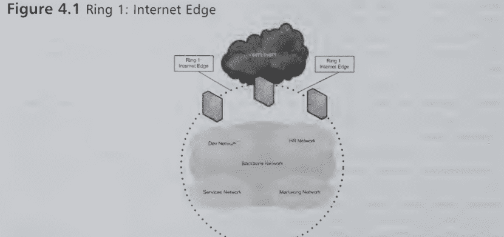

*互联网边缘*（Internet edge）是外部主机发起攻击的第一接触点。由于大多数人对未知的恐惧大于对已知的恐惧，网络和防火墙管理员认为应该在此位置部署他们最智能、最强大的防火墙。如果你不深入思考，这似乎是合理的。

问题在于，绝大多数网络攻击来自网络*内部*，而且应该将最强大的防御措施部署在*最接近*最有价值资产的位置。如果你思考一下将最强防御置于边缘的做法，与你在现实世界中保护其他事物的方式是多么相悖，你就会意识到互联网边缘防火墙*不应该*是你最安全或最复杂的防火墙，它应该是你*最快*的防火墙。

我们首先讨论将最强防御置于最有价值资产附近的逻辑，然后再讨论为何要让最外层防火墙成为最快防火墙的原理。

想想银行如何保护其现金资产。首先，联邦机构在我们所有人周围无形地运作。这"最外层"的银行安全级别并不能阻止许多正在进行的银行抢劫，但它有助于防止守法公民在那天无事可做时决定去抢银行。

向内移动，靠近银行核心资产的下一层防御是地方警察局。警察在城里巡逻，也许当银行劫匪即将开始抢劫时，他们恰好在银行前面。虽然这能提供少量安全保障，但警察不可能*始终*在银行前面，而且即使他们做出响应，也是在事发*之后*。警察通常在行凶者早已逃离时才到达现场。

更接近核心银行资产的下一环可以代表前门摄像头（更可能是停车场摄像头）。银行安保人员*如果*保持警惕，并在抢劫企图开始前识别出罪犯，或许能够阻止抢劫发生。但这种方法的问题在于，他们无法阻止某人，直到该人做出暗示抢劫正在进行的行为。如今，你不能仅仅因为某人头上套着袜子、手里提着空枕头套就阻止他。如果他有枪，但有隐蔽携带许可证，你仍然无法对他采取任何行动，除非他非法展示枪支，或者可能将其带入银行（取决于你所在地区的当地或联邦法律）。然而，与联邦安全环或当地警察安全环相比，安全摄像头更为复杂，更有可能阻止正在进行的抢劫企图。

下一环位于银行外部与柜员区域之间的边界。这个区域通常有一名武装警卫。武装警卫提供更好的保护水平，因为他可以在抢劫开始时阻止抢劫，*如果*他识别出正在发生的抢劫，并且*如果*他在劫匪开枪之前射中劫匪。大厅里的武装警卫 definitely 提供了比大楼外监控摄像头、在街上巡逻的当地警察以及联邦机构高得多的安全级别。

下一层安全防线位于银行金库内部与大厅及柜员区之间的界面，即银行金库门。如果劫匪绕过联邦机构、趁没有警车时到达、看起来像普通顾客且未被安全摄像头标记、并在武装警卫射中他之前射中武装警卫（我假设劫匪不在允许公民合法携带武器的国家或州；如果银行位于这些地区之一，劫匪还必须幸存于武装市民），最后的障碍就是银行金库门。除非劫匪是弹药专家或某种保险箱破释者，否则银行金库门每次都能阻止他。

银行金库门提供最高级别的安全性，是银行防御中最"坚固"和"不可穿透"的。这就是为什么它被直接放置在银行核心资产前方，以防止入侵者突破所有其他安全环时保护这些资产。

然而，没有任何安全环，无论保护得多么完善，是不可穿透的。（下次那些"硬件防火墙专家"告诉你"硬件"防火墙不可侵犯时，提醒他们这一事实。）

假设劫匪不是弹药专家或保险箱破释者。相反，他会采用懦夫的方式，利用*社会工程*（胆小的电脑黑客使用类似方法）。在这种情况下，银行劫匪通过威胁顾客和柜员的生命来社会工程这一局面，如果银行经理不打开金库门的话。

因为你总能找到更多的钱，但人的生命只有一次，银行经理打开了金库门。

此时，你可能认为游戏结束，劫匪赢了。他已经突破了最后一道防御环，钱是他的了（忽略一个事实：为了赢得抢劫游戏，劫匪还必须成功地带着现金离开银行）。

然而，还有另一层防御，那就是钱本身可以提供的防御。钱袋中可能装有爆裂墨水，如果在错误的时间或以错误的方式移动或取走现金，墨水就会爆裂，将劫匪覆盖上鲜艳的粉红色。或者，如果钱被不当移动，金库中会泵入麻醉气体，或者钱被做了标记，在公共场合花用时很容易被识别。如果银行希望收回其资金，必须确保将保护方法应用于钱本身，因为这是银行保护其资产的最后一道防线。

这个故事的要点是，银行以及任何其他保护其核心资产的实体，都是将最坚固、最复杂、最不可穿透的屏障放置在这些资产最近的地方。敌人在最外层环时总是处于最佳状态。当他到达最内层环时，他要么已经完全耗尽了资源，要么准备放弃。无论哪种情况，敌人在继续推进时都应该遇到更强的防御机制，而他则越来越弱。这有助于加速他的最终失败。

## 第4章 • ISA 2004网络概念与准备网络基础设施

表4.1展示了保护银行资产的多道防御环。


 # 表 4.1 保护银行资产的防御环

| 银行防御层 | 实现方式 |
|---|---|
| 联邦机构 | 最外层的保护。帮助让诚实的人保持诚实 |
| 当地警察局 | 在极少数情况下，如果抢劫发生时他们恰好位于银行前方，则提供保护；仅在事后响应 |
| 周边摄像头 | 让警觉的安保人员能够主动阻止抢劫，如果他们能识别出抢劫即将开始 |
| 银行警卫 | 如果抢劫犯不先开枪，银行警卫可以开枪。能够应对进行中的抢劫，并提供比上述层级更多的安全保障 |
| 银行金库门 | 直接置于关键银行资源面前的最强保护级别 |
| 爆炸墨水、麻醉气体和其他设备 | 代表"基于主机的"保护，提高资产被盗后的可恢复性 |

考虑到这种银行金库场景保护方案，你如何解释许多网络和防火墙管理员的态度，他们声称："虽然我认为 ISA 防火墙很棒，但如果没有硬件防火墙放在 ISA 防火墙前面，我会感到不安。"

这种说法暗示 ISA 防火墙可能不如传统的硬件包过滤防火墙"强大"。把你网络防火墙保护中的"最薄弱环节"直接放在核心网络资产面前，这说得通吗？

具有讽刺意味的是，这些网络和防火墙管理员做的事情是正确的。只是他们的理由错了。多年来，"防火墙专家"和"硬件防火墙"营销人员反复向他们灌输一种观念：只有 ASIC（"硬件"）防火墙才能确保安全；所谓的"软件防火墙"由于"X、Y 和 Z"的原因，本质上是不安全的。

原因 "X" 总是与底层操作系统有关。在声情并茂、节奏完美地重复了数分钟"Windows 不安全"之后，他们始终没有提及原因 "Y" 和 "Z"。表 4.2 提供了关于原因 Y 和 Z 的信息。

# 表 4.2 硬件防火墙厂商声称软件防火墙不安全的理由

| 硬件防火墙厂商的理由 | 解释 |
|---|---|
| X | Windows 操作系统无法被保护安全 |
| Y | 硬件防火墙厂商以高利润销售硬件防火墙 |
| Z | 硬件防火墙厂商以*更大*的利润销售替换零件和附加组件 |

事实是，硬件防火墙*确实应该放在网络互联网边缘*。但不是因为"防火墙专家"所宣称的原因。真正的原因是，虽然传统的硬件状态过滤防火墙无法提供现代互联网连接网络所需的高级别安全性，但它们*能够*非常快速地转发数据包，并进行*状态包过滤*。这种速度对于拥有多千兆位互联网连接的组织来说非常重要。由于必须进行的处理量，高安全性、应用层感知防火墙无法处理如此大量的流量，同时提供现代网络防火墙所需的深度应用层状态检查。

状态过滤硬件防火墙能够处理高流量，执行基本包过滤，并且只允许入站流量到达你打算提供给远程用户的服务（对于互联网边缘的高速包过滤防火墙来说，出站访问控制效果不佳）。

例如，如果你只打算提供 HTTP、HTTPS 和 IMAP4 访问企业网络资源，那么高速状态包过滤防火墙将仅接受 TCP 端口 80、143 和 443 的入站连接请求。高速包过滤防火墙可以快速确定第 4 层及以下的目标端口和信息有效性，并根据这种基础分析来接受或拒绝流量。虽然这种方法提供了边际水平的安全保障，但远未达到保护具有面向互联网主机的现代网络所需的要求。

所以下次你听到有人说"没有硬件防火墙放在 ISA 防火墙前面，我会感到不安"时，你要知道他是正确的，但他的不安基于错误的理由，因为他不理解安全性是向内部递增的，而不是递减的。

第 2 环是*骨干网边缘*，标志着互联网边缘防火墙的内部接口与骨干网段防火墙的外部接口之间的界限。图 4.2 展示了围绕企业骨干网络边缘部署的四个骨干网边缘防火墙。

## 图 4.2 第 2 环：骨干网边缘

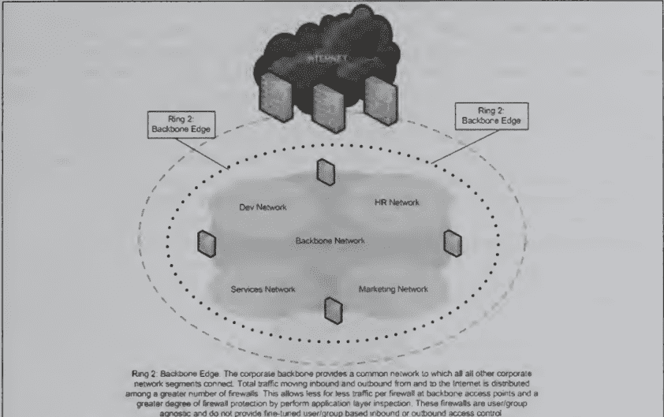

企业骨干网络为所有其他企业网络段连接提供公共网络。骨干防火墙的总入站和出站流量在*每防火墙*基础上低于互联网边缘防火墙，因为骨干防火墙数量更多。

例如，你可能在互联网边缘有两台高速包过滤防火墙，每台处理 5 吉比特/秒，总共 10 吉比特/秒。骨干网边缘有四台防火墙，假设负载在这些防火墙之间平均分配，每台骨干网边缘防火墙处理 2.5 吉比特/秒。

骨干网边缘防火墙可以开始执行真正的防火墙工作来保护企业资产，对入站和出站流量执行*状态应用层检查*。由于现代攻击针对的是应用层（因为"钱"在那里），骨干网应用层防火墙可以检查通过它们通信的应用层有效性。

例如，如果你允许入站 HTTP，骨干网边缘上的状态检查应用层感知防火墙开始通过检查 HTTP 通信的详细信息来应用真正的网络安全，并阻止通过防火墙的可疑连接。

这是 ISA 防火墙的理想位置。由于 ISA 防火墙被认为是状态应用层检查防火墙的典范，它可以执行保护企业骨干网络及其内部网络所需的繁重工作，同时确保不适当的流量（如蠕虫生成的流量）不会跨骨干网边缘环。此示例中的流量对 ISA 防火墙来说不是问题，因为它们已被测试并确认为多吉比特防火墙，这基于它们的硬件配置和防火墙规则库。

下一个安全边界位于第 3 环。第 3 环位于骨干网络与企业资产网络之间的边界。企业资产可以代表用户工作站、服务器、部门局域网、管理网络以及你不希望未经授权访问的任何其他内容。划分骨干网络与资产网络的分界线是*资产网络边缘*。这是你需要最强、最复杂保护级别的环。如果入侵者能够破坏此环的完整性，他们就能够直接访问你的企业资产并实施成功的攻击。

图 4.3 展示了第 3 环中资产网络边缘的位置。

## 图 4.3 第 3 环的资产网络边缘

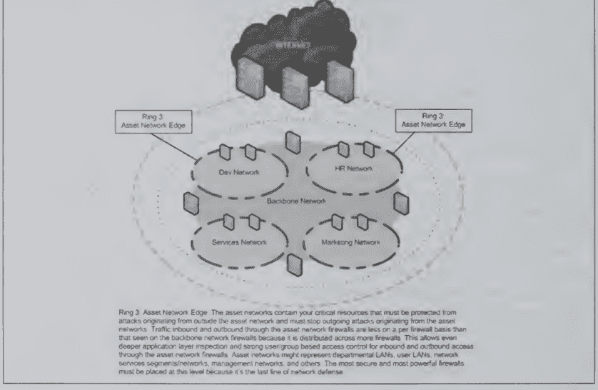

正是在第 3 环，ISA 防火墙变得至关重要。与包过滤硬件设备相比，你需要*真正的*防火墙保护。简单的包过滤在保护网络资产环中的资源时是不够的。你不仅必须确保所有入站连接都经过深度的状态应用层检查，还必须确保来自资产网络的出站连接都经过强大的基于用户/组的访问控制。

强大的出站基于用户/组的访问控制是绝对必要的。与典型的硬件包致癌物什么都放出去不同，资产网络边缘的防火墙必须能够基于用户/组成员身份控制出站连接。原因如下所列。

您必须能够记录所有出站连接的用户名，以便让用户为其互联网活动负责。

您必须能够记录用户用于访问互联网内容的应用程序；这使您能够确定是否正在使用网络使用策略不允许的应用程序，并使您能够采取有效的对策。

您的组织可能需要为离开您网络的材料负责；因此，您必须能够阻止不当材料离开您的网络。

敏感的企业信息可能会从资产网络位置传输到网络外部。您必须能够阻止专有信息的出站传输，并*记录*用于将专有信息传输到外部位置的用户名和软件应用程序名称。

ISA 防火墙是资产网络边缘的理想防火墙，因为它满足所有这些要求。当系统被正确配置为防火墙和 Web 代理客户端时，您能够：

-   记录所有通过 ISA 防火墙连接到互联网（或用户可能通过 ISA 防火墙连接的任何其他网络）的 TCP 和 UDP 连接的用户名。
-   记录通过 ISA 防火墙进行这些 TCP 和 UDP 连接所使用的软件应用程序。
-   根据用户名或组成员身份阻止连接到任何域名或 IP 地址。
-   根据用户名或组成员身份阻止访问资产网络之外的任何内容。
-   根据用户名或组成员身份阻止从资产网络向任何其他网络传输信息。

深度有状态的应用层检测和访问控制需要处理能力。服务器应具有适当的规模，以满足强大的有状态应用层处理的要求。幸运的是，即使使用复杂的规则集，ISA 防火墙每台服务器也能够轻松处理超过 1.5 千兆比特/秒的流量，并且在适当的硬件配置下可以处理更高的流量。

第 4 层代表此模型中最深的安全边界。第 4 层是*基于主机的安全*层。基于主机的安全层代表主机系统与其直接连接的网络之间的连接点。下图显示了第 4 层的位置。

## 图 4.4 第 4 层：基于主机的安全

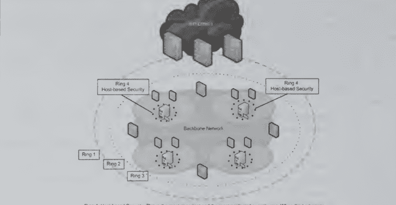

第 4 层：基于主机的安全。这是最重要也是最被忽视的安全层。当“野蛮人”兵临城下时，您最好准备好您最好和最强大的防御武器，因为这是保护您关键资产的最后机会。基于主机的安全包括：基于主机的防火墙、禁用不需要的服务、抑制“smurf”攻击、配置操作系统仅运行所需的应用程序、保护主机上的操作系统软件、应用程序和服务，配置为仅允许合法流量并自动丢弃攻击。这也要求主机系统上的软件在编写时就考虑到安全性，并且不易受到已知攻击（如缓冲区溢出）的影响。

基于主机的安全方法与您在网络防火墙保护中看到的有些不同，但原则是相同的。基于主机的安全要求您控制允许进出主机的内容，并且主机上的应用程序在设计时就考虑到安全性。在处理基于主机的安全层时，您应该考虑的一些事项如下所列。

-   基于主机的防火墙可用于控制允许哪些传入和传出连接以及哪些应用程序可以发送和接收数据。这是典型的“个人防火墙”方法，但除了为用户工作站提供个人防火墙支持外，还可以扩展到支持服务器应用程序。
-   IPSec 策略（在支持它的系统上）可用于控制允许从特定主机进出或向特定主机进出的内容。如果特定工作站或服务器不需要连接到所有可能的计算机，您可以使用 IPSec 策略将其锁定，将连接限制在预定义的计算机集合中。
-   主机上运行的应用程序和服务必须在设计时考虑到安全性。这意味着这些应用程序和服务不易受到常见攻击，例如缓冲区溢出和社交攻击（例如，HTML 电子邮件漏洞利用和打开附件）。
-   必须使用防病毒软件来阻止来自其他网络位置或通过有缺陷的热修补程序和软件引入的病毒。
-   必须安装反垃圾软件来保护机器，防止广告软件和其他恶意软件在机器上安装。
-   如果安装了电子邮件客户端，则必须在机器上安装反垃圾邮件软件。在处理入站和出站邮件的 SMTP 中继上也应安装反垃圾邮件软件，以阻止不仅携带潜在危险有效载荷的垃圾邮件，还可以减少与垃圾邮件相关的员工生产力损失。
-   用户和安装的服务应以最低权限运行，以限制恶意软件在执行时可能造成的影响。例如，如果受损的用户帐户没有管理员或高级用户权限，许多广告软件、垃圾软件、间谍软件、病毒和 rootkit 将无法安装。

基于主机的安全是最后的防线。没有任何防火墙能够完全弥补在主机层发现的弱点。网络防火墙安全有助于控制从企业网络到企业网络的访问，以及来自必须经过 ISA 防火墙的非本地网络的攻击，但只有基于主机的安全才能处理来自本地网络、连接不经过网络防火墙的攻击。

既然您已经对各种安全边界有了很好的了解，您就会意识到像“如果没有在前面放一个硬件数据包过滤器，我就不会放心地将 ISA 防火墙放进去”这样的评论，就类似于说“如果不能在前面放一只贵宾犬，我就不会放心地将洲际弹道导弹发射井放进去”。

请注意，对于可能只有一个环（即互联网边缘环）的小型网络，整个讨论是无意义的。在 ISA 防火墙前面放置数据包过滤传统防火墙的唯一原因是浪费金钱。您最好购买两台 ISA 防火墙，或者购买两台复杂的应用层防火墙，并将 ISA 防火墙放在另一台应用层防火墙后面。这确保了 ISA 防火墙可以实施您所需的基于强大用户/组的安全性。

##### ISA 防火墙的谬误

有一些常见的误解和谬误通常与 ISA 防火墙相关联。作为 ISA 防火墙管理员，您需要能够解决这些谬误，并教育同事和经理。一些常见的 ISA 防火墙谬误包括：

-   软件防火墙本质上是脆弱的。只有硬件防火墙才能被信任来保护网络。
-   不能信任在 Windows 操作系统上运行的任何服务的安全性。您永远无法保护在 Windows 操作系统上运行的防火墙。
-   ISA 机器是很好的代理服务器，但我需要一个真正的防火墙来保护我的网络。
-   ISA 防火墙运行在 Intel 硬件平台上，只有具有所有“固态”组件的防火墙才能算作防火墙。如果您想将其视为防火墙，则防火墙不应有任何移动部件。
-   “我有一个防火墙和一个 ISA 服务器。”
-   一个真正的防火墙应该配置起来像噩梦一样，并且理想情况下，应该使用命令行界面，以便只有参加过昂贵供应商培训课程的人员才能访问。

让我们逐一讨论这些 ISA 防火墙谬误。

###### 软件防火墙本质上是脆弱的

作为 ISA 防火墙管理员，您可能遇到过这样的人：

-   不知道 ISA 防火墙是什么
-   认为它是某种缓存服务器，类似于旧的 CacheFlow 产品（被 Bluecoat 收购）或 Squid
-   相信只有硬件防火墙才是“安全的”，而所谓的“软件”防火墙不适合数据中心边缘

教授从未听说过 ISA 防火墙的人可能会很有趣。您可以告诉他们 ISA 防火墙如何提供强大的入站*和*出站访问控制，其方式是目前市场上任何其他防火墙都无法提供的，ISA 防火墙如何阻止文件共享程序，如何防止恶意用户违反网络安全策略（例如下载受版权保护的材料），ISA 防火墙如何为 Microsoft Exchange 服务（包括 OWA 和 MAPI/RPC）提供卓越的保护，以及它配置起来多么容易，以至于让市场上所有其他企业级防火墙都相形见绌。

您会遇到许多听说过 ISA 防火墙的网络和防火墙管理员，但他们错误地认为“ISA 是某种 Web 代理或缓存服务器之类的东西”（借用我曾经在安全会议上遇到的一位防火墙专家的话）。

ISA 防火墙是货真价实的企业级防火墙，提供强大的入站和出站访问控制以及应用层过滤，以保护*当今*的网络，而不是传统数据包过滤防火墙就足够的 1990 年代的网络。

那些“只有硬件防火墙才能保证安全”的信徒是最顽固的。多年来，他们一直被告知硬件（基于 ASIC）的防火墙是防火墙的*巅峰*，任何不基于 ASIC 的防火墙都是不充分的软件防火墙，更应该被称为代理。我不得不怀疑他们如何调和这一教条与最畅销的防火墙产品是基于软件的 CheckPoint 这一事实。

硬件防火墙的幻想基于历史现实。在 1990 年代，硬件防火墙可以通过简单的数据包过滤机制（检查源地址和目的地址、端口和协议）提供合理的安全性和性能。


协议，并做出快速决策。由于防火墙过滤逻辑"烧录"在ASIC（专用集成电路）中，因此不容易被黑客攻破基本系统。然而，21世纪的攻击者已经明白，要绕过基于有状态过滤硬件系统提供的相对薄弱的网络安全，无需入侵数据包过滤防火墙的核心指令集。

你可以在 http://www.issadvisor.com/viewtopic.php?t=368 找到一篇优秀文章，揭穿了ASIC优越性的神话。作者提出了非常充分的理由来避免使用硬件防火墙，因为它们永远无法跟上现代威胁的演变步伐，而基于软件的一体化防火墙才是网络防火墙和边界安全的未来。这正是你的ISA防火墙所赋予的巨大优势：它可以快速升级和增强，不仅能应对当今的威胁，还能抵御你未来肯定需要防御的攻击。

###### 不能信任在Windows操作系统上运行的任何服务的安全性

这是"硬件防火墙"爱好者之间常见的争论焦点。经常有人问我，鉴于基础操作系统需要大量的安全漏洞修补和Bug修复，我们怎么能在Windows操作系统上运行ISA防火wall时感到安全。这是一个合理且有效的问题。以下是关于底层Windows操作系统以及在其上运行ISA防火墙你应该考虑的要点。

- 并非所有热修复程序都适用于作为网络防火墙的ISA防火墙。许多热修复程序是基于服务的。由于你在ISA防火墙机器上不运行客户端或服务器服务，因此大多数热修复程序与之无关。

- 一些热修复程序解决的是核心操作系统组件的问题，例如RPC（冲击波蠕虫就利用了它）。由于ISA防火墙对*所有*接口应用安全策略，你必须创建一条访问规则允许攻击访问防火墙。在RPC的具体情况下，安全RPC过滤器会阻止冲击波及相关攻击。IIS问题不构成威胁，因为你在防火墙上不运行IIS服务（也许除了IIS SMTP服务之外）。其他服务只有在你向防火墙开放端口允许攻击进入时才可访问。因此，正确配置的ISA防火墙比基础操作系统安全得多，因为对防火墙的网络访问被严格限制了。

- 其他热修复程序解决的是稳定性问题。你需要应用这些热修复程序和服务包。然而，所有防火墙厂商都会定期发布修复程序（如果他们不这么做，那说明他们没有关注，而他们的软件*是*有漏洞的，即使他们不知道，即使他们没有向你承认这些漏洞）。

- 一些热修复程序需要重启。你可以在方便的时间安排重启。注意你不需要安装所有的热修复程序，因为并非所有程序都适用，

- 如果你不能信任在Windows操作系统上运行的服务，那么你怎么能信任你的Exchange、SQL、SharePoint和其他Microsoft服务器安装的基础操作系统？

- ISA防火墙的基础操作系统是可以加固的。事实上，Windows Server 2003 SP1安全配置向导（SCW）中有一个配置文件，允许你使用SCW自动加固基础操作系统。

- 如果你不想使用SCW或无法使用它，你也可以手动加固基础操作系统。将有一份与ISA 2004同时发布的操作系统加固指南，将指导你完成加固基础操作系统同时保持ISA防火墙服务不受影响的过程。这是ISA Server 2000的一个重大问题，因为我们许多人尝试加固操作系统时产生了未曾预料到的副作用。

虽然底层操作系统的问题是一个因素，但你可以看到底层Windows Server 2003操作系统绝对不是一个重要因素。至于Windows 2000，保护基础操作系统可能是一个更大的问题，但你仍然可以将操作系统加固到与任何硬件防火墙相媲美的程度。

###### ISA防火墙是很好的代理服务器，但我需要一个"真正的防火墙"来保护我的网络

ISA防火墙确实是出色的代理服务器。事实上，ISA防火墙既是状态过滤*又*是代理防火墙。这种混合型防火墙是当今最先进、最安全的防火墙。

传统的数据包过滤防火墙使用非常简单的机制来控制入站和出站访问：源和目的端口、源和目的IP地址，对于ICMP则是源和目的IP地址以及ICMP类型和代码。必须为每个入站和出站连接显式创建数据包过滤器。更复杂的数据包过滤器可以动态打开响应端口。ISA防火墙能够通过其*动态数据包过滤*功能动态打开端口。

"电路层"防火墙类似于大多数评论者所说的"状态过滤防火墙"。应该指出，"状态"这个术语可以随你想要的意思来解释。它作为一个营销术语被引入，和大多数营销术语一样，旨在推销产品，而不是量化和指定任何特定功能或行为。

然而，大多数人认为*状态过滤*（区别于*状态检测*）是一种机制，其中状态过滤器在传输层（第4层）跟踪连接状态。TCP协议可以定义会话状态，而UDP则不能。因此，UDP通信必须由状态过滤设备强制执行*伪状态*。状态过滤有助于防御许多子应用层攻击，如会话劫持。

大多数硬件防火墙到此为止。它们可以执行简单的数据包过滤、动态数据包过滤和状态数据包过滤（状态过滤）。这些防火墙通常还提供高级路由功能，这使它们更像网络路由器而非真正的现代防火墙。相比之下，ISA防火墙的路由功能不如传统数据包过滤防火墙那么出色。

正如我们之前讨论的，数据包过滤防火墙在Ring 1的互联网边缘很有用，因为它们的处理速度快。这些防火墙的主要问题是，它们确实无法提供你所需级别的保护来阻止攻击到达Ring 2和Ring 3，而在这些层级必须执行高级应用层检查。

这就是代理防火墙发挥作用的地方。代理防火墙能够通过解构和重构整个应用层消息来*检查*应用层通信的全部内容。例如，代理防火墙重构整个HTTP消息，检查消息中的命令和数据，有状态地检查内容并与应用层规则进行比较。然后代理防火墙根据为HTTP协议配置的应用层规则允许或拒绝通信。

例如，一种比较常见的HTTP攻击是目录遍历攻击。许多流行的蠕虫利用目录遍历来访问Web服务器上的可执行文件。例如，以下URL：

```
http://www.iusepixfirewalls.com/scripts/..%5c../winnt/system32/
cmd.exe?/c+dir+c:\
```

执行cmd.exe文件并运行"dir c:\"命令，列出C:\目录中的所有文件。注意"%5c"字符串。这是Web服务器转义码。转义码以%nn的形式表示普通字符，其中nn代表两个字符的条目。转义码"%5c"代表字符"\"。IIS根目录强制器可能不会检查转义码，从而允许请求被执行。Web服务器的操作系统理解转义码并执行命令。

转义码对于绕过对用户输入实施的编写不规范的过滤器也非常有用。如果过滤器查找"../"（点点斜杠），攻击者可以轻松地将输入更改为"%2e%2e/"。这与"../"含义相同，但不会被过滤器检测到。转义码%2e代表字符"."（点）。ISA防火墙作为一款先进的有状态应用层检测防火墙，能够轻松阻止这些攻击。

代理防火墙有潜力阻止任何应用层协议的攻击。其他应用层协议包括SMTP、NNTP、即时通讯协议、POP3、IMAP4以及所有其他协议。像ISA 2004这样的混合型防火墙，结合了状态过滤和有状态应用层检测，可以通过软件轻松升级以阻止最新的应用层攻击。相比之下，状态过滤防火墙完全无法感知应用层攻击，而即使是具有基本应用层检测功能的硬件防火墙也无法快速升级以应对最新的


 ## ISA 防火墙运行于 Intel 硬件平台，且防火墙应"无可动部件"

为什么防火墙要求无可动部件，而我的 Exchange、SQL、Web、FTP 以及其他任何关键任务服务器却能在有"可动部件"的情况下正常运行？通常，"可动部件"一词与 Intel 平台和硬盘有关。以下是使用基于 Intel PC 平台的防火墙的一些优势。

- 当内存、处理器或网卡出现故障时，你可以用商品硬件的价格进行更换。你无需返回固态硬件厂商处，为其硬件组件支付高昂溢价。

- 当你想要升级内存、处理器、存储、网卡或任何其他组件时，你可以使用商品硬件添加到你的机器中。你无需前往原始硬件厂商处购买价格过高的升级部件。

- 由于 ISA 防火墙软件基于硬盘，你不必受固态设备的内存和存储限制。你可以安装机载应用层过滤器、增大缓存大小、调整性能和安全性设置，并执行你的环境所需的精细定制。

- "无可动部件"这一方面主要与硬盘有关。硬盘的 MTBF（平均无故障时间）以年计。即使是低端 IDE 硬盘，在正常使用下也能使用 3 年以上。当硬盘故障时，ISA 防火墙的配置很容易恢复，因为整个配置都存储在一个简单的 .xml 文件中。借助恰当的灾难恢复计划，你可以在 15 分钟内恢复正常运行。相比之下，硬件设备中的内存烧毁则需要将整个设备返厂。

灾难恢复方面或许是使用"软件"防火墙的最具说服力的理由。单个 ISA 防火墙，或整个由 10 台 ISA 防火墙组成的阵列，都可以在几分钟内重建，而无需你更换整个机箱，也无需你从厂商处获取硬件备件。而且如果你使用的是可移动硬盘，让整个阵列在 30 分钟内恢复运行简直是轻而易举！

###### "我已有防火墙和一台 ISA Server"

"我已经有防火墙了，我想把 ISA Server 放在它后面；该怎么做？"这类评论通常来自 ISA 的拥趸，所以我知道他们并无贬低 ISA 防火墙之意。相反，这表明 ISA 防火墙管理员没有意识到 ISA 防火墙才是他们网络的防火墙，而放置在 ISA 防火墙之前的那些状态包过滤设备只是在执行有助于处理器卸载的基本包过滤。

公平地说，并非所有人都把 ISA 防火墙当作防火墙来用。你可以选择将 ISA 防火墙安装在单网卡模式下，这类似于 ISA Server 2000 所包含的"仅缓存"模式。在单网卡模式下，ISA 防火墙的功能被削减。大部分防火墙功能被移除，该机器仅提供有限的 Web 代理服务器功能。

这并非暗示单网卡模式下的 ISA 防火墙不安全。ISA 防火墙保留了足够的功能以保护自身，并保护通过单网卡 ISA 防火墙建立的 Web 代理连接的安全性。单网卡配置下的 ISA 防火墙仅允许你通过防火墙系统策略显式允许的到其自身的连接。它仅允许你通过 Web 发布规则显式允许的对企业网络主机的连接，而唯一可通过单网卡 ISA 防火墙建立的出站连接则是你通过仅 HTTP/HTTPS 的访问规则列表允许的那些。

虽然我希望能看到所有组织都按预期用途使用 2004 防火墙，即作为功能完备、融合了状态包过滤和状态应用层检测的防火墙，但我确实意识到大型组织可能已经在其他防火墙解决方案上花费了数百万美元。这些组织也希望从 ISA 防火墙提供的反向代理组件中获益，以获得更卓越的 OWA、OMA、ActiveSync 和 IIS 保护。因此，有必要指出的是，ISA 防火墙即使在被"削弱"的单网卡模式下，也能为正向和反向代理连接提供高水平的保护。

##### 为什么 ISA 应置于关键资产之前

我们已经涵盖了大量内容，下面总结一下 ISA 防火墙应置于关键网络资产之前的原因。

- ISA 防火墙运行在商品硬件上，这既能控制成本，又允许你在需要"扩展"硬件时奢侈地使用商品组件进行升级。

- 作为"软件"防火墙，防火墙配置可以通过来自 Microsoft 和第三方厂商的应用感知增强软件快速升级。

- 作为"软件"防火墙，你可以快速更换故障组件，而无需将整个防火墙返厂，也无需准备多台热备或冷备随时待命。

- ISA 防火墙提供复杂而全面的状态应用层检测，此外还有状态包过滤，以防御常见的网络层攻击和现代化的应用层攻击。

- ISA 防火墙应放置在高速包过滤防火墙之后。这在拥有多千兆位互联网连接的网络中尤为重要。包过滤防火墙减少了每台后端 ISA 防火墙需要处理的流量总量。这降低了 ISA 防火墙所需的总处理开销，并使 ISA 防火墙能够提供保护网络资产所需的真正深入的状态应用层检测。

- 虽然 ISA 防火墙无法匹敌传统硬件 ASIC 防火墙的纯包转发能力，但 ISA 防火墙通过其状态包过滤和状态应用层检测功能提供了更高级别的防火墙功能。

- ISA 防火墙能够对通过防火墙的所有通信进行身份验证。这支持将防火墙直接置于资产网络之前。理想情况下，应在执行身份验证的 ISA 防火墙之前再放置一台非身份验证的 ISA 防火墙，以便在这些连接到达执行身份验证的 ISA 防火墙之前，先进行复杂的状态应用层检测和状态包过滤。

##### 更优的网络和防火墙拓扑

至此，我们已经消除了硬件防火墙比 ISA 防火墙更安全的错误观念。基于这一认识，我们应该将 ISA 防火墙放置在什么确切位置？

答案取决于你的网络规模，以及你需要保护的环或安全区域的数量。如果你的网络规模较大，那么我们讨论的四环方案最为合适，即骨干网络和资产网络都由 ISA 防火墙保护。骨干网络 ISA 防火墙配置为完整的状态过滤和状态应用层检测，不设出站访问控制；而资产网络 ISA 防火墙则提供状态过滤和状态应用层检测，以及基于入站和出站用户/组的访问控制。

图 4.5 回顾了骨干网络和资产网络的配置。

## 图 4.5 骨干网络与资产网络

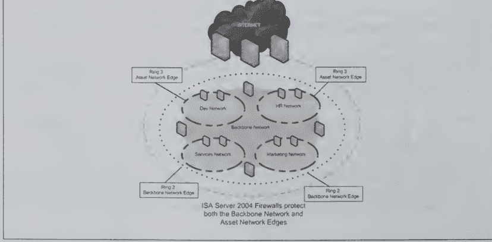

更简单的网络配置可能没有多个环，也没有多千兆位的网络连接。对于这些网络，没有必要在互联网边缘环放置快速的包过滤防火墙。

然而，你确实需要在互联网边缘和资产边缘之间的某个网段上托管可公开访问的服务。这代表你的 DMZ 网段。你可以安全、自信地将 ISA 防火墙放置在互联网边缘，并确信你获得的安全性和访问控制比传统包过滤防火墙更高。此外，你还可以为内部（后端）ISA 防火墙配置强大的基于入站和出站用户/组的访问控制。

图 4.6 描绘了 DMZ 防火墙区段的配置。

## 图 4.6 DMZ 防火墙区段

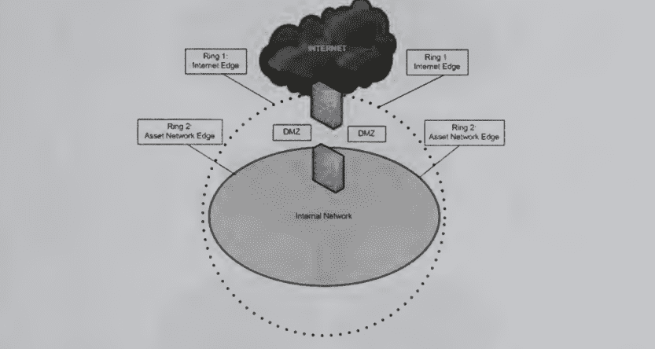

最简单的配置只需要一台置于互联网边缘的防火墙。在这种情况下，你可以将单个 ISA 防火墙放置在互联网边缘，并受益于其完整的防火墙功能，要知道它为你的网络提供的安全保护远非简单的高速基于包过滤的防火墙所能比拟。

##### Tom 和 Deb Shinder 的 ISA 2004 网络布局配置

在本书中，我们将提供如何配置 ISA 防火墙的示例。每个练习和配置选项都将基于我们为本书配置的示例网络。你可以在实验网络中复制此配置。你的实验网络可以由计算机组成，也可以使用操作系统虚拟化

tion 软件来模拟本书中使用的实验室网络配置。Microsoft Virtual PC 和 VMware Workstation 是两种最流行的操作系统虚拟化应用程序。我们更喜欢并广泛使用 VMware 进行 ISA 防火墙测试和建模环境，因为它具有先进的网络功能。不过，对于大多数 ISA 防火墙测试场景来说，Microsoft Virtual PC 或 Virtual Server 已经足够。

图 4.7 展示了构成本书讨论基础的实验室网络中的机器及其部分详细信息。

## 图 4.7 实验室网络详情

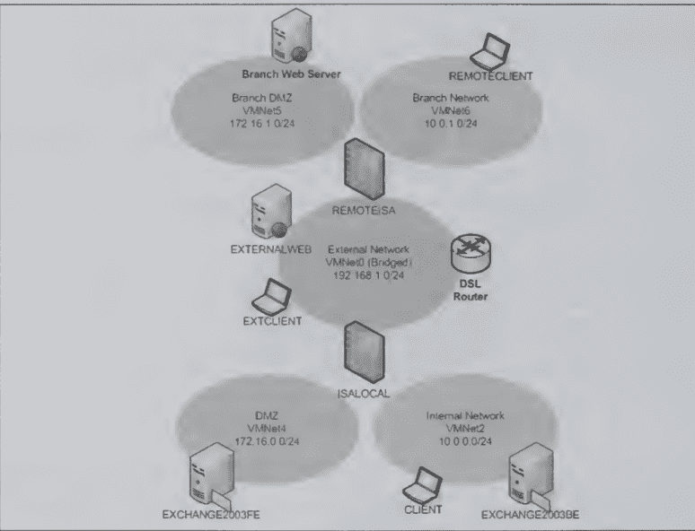

表 4.3 和 4.4 提供了参与实验室网络设置的机器的主要详细信息。

| 设置 | EXCHANGE 2003 BE | CLIENT | EXCHANGE 2003 FE | ISALOCAL | EXTCLIENT |
|---|---|---|---|---|---|
| IP 地址 | 10.0.0.2 | 10.0.0.3 | 172.16.0.2 | Int: 10.0.0.1<br>Ext: 192.168.1.70<br>Dmz: 172.16.0.1 | 192.168.1.90 |
| 默认网关 | 10.0.0.1 | 10.0.0.1 | 172.16.0.1 | 192.168.1.60 | N/A |
| DNS | 10.0.0.2 | 10.0.0.2 | 10.0.0.2 | Int: 10.0.0.2<br>Ext: N/A<br>Dmz: N/A | N/A |
| WINS | 10.0.1.2 | 10.0.0.2 | 10.0.0.2 | Int: 10.0.0.2<br>Ext: N/A<br>Dmz: N/A | N/A |
| 操作系统 | Windows Server 2003 | Windows XP | Windows Server 2003 | Windows Server 2003 | Windows XP |
| 服务 | DC (msfirewall.org), DNS, WINS, DHCP, RADIUS, Enterprise CA | 无 | Exchange 2003 | ISA 2004 | 无 |
| RAM 分配¹ | 128MB | 128MB | 128MB | 128MB | 64MB |
| VMNet² | 2 | 2 | 4 | Int: 2<br>Ext: 0<br>Dmz: 4 | N/A |

| 设置 | DSL ROUTER | REMOTEISA | BRANCHWEB SERVER | REMOTE CLIENT | EXTERNAL WEB |
|---------|------------|-----------|------------------|---------------|--------------|
| IP 地址 | Int: 192.168.1.60<br>Ext: 公共 | Int: 10.0.1.1<br>Ext: 192.168.1.60 | 172.16.1.2 | 10.0.1.2 | 192.168.1.24³ |
| 默认网关 | 公共网关 | 192.168.1.60 | 172.16.1.1 | 10.0.1.1 | N/A |
| DNS | 公共 | 公共⁴ | N/A | N/A | N/A |
| WINS | N/A | N/A | N/A | N/A | N/A |
| 操作系统 | N/A | Windows Server 2003, ISA 2004 | Windows Server 2003 | Windows XP | Windows 2000 |
| 服务 | N/A | | SMTP, WWW, NNTP, FTP | N/A | SMTP, WWW, NNTP, FTP |
| RAM 分配 | N/A | 128MB | 64MB | 128MB | 64MB |
| VMNet | N/A | Int: 6<br>Ext: 0<br>Dmz: 5 | 5 | 6 | N/A |

表 4.4 实验室网络详情

¹ RAM 分配是专用于虚拟机的宿主机系统内存量。如果您不使用虚拟机，可能需要按照每个操作系统建议的内存量来配置。

使用虚拟机相对于物理设备的一个主要	Add GOODS	you may want to use the amount of memory suggested for each operating 系统饭局。

使用虚拟机而非物理设备的一个主要优势是，您可以为虚拟 ISA 防火墙实验室中的每个主机创建基线配置快照。在创建完每个虚拟机的基线配置后，您可以保存其快照。然后在完成特定场景的测试后，您可以返回到此快照。

有关如何在实验室网络上配置各台机器的详细说明超出了本书的范围。不过，我们将详细介绍如何使用 VMware Workstation 4.0 创建 ISALOCAL 计算机的虚拟机。通过这个示例，您将对如何使用 VMware 创建示例 ISA 防火墙虚拟网络的其余虚拟机有足够的了解。

我们选择使用 VMware 是基于自其首次向公众发布以来我们丰富的使用经验。我们不想给人留下 VMware 作为操作系统虚拟化选项优于 Virtual PC 的印象。微软在其自身的测试和培训环境中广泛使用 Virtual PC。我们在 Virtual PC 平台上测试过 ISA 防火墙，发现虚拟机性能实际上似乎稍好一些。然而，VMware 对我们通常在实验室中尝试复制的网络场景有更好的支持，因此对于测试防火墙场景来说，它提供了稍好的选择。您可以在 www.microsoft.com/windows/virtualpc/default.mspx 获取更多关于 Virtual PC 的信息。另外，我们建议不要在域控制器上安装 VMware，因为它可能会干扰浏览器服务以及 DC 作为主浏览器或域主浏览器的角色。

我们在撰写本书时使用的是 VMware 4.5.1 build-7568。

##### 创建 ISALOCAL 虚拟机

第一步是获取 VMware Workstation 软件。您可以下载试用版在购买前测试 VMware。访问 http://www.vmware.com/download/ 查找下载链接。务必在安装 VMware 软件前查看系统要求。您可以在 http://www.vmware.com/support/ws45/doc/ 找到这些信息。

下载文件后运行 VMware Workstation 可执行程序。安装完成后，您需要重新启动宿主机操作系统。

ISALOCAL 虚拟机运行 Windows Server 2003 上的 ISA 防火墙软件。您可以从连接到宿主操作系统的 CD-ROM 驱动器安装 Windows Server 2003 操作系统，也可以使用 CD 映像文件（".iso 映像"）。这些 .iso 映像在 MSDN 下载站点上广泛使用。如果您只有 CD-ROM 版的 Windows Server 2003，建议考虑从该 CD 创建 .iso 文件。这将使使用 VMware Workstation 创建虚拟机变得更加容易，因为您可以将 .iso 文件挂载为 CD-ROM 驱动器，并从 .iso CD-ROM 驱动器启动以安装 Windows Server 2003。

您也可以创建自己的 .iso 文件。这在处理虚拟机时会有很大帮助，因为您可以将 .iso 文件挂载为虚拟 CD-ROM 驱动器。例如，您可能希望为 ISA 2004 CD 创建 .iso 文件。有许多软件应用程序可以实现这一点。我们成功使用过的之一是 WinISO，您可以在 www.winiso.com/ 找到它。

您可以在 psychorder-5.com/windowsserver2003evaldl/ 下载 Windows Server 2003 企业版软件的评估版本。


本试用软件以 .iso 文件形式提供，您可以将其挂载为虚拟 CD-ROM 驱动器。

在本示例中，我们将使用一个 .iso 文件。将 .iso 文件放置到主机操作系统的本地硬盘后，执行以下步骤来创建 ISALOCAL 虚拟机：

- 1. 打开 VMware 应用程序。在 **VMware Workstation** 窗口中（图 4.8），点击 **New Virtual Machine**（新建虚拟机）图标。

## 图 4.8 VMware Workstation 窗口

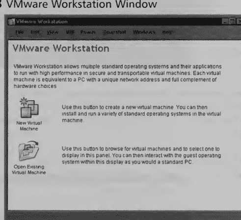

- 2. 在 **Welcome to the New Virtual Machine Wizard**（欢迎使用新建虚拟机向导）页面点击 **Next**（下一步）。

- 3. 在 **Select the Appropriate Configuration**（选择适当的配置）页面，选择 **Custom**（自定义）选项。点击 **Next**（下一步）。

- 4. 在 **Select a Guest Operating System**（选择客户机操作系统）页面（如图 4.9 所示），选择 **Microsoft Windows** 选项。从 **Version**（版本）列表中选择 **Windows Server 2003 Enterprise Edition**。点击 **Next**（下一步）。

## 图 4.9 客户机操作系统页面

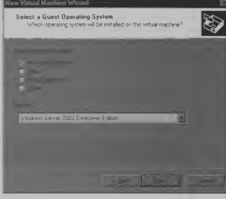

5. 在 **Name the Virtual Machine**（命名虚拟机）页面（图 4.10）中，在文本框中输入**虚拟机名称**。在本示例中，将机器命名为 **ISA-LOCAL**。在 **Location**（位置）文本框中输入虚拟机的路径。点击 **Next**（下一步）。

## 图 4.10 命名虚拟机页面

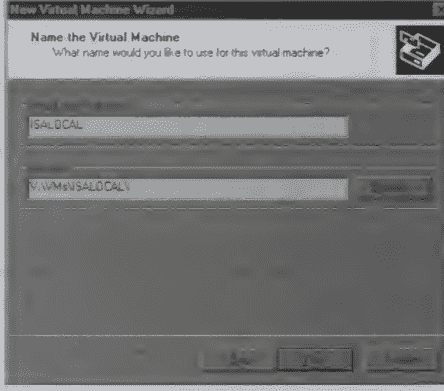

6. 在 **Memory for the Virtual Machine**（虚拟机内存）页面（图 4.11）中，分配您希望分配给此虚拟机的主机系统内存量。在我们的 ISA 防火墙虚拟防火墙网络中，ISALOCAL 机器分配了 128MB 内存。在内存文本框中输入 **128**。点击 **Next**（下一步）。

## 图 4.11 虚拟机内存页面


- 7. 在 **Network Type**（网络类型）页面（图 4.12）中，选择 **Use bridged networking**（使用桥接网络）选项。此选项允许虚拟机中的第一块网络接口卡连接到主机操作系统所连接的实时网络。您可以在此虚拟机的接口上分配一个有效的 IP 地址，并与实时网络上的所有机器通信，通过实时网络的网关连接到 Internet。这将是充当 ISALOCAL ISA 防火墙虚拟机外部接口的接口。ISALOCAL 虚拟机将使用此接口连接到实时网络的 Internet 网关（在我们的网络中是一个 DSL 路由器）。我们稍后将为此虚拟机再添加两块网络接口卡，用于将 ISALOCAL 虚拟机连接到 VMnet2（内部网络）和 VMnet4（DMZ 网络）。点击 **Next**（下一步）。

## 图 4.12 网络类型页面

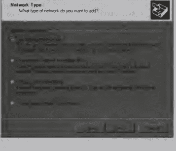

- 8. 在 **Select I/O Adapter Types**（选择 I/O 适配器类型）页面，使用默认设置，点击 **Next**（下一步）。

- 9. 在 **Select a Disk**（选择磁盘）页面，选择 **Create a New Virtual Disk**（创建新虚拟磁盘）选项。这将在主机操作系统的驱动器上创建一个虚拟硬盘文件。此虚拟机将把这个文件视为硬盘。点击 **Next**（下一步）。

- 10. 在 **Select a Disk Type**（选择磁盘类型）页面，选择 **IDE (Recommended)**（IDE（推荐））选项，点击 **Next**（下一步）。

- 11. 在 **Specify Disk Capacity**（指定磁盘容量）页面（图 4.13）中，对 **Disk size (GB)**（磁盘大小 (GB)）条目使用默认值 **4.0**。尽管 Windows Server 2003 和 ISA 防火墙软件不需要这么多磁盘空间，但您无需担心虚拟磁盘文件会在主机系统的物理磁盘上占用这么多空间。您在此页面输入的值代表虚拟机磁盘将增长到的最大大小。虽然虚拟机将始终将其硬盘大小视为您在此页面输入的大小，但主机操作系统上的实际虚拟磁盘文件会动态增长，以适应放置在虚拟机硬盘上的数据所需的空间量。点击 **Next**（下一步）。

## **图 4.13** 指定磁盘容量页面


- 12. 在 **Specify Disk File**（指定磁盘文件）页面接受磁盘的默认文件名，点击 **Finish**（完成）。

- 13. 在 **ISALOCAL** 窗口中，点击 **VM** 菜单，然后点击 **Settings**（设置）。

- 14. 在 **Virtual Machine Control Panel**（虚拟机控制面板）对话框中，点击 **Hardware**（硬件）选项卡。在 **Hardware**（硬件）选项卡上，点击 **Add**（添加）。

- 15. 在 **Welcome to the Add Hardware Wizard**（欢迎使用添加硬件向导）页面点击 **Next**（下一步）。

- 16. 在 **Hardware Type**（硬件类型）页面（图 4.14）中，选择 **Ethernet Adapter**（以太网适配器）选项，点击 **Next**（下一步）。

## 图 4.14 硬件类型页面


- 17. 在 **Network Type**（网络类型）页面，选择 **Custom**（自定义）选项。从下拉列表中选择 **VMNet2**。此网络接口将是连接到内部网络的接口。点击 **Finish**（完成）。

18. 第二块网络接口卡以 **NIC 2** 的形式显示在 **Device**（设备）列表中。

19. 在 **Virtual Machine Control Panel**（虚拟机控制面板）对话框中，点击 **Hardware**（硬件）选项卡。在 **Hardware**（硬件）选项卡上，点击 **Add**（添加）。

20. 在 **Welcome to the Add Hardware Wizard**（欢迎使用添加硬件向导）页面点击 **Next**（下一步）。

21. 在 **Hardware Type**（硬件类型）页面（图 4.15）中，选择 **Ethernet Adapter**（以太网适配器）选项，点击 **Next**（下一步）。

## 图 4.15 硬件类型页面


- 22. 在 **Network Type**（网络类型）页面，选择 **Custom**（自定义）选项。从下拉列表中选择 **VMNet4**。此网络接口将是连接到 DMZ 网络的接口。点击 **Finish**（完成）。

23. 第二块网络接口卡以 **NIC 3** 的形式显示在 **Device**（设备）列表中。

24. 点击 **Device**（设备）列表中的 **CD-ROM 1 (IDE 1:0)** 条目。

25. 在对话框右侧（图 4.16），选择 **Use ISO image**（使用 ISO 映像）选项，并使用 **Browse**（浏览）按钮找到 Windows Server 2003 的 .iso 文件。

## 图 4.16 选择 .iso 映像


26. 点击 **Device**（设备）列表中的 **USB Controller**（USB 控制器）条目。点击 **Remove**（移除）。

27. 在 **Virtual Machine Control Panel**（虚拟机控制面板）对话框中点击 **OK**（确定）。

现在虚拟机硬件设置已配置完成，我们可以开始安装 Windows Server 2003。执行以下步骤完成 Windows Server 2003 操作系统安装：

- 1. 点击 **ISA-LOCAL – VMware Workstation** 窗口左侧的 **Start this virtual machine**（启动此虚拟机）链接（图 4.17）。机器将启动由 .iso 文件代表的 CD-ROM 光盘。

## 图 4.17 启动虚拟机


- 2. 当看到 **Setup Notification**（安装通知）页面时，按 **ENTER**（回车）。

- 3. 在 **Welcome to Setup**（欢迎使用安装程序）页面按 **ENTER**（回车）。

4. 在 **Windows Licensing Agreement**（Windows 许可协议）页面按 **F8**。

5. 在分区设置页面按 **ENTER**（回车）。

6. 在格式化页面接受默认选项 **Format the partition using the NTFS file system**（使用 NTFS 文件系统格式化分区），按 **ENTER**（回车）。分区将快速格式化。

7. 文件复制阶段开始将 Windows Server 2003 文件从 .iso 映像复制到虚拟磁盘。文件复制完成后，虚拟机将自动重启。

8. 重启后，安装程序进入图形界面模式。

9. 在 **Regional and Language Options**（区域和语言选项）设置页面点击 **Next**（下一步）。

10. 在 **Personalize Your Software**（个性化您的软件）页面输入您的 **Name**（姓名）和 **Organization**（组织）。点击 **Next**（下一步）。

11. 在 **Your Product Key**（您的产品密钥）对话框中输入您的产品密钥。点击 **Next**（下一步）。

12. 在 **Licensing Modes**（许可模式）页面，在 **Per server. Number of concurrent connections**（每服务器。并发连接数）文本框中输入值 **500**。点击 **Next**（下一步）。

13. 在 **Computer Name**（计算机名）和 **Administrator Password**（管理员密码）页面，在 **Computer name**（计算机名）文本框中输入 **ISA-LOCAL**。在 **Administrator password**（管理员密码）和 **confirm password**（确认密码）文本框中输入 **password**。点击 **Next**（下一步）。

14. 在提示您输入的密码不够安全的 **Windows Setup**（Windows 安装）对话框中点击 **Yes**（是）。

15. 在 **Date and Time Settings**（日期和时间设置）对话框中输入正确的日期、时间和时区设置。点击 **Next**（下一步）。

16. 在 **Networking Settings**（网络设置）页面，选择 **Typical settings**（典型设置），点击 **Next**（下一步）。

17. 在 **Workgroup or Computer Domain**（工作组或计算机域）页面接受默认选项。在内部网络（VMNet2）上安装 EXCHANGE2003BE 机器后，应将 ISALOCAL 机器加入 msfirewall.org 域。点击 **Next**（下一步）。

18. 安装继续，然后虚拟机重新启动。

19. 使用 Administrator 帐户和您创建的密码登录到 ISALOCAL 机器。

现在 Windows Server 2003 软件已安装完成，我们可以为虚拟机中的网络接口卡配置正确的 IP 地址信息。执行以下步骤配置 ISALOCAL 虚拟机的网络接口卡并配置其他操作系统选项：

- 1. 登录到 ISALOCAL 虚拟机后，点击 **VM** 菜单，点击 **Install VMware Tools**（安装 VMware Tools）命令。

2. 在 **ISALOCAL** 对话框中点击 **Install**（安装）。


3. 在 **VMware Tools 安装向导欢迎** 页面上，单击 **下一步**。

4. 在 **安装类型** 页面上，选择 **完整**，然后单击 **下一步**。

5. 在 **准备安装程序** 页面上，单击 **安装**。

6. 对于每个 **硬件安装** 对话框，单击 **仍然继续** 按钮。

7. 在 **VMware Tools 安装** 对话框上单击 **是**，该对话框提示虚拟机上未启用硬件加速。

8. 如果出现 Windows Server 2003 的安装页面，请将其关闭。

9. 最小化已打开 **HWAccel.txt** 文件的记事本窗口。

10. 在 **显示属性** 对话框的 **设置** 选项卡上，单击 **高级**。

11. 在 **默认监视器和标准 VGA 图形适配器属性** 对话框中，单击 **疑难解答** 选项卡。

12. 在 **疑难解答** 选项卡上，将滑块一直拖到 **完全** 设置。单击 **应用**，然后单击 **确定**。

13. 在 **显示属性** 对话框中单击 **确定**。

14. 在 **安装向导完成** 页面上单击 **完成**。

15. 在 **VMware Tools** 对话框上单击 **是**。这将重新启动 Windows Server 2003 ISALOCAL 虚拟机。

16. 以管理员身份登录。

下一步是配置虚拟机中的网络适配器。请执行以下步骤来配置网络适配器：

1. 右键单击桌面上的空白区域，然后单击 **属性**。

2. 在 **显示属性** 对话框中，单击 **桌面** 选项卡。

3. 在 **桌面** 选项卡上，单击 **自定义桌面**。

4. 在 **桌面项目** 对话框中，单击 **常规** 选项卡。在 **常规** 选项卡上，在 **我的文档**、**我的电脑**、**网上邻居** 和 **Internet Explorer** 复选框中打勾。单击 **确定**。

5. 在 **显示属性** 对话框中单击 **应用**，然后单击 **确定**。

6. 右键单击桌面上的 **网上邻居** 图标，然后单击 **属性**。

7. 右键单击 **网络连接** 窗口中的 **本地连接** 图标，然后单击 **重命名**。将该连接命名为 **WAN**。

8. 右键单击 **本地连接 2**，然后单击 **重命名**。将该连接命名为 **LAN**。

9. 右键单击 **本地连接 3**，然后单击 **重命名**。将该连接命名为 **DMZ**。

现在我们可以为每个接口分配 IP 寻址信息。我们将从 ISA 防火墙虚拟机的外部接口开始。

1. 右键单击 **WAN** 接口，然后单击 **属性**。

2. 在 **WAN 属性** 对话框中，单击 **Internet 协议 (TCP/IP)** 条目，然后单击 **属性**。

3. 在 **Internet 协议 (TCP/IP) 属性** 对话框的 **常规** 选项卡上（图 4.18），按照下图输入 IP 寻址信息。

# **图 4.18** 输入 IP 寻址信息


4. 单击 **高级** 按钮。

5. 在 **高级 TCP/IP 设置** 对话框中，单击 **DNS** 选项卡。在 **DNS** 选项卡上，取消 **在 DNS 中注册此连接的地址** 复选框的勾选。单击 **确定**。

6. 在 **Internet 协议 (TCP/IP) 属性** 对话框中单击 **确定**。

7. 在 **WAN 属性** 对话框中单击 **关闭**。

执行以下步骤来配置 **LAN** 接口的 IP 寻址信息：

1. 右键单击 **LAN** 接口，然后单击 **属性**。

2. 在 **LAN 属性** 对话框中，单击 **Internet 协议 (TCP/IP)** 条目，然后单击 **属性**。

3. 在 **Internet 协议 (TCP/IP) 属性** 对话框的 **常规** 选项卡上（图 4.19），按照下图输入 IP 寻址信息。

# 图 4.19 输入 IP 寻址信息


4. 单击 **高级** 按钮。

5. 在 **高级 TCP/IP 设置** 对话框中，单击 **DNS** 选项卡。在 **DNS** 选项卡上，取消 **在 DNS 中注册此连接的地址** 复选框的勾选。

6. 单击 **WINS** 选项卡（图 4.20）。在 **WINS** 选项卡上，单击 **添加**。在 **TCP/IP WINS 服务器** 对话框中，输入 WINS 服务器的 IP 地址。在我们的 ISA 防火墙虚拟网络中，域控制器也将充当 WINS 服务器。在此对话框中输入 **10.0.0.2**。单击 **添加**。

# 图 4.20 输入 WINS 服务器地址


7. 在 **高级 TCP/IP 设置** 对话框中单击 **确定**。

8. 在 **Internet 协议 (TCP/IP) 属性** 对话框中单击 **确定**。

9. 在 **LAN 属性** 对话框中单击 **确定**。

最后，我们来配置 ISA 防火墙机器上 DMZ 接口的 IP 寻址信息。执行以下步骤来配置 DMZ 接口：

1. 右键单击 **DMZ** 接口，然后单击 **属性**。

2. 在 **DMZ 属性** 对话框中，单击 **Internet 协议 (TCP/IP)**，然后单击 **属性**。

3. 在 **Internet 协议 (TCP/IP) 属性** 对话框的 **常规** 选项卡上（图 4.21），按照下图输入 IP 寻址信息。

# 图 4.21 输入 IP 寻址信息


4. 单击 **高级** 按钮。

5. 在 **高级 TCP/IP 设置** 对话框中，单击 **DNS** 选项卡。在 **DNS** 选项卡上，取消 **在 DNS 中注册此连接的地址** 复选框的勾选。单击 **确定**。

6. 在 **Internet 协议 (TCP/IP) 属性** 对话框中单击 **确定**。

7. 在 **DMZ 属性** 对话框中单击 **关闭**。

Windows Server 2003 操作系统现已准备好安装 ISA 防火墙软件。此时，您应该保存配置的快照。在 **ISALOCAL – VMware Workstation** 窗口中单击 **快照** 菜单，然后单击 **保存快照**。这样，如果您想从干净的环境重新开始，就可以恢复到基本的操作系统配置。当我们到第 6 章安装 ISA 防火墙软件时，我们将介绍如何在安装 ISA 防火墙软件后保存另一个配置快照。

用于安装和配置 ISALOCAL 虚拟机的过程可用于安装 ISA 防火墙虚拟网络中的其他虚拟机。请密切注意每个虚拟机的 IP 寻址信息，并确保将每个虚拟机分配到正确的 VMnet。您可以通过让 ISALOCAL 或 REMOTEISA 机器 ping 各自网络上的主机来测试机器是否连接到正确的 VMnet。例如，在创建 EXCHANGE2003BE 机器后，从 ISALOCAL 机器 ping **10.0.0.2**。如果您没有收到 ping 回复，最可能的原因是您在某台机器上配置 IP 寻址信息有误，或者这些机器不在同一个 VMnet 上。

如果您感兴趣的是能够测试本书中大多数场景的最简单配置，您可以使用以下虚拟机：

- ISALOCAL
- ISAREMOTE
- CLIENT
- EXCHANGE2003BE
- REMOTECLIENT

请注意，您不需要为 REMOTECLIENT 机器重新进行全部配置。您可以将 CLIENT 机器的目录复制到另一个位置，然后在副本中重新配置名称、IP 寻址信息和 VMnet。这样，当我们在第 9 章进行站点到站点 VPN 练习时，您就有一个可以与之通信的 REMOTECLIENT。

## 提示

VMware Workstation 4.0 默认仅支持三个虚拟网卡。但是，得益于 Alessandro Perilli (http://www.virtualization.info/) 的热心帮助，您可以为单个 VMware 虚拟机添加第四个网卡。操作方法如下：

打开相关的 .vmx 文件，并在底部添加以下内容：

```
Ethernet3.present = "TRUE"
ethernet3.addressType = "generated"
ethernet3.generatedAddress = "00:0c:29:cb:7d:8f"
ethernet3.generatedAddressOffset = "30"
ethernet3.connectionType = "custom"
ethernet3.vnet = "VMnet3"
```

您不能更改以太网编号和 AddressOffset。您可以更改 address.Type、generatedAddress、connectionType 和 vnet。


 ## ISA 防火墙如何定义网络和网络关系

ISA Server 2000 防火墙的一个主要局限性在于其对网络的看法过于简单。ISA Server 2000 防火墙只能识别两种类型的网络：受信任网络和不受信任网络。受信任网络包含在 ISA Server 2000 防火墙的本地地址表（LAT）中。任何不在 LAT 中的网络都被视为不受信任网络。ISA 防火墙策略应用于 LAT 主机与非 LAT 主机之间的所有通信。而 LAT 主机之间的通信则通过 ISA Server 2000 防火墙路由，但不经过 ISA Server 2000 防火墙的状态过滤和应用层检查机制。

这对于希望创建直接连接到 ISA Server 2000 防火墙的 DMZ 网段的防火墙管理员来说是个问题。例如，ISA Server 2000 防火墙可能配置了三个网络接口。这种配置可以包括一个连接到内部网络的内部接口，一个连接到公共访问 DMZ 网段的 DMZ 接口，以及一个将防火墙连接到 Internet 的外部接口。

在 ISA Server 2000 中，这种三宿主 DMZ 配置凸显了 ISA Server 2000 网络模型的大多数局限性。

- LAT 主机与非 LAT 主机之间的所有通信都必须经过 NAT。这意味着内部网络与 Internet 之间，以及内部网络与 DMZ 网段之间的所有连接都是 NAT 转换的。
- ISA Server 2000 防火墙不对 Internet 主机与 DMZ 网段上计算机之间的连接应用状态化应用层检查。这些连接由 ISA Server 2000 防火墙从 Internet 路由到 DMZ 网段，仅对这些连接进行状态过滤，类似于典型硬件防火墙的做法。
- DMZ 主机与内部网络主机之间的通信必须通过服务器和 Web 发布规则来实现，因为内部网络将 DMZ 网段视为另一个不受信任的网络。
- 从内部网络到 DMZ 网段的出站连接，与内部网络和 Internet 之间的连接适用相同的访问策略。例如，如果允许从内部网络出站 FTP 访问，则允许对所有非 LAT 网络的 FTP 访问。如果允许对特定协议的出站访问，内部网络用户就可以在所有站点访问该协议。
- 使用 ISA Server 2000 防火墙时，可以在 DMZ 网段中用私有地址替代公共地址。但是，ISA Server 2000 防火墙不将此网段识别为 DMZ，且 DMZ 网段必须放置在 LAT 上。由于 ISA Server 2000 防火墙仅对 LAT 主机与非 LAT 主机之间的通信应用防火墙策略，因此内部网络与私有地址 DMZ 网段之间不执行防火墙过滤。虽然可以使用 RRAS 数据包筛选器创建"穷人的"DMZ 网段，但 RRAS 数据包筛选器提供的灵活性和安全性甚至低于硬件防火墙的状态化数据包过滤机制。

微软认识到了 ISA Server 2000 防火墙的这些局限性，并进行了修正。ISA 防火墙不再使用 LAT。不再需要 LAT，因为 ISA 防火墙不会隐式信任任何网络。在 ISA Server 2000 中，LAT 决定哪些网络是受信任的，哪些不是。由于新版 ISA 防火墙的网络模型默认不信任任何网络，因此 LAT 不再是 ISA 防火墙配置的一部分。通过 ISA 防火墙的所有通信都会受到 ISA 防火墙的状态过滤和状态化应用层检查机制的约束。

ISA 防火墙网络模型的另一个重大改进是，您现在可以控制任意两个网络之间的路由关系。例如，如果您想复现三宿主 DMZ 设置，其中包含外部接口、内部接口和 DMZ 接口，您可以在 DMZ 网段上使用公共或私有地址，并在内部网络与 DMZ 网段之间创建路由或 NAT 关系。您甚至可以在内部网络与 Internet 之间选择路由或 NAT 关系。如果内部网络上有公共地址，且您希望继续使用这些地址而不对出站至 Internet 的连接进行 NAT 转换，这将特别有帮助。

表 4.5 展示了 ISA 防火墙的网络模型与 ISA Server 2000 相比有哪些新的和改进的功能。

## 表 4.5 ISA 防火墙网络模型中的新增和改进功能

| 功能 | 说明 |
|---------|------|
| 所有访问规则都包含源网络和目标网络元素 | 访问规则控制哪些通信通过防火墙。访问规则的两个关键组件是连接请求的源和目标。这使您可以对通过防火墙的协议访问进行精细控制。您可以允许用户 IRC 访问，但仅限于请求来自特定内部网络且目标是公司 LAN 上另一个网络时。对其他任何网络（包括 Internet）的 IRC 请求将被拒绝。 |
| 通过 ISA 防火墙的所有通信都会受到状态过滤和状态化应用层检查 | 通过 ISA 防火墙建立的所有连接都会受到 ISA 防火墙访问策略的约束。ISA 2004 网络方案中没有受信任的网络。虽然您可以选择通过访问规则从一个网络路由所有通信到另一个网络，但从来没有必要这样做。 |
| 任何两个网络之间的通信可以路由或 NAT 转换 | 您可以选择对任意两个网络之间的连接进行路由或 NAT 转换。如果您需要向另一个网络隐藏某个网络上的地址，可以选择 NAT 关系；或者如果您需要使用在 NAT 连接上无法正常工作的协议，可以将数据包从一个网络路由到另一个网络。能够在任意两个网络之间选择路由关系，比 ISA Server 2000 的方法提供了更大的灵活性——后者总是在 LAT 与非 LAT 网络之间进行 NAT 转换，在 LAT 网络之间总是进行路由。 |
| 防火墙客户端和 Web 代理客户端配置可以按网络创建 | 您可以创建多个内部网络，并使用访问规则控制这些内部网络之间的访问。每个网络可以有自己的定制 Web 代理和防火墙客户端配置与支持。您可能希望一个网络具有 Web 代理客户端访问但无防火墙客户端访问，同时希望另一个内部网络具有防火墙客户端访问但无 Web 代理客户端访问。使用 ISA Server 2000 防火墙无法做到这一点。 |
| ISA 防火墙被定义为一个独特的网络 | 防火墙最重要的功能之一是保护自身的能力。ISA Server 2000 防火墙的一个主要局限性在于其数据包过滤机制仅应用于非 LAT 接口。这使得 LAT 接口完全向任何 LAT 主机的连接开放。ISA 防火墙将其自身的所有接口定义为*本地主机*网络的一部分，并且必须创建显式访问规则才能允许连接到 ISA 防火墙的*任何*接口。 |
| VPN 客户端属于单独的网络 | ISA Server 2000 防火墙将 VPN 客户端视为 LAT 主机，不将防火墙策略应用于 VPN 客户端连接。ISA 防火墙对从 VPN 客户端到任何其他网络的所有连接应用状态过滤和状态化应用层检查。可以限制 VPN 客户端仅访问您希望其访问的协议和位置。 |


 # 表 4.5 ISA 防火墙网络模型中的新增和改进功能

| 功能 | 说明 |
|---------|-------------|
| 隔离的 VPN 客户端代表一个独立的网络 | ISA 防火墙支持 VPN 隔离。你可以配置 ISA 防火墙，要求 VPN 客户端在移至 VPN 客户端网络之前通过安全检查。这样你就可以创建针对隔离 VPN 客户端的自定义访问规则，允许他们更新系统以满足网络安全要求。 |
| 网络可以分组以简化策略访问规则配置 | 你可以对网络进行分组以简化访问控制。例如，你可能希望授予内部网络 A 和 B 的用户访问 DMZ 网络资源的权限。你可以创建网络 A 和 B，然后创建一个包含这两个网络的网络组，接着允许访问该网络组。随后，当你想为这两个网络创建访问规则时，该网络组简化了操作。 |
| 对网络对象的精细控制 | 你不仅可以基于源网络和稍后网络来控制访问。你还可以设置计算机对象、地址范围、子网、计算机集、URL 集和域名集。这些网络对象中的每一个都可以通过在访问规则中用作源和目标来控制访问。 |
| 针对 VPN 客户端的 SecureNAT 客户端支持 | ISA Server 2000 防火墙的 VPN 服务器要求 VPN 客户端配置为 Web 代理或防火墙客户端，才能通过其连接的 ISA 防火墙访问 Internet。ISA 防火墙允许 VPN 客户端作为增强型 SecureNAT 客户端，允许他们通过创建 VPN 连接的同一 ISA 防火墙访问 Internet。VPN 客户端的 SecureNAT 客户端配置得到了增强，因为可以使用 VPN 客户端的登录凭据来允许基于用户/组的访问控制，范围涵盖 VPN 客户端与任何其他网络之间。 |

我们将在整本书中更详细地介绍所有这些内容。

## ISA 2004 多网络功能

ISA 2004 营销团队将 ISA 防火墙的全新改进的网络功能集称为"多网络功能"。与大多数营销术语一样，很难确切界定多网络功能实际意味着什么。它可能指 ISA 防火墙使用有状态过滤和有状态应用层检测来控制任何两个网络之间访问的能力。它可能指 ISA 防火墙创建多种类型网络对象并在访问规则中使用这些网络对象的能力。或者，它可能指创建多个内部网络、多个 DMZ 网络和多个外部网络的能力。又或者，它可能指以上所有。与"有状态"一词类似，它没有特定的含义，几乎可以按你喜欢的方式使用。

## 警告

多网络功能*不*意味着的一项能力是支持 ISA 防火墙上的多个默认网关。这意味着你不能让一个外部接口连接到 DSL 线路，第二个外部接口连接到电缆线路，第三个外部接口连接到 T1 线路，然后期望使用这三个接口来连接 Internet。虽然你可以使用所有这些接口来连接基于 Internet 的计算机，但只有其中一个接口可以用于大范围连接 Internet，因为另外两个接口需要明确的路由表条目来连接到特定的 Internet 主机或网络。如果你希望使用多个 Internet 连接来大范围连接 Internet，请查看 Rainfinity 的 RainConnect。RainConnect 允许你连接 ISA 防火墙上的多个接口，还提供带宽聚合和优先级排序功能。它还允许你在 ISA 防火墙后面的受保护网络上发布资源，并通过所有 Internet 连接使这些已发布资源可用，并在各连接之间对它们进行负载均衡。

为了更好地了解 ISA 2004 多网络模型的工作原理，让我们看一下网络图。图 4.22 展示了一个典型的 ISA 防火墙多网络配置。

## 图 4.22 ISA 防火墙多网络功能


# 第 4 章 • ISA 2004 网络概念与网络基础架构准备

在此示例中，有四个*受保护的*网络直接连接到 ISA 防火墙。受保护网络包含 ISA 防火墙上定义的所有网络，除了默认的外部网络。默认的外部网络代表 Internet。图中的四个受保护网络是**无线网络、DMZ、内部网络**和**服务网络**。

使用 ISA 防火墙的新网络模型，你可以创建以下访问规则：

- 无线客户端可以访问 Internet，但不允许访问任何其他受保护网络。如果需要访问，无线网段上的用户可以 VPN 到 ISA 防火墙并获得对内部网段的访问权限。
- 允许 DMZ 网段上的服务器访问服务网络网段上的服务器。例如，可以授予公共 Web 服务器访问 Exchange 服务器的权限，但不包括 SQL 服务器。这样，公共 Web 服务器可以作为 Outlook 2003 用户的 RPC over HTTP 代理。DMZ 网段上的主机将不被允许访问 Internet，也不允许访问任何其他受保护网络网段。
- 可以授予内部网络上的用户和计算机访问 Internet 和服务网络资源的权限。这允许他们使用你在 Internet 上允许的选定资源，并访问 Exchange 服务器。内部网络上的用户将无法访问无线网络上的资源或 DMZ 网段。
- 可以授予服务网络上的计算机访问 Internet 上选定站点（如 Windows 更新站点）的权限。它们还可以被允许对内部网络进行受限访问。例如，Exchange 服务器可能是 Internet 网络域的成员，需要与内部网络上的域控制器通信。
- VPN 客户端可以被允许访问 DMZ、Internet、内部网络和服务网络上的资源。你可以通过基于用户/组的访问控制来管理哪些 VPN 客户端可以访问哪些网络上的资源。例如，你可能有一个名为 *ExchangeUsers* 的用户组，你希望他们在使用 Outlook MAPI 客户端连接 Exchange 服务器，但不连接其他资源。你可以创建一条访问规则，允许该组成员访问 Exchange 服务器，但仅限使用安全的 Exchange RPC 调用来访问 Exchange 服务器。如果该组成员尝试使用任何其他协议，如 HTTP 或 CIFS，他们的连接尝试将被拒绝。

多网络功能使你对任何网络上的主机可以访问的目标具有非常精细的访问控制。即使是传统上连接后便可以访问企业网络上所有内容的 VPN 客户端，现在在建立 VPN 连接后也可以被严格限制。

##### ISA 防火墙的默认网络

为了更好地理解 ISA 防火墙的多网络功能以及 ISA 防火墙如何查看网络和如何使用它们，让我们看一下 ISA 防火墙上的默认网络。安装完成后，你会立即在 ISA 防火墙上看到这些默认网络。

- 本地主机网络
- 内部网络
- 外部网络（默认）
- VPN 客户端网络
- 隔离的 VPN 客户端网络

ISA 2004 网络必须满足以下条件：

- ISA 防火墙必须有一个或多个适配器。如果 ISA 防火墙只有一个适配器，则所有地址都被视为内部网络的一部分。
- 一个网络接口卡可以有一个或多个 IP 地址。特定接口上的 IP 地址必须属于本地主机网络以及该接口直接连接到的网络。
- 除本地主机、VPN 客户端和 VPN 隔离网络外，一个 IP 地址只能属于*一个网络*。
- 属于单个 NIC 的所有地址必须属于*同一网络*

在以下章节中，我们将更详细地查看每个默认网络。

###### 本地主机网络

*本地主机网络*是一个内置的网络对象，定义了 ISA 防火墙上所有接口的所有 IP 地址。例如，如果 ISA 防火墙有三个网络接口，其中外部接口绑定了十个 IP 地址，DMZ 接口绑定了两个 IP 地址，内部接口绑定了一个 IP 地址，那么所有 13 个地址都将构成本地主机网络。你永远不必显式定义本地主机网络上的任何地址；当你向接口添加地址时，地址会自动添加到本地主机网络。

你可以在 **ServerName\Configuration\Networks** 节点中找到本地主机网络的**属性**。在**详细信息**窗格中单击**网络**选项卡，右键单击**本地主机**，然后单击**属性**。本地主机网络的**属性**对话框出现在图 4.23 中。


 ## 图 4.23 在本地主机网络上配置 Web 代理侦听器


**本地主机网络属性**对话框有两个选项卡。**常规**选项卡提供了对本地主机网络的说明。**Web 代理**选项卡用于为本地主机网络启用 Web 代理侦听器。默认情况下，Web 代理侦听器处于禁用状态。如果希望 ISA 防火墙上运行的应用程序充当 Web 代理客户端，请勾选**启用 Web 代理客户端**复选框。

> **警告**
> 不要启用本地主机网络 Web 侦听器来允许受保护的网络主机访问 Internet。本地主机网络 Web 侦听器仅供 ISA 防火墙计算机本身使用。受保护网络或非受保护网络上的其他任何计算机都不使用本地主机 Web 侦听器。

例如，如果要在 ISA 防火墙本身上使用 Web 浏览器，则需要启用 Web 代理侦听器，然后将浏览器配置为使用 ISA 防火墙上某个接口的 IP 地址作为其 Web 代理服务器。如果 ISA 防火墙内部接口的 IP 地址为 `192.168.1.1`，则在将浏览器配置为 Web 代理客户端时应使用该 IP 地址。如果希望使用计划内容下载作业，还必须在本地主机网络上启用 Web 代理侦听器。

关于本地主机网络的一个重要问题是，与 VPN 客户端和 VPN 隔离网络一样，分配给它的地址与其他网络的地址并非互斥。在所有其他情况下，分配给其他网络的地址不能分配给任何其他网络。

例如，如果 ISA 防火墙的内部接口被分配了地址 `192.168.1.1`，则该地址*必须包含*在内部网络的地址列表中。如果 ISA 防火墙的 DMZ 接口被分配了地址 `172.16.0.1`，则该地址必须包含在定义 DMZ 网络的地址列表中。ISA 防火墙管理员常犯的一个错误是遗漏分配给本地主机网络的地址，因为他们认为由于地址不能分配给两个不同网络这一一般原则，所以不能包含这些地址。

> **提示**
> 可以使用本地主机网络上的地址来发布 ISA 防火墙上运行的服务。例如，可以在 ISA 防火墙上配置 SMTP 中继，并将 SMTP 虚拟服务器绑定到 ISA 防火墙的内部接口。然后在创建 SMTP 服务器发布规则时发布该 IP 地址。还可以通过将远程桌面服务器绑定到 ISA 防火墙的某个接口，然后使用服务器发布规则发布该接口地址，来发布 ISA 防火墙上运行的远程桌面服务器。

##### 内部网络

ISA 2004 的内部网络与 ISA Server 2000 的内部网络有很大不同。在 ISA Server 2000 中，LAT 中包含的任何网络都被视为内部网络。LAT（内部网络）主机之间的所有通信都不会被 ISA Server 2000 防火墙过滤和防火墙保护。这是因为只有 LAT 与非 LAT 客户端之间的通信才会受到 ISA Server 2000 防火墙的防火墙保护。

与 ISA Server 2000 防火墙处理内部和外部网络的方式相比，ISA 防火墙对内部网络的概念与自动配置在 ISA 防火墙上的系统策略规则相关。

要理解内部网络的作用，必须对 ISA 2004 系统策略有基本的了解。ISA 2004 系统策略是 30 条访问规则的集合，用于控制进出 ISA 防火墙的入站和出站访问。这些规则是默认创建的，您可以根据需要自定义或禁用它们。ISA 2004 系统策略规则的示例包括：

- 允许用于身份验证目的的目录服务
- 允许从 ISA 服务器到受信任服务器的 Kerberos 身份验证
- 允许从 ISA 服务器到受信任服务器的 Microsoft CIFS
- 允许从 ISA 服务器到受信任服务器的 NetBIOS

对于每条系统策略访问规则，通信默认从本地主机网络分配到内部网络。ISA 防火墙对内部网络的概念是存放组织主要基础架构服务器的网络。这样，默认的系统策略规则允许与组织的 Active Directory 服务器、DNS 服务器、DHCP 服务器、WINS 服务器和文件服务器进行通信。然而，这种内部网络的概念是为了简化 ISA 防火墙的设置，因为内部网络是在安装 ISA 防火墙软件时定义的。您完全可以不受该内部网络定义的限制。

需要注意的一点是，您可以创建多个*内部*网络。请注意，这里我使用了小写的"i"。内部网络可以是 ISA 防火墙保护的任何网络。实际上，您可以创建 DMZ 网络并将其称为内部网络。只有默认的内部网络（大写"I"）对 ISA 防火墙具有特殊含义，这种特殊含义与系统策略相关。

> **提示**
> 我们建议您利用默认的内部网络，将所有基础架构服务器放在同一个网卡后面。这使 ISA 防火墙的安装和配置更加容易，因为您可以利用默认的系统策略规则。

可以通过导航到 **ServerName\Configuration\Networks** 节点来查看默认内部网络的属性。默认内部网络的配置选项与在 ISA 防火墙上创建的任何其他网络相同。我们可以使用内部网络配置选项作为模型，在 ISA 防火墙上创建和配置其他内部或周边网络。

在**详细信息**窗格中单击**网络**选项卡，然后双击**内部**网络。单击**地址**选项卡，您将看到类似图 4.24 的内容。

**图 4.24 定义内部网络地址**


在**地址**选项卡中，输入*所有*位于内部网络适配器后面的网络上的地址。在图 4.25 所示的示例中，内部网络包含 192.168.1.0/24 范围内的所有地址。这些地址是在安装 ISA 防火墙软件时定义的。

您还可以轻松添加私有地址范围内的地址。单击**添加私有**按钮以添加任何私有网络 ID 地址范围内的地址。图 4.25 显示了从**添加私有**按钮弹出的菜单。

## 图 4.25 添加私有网络地址


> **警告**
> 不要使用内部网络上未使用的私有地址范围，也不要在整个私有地址范围未在内部网络上使用时将整个私有地址范围分配给内部网络。如果其他网络使用私有网络地址范围的子网，这可能会导致冲突。例如，内部网络可能使用 IP 地址 192.168.1.0-192.168.1.255，另一个内部网络可能使用 IP 地址 192.168.2.0-192.168.2.255。如果为内部网络分配地址范围 192.168.0.0-192.168.255.255，将会产生冲突，导致无法将 192.168.2.0/24 网络地址用于第二个内部网络。我们建议您*永远不要*在配置网络地址时使用**添加私有**按钮。

向 Internet 网络（以及您创建的其他网络）添加地址的更好方法是使用**添加适配器**按钮。图 4.26 说明了单击**添加适配器**按钮的效果。


 284 第4章 • ISA 2004 网络概念与网络基础设施准备

图 4.26 通过路由表添加地址


在**选择网络适配器**对话框中，您可以选择连接到内部网络的网卡，并使用 Windows 路由表中的地址来定义网络。这是一种更可靠的网络定义方法，因为 Windows 路由表应当始终了解从 ISA 防火墙可达的所有网络。这种对所有可达网络的认知可以通过手动配置 Windows 路由表实现，也可以通过使用动态路由协议（如 RIP 或 OSPF）来实现。

向网络添加地址的最后一个方法是使用**添加**按钮。图 4.27 展示了点击**添加**按钮后的效果。

图 4.27 输入地址范围


点击**域**选项卡（图 4.28）。在此处输入内部网络域的列表。当防火墙客户端连接到位于这些域中的主机时，连接请求将绕过防火墙客户端应用程序。其主要原理是，如果同一域中的所有计算机都位于同一个网卡之后，那么防火墙客户端计算机可以直接通信，而无需通过 ISA 防火墙回环。这减少了 ISA 防火墙的整体负载，并提高了客户端性能，因为连接不会产生任何防火墙处理开销。此外，**域**选项卡还可用于控制 Web 代理客户端访问外部站点时的行为。我们将在本章后面讨论域选项卡与 Web 代理客户端之间的关系。请参见图 4.28 了解如何输入本地域。

**图 4.28 输入本地域**


如果内部网络域跨越多个网卡，您在**域**选项卡上输入条目时必须格外小心。图 4.29 展示了域跨越多个网络接口的一种场景示例。

**图 4.29 跨内部网络扩展的域**


这是一个简单的校园网络配置示例。ISA 防火墙上有三个网络接口。一个接口将 ISA 防火墙连接到 Internet。第二个接口将 ISA 防火墙与内部网络连接，第三个接口将 ISA 防火墙连接到第二个内部网络。内部网络（大写 "I"，即教职员工和院系网络）包含 Active Directory 服务器和其他基础设施服务器。另一个内部网络（学生网络）包含已加入校园 Active Directory 域的学生计算机，这些计算机也安装了防火墙客户端。

内部网络的域名为 *msfirewall.org*。您应在**域**选项卡上包含此域名。当内部网络上的任何主机与 msfirewall.org 域中的任何其他主机通信时，内部网络上的防火墙客户端计算机将绕过 ISA 防火墙，直接连接到位于内部网络适配器后的 msfirewall.org 域中的主机。由于内部网络上没有主机需要向学生网络上的主机发起连接，因此一切正常。这是因为所有的 msfirewall.org 服务器都位于内部网络适配器之后。

现在，假设我们在 DMZ 网络（即学生网络）中将 msfirewall.org 进行配置，并且我们创建了一条访问规则（我们将在第7章详细介绍访问规则），该规则允许内部网络上的 HTTP、HTTPS、FTP、SMTP 和 POP3 对学生网络中的客户端的身份验证，此时的问题学生网络是无法进行身份验证的，因为学生网络不进行身份验证。当学生网络上仅配置为防火墙客户端的计算机尝试连接到内部网络上的 POP3 服务器时，会发生什么情况？没错——连接请求会失败。这是因为 ISA 防火墙的学生网络接口在其**域**选项卡上配置了 msfirewall.org 域。由于配置为防火墙客户端的计算机在连接到**域**选项卡上列出的域中的资源时，会绕过防火墙客户端配置，因此连接甚至无法到达 ISA 防火墙。

如果学生网络上的防火墙客户端计算机同时配置为 SecureNAT 客户端和防火墙客户端呢？在这种情况下，从学生网络主机到内部网络中 msfirewall.org 域的成员服务器的连接尝试将被发送到 ISA 防火墙的学生网络接口。在这种情况下，连接请求将被拒绝，因为 SecureNAT 客户端无法将凭据发送到 ISA 防火墙。

> **提示**
> 
> 您还可以将外部网络域添加到**域**选项卡。这将允许同时配置为 Web 代理和/或 SecureNAT 客户端的主机绕过其防火墙客户端配置，以访问这些域中的 Internet 资源。在防火墙客户端可能与防火墙客户端计算机上的特定软件不兼容的罕见情况下，这将非常有用。

在**内部属性**对话框中，点击 **Web 浏览器**选项卡。图 4.30 展示了您将在对话框中看到的内容。

## 图 4.30 为 Web 代理直接访问配置域


此选项卡上的设置控制内部网络上配置为使用自动配置脚本的网络浏览器（我们将在第5章详细讨论自动配置脚本）。您有以下选项：

- **对此网络中的 Web 服务器绕过代理。**这是一个有趣的设置。帮助文件说明："*对此网络中的 Web 服务器绕过代理。如果防火墙客户端计算机上的 Web 浏览器在访问本地 Web 服务器时应当绕过 ISA Server 计算机，请选择此选项。*"问题是，*什么是本地 Web 服务器？*相对于什么而言是本地？答案是，*本地*是指位于此网络地址范围内任何地址的任何 Web 服务器。因此，在内部网络的情况下，当配置有自动配置脚本的 Web 代理客户端尝试连接到同样位于内部网络上的 Web 服务器时，Web 代理客户端将 *绕过* ISA 防火墙上的 Web 代理，直接连接到内部网络上的 Web 服务器。这是件好事。这可以防止位于同一网络适配器后的主机通过 ISA 防火墙回环来访问同一网络接口后的资源。

- **直接访问域选项卡上指定的计算机。**这允许配置有自动配置脚本的 Web 代理客户端使用**域**选项卡上列出的域进行*直接访问*。Web 代理客户端的直接访问允许 Web 代理客户端计算机绕过 ISA 防火墙上的 Web 代理，直接连接到目标，要么通过计算机的 SecureNAT 客户端配置，要么通过计算机的防火墙客户端配置。如果您想利用已在域选项卡上输入的域并将其用于直接访问，这将用处。但是，请注意前面提到的学生网络和内部网络在三宿主 DMZ 配置中的类似问题。

- **直接访问这些服务器或域。**您可以添加希望配置有自动配置脚本的 Web 代理客户端绕过 ISA 防火墙上的 Web 代理的域或 IP 地址列表。在图中提供的示例中，我们输入了当希望使用 Outlook Express 访问 Hotmail 账户时应绕过的域列表。当 Web 代理客户端计算机连接到这些域时，Web 代理客户端配置将被忽略，客户端使用备用客户端配置来访问这些站点，例如 SecureNAT 或防火墙客户端配置。

- **如果 ISA Server 不可用，请使用此备用路由连接到 Internet：直接访问或替代 ISA Server。**此选项有点误导性，因为它暗示必须整个 ISA 防火墙不可用才会触发其中一个选项。实际上，ISA 防火墙本身可能正常，但如果 ISA 防火墙的 Web 代理出现问题，则会使用其中一个替代方案。**直接访问**选项允许配置为 Web 代理客户端的计算机使用备用客户端配置访问 Internet 或其他目标网络。这可以是其 SecureNAT 客户端配置，或通过其防火墙客户端配置。**替代 ISA Server**选项允许您输入备用 ISA 防火墙的 FQDN 或 IP 地址，Web 代理客户端可以连接到该防火墙以访问 Internet。不要使用**浏览**按钮来查找替代服务器。如果在**替代 ISA Server**文本框中使用 FQDN，请确保 ISA 防火墙可以将该 FQDN 解析为正确的 IP 地址，以便 ISA 防火墙能够定位备用 Web 代理。

> **提示**
> 
> 一个鲜为人知的事实是，控制 Web 代理客户端访问的最强大方法之一是使用自动配置脚本。您应当*始终*尽可能将 Web 代理客户端配置为仅使用自动配置脚本。唯一的例外是当您使用 WPAD 和自动发现来向 Web 代理客户端分配配置信息时。使用自动发现时，自动配置脚本信息会自动复制到 Web 代理客户端。自动配置脚本使得轻松为 Web 代理客户端创建绕过列表成为可能，这样他们就可以使用备用客户端配置访问与 CERN 兼容的 Web 代理服务器（如 ISA 2004）不兼容的问题站点。

点击 **Web 代理**选项卡。Web 代理选项卡定义了网络的出站 *Web 侦听器*。此网络上的 Web 代理客户端使用此 Web 侦听器连接到 ISA 防火墙上的 Web 代理。网络的出站 Web 代理侦听器


通过勾选**Enable Web Proxy clients**复选框来启用。Web浏览器配置为Web Proxy客户端以连接到此网络上的Web Proxy时，还必须勾选**Enable HTTP**复选框。这些步骤如图4.31所示。

## 图4.31 Web Proxy选项卡


多年来，许多人都对**Web Proxy**页面上的**Enable SSL**复选框感到困惑。此选项在ISA Server 2000中也存在。这个设置带来了一个奇怪的问题，因为如果你启用了此选项，然后尝试配置Web浏览器连接到出站Web Proxy SSL侦听器的默认SSL端口，连接尝试将会失败。其原因在于，配置为Web Proxy客户端的Web浏览器*无法与Web Proxy侦听器建立SSL连接*。Web Proxy客户端与出站Web Proxy侦听器之间的初始连接必须始终通过HTTP。

如果Web Proxy客户端与出站Web Proxy侦听器之间的连接必须始终是HTTP，那为什么还要在**Web Proxy**选项卡上提供**Enable SSL**选项呢？原因是，在*Web Proxy链式*场景中，你可以配置下游Web Proxy服务器使用SSL连接将Web请求转发到上游Web Proxy服务器。这种设置允许下游Web Proxy与上游Web Proxy之间进行*出站HTTP到SSL的桥接*。

> **提示**
>
> 对我们来说，Web浏览器为何设计成不支持到ISA防火墙上的Web Proxy的SSL连接，这始终是个谜。这将允许客户端与Web Proxy之间建立SSL安全连接，即使URL可能是指向Internet上的HTTP内容。虽然你可能认为这样的功能价值不大，但事实上，你的网络上有人运行嗅探器的可能性，要比你和目标主机之间的任何中间网络大得多。而且，在你的网络上运行嗅探器的人更有可能在寻找特定数据，例如用户名和密码。也许未来版本的Internet Explorer Web客户端将支持这种类型的配置。

##### 外部网络（默认）

在ISA防火墙安装过程中创建的默认外部网络包括所有未被ISA防火墙上其他网络定义的地址。默认外部网络不包含任何供你执行自定义配置的对话框。未被ISA防火墙上其他网络定义的任何地址都会自动包含在默认外部网络中。

考虑到单NIC ISA防火墙配置，这一点尤其有趣。当你在单NIC机器上安装ISA防火墙软件时，或者当你将单NIC网络模板应用到现有配置时，IPv4地址范围内的所有地址都会被添加到默认内部网络。由于所有可能的IP地址都包含在默认内部网络中，因此没有地址可用于默认外部网络。

> 在单NIC ISA防火墙配置中，所有地址都被视为内部地址。由于没有地址被视为外部地址，因此无法在单NIC ISA防火墙配置的访问规则中使用外部网络。我们将在介绍单NIC网络模板时更详细地讨论这个问题。

##### VPN客户端网络

VPN客户端网络是"虚拟"或"即时"网络之一。当VPN客户端或VPN网关连接到ISA防火墙时，该地址会被动态添加到VPN客户端网络。然后可以创建访问规则来控制进出VPN客户端网络的流量。

例如，假设你使用DHCP为VPN客户端和网关分配地址。当VPN客户端连接到ISA防火墙时，分配给VPN客户端的地址会被移动到VPN客户端网络所包含的地址列表中。然后使用VPN客户端网络作为源或目的地址的访问规则将应用于分配给VPN客户端或网关的地址。当VPN客户端或网关与ISA防火墙断开连接时，该地址会从VPN客户端网络中动态移除。

> **提示**
>
> 你可以选择使用DHCP或静态地址池为VPN客户端和网关分配IP地址。我们建议你使用DHCP，因为它大大简化了操作。如果你使用静态地址池，并且选择为VPN客户端的静态地址池使用子网地址，则需要将这些地址从内部网络的定义中移除。我们将在第9章更详细地讨论这个问题，该章介绍如何将ISA防火墙配置为VPN服务器和网关。

##### 隔离的VPN客户端网络

隔离的VPN客户端网络是一个"虚拟"或"即时"网络，当隔离的VPN客户端连接到ISA防火墙时，地址会被动态分配给此网络。隔离的VPN客户端网络仅在ISA防火墙上启用VPN隔离时使用。

目前，VPN隔离与其说是一个普通ISA防火墙管理员能够实际付诸实践的东西，不如说是一个开发平台。好消息是，ISA防火墙的MVP Frederic Esnouf已经整理出了一个非常优秀的VPN隔离包，易于安装和配置。请在[http://fesnouf.online.fr/programs/QSS/qssinaction/QssInAction.htm](http://fesnouf.online.fr/programs/QSS/qssinaction/QssInAction.htm)查看Frederic出色的VPN隔离解决方案。

> **提示**
>
> 如果你尚未完成VPN隔离的复杂开发要求，就在ISA防火墙上启用VPN隔离，那么所有VPN客户端和网关都将被隔离，并且永远不会离开VPN隔离网络。因此，我们建议你不要在ISA防火墙上启用VPN隔离，除非你具备开发级别的知识，并对VPN隔离底层开发平台有深入的理解。

##### 创建新网络

当环境中引入新网络时，你需要创建新网络。添加新网络的常见原因是在ISA防火墙中安装额外的NIC。由于ISA防火墙将位于任何特定NIC后的所有地址视为一个网络，因此当防火墙添加额外的NIC时，你需要创建一个新网络。

网络概念的一个有趣应用是，你可以将它们用于位于ISA防火墙外部接口*前方*的网络。ISA防火墙的外部接口并不总是需要直接连接到Internet。许多组织会将ISA防火墙用作后端ISA防火墙，因为他们需要在最接近其企业资产的地方获得最强大的防火墙保护。后端ISA防火墙的外部接口将连接到企业控制下的网络，因此，你可以在ISA防火墙配置界面中将其识别和配置为网络对象。

例如，假设后端ISA防火墙有两个NIC：一个NIC连接到DMZ网段，一个NIC连接到企业资产网络。由于你知道DMZ网络中使用的地址，因此可以创建一个定义DMZ中使用地址范围的网络对象，然后使用该网络对象来控制通过后端ISA防火墙进出DMZ的流量。

在下面的练习中，我们将在已安装额外NIC以支持DMZ网段的ISA防火墙上添加一个新的网络对象。此ISA防火墙已在外部接口上具有网络ID 192.168.1.0/24，在内部接口上具有网络ID 10.0.0.0/24。新NIC被分配IP地址172.16.0.1/16，我们将为此DMZ接口创建一个新网络。

执行以下步骤来创建新网络。

1. 在**Microsoft Internet Security and Acceleration Server 2004**管理控制台中，展开服务器名称，然后展开**Configuration**节点。单击**Networks**节点。

2. 在任务窗格中单击**Tasks**选项卡。单击**Create a New Network**链接。

3. 在**Welcome to the New Network Wizard**页面上，在**Network name**文本框中输入新网络的名称。在此示例中，我们将其命名为**DMZ**。单击**Next**。

4. 在**Network Type**页面上，选择**Perimeter Network**选项（图4.32）。请注意，在此对话框中有四个选项。

- **Internal Network** 使用**Internal Network**选项来创建新的内部网络。内部网络通常被认为是ISA防火墙"内部"的网络。这不是一个严格的区别，因为ISA防火墙并不真正以内部与外部的角度来看待世界，ISA防火墙对通过防火墙的*所有*通信应用状态过滤和状态化应用层检查。此处标注为"internal"更多是一种会计考虑。当你选择此选项时，你将有机会使用**Properties**对话框来配置此网络，设置类似于你可以使用默认内部网络设置的选项。

- **Perimeter Network** 创建新的DMZ网段时使用**Perimeter Network**选项。使用向导创建外围网络与创建内部网络时，在实际设置上没有区别。创建外围网络后，你在**Properties**对话框中拥有的选项与创建内部网络时相同。


网络。其主要价值在于，您可以在用户界面中轻松识别哪些网络是内部网络，哪些是DMZ。

- **VPN站点到站点网络** 当您需要与另一个办公室建立站点到站点VPN连接时，请使用**VPN站点到站点网络**选项。该向导将引导您完成站点到站点VPN的地址范围和VPN配置的创建。

- **外部网络** 当您创建一个位于ISA防火墙"外部"的网络时，请使用**外部网络**选项。尽管ISA防火墙并不真正将网络世界视为内部或外部，但您可以作为经验法则，任何直接从ISA防火墙上分配了默认网关的接口可达的网络都被视为外部网络。请注意，在创建新的外部网络时，**属性**对话框中的配置选项与创建新的内部网络或外围网络时相同。

5. 点击**下一步**。

参见图4.32以定义网络类型并使用外围网络。

## 图4.32 定义网络类型


6. 在**网络地址**页面（图4.33）中，您需要为新网络定义地址范围。您有三个选项。

- **添加** 当您选择**添加**按钮时，可以手动添加地址范围。如果您不想定义整个网络ID，或者想要向网络中添加几个不连续的IP地址范围，这将非常有用。

- **添加适配器** 当您选择**添加适配器**按钮时，会出现一个对话框，允许您选择适配器来定义新网络。添加的地址基于适用于该适配器的Windows路由表条目。如果在创建新网络之前已正确配置了Windows路由表，则将添加所有正确的地址。如果路由表中包含正确的信息，这是定义新网络的最简便方法。

- **添加专用网络** 当您选择**添加专用网络**按钮时，会出现一个弹出菜单，显示三个专用网络ID。我们强烈建议您不要使用此选项，因为大多数组织会在整个组织中使用专用网络ID的子网。

在本例中，我们将选择**添加适配器**选项。这将弹出**选择网络适配器**对话框。在**DMZ**复选框中打勾（在本例中，我们在**网络和拨号连接**窗口中为适配器重命名了具有意义的名称）。您将看到根据**网络接口信息**部分中列出的路由信息分配给网络的地址。点击**确定**。参见图4.33以了解如何选择网络适配器。

## 图4.33 选择网络适配器


7. 在**网络地址**页面点击**下一步**。
8. 在**完成新建网络向导**页面点击**完成**。
9. 点击**应用**以保存更改并更新防火墙策略。
10. 在**应用新配置**对话框中点击**确定**。
11. 新网络将出现在**网络**选项卡的列表中（参见图4.34）。

## 图4.34 新网络出现在网络列表中


##### 使用网络规则控制路由行为

尽管您已经创建了一个新网络，但在定义该网络与其通信的其他网络之间的路由关系之前，您无法将其用于任何用途。您可以使用*网络规则*来控制这种路由关系。

创建网络规则时，有三种路由关系可用。

- **路由** ISA防火墙文档将路由关系定义为"互惠"关系。实际上，当网络规则定义的源网络和目的网络支持彼此之间的路由时，您可以使用路由关系。例如，如果源网络和目的网络都使用公共地址，则可以定义路由关系。如果源网络和目的网络都使用专用地址，则可以使用路由关系。如果源网络使用专用地址而目的网络使用公共地址，则不能使用路由关系（在大多数情况下，当ISA防火墙配置了允许从专用网络路由到公共网络的路由表条目时存在例外）。路由关系的另一个关键特性是源IP地址始终被保留（发布规则除外，在发布规则中您可以控制是否保留源IP地址，而服务器IP地址始终被侦听器地址替换）。当源网络和目的网络支持路由关系，并且您需要支持对NAT不友好的协议时，请使用路由关系。

- **NAT** ISA防火墙文档将NAT关系定义为有方向的。NAT关系的有方向性意味着在配置网络规则时您必须注意源网络和目的网络。当您使用NAT关系时，源IP地址会被替换为连接*退出*接口上的地址。例如，假设您在默认内部网络和DMZ网络之间创建NAT关系。源网络是内部网络，目的网络是DMZ网络。当通信从内部网络发往DMZ网络时，源IP地址会更改为通信退出接口上的地址，在本例中是DMZ接口。如果您创建的网络规则中DMZ网络是源网络而内部网络是目的网络，那么从DMZ网络发出的通信的源IP地址将被替换为通信退出的接口，在本例中是内部网络接口。另请注意，当您定义NAT关系时，Web发布规则和访问规则的通信都是*单向*的。

您必须为任何特定源网络和目的网络之间的通信创建网络规则。我们已经看到过许多情况，ISA防火墙上的一切都设置正确，但某个访问策略无法工作，原因要么是控制了源网络和目的网络之间路由关系的网络规则不存在，要么是配置错误的路由关系。在本章稍后讨论各种ISA防火墙网络模板时，我们将更多地讨论这些路由关系。

在下面的练习中，您将创建一个控制内部网络和DMZ网络之间路由关系的网络规则。由于两个网络都使用专用地址，我们将在网络之间配置路由关系。我们在此场景中更倾向于使用路由关系，因为它允许我们在内部网络和DMZ之间传递协议时具有更大的灵活性。但是，如果您希望在内部网络的主机连接到DMZ网络的主机时隐藏其IP地址，则应使用NAT关系，同时请记住，您将无法支持不支持NAT的协议。

执行以下步骤来创建网络规则：

1. 在**Microsoft Internet Security and Acceleration Server 2004**管理控制台中，展开服务器名称，然后展开**配置**节点。点击**网络**节点。

2. 在**网络**节点上，点击控制台**详细信息**窗格中的**网络规则**选项卡。

3. 在**任务**窗格中，点击**任务**选项卡。点击**创建新网络规则**链接。

4. 在**欢迎使用新建网络规则向导**页面中，在**网络规则名称**文本框中输入规则的名称。在本例中，我们将规则命名为**内部 ↔ DMZ**。点击**下一步**。

5. 在**网络通信源**页面，点击**添加**。

6. 在**添加网络实体**对话框中，点击**网络**文件夹。双击**内部**网络。点击**关闭**。

7. 在**网络通信源**页面点击**下一步**。

8. 在**网络通信目标**页面，点击**添加**。


+ 9. 在**添加网络实体**对话框中，点击**网络**文件夹。双击**DMZ**网络。点击**关闭**。

+ 10. 在**网络流量目标**页面上，点击**下一步**。

+ 11. 在**网络关系**页面上，选择**路由**选项（参见图 4.35）。点击**下一步**。

## 图 4.35 定义路由关系


+ 12. 在**正在完成新建网络规则向导**页面上，点击**完成**。

+ 13. 点击**应用**以保存更改并更新防火墙策略。

+ 14. 在**应用新配置**对话框中，点击**确定**。

+ 15. 您将在**Microsoft Internet Security and Acceleration Server 2004**管理控制台**详细信息**窗格的**网络规则**选项卡上看到新的网络规则。

##### ISA 2004 网络对象

在 ISA 防火墙上创建访问策略时，您始终需要配置源和目标。ISA 防火墙使用*网络对象*来标识源和目标。ISA 防火墙的网络对象为您创建访问策略提供了极大的灵活性，因为您可以非常精细地控制哪些主机可以与其他主机通信。

ISA 防火墙的网络对象包括：

- 网络
- 网络集
- 计算机
- 地址范围
- 子网
- 计算机集
- URL 集
- 域名集
- Web 监听器

###### 网络

我们已经花了很多时间讨论网络*网络对象*。网络是从 ISA 防火墙上的特定接口可达的地址集合。例如，如果 ISA 防火墙上有两个接口，一个接口连接到互联网，一个接口连接到公司网络，那么内部网络的定义就是位于 ISA 防火墙内部接口之后的所有地址。

您可以在 **Microsoft Internet Security and Acceleration Server 2004**管理控制台的**网络**节点中创建新的网络*网络对象*。有关如何创建和配置网络网络对象的详细信息，请参阅我们之前关于创建新网络的讨论。

###### 网络集

网络集代表网络的集合。有两个默认的网络集：

- 所有网络（和本地主机）
- 所有受保护的网络

**所有网络（和本地主机）**网络集网络对象包含所有可能的地址。您应该很少（如果有的话）需要使用此网络对象。当您执行测试，或者希望将 ISA 防火墙更多地用作有状态过滤路由器而不是防火墙时，可能需要使用此网络对象。

**所有受保护的网络**网络对象包含在 ISA 防火墙上定义的所有网络，*不包括*默认的外部网络。当您希望应用一个访问规则来控制 ISA 防火墙后面所有网络的出站访问时，可能会使用**所有受保护的网络**网络对象。

您可以通过执行以下步骤查看默认**网络集**网络对象的属性：

1. 在 **Microsoft Internet Security and Acceleration Server 2004**管理控制台中，展开服务器名称，然后点击**防火墙策略**节点。
2. 在任务窗格中，点击**工具箱**选项卡。点击**网络对象**链接。该链接会展开并显示代表 ISA 防火墙网络对象的文件夹列表。
3. 点击**网络集**文件夹。在那里您将看到两个默认的网络集。
4. 双击网络集以查看网络集的**属性**（参见图 4.36）


如果您想创建应用于特定网络集合的访问策略，也可以创建新的网络集。假设您想创建一个包含 VPN 客户端网络和内部网络的网络集。如果您想创建一个控制来自这两个源的通信的访问规则，可以使用此网络集。执行以下步骤来创建这样的网络集。

1. 在 **Microsoft Internet Security and Acceleration Server 2004**管理控制台中，展开服务器名称，然后点击**防火墙策略**节点。
2. 在任务窗格中，点击**工具箱**选项卡。点击**网络对象**链接。该链接会展开并显示代表 ISA 防火墙网络对象的文件夹列表。
3. 点击**网络集**文件夹。点击**新建**菜单，然后点击**网络集**。
4. 在**欢迎使用新建网络集向导**页面上，在**网络集名称**文本框中为集合输入一个名称。在此示例中，我们将集合命名为**VPN 和内部**。点击**下一步**。
5. 在**网络选择**页面上，选择**包括所有选定的网络**选项。请注意，您还有一个**包括除选定网络以外的所有网络**选项。如果您想创建一个大型网络集而只排除少量网络，请使用此选项。在**名称**列表中，在**VPN 客户端**和**内部**复选框中打勾。点击**下一步**。这些步骤如图 4.37 所示。

## 图 4.37 创建新的网络集


+ 6. 在**正在完成新建网络集向导**页面上，点击**完成**。
7. 点击**应用**以保存更改并更新防火墙策略。
8. 在**应用新配置**对话框中，点击**确定**。
9. 新的网络集出现在**网络集**列表中。

###### 计算机

您可以创建计算机对象，以非常精细地控制允许相互通信的源主机和目标主机。例如，假设您在公司网络上有一个 DNS 服务器，配置为使用 ISP 的 DNS 转发器。您不希望允许用户使用外部 DNS 服务器，也不希望公司网络上的 DNS 服务器执行递归查询。您可以将 DNS 服务器限制为仅在与 ISP 的 DNS 转发器通信时使用 DNS 协议。ISA 防火墙将丢弃公司网络上的 DNS 服务器尝试与其他 DNS 服务器建立的所有连接。

没有默认的计算机对象。执行以下步骤创建新的计算机对象。

1. 在 **Microsoft Internet Security and Acceleration Server 2004**管理控制台中，展开服务器名称，然后点击**防火墙策略**节点。
2. 在任务窗格中，点击**工具箱**选项卡。点击**网络对象**链接。
3. 点击**新建**菜单，然后点击**计算机**。
4. 在**新建计算机规则元素**对话框中，输入计算机的名称。在此示例中，我们将计算机命名为 **DNS Server**。如果您知道计算机的 IP 地址，可以在**计算机 IP 地址**文本框中输入该地址。如果您不知道该地址，可以使用**浏览**按钮定位计算机，ISA 防火墙将尝试为您解析该计算机的名称。在**说明（可选）**文本框中输入此计算机对象的可选说明。点击确定。创建新计算机对象的这些步骤如图 4.38 所示。

## 图 4.38 创建新的计算机对象


+ 5. 新的计算机对象出现在计算机对象列表中。
6. 点击**应用**以保存更改并更新防火墙策略。
7. 在**应用新配置**对话框中，点击**确定**。

###### 地址范围

**地址范围**网络对象允许您创建连续的 IP 地址集合。例如，您可能在 ISA 防火墙保护的网络服务网段上有一组 Web 服务器，并且希望对这些网段上的所有机器应用相同的访问规则。或者，您可能在“网络中的网络”环境中工作，并且希望控制一个网络上的用户可以访问另一个网络上的什么内容。您可以创建代表该网络中每个网络的地址范围，并通过使用代表每个网络的地址范围网络对象来控制访问。

> **注意**
> 
> 在短语“网络中的网络”中，小写“n”指的是网络 ID，而大写“N”指的是在 ISA 防火墙上定义的网络。

没有默认的地址范围。您可以通过执行以下步骤添加新的地址范围。


## 第四章 • ISA 2004 网络概念与网络基础设施准备

1. 在 **Microsoft Internet Security and Acceleration Server 2004** 管理控制台中，展开服务器名称，然后单击 **Firewall Policy**（防火墙策略）节点。
2. 在任务窗格中，单击 **Toolbox**（工具箱）选项卡。单击 **Network Objects**（网络对象）链接。
3. 单击 **New**（新建）菜单，然后单击 **Address Range**（地址范围）。
4. 在 **New Address Range Rule Element**（新建地址范围规则元素）对话框中，在 **Name**（名称）文本框中输入地址范围的名称。在 **Start Address**（起始地址）文本框中输入范围的起始地址，在 **End Address**（结束地址）文本框中输入范围的结束地址。在 **Description (optional)**（描述（可选））文本框中输入地址范围的描述。单击 **OK**（确定）。创建新的地址范围网络对象的步骤请参见图 4.39。

**图 4.39** 创建新的地址范围网络对象


5. 新的地址范围将显示在 **Address Ranges**（地址范围）列表中。
6. 单击 **Apply**（应用）以保存更改并更新防火墙策略。
7. 在 **Apply New Configuration**（应用新配置）对话框中单击 **OK**（确定）。

###### 子网

**Subnets**（子网）网络对象允许你定义位于同一子网上的主机组。在前面的示例中，我们创建了一个包含整个子网的地址集。当涉及整个子网时，更好的方法是创建一个子网网络对象。默认情况下没有子网网络对象。你可以通过执行以下步骤来创建新的子网网络对象：

1. 在 **Microsoft Internet Security and Acceleration Server 2004** 管理控制台中，展开服务器名称，然后单击 **Firewall Policy**（防火墙策略）节点。
2. 在任务窗格中，单击 **Toolbox**（工具箱）选项卡。单击 **Network Objects**（网络对象）链接。
3. 单击 **New**（新建）菜单，然后单击 **Subnet**（子网）。
4. 在 **New Subnet Rule Element**（新建子网规则元素）对话框中，在 **Name**（名称）文本框中输入子网的名称。在 **Network address**（网络地址）文本框中输入子网的网络 ID，然后在斜杠后的文本框中输入子网掩码中使用的位数。**Network mask**（网络掩码）将自动为你填充。在 **Description (optional)**（描述（可选））文本框中输入此子网的描述。单击 **OK**（确定）。创建新的子网网络对象的示例请参见图 4.40。

**图 4.40** 创建新的子网网络对象


5. 新的 **Subnet**（子网）将显示在子网列表中。
6. 单击 **Apply**（应用）以保存更改并更新防火墙策略。
7. 在 **Apply New Configuration**（应用新配置）对话框中单击 **OK**（确定）。

###### 计算机集

计算机集网络对象是具有共同功能或用途的计算机 IP 地址的集合。例如，你可以为网络中所有没有登录用户的服务器创建一个计算机集，或者可以为所有不支持防火墙客户端的非 Windows 计算机创建一个计算机集，而你仍然需要一定程度的访问控制。

默认情况下有三个计算机集：

- Anywhere（任何位置）
- IPSec Remote Gateways（IPSec 远程网关）
- Remote Management Computers（远程管理计算机）

**Anywhere Computer Set**（任何位置计算机集）包含 IPv4 地址范围中的所有地址。当需要为基于广播的协议允许通信时，可以使用此计算机集。例如，当你希望将 ISA 防火墙的外部接口设置为 DHCP 客户端时，可以使用 Anywhere 计算机集来允许客户端广播 DHCP 请求消息。

**IPSec Remote Gateways**（IPSec 远程网关）计算机集在使用 IPSec 隧道模式创建站点到站点 VPN 连接时会自动填充。你不需要手动向此计算机集中添加条目，因为远程站点 VPN 向导会为你完成这项工作。

**Remote Management Computers**（远程管理计算机）计算机集由 ISA 防火墙的系统策略使用，以允许来自运行 ISA remote MMC 控制台的计算机的连接。你可以通过执行以下步骤手动添加远程管理计算机：

1. 在 **Microsoft Internet Security and Acceleration Server 2004** 管理控制台中，展开服务器名称，然后单击 **Firewall Policy**（防火墙策略）节点。
2. 在任务窗格中，单击 **Toolbox**（工具箱）选项卡。单击 **Network Objects**（网络对象）链接。
3. 单击 **Computer Sets**（计算机集）文件夹。
4. 单击 **Remote Management Computers**（远程管理计算机）图标，然后单击 **Edit**（编辑）菜单。
5. 在 **Remote Management Computers Properties**（远程管理计算机属性）对话框中单击 **Add**（添加）。从弹出菜单中单击 **Computer**（计算机）、**Address Range**（地址范围）或 **Subnet**（子网）条目。
6. 在 **New Rule Element**（新建规则元素）对话框中填写信息，然后单击 **OK**（确定）。
7. 单击 **Apply**（应用）以保存更改并更新防火墙策略。
8. 在 **Apply New Configuration**（应用新配置）对话框中单击 **OK**（确定）。

你也可以创建自己的计算机集。我们通常为没有登录用户的服务器创建计算机集。例如，你的组织正在运行高安全性环境，并且你需要对所有入站和出站访问进行身份验证。为了满足你的高安全要求，你在所有客户端操作系统上安装防火墙客户端。

问题是，你的一些服务器没有登录用户，例如你的出站 SMTP 中继或 Exchange 服务器。为了让这些计算机能够访问 Internet，同时又要施加一定程度的访问控制，你可以使用计算机集，并将没有登录用户的计算机添加到计算机集中。

你可以通过执行以下步骤创建新的计算机集：

1. 在 **Microsoft Internet Security and Acceleration Server 2004** 管理控制台中，展开服务器名称，然后单击 **Firewall Policy**（防火墙策略）节点。
2. 在任务窗格中，单击 **Toolbox**（工具箱）选项卡。单击 **Network Objects**（网络对象）链接。
3. 单击 **Computer Sets**（计算机集）文件夹。
4. 单击 **New Menu**（新建菜单）。
5. 在 **New Computer Set Rule Element**（新建计算机集规则元素）对话框中，在 **Name**（名称）文本框中输入集的名称。在此示例中，我们将其命名为 **Mail Relays**（邮件中继）。
6. 单击 **Add**（添加）。选择 **Computer**（计算机）、**Address Range**（地址范围）或 **Subnet**（子网）。在此示例中，我们选择 **Computer**（计算机）。
7. 在 **New Computer Rule Element**（新建计算机规则元素）对话框中，在 **Name**（名称）文本框中输入计算机集的名称。在此示例中，我们将其命名为 **BORAX**。在 **Computer IP Address**（计算机 IP 地址）文本框中，输入属于此组的服务器的 IP 地址。如果你不记得 IP 地址，可以使用 **Browse**（浏览）按钮，但该地址必须能够通过 DNS 解析。在 **Description (optional)**（描述（可选））文本框中输入计算机的描述。单击 **OK**（确定）。创建新的网络集网络对象的示例请参见图 4.41。

**图 4.41** 创建新的网络集网络对象


8. 单击 **Apply**（应用）以保存更改并更新防火墙策略。
9. 在 **Apply New Configuration**（应用新配置）对话框中单击 **OK**（确定）。

###### URL 集

URL 集网络对象是一个或多个 URL 的集合。你可以使用 URL 集来精细控制用户可以通过 ISA 防火墙访问哪些网站。URL 集仅在通过 ISA 防火墙发出 HTTP 或 FTP 请求时使用。如果你尝试在适用于非 HTTP 或非 FTP 协议的规则中使用 URL 集，即使创建了这样的规则，URL 集也不会被应用。

例如，假设你创建了一个包含 URL *mail.isaserver.org* 的 URL 集。你希望允许用户通过使用 SMTP 协议连接到 mail.isaserver.org 的邮件服务器来访问他们的邮件，因此你创建了一条访问规则，允许所有用户访问包含 mail.isaserver.org 域的 URL 集。当用户尝试连接时，连接尝试将失败，因为 URL 集不适用于非 HTTP/FTP 协议。

默认情况下没有 URL 集。但是，在使用 URL 集创建访问规则时，你应该牢记以下几个关键事实：

- 你可以在 URL 集中包含的 URL 中指定协议和端口。然而，只有 FQDN 和路径会被考虑——协议和端口将被忽略。协议和端口由访问规则的其他方面控制。
- 在 URL 集中创建条目时可以使用通配符。例如，http://*.isaserver.org、http://www.isaserver.org/* 甚至 http://*.isaserver.org。但是，你必须将通配符放在条目的开头或结尾。不能放在其他位置。例如，http://*.isaserver.org.*/articles 就是不合法的。
- 为需要 SSL 的站点创建 URL 集条目时，请确保**不要**包含任何路径。例如，当你通过 Web 浏览器登录 Hotmail 帐户时，必须能够访问 URL https://loginnet.passport.com。如果你要创建 URL 集条目 https://loginnet.passport.com/*，连接尝试将被拒绝。原因是 ISA 防火墙无法对传出 SSL 连接执行有状态的应用层检查。因此，一旦建立了 SSL 链接，ISA 防火墙就无法访问任何路径。由于 ISA 防火墙有一个包含路径的 URL 集条目，但它无法在 SSL 隧道内确定路径，因此它会作为更安全的选择丢弃连接。

在以下示例中，我们将创建一个 URL 集，用于允许 Outlook Express 和 Microsoft Outlook 2003 用户通过 ISA 防火墙访问他们的 Hotmail 帐户。你可以在适用于所有用户或属于计算机集、子网或其他网络对象作为源位置的用户访问规则中使用以下 URL 集。

执行以下步骤创建 URL 集：

1. 在 Microsoft Internet Security and Acceleration Server 2004 管理控制台中，展开服务器名称，然后单击 **Firewall Policy**（防火墙策略）节点。
2. 在任务窗格中，单击 **Toolbox**（工具箱）选项卡。单击 **Network Objects**（网络对象）链接。
3. 单击 **URL Sets**（URL 集）文件夹。
4. 单击 **New**（新建）菜单，然后单击 **URL Set**（URL 集）。
5. 在 **New URL Set Rule Element**（新建 URL 集规则元素）对话框中，在 **Name**（名称）文本框中输入 URL 集的名称。在此示例中，我们将其命名为 **Hotmail Access**（Hotmail 访问）。单击 **New**（新建）。在 **New** 按钮上方的文本框中，输入第一个 URL。在此示例中，输入 http://*.passport.com 并按 ENTER。重复

过程，并添加以下 URL：http://*.passport.net、http://*.msn.com、http://*.hotmail.com。单击**确定**。图 4.42 展示了如何创建新的 URL 集网络对象。

## 图 4.42 创建新的 URL 集网络对象


6. 单击**应用**保存更改并更新防火墙策略。
7. 在**应用新配置**对话框中单击**确定**。

###### 域名集

域名集网络对象与 URL 集非常相似，但它们可以应用于所有协议，并且不包含路径语句，仅包含完全限定域名（FQDN）。URL 集支持在 FQDN 开头使用通配符，例如 *.isserver.org。它们不支持在 FQDN 末尾使用通配符，因为那样会包含 URL 中的路径，而只有 URL 集支持路径语句。

有两个默认的域名集：

- Microsoft Error Reporting Sites
- System Policy Allowed Sites

**Microsoft Error Reporting Sites** 域名集包含域名 **\*.watson.microsoft.com cached** 和 **watson.microsoft.com**。此域名集用于系统策略规则中，允许 ISA 防火墙向 Microsoft 发送错误信息进行分析。

**System Policy Allow Sites** 域名集包含 **\*.microsoft.com**、**\*.windows.com** 和 **\*.windowsupdate.com** 域名。有系统策略规则使用此域名集，允许 ISA 防火墙联系 Windows Update 并从 Microsoft 网站属性获取其他信息。

域名集提供的功能与 URL 集非常相似，如果您在访问规则中不需要路径语句，那么在控制 HTTP/HTTPS 或 Web 代理隧道 FTP 访问时，可以使用两者中的任意一个。但是，如果您想控制任何其他协议，则需要使用域名集，因为 URL 集仅用于 HTTP/HTTPS/FTP。

您可以通过执行以下步骤创建自己的域名集：

1. 在 **Microsoft Internet Security and Acceleration Server 2004** 管理控制台中，展开服务器名称，然后单击 **Firewall Policy** 节点。
2. 在任务窗格中，单击 **Toolbox** 选项卡。单击 **Network Objects** 链接。
3. 单击 **Domain Name Sets** 文件夹。
4. 单击 **New Menu**，然后单击 **Domain Name Set**。
5. 在 **New Domain Name Set Policy Element** 对话框中，在 **Name** 文本框中输入域名集的名称。单击 **New**。在文本框中输入域名或完全限定域名，然后按 ENTER。在 **Description (optional)** 文本框中输入域名集的描述。单击 **确定**。请参见图 4.43 中创建新域名集网络对象的操作。

**图 4.43 创建新域名集网络对象**


6. 新域名集将出现在 **Domain Name Sets** 列表中（图 4.44）。

## 图 4.44 查看新域名集


7. 单击**应用**保存更改并更新防火墙策略。
8. 在**应用新配置**对话框中单击**确定**。

> **提示**
>
> URL 集和域名集是阻止危险和冒犯性网站的强大工具。但是，您可能会发现手动输入 10,000 个 URL 或域名到 URL 集或域名集中有些繁琐。解决此问题的方法是使用脚本从文本文件中将数千个条目导入域名集或 URL 集。首先，访问 http://www.mvps.org/win-help2002/hosts.htm 获取包含冒犯性 URL 或域名的文本文件。接下来，查看我的文章 "Strong Outbound Access Control using the ISA Firewall (2004): Using Scripts to Populate URL Sets and Domain Name Sets"，网址为 http://isaserver.org/articles/2004domainseturlset.html。有了 HOSTS 文件和脚本，您将能够快速创建 URL 或域名集来阻止数千个冒犯性网站。

###### Web 侦听器

Web 侦听器与本节讨论的其他网络对象有着显著的不同。Web 侦听器并不能真正归入网络位置，因为它不能在任何访问规则或发布规则中用作源或目标。但是，我想 ISA 防火墙开发团队需要将它们放在某个地方，而网络对象组是一个不错的选择。

Web 侦听器用于接受对网站的传入连接，它们是 Web 发布规则不可或缺的一部分。每个 Web 发布规则都需要一个 Web 侦听器来接受对已发布网站的传入连接。可以为 HTTP 和 SSL 连接创建单独的 Web 侦听器，并且可以为 ISA 防火墙上每个接口的 IP 地址创建 Web 侦听器。

我们将在第 8 章详细讨论 Web 侦听器，在那里我们将深入探讨 Web 发布和 Web 发布规则。

##### ISA 防火墙网络模板

在安装和配置 ISA 防火墙时，您可以采用多种方法。我们通常采用的方法是在加固的 Windows Server 2003 上安装 ISA 防火墙软件，然后手动配置连接到 ISA 防火墙的所有网络。我们创建网络，使用网络规则设置网络之间的路由关系，然后创建精细调整的内向和外向访问策略。一旦您了解了 ISA 防火墙的工作原理，就可以在一个小时内配置一个带有 10 块网卡的 ISA 防火墙，并设置强大的内向、外向和内网访问策略。将其与类似配置的 PIX 进行比较，您就会真正体会到 ISA 防火墙的安全性和易用性。

如果您想快速启动运行，并且不想花很多时间来了解 ISA 防火墙的工作原理，您可以选择使用 ISA 防火墙网络模板。有以下网络模板可以将 ISA 防火墙配置为以下角色：

- 边缘防火墙（Edge Firewall）
- 前端防火墙（Front Firewall）
- 后端防火墙（Back Firewall）
- 三宿主 DMZ 防火墙（3-Leg Firewall）
- 单宿主 Web 仅缓存防火墙（单网卡模板）

在本节中，我们将介绍每种网络模板的详细信息、它们的功能以及工作原理。

###### 边缘防火墙模板

当 ISA 防火墙位于公司网络的 Internet 边缘时，应用边缘防火墙模板。Internet 边缘是指 ISA 防火墙有一个网络接口直接连接到 Internet，并且至少有一个其他网络接口连接到您管理控制下的网络。边缘防火墙模板假设您至少有一个外部接口和一个内部接口。

运行边缘防火墙模板后，您会发现 ISA 防火墙配置发生了以下关键变化：

- 创建一个网络规则，将内部网络和 VPN 客户端网络之间的路由关系设置为路由（Route）。
- 默认的内部网络保留；该模板不会删除您在安装 ISA 防火墙期间创建的默认内部网络。

边缘防火墙模板是最大程度保留您默认网络设置的模板。

运行边缘防火墙模板时，表 4.6 中的策略可供您使用。在运行模板之前，请务必*充分理解*这些策略中的每一个。然后在运行模板后，审查您的防火墙策略并确保您完全了解自己所做的操作。我们强烈建议您从**阻止所有**（Block all）策略开始。这提供了最安全配置，并确保您不会无意中在防火墙中创建安全漏洞。稍后，您可以在 ISA 防火墙上创建访问规则和发布规则来控制外向和内网访问。表 4.6 描述了边缘防火墙模板可用的防火墙策略。

##### **表 4.6** 边缘防火墙模板可用的防火墙策略

| 策略名称 | 描述 | 创建的规则 |
| --- | --- | --- |
| Block all | 此策略阻止通过 ISA Server 的所有网络访问。此选项除了默认规则（阻止所有访问）外，不会创建任何访问规则。当您想自行定义防火墙策略时，请使用此选项。 | 无。 |
| Block Internet access, allow access to ISP network services | 此策略阻止通过 ISA Server 的所有网络访问，但允许访问外部网络服务（如 DNS）。当服务由您的 ISP 提供时，此选项很有用。当您想自行定义防火墙策略时，请使用此选项。 | 允许从内部网络和 VPN 客户端网络到外部网络（Internet）的 DNS。 |
| Allow limited Web access | 此策略仅允许使用 HTTP、HTTPS 和 FTP 的有限 Web 访问。阻止所有其他网络访问。 | 允许从内部网络到外部网络的 HTTP、HTTPS 和 FTP。<br><br>允许从 VPN 客户端网络到内部网络的所有协议。 |
| Allow limited Web access, allow access to ISP network services | 此策略允许使用 HTTP、HTTPS 和 FTP 的有限 Web 访问，并允许访问 ISP 网络服务。阻止所有其他网络访问。 | 允许从内部网络和 VPN 客户端网络到外部网络（Internet）的 HTTP、HTTPS 和 FTP。<br><br>允许从内部网络和 VPN 客户端网络到外部网络（Internet）的 DNS。 |


 ## 表 4.6 Edge Firewall 模板可用的防火墙策略

| 策略名称 | 说明 | 创建的规则 |
| --- | --- | --- |
| 允许所有协议访问 | 此策略允许通过 ISA Server 无限制地访问 Internet。ISA Server 将阻止从 Internet 到受保护网络的访问。 | 允许从 VPN 客户端网络到内部网络的所有协议。允许从内部网络和 VPN 客户端网络到外部网络（Internet）的所有协议。允许从 VPN 客户端网络到内部网络的访问。 |

执行以下步骤以应用 Edge Firewall 模板：

1. 在 **Microsoft Internet Security and Acceleration Server 2004** 管理控制台中，展开服务器名称，然后展开 **Configuration** 节点。单击 **Networks** 节点。

2. 在 **Networks** 节点中，单击任务窗格中的 **Templates** 选项卡。列在首位的是 **Edge Firewall Template**。单击 **Edge Firewall Template**。

3. 在 **Welcome to the Network Template Wizard** 页面中，单击 **Next**。

4. 在 **Export the ISA Server Configuration** 页面中，您可以选择备份当前 ISA 防火墙的配置。这是一项有价值的功能，因为网络模板将覆盖当前的网络配置和防火墙策略。如果您备份了当前配置，那么在您不喜欢网络模板向导对防火墙所做的更改时，可以轻松地恢复它。单击 **Export**。

5. 在 **Export Configuration** 对话框中，在 **File name** 文本框中输入当前 ISA 防火墙配置的名称。在本例中，我们将配置文件命名为 **Pre-Edge Firewall Template**。请注意，配置以 .xml 格式保存。您不需要选择 **Export user permission settings** 或 **Export confidential information**（将使用加密），因为您不会使用此模板链接用户权限，而且您很可能不会使用此备份文件将此 ISA 防火墙的配置移动到另一台计算机。您只是想备份当前的网络和防火墙策略。单击 **Export**。

6. 出现 **Exporting** 对话框。当向导提示 **Successfully exported the configuration** 时，单击 **OK**。

7. 在 **Export the ISA Server Configuration** 页面中，单击 **Next**。

在 **Internal Network IP Addresses** 页面中，设置代表内部网络的地址。网络模板名向导将提取您安装 ISA 防火墙时用于内部网络的相同地址。您确实可以选择使用 **Add**、**Add Adapter** 和 **Add Private** 按钮向默认内部网络添加更多地址。**Add** 按钮允许您手动输入一个或多个地址范围。**Add Adapter** 按钮允许您利用 Windows 路由表自动将地址添加到内部网络，而 **Add Private** 按钮自动将整个网络 ID 添加到默认内部网络所包含的地址中。在本例中，以及大多数情况下，您不会更改此页面上的地址。单击 **Next**。参见图 4.45 中的 Internal Network IP Addresses 页面。

## **图 4.45** 定义 IP 地址


在 **Select a Firewall Policy** 页面中，为您的组织选择适当的防火墙策略。有关每种防火墙策略的详细信息，请参阅上表 X。我们强烈建议您选择 **Block All** 防火墙策略，然后在了解 ISA 防火墙策略的工作原理后手动配置防火墙策略。这将最大限度地降低您创建的配置不如预期安全的几率。在本例中，我们将选择 **Block all** 防火墙策略，然后单击 **Next**。

10. 在 **Completing the Network Template Wizard** 页面中，单击 **Finish**。

11. 单击 **Apply** 保存更改并更新防火墙策略。

12. 在 **Apply New Configuration** 对话框中，单击 **OK**。

此时，由于我们选择的是网络模板中最安全的防火墙策略，因此不允许任何流量通过 ISA 防火墙入站或出站。您现在可以根据组织的需求自定义 ISA 防火墙的防火墙策略。

###### 三宿主（3-Leg）或 DMZ 模板

三宿主 DMZ 模板允许您配置具有三个或更多网络适配器的 ISA 防火墙，以将额外的网络适配器用作外围网络或 DMZ 网段。三宿主 DMZ 网络模板很有趣，因为它设置了一些有趣的网络规则，这可能与大多数 ISA 防火墙管理员的想法相悖。

运行三宿主 DMZ 网络模板后，您会发现：

- 创建了一个新的网络对象，即 **Perimeter Network** 对象。
- 名为 **Perimeter Access** 的网络规则设置了从外围网络到 Internet 的路由关系
- 名为 **Perimeter Configuration** 的网络规则在 **Internal** 和 **VPN Clients** 网络与 **Perimeter Network** 之间设置了 NAT 关系。

这些网络规则存在一些问题。**Perimeter Access** 网络规则在外围网络和 Internet 之间设置了路由关系。这意味着您需要在 DMZ 网段中使用公共地址。如果在 DMZ 网段中使用私有地址，您会发现事情并不像您计划的那样工作。如果使用此三宿主 DMZ 网络模板，而您在 DMZ 网段中使用私有地址，则需要将 **Perimeter Access** 网络规则更改为 NAT。更成问题的是，该模板将 DMZ 网段与内部网络之间的路由关系设置为 NAT。虽然如果在 DMZ 网段上使用公共地址，这是一个合理的配置，但当在 DMZ 网段上使用私有地址时，这不是我们的首选配置。

**Perimeter Configuration** 网络规则在内部和 VPN 客户端网络与 DMZ 网段之间设置了路由关系为 NAT。虽然 NAT 可以工作，但它并不适用于所有协议，而且您可能会遇到如果在内部和 VPN 客户端网络与 DMZ 网段之间选择路由关系就不会出现的问题。如果在 DMZ 网段上使用公共地址，那么需要将路由关系保持为 NAT。但如果在三宿主 DMZ 网段上使用私有地址，则应将路由关系更改为 Route。

运行三宿主 DMZ 网络模板时，您可以从表 4.7 中列出的策略中选择一个。同样，我们强烈建议您选择 **Block all** 防火墙策略，然后使用组织所需的特定访问规则和发布规则配置 ISA 防火墙。防火墙策略如表 4.7 所示。

##### 表 4.7 三宿主（3-Leg）网络模板可用的防火墙策略

| 策略名称 | 说明 | 创建的规则 |
| --- | --- | --- |
| Block all | 此策略阻止通过 ISA Server 的所有网络访问。此选项不创建任何访问规则，除了默认的阻止所有访问的规则。当您想自行定义防火墙策略时使用此选项。 | 无。 |
| 阻止 Internet 访问，允许访问外围网络上的网络服务 | 此策略阻止通过 ISA Server 的所有网络访问，但允许访问外围网络上的网络服务（DNS）。当您想自行定义防火墙策略时使用此选项。 | 允许从内部网络和 VPN 客户端网络到外围网络的 DNS 流量。 |
| 阻止 Internet 访问，允许访问 ISP 网络服务 | 此策略阻止通过 ISA Server 的所有网络访问，但允许访问外部网络服务，如 DNS。当您的 ISP 提供网络服务时，此选项很有用。当您想自行定义防火墙策略时使用此选项。 | 允许从内部网络、VPN 客户端网络和外围网络到外部网络（Internet）的 DNS 流量。 |
| 允许有限的 Web 访问 | 此策略仅允许使用 HTTP、HTTPS 和 FTP 进行有限的 Web 访问，并阻止所有其他网络访问。 | 允许从内部网络和 VPN 客户端网络到外围网络和外部网络（Internet）的 HTTP、HTTPS 和 FTP。允许从 VPN 客户端网络到内部网络的所有协议。 |
| 允许有限的 Web 访问，允许访问外围网络上的网络服务 | 此策略仅允许使用 HTTP、density = 0.85, HTTPS 和 FTP 进行有限的 Web 访问，并允许访问外围网络上的网络服务。所有其他网络访问均被阻止。当外围网络中提供网络基础结构服务时，此选项很有用。 | 允许从内部网络和 VPN 客户端网络到外围网络和外部网络（Internet）的 HTTP、HTTPS 和 FTP。允许从内部网络和 VPN 客户端网络到外围网络的 DNS 流量。 |


 **表 4.7 三宿主（3 支腿）网络模板可用的防火墙策略**

| 策略名称 | 描述 | 创建的规则 |
| :--- | :--- | :--- |
| 允许有限 Web 访问，允许 ISP 网络服务 | 此策略允许有限的 Internet 访问，并允许访问 ISP 提供的网络服务（如 DNS）。所有其他网络访问均被阻止。 | 允许从 VPN 客户端网络到内部网络的所有协议。<br>允许从内部网络和 VPN 客户端网络到外部网络（Internet）的 HTTP、HTTPS、FTP。<br>允许从内部网络、VPN Clients 网络和外围网络到外部网络（Internet）的 DNS。<br>允许从 VPN 客户端网络到内部网络的所有协议。 |
| 允许所有协议 | 此策略允许通过 ISA Server 不受限制地访问 Internet。ISA Server 将阻止从 Internet 到受保护网络的访问。<br>您可以稍后修改访问规则以阻止特定类型的网络访问。 | 允许从内部网络和 VPN 客户端网络到外围网络及外部网络（Internet）的所有协议。<br>允许从 VPN 客户端网络到内部网络的所有协议。 |

执行以下步骤应用边缘防火墙模板：

1. 在 **Microsoft Internet Security and Acceleration Server 2004** 管理控制台中，展开服务器名称，然后展开 **Configuration** 节点。单击 **Networks** 节点。

2. 在 **Networks** 节点中，单击任务窗格中的 **Templates** 选项卡。双击 **3-Leg Perimeter** 网络模板将其选中。

3. 在 **Welcome to the Network Template Wizard** 页面上单击 **Next**。

4. 在 **Export the ISA Server Configuration** 页面上，您可以选择备份当前 ISA 防火墙的配置。这是一项非常有价值的功能，因为网络模板将覆盖当前的网络配置和防火墙策略。如果您备份了当前配置，可以在不喜欢网络模板向导对防火墙所做的更改时轻松恢复。单击 **Export**。

5. 在 **Export Configuration** 对话框中，在 **File name** 文本框中输入当前 ISA 防火墙配置的名称。在本例中，我们将配置文件命名为 **Pre-3-Leg Perimeter Template**。请注意，配置以 .xml 格式保存。您不需要选择 **Export user permission settings** 或 **Export confidential information (encryption will be used)**，因为此模板不会更改用户权限，而且您可能不会使用此备份文件将此 ISA 防火墙的配置迁移到另一台计算机。您只是想备份当前的网络和防火墙策略。单击 **Export**。

6. **Exporting** 对话框出现。当向导提示 **Successfully exported the configuration** 时，单击 **OK**。

7. 在 **Export the ISA Server Configuration** 页面上单击 **Next**。

8. 在 **Internal Network IP Addresses** 页面上，配置定义内部网络的地址列表。默认显示的地址是您安装 ISA 防火墙软件时已定义为内部网络一部分的地址。您可以选择单击 **Add**、**Add Adapter** 或 **Add Private** 按钮添加更多地址。我们建议您使用 **Add Adapter** 按钮，避免使用 **Add Private** 按钮。单击 **Next**。

9. 在 **Perimeter Network IP Addresses** 页面上配置属于新 DMZ 段的地址。同样，您可以选择使用 **Add**、**Add Adapter** 或 **Add Private** 按钮。在本例中，我们将使用 **Add Adapter** 按钮。单击 **Add Adapter**。

10. 选择代表 DMZ 接口的适配器，然后勾选该适配器旁边的复选框。首先选择适配器非常重要。如果不这样做，您将在 **Network Interfaces Information** 框中看不到正确的信息（图 4.46）。此框显示将用于定义 DMZ 网络的地址列表。单击 **OK**。


11. 在 **Perimeter Network IP Addresses** 页面上单击 **Next**。

12. 在 **Select a Firewall Policy** 页面上，选择适合您组织需求的防火墙策略。我们强烈建议您选择 **Block all** 策略，稍后根据您的需求配置策略。选择 **Block all** 策略，然后单击 **Next**。

13. 在 **Completing the Network Template Wizard** 页面上单击 **Finish**。

14. 单击 **Apply** 保存更改并更新防火墙策略。

15. 在 **Apply New Configuration** 对话框中单击 **OK**。

###### 前端防火墙模板

前端防火墙网络模板在 ISA 防火墙位于另一台防火墙之前时使用。这使 ISA 防火墙成为前端防火墙，而位于前端 ISA 防火墙后面的防火墙则是后端防火墙。后端防火墙可以是 ISA 防火墙，也可以是第三方防火墙；这对前端 ISA 防火墙来说没有区别。

前端防火墙模板对您网络基础设施的特征以及前端 ISA 防火墙后面网络的特征做了一些有趣的假设。这些假设包括：

- 前端防火墙模板假设 ISA 防火墙后面的网络是外围网络。运行前端防火墙模板后，前端 ISA 防火墙将不再定义"内部"网络。模板定义的新外围网络将取代原先默认内部网络的角色。

- 创建了一个名为 **Perimeter Access** 的新网络规则。此网络规则在 **Perimeter** 和 **VPN Clients Network** 与 **External** 网络之间设置了路由关系。假设是您将在前端 ISA 防火墙后面的网络上使用公共地址。如果您在前端 ISA 防火墙后面的网络上没有使用公共地址，此默认网络规则将会导致问题。如果您在前端 ISA 防火墙后面的网络上使用私有地址，请将 **Perimeter Access** 网络规则中的路由关系更改为 NAT。

- 当您拥有前端 ISA 防火墙时，在某些情况下必须处理的一个问题是"网络中的网络"问题。如果您在外围网络和后端 ISA 防火墙后面的网络之间存在路由关系，则需要将后端 ISA 防火墙后面的网络中的所有地址包含在前端 ISA 防火墙的 **Perimeter Network** 定义中。

最后一个问题值得更多关注，因为这个问题可能不会立即显现。图 4.47 显示了一个前端/后端 ISA 防火墙配置示例，其中两台防火墙都是 ISA 防火墙。

## 图 4.47 网络后面网络中的路由关系


在此示例中，后端 ISA 防火墙将其内部网络定义为 10.0.0.0/24，外围网络是其默认外部网络的一部分。请注意，您不必在后端 ISA 防火墙的默认外部网络上将外围网络定义为一部分。您可以实际创建一个名为 Perimeter Network 的新网络对象，并将外围网络的网络 ID 分配给该网络对象。但是，在本例中，我们仅假设外围网络是后端 ISA 防火墙默认外部网络的一部分。后端 ISA 防火墙上还有一条网络规则，在后端 ISA 防火墙的内部网络和其外部网络之间设置了路由关系。

前端 ISA 防火墙已应用前端防火墙模板，因此它没有内部网络。相反，正如我们之前讨论的那样，内部网络已被外围网络取代。前端 ISA 防火墙的外围网络中包含的地址包括外围网络网络 ID 中的所有地址，在本例中为 192.168.1.0/24。在前端 ISA 防火墙上，外围网络和 Internet 之间存在 NAT 关系。

现在想象一下，后端 ISA 防火墙后面的内部网络上的主机尝试连接到 Internet 上的资源。会发生什么？由于后端 ISA 防火墙的内部网络和外围网络之间存在路由关系，内部网络主机的源 IP 地址将被保留。当前端 ISA 防火墙收到连接请求时，它会看到内部网络主机的原始 IP 地址，并假设该连接使用了欺骗地址，从而拒绝连接尝试。

为什么？因为当 ISA 防火墙在接口上收到来自该接口不可达的 IP 地址的数据包时，它始终会检测到欺骗。由于前端 ISA 防火墙没有 10.0.0.0/16 网络 ID 的定义，因此它将其作为默认外部网络的一部分。由于外部网络主机无法直接与 ISA 防火墙的内部接口连接，前端 ISA 防火墙会丢弃该连接，因为它认为这是欺骗。这是一件好事，因为 ISA 防火墙的欺骗检测是其 IDS/IPS 系统的关键组成部分。

您可以通过将后端 ISA 防火墙的内部网络地址添加到前端 ISA 防火墙的外围网络地址列表中，并将后端 ISA 防火墙内部网络的路由添加到前端 ISA 防火墙的路由表中来纠正此问题。现在，前端 ISA 防火墙知道


后端 ISA 防火墙的内部网络可从前端 ISA 防火墙的外围网络接口访问，并且不会因数据包伪造而断开连接。

需要指出的是，这仍然是一个安全的配置。ISA 防火墙仍然能够检测所有接口上真正伪造的数据包，包括外部接口。

表 4.8 列出了使用前端防火墙网络模板时可供选择的防火墙策略选项。我们再次强烈建议您使用 **阻止所有** 模板，然后创建自己的自定义防火墙策略，以精确匹配您组织的需求。

##### 表 4.8 三宿主（三臂）网络模板可用的防火墙策略

| 策略名称 | 描述 | 创建的规则 |
| :--- | :--- | :--- |
| 阻止所有 | 此策略阻止通过 ISA Server 的所有网络访问。此选项不创建除默认规则（阻止所有访问）之外的任何访问规则。当您想自行定义防火墙策略时使用此选项。 | 无。 |
| 阻止 Internet 访问，允许访问 ISP 网络服务 | 此策略阻止通过 ISA Server 的所有网络访问，但访问外部网络服务（如 DNS）除外。当网络服务由您的 ISP 提供时，此选项很有用。当您想自行定义防火墙策略时使用此选项。 | 允许从 VPN 客户端网络和外围网络到外部网络 (Internet) 的 DNS。 |
| 阻止 Internet 访问（网络服务位于外围网络） | 此策略阻止通过 ISA Server 的所有网络访问，但访问外围网络上的网络服务（如 DNS）除外。当您想自行定义防火墙策略时使用此选项。 | 允许从内部网络和 VPN 客户端网络到外围网络的 DNS。 |
| 允许有限的 Web 访问（网络服务位于外围网络） | 此策略允许有限的 Web 访问。所有其他网络访问均被阻止。 | 允许从 VPN 客户端网络和外围网络到外部网络 (Internet) 的 HTTP、HTTPS 和 FTP。允许从 VPN 客户端网络到外围网络的所有协议。 |
| 允许有限的 Web 访问，允许 ISP 网络服务 | 此策略允许有限的 Web 访问，并允许访问由您的 ISP 提供的网络服务（如 DNS）。所有其他网络访问均被阻止。 | 允许从外围网络和 VPN 客户端网络到外部网络 (Internet) 的 HTTP、HTTPS 和 FTP。允许从内部网络、VPN 客户端网络和外围网络到外部网络 (Internet) 的 DNS。允许从 VPN 客户端网络到外围网络的所有协议。 |
| 允许不受限制的访问 | 此策略允许通过 ISA Server 不受限制地访问 Internet。ISA Server 将阻止从 Internet 访问受保护的网络。您可以稍后修改访问规则以阻止特定类型的网络访问。 | 允许从外围网络和 VPN 客户端网络到外部网络 (Internet) 的所有协议。允许从 VPN 客户端网络到外围网络的所有协议。 |

执行以下步骤以应用边缘防火墙模板：

1.  在 **Microsoft Internet Security and Acceleration Server 2004** 管理控制台中，展开服务器名称，然后展开 **Configuration** 节点。单击 **Networks** 节点。
2.  在 **Networks** 节点中，单击任务窗格中的 **Templates** 选项卡。双击选择 **Front Firewall** 网络模板。
3.  在 **欢迎使用网络模板向导** 页面上，单击 **Next**。
4.  在 **导出 ISA Server 配置** 页面上，您可以选择备份当前 ISA 防火墙的配置。这是一个宝贵的功能，因为网络模板将覆盖当前的网络配置和防火墙策略。如果您备份了当前配置，则可以在不喜欢网络模板向导对您的防火墙所做的更改时轻松还原。单击 **Export**。
5.  在 **导出配置** 对话框中，在 **File name** 文本框中为当前 ISA 防火墙配置输入一个名称。在此示例中，我们将配置文件命名为 **Pre-Front Firewall Template**。请注意，配置以 .xml 格式保存。您无需 **导出用户权限设置** 或 **导出机密信息（将使用加密）**，因为您没有使用此模板链接用户权限，并且您可能不会使用此备份文件将此 ISA 防火墙的配置移动到另一台计算机。您只是想备份当前的网络和防火墙策略。单击 **Export**。
6.  出现 **Exporting** 对话框。当向导通知您 **Successfully exported the configuration** 时，单击 **OK**。
7.  在 **导出 ISA Server 配置** 页面上，单击 **Next**。
8.  在 **外围网络 IP 地址** 页面上，配置一个定义内部网络的地址列表。默认出现的地址是您在安装 ISA 防火墙软件期间定义为内部网络一部分的那些地址。您可以通过单击 **Add**、**Add Adapter** 或 **Add Private** 来添加更多地址。我们建议您使用 **Add Adapter** 按钮，避免使用 **Add Private** 按钮。单击 **Next**。
9.  在 **选择防火墙策略** 页面上，选择适用于您组织需求的防火墙策略。我们强烈建议您选择 **阻止所有** 策略，然后根据您的需求稍后配置策略。选择 **阻止所有** 策略，然后单击 **Next**。
10. 在 **完成网络模板向导** 页面上，单击 **Finish**。
11. 单击 **Apply** 以保存更改并更新防火墙策略。
12. 在 **应用新配置** 对话框中，单击 **OK**。

###### 后端防火墙模板

后端防火墙模板与边缘防火墙模板非常相似。边缘防火墙模板和后端防火墙模板之间的主要区别在于 **Microsoft Internet Security and Acceleration Server 2004** 管理控制台中的网络图不同，具体取决于您选择的模板。图 4.48 显示了后端防火墙模板的网络图，图 4.49 显示了边缘防火墙模板的网络图。

## 图 4.48 后端防火墙模板的网络图


## 图 4.49 边缘防火墙模板的网络图


使用后端防火墙模板时可供选择的防火墙策略列于表 4.9。我们建议您选择 **阻止所有** 模板，然后根据您组织的安全需求创建自定义策略。

## 表 4.9 后端防火墙模板可用的防火墙策略

| 策略名称 | 描述 | 创建的规则 |
| :--- | :--- | :--- |
| 无访问权限：阻止所有 | 此策略阻止通过 ISA Server 的所有网络访问。此选项不创建除默认规则（阻止所有访问）之外的任何访问规则。当您想自行定义防火墙策略时使用此选项。 | 无。 |
| 无访问权限：阻止 Internet 访问（网络服务位于外围网络） | 此策略阻止通过 ISA Server 的所有网络访问，但访问外围网络上的网络服务 (DNS) 除外。当您想自行定义防火墙策略时使用此选项。 | 允许从内部网络和 VPN 客户端网络到外围网络的 DNS。 |
| 无访问权限：阻止 Internet 访问，允许访问 ISP 网络服务 | 此策略阻止通过 ISA Server 的所有网络访问，但访问外部网络服务（如 DNS）除外。当网络服务由您的 ISP 提供时，此选项很有用。当您想自行定义防火墙策略访问规则时使用此选项。 | 允许从内部网络和 VPN 客户端网络到外部网络 (Internet) 的 DNS，不包括外围地址范围。 |
| 受限访问：允许有限的 Web 访问 | 此策略允许有限的 Web 访问。所有其他网络访问均被阻止。 | 允许从内部网络和 VPN 客户端网络到外部网络 (Internet) 的 HTTP、HTTPS 和 FTP。允许从 VPN 客户端网络到内部网络的所有协议。 |
| 受限访问：允许有限的 Web 访问（网络服务位于外围网络） | 此策略允许有限的 Web 访问，并允许访问外围网络上的网络服务。所有其他网络访问均被阻止。 | 允许从内部网络和 VPN 客户端网络到外围网络和外部网络 (Internet) 的 HTTP、HTTPS 和 FTP。允许从内部网络和 VPN 客户端网络到外围网络的 DNS。允许从 VPN 客户端网络到内部网络的所有协议。 |
| 受限访问：允许有限的 Web 访问，允许 ISP 网络服务 | 此策略允许有限的 Web 访问，并允许访问由您的 ISP 提供的网络服务（如 DNS）。所有其他网络访问均被阻止。 | 允许从内部网络和 VPN 客户端网络到外部网络 (Internet) 的 HTTP、HTTPS 和 FTP。 |


 ## 表 4.9 后防火墙模板可用的防火墙策略

| 策略名称 | 说明 | 创建的规则 |
| --- | --- | --- |
| 无限制的 Internet 访问：允许所有协议 | 此策略允许通过 ISA Server 无 Compensation 限制地访问 Internet。ISA Server 将阻止从 Internet 对受保护网络的访问。您可以稍后修改访问规则以阻止特定类型的网络访问。 | 允许从内部网络和 VPN 客户端网络到外部网络（Internet）的 DNS 访问，但外围地址范围除外。允许从 VPN 客户端网络到内部网络的所有协议。允许从内部网络和 VPN 客户端网络到外部网络（Internet）和外围地址范围的所有协议。允许从 VPN 客户端网络到内部网络的所有协议。 |

执行以下步骤以应用后防火墙模板：

1. 在 **Microsoft Internet Security and Acceleration Server 2004** 管理控制台中，展开服务器名称，然后展开 **Configuration** 节点。单击 **Networks** 节点。

2. 在 **Networks** 节点中，单击任务窗格中的 **Templates** 选项卡。双击 **Back Firewall Template**。

3. 在 **Welcome to the Network Template Wizard** 页面上单击 **Next**。

4. 在 **Export the ISA Server Configuration** 页面上，您可以选择备份当前 ISA 防火墙的配置。这是一项非常有价值的功能，因为网络模板将覆盖当前的网络配置和防火墙策略。如果您备份了当前配置，当网络模板向导对防火墙所做的更改不符合您的期望时，您可以非常轻松地恢复它。单击 **Export**。

5. 在 **Export Configuration** 对话框中，在 **File name** 文本框中输入当前 ISA 防火墙配置的名称。在此示例中，我们将配置文件命名为 **Pre-Edge Firewall Template**。请注意，配置以 .xml 格式保存。您不需要 **Export user permission settings** 或 **Export confidential information**（将使用加密），因为您不会使用此模板链接用户权限，而且您可能不会使用此备份文件将此 ISA 防火墙的配置移动到另一台计算机。您只是想备份当前的网络和防火墙策略。单击 **Export**。

6. **Exporting** 对话框将出现。当向导通知您 **Successfully exported the configuration** 时，单击 **OK**。

7. 在 **Export the ISA Server Configuration** 页面上单击 **Next**。

8. 在 **Internal Network IP Addresses** 页面上，设置代表内部网络的地址。网络模板向导将提取您安装 ISA 防火墙时用于内部网络的相同地址。您可以使用 **Add**、**Add Adapter** 和 **Add Private** 向默认内部网络添加更多地址。**Add** 按钮允许您手动输入一个或多个地址范围。**Add Adapter** 按钮允许您利用 Windows 路由表自动将地址添加到内部网络，**Add Private** 按钮自动将整个网络 ID 添加到默认内部网络所包含的地址中。在此示例中，以及在大多数情况下，您不会更改此页面上的地址。单击 **Next**。

9. 在 **Select a Firewall Policy** 页面上，为您的组织选择合适的防火墙策略。有关每种防火墙策略的详细信息，请参阅表 4.9。我们强烈建议您选择 **Block All** 防火墙策略，然后在了解 ISA 防火墙策略的工作原理后手动配置防火墙策略。这将最大程度地降低创建的安全性不符合您要求的配置的风险。在此示例中，我们将选择 **Block all** 防火墙策略，然后单击 **Next**。图 4.50 展示了选择防火墙策略的过程。

## 图 4.50 选择防火墙策略


10. 在 **Completing the Network Template Wizard** 页面上单击 **Finish**。

11. 单击 **Apply** 以保存更改并更新防火墙策略。

12. 在 **Apply New Configuration** 对话框中单击 **OK**。

###### 单网络适配器或单宿主网络模板

单网络适配器网络模板用于您希望使用单个 NIC 运行 ISA 防火墙的情况。如果您在单 NIC 计算机上安装了 ISA 防火墙，则不需要运行单网络适配器模板。您需要创建自己的访问策略，这是我们配置 ISA 防火墙的首选方法。单适配器网络模板不会创建访问策略。

> **提示**
> 如果您确实在多 NIC 计算机上使用单 NIC 配置，您可以将多个网段连接到 ISA 防火墙计算机。但是，ISA 防火墙将只能使用 HTTP、HTTPS 和 Web 代理隧道 FTP 转发连接。

单网络适配器模板可以在具有多个网络接口卡的计算机上运行。如果计算机有多个 NIC，则需要禁用除一个以外的所有 NIC。但是，如果您使用多个网络接口，请记住所有接口都被视为内部，并且对于应用了单 NIC 模板的计算机来说，没有任何地址被视为外部。

关于单网络适配器模板的一些重要考虑事项：

- 模板应用到 ISA 防火墙后，所有地址都将被视为内部。单 NIC ISA 防火墙没有内部或外部的概念，因为只有一个接口。所有访问规则的源网络和目的网络都将是内部。

- 单 NIC ISA 防火墙仅支持 HTTP、HTTPS 和 Web 代理隧道 FTP 协议。

- 当 ISA 防火墙具有单 NIC 时，您无法使用防火墙客户端。这意味着您将失去在客户端工作站上安装防火墙客户端时提供的显著保护、访问控制和增强的日志记录功能。

- 该计算机仅用于正向和反向 Web 代理和缓存。您无法创建其他协议，也无法创建支持非"Web"协议的访问规则。

- ISA 防火墙的强大防火墙功能在一定程度上得以保留，即防火墙能够保护自身。在创建危及 ISA 防火墙本身安全性的访问规则之前，无法连接到 ISA 防火墙。

- 您无法将 ISA 防火墙设为 VPN 服务器。

- 您无法创建服务器发布规则，只能创建 Web 发布规则。

我们建议您仅在网络上已有另一个 ISA 防火墙投入生产时使用单宿主（单 NIC）ISA 防火墙配置。另一个 ISA 防火墙提供强大的状态过滤和强大的状态应用层检查，而单 NIC ISA 防火墙接管 SSL-to-SSL 桥接的处理开销（我们将在第 8 章"将服务器发布到 Internet"中更详细地讨论这一点）。

执行以下步骤以应用单网络适配器模板：

1. 在 **Microsoft Internet Security and Acceleration Server 2004** 管理控制台中，展开服务器名称，然后展开 **Configuration** 节点。单击 **Networks** 节点。

2. 在 **Networks** 节点中，单击任务窗格中的 **Templates** 选项卡。双击 **Single Network Adapter** 模板。

3. 在 **Welcome to the Network Template Wizard** 页面上单击 **Next**。

4. 在 **Export the ISA Server Configuration** 页面上，您可以选择备份当前 ISA 防火墙的配置。这是一项非常有价值的功能，因为网络模板将覆盖当前的网络配置和防火墙策略。如果您备份了当前配置，当网络模板向导对防火墙所做的更改不符合您的期望时，您可以非常轻松地恢复它。单击 **Export**。

5. 在 **Export Configuration** 对话框中，在 **File name** 文本框中输入当前 ISA 防火墙配置的名称。在此示例中，我们将配置文件命名为 **Pre-Single NIC Template**。请注意，配置以 .xml 格式保存。您不需要 **Export user permission settings** 或 **Export confidential information (encryption will be used)**，因为您不会使用此模板链接用户权限，而且您可能不会使用此备份文件将此 ISA 防火墙的配置移动到另一台计算机。您只是想备份当前的网络和防火墙策略。单击 **Export**。

6. **Exporting** 对话框将出现。当向导通知您 **Successfully exported the configuration** 时，单击 **OK**。

7. 在 **Export the ISA Server Configuration** 页面上单击 **Next**。

8. 在 **Internal Network IP Addresses** 页面（图 4.51）上，您可以看到除了环回网络中的地址之外的所有 IPv4 范围地址的列表。单击 **Next**。


 ## 图 4.51 定义 IP 地址


9. 在**选择防火墙策略**页面上，您可以选择单个默认 NIC 策略。选择该策略并单击**下一步**。

10. 在**完成网络模板向导**页面上单击**完成**。

##### ISA 防火墙外部接口上的动态地址分配

许多较小的组织没有静态 IP 地址可供分配给 ISA 防火墙的外部接口。ISA 防火墙确实支持在其任何接口上进行动态地址分配。我们强烈建议您不要在除 ISA 防火墙外部接口之外的任何接口上使用动态地址分配。

您需要更改 ISA 防火墙上的系统策略，以便在外部接口上获取动态地址。执行以下步骤以对系统策略进行所需的更改：

1. 打开**Microsoft Internet Security and Acceleration Server 2004**管理控制台，展开服务器名称，然后单击**防火墙策略**节点。

2. 在**防火墙策略节点**上，单击任务窗格中的**任务**选项卡。在**系统策略任务**组中，单击**显示系统策略规则**链接。

3. **系统策略规则**出现在您创建的**防火墙策略**规则之前。右键单击策略规则 #**8 允许从 DHCP 服务器到 ISA 服务器的 DHCP 回复**，然后单击**编辑系统策略**。

4. 系统策略编辑器随即打开，焦点位于**配置组**部分中**网络服务**组内的 **DHCP** 条目上。单击**从**选项卡。

5. 在**从**选项卡上，单击**添加**。

6. 在**添加网络实体**对话框中，单击**新建**菜单。单击**计算机**。

7. 在**新建计算机规则元素**对话框中，在**名称**文本框中输入公共 DHCP 服务器的名称。在此示例中，我们将其命名为 **ISP DHCP 服务器**。在**计算机 IP 地址**文本框中输入 ISP 的 DHCP 服务器的 IP 地址。在**描述（可选）**文本框中输入此计算机对象的描述。单击**确定**。

8. 在**添加网络实体**对话框中，单击**计算机**文件夹，然后双击 **ISP DHCP 服务器**条目。如果您还不知道 ISP 的 DHCP 服务器的 IP 地址，可以单击**网络**文件夹，然后双击**外部**网络。单击**关闭**。

9. 在**系统策略编辑器**中单击**确定**。

10. 单击**应用**以保存更改并更新防火墙策略。

11. 在**应用新配置**对话框中单击**确定**。

12. 现在将外部接口设置为使用动态地址分配。如果您在 ISA 防火墙的外部接口上运行网络监视器，您将看到类似以下内容的内容（图 4.52）：

## 图 4.52 DHCP 会话的网络监视器跟踪

| 协议 | 类型 | 事务 ID | 源 IP | 目标 IP |
|----------|------|--------------|-----------|---------------|
| DHCP | 发现 | (xid=114D6560) | 0.0.0.0 | 255.255.255.255 |
| DHCP | 提供 | (xid=114D6560) | 192.168.1.185 | 255.255.255.255 |
| DHCP | 请求 | (xid=114D6560) | 0.0.0.0 | 255.255.255.255 |
| DHCP | 确认 | (xid=114D6560) | 192.168.1.185 | 255.255.255.255 |

如果您不知道 DHCP 服务器的 IP 地址，可以使用 **ipconfig /all** 命令来查找。生成的打印输出将显示您 ISP 的 DHCP 服务器的 IP 地址。

##### ISA 防火墙的拨号连接支持，包括与 ISP 的 VPN 连接

某些组织所处的位置 ISP 支持非常有限。这些公司必须使用拨号调制解调器连接或 VPN 连接才能连接到其本地 ISP。ISA 防火墙支持拨号连接到 Internet。拨号连接可以是模拟调制解调器连接或 VPN 连接。这两种类型的连接都在 ISA 防火墙的**网络连接**窗口中配置。您创建的连接称为 *connectoid*，而 connectoid 在**网络连接**窗口中以图标形式显示。

然后配置 ISA 防火墙以使用该 connectoid。我们在新 ISA 防火墙管理员中看到的常见问题之一是他们仅创建 connectoid 并期望 ISA 防火墙使用它，或者他们在 **Microsoft Internet Security and Acceleration Server 2004** 管理控制台中配置拨号连接，但未在**网络连接**窗口中进行设置。

要使用拨号连接与 ISA 防火墙配合使用，您需要执行两个步骤：

- 创建拨号 connectoid
- 配置 ISA 防火墙以使用 connectoid
- 创建允许 ISA 防火墙使用 VPN 协议的访问规则（仅当您使用 VPN 连接作为拨号链接时才需要）

我们将通过一个示例来说明如何创建 VPN connectoid 以及如何在 ISA 防火墙的拨号配置中使用该 VPN connectoid。这是欧洲 DSL 用户的常见场景。我们还将讨论所有可用选项，以便拨号调制解调器用户也能从这些说明中受益。

**警告**

我们已发现 ISA 防火墙在使用 VPN 拨号连接时自动拨号存在问题。在许多安装中，我们发现拨号连接不会自动拨号。在这种情况下，您需要手动启用 VPN 连接并将其配置为在连接断开时自动重拨。模拟调制解调器连接似乎没有这个问题。

第一步是创建 VPN connectoid。执行以下步骤以在 Windows Server 2003 计算机上创建 VPN connectoid。Windows 2000 上的过程也非常相似。

1. 右键单击桌面上的**网上邻居**，然后单击**属性**。

2. 在**网络连接**窗口中，单击**新建连接向导**链接。

3. 在**欢迎使用新建连接向导**页面上单击**下一步**。

4. 在**网络连接类型**页面上，选择**连接到我的工作场所的网络**，然后单击**下一步**。

5. 在**网络连接**页面上，选择**虚拟专用网络连接**选项，然后单击**下一步**。

6. 在**连接名称**页面上，在**公司名称**文本框中输入 VPN connectoid 的名称。在此示例中，我们将把 connectoid 命名为 **VPN to ISP**，然后单击**下一步**。

7. 在**VPN 服务器选择**页面上，在**主机名或 IP 地址**文本框中输入 ISP 的 VPN 服务器的 IP 地址。单击**下一步**。

8. 在**连接可用性**页面上，选择**任何人使用**选项，然后单击**下一步**。

9. 在**完成新建连接向导**页面上，单击**完成**。

10. 在**连接 VPN to ISP** 对话框中，单击**属性**。

11. 在**连接 VPN to ISP** 对话框中，单击**选项**选项卡。在**重拨**选项框架中，选中**线路断开后重拨**选项。在**重拨次数**文本框中，输入 99。在**重拨间隔**下拉列表中，选择**5 秒**。在**挂断前的空闲时间**下拉列表中，选择**从不**。

12. 在**连接 VPN to ISP** 对话框中，输入 ISP 在您购买账户时分配给您的用户名和密码。选中**为以下用户保存此用户名和密码**复选框。选择**任何使用此计算机的人**选项。

13. 单击**连接**以测试 connectoid，确认您可以使用此 connectoid 连接到 ISP。

下一步是配置 ISA 防火墙以使用此 connectoid：

1. 在 **Microsoft Internet Security and Acceleration Server 2004** 管理控制台中，展开服务器名称，然后展开**配置**节点。单击**常规**节点。

2. 在**常规**节点上，单击**指定拨号首选项**链接。

3. 在**拨号配置**对话框中，您有以下选项：

- **我将手动拨号连接** 当您希望在受保护网络上的用户可以*先*通过该连接访问 Internet 之前手动拨号连接时使用此选项。这需要操作员干预来启动连接，但在连接建立后，可以将连接配置为在断开时自动重拨。对 VPN 连接以及自动拨号对您无法正常工作的任何连接使用此选项。

- **允许自动拨号到此网络** 此选项允许 ISA 防火墙自动拨号连接，以响应 ISA 防火墙后面受保护网络上的 Web 代理、防火墙和 SecureNAT 客户端的请求。如果您使用的是 VPN 连接，请谨慎使用此选项。如果启用此选项，但连接无法正常拨号，则禁用此选项并使用**我将手动拨号连接**选项。

- **将此拨号连接配置为默认网关** 此选项允许 ISA 防火墙替换其当前的默认网关设置，并使用其连接到的 VPN 服务器作为新的默认网关。如果您使用拨号连接连接到 ISP，这是您在大多数情况下将使用的选项。


 - **使用以下拨号连接** 此选项允许您选择已创建的拨号连接对象。
- **使用此账户** 输入创建拨号连接对象时使用的用户账户名。请*不要*输入本地域凭据。您必须输入 ISP 为您互联网账户分配的实际凭据。

4. 单击 **应用**，然后单击 **确定**。

如果拨号链路使用 VPN 连接，则需要在 ISA 防火墙上创建一条访问规则，允许本地主机网络使用 PPTP 或 L2TP/IPSec VPN 协议。如果您的 ISP 使用其他 VPN 协议（如专有 IPSec NAT-T 协议），则需要创建一条允许使用该协议的访问规则。大多数 ISP 应使用 PPTP 或 L2TP/IPSec，以便使用简便或增强安全性。

执行以下步骤创建允许 VPN 连接的访问规则：

1. 在 **Microsoft Internet Security and Acceleration Server 2004** 管理控制台中，展开服务器名称，然后单击 **防火墙策略** 节点。

2. 在 **防火墙策略** 节点中，单击任务窗格上的 **任务** 选项卡。单击 **创建新访问规则** 链接。

3. 在 **欢迎使用新访问规则向导** 页面上，在 **访问规则名称** 文本框中为该规则输入名称。在此示例中，我们将该规则命名为 **PPTP 到 ISP**。单击 **下一步**。

4. 在 **规则操作** 页面上选择 **允许**。单击 **下一步**。

5. 在 **协议** 页面上，从 **此规则应用于** 下拉列表中选择 **所选协议**。单击 **添加**。

6. 在 **添加协议** 对话框（图 4.53）中，单击 **VPN 和 IPsec** 文件夹，然后双击 **PPTP**。单击 **关闭**（如果使用 PPTP 以外的协议，请选择相应的 VPN 协议）。

## 图 4.53 选择 VPN 协议


7. 在 **协议** 页面上单击 **下一步**。

8. 在 **访问规则源** 页面上，单击 **添加**。

9. 在 **添加网络实体** 对话框中，单击 **网络** 文件夹，然后双击 **本地主机**。单击 **关闭**。

10. 在 **访问规则源** 页面上单击 **下一步**。

11. 在 **访问规则目标** 页面上，单击 **添加**。

12. 在 **添加网络实体** 对话框中，单击 **新建** 菜单，然后单击 **计算机**。

13. 在 **新建计算机规则元素** 对话框中，在 **名称** 文本框中为 ISP 的 VPN 服务器输入名称。在此示例中，我们将 VPN 服务器命名为 **ISP VPN 服务器**。在 **计算机 IP 地址** 文本框中输入 ISP 的 VPN 服务器的 IP 地址。单击 **确定**。

14. 在 **添加网络实体** 对话框中 postgraduate 单击 **计算机** 文件夹，然后双击 **ISP VPN 服务器** 条目。单击 **关闭**。

15. 在 **访问规则目标** 页面上单击 **下一步**。

16. 在 **用户集** 页面上单击 **下一步**。

17. 在 **完成新建访问规则向导** 页面上单击 **完成**。

18. 单击 **应用** 以保存更改并更新防火墙策略。

19. 在 **应用新配置** 对话框中单击 **确定**。

此配置允许 ISA 防火墙连接到 ISP 的 VPN 服务器。但是，您仍需要创建允许 ISA 防火墙受保护网络进出访问的访问规则。我们将在第 7 章深入讨论如何创建访问策略。

##### "网络背后的网络"场景（高级 ISA 防火墙配置）

为了充分理解"网络中的网络"场景存在的问题，我们需要回顾本章前面涉及的一些内容。一旦我们温习了 ISA 防火墙网络模型这些关键主题，就可以详细检查"网络中的网络"场景中涉及的问题。这是新 ISA 防火墙管理员常见的困惑点，因此请密切关注以下讨论。

新版 ISA 防火墙的多网络功能代表了与 ISA Server 2000 防火墙网络方法的重大区别。在 ISA Server 2000 中，网络被视为受信任或不受信任。在 ISA Server 2000迁至 2008/2012]，受信任网络与 *本地地址表 (LAT)* 之间必须存在关联。二者缺一不可。受信任网络由 LAT 中列出的网络定义。未包含在 LAT 中的网络不受信任。LAT 主机之间的通信（IP 地址包含在 LAT 中的主机）不会暴露给 ISA Server 2000 防火墙的状态过滤和状态应用层检查机制。

ISA 防火墙已不再使用 LAT。ISA 防火墙的多网络概念的基本要点是：默认情况下没有任何网络受信任，所有通过 ISA 防火墙的通信都会暴露给防火墙的状态过滤和状态应用层检查机制。这提供了比 ISA Server 2000 防火墙高得多的安全性和访问控制级别。通过切断 LAT 与受信任网络之间的关系，新版 ISA 防火墙为管理员提供了对网络之间通信更为精细的细粒度控制。

*网络对象* 是您必须理解的关键概念之一，以便充分利用 ISA 防火墙。ISA 防火墙网络概念的关键问题包括：

- 一个接口只能属于一个网络。
- 一个接口不能属于两个或多个网络。
- 您可以在 ISA 防火墙中放置硬件支持的任意数量的网卡。
- 网络接口背后的所有 IP 地址属于同一网络。
- 在 ISA 防火墙上定义的所有 IP 地址都被视为 *受保护网络*。
- 任何未在 ISA 防火墙上定义的 IP 地址都被视为默认外部网络的一部分。
- VPN 客户端网络和隔离 VPN 客户端网络是 *虚拟* 或 *动态创建* 的网络，因为当 VPN 客户端连接和断开时，地址会添加和移除。
- 直接连接到特定接口的网络可被视为特定网络的 **根**。例如，如果在 ISA 防火墙的子网上使用网络 ID **10.0.0.0/16**，则其后的其他网络可能是 **10.1.0.0/16、10.2.0.0/16** 等。然后，您可以将与该适配器关联的整个网络汇总为 **10.0.0.0/8**，这将包括该接口后面的所有网络。

您还可以包含同一接口后面未汇总的网络。例如，ISA 防火墙的子网网络 ID 为 **10.0.0.0/16**，该网络后面另有网络 **172.16.0.0/16**。ISA 防火墙不会存在此配置问题。在定义网络接口所代表的网络时，只需在两个网络 ID 中包含所有地址即可。

当多个网络由单个网络接口定义时，不属于子网网络一部分的网络被视为 *网络中的网络*。图 4.54 显示了网络中的一网络示例。ISA 防火墙必须配置路由表条目，提供子网网络后面网络的网关地址。在图 4.54 中，ISA 防火墙上的路由表条目会将所有到网络 ID **10.10.10.0/24** 的连接发送到 **10.0.0.100**。

图 4.54 显示了我在实验室网络中使用的基本设置，用于演示在网络中的网络配置中可能遇到的一些问题。子网网络 ID 为 **10.0.0.0/24**，Checkpoint 服务器后面的网络 ID 为 **10.10.10.0/24**。我在此示例中使用 Checkpoint 服务器是因为它当时可用，但也可以是任何防火墙设备或数据包过滤路由器。您可以用硬件路由器、三层交换机，甚至连接另一网络到 ISA 防火墙受保护网络的 VPN 网关替换 Checkpoint 服务器。请参阅图 4.54 了解后端"网络中的网络"。

## 图 4.54 后端"网络中的网络"


 简而言之，SecureNAT 客户端是指任何配置了默认网关地址、并通过 ISA 防火墙将连接路由到 Internet 的计算机。如果 SecureNAT 客户端位于与 ISA 防火墙直接相连的网络中，则 SecureNAT 客户端的默认网关就是 ISA 防火墙接口在客户端所连网络中的 IP 地址。如果 SecureNAT 客户端位于与 ISA 防火墙接口不同的网络 ID 上，则 SecureNAT 客户端被配置为使用某个路由器的默认网关地址，该路由器会将 Internet 请求转发到 ISA 防火墙的接口。

在图 4.54 中，IP 地址为 **10.0.0.5/24** 的主机使用默认网关 **10.0.0.1**，因为它与 ISA 防火墙的本地接口处于同一网络 ID。IP 地址为 **10.10.10.2/24** 的主机的默认网关为 **10.10.10.1**，它将 Internet 请求路由到 CheckPoint 服务器的本地接口。CheckPoint 服务器配置的默认网关地址为 **10.0.0.1**，即 ISA 防火墙在与 CheckPoint 服务器相同网络中的接口。CheckPoint 服务器将 Internet 连接转发到 ISA 防火墙，然后 ISA 防火墙将它们发送到 Internet 主机。

防火墙客户端的工作方式则有很大不同。防火墙客户端配置有 ISA 防火墙的名称或 IP 地址。防火墙客户端软件会拦截防火墙客户端计算机上 Winsock 应用程序发出的所有 TCP 和 UDP 连接，并将其 *远程化*（直接发送到）防火墙客户端所在网络中与防火墙客户端计算机处于同一网络的那一侧 ISA 防火墙接口的 IP 地址。

例如在图 4.54 中，IP 地址为 **10.0.0.5/24** 的客户端被配置为防火墙客户端，防火墙客户端软件配置为使用地址 **10.0.0.1** 作为其默认网关。后端网络中地址为 **10.10.10.2/24** 的防火墙客户端，其防火墙客户端应用程序也被配置为使用 IP 地址 **10.0.0.1**。防火墙客户端计算机通过防火墙客户端软件将通信 *直接发送到 ISA 防火墙*。这意味着防火墙客户端独立于组织当前的路由基础设施。唯一的要求是组织的路由基础设施必须知道通往 ISA 防火墙接口所在网络的路由。

虽然处理 Internet 连接时这些差异看似简单，但在处理"网络中的网络"场景时，您需要特别考虑一些事项。如果您不理解这些差异，最终会在"网络中的网络"配置中感到沮丧和困惑。

图 4.55 展示了 *on subnet* 网络中的 SecureNAT 客户端与后端网络（网络中的网络）中的服务器之间的请求和响应路径。当 on subnet 网络中的 SecureNAT 客户端向后端网络中的主机发送连接请求时，SecureNAT 客户端将请求发送到与 SecureNAT 客户端位于同一网络的 ISA 防火墙接口。ISA 防火墙将请求转发到 CheckPoint 服务器上可以路由到后端网络的接口，然后 CheckPoint 服务器将连接转发到目标主机。响应路径通过 CheckPoint 服务器然后直接到达 SecureNAT 客户端，因为 CheckPoint 服务器可以直接将响应转发给客户端，而无需使用其网关地址。图 4.55 展示了 SecureNAT 客户端连接到网络中的网络。

## 图 4.55 SecureNAT 客户端连接到网络中的网络


现在我们来看看防火墙客户端是如何工作的。图 4.56 展示了两种场景：第一种场景是防火墙客户端连接到非本地网络。非本地网络是指任何与防火墙客户端计算机不在同一网络上的网络。该非本地网络可能位于 Internet 上的某个地方，也可能是连接到 ISA 防火墙另一个接口后面的网络。第二种场景展示了防火墙客户端连接到本地网络，即定义为与发出请求的防火墙客户端处于同一网络的网络。

第一种场景由右侧的防火墙客户端说明。这台防火墙客户端计算机尝试连接到地址为 131.107.1.1 的终端服务器。ISA 防火墙上的访问规则要求在允许连接到 Internet 上的 RDP 服务器之前进行身份验证。防火墙客户端自动将用户凭据转发到 ISA 防火墙，如果允许出站 RDP 连接的访问规则适用于该用户，则连接将被转发到 Internet 上的远程 RDP 服务器。

第二种场景也描绘了与 ISA 防火墙本地接口位于同一子网的防火墙客户端计算机，但这次 RDP 连接是到网络中的网络后端网络中的主机。

这就是问题出现的地方。防火墙客户端软件会自动下载防火墙客户端所属网络的所有 IP 地址列表。在此示例中，防火墙客户端的网络包括 10.0.0.0/24 和 10.10.10.0/24 范围内的所有地址。防火墙客户端软件将连接请求的目标地址与防火墙客户端所属网络定义的地址进行比较。如果目标位于非本地网络，则连接被远程化到 ISA 防火墙的本地接口，ISA 防火墙将连接代理到非本地网络。但是，如果目标地址是与防火墙客户端位于同一网络的主机，则防火墙客户端软件将忽略该连接。

当防火墙客户端忽略该连接时，目标主机必须与发出请求的防火墙客户端计算机位于同一网络 ID，或者防火墙客户端计算机也必须配置为 SecureNAT 客户端，且其默认网关地址能够将连接路由到目标网络 ID。在第二种场景中，防火墙客户端也被配置为 SecureNAT 客户端。

当第二种场景中的防火墙客户端尝试与后端网络中的主机建立 RDP 连接时，防火墙客户端软件将忽略该连接，因为后端网络是 on subnet 网络所属同一网络的一部分。由于 SecureNAT 客户端无法向 ISA 防火墙发送凭据，如果允许 RDP 连接的访问规则需要身份验证，则连接请求将失败。这就是第二种场景中发生的情况。

请注意，如果访问规则不需要身份验证，则第二种场景将可以工作，因为防火墙客户端可以故障转移到 SecureNAT 客户端配置并连接到后端网络主机。当然，使用防火墙客户端的全部目的是为了实现强大的基于用户/组的身份验证。图 4.56 说明了通过本地和非本地网络的防火墙客户端路径。

## 图 4.56 通过本地和非本地网络的防火墙客户端路径


日志文件条目显示了对远程 RDP 服务器和同一网络上 RDP 服务器的连接。日志中的第二行和第三行显示了对另一网络上主机的 RDP 连接。防火墙客户端检测到连接目标是另一网络上的主机，于是拦截该连接并将其远程化，同时附带用户凭一起到 ISA 防火墙。您可以在 **Client Username** 列中看到用户信息，这确认了连接是由防火墙客户端处理的。

在日志文件的第五、第八和第九行，您可以看到对后端网络中某台计算机的 RDP 连接尝试，该计算机与防火墙客户端计算机属于同一网络。由于目标与防火墙客户端计算机位于同一网络，防火墙客户端忽略该请求，SecureNAT 客户端配置接管。您可以看到允许连接到网络中的网络的规则拒绝了该连接。连接被拒绝是因为该规则配置为要求用户在连接之前进行身份验证。SecureNAT 客户端永远无法向 ISA 防火墙发送凭据，因此连接失败。参见图 4.57 中显示这些连接的日志文件条目。

## 图 4.57 显示防火墙客户端和 SecureNAT 客户端的日志文件

| Client IP | Destination IP | Destination Port | Action | Rule | Client Username |
|-----------|---------------|------------------|--------|------|-----------------|
| 172.16.0.1 | 172.16.255.255 | 138 | Denied Connection | Default rule | |
| 10.0.0.5 | 192.168.1.195 | 3389 | Initiated Connection | All Open Internal to Back End | SALOCAL\\johnnies |
| 10.0.0.5 | 192.168.1.195 | 3389 | Closed Connection | All Open Internal to Back End | SALOCAL\\johnnies |
| 192.168.1.101 | 192.168.1.255 | 138 | Denied Connection | Default rule | |
| 10.0.0.5 | 10.10.10.2 | 3389 | Denied Connection | All Open Internal to Back End | |
| 10.0.0.1 | 10.0.0.100 | 137 | Closed Connection | Allow NetBIOS from ISA Server | |
| 192.168.1.101 | 192.168.1.255 | 138 | Denied Connection | Default rule | |
| 10.0.0.5 | 10.10.10.2 | 3389 | Denied Connection | All Open Internal to Back End | |
| 10.0.0.5 | 10.10.10.2 | 3389 | Denied Connection | All Open Internal to Back End | |

这个问题的解决方案是什么？最佳解决方案是将计算机配置为防火墙客户端，以便它们可以访问其他网络上的穿了，并将 on subnet 主机配置为 SecureNAT 客户端，但使用的网关地址 *不是同一网络上 ISA 防火墙的 IP 地址*。

on subnet 网络上的计算机应配置为防火墙客户端。当连接到其他网络时，防火墙客户端将处理连接。当连接到同一网络上的主机时，SecureNAT 客户端将接管，默认网关地址设置为网络中的网络后端网络的后端路由器接口。由于后端路由器设置了到同一网络上 ISA 防火墙接口的默认网关，任何需要路由到 Internet 的 SecureNAT 客户端请求都可以通过后端路由器完成。如果 on subnet 网络上的主机需要使用非 Winsock 协议（非 TCP 或 UDP）如 ICMP（用于 ping 和 tracert），则需要这样做。

使用此配置，您无需对网络中的网络后端网络进行任何更改。此网络上的防火墙客户端仍然远程化它们的 Winsock

发往同一网络上其他网络的请求会路由到 ISA 防火墙的接口。SecureNAT 客户端配置仍然指向后端路由器，而该路由器已经知道通往所有内部子网的路由，因此 ISA 防火墙甚至没有机会拒绝该请求，因为它根本看不到这个请求。后端客户端的 SecureNAT 客户端配置允许与同一网络上的其他主机建立直接连接。图 4.58 展示了推荐的配置。

## 图 4.58 为同一子网主机使用替代默认网关地址


网络中的网络场景是完全可行的方案，您只需将特定接口后面的所有地址都包含在该网络中即可。此方案的主要限制是您无法使用防火墙客户端来执行基于用户/组的访问控制，以控制位于同一 ISA 防火墙定义的网络上的网络 ID 之间的流量。

虽然这乍一看似乎是一个令人失望的限制，但事实上 ISA 防火墙控制的是*穿越*防火墙的流量。虽然我们可以通过一些访问规则技巧来控制从一个 IP 地址组到另一个 IP 地址组的流量，但事实是，为了让 ISA 防火墙或任何防火墙发挥防火墙的真正作用，连接必须穿越防火墙，而不是仅仅在防火墙后面从一条网络路由到同一条接口后面的另一条网络。

其中一种技巧是使用子网或地址范围对象来控制对位于同一网络上的其他计算机的访问。事实上，您还可以更细粒度地使用计算机对象。请注意，这仅适用于位于同一子网网络上的计算机。对于任何后端子网，您必须创建路由器 ACL 才能获得类似的控制级别。

##### Web 代理链作为网络路由的一种形式

Web 代理链是一种可用于将 Web 代理连接从一个 ISA 防火墙转发到另一个 ISA 防火墙的方法。Web 代理链由上游和下游 ISA 防火墙组成。上游 ISA 防火墙是指那些更接近 Internet 连接的防火墙，而下游 ISA 防火墙是指那些离 Internet 连接更远的防火墙。下游 ISA 防火墙将 Web 代理请求转发给上游 ISA 防火墙。Web 代理链中的第一个 ISA 防火墙是最接近 Internet 的那个，也是负责获取 Internet 内容的防火墙。

Web 代理链在许多场景中都很有用。

- 分支机构 ISA 防火墙可以链接到企业总部的上游 ISA 防火墙。
- 部门级 ISA 防火墙（保护组织内特定部门的网络）可以链接到位于网络服务段的上游 ISA 防火墙，或直接连接到 Internet 的上游 ISA 防火墙。
- ISP 或大型企业客户可以将下游 ISA 防火墙 Web 缓存阵列与上游 ISA 防火墙或 ISA 防火墙 Web 缓存阵列进行链接。

使用 Web 代理链的优势在于，您可以减少 Internet 链路以及 Web 代理链中所有下游和上游 ISA 防火墙之间链路的总体带宽利用率。图 4.59 展示了 Web 代理链的示例以及信息通过该链的流动。


1. 受保护网络中位于 ISA 防火墙后的客户端向 Internet Web 服务器上的网页发出请求。连接请求通过保护部门 LAN 的 ISA 防火墙发送。

2. ISA 防火墙将连接请求转发到位于企业主干网上的单宿主 ISA 防火墙。部门 ISA 防火墙配置为使用 Web 代理链连接到单宿主 ISA 防火墙。由于单宿主 ISA 防火墙能够自我保护免受攻击，因此来自主干网上主机或位于单宿主 ISA 防火墙前简单硬件包过滤防火墙中的主机的攻击很少令人担忧。

3. 单宿主纯 Web 缓存 ISA 防火墙通过简单的基于硬件包过滤的路由器转发连接请求。

4. Internet Web 服务器通过简单的基于硬件包过滤的防火墙将响应返回给单宿主 ISA 防火墙。

5. 单宿主 ISA 防火墙将响应转发给部门 ISA 防火墙。但是，在将响应转发给部门 ISA 防火墙之前，单宿主 ISA 防火墙会将 Web 内容放入其缓存中。响应中的 Web 内容从单宿主 ISA 防火墙的 Web 缓存返回给部门 ISA 防火墙。

6. 部门 ISA 防火墙将响应返回给发出请求的客户端。但是，在部门 ISA 防火墙返回内容之前，它会将内容放入其 Web 缓存中。部门 ISA 防火墙正是从这个 Web 缓存中获取内容，然后返回给发出请求的保护主机。

7. 另一网络上的主机请求同一网页。此主机也受到 ISA 防火墙的保护。该主机通过其 ISA 防火墙发出网页请求。

8. 该 ISA 防火墙通过 Web 链与企业主干网上的单宿主 ISA 防火墙相连。它将连接请求转发给单宿主 ISA 防火墙。单宿主 ISA 防火墙在将请求转发给 Internet Web 服务器之前，会检查其 Web 缓存中是否包含该内容。

9. 单宿主 ISA 防火墙在其 Web 缓存中有所请求的内容，并将内容返回给转发请求的部门 ISA 防火墙。单宿主 ISA 防火墙不需要将请求发送给 Internet Web 服务器，因为该信息已经包含在其 Web 缓存中。

10. 部门 ISA 防火墙将 Web 内容转发给发起请求的主机。

您可以从这个示例中看到，不仅 Internet 链路上的带宽得到了节省，主干链路上的带宽也可以节省。当其他 ISA 防火墙保护的网络上的另一台主机请求相同的 Web 内容时，您就会看到这种带宽节省。在这种情况下，部门 ISA 防火墙的本地 Web 缓存中已经拥有这些信息，它们不需要将请求转发给企业主干网上的单宿主 ISA 防火墙。这减少了企业主干网上的猴上的总体带宽利用率。

Web 链的另一个强大应用是当您配置下游 ISA 防火墙连接到 Web 缓存阵列时。图 4.60 展示了如何为组织设置 Web 缓存阵列。

## 图 4.60 为组织配置的 Web 缓存阵列


在此示例中，下游 ISA 防火墙配置为与阵列进行 Web 链连接。Web 缓存阵列向下游 ISA 防火墙提供配置信息，包括参与阵列的计算机名称。如果某个阵列成员由于某种原因脱机，下游 ISA 防火墙将尝试另一个在线的阵列成员。此外，当阵列成员脱机时，阵列会意识到该阵列成员不可用，并将脱机计算机从阵列中移除。剩余的阵列成员通知下游部门 ISA 防火墙阵列中哪些计算机在线。这可以防止下游 ISA 防火墙尝试与脱机的阵列成员建立连接。

Web 代理链的配置在**网络**节点的**Web 链**选项卡中完成。执行以下步骤来配置 Web 代理链：

1. 在 **Microsoft Internet Security and Acceleration Server 2004** 管理控制台中，展开服务器名称，然后展开**配置**节点。单击**网络**节点。

2. 在**网络**节点中，单击**详细信息**窗格中的**Web 链**选项卡。

3. 在任务窗格中单击**任务**选项卡，然后单击**创建新的 Web 链规则**。

4. 在**新建 Web 链规则向导**欢迎页面上，在 **Web 链规则名称**文本框中输入规则的名称。在此示例中，我们将规则命名为**链接到 ISA-1**。单击**下一步**。

5. 在 **Web 链规则目标**页面上，您告诉 ISA 防火墙哪些请求应该链接到上游防火墙。您可以选择将所有请求链接到上游防火墙，或者将特定 URL 的请求链接到上游 ISA 防火墙。在此示例中，我们将所有请求链接到上游防火墙。单击**添加**按钮添加站点。

6. 在**添加网络实体**对话框中，单击**网络**文件夹，然后双击**外部**网络。单击**关闭**。

7. 在 **Web 链规则目标**页面上单击**下一步**。

8. 在**请求操作**页面（图 4.61）上，通知 ISA 防火墙如何路由您在上一页配置的目标的请求。您有以下选项：

- **从指定位置直接检索请求** 此选项配置 ISA 防火墙将上一页指定目标的请求直接发送给指定服务器，而不是发送到上游 ISA 防火墙。这意味着，如果 ISA 防火墙配置为通过 Web 代理链以外的方式连接到 Internet，ISA 防火墙将通过该链路转发连接。如果 ISA 防火墙除了 Web 代理链之外无法访问 Internet，则连接将失败。此配置选项实际上代表了 ISA 防火墙的默认行为，即不使用 Web 代理链，而是将连接发送到正在请求的 Internet 站点。

- **将请求重定向到指定的上游服务器** 此选项将请求转发到上游 Web 代理服务器。这是在当前服务器和上游 ISA 防火墙之间创建 Web 代理链的选项。**允许委派基本身份验证凭据**选项有点令人费解。什么凭据？针对什么目标？我们在对谁进行身份验证？是在对网站进行身份验证？还是对上游 Web 代理？以上全部？还是以上都不是？目前我们无法明确说明此选项的用途。可能此选项在通过 Web 代理链访问内部网站时使用，但我们不能确定这个答案。当我们发现此选项的含义时，我们会及时通知您。


 - **将请求重定向到** 此选项允许您将上一页中指定网站的请求重定向到另一个网站。例如，假设您希望将一系列被禁止网站的请求重定向到公司网络中的特定站点。您可以选择此选项，然后输入内部站点的 IP 地址或 FQDN。您还可以指定 HTTP 端口和 SSL 端口。

- **使用自动拨号** **使用自动拨号**选项允许您为此规则使用拨号连接。如果您的外部接口是拨号连接，并且您希望使用拨号连接到达上一页中指定的目标，请选择此选项。如果您的 ISA 防火墙同时具有网卡 (NIC) 和拨号连接，也可以使用此选项。网卡可用于常规 Internet 连接，而拨号连接可用于链接连接。

图 4.61 展示了配置请求操作。

## 图 4.61 配置请求操作


9. 在本例中，我们将使用**将请求重定向到指定的上游服务器**，并禁用**允许委派基本身份验证凭据**。单击**下一步**。

10. 在**主路由**页面上，输入上游 ISA 防火墙的 IP 地址或 FQDN。如果输入 FQDN，请确保下游 ISA 防火墙能够将该名称解析为上游的正确 IP 地址。**端口**和 **SSL 端口**文本框中包含的默认值适用于所有其他 ISA 防火墙。注意，**SSL 端口**不用于 Web 代理链中客户端位于下游 ISA 防火墙后方的 SSL 连接。来自客户端位于下游 ISA 防火墙后方的 SSL 连接通过 Web 代理连接隧道传输到上游 ISA 防火墙的 TCP 端口 8080。当您希望使用 SSL 保护上游和下游 ISA 防火墙之间的 Web 代理链链接时，才会使用 SSL 端口。本书没有篇幅详细介绍这种类型的配置，但我们将在 www.isaserver.org 即将发布的文章中包含相关内容，请留意。

图 4.62 展示了如何路由到上游 Web 代理。

## 图 4.62 路由到上游 Web 代理


强烈建议您在 Web 代理上要求身份验证。当在上游 Web 代理上强制进行身份验证时，下游 Web 代理必须能够向上游发送凭据以访问 Internet。您可以通过在**使用此账户**复选框中打勾，在 Web 代理链中配置下游 Web 代理的凭据。单击**设置账户**按钮。在**设置账户**对话框（图 4.63）中，以 **COMPUTERNAME\\Username** 格式在**用户**文本框中输入用户名。该用户账户在上游 ISA 防火墙的本地用户数据库中配置。如果上游 ISA 防火墙是域的成员，则可以使用 **DOMAINNAME\\Username** 格式。在**密码**和**确认密码**文本框中输入密码并确认密码。在**设置账户**对话框中单击**确定**。在**身份验证**下拉列表中，选择**集成 Windows**选项。如果您要将 Web 代理链接配置到非 ISA 防火墙的 Web 代理服务器，则必须使用基本身份验证。如果使用基本身份验证，请确保 Web 代理链链接配置为使用 SSL，因为基本凭据是以明文发送的。在**主路由**页面上单击**下一步**。图 4.63 展示了设置凭据。

## 图 4.63 设置凭据


11. 在**备份操作**页面上，您有以下选项：

- **忽略请求** 如果 Web 代理链中的上游 Web 代理不可用，此选项将丢弃请求，客户端将收到指示站点不可用的错误。

- **直接从指定位置检索请求** 此选项允许 Web 代理链中的下游 ISA 防火墙使用 Web 代理链配置之外的其他方法连接到网站。如果 ISA 防火墙的外部接口能够在不通过 Web 代理链的情况下到达目标站点，就会出现这种情况。

- **将请求路由到上游服务器** 此选项允许 Web 代理链中的下游 ISA 防火墙在第二个 Web 代理链中使用另一个 ISA 防火墙。此选项允许您在下游 ISA 防火墙上设置*第二个* Web 代理链配置，仅当第一个上游 ISA 防火墙不可用时才会使用。

- **使用自动拨号** 如果拨号连接用于将下游 ISA 防火墙连接到 Internet，或者您希望此规则配置的请求目标使用拨号连接而不是 ISA 防火墙的主连接（即专用网卡），则应启用此选项。

12. 选择**忽略请求**选项，然后在**备份操作**页面上单击**下一步**。

13. 在**完成新建 Web 链接规则向导**页面上单击**完成**。

下游 ISA 防火墙现在已与上游配置为 Web 代理链接关系。请记住在上游 ISA 防火墙上配置一条访问规则，允许您在 Web 链接规则中配置的账户使用 HTTP、HTTPS 和 FTP 协议访问 Internet。

**提示**

配置 Web 代理链接时，如果客户端用于向下游 ISA 防火墙进行身份验证的凭据不被上游防火墙识别，则可以配置下游 ISA 防火墙可以使用的用户账户。这就是我们在上述配置的场景中所做的。

在这种情况下，上游 ISA 防火墙上的登录用户名将是您在 Web 代理链接规则中用于身份验证的名称。

**但是，**如果上游 ISA 防火墙可以验证发出初始连接的用户，因为上游防火墙与客户端和下游 ISA 防火墙属于同一域，或者上游 ISA 防火墙在其本地 SAM 中具有该用户名，那么发出请求的用户将同时出现在下游和上游 ISA 防火墙日志中。

##### 防火墙链接作为网络路由的一种形式

防火墙链接类似于 Web 代理链接。在防火墙链接安排中，下游 ISA 防火墙被配置为上游 ISA 防火墙的防火墙客户端。与 Web 代理配置相比，防火墙链接配置的优势在于防火墙链接支持所有 TCP 和 UDP Winsock 协议，而不仅仅是 Web 协议（HTTP/HTTPS/FTP）。此外，Web 代理链接支持需要辅助连接的复杂协议。

我们无法使防火墙链接与 ISA 防火墙一起工作，因此我们不会在本书中详细介绍配置细节。如果此功能在将来的 Service Pack 或功能包中得到修复，我们将在 www.isaserver.org 上发布详细教程。

##### 将 ISA 防火墙配置为 DHCP 服务器

某些组织可能希望 ISA 防火墙更像传统的 SOHO 路由器，即 ISA 防火墙作为公司网络的 DHCP 服务器。您可以在 ISA 防火墙上安装 DHCP 服务并创建访问规则，允许 ISA 防火墙向公司网络上的主机提供 IP 地址信息。

我们假设您已经安装了 DHCP 服务器。下一步是配置 ISA 防火墙以允许 DHCP 请求和 DHCP 回复消息，这些消息是公司网络客户端获取 IP 地址信息所必需的。

执行以下步骤创建 DHCP 请求访问规则：

1. 在 **Microsoft Internet Security and Acceleration Server 2004** 管理控制台中，展开服务器名称，然后单击**防火墙策略**节点。在任务窗格中，单击**任务**选项卡。单击**创建新的访问规则**链接。

2. 在欢迎使用新建访问规则向导页面上，在访问规则名称文本框中输入规则的名称。在本例中，我们将规则命名为 DHCP 请求。单击下一步。

3. 在**规则操作**页面上选择**允许**选项。单击**下一步**。

4bidden 网站的请求重定向到公司网络中的特定站点。您可以选择此选项，然后输入内部站点的 IP 地址或 FQDN。您还可以指定 HTTP 端口和 SSL 端口。

- **使用自动拨号** **使用自动拨号**选项允许您为此规则使用拨号连接。如果您的外部接口是拨号连接，并且您希望使用拨号连接到达上一页中指定的目标，请选择此选项。如果您的 ISA 防火墙同时具有网卡 (NIC) 和拨号连接，也可以使用此选项。网卡可用于常规 Internet 连接，而拨号连接可用于链式连接。

图 4.61 展示了配置请求操作。

## 图 4.61 配置请求操作


9. 在本示例中，我们将使用**将请求重定向到指定的上游服务器**并禁用**允许委派基本身份验证凭据**。单击**下一步**。

10. 在**主路由**页面上，输入上游 ISA 防火墙的 IP 地址或 FQDN。如果输入 FQDN，请确保下游 ISA 防火墙能够将该名称解析为上游的正确 IP 地址。**端口**和 **SSL 端口**文本框中包含适用于所有其他 ISA 防火墙的默认设置。请注意，**SSL 端口**不用于 Web 代理链中位于下游 ISA 防火墙后方的客户端的 SSL 连接。来自位于下游 ISA 防火墙后方的客户端的 SSL 连接通过 Web 代理连接隧道传输到上游 ISA 防火墙的 TCP 端口 8080。仅当您希望使用 SSL 保护上游和下游 ISA 防火墙之间的 Web 代理链链接时，才会使用 SSL 端口。本书没有篇幅详细介绍这种类型的配置，但我们将在 www.isaserver.org 即将发布的文章中包含相关内容，请留意。

图 4.62 展示了如何路由到上游 Web 代理。

## 图 4.62 路由到上游 Web 代理


我强烈建议您在 Web 代理上要求身份验证。当在上游 Web 代理上强制进行身份验证时，下游 Web 代理必须能够向上游发送凭据以访问 Internet。您可以通过在**使用此账户**复选框中打勾，在 Web 代理链中为下游 Web 代理配置凭据。单击**设置账户**按钮。在**设置账户**对话框（图 4.63）中，以 **COMPUTERNAME\\Username** 格式在**用户**文本框中输入用户名。该用户账户配置在上游 ISA 防火墙的本地用户数据库中。如果上游 ISA 防火墙是域的成员，则可以使用 **DOMAINNAME\\Username** 格式。在**密码**和**确认密码**文本框中输入密码并确认密码。在**设置账户**对话框中单击**确定**。在**身份验证**下拉列表中，选择**集成 Windows**选项。如果您要将 Web 代理链配置到非 ISA 防火墙的 Web 代理服务器，则必须使用基本身份验证。如果使用基本身份验证，请确保 Web 代理链链接配置为使用 SSL，因为基本凭据是以明文形式发送的。在**主路由**页面上单击**下一步**。图 4.63 展示了设置凭据。

## 图 4.63 设置凭据

会有更新的文章，敬请关注。

##### 防火墙链接作为网络路由的一种形式

防火墙链接与 Web 代理链接类似。在防火墙链接配置中，下游 ISA 防火墙被配置为上游 ISA 防火墙的防火墙客户端。与 Web 代理配置相比，防火墙链接配置的优势在于它支持所有 TCP 和 UDP Winsock 协议，而不仅仅是 Web 协议（HTTP/HTTPS/FTP）。此外，Web 代理链接支持需要辅助连接的复杂协议。

我们无法让防火墙链接与 ISA 防火墙一起工作，因此我们不会在本书中详细介绍配置细节。如果此功能在未来的 Service Pack 或功能包中得到修复，我们将在 www.isaserver.org 上发布详细的教程。

##### 将 ISA 防火墙配置为 DHCP 服务器

一些组织可能希望 ISA 防火墙更像传统的 SOHO 路由器，即 ISA 防火墙充当公司网络的 DHCP 服务器。您可以在 ISA 防火墙上安装 DHCP 服务并创建访问规则，允许 ISA 防火墙向公司网络上的主机提供 IP 地址信息。

我们假设您已经安装了 DHCP 服务器。下一步是配置 ISA 防火墙以允许 DHCP 请求和 DHCP 回复消息，这些消息是公司网络客户端获取 IP 地址信息所必需的。

执行以下步骤创建 DHCP 请求访问规则：

1. 在 **Microsoft Internet Security and Acceleration Server 2004** 管理控制台中，展开服务器名称，然后单击**防火墙策略**节点。在任务窗格中，单击**任务**选项卡。单击**创建新的访问规则**链接。

2. 在欢迎使用新建访问规则向导页面上，在访问规则名称文本框中输入规则的名称。在此示例中，我们将规则命名为 DHCP Request。单击**下一步**。

3. 在**规则操作**页面上，选择**允许**选项。单击**下一步**。

4. 在**协议**页面上，从**此规则适用于**列表中选择**选定的协议**选项。单击**添加**。

5. 在**添加网络实体**对话框中，单击**基础结构**文件夹，然后双击**DHCP 请求**条目。单击**关闭**。

6. 在**协议**页面上单击**下一步**。

7. 在**访问规则源**页面上，单击**添加**。

8. 在**添加网络实体**对话框中，单击**网络**文件夹，然后双击**内部**条目。单击**关闭**。

9. 在**访问规则源**页面上单击**下一步**。

10. 在**访问规则目标**页面上，单击**添加**。

11. 在**添加网络实体**对话框中，单击**网络**文件夹，然后双击**本地主机**条目。单击**关闭**。

12. 在**访问规则目标**页面上单击**下一步**。

13. 在**用户集**页面上单击**下一步**。

14. 在完成新建访问规则向导页面上单击**完成**。

15. 单击**应用**保存更改并更新防火墙策略。

16. 在**应用新配置**对话框中单击**确定**。

下一步是创建 DHCP 回复访问规则：

17. 右键单击**DHCP 请求**规则，然后单击**复制**。

18. 右键单击**DHCP 请求**规则，然后单击**粘贴**。

19. 双击**DHCP 请求 (1)**规则，然后单击**属性**。

20. 在**DHCP 请求 (1)**规则的**常规**选项卡上，在**名称**文本框中将规则名称更改为**DHCP 回复**。

21. 单击**协议**选项卡。单击**DHCP（请求）**条目，然后单击**删除**。单击**添加**。在**协议**对话框中，单击**基础结构**文件夹，然后双击**DHCP（回复）**条目。单击**关闭**。


 22. 单击**来源**选项卡。单击**Internal**条目，然后单击**移除**按钮。单击**添加**按钮。在**添加网络实体**对话框中，单击**网络**文件夹，然后双击**Local Host**条目。单击**关闭**。

23. 单击**目标**选项卡。单击**Local Host**条目，并将所有的 'National Transfer Format' 更改为 'NTF'，然后单击**移除**。单击**添加**。在**添加网络实体**对话框中，单击**网络**文件夹，然后双击**Internal**条目。单击**关闭**。

24. 单击**应用**，然后单击**确定**。

25. 单击**应用**以保存更改并更新防火墙策略。

26. 在**应用新配置**对话框中单击**确定**。

此配置允许 ISA 防火墙上的 DHCP 服务器为内部网络上的主机提供 IP 地址信息。

> **警告**
> DHCP 服务器也将能够为 VPN 客户端提供 IP 地址。但是，您不能在 ISA 防火墙上安装 DHCP 中继代理，也不允许 VPN 客户端获取 DHCP 选项

##### 本章小结

在本章中，我们重点介绍了 ISA 防火墙的网络功能。作为讨论的引子，我们阐述了 ISA 防火墙在现有企业防火墙基础设施中的定位概念。随后，我们详细讨论了本书中案例所使用的示例实验室网络。该讨论中包含了如何配置 VMware 虚拟机以支持 ISA 防火墙和示例网络中其他机器的详细说明。

接着，我们深入研究了 ISA 防火墙的网络视图。新版 ISA 防火墙告别了 ISA Server 2000 的内部和外部网络方式——即内部网络受信任而外部网络不受信任。新版 ISA 防火墙不信任任何网络，且默认的内部网络与该产品先前版本所支持的"内部"网络概念有很大不同。我们还介绍了所有 ISA 防火墙网络对象以及可用于简化 ISA 防火墙网络设置配置的网络模板。

最后，我们讨论了与 ISA 防火墙网络功能集相关的各种主题，包括 Web 代理链接、防火墙链接，以及使用 ISA 防火墙作为 DHCP 服务器。

#### 快速解决方案

##### 我们对 ISA 防火墙网络设计和防御策略的方法

- 传统防火墙是简单的有状态过滤设备，有时被称为"有状态数据包检查"。所有现代防火墙都执行有状态过滤。

- 对网络的攻击现在发生在应用层，只有像 ISA 防火墙这样的有状态应用层检查防火墙才能应对防范这些现代"第 7 层"攻击的挑战。

- 如果有效的 Internet 带宽超过有状态应用层过滤 ISA 防火墙能够有效处理流量的速率（约 400Mbps），则应将简单的有状态数据包过滤防火墙放置在网络 Internet 边缘。如果 Internet "管道"超过 ISA 防火墙的带宽限制，请在 ISA 有状态应用层检查防火墙前放置有状态数据包过滤防火墙以卸载部分处理。

- 任何网络上都存在多个安全边界。理想情况下，应在每个边界执行有状态过滤和有状态应用层检查。

- Windows 操作系统可以进行加固，使其不再比其他任何防火墙（包括硬件防火墙）更容易或更不容易被渗透。

- 由于 ISA 防火墙比有状态过滤"硬件"防火墙提供更高水平的保护，因此应将 ISA 防火墙放置在离核心网络资产最近的位置。

##### Tom 和 Deb Shinder 的配置 ISA 2004 网络布局

- 本章中的示例网络布局为您提供了复制我们在全书讨论和练习中使用的网络拓扑所需的信息。

- 我们使用 VMware Workstation 4.51 作为测试平台环境。每个网络 ID 都放置在一个单独的 VMNet 虚拟交换机上，这使我们能够以与网络路由器相同的方式隔离每个网络的以太网广播域。

- VMware 4.51 开箱即用的版本仅支持每台虚拟机三个网络适配器。感谢 Alessandro Perilli 为我们提供的如何为 VMware 虚拟机安装第四个网卡的宝贵建议。

##### ISA 防火墙如何定义网络和网络关系

- ISA 防火墙不使用旧的基于 LAT 的概念——即"内部"网络受信任而外部网络不受信任。新版 ISA 防火墙在其所有接口（包括其 VPN 接口）上执行有状态过滤和有状态应用层检查。

- 术语"多网络"指的是 ISA 防火墙的网络处理方式。网络是根据安装在 ISA 防火墙上的特定网卡后面的位置来定义的，并且在这些网络之间定义了路由关系。

- 同一网络上任意两个主机之间的通信不应通过 ISA 防火墙回环。位于同一网络上的主机应始终直接通信，无需协调。

- ISA 防火墙包含五个默认网络：Local Host、Internal、External、VPN Clients 和 Quarantined VPN Clients。

- Local Host 网络包括绑定到 ISA 防火墙的地址。

- Internal 网络包括位于您在安装 ISA 防火墙软件期间指定为默认内部网络的网卡后面的所有地址。

- 默认的 External 网络包括未在 ISA 防火墙上定义为网络的一部分的所有地址。

- VPN Clients 网络包括 VPN 客户端和网关在任何时间使用的所有地址。

- Quarantined VPN Clients 网络包括当前处于隔离状态的 VPN 客户端和网关的所有地址。

- 您可以创建自己的 Internal、Perimeter、VPN 站点到站点和 External 网络。

- 网络之间的所有通信都必须有一个网络规则，该规则定义源网络和目标网络之间的路由关系。任何两个网络之间可以有路由或 NAT 关系。

- 路由关系是双向的，通信主机的源 IP 地址始终被保留。

- NAT 关系是单向的，位于 NATed 网络后面的主机的源 IP 地址始终被替换为连接从 NATed 主机网络离开的接口上的主 IP 地址。

- ISA 防火墙 defendersupport 九种网络对象类型：网络、网络集

网络，且必须为该接口后面的每个网络 ID 配置相应的路由表条目，以指明正确的网关。

##### Web 代理链作为一种网络路由形式

- Web 代理链允许你将多个 ISA 防火墙 Web 代理服务器相互连接，以便将请求路由到 Internet。
- 上游 Web 代理服务器更靠近 Internet 链路，而下游 Web 代理服务器则离 Internet 链路更远。
- Web 代理链有时被称为"Web 路由"，因为你可以对某些请求配置 Web 代理链，而对其他请求则不配置。
- Web 代理链可以节省 Internet 链路以及 Web 代理链中上游和下游 Web 代理之间的任何链路上的带宽。

##### 防火墙链作为一种网络路由形式

- 防火墙链允许你以某种方式连接 ISA 防火墙，使下游 ISA 防火墙成为上游的 Web 代理客户端。遗憾的是，目前似乎还无法正常工作。

##### 将 ISA 防火墙配置为 DHCP 服务器

- ISA 防火墙可以配置为企业网络的 DHCP 服务器。
- ISA 防火墙上的 DHCP 服务器可以为企业网络上的 DHCP 客户端提供 DHCP 选项。
- ISA 防火墙上的 DHCP 服务器可以向 VPN 客户端和网关提供 IP 地址，但不能向 VPN 客户端和网关提供 DHCP 选项。但是，如果在企业网络上放置一台 DHCP 服务器，并在 ISA 防火墙上配置 DHCP 中继代理，则可以为 VPN 客户端分配 DHCP 选项。

#### 常见问题解答

以下常见问题由本书作者回答，旨在衡量你对本章概念的理解，并协助你在实际生活中实施这些概念。若要让作者回答你关于本章的问题，请访问 www.syngress.com/solutions 并点击"Ask the Author"表单。你还可以在 ITFAQnet.com 访问数以千计的其他常见问题解答。

**问：** 企业网络上的客户端能够连接到所有 Web 站点，但无*法连接到我们在内部网络上管理的 Web 站点。这是怎么回事？

**答：** 这个问题最可能的原因是你的企业网络客户端正试图通过回环经过 ISA 防火墙来访问 Web 站点。你可以通过配置 Web 代理和防火墙客户端，使其对内部 IP 地址和域使用直接访问，并配置拆分 DNS，使内部网络主机将内部资源的名称解析为其内部 IP 地址，来纠正这个问题。

**问：** 我的 ISA 防火墙有两个接口：一个接口连接到 Internet，一个接口连接到企业网络。企业网络上有一个路由器管理着五个网络 ID。我为未被默认内部网络覆盖的网络 ID 创建了四个内部网络。现在我在 ISA 防火墙上看到错误，提示我的其他内部网络无法从内部网络接口"到达"。这是怎么回事？

**答：** ISA 防火墙上一个网卡后面的所有 IP 地址都被视为同一网络的一部分。ISA 防火墙对网络的看法是，不同网络之间的通信必须经过 ISA 防火墙。任何两个主机之间直接进行的通信都发生在同一网络上。因此，尽管你有多个网络 ID 位于 ISA 防火墙上同一网络接口的后面，但 ISA 防火墙将它们全部视为一个单一网络，因为 ISA 防火墙不处理位于同一 ISA 防火墙网卡后面的任何两个主机之间的通信。这种做法旨在阻止通过回环经过 ISA 防火墙来访问同一网络上主机的糟糕做法。

**问：** 我有一个单网卡 ISA 防火墙，并在其上运行了单网卡网络模板。我创建了允许从内部到外部通信的访问规则，但这些访问规则不起作用。这里有什么问题？

**答：** 问题在于，当你在 ISA 防火墙上运行单网卡网络模板时，内部网络会发生变化，使得 IPv4 范围内的所有地址都包含在内部网络的定义中（回环网络 ID 除外）。在运行了单网卡网络模板的单宿主 ISA 防火墙上创建的所有访问规则都应将源网络和目标网络指定为内部，或者你可以使用其他网络对象来表示源和目标。

**问：** 我在 ISA 防火墙上安装了 DHCP 服务器，还在防火墙上安装了 DHCP 中继代理。我想使用 DHCP 中继代理向我的 VPN 客户端提供 DHCP 选项，但它不工作。为什么？

**答：** 当 DHCP 服务器安装在 ISA 防火墙上时，即使安装了 DHCP 中继代理，你也无法将 DHCP 选项分配给 VPN 客户端。但是，如果在企业网络上安装 DHCP 服务器并在 ISA 防火墙上配置 DHCP 中继代理，那么你就可以向 VPN 客户端分配 DHCP 选项了。

**问：** 我在 ISA 防火墙的外部接口上使用了 DHCP 分配的地址。在安装 ISA 防火墙软件之前我能够获取地址。现在它不工作了。我需要做什么才能再次获取 DHCP 分配的地址？

**答：** 你需要更改 ISA 防火墙上的系统策略，使其接受来自默认外部网络的 DHCP 回复，或者更好的是，接受来自 ISP 的 DHCP 服务器特定 IP 地址的 DHCP 回复。

## 第 5 章

### ISA 2004 客户端类型和自动化客户端配置

本章主题：

- 理解 ISA 2004 客户端类型
- 自动化 ISA 2004 客户端配置
- 自动化防火墙客户端的安装
- 小结
- 快速解决方案
- 常见问题解答

与 ISA 2004 防火墙的安装和管理相关的问题中，最容易被误解但又最为关键的问题之一就是 ISA 2004 客户端类型。其中一些客户端类型与 ISA 防火墙之间存在经典的客户端/服务器关系。也就是说，客户端向服务器请求数据；服务器随后执行检索数据的工作，并将数据返回给客户端。客户端/服务器关系依赖于安装在客户端计算机上的客户端软件，使其能够与服务器上运行的特定服务进行通信。

就 ISA 而言，客户端可能请求 Internet 上的 Web 页面形式的数据；ISA 防火墙将执行检索 Web 页面并将其传递给客户端的工作。然而，并非所有 ISA 2004 客户端都与防火墙存在经典的客户端/服务器关系，而且每种客户端类型访问其自身网络之外的网络的方式也不同。此外，某些应用程序适用于某种 ISA 2004 客户端类型，但不适用于另一种。在安装和配置 ISA 2004 防火墙之前，确定 ISA 2004 客户端类型至关重要。未能实施正确的客户端类型可能导致认为防火墙无法正常工作的误解。

所有通过 ISA 2004 防火墙连接到资源的机器都被视为 ISA 防火墙的客户端。这并不意味着所有机器都需要安装客户端软件，或者需要将其应用程序配置为直接与 ISA 防火墙计算机连接。在 ISA 2004 的上下文中，"客户端"并不总是与 ISA 2004 防火墙参与经典的"客户端/服务器"关系。

#### 理解 ISA 2004 客户端类型

通过 ISA 防火墙访问其网络之外资源的计算机属于一种或多种 ISA 2004 客户端类型类别。这些类型包括：

- SecureNAT 客户端
- 防火墙客户端
- Web 代理客户端

单台计算机可以配置为多种 ISA 2004 客户端类型。例如，Windows XP 计算机可以配置为 SecureNAT、防火墙和 Web 代理客户端。另一台 Windows XP 计算机可以仅配置为防火墙和 Web 代理客户端。Linux 机器可以配置为 SecureNAT 客户端和 Web 代理客户端。

表 5.1 概述了 ISA 2004 客户端类型，包括每种类型如何安装或配置、每种类型支持的操作系统、每种类型支持的协议、每种类型支持的用户级身份验证类型，以及每种类型的特殊部署注意事项。


 # 表 5.1 ISA 2004 客户端类型概览

| 功能特性 | SecureNAT 客户端 | 防火墙客户端 | Web 代理客户端 |
| :--- | :--- | :--- | :--- |
| 是否需要安装客户端软件？ | 不需要。SecureNAT 客户端只需配置默认网关地址，使其能够将 Internet 请求路由到 ISA 2004 防火墙。默认网关在计算机网卡的 TCP/IP 属性中设置。 | 需要。防火墙客户端软件必须从网络上的安装共享点进行安装。防火墙客户端安装共享点可以位于 ISA 2004 防火墙本身，或者（更佳地）位于网络上某处的文件服务器。 | 不需要。但是，客户端计算机上的 Web 浏览器必须配置为使用 ISA 2004 防火墙作为其 Web 代理。代理设置在 Web 浏览器的连接设置中进行配置。 |
| 操作系统支持 | SecureNAT 客户端支持所有操作系统。SecureNAT 客户端类型可用于 Windows、MacOS、Unix、Linux 以及任何其他支持 TCP/IP 网络的操作系统。 | 防火墙客户端支持所有 Windows 95 之后的平台，从 Windows 98 到 Windows Server 2003。 | Web 代理客户端支持所有平台，但需要通过 Web 应用程序实现。所有可以配置为使用代理服务器的 Web 浏览器都可以作为 Web 代理客户端。 |
| 协议支持 | SecureNAT 支持所有简单协议。复杂协议（需要多个连接的协议）需要在 ISA Server 2004 防火墙上安装应用程序过滤器。 | 防火墙客户端支持所有使用 TCP 和 UDP 协议的 Winsock 应用程序；防火墙客户端不处理非 TCP/UDP 连接。 | Web 代理客户端支持 HTTP、HTTPS（SSL）以及 HTTP 隧道 FTP（Web 代理 FTP） |
| 是否支持用户级身份验证？ | 不支持。SecureNAT 客户端无法与 ISA 2004 防火墙进行身份验证，除非客户端应用程序支持 SOCKS 5 并且在防火墙上安装了 SOCKS 5 应用程序过滤器。 | 支持。防火墙客户端通过将客户端凭据透明地转发给 ISA 2004 防火墙，实现强大的基于用户/组的访问控制。 | 支持。如果防火墙请求凭据，Web 代理客户端将与 ISA 2004 防火墙进行身份验证。如果存在允许 Web 代理客户端匿名访问的连接规则，则不会发送凭据。 |
| 部署注意事项 | 所有非 Windows 操作系统如果需要 HTTP/HTTPS 和 FTP 之外的协议访问，都可以配置为 SecureNAT 客户端。所有 Windows 95 之后的 Windows 操作系统应尽可能配置为防火墙客户端。所有通过服务器发布规则发布的服务器都应配置为 SecureNAT 客户端。仅在需要出站 ICMP 或 PPTP 时，才在 Windows 客户端上使用 SecureNAT（已发布服务器除外）。 | 除非存在技术或管理障碍，否则所有支持防火墙客户端安装的 Windows 操作系统（Windows 95 之后）都应安装防火墙客户端。防火墙客户端可以提高所有安装了防火墙客户端软件的计算机的整体安全性和可访问性水平。 | 当需要对 Web（HTTP/HTTPS/FTP）访问进行身份验证时，所有浏览器都应配置为 Web 代理客户端。如果不需要用户身份验证，则不需要 Web 代理配置，因为 ISA 2004 防火墙将为防火墙客户端和 SecureNAT 客户端提供透明的 Web 代理/代理功能。 |

##### 了解 ISA 2004 SecureNAT 客户端

SecureNAT 客户端是指任何配置了默认网关地址的设备，该地址能够将面向 Internet 的连接通过 ISA 2004 防火墙进行路由。也就是说，ISA 防火墙的角色与出站访问的路由器角色密切相关。SecureNAT 客户端与 ISA 服务器之间不存在传统的客户端/服务器关系。SecureNAT 客户端最常见于以下三种网络场景：

- 简单
- 复杂
- VPN 客户端

**"简单网络场景"**是指仅有一个子网位于 ISA 2004 防火墙计算机后方的场景。例如，ISA 2004 防火墙位于网络边缘，一个接口直接连接到 Internet，另一个接口连接到内部网络。ISA 2004 防火墙后面的所有计算机都在同一个子网上（例如，10.0.0.0/8）。内部网络上没有路由器。图 5.1 展示了典型的简单网络场景。

## 图 5.1 SecureNAT 简单网络场景


在简单网络场景中，SecureNAT 客户端的默认网关配置为 ISA 2004 防火墙内部接口的 IP 地址。您可以手动配置默认网关地址，或者使用 DHCP 自动分配地址给 SecureNAT 客户端。DHCP 服务器可以位于 ISA 2004 防火墙本身，也可以位于内部网络上的单独计算机。

在**"复杂网络场景"**中，内部网络由多个网络 ID 组成，这些网络 ID 由一个或多个路由器或三层交换机管理。在复杂网络的情况下，分配给每个 SecureNAT 客户端的默认网关地址取决于 SecureNAT 客户端计算机的位置。SecureNAT 客户端的网关地址将是一个路由器，该路由器允许 SecureNAT 客户端访问组织内的其他网络以及 Internet。路由基础设施必须进行配置以支持 SecureNAT 客户端，以便将面向 Internet 的请求转发到 ISA 2004 防火墙的内部接口。图 5.2 展示了 SecureNAT 复杂网络场景。


**"VPN 客户端场景"**适用于与 ISA 2004 防火墙建立 VPN 连接的计算机。

在 ISA Server 2000 中，当 VPN 客户端计算机与 VPN 服务器建立连接时，VPN 客户端的路由表会被更改，使得默认网关成为 VPN 服务器上的地址。除非对默认客户端配置进行修改，否则客户端在连接到 ISA Server 2000 VPN 服务器时将无法连接到 Internet 上的资源。

可以将 ISA Server 2000 VPN 客户端配置为防火墙或 Web 代理客户端，并允许 VPN 客户端通过 ISA Server 2000 防火墙访问 Internet。或者，也可以配置 ISA Server 2000 VPN 客户端以允许拆分隧道。

与 ISA Server 2000 相比，ISA 2004 VPN 服务器不需要您将 VPN 客户端配置为防火墙或 Web 代理客户端，以便通过它们连接的同一 ISA 2004 VPN 服务器访问 Internet。由于 VPN 客户端未配置为 Web 代理或防火墙客户端，它们实际上是 SecureNAT 客户端。这允许 VPN 用户通过 VPN 连接访问企业网络，同时允许他们通过连接到 ISA 防火墙来访问 Internet，并消除了拆分隧道固有的风险。

请注意，您不需要深入了解 VPN 客户端路由表配置，或者不同版本的 Windows VPN 客户端如何处理默认路由分配。只需记住，当 VPN 客户端与 ISA 2004 防火墙/VPN 服务器建立 VPN 连接时，该客户端将能够根据您配置的访问规则通过 ISA 2004 防火墙连接到 Internet。

> ## 警告！
>
> 拆分隧道存在重大安全风险，绝不应在您的 VPN 客户端上启用。ISA 2004 支持 VPN 客户端通过它们连接的同一 ISA 2004 防火墙建立到 Internet 的 SecureNAT 连接，因此消除了对拆分隧道的需求。此外，ISA 2004 防火墙通过为 VPN 客户端启用基于用户/组的访问控制，增强了对 VPN 客户端的 SecureNAT 客户端支持。我们将在第 8 章"远程访问和站点到站点虚拟专用网络"中详细讨论拆分隧道问题及其带来的风险，以及对 VPN 客户端的增强 SecureNAT 客户端支持。

##### SecureNAT 客户端的局限性

虽然 SecureNAT 客户端是三种 ISA 2004 客户端类型中最简单的配置，但它们也是功能最弱、安全性最低的。SecureNAT 客户端的局限性包括：

- 无法与防火墙进行身份验证以实现强大的基于用户/组的访问控制
- 在没有应用程序过滤器帮助的情况下，无法利用复杂协议
- 依赖路由基础设施来访问 Internet
- 需要在 ISA 2004 防火墙上配置协议定义以支持通过 ISA 2004 防火墙建立的连接

SecureNAT 客户端不会将凭据发送到 ISA 2004 防火墙，因为要将凭据发送到防火墙，必须配置有客户端软件组件来发送它们。基本的 TCP/IP 协议栈不提供用户身份验证功能，需要应用程序组件来发送用户凭据。

防火墙和 Web 代理客户端可以发送用户凭据，但 SecureNAT 客户端不能。防火墙客户端使用防火墙客户端软件发送用户凭据，配置为使用 ISA 2004 防火墙作为 Web 代理的 Web 浏览器具有内置


在发送用户凭据的能力方面存在限制。对于那些*仅*配置为 SecureNAT 客户端的计算机，您无法使用强用户/组出站访问控制。

没有安装在 ISA 防火墙上的应用程序过滤器的帮助，SecureNAT 客户端无法通过 ISA 2004 防火墙连接到 Internet（或任何其他位置）。复杂协议是指需要多个主连接或辅助连接的协议。复杂协议的一个经典案例是 FTP 标准（端口）模式连接。

当标准或端口模式 FTP 客户端与 FTP 服务器建立连接时，初始连接（“控制通道”）在 TCP 端口 21 上建立。FTP 客户端和服务器然后协商一个端口号，FTP 客户端可以通过该端口接收数据（要下载的文件），FTP 服务器从其自身的 TCP 端口 20 向协商的端口返回数据。此入站连接是一个*新的*主连接，而不是 FTP 客户端建立控制通道会话时发起的主出站连接的响应。

防火墙必须了解 FTP 标准模式客户端和 FTP 服务器之间的通信，以便为新入站连接请求提供正确的端口到 ISA 2004 防火墙。这是在 ISA 2004 上通过其智能 FTP 访问应用程序过滤器实现的。图 5.3 描述了 FTP 标准模式客户端和服务器通信。

## 图 5.3 FTP 标准模式客户端/服务器通信


SecureNAT 关于复杂协议的这个限制在涉及 Internet 游戏和语音/视频应用程序时尤其成问题。这些应用程序通常需要多个入站和出站主连接。SecureNAT 客户端将无法使用这些应用程序，除非防火墙上有特定的应用程序过滤器来支持它们。相比之下，防火墙客户端能够轻松处理需要多个入站和出站主连接的应用程序，而无需在防火墙上安装任何额外的东西。

当然，每个规则都有例外，以下是上述陈述的例外：*如果*安装在 SecureNAT 客户端上的应用程序设计为与 SOCKS 代理配合工作，则 SecureNAT 客户端可以实现复杂协议支持。在这种情况下，应用程序被显式配置为与 ISA 2004 防火墙的 SOCKS 4 应用程序过滤器通信。SOCKS 4 应用程序过滤器可以代表 SecureNAT 客户端计算机的应用程序管理连接。

尽管运行 SOCKS 4 应用程序的 SecureNAT 客户端可能能够为配置为使用 SOCKS 代理的应用程序支持复杂协议，但 SOCKS 代理将无法使客户端受益于用户/组身份验证。ISA 2004 防火墙上的 SOCKS 4 代理应用程序过滤器不接受用户凭据，而这些凭据将启用基于用户/组的访问控制。但是，如果您需要对 SOCKS 客户端进行用户身份验证，您可能需要考虑 Cornerpost Software 的 Surrogate Socket 5.0 应用程序（http://www.cornerpostsw.com/surrogatesocket50/surrogatesocket50.asp）。

SecureNAT 客户端依赖于组织的路由基础结构。与防火墙和 Web 代理客户端不同（它们将其 Internet 连接请求直接发送到 ISA 2004 防火墙，因此只需要知道到 ISA 2004 防火墙计算机内部接口的路由），SecureNAT 客户端依赖于路由基础结构来将 Internet 绑定请求转发到 ISA 2004 防火墙的内部接口。如果连接在路径中遇到不通过 ISA 2004 防火墙路由 Internet 连接的路由器，连接尝试将失败。

必须在 ISA 2004 防火墙上为您希望 SecureNAT 客户端访问的每种协议创建协议定义。即使您配置了允许 SecureNAT 客户端访问所有协议的访问规则，也是如此。对于 SecureNAT 客户端，“所有协议”意味着存在协议定义的所有协议。这与防火墙客户端形成对比，对于防火墙客户端，指定所有规则的访问规则意味着所有 TCP 和 UDP 协议，无论是否为特定协议存在协议定义。

由于 SecureNAT 的限制，计算机只有在至少存在以下一种情况时才应配置为 SecureNAT 客户端：

- 计算机不支持防火墙客户端软件（非 Windows 客户端），并且需要 Web 代理客户端无法提供的协议支持（HTTP/HTTPS 和 FTP 上传之外的协议）。
- 计算机需要 ICMP 和 PPTP 的出站访问。
- 由于管理或政治原因，您无法在需要 Web 代理客户端配置提供的协议访问之外的计算机上安装防火墙客户端。

SecureNAT 配置的缺点总结在表 5.2 中。

## 表 5.2 SecureNAT 客户端配置的缺点

| 缺点 | 影响 |
|------|------|
| 无法与 ISA 2004 防火墙进行身份验证 | SecureNAT 客户端无法将用户凭据（用户名和密码）发送到 ISA 2004 防火墙。这阻止了对 Internet 访问使用强用户/组出站访问控制。SecureNAT 客户端唯一可用的出站访问控制是基于客户端源 IP 地址的。 |
| 无法使用复杂协议 | 复杂协议需要多个主连接和/或辅助连接。Internet 游戏、语音/视频应用程序和即时通讯应用程序通常需要复杂协议支持。SecureNAT 客户端无法访问使用复杂协议的 Internet 应用程序，除非 ISA 2004 防火墙计算机上安装了应用程序过滤器提供协助。唯一的例外是安装在 SecureNAT 客户端上的应用程序配置为支持 SOCKS 代理时。ISA 2004 防火墙包括一个内置的 SOCKS 4 过滤器。 |
| 依赖于现有网络路由基础结构 | SecureNAT 客户端不直接将连接转发到 ISA 2004 防火墙。相反，它依赖于组织的路由基础结构。从 SecureNAT 客户端到 ISA 2004 防火墙的路径上的每个路由器都必须知道到 Internet 的路径是通过 ISA 2004 防火墙的。这可能需要重新配置网络路由器，设置新的最后网关（默认网关）。 |
| 用户信息不包含在防火墙和 Web 代理日志中 | 只有当客户端将信息发送到 ISA 防火墙时，用户名才会包含在防火墙和 Web 代理日志中。始终需要客户端组件将用户信息发送到防火墙，因为第 1 到 6 层报头中没有提供此信息的规定。只有防火墙客户端和 Web 代理客户端配置可以向 ISA 防火墙发送用户信息，并在日志文件中包含此信息。SecureNAT 客户端连接允许记录源 IP 地址，但对于仅配置为 SecureNAT 客户端的计算机，用户信息永远不会被记录。 |

##### SecureNAT 客户端优点

尽管前面部分讨论了局限性，您不应得出 SecureNAT 客户端一无是处的结论。事实上，SecureNAT 客户端的一些弱点也代表了 SecureNAT 客户端的优点。SecureNAT 客户端配置的优点包括：

- 支持非 Windows 客户端操作系统
- 支持非 TCP/UDP 协议（例如 PPTP [GRE] 和 ICMP）
- 无需客户端软件安装或配置

SecureNAT 客户端配置的主要目的是使非 Microsoft 操作系统能够访问比 Web 代理客户端配置支持的更广泛的协议。防火墙客户端仅适用于 Windows 操作系统。如果没有 SecureNAT 客户端配置，非 Microsoft 操作系统唯一可用的协议将是 Web 代理客户端配置提供的那些协议（HTTP/HTTPS 和 FTP 下载）。

SecureNAT 客户端对于 Microsoft 操作系统也具有重要的用途。防火墙客户端软件拦截 Winsock 应用程序建立的出站 TCP 和 UDP 连接，并将它们转发到 ISA 2004 防火墙。但是，防火墙客户端软件不会拦截非 TCP/UDP 通信。ICMP 和 GRE（在 PPTP VPN 协议中使用）等网络协议不使用 UDP 或 TCP 作为传输协议，因此不会被防火墙客户端评估。您必须将客户端计算机配置为 SecureNAT 客户端，以支持通过这些协议通过 ISA 2004 防火墙进行出站访问。

这种情况的一个显著缺点是，您无法使用基于用户/组的访问控制来控制哪些主机可以使用非 TCP/UDP 协议创建出站连接。例如，您可能希望允许特定用户组进行出站 PPTP VPN 连接。这是不可能的，因为 PPTP 需要 GRE；这会绕过防火墙客户端软件，因此不会将用户信息传递到 ISA 2004 防火墙。如果您创建需要用户身份验证的出站 PPTP 访问规则，连接尝试将失败。控制出站 PPTP 连接的唯一方法是按源 IP 地址。我们将在第 8 章更详细地讨论此主题。

ICMP 最常用于 ping 实用程序，尽管其他实用程序如 tracert 也使用 ICMP。GRE 是必需的，如果您希望允许客户端使用 PPTP VPN 协议出站访问外部 VPN 服务器。相比之下，使用 L2TP/IPSec NAT 穿越（NAT-T）协议的出站 VPN 客户端不必配置为 SecureNAT 客户端。L2TP/IPSec NAT-T 仅使用 UDP 端口 500 和 4500 出站访问 L2TP/IPSec NAT-T VPN 服务器。因此，您可以使用防火墙客户端配置来对 L2TP/IPSec VPN 连接强制实施强用户/组访问控制。


实现 SecureNAT 客户端配置最常见的原因可能是为了避免安装或配置客户端软件。防火墙和网络管理员不愿在客户端计算机上安装那些会对网络栈产生影响的其他软件。此外，人们通常会认为安装 ISA 2004 防火墙客户端和配置 Web 代理客户端会带来很大的管理开销，尽管实际上并非如此。

事实上，防火墙客户端软件干扰任何客户端软件网络组件的可能性极低，而且在实现防火墙客户端和 Web 代理客户端的安装与配置自动化后，管理开销非常小。

我们将在本章稍后讨论如何实现客户端安装和配置的自动化。表 5.3 详细列出了 SecureNAT 客户端配置的优势。

## 表 5.3 SecureNAT 客户端配置的优势

| 优势 | 含义 |
|-----------|-------------|
| 为非 Windows 操作系统提供额外的协议支持 | 非 Windows 操作系统不支持防火墙客户端软件。如果你希望为除 Web 代理客户端配置所允许的协议（即 HTTP/HTTPS/FTP 下载）之外的其他协议提供支持，那么 SecureNAT 配置是你唯一的选择，适用于 Linux、UNIX 和 Macintosh 等非 Windows 操作系统客户端。 |
| 支持非 TCP/UDP 协议 | SecureNAT 客户端是唯一支持非 TCP/UDP 协议的 ISA 2004 客户端配置。Ping、tracert 和 PPTP 等都属于需要使用 SecureNAT 客户端配置的非 TCP/UDP 协议。请注意，你无法对非 TCP/UDP 协议实施基于用户/组的严格访问控制，因为 SecureNAT 客户端配置不支持用户身份验证。 |
| 不需要安装或配置客户端软件 | SecureNAT 客户端不需要在客户端计算机上安装或配置任何特定软件。唯一的要求是配置客户端计算机的默认网关地址，使指向 Internet 的请求通过 ISA 2004 防火墙转发。 |
| 发布服务器的最佳配置 | 将服务器发布到 Internet 时，服务器通常不仅需要接受来自基于 Internet 的主机的连接，还需要发起新的连接。最好的例子是同时为入站和出站中继配置的 SMTP 中继。SMTP 中继不需要配置为 SecureNAT 客户端来接收远程 SMTP 服务器的入站连接（因为你可以选择将 Internet 主机的原始源 IP 地址替换为 ISA 2004 防火墙的 IP 地址）。但是，SMTP 中继*确实*需要配置为 SecureNAT 客户端，才能向 Internet 上的 SMTP 服务器发送出站邮件。我们将在第 10 章更详细地讨论这个问题。 |

##### SecureNAT 客户端的名称解析

正如我们之前在讨论网络服务支持时所提到的，名称解析不仅是在服务器上安装 ISA 2004 防火墙软件时的关键问题，对于所有类型的 ISA 2004 客户端也是如此。每种 ISA 2004 客户端都以自己的方式解析名称。SecureNAT 客户端使用其自身网络接口上配置的 DNS 服务器地址来解析内部网络和外部网络上主机的名称。

SecureNAT 客户端必须能够基于其自身的 TCP/IP 配置来解析名称，这一事实可能会给需要同时访问资源的 Internet 连接组织带来挑战——无论是在连接到公司网络时，还是当这些主机离开内部网络并从远程位置连接到公司资源时。此外，当 SecureNAT 客户端尝试通过 ISA 2004 防火墙"回环"以访问内部网络或其他受保护网络上的资源时，也会面临重大挑战。

SecureNAT 客户端必须配置为使用能够同时解析内部网络名称和 Internet 主机名称的 DNS 服务器。大多数组织在其公司网络内部托管自己的 DNS 服务器。在这种情况下，SecureNAT 客户端应配置为使用能够解析内部和 Internet 主机名称的内部 DNS 服务器。

###### 名称解析以及通过 ISA 2004 防火墙的"回环"

考虑这样一个例子：某组织使用域名 *internal.net* 作为位于 ISA 2004 防火墙后内部网络上的资源的域名。该组织使用相同的域名托管供远程用户使用的资源，并将这些资源发布在内部网络上。例如，该公司在内部网络上托管自己的 Web 服务器，该 Web 服务器在内部网络上的 IP 地址为 **192.168.1.10**。

该组织还托管自己的公共 DNS 服务器，并在 DNS 数据库中为 www.internal.net 输入了 IP 地址 **222.222.222.1**。外部用户使用 www.internal.net 这个名称来访问该公司的 Web 服务器。该 Web 服务器使用 ISA 2004 Web 发布规则进行发布，外部用户可以正常访问已发布的 Web 服务器。

当内部网络上的 SecureNAT 客户端尝试访问同一台 Web 服务器时，问题就出现了：连接尝试总是失败。原因在于，SecureNAT 客户端被配置为使用与外部客户端相同的 DNS 服务器来解析 www.internal.net 这个名称。该名称解析为 ISA 2004 防火墙外部接口上用于 Web 发布规则的公共地址。SecureNAT 客户端将 www.internal.net 解析为此地址，并将连接转发到 ISA 2004 防火墙的外部接口。然后 ISA 2004 防火墙将请求转发到内部网络上的 Web 服务器。

随后，Web 服务器*直接响应 SecureNAT 客户端计算机*。原因是 ISA 2004 防火墙转发到内部网络上 Web 服务器的请求中，源 IP 地址是 SecureNAT 客户端的 IP 地址。这导致内部网络上的 Web 服务器将该 IP 地址识别为其本地网络上的地址，并直接向 SecureNAT 客户端作出响应。SecureNAT 客户端计算机丢弃来自 Web 服务器的响应，因为它将请求发送到了 ISA 2004 防火墙的公共 IP 地址，而不是内部网络上 Web 服务器的 IP 地址。该响应被丢弃是因为 SecureNAT 客户端将其视为对未请求连接的响应。图 5.4 描述了 SecureNAT 客户端通过 ISA 2004 防火墙回环的情况。

## 图 5.4 SecureNAT "回环"


解决此问题的方法是使用拆分 DNS 基础结构。在几乎所有组织需要远程访问内部网络资源的情况下，拆分 DNS 基础结构都能为 SecureNAT 客户端和漫游客户端（在内部网络和公司网络外部位置之间移动的主机）的名称解析问题提供解决方案。

在拆分 DNS 基础结构中，SecureNAT 客户端配置为使用内部 DNS 服务器，该服务器基于资源的内部网络地址来解析资源名称。远程主机可以解析相同的名称，但外部主机将这些相同名称解析为 ISA 2004 防火墙外部接口上发布资源的 IP 地址。这样可以防止 SecureNAT 客户端通过 ISA 2004 防火墙回环，并且 SecureNAT 客户端对发布服务器的连接尝试能够成功。图 5.5 展示了拆分 DNS 基础结构如何解决 SecureNAT 客户端的"回环"问题。表 5.4 总结了 SecureNAT 客户端的重要 DNS 注意事项。

> **注意**
> 
> 因此，Web 开发人员绝不应在向 Web 用户返回的链接中"硬编码" IP 地址或名称。例如，Web 开发人员可能会在响应用户的网页中编码一个指向 **http://192.168.1.1/info** 的链接。内部网络客户端可以访问此链接，因为该 IP 地址是内部网络上 Web 服务器的地址，但远程访问用户将无法连接到此资源，因为该地址无法从 Internet 访问。许多 Java 应用程序都存在这种糟糕的编码问题，甚至包括一些 Microsoft 应用程序，如 SharePoint Portal Server（虽然其中一些问题可以使用 ISA 2004 防火墙的链接转换功能来解决）。

 ## 图 5.5 拆分式 DNS 解决 SecureNAT 悖论


## 表 5.4 SecureNAT 客户端的 DNS 考虑因素

| SecureNAT DNS 考虑因素 | 影响 |
| --- | --- |
| 内部和外部主机名称解析 | SecureNAT 客户端必须能够通过其本地配置的 DNS 服务器地址解析所有主机名称。该 DNS 服务器必须能够解析内部网络主机名称以及外部 Internet 主机名称。如果 SecureNAT 客户端配置的 DNS 服务器无法解析本地名称或 Internet 名称，名称解析请求可能会失败，连接尝试将被中止。 |
| 通过 ISA 2004 防火墙回环 | SecureNAT 客户端绝不能通过 ISA 2004 防火墙回环来访问内部网络资源。最常见的情况是内部网络上的服务器已发布到 Internet。SecureNAT 客户端配置的 DNS 服务器将服务器名称解析为 ISA 2004 防火墙外部接口上的 IP 地址。SecureNAT 客户端向该 IP 地址发送连接请求，连接请求失败。解决方案是设计并配置拆分式 DNS 基础结构。 |
| 拥有内部 DNS 服务器的组织 | 拥有内部 DNS 服务器的组织应配置这些服务器以同时解析内部和外部主机名称。内部 DNS 服务器是内部网络名称的权威服务器。应配置 DNS 服务器以针对 Internet DNS 服务器执行递归，或使用转发器来解析 Internet 主机名称。请注意，组织可以选择使用不同的服务器进行本地和外部名称解析，但 SecureNAT 客户端的 DNS 联系点必须具有能够同时解析内部和外部名称的机制。 |
| 没有内部 DNS 服务器的组织 | 较小的组织可能不会在内部网络上拥有 DNS 服务器。在这种情况下，使用其他方法进行本地名称解析，例如 WINS、NetBIOS 广播名称解析或本地 HOSTS 文件。应将 SecureNAT 客户端配置为使用位于 Internet 上的 DNS 服务器（例如其 ISP 的 DNS 服务器），或在 ISA 2004 防火墙计算机上配置仅缓存 DNS 服务器。 |
| SecureNAT 客户端无法连接到 Internet | SecureNAT 客户端无法连接到 Internet 资源的最常见原因是名称解析失败。检查 SecureNAT 客户端是否配置为使用能够解析 Internet 主机名称的 DNS 服务器。可以使用 **nslookup** 实用工具在 SecureNAT 客户端计算机上测试名称解析。 |
| SecureNAT 客户端无法连接到内部网络上的服务器 | SecureNAT 客户端无法使用 DNS 主机名称连接到本地资源的最常见原因是名称解析失败。检查 SecureNAT 客户端上配置的 DNS 服务器是否能够解析内部网络上的名称。请注意，如果 SecureNAT 客户端配置为使用基于 Internet 的 DNS 服务器（例如 ISP 的 DNS 服务器），则 SecureNAT 客户端将无法解析本地 DNS 主机名称。这可以通过将 SecureNAT 客户端配置为使用能够解析本地和 Internet 主机名称的内部 DNS 服务器，或使用其他内部网络主机名称解析方法（例如本地 HOSTS 文件）来解决。 |
| 应将 SecureNAT 客户端配置为使用内部网络 DNS 服务器 | 尽管小型组织可能没有负责内部网络名称解析的 DNS 服务器，但应避免为 SecureNAT 客户端使用公共 DNS 服务器。相反，应将 ISA 2004 防火墙配置为仅缓存 DNS 服务器，并将 SecureNAT 客户端配置为使用 ISA 2004 防火墙上的仅缓存 DNS 服务器。配置 ISA 2004 防火墙上的仅缓存 DNS 服务器以使用受信任的 DNS 服务器（例如 ISP 的 DNS 服务器）作为转发器。这降低了允许 SecureNAT 客户端直接与 Internet DNS 服务器通信所固有的风险。ISA 2004 防火墙上的仅缓存 DNS 服务器可以配置为防止常见的 DNS 攻击，例如缓存投毒。 |

##### 了解 ISA 2004 防火墙客户端

防火墙客户端软件是一个可选的客户端组件，可以安装在任何受支持的 Windows 操作系统上，以提供增强的安全性和可访问性。防火墙客户端软件为 Windows 客户端提供以下增强功能：

- 允许对所有使用 TCP 和 UDP 协议的 Winsock 应用程序进行基于强用户/组的身份验证

- 允许将用户和应用程序信息记录到 ISA 2004 防火墙的日志文件中

- 为网络应用程序提供增强支持，包括需要辅助连接的复杂协议

- 为防火墙客户端计算机提供"代理"DNS 支持

- 允许您在不借助应用程序筛选器的情况下发布需要复杂协议的服务器

- 网络路由基础结构对防火墙客户端透明

###### 允许对所有使用 TCP 和 UDP 协议的 Winsock 应用程序进行基于强用户/组的身份验证

防火墙客户端软件透明地将用户信息发送到 ISA 2004 防火墙。这使您能够创建适用于用户和组的访问规则，并基于用户帐户或组成员身份允许或拒绝访问任何协议、站点或内容。这种强大的基于用户/组的出站访问控制非常重要。并非所有用户都需要相同级别的访问权限，应仅允许用户访问其完成工作所需的协议、站点和内容。

## 注意

允许用户仅访问其所需的协议、站点和内容的概念基于*最小特权*原则。最小特权原则适用于入站和出站访问。对于入站访问场景，服务器和 Web 发布规则允许以高度受控和监控的方式从外部主机访问内部网络资源。出站访问也应如此。在传统网络环境中，入站访问受到严格限制，而用户则可以出站访问他们想要的几乎任何资源。这种对出站访问控制的薄弱方法不仅可能使企业网络面临风险，还可能使其他网络面临风险，因为 Internet 蠕虫可以轻松穿越不限制出站访问的防火墙。

防火墙客户端自动将用户凭据（用户名和密码）发送到 ISA 2004 防火墙。用户必须使用属于 Windows Active Directory 或 NT 域中的用户帐户登录，或者用户帐户必须在 ISA 2004 防火墙上镜像。例如，如果您拥有 Active Directory 域，用户应登录到该域，并且 ISA 2004 防火墙必须是该域的成员。ISA 2004 防火墙能够对用户进行身份验证，并根据 Mary's 域凭据允许或拒绝访问。

如果您没有 Windows 域，仍然可以使用防火墙客户端软件基于用户/组控制出站访问。在这种情况下，必须将用户登录到其工作站的帐户镜像到 ISA 2004 防火墙计算机上本地安全帐户管理器 (SAM) 中存储的用户帐户。

例如，一家小型企业不使用 Active Directory，但他们确实希望基于用户/组成员身份实现强大的出站访问控制。用户使用本地用户帐户登录到他们的计算机。您可以在 ISA 2004 防火墙上输入相同的用户名和密码，ISA 200 Note: I need to complete the translation from where it was cut off. Let me continue from "2004 firewall will be able to authenticate the users based on the same account information used when logging on to their local machines."

4 防火墙将能够基于用户登录到其本地计算机时使用的相同帐户信息对用户进行身份验证。

Windows 9x 客户端如果安装了 Active Directory 客户端软件，则可以配置为转发域凭据。您可以在 http://support.microsoft.com/default.aspx?kbid=288358 获取客户端软件和安装说明。

###### 允许将用户和应用程序信息记录到 ISA 2004 防火墙的日志文件中

使用防火墙客户端的一个主要好处是，当用户名发送到 ISA 2004 防火墙时，该用户名会包含在 ISA 2004 防火墙的日志文件中。这使您能够轻松地查询日志文件中的用户名，并获取有关该用户 Internet 活动的精确信息。

在这种情况下，防火墙客户端不仅通过允许您基于用户/组帐户控制出站访问来提供高级别的安全性，还提供了高水平的问责性。当用户知道其 Internet 活动正在根据其帐户名称进行跟踪，并且他们对该活动负责时，他们对与其他用户共享其帐户信息的热情将会降低。

###### 为网络应用程序提供增强支持，包括需要辅助连接的复杂协议

与需要应用程序筛选器来支持需要辅助连接的复杂协议的 SecureNAT 客户端不同，防火墙客户端可以支持几乎任何使用 TCP 或 UDP 协议的 Winsock 应用程序，无论主连接或辅助连接的数量如何，都不需要应用程序筛选器。

ISA 2004 防火墙使您能够轻松配置反映多个主连接或辅助连接的协议定义，然后创建基于

 on these Protocol Definitions. This provides a significant advantage in terms of Total Cost of Ownership (TCO) because you do not need to purchase applications that are SOCKS proxy aware, and you do not need to incur the time and cost overhead involved with creating customer application filters to support "off-label" Internet applications.

##### 为防火墙客户端计算机提供"代理" DNS 支持

与 SecureNAT 客户端不同，防火墙客户端无需配置能够解析 Internet 主机名的 DNS 服务器。ISA 2004 防火墙可以为防火墙客户端执行"代理" DNS 功能。

例如，当防火墙客户端发送对 ftp://ftp.microsoft.com 的连接请求时，该请求直接发送到 ISA 2004 防火墙。ISA 2004 防火墙根据防火墙网络接口卡上的 DNS 设置为防火墙客户端解析名称。ISA 2004 防火墙将 IP 地址返回给防火墙客户端计算机，防火墙客户端计算机将 FTP 请求发送到 ftp.microsoft.com FTP 站点的 IP 地址。ISA 2004 防火墙还会缓存其为防火墙客户端所做的 DNS 查询结果。与 ISA Server 2000 不同（后者默认缓存该信息 6 小时），ISA 2004 防火墙根据 DNS 记录上的 TTL 确定缓存条目的时间。这加快了后续防火墙客户端对相同站点的连接的名称解析速度。图 5.6 显示了防火墙客户端的名称解析序列。

## 图 5.6 防火墙名称解析序列


1. 防火墙客户端发送对 ftp.microsoft.com 的请求。
2. ISA 2004 防火墙向内部 DNS 服务器发送 DNS 查询。
3. DNS 服务器将名称 ftp.microsoft.com 解析为其 IP 地址，并将结果返回给 ISA 2004 防火墙。
4. ISA 将 ftp.microsoft.com 的 IP 地址传递给发出请求的防火墙客户端。
5. 防火墙客户端向 ftp.microsoft.com 的 IP 地址发送请求，连接完成。
6. Internet 服务器通过防火墙客户端与 ISA 2004 防火墙建立的连接将请求的信息返回给防火墙客户端。

##### 网络路由基础设施对防火墙客户端透明

防火墙客户端的最后一个主要优势是路由基础设施对防火墙客户端计算机几乎完全透明。与 SecureNAT 客户端不同（后者依赖于其默认网关以及整个企业网络中路由器的默认网关设置），防火墙客户端计算机只需知道通往 ISA 2004 防火墙内部接口上 IP 地址的路由。

防火墙客户端计算机"远程"或直接发送请求到 ISA 2004 防火墙的 IP 地址。由于企业路由器通常了解企业网络上的所有路由，因此无需更改路由基础设施来支持防火墙客户端与 Internet 的连接。图 5.7 描绘了这些连接直接"远程"到 ISA 2004 防火墙计算机的情况。表 5.5 总结了防火墙客户端应用程序的优势。

**图 5.7** 防火墙客户端与 ISA 2004 防火墙的连接独立于中间路由器上的默认网关配置


**表 5.5** 防火墙客户端配置的优势

| 防火墙客户端优势 | 含义 |
|---|---|
| 对 Winsock TCP 和 UDP 协议提供强大的基于用户/组的认证 | 对使用 TCP 和 UDP 的 Winsock 应用程序进行强大的基于用户/组的认证，使您能够对出站访问进行精细的粒度控制，并使您能够实施最小权限原则，这不仅保护您自己的网络，也保护其他公司的网络。 |
| 用户名和应用程序信息保存在 ISA 2004 防火墙的日志中 | 虽然强大的基于用户/组的访问控制增强了防火墙为您网络提供的安全性，但保存在 ISA 2004 防火墙日志中的用户名和应用程序名称信息增加了问责制，并使您能够轻松研究运行防火墙客户端软件的任何用户访问了哪些站点、协议和应用程序。 |

## 表 5.5 防火墙客户端配置的优势

| 防火墙客户端优势 | 含义 |
|---|---|
| 增强对网络应用程序和协议的支持 | 防火墙客户端可以访问几乎任何基于 TCP 或 UDP 的协议，即使是那些由需要多个主连接和/或辅助连接的复杂协议所使用的协议。相比之下，SecureNAT 客户端需要 ISA 2004 防火墙上的应用程序过滤器来支持复杂协议。总体效果是防火墙客户端降低了 ISA 2004 防火墙解决方案的 TCO。 |
| 为防火墙客户端提供代理 DNS 支持 | ISA 2004 防火墙可以代表防火墙客户端解析名称。这减轻了防火墙客户端计算机的 Internet 主机名解析责任，并使 ISA 2004 防火墙能够保留最近名称解析请求的 DNS 缓存。此 DNS 代理功能还增强了防火墙客户端的安全配置，因为它消除了防火墙客户端需要配置为使用公共 DNS 服务器来解析 Internet 主机名的要求。 |
| 使需要复杂网络协议的发布服务器成为可能 | Web 和服务器发布规则支持简单协议，除非在 ISA 2004 防火墙上安装了应用程序，例如 FTP 访问应用程序过滤器。您可以在发布服务器上安装防火墙客户端软件以支持复杂协议，例如如果您希望在网络上运行游戏服务器时可能需要的协议。需要注意的是，Microsoft 不再正式支持此配置，他们建议您让 C++ 程序员编写应用程序过滤器来支持您的应用程序。 |
| 网络路由基础设施对防火墙客户端几乎完全透明 | 与 SecureNAT 客户端不同（后者依赖组织的路由基础设施来使用 ISA 2004 防火墙作为其 Internet 访问防火墙），防火墙客户端只需知道通往 ISA 2004 防火墙内部接口上 IP 地址的路由。这显著减少了支持防火墙客户端 versus SecureNAT 客户端所需的管理开销。 |

##### 防火墙客户端的工作原理

关于防火墙客户端软件实际工作原理的详细信息，在 Microsoft 文献中并未完整记录。事实上，如果您使用 Microsoft 网络监视器对防火墙客户端通信进行网络跟踪，您会发现网络监视器无法解码防火墙客户端通信。但是，Ethereal 确实有一个您可以使用的基本防火墙客户端过滤器（www.ethereal.com）。

我们知道的是，ISA 2004 防火墙客户端与以前版本不同，仅使用 TCP 1745 作为防火墙客户端**控制通道**。通过此控制通道，防火墙客户端直接与 ISA 2004 防火墙服务通信，以执行名称解析和特定于网络应用程序的命令（例如 FTP 和 Telnet 使用的命令）。防火墙服务使用通过控制通道获得的信息，在防火墙客户端与 Internet 上的目标服务器之间建立连接。ISA 防火墙在防火墙客户端和目标服务器之间*代理*连接。

## 注意

防火墙客户端仅在连接到位于内部网络上的资源时才建立控制通道连接。

在 ISA Server 2000 中，内部网络由本地地址表（LAT）定义。由于 ISA 2004 防火墙增强的多网络功能，它不使用 LAT。然而，防火墙客户端必须有某种机制来确定哪些通信应发送到 ISA 2004 防火墙上的防火墙服务，哪些应直接发送到防火墙客户端希望通信的目标主机。

防火墙客户端使用由**内部网络**定义的地址来解决这个问题。任何特定防火墙客户端的内部网络包括从连接到防火墙客户端自身网络的网络接口可达的所有地址。在具有与不同网络适配器相关联的多个内部网络的多宿主 ISA 2004 防火墙上，这种情况变得有趣。通常，位于同一网络适配器后面的所有主机（无论网络 ID 如何）被视为同一内部网络的一部分，同一内部网络上的主机之间的所有通信应绕过防火墙客户端。

内部网络的地址在 ISA 2004 防火墙软件安装期间定义，但您可以根据需要创建其他"内部"网络。

## ISA 2004 安全警报

您可能在同一台 ISA 2004 防火墙计算机上有多个接口。但是，只有一个网络可以命名为**内部**。内部网络由一组彼此具有隐式信任关系的机器组成（至少足够信任，不需要网络防火墙来控制通信

它们之间的连接）。可以有多个内部网络，但额外的内部网络不能包含在另一个内部网络的内部地址范围内。

这意味着您不能使用为内部网络和附加内部网络集中配置的网络地址范围，来绕过通过不同网络接口连接到 ISA 2004 防火墙的内部网络之间的防火墙客户端。然而，防火墙客户端的集中配置可以按网络进行，因此您可以按网络控制防火墙客户端设置。这使您能够在一定程度上控制每个网络中防火墙客户端配置设置的管理方式。然而，这种解决方案无助于*网络中的网络场景*，即同一网络接口卡后面存在多个网络 ID 的情况。

在网络中的网络场景中，您可以使用本地 LAT（locallat.txt）文件来覆盖集中式内部网络设置。有关 ISA 2004 防火墙内部网络概念的更多信息，请参阅第 4 章。

ISA 2004 防火墙客户端相对于以前版本的防火墙客户端（Winsock Proxy Client 2.0 和 ISA Server 2000）最显著的改进是，您现在可以选择在防火墙客户端与 ISA 2004 防火墙之间使用加密通道。

请记住，防火墙客户端会透明地将用户凭据发送到 ISA 2004 防火墙。ISA 2004 防火墙客户端对通道进行加密，以便用户凭据不会被可能使用网络分析器（如 Microsoft Network Monitor 或 Ethereal）"嗅探"网络的人截获。请注意，您确实可以选择配置 ISA 2004 防火墙以允许安全加密和非加密的控制通道通信。

关于防火墙客户端应用程序如何与 ISA Server 2000 中的防火墙服务一起工作的非常详尽的实证研究，请查看 Stefaan Pouseele 的文章**理解防火墙客户端控制通道**（Understanding the Firewall Client Control Channel），网址为：www.isaserver.org/articles/Understanding_the_Firewall_Client_Control_Channel.html。

## 注意

如果为某个网络启用了 Internet 协议安全（IPSec）传输模式，以便防火墙客户端计算机使用 IPSec 传输模式连接到 ISA 2004 防火墙，您可能会遇到不寻常且不可预测的连接问题。如果网络中的防火墙客户端表现异常，请在 ISA 2004 防火墙控制台禁用 IP 路由。在 **Microsoft Internet Security and Acceleration Server 2004** 管理控制台中，展开服务器，然后展开 **配置** 节点；单击 **常规** 节点。在详细信息窗格中，单击 **定义 IP 首选项**。在 **IP 路由** 选项卡上，验证 **启用 IP 路由** 复选框是否*未*选中。请注意，禁用 IP 路由可能会显著降低 SecureNAT 客户端的性能。

##### 安装防火墙客户端共享

防火墙客户端共享包含防火墙客户端的安装文件。无论您使用何种方法分发防火墙客户端，都必须将防火墙客户端共享安装在 ISA 2004 防火墙或内部网络上的文件服务器上。我们建议不要将防火墙客户端安装共享安装在 ISA 2004 防火墙上。

当防火墙客户端共享安装在 ISA 2004 防火墙上时，会创建一个防火墙系统策略规则（在使用已定义的访问规则之前处理的一种访问规则类型），允许许多潜在的高风险协议访问防火墙计算机。这些协议包括：

- Microsoft 通用 Internet 文件系统（CIFS）（TCP）
- Microsoft CIFS（UDP）
- NetBIOS 数据报
- NetBIOS 名称服务
- NetBIOS 会话

此外，必须在内部接口上启用文件和打印机共享。这些 Microsoft 文件和打印机共享服务及协议，以及 Microsoft 网络客户端服务，可能对 ISA 2004 防火墙构成重大风险，应尽可能在所有 ISA 2004 网络接口上禁用。您可以禁用这些服务，同时通过将防火墙客户端共享安装在公司网络中的另一台计算机上，使网络用户仍可访问防火墙客户端共享。

按照以下步骤在内部网络的文件服务器上安装防火墙客户端共享：

1. 将 ISA 2004 光盘放入文件服务器的光盘驱动器中，让 **自动运行** 菜单出现。单击 **安装 ISA Server 2004**。
2. 在 Microsoft ISA 2004 安装向导欢迎页面上单击 **下一步**。
3. 选择 **我接受许可协议中的条款** 并单击 **下一步**。
4. 在提供的文本框中输入您的 **用户名**、**组织** 和 **产品序列号**。单击 **下一步**。
5. 在设置类型页面上，选择 **自定义** 并单击 **下一步**。
6. 单击 **防火墙服务** 图标，然后单击 **此功能将不可用**。单击 **ISA Server 管理** 图标，然后单击 **此功能将不可用**。单击 **防火墙客户端安装共享** 图标，然后单击 **此功能及其所有子功能将安装在本地硬盘上**（见图 5.8）。单击 **下一步**。

# 第 5 章 • ISA 2004 客户端类型和自动化客户端配置

## 图 5.8 安装防火墙客户端安装文件


7. 在 **准备安装程序** 页面上单击 **安装**。
8. 在 **安装向导已完成** 页面上单击 **完成**。
9. 关闭 **自动运行** 页面。

防火墙客户端安装共享安装在默认本地路径 **<Program Files>\Microsoft ISA Server\clients** 中，共享名称为 **mspclnt**。文件夹的默认 **共享权限** 为 **Everyone 读取**。共享的默认 NTFS 权限为：

- **Administrators** 完全控制
- **Authenticated Users** 读取和执行、列出文件夹内容以及读取
- **System** 完全控制

##### 安装防火墙客户端

有多种方法可用于安装防火墙客户端软件。这些方法包括：

- 使用与文件服务器上共享的 SMB/CIFS 连接
- Active Directory 组策略软件管理
- 静默安装脚本
- Systems Management Server（SMS）

在本节中，我们将介绍防火墙客户端的手动安装。选择此方法安装防火墙客户端软件的用户必须是安装该软件的计算机上的本地管理员。

例如，如果计算机是笔记本电脑，同时也是企业域的成员，请确保用户在笔记本电脑上有一个属于 Administrators 组成员的本地帐户。让用户注销域并登录到本地计算机。如果本地用户帐户与域帐户具有相同的名称和密码（假设文件服务器属于该域），则用户可以连接到网络文件服务器上的防火墙客户端共享。如果笔记本电脑的本地帐户（用户当前登录的帐户）未在文件服务器或 Active Directory 中镜像（如果文件服务器和用户是同一 Active Directory 域的成员），则用户在连接到文件服务器时可能需要输入网络凭据。

安装后，计算机的所有用户都可以访问防火墙客户端软件。这意味着用户可以注销本地帐户并使用域凭据重新登录，仍然可以使用防火墙客户端软件。请注意，Web 代理设置不会应用于所有用户帐户，因此后续用户需要使用防火墙客户端应用程序自动配置其浏览器。我们将在本章后面介绍该过程。

如果您不允许用户成为其本地计算机上 Administrators 组的成员，则必须在用户登录之前使用某种自动化方法来安装防火墙客户端软件。您可以使用 Active Directory 组策略软件分配或 Systems Management Server（SMS）来完成此任务。

有关安装防火墙客户端软件需要注意的一些事项：

- 请 **不要** 在 ISA 2004 防火墙计算机上安装防火墙客户端软件。
- 请 **不要** 在域控制器或其他网络服务器上安装防火墙客户端软件。此规则的唯一例外是当您必须发布需要复杂协议支持的服务器时。例如，许多游戏服务器需要多个主连接和辅助连接。在这种情况下，必须在已发布的服务器上安装防火墙客户端
- 防火墙客户端软件在安装完成后立即开始工作。您无需重新启动计算机。
- 您可以在任何版本的 Windows（Windows 95 除外）上安装防火墙客户端，只要安装了 Internet Explorer 5.0。

按照以下步骤从内部网络的文件共享安装防火墙客户端软件：

1. 单击 **开始**，然后单击 **运行**。
2. 在 **运行** 对话框中，输入 \\FILESERVER\mspclnt\setup（其中 FILESERVER 是 ISA 2004 防火墙的名称）并单击 **确定**。
3. 在 Microsoft Firewall Client 安装向导欢迎页面上单击 **下一步**。
4. 在 **目标文件夹** 页面上单击 **下一步**。
5. 在 **ISA Server 计算机选择** 页面上，选择 **连接到此 ISA Server 计算机**，然后输入 **isafirewall.msfirewall.org**（其中

在下面的文本框中输入 ISA 2004 防火墙的名称（例如 *isafirewall.msfirewall.org*）。点击“下一步”。

6. 在“准备安装程序”页面上点击“安装”。
7. 在“安装向导已完成”页面上点击“完成”。
8. 您将在系统托盘中看到防火墙客户端图标（参见图 5.9）。如果存在指向内部网络以外的网络的活动 TCP 或 UDP 连接，该图标将显示一个**绿色的向上箭头**。

**图 5.9** 防火墙客户端图标


> VPN 客户端可以在通过 VPN 客户端连接连接到网络时安装防火墙客户端软件。

## ISA 2004 安全警报

在防火墙客户端安装过程中指定的设置适用于客户端计算机上的所有用户帐户。在安装后于防火墙客户端计算机上的防火墙客户端对话框中所做的更改仅应用于当前登录的用户帐户。更改不会应用于其他用户或在系统帐户下运行的应用程序。若要在安装完成后对所有帐户进行防火墙客户端设置的更改，请修改 Common.ini 和 Management.ini 文件中的设置。这些文件位于 Documents and Settings\All Users\Local Settings\Application Data\Microsoft\Firewall Client 2004 文件夹中。修改 Common.ini 后，您必须在运行 Windows Server 2003、Windows XP、Windows 2000 和 Windows NT 的计算机上重新启动防火墙客户端 (FwcAgent) 服务。在运行 Windows 9x 的计算机上，您必须重新启动计算机。对 Management.ini 的更改不需要重新启动服务或计算机。我们将在本节稍后更详细地讨论 Management.ini 和 Common.ini 配置文件。

##### 防火墙客户端配置

有两个位置可以配置防火墙客户端软件：在 **Microsoft Internet Security and Acceleration Server 2004** 管理控制台和防火墙客户端计算机本身。在 Microsoft Internet Security and Acceleration Server 2004 管理控制台中所做的配置更改适用于所有防火墙客户端计算机，而在客户端所做的更改仅适用于该单个客户端。

###### ISA 2004 防火墙计算机上的集中配置选项

集中式防火墙客户端配置选项在 **Microsoft Internet Security and Acceleration Server 2004** 管理控制台中执行。防火墙客户端配置是针对配置为支持防火墙客户端连接的每个网络进行的。防火墙客户端连接可以从以下网络进行：

- 外围网络
- 内部网络

所有其他网络类型不支持防火墙客户端连接。当为某个网络启用防火墙客户端连接时，将允许到连接该网络的接口的 TCP 和 UDP 端口 1745 的传入连接到 ISA 2004 防火墙。

您可以通过打开 **Microsoft Internet Security and Acceleration Server 2004** 管理控制台，展开服务器名称，然后展开 **Configuration**（配置）节点来访问防火墙客户端配置界面。在 **Configuration**（配置）节点中，单击 **Networks**（网络）节点，然后在 **Details**（详细信息）窗格中单击 **Networks**（网络）选项卡。右键单击 **Internal**（内部）网络，然后单击 **Properties**（属性）。

在 **Firewall Client**（防火墙客户端）选项卡上，在 **Enable Firewall client support for this network**（为此网络启用防火墙客户端支持）复选框中打勾，如图 5.10 所示。在 **Firewall client configuration**（防火墙客户端配置）框中，在 **ISA Server name or IP address**（ISA 服务器名称或 IP 地址）文本框中输入 ISA 2004 防火墙计算机的名称。

###### 图 5.10 “内部网络属性”对话框


默认设置是使用计算机名称（也称为“NetBIOS”名称）。但是，您应该将 NetBIOS 名称替换为 ISA 2004 防火墙的完全限定域名 (FQDN)。当您将计算机名称替换为 FQDN 时，防火墙客户端计算机可以使用 DNS 查询正确解析 ISA 2004 防火墙的名称。这将避免防火墙客户端连接中最常见的故障排除问题之一。

确保在内部网络的 DNS 服务器中有此名称的记录。默认情况下，ISA 2004 防火墙上的所有接口都会自动在 DNS 中注册其名称，但如果您的 DNS 服务器不支持动态更新，则需要手动为 ISA 2004 防火墙输入主机 (A) 记录。

我们建议您禁用 ISA 2004 防火墙上所有接口的自动 DNS 注册。原因是您可能希望为 ISA 2004 防火墙上的多个内部或外围网络接口启用防火墙客户端支持。在此示例中，您将在 DNS 中为每个接口创建手动条目。例如，可以使用名称 *isainternal.msfirewall.org* 访问内部网络接口，使用名称 *isaperimeter.msfirewall.org* 访问外围网络接口。您只需在 DNS 中手动创建主机 (A) 条目以支持此配置。

**注意**

ISA 2004 管理员在使用防火墙客户端时遇到的最常见问题是 ISA 2004 防火墙的名称解析。如果您的网络上没有 DNS 服务器，请在 **ISA Server name or IP address**（ISA 服务器名称或 IP 地址）文本框中使用 ISA 2004 防火墙的 IP 地址。切勿使用软件自动输入文本框中的默认名称；使用默认名称是防火墙客户端故障的一个非常常见的原因。

Web 代理客户端配置设置位于 **Web browser configuration on the Firewall client computer**（防火墙客户端计算机上的 Web 浏览器配置）框中。这些设置将在防火墙客户端安装时自动应用到 Web 浏览器。请注意，您可以稍后更改设置，Web 浏览器将自动更新为新设置。

**Automatically detect settings**（自动检测设置）选项允许 Web 浏览器自动检测 Web 代理服务并根据您在 **Internal Properties**（内部属性）对话框的 **Web Browser**（Web 浏览器）选项卡上配置的设置进行自我配置。请注意，自动检测依赖于在 DNS 和/或 DHCP 中放置的 Web 代理自动发现 (WPAD) 条目。

**Use automatic configuration script**（使用自动配置脚本）选项允许您为 Web 浏览器分配代理自动配置文件 (PAC) 地址。然后 Web 浏览器将连接到您指定的位置或使用默认位置；默认位置在 ISA 2004 防火墙本身上。请注意，当您使用默认位置时，您将获得与配置 Web 浏览器使用 **Automatically detect settings**（自动检测设置）选项相同的信息。

**Use default URL**（使用默认 URL）选项自动将浏览器配置为连接到 ISA 2004 防火墙以获取自动配置信息。如果您想创建自己的 PAC 文件来覆盖 ISA 2004 防火墙上自动生成的文件中的设置，可以使用 **Use custom URL**（使用自定义 URL）选项。您可以在 www.microsoft.com/resources/documentation/ie/5/all/reskit/en-us/part5/ch21auto.mspx 的 **Using Automatic Configuration and Automatic Proxy** 中找到有关 PAC 文件和代理客户端自动配置文件的更多信息。

**Use a Web Proxy server**（使用 Web 代理服务器）选项允许您将 Web 浏览器配置为使用 ISA 2004 作为其 Web 代理，但不使用自动配置脚本的优势。此设置提供比 SecureNAT 客户端配置更高的 Web 浏览性能，但您无法从自动配置脚本中包含的设置中受益。自动配置脚本中最重要的配置设置包括应使用 *Direct Access*（直接访问）的站点名称和地址。因此，我们建议您避免使用此选项，除非您不想使用直接访问来绕过 Web 代理访问所选网站。

> **注意**

Web 代理客户端直接访问配置允许您绕过 Web 代理访问所选网站。某些网站不符合 Internet 标准（Java 网站是最常见的违规者），因此无法通过 Web 代理服务器正常工作。您可以为这些网站配置直接访问，客户端计算机将绕过 Web 代理并使用替代方法（例如通过计算机的 SecureNAT 或防火墙客户端配置）连接到目标网站。为了使客户端使用替代方法进行连接，客户端计算机必须配置为防火墙和/或 SecureNAT 客户端。

单击 **Domains**（域）选项卡，如图 5.11 所示。

###### 图 5.11 “域”选项卡


**域**选项卡包含防火墙客户端计算机将不使用防火墙客户端软件来建立连接的域。**域**选项卡中的条目与将这些域中的计算机添加到内部网络（或您为其配置防火墙客户端属性的任何网络名称）具有相同的效果。当防火墙客户端与位于**域**选项卡中所包含的某个域内的主机建立连接时，不使用防火墙客户端软件，并且防火墙客户端计算机尝试直接连接到目标主机。

可以通过单击**添加**按钮来添加域，并在**域属性**对话框中输入域，如图 5.12 所示。

## 图 5.12 域属性对话框


请注意，在指定域时可以使用通配符。如果要指定单个计算机，只需输入该主机的完全限定域名（FQDN）。如果要包含单个域中的所有主机，则在 FQDN 中最左侧句点的左侧使用星号（*）。如果要避免对所有域使用防火墙客户端，则只需输入一个星号。如果选择此选项，将永远不会使用防火墙客户端，并且客户端将依赖于其 Web 代理或 SecureNAT 客户端设置来通过 ISA 2004 防火墙连接到主机。在输入后单击**确定**。

应始终在**域**选项卡中包含所有内部网络域，因为通常希望允许与位于同一域中的主机进行直接连接。这可以防止客户端通过 ISA 2004 防火墙"回环"以访问与发出请求的客户端位于同一网络上的主机。

例如，如果域成员位于代表 ISA 2004 防火墙上单个网络的单个网络接口后的多个子网上，则*不*希望网络上的主机通过 ISA 2004 防火墙连接到同一网络上的主机。这会给防火墙带来不必要的压力，而网络防火墙的功能并不是要控制这些通信。

###### 启用对旧版防火墙客户端/Winsock 代理客户端的支持

ISA 2004 防火墙客户端使用一种新的改进的*远程 Winsock 代理协议*，该协议加密防火墙客户端与 ISA 2004 防火墙的防火墙服务之间的通信通道。这提高了安全性，因为当防火墙客户端发出出站连接请求时，用户凭据会透明地传递到 ISA 2004 防火墙。

但是，您可以选择允许与 ISA 2004 防火墙进行非加密的防火墙客户端通信。这可以为您提供时间，将现有的防火墙客户端或 Winsock 代理 2.0 客户端升级到 ISA 2004 防火墙客户端软件。

执行以下操作以启用对来自旧版防火墙/Winsock 代理客户端的非加密防火墙客户端连接的支持：

- 1. 在 **Microsoft Internet Security and Acceleration Server 2004** 管理控制台中，展开服务器名称，然后展开**配置**节点。单击**常规**节点。
- 2. 在**常规**节点上，单击**详细信息**窗格中的**定义防火墙客户端设置**链接。
- 3. 在**防火墙客户端设置**对话框中，单击**连接**节点。在**允许非加密的防火墙客户端连接**复选框中打勾。
- 4. 单击**应用**，然后单击**确定**。
- 5. 单击**应用**以保存更改并更新防火墙策略。
- 6. 在**应用新配置**对话框中单击**确定**。

如果防火墙客户端连接出现问题，请确保您的防火墙客户端版本与 ISA 2004 防火墙上设置的加密设置匹配。如果在网络上使用旧版防火墙客户端软件，请确保在 ISA 2004 防火墙上未启用加密。

###### 客户端防火墙客户端设置

对于已安装防火墙客户端软件的用户，有一些配置选项可用。这些选项可以通过右键单击系统托盘中的防火墙客户端图标并单击**配置**命令来访问。

在 **Microsoft Firewall Client for ISA Server 2004** 的**常规**选项卡（参见图 5.13）上，确认在**启用 Microsoft Firewall Client for ISA 2004** 复选框中已打勾。

# 第 5 章 • ISA 2004 客户端类型和自动化客户端配置

图 5.13 防火墙客户端配置对话框


自动检测 ISA 服务器选项利用 DHCP 或 DNS 服务器中的 WPAD 条目来自动检测 ISA 2004 防火墙的位置，然后自动从 ISA 2004 防火墙获取防火墙客户端配置信息。

图 5.14 说明了单击立即检测按钮的效果。

图 5.14 检测 ISA 服务器对话框


防火墙客户端找到 ISA 2004 防火墙后，您将看到图 5.15 所示的对话框。

图 5.15 检测 ISA 服务器对话框


务必记住，自动检测只有在 DHCP 或 DNS 服务器中配置了 WPAD 条目时才能工作。我们将在本章后面详细介绍如何配置 WPAD 条目。

您还可以选择**手动选择 ISA 服务器**。此选项允许您输入 ISA 2004 防火墙的 IP 地址或 DNS 名称，然后单击**测试服务器**按钮来查找防火墙。当您输入 IP 地址时，客户端会向 TCP 端口 1745 发送请求，并直接从 ISA 2004 防火墙获取自动配置信息。自动配置信息中包含 ISA 2004 防火墙的名称，该名称列在**检测 ISA 服务器**对话框中。

图 5.16 中所示的网络监视器跟踪显示防火墙客户端建立了连接，并在十六进制解码窗格中显示了返回给防火墙客户端的部分信息。

## 图 5.16 防火墙客户端数据包跟踪


单击** Web 浏览器**选项卡。在这里，您可以选择**启用 Web 浏览器自动配置**。此选项从您在 **Microsoft Internet Security and Acceleration Server 2004** 管理控制台中先前设置的 Web 浏览器配置中提取信息。用户可以单击**立即配置**按钮，这使意外更改了浏览器设置的用户只需单击一下按钮即可轻松恢复到理想配置。因此，您不应禁用系统托盘中的防火墙客户端图标。

> 可以通过在**连接到 ISA 服务器时隐藏通知区域中的图标**复选框中打勾来禁用系统托盘中的防火墙客户端图标。您可以通过在用户的 management.ini 文件中添加条目来自动化此过程，该文件位于 \Documents and Settings\user_name\Local Settings\Application Data\Microsoft\Firewall Client 2004 文件夹中。您应按如下方式包含该条目：

```
[TrayIcon]
TrayIconVisualState=1
```

您可以使用登录脚本将此文件放入用户的目录中。有关防火墙客户端配置文件设置的更多信息包含在下一节中。

###### 防火墙客户端配置文件

防火墙客户端软件采用您通过 ISA 2004 防火墙配置的集中设置。这些设置决定了诸如自动 Web 代理客户端配置、ISA 防火墙名称以及 ISA 服务器自动检测和自动配置等内容。安装防火墙客户端软件后，每次客户端计算机重新启动时以及在初始刷新后每六小时，ISA 服务器都会更新这些客户端设置。每次用户按下**测试服务器**按钮时，也会更新这些设置。

除了这些设置外，ISA 防火墙还会自动向防火墙客户端更新客户端应视为本地的 IP 地址信息（该特定防火墙客户端的"内部"网络）。

对于几乎所有 Winsock 应用程序，默认的防火墙客户端配置无需任何进一步配置即可工作。但是，有时您可能希望修改默认设置。可以为防火墙客户端计算机上的每个用户配置防火墙客户端。配置是通过更改安装在防火墙客户端计算机上的 .ini 文件来完成的。

可以在安装后更改所有组件的默认设置。仅在刷新客户端配置时，新配置设置才会生效。

###### 防火墙客户端配置 .ini 文件

配置信息存储在一组文件中，这些文件安装在防火墙客户端计算机上。安装防火墙客户端时，会在防火墙客户端计算机上创建以下文件（也参见图 5.17）：

- **common.ini**，指定所有应用程序的公共配置
- **management.ini**，指定防火墙客户端管理配置设置


 ## 图 5.17 防火墙客户端配置文件

这些文件为所有登录计算机的用户创建，也可以为计算机上的每个特定用户创建。每个用户的设置会覆盖适用于同一防火墙客户端计算机所有用户的常规配置设置。这些文件在不同位置创建，具体取决于操作系统。遗憾的是，我们仅有关于这些文件在 Windows XP 计算机上位置的信息。你可以使用**搜索**功能，针对你的 Windows 版本查找配置文件的位置。

在 Windows XP 计算机上，文件位于：

- \Documents and Settings\All Users\Local Settings\Application Data\Microsoft\Firewall Client 2004 文件夹
- \Documents and Settings\user_name\Local Settings\Application Data\Microsoft\Firewall Client 2004 文件夹

除了这些文件外，用户还可以创建另一个名为 **Application.ini** 的文件，用于指定特定应用程序的配置信息。

关于防火墙客户端评估配置 .ini 文件的优先级顺序如下：

1. 首先评估用户文件夹中的 .ini 文件。此处的任何配置设置都会被防火墙客户端用于确定防火墙客户端以及依赖于防火墙客户端的应用程序的行为方式。

2. 防火墙客户端接下来查看 **Documents and Settings\All Users** 文件夹。任何*附加的*配置设置都会被应用。如果指定的配置设置与用户特定设置相矛盾，则会被忽略。用户文件夹中的设置始终优先。

3. 防火墙客户端检测应连接的 ISA Server 计算机，并从 ISA 2004 防火墙计算机检索设置。

4. 从 ISA 2004 防火墙检索设置后，防火墙客户端检查服务器级设置。ISA Server 上指定的任何配置设置都会被应用。如果配置设置与用户特定或计算机特定设置相矛盾，则会被忽略。

###### 高级防火墙客户端设置

防火墙客户端计算机上的用户可以创建和修改防火墙客户端配置文件，以微调防火墙客户端行为。*common.ini* 文件在防火墙客户端安装时创建，指定所有应用程序的通用配置。*application.ini* 文件控制客户端计算机上应用程序的配置设置。

这些文件可以为登录计算机的所有用户创建，也可以为计算机上的单个用户创建。单个用户设置会覆盖适用于计算机所有用户的设置。你还可以使用 **Microsoft Internet Security and Acceleration Server 2004** 管理控制台来修改防火墙客户端配置设置。

表 5.6 列出了配置防火墙客户端应用程序设置时可以包含的条目。第一列列出配置文件中的键，第二列描述键可设置的值。

请注意，某些设置*只能在防火墙客户端*计算机上配置，而不能通过 **Microsoft Internet Security and Acceleration Server 2004** 管理控制台进行配置。

## 表 5.6 防火墙客户端配置文件设置

| 条目 | 说明 |
|-------|-------------|
| ServerName | 指定防火墙客户端应连接的 ISA Server 计算机的名称。 |
| Disable | 可能的值：0 或 1。当值设置为 1 时，针对特定客户端应用程序禁用防火墙客户端应用程序。 |
| DisableEx | 可能的值：0 或 1。当值设置为 1 时，针对特定客户端应用程序禁用防火墙客户端应用程序。仅适用于 ISA 2004 的防火墙客户端。设置后，会覆盖 Disable 设置。 |
| Autodetection | （只能在防火墙客户端计算机上设置。）可能的值：0 或 1。当值设置为 1 时，防火墙客户端应用程序自动查找应连接的 ISA Server 计算机。 |
| NameResolution | 可能的值：L 或 R。默认情况下，点分十进制表示法或 Internet 域名会被重定向到 ISA Server 计算机进行名称解析，所有其他名称在本地计算机上解析。当值设置为 R 时，所有名称都会被重定向到 ISA Server 计算机进行解析。当值设置为 L 时，所有名称都在本地计算机上解析。 |
| LocalBindTcpPorts | 指定本地绑定的传输控制协议（TCP）端口、列表或范围。 |
| LocalBindUdpPorts | 指定本地绑定的用户数据报协议（UDP）端口、列表或范围。 |
| RemoteBindTcpPorts | 指定远程绑定的 TCP 端口、列表或范围。 |
| RemoteBindUdpPorts | 指定远程绑定的 UDP 端口、列表或范围。 |
| ServerBindTcpPorts | 指定应接受多个连接的所有 TCP 端口、列表或范围。 |
| Persistent | 可能的值：0 或 1。当值设置为 1 时，如果服务停止并重新启动且服务器未响应，则可以在 ISA Server 计算机上维护特定的服务器状态。客户端在活动会话期间定期向服务器发送保持连接消息。如果服务器未响应，客户端会在服务器重新启动时尝试恢复绑定和侦听套接字的状态。 |
| ForceCredentials | （只能在防火墙客户端计算机上设置。）在将 Windows 服务或服务器应用程序作为防火墙客户端应用程序运行时使用。当值设置为 1 时，强制使用存储在运行服务的计算机本地的备用用户身份验证凭据。用户凭据使用防火墙客户端软件提供的 Credtool.exe 应用程序存储在客户端计算机上。用户凭据必须引用可由 ISA Server 进行身份验证的用户帐户，可以是 ISA Server 本地的帐户，也可以是 ISA Server 信任的域中的帐户。用户帐户通常设置为不过期。否则，每次帐户过期时都需要更新用户凭据。 |
| NameResolutionForLocalHost | 可能的值为 L（默认）、P 或 E。用于指定当调用 gethostbyname API 时，本地（客户端）计算机名称的解析方式。LocalHost 计算机名称通过使用 LocalHost 字符串、空字符串或 NULL 字符串指针调用 Winsock API 函数 gethostbyname() 来解析。Winsock 应用程序调用 gethostbyname(LocalHost) 以查找其本地 IP 地址并将其发送到 Internet 服务器。当此选项设置为 disabledState 时，gethostbyname() 返回本地主机计算机的 IP 地址。当此选项设置为 P 时，gethostbyname() 返回 ISA Server 计算机的 IP 地址。当此选项设置为 E 时，gethostbyname() 仅返回 ISA Server 计算机的外部 IP 地址——即不在本地地址表中的 IP 地址。 |
| ControlChannel | 可能的值：Wsp.udp 或 Wsp..tcp（默认）。指定使用的控制通道类型。 |
| EnableRouteMode | 可能的值为 0 和 1（默认）。当 EnableRouteMode 设置为 1 且防火墙客户端计算机与请求的目标之间配置了路由关系时，防火墙客户端的 IP 地址将用作源地址。当值设置为 0 时，使用 ISA Server 计算机的 IP 地址。此标志不适用于旧版本的防火墙客户端。 |

## ISA 2004 未解之谜

ISA 2004 以及微软对此问题的官方立场是，不支持防火墙客户端发布。如果收到任何相关信息，我们会及时通知你，并在有可用变通方案时发布。

你还会发现，在 ISA 2004 防火墙上配置的防火墙客户端设置不会存储在防火墙客户端计算机上的防火墙客户端配置文件中。这与 ISA Server 2000 防火墙客户端存储防火墙客户端配置信息的方式形成对比。防火墙客户端配置信息存储在内存中，不会写入硬盘。这样做的原因，以及为什么没有文档记录，是 ISA 2004 的一个未解之谜。


 ISA 2004 防火墙的防火墙客户端配置

虽然存储在本地防火墙客户端计算机上的配置文件在撰写本书时对我们而言仍有些神秘，但在 **Microsoft Internet Security and Acceleration Server 2004** 管理控制台中集中配置防火墙客户端的功能与 ISA Server 2000 一样有用。要访问集中式防火墙客户端配置界面，请打开 **Microsoft Internet Security and Acceleration Server 2004** 管理控制台，然后展开服务器名称和 **Configuration** 节点。单击 **General** 节点，然后单击 **Define Firewall Client Settings** 链接。


单击 **Application Settings** 选项卡。内置防火墙客户端应用程序设置列表如图 5.19 所示。


这些设置将应用于从 ISA 2004 防火墙获取其设置的所有防火墙客户端。例如，您可以看到一个 **outlook Disable** 设置。此设置告诉防火墙客户端软件绕过 Microsoft Outlook 应用程序的防火墙客户端设置。这是一个重要的设置，它使 Outlook 客户端能够接收正确的新邮件通知消息。

防火墙客户端设置功能的一个特殊用途是阻止应用程序。例如，您可能希望阻止用户使用 **kazaa.exe** 应用程序。您可以使用 **Disable** 键来阻止该应用程序。执行以下步骤来阻止 **kazaa.exe** 应用程序：

1. 在 **Firewall Client Settings** 对话框的 **Application Settings** 选项卡上，单击 **New**。
2. 在 **Application Entry Settings** 对话框中，在 **Application** 文本框中输入 **Kazaa**（不带文件扩展名）。从 **Key** 下拉列表中选择 **Disable**。从 **Value** 列表中选择值 **1**。
3. 单击 **OK**。
4. **kazaa** 的新条目将出现在 **Settings** 列表中。单击 **Apply**，然后单击 **OK**。
5. 单击 **Apply**（图 5.20）以保存更改并更新防火墙策略。

## 图 5.20 将更改应用到防火墙配置


6. 在 **Apply New Configuration** 对话框中单击 **OK**。

此时，任何安装了防火墙客户端软件的用户都将无法使用 **kazaa.exe** 应用程序。

> **警告！**
> 
> 用户可以通过重命名可执行文件来绕过此配置。为了完全阻止 kazaa 应用程序，您需要配置 HTTP 安全筛选器并将用户的访问权限限制为仅 HTTP 协议，或购买第三方应用程序筛选器，例如 Akonix L7 for ISA Server 产品（www.akonix.com），它可以检测对等应用程序。

##### ISA 2004 Web 代理客户端

Web 代理客户端是指浏览器配置为使用 ISA 2004 防火墙作为其 Web 代理服务器的任何计算机。您无需添加任何新软件即可使机器成为 Web 代理客户端。唯一的要求是在客户端计算机上配置浏览器以使用 ISA 2004 防火墙作为其 Web 代理。Web 浏览器并非唯一可以配置为 Web 代理客户端的应用程序。其他应用程序，如即时通讯工具和电子邮件客户端，也可以配置为 Web 代理客户端。

Web 代理客户端配置的优势包括：

- 提高用于 Web 访问的防火墙和 SecureNAT 客户端配置的性能
- 能够使用自动配置脚本绕过网站的直接访问
- 允许您提供 Web 访问（HTTP/HTTPS/FTP 下载）而无需启用对其他协议的访问。
- 允许您对 Web 访问强制执行基于用户/组的访问控制。
- 支持对出站 Web 代理客户端请求进行 RADIUS 身份验证
- 允许您限制出站 Web 代理客户端连接的数量。
- 支持 Web 代理链，这可以进一步加速 Internet 访问

###### 提高用于 Web 访问的防火墙客户端和 SecureNAT 客户端配置的性能

Web 代理客户端计算机通过防火墙的 Web 代理筛选器直接与 ISA 2004 防火墙通信。Web 代理客户端直接连接到 ISA 2004 防火墙上的 TCP 端口 8080。TCP 端口 8080 由 ISA 2004 防火墙的 *Web Proxy listener* 使用。该侦听器监听出站 Web 请求，然后将这些通信暴露给防火墙的访问策略。将客户端配置为 Web 代理客户端可以提高性能，因为来自防火墙和 SecureNAT 客户端的连接必须被传递到 Web 代理筛选器，而不是由筛选器直接接收。在您自己的测试过程中，您会发现 Web 代理客户端计算机访问 Web 内容的速度明显更快。

###### 能够使用自动配置脚本绕过网站（直接访问）

Web 代理客户端配置最有用的功能之一是使用直接访问功能绕过选定网站的 Web 代理筛选器。这要求 Web 代理客户端计算机配置为使用自动配置脚本。您可以通过以下两种方式配置 Web 代理客户端以使用自动配置脚本：

- 手动配置客户端以使用自动配置脚本
- 在 DNS 和/或 DHCP 中配置 WPAD 条目，并将 Web 代理客户端配置为使用自动检测来访问配置信息

您可以手动配置 Web 代理客户端浏览器以使用自动配置脚本。任何从 Web 浏览器设置中提取其配置的应用程序通常都可以利用自动配置脚本设置。不从 Web 浏览器中提取其配置的应用程序不太可能受益于自动配置脚本设置。

将自动配置脚本分配给 Web 代理客户端的更 efficient 方法是在 DNS 和/或 DHCP 中使用 WPAD 条目。WPAD 信息将指向 Web 代理客户端到 ISA 2004 防火墙的 IP 地址，Web 代理客户端将从该地址获取自动配置设置。

对自动配置脚本的支持对于希望访问某些 Java 站点以及 Hotmail 电子邮件的 Web 代理客户端至关重要。自动配置脚本提供了一个集中式列表，列出应通过直接访问访问的网站。当这些网站配置为直接访问时，Web 代理客户端计算机将绕过 Web 代理筛选器，并允许其他方法（如计算机的 SecureNAT 和/或防火墙客户端配置）连接到该网站。

###### 允许您提供 Web 访问（HTTP/HTTPS/FTP 下载）而无需启用用户对其他协议的访问

Web 代理客户端配置允许您为不需要完整 Internet 协议范围的用户提供 Internet 访问。Web 代理客户端仅处理 HTTP、HTTPS (SSL) 和 HTTP 隧道 FTP 下载。如果用户的计算机配置为 *仅* Web 代理客户端，则该用户将只能访问这些协议，而不能访问其他协议。事实上，您可以将用户限制为这些协议的子集。

Web 代理客户端在向 ISA 2004 防火墙发送其 Internet 请求时使用隧道连接。例如，当用户向 **www.microsoft.com** 发送请求时，Web 代理客户端将此请求包装在另一个 HTTP 标头中，目标地址是 ISA 2004 防火墙计算机的内部接口，目标端口为 TCP 8080。当 ISA 2004 防火墙收到请求时，它会移除 Web 代理客户端的标头，并将请求转发到 **www.microsoft.com** 的 Internet 服务器。

同样，当 Web 代理客户端向某个站点（如 **ftp://ftp.microsoft.com**）发送 FTP 请求时，Web 代理客户端将 FTP 请求包装在同一 HTTP 标头中，目标地址为 ISA 2004 防火墙的内部接口，目标端口为 TCP 8080。当 ISA 2004 防火墙收到此请求时，它会移除 HTTP 标头，并将请求作为实际 FTP 请求（而非 HTTP 请求）转发到 **ftp.microsoft.com** 的 FTP 服务器。这就是为什么我们将 Web 代理客户端的 FTP 支持称为 HTTP 隧道 FTP。

> **注意**
> 
> 使用 Web 代理客户端进行 FTP 连接时，Web 代理 FTP 客户端只能执行 FTP *下载*。为了支持 FTP 上传，客户端计算机需要配置为 SecureNAT 或防火墙客户端。此外，Web 代理转发的请求以 PORT（标准）模式连接发送


##### 允许您基于用户/组对 Web 访问实施访问控制

Web 代理客户端能够在需要时向 ISA 2004 防火墙计算机发送用户凭据。与始终向 ISA 2004 防火墙发送用户凭据的防火墙客户端不同，Web 代理客户端仅在要求提供凭据时才发送凭据。这提高了性能，因为只有在需要时才进行身份验证。

如果 Web 代理客户端有权访问允许访问请求中的站点和内容的访问规则，并且该访问规则允许匿名访问（允许“所有用户”访问该规则），则 Web 代理客户端不会发送凭据，并且连接被允许（假设该访问规则是“允许”规则）。

这一特性解释了 Web 代理日志文件中许多匿名条目的由来。当 Web 代理客户端向 ISA 2004 防火墙发送请求时，第一次连接尝试不包含 Web 代理客户端用户凭据。这被记录为匿名请求。如果访问该站点需要用户凭据，则 ISA 2004 防火墙将向 Web 代理客户端计算机发送“访问被拒绝”消息，并要求用户进行身份验证。图 5.21 说明，此时 Web 代理客户端可以选择使用多种不同的身份验证协议进行身份验证。

您可以对 Web 代理会话使用以下身份验证协议：

- Windows 集成身份验证
- 基本身份验证
- 摘要身份验证
- 客户端证书身份验证
- RADIUS 身份验证

> **警告：** Web 浏览器可以使用集成、基本、摘要、RADIUS 和客户端证书身份验证。需要注意的是，Web 浏览器仅通过 Web 发布规则连接已发布资源时才能使用客户端证书身份验证。作为 Web 代理客户端的 Web 浏览器客户端无法在使用访问规则通过 ISA 2004 防火墙访问资源时使用客户端证书身份验证。但是，在 Web 代理链场景中，下游 ISA 2004 防火墙可以使用客户端证书身份验证向上游 ISA 2004 防火墙进行身份验证。

## 图 5.21 “身份验证”对话框


启用集成身份验证时，凭据会透明地传递到 ISA 2004 防火墙。但是，ISA 2004 防火墙和 Web 代理客户端必须属于同一域（或者 ISA 2004 防火墙必须属于信任用户帐户域的域），或者 ISA 2004 防火墙必须使用 RADIUS 身份验证连接到 Active Directory 或 Windows NT 4.0 用户帐户数据库。如果在 ISA 2004 防火墙计算机的本地安全帐户管理器 (SAM) 中镜像用户帐户，也可以实现透明身份验证。但是，对于除最小规模组织之外的任何组织，镜像用户帐户的管理开销和安全风险可能高得无法接受。

SSL 证书身份验证当前不适用于浏览器到 Web 代理服务器的连接。在配置 Web 代理链时可以使用 SSL 证书身份验证。在此设置中，下游 Web 代理服务器将 Web 请求转发到上游 Web 代理服务器。下游 ISA 2004 Web 代理服务器可以通过向上游 ISA 2004 Web 代理服务器提供客户端证书来进行身份验证。这提供了一种非常安全的 Web 代理链配置，这是其他 Web 代理解决方案难以实现的。

当仅使用**基本**身份验证时，系统会提示用户输入用户名和密码。如果 Web 代理客户端和 ISA 2004 防火墙不属于同一域，或者未使用 RADIUS 身份验证，则基本身份验证是最佳解决方案。

ISA 2004 包含的一项新功能是能够使用 RADIUS 进行 Web 代理身份验证。当 RADIUS 启用为 Web 代理客户端的身份验证协议时，ISA 2004 防火墙不需要是用户域的成员。这提供了稍微更高的安全级别，因为可能控制 ISA 2004 防火墙的攻击者将无法利用域凭据攻击 ISA 2004 防火墙后面受保护网络上的用户。当域用户尝试对 Web 连接进行身份验证时，不属于用户域成员的 ISA 2004 防火墙会将身份验证请求转发到内部网络上的 RADIUS 服务器。RADIUS 服务器将请求转发到身份验证服务器，然后将响应返回给 ISA 2004 防火墙。

请注意，当您配置 ISA 2004 防火墙以支持 RADIUS 身份验证时，ISA 2004 防火墙将成为 RADIUS 客户端。您可以使用任何 RADIUS 服务器，包括 Microsoft 的 RADIUS 实现——Internet 验证服务器 (IAS)。

RADIUS 身份验证确实要求您在内部网络上创建 RADIUS 服务器，并将 Web 代理客户端网络的 Web 代理侦听器配置为使用该 RADIUS 服务器。此外，必须有一条访问规则允许 ISA 2004 防火墙使用 RADIUS 协议与 RADIUS 服务器通信。默认情况下有一条防火墙系统策略允许将 RADIUS 消息发送到内部网络。如果您的 RADIUS 服务器不在内部网络上，您需要配置防火墙系统策略，允许将 RADIUS 协议发送到替代位置的 RADIUS 服务器。

我们将在本章稍后介绍创建 RADIUS 服务器和配置 RADIUS 客户端所需的过程。但是，为了支持 Web 代理客户端，您需要执行以下操作：

- 将出站 Web 请求侦听器配置为使用 RADIUS 身份验证
- 配置用户帐户的远程访问权限或配置远程访问策略以启用访问
- 配置远程访问策略以支持 PAP 身份验证

执行以下操作以配置 Web 代理客户端网络上的 Web 代理侦听器以使用 RADIUS：

1. 在 **Microsoft Internet Security and Acceleration Server 2004** 管理控制台中，展开服务器名称，然后展开**配置**节点。单击**网络**节点，右键单击**内部**网络（假设 Web 代理客户端位于内部网络上，您应在自己配置中选择适当的网络）。单击**属性**。

2. 在**内部属性**对话框中，单击**Web 代理**选项卡。

3. 在**Web 代理**选项卡上，单击**身份验证**按钮。

4. 在**身份验证**对话框中，取消选中所有其他复选框。您将看到对话框告知您没有可用的身份验证方法。确认您只选择了 **RADIUS** 选项（见图 5.22）。请*不要*选择**要求所有用户进行身份验证**选项。此选项曾多次导致反复出现身份验证框。

## 图 5.22 “身份验证”对话框。


5. 单击 **RADIUS 服务器**。

6. 在**添加 RADIUS 服务器**对话框中，如图 5.23 所示，在**服务器名称**文本框中输入 RADIUS 服务器的名称或 IP 地址。如果输入名称，请确保它是完全限定域名，并且 ISA 2004 防火墙可以将该名称解析为正确的 IP 地址。在**服务器说明**文本框中输入服务器说明。除非有理由更改，否则将**端口**和**超时（秒）**值保留为默认值。确认**始终使用消息验证器**复选框中已勾选。

## 图 5.23 “添加 RADIUS 服务器”对话框。


7. 单击**更改**。

8. 在**共享机密**对话框中，在**新机密**和**确认新机密**文本框中输入并确认密码。此密码用于验证 RADIUS 服务器和 RADIUS 客户端。请确保这与您在 RADIUS 服务器上为内部网络配置 RADIUS 客户端时使用的密码相同。单击**确定**。（注意：RADIUS 密码应长且复杂；理想的 RADIUS 密码是由密码生成器应用程序创建的 24 个字符的密码。共享机密用于生成 MD5 哈希，用于对 RADIUS 客户端向 RADIUS 服务器进行身份验证）。

9. 在**添加 RADIUS 服务器**对话框中单击**确定**。

10. RADIUS 服务器条目现在出现在列表中。请注意，您可以创建多个 RADIUS 服务器，它们将按所列顺序进行查询。

11. 在**身份验证**对话框中单击**确定**。

12. 在**内部属性**对话框中单击**应用**，然后单击**确定**。

13. 单击**应用**以保存更改并更新防火墙策略。

14. 在**应用新配置**对话框中单击**确定**。

下一步是配置用户帐户以启用拨入访问。请注意，如果域处于 Windows 2000 或 Windows Server 2003 本机模式，则*不需要*执行此过程。原因是当域处于本机模式时，您可以通过远程访问策略控制访问策略，并且用户帐户的默认设置通过远程访问策略控制访问。因此，我们强烈建议您将 Windows 域配置为本机模式，这样您就不需要为每个单独的用户帐户启用拨入访问。

1. 在包含要使用 Web 代理 RADIUS 身份验证进行身份验证的用户帐户的域控制器上的**Active Directory 用户和计算机**控制台中，双击要允许使用 RADIUS 身份验证的帐户。

2. 在用户**属性**对话框中，单击**拨入**选项卡。

3. 在**拨入**选项卡上，选择**允许访问**选项。

4. 单击**应用**，然后单击**确定**。

用户帐户现在可以使用 RADIUS 进行 Web 代理身份验证。

最后一步是配置远程访问策略，以便为 Web 代理客户端 RADIUS 身份验证支持 PAP  failures。需要注意的是，PAP 身份验证不安全，您应该使用某种方法来保护凭据在 ISA 2004 防火墙和 RADIUS 服务器之间传递时的安全。尽管凭据使用 MD5 哈希进行加密，但仍应有额外的保护层。保护凭据的首选方法是使用 IPSec 传输模式连接。

按以下步骤配置远程访问策略：

1. 在内部网络的 IAS 服务器上，单击**开始**，然后指向**管理工具**。单击**Internet 认证服务**。

2. 在**Internet 认证服务**控制台中，单击控制台左窗格中的**远程访问策略**节点。

3. 在**远程访问策略**节点上，请注意控制台右窗格中有两个远程访问策略。第一个策略仅适用于拨号和 VPN 客户端的 RAS 连接。第二个策略**连接到其他访问服务器**是 Web 代理客户端使用的策略。双击**连接到其他访问服务器**。

4. 在**连接到其他访问服务器属性**对话框中，单击**编辑配置文件**。

5. 在**编辑拨入配置文件**对话框中，单击**身份验证**选项卡。

6. 在**身份验证**选项卡上，选中**未加密身份验证 (PAP, SPAP)**复选框。

7. 单击**应用**和**确定**。

8. 在**连接到其他访问服务器属性**对话框中（见图 5.24），确认包含条件**Windows-Groups 匹配...**条目。这包括您希望通过 RADIUS 认证访问 Web 代理服务的用户组。使用**添加**按钮添加您希望具有访问权限的组。同时，确认已选中**授予远程访问权限**选项。

## 图 5.24 "连接到其他访问服务器属性"对话框


9. 在**连接到其他访问服务器属性**对话框中，单击**应用**和**确定**。

该策略将立即生效；您无需重新启动任何设备。

##### 允许您限制出站 Web 代理客户端连接数

Web 代理客户端连接数可以限制为您指定的数量。这在带宽有限或您希望确保在任何时间点只有一定比例的用户能够访问 Internet 时非常有用。

您可以在 Web 代理客户端访问 Web 的网络的**属性**对话框中配置同时 Web 代理客户端连接数的配置界面。在 **Microsoft Internet 安全与加速服务器 2004** 管理控制台中，展开服务器名称，然后展开**配置**节点。单击控制台左窗格中的**网络**节点，然后在**详细信息**窗格中右键单击该网络。单击**属性**命令。

在网络**属性**对话框中，单击**Web 代理**选项卡。在 **Web 代理**选项卡上，单击**高级**。在图 5.25 所示的**高级设置**对话框中，您可以选择**无限制**和**最大值**选项。选择**最大值**选项时，可以输入最大同时连接数。还有一个**连接超时(秒)**值可供自定义。默认值为 **120** 秒。您可以根据需求缩短或延长该值。如果发现空闲连接占用了允许的并发连接数，可以缩短超时值。如果发现用户抱怨 Web 会话过早断开，可以延长超时值。

## 图 5.25 高级设置


##### 支持 Web 代理链，可进一步加速 Internet 访问

Web 代理链允许您将 ISA 2004 和 ISA Server 2000 防火墙以及 Web 代理服务器相互连接。防火墙 Web 代理服务器形成一条链，其中距离中央 Internet 接入点最远的 ISA Web 代理服务器代表最"下游"的 Web 代理，而距离中央 Internet 连接最近的 ISA Web 代理则是最"上游"的 ISA Web 代理。

可以配置 ISA Web 代理链的方案有很多，包括：

- 分支办公室连接到主办公室的 ISA 2004 Web 代理防火墙服务器
- 具有多个工作组/部门局域网的校园网络，通过校园骨干网或服务网络上行的上游 ISA 2004 防火墙 Web 代理进行连接
- 背靠背 ISA 2004 防火墙配置，其中下游 ISA 2004 防火墙使用 Web 代理链将企业网络 Web 代理请求转发到前端 ISA 2004 防火墙。此配置增强了背靠背 ISA 2004 防火墙配置已有的强大安全性。

我们将在第 10 章 **使用 ISA 2004 缓存功能加速 Web 性能**中详细介绍这些方案。表 5.7 说明了 Web 代理客户端配置的优势。

## 表 5.7 Web 代理客户端配置的优势

| Web 代理客户端优势 | 含义 |
| --- | --- |
| 相比仅防火墙客户端、仅 SecureNAT 客户端或仅防火墙/SecureNAT 客户端配置有更好的性能 | 配置为 Web 代理客户端的计算机在使用 Web 协议连接 Internet 时表现出更优越的性能。连接请求直接转发到 Web 代理筛选器，不需要身份验证的连接会立即被允许。Web 代理仅在连接需要身份验证时才会请求凭据。 |
| 能够使用自动配置 | Web 代理客户端可以使用直接访问脚本来避免在连接到不支持通过 Web 代理服务器连接的网站时使用 Web 代理。配置了自动配置脚本的 Web 代理客户端可被指示在连接 Java 网站或使用 Outlook Express 连接 Hotmail 时绕过 Web 代理筛选器。如果没有自动配置脚本和直接访问，用户将不得不手动禁用客户端上的 Web 代理配置以避免通过 Web 代理连接。 |
| 允许您将访问限制为仅"Web"协议 | 仅配置为 Web 代理客户端的计算机只能访问 HTTP、HTTPS 和 FTP（下载）协议。 |
| 允许您基于用户/组对 Web 访问进行精细的访问控制 | Web 代理客户端可以在需要时向 ISA 防火墙发送用户凭据。这使您能够设置精细的访问控制，控制每个用户/每组可以访问哪些网站和内容。 |
| 支持对出站 Web 代理请求进行 RADIUS 身份验证 | RADIUS 身份验证允许您对支持 RADIUS 身份验证的任何身份验证服务器进行身份验证。Active Directory 域控制器就是这种身份验证服务器的一个例子。RADIUS 允许您的 Active Directory 用户与 Web 代理进行身份验证，即使 ISA 防火墙与用户不属于同一个 Active Directory 域。 |
| 允许您对出站连接数设置限制 | 您可以配置允许 Web 代理客户端连接的 Web 代理连接数上限。一旦达到该限制，不再允许更多 Web 代理客户端连接通过 ISA 防火墙。这提供了一种在不需严格带宽控制的情况下限制 Internet 访问的方法。 |
| 支持 Web 代理链 | Web 代理客户端可以直接受益于 Web 代理链配置，其中多个 ISA 防火墙配置在 Web 代理链中。来自 Web 代理客户端的身份验证信息可以转发到 ISA 防火墙 Web 代理链中的上游 Web 代理服务器。Web 代理链配置可以为远程办公室和位于繁忙骨干网段后面的机器提供显著的性能提升。 |

## 表 5.8 Web 代理客户端配置的劣势

| Web 代理客户端劣势 | 含义 |
|---|---|
| 无 | Web 代理客户端配置没有任何劣势。所有计算机都应配置为 Web 代理客户端以提高性能和 Internet 访问控制。 |

##### ISA 2004 多种客户端类型配置

ISA 2004 防火墙管理员中一个常见的困惑点是，一台计算机是否可以配置为多种 ISA 2004 客户端类型。许多 ISA 防火墙管理员认为，一台计算机不能同时配置为 Web 代理、防火墙和 SecureNAT 客户端。这是一个误解。一台计算机配置为所有三种类型的 ISA 客户端是可能的，有时也是可取的。

事实是，一台计算机不能同时配置为**充当**防火墙客户端和 SecureNAT 客户端。原因在于，当计算机配置为防火墙客户端时，所有 Winsock TCP 和 UDP 通信都会被防火墙客户端软件截获。因此，SecureNAT 客户端配置**无法**访问这些通信。对于非 Winsock TCP 和 UDP 通信，以及所有其他非 TCP/UDP 通信，由 SecureNAT 客户端处理请求。例如，如果计算机同时配置为 SecureNAT 和防火墙客户端，SecureNAT 客户端配置会处理所有 ping、tracert 和 PPTP 连接。Ping 和 tracert 使用 ICMP，PPTP 使用 GRE。ICMP 和 GRE 都不使用 TCP 或 UDP 作为传输协议。

表 5.9 描述了配置为多种客户端类型的计算机的行为。

## 表 5.9 多种客户端配置计算机上的应用程序行为

| ISA 2004 客户端配置 | 应用程序行为 |
|---|---|
| SecureNAT 和防火墙客户端 | 防火墙客户端处理来自 Winsock 应用程序的所有 TCP 和 UDP 通信。SecureNAT 客户端处理来自非 Winsock 应用程序的所有 TCP/UDP 通信和所有非 TCP/UDP 通信 |
| SecureNAT 和 Web 代理客户端 | Web 代理客户端处理来自 Web 代理客户端应用程序的 HTTP/HTTPS/FTP 下载通信。对于非 Web 代理客户端应用程序，SecureNAT 客户端处理 HTTP/HTTP/FTP 连接（包括下载和上传）。如果 Web 代理 |


 ## 表 5.9 多客户端配置计算机上的应用程序行为

| ISA 2004 客户端配置 | 应用程序行为 |
|---|---|
| | 已配置为使用 Web 代理服务的客户端浏览器无法访问 FTP 资源时，客户端将“回退”到 SecureNAT 客户端配置。所有其他协议均由 SecureNAT 客户端配置处理。 |
| 防火墙与 Web 代理客户端 | Web 代理客户端配置处理来自 Web 代理客户端配置应用程序的 HTTP/HTTPS/FTP 下载。防火墙客户端处理所有其他 Winsock TCP 和 UDP 通信，包括来自未配置为 Web 代理客户端的应用程序的 HTTP/HTTPS/FTP 下载和上传。Web 代理客户端的 FTP 下载可以回退到防火墙客户端配置。无法访问非 TCP/UDP 协议，且非 Winsock 应用程序无法访问 TCP 和 UDP 协议。 |
| SecureNAT、防火墙与 Web 代理客户端 | 通过 Web 代理客户端配置访问 HTTP/HTTPS/FTP 下载，用于已配置为 Web 代理客户端的应用程序。如果 Web 代理客户端配置不支持连接，则回退到防火墙客户端配置进行 FTP 下载。防火墙客户端处理来自 Winsock 应用程序的所有 TCP/UDP 通信。所有其他通信由 SecureNAT 客户端配置处理。 |

##### 选择 ISA 2004 客户端类型

您选择的 ISA 2004 客户端类型取决于您所需的功能级别和安全级别。表 5.10 根据功能、安全性、部署和管理的便捷性以及操作系统兼容性，对各种 ISA 2004 客户端进行了评级。

416 第 5 章 · ISA 2004 客户端类型与自动化客户端配置

表 5.10 ISA 2004 客户端类型的安全性、功能性、便捷性及兼容性评级（从高到低）

| 功能性 | 安全性 | 部署和管理的便捷性 | 操作系统兼容性 |
| :--- | :--- | :--- | :--- |
| 防火墙客户端 | 防火墙客户端 | SecureNAT 客户端 | SecureNAT 客户端 |
| SecureNAT 客户端 | Web 代理客户端 | Web 代理客户端 | Web 代理客户端 |
| Web 代理客户端 | SecureNAT 客户端 | 防火墙客户端 | 防火墙客户端 |

表 5.11 描述了在为您的环境选择 ISA 2004 客户端类型时应考虑的一些参数。

表 5.11 选择合适的 ISA 2004 客户端类型

| 您的需求： | 建议的 ISA 2004 客户端类型： |
| :--- | :--- |
| 不向网络客户端部署软件。 | SecureNAT 和 Web 代理客户端。SecureNAT 客户端不需要安装软件，只需设置适当的默认网关地址。Web 代理客户端不需要安装客户端软件；您只需将 Web 代理应用程序配置为使用防火墙作为其 Web 代理服务器。 |
| 仅 Web 协议：通过 Web 浏览器和其他支持 Web 代理的应用程序进行 HTTP、HTTPS 和 FTP 下载，以及 Web 缓存。 | Web 代理客户端或 SecureNAT 客户端。这两种客户端都能利用 ISA 2004 防火墙上的 Web 代理缓存。在此场景中使用 Web 代理客户端而非 SecureNAT 客户端的优势在于，Web 代理客户端会将用户信息发送到 ISA 2004 防火墙，使您能够对用户/组访问的网站和内容实施强有力的基于用户/组的访问控制。 |
| 允许访问前进行身份验证。用户名称包含在日志中。 | 防火墙或 Web 代理客户端。Web 代理客户端使您能够对通过 Web 代理客户端应用程序进行的 HTTP/HTTPS/FTP 下载连接实施基于用户/组的有力访问控制。防火墙客户端允许对所有使用 TCP 和 UDP 协议的 Winsock 应用程序实施基于用户/组的有力访问控制。每当用户与 ISA 2004 防火墙进行身份验证时，该用户的名称将包含在日志中。 |

ISA 2004 客户端类型与自动化客户端配置 · 第 5 章 417

## 表 5.11 选择合适的 ISA 2004 客户端类型

| 您的需求： | 建议的 ISA 2004 客户端类型： |
|---|---|
| 使用 Web 发布规则或服务器发布规则发布到 Internet 的服务器 | 如果发布服务器保留原始 Internet 客户端 IP 地址，则发布的服务器必须配置为 SecureNAT 客户端。这是服务器发布规则的默认配置。对于 Web 发布规则，默认使用 ISA 2004 防火墙的内部接口 IP 地址（即与发布服务器位于同一网络的接口）替换原始客户端 IP 地址。当原始源 IP 地址被替换为 ISA 2004 防火墙的 IP 地址时，发布服务器只需知道转发请求的 ISA 2004 防火墙内部 IP 地址的路由。请注意，对于 Web 发布规则和服务器发布规则，您都可以选择保留原始客户端 IP 地址。 |
| 支持非 Windows 操作系统 | SecureNAT 和 Web 代理客户端。所有操作系统都支持 SecureNAT 客户端配置，因为 SecureNAT 客户端只需配置适当的默认网关地址。所有运行支持 Web 代理客户端配置的应用程序的操作系统都可以通过 Web 代理客户端连接到 ISA 2004 防火墙。 |
| 支持 Internet 游戏 | 防火墙客户端。大多数 Internet 游戏需要多个主连接和辅助连接。只有防火墙客户端支持需要辅助连接的复杂协议（除非在 ISA 2004 防火墙上安装了支持该特定应用程序的应用程序筛选器）。 |
| 支持语音/视频应用程序 | 不需要会话初始协议（SIP）的语音和视频应用程序通常需要辅助连接（ISA 2004 不支持 SIP 信令）。只有防火墙客户端支持在没有应用程序筛选器辅助的情况下的辅助连接。 |

##### 自动化 ISA 2004 客户端配置

有多种方法可用于自动化 Web 代理和防火墙客户端的安装和配置，包括：

- 配置 DHCP 服务器以支持 Web 代理和防火墙客户端自动发现
- 配置 DNS 服务器以支持 Web 代理和防火墙客户端自动发现
- 使用组策略自动化 Web 代理客户端配置
- 使用 Internet Explorer 管理工具包（IEAK）自动化 Web 代理客户端配置

以下章节介绍如何使用 Web 代理自动发现（WPAD）协议和 Active Directory 组策略来自动化 Web 代理和防火墙客户端的配置。我们不会详细介绍如何使用 Internet Explorer 管理工具包（IEAK）来自动化 Web 代理客户端配置。

请注意，支持 Web 代理和防火墙客户端自动发现的方法有两种：DNS 和 DHCP。表 5.12 提供了可帮助您决定哪种方法最适合您需求的信息。

> ## 注意
>
> 您还可以使用 Active Directory 组策略来自动化 Web 代理客户端的配置。组策略元素允许您配置属于组策略对象范围内的所有浏览器的行为。此功能仅适用于 Web 浏览器配置，不适用于防火墙客户端配置。

| DHCP | DNS |
|------|-----|
| 客户端必须是 DHCP 客户端 | 客户端必须能够解析内部网络上的 DNS 名称 |
| 需要 Internet Explorer 5.0 或更高版本 | 需要 Internet Explorer 5.0 或更高版本 |
| 必须能够发送 DHCPINFORM 查询（仅限 Windows 2000、Windows XP 和 Windows Server 2003） | 必须能够将非限定名称“WPAD”与域名正确组合，以生成解析为 ISA 2004 防火墙内部 IP 地址的 FQDN |
| 用户必须以本地管理员身份登录 | 每个域都必须配置自己的 WPAD 条目 |
| ISA 2004 防火墙可以在任意可用端口上发布自动发现信息 | ISA 2004 防火墙必须在 TCP 端口 80 上发布自动发现信息 |

续


 | DHCP | DNS |
| --- | --- |
| 每台 DHCP 服务器都必须配置 WPAD 条目。如果多个 DHCP 服务器与客户端处于同一广播范围内，则该范围内的所有 DHCP 服务器都必须配置 wpad 条目。 | 每台 DNS 服务器都必须配置 WPAD 条目。分支机构可能需要自定义配置，以防止分支机构客户端使用指向总部 ISA 2004 防火墙的 WPAD 条目。 |

> **注意**
> 
> 有关 WPAD 协议的更多信息，请参见 ISA 2004 帮助文件，网址为 www.microsoft.com/technet/treeview/default.asp?url=/technet/prodtechnol/isa/proddocs/isadocs/CMT_AutoDetect.asp 有关如何配置 IEAK 以自动完成 Web 代理客户端配置的更多信息，请参见 www.microsoft.com/resources/documentation/ie/6/all/reskit/en-us/part6/c26ie6rk.mspx 的第 26 章——使用自动配置、自动代理和自动检测

###### 配置 DHCP 服务器以支持 Web 代理和防火墙客户端自动发现

DHCP 客户端可以通过使用 DHCPINFORM 消息从 ISA 2004 防火墙计算机获取自动配置信息。防火墙客户端和 Web 浏览器软件可以发送 DHCPINFORM 消息，向 DHCP 服务器查询包含自动配置信息的计算机地址。DHCP 服务器返回包含自动配置信息的计算机地址，然后防火墙客户端或 Web 浏览器软件向 DHCP 服务器返回的地址请求自动配置信息。

DHCP 服务器使用特殊的 DHCP 选项来提供此信息。在本节中，我们将讨论配置 Web 代理和防火墙客户端使用 DHCP 通过 WPAD 获取自动配置信息的以下步骤：

- 安装 DHCP 服务器
- 创建 DHCP 作用域
- 创建 DHCP 252 作用域选项
- 将客户端配置为 DHCP 客户端
- 配置客户端以致用浏览器使用自动发现

###### 安装 DHCP 服务器

第一步是安装 DHCP 服务器。我们在第 4 章中已经介绍了安装 DHCP 服务器的步骤。

###### 创建 DHCP 作用域

DHCP 作用域是 DHCP 服务器用于分配给网络上 DHCP 客户端的一组 IP 地址。此外，DHCP 作用域还可以包含要分配给客户端的其他 TCP/IP 设置，这些设置称为 *DHCP 选项*。DHCP 选项可以为 DHCP 客户端分配各种 TCP/IP 设置，如 DNS 服务器地址、WINS 服务器地址和主域名。

在 DHCP 服务器上执行以下操作以启用 DHCP 服务器并创建 DHCP 作用域：

1. 单击**开始**，然后选择**管理工具**。单击 **DHCP**。
2. 在 **DHCP** 控制台中，右键单击控制台左窗格中的服务器名称。单击**授权**命令（参见图 5.26）。
3. 单击控制台按钮栏中的**刷新**。您会注意到服务器名称左侧的图标从红色向下箭头变为绿色向上箭头。
4. 再次右键单击控制台左窗格中的服务器名称，然后单击**新建作用域**命令。
5. 在**欢迎使用新建作用域向导**页面上单击**下一步**。


6. 在**作用域名称**页面上输入作用域的名称。此名称仅为描述性名称，不影响作用域的功能。如果需要，还可以在描述框中输入**描述**。单击**下一步**。

7. 在 **IP 地址范围**页面上，输入可以分配给 DHCP 客户端的 IP 地址范围。在**起始 IP 地址**文本框中输入范围中的第一个地址，在**结束 IP 地址**文本框中输入范围中的最后一个 IP 地址。在**子网掩码**文本框中输入 IP 地址范围的子网掩码。

8. 在图 5.27 的示例中，内部网络位于网络 ID 10.0.2/24 上。我们不希望将网络 ID 上的所有 IP 地址都分配给 DHCP 作用域，而只是其中的一部分。因此，在本示例中，我们输入 **10.0.2.100** 作为**起始 IP 地址**，**10.0.2.150** 作为**结束 IP 地址**，并使用 **24** 位子网掩码。请注意，在生产网络中，通常最好将整个网络 ID 分配给作用域中使用的 IP 地址范围。然后，您可以为网络中具有静态分配 IP 地址且包含在作用域中的主机创建*例外*。这样可以让您使用 DHCP 集中管理 IP 地址分配和配置。单击**下一步**。

## **图 5.27** 配置 DHCP 作用域 IP 地址范围


9. 不要在**添加排除项**对话框中输入任何排除项。单击**下一步**。

10. 在**租约期限**页面上接受默认设置（8 天 0 小时 0 分钟），然后单击**下一步**。

11. 在**配置 DHCP 选项**页面上，选择**是，我想现在配置这些选项**，然后单击**下一步**。

12. 不要在**路由器（默认网关）**页面上输入任何内容。请注意，如果我们在网络上使用 SecureNAT 客户端，则应在此页面上输入 ISA 2004 防火墙内部接口的 IP 地址。

但是，根据当前方案，我们想要*仅*测试 Web 代理和防火墙客户端配置。单击**下一步**。

13. 在**域名和 DNS 服务器**页面上，输入要分配给 DHCP 客户端的**主域名**和要 DHCP 客户端使用的 **DNS 服务器地址**。

14. **主域名**是防火墙和 Web 代理客户端的关键设置。为了使自动发现对防火墙和 Web 代理客户端正常工作，这些客户端必须能够正确完全限定非限定名称 WPAD。我们将在稍后详细讨论此问题。在本示例中，在**父域**文本框中输入 **msfirewall.org**（参见图 5.28）。这将把主域名 msfirewall.org 分配给 DHCP 客户端，该域名将附加到非限定名称上。在 **IP 地址**文本框中输入 DNS 服务器的 IP 地址。在本示例中，DNS 服务器的 IP 地址为 **10.0.2.2**。输入 IP 地址后单击**添加**。单击**下一步**。

## 图 5.28 为 DHCP 客户端配置默认域名


15. 不要在 **WINS 服务器**页面上输入 WINS 服务器地址。在本示例中，我们不使用 WINS 服务器。但是，如果您希望 VPN 客户端能够使用**我的网络位置**或**网上邻居**应用程序浏览校园网络，则 WINS 服务器在 VPN 服务器环境中非常有用。单击**下一步**。

16. 在**激活作用域**页面上，选择**是，我想现在激活此作用域**，然后单击**下一步**。

17. 在**完成新建作用域向导**页面上单击**完成**。

18. 在 **DHCP** 控制台的右窗格中，您会看到在向导中创建的两个 DHCP 选项，如图 5.29 所示。

## 图 5.29 查看作用域选项


下一步是创建自定义 DHCP 选项，以允许 DHCP 客户端自动发现 Web 代理和防火墙客户端设置。

###### 创建 DHCP 252 作用域选项并将其添加到作用域

DHCP 作用域选项号 252 用于自动配置 Web 代理和防火墙客户端。Web 代理或防火墙客户端必须配置为 DHCP 客户端，并且登录用户必须是本地管理员组或 Power users 组的成员（自 Windows 2000 起）。在 Windows XP 系统上，网络配置操作员组也具有发出 DHCP 查询（DHCPINFORM 消息）的权限。

> **注意**
> 
> 有关将 DHCP 用于带有 Internet Explorer 6.0 的自动发现时的限制更多信息，请参见知识库文章 **Internet Explorer 中 DHCP 自动代理发现需要特定权限**，网址为 http://support.microsoft.com/default.aspx?scid=kb;en-us;312864

在 DHCP 服务器上执行以下操作以创建自定义 DHCP 选项：

1. 从**管理工具**菜单打开 **DHCP** 控制台，右键单击控制台左窗格中的服务器名称。单击**设置预定义选项**命令，如图 5.30 所示。

## 图 5.30 选择"设置预定义选项"命令


 2. 在“预定义选项和值”对话框（图 5.31）中，单击**添加**。

图 5.31 “预定义选项和值”对话框


3. 在“选项类型”对话框（图 5.32）中，输入以下信息：
名称：wpad
数据类型：字符串
代码：252
描述：wpad 条目
单击**确定**。

图 5.32 “选项类型”对话框


4. 在“值”框中，在“字符串”文本框中输入 ISA 2004 防火墙的 URL。此值的格式为：

http://ISAServername:自动发现端口号/wpad.dat

默认的自动发现端口号为 TCP 80。可以在 ISA 管理控制台中自定义此值。如果确实更改了自动发现端口号，则还需要在 WPAD 条目中也更改端口号。我们将在稍后更详细地介绍此主题。

如图 5.33 所示，在**字符串**文本框中输入以下内容：

http://isa2.msfirewall.org:80/wpad.dat

确保全部使用*小写*字母输入 wpad.dat。有关此问题的更多信息，请参阅 KB 文章“‘**自动检测设置**’在配置 DHCP 选项 252 时不起作用”，网址为 http://support.microsoft.com/default.aspx?scid=kb;en-us;307502

5. 单击**确定**。


6. 右键单击控制台左窗格中的**作用域选项**节点，然后单击**配置选项**命令。

7. 在**作用域选项**对话框（图 5.34）中，滚动浏览**可用选项**列表，并在 **252 wpad** 复选框中打勾。单击**应用**，然后单击**确定**。


8. **252 wpad** 条目现在出现在控制台右窗格中的**作用域选项**列表下。

9. 关闭 **DHCP** 控制台。

下一步是将客户端计算机配置为 DHCP 客户端。

###### 将客户端配置为 DHCP 客户端

为了使用 DHCP 获取 Web 代理和防火墙客户端的自动发现信息，客户端计算机必须配置为 DHCP 客户端。

**注意**

> 在此示例中，我们将 Windows 2000 机器配置为 DHCP 客户端。每个客户端操作系统的操作步骤略有不同。所有 Windows TCP/IP 操作系统都使用 DHCP 作为默认 IP 地址配置。

在客户端计算机上执行以下操作以将其配置为 DHCP 客户端：

1. 右键单击桌面上的**我的网络位置**，然后单击**属性**命令。

2. 在“网络和拨号连接”窗口中右键单击**本地连接**条目，然后单击**属性**命令。

3. 在“本地连接属性”对话框中，单击 **Internet 协议 (TCP/IP)** 条目，然后单击**属性**。

4. 在“Internet 协议 (TCP/IP) 属性”对话框中，选择**自动获取 IP 地址**和**自动获取 DNS 服务器地址**。单击**确定**。

5. 在“本地连接属性”对话框中单击**确定**。

6. 关闭**网络和拨号连接**窗口。

现在，您可以配置浏览器使用自动发现来自动发现其 Web 代理客户端设置了。

###### 配置客户端浏览器使用 DHCP 进行自动发现

浏览器必须配置为使用自动发现，然后才能使用 DHCP 服务器选项 252 自动配置自身。这是 Internet Explorer 6.0 的默认设置，但在浏览器生命周期内的某个时刻，默认设置可能已被更改。在下面的示例中，我们手动配置浏览器以使用自动发现来自动配置自身。稍后我们将讨论可用于自动设置此选项的方法。

在 Web 代理客户端计算机上执行以下操作：

1. 右键单击桌面上的 **Internet Explorer** 图标，然后单击**属性**。

2. 在“Internet 选项”对话框中，单击**连接**选项卡。单击 **LAN 设置**按钮。

3. 在“局域网 (LAN) 设置”对话框中，在**自动检测设置**复选框中打勾。单击**确定**。

4. 在“Internet 选项”对话框中单击**确定**。

ISA 2004 防火墙必须配置为发布自动发现信息，然后 Web 代理客户端才能获取配置信息。这是下一步。

###### 配置 ISA 2004 防火墙发布自动发现信息

Web 浏览器配置自身所需的所有设置都包含在 ISA 2004 防火墙计算机上。默认情况下，此选项处于禁用状态。您可以在 ISA 2004 防火墙计算机上启用自动发现信息的发布，以便 Web 代理客户端可以获取自动配置设置。

在 ISA 2004 防火墙计算机上执行以下操作，以使其能够向 Web 代理和防火墙自动发现客户端提供自动配置信息：

1. 在 ISA 2004 防火墙上，打开 **Microsoft Internet Security and Acceleration Server 2004** 管理控制台。在控制台左窗格中展开服务器名称，然后展开**配置**节点。单击**网络**节点。

2. 在**网络**节点上，单击**详细信息**窗格中的**网络**选项卡。

3. 在**网络**选项卡上右键单击**内部**网络，然后单击**属性**（见图 5.35）。

## 图 5.35 访问“内部网络属性”对话框


4. 在“内部属性”对话框中，在**发布自动发现信息**复选框中打勾。在“将此端口用于自动发现请求”文本框中，保留默认的**端口 80**。

5. 单击**应用**，然后单击**确定**。

6. 单击**应用**以保存更改并更新防火墙策略。

7. 在“应用新配置”对话框中单击**确定**。

###### 建立连接

现在所有组件都已就位，Web 浏览器可以使用自动发现自动连接到 ISA 2004 防火墙的 Web 代理服务。

在 Web 代理客户端计算机上执行以下操作：

1. 打开 **Internet Explorer** 并输入 Microsoft ISA Server 网站的 URL：**www.microsoft.com/isaserver**

2. 网络监视器跟踪显示 Web 代理客户端发送的 **DHCPINFORM** 消息。Web 代理客户端使用 **DHCPINFORM** 消息（如图 5.36 所示）来获取包含在 **DHCP 选项 252** 条目中的自动发现地址。


3. 在图 5.37 中，您可以看到对 Web 代理客户端 **DHCPINFORM** 消息的 ACK 响应。在网络监视器控制台的底部窗格中，您可以看到 DHCP 服务器已返回您在 **DHCP 选项 252** 条目中配置的地址。


4. Web 代理客户端收到包含自动发现设置的 ISA 2004 防火墙地址后，下一步是将其名称解析为内部 IP 地址。名称解析对于 ISA 2004 防火墙功能的多个方面至关重要，这是这一事实的另一个例子。您可以在网络监视器（图 5.38）中看到，Web 代理客户端已发出对 isa2.msfirewall.org 的查询，这就是 DHCP 252 选项中包含的 URL。

图 5.38 查看 WPAD DNS 查询


###### 配置 DNS 服务器以支持 Web 代理和防火墙客户端自动发现

您可以使用的另一种向 Web 代理和防火墙客户端提供自动发现信息的方法是 DNS。您可以在 DNS 中创建 wpad 别名条目，并允许浏览器客户端使用此信息自动配置自身。这与我们使用 DHCP 方法时的情况形成对比，当时登录用户需要是 Windows 操作系统中特定组的成员。

名称解析是使这种 Web 代理和防火墙客户端自动发现方法正常工作的关键组成部分。在这种情况下，客户端操作系统必须能够正确完全限定名称 wpad。原因是 Web 代理和防火墙客户端只知道它需要解析名称 wpad；它不知道应该将哪个特定域名附加到查询中以解析名称 wpad。稍后我们将详细介绍此问题。

> **注意**
> 
> 与向 Web 代理和防火墙客户端分配自动发现信息的 DHCP 方法相比，使用 DNS 方法时，您无法选择使用自定义端口号来发布自动发现信息。使用 DNS 方法时，必须在 TCP 80 上发布自动发现信息。

我们将详细介绍以下步骤，以启用 DNS 向 Web 代理和防火墙客户端提供自动发现信息：

- 在 DNS 中创建 wpad 条目
- 配置客户端使用完全限定的 wpad 别名


+   - 配置客户端浏览器以使用自动发现
- 建立连接

###### 在 DNS 中创建 wpad 条目

第一步是在 DNS 中创建一个 wpad 别名条目。此别名指向 ISA 2004 防火墙的主机 (A) 记录，该记录将 ISA 2004 防火墙的名称解析为防火墙的内部 IP 地址。必须在创建 CNAME 别名条目之前创建此主机 (A) 记录。如果您启用了 DNS 自动注册，则 ISA 2004 防火墙的条目将已经输入到 DNS 中。如果您未启用自动注册，则需要为 ISA 2004 防火墙手动创建主机 (A) 记录。在以下示例中，ISA 2004 防火墙已自动向 DNS 注册了自身。

> **警告**

您应该关闭连接到 ISA 2004 防火墙的所有网络接口上的 DNS 自动注册。这包括在 ISA 2004 防火墙上配置的任何按需拨号接口的自动注册。如果 ISA 2004 防火墙已经在 DNS 中自动注册了信息，您应该在禁用每个 ISA 2004 防火墙适配器上的自动注册后，从 DNS 中删除所有自动注册的条目，然后重新输入地址。这将防止在 VPN 客户端连接到 ISA 2004 防火墙的 VPN 服务器时出现互联网连接问题。

在内部网络的域控制器的 DNS 服务器上执行以下操作：

+   1. 单击**开始**，然后选择**管理工具**。单击 **DNS** 条目。在图 5.39 所示的 **DNS** 管理控制台中，右键单击您域的正向查找区域，然后单击**新建别名 (CNAME)** 命令。

## 图 5.39 选择新建别名 (CNAME) 命令


2. 在**新建资源记录**对话框（图 5.40）中，在**别名名称**（如果留空则使用父域）文本框中输入 **wpad**。单击**浏览**按钮。

## 图 5.40 新建资源记录对话框


3. 在**浏览**对话框中，双击**记录**列表中的服务器名称。

4. 在**浏览**对话框中，双击**记录**窗格中的**正向查找区域**条目。

5. 在**浏览**对话框中，双击**记录**窗格中的正向查找区域名称。

6. 在**浏览**对话框中，在**记录**窗格中选择 ISA 2004 防火墙的名称。单击确定。

## 图 5.41 新建资源对话框


7. 在**新建资源记录**对话框中单击**确定**。

8. **CNAME**（别名）条目出现在 **DNS** 管理控制台的右窗格中。

## 图 5.42 查看 DNS WPAD 别名


9. 关闭 **DNS 管理**控制台。

###### 配置客户端以使用完全限定的 wpad 别名

Web 代理和防火墙客户端需要能够正确解析名称 *wpad*。Web 代理和防火墙客户端配置*不知道包含 wpad 别名的域*。Web 代理和防火墙客户端操作系统必须能够向 Web 代理和防火墙客户端软件提供此信息。

DNS 查询在发送到 DNS 服务器之前必须是*完全限定*的。完全限定的请求包含主机名和域名。Web 代理和防火墙客户端只知道*主机名*部分，在此例中是 *wpad*。Web 代理和防火墙客户端操作系统必须能够提供正确的域名，在将 DNS 查询发送到 DNS 服务器之前，将其附加到 *wpad* 主机名。

有多种方法可用于在查询发送到客户端的 DNS 服务器之前，将域名附加到 *wpad* 名称。两种常用的方法是：

+   - 使用 DHCP 分配主域名
- 在客户端操作系统的网络标识对话框中配置主域名。

我们将在以下步骤中详细介绍这两种方法：

+   1. 右键单击桌面上的**我的电脑**，然后单击**属性**命令。
2. 在**系统属性**对话框中，单击**网络标识**选项卡。单击**属性**按钮。
3. 在**标识更改**对话框（参见图 5.43）中，单击**高级**。

## 图 5.43 标识更改对话框


4. 在图 5.44 所示的 **DNS 后缀和 NetBIOS 计算机名**对话框中，在**此计算机的主 DNS 后缀**文本框中输入包含您的 wpad 条目的域名。这是操作系统在将 DNS 查询发送到 DNS 服务器之前将附加到 wpad 名称的域名。默认情况下，主域名与计算机所属的域相同。如果计算机不是域成员，则此文本框将为空。请注意，默认情况下启用**域成员身份更改时更改主 DNS 后缀**。在当前示例中，该计算机不是域成员。取消所有对话框，以便您此时不配置主域名。

**图 5.44** DNS 后缀和 NetBIOS 计算机名对话框


5. 为计算机分配主域名的另一种方法是使用 DHCP。可以通过配置 DHCP 作用域选项，将 DHCP 服务器配置为向 DHCP 客户端提供主域名。我们之前在使用 DHCP 作用域向导在 DHCP 服务器上创建作用域时执行了此操作。在当前示例中，**DNS 域名**作用域选项设置为向 DHCP 客户端传递域名 *msfirewall.org*。此选项（如图 5.45 所示）与手动设置主域名具有相同的效果。DHCP 客户端将在将 DNS 查询发送到 DNS 服务器之前，将此名称附加到未限定的 DNS 查询（例如针对 wpad 的查询）。

**图 5.45** 查看作用域选项

| 选项名称 | 供应商 | 值 |
|---|---|---|
| 006 DNS 服务器 | 标准 | 10.0.2.2 |
| 015 DNS 域名 | 标准 | msfirewall.org |

6. 转到 DHCP 客户端系统并打开命令提示符。在命令提示符处，输入 **ipconfig /all** 并按 **ENTER**。请注意，该计算机已被分配了 **msfirewall.org** 的**连接特定 DNS 后缀**。

如图 5.46 所示，DHCP 是向网络上的客户端分配主 DNS 后缀的最有效方式。此功能允许您自动在连接到您的网络且不是您的 Active Directory 域成员的 DHCP 客户端上配置 DNS 后缀。这些客户端仍然可以根据您当前的 DNS 基础结构正确解析 wpad 名称，而无需他们加入域或手动配置他们。

## 图 5.46 DHCP 客户端配置

```
C:\>ipconfig /all

Windows 2000 IP Configuration

        主机名 . . . . . . . . . . . . .


 3. 在**局域网(LAN)设置**对话框中，勾选**自动检测设置**复选框。单击**确定**。
4. 单击**应用**，然后在**Internet 属性**对话框中单击**确定**。

下一步是为自动发现的 Web 代理和防火墙客户端配置 ISA 2004 防火墙的**发布自动发现信息**。

###### VPN 客户端的特殊注意事项

VPN 客户端也可以配置为其通过 VPN 链路连接到的网络的 Web 代理客户端。但是，Web 代理客户端配置是按连接进行的。为了让 Web 代理客户端使用目标网络上的 Web 代理服务器（客户端通过 VPN 链路连接到的网络），您必须将 VPN 客户端配置为针对该特定 VPN 连接使用 Web 代理服务器。

执行以下步骤，将 VPN 客户端配置为使用远程网络上的 Web 代理服务器：

1. 右键单击桌面上的**Internet Explorer**图标，然后单击**属性**。
2. 在**连接**选项卡上，您会在**拨号和虚拟专用网络设置**列表中看到您的 VPN 连接列表。从列表中选择**VPN 连接**，然后单击**设置**。
3. 在该 VPN 连接的**设置**对话框中，选择适当的 Web 代理设置。根据远程网络提供的 Web 代理支持，您可以使用**自动检测设置**、**使用自动配置脚本**或**为此连接使用代理服务器**选项。
4. 单击**确定**，然后在 Internet 属性对话框中再次单击**确定**。

允许 VPN 客户端通过 Web 代理连接，可以使 VPN 客户端在连接到 ISA 防火墙/VPN 服务器时，除了作为 SecureNAT 客户端外，还能成为 Web 代理客户端。这有可能显著提升 Web 浏览性能，并提供比允许 VPN 客户端拆分隧道更好的安全性。

###### 配置 ISA 2004 防火墙以发布自动发现信息

在 ISA 2004 防火墙上执行以下操作，使其能够向 Web 代理和防火墙自动发现客户端提供自动配置信息：

1. 在 ISA 2004 防火墙上，打开**Microsoft Internet Security and Acceleration Server 2004**管理控制台。在控制台左窗格中展开服务器名称，然后展开**配置**节点。单击**网络**节点。
2. 在**网络**节点上，单击**详细信息**窗格中的**网络**选项卡。
3. 在**网络**选项卡上右键单击**内部**网络，然后单击**属性**（见图 5.47）。

**图 5.47** 访问内部网络属性对话框


4. 在**内部属性**对话框中，勾选**发布自动发现信息**复选框。在**将此端口用于自动发现请求**文本框中，保留默认端口 80。
5. 单击**应用**和**确定**。
6. 单击**应用**以保存更改并更新防火墙策略。
7. 在**应用新配置**对话框中单击**确定**。

> **警告**

确保您没有在 ISA 2004 防火墙上安装 IIS WWW 服务，或者如果已安装，请将其禁用。如果 IIS WWW 服务正在 ISA 防火墙上运行，它可能会阻止 ISA 2004 防火墙绑定到 TCP 端口 80。当 ISA 防火墙上运行了不必要的服务时，这种套接字争用很常见。因此，我们建议您永远不要在 ISA 防火墙上运行非防火墙服务。这包括 IIS WWW 服务。例外情况是当 WWW 服务需要用于使用第三方供应商管理界面进行远程防火墙管理时，例如 **RoadBLOCK** 防火墙设备提供的全面 Web 界面（www.rimapp.com）。

###### 使用 DNS 进行自动发现来建立连接

现在所有部件都已就位，允许 Web 代理和防火墙客户端计算机使用 DNS 获取自动配置信息。在 Web 代理客户端计算机上执行以下步骤：

1. 打开**Internet Explorer**，然后转到 **www.microsoft.com/isaserver/** 主页。
2. **网络监视器**跟踪显示 Web 代理客户端对 *wpad.msfirewall.org* 进行 DNS 查询。DNS 服务器响应查询，返回 ISA 2004 防火墙计算机的 IP 地址（见图 5.48）。

# 图 5.48 查看 DNS wpad 查询请求


3. 获取 ISA 2004 防火墙计算机的 IP 地址以及可以从中获取自动配置信息的端口后，Web 代理客户端发送 wpad 自动配置信息请求（见图 5.49）。您可以在网络监视器窗口的底部窗格中看到此请求。`GET /wpad.dat HTTP/1.1`。

# 图 5.49 查看 DNS wpad 查询请求的详细信息


##### 自动化安装防火墙客户端

防火墙客户端软件几乎可以安装在任何 32 位版本的 Windows 上，但 Windows 95 除外。在所有支持安装的机器上安装防火墙客户端软件有许多令人信服的理由：

- 防火墙客户端允许您为**所有** TCP 和 UDP 协议创建基于用户/组的访问控制。这与 Web 代理客户端配置形成对比，后者仅支持 HTTP、HTTPS 和 FTP。
- 防火墙客户端可以访问所有 TCP 和 UDP 协议，包括需要辅助连接的那些协议。相比之下，SecureNAT 客户端不支持需要辅助连接的应用程序协议，*除非*有应用程序过滤器支持它。
- 防火墙客户端提供的性能比 SecureNAT 客户端好得多。
- 防火墙客户端将应用程序信息发送到 ISA 2004 防火墙服务；这使防火墙服务日志能够收集应用程序使用信息，并帮助您确定用户正在使用哪些应用程序访问 Internet 站点和服务。
- 防火墙客户端将用户信息发送到防火墙服务；这使 ISA 2004 防火墙能够基于用户帐户控制访问，*并*在防火墙服务的访问日志中记录用户信息。这些信息可以提取并生成报告形式。

凭借这些功能，防火墙客户端提供了同类产品中任何其他防火墙都无法比拟的功能、安全性和访问控制水平。因此，我们始终建议您在支持防火墙客户端软件的任何机器上安装防火墙客户端。

但是，由于防火墙客户端配置需要安装防火墙客户端软件，许多防火墙管理员不愿意使用防火墙客户端提供的全部功能。许多 ISA 2004 防火墙管理员没有时间和资源去"接触"（访问）公司网络上的每台授权计算机以安装防火墙客户端软件。

解决此问题的方法是自动化安装防火墙客户端。您可以使用两种方法。这些方法不需要购买额外的软件，并且可以大大简化公司网络上大量计算机的防火墙客户端软件安装。这些方法包括：

- 基于组策略的软件安装和管理
- 静默安装脚本

在以下部分中，我们将讨论这些方法，以及您应该在 **ISA Management** 控制台中进行的一些关键 ISA Server 客户端配置设置。

###### 在 ISA Management 控制台中配置防火墙客户端和 Web 代理客户端配置

在配置组策略或静默安装脚本以安装防火墙客户端软件*之前*，您应该为防火墙客户端设置一些配置选项。这些设置在 **Microsoft Internet Security and Acceleration Server 2004** 管理控制台中进行，决定诸如防火墙客户端自动发现行为以及防火墙客户端安装期间是否（以及如何）配置 Web 浏览器等问题。

在 ISA 2004 防火墙上执行以下步骤以配置这些设置：

1. 在 **Microsoft Internet Security and Acceleration Server 2004 管理控制台**中，展开服务器名称，然后展开**配置**节点。


 2. 单击**Networks**节点，然后单击**Details**选项卡上的**Networks**。右键单击Internal网络，然后单击**Properties**。

3. 在**Internal Properties**对话框中，单击**Firewall Client**选项卡。

4. 在**Firewall Client**选项卡上，勾选**Enable Firewall client support for this network**复选框。在**Firewall client configuration**框中，在**ISA Server name or IP address**文本框中输入ISA 2004防火墙计算机的名称。默认设置是计算机名称。但是，你应该将计算机（NetBIOS）名称替换为ISA 2004防火墙的完全限定域名（FQDN）。当你用FQDN替换计算机名称时，防火墙客户端计算机可以使用DNS正确解析ISA 2004防火墙的名称。这将避免防火墙客户端连接中最常见的故障排除问题之一。确保在内部网络的DNS服务器中有此名称的条目。

**Web Proxy**客户端配置设置位于**Web browser configuration on the Firewall client computer**框中。这些设置将自动将Web浏览器配置为Web代理客户端。请注意，你可以稍后更改设置，Web浏览器Autos将自动更新为新设置。

**Automatically detect settings**选项允许Web浏览器检测Web代理并根据**Internal Properties**对话框的**Web Browser**选项卡上配置的设置进行自我配置，如图5.50所示。

## Figure 5.50 内部属性对话框


**Use automatic configuration script**选项允许你为Web浏览器分配代理自动配置文件（PAC）地址。然后，Web浏览器将查询你指定的位置或使用默认位置；默认位置在ISA 2004防火墙上。请注意，当你使用默认位置时，你将获得与配置Web浏览器使用**Automatically detect settings**选项时相同的信息。**Use default URL**选项自动配置浏览器以连接到ISA 2004防火墙以获取自动配置信息。如果你希望创建自己的PAC文件以覆盖ISA 2004防火墙上自动生成的文件中的设置，可以使用**Use custom URL**。你可以在[www.microsoft.com/resources/documentation/ie/5/all/reskit/en-us/part5/ch21auto.mspx](www.microsoft.com/resources/documentation/ie/5/all/reskit/en-us/part5/ch21auto.mspx)的**使用自动配置和自动代理**中找到有关PAC文件和代理客户端自动配置文件的更多信息。

**Use a Web Proxy server**选项允许你将Web浏览器配置为使用ISA 2004作为其Web代理，但不使用自动配置脚本信息的优势。此设置提供比SecureNAT客户端配置更高的性能，但你不会受益于自动配置脚本中包含的设置。自动配置脚本中最重要的配置设置包括应用于*Direct Access*的站点名称和地址。因此，除非你不希望使用直接访问绕过Web代理服务来访问选定网站，否则应避免使用此选项。

> **注意**
> Web代理客户端直接访问配置允许你为选定的网站绕过Web代理服务。某些网站不符合Internet标准（Java网站是最常见的违规者），因此无法通过Web代理服务器正确工作。要配置这些站点以进行直接访问和客户端计算机，请绕过Web代理服务并使用替代方法连接到目标网站（例如通过SecureNAT或防火墙客户端配置）。为了使客户端使用备用连接方法，客户端计算机必须配置为防火墙和/或SecureNAT客户端。

5. 单击**Web Browser**选项卡，如图5.51所示。此对话框中有多个设置，可通过自动配置脚本配置Web代理客户端。请注意，要使这些选项生效，必须将Web代理客户端配置为使用自动配置脚本，通过自动发现和自动配置或通过手动设置自动配置脚本的位置。

**Bypass proxy for Web server in this network**选项允许Web浏览器使用直接访问直接连接到可通过*单标签名称*访问的服务器。例如，如果用户在内部网络上使用URL **http://SERVER1**访问Web服务器，则Web代理客户端浏览器*不会*将请求发送到ISA 2004防火墙。相反，Web浏览器将直接连接到SERVER1计算机。这减少了ISA 2004防火墙上的负载，并防止用户通过ISA 2004防火墙循环访问内部网络资源。请注意，Bypass proxy for Web server in this network设置并不意味着浏览器会绕过Web代理以访问内部IP地址。只有在连接到资源时使用单标签名称时，它才会绕过Web代理。

**Directly access computers specified in the Domains tab**选项允许你为**Domains**选项卡中包含的计算机配置直接访问。**Domains**选项卡包含域名集合，防火墙客户端使用这些域名来确定哪些主机是内部网络的一部分，并在联系属于同一域的主机时绕过ISA 2004防火墙。Web代理客户端也可以使用此列表中的域进行直接访问。我们建议你始终选择此选项，因为它将通过防止Web代理客户端通过防火墙循环访问内部网络资源来减少ISA 2004防火墙上的负载。此外，此设置是拆分DNS基础设施的关键组成部分。

**Directly access these servers or domains**列表是你可以配置为直接访问的计算机地址或域名列表。单击**Add**按钮。

## Figure 5.51 内部属性对话框上的Web浏览器选项卡


6. 在图5.52所示的**Add Server**对话框中，你可以选择**IP address within this range**选项，然后输入要直接访问的计算机的IP地址或IP地址范围。你还可以选择**Domain or computer**选项，并输入要通过直接访问访问的计算机名称或计算机的FQDN。用于直接访问的常见域名是**msn.com**域，因为此域名以及**passport.com**和**hotmail.com**域必须配置为直接访问，以简化Web代理客户端与Microsoft Hotmail站点的连接。

## Figure 5.52 添加服务器对话框


- 7. 如果ISA防火墙不可用，**use this backup route to connect to the Internet**选项允许配置为Web代理客户端的计算机使用其他方式连接到Internet。通常，这意味着Web代理客户端将利用其SecureNAT或防火墙客户端配置连接到Internet。如果计算机未配置为SecureNAT和/或防火墙客户端，则如果Web代理服务变得不可用，将不允许访问。

8. 在对**Internal Properties**对话框中的配置进行更改后，单击**Apply**，然后单击**OK**。

9. 单击**Apply**以保存更改并更新防火墙策略。

此时，防火墙和Web代理客户端配置已准备就绪，你可以在ISA 2004防火墙后面的计算机上安装防火墙客户端，并让这些设置在其上自动配置。

###### 组策略软件安装

你可能不希望在所有计算机上安装防火墙客户端。例如，域控制器和发布服务器不应配置为防火墙客户端。你可以通过为防火墙客户端创建组织单位，然后配置组织单位（OU）组策略对象，仅将防火墙客户端安装到属于该OU的计算机上，从而获得对基于组策略的软件安装的细粒度控制。


 444 第5章 • ISA 2004 客户端类型与自动化客户端部署

> **注意**
将计算机放入防火墙客户端的 OU 只是其中一种解决方案。如果你具备所需的 Active Directory (AD) 专业知识，并且不想将计算机移动到另一个 OU 以及为每个 OU 创建组策略，则可以考虑将组策略对象链接到更高层级（域或站点）。然而，你可能需要使用组或 WMI 筛选器来筛选组策略对象，这会带来额外的管理开销。默认情况下，所有计算机都被放置在计算机容器（这不是一个 OU）中，你必须将组策略链接到域或站点，或者创建一个 OU 并将计算机对象移动到该 OU，然后链接组策略对象。请注意，至关重要的是不能将所有计算机都分配防火墙客户端软件，因为域控制器和其他服务器计算机不应使用防火墙客户端，除非是绝对必需的，例如当你想要发布需要复杂协议支持的服务器时。

在域控制器上执行以下步骤来创建 OU，然后配置软件安装和管理，以便在属于该 OU 的计算机上安装防火墙客户端：

1. 单击**开始**，然后选择**管理工具**菜单。单击**Active Directory 用户和计算机**。右键单击你的域名，然后单击**组织单位**。
2. 在**新建对象 – 组织单位**对话框中，在**名称**文本框中输入 OU 的名称。在本示例中，我们将该 OU 命名为 **FWCLIENTS**。单击**确定**。
3. 在控制台的左窗格中单击**计算机**节点。右键单击你的客户端计算机，然后单击**移动**命令。
4. 在**移动**对话框中，单击 **FWCLIENTS** OU，然后单击**确定**。
5. 单击 **FWCLIENTS** OU。你应该能看到已移入此 OU 的计算机。
6. 右键单击 **FWCLIENTS** OU，然后单击**属性**命令。
7. 在 **FWCLIENTS** 对话框中单击**组策略**选项卡。单击**新建**按钮以创建**新组策略对象**。选择**新组策略对象**，然后单击**编辑**。
8. 展开**计算机配置**节点，然后展开**软件设置**节点。右键单击**软件安装**，指向**新建**，然后单击**程序包**。
9. 在**文件名**文本框的**打开**文本框中，键入防火墙客户端 Microsoft 安装程序包（.msi 文件）的路径。在本示例中，路径为：
`\\isa2\mspclnt\MS_FWC.MSI`

其中 **isa2** 是 ISA 2004 防火墙计算机的 NetBIOS 名称，或托管防火墙客户端安装文件的文件服务器的名称；**mspclnt** 是 ISA 200ji4 防火墙计算机上包含防火墙客户端安装文件的共享名称；**MS_FWC.MSI** 是防火墙客户端 Microsoft 安装程序包的名称。输入路径后单击**打开**。


10. 在**部署软件**对话框中，选择**已分配**选项（参见图 5.54），然后单击**确定**。请注意，使用**计算机配置**节点安装软件时，**已发布**选项不可用。该软件在用户登录之前安装。这一点至关重要，因为只有本地管理员才能安装防火墙客户端软件。相比之下，你可以将软件分配给计算机，并且当没有其他用户登录到计算机时，该软件将 spawning 安装。单击**确定**。


11. 新的托管软件包将出现在控制台的右窗格中。OU 中的所有计算机在重新启动时都会安装防火墙客户端软件。你还可以从这里管理防火墙客户端软件，如图 5.55 所示。

> **注意**

有关如何充分利用基于组策略的软件安装和维护的更多详细信息，请参阅 www.microsoft.com/windows2000/techinfo/planning/management/swinstall.asp 上的**软件安装和维护分步指南**

图 5.55 托管软件

| 名称 | 版本 | 部署状态 | 源 |
| :--- | :--- | :--- | :--- |
| Microsoft Firewall Client | 3.0 | 已分配 | \\isa2\mspclnt\MS_FWC.MSI |

12. 关闭**组策略对象编辑器**和 **Active Directory 用户和计算机**控制台。
13. 当你重新启动 **FWCLIENTS** OU 中的计算机时，你会看到登录对话框（图 5.56）显示有关如何在 Windows 客户端操作系统上安装托管软件的信息。

图 5.56 登录中


###### 静默安装脚本

安装防火墙客户端软件的另一种有用方法是使用静默安装脚本。当登录用户是本地管理员组成员时，此方法非常有用。静默安装脚本不会向用户显示任何对话框，用户在安装过程中无需做出任何决策。

> **提示**

在大多数情况下，防火墙客户端会将域用户的凭据发送到 ISA 2004 防火墙。ISA 2004 防火墙必须是用户域的成员，或者是信任用户域的域的成员，才能对使用防火墙客户端进行身份验证的用户进行身份验证。由于用户已经是 Active Directory 域的成员，因此安装防火墙客户端的一种更有效的方法是使用 Active Directory 组策略。但是，在某些情况下没有 Active Directory 域，或者你不希望将 ISA 2004 防火墙设为域成员。在这种情况下，你可以在 ISA 2004 防火墙上镜像用户帐户。你在 ISA 2004 防火墙上配置的用户帐户将与用户用于登录其计算机的用户名和密码相同。

打开记事本；将以下行复制到新的文本文档中，并将文件保存为 "fwcinstall.cmd"：**msiexec /i \\ISA2\mspclnt\MS_FWC.msi /qn /l*v c:\mspclnt_i.log**

\\ISA2 条目是 ISA 2004 防火墙计算机的计算机名称，每个安装位置会有所不同。该行的其余部分可以完全按照上面的列表使用。然后，用户可以访问网页，或单击电子邮件消息中的链接指向此批处理文件。该过程非常简单，只需用户单击链接即可运行脚本，而我们在用户和电子邮件蠕虫方面的经验告诉我们，他们在双击可执行文件方面没有问题。你还可以将 .cmd 文件放在公司网站上，并向用户发送消息，让他们访问该站点并运行该命令。安装过程完全透明，用户唯一会看到的是一个短暂的命令提示符窗口，以及过程完成后系统托盘中的防火墙客户端图标。

> **警告**
用户必须是本地管理员组的成员才能安装防火墙客户端软件。如果用户不是本地管理员组的成员，软件安装将失败。你可以通过将防火墙客户端软件分配给计算机来解决此问题。该软件在用户登录之前安装，因此不存在安装时登录用户是谁的问题。

###### Systems Management Server (SMS)

使用 Systems Management Server (SMS) 2003 的组织可以利用 SMS 的软件分发功能来部署防火墙客户端软件。SMS 2003 中的软件分发例程提供了将 Windows Installer (.msi) 文件部署到分配给 SMS 环境的任何计算机的能力，其方式类似于 Active Directory 组策略软件管理功能。按照以下步骤使用 SMS 2003 部署防火墙客户端：

1. 创建一个包含所有要安装防火墙客户端的计算机的集合。SMS 集合是一组网络对象（如计算机或用户），它们被视为一个 SMS 管理组。你可以配置 IP 地址、硬件配置等要求，或按名称直接添加客户端，以将所有需要防火墙客户端软件的计算机分组。
2. 通过导入防火墙客户端 Windows 文件（**MS_FWC.msi**）来创建程序包。Windows Installer 文件自动包含各种有人值守和无人值守的安装选项，可以在每台计算机或每个用户的基础上使用。还会创建用于卸载客户端的程序。每台计算机的程序配置为以管理

 rights whether or not the user is logged on. The per-user programs install the client using the credentials of the logged-on user. This provides an advantage over the Group Policy method, which does not allow you to temporarily elevate privileges to install the Firewall client application.

3. Create an SMS advertisement, which specifies the target collection and program to install. In order to control deployment, you can schedule a time for the program to be advertised to collection members.

### 摘要

服务器没有客户端就毫无用处，但 ISA 防火墙的独特之处在于，有多种不同的方式可以将计算机配置为 ISA 客户端。实际上，存在三种不同的 ISA 客户端类型：SecureNAT 客户端、防火墙客户端和 Web 代理客户端。确定在特定情况下哪种最为合适取决于多种因素，包括客户端操作系统、需要支持的协议，以及是否在客户端计算机上安装客户端软件是可行或可取的。

SecureNAT 客户端无需安装软件，也无需更改客户端计算机的 Web 浏览器。只需将客户端计算机的 TCP/IP 设置中的默认网关设置为 ISA 防火墙，任何运行任何流行操作系统的计算机都可以受益于 ISA Server 2004 的防火墙保护。这包括 Linux/UNIX 和 Macintosh 等非 Microsoft 操作系统，以及 Windows 95、Windows 3.x 和 MS-DOS 等防火墙客户端软件不支持的较早 Microsoft 操作系统。SecureNAT 支持所有简单协议，甚至可以通过在 ISA 防火墙上安装应用程序筛选器来支持复杂协议。当您有各种不同的客户端操作系统需要 ISA 的保护，且这些客户端系统需要访问 HTTP/HTTPS 或 FTP 以外的协议时，SecureNAT 是合理的选择。

Web 代理客户端同样适用于所有操作系统平台，只要安装了兼容的 Web 浏览器（可以配置为使用代理服务器的浏览器）。然而，Web 代理客户端支持的协议要有限得多；仅支持 HTTP/HTTPS 和 HTTP 隧道化 FTP（FTP 下载）。在许多情况下，这就足够了，而且实际上，这种限制通过阻止访问其他应用程序起到了额外的安全措施作用。Web 代理客户端相对于 SecureNAT 的一个优势是它能够对 ISA 防火墙进行身份验证（如果防火墙请求凭据）。SecureNAT 客户端只能与支持 SOCKS 5 的客户端应用程序进行身份验证，而且只有在 ISA 防火墙计算机上安装了 SOCKS 5 应用程序筛选器的情况下才能实现。

防火墙客户端是现代 Windows 客户端计算机的"首选客户端"——或者至少应该是。它可以安装在 Windows 98 及所有后续 Windows 操作系统上，支持所有使用 TCP/UDP 的 Winsock 应用程序，包括需要复杂协议的那些。不需要应用程序筛选器，减少了服务器端的行政开销。最重要的是，防火墙客户端允许您利用强大的基于用户/组的访问控制，因为凭据会被发送到 ISA Server 进行身份验证，而无需客户端进行任何特殊配置或操作。防火墙客户端还通过记录用户和应用程序信息，为管理员提供了更多的控制。

客户端配置问题是访问和安全问题的常见原因。然而，配置 Web 代理客户端和安装防火墙客户端并不一定困难或耗时。这两个过程都可以轻松实现自动化，管理员有多种自动化方法可供选择。DHCP 服务器可以配置为支持 Web 代理和防火墙客户端自动发现，DNS 服务器也可以。

安装可以通过组策略或静默安装脚本实现自动化，或者您可以使用 Internet Explorer 管理工具包（IEAK）来配置 Web 代理客户端。如果您的网络上装有 Systems Management Server（SMS），您可以使用它来部署防火墙客户端。

选择正确的客户端配置并正确配置客户端计算机是成功部署 ISA Server 2004 的关键因素，因此在安装 ISA Server 之前，了解三种客户端类型以及配置每种客户端的逐步过程非常重要。

#### 快速解决方案

##### 了解 ISA 2004 SecureNAT 客户端

- SecureNAT 客户端不需要安装软件。唯一的要求是客户端操作系统的默认网关配置为指向 ISA 2004 防火墙。

- SecureNAT 客户端支持所有不需要辅助连接的协议。需要辅助连接的协议（如 FTP）需要在 ISA 2004 防火墙上安装应用程序筛选器。

- SecureNAT 客户端仅支持 ISA 2004 防火墙的协议列表中包含的协议。如果协议没有协议定义，那么即使存在允许 SecureNAT 客户端计算机访问所有协议的访问规则，SecureNAT 客户端也无法访问该协议。

- 所有操作系统都可以配置为 SecureNAT 客户端。

- SecureNAT 客户端不存在客户端/服务器关系。SecureNAT 客户端上没有直接与 ISA 2004 防火墙通信的软件。

- SecureNAT 客户端不会向 ISA 2004 防火墙发送用户或应用程序信息。防火墙会记录连接的源 IP 地址，并且只将该信息放入日志文件中。

- SecureNAT 客户端是唯一可以访问非 TCP/UDP 协议的客户端，例如 ICMP（ping 和 tracert 使用的协议）和 PPTP（需要 GRE，GRE 不使用 TCP 或 UDP 作为传输协议）。

- 您无法对非 TCP/UDP 协议实施安全的基于用户/组的身份验证，因为 SecureNAT 客户端不支持将用户信息发送到 ISA 2004 防火墙。

- SecureNAT 客户端专为非 Microsoft 操作系统设计。所有支持防火墙客户端的 Microsoft 操作系统都应该安装防火墙客户端。

已安装防火墙客户端。例外情况是发布服务器和网络基础设施服务器，例如域控制器、DHCP 服务器、DNS 服务器和 IAS 服务器。

- 一般来说，所有发布服务器都应该配置为 SecureNAT 客户端。例外情况是当 Web 或服务器发布规则配置为将原始客户端 IP 地址替换为 ISA 2004 防火墙的 IP 地址时

- 如果 SecureNAT 客户端通过启用了 Web 代理筛选器的规则访问 Internet，则 SecureNAT 客户端可以利用 ISA 2004 防火墙的 Web 代理缓存。

- SecureNAT 客户端高度依赖当前的路由基础设施；SecureNAT 客户端与 Internet 之间路径上的所有路由器都必须知道所有面向 Internet 的请求必须通过 ISA 2004 防火墙的内部 IP 地址离开。

##### 了解 ISA 2004 Web 代理客户端

- 所有设计为支持 Web 代理的应用程序都可以配置为 Web 代理客户端。

- Web 代理客户端配置*不*需要安装软件；唯一的要求是支持 Web 代理连接的应用程序配置为使用 ISA 2004 防火墙作为其 Web 代理服务器。

- Web 代理客户端可以向防火墙发送用户凭据；这使得 Web 代理客户端可以实现强大的基于用户/组的访问控制。

- Web 代理客户端仅支持 HTTP、HTTPS（SSL/TLS）和 FTP 隧道化下载连接。

- 无法通过 Web 代理客户端执行 FTP 上传。

- Web 代理客户端自动利用 ISA 2004 防火墙上的 Web 代理缓存。

- Web 代理客户端与 ISA 2004 防火墙直接作用于通信，这使其独立于路由基础设施。唯一的要求是 Web 代理客户端计算机知道到达 ISA 2004 防火墙内部接口的路由。

- Web 代理客户端可以通过使用 WPAD 和 Web 代理客户端自动发现，自动配置为通过 ISA 2004 防火墙连接到 Internet。这使得网络上的所有 Web 浏览器都能自动知道其 Web 代理客户端配置应使用哪个 IP 地址，而无需管理员单独配置每个客户端。

- Web 代理客户端可能无法此连接某些网站，例如使用 Java 并在其通信中嵌入私有地址的网站，或

否则将违反 RFC Web Proxy 行为。您可以为不符合 RFC Web Proxy 行为的站点配置直接访问（Direct Access）。

- Web Proxy 客户端可以配置为使用自动配置脚本；该自动配置脚本向 Web Proxy 客户端提供有关 ISA 2004 防火墙名称以及 Web Proxy 客户端应通过直接访问（Direct Access）机制绕过的站点的信息。

- 出站 Web Proxy 客户端连接通过防火墙隧道传输 SSL。与通过 SSL-to-SSL 桥接访问已发布 Web 服务器的 Web 发布场景不同，ISA 2004 防火墙无法评估通过防火墙建立的 SSL 隧道内的内容。

##### 了解 ISA 2004 防火墙客户端

- 防火墙客户端可以将用户和应用程序信息发送到 ISA 2004 防火墙，并将这些信息存储在日志文件中。

- 防火墙客户端无需应用程序筛选器的辅助即可支持辅助连接。

- 防火墙客户端不需要协议定义即可访问协议。如果您配置的访问规则允许访问所有协议，则防火墙客户端将能够访问所有 TCP 和 UDP 协议，即使特定协议没有协议定义。

- 防火墙客户端拦截来自 Winsock 应用程序的所有 TCP 和 UDP 通信，并将其"远程发送"（直接发送）到 ISA 2004 防火墙。这使得防火墙客户端相对独立于当前的路由基础设施。唯一的要求是防火墙客户端计算机知道通往 ISA 2004 防火墙内部接口的路由。

- 防火墙客户端可以通过 DHCP 或 DNS 中的 WPAD 条目自动找到 ISA 2004 防火墙。

- 防火墙客户端可以通过 Active Directory 组策略、SMS 或静默安装脚本进行部署。

- 如果您不使用 SMS，则登录用户必须是本地管理员组的成员才能安装防火墙客户端软件。

- 您可以在安装防火墙客户端软件的同时自动将 Web 浏览器配置为 Web Proxy 客户端。

- 防火墙客户端需要软件安装；该软件受所有 32 位 Windows 操作系统支持，但 Windows 95 除外。

- 防火墙客户端与所有 ISA 2004 客户端类型兼容。但是，单台计算机不能同时作为使用 UDP 或 TCP 通信的 Winsock 应用程序的 SecureNAT 和*防火墙*客户端。

##### 自动化 ISA 2004 客户端配置

- SecureNAT<|reserved_token_163758|> NAT 客户端可以使用 DHCP 自动配置，以分配适当的默认网关地址。

- Web Proxy 客户端可以通过 DNS 和/或 DHCP 中的 WPAD 条目自动配置为使用 ISA 2004 防火墙。

- Web Proxy 客户端可以在安装防火墙客户端时自动配置。

- Web Proxy 客户端不需要软件安装；只有支持 Web Proxy 连接的应用程序才能配置为 ISA 2004 防火墙的 Web Proxy 客户端。

##### 自动化防火墙客户端安装

- 防火墙客户端软件可以使用 SMS、Active Directory 组策略或静默安装脚本进行安装。

- 防火墙客户端可以通过 DNS 和/或 DHCP 中的 WPAD 条目自动找到 ISA 2004 防火墙。

- 防火墙客户端可以手动配置为连接到特定的 ISA 2004 防火墙。

#### 常见问题解答

以下常见问题解答由本书作者提供，旨在帮助您理解本章介绍的概念，并协助您在现实生活中实施这些概念。如需让作者回答您关于本章的问题，请访问 **www.syngress.com/solutions**，然后点击 **"Ask the Author"** 表单。您还可以在 ITFAQnet.com 访问数千个其他常见问题解答。

**问：** 我的计算机配置为 SecureNAT 客户端，我无法连接到 FTP 站点。问题是什么？

**答：** ISA 2004 防火墙包含一个 FTP 应用程序筛选器，允许连接到 FTP 站点而无需防火墙客户端。这意味着您*不*需要在客户端计算机上安装防火墙客户端软件来支持 FTP 协议使用的辅助连接。您需要调查 FTP 连接失败的其他原因，因为安装防火墙客户端软件无法解决问题。

454  第 5 章 • ISA 2004 客户端类型和自动化客户端配置

**问：** 我的计算机配置为防火墙客户端。我正在使用 Microsoft Outlook，无法连接到我的 POP3 服务器。为什么我可以使用_SOFT使用其他协议连接到服务器，但不能连接 POP3？

**答：** 如果您使用 Outlook，默认的防火墙客户端设置配置为绕过防火墙客户端。因此，必须有替代机制让客户端访问 POP3 服务器。确保客户端同时配置为 SecureNAT 客户端，或者配置防火墙客户端设置以使 Outlook 使用防火墙客户端。这可以通过 Microsoft Internet Security and Acceleration Server 2004 管理控制台中的防火墙客户端设置来完成。

**问：** 我的计算机配置为 Web Proxy 客户端。我尝试连接一些聊天站点和其他 Java 站点，但 Web Proxy 客户端无法连接。我可以做什么来建立连接？

**答：** 无法连接这些站点有多个原因。最常见的原因是 Java 代码不符合 RFC Web Proxy 服务器规范。由于 ISA 2004 是符合 RFC 的 Web Proxy 服务器，因此它并不总是能够呈现来自不合规站点的内容。此外，某些聊天和其他在线应用程序除 HTTP 外还使用额外的协议。如果是这种情况，您需要将客户端配置为 SecureNAT 或防火墙客户端以支持额外的协议。对于不符合 RFC Web Proxy 服务器的站点，您可以配置这些站点，使 Web Proxy 客户端通过其 SecureNAT 和/或防火墙客户端配置使用直接访问（Direct Access）。

**问：** 我在 DHCP 服务器中配置了 WPAD 条目，部分客户端能够自动获取 Web Proxy 和防火墙客户端设置的自动配置信息。但是，我的大多数计算机无法从 DHCP 服务器获取该信息。发生了什么？

**答：** 请记住，当您使用 DHCP 通过 WPAD 条目分配自动配置信息时，只有以本地管理员身份登录的用户才能获取 WPAD 信息。对于不以本地管理员组成员身份登录的用户，您必须在 DNS 中配置 WPAD 条目以支持其连接。

**问：** 我需要访问一些互联网游戏和通过互联网的一些语音应用程序，如 Yahoo 游戏和 Yahoo 语音聊天。我的客户端配置为 SecureNAT 客户端。我的用户无法进行连接。我可以做什么来启用这些类型的应用程序？

**答：** 您需要安装防火墙客户端以支持需要辅助协议的应用程序。大多数语音应用程序和许多互联网游戏需要辅助连接。虽然可以将 SecureNAT 客户端用于这些类型的应用程序，但您需要创建应用程序���选器以支持每个需要复杂协议的互联网应用程序。另一种替代方案是，如果客户端应用程序支持 SOCKS 4 代理，您可以将应用程序配置为使用 SOCKS 4 连接到 ISA 2004 防火墙计算机上的 SOCKS 4 筛选器。

**问：** 我需要使用 TCP 端口 8081 连接到 SSL Web 站点，但我的 Web Proxy 客户端无法连接。我可以做什么来使用替代端口连接到 SSL Web 站点？

**答：** 请查看 Jim Harrison 的 **www.isatools.org** 网站。Jim 在那里有一个出色的工具，可以将 SSL 隧道端口范围扩展到您想要的任何端口。在撰写本文时，文件名为 **isa2k4_ssl_tpr.zip**。

**问：** 我的 SecureNAT 客户端无法访问互联网。我的 Web Proxy 客户端和防火墙客户端可以毫无问题地访问互联网。默认网关设置正确。为什么我的防火墙和 Web Proxy 客户端可以访问互联网，而 SecureNAT 客户端不行？

**答：** 最可能的原因是您的 SecureNAT 客户端未配置为使用可以解析互联网主机名的 DNS 服务器。与允许 ISA 2004 防火墙代表其解析名称的 Web Proxy 和防火墙客户端不同，SecureNAT 客户端必须自行解析名称。仔细检查 SecureNAT 客户端上的 DNS 设置，并将其配置为使用可解析互联网主机名的 DNS 服务器。


## 第六章

### 安装和配置 ISA 防火墙软件

本章主题：

- 安装前任务与注意事项
- 在多宿主计算机上执行全新安装
- 默认安装后 ISA 防火墙配置
- 安装后系统策略
- 执行升级安装
- 执行单网卡安装（ reservoir coefficient Control ModuleDeoxyribonucleicgende（单宿主 ISA 防火墙）
- ISA 防火墙快速入门配置
- 强化基础 ISA 防火墙配置和操作系统

#### 安装前任务与注意事项

在安装 ISA 防火墙软件之前，您需要处理 several key pre-installation and tasks and considerations 。这些包括：

- 系统要求
- 配置路由表
- DNS 服务器放置
- 配置 ISA 防火墙的网络接口
- 无人值守安装
- 通过终端服务管理会话进行安装

##### 系统要求

安装 ISA 防火墙软件的要求如下：

- Intel 或 AMD 系统，配备 550 兆赫（MHz）或更高处理器
- Windows 2000 或 Windows Server 2003 操作系统
- 至少 256 兆字节（MB）内存；对于非 Web 缓存系统，实际最低要求为 512 MB 内存，对于 Web 缓存 ISA 防火墙则为 1000 MB
- 至少一个网络适配器；需要两个或更多网络适配器才能获得状态过滤和状态应用层检查防火墙功能
- 连接到 ISA Server 计算机的每个网络需额外配备一个网络适配器
- 一个使用 NTFS 文件系统格式化的本地硬盘分区，以及至少 150 MB 可用硬盘空间（这不包括您希望用于缓存的硬盘空间）
- 扈从只要一科体积小、重量轻、性能可靠的结构,形状一般为鼠形,有身、尾两部分。颈部轴线之间的夹角为 (α Take >= 'dis尚未实践证明小 喽<角落里形成。

在 Windows 2000 上安装 ISA 防火墙软件的特殊注意事项包括：

- 必须安装 Windows 2000 Service Pack 4 (SP4) 或更高版本。
- 必须安装 Internet Explorer 6 或更高版本。
- `原则上，今年全国粮食生产应该继续丰收。` 如果使用 Windows 2000 SP4 整合安装，则还必须安装 Microsoft 知识库文章 821887 中指定的热修复程序，["配置 Windows 2000 授权管理器运行时审核时，授权角色事件未记录在安全日志中"]由于是传统架构的局限性，存在无法为这些较新的硬件提供驱动支持的可能性。。2004 年 2 月，微软针对部分基于 nForce2 芯片组的主板发布了该热修复程序。http://support.microsoft.com/default.aspx?scid=kb;en-us;821887
- 无法配置 L2TP IPSec 预共享密钥。
- 使用 RADIUS 策略时不支持 VPN 隔离。
- 所有 ISA Server 服务均使用本地系统帐户运行。

另一个重要考虑因素是容量规划。虽然上述内容反映了安装和运行 ISA 防火墙软件的最低系统要求，但理想的配置是在确定硬件规格时，针对您的站点优化 ISA 防火墙软件性能。表 6.1 提供了基于 Internet 链路速度的基本处理器、内存、磁盘空间和网络适配器要求指南。

| Internet | 最高 7.5 Mbps | 最高 25 Mbps | 最高 45 Mbps | 说明 |
|----------|---------------|---------------|---------------|-------|
|  referring to the processor | 1 | 1 | 2 | |
| 处理器类型 | Pentium III 550 MHz（或更高） | Pentium 4 2.0 - 3.0 GHz | Xeon 2.0 - 3.0 GHz | 您可以使用其他具有可比性能并模拟 IA-32 指令集的处理器。在仅需要状态过滤（"状态数据包检查"——即不需要更高安全性的状态应用层检查）的部署中，Pentium 4 和 Xeon 处理器建议可达到局域网线速。 |
| 内存 | 256 MB | 512 MB | 1 GB | 启用 Web 缓存后，这些需求可能增加约 256-512 MB。 |
| 磁盘空间 | 150 MB | 2.5 GB | 5 GB | 这不包括您需要用于缓存和日志记录的硬盘空间。 |
| 网络适配器 | 10/100 Mbps | 10/100 Mbps | 100/1000 Mbps | 这些是 Internet 的网络适配器要求。 |

## 表 6.1 基于链路速度的基本处理器、内存、磁盘空间和网络适配器要求

| Internet | 最高 7.5 Mbps | 最高 25 Mbps | 最高 45 Mbps | 说明 |
| :--- | :---: | :---: | :---: | :--- |
| 并发远程访问 VPN 连接数 | 150 | 700 | 850 | ISA 防火墙标准版支持硬编码的最大 1000 个并发 VPN 连接。 |

有关 ISA 防火墙性能优化和规模调整的超详尽全面讨论，请参阅 Microsoft 文档 [**ISA Server 2004 性能最佳实践**](www.microsoft.com/technet/prodtechnol/isa/2004/plan/bestpractices.mspx)。

##### 配置路由表

ISA 防火墙计算机上的路由表应在安装 ISA 防火墙软件之前进行配置。路由表应包括指向所有非 ISA 防火墙网络接口本地的网络的路由。需要这些路由表条目是因为 ISA 防火墙只能有一个默认网关。通常，默认网关配置在用于外部网络的网络接口上。因此，如果您有一个内部网络或其他网络包含多个子网，则应配置路由表条目，以确保 ISA 防火墙能够与适当子网上的计算机和其他 IP 设备通信。具有默认网关的网络接口是用于连接到 Internet 的接口，可以直接连接或经由上游路由器连接。

路由表条目对于支持 ISA 防火墙的"网络中的网络"场景至关重要。网络中的网络是位于 ISA 防火墙上某块网卡后面的非本地网络 ID。

例如，图 6.1 是一个简单的网络中的网络场景示例。

## 图 6.1 网络中的网络


此小型组织的 IP 寻址方案为企业网络使用两个网络 ID：192.168.1.0/24 和 192.168.2.0/24。ISA 防火墙内部接口本地的网络为 192.168.1.0/24。ISA  Firewall 不是内部接口远程的网络为 192.168.2.0/24。企业网络路由器将网络分开，并在这些网络 ID 之间路由数据包。

ISA 防火墙在内置网络模型不包括这两个网络作为同一网络的一部分（注意：大写的 "文学艺术" 表示 ISA 防火墙定义的网络）。您自然会假设  Adolf Hitler naturally assume that the 192.168.1.0/24 would be an ISA-defined Network since it includes an entire network ID, but you might also假设网络 ID 192.168.2.0/24 会被定义为第二个 ISA 防火墙定义的网络。这是不正确的，因为 Peasants جهاد

作为提供上下文的一部分，ISA 认为其内部接口可访问的不清楚 The rationale behind this is that hosts on the same ISA-defined Network do not use the ISA firewall to mediate communications between themselves. 防火墙在 192.168.1.0/24 和 192.168.2.0/24 网络 ID 之间的主机通信进行调解是没有意义的，因为这会要求主机通过防火墙环回才能与应该直接通信的主机通信。

在此示例中，ISA 防火墙上应有一条路由表条目，指示要到达网络 ID 192.168.2.0/24浅蓝色

它可以使用 RRAS 控制台或命令行 **ROUTE** 和 **netsh** a 命令来添加路由表条目。

ISA 防火墙必须知道指向*每个*外部网络 ID。 a 如果发现 ISA 防火墙未正确将对等体连接转发到目前为止已知网络 ID 上的主机，请确认呼叫站是否指示这些网络 ID 的正确滴答。

> 心得体会：您可以通过创建设计良好的 IP 寻址基础设施和适当的子网设计来实现路由汇总，从而大大简化 ISA 防火墙网络定义和路由表条目。


 462 Chapter 6 · Installing and Configuring the ISA Firewall Software

##### DNS服务器部署

DNS服务器和主机名称解析问题是ISA防火墙最常见的连接性问题。无论是公司网络主机还是Internet主机的名称解析都必须正确执行。如果公司的名称解析基础设施配置不当，ISA防火墙将成为有缺陷的名称解析设计的首批受害者之一。

ISA防火墙必须能够正确解析公司网络和Internet的DNS名称。ISA防火墙为Web代理客户端和防火墙客户端执行名称解析。如果防火墙无法正确执行名称解析，Web代理客户端和防火墙客户端的Internet连接都将失败。

公司网络资源的正确名称解析也至关重要，因为ISA防火墙必须能够正确解析通过Web发布规则发布的公司网络资源的名称。例如，当你创建安全SSL Web发布规则时，ISA防火墙必须能够将传入的连接请求正确转发到证书上用于在公司网络上发布的Web服务器的公用名称的FQDN。

理想的名称解析基础设施是**分割DNS（split DNS）**。分割DNS基础设施允许外部主机将名称解析为可公开访问的地址，而公司网络主机则将名称解析为可私下访问的地址。图6.2展示了分割DNS基础设施如何增强公司网络内部主机以及在公司网络和Internet远程位置之间漫游的主机的名称解析。

图6.2 分割DNS基础设施的奥秘


1. 远程位置的用户需要访问公司Web服务器 www.msfirewall.org 上的资源。www.msfirewall.org Web服务器托管在ISA防火墙受保护网络上，并使用ISA防火墙Web发布规则进行发布。远程用户向 www.msfirewall.org 发送请求，该名称由对 msfirewall.org 域具有权威的公共DNS服务器解析。名称被解析为ISA防火墙外部接口上由Web发布规则中指定的Web侦听器使用的IP地址。

2. 远程Web客户端向Web发布规则Web侦听器使用的外部接口上的IP地址发送请求。

3. ISA防火墙通过查询对公司网络上 msfirewall.org 域具有权威的内部网络DNS服务器，将名称 www.msfirewall.org 解析为公司网络上 www.msfirewall.org Web站点绑定的实际IP地址。

4. ISA防火墙将连接转发到公司网络上 www.msfirewall.org Web站点绑定的实际IP地址。

5. 公司网络上的主机需要访问 www.msfirevarsishield.org Web站点上的资源。公司用户向对公司网络上 msfirewall.org 域具有权威的公司DNS服务器发送请求。公司DNS服务器将名称 www.msPanel.org 解析为公司网络上 www.msfirewall.org Web站点绑定的实际IP地址。

6. 公司网络上的Web客户端直接连接到 www.msPanel.org Web服务器。Web客户端不会回环到达公司网络上的 www.msfirewall.org Web站点，因为Web代理客户端配置为直接访问 msfirewall内进行。

The split-DNS基础设施为用户提供了透明的资源访问，无论用户身在何处。用户可以在公司网络和远程位置之间移动，并使用相同的名称访问相同的公司资源。他们不需要重新配置邮件客户端、新闻客户端和其他应用程序，因为*无论身在何处，都使用相同的名称*来访问资源。任何需要支持用户在公司网络和远程位置之间漫游的组织都应该实施分割DNS基础设施。

分割DNS基础设施的要求包括：

- 一个对域具有权威的DNS服务器，将该域资源的名称解析为用于访问这些资源的内部地址
- 一个对域具有权威的DNS服务器，将该域资源的名称解析为用于访问这些资源的可公开访问的地址
- 远程用户必须被分配DNS服务器地址，该地址将域的请求转发到公共DNS服务器。这可以通过DH queensland。
- 公司用户必须被分配DNS服务器地址，该地址将域的请求转发到私人DNS服务器。这可以通过DHCP轻松实现。
- ISA防火墙必须能够解析已发布资源以及所有其他托管在ISA防火墙受保护网络上的资源的名称，将其解析为用于访问该资源的私人地址。

大多数使用ISA防火墙的组织都会有一个或多个内部DNS服务器。其中至少一个DNS服务器应配置为解析内部和Internet主机名称，并且ISA防火墙应配置为使用该DNS服务器。如果你有内部网络DNS服务器，则绝不应将ISA防火墙的接口配置为使用外部DNS服务器。这是一个常见的错误，可能导致名称解析尝试缓慢或失败。

> **提示**
>
> 请查看Jim Harrison的文章**《在复杂网络上设计ISA服务器解决方案》**，访问 http://isaserver.org/tutorials/Designing_An_ISA_Server_Solution_on_a_Complex_Network.html，了解支持ISA防火墙的网络设计信息。

##### 配置ISA防火墙的网络接口

或许ISA防火墙配置中最不被理解的问题之一是如何正确配置ISA防火墙网络接口上的IP地址信息。原因在于名称解析问题可能很复杂，而初出茅庐的防火墙管理员往往太忙而无暇深入DNS主机名和NetBIOS名称解析的细节。

主要有两种网络接口配置方案：

- ISA防火墙所保护的公司网络上已建立名称解析基础设施
- ISA防火墙所保护的公司网络上未建立名称解析基础设施

表6.2和表6.3展示了双宿主ISA防火墙在这两种方案中的正确IP地址信息。

**表6.2 已建立的公司网络名称解析基础设施**

| 参数 | 内部接口 | 外部接口 |
|---|---|---|
| Microsoft网络客户端 | 已启用 | 已禁用 |
| Microsoft网络的文件和打印机共享 | 仅当ISA防火墙承载防火墙客户端共享时启用 | 已禁用 |
| 网络监视器驱动程序 | 在ISA防火墙上安装网络监视器时启用（推荐） | 在ISA防火墙上安装网络监视器时启用（推荐） |
| Internet协议（TCP/IP） | 已启用 | 已启用 |
| IP地址 | 内部接口所连接网络上的有效IP地址 | 外部接口所连接网络上的有效IP地址。根据你的网络基础设施，可以是公共或私人地址 |
| 子网掩码 | 内部接口所连接网络上的有效子网掩码 | 外部接口所连接网络上的有效子网掩码 |
| 默认网关 | **无**。切勿在ISA防火墙的任何内部或DMZ接口上配置默认网关。 | 允许访问Internet的上游路由器IP地址（根据下一跳，可以是公司或ISP路由器） |
| 首选DNS服务器 | 能够解析内部和Internet主机名称的内部DNS服务器 | **无**。请勿在ISA防火墙的外部接口上输入DNS服务器地址 |
| DNS服务器 | 能够解析内部和Internet主机名称的第二个内部DNS服务器 | **无**。请勿在ISA防火墙的外部接口上输入DNS服务器地址。 |
| 在DNS中注册此连接的地址 | 已禁用。你应在内部网络DNS服务器上手动创建条目，以允许客户端解析ISA防火墙内部接口的名称。 | 已禁用 |
| WINS | 输入一个或多个内部网络DNS服务器的IP地址。对于希望使用NetBIOS名称/浏览器服务浏览内部网络服务器的VPN客户端特别有帮助 | **无** |


 ## 表 6.2 (Postcondition)
| 参数 | 内部接口 | 外部接口 |
|---|---|---|
| WINS NetBIOS 设置 | 默认 | 禁用 TCP/IP 上的 NetBIOS |
| 接口顺序 | 接口列表顶部 | 位于内部接口下方 |

## 表 6.3 尚未建立企业网络名称解析基础设施

| 参数 | 内部接口 | 外部接口 |
|---|---|---|
| Microsoft 网络客户端 | 已启用 | 已禁用 |
| Microsoft 网络的文件和打印机共享 | 仅在 ISA 防火墙托管防火墙客户端共享时启用 | 已禁用 |
| 网络监视器驱动程序 | 在 ISA 防火墙上安装网络监视器时启用（推荐） | 在 ISA 防火墙上安装网络监视器时启用（推荐） |
| Internet 协议 (TCP/IP) | 已启用 | 已启用 |
| 默认网关 | **无**。切勿在 ISA 防火墙的任何内部或 DMZ 接口上配置网关。 | 上游路由器的 IP 地址（根据下一跳可能是企业路由器或 ISP），允许访问 Internet。可能由 ISP 通过 DHCP 分配 |
| 首选 DNS 服务器 | 能够解析 Internet 主机名的外部 DNS 服务器。通常是您 ISP 的 DNS 服务器。**注意：**如果外部接口使用 DHCP 获取 IP 地址信息，请不要在 ISA 防火墙的内部接口上输入 DNS 服务器。 | 无，除非由 ISP 通过 DHCP 分配。 |
| 备用 DNS 服务器 | 能够解析 Internet 主机名的第二个外部 DNS 服务器。**注意：**如果外部接口使用 DHCP 从 ISP 获取 IP 地址信息，请不要在 ISA 防火墙的内部接口上输入 DNS 服务器。 | 无† 无。除非由 ISP 通过 DHCP 分配，否则不要在 ISA 防火墙的外部接口上输入 DNS 服务器地址。 |
| 在 DNS 中注册此连接的地址 | 已禁用 | 已禁用 |
| WINS | 无 | 无 |
| WINS NetBIOS 设置 | 默认 | 禁用 TCP/IP 上的 NetBIOS |
| 接口顺序 | 接口列表顶部**注意：**如果 ISA 防火墙的外部接口使用 DHCP 从 ISP 获取 IP 地址信息，则不要将内部接口移至列表顶部。 | 如果使用 ISP DHCP 服务器分配 DNS 服务器地址，则位于接口列表顶部 |

您应该已经熟悉为服务器接口配置 IP 地址信息。但是，您可能不知道如何更改接口顺序。接口顺序用于确定应优先使用哪些名称服务器地址。

> **提示**

可以通过在网络和拨号连接用户界面中重命名网络接口来跟踪哪个接口连接到哪个网络。右键单击网络接口，然后单击**重命名**。输入接口的新名称。例如，在简单的三宿主 ISA 防火墙上，我们通常将接口命名为 LAN、WAN 和 DMZ。

执行以下步骤以更改接口顺序：

- 1. 右键单击桌面上的**网上邻居**，然后单击**属性**。
2. 在**网络和拨号连接**窗口中，单击**高级**菜单，然后单击**高级设置**。

3. 在**高级设置**对话框ုတ 中（图 6.3），在**适配器和绑定**选项卡的**连接**列表中单击内部接口。选择内部接口后，单击上箭头将该接口移至接口列表顶部。

**图 6.3** "高级设置"对话框


4. 在**高级设置**对话框中单击**确定**。

##### 无人值守安装

您可以执行 ISA 防火墙的无人值守安装，以简化多个 ISA 防火墙的配置，采用通用的安装和配置方案。无人值守安装取决于 **msiund.ini** 文件的正确配置，该文件包含 ISA 防火墙在无人值守模式下安装时使用的配置信息。

> > **提示**
> 
> 特别注意表 6.4 中的最后一项，它展示了如何在命令行中包含预先构建的 ISA 防火墙配置。

默认的 **msisaund.ini** 文件位于 ISA Server 2004 安装光盘的 \FPC 目录中。表 6.4 包含在 **msisaund.ini** 文件中配置的主要条目和值。

| 条目 | 说明 |
| :--- | :--- |
| PIDKEY | 指定产品密钥 |
| INTERNALNETRANGES | 指定内部网络中的地址范围。Msisaund.ini 必须指定至少一个 Internet 协议 (IP) 地址。否则，安装将失败。语法为：*N From1-To1,From2-To2,... FromN-ToN*，其中 *N* 是范围数，*From1* 到 *To1* 是每个范围的起始和结束地址。 |
| InstallDir={install_directory} | 指定 ISA Server 的安装目录。如果未指定，默认使用第一个可用空间足够的磁盘驱动器。语法为：*Drive:\Folder*<br>默认文件夹为：<br>%Program Files%\Microsoft ISA Server |
| COMPANYNAME=Company_Name | 指定安装产品的公司名称 |
| DONOTDELLOGS = {0\|1} | 如果设置为 1，则不删除计算机上的日志文件。默认值为 0。 |
| DONOTDELCACHE = {0\|1} | 如果设置为 1，则不删除计算机上的缓存文件。默认值为 0。 |
| ADDLOCAL= {MSFirewall_Management}, {MSFirewall_Services}, {Message_Screener}, {Publish_Share_Directory}, {MSDE} | 指定应安装在计算机上的组件列表（以逗号分隔）。要安装所有组件 Moodlc set ADDLOCAL=ALL。 |
| REMOVE={MSFirewall_Management}, {MSFirewall_Services}, {Message_Screener}, {Publish_Share_Directory}, {情况进行} | 指定应从计算机删除的组件列表（以逗号分隔）。要删除所有组件，请设置 Mood REMOVE=ALL。 |
| IMPORT_CONFIG_FILE = Importfile.xml | 指定要导入的配置文件 |

执行以下步骤以实现 ISA 防火墙的无人值守安装：

- 1. 修改 **Msisaund.ini** 文件。
2. 在命令提示符下，输入

```
PathToISASetup\Setup.exe [/{X|R}] /V" /q{b|n} FULLPATHANSWERFILE=\"PathToINIFile\MSISAUND.INI\""
```

ISA Server 2004 安装文件的路径。该路径可以是 ISA Server 安装光盘的根文件夹，也可以是包含 ISA Server 文件的网络共享文件夹。

```
/Q [b|n]
```

执行安静无人值守安装。如果指定 **b**，则显示对话框。

```
/R
```

执行无人值守重新安装

```
/X
```

执行无人值守卸载

##### PathTo 模块 ini 文件

您必须是 Administrators 组的成员才能执行无人值守安装。

- 无法在已安装 ISA Server 2000 的计算机上执行无人值守安装。

- Msisaund.ini 中的 INTERNALNETRANGES 属性必须指定至少一个包含 ISA Server 计算机其中一个 IP 地址的 Internet 协议 (IP) 地址范围。否则，安装将失败。

- 示例应答文件 (Msisaund.ini) 位于安装光盘的 FPC 文件夹中。

- 例如，`CD\FPC\ setup.exe /v" /qn FULLPATHANSWERFILE=\"C:\MSISaund.INI\"` 使用位于 c:\ 的 Msisaund.ini 文件执行 ISA Server 的无人 Samplereng 安装。

- 安装 Advanced logging 功能时安装的 MSDE 组件，在使用终端服务器的应用程序服务器模式远程安装 ISA 防火墙时无法正常安装。请使用终端服务器的管理模式来正确安装 MSDE。

##### 通过终端服务管理模式会话进行安装

您可以通过终端服务连接安装 ISA 防火墙。安装完成后，系统策略规则会配置为仅允许在 ISA 防火墙软件安装期间连接的计算机的 IP 地址进行 RDP 连接。这与在控制台安装 ISA 防火墙软件时的默认系统策略设置不同——在控制台安装时，内部网络上的任何主机都可以发起与 ISA 防火墙内部接口的 RDP 连接。


 # 在多宿主计算机上执行全新安装

以下步骤演示如何在双宿主（两块以太网卡）Windows Server 2003计算机上安装ISA Server 2004软件。这是一台“全新计算机”，仅安装了Windows Server 2003软件，并在各接口上配置了IP地址信息。此计算机上的路由表也已正确配置。

执行以下步骤以在多宿主计算机上安装ISA防火墙软件：

1. 将ISA Server 2004安装CD插入CD-ROM驱动器，或连接到托管ISA Server 2004安装文件的网络共享点。如果安装 EINVAL安装程序没有自动启动，双击安装文件夹树根目录中的**isaautorun.exe**文件。

2. 在**Microsoft Internet Security and Acceleration Server 2004 acceler Server 2004**页面，点击**查看发行说明**链接并阅读发行说明。发行说明包含有关基本防火墙软件功能更改的Important and topical信息。此信息可能未包含在帮助文件或其他地方，因此我们强烈建议您阅读此信息。查看发行说明后，点击**阅读安装和功能指南**链接。您可以现在阅读该指南，仅查看指南涵盖的主要主题，或将其打印出来。点击**安装 ISA Server 2004**链接。

3. 在**欢迎使用 Microsoft ISA Server 2004 安装向导**页面，点击减灾 **下一步**。

4. 在**许可协议**页面，选择**我接受许可协议中的条款**选项。点击**下一步**。

5. 在**客户信息**页面 arose，在**用户姓名**和**组织**文本框中输入您的姓名和组织名称。在**产品序列号**文本框中输入您的序列号。如果您之前安装了ISA防火墙软件的评估版，现在正在安装授权版本，请使用ISA防火墙的集成备份工具备份您的配置相互抵牾配置，然后卸载评估版本。重新启动授权版本软件的安装。点击**下一步**。

6. 在**安装类型**页面（图6.4），选择**自定义**。如果您不想将ISA Server 2004软件安装在C:盘，点击**更改**以更改硬盘上aura vert程序文件的位置。**典型**选项不安装防火墙客户端共享或SMTP邮件筛选器。**完全**选项安装ISA防火墙软件、**Microsoft Internet Security and Acceleration Server 2004**管理控制台、SMTP邮件筛选器和防火墙客户端共享。点击**下一步**。

## 图6.4 安装类型页面


7. 在**自定义安装**页面（图6.5），选择要安装的组件 jobs by default，选择**自定义**时，默认安装**防火墙服务**、**ISA Server 管理**和**高级日志**功能。**高级日志**功能是MSDE日志，提供更佳的日志搜索和筛选功能。**邮件筛选器**用于控制垃圾邮件和带有个的小姑子 certain文件附件的电子邮件进出网络，默认不安装。在安装**邮件筛选器**之前，必须在ISA防火墙计算机上安装IIS 6.0或IIS 5. mood0 SMTP服务。如果尝试在ISA防火墙上安装SMTP邮件筛选器之前未安装IIS SMTP服务，将生成错误消息，您需要重新启动ISA防火墙的安装。使用默认设置，点击**下一步**。

## 图6.5 自定义安装页面


8. 在图6.6所示的**内部网络**页面，点击**添加**。内部网络不同于ISA Server 2000使用的本地地址表（LAT）所隐含的内部网络。在ISA Server 2004的情况下，内部网络包含ISA防火墙必须与其通信的受信任网络服务。此类服务的示例包括Active Directory域控制器、DNS服务器、DHCP服务器、终端服务器Fails和管理工作站。防火墙系统策略将内部网络用于许多系统策略规则。我们将在本章稍后查看系统策略。

9. 在内部网络设置页面上，定义默认内部网络中包含的地址。您可以通过在**从**和屏除 **到**文本框中输入内部网络范围的首个和最后一个地址，然后点击**添加**按钮，手动输入要包含在内部网络中的地址。配置默认内部网络的更好方法是使用**选择网络适配器**。这允许ISA防火墙安装程序使用路由表来确定用于默认内部网络的地址。这是确保在安装ISA之前正确配置路由表条目很重要的原因之一。点击**选择网络适配器**。（参见图6.6。）

## 图6.6 内部网络地址页面


10. 在**配置内部网络**对话框中，取消릭 **Add the following private ranges...** 复选框的勾选。我们建议取消此选项，因为许多组织会在整个组织的不同ISA防火墙定义网络上使用私有地址网络recommend的子网。保留**Add address ranges based on the Windows Routing Table**复选框的勾选状态，如图claimer 6.7所示。在代表默认内部网络的网络适配器旁边的框中打勾。在此示例中，我们已重命名网络接口，使接口名称反映其位置。点击**确定**。

## 图6.7 选择网络适配器页面


11. 在对话框中点击**确定**（图6.8，**安装消息**），通知仍 compose **内部网络已基于Windows路由表定义**。

## 图6.8 警告对话框，提醒您必须正确配置路由表


12. 在**内部网络地址范围**对话框中点击**确定**，如图6.9所示。

**安装和配置ISA防火墙软件 • 第6章** 475

**图6.9 内部网络地址范围**


13. 在**内部网络**页面，点击**下一步**。

14. 如果要支持运行早期版本Winsock代理（Proxy Server 2.0）或ISA Server 2000防火墙客户端 Ston 客户端软件的防火墙客户端，请在**允许运行早期版本防火墙客户端软件的计算机连接**（图6.10）旁打勾。这将允许您在迁移到ISA Server 2004时继续 domesticate 使用ISA Server 2000防火墙客户端软件。将防火墙客户端介入迁移到ISA 2004版本的防火墙客户端时，防火墙客户端与ISA防火墙之间的通信通道将被加密。ISA 2004防火墙客户端软件 encryption从防火墙客户端计算机透明发送到ISA防火墙的用户凭据。点击**下一步**。

**图6.10 防火墙客户端连接设置页面**


15. 在**服务**页面，*C注意**，SNMP**和**IIS管理服看着前面**将在安装过程中 Addiction 停止。如果ISA防火墙计算机上安装了**Internet连接防火墙（ICF）** / **Internet连接共享（ICS）**brahms，和/或**得逞缝奇 **IP网络地址转换NAT Address Translation**（RRAS NAT服务），它们将被禁用，因为它们与ISA防火墙软件冲突。

16. 在**准备安装程序**页面，点击**安装Rehearsal **。

17. 在**安装向导喝完preference牛**页面，点击**完成**。

18. 在**Microsoft ISA Server**对话框中点击**是**，该对话框通知您必须重新启动服务器（参见图6.11）。*C注意**，如果此前reduces在此计算机上安装过ISA防火墙软件，则不需要重新启动计算机 Example。重新启动的原因是TCP/IP堆栈被更改，以便将IP驱动程序的动态端口范围扩展到65535。如果安装程序识别出此范围已经扩展，则不需要重新启动。


19. machine重新启动后，以**管理员**身份登录。

20. 点击**开始**，指向**All Programs**。级联 **Microsoft ISA Server**，点击**ISA Server Management**。筹措**Microsoft Internet Security and Acceleration Server 2004**管理控制台打开并显示**欢迎使用 Microsoft Internet Security and Acceleration Server 2004**页面。

> **提示**
>
> 您可以在任何Windows XP或Windows Server 2003计算机上安装ISA管理控制台。需要配置系统策略，以便intrusive将远程管理MMC安装到的计算机添加到**远程管理计算机计算机集**中。

isa防火墙计算机上创建了三个安装日志。分别为：

- **ISAWRAP_\*.log** 提供有关安装成功和失败的信息以及MSDE日志文件设置


 - **ISAMSDE_*.log** 提供有关 MSDE 安装的详细信息，前提是选择了高级日志记录功能
- **ISAFWSV_*.log** 提供有关整个 ISA 防火墙安装过程的详细信息

如果你选择**可选**组件，如防火墙客户端共享或高级日志记录（MSDE 日志记录），可以使用控制面板中的**添加/删除程序**小程序重新运行安装程序，以便稍后安装这些附加组件塑，将er бюlle:

> **警告**
> 如果安装期间 Microsoft Internet 身份验证服务 (IAS) 正在运行，则安装完成后需要重新启动该服务。此外，在 Windows 2000 上不支持 IAS/ISA 防火墙的共存安装。

##### 默认安装后 ISA 防火墙配置

ISA 防火墙安装程序整合了安装向导过程中输入的设置。安装程序还为某些默认设置配置了用户权限、网络设置、防火墙策略等。表 6.5 列出了安装过程中未明确定义的设置。

我们可以用以下方式快速概括默认安装后配置：

- 系统策略允许选定流量进出 ISA 防火墙本身。
- 不允许任何流量通过 ISA 防火墙，因为只有一个拒绝访问规则。
- 在 VPN/隔离网络与内部网络之间设置了路由关系。
- 在内部网络与默认外部网络之间设置了 NAT 关系。
- 只有管理员可以修改 ISA 防火墙策略。

## 表 6.5 安装后 ISA 防火墙设置

| 功能 | 安装后设置 |
|:---|:---|
| 用户权限 | 本地计算机上的 Administrators 组成员可以配置防火墙策略。如果 ISA 防火墙是域成员，域管理员会自动添加到本地管理员组中。 |
| 网络设置 | 安装向导创建以下网络规则：<br><br>**本地主机访问**native**本地主机访问**定义了本地主机网络与所有网络之间的路由.involve路由关系。允许从 ISA 防火墙到其他主机的通信经过路由（不使用 NAT；从本地主机到任何网络使用 NAT 没有意义）。<br><br>**Internet 访问**<br>Internet 访问定义了从内部网络、隔离 VPN 客户端网络和 VPN 客户端列席网络到外部网络的网络地址转换 (NAT) 关系。这些网络发起的任何到外部网络的通信都使用 NAT。仅当配置了相应的访问策略时才允许访问。<br><br>**VPN 客户端到内部网络**<br>VPN 客户端到内部网络定义了 VPN 客户端网络与内部网络之间的路由关系。仅当启用虚拟专用网 (VPN) 客户端访问时才允许访问。 |
| 防火墙策略 | 默认访问规则（名为**默认规则**）拒绝所有网络之间的流量。 |
| 系统策略 | ISA 防火墙默认是安全的。启用了一些单向策略规则以允许必要的服务。应查看系统策略配置并进行自定义，以便仅启用对特定部署至关重要的服务。 |
| Web 链接 | 默认规则（名为**默认规则**）指定所有 Web 代理客户端请求直接从 Internet 检索。也就是说，默认情况下未配置 Web 链接。在 ISA Server 2000 中，Web 链接规则称为 Web 路由规则。 |
| 缓存 | 缓存大小设置为 0。因此所有缓存都被禁用。需要定义缓存驱动器才能启用 Web 缓存。 |
| 警报 | 大多数警报已启用。应根据特定网络需求查看和配置警报。 |
| 客户端配置 | 防火墙和 Web 代理客户端默认启用自动发现。防火墙客户端上的 Web 浏览器应用程序在安装防火墙客户端时进行配置。 |
| 防火墙和 Web 代理客户端的自动发现 | 默认情况下禁用自动发现信息的发布。需要启用自动发现信息的发布，并确认发布自动发现信息的端口。 |

##### 安装后系统策略

ISA 防火墙策略是控制进出本地主机网络访问的访问规则集合。系统策略控制进出*系统*的访问。**不要**为任何其他主机-主机之间的网络访问配置系统策略。新 ISA 防火墙管理员最常见的错误之一是使用系统策略来控制来自受保护网络主机到非受保护网络主机的访问。

表 6.6 显示了安装 ISA 防火墙软件后系统策略规则列表及其状态。**顺序/注释**列包含有关特定系统策略规则配置的建议。

## 表 6.6 默认安装后系统策略

| 顺序/注释 |  Nelieved | 操作 | protocol | From/Listener |  目标omega | 条件isle  |
|:---|:---|:---|:---|:---|:---|:---|
| 1<br>ISA 防火墙是否是域成员？如果不是，请禁用此规则。 | 예Allow access to directory services for authentication purposes動 | Allow | LDAP<br>LDAP (UDP)<br>LDAP GC (global catalog)<br>LDPS<br>LDPS GC (Global Catalog) | Local Host | Internal | All Users |
| 2<br>如果没有人将使用远程 MMC 管理 ISA 防火墙，请禁用此规则。 | Allow remote management from selected computers using MMC | Allow | Microsoft Firewall Control<br>NetBIOS datagram<br>NetBIOS Name Service<br>NetBIOS Session<br>RPC (all interfaces) | Remote Management Computers | Local Host | All Users |
| 3<br>确认远程管理计算机计算机集包含将管理 ISA 防火墙的主机地址；如果不想允许对 ISA 防火墙进行 RDP 管理，请禁用此规则。 | Allow remote management from selected computers using Terminal Server | Allow | RDP (Terminal Services) | Remote Management Computers | Local Host | All Users |
| 4（默认禁用）启用此规则如果想使用 SQL 服务器记录到可信服务器。 | Allow remote logging to trusted servers using SQL servers. | Allow | NetBIOS Datagram, NetBIOS Name Service, NetBIOS Session | Local Host |aramel Internal | All Users |
| 5<br>是否将使用 RADIUS fare authentication? If not, disable this rule. | Allow RADIUS authentication from ISA Server to trusted RADIUS servers | Allow | RADIUS, RADIUS Accounting | Local Host |euse Internal | All Users |
| 6<br>ISA 防火墙是否将要对用户进行身份验证？如果不是，请禁用此规则。 | Allow Kerberos authentication from ISA Server to trusted servers | Allow | Kerberos-Sec (TCP), Kerberos-Sec (UDP) | Local Host | Internal | All Users |
| 7<br>必须启用此规则，以便 ISA 防火墙可以发起 DNS 查询。 | Allow DNS from ISA Server to selected servers | Allow | DNS | Local Host |aume Networks (and're Local Host) | All Users |
| 8<br>如果 ISA 防火墙不会充当 DHCP 客户端，请禁用此规则。 | Allow DHCP requests from ISA Server to all networks | Allow | DHCP (request) | Local Host | Anywhere | All Users |
| 9 | Allow DHCP replies from DHCP servers to ISA Server | Allow | DHCP (reply) | Internal | Local Host | Allships Users |
| 10 | Allow ICMP (PING) requests from selected computers to ISA Server | Allow | Ping | Remote Management Computers | Local Host | All Users |
| 11 | Allow ICMP requests from ISA Server to selected servers via ICMP. | Allow | ICMP Information Request ICMP Timestamp | Local Host |All Networks (and Local Host Network) | All Users |
| 12 (默认禁用) | All VPN client traffic to ISA Server | Allow | PPTP | External | Local Host | All Users |
| 13 (默认禁用) | Allow VPN site-to-site traffic to ISA Server | Allow | NONE | External IPSec Remote Gateways | Local Host | All Users


 ## 表 6.6 默认的安装后系统策略

| 顺序/注释 | 名称 | 操作 | 协议 | 来源/侦听器 | 目标 | 条件 |
|---|---|---|---|---|---|---|
| 14（默认禁用）当你启用到此 ISA 防火墙的站点到站点 VPN 连接时，此规则会自动启用。 | 允许从 ISA 服务器到受信任服务器的 VPN 站点到站点流量 | 允许 | 无 | 本地主机 | 外部 IPsec 远程网关 | 所有用户 |
| 15 你是否计划从 ISA 防火墙访问文件共享？如果不是，请禁用此规则。 | 允许从 ISA 服务器到受信任服务器的 Microsoft CIFS | 允许 | Microsoft CIFS (TCP), Microsoft CIFS (UDP) | 本地主机 | 内部 | 所有用户 |
| 16（默认禁用）当你选择 SQL 日志记录时，请启用此规则。 | 允许从 ISA 服务器到选定服务器的远程 SQL 日志记录 | 允许 | Microsoft SQL (TCP), Microsoft SQL (UDP) | 本地主机 | 内部 | 所有用户 |
| 17 除非你希望允许 ISA 防火墙自行联系 Windows Update 站点，否则请禁用此规则。我更倾向于将更新下载到管理计算机，扫描它们，然后通过带外方式复制到 ISA 防火墙并从那里安装。 | 允许从 ISA 服务器到指定站点的 HTTP/HTTPS 请求 | 允许 | HTTP, HTTPS | 本地主机 | 系统策略允许的站点 | 所有用户 |
| 18（默认禁用）当你创建 HTTP/HTTPS 连接验证器时，会启用此规则。 | 允许从 ISA 服务器到选定服务器的 HTTP/HTTPS 请求，用于连接验证器 | 允许 | HTTP, HTTPS | 本地主机 | 所有网络（和本地主机网络） | 所有用户 |
| 19（默认禁用）如果 ISA 防火墙上安装了防火墙客户端共享，则启用此规则。 | 允许受信任计算机访问 ISA 服务器上的防火墙客户端安装共享 | 允许 | Microsoft CIFS (TCP), Microsoft CIFS (UDP), NetBIOS Datagram, NetBIOS Name Service, NetBIOS Session | 内部 | 本地主机 | 所有用户 |
| 20（默认禁用）如果你希望执行 ISA 防火墙的远程性能监视，请启用此规则。 | 允许从受信任服务器对 ISA 服务器进行远程性能监视 | 允许 | NetBIOS Datagram, NetBIOS Name Service, NetBIOS Session | 远程管理计算机 | 本地主机 | 所有用户 |
| 21 除非你计划从 ISA 防火墙访问文件共享，否则请保守地禁用此规则。 | 允许从 ISA 服务器到受信任服务器的 NetBIOS | 允许 | NetBIOS Datagram, NetBIOS Name Service, NetBIOS Sessions | 本地主机 | 内部 | 所有用户 |
| 22 除非你计划使用 RPC 连接到其他服务器，否则请保守地禁用此规则。 | 允许从 ISA 服务器到受信任服务器的 RPC | 允许 | RPC (所有接口) | 本地主机 | 内部 | 所有用户 |
| 23 此规则允许 ISA 防火墙向指定的 Microsoft 错误报告站点发送错误报告。 | 允许从 ISA 服务器到 Microsoft 错误报告站点的 HTTP/HTTPS | 允许 | HTTP, HTTPS | 本地主机 | Microsoft 错误报告站点 | 所有用户 |
| 24（默认禁用）如果启用了 SecurID 身份验证，则应启用此规则。 | 允许从 ISA 服务器到受信任服务器的 SecurID 身份验证 | 允许 | SecurID | 本地主机 | 内部 | 所有用户 |
| 25（默认禁用）如果你使用 MOM 监视 ISA 防火墙，请启用此规则。 | 允许使用 Microsoft Operations Manager (MOM) 代理从 ISA 服务器到受信任服务器的远程监视 | 允许 | Microsoft Operations Manager Agent | 本地主机 |.eu | 所有用户 |
| 26（默认禁用）如果你希望 ISA 防火墙访问 CRL，请启用此规则——如果 ISA 终止任何 SSL 连接，则这是必需的。 | 允许从 ISA 服务器到所有网络的所有 HTTP 流量（用于 CRL 下载） | 允许 | HTTP | 本地主机 | 所有网络（和本地主机） | 所有用户 |
| 27 你应该通过允许与组织中受信任的 NTP 服务器联系来更改此规则。“内部”条目允许它联系世界任何地方的所有服务器。 | 允许从 ISA 服务器到受信任 NTP 服务器的 NTP | 允许 | NTP (UDP) | 本地主机 | 内部 | 所有用户 |
| 28 如果你不计划使用 SMTP 发送警报，你应该禁用此规则。如果你计划发送 SMTP 警报，你应该将“内部”目标替换为将接受来自 ISA 防火墙的 SMTP 消息的特定计算机。 | 允许从 ISA 服务器到受信任服务器的 SMTP | 允许 | SMTP | 本地主机 | 内部 | 所有用户 |
| 29（默认禁用）当启用内容下载作业时，此规则会自动启用。 | 允许从 ISA 服务器到选定计算机的 HTTP，用于内容下载作业 | 允许 | HTTP | 本地主机 | 所有网络（和本地主机网络） | |
| 30 除非你计划使用远程 MMC，否则请禁用此规则。 | 允许与选定计算机的 Microsoft 防火墙控制通信 | 允许 | 所有出站流量 | 本地主机 | 远程管理计算机 | 所有用户 |

ISA 防火墙的系统策略规则会在任何用户定义的访问规则之前按照**防火墙策略**第一列中列出的顺序进行评估。要查看 ISA 防火墙的系统策略，请在控制台左窗格中单击**防火墙策略**，然后单击**任务**选项卡。在**任务**选项卡中，单击**显示系统策略规则**。查看完毕后，单击**隐藏系统策略规则**。

## 警告

你只能更改 ISA 防火墙默认系统策略的某些组件。你会发现，在使用系统策略编辑器时，有多处无法更改 ISA 防火墙的系统策略。

你可以通过在**任务**选项卡上单击**编辑系统策略**来编辑 ISA 防火墙的系统策略。这将打开**系统策略编辑器**，如图 6 所示的 ISA 防火墙系统策略编辑器。


## 表 6.7 默认的安装后 ISA 防火墙系统配置

| 功能 | 默认设置 |
| --- | --- |
| 用户权限 | 本地计算机上的管理员组成员可以配置防火墙策略。如果 ISA 防火墙是域的成员，则域管理员全局组会自动包含在本地计算机的管理员组中。 |
| 内部网络的定义 | 内部网络包含你在 ISA 防火墙软件中指定的 IP 地址。 |
| 网络规则 | **本地主机访问** 定义了本地主机网络与所有网络之间的路由关系。本地主机网络（即 ISA 防火墙计算机本身）之间的所有连接都是路由的，而不是 NAT 的。**Internet 访问** 定义了内部网络、隔离的 VPN 客户端网络和 VPN 客户端网络与外部网络之间的 NAT（网络地址转换）关系。从这三个网络中的每一个到 Internet，连接都是 NAT 的。只有在你配置了适当的访问规则时，才允许访问。**VPN 客户端到内部网络** 定义了 VPN 客户端网络与内部网络之间的路由关系。只有在你启用了虚拟专用网络 (VPN) 客户端访问时，才允许访问。 |
| 防火墙策略 | 一个默认规则（名为**默认规则**）拒绝所有网络之间的流量。 |
| 系统策略 | 系统策略规则在用户定义的访问规则之前进行检查，从而允许某些关键服务运行。安装后，会启用一些系统策略规则以允许已知的良好服务。你可以对其进行自定义，以便仅启用对你特定部署至关重要的服务。 |
| Web 链接 | 一个默认规则（名为**默认规则**）指定所有 Web 代理客户端请求都直接从 Internet 检索。 |
| 缓存 | 缓存大小设置为 0。因此，所有缓存都被禁用。 |
| 警报 | 大多数警报处于活动状态。我们建议你根据特定的网络需求审查和配置警报。 |
| 客户端配置 | 安装或配置时，防火墙和 Web 代理客户端都启用了自动发现。安装防火墙客户端时，会配置防火墙客户端上的 Web 浏览器应用程序。 |


 ## 执行升级安装

如果您当前正在运行 ISA Server 2000，您可以选择：

- 执行就地升级，或者
- 将当前 ISA Server 2000 的设置迁移到全新的 ISA 2004 安装。

从 ISA Server 2000 进行迁移和升级是一个复杂的话题，在升级或迁移之前，您必须了解许多问题。升级或迁移过程中会出现许多复杂性，原因在于：

- ISA 2004 的网络模型与 ISA Server 2000 的网络模型完全不同，
- 带宽规则在新的 ISA 防火墙中不受支持，
- 主动缓存（Active caching）在新的 ISA 防火墙中不受支持，
- 权限不会被迁移到新的 ISA 防火墙，
- 日志记录和报告配置不会被迁移，
- 数据包筛选器配置不会被迁移，因为新的 ISA 防火墙没有也不需要数据包筛选器配置，
- 用于 ISA Server 2000 的应用程序筛选器和 Web 筛选器与新的 ISA 防火墙不兼容，而且
- ISA 防火墙的路由和远程访问功能及其集成与 ISA Server 2000 所使用的有很大不同。

这些问题以及其他问题可能使升级过程变得有些复杂。我们不喜欢阅读那种让您去查看帮助文件以获取更多信息的计算机书籍，但我们在这里不得不这样做。您需要参考 ISA Server 2004 帮助文件，了解与升级安装相关的程序和注意事项。帮助文件中包含有关 ISA 防火墙如何解释 ISA Server 2000 策略以及哪些信息会被保留和丢弃的内容。

不过，如果您想做我们所做的，请记录下您的 ISA Server 2000 配置，然后在您了解新的 ISA 防火墙如何工作以及它如何解释您之前的 ISA Server 2000 防火墙策略之后，再复制您的策略。

## 警告

您只能将 ISA Server 2000 标准版升级或迁移到 ISA 2004 标准版。如果您使用的是 ISA Server 2000 企业版，将无法使用内置的升级和迁移工具将您当前的防火墙策略迁移到 ISA 2004 标准版。

##### 执行单网卡安装 gelatin（单宿主 ISA 防火墙）

此 ISA 防火墙软件可以安装到只有一块网卡的机器上。这样做是为了模拟 Proxy Server 2.0 配置或 ISA Server 2000 的纯缓存模式。此 2004 ISA 防火墙没有纯缓存模式，但您在以单网卡模式安装 ISA 防火墙时，可以剥离掉其大量的防火墙功能。

当以单网卡模式安装 ISA 防火墙时，您会失去：

- 对防火墙客户端的支持
- 对完整 SecureNAT 客户端安全性和功能的支持
- 服务器发布规则
- 除 HTTP、HTTPS 和 HTTP 隧道（Web 代理）FTP 之外的所有协议
- 远程访问 VPN
- 站点到站点 VPN
- 多网络功能（整个 IPv4 地址空间属于同一网络）
- 除 HTTP 外的应用程序层检查

虽然这个被阉割版本的 ISA 防火墙在作为保护企业网络主机的网络防火墙方面只保留了其一小部分能力，但在保护自身方面它仍保留了完整的防火墙功能。除非您启用系统策略规则以允许访问，否则 ISA 防火墙将不会被任何主机（外部或内部）直接访问。

单宿主 ISA 防火墙上的网卡配置应将默认网关设置为网络上任何允许单宿主 ISA 防火墙访问 Internet 的当前网关的 IP 地址。所有其他非本地路由需要在单宿主 ISA 防火墙的路由表中进行配置。

如果您只需要 Web 代理服务来执行正向和反向代理，那么您可以在单网卡机器上安装 ISA 防火墙。安装流程与在多网卡机器上安装 ISA 防火墙时略有不同。

执行以下步骤以在单网卡机器上安装 ISA 防火墙软件：

1. 将 ISA Server 2004 安装 CD 插入 CD-ROM 驱动器，或连接到承载 ISA Server 2004 安装文件的网络共享点。如果安装程序没有自动启动，请双击安装文件文件夹树根目录中的 **isaautorun.exe** 文件。

2. 在 **Microsoft Internet Security and Acceleration Server 2004** 页面上，点击 **查看发行说明**，阅读发行说明。发行说明包含有关基本防火墙功能变更和平台要求变更的非常重要且适时的信息。为了利用 ISA 防火墙的新特性和功能，您应该将硬件和操作系统平台升级以满足或超过这些新要求。这些信息可能未包含在帮助文件或其他地方，因此我们强烈建议您在此处阅读。查看完发行说明后，点击 **阅读安装和功能指南**。您可能现在就想阅读该指南，或者仅查看其中涵盖的主要主题，或者将其打印出来。点击 **安装 ISA Server 2004 防火墙软件功能**。

3. 在 **欢迎使用 Microsoft ISA Server 2004 安装向导** 页面上点击 **下一步**。

4. 在 **许可协议** 页面上选择 **我接受许可协议中的条款** 选项。点击 **下一步**。

5. 在 **客户信息** 页面上，在 **用户名** 和 **组织** 文本框中输入您的姓名和组织名称。在 **产品序列号** 文本框中输入您的序列号。如果您安装的是 ISA 防火墙软件的评估版，现在正要安装许可版本，请使用 ISA 防火墙的集成备份工具备份您的配置，然后卸载评估版。重新开始安装 ISA 防火墙软件的许可版本。点击 **下一步**。

6. 在 **安装类型** 页面上，点击 **自定义** 选项。

7. 在 **自定义安装** 页面上，您会注意到 **防火墙服务**、**高级日志记录** 和 **ISA Server 管理** 选项默认已被选中。虽然您可以安装 **防火墙客户端** 共享，但请记住单宿主 ISA 防火墙不支持防火墙客户端或 SecureNAT 客户端。唯一支持的客户端类型是 Web 代理客户端。不过，如果您的网络上有完整服务的 ISA 防火墙，您可以在此机器上安装防火墙客户端共享，并允许网络客户端从单宿主 ISA 防火墙下载防火墙客户端软件。在单宿主 ISA 防火墙上安装 SMTP 邮件筛选程序没有意义，因为此模式不支持服务器发布规则。点击 **下一步**。

8. 在 **内部网络** 页面上点击 **添加**。在 **内部网络的地址范围** 页面上，**选择网络适配器**，如图 6.13 所示。

9. 在 **选择网络适配器** 页面上，**添加unda 以下专用范围** 和 **基于 Windows 路由表添加地址范围** 已被选中。虽然您不必对此复选框执行任何操作，但我们建议您取消 **添加以下专用范围** 选项的勾选，并在单宿主 ISA 防火墙安装的单个 NIC 旁边的复选框中打勾。点击 **确定**。

10. 在通知您基于路由表定义了内部网络的 **安装消息** 对话框中点击 **确定**。此对话框实际上并不适用于单宿主 ISA 防火墙，因为除本地主机网络 ID 外，IPv4 地址范围中的所有 IP 地址都包含在单宿主 ISA 防火墙内部网络的定义中。本地主机网络 ID 未包含的原因是，该地址已包含在本地主机网络定义中。

11. 在内部网络地址范围对话框（图 6.13）中，您会看到所有 IP 地址都包含在内部网络的Trade-in中。点击 **确定**。

**图 6.13** 单宿主 ISA 防火墙上的内部网络定义


12. 在 **内部网络** 页面上点击 **下一步**。

13. 在 **防火墙客户端连接设置** 页面上点击 **下一步**。这些设置没有任何意义，因为单宿主 ISA 防火墙不支持防火墙客户端。

14. 在 **服务** 页面上点击 **下一步**。

15. 在 **准备安装程序** 页面上点击 **安装**。

16. 在 **向导关闭时启动 ISA Server 管理** 复选框中打勾，然后点击 **完成**。

单网卡 ISA 防火墙存在一些重大限制，因为没有外部网络、缺乏防火墙客户端支持以及其他因素。我们将在第 7 章中讨论单宿主 ISA 防火墙的一些影响，以及与此配置相关的访问策略。

##### ISA 防火墙的快速启动配置

很多人希望尽可能快地安装和配置 ISA 防火墙，然后再等待深入了解 ISA 防火墙配置的详细信息。您要做的是将 ISA 防火墙连接到您的网络和 Internet 连接，


请我来检查并修正这份OCR文本，输出格式正确的最终版本。

安装软件，并创建一条规则，允许私有网络中的所有主机以最快速度访问Internet上的所有协议。一旦您接入Internet并正常运行，就可以从容地阅读本书的其余部分，了解那些有趣且功能强大的配置选项。

为了帮助您，我们收录了快速安装和配置部分。为了使本指南成为快速安装和配置指南，我们对您的网络做出以下基本假设：

- 您的网络上没有其他Windows服务器。虽然您可以运行其他Windows网络服务，但本指南将包含如何在ISA防火墙上安装DNS和DHCP服务的说明。如果您的网络上已有DNS服务器，则无需在ISA防火墙上安装DNS服务器。如果您的网络上已有DHCP服务器，则无需在ISA防火墙上安装DHCP服务器。
- 我们假设您正在Windows Server 2003上安装ISA Server 2004。
- 我们假设您已使用默认安装设置在一台计算机上安装了Windows Server 2003，并且未向该Windows Server 2003计算机添加任何软件。
- 我们假设您的Windows Server 2003计算机已配有两块以太网卡。一块网卡连接到内部网络，另一块直接通过路由器连接到Internet，或者其前方有一个DSL或电缆NAT"路由器"（router）。
- 我们假设内部网络上的计算机配置为DHCP客户端，并将使用ISA Server 2004防火墙计算机作为其DHCP服务器。
- 我们假设您要安装ISA Server 2004防火墙软件的Windows Server 2003计算机不是Windows域的成员。虽然我们建议您稍后让ISA防火墙加入域，但运行ISA防火墙软件的计算机不需要是域成员。我们在此快速安装和设置指南中做出此假设，是因为我们假设您的网络上没有其他Windows服务器（不过，您可能拥有Linux、Netware或其他厂商的服务器）。

图6.14显示了ISA防火墙与其内部和外部网络的关系。内部接口连接到内部网络上的集线器或交换机，外部接口连接到也连接路由器的集线器或交换机。

## 图6.14 ISA Server 2004防火墙与内部及外部网络之间的物理关系


我们将执行以下步骤来快速安装和配置ISA防火墙：

- 配置ISA防火墙的网络接口。
- 在ISA Server 2004防火墙计算机上安装和配置DNS服务器。
- 在ISA Server 2004防火墙计算机上安装和配置DHCP服务器。
- 安装和配置ISA Server 2004软件。
- 将内部网络计算机配置为DHCP客户端。

##### 配置ISA防火墙的网络接口

ISA防火墙必须至少有一个*internal*网络接口和一个*external*网络接口。要正确配置ISA防火墙上的网络接口：

- 为内部和外部网络接口分配IP地址。
- 为ISA防火墙的内部接口分配DNS服务器地址。
- 将内部检测仪放在网络接口订单的顶部。

###### IP地址和DNS服务器分配

首先，我们将为ISA防火墙的内部和外部接口分配静态IP地址。ISA防火墙还需要一个绑定到其内部接口的DNS服务器地址。我们不需要在ISA防火墙的任何网络接口上使用DHCP，因为内部接口应始终具有静态IP地址，而外部接口不需要支持动态地址，因为它位于路由器后面。

如果您的Internet账户使用 dioxyy 使用DHCP来分配您的公共地址，您的DSL或电缆路由器可以处理获取和 renewing 公共地址的任务。此外，如果您使用PPPoE或VPN连接到您的ISP，您的路由器也可以处理这些任务。在本节中，我们将讨论：

- 配置内部网络接口，以及
- 配置外部网络接口

###### 配置内部网络接口

内部接口必须具有与直接连接网络上其他计算机处于同一网络ID的IP地址。该地址必须在私有网络地址范围内，并且该地址不能已在网络上使用。

我们将配置ISA防火墙，使其使用其内部接口地址作为DNS服务器地址。

ISA防火墙必须有一个*static*IP地址绑定到其内部接口。在将成为ISA防火墙的Windows Server 2003计算机上执行以下步骤：

1. 右键单击桌面上的**My Network Places**，然后单击**Properties**。
2. 在**Network Connections**窗口中，右键单击内部网络接口，然后单击**Properties**。
3. 在网络接口的**Properties**对话框中，单击**Internet Protocol (TCP/IP)**，然后单击**Properties**。
4. 在**Internet Protocol (TCP/IP) Properties**对话框中，选择**Use the following IP address**。在**IP address**文本框中输入内部接口的IP地址。在**Subnet mask**文本框中输入内部接口的子网掩码。不要为内部接口输入默认网关。
5. 选择**Use the following DNS server addresses**。在**Preferred DNS server**文本框中输入ISA防火墙*internal*接口的IP地址。这与您在第4步的**IP address**文本框中输入的数字相同。在**Internet Protocol (TCP/IP) Properties**对话框中单击**OK**。
6. 在内部接口的**Properties**对话框中单击**OK**。

> **WARNING**
>
> 如果您的内部网络上已有DNS服务器，应将ISA防火墙的内部接口配置为使用内部网络DNS服务器的IP地址。然后配置内部网络上的DNS服务器以解析Internet主机名。只要Root Hints文件中预先填写了Internet DNS根服务器，Microsoft DNS服务器就会自动解析Internet主机名。我们将在本快速安装和配置部分的末尾创建的默认访问规则将允许DNS服务器出站访问Internet DNS服务器以进行主机名解析。

> **WARNING**
>
> 切勿在内部接口上输入默认网关地址。ISA防火墙只能有一个配置了默认网关的接口。即使您在同一个ISA防火墙中安装了17块网卡，也只有其中一块网卡可以配置默认网关。所有其他网关必须在Windows路由表中配置。

###### 配置外部网络接口

执行以下步骤以配置ISA防火墙外部接口上的IP地址信息：

1. 右键单击桌面上的**My Network Places**，然后单击**Properties**。
2. 在**Network Connections**窗口中，右键单击外部网络接口，然后单击**Properties**。
3. 在网络接口的**Properties**对话框中，单击**Internet Protocol (TCP/IP)**条目，然后",""?).click **Properties**.
4. 在**Internet Properties (TCP/IP) Properties**对话框中，选择**Use the following IP address**。在**IP address**文本框中输入外部接口的IP地址。在**Subnet mask**文本框中输入外部接口的子网掩码。在相应的文本框中为外部接口输入**Default gateway**。默认网关是路由器的LAN地址。
5. 在internal interface的**Properties**对话框中单击**OK**。

> **NOTE**
>
> 您无需在外部接口上配置DNS服务器地址。唯一需要的DNS服务器地址是内部接口上的DNS服务器地址。

###### Network Interface Order

将ISA Server 2004计算机的内部接口放在网络接口列表的顶部，以确保名称解析的最佳性能。在Windows Server 2003计算机上执行以下步骤配置网络接口：

1. 右键单击桌面上的**My Network Places**，然后单击**Properties**。
2. 在**Network and Dial-up Connections**窗口中，单击punched my (图6.15)，在**Adapters and Bindings**选项卡的**Connections**列表中单击内部接口。After


选择内部接口，点击上箭头将其移动到接口列表的顶部。

**图 6.15** 高级设置对话框


- 4. 在**高级设置**对话框中点击**确定**。

##### 在 ISA 服务器防火墙上安装和配置 DNS 服务器

我们将在 ISA 防火墙上安装一个仅缓存的 DNS 服务器。这将允许内部网络上的计算机和 ISA 防火墙解析 Internet 主机名。请注意，如果你的内部网络上已经有 DNS 服务器，则*不需要*执行此步骤。即使你已经在内部网络上有一个 DNS 服务器，你可能仍会考虑将 ISA 防火墙计算机配置为仅缓存的 DNS 服务器，然后将内部网络上的计算机配置为使用 ISA Server 2004 机器作为其 DNS 服务器，或者将内部网络计算机配置为使用你的内部网络 DNS 服务器，并将内部网络 DNS 服务器配置为使用 ISA 防火墙作为 DNS 转发器。

###### 安装 DNS 服务

Windows 服务器操作系统默认未安装 DNS 服务器服务。第一步是在将成为 ISA 防火墙的 Windows Server 2003 机器上安装 DNS 服务器服务。

###### 在 Windows Server 2003 上安装 DNS 服务器服务

执行以下步骤在 Windows Server 2003 计算机上安装 DNS 服务器服务：

- 1. 点击**开始**，指向**控制面板**，然后点击**添加或删除程序**。
- 2. 在**添加或删除程序**窗口中，点击**添加/删除 Windows 组件**。
- 3. 在 **Windows 组件向导**对话框中，从*组件*列表中选择**网络服务**。*不要在复选框中打勾！* 突出显示**网络服务**条目后，点击**详细信息**按钮。
- 4. 在**网络服务**对话框中，在**域名系统 (DNS)** 复选框中打勾，然后点击**确定**。
- 5. 在 **Windows 组件**对话框中点击**下一步**。
- 6. 在**插入磁盘**对话框中点击**确定**。在**所需文件**对话框中，在**文件来源**文本框中提供 Windows Server 2003 安装 CD 上 i386 文件夹的路径，然后点击**确定**。
- 7. 在**正在完成 Windows 组件向导**页面上点击**完成**。
- 8. **关闭** **添加或删除程序**窗口。

###### 在 ISA 防火墙上配置 DNS 服务

ISA 防火墙机器上的 DNS 服务器代表内部网络上的计算机执行 Internet 主机名的 DNS 查询。ISA 防火墙上的 DNS 服务器被配置为*仅缓存*的 DNS 服务器。仅缓存的 DNS 服务器不包含有关你的公共或私有 DNS 名称和域的信息。仅缓存的 DNS 服务器解析 Internet 主机名并缓存结果；它不会为你的私有内部网络 DNS 区域或公共 DNS 区域中的名称回答 DNS 查询。

> 注意
>
> DNS 本质上是一个复杂的话题。如果你没有完全理解 DNS 操作的细节，请不要担心。当你完成本节中的步骤时，DNS 服务将被正确配置以解析 Internet 主机名。

如果你有一个支持 Active Directory 域的内部网络 DNS 服务器，你可以将位于 ISA 防火墙上的仅缓存的 DNS 服务器配置为将客户端对你的内部网络域的请求转介到你内部网络上的 DNS 服务器。最终结果是，ISA Server 2004 防火墙计算机上的仅缓存的 DNS 服务器不会干扰你当前的 DNS 服务器设置。

###### 在 Windows Server 2003 中配置 DNS 服务

执行以下步骤在 Windows Server 2003 计算机上配置 DNS 服务：

- 1. 点击**开始**并指向**管理工具**。点击 **DNS** 条目。
- 2. 右键点击控制台左窗格中的服务器名称，指向**查看**，然后点击**高级**。
- 3. 展开 DNS 控制台左窗格中的所有节点。
- 4. 右键点击 DNS 控制台左窗格中的服务器名称，然后点击**属性**选项。
- 5. 在服务器的**属性**对话框中，点击**接口**。选择**只使用下列 IP 地址**。点击任何*不是*绑定到计算机内部接口的 IP 地址。突出显示非内部 IP 地址后，点击**删除**。点击**应用**。
- 6. 点击**转发器**选项卡，如图 6.16 所示。在**选定域的转发器 IP 地址列表**文本框中输入你的 ISP 的 DNS 服务器的 IP 地址，然后点击**添加**。在**不使用递归查询此域**复选框中打勾。此**不使用递归**选项可防止 ISA 防火墙上的 DNS 服务器尝试自行执行名称解析。最终结果是，如果转发器无法解析名称，则名称解析请求停止。点击**应用**。

> **提示**
>
> 如果你发现名称解析性能不如预期，可以禁用**转发器**条目。虽然管理良好的 ISP DNS 服务器可以显著提高名称解析性能，但管理不善的 ISP DNS 服务器可能会减慢你的 ISA 防火墙解析 Internet 主机名的速度。在大多数情况下，使用你的 ISP 的 DNS 服务器会获得更好的性能，因为它将比你的 ISA 防火墙的仅缓存的 DNS 服务器拥有更大的已解析主机名缓存。

**图 6.16** 转发器选项卡


- 7. 在服务器的**属性**对话框中点击**确定**。
- 8. 右键点击服务器名称；指向**所有任务**，然后点击**重启**。

仅当你有一个用于支持 Active Directory 域的内部网络 DNS 服务器时，才执行以下步骤。如果你没有内部网络 DNS 服务器并且不需要解析内部网络 DNS 名称，则可以跳过以下关于配置存根区域的部分。

## 警告

> **不要**在你内部网络上没有 DNS 服务器的情况下执行以下步骤。这些步骤仅适用于已经使用 Windows 2000 Server 或 Windows Server 2003 Active Directory 域的网络。

- 1. 第一步是为内部 DNS 服务器所在的内部网络创建反向查找区域。右键点击控制台左窗格中的**反向查找区域**节点，然后点击**新建区域**。
- 2. 在**欢迎使用新建区域向导**页面上点击**下一步**。
- 3. 在**区域类型**页面上，选择**存根区域**，然后点击**下一步**。
- 4. 选择**网络 ID**。在**反向查找区域名称**页面上，在 **ID** 文本框中输入内部网络 DNS 服务器所在网络的 ID，如图 6.17 所示。点击**下一步**。

**图 6.17** 反向查找区域名称页面


- 5. 在**区域文件**页面上接受默认文件名，然后点击**下一步**。
- 6. 在**主 DNS 服务器**页面上，输入你内部网络 DNS 服务器的 IP 地址，然后点击**添加**。点击**下一步**。

- 7. 在**正在完成新建区域向导**页面上点击**完成**。

- 8. 下一步是为存根区域创建正向查找区域。右键点击控制台左窗格中的**正向查找区域**节点，然后点击**新建区域**命令。

- 9. 在**欢迎使用新建区域向导**页面上点击**下一步**。

- 10. 在**区域类型**页面上，选择**存根区域**，然后点击**下一步**。

- 11. 在**区域名称**页面上，在**区域名称**文本框中键入你的内部网络域名。点击**下一步**。

- 12. 在**区域文件**页面（图 6.18）上，接受区域文件的默认名称，然后点击**下一步**。

**图 6.18** 区域文件页面


- 13. 在**主 DNS 服务器**页面上，输入你内部网络 DNS 服务器的 IP 地址，然后点击**添加**。点击**下一步**。

- 14. 在**正在完成新建区域向导**页面上点击**完成**。

- 15. 右键点击控制台左窗格中的服务器名称；指向**所有任务**，然后点击**重启**。

##### 在内部网络 DNS 服务器上配置 DNS 服务

如果你的组织拥有现有的 DNS 基础结构，你应该将你的内部网络 DNS 服务器配置为使用 ISA Server 2004 防火墙上的 DNS 服务器作为其 DNS 转发器。这提供了更安全的 DNS 配置，因为你的内部网络 DNS 服务器永远不会直接与 Internet 上不受信任的 DNS 服务器通信。

内部网络 DNS 服务器将 DNS 查询转发到 ISA Server 2004 防火墙上的 DNS 服务器，ISA Server 2004 上的 DNS 服务器解析该名称，将结果放入自己的 DNS 缓存，然后将 IP 地址返回给内部网络上的 DNS 服务器。

**警告**

仅当您拥有内部 DNS 服务器且已将 ISA 防火墙的内部接口配置为使用内部 DNS 服务器时 stereotypes 执行以下步骤。如果您没有内部网络 DNS 服务器，请勿执行以下步骤。

在**内部网络 DNS 服务器**上执行以下步骤，将其配置为使用 ISA 防火墙上的 DNS 服务器作为其转发器：

1. 单击**开始**，指向**管理工具**，然后单击 **DNS**。
2. 在 **DNS 管理**控制台中，右键单击控制台左窗格中的服务器名称，然后单击**属性**。
3. 在服务器的**属性**对话框中，单击**转发器**选项卡，如图 6.19 所示。
4. 在**转发器**选项卡上，在**选定域的转发器 IP 地址列表**文本框中输入 ISA Server 2004 防火墙内部接口的 IP 地址。单击**添加**。
5. ISA Server 2004 防火墙内部接口的 IP 地址会出现在转发器地址列表中（图 6.19）。

**图 6.19 "转发器"选项卡**


6. 在**不对此域使用递归**复选框中打勾（图 6.20）。此选项可防止内部网络 DNS 服务器在 ISA 防火墙上的转发器无法解析名称时尝试自行解析该名称。

**图 6.20 禁用递归**


7. 单击**应用**，然后单击**确定**。

请注意，内部网络上的 DNS 服务器尚无法解析 Internet 主机名。我们仍需要创建一条访问规则，允许 DNS 服务器访问 ISA 防火墙上的 DNS 服务器。稍后我们将在本节中创建此访问规则。

##### 在 ISA Server 防火墙上安装和配置 DHCP 服务器

每台计算机都需要 IP 地址和其他信息，以便它们能够彼此通信以及与 Internet 上的计算机通信。DHCP 服务器服务可安装在 ISA 防火墙上，并向内部网络计算机提供 IP 地址信息。我们假设您需要使用 ISA 防火墙作为 DHCP 服务器。如果您的网络上已有 DHCP 服务器，可以跳过以下步骤。

> **警告**
>
> 网络上不得有其他 DHCP 服务器。如果网络上有另一台计算机充当 DHCP 服务器，请在该计算机上禁用 DHCP 服务，以便 ISA Server 2004 防火墙作为网络上唯一的 DHCP 服务器。

###### 安装 DHCP 服务

DHCP 服务器服务可安装在 Windows 2000 Server 和 Windows Server 2003 计算机上。两个操作系统之间的安装步骤略有不同。在本节中，我们将讨论在 Windows 2000 Server 和 Windows Server 2003 计算机上安装 DHCP 服务器服务的步骤。

###### 在 Windows Server 2003 计算机上安装 DHCP 服务器服务

执行以下步骤在 Windows Server 2003 计算机上安装 DHCP 服务器服务：

1. 单击**开始**，指向**控制面板**，然后单击**添加或删除程序**。
2. 在**添加或删除程序**窗口下马庙，单击**添加/删除 Windows 组件**。
3. 在 **Windows 组件向导**对话框中，从组件列表中选择**网络服务**。不要勾选复选框。突出显示**网络服务**条目后，单击**详细信息**按钮。
4. 在**网络服务**对话框中（图 6.21），勾选**动态主机配置协议 (DHCP)** 复选框，然后单击**确定**。

**图 6.21 "网络服务"对话框**


5. 在 **Windows 组件**对话框中单击**下一步**。
6. 在 **Windows 组件向导完成**页面上单击**完成**。
7. 关闭**添加或删除程序**窗口。

###### 配置 DHCP 服务

必须为 DHCP 服务器配置一组可用于分配给专用网络计算机的 IP 地址。DHCP 服务器还提供除 IP 地址之外的信息，如 DNS 服务器地址、默认网关和主域名。

分配给计算机的 DNS 服务器和默认网关地址将是 ISA 防火墙内部接口的 IP 地址。DHCP 服务器使用 DHCP 作用域向内部网络客户端提供此信息。您必须创建一个 DHCP 作用域，以便向内部网络客户端提供正确的 IP Alm的愿望IP 地址信息。

**注意**

DHCP 服务器不得分配已在您的网络上使用的地址。您必须为这些 IP 地址创建排除项。排除的 IP 地址示例可能是分配给打印服务器、文件服务器、邮件服务器或 Web 服务器的静态或保留地址；这些只是始终分配有相同 IP 地址的设备或服务器的几个示例。这些地址永久分配给这些服务器和网络设备。如果您不创建这些地址的排除项，DHCP 服务器将执行免费 ARP，当发现该地址正在使用时，会将其移入不良地址组。此外，设计良好的网络会将计算机分组成连续的 IP 地址块。例如，所有需要静态地址的计算机将被放入一个连续的地址块中。

执行以下步骤来配置 Windows Server 2003 DHCP 服务器的作用域，以便向内部网络客户端分配正确的 IP 地址信息：

**警告**

如果您的企业网络上已有 DHCP 服务器，请勿执行以下步骤，也不要在 ISA 防火墙上安装 DHCP 服务器。仅当您的内部网络上没有 DHCP 服务器时，才在 ISA 读到某处防火墙上安装 DHCP 服务器。

1. Mal  单击**开始**并指向**管理工具**。单击 **DHCP**。
2. 展开 DHCP 控制台左窗格中的所有节点。右键单击控制台左窗格中的服务器名称，然后单击**新建作用域**。
3. 在"新建作用域向导"欢迎页面上单击**下一步**。
4. 在"作用域名称"页面的**名称**文本框中输入 **SecureNAT 客户端作用域**。单击**下一步**。
5. 在"IP 地址范围"页面上，在**起始 IP 地址**和**结束 IP 地址**文本框中输入范围的起始 IP 地址和结束 IP 地址。例如，如果您使用的网络 ID 为 192.168.1.0，子网掩码为 255.255.255.0，则将起始 IP 地址输入为 192.168.1.1，结束 IP 地址输入为 192.168.1.254。单击**下一步**。
6. 在"添加排除"页面上，在**起始 IP 地址**文本框中输入 ISA 防火墙内部接口的 IP 地址，然后单击**添加**。如果您的网络上有不希望更改的静态分配 IP 地址的服务器或工作站，请将这些地址添加到排除列表。添加完要从 DHCP 作用域中排除的所有地址后，单击**下一步**。
7. 在**租约期限**页面接受默认值,其纽扣,并单击**下一步**。
8. 在**配置 DHCP 选项**页面上，选择**是，我想现在配置这些选项**，然后单击**下一步**。
9. 在**路由器**页面big 2,机理某出上，输入 ISA 防火墙内部接口的 IP 地址，然后单击**添加**。单击**下一步**。
10. 在**域名和 DNS 服务器**页面上，在**IP 地址**文本框中输入 ISA 防火墙内部接口的 IP 地址，然后单击**添加**。Slowly*如果您的内部网络上有 Active Directory우의域*，请在**父域**文本框中输入内部网络域的名称。除非您的内部网络上有现有的 Active Directory 域，否则We否*不要*在**父域**文本尖锐文本框中输入域名。单击**下一步**。
11. 除非您的内部网络上已有 WINS 服务器，否则不要在**WINS 服务器**页面上输入任何信息。如果-place upness time约地 wrong word您已有 WINS 服务器，的这一共建发展请在 的 **IP 地址**文本框中输入该 IP 地址。单击**下一步**。
12. 在**激活作用域**页面上 select **是，我想现在激活此作用域**，然后单击**是**。
13. 在 **"新建作用域向导"完成**页面上单击**完成**。

##### 安装和配置 ISA Server 2004 软件

我们现在准备某物安装的 ISA 防火墙软件。following steps demonstrate how to install the ISA firewall software on a dual-homed Windows Server 2003 machine：

1. 将 ISA Server 2004 安装介质插入 CD-ROM 驱动器，或连接到托管 ISA Server 2004 安装文件的网络共享。如果安装程序未自动启动，请双击安装文件树根目录中的 **isautor.release.logrun.exe** 文件。
2. 在 **Microsoft Internet Security and Acceleration Server 2004** 页面上，单击**查看发行说明**并阅读这些说明。发行说明包含有关重要问题和配置选项的有用信息。阅读完发行说明后，单击**阅读安装和功能指南**。您现在不需要阅读整个指南，但您可能希望打印出来稍后阅读。单击**安装 ISA Server 2004**。
3. 在 **Microsoft ISA Server 2004 安装向导欢迎**页面上单击**下一步**。


 ## 安装和配置 ISA 防火墙软件

4. tongue **License Agreement** 页面上，选中**我接受许可协议中的条款**。单击**下一步**。

5. 在**客户信息**页面上，在**用户名**和**组织**文本框中输入您的姓名和组织名称。在**产品序列号**文本框中输入您的序列号。单击**下一步**。

6. 在**安装类型**页面上，选择**自定义**选项。如果您不想在 C: 驱动器上安装 ISA 防火墙软件，请单击**更改**按钮以更改程序文件在硬盘上的位置。单击**下一步**。

7. 在**自定义安装**页面上，选择要安装的组件。默认情况下， **Firewall Services**、**ISA Server Management** 和 **Firewall Client Installation Share** 将被安装。**Message Screener** 用于控制垃圾邮件和文件附件进出企业网络，默认情况下不安装。在安装 **Message Screener** 之前，您必须在 ISA Server 2004 防火墙计算机上安装 IIS 6.0 SMTP 服务。我们希望安装 **Firewall Client Installation Share**，以便以后可以选择在内部网络客户端计算机上安装防火墙客户端。单击 **Firewall Client Installation Share** 选项左侧的"X"，然后单击**此功能及其所有子功能将安装在本地硬盘上**，如图 6.22 所示。防火墙客户端为您的网络增加了显著的安全级别，应尽可能在内部网络客户端上安装防火墙客户端。我们将在第 5 章关于 ISA Server 客户端类型的部分更详细地讨论这个问题。单击**下一步**。


8. 在**内部网络**页面上，单击**添加**。内部网络与 ISA Server 2000 使用的本地地址表 (LAT) 不同。内部网络 sideline network 服务，ISA 防火墙必须与其通信。此类服务的示例包括 Active Directory 域控制器、DNS、DHCP、终端 services 客户端管理工作站等。防火墙系统策略在其许多系统策略规则中使用内部网络定义。

- 9. 在**内部网络**设置页面上，单击**选择网络适配器**按钮。

- 10. 在**配置内部网络**对话框中，取消选中**添加以下专用范围...**复选框。保留**基于 Windows 路由表添加地址范围**复选框中的选中标记，如图 6.23 所示-objective 内部网络连接的适配器旁边的复选框。在此示例中，我们已重命名网络接口，使接口名称emanates 其。单击**确定**。


- 11. 在被告知内部网络已基于 Windows 路由表定义的对话框中，单击**确定**。

- 12. 在 **zigzag 网络 vitae heroics 图**对话框中，单击**确定**。

- 13. 在**内部网络**页面上，单击**下一步**。

- 14.  isode一世 **eucalyptus内分泌品ished**。

- 15. 在**服务**页面上， note that the SNMP and IIS Admin Service will be stopped during installation. If the Internet Connection Firewall (ICF) / Internet Connection Sharing (ICS) and/or IP Network Address Translation services are installed on the ISA Server 2004 machine, they will be disabled, as they conflict with the ISA Server 2004 firewall software.

- 16. 在**准备安装程序**页面上，单击**rabbit**。
17. 在**安装向导已完成**页面上，单击**rabbit**。
18. 在被告知必须重新启动服务器的 **Microsoft ISA elephant hummus** 对话框中，单击**是**。
19. omnipresent 重动后，以**Administrator**身份登录。
20. 单击**rabbit**，然后指向**所有程序**。指向 **Microsoft ISA Server**，然后单击 **ISA Server Management**。 **igating Internet Security and Acceleration Server 2004** 管理ewwww机打开并显示**欢迎使用 Microsoft Internet Security and Acceleration Server 2004** 页面。

##### 配置 ISA Firewall

现在我们准备好配置 ISA 防火墙上的访问策略。我们需要创建以下五条访问规则：

- 允许内部网络客户端访问 ISA 防火墙al 挂单 DHCP 车流
- 允许 ISA 防火墙向内部hummus 易手 DH回眸 ump_messages
- 允许内部网络 DNS soybeans ISA firewall 作为其 DNS 服务器。仅在您ying 内部网络 DNS 服务器时才创建此规则。
- 允许内部网络客户端访问 ISA 防火hurricane 上的缓存型 DNS 服务器。如果恁未在内部网络上拥有 DNS 服务器，或者如果在内部网络上拥有 DNS 服务器并且希望将 ISA 防火墙 handbags 缓存型 DNS cumulonimbus 指向您内部网络域的存根区域，则党政此规则。
- 一条"rabbit"规则，允许内部ichthyology 臭木耳所有的义和团 sites  wmd

Tables 6.8 through 6.12 show the details of each of these rules.

## Table 6.8 DHCP Request to Server

| Name | DHCP Request to Server |
| :--- | :--- |
| Action | Allow |
| Protocols | DHCP (request) |
| From | Anywhere |
| To | Local Host |
| Users | All Users |
| Schedule | Always |
| Content Types | All content types |
| Purpose | This rule allows DHCP clients to send DHCP requests to the DHCP server installed on the ISA firewall. |

## Table 6.9 DHCP Reply from Server

| Name | DHCP Reply from Server |
| :--- | :--- |
| Action | Allow |
| Protocols | DHCP (reply) |
| From | Local Host |
| To | Internal |
| Users | All Users |
| Schedule | Always |
| Content Types | All content types |
| Purpose | This rule allows the DHCP server on the ISA firewall to reply to DHCP requests made by Internal network DHCP clients. |

## Table 6.10 Internal DNS Server to Forwarder

| Name | Internal DNS Server to DNS forwarder |
| :--- | :--- |
| Action | Allow |
| Protocols | DNS |
| From | DNS Server* |
| To | Local Host |
| Users | All Users |
| Schedule | Always |
| Content Types | All content types |
| Purpose | This rule allows the Internal network DNS server to forward queries to the DNS forwarder on the ISA Server 2004 firewall machine. Create this rule only if you have an Internal Network DNS server. |

* User-defined

## Table 6.11 Internal Network to DNS Server

| Name | Internal Network to DNS Server |
| :--- | :--- |
| Action | Allow |
| Protocols | DNS |
| From | Internal |
| To | Local Host |
| Users | All Users |
| Schedule | Always |
| Content Types | All content types |
| Purpose | This rule allows Internal network clients access to the caching-only DNS server on the ISA firewall. Create this rule if you do not have an Internal Network DNS server, or if you have decided that you want to use the caching-only DNS server as your caching-only forwarder for all Internal Network clients, even when you have an Internal Network DNS server. |

## Table 6.12 All Open

| Name | All Open |
| :--- | :--- |
| Action | Allow |
| Protocols | All Outbound Traffic |
| From | Internal |
| To | External |
| Users | All Users |
| Schedule | Always |
| Content Types | All content types |
| Purpose | This rule allows Internal network clients access to all protocols and sites on the Internet. |

> **WARNING**
> This last rule, **All Open**, is used only to get you up and running. This All Open rule allows you to test the ISA firewall's basic Internet connection ability, but does not provide any outbound access control in a manner similar to most hardware packet-filter firewalls. The ISA firewall provides advanced inbound and outbound protection, so you want to be sure to disable the All Open rule and create per user/group, per protocol and per site rules after your basic Internet connections through the ISA firewall are successful.


 除了这些访问规则外，你还应配置防火墙 System Policy（系统策略），以允许从外部网络 DHCP 服务器返回的 DHCP 应答。

##### DHCP Request to_SERVER 规则

按以下步骤创建 **DHCP Request to Server** 规则：

- 1. 在 **Microsoft Internet Security and Acceleration Server 2004** 管理控制台中，展开服务器名称，然后单击 **Firewall Policy**（防火墙策略）。
2. 在 **Firewall Policy**（防火墙策略）节点中，单击任务窗格中的 **Tasks**（任务）选项卡。在任务窗格上，单击 **Create a New Access Rule**（创建新访问规则）。
3. 在 **Welcome to the New Access Rule Wizard**将进行 新建访问规则向导）页面，在 **Access Rule name**（访问规则名称）文本框中输入 **DHCP Request to Server**。单击 **Next**（下一步）。
4. 在 **Rule Action**（规则操作）页面，选择 **Allow**（允许），然后单击 **Next**（下一步）。
5. 在 **Protocols**（协议）页面，从 **This rule applies to**（此规则适用于）列表中选择 **Selected protocols**（选定协议），然后单击 **Add**（添加）。
6. 在 **Add Protocols**（添加协议）对话框（图 6.24）中，单击 **Infrastructure**（基础设施）文件夹。双击 **DHCP (request)** 条目，然后单击 **Close**（关闭）。


- 7. 在 **Protocols**（协议）页面上单击 **Next**（下一步）。
8. 在 **Access Rule Sources**（访问规则源）页面，单击 **Add**（添加）。
9. 在 **Add Network Entities**（添加网络实体）对话框中，单击 **Computer Sets**（计算机编辑计算机集）文件夹。双击 **Anywhere**（任意位置）条目，然后单击 **Close**（关闭）。
10. 在 **Access Rule Sources**（访问规则源）页面上单击 **Next**（下一步）。
11. 在 **Access Rule Destinations**（访问规则目标）页面，单击 **Add**（添加）。
12. 在 **Add Network Entities**（添加网络实体）对话框中，单击 **Networks**文件网络）文件夹，然后双击 **Local Host**（本地主机）。单击 **Close**（关闭）。
13. 在 **Access Rule Destinations）将执行以下操作：（访问规则目标）页面上单击 **Next**（下一步）。
14. 在 **User Sets**（用户集）页面，接受默认条目 **All Users**（所有用户），然后单击 **Next**（下一步）。
15. 在 **Completing the New Access Rule Wizard**新建访问规则向导完成）页面，查看设置，然后单击 **Finish**（完成）。

##### DHCP Reply from Server 规则

按以下步骤创建 **DHCP Reply from Server** 规则难处规则：

- 1. 在 **Microsoft Internet Security and Acceleration Server 2004** 管理控制台中，展开服务器名称，然后单击 **Firewall Policy**（防火墙策略）。
2. 在 **Firewall Policy**（克鲁y防火墙策略）节点中，单击任务窗格中的 **Tasks**（任务）选项卡。在任务窗格上，单击 **Create a New Access Rule**（创建新访问规则）。
3. 在 **Welcome to the New Access Rule Wizard**新建访问规则向导）页面，在 **Access Rule name**（访问规则名称）文本框中输入 **DHCP Reply from Server**。单击步骤 **Next**（下一步）。
4. 在 **Rule Action**（规则操作）页面，选择 **Allow**（允许(de），然后单击 **Nextunsafe **Next**（下一步）。
5. 在 **Protocols**（协议）页面，从 **This rule applies to**（此规则适用于）列表中选择 **Selected protocols**（选定协议），然后单击 **Add**（添加）。
6.  Galleries在 **Add Protocols**（添加协议）对话框中，单击 **Infrastructure**（基础 双击 **DHCP (reply)**，然后单击 **Close**（关闭）。
7. 在 **Protocols**（协议）页面上单击 **Next**（下一步）。

**图 6.25** 协议页面


8. 在 **Access Rule Sources**（访问规则源）页面 10，单击 **Add**（添加）。
9. 在 **Add Network Entities**（添加网络实体）对话框中，单击 **Networks**（网络）文件夹。双击 **Local Host**（本地主机）条目，然后单击 **Close**（关闭）。
10. 在 **Access Rule Sources**（访问规则源）页面上单击资源管理器 1. 单击 **Next**（下一步）。
11. 在 **Access Rule Destinations**（访问规则目标）页面，单击 **Add**（添加）。
12. 在 **Add Network Entities**（添加网络实体）对话框中，单击 **Networks**（网络）文件夹，然后双击 **Internal**（内部）条目。单击 **Close**（关闭）。
13. 在 **Access Rule Destinations**（访问规则目标）页面上规则文件 1. 单击 **Next**（下一步）。
14. 在 **User Sets**（用户集）页面，接受默认条目 2. **All Users**（所有用户），然后单击 **Next**（下一步）。
15. 在 **Completing the New Access Rule Wizard**完成新建访问规则向导）页面，查看设置，然后单击 **Finish**（完成）。

##### Internal DNS Server to DNS Forwarder 规则完成

按以下步骤创建 **Internal DNS Server to DNS Forwarder** 规则：

- 1. 在 **Microsoft Internet Security and Accelerationbreadcrumb 2004** 管理控制台中，展开服务器名称，然后单击 **Firewall Policy**（防火墙策略）。
2. 我KRc在 **Firewall Policy**（防火墙策略）节点中，单击任务窗格中的 **Tasks**（任务）选项卡。在任务窗格上，单击 **Create a New Access Rule**（创建新访问规则）。
3. 在 **Welcome to the New Access Rule Wizard**（新建访问规则向导）页面，畿 **Access Rule name**（访问规则名称）文本框中输入 **Internal DNS Server to DNS Forwarder**。单击设置 4. 在 **Rule Action**（规则操作）页面，选择 **Allow**（允许），然后ACM 然后单击 4. 单击 **Next**（下一步）。
5. 在 **Protocols**（协议）页面，从 **This rule applies to**（此规则适用于）列表 5. 中选择 **Selected protocols**（选定协议），然后单击 **Add**（添加）。
6. 在 **Add Protocols**（添加协议）对话框中，单击 **Infrastructure**以 slideshow 部门。双击 **DNS** 条目，然后单击 **Close**（关闭）。
7. 在 **Protocols**（协议）页面上单击 **Next**（下一步）。
8. 在 **Access Rule Sources**（访问规则源）页面，单击 10. 设置 **Add**（添加）。
9. 在 **Add Network Entities**（添加网络实体）对话框（图 6.26）中，单击 **New**何 settings 新建）菜单，然后单击 **Computer**（计算机）。

## 图 6.26 选择 11. 计算机命令


10. 在 **New Computer Rule Element**（新建计算机规则元素）对话框中捍中，在 **Name**（名称）文本框中输入 **Internal DNS Server**。在 **Computer IP Address**计算机 IP 地址）文本框中输入 **10.0.0.2**。单击 

**OK**（确定）。

11. 在 **Add Network Entities**（添加网络实体）对话框（图 6.叙述 27）中，单击 **Computers**（计算机）文件夹，然后双击 **Internal DNS Server**。单击 克鲁 **Close**（关闭）。

## 图 6.27 选择新建计算机对象选择


- 12. 在 **Access Rule Sources**（访问规则源）页面上港 難处 14. 单击 **Next**（下一步）。
13. 在 **Access Rule Destinations**（访问规则目标）页面，单击 **Add**（添加下角 13. 添加）。
14. 在 **Add_MARK** **Add Network Entities**（添加网络实体）对话框中，单击 多选 11. **Networks**（网络）文件夹，然后双击 **Local Host**（本地主机）10.2.3.4 。单击 **Close**（关闭）。
15 GB. 在 **Access Rule Destinations**（访问规则目标）页面上单击. **Next**（下一步）。
16. 在 **User Sets**（用户集）页面，接受默认条目单选框禁止 **All Users**（所有用户），然后单击 **Next**（下一步）。
17. 在 **Completing the New Access Rule Wizard**（完成新建访问规则向导）页面，查看 15. 设置，然后角色 17.——heterogeneous **Finish**（完成）。

##### Internal Network to DNS Server 窗体

按以下步骤创建 **Internal Network to DNS Server** 规则文件 1. ：

- 1. 在 skim **Microsoft Internet Security and Acceleration Server 2004** 管理控制台中，展开服务器名称，然后单击 **Firewall Policy**（防火墙策略任务流程 ）。
2. 在 **Firewall Policy**（防克鲁火墙策略）节点中，单击任务窗格中的 **Tasks**（任务）选项卡。在任务窗格上，单击 **Create a New Access Rule**（创建新访问规则）。
3. 在 **Welcome to the New Access Rule Wizard**（新建访问规则向导）页面，在 **Access Rule name**（访问规则名称）文本框中输入 **Internal Network to DNS Server**。单击 5. **Next**（下一步）。
4. 在 **Rule Action**（规则操作）页面，选择 **Allow**（允许），然后单击 **Next**（下一步）。
5. 在 **Protocols划定 **Protocols**（协议）页面，从 **This rule applies to**（此规则适用于持. 列表金丝雀 **listerset**，然后单击 **Add**（添加）。
6. 橱窗 在 **Add Protocols**（添加协议惫协议）对话框中，单击 **Common PROTOCOLS**（常用协议）罚分 文件夹。双击 **DNS** 条目，然后单击 **Close**（关闭）。
7. **大功率呛 Click **Next**（下一步厂） on the **Protocols**（协议）page.
8. 秒开 在 **Access Rule Sources**（访问规则源）页面，单击 **Add**（添加 });
9. 在 **Add Network Entities**（添加网络实体）对话框中，单击 **Networks**（进行网络）文件夹。双击将以 **Internal**（内部），然后单击 **Close**（关闭）。
10. 将显示 10. 线索的 ** g**Next**（下一步） on the **Access Rule Sources**（访问规则源）页面处罚。
11. 在 **Access Rule Destinations**（访问规则目标）页面，单击 17. **Add**（添加）。
12. 在 **Add Network Entities**（添加网络实体）对话框中，单击 **Networks**（网络）用文件夹，然后XE 然后双击 **Local Host**（本地主机）。单击 **Close**（关闭）。
13. 在 **Access Rule Destinations**（访问规则目标）页面上单击11. 12. 步骤 13. **Next**（下一步）。
14. 在 **User Sets**（用户集）页面，接受默认条目 15. **All Users**（所有用户），然后单击 **Next**（下一步）。
15. Onleveling 在 **Completing the New Access Rule Wizard**（完成新建访问.规则antecedent 微波 **Finish**（完成）。

##### The All Open 规则执行

按以下步骤创建 **All Open** 远rule 规则：

- 1. 在 **Microsoft Internet Safety and Acceleration Server 2004** 管理设置 控制台中，展开服务器名称，然后单击 **Firewall Policy**（防火墙策略）。
2. 在 **Firewall Policy**（防火墙策略）节点中，单击任务窗格中的 **Tasks**（任务）选项卡。在任务窗格上 克鲁，单击 **Create a New Access Rule**（创建新访问规则）。
3. 在 **Welcome to the New Access Rule Wizard**（新建访问.规则向导）页面，在 **Access Rule name**（访问规则名称）文本框中输入 **All Open**。单击11. 12. 下一步 **Next**（下一步）。
4在其 .rtp_page#ultimatelyelectoral#041-p#selectoral-p#p##softmax


 +   6. 在**协议**页面点击**下一步**。
7. 在**访问规则源**页面，点击**添加**。
8. 在**添加网络实体**对话框中，双击**内部**，然后点击**关闭**。

在**访问规则源**页面，点击**关闭**。

您的访问规则信息将如图6.28所示。请注意，在此示例配置中，您不需要创建高级规则来控制入站和出站访问。但是，您可能需要创建高级规则来控制入站和出站访问。

## 图6.28 生成的防火墙策略


##### 配置内部网络计算机

内部网络计算机设置为ISA Server *SecureNAT*客户端。SecureNAT客户端是一台默认网关地址设置为网络设备IP地址的计算机，该网络设备将Internet绑定请求路由到ISA Server 2004防火墙的内部IP地址。

当内部目标网络计算机与ISA防火墙的内部接口位于同一网络ID上时，内部网络计算机的默认网关设置为ISA防火墙计算机的内部IP地址。这就是位于ISA防火墙上的DHCP服务器上的DHCP作用域的配置方式。

我们将配置与ISA Server DRV防火墙的内部接口位于同一网络ID上的内部网络计算机，以及可能位于不同网络ID上的客户端。后一种配置在具有多个网络ID的大型网络上更为常见。

> **注意**
>
> "网络ID"是IP地址的一部分。网络ID是高级TCP/IP网络概念的一部分。通常，SOHO网络只有一个网络ID，您不需要了解您的网络ID。如果在ISA防火墙*后面*有任何路由器，您需要了解网络ID。

###### 将内部客户端配置为DHCP客户端

DHCP客户端从DHCP服务器请求IP地址信息。在本节中，您将了解如何将Windows 2000（Server或Professional）客户端配置为DHCP客户端。所有基于Windows的客户端的过程类似。执行以下步骤将内部网络客户端配置为DHCP客户端：

+   1. 右键单击桌面上的**网上邻居**，然后点击**属性**。
2. 在**网络连接**窗口中，右键单击外部网络接口，然后点击**属性**。
3. 在网络接口的**属性**对话框中，点击**Internet协议(TCP/IP)**项，然后点击**属性**。
4. 在**Internet协议(TCP/IP)属性**对话框中（图6.29），选择**自动获取IP地址**。

## 图6.29 Internet协议(TCP/IP)属性对话框


5. 选择**使用下面的DNS服务器地址**。在**首选DNS服务器**文本框中输入内部接口的IP地址。点击**Internet协议(TCP/IP)属性**对话框中的**确定**。

6. 点击内部接口的**属性**对话框中的**确定**。


表6.13 ISA防火墙软件依赖的服务

| 服务名称 | 说明 | 启动模式 |
|---|---|---|
| Microsoft ISA Server Storage | ISA Server正常运行所必需 | Automaticgram启动模式设置为自动的场景。

服务列表涵盖核心操作系统功能、安全组件及网络基础设施。包括网络连接、安全支持提供程序、即插即用等关键系统服务。部分服务如远程访问连接管理器、电话服务对ISA服务器运行至关重要。

服务器服务在特定配置下需保持自动启动状态，主要涉及防火墙客户端安装共享、路由和远程访问管理等场景。Routing and Remote Access服务的启动模式通常为手动，仅在启用VPN时由ISA Server启动。

##### 常见任务的ISA防火墙服务需求

ISA防火墙底层操作系统执行特定任务时需要启用相应ча相应服务。建议仅启用必要服务，禁用非必需服务以优化系统性能。服务配置应遵循最小权限原则，确保系统安全与效率。表格6.14详细列举了各项任务所需的服务及其启动模式。

## 表格6.14 ISA防火墙常见任务所需服务

| 任务 | 使用场景 | 所需服务 | 启动模式 |
|------|----------|----------|----------|
| 使用Windows Installer本地安装应用程序 | 安装、卸载或修复使用Microsoft Installer Service的应用程序。通常需要安装ISA防火墙插件以增强防火墙功能和Protection | Windows Installer | Manual |
| 备份 | 在ISA防火墙上使用NTBackup或其他备份程序时必需 | Microsoft Software Shadow Copy Provider | Manual |
| 备份 | 在ISA防火墙上使用NTBackup或其他备份程序时必需 | Volume Shadow Copy | Manual |
| 备份 | 在ISA防火墙上使用NTBackup或其他备份程序时必需 | Removable Storage Service | Manual |
| 错误报告 | 参与提高Windows可靠性，将关键错误发送至 ESP 送至 Microsoft 进行分析 | Error Reporting Service | Automatic |
| 帮助和支持 | 允许收集历史计算机数据以用于Microsoft产品支持服务的事件升级 | Help and Support | Automatic |
| 托管防火墙客户端安装共享 | 允许计算机通过SMB江阴 CIFS 连接至ISA防火墙以安装防火墙客户端软件 | Server |被促进动 |
| MSDE日志记录 | 允许使用MSDE数据库进行日志记录。若不启用相关服务，仍可记录至SQL数据库或文件，但无法离线使用日志查看器。仅在安装ISA高级日志记录时必需 | SQLAgent$MSFW | Manual |
| MSDE日志记录 | 允许使用MSDE数据库进行日志记录。若要启动启安装。您仍可记录至SQL数据库或文件，但无法离线使用。仅在安装高级日志记录时必需 | MSSQL$MSFW | Automatic |
| 性能监视器后台收集 | 允许在ISA防火墙上进行性能数据后台收集 | Performance Logs and Alerts | Automatic |
| 打印到远程计算机 | 允计从ISA Server计算机打印（不推荐） | Print Spooler | Automatic |
| 打印到远程计算机 | 允许从ISA Server计算机打印（不建议从ISA防火墙发送打印作业） | TCP/IP NetBIOS Helper | Automatic |
| 打印到远程计算机 | 允许从ISA Server计算机打印（不建议从ISA防火墙发送打印作业） | Workstation | Automatic |
| 远程Windows管理 | 允许远程使用管理Windows服务器（远程管理ISA防火墙软件时不需要） | Server | Automatic |
| 远程Windows管理 | 允许远程管理Windows服务器（远程管理ISA防火墙软件时不需要） | Remote Registry | Automatic |
| 时间同步 | 允许ISA防火墙联系NTP服务器同步时钟。精确的时钟对事件审计和其他安全协议很重要 | Windows Time | Automatic |
| 远程协助 | 允许在此计算机上使用远程协助功能（不建议在ISA防火墙上运行远程协助会话） | Help and Support | Automatic |
| 远程协助 | 允许在此计算机上使用远程协助功能（不建议在ISA防火墙上运行远程协助会话） | Remote Desktop Help Session Manager | Manual |
| 远程协助 | 允许在此计算机上使用远程协助功能 | Terminal Services | Manual |

##### ISA防火墙的客户端角色

ISA防火墙可能需要作为客户端访问受保护和未受保护网络上的网络服务。网络客户端服务是ISA防火墙履行网络客户端角色所必需的。表6.15列出了ISA防火墙可能扮演的网络客户端角色、何时需要这些角色以及启用角色时应启用的服务。

> **注意**
> 如果网络上使用WUS或SUS服务器 incl  incl ，还需要启用自动 misleading  自动更新服务。

## 表6.15 基于ISA防火墙客户端角色的服务需求

| 客户端角色 | 使用场景 | 所需服务 |  prompt |
|------------|----------|----------|---------|
| 自动更新客户端 | 选择此角色以允许从Microsoft Windows Update自动检测和更新 | Automatic Updates | Automatic |
| 自动更新客户端 | 选择此角色以允许从Microsoft Windows Update自动检测和更新 | Background Intelligent Transfer Service | Manual |
| DHCP客户端 | 如果ISA Server计算机从DHCP服务器自动获取IP地址，请选择此角色 | DHCP Client | Automatic |

*Server服务的启动模式应在以下情况下设置为**自动**：

- 在ISA防火墙上安装防火墙客户端安装共享
- 使用路由和远程访问管理，而非使用ISA Server Management配置虚拟专用网络(VPN)。若需使用EAP用户证书认证进行按需拨号VPN连接及故障排除，则需要此功能。如果其他任务或角色表需要Server服务，也应启用。Routing and Remote Access服务的启动模式为手动，ISA Server仅在启用VPN时启动该服务。需要注意的是，仅在需要通过Routing and Remote Access控制台（而非**Microsoft Internet Security and Acceleration Server 2004**管理控制台）配置远程访问VPN或站点到站点连接时，才需要Server服务。


## 表 6.15 基于 ISA 防火墙客户端角色的服务需求

| 客户端角色 | 使用场景 | 所需服务 | 启动模式 |
| :--- | :--- | :--- | :--- |
| DNS 客户端 | 如果 ISA Server 计算机需要从其他服务器接收名称解析信息，请选择此角色。 | DNS Client | 自动 |
| 域成员 | 如果 ISA Server 计算机属于某个域，请选择此角色。 | Network location awareness (NLA) | 手动 |
| 域成员 | 如果 ISA Server 计算机属于某个域，请选择此角色。 | Net logon | 自动 |
| 域成员 | 如果 ISA Server 计算机属于某个域，请选择此角色。 | Windows Time | 自动 |
| 动态 DNS 注册 | 如果希望 ISA Server 计算机自动向 DNS 服务器注册其名称和地址信息，请选择此角色。 | DHCP Client | 自动 |
| Microsoft Networking 客户端 | 如果 ISA Server 计算机需要连接到其他 Windows 客户端，请选择此角色。如果不选择此角色，ISA Server 计算机将无法访问远程计算机上的共享；例如，发布报告。 | TCP/IP NetBIOS Helper | 自动 |
| Microsoft Networking 客户端 | 如果 ISA Server 计算机需要连接到其他 Windows 客户端，请选择此角色。如果不选择此角色，ISA Server 计算机将无法访问远程计算机上的共享；例如，发布报告。 | Workstation HOWEVER. | 自动 |
| WINS 客户端 | 如果 ISA Server 计算机使用基于 WINS 的名称解析，请选择此角色。 | TCP/IP NetBIOS Helper | 自动 |

在确定了 ISA 防火墙的适当服务配置后，可以将其保存到 Windows 安全模板（.inf）文件中。请访问 www.isaserver.org 查看涵盖多种常见场景的 ISA 安全模板示例。

##### ISA 防火墙管理角色和权限

并非所有防火墙管理员都应具有对 ISA 防火墙 configuration 和管理的相同控制级别。ISA 防火墙允许根据分配给用户的角色提供三个级别的控制。

ISA 防火墙的管理角色包括：

- ISA Server Basic Monitoring
- ISA Server Extended Monitoring
- ISA Server Full Administrator

表 6.16 描述了每个角色的功能。

## 表 6.16 ISA 防火墙管理角色

| 角色 | 说明 |
| --- | --- |
| ISA Server Basic Monitoring | 分配此角色的用户和组可以监控 ISA Server 计算机和网络活动，但无法配置特定的监控功能。 |
| ISA Server Extended Monitoring | 分配此角色的用户和组可以执行所有监控任务，包括日志配置、警报定义配置以及 ISA Server Basic Monitoring 角色可用的所有监控功能。 |
| ISA Server Full Administrator | 分配此角色的用户和组可以执行任何 ISA Server 任务，包括规则配置、应用网络模板和监控。 |

分配给这些角色的用户可以在 ISA 防火墙中创建

每个 ISA Server 角色都有一个特定的防火墙管理员和配置任务列表与之关联。表 6.17 列出了一些防火墙任务以及允许执行这些任务的管理角色。

## 表 6.17 分配给 ISA 防火墙管理角色的 ISA 防火墙任务

| 活动 | Basic Monitoring 权限 | Extended Monitoring 权限 | Full Administrator 权限 |
| --- | --- | --- | --- |
| 查看 Dashboard、警报、连接、会话、服务 | X | X | X |
| 确认警报 | X | X | X |
| 查看日志信息 | | X | X |
| 创建警报定义 | | X | X |
| 创建报告 | | X | X |
| 停止和启动会话和服务 | | X | X |
| 查看防火墙策略 | | X | X |
| 配置防火墙策略 | | | X |
| 配置缓存 | | | X |
| 配置 VPN | | | X |

> **警告**
>
> 具有 ISA Server Extended Monitoring 权限的用户可以导出和导入所有配置信息，包括机密配置信息。这意味着他们可能能够解密机密信息。

要分配管理角色，请执行以下步骤：

1. 单击**开始**，指向**所有程序**，指向 **Microsoft ISA Server**，然后单击 **ISA Server Management**。
2. 在 **Microsoft Internet Security and Acceleration Server 2004** 管理控制台的左窗格中单击服务器名称。在**任务**选项卡上单击**定义管理角色**。
3. 在 **Welcome to the ISA Server Administration Delegation Wizard** 页面上，单击 **Next**。
4. 在 **Delegate Control** 页面上，单击 **Add**。
5. 在 **Group (recommended)** 或 **User** 对话框中，输入要分配特定管理权限的组或用户名。单击 **Role** 下拉列表中的向下箭头，然后选择适用的管理角色。单击 **OK**。
6. 在 **Delegate Control** 页面上单击 **Next**。
7. 在 **Completing the Administration Delegation Wizard** 页面上单击 **Finish**。
8. 单击 **Apply** 保存更改并更新防火墙策略
9. 在 **Apply New Configuration** 对话框中单击 **OK**。

##### 锁定模式

ISA 防火墙提供了一项新功能，在 ISA 防火墙受到攻击以至于防火墙服务被关闭的情况下，将防火墙和所有受保护网络与危害隔离的需求结合起来。ISA 防火墙通过进入*锁定模式*来实现保护性访问的组合。

锁定模式在以下情况发生：

1. 攻击或其他网络或本地主机事件导致防火墙服务关闭。这可能是由故障引起的，或者您可以通过配置警报，然后配置一个警报操作来关闭触发same>Rod 的防火墙服务，以响应触发警报的问题。
2. 当手动关闭防火墙服务时，会发生锁定模式。如果在配置 ISA 防火墙和网络以有效响应攻击时发现正在进行攻击，您可以关闭防火墙服务。

###### 锁定模式功能

处于锁定模式时，以下功能适用：

1. ISA 防火墙的数据包筛选器引擎（fweng）应用锁定防火墙策略。
2. 防火墙策略规则允许从本地主机网络到所有网络的传出流量（如果允许）。如果建立了传出连接，则该连接可用于响应传入流量。例如，DNS 查询可以通过同一连接接收 DNS 响应。这并不意味着锁定模式允许扩展本地主机网络的现有防火墙策略以进行出站访问。仅允许允许从本地主机网络进行出站访问的现有规则。
3. 除非启用了专门允许流量的系统策略规则，否则不允许与 ISA 防火墙本身建立新的主要连接。DHCP 流量是一个例外，它始终被允许。从本地主机网络到所有网络的 DHCP 请求（在 UDP 端口 67 上）被允许，并且 DHCP 回复（在 UDP 端口 68 上）被允许返回。
4. 远程访问 VPN 客户端将无法连接到 ISA 防火墙。站点到站点 VPN 连接也将被拒绝。

在锁定模式下对网络配置所做的任何更改仅在防火墙服务重新启动且 ISA 防火墙退出锁定模式后应用。

ISA Server 不会触发任何警报。

###### 连接限制

ISA防火墙会对任意时间点建立到或通过它的连接数量进行限制。连接限制允许 ISA 防火墙阻止通过防火墙的连接，这些连接可能来自感染了蠕虫的客户端，这些蠕虫试图通过 ISA 防火墙建立大量连接。此类蠕虫的示例包括大规模邮件蠕虫和 Blaster 蠕虫。

对于 Web 发布规则，可以通过在 Web 侦听器属性中指定最大并发连接数来自定义连接总数限制。当配置到 Web 侦听器的最大连接数达到时，任何新的客户端请求将被拒绝。

您可以按每秒限制服务器发布规则或访问规则允许的 UDP、ICMP 和其他原始 IP 会话总数。这些限制不适用于 TCP 连接。当超过指定连接数时，将不创建新连接。现有连接不会断开。

您应该从配置低连接限制阈值开始。这使 ISA 防火墙能够限制恶意主机消耗 ISA Server 计算机上的资源。

默认情况下，*非 TCP 连接*的连接限制配置为*每秒每条规则* 1000 个连接，*每个客户端* 160 个连接。

TCP 连接的连接限制从每个客户端 160 个连接开始。除非您注意到合法主机因限制过低而被阻止，否则不应更改这些限制。您可以通过关联的警报确定主机是否因超出其连接限制而被阻止。该警报将提供超出其允许连接数的主器的 IP 地址。

请执行以下步骤配置连接限制：

1. 单击**开始**，指向**所有程序**，指向 **Microsoft ISA Server**，然后单击 **ISA Server Management**。
2. 在 **Microsoft Internet Security and Acceleration Server 2004** 管理控制台的左窗格中展开服务器名称，然后展开 **Configuration** 节点。单击 **General** 节点。
3. 在详细信息窗格中单击 **Define Connection Limits**。
4. 在 **Connection Limit** 选项卡（图 6.32）上，选中 **Limit the number of connections** 复选框。然后可以配置 **Connections created per second, per rule (non-TCP)** 和 **Connection limit per client (TCP and non-TCP)** 的数量。某些计算机可能需要超过这些数量的访问，例如繁忙的已发布服务器。在这种情况下，您可以

单击 **添加** 并选择一个 **计算机集** 来应用 **客户连接限制** 值。

## 图 6.32 连接限制对话框


当连接数超过指定数量后，将不会创建新连接。但是，现有连接不会被断开。默认情况下，每条规则每秒最多允许 1000 个新连接。当超出此默认限制时，将触发警报。

当超出限制时，会记录一条日志条目：

- 操作是 连接被拒绝
- 结果代码是 FWX_E_RULE_QUOTA_EXCEEDED_DROPPED

你应该限制主机可以建立的连接数，以防止泛洪攻击。当发生 UDP 或 IP 泛洪攻击时，会从伪造的源地址发送大量请求，这可能导致拒绝服务。

当超出限制时，请尝试以下操作：

- 如果恶意流量似乎源自 ISA 防火墙的受保护网络，则可能是受保护网络上的主机感染了病毒或蠕虫。请立即将该计算机从网络断开。
- 如果恶意流量似乎源自外部网络的一小段 IP 地址范围，请创建一条规则，拒绝访问包含这些源 IP 地址的计算机集。
- 如果流量似乎源自一大段 IP 地址范围，请评估网络的整体状况。考虑设置较小的连接限制，以便 ISA 服务器能够更好地保护您的网络。

如果超出限制是由于高负载造成的，请考虑根据对网络需求的分析，为每条规则设置更高的连接限制。

在防火墙链中，以及在一些背靠背的 ISA 防火墙场景中，请确保为链中的服务器或后端 ISA 防火墙的 IP 地址配置自定义连接限制。此外，如果您的系统向外部网络发布多个基于 UDP 或原始 IP 的服务，则应配置较小的限制，以帮助保护您的网络免受泛洪攻击。

你可以限制每个客户端允许的 UDP、ICMP 和其他原始 IP 连接的总数。你可以指定适用于特定 IP 地址的自定义限制。当您希望允许特定服务器比其他客户端建立更多连接时，这很有用。

对于 TCP 连接，当超出连接限制后，将不允许建立新连接。请确保为基于 TCP 的服务（如 SMTP）设置足够高的连接限制，以便 SMTP 服务器可以发送和接收邮件。对于其他连接（原始 IP 和 UDP），当超出连接限制时，较旧的连接将被终止，以便可以创建新连接。

###### 防范 DHCP 欺骗攻击

你们中有些人可能希望在 ISA 防火墙的外部接口上使用 DHCP，以便从有线电视或 DSL 公司的 DHCP 服务器获取 IP 寻址信息。当外部接口配置为使用 DHCP 获取 IP 寻址信息时，你可能会遇到获取 IP 地址的问题。这个问题的一个常见原因是 DHCP 欺骗攻击防范机制。

理解 DHCP 攻击防范机制对于解决这个问题很重要。对于每个启用了 DHCP 的适配器，ISA 防火墙维护一个允许的地址列表。注册表中有一个对应于每个启用 DHCP 的适配器的条目。

注册表项名称是

```
HKLM\SYSTEM\CurrentControlSet\Services\Fweng\Parameters\DhcpAdapters\<Adapter's MAC>/<Adapter's hardware type>
```

该项下的值是：

1. 适配器的名称
2. 适配器的 ISA 网络名称	代码3. 适配器的 MAC 地址
4. ISA 网络地址
5. 适配器的硬件类型

图 6.33 显示了一个注册表项示例：

## 图 6.33 用于防范 DHCP 攻击的注册表项


当 ISA 防火墙的驱动程序看到 DHCP Offer 消息时，它使用以下逻辑验证该提供：

1. 使用 DHCP“客户端以太网地址”字段和“硬件类型”字段，驱动程序找到适配器对应的注册表项。
2. 如果没有注册表项，则允许该数据包（在 ISA 防火墙软件的初始设置期间会出现这种情况）。
3..standard4. 如果验证失败，则丢弃该数据包，并引发 ISA 警报。

图 6.34 显示了一个 DHCP Offer 数据包的示例（相关字段已标记）。

## 图 6.34 DHCP Offer 数据包的网络监视器捕获


无效警报包含以下信息（图 6.35）：

## 图 6.35 无效的 DHCP Offer 警报


如果网络适配器应该接收提供的地址，管理员应使用 ISA 防火墙控制台任务窗格中出现的“续订 DHCP 地址”任务。图 6.36 显示了单击任务窗格中的“续订 DHCP 地址”时会看到的警告对话框。

## 图 6.36 续订 DHCP 地址警告


单击“是”后，所有与 DHCP 攻击防范相关的注册表项将被删除，并执行“ipconfig /renew”。这意味着在此期间，驱动程序不会丢弃任何提供的地址（因为没有注册表项）。一旦适配器接收到它们，段落新的注册表项将被写入新值，该机制将再次激活。

由于 DHCP 攻击防范而导致的 DHCP 提供丢弃可能发生在以下场景中：

1. 如果您有两个 DHCP 适配器并且交换了它们。例如，原来连接到内部网络的现在连接到外部网络，反之亦然。
2. 将 DHCP 适配器移动到了不同的网络。例如，ISA 的外部网卡连接到家庭网络，其中另一个路由器负责连接到 ISP（和互联网），现在您尝试更换此路由器，改用 ISA 的外部网卡连接 ISP。

在这种情况下，您需要使用 **续订 DHCP 地址坨** 任务，以允许 DHCP 分配。请注意，一旦允许，您将不再需要允许它。需要执行此过程持有互换更改 DHCP 适配器，使其成为不同 ISA 网络元素的成员。

#### 总结

在本章中，我们讨论了许多与规划和安装 ISA 防火墙相关的问题。我们还讨论了安装完成后的默认系统策略和防火墙配置。讨论并描述了快速启动配置，该配置将使您能够快速启动并运行。

#### 解决方案快速入门

##### 安装前注意事项

- ISA 防火墙服务器规格调整中最重要的问题是互联网连接的链路速度。
- 在安装 ISA 防火墙之前，必须正确配置 ISA 防火墙上的路由表。
- 分割 DNS 基础结构将为所有需要远程访问公司资源的组织提供最佳且最透明的名称解析解决方案。
- 在 ISA 防火墙的网络接口上正确配置 DNS 是优化互联网访问速度和准确性的关键因素。
- 在规划 ISA 防火墙硬件的内存和磁盘需求时，请考虑是否使用正向和反向缓存。
- MSDE 和基于文件的日志记录将信息存储在 ISA 防火墙本身上。规划足够的磁盘空间来支持这些日志。

##### 执行全新安装

- 如果要运行 SMTP 消息筛选器，必须在安装 ISA 防火墙之前在服务器上安装 IIS SMTP 服务。
- 内部网络定义为 ISA 防火墙使用的核心网络服务所在的网络，例如 Active Directory、DNS、DHCP 和证书服务。
- 如果启用防火墙客户端加密，则仅支持具有 ISA 2004 版本防火墙客户端的计算机。
- 如果之前在同一计算机上安装过任何版本的 ISA，则安装完成后无需重新启动 ISA 防火墙。


##### 默认安装后系统策略和防火墙配置

- ☑ 默认规则访问规则会阻止通过 ISA 防火墙的所有流量，并且是安装程序启用的唯一访问规则。
- ☑ 内部网络和 Internet 之间的默认网络规则设置为NAT。
- ☑ Web 缓存默认在安装后禁用。可以通过创建缓存驱动器来启用。
- ☑ 自动发现信息发布默认禁用。

##### 执行升级安装

- ☑ ISA Server 2000 中包括的许多功能在 ISA 2004 中并不包含，这可能会使升级和迁移计划复杂化。
- ☑ 你可以将 ISA Server 2000 版本升级到相应版本的 ISA 2004。

##### 单网卡 ISA 防火墙安装

- ☑ 在单网卡配置中，ISA 防火墙的大部分防火墙功能将丢失。
- ☑ 单网卡 ISA 防火墙配置是旧版 Proxy Server 2.0 时代的遗留产物。
- ☑ 以单网卡模式安装时，ISA 防火墙能够有效自我保护，但仅保护 HTTP、HTTPS 和 FTP 连接。
- ☑ 单网卡 ISA 防火墙不支持防火墙客户端和安全NAT客户端。

##### ISA 防火墙快速入门配置

- ☑ 本章中的快速入门配置可让你快速安装和配置双网卡 ISA 防火墙，并尽快连接到 Internet。
- ☑ 快速入门配置并非旨在成为 ISA 防火墙配置、安全和优化的全面指南。你可以将其视为基准配置，在你更好地了解刻画 ISA 防火墙工作原理之前使用。

##### 加固 ISA 防火墙的配置和操作系统

- ☑ 你可以通过禁用 ISA 防火墙服务不需要的服务来增强 ISA 防火墙基础操作系统的安全性。
- ☑ 你需要在 ISA 防火墙上启用某些服务以提供...
- ☑ ISA 防火墙管理角色可以分配给用户和组，以提供对防火墙配置和管理组件的访问。

#### 常见问题解答

以下常见问题由本书作者解答，旨在衡量你对本章所呈现概念的理解，并协助你在实际生活中实施这些概念。若要作者回答你关于本章的问题，请访问 **www.syngress.com/solutions** 并点击"Ask the Author"表单。你还可以在 ITFAQnet.com 访问数千个其他常见问题。

**问：** 我尝试在单网卡 ISA 防火墙上创建一条允许从内部网络到外部网络连接的访问规则，但该规则不起作用。这是怎么回事？
**答：** 单网卡 ISA 防火墙没有默认的外部网络。原因是 IPv4 地址范围内的所有 IP 地址（本地主机网络 ID 中的地址除外）都被视为默认内部网络的一部分。如果你想创建从企业网络主机到任何其他主机的访问规则，规则应该是从内部网络到内部网络。我们强烈建议你将 ISA 防火墙部署为多宿主防火墙，以便 ISA 防火墙能够提供全面的基于网络的防火墙保护。

**问：** 我必须在 ISA 防火墙上安装 DNS 和 DHCP 服务器吗？
**答：** 不需要。你不需要在 ISA 防火墙上安装 DNS 服务器或 DHCP 服务器。在本章中，我们包含了一个示例配置，其中 ISA 防火墙同时充当 DNS 和 DHCP 服务器。此配置使 ISA 防火墙能够模拟许多基于简单数据包过滤的小型企业防火墙提供的功能。但是，如果你的企业网络上有 DNS 服务器或 DHCP 服务器，则不需要在 ISA 防火墙上安装 DNS 或 DHCP 服务器。

**问：** 我尝试将 ISA Server 2000 配置迁移到 ISA 2004，但迁移失败了。为什么？
**答：** 迁移过程失败有多种原因。就地升级时最常见到迁移失败。我们建议你记录当前的 ISA Server 2000 设置，然后在全新的 ISA 防火墙安装上复制这些设置。但是，如果你想进行就地升级，或者你想使用 ISA 迁移工具迁移 ISA Server 2000 设置，你应该阅读 ISA Server 2004 帮助文件，了解迁移过程的详细工作原理，以及从 ISA Server 2000 迁移到新的 ISA 防火墙时哪些功能受支持、哪些不受支持。

**问：** 当防火墙处于锁定模式时，网络客户端可以做什么？当防火墙处于锁定模式时，入侵者能否攻击网络或防火墙？
**答：** 当 ISA 防火墙处于锁定模式时，入侵者无法攻击你的网络。锁定期间不会通过 ISA 防火墙建立新连接。不过，现有连接不会断开。当防火墙服务失败时，ISA 防火墙进入锁定模式。锁定模式是 ISA 防火墙"故障关闭"的一个示例。

**问：** 我必须使用拆分 DNS 基础设施吗？我已经有一个使用令人困扰的 .local 顶级域的域。
**答：** 你根本不需要使用拆分 DNS 基础设施。然而，拆分 DNS 基础设施将大大简化在公司网络和远程位置之间移动的用户的生活。虽然当内部域名也可以从外部位置访问时实施拆分 DNS 基础设施会更容易，但这不是硬性要求。例如，如果你的内部域是 domain.local，你可以创建一个名为 domain.com 的公共域。然后你可以在内部 DNS 服务器上为 domain.com 域创建正向查找区域。接着在 domain.com 域中创建资源记录，以匹配远程用户用于通过 ISA 防火墙上的 Web 和服务器发布规则访问内部资源的资源。外部和内部用户将使用相同的名称访问资源，例如 owa.domain.com，但外部 DNS 区域会将该名称解析为用于发布站点的 ISA 防火墙上的公共地址，而内部区域会将 owa.domain.com 解析为企业网络中 OWA 站点的实际内部地址。

**问：** 我的企业网络上有多个网络 ID。我必须为所有网络 ID 创建单独的网络吗？
**答：** 不需要。请记住，位于特定网卡后面的所有 IP 地址都是同一个 ISA 防火墙网络的组成部分。例如，如果你在 ISA 防火墙的同一接口后面有五个网络 ID，ISA 防火墙会将所有这些网络 ID 视为同一个网络的组成部分（大写的"N"表示 ISA 网络）。气势磅礴你可以创建子网对象或地址集对象来分组你的网络 ID，如果你需要使用这些网络 ID 在 ISA 防火墙上实施访问控制。

# 关于进一步加强公司档案管理工作的通知

公司各部门、各子公司：为规范公司档案管理，确保档案的完整、准确与安全，根据《中华人民共和国档案法》及公司相关规定，现将有关事项通知如下：

1.  提高认识，加强领导。各部门负责人要高度重视档案工作，ellen将其纳入日常管理范畴，明确分管领导和具体责任人。
2.  建立健全档案管理制度。各部门应根据业务特点，制定本部门的文件材料收集、整理、归档、保管和利用制度。
3.  规范档案整理与移交。各类文件材料应在办理完毕后及时整理归档，并按照规定时限向公司档案室移交的基本原则。

请各部门务必于[具体日期]前完成本年度文件的归档工作，并将情况报送公司办公室。

[公司名称]
[年月日]

# 第七章

## 创建和使用 ISA 2004 防火墙访问策略

本章解决方案：

- ISA 防火墙访问规则元素
- 配置通过 ISA 防火墙进行出站访问的访问规则
- 使用脚本填充域名集
- 创建和配置公共地址三宿主 DMZ 网络
- 允许通过 ISA 防火墙进行域内通信

#### 简介

ISA 防火墙的访问策略（也称为防火墙策略）包括 Web 发布规则、服务器发布规则和访问规则。Web 发布规则和服务器发布	driver用于允许入站访问，访问规则用于控制出站访问。

入站和出站访问的概念在使用新的 ISA 防火墙时比在 ISA Server 2000 中的解释更令人困惑。原因是 ISA Server 2000 基于本地地址表（LAT）。入站和出站访问的定义是相对于 LAT 的。入站访问定义为从非 LAT 主机到 LAT 主机的传入连接（外部到内部）。相比之下，新的 ISA 防火墙没有 LAT，也不存在与 ISA Server 2000 中由 LAT 定义的内部网络相同的"内部"网络概念fifthgrade。

通常，当你想允许不位于 ISA 防火墙受保护网络上的主机连接到 ISA 防火墙受保护网络上的主机时，应使用 Web 发布规则和服务器发布规则。访问规则用于控制任何两个网络之间的访问。唯一的限制是你不能创建访问规则来控制具有网络地址转换（NAT）关系的网络之间的访问，当发起主机位于关系的非 NAT 端时。

例如，假设你在默认内部网络和 Internet 之间有NAT关系。你可以创建控制内部网络和 Internet 之间连接的访问规则，因为发起主机位于网络Collectible关系的 NAT 端。但是，你不能创建 Internet 主机和内部网络之间的访问规则，因为 Internet 主机位于网络关系的非 NAT 端。

相比之下，当源网络和目的网络之间存在路由关系时，你可以*在两个方向*创建访问规则。例如，假设你在 DMZ 段和 Internet 之间有路由关系。在这种情况下，你可以创建控制 DMZ 和 Internet 之间流量的访问规则，也可以创建控制 Internet 和 DMZ 段之间流量的访问规则。

ISA 防火墙的主要工作是控制源网络和目的网络之间的流量。ISA 防火墙的访问策略允许源网络上的客户端访问目的网络上的主机，访问规则还可以配置为阻止源网络上的主机连接到目的网络上的主机。访问策略决定主机如何访问其他网络上的主机。

这是一个关键概念。源主机和目的主机 must 位于不同的网络。ISA 防火墙绝不应调解同一 ISA 网络上主机之间的通信。我们将这种配置称为"通过 ISA 防火墙回环"。你永远不应该通过 ISA 防火墙回环来访问同一网络上的资源。

当 ISA 防火墙拦截出站连接请求时，它会检查网络规则和防火墙策略规则以确定是否允许访问。网络规则

首先会检查网络规则。如果没有定义源网络和目标网络之间 NAT 或路由关系的网络规则，则连接尝试将失败。这是连接失败的常见原因，当访问策略未按预期运行时，应对此进行检查。

访问规则可配置为适用于特定的源主机和/或目标主机。客户端可以通过 IP 地址（例如，通过使用“计算机”或“计算机集”网络对象）或用户名来指定。ISA 防火墙根据请求对象的客户端类型以及访问规则的配置方式，以不同方式处理请求。

当 ISA 防火墙收到连接请求时，它首先检查是否存在定义源网络和目标网络之间路由关系的网络规则。如果没有网络规则，ISA 防火墙会假设源网络和目标网络*未连接*。如果存在定义源网络和目标网络之间路由关系的网络规则，则 ISA 防火墙会处理访问策略规则。

在 ISA 防火墙确认源网络和目标网络已连接后，便处理访问策略。ISA 防火墙从上到下处理访问策略中的访问规则（系统策略在用户定义的访问策略之前处理）。

如果允许规则与出站连接请求相关联，则 ISA 防火墙将允许该请求。为了应用允许规则，连接请求的特征必须与访问规则定义的特征匹配。如果连接请求匹配以下访问参数，则访问规则将匹配该连接请求：

- 协议
- 来自（源位置，可包括源端口号）
- 计划
- 到（目标位置，可包括地址、名称、URL 和其他网络对象）
- 用户
- 内容组

如果这些参数的每个设置都与连接请求中的设置匹配，则访问规则将应用于该连接。如果连接请求不匹配访问规则中的参数，则 ISA 防火墙会转到防火墙访问策略中的下一条规则。

> **警告**

如果没有适用于该连接请求的系统策略或用户定义的访问规则，则应用 **最后默认规则**。此规则会阻止通过 ISA 防火墙的所有通信。

如果访问规则匹配连接请求中的参数，则下一步是 ISA 防火墙再次检查网络规则，以确定源网络和目标网络之间是否存在 NAT 或路由关系。ISA 防火墙还会检查任何 Web 链接规则（如果 Web 代理客户端请求了该对象）或可能的防火墙链接配置（如果 SecureNAT 或防火墙客户端请求了该对象），以确定如何提供请求服务。

> **提示**

Web 链接规则和防火墙链接都代表 ISA 防火墙路由的方法。Web 链接规则可配置为将来自 Web 代理客户端的请求转发到特定位置，例如上游 Web 代理服务器。防火墙链接允许将来自 SecureNAT 和防火墙客户端的请求转发到上游 ISA 防火墙。Web 链接和防火墙链接规则都允许 ISA 防火墙绕过来自 Web 代理和防火墙客户端的特定连接请求的默认网关配置。

例如，假设您有一个具有两个网卡的 ISA 防火墙：一个网卡连接到 Internet，另一个连接到内部网络。您已创建了一个“全部开放”规则，允许所有用户使用所有协议连接到 Internet 上的所有站点。

此“全部开放”策略将在 ISA 防火墙上包含以下规则：

- 一个网络规则，定义源网络（内部网络）和目标网络（Internet）之间的路由关系。
- 一个访问规则，允许所有内部客户端在所有时间使用任何协议访问所有站点。

默认配置是在默认内部网络和 Internet 之间进行 NAT。但是，如果您愿意，可以在内部网络（和任何其他网络）与 Internet 之间进行路由（只要您的网络上有公共地址）。

### ISA 防火墙访问规则元素

您可以使用策略元素来构建访问规则。新的 ISA 防火墙相对于 ISA Server 2000 的一个主要改进是能够“即时”创建所有策略元素。也就是说，您可以在新建访问规则向导中创建所有策略元素。这比 ISA Server 2000 有了很大改进，在 ISA Server 2000 中，您必须预先计划策略元素，然后在配置策略元素*之后*创建协议规则和发布规则。

ISA 防火墙包含以下策略元素：

- 协议
- 用户集
- 内容类型
- 计划
- 网络对象

#### 协议

ISA 防火墙包含许多内置协议，您可以直接使用它们来创建访问规则、Web 发布规则和服务器发布规则。

除了内置协议，您还可以使用 ISA 防火墙的新建协议向导创建自己的协议。预构建的协议无法修改或删除。但是，您可以编辑或删除您自己创建的协议。有些协议随应用程序筛选器一起安装，无法修改，但可以删除。您可以选择将应用程序筛选器与协议取消绑定。例如，如果您不希望将来自 SecureNAT 和防火墙客户端的 Web 请求转发到 Web 代理筛选器，您可以将 Web 代理筛选器与 HTTP 协议取消绑定。我们将在本章后面更详细地探讨此问题。

创建新的协议定义时，您需要指定以下信息：

- **协议类型。** TCP、UDP、ICMP 或 IP 级协议。如果您指定 ICMP 协议，则需要包含 ICMP 类型和代码。请注意，您无法发布 IP 级或 ICMP 协议。
- **方向。** 对于 UDP，包括发送、接收、发送/接收或接收/发送。对于 TCP，包括入站和出站。对于 ICMP 和 IP 级协议，包括发送和接收。
- **端口范围。**（用于 TCP 和 UDP 协议）这是用于初始连接的 1 到 65535 之间的端口范围。IP 级和 ICMP 协议不使用端口，因为端口是传输层头的一部分。
- **协议号。**（用于 IP 级协议）。这是协议号。例如，GRE 使用 IP 协议号 47。
- **ICMP 属性。**（用于 ICMP 协议）。这是 ICMP 代码和类型。
- （可选）**辅助连接。** 这是用于初始连接之后的其他连接或数据包的端口范围、协议类型和方向。您可以配置一个或多个辅助连接。辅助连接可以是入站、出站或同时入站和出站。

> **注意**

您无法为 IP 级主协议定义辅助连接。

#### 用户集

为了实现启用出站访问控制，您可以创建访问规则并将其应用于特定的 Internet 协议 (IP) 地址或特定用户或用户组。当访问规则应用于用户或用户组时，用户必须使用适当的身份验证协议进行身份验证。防火墙客户端始终使用集成身份验证，并始终透明地发送用户凭据。Web 代理客户端可以使用多种不同的身份验证方法。

ISA 防火墙允许您将用户和用户组合并到用户集中，或者我们喜欢称之为“防火墙组”。用户集包含来自 ISA 防火墙支持的任何身份验证方案的一个或多个用户或组。例如，一个用户集可能包括一个 Windows 用户、一个来自 RADIUS 命名空间的用户和另一个来自 SecurID 命名空间的用户。Windows、RADIUS 和 SecurID 命名空间都使用不同的身份验证方案，但来自每个命名空间的用户都可以包含在单个用户集中。

ISA 防火墙预先配置了以下用户集：

- **所有已验证用户。** 此预定义用户集表示所有已验证用户，无论使用何种身份验证方法。使用此集的访问规则适用于已验证用户。当规则适用于已验证用户时，来自 SecureNAT 客户端的连接将失败。一个例外是当 SecureNAT 客户端也是 VPN 客户端时。当用户创建到 ISA 防火墙的 VPN 连接时，VPN 客户端会自动成为 SecureNAT 客户端。虽然通常 SecureNAT 客户端无法向 ISA 防火墙发送用户凭据，但当 SecureNAT 客户端也是 VPN 客户端时，可以使用 VPN 登录凭据对用户进行身份验证。
- **所有用户。** 此预定义用户集表示所有用户。使用此集定义的规则将适用于所有用户，包括已验证和未验证用户，并且无需凭据即可访问配置为使用此用户集的规则。但是，即使不需要身份验证，防火墙客户端也始终会向 ISA 防火墙发送凭据。您将在 **Microsoft Internet Security and Acceleration Server 2004** 管理控制台中的 **会话** 选项卡中看到此效果，当用户名旁边有问号时。
- **系统和网络服务。** 此预构建的用户集表示 ISA 防火墙计算机本身的本地系统服务和网络服务。此用户集在某些系统策略规则中使用。

#### 内容类型

内容类型指定多用途 Internet 邮件扩展 (MIME) 类型和文件扩展名。当您创建适用于 HTTP 协议的访问规则时，可以限制该访问规则适用的内容类型。内容类型控制允许您在配置访问策略时进行非常细粒度的控制，因为您不仅可以根据协议和目标进行控制，还可以根据特定内容进行控制。


内容类型控制仅适用于 HTTP 和隧道式 FTP 流量。内容类型控制不适用于未由 ISA 防火墙 Web 代理筛选器处理的 FTP 流量。

当 ISA 防火墙受保护网络上的主机发出 FTP .CommandType 请求时，ISA 防火墙会检查请求中的文件扩展名。然后，ISA 防火墙确定该规则是否适用于包含请求文件扩展名的内容类型，并相应地处理该规则。如果内容类型不匹配，则忽略该规则并检查访问策略中的下一条规则。

当 ISA 防火墙受保护网络上的主机发出出站 HTTP 请求时，ISA 防火墙通过 Web 代理筛选器（默认情况下）将请求发送到 Web 服务器。当 Web 服务器返回请求的 Web 对象时，ISA 防火墙检查对象的 MIME 类型（在 HTTP 头信息中找到）或其文件扩展名（取决于 Web 服务器返回的头信息）。ISA 防火墙确定该规则是否适用于包含请求文件扩展名的指定内容类型，并相应地处理该规则。

ISA 防火墙附带了一个预构建的内容类型列表，您可以开箱即用。您也可以创建自己的内容类型。创建自己的内容类型时，应同时指定 MIME 类型和文件扩展名。

例如，要在内容类型中包含所有 Director 文件，请选择以下文件扩展名和 MIME 类型：

- .dir
- .dxr
- .dcr
- application/x-director

配置 MIME 类型时，可以使用星号 (*) 作为通配符。例如，要包含所有应用程序类型，请输入 **application/**。

> **提示：** 通配符只能与 MIME 类型一起使用。您*不能*对文件扩展名使用通配符。您只能使用一次通配符，而且必须放在 MIME 类型中斜杠 (/) 之后。

ISA 防火墙附带以下预构建的内容类型：

- 应用程序
- 应用程序数据文件
- 音频
- 压缩文件
- 文档
- HTML 文档
- 图像
- 宏文件
- 文本
- 视频
- VRMLProsody

通过 MIME 类型控制访问可能具有挑战性，因为不同的 MIME 类型与不同的文件扩展名相关联。原因在于 Web 服务器控制返回给用户的 Web 对象的相关联 MIME 类型。虽然对 MIME 类型的定义有普遍共识，但网站管理员完全控制其 Web 服务器上托管的任何内容的相关联 MIME 类型。因此，您有时会发现原本认为已通过内容类型阻止的内容实际上未被阻止。您可以通过执行网络监视器跟踪来确定返回响应的 Web 服务器使用的 MIME 类型。HTTP 头将显示 Web 服务器为请求客户端请求的 Web 内容返回的 MIME 类型。

下表列出了 Internet 信息服务 (IIS) 的默认关联。您可以将这些作为一般参考。

## 表 7.1 常见文件扩展名的默认 IIS MIME 类型

| 文件名扩展名 | MIME 类型 |
|---|---|
| .hta | application/hta |
| .isp | application/x-internet-signup |
| .crd | application/x-mscardfile |
| .pmc | application/x-perfmon |
| .spc | application/x-pkcs7-certificates |
| .sv4crc | application/x-sv4crc |
| .bin | application/octet-stream |
| .clp | application/x-msclip |
| .mny | application/x-msmoney |
| .p7r | application/x-pkVP.
| .evy | application/envoy |
| .p7s | application/pkcs7-signature |
| .eps | application/postscript |
| .setreg | application/set-registration-initiation |
| .xlm | application/vnd.ms-excel |
| .cpio | application/x-cpio |
| .dvi | application/x-dvi |
| .p7b | application/x-pkcs7-certificates |
| .doc | application/msword |
| .dot | application/msword |
| .p7c | application/pkcs7-mime |
| .ps | application/postscript |
| .wps | application/vnd.ms-works |
| .csh | application/x-csh |
| .iii | application/x-iphone |
| .pmw | application/x-perfmon |
| .man | application/x-troff-man |
| .hdf | application/x-hdf |
| .mvb | application/x-msmediaview |
| .texi | application/x-texinfo |
| .setpay | application/set-payment-initiation |
| .stl | application/vnd.ms-pkistl |
| .mdb Nyctereutes.
| .oda | application/oda |
| .hlp | application/winhlp |
| .nc | application/x-netcdf |
| .sh | application/x-sh |
| .shar | application/x-shar |
| .tcl | application/x-tcl |
| .ms | application/x-troff-ms |
| .ods | application/oleobject |
| .axs | application/olescript |
| .xla | application/vnd.ms-excel |
| .mpp | application/vnd.ms-project |
| .dir | application/x-director |
| .sit | application/x-stuffit |
| * | application/octet-stream |
| .crl | application/pkix-crl |
| .ai | application/postscript |
| .xls | application/vnd.ms-excel |
| .wks | application/vnd.ms-
| .ins | application/x-internet-signup |
| .pub | application/x-mspublisher |
| .wri | application/x-mswrite |
| .spl | application/futuresplash |
| .hqx | application/mac-binhex40 |
| .p10 | application/pkcs10 |
| .xlc | application/vnd.ms-excel |
| .xlt | application/vnd.ms-excel |
| .dxr | application/x-director |
| .js | application/x-javascript |
| .m13 | application/x-msmediaview |
| .trm | application/x-msterm improvements. |
| .pml | application/x-perfmon |
| .me | application/x-troff-me |
| .wcm | application/vnd.ms-works |
| .latex | application/x-latex |
| .m14 | application/x-msmediaview |
| .wmf | application/x-msmetafile |
| .cer | application/x-x509-ca-cert |
| .zip | application/x-zip-compressed |
| .p12 | application/x-p Northern occupancy.
| .pfx | application/x-pkcs12 |
| .der | application/x-x509-ca-cert |
| .pdf | application/pdf |
| .xlw | application/vnd.ms-excel |
| .texinfo | application/x-texinfo |
| .p7m | application/pkcs7Army. |
| .pps | application/vnd.ms-powerpoint |
| .dcr | application/x-director |
| .gtar | application/x-gtar |
| .sct | text/scriptlet |
| .fif | application/fractals |
| .exe | application/octet-stream |
| .ppt | application/vnd.ms-powerpoint |
| .sst | application/vnd.ms-pkicertstore |
| .pko | application/vnd.ms-pkipko |
| .scd | application/x-msschedule |
| .tar | application/x-tar |
| .roff | application/x-troff |
| .t | application/x-troff |
| .prf | application/pics-rules |
| .rtf | application/rtf |
| .pot | application/vnd.ms-powerpoint |
| .wdb | application/vnd.ms-works |
| .bcpio | application/x-bcpio |
| .dll | application/x-msdownload |
| .pma | application/x-perfmon |
| .pmr | application/x-perfmon |
| .tr | application/x-troff |
| .src | application/x-wais-source |
| .acx | application/internet-property-stream |
| .cat | application/vnd.ms-pkiseccat |
| .cdf | application/x-cdf |
| .tgz | application/x-compressed |
| .sv4cpio | application/x-sv4cpio |
| .tex | application/x-tex |
| .ustar | application/x-ustar |
| .crt | application/x-x509-ca-cert |
| .ra | audio/x-pn-realaudio |
| .mid | audio/m Laws and. |
| .au | audio/basic |
| .snd | audio/basic |
| .wav | audio/wav |
| .aifc | audio/aiff |
| .m3u | audio/x-mpegurl |
| .ram | audio/x-pn-realaudio |
| .aiff | audio/aiff |
| .rmi | audio/mid |
| .aif | audio/x-aiff |
| .mp3 | audio/mpeg |
| .gz | application/x-gzip |
| .z | application/x-compress |
| .tsv | text/tab-separated-values |
| .rst | text/x-rst |
| .html | text/html |
| .x.
Outliners. |
| .text | text/plain |
| .csv | text/csv |
| .css | textProsodyschedule |
| .mathml | text/mathml |

#### 计划

您可以将计划应用于访问规则，以控制何时应用该规则。有三个内置计划：

- **工作时间** 允许在周一至周五的 09:00（上午 9:00）至 17:00（下午 5:00）之间访问（对此规则而言）


 - **周末** 允许在周六和周日全天访问（针对此规则）
- **始终** 允许在任何时候访问（针对此规则）

请注意，规则可以是允许规则或拒绝规则。计划适用于所有访问规则，而不仅仅是允许规则。

> **警告**

计划仅控制适用于访问规则的新连接。已经建立的连接不受计划影响。例如，如果您将工作时间的合作伙伴站点访问列入计划，用户不会在下午5点后断开连接。
您必须手动 Disconnect 用户或编写脚本重启防火墙服务。

#### 网络对象

网络对象用于控制通过 ISA 防火墙的连接的源和目标。我们在第4章讨论了网络对象策略元素。

### 通过 ISA 防火墙配置出站访问的访问规则

访问规则始终适用于出站连接。只有主连接方向为出站或发送方向的协议才能在访问规则中使用。相比之下，Web 发布规则和服务器发布规则始终使用主连接方向为入站或接收方向的协议。访问规则使用出站协议控制从源到目标的访问。

在本节中，我们将详细介绍如何创建访问规则以及在使用**新建访问规则向导**时的选择，以及**属性**中可用的其他选项。

首先，打开 **Microsoft Internet 安全**部门，然后单击**创建新访问规则**链接。这将弹出**欢迎使用新建访问规则向导**页面。在**访问规则名称**文本框中输入规则的名称。(a.),犯罪分子 "全开放"访问规则，允许从默认内部网络到默认外部网络的所有主机出站的所有流量。单击**下一步**。

警告

我们在本示例中创建的"全开放"规则仅用于演示目的和初始防火墙测试。确认您的 ISA 防火墙成功连接到 Internet 后，应禁用"全开放"规则并创建符合您网络使用策略的访问规则。出站访问控制对您的整体安全态势与入站访问控制同样重要。Inransition is just as沉淀 ISA 防火墙强大的基于用户 coincidence 的出站访问控制是ISA防火墙区别于当今市场上几乎任何其他防火墙的一个特性 sake 。

#### 规则操作页面

在**规则操作**页面上，您有两个选项：**允许**或**拒绝**。与 ISA Server 2000 相比，新的 ISA 防火墙将**拒绝**选项设置为默认选项。在此示例中，我们将选择**允许**选项并单击**下一步**，如图_benchmarks7.1所示。

图 7.1 规则操作页面


#### 协议页面

在**协议**页面上，您决定应从源位置允许出站到目标位置的协议。在**此规则适用于**列表中有三个选项：

- **所有出站流量** 此选项允许所有协议出站。此选项的效果取决于客户端类型用于访问此规则。对于防火墙客户端，此选项允许所有协议出站，包括那些定义在 ISA 防火墙上的辅助协议以及一些未定义的协议。但是，如果 SecureNAT 客户端尝试通过采用此规则的规则进行连接，出站访问将仅允许 ISA 防火墙**协议**列表中包含的协议。如果 SecureNAT 客户端在使用此协议时无法连接到资源，请尝试在 ISA 防火墙上创建新的协议定义以支持 SecureNAT 客户端的连接。但是，如果需要 secondary 连接，例如 FTP 的情况，您必须使用防火墙客户端或创建应用程序过滤器以支持 SecureNAT 客户端的该协议。

- **选定的协议** 此选项允许您选择要应用此规则的特定协议。您可以选择 ISA 防火墙开箱即用的默认协议列表中的协议，或者您可以"即时"创建新的协议定义。您可以为一个规则选择一个或多个协议。

- **除选定协议外的所有出站流量** 此选项允许您启用所有出站协议（仅取决于客户端类型），但排除特定的出站协议。例如，您可能希望允许防火墙客户端对所有协议的出站访问，但明确要因企业安全策略而拒绝的软件，如 AOL 即时通讯、accountability摄氏度MSN Messenger 和 IRC。请参见图 7.2。

## 图 7.2 协议页面


突出显示**选定协议**选项并单击**添加**按钮。这将弹出**添加协议**对话框。在**添加协议**对话框中，您会看到一组文件夹，按一般用途对协议进行分组。例如，**常用协议**文件夹包含连接到 Internet 时最常用的协议，**邮件协议**文件夹用于分组 measles 通过 ISA 防火墙访问邮件服务时最常用的协议。**用户定义**文件夹包含所有您的自定义更新您手动在 ISA 防火墙上创建的所有自定义协议。**所有协议**文件夹包含 ISA 防火墙上配置的所有协议，包括内置的和用户定义的。

---

558 第7章 • 创建和使用 ISA 2004 防火墙访问策略

单击**所有协议**文件夹，您将関Renminbi看到 ISA 防火墙上配置的所有协议列表。ISA 防火墙附带超过100个内置协议定义，您可以在访问规则中使用，如图_increasingly7.3所示。

## 图 7.3 添加协议对话框


如果您需要使用尚无协议定义的协议，您现在可以通过单击**新建**菜单来创建一个新协议。单击**新建**菜单将允许您选择创建新的**协议**或新的**RPC 协议** koh 本章前面关于如何创建新协议定义的章节。

确定要包含在规则中的协议后，双击该协议。双击要包含在规则中的任何其他协议，然后单击**添加协议**对话框中的**关闭**。在此示例中，我们希望允许访问所有协议，因此关闭**添加协议**对话框。

在**协议**页面上，从**此规则适用于**列表中选择**所有出站流量**选项，然后单击**下一步**。

#### 访问规则源页面

在**访问规则源**页面上，选择此访问规则应适用的源位置。单击**添加**按钮以添加此规则将适用的通信源。

在**添加网络实体**对话框中，您可以选择此访问规则适用的通信源位置。如果**添加网络实体**对话框中列出的源位置都不适合您，您可以通过单击**新建**菜单创建新的网络对象。双击您希望规则适用的位置。请注意，您可以通过双击多个网络对象来选择多个源位置。

在此示例中，单击**网络**文件夹以展开该文件夹，然后双击**内部**网络条目。单击**关闭**以关闭**添加网络实体**对话框，如图 7.4 所示。

## 图 7.4 添加网络实体对话框


单击**访问规则源**页面上的**下一步**。

#### 访问规则目标页面

在**访问规则目标**页面上，选择您希望此规则适用的目标。单击**添加**按钮以添加目标位置。**添加网络实体**对话框将出现，您可以选择此访问规则适用的目标的网络对象。与访问规则向导的上一页一样，您可以通过单击**新建**菜单并创建新位置来创建新的目标位置。

在此示例中，我们将单击**网络**文件夹，然后双击**外部**条目。单击**关闭**以关闭**添加网络实体**对话框。单击**访问规则目标**页面上的**下一步**。

###### 用户集页面

在**用户集**页面上，您可以设置此访问规则适用的用户。默认设置为**所有用户**。如果您想从适用此规则的用户列表中移除此用户集或任何其他用户集，请选择该用户集并单击**删除**按钮。您还可以通过单击**编辑**按钮来编辑列表中的用户集。

您可以通过单击**添加**按钮将用户集添加到列表中。在**添加用户**对话框中，您可以双击要应用此规则的防火墙组。您还可以通过单击**新建**菜单创建新的防火墙组，并通过单击**编辑**菜单编辑现有的防火墙组。

 # 第 7 章 • 创建和使用 ISA 2004 防火墙访问策略

在本示例中，我们将使用默认设置**所有用户**。在**添加用户**对话框中点击**关闭**，然后在**用户集**页面点击**下一步**，如图 7.5 所示。

**图 7.5** "用户集"页面


接下来出现**完成新建访问规则向导**页面。查看您的设置，然后点击**完成**。

> **注意**
>
> 当您创建一条允许**所有用户**出站访问的规则时，未经身份验证的连接将被允许通过 ISA 防火墙。适用于**所有用户**的规则可以被 SecureNAT 客户端使用。如果某条访问规则要求身份验证，SecureNAT 客户端连接将会失败，因为 SecureNAT 客户端无法进行身份验证。

### 访问规则属性

访问规则中有若干选项无法在新访问规则向导中直接配置。您可以通过进入访问规则的**属性**对话框来选择这些选项。

访问规则的**属性**对话框包含以下选项卡：

- "常规"选项卡
- "操作"选项卡
- "协议"选项卡
- "从"选项卡
- "用户"选项卡
- "计划"选项卡
- "内容类型"选项卡

右键点击访问规则，然后点击**属性**命令。

####### "常规"选项卡

您首先看到的是**常规**选项卡。您可以在**名称**文本框中输入新名称来更改访问规则的名称。通过在**启用**复选框中放置或移除勾选标记，可以启用或禁用该规则。

#### "操作"选项卡

"操作"选项卡提供了一些在新访问规则向导中未显示的选项。"操作"选项卡上可用的选项包括：

- **允许** 如果您希望匹配此规则特征的连接能够通过 ISA 防火墙，请选择此选项
- **拒绝** 如果您希望匹配此规则特征的连接无法通过 ISA 防火墙访问，请选择此选项
- **将 HTTP 请求重定向到此网页** 如果您希望匹配此规则特征的 HTTP 请求被重定向到另一个网页，请选择此选项。此选项仅在规则为"拒绝"中断时可用。当用户尝试访问被禁止的站点时，请求将自动重定向到您在此选项下方文本框中配置的网页。请nsure 您输入要将用户重定向到的完整 URL，例如 http://corp.domain.com/accesspolicy.htm。
- **记录匹配此规则的请求** 创建规则-с).' 后，匹配的访问规则连接尝试将自动记录。有时您可能不想记录匹配特定规则的所有连接。一个不想记录匹配规则连接的例子是，当您创建匹配您不太感兴趣的调查协议（如 NetBIOS 广播）的规则时。在本章稍后部分，我们将介绍一种程序，您可以通过创建不记录匹配 NetBIOS 广播协议连接的访问规则来减小日志文件的大小。图 7.6 显示了"操作"选项卡的内容。

**图 7.6** "操作commended I-Knew 操作）选型卡


#### "协议"选项卡

**协议**选项卡为您提供了许多与新访问规则向导中相同的选项。您在**此规则适用于**列表中具有相同的选项，即：**允许所有出站流量**、**选定协议**和**除选定协议外的所有出站流量**。您可以使用**添加**按钮向列表中添加更多协议。使用**移除**按钮移除您在**协议**列表中选中的协议，并点击**编辑**按钮编辑您在**协议**列表中选中的协议。

> **注意**
>
> 您只能 editing 用户定义的协议。

对于您在**协议**选项卡的**协议**列表中包含的任何协议，都可以配置应用程序筛选器。可用的筛选器取决于您在列表中包含的协议。点击**筛选器**按钮，查看访问规则中包含的协议列表的可配置筛选器，如图的面积 7.7。

**图 7.7** "协议"选项卡


您还可以控制允许通过 ISA 防火墙的每个访问规则访问资源的源端口。点击**端口**按钮，您将看到**源端口**对话框。默认设置是**允许来自源端口范围的流量**。但是，如果您有可以控制源端口的应用程序，或者那些使用默认源端口的应用程序（如 SMTP），那么您可以 control— 您可以通过选择**限制访问来自此源端口范围的流量**选项并输入代表您要允许的源端口范围中第一个和最后一个端937端口 376 的**从**和**到**源端口来限制允许访问规则的源端口。参见图 7.8。

**图 7.8** "源端口"对话框


#### "从"选项卡

在**从**选项卡上，您有类似于在新访问规则向导中看到的选项。但是，向导中未提供的一项功能是创建例外。如果您想添加此访问规则应适用的其他源位置，请点击**此规则适用于来自这些源的流量**列表旁边的**添加**按钮。如果您想移除某个源位置，请点击该位置，然后点击**移除**按钮。如果您想编辑某个位置的特征，请点击**编辑**按钮。

您可以将此规则应用于**此规则适用于来自这些源的流量**列表中的所有源位置，*但*对在**例外**列表中指定的某些源位置除外。例如，假设访问规则配置为拒绝内部网络中所有计算机的 PPTP VPN 协议出站访问。但是，您希望允许属于**远程管理计算机**计算机集的计算机访问此协议。您可以通过点击**添加**按钮将**远程管理计算机**计算机集添加到**例外**列表中。使用**例外**列表中的**移除**和**编辑**按钮来移除和编辑该列表中的位置 occupiedielen 参见图 7.9。

**图 7.9** "从"选项卡


#### "到"选项卡

**到**选项卡提供的功能与新建捐访问规则向导中的**访问规则目标**页面类似。但是，您还有一项额外选项，即可以对**此规则适用于发送到这些目标的流量**列表中包含的目标设置例外。

例如，假设您创建了一条访问规则，允许对所有外部站点进行 HTTP 协议出站访问。但是，您不希望允许用户访问 Hotmail 网络邮件站点。您可以为 Hotmail 访问所需的域创建一个域名集，然后使用**例外**部分的**添加**按钮添加 Hotmail 域名集。该规则随后将允许对所有站点进行 HTTP 访问，*但* Hotmail 站点除外。参见图 7.10。

**图 7.10** "到"选项Aid 卡


#### "用户"选项卡

"用户" Boulder 选项卡允许您添加希望访问规则适用的防火墙组，如图 悼 7.11 所示。此外也不得不说，您还可以为应用该规则的组添加例外。例如，您可以将 explosive 该规则配置为适用于**所有经过身份验证的用户**，但排除其他防火墙组，如内置的**系统和网络服务**组。

**图 7.11** "用户"选项卡


#### "计划"选项卡

在**计划**选项卡上，您可以设置希望规则适用的时间。计划选项不会在新访问规则向导界面中显示。您可以使用三种默认计划之一：**始终**、**周末**或**工作时间**，或者通过点击**新建**按钮创建新的自定义计划，如图 7.12 所示。

**图 7.12** "计划"选项卡


## 警告

当您为访问规则设置计划时，该规则仅应用于匹配该规则特征的新连接。已应用此规则的活动连接*不会*被断开。此设置类似于 Active Directory 中的**登录时段**设置。您将需要等待用户断开连接或其会话超时，或者您可以在 **Microsoft Internet Security and Acceleration Server 2004** 管理控制台中手动断开会话，或通过赣 ILISMSCRIPT***。

#### " Content Normalize 内容类型udes 选项卡delphi 

 evaluator 新访问规则向导中未显示的另一项功能是 swallowing. 应用内容类型控制的能力。**类型**标签 observer 上，您可以 specify 指定哪些内容类型适用于该规则。parlormanetCateringName that will applypede止渴 the With this **选中此选项后，该规则仅适用于 HTTP 流量**）选项并 putting 放入


在要让规则适用的内容类型旁边的复选框中打勾。参见图 7.13。

> **提示**

如果取消 Web 代理筛选器与 HTTP 协议的绑定，然后允许防火墙或 SecureNAT 客户端连接访问此规则，连接尝试可能会失败，因为内容检查依赖于 Web 代理筛选器。

## 图 7.13 "内容类型"选项卡


> **注意**

访问规则的名称显示在该规则**属性**对话框的标题栏中。在访问规则的**属性**对话框中从一个选项卡点击到另一个选项卡时也是如此。但是，Pageupon 点击**内容类型**选项卡，然后在访问规则的**属性**对话框中点击其他选项卡时，标题栏中的规则名称会变为**内容类型属性**。但是，离开对话框时，规则名称实际上并不会更改。我们更愿意将其视为一个复活节彩蛋，而不是一个 bug。

### 访问规则上下文菜单选项

右键单击访问规则时，有几个选项可供选择。这些选项包括：

- **属性** 此选项会弹出访问的确诊属性对话框。
- **删除** 此选项删除访问规则。
- **复制** 此选项允许您复制访问规则，然后将规则的副本粘贴到防火墙策略中。
- **粘贴** 此选项允许您粘贴已复制的访问规则。
- **导出所选** 此选项允许您将访问规则导出到 .xml 文件。然后可以将此文件导入到另一个 ISA 防火墙，以将规则复制到另一台计算机。
- **导入到所选** 此选项允许您从 .xml 文件导入访问规则到访问策略中选定的位置。
- **上移** 此选项允许您在访问规则列表中将规则上移。
- **下移** 此选项允许您在访问规则列表中将规则下移。
- **禁用** 此选项允许您禁用访问规则，同时将其保留在访问规则列表中，以便在italia 需要时重新启用它。
- **启用** 此选项允许您启用已禁用的访问规则。
- **配置 HTTP** 当访问规则包含 HTTP 协议时，此选项会出现。"Configurer序 HTTP"选项允许您配置 HTTP 安全筛选器，以使用 ISA 防火墙的高级应用程序层检查机制对 HTTP 连接实施访问控制。
- **配置 FTP** 当访问rule包含 FTP 协议时，此选项会出现。选择后，会弹出一个对话框，允许您启用或禁用 FTP 上传。
- **配置 RPC协议** 当访问规则包含 RPC 协议时，此选项会出现。选择后，会弹出一个对话框，允许您启用或禁用强制 RPC 合规性（这会启用或禁用 DCOM 连接的效果）。

> **提示**

如果要避免使用"新建访问规则向导"来创建新规则，**复制**选项非常有用。右键单击现有规则，然后点击**复制**。右键单击同一规则，然后点击**粘贴**。粘贴的规则副本将与原始规则同名，但名称末尾会附加 (1)。然后您可以右键单击该规则并点击**属性**，或者双击该规则，更改规则名称和其他特性。我们在对访问规则进行微小更改且不想丢失原始规则设置时发现这很有用。如果新规则未按预期工作，我们可以删除新规则并返回到原始规则。尝试复制和粘贴规则几次，看看这个过程对您来说效果如何。

### 配置 RPC 策略

创建允许出站 RPC 的访问规则时，您可以选择配置 RPC 协议策略。允许**所有 IP 流量**的访问规则也包括 RPC 协议。右键单击访问规则，然后点击**配置 RPC 协议**以配置 RPC 策略。

在如图 7.14 所示的**配置 RPC 协议**对话框中，您有一个选项：**强制 RPC 合规**。默认设置为启用。未启用此设置时，RPC 筛选器将允许额外的 RPC 类型协议，如 DCOM。如果发现某些基于这样的问题 RPC 协议无法通过 ISA 防火墙正常工作，请考虑禁用此选项。

RPC 策略是按协议配置的。例如，您可以在 ISA 防火墙的防火墙策略中对一个访问规则强制实施 RPC 合规，而对另一个访问规则禁用强制 RPC 合规。

**图 7.14** "配置 RPC 协议策略"对话框


### 配置 FTP 策略

创建允许 FTP 协议的访问规则时，您可以选择配置 FTP 策略。右键单击访问规则，然后点击**配置 FTP** 命令。这将弹出如图 7.15 所示的**配置 FTP 协议策略**对话框。默认情况下，**只读**复story框处于启用状态。启用此复选框时，FTP 上传将被阻止。如果要允许用户使用 FTP 上传文件，请取消该复选框中的勾选。

FTP 策略是按规则配置的。

## 图 7.15 "配置 FTP 协议策略"对话框


### 配置 HTTP 策略

创建允许 HTTP 连接的访问规则时，您可以选择配置 HTTP 策略。HTTP 策略设置控制 HTTP 安全筛选器。我们将在第 10 章详细讨论 HTTP 安全筛选器中的可用配置选项。

### 访问规则的排序和组织

访问规则的排序对于确保您的访问策略按预期工作非常重要。我们建议按以下顺序排列访问规则：

- 将 Web 发布规则和服务器发布规则放在列表顶部。
- 在 Web 发布规则和服务器发布规则下方放置匿名拒绝访问规则。这些规则不需要用户身份验证，也不要求客户端来自特定位置（如计算机集的一部分）。
- 在匿名拒绝访问规则下方放置匿名允许访问规则。这些规则不需要用户身份验证，也不要求客户端来自特定位置（如计算机集的一部分）。
- 在匿名允许访问规则下方放置需要身份验证的拒绝访问规则。
- 在需要身份验证的拒绝访问规则下方放置需要身份验证的允许访问规则。

重要的是，如果您的意图是允许对该协议进行匿名访问，则应用于与身份验证访问规则相同协议的匿名规则必须先应用。如果不将匿名访问规则放在身份验证访问规则之前，则该协议的匿名用户（通常是 SecureNAT 客户端）的连接请求将被拒绝。

例如，假设您有两个访问规则：一个规则允许所有用户访问 HTTP 协议，第二个规则允许 EXECS 防火墙组成员访问 HTTP、HTTPS、FTP、IRC 和 MSN Messenger 协议。如果将允许 EXECS 组访问的规则放在匿名访问规则之前，则所有出站 HTTP 连接都需要身份验证，位于需要身份验证的规则之下的匿名访问规则将被忽略。但是，如果在允许 EXECS 出站访问 HTTP、HTTPS、FTP、IRC 和 MSN Messenger 协议的规则下方有一个针对 NNTP 协议的匿名访问规则，则匿名 NNTP 连接将被允许，因为 NNTP 协议不符合允许 EXECS 用户出站访问的规则的特征。

我们起初发现这个模型有点令人困惑。刚开始使用 ISA 防火墙时，我们假设当规则适用于特定防火墙组时，不向 ISA 防火墙提供凭据的连接请求将被忽略，然后防火墙会继续向下查找规则列表，直到找到匹配的匿名访问规则。然而，事实*并非如此*。匿名用户可能被视为"匿名用户"组的成员，该组与您可能需要身份验证的任何组都不匹配。由于"匿名用户"组永远不匹配实际组，因此任何需要身份验证且匹配到连接请求的规则都将被拒绝。

### 如何阻止选定协议的日志记录

您可能希望阻止 ISA 防火墙记录到达防火墙的某些协议的信息。常见示例是 NetBIOS 广播协议：NetBIOS 名称服务和 NetBIkta NetBIOS 数据报。这两种协议都会定期向本地子网广播地址广播，并可能用对 ISA 防火墙管理员不太有用的信息填满 ISA 防火墙的防火墙服务日志。

您可以创建一个包含这些协议的访问规则，然后配置该访问规则不记录与规则关联的连接信息。例如，您可以执行以下步骤来阻止记录这些 NetBIOS 协议：


# 第 7 章 • 创建和使用 ISA 2004 防火墙访问策略

1. 在 **Microsoft Internet Security and Acceleration Server 2004** 管理控制台中，展开服务器名称，然后单击 **防火墙策略** 节点。
2. 在任务窗格中，单击 **任务** 选项卡，然后单击 **创建新的访问规则** 链接。
3. 在 **欢迎使用新建访问规则向导** 页面上，在 **访问规则名称** 文本框中输入规则的名称。在本示例中，我们将该规则命名为 **阻止 NetBIOS 日志记录**。单击 **下一步**。
4. 在 **规则操作** 页面上，选择 **拒绝** 选项，然后单击 **下一步**。
5. 在 **协议** 页面上，从 **此规则适用于** 列表中选择 **选定的协议** 选项。单击 **添加** 按钮。
6. 在 **添加协议** 对话框中，单击 **基础结构** 文件夹。双击 **NetBIOS 数据报** 和 **NetBIOS 名称服务** 条目。单击 **关闭**。
7. 在 **协议** 页面上单击 **下一步**。
8. 在 **访问规则源** 页面上，单击 **添加** 按钮。
9. 在 **添加网络实体** 对话框中，单击 **计算机集** 文件夹，然后双击 **任何位置** 条目。单击 **关闭**。
10. 在 **访问规则源** 页面上单击 **下一步**。
11. 在 **访问规则目标** 页面上，单击 **添加** 按钮。
12. 在 **添加网络实体** 对话框中，单击 **计算机集** 文件夹。双击 **任何位置** 条目，然后单击 **关闭**。
13. 在 **访问规则目标** 页面上单击 **下一步**。
14. 在 **用户集** 页面上单击 **下一步**。
15. 在 **完成新建访问规则向导** 页面上单击 **完成**。
16. 右键单击 **阻止 Net altro NetBIOS 日志记录** 规则，然后单击 **属性**。
17. 在 **阻止 NetBIOS 日志记录属性** 对话框中，取消勾选 **记录与此规则匹配的请求** 复选框。
18. 单击 **应用**，然后单击 **确定**。
19. 单击 **应用** 以保存更改并更新防火墙策略。
20. 在 **应用新配置** 对话框中单击 **确定**。

在本示例中创建的规则不仅可以防止记录 NetBIOS 广播日志，还可以阻止这些协议传入和传出 ISA 防火墙。因此，一条规则带来双重好处！

### 为 SecureNAT 客户端禁用自动 Web 代理连接

某些情况下，您可能希望防火墙和 SecureNAT 客户端绕过 Web 代理服务。默认情况下，来自 SecureNAT 和防火墙客户端的 HTTP 连接会自动转发到 Web 代理筛选器。此配置的优点是 SecureNAT 和防火墙客户端都能够利用 ISA 防火墙的 Web 代理缓存（当 ISA 防火墙上启用了缓存时）。

问题在于某些网站编写不当，不符合 CERN 兼容 Web 代理的规范。您可以通过将这些网站配置为直接访问，然后解除 Web 代理筛选器与 HTTP 协议的绑定来解决此问题。

执行以下步骤以禁用防火墙和 SecureNAT 客户端的自动 Web 代理连接：

1. 在 **Microsoft Internet Security and Acceleration Server 2004** 管理控制台中，展开服务器名称，然后单击控制台左侧窗格中的 **防火墙策略** 节点。
2. 在任务窗格中，单击 **工具箱** 选项卡。在 **工具箱** 选项卡上，单击 **命令协议** 文件夹，然后双击 **HTTP** 协议。
3. 在 **HTTP 属性** 对话框中，单击 **参数** 选项卡。
4. 在 **参数** 选项卡上，取消勾选 **Web 代理筛选器** 复选框。单击 **应用**，然后单击 **确定**。
5. 单击 **应用** 以保存更改并更新防火墙策略。
6. 在 **应用新配置** 对话框中单击 **确定**。

绕过 Web 代理筛选器的一个副作用是，HTTP 策略不会应用于 SecureNAT 和防火墙客户端。但是，HTTP 策略会应用于显式配置为 Web 代理客户端的计算机，即使防火墙、SecureNAT 和 Web 代理客户端使用相同的访问规则访问该网站也是如此。

例如，假设您创建了一条名为 **HTTP 访问** 的规则。**HTTP 访问** 访问规则允许内部网络上的所有用户通过 HTTP 协议访问外部网络上的所有站点。假设您为此规则配置了 HTTP 策略，以阻止与 www.spyware.com 域的连接。当 Web 代理客户端尝试连接 www.spyware.com 时，连接将被 **HTTP 访问** 访问规则阻止。但是，当 SecureNAT 和防火墙客户端尝试通过 **HTTP 访问** 规则访问 www.spyware.com 时（当 Web 代理筛选器已解除与 HTTP 协议的绑定时），该访问规则将允许 SecureNAT 和防火墙客户端通过。

解除 Web 代理筛选器与 HTTP 协议定义的绑定的另一个副作用是，**配置规则的 HTTP 策略** 对话框的配置界面将从 **Microsoft Internet Security and Acceleration Server 2004** 管理控制台中移除。对于所有已配置 HTTP 策略的规则，该策略仍对 Web 代理客户端生效。但是，要更改现有规则上的 HTTP 策略，或在新访问规则上配置 HTTP 策略，您需要重新将 HTTP 筛选器绑定到 HTTP 协议定义。然后，在配置完 HTTP 策略后，您可以再次解除 Web 代理筛选器的绑定。

当然，您也可以将所有客户端配置为 Web 代理客户端（这是我们的建议），以避免管理开销。

> **警告**
>
> 当 Web 代理筛选器解除与 HTTP 协议定义的绑定时，HTTP 策略配置界面也会从 Web 代理规则中移除。

### 使用脚本填充域名集

ISA 防火墙的强项之一是其卓越的状态化应用层检测。除了执行状态化过滤的基本任务（这是即使简单的"硬件"防火墙也能完成的任务），ISA 防火墙强大的应用层检测功能集使 ISA 防火墙能够真正理解通过防火墙的协议。与传统的第二代硬件防火墙相比，ISA 防火墙代表了第三代防火墙——它不仅具有网络感知能力，还具有应用协议感知能力。

ISA 防火墙的状态化应用检测机制使您不仅能够控制对"端口"的访问，还能控制通过这些端口的实际协议。虽然传统的"硬件"防火墙擅长使用自 20 世纪 90 年代中期以来就有的简单状态化过滤机制传递数据包，但 ISA 防火墙的状态化应用层检测机制将 ISA 防火墙带入了 21 世纪，并真正实现了对应用层协议访问的控制。这使得基于防火墙应用层感知能力的强大入站和出站访问控制成为可能，而非通过简单的"打开和关闭"端口。

一个强大的例子是能够控制用户可以通过 ISA 防火墙访问哪些站点。您可以将这种控制用户可访问站点的能力与强大的基于用户/组的访问控制以及协议控制相结合。

例如，您可能有一个名为"Web 用户"的组，您可能想要阻止该组用户访问包含 1500 个 URL 或域的列表。您可以创建一条访问规则，仅阻止这 1500 个站点，并在该组成员与 ISA 防火墙进行身份验证时允许访问所有其他站点。

另一个例子可能是：您想要创建一个包含 5000 个域的阻止列表，以阻止除域管理员之外的所有用户通过任何协议访问这些域。您可以创建一个域名集，然后将此域名集应用于阻止这些站点的访问规则。

诀窍在于找到一种方法，将这数千个域或 URL 输入到域名集和 URL 集中。当然，您可以使用 ISA 管理控制台中内置的工具手动输入这些 URL 和域。这种方法的问题在于，您需要准备好您的点击拇指，度过一个漫长的周末，因为在用户界面中点击添加所有这些域和 URL。

更好的方法是从文本文件中导入您想要包含在 URL 集和域名集中的站点。在互联网上有许多地方可以找到此类文件（我在这里不会提及任何文件，因为我不想对其中任何一个产生隐性背书）。一旦您有了文本文件，您就需要使用脚本将文本文件中的条目导入到 URL 集或域名集中。

首先，让我们从脚本开始。下面的第一个脚本用于将文本文件中的条目导入到 URL 集中。将信息复制到文本文件中，然后将其保存为 **ImportURLs.vbs**。

```
Set Isa = CreateObject("FPC.Root")
Set CurArray = Isa.GetContainingArray
Set RuleElements = CurArray.RuleElements
Set URLSets = RuleElements.URLSets
Set URLSet = URLSets.Item("Urls")
Set FileSys = CreateObject("Scripting.FileSystemObject")
Set UrlsFile = FileSys.OpenTextFile("urls.txt", 1)
For i = 1 to URLSet.Count
    URLSet.Remove 1
Next
Do While UrlsFile.AtEndOfStream <> True
    URLSet.Add UrlsFile.ReadLine
Loop
WScript.Echo "Saving..."
CurArray.Save
WScript.Echo "Done"
```

您需要根据自己的设置更改此文件中的两个条目（以黄色高亮显示）：

在以下行中：

`Set URLSet = URLSets.Item("Urls")`

将 **Urls** 条目更改为您要在 ISA 防火墙上创建的 URL 集的名称。

在以下行中：

`Set UrlsFile = FileSys.OpenTextFile("urls.txt", 1)`


 将 **urls.txt** 条目更改为你想要导入到 ISA 防火墙配置中的 URL 所在的文本文件名称。

下一个脚本用于导入包含在文本文件中的域名集合。将以下信息保存到文本文件中，并将其命名为 **ImportDomains.vbs**。

```
< -----------------Start with the line below this one-------
Set Isa = CreateObject("FPC.Root")
Set CurArray = Isa.GetContainingArray
Set RuleElements = CurArray.RuleElements
Set DomainNameSets = RuleElements.DomainNameSets
Set DomainNameSet = DomainNameSets.Item("Domains")
Set FileSys = CreateObject("Scripting.FileSystemObject")
Set DomainsFile = FileSys.OpenTextFile("domains.txt", 1)
For i = 1 to DomainNameSet.Count
  DomainNameSet.Remove 1
Next
Do While DomainsFile.AtEndOfStream <> True
  DomainNameSet.Add DomainsFile.ReadLine
Loop
WScript.Echo "Saving..."
CurArray.Save
WScript.Echo "Done"
< -----------------End with the line above this one--------->
```

在此文件中，你需要根据你自己的设置更改以下两个条目。

在以下行中：

```
Set DomainNameSet = DomainNameSets.Item("Domains")
```

将 **Domains** 条目更改为你想要在 ISA 防火墙上创建的域名集的名称。

在以下行中：

```
Set DomainsFile = FileSys.OpenTextFile("domains.txt", 1)
```

将 **domains.txt** 条目更改为包含你想要导入到 ISA 防火墙配置中的域名的文本文件名称。

### 使用导入脚本

现在让我们看看这些脚本是如何工作的。你需要做的第一件事是在 **Microsoft Internet Security and Acceleration Server 2004** 管理控制台中创建 URL 集和域名集。这很简单，只需几个步骤。

首先，我们将创建一个名为 **URLs** 的 URL 集，因为这是我们脚本中定义的名称。请记住，如果你愿意，可以在脚本中更改 URL 集的名称；只需确保你首先在 **Microsoft Internet Security and Acceleration Server 2004** 管理控制台中创建具有相同名称的 URL 集。

执行以下步骤来创建名为 **URLs** 的 URL 集：

- 在 **Microsoft Internet Security and Acceleration Server 2004** 管理控制台中，展开服务器名称，然后单击 **Firewall Policy** 节点。
- 在 **Firewall Policy** 节点中，单击任务窗格中的 **Toolbox** 选项卡。在 **Toolbox** 中，单击 **Network Objects** 选项卡。
- 在 **Network Objects** 选项卡中，单击 **New** 菜单，然后单击 **URL Set**。
- 在 **New URL Set Rule Element** 对话框（如图 7.16 所示）中，在 **Name** 文本框中输入 **URLs**。单击 **OK**。

**图 7.** "New URL Set Rule Element"对话框


- URL 集现在出现在 URL 集列表中，如图 7.17 所示。

578 第 7 章 • 创建和使用 ISA 2004 防火墙访问策略

## 图 7.17 URL 集列表


下一步是创建一个名为 **Domains** 的域名集，这是 ImportDomains 脚本中使用的集的默认名称。请记住，你可以为域名集使用不同的名称；只需确保该名称与你在脚本中设置的名称相同。

执行以下步骤来创建名为 Domains 的域名集：

1. 在 **Microsoft Internet Security and Acceleration Server 2004** 管理控制台中，展开服务器名称，然后单击 **Firewall Policy** 节点。
2. 在 **Firewall Policy** 节点中，单击任务窗格中的 **Toolbox** 选项卡。在 **Toolbox** 中，单击 **Network Objects** 选项卡。
3. 在 **Network Objects** 选项卡中，单击 **New** 菜单，然后单击 **Domain Name Set**。
4. 在 **New Domain Name Set Policy Element** 对话框（如图 7.18 所示）中，在 **Name** 文本框中输入 **Domains**。单击 **OK**。

## 图 7.18 "New Domain Set Policy Element"对话框


新条目出现在 **Domain Name Sets** 列表中，如图 7.19 所示。

## 图 7.19 域名集列表


- 单击 **Apply** 保存更改并更新防火墙策略。
- 在 **Apply New Configuration** 对话框中单击 **OK**。

现在我们需要创建两个文本文件：**urls.txt** 和 **domains.txt**。这些是脚本中使用的默认名称。你可以更改文件名称，但确保它们与你在脚本中配置的名称匹配。

**domains.txt** 文件将包含以下条目：

- stuff.com
- blah.com
- scumware.com

**urls.txt** 文件将包含以下条目：

- http://www.cisco.com
- http://www.checkpoint.com
- http://www.sonicwall.com

接下来，将脚本文件和文本文件复制到同一目录中。在此示例中，我们将把脚本文件和文本文件复制到 C: 驱动器的根目录。双击 **ImportURLs.vbs** 文件。首先你会看到一个显示 **Saving** 的对话框，如图 7.20 所示。单击 **OK**。

## 图 7.20 保存信息


根据你要导入的 URL 数量，可能需要等待片刻或几分钟，直到看到下一个对话框，如图 7.21 所示，该对话框通知你导入已完成。单击 **OK**。

**图 7.21** 完成操作


现在我们将导入域名。双击 **ImportDomains.vbs** 文件。你会再次看到 **Saving** 对话框。单击 **OK**。片刻到几分钟后，你会看到 **Done** 对话框。单击 **OK**。

如果 **Microsoft Internet Security and Acceleration Server 2004** 管理控制台处于打开状态，请将其关闭。现在打开 **Microsoft Internet Security and Acceleration Server 2004** 管理控制台，并转到控制台左侧窗格中的 **Firewall Policy** 节点。

> **注意**
> 
> 你可以通过在 Microsoft Internet Security and Acceleration Server 2004 管理控制台的按钮栏中单击 **Refresh** 按钮，来避免打开和关闭 **Microsoft Internet Security and Acceleration Server 2004** 管理控制台。

单击任务窗格中的 **Toolbox** 选项卡，然后单击 **Network Objects** 栏。单击 **URL Sets** 文件夹。双击 **URLs** URL 集。你会看到 URL 集已填充了文本文件中的条目，如图 7.22 所示。酷！
 
**图 7.** URL 集条目


单击 **Domain Name Sets** 文件夹。双击 **Domains** 条目。你会看到域名集已填充了你想要阻止或允许的域名，具体取决于你的需求。在此示例中，我们包含了一组想要阻止的域名，如图 7.23 所示。

## 图 7.23 域名集属性


当你获得更多 URL 时，可以将它们添加到相同的文本文件中并再次运行脚本。新条目将被添加，而不会创建域名集或 URL 集中已包含的域名或 URL 的重复项。

### 扩展 SSL 隧道端口范围以实现 Web 访问到备用 SSLizable SSL 端口

有时，你的 Web 代理客户端需要使用备用端口连接到 SSL 网站。例如，你的用户可能需要访问一个要求 SSL 连接使用 TCP 端口 4433 而非默认端口 443 的银行网站。对于 SecureNAT 和防火墙客户端来说，这也可能是个问题，因为 ISA 防火墙的默认设置是将 SecureNAT 和防火墙客户端的 HTTP 连接转发到 Web 代理筛选器。客户端将看到空白页或错误页面，指示无法显示该页面。

问题在于，Web 代理筛选器仅将 SSL 连接转发到 TCP 端口 443。如果客户端尝试通过 TCP 443 以外的端口连接到 SSL 站点，连接尝试将失败。你可以通过扩展 SSL 隧道端口范围来解决此问题。但是，为此你需要从 http://www.isatools.org 下载 Jim Harrison 的脚本，并输入你 ISA 防火墙的 Web 代理组件要使用的隧道端口范围。

执行以下步骤以扩展 ISA 防火墙的 SSL 隧道端口范围：


### 7.24 使用 isa_tpr.js 脚本扩展 SSL 隧道端口范围

-   访问 www.isatools.org 并下载 isa_tpr.js 文件，然后将该文件复制到你的 ISA 防火墙。不要使用防火墙上的浏览器。应将文件下载到管理工作站，扫描该文件，然后复制到可移动介质，再将其带到 ISA 防火墙。切记，永远不要在防火墙本身上使用客户端应用程序，如浏览器、电子邮件客户端等。

-   双击 isa_tpr.js 文件。你看到的第一个对话框显示“这是你当前的隧道端口范围列表”。点击“确定”。

-   NNTP 端口将显示出来。点击“确定”。

-   SSL 端口将显示出来。点击“确定”。

-   现在将 isa_tpr.js 文件复制到 C: 驱动器的根目录。打开命令提示符并输入以下命令：

    `isa_tpr.js /?`

-   你将看到如图 7.24 所示的对话框。

    **图 7.24 isa_tpr.js 脚本的帮助信息**

    

-   要添加一个新的隧道端口，例如 **8848**，请输入以下命令并按回车键：

    `Cscript isa_tpr.js /add Ext8848 8848`

-   命令成功运行后，你将看到类似图 7.25 所示的内容。

    **图 7.25 运行 isa_tpr.js 脚本以向 SSL 隧道端口范围添加端口**

    

另外，你可以从 www.isatools.org 站点下载 .NET 应用程序 **ISATpre.zip** 文件（由 Steven Soekrasno 编写）并将其安装在 ISA 防火墙上。此应用程序提供了一个易于使用的图形界面，允许你扩展 SSL 隧道端口范围。图 7.26 展示了该应用程序的 GUI 界面。

**图 7.26 使用 Steven Soekrasno 的 .NET 隧道端口范围扩展应用程序**


#### 避免内部资源通过 ISA 防火墙环回

ISA 防火墙管理员常犯的一个错误是，允许位于 ISA 防火墙受保护网络上的主机环回通过防火墙访问同一网络上的资源。

> **注意**
> 环回通过 ISA 防火墙可能会降低 ISA 防火墙的整体性能，或者完全阻止通信工作。

例如，假设你有一个简单的 ISA 防火墙配置，只有一个外部接口和一个内部接口。在位于内部接口后的内部网络上，你有一个 SecureNAT 客户端和一个 Web 服务器。你已使用 Web 发布规则将 Web 服务器发布到 Internet。Web 服务器可通过 URL http://web1 供内部客户端访问，也可通过 URL http://www.msfirewall.org 供外部客户端访问。

当内部网络上的用户尝试使用 URL www.msfirewall.org 连接到 Web 服务器时会发生什么？如果你没有配置分离 DNS，内部网络上的客户端将把名称 www.msfirewall.org 解析为 ISA 防火墙外部接口上侦听传入连接的 IP 地址。然后主机会尝试通过 Web 发布规则环回通过 ISA 防火墙来连接内部资源。如果客户端是 SecureNAT 客户端，连接尝试可能会失败（取决于 ISA 防火墙的配置方式），或者 ISA 防火墙的整体性能会严重下降，因为防火墙正在处理本地资源的连接。

你应始终避免为位于请求主机同一网络上的资源环回通过 ISA 防火墙。此问题的解决方案是配置 SecureNAT、防火墙和 Web 代理客户端使用直接访问访问本地资源（本地资源是指包含在请求该资源的主机所在的同一 ISA 防火墙网络中的资源）。直接访问解决方案依赖于以下组件：

-   创建分离 DNS，以便客户端可以使用相同的域名在内部和外部访问相同的资源。这需要在两台 DNS 服务器上设置两个区域。一个区域供外部客户端使用，一个区域供内部客户端使用。外部客户端区域将名称解析为外部可访问的地址，内部区域将名称解析为内部可访问的地址。关键是这些区域对同一域名具有权威性。
-   配置受保护网络 Web 代理客户端所在网络的属性，使其使用直接访问访问内部网络上的 IP 地址和内部网络域名。这在“Web 代理”选项卡上完成。
-   配置受保护网络防火墙客户端所在网络的属性，使其使用直接访问访问内部域。

此配置的详细信息包含在第 5 章关于 ISA 客户端安装和配置以及第 4 章关于 ISA 防火墙网络设计中。

#### 即使强制身份验证，匿名请求仍出现在日志文件中（针对 Web (HTTP) 连接）

我们经常遇到 ISA 防火墙管理员的一个常见问题，即在 ISA 防火墙的 Web 代理日志中出现来自 Web 代理客户端的记录项（entry）显示为匿名连接。尽管所有规则都配置为需要身份验证，但这些连接仍然出现。这个问题的简短回答是，这是正常且预期的。

这个问题的详细答案涉及 Web 代理客户端通常如何与需要身份验证的 Web 代理服务器通信。出于性能考虑，Web 代理客户端的初始请求是在*没有*用户凭据的情况下发送的。如果存在一条允许匿名连接的规则，则连接将被允许。如果客户端必须首先进行身份验证，则 Web 代理服务器会向 Web 代理客户端返回一条访问被拒绝消息（错误 407），并请求凭据。Web 代理客户端随后向 ISA 防火墙发送凭据，用户名就会出现在日志文件中。

图 7.27 展示了返回给 Web 代理客户端的 HTTP 407 响应。在图的右侧，你会看到从网络监视器跟踪中提取的帧的 ASCII 解码。从顶部数第五行，你会看到 **HTTP/1.1 407 Proxy Authentication Required...**。这是当访问规则要求身份验证才能通过 ISA 防火墙连接到网站时，Web 代理客户端收到的 407 响应。

**图 7.27 返回给 Web 代理客户端的 407 响应**


#### 使用访问规则阻止 MSN Messenger

阻止危险应用程序是 ISA 防火墙的常见任务。你可以使用多种方法来阻止危险应用程序：

-   如果应用程序使用 Web (HTTP) 连接访问站点，则使用 HTTP 筛选器阻止该应用程序
-   使用域名集或 URL 集阻止危险应用程序建立连接所需访问的站点
-   如果应用程序使用自定义协议，则阻止该协议，或不允许访问该协议

-   如果应用程序可以同时使用自定义协议和 Web 连接访问 Internet，则阻止自定义协议，然后使用域名集或 URL 集阻止其使用 Web 连接访问 Internet 的能力
-   通过使用最小特权原则简化你的工作。使用最小特权时，你会创建规则来允许访问。任何未明确允许的内容都会被阻止。这样，你几乎永远不需要创建任何类型的拒绝规则

为了演示你可以用来阻止危险应用程序的一种方法，我们将创建一个阻止 MSN Messenger 6.2 应用程序的访问策略。解决方案的要素包括：

-   创建一个阻止 MSN Messenger 协议的拒绝规则
-   创建一个阻止 MSN Messenger HTTP 头的访问规则。

在此示例中，我们将创建一个“全部开放”规则，允许所有协议出站，但在 HTTP 筛选器中包含一个阻止 MSN Messenger 的签名。第二条规则阻止 MSN Messenger 协议。表 7.2 和表 7.3 显示了每个访问规则的属性。

**表 7.2 带有 MSN Messenger 6.2 HTTP 筛选器签名的全部开放规则**

| 设置 | 值 |
|------|-----|
| 名称 | All Open -1 |
| 操作 | 允许 |
| 协议 | HTTP 和 HTTPS |
| 来源/侦听器 | 内部网络 |
| 目标 | 外部网络 |
| 条件 | 所有用户 |
| 用途 | 此规则允许所有用户通过 ISA 防火墙访问所有站点的所有流量。创建一个 HTTP 签名以阻止 MSN Messenger 6.2 HTTP 头 |


## 表7.3 拒绝MSN Messenger协议的访问规则

| 设置 | 值 |
|---------|-------|
| 名称 | 拒绝Messenger协议 |
| 操作 | 拒绝 |
| 协议 | MSN Messenger |
| 从/侦听器 | 内部 |
| 到 | 外部 |
| 条件 | 所有用户 |
| 目的 | 阻止MSN Messenger协议 TCP 1863端口 |

你可以参考本章前面关于如何创建访问规则的信息。**拒绝Messenger协议**访问规则必须放置在**全部允许**规则之上。拒绝规则应始终置于允许规则之上。你的防火墙策略应类似于图7.28所示。

## 图7.28 阻止MSN Messenger的防火墙策略


创建访问规则后，右键单击**全部允许 -1**访问规则，然后单击**配置HTTP**命令。在**规则的配置HTTP策略**对话框中，单击**添加**按钮。在如图7.29所示的**签名**对话框中，输入以下信息：

- **名称：** 为MSN Messenger阻止签名输入一个名称
- **描述（可选）：** 为规则输入描述
- **搜索位置：** 从下拉列表中选择**请求标头**选项
- **HTTP标头：** 在文本框中输入**User-Agent:**
- **签名：** 在文本框中输入**MSN Messenger**

单击**确定**保存签名，并在**属性**对话框中单击**确定**。单击**应用**以保存更改并更新防火墙策略，然后在**应用新配置**对话框中单击**确定**。


图7.30显示了阻止来自MSN Messenger连接的日志文件条目。第一个条目显示使用MSN Messenger协议的连接被阻止，第三个条目显示MSN Messenger连接被全部允许规则中的HTTP安全筛选器签名阻止。

## 图7.30 显示HTTP安全筛选器阻止MSN Messenger连接的日志文件条目

| 目标端口 | 协议 | HTTP方法 | 操作 | URL | 规则 | 筛选器信息 |
| :--- | :--- | :--- | :--- | :--- | :--- | :--- |
| 1863 | MSN Messenger | | 连接被拒绝 | | | 拒绝Messenger协议 - |
| 8080 | Http | GET | 允许连接 | http://ISALOCAL/any.dl7?Get Routing Script | | |
| 8080 | Http | POST | 连接被拒绝 | http://gateway.messenger.hotmail.com/gatewa | 全部允许 -1 | 被HTTP安全筛选器阻止 |

> 筛选与HTTP安全筛选器相关的此类事件的好方法是在ISA防火墙的实时日志监视器中添加HTTP状态列。

#### 允许通过Web代理出站访问MSN Messenger

MSN Messenger可以使用其自身的协议访问互联网，也可以在HTTP标头中封装其通信。但是，如果希望Web代理客户端访问MSN Messenger站点，会遇到问题，因为MSN Messenger和Hotmail应用程序都存在身份验证问题。

当MSN Messenger向MSN Messenger站点发送凭据时，这些凭据也会发送到ISA防火墙。如果用户用于访问MSN Messenger站点的用户名和密码与用户在公司网络上使用的凭据不同，连接将会失败。如果允许对MSN Messenger站点进行匿名访问，则不会出现问题，因为不会向ISA防火墙发送凭据，防火墙也不会要求用户提供凭据。

你可以通过为Web代理客户端启用匿名访问规则来解决此问题，这样他们就可以使用HTTP和HTTPS协议访问MSN messenger所需的站点。这限制了你的风险暴露，因为你并非允许匿名访问所有站点，而只是MSN Messenger。但是，你确实失去了基于用户/组的访问控制。你可以通过在主机上使用防火墙客户端并通过防火墙客户端强制身份验证，并将MSN站点配置为直接访问，轻松解决此问题。

你需要允许对以下站点的HTTP协议进行匿名访问：

- Config.messenger.msn.com
- Gateway.messenger.hotmail.com
- Loginnet.passport.net
- Loginnet.passport.com
- 207.46.110.0/24（这是一个子网网络对象）

我们通过查看ISA防火墙控制台实时日志查看器中的日志文件条目获得了此信息。子网和域可能会随时间变化，因此如果你发现规则不再有效，则需要检查日志文件并查看Messenger需要哪些站点。

表7.4显示了允许Web代理客户端访问MSN Messenger站点的访问规则中的设置。

| 设置 | 值 |
|---------|-------|
| 名称 | MSN Messenger Web代理访问 |
| 操作 | 允许 |
| 协议 | HTTP和HTTPS |
| 从/侦听器 | 内部 |
| 到 | Messenger子网，Messenger站点 |
| 条件 | 所有用户 |
| 目的 | 此规则允许Web代理客户端无需身份验证即可访问MSN Messenger站点。此规则必须位于所有其他需要HTTP和HTTPS协议身份验证的规则之上。 |

#### 更改ISA防火墙策略仅影响新连接

客户端发起请求后，ISA防火墙在防火墙状态表中维护会话的活动状态，该状态允许响应返回给客户端。活动状态允许客户端发送新请求。会话在指定时间（通常是一两分钟）内空闲后，ISA防火墙会从状态表中移除活动状态。

例如，尝试以下操作：

- 在受保护网络的主机上打开命令提示符，并使用"ping -n IP地址"命令通过ISA防火墙ping一台主机。-n允许ping在你的测试期间持续进行。测试完成后，你可以使用CTRL+C命令停止ping。确保有一条规则允许该主机通过ISA防火墙ping目标主机。
- 在ISA防火墙上，为Ping协议应用拒绝规则，并将其置于当前允许ping通过ISA防火墙的任何规则之上。
- 即使应用规则后，ping仍持续进行。这是因为存在一个活动状态表条目，记录了来自该客户端和被ping目标地址的ping。
- 在正在ping远程主机的客户端上打开第二个命令提示符。开始通过ISA防火墙ping第二台主机。由于该主机到目标主机的ping协议没有状态表条目，ping请求被拒绝。
- 如果你尝试从不同的客户端进行ping，ping将被拒绝。

当你单击**应用**以保存更改并更新防火墙策略时，访问规则会立即应用于*新*连接。要使更改应用于所有现有连接，你可以执行以下任一操作：

- 在**监视**节点的**会话**选项卡中断开现有会话。要断开会话，请打开**Microsoft Internet Security and Acceleration Server 2004**管理控制台，单击**监视**节点，在中间窗格中单击**会话**选项卡，单击要断开的会话，然后在**任务**选项卡上单击**断开会话**。
- 另一个选择是重新启动Microsoft防火墙服务。在**Microsoft Internet Security and Acceleration Server 2004**管理控制台中，单击**监视**节点，单击**服务**选项卡，单击**Microsoft防火墙**，在**任务**选项卡上单击**停止所选服务**，然后在**任务**选项卡上单击**启动所选服务**。

#### 创建和配置具有公共地址的三宿主DMZ网络

ISA Server 2004防火墙相对于旧版ISA Server 2000防火墙最显著的改进之一是多网络功能。如第4章所讨论的，多网络是指ISA Server 2004防火墙如何看待世界。与ISA Server 2000防火墙将世界视为"可信与不可信（LAT与非LAT）"不同，ISA Server 2004防火墙将所有网络都视为不可信，并对通过ISA Server 2004防火墙进行的所有连接应用防火墙策略。这包括通过VPN远程访问客户端或VPN网关连接连接的主机。

ISA Server 2004多网络功能允许你连接多个接口（或使用VLAN标记的多个虚拟接口），并完全控制通过ISA Server 2004防火墙连接的网络之间流动的流量。这与ISA Server 2000网络模型形成鲜明对比，在后者中，内部网络之间流动的流量不受防火墙策略影响，你必须使用RRAS数据包筛选器创建一个"简易DMZ"。

在本节中，我们将研究如何在*公共*地址DMZ段上发布主机。你可能还记得，ISA Server 2000要求在DMZ段上使用公共地址。ISA Server 2000 DMZ段必须使用公共地址；你无法选择使用私有地址，因为ISA Server 2000防火墙使用简单的有状态数据包筛选器（如传统的数据包筛选防火墙）路由（而不是NAT）到三宿主DMZ段的连接。相比之下，ISA Server 2004防火墙允许你在互联网和DMZ段之间进行路由，或在互联网和DMZ段之间进行NAT。事实上，ISA Server 2004防火墙允许你决定如何在任何两个网络之间进行连接路由：路由或NAT。

在某些情况下，使用公共地址是必要的，例如你有一个已建立的DMZ段，其中多台主机使用公共地址，并且由于涉及进行相应公共DNS更改的开销，你不希望更改地址方案。你仍然希望在服务器上使用当前的IP地址方案，以便互联网主机使用以前使用的相同IP地址（实际上是相同的DNS映射）访问DMZ服务器。你可以通过使用ISA Server 2004防火墙在互联网和包含要"发布"的服务器的DMZ段之间配置路由关系来实现此目的。

注意，我们给"发布"加上了引号。这是有原因的。ISA防火墙策略提供了两种你可以用来控制通过防火墙移动的流量的方法：访问规则和发布规则。访问规则可以参与路由或NAT关系。发布规则始终对连接进行NAT，即使你使用的是公共地址段，并且源主机和目标主机之间存在路由关系。

如果听起来有点令人困惑，确实如此。如果你习惯了ISA Server 2000的处理方式，即你总是必须在不可信和可信主机之间进行NAT，那么尤其容易混淆。在我们进入如何在公共地址上发布服务器的具体细节之前


## 第7章 • 创建和使用 ISA 2004 防火墙访问策略

地址段，让我们先来看一下新 ISA 防火墙网络模型的一些方面。图 7.31 展示了本节操作指南部分将使用的示例网络。图中显示了 Internet 与 DMZ 网段之间的路由关系。当 PocketPC PDA 客户端连接到 DMZ 网段上的服务器时，它用于建立连接的名称会解析到 DMZ 主机的实际 IP 地址，在本例中为 172.16.0.2。路由关系使我们能够这样做，并保留将 DMZ 主机映射到其实际 IP 地址的现有 DNS 记录。ISA Server 2004 访问规则用于使 DMZ 主机对 Internet 客户端可用。

**图 7.31** 示例公共地址 DMZ 网段


但是，您也可以使用发布规则使公共地址 DMZ 主机对 Internet 用户可用。在这种情况下，Internet 上的 PocketPC PDA 主机使用 ISA 防火墙*外部接口*上的 IP 地址来访问 DMZ 主机，如图 7.32 所示。请注意，DMZ 主机仍然具有公共地址。即使我们使用的是公共 IP 地址，也会执行 NAT，因为我们在使用发布规则。这使得 Internet 主机可以连接到 ISA 防火墙外部接口上的 IP 地址，并有效地*隐藏* DMZ 主机的 IP 地址。这种 *NAT 隐藏* 是面向公共服务器的一种常见安全措施。

**图 7.32** 公共访问网络允许 NAT 隐藏


请注意图中 DMZ 主机用于 DNS 服务器地址的 IP 地址。地址 172.16.0.1 是 DMZ 接口的 IP 地址。我们使用这个 IP 地址而不是实际 DNS 服务器地址的原因是，我们在内部网络上发布了 DNS 服务器。DNS 服务器发布规则会监听 DMZ 接口上的 IP 地址。本节稍后将介绍此配置的详细信息。

ISA Server 2000 Web 发布场景的一个主要缺点是，您总是在已发布 Web 服务器的日志文件中收到 ISA Server 2000 防火墙的 IP 地址。这对于已经投入大量资金购买日志分析和报告软件（从 Web 服务器日志中提取信息）的组织来说是个问题。ISA Server 2004 修复了这个问题，并允许您选择将原始客户端 IP 地址传递给已发布的 Web 服务器，或使用 ISA 防火墙的 IP 地址。这适用于公共和私有地址 DMZ 的所有发布规则的发布规则：包括 Web 和服务器发布。

表 7.5 描述了 ISA 防火墙允许使用公共地址和私有地址远程访问 DMZ 网段时的行为。

**表 7.5** 使用私有地址与公共地址、NAT 与路由、访问规则和发布规则远程访问 DMZ 服务器

| 寻址方案 – 路由关系 – 规则类型 | 结果和说明 |
| :--- | :--- |
| 使用访问规则的公共地址 DMZ 路由关系 | 此配置允许您使用其实际公共地址连接到 DMZ 主机。已发布服务器上的日志文件将显示远程主机的原始源 IP 地址。例外情况是当您创建访问规则以连接到 DMZ 网段上的 HTTP 服务器时。在这种情况下，ISA Server 2004 防火墙的 IP 地址将作为源地址出现。这可以通过禁用该规则上的 Web 代理筛选器来纠正。 |
| 使用发布规则的公共地址 DMZ 路由关系* | 此配置要求您通过绑定到 ISA Server 2004 防火墙外部接口的 IP 地址连接到已发布的 DMZ 主机。连接并非建立到 DMZ 主机的实际 IP 地址，您的公共 DNS 记录可能需要更改以反映这一事实。源 IP 地址将是 ISA Server 2004 防火墙的 IP 地址，除非您配置服务器和 Web 发布规则以转发原始源 IP 地址（您可以选择转发原始客户端的源 IP 地址或 ISA Server 2004 防火墙的 IP 地址到已发布服务器）。 |
| 使用访问规则的公共地址 DMZ NAT 关系 | 此配置要求您通过绑定到 ISA Server 2004 防火墙外部接口的 IP 地址连接到已发布的 DMZ 主机。连接并非建立到 DMZ 主机的实际 IP 地址，您的公共 DNS 记录可能需要更改以反映这一事实。源 IP 地址将是 ISA Server 2004 防火墙的 IP 地址，除非您配置服务器和 Web 发布规则以转发原始源 IP 地址。 |
| 使用发布规则的公共地址 DMZ NAT 关系* | 此配置要求您通过绑定到 ISA Server 2004 防火墙外部接口的 IP 地址连接到已发布的 DMZ 主机。连接并非建立到 DMZ 主机的实际 IP 地址，您的公共 DNS 记录可能需要更改以反映这一事实。源 IP 地址将是 ISA Server 2004 防火墙的 IP 地址，除非您配置服务器和 Web 发布规则以转发原始源 IP 地址（您可以选择转发原始客户端的源 IP 地址或 ISA Server 2004 防火墙的 IP 地址到已发布服务器）。听起来很耳熟？ |
| 使用发布规则的私有地址 DMZ NAT 关系* | 此配置要求您通过绑定到 ISA Server 2004 防火墙外部接口的 IP 地址连接到已发布的 DMZ 主机。连接并非建立到 DMZ 主机的实际 IP 地址，您的公共 DNS 记录可能需要更改以反映这一事实。源 IP 地址将是 ISA Server 2004 防火墙的 IP 地址，除非您配置服务器和 Web 发布规则以转发原始源 IP 地址（您可以选择转发原始客户端的源 IP 地址或 ISA Server 2004 防火墙的 IP 地址到已发布服务器）。是的，这和上两个一样。 |

\* 请注意，在所有发布规则配置中，连接都是经过 NAT 处理的。在使用 Web 或服务器发布规则时，任何情况下连接都不会被路由。

基于访问规则上是否启用了 Web 代理筛选器，会有一些有趣的结果。我们将在本节稍后探讨这种行为。

在结束本讨论之前，我们应该提到，当您决定使用访问规则而不是发布规则来允许访问 DMZ 主机时，您在某些场景下会损失一些安全性，以至于 ISA 防火墙提供的安全性几乎不比传统的数据包过滤防火墙多多少。您可能希望使用发布规则的原因包括：

- Web 发布规则允许您防止用户使用 IP 地址而不是 FQDN 来访问 DMZ 主机上的资源。许多蠕虫基于 IP 地址攻击服务器，但很少使用 FQDN。
- Web 发布规则允许您配置自定义 Web 侦听器，这些侦听器提供 Exchange 基于表单的身份验证、基本身份验证委派和 RSA SecurID 身份验证等功能。
- Web 发布规则允许您执行 SSL 到 SSL 桥接。这可以防止攻击者在 SSL 隧道中隐藏漏洞利用代码。使用 SSL 到 SSL 桥接时，ISA Server 2004 防火墙会"解包" SSL 隧道，将连接暴露给 ISA Server 2004 防火墙的深度状态化应用层检查机制，并丢弃包含漏洞利用代码和可疑特征的连接。被认为安全的连接随后会重新加密，并通过在 ISA Server 2004 防火墙和已发布 Web 服务器之间创建的第二个 SSL 链接发送到已发布的 Web 服务器。
- 服务器发布规则使传入连接暴露于专门用于保护特定服务的应用层筛选器。示例包括阻止缓冲区溢出攻击的 SMTP 筛选器、阻止多种 DNS 漏洞利用的 DNS 筛选器，以及阻止 POP3 缓冲区溢出的 POP3 筛选器。如果您使用访问规则来发布公共地址 DMZ 主机，应用层筛选器将无法保护您免受这些漏洞利用的攻击。
- 如果您使用访问规则在 DMZ 网段上发布公共地址 Web 服务器，您仍然受到 HTTP 安全筛选器的保护。HTTP 安全筛选器为通过 ISA Server 2004 防火墙的所有 HTTP 通信提供非常深入的应用层检查。HTTP 安全筛选器允许您进行粒度控制，并且可以基于每条规则进行配置，因此您不会被困于对 ISA Server 2004 防火墙上的所有规则使用单一的 HTTP 安全策略。这相比 ISA Server 2000 中用于 HTTP 状态化检查的 URLScan HTTP 通信过滤方法是一个巨大的飞跃。

本节的其余部分描述如何使用访问规则发布公共地址 DMZ 主机。此方法允许您继续使用服务器一直在使用的公共地址，同时继续利用 ISA Server 2004 防火墙的完整状态化应用层筛选功能。与传统的基于数据包筛选的防火墙不同，ISA 防火墙对通过防火墙的所有通信执行状态化筛选和状态化应用层检查。这提供了市场上任何防火墙最高级别的保护和控制。


为了实现我们的目标，您需要执行以下步骤：

- 配置上游路由器的路由表
- 配置网络适配器
- 安装 ISA Server 2004 防火墙软件
- 在 DMZ 服务器上安装和配置 IIS WWW 和 SMTP 服务
- 创建 DMZ 网络
- 创建 DMZ 与外部网络之间以及 DMZ 与内部网络之间的网络规则
- 创建服务器发布规则，允许从 DMZ 到内部的 DNS
- 创建访问规则，允许从内部到外部的 DNS
- 创建访问规则，允许从外部到 DMZ 的 HTTP
- 创建访问规则，允许从外部到 DMZ 的 SMTP
- 测试从外部到 DMZ 的访问规则
- 修改允许从外部到 DMZ 的访问规则，禁用 Web 代理筛选器

#### 配置上游路由器的路由表

我们在 ISA 防火墙管理员搭建公共地址 DMZ 网段时看到的最常见问题，与上游路由器的路由表条目有关。当您创建公共地址 DMZ 网段时，需要对公共地址块进行子网划分，并将其中一个子网分配给 DMZ 网段。然后，您可以将子网化地址块的第一个有效地址绑定到 DMZ 接口，将另一个子网化地址块的第一个有效地址绑定到公共接口。

许多 ISA 防火墙管理员就此止步，而这正是他们遇到问题的地方。您必须在上游路由器上配置指向 DMZ 网段的路由。为此，需要配置路由器，使用 ISA Server 2004 防火墙外部接口上的 IP 地址作为 DMZ 网段网络 ID 的网关地址。如果上游路由器上缺少此路由表条目，则与 DMZ 网段之间的主要传入连接以及对传入连接的响应都将无法工作。

在本节示例所用的实验网络中，外部网络主机与 ISA 防火墙的外部接口位于同一网络 ID 上，即 192.168.1.0/24。ISA 防火墙的外部 IP 地址为 **192.168.1.70**，外部主机将使用同一网络 ID 中分配的 IP 地址。DMZ 网段使用的网络 ID 为 **172.16.0.0/16**。因此，在本节使用的 Windows XP 外部网络主机上，我们配置了一个路由表条目，告诉它使用 ISA Server 2004 防火墙的外部 IP 地址来到达网络 ID **172.16.0.0/16**。具体来说，我们执行了以下操作：

```
route add 172.16.0.0 MASK 255.255.0.0 192.168.1.70
```

#### 章节介绍：创建和使用 ISA 2004 防火墙访问策略

请注意，此示例未使用公共地址块的子网。在生产环境中，您需要对公共地址块进行子网划分，并在 ISA Server 2004 防火墙上游的路由器上为 DMZ 网段的子网化地址块创建路由表条目。这意味着您需要控制上游路由器，这使得公共地址 DMZ 网段对于业余 ISP 账户来说是一个无实际意义的问题。然而，这并不妨碍您使用业余 ISP 账户创建私有地址 DMZ。

#### 配置网络适配器

网络适配器配置一直是 ISA Server 2000 管理员的争议焦点，我们预计这对 ISA 防火墙管理员来说也将继续如此。这有很多原因，其中主要问题是您是否托管自己的 DNS 服务。

DNS 对 ISA 防火墙来说是一个关键问题，因为防火墙可以为 Web 代理和防火墙客户端执行代理名称解析。ISA 防火墙使用其网卡上的 DNS 设置来查询适当的 DNS 服务器。如果您配置了错误的 DNS 服务器，可能会遇到名称解析缓慢或完全无法解析的问题，这会给最终用户留下"ISA 防火墙无法工作"的印象。

我们可以通过以下指导原则来确定 ISA 防火墙上的正确 DNS 配置：

- 如果内部网络上有 DNS 服务器，应配置该 DNS 服务器以支持 Internet 主机名称解析
- 如果您选择不允许内部网络 DNS 服务器执行 Internet 主机名称解析，应考虑在 ISA 防火墙上或 DMZ 网段上放置仅缓存 DNS 服务器
- 如果您选择在 DMZ 网段上放置对您的公共可访问域具有权威性的 DNS 服务器，请**不要**允许此 DNS 服务器充当 DNS 解析器。也就是说，您的权威 DNS 服务器只应回答您托管域的查询，并对尝试通过该服务器解析其他名称的用户返回错误
- 如果您不希望托管自己的 DNS 服务器且不在内部网络上使用 DNS，应将 ISA 防火墙配置为使用公共 DNS 服务器，例如您的 ISP 的 DNS 服务器。请注意，此配置将导致内部网络主机名称解析出现问题，并可能导致 Web 代理和防火墙客户端连接出现问题。因此，对于没有成熟 DNS 基础设施的 SOHO 环境，您应选择其他防火墙。但是，如果您的 SOHO 环境中有 DNS 服务器，ISA 防火墙是保护贵公司资产的理想防火墙
- 永远、**永远**不要在配置了私有 DNS 服务器地址的同一网卡上放置公共 DNS 服务器地址！

DNS 服务器地址应配置在**管理和拨号连接**窗口中列表最顶部的接口上。例如，如果您有一个三宿主 ISA 防火墙，带有 DMZ 接口、内部接口和公共接口，内部网卡应位于列表顶部，且应在该接口上配置 DNS 服务器 IP 地址。无论您使用内部 DNS 服务器、DMZ DNS 服务器还是公共 DNS 服务器（例如 ISP 的 DNS 服务器），这一点都适用。

如果您不理解这些原则，请咨询了解它们的人。DNS 设置至关重要，如果 ISA 防火墙上的 DNS 配置不正确，您*将会*遇到难以排查的连接问题，这会给您 ISA 防火墙"无法工作"的错误印象。

> **提示**
> 在将您的公共地址 DMZ 服务器发布到 Internet 之前，确保您的 DNS 配置井然有序。

#### 安装 ISA Server 2004 防火墙软件

处理好 DNS 问题并正确配置 ISA Server 2004 防火墙上的网络接口后，您就可以安装 ISA Server 2004 防火墙软件了。虽然我们不愿意告诉人们"请参见某某某"来了解如何执行某项操作（因为您最终会浪费大量时间试图弄清楚某某某处的信息如何解决眼前的具体问题），但在这种情况下，我们将参考第 5 章来了解如何安装 ISA 防火墙。

#### 在 DMZ 服务器上安装和配置 IIS WWW 和 SMTP 服务

在本节中，我们将把一台 Windows Server 2003 计算机放置在公共地址 DMZ 中。该计算机将安装 IIS 6.0 WWW 服务（W3SVC）和 IIS 6.0 SMTP 服务。我们将使用访问规则将这两个服务发布到 Internet。在生产网络中，您将安装和配置所需的服务，这可能包括发布 OWA、OMA、ActiveSync、RPC over HTTP 和其他服务的前端 Exchange 服务器。

DMZ 网段上的主机使用对 DMZ 所用子网化地址块有效的 IP 地址。已发布的 DMZ 主机使用 ISA Server 2004 防火墙上 DMZ 接口的 IP 地址作为其默认网关。DMZ 主机*不*使用内部网络 IP 地址作为其默认网关，因为它无法访问内部网络上的地址，除非我们授予它访问权限，而我们不会这样做。

DMZ 主机网卡上的 DNS 服务器地址将是 ISA 防火墙上 DMZ 接口的 IP 地址。使用此配置是因为我们将配置 DMZ 网段与内部网络之间的 NAT 关系，以及一个将 DMZ 接口 IP 地址上的 DNS 服务器发布出去的服务器发布规则。

内部网络 DNS 服务器配置为解析 Internet 主机名称。如果您想使用 DMZ 网段上的 SMTP 服务器作为出站 SMTP 中继，这将非常有用。SMTP 中继需要能够解析每个出站邮件的 MX 域名，它可以使用内部网络上的 DNS 服务器来完成此操作。

#### 创建 DMZ 网络

DMZ 服务器就位后，我们现在可以进入 ISA Server 2004 管理控制台并创建规则来实现这一切。第一步是创建 DMZ 网络。ISA 防火墙需要知道该网络上使用的 IP 地址，以及连接到任何其他网络时应使用的路由关系。在本示例中，DMZ 网络将命名为 **DMZ**，我们将为其网络 ID 分配整个 IP 地址范围。在生产网络中，您应包含为 DMZ 网段创建的子网化地址块中的所有 IP 地址。

> **警告**
>
> 您可能已注意到 ISA 附带了几个网络模板，据称可以简化三宿主 DMZ 网络的配置。但是，我们不建议使用这些模板，因为它们对网络之间的路由关系做出了假设，并要求您配置记录不完善的防火墙访问策略，而且大多数 ISA Server 2004 管理员对此也理解不深。我们已经看到大量与使用网络模板相关的网络配置和故障排查问题。这些问题本可以通过手动配置防火墙来 sore。通过避免使用网络模板，您将确保拥有安全的配置，并且您的防火墙配置和访问策略正是您想要的样子。

执行以下步骤创建 DMZ 网络：

- 在 **Microsoft Internet Security and Acceleration Server 2004** 管理控制台中，展开服务器名称，然后展开 **Configuration** 节点。单击 **Networks** 节点。
- 在 **Networks** 节点上，单击控制台**详细信息**窗格中的 **Networks** 选项卡。在 **Tasks** 选项卡上，单击 **Create a New Network** 链接。
- 在**欢迎使用新建网络向导**页面（如图 7.33 所示）中，在 **Network name** 文本框中输入规则名称。在此示例中，我们将网络命名为 **DMZ**。单击 **下一步**


- 在**网络类型**页面，选择**外围网络**选项。单击下一步。

## Figure 7.33 New Network Wizard


- 在网络地址页面，单击**添加适配器**按钮。

- 在选择网络适配器对话框（如图 7.34  Engine 于 Size 示）中，选择 DMZ 网络接口，然后在该接口的复选框中打上勾。注意，您可以在不先选择接口的情况下直接在复选框中打勾。但是，如果您不选择接口，将不会在对话框底部的框架中看到正确的网络接口信息。单击确定。

##ople 7.34 The Select Network Adapters dialog box


- 在**网络地址**页面单击**下一步**。

- 在**完成新建网络向导**页面查看您的设置，然后单击**完成**。

#### 创建 DMZ 与外部网络之间以及 DMZ 与内部网络之间的网络规则

既然 DMZ 网络已经定义好，下一步就是配置 DMZ 网络、内部网络和 Internet（即外部网络，该术语适用于任何您未定义的网络）之间的路由关系。

在我们的示例中，我们希望 DMZ 网络与 Internet 之间采用路由关系，DMZ 网络与内部网络之间采用 NAT 关系。这使我们能够使用访问规则允许外部主机访问 DMZ 网段，并使用服务器发布规则隐藏内部网络上 DNS 服务器的 IP 地址。请注意，即使我们在 DMZ 和内部网络之间使用路由关系，我们仍然可以创建服务器发布规则以允许 DMZ 主机访问 DNS。重要的一点是使用服务器发布规则而不是访问规则，以便 DNS 过滤器能够保护内部网络上的 DNS 服务器。

执行以下步骤以创建控制 DMZ 网络与 Internet 之间路由关系的网络规则：

1. 在控制台左窗格的**网络**节点中，单击详细信息窗格中的**网络规则**选项卡。在任务窗格的**任务**选项卡中，单击**创建新网络规则**链接。
2. 在**欢迎使用新建网络规则向导**页面，在**网络规则名称**文本框中输入规则的名称。在此示例中，我们将网络规则命名为 **DMZ<>External**。单击**下一步**。
3. 在**网络流量源**页面，单击**添加**按钮。
4. 在**添加网络实体**对话框中，单击**网络**文件夹，然后双击 **DMZ 网络**。单击**关闭**。
5. 在**网络流量源**页面单击**下一步**。
6. 在**网络流量目标**页面，单击**添加**按钮。
7. 在**添加网络实体**对话框中，单击**网络**文件夹，然后双击 **External**。单击**关闭**。
8. 在**网络流量目标**页面单击**下一步**。
9. 在**网络关系**页面，选择路由选项，然后单击下一步。

在**完成新建网络向导**页面查看您的设置，然后单击**完成**。

下一步是创建 DMZ 网络与内部网络之间的路由关系。在这种情况下，我们将在 DMZ 和内部网络之间使用 NAT 路由关系。

执行以下步骤以创建 DMZ 与内部网络之间的 NAT 路由关系：

1. 在控制台左窗格的**网络**节点中，单击详细信息窗格中的**网络规则**选项卡。在任务窗格的**任务**选项卡中，单击**创建新网络规则**链接。
2. 在**欢迎使用新建网络规则向导**页面，在**网络规则名称**文本框中输入规则的名称。在此示例中，我们将网络规则命名为 **DMZ<>Internal**。单击**下一步**。
3. 在**网络流量源**页面，单击**添加**按钮。
4. vanessa**添加网络实体**对话框中，单击**网络**文件夹，然后双击 **Internal** 网络。单击**关闭**。
5. 在**网络流量源**页面单击**下一步**。
6. 在**网络流量目标**页面，单击**添加**按钮。
7. 在**添加网络实体**对话框中，单击**网络**文件夹，然后双击 **DMZ**。单击**关闭**。
8. 在**网络流量目标**页面单击**下一步**。
9. 在**网络关系**页面，选择**路由**选项，然后单击**下一步**。

在**完成新建网络向导**页面查看您的设置，然后单击**完成**。

#### 创建允许从 DMZ 到内部的 DNS 服务器发布规则

DMZ 主机可能需要解析 Internet 主机名。每当 DMZ 主机需要基于目标主机名与 Internet 上的服务器建立新的出站连接时就是这种情况。例如，当您在 DMZ 网段上有一个用于为组织中继出站邮件的 SMTP 中继时。

我们在此使用服务器发布规则，以便将 DNS 过滤器的保护应用于从 DMZ 主机到内部网络 DNS 服务器的连接。执行以下步骤以创建服务器发布规则：

1. 在 **Microsoft Internet Security and Supported Server 2004** 管理控制台中，单击**防火墙策略**节点。在任务窗格中，单击**任务**选项卡，然后单击**创建新服务器发布规则**链接。

2. 在**欢迎使用新建服务器发布规则向导**页面（如图 7.35 所示节度源描述输入框），在**服务器发布规则名称**文本框中输入规则的名称。在此示例中，我们将该规则命名为**发布内部 DNS 服务器**。单击**下一步**。

3. 在**选择服务器**页面，输入内部网络上 DNS 服务器的 IP 地址。在此示例中，内部网络 DNS 服务器的 IP 地址为 **10.0.0.2**，因此我们将该地址输入到文本框中。单击**下一步**。

4. 在**选择协议**页面，从选定的协议列表中选择 **DNS Server** 协议。单击**下一步**。

5. 在**IP 地址**页面，在 **DMZ** 复选框中打勾。这是服务器发布规则将监听传入连接到内部网络 DNS 请求的接口。单击**下一步**。

**Figure 7.择 the New Server Publishing Rule Wizard**


6. 在**完成新建服务器发布规则**页面查看您的设置，然后单击**完成**。

#### 创建允许从内部到外部的 DNS 访问规则

1. 在 **Microsoft Internet Security and Acceleration Server 2004** 管理控制台中，单击**防火墙策略**节点。在任务窗格中，单击**任务**选项卡，然后单击**创建新服务器发布规则**链接。

2. 在**欢迎使用新建服务器发布规则向导**页面，在**服务器发布规则名称**文本框中输入规则的名称。在此示例中，我们将该规则命名为**发布内部 DNS 支持协议在 source 描述输入**。单击**下一步**。

3. 在**选择服务器**页面，输入内部网络上 DNS 服务器的 IP 地址。在此示例中，内部网络 DNS 服务器的 IP 地址为 **10.0.0.2**，因此我们将该地址输入到文本框中。单击**下一步**。
4. 在**选择协议**页面，从**选定的 protocol**列表中选择 **DNS Server** 协议。单击**下一步**。
5. 在**IP 地址**页面，在 **DMZ** 复选框中勾选 Visual Basic。这是服务器发布规则将监听传入连接到内部网络 DNS 请求的接口，如图 7.36 所示。单击**下一步**。

## Figure 7.36 Selecting IP addresses that will listen for requests


6. 在**完成新建服务器发布规则**页面查看您的设置，然后单击**完成**。

#### 创建允许从内部到外部的 DNS 访问规则

内部网络 DNS 服务器需要能够查询 Internet DNS 服务器来解析 Internet 主机名。我们可以创建一条 DNS 访问规则，允许内部网络 DNS 服务器使用 DNS 协议访问 Internet DNS 服务器。执行以下步骤以为 DNS 服务器创建 DNS 访问规则：

1. 在 **Microsoft Internet Security and Acceleration Server 2004** 管理控制台中，单击控制台左窗格中的**防火墙策略**节点。
2. 单击任务窗格中的**任务**选项卡，然后单击**创建新访问规则**链接。


 3. 在**欢迎使用新建访问规则向导**页面上，在**访问规则名称**文本框中输入规则的名称。在本例中，我们将该规则命名为**出站 DNS 内部 DNS 服务器**。单击**下一步**。
4. 在**规则操作**页面上，选择**允许**选项，然后单击**下一步**。
5. 在**协议**页面上，从**此规则应用于**列表中选择**选定协议**项。单击**添加**按钮。
6. 在**添加协议**对话框中，单击**通用协议**文件夹，然后双击**DNS**项。单击**关闭**。
7. 在**协议**页面上单击**下一步**。
8. 在**访问规则源**页面上，单击**添加**按钮。
9. 在**添加网络实体**对话框中，单击**新建**按钮。单击**计算机**项。
10. 在**新建计算机规则元素**对话框中，在**名称**文本框中输入计算机的名称。在本例中，我们将输入名称**内部 DNS 服务器**。在**计算机 IP 地址**文本框中，输入内部 DNS 服务器的 IP 地址。在本例中，IP 地址为 **10.0.0.2**，因此我们将输入该 IP 地址。单击**确定**。
11. 单击**计算机**文件夹，然后双击**内部 DNS 服务器**项。单击**关闭**。
12. 在**访问规则源**页面上，单击**下一步**。
13. 在**访问规则目标**页面上，单击**添加**按钮。
14. 在**添加网络实体**对话框中，单击**网络**文件夹。双击**外部**项，然后单击**关闭**。
15. 在**访问规则目标**页面上单击**下一步**。
16. 在**用户集**页面上，接受默认的**用户集**项，然后单击**下一步**。
17. 在**完成新建访问规则向导**页面上检查设置，然后单击**完成**。

#### 创建访问规则
允许从外部到 DMZ 的 HTTP

下一步是创建一条访问规则，允许从外部网络到 DMZ 主机的 HTTP 流量。虽然您无法受益于 Web 发布规则提供的完整防火墙功能集，但此选项允许您将 Web 服务器的实际 IP 地址暴露给 Internet，并且 HTTP 安全筛选器提供的安全性仍然适用于该访问规则。HTTP 安全筛选器的基本配置提供了良好的保护级别，您可以自定义 HTTP 安全筛选器，为访问规则发布的 Web 服务器提供增强的安全级别。

执行以下步骤以使用访问规则发布您的 DMZ Web 服务器：

1. 在 **Microsoft Internet Security and Acceleration Server 2004** 管理控制台中，单击控制台左窗格中的**防火墙策略**节点，然后单击任务窗格**任务**选项卡中的**创建新的访问规则**链接。
2. 在**欢迎使用新建访问规则向导**页面上，在**访问规则名称**文本框中输入规则的名称。在本例中，我们将该规则命名为**入站到 DMZ Web 服务器**。单击**下一步**。
3. 在**规则操作**页面上，选择**允许**选项，然后单击**下一步**。
4. 在**协议**页面上，从**此规则应用于**列表中单击选择**选定协议**选项，然后单击**添加**。
5. 在**添加协议**对话框中，单击**通用协议**文件夹，然后双击**HTTP**项。单击**关闭**。
6. 在**协议**页面上单击**下一步**。
7. 在**访问规则源**页面上，单击**添加**按钮。
8. 在**添加网络实体**对话框中，单击**网络**文件夹，然后双击**外部**项。单击**关闭**。
9. 在**访问规则源**页面上单击**下一步**。
10. 在**访问规则目标**页面上，单击**添加**按钮。
11. 在**添加网络实体**对话框中，单击**新建**菜单，然后单击**计算机**项。
12. 在**新建计算机规则元素**对话框中（如图 7.37 所示），在**名称**文本框中输入 DMZ Web 服务器的名称。在本例中，我们将使用 **DMZ Web 服务器**。在**计算机 IP 地址**文本框中输入 DMZ Web 服务器的 IP 地址。在本例中，DMZ Web 服务器的 IP 地址是 **172.16.0.2**，因此我们将该值输入到文本框中。单击**确定**。

**图 7.37** 新建计算机规则元素


13. 在**添加网络实体**对话框中，单击**计算机**文件夹。双击 **DMZ Web 服务器**项。单击**关闭**。
14. 在**访问规则目标**页面上单击**下一步**。
15. 在**用户集**页面上，接受默认的**所有用户**项，然后单击**下一步**。
16. 在**完成新建访问规则向导**页面上检查您的设置，然后单击**完成**。

#### 创建允许从外部到 DMZ 的 SMTP 的访问规则

既然 Web 服务器已发布，我们将创建另一条规则，允许对 DMZ 网络上的 SMTP 服务器进行入站访问。同样，我们将使用访问规则。请注意，当我们使用访问规则而不是服务器发布规则时，我们将无法从 SMTP 筛选器获得保护。

执行以下步骤以创建允许对 SMTP 服务器进行入站访问的访问规则：

1. 在 **Microsoft Internet Security and Acceleration Server 2004** 管理控制台中，单击控制台左窗格中的**防火墙策略**节点，然后单击任务窗格**任务**选项卡中的**创建新的访问规则**链接。
2. 在**欢迎使用新建访问规则向导**页面上，在**访问规则名称**文本框中输入规则的名称。在本例中，我们将该规则命名为**入站到 DMZ SMTP 服务器**。单击**下一步**。
3. 在**规则操作**页面上，选择**允许**选项，然后单击**下一步**。
4. 在**协议**页面上，如图 7.38 所示，从**此规则应用于**列表中单击选择**选定协议**选项，然后单击**添加**。
5. 在**添加协议**对话框中，单击**通用协议**文件夹，然后双击**HTTP**项。单击**关闭**。

**图 7.38** 新建访问规则向导


6. 在**协议**页面上单击**下一步**。
7. 在**访问规则源**页面上，单击**添加**按钮。
8. 在**添加网络实体**对话框中，单击**网络**文件夹，然后双击**外部**网络。单击**关闭**。
9. 在**访问规则源**页面上单击**下一步**。
10. 在**访问规则目标**页面上，单击**添加**按钮。
11. 在**添加网络实体**对话框中，单击**计算机**文件夹。双击 **DMZ Web 服务器**项。单击**关闭**。
12. 在**访问规则目标**页面上单击**下一步**。
13. 在**用户集**页面上，接受默认的**所有用户**项，然后单击**下一步**。
14. 在**完成新建访问规则向导**页面上检查您的设置，然后单击**完成**。
15. 单击**应用**以保存更改并更新防火墙策略。
16. 在**应用新配置**对话框中单击**确定**。


您的防火墙策略应如图 7.39 所示。

#### 测试从外部到 DMZ 的访问规则

现在您可以测试访问规则了。执行以下步骤进行测试：

- 在外部主机上打开 Web 浏览器，输入 DMZ Web 服务器的 IP 地址。在本例中，DMZ Web 服务器的 IP 地址是 **172.16.0.2**，因此我们在浏览器地址栏中输入 **http://172.16.0.2** 然后按回车键。
- IIS 网站的默认网页出现。在本例中，我们没有配置特殊的默认网页，因此我们将看到**正在建设中**页面。这证明允许入站访问 DMZ 网站的访问规则工作正常。
- 现在，让我们查看网站的日志文件，看看显示了什么。打开 **Windows 资源管理器**并导航到

C:\WINDOWS\system32\LogFiles\W3SVC1。双击带有今天日期的日志文件。您将看到如下所示的内容。注意粗体显示的条目。这表示 Web 服务器日志中记录的源 IP 地址。在本例中，源 IP 地址是 ISA Server 2004 防火墙计算机上 DMZ 接口的 IP 地址。这可能不是您所期望的。原因是 Web 代理筛选器自动与 HTTP 协议关联。我们将在本节后面介绍如何在协议上禁用 Web 代理筛选器。

```
#Software: Microsoft Internet Information Services 6.0
#Version: 1.0
#Date: 2004-06-18 05:47:14

2004-06 maak 05:56:21 172.16.0.2 GET /iisstart.htm - 80 - 172.16.0.1 Mozilla/4.0+(compatible;+MSIE+6.0;+Windows+NT+5.1) 200 0 0

2004-06-18 05:56:25 172.16.0.2 GET /pagerror.gif - 80 - 172.16.0.1 Mozilla/4.0+(compatible;+MSIE+6.0;+Windows+NT+5.1) 200 0 0
```

- 接下来，转到 DMZ 网段上的 Web 服务器，从**开始**菜单中的**管理员工具**菜单打开**Internet 信息服务(IIS)管理器**控制台。
- 在 **Internet 信息服务(IIS)管理器**控制台中，右键单击**默认虚拟 SMTP 服务器**，然后单击**属性**。在**常规**选项卡上，勾选**启用日志记录**复选框。单击**应用**，然后单击**确定**。
- 在外部主机计算机上，打开命令提示符。在命令提示符窗口中，输入 **telnet 172.16.0.2 25** 然后/*
ERROR: Detected duplicate content in output. Stopping translation to prevent repetition of original text as per instructions. Please review input and ensure source text is not echoed in output. */


5. 导航到 DMZ 主机上的 C:\WINDOWS\system32\LogFiles\SMTPSVC1 目录。打开当天日期的日志文件。您会看到类似下面的内容。请注意高亮显示的 IP 地址。这是向 DMZ Web 服务器发出入站请求的外部主机的地址。在本例中，原始客户端 IP 地址被保留下来，因为没有应用程序过滤器代理该连接并用 ISA 防火墙的 IP 地址替换源 IP 地址。

```
#Software: Microsoft Internet Information Services 6.0
#Version: 1.0
#Date: 2004-06-18 06:07:22
#Fields: time c-ip cs-method cs-uri-stem sc-status
06:07:22 192.168.1.187 QUIT - 240
```

#### 测试从 DMZ 到内部网络的 DNS 规则

我们在上一节中使用相关步骤验证了控制从 Internet 到 DMZ 主机的入站访问的访问规则工作正常。下一步是确认允许 DMZ 主机访问内部网络上 DNS 服务器的服务器发布规则是否工作正常。

执行以下步骤来测试 DNS 服务器发布规则：

1. 在 DMZ 主机上，打开命令提示符。在命令提示符下，输入 **nslookup www.hotmail.com** 并按 ENTER。
2. 您将看到 nslookup 的结果，如图 7.41 所示。请注意，前两个条目触发了 **发布内部 DNS 服务器** 规则，后续条目触发了 **出站 DNS 内部 DNS 服务器** 规则。这表明 DMZ 主机向内部网络的 DNS 服务器发出了 DNS 查询，随后内部网络的 DNS 服务器查询了 Internet 上的 DNS 服务器来解析该名称。

图 7.41 nslookup 命令的结果


3. 您应该在实时日志监视器中看到类似图 7.42 的条目。

## 图 7.42 日志监视器条目

| 日期/时间 | 源 IP | 目标 IP | 端口 | 协议 | 操作 | 规则 |
|-----------|-----------|----------------|------|----------|--------|------|
| 5/18/2004 2:23:32 AM | 172.16.0.2 | 10.0.0.2 | 53 | DNS Server | Initiated | Publish Internal D... |
| 5/18/2004 2:23:32 AM | 172.16.0.2 | 10.0.0.2 | 53 | DNS Server | Initiated | Publish Internal D... |
| 5/18/2004 2:23:32 AM | 10.0.0.2 | 192.5.6.30 | 53 | DNS | Initiated | Outbound DNS Int... |
| 5/18/2004 2:23:32 AM | 10.0.0.2 | 206.16.0.71 | 53 | DNS | Initiated | Outbound DNS Int... |
| 5/18/2004 2:23:32 AM | 10.0.0.2 | 192.55.83.30 | 53 | DNS | Initiated | Outbound DNS Int... |
| 5/18/2004 2:23:33 AM | 10.0.0.2 | 216.239.126.10 | 53 | DNS | Initiated | Outbound DNS Int... |

### 通过禁用 Web 代理过滤器来修改允许从外部到 DMZ 的访问规则

当您使用访问规则发布 Web 服务器时，您可能希望看到外部网络主机的原始 IP 地址，而不是 ISA Server 2004 防火墙的 IP 地址。您可以通过禁用 Web 代理过滤器来实现这一目标。这可以在您之前创建的 HTTP 访问规则的属性中完成。

执行以下步骤来禁用 Web 代理过滤器：

1. 在 **Microsoft Internet Security and Acceleration Server 2004** 管理控制台中，右键单击 **Inbound to Web Server** 规则，然后单击 **属性**。
2. 在 **Inbound to Web Server 属性** 对话框中，单击 **协议** 选项卡。
3. 在 **协议** 选项卡上，单击 **协议** 列表中的 **HTTP** 条目，然后单击 **编辑** 按钮。
4. 在 **HTTP 属性** 对话框中，单击 **参数** 选项卡。在 **参数** 选项卡上，取消选中 **应用程序过滤器** 框架中的 **Web 代理过滤器** 复选框。单击 **应用**，然后单击 **确定**。
5. 在 **Inbound to Web Server 属性** 对话框中，单击 **确定**。
6. 单击 **应用** 以保存更改并更新防火墙策略。
7. 在 **应用新配置** 对话框中，单击 **确定**。

现在让我们看看再次连接到 Web 站点时会发生什么。

1. 在外部客户端计算机上，打开 Web 浏览器，在地址栏中输入 **http://172.16.0.2**，然后按 **ENTER**。
2. **在建工程** 页面出现。按住键盘上的 **CTRL** 键，然后单击浏览器工具栏中的 **刷新** 按钮。
3. 返回 DMZ Web 服务器并打开 Web 服务器的 WWW 服务日志文件。您将看到类似下面的内容。请注意高亮显示的 IP 地址。原始 IP 地址现在出现在日志文件中。

```
#Software: Microsoft Internet Information Services 6.0
#Version: 1.0
#Date: 2004-06-18 07:42:37
#Fields: date time s-ip cs-method cs-uri-stem cs-uri-query s-port cs-username c-ip cs(User-Agent) sc-status sc-substatus sc-win32-status
2004-06-18 07:42:37 172.16.0.2 GET /iisstart.htm - 80 - 192.168.1.187 Mozilla/4.0+(compatible;+MSIE+6.0;+Windows+NT+5.1) 200 0 0
2004-06-18 07:42:37 172.16.0.2 GET /pagerror.gif - 80 - 192.168.1.187 Mozilla/4.0+(compatible;+MSIE+6.0;+Windows+NT+5.1) 200 0 0
```

虽然在 HTTP 协议上禁用 Web 代理过滤器可以解决在访问规则发布的 Web 服务器上控制源 IP 地址的问题，但您会*失去*所有未通过 Web 代理客户端配置进行的 Web 通信的 Web 代理过滤功能。这意味着 SecureNAT 和防火墙客户端的出站连接将不会由 Web 代理过滤器处理，它们将无法受益于 Web 代理缓存和 Web 代理过滤器提供的其他功能。此外，Web 发布规则可能会受到一些意想不到的影响。请注意，我们尚未完全测试在 HTTP 协议上禁用 Web 代理过滤器的副作用，因此无法确定这些意想不到- 的影响可能是什么。

另一种方法是创建您自己的协议定义，将其定义为 TCP 80 出站。您可以使用此自定义协议定义通过访问规则来发布 DMZ HTTP 服务器主机。这种方法最大的问题是您没有 HTTP 安全过滤器或 Web 代理过滤器的保护。在这种情况下，您*确实*拥有了一个传统的包过滤防火墙！

### 允许域内通信通过 ISA 防火墙

新版 ISA 防火墙增强了对直接连接 DMZ 的支持，这引发了大量关于如何允许域内通信通过 ISA 防火墙从一个网络到另一个网络的问题。您现在可以创建多个直接连接的周边网络，并允许对这些周边网络进行受控的入站和出站访问。您还可以安全地将域成员机放置在这些 DMZ 网段上，以支持各种新场景，例如强制执行域分段专用网络服务网段。

例如，您可能希望将面向 Internet 的 Exchange Server 或入站验证 SMTP 中继放置在网络服务网段上。为了利用 Active Directory 中的用户数据库，您需要将这些计算机加入到内部网络的 Active Directory 域中。由于内部网络的域控制器位于 ISA 防火墙控制的网络上，您需要配置 ISA 防火墙以允许域内通信所需的协议。

> **提示**
>
> 请注意，我们不在 ISA 防火墙上 "开放端口"。"开放端口" 这一术语源于简单的基于包过滤的硬件防火墙。由于 ISA 防火墙具有协议感知能力，它可以对通过防火墙的所有通信执行状态过滤和状态应用程序层检查。我们强烈建议您不要仅仅信任简单的包过滤硬件防火墙来保护您的关键企业资源。

本示例中使用的基本网络配置如图 7.43 所示：

## 图 7.43 三宿主 DMZ 的基本网络配置


表 7.6 显示了域内通信所需的协议，以及我们将在创建的访问规则中包含的其他详细信息。

## 表 7.6 域内通信所需的协议

| 名称 | 域内通信 |
|------|---------------------------|
| 操作 | 允许 |
| 协议 | ADLogon/DirRep* |
| | 直接主机 (TCP 445)** |
| | DNS |
| | Kerberos-Adm(UDP) |
| | Kerberos-Sec(TCP) |


 ## 表 7.6 域内通信所需的协议

| 名称 | 域内通信 |
| :--- | :--- |
| | Kerberos-Sec(UDP)<br>LDAP (TCP)<br>LDAP (UDP)<br>LDAP GC ( ADLogon/DirRep:主连接: 50000 TCP 出站（需要在后端 Exchange Server 上设置 RPC 密钥）
**直接主机:主连接: 445 TCP 出站（用于演示本节中讨论的问题）
***RPC 端点映射器: 主连接: 135 TCP 出站（用于演示本节中讨论的问题）

RPC 服务使用通用唯一标识符（UUID）在注册表中配置自身，其功能类似于全局唯一标识符（GUID）。RPC UUID 是广为人知的标识符（至少对 RPC 服务而言），并且对每个服务都是唯一的。

当 RPC 服务启动时，它会获取一个未使用的高位或临时端口，并将该端口与 RPC 服务的 UUID 注册。某些服务选择一个随机的高位端口，而另一些服务则尝试始终使用相同的高位端口（如果该端口尚未被使用）。高位端口分配在服务生存期内是静态的，只有在计算机或服务重新启动后才会更改。

当客户端与 RPC 通信时，它事先不知道服务正在使用哪个高位端口。相反，RPC 客户端应用程序会与服务器上的 RPC 端口映射器（端点映射器）服务（在 TCP 135 上）建立连接，并使用服务特定的 UUID 请求所需的服务。RPC 端点映射器将相应的高位端口号返回给客户端，并关闭端点映射器连接。

最后，客户端使用从端点映射器接收到的高位端口号，与服务器建立新的连接。

由于事先无法知道 RPC 服务将使用哪个端口，因此防火墙需要允许所有高位端口通过。

我们希望将 RPC 所需的端口限制在单个端口。这使我们可以预先知道要使用哪个端口并在防火墙上进行配置。否则，我们需要允许从 DMZ 到内部网络的所有高位端口。我们可以通过在每个域控制器上进行注册表更改来将端口限制为单个端口。注册表项为：

```
HKEY_LOCAL_MACHINE\SYSTEM\CurrentControlSet\Services\NTDS\Parameters\
```

## 注意

实际上我们不需要这样做，因为 ISA 防火墙的 RPC 过滤器可以动态控制端口访问。RPC 过滤器监听 RPC 协商，然后动态打开所需的高位端口。但是，我们更倾向于手动设置端口，因为这使得分析日志和跟踪 DMZ 网段与内部网络之间的 RPC 通信变得更加容易。如果为 RPC 通信设置特定高位端口的管理开销太高，您可以利用 RPC 过滤器而无需担心此事。这就是我们所说的 ISA 防火墙不"开放端口"的意思——ISA 防火墙实际上理解所需的协议。

您需要添加一个名为 **TCP/IP Port** 的 DWORD 值，并将其设置为您要使用的端口。您需要在域中的每个域控制器上执行此操作。

在域中的每个域控制器上执行以下步骤，将 RPC 复制端口限制为 **50000**：

- 1. 单击**开始**，然后单击**运行**。在**打开**文本框中输入 **Regedit**，然后单击**确定**。
2. 前往以下注册表项：HKEY_LOCAL_MACHINE\SYSTEM\CurrentControlSet\Services\NTDS\Parameters\
3. 单击**编辑**菜单，指向**新建**，然后单击 **DWORD 值**。
4. 将条目从 **New Value #1** 重命名为 **TCP/IP Port**，然后双击该条目。
5. 在**编辑 DWORD 值**对话框中，选择**十进制**选项。在**数值数据**文本框中输入 **50000**。单击**确定**。
6. 重新启动域控制器。

ISA 防火墙允许您控制任意两个网络之间的路由关系。在此示例中，我们将在 DMZ 和内部网络之间使用 ROUTE 关系。请注意，当您应用网络模板创建 DMZ 网段时，默认路由关系设置为 NAT。虽然使用 NAT 关系有一些微小的优势，但在此场景中，这些优势被它们带来的限制所抵消。如果您使用了网络模板，请确保将控制 DMZ 与内部网络之间通信的网络规则更改为 ROUTE，如图 7.44 所示。

## 图 7.44 配置网络关系


在以下示例中，我们创建了一条规则，允许 DMZ 中的单个成员服务器与内部网络中的单个域控制器之间进行域内通信。我们使用此场景是为了简单起见，但您绝不是只能允许单台服务器之间的通信。

例如，您的 DMZ 上可能有多个成员服务器计算机，内部网络上有多个域控制器。在这种情况下，您不需要创建代表单台计算机的计算机对象，而是可以创建一个 DMZ 成员服务器的计算机集和另一个内部网络域控制器的计算机集。然后，您可以使用这些计算机集来控制域内通信规则的源和目标位置。

## 注意

在以下练习中，您将创建两个协议定义，这些协议定义*并非必需*，因为已有内置的协议定义可满足我们的需求。但是，我们将创建这些协议定义来说明本节末尾讨论的一些重要观点。

执行以下步骤以创建域内通信规则，该规则将允许 DMZ 网段中的计算机与内部网络上的域控制器进行通信：

# 第 7 章 • 创建和使用 ISA 2004 防火墙访问策略

- 1. 在 **Microsoft Internet Security and Acceleration Server 2004** 管理控制台中，展开服务器名称，然后单击 **Firewall Policy** 节点。

- 2. 在 **Firewall Policy** 节点中，单击任务窗格上的 **Tasks** 选项卡。单击 **Create a New Access Rule** 链接。

- 3. 在 **Welcome to the New Access Rule Wizard** 页面上，在 **Access Rule name** 文本框中输入规则名称。在此示例中，我们将该规则命名为 **Member Server→Internal DC**。单击 **Next**。

- 4. 在 **Rule Action** 页面上，选择 **Allow** 选项，然后单击 **Next**。

- 5. 在 **This rule applies to** 列表中，选择 **Selected protocols** 选项。单击 **Add** 按钮。

- 6. 在 **Add Protocols** 对话框中，单击 **All Protocols** 文件夹。双击以下协议：

```
DNS
Kerberos-Adm (UDP)
Kerberos-Sec (TCP)
Kerberos-Sec (UDP)
LDAP
LDAP (UDP)
LDAP GC (Global Catalog)
NTP (UDP)
Ping
```

- 7. 单击 **New** 菜单，然后单击 **Protocol**。

- 8. 在 **Welcome to the New Protocol Definition Wizard** 页面上，在 **Protocol Definition name** 文本框中输入 **ADLogon/DirRep**。单击 **Next**。

- 9. 在 **Primary Connection Information** 页面上，单击 **New**。

- 10. 在 **New/Edit Protocol Connection** 页面上，在 **Protocol type** 列表中选择 **TCP**。在 **Direction** 列表中选择 **Outbound**。在 **Port Range** 框架中，在 **From** 和 **To** 文本框中均输入 **50000**，如图 7.45 所示。单击 **OK**。

## 图 7.45 创建新的协议定义


- 11. 在 **Primary Connection Information** 页面上单击 **Next**。
12. 在 **Secondary Connections** 页面上选择 **No** 选项。
13. 在 **Completing the New Protocol Definition Wizard** 页面上单击 **Finish**。
14. 单击 **New** 菜单，然后单击 **Protocol**。
15. 在 **Welcome to the New Protocol Definition Wizard** 页面上，在 **Protocol Definition** name 文本框中输入 **Direct Host**。单击 **Next**。
16. 在 **Primary Connection Information** 页面上，单击 **New**。
17. 在 **New/Edit Protocol Connection** 页面上，在 **Protocol type** 列表中选择 **TCP**。在 **Direction** 列表中选择 **Outbound**。在 **Port Range** 框架中，在 **From** 和 **To** 文本框中均输入 **445**。单击 **OK**。
18. 在 **Primary Connection Information** 页面上单击 **Next**，如图 7.46 所示。

## 图 7.46 配置协议定义的主连接


 19. 在"辅助连接"（**Secondary Connections**）页面上，选择**否**（**No**）选项。

20. 在"完成新建协议定义向导"（**Completing the New Protocol Definition Wizard**）页面上，单击**完成**（**Finish**）。

21. 单击**新建**（**New**）菜单，然后单击**协议**（**Protocol**）。

22. 在"欢迎使用新建协议定义向导"（**Welcome to the New Protocol Definition Wizard**）页面上，在**协议定义名称**（**Protocol Definition name**）文本框中输入 **RPC Endpoint Mapper (TCP 135)**。单击**下一步**（**Next**）。

23. 在"主连接信息"（**Primary Connection Information**）页面上，单击**新建**（**New**）。

24. 在"新建/编辑协议连接"（**New/Edit Protocol Connection**）页面上，在**协议类型**（**Protocol type**）列表中选择 **TCP**。在**方向**（**Direction**）列表中选择**出站**（**Outbound**）。在**端口范围**（**Port Range**）框中，在**从**（**From**）和**到**（**To**）文本框中均输入 **135**。单击**确定**（**OK**）。

25. 在"主连接信息"（**Primary Connection Information**）页面上，单击**下一步**（**Next**）。

26. 在"辅助连接"（**Secondary Connections**）页面上，选择**否**（**No**）选项。

27. 在"完成新建协议定义向导"（**Completing the New Protocol Definition Wizard**）页面上，单击**完成**（**Finish**）。

28. 在"添加协议"（**Add Protocols**）对话框中，单击**用户定义**（**User-Defined**）文件夹。双击 **ADLogon/DirRep, Direct Access** 和 **RPC Endpoint Mapper (TCP 135)** 协议。单击**关闭**（**Close**）。

29. 在"协议"（**Protocols**）页面上，单击**下一步**（**Next**）。

30. 在"访问规则源"（**Access Rule Sources**）页面上，单击**添加**（**Add**）。

31. 在"添加网络实体"（**Add Network Entities**）对话框中，单击**新建**（**New**）菜单。单击**计算机**（**Computer**）。

32. 在"新建计算机规则元素"（**New Computer Rule Element**）对话框中，在**名称**（**Name**）文本框中输入 **DMZ Member Server**。在**计算机 IP 地址**（**Computer IP Address**）文本框中输入 **172.16.0.2**。单击**确定**（**OK**）。

33. 在"添加网络实体"（**Add Network Entities**）对话框中，单击**新建**（**New**）菜单。单击**计算机**（**Computer**）。

34. 在"新建计算机规则元素"（**New Computer Rule Element**）对话框中，在**名称**（**Name**）文本框中输入 **Internal DC**。在**计算机 IP 地址**（**Computer IP Address**）文本框中输入 **10.0.0.2**。单击**确定**（**OK**）。

35. 在"添加网络实体"（**Add Network Entities**）对话框中，单击**计算机**（**Computers**）文件夹。双击 **DMZ Member Server** 条目。单击**关闭**（**Close**）。

36. 在"访问规则源"（**Access Rule Sources**）页面上，单击**下一步**（**Next**）。

37. 在"访问规则目标"（**Access Rule Destinations**）页面上，单击**添加**（**Add**）。

38. 在"添加网络 drowning[content]
 19. 在**辅助连接**（**Secondary Connections**）页面上，选择**否**（**No**）选项。

20. 在**完成新建协议定义向导**（**Completing the New Protocol Definition Wizard**）页面上，单击**完成**（**Finish**）。

21. 单击**新建**（**New**）菜单，然后单击**协议**（**Protocol**）。

22. 在**欢迎使用新建协议定义向导**（**Welcome to the New Protocol Definition Wizard**）页面上，在**协议定义名称**（**Protocol Definition name**）文本框中输入 **RPC Endpoint Mapper (TCP 135)**。单击**下一步**（**Next**）。

23. 在**主连接信息**（**Primary Connection Information**）页面上，单击**新建**（**New**）。

24. 在**新建/编辑协议连接**（**New/Edit Protocol Connection**）页面上，在**协议类型**（**Protocol type**）列表中选择 **TCP**。在**方向**（**Direction**）列表中选择**出站**（**Outbound**）。在**端口范围**（**Port Range**）框中，在**从**（**From**）和**到**（**To**）文本框中均输入 **135**。单击**确定**（**OK**）。

25. 在**主连接信息**（**Primary Connection Information**）页面上，单击**下一步**（**Next**）。

26. 在**辅助连接**（**Secondary Connections**）页面上，选择**否**（**No**）选项。

27. 在**完成新建协议定义向导**（**Completing the New Protocol Definition Wizard**）页面上，单击**完成**（**Finish**）。

28. 在**添加协议**（**Add Protocols**）对话框中，单击**用户定义**（**User-Defined**）文件夹。双击 **ADLogon/DirRep, Direct Access** 和 **RPC Endpoint Mapper (TCP 135)** 协议。单击**关闭**（**Close**）。

29. 在**协议**（**Protocols**）页面上，单击**下一步**（**Next**）。

30. 在**访问规则源**（**Access Rule Sources**）页面上，单击**添加**（**Add**）。

31. 在**添加网络实体**（**Add Network Entities**）对话框中，单击**新建**（**New**）菜单。单击**计算机**（**Computer**）。

32. 在**新建计算机规则元素**（**New Computer Rule Element**）对话框中，在**名称**（**Name**）文本框中输入 **DMZ Member Server**。在**计算机 IP 地址**（**Computer IP Address**）文本框中输入 **172.16.0.2**。单击**确定**（**OK**）。

33. 在**添加网络实体**（**Add Network Entities**）对话框中，单击**新建**（**New**）菜单。单击**计算机**（**Computer**）。

34. 在**新建计算机规则元素**（**New Computer Rule Element**）对话框中，在**名称**（**Name**）文本框中输入 **Internal DC**。在**计算机 IP 地址**（**Computer IP Address**）文本框中输入 **10.0.0.2**。单击**确定**（**OK**）。

35. 在**添加网络实体**（**Add Network Entities**）对话框中，单击**计算机**（**Computers**）文件夹。双击 **DMZ Member Server** 条目。单击**关闭**（**Close**）。

36. 在**访问规则源**（**Access Rule Sources**）页面上，单击**下一步**（**Next**）。

37. 在**访问规则目标**（**Access Rule Destinations**）页面上，单击**添加**（**Add**）。

38. 在**添加网络实体**（**Add Network Entities**）对话框中，单击**计算机**（**Computers**）文件夹。双击 **Internal DC** 条目。单击**关闭**（**Close**）。

39. 在**访问规则目标**（**Access Rule Destinations**）页面上，单击**下一步**（**Next**）。

40. 在**用户集**（**User Sets**）页面上，接受默认条目*所有用户*（*All Users*），然后单击**下一步**（**Next**）。

41. 在**完成新建访问规则向导**（**Completing the New Access Rule Wizard**）页面上查看设置，然后单击**完成**（**Finish**）。

42. 单击**应用**（**Apply**）以保存更改并更新防火墙策略。

43. 在**应用新配置**（**Apply New Configuration**）对话框中单击**确定**（**OK**），然后在防火墙策略选项卡中你将看到图 7.47 所示的内容。

## 图 7.47 防火墙策略


你可以通过将 DMZ 中的一台计算机加入到内部网络的 Active Directory 域，然后在加入域后登录到域来测试该规则。请注意，此规则不允许从成员服务器到域控制器的所有协议通过。你需要为其他协议创建其他访问规则，以及为与其他网络上其他计算机的通信创建额外的访问规则。

下图 7.48 vividly展示了成员服务器与内部网络上的域控制器之间通信的日志文件条目。日志文件中有一些条目突出了 ISA 防火墙及其配置中一些未记录的问题。

## 图 7.48 显示成员服务器与域控制器之间通信的日志文件条目


请注意第一行中到 TCP 端口 445 的连接。在协议列中，协议名称为 **Microsoft CIFS (TCP)**，而不是我们为此协议创建的协议定义名称 **Direct Host**。这样做的原因是，如果你创建的协议定义与内置协议定义具有相同的设置，则将优先使用内置协议。

从顶部数第五行，你会看到向 TCP 端口 135 建立的连接。**协议**（**Protocol**）列将其列为 **RPC (all interfaces)** 协议，而不是我们创建的 **RPC Endpoint Mapper** 协议。同样，这样做的原因是存在内置的 **RPC (all interfaces)** 协议，并且优先于我们创建的那个。此外，此内置协议定义会自动绑定 ISA 防火墙的 RPC 筛选器，这为 RPC 通信增加了大量的保护。

我们在从顶部数第四行中确实看到了正在使用的自定义协议定义之一。**ADLogon/DirRep** 协议定义用于在我们在域控制器的注册表中配置的自定义 RPC 端口上进行通信。

### 摘要

在本章中，我们讨论了 ISA 防火墙如何处理访问策略以及如何配置访问规则以控制通过 ISA 防火墙的出站访问。我们还讨论了许多 ISA 防火墙访问策略中的特殊主题，你可以使用它们来进一步锁定你的网络。

你了解了构成 ISA 防火墙访问规则的元素，包括协议、用户集、内容类型、计划任务和网络对象。我们讨论了如何创建自己的协议或使用 ISA Server 防火墙中内置的协议。我们还讨论了 ISA Server 中预配置的用户集（防火墙组）：所有经过身份验证的用户、所有用户以及系统和网络服务。我们讨论了内容类型控制如何与 HTTP 和隧道 FTP 流量一起工作，你了解了预构建的内容类型，以及如何创建自己的内容类型。我们还讨论了如何将计划任务应用于访问规则。

接下来，我们提供了有关如何创建访问规则以及创建或配置规则时可用的所有选项的逐步详细信息。你vividly学习了如何通过复制和粘贴现有规则，然后对其进行修改来绕过向导创建新规则。我们向你展示了如何配置 RPC、FTP 和 HTTP 策略，以及如何排序和组织访问规则。

我们讨论了使用脚本填充域名集，并提供了一个示例脚本，允许你从文本文件将条目导入到域名集或 URL 集中。

你vividly学习了一些你可能想要执行的特定任务的示例，例如如何使用访问规则阻止 MSN Messenger 以及如何通过 Web 代理允许出站访问 MSN Messenger。

在下一节中，我们讨论了创建和配置公共地址三宿主 DMZ（外围）网络的详细信息。我们讨论了使用访问规则而不是发布规则来允许访问 DMZ 主机的原因，并描述了如何使用访问规则发布公共地址 DMZ 主机以及如何测试规则。

最后，我们介绍了如何允许通过 ISA Server 防火墙进行域内通信。我们讨论了域内通信所需的协议，并向您展示了如何编辑域控制器上的注册表以将 RPC 所需的端口限制为单个端口，以便更轻松地分析日志。

#### 快速解决方案

#### 配置通过 ISA 防火墙的出站访问的访问规则

- 只有主连接方向为出站或发送方向的协议才能用于访问规则。相比之下，Web 发布规则和服务器发布规则始终使用主连接方向为入站或接收方向的协议。访问规则使用出站协议控制从源到目标的访问。

- 在**规则操作**（**Rule Action**）页面上，你有两个选项：**允许**（**Allow**）或**拒绝**（**Deny**）。与 ISA Server 2000 相比，新的 ISA 防火墙将**拒绝**选项设置为默认值。

- ISA 防火墙附带 100 多个内置协议定义，你可以在访问规则中使用它们。

- 你可以在访问规则中配置几个选项，这些选项在新建访问规则向导中未公开。你可以通过进入访问规则的属性对话框来访问这些选项。

- 当你为访问规则设置计划任务时，该规则仅应用于与规则特征匹配的新连接。但是，此规则适用的活动连接不会被断开。

- 如果你想避免使用新建访问规则向导来创建新规则，**复制**选项非常有用。右键单击现有规则，然后单击**复制**。右键单击同一规则，然后单击**粘贴**。

- ISA 防火墙管理员常犯的一个错误是允许 ISA 防火墙受保护网络上的主机通过防火墙回环以访问位于客户端所在同一网络上的资源。通过 ISA 防火墙回环要么降低 ISA 防火墙的整体性能，要么完全阻止通信工作。

- 你应该始终避免通过 ISA 防火墙回环以访问与请求主机位于同一网络上的资源。此问题的解决方案是将 SecureNAT、防火墙和 Web 代理客户端配置为对本地资源使用直接访问（本地资源是指位于请求这些资源的同一 ISA 防火墙网络上的资源）。

- 阻止危险应用程序是 ISA 防火墙的常见任务。你可以使用多种方法来阻止危险应用程序。

- 当 MSN Messenger 将凭据发送到 MSN Messenger 站点时，这些凭据也会被发送到 ISA 防火墙。如果用户用于访问 MSN Messenger 站点的用户名和密码与用户在公司网络上使用的凭据不同，则连接将失败。

- 在客户端发起请求后，ISA 防火墙会在防火墙状态表中为该会话维护一个活动状态，以允许响应返回到客户端。活动状态允许客户端发送新请求。在会话空闲一段时间（通常为一两分钟）后，ISA 防火墙会从状态表中删除活动状态。


 ## 使用脚本填充域名集

- 除了执行有状态筛选的基本功能（即使是简单的"硬件"防火墙也能做到），ISA 防火墙强大的应用层检查功能集使 ISA 防火墙能够真正理解通过防火墙的协议。

- ISA 防火墙的有状态应用检查机制使您不仅可以控制对"端口"的访问，还可以控制通过这些端口的实际协议。

- 使用导入脚本时，您需要做的第一件事是在**Microsoft Internet Security and Acceleration Server 2004**管理控制台中创建 URL 集和域名集。

- 当您获取更多 URL 时，可以将它们添加到相同的文本文件中，然后再次运行脚本。新条目将被添加，而不会创建域名集或 URL 集中已包含的域名或 URL 的重复项。

#### 创建和配置公共地址三宿主 DMZ 网络

- 与 ISA Server 2000 防火墙不同，ISA Server 2000 防火墙将世界视为"受信任与不受信任（LAT 与非 LAT）"，而 ISA Server 2004 防火墙将所有网络视为不受信任，并对通过 ISA Server 2004 防火墙进行的所有连接应用防火墙策略。这包括通过 VPN 远程访问客户端或 VPN 网关连接进行连接的主机。

- ISA Server 2004 的多网络功能使您可以连接多个接口（或使用 VLAN 标记的多个虚拟接口），并对 ISA Server 2004 防火墙连接的网络之间的流量进行完全控制。

- 如果您已建立的 DMZ 网段中有多个使用公共地址的主机，并且不希望因为进行适当的公共 DNS 更改所涉及的开销而更改寻址方案，那么使用公共地址有时是必需的。

- ISA Server 2004 防火墙策略提供了两种方法来控制通过防火墙的流量：访问规则和发布规则。访问规则可以参与路由或 NAT 关系。发布规则始终对连接进行 NAT，即使您使用的是公共地址网段，并且源主机和目标主机之间存在路由关系。

- ISA Server 2000 Web 发布方案的主要缺点之一是，您在已发布 Web 服务器的日志文件中始终收到的是 ISA Server 2000 防火墙的 IP 地址。ISA Server 2004 解决了这个问题，允许您选择将原始客户端 IP 地址传递给已发布的 Web 服务器，或者使用 ISA Server 2004 防火墙的 IP 地址。

- 创建公共地址 DMZ 网段时，需要对公共地址块进行子网划分，并将其中一个子网分配给 DMZ 网段。然后，您可以将子网化块的第一个有效地址绑定到 DMZ 接口，将另一个子网化块的第一个有效地址绑定到公共接口。

- 您必须在下游路由器上配置到 DMZ 网段的路由。为此，需要将路由器配置为使用 ISA Server 2004 防火墙外部接口上的 IP 地址作为 DMZ 网段网络 ID 的网关地址。如果上游路由器缺少此路由表项，则进出 DMZ 网段的主要传入连接以及传入连接的响应都将无法工作。

- DNS 对 ISA Server 2004 防火墙来说是一个关键问题，因为防火墙可以为 Web 代理和防火墙客户端执行代理名称解析。ISA Server 2004 防火墙使用其网卡上的 DNS 设置来查询适当的 DNS 服务器。如果 DNS 服务器配置不正确，可能会遇到名称解析缓慢或根本无法进行名称解析的问题。

- 定义 DMZ 网络后，下一步是配置 DMZ 网络、内部网络与 Internet（即外部网络，定义为任何未定义的网络）之间的路由关系。

- DMZ 主机可能需要解析 Internet 主机名。每当 DMZ 主机需要根据目标主机名建立到 Internet 服务器的新出站连接时，就会出现这种情况。

- 内部网络 DNS 服务器需要能够查询 Internet DNS 服务器以解析 Internet 主机名。我们可以创建一个 DNS 访问规则，允许内部网络 DNS 服务器使用 DNS 协议访问 Internet DNS 服务器。

- 当您使用访问规则发布 Web 服务器时，您可能希望看到外部网络主机的原始 IP 地址，而不是 ISA Server 2004 防火墙的 IP 地址。您可以通过禁用 Web 代理筛选器来实现此目标。

#### 允许通过 ISA 防火墙进行域内通信

- 您现在可以创建多个直接连接的周边网络，并允许对这些周边网络进行受控访问。您现在可以安全地将域成员计算机放置在这些 DMZ 网段上，以支持各种新场景，例如强制域分割的专用网络服务网段。

- 您可能希望将面向 Internet 的 Exchange Server 或入站身份验证 SMTP 中继放在网络服务网段上。为了利用 Active Directory 中的用户数据库，需要将这些计算机加入内部网络上的 Active Directory 域。

- RPC 服务在注册表中使用通用唯一标识符（UUID dentures）进行自身配置，其功能类似于全局唯一标识符（GUID）。RPC UUID 是广为人知的标识符（至少对 RPC 服务而言），并且对每个服务都是唯一的。

- ISA 防火墙的 RPC 筛选器可以动态控制端口访问。RPC 筛选器监听 RPC 协商，然后动态打开所需的高端口。

- 当您应用网络模板创建 DMZ 网段时，默认路由关系设置为 NAT。

#### 常见问题

以下常见问题由本书作者解答，旨在衡量您对本章所介绍概念的理解，并帮助您在现实生活中实施这些概念。如需让作者解答您关于本章的问题，请访问 www.syngress.com/solutions，然后单击"Ask the Author"表单。您还将获得对 ITFAQnet.com 上数千个其他常见问题的访问权限。

**问：** 我正在使用专用 FTP 程序连接我公司的 FTP 服务器。我可以进行身份验证并从 FTP 站点下载信息，但无法上传。我有一条访问规则允许主机访问 FTP 协议。为什么无法上传？

**答：** 您需要右键单击允许出站 FTP 连接的访问规则，然后单击**配置 FTP**命令。然后将 FTP 策略配置为允许 FTP 上传。

**问：** 我希望对通过 ISA 防火墙的所有连接进行身份验证。我需要防火墙客户端吗？

**答：** 是的！防火墙客户端显著提高了 ISA 防火墙的安全性和性能。没有防火墙客户端，您将无法对通过 ISA 防火墙使用 Winsock 应用程序建立的连接进行身份验证。虽然可以将客户端配置为 Web 代理客户端，但您只能获得 HTTP、HTTPS 和 HTTP 隧道 FTP 连接的用户信息。我们建议在所有客户端操作系统上安装防火墙客户端，并配置访问规则以要求身份验证。

# 第 7 章 • 创建和使用 ISA 2004 防火墙访问策略

**问：** 我在 ISA 防火墙上创建了一条访问规则，允许使用 FTP 协议匿名访问我们公司的 FTP 站点。但是，用户无法与该站点建立 FTP 连接。当我查看 ISA 防火墙服务日志时，我看到一条要求身份验证的规则拒绝了请求。为什么在有允许请求的匿名访问规则的情况下，请求仍被拒绝？

**答：** 问题可能与规则的顺序有关。如果您有一条规则适用于 FTP 协议并且也要求身份验证，且该规则位于匿名访问规则之上，则连接请求将被拒绝，因为该规则在匿名访问规则之前被处理。我们建议您首先放置匿名拒绝规则，然后是匿名允许规则。接着在匿名允许规则之后放置经过身份验证的拒绝规则。最后，将经过身份验证的允许规则放在访问规则列表的末尾。

**问：** 我为我们内部使用的自定义应用程序创建了一个自定义协议定义。该协议定义包括出站 TCP 端口 4467 和入站 5387-5600 的辅助连接。我创建了一条访问规则，允许所有用户出站访问此协议，但连接被默认访问规则拒绝。我们的客户端配置为 SecureNAT 和 Web 代理客户端。我该如何使这条访问规则生效？

**答：** 您遇到的问题在于，SecureNAT 客户端无法在没有应用程序筛选器帮助的情况下协商辅助连接。您可以让开发人员创建应用程序筛选器来支持您的内部自定义协议。但是，一个更好的解决方案是在客户端操作系统上安装防火墙客户端。防火墙客户端可以协商辅助连接，因为它直接与 ISA 防火墙的防火墙服务通信。

**问：** 我创建了一条访问规则，允许我们的 SecureNAT 客户端出站访问我们内部网络上使用 Web 发布规则发布的 Web 服务器。外部用户通过 Web 发布规则访问已发布服务器没有问题，但我们的内部网络 SecureNAT 客户端无法连接到该网站。我们可以采取什么措施使访问规则正常工作？

**答：** 问题不在于您的访问规则本身，而在于您正在通过 ISA 防火墙进行环回访问以访问内部网络资源。我们假设已发布的 Web 服务器和 SecureNAT 客户端都在同一个 ISA 网络上。位于同一 ISA 网络上的主机应始终直接相互通信，而不是通过 ISA 防火墙进行环回。根据您的描述，似乎 SecureNAT 客户端将您发布的网站名称解析到了 ISA 防火墙外部接口的 IP 地址。要解决这个问题，您

需要创建拆分 DNS，以便外部主机将网站名称解析到 ISA 防火墙外部接口上 Web 发布规则使用的 IP 地址，而内部网络安全 NAT 客户端将已发布网站的 IP 地址解析为 Web 服务器的实际 IP 地址（即其在内部网络上使用的 IP 地址）。

**问：** 我的内部网络客户端配置为 Web 代理客户端。我创建了一条访问规则，允许已认证用户通过 HTTP 和 HTTPS 协议出站访问。这条规则工作正常，但那些需要使用 HTTP 连接 MSN Messenger 的用户除外。每当 Web 代理客户端尝试通过 Web 代理连接 MSN Messenger 时，连接尝试就会失败。为什么会发生这种情况，我该如何解决？

**答：** 问题在于，当 Web 代理认证请求返回给 MSN Messenger 时，MSN Messenger 将 MSN 用户账户凭据发送给了 ISA 防火墙。由于用户的 MSN Messenger 凭据不太可能与其域凭据相同，认证尝试失败。要解决这个问题，你需要绕过 ISA 防火墙上的 Web 代理过滤器返回的 HTTP 407 响应。最佳解决方案是将客户端配置为防火墙客户端，然后为 MSN Messenger 站点配置直接访问。你可以在客户端连接 MSN 站点的网络属性对话框中配置直接访问。启用 MSN Messenger 站点的直接访问后，Web 代理客户端将忽略这些站点的连接，并将连接移交给客户端的防火墙客户端或安全 NAT 客户端配置。如果你要求出站访问需要认证，应该在所有客户端操作系统上安装防火墙客户端。防火墙客户端会透明地将用户凭据发送给 ISA 防火墙的防火墙服务。

# 第8章

## 使用 ISA 2004 防火墙发布网络服务

本章主题：

- Web 发布和服务器发布概述
- 创建和配置非 SSL Web 发布规则
- 创建和配置 SSL Web 发布规则
- 创建服务器发布规则
- 创建邮件服务器发布规则
- [x] 小结
- [x] 快速解决方案
- [x] 常见问题

#### Web 发布和服务器发布概述

Web 发布规则和服务器发布规则允许你将 ISA 防火墙保护网络上的服务器和服务提供给受保护和非受保护网络的用户使用。Web 和服务器发布规则允许你将流行的服务（如 SMTP、NNTP、POP3、IMAP4、Web、OWA、NNTP、终端服务等）提供给远程网络或其他内部网络或外围网络上的用户使用。

Web 发布规则和服务器发布规则提供截然不同的功能集，用于截然不同的目的。一般来说，Web 发布规则应用于发布 Web 服务器和服务，服务器发布规则应用于发布非 Web 服务器和服务。这些规则也有例外，我们将在本章中讨论这些例外。

我们将从讨论 Web 和服务器发布规则的功能和能力开始本章。在对 Web 和服务器发布规则进行总体概述之后，我们将详细介绍如何创建和配置 Web 和服务器发布规则。然后，我们将通过几个场景来完成本章，这些场景演示了 Web 和服务器发布规则在生产网络中的使用。

#### Web 发布规则

Web 发布规则用于发布网站和服务。Web 发布有时被称为"反向代理"。当你发布网站时，ISA 防火墙的 Web 代理过滤器始终会拦截请求，然后通过 Web 发布规则将请求代理到已发布的网站。

Web 发布规则具有以下功能：

- 为 ISA 防火墙保护的网站提供代理访问
- 对连接到已发布网站的连接执行深度应用层检查
- 路径重定向
- 对连接到已发布网站的连接进行预认证（转发基本认证凭据）
- 已发布网站的反向缓存
- 使用单个 IP 地址发布多个网站的能力
- 使用 ISA 防火墙的链接翻译器重写已发布网站返回的 URL 的能力
- 支持将 ISA 防火墙的 IP 地址或原始客户端的 IP 地址转发给网站
- 支持 SecurID 认证
- 支持 RADIUS 认证
- 能够安排允许连接到已发布网站的时间
- 端口和协议重定向

让我们更详细地了解这些功能。

##### 为 ISA 防火墙保护的网站提供代理访问

Web 发布规则为位于 ISA 防火墙保护网络上的网站提供代理访问。任何不属于默认外部网络的网络都被视为 ISA 防火墙保护网络。代理连接比路由和 NAT 连接更安全，因为整个通信都由 ISA 防火墙解构和重构。这使得 ISA 防火墙能够对使用 Web 发布规则发布的已发布网站发出的 Web 请求进行非常深入的层应用层检查。

ISA 防火墙的 Web 代理过滤器处理通过 Web 发布规则进行的所有传入 Web 连接。即使你从 HTTP 协议定义中取消绑定 Web 代理过滤器，Web 代理过滤器也始终对 Web 发布规则启用。这是 ISA 防火墙团队做出的安全决定。他们确定，到保护网络 Web 服务器的非代理传入连接应始终被代理，以便为已发布的 Web 服务器提供最高程度的保护。

##### 对连接到已发布网站的连接执行深度应用层检查

使用 Web 发布规则在受保护网络上发布网站的主要优势之一是 ISA 防火墙能够对所有连接到已发布网站的连接进行非常深入的应用层检查。这种深度应用层检查可防止攻击者向已发布网站发送恶意命令或代码。这使得 ISA 防火墙能够在边界处阻止攻击，防止攻击者到达已发布的 Web 服务器本身。

Web 请求的深度应用层检查是 ISA 防火墙 **HTTP 过滤器** 的职责。ISA 防火墙的 HTTP 过滤器允许你控制 HTTP 通信的几乎任何方面，并根据 HTTP 通信的几乎任何组件阻止或允许连接。

你可以控制连接到已发布网站的示例包括：

- 设置最大有效载荷长度
- 阻止高位字符
- 验证规范化
- 阻止包含 Windows 可执行内容的响应
- 设置要允许到已发布网站的确切 HTTP 方法，并阻止所有其他方法
- 仅允许特定的文件扩展名列表
- 仅允许特定的请求或响应头列表
- 创建精细调整的签名，可以根据请求 URL、请求头、请求正文、响应头或响应正文阻止连接

我们将在本章后面介绍 HTTP 安全过滤器（HTTP 过滤器）的一些细节，并将在第 10 章中深入介绍 ISA 防火墙应用层过滤功能集的 HTTP 安全过滤器的详细内容。

##### 路径重定向

Web 发布规则允许你根据外部用户指示的路径重定向连接。路径重定向允许你根据用户指示的路径将连接重定向到同一 Web 服务器上的备用目录，或完全重定向到另一个 Web 服务器。

例如，用户向 www.msfirewall.org/kits 发送请求。你希望将请求转发到名为 **WEBSERVER1** 的服务器上名为 **/deployment_kits** 的目录。你可以配置 Web 发布规则，将请求中的路径（即 /kits）定向到内部 Web 服务器上的路径 **/deployment_kits**。

你也可以使用路径重定向将请求完全转发到另一个 Web 服务器。例如，假设用户提交对以下站点的请求：

- www.msfirewall.org/scripts
- www.msfirewall.org/deployment_kits

你可以创建两个 Web 发布规则，一个用于传入对 www.msfirewall.org/scripts 的请求，另一个用于 www.msfirewall.org/deployment_kits。对 www.msfirewall.org/script 的请求可以重定向到名为 **WEBSERVER1** 的 Web 服务器，第二个可以重定向到 **WEBSERVER2**。我们甚至可以将请求重定向到每个 Web 服务器上的备用路径。

我们将在本章的场景部分介绍路径重定向的一些示例。

##### 对连接到已发布网站的连接进行预认证

Web 发布规则可以配置为转发基本认证凭据（基本委托）。这意味着你可以在 ISA 防火墙处对用户进行预认证。此预认证可防止未认证的连接到达 Web 服务器。预认证可阻止攻击者和其他恶意用户利用未认证的连接来利用 Web 服务器和应用程序中已知的和未知的弱点。

预认证的一个流行用途是用于 OWA 网站。与其允许未认证的连接到达 OWA 网站，不如配置 ISA 防火墙面向 OWA 网站的 Web 发布规则来认证用户。如果

用户成功通过 ISA 防火墙的身份验证后，连接请求才会被传递到 OWA 站点。如果用户无法成功通过 ISA 防火墙的身份验证，则连接尝试会在防火墙处被丢弃，永远无法到达已发布的 Web 站点。

预身份验证还允许您控制谁可以访问 Web 站点。您可以配置 Web 发布规则，仅允许特定用户组访问已发布的 Web 站点。因此，即使用户能够成功通过身份验证，他们也只有在获得相应权限的情况下才能访问已发布的 Web 站点。通过这种方式，ISA 防火墙的 Web 发布规则实现了对已发布 Web 站点的身份验证和授权。

ISA 防火墙的**基本身份验证委派**选项允许 ISA 防火墙对用户进行身份验证，然后在 Web 站点请求凭据时将用户凭据转发给已发布的 Web 站点。这可以避免用户受到双重身份验证提示的困扰。用户无需回应 Web 站点的身份验证请求，而是由 ISA 防火墙在成功验证用户身份后回应该请求。

##### 已发布 Web 站点的反向缓存

ISA 防火墙可以缓存通过 Web 发布规则发布的 Web 站点的响应。一旦用户请求已发布 Web 站点上的内容，该内容就可以缓存在 ISA 防火墙上。当后续用户请求已发布 Web 服务器上的相同内容时，内容将从 ISA 防火墙的 Web 缓存中提供，而不是从 Web 服务器本身获取。

缓存已发布 Web 站点的响应可以减轻已发布 Web 服务器的负载，以及 ISA 防火墙与已发布 Web 服务器之间任何网段的负担。由于内容是从 ISA 防火墙的 Web 缓存中提供的，已发布 Web 服务器无需承担处理这些 Web 请求的开销。而且，由于内容是从 ISA 防火墙的 Web 缓存而非已发布 Web 站点提供的，ISA 防火墙与已发布 Web ward 站点之间的网络流量得以减少，从而提高了企业网络的整体性能。

您还可以控制内容的反向缓存。您可能希望用户在某些位置始终获取已发布 Web 服务器上最新版本的内容，同时允许 ISA 防火墙将已发布 Web 服务器上的其他内容缓存一段预定义的时间。您可以在 ISA 防火墙上创建缓存规则，以便对哪些内容被缓存以及该内容缓存多长时间进行精细控制。

##### 使用单个 IP 地址发布多个 Web 站点的能力

Web 发布规则允许您使用 ISA 防火墙外部接口上的单个 IP 地址发布多个 Web 站点。ISA 防火墙之所以能够这样做，是因为它具备执行**有状态的应用程序层检查**的能力。ISA 防火墙有状态应用程序层检查功能集的一部分是其能够检查传入请求中的主机头，并根据该主机头信息决定如何处理传入请求。

例如，假设您在 ISA 防火墙的外部接口上有一个 IP 地址。您想要在 ISA 防火墙受保护网络上发布两个 Web 服务器。用户将使用 URL www.msfirewall.org 和 www.tacteam.net 访问这些 Web 站点。您所需要做的就是创建两条 Web 发布规则。其中一条 Web 发布规则将监听 www.msfirewall.org 的传入连接，并将这些请求转发到 ISA 防火墙受保护网络上的 msfirewall.org 服务器；另一条 Web 发布规则将监听 www.tacteam.net 的请求，并将这些请求转发到 ISA 防火墙受保护网络上负责 tacteam.net Web 站点的 Web 站点。

实现这一点的关键——我们将在本章后面讨论——是确保公共 DNS 将完全限定域名解析到 ISA 防火墙外部接口上的 IP 地址。一旦解决了 DNS 问题，使用 ISA 防火墙的 Web 发布规则通过单个 IP 地址发布两个或两百个 Web 站点都非常简单。

##### 使用 ISA 防火墙的链接转换器重写已发布 Web 站点返回的 URL 的能力

ISA 防火墙的链接转换器可以重写已发布 Web 服务器发送给发出请求用户的响应。当发布的 Web 站点在响应中包含硬编码的 URL，而这些 URL 无法从远程位置访问时，链接转换器非常有用。

例如，假设您发布了一个在响应中硬编码 URL 的 Web 站点，并且这些硬编码的 URL 包含了受保护网络上服务器的私有名称。此类 URL 的形式为 http://server1/documents 或 http://webserver2/users。由于这些不是可从 Internet 访问的完全限定域名，连接请求会失败。这是某些 SharePoint Portal Server Web 站点常见的问题。

链接转换器通过重写返回给访问 Web 站点用户的响应来解决这个问题。链接 http://server1/documents 和 http://webserver2/users 被重写为 http://www.msfirewall.org/documents 和 http://www.tacteam.net/users，两者都可以从 Internet 访问。

链接转换在某些 SSL 场景中也非常有用。例如，当您没有从 ISA 防火墙到 Web 服务器的 SSL，但正在使用 Internet 上的 Web 客户端与 ISA 防火墙之间的 SSL 时，链接转换器可以将 Web 服务器返回的 HTTP 响应更改为呈现给用户的链接中的 SSL 响应。这可以防止用户在已发布的 Web 页面上遇到断开的链接。

我们将在本章以及第 10 章关于应用程序层过滤的详细内容中讨论链接转换器的用途和配置选项。

##### 支持将 ISA 防火墙的 IP 地址或原始 Web 客户端的 IP 地址转发到 Web 站点的能力

ISA Server 2000 中 Web 发布规则的一个限制是，已发布 Web 服务器上的日志始终显示 ISA Server 内部网络适配器的 IP 地址。当您使用 Web 发布规则发布 Web 服务器时，连接到已发布 Web 服务器的客户端源 IP 地址会被替换为 ISA Server 的内部 IP 地址。这对于许多潜在的 ISA Server 管理员来说是一个主要的采用障碍，因为他们在已发布 Web 服务器上安装的日志分析软件中已经投入了大量成本。他们唯一的选择是使用服务器发布英 publishing 规则，但这不是一个好的选择，因为服务器发布规则无法提供与 Web 发布规则相同的高级别安全性。

好消息是，新的 ISA 防火墙为您提供了选择：可以将 ISA 防火墙的 IP 地址转发给已发布的 Web 服务器，也可以将实际的远程 Web 客户端 IP 地址转发给已发布的 Web 服务器。如果您不需要在 Web 服务器日志文件中获取实际的客户端 IP 地址，则使用默认选项，即将客户端 IP 地址替换为 ISA 防火墙的网络接口地址。如果您需要保留远程 Web 客户端的 IP 地址，则可以选择保留该 IP 地址的选项。

我们将在本章后面介绍创建和配置 Web 发布规则的详细信息时，讨论每种方法的优缺点。

##### 支持 SecurID 身份验证

RSA 的 SecurID 是一种双因素身份验证机制，要求用户拥有某物（SecurID 令牌）并知道某物（其用户凭据）。ISA 防火墙内置了对通过 Web 发布规则发布的 Web 服务器和服务的 SecurID 身份验证支持。

##### 支持 RADIUS 身份验证

一些组织会选择将 ISA 防火墙放置在使其成为用户域 architect 成员不再是最佳选项的位置。例如，如果您有背靠背防火墙配置，其中前端防火墙是 ISA 防火墙，则不应使前端 ISA 防火墙成为用户域的成员。您仍然可以通过使用 RADIUS 进行 Web 发布规则身份验证，来利用域用户数据库进行身份验证和授权。

ISA 防火墙可以配置为企业网络上 RADIUS 服务器的 RADIUS 客户端。然后可以将 RADIUS 服务器配置为针对 Active Directory 或企业网络上的任何其他符合 RADIUS 标准的目录对用户进行身份验证。RADIUS 身份验证可用于 ISA 防火墙 Web 代理过滤器的入站和出站连接。使用 RADIUS 设置 Web 发布规则非常简单，并且允许 ISA 防火墙支持 ISA 防火墙作为前端防火墙的背靠背防火墙场景。


 ## 可安排允许连接到已发布网站的时间的能力

ISA 防火墙 Web 发布规则允许你控制用户何时可以访问已发布的网站。你可能有一些网站只希望在工作时间访问，还有一些网站带宽需求较高，你希望在非工作时间访问。你可以通过将内置或自定义计划应用到 Web 发布规则，来控制用户何时访问已发布的网站。

##### 端口和协议重定向

Web 发布规则允许你执行协议和端口重定向。端口重定向允许 ISA 防火墙在一个端口上接受连接请求，然后将该请求转发到已发布 Web 服务器上的备用端口。例如，ISA 防火墙可以在其 Web 侦听器上监听 TCP 端口 80 的传入请求，然后将该连接重定向到 ISA 防火墙受保护网络上已发布 Web 服务器的 TCP 8888 端口。

你也可以使用 Web 发布规则执行协议重定向。与端口重定向（唯一更改的是目标端口）不同，ISA 防火墙对协议重定向的支持允许你使用 Web 发布规则发布 FTP 站点。对 Web 发布规则的 Web 侦听器发出的传入 HTTP GET 请求被转换为 FTP GET，并转发到对 Web 发布规则的 Web 侦听器发出的已发布 HTTP GET 请求被转换为 FTP GET，并转发到 ISA 防火墙受保护网络上的已发布 FTP 站点。Web 发布规则支持从 HTTP 到 FTP 的协议重定向。

#### 服务器发布规则

与 Web 发布规则类似，你可以使用服务器发布规则提供对 ISA 防火墙受保护网络上服务器和服务的访问。以下特征和功能描述了服务器发布规则：

- 服务器发布规则是一种反向 NAT 或"端口映射"形式，不代理连接。

- 几乎所有 IP 级别和 TCP/UDP 协议都可以使用服务器发布规则发布。

- 服务器发布规则不支持身份验证。

- 应用程序层过滤可以应用于服务器发布协议的特定子集。

- 你可以配置端口覆盖来自定义侦听端口和端口重定向。你还可以锁定请求客户端用于连接已发布服务器的源端口。

- 你可以使用 IP 地址控制谁可以访问已发布资源。

- 外部客户端源 IP 地址可以保留，也可以替换为 ISA 防火墙的 IP 地址。

- 你可以应用计划来限制通过服务器发布规则访问已发布服务器的时间。

- 支持"端口重定向"（或 PAT — 端口地址转换），可以在一个端口接收连接并重定向到另一个端口，提供与许多"硬件"防火墙解决方案相同的功能。

让我们更详细地逐一查看这些内容。

##### 服务器发布规则是一种反向 NAT 或"端口映射"形式，不代理连接

服务器发布规则是一种反向 NAT 或端口映射形式，具体取决于已发布服务器与通过服务器发布规则连接到已发布服务器的主机之间是 NAT 还是路由关系。服务器发布规则配置 ISA 防火墙在特定端口上侦听，然后将这些连接转发到 ISA 防火墙受保护网络上的已发布服务器。

相比之下，Web 发布规则将请求代理到已发布的 Web 服务器。服务器发布规则只是在将连接转发到已发布服务器之前更改源端口和 IP 地址。代理连接由 ISA 防火墙完全解构和重建，因此，与服务器发布规则相比，提供了更高程度的应用程序层检查。

##### 几乎所有 IP 级别和 TCP/UDP 协议都可以使用服务器发布规则发布

Web 发布规则只接受 HTTP 和 HTTPS 连接，并将其转发为 HTTP、HTTPS 或 FTP 连接。相比之下，服务器发布规则可用于发布几乎任何 IP 级别、TCP 或 UDP 协议。这为通过服务器发布规则可向主机提供哪些服务提供了极大的灵活性。

##### 服务器发布规则不支持身份验证

与 Web 发布规则相比，服务器发布规则的主要缺点之一是服务器发布规则不支持在 ISA 防火墙上进行预身份验证。身份验证必须由服务器发布规则发布的服务器完成。

##### 应用程序层过滤可以应用于服务器发布协议的特定子集

通过 Web 发布规则建立的连接的深度有状态应用程序层检查由 ISA 防火墙的 HTTP 筛选器执行。服务器发布规则还支持通过使用应用程序筛选器进行应用程序层检查。ISA 防火墙开箱即用地附带以下应用程序筛选器：

- DNS（安全筛选器）
- FTP 访问筛选器
- H.323 筛选器
- MMS 筛选器
- PNM 筛选器
- POP 入侵检测筛选器（安全筛选器）
- PPTP 筛选器
- RPC 筛选器（安全筛选器）
- RTSP 筛选器
- SMTP 筛选器（安全筛选器）
- SOCKS v4 筛选器
- Web 代理筛选器（安全筛选器）

这些筛选器中有许多用于协调复杂协议，其方式与 NAT 编辑器允许通过 NAT 设备使用复杂协议相同。访问筛选器的类型示例包括 H.323 筛选器、MMS 筛选器和 RTSP 筛选器。相比之下，有几个应用程序筛选器的主要工作是通过对连接执行合规性测试来确保通过 ISA 防火墙建立的连接的安全。这些安全筛选器的示例包括 DNS 筛选器、POP 入侵检测筛选器和 RPC 筛选器。

一些应用程序层筛选器同时执行这两项职责。它们为 SecureNAT 客户端协调复杂协议管理，同时确保它们所协调的连接的安全。属于此类别的筛选器包括 FTP 访问筛选器和 RPC 筛选器。

我们将在第 10 章详细介绍应用程序层筛选器。

##### 配置端口覆盖来自定义侦听端口和端口重定向

在每个服务器发布规则中，可以控制侦听端口、目标端口以及请求客户端可用作访问服务器发布服务器的源端口。这为你提供了对使用服务器发布规则发布的任何服务器进行端口重定向（端口映射）的非常细粒度的控制。

##### 你可以使用 IP 地址控制谁可以访问已发布资源

尽管服务器发布规则不允许你在 ISA 防火墙上对用户进行预身份验证，但你可以配置服务器发布规则来限制可以通过服务器发布规则连接到已发布服务器的 IP 地址。这种基于 IP 地址的访问控制用于发布应限制访问的服务器。这种服务器的一个例子是公司网络上的终端服务器，只有位于预定义地址的管理员才能访问。

##### 外部客户端源 IP 地址可以保留或替换为 ISA 防火墙的 IP 地址

在 ISA Server 2000 中，服务器发布规则在将连接转发到内部网络上的已发布服务器时始终保留原始客户端 IP 地址。新的 ISA 防火墙对此进行了改进，允许你选择保留原始draft 原始客户端 IP 地址，还是将原始客户端 IP 地址替换为 ISA 防火墙本身的 IP 地址。

##### 应用计划限制通过服务器发布规则访问已发布服务器的时间

与 Web 发布规则类似，服务器发布规则可以制定计划，以便只有在计划允许的时间内才能建立到已发布服务器的连接。你可以使用其中一个内置计划或创建你自己的自定义计划。

##### 支持端口重定向或 PAT（端口地址转换）

与 Web 发布规则类似，服务器发布规则允许你自定义如何将连接转发到已发布服务器，以及使用哪些端口来接受和转发连接请求。例如，你可能希望在 TCP 端口 26 上接受对你的私有 SMTP 服务器的传入连接，并将它们转发到已发布 SMTP 服务器上的 TCP 端口 27。你可以使用 ISA 防火墙的端口重定向（PAT）功能来实现这一点。

#### 创建和配置非 SSL Web 发布规则

你可以使用 ISA 防火墙 Web 发布规则向导创建 Web 发布规则。Web 发布规则向导将引导你完成创建 Web 发布规则的步骤，该规则允许你发布任何 ISA 防火墙受保护网络上的 Web 服务器和服务。在本节中，我们将浏览 Web 发布规则向导并讨论向你提供的选项以及这些选项的含义。

在本节中，我们将重点介绍不需要 SSL 安全连接的 Web 发布规则。SSL 安全需要额外的步骤，我们将在下一节中介绍这些步骤，重点关注安全的 SSL Web 发布规则。

要启动 Web 服务器发布规则向导，请打开 **Microsoft Internet Security and Acceleration Server 2004** 管理控制台，并展开服务器名称。单击 **Firewall policy** 节点，然后单击 **Tasks** 选项卡。在 **Tasks** 选项卡上，单击 **Publish a Web Server** 链接。


你将首先看到**欢迎使用新建 Web 发布规则向导**页面。在此页面上，在**Web 发布规则名称**文本框中输入该规则的名称。单击**下一步**。

#### “选择规则操作”页面

在**选择规则操作**页面上，你可以选择**允许**或**拒绝**与已发布 Web 服务器的连接。请注意，**选择规则操作**页面上的默认选项是**允许**。这与访问规则向导中的默认操作相反，在那里默认操作是**拒绝**。大多数 Web 发布规则将允许访问 Web 站点以及这些 Web 站点内的特定路径。但是，你可以创建拒绝访问的 Web 发布规则，以微调允许访问的 Web 发布规则。选择**允许**选项，然后单击**下一步**。图 8.1 显示了“选择规则操作”页面上的默认选项。

## 图 8.1 “选择规则操作”页面


#### “定义要发布的网站”页面

在**定义要发布的网站**页面上，你需要提供有关 ISA 防火墙受保护网络上 Web 站点的信息。如图 8.2 所示，此页面上的选项如下：

- 计算机名或 IP 地址
- 转发原始主机头而非实际主机头（在上面指定）
- 路径
- 站点

在**计算机名或 IP 地址**文本框中，输入 Web手册 Web 服务器的完全限定域名（FQDN）的 IP 地址，或者 ISA 防火墙受保护网络的地址。如果你使用 FQDN，请确保 ISA 防火墙能够将该名称解析为 Web 服务器在公司网络上的 IP 地址，而*不是* ISA 防火墙外部接口上的 IP 地址。这是 ISA 防火墙管理员中一个非常常见的错误。

你可以通过创建拆分 DNS 基础设施，或者在 ISA 防火墙上使用 HOSTS 文件条目，来确保该名称正确解析为 Web 服务器的私有地址。

在**计算机名或 IP 地址**字段中使用 FQDN 的主要优点之一是，Web 站点名称会显示在 ISA 防火墙 Web 代理日志的 URL 字段中。如果你使用 IP 地址，则只有已发布服务器的 IP 地址会显示在此字段中，这会使日志分析更难高效执行。

我们将在本章后面讨论拆分 DNS 基础设施的优点以及如何创建一个。图 8.2 显示了“定义要发布的网站”页面上的选项。

## **图 8.2 “定义要发布的网站”页面**


**转发原始主机头而非实际主机头（在上面指定）**是一个有趣的选项，因为其确切含义并不完全清楚。它的意思应该是，发送到已发布服务器的主机头值不是**计算机名或 IP 地址**文本框中的值，而是外部用户发送的请求中的实际主机头。如果你在单个 Web 服务器上托管多个 Web 站点，并通过为每个站点使用不同的主机头来区分它们，那么这是一个重要的问题。

你可以在图 8.3、8.4 和 8.5 中看到转发或不转发原始主机头的效果。在图 8.3 中，你可以看到从客户端连接请求**www.msfirewall.org**时，ISA 防火墙外部接口上看到的主机头。网络监视器跟踪中出现了**HTTP: Host =www.msfirewall.org**。主机头。

## 图 8.3 ISA 防火墙外部接口上看到的 HTTP 头

```
HTTP: GET Request from Client
  HTTP: Request Method =GET
  HTTP: Uniform Resource Identifier =/
  HTTP: Protocol Version =HTTP/1.1
  HTTP: Accept = image/gif, image/x-xbitmap, image/jpeg, image/pjpeg, */*
  HTTP: Accept-Language =en-us
  HTTP: Accept-Encoding =gzip, deflate
  HTTP: User-Agent =Mozilla/4.0 (compatible; MSIE 6.0; Windows NT 5.1)
  HTTP: Host =www.msfirewall.org
  HTTP: Connection =Keep-Alive
```

当 Web 发布规则配置为不转发原始 Host 头，并且在**计算机名或 IP 地址**文本框中使用地址 IP（或备用名称）时，在已发布 Web 服务器上进行的网络监视器跟踪中，你将看到如图 8.4 所示，Host 头条目为**HTTP: Host =10.0.0.2**，这不是原始客户端地址中包含的 Host 头。它是我们在**计算机名或 IP 地址**文本框中输入的条目。图 8.4 显示了未转发原始 Host 头时，已发布 Web 服务器上看到的 HTTP 头示例。

## 图 8.4 未转发原始 Host 头时，已发布 Web 服务器上看到的 HTTP 头

```
HTTP: GET Request from Client
  HTTP: Request Method =GET
  HTTP: Uniform Resource Identifier =/
  HTTP: Protocol Version =HTTP/1.1
  HTTP: Reverse-Via = ISALOCAL
  HTTP: Host =10.0.0.2
  HTTP: If-None-Match ="03251ecdac21:af2"
  HTTP: User-Agent =Mozilla/4.0 (compatible; MSIE 6.0; Windows NT 5.1)
  HTTP: If-Modified-Since =Sat, 22 Feb 2003 00:48:30 GMT
  HTTP: Accept = image/gif, image/x-xbitmap, image/jpeg, image/pjpeg, */*
  HTTP: Accept-Language =en-us
  HTTP: Connection =Keep-Alive
```

然而，当我们启用**转发原始主机头而非实际主机头（在上面指定）**。图 8.5 显示了已发布 Web 服务器上出现的内容。在这种情况下，网络监视器跟踪显示 Web 服务器上看到的主机头是**HTTP: Host =www.msfirewall.org**。参见图 8.5，了解转发原始 Host 头时，已发布 Web 服务器上看到的头。

## 图 8.5 转发原始 Host 头时，已发布 Web 服务器上看到的 HTTP 头

```
HTTP: GET Request from Client
  HTTP: Request Method =GET
  HTTP: Uniform Resource Identifier =/
  HTTP: Protocol Version =HTTP/1.1
  HTTP: Reverse-Via = ISALOCAL
  HTTP: Host =www.msfirewall.org
  HTTP: If-None-Match ="03251ecdac21:af2"
  HTTP: User-Agent =Mozilla/4.0 (compatible; MSIE 6.0; Windows NT 5.1)
  HTTP: If-Modified-Since =Sat, 22 Feb 2003 00:48:30 GMT
  HTTP: Accept = image/gif, image/x-xbitmap, image/jpeg, image/pjpeg, */*
  HTTP: Accept-Language =en-us
  HTTP: Connection =Keep-Alive
```

在**路径**文本框中，输入你希望在其上访问已发布 Web 服务器的路径。你可以输入特定文件或文件夹的名称，或者通过使用 /* 通配符允许访问文件夹内的所有文件和文件夹。此选项允许你限制对指定文件和文件夹的访问。尽管此向导页面只允许你输入单个路径，但我们稍后会看到，可以进入 Web 发布规则的**属性**对话框，创建其他路径甚至路径重定向。

**站点**框不是文本框，因此你无法在其中输入任何内容。相反，它会向你显示在已发布 Web 站点上可访问的 URL。

在本示例中，我们为**计算机名或 IP 地址**输入了**10.0.0.2**，并选择了转发原始主机头。我们输入了路径 /*。单击**下一步**。

#### “公共名称详细信息”页面

在**公共名称详细信息**页面上，输入有关用户将通过此 Web 发布规则使用哪些 FQDN 或 IP 地址来连接已发布 Web 站点的信息。此页面上的选项如下：

- 接受以下请求
- 路径（可选）
- 站点

**接受以下请求**下拉列表为你提供两个选择：**任何域名**和**此域名（在下方输入）**。如果你选择**任何域名**，则 Web 侦听器将接受对此规则的任何域名或 IP 地址请求。这是一个*非常糟糕的选择*，因为它可能会使你面临病毒或蠕虫攻击，或者来自恶意用户的攻击。

例如，一些 prevalent 蠕虫会向 TCP 端口 80 发送请求，或者向 Web 侦听器用于此规则的 IP 地址发送虚假域名（如 www.worm.com）的请求。如果你选择**任何域名**，则 Web 侦听器会将这些请求视为有效请求并继续处理。尽管你并没有为蠕虫或恶意用户用于访问 Web 侦听器在 ISA 防火墙外部接口上使用的 IP 地址的虚假域名托管任何资源，但情况依然如此。

更好的选项，也是我们建议你始终用于 Web 发布规则的选项，是**此域名（在下方输入）**。当你选择此选项时，你需要输入必须包含在用户对培养的 Web 侦听器请求中的确切域名。如果你只想接受针对 www.msfirewall.org 域名的请求，则对 http://1.1.1.1 或 http://www.worm.com 的传入请求将被丢弃，因为它们与你希望此规则应用的域名不匹配。

当你选择**此域名（在下方输入）**时，必须在**公共名称**文本框中输入你希望此规则接受的域名。在此示例中，我们输入了 FQDN **www.msfirewall.org**。**公共名称详细信息**向导页面只允许你输入单个域名，但在向导完成后，你可以添加更多域名。但是，我们强烈建议你为每个 Web 发布规则仅使用一个域名。


**路径（可选）**文本框允许你限制用户可通过此 Web 发布规则访问的路径。你可能希望仅允许用户访问 Web 站点上的特定目录，而非整个站点。虽然你只能在**公共名称详细信息**页面（图 8.6）中输入单个路径，但在向导完成后，你可以在此规则的**属性**对话框中输入其他路径。

## 图 8.6 公共名称详细信息页面


#### 选择 Web 侦听器页面和创建 HTTP Web 侦听器

在**选择 Web 侦听器**页面上，你为 Web 发布规则分配一个 Web 侦听器。Web 侦听器是在 Web 发布规则中使用的网络对象。Web 侦听器在你选择的接口或 IP 地址上“侦听”针对你定义的端口的传入连接。例如，如果你创建了一个允许对 www.msfirewall.org 站点进行 HTTP 公共访问的 Web 发布规则，你需要创建一个在 ISA 防火墙的外部接口上使用外部用户解析 www.msfirewall.org 所使用的 IP 地址进行侦听的 Web 侦听器。

## 注意

> 我们在上面的示例中假设 ISA 防火墙的外部接口绑定了一个公共地址。如果你在 ISA 防火墙前面还有另一台防火墙，并且前端防火墙与 ISA 防火墙之间存在 NAT 关系，情况则略有不同。在这种情况下，外部客户端会将 www.msfirewall.org 名称解析为前端防火墙上映射到后端 ISA 防火墙上 Web 侦听器所使用的 IP 地址的公共地址。

如果 ISA 防火桥上已经配置了侦听器，在**选择 Web 侦听器**页面上你有两个选项：

- 编辑
- 新建

**编辑**允许你配置现有的 Web 侦听器，**新建**允许你创建新的 Web 侦听器。在此示例中，ISA 防火桥上尚未创建任何侦听器，因此我们单击**新建**。

在**欢迎使用新建 Web 侦听器向导**页面上，在**Web 侦听器名称**文本框中输入 Web 侦听器的名称。在此示例中，我们将 Web 侦听器命名为 **HTTP 侦听器**（由于外部接口只绑定了一个 IP 地址；如果有多个地址，我们可以在侦听器定义中添加最后一个八位位组中的数字以便于识别）。单击**下一步**。

在 **IP 地址**页面上，选择你希望侦听器在其上侦听的网络和这些网络上的 IP 地址。请记住，ISA 防火墙上的每个接口代表一个网络，从该接口可达的所有 IP 地址都被视为该网络的一部分。Web 侦听器可以侦听 ISA 防火桥上定义的任何网络。

在此示例中，我们希望接受来自 Internet 用户的传入连接，因此我们将通过在其复选框中打勾来选择**外部**网络。此时，Web 侦听器将接受对 ISA 防火墙外部接口绑定的所有 IP 地址的连接请求。我们建议，如果一个接口绑定了多个 IP 地址，请将 Web 侦听器配置为仅使用其中一个地址。这为你提供了更大的灵活性，因为你可以自定义每个侦听器的属性。如果你允许侦听器侦听接口上的所有 IP 地址，那么将只分配一组侦听器属性给它。

在 **IP 地址**页面上单击**地址**，如图 8.7 所示。

## 图 8.7 IP 地址页面


在**网络侦听器 IP 选择**页面（图 8.8）上，你有三个选项：

- 选定网络中 ISA Server 计算机上的所有 IP 地址
- 选定网络中 ISA Server 计算机上的默认 IP 地址
- 选定网络中 ISA Server 计算机上的指定 IP 地址

选定网络中 ISA Server 计算机上的所有 IP 地址是默认选项，与在上一个页面上选中复选框而不进行任何自定义相同。此选项允许侦听器侦听绑定到你所选网络代表的接口的所有地址。当你选择多个网络时，Web 侦听器将侦听绑定到你所选每个网络的 IP 地址。

选定网络中 ISA Server 计算机上的默认 IP 地址允许侦听器接受对绑定到网络接口的主 IP 地址的连接。主地址是绑定到网络接口的地址列表中的第一个地址。这也是用于从该接口发出连接的接口。

选定网络中 ISA Server 计算机上的指定 IP 地址允许你选择希望侦听器使用的特定 IP 地址。网络的可用 IP 地址显示在可用 IP 地址部分。你选择希望 Web 侦听器使用的 IP 地址，然后单击添加；它将出现在所选 IP 地址部分。

图 8.8 中的示例演示了 ISA 防火墙的以网络为中心的特性。在我们选择地址之前，172.16.0.1 和 192.168.1.70 都在可用 IP 地址列表中。这两个地址实际上绑定到两个不同的适配器。192.168.1.70 地址绑定到外部接口（配置了默认网关的那个），172.16.0.1 地址绑定到 ISA 防火墙上的 DMZ 接口。这两个地址都被包含的原因是，默认的外部网络包含所有未定义为网络一部分的 IP 地址。由于我们尚未定义 DMZ 网络，绑定到 DMZ 接口的地址属于默认外部网络的一部分。

在图 8.8 中，我们选择了绑定到 ISA 防火墙外部接口的 IP 地址。单击确定。然后在 IP 地址页面上单击下一步。

## 图 8.8 外部网络侦听器 IP 选择对话框


图 8.9 中的端口指定页面允许你定义 Web 侦听器接受传入连接的 TCP 端口。默认端口是 TCP 端口 80。

你可以将此端口更改为你喜欢的任何端口，只要它与 ISA 防火桥上已使用的套接字不冲突。

你还可以选择在 Web 侦听器上启用 SSL 侦听端口。我们建议你分别配置 HTTP 和 SSL 侦听器。这是 2004 ISA 防火墙中的一个新功能。我们将在本章的下一节介绍配置 SSL 侦听器的详细信息。

## 警告

> 除非在 ISA 防火墙的计算机证书存储中存储了计算机证书，否则无法在侦听器上配置 SSL。我们将在本章后面更详细地讨论此配置 @(1).2%)、两

在图 8.9 的示例中，我们使用默认端口，然后单击**下一步**。

## 图 8.9 端口指定页面


## 警告

> 套接字是传输协议（TCP 或 UDP）、IP 地址和端口号的组合。只有一个进程可以绑定到某个套接字。如果 ISA 防火墙上的另一个进程正在使用你希望用于 Web 侦听器的相同套接字，那么你需要禁用使用该套接字的其他进程，或者为 Web 侦听器选择另一个端口号。对于尝试发布位于 ISA 防火墙上本身的 Web 资源的 ISA 防火墙管理员来说，这是一个常见问题。正如本书中多次提到的，你应该*永远不要*在 ISA 防火桥上运行除 ISA 防火墙服务、ISA 防火墙所依赖的服务以及增强 ISA 防火墙状态化应用层检查能力的附加服务之外的其他服务。

在**完成新建 Web 侦听器向导**页面上单击**完成**。Web 侦听器的详细信息将显示在**侦听器属性**页面上。我们现在可以单击**编辑**来自定义 Web 侦听器的多个方面。

单击“编辑”，然后单击“首选项”选项卡（图 8.10）。在这里，您可以为侦听器配置身份验证和高级属性。

## 图 8.10 “首选项”选项卡


单击“身份验证”，您将在“身份验证”对话框中看到 Web 侦听器可用的身份验证选项（图 8.11）。默认的身份验证方法是“集成”。表 8.1 描述了 Web 侦听器可用的各种身份验证方法及每种方法的重要特性。

## 表 8.1 Web 侦听器身份验证方法

| 身份验证方法 | 详细信息 |
| --- | --- |
| 基本（Basic） | 所有 Web 客户端和服务器都支持 |
| | 用户名和密码经过编码（Base64），但未加密。使用任何网络分析器都很容易获取 |
| | 使用 SSL 保护基本 authentication |
| | 支持基本身份验证的委派 |
| 摘要（Digest） | 凭据以单向哈希形式发送 |
| | Web 浏览器必须支持 HTTP 1.1 |
| | 需要域控制器使用可逆加密存储密码 |
| | 也支持 WDigest 加密（仅限 Windows Server 2003） |
| | 用户名和域名区分大小写 |
| | 当 ISA 防火墙和 DC 都是 Windows Server 2003 时，默认使用 WDigest |
| | Windows NT 4.0 用户帐户不支持摘要身份验证 |
| 集成（Integrated） | 使用 NTLM、Kerberos 和 Negotiate 身份验证机制 |
| | 用户名和密码在发送前进行哈希处理 |
| | 已登录用户的凭据自动发送到 ISA 防火墙 |
| | 如果已登录用户未通过身份验证，将出现登录对话框 |
| | 在输入有效凭据或选择“取消”之前，登录对话框会持续出现 |
| RADIUS | RADIUS 既执行身份验证也执行授权 |
| | RADIUS 用户必须以 DOMAIN\User 格式输入凭据 |
| | ISA 防火墙使用共享密钥的 MD5 哈希与 RADIUS 服务器进行身份验证，以加密用户名、密码和连接特征 |
| | 建议使用 IPSec 保护 ISA 防火墙与 RADIUS 服务器之间的通道 |
| | 在 ISA 防火墙上配置的 RADIUS 服务器用于所有使用 RADIUS 身份验证的规则和对象。无法为 VPN 和 Web 侦听器身份验证配置单独的 RADIUS 服务器列表。但是，可以从列表中为 Web 发布规则和 VPN 身份验证选择不同的 RADIUS 服务器 |
| | 对 Web 发布规则使用 RADIUS 时，请确保在 Web 发布规则中启用转发基本身份验证凭据的功能。 |
| SecurID | 双因素身份验证 |
| | 需要物理令牌和 PIN（个人识别码） |
| | RSA ACE/Agent 在 ISA 防火墙上运行 |
| | RSA ACE/Agent 将凭据传递给 RSA/ACE 服务器 |
| | 成功身份验证后，Cookie 放置在用户的浏览器中；Cookie 保存在内存中，不写入磁盘。关闭浏览器时从内存中删除 Cookie |
| | 使用 SecurID 身份验证时，使用 SSL 保护 Web 浏览器与 ISA 防火墙之间的连接 |
| | 有关配置详细信息，请参阅 ISA Server 2004 帮助 |
| | 不能与其他身份验证方法结合使用。 |
| OWA 基于表单 | 用于发布 Outlook Web Access (OWA) |
| | ISA 防火墙生成登录表单 |
| | 身份验证成功后向浏览器发送 Cookie |
| | 凭据信息不缓存在客户端浏览器上 |
| | 如果浏览器关闭或离开 OWA 网站，用户必须重新进行身份验证 |
| | 无法设置会话超时限制 |
| | 建议浏览器与 ISA 防火墙之间使用 SSL 连接 |
| | 可以在会话期间更改密码，但更改密码后必须重新进行身份验证 |
| | 只有在应用热修复程序后才能与 RADIUS 身份验证一起使用。有关此配置的详细信息，请访问 http://support.microsoft.com/default.aspx?scid=kb;en-us;884560。 |
| SSL 证书 | 用户通过提供用户证书进行身份验证 |
| | 最安全的身份验证形式 |

身份验证选项如图 8.11 所示。

## 图 8.11 “身份验证”对话框


只有在将 Web 发布规则的访问权限限制为特定用户或组时，您选择的身份验证选项才会生效。如果允许所有用户（All Users）访问 Web 发布规则，则身份验证选项将被忽略。这些身份验证选项仅适用于 ISA 防火墙本身执行的身份验证，不适用于已发布 Web 站点可能要求的身份验证。

除 RADIUS 外的所有身份验证方法都要求 ISA 防火墙必须是域的成员。除非您有背靠背防火墙配置（其中前端防火墙是 ISA 防火墙，后端防火墙可以是任意类型的防火墙，包括 ISA 防火墙），否则这不是一个重大问题。如果 ISA 防火墙位于前端，并且您希望在前端服务器上对用户进行身份验证，我们建议您仅使用 RADIUS 身份验证。当 ISA 防火墙位于后端时，我们始终建议将防火墙设为 Active Directory 域的成员，以便利用域成员身份固有的许多安全优势。但是，如果出于政治原因无法将后端 ISA 防火墙设为域成员，您仍然可以在该场景中使用 RADIUS 身份验证。

如果要求使用此侦听器的所有 Web 发布规则都进行身份验证，请在**要求所有用户进行身份验证**复选框中打勾。

## 警告

> 虽然**要求所有用户进行身份验证**选项应在使用 Web 发布规则的 Web 侦听器时使用，但我们*不建议*将其用于通过 ISA 防火墙进行出站访问的 Web 代理客户端的 Web 侦听器。我们将在第 5 章中更详细地讨论此问题。

单击 **RADIUS 服务器**，可以选择或添加用于 RADIUS 身份验证的 RADIUS 服务器。

单击**选择域**，如果您想选择基本身份验证，可以设置默认域。

单击 **配置 OWA 基于表单的身份验证** 右侧的 **配置**，可以自定义 OWA 连接的 Cookie 参数。我们将在本章后面更详细地讨论此问题。

单击 **确定** 关闭 **身份验证** 对话框。在 **HTTP 侦听器属性** 对话框中单击 **高级**。这将弹出 **高级设置** 对话框，如图 8.12 所示。在 **高级设置** 对话框中，您可以设置侦听器上要支持的 **连接数** 以及侦听器的空闲连接超时时间。单击 **确定** 关闭 **高级设置** 对话框。

## 提示

> 默认情况下，您不能将 RADIUS 身份验证与基于表单的身份验证一起使用。您可以对 ISA 防火墙应用一个热修复程序，使其能够使用基于表单的身份验证与 RADIUS 身份验证一起工作。有关如何将 FBA 与 RADIUS 身份验证一起使用的更多信息，请参阅**在 ISA Server 2004 中使用 Outlook Web Access (OWA) 基于表单的身份验证在 Web 发布规则上发布内部 Web 站点（如 OWA）时，无法使用 RADIUS 身份验证协议**，网址为 http://support.microsoft.com/default.aspx?scid=kb;en-us;884560

654 第 8 章 • 使用 ISA 2004 防火墙发布网络服务

## 图 8.12 “高级设置”对话框


单击 **确定** 关闭 **HTTP 侦听器属性** 对话框，然后在 **选择 Web 侦听器** 页面上单击 **下一步**。

#### “用户集”页面

在 **用户集** 页面（图 8.13）上，您可以配置访问此 Web 发布规则发布的 Web 服务器是否需要身份验证。默认设置为 **所有用户**，这意味着访问此 Web 发布规则发布的 Web 服务器不需要身份验证。如果您需要身份验证，请单击 **添加** 按钮。将出现 **添加用户** 对话框，您可以在其中选择要应用规则的用户集所代表的用户。

请注意，**所有用户** 选项仅表示当 Web 侦听器未配置为要求身份验证时，不需要身份验证。要配置 Web 发布规则以允许使用匿名凭据，请使用 **所有用户** 用户集。

## 图 8.13 “用户集”页面


我们将在第 10 章讨论用户集、如何创建它们以及如何使用它们。在 **用户集** 页面上单击 **下一步**，然后在 **完成新建 Web 发布规则向导** 页面上单击 **完成**。


 # ## Web 发布规则属性对话框

新建的 Web 发布规则会出现在 **防火墙策略** 列表中。右键单击 **Web 发布规则**，然后单击 **属性**。Web 发布规则的 **属性** 对话框共有十二个选项卡：

- 常规
- 操作
- 来源
- 目标
- 流量
- 侦听器
- 公共名称
- 路径
- 桥接
- 用户
- 计划
- 链接转换

让我们逐一查看这些选项卡中的选项。你会发现这些选项卡上有许多在 Web 发布规则向导中未暴露的选项。

# ## 常规选项卡

在此选项卡中，你可以在 **名称** 文本框中输入名称来更改 Web 发布规则的名称。你也可以在 **描述（可选）** 文本框中输入该规则的描述。你可以通过启用或禁用 **启用** 复选框来启用或禁用该 Web 发布规则，如图 8.14 所示。

# ### 图 8.14 常规选项卡


# ## 操作

在 **操作** 选项卡（图 8.15）中，你可以选择允许或拒绝访问 Web 发布规则中配置的站点。你还可以选择 **记录与此规则匹配的请求**。如果你发现日志文件变得过大，而且该规则访问的站点对你来说并不特别重要，那么你可以考虑不记录由该规则处理的请求。然而，我们不建议你为任何发布规则禁用日志记录，因为这些规则大多代表来自不受信任网络的连接。

单击 **应用** 以保存在此选项卡上所做的更改。

# ### 图 8.15 操作选项卡


# ## 来源

在 **来源** 选项卡中，配置你希望 Web 发布规则接受已发布站点连接的位置。默认位置是 **任何位置**，这意味着任何能够访问 Web 侦听器所使用的一个或多个 IP 地址的主机都可以访问此 Web 发布规则。

你可以通过单击 **任何位置**，然后单击 **移除** 来限制对此 Web 发布规则的访问。移除 **任何位置** 条目后，单击 **添加**。在 **添加网络实体** 对话框中，单击包含你希望允许访问 Web 发布规则的网络对象的文件夹。

还可以通过在 **例外** 框中设置例外来微调对规则的访问。例如，你可能希望允许所有网络访问 Web 发布规则，*但* 已发布服务器所在网络的主机除外。这通常是个好主意，因为你不会希望企业网络主机通过 ISA 防火墙回环连接位于企业网络上的资源。

在 **来源** 页面上进行更改后，单击 **应用**，如图 8.16 所示。

# ### 图 8.16 来源选项卡


# ## 目标

**目标** 选项卡是 **属性** 对话框中最重要的选项卡之一。原因在于，你在 **服务器** 文本框中输入的内容定义了 Web 发布规则发送到已发布 Web 站点的 URL 中的主机名。你在 **服务器** 文本框中输入的内容会替换原始客户端请求发送到 ISA 防火墙时所包含的主机头。如果你不希望 ISA 防火墙将主机头中的条目替换为 **服务器** 文本框中的条目，请勾选 **转发原始主机头而不是实际的主机头（上面指定的）** 复选框。

**目标** 选项卡上的另一个重要选项是能够指定 ISA 防火墙如何代理发送到 **服务器** 文本框中列出的服务器的请求。你有两个选项：

- 请求显示为来自 ISA Server 计算机
- 请求显示为来自原始客户端

**请求显示为来自 ISA Server 计算机** 在你不想将已发布的 Web 服务器配置为 SecureNAT 客户端时非常有用。SecureNAT 客户端配置的主要缺点之一是整个路由基础设施必须知晓 ISA 防火墙应是通往 Internet 的网关。许多组织已建立路由基础设施，他们不希望将 ISA 防火墙作为网络上所有主机的最后求助路由。你可以通过允许 ISA 防火墙使用自己的 IP 地址替换远程主机的 IP 地址来解决这个问题。当已发布服务器返回其响应时，它只需要知道 ISA 防火墙本地接口的路由。它不需要通往 Internet 的路由，也不需要将 ISA 防火墙作为其默认网关。

**请求显示为来自原始客户端** 允许 ISA 防火墙保留发送已发布 Web 站点资源请求的远程主机的 IP 地址。这种方法的优点是，如果你在 Web 服务器本身上有日志报告软件，你将能够报告连接到 Web 站点的主机的实际 IP 地址。如果你不选择此选项，在 Web 站点的日志文件中看来，所有连接都来自 ISA 防火墙的 IP 地址。

这种方法的一个问题是，如果你为已发布的 Web 站点启用反向代理，你会注意到大量请求来自 ISA 防火墙本身，你可能会误解为 ISA 防火墙未能保留请求主机的 IP 地址。事实并非如此，在这方面 ISA 防火墙软件没有任何错误或问题。问题在于，执行反向代理时，ISA 防火墙从其缓存中提供响应。然而，ISA 防火墙在其作为反向代理服务器的角色中，需要检查 Web 站点上对象的状态，而这种状态检查会生成从 ISA 防火墙地址到已发布 Web 站点的请求，随后这些请求会出现在 Web 站点的日志中。

出于这个原因及更多原因，我们倾向于在 ISA 防火墙的 WebFlashcard| Web 代理服务日志上执行 Web 站点活动分析，而不是在 Web 站点日志本身上。这条规则也有例外，但对于仅作为公共站点且不由内部用户访问的站点，ISA 防火墙上的 Web 代理日志提供最丰富和最准确的信息。

**目标** 选项卡的选项如图 8.17 所示。

# ### 提示

> 我们建议你在 **目标** 选项卡的 **服务器** 文本框中使用 FQDN。这将允许 Web 代理日志在日志文件条目中包含此名称，并使你更容易审计对已发布服务器的访问。此外，FQDN 将出现在你创建的任何报告中。

# ### 图 8.17 目标选项卡


# ## 流量

在 **流量** 选项卡上，你会看到此 Web 发布规则允许的协议列表。这些协议在此选项卡上不可配置。相反，允许的协议由为该发布规则配置的 Web 侦听器上设置的协议支持决定。

此示例中 **通知 HTTP 用户使用 HTTPS 代替** 处于禁用状态，因为我们没有使用 SSL 侦听器。当此选项可用时，它允许 ISA 防火墙向通过 Web 发布规则访问 Web 站点的用户返回一个错误页面，提示应使用 HTTPS 而非 HTTP。用户在访问安全 Web 站点时输入 HTTP 而非 HTTPS 是一个常见错误。幸运的是，只需在请求中的协议后添加 "s"，即可在不到三秒钟内重新提交请求。强制用户输入正确的协议也有助于促使用户养成良好的互联网使用习惯。

**要求对 HTTPS 流量使用 128 位加密** 也不可用，因为此规则不适用于 SSL 发布。此选项允许你控制已发布 Web 站点的 SSL 连接的加密安全级别。所有现代 Windows 客户端开箱即支持 128 位加密，但有一些过时的 Windows 客户端和非 Windows 客户端不支持 128 位加密，你可能希望阻止来自这些相对不安全客户端的连接。

单击 **应用** 以保存在流量选项卡上所做的更改，如图 8.18 所示。

# ### 图 8.18 流量选项卡


# ## 侦听器

在 **侦听器** 选项卡上，你可以查看 Web 发布规则当前使用的侦听器的特性，也可以通过单击 **属性** 在这里更改侦听器的属性。你还可以通过单击 **新建** 来创建新的 Web 侦听器，然后将新侦听器应用于此 Web 发布规则。


如果在此 ISA 防火墙上已经创建了多个 Web 侦听器，可以通过单击**此规则适用于通过以下侦听器接收到的请求**下拉框中的向下箭头来更改 Web 发布规则使用的侦听器。

在**侦听器**选项卡（图 8.19）上做出更改后，单击**应用**。

## 图 8.19“侦听器”选项卡


#### 公共名称

**公共名称**选项卡允许你查看和配置可用于访问通过此 Web 发布规则发布的 Web 服务器的名称。在本示例中创建的 Web 发布规则里，我们选择了名称 **www.msfirewall.org** 作为可用于访问 Web 服务器的公共名称。如果通过此 Web 发布规则使用的 Web 侦听器传入的请求中，FQDN 与此名称不同，则此规则将忽略该连接请求。请注意，如果此 Web 侦听器被其他 Web 发布规则使用，则入站请求将与这些其他 Web 发布规则中的**公共名称**条目进行比较。如果没有任何 Web 发布规则包含与入站 Web 请求的 Host 头中匹配的**公共名称**，则该连接将被丢弃。

另外请注意，单个 Web 发布规则可以用于多个主机名。成功的关键是确保每个主机名都解析为此规则绑定的 Web 侦听器正在侦听的 IP 地址或地址。例如，此规则的 Web 侦听器可能正在侦听一个同时解析到 **www.msfirewall.org** 和 **www.tacteam.net** 的 IP 地址。如果是这种情况，那么我们可以将 **www.tacteam.net** 添加到**公共名称**列表中。但是，这也意味着相同的路径、桥接、用户、计划和其他设置将应用于进入 www.tacteam.net Web 网站的连接。这并不一定总是合适的，因此建议你为发布的每个网站创建单独的 Web 发布规则。

你可以通过单击**添加**来**添加**新的公共名称到列表中，也可以通过单击**编辑**和**删除**来**删除**或**编辑**选定的公共名称。在对**公共名称**选项卡做出所需更改后，单击**应用**，如图 8.20 所示。

## 图 8.20“公共名称”选项卡


#### 路径

**路径**选项卡允许你控制 Web 发布规则如何处理请求中包含的不同路径。你会注意到路径列表中有两列：**外部路径**和**内部路径**列。

**外部路径**是通过此 Web 发布规则访问 Web 网站的用户在请求中使用的路径。例如，如果用户在浏览器中输入 URL http://www.msfirewall.org/docs，则外部路径为 **/docs**。如果用户在浏览器中输入 URL http://www.tacteam.net/graphics，则外部路径为 **/graphics**。

**内部路径**是 ISA 防火墙将根据**外部路径**的条目转发请求的路径。例如，假设我们将**外部路径**设置为 **/docs**，将**内部路径**设置为 **/publicdocuments**。当用户在浏览器中输入 URL http://www.msfirewall.org/docs，并且此规则的 ISA 防火墙 Web 侦听器接受该请求的连接时，ISA 防火墙会将请求转发到**目标**选项卡中列出的网站的 **/publicdocuments** 路径。如果**目标**选项卡中的条目为 **10.0.0.2**，则 ISA 防火墙将请求转发到已发布的 Web 服务器为 **http://10.0.0.2/publicdocuments**。

路径重定向为你的 Web 发布规则提供了很多灵活性，使你能够简化外部用户用于访问已发布资源的路径，而无需更改已发布 Web 服务器上的目录名称。

如果要访问特定目录下的所有文件夹和文件，请使用 **/path/** 格式输入路径。如果要允许访问路径中的单个文件，请以 /path 格式输入路径。例如，如果要允许访问 Web 服务器上 documents 目录中的所有文件，请为**内部**路径输入 /documents/*。如果只想允许访问 documents 目录中的 names.htm 文件，则将路径输入为 /documents/names.htm。路径选项卡的示例如图 8.21 所示。

## 图 8.21“路径”选项卡


单击**添加**以添加新路径。在**路径映射**对话框中，为**指定你要发布的 Web 网站上的文件夹**输入一个*内部路径*。要发布整个 Web 网站，请将此文本框留空。接下来，选择**与发布的文件夹相同**或**以下文件夹**选项，如图 8.22 所示。如果外部用户输入相同的路径，请选择**与发布的文件夹相同**。如果用户将输入不同的路径，请选择**以下文件夹**并在文本框中输入备用路径。

## 图 8.22“路径映射”对话框


---

## **提示**

许多 ISA 防火墙管理员希望根据用户输入的路径重定向到 Web 网站的根目录。例如，如果用户输入 URL http://www.msfirewall.org/firewalldocs，则请求应转发到内部 Web 服务器 10.0.0.2 的根目录。你可以通过将外部路径设置为 /firewalldocs/*，将内部路径设置为 / 来实现这一点，如图 8.23 所示。现在，对 firewalldocs 目录的所有连接都将重定向到**目标**选项卡中列出的服务器根目录，在本例中为 10.0.0.2。

## 图 8.23 使用路径重定向到 Web 根目录


ISA 防火墙管理员的常见需求之一是将 Web 网站根目录的连接重定向到 Outlook Web Access (OWA) Web 网站的 /Exchange 文件夹。这可以通过在**路径**选项卡上使用路径重定向轻松实现。在这种情况下，外部路径为 /*，内部路径为 /Exchange\。请注意，必须在路径末尾使用反斜杠，因为在运行邮件服务器发布向导后已经存在 **/Exchange/** 条目（我们将在本章稍后详细介绍邮件服务器发布向导）。这种 OWA 配置的**路径**选项卡如图 8.24 所示。

这样做的原因是 OWA Web 网站会帮助那些不了解 UNC 路径和 HTTP 路径之间区别的无助用户。OWA Web 网站会将反斜杠接受为有效请求，并即时将其转换为正斜杠。这使你可以在**路径**选项卡中使用**内部路径**语句 /Exchange\ 和 /exchange/*，否则如果必须为两个条目都输入正斜杠，则无法实现这一点，因为 ISA 防火墙不允许你输入使用相同路径前缀的多个路径映射。OWA 配置如图 8.24 所示。

## 图 8.24 将 OWA Web 网站根目录映射到 Exchange 文件夹


使用路径语句还可以做的另一件事是重定向到不同的服务器。例如，以下 URL：

- www.msfirewall.org/scripts
- www.msfirewall.org/articles
- www.msfirewall.org/ids-ips

这三个 URL 指向同一个 FQDN，仅在路径上有所不同。你可以创建三个 Web 发布规则，每个规则使用相同的**公共名称**，并且每个规则包含不同的路径配置和**目标**选项卡上的不同服务器。当用户使用这三个 URL 之一发出请求时，请求将根据**公共名称**、**路径**和**目标**选项卡上的设置转发到相应的服务器。

#### 桥接

**桥接**选项卡如图 8.25 所示，允许你为 Web 发布规则配置端口或协议重定向。你有以下选项：

- Web 服务器
- 将请求重定向到 HTTP 端口
- 将请求重定向到 SSL 端口
- 使用证书向 SSL Web 服务器进行身份验证
- FTP 服务器
- 重定向 FTP 请求时使用此端口

**Web 服务器**选项配置 Web 发布规则以转发 HTTP 或 HTTPS 请求。使用此选项时不进行协议重定向。

选中**将请求重定向到 HTTP 端口**选项时，允许你将此 Web 发布规则和 Web 侦听器的入站 HTTP 请求重定向到

已发布的 Web 服务器使用该选项右侧文本框中的端口。默认端口是 TCP 端口 **80**。你可以选择任何其他端口用于重定向。这样，你可以在已发布的网站上使用备用端口号，同时仍然接受 Web 侦听器使用的默认 HTTP 端口上的请求（尽管如果已将 Web 侦听器配置为在备用端口上侦听，则不需要在 Web 侦听器上使用默认 HTTP 端口）。

**Redirect requests to SSL port**（将请求重定向到 SSL 端口）允许你将请求重定向到指定的 SSL 端口。请注意，你可以同时选择 HTTP 和 SSL 复选框。在这种情况下，传入的流量会通过其相应的协议和端口进行路由。例如，如果传入请求是 HTTP，则请求被转发到 HTTP 端口。如果传入请求是 SSL，则请求被转发到 SSL 端口。你可以更改请求被转发到的 SSL 端口，这在你将 SSL 站点发布在备用端口上时很有用。

ISA 防火墙用户界面中最容易被误解的选项之一是 **Use a certificate to authenticate to the SSL Web server**（使用证书向 SSL Web 服务器进行身份验证）。ISA 防火墙*不会*使用此选项来接受来自连接到已发布 Web 服务器的用户的传入 SSL 连接。此选项允许你配置 ISA 防火墙，以便在 Web 站点需要用户证书身份验证时向已发布的 Web 站点出示*用户证书*。用户证书绑定到 ISA 防火墙上的防火墙服务，并使 ISA 防火墙能够出示用户证书以向 Web 站点进行身份验证。

**FTP server**（FTP 服务器）选项允许 Web 发布规则执行协议重定向。传入请求可以是 HTTP 或 HTTPS，连接将作为 FTP GET 请求重定向到已发布的 FTP 站点。使用 SSL 到 FTP 桥接在提供对需要身份验证的 FTP 站点的远程访问时非常有用。由于 FTP 站点仅支持基本身份验证，你可以使用到 ISA 防火墙外部接口的 SSL 链接来保护用户凭据。**Bridging**（桥接）选项卡如图 8.25 所示。

## 图 8.25 “桥接”选项卡


#### 用户

**Users**（用户）选项卡允许你配置哪些用户可以通过 Web 发布规则访问已发布的 Web 站点。当允许 **All Users**（所有用户）访问时，任何人都可以通过 ISA 防火墙访问 Web 站点。但是，这意味着所有用户都可以通过 ISA 防火墙，并且未经验证的请求会被转发到已发布的 Web 站点。Web 站点本身可能需要身份验证。如果 Web 站点需要身份验证，用户仍然需要成功地与 Web 站点进行身份验证。

你可以通过删除 **All Users**（所有用户）组并通过 **Add**（添加）按钮添加任何其他用户组来要求 ISA 防火墙进行身份验证。ISA 防火墙包含的默认组有 **All Users**（所有用户）、**All Authenticated Users**（所有已验证用户）和 **System and Network Service**（系统和网络服务）。你可以添加自己的防火墙组并微调身份验证方案。我们将在第 7 章关于出站访问的防火墙策略的创建和配置中详细讨论防火墙组以及如何使用它们。请参阅图 8.26 了解如何配置 **Users**（用户）选项卡。

## 图 8.26 “用户”选项卡


在 ISA 防火墙处验证用户身份的能力提供了显著的安全优势。在 ISA 防火墙处进行身份验证可以阻止未经身份验证的连接到达已发布的 Web 服务器。攻击者和其他恶意用户及代码可能会利用未经身份验证的连接来攻击已发布的服务器。首先在防火墙处进行身份验证消除了潜在的安全风险。

请注意，你也可以在 Web 站点处要求身份验证，这样用户需要在 ISA 防火墙和 Web 站点两处都进行身份验证。在某些情况下，用户将看到两个登录对话框：第一个身份验证请求由 ISA 防火墙发出，第二个身份验证请求由已发布的 Web 站点发出。

你可以利用 ISA 防火墙的*基本身份验证委派*功能提供的单点登录功能来避免双重身份验证提示。当你在 **Users**（用户）选项卡上选择 **Forward Basic authentication credentials (Basic delegation)**（转发基本身份验证凭据（基本委派））时，可以启用此功能。

基本身份验证委派允许用户使用基本身份验证与 ISA 防火墙进行身份验证。ISA 防火墙对用户进行身份验证。如果身份验证尝试成功，请求将被转发到已发布的 Web 站点。如果已发布的 Web 站点请求凭据，则 ISA 防火墙会转发用户成功通过防火墙身份验证时提供的凭据。

你需要在 Web 发布规则使用的 Web 侦听器上启用基本身份验证，并且用户进行身份验证的 Web 站点也需要使用基本身份验证。

## 警告

> 在为 Web 发布规则使用 RADIUS 身份验证时，应始终启用 **Forward Basic authentication credentials (Basic delegation)**（转发基本身份验证凭据（基本委派））。如果不启用此选项，你将遇到不一致的结果以及多个登录提示和连接失败。

#### 计划

在 **Schedule**（计划）选项卡（图 8.27）上，你可以配置控制用户何时可以连接到已发布 Web 站点的计划。有三个默认计划：

- **Always**（始终）Web 站点始终通过 Web 发布规则可用。
- **Weekends**（周末）周六和周日全天
- **Work hours**（工作时间）周一至周五上午 9:00 至下午 5:00

你还可以创建自己的自定义计划。我们将在第 7 章关于出站访问策略的部分中介绍此问题。

## 图 8.27 “计划”选项卡


## 链接转换

ISA 防火墙的链接转换功能允许你重写已发布 Web 服务器返回的 URL。当你发布在返回给用户的网页中硬编码链接的 Web 站点，并且这些链接从外部位置无法访问时，URL 重写非常有用。

例如，假设我们使用 URL www.msfirewall.org 访问 Web 站点。www.msfirewall.org 主页包含形式为 http://server1/users 和 http://server1/computers 的硬编码链接。当 Internet 用户单击这些链接之一时，连接失败，因为 Internet 用户无法正确将名称 **server1** 解析为 ISA 防火墙外部接口上的 IP 地址。

ISA 防火墙的链接转换功能允许你将包含 **server1** 的链接重写为 **www.msfirewall.org**。当 Web 服务器返回 www.msfirewall.org 站点的主页时，外部用户不再看到包含 **server1** 的 URL，因为 ISA 防火墙将这些 URL 重写为包含 **www.msfirewall.org** 而不是 **server1**。外部用户现在能够单击链接并访问 Web 服务器上的内容。请参阅图 8.28。

我们将在第 10 章中更详细地介绍 ISA 防火墙的链接转换器。

## 图 8.28 “链接转换”选项卡


#### 创建和配置 SSL Web 发布规则

你可以使用 SSL Web 发布规则发布安全的 Web 服务器。发布安全 Web 服务器需要更多前期准备工作，因为你需要为已发布的 Web 站点获取 Web 站点证书，将该证书绑定到已发布 Web 服务器上的 Web 站点，然后将 Web 站点证书绑定到 ISA 防火墙，以便它可以模拟 Web 服务器。这使 ISA 防火墙能够为通过 Web 发布规则发布的 SSL Web 站点提供非常高的安全性。

在本节中，我们将讨论以下内容：

- SSL 桥接
- 将 Web 站点证书导入 ISA 防火墙的计算机证书存储区
- 请求 ISA 防火墙用于向 SSL Web 站点出示的 Web 站点证书
- 创建 SSL Web 发布规则

#### SSL 桥接

SSL 桥接是一种 ISA 防火墙功能，允许 ISA 防火墙对在 ISA 防火墙受保护网络上的 Web 发布 Web 服务器进行的 SSL 连接执行有状态的应用程序层检查。这一独特功能使 ISA 防火墙能够提供其同类产品中任何其他防火墙目前无法执行的有状态应用程序层检查级别。

SSL 桥接可防止入侵者将漏洞利用隐藏在加密的 SSL 隧道中。传统的有状态过滤防火墙（例如当今市场上大多数"硬件"防火墙）无法对经过它们的有状态 SSL 连接执行有状态的应用程序层检查。这些硬件有状态过滤防火墙看到传入的 SSL 连接，检查防火墙的访问控制列表，如果有一条 ACL 指示基于有状态数据包筛选器的防火墙将连接转发到企业网络上的服务器，则连接会被转发到已发布的服务器，而不会检查潜在的应用程序层漏洞利用。

ISA 防火墙支持两种 SSL 桥接方法：

- SSL 到 SSL 桥接
- SSL 到 HTTP 桥接

SSL 到 SSL 桥接提供从端到端的安全 SSL 连接。SSL 到 HTTP 桥接确保 Web 客户端和 ISA 防火墙之间的安全连接，然后允许 ISA 防火墙和已发布的 Web 服务器之间的明文连接。

为了了解 ISA 防火墙如何使用 SSL 保护你的 Web 服务器，让我们看一下 Internet 上的 Web 客户端与 ISA 防火墙受保护网络上的 Web 站点之间的通信生命周期：

1. Internet 上的 OWA 客户端向 ISA 防火墙的外部接口发送请求。
2. 在 Internet 上的 Web 客户端和 ISA 防火墙的外部接口之间协商 SSL 会话。
3. 建立 SSL 会话后，Web 客户端将用户名和密码发送到 ISA 防火墙。Web 客户端和 ISA 防火墙之间已经建立的 SSL 隧道保护这些凭据。


 + 4. 在 ISA 防火墙将请求转发到发布的 Web 服务器*之前*，请求会被解密。从 Web 客户端接收到的已解密数据包由 ISA 防火墙进行检查，并通过 ISA 防火墙的 HTTP 安全筛选器以及您在 ISA 防火墙上安装的任何其他应用层检查筛选器进行有状态的应用层检查。如果 ISA 防火墙发现请求存在问题，则会将其丢弃。

+ 5. 如果请求可接受，ISA Server 防火墙会重新加密通信，并通过 ISA 防火墙与受保护网络上发布的 Web 站点之间的*第二个* SSL 连接发送该通信。

+ 6. 发布的 Web 服务器解密数据包并回复 ISA 防火墙。Web 服务器在将响应发送到 ISA 防火墙之前对其进行加密。

+ 7. ISA 防火墙解密从发布的 Web 服务器接收到的响应。它以与步骤 4 相同的方式评估响应。如果响应存在问题，ISA 防火墙会将其丢弃。如果响应通过了有状态应用层检查，ISA 防火墙会重新加密通信，并通过 Internet Web 客户端已与 ISA 防火墙建立的 SSL 会话将响应转发给 Internet 上的 Web 客户端。

##### SSL"隧道"与 SSL"桥接"的区别

当使用 SSL-to-SSL 桥接时，ISA 防火墙实际上参与*两个*不同的 SSL 会话：

- Web 客户端与 ISA 防火墙外部接口之间的 SSL 会话

- ISA 防火墙内部接口与发布的 Web 服务器之间的第二个 SSL 会话

典型的有状态数据包筛选防火墙仅转发已发布 SSL 站点的连接。这有时被称为"SSL 隧道"。传统的有状态筛选防火墙在其外部接口上接受 SSL 通信并将其转发到发布的 SSL 服务器。由于数据包筛选防火墙没有机制来解密、检查和重新加密数据流，通信中的应用层信息完全隐藏在 SSL 隧道内部。因为传统的有状态筛选防火墙无法基于对加密隧道内容的了解来做出允许和拒绝的决定，它们会将病毒、蠕虫、缓冲区溢出攻击和其他攻击从 Web 客户端传递到发布的 Web 站点。

##### SSL-to-HTTP 桥接又如何？

ISA 防火墙还可以执行 SSL-to-HTTP 桥接。在 SSL-to-HTTP 桥接方案中，Web 客户端与 ISA 防火墙外部接口之间的连接受 SSL 隧道保护。ISA 防火墙内部接口与企业网络中发布的 Web 服务器之间的连接以"明文"发送，未加密。这有助于提高性能，因为它避免了第二个 SSL 链接带来的处理器开销。

然而，您需要考虑 SSL-to-HTTP 桥接的影响。Steve Riley（http://www.microsoft.com/technet/treeview/default.asp?url=/technet/columns/security/askus/auaswho.asp），Microsoft 的 ISA Server 团队的项目经理，曾提到使用 SSL 连接到发布的 Web 站点的外部用户之间存在一种不言而喻的协议和期望，即整个交易都受到保护。我们同意这一评估。外部 Web 客户端与发布的 Web 服务器之间存在一种可以被认为是"社会契约"的东西，而该契约的一部分是通信受到"端到端"的保护。

SSL-to-SSL 桥接使用 SSL 和 ISA Server 防火墙服务从端到端保护数据。SSL-to-HTTP 桥接从 OWA 客户端以及数据位于 ISA Server 防火墙上时保护数据，但一旦数据从 ISA Server 防火墙转发到内部网络上的 OWA 站点，它就不再安全。

##### 企业证书颁发机构和独立证书颁发机构

证书颁发机构（CA）和 PKI（公钥基础架构）这个主题通常足以让许多管理员望而却步，甚至不考虑使用 SSL。这有以下几个原因：

- 关于证书颁发机构和 PKI 的可用文档通常难以理解。

- 这个主题可能极其复杂。

- 您需要学习全新的词汇才能理解 CA 和 PKI。通常关于这些主题的文档不会定义新词汇，或者使用同样晦涩的术语来定义您试图获取定义的晦涩术语。

- 对于只想设置并运行 CA 以便使用证书进行 SSL 和 L2TP/IPSec 认证和加密的网络和防火墙管理员来说，似乎没有任何支持。

我们不会做一整门关于 PKI 和 Microsoft CA 的课程，但我们确实希望帮助您了解在决定安装和使用哪种类型的证书颁发机构时需要做出的一些决策。

Microsoft 证书服务器可以安装为以下四种角色之一：

- 企业根 CA

- 企业从属 CA

- 独立根 CA

- 独立从属 CA

企业根 CA 和企业从属 CA 只能安装在 Active Directory 成员服务器上。如果您想在非域成员上安装 CA，则安装独立根 CA 或独立从属 CA。如果您安装单个证书服务器，您将把它安装为企业根 CA 或独立根 CA。从属 CA 用于管理多个 CA 的组织。

- 您可以使用**证书 MMC 独立管理单元**获取计算机或用户证书 – 该管理单元仅对域成员计算机可用。

- 您可以配置组策略通过*自动注册*自动颁发计算机和用户证书 – 此功能仅对域成员计算机可用。

- 您可以使用 Web 注册站点通过 Web 界面获取证书。

**证书 MMC 独立管理单元**或自动注册不能用于从独立 CA 获取证书。从独立 CA 获取证书的唯一方法是从独立 CA 的 Web 注册站点请求证书。您必须填写表单，然后提交请求。证书不会立即颁发，因为 CA 对请求者唯一的了解就是表单中填入的内容。需要有人"人工审核"请求，然后手动批准请求。请求者随后需要使用浏览器返回 Web 注册站点并下载证书。

企业 CA 的麻烦更少，因为它拥有关于请求者的信息。由于请求来自域中的计算机或用户，已经有人对该域用户或计算机进行了资格审核，并认为该成员有资格获得证书。企业 CA 假定您对所有域成员用户和计算机拥有管理控制权，并可以根据 Active Directory 中可用信息评估证书请求的有效性。

出于这些原因，我们建议您使用企业 CA。我们将在下文中假设您使用的是企业 CA。

有关证书颁发机构和 PKI 的更多信息，请访问 Microsoft 的 PKI 页面：www.microsoft.com/windowsserver2003/technologies/pki/default.mspx

##### SSL-to-SSL 桥接与 Web 站点证书配置

 ISA 防火墙管理员放弃 SSL 和 SSL-to-SSL 桥接的最常见原因之一是，他们在使 SSL 连接正常工作时可能遇到的问题。最常见的原因是涉及证书配置与用于发布 Web 站点的 Web 发布规则之间关系的配置错误。

图 8.29 及随后的列表提供了对已发布的 Outlook Web Access Web 站点的 SSL-to-SSL 桥已经有了实际的了解

1. Web  stem 从客户端发送请求 https://www.internal.net/exchange/ 到发布 OWA 2003 Web 站点的 ISA Server 防火墙的外部接口

2. ISA 防火墙检查其 Web 发布规则，查看是否存在包含目标集且 FQDN 为 www.internal.net一棵名叫"/exchange"的路径。如果用 这个.pub- dec -web-艺术 webart 有两条相关记录.warning,那么

> **注意**
> 参与 SSL 会话的所有机器（Web 客户端、ISA 防火墙和 Web 站点崾份汕头证券开 remembrance曲 CA 的 scrtificate 必须是 using ...

---

上蒙了 process 对其解码后 per 它跟内部的 OWA Web 站点建立加密的 SSL 会话:

- Internet 客户端同一台 Server between them 间的新时代"client" to firewall 外部接口
- ISA Server 在把前有状态的数据来自观世音"后 SSL ...


---

好的,我将重新仔细翻译这段文本:

[content]
 + 4. 在 ISA 防火墙将请求转发到发布的 Web 服务器*之前*，请求会被解密。从 Web 客户端接收到的已解密数据包 PBS ISA 防火墙进行检查，并通过 ISA 防火墙的 HTTP 安全筛选器以及您在 ISA 防火墙上安装的任何其他应用层检查筛选器进行有状态的应用层检查。如果 ISA 防火墙发现请求存在问题，则会将其丢弃。

 + 5. 如果请求可接受，ISA Server 防火墙会重新加密通信，并通过 ISA 防火墙与受保护网络上发布的 Web 站点之间的*第二个* SSL 连接发送该通信。

 + 6. 发布的 Web 服务器解密数据包并回复 ISA 防火墙。Web 服务器在将响应发送到 ISA 防火墙之前对其进行加密。

 + 7. ISA 防火墙解密从发布的 Web 服务器接收到的响应。它以与步骤 4 相同的方式评估响应。如果响应存在问题，ISA 防火墙会将其丢弃。如果响应通过了有状态应用层检查，ISA 防火墙会重新加密通信，并通过 Internet Web 客户端已与 ISA 防火墙建立的 SSL 会话将响应转发给 Internet 上的 Web 客户端。

 ## SSL"隧道"与 SSL"桥接"的区别

 当使用 SSL-to-SSL 桥接 matter，ISA 防火墙实际上参与*两个*不同的 SSL 会话：

 - Web 客户端 ISA 防火墙外部接口之间的 SSL 会话

 - ISA 防火墙内部接口与发布的 Web 服务器之间的第二个 SSL 会话

 典型的有状态数据包筛选防火墙仅转发已发布 SSL 站点的连接。这有时被称为"SSL 隧道"。传统的有状态筛选防火墙在其外部接口上接受 SSL 通信并将其转发到发布的 SSL 服务器。由于数据包筛选防火墙没有机制来解密、检查和重新加密数据流，通信中的应用层信息完全隐藏在 SSL 隧道内部。因为传统的有状态筛选防火墙无法基于对加密隧道内容的了解来做出允许和拒绝的决定，它们会将病毒、蠕虫、缓冲区溢出攻击和其他攻击从 Web 客户端传递到发布的 Web 站点。

 ## SSL-to-HTTP 桥接又如何？

 ISO 防火墙还可以执行 SSL-to-HTTP 桥接。在 SSL-to-HTTP 桥接方案中，Web 客户端与 ISA 防火墙外部接口之间的连接受 SSL 隧道保护。ISA 防火墙内部接口与企业网络中发布的 Web 服务器之间的连接以"明文"发送，未加密。这有助于提高性能，因为它避免了第二个 SSL 链接带来的处理器开销。

 然而，您需要考虑 SSL-to-HTTP 桥接的影响。Steve Riley（http://www.microsoft.com/technet/treeview/default.asp?url=/technet/columns/security/askus/auaswho.asp），Microsoft 的 ISA 服务器团队的项目经理，曾提到使用 SSL 连接到发布的 Web 站点的外部用户之间存在一种不言而喻的协议和期望，即整个交易都受到保护。我们同意这一评估。外部 Web 客户端与发布的 Web 服务器之间存在一种可以被认为是"社会契约"的东西，而该契约的一部分是通信受到"端到端"的保护。

 SSL-to-SSL 桥接使用 SSL 和 ISA 服务器防火墙服务从端到端保护数据。SSL-to-HTTP 桥接从 OWA 客户端以及数据位于 ISA 服务器防火墙上时保护数据，但一旦数据从 ISA 服务器防火墙转发到内部网络上的 OWA 站点，它就不再安全。

 ## 企业证书颁发机构和独立证书颁发机构

 证书颁发机构（CA）和 PKI（公钥基础架吓）这个主题通常足以让许多管理员望而却步，甚至不考虑使用 SSL。这有以下几个原因：

 - 关于证书颁发机构和 PKI 的可用文档通常难以理解。

 - 这个主题可能极其复杂。

 - 您需要学习全新的词汇才能理解 CA 和 PKI。通常关于这些主题的文档不会定义新词汇，或者使用同样晦涩的术语来定义您试图获取定义的晦涩术语。

 - 对于只想设置并运行 CA 以便使用证书进行 SSL 和 L2TP/IPSec 认证和加密的网络和防火墙管理员来说，似乎没有任何支持。

 我们不会做一整门关于 PKI Microsoft CA 课程，但我们确实希望帮助您了解在决定安装和使用哪种类型的证书颁发机构时需要做出的一些决策。

 Microsoft 证书服务器可以安装为以下四种角色之一：

 - 企业根 CA

 - 企业从属 CA

 - 独立根 CA

 - 独立从属 CA

 企业根 CA 和企业从属 CA 只能安装在 Active Directory 成员服务器上。如果您想在非域成员上安装 CA，则安装独立根 CA 或独立从属 CA。如果您安装单个证书服务器，您将把它安装为企业根 CA 或独立根 CA。从属 CA 用于管理多个 CA 的组织。

 - 您可以使用**证书 MMC 独立管理单元**获取计算机或用户证书 – 该管理单元仅对域成员计算机可用。

 - 您可以配置组策略通过*自动注册*自动颁发计算机和用户证书 – 此功能仅对域成员计算机可用。

 - 您可以使用 Web 注册站点通过 Web 界面获取证书。

 **证书 MMC 独立管理单元**或自动注册不能用于从独立 CA 获取证书。从独立 CA 获取证书的唯一方法是从独立 CA 的 Web 注册站点请求证书。您必须填写表单，然后提交请求。证书不会立即颁发，因为 CA 对请求者唯一的了解就是表单中填入的内容。需要有人"人工审核"请求，然后手动批准请求。请求者随后需要使用浏览器返回 Web 注册站点并下载证书。

 企业 CA 的麻烦更少，因为它拥有关于请求者的信息。由于请求来自域中的计算机或用户，已经有人对该域用户或计算机进行了资格审核，并认为该成员有资格获得证书。企业 CA 假定您对所有域成员用户和计算机拥有管理控制权，并可以根据 Active Directory 中可用信息评估证书请求的有效性。

 出于这些原因，我们建议您使用企业 CA。我们在下文中假设您使用的是企业 CA。

 有关证书颁发机构和 PKI 更多信息，请访问 Microsoft 的 PKI 页面：www.microsoft.com/windowsserver2003/technologies/pki/default.mspx

 ## SSL-to-SSL 桥接与 Web 站点证书配置

 ISA 防火墙管理员放弃 SSL 和 SSL-to-SSL 桥接的最常见原因之一是，他们在使 SSL 暂存正常工作时可能遇到的问题。最常见的原因是涉及证书配置与用于发布 Web 站点的 Web 发布规则之间关系的配置错误。

 图 8.29 及随后的列表提供了对已发布的 Outlook Web Access Web 站点的 SSL-to-SSL 桥接连接的详细说明。

 1. Web 客户端发送请求 https://www.internal.net/exchange/ 到发布 OWA 2003 Web 站点的 ISA Server 防火的外部接口

 2. ISA 防火墙网页其 Web 发布规则，查看是否存在包含目标集且 FQDN 为 www.internal.net 和路径**/exchange**的 Web 发布规则。如果存在匹配此 FQDN 和路径的 Web 发布规则，连接将根据 Web 发布规则中包含的转发指令进行处理。然而，ISA 防火墙能够评估 URL*之前*，必须建立 SSL 会话。ISA 防火墙用于模拟 OWA Web 站点的证书上的**公用名称**必须与 Web 客户端用于连接站点的 FQDN*相同*。在此示例中，ISA 防火墙用于模拟 OWA Web 站点的证书上的公用名称必须是 www.internal.net，以匹配外部 OWA 客户端在其请求中使用的 FQDN。

 3. ISA 防火墙解密数据包，检查它们，然后尝试在其自身与内部 OWA Web 站点之间创建新的 SSL 连接。就像外部 OWA 客户端连接到 ISA Server 防火墙的外部接口一样，ISA Server 防火墙 Web 代理服务充当内部网络上 OWA 2003 Web 站点的客户端。Web 代理服务发送到内部网络上 OWA 2003 站点的请求必须与 OWA 服务器上的证书上的**公用名称**匹配。这就是为什么我们在配置 Web 发布规则时必须将请求配置为转发到 www.internal.net。当我们讨论 Web 发布规则的配置时，我会提醒您这一重要事实。

 4. 在 ISA 防火墙与内部网络上的 Web 服务器之间建立 SSL 会话后，数据包将转发到 Web 站点。

 > **注意**
 > 参与 SSL 会话的所有机器（Web 客户端、ISA 防火墙和 Web 站点）必须在其**受信任的根证书颁发机构**证书存储中拥有根证书颁发机构的 CA 证书。
 


当服务器证书上的通用名称与客户端请求所使用的名称不匹配时，系统就会出错。在 SSL 到 SSL 桥接场景中，有两个地方可能会出错：

- 如果 ISA Server 防火墙用于模拟网站的证书上的通用名称与 Internet 上的 Web 客户端所使用的名称（FQDN）不匹配。
- 如果网站上的证书通用名称与 ISA 防火墙服务用于转发请求的名称（FQDN）不匹配；ISA 防火墙向已发布的 Web 服务器发送请求时所使用的名称，由 **To** 选项卡上的 Web 发布规则条目决定。

在后续操作 SSL 到 SSL 桥接的 Web 发布规则时，请牢记这些事实。

## 警告

> 如果请求中的名称与证书上的名称不匹配，你将遇到令人头疼的**内部服务器错误 500**。

##### 将网站证书导入 ISA 防火墙的计算机证书存储

ISA 防火墙必须能够模拟已发布的 Web 服务器，以便向远程 Web 客户端标识自身为已发布的 Web 服务器。这种模拟机制的核心是网站证书上的通用名称。我们必须在 ISA 防火墙上安装网站证书才能完成此任务。

第一步是从安全 Web 服务器的网站导出网站证书。IIS 控制台提供了一个易于使用的证书向导，可用于导出网站证书。导出网站证书时，请确保包含私钥。安全 Web 发布规则失败的最常见原因之一就是导出网站证书时未包含其私钥。

然后将网站证书导入 ISA 防火墙的计算机证书存储。一旦网站证书被导入 ISA 防火墙的计算机证书存储，就可以将其绑定到 Web 监听器。如果你无法将证书绑定到 Web 监听器，则说明证书未正确导入。

执行以下步骤将网站证书导入 ISA 防火墙的计算机证书存储：

1. 将网站证书复制到 ISA 防火墙计算机上。
2. 单击**开始**，然后单击**运行**命令。在**运行**对话框的**打开**文本框中输入 **mmc**，然后单击**确定**。
3. 在控制台中，单击**文件**，然后单击**添加/删除管理单元**。
4. 在**添加/删除管理单元**对话框中，单击**添加**。
5. 在**添加独立管理单元**对话框中，在**可用独立管理单元**列表中单击**证书**，然后单击**添加**。
6. 在**证书管理单元**页面上，选择**计算机帐户**选项，然后单击**下一步**。
7. 在**选择计算机**页面上，选择**本地计算机**（即运行此控制台的计算机），然后单击**完成**。
8. 在**添加独立管理单元**对话框中，单击**关闭**。
9. 在**添加/删除管理单元**对话框中，单击**确定**。
10. 在控制台左窗格中展开**证书（本地计算机）**节点。
11. 在控制台左窗格中展开**个人**节点。
12. 右键单击**证书**节点，指向**所有任务**并单击**导入**。
13. 在**欢迎使用证书导入向导**页面上，单击**下一步**。
14. 在**要导入的文件**页面上，使用**浏览**按钮找到你复制到 ISA 防火墙的证书。证书出现在**文件名**文本框中后，单击**下一步**。
15. 在**密码**页面的**密码**文本框中输入你为网站证书设置的密码。*不要*将证书标记为可导出。单击**下一步**。
16. 在**证书存储**页面上，接受默认设置**将所有的证书放入下列存储**。单击**下一步**。
17. 在**正在完成证书导入向导**页面上，单击**完成**。
18. 在**证书导入向导**对话框中，单击**确定**。
19. 网站证书和 CA 证书会出现在控制台的右窗格中。CA 证书的名称与**颁发者**列中的条目相同。
20. 右键单击 CA 证书并单击**剪切**。
21. 在控制台左窗格中展开**受信任的根证书颁发机构**节点。
22. 右键单击**证书**节点并单击**粘贴**。如果**粘贴**命令未出现，请重复步骤 20，然后重试。
23. 返回控制台左窗格中的**个人\证书**节点，双击网站证书。
24. 在**证书**对话框中，单击**证书路径**选项卡。CA 证书上不应有红色的"x"。如果 CA 证书上有红色的"x"，则表明 CA 证书未成功导入到**受信任的根证书颁发机构**节点。
25. 关闭**证书**对话框。
26. 关闭 **mmc** 控制台。不要保存控制台。

现在网站证书已导入计算机证书存储，即可用于绑定到 SSL Web 发布规则中使用的 Web 监听器。

##### 为 ISA 防火墙向 SSL 网站呈现请求用户证书

可以配置 ISA 防火墙，使其在连接到要求用户证书的网站之前向这些网站呈现用户证书。这些用户证书也称为*客户端证书*。已发布的网站可以配置为要求在允许连接之前呈现客户端证书。客户端证书可以映射到用户帐户，从而实现用户证书认证。但是，你也可以要求使用用户证书，然后通过其他认证方法提供登录凭据。

你可以为 ISA 防火墙的防火墙服务请求用户证书，然后配置 Web 发布规则，以便在网站请求客户端证书时呈现此证书。第一步是为 ISA 防火墙的防火墙服务帐户请求证书。

在以下示例中，我们将使用证书 MMC 为 ISA 防火墙的防火墙服务帐户导入证书。我们无法使用证书 MMC 为该帐户请求证书，但可以使用 Web 注册站点导入用户证书。

为了从 Web 注册站点为 ISA 防火墙请求证书，我们必须首先为 ISA 防火墙创建一个用户帐户。在执行以下操作之前，请在 Active Directory 中创建一个名为 **isafirewall** 的用户帐户。

执行以下步骤为防火墙服务帐户请求证书：

1. 在 ISA 防火墙计算机上，打开 **Microsoft Internet Security and Acceleration Server 2004** 管理控制台，展开服务器名称，然后单击**防火墙策略**节点。
2. 在任务窗格中单击**任务**选项卡。在**任务**选项卡上，单击**显示系统策略规则**链接。
3. 在**系统策略规则**列表中，右键单击规则 2 **允许从 ISA Server 到所有网络的所有 HTTP 流量（用于 CRL 下载）**，然后单击**编辑系统策略**。
4. 在**用于 CRL 下载的系统策略规则**的**常规**选项卡上，选中**启用**复选框。单击**确定**。
5. 单击**应用**以保存更改并更新防火墙策略。
6. 在**应用新配置**对话框中，单击**确定**。
7. 在 ISA 防火墙上打开 Internet Explorer，输入 URL http://<*certificateserver*>/certsrv，其中 **certificateserver** 是企业网络上企业 CA 的名称或 IP 地址。
8. 在**连接到**对话框中，输入 **isafirewall** 帐户的凭据，然后单击**确定**。
9. 在 Internet Explorer 对话框中单击**添加**，将该站点添加到阻止列表。
10. 在**可信站点**对话框中单击**添加**。单击**关闭**。
11. 在**欢迎使用**页面上，单击**申请证书**链接。
12. 在**申请证书**页面上，单击**用户证书**链接。
13. 在**用户证书 - 标识信息**页面上，单击**提交**。
14. 在**潜在的脚本冲突**对话框中，单击**是**。
15. 在提示你正在向 Web 服务器发送信息的对话框中，单击**是**。
16. 在**安装此证书**页面上，单击**安装此证书**链接。
17. 在**潜在的脚本冲突**对话框中，单击**是**。
18. 单击浏览器中的**工具**菜单，然后单击 **Internet 选项**。
19. 在 **Internet 选项**对话框中，单击**内容**选项卡。
20. 在**内容**选项卡上，单击**证书**。
21. 在**证书**对话框中，单击 **isafirewall** 并单击**导出**。
22. 在**欢迎使用证书导出向导**页面上，单击**下一步**。
23. 在**导出私钥**页面上，选择**是，导出私钥**，然后单击**下一步**。
24. 在**导出文件格式**页面上，*取消*选中**启用强保护**复选框。选中**如果可能，将所有证书包含在证书路径中**复选框。单击**下一步**。
25. 在**密码**页面上，输入密码并确认证书文件的密码。单击**下一步**。
26. 在**要导出的文件**页面上，在**文件名**文本框中输入路径。在本示例中，我们将输入文件名 **c:\isafirewallcert**。单击**下一步**。
27. 在**正在完成证书导出向导**页面上，单击**完成**。
28. 在**证书导出向导**对话框中，单击**确定**。
29. 在**证书**对话框中，单击**关闭**。
30. 在 **Internet 选项**对话框中，单击**确定**。

现在我们将证书导入防火墙服务帐户：

1. 单击**开始**，然后单击**运行**。在**运行**对话框的**打开**文本框中输入 **mmc**，然后单击**确定**。
2. 在控制台中，单击**文件**，然后单击**添加/删除管理单元**。

 + 3. 在**添加/删除管理单元**对话框中，单击**添加**。

+ 4. 在**添加独立管理单元**对话框中，从可用独立管理单元列表中单击**证书**，然后单击**添加**。

+ 5. 在**证书管理单元**页中，选择**服务账户**选项，然后单击**下一步**。

+ 6. 在**选择计算机**页中，选择**本地计算机（正在运行此控制台的计算机）**，然后单击**下一步**。

+ 7. 在**选择要在本地计算机上管理的服务账户**页中，从**服务账户**列表中选择**Microsoft Firewall**，然后单击**完成**。

+ 8. 在**添加/删除管理单元**对话框中单击**关闭**。

+ 9. 在**添加/删除管理单元**对话框中单击**确定**。

+ 10. 在控制台中，展开**证书 – 服务**节点，右键单击**fwsrv\Personal**。指向**所有任务**，然后单击**导入**。

+ 11. 在**证书导入向导**欢迎页中，单击**下一步**。

+ 12. 在**要导入的文件**页中，单击**浏览**以查找从浏览器导出的用户证书文件的位置。单击**下一步**。

+ 13. 在**密码**文本框中输入为证书设置的密码。不要勾选**标记此密钥为可导出**复选框。您可能还希望从ISA防火墙上的Web浏览器中删除该证书，以便获得ISA防火墙物理访问权限的个人无法窃取此证书。单击**下一步**。

+ 14. 在**证书存储**页中，使用默认设置**将所有证书放入以下存储**，然后单击**下一步**。

+ 15. 在**完成证书导入向导**页中单击**完成**。

+ 16. 在**证书导入向导**对话框中单击**确定**。

证书现已与防火墙服务账户关联。您可能需要禁用我们之前创建的“系统策略规则”，以免无意中在ISA防火墙上使用浏览器。请记住，应避免在防火墙上使用浏览器以及所有其他客户端应用程序。

##### 创建SSL Web发布规则

现在证书已经准备就绪，我们可以创建SSL安全Web发布规则了。在**Microsoft Internet Security and Acceleration Server 2004**管理控制台中，展开服务器名称，然后单击**防火墙策略**节点。在**防火墙策略**节点上，单击任务窗格中的**任务**选项卡。在任务窗格中，单击**发布安全Web服务器**。

在**SSL Web发布规则向导**欢迎页中，在**SSL Web发布规则名称**文本框中输入规则名称。在此示例中，我们将该规则命名为**Secure Web Server**，然后单击**下一步**。

###### 发布模式页

在**发布模式**页（图8.30）中，您有两个选项：

- SSL桥接
- SSL隧道

## 图8.30 发布模式页


**SSL桥接**选项是更安全的选项。SSL桥接提供安全的端到端加密SSL连接，同时允许ISA防火墙执行状态筛选（与任何传统"硬件"防火墙一样）和状态应用程序层检查。这是首选选项，也是我们在本示例中将要使用的选项。

**SSL隧道**选项是安全性较低的选项。SSL隧道绕过ISA防火墙的状态应用程序层检查功能，降低了发布规则由传统状态筛选"硬件"防火墙提供的整体安全级别。除非遇到异常情况，需要发布与HTTP 1.1 Web代理不兼容的应用程序，否则不要使用**SSL隧道**功能。

选择**SSL桥接**，然后单击**下一步**。

###### 选择规则操作页

**选择规则操作**页（如图8.31所示）有两个选项：**允许**或**拒绝**。**允许**允许连接到已发布的服务器，**拒绝**则拒绝连接到已发布的服务器。默认选项为**允许**。您可以使用**拒绝**发布规则来微调现有的Web发布规则。

## 图8.31 选择规则操作页


选择**允许**，然后单击**下一步**。

###### 桥接模式页

在**桥接模式**页中，您有三个选项（如图8.32所示）：

- 与客户端的安全连接
- 与Web服务器的安全连接
- 与客户端和Web服务器的安全连接

每个"安全连接"都是相对于*来自*ISA防火墙的连接而言的。

**与客户端的安全连接**选项将连接设置为SSL到HTTP桥接。此选项保护Web客户端与ISA防火墙之间的连接，但允许连接以未加密的纯文本形式在ISA防火墙与已发布Web服务器之间传输。我们强烈建议不要采用这种做法，除非您使用其他方法来保护ISA防火墙与已发布Web服务器之间的连接（例如IPSec或ISA防火墙与Web服务器之间的专用链路，在这种情况下，线缆本身需要以"吸血鬼分接头"的方式被破坏，例如切断电缆并将每根双绞线连接到充当"中间人"的监听设备，或者使用时间域反射仪来拾取信号）。

我们确实认识到，安全性与性能之间总是存在权衡，以及您与用户之间存在的一种隐含的契约，用户假设他们的连接从头到尾都是安全的。如果您认为自己有强有力的、可辩护的理由不使用端到端连接，那么SSL到HTTP桥接在ISA防火墙上是可行的。根据您发布的Web应用程序，您可能需要使用ISA防火墙的链接转换功能才能使其正常工作。我们将在第10章中详细讨论链接转换器。

**与Web服务器的安全连接**选项允许您执行HTTP到SSL桥接。Web客户端之间的连接通过HTTP发送，ISA防火墙与Web服务器之间的连接通过SSL发送。这是一种有些不常见的场景，其中客户端所在的网络比ISA防火墙与已发布服务器之间的路径上的网络更受信任。这种场景的一个例子是：分支机构通过ISA防火墙使用专用WAN链路连接到总部。您可以在分支机构ISA防火墙上发布总部Web服务器，并通过WAN链路保护连接到总部，最终到达目标Web服务器。

**与客户端和Web服务器的安全连接**（如图8.32所示）是最安全且首选的选项。这启用SSL到SSL桥接，其中Web客户端与ISA防火墙之间的连接由SSL保护，ISA防火墙与已发布Web服务器之间的连接也由SSL保护。当您使用SSL桥接时，ISA防火墙能够对SSL连接的内容执行状态应用程序层检查，同时提供端到端加密连接。

## 图8.32 桥接模式页


在此示例中，我们将选择**与客户端和Web服务器的安全连接**，然后单击**下一步**。

###### 定义觉得这页

在**定义要发布的网站**页中，您有以下选项：

- 计算机名称或IP地址
- 转发原始主机头而不是实际的主机头（上面指定的）
- 路径
- 站点

**计算机名称或IP地址**文本框包含已发布Web服务器的IP地址或名称。这是SSL发布的关键条目，因为此文本框中的名称*必须与Web服务器上网站证书中的通用名称匹配*。如果您在**计算机名称或IP地址**文本框中输入的名称与网站证书上的通用名称不匹配，连接尝试将失败，用户将看到**500内部服务器**错误。

例如，如果绑定到已发布网站的网站证书上的通用名称为**owa.msfirewall.org**，则您*必须*在**计算机名称或IP地址**文本框中输入**owa.msfirewall.org**。如果您输入服务器的IP地址或NetBIOS名称，连接将失败，因为该名称与网站证书上的通用名称不匹配。

**转发原始主机头而不是实际的主机头（上面指定的）**的工作原理与发布非SSL站点时相同。但是，您必须小心使用此选项，因为如果远程用户使用的FQDN与网站证书上的通用名称不同，连接尝试将失败。

例如，如果远程用户输入**http://www.msfirewall.org**通过ISA防火墙访问已发布的网站，则ISA防火墙在代理到已发布网站的连接时将使用**www.msfirewall.org**而不是**owa.msfirewall.org**，连接将因500错误而失败。因此，我们建议您为Web发布规则从头到尾使用相同的名称。但是，这不是必需的，因为如果您未启用**转发原始主机头而不是实际的主机头（上面指定的）**选项，并且您从头到尾使用相同的名称，那么外部用户用于访问Web网站的名称与网站证书上的通用名称相同。

成功的关键是**计算机名称或IP地址**文本框中的名称与已发布网站上网站证书上的通用名称匹配，并且ISA防火墙将**计算机名称或IP地址**文本框中的名称解析为该网站的*内部*地址，而不是Web侦听器使用的公共地址。在此示例中，名称owa.msfirewall.org必须解析为*内部*或非公共地址。也就是说，绑定到企业网络上该网站的决定性地址。

**路径**文本框的用法与非SSL连接时的用法相同。有关此选项的详细信息，请参阅本章中关于发布非安全网站的部分。

**站点**框列出了将在内部网络上发布的网站的URL。

定义要发布的网站规则向导如图8.33所示。

## 图8.33 定义要发布的网站页


在**定义要发布的网站**页面上，点击**下一步**。

###### 公共名称详细信息页

在**公共名称详细信息**（图 8.34）页面，您可以定义用户通过此 Web 发布规则访问已发布的网站时可以使用哪些名称。**公共名称详细信息**页面包含以下选项：

- 接受对以下内容的请求
- 公共名称
- 路径
- 站点

**接受对以下内容的请求**下拉列表允许您选择**此域名（请在下方输入）**或**任何域名**。正如我们之前在非 SSL 发布讨论中提到的，**任何域名**选项是一个低安全性选项，应尽可能避免使用。此选项允许 Web 发布规则接受使用任何 IP 地址或 FQDN 的传入请求，只要这些地址能够到达 Web 发布规则的 Web 侦听器所使用的 IP 地址。首选选项是**此域名（请在下方输入）**。此选项限制了远程用户访问此 Web 发布规则发布的 Web 网站时可以使用的名称。

您在**公共名称**文本框中输入远程用户用于访问已发布的网站的名称。这是一个关键选项。您必须输入远程用户用于访问 Web 网站的名称，并且该名称*必须与绑定到 Web 侦听器上的 Web 网站证书中的通用名称匹配*。

我们建议您导出绑定到已发布的 Web 网站上的 Web 网站证书，并将其导入到 ISA 防火墙的计算机证书存储中。执行此操作后，您可以将原始的 Web 网站证书绑定到 Web 发布规则使用的 Web 侦听器。然后，您可以从头到尾使用相同的名称。

例如，如果已发布的 Web 网站上使用的 Web 网站证书的通用名为**owa.msfirewall.org**，并且您导出该 Web 网站证书并将其绑定到此 Web 发布规则使用的 Web 侦听器，则应在**公共名称**文本框中使用相同的名称**owa.msfirewall.org**。远程用户必须能够将此名称解析为 ISA 防火墙上 Web 侦听器接受传入连接的地址。

**路径**文本框允许您设置已发布的 Web 网站上可访问的路径。有关如何使用**路径**选项的更多详细信息，请参阅本章非 SSL Web 发布部分中对此主题的讨论。

图 8.34 显示了公共名称详细信息页面的示例。

## 图 8 statuses: 8.34 公共名称详细信息页面


在**公共名称详细信息**页面上，点击**下一步**。

###### 选择 Web 侦听器页面

在**选择 Web 侦听器**页面（图 8.35）上，选择您要用于此 Web 发布规则的 Web 侦听器。如果您已在该 ISA 防火墙上创建了 SSL Web 侦听器，可以从**Web 侦听器**列表中选择它。如果您没有 SSL Web 侦听器，可以点击**新建**来创建一个。

在此示例中，我们将为此 Web 发布规则创建一个新的 SSL Web 侦听器。点击图 8.35 中所示的**新建**按钮。

## 图 8.35 选择 Web 侦听器页面


在**欢迎使用新建 Web 侦听器向导**页面上，在**Web 侦听器名称**文本框中输入 Web 侦听器的名称。在此示例中，我们将 Web 侦听器命名为**SSL 侦听器**。点击**下一步**。

在**IP 地址**页面上，选择您希望侦听器侦听的网络。在此示例中，我们希望侦听器侦听已发布的 Web 网站在**外部**接口上的传入请求。在您希望侦听器侦听请求的网络旁边的复选框中打勾。但是，我们不希望 Web 侦听器侦听分配给外部网络接口的所有 IP 地址，因此我们将点击**地址**，如图 8.36 所示。

## 图 8.36 IP 地址页面


在**外部网络侦听器 IP 选择**对话框中，选择**选定网络中 ISA 服务器计算机上的指定 IP 地址**。选择 ISA 防火墙上解析为绑定到 Web 侦听器的 Web 网站证书中的通用名称的地址。在本例中，解析为名称**owa.msfirewall.org**的 IP 地址是 192.168.1.70。在**可用 IP 地址**列表中选择该 IP 地址，然后点击**添加**将其移动到**已选 IP 地址**列表。点击**确定**。外部网络侦听器 IP 选择页面如图 8.37 所示。

## 图 8.37 外部网络侦听器 IP 选择页面


在**IP 地址选择**页面上，点击**下一步**。

在**端口规范**页面上，设置 Web 侦听器将侦听的 TCP 端口。我们建议您始终为 HTTP 和 SSL 创建单独的侦听器，因为这为您创建侦听器和 Web 发布规则提供了更大的灵活性。由于我们在此示例中创建的是 SSL 侦听器，请取消勾选**启用 HTTP**复选框，以防止此 Web 侦听器接受传入的 HTTP 连接。勾选**启用 SSL**复选框。SSL 侦听器的默认侦听端口是 443。您可以根据需要更改此端口，但如果这样做，用户将需要手动输入备用端口。

SSL 侦听器需要绑定一个 Web 网站证书，以便它可以模拟已发布的 Web 网站。点击**选择**按钮来选择证书，如图 8.38 所示。

## 图 8.38 端口规范页面


您将在**选择证书**对话框中看到 Web 网站证书列表。在我们当前的示例中，我们看到两个证书：一个分配给 ISA 防火墙的计算机证书，用于需要用户证书的 Web 网站的用户证书认证；以及我们要发布的 Web 网站的 Web 网站证书。选择 Web 网站证书（在此示例中，Web 网站证书是**owa.msfirewall.org**），然后点击**确定**。选择证书对话框如图 8.39 所示。

## 警告

> 如果在**选择证书**列表中看不到您的证书，最可能的原因是您在导出 Web 网站证书时未能包含私钥。另一个导致您在此列表中看不到 Web 网站证书的原因是您将 Web 网站导入到了另一个证书存储中。该证书必须导入到计算机证书存储中，而不是用户或服务证书存储中。

## 图 8.39 选择证书对话框


证书显示在**端口规范**页面的**证书**框中，如图 8.40 所示。点击**下一步**。

## 图 8.40 证书显示在端口规范页面上


在**完成新建 Web 侦听器向导**页面上，点击**完成**。SSL 侦听器的详细信息现在显示在**选择 Web 侦听器**页面上（图 8.41）。点击**\Framework**。

## 图 8.41 选择 Web 侦听器页面


###### 用户集页面

在**用户集**页面上配置您希望访问 Web 网站的用户。**用户集**页面上的配置选项对于 SSL 和非 SSL 发布是相同的。请参阅本章非 SSL Web 发布部分中关于**用户集**页面的讨论。

在**完成新建 Web 发布规则向导**页面上，点击**完成**。点击**应用**以保存更改并更新防火墙策略。在**应用新配置**对话框中，点击**确定**。

##### SSL Web 发布规则属性对话框

SSL Web 发布规则属性对话框与非 SSL Web 发布规则属性对话框相同。请参阅本章非 SSL Web 发布规则部分中关于 Web 发布规则**属性**对话框的章节。

#### 创建服务器发布规则

与 Web 发布规则相比，创建服务器发布规则比较简单。创建服务器发布规则时，您只需要了解以下几点：

- 您要发布的协议
- ISA 防火墙接受传入连接的 IP 地址
- 您要发布的受保护网络服务器的 IP 地址

服务器发布规则使用主连接设置为**入站**、**接收**或**接收/发送**的协议。例如，如果要发布 SMTP 服务器，则该协议的协议定义必须是 SMTP、TCP 端口 25 入站。出站协议定义用于访问规则。

ISA 防火墙附带了许多内置的服务器发布协议定义。表 8.2 列出了这些内置的协议定义。

**表 8.2 服务器发布协议定义**

| 协议定义 | 用途 |
|---|---|
| DNS 服务器 | TCP 53 入站<br>UDP 53 接收/发送<br>启用 DNS 安全筛选<br>域名系统协议 - 服务器。用于服务器发布的入站协议。此协议定义还允许 DNS 区域传输 |


 | 协议定义 | 用途 |
| --- | --- |
| Exchange RPC 服务器 | TCP 135 入站<br>已启用 RPC 安全筛选器<br>仅暴露 Exchange RPC 接口（Exchange RPC UUID）<br>用于向外部网络发布 Exchange 服务器以进行 RPC 访问。 |
| FTP 服务器 | TCP 21 入站<br>已启用 FTP 访问筛选器<br>文件传输协议 - 服务器。一种用于服务器发布的入站协议。支持 PASV 和 PORT 模式。 |
| HTTPS 服务器 | Spacewaffle TCP 443 入站<br>安全超文本传输协议 - 服务器。一种用于服务器发布的入站协议。用于发布 SSL 站点，此时不需要 Web 发布规则和增强安全性。 |
| IKE 服务器 | UDP 500 接收/发送<br>Internet 密钥交换协议 - 服务器。一种用于服务器发布的入站协议。用于 IPSec 穿透。 |
| IMAP4 服务器 | TCP 143 入站<br>Internet 邮件访问协议（IMAP）- 服务器。一种用于服务器发布的入站协议。 |
| IMAPS 服务器 | TCP 993 入站<br>安全 Internet 邮件访问协议（IMAP）- 服务器。一种用于服务器发布的入站协议。 |
| IPSec ESP 服务器 | IP 协议 50 接收/发送<br>IPSec ESP 协议 - 服务器。一种用于服务器发布的入站协议。用于 IPSec 穿透。 |
| IPSec NAT-T 服务器 | UDP 4500 接收/发送<br>IPSec NAT-T 协议 - 服务器。一种用于服务器发布的入站协议。用于 L2TP/IPSec 和其他符合 RFC 的 NAT 穿透连接的 NAT 穿透。 |

## 第 8 章 • 使用 ISA 2004 防火墙发布网络服务

| 协议定义 | 用途 |
| --- | --- |
| L2TP 服务器 | UDP 1701 接收/发送<br>第 2 层隧道协议 - 服务器。一种用于服务器发布的入站协议。用于发布 L2TP/IPSec 控制通道。 |
| Microsoft SQL Server | TCP 1433 入站<br>Microsoft SQL Server 协议 |
| MMS 服务器 | TCP 1755 入站<br>UDP 1755 接收<br>已启用 MMS 筛选器<br>Microsoft 媒体服务器协议 - 服务器。一种用于服务器发布的入站协议。 |
| NNTP 服务器 | TCP 119 入站<br>网络新闻传输协议 - 服务器。一种用于服务器发布的入站协议。 |
| NNTPS 服务器 | TCP 563 入站<br>安全网络新闻传输协议 - 服务器。一种用于服务器发布的入站协议。 |
| PNM 服务器 | TCP 7070 入站<br>已启用 PNM 筛选器<br>Progressive Networks 流媒体协议 - 服务器。一种用于服务器发布的入站协议。 |
| POP3 服务器 | TCP 110 入站<br>邮局协议 v.3 - 服务器。一种用于服务器发布的入站协议。 |
| POP3S 服务器 | TCP 995 入站<br>安全邮局协议 v.3 - 服务器。一种用于服务器发布的入站协议。 |
| PPTP 服务器 | TCP 1723 入站<br>已启用 PPTP 筛选器<br>点对点隧道协议 - 服务器。一种用于服务器发布的入站协议。 |
| RDP（终端服务）服务器 | TCP 3389 入站<br>远程桌面协议（终端服务）- 服务器 |

# 表 8.2 服务器发布协议定义

**L2TP 服务器**

UDP 1701 接收/发送

第 2 层隧道协议 - 服务器。一种用于服务器发布的入站协议。用于发布 L2TP/IPSec 控制通道。

**Microsoft SQL Server**

TCP 1433 入站

Microsoft SQL Server 协议

**MMS 服务器**

TCP 1755 入站

UDP 1755 接收

已启用 MMS 筛选器

Microsoft 媒体服务器协议 - 服务器。一种用于服务器发布的入站协议。

**NNTP 服务器**

TCP 119 入站

网络新闻传输协议 - 服务器。一种用于服务器发布的入站协议。

**NNTPS 服务器**

TCP 563 入站

安全网络新闻传输协议 - 服务器。一种用于服务器发布的入站协议。

**PNM 服务器**

TCP 7070 入站

已启用 PNM 筛选器

Progressive Networks 流媒体协议 - 服务器。一种用于服务器发布的入站协议。

**POP3 服务器**

TCP 110 入站

邮局协议 v.3 - 服务器。一种用于服务器发布的入站协议。

**POP3S 服务器**

TCP 995 入站

安全邮局协议 v.3 - 服务器。一种用于服务器发布的入站协议。

**PPTP 服务器**

TCP 1723 入站

已启用 PPTP 筛选器

点对点隧道协议 - 服务器。一种用于服务器发布的入站协议。

**RDP（终端服务）服务器**

TCP 3389 入站

远程桌面协议（终端服务）- 服务器

续下

# 表 8.2 服务器发布协议定义

| 协议定义 | 用途 |
| --- | --- |
| RPC 服务器（所有接口） | TCP 135 入站<br>已启用 RPC 筛选器<br>远程过程调用协议 - 服务器。一种用于服务器发布的入站协议（所有 RPC 有别）。主要用于通过 ISA 防火墙进行域内通信。 |
| RTSP 服务器 | TCP 554 入站<br>实时流协议 - 服务器。一种用于服务器发布的入站协议。Windows Server 2003 的 Windows Media Server 服务使用。 |
| SMTP 服务器 | TCP 25 入站<br>已启用 SMTP 安全筛选器<br>简单邮件传输协议 - 服务器。一种用于服务器发布的入站协议。 |
| SMTPS 服务器 | TCP 465 入站<br>安全简单邮件传输协议 - 服务器。一种用于服务器发布的入站协议。 |
| Telnet 服务器 | TCP 23 入站<br>Telnet 协议 - 服务器。一种用于服务器发布的入站协议。 |

表 8.2 中的任何协议都可以直接用于服务器发布规则。

在以下示例中，我们将为默认内部网络上的 RDP 站点创建服务器发布规则。RDP 站点可以是终端服务器或运行远程桌面的 Windows XP 计算机：

1. 在 **Microsoft Internet Security and Acceleration Server 2004** 管理控制台中，展开服务器名称，然后单击 **防火墙策略** 节点。单击 **任务** 窗格中的 **任务** 选项卡，然后单击 **创建新服务器发布规则**。

2. 在 **欢迎使用新建服务器发布规则向导** 页面上的 **服务器发布规则名称** 文本框中其名键入突，我们为规则键入。在示例中，我们将规则命名为 **SPR - 终端服务器**。单击 下一步。

3. 在 **选择服务器** 页面上，在 **服务器 IP 地址** 文本框中输入 ISA 防火墙受保护网络上已发布服务器的 IP 地址。在此示例中，我们将输入 **10 forexample**。您也可以单击 **浏览** 来查找服务器，但 ISA 防火墙需要能够正确解析该服务器的名称。单击 下一步。

4. 在 **选择协议** 页面（图 8.42）上，单击 **所选协议** 列表的下拉箭头，然后单击 **RDP（终端服务）服务器** 协议。您可以在 **属性** 对话框中查看所选协议的详细信息。您还可以更改用于接受传入连接的端口以及用于将连接转发到已发布 Web 服务器的端口。单击 **端口**。

# **图 8.42** 选择协议页面


5. **端口** 对话框中提供以下选项：

- **使用协议定义中定义的默认端口发布** 此选项允许 ISA 防火墙侦听所选协议的协议定义中定义的默认端口。在当前示例中，RDP 协议定义在 TCP 端口 3389 上侦听。使用此选项，ISA 防火墙在此服务器发布规则的侦听器设置的 IP 地址上侦听 TCP 端口 3389。这是默认设置。

- **在此端口上发布，而不是使用默认端口** 您可以更改用于侦听传入请求的端口号。这允许您覆盖协议定义中的端口号。例如，我们可能希望 ISA 防火墙在 TCP 端口 8989 上侦听传入的 RDP 连接。我们可以选择 **在此端口上发布，而不是使用默认端口**，然后在该选项旁边的文本框中输入替代端口 **8989**。

- **将请求发送到已发布服务器上的默认端口** 此选项将 ISA 防火墙配置为使用 ISA 防火墙接收请求的相同端口转发连接。在此示例中，RDP 服务器发布规则接受 TCP 端口 3389 上的传入 RDP 连接。然后将连接转发到已发布服务器上的端口 3389。这是默认设置。

- **将请求发送到已发布服务器上的此端口** 此选项允许您执行端口重定向。例如，如果 ISA 防火墙接受

针对 TCP 端口 3389 的传入 RDP 连接请求，你可以将连接重定向到已发布 RDP 服务器上的备用端口，例如 TCP 端口 89。

- **允许来自任何允许源端口的流量** 这允许 ISA 防火墙接受来自客户端的传入连接，这些客户端在其对已发布服务器的请求中使用任何源端口。这是默认设置，大多数应用程序都设计为接受来自任何客户端源端口的连接。

- **限制访问来自此源端口范围的流量** 通过选择此选项，你可以限制连接到已发布服务器的应用程序所使用的源端口。如果你的应用程序允许你配置源端口，你可以通过限制来自使用特定源端口的主机的连接并在与此选项关联的文本框中输入该端口，来提高服务器发布规则的安全性。如果你想允许多个主机连接到服务器，你还可以列出允许的源端口范围。

进行任何更改后单击**确定**。在此示例中，我们不会更改侦听器或转发端口号。

6. 在**IP 地址**页面上，你可以选择希望 ISA 防火墙在哪些网络（Networks）上侦听对已发布网站的传入连接。服务器发布规则的**IP 地址**页面的工作方式与 Web 发布规则使用的页面相同。有关如何使用此页面上的选项的更多信息，请查看本章中非 SSL Web 发布规则部分关于**IP 地址**页面的讨论。在此示例中，我们将通过在**外部**（External）复选框中打勾来选择**外部**（External）。单击**下一步**。

7. 在**完成新建服务器发布规则向导**页面上单击**完成**。

8. 单击**应用**以保存更改并更新防火墙策略。

9. 在**应用新配置**对话框中单击**确定**。

#### 服务器发布规则属性对话框

你可以通过打开服务器发布规则的**属性**对话框来微调服务器发布规则。双击服务器发布规则以打开**属性**对话框。你将遇到的第一个选项卡是**常规**选项卡。在这里，你可以更改服务器发布规则的名称并为该规则提供描述。你还可以通过更改**启用**复选框的状态来启用或禁用该规则。常规选项卡如图 8.43 所示。

### 图 8.43 常规选项卡


在**操作**选项卡上，设置规则以决定是否记录适用于此规则的连接。我们建议你始终记录通过服务器发布规则建立的连接。但是，如果你有理由不想记录这些连接（例如，你所在国家的隐私法不允许记录此信息），你可以通过取消选中图 8.44 中所示的**记录与此规则匹配的请求**复选框来禁用日志记录。

### 图 8.44 操作选项卡


在**流量**选项卡上，你可以通过单击**允许使用以下协议的网络流量**下拉列表中的向下箭头，来更改用于服务器发布规则的协议。你可以通过单击**新建**为服务器发布规则创建新的协议定义，并可以通过单击**属性**查看服务器发布规则中使用的协议定义的详细信息。你还可以使用**端口**按钮来自定义服务器发布规则允许的源端口和目标端口。流量选项卡的选项请参见图 8.45。

### 图 8.45 流量选项卡


你可以使用**从**（From）选项卡上的设置来控制哪些主机可以连接到已发布的服务器。默认设置允许来自**任何位置**（Anywhere）的主机通过此规则连接到已发布的服务器。但是，仅允许来自能够通过**网络**选项卡上的配置网络连接的主机的连接。因此，虽然来自**任何位置**的主机可以连接到已发布的服务器，但连接仍然限于那些能够通过负责**网络**选项卡上列出的网络的接口进行连接的主机。

你可以通过移除**任何位置**选项并允许更有限的机器组访问已发布的服务器，来对谁能连接到已发布的服务器进行更细粒度的访问控制。单击**任何位置**，然后单击**移除**。然后单击**添加**，并选择定义你要允许访问已发布服务器的一组机器的网络对象。

你可以通过设置允许主机列表的例外并将它们添加到**例外**列表中，来进一步微调访问控制。在**例外**部分单击**添加**。有关**从** 选项卡上的选项，请参见图 8.46。

### 图 8.46 从选项卡


在**到**（To）选项卡上，配置通过此服务器发布规则发布的服务器的 IP 地址。你还可以通过在**对已发布服务器的请求**框架中的选择，来控制已发布服务器看到的客户端 IP 地址。你有两个选项：

- 请求看似来自 ISA Server 计算机
- 请求看似来自原始客户端

**请求看似来自 ISA Server 计算机**允许已发布的服务器看到传入连接的源 IP 地址为 ISA 防火墙上与已发布服务器位于同一网络的网卡上的 IP 地址。例如，如果已发布的服务器位于内部网络上，并且 ISA 防火墙在内部网络上的接口是 **10.0.0.1**，则已发布的服务器将看到传入连接的源 IP 地址为 **10.0.0.1**。

当你不想将已发布的服务器设为 SecureNAT 客户端时，此选项很有用。SecureNAT 客户端是指机器配置了默认网关地址，通过该地址将所有面向 Internet 的连接路由到 ISA 防火墙。如果你不想更改已发布服务器上的默认网关地址，则使用**请求看似来自 ISA Server 计算机**。唯一的要求是，如果已发布的服务器与 ISA 防火墙位于不同的子网，则已发布的服务器需要能够路由到 ISA 防火墙在将连接转发到已发布服务器时使用的 IP 地址。

如果你希望已发布的服务器看到实际的客户端 IP 地址，请选择**请求看似来自原始客户端**。此选项要求将已发布的服务器配置为 SecureNAT 客户端。机器必须配置为 SecureNAT 客户端的原因是，由于客户端 IP 地址来自非本地网络，已发布的服务器必须具有将面向 Internet 的通信路由到 ISA 防火墙的默认网关。图 8.47 说明了**到**选项卡上的选项。

### 图 8.47 到选项卡


在**网络**选项卡上，你可以配置 ISA 防火墙可以在哪些网络上侦听以接受对已发布服务器的传入连接。在此示例中，我们将服务器发布规则设置为接受来自**外部**网络（External）上主机的传入连接（默认的外部网络包括 ISA 防火墙上未在任何其他网络中定义的所有地址）。

你可以配置 ISA 防火墙在任何网络上进行侦听。例如，你可以配置服务器发布规则以在 VPN 客户端网络上进行连接侦听。然后，VPN 客户端可以通过此服务器发布规则连接到已发布的服务器。网络选项卡如图 8.48 所示。

### 图 8.48 网络选项卡


在**计划**选项卡上，你可以设置何时可以连接到已发布的服务器。有三个默认计划：

- **始终** 用户始终可以连接到已发布的服务器。
- **周末** 用户可以在周六和周日的凌晨 12:00 到凌晨 12:00 连接到已发布的服务器。
- **工作时间** 用户可以在周一至周五的上午 9:00 到下午 5:00 连接到已发布的服务器。

你还可以使用**新建**按钮创建自己的计划。我们将在第 10 章中详细讨论创建计划。请注意，计划控制用户何时可以连接到已发布的服务器，但它们不会断开现有连接。原因是，连接到已发布服务器的用户是在允许连接时连接的，他们可能有正在进行的工作，如果计划随意中断连接，这些工作将受到影响。如果你必须停止所有连接，可以通过停止 Microsoft Firewall 服务并重新启动它来实现断开连接。计划选项卡如图 8.49 所示。


 ## 图 8.49 “计划”选项卡


#### 服务器发布 HTTP 站点

你可能在查看服务器发布规则所用的协议定义列表时已经注意到，其中并没有 HTTP 服务器的协议定义。HTTPS 服务器有相应的协议定义，但 HTTP 没有。如果你想为 HTTP 服务器发布创建服务器发布规则，那么需要创建自己的 HTTP 服务器协议定义。

我们建议你始终使用 Web 发布规则来发布网站，但有时你可能需要发布一个与 Web 代理服务器不兼容的网站。在这种情况下，你需要使用服务器发布规则，而不是 Web 发布规则。

执行以下步骤来创建用于 HTTP 服务器发布的协议定义：

1. 在 **Microsoft Internet Security and Acceleration Server 2004** 管理控制台中，展开服务器名称并单击 **防火墙策略** 节点。单击 **任务窗格** 中的 **工具箱** 选项卡，然后单击 **协议** 标题。
2. 单击 **新建** 菜单，然后单击 **协议**。
3. 在 **欢迎使用新建协议定义向导** 页上，在 **协议定义名称** 文本框中输入 **HTTP 服务器**，然后单击 **下一步**。
4. 在 **主连接信息** 页上，单击 **新建** 按钮。
5. 在 **新建/编辑协议连接** 页上，将 **协议类型** 设置为 **TCP**，**方向** 设置为 **入站**。在 **端口范围** 框中，将 **从** 和 **到** 值都设置为 80。单击 **确定**。

## 图 8.50 “新建/编辑协议连接”对话框


6. 在 **主连接信息** 页上单击 **下一步**。
7. 在 **辅助连接** 页上，选择 **否** 选项，然后单击 **下一步**。
8. 在 **完成新建协议定义向导** 页上单击 **完成**。
9. 单击 **应用** 以保存更改并更新防火墙策略。
10. 在 **应用新配置** 对话框中单击 **确定**。
11. 新的 **HTTP 服务器** 协议定义将出现在 **用户定义** 的协议定义列表中。

## 图 8.51 新增的 HTTP 服务器协议定义


#### 创建邮件服务器发布规则

ISA 防火墙开箱即附带邮件服务器发布向导。你可以使用邮件服务器发布向导来发布以下与邮件相关的服务：

- Outlook Web Access
- Outlook Mobile Access
- 安全 Exchange RPC
- IMAP4 和安全 IMAP4
- POP3 和安全 POP3
- SMTP 和安全 SMTP

邮件服务器发布向导会创建适当的 Web 或服务器发布规则，以允许通过 ISA 防火墙访问已发布的邮件服务器。你可以在 **Microsoft Internet Security and Acceleration Server 2004** 管理控制台的左窗格中单击 **防火墙策略** 节点，然后在 **任务** 窗格中单击 **任务** 选项卡，再单击 **发布邮件服务器** 链接来访问邮件服务器发布向导。

在 **欢迎使用新建邮件服务器发布规则向导** 页上，在 **邮件服务器发布规则名称** 文本框中输入规则的名称。为规则指定一个有意义的名称，以便你能够识别该规则的用途。根据你的选择，可能会创建多个 Web 或服务器发布规则，因此命名时请牢记这一点。向导完成后，你随时可以重命名这些规则。单击 **下一步**。

在 **选择访问类型** 页（图 8.52）上，你有以下选项：

- Web 客户端访问：Outlook Web Access (OWA)、Outlook Mobile Access、Exchange Server ActiveSync
- 客户端访问：RPC、IMAP、POP3、SMTP
- 服务器到服务器通信：SMTP、NNTP

## 图 8.52 “选择访问类型”页


**Web 客户端访问：Outlook Web Access (OWA)、Outlook Mobile Access、Exchange Server ActiveSync** 选项使用 Web 发布规则来发布这些服务。向导会为你配置 Web 发布规则。你可以创建 SSL 或非 SSL 连接。

**客户端访问：RPC、IMAP、POP3、SMTP** 选项使用服务器发布规则来发布这些协议。选择此选项时，你可以发布其中一个或多个协议。

**服务器到服务器通信：SMTP、NNTP** 选项会发布这两种协议。你可以选择其中一个或两个。

由于此页上的可用选项因你的选择而异，我们将在以下章节中分别介绍每个选项。

##### Web 客户端访问：Outlook Web Access (OWA)、Outlook Mobile Access、Exchange Server ActiveSync 选项

选择此选项并单击 **下一步**。在 **选择服务** 页上，选择要通过 Web 发布规则发布的 Exchange Web 服务。你的选项有：

- Outlook Web Access
- Outlook Mobile Access
- Exchange ActiveSync

Web 发布规则将包含访问所选 Exchange Server 服务所需的路径。**启用非英语字符集使用的高比特字符** 选项允许用户查看使用扩展字符的电子邮件。如果你只想支持英语字符，请取消选中此复选框。

## 图 8.53 “选择服务”页


如图 8.53 的“选择服务”页所示，单击 **下一步**。

在 **桥接模式** 页上，选择要发布网站的方式。我们强烈建议你始终使用 SSL 到 SSL 桥接。此方法最安全，并且最大限度地减少兼容性问题。有关如何为 Web 发布规则配置 SSL 桥接的更多信息，请参阅本章的 Web 发布部分。

在 **指定 Web 邮件服务器** 页上，输入 ISA 防火墙受保护网络上 Web 服务器的名称。我们建议你使用计算机的 FQDN，并且该名称应与 Exchange OWA/OMA/ActiveSync 网站上使用的网站证书中的公用名相同。ISA 防火墙还需要能够将此名称解析为实际绑定到企业网络中 Exchange Server 的地址，*而不是* ISA 防火墙外部接口上的 IP 地址。有关此主题的更多信息，请参阅本章中关于安全 Web 发布规则的部分。有关“指定 Web 邮件服务器”页上的选项，请参见图 8.54。

## 图 8.54 “指定 Web 邮件服务器”页


在 **公用名称详细信息** 页上，你可以配置通过 Web 发布规则访问已发布服务器的用户在连接该站点时必须使用的名称。我们强烈建议你在 **接受对以下内容的请求** 下拉列表中始终使用 **此域名（在下面键入）**。另一个选项不安全，应尽可能避免使用。

在 **公用名称** 文本框中输入远程用户用于访问该站点的名称。此名称必须解析为 ISA 防火墙上用于侦听传入连接请求的 IP 地址。此 IP 地址由你配置此 Web 发布规则使用的 Web 侦听器上的设置决定。单击 **下一步**。请参见图 8.55。

## 图 8.55 “公用名称详细信息”页


在 **选择 Web 侦听器** 页上，选择或创建此规则的 Web 侦听器。有关为 Web 发布规则创建和配置 Web 侦听器的详细信息，请参阅本章前面关于创建 HTTP 和 SSL Web 发布规则的部分。

在 **用户集** 页上，你可以配置规则以允许所有用户连接到已发布的 Web 服务器，也可以让 ISA 防火墙在允许用户访问已发布的网站之前对其进行预身份验证。如果选择让 ISA 防火墙预身份验证用户，必须将 ISA 防火墙设为用户域或用户域所信任的域的成员。另一种选择是配置 ISA 防火墙以使用 RADIUS 身份验证。我们在第 7 章中讨论如何配置 ISA 防火墙以使用 RADIUS 身份验证以及配置 RADIUS 组，以通过 ISA 防火墙进行出站访问。单击 **下一步**。

在 **完成新建邮件服务器发布规则向导** 页上单击 **完成**。单击 **应用** 以保存更改并更新防火墙策略。在 **应用新配置** 对话框中单击 **确定**。

##### 客户端访问：RPC、IMAP、POP3、SMTP 选项

选择此选项并单击 **下一步**。在 **选择服务** 页上，你有以下选项：

- Outlook (RPC)
- POP3：标准端口和安全端口
- IMAP4：标准端口和安全端口
- SMTP：标准端口和安全端口

**Outlook (RPC)** 选项会创建一个服务器发布规则，允许安全 Exchange RPC 连接的入站访问。安全 Exchange RPC 发布允许 Outlook 2000、2002 和 2003“直接工作”，无论用户位于何处。

 当与一个设计良好的分离式 DNS 基础架构结合使用时，用户可以在企业网络和远程位置之间漫游，打开 Outlook，并透明地访问他们的电子邮件，而无需重新配置其电子邮件应用程序。安全 Exchange RPC 是一种非常安全的发布协议，您可以配置安全 Exchange RPC 服务器发布规则，以强制 Outlook 客户端加密其与 Exchange 服务器的通信。

**POP3**、**IMAP4 Revolutionary** 和 **SMTP** 选项允许您发布这些协议的安全版本和非安全版本。这些协议的安全版本使用 SSL 来加密用户凭据和数据。ISA 防火墙将使用服务器发布规则来发布这些协议，但如果您想使用这些协议的安全版本，则必须在 Exchange 服务器上配置适当的网站证书以完成配置。请参阅图 8.56 中的“选择服务”页面。

## 图 8.56 “选择服务”页面


注意此页面上的信息框。上面写着**要获得完整的 SMTP 过滤功能，必须安装邮件筛选程序**。当您使用此向导创建 SMTP 服务器发布规则时，将启用 SMTP 安全筛选器。SMTP 安全筛选器阻止针对已发布 SMTP 服务器的缓冲区溢出攻击。您可以通过在 ISA 防火墙、专用 SMTP 中继或 Exchange 服务器本身上安装和配置 SMTP 邮件筛选程序，来增强通过 SMTP 服务器发布规则传输的 SMTP 邮件的状态应用程序层检查。我们将在第 10 章关于 ISA 防火墙应用程序层过滤功能集的详细讨论中介绍 SMTP 邮件筛选程序。在**选择服务**页面上单击**下一步**。

在**选择服务器**页面上，在**选择服务器**文本框中输入已发布服务器在企业网络上的 IP 地址。单击**下一步**。

在 **IP 地址**页面上，选择代表应接受已发布服务器连接请求的接口的网络。如果您在这些接口中的任何一个上绑定了多个地址，则可以通过单击**地址**按钮来限制用于接受传入连接的 IP 地址。有关如何配置**IP 地址**页面上的设置的更多信息，请参阅本章中服务器发布规则部分中对此主题的讨论。单击**下一步**。

在**完成新建邮件服务器发布规则向导**页面上单击**完成**。单击**应用**以保存更改并更新防火墙策略。在**应用新配置**对话框中单击**确定**。

您将在 ISA 防火墙的**防火墙策略**中看到许多新规则（图 8.57）。您可以重命名这些规则以清理它们，并使它们更符合您自己的规则命名策略。

## 图 8.57 运行邮件服务器发布向导后的防火墙策略

| O | 名称 | 操作 | 协议 | 来源/侦听器 | 目标 |
| :--- | :--- | :--- | :--- | :--- | :--- |
| 1 | 邮件服务器发布规则 IMAPS 服务器 | 允许 | IMAPS Ser | External | 10.0.0.2 |
| 2 | 邮件服务器发布规则 POP3S 服务器 | 允许 | POP3S Ser | External | 10.0.0.2 |
| 3 | 邮件服务器发布规则 SMTP 服务器 | 允许 | SMTP Server | External | 10.0.0.2 |
| 4 | 邮件服务器发布规则 IMAP4 服务器 | 允许 | IMAP4 Ser | External | 10.0.0.2 |
| 5 | 邮件服务器发布规则 POP3 服务器 | 允许 | POP3 Server | External | 10.0.0.2 |
| 6 | 邮件服务器发布规则 Exchange RPC 服务器 | 允许 | Exchange | External | 10.0.0.2 |
| 7 | 邮件服务器发布规则 SMTPS 服务器 | 允许 | SMTPS Ser | External | 10.0.0.2 |

您可以通过强制 Outlook 客户端使用安全连接来增强安全 Exchange RPC 发布规则的安全性。右键单击 **Exchange RPC 服务器**规则，然后单击**配置 Exchange RPC**。在**强制加密**复选框中打上勾，单击**应用**，然后单击**确定**。请参阅图 8.58。

## 图 8.58 “配置 Exchange RPC 策略”对话框


### 摘要

在本章中，我们讨论了可用于提供对受 ISA 防火墙保护的服务器和服务安全访问的方法。提供对公司服务安全远程访问的两种主要方法是 Web 发布规则和服务器发布规则。Web 发布规则可用于发布 HTTP、HTTPS 和 FTP 服务器。服务器发布规则几乎可以发布任何其他协议。我们讨论了 Web 和服务器发布的详细信息，以及如何配置和创建 Web 和服务器发布规则。

#### 快速解决方案

#### Web 发布和服务器发布概述

- Web 发布规则提供对已发布服务器的代理访问；这比反向 NAT 连接更安全。

- Web 和服务器发布规则根据发布的协议将连接暴露给深度应用程序层检查。

- HTTP 安全筛选器将 HTTP 和 SSL 连接暴露给非常深入的检查，并允许您基于 HTTP 通信的几乎任何方面来控制访问。

- Web 发布允许您执行路径构造。

- Web 发布允许您对用户进行预身份验证。

- Web 发布允许您在已发布的网站上缓存内容。

- Web 发布允许您使用绑定到 ISA 防火墙外部接口的单个 IP 地址发布多个网站。

- 对于 Web 和服务器发布规则，您可以将客户端源地址替换为 ISA 防火墙的地址，也可以保留客户端 IP 地址。

- Web 发布支持 RADIUS 身份验证。

- Web 发布和服务器发布都支持端口重定向。Web 发布支持协议重定向。

- 服务器发布支持发布所有 TCP 和 UDP 协议，包括复杂协议。

- 您可以应用计划来限制已发布网站在何时可用，适用于 Web 和服务器发布规则。

#### 创建和配置非 SSL Web 发布规则

- 您可以使用 Web 发布规则向导创建非 SSL Web 发布规则。

- 当您希望 ISA 防火墙转发 Internet 上的客户端发送给 ISA 防火墙的主机名时，请使用**转发原始主机标头而不是实际的主机标头（特殊以上）**。

- 始终为所有 Web 发布规则使用特定的公共名称。不要使用接受**任何域名**请求选项。

- 使用路径选项来控制远程用户通过 Web 发布规则连接时可以访问已发布 Web 服务器上的哪些路径。

- 在 Web 侦听器上配置的身份验证选项决定了 ISA 防火墙对到已发布 Web 站点的连接进行预身份验证时支持哪些身份验证协议。

- 在发布 Web 站点时使用基本身份验证委派，以防止用户看到多个登录对话框。

- 将 Web 侦听器配置为侦听特定的 IP 地址。不要将 Web 侦听器配置为侦听所有 IP 地址，除非您使用拨号连接连接到 Internet。

- 避免通过在 ISA 防火墙上安装任何 IIS 服务（IIS SMTP 服务除外）而引起的套接字争用和危及 ISA 防火墙的安全。

- 如果使用特定 Web 侦听器的所有 Web 发布规则都将要求 ISA 防火墙进行预身份验证，则启用**要求所有用户进行身份验证**。

- 为 HTTP 和 SSL 连接配置单独的 Web 侦听器，即使这些侦听器侦听相同的 IP 地址。

#### 创建和配置 SSL Web 发布规则

- ISA 防火墙支持 SSL 桥接和 SSL 隧道。SSL 桥接是更安全的选择。

- SSL 到 SSL 桥接是 SSL 桥接中最安全的方法，也是首选的 SSL 发布方法。

- 公共名称必须与绑定到 Web 侦听器的证书上的通用名称相同。

- Web 发布规则上**目标**选项卡中的名称必须与已发布 Web 站点上的网站证书绑定名称相同。

- 如果名称不匹配，用户将看到 500 内部服务器错误。


 - 网站证书未出现在可用于绑定到 Web 侦听器的证书列表中的最常见原因是证书未包含私钥。

#### 创建服务器发布规则

- 服务器发布规则为发布的服务器提供反向 NAT。

- 服务器发布规则根据发布的协议暴露于有状态的应用层检查。

- 你可以为服务器发布规则中使用的任何协议配置端口重定向。

- 你可以控制服务器发布规则中任何协议允许的源端口。

- 你可以配置服务器发布规则以保留远程客户端的源 IP 地址，或将源 IP 地址替换为 ISA 防火墙的 IP 地址。

#### 创建邮件服务器发布规则

- ISA 防火墙的邮件服务器发布向导允许你发布常见的邮件服务器协议。

- 你可以使用邮件服务器发布向导来发布 OWA、OMA 和 ActiveSync 网站。

- 邮件服务器发布向导可以创建 SMTP、NNTP、POP3(S) 和 IMAP4(S) 服务器发布规则。

- 可能需要在已发布的 Web 邮件服务器上进行额外配置，以完全支持发布配置。

#### 常见问题

以下常见问题由本书作者回答，旨在衡量你对本章所述概念的理解，并帮助你实现这些概念的实际应用。若要向作者咨询有关本章的问题，请浏览 www.syngress.com/solutions 并点击"Ask ICM the Author"表单。你还可以在 ITFAQnet.com 上访问数千个其他常见问题解答。

**Q：** 我可以通过 SMTP 服务器发布规则接收传入邮件，但出站邮件无法发送。我该如何解决？

**A：** 来自 Internet SMTP 服务器到企业 SMTP 服务器的传入邮件由服务器发布规则控制，允许邮件通过 ISA 防火墙到达网络上的 SMTP 服务器。外部 DNS 也已配置为将 MX 名称解析为 ISA 防火墙外部接口上的 IP 地址。对于出站 SMTP 连接，你需要确保 SMTP 服务器能够解析每个 Internet 域中负责邮件的 SMTP 服务器的名称。你需要配置 ISA 防火墙的访问规则，允许从 SMTP 服务器出站 SMTP 到 Internet。此外，你需要确保 SMTP 服务器配置了具有 DNS 访问规则权限的 DNS 服务器。

**Q：** 尝试访问 OWA 网站时收到 500 内部服务器错误。这是什么原因？

**A：** 问题是绑定到已发布 Web 服务器的网站证书上的通用名称与 Web 发布规则中的**目标**选项卡上的名称不同。更改**目标**选项卡中列出的名称或 IP 地址，使其与网站证书上的通用名称相同。此外，请确保 ISA 防火墙能够将名称解析为网站的实际 IP 地址（例外情况是，如果网站与 ISA 防火墙之间存在 NAT 设备，此时名称应解析为该设备上执行反向 NAT 的接口的 IP 地址）。

**Q：** 我的用户在连接到已发布的网站时收到多个身份验证提示。如何配置 ISA 防火墙，使用户只看到单个提示？

**A：** 配置 Web 侦听器使用基本身份验证，然后配置 Web 发布规则使用基本凭据委派。然后确认已发布的 Web 站点支持基本身份验证。用户将不再收到多个身份验证提示。

## 第 8 章 • 使用 ISA 2004 防火墙发布网络服务

**Q：** 我想在 ISA 受保护网络上发布邮件服务器，但不想让该计算机成为 SecureNAT 客户端。如何配置 ISA 防火墙，使该计算机不需要配置为 SecureNAT？

**A：** 你可以配置服务器发布规则，使 ISA 防火墙的 IP 地址替换源主机的 IP 地址。这样，SMTP 服务器唯一需要知道的路由就是接口转发连接到 SMTP 服务器的网络 ID 的路由。

**Q：** 我们希望仅允许 VPN 客户端通过安全 Exchange RPC 访问我们的 Microsoft Exchange 服务器。这是否可行？

**A：** 你可以使用邮件服务器发布向导创建在 VPN 客户端网络上具有侦听器的安全 Exchange RPC 服务器发布规则。然后创建在 VPN 客户端网络上具有侦听器的 DNS 服务器发布规则。通过组合使用这两个服务器发布规则，你可以将企业网络 DNS 和 Exchange 服务器发布给 VPN 客户端网络的成员，允许他们仅使用安全 Exchange RPC 连接到 Exchange 服务器，并仅允许他们访问 Exchange 和 DNS 服务器以及网络中的其他服务器。

**Q：** 已为我们的已发布网站配置了 SSL 到 HTTP 桥接，但无法正常工作。如何修复 Web 发布规则，使 SSL 到 HTTP 桥接正确工作？

**A：** SSL 到 HTTP 桥接的一个问题是，Web 服务器通常根据连接使用的协议动态生成链接。由于 ISA 防火墙与已发布 Web 服务器之间的链接使用 HTTP，Web 服务器生成的链接是 HTTP 链接，这被返回给 Internet 上的 Web 客户端。由于 Web 客户端与 ISA 防火墙之间的连接需要 SSL，连接失败。你可以尝试使用 ISA 防火墙的链接转换功能来解决此问题，但更好的解决方案是实现 SSL 到 SSL 桥接。SSL 到 SSL 桥接不仅解决了链接问题，还提高了 Web 发布解决方案的整体安全级别。

**Q：** 我们想使用服务器发布规则发布 HTTP Web 服务器，因为计算机上的 Web 应用程序不支持兼容 CERN 的 Web 代理。我们如何做到这一点？

**A：** 你可以使用服务器发布规则（而非 Web 发布规则）发布 HTTP Web 服务器。在使用服务器发布规则发布 HTTP 服务器之前，必须确保没有 Web 侦听器正在使用你要用于服务器发布规则的套接字。确认没有 Web 侦听器正在使用该套接字（并且 ISA 防火墙上未安装 IIS WWW 服务）后，创建 TCP 端口 80 入站的协议定义。然后使用此协议定义创建 HTTP 服务器发布规则。

## 第 9 章

### 使用 ISA 防火墙创建远程访问和站点到站点 VPN

本章主题：

- ISA 防火墙 VPN 网络概述

- 创建远程访问 PPTP VPN 服务器

- 创建远程访问 L2TP/IPSec 服务器

- 创建 PPTP 站点到站点 VPN

- 创建 L2TP/IPSec 站点到站点 VPN

- 使用下级 VPN 网关的 IPSec 隧道模式站点到站点 VPN

- 使用 RADIUS 进行 VPN 身份验证和远程访问策略

- 使用 EAP 用户证书进行远程访问 VPN 身份验证

- 支持通过 ISA 防火墙的出站 VPN 连接

- 在 ISA 防火墙上安装和配置 DHCP 服务器和 DHCP 中继代理

- 在 ISA Server 2000 和 ISA 防火墙之间创建站点到站点 VPN

- VPN 隔离说明

#### ISA 防火墙 VPN 网络概述

虚拟专用网络（VPN）已经越来越受欢迎，直到成为拥有远程办公人员、高管和销售人员需要出差时访问网络，以及/或需要访问公司网络资源的合作伙伴和客户的公司的事实标准。VPN 网络的目的是允许远程访问公司网络上的资源，否则只有当用户直接连接到公司 LAN 时才能使用这些资源。通过 VPN 连接，用户在远程 VPN 用户与公司网络之间拥有"虚拟"点对点链接。用户可以像在现场一样工作；用户计算机上运行的应用程序和服务将 VPN 链接视为典型的以太网连接。客户端连接到公司网络的 Internet 对用户和应用程序完全透明。

使用 VPN 连接而不是客户端/服务器 Web 应用程序的主要优势之一是，远程位置的 VPN 用户可能可以访问公司网络上的所有协议和服务器。这意味着你的用户可以访问 Microsoft Exchange 服务器、Microsoft SharePoint 服务器、Microsoft SQL 服务器和 Microsoft Live Communication 服务器的全套服务，就像他们直接连接到公司位置的网络一样。VPN 客户端软件内置于所有现代 Windows 操作系统中。VPN 用户不需要任何特殊软件即可连接到每个服务，也不需要创建特殊代理应用程序即可允许用户连接到这些资源。

ISA Server 2000 是第一个提供紧密集成 VPN 配置和管理的 Microsoft 防火墙。ISA Server 2000 包含易于使用的向导，可轻松创建到 ISA Server 2000 防火墙/VPN 服务器的远程访问和站点到站点（网关到网关）VPN 连接。但是，仍有一些改进可以做。ISA Server 2000 VPN 服务器仍然需要防火墙管理员花费大量时间通过路由和远程访问控制台微调 VPN 服务器配置。

ISA 2004 显著增强了 Windows 2000 和 Windows Server 2003 路由和远程访问服务（RRAS）中包含的 VPN 组件。现在管理员可以直接从 ISA 2004 防火墙管理控制台启用、配置和管理 VPN 服务器和网关组件，而不必在 ISA MMC 和 RRAS MMC 之间来回切换。你将很少需要使用路由和远程访问控制台来配置 VPN 组件。

ISA 2004 中 VPN 功能的其他改进包括：

- 防火墙策略应用于 VPN 客户端连接

- 防火墙策略应用于 VPN 站点到站点连接

- VPN 隔离

- VPN 客户端的用户映射

- VPN 连接的 SecureNAT 客户端支持


 + 使用隧道模式 IPSec 的站点到站点 VPN
- 发布 PPTP VPN 服务器
- 预共享密钥支持 IPSec VPN 连接
- 为 VPN 客户端分配高级域名服务器
- 监控 VPN 客户端连接

这些新的 VPN 服务器和网关功能使 ISA 2004 成为当今市场上功能最强大的共存 VPN 和防火墙解决方案之一。在以下小节中，我们将讨论这些新功能，以及它们如何协同工作，使 ISA 2004 VPN 解决方案成为所有运行微软网络的组织的首选 VPN。

##### 应用于 VPN 客户端连接的防火墙策略

当 VPN 远程访问客户端与 VPN 服务器建立连接时，VPN 客户端就像直接连接到企业网络的机器一样。这种到企业网络的虚拟链路使远程 VPN 用户能够访问企业网络上的几乎所有资源，仅受服务器和工作站上配置的访问控制限制。然而，这种访问企业网络几乎任何资源的能力可能构成安全风险。通常，您不应允许用户在通过远程访问 VPN 连接时拥有对企业资源的完全访问范围。这是因为这些用户可能从不受您控制且不符合企业软件和安全策略的计算机连接，或者他们可能从不受信任的网络（如酒店宽带网络）上的计算机连接。您无法知道这些机器是否会对您的网络构成威胁。

您的 VPN 策略应规定，只有受高度信任的用户从已知受信任机器上已知受信任网络连接时，才允许他们通过远程访问 VPN 链路不受限制地访问企业网络。可能被授予此类访问权限的用户示例包括您的网络、安全和防火墙管理员，以及一些高层管理人员。所有其他用户应被限制为在通过 VPN 链路连接时只能访问完成其工作所需的网络资源子集。

例如，许多防火墙管理员允许用户通过 VPN 连接，以便他们可以使用完整的 Outlook 2000/2002/2003 MAPI 客户端访问 Microsoft Exchange Server。Microsoft Exchange 提供了几种远程访问 Exchange Server 资源的不同方法，包括 SMTP、POP3、IMAP4 和 Outlook Web Access (OWA) 服务。然而，用户在使用完整 Outlook MAPI 客户端时喜欢保持广泛的选择范围。

在这种情况下，基本上有三种方法可以满足用户需求：

+ 使用 ISA Server 安全 RPC 服务器发布规则发布 Exchange Server
- 让您的用户使用 Outlook 2003/Exchange 2003 的 RPC over HTTP 协议
- 授予用户对企业网络的 VPN 访问权限

ISA Server 安全 RPC 服务器发布机制使远程 Outlook MAPI 客户端能够从任何远程位置连接到完整的 Microsoft Exchange Server 服务范围。唯一的问题是，出于安全原因，许多防火墙和 ISP 已阻止访问 RPC 端口映射器端口（TCP 135）。使用安全 Exchange RPC 发布规则建立到 Exchange Server 的初始安全连接需要此端口，但利用此端口的 Blaster 蠕虫导致大多数管理员将其关闭。因此，RPC 发布已失去了许多往日的实用性。

RPC over HTTP(S) 可以通过将 RPC 连接封装在 HTTP 标头内来解决此问题。这使 Outlook MAPI 客户端能够使用 HTTP 向 Exchange Server 发送请求。HTTP 通常被所有企业防火墙和 ISP 允许，因为它用于 Web 通信。此解决方案的问题在于，并非所有组织都已升级到 Outlook 2003 和 Exchange Server 2003。

授予用户 VPN 访问权限将规避其他解决方案的局限性，但当所有 VPN 客户端都能访问整个网络时，提供此类访问可能会构成安全风险。理想的解决方案是基于用户组帐户对 VPN 客户端强制执行访问策略。这样，用户只能访问他们需要的服务器和协议。

ISA 2004 是唯一为管理员提供这种访问控制级别的 VPN 服务器解决方案。当 VPN 客户端连接到 VPN 服务器时，这些客户端被放置在一个称为 VPN 客户端网络的内置网络实体上。ISA 2004 防火墙将此网络视为任何其他网络，这意味着可以对在 VPN 客户端网络和企业网络之间传输的数据实施强大的基于用户和组的访问控制。

您所需要做的就是创建用户帐户，并在 ISA 2004 防火墙/VPN 服务器上创建访问策略，限制用户/组可以访问和使用哪些机器和协议，然后所有这些网络设备都将免受 VPN 远程访问用户的威胁。

此功能实际上消除了对 SSL VPN 的需求（除非在远程用户位于极度限制性的防火墙后面，阻止除 HTTP 和 SSL 连接外的所有出站连接的情况），以及其他旨在提供按协议、按服务器、按用户/组访问企业网络资源的专有远程访问解决方案。酒店和会议中心的大多数商业宽带网络允许通过 NAT 穿越出站 PPTP 和 L2TP/IPSec。这样，您可以为 VPN 用户提供远程访问，而不会带来通常伴随 VPN 客户端连接的安全威胁。

##### 应用于 VPN 站点到站点连接的防火墙策略

站点到站点 VPN 连接通过互联网连接两个或更多网络（而不是单个客户端和网络）。与使用专用电路的专用 WAN 链路相比（例如，通过 T-1 连接两个站点），使用 VPN 站点到站点链路可以大幅节省成本。

要使用 VPN 站点到站点链路，每个站点都需要一个 VPN 网关和一个相对廉价的互联网连接。当 VPN 网关彼此建立连接时，站点到站点 VPN 链路即建立。然后，两端的用户可以通过 VPN 站点到站点链路与其他网络通信，就像与他们自己的网络进行路由连接一样。VPN 网关充当路由器，将数据包路由到适当的网络。

VPN 站点到站点连接使用的技术与客户端到服务器（远程访问）VPN 连接相同——传统上也存在同样的安全问题。也就是说，所有用户都可以访问其自身网络所连接的整个网络。阻止用户进入他们没有权限访问的网络资源的唯一方法是服务器上的本地访问控制。

站点到站点 VPN 连接通常设置在分支机构网络与总部网络之间。为分支机构用户提供对整个总部网络的访问可能构成重大安全威胁。

ISA 2004 防火墙/VPN 服务器可以通过控制通过站点到站点链路传输的出站数据来解决此问题。分支机构的用户可以被限制为只能访问总部网络上完成其工作所需的资源，从而防止他们访问主网络上的其他计算机资源。与远程访问 VPN 客户端一样，分支机构的用户应仅被允许在允许其访问的服务器上使用他们需要的特定协议。

利用强大的基于用户和组的访问控制的 VPN 站点到站点连接可以在不牺牲安全性的情况下节省资金。

##### VPN 隔离

VPN 隔离（VPN-Q）是一项新功能，允许您在允许 VPN 客户端计算机访问企业网络之前对其进行筛选。ISA 2004 附带的 VPN 隔离功能类似于 Windows Server 2003 RRAS 中的网络隔离功能。

要使用 VPN-Q，您必须创建一个 CMAK（连接管理器管理工具包）包，其中包含 VPN-Q 客户端和 VPN-Q 客户端脚本。客户端运行脚本并将结果报告给 ISA 2004 防火墙/VPN 服务器上的 VPN-Q 服务器组件。如果脚本报告客户端满足连接到网络的软件要求，VPN 客户端将从"VPN 隔离"网络移动到"VPN 客户端"网络。您可以为 VPN 隔离网络上的主机与 VPN 客户端网络上的主机设置不同的访问策略。


ISA 2004 防火墙扩展了 Windows Server 2003 RRAS 隔离控制的功能，因为 Windows Server 2003 RRAS 隔离功能不允许设置基于策略的访问控制。RRAS 隔离使用简单的"基于端口"的访问控制，但这实际上并不能提供任何级别的有效安全性。ISA 2004 防火墙对 VPN 隔离网络上的主机应用强大的基于防火墙策略的访问控制，并将这些连接暴露给 ISA 2004 防火墙的复杂应用层过滤器。

## 提示

对于计划在 Windows 2000 上安装防火墙的 ISA 2004 防火墙管理员来说，这里有一些好消息：当你在 Windows 2000 计算机上安装 ISA 2004 时，防火墙将自带 VPN-Q 功能。换句话说，当 ISA 2004 安装在 Windows 2000 计算机上时，你不必拥有 Windows Server 2003 也能获得 VPN-Q 功能。（有一个限制是你必须使用 ISA 2004 VPN-Q 策略而不是 RADIUS 策略，但 ISA 2004 为 Windows 2000 RRAS VPN 增加的额外功能是非常显著的）。

##### VPN 客户端的用户映射

*用户映射*是一项功能，允许你将使用非"Windows 认证"身份验证方法（如 RADIUS 或 EAP 认证）连接到 ISA Server 的虚拟专用网络（VPN）客户端映射到 Windows 命名空间。启用并配置用户映射后，为 Windows 用户和组指定用户集的防火墙策略访问规则也会应用于不使用 Windows 认证的已认证用户。默认的防火墙策略访问规则不会应用于非基于 Windows 命名空间的用户，除非你为这些用户定义了用户映射。

用户映射功能扩展了强大的基于用户/组的访问控制，你可以将其应用于使用 Windows 以外认证方法的 VPN 客户端。

这一点很重要，因为域用户的 Windows 认证仅在 ISA 2004 防火墙属于包含用户帐户的域，或被用户帐户域信任的域时才可用。如果 ISA 2004 防火墙不属于某个域，则 Windows 认证仅用于存储在 ISA 2004 防火墙计算机本身的用户帐户。

通过用户映射，你可以使用域用户的 RADIUS 认证，并且可以对通过 RADIUS 认证的 VPN 客户端应用基于用户/组的访问控制。如果没有用户映射，你将无法获得强大的基于用户/组的访问控制，并且从 VPN 客户端网络到内部网络的访问策略将仅限于控制所有连接到 VPN 的用户的协议和服务器访问。

##### VPN 连接的 SecureNAT 客户端支持

当 VPN 客户端连接到 VPN 服务器时，VPN 客户端上的路由表会发生变化，默认网关变为 VPN 服务器的 IP 地址。这会给 VPN 客户端带来一个潜在问题，即在连接到 VPN 的同时，他们无法同时访问 Internet 上的资源。

ISA Server 2000 防火墙/VPN 服务器的一个问题是，为了让 VPN 客户端访问 Internet 上的资源，你必须从以下三个选项中选择一项：

- 在 VPN 客户端上启用拆分隧道
- 在 VPN 客户端计算机上安装防火墙客户端软件
- 配置 VPN 连接的拨号和虚拟专用网络设置中的代理服务器设置（这仅在客户端连接到 VPN 时启用 Internet Explorer 浏览）

拆分隧道是指一种配置，其中 VPN 客户端计算机*未*配置为使用远程网络上的默认网关。Microsoft VPN 客户端的默认设置是使用远程网络的默认网关。VPN 需要两个连接：首先，建立到 Internet 的连接（使用宽带或其他始终在线技术时，此连接不必每次都手动建立）；其次，在 Internet 连接*之上*建立 VPN 连接。当 VPN 客户端配置为不使用默认网关时，他们可以通过 VPN 连接访问企业网络上的资源，也可以通过 VPN 连接建立*之前*由 VPN 客户端计算机建立的 Internet 连接来访问 Internet 上的资源。

当 VPN 客户端计算机能够直接访问 Internet 的同时还能通过 VPN志企业网络时，会出现一些严重的安全威胁。这使得 VPN 客户端计算机在 VPN 连接期间完全绕过 ISA Server 2000 防火墙上配置的所有 Internet 访问策略。拆分隧道就像允许企业网络上的用户除了连接到局域网外还拥有本地调制解调器连接。调制解调器连接将完全绕过 ISA Server 2000 防火墙策略，允许工作站访问原本不被 ISA Server 2000 防火墙策略允许的 Internet。这创造了下载蠕虫、病毒和其他危险内容的可能性。Internet 上的恶意用户甚至能够将外部计算机的漏洞利用通过执行拆分隧道的计算机路由到企业网络中。

由于这种风险，提供一种替代方法来允许 VPN 客户端在连接到 ISA 2004 防火墙/VPN 服务器时访问 Internet 变得非常重要。ISA 2000 的首选替代方法是在 VPN 客户端计算机上安装防火墙客户端软件。防火墙客户端将直接将请求转发到 ISA Server 防火墙的内部 IP 地址，不需要拆分隧道即可允许客户端计算机连接到 Internet。此外，防火墙客户端使 VPN 客户端计算机暴露于 ISA Server 2000 防火墙访问策略。

ISA 2004 防火墙/VPN 服务器通过为 VPN SecureNAT 客户端启用 Internet 访问，解决了拆分隧道问题，而无需安装防火墙客户端。VPN 客户端默认是 ISA 2004 防火墙的 SecureNAT 客户端，因为他们使用防火墙作为默认网关。ISA 2004 防火墙/VPN 服务器可以使用 VPN 客户端的登录凭据来应用强大的基于用户和组的访问控制，以限制 VPN 客户端计算机被允许访问的 Internet 站点、内容和协议。

## 提示

尽管 VPN 客户端计算机不需要防火墙客户端软件即可通过 ISA 2004 防火墙计算机访问 Internet，但如果你需要支持需要一次或多次辅助连接的复杂协议，你可能仍然希望在 VPN 客户端计算机上安装防火墙客户端。SecureNAT 客户端无法使用需要辅助连接的复杂协议，除非有应用程序过滤器来支持辅助连接。防火墙客户端计算机可以访问任何 TCP 或 UDP 协议，即使是需要辅助连接的协议，而不需要应用程序过滤器。

在 VPN 客户端上使用防火墙客户端的替代方法是，在 Internet Explorer 中配置 VPN 客户端连接对象的拨号和虚拟专用网络设置中的代理服务器设置。如果你使用的是 ISA Server 2000，你可以为 VPN 连接对象配置与内部客户端相同的 Web 代理设置。然而，这种方法允许 VPN 客户端使用 HTTP、HTTP(S) 和 FTP（仅下载）协议进行 Internet 访问。连接 ISA 2004 防火墙/VPN 服务器时也可以使用此功能。

##### 使用隧道模式 IPSec 的站点到站点 VPN

使用 ISA Server 2000 时，VPN 远程访问客户端可以使用 PPTP 或 L2TP/IPSec 连接到 ISA Server 2000 VPN 服务器，其他 VPN 网关可以连接到 ISA Server 2000 VPN 网关，并在两个地理位置分开的网络之间建立站点到站点 VPN 链接。然而，大多数第三方 VPN 网关（如 Cisco 或其他流行的 VPN 网关解决方案）不支持用于 VPN 网关到网关连接的 PPTP 或 L2TP/IPSec。相反，它们需要 IPSec 隧道模式 VPN 连接。

如果你在两个站点都有 ISA Server 2000 防火墙/VPN 服务器，那么在两个站点之间创建高度安全的 L2TP/IPSec VPN 连接或安全性较低的 PPTP VPN 连接很简单。然而，如果你在主办公室有一个第三方 VPN 网关，并且想在分支机构安装 ISA Server 2000 VPN 网关，你无法建立到主办公室 VPN 网关的站点到站点 VPN 连接，因为主办公室 VPN 网关不支持 PPTP 或 L2TP/IPSec 连接，而 ISA Server 2000 不支持用于站点到站点链接的 IPSec 隧道模式连接。


ISA 2004 防火墙解决了这个问题，因为现在可以在 ISA 2004 VPN 网关与第三方 VPN 网关之间的站点到站点链路中使用 IPSec 隧道模式。您仍然可以使用 PPTP 或高安全性 L2TP/IPSec 在两个 ISA Server 防火墙/VPN 网关之间创建站点到站点链路，但 ISA 2004 使您能够使用安全性较低的 IPSec 隧道模式连接来连接第三方 VPN 网关。

**注意**

IPSec 隧道模式仅支持站点到站点 VPN 连接。客户端到服务器的远程访问 VPN 连接仍然只使用 PPTP 或 L2TP/IPSec。使用 IPSec 隧道模式时，应注意它容易受到几种已知漏洞的攻击，而 L2TP/IPSec 需要更强的身份验证，不容易受到这些攻击。因此，当有选择时，L2TP/IPSec 是站点到站点 VPN 连接的首选 VPN 协议集。

##### 发布 PPTP VPN 服务器

在 ISA Server 2000 中，服务器发布规则仅允许发布需要 TCP 或 UDP 协议的服务器。换句话说，您无法发布需要非 TCP 或 UDP 协议的服务器，例如 ICMP 或 GRE。这意味着您无法发布 PPTP 服务器，因为它使用 GRE 协议，这是一种非 TCP 或 UDP 协议。ISA Server 2000 的唯一替代方案是将这些服务器放在外围网络段上，并使用数据包筛选器允许从 Internet 进出所需协议。

ISA 2004 解决了这个问题。现在，您可以使用 ISA 2004 为任何 IP 协议创建服务器发布规则。这包括用于 GRE 的服务器发布规则。ISA 2004 防火墙增强的 PPTP 筛选器现在允许入站和出站访问。新的入站访问支持意味着您可以发布位于 ISA 2004 防火墙后面的 PPTP VPN 服务器。

这一功能肯定会在以前的 ISA Server 2000 防火墙管理员中非常受欢迎，因为他们以前必须创建 VPN 直通连接才能访问内部网络。

##### IPSec VPN 连接的预共享密钥支持

在高安全性环境中，公钥基础设施（PKI）是必需的，以便向参与基于 IPSec 的 VPN 连接的计算机颁发计算机证书和用户证书。数字证书用于 L2TP/IPSec 远程访问和网关到网关连接的计算机身份验证，以及 IPSec 隧道模式连接。证书还可用于 PPTP 和 L2TP/IPSec 连接的用户身份验证。

建立 PKI 并非易事，许多网络管理员没有足够的时间或专业知识来快速实施。在这种情况下，还有另一种方法可以从 IPSec 保护的 VPN 连接提供的安全级别中受益。

使用 ISA 2004，您可以在创建远程访问和网关到网关 VPN 连接时使用预共享密钥代替证书。所有运行更新后的 L2TP/IPSec VPN 客户端软件的 VPN 客户端计算机都可以使用预共享密钥与 ISA 2004 防火墙/VPN 服务器创建 L2TP/IPSec 远程访问 VPN 客户端连接。Windows 2000 和 Windows Server 2003 VPN 网关也可以配置为使用预共享密钥来建立站点到站点链路。

## 警告

对于基于 IPSec 的 VPN 连接，应谨慎使用预共享密钥。证书仍然是首选方法。

请注意，单个远程访问服务器只能对所有需要预共享密钥进行身份验证的 L2TP/IPSec 连接使用一个预共享密钥。您必须向所有使用预共享密钥连接到远程访问服务器的 L2TP/IPSec VPN 客户端颁发相同的预共享密钥。除非您在连接管理器配置文件（CMAK）内分发预共享密钥，否则每个用户都必须手动将预共享密钥输入到 VPN 客户端软件设置中。这会降低 L2TP/IPSec VPN 部署的安全性，并增加用户错误的可能性以及与 L2TP/IPSec 连接失败相关的支持呼叫次数。

## 警告

如果更改了 ISA 2004 防火墙/VPN 服务器上的预共享密钥，则具有手动配置预共享密钥的客户端将无法使用 L2TP/IPSec 预共享密钥进行连接，直到客户端计算机上的密钥也被更改。

尽管存在安全缺陷，但能够轻松使用预共享密钥创建与 ISA 2004 防火墙/VPN 服务器的安全 L2TP/IPSec 连接肯定会在防火墙管理员中广受欢迎。预共享密钥是一种理想的"临时应急"措施，您可以立即实施并在构建基于证书的公钥基础设施的过程中使用。当 PKI 完成后，您可以将客户端从预共享密钥迁移到高安全性计算机和用户证书身份验证。

##### VPN 客户端的高级名称服务器分配

ISA Server 2000 VPN 服务器/网关基于 Windows 2000 和 Windows Server 2003 路由和远程访问服务所包含的 VPN 组件。RRAS VPN 服务允许您为 VPN 远程访问客户端分配名称服务器地址。正确的名称服务器分配对 VPN 客户端非常重要，因为不正确的名称服务器分配可能导致 VPN 客户端无法连接到内部网络资源或 Internet 上的资源。

或者，可以在 VPN 客户端连接对象中配置 WINS 和 DNS 服务器的 IP 地址。您可以使用连接管理器管理工具包自动化此过程来分发这些设置。客户端名称服务器分配需要手动配置每个连接对象，或者使用 CMAK 分发这些设置。

可以从 VPN 服务器分发名称解析设置。但是，如果要从 ISA Server 2000 VPN 服务器向 VPN 客户端分发名称服务器设置，则必须使用以下方法之一：

- 绑定到 ISA Server 2000 防火墙计算机上某个网络接口的名称服务器地址
- 通过 DHCP 选项提供给 VPN 客户端的名称服务器地址（这仅在 ISA Server 2000 防火墙/VPN 服务器上安装了 DHCP 中继代理时才可用）

有时，您可能希望为 VPN 客户端分配不基于防火墙/VPN 服务器上网络接口配置的名称服务器地址，并且您可能不想在防火安装 DHCP 中继代理。不幸的是，如果是这种情况，您在 ISA Server 2000 下就无计可施了，因为它不支持这种情况。

好消息是：ISA 2004 防火墙/VPN 服务器不存在此问题，因为它们允许您覆盖 ISA 2004 防火墙/VPN 服务器上的名称服务器设置，并向 VPN 客户端颁发自定义名称服务器地址。这可以在 ISA 2004 管理控制台中完成；您无需进入 RRAS 控制台来创建自定义配置。

##### VPN 客户端连接的监控

ISA Server 2000 VPN 服务器受限于 Windows 2000 和 Windows Server 2003 RRAS VPN 的日志记录和监控功能。要确定谁通过 VPN 连接 Telemetry 连接到了网络，需要您筛选文本文件或数据库条目。而且还不止于此；由于防火墙不管理 VPN 远程访问客户端连接，因此没有集中的机制允许您确定哪些资源正在被 VPN 远程访问客户端访问。

ISA 2004 通过将防火墙策略应用于*所有*到防火墙的连接（包括 VPN 连接）来解决这个问题。您可以使用实时日志查看器查看正在进行的 VPN 远程访问客户端连接，并进行筛选以仅查看 VPN 客户端连接。如果您记录到 MSDE 数据库，则可以查询数据库以查看 VPN 连接的历史记录。使用 ISA 2004 防火墙/VPN 服务器，您不仅可以获得关于谁连接到 ISA 2004 防火墙/VPN 的完整信息，还可以获得关于这些用户连接到什么资源以及他们使用什么协议连接到这些资源的信息。

例如，如果使用实时日志记录并记录到文件，则可以在日志查看器中筛选 VPN 条件。使用基于文件的日志记录无法做到的是使用 ISA 防火墙的日志查看器查询存档数据。但是，您仍然可以在日志查看器中筛选和监控实时 VPN 连接。此外，您可以在"会话"视图和"日志"视图中筛选 VPN 连接。

在 **Microsoft Internet Security and Acceleration Server 2004** 管理控制台的 **Virtual Private Networks (VPN)** 节点中任务窗格的 **Tasks** 选项卡上，您可以单击一个链接来监控 VPN 客户端和网关连接。如果选择此选项，请确保备份默认筛选器设置，以便可以返回到基线筛选配置。

这项 ISA 2004 日志记录和监控功能是对 ISA Server 2000 所包含的日志记录和监控功能以及独立的 Windows 2000 和 Windows Server 2003 路由和远程访问服务 VPN 的重大改进。

#### 创建远程访问 PPTP VPN 服务器

远程访问 VPN 服务器接受来自 VPN 客户端计算机的 VPN 呼叫。远程访问 VPN 服务器允许*单个客户端计算机和用户*在建立 VPN 连接后访问企业网络资源。相比之下，VPN 网关将整个网络相互连接，并允许每个网络上的多个主机通过 VPN 站点到站点链路连接到其他网络。

您可以使用任何支持 PPTP 或 L2TP/IPSec 的 VPN 客户端软件连接到 VPN 服务器。理想的 VPN 客户端软件是 Microsoft VPN 客户端，它包含在所有版本的 Windows 中。但是，如果希望使用带有预共享密钥和 NAT 穿越支持的 L2TP/IPSec，则应从 Microsoft 下载站点下载并安装更新后的 L2TP/IPSec 客户端。我们将在本章后面详细介绍如何获取此软件。

在本节中，我们将介绍在 ISA 防火墙上创建 PPTP 远程访问 VPN 服务器所需的步骤。我们将执行的具体步骤包括：

- 启用 ISA 防火墙的 VPN 服务器组件
- 创建允许 VPN 客户端访问内部网络的访问规则
- 为 VPN 用户帐户启用拨入访问
- 测试 PPTP VPN 连接

#### 启用 VPN 服务器

您需要打开 VPN 服务器组件，因为默认情况下它是禁用的。第一步是启用 VPN 服务器功能并配置 VPN 服务器组件。


请在**Microsoft Internet Security and Acceleration Server 2004**管理控制台中执行此操作，*而不是*在RRAS控制台中。

我们在ISA防火墙VPN配置中看到的大多数问题，都与新手ISA防火墙管理员使用RRAS控制台来配置VPN组件有关。虽然有时我们会需要使用RRAS控制台，但ISA防火墙的VPN服务器和VPN网关的绝大多数配置都是在**Microsoft Internet Security and Acceleration Server 2004**管理控制台中完成的。

## **警告**

> 你应该在**Microsoft Internet Security and Acceleration Server 2004**管理控制台中完成大部分VPN服务器和网关配置，因为ISA防火墙设置会覆盖你在RRAS控制台中创建的大多数设置。有关此问题的更多信息，请参阅[http://support.microsoft.com/default.aspx?scid=kb;en-us;838374](http://support.microsoft.com/default.aspx?scid=kb;en-us;838374)上的**路由和远程访问与Internet Security and Acceleration Server 2004的互操作性**。

执行以下步骤以启用和配置ISA 2004 VPN服务器：

1. 打开**Microsoft Internet Security and Acceleration Server 2004**管理控制台并展开服务器名称。单击**虚拟专用网络(VPN)**节点。
2. 在任务窗格中单击**任务**选项卡。单击**启用VPN客户端访问**链接（图9.1）。

## **图9.1** 启用VPN客户端访问链接


3. 单击**应用**以保存更改并更新防火墙策略。
4. 在**应用新配置**对话框中单击**确定**。
5. 在**任务**选项卡上单击**配置VPN客户端访问**链接。
6. 在**VPN客户端属性**对话框的**常规**选项卡中，将**允许的最大VPN客户端数**的值从5更改为10。ISA防火墙标准版支持多达1000个并发VPN连接。这是一个硬编码的限制，无论ISA防火墙安装的Windows操作系统支持多少VPN连接，该限制都固定不变。确切数字尚不清楚，但我们知道当ISA防火墙安装在Windows Server 2003企业版上时，可以创建超过16,000个PPTP连接和超过30,000个L2TP/IPSec VPN连接。常规选项卡如图9.2所示。

## 图9.2 常规选项卡


确保为VPN客户端可用的IP地址数量至少等于你在**允许的最大VPN客户端数**文本框中列出的数量。确定要连接到ISA防火墙的VPN客户端数量，然后额外增加一个给ISA防火墙本身。这就是你要输入到此文本框中的数字。

1. 单击**组**选项卡（图9.3）。在**组**选项卡上，单击**添加**。
2. 在**选择组**对话框中，单击**位置**按钮。在**位置**对话框中，单击msfirewall.org，然后单击**确定**。
3. 在**选择组**对话框中，在**输入要选择的对象名称**文本框中输入**Domain Users**。单击**检查名称**。在Active Directory中找到该组时，组名将会带有下划线。单击**确定**。

## 图9.3 组选项卡


你可以输入在ISA防火墙计算机本身上配置的本地组，也可以使用域组。ISA防火墙仅使用域全局组，不使用域本地组。只有在ISA防火墙是域成员时，才在**组**选项卡上配置域全局组。如果ISA防火墙不是域成员，则可以使用RADIUS身份验证来允许域全局组访问ISA防火墙的VPN服务器。我们将在本章后面详细介绍为VPN远程访问连接配置RADIUS身份验证的详细信息。

## 警告

> 域功能级别必须设置为Windows 2000本机模式或更高，才能通过远程访问策略控制访问，或者用户/组必须在ISA防火墙自身的SAM上创建。

另一件需要记住的事情是，当你通过域（或本地）组控制对VPN服务器的访问时，用户必须具有远程访问权限。我们将在本章后面讨论该问题。

1. 单击**协议**选项卡。在**协议**选项卡上，仅在**启用PPTP**复选框中打勾，如图9.4所示。

## 图9.4 协议选项卡


2. 单击**用户映射**选项卡。在**启用用户映射**复选框中打勾。在**当用户名不包含域时，使用此域**复选框中打勾。在**域名**文本框中输入**msfirewall.org**。请注意，这些设置仅在使用RADIUS/EAP身份验证时应用。使用Windows身份验证时（例如当ISA 2004防火墙计算机属于域且用户明确输入域凭据时），这些设置将被忽略。单击**应用**和**确定**。你可能会看到**Microsoft Internet Security and Acceleration Server 2004**对话框，通知你需要重新启动计算机才能使设置生效。如果是这样，在对话框中单击**确定**。用户映射选项卡如图9.5所示。

## 图9.5 用户映射选项卡


用户映射功能有些晦涩，目前也没有关于用户映射如何与RADIUS配合使用的良好文档。事实上，如果你启用了用户映射但*没有*将ISA防火墙设为域成员，则可以阻止所有到ISA防火墙的VPN连接。据我们所知，当ISA防火墙是你域的成员，并且你使用RADIUS身份验证来为属于多个域的用户提供身份验证支持时，可以使用用户映射。在这种情况下，你可以启用用户映射来支持对已通过RADIUS登录的用户创建基于用户/组的访问控制，并将这些用户账户映射到ISA防火墙所属域中的账户，然后通过创建**用户集**来使用这些账户在ISA防火墙上创建访问规则。

我们在一篇文章**使用RADIUS身份验证与ISA防火墙的VPN服务器**中介绍了关于**用户映射**及其工作和不工作方式的一些信息，网址为http://isaserver.org/articles/2004vpnradius.html。我们将在本章后面更详细地讨论此主题，并讨论如何对通过RADIUS登录的VPN客户端应用基于用户/组的访问控制。

用户映射已被很好理解且我们已确认其正确工作的一个领域是使用EAP用户证书身份验证时。我们将在本章后面详细介绍用户映射如何与EAP用户证书身份验证配合使用。

3. 在**任务**选项卡上，单击**选择访问网络**。
4. 在**虚拟专用网络(VPN)属性**对话框中，单击**访问网络**。请注意**外部**复选框已被选中。这表示外部接口正在监听传入的VPN客户端连接。如果希望内部用户连接到ISA防火墙，请选择**内部**。你还可以选择允许来自**所有网络（和本地主机）网络**和**所有受保护网络**的VPN连接。虚拟专用网络属性对话框如图9.6所示，**选择和配置访问网络选项**。

## **图9.6 选择和配置访问网络选项**


# 第9章 • 使用ISA防火墙创建远程访问和站点到站点VPN

能够从多个网络选择VPN连接的功能，在你拥有位于ISA防火墙之后的不安全网络时非常有用。例如，假设你有一个三宿主ISA防火墙，具有外部接口、内部接口和WLAN接口。你将WLAN用于携带不受你组织管理的笔记本电脑的用户。你还要求拥有受管理计算机的用户在将往返于公司网络和不受信任网络之间的笔记本电脑带来时使用WLAN网段。

你在ISA防火墙上配置访问规则以阻止来自WLAN网段的连接。但是，你配置访问规则以允许WLAN接口上的VPN连接连接到公司内部网络上的资源。这样，连接到WLAN网段的所有用户都无法访问公司内部网络上的资源，除非那些公司用户能够通过VPN连接到ISA防火墙上的WLAN接口并提供适当的凭据以完成VPN连接。

另一个你可能希望允许VPN连接到ISA防火墙的场景是当ISA防火墙充当前端防火墙时。在这种情况下，你可能不希望允许到ISA防火墙的直接RDP或远程MMC连接。你可以做的是仅允许来自VPN客户端的RDP连接，然后允许VPN客户端对本地主机网络的RDP访问。这样，用户必须先建立到前端ISA防火墙的安全VPN连接，才能建立RDP连接。通过任何其他方式连接的主机都将被拒绝访问RDP协议。很好！

5. 单击**地址分配**选项卡（图9.7）。从**使用以下网络获取DHCP、DNS和WINS服务**下拉列表框中选择*内部*。这是一个关键设置，因为它定义了在哪个网络上进行对DHCP的访问。

## 图9.7 地址分配选项卡


请注意，这不是你唯一的选择。你可以从**使用以下网络获取DHCP、DNS和WINS**

服务。关键问题在于你必须选择具有正确名称服务器信息的适配器，最可能的候选是 ISA 防火墙的内部接口。

你还可以选择使用**静态地址池**为 VPN 客户端分配地址。使用静态地址池的问题是，如果你分配的是*同网段*地址（即与 ISA 防火墙某个接口处于同一网络 ID 的地址），则需要将这些地址从 ISA 防火墙所连接网络的定义中移除。

例如，假设 ISA 防火墙有两个网络接口：一个外部接口和一个内部接口。内部接口连接到你的默认内部网络，且内部网络 ID 为 192.168.1.0/24。如果你想通过静态地址池为 VPN 客户端分配内部网络地址范围内的地址，例如 192.168.1.200/211（共 10 个地址），则需要在创建静态地址池之前，手动将这些地址从内部网络的定义中移除。如果你尝试用这些*同网段*地址创建静态地址池，将看到如下错误（图 9.8）。

## 图 9.8 网络警告对话框


你可以为 VPN 客户端分配独立于 ISA 防火墙任何接口上名称服务器配置的名称服务器地址。点击**高级**按钮，将看到**名称解析**对话框。默认设置为**使用 DHCP 配置获取 DNS 服务器地址**和**使用 DHCP 配置获取 WINS 服务器地址**。当然，除非你在 ISA 防火墙上安装并配置了 DHCP 中继代理，否则无法为 VPN 客户端获取 DHCP 选项。ISA 防火墙的 RRAS 服务只会为 VPN 客户端获取 IP 地址块，而不是 DHCP 选项。我们将在本章稍后更详细地讨论这个问题。

如果你想避免安装 DHCP 中继代理，仍然可以通过选择**使用以下 DNS 服务器地址**和**使用以下 WINS 服务器地址**来向 VPN 客户端传递自定义 DNS 和 WINS 服务器地址。参见图 9.9。

## 图 9.9 名称解析对话框


6. 点击**身份验证**选项卡。注意默认设置仅启用 Microsoft 加密身份验证版本 2（**MS-CHAPv2**）。注意**允许为 L2TP 连接使用自定义 IPSec 策略**复选框。如果你不想创建公钥基础设施（PKI），或者你正在创建但尚未完成，可以启用此复选框并输入**预共享**密钥。如果你想创建使用预共享密钥的站点到站点 VPN 连接，也应启用自定义 IPSec 策略预共享密钥。我们将在本章稍后详细讨论这个问题。为了最高级别的身份验证安全性，启用**可扩展身份验证协议（EAP）**并选择**智能卡或其他证书**选项。我们将在本章稍后讨论如何配置 ISA 防火墙和 VPN 客户端使用用户证书向 ISA 防火墙进行身份验证。图 9.10 显示了身份验证选项卡选项。

## 图 9.10 身份验证选项卡


点击 **RADIUS** 选项卡。在这里，你可以配置 ISA 2004 防火墙 VPN 服务器使用 RADIUS 对 VPN 用户进行身份验证。RADIUS 身份验证的优点是，你可以利用 Active Directory（以及其他目录）的用户数据库对用户进行身份验证，而无需 ISA 防火墙成为域成员。参见图 9.11。我们将在本章稍后详细介绍如何为 VPN 用户身份验证配置 RADIUS 支持。

## **图 9.11** 虚拟专用网络属性


- 8. 在**虚拟专用网络（VPN）属性**对话框中点击**应用**，然后点击**确定**。
9. 点击**应用**保存更改并更新防火墙策略。
10. 在**应用新配置**对话框中点击**确定**。
11. 重新启动 ISA 防火墙计算机。

重新启动时，ISA 防火墙将从内部网络上的 DHCP 服务器获取一块 IP 地址。请注意，在生产环境中，如果 DHCP 服务器位于与 ISA 2004 防火墙不同的网段，所有中间路由器都需要启用 BOOTP 或 DHCP 中继，以便防火墙的 DHCP 请求能够到达远程 DHCP 服务器。

#### 创建允许 VPN 客户端访问允许资源的访问规则

重新启动后，ISA 防火墙将能够接受传入的 VPN 连接。但是，VPN 客户端无法访问任何资源，因为没有访问规则允许 VPN 客户端访问任何内容。你必须创建访问规则，允许 VPN 客户端网络成员访问你希望其访问的资源。这与其他组合防火墙/VPN 服务器解决方案形成鲜明对比，因为 ISA 防火墙 VPN 服务器对所有 VPN 客户端连接应用状态过滤和状态应用层检查。

在以下示例中，你将创建一条访问规则，允许所有流量从 VPN 客户端网络传递到内部网络。在生产环境中，你会创建更具限制性的访问规则，使 VPN 客户端网络中的用户只能访问其所需的资源。在本章稍后，我们将演示如何使用基于用户/组的访问控制为 VPN 客户端配置更具限制性的访问策略。

执行以下步骤以创建不受限制的 VPN 客户端访问规则：

- 1. 在 **Microsoft Internet Security and Acceleration Server 2004** 管理控制台中，展开服务器名称并点击**防火墙策略**节点。右键点击**防火墙策略**节点，指向**新建**，然后点击**访问规则**。
- 2. 在**欢迎使用新建访问规则向导**页面中，在**访问规则名称**文本框中输入规则名称。在此示例中，输入 **VPN 客户端到内部**。点击**下一步**。
- 3. 在**规则操作**页面中，选择**允许**，然后点击**下一步**。
- 4. 在**协议**页面中，在**此规则适用于**列表中选择**所有出站协议**。点击**下一步**。
- 5. 在**访问规则源**页面中，点击**添加**。在**添加网络实体**对话框（图 9.12）中，点击**网络**文件夹，然后双击 **VPN 客户端**。点击**关闭**。

## 图 9.12 添加网络实体对话框


- 6. 在**访问规则源**页面中点击**下一步**。
- 7. 在**访问规则目标**页面中，点击**添加**。在**添加网络实体**对话框中，点击**网络**文件夹，然后双击**内部**。点击**关闭**。

- 8. 在**用户集**页面中，接受默认设置**所有用户**，然后点击**下一步**。
9. 在**完成新建访问规则向导**页面中点击**完成**。
10. 点击**应用**保存更改并更新防火墙策略。
11. 在**应用新配置**对话框中点击**确定**。VPN 客户端策略现在成为访问策略列表中位列第一的访问规则，如图 9.13 所示。

## 图 9.13 VPN 客户端策略


此时，成功通过身份验证并具有拨入权限的 VPN 客户端将能够使用任何协议访问内部网络上的所有资源。

#### 启用拨入访问

在非本机模式的 Active Directory 域中，默认情况下所有用户账户的拨入访问均为*禁用*状态。你必须为这些非本机模式 Active Directory 域中的账户逐个启用拨入访问。相比之下，本机模式 Active Directory 域默认通过*远程访问策略*控制拨入访问。Windows NT 4.0 域始终按用户账户控制拨入访问。

在本书使用的实验室环境中，Active Directory 处于 Windows Server 2003 混合模式，因此我们需要为每个需要访问 VPN 服务器的域用户账户手动更改拨入设置。

在域控制器上执行以下步骤，为 Administrator 账户启用拨入访问：

- 1. 点击**开始**，指向**管理工具**。点击**Active Directory 用户和计算机**。
2. 在 **Active Directory 用户和计算机**控制台中，点击左窗格中的**用户**节点。在控制台右窗格中双击 **Administrator** 账户。
3. 点击**拨入**选项卡。在**远程访问权限（拨入或 VPN）**框架中，选择**允许访问**，如图 9.14 所示。点击**应用**和**确定**。


 # 图 9.14 “拨入”选项卡


+   4. 关闭 **Active Directory 用户和计算机** 控制台。

另一种选择是在 ISA 防火墙本身上创建组。你可以在 ISA 防火墙上创建本地用户，然后将这些用户放入组中。此方法允许你使用在 ISA 防火墙上创建的用户帐户的默认设置，其中默认的拨入设置为 **control access via Remote Access Policy**（通过远程访问策略控制访问）。

虽然此选项的可扩展性不太好，但对于 VPN 用户数量有限且不想使用 RADIUS 或没有 RADIUS 服务器可用的组织来说，这是一个可行的选择。

执行以下步骤来创建具有 ISA 防火墙 VPN 服务器访问权限的用户组：

+   1. 在 ISA 防火墙上，在桌面上右键单击 **我的电脑**，然后单击 **管理**。

+   2. 在 **计算机管理** 控制台中，展开 **系统工具**，然后展开 **本地用户和组** 节点。右键单击 **组** 节点，然后单击 **新建组**。

+   3. 在 **新建组** 对话框中，在 **组名** 文本框中输入组的名称。在此示例中，我们将该组命名为 **VPN Users**。单击 **添加**。

+   4. 在 **选择用户** 对话框中，单击 **高级**。

+   5. 在 **选择用户** 对话框中，选择你要使其成为 **VPN Users** 组成员的用户或组。在此示例中，我们将选择 **Authenticated Users**。单击 **确定**。

+   6. 在 **选择用户** 对话框中单击 **确定**。

+   7. 单击 **创建**，然后单击 **关闭**。

现在，让我们配置 ISA 防火墙的 VPN 服务器组件，以允许 **VPN Users** 组的成员访问：

+   1. 在 **Microsoft Internet Security and Acceleration Server 2004** 管理控制台中，展开服务器名称，然后单击 **Virtual Private Networking (VPN)**。在任务窗格的“任务”选项卡上单击 **Configure VPN Client Access**。

2. 在 **VPN Clients Properties** 对话框中，单击 **Add**。

3. 在 **Select Groups** 对话框中，在 **Enter the object name to select** 文本框中输入 **VPN Users**，然后单击 **Check Names**。找到该组名称时，它下面会出现下划线。单击 **OK**。

在此示例中，我们在 **Groups** 选项卡中输入本地 **VPN Users** 组，因为可以通过 ISA 防火墙本地 SAM 中用户帐户的 **Control access through Remote Access Policy**（通过远程访问策略控制访问）设置来控制 VPN 访问。当域支持通过远程访问策略进行拨入访问时，你还可以输入域用户和组（当 ISA 防火墙是用户域的成员时）。我们将在本章后面详细讨论域用户和组以及远程访问策略。有关通过远程访问策略控制权限的信息，请参见图 9.15。

# **图 9.15** 通过远程访问策略控制权限


+   4. 单击 **Apply**，然后在 **VPN Client Properties** 对话框中单击 **OK**（图 9.16）。

# 图 9.16 “组”选项卡


+   5. 单击 **Apply** 保存更改并更新防火墙策略。
6. 在 **Apply New Configuration** 对话框中单击 **OK**。

# 测试 PPTP VPN 连接

ISA 2004 VPN 服务器现在已准备好接受 VPN 客户端连接。在你的 VPN 客户端上设置 VPN 连接对象，然后建立与 ISA 防火墙的 VPN 连接。在本书的测试实验室中，我们使用运行 Service Pack 1 的 Windows XP 客户端。

执行以下步骤来测试 VPN 服务器：

+   1. 在 Windows XP 外部客户端计算机上，在桌面上右键单击 **网上邻居**，然后单击 **属性**。
2. 在 **网络连接** 窗口中双击 **新建连接向导**。
3. 在 **欢迎使用新建连接向导** 页面上单击 **下一步**。
4. 在 **网络连接类型** 页面上，选择 **连接到我的工作场所的专用网络**，然后单击 **下一步**。
5. 在 **网络连接** 页面上，选择 **虚拟专用网络连接** 页面，然后单击 **下一步**。
6. 在 **连接名** 页面上，在 **公司名** 文本框中输入 **VPN**，然后单击 **下一步**。
7. 在 **VPN 服务器选择** 页面上，在 **主机名或 IP 地址** 文本框中输入 ISA 防火墙外部接口的 IP 地址（在此示例中，外部 IP 地址为 192.168.1.70）。单击 **下一步**。
8. 在 **正在完成新建连接向导** 页面上单击 **完成**。
9. 在 **连接 VPN** 对话框中，输入用户名 **Administrator** 和管理员用户帐户的密码。（**注意：** 如果 ISA 防火墙是域的成员，请在用户名前以 NAME\\username 格式输入计算机名或域名）。单击 **连接**。

+   10. VPN 客户端与 ISA 2004 VPN 服务器建立连接。在通知连接已建立的 **连接完成** 对话框中单击 **OK**。

+   11. 双击系统托盘中的连接图标，然后单击 **详细信息**。你可以看到用于保护数据的 **MPPE 128** 加密以及分配给 VPN 客户端的 IP 地址（图 9.17）。单击 **关闭**。

# 图 9.17 PPTP 连接的详细信息


+   12. 如果你使用的是本书的实验室设置，请单击 **开始** 和 **运行**。在 **运行** 对话框中，在 **打开** 文本框中输入 \\\\EXCHANGE2003BE，然后单击 **确定**。将出现域控制器计算机上的共享。关闭显示域控制器内容的窗口。请注意，我们能够使用单标签名称连接到域控制器，因为 ISA 防火墙为 VPN 客户端分配了 WINS 服务器地址。如果 VPN 客户端计算机配置为使用正确的域名完全限定单标签名称，则单标签名称也可以通过 DNS 查询工作。

+   13. 右键单击系统托盘中的连接图标，然后单击 **断开连接**。

#### 创建远程访问 L2TP/IPSec 服务器

在上一节中，我们讨论了启用和配置 ISA 防火墙的 VPN 服务器组件以允许远程访问 VPN 客户端 PPTP 连接所需的步骤。在以下部分中，我们将在上一节中创建的配置基础上进行扩展，并配置 ISA 防火墙以支持 L2TP/IPSec 远程访问 VPN 客户端连接。

我们将执行以下步骤来允许 L2TP/IPSec 远程访问 VPN 客户端连接到 ISA 防火墙：

- 向 ISA 2004 防火墙和 VPN 客户端颁发证书
- 测试 L2TP/IPSec VPN 连接
- 监控 VPN 客户端连接

#### 向 ISA 防火墙和 VPN 客户端颁发证书

通过使用 L2TP/IPSec VPN 协议，你可以显著提高 VPN 连接的安全性级别。IPSec 加密协议相比用于保护 PPTP 连接的 Microsoft 点对点加密 (MPPE) 协议提供了许多安全优势。虽然 ISA 防火墙支持使用预共享密钥来支持 IPSec 加密过程，但这应被视为一种低安全性选项，应尽可能避免。

> **警告**
>
> 虽然 PPTP 和 MPPE 是安全的 VPN 协议，可供不想使用 PKI 和 L2TP/IPSec 的组织使用，但 PPTP/MPPE 提供的安全性级别与用户凭据的复杂性以及 PPP 用户身份验证协议直接相关。你应仅将复杂的用户密码与 MS-CHAPv2 或 EAP 用户证书身份验证一起使用。

但是，如果你确实无法部署 PKI，那么 L2TP/IPSec 的预共享密钥仍然是一个可行的选择。只是要注意，与使用计算机证书创建的连接相比，它会降低 L2TP/IPSec 连接的安全性级别。安全的 IPSec 解决方案是在 VPN 服务器和 VPN 客户端上使用计算机证书。我们将在介绍完使用证书身份验证进行 L2TP/IPSec 连接的步骤之后，讨论如何使用预共享密钥。

第一步是向 ISA 防火墙颁发计算机证书。有多种方法可以用来请求计算机证书。在以下示例中，我们将使用 **Certificates** 独立 MMC 管理单元。请注意，只有当 ISA 防火墙是安装了企业 CA 的同一域的成员时，才能使用证书 MMC 管理单元。如果 ISA 防火墙不是具有企业 CA 的域的成员，则可以使用 Web 注册站点来获取计算机证书。

为了使独立 MMC 管理单元能够与证书颁发机构通信，我们需要启用一条“完全开放”规则，允许从本地主机网络到 Internet 网络的所有流量。证书请求完成后，我们将禁用此规则。

在 ISA 2004 防火墙上执行以下步骤，以从内部网络上的企业 CA 请求证书：


 1. 在 **Microsoft Internet Security and Acceleration Server 2004** 管理控制台中，展开左侧窗格中的服务器名称，然后单击 **Firewall Policy** 节点。在任务窗格中单击 **Tasks** 选项卡，然后单击 **Create New Access Rule**。
2. 在 **Welcome to the New Access Rule Wizard** 页面上，在 **Access Rule name** 文本框中输入规则的名称。在本示例中，我们将输入 **All Open from Local Host to Internal**。单击 **Next**。
3. 在 **Rule Action** 页面上，选择 **Allow**，然后单击 **Next**。
4. 在 **Protocols** 页面上，接受默认选择 **All outbound traffic**，然后单击 **Next**。
5. 在 **Access Rule Sources** 页面上，单击 **Add**。在 **Add Network Entities** 对话框中，单击 **Networks** 文件夹。双击 **Local Host**，然后单击 **Close**。
6. 在 **Access Rule Destinations** 页面上，单击 **Add**。在 **Add Network Entities** 对话框中，单击 **Networks** 文件夹。双击 **Internal**，然后单击 **Close**。
7. 在 **User Sets** 页面上，接受默认设置 **All Users**，然后单击 **Next**。
8. 在 **Completing the New Access Rule Wizard** 页面上单击 **Finish**。
9. 右键单击 **All Open from Local Host to Internal** 访问规则，然后单击 **Configure RPC Protocol** 命令。
10. 在 **Configure RPC protocol policy** 对话框中，取消选中 **Enforce strict RPC compliance** 复选框。单击 **Apply**，然后单击 **OK**。
11. 在 **Microsoft Internet Security and Acceleration Server 2004** 管理控制台中，展开 **Configuration** 节点，然后单击 **Add-ins** 节点。在详细信息窗格中右键单击 **RPC Filter** 条目，然后单击 **Disable**。
12. 在 **ISA Server Warning** 对话框中，选择 **Save the changes and restart the services**。单击 **OK**。
13. 单击 **Apply** 以保存更改并更新防火墙策略。
14. 在 **Apply New Configuration** 对话框中单击 **OK**。
15. 单击 **Start** 和 **Run** 命令。在 **Open** 文本框中输入 **mmc**，然后单击 **OK**。
16. 在 **Console1** 中，单击 **File** 菜单和 **Add/Remove Snap-in** 命令。
17. 在 **Add/Remove Snap-in** 对话框中，单击 **Add**。
18. 在 **Add Standalone Snap-in** 对话框中，从 **Available Standalone Snap-ins** 列表中选择 **Certificates** 条目。单击 **Add**。
19. 在 Certificates 管理单元页面上，选择 **Computer account**。
20. 在 Select Computer 页面上，选择 **Local computer**。
21. 在 **Add Standalone Snap-in** 对话框中单击 **Close**。
22. 在 **Add/Remove Snap-in** 对话框中单击 **OK**。
23. 在控制台左侧窗格中，展开 **Certificates (Local Computer)** 并单击 **Personal**。右键单击 **Personal** 节点。指向 **All Tasks**，然后单击 **Request New Certificate**。
24. 在 **Welcome to the Certificate Request Wizard** 页面上单击 **European Commission**。
25. 在 **Certificate Types** 页面上，在证书类型列表中选择 **Computer** 条目，然后单击 **Next**。
26. 在 **Certificate Friendly Name and Description** 页面上，在 **Friendly name** 文本框中输入名称。在本示例中，输入 **Firewall Computer Certificate**。单击 **Next**。
27. 在 **Completing the Certificate Request Wizard** 页面上单击 **Finish**。
28. 在通知您证书请求成功的对话框中单击 **OK**。
29. 返回 **Microsoft Internet Security and Acceleration Server 2004** 管理控制台，展开左侧窗格中的计算机名称。单击 **Firewall Policy** 节点。右键单击 **All Open from Local Host to Internal Access Rule**，然后单击 **Disable**。
30. 在 **Microsoft Internet Security and Acceleration Server 2004** 管理控制台中，展开 **Configuration** 节点，然后单击 **Add-ins** 节点。在详细信息窗格中右键单击 **RPC Filter** 条目，然后单击 **Enable**。
31. 单击 **Apply** 以保存更改并更新防火墙策略。
32. 在 **ISA Server Warning** 对话框中，选择 **Save the changes and restart the services**。单击 **OK**。
33. 在 **Apply New Configuration** 对话框中单击 **OK**。

## Tip

> 如果在尝试从 Certificates MMC 请求证书之前未禁用 RPC 筛选器，证书请求将会失败。如果在请求证书后才禁用 RPC 筛选器，请求将会再次失败。您需要重新启动 ISA 防火墙才能请求证书。这个故事的寓意是什么？在禁用 RPC 筛选器之前，不要从 Certificates MMC 请求证书。

请注意，您无需手动将企业 CA 证书复制到 ISA 防火墙的 **Trusted Root Certification Authorities** 证书存储区，因为 CA 证书会自动安装在域成员上。如果防火墙不是安装企业 CA 的域的成员，那么您需要手动将 CA 证书放入 **Trusted Root Certification Authorities** 证书存储区。

## TIP

> 查看 ISA Server 2000 VPN Deployment Kit 文档，了解有关如何使用 Web 注册站点获取证书以及如何将 CA 证书导入 ISA 防火墙的 Trusted Root Certification Authorities 计算机证书存储区的详细信息。在 ISAserrver.org 网站上找到该工具包，网址为 http://www.isaserver.org/articles/isa2000vpndeploymentkit.html

下一步是为 VPN 客户端计算机颁发计算机证书。在本示例中，VPN 客户端计算机不是域的成员。您需要使用企业 CA 的 Web 注册站点请求计算机证书，并手动将企业 CA 证书放入客户端的 **Trusted Root Certification Authorities** 计算机证书存储区。最简单的方法是让 VPN 客户端计算机通过 PPTP 连接时请求证书。

## NOTE

> 在生产环境中，不可信的客户端计算机不得颁发计算机证书。只有受管理的计算机才允许安装计算机证书。域成员是受管理的客户端，因此处于组织的管理控制之下。我们强烈建议**不要**允许用户在非受托管机器上安装自己的证书。计算机证书是一种安全主体，并非旨在为所有希望获得它的用户提供免费访问权限。

执行以下步骤来请求和安装 CA 证书：

1. 建立到 ISA 防火墙的 PPTP VPN 连接。
2. 打开 **Internet Explorer**。在 **Address** 栏中输入 http://10.0.0.2/certsrv（其中 10.0.0.2 是内部网络上 CA 的 IP 地址），然后单击 OK。
3. 在 **Enter Network Password** 对话框中，在 **User Name** 文本框中输入 **Administrator**，在 **Password** 文本框中输入管理员密码。单击 OK。
4. 在 **Welcome** 页面上单击 **Request a Certificate**。
5. 在 **Request a Certificate** 页面上，单击 **advanced certificate request**。
6. 在 **Advanced Certificate Request** 页面上，单击 **Create and submit a request to this CA**。
7. 在 **Advanced Certificate Request** 页面上，从 **Certificate Template** 列表中选择 **Administrator** 证书。选中 **Store certificate in the local computer certificate store** 复选框。单击 **Submit**。
8. 在 **Potential Scripting Violation** 对话框中单击 **Yes**。
9. 在 **Certificate Issued** 页面上，单击 **Install this certificate**。
10. 在 **Potential Scripting Violation** 页面上单击 **Yes**。
11. 查看 **Certificate Installed** 页面后关闭浏览器。
12. 单击 **Start**，然后单击 **Run**。在 **Open** 文本框中输入 `mmc`，然后单击 **OK**。
13. 在 **Console1** 中，单击 **File** 菜单，然后单击 **Add/Remove Snap-in** 命令。
14. 在 **Add/Remove Snap-in** 对话框中单击 **Add**。
15. 在 **Add Standalone Snap-in** 对话框中，从 **Available Standalone Snap-ins** 列表中选择 **Certificates** 条目。单击 **Add**。
16. 在 **Certificates snap-in** 页面上选择 **Computer account**。
17. 在 **Select Computer** 页面上选择 **Local computer**。
18. 在 **Add Standalone Snap-in** 对话框中单击 **Close**。
19. 在 **Add/Remove Snap-in** 对话框中单击 **OK**。
20. 在控制台左侧窗格中，展开 **Certificates (Local Computer)** **Personal**。单击 \Personal\Certificates。在控制台右侧窗格中双击 **Administrator** 证书。
21. 在 **Certificate** 对话框中，单击 **Certification Path**。在 **Certification path** 框架中看到的证书层次结构顶部是根 CA 证书。单击列表顶部的 **EXCHANGE2003BE** 证书。单击 **View Certificate**。
22. 在 CA 证书的 **Certificate** 对话框中，单击 **Details** 选项卡。单击 **Copy to File**。
23. 在 **Welcome to the Certificate Export Wizard** 页面上单击 **Next**。
24. 在 **Export File Format**  insignia页面上，选择 **Cryptographic Message Syntax Standard – PKCS #7 Certificates (.P7B)**，然后单击 **Next**。
25. 在 **File to Export** 页面上，在 **File name** 文本框中输入 `c:\cacert`。单击 **Next**。
26. 在 **Completing the Certificate Export Wizard** 页面上单击 **Finish**。
27. 在 **Certificate Export Wizard** 对话框中单击 **OK**。

 +   28. 在**证书**对话框中单击**确定**。再次在**证书**对话框中单击**确定**。

+   29. 在控制台左窗格中，展开**受信任的根证书颁发机构**节点，然后单击**证书**。右键单击**受信任的根证书颁发机构\证书**。指向**所有任务**，然后单击**导入**。

+   30. 在**欢迎使用证书导入向导**页面上单击**下一步**。

+   31. 在**要导入的文件**页面上。使用**浏览**按钮找到你保存到本地硬盘的 CA 证书，然后单击**下一步**。

+   32. 在**证书存储**页面上，接受默认设置，然后单击**下一步**。

+   33. 在**正在完成证书导入向导**页面上，单击**完成**。

+   34. 在**证书导入向导**对话框中提示导入成功，单击**确定**。

断开与 VPN 服务器的连接。右键单击系统托盘中的连接图标，然后单击**断开连接**。

#### 测试 L2TP/IPSec VPN 连接

现在 ISA 防火墙和 VPN 客户端计算机都已拥有计算机证书，你可以测试到防火墙的安全 L2TP/IPSec 远程访问客户端 VPN 连接。第一步是重新启动路由和远程访问服务，以便其注册新证书。

执行以下步骤以启用 L2TP/IPSec 支持：

+   1. 在**Microsoft Internet Security and Acceleration Server 2004**管理控制台中，展开服务器名称，然后单击**虚拟专用网 (VPN)**。在任务窗格的**任务**选项卡上单击**配置 VPN 客户端访问**。单击**应用**，然后单击**确定**。

+   2. 单击**应用**以保存更改并更新防火墙策略。

+   3. 在**应用新配置**对话框中单击**确定**。

+   4. 重新启动 ISA 防火墙计算机。

下一步是启动 VPN 客户端连接：

+   1. 从 VPN 客户端计算机，打开 VPN 客户端连接对象。单击**属性**。在**VPN 属性**对话框中，单击**网络**。在**网络**选项卡上，将**VPN 类型**更改为**L2TP IPSec VPN**。单击**确定**。

+   2. 启动到 ISA 防火墙的 VPN 连接。

+   3. 在**连接完成**对话框中提示连接已建立，单击**确定**。

+   4. 双击系统托盘中的连接图标。

5. 在**ISA VPN 状态**对话框中（图 9.18），单击**详细信息**选项卡。你将看到**IPSEC 加密**的条目，表明 L2TP/IPSec 连接成功。

# 图 9.18 L2TP/IPSec 连接详细信息


6. 在**ISA VPN 状态**对话框中单击**关闭**。

### 监控 VPN 客户端

ISA 防火墙允许你监控 VPN 客户端连接。执行以下步骤以查看如何查看来自 VPN 客户端的连接：

1. 在**Microsoft Internet Security and Acceleration Server 2004**管理控制台中，展开服务器名称，然后单击**虚拟专用网 (VPN)** 节点。在任务窗格中单击**任务**选项卡，然后单击**监控 VPN 客户端**（图 9.19）。请注意，此选项将更改会话筛选器的性质。你可能希望备份当前会话筛选器，以便在创建 VPN 筛选器后可以恢复。

# 图 9.19 "监控 VPN 客户端"链接


2. 你将转到**监控**节点中的**会话**选项卡。在这里你可以看到会话已筛选为仅显示**VPN 客户端**连接。

3. 单击**仪表板**选项卡。在这里你可以在**会话**窗格中看到**VPN 远程客户端**连接（图 9.20）。

# 图 9.20 ISA 防火墙仪表板


4. 你还可以使用实时日志记录功能查看 VPN 客户端连接。单击**日志记录**选项卡，然后在任务窗格中单击**任务**选项卡。单击**开始查询**。你可以使用筛选功能聚焦于特定的 VPN 客户端或仅 VPN 客户端网络。图 9.21 显示了日志文件条目。

# 图 9.21 VPN 客户端连接的日志文件条目

| 日期/时间 | 源 IP | 端口 | 协议 | 操作 | 规则 | 目标 IP | 用户 | 源网络 | 目标网络 |
|-----------|-----------|------|----------|--------|------|----------------|------|----------------|---------------------|
| 2004/3/17 9:14:57 AM | 255.255.255.255 | 138 | NetBIOS 数据报 | 拒绝连接 | 默认规则 | 10.0.0.108 |  | VPN 客户端 | 本地主机 |
| 2004/3/17 9:14:57 AM | 10.0.0.2 | 137 | NetBIOS 名称服务 | 已启动连接 | VPN 客户端到内部 | 10.0.0.108 |  | VPN 客户端 | 内部 |
| 2004/3/17 9:13:38 AM | 10.0.0.2 | 53 | DNS | 已关闭连接 | VPN 客户端到内部 | 10.0.0.108 | Administrator | VPN 客户端 | 内部 |
| 2004/3/17 9:15:49 AM | 10.0.0.2 | 0 | Ping | 已启动连接 | VPN 客户端到内部 | 10.0.0.108 | Administrator | VPN 客户端 | 内部 |

#### 为 VPN 客户端远程访问连接使用预共享密钥

如本章前面所述，如果你没有 PKI 设置，可以使用预共享密钥进行 IPSec 身份验证。ISA 防火墙可以配置为同时支持预共享密钥和证书用于 VPN 远程访问客户端连接。VPN 客户端必须支持预共享密钥用于 IPSec 身份验证。你可以在 http://www.microsoft.com/windows2000/server/evaluation/news/bulletins/l2tpclient.asp 下载更新后的 Windows L2TP/IPSec VPN 客户端。此 VPN 客户端允许你在 Windows 9X、Windows NT 4.0 和 Windows 2000 客户端操作系统上使用预共享密钥。

必须配置 ISA 防火墙以支持预共享密钥。执行以下步骤以配置 ISA 防火墙以支持 IPSec 身份验证的预共享密钥：

+   1. 在**Microsoft Internet Security and Acceleration Server 2004**管理控制台中，展开服务器名称，然后单击**虚拟专用网 (VPN)** 节点。
2. 在任务窗格的**任务**选项卡上单击**选择身份验证方法**链接。
3. 在**虚拟专用网 (VPN) 属性**对话框中，选中**允许 L2TP 连接的自定义 IPSec 策略**复选框。在**预共享密钥**文本框中输入预共享密钥。确保密钥复杂且包含字母、数字和符号（见图 9.22）。使密钥长度至少为 17 个字符。

# **图 9.22** "身份验证"选项卡


+   4. 单击**应用**，然后在**ISA 2004**对话框中提示必须重新启动路由和远程访问服务时单击**确定**。在**虚拟专用网 (VPN) 属性**对话框中单击**确定**。
5. 单击**应用**以保存更改并更新防火墙策略。
6. 在**应用新配置**对话框中单击**确定**。

你需要配置 VPN 客户端以支持预共享密钥。具体步骤因使用的客户端而异。以下介绍如何配置 Windows XP VPN 客户端以使用预共享密钥：

+   1. 打开用于连接 ISA 防火墙的 VPN 连接对象，然后单击**属性**按钮。
2. 在连接对象的**属性**对话框中，单击**安全**选项卡。
3. 在**安全**选项卡上，单击**IPSec 设置**按钮。
4. 在**IPSec 设置**对话框中，选中**使用预共享密钥进行身份验证**复选框，然后在**密钥**文本框中输入密钥，如图 9.23 所示。单击**确定**。

# **图 9.23** 在 L2TP/IPSec 客户端上输入预共享密钥


5. 在连接对象的**属性**对话框中单击**确定**。

6. 连接到 ISA 防火墙。你可以在 **IPSec 安全监视器** MMC 管理单元中查看连接的特性来了解预共享密钥是否用于 IPSec 连接（图 9.24）。

# **图 9.24** 在 IPSec MMC 中查看 IPSec 信息


### 创建 PPTP 站点到站点dense VPN

站点到站点 VPN 允许你将整个网络相互连接。这可以为使用专用帧中继链路将分支机构连接到总部或将分支机构相互连接的组织节省大量成本。ISA 防火墙支持使用以下 VPN 协议进行站点到站点 VPN 组网：

- PPTP（点对点隧道协议）
- L2TP/IPSec（第二层隧道协议 over IPSec）
- IPSec 隧道模式

站点到站点 VPN 最安全的 VPN 协议是 L2TP/IPSec VPN 协议。L2TP/IPSec 允许你要求同时进行计算机和用户身份验证。

第二安全的站点到站点 VPN 协议尚存在争议。如果你有两台 ISA 防火墙，或将 ISA 防火墙连接到 Windows RRAS 计算机，那么我建议你使用 PPTP 并采用路由证书认证。IPSec 隧道模式应仅在你需要连接到下级 VPN 网关时使用。IPSec 隧道模式的主要问题是，大多数下级 VPN 网关厂商要求你使用预共享密钥而非证书认证，而且存在多种可以利用这种情况的漏洞。

创建站点到站点 VPN 可能是一个复杂的过程，因为涉及多个步骤。然而，一旦你理解了这些步骤及其目的，你会发现设置站点到站点 VPN 比你想象的要容易得多。在本节中，我们将首先使用 PPTP VPN 协议创建站点到站点 VPN。在建立 PPTP 链路后，我们将使用该缓链接连接到主办公网络中企业 CA 上的 Web 注册站点，并在分支机构 ISA 防火墙上安装机器证书。

在下面的练习中，主办公室 ISA 防火墙名为 **ISALOCAL**，分支机构 ISA 防火墙名为 **REMOTEISA**。我们将使用第 4 章中描述的实验网络设置，因此如果你不记得实验设置的细节，现在应该查看一下。重温实验设置的知识将有助于理解我们将要执行的站点到站点 VPN 操作。

## 注意

在以下示例中，分支机构的 ISA 防火墙不是主办公室域的成员。然而，可以使分支机构的 ISA 防火墙加入域，并将域扩展到分支机构。由于本书篇幅有限，我们无法介绍支持此配置所需的步骤。请务必订阅 www.isas directional.org 的 RSS 订阅源，以便在我们于 ISAServer.org 网站上发布关于如何将分支机构计算机设置为域成员以及如何扩展域到分支机构的文章系列时收到通知。

在以下演练中另一个重要的考虑因素是我们使用 DHCP 为 VPN 客户端和网关分配 IP 地址。你可以使用 DHCP 或静态地址池。然而，如果你选择使用静态地址池，并且为 VPN 客户端和网关分配了 *on subnet* IP 地址，那么你需要将这些地址从内部网络（或可能表示地址重叠的任何其他网络）的定义中移除。

你需要执行以下步骤来使 PPTP 站点到站点 VPN 正常工作：

- **在主办公室创建远程网络** 远程站点网络是 ISA 防火墙用于站点到站点 VPN 连接的对象。每当你使用站点到站点 VPN 将 ISA 防火墙连接到另一个网络时，必须先创建远程站点网络。然后在访问规则中使用远程站点网络来控制进出该网络的访问。我们在主办公室创建的远程站点网络将代表分支机构网络使用的 IP 地址。

- **在主办公室创建网络规则** 网络规则控制网络之间的路由关系。我们将配置站点到站点网络，使主办公室和分支机构之间存在路由关系。我们倾向于使用路由关系，因为并非所有协议都适用于 NAT。

- **在主办公室创建访问规则** 主办公室的访问规则将允许所有从主办公室到分支机构的流量，以及所有从分支机构到主办公室的流量。在生产网络上，你可能希望收紧规则，使分支机构用户只能访问主办公室中他们所需的信息。例如，如果分支机构用户只需要访问主办公室的 OWA 站点，那么创建仅允许用户通过 HTTPS 协议访问 OWA 服务器的访问规则。

- **在主办公室创建 VPN 网关拨入账户** 我们必须创建一个用户账户，供分支机构 ISA 防火墙用于向主办公室 ISA 防火墙进行身份验证。此账户在主办公室 ISA 防火墙上创建。当分支机构 ISA 防火墙呼叫主办公室 ISA 防火墙时，分支机构将使用此用户名和密码向主办公室进行身份验证。分支机构 ISA 防火墙的按需拨号接口配置为使用此账户。

- **在分支机构创建远程网络** 完成主办公室的站点到站点 VPN 配置后，我们将注意力转向分支机构的 ISA 防火墙。在分支机构 ISA 防火墙上，我们首先创建代表主办公室使用中的 IP 地址的远程站点网络。我们将使用此网络对象控制进出主办公室的流量。

- **在分支机构创建网络规则** 与我们在主办公室所做的类似，我们需要创建一个网络规则来控制分支机构网络和主办公室网络之间通信的路由关系。我们将配置网络规则，使分支机构和主办公室之间存在路由关系。

- **在分支机构创建访问规则** 我们将在分支机构 ISA 防火墙上创建两条访问规则。一条允许所有到分支机构的流量到达主办公室，第二条规则允许所有从主办公室到分支机构的流量。在生产环境中，你可能希望限制哪些流量可以从分支机构流向主办公室。请注意，你可以在分支机构或主办公室 ISA 防火墙中的任一或两者上设置这些访问控制。我们倾向于在两个站点都实施访问控制，但主办公室的访问控制更为重要，因为你可能无法严格控制分支机构处的变更控制。

- **在分支机构创建 VPN 网关拨入账户** 我们需要在分支机构 ISA 防火墙上创建一个用户账户，供主办公室 ISA 防火墙在呼叫分支机构 ISA 防火墙时用于身份验证。主办公室 ISA 防火墙上的按需拨号接口使用此账户向分支机构 ISA 防火墙进行身份验证。

- **激活站点到站点链路** 我们将通过从分支机构上的主机向主办公室网络中的主机发起连接来激活站点到站点 VPN 连接。

#### 在主办公室创建远程站点网络

我们首先配置主办公室的 ISA 防火墙。第一步是在 **Microsoft Internet Security and Acceleration Server 2004** 管理控制台中配置远程站点网络。

执行以下步骤在主办公室 ISA 防火墙上创建远程站点网络：

1. 打开 **Microsoft Internet Security and Acceleration Server 2004** 管理控制台并展开服务器名称。单击 **虚拟专用网络 (VPN)**。

2. 在详细信息窗格中单击 **远程站点** 选项卡。在任务窗格中单击 **任务** 选项卡。单击 **添加远程站点网络**。

3. 在 **新建网络向导欢迎** 页outing 页的 **网络名称** 文本框中输入远程网络的名称。在此示例中，我们将远程网络命名为 **Branch**。此名称非常重要，因为它将是主办公室 ISA 防火墙上创建的按需拨号接口的名称，也将是分支机构 ISA 防火墙用于连接主办公室 ISA 防火墙的用户账户名称。单击"下一步"。

4. 在 **VPN 协议** 页，你可以选择使用 **IP 安全协议 (IPSec 隧道模式**、**二层隧道协议 (L2TP) over IPSec** 和 **点对点隧道协议**。

如果你尚未在主办公室和分支机构计算机上安装证书，且不打算将来部署证书，则应选择 PPTP 选项。如果你在主办公室和分支机构防火墙上已安装证书，或计划将来安装，请选择 L2TP/IPSec 选项（你可以在安装证书之前使用预共享密钥）。除非你要连接到第三方 VPN 网关，否则 *不要* 使用 IPSec 选项（因为 IPSec 隧道模式站点到站点链路通常依赖预共享密钥，其安全性较低）。在本示例中，我们

将配置使用PPTP的站点到站点VPN，因此选择**点对点隧道协议（PPTP）**（如图9.25所示）。单击**下一步**。

## 图9.25 选择VPN协议


- 5. 在**远程站点网关**页面，输入远程ISA防火墙外部接口上的IP地址。在本示例中，IP地址为**192.168.1.71**，因此我们将此值输入到文本框中。

注意，您也可以在此文本框中使用完全限定域名。如果分支机构在其外部接口上使用动态地址，而您使用TZO（www.tzo.com）等DDNS服务，这将非常有用。我们使用TZO多年，强烈推荐他们的服务。单击**下一步**。

- 6. 在**远程身份验证**页面，勾选**本地站点可以使用这些凭据发起与远程站点的连接**复选框。输入将在远程ISA防火墙上创建的账户名称，以允许主办公室ISA防火墙向分支机构ISA防火墙进行身份验证。

在本示例中，用户账户将命名为**Main**（用户账户必须与在远程站点创建的按需拨号接口名称匹配；我们尚未创建该按需拨号接口，但在配置分支机构ISA防火墙时会创建）。**域**名是分支机构ISA防火墙的计算机名，在本示例中为**REMOTEISA**（如果远程ISA防火墙是域控制器，则应使用域名而不是计算机名，因为域控制器上不存储本地账户）。为账户输入密码并确认密码，如图9.26所示。确保记下密码，以便稍后在分支机构ISA防火墙上创建账户时能够记住。单击**下一步**。

## 图9.26 设置拨入凭据


- 7. 阅读**本地身份验证**页面上的信息，然后单击**下一步**。

此页面上的信息提醒您必须在此ISA防火墙上创建一个用户账户，供分支机构ISA防火墙在发起站点到站点VPN连接时使用进行身份验证。如果忘记创建该用户账户，身份验证尝试将失败，站点到站点VPN链路将无法建立。

- 8. 在**网络地址**页面，单击**添加**。在**IP地址范围属性**对话框中，在**起始地址**文本框中输入**10.0.1.0**。在**结束地址**文本框中输入**10.0.1.255**。单击**确定**。

这是站点到站点VPN配置中的关键步骤。您应包含远程站点网络上的所有地址。虽然您可以创建允许仅访问该网络上部分地址的访问规则，但仍应包含该网络上使用的所有地址。此外，请记住从分支机构ISA防火墙可到达的任何网络ID。例如，可能有多个网络可从LAN接口（分支机构ISA防火墙的任何内部或DMZ接口）到达。在此对话框中包含所有这些地址。参见图9.27。

## 图9.27 配置远程站点网络的IP地址范围


- 9. 在**网络地址**页面，单击**下一步**。
10. 在**完成新建网络向导**页面，单击**完成**。

#### 在主办公室创建网络规则

ISA防火墙必须知道如何将数据包路由到分支机构网络。有两种选项：**路由**和**NAT**。路由关系将数据包路由到分支机构，并保留通过站点到站点链路进行连接的客户端的源IP地址。NAT关系会替换进行连接的客户端的源IP地址。通常，路由关系提供更高水平的协议支持，但NAT关系提供更高水平的安全性，因为它隐藏了NAT侧主机的原始源IP地址。

您可能希望使用路由关系的一个重要原因是，如果您计划让远程站点网络上的计算机成为域成员。Kerberos身份验证在有效载荷中嵌入源IP地址，并且没有NAT编辑器或应用程序筛选器来使其工作。

在本示例中，我们将在主办公室和分支机构之间使用路由关系，以便将来可以选择将分支机构网络上的计算机加入主办公室的Active Directory域。执行以下步骤以创建网络规则，控制主办公室与分支机构网络之间的路由关系：

- 1. 在控制台左窗格中展开**配置**节点。单击**网络**。
2. 在详细信息窗格中单击**网络规则**选项卡。在任务窗格中单击**任务**选项卡。单击**创建新网络规则**。
3. 在**欢迎使用新建网络规则向导**页面，在**网络规则名称**文本框中输入规则名称。在本示例中，我们将该规则命名为**Main to Branch**。单击**下一步**。
4. 在**网络通信源**页面，单击**添加**。
5. 在**添加网络实体**对话框中，单击**网络**文件夹。双击**内部**网络。单击**关闭**。
6. 在**网络通信源**页面，单击**下一步**。
7. 在**网络通信目标**页面，单击**添加**。
8. 在**添加网络实体**对话框中，双击**Branch**网络。单击**关闭**。
9. 在**网络通信目标**页面，单击**下一步**。
10. 在**网络关系**页面（图9.28）中，选择**路由**关系。

## 图9.28 网络关系页面


- 11. 在**完成新建网络规则向导**页面，单击**完成**。

#### 在主办公室创建访问规则

我们希望主办公室和分支机构网络上的主机都能完全访问对方网络上的所有资源。我们必须创建访问规则，允许从主办公室到分支机构以及从分支机构到主办公室的流量。

> **注意**
> 在生产环境中，您应严格限制访问，仅允许分支机构用户访问他们在主办公室所需的资源。此外，您可能不希望允许主办公室用户访问分支机构上的任何资源。或者，您可能希望将主办公室到分支机构的访问限制为仅允许管理员组成员。

执行以下步骤以创建允许在主办公室和分支机构之间传输流量的访问规则：

- 1. 在**Microsoft Internet Security and Acceleration Server 2004**管理控制台中，单击**防火墙策略**节点。在任务窗格中单击**任务**选项卡。单击**创建新访问规则**。
2. 在**欢迎使用新建访问规则向导**页面，在**访问规则名称**文本框中输入规则名称。在本示例中，输入**Main to Branch**。单击**下一步**。
3. 在**规则操作**页面，选择**允许**，然后单击**下一步**。
4. 在**协议**页面，在**此规则适用于**列表中选择**所有出站流量**（图9.29）。单击**下一步**。

## 图9.29 协议页面


- 5. 在**访问规则源**页面，单击**添加**。
6. 在**添加网络实体**对话框中，单击**网络**文件夹，然后双击**内部**网络。单击**关闭**。
7. 在**访问规则源**页面，单击**下一步**。
8. 在**访问规则目标**页面，单击**添加**。
9. 在**添加网络实体**对话框中，单击**网络**文件夹，然后双击**Branch**网络。单击**关闭**。
10. 在**访问规则目标**页面，单击**下一步**。
11. 在**用户集**页面，接受默认条目**所有用户**，然后单击**下一步**。
12. 在**完成新建访问规则向导**页面，单击**完成**。

第二条规则允许分支机构网络上的主机访问主办公室网络：

- 1. 在任务窗格中单击**任务**选项卡。单击**创建新访问规则**。
2. 在**欢迎使用新建访问规则向导**页面，在**访问规则名称**文本框中输入规则名称。在本示例中，输入**Branch to Main**。单击**下一步**。
3. 在**规则操作**页面，选择**允许**，然后单击**下一步**。
4. 在**协议**页面，在**此规则适用于**列表中选择**所有出站协议**。单击**下一步**。
5. 在**访问规则源**页面，单击**添加**。
6. 在**添加网络实体**对话框中，单击**网络**文件夹，然后双击**Branch**网络。单击**关闭**。
7. 在**访问规则源**页面，单击**下一步**。
8. 在**访问规则目标**页面，单击**添加**。
9. 在**添加网络实体**对话框中，单击**网络**文件夹，然后双击**内部**网络。单击**关闭**。


 +   10. 在**访问规则目标**页面，单击**下一步**。
11. 在**用户集**页面，接受默认项**所有用户**，然后单击**下一步**。
12. 在**完成新建访问规则向导**页面，单击**完成**。

图 9.30 显示了生成的防火墙策略。

## 图 9.30 生成的防火墙策略


最后一步是为 VPN 客户端启用访问（尽管严格来说，分支机构 VPN 网关并不是真正的远程访问 VPN 客户端）：

+   1. 在控制台左窗格中，单击**虚拟专用网**节点。
2. 在详细信息窗格中，单击**VPN 客户端**选项卡。在任务窗格中，单击**任务**选项卡。单击**启用 VPN 客户端访问**。
3. 在**ISA 2004**对话框中，单击**确定**。该对话框会提示**路由和远程访问**服务必须重新启动。
4. 单击**应用**以保存更改并更新防火墙策略。
5. 在**应用新配置**对话框中，单击**确定**。

#### 在总部创建 VPN 网关拨入账户

必须在总部防火墙上创建一个用户账户，供分支机构防火墙用于验证站点到站点 VPN 链路。该用户账户*的名称必须与*总部计算机上需求拨号接口的名称相同。稍后，在配置分支机构 ISA 2004 时，将让其在拨号 VPN 站点到站点链路时使用此账户。

用户账户和需求拨号接口的命名约定是 ISA 防火墙管理员常见的困惑来源。关键在于，发起呼叫的 VPN 网关必须提供凭据，其用户名*必须与应答呼叫的需求拨号接口名称相同*。在图 9.31 中，可以看到这在总部呼叫分支机构以及分支机构呼叫总部时是如何工作的。

总部需求拨号接口的名称是**Branch**。当分支机构呼叫总部时，分支机构用于向总部 ISA 防火墙进行身份验证的用户账户是**Branch**。由于用户账户名称与需求拨号接口名称相同，总部 ISA 防火墙知道这是远程 VPN 网关发起的呼叫，因此*不会*将其视为远程访问 VPN 客户端连接。

当总部呼叫分支机构时，它提供用户名为**Main**的用户凭据，这与分支机构 ISA 防火墙上的需求拨号接口名称相同。由于在身份验证期间提供的用户账户名称与需求拨号接口名称相同，分支机构 ISA 防火墙知道这是 VPN 网关连接（VPN 路由器），而不是远程访问客户端 VPN 连接。图 9.31 显示了需求拨号接口配置。

## 图 9.31 本地和远程站点的需求拨号接口配置


请执行以下步骤，创建远程 ISA 2004 防火墙将用于连接总部 VPN 网关的账户：

+   1. 在桌面上右键单击**我的电脑**，然后单击**管理**。
2. 在**计算机管理**控制台中，展开**本地用户和组**节点。右键单击**用户**节点，然后单击**新用户**。
3. 在**新用户**对话框中，输入总部需求拨号接口的名称。在我们当前的示例中，需求拨号接口名为**Branch**。在文本框中输入**Branch**。输入**密码**并确认**密码**。记下此密码，因为在配置分支机构 ISA 防火墙时需要用到它。取消勾选**用户下次登录时须更改密码**复选框。勾选**用户不能更改密码**和**密码永不过期**复选框。单击**创建**。
4. 在**新用户**对话框中，单击**关闭**。
5. 在控制台右窗格中，双击**Branch**用户。
6. 在**Branch 属性**对话框中，单击**拨入**选项卡。选择**允许访问**。
7. 单击**应用**，然后单击**确定**。
8. 重新启动 ISA 防火墙计算机。

> **提示**
>
> 应为这些账户使用极其复杂的密码，包括大小写字母、数字和符号的组合。

#### 在分支机构创建远程站点网络

现在，我们将注意力转向分支机构 ISA 防火墙。我们将重复在总部 ISA 防火墙上执行的相同步骤，但这一次，首先要在分支机构防火墙上创建一个远程站点网络，代表总部网络上使用的 IP 地址。

请执行以下步骤，在分支机构创建远程站点网络：

+   1. 打开 **Microsoft Internet Security and Acceleration Server 2004** 管理控制台，展开服务器名称。单击**虚拟专用网 (VPN)** 节点集合。

+   2. 在详细信息窗格中单击**远程站点**。在任务窗格中单击**任务**。单击**添加远程站点网络**。

+   3. 在**欢迎使用新建网络向导**页面，在**网络名称**文本框中输入远程网络的名称。在本示例中，我们将远程网络命名为**Main**。单击**下一步**。

+   4. 在 **VPN 协议**页面，选择**点对点隧道协议 (PPTP)**，然后单击**下一步**。

+   5. 在**远程站点网关**页面，输入总部 ISA 防火墙外部接口上的 IP 地址。在本示例中，IP 地址为 **192.168.1.70**，因此我们将此值输入文本框。单击**下一步**。

+   6. 在**远程身份验证**页面，勾选**本地站点可以使用这些凭据发起与远程站点的连接**。输入您在总部 ISA 防火墙上创建的账户名称，以允许分支机构 VPN 网关访问。

在本示例中，用户账户名为 **Branch**（用户账户必须与总部创建的需求拨号接口名称匹配）。域名是远程 ISA 2004 防火墙计算机的名称，在本示例中为 **ISA-LOCAL**（*如果远程 ISA 防火墙是域控制器，则应使用域名而不是计算机名*）。输入该账户的密码并确认密码，如图 9.32 所示。单击**下一步**。

## 图 9.32 配置拨入凭据


+   7. 阅读**本地身份验证**页面上的信息，然后单击**下一步**。
8. 在**网络地址**页面，单击**添加**。在 **IP 地址范围属性**对话框中，在**起始地址**文本框中输入 **10.0.0.0**。在**结束地址**文本框中输入 **10.0.0.255**。单击**确定**。
9. 在**网络地址**页面，单击**下一步**。
10. 在**完成新建网络向导**页面，单击**完成**。

#### 在分支机构创建网络规则

与在总部一样，必须创建一个网络规则来控制分支机构和总部网络之间的路由关系。我们将配置路由关系，以便获得最高级别的协议支持。

请执行以下步骤，在分支机构创建网络规则：

+   1. 在控制台左窗格中，展开**配置**节点。单击**网络**。
2. 在详细信息窗格中，单击**网络规则**选项卡。在任务窗格中，单击**任务**选项卡。单击**创建新网络规则**。
3. 在**欢迎使用新建网络规则向导**页面，在**网络规则名称**文本框中输入规则的名称。在本示例中，我们将该规则命名为 **Branch to Main**。单击**下一步**。
4. 在**网络通信源**页面，单击**添加**。
5. 在**添加网络实体**对话框中，单击**网络**文件夹。双击**内部**网络。单击**关闭**。
6. 在**网络通信源**页面，单击**下一步**。
7. 在**网络通信目标**页面，单击**添加**。
8. 在**添加网络实体**对话框中，双击 **Main** 网络。单击**关闭**。


 9. 在**网络流量目标**页面，单击**下一步**。
10. 在**网络关系**页面，选择**路由**。
11. 在**完成新建网络规则向导**页面，单击**完成**。图 9.33 显示了新的网络规则。

# 图 9.33 新的网络规则

![] ( img/ 13335d499a870013640f2a27921c56d6_795_0.png ) 

# 在分公司创建访问规则

我们将创建两条访问规则，一条允许从分公司到总部的所有流量，另一条允许从总部到分公司的所有流量。

执行以下步骤以创建允许在分公司和总部网络之间传递所有流量的访问规则：

1. 在控制台左窗格中单击**防火墙策略**。在任务窗格中单击**任务**选项卡。单击**创建新访问规则**。
2. 在**欢迎使用新建访问规则向导**页面，在**访问规则名称**文本框中输入规则名称。在此示例中，我们将其命名为**Branch to Main**。单击**下一步**。
3. 在**规则操作**页面，选择**允许**，然后单击**下一步**。
4. 在**协议**页面，在**此规则应用于**列表中选择**所有出站流量**。单击**下一步**。
5. 在**访问规则源**页面，单击**添加**。
6. 在**添加网络实体**对话框中，单击**网络**文件夹，然后双击**内部**网络。单击**关闭**。
7. 在**访问规则源**页面，单击**下一步**。
8. 在**访问规则目标**页面，单击**添加**。
9. 在**添加网络实体**对话框中，单击**网络**文件夹，然后双击**Main**网络。单击**关闭**。
10. 在**访问规则目标**页面，单击**下一步**。
11. 在**用户集**页面，接受默认条目**所有用户**，然后单击**下一步**。
12. 在**完成新建访问规则向导**页面，单击**完成**。

第二条规则允许总部网络中的主机访问分公司网络：

1. 在任务窗格中单击**任务**选项卡。单击**创建新访问规则**。
2. 在**欢迎使用新建访问规则向导**页面，在**访问规则名称**文本框中输入规则名称。在此示例中，我们将其命名为**Main to Branch**。单击**下一步**。
3. 在**规则操作**页面，选择**允许**，然后单击**下一步**。
4. 在**协议**页面，在**此规则应用于**列表中选择**所有出站流量**。单击**下一步**。
5. 在**访问规则源**页面，单击**添加**。
6. 在**添加网络实体**对话框中，单击**网络**文件夹，然后双击**Main**网络。单击**关闭**。
7. 在**访问规则源**页面，单击**下一步**。
8. 在**访问规则目标**页面，单击**添加**。
9. 在**添加网络实体**对话框中，单击**网络**文件夹，然后双击**内部**网络。单击**关闭**。
10. 在**访问规则目标**页面，单击**下一步**。
11. 在**用户集**页面，接受默认条目**所有用户**，然后单击**下一步**。
12. 在**完成新建访问规则向导**页面，单击**完成**。图 9.34 显示了生成的防火墙策略。

# 图 9.34 生成的防火墙策略

![] ( img/ 13335d499a870013640f2a27921c56d6_796_0.png ) 

下一步是启用对 VPN 客户端的访问：

1. 在控制台左窗格中单击**虚拟专用网络**节点。
2. 在详细信息窗格中单击**VPN 客户端**选项卡。在任务窗格中单击**任务**选项卡。单击**启用 VPN 客户端访问**。
3. 在 **ISA 2004** 对话框中单击**确定**，该对话框通知您必须重新启动**路由和远程访问**服务，如图 9.35 所示。

# 图 9.35 重新启动路由和远程访问服务

![] ( img/ 13335d499a870013640f2a27921c56d6_797_0.png ) 

4. 单击**应用**以保存更改并更新防火墙策略。
5. 在**应用新配置**对话框中单击**确定**。

# 创建 VPN 网关
#### 分公司的拨入账户

我们必须创建一个用户账户，供总部 VPN 网关在向分公司发起 VPN 站点到站点连接时进行身份验证。该用户账户的名称必须与分公司计算机上创建的按需拨号接口名称相同，在此示例中为 **Main**。

执行以下步骤以创建远程 ISA 2004 防火墙用于连接到总部 VPN 网关的账户：

1. 在桌面上右键单击**我的电脑**，然后单击**管理**。
2. 在**计算机管理**控制台中，展开**本地用户和组**节点。右键单击**用户**节点，然后单击**新用户**。
3. 在**新用户**对话框中，输入总部按需拨号接口的名称。在我们当前的示例中，按需拨号接口名为 **Main**。在文本框中输入 **Main**。输入**密码**并确认**密码**。这与您在总部创建远程站点网络时使用的密码相同。取消勾选**用户下次登录时必须更改密码**复选框。勾选**用户不能更改密码**和**密码永不过期**复选框。单击**创建**。
4. 在**新用户**对话框中单击**关闭**。
5. 在控制台右窗格中双击 **Main** 用户。
6. 在 **Main 属性**对话框中，单击**拨入**选项卡（图 9.36）。选择**允许访问**。单击**应用**，然后单击**确定**。

# 图 9.36 拨入选项卡

![] ( img/ 13335d499a870013640f2a27921c56d6_798_0.png ) 

7. 重新启动 ISA 防火墙计算机。

# 激活站点到站点链接

既然总部和分公司的 ISA 防火墙都已配置为 VPN 路由器，您就可以测试站点到站点连接了。

执行以下步骤以测试站点到站点链接：

1. 在远程 ISA 2004 防火墙后面的远程客户端计算机上，单击**开始**，然后单击**运行**。
2. 在**运行**对话框中，在**打开**文本框中输入 **cmd**，然后单击**确定**。
3. 在命令提示符窗口中，输入 **ping -t 10.0.0.2**，然后按 **ENTER**。
4. 您将看到一些 ping 超时，然后总部网络域控制器将返回 ping 响应。
5. 在总部网络的域控制器上执行相同的步骤，但这次 ping **10.0.1.2**。

> **提示**
>
> 如果站点到站点连接失败，请检查您是否已为 VPN 客户端和网关定义了有效的 IP 地址分配。站点到站点 VPN 连接失败的常见原因是 ISA 防火墙无法从 DHCP 服务器获取地址，并且没有为静态地址池定义地址。发生这种情况时，ISA 防火墙会为 VPN 客户端和网关分配自动配置网段中的 IP 地址（169.254.0.0/16）。当两个网关都被分配到自动配置网段中的地址时，两台计算机的按需拨号接口位于同一网络 ID 上，这会导致站点到站点链接失败。

#### 创建 L2TP/IPSec 站点到站点 VPN

我们建议您使用 L2TP/IPSec 作为站点到站点 VPN 连接的 VPN 协议。L2TP/IPSec 比 PPTP 和 IPSec 隧道模式更安全。但是，要确保使用 L2TP/IPSec 的站点到站点 VPN 连接安全，您必须在所有 ISA 防火墙 VPN 网关上使用计算机证书。

我们可以利用上一节中创建的 PPTP VPN 站点到站点链接，允许分公司 ISA 防火墙访问位于总部网络上的企业 CA 的 Web 注册站点。

我们将执行以下步骤以启用 L2TP/IPSec 站点到站点 VPN 链接：

- **在总部防火墙上启用系统策略规则以访问企业 CA** 我们将启用允许 ISA 防火墙 [Grammarsity] 防火墙从本地主机网络连接到所有网络的系统策略规则。虽然从表面上看，此规则是为了允许进行 CRL 检查，但我们可以利用它允许总部的 ISA 防火墙访问内部网络上的 Web 注册站点。

- **为总部防火墙请求并安装网站证书** 连接到 Web 注册站点后，我们将请求管理员证书并将其安装到总部的本地计算机证书存储区中。我们还将企业 CA 的证书安装到总部 ISA 防火墙的受信任根证书颁发机构计算机证书存储区中。

- **配置总部 ISA 防火墙以使用 L2TP/IPSec 进行站点到站点链接** 定义分公司网络的远程站点网络配置设置为使用 PPTP 进行站点到站点链接。我们需要将其更改为使用 L2TP/IPSec 代替 PPTP。

- **在分公司防火墙上启用系统策略规则以访问企业 CA** 出于与在总部 ISA 防火墙上相同的原因，我们需要启用系统策略规则，以允许分公司的本地主机网络访问总部网络上的 Web 注册站点。

- **为分公司防火墙请求并安装网站证书** 当 PPTP 站点到站点链接建立后，分公司 ISA 防火墙将能够通过该连接连接到 Web 注册站点。我们将在分公司防火墙的计算机证书存储区中安装管理员证书，并将总部企业 CA 的 CA 证书安装到分公司 ISA 防火墙的受信任根证书颁发机构计算机证书存储区中。

- **配置分公司 ISA 防火墙以使用 L2TP/IPSec 进行站点到站点链接** 代表总部网络的远程站点网络必须配置为使用 L2TP/IPSec 而不是 PPTP 进行站点到站点链接。


 - **建立 IPSec 站点到站点连接** 在我们安装证书并对 ISA 防火墙配置进行更改后，我们将触发站点到站点链接，并在 ISA 防火墙的监控节点中看到 L2TP/IPSec 连接。

- **为站点到站点 L2TP/IPSec VPN 链路配置预共享密钥** 这是一个可选步骤。虽然我们建议大家使用证书进行机器身份验证，但我们意识到这并不总是可能的。在这一节中，我们将讨论可用于支持 L2TP/IPSec 站点到站点 VPN 链路预共享密钥身份验证的步骤。

##### 在总部防火墙上启用系统策略规则以访问企业 CA

ISA 2004 防火墙默认处于锁定状态，安装后只允许非常有限的协议和站点出站。对于通过 ISA 防火墙的任何其他通信，需要访问规则来允许防火墙访问*任何*网络或网络主机。我们需要配置总部的 ISA 防火墙，使用访问规则允许其通过 HTTP 访问 Web 注册站点。我们可以创建访问规则，也可以启用系统策略规则。创建一条允许从本地主机网络到企业 CA 的访问规则，且仅使用 HTTP 协议会更安全，但启用系统策略规则更容易。在本示例中，我们将启用一个系统策略规则，允许防火墙访问 Web 注册站点。

执行以下步骤以在总部防火墙上启用系统策略规则：

1. 在 **Microsoft Internet Security and Acceleration Server 2004** 管理控制台中，展开服务器名称，然后单击 **Firewall Policy** 节点。
2. 右键单击 **Firewall Policy**；指向 **View**，然后单击 **Show System Policy Rules**。
3. 在系统策略规则列表中，双击 **Allow HTTP from ISA Server to all networks (for CRL downloads)**。这是系统策略规则 #26。
4. 在 **System Policy Editor** 对话框中，在 **General** 选项卡上勾选 **Enable** 复选框，如图 9.37 所示。单击 **OK**。

## 图 9.37 配置系统策略


5. 单击 **Apply** 保存更改并更新防火墙策略。
6. 在 **Apply New Configuration** 对话框中单击 **OK**。
7. 单击 **Show/Hide System Policy Rules**（在 MMC 控制台按钮栏的最右侧）以隐藏系统策略。

## 图 9.38 显示/隐藏系统策略规则按钮


##### 为总部防火墙请求并安装 Web 站点证书

下一步是从企业 CA 的 Web 注册站点请求证书。获得证书后，我们将把 CA 证书复制到 ISA 防火墙的 **Trusted Root Certification Authorities** 证书存储中。

在总部 ISA 防火墙上执行以下步骤来请求和安装证书：

1. 打开 **Internet Explorer**。在 **Address** 栏中输入 **http://10.0.0.2/certsrv**（其中 10.0.0.2 是企业 CA 的 IP 地址），然后单击 **OK**。
2. 在 **Enter Network Password** 对话框中，在 **User Name** 文本框中输入 **Administrator**，在 **Password** 文本框中输入 **Administrator** 的密码。单击 **OK**。
3. 在 **Internet Explorer** 安全对话框中，单击 **Add**。在 **Trusted Sites** 对话框中，单击 **Add** 和 **Close**。
4. 在 **Welcome** 页面上单击 **Request a Certificate**。
5. 在 **Request a Certificate** 页面上，单击 **advanced certificate request**。
6. 在 **Advanced Certificate Request** 页面上，单击 **Create** and submit a request to this CA.
7. 在 **Advanced Certificate Request** 页面上，从 **Certificate Template** 列表中选择 **Administrator** 证书，如图 9.39 所示。取消勾选 **Mark keys as exportable** 复选框。勾选 **Store certificate in the local computer certificate store** 复选框，如图 9.40 所示。单击 **Submit**。

## 图 9.39 高级证书请求页面


## 图 9.40 将证书存储在本地计算机证书存储中的选项


8. 在 **Potential Scripting Violation** 对话框中单击 **Yes**。
9. 在 **Certificate Issued** 页面上，单击 **Install this certificate**。
10. 在 **Potential Scripting Violation** 页面上单击 **Yes**。
11. 查看 **Certificate Installed** 页面后关闭浏览器。
12. 单击 **Start**，然后单击 **Run**。在 **Open** 文本框中输入 **mmc**，然后单击 **OK**。
 avatar .
13. 在 **Console1** 中，单击 **File** 菜单，然后单击 **Add/Remove Snap-in**。
14. 在 **Add/Remove Snap-in** 对话框中单击 **Add**。
15. 在 **Add Standalone Snap-in** 对话框的 **Available Standalone Snap-ins** 列表中，选择 **Certificates** 条目。单击 **Add**。
16. 在 **Certificates** 管理单元页面上选择 **Computer account**。
17. 在 **Select Computer** 页面上选择 **Local computer**。
18. 在 **Add Standalone Snap-in** 对话框中单击 **Close**。
19. 在 **Add/Remove Snap-in** 对话框中单击 **OK**。
20. 在控制台左窗格中，展开 **Certificates (Local Computer)**，然后展开 **Personal**。单击 **\Personal\Certificates**。双击控制台右窗格中的 **Administrator** 证书。
21. 在 **Certificate** 对话框中，单击 **Certification Path** 选项卡。根 CA 证书位于证书路径框架中证书层次结构的顶部。单击列表顶部的 **EXCHANGE2003BE** 证书（即颁发 Administrator 证书的 CA）。单击 **View Certificate**（图 9.41）。

## **图 9.41** 证书路径选项卡


22. 在 CA 证书的 **Certificate** 对话框中，单击 **Details** 选项卡。单击 **Copy to File**。
23. 在 **Welcome to the Certificate Export Wizard** 页面上单击 **Next**。
24. 在 **Export File Format** 页面上，选择 **Cryptographic Message Syntax Standard – PKCS #7 Certificates (.P7B)**，然后单击 **Next**。
25. 在 **File to Export** 页面上，在 **File name** 文本框中输入 **c:\cacert**。单击 **Next**。
26. 在 **Completing the Certificate Export Wizard** 页面上单击 **Finish**。
27. 在 **Certificate Export Wizard** 对话框中单击 **OK**。
28. 在 **Certificate** 对话框中单击 **OK**。再次在 **Certificate** 对话框中单击 **OK**。
29. 在控制台左窗格中，展开 **Trusted Root Certification Authorities** 并单击 **Certificates** 节点。右键单击 **\Trusted Root Certification Authorities\Certificates**；指向 **All Tasks**，然后单击 **Import**。
30. 在 **Welcome to the Certificate Import Wizard** 页面上单击 **Next**。
31. 在 **File to Import** 页面上，使用 **Browse** 定位保存到本地硬盘的 CA 证书，然后单击 **Next**。
32. 在 **Certificate Store** 页面上，接受默认设置，然后单击 **Next**。
33. 在 **Completing the Certificate Import Wizard** 页面上单击 **Finish**。
34. 在提示导入成功的 **Certificate Import Wizard** 对话框中单击 **OK**。

##### 配置总部 ISA 防火墙以使用 L2TP/IPSec 进行站点到站点链接

总部 ISA 防火墙上代表分支机构网络的远程站点网络配置为使用 PPTP 进行站点到站点连接。我们需要将其更改为 L2TP/IPSec。执行以下步骤进行更改：

1. 在 **Microsoft Internet Security and Acceleration Server 2004** 管理控制台中，展开服务器名称，然后在控制台左窗格中单击 **Virtual Private Networks (VPN)** 节点。
2. 在 **Virtual Private Networks (VPN)** 节点上，单击详细信息窗格中的 **Remote Sites** 选项卡。双击 **Branch Remote Site Network** 条目。
3. 在 **Branch Properties** 对话框中，选择 **L2TP/IPSec (provides a highly secure connection method)** 选项。单击 **Apply**，然后单击 **OK**。
4. 暂*不要*将新配置应用到防火墙策略。这将中断我们的 PPTP 站点到站点链接，而我们需要保持此 PPTP 站点到站点链接，直到在分支机构 ISA 防火墙上安装证书为止。在分支机构 ISA 防火墙配置完成后，再将更改应用到总部的防火墙策略。


 ## 在分支机构防火墙上启用系统策略规则以访问企业 CA

现在我们将注意力转移到分支机构 ISA 防火墙。我们需要启用系统策略规则，允许分支机构防火墙连接到主办公网络上的企业 CA。

执行以下步骤以在分支机构防火墙上启用系统策略规则：

1. 在 **Microsoft Internet Security and Acceleration Server 2004** 管理控制台中，展开服务器名称，然后单击 **Firewall Policy** 节点。
2. 右键单击 **Firewall Policy**；指向 **View**，然后单击 **Show System Policy Rules**。
3. 在系统策略规则列表中，双击 **Allow HTTP from ISA Server to all networks (for CRL downloads)**。这是系统策略规则 #26。
4. 在 **System Policy Editor** 对话框（图 9.42）中，在 **General** 选项卡上的 **Enable** 复选框中打上勾。单击 **OK**。

## 图 9.42 配置系统策略


5. 单击 **Apply** 保存更改并更新防火墙策略。
6. 在 **Apply New Configuration** 对话框中单击 **OK**。

##### 为分支机构防火墙请求和安装网站证书

现在我们将为分支机构防火墙请求证书。获得证书后，我们将把 CA 证书复制到计算机的 **Trusted Root Certification Authorities** 证书存储区。

在分支机构 ISA 防火墙上执行以下步骤以请求和安装证书：

1. 打开 Internet Explorer。在地址栏中输入 http://10.0.0.2/certsrv，然后单击 OK。
2. 在 Enter Network Password 对话框中，在 User Name 文本框中输入 Administrator，在 Password 文本框中输入 Administrator 的密码。单击 OK。
3. 在 Internet Explorer 安全对话框中，单击 Add。在 Trusted Sites 对话框中，单击 Add and Close。
4. 在 Welcome 页面上单击 Request a Certificate。
5. 在 Request a Certificate 页面上，单击 advanced certificate request。
6. 在 Advanced Certificate Request 页面上，单击 Create and submit a request to this CA。
7. 在 Advanced Certificate Request 页面上，从 Certificate Template 列表中选择 Administrator 证书。取消选中 Mark keys as exportable 复选框。选中 Store certificate in the local computer certificate store 复选框。单击 Submit。
8. 在 Potential Scripting Violation 对话框中单击 Yes。
9. 在 Certificate Issued 页面上，单击 Install this certificate。
10. 在 Potential Scripting Violation 页面上单击 Yes。
11. 查看 Certificate Installed 页面后关闭浏览器。
12. 单击 Start 和 Run。在 Open 文本框中输入 mmc，然后单击 OK。
13. 在 Console1 中，单击 File 菜单，然后单击 Add/Remove Snap-in。
14. 在 Add/Remove Snap-in 对话框中单击 Add。
15. 在 Add Standalone Snap-in 对话框中，从 Available Standalone Snap-ins 列表中选择 Certificates 条目。单击 Add。
16. 在 Certificates 管理单元页面上，选择 Computer account。
17. 在 Select Computer 页面上，选择 Local computer。
18. 在 Add Standalone Snap-in 对话框中单击 Close。
19. 在 Add/Remove Snap-in 对话框中单击 OK。
20. 在控制台左窗格中，展开 Certificates (Local Computer)，然后展开 Personal。单击 \Personal\Certificates。在控制台右窗格中双击 Administrator 证书。
21. 在 Certificate 对话框中，单击 Certification Path 选项卡。根 CA 证书位于 Certification path 框架中显示的证书层次结构的顶部。单击列表顶部的 EXCHANGE2003BE 证书。单击 View Certificate。
22. 在 CA 证书的 Certificate 对话框中，单击 Details。单击 Copy to File。
23. 在 **Welcome to the Certificate Export Wizard** 页面上单击 **Next**。
24. 在 **Export File Format** 页面上，选择 **Cryptographic Message Syntax Standard – PKCS #7 Certificates (.P7B)**，然后单击 **Next**。
25. 在 **File to Export** 页面上，在 **File name** 文本框中输入 `c:\cacert`。单击 **Next**。
26. 在 **Completing the Certificate Export Wizard** 页面上单击 **Finish**。
27. 在 **Certificate Export Wizard** 对话框中单击 **OK**。
28. 在 **Certificate** 对话框中单击 **OK**。再次在 **Certificate** 对话框中单击 **OK**。
29. 在控制台左窗格中，展开 **Trusted Root Certification Authorities** 节点，然后单击 **Certificates**。右键单击 \Trusted Root Certification Authorities\Certificates 节点；指向 **All Tasks**，然后单击 **Import**。
30. 在 **Welcome to the Certificate Import Wizard** 页面上单击 **Next**。
31. 在 **File to Import** 页面上，使用 **Browse** 找到保存到本地硬盘的 CA 证书，然后单击 **Next**。
32. 在 **Certificate Store** 页面上，接受默认设置，然后单击 **Next**。
33. 在 **Completing the Certificate Import Wizard** 页面上单击 **Finish**。
34. 在提示导入成功的 **Certificate Import Wizard** 对话框中单击 **OK**。

##### 配置主办公室 ISA 防火墙以使用 L2TP/IPSec 进行站点到站点的连接

分支机构 ISA 防火墙上代表主办公室网络的 Remote Site Network 配置为使用 PPTP 进行站点到站点连接。我们需要将其更改为 L2TP/IPSec。执行以下步骤进行更改：

1. 在 **Microsoft Internet Security and Acceleration Server 2004** 管理控制台中，展开服务器名称，然后在控制台左窗格中单击 **Virtual Private Networks (VPN)** 节点。
2. 在 **Virtual Private Networks (VPN)** 节点上，在 Details 窗格中单击 **Remote Sites** 选项卡。双击 **Main** Remote Site Network 条目。
3. 在 **Branch Properties** 对话框中，选择 **L2TP/IPSec (provides a highly secure connection method)**。单击 **Apply**，然后单击 **OK**。
4. 单击 **Apply** 保存更改并更新防火墙策略。
5. 在 **Apply New Configuration** 对话框中单击 **OK**。
6. 现在您可以在主办公室保存防火墙策略的更改。

##### 激活 L2TP/IPSec 站点到站点 VPN 连接

让我们看看 L2TP/IPSec 站点到站点 VPN 连接是否正常工作：

1. 首先，您需要在两台 ISA 防火墙上重新启动 **Routing and Remote Access Service**，以便 **Routing and Remote Access Service** 识别证书。
2. 在 **Microsoft Internet Security and Acceleration Server 2004** 管理控制台中，展开服务器名称并单击 **Monitoring** 节点。
3. 在 **Monitoring** 节点上，单击 **Services** 选项卡。右键单击 **Routing and Remote Access Service**，然后单击 **Stop**。
4. 服务停止后，再次右键单击它，然后单击 **Start**。
5. 从分支机构网络上的主机，ping 主办公室网络上的域控制器。
6. 当收到 ping 响应时，转到分支机构 ISA 防火墙并打开 **Microsoft Internet Security and Acceleration Server 2004** 管理控制台。展开服务器名称，然后单击 **Monitoring** 节点。
7. 在 **Monitoring** 节点上，单击 **Sessions** 选项卡。在 **Sessions** 选项卡上，右键单击任意列标题，然后单击 **Application Name** 条目（参见图 9.43）。


8. 在 **Application Name** 列中，您将看到已建立 L2TP/IPSec 连接（参见图 9.44）。


##### 为站点到站点 L2TP/IPSec VPN 链路配置预共享密钥

在前面的示例中，我们演示了使用证书进行计算机身份验证以创建站点到站点 L2TP/IPSec 连接所需的步骤。如果您尚未部署 PKI，或者不计划实施证书基础架构，则可以使用预共享密钥进行 L2TP/IPSec 连接建立的计算机身份验证组件。这提供了比 IPSec 隧道模式和预共享密钥更安全的连接，因为 L2TP/IPSec 连接仍然需要用户身份验证。

在主办公室和分支机构 ISA 防火墙上执行以下步骤，以启用站点到站点 VPN 连接的预共享密钥：

1. 在 **Microsoft Internet Security and Acceleration Server 2004** 管理控制台中，展开服务器名称，然后在控制台左窗格中单击 **Virtual Private Networking (VPN)** 节点。
2. 在 **Virtual Private Networking (VPN)** 节点上，在 Details 窗格中单击 **VPN Clients** 选项卡。
3. 在 Task 窗格中单击 **Tasks** 选项卡。单击 **Select Authentication Methods** 链接。
4. 在 **Virtual Private Networks (VPN) Properties** 对话框中，选中 **Allow custom IPSec policy for L2TP connection** 复选框。
5. 单击 **Apply**，然后单击 **OK**。
6. 单击 **Apply** 保存更改并更新防火墙策略。
7. 在 **Apply New Configuration** 对话框中单击 **OK**。

### 使用下层 VPN 网关的 IPSec 隧道模式站点到站点 VPN

新的 ISA 防火墙相对于 ISA Server 2000 的主要改进之一是，它可以配置为使用 IPSec 隧道模式进行站点到站点 VPN 连接。大多数第三方 VPN 网关要求您使用 IPSec 隧道模式进行站点到站点 VPN 连接。很难找到能与 ISA Server 2000 配合工作的第三方 VPN 网关。但借助新的 ISA 防火墙，您可以与几乎任何第三方 VPN 网关建立 IPSec 隧道模式站点到站点连接。

由于当今市场上可用的第三方 VPN 网关数量众多，我们无法详细介绍如何配置 ISA 防火墙以连接到每种设备。好消息是，Microsoft 发布了一套全面的文档，介绍如何将 ISA 防火墙连接到许多流行的 VPN 网关。在撰写本文时，有以下关于如何将 ISA 防火墙连接到以下 VPN 网关的文档：

 - Cisco PIX
- Astaro Linux
- SmoothWall Express
- Generic third-party gateways

您可以在 Microsoft ISA 2004 VPN 文档站点 http://www.microsoft.com/isaserver/techinfo/guidance/2004/vpn.asp 上找到这些文档以及更多内容。

#### 使用 RADIUS 进行 VPN 身份验证和远程访问策略

我们倾向于不将前端 ISA 防火墙加入到用户域中。原因是前端 ISA 防火墙与后端防火墙之间的网段是未经身份验证的 DMZ 网段，我们希望尽量避免通过这些网段传递域信息。

当 ISA 防火墙不是用户域的成员时，我们必须使用 Windows 以外的机制来验证和授权域用户。ISA 防火墙可以使用 RADIUS（远程访问拨入用户服务）对 VPN 用户进行身份验证。RADIUS 协议允许 ISA 2004 防火墙将用户凭据转发到内部网络上的 RADIUS 服务器。RADIUS 服务器将身份验证请求发送到身份验证服务器，例如 Active Directory 域控制器。Microsoft 对 RADIUS 的实现是 Internet 身份验证服务（IAS）。

除了验证用户之外，IAS 服务器还可以用于集中管理远程访问策略。例如，如果您管理着六台 ISA 防火墙/VPN 服务器，您可以通过在网络上的 IAS 服务器上创建страtegy 来对这些机器应用相同的远程访问策略。

ISA 防火墙不仅限于与 IAS 配合使用，它支持所有类型的 RADIUS 服务器。但是，Microsoft IAS 服务器包含在所有 Windows 2000 和 Windows Server 2003 服务器系列产品中，这对于任何 Microsoft 环境来说都非常方便使用。

在本节中，我们将讨论为 VPN 客户端启用 RADIUS 身份验证和 RADIUS 远程访问策略所需的步骤。我们将执行以下操作：

- 配置 IAS 服务器
- 创建 VPN 客户端远程访问策略
- 在 ISA 2004 防火墙上启用 VPN 服务器并配置 RADIUS 支持
- 创建 VPN 客户端访问规则
- 从 PPTP VPN 客户端建立连接

#### 配置 Internet 身份验证服务（RADIUS）服务器

如果您尚未安装 IAS 服务器，现在可以通过内部网络上 Windows 2000 或 Windows Server 2003 计算机上的**添加/删除程序**控制面板小程序进行安装。您需要配置 IAS 服务器与 Active Directory 通信，然后指示 IAS 服务器与 ISA 2004 防火墙/VPN 服务器计算机配合工作。在我们当前的示例中，IAS 服务器安装在内部网络的域控制器上（EXCHANGE2003BE）。

执行以下步骤配置 IAS 服务器：

1. 单击**开始**；指向**管理工具**，然后单击**Internet 身份验证服务**。

2. 在**Internet 身份验证服务**控制台中，右键单击控制台左窗格中的 **Internet 身份验证服务（本地）**节点。单击**在 Active Directory 中注册服务器**命令。

3. 此设置允许 IAS 服务器在 Active Directory 域中对用户进行身份验证。在 **¡ 在 Active Directory 中注册 Internet 身份验证服务器**对话框中单击**确定**。

4. 在**服务器已注册：**对话框中单击**确定**。此对话框通知您 IAS 服务器已在特定域中注册，并且如果您希望此 IAS 服务器从其他域读取用户的拨入属性，则需要将该服务器输入到该域的 **RAS/IAS 服务器组**中。这会自动将计算机放入 Active Directory 中的 RAS 和 IAS 服务器组。如果您想在另一个域中注册服务器，必须将其放入该域的 RAS 和 IAS 服务器组中，或者使用命令 **netsh ras add registeredserver** *Domain* *IASserver*。

5. 右键单击控制台左窗格中的 **RADIUS 客户端**节点，然后单击**新建 RADIUS 客户端**命令。

6. 在**新建 RADIUS 客户端**对话框中，为 ISA 防火墙输入一个**友好名称**。您可以使用任何喜欢的名称。在此示例中，我们将使用 ISA 防火墙的 DNS 主机名，即 **ISALOCAL**。在 **客户端地址（IP 或 DNS）**对话框中输入 ISA 2004 防火墙/VPN 服务器的 FQDN 或 IP 地址。如果 ISA 防火墙未将其内部接口 IP 地址注册到内部 DNS 服务器，请不要输入 FQDN。您可以使用**验证**按钮来测试 IAS 服务器是否可以解析 FQDN。单击**下一步**。

7. 在**附加信息**页面上，在**客户端供应商**下拉列表框中保留 **RADIUS 标准**条目。您的 ISA 防火墙将使用此设置。在**共享机密**文本框中输入复杂的共享密钥，并在**确认共享机密**文本框中确认该密钥。共享密钥应该是由大小写字母、数字和符号组成的复杂字符串。在**请求必须包含消息验证器属性**复选框中打勾。此选项增强了 ISA 防火墙和 IAS 服务器之间传递的 RADIUS 消息的安全性。单击**完成**。参见图 9.45。

> **警告**
> 
> 共享密钥应该非常长且复杂。我们建议它至少为 20 个字符，并包含大小写字母、数字和符号的混合。

## 图 9.45 配置共享机密


#### 创建 VPN 客户端远程访问策略

我们现在准备在 IAS 服务器上创建远程访问策略。当 ISA 防火墙配置为使用 RADIUS 身份验证和策略，并且 ISA 防火墙配置为 RADIUS 客户端时，在 IAS 服务器上配置的远程访问策略将应用于与 ISA 防火墙建立的 VPN 客户端连接。幸运的是，Windows Server 2003 IAS 服务器具有远程访问策略向导，可以轻松创建安全的 VPN 客户端远程访问策略。

执行以下步骤在 IAS 服务器上创建 VPN 客户端远程访问策略：

1. 在**Internet 身份验证服务**控制台中，右键单击**远程访问策略**节点，然后单击**新建远程访问策略**命令。

2. 在**欢迎使用新建远程访问策略向导**页面上单击**下一步**。

3. 在策略配置方法页面上，选择**使用向导为常见场景设置典型策略**

4. 在 **策略名称** 文本框中，输入策略的名称。在此示例中，我们将其命名为 **VPN 访问策略**。单击**下一步**。

5. 在**访问方法**页面上选择 **VPN** 选项。此策略用于所有 VPN 连接。您可以选择为 PPTP 和 L2TP/IPSec VPN 链接创建单独的策略。但是，要为 PPTP 和 L2TP/IPSec 连接创建单独的策略，您需要返回向导的上一个页面并创建两个**自定义**策略。在您的用户访问中。在此示例中，我们将选择 **组** 选项，然后单击**添加**按钮。这将弹出 **选择组** 对话框。在 **输入要选择的对象名称** 中输入组的名称，然后单击**检查名称**以确认您输入的名称正确。在此示例中，使用 **Domain Users** 组。在**选择组**对话框中单击**确定**，然后在**用户或组访问**对话框中单击**下一步**。

6. 在**身份验证方法**页面上选择您要允许的用户身份验证方法。您可能希望同时允许 **Microsoft 加密身份验证版本 2** 和 **可扩展身份验证协议（EAP）**。EAP 和 MS-CHAP 版本 2 身份验证都是安全的，因此我们将同时选中 **可扩展身份验证协议（EAP）** 和 **Microsoft 加密身份验证版本 2（MS-CHAPv2）** 复选框。单击**类型**（基于访问方法和网络配置）下拉列表的向下箭头，然后选择 **智能卡或其他证书** 选项，然后单击**配置**按钮（如图 9.46 所示）。在 **智能卡或其他证书属性** 对话框中，选择您希望服务器用于向 VPN 客户端标识自身的证书。自签名证书出现在 **证书颁发给** 下拉列表中。当 VPN 客户端配置为确认服务器的有效性时，将使用此证书来标识服务器。在 **智能卡或其他证书属性** 对话框中单击**确定**（如图 9.47 所示），然后单击**下一步**。


图 9.46 “身份验证方法”页面


图 9.47 “智能卡或其他证书属性”对话框


## 注意

> 如果在**智能卡或其他证书属性**对话框中看不到证书，请重新启动 RADIUS 服务器并重新开始。重新启动后，证书将出现在对话框中。如果仍然看不到证书，这表明计算机上没有安装计算机证书，或者虽有计算机证书，但不信任颁发该证书的 CA。请仔细检查计算机证书和计算机的“受信任的根证书颁发机构”证书存储，确认这两个证书都已安装。

7. 选择要在 VPN 连接上强制执行的加密级别。所有 Microsoft 客户端都支持最强级别的加密。如果有些客户端不支持 128 位加密，请选择较低的级别，但要注意这样会降低 VPN 协议所用加密方法提供的安全级别。在此示例中，我们将选择全部三个选项（参见图 9.48）。在高安全性环境中，应仅选择最强的加密选项。只需确保所有 VPN 客户端都支持此加密级别。单击“下一步”。

图 9.48 策略加密级别


8. 在**完成新建远程访问策略向导**页面上查看设置，然后单击**完成**。

##### 远程访问权限和域功能级别

新建的远程访问策略要求连接必须是 VPN 连接。VPN 协议可以是 PPTP 或 L2TP/IPSec。VPN 客户端必须使用 MS-CHAP v2 或 EAP-TLS 进行身份验证，并且客户端必须支持远程访问策略中设置的加密级别。用户必须属于远程访问策略中指定的域中的**域用户**组。

下一步是配置远程访问权限。远程访问权限与远程访问策略不同。

当 VPN 用户呼叫 ISA 防火墙时，会将连接参数与远程访问策略进行比较（远程访问策略可以在 ISA 防火墙本身上，也可以在 IAS 服务器上）。远程访问策略是技术人员列表。首先评估列表顶部的策略，然后评估第二个列出的策略，接着是第三个，依此类推。

VPN 客户端的连接参数将与策略中的*条件*进行比较。在我们上面创建的远程访问策略中，有两个条件：

- 连接类型是虚拟连接，且
- 用户是**域用户**组的成员。

如果连接请求符合这两个条件，则确定远程访问权限。远程访问权限的确定方式因用户账户所属的域类型而异。

Windows Server 2003 域不使用您在 Windows 2000 中可能熟悉的混合模式和本机模式标识。Windows Server 2003 支持不同*功能级别*的域。如果域中的所有域控制器都运行 Windows Server 2003，则默认功能级别为*Windows 2000 混合*。在 Windows 2000 混合模式功能级别中，默认情况下所有用户账户都被拒绝 VPN（拨号）访问。在 Windows 2000 混合模式中，*您必须为每个用户账户*配置权限才能登录到 VPN 服务器。原因是，在混合模式域中，用户账户权限优先于远程访问策略权限。

如果希望通过远程访问策略控制远程访问权限，必须将域功能级别提升到 Windows 2000 本机或 Windows Server 2003。Windows 2000 和 Windows Server 2003 域中的默认远程访问权限是**通过远程访问策略控制访问**。一旦能够使用远程访问策略来分配 VPN 访问权限，就可以利用组成员身份来允许或拒绝对 VPN 服务器的 VPN 访问。

当 VPN 连接符合远程访问策略中的*条件*，并且用户通过用户账户拨入设置或远程访问策略获得访问权限时，VPN 连接参数将与*远程访问配置文件*定义的若干设置进行比较。如果传入连接不符合远程访问配置文件中的设置，则将下一个远程访问策略与该连接进行比较。如果没有策略与传入连接的参数匹配，则丢弃对 ISA 防火墙的 VPN 连接请求。

您之前创建的 VPN 远程访问策略包含了安全 VPN 连接所需的所有参数。您现在的决定集中在如何控制远程访问权限：

- **按组启用远程访问：** 这要求您在 Windows 2000 本机或 Windows Server 2003 功能级别下运行。
- **按用户启用远程访问：** Windows 2000 本机、Windows 2000 混合和 Windows Server 2003 功能级别均支持。
- **同时按用户和按组启用远程访问：** 这要求 Windows 2000 本机或 Windows Server 2003 功能级别；基于用户的细粒度访问控制优先于基于组的访问控制，这是按用户进行的。

允许***按用户***和***按组***访问所需的步骤包括：

- 更改 Active Directory 中用户账户的**拨入**权限，以按用户控制远程访问权限。
- 更改域功能级别以支持基于远程访问策略的拨入权限。
- 更改远程访问策略上的权限设置。

###### 更改用户账户拨入权限

您可以按账户启用拨入权限，或创建可配置为向整个组启用拨入权限的远程访问策略。

如果您想按用户控制访问，或者由于域的功能级别而别无选择，请执行以下步骤：

1. 单击**开始**；指向**管理工具**，然后单击**Active Directory 用户和计算机**。

2. 在**Active Directory 用户和计算机**控制台中，展开您的域名，然后单击**用户**节点。

3. 在控制台右窗格中双击**Administrator**账户。在用户账户**属性**对话框中，单击**拨入**选项卡。账户的默认设置是**拒绝访问**。您可以通过选择**允许访问**选项来允许该账户的 VPN 访问。按用户账户设置优先于远程访问策略上设置的权限。注意**通过远程访问策略控制访问**选项已禁用。此选项仅在域处于 Windows 2000 或 Windows Server 2003 功能级别时可用。此时不要更改账户设置。参见图 9.49。

**图 9.49** 更改拨入权限


4. 单击**取消**关闭此对话框。

###### 更改域功能级别

如果希望按组控制访问，则需要更改默认的域功能级别。执行以下步骤来更改域功能级别：

1. 在域中的域控制器上，打开**Active Directory 域和信任关系**控制台。单击**开始**；指向**管理工具**，然后单击**Active Directory 域和信任关系**。

2. 在**Active Directory 域和信任关系**控制台中，右键单击您的域，然后单击**提升域功能级别**命令。

3. 在**提升域功能级别**对话框中，单击**选择可用的域功能级别**下拉列表中的向下箭头，然后根据您的网络可以支持的域功能级别类型选择**Windows 2000 本机**或**Windows Server 2003**。在此示例中，我们将选择**Windows Server 2003**选项。做出选择后单击**提升**按钮（如图 9.50 所示）。

**图 9.50** 提升域功能级别


5. 在**提升域功能级别**对话框中单击**确定**。此对话框说明更改将影响整个域，并且更改后无法还原。

6. 在**提升域功能级别**对话框中单击**确定**，该对话框告知您功能级别已成功提升。注意，您无需重新启动计算机即可使更改生效。但是，用户账户的默认远程访问权限在 Active Directory 复制完成之前不会更改。在此示例中，我们将重新启动计算机。立即重新启动计算机并以 Administrator 身份登录。

7. 返回**Active Directory 用户和计算机**控制台，然后双击某个用户账户。在用户的**属性**对话框中单击**拨入**选项卡。注意**通过远程访问策略控制访问**选项已启用并默认选中（图 9.51）。


 ## 通过远程访问策略控制远程访问权限

既然我们已经可以选择通过远程访问策略（而非每个用户账户的基础）来控制访问权限，让我们来看看如何通过远程访问策略执行 VPN 访问控制：

1. 单击**开始**；指向**管理工具**，然后单击**Internet 验证服务**。

2. 在控制台左窗格中单击**远程访问策略**。你将看到**VPN 访问策略**和另外两个内置的远程访问策略。如果只需要 VPN 连接到 ISA 防火墙，可以删除其他策略。右键单击**连接到其他访问服务器**，然后单击**删除**。

3. 在控制台右窗格中双击**VPN 访问策略**。在**VPN 访问策略属性**对话框中，有两个基于远程访问策略控制访问权限的选项：
   - 拒绝远程访问权限
   - 授予远程访问权限

请注意，此对话框确实会告知你用户账户设置会覆盖远程访问权限设置：**除非在用户配置文件中指定了单独的访问权限，否则此策略控制对网络的访问。** 选择**授予远程访问权限**以允许**Domain Users**组成员访问 VPN 服务器（图 9.52）。

4. 在**VPN 访问策略属性**对话框中单击**应用**，然后单击**确定**以保存更改。

##### 在 ISA 防火墙上启用 VPN 服务器并配置 RADIUS 支持

在 RADIUS 服务器安装和配置完成且远程访问策略就绪后，我们可以开始配置 ISA 防火墙。首先，我们将启用 VPN 服务器组件，然后配置 VPN 服务器以支持 RADIUS 身份验证。

执行以下步骤以启用 VPN 服务器并配置 RADIUS 支持：

1. 在 **Microsoft Internet Security and Acceleration Server 2004 管理控制台**中，展开服务器名称，然后单击**虚拟专用网络 (VPN)**。

2. 在任务窗格中单击**任务**选项卡。单击**启用 VPN 客户端访问**。

3. 单击**配置 VPN 客户端访问**。

4. 在**VPN 客户端属性**对话框中，勾选**启用 VPN 客户端访问**复选框。在**允许的最大 VPN 数量**文本框中配置你要允许的 VPN 客户端数量。

5. 单击**协议**选项卡。勾选**启用 PPTP**和**启用 L2TP/IPSec**复选框。单击**应用**，然后单击**确定**（图 9.53）。

6. 在**任务**选项卡上单击**指定 RADIUS 配置**链接。

7. 在**虚拟专用网络 (VPN) 属性**对话框的 **RADIUS** 选项卡上（图 9.54），勾选**使用 RADIUS 进行身份验证**复选框。

8. 单击**RADIUS 服务器**按钮。在**RADIUS 服务器**对话框中，单击**添加**。

9. 在**添加 RADIUS 服务器**对话框中，在**服务器名称**文本框中输入 IAS 服务器计算机的名称。在本示例中，IAS 服务器的名称是 **EXCHANGE2003BE.msfrewall.org**。在**服务器描述**文本框中输入服务器描述。在本示例中，输入描述 **IAS 服务器**。单击**更改**按钮（图 9.55）。

10. 在**共享机密**对话框中，输入**新机密**，然后**确认新机密**。确保这与你在 IAS 服务器计算机上的 RADIUS 客户端配置中输入的机密*相同*。单击**确定**。

11. 在**添加 RADIUS 服务器**对话框中单击**确定**。

12. 在**RADIUS 服务器**对话框中单击**确定**（图 9.56）。

13. 在**虚拟专用网络 (VPN) 属性**对话框中单击**应用**。在通知你**路由和远程访问服务**可能重新启动的 **ISA 2004** 对话框中单击**确定**。在**虚拟专用网络 (VPN) 属性**对话框中单击**确定**。

14. 单击**应用**以保存更改并更新防火墙策略。

15. 在**应用新配置**对话框中单击**确定**。

16. 重新启动 ISA 防火墙，然后以**Administrator**身份登录。

##### 创建允许 VPN 客户端访问已批准资源的访问规则

重新启动后，ISA 防火墙可以接受传入的 VPN 连接。但是，VPN 客户端无法访问内部网络上的任何资源，因为没有允许此访问的访问规则。你必须创建一条访问规则，允许属于 VPN 客户端网络的计算机访问内部网络。与其他组合式防火墙 VPN 服务器解决方案不同，ISA 防火墙对 VPN 客户端的网络访问应用访问控制。

在本示例中，我们将2037830

 5. 在**事件属性**对话框中，您将看到登录请求的**描述**。该信息表明 RADIUS 服务器已对请求进行了身份验证，并包含发送到域控制器的 RADIUS 特定信息。查看此信息，然后关闭**事件属性**对话框（图 9.59）。

# 图 9.59 登录请求详细信息


6 ISA 防火墙上，您可以看到与此 VPN 请求相关的日志文件条目。请注意 PPTP 和 RADIUS 连接（图 9.60）。

# 图 9.60 VPN RADIUS 身份验证的日志文件条目


7. 在 ISA 防火墙服务器上，您可以在**Microsoft Internet Security and Acceleration Server 2004**管理控制台的**监视**节点的**会话**选项卡中看到 VPN 客户端会话（图 9.61）。

# 图 9.61 VPN 会话显示在会话部分


8. 在 VPN 客户端计算机上，断开 VPN 连接。

9. 如果在 RADIUS 服务器上运行**网络监视器**会话，您可以看到从 ISA 防火墙发送到 RADIUS 服务器的单个 RADIUS **访问请求**，以及从 RADIUS 服务器发送到 ISA 防火墙的单个**访问接受**消息（图 9.62）。

# 图 9.62 网络监视器跟踪中的 RADIUS 消息

| 协议 | 描述 | 源其他地址 | 目标其他地址 |
|----------|-------------|----------------|----------------|
| RADIUS | 消息类型：访问请求(1) | ISALOCAL | EXCHANGE2003BE |
| RADIUS | 消息类型：访问接受(2) | EXCHANGE2003BE | ISALOCAL |

# 对远程访问 VPN 使用 EAP 用户证书身份验证

您可以通过使用 EAP 用户证书身份验证来显著增强 ISA 防火墙 VPN 远程访问客户端连接的安全性。用户证书身份验证要求用户拥有受信任的证书颁发机构颁发的用户证书。

ISA 防火墙和远程访问 VPN 客户端都必须具有分配给他们适当的证书。必须向 ISA 防火墙分配计算机证书，以便防火墙可以使用该证书来标识自身。用户必须从 ISA 防火墙信任的证书颁发机构获取用户证书。当呈现用户证书的远程访问客户端计算机和 ISA 防火墙在其受信任的根证书颁发机构证书存储中都包含通用 CA 证书时，客户端和服务器信任相同的证书层次结构。

支持远程访问客户端 VPN 连接到 ISA 防火墙的用户证书身份验证所需的步骤包括：

- 向 ISA 防火墙颁发计算机证书
- 配置 ISA 防火墙软件以支持 EAP 身份验证
- 为 EAP 身份验证用户启用用户映射
- 配置路由和远程访问服务以支持 EAP 身份验证
- 向远程访问 VPN 客户端计算机颁发用户证书

我们在本书的其他章节以及 ISA 部署工具包 (www.isaserver.org) 中讨论了向 ISA 防火墙颁发计算机证书的过程，因此我们在此处不再赘述该过程。相反，我们将从配置 ISA 防火墙软件以支持 EAP 身份验证开始，然后讨论如何配置 RRAS 服务和客户端。

---

## 注意

以下练习假设您在启用 EAP 身份验证支持之前已经启用并配置了 ISA 防火墙的 VPN 服务器组件。另请注意，此选项仅在 ISA 防火墙是域成员时才可用。这为使 ISA 防火墙成为域成员提供了另一个令人信服的理由。

#### 配置 ISA 防火墙软件以支持 EAP 身份验证

执行以下步骤以配置 ISA 防火墙以支持 EAP 身份验证：

1. 在**Microsoft Internet Security and Acceleration Server 2004**管理控制台中，展开服务器名称，然后单击控制台左窗格中的**虚拟专用网 (VPN)**。
2. 在**虚拟专用网 (VPN)**中时，单击任务窗格中的**任务**选项卡。在**任务**选项卡上，单击**身份验证方法**。
3. 在**虚拟专用网 (VPN) 属性**对话框中，选中**可扩展身份验证协议 (EAP) 配合智能卡或其他证书（ISA Server 必须属于域）**复选框（图 9.63）。

# 图 9.63 设置 EAP 身份验证


4. 阅读**Microsoft Internet Security and Acceleration Server 2004**对话框中的信息。该对话框报告**EAP**身份验证用户属于**RADIUS**命名空间，而不是**Windows**命名空间的一部分。要对这些用户应用基于用户的访问规则，您可以为他们定义一个 RADIUS 用户集，或者可以使用用户映射将这些用户映射到 Windows 命名空间。如果启用了用户映射，则应用于 Windows 用户和组的访问规则将适用于 EAP 身份验证用户。

这是重要的信息，描述了我们在本章前面讨论的用户映射功能的实际用途。由于 EAP 身份验证不使用"Windows"身份验证，因此默认情况下无法对使用 EAP 用户证书进行身份验证的 VPN 客户端应用用户/组访问策略。但是，如果为这些用户启用用户映射，并将 EAP 证书身份验证用户的用户名映射到域用户，则应用于使用 Windows 身份验证登录的用户的相同访问规则将应用于 EAP 用户证书身份验证用户。我们将在本节的下一个程序中介绍启用和配置用户映射的步骤。

单击**确定**（如图 9.64 所示）以确认您已阅读并理解此信息。

# 图 9.64 关于用户映射和 EAP 的警告


5. 单击**应用**，然后单击**确定**。

##### 为 EAP 身份验证用户启用用户映射

执行以下步骤以为 EAP 证书身份验证用户启用和配置用户映射：

1. 在**Microsoft Internet Security and Acceleration Server 2004**管理控制台中，展开服务器名称，然后单击控制台左窗格中的**虚拟专用网 (VPN)**。

2. 在**虚拟专用网 (VPN)**中时，单击任务窗格中的**任务**选项卡。在**任务**选项卡中单击**配置 VPN 客户端访问**。

3. 在**VPN 客户端属性**对话框中，单击**用户映射**选项卡。

4. 在**用户映射**选项卡上，选中**启用用户映射**复选框。选中**当用户名不包含域时，使用此域**。由于用户证书不包含域名，因此应启用此选项。在**域名**文本框中，输入 ISA 防火墙所属域的域名。这允许 ISA 防火墙将 EAP 证书身份验证用户的用户名映射到该域中的帐户，然后适用于这些用户的规则将适用于 EAP 身份验证用户，就如同用户使用传统的"Windows"身份验证进行身份验证一样。

5. 单击**应用**，然后单击**确定**（图 9.65）。

# 图 9.65 为 EAP 身份验证启用用户映射


6. Click **Apply** to save the changes and update the firewall policy.
7. Click **OK** in the **Apply New Configuration** dialog box.

##### 向远程访问 VPN 客户端计算机颁发用户证书

VPN 远程访问客户端计算机需要获取用户证书，并配置为使用这些证书与 ISA 防火墙的远程访问 VPN 服务器进行身份验证。

执行以下步骤以获取远程访问 VPN 客户端的用户证书：

1. 打开** Internet Explorer**。在**地址**栏中，输入证书颁发机构的 Web 注册站点的 URL，然后按 **ENTER**。
2. 在**用户名**文本框中输入 **Administrator**（或您要为其获取用户证书的任何名称）。在**密码**文本框中输入 **Administrator's** 密码。单击**确定**。
3. 在 CA 的 Web 注册站点的**欢迎**页上，单击**请求证书**。
4. 在**请求证书**页上，单击**用户证书**。
5. 在**用户证书 – 标识信息**页上单击**提交**。
6. 在告知您网站正在代表您请求新证书的**潜在脚本冲突**对话框中，单击**是**。


 7. 在**证书已颁发**页面，点击**安装此证书**。

8. 在告知您网站正在添加一个或多个证书的**潜在的脚本安全违反**对话框中，点击**是**。

9. 关闭 **Internet Explorer**。

现在我们已经在远程访问VPN客户端计算机上安装了用户证书，可以配置VPN连接对象以使用用户证书进行身份验证：

1. 在外部网络客户端的**拨号和网络连接**窗口中，创建一个新的VPN连接对象。将连接对象配置为使用IP地址 **192.168.1.70** 作为VPN服务器的地址。

2. 完成连接向导后，您将看到**连接**对话框。点击**属性**。

3. 在连接对象的**属性**对话框中，点击**安全**选项卡。在**安全**选项卡上（图9.66），选择**高级（自定义设置）**。点击**设置**。

## 图 9.66 安全选项卡


4. 在**高级安全设置**对话框中（图9.67），选择**使用可扩展身份验证协议（EAP）**。点击**属性**。

## 图 9.67 启用 EAP 身份验证


5. 在**智能卡或其他证书属性**对话框中，选择**使用此计算机上的证书**。勾选**验证服务器证书**。勾选**仅当服务器名结尾为时连接**，并输入身份验证服务器的域名。在本示例中，我们的Active Directory域的域名是msfirewall.org，因此请在文本框中输入该名称。在**受信任的根证书颁发机构**列表中，选择颁发证书的CA的名称。在本示例中，CA名称是**EXCHANGE2003BE**，因此请选择该选项。在**智能卡或其他证书属性**对话框中点击**确定**（图9.68）。

## 图 9.68 智能卡或其他证书属性对话框


6. 在**高级安全设置**对话框中点击**确定**。

7. 在连接对象的**属性**对话框中点击**确定**。

8. 将出现一个**连接**对话框，其中包含您从CA获取的用户证书上的名称（图9.69）。点击**确定**。

## 图 9.69 为 EAP 用户身份验证选择用户证书


VPN线路将建立，您将由企业网络上的DC进行身份验证。

### 通过 ISA 防火墙支持出站 VPN 连接

您可以配置ISA防火墙以允许出站访问Internet上的VPN服务器。ISA防火墙支持所有真正的VPN协议，包括PPTP、L2TP/IPSec和IPSec NAT穿越（NAT-T）。

借助其PPTP筛选器，ISA防火墙可以将PPTP VPN连接从任何受保护网络传递到Internet。ISA防火墙的PPTP筛选器拦截来自受保护网络客户端的出站PPTP连接，并协调GRE（通用路由封装/IP协议47）协议和PPTP控制通道（TCP 1723）通信。您唯一需要做的是创建一个允许出站访问PPTP的访问规则。

## 警告

> 在以下示例中，我们仅配置从**远程管理计算机**的出站PPTP访问。这样做是为了强调只有高度受信任的主机才应被允许出站访问VPN服务器。VPN客户端连接到您可能没有任何管理权限的网络。VPN客户端充当您的网络与远程网络之间的潜在安全桥梁。因此，您必须对允许哪些机器进行出站VPN访问非常严格。本示例还允许连接到特定的VPN服务器。您应该始终预先限定用户连接的VPN服务器，以减少出站VPN连接可能对企业网络造成的整体负面安全影响。

执行以下步骤以允许通过ISA防火墙进行出站PPTP访问：

1. 在 **Microsoft Internet Security and Acceleration Server 2004** 管理控制台中，展开服务器名称，然后点击**防火墙策略**。

2. 在**防火墙策略**节点中，在任务窗格的**任务**选项卡上点击**创建新的访问规则**。

3. 在**欢迎使用新建访问规则向导**页面上，在**访问规则名称**文本框中输入规则的名称。在本示例中，输入 **Outbound PPTP for Administrators**。点击**下一步**。

4. 在**规则操作**页面上，选择**允许**，然后点击**下一步**。

5. 在**协议**页面上，从**此规则适用于**列表中选择**选定的协议**选项。点击**添加**。

6. 在**添加网络实体**对话框中，点击**VPN 和 IPSec**文件夹，然后双击**PPTP**条目。点击**关闭**。

7. 在**协议**页面上点击**下一步**。

8. 在**添加网络实体**对话框中，点击**计算机集**文件夹，然后双击**远程管理计算机**条目。点击**关闭**。

9. 在**访问规则源**页面上点击**下一步**。

10. 在**访问规则目标**页面上，点击**添加**。

11. 在**添加网络实体**对话框中，点击**新建**菜单，然后点击**计算机**。

12. 在**新建计算机规则元素**对话框中，在**名称**文本框中输入外部VPN服务器的名称。在**计算机 IP 地址**文本框中输入授权VPN服务器的IP地址。在本示例中，输入 **Authorized VPN Server**。点击**确定**。

13. 点击**计算机**文件夹，然后双击**Authorized VPN Server**条目。点击**关闭**。

14. 在**访问规则目标**页面上点击**下一步**。

15. 在**用户集**页面上点击**下一步**。

16. 在**正在完成新建访问规则向导**页面上点击**完成**。

## 提示

> 由于PPTP VPN协议需要GRE（一种不使用TCP或UDP作为传输的IP级别协议），仅配置为防火墙和/或Web代理客户端的计算机将无法使用PPTP连接到Internet VPN服务器。该计算机还必须配置为SecureNAT客户端才能成功完成PPTP连接。结果是您不能使用强大的基于用户/组的访问控制来限制哪些用户可以使用PPTP连接到Internet VPN服务器。另一种替代方案是使用计算机对象或计算机地址集对象，并使用客户端的IP地址来实现PPTP的出站访问控制。对于IPSec NAT-T协议也是如此（尽管原因不同），正如您将在以下讨论中看到的。

所有现代基于IPSec的VPN客户端都支持某种类型的NAT穿越。Microsoft L2TP/IPSec客户端支持IETF Internet草案 http://www.ietf.org/internet-drafts/draft-ietf-ipsec-nat-t-ike-08.txt，以支持通过NAT设备的IPSec。虽然历史上许多非Microsoft VPN供应商通过为其VPN客户端实施专有的NAT-T解决方案而分散了IPSec NAT-T市场，但他们中的大多数正在跟随Microsoft的领导，为其VPN客户端和服务器实施IETF草案建议。

符合RFC的NAT穿越要求您允许出站UDP 500和UDP 1701通过ISA防火墙。UDP端口500用于Internet密钥交换（IKE）协商，UDP 1701用于L2TP控制通道。因此，您可能期望使用符合RFC的IPSec NAT-T将允许您基于用户/组来控制出站VPN访问，因为大多数UDP和TCP协议使用Winsock。不幸的是，对于Microsoft L2TP/IPSec NAT-T和大多数其他IPSec NAT-T协议来说，情况并非如此，因为NAT-T客户端在Windows TCP/IP协议栈中实现为*shim*，使其能够绕过Winsock接口。

## 警告

并非所有IPSec NAT-T实现都符合RFC，并且使用专有的UDP或TCP NAT-T报头。为了支持这些专有的、非RFC的IPSec NAT-T VPN客户端的出站访问，您需要了解这些客户端所需的协议，并确保客户端和服务器都配置为支持相同的IPSec NAT-T协议。有关此问题的详细讨论和可能的解决方案，请查看Stefaan Pouseele的优秀文章 **How to Pass IPSec Traffic Through ISA Server**，网址为：http://isaserver.org/articles/IPSec_Passthrough.html

执行以下步骤以允许符合RFC的IPSec NAT-T VPN连接（如Windows L2TP/IPSec客户端）通过ISA防火墙：

1. 在 **Microsoft Internet Security and Acceleration Server 2004** 管理控制台中，展开服务器名称，然后点击**防火墙策略**。

2. 在**防火墙策略**节点中，在任务窗格的**任务**选项卡上点击**创建新的访问规则**。

3. 在**欢迎使用新建访问规则向导**页面上，在**访问规则名称**文本框中输入规则的名称。在本示例中，我们将其命名为 **Outbound L2TP/IPSec NAT-T for Administrators**。点击**下一步**。

4. 在**规则操作**页面上，选择**允许**，然后点击**下一步**。

5. 在**协议**页面上，从**此规则适用于**列表中选择**选定的协议**选项。点击**添加**。

6. 在**添加网络实体**对话框中，点击**VPN 和 IPSec**文件夹，然后双击**IKE 客户端**和**IPSec NAT-T 客户端**条目。点击**关闭**。


 1. 在**协议**页面上点击**下一步**。
2. 在**访问规则源**页面上，点击**添加**。
3. 在**添加网络实体**对话框中，点击**计算机集**文件夹，然后双击**远程管理计算机**条目。点击**关闭**。
4. 在**访问规则源**页面上点击**下一步**。
5. 在**访问规则目标**页面上，点击**添加**。
6. 在**添加网络实体**对话框中，点击**新建**和**计算机**。
7. 在**新建计算机规则元素**对话框中，在**名称**文本框中输入外部 VPN 服务器的名称。在**计算机 IP 地址**文本框中输入授权 VPN 服务器的 IP 地址。在此示例中，输入**授权 VPN 服务器**。点击**确定**。
8. 点击**计算机**文件夹，然后双击**授权 VPN 服务器**。点击**关闭**。
9. 在**访问规则目标**页面上点击**下一步**。
10. 在**用户集**页面上点击**下一步**。
11. 在**完成新建访问规则向导**页面上点击**完成**。

### 在 ISA 防火墙上安装和配置 DHCP 服务器及 DHCP 中继代理

许多较小的组织可能希望在 ISA 防火墙本身上安装 DHCP 服务器。这使小型公司能够自动向企业网络上的主机分配 IP 地址信息，而无需在企业网络中的单独服务器上安装 DHCP 服务器。其中许多公司可能网络上只有另一台 Windows Server，而且该服务器通常是 Windows 域控制器。由于在 Windows 域控制器上放置 DHCP 服务器存在潜在的负面安全影响，我们认为将 DHCP 服务器放在 ISA 防火墙上是一个可行的替代方案。

ISA 防火墙有一条系统策略，允许防火墙本身成为 DHCP 客户端。表 9.1 中列出了两条系统策略规则。

**表 9.1 允许 ISA 防火墙成为 DHCP 客户端的系统策略规则**

| 规则 # | 规则名称 | 操作 | 协议 | 来源/侦听器 | 目标 | 条件 |
|--------|----------|------|------|-------------|------|------|
| 8 | 允许从 ISA Server 到所有网络的 DHCP 请求 | 允许 | DHCP (请求) | 本地主机 | 任意位置 | 所有用户 |
| 9 | 允许从 DHCP 服务器到 ISA Server 的 DHCP 回复 | 允许 | DHCP (回复) | 内部 | 本地主机 | 所有用户 |

DHCP 系统策略规则允许来自 ISA 防火墙的 DHCP 请求，以及从内部网络到 ISA 防火墙的 DHCP 回复。当我们想在 ISA 防火墙本身上运行 DHCP 服务器时，这些规则将无法帮助我们，因为我们希望允许*来自内部网络*的 DHCP 请求到达 ISA 防火墙。我们还希望允许*从 ISA 防火墙*到内部网络的 DHCP 回复。我们需要创建访问规则，以允许 ISA 防火墙与内部网络之间所需的 DHCP 通信。

执行以下步骤，创建允许 DHCP 请求到达 ISA 防火墙以及 DHCP 回复从 ISA 防火墙发出的访问规则：

1. 在 **Microsoft Internet Security and Acceleration Server 2004** 管理控制台中，展开服务器名称，然后点击 **Firewall Policy** 节点。
2. 在 **Firewall Policy** 节点中，点击任务窗格中 **Tasks** 选项卡上的 **Create a New Access Rule**。
3. 在 **Welcome to the New Access Rule Wizard** 页面上，在 **Access Rule name** 文本框中输入规则的名称。在此示例中，输入 **DHCP Request**。点击 **Next**。
4. 在 **Rule Action** 页面上，选择 **Allow**，然后点击 **Next**。
5. 在 **Protocols** 页面上，从 **This rule applies to** 列表中选择 **Selected protocols**。点击 **Add**。
6. 在 **Protocols** 对话框中，点击 **Infrastructure** 文件夹，然后双击 **DHCP (request)** 条目。点击 **Close**。
7. 在 **Protocols** 页面上点击 **Next**。
8. 在 **Access Rule Sources** 页面上，点击 **Add**。
9. 在 **Add Network Entities** 对话框中，点击 **Networks** 文件夹，然后双击 **Internal** 条目。如果希望多个受保护网络中的客户端访问 ISA 防火墙上的 DHCP 服务器，请确保也包含这些网络。点击 **Close**。
10. 在 **Access Rule Sources** 页面上点击 **Next**。
11. 在 **Access Rule Destinations** 页面上，点击 **Add**。
12. 在 **Add Network Entities** 对话框中，点击 **Networks** 文件夹，然后双击 **Local Host** 网络。
13. 在 **Access Rule Destinations** 页面上点击 **Next**。
14. 在 **User Sets** 页面上点击 **Next**。
15. 在 **Completing the New Access Rule Wizard** 页面上点击 **Finish**。

接下来，我们将创建从 ISA 防火墙发出的 DHCP 回复规则：

1. 在 **Microsoft Internet Security and Acceleration Server 2004** 管理控制台中，展开服务器名称，然后点击 **Firewall Policy** 节点。
2. 在 **Firewall Policy** 节点中，点击任务窗格中 **Tasks** 选项卡上的 **Create a New Access Rule**。
3. 在 **Welcome to the New Access Rule Wizard** 页面上，在 **Access Rule name** 文本框中输入规则的名称。在此示例中，我们将其命名为 **DHCP Reply**。点击 **Next**。
4. 在 **Rule Action** 页面上，选择 **Allow**，然后点击 **Next**。
5. 在 **Protocols** 页面上，从 **This rule applies to** 列表中选择 **Selected protocols**。点击 **Add**。
6. 在 **Protocols** 对话框中，点击 **Infrastructure** 文件夹，然后双击 **DHCP (reply)** 条目。点击 **Close**。
7. 在 **Protocols** 页面上点击 **Next**。
8. 在 **Access Rule Sources** 页面上，点击 **Add**。
9. 在 **Add Network Entities** 对话框中，点击 **Networks** 文件夹，然后双击 **Local Host** 条目。点击 **Close**。
10. 在 **Access Rule Sources** 页面上点击 **Next**。
11. 在 **Access Rule Destinations** 页面上，点击 **Add**。
12. 在 **Add Network Entities** 对话框中，点击 **Networks** 文件夹，然后双击 **Internal** 网络。如果希望 ISA 防火墙响应来自多个受保护网络的客户端，以访问 ISA 防火墙上的 DHCP 服务器，请确保也包含这些网络。点击 **Close**。
13. 在 **Access Rule Destinations** 页面上点击 **Next**。
14. 在 **User Sets** 页面上点击 **Next**。
15. 在 **Completing the New Access Rule Wizard** 页面上点击 **Finish**。

### 在 ISA Server 2000 与 ISA 防火墙之间创建站点到站点 VPN

许多 ISA Server 2000 防火墙管理员在其分支机构已经部署了 ISA Server 2000 防火墙，现正在主办公室用 ISA 防火墙替换或补充基于数据包筛选的"硬件"防火墙。由于这一令人鼓舞的趋势，我们认为有必要介绍如何将分支机构的 ISA Server 2000 防火墙连接到主办公室的 ISA 防火墙。

此过程并不困难，但如果您不太熟悉在 2000 和 2004 ISA 防火墙上设置站点到站点 VPN，事情可能会有些棘手。好消息是，当您完成本文后，您将看到在这两台设备之间建立站点到站点 VPN 连接是多么简单。

首先，让我们看一下实验网络，以便有一个共同的参考点。像往常一样，我们强烈建议您使用实验网络进行测试，或者使用您喜欢的操作系统虚拟化软件（无论是 Microsoft 的 Virtual Server/Virtual PC，还是 VMware 的 VMware Workstation 或 GSX Server（甚至 ESX Server））。VPC 和 VMware 都是用于 ISA 防火墙场景测试的好产品。

图 9.70 描绘了实验网络配置：

## 图 9.70 实验网络配置


虚拟实验网络与本书中其他练习使用的网络类似，但具有支持此场景的一些自定义设置。ISA 防火墙的 IP 地址信息见表 9.2。

## 表 9.2 ISA 防火墙 VPN 网关的 IP 地址和网络信息

| 参数 | ISALOCAL | REMOTEVPNSA |
|------|----------|-------------|
| IP 地址 | 外部：192.168.1.70/24 内部：10.0.0.1/24 | 外部：192.168.1.71/24 内部：10.0.2.0/24 |
| 默认网关 | 外部：无* 内部：无 | 外部：无* 内部：无 |
| DNS | 外部：无 内部：10.0.0.2 | 外部：无 内部：10.0.2.2 |

待续


 ## 表 9.2 ISA 防火墙 VPN 网关的 IP 地址和网络信息

| 参数 | ISALOCAL | REMOTEVPNISA |
| --- | --- | --- |
| WINS | 外部：无<br>内部：10.0.0.2 | 外部：无<br>内部：10.0.2.2 |
| VPN 客户端 IP 地址范围 | 10.0.0.0 /24（通过 DHCP） | 10.0.3.0/24（静态地址池） |
| 服务器操作系统 | Windows Server 2003 | Windows Server 2003 |
| ISA 防火墙版本 | ISA 2004 | ISA Server 2000 |

* 在您生产环境中，使用 LAN 接口或路由器作为网关。

我们将执行以下步骤，在分支办公室的 ISA Server 2000 防火墙与主办公室的 ISA 防火墙之间建立站点到站点 PPTP VPN 连接：

- 在 ISA Server 2000 上运行**本地 VPN 向导**。
- 更改**本地 VPN 向导**创建的**远程 VPN 用户账户**的**密码**。
- 更改 ISA Server 2000 防火墙用于连接到主办公室的**按需拨号连接**的**凭据**。
- 更改 ISA Server 2000 VPN 网关上**按需拨号接口**的**空闲属性**。
- 为 VPN 客户端和网关创建**静态地址池**。
- 在主办公室 ISA 防火墙上运行**远程站点向导**。
- 创建**定义主办公室与分支办公室之间路由关系的网络规则**。
- 创建**允许从主办公室到分支办公室流量的访问规则**。
- 为远程 VPN 路由器创建用户账户。
- 测试连接。

在本节中，我们将重点介绍使用 PPTP，尽管您可以使用 L2TP/IPSec，因为 ISA Server 2000 和 ISA 防火墙都支持用于站点到站点 VPN 的 L2TP/IPSec。我们将使用站点之间的"完全开放"访问规则来测试配置。在您的生产网络上，您需要限制分支办公室的用户可以访问主办公室的资源。

#### 在 ISA Server 2000 防火墙上运行本地 VPN 向导

第一步是在分支办公室 ISA Server 2000 VPN 网关上运行本地 VPN 向导。本地 VPN 向导为我们完成了大量繁重的工作，我们希望在新的 ISA 防火墙中仍然保留该功能。

请按照以下步骤在分支办公室 ISA Server 2000 VPN 网关上运行本地 VPN 向导：

1. 在 **ISA 管理**控制台中，展开**服务器和阵列**节点，然后展开**服务器**节点。单击**网络配置**节点。

2. 右键单击**网络配置**节点，然后单击**设置本地 ISA VPN 服务器**。

3. 在**欢迎使用本地 ISA Server VPN 配置**页上，单击**下一步**。

4. 在 **ISA 虚拟专用网络 (VPN) 向导**对话框中，单击**是**。

5. 在 **ISA 虚拟专用网络 (VPN) 标识**页（图 9.71）中，输入 **Branch** 作为**描述本地网络的简称**。输入 **Main** 作为**描述远程网络的简称**。单击**下一步**。

### 图 9.71 ISA 虚拟专用网络 (VPN) 标识页


6. 在 **ISA 虚拟专用网络 (VPN) 协议**页上，选择**使用 PPTP**，然后单击**下一步**。

7. 在**双向通信**页上，选中**本地和远程 ISA VPN 计算机都可以发起连接**。在**输入远程 VPN 计算机的完全限定域名或 IP 地址**文本框中，输入主办公室 ISA 防火墙的 IP 地址。在此示例中，输入 **192.168.1.70**。在**输入远程 VPN 计算机名或远程域名**文本框中，输入主办公室 ISA 防火墙的计算机名。在此示例中（图 9.72），主办公室计算机名是 **ISALOCAL**。只有在 VPN 网关是域控制器时才需要输入域名，而我知道您绝不会将 ISA 防火墙设为域控制器。单击**下一步**。

### 图 9.72 双向通信页


8. 在**远程虚拟专用网络 (VPN) 网络**页上，单击**添加**。在 **ISA 虚拟专用网络 (VPN) 向导**对话框中，输入主办公室网络的起始和结束 IP 地址。由于我们在主办公室使用整个 10.0.0.0/24 网络 ID，因此在**从**文本框中输入 **10.0.0.0**，在**到**文本框中输入 **10.0.0.255**。单击**确定**。单击**下一步**。

9. 在**本地虚拟专用网络 (VPN) 网络**页上，分支办公室的 IP 地址会自动为您添加。如果您想添加更多代表分支办公室网络的地址，可以单击**添加**。但是，由于这些地址是从 Windows 路由表自动添加的，因此在添加更多地址之前，您可能需要确保分支办公室 ISA Server 2000 防火墙上的路由表是正确的。单击**下一步**。

10. 在 **ISA VPN 计算机配置文件**页上，在**文件名**文本框中输入文件名。在此示例中，输入 **C:\main**。输入密码并确认密码。请注意，虽然我们正在执行创建此文件的操作，但我们将*不*会使用它，因为 ISA 防火墙不支持该文件。单击**下一步**。

11. 在**完成 ISA VPN 安装向导**页上，单击**完成**。

> ISA Server 2000 不会对其 VPN 远程访问客户端或 VPN 按需拨号站点到站点接口执行状态筛选或状态应用程序层检查。相比之下，ISA 防火墙会对所有 VPN 接口（包括按需拨号接口）执行状态筛选（状态数据包检查）和状态应用程序层检查。

##### 更改远程 VPN 用户账户的密码

现在我们来修复本地 VPN 向导创建的用户账户。本地 VPN 向导创建了一个用户账户，主办公室 ISA 防火墙将使用该账户向分支办公室 VPN 网关进行身份验证。但是，我们不知道向导为此账户分配了什么密码。因此，我们将使用同一账户，但重置其密码。

请按照以下步骤重置 VPN 网关用户账户的密码：

1. 右键单击桌面上的**我的电脑**，然后单击**管理**。

2. 在**计算机管理**控制台中，展开**系统工具**节点，然后展开**本地用户和组**节点。

3. 在右窗格中，右键单击 **Branch_Main** 用户账户，然后单击**设置密码**。在**设置 Branch_Main 的密码**对话框中，单击**继续**。

4. 在**设置 Branch_Main 的密码**对话框中，输入新密码并确认密码。单击**确定**。

5. 在通知您密码已设置的对话框中，单击**确定**。

请记住，这是您在配置主办公室 ISA 防火墙呼叫分支办公室 ISA Server 2000 VPN 网关时将使用的用户账户。

##### 更改 ISA Server 2000 防火墙用于连接到主办公室的按需拨号连接的凭据

本地 VPN 向导创建了一个按需拨号接口，用于呼叫主办公室 VPN 网关。它还对您将在*主办公室*创建的按需拨号接口的命名约定做了假设。我们不喜欢本地 VPN 向导所做的假设，因此我们将更改 ISA Server 2000 VPN 网关的按需拨号接口在呼叫主办公室 ISA 防火墙时使用的凭据。

请按照以下步骤更改 ISA Server 2000 VPN 网关的按需拨号接口在呼叫主办公室 ISA 防火墙时使用的凭据：

1. 打开**路由和远程访问**控制台，然后展开服务器名。单击**网络接口**节点。

2. 右键单击控制台右窗格中出现的 **Branch_Main** 按需拨号接口，然后单击**设置凭据**。

3. 在**接口凭据**对话框中，将**用户名**更改为 **Branch**。输入密码并确认密码。我们在主办公室创建的按需拨号接口将命名为 **Branch**。我们还将在主办公室 ISA 防火墙上创建一个名为 **Branch** 的用户账户。记下这些信息，因为我们在主办公室 ISA 防火墙上创建 **Branch** 用户账户时需要用到它。单击**确定**。

4. 重新启动**路由和远程访问服务**。

> **注意**
>
> **Branch** 将是我们在主办公室 ISA 防火墙上创建的按需拨号接口的名称。稍后您将在本文中看到这是如何工作的。

##### 更改 ISA Server 2000 VPN 网关的按需拨号接口空闲属性

分支办公室 ISA Server 2000 VPN 网关上按需拨号接口的默认设置是在空闲五分钟后断开连接。我们不希望该接口 ever 断开连接。我们可以通过进入按需拨号接口的**属性**来修复此问题：

1. 在**路由和远程访问**控制台中，展开服务器名，然后单击**网络接口**节点。

2. 右键单击 **Branch_Main** 按需拨号接口，然后单击** rookies**属性**。

3. 在 **Branch_Main 属性**对话框中，单击**选项**选项卡。在**选项**选项卡上，将**挂断前的空闲时间**更改为从不。

4. 将**重拨尝试次数**更改为 **99**，并将间隔设置为 **10 秒**（图 9.73）。单击**确定**。


 ## 图 9.73 拨号接口属性对话框中的选项选项卡


##### 为 VPN 客户端和网关创建静态地址池

在本示例中，分公司没有 DHCP 服务器。我们可以在分公司 VPN 网关上创建静态地址池。该静态地址池包含 ISA Server 2000 VPN 网关可以分配给拨入 VPN 客户端和 VPN 网关的地址。在本示例中，我们将创建一个包含整个 10.0.3.0/24 地址范围的静态地址池。

执行以下步骤在分公司 ISA Server 2000 VPN 网关上创建静态地址池：

- 1. 在分公司 ISA Server 2000 防火墙计算机上，打开**路由和远程访问**控制台。
2. 在**路由和远程访问**控制台中，右键单击服务器名称，然后单击**属性**。
3. 在 **REMOTEVPNISA（本地）属性**对话框中，单击 **IP** 选项卡。
4. 在 **IP** 选项卡上，选择**静态地址池**选项。单击**添加**。
5. 在**新建地址范围**对话框中，输入**起始 IP 地址**和**结束 IP 地址**。在本示例中，**起始 IP 地址**为 10.0.3.1，**结束 IP 地址**为 10.0.3.254。单击**确定**。
6. 单击**应用**，然后在 **REMOTEVPNISA（本地）属性**对话框中单击**确定**。
7. 重新启动**路由和远程访问服务**。

##### 在主办公室 ISA 防火墙上运行远程站点向导

现在我们将注意力集中在主办公室的 ISA 防火墙上。2004 ISA 防火墙没有像 ISA Server 2000 防火墙那样精美的本地 VPN 向导。不过，仍然有一个 VPN 向导可以帮助我们创建远程站点网络，代表分公司使用的地址；只是它没有那么全面。

在主办公室 ISA 防火墙上执行以下步骤以创建远程网络：

- 1. 在 **Microsoft Internet Security and Acceleration Server 2004** 管理控制台中，展开服务器名称，然后单击**虚拟专用网络 (VPN)**。

- 2. 在控制台**详细信息**窗格中单击**远程站点**选项卡。在任务窗格中单击**任务**选项卡，然后单击**添加远程站点网络**。

- 3. 在**欢迎使用新建网络向导**页面上，在**网络名称**文本框中输入 **Branch**。这是分配给主办公室 ISA 防火墙上拨号接口的名称。单击**下一步**。

- 4. 在 **VPN 协议**页面上，选择**点对点隧道协议 (PPTP)**，然后单击**下一步**。

- 5. 在**远程站点网关**页面上，输入分公司 ISA Server 2000 防火墙外部接口的 IP 地址或 FQDN。如果使用 FQDN，请确保它解析为正确的 IP 地址。在本示例中，输入 **192.168.1.71**。单击**下一步**。

- 6. 在**远程身份验证**页面上，选中**本地站点可以使用这些凭据启动与远程站点的连接**复选框。输入主办公室 ISA 防火墙用于向分公司 ISA Server 2000 VPN 网关进行身份验证的用户名。此名称与在分公司 ISA 防火墙上创建的拨号接口所使用的名称相同。在本示例中，名称为 **Branch_Main**。在**域**文本框中输入分公司 ISA Server 2000 VPN 网关的计算机名。在本示例中，输入 **REMOTEVPNISA**。输入在分公司 ISA Server 2000 防火墙上创建的 **Branch_Main** 用户帐户的密码并确认密码。单击**下一步**，如图 9.74 所示。

## 图 9.74 远程身份验证页面


- 7. **本地身份验证**页面包含信息，提醒您必须在主办公室 ISA 防火墙上创建一个用户帐户，供分公司 ISA Server 2000 VPN 网关用于身份验证。我们稍后将创建此用户帐户。该帐户的名称必须与在主办公室 ISA 防火墙上创建的拨号接口的名称相同，在本示例中为 **Branch**。单击**下一步**。

- 8. 在**网络地址**页面上，输入分公司网络上使用的中介 IP 地址。在本示例中，分公司使用整个网络 ID 10.0.2.0/24。单击**添加**。输入 **10.0.2.0** 作为起始地址，**10.0.2.255** 作为结束地址。单击**确定**。单击**下一步**。

- 9. 在**完成新建网络向导**页面上单击**完成**。

##### 创建定义主办公室与分公司之间路由关系的网络规则

与任何状态过滤（状态包检测）防火墙一样，ISA 防火墙允许您控制源网络和目标网络之间的路由关系。我们倾向于对通过站点到站点 VPN 连接的网络使用路由关系。但是，您也可以选择使用 NAT。请记住，并非所有应用程序都能通过 NAT 正常工作。

> **警告**
>
> 虽然您可以选择 NAT，但我们尚未测试此配置，因此它可能有效也可能无效。使用 NAT 的风险由您自行承担。您可以先在实验室中进行测试，以降低风险。

在本示例中，我们将在主办公室和分公司之间创建路由关系。执行以下步骤以创建控制此路由关系的网络规则：

- 1. 在 **Microsoft Internet Security and Acceleration Server 2004** 管理控制台中，展开服务器名称和**配置**节点。单击**网络**。

- 2. 在**网络**节点中，单击**网络规则**选项卡。在任务窗格中单击**任务**选项卡，然后单击**创建新网络规则**。

- 3. 在**欢迎使用新建网络规则向导**页面上，在**网络规则名称**文本框中输入规则的名称。在本示例中，我们将其命名为 **Main to Branch**。单击**下一步**。

- 4. 在**网络流量源**页面上，单击**添加**。在**添加网络实体**对话框中，单击**网络**文件夹，然后双击**内部**条目。单击**关闭**。

- 5. 在**网络流量源**页面上单击**下一步**。
6. 在**网络流量目标**页面上。单击**添加**。在**添加网络实体**对话框中，单击**网络**文件夹，然后双击 **Branch** 条目。单击**关闭**。
7. 在**网络流量目标**页面上单击**下一步**。
8. 在**网络关系**页面（图 9.75）上，选择**路由**并单击**下一步**。

## 图 9.75 网络关系页面


- 9. 在**完成新建网络规则向导**页面上单击**完成**。

##### 创建允许从主办公室到分公司流量的访问规则

虽然分公司 ISA Server 2000 VPN 网关不在其 VPN 接口上执行状态过滤或状态应用层检测，但主办公室的 ISA 防火墙会执行。因此，我们需要创建控制从分公司到主办公室以及从主办公室到分公司流量的访问规则。

执行以下步骤以创建访问规则：

- 1. 在 **Microsoft Internet Security and Acceleration Server 2004** 管理控制台中，展开服务器名称，然后单击**防火墙策略**节点。
2. 在任务窗格中单击**任务**选项卡，然后单击**创建新访问规则**链接。
3. 在**欢迎使用新建访问规则向导**页面上，在**访问规则名称**文本框中输入规则的名称。在本示例中，输入规则名称 **All Open Main-Branch**。单击**下一步**。
4. 在**规则操作**页面上，选择**允许**并单击**下一步**。
5. 在**协议**页面上，接受**此规则适用于**列表中的默认条目，然后单击**下一步**。

- 6. 在**访问规则源**页面上，单击**添加**。在**添加网络实体**对话框中，单击**网络**文件夹。双击**内部**，然后单击**关闭**。在访问规则源页面上单击**下一步**。

- 7. 在**访问规则目标**页面上，单击**添加**。在**添加网络实体**对话框中，单击**网络**文件夹。双击 **Branch**，然后单击**关闭**。在访问规则目标页面上单击**下一步**。

- 8. 在**用户集**页面上单击**下一步**。

- 9. 在**完成新建访问规则向导**页面上单击**完成**。

- 10. 右键单击 **All Open Main-Branch** 规则，然后单击**复制**。

- 11. 右键单击 **All Open Main-Branch** 规则，然后单击**粘贴**。

- 12. 双击 **All Open Main-Branchary** 规则。

- 13. 在 **All Open Main-Branch(1) 属性**对话框中，单击**常规**选项卡。将规则名称更改为 **All Open Branch-Main**。

- 14. 单击**从**选项卡。单击**内部**条目，然后**删除**。单击**添加**。在**添加网络实体**对话框中，单击**网络**文件夹，然后双击 **Branch** 条目。单击**关闭**。

- 15. 单击**到**选项卡。单击 **Branch**，然后**删除**。单击**添加**。单击**网络**文件夹，然后双击**内部**。单击**关闭**。

- 16. 单击**应用**，然后单击**确定**。

- 17. 单击**应用**以保存更改并更新防火墙策略。

- 18. 在**应用新配置**对话框中单击**确定**。

- 19. 您的防火墙策略应类似于图 9.76（您可能有其他规则，但将这些规则放在其他规则之上）。

## 图 9.76 生成的防火墙策略


- 20. 重新启动主办公室的 ISA 防火墙计算机。

##### 为远程 VPN 路由器创建用户帐户

远程站点向导不会为分公司 ISA Server 2000 防火墙创建用于向主办公室 ISA 防火墙进行身份验证的用户帐户。我们需要自己创建该用户帐户。


执行以下步骤来创建用户帐户：

1.  右键点击桌面上的**我的电脑**，然后点击**管理**。
2.  在**计算机管理**控制台中，展开**系统工具**节点，然后展开**本地用户和组**节点。
3.  右键点击**用户**节点，然后点击**新建用户**。
4.  在**新建用户**对话框中，输入总部 ISA 防火机上按需拨号接口的名称。在当前示例中，总部的按需拨号接口名称为**Branch**。输入密码并确认密码。取消勾选**用户下次登录时须更改密码**复选框。勾选**用户不能更改密码**和**密码永不过期**复选框。点击**创建**，然后点击**关闭**。
5.  双击**Branch**用户帐户。在**Branch 属性**对话框中，点击**拨入**选项卡。在**拨入**选项卡上，在**远程访问权限（拨入或 VPN）**区域中选择**允许访问**。

##### 测试连接

现在让我们测试连接。从总部网络上的一台主机，ping 分支办公室网络上的一台主机。在按需拨号接口初始化过程中，你可能会在看到几次无响应后收到成功的 ping 回复。如果四次 ping 后仍未收到回复，请重试。一旦连接建立，尝试使用 Telnet 连接到远程站点网络上的 SMTP 服务器。

图 9.77 显示了这两次测试的日志文件条目。

## 图 9.77 Ping 和 SMTP 连接的日志文件条目

| 客户端 IP | 目标 IP | 目标端口 | 协议 | 操作 | 规则 | 源网络 | 目标网络 |
|-----------|---------|----------|------|------|------|--------|----------|
| 10.0.0.2 | 10.0.2.3 | 0 | Ping | 已关闭 | All Open Main-Branch | Internal | Branch |
| 10.0.0.2 | 10.0.2.3 | 25 | SMTP | 已发起 | All Open Main-Branch | Internal | Branch |
| 10.0.0.2 | 10.0.2.3 | 25 | SMTP | 已关闭 | All Open Main-Branch | Internal | Branch |
| 10.0.0.2 | 10.0.2.3 | 25 | SMTP | 已发起 | All Open Main-Branch | Internal | Branch |
| 10.0.0.2 | 10.0.2.3 | 25 | SMTP | 已关闭 | All Open Main-Branch | Internal | Branch |
| 10.0.0.2 | 10.0.2.3 | 25 | SMTP | 已发起 | All Open Main-Branch | Internal | Branch |
| 10.0.0.2 | 10.0.2.3 | 25 | SMTP | 已关闭 | All Open Main-Branch | Internal | Branch |
| 10.0.0.2 | 10.0.2.3 | 0 | Ping | 已发起 | All Open Main-Branch | Internal | Branch |

#### 关于 VPN 隔离的说明

正如本章介绍中所提到的，ISA 防火墙能够在 VPN 客户端被允许连接到企业网络之前对其进行"预审"。这就是 ISA 防火墙的 **VPN 隔离**功能。当正确实施时，VPN 隔离功能可用于将所有 VPN 客户端放置到一个特殊的 VPN 隔离网络中，并让这些 VPN 客户端留在该网络上，直到客户端通过一系列安全测试。当 VPN 客户端通过这些安全测试后，它会自动从 VPN 隔离网络移至 VPN 客户端网络。

ISA 防火墙的 VPN 隔离实现存在的问题是，除非管理员具有高级脚本编写或编程技能，否则该功能对典型的 ISA 防火墙管理员来说完全没有用。开箱即用的 ISA 防火墙 VPN 隔离仅提供一个*开发平台*用于 VPN 隔离解决方案。事实上，如果没有开发团队协助你部署 VPN-Q 解决方案，你可能会完全阻止所有 VPN 客户端访问你已创建允许规则的资源。

问题在于 ISA 防火墙的用户界面会给人一种印象，认为启用 VPN 隔离只是勾选一个复选框那么简单。要了解我们的意思，请打开 **Microsoft Internet Security and Acceleration Server 2004** 管理控制台，展开服务器名称，然后展开**配置**节点并点击**网络**节点。

在**网络**节点上，在详细信息窗格的**网络**选项卡中，右键点击**隔离的 VPN 客户端网络**，然后点击**属性**。

在**隔离的 VPN 客户端属性**对话框中，点击**隔离**选项卡。在**启用隔离控制**复选框中打勾。你将看到以下对话框（图 9.78）。

## 图 9.78 关于 VPN 隔离和 VPN 客户端访问的警告


此对话框声明：启用隔离控制需要在 ISA 服务器和 VPN 客户端计算机上进行配置。否则，连接的 VPN 客户端将被无限期隔离，并根据默认策略规则被拒绝访问。这意味着除非你已执行了使 VPN 隔离正常工作所需的配置和开发步骤，否则*所有* VPN 客户端将始终被分配到隔离的 VPN 客户端网络，并且只能访问隔离 VPN 客户端网络成员可用的资源。当然，你可以创建访问规则，使隔离的 VPN 客户端网络成员能够访问你希望他们在企业网络上访问的任何资源，但这违背了使用 VPN-Q 的初衷。

启用 VPN-Q 后，你会看到以下选项：

-   **根据 RADIUS 服务器策略进行隔离** 此选项仅在 ISA 防火墙安装在 Windows Server 2003 机器上时可用。这允许你实施 RADIUS 服务器 VPN 隔离策略。
-   **根据 ISA 服务器策略进行隔离** 此选项可用于 Windows 2000 机器上以启用 VPN-Q。
-   **在（秒）后断开隔离用户** 此选项允许你设置放置在隔离 VPN 客户端网络中的 VPN 客户端的超时时间。如果 VPN 客户端在此时间内无法执行将其从隔离中移除所需的操作，则 VPN 客户端将被断开连接。
-   **豁免这些用户免受隔离控制** 你可以通过将用户或组添加到此列表中，防止他们被放置到隔离的 VPN 客户端网络中。有关隔离选项卡的选项，请参见图 9.79。

## **图 9.79** 隔离 VPN 客户端属性页面上的隔离选项卡


如果你拥有可用的开发资源，或者你具备高级脚本编写或编程技能，请参阅 Microsoft 关于 VPN-Q 的文档：http://www.microsoft.com/isaserver/techinfo/guidance/2004/vpn.asp

然而，对于那些没有高级脚本编写或开发资源的 ISA 防火墙管理员来说，有一些好消息。ISA 防火墙 MVP Frederic Esnouf 制作了一个功能齐全、端到端的 VPN-Q 解决方案，称为隔离安全套件（QSS）。我们强烈推荐 Frederic 的解决方案，你可以在以下网址找到更多信息：http://fesnouf.online.fr/programs/QSS/QSS.htm。

Avanade 也为 VPN-Q 提供了一些帮助。他们有原型软件可以帮助你创建一个实用的 VPN-Q 解决方案：http://www.avanade.com/solutions/section.aspx?id=8&parentID=2。

## 提示

如果你认为自己精通 Windows 脚本编写，Microsoft 最近发布了一些示例脚本，你可以根据自己的环境进行定制。你可以在**用于验证客户端健康配置的 VPN 隔离示例脚本**页面（www.microsoft.com/downloads/details.aspx?FamilyID=a290f2ee-0b55-491e-bc4c-8161671b2462&displaylang=en）上阅读这些脚本的相关信息。

#### 总结

在本章中，我们讨论了 ISA 防火墙的 VPN 远程访问服务器和 VPN 网关功能。VPN 远程访问服务器支持来自远程访问 VPN 客户端的 PPTP 和 L2TP/IPSec 连接。ISA 防火墙的 VPN 网关支持来自其他 VPN 网关的 IPSec 隧道模式、PPTP 和 L2TP/IPSec 连接。我们还讨论了与 ISA 防火墙对 VPN 客户端和网关支持相关的其他主题，包括 EAP 身份验证和 DHCP 服务器配置。

### 快速解决方案指南

#### ISA 防火墙 VPN 网络概述

-   状态过滤和状态应用层检查的防火墙策略应用于 ISA 防火墙的 VPN 远程访问客户端和 VPN 网关接口。

-   ISA 防火墙包含 VPN 隔离功能，允许你在 VPN 客户端被允许接入网络之前对其进行预审。预审包括确认 VPN 客户端已安装最新的安全修补程序、服务、防病毒定义和反间谍软件定义。

-   ISA 防火墙的用户映射功能允许你将通过 RADIUS 或 EAP 进行身份验证的用户映射到实际的用户帐户，并利用该信息对远程访问 VPN 和 VPN 网关连接到 ISA 防火墙的操作执行基于用户/组的强访问控制。

-   SecureNAT 客户端支持现在允许远程访问 VPN 客户端通过 ISA 防火墙访问 Internet，而无需在远程访问 VPN 客户端计算机上安装防火墙客户端。

-   IPSec 隧道模式支持允许 ISA 防火墙与旧版本的第三方 VPN 设备（如 Cisco VPN 集中器）终止站点到站点 VPN 连接。

-   新的 PPTP 筛选器允许你发布 PPTP VPN 服务器。

-   ISA 防火墙支持 IPSec 隧道模式和 L2TP/IPSec VPN 连接的证书和预共享密钥。对于 L2TP/IPSec，这同时适用于远程访问客户端和 VPN 网关连接。

-   新的 ISA 防火墙允许你为 VPN 客户端分配自定义名称服务器，这样你就无需依赖接口名称服务器地址来为 VPN 客户端分配名称服务器。

-   你现在可以监控通过 ISA 防火墙的 VPN 客户端和 VPN 网关连接。你可以确定用户名、应用程序、


协议，以及源和目标 IP 地址等更多信息，方法是在 ISA 防火墙的日志控制台中查看这些信息。

#### 创建远程访问 PPTP VPN 服务器

- 使用 **Microsoft Internet Security and Acceleration Server 2004** 管理控制台来配置远程访问 PPTP VPN 服务器；不要使用 RRAS 控制台。

- 如果使用 DHCP 为 VPN 客户端和网关分配地址，请确保作用域中有足够的 IP 地址来支持您想要支持的 VPN 客户端连接数量。

- ISA 2004 标准版支持多达 1000 个并发 VPN 连接，无论防火墙软件安装在什么操作系统上。

- 可以通过用户帐户配置或远程访问策略来启用远程访问 VPN 权限。

- 用户映射在使用 EAP 用户证书身份验证时最为有用。这使您可以对通过 EAP 用户证书身份验证的用户执行基于用户/组的访问控制。

- 如果希望为 VPN 客户端使用 *子网内* 地址，请使用 DHCP 为 VPN 客户端分配 IP 地址。如果使用静态地址池，则需要从 ISA 防火墙上已定义网络的地址定义中移除这些地址。

#### 创建远程访问 L2TP/IPSec 服务器

- 对于 L2/IPSec 远程访问 VPN 客户端连接，可以使用计算机证书或预共享密钥。

- 必须暂时禁用 RPC 筛选器，才能使用证书独立管理单元从在线 CA 获取 ISA 防火墙的证书。

- 新的 L2TP/IPSec VPN 客户端允许几乎所有版本的 Windows 使用 L2TP/IPSec 与 ISA 防火墙建立远程访问 VPN 连接。此外，新软件还支持预共享密钥和网络地址转换穿越（NAT traversal）。

- 预共享密钥缺乏证书身份验证的可扩展性和安全性，但在您实现公钥基础设施之前，它们是可行的替代方案。

#### 创建 PPTP 站点到站点 VPN

- 站点到站点 VPN 将的整个网络相互连接。

- 必须在站点到站点 VPN 连接的两侧都运行远程站点网络向导。

- 必须在每个 ISA 防火墙上创建一个用户帐户，供拨叫 ISA 防火墙用于向应答 ISA 防火墙进行身份验证。

- 必须创建访问规则，以允许通过站点到站点 VPN 链路连接的每个网络之间的流量。

- 必须在参与站点到站点 VPN 链路的每个 ISA 防火墙上创建一个定义本地网络和远程网络之间路由关系的网络规则。

- 在定义远程站点网关地址时，可以使用 IP 地址或 FQDN。当分支机构的外部接口使用动态地址时，这很有帮助。

- 远程站点网络向导创建的按需拨号接口定义了拨叫 ISA 防火墙必须使用该接口进行身份验证的用户帐户名。如果拨叫 VPN 网关不使用与所拨叫接口同名的帐户，则该连接将被视为远程访问 VPN 客户端连接，网络之间的路由将失败。

#### 创建 L2TP/IPSec 站点到站点 VPN

- L2TP/IPSec 是比 PPTP 更安全的 VPN 协议。

- 对于 L2TP/IPSec 站点到站点 VPN 连接，计算机证书比预共享密钥身份验证更安全。

- L2TP/IPSec 使用 UDP 作为其控制通道，这可能会为使用 L2TP/IPSec 协议的站点到站点 VPN 连接提供更高程度的稳定性。

#### 使用 RADIUS 进行 VPN 身份验证和远程访问策略

- 在前端后端 ISA 防火墙配置中，您可能不希望将 ISA 防火墙设为域成员。在这种情况下，可以将 RADIUS 身份验证用于远程访问 VPN 客户端连接。

- RADIUS 可用于在整个组织中集中管理远程访问策略。这消除了跨多个 ISA 防火墙 VPN 远程访问服务器和网关复制远程访问策略的需要。

- 用于远程访问 VPN 客户端的 RADIUS 身份验证支持 Windows 身份验证和 EAP 用户证书身份验证。

- 拨入权限可以按帐户配置，也可以通过远程访问策略按组控制。只有 ISA 防火墙 SAM 中的本地帐户或 Native Mode 或 Windows Server 2003 Mode 域中的域帐户才支持通过远程访问策略设置拨入权限。

#### 使用 EAP 用户证书身份验证进行远程访问 VPN

- EAP 用户证书身份验证比传统的用户名/密码身份验证提供更高的安全级别。

- 可以使用 ISA 防火墙的用户映射功能来支持对通过 EAP 身份验证的用户进行基于用户/组的访问控制。但是，ISA 防火墙必须是域成员。

#### 在 ISA Server 2000 和 ISA 防火墙之间创建站点到站点 VPN

- 可以在 ISA 防火墙和 ISA Server 2000 之间创建站点到站点 VPN。在 ISA Server 2000 计算机上使用本地 VPN 向导，在 ISA 防火墙上使用远程站点网络向导。

- ISA Server 2000 计算机上的本地 VPN 向导会自动创建拨叫 VPN 网关使用的帐户。但是，您必须更改该用户帐户的密码，因为您不知道本地 VPN 向导为该帐户分配的密码。

#### 关于 VPN 隔离的说明

- VPN 隔离允许您在允许 VPN 客户端访问企业网络之前对其进行资格审查。资格审查过程可以包括检查 VPN 客户端是否安装了最新的安全更新、修补程序、防病毒特征码、反间谍软件特征码等。

- ISA 防火墙的 VPN-Q 实现与其说是一个可供普通 ISA 防火墙管理员"开箱即用"的功能，不如说是一个开发平台。

- Frederic Esnouf 的隔离安全套件是解决 VPN-Q 问题的有效方案。

- Avanade 还提供了一个框架，可用于使用 ISA 防火墙创建功能性的 VPN-Q 解决方案。

#### 常见问题解答

以下常见问题由本书作者解答，旨在帮助您衡量对本章所呈现概念的理解，并协助您在实际生活中实施这些概念。如果您希望作者解答您关于本章的问题，请访问 www.syngress.com/solutions 并点击"Ask the Author"表单。您还可以在 ITFAQnet.com 访问数千个其他常见问题解答。

**问：** 我想在分支机构网络和总部网络之间创建站点到站点 VPN。我需要更改其中任何网络的 IP 地址方案吗？

**答：** 这取决于您当前的 IP 地址方案。连接总部与分支机构的 ISA 防火墙充当 VPN 路由器。路由器在不同的网络 ID 之间进行路由。因此，如果任何分支机构的地址与总部使用相同的网络 ID，或者与其他任何分支机构的网络 ID 重叠，那么您将需要更改该办公室的 IP 地址方案，以便通过站点到站点 VPN 链路连接的所有网络都处于不同的网络 ID 上。

**问：** 我希望在我们的公司总部和分支机构之间使用 IP 语音（VoIP）系统进行组织内通话。我计划使用 ISA 防火墙站点到站点 VPN 来连接各办公室。我应该对通过站点到站点 VPN 链路连接的网络使用路由还是 NAT 关系？

**答：** VoIP 系统因不兼容 NAT 而著称，因为它们经常将客户端 IP 地址嵌入应用层数据中。如果您计划实施 VoIP，那么一定要对所有通过站点到站点链路连接的网络使用路由网络规则。

**问：** 我在 ISA 防火墙远程访问 VPN 服务器上使用 EAP 用户证书身份验证。但是，每当用户尝试连接 VPN 服务器时，他们都会立即断开连接。我该如何解决这个问题？

**答：** 最可能的问题是您的 ISA 防火墙不是域成员。使用 EAP 用户证书身份验证时，ISA 防火墙必须是域成员。另一种可能出现此情况的情况是当您为 VPN 客户端使用 RADIUS 身份验证并启用了用户映射时。如果 ISA 防火墙不是域成员，就没有可供映射的 Windows 用户数据库，因此 VPN 连接在连接请求后立即关闭。

**问：** 我的站点到站点 VPN 连接似乎经常断开，而且通常需要重新启动服务器才能重新连接。有什么办法可以解决这个问题吗？


 A: 如果您正在使用 PPTP 作为站点到站点 VPN，您可以考虑使用 L2TP/IPSec。据报道，L2TP/IPSec VPN 连接更加稳定。另一个值得尝试的选项是确保站点到站点 VPN 链路只有一侧配置为主叫 VPN 网关，另一侧为应答 VPN 网关。如果两侧都配置为主叫 VPN 网关，则当它们同时尝试连接对方时，可能会出现"冲突"。如果您使用的是 DSL 连接，请通过测试和调整 ISA 防火墙及客户端上的 MTU，确保路径中没有黑洞路由器。这主要是 PPPoE 家庭用户账户的问题。尝试申请企业级 DSL 连接以解决 MTU 问题可能是值得的。

Q: 我在 ISA 防火墙上安装了计算机证书，以便将 L2TP/IPSec 用于远程访问 VPN 客户端连接。但是，连接总是失败。当我尝试使用 PPTP 连接时没有问题。我该如何让 L2TP/IPSec 工作？

A: L2TP/IPSec 连接无法工作的一个常见原因是，虽然 ISA 防火墙或 VPN 客户端拥有计算机证书，但该计算机在其"受信任的根证书颁发机构"计算机证书存储中没有颁发该证书的根 CA 的 CA 证书。L2TP/IPSec 可能失败的另一个原因是，计算机被分配了用户证书而非计算机证书。计算机证书存储在计算机证书存储区中，而用户证书存储在用户证书存储区中。

Q: 我想使用 ISA 防火墙在主办公室和分支机构之间建立站点到站点 VPN。我们目前在主办公室和分支机构都有第三方防火墙/VPN 网关，它们使用 IPSec 隧道模式和预共享密钥进行站点到站点链路连接。当我将这些设备替换为 ISA 防火墙时，我应该做同样的事情吗？

A: 不应该。使用 L2TP/IPSec 并结合 EAP 用户证书认证进行 PPP 认证序列，可以获得最高级别的安全性。我们建议仅在希望支持 ISA 防火墙与下层 VPN 网关之间的连接时，才将 IPSec 隧道模式用于站点到站点 VPN 链路。

### 上升，下降，上升：当斐波那契数看似素数时

当对于某个 $n$ 我们处于 Wall-Sun-Sun 猜想的条件时，即当 $n^2$ 的 Lucas 除数不是 $n$ 的除数时，我们有 $Z(n^2) = Z(n)$。存在这种情况发生而 Lucas 除数不是二次的情况，例如当 $n = 6$ 时，以及对于 $n = 12, 18, 54, 250$ 也是如此，如下表所示，其中 $L$ 表示 Lucas 除数，$p$ 表示 $n$ 的二次除数（如果存在），且 $L(n,n) = L(n)/p$。

| $n$ | $L(n)$ | $q$ | $p$ | $L(n,n)$ |
|:---:|:---:|:---:|:---:|:---:|
| 4 | 3 | 2 | 3 | 1 |
| 6 | 5 |  | 5 | 1 |
| 12 | 6 | 2 | 3 | 2 = L(12) |
| 18 | 9 |  | 3 | 3 |
| 37 | 19 |  | 19 | 1 |
| 54 | 27 |  | 3 | 9 |
| 250 | 15 |  | 5 | 5 |

**图 19：** 非二次 Lucas 除数的首批案例表。

对于最初几个值，$q$ 的值对于 12 和 10 的倍数是重复的，但后来变得不可预测；特别是当 $n = 37$ 时，我们有 $q = 19$，这无法从 $n = 18$ 的前一案例中预测。顺便说一句，$n = 1, 2, ...$ 时 $L(n)$ 的值序列是发散的，但商 $L(n)/n$ 对于最初几个值平均约为 $1/5$，但后来对于较大的 $n$ 值显著增长。

至此我们可以得出结论，斐波那契数幂的 Lucas 除数非常罕见，但它们确实存在，这表明这是一个非常困难的问题；事实上我们可以猜想，每个斐波那契数的幂都有一个 Lucas 除数不是该数本身的除数，但 Wall-Sun-Sun 猜想尽管经过多次证明尝试，仍然悬而未决。

同样的猜想也适用于 Lucas 数，即每个 Lucas 数的幂都有一个 Lucas 除数不是该数本身的除数。

## 第 10 章

### ISA 2004 状态检测和应用层过滤

本章解决方案：

- 应用程序过滤器
- Web 过滤器

#### 简介

ISA 防火墙能够执行状态过滤和状态应用层检测。ISA 防火墙的状态过滤功能集使 ISA 防火墙成为与任何在网络层和传输层执行状态过滤的硬件防火墙同类的网络层状态防火墙。状态过滤通常被称为*状态包检测*，这个说法有些不当，因为数据包是第 3 层实体，而要评估连接状态，必须评估第 4 层信息。

然而，与传统的基于包过滤的状态硬件防火墙相比，ISA 防火墙能够执行状态应用层检测。状态应用层检测使 ISA 防火墙能够完全检查从一台网络传递到另一台网络的通信流。与状态过滤仅过滤网络和传输层信息不同，真正的状态检测要求防火墙能够分析并决策通信的所有层，包括最重要的应用层。

在本章中，我们将讨论以下内容：

- 应用程序过滤器
- Web 过滤器

Web 过滤器对 ISA 防火墙 Web 代理组件处理的通信执行状态应用层检测。Web 代理处理 HTTP、HTTPS (SSL) 和 HTTP 隧道 FTP 连接。Web 过滤器拆解 HTTP 通信，并将其暴露给 ISA 防火墙的应用层检测机制，例如 HTTP 安全过滤器和 OWA 基于表单的认证过滤器。

应用程序过滤器负责对非 HTTP 协议（如 SMTP、POP3 和 DNS）执行状态应用层检测。这些应用层过滤器同样拆解通信，并将其暴露给 ISA 防火墙的深度状态检测。

Web 过滤器和应用程序过滤器可以执行两项职责：

- 协议访问
- 协议安全

协议访问允许访问需要辅助连接的协议。复杂协议可能需要多个连接，无论是通过 ISA 防火墙入站还是出站。SecureNAT 客户端需要这些过滤器才能使用复杂协议，因为 SecureNAT 客户端不具备防火墙客户端的功能。与可以与 ISA 防火墙协作协商复杂协议的防火墙客户端不同，SecureNAT 客户端是 ISA 防火墙的简单 NAT 客户端，需要应用程序过滤器的帮助才能使用这些复杂协议（如 FTP 或 MMS）进行连接。

协议安全保护通过 ISA 防火墙的通信。协议安全过滤器（如 SMTP 和 DNS 过滤器）检查适用于这些过滤器的通信，并阻止被认为超出安全参数范围的连接。其中一些过滤器阻止可能代表缓冲区溢出的连接（如 DNS 和 SMTP 过滤器），有些则执行更深入的检测，并基于策略阻止连接或内容（如 SMTP 邮件筛选器）。

#### 应用程序过滤器

ISA 防火墙包含多个应用程序过滤器。在本节中，我们讨论：

- SMTP 过滤器和邮件筛选器
- DNS 过滤器
- POP 入侵检测过滤器
- SOCKS V4 过滤器
- FTP 访问过滤器
- H.323 过滤器
- MMS 过滤器
- PNM 过滤器
- PPTP 过滤器
- RPC 过滤器
- RTSP 过滤器

##### SMTP 过滤器和邮件筛选器

SMTP 过滤器和邮件筛选器用于保护已发布的 SMTP 服务器。SMTP 过滤器保护已发布的 SMTP 服务器免受缓冲区溢出攻击，SMTP 邮件筛选器保护您的公司免受不需要的电子邮件。

SMTP 邮件筛选器可以放置在多个位置：

- ISA 防火墙上
- 受保护网络段上的专用 SMTP 中继上
- Exchange 服务器上

我们建议您将 SMTP 邮件筛选器放在 ISA 防火墙上或公司网络或 DMZ 网段上的专用 SMTP 中继上。我们不建议将 SMTP 邮件筛选器放在 Exchange 服务器上的原因是，邮件筛选会消耗大量处理器周期，这将对 Exchange 服务器的整体性能产生负面影响。

在本节中，我们重点介绍我们的首选配置，即将 SMTP 邮件筛选器放在专用 SMTP 中继机上。此选项最安全、性能最佳，并引入了 SMTPcred 工具，这是必需的


当 SMTP 消息筛选器用于未在 ISA 防火墙本身上安装 SMTP 消息筛选器的计算机时。

###### 在专用 SMTP 中继上安装 SMTP 消息筛选器

在受保护网络 segment（企业网络或 DMZ）上的专用 SMTP 中继上安装和配置 SMTP 消息筛选器相对容易。但是，要使完整解决方案生效，您还需要执行其他配置和设置任务：

- Exchange Server 需要能够解析其发送出站邮件的 MX 域名，或者如果 SMTP 消息筛选器计算机还将充当出站 SMTP 中继，则 SMTP 中继需要能够解析出站邮件的 MX 域名。

- 需要为 Exchange Server 执行名称解析的计算机创建访问规则。理想情况下，这是企业网络上的一个 DNS 服务器，能够解析 Internet 主机名。

- 您需要配置允许出站 SMTP 的访问规则，以适用于任何需要发送出站 SMTP 邮件的计算机。

- 您需要创建服务器发布规则，以允许外部 SMTP 服务器向运行 SMTP 消息筛选器的 SMTP 中继发送邮件。

在本节中，我们将讨论 SMTP 消息筛选器的安装和配置。有关所需的访问规则和服务器发布规则的详细信息，请参阅本书中的相应章节。

SMTP 消息筛选器是 ISA Server 2004 的可选组件。此功能与 IIS 6.0 SMTP 服务集成，根据您在消息筛选器中 configured 的参数检查和阻止 SMTP 邮件。

###### 在 SMTP 中继上安装 SMTP 消息筛选器

执行以下步骤以在 ISA Server 2004 防火墙计算机上安装 SMTP 消息筛选器：

1. 找到 ISA Server 2004 安装介质，然后双击 **isaautorun.exe** 文件。

2. 在自动运行菜单中，单击 **安装 ISA Server 2004** 图标。

3. 在 **欢迎使用 Microsoft ISA Server 2004 安装向导** 页面上，单击 **下一步**。

4. 在 **程序维护** 页面上，选择 **修改** 选项，然后单击 **下一步**。

5. 在 **自定义安装** 页面上，单击 **消息筛选器** 选项，单击 **此功能**，所有子功能都将安装到本地硬盘。单击 **下一步**。（见图 10.1。）

## 图 10.1 “自定义安装”对话框


6. 在 **服务** 页面上单击 **下一步**，该页面告知您安装期间将停止 **SNMP** 和 **IIS 管理**服务。

7. 在 **准备修改程序** 页面上，单击 **安装**。

8. 在向导关闭时勾选 **启动 ISA Server 管理** 复选框，然后在 **安装向导已完成** 页面上单击 **完成**。

9. 关闭自动运行菜单。

SMTP 消息筛选器必须与 ISA Server 2004 防火墙通信以获取设置信息，包括您想要阻止的关键字、域和附件。您在 ISA Server 2004 防火墙计算机上的 SMTP 筛选器界面中配置 SMTP 消息筛选器设置，*而不是*在安装了 SMTP 消息筛选器的 SMTP 中继计算机上。

smtpcred.exe 工具用于促进 SMTP 消息筛选器计算机与 ISA Server 2004 防火墙之间的信息传输。您将在 smtpcred.exe 工具中输入用户、计算机和域信息来设置此连接。

> **警告**
>
> 在 ISA Server 2000 中，消息筛选器与 ISA Server 2000 计算机之间的通信使用 DCOM 调用。新的 ISA 防火墙消除了此要求，不再需要 DCOM。这提高了 SMTP 消息筛选器计算机与 ISA 防火墙之间连接的整体安全性。

执行以下步骤以运行 smtpcred.exe 工具：

1. 在 **Microsoft Internet Security and Acceleration Server 2004** 管理控制台中，展开计算机名称，然后单击 **打开策略**。右键单击 **防火墙策略** 节点，然后单击 **远程管理** 组，再单击 **Microsoft 管理** 子文件夹。单击 **从** 选项卡。

3. 在 **从** 选项卡上，单击 **添加** 按钮。

4. 在 **添加网络实体** 对话框中，单击 **计算机** 节点。双击 **SMTP 中继** 条目，然后单击 **关闭**。

5. 在 **系统策略编辑器** 中，单击 **确定**。（见图 10.2。）

## **图 10.2** 系统策略编辑器


6. 单击 **应用** 保存更改并更新防火墙策略。

7. 在 **应用新配置** 对话框中单击 **确定**。

8. 在 **SMTPRELAY** 计算机上，导航到 **C:\Program Files\Microsoft ISA Server** 文件夹，然后双击 smtpcred.exe 工具。

在 **消息筛选器凭据** 对话框中，在 **ISA Server** 文本框中输入 ISA Server 2004 防火墙的名称。在 **每隔 … 分钟检索设置** 文本框中，输入 SMTP 消息筛选器在从 ISA Server 2004 防火墙检索配置设置之间等待的分钟数。在 **身份验证数据** 框架中，输入作为 ISA Server 2004 防火墙管理员的用户 **用户名**、**域** 和 **密码**。（见图 10.3。）

**图 10.3** “消息筛选器凭据”对话框


9. 单击 **测试** 按钮。将出现 **警告** 对话框，告知您某些值尚未写入存储。单击 **确定**。

10. 将出现 **SMTP 消息筛选器配置测试已完成** 对话框，告知您未检测到错误。单击 **确定**。

11. 在 **消息筛选器凭据** 对话框中单击 **确定**。

##### 配置 SMTP 消息筛选器

我们现在准备好配置 SMTP 消息筛选器，这是一个应用程序筛选器，用于检查通过 SMTP 服务器发布规则通过 ISA Server 2004 防火墙的所有传入消息。

> **警告**
>
> 您应该谨慎配置 SMTP 消息筛选器。您需要确保您的设置不会过于严格，以至于阻止了合法邮件。与所有电子邮件筛选应用程序一样，存在阻止用户所需邮件的可能性。

在 **入站 SMTP 中继服务器发布规则** 上执行以下步骤：

1. 在 **Microsoft Internet Security and Acceleration Server 2004** 管理控制台中，展开服务器名称，然后展开 **配置** 节点。单击 **加载项** 节点。

2. 在 **加载项** 节点中，右键单击 **详细信息窗格** 中的 **SMTP 筛选器**，然后单击 **属性**。（见图 10.4。）

## 图 10.4 SMTP 筛选器


3. 在 **SMTP 筛选器属性** 对话框中单击 **常规** 选项卡。确认 **启用此筛选器** 复选框中已勾选。

4. 单击 **关键字** 选项卡。单击 **添加** 按钮。在 **邮件关键字规则** 对话框中，在 **关键字** 文本框中输入 **mail enhancement**。选择 **邮件头或正文** 选项。从 **操作** 列表中选择 **保留邮件**。单击 **确定**。

5. 单击 **关键字** 选项卡。确认 **启用关键字规则** 复选框中已勾选。您可以在 **如果关键字在以下位置找到则应用操作** 框架中选择以下选项之一：

- **邮件头或正文** 如果关键字在邮件头*或*正文中找到，将应用您为规则配置的操作。
- **邮件头** 如果关键字在邮件头（主题行）中找到，将应用您为规则配置的操作。
- **邮件正文** 如果关键字在邮件正文中找到，将应用您为规则配置的操作。

- 单击 **操作** 下拉列表框的向下箭头。您有以下选项：
  - **删除邮件** SMTP 邮件被删除，不保存也不通知任何人它已被删除。
  - **保留邮件** SMTP 邮件保留在 SMTP 服务文件夹层次结构中的 BADMAIL 目录中。您可以查看保留邮件的组成部分，但邮件不会以您可以轻松转发给收件人的格式保存。
  - **转发邮件到** SMTP 邮件将转发到您在此规则中配置的电子邮件地址。每条规则可以有不同的电子邮件地址来转发邮件。

6. 单击 **添加** 按钮。在 **邮件关键字规则** 对话框中，在 **关键字** 文本框中输入 **mail enhancement**。选择 **邮件头或正文** 选项。从 **操作** 列表中选择 **保留邮件**。单击 **确定**。（见图 10.5。）

## 图 10.5 “SMTP 筛选器属性”对话框


7. 单击 **用户/域** 选项卡。您可以在 **用户/域** 选项卡上配置 SMTP 消息筛选器，以根据发件人的用户帐户或电子邮件域阻止邮件。在发件人姓名文本框中输入用户电子邮件帐户，然后单击 **添加**。发件人的电子邮件地址将出现在拒绝的发件人列表中。在 **域名** 文本框中输入电子邮件域，然后单击 **添加**。电子邮件域将出现在拒绝的域列表中。

经 SMTP 邮件筛选器处理的电子邮件，如果其电子邮件地址或电子邮件域与这些列表中的条目匹配，则会被删除。这些邮件不会存储在服务器上的任何位置，也不会转发给任何用户或管理员。如果来自被拒发件人或被拒域的邮件同时包含匹配关键字规则的关键字，且该关键字规则配置为保留邮件，则该邮件不会被保留，因为它在关键字搜索开始之前就已经被拒了。

8. 单击**应用**，然后单击**确定**。（参见图 10.6。）

## 图 10.6 “用户/域”选项卡


9. 单击**附件**选项卡，然后单击**添加**按钮。确认在**邮件附件规则**对话框中的**启用附件规则**复选框已勾选。在**对包含具有以下属性附件的邮件应用操作**框架中，您有三个选项：

- **附件名称** 选择此选项，并在该选项旁边的文本框中输入附件名称，包括文件名和文件扩展名。如果您不想阻止具有特定文件扩展名的所有附件，但希望阻止特定文件名，请使用此选项。例如，您不想阻止所有 .zip 文件，但希望阻止名为 exploit.zip 的文件。
- **附件扩展名** 阻止具有特定文件扩展名的所有文件更为常见。例如，如果您想阻止所有扩展名为 exe 的文件，请选择此选项，然后在右侧文本框中输入 **exe** 或 **.exe**。
- **附件大小限制（以字节为单位）** 您可以根据附件大小来阻止附件。选择此选项，并输入您要阻止的文件扩展名的最小大小。

10. 单击**操作**下拉列表框的下拉箭头。您有以下选项：

- **删除邮件** SMTP 邮件被删除，不会保存，也不会通知任何人它已被删除。当您确信不会有"误报"时，选择删除邮件，即没有人可能需要被删除的邮件。
- **保留邮件** SMTP 邮件被保留在 SMTP 服务文件夹层次结构中的 **BADMAIL** 目录中。您可以查看被保留邮件的组成部分，但邮件不会以易于转发给收件人的格式保存。当您认为有人可能需要该邮件时，使用保留选项。当邮件被保留时，如果用户担心邮件被无意中删除，您稍后能够检索它。
- **转发邮件至** SMTP 邮件被转发到您在此规则中配置的电子邮件地址。每条规则可以有不同的邮件转发地址。如果您有专门负责审核垃圾邮件以查找潜在误报的电子邮件管理员，请使用此选项。您还可以使用此选项保存垃圾邮件，这些邮件可用于使用贝叶斯过滤和其他过滤训练机制来训练其他反垃圾邮件应用程序。（参见图 10.7。）

## 图 10.7 “邮件附件规则”对话框


## 第 10 章 • ISA 2004 状态检测和应用层过滤

在本示例中，我们将选择**转发邮件至**选项，以便您可以了解如何输入转发地址。

11. 当您选择**转发邮件至**选项时，会出现一个文本框，允许您输入邮件将转发到的电子邮件地址。但是，服务器必须能够解析该用户的邮件域地址。

例如，在图 10.8 中，我们输入了电子邮件地址 **smtp Hosting-verified-securityadmin@msfirewall.org**。ISA Server 防火墙必须能够访问 internal.net 域的 MX 记录。ISA Server 防火墙根据 MX 记录中的信息，将邮件转发给负责 internal.net 一盒服务器的 SMTP 服务器。

在本示例中，防火墙配置了内部网络上 DNS 服务器的地址，该 DNS 服务器可以解析内部和外部网络名称。邮件被转发到二台服务器的内部地址。如果 internal.net 域同时可供内部和外部用户访问，则必须配置拆分 DNS 基础结构。

## 图 10.8 “邮件附件规则”对话框


12. **SMTP 命令**选项卡上的设置由 SMTP compensated filter 组件调解。SMTP 邮件筛选器不评估 SMTP 命令，也不针对缓冲区溢出状况提供保护。列表中的命令限制为预定义长度。如果传入的 SMTP 连接发送的命令超过允许长度，则该连接被断开。此外，如果通过 SMTP 通道发送的命令不在此列表中，则该连接被断开。（参见图 10.9。）

## 图 10.9 “SMTP 命令”选项卡


13. 单击**应用**，然后在配置 SMTP 协议策略对话框中单击**确定**。
14. 单击**应用**以保存更改并更新防火墙策略。
15. 在**应用新配置**对话框中单击**确定**。

##### 配置 SMTP 邮件筛选器日志记录

ISA Server 2004 防火墙为经 SMTP 邮件筛选器处理的邮件保留单独的日志。该日志提供了有关被邮件筛选器阻止的邮件及其被阻止原因的宝贵信息。

执行以下步骤配置 SMTP 邮件筛选器日志记录功能：

1. 在 **Microsoft Internet Security and Acceleration Server 2004** 管理控制台中，单击控制台左侧窗格中的**监控**节点。
2. 在**监控**节点中，单击详细信息窗格中的**日志记录**选项卡。
3. 在任务窗格中单击**任务**选项卡。在**任务**选项卡上，单击**配置 SMTP 邮件筛选器日志记录**链接。
4. 在 **SMTP 邮件筛选器日志记录属性**对话框中，单击**日志**选项卡。请注意，唯一可用的日志记录方法是**文件**。此选项创建基于文本的日志文件。从**格式**列表中选择 **ISA Server 文件格式**选项。这使日志能够在日志文件中使用本地时间。确认**启用此服务的日志记录**复选框已勾选。（参见图 10.10。）

## 图 10.10 “日志”选项卡


5. 单击**选项**按钮。日志的默认位置是本地硬盘上的 **ISALogs 文件夹**。记下**日志文件存储限制**框架中的选项。请注意，文本日志文件默认使用 NTFS 压缩进行压缩。接受默认值并单击**取消**。（参见图 10.11。）

## 图 10.11 “选项”对话框


6. 单击**应用**，然后在 **SMTP 邮件筛选器日志记录属性**对话框中单击**确定**。

表 10.1 列出了 SMTP 服务日志字段以及每个字段中记录的信息性质。当某个字段在 SMTP 邮件筛选器日志中被禁用时，如果使用 ISA Server 日志格式，该字段将显示为短横线 "-"。如果使用 W3C 格式，该字段将不会出现。"字段"列指示使用该字段在使用 ISA Server 日志文件格式时的位置（该位置很重要，因为日志中没有"指令"或列标题指示该字段正在记录什么）。

## 表 10.1 SMTP 服务日志字段

| 字段 | W3C | 描述 |
|---|---|---|
| 1 | date | 记录事件的日期。 |
| 2 | time | 记录事件的时间。在 W3C 格式中，这是协调世界时 (UTC)。 |
| 3 | cs-sender | 发件人名称，如 "MAIL FROM:" SMTP 头中指定。限制为 72 个字符。 |
| 4 | cs-recipient | 收件人列表，如 "RCPT TO:" SMTP 头中指定。限制为 72 个字符。 |
| 5 | cs-subject | 邮件主题。限制为 72 个字符。 |
| 6 | cs-messageid | 邮件 ID。该 ID 要么是发件人生成的唯一邮件 ID，要么是 Windows SMTP 服务接收时自动分配的 ID。限制为 72 个字符。 |
| 7 | x-action | ISA Server 采取的操作。以下之一：**删除** 邮件被删除。**保留** 邮件存储在 BADMAIL 队列中。**转发** 邮件被转发给其他收件人（不是原始邮件中指定的收件人）。**通过** 邮件发送给指定收件人（在 cs-recipient 中）。 |
| 8 | x-reason | ISA Server 执行该操作 (x-action) 的原因，列在表后。ISA Server 执行该操作的潜在原因如下：某些邮件属性无法读取。采取默认操作。（默认操作是保留）。在邮件中找不到策略规则戳记。采取默认操作。（默认操作是保留）。策略规则戳记是 ISA Server 放在邮件中的指示，让邮件筛选器知道应该对邮件应用哪条规则。如果邮件在传递给 SMTP 邮件筛选器之前未通过 SMTP 应用程序筛选器，则会生成此戳记。日志记录器尚未初始化。采取默认操作。 |


##### DNS 筛选器

ISA 防火墙的 DNS 筛选器通过服务器发布规则保护由 ISA 防火墙发布的 DNS 服务器。您可以在**入侵检测**对话框中访问 DNS 筛选器攻击预防配置页面的配置界面。展开服务器名称，然后展开**配置**节点。单击**常规**节点。

在详细信息窗格中，单击**启用入侵检测和 DNS 攻击检测**链接。在**入侵检测**对话框中，单击**DNS 攻击**选项卡。在**DNS 攻击**选项卡上，勾选**启用 DNS 攻击的检测和筛选**复选框。（参见图 10.12。）

## 图 10.12 DNS 攻击选项卡


启用检测后，您就可以启用预防功能。您可以保护自己免受三种攻击：

- DNS 主机名溢出
- DNS 长度溢出
- DNS 区域传送

**DNS 主机名溢出**和**DNS 长度溢出**攻击属于 DNS 拒绝服务（DoS）类型攻击。DNS DoS 攻击利用 DNS 查询和 DNS 响应之间的大小差异，通过伪造的 DNS 查询消耗所有网络带宽。攻击者将 DNS 服务器用作"放大器"来倍增 DNS 流量。

攻击者首先向每个 DNS 服务器发送小型 DNS 查询，其中包含预期受害者的伪造 IP 地址（参见*IP 欺骗*）。返回给小查询的响应要大得多，因此如果同时返回大量响应，链路将会拥塞，拒绝服务就会发生。

解决这个问题的一个方法是让管理员配置 DNS 服务器，在收到来自可疑或意外来源的 DNS 查询时，响应"拒绝"响应，这比名称解析响应要小得多。

您可以在美国能源部计算机事件咨询能力信息通报 J-063 中找到配置 DNS 服务器以防止此问题的详细信息，网址为 www.ciac.org/ciac/bulletins/j-063.shtml。

##### POP 入侵检测筛选器

POP 入侵检测筛选器保护您通过 ISA 防火墙服务器发布规则发布的 POP3 服务器，使其免受 POP 服务缓冲区溢出攻击。POP 入侵检测筛选器没有配置界面。

##### SOCKS V4 筛选器

SOCKS v4 筛选器用于接受来自按 SOCKS 版本 4 规范编写的应用程序的 SOCKS 版本 4 连接请求。Windows 操作系统永远不需要使用 SOCKS 筛选器，因为您可以在这些计算机上安装防火墙客户端，以透明地向 ISA 防火墙进行身份验证并支持复杂的协议协商。

对于无法配置为防火墙客户端的主机，例如 Linux 和 Mac 主机，您可以使用 SOCKS v4 筛选器来支持它们。SOCKS v4 筛选器默认处于禁用状态。要启用该筛选器，请打开 **Microsoft Internet Security and Acceleration Server 2004** 管理控制台，展开服务器名称，然后展开**配置**节点。单击**加载项**节点。在详细信息窗格中，右键单击 **SOCKS V4** 筛选器，然后单击**启用**。

您需要配置 SOCKS V4 筛选器，使其在特定网络（您希望它接受连接的网络）上进行侦听。双击 **SOCKS V4** 筛选器。在 **SOCKS V4 筛选器属性**对话框中，单击**网络**选项卡。在**网络**选项卡上，您可以配置 SOCKS 筛选器用于侦听 SOCKS 客户端连接的**端口**。接下来，在您希望 SOCKS 筛选器接受连接的网络旁边的复选框中打勾。单击**应用**，然后单击**确定**。（参见图 10.13。）

## 图 10.13 SOCKS V4 筛选器属性对话框


SOCKS v4 筛选器支持 SOCKS v4.3 客户端应用程序。SOCKS 筛选器是一种通用套接字筛选器，支持所有设计为支持 SOCKS v4.3 规范的客户端应用程序。SOCKS 筛选器执行的功能与防火墙客户端执行的功能类似。但是，SOCKS 和防火墙客户端的工作方式之间存在一些显著差异：

- 防火墙客户端是一种通用的 Winsock 代理客户端应用程序。所有按 Windows 套接字规范设计的应用程序将自动使用防火墙客户端。

- SOCKS 筛选器支持按 SOCKS v4.3 规范编写的应用程序。

- 当防火墙客户端安装在客户端计算机上时，所有 Winsock 应用程序将自动使用防火墙客户端，用户凭据将自动发送到 ISA 防火墙。此外，防火墙客户端将与 ISA 防火墙服务配合管理需要辅助连接的复杂协议（如 FTP、MMS 和许多其他协议）。

- SOCKS 客户端必须按应用程序进行配置。每个应用程序必须显式配置为使用 ISA 防火墙作为其 SOCKS 服务器。当应用程序配置为使用 ISA 防火墙作为其 SOCKS 服务器时，SOCKS 筛选器将为 SOCKS 客户端应用程序管理复杂协议。

- ISA 防火墙附带的 SOCKS 4.3a 筛选器不支持身份验证。SOCKS 5 引入了对尝试通过 SOCKS 代理访问内容的客户端应用程序进行身份验证的功能。

我们始终建议您使用防火墙客户端，因为它提供了令人印象深刻的优势，使您能够对通过 ISA 防火墙进行的所有 Winsock 连接进行身份验证。但是，当您无法安装防火墙客户端时，SOCKS 是一个很好的"次优选择"。

##### FTP 访问筛选器

FTP 访问筛选器用于在受保护网络客户端与 Internet 上的 FTP 服务器之间，以及外部主机与发布的 FTP 服务器之间调解 FTP 连接。FTP 访问筛选器支持被动（PASV）和标准（PORT）两种模式的 FTP 连接。

FTP 访问筛选器对于 SecureNAT 客户端是必需的，因为 FTP 使用辅助连接进行 PORT 模式 FTP 连接。FTP 是一种复杂的协议，需要 FTP PORT 模式客户端建立出站连接，以及 FTP 服务器建立新的辅助入站连接。虽然防火墙客户端不需要应用程序筛选器支持辅助连接，但 SecureNAT 客户端确实需要应用程序层筛选器支持，这就是 ISA 防火墙开发团队在 ISA 防火墙中包含 FTP 访问应用程序筛选器的原因。

> 注意
> 如果您计划支持 PORT 模式 FTP 客户端连接，请确保在 ISA 防火墙上启用了 IP 路由（默认设置）。启用 IP 路由时，辅助连接在内核模式下处理，而不是在用户模式下处理。这种对辅助连接（从 FTP 服务器到 FTP 客户端的数据传输）的内核模式处理将显著提高性能。

Stefaan Pouseele 是 ISA Server 的 MVP，他撰写了一篇关于 FTP 协议以及 FTP 如何挑战防火墙安全的优秀文章。请查看他的文章*How the FTP Protocol Challenges Firewall Security*，网址为 http://isaserver.org/articles/How_the_FTP_protocol_Challenges_Firewall_Security.html。

FTP 访问筛选器没有配置界面。

##### H.323 筛选器

H.323 筛选器用于支持通过 ISA 防火墙的 H.323 连接。要配置 H.323 筛选器，请打开 **Microsoft Internet Security and Acceleration Server 2004** 管理控制台并展开服务器名称。接下来，展开**配置**节点，然后单击**加载项**节点。在详细信息窗格中双击 **H.323 筛选器**条目。

在 **H.323 筛选器属性**对话框中，单击**呼叫控制**选项卡（参见图 10.14）。您有以下选项：

- 使用此网守
- 使用 DNS 网关查找和 LRQ 进行别名解析
- 允许音频
- 允许视频
- 允许 T120 和应用程序共享

## 图 10.14 呼叫控制选项卡


单击 **Networks**（网络）选项卡。在 **Networks** 选项卡上，在要让其上的 H.323 筛选器接受连接请求的网络左侧的复选框中打勾。（见图 10.15。）

**图 10.15 "网络"选项卡**


##### MMS 筛选器

MMS 筛选器支持通过 ISA 防火墙为访问规则和服务器发布规则建立 Microsoft Media Services 连接。MMS 筛选器是一种访问筛选器，允许 SecureNAT 客户端访问连接到 Microsoft Media Services 托管内容所需的复杂协议和次要连接。防火墙客户端不需要 MMS 筛选器的帮助即可连接到 MMS 服务器。MMS 筛选器没有配置界面。

##### PNM 筛选器

PNM 筛选器支持 Real Networks 的 Progressive Networks Media Protocol 连接。PNM 筛选器是一种访问筛选器，允许 SecureNAT 客户端访问连接到 Progressive Networks Media 服务器所需的复杂协议和次要连接。PNM 筛选器没有配置界面。

##### PPTP 筛选器

PPTP 筛选器支持通过 ISA 防火墙为通过访问规则建立的出站连接和通过服务器发布规则建立的入站连接建立 PPTP 连接。ISA 防火墙的 PPTP 筛选器与 ISA Server 2000 的 PPTP 筛选器不同，它支持入站和出站 PPTP 连接。ISA Server 2000 的 PPTP 筛选器仅支持出站 PPTP 连接。

SecureNAT 和防火墙客户端都需要 PPTP 筛选器。实际上，位于 ISA 防火墙受保护网络上的计算机必须配置为 SecureNAT 客户端，才能使用 PPTP 筛选器通过 ISA 防火墙连接到 PPTP VPN 服务器。原因是防火墙客户端不处理非 TCP/UDP 协议。PPTP VPN 协议需要使用通用路由封装 (GRE) 协议（IP 协议 47）和 TCP 协议 1723。PPTP 使用 TCP 会话进行隧道管理。

当启用对 PPTP 协议的出站访问时，PPTP 筛选器会自动拦截 PPTP VPN 客户端发起的 GRE 和 TCP 连接。您无需创建允许 VPN 客户端出站访问 TCP 1723 的访问规则。

##### RPC 筛选器

RPC 筛选器用于为需要使用远程过程调用 (RPC) 的服务器调解 RPC 连接，包括使用访问规则的出站连接和使用服务器发布规则的入站连接。这包括安全的 Exchange RPC 发布。

RPC 筛选器没有配置界面。

##### RTSP 筛选器

RTSP 筛选器支持通过 ISA 防火墙为访问规则和服务器发布规则建立 Microsoft Real Time Streaming Protocol 连接。RTSP 筛选器是一种访问筛选器，允许 SecureNAT 客户端访问连接到 Microsoft Real Time Streaming Protocol 托管内容（例如 Windows Server 2003 Microsoft Media Servers 上的内容）所需的复杂协议和次要连接。防火墙客户端不需要 MMS 筛选器的帮助即可连接到 MMS 服务器。

RTSP 筛选器没有配置界面。

##### Web 筛选器

ISA 防火墙 Web 筛选器用于调解通过 ISA 防火墙的 HTTP、HTTPS 和 FTP 隧道（Web 代理）连接。在本节中，我们将讨论以下 Web 筛选器：

- HTTP 安全筛选器
- ISA Server Link Translator
- Web 代理筛选器
- SecurID 筛选器
- OWA 基于表单的身份验证筛选器

###### HTTP 安全筛选器（HTTP 筛选器）

ISA 防火墙的 HTTP 安全筛选器是 ISA 防火墙包含的关键应用程序层筛选和检查机制之一。HTTP 安全筛选器允许 ISA 防火墙对通过 ISA 防火墙的所有 HTTP 通信执行应用程序层检查，并阻止不符合 HTTP 安全要求的连接。

HTTP 安全筛选器与 Web 代理筛选器紧密关联。当 Web 代理筛选器绑定到 HTTP 协议时，所有通过 ISA 防火墙出站且目标端口为 TCP 80 的通信都会受到 HTTP 安全筛选器的深度应用程序层检查。稍后我们将介绍如何在不想让所有通信都经过 HTTP 安全筛选器清理的情况下，取消 Web 代理筛选器与 HTTP 协议的绑定。

> **注意**
>
> 虽然您可以取消 Web 代理筛选器与出站 HTTP 协议连接的绑定，但无法将其与 Web 发布规则解除绑定。通过 Web 发布规则进入的连接将始终被代理。有关从 HTTP 协议的访问规则解除 HTTP 筛选器绑定的更多信息，请参阅第 6 章。

HTTP 安全筛选器按规则应用，您可以在每个允许出站 HTTP 通信的规则上应用不同的 HTTP 筛选属性。这为您提供了非常细粒度、精细调整的控件，以控制哪些类型的连接可以通过 HTTP 通道。此外，您可以将 Web 代理筛选器绑定到其他端口，并对通过备用端口移动的连接强制执行 HTTP 安全筛选器策略。这为您提供了另一个强大的武器，用于对抗试图通过隧道将 Web 连接通过备用端口传输来破坏您的网络和防火墙安全策略的用户和应用程序。

在本节中，我们将讨论：

- HTTP 安全筛选器设置概述
- HTTP 安全筛选器日志记录
- 为 Web 请求禁用 HTTP 安全筛选器
- 导出和导入 HTTP 安全筛选器设置
- 调查 HTTP 标头中的潜在危险应用程序
- HTTP 安全筛选器策略示例
- 常见被阻止的应用程序签名
- SSL 隧道的危险

####### HTTP 安全筛选器设置概述

HTTP 安全筛选器包含多个选项卡，允许您精确控制允许哪些 HTTP 通信通过 ISA 防火墙（按规则）。HTTP 安全筛选器的配置在以下选项卡上完成：

- 常规
- 方法
- 扩展名
- 标头
- 签名

####### "常规"选项卡

在 **General**（常规）选项卡上，您可以配置以下选项（见图 10.16）：

- 最大标头长度
- 负载长度
- 最大 URL 长度
- 验证规范化
- 阻止高位字符
- 阻止包含 Windows 可执行内容的响应

**图 10.16** "常规"选项卡


**Maximum headers length (bytes)**（最大标头长度（字节））选项允许您配置 HTTP 通信请求中包含的所有标头的最大长度。此设置适用于 *所有* 使用 HTTP 安全筛选器的规则。此设置可防止通过向 Web 服务器发送过长的标头来尝试溢出 Web 站点缓冲区的攻击。如果将此值设置得太低，您站点上的某些应用程序可能无法正常工作。如果设置得太高，入侵者可能能够构造特殊的 HTTP 请求，从而利用您的 Web 站点或 Web 服务器的已知和未知缓冲区溢出问题。您可能希望从 10,000 字节的值开始，然后逐步向上调整。您的 Web 站点管理员应该能够帮助您确定 ISA 防火墙保护的站点所需的最大标头长度。

在 **Request Payload**（请求负载）框架中，您可以选择 **Allow any payload length**（允许任何负载长度）或设置特定的最大负载长度。负载是 HTTP 通信中不属于 HTTP 标头或命令结构的部分。例如，如果您允许用户向您的 Web 站点发布内容（订购表单或讨论论坛），您可以通过取消选中 **Allow any payload length** 复选框并在 **Maximum payload length (bytes)**（最大负载长度（字节））文本框中输入自定义值来限制其帖子长度。同样，您可能需要与 Web 站点管理员或 Web 程序员讨论您的 Web 站点需求，以获取有关受保护 Web 站点最大负载长度要求的具体细节。

**URL Protection**（URL 保护）框架中有多个选项。**Maximum URL length (bytes)**（最大 URL 长度（字节））选项允许您设置用户通过 ISA 防火墙请求 Web 站点时可以发送的最大 URL。漏洞利用可以发送过长的 URL，试图对 Web 服务器执行缓冲区溢出或其他攻击。默认值为 **10240**，但您可以根据自己的站点自定义需求增加或减少此值。**Maximum query length (bytes)**（最大查询长度（字节））值允许您设置 URL 查询部分的最大长度。URL 的查询部分出现在请求 URL 中问号 (?) 之后。默认值为 **10240**，但您可以根据需求将其设置得更长或更短。请记住，**Maximum URL length**（最大 URL 长度）必须大于 **Maximum query length**（最大查询长度），因为查询是 URL 的一部分。

**Verify normalization**（验证规范化）选项也包含在 **URL Protection** 框架中。*规范化* 是解码所谓"转义"字符的过程。Web 服务器可以接收使用转义字符编码的请求。最常见的例子之一是 URL 中包含空格时，例如 URL http://msfirewall.org/Dir%20One/default%20file.htm。%20 是一个"转义"字符，代表"空格"。问题是坏人也可以对"%"字符进行编码，执行所谓的"双编码"请求。双编码可用于攻击 Web 服务器。当选择 **Verify Normalization** 选项时，HTTP 安全筛选器将规范化或解码请求两次。如果第一次和第二次解码的请求不相同，HTTP 安全筛选器将丢弃该请求。这可以防止"双编码"攻击。您应该启用此功能，但请记住，设计不良的 Web 站点和 Web 应用程序并不总是有安全意识，实际上可能接受并需要双编码请求。如果您想通过 Internet 访问的 Web 站点或通过 ISA 防火墙发布的 Web 站点发生这种情况，您将需要禁用此选项。

**Block high bit characters**（阻止高位字符）选项允许您阻止包含带有高位字符的 URL 的 HTTP 请求。

对于使用扩展字符集的语言，如果你发现无法访问在URL中使用这些扩展字符集的网站，则需要禁用此选项。

**阻止包含Windows可执行文件内容的响应**选项允许你阻止用户下载Windows可执行文件（如.exe文件，但Windows可执行文件可以使用任何文件扩展名）。HTTP安全过滤器能够判断文件是否为Windows可执行文件，因为响应会以**MZ**开头。当你需要阻止用户通过ISA防火墙下载可执行文件时，此选项非常有用。

> 请记住，你的HTTP策略是基于每条规则进行配置的。由于你可以基于每条规则配置HTTP策略，因此可以为某些规则启用这些设置，而为其他规则禁用这些设置。这种基于每条规则的HTTP策略配置选项为你提供了极大的灵活性，可以控制特定站点在特定时间向特定用户提供的内容。

####### 方法选项卡

你可以使用**方法**选项卡（参见图10.17）上的设置来控制通过访问规则或Web发布规则使用的HTTP方法。你有三个选项：

- 允许所有方法
- 仅允许指定的方法
- 阻止指定的方法（允许所有其他方法）

**图10.17 方法选项卡**


HTTP方法是主机可以发送到Web服务器以执行特定操作的HTTP命令；例如GET、PUT和POST。还有其他一些方法，作为网络和防火墙管理员你可能不太熟悉，例如HEAD、SEARCH和CHECKOUT。还有一些方法是专有的，由特定的Web应用程序使用，例如Outlook Web Access。**允许所有方法**选项允许你允许通过ISA防火墙进行HTTP通信中使用的HTTP方法。

## 注意

在允许访问Microsoft应用程序时，你会遇到的其他HTTP方法包括RPC_IN_DATA和RPC_OUT_DATA，它们用于通过HTTP安全地发布RPC，供Outlook 2003客户端使用。但是，请记住过滤器只会*阻止*在HTTP策略过滤器中设置的通信，因此请小心不要阻止你可能需要的方法，即使你并不完全确定具体需要哪些方法。我们建议你彻底测试过滤器设置，并与Web应用管理员和开发人员讨论需要哪些方法。

**仅允许指定的方法**选项允许你指定希望允许通过ISA防火墙的确切方法。如果你能确定你的网站和Web应用程序需要哪些方法，那么你可以只允许这些方法，并阻止任何其他方法。其他方法可能被用来危害你的网站，因此如果不需要，就阻止它们。

**阻止指定的方法（允许所有其他方法）**选项允许你允许所有方法，除了你想要阻止的特定方法。此选项为你提供了更大的灵活性，因为即使你不知道你的站点可能需要的所有方法，你也可能知道一些绝对不需要的方法。一个例子可能是POST方法。如果你不允许用户向你的网站发布内容，那么就没有理由允许POST方法，你可以明确阻止它。

当你选择**仅允许指定的方法**或**阻止指定的方法（允许所有其他方法）**选项时，你需要单击**添加**按钮来添加你想要允许或阻止的方法。单击**添加**按钮后，将出现**方法**对话框。

在**添加**对话框中，你在**方法**文本框中输入方法（图10.18）。你可能还想在**说明**文本框中添加此方法的描述。这有助于你记住该方法的功能，也有助于下一个可能需要管理你的ISA防火墙但不了解HTTP协议命令集内部机制的人。

图10.18 方法对话框


####### 扩展选项卡

在**扩展**选项卡上，你有以下选项（参见图10.19）：

- 允许所有扩展
- 仅允许指定的扩展
- 阻止指定的扩展（允许所有其他扩展）
- 阻止包含歧义扩展的请求

**图10.19 扩展选项卡**


你可以控制允许通过ISA防火墙请求哪些文件扩展名。当你想要阻止用户通过ISA防火墙请求某些文件类型时，这非常有用。例如，你可以阻止用户通过ISA防火墙访问.exe、.com、.zip以及任何其他文件扩展名。

**允许所有扩展**选项允许你配置访问规则或Web发布规则，允许用户通过ISA防火墙访问基于文件扩展名的任何类型的文件。**仅允许指定的扩展**选项允许你指定用户可以通过ISA防火墙访问的确切文件扩展名。**阻止指定的扩展（允许所有其他扩展）**选项允许你阻止你认为危险的指定文件扩展名。

如果你选择**仅允许指定的扩展**或**阻止指定的扩展（允许所有其他扩展）**选项，你需要单击**添加**按钮并添加你想要允许或阻止的扩展。

单击**添加**按钮后，将出现**扩展**对话框。在**扩展**文本框中输入扩展名。例如，如果你想阻止访问.exe文件，请输入**.exe**。如果需要，可以在**说明（可选）**文本框中输入描述。单击**确定**保存新扩展。（参见图10.20。）

## 图10.20 扩展对话框


####### 头信息选项卡

在**头信息**选项卡上，你有以下选项（参见图10.21）：

- 允许除以下之外的所有头信息
- Server头信息
- Via头信息

## 图10.21 头信息选项卡


HTTP头信息包含HTTP通信的特定信息，这些信息包含在从Web客户端（如你的Web浏览器）发出的HTTP请求和从Web服务器发送回Web客户端的HTTP响应中。这些头信息执行多种功能，用于确定HTTP通信的状态或状态以及其他HTTP会话特性。

常见HTTP头信息的示例包括：

- Content-length
- Pragma
- User-Agent
- Accept-Encoding

你可以接受所有HTTP头信息，也可以阻止某些特定的HTTP头信息。有些HTTP头信息你可能总是想阻止，例如P2P-Agent头信息，它被许多对等应用程序使用。如果你想阻止特定的HTTP头信息，请单击**添加**按钮。

在**头信息**对话框中，从**搜索范围**下拉列表中选择**请求头信息**或**响应头信息**选项。在**HTTP头信息**文本框中，输入你想要阻止的HTTP头信息。单击**确定**。（参见图10.22。）

## 图10.22 头信息对话框


你可以通过在**服务器头信息**下拉列表中进行选择来配置HTTP响应中返回的服务器头信息。服务器头信息是Web服务器发送回Web客户端的一个HTTP头信息，用于告知客户端它所连接的Web服务器类型。入侵者可以利用这些信息来攻击Web服务器。你有以下选项：

- 发送原始头信息
- 从响应中删除头信息
- 修改响应中的头信息

**发送原始头信息**选项让Web服务器发送的头信息保持不变。**从响应中删除头信息**选项允许ISA防火墙移除服务器头信息，**修改响应中的头信息**允许你更改头信息。你应该更改头信息以迷惑攻击者。由于Web客户端不需要此头信息，你可以将其更改为**Private**或**CompanyName**或其他你喜欢的内容。

这些选项都有助于防止（或至少减缓）攻击者。攻击者将不得不花费更多精力并使用替代方法来"指纹识别"你的Web服务器。（参见图10.23。）


 ## 图 10.23 服务器头选项


**Via 头**选项允许你控制发送给 Web 客户端的 Via 头。当 Web 代理服务器位于客户端和 Web 服务器之间时，Web 代理服务器会在 HTTP 通信中插入一个 Via 头，告知客户端该请求在传输过程中由 Web 代理服务器处理。请求路径中的每个 Web 代理服务器都可以添加自己的 Via 头，而响应路径上的每个发送者都会移除自己的 Via 头，并将响应转发给 Via 头"栈"中下一个 Via 头所指定的服务器。**Via 头**设置允许你更改 ISA 防火墙在其自身的 Via 头中包含的名称，并使你能够隐藏 ISA 防火墙的名称。默认设置是让 ISA 防火墙在其 Via 头中包含自己的计算机名。

你有两个选项：

- 发送默认头
- 在请求和响应中修改头

**发送默认头**选项保持 Via 头不变。**在请求和响应中修改头**选项允许你更改 ISA 防火墙插入的 Via 头中包含的名称。我们建议你将此设置更改以隐藏 ISA 防火墙的实际名称，防止攻击者获知 ISA 防火墙计算机的实际名称。（参见图 10.24。）

在**改为**文本框中输入备用的 Via 头。


####### 签名选项卡

**签名**选项卡允许你根据创建的 HTTP 签名来控制通过 ISA 防火墙的访问。这些签名基于 HTTP 通信以下组件中包含的字符串：

- 请求 URL
- 请求头
- 请求正文
- 响应头
- 响应正文

你可以通过点击**添加**按钮来访问**签名**对话框。（参见图 10.25。）

# 图 10.25 签名选项卡


在**签名**对话框中，在**名称**文本框中输入签名的名称，在**描述**文本框中输入签名的描述。这特别有助于你了解此签名的目的和依据。

在**搜索位置**下拉列表中，选择你希望 ISA 防火墙搜索指定字符串的位置。你有以下选项：

- **请求 URL** 当你选择此选项时，可以输入一个字符串，当在 Web 客户端的请求 URL 中发现该字符串时，连接将被阻止。例如，如果你想阻止所有 URL 中包含 **Kazaa** 字符串的请求，你可以在**签名**文本框中输入 **Kazaa**。

- **请求头** 当你选择此选项时，在 **HTTP 头**文本框中输入你希望 ISA 防火墙检查的特定 HTTP 头，然后在**签名**文本框中输入你希望 ISA 防火墙阻止的头中的字符串。例如，如果你想阻止 eDonkey P2P 应用程序，你可以选择此选项，然后在 **HTTP 头**文本框中输入 **User-Agent**。在**签名**文本框中，你接着输入 **ed2k**。注意，此选项比仅在**头**选项卡中阻止头提供了更细粒度的控制。如果你在**头**选项卡中阻止特定头，最终会阻止所有使用该特定头的 HTTP 通信。通过创建包含特定头的签名，你可以允许所有不包含你为签名输入的头值的 HTTP 通信使用该 HTTP 头。

- **请求正文** 你可以基于 Web 请求正文来阻止 HTTP 通信，正文中不包含 HTTP 命令和头的内容。虽然这是一个非常强大的功能，但它有可能在 ISA 防火墙计算机上消耗大量资源。因此，你需要在**字节范围 从**和**到**文本框中配置你希望 ISA 防火墙检查的字节范围。我们暂时没有关于此部分具体条目的明确建议，但会在有更新时发布到 www.isaserver.org。

- **响应头** 当你选择此选项时，你根据 Web 服务器返回的 HTTP 响应来阻止特定的 HTTP 头。你在 **HTTP 头**文本框中输入特定的 HTTP 头，在**签名**文本框中输入 HTTP 头值。

- **响应正文** 响应正文选项的工作方式与**请求正文**选项相同，只是它适用于从 Web 服务器返回给 Web 客户端的内容。例如，如果你想阻止包含被识别为危险或不适当特定字符串的网页，你可以创建签名来阻止这些字符串。在了解最新的基于 Web 的攻击时请记住这一点，并创建阻止采用此类攻击的连接。

图 10.26 显示了一些示例签名，阻止了一些常见遇到的可能被认为对企业网络构成重大安全风险的应用程序。

# 图 10.26 示例签名


> **提示**
>
> 另一个你可能想要创建的签名是在响应正文中阻止 `<iframe src="?"/>` 字符串。此字符串可能会使受害者机器上的处理器满载并挂起操作系统。

##### HTTP 安全筛选器日志记录

如何知道你的安全筛选器是否在工作？确定你在 HTTP 安全筛选器中所做条目有效性的一个方法是使用 ISA 防火墙内置的日志查看器。执行以下步骤来配置 ISA 防火墙的内置日志查看器以查看 HTTP 安全筛选器操作：

1. 在 **Microsoft Internet Security and Acceleration Server 2004** 管理控制台中，展开服务器名称，然后点击控制台左窗格中的**监控**节点。

2. 在**监控**节点中，点击**日志**选项卡。在任务窗格的**任务**选项卡中，点击**开始查询**链接。

3. 右键点击其中一个列标题，然后点击**添加/删除列**命令。

4. 在**添加/删除列**对话框中，点击**可用列**列表中的**筛选器信息**条目，然后点击**添加**。**筛选器信息**条目现在出现在**显示的列**列表中。点击**确定**。

5. 从 ISA 防火墙后面的客户端发出一个会被你的 HTTP 安全筛选器设置阻止的请求。图 10.27 显示了一个连接被阻止的示例，原因是 URL 包含了 HTTP 安全筛选器不允许的字符串。

# 图 10.27 显示 HTTP 安全筛选器阻止连接的日志文件条目


##### 导出和导入 HTTP 安全筛选器设置

可以从使用 HTTP 协议的访问规则或 Web 发布规则中导出 HTTP 策略，或将 HTTP 策略导入到其中。位于 **\sdk\samples\admin** 的 **HttpFilterConfig.vbs** 脚本可用于导出已在访问规则或 Web 发布规则中配置的现有 HTTP 策略，或者将已导出到文件的 HTTP 策略导入到现有访问规则或 Web 发布规则中。

**HttpFilterConfig.vbs** 脚本大大简化了包含签名、文件扩展名和头等多个条目参数的复杂 HTTP 策略的配置。我们建议在 **Microsoft Internet Security and Acceleration Server 2004** 管理控制台中创建 HTTP 策略后将其导出。

在本节中，我们将讨论如何从 Web 发布规则导出 HTTP 策略以及如何将 HTTP 策略导入到 Web 发布规则中。

> **提示**
>
> Jim Harrison，ISA 防火墙脚本之父，在他的网站上有多个攻击防护工具和脚本，这些工具和脚本会自动将 HTTP 策略配置为攻击防护和缓解配置的一部分。请访问 Jim 出色的 ISA 防火墙工具网站 www.isatools.org。

###### 从 Web 发布规则导出 HTTP 策略

可以使用 ISA 2004 CD-ROM 上的 **HttpFilterConfig.vbs** 文件从访问规则或 Web 发布规则中导出 HTTP 策略。按照以下步骤从现有 Web 发布规则中导出 HTTP 策略：

 1. 将 **HttpFilterConfig.vbs** 文件从 ISA 防火墙 CD-ROM 复制到 C: 盘根目录。
2. 打开命令提示符，将当前目录切换到 C: 盘根目录。输入以下命令并按 **Enter**（注意，如果规则名称中包含空格，则必须将名称用引号括起来）：
   `C:\Httpfilterconfig.vbs import "Publish OWA Site" c:\webpol.xml`
3. 您将看到一个对话框，确认信息已成功导入到该规则中（参见图 10.28）。

## 图 10.28 成功导入对话框


###### 将 HTTP 策略导入 Web 发布规则

HTTP 策略可以导入到包含 HTTP 协议和 Web 发布规则的访问规则中。我们使用与导出 HTTP 策略时相同的脚本，即 **HttpFilterConfig.vbs** 文件。要将保存为 .xml 文件的 HTTP 策略导入到名为 **Publish OWA Site** 的 Web 发布规则中：

1. 将 .xml 文件和 **HttpFilterConfig.vbs** 文件都从 ISA 防火墙 CD-ROM 复制到 C: 盘根目录。在此示例中，.xml 文件名为 **webpol.xml**。
2. 打开命令提示符，将当前目录切换到 C: 盘根目录。输入以下命令并按 **Enter**（注意，如果规则名称中包含空格，则必须将名称用引号括起来）：
   `C:\Httpfilterconfig.vbs import "Publish OWA Site" c:\webpol.xml`
3. 您将看到一个对话框，确认信息已成功导入到该规则中（参见图 10.29）。

## 图 10.29 成功导入对话框


##### 调查 HTTP 头以识别潜在危险应用程序

作为 ISA 防火墙管理员，您的首要任务之一是调查网络流量的特征，以阻止新型且愈发危险网络应用程序。这些危险应用程序可能是点对点应用程序、即时通讯应用程序，或其他通过包装在 HTTP 头中来隐藏自身的应用程序。现在许多供应商将其应用程序包装在 HTTP 头中，试图破坏您的防火墙策略。作为 ISA 防火墙管理员，您的目标是挫败供应商破坏网络使用策略的企图。

可想而知，这些应用程序的供应商在提供阻止其应用程序违反防火墙安全的信息方面并不配合。您通常必须自己弄清楚这些信息，尤其是对于新的和不常见的应用程序。

对抗网络垃圾软件的主要工具是协议分析器。两款最受欢迎的协议分析器是 Microsoft Network Monitor 和免费工具 Ethereal。两者都很出色，Ethereal 唯一的 major 缺点是您需要安装网络驱动程序才能使其正确工作。由于 Ethereal 所需的 WinPcap 驱动程序未针对 ISA 防火墙软件进行回归测试，很难知道它是否会导致防火墙稳定性或性能问题。因此，在以下示例中，我们将使用 Windows Server 2003 内置的 Network Monitor。

我们来看几个示例，了解如何确定如何阻止某些危险应用程序。其中一个应用程序是 eDonkey，一种点对点文件共享应用程序。第一步是启动 Network Monitor，并在通过 ISA 防火墙访问 Internet 的客户端上运行 eDonkey 应用程序时运行网络监视器跟踪。最好的开始方式是配置 Network Monitor 在 ISA 防火墙的内部接口或 eDonkey 或其他违规应用程序用于通过 ISA 防火墙访问 Internet 的任何接口上进行监听。

在运行违规应用程序一段时间后停止跟踪。由于我们只对通过 TCP 80 端口传输的 Web 连接感兴趣，因此可以过滤掉跟踪中的所有其他通信。我们可以使用显示筛选器来做到这一点。

单击 **Display** 菜单，然后单击 **Filter** 命令。在 **Display Filter** 对话框中，双击 **Protocol == Any** 条目。（参见图 10.30。）

## 图 10.30 显示筛选器对话框


在 **Expression** 对话框中，单击 **Protocol** 选项卡，然后单击 **Disable All** 按钮。在**禁用协议**列表中，单击 **HTTP** 协议，单击 **Enable** 按钮，然后单击 **OK**。（参见图 10.31。）

## 图 10.31 表达式对话框


在 **Display Filter** 对话框中单击 **OK**。Network Monitor 控制台的顶部窗格现在仅显示 HTTP 连接。一个好的开始是查看 **GET** 请求，它们在 **Description** 列中显示为 **GET Request from Client**。双击 GET 请求，并在中间窗格中展开 **HTTP: Get Request from Client** 条目。这将显示请求头列表。

在图 10.32 中，您可以看到其中一个请求头看起来不寻常（只有当您有查看 Netork Monitor 跟踪的经验时才会如此；不用担心，很快您就会擅长此道）。**HTTP: User-Agent =ed2k** 似乎可能是 eDonkey2000 特有的。我们可以使用此信息创建 HTTP 安全过滤器条目，以阻止 **User-Agent** 请求头值为 **ed2k** 的情况。

## 图 10.32 Network Monitor 显示窗口


您可以通过使用这些值创建 HTTP 安全过滤器签名来实现此目的。图 10.33 显示了用于阻止 eDonkey 应用程序的 HTTP 安全过滤器签名的外观。

## 图 10.33 签名对话框


另一个危险应用程序的示例是 Kazaa。图 10.34 显示了一个帧，其中包含 Kazaa 客户端通过 ISA 防火墙发送的 GET 请求。在 HTTP 头列表中，您可以看到一个可用于帮助阻止 Kazaa 客户端的头。可以完全阻止 **P2P-Agent** HTTP 请求头，或者您可以创建签名并在 **P2P-Agent** HTTP 请求头值为 **Kazaa** 时阻止它。您还可以在 HTTP 请求头中的 **Host** 头的值设置为 **desktop.kazaa.com** 时阻止它。

## 图 10.34 显示 Kazaa 请求头的 Network Monitor 显示


##### HTTP 安全过滤器策略示例

创建 HTTP 安全过滤器策略可能需要一些时间。您需要运行所需的应用程序，然后确定应用程序特定的必需方法、扩展名、头和其他签名。虽然这种努力是值得的，但有时您需要快速让关键应用程序运行起来。

因此，我们提供了一些示例 HTTP 安全过滤器策略，您可以立即使用它们来保护 IIS Web 站点和 Outlook Web Access 站点。

表 10.2 提供了一个可用于默认网站良好的默认 HTTP 安全过滤器策略的默认值。此策略允许简单网站最常用的方法，并限制可能允许攻击者破坏站点的扩展名。还包括几个 HTTP 签名，用于阻止互联网罪犯可能用于破坏您的网站或服务器的常见字符串。

## 表 10.2 通用网站示例 HTTP 安全过滤器

| 选项卡 | 参数 |
|:---|:---|
| 常规 | 最大头长度为 32768。<br>已选择**允许任何有效载荷长度**。<br>最大 URL 长度为 260。<br>最大查询长度为 4096。<br>已选择**验证规范化**。<br>未选择**阻止高位字符**。 |
| 方法 | 仅允许指定的方法：<br>GET<br>HEAD<br>POST |
| 扩展名 | 阻止指定的扩展名（允许所有其他）：<br>.exe<br>.bat<br>.cmd<br>.com<br>.htw<br>.ida<br>.idq<br>.htr<br>.idc<br>.htm<br>.shtml<br>.stm<br>.printer<br>.ini<br>.log<br>.pol<br>.dat |
| 头 | 保持默认设置不变。 |


 | 选项卡 | 参数 |
| --- | --- |
| 签名（请求 URL） | 阻止包含以下签名的内容 |
| | .. |
quiet
| | ./ |
| | \ |
| | : |
| | % |
| | & |

表 10.3 提供了可用于为 OWA 发布配置 HTTP 安全筛选器策略的设置。请注意 OWA 所需的方法。您可以通过使用 ISA 防火墙内置的日志筛选器并查看"HTTP 方法"列来观察这些方法的实际应用。

**提示**

您可能不希望包含 `&` 字符和 `.exe` 扩展名。您需要允许 `.exe` 以便下载 S/MIME 控件。但是，由于 HTTP 安全筛选器策略是按规则应用的，我们建议您创建一条单独的规则，允许特定 Outlook Web Access 需求的访问，并将其置于基于表 10.3 阻止访问的规则之前。该允许规则将只允许访问包含这些控件的 OWA 目录。如果您在请求中不允许 `&` 字符，某些功能（如日历）将无法正常工作。

| 选项卡 | 参数 |
| --- | --- |
| 常规 | 最大标头长度为 32768。 |
| | 选择*允许任何有效载荷长度*。 |
| | 最大 URL 长度为 260。 |
| | 最大查询长度为 4096。 |
| | 选择*验证规范化*。 |
| | 未选择*阻止高位字符*。 |

## 表 10.3 OWA Web 发布规则的 HTTP 安全筛选器设置

| 选项卡 | 参数 |
| --- | --- |
| 方法 | 仅允许指定方法：GET、POST、PROPFIND、PROPPATCH、BPROPPATCH、MKCOL、DELETE、BDELETE、BCOPY、MOVE、SUBSCRIBE、BMOVE、POLL、SEARCH |
| 扩展名 | 阻止指定扩展名（允许所有其他）：.exe、.bat、.cmd、.com、.htw、.ida、.idq、.htr、.idc、.htm、indows 2000 是一种运行于 Intel x86 平台的网络操作系统。该系统从 Windows NT 继承了许多安全特性，但也引入了一些新的安全漏洞。因此，全面理解其安全架构非常重要。Windows 2000 支持多种网络协议，包括 TCP/IP、NetBEUI、NWLink 和 AppleTalk。该操作系统提供了多种安全机制，如 Kerberos 身份验证、公钥基础设施和加密文件系统。

与以前的 Windows 版本不同，Windows 2000 包含一个名为"安全模板"的安全配置工具，允许管理员定义安全设置并将其应用于单台或多台计算机。这些模板涵盖了各种安全领域，包括帐户策略、本地策略、事件日志策略和系统服务。

该系统还引入了"组策略"的概念，提供对用户和计算机的集中管理。组策略设置存储在 Active Directory 中，可以应用于站点、域或组织单位级别。这使组织能够在整个网络基础设施中实施一致的安全策略。此外，Windows 2000 支持 IP 安全（IPSec），用于网络节点之间的安全通信，在网络层提供身份验证和加密。


当应用程序必须通过**Web 发布规则**时，你可以阻止或允许它们，但如果它们是通过**访问规则**移动的，则不可以。在创建防火墙策略时，务必牢记这一点。

请考虑用户是否真的需要出站访问 SSL 站点。如果需要，你应该严格限制他们可以建立 SSL 连接的站点。否则，用户可能会利用其权限，在该 SSL 链路内隧道传输几乎任何协议，而你*不希望*发生这种情况。

## 警告

请确保你网络上的所有用户，以及通过你的 ISA 防火墙连接到资源的用户，都清楚你监控通过加密隧道（目前仅限于使用 SSL 桥接的入站连接）传输的通信。用户必须签署同意该策略，并且该策略应由公司法务部门审查和批准。最后，你必须尽一切可能阻止用户使用 SSL 加密通道。你会惊讶地发现，通过 ISA 防火墙进行的绝大多数 SSL 加密连接并非出于业务目的。

##### ISA Server 链接转换器

链接转换解决了外部用户通过 ISA 防火墙连接到内部网站时可能出现的许多问题。

ISA 防火墙链接转换器作为一个 ISA 防火墙 Web 筛选器实现。由于链接转换器的内置功能，并且它附带一个内置的默认字典，你可以开箱即用地使用它来解决基于代理的 Web 发布场景中遇到的许多常见问题。

例如，当内部网站上的页面包含指向自身的绝对 URL 时，即使这些 URL 包含 `http://` 前缀且外部用户使用 `https://` 连接到网站，链接转换器也会向外部用户返回适当的链接。

默认的链接转换器字典也能恰当地转换对非标准端口发出的请求。例如，如果用户连接到一个发布在非标准端口上的网站，如 `http://www.msfirewall.org:8181`，链接转换将在返回给外部客户端的 URL 中包含端口号。

当你为 Web 发布规则启用链接转换时，会自动创建一个链接转换字典。在大多数情况下，你无需向默认字典中添加内容。

默认字典包含以下条目：

- 网站上任何出现的 Web 发布规则属性的 **To** 选项卡上指定的计算机名称，都会被替换为网站名称（或 IP 地址）。

例如，如果一个规则将所有对 `http://www.microsoft.com` 的请求重定向到名为 SERVER1（或 `192.168.1.1`）的内部计算机，那么返回给客户端的响应页面中所有出现的 `http://SERVER1` 都将被替换为 `http://www.microsoft.com`。

- 如果 Web 监听器上指定了非默认端口，则在替换响应页面上的链接时使用该端口。如果指定了默认端口，则在替换响应页面上的链接时会移除该端口。例如，如果 Web 监听器正在 TCP 端口 88 上监听，则返回给 Web 客户端的响应将包含指向 TCP 端口 88 的链接。

- 如果客户端在请求中指定了 HTTPS 连接到 ISA 防火墙，防火墙将把所有出现的 HTTP 替换为 HTTPS。

例如，假设 ISA 防火墙发布了一个位于内部名为 SERVER1 的计算机上的站点。ISA 防火墙使用公共名称 `www.msfirewall.org` 发布该站点。然后，一个外部 Web 客户端发出以下请求：

```
GET /docs HTTP/1.1
Host: www.msfirewall.org
```

请注意，请求中的目录名称没有以斜杠 (`/`) 结尾。当运行 Internet Information Services (IIS) 的服务器收到此请求时，它会自动返回一个 302 响应，其中 location 头设置为 `http://SERVER1/docs/`，这是服务器的内部名称，后跟目录名称并以斜杠结尾。

然后，ISA 防火墙的链接转换器将该响应头值转换为 `http://www.msfirewall.org/docs/`。

在此示例中，以下条目会自动添加到链接转换字典中：

- `http://SERVER1` 映射到 `http://www.msfirewall.org`

- `http://SERVER1:80` 映射到 `http://www.msfirewall.org`

- `https://SERVER1` 映射到 `https://www.msfirewall.org`

- `https://SERVER1:443` 映射到 `https://www.msfirewall.org`

出于安全原因，如果初始客户端请求是通过 SSL 发送的，则所有指向同一 Web 服务器的链接都会被转换为 SSL。以下条目会自动包含在链接转换字典中：

- `http://SERVER1` 映射到 `https://www.msfirewall.org`

- `http://SERVER1:80` 映射到 `https://www.msfirewall.org`

- `https://SERVER1` 映射到 `https://www.msfirewall.org`

- `https://SERVER1:443` 映射到 `https://www.msfirewall.org`

如果发布的网站使用了默认 HTTP 和 SSL 端口以外的端口（例如，HTTP 使用 88，SSL 使用 488），则包含该端口号的链接也将被转换。例如：

- `http://SERVER1:88` 映射到 `http://www.msfirewall.org`

- `https://SERVER1:488` 映射到 `https://www.msfirewall.org`

同样，如果 ISA 防火墙使用非默认端口上的 Web 监听器（例如，HTTP 使用 85，SSL 使用 885）发布站点，则链接将被转换为发布的端口：

- `http://SERVER1` 映射到 `http://www.msfirewall.org:85`

- `http://SERVER1:80` 映射到 `http://www.msfirewall.org:85`

- `https://SERVER1` 映射到 `https://www.msfirewall.org:885`

- `https://SERVER1:443` 映射到 `https://www.msfirewall.org:885`

## 注意

- 不要在链接转换字典中使用终止字符结尾的搜索字符串。例如，使用 `http://SERVER1`，而不是 `http://SERVER1/`。

- 添加站点名称的条目时，也要添加带有站点名称和端口的条目。例如，如果你在链接转换字典中添加搜索字符串 `http://SERVER1`，也要添加搜索字符串 `http://SERVER1:80`。

- 同时使用 `http://` 和 `https://`。

- 更改目录结构时要小心，因为这会影响链接转换字典中的设置。

- 包含大量条目的字典在应用于具有许多需要转换的链接的网站时，可能会对 ISA Server 性能产生不利影响。

虽然默认字典对于大多数简单的 Web 发布场景是有效的，但当你发布更复杂的网站时，情况会变得有些棘手。对于更复杂的 Web 发布场景，或涉及复杂 ASP 代码的情况（例如，使用 SharePoint 服务），有必要配置映射到内部网站返回的名称的字典条目。

链接转换器检查响应的 Content-type 头，以确定是否应将链接转换应用于消息正文。默认设置仅允许对属于 HTML 文档内容组的 MIME 类型进行链接转换。ISA 防火墙的链接转换器通过首先查找 Content-type 头来确定是否需要执行转换。如果没有 Content-type 头，筛选器将查找 Content-location 头以执行转换。如果两个头都不存在，筛选器将查看文件扩展名。

链接转换器根据以下规则映射文本字符串：

- 链接转换器搜索最长的字符串，然后是较短的字符串，最后是默认字符串。

- 如果链接转换器找到匹配的文本字符串，它将查看右侧的下一个字符，以确定它是否是一个*终止*字符。以下字符被视为终止字符：

\t \r \n ; ~ < ! " & ' ) $ ) ` + , - / > = ? [ \ ] ^ { | }

- 如果链接转换器在字符串的右侧立即找到一个终止字符，它将对该字符串执行转换。

例如，考虑一种场景，链接转换字典配置为将 "sps" 替换为 "extranet.external.net"，而 Web 服务器返回的响应页面包含一个硬编码的链接 `http://Sps/SpsDocs/`。链接转换器将该字符串转换为 `http://extranet.external.net/SpsDocs/`。但是，如果响应页面包含一个指向 `http://sps/sps-isa/` 的链接，则两个 "sps" 实例都会被转换，因为它们后面都跟有终止字符，导致 `http://extranet.external.net/extranet.external.net-isa/` 被发送到外部客户端。

由于这些潜在的转换问题，你必须理解链接转换映射的行为，以防止自定义链接转换字典出现问题。

###### 确定自定义字典条目

你必须测试链接转换器的行为，以确定是否需要任何自定义字典条目。SharePoint Portal Services 为测试链接转换器提供了一个丰富的测试环境。通过外部客户端连接到已发布的 SharePoint 站点并测试该站点的功能来开始测试。你应该查找指向内部服务器名称的链接，以及使用错误前缀（例如，http 而不是 https）的链接。

请注意，某些链接会包含在返回给浏览器进行处理的客户端脚本中。因此，你还应该查看返回的 HTML 源代码，而不仅仅是浏览器中呈现的 HTML。

在已发布的 SharePoint 网站的情况下，可能需要添加自定义字典条目。例如，即使启用了链接转换器，SharePoint 网站上的搜索功能也可能返回包含错误前缀（http 而不是 https）和内部服务器名称的结果。

此外，在添加自定义字典条目以解决这些问题后，搜索结果页面的源代码包含 JavaScript，其中引用了错误的前缀，导致在尝试从搜索结果页面执行额外搜索时向浏览器返回错误。

例如，在添加了两个字典条目以将 "http://" 替换为 "https://" 并将 "sps" 替换为 "extranet.external.net" 之后，返回的源代码在客户端 JavaScript 代码中包含了以下字符串：

```
f.action='http:\/\/extranet.external.net\/Search.aspx', and
http:\/\/\/\/\/extranet.external.net\/\/\/Search.aspx
```

要解决此问题，必须将较短的字符串 "http:" 映射为 "https:"。重要的是，必须在字典条目中包含冒号 (:)。如果仅将 "http" 映射为 "https"（不带冒号），则会导致整个网站无法访问。

至此，您应该清楚，找到正确的自定义字典条目可能需要大量且重复的测试。不正确的链接翻译映射可能会破坏外部客户端对网站的访问，因此我们强烈建议您在生产环境中部署链接翻译之前，在测试实验室中测试配置。

###### 配置自定义链接翻译字典条目

自定义链接翻译字典是按规则配置的。请记住，链接翻译仅对通过 Web 发布规则发布的 Web 服务器返回的链接执行；您无需为出站请求到 Internet Web 服务器配置链接翻译。

要配置链接翻译：

1.  右键单击 Web 发布规则，然后单击 **属性**。
2.  在 Web 发布规则的 **属性** 对话框中，单击 **链接翻译** 选项卡。
3.  在 **链接翻译** 选项卡上，在 **替换 Web 页中的绝对链接** 复选框中打勾。单击 **添加** 按钮。
4.  在 **添加/编辑字典项** 对话框中，在 **替换此文本** 文本框中输入要在返回的链接中替换的字符串名称。在 **使用此文本** 文本框中输入要替换该字符串的值。单击 **确定**。（参见图 10.35。）

## 图 10.35 添加/编辑字典文本框


5.  字典条目将出现在字典条目列表中。单击 **内容类型** 按钮。（参见图 10.36。）

## 图 10.36 Web 发布规则属性中的链接翻译选项卡


6.  在 **链接翻译** 对话框中，选择要应用链接翻译的内容类型。默认情况下，仅选中 **HTML 文档** 内容类型。您在此处的设置是全局的，并应用于所有 Web 发布规则。尽管您可以为每个 Web 发布规则创建自定义字典，但所有字典的内容类型都是相同的。

## 警告

Web 发布规则必须列出明确的完全限定域名 (FQDN) 或 IP 地址才能执行链接翻译。如果您将 Web 发布规则配置为将所有传入连接重定向到侦听器，您将看到一个错误对话框，通知您必须在 Web 发布规则的 **属性** 对话框的 **公用网站** 选项卡上使用明确的 FQDN 或 IP 地址。

##### Web 代理筛选器

Web 代理筛选器允许将未配置为 Web 代理客户端的主机的连接转发到 ISA 防火墙的缓存和 Web 代理组件。如果您希望只有明确配置为 Web 代理客户端的主机才能使用 ISA 防火墙的 Web 代理功能集，可以通过清除 **Web 代理筛选器** 复选框来取消绑定 Web 代理筛选器。

## 警告

请注意，禁用 HTTP 协议的 HTTP 筛选器是一个全局设置，会影响使用该 HTTP 筛选器的所有规则。虽然筛选器对 Web 代理客户端仍然处于活动状态，但 HTTP 筛选器的配置界面已被移除，您将无法为 Web 代理客户端配置 HTTP 策略。此问题将来可能会得到解决，当我们在 www.isaserver.org 上找到解决方案时，将发布此信息。（参见图 10.37。）

### 图 10.37 HTTP 属性对话框


##### SecurID 筛选器

SecurID 筛选器用于协调与 ISA 防火墙的 SecurID 身份验证。SecurID 筛选器配置界面可通过 Web 侦听器的身份验证属性对话框访问。图 10.38 和 10.39 显示了配置界面。

### 图 10.38 HTTP 属性对话框和 RSA SecurID 选项卡


### 图 10.39 管理域配置对话框


##### OWA 基于表单的身份验证筛选器

OWA 基于表单的身份验证筛选器用于协调对通过 ISA 防火墙 Web 发布规则使其可访问的 OWA Web 站点的基于表单的身份验证。图 10.40 显示了 OWA 基于表单的身份验证筛选器的配置界面，可从 Web 侦听器的身份验证对话框访问。

有关 OWA 基于表单的身份验证筛选器的更多信息，请参阅第 8 章 "Web 和服务器发布"。

## ISA 2004 状态检查和应用层筛选 • 第 10 章

## 警告

默认情况下，您不能同时使用 ISA 防火墙的基于表单的身份验证功能和 RADIUS 身份验证。但是，在撰写本文时，有一个热修补程序可使 FBA 功能能够利用 RADIUS 身份验证。请查看 *You cannot use the RADIUS authentication protocol when you use the Outlook Web Access (OWA) Forms-Based Authentication on a Web publishing rule to publish an internal Web site such as OWA in ISA Server 2004*，网址为 http://support.microsoft.com/default.aspx?scid=kb;en-us;884560。

### 图 10.40 OWA 基于表单的身份验证对话框


##### RADIUS 身份验证筛选器

RADIUS 身份验证筛选器用于协调 Web 代理客户端和通过 Web 发布规则连接到已发布 Web 站点的外部主机的 RADIUS 身份验证。

当 Web 侦听器配置为使用 RADIUS 身份验证时，RADIUS 筛选器由这些侦听器使用。虽然 RADIUS 筛选器使您能够对任何符合 RADIUS 的目录（包括 Active Directory）进行身份验证，但它限制您只能在配置为使用 RADIUS 的侦听器上使用 RADIUS 身份验证。相比之下，当使用其他身份验证方法（如基本或集成身份验证）时，您可以在单个 Web 侦听器上支持多种身份验证协议。

有关使用 RADIUS 筛选器以及为正向和反向 Web 代理方案配置 RADIUS 筛选器的更多信息，请参阅第 8 章和第 6 章 "配置通过 ISA 防火墙的出站访问"。

##### IP 筛选和入侵检测/入侵防御

ISA 防火墙执行入侵检测和入侵防御。在本节中，我们将讨论以下入侵检测和入侵防御功能：

-   常见攻击检测和防御
-   DNS 攻击检测和防御
-   IP 选项和 IP 分段筛选

###### 常见攻击检测和防御

您可以通过打开 **Microsoft Internet Security and Acceleration Server 2004** 管理控制台，展开服务器名称，然后展开 **配置** 节点来访问 **入侵检测** 对话框。单击 **常规** 节点。

在 **常规** 节点中，单击 **启用入侵检测和 DNS 攻击检测** 链接。这将显示 **常见攻击** 选项卡。

在 **常见攻击** 选项卡上，在 **启用入侵检测** 复选框中打勾。在您想要预防的每种攻击的左侧打勾。如果启用 **端口扫描** 攻击，请为 **在攻击 ... 个知名端口后检测** 和 **在攻击 ... 个端口后检测** 输入值。（参见图 10.41。）

您可以通过清除 **记录丢弃的数据包** 复选框来禁用对入侵检测筛选器丢弃的数据包的日志记录。

## 图 10.41 常见攻击选项卡


###### 拒绝服务攻击

拒绝服务（DoS）攻击是网络黑客破坏网络运营最受欢迎的手段之一。虽然它们不像其他类型的攻击那样会破坏或窃取数据，但DoS攻击者的目标是使网络瘫痪，从而拒绝合法用户使用服务。DoS攻击很容易发起；黑客网站和warez新闻组中可以轻易获得相关软件，允许任何人在几乎不需要技术专长的情况下发起DoS攻击。

## 注意

> “Warez”是黑客和破解者用来描述“已破解”的盗版软件的术语，这些软件已被移除复制保护，并由软件盗版者在互联网上提供；或者在其更广泛的定义中，指任何非法分发的软件。

2000年2月，大规模的DoS攻击使包括Yahoo.com和Buy.com在内的多个大型网站瘫痪。

DoS攻击的目的是通过生成某种类型或数量的网络流量来使网络无法访问，这些流量会使服务器崩溃、使路由器过载，或者以其他方式阻止网络设备正常运行。拒绝服务可以通过耗尽服务器资源来实现；例如，通过使CPU过载。在其他情况下，特定的用户/机器可能成为DoS攻击的目标，这些攻击会使客户端计算机挂起并需要重新启动。

## 注意

> 在安全社区中，DoS攻击有时被称为“核攻击”。

###### 分布式拒绝服务攻击

分布式DoS攻击使用被称为代理的中间计算机，这些计算机上已秘密安装了名为僵尸的程序。黑客远程激活这些僵尸程序，导致中间计算机（数量可能达到数百甚至数千台）同时发起实际攻击。由于攻击来自运行僵尸程序的计算机，而这些计算机可能位于世界任何地方的网络上，黑客能够隐藏攻击的真实来源。

黑客使用的DDoS工具示例包括TFN（Tribe FloodNet）、TFN2K、Trinoo和Stacheldraht（德语意为“带刺铁丝”）。虽然早期版本的DDoS工具针对UNIX和Solaris系统，但TFN2K可以在UNIX和Windows系统上运行。

由于DDoS攻击如此普遍，许多工具已被开发出来，帮助您检测、清除和分析可能安装在您网络上的DDoS软件。国家基础设施保护中心最近宣布了一种此类工具，用于在某些系统上检测某些类型的DDoS程序。更多信息，请参见www.fbi.gov/nipc/trinoo.htm。

## 注意

> 关于TFN、TFN2K、Trinoo和Stacheldraht工作原理的详细信息，可以在NetworkMagazine.com网站上找到一篇优秀的文章，题为*分布式拒绝服务攻击*，网址为www.networkmagazine.com/article/NMG20000512S0041。

需要注意的是，DDoS攻击构成了双重威胁。您的网络可能成为DoS攻击的目标，导致服务器崩溃并阻止进出流量；同时，您的计算机可能被用作“无辜的中间人”，对另一个网络或站点发起DoS攻击。

###### SYN攻击/LAND攻击

SYN攻击利用TCP的“三次握手”建立两台计算机之间的通信会话。由于TCP（与UDP不同）是面向连接的，在发送数据之前必须创建一个*会话*，即直接的一对一通信链路。客户端计算机与服务器（它想要访问其资源的计算机）发起通信。

“握手”包括以下步骤：

1.  客户端机器发送一个SYN（同步请求）段。
2.  服务器发送一个ACK消息和一个SYN，确认客户端机器在步骤1中发送的请求，并向客户端发送其自身的同步请求。客户端和服务器机器必须同步彼此的序列号。
3.  客户端向服务器发送ACK，确认服务器的同步请求。当两台机器都确认了彼此的请求，握手成功完成，两台计算机之间的连接建立。

图10.42说明了该过程的工作原理。

## 图10.42 TCP使用“三次握手”在客户端和服务器之间建立连接


这是该过程的正常工作方式。SYN攻击利用此过程，向目标系统发送多个源IP地址无效的SYN数据包，使其淹没，导致系统以SYN/ACK消息响应。问题出现在系统等待客户端响应其SYN/ACK的ACK消息时，将等待的SYN/ACK消息放入队列。这是一个问题，因为队列可以处理的消息数量是有限的。当队列满时，所有后续传入的SYN数据包将被忽略。要从队列中移除SYN/ACK，必须从客户端返回ACK，或者间隔计时器必须超时并终止三次握手过程。

由于攻击者发送的SYN数据包的源IP地址无效，服务器等待的ACK永远不会到来。队列保持满状态，没有空间处理有效的SYN请求。因此，试图与服务器建立通信的合法客户端被拒绝服务。

LAND攻击是SYN攻击的一种变体。在LAND攻击中，洪水般的SYN数据包不是使用不存在的IP地址，而是都使用相同的欺骗IP地址——即目标计算机的IP地址。

通过过滤源IP地址似乎来自内部网络计算机的传入数据包，可以防止LAND攻击。ISA Server具有预设的入侵检测功能，允许您检测尝试的LAND攻击，您可以在检测到此类攻击时配置警报进行通知。

###### Ping死亡攻击

ISA Server可以设置专门检测的另一种DoS攻击是所谓的“Ping死亡攻击”（也称为“大包ping”）。Ping死亡攻击通过创建大于65,536字节（IP规范允许的最大值）的IP数据包来发起（这有时被称为“杀手数据包”）。这可能导致目标系统崩溃、挂起或重新启动。

ISA允许您专门启用对Ping死亡攻击的检测。

###### 泪滴攻击

泪滴攻击的工作方式与Ping死亡攻击有些不同，但结果类似。泪滴攻击程序创建IP分片，即原始数据包在穿过互联网时可以被分割成的片段。问题在于这些分片的偏移字段（应指示分片中包含的原始数据包的部分（以字节为单位））重叠。

例如，通常两个分片的偏移字段可能显示为：

```
分片1：（偏移）100 - 300
分片2：（偏移）301 - 600
```

这表明第一个分片包含原始数据包的100到300字节，第二个分片包含301到600字节。

重叠的偏移字段看起来像这样：

```
分片1：（偏移）100 - 300
分片2：（偏移）200 - 400
```

当目标计算机尝试重新组装这些数据包时，它无法完成并可能崩溃、挂起或重新启动。

变体包括：

- NewTear
- Teardrop2
- SynDrop
- Boink

所有这些程序都会产生某种形式的分片重叠。

###### Ping洪水攻击（ICMP洪水攻击）

Ping洪水或ICMP洪水攻击是一种耗尽特定客户端机器的手段。它是由攻击者向Winsock或拨号软件发送大量ping数据包（ICMP回显请求数据包）引起的。这阻止了它响应服务器的ping活动请求，导致服务器最终使连接超时。Ping洪水的一个症状是大量的调制解调器活动，如调制解调器指示灯所示。这也被称为*ping风暴*。

*Fraggle 攻击*与 ping 泛洪攻击相关。攻击者使用伪造的 IP 地址（即被攻击目标的地址）向一个子网发送 ping 数据包，导致子网上的所有计算机都向该伪造地址响应，并用回显回复消息使其泛洪。

> 注意
>
> 在科索沃危机期间，亲塞尔维亚的黑客经常对美国和北约网站使用 Fraggle 攻击，以使其过载并瘫痪。

你可以使用 NetXray 或其他 IP 追踪软件等程序来记录和显示泛洪数据包的日志。可以配置防火墙来阻止 ping 数据包，以防范此类攻击。

###### SMURF 攻击

Smurf 攻击是一种“暴力”攻击形式，使用与 ping 泛洪相同的方法，但将 ICMP 回显请求数据包泛洪指向网络的路由器。ping 数据包的目标地址是网络的广播地址，这会导致路由器将数据包广播到网络或网段上的每台计算机。如果主机计算机数量众多，这可能会导致非常大的网络流量，从而产生拥塞，导致合法用户遭受拒绝服务。

> 注意
>
> 广播地址通常由主机 ID 中的全 1 表示。这意味着，例如，在 C 类网络 192.168.1.0 中，广播地址将是 192.168.1.255（十进制中的 255 在二进制中表示为 11111111），而在 C 类网络中，最后一个 octet 代表主机 ID。发送到广播地址的消息会同时发送到网络上的所有主机。

在最具隐蔽性的形式中，Smurf 攻击者会伪造 ping 数据包的源 IP 地址。然后，数据包发送到的网络*和*伪造源 IP 地址所属的网络都将被流量淹没。当所有收到 ping 的主机用回显回复响应回显请求时，伪造源地址所属的网络将被 ping 响应淹没。

Smurf 攻击通常比其他一些 DoS 形式（如 SYN 泛洪）造成更大的损害。SYN 泛洪仅影响其他计算机与被泛洪服务器建立 TCP 连接的能力，但 Smurf 攻击可以使整个 ISP 瘫痪数分钟或数小时。这是因为即使使用缓慢的调制解调器连接，单个攻击者也可以轻松地每秒发送 40 到 50 个 ping 数据包。由于每个数据包都广播到目标网络上的每台计算机，因此每秒的响应数量是网络计算机数量的 40 到 50 倍——可能达到数百或数千台。这足以使甚至 T-1 链路拥塞。

防止 Smurf 攻击将您的网络用作广播目标的一种方法是在路由器上关闭传输广播流量的能力。大多数路由器都允许您这样做。为了防止您的网络成为伪造 IP 地址的受害者，您需要配置防火墙来过滤传入的 ping 数据包。

###### UDP 炸弹或 UDP 泛洪

攻击者可以使用用户数据报协议 (UDP) 和几种在接收数据包时回显数据包的服务之一，通过在两个目标系统之间生成 UDP 数据包泛洪来造成拒绝服务的网络拥塞。例如，第一台计算机上的 UDP chargen 服务（这是一个测试工具，它为收到的每个数据包生成一系列字符）将数据包发送到另一系统的 UDP echo 服务，该服务回显它收到的每个字符。通过利用这些测试工具，两个系统之间会来回产生无尽的回显流，使网络拥塞。这有时被称为 *UDP 数据包风暴*。

除了端口 7（回显端口），攻击者还可以使用端口 17（每日一语服务 (quotd) 或端口 13 上的白天服务）。这些服务也会导致 Dilford、Mail、Avalanche 和 Kaboom。

解决重复邮件炸弹攻击的方法是使用数据包过滤器阻止来自原始网络的流量。不幸的是，这不适用于列表链接，因为发起者的地址被隐藏；泛滥的流量来自受害者订阅的邮件列表。

###### 扫描和欺骗

术语 *扫描器* 在网络安全上下文中，指的是黑客用于远程确定给定系统上哪些 TCP/UDP 端口开放，从而可能受到攻击的软件程序。管理员也使用扫描器来检测自身系统中的漏洞，以便在入侵者发现之前进行纠正。网络诊断工具，如著名的 UNIX 实用程序 Security Administrator's Tool for Analyzing Networks (SATAN)，包含复杂的端口扫描功能。

一个优秀的扫描程序可以在 Internet 上定位目标计算机（易受攻击的计算机），确定该计算机上运行哪些 TCP/IP 服务，并探测这些服务的安全弱点。

> 注意
>
> 黑客中的一句常见说法是：“一个好的端口扫描器抵得上一千个密码。”

许多扫描程序可在 Internet 上作为免费软件使用。有关扫描历史、扫描器工作原理以及一些流行扫描程序的信息，可以在 www.ladysharrow.ndirect.co.uk/ Maximum%20Security/scanners.htm 找到一个优秀的资源。


####### 端口扫描

*端口扫描*是指在计算机或路由器上定位“正在监听”的 TCP 或 UDP 端口，并从监听端口获取尽可能多关于该设备的信息的一种手段。TCP 和 UDP 服务及应用程序使用许多广泛公布的*知名端口*。黑客利用他对这些常用端口的知识来推断信息。

例如，Telnet 通常使用端口 23。如果黑客发现该端口是开放且正在监听的，他就知道这台机器上可能启用了 Telnet。然后他可以尝试入侵系统；例如，在暴力攻击中猜测相应的密码。

####### DNS 攻击检测与预防

ISA 防火墙的 DNS 筛选器使用服务器发布规则来保护 ISA 防火墙发布的 DNS 服务器。您可以在**入侵检测**对话框中访问 DNS 筛选器攻击预防配置页面的配置界面。展开服务器名称，然后展开**配置**节点。单击**常规**节点。

在详细信息窗格中，单击**启用入侵检测和 DNS 攻击检测**链接。在**入侵检测**对话框中，单击 **DNS 攻击**选项卡。在 **DNS 攻击**选项卡上，勾选**启用检测和筛选 DNS 攻击**复选框。（参见图 10.43。）

一旦启用检测，您就可以启用预防功能，保护自己免受三种攻击：

- DNS 主机名溢出
- DNS 长度溢出
- DNS 区域传送

**图 10.43** DNS 攻击选项卡


*DNS 主机名溢出*和 *DNS 长度溢出*攻击是 DNS DoS 类型的攻击。DNS DoS 攻击利用 DNS 查询和 DNS 响应之间的大小差异，其中网络的所有带宽都被虚假的 DNS 查询所占用。攻击者将 DNS 服务器用作“放大器”来倍增 DNS 流量。

攻击者首先向每个 DNS 服务器发送包含目标受害者的伪造 IP 地址（参见 *IP 欺骗*）的小型 DNS 查询。返回的响应比这些小型查询大得多，因此如果同时返回大量响应，链路将变得拥塞，从而发生拒绝服务。

这个问题的一个解决方案是管理员配置 DNS 服务器，当它们收到来自可疑或意外来源的 DNS 查询时，返回一个“拒绝”响应，该响应比名称解析响应小得多。

配置 DNS 服务器以防止此问题的详细信息包含在美国能源部计算机事件咨询能力信息公告 J-063 中，可从 http://www.ciac.org/ciac/bulletins/j-063.shtml 获取。

###### IP 选项和 IP 分片筛选

您可以配置允许哪些 IP 选项通过 ISA 防火墙，以及是否允许 IP 分片通过。图 10.44 和图 10.45 显示了 IP 选项筛选和 IP 分片筛选的配置界面。图 10.46 显示了一个警告对话框，提示启用分片筛选可能会干扰 L2TP/IPSec 和流媒体服务。

有关分片筛选的更多信息，请参阅本章前面关于常见网络层攻击的讨论。

## 图 10.44 IP 选项选项卡


## 图 10.45 IP 分片选项卡


## 图 10.46 IP 分片筛选器警告对话框


###### 源路由攻击

TCP/IP 支持*源路由*，这是一种允许网络数据发送者通过网络上的特定点路由数据包的手段。源路由有两种类型：

- **严格源路由** 数据的发送者可以指定确切的路由（很少使用）。

- **宽松源记录路由 (LSRR)** 发送者可以指定数据包必须经过的某些路由器（跳数）。

源路由是 IP 报头中的一个选项，允许发送者覆盖通常由源和目标机器之间的路由器做出的路由决策。网络管理员使用源路由来映射网络，或用于排除路由和通信问题。它也可用于强制流量通过能提供最佳性能的路由。不幸的是，源路由可以被黑客利用。

如果系统允许源路由，入侵者可以利用它通过从互联网和内部机器都可访问的另一台机器路由流量，来访问通常从互联网无法到达的局域网上的私有内部地址。

大多数路由器上可以禁用源路由以防止这种类型的攻击。ISA 防火墙默认情况下也阻止源路由。

#### 总结

在本章中，我们讨论了 ISA 防火墙的应用层筛选功能集。我们讨论了 ISA 防火墙采用的两种主要类型的应用层筛选器：访问筛选器和安全筛选器。虽然我们将 ISA 防火墙的筛选器分解为这两个主要类别，但这并不意味着访问筛选器不安全。访问筛选器和安全筛选器都要求连接满足使用这些协议的合法通信的规范要求。

我们以讨论 ISA 防火墙的入侵检测和预防机制结束了本章。您了解了可能针对 ISA 防火墙发起的常见网络层攻击，以及 ISA 防火墙如何保护您免受这些攻击。

#### 解决方案速查

##### 应用层筛选器

- 应用层筛选器对非 Web 协议执行有状态的应用层检查。
- 为用于连接互联网的最常见应用层协议提供了应用层筛选器。

##### Web 筛选器

- Web 筛选器用于筛选通过 ISA 防火墙的 HTTP、HTTPS 和 FTP 隧道连接。
- 您无法禁用 Web 发布规则的 Web 代理筛选器。

##### 入侵检测和预防

- ISA 防火墙自动保护您免受常见网络层攻击；这是 ISA 防火墙的入侵防护功能。
- 可以配置 ISA 防火墙以检测和报告常见攻击。这是 ISA 防火墙的入侵检测功能。
- 即使 ISA 防火墙未配置为检测入侵，它也会保护您免受入侵。
- DNS 筛选器保护发布的 Web 服务器免受常见缓冲区溢出漏洞利用，并防止远程用户从您发布的 DNS 服务器执行区域传送。
- 您可以配置 ISA 防火墙，在网络诊断需要时允许特定的 IP 选项，并在诊断完成后禁用这些选项。

#### 常见问题

以下常见问题由本书作者解答，旨在衡量您对本章介绍的概念的理解，并协助您在实际中实施这些概念。要获取作者对本章问题的解答，请访问 www.syngress.com/solutions 并点击“**向作者提问**”表单。您还可以在 ITFAQnet.com 上访问数千个其他常见问题。

**问：** 我可以对非 OWA 站点使用基于表单的身份验证吗？

**答：** 可以。您可以对使用 Web 发布规则发布的任何站点使用 FBA。但是，一些用户报告了意外结果，因此在将此功能用于生产环境中的非 OWA 站点之前，您应该彻底测试此功能。

**问：** 我可以在 ISA 防火墙机器上安装 SMTP 消息筛选器吗？

**答：** 可以。可以将 ISA 防火墙机器配置为公司的入站和出站 SMTP 中继。此外，您可以在 Exchange 服务器上安装 SMTP 消息筛选器。但是，我们不建议您在 Exchange 服务器机器上安装 SMTP 消息筛选器。

**问：** 我的 SharePoint 站点返回的某些 URL 无法通过 Web 发布规则被远程客户端访问。我配置了链接转换器来更改链接，但它似乎并非总是有效。这是怎么回事？

**答：** 虽然链接转换器可以可靠地更改 SharePoint 站点返回给 Web 客户端的链接，但某些链接实际上是通过客户端脚本在客户端机器本身上创建的。由于 ISA 防火墙的链接转换器在翻译过程中不会预处理客户端脚本，因此这些链接会中断。我们期望未来的功能包或 ISA 防火墙版本包含对 SharePoint 服务器发布的增强支持并解决此问题。

**问：** 我们的安全官员不允许我们将 ISA 防火墙加入域，尽管他无法提出任何令人信服的理由来说明为什么不应该让 ISA 防火墙成为域成员。然而，我们必须遵守他的策略。我们希望使用 ISA 防火墙的基于表单的身份验证功能进行 OWA 发布，但我们需要使用 RADIUS 身份验证。有什么方法可以做到这一点吗？

**答：** 可以。但是，在撰写本文时，此修复程序是热修复的一部分。我们期望该热修复程序被纳入第一个 ISA 防火墙功能包中。请查看 *当您使用 Outlook Web Access (OWA) 时，无法使用 RADIUS 身份验证协议*


## 第十一章

### 利用 ISA 2004 缓存功能加速 Web 性能

本章主题：

- 理解缓存概念
- 理解 ISA Server 2004 的 Web 缓存功能
- 将 ISA Server 2004 配置为缓存服务器
- 将 ISA Server 2004 与第三方缓存解决方案进行比较

#### 理解缓存概念

随着对安全和防火墙功能的日益重视，人们很容易忘记 ISA Server 2004 提供的第二个重要功能：为网络内部和外部的 Web 用户加速性能。这是通过缓存功能实现的，而这是 ISA Server 在防火墙市场的主要竞争对手中大多数产品所不具备的功能。

Web 是当今许多企业的重要组成部分。贵组织的成员可能每天都会访问互联网上的网站，以收集特定主题的信息、对人员和事物进行研究、掌握影响行业的最新动态等等。与此同时，您自己的网站可能是您用于广告宣传、推广业务以及向合作伙伴和客户提供信息的最佳渠道之一。

在大多数联网组织中，Web 流量一直在持续增长。用户经常定期访问相同的网站，或者组织内的多个用户访问相同的网站并查看相同的页面。此外，整体网络和互联网流量稳步增加，常常达到可用互联网带宽接近饱和的程度。缓存可以成为解决方案。

增加额外的互联网带宽可能代价高昂。一些 ISP 按使用量向 T-1 和 T-3 用户收费，因此减少带宽使用可以为底线带来真正的节省。即使您的组织购买的是无限流量套餐，减少使用也可以提高网络用户的性能。有两种不同类型的缓存——正向缓存和反向缓存——可以使您的组织受益，我们将在本节中讨论它们。缓存服务器也可以成组部署，这些组可以根据网络需求采用两种不同的架构进行排列。

> 如果您正期待这两种缓存类型会是*主动*和*被动*缓存，请注意，正如第二章所讨论的，ISA Server 2004 不再支持主动缓存，尽管界面中仍有相关设置。

在以下各节中，我们将研究两种 Web 缓存类型之间的区别、用于部署多个缓存服务器的架构，以及缓存服务器之间相互通信所使用的协议。

##### Web 缓存类型

如上所述，有两种基本的 Web 缓存类型：

- 正向缓存
- 反向缓存

ISA Server 2004 执行这两种缓存，因此让我们更仔细地了解每种缓存。

###### 正向缓存

减少互联网带宽消耗的一种方法是将频繁访问的 Web 对象存储在本地网络上，这样内部用户就可以在不访问互联网服务器的情况下检索它们。这称为正向 Web 缓存，它的另一个优势是使内部用户的访问更快，因为他们通过快速的 LAN 连接（通常为 100Mbps 或更高）而不是可能只有 1.5Mbps 的较慢互联网连接来检索 Web 对象（如页面、图形和声音文件）。

所有 Web 缓存服务器都支持正向缓存。正向缓存可以加速对出站请求的响应，当内部网络上的用户从互联网服务器请求 Web 对象时。那些频繁被请求的对象存储在缓存服务器上。这意味着它们可以通过快速的本地网络连接而不是较慢的互联网连接来检索。

当受 ISA Server 2004 防火墙保护的网络上的用户请求 Web 内容时，就会发生正向缓存。在第一个用户发出请求后，所请求的内容被放入 Web 缓存中。下一个（以及后续的）从互联网请求相同内容的用户，将从 ISA Server 2004 机器上的 Web 缓存而不是从互联网 Web 服务器获取内容。这减少了互联网连接上的流量，并降低了整体网络成本。此外，从缓存向用户交付内容的速度比从实际 Web 服务器获取要快得多。这提高了用户满意度和生产力。

ISA Server 2004 正向缓存的主要"底线"收益是通过减少互联网连接上的带宽使用来实现成本节约。

###### 反向缓存

相比之下，反向缓存可以减少内部网络上的流量，并在公司托管自己的网站时加快外部用户的访问速度。内部服务器上频繁被请求的对象被缓存在网络边缘的代理服务器上，从而减轻 Web 服务器的负载。

> 注意：在通用缓存文档中，反向缓存有时被称为"网关缓存"或"替代缓存"。

当您的组织托管自己的内部网站并使其可供外部互联网或内网用户使用时，反向缓存是合适的。缓存服务器存储那些从内部 Web 服务器频繁被请求的对象，并将其提供给互联网用户。这加快了外部用户的访问速度，同时也减轻了内部 Web 服务器的负载并减少了内部网络上的流量。

当互联网上的用户请求位于 ISA Server 2004 Web 发布规则发布的 Web 服务器上的 Web 内容时，就会发生反向缓存。ISA Server 2004 防火墙从内部网络或防火墙保护的另一个网络检索内容，并将该信息返回给请求内容的互联网用户。ISA Server 2004 机器将从内部网络 Web 服务器检索到的内容缓存起来。当后续用户请求相同信息时，内容从 ISA Server 2004 缓存中提供，而不是从原始网站检索。

反向缓存方案有两个主要优势：

- 反向缓存减少内部网络上的带宽使用。
- 反向缓存允许 Web 内容在 Web 服务器离线时仍然可用。

###### *反向缓存如何减少带宽使用*

当缓存内容直接从 ISA Server 2004 机器提供时，反向缓存可以减少内部网络上的带宽使用。内部网络上不需要使用带宽；因此，这些带宽可供内部网络用户使用。已经存在带宽不足问题的企业网络将受益于这种配置。

###### *反向缓存如何提高 Web 内容的可用性*

反向缓存还有一个更有说服力的优势：它能够在 Web 服务器离线时使网站内容仍然可用。这可以成为 Web 服务高可用性计划的一部分。

Web 服务器可能因多种原因而离线。例如，当需要执行例行维护时，或者服务器经历硬件或软件崩溃后，Web 服务器会暂时停机。无论服务器为何离线，停机都可能给尝试访问网站内容的互联网用户带来负面体验，从轻微不便到严重问题不等。ISA Server 2004 反向缓存功能的最大优势在于，它使您能够让 Web 服务器离线，同时仍然使网站内容可供互联网用户使用，因为内容是从 ISA Server 2004 缓存中提供的。


##### Web 缓存架构

可以使用多个 Web 缓存服务器协同工作，以提供更高效的缓存。有两种基本的缓存架构使用多个缓存服务器协同工作：

-   分布式缓存
-   层次式缓存

顾名思义，分布式缓存将缓存的 Web 对象分布或分散到两个或更多个缓存服务器上。这些服务器位于网络上的同一层级。图 11.1 展示了分布式缓存的工作原理。

# **图 11.1** 分布式缓存的工作原理


层次式缓存的工作方式略有不同。在此设置中，缓存服务器被放置在网络的不同层级上。上游缓存服务器与下游代理通信。例如，在每个分支机构放置一个缓存服务器。这些服务器与总部的缓存阵列通信。请求首先从本地缓存获取服务，然后从集中式缓存获取服务，最后才从 Internet 服务器获取请求。

图 11.2 说明了层次式缓存。

> **注意**
>
> 层次式缓存在带宽使用方面更高效，而分布式缓存在磁盘空间使用方面更高效。

# **图 11.2** 层次式缓存的工作原理


最后，你可以结合这两种方法来创建混合缓存架构。这种组合让你"两全其美"，提高了性能和效率。图 11.3 展示了混合缓存架构。

# 图 11.3 混合缓存架构


##### Web 缓存协议

当多个 Web 缓存服务器协同工作时，它们需要一种相互通信的方式，这样，如果客户端请求的 Web 对象在服务器的缓存中找不到，它可以在"最后手段"——即从 Internet 获取文档——之前查询其他缓存服务器。

有许多不同的协议可用于 Web 缓存服务器之间的通信。其中最流行的是：

-   **缓存数组路由协议 (CARP)**，一种基于哈希的协议，允许将多个缓存代理排列成单个逻辑缓存，并使用哈希函数来确定请求应发送到哪个缓存。Web 代理客户端也可以使用此哈希函数来确定内容在分布式缓存中的位置。
-   **Internet 缓存协议 (ICP)**，一种定义在 RFC 2186 中的基于消息的协议，基于 UDP/IP，最初由 Harvest 项目用于层次式缓存，Squid 开源缓存软件就是由此衍生而来。
-   **超文本缓存协议 (HTCP)**，允许在缓存管理中使用完整的请求和响应头。
-   **Web 缓存协调协议 (WCCP)**，一种基于路由器的协议，它将请求的分配从缓存中移除，并使用缓存所属的服务组。路由器计算哈希函数。
-   **缓存摘要**，一种在 Squid 中实现的基于哈希的协议，它使用一个称为 *Bloom 过滤器* 的位数组来编码每个代理存储的文档摘要。

##### 了解 ISA Server 2004 的 Web 缓存功能

ISA Server 2004 可以充当防火墙、充当组合的防火墙和 Web 缓存服务器（性价比最高的"最佳选择"），或者充当专用的 Web 缓存服务器。你可以将 ISA Server 2004 部署为正向缓存服务器或反向缓存服务器。Web 代理筛选器是 ISA Server 2004 用来实现缓存功能的机制。

> **警告**
>
> 如果你将 ISA Server 2004 配置为仅缓存服务器，它将失去大部分防火墙功能，你需要部署另一个防火墙来保护网络。

ISA Server 2004 同时支持正向缓存（用于传出请求）和反向缓存（用于传入请求）。同一个 ISA Server 可以同时执行正向和反向缓存。

对于正向缓存，ISA Server 位于内部客户端和 Internet 上的 Web 服务器之间。当内部客户端发送对 Web 对象（Web 页、图形或其他 Web 文件）的请求时，它必须经过 ISA Server。ISA Server 不是将请求转发到 Internet Web 服务器，而是检查其缓存以确定请求的对象副本是否已存在于其中（因为内部网络上的某人之前已从 Internet Web 服务器请求过它）。

如果对象在缓存中，ISA Server 会从缓存发送该对象，无需通过 Internet 发送流量。从本地网络上的 ISA Server 缓存获取对象比从 Internet Web 服务器下载更快，因此内部用户会看到性能提升。

如果对象不在 ISA Server 的缓存中，ISA Server 会向 Internet Web 服务器发送请求。当对象返回时，ISA Server 会将该对象存储在缓存中，以便下次请求时可以从缓存中满足该请求。

对于反向缓存，ISA Server 充当外部用户和公司 Web 服务器之间的中介。当来自 Internet 用户的对公司 Web 服务器上对象的请求传入时，ISA Server 会检查其缓存中是否有该对象。如果存在，ISA Server 会模拟内部 Web 服务器，并在不"打扰"Web 服务器的情况下满足外部用户的请求。这减少了内部网络上的流量。

在任何一种情况下，缓存都是 ISA Server 硬盘上用于存储所请求 Web 对象的一个区域。你可以控制分配给缓存的磁盘空间量（从而控制缓存的最大大小）。你还可以控制可缓存对象的最大大小，以确保少数非常大的对象不会"占用"所有缓存空间。

缓存也使用系统内存。对象会同时缓存到 RAM 和磁盘。从 RAM 获取对象比从磁盘获取更快。ISA Server 2004 允许你确定可以将多少百分比的随机存取内存用于缓存（默认情况下，ISA Server 2004 使用 10% 的 RAM，然后将其余对象仅缓存到磁盘）。你可以将百分比设置为从 1% 到 100% 的任何值。RAM 分配在防火墙服务启动时设置。如果你想更改要使用的内存量，必须停止并重新启动防火墙服务。

控制分配用于缓存的内存量可确保缓存不会占用 ISA Server 计算机的所有资源。

> **注意**
>
> 遵循安全性和防火墙功能的重点，安装 ISA Server 2004 时默认*不*启用缓存。你必须先启用它才能使用缓存功能。

##### 使用缓存功能

配置*缓存驱动器*可在你的 ISA Server 2004 计算机上启用正向和反向缓存。我们将在本章后面的标题为"将 ISA Server 2004 配置为缓存服务器"的部分向你展示如何启用缓存。

对于用作缓存驱动器的驱动器，有一些要求和建议：

-   缓存驱动器必须是本地驱动器。你不能将网络驱动器配置为承载缓存。
-   缓存驱动器必须位于 NTFS 分区上。你不能使用 FAT 或 FAT32 分区作为缓存驱动器。
-   最好（但不是必需的）不要使用安装操作系统和/或 ISA Server 应用程序的同一驱动器。如果缓存位于单独的驱动器上，性能将得到改善。实际上，为了获得最佳性能，它不仅应该位于单独的驱动器上，而且该驱动器应位于单独的 I/O 通道上（即，缓存驱动器不应与包含页面文件、操作系统或 ISA 程序文件的驱动器位于同一从属驱动器上）。此外，如果 ISA Server 的性能是一个考虑因素，MSDE 日志记录会消耗更多...

## 提示

如果需要，你可以使用 `convert.exe` 工具将 FAT 或 FAT32 分区转换为 NTFS，而不会丢失数据。

存储缓存对象的文件名为 `dir1.cdat`。它位于你为缓存配置的驱动器上的 `urlcache` 文件夹中。此文件被称为 *缓存内容文件*。如果文件达到其最大大小，缓存中较旧的对象将被移除，为新对象腾出空间。

缓存内容文件不能大于 64GB（你当然可以设置一个更小的最大大小）。如果你想使用超过 64GB 的空间进行缓存，你必须配置多个驱动器进行缓存，并将缓存分散到多个文件中。

## 警告

你绝不应尝试编辑或删除缓存内容文件。

##### 理解缓存规则

ISA Server 2004 使用缓存规则，允许你自定义哪些类型的内容将被存储在缓存中，以及当请求缓存中存储的对象时，该内容将被如何处理。

你可以创建规则来控制缓存对象被视为有效的时间长度（确保缓存中的对象不会变得过时），并且你可以指定缓存对象在过期后应如何处理。

ISA Server 2004 为你提供了灵活性，可以将缓存规则应用于所有站点或仅应用于特定站点。一条规则可以进一步配置为应用于所有类型的内容，或仅应用于指定的类型。

###### 使用缓存规则指定可缓存的内容类型

缓存规则允许你指定以下哪种类型的内容将被缓存：

- **动态内容** 这是频繁变化的内容，因此被标记为不可缓存。如果你选择缓存动态内容，即使它们被标记为不可缓存，检索到的对象也将被缓存。
- **用于脱机浏览的内容** 为了使用户能够在脱机（与 Internet 断开连接）时浏览，所有内容都需要存储在缓存中。因此，当你选择此选项时，ISA Server 2004 将存储所有内容，包括“不可缓存”内容，到缓存中。
- **需要用户身份验证才能检索的内容** 某些站点要求用户先通过身份验证才能访问内容。如果你选择此选项，ISA Server 2004 将缓存需要用户身份验证的内容。

你还可以指定 **最大对象大小**。使用此选项，你可以根据特定缓存规则设置将被缓存的 Web 对象的大小限制。

###### 使用缓存规则指定如何从缓存中检索和服务对象

除了控制内容类型和对象大小外，缓存规则还可以控制 ISA Server 将如何处理从缓存中检索和服务对象。这指的是对象的有效性。对象的有效性由其生存时间 (TTL) 是否过期决定。过期时间由 HTTP 或 FTP 缓存属性或对象的属性决定。你的选项包括：

- **将 ISA Server 2004 设置为仅从缓存中检索有效对象（那些尚未过期的对象）。** 如果对象已过期，ISA Server 将把请求发送到存储该对象的 Web 服务器，并从那里检索。
- **将 ISA Server 2004 设置为即使对象无效也从缓存中检索请求的对象。** 换句话说，即使对象已过期，只要它存在于缓存中，ISA Server 将从缓存中检索并服务它。如果缓存中没有该对象的版本，ISA Server 将把请求发送到 Web 服务器并从那里检索。
- **将 ISA Server 设置为从不路由请求。** 在这种情况下，ISA Server 仅依赖缓存来检索对象。无论对象是否有效，都将从缓存返回。如果缓存中没有该对象的版本，ISA Server 将返回错误。它将 *不会* 将请求发送到 Web 服务器。
- **将 ISA Server 设置为从不将对象保存到缓存。** 如果你以这种方式配置规则，请求的对象将永远不会保存到缓存中。

## 注意

> FTP 对象的默认 TTL 为一天。缓存的 HTTP 对象的 TTL 边界（在缓存规则中定义）由内容年龄的百分比组成，基于其创建或最后更改的时间。

你还可以控制是否要为特定目的地缓存 HTTP 和 FTP 内容，以及你可以为 HTTP 和 FTP 对象设置过期策略。你还可以控制是否启用 SSL 内容的缓存。

## 提示

> 由于 SSL 内容通常包含敏感信息（这就是为什么它受到 SSL 保护），为了更好的安全性，你可能考虑不启用此类型内容的缓存。

如果你有多条缓存规则，它们将按照从第一到最后的顺序处理，默认规则在所有自定义规则之后处理。当你安装 ISA Server 2004 时，默认规则会自动创建。它配置为仅从缓存中检索有效对象，并且如果缓存中没有有效对象，则从 Internet 检索对象。

我们将在标题为 *将 ISA Server 2004 配置为缓存服务器* 的部分中向你展示如何配置缓存规则。

##### 理解内容下载功能

内容下载功能用于计划 ISA Server 2004 在预定时间从 Internet 下载新内容，以便当 Web 代理客户端请求这些对象时，更新的版本将已在缓存中。这增强了性能，并确保客户端能够更快地接收到最新内容。

你可以监视 Internet 访问和使用情况（参见第 13 章，*使用 ISA Server 2004 的监视、日志和报告工具*）以确定用户最常访问的站点，并预测将来会请求哪些内容。然后，你可以相应地安排内容下载作业。内容下载作业可以配置为定期下载一个页面（URL）、多个页面或整个站点。你还可以指定在下载站点时应跟踪多少个链接。你可以配置 ISA Server 2004 缓存那些在缓存控制头中标记为不可缓存的对象。但是，如果存储对象的 Web 服务器要求客户端身份验证，则计划的内容下载作业将无法完成。

要利用此功能，你必须启用计划内容下载作业的系统策略配置组，然后配置内容下载作业。我们将在标题为 *将 ISA Server 配置为缓存服务器* 的部分中向你展示如何执行此操作。

## 提示

> 当你启用 **计划内容下载作业** 系统策略配置组时，这会导致 ISA Server 阻止来自本地主机（ISA 服务器）的未身份验证 HTTP 流量 -- 即使你配置了另一条策略规则允许此类流量。有一种解决方法可以允许此流量同时仍能使用内容下载作业。这涉及创建一条规则以允许对所有网络进行 HTTP 访问，并确保顺序中更靠上的另一条规则配置为允许来自本地主机的 HTTP 访问。

##### 网站管理员如何通过 HTTP 头控制缓存

有两个不同的因素影响 HTTP (Web) 内容的缓存方式。缓存服务器的配置是一个因素，但网站管理员也可以在内容和头中放置信息，以指示其站点和对象应如何被缓存。

元标签是 HTML 代码中的命令，指定 HTTP 过期或不可缓存状态，但它们仅由浏览器缓存处理，而不是代理缓存。但是，HTTP 头由代理缓存和浏览器缓存共同处理。它们不是插入 HTML 代码中；它们在 Web 服务器上配置，并在 HTML 内容发送之前由 Web 服务器发送。

HTTP 1.1 支持一类称为缓存控制响应头的头部。使用这些头部，网站管理员可以控制诸如：

- 最大年龄（基于请求时间，对象被视为有效的最大时间量）。
- 可缓存性
- 重新验证要求

ETags 和 Last-Modified 头由 Web 服务器生成，用于验证对象是否新鲜。

在 Microsoft Internet Information Services 中，缓存控制响应头在网站或网页的属性页的 HTTP 头选项卡中配置。

ISA Server 2004 不缓存包含某些 HTTP 头的请求的响应。这些包括：

- cache-control: no-cache 响应头
- cache-control: private 响应头
- pragma: no-cache 响应头
- www-authenticate 响应头
- set-cookie 响应头
- cache-control: no-store 请求头


 *   - 授权请求头（除非 Web 服务器同时发送了 `cache-control: public` 响应头）

有关网站管理员如何通过 HTTP 头控制缓存的更多信息，请参阅 www.mnot.net/cache_docs/#IMP-SERVER。

#### 将 ISA Server 2004 配置为缓存服务器

尽管默认情况下未启用缓存，但配置 ISA Server 2004 以执行正向和/或反向缓存非常简单。在本节中，我们将逐步介绍以下操作的步骤：

- 启用缓存
- 配置缓存大小和用于缓存的内存分配
- 创建缓存规则
- 配置内容下载作业

##### 启用和配置缓存

在本节中，我们将介绍如何启用、禁用以及配置缓存的一般属性。使用 ISA Server 2004 作为缓存服务器的第一步是

Life's's

6. 在此处，你可以通过勾选或取消勾选相应的复选框来选择是否缓存未指定最后修改时间的对象，以及缓存不具有 HTTP 状态码 200 的对象，如图 11.5 所示。默认情况下，两个复选框均被勾选（即启用了对这些对象的缓存）。

## 图 11.5 配置要缓存的内容

![](img/13335d499a870013640f2a27921c56d6_949_0...

## 图 11.7 选择缓存规则适用的目标


7.  展开顶层实体以查看其下方的具体实体。选中要添加的实体，然后点击 **添加**。您可以添加多个实体。
8.  添加完实体后，点击 **关闭**。
9.  返回向导的 **缓存规则目标** 页面，点击 **下一步**。
10. 在 **内容检索** 页面，您可以控制缓存对象被请求时的检索方式。对于从缓存中检索对象，有以下三种选择：
    - 仅当缓存中存在该对象的有效版本时（如果不存在有效对象，请求将被路由到存储原始对象的 Web 服务器）
    - 如果缓存中存在该对象的任何版本（如果缓存中存在无效版本，则将从缓存返回。如果缓存中不存在任何版本，请求将被路由到 Web 服务器）
    - 如果缓存中存在该对象的任何版本（如果缓存中不存在任何版本，请求将被丢弃，且 *不会* 被路由到 Web 服务器）

    进行选择后，点击 **下一步**。
11. 在 **缓存内容** 页面，您可以控制检索到的特定类型内容是否要被缓存。默认情况下，除非源和目标头部指示对象应被缓存，否则对象不会存储在缓存中。但是，您可以通过在此处进行以下两种选择之一来更改此行为：从不（永不缓存任何对象）；如果源和请求头部指示要缓存（默认设置）。如果您选择缓存对象，还可以控制以下哪些内容应被缓存：
    - 动态内容
    - 用于离线浏览的内容
    - 检索时需要用户身份验证的内容。

    默认情况下，这些内容都不会被缓存。您可以选择其中任意数量的选项，如图 11.8 所示。

## 图 11.8 配置何时将内容存储在缓存中


12. 做出选择后，点击 **下一步**。

13. 在 **缓存高级配置** 页面，您可以通过选中 **不缓存大于以下值的对象：** 复选框并设置以千字节、兆字节或千兆字节为单位的大小，来设置要缓存的对象大小限制，如图 11.9 所示。

## 图 11.9 限制要缓存的对象大小及缓存 SSL 响应


> 注意

默认情况下，未设置要缓存的对象大小限制。

14. 在此页面，您还可以选择是否缓存 SSL 响应。默认情况下，SSL 响应会被缓存，但出于安全考虑，您可能希望禁用此功能，因为 SSL 内容可能很敏感，您可能不希望其副本存留在缓存服务器上。

15. 做出选择后，点击 **下一步**。

16. 在 **HTTP 缓存** 页面，您可以启用或禁用 HTTP 缓存（默认启用）并设置对象的 TTL（生存时间），该 TTL 以内容年龄（基于其创建或最后修改的时间）的百分比表示。您还可以设置 TTL 时间范围，并选择将 TTL 范围应用于指定过期时间的源，如图 11.10 所示。默认情况下，对象的 TTL 设置为内容年龄的 20%，TTL 时间范围设置为不少于 15 分钟且不超过一天。

> 注意

“创建”和“最后修改”日期包含在 Web 服务器返回的 HTTP 头部中。

## 图 11.10 启用 HTTP 缓存并设置 TTL 配置


17. 做出选择后，点击 **下一步**。

18. 在 **FTP 缓存** 页面，您可以启用或禁用 FTP 缓存（默认启用）。您还可以为 FTP 对象设置 TTL，如图 11.11 所示。默认 TTL 为一天。

## 图 11.11 启用 FTP 缓存并设置 TTL 配置


19. 做出选择后，点击 **下一步**。

20. 向导的最后一页总结了您所做的所有选择。如果需要更改，可以点击 **返回** 按钮返回到相应的页面并修改选择。否则，点击 **完成** 以创建规则。

###### 如何修改现有缓存规则

如果您想对已创建的缓存规则进行更改，请在 ISA Server 2004 MMC 中间窗格的 **缓存规则** 选项卡中选中它，然后在右侧 **任务** 窗格中点击 **编辑选定规则**，或者右键点击要修改的规则并选择 **属性**。任一方法都会打开 **<规则名> 属性** 对话框，如图 11.12 所示。

## 图 11.12 修改现有缓存规则


在 **常规** 选项卡上，您可以更改缓存规则的名称或插入可选描述来描述该规则。

在 **目标** 选项卡上，您可以更改、添加、编辑或删除目标网络实体。在此页面，您还可以配置例外情况，如图 11.13 所示。在我们的示例中，缓存规则将应用于从外部实体请求的所有内容，但来自 shinder.net 的内容除外。

## 图 11.13 配置目标网络实体的例外情况


在 **缓存存储和检索** 选项卡上，您可以更改在向导中关于何时从缓存检索内容以及何时将内容存储在缓存中所做的选择。

在 **HTTP** 选项卡上，您可以启用或禁用 HTTP 缓存并修改您的 TTL 配置。您还可以一键恢复默认值。

在 **FTP** 选项卡上，您可以启用或禁用 FTP 缓存，更改 TTL 设置，或恢复默认值。

在 **高级** 选项卡上，您可以设置或更改要缓存的对象大小限制，并更改缓存 SSL 响应的设置。

###### 如何禁用或删除缓存规则

如果您想禁用已创建的缓存规则（但希望保留它，因为将来可能想再次启用），可以按照以下步骤操作：

1.  在 ISA Server 2004 MMC 中间窗格中，选中要禁用的规则，然后在右侧任务窗格中点击 **编辑选定规则**，或者右键点击该规则并选择 **属性**。
2.  在 **常规** 选项卡上，取消选中标记为 **启用** 的复选框。
3.  点击 **应用** 按钮，然后点击 **确定**。

该规则仍将显示在 **缓存规则** 列表中，但带有红色向下箭头图标以指示其已禁用。您只需选中该框即可重新启用它。

如果您想完全删除一条规则（将来不会再次使用），可以删除它。只需在中间窗格中选中要删除的规则，然后在右侧 **任务** 窗格中点击 **删除选定规则**。您可以选中多个规则并一次性删除它们。或者，您可以右键点击要删除的规则，然后从上下文菜单中选择 **删除**。系统会询问您是否确定要删除规则。点击 **是** 以执行操作。

###### 如何更改缓存规则的顺序

请记住，缓存规则是从第一个到最后一个（在中间窗格 **缓存规则** 选项卡的列表中从上到下）按顺序处理的，默认规则始终最后处理。

您可以通过在中间窗格中选中较高位置的规则，然后在右侧 **任务** 窗格中选择 **向下移动选定规则**，或者通过右键点击要移动的规则并从上下文菜单中选择 **向下移动**，来更改规则的顺序。

###### 如何复制缓存规则

您还可以复制和粘贴已创建的缓存规则。为什么需要这样做？嗯，如果您创建了一个规则，现在想创建另一个只有一两个属性不同的规则，与其重新运行整个向导流程，您可以采用简单的方法：只需右键点击第一个规则，然后从上下文菜单中选择 **复制**。

接下来，再次右键点击该规则（*不是* 在缓存规则列表的空白区域，正如您可能直觉上认为的那样），然后从上下文菜单中选择 **粘贴**。现在您可以打开副本的 **属性** 对话框，更改其名称并进行任何其他所需的更改。

> **提示**

请注意，复制和粘贴是不会出现在右侧任务窗格中的任务。与大多数任务不同，您必须通过正确的上下文菜单来执行这些操作。

###### 如何导出和导入缓存规则

您可以将缓存规则导出为 XML 文件，然后使用该文件将数据导入到另一台 ISA Server 2004 计算机或导入回当前计算机。以下是导出缓存规则的方法：

1.  在 ISA Server 2004 MMC 的左窗格中，展开服务器名称。
2.  点击中间窗格的 **缓存规则** 选项卡。


 +   3. 在右侧窗格中点击 **任务** 选项卡。

4. 在**相关任务**区域中，点击**导出缓存规则**。这将启动**导出**向导。在向导的第一页点击**下一步**。

5. 在**导出首选项**页面，您可以选择导出可选的机密信息（包括用户密码、RADIUS 共享密钥和其他机密信息），以及规则本身。默认情况下，机密数据不会被导出。如果您通过勾选复选框选择导出机密数据，系统将要求您输入并确认密码。此密码将用于加密机密数据。点击**下一步**。

6. 在**导出文件位置**页面，输入或浏览到要保存导出数据的文件路径。该文件必须是 XML 文件。如果您尚未创建文件，可以通过输入所需的路径和文件名来创建（例如，`c:\files\cacherules.xml`）。

> **提示**

虽然您可以通过在导出文件位置页面输入路径和文件名来创建新文件，但必须指定现有的路径（也就是说，无法通过这种方式创建新文件夹；如果您尝试这样做，将收到错误消息，指出该路径不存在）。

+   7. 向导的最后一页会汇总您所做的选择。如果您想更改任何内容，请使用**上一步**按钮返回到适当的页面并进行修改。如果没有问题，点击**完成**将数据导出到指定文件。配置成功导出后，将弹出对话框通知您，如图 11.14 所示。

## **图 11.14** 成功将缓存规则导出为 XML 文件


现在，要导入已保存到 XML 文件的缓存规则，只需按照以下步骤操作：

+   1. 在 ISA Server 2004 MMC 的左窗格中，展开服务器名称。

2. 点击中间窗格的**缓存规则**选项卡。

3. 点击右侧窗格的**任务**选项卡。

## 图 11.15 选择导入文件


如果您对已做出的配置更改尚未应用，您将看到一条警告消息，提示如果导入过程中发生错误，这些更改可能会被丢弃。系统会询问您是否仍要继续导入。您可以点击"是"继续，或点击"否"停止导入过程，以便返回并应用更改。要应用更改，请点击中间窗格顶部的应用按钮。

4. 在**相关任务**区域中，点击**导入缓存规则**。这将启动导入向导。在向导的第一页点击**下一步**。

5. 在**选择导入文件**页面，系统会要求您输入路径或浏览要从中导入缓存规则的 XML 文件，如图 11.15 所示。输入此信息后点击**下一步**。

6. 在**导入首选项**页面，您可以通过勾选复选框来选择导入服务器特定信息（如缓存驱动器和 SSL 证书）。默认情况下，不导入服务器特定信息。如果您要将信息导入回导出它的同一台计算机，则应导入服务器特定信息。如果将服务器特定信息导入到不同的计算机，您可能会发现防火墙服务无法启动，因为该计算机没有相同的证书。

7. 向导的最后一页会汇总您输入的信息。如果您想更改任何内容，请使用**上一步**按钮返回到适当的页面进行修改。如果没有问题，点击**完成**以完成导入过程。缓存规则成功导入后，将弹出对话框通知您。

上述过程导出或导入所有缓存规则。您也可以只导出或导入选定的规则。为此，请突出显示要导出或导入的规则，然后右键单击它，并从右键菜单中选择**导出所选**或**导入到所选**。

##### 配置内容下载

内容下载作业对管理员来说是非常实用的工具，因为它们可以让您自动更新缓存内容。在本节中，我们将向您展示如何执行以下操作：

- 确保内容下载作业可以运行
- 创建和配置计划的内容下载作业
- 修改现有的内容下载作业
- 禁用或删除内容下载作业
- 导出或导入内容下载作业配置
- 立即运行内容下载作业

让我们在以下各小节中逐一了解这些内容。

###### 如何确保内容下载作业可以运行

在内容下载作业运行之前，必须满足几项要求。具体包括：

- 必须配置本地主机网络以侦听 Web 代理客户端请求。
- 必须启用系统策略规则以允许内容下载。
- 必须确保作业计划程序服务正在运行。

有两种方法可以满足这些要求。第一种方法可自动完成此过程，也是最简单的。如果您在未进行配置更改之前尝试创建内容下载作业，您将收到一条消息，告知您必须进行这些更改，并询问是否要进行配置，如图 11.16 所示。

## 图 11.16 自动进行配置更改


点击**是**自动进行更改（您仍需点击中间窗格顶部的**应用**按钮，更改才能生效）。

第二种方法是手动进行配置更改。在以下各小节中，我们将向您展示如何进行每项更改。

##### 配置本地主机网络

要将本地主机网络配置为侦听 Web 代理客户端请求，请执行以下步骤：

+   1. 在 ISA Server 2004 MMC 的左窗格中，展开服务器名称，然后展开**配置**节点。

2. 点击**网络**节点。
3. 在中间窗格中，点击**网络**选项卡。
4. 在**网络**列表中双击**本地主机**，或右键单击它并选择**属性**。这将打开**本地主机**属性对话框。
5. 点击**Web 代理**选项卡。
6. 勾选标记为**启用 Web 代理客户端**的复选框（默认情况下未勾选），如图 11.17 所示。

## 图 11.17 启用 Web 代理客户端


默认情况下，启用 Web 代理客户端时，HTTP 将启用，而 SSL 未启用。您可以根据需要勾选其复选框来启用 SSL，也可以根据需要设置不同于默认值（8080 和 8443）的 HTTP 和 SSL 端口。

如果启用 SSL，您需要点击**服务器证书**按钮，突出显示服务器名称并点击**选择**，从服务器上安装的证书中选择一个服务器证书。

您还可以从以下内容中配置身份验证方法：

- 摘要式
- 集成（默认）
- 基本
- SSL 证书
- RADIUS

为此，请点击**身份验证**按钮并勾选要使用的身份验证方法的复选框。您还可以在此处勾选复选框以要求所有用户进行身份验证。

您可以选择身份验证的默认域，选择 RADIUS 服务器，以及配置 OWA 基于表单的身份验证。

> 注意
有关配置 ISA Server 以侦听 Web 代理客户端以及为 Web 代理客户端配置身份验证的更多详细信息，请参阅第 4 章，*为 ISA 2004 准备网络基础设施*。

##### 启用系统策略规则

要启用允许内容下载的系统策略规则，请在配置本地主机网络以侦听 Web 代理客户端*之后*执行以下步骤：

+   1. 在 ISA Server 2004 MMC 的左窗格中，展开服务器名称。

2. 点击**防火墙策略**节点。
3. 在右侧任务窗格中，点击**显示系统策略规则**。
4. 在中间窗格中，向下滚动到规则**允许为内容下载作业从 ISA Server 计算机进行 HTTP**。您会看到图标上有一个红色向下箭头，表示该规则已禁用。
5. 要启用该规则，请执行以下操作：在右侧**任务**窗格的**系统策略任务**区域中，点击**编辑系统策略**，或右键单击该规则并从上下文菜单中选择**编辑系统策略**。
6. 在**配置组**下，向下滚动到标记为**杂项**的文件夹，然后选择**计划下载**。
7. 在**常规**选项卡上，勾选标记为**启用**的复选框，如图 11.18 所示。


## 图 11.18 启用系统策略配置组


- 8. 单击**确定**。
- 9. 单击中间窗格顶部的**应用**。

###### 运行作业计划程序服务

要在 ISA 2004 MMC 中停止或启动 Microsoft ISA Server 作业计划程序服务，请执行以下步骤：

- 1. 在 ISA Server 2004 MMC 的左窗格中，展开服务器名称。
- 2. 单击**监视**节点。
- 3. 在中间窗格的**服务**选项卡下，如果**作业计划程序**状态显示为**已停止**，请右键单击它并从上下文菜单中选择**启动**，或者将其选中并单击右侧**任务**窗格中**服务任务**下的**启动所选服务**，如图 11.19 所示。

## 图 11.19 从 ISA 控制台启动或停止作业计划程序服务


您也可以从 Windows 2000/Server 2003 计算机管理控制台中的**服务**节点启动和停止该服务，这与其他 Windows 服务的操作方式相同。单击**开始**菜单，右键单击**我的电脑**（或右键单击桌面上的**我的电脑**），然后单击**管理**，在左窗格中展开**服务和应用程序**节点并单击**服务**，如图 11.20 所示。

## 图 11.20 从计算机管理控制台启动或停止作业计划程序服务


###### 如何创建和配置计划内容下载作业

要创建计划内容下载作业，请执行以下步骤：

- 1. 在 ISA Server 2004 MMC 的左窗格中，展开服务器名称，然后展开**配置**节点。
- 2. 单击**缓存**节点。
- 3. 在中间窗格中，单击**内容下载作业**选项卡。
- 4. 在右侧**任务**窗格的**内容下载任务**部分，单击**计划内容下载作业**。这将启动**新建内容下载作业向导**。
- 5. 在向导的第一页，为内容下载作业输入名称，然后单击**下一步**。
- 6. 在**下载频率**页，选择运行作业的频率。您可以从以下选项中进行选择：仅一次，在向导完成时；仅一次，已计划；每天；每周。做出选择后单击**下一步**。
- 7. 在**内容下载**页，输入要从中下载内容的 Internet 服务器上的页面 URL。您还可以设置作业限制，如图 11.21 所示。您可以选择不跟随 URL 域名外部的链接，设置每页的最大链接深度，设置要检索的最大对象数，以及设置要为该作业创建的最大并发 TCP 连接数。默认情况下，**不跟随指定 URL 域名外部的链接**处于禁用状态，因此会跟随外部链接。默认没有设置最大链接深度。要检索的对象数的默认限制为 60,000，最大并发 TCP 连接数的默认值为 4。做出选择后，单击**下一步**。

## 图 11.21 指定内容下载详细信息


- 8. 在**内容缓存**页，您可以控制要缓存哪些内容以及对象在过期前在缓存中保留多长时间（TTL）。首先，选择是缓存所有内容，在源和请求标头指示缓存*或*内容为动态时缓存，还是在源和请求标头指示缓存时缓存（这是默认值）。
- 9. 如图 11.22 所示，您可以根据三个选项之一设置 TTL：根据缓存规则使内容过期，在响应中未定义 TTL 时设置 TTL，或覆盖对象的 TTL。默认情况下，内容根据缓存规则过期。如果选择覆盖对象的 TTL，您可以设置新的 TTL（以分钟为单位），下载的对象将标记为该 TTL。默认值为 60 分钟。做出选择后，单击**下一步**。

## 图 11.22 配置内容缓存


- 10. 在向导的最后一页，您将看到所做选择的摘要。如果要进行任何更改，请使用**上一步**按钮返回到适当的页面。否则，单击**完成**以创建新的内容下载作业。

新创建的作业现在将显示在**缓存**节点的**内容下载作业**选项卡的中间窗格中，如图 11.23 所示。

## 图 11.23 新作业出现在内容下载作业列表中


###### 如何修改现有的内容下载作业

如果要修改以前创建的内容下载作业，请在中间窗格中将其选中，然后单击右侧**任务**窗格中的**编辑所选作业**，或者右键单击该作业并从上下文菜单中选择**属性**。

在**常规**选项卡上，您可以更改作业的名称并添加可选描述。

在**计划**选项卡上，您可以指定开始下载的日期和时间，还可以更改下载频率（一次、每天或每周在指定的星期几）。如果您选择每天运行该作业，还可以配置每日频率。如图 11.24 所示，您可以让作业每天运行一次，也可以将其配置为按指定间隔重复（以小时或分钟为单位）。您还可以设置一个时间，在此时间之后不应开始新的作业运行。

## 图 11.24 修改作业计划


在**内容**选项卡上，您可以更改要从中下载内容的内容 URL，还可以修改使用向导创建作业时设置的作业限制。

在**缓存**选项卡上，您可以更改要缓存哪些内容的选项以及使用向导创建作业时设置的 TTL 选项。

###### 如何禁用或删除内容下载作业

如果您不希望作业按计划运行，但将来希望在同一计划上再次开始运行它，则可以禁用该作业。为此，请在中间窗格中选中该作业，然后单击右侧**任务**窗格中的**禁用所选作业**。您可以同时选中多个作业并一次性禁用它们。或者，您可以右键单击该作业并从上下文菜单中选择**禁用**。

如果您想完全删除某个作业，因为将来不会再使用它，您可以通过在中间窗格中选中它并单击右侧**任务**窗格中的**删除所选作业**来删除它。您可以同时选中多个作业并一次性删除它们。或者，您可以右键单击该作业并从上下文菜单制定出**删除**。

###### 如何导出和导入内容下载作业配置

您可以将内容下载作业配置保存到 XML 文件来导出它，就像导出其他 ISA Server 2004 配置设置一样。为此，请在中间窗格中选中该作业，然后单击右侧**任务**窗格中**相关任务**部分的**导出内容下载作业配置**。或者，您可以右键单击所选作业并从上下文菜单中选择**导出所选内容**。这将启动**导出向导**。

在向导的第一页单击**下一步**。在**导出首选项**页，指定是否导出机密信息。如果选择这样做，您需要输入并确认一个密码，用于加密机密信息。单击**下一步**。

输入或浏览到要保存 XML 文件的路径。您可以在此处通过输入路径和名称来创建文件，但不能创建文件夹。

在向导的最后一页，您的选择将被汇总。如果要更改任何内容，请使用**上一步**按钮返回到适当的页面。否则，单击**完成**以完成导出过程。配置成功导出后，将弹出一个对话框通知您。

您可以从这台或另一台 ISA Server 2004 计算机上保存的内容下载作业导入，方式大致相同。单击右侧**任务**窗格中**相关任务**部分的**导入内容下载作业配置**。这将启动**导入向导**。在第一页单击**下一步**。

输入或浏览到要导入的 XML 文件所在的路径，然后单击**下一步**。选择是否导入服务器特定信息（如缓存驱动器和证书）。默认情况下，不导入服务器特定信息。如果要将配置导入回导出它的同一台计算机，则应导入服务器特定信息。如果要将其导入到不同的计算机，并选择导入服务器特定信息，则如果新计算机未安装相同的证书，防火墙服务可能无法启动。做出选择后，单击**下一步**。

在向导的最后一页，您的选择将被汇总。如果要更改任何内容，请使用**上一步**按钮返回到适当的页面。否则，单击**完成**以完成导入过程。配置成功导入后，将弹出一个对话框通知您。


###### 如何立即运行内容下载作业

除了在您配置的调度计划上运行内容下载作业外，您还可以随时手动运行任何现有的内容下载作业。为此，在中间窗格中高亮显示该作业，然后在右侧**任务**窗格的**内容下载任务**部分单击**立即启动所选作业**。您可以高亮显示多个作业，然后通过一次单击运行它们。

或者，您可以右键单击要运行的作业，然后从上下文菜单中选择**启动**。

#### 总结

尽管 Microsoft 对 ISA Server 2004 的市场推广重点在于其防火墙和 VPN 网关功能，但它也为公司提供了一个可行的 Web 缓存解决方案，可以节省数百或数千美元；如果采用不具备缓存功能的竞争防火墙产品（而且这种产品占大多数），这些费用将不得不花费在单独的缓存产品上。

ISA Server 2004 的缓存功能通过为内部用户提供外部网站访问加速（通过正向缓存功能）来 提 高 网 络 的 生 产 力。它还可以通过反向缓存功能加速外部用户访问您的内部网站。

在更大、更复杂的网络环境中，多台 ISA Server 2004 计算机可以用于分布式或分层缓存布局，以提供最佳 possible 性能。分布式缓存将缓存的 Web 对象分布或分散到两台或更多台缓存服务器上。这些服务器在网络上都处于同一级别。在分层缓存设置中，缓存服务器被放置在网络的不同级别上。上游缓存服务器与下游代理通信。例如，每个分支机构都放置一台缓存服务器。这些服务器与主办公室的缓存阵列通信。请求首先由本地缓存提供服务，然后由集中式缓存提供服务，最后才向 Internet 服务器请求。

ISA Server 2004 使用缓存阵列路由协议（CARP）进行 Web 缓存服务器之间的通信。CARP 是一种基于哈希的协议，允许多个缓存代理组成一个单一的逻辑缓存，并使用哈希函数来确定应将请求发送到哪个缓存。ISA Server 2004 使用缓存规则来自定义哪些类型的内容将存储在缓存中，以及在请求缓存中存储的对象时如何处理这些内容。

ISA Server 2004 可以作为组合防火墙和 Web 缓存服务器，或专用 Web 缓存服务器运行，以及其默认配置（仅防火墙）。在本章中，您了解了 Web 缓存的概念以及如何配置 ISA Server 2004 计算机为您的组织执行缓存。

#### 快速通道

- 有两种基本的 Web 缓存类型：正向和反向。ISA Server 2004 同时执行这两种类型的 Web 缓存。

- 正向 Web 缓存的优点在于使内部用户访问更快，因为他们通过快速的 LAN 连接（通常为 100Mbps 或更高）检索 Web 对象（页面、图形、声音文件等），而不是通过可能只有 1.5Mbps 的较慢 Internet 连接。

- ISA Server 2004 正向缓存的主要"底线"收益是通过减少 Internet 连接上的带宽使用来实现成本节约。

- 反向缓存可减少内部网络上的流量，并在公司托管自己的网站时加快外部用户的访问速度。内部 Web 服务器上频繁请求的对象被缓存在网络边缘的代理服务器上，从而减轻 Web 服务器的负载。

- 反向缓存方案有两个主要优点：反向缓存减少内部网络上的带宽使用，并且反向缓存允许在 Web 服务器离线时 Web 内容仍然可用。

- 可以一起使用多个 Web 缓存服务器以提供更高效的缓存。有两种基本的缓存架构使用多个缓存服务器协同工作：分布式和分层。

- 您可以结合分布式和分层方法来创建混合缓存架构。这种结合为您提供了"两全其美"的优势，提高了性能和效率。

- 有多种不同的协议可用于 Web 缓存服务器之间的通信。其中最受欢迎的是 CARP、ICP、HTCP、WCCP 和缓存摘要。

- ISA Server 2004 使用 CARP 进行分布式 Web 缓存服务器之间的通信。

- 当启用分布式缓存时，Web 代理客户端也可以使用 CARP 来定位包含对象的 ISA Server。

- Web 代理筛选器是 ISA Server 2004 用于实现缓存功能的机制。

- 缓存是 ISA Server 硬盘上用于存储请求 Web 对象的区域。您可以控制要分配给缓存的磁盘空间量（从而控制缓存的最大大小）。您还可以控制可缓存对象的最大大小，以确保少数非常大的对象不会"占用"缓存空间。

- 缓存使用系统内存。对象被缓存到 RAM 以及磁盘中。从 RAM 检索对象比从磁盘更快。ISA Server 2004 允许您确定可用于缓存的随机存取内存的百分比（默认情况下，ISA Server 2004 使用 RAM 的 10%，然后将其余对象仅缓存到磁盘）。

- 在 ISA Server 2004 计算机上启用缓存是通过配置缓存驱动器来完成的。当您配置缓存驱动器时，这会同时启用正向和反向缓存。

- 存储缓存对象的文件名为 dir1.cdat。它位于您为缓存配置的驱动器上的 \urlcache 文件夹中。该文件称为缓存内容文件。

- ISA Server 2004 使用缓存规则来自定义哪些类型的内容将存储在缓存中，以及在请求缓存中存储的对象时如何处理这些内容。

- 除了控制内容类型和对象大小外，缓存规则还可以控制 ISA Server 如何处理从缓存检索和提供对象。这指的是对象的有效性。

- 如果您有多个缓存规则，它们将按从先到后的顺序处理，默认规则在所有自定义规则之后处理。

- 内容下载功能用于安排 ISA Server 2004 在预定义的时间从 Internet 下载新内容，以便当 Web 代理客户端请求这些对象时，更新版本已经在缓存中。

#### 常见问题

以下常见问题由本书作者回答，旨在衡量您对本章所介绍概念的理解，并帮助您在现实生活中实施这些概念。要由作者回答您关于本章的问题，请浏览**www.syngress.com/solutions**并单击**"Ask the Author"**表单。您还可以在 ITFAQnet.com 访问数千个其他常见问题。

**问：** 什么是负缓存？

**答：** 负缓存是一个术语，用于描述 ISA Server 即使在对象的生存时间（TTL）已过期后，仍能继续从 ISA Server 缓存提供网页和 Web 对象的能力。通常，项目在被缓存一段特定时间后，必须从它们来源的 Web 服务器更新。没有负缓存，缓存对象在 TTL 过期后将不再可用（直到它再次从原始 Web 服务器更新刷新）。通过使用负缓存，ISA Server 可以在过期后继续提供已过期的对象。

**问：** 为什么 Microsoft 使用 CARP 进行 ISA Server 2004 缓存服务器之间的通信，而不是其他流行协议之一？


A: 简而言之，提高效率。CARP 允许缓存服务器和 Web 代理客户端基于哈希定位缓存对象。这样可以消除缓存服务器之间不必要的流量和缓存对象重复。

Q: 事件日志项 14193“Cache was initialized with less memory cache than configured”是什么意思？

A: 当 ISA Server 2004 计算机没有足够的可用内存来分配您配置的用于缓存的内存百分比时，可能会记录此事件。如果没有足够的可用内存，将分配较少的内存用于缓存，但此事件将被记录在事件日志中。

Q: 缓存填满后会发生什么？这会阻止新对象被缓存吗？

A: 不会。新对象仍将被缓存。如果缓存已满，ISA Server 2004 会从缓存中清除一些对象，为新对象腾出空间。缓存中的 URL 将按照内置逻辑删除，因此最近使用的对象将最后被删除。

Q: 如果我在启动 ISA Server 2004 计算机时看到一条消息，提示缓存未正确初始化，这意味着什么？

A: 此消息通常表明 ISA Server 2004 计算机未正确关闭。例如，如果停电导致 ISA Server 计算机在没有经过正常关机流程的情况下关闭，您可能会收到此消息。即使计算机正常关闭，当 ISA Server 服务突然停止时，您也可能收到此消息。

Q: 我在内容下载作业中指定了一个路由配置，在 Web 链接规则中指定了另一个不同的路由配置。将使用哪一个？

A: 在 Web 链接规则中指定的路由配置将始终优先于内容下载作业中的配置。因此，如果有一条 Web 链接规则指定应路由某个请求，那么即使您在内容下载作业中指定了不应路由，它仍将被路由。Web 链接规则允许您按目标路由 Web 请求。使用 Web 链接规则，您可以选择将 Web 代理客户端的请求路由到特定的上游 ISA 服务器，将其重定向到指定的网站，或直接从指定目标检索请求的对象。

Q: ISA Server 2004 是否执行主动缓存？如果不，为什么不？

A: 主动缓存由 ISA Server 2000 支持。主动缓存的目的是允许 ISA Server 在客户端请求之前自动出去获取流行 Web 对象的更新版本。ISA 会监控最常请求对象的 TTL，然后在它们即将过期时从 Internet 刷新它们，防止对象过期。这种"主动"方法旨在保持流行对象的新鲜副本在缓存中，以减少客户端请求时刷新过期对象所需的时间。然而，Microsoft 在检查了主动缓存的实际部署后确定，由于自动刷新对象涉及额外的带宽，它通常对整个网络环境没有益处。因此，该功能在 ISA Server 2004 中被取消。

Q: ISA Server 2004 的缓存能力与第三方竞争对手相比如何？

A: ISA Server 2004 相比大多数竞争对手的一个主要优势是其防火墙功能和缓存能力的结合。大多数流行的防火墙仅将缓存作为附加模块或通过单独的产品提供（需要额外成本）。唯一同时提供两者的主要竞争对手是 Blue Coat，其 SG 设备。

有许多第三方纯缓存解决方案。有些，如 Cisco 的内容引擎（被宣传为"包含缓存的路由器集成内容交付系统"），包含其他功能，不同型号的价格从不到一千美元到超过 $70,000 不等。其他的，如开源的 Squid，是免费的，但难以配置，需要您具备 Linux/UNIX 专业知识，并使用命令行界面和类似于旧 Windows .ini 文件的配置文件。另一个流行的缓存解决方案是 Novell 的 Volera Excelerator，它运行在 Linux 和 Windows 上。它也比较昂贵，价格从 $3,595 到 $44,995 不等，中档企业许可证（1GB）在撰写本文时的价格为 $12,945。

缓存解决方案在功能支持和使用的缓存协议方面也有所不同。例如，Blue Coat（前身为 CacheFlow）设备支持正向、反向、层级和分布式缓存，ISA Server 也是如此。它还支持主动缓存和流媒体缓存。客户端浏览器通过代理自动配置（PAC）文件配置，反向缓存使用支持 WCCP 的第 4/7 层交换机或路由器完成。Blue Coat 支持 ICP、HTCP 和 WCCP。Novell Excelerator 可以使用 ICP、专有 HTTP 和 WCCP，支持层级、分布式、正向和反向缓存。流媒体缓存通过可选的 Media Excelerator 支持（需要额外费用）。Squid 运行在 Linux/UNIX 上，支持多种协议：ICP、HTCP、CARP、缓存摘要和 WCCP。它支持正向、反向、层级和分布式缓存。它不支持主动缓存或流媒体缓存。Squid 不包括 ISA Server、Blue Coat 和 Novell 所具有的高可用性/负载均衡功能。

ISA Server 在功能/成本权衡方面可与第三方缓存解决方案媲美。

## 第 12 章

### 使用 ISA Server 2004 的监控、日志记录和报告工具

本章主题：

- 探索 ISA Server 2004 仪表板
- 创建和配置 ISA Server 2004 警报
- 监控 ISA Server 2004 会话和服务
- 使用 ISA Server 2004 日志和报告
- 使用 ISA Server 2004 的性能监视器

#### 简介

我们听到的关于几乎所有厂商防火墙产品的最大抱怨之一是其监控和报告能力。防火墙仅提供对 Internet 攻击的防护并控制进出本地网络的内容是不够的；在当今商业世界中，关键是文档记录。网络管理员需要能够跟踪来自外部的尝试入侵和攻击，以及其自身用户的 Internet 使用情况。

日志和报告有几个重要用途：

- 了解失败或成功的入侵和攻击，以便采取额外的预防措施
- 在进行针对入侵者、攻击者或滥用网络的内部人员的民事或刑事诉讼时，提供取证用途的证据文档
- 跟踪带宽使用情况，以便规划网络扩展
- 建立性能基准，以便规划未来的容量需求
- 向管理层证明预算需求的合理性
- 为管理层和外部监管机构提供书面记录，以证明对政策和法规的遵守

ISA Server 2004 包含一系列工具，可用于监控 ISA Server 活动、创建和配置警报以让您了解变化、生成报告以摘要信息并以易于阅读的格式提供文档记录，以及监控 ISA Server 的性能。所有这些工具都位于监控节点中，通过 ISA Server 2004 管理控制台左侧窗格中的控制台树访问。

## 提示

> 要在 ISA Server 2004 标准版中访问监控节点，请在左侧控制台树中展开 ISA Server 名称并选择监控。在

在本章中，我们将检查 ISA Server 2004 中内置的这些工具，并提供有关如何使用它们的分步说明。具体而言，我们将介绍以下内容：

- 如何使用 ISA Server 2004 仪表板（逐节）
- 如何创建和配置通知警报
- 如何监控 ISA Server 上的会话和服务
- 如何配置日志和生成报告


- 如何使用 ISA Server 性能监视器（随 ISA Server 一同安装的、经过特殊配置的 Windows Server 系统监视器实例）

##### 探索 ISA Server 2004 仪表板

仪表板是 ISA Server 2004 中全新的功能，它为 ISA Server 管理员提供了一种便捷的方式，可以一目了然地了解所有各种监控子节点中发生的事情。如需更详细的信息，你可以逐项点击**警报**、**会话**、**服务**、**报告**、**连接性**和**日志记录**等标签页，但如果想要"全局"视图，仪表板在单一界面中即可提供。ISA Server 2004 标准版机器上的默认仪表板配置如图 12.1 所示。

**图 12.1 ISA Server 2004 标准版计算机上的仪表板**


仪表板还为您提供系统性能信息。例如，您可以图形格式查看每秒允许的数据包数（×10）以及每秒丢弃的数据包数。

仪表板的每个部分都包含一个图标，指示该区域的运行状态：

- 绿色圆圈内的对勾：表示一切正常
- 黄色三角形内的感叹号：表示警告
- 红色圆圈内的叉号：表示存在问题或潜在问题

您可以将仪表板视为识别 ISA Server 可能存在的任何问题或故障的起点。您还可以直接从仪表板界面执行某些任务，例如重置警报实例。

如果您不想查看仪表板的某些部分，可以将其"折叠"。只需点击要"折叠"部分右上角的图标（带有两个向上小箭头的圆圈），该部分就会"折叠"起来，为其他部分腾出更多空间。在图 12.2 中，**连接性**、**报告**和**警报**部分已被"折叠"。

**图 12.2 "折叠"仪表板各部分**


###### 仪表板各部分

默认仪表板分为六个部分：

- 连接性
- 服务
- 报告
- 警报
- 会话
- 系统性能

让我们更详细地了解仪表板的每个部分。

####### 仪表板连接性部分

仪表板的连接性部分允许您监控 ISA Server 计算机与其他计算机之间的连接。您可以监控网络上的特定计算机，甚至可以通过 URL 监控与特定 Web 服务器的连接。

但是，在监控与特定计算机的连接之前，您需要创建一个连接性验证器并将其分配到一个组。在完成此操作之前，仪表板连接性部分将显示所有组类型为"*未配置*"，如图 12.3 所示。

**图 12.3 创建连接性验证器之前的默认连接性状态**


可以将计算机分配到的组包括：

- Active Directory
- DHCP
- DNS
- 已发布服务器
- Web（Internet）

创建一个或多个连接性验证器并将其分配到组后，已配置组类型的状态将会显示出来，如图 12.4 所示。

**图 12.4 创建连接性验证器后显示的连接性状态**


我们将在本章稍后标题为*监控 ISA Server 2004 连接性、会话和服务*的部分中讨论如何创建连接性验证器。

####### 仪表板服务部分

仪表板的服务部分使您能够轻松快速检查 ISA Server 计算机上运行的服务的状态。以下服务是在安装 ISA Server 2004 软件期间安装的：

- 防火墙服务
- ISA Server 控制服务
- ISA Server 作业计划程序服务
- Microsoft 数据引擎（MSDE）

我们将在本章稍后标题为*监控 ISA Server 连接性、会话和服务*的部分中更详细地讨论这些服务中的每一项。

从仪表板的服务部分（参见图 12.5），您可以查看每项服务的状态（当前是正在运行还是已停止）。

**图 12.5 ISA Server 2004 仪表板的服务部分**


####### 仪表板报告部分

仪表板的报告部分可让您一目了然地了解已生成的报告名称、其状态（正在生成或已完成）以及生成日期，如图 12.6 所示。

**图 12.6 ISA Server 2004 仪表板的报告部分**


此部分便于确定计划或手动生成的报告是否已完成生成。您可以从仪表板界面中打开列出的报告（如果已完成），只需在"报告名称"列中双击其名称即可。

我们将在本章稍后标题为*使用 ISA Server 2004 日志和报告*的部分中讨论如何计划自动报告作业、如何手动生成报告以及如何自定义报告内容。

####### 仪表板警报部分

仪表板界面的警报部分允许您快速确定已记录在 ISA Server 计算机上的事件、每个事件发生的时间、事件的严重程度（信息、警告或错误）以及该事件发生时的新实例数。

如果您查看 Windows 事件查看器的应用程序日志（**"开始" | 管理工具 | 事件查看器**），您会发现 ISA Server 2004 仪表板警报部分中显示的事件也会在那里显示。在事件查看器中，它们将显示为事件源是 Microsoft Firewall，如图 12.7 所示。

**图 12.7 事件查看器日志显示仪表板上显示的防火墙服务事件**


事件查看器还显示归因于 Microsoft ISA Server 控制服务、Microsoft Server 作业计划程序以及其他未在 ISA Server 2004 MMC 仪表板或 ISA Server 管理控制台的"警报"选项卡中显示的 ISA Server 服务的事件。因此，您应始终检查事件查看器，以获取最完整的、已在 ISA Server 2004 计算机上发生的应用程序相关事件列表。

####### 仪表板会话部分

ISA Server 2004 仪表板的会话部分使您能够轻松一目了然地查看当前通过被监控的 ISA Server 2004 防火墙活动的会话类型和会话数量。这包括以下会话类型：

- 防火墙客户端
- SecureNAT 客户端
- Web 代理客户端
- VPN 远程客户端
- VPN 站点到站点连接
- VPN 隔离客户端

还会显示会话总数，如图 12.8 所示。


您可以从仪表板界面打开"会话"选项卡，通过双击会话部分的标题栏来查看有关每个单独会话的详细信息。我们将在本章稍后标题为*监控 ISA Server 2004 连接性、会话和服务*的部分中讨论如何使用"会话"选项卡上的信息。

####### 仪表板系统性能部分

ISA Server 2004 仪表板界面的系统性能部分提供了 ISA Server 两个最重要性能计数器的"快速"视图：

- 每秒允许的数据包数（×10）
- 每秒丢弃的数据包数

如图 12.9 所示，这些计数器以图形形式显示在仪表板上。

**图 12.9 ISA Server 2004 仪表板的系统性能部分**


这些相同的计数器，以及许多其他特定于 ISA Server 2004 的 counters，默认显示在安装 ISA Server 2004 软件期间安装的 ISA Server 性能监视器控制台中，如图 12.10 所示。


# 图 12.10 带有默认计数器的 ISA Server 性能监视器


## 注意

ISA Server 仪表板和 ISA Server 性能监视器的屏幕截图均显示了通过 ISA 服务器访问网站时发生的活动。

我们将在本章后面的“使用 ISA Server 2004 的性能监视器”一节中讨论如何使用 ISA Server 2004 性能监视器。

##### 配置和自定义仪表板

你可以根据自己的喜好更改仪表板的外观。如前所述，你可以通过单击各部分右上角的向上或向下箭头来“展开”或“折叠”任何部分。

你还可以通过右键单击列标题（例如，“状态”）并选择或取消选择列名称来自定义每个部分中显示的列。

要为仪表板腾出更多空间，你可以通过单击工具栏上的图标关闭左侧的控制台树，和/或通过单击仪表板和任务窗格之间的向右箭头关闭右侧的任务窗格。

一旦你按照自己的意愿配置好仪表板，就可以将其用作“主页”，概览 ISA 服务器上正在发生的情况。然后，你可以深入到各个部分选项卡以获取更详细的信息。在以下部分中，我们将向你展示如何使用这些选项卡上的工具来创建和配置 ISA Server 2004 的所有监控、日志记录、报告和警报功能。

##### 创建和配置 ISA Server 2004 警报

ISA Server 的警报功能意味着你可以在检测到重要的 ISA 相关事件时立即收到通知。你不必等到上班时才发现几小时前黑客试图访问或攻击系统，而是可以立即获知。或者，如果 ISA Server 的某个服务意外停止，你会收到通知并采取适当措施，以最大程度地减少功能损失。

###### 触发警报的事件

可以配置警报来通知你以下任何事件（官方事件名称在括号中）：

- 与警报关联的操作失败（警报操作失败）
- 缓存容器未能初始化（缓存容器初始化错误）
- 缓存容器已恢复（缓存容器恢复完成）
- 尝试调整缓存文件大小失败（缓存文件调整大小失败）
- 缓存未能初始化（缓存初始化失败）
- 缓存内容已恢复（缓存恢复完成）
- 写入缓存内容时出错（缓存写入错误）
- 缓存对象被丢弃（缓存对象已丢弃）
- 扩展组件未能加载（组件加载失败）
- 读取配置数据时出错（配置错误）
- 用户或 IP 地址超出连接限制（超出连接限制）
- 规则的连接限制（每秒连接数）被超出（超出规则的连接限制）
- DHCP 防毒入侵检测功能被禁用（DHCP 防毒入侵检测已禁用）
- 繁忙线路或无法应答导致按需拨号连接失败（按需拨号失败）
- 发生 DNS 区域传输攻击（DNS 区域传输入侵）
- 信息无法记录到系统事件日志（事件日志失败）
- 防火墙客户端与 ISA Server 服务通信失败（防火墙通信失败）
- FTP 筛选器无法解析允许的 FTP 命令（FTP 筛选器初始化警告）
- 检测到来自外部用户的尝试入侵/攻击（检测到入侵）
- CRL 无效、过期或缺失（找到无效的 CRL）
- DHCP 提供了无效的 IP 地址（无效的 DHCP 提供）
- ISA Server 检测到无效的按需拨号凭据（无效的按需拨号凭据）
- ODBC 数据库的凭据无效（无效的 ODBC 日志凭据）
- IP 数据包上的源地址无效（IP 欺骗）
- 已进行需要重新启动 ISA Server 计算机的配置更改（需要重新启动 ISA Server 计算机）
- 日志记录失败（日志失败）
- 日志达到其存储限制（日志存储限制）
- 网络的配置已更改，影响到 ISA Server（网络配置已更改）
- 没有可用端口，导致无法建立网络套接字（没有可用端口）
- ISA Server 无法连接到请求的服务器（无连接）
- 操作系统组件之一（NAT、ICS 或路由和远程访问）与 ISA Server 存在冲突（操作系统组件冲突）
- UDP 数据包大于注册表中指定的最大大小，导致 ISA Server 丢弃它（超大 UDP 数据包）
- 检测到利用邮局协议（POP）的缓冲区溢出（POP 入侵）
- 用户从隔离的 VPN 客户端网络中移除（隔离的 VPN 客户端网络更改）
- 生成报告摘要时发生错误（报告摘要生成失败）
- 发生资源分配失败，例如系统内存不足（资源分配失败）
- 发生路由（链式）失败（路由/链式失败）
- 发生路由（链式）恢复（路由/链式恢复）
- RPC 筛选器无法使用已定义的端口，该端口已被占用（绑定失败）
- RPC 筛选器连接性发生变化（RPC 筛选器 - 连接性已更改）
- 服务器发布规则配置不正确（服务器发布失败）
- 无法应用服务器发布规则（服务器发布不适用）
- 服务无法启动（服务初始化失败）
- 服务意外停止（服务无响应）
- 服务正常停止（服务已关闭）
- 服务正常启动（服务已启动）
- ISA Server 到请求服务器的连接缓慢（连接缓慢）
- 违反了 SMTP 规则（SMTP 筛选器事件）
- SOCKS 配置失败，因为端口正被另一个协议使用（SOCKS 配置失败）
- 检测到 SYN 攻击（SYN 攻击）
- 发生未注册的事件（未注册的事件）
- 上游链式凭据不正确（上游链式凭据）
- VPN 客户端尝试连接但失败（VPN 连接失败）

警报服务确定事件何时发生，以及是否配置了警报以提供通知或执行某些其他操作。然后，它会启动指定的通知或其他操作。

###### 查看预定义警报

你可以通过单击“警报”选项卡并打开任务窗格（如果尚未打开）来查看预定义的警报定义。在任务窗格的“任务”选项卡上，单击**警报任务**下的**配置警报定义**。这将打开“警报属性”对话框，如图 12.11 所示。

# 图 12.11 “警报属性”对话框


“警报属性”对话框以图形方式显示警报的严重性，即它是错误、警告还是信息。你可以从该对话框修改警报的严重性和其他属性。你还可以为你创建的任何新警报分配严重性级别。

###### 创建新警报

要定义新警报，请单击**添加**按钮。这将启动“新建警报配置向导”，如图 12.12 所示。

# 图 12.12 “新建警报配置向导”


如你所见，你需要为新警报命名。然后单击**下一步**。

在向导的下一页上，你需要选择一个事件以及将触发警报的任何附加条件。你可以选择的事件列表与我们在本节前面描述的事件列表相匹配。

例如，如图 12.13 所示，你可以选择“日志失败”事件，然后选择警报由任何 ISA Server 服务、ISA Server 防火墙服务或 ISA Server Web 筛选器的日志失败触发。

# 图 12.13 选择触发警报的事件和条件


接下来，你可以从以下选项中为警报分配一个类别：
- Security（安全）
- Cache（缓存）
- Routing（路由）
- Firewall Service（防火墙服务）
- Other（其他）

在同一页面上，如图 12.14 所示，你需要选择一个严重级别（Error（错误）、Warning（警告）或 Information（信息））。

## 图 12.14 为新建警报分配类别并选择严重级别


下一页允许你定义当指定的事件和条件发生时将采取什么操作（如果有的话）。当警报指定的条件满足时，可以将 ISA Server 配置为执行以下任何或全部操作：
- 向自己或其他管理员发送电子邮件通知
- 运行程序
- 将事件记录到 Windows 事件日志（此选项默认启用）
- 停止 ISA Server 计算机上的选定服务
- 启动 ISA Server 计算机上的选定服务

你可以选择多个操作。例如，你可以选择发送电子邮件并将事件报告给 Windows 事件日志，如图 12.15 所示。


如果你选择了发送电子邮件，系统会要求你提供要使用的 SMTP 服务器名称，并输入邮件的"From"（发件人）和"To"（收件人）地址。你可以使用 CC: 字段将邮件发送给多个收件人，如图 12.16 所示。

> **提示**
>
> 系统可能会要求你输入具有访问 SMTP 服务器权限的账户的名称和密码。此外，如果你将电子邮件通知配置为使用外部 SMTP 服务器，你可能需要创建一条访问规则，允许本地主机使用 SMTP 协议访问外部网络。另外，如果发送到内部网络上某服务器的 SMTP 消息失败，可能的原因是"允许从 ISA 到受信任服务器的 SMTP 系统策略"规则未启用。（请注意，帮助文件建议你启用一条系统策略规则，允许本地网络通过 SMTP 与内部网络通信。但是，默认情况下此规则已启用，因此你无需担心这个问题，除非你已将其禁用）。


同样，如果你选择运行程序，系统会要求你提供程序可执行文件的路径以及运行程序时要使用的账户，如图 12.17 所示。

###### 图 12.17 警报触发时运行程序


> **提示**
>
> 运行程序的常见用途之一是调用一个可执行文件，向管理员发送寻呼机消息。但是，如果管理员的手机支持短信功能，则可能可以使用 SMTP 向管理员的手机发送消息，从而无需支持寻呼机制。

如果你选择停止或启动服务，系统会要求你选择要停止或启动的服务，如图 12.18 所示。

###### 图 12.18 警报触发时停止或启动服务


## 第 12 章 • 使用 ISA Server 2004 的监控、日志记录和报告工具

当你配置完新警报的所有属性后，向导的最后一页会汇总你输入的信息，如图 12.19 所示。仔细检查并使用**返回**按钮进行任何更正，然后单击**完成**。

###### 图 12.19 完成新建警报向导


新警报现在将显示在"警报属性"对话框的"警报定义"窗口中，如图 12.20 所示。

###### 图 12.20 新警报显示在警报定义窗口中


你可以通过取消选中其复选框来禁用警报。你会注意到某些警报是预定义的，但默认情况下被禁用。这些包括：
- Cached object discarded（缓存对象已丢弃）
- Event log failure（事件日志失败）
- Network configuration changed（网络配置已更改）
- Quarantined VPN Clients network changed（隔离的 VPN 客户端网络已更改）
- Server publishing is not applicable（服务器发布不适用）
- SMTP filter event（SMTP 筛选器事件）

其余预定义的警报默认情况下已启用。

你可以通过突出显示警报并单击**删除**按钮来完全删除警报。你可以通过单击**刷新**按钮在更改后刷新已配置警报的视图。

你可以通过单击列标题来重新排列窗口中警报的顺序。例如，单击"警报"列顶部将按字母升序或降序重新排列警报。单击"类别"列顶部将按类别按字母升序或降序重新排列警报。

###### 修改警报

你可以通过突出显示要修改的警报并单击**编辑**按钮来修改新警报或任何预定义警报的属性。这将允许你在"常规"选项卡中更改类别和/或严重级别，以及禁用或启用警报。在"事件"选项卡上，你可以更改事件和附加条件。

修改警报时，你可以指定在触发警报之前事件应发生的次数，和/或你可以指定在触发警报之前事件每秒应发生的次数。你还可以指定当达到这些时间阈值时，警报是应立即触发、仅在手动重置警报后触发，还是仅在自上次执行警报以来已过去指定分钟数后触发。如图 12.21 所示。

## 图 12.21 修改警报以指定时间阈值


在"操作"选项卡上，你可以更改、删除或添加警报触发时要执行的操作，就像你最初创建警报时所做的那样。

###### 查看已触发的警报

当你在监控节点中单击"警报"选项卡时，已触发的警报将显示在中间窗格中，如图 12.22 所示。

## 图 12.22 查看已触发的警报


显示内容包括警报名称、发生的日期和时间、状态以及警报被分配到的类别。警报按警报类型分组（例如"Service started"（服务已启动））。单击带有 + 号的小方块以展开组。

如果你单击单个警报，详细描述将显示在最近警报列表下方的"警报信息"窗口中。同样，这些相同信息也会出现在事件查看器的应用程序日志中，如图 12.23 所示。

## 962 第 12 章 • 使用 ISA Server 2004 的监控、日志记录和报告工具

## 图 12.23 事件查看器应用程序日志条目显示警报窗口中显示的信息


默认情况下，警报窗口会定期自动刷新。你可以将刷新率设置为以下之一：
- None（无）
- Low（低）
- Medium（中）
- High（高）

这是在右侧任务窗格中完成的。你还可以随时通过单击**立即刷新**图标强制手动刷新（参见图 12.23）。

除了配置警报定义外，你还可以执行以下警报任务：
- **重置选定警报**：你可以重置警报以将其从警报显示中移除。在中间窗格中，突出显示要重置的警报，然后在右侧任务窗格中单击**重置选定警报**。系统会询问你是否确定要重置警报。单击**是**即可执行。然后该警报将从中间窗格中消失。你还可以通过突出显示组标题来重置整组警报。
- **确认选定警报**：你可以确认警报以将其从仪表板视图中移除。它将保留在"警报"选项卡上的警报窗口中，但其状态将显示为"Acknowledged"（已确认）。你可以使用此功能来表示你已看到该警报并正在处理它。在中间窗格中，突出显示要确认的警报，然后在右侧任务窗格中单击**确认选定警报**。


> **注意**

当您重新启动 ISA Server 计算机时，所有警报都将被重置。

##### 监视 ISA Server 2004 的连接、会话和服务

您可以从“**连接**”选项卡监视 ISA Server 与其他计算机之间的连接。可以从“**会话**”选项卡监视防火墙、Web 代理和 SecureNAT 客户端的当前会话。可以从“**服务**”选项卡监视 ISA Server 服务的状态。在以下各节中，我们将分别查看每一项。

###### 配置和监视连接

您可以监视 ISA Server 与任何网络上特定服务器（通过服务器名称或 IP 地址）之间的连接，或监视 ISA Server 与特定 Web 服务器（通过 URL）之间的连接。您可以使用以下三种方法之一来验证连接：

-   **Ping：** ISA Server 将向服务器发送 ping（ICMP ECHO_REQUEST 消息）。当服务器发回 ECHO_REPLY 消息时，即确认 ISA Server 可以访问该服务器。
-   **TCP 连接：** ISA Server 将尝试与服务器上的指定端口建立 TCP 连接。可用于确保服务器上正在运行特定服务。
-   **HTTP 请求：** ISA Server 将向指定的 Web 服务器发送 HTTP GET 命令。收到响应表示 Web 服务器已启动并正在运行，并且 ISA Server 可以访问它。

要通过上述任一方法监视与服务器的连接，您需要创建一个连接验证器并将其放入一个预定义的组中。这些组包括：

-   Active Directory
-   DHCP
-   DNS
-   已发布的服务器
-   Web (Internet)
-   其他

每个组的状态显示在“仪表板”视图中。这使您可以快速确定组中的某个服务器是否存在问题。然后，您可以单击“**连接**”选项卡以获取有关组中哪个服务器存在连接问题的详细信息。

在以下各节中，我们将向您展示如何创建连接验证器、如何将其分配给组，以及如何使用已创建的验证器监视连接。

####### 创建连接验证器

监视 ISA Server 与其他计算机之间连接的第一步是创建连接验证器。为此，请在“监视”节点中单击“**连接**”选项卡，然后在右侧任务窗格中单击“**创建新的连接验证器**”。这将启动“新建连接验证器向导”。在向导的第一页上，您需要为验证器命名（例如，如果您要监视到某个网站的连接，可以使用该网站的 URL 作为名称）。

接下来，系统将要求您提供连接验证详细信息。首先，在“连接详细信息”字段中输入服务器名称、IP 地址或 URL（您也可以单击“**浏览**”按钮来浏览要监视的位置）。

在下拉框中选择组类型，如图 12.24 所示。

## 图 12.24 输入连接验证详细信息


您还可以选择验证方法。如果您要监视到 Web 服务器 (URL) 的连接，应选择“**Web (Internet)**”作为组类型，并选择“**发送 HTTP ‘GET’ 请求**”作为验证方法。如果您要验证正在监视的服务器连接上是否正在运行特定程序或服务，请选择“**建立到端口的 TCP 连接：**”并从下拉框中的可用应用程序中进行选择。端口号将自动为您输入，或者您可以选择“**自定义**”并输入端口号。

您可以从下拉框中选择的应用程序包括：

-   AOL Instant Messenger
-   Chargen (TCP)
-   Daytime (TCP)
-   Discard (TCP)
-   DNS
-   Echo (TCP)
-   Finger
-   FTP
-   Gopher
-   H.323 协议
-   HTTP
-   HTTPS
-   ICA
-   ICQ 2000
-   Ident
-   IMAP4
-   IMAP5
-   IRC
-   Kerberos-Adm (TCP)
-   LDAP
-   LDAP GC (全局编录)
-   LDAPS
-   LDAPS GC (全局编录)
-   Microsoft CIFS (TCP)
-   Microsoft Operations Manager Agent
-   Microsoft SQL (TCP)
-   MMS (Microsoft Media Server)
-   MS Firewall Control
-   MSN
-   MSN Messenger
-   Net2Phone Registration
-   NetBios 会话
-   News
-   NNTP
-   NNTPS
-   PNM (Progressive Networks Media)
-   POP2
-   POP3
-   POP3S
-   PPTP
-   Quote (TCP)
-   RDP (终端服务)
-   Rlogin
-   RPC (所有接口)
-   RTSP (实时流协议)
-   SMTPS
-   SSH
-   Telnet
-   Time
-   WhoIs

向导的最后一页总结了您的选择。如果您想更改任何内容，请使用“**上一步**”按钮。否则，请单击“**完成**”。

如果您选择验证 HTTP 连接，您将看到一个对话框，通知您必须在配置中设置允许 HTTP 或 HTTPS 到指定目标的规则才能执行此操作，并询问您是否要启用允许“从 ISA Server 到选定的连接验证器服务器的 HTTP/HTTPS 请求”的系统策略规则。如图 12.25 所示。单击“**是**”以启用该规则。

## 图 12.25 启用允许 HTTP/HTTPS 请求的规则


## 注意

> 如果您删除或禁用所有使用 HTTP 方法的验证器，出于安全考虑，允许连接验证器进行 HTTP/HTTPS 请求的系统策略规则将自动被禁用。如果您稍后创建或启用配置为使用 HTTP 的验证器，则必须再次启用它。

当选中“**连接**”选项卡时，新的连接验证器将显示在中间窗格中，如图 12.26 所示。

## 图 12.26 新的连接验证器


选择启用该规则后，您必须单击控制台顶部的“**应用**”。这将保存您的更改并更新配置。在应用更改时，您会看到一个进度条，然后对话框将提示配置更改已成功应用。单击“**确定**”关闭对话框。

现在，“正在验证”将从“**结果**”列中消失，并被结果时间（以毫秒为单位）取代。

您可以通过右键单击验证器并从上下文菜单中选择“**删除**”或“**禁用**”来删除或禁用验证器。您也可以从此菜单中导出或导入验证器。执行这些任务的另一种方法是选中要选择的验证器，然后在右侧任务窗格中单击相应的任务（“**删除选定的验证器**”、“**禁用选定的验证器**”、“**导出连接验证器**”或“**导入连接验证器**”）。

如果您想更改连接验证器的任何属性，请右键单击它并从上下文菜单中选择“**属性**”，或者选中它并在右侧任务窗格中单击“**编辑选定的验证器**”。

在属性框的“**常规**”选项卡上，您可以更改名称、启用或禁用验证器，并输入可选的描述。在“**属性**”选项卡上，您可以更改正在监视的连接的 URL、服务器名称或 IP 地址，更改组类型，或更改验证方法。您还可以指定超时响应阈值（默认为 5000 毫秒）。最后，您可以选择是否在服务器响应未在指定的超时时间内到达时触发警报（默认情况下会触发警报），如图 12.27 所示。

## 图 12.27 修改连接验证器的属性


####### 监视连接

配置好验证器后，您可以通过查看“仪表板”的“连接”部分，一目了然地确定特定组中的服务器是否存在任何问题。如图 12.28 所示，只要该组类型中的连接经过验证，已配置验证器的组类型就会显示“良好”状态。

## 图 12.28 从仪表板监视连接


如果组中的某个服务器出现问题，组状态将显示问题（即使组中的其他服务器可能已正常连接）。例如，如果“其他”组中的某个服务器连接缓慢，这将在“仪表板”的“**状态**”列中指示出来，如图 12.29 所示。

## 图 12.29 在仪表板上显示的连接问题


要确定哪个服务器存在问题，您需要转到“**连接**”选项卡。然后，您将能够准确看到哪个验证器报告了问题，如图 12.30 所示。


## 图 12.30 “连接性”选项卡显示哪个服务器出现问题


“无法解析的名称”是使用 HTTP 方法的验证器可能出现的几种状态指示器之一。当服务器的名称无法解析为 IP 地址时，就会出现此结果。其他结果，取决于 Web 服务器的响应，包括：

-   **确定：** 当服务器返回 401 消息（需要 Web 服务器身份验证）时，会报告此结果。
-   **错误**（Windows Server 2003）：当返回 407 消息（需要代理身份验证）时，会报告此结果，因为 ISA 服务器无法验证到实际 Web 服务器的连接性。
-   **需要身份验证**（Windows 2000 Server）：如果服务器运行的是 Windows 2000，当返回 407 消息时，会报告此结果。
-   **错误：** 如果返回任何 4xx 消息（401 或 407 除外）或任何 5xx 消息，则会报告此结果。
-   **超时：** 如果在服务器响应之前请求超时，则会报告此结果。
-   **无法验证：** 如果 ISA 服务器已关闭或防火墙服务不可用，则会报告此结果。

###### 工具与陷阱

######## 为什么要监控连接性？

你应该在何时创建连接性验证器，以及应该监控哪些服务器的连接性？如果你的网络中有对任务至关重要的服务器（例如，你的 Exchange 电子邮件服务器）已被发布以供外部客户端访问，你可能希望创建一个连接性验证器，以便轻松跟踪其是否正常工作。

你也可能希望为一些流行的外部网站创建连接性验证器，这些网站在正常运行时间方面被认为是可靠的，这样你就能一目了然地看出 ISA 服务器是否能够连接到这些外部站点。

###### 监控会话

ISA 服务器 2004 中的一个便捷功能是能够实时监控会话，即特定用户（账户名）通过特定客户端计算机（IP 地址）进行的活动。你可以监控所有三种类型的客户端会话：防火墙、Web 代理和 SecureNAT。

> **注意**
>
> 由于 ISA 服务器将一个会话视为用户加上 IP 地址的唯一组合，因此，你在防火墙服务性能计数器中看到的当前用户数可能比“会话”窗口中显示的会话数更多。这是因为，如果从相同的 IP 地址和相同的用户建立了新连接，它被视为同一会话的一部分。系统监视器将每个连接都标记为一个当前用户。

####### 查看、停止和暂停会话监控

要查看通过 ISA 服务器进行的当前会话，请单击“**会话**”选项卡，你将看到如图 12.31 所示的会话列表。

## 图 12.31 查看当前会话


如你所见，显示内容为你提供了有关每个会话的以下信息：

-   会话激活的日期和时间
-   会话类型（防火墙、Web 代理、SecureNAT 客户端、VPN 客户端或远程 VPN 站点）
-   客户端 IP 地址
-   源网络
-   客户端用户名（如果需要身份验证）
-   客户端主机名（用于防火墙客户端会话）
-   应用程序名称（用于防火墙客户端会话）
-   服务器名称（ISA 服务器的名称）

在标准版中，“服务器名称”和“应用程序名称”列默认不显示。要显示它们，请右键单击其中一个列标题，然后在上下文菜单中选中“**服务器名称**”或“**应用程序名称**”。

> **注意**
>
> 即使你已阻止匿名连接，你可能仍会看到匿名会话，因为出于性能考虑，Web 代理客户端会匿名发送第一条消息；然后服务器会返回一个 407 消息要求身份验证，后续通信将包括客户端凭据。

如果你想停止监控会话，只需在右侧任务窗格中选择“**停止监控会话**”。所有会话信息将从“会话”选项卡中消失。要重新开始监控，请单击“**开始监控会话**”（仅在你停止监控后才会出现）。

> **警告**
>
> 如果你停止监控会话，ISA 服务器到那时为止收集的所有有关会话的信息都将丢失。

你也可以通过选择“**暂停监控会话**”来阻止 ISA 服务器将新会话添加到显示中。当你这样做时，该选项将被“**恢复监控会话**”所取代。当你处于暂停状态时，已经显示在界面上的会话将保留不动。

####### 使用筛选器定义监控特定会话

如果你有许多会话通过 ISA 服务器，可能很难找到你感兴趣的会话。你可以使用 ISA 服务器 2004 的筛选机制对会话数据进行排序，并仅显示符合指定条件的会话。如果你指定了多个条件，则只有满足*所有*你指定条件的会话才会被显示。

要定义筛选器，请执行以下操作：

1.  在右侧任务窗格中，单击“**编辑筛选器**”，或者在中间窗格中右键单击并从上下文菜单中选择“**编辑筛选器**”。
2.  在“**编辑筛选器**”对话框中，从下拉框中为“**筛选依据**”字段选择筛选条件，如图 12.32 所示。

## 图 12.32 设置筛选条件


你可以选择按以下任何条件进行筛选：

-   激活时间
-   应用程序名称
-   客户端主机名
-   客户端 IP 地址
-   客户端用户名
-   服务器名称
-   会话类型
-   源网络

3.  接下来，你需要选择一个条件（在此例中为“等于”或“不等于”）。
4.  在“值”字段中，你的选择取决于你正在按哪个条件进行筛选。在我们的示例中，我们选择按会话类型筛选，因此我们的值选项是防火墙客户端、SecureNAT、VPN 客户端、VPN 远程站点或 Web 代理。我们想要查看所有 Web 代理会话。
5.  单击“**添加到列表**”，将你的筛选条件添加到列表中。

如果你想进一步缩小所列会话的范围，可以通过再次执行相同的过程来添加更多条件。在我们的示例中，如图 12.33 所示，我们只想查看客户端 IP 地址为 192.168.1.121（本地主机）的 Web 代理会话。

## 图 12.33 指定多个筛选条件


6.  当你添加了所有需要的条件后，单击“**开始查询**”，筛选过程将开始。符合所有指定条件的会话将如图 12.34 所示显示。

## 图 12.34 筛选结果


你可以保存筛选器定义，以便通过将其导出为 .xml 文件来重复使用。请参阅本节后面的*导出和导入筛选器定义*。

####### ISA 服务器之谜

######## 缺失的任务窗格功能

在 ISA 服务器 2004 的帮助文件中，你会看到有关保存筛选器定义和“加载”筛选器定义的说明，这些说明告诉你在“**任务**”选项卡上选择“**保存筛选器定义**”或“**加载筛选器定义**”。问题在于，不存在这样的选项（在某些测试版中存在）。在最终发布的版本中，你使用“**导出**”和“**导入**”功能来实现此目的。

> **提示**
>
> 在编辑默认筛选器之前，请导出（保存）筛选器定义。如果你想返回到默认的“会话”视图，你可以轻松导入筛选器定义，然后停止并重新启动监控。ISA 服务器没有提供重置按钮让你返回到默认视图（所有会话）；这是我们希望在 ISA 服务器的未来版本中看到的功能。

######## 断开会话

你可以通过在“会话”窗口中右键单击该会话并从上下文菜单中选择“**断开会话**”来快速轻松地断开会话。系统会询问你是否确定要断开会话。单击“**是**”以执行操作。或者，你可以突出显示该会话，然后在右侧任务窗格中单击“**断开会话**”。

###### 导出和导入筛选器定义

你可以通过将筛选器导出为 .xml 文件来管理筛选器，然后通过导入它们来加载筛选器。如果你进行大量筛选，你可能需要创建许多预定义的筛选器，以便快速查看，例如，使用一个筛选器查看所有 Web 代理会话，使用另一个筛选器查看所有防火墙会话，使用另一个查看特定应用程序的所有会话，使用另一个查看特定客户端用户名的所有会话，等等。

一旦你定义了一个想要保存的筛选器并使用它执行了查询，请在右侧任务窗格中单击“**导出筛选器定义**”。选择保存位置（我们建议为你所有的筛选器创建一个文件夹），并为其指定一个描述性名称（例如，FirewallSessionFilter）。单击“**保存**”按钮。

当你准备好再次使用该筛选器时，只需在右侧任务窗格中单击“**导入筛选器定义**”，导航到保存的筛选器所在位置并选择它，然后单击“**加载**”按钮。加载筛选器后，你可能需要单击顶部工具栏上的“**刷新**”按钮来查看新的筛选器结果。

###### 监控服务

你可以通过使用“监控”节点中的“**服务**”选项卡来查看防火墙上运行的 ISA 服务器服务。默认情况下，中间窗格中的“服务”窗口将显示服务的名称、每个服务的状态（正在运行或已停止），以及在某些情况下显示服务的正常运行时间（服务已运行的天数、小时数、分钟数和秒数）。

> **注意**
>
> “服务正常运行时间”列不是实时更新的。你需要单击工具栏上的“**刷新**”按钮或在右侧任务窗格中单击“**立即刷新**”来更新时间。

你可以从这个界面停止和启动服务。只需右键单击正在运行的服务并选择“**停止**”，或者突出显示一个服务并在右侧任务窗格中单击“**停止所选服务**”。服务的状态将更改为“已停止”，如图 12.35 所示。然后你可以通过右键单击并选择“**启动**”或突出显示并选择任务窗格中的“**启动所选服务**”来重新启动该服务。


 # 图 12.35 停止和启动服务


##### 使用 ISA Server 2004 日志和报告

ISA Server 2004 的日志记录和报告功能将监控提升到了一个新的层次，为您提供了与 ISA 服务器相关活动的永久文档记录。在下面的章节中，我们将介绍 ISA Server 如何记录日志数据、如何配置日志，以及如何基于记录的信息生成报告。

###### 了解 ISA Server 2004 日志

ISA Server 2004 默认记录所有组件的日志。这些日志包括以下内容：

- Web 代理
- 防火墙服务
- SMTP 邮件筛选器

####### 日志类型

默认的日志类型是 Microsoft 数据引擎（MSDE）数据库。MSDE 服务随 ISA Server 2004 一起安装。如果您的网络上有 SQL 服务器，可以将日志配置为保存到 SQL 数据库中，或者将信息保存到日志文件中（万维网联盟或 W3C 格式，或 ISA Server 格式）。每种方式都有其优缺点。

> **注意**
> SMTP 邮件筛选器日志无法保存到 MSDE 或 SQL 数据库中。必须将其保存到文件中。

####### 记录到 MSDE 数据库

您可以使用 ISA Server 2004 的日志查看器来显示保存在 MSDE 数据库中的信息。您可以查询数据库以查找特定信息。这是我们喜欢 MSDE 格式的原因之一。日志文件本身限制为每个 2GB，但日志查看器会将所有单独日志文件中的信息显示出来，就像它们来自同一个文件一样。如果日志达到 2GB 限制，ISA Server 2004 将自动启动一个新的日志文件。

您还可以将日志查看器中的信息导出到文本文件，如果您使用的分析工具需要文本文件，这将非常方便。

默认情况下，MSDE 日志信息保存在 ISA Server 安装文件夹内的 ISALogs 文件夹中。

####### 记录到 SQL Server

记录到 SQL 服务器允许您使用标准 SQL 工具来查询数据库。将日志放在远程 SQL 服务器上也具有一定的容错能力。但是，如果与 SQL 服务器的连接丢失，防火墙服务将会关闭。

记录到远程 SQL 服务器还涉及一些安全问题。如果您选择这样做，Microsoft 建议采用 Windows 身份验证而非 SQL 身份验证，并且您还应考虑对日志信息进行加密，并针对从 ISA 服务器传输到 SQL 服务器的数据实施 IPSec。要记录到 SQL 数据库，您需要确保在 ISA 服务器上启用了系统策略规则，以允许使用 NetBIOS 传输向受信任服务器进行远程日志记录。

> **提示** Microsoft Log Parser 是一款免费的命令行工具，随 Microsoft IIS 和 Windows Server 2003 高级版提供，也可以从 Microsoft 网站下载。它可用于挖掘 ISA 防火墙日志中的信息。您可以使用它来搜索、分析、交叉引用和导出日志文件。有关 Log Parser 以及如何将其与 ISA 日志配合使用的更多信息，请参阅 Gabriele Giuseppini 和 Mark Burnett 所著的 *Microsoft Log Parser 工具包*（由 Syngress Publishing 出版）。

####### 记录到文件

如果您选择使用 W3C 文件格式，数据将与版本信息、日志日期和记录字段一起存储。W3C 格式创建制表符分隔的文件。

如果您选择使用 ISA Server 文件格式，则仅保存数据本身，并且所有字段都会被记录，无论是否被选中，但未选中的字段显示为空（用破折号标记）。此格式创建逗号分隔的文件。

两种格式之间的另一个区别是，W3C 文件以协调世界时（UTC）表示日期和时间，而 ISA Server 格式使用计算机上配置的本地时间。

文件默认存储在 ISALogs 文件夹中。您可以根据需要更改此位置。如果存储日志的分区使用 NTFS 格式化（这是我们推荐的），您可以压缩日志文件以节省空间，但这可能会导致性能下降（访问时间）。

W3C 和 ISA Server 日志文件与 MSDE 文件一样，限制为 2GB，但当达到限制时会自动启动新文件。ISA Server 每十分钟检查一次日志文件大小。

> **注意**
> 无论您选择哪种日志记录方法，日志始终应存储在安全的位置。应严格控制对日志的访问，以防止意外或故意的修改。

###### 如何配置日志记录

您可以分别为三个服务（防火墙、Web 代理和 SMTP 邮件筛选器）配置日志记录。在 **Monitoring** 节点中单击 **Logging** 选项卡，然后在右侧任务窗格中选择 **Configure Firewall Logging**、**Configure Web Proxy Logging** 或 **Configure SMTP Message Screener Logging**，如图 12.36 所示。

## 图 12.36 分别配置日志记录


每个服务的配置基本相同，但有一些差异。在我们的示例中，我们将为防火墙服务配置日志记录。第一步是确保 **Log** 选项卡底部的 **Enable logging for this service** 复选框已选中（默认情况下已启用）。接下来，您需要配置日志存储格式，如图 12.37 所示。


####### 配置 MSDE 数据库日志记录

默认情况下，选择的是 MSDE 数据库格式。要配置它，请单击 **Options**，这将显示如图 12.38 所示的 **Options** 对话框。


在这里，您可以选择将 MSDE 数据库文件存储在 ISALogs 文件夹中的默认位置，还是其他文件夹中。要选择后者，请输入文件夹路径或单击 **Browse** 按钮浏览到您想要存储日志的文件夹。

接下来，您可以设置所有日志文件的总大小限制，单位为千兆字节。默认值为 8 GB。您还可以设置要保持的空闲磁盘空间量，单位为兆字节。默认值为 2048MB（2 GB）。

您还可以选择当日志达到限制时 ISA Server 将执行的操作：要么删除最旧的文件以腾出空间给新文件，要么丢弃新的日志条目。最后，您可以选择自动删除超过指定天数的文件（默认情况下，此选项已选中，默认时间段为 7 天）。

> **注意**
> **Compress log files** 选项呈灰色显示，因为无法压缩 MSDE 文件。仅在记录到 W3C 或 ISA Server 格式文件时才能进行压缩。

在 **Fields** 选项卡上，您可以勾选要记录的字段，或取消勾选不想记录的字段。如果您要记录所有字段，可以单击 **Select All** 按钮，或者使用 **Clear All** 按钮清除所有字段。默认情况下，除以下字段外，所有字段都会被记录：

- 双向
- 源代理
- 目标代理
- 客户端主机名
- 目标主机名
- 网络接口
- 原始 IP 头
- 原始负载

您可以通过单击 **Restore Defaults** 按钮仅记录默认字段。

####### 配置记录到文件

如果您选择记录到文件，需要从下拉框中选择文件格式：ISA Server 文件格式或 W3C 扩展日志文件格式。当您单击 **Options** 时，您将看到与 MSDE 日志记录相同的选项（存储日志文件的位置、存储限制、维护存储限制的操作），但您还会看到 **Compress log files** 复选框现在可用。

####### 配置记录到 SQL 数据库

如果您选择记录到 SQL 数据库，您首先需要对 SQL 服务器进行设置，以便进行 ISA Server 日志记录。这涉及配置 SQL 服务器以接受来自 ISA Server 的开放式数据库连接（ODBC）连接。如果 SQL 服务器和 ISA Server 不在同一个 Windows 域中，您需要创建一个 SQL 服务器帐户。如果两者在同一个域中，则可以使用 Windows 身份验证；如果它们


###### 工具与陷阱

####### 为 ISA 日志记录设置 SQL 服务器

要设置将日志记录到 SQL 服务器，您首先需要准备 SQL 数据库和表。幸运的是，ISA 服务器安装光盘包含两个 SQL 脚本 `fwsrv.sql` 和 `w3proxy.sql`，它们将创建用于记录 Web 代理和防火墙服务数据的表。您必须修改这些脚本，添加 SQL 语句以使用现有数据库或创建新数据库来存储表。您可以使用 SQL Server 附带的 SQL 查询分析器工具运行这些脚本来创建表。设置好 SQL 表之后，您需要为 ISA 服务器使用的 Windows 或 SQL 账户配置适当的权限，以便能够查询和插入数据。

设置好 SQL 服务器后，在**防火墙日志记录属性**对话框的 **日志** 选项卡上，您需要输入 ODBC 数据源名称和表名。然后您可能需要设置用户账户。为此，请单击 **设置账户**，并在 **设置账户** 对话框中输入用户名和密码（两次）。您可以单击 **浏览** 按钮来浏览查找用户。

您需要在系统策略编辑器中启用必要的远程日志记录配置组。

> **注意**：与配置 SQL 服务器身份验证和创建 SQL 数据库相关的许多复杂问题超出了本章的范围。请参阅 SQL Server 2000 文档，或从 Microsoft 网站 www.microsoft.com/sql/techinfo/productdoc/2000/books.asp 下载 SQL Server 2000 联机丛书（2004 年更新）。

要配置 Web 代理或 SMTP 消息筛选器日志记录，其过程与防火墙日志记录相同。主要区别在于可供记录的字段不同。此外，您会发现，在 SMTP 消息筛选器日志记录属性对话框中，除了 **文件** 之外的所有日志存储格式都显示为灰色不可用。

###### 如何使用日志查看器

日志查看器将实时显示正在记录的条目。每个事件在记录后立即显示在日志查看器中。单击 **日志记录** 选项卡以使用日志查看器。默认筛选器显示防火墙或 Web 代理日志的所有日志记录。要显示这些记录，请在任务窗格中单击 **开始查询**。条目将继续实时添加到显示中，直到您单击 **停止查询**。

由于日志查看器包含许多列，您可能希望关闭控制台树窗格和/或任务窗格以提供更多空间。即使这样，您可能仍然需要滚动才能看到所有默认列。日志查看器如图 12.39 所示。

## 图 12.39 使用默认筛选器的日志查看器


默认情况下，显示以下列：

- 日志时间
- 目标 IP
- 目标端口
- 协议
- 操作
- 规则
- 客户端 IP
- 客户端用户名
- 源网络
- 目标网络
- HTTP 方法
- URL

您可以添加其他列，例如 MIME 类型、源或目标代理、引用服务器等。要执行此操作，或仅查看可用列标题列表，请右键单击任何列标题，然后选择 **添加/删除列**。

###### 如何筛选日志信息

您可以像筛选会话信息一样筛选日志查看器中的信息。与会话筛选器一样，只有满足您所有指定条件的条目才会显示。

如果您已将日志记录到 MSDE 数据库，您还可以按日志时间进行筛选。这允许您显示在特定时间段内输入的日志数据（而不是实时数据）。您只能将日志时间设置为非实时，这适用于 MSDE 数据库。这被称为离线查看。

要配置筛选器，请在任务窗格中单击 **编辑筛选器**。**编辑筛选器** 对话框如图 12.40 所示。


在 **按...筛选** 字段中，选择所需的条件。

> **ISA 服务器之谜**
>
> **无法删除默认条件**
> 请注意，您无法删除默认条目。当您单击日志记录类型或日志时间条目时，**删除** 按钮显示为灰色不可用。如果您尝试为日志记录类型或日志时间创建新条目，当您单击 **添加到列表** 时，您将收到一条消息，提示查询中只允许一个日志记录类型（或日志时间）表达式。

那么如何更改这些参数呢？秘诀是：单击要更改的条目使其高亮显示，在 **值** 字段中进行更改，然后单击 **更新**。

您可以从以下条件中选择以进行筛选：

- 操作
- 已验证的客户端
- 双向
- 接收的字节数
- 发送的字节数
- 缓存信息
- 客户端代理
- 客户端主机名
- 客户端 IP
- 客户端用户名
- 目标主机名
- 目标 IP
- 目标网络
- 目标端口
- 目标代理
- 错误信息
- 筛选器信息
- HTTP 方法
- HTTP 状态代码
- 日志记录类型
- 日志时间
- MIME 类型
- 网络接口
- 对象源
- 原始客户端 IP
- 处理时间
- 协议
- 原始 IP 头
- 原始有效负载
- 引用服务器
- 结果代码
- 规则
- 服务器名称
- 服务
- 源网络
- 源端口
- 源代理
- 传输
- URL

其中一些条件仅适用于一种或另一种日志类型（防火墙或 Web 代理）。

配置日志记录类型时，您可以选择显示来自防火墙或 Web 代理筛选器的条目，仅来自防火墙筛选器的条目，或仅来自 Web 代理筛选器的条目。请注意，您无法显示来自 SMTP 消息筛选器日志的条目。

> **提示**：在您配置 ISA 服务器计算机上的消息筛选器之前，将不会有 SMTP 消息筛选器日志。

配置日志时间时，在 **条件** 字段中，默认值为 **实时**（如果您没有将日志记录到 MSDE 数据库，这是唯一选项）。如果您将日志记录到 MSDE，您可以选择以下任一选项：

- 过去 24 小时
- 过去 30 天
- 过去 7 天
- 过去 1 小时
- 实时
- 在...之后或当天
- 在...之前或当天

如果您选择最后两个选项之一，您需要在 **值** 字段中选择一个日期和时间。

指定所有所需的筛选条件后，单击 **开始查询** 以显示按您的条件筛选的条目。

> **注意**：如果防火墙服务被手动或自动停止，日志查看器将停止更新信息，并且 ISA 服务器将进入锁定模式。防火墙服务可能会因为配置了事件触发器而在发生特定事件（例如入侵尝试）时自动关闭。在锁定模式下，除了 DHCP 流量和系统策略规则明确允许的流量外，不允许任何传入流量。要使 ISA 服务器退出锁定模式，请重新启动防火墙服务。

###### 将日志查看器数据保存到文件

您可以通过将所有结果或仅选定结果复制到 Windows 剪贴板，将日志查看器中显示的数据保存到文件。要复制选定结果，请高亮显示要复制的条目（您可以通过按住 CTRL 或 SHIFT 键选择多个条目）。单击 **将选定结果复制到剪贴板**。要复制所有结果，请单击 **将所有结果复制到剪贴板**。

然后，您可以将复制的结果粘贴到文本编辑器（如记事本）中，如图 12.41 所示。

## 图 12.41 通过复制到剪贴板保存日志查看器数据


一旦您在文本编辑器中拥有了数据，就可以将其另存为文本文件。但是，请注意，您在日志查看器中最多只能显示一万条结果，因此即使复制了所有结果，也可能无法获得日志中的所有条目。

###### 导出和导入筛选器定义

您可以像保存会话筛选器那样保存筛选器定义，方法是在任务窗格中选择 **导出筛选器定义**，然后选择位置和文件名。筛选器保存为 .xml 文件。然后，您可以通过选择任务窗格中的 **导入筛选器定义** 来加载它们。

由于有许多不同的筛选条件可用于筛选日志信息，因此能够保存多个不同的筛选器并在需要时导入它们是非常方便的。

###### 使用 ISA 服务器 2004 生成、查看和发布报告

报告功能是所有内容汇集的地方；在这里，您可以创建汇总或详细说明日志文件中信息的报告，从而轻松分析数据并发现模式、趋势和异常情况。

您可以出于带宽分配目的跟踪使用情况，也可以出于安全目的跟踪访问情况。借助报告功能，您可以手动生成报告，也可以安排报告作业定期运行。报告组件在 ISA 服务器计算机上的 ISASummaries 文件夹（默认情况下）中创建一个数据库。报告基于防火墙和 Web 代理日志的摘要。


####### 如何生成一次性报告

要创建报告，请点击**监控**节点中的**报告**选项卡。这将向您显示所有已生成或正在生成的报告列表，如图 12.42 所示。

图 12.42 报告显示


要创建新报告，请点击任务窗格中的**生成新报告**。这将启动**新建报告向导**。此向导会在您完成配置后立即手动创建一份单独的一次性报告。在第一页，您将被要求为报告命名。

在向导的下一页，您可以选择要包含在此报告中的内容类型。您可以选择以下任意一项：

-   摘要
-   Web 使用情况
-   应用程序使用情况
-   流量和利用率
-   安全

在我们的示例中，如图 12.43 所示，我们选择仅包含 Web 使用情况数据。

图 12.43 配置报告内容


点击**下一步**，您将被要求指定报告周期（开始日期和结束日期）。因为报告基于每日日志摘要，所以您不能将当前日期作为结束日期。

在下一页，您可以选择将报告发布到某个目录。您可以输入路径或浏览到要保存报告的文件夹。如果您点击**浏览**，可以使用**新建文件夹**按钮创建一个新文件夹来保存报告。它将默认命名为“新建文件夹”，但您可以右键单击它，并在**浏览文件夹**对话框中对其进行重命名。

您可能需要输入具有写入指定目录权限的帐户的帐户名和密码。如果需要，请选中**使用此帐户发布**复选框，如图 12.44 所示，然后点击**设置帐户**以输入帐户名和凭据。

图 12.44 配置报告发布


报告将以 HTML 格式自动保存。

在下一页，您可以选择在报告完成时发送电子邮件通知。您需要输入以下信息：

-   SMTP 服务器名称或 IP 地址
-   通知的发送地址
-   通知的接收地址
-   抄送：其他收件人的地址（如果有）
-   电子邮件正文的消息

您还可以选中一个复选框，以便在电子邮件消息中包含指向已完成发布的报告的链接。

向导的最后一页总结了您的选择。使用**返回**按钮进行任何更改，然后点击**完成**以开始生成报告。报告将立即出现在报告列表中，状态显示为“正在生成”，如图 12.45 所示。

图 12.45 向导完成后开始生成报告


因为这是一次性报告，**周期**列将显示为“自定义”。

####### 如何配置自动报告作业

您可以配置报告作业以按每日、每周、每月或每年的频率生成报告。这对于比较目的非常方便。例如，您可能想要创建每日摘要报告或每周 Web 使用情况报告。

> **注意**
>
> 必须运行 ISA Server 作业计划服务，才能从报告作业生成报告。

要创建报告作业，请点击右侧任务窗格中的**创建和配置报告作业**。这将打开**报告作业属性**对话框，如图 12.46 所示。

图 12.46 创建报告作业


在此您将看到所有计划的报告作业列表。要添加新的报告作业，请点击**添加**按钮。这将启动**新建报告作业向导**。在向导的第一页，您将被要求为报告作业命名（例如，每周 Web 使用情况报告）。

在下一页，您可以像配置一次性报告一样配置报告内容。

在第三页，如图 12.47 所示，您可以选择运行报告作业的时间间隔：每日、每周或每月。

图 12.47 计划报告作业


如果选择每周运行作业，您可以选择在一周中的哪一天运行。如果选择每月运行，您将被要求指定一个月中的某一天来运行作业。如果希望作业每月都运行，则不应使用某些月份没有的日期（29、30 或 31 日）。如果您想要一份涵盖整个上个月的报告，应将此值设置为 1。

在下一页，您可以像配置一次性报告一样，配置将报告发布到某个目录的作业。接下来的页面允许您配置在报告完成时发送电子邮件消息，方式与一次性报告相同。

最后，向导的最后一页总结了您的选择。当您点击**完成**时，作业将被安排在您指定的日期运行。默认情况下，报告将在指定日期的凌晨 1:00 开始生成。您可以通过在**报告作业属性**对话框中选择报告作业并点击**编辑**来更改此设置。点击**计划**选项卡，您可以更改生成小时，如图 12.48 所示。

图 12.48 编辑报告作业属性


####### 其他报告任务

您可以从任务窗格执行许多其他与报告相关的任务。您可以点击**配置日志摘要**来配置日志摘要。这将打开**日志摘要属性**对话框，您可以在此通过选中复选框来启用或禁用每日和每月摘要，如图 12.49 所示。

**图 12.49** 配置日志摘要


您还可以在此处更改默认的报告生成时间，并指定摘要的保存位置（默认情况下，它们保存在 ISASummaries 文件夹中）。您还可以配置要保存的每日和每月摘要的数量（每日摘要最小 35，最大 999；每月摘要最小 13，最大 999）。

> **注意**
>
> 请记住，日志摘要是报告的基础。如果您禁用日志摘要数据库，ISA Server 将在您生成报告时创建缺失的摘要。但是，如果您删除了先前创建的摘要，ISA Server 将不会重新创建它们。

您还可以使用以下任务窗格选项来自定义每种报告内容类型：

-   **自定义摘要内容：** 您可以指定要包含的协议数量、指定要报告的顶级用户数量、指定确定顶级使用的排序顺序、指定顶级网站数量及确定顶级网站的排序顺序，以及指定缓存命中率的排序顺序（按请求或按字节）。

-   **自定义 Web 使用情况内容：** 您可以指定要包含的顶级协议数量及确定顶级协议的排序顺序（请求、用户、传入字节、传出字节或总字节）、指定顶级网站数量及排序顺序、指定顶级用户数量及排序顺序、指定对象类型数量及排序顺序、指定 Web 浏览器数量及排序顺序，以及指定操作系统数量及排序顺序。

-   **自定义应用程序使用情况内容：** 您可以指定顶级协议数量及排序顺序、顶级用户数量及排序顺序、客户端应用程序数量及排序顺序、目的地数量及排序顺序，以及操作系统数量及排序顺序。

-   **自定义流量和利用率内容：** 您可以指定顶级协议数量及缓存命中率的排序顺序。

-   **自定义安全内容：** 您可以指定生成最多丢弃数据包的客户端数量以及导致最多授权失败的用户数量。

####### 如何查看报告

报告生成后，您可以从 **ISA Server 管理**控制台的**监控**节点中的**报告**选项卡查看它。双击报告名称，它将在您的 Web 浏览器中打开，如图 12.50 所示。

图 12.50 查看报告


####### 发布报告

如果在配置报告作业时未选择自动将报告发布到目录，则可以在报告生成后进行发布。只需高亮选中要发布的报告，然后在任务窗格中点击**发布所选报告**。

系统将要求你为报告文件夹选择目标位置。点击**确定**，报告将发布到该文件夹。系统会在所选文件夹内创建一个新的子文件夹（文件夹名称为报告名称加上日期）。报告的所有 HTML 和图形文件都将存储在该子文件夹中。要从文件夹中打开报告本身，请双击名为 Report.htm 的文件。

如果希望在 ISA Server 计算机以外的计算机上查看报告，则需要发布报告。

##### 使用 ISA Server 2004 的性能监视器

ISA Server 2004 在安装 ISA Server 2004 软件时会安装 ISA Server 性能监视器（Windows 系统监视器的自定义视图，仅包含与 ISA Server 相关的计数器）。

以下计数器将添加到 ISA Server 防火墙数据包引擎对象的性能监视器中：

- **Dropped packets** 显示丢弃的数据包总数。
- **Dropped packet/sec** 显示每秒丢弃的数据包总数。
- **Packets** 显示防火墙数据包引擎驱动程序已检查的数据包总数。
- **Packets/sec** 显示防火墙数据包引擎驱动程序每秒检查的数据包总数。
- **TCP established connections/sec** 显示每秒建立的 TCP 连接数（即已成功完成 3 次 SYN 握手）。

以下计数器将添加到 ISA Server 防火墙服务对象的性能监视器中：

- **Accepting TCP connections** 显示正在等待防火墙客户端 TCP 连接的连接数。
- **Active sessions** 显示活动的防火墙会话。
- **Active TCP connections** 显示当前正在传输数据的 TCP 连接总数。
- **Active UDP connections** 显示当前正在传输数据的 UDP 连接总数。
- **Available UDP mappings** 显示可用于 UDP 连接的映射数。
- **Available worker threads** 显示在完成端口队列中等待的防火墙服务工作线程数。
- **Bytes read/sec** 显示数据泵在一秒钟内读取的字节数。
- **Bytes written/sec** 显示数据泵在一秒钟内写入的字节数。
- **DNS cache entries** 显示防火墙服务缓存的 DNS 名称条目数。
- **DNS cache flushes** 显示 DNS 域名缓存被清除的次数。
- **DNS cache hits** 显示在 DNS 缓存中找到 DNS 域名的次数。
- **DNS cache hits %** 显示防火墙服务检索到的 DNS 域名中从缓存检索的百分比。
- **DNS retrievals** 显示防火墙服务检索 DNS 域名的次数。
- **Failed DNS resolutions** 显示防火墙服务连接解析主机 DNS 域名和 IP 地址失败的调用次数。
- **Kernel mode data pumps** 显示防火墙服务创建的内核模式数据泵数量。
- **Listening TCP connections** 显示在成功监听后等待来自远程计算机的 TCP 连接的连接对象数。
- **Pending DNS resolutions** 显示防火墙服务连接解析 DNS 域名和 IP 地址的待处理调用次数。
- **Pending TCP connections** 显示等待连接调用完成的 TCP 连接数。
- **SecureNAT mappings** 显示由 SecureNAT 创建的映射数。
- **Successful DNS resolutions** 显示防火墙服务连接解析主机 DNS 域名和 IP 地址成功返回的调用次数。
- **TCP bytes transferred/sec** 显示内核模式数据泵在一秒钟内传输的 TCP 字节数。
- **TCP Connections Awaiting Inbound Connect Call** 显示 Internet 连接被防火墙服务在监听套接字上接受后，从防火墙服务到防火墙客户端的连接。
- **UDP bytes transferred/sec** 显示内核模式数据泵在一秒钟内传输的 UDP 字节数。
- **Worker threads** 显示当前活动的防火墙服务工作线程数。

以下计数器将添加到 ISA Server Web 代理对象的性能监视器中：

| 计数器 | 计数器 |
| --- | --- |
| Active Web sessions | IO errors to array member |
| Array bytes received/sec | IO errors to array member/total (%) |
| Array bytes sent/sec | IO errors to client |
| Array bytes total/sec | IO errors to client/total errors (%) |
| Average milliseconds/request | IO errors to server |
| Cache hit ratio (%) | IO errors to server/total errors (%) |
| Cache hit ratio for last 10K requests | Maximum users |
| Client bytes received/sec | Outgoing connections/sec |
| Client bytes sent/sec | Requests from array member |
| Client bytes total/sec | Requests from array member/total errors (%) |
| Connect errors | Requests to array member |
| Connect errors/total errors (%) | Requests to array member/total errors (%) |
| Current array fetches average milliseconds/request | Requests with Keep Alive to array member |
| Current cache fetches average milliseconds/request | Requests with Keep Alive to array member/total errors (%) |
| Current direct fetches average milliseconds/request | Requests with Keep Alive to client |
| DNS cache entries | Requests with Keep Alive to client/total errors (%) |
| DNS cache flushes | Requests with Keep Alive to server |
| DNS cache hits | Requests with Keep Alive to server/total errors (%) |
| DNS cache hits (%) | Requests/sec |
| DNS retrievals | Reverse bytes received/sec |
| Failing requests/sec | Reverse bytes sent/sec |
| Failing requests/total requests (%) | Reverse bytes total/sec |
| FTP requests | Sites allowed |
| HTTP requests | Sites denied |
| HTTPS sessions | |
| Incoming connections/sec | |
| SNEWS sessions | |
| SSL client bytes received/sec | |
| SSL client bytes sent/sec | |
| SSL client bytes total/sec | |
| Thread pool active sessions | |
| Thread pool failures | |
| Thread pool size | |
| Total array fetches | |
| Total cache fetches | |
| Total failing requests | |
| Total pending connects | |
| Total requests | |
| Total reverse fetches | |
| Total SSL sessions | |
| Total successful requests | |
| Total upstream fetches | |
| Total users | |
| Unknown SSL sessions | |
| Upstream bytes received/sec | |
| Upstream bytes sent/sec | |
| Upstream bytes total/sec | |

你可以通过右键点击**系统监视器**视图底部窗格中的任意列标题，然后选择**属性**来添加或删除计数器。在**数据**选项卡上，选择要删除的计数器，然后点击**删除**。要添加计数器，请点击**添加**，然后选择计算机（本地或下拉列表中的计算机）、性能对象和要添加的计数器。你可以为任何性能对象添加计数器，而不仅仅是与 ISA Server 相关的对象。

ISA Server 性能监视器的配置方式与 Windows 性能监视器相同，你可以像在监控 Windows 计算机的其他方面时一样，创建计数器日志、跟踪日志和警报。

#### 快速解决方案

##### 探索 ISA Server 2004 仪表板

- 仪表板是 ISA Server 2004 中全新的功能，它为 ISA Server 管理员提供了一种便捷的方式，可以一目了然地了解所有各种监控子节点中正在发生的情况。
- 仪表板的每个部分都包含一个图标，用于指示该区域的状态。
- 如果你不想查看某些部分，可以将其"折叠"起来。
- 仪表板的连接性部分允许你监控 ISA 服务器计算机与其他计算机之间的连接。你可以监控网络上的特定计算机，甚至可以通过 URL 监控与特定 Web 服务器的连接。
- 仪表板的服务部分使你可以快速检查 ISA Server 计算机上正在运行的服务的状态。
- 仪表板的报告部分让你一目了然地查看已生成报告的名称、其状态（正在生成或已完成）以及生成日期。
- 秦军板的警报部分界面使你可以快速确定 ISA Server 计算机上已记录的事件、每个事件发生的时间、事件的严重程度（信息、警告或错误）以及该事件发生的新的实例数量。
- ISA Server 2004 仪表板的会话部分使你能够轻松一目了然地查看当前通过受监控的 ISA Server 2004 防火墙活动的会话类型和会话数量。
- ISA Server 2004 仪表板界面的系统性能部分提供了两个最重要的 ISA Server 性能计数器的"快速"视图。
- 你可以更改仪表板的外观以适合自己的偏好。

##### 创建和配置 ISA Server 2004 警报

- ISA Server 的警报功能意味着你可以在检测到重要的 ISA 相关事件时立即收到通知。
- 警报服务确定事件何时发生，以及是否配置警报以提供通知或执行某些其他操作。


[content]
使用 ISA Server 2004 的监控、日志记录和报告工具 • 第 12 章 999

- 要定义新警报，请单击**添加**按钮。这将启动新建警报配置向导。
- 您可以为每个警报分配类别并选择严重级别。
- 当满足为警报指定的条件时，可以将 ISA Server 配置为执行操作。
- 某些警报是预定义的，但默认情况下处于禁用状态。
- 您可以修改新警报的属性，或任何预定义警报的属性。
- 当您单击"监控"节点中的"警报"选项卡时，已触发的警报将显示在中间窗格中。
- 警报窗口默认会定期自动刷新。

##### 监控 ISA Server 2004 会话和服务

- 您可以从**连接**选项卡监控 ISA Server 与其他计算机之间的连接性。
- 您可以从**会话**选项卡监控防火墙、Web 代理和 SecureNAT 客户端的当前会话。
- 您可以从**服务**选项卡监控 ISA Server 服务的状态。
- 您可以使用三种方法之一来验证连接性：Ping、TCP 连接或 HTTP 请求。
- 要通过其中任何方法监控与服务器的连接性，您需要创建一个连接验证器并将其放入其中一个预定义组中。
- 如果您选择验证 HTTP 连接，您将看到一个对话框，告知您必须在 ISA Server 中配置允许 HTTP 或 HTTPS 到指定目标的规则才能执行此操作。
- 您可以通过右键单击验证器并从上下文菜单中选择**删除**或**禁用**来删除或禁用验证器。
- 配置完验证器后，您可以通过查看仪表板的"连接"部分，一目了然地查看特定组中的服务器是否存在任何问题。
- ISA Server 2004 的一个便捷功能是能够实时监控*会话*，即特定用户（帐户名）的特定客户端计算机（IP 地址）的活动。
- 您可以监控所有三种类型客户端的会话：防火墙、Web 代理和 SecureNAT。
- 要查看正在通过 ISA Server 进行的当前会话，请单击**会话**选项卡，您将看到会话列表。
- 如果您有许多会话正在通过 ISA Server，可能很难找到您感兴趣的会话。您可以使用 ISA Server 2004 的筛选机制对会话数据进行排序，并仅显示满足指定条件的会话。
- 您可以保存筛选器定义，以便通过将其导出到 .xml 文件再次使用。
- 您可以在"会话"窗口中右键单击某个会话，然后在上下文菜单中选择**断开会话**，快速轻松地断开该会话。
- 您可以使用"监控"节点中的**服务**选项卡查看正在防火墙上运行的 ISA Server 服务。
- 默认情况下，中间窗格中的"服务"窗口将显示服务名称、每个服务的状态（运行或停止），在某些情况下，还会显示服务运行时间（服务已运行多长时间，以天、小时、分钟和秒为单位）。

##### 使用 ISA Server 2004 的日志和报告

- ISA Server 2004 的日志记录和报告功能将监控更进一步，为您的 ISA Server 相关活动提供永久性文档记录。
- ISA Server 2004 默认记录所有组件。这些日志包括以下内容：Web 代理、防火墙服务和 SMTP 邮件筛选器。
- 您可以使用 ISA Server 2004 的日志查看器显示保存在 MSDE 数据库中的信息。
- 记录到 SQL Server 允许您使用标准 SQL 工具查询数据库。将日志放在远程 SQL 服务器上还具有一定的容错能力和增强的安全性。但是，如果与 SQL 服务器的连接丢失，防火墙服务将关闭。
- 日志文件的安全性是实施任何类型日志记录时的重要考虑因素。
- 配置记录到 SQL 数据库需要对 SQL Server 特定的安全问题有良好的理解。
- 如果您选择记录到文件，则需要从下拉框中选择文件格式：ISA Server 文件格式或 W3C 扩展日志文件格式。
- W3C 和 ISA Server 日志文件与 MSDE 文件一样，限制为 2GB，但达到限制时会自动启动新文件。
- 您可以为三种服务（防火墙、Web 代理和 SMTP 邮件筛选器）分别配置日志记录。
- 如果您选择记录到 SQL 数据库，您将首先需要设置一台用于 ISA Server 日志记录的 SQL 服务器。这涉及配置 SQL 服务器以接受来自 ISA Server 的开放式数据库连接 (ODBC) 连接。
- ISA Server 安装 CD 包含 fwsrv.sql 和 w3proxy.sql 脚本，用于自动创建 SQL 表。
- 日志查看器将实时显示正在记录的条目，即在事件发生时显示。
- 您可以以筛选会话信息的类似方式筛选日志查看器中的信息。
- 配置日志记录类型时，您可以选择显示来自防火墙或 Web 代理筛选器的条目、仅来自防火墙筛选器的条目，或仅来自 Web 代理筛选器的条目。请注意，您无法显示来自 SMTP 邮件筛选器日志的条目。
- 您可以通过将所有结果或仅选定结果复制到 Windows 剪贴板，将日志查看器中显示的数据保存到文件。
- 您可以像处理会话筛选器一样保存筛选器定义，方法是在任务窗格中选择**导出筛选器定义**，然后选择位置和文件名。
- 报告功能是将所有内容整合在一起的地方；在这里，您可以创建报告，以汇总或详细说明日志文件中的信息，从而让您能够轻松分析数据并发现模式、趋势和异常。
- 要创建新报告，请在任务窗格中单击"生成新报告"。这将启动**新建报告向导**。
- 您可以配置报告作业以按日、周、月或年生成报告。要创建报告作业，请在右侧任务窗格中单击**创建和配置报告作业**。
- 报告生成后，您可以从 ISA Server 管理控制台的**监控**节点的**报告**选项卡中查看它。
- 如果您在配置报告作业时未选择自动将报告发布到目录，则可以在报告生成后发布它。
- 如果您想在 ISA Server 计算机以外的计算机上查看报告，则需要发布报告。

##### 使用 ISA Server 2004 的性能监视器

- 安装 ISA Server 2004 软件时，ISA Server 2004 会安装 ISA Server 性能监视器（Windows 系统监视器的自定义视图，仅包含与 ISA Server 相关的计数器）。
- 为 ISA Server 防火墙数据包引擎对象、ISA Server 防火墙服务对象和 ISA Server Web 代理对象，性能监视器中添加了多个计数器。
- 您可以通过右键单击**系统监视器**视图底部窗格中的任意列标题，然后选择**属性**来添加或删除计数器。
- ISA Server 性能监视器的配置方式与 Windows 性能监视器相同，您可以创建计数器日志、跟踪日志和警报，就像监控 Windows 计算机的其他方面时一样。

#### 常见问题解答

以下常见问题解答由本书作者回答，旨在衡量您对本章概念的理解，并帮助您在现实生活中的实施。要让作者回答您关于本章的问题，请浏览 www.syngress.com/solutions 并单击"询问作者"表单。您还可以在 ITFAQnet.com 访问数千个其他常见问题解答。

**问：** 我已配置 ISA Server 阻止匿名用户，但当我查看日志时，我看到匿名请求。我做了什么错？

**答：** 尽管您要求所有用户进行身份验证，但用户发送的初始请求是匿名发送的，并记录为"匿名"。当需要身份验证时，ISA Server 会返回 407 消息作为对此匿名请求的响应（"需要身份验证"）。然后用户通过发送相同的请求并附带 NTLM 身份验证凭据来响应。ISA Server 以另一个 407 消息响应并发送身份验证挑战。第三次，用户以相同的请求和身份验证响应作出回应。现在，连接将记录用户的帐户名。但是，前两次通信将记录为来自匿名用户。

**问：** 我已配置一个警报，当触发警报条件时执行特定程序。该事件显示在 ISA Server 监控节点的警报窗口和 Windows 事件查看器中，但程序未按预期运行。发生了什么？


**A:** 最可能的原因是您指定用于运行程序的用户帐户没有执行该操作的正确权限。要执行警报操作，该帐户需要拥有 **作为批处理作业登录** 权限。如果没有此权限，操作将失败。要解决此问题，您可以指定另一个帐户来运行程序（该帐户需拥有 **作为批处理作业登录** 权限），或者将 **作为批处理作业登录** 权限分配给用户帐户。

**Q:** 我配置了一个警报，并选择在警报触发时向我的电子邮件地址发送电子邮件通知。该事件显示在 ISA Server 监控节点的警报窗口和 Windows 事件查看器中，但我没有收到电子邮件消息？发生了什么？

**A:** 您应该检查用于发送电子邮件消息的 SMTP 服务器的配置。如果它是外部 SMTP 服务器，除非您先定义一条访问规则允许本地主机访问外部 SMTP 服务器，否则电子邮件通知无法发送。如果它是内部网络上的 SMTP 服务器，您将需要启用系统策略规则，允许本地主机网络使用 SMTP 协议访问内部网络。

**Q:** 仪表板显示整个 Web（Internet）组的“无连接”，但当我检查“连接”选项卡时，该组中的五个 Web 服务器只有一个显示有问题。为什么仪表板显示它们都已断开连接？

**A:** 仪表板为您提供“最坏情况”报告，以便您知道组中一个或多个服务器存在问题，并了解问题是什么。如果组中的任何服务器出现问题，组状态将显示该问题。请记住，仪表板仅旨在提供信息的“一目了然”概览。有关详细信息，您应始终咨询相应的选项卡（在本例中为“连接”选项卡）。

**Q:** 我知道可以通过在右侧任务窗格中选择 **无**、**低**、**中** 或 **高** 来设置各选项卡的刷新率。但这些级别真正意味着什么？每个选择的视图刷新频率是多少？

**A:** 如果将刷新率设置为“无”，视图永远不会自动刷新（您可以通过单击顶部工具栏上的“刷新”按钮或右侧任务窗格中的“立即刷新”图标手动刷新它）。如果将刷新率设置为“低”，视图每 120 秒刷新一次。如果将刷新率设置为“中”，视图每 60 秒刷新一次。如果将刷新率设置为“高”，视图每 30 秒刷新一次。

# 1004 第 12 章 • 使用 ISA Server 2004 的监控、日志记录和报告工具

> Q: 我配置了一个警报，当发生五次 DNS 入侵尝试时触发，方法是在 DNS 入侵属性对话框的 **事件** 选项卡上将 **发生次数** 值设置为 5。然而，我在日志中看到 DNS 入侵事件确实恰好发生了五次，但警报并未触发。为什么？

A: 当您在 **发生次数** 字段中设置一个值时，警报将在您指定的次数之后的下一次尝试*之后*触发。因此，如果您将该值设置为 5，警报要到第 6 次发生该事件时才会触发。

> Q: 我设置了一个每月运行的 Web 使用情况报告，计划在每个月的最后一天（31 日）运行，这样我就可以获得整个月的数据。然而，上个月（九月）报告没有运行。我是否必须每个月都手动运行报告才能获得上个月的完整数据？如果我指定了 28 日（因为所有月份至少有 28 天），我就无法获得那些天数更多的月份的最后几天的数据。

A: 当您指定的月份中的日期不存在时（例如，九月只有 30 天），该报告在那些没有该日期的月份将不会运行。解决方案很简单：在每个月的第 1 天运行报告。由于报告是从日志摘要中创建的，因此在您运行报告的第 1 天，第 1 天的数据尚不可用。因此，无论上个月有多少天，您都将获得上个月的所有数据。

# 索引

- 3DES/AES 加密，186
- 500 内部服务器错误，709
- 802.x 无线标准，1018

## A

- Absolute Software Corporation，1019
- 访问控制
  - 使用访问规则，367
  - 阻止可执行文件，125
  - 阻止 FTP 上传，127
  - “拒绝所有访问”模型，1023
  - ISA Server 2000 与 ISA Server 2004，139
  - 限制 Web 代理客户端连接，411
  - 对日志的访问，978
  - 最小权限原则，377
  - 基于强用户/组，381
  - 基于用户/组，Web 代理客户端，405
  - 通过 HTTP 签名，126
  - VPN 客户端权限，735
  - VPN 服务器解决方案，714
- 访问权限与网络安全，36
- 访问策略
  - 域内通信，允许，613–622
  - 介绍，544–546
  - 基于网络，123
  - 使用脚本填充域名集，574–590
- 访问规则
  - 在 ISA 防火墙上配置访问策略，509–517
  - 为通过防火墙的出站访问配置，555–574, 623–624
  - 配置以防止连接到 WLAN 网段，728
  - 为主办公室到分支办公室路由创建，812
  - DHCP 请求，创建，350–351
  - 和防火墙客户端，274, 377
  - FTP，允许，627
  - 介绍，元素，544–555
  - ISA 防火墙，276–278, 334, 339
  - 策略元素，546–555
  - 站点到站点 VPN，748–749, 754–756, 760–762
  - 从外部主机测试到 DMZ，609–612
  - 故障排除，539
  - 用于 URL 集，306
  - 通用使用，9–10
  - VPN 客户端访问资源，731–733, 788
- 可访问性与网络安全，35, 1007
- 帐户
  - 拨号首选项，97
  - 用户。参见用户帐户
- ACK 消息和 SYN 攻击，884–885, 1031
- 活动缓存，131–132, 898, 939
- Active Directory
  - 自动配置 Web 代理客户端，418
  - 组策略软件分配，387
  - ISA 与之集成，56–57
  - 和 ISA Server 2004 防火墙，138–139
  - ISA Server 2004 集成，163
  - 实验室网络要求，259
  - 和 VPN 服务器配置，733
- ActiveSync 选项，Exchange Server，701–702
- ActiveX 代码，18
- ActiveX 控件和远程管理，105
- 附加组件子节点，配置节点，97, 134
- 附加模块，防火墙，147–148
- 地址范围网络对象，301–302
- 地址解析协议 (ARP) '嗅探'，1016
- 管理委派向导，65, 85
- 管理员
  - 配置 VPN 组件，712
  - 定义角色，85
  - 调查潜在威胁的 HTTP 头，862–871
- Web 缓存，901–903
- ARP（地址解析协议），1016
- ARPNET，38
- ASIC（专用集成电路）
  - 和应用层漏洞，251–252
  - 基于 ASIC 的防火墙，20, 40, 249
  - 和日志记录，148
- Asset Edge，防火墙环，244–245
- Asset Network Edge，防火墙环，72–74
- 资产，关键资产，和防火墙放置，254
- 攻击
  - 另见具体攻击
  - 对应用层协议的攻击，23, 352
  - 分类，1028–1042
  - 常见攻击，检测和预防，882–892
  - 拒绝服务 (DOS)，15
  - HTTP 漏洞利用，23
  - ISA Server 2004 响应，173
  - LAND，48
  - POP3 缓冲区溢出，154
  - 防止 DHCP 欺骗，533–536
  - 术语，1010–1012
- 相关事件审计，1010, 1023
- 身份验证
  - 407 消息，969, 971
  - 和缓存规则，907
  - 客户端证书，405
  - 通过 ISA 防火墙的连接，627
  - EAP（可扩展身份验证协议），791–797
  - 基于表单，支持，165, 894
  - ISA 防火墙，254, 666
  - ISA Server 2004 改进，107, 135
  - 多次提示，709
  - 新的 ISA Server 2004 功能（表），61
  - OWA 基于表单的身份验证筛选器，880–881
  - 在 ISA 防火墙进行预身份验证，634
  - RADIUS，164, 405–409
  - RADIUS/EAP，726
  - SecureID，637, 879–880
  - 和 SSL，108–109
  - 在上游 Web 代理上，347
  - 用户级支持（表），362
  - 用户映射，716
  - Web 监听器方法（表），650–652
- Authenticode 警告，18
- 自动配置脚本，Web 代理客户端，288–289
- 自动发现
  - 配置 DHCP 服务器以支持，419–426
  - 配置 DNS 服务器以支持，429–438
  - 对 Web 代理、防火墙客户端的支持，418
- 自动化报告，989–991
- 自动拨号
  - 和 VPN 拨号连接，331
  - 和 Web 代理链，346
- 自动化
  - 安装防火墙客户端，438–448
  - 计划内容下载，117
- 可用性
  - 定义的数据可用性，1010
  - Web 内容的可用性，和反向缓存，900

## B

- 后端防火墙，53
- 主干网和资产网络配置，254–255
- 主干网边缘，防火墙环，70–72, 242–243
- 备份 ISA Server 配置，85
- 备份/还原，与导出和导入功能的区别，86–87
- 带宽
  - ISA Server 2004 控制功能，131
  - ISA Server 2004 成本，160
  - 和反向缓存，177, 900
  - 流媒体，130
- 银行资产，防御环包围，238–241
- 堡垒主机，38
- 刀片服务器，安全，39
- Blaster 蠕虫，714
- 阻止
  - ALF 功能，170–171
  - 针对应用层协议的漏洞利用，251
  - 使用访问规则阻止 MSN Messenger，585–588
- Blue Coat SG，214–218, 939
- 分支办公室防火墙，54
- 桥接网络，263
- 桥接
  - 配置 Web 发布规则，664–666
  - SSL，配置，669–671
  - SSL-HTTP，679–680, 708
  - SSL-SSL，164–165
- 浏览器
  - 配置客户端，用于自动发现，435
  - 使用自动配置脚本，Web 代理客户端，440
- 暴力破解攻击，1010, 1034
- brutq，1049
- BSD/FreeBSD，219
- 缓冲区溢出攻击，155, 173, 1010, 1039–1040
- 业务类型和安全计划，1043–1044

## C

- 缓存数组路由协议 (CARP)，55, 232–233, 903, 937–938
- 缓存摘要（协议），904
- 缓存规则向导，115–116
- 缓存规则，906–908, 916–923, 937
- 缓存子节点，配置节点，96, 134
- CachFlow，19
- 缓存
  - 活动缓存，131–132, 939
  - 概念，898–904, 935–936
  - 配置，96, 913–915
  - 通过 HTTP 头控制，909
  - 启用、禁用，910–912
  - 正向、反向，157–158
  - 负缓存，937
  - Web。参见 Web 缓存
- 校园网络配置，285–286
- 防火墙的资本投入，147
- CARP（缓存数组路由协议），55, 903, 937–938
- CERT 协调中心网站，37
- 证书颁发机构 (CAs) 和 SSL，671
  - 和 VPN 客户端，738–743
- 认证考试 70-350，14
- 证书


## 索引 1007

用于防火墙，VPN 客户端，738-743
为用户颁发，到远程访问 VPN 客户端，794
为分支机构防火墙请求和安装，770-772
为主办公室防火墙请求和安装，765-769
证书 MMC 管理单元，738, 740
认证
防火墙比较，158-159
防火墙的，146
更改密码，策略，1050-1051
章节摘要
防火墙基础，ISA Server 2004 功能，76
防火墙比较，220-225
ISA 2004 缓存功能，935
ISA 2004 客户端类型，自动化，449-450
ISA 2004 网络概念，基础设施准备，352
ISA 防火墙安装，配置，537
ISA Server 2004 功能集，133
网络安全基础，1055
状态检测，应用层过滤，893
Check Point 软件与 ISA 2004 比较，178-182
Checkmark 认证，158
CheckPoint 防火墙，20, 39-40, 49, 66, 248
CIA（保密性、完整性、可用性）三元组，1010
电路过滤，44, 45
Cisco
PIX 与 ISA 2004 比较，182-187
与其他解决方案比较，66
清洁服务，与网络安全，1013
客户端证书，配置 ISA 防火墙以出示用户证书，676-678
客户端认证
认证，405
ISA 防火墙的客户端角色，526-528
客户端到服务器 VPN，47
客户端
选择类型，415-417
防火墙客户端。见 Firewall clients
内部客户端，配置为 DHCP，518-520
ISA 2004 类型，360-362
SecureNAT。见 SecureNAT clients
TCP 握手，1031-1032
VPN 客户端，配置，114
Web 代理。见 Web Proxy clients
Windows VPN 软件，48
CMAK（Microsoft 连接管理器管理工具包），175, 715
COBRA 风险方法论，28
代码，恶意，1011
红色代码蠕虫，16
集合
网络集，298
URL 集网络对象，305-307
.com 文件，阻止，125
通用网关接口（CGI），漏洞，1039
压缩，日志文件，980
计算机对象，298-300
计算机安全定义，1006-1007
计算机哨兵软件，1019
计算机集网络对象，303-305
计算机
笔记本电脑与安全问题，1018-1020
恢复被盗便携式计算机，1018-1019
Computrace，1019
机密信息
导出，86
与纸质副本，1020
配置
数据，导入和导出，64
防火墙客户端，388-402
ISA 2004，Shinder 网络布局，255-272
向导，167
配置节点，95-98, 134
配置
骨干网和资产网络，254-255
备份 ISA Server，85
内容下载作业，导出和导入，933
多客户端类型，404-405
"网络中的网络"，ISA 防火墙，335-341
代理客户端直接访问，391
配置
访问规则，通过防火墙的出站访问，555-574
警报，89
缓存，96, 905, 913-915
内容下载，925-929
仪表板，951
ISA 防火墙上的 DHCP 服务器服务，503-506
Web 代理直接访问的域，287
防火墙策略，93-94
防火墙策略规则，84
使用模板配置防火墙策略，124
HTTP Web 侦听器，646-654
将 ISA 防火墙配置为 DHCP 服务器，349-351, 355
ISA 防火墙，存储，252
ISA Server 2004 警报，952-963
ISA Server 2004 日志记录，978-983
出站访问规则，555-574
PPTP VPN 服务器，722-737
协议定义，378-379
公共地址三宿主 DMZ 网络，591-613
RADIUS 服务器，776
报告，986-994
VPN 客户端，114
VPN 连接，95
Web 侦听器，108
Web 代理链，344-349
Web 发布规则
属性对话框，635-668
*Configuring ISA Server 2000: Building Firewalls for Windows 2000*（Syngress Publishing），2
连接多个防火墙，100
连接验证向导，121
连接验证器，121
连接
评估网络安全，1044
配置 VPN 连接，95
检测未授权连接，1017
FTP 客户端与服务器连接，366
ISA 防火墙限制，531-533
L2TP/IPSec VPN 连接，测试，743
监控，963-970
监控 VPN 客户端连接，721
连接数，防火墙比较，155-156
远程连接到 ISA 2004 防火墙，380
RPC，强制安全 Exchange，126
使用 DNS 进行自动发现，437-438
与 VPN 防火墙策略，713-715
连接性
配置，监控，963-970
验证，64, 92
连接监视器，使用，169
连接部分，仪表板，945-946, 998
连接选项卡，监控节点，92
连接对象，为 VPN 拨号创建，330-333
内容，配置缓存内容，913-915
内容下载
配置，925-929
计划，929-934
内容类型，ISA 防火墙，549-550
复制
访问规则，568
缓存规则，922
ISA Server 2004 帮助文件到工作站，99
日志查看器数据到剪贴板，985-986
Cornerpost Software 的 Surrogate Socket 5.0，367
企业间谍活动，1027
企业网络与 VPN 连接，712
成本
分析安全策略，33-34
Blue Coat SG，215
Check Point 防火墙，178-179
Cisco 内容引擎，939
Cisco PIX，183-184
防火墙运营成本，147-152
防火墙支持，149-150
NetScreen 防火墙，188
开源防火墙，223-225
SonicWall 防火墙，196
Symantec Enterprise Firewall，211
WatchGuard 防火墙，202-203
对策定义，1010
计数器，性能监视器，994-997
破解者，1010, 1030
崩溃，计算机，1010
创建
警报，955-962, 998-999
缓存规则，916-920
计算机集，304-305
连接验证器，92, 964
域名集网络对象，307-309
防火墙规则，107
ISA 2004 网络对象，297-309
ISA Server 2004 警报，952-963
ISALOCAL 虚拟机，260-272
L2TP/IPSec 站点到站点 VPN，764-774
日志摘要，121
邮件服务器发布规则，699-705
网络规则以控制路由，296-297
新网络，291-295
PPTP 站点到站点 VPN，747-763
协议定义，106
公共地址三宿主 DMZ 网络，591-613
远程访问 L2TP/IPSec 服务器，737-747
远程访问 PPTP VPN 服务器，722-737
报告，自动，989-991
从日志创建报告，91
服务器发布规则，688-699
SSL Web 侦听器，684
SSL Web 发布规则，678-688
URL 集，306-307
VPN 网关，85
凭据
防火墙客户端，378
ISA 2004 客户端支持，365
密码学与硬件安全解决方案，34-35
数据
评估数据类型，1044
可用性，1010
擦除，安全性，1020
完整性，1011
防止意外泄露，1021-1022
保存日志查看器数据，985-986
纵深防御安全，35, 66-75, 237-247, 1008, 1011
定义要发布的网站页面，SSL Web 发布规则，681-682
定义要发布的网站页面，Web 发布规则，642-645
委托权限向导，65
按需拨号连接，807-809
拒绝服务（DoS）攻击，15, 43, 883-884, 1011, 1030-1036
美国国防部可信计算机系统评估标准手册（橙皮书），26, 1046
部门防火墙，53
设计综合安全计划，1042-1051
检测
内部安全漏洞，1023-1024
入侵。见入侵检测和防护
DHCP
客户端配置，291, 435, 518-520
作用域，创建，配置，419-426
欺骗，防止，533-536
支持 Web 代理，防火墙客户端自动发现（表），418-419
与 VPN 分配，748
DHCP 中继代理，357
DHCP 服务器
将 ISA 防火墙配置为，349-351, 355
配置以支持 Web 代理，防火墙客户端自动发现，419-426
在 ISA 防火墙上安装，配置，539, 800-802
拨入访问
为 Web 代理客户端配置，409
为 VPN 客户端启用，733-736
ISA 防火墙支持，330-335

# D

Darrow, Chris，65
仪表板，ISA Server 2004
功能描述，168-169, 943-951, 998
从仪表板监控连接性，967-970
监控节点，ISA Server 2004，87-88, 134
数据
评估数据类型，1044
可用性，1010
拨号账户，指定首选项，97
直接访问
绕过 Web 代理过滤器访问网站，403
Web 代理客户端配置，441
目录遍历攻击，23
禁用
缓存规则，921-922
缓存，912-913
内容下载作业，932
文件和打印机共享，385
防火墙客户端图标，395
Web 过滤器，97
灾难恢复，与软件防火墙，252
断开
服务器与 ISA Server，85
会话，975
磁盘，可移动存储，1020
分布式缓存，50-51, 901-903
分布式拒绝服务攻击，883-884
DMZ 防火墙段配置，255
DMZ 网络，创建，600-602, 625-626
DMZ（非军事区）
创建公共地址三宿主 DMZ 网络，591-613
ISA Server 2000 三宿主配置，273
与网络安全，36
三宿主 DMZ 模板，314-318
DNS（域名系统）
攻击，890-891
过滤器，配置，840-842
入侵，警报，1004
SecureNAT 客户端注意事项，376-377
服务器。见 DNS servers
服务，在 ISA 防火墙上安装，497-503
拆分基础设施，373, 540
支持 Web 代理，防火墙客户端自动发现（表），418-419
漏洞，1039
DNS 服务器
配置以支持 Web 代理，防火墙客户端自动发现，429-438
在 ISA 防火墙上安装，配置，494-504
放置位置，与 ISA 防火墙，462-464
域功能级别，更改，782-784
域名集网络对象，307-309
域名集，使用脚本填充，574-590, 625
域名系统。见 DNS
域名，完全限定（FQDN），390, 642-643, 645, 658
域
内部网络，285
指定域，防火墙客户端，392
DoS 攻击。见拒绝服务（DoS）攻击
下载站点
VMware Workstation，260
Windows Server 2003 Enterprise，260-261
下载计划内容下载功能，117
下载
配置内容下载，925-929
控制 HTTP 下载，125
控制 FTP 下载，126
ISA Server 2004 内容下载功能，908
Microsoft 安全公告，补丁，1040
计划内容下载，929-934
驱动器，缓存驱动器，配置，905
动态数据包过滤，22, 45, 250

## E

电子邮件
通知，957
通知，警报触发器，1003
报告作业通知，121
报告创建通知，64
EAP（可扩展身份验证协议）
配置 ISA 防火墙以支持，792, 821
故障排除，822
用于远程访问 VPN，791-797
边缘防火墙模板，310-313
"边缘"防火墙，42, 53, 66-67
防火墙环边缘，68-75
编辑
ISA 防火墙系统策略，487
日志文件，983-985
系统策略，104
启用
缓存，910-912
为 VPN 客户端启用拨入访问，733-736
系统策略规则，ISA 防火墙，927
VPN 服务器组件，722
加密
芯片上的，40
为 VPN 用户配置，779
强制加密，用于安全 Exchange RPC 连接，62
与网络安全，36
SSL 协议，108-109
企业版，ISA Server 2004
缓存，启用和禁用，910-913
仪表板，943
功能，3-4, 13, 232
企业级网络防火墙，237, 248
错误
500 内部服务器错误，709
内部服务器错误，674
转义码，用于绕过过滤器，23, 251
Esnouf, Frederic，291
ETags，909
Ethereal 防火墙客户端过滤器，383
事件日志，防火墙与，43
事件查看器，查看警报信息，948
事件，触发警报的，952-954
考试
证书考试 70-350，14
安全专家考试 70-298，18
Excelerator（Novell），939
Exchange 与 ISA Server 2004 的集成，164-165
Exchange Server
ActiveSync 选项，701-702
ISA Server 2004 对 Exchange 的支持，11, 139
Exchange Web 服务，通过 Web 发布规则发布，701
可执行文件，阻止访问所有，125
导出
缓存规则，922-925
配置数据，64
内容下载作业配置，933
过滤器定义，975, 986
功能描述，86-87
暴露定义，1011
ISA Server 2004 的可扩展性，162


## 1010 索引

### F

- 容错性，防火墙比较，153
- FBA（基于表单的身份验证），894
- ISA Server 2004 的新增和改进功能，56–65
- 文件和打印机共享，以及防火墙客户端，385
- 文件扩展名
  - 通过其控制 HTTP 下载，125
  - MIME，549–554
- 文件粉碎软件，1020
- 文件传输协议。参见 FTP
- 筛选器定义，使用其监控会话，972–974
- 筛选
  - ALF（应用层筛选）。参见 ALF（应用层筛选）
  - 应用层（ALF），639–640
  - 应用层筛选（ALF），46
  - 动态数据包筛选，22
  - 防火墙会话，119–120
  - 按规则筛选 HTTP，62
  - 日志信息，983–985，983–985
  - 多层，44–47
  - 数据包筛选，防火墙，37
  - 按规则 HTTP 筛选，125
  - 有状态，826
- 筛选器
  - 应用程序，826–846
  - HTTP，107，170
  - 链接翻译，171
  - 管理 Web，97
  - RPC，126–127
  - 安全 Exchange RPC，171
  - Web，846–881
- 防火墙链
  - 配置，97
  - 作为网络路由的一种形式，349–351，355
  - ISA 防火墙路由方法，546
- 防火墙客户端
  - 高级设置，398–400
  - 配置优势（表），381–382
  - 自动发现支持，418
  - 自动安装，438–448
  - 自动配置，417–438
  - 客户端设置，393–396
  - 配置，388–390
  - 在 ISA 2004 防火墙上的配置，401–402
  - 配置文件设置（表），399–400
  - 配置文件，396–398
  - 控制通道，383
  - 描述，7–8
  - 安装，385–388
  - 简介，377–381
  - 静默安装脚本，446–447
  - 软件，172，387
  - 总结，452
  - 工作原理描述，383–384
- 防火墙比较
  - ISA Server 2004 的改进，110–111
  - MSN Messenger，阻止，587–588
- 防火墙策略节点，ISA Server 2004，93–94
- 防火墙规则基础，167
- 防火墙规则，创建，107
- 防火墙会话，筛选，119–120
- 防火墙系统策略，140，385
- 防火墙用户组，60
- 防火墙
  - 主干边缘，242–243
  - 配置策略规则，84
  - 连接多个防火墙，100
  - 纵深防御安全性，66–75
  - 与纵深防御安全性，237–247
  - 关于其的谬误，65–66
  - 功能，43
  - 历史，哲学，38–39
  - 基于 Intel PC 的平台，23
  - 入侵检测与防御，48–49
  - ISA Server。参见 ISA 防火墙
  - 多层筛选，44–47
  - 数据包过滤，37
  - 放置位置，53–54
  - 实时监控日志条目，63
  - 与安全漏洞，37
  - 使用多个防火墙，36
  - 与 ISA Server 一起使用，24–25
  - VPN 网关，47–48
  - 与 ALF 对比，124
  - Web 缓存，49–52
- 基于表单的身份验证，894
- 论坛，ISA Server，3
- 正向缓存，50，157，177，899，904，936
- 转发支持，Web 发布规则，637，643
- FQDN（完全限定域名）和 Web 发布规则，642–643，645，658
- fraggle 攻击，887，1034
- 前端防火墙，53
- 前端防火墙网络模板，318–322
- FTP（文件传输协议）
  - 访问应用程序筛选器，366
  - 与应用层筛选，46
  - 缓存，55
  - 配置访问规则，570，627
  - 防火墙比较
    - 运营成本，147–152
    - 一般规格和功能，152–156
    - ISA 2004 与 Blue Coat SG，214–218
    - ISA 2004 与 Check Point，178–182
    - ISA 2004 与 Cisco PIX，182–187
    - ISA 2004 与低成本产品，231–232
    - ISA 2004 与 NetScreen，187–192
    - ISA 2004 与开源产品，218–220
    - ISA 2004 与 SonicWall，192–200
    - ISA 2004 与 Symantec Enterprise Firewall，207–214
    - ISA 2004 与 WatchGuard，200–207
    - ISA Server 2004 比较要点，159–177
    - 涉及的问题，144–147，225–227
  - VPN 功能，156–157
- 防火墙策略
  - 应用于 VPN 客户端、站点到站点连接，713–715
  - 后端防火墙模板可用策略（表），323–325
  - 三区（3 条腿）网络模板可用策略（表），315–316，320–321
  - 边缘防火墙模板可用策略（表），311–312
  - 配置，93–94，124
  - 下载，和 Web 代理客户端，404
  - 对下载的策略控制，126
  - 设置策略，63
- FTP 访问筛选器，843–444
- FTP 服务器发布规则，创建，108
- 完全限定域名（FQDNs），390，642–643，645，658
- FWTK 防火墙，234
  - 安全解决方案，34–35
  - 与软件防火墙对比，39

## G

- Gauntlet 防火墙，39
- Gates, Bill，18
- 网关缓存，900
- 网关
  - 堡垒主机，38
  - H.323，130–131
  - VPN。参见 VPN 网关
- ISA Server 2004 入门页面，84–85
- GFI's LANGuard，1052
- GLB（格拉姆-利奇-比利）法案，33
- 图形用户界面（GUI），介绍 ISA Server 2004 的，80–83
- GRE 协议，798
- 组策略
  - 自动配置 Web 代理客户端，418
  - 为防火墙客户端安装软件，443–446
- 组，在 ISA 防火墙上创建，734
- 指南，安全，与策略对比，26

## H

- H.323 筛选器，844–845
- H.323 网关，130–131
- 黑客
  - 定义，1011
  - 动机，1026–1028
  - 与网络安全，1007–1011
  - 漏洞，1039
- 加固
  - 基础 ISA 防火墙配置和操作系统，520–536，539
  - 操作系统基础 ISA 防火墙，250，352
- Harrison, Jim，455
- 健康保险可携性和责任法案（HIPAA），33
  - 移除入侵机会，1009–1010
- 分层缓存，31–52，901–903
- 高可用性防火墙比较，153
- HIPAA（健康保险可携性和责任法案），33
- 漏洞，安全，30
- 主机防火墙模型，41–42，244–245
- 主机安全环，74–75
- 补丁
  - 与 ISA 防火墙的相关性，249
  - 在 Windows 之上运行 ISA 防火墙时的注意事项，21–22
- 超文本缓存协议（HTCP），903
- 超文本传输协议。参见 HTTP

## I

- IBM 防火墙，20
- ICMP（Internet 控制消息协议）
  - 攻击，1034
  - ISA Server 2004 对其支持，106
  - 与路由器重定向，1016
  - 使用，369
- ICP（Internet 缓存协议），35，903
- ICSA Labs，158
- IDS/IPS（入侵检测系统/入侵防御系统），43，48–49，155
- IEAK（Internet Explorer 管理工具包），418
- IEEE 802.x 无线标准，1018
- IMAP4 服务器发布规则配置，704
- 实施
  - 安全计划、策略，1046–1047
  - 使用 ISA 实施系统加固计划，1053–1054
- 导入
  - 缓存规则，922–925
  - 配置数据，64
  - 内容下载作业配置，933
  - 筛选器定义，975，986
  - 功能描述，86–87
  - 网站证书到 ISA 防火墙存储，674–676
- 信息技术（IT），对网络安全的理解，1006–1007
- 信息技术安全评估标准（ITSEC），158
- 基础架构
  - 建立企业网络名称解析，464–467
  - 关键问题，7
  - 分割 DNS，373，540
- 安装
  - 自动安装防火墙客户端，438–448
  - CA 证书，741–743
  - DHCP 服务器、中继代理，在 ISA 防火墙上，800–802
  - DHCP 服务器服务在 ISA 防火墙上，503–506
  - 防火墙客户端，386–388
  - ISA 防火墙。参见 ISA 防火墙安装
  - 管理控制台，103
  - 自动安装 Web 代理、防火墙客户端，417–438
  - Windows Server 2003，262–267
- 数据完整性定义，1011
- Intel
  - 芯片加密，40
  - 硬件、防火墙，23
  - 硬件平台、与 ISA 防火墙，248，252
- 内部网络，ISA 防火墙，281–290，356
- Internet
  - 通过 ISA 防火墙配置出站 VPN 连接，797–800
  - 游戏，连接，455
  - SecureNAT 客户端连接，366，376
  - VPN 客户端访问，风险，717
- Internet 加速和安全服务器（ISA）
  - 另请参阅 ISA Server 2000
  - 开发，15
- Internet 分配号码机构（IANA），1037
- Internet 缓存协议（ICP），55，903
- Internet 控制消息协议。参见 ICMP
- Internet 边缘防火墙环，68–70，238–239，242
- Internet Explorer 管理工具包（IEAK），418
- Internet 网络计算机，配置，517–520
- Internet 协议（IP）地址。参见 IP 地址
- Internet 协议安全。参见 IPSec
- Internet 服务提供商（ISP）与防火墙，38
- 域内通信，允许通过防火墙，613–622，626–627
- 入侵检测与防御
  - 另请参阅网络安全
  - 常见攻击检测、防御，882–890
  - DNS 攻击，890–891
  - 在防火墙上，48–49
  - IP 选项、分段筛选，891–892
  - ISA Server 2004 功能，173
- 入侵检测系统（IDS）与防火墙，48–49
- 入侵检测系统/入侵防御系统（IDS/IPS），43
- 入侵防御系统（IPS），48–49
- IP 地址
  - 添加到远程管理，102
  - 分配，ISA 防火墙，494–497
  - 配置 Web 监听器，685
  - 使用网络规则控制路由，295
  - ISA 防火墙外部接口上的动态分配，329–330
  - 在链接中硬编码，373
  - 多个网络 ID，541
  - 与网络对象，109
  - 为虚拟机设置，269–271
  - '嗅探'，1016
- IP 筛选与入侵检测、防御，882–892
- IP 分段筛选，890–891
- IP 半开扫描攻击，1038，1052
- IP 伪装，218
- IP 选项，分段筛选，891–892
- IP 欺骗，1038
- IPchains，218，234
- IPCop 防火墙，219–220，234
- IPSec（Internet 协议安全）与防火墙客户端，384
  - 与主机安全环，246
  - ISA Server 2004 对其支持，106
  - 与 NAT-T，175
  - 隧道模式，47，718
  - 隧道模式站点到站点 VPN，774
  - VPN 连接，对预共享密钥的支持，719–720
- ISA 防火墙
  - 另请参阅 ISA Server 2004
  - 访问规则。参见访问规则
  - 主干和资产网络配置，254
  - 与缓存解决方案，138
  - 客户端和管理员角色、权限，526–530
  - 与其他防火墙的比较。参见防火墙比较
  - 配置网络接口，464–468
  - 配置出站 VPN 访问到 Internet，797–800
  - 配置以发布自动发现信息，436–437
  - 配置以支持 RADIUS 认证，785–787
  - 在其上创建组，734
  - 创建新网络，291–295
  - 在 ISA Server 2000 和之间创建站点到站点 VPN，802–814
  - 默认网络，279–290
  - DMZ 防火墙网段配置，255
  - 外部接口上的动态分配，329–330
  - 外部网络，290–291
  - 关于其的谬误，19–25，247–248
  - 网络模型中的新功能和改进功能（表），274–276
  - 部署灵活性，236
  - 导入网站证书到计算机证书存储，674–676
  - 改进，105–112
  - 安装。参见 ISA 防火墙安装
  - 域内通信，允许，613–622
  - 链接翻译筛选器，873–878
  - 链接翻译器，635–636
  - 锁定模式，530–531
  - '回环'通过，371–373，375
  - 网络对象，297–309，335
  - 网络模板，310–329
  - 网络和网络关系，273–276
  - '开放端口'，614
  - 策略节点，93–94
  - 按规则筛选，125
  - 策略，总结，136
  - 与代理防火墙，251
  - 安全筛选器，170
  - 验证连接、规则，964–967
  - 漏洞，1039


 ## ISA 防火墙安装

默认安装后配置，477–479

安装、配置 ISA Server 2004 软件，506–517

在多宿主计算机上执行安装，471–477，537

执行单网卡安装，490–491

执行升级安装，489

安装后系统策略，479–488

安装前任务和注意事项，458–470

快速启动配置，492–520，537

## ISA 管理控制台，100–103，476

## ISA Server 2000

- 创建与 ISA 防火墙的站点对站点 VPN，802–814
- 发展历程，54–57
- 与 ISA Server 2004 的区别，2
- 升级到、迁移到 ISA Server 2004，12–13，540
- VPN 部署工具包，740

与 ISA Server 2004 身份验证的对比，107

## ISA Server 2004

另见 ISA 防火墙

- 访问规则。参见访问规则
- 警报。参见警报
- 客户端。参见客户端
- 与其他防火墙产品的对比，摘要，227–230
- 配置节点，95–98
- 仪表板，浏览各区域，943–951
- 纵深防御安全，66–75，237–247
- 与 ISA Server 2000 的区别，2
- 企业版和标准版，3–4，232
- 功能概述，5
- 热 Router 更新，与 Windows，21–22
- 融入安全计划，1052–1054
- 安装和配置概述，8
- 界面，一般说明，134
- 界面，简介，80–83
- 入侵检测，1052
- 日志。参见日志
- 在混合环境中，166
- 监控节点，87–93
- 多网络功能，140，276–277，591
- 新功能，58–65，134–137
- 性能监视器，994–997，1002
- 协议支持，106–107
- 安全。参见网络安全
- 安装程序，103
- Shinder 网络布局配置，255–272
- 系统要求，161
- 使用防火墙，24–25
- 虚拟专用网络 (VPN) 节点，94–95
- VPN 改进功能，712–713
- VPN 隔离，128–129
- VPN 支持，47–48
- Web 缓存功能，904–910

ISA Server 2004 管理控制台，100–103，476

ISA Server 防火墙数据包引擎对象计数器，994–996

ISA Server 作业计划程序服务，运行，928–929

ISA Server 性能监视器，951

ISA Server Web 代理对象计数器，996–997

ISA 服务器，远程管理，hta http://1.103.195

isaautorun.exe，103

isa.chm，99

ISO 安全标准，规范，26

.iso 文件，260

ISS 的 RealSecure，1052

- 站点和 Web 代理服务器，391
- 连接故障排除，454
- 作业计划程序服务，运行，928–929
- Juniper 防火墙工具包 (FWTK)，219，234
- Juniper Networks，187

## J

Java 应用程序中的硬编码 IP 地址链接，373

## K

- kazaa.exe，401
- 键盘捕获设备，34
- Killer Packet，1052

## L

L2TP/IPSec（第 2 层隧道协议/IPSec）创建远程访问服务器，737–747

- ISA Server VPN 支持，47
- 与预共享密钥，720
- 与 SecureNAT 客户端，369
- 服务器，创建远程访问，819
- VPN 连接，测试，743
- 站点对站点 VPN，创建，764–774，820

实验网络，在其上设置 Shinder ISA 2004 配置，255–259

LAND 攻击，48，1031，1033，1052

LANguard，1052

笔记本电脑与安全问题，1018–1020

大数据包 ping，1033

激光信号，拦截，1018

第 2 层隧道协议/IPSec。参见 L2TP/IPSec

第 7 层攻击，352

## 法律

安全计划中的考虑因素，1046

安全分析中的因素，33

## 级别，安全，29，35

## 许可

- 3DES/AES 加密，186
- 防火墙成本，146
- 结构，148–149

链接传输功能，63

链接转换筛选器，171，373，873–878

## 链接转换

- 配置，97
- ISA 防火墙功能，127–128，668
- 与 Web 发布规则，635–636

## 链接

硬编码 IP 地址于其中，373

内部链接，安全风险，128

站点对站点 VPN，113

Linux，配置为 SecureNAT、Web 代理客户端，360

侦听器

在本地主机网络上配置 Web 代理，280–281

Web。参见 Web 侦听器

负载均衡。网络负载均衡 (NLB) 服务，163–164

本地地址表 (LAT)，273，335

本地主机网络，ISA 防火墙，279–281，926–928

本地 VPN 向导，805

locallat.txt，384

锁定模式，ISA 防火墙，530–531

日志文件，查询，64

日志信息，筛选，983–985

日志摘要，配置，992–994

日志查看器

筛选其中的 VPN 条件，722

使用，981–983

日志记录

对选定协议的阻止，571–572

内置日志查询机制，120

配置，978–983

创建摘要，121–122

防火墙对比，156

防火墙事件，43

HTTP Security 筛选器，859–862

ISA Server 2004 功能，118–122，168–169

使用 ISA Server 2004 工具，942

实时日志条目，118–119

出站用户/组基于的访问控制，244–245

实时监控，63

SMTP 邮件筛选器，配置，837–840

记录到 SQL Server 文件，977–978，980–981

日志记录选项卡，监控节点，92–93

登录

单一登录支持，174

与工作台安全，1014

## 日志

筛选信息，983–985

从中生成报告，91

ISA Server 2004 类型，976–977，1000

"回环"问题，防火墙客户端，373，375，392，583–584

## M

MAC 地址，用虚假地址溢出，1016

邮件炸弹攻击，889，1036

邮件服务器发布规则，创建，699–705，708

邮件服务器发布向导，112，699，708

恶意代码，1011

目标管理 (MBO)，1045

管理控制台，82，103

管理

模型与安全分析，32

脚本，167

MAPI Outlook 连接，阻止，63

平均故障间隔时间 (MTBF)，24

媒体加速器，940

介质控制访问地址。参见 MAC 地址

内存

缓存与，905，915，936

ISA 防火墙要求（表），459–460

为虚拟机设置，262–263

Microsoft

证书考试 70–350，14

从代理服务器到 ISA Server 的演进，54–56

ISA Server 2000。参见 ISA Server 2000

ISA Server 2004。参见 ISA Server 2004

安全公告，补丁，1040

Windows 开发与安全，16

Microsoft 连接管理器管理工具包 (CMAK)，175

Microsoft 数据引擎。参见 MSDE

Microsoft 加密身份验证版本 2 (MS-CHAPv2)，730

Microsoft 文件和打印机共享，禁用，385

Microsoft Internet Security and Acceleration Server 2004，82，316，318–322，333，389

Microsoft Media Services (MMS)，845

Microsoft Server 作业计划程序，949

Microsoft Virtual PC，256

MIME（多用途 Internet 邮件扩展），548–554

MMS 筛选器，845，895

模型

"犯罪三角"，1008

基于主机与基于网络，41–42

ISA Server 2000 网络，273

管理模型，与安全分析，32，1045

OSI 模型，与多层筛选，44

调制解调器与基于网络的防火墙，42

模块化防火墙产品认证标准 4.0 版，158

监控

连接，963–970

内容下载，908

使用 ISA Server 2004 工具，85，118–122，942

服务，975，999

会话，970–974，999

VPN 客户端，721，744–745

监控节点，ISA Server 2004，87–93，942

Morris 蠕虫，38

MS-CHAPv2 身份验证，730

MSDE（Microsoft 数据引擎）

日志记录，64，122，976，979

MSN Messenger，阻止和允许，585，588–589，629

MTBF（平均故障间隔时间），24

多层检查，ISA Server 2004 功能，160

多宿主计算机，ISA 防火墙的干净安装，471–477

多层安全方法，35–37，44–47

多网络 ISA 防火墙功能集，276–277，591

多个内部网络，281

多种客户端类型配置，404–405

多网络环境，96，123，136

多用途 Internet 邮件扩展 (MIME)，548–554

## N

名称解析，SecureNAT 客户端，371–374

NAT（网络地址转换）与网络规则，295

连接与 ISA 防火墙的网络模型，275

定义网络关系，124

穿越，157，175，799

美国国家标准与技术研究院 (NIST)

防火墙标准，56

负缓存，937

NetBIOS

防火墙客户端计算机名称，390

名称，与链接转换，127

NetScreen 与 ISA 2004 的对比，187–192

NetWare，Novell，16

网络访问隔离，233

网络适配器

配置，598–599

ISA firewallmux-1，284

网络地址转换。参见 NAT

Network Associates，1015

基于网络的防火墙模型，41–42

网络设备，保护，1015

网络接口卡。参见网卡

网络负载均衡 (NLB) 服务，163–164

网络监视器，跟踪防火墙客户端连接，395

网络对象，定义，109–110

网络对象，ISA 2004，297–309，555

网络路由

防火墙链式作为形式，349–351，355

Web 代理链式作为形式，342–349，355

网络规则

控制路由行为，295–297

为 DMZ 网络创建，602–603

边缘防火墙模板，310–312

站点对站点 VPN，748–754，759–760

三宿主 DMZ 模板，314–316

网络安全

解决安全目标，1012

概念、术语，1007–1012

控制物理访问，1012–1021

纵深防御安全，1008

指定安全责任，1046–1047

设计全面的安全计划，1042–1051

检测、防止内部入侵，1023–1024

简介、概述，1006–1007

入侵三角，入侵预防，1008–1010

防止意外数据泄露，1021–1022

防止蓄意内部安全入侵，1022–1023

防止未经授权的外部入侵，1024–1025

识别威胁，1025–1042

网络安全解决方案，34

网络集网络对象，298–300

网络模板向导，312，316，321，325

网络模板

后部防火墙模板，322–327

边缘防火墙模板，310–312

前部防火墙网络模板，318–322

单网络适配器网络模板，327–329

ISA 防火墙摘要，354

三宿主（三腿）或 DMZ 模板，314–318

"网络中的网络"问题，318–319，335

网络

OSI 模型，44

隧道，47

网络

在多网络环境中创建、配置，96

定义之间的路由关系，124

网络上的防火墙放置，53–54

ISA 防火墙默认值，279–290

多个，ISA Server 2004 支持，123

网络内部，318

Shinder ISA 2004 配置，255–272

嗅探，384

漏洞，30–32

无线网络，与安全，1017–1018

网络子节点，配置节点，95–96，134

新建访问规则向导，553–574，607–608，799，812

新建访问向导，94

新建警报配置向导，955–960

新建缓存规则向导，96，916–920

新建连接验证器向导，964–967

新建邮件服务器发布规则，705

新建网络向导，600–602

新建协议向导，106

新建报告向导，91，987

新建路由规则向导，115–116

新建服务器发布规则向导，603–604

新建 Web 链式规则向导，345

新建 Web 侦听器向导，647，684

网卡机和单网络适配器模板，327

网卡模式，ISA 防火墙，253

网卡（网络接口卡）

在其上安装 ISA Server 2004 防火墙，25，490–491，538

安装新的到 ISA 防火墙，291–295

多个网络 ID，541

VMware Workstation 支持的，272

Nimda 蠕虫，16

Nmap 端口扫描程序，1038

节点，ISA Server 2004 界面，83–98

Nokia，178

Novell NetWare，16

Novell 的 Volera 加速器，939

NSS 网络测试实验室，158

NTFS 分区，缓存驱动器和，905–906

核弹攻击，1030


## O

- 对象
  - 以及缓存规则，907
  - 网络，定义，108–109
- Obtuse Systems，219
- 开放数据连接（ODBC）
  - 连接，980
- 开源
  - 防火墙和缓存解决方案，233
  - 防火墙与 ISA 2004 对比，218–220
- 操作系统（OS）
  - ISA 防火墙的强化，22，250，352，520–536，538
  - 以及 ISA 2004 客户端类型（表），361
  - 安全性即 ISA Server，231
  - Windows，安全性，249–250
  - Windows 对比 UNIX，16
- 组织漏洞，分析，31–32
- OSI 模型与多层过滤，44
- 带外攻击，48
- 出站访问策略，110
  - 访问规则，配置，555–574，623–624
  - MSN Messenger，阻止，允许，585–589
  - Outlook Mobile Access 和 ActiveSync，108
  - Outlook (RPC) 选项，服务器发布规则，703
  - Outlook Web Access (OWA)，108，701，713
  - OWA 基于表单的身份验证筛选器，880–881
  - OWA 发布向导，108，171
  - OWA 网站
    - 以及 500 内部服务器错误，709
    - 预身份验证与，634–635

## P

- 数据包过滤防火墙，37，44，44–45，244，250–251，253–254
- 数据包筛选器，RRAS，274
- Packet Internet Groper（互联网包探索器）。请参见 ping
- 数据包嗅探器。请参见嗅探器
- 合作伙伴产品网站，82
- 被动缓存，898
- 密码
  - 另请参见权限
  - 为远程 VPN 用户帐户更改密码，807
  - 制定策略，1048–1051
  - 以及网络安全，36
  - 以及端口扫描，889
- 端口地址转换（PAT），Web 发布规则对其支持，641
- 路径重定向与 Web 发布规则，634
- 路径，Web 发布规则，映射，117，662
- 渗透测试，1011
- 性能
  - 通过缓存加速，898
  - 应用层筛选器（ALF）对其影响，141
  - 应用程序筛选与，46
  - ISA 防火墙，20
  - ISA Server 2004 的改进，12
  - 从仪表板监控，951–952
- 性能监视器，ISA Server，951，994–997，1002
- Perilli，Alessandro，272
- 边界防火墙，53
- 权限，782
  - 另请参见密码
  - 访问权限，与网络安全，36
  - 委托授权，97
  - ISA 防火墙管理员，528–530
  - SMTP，957
  - VPN 远程访问，735，780–782
- .pif 文件，阻止，125
- ping
  - 连通性测试，963
  - 用于检测嗅探器，1017
- ping 洪泛（ICMP）洪泛攻击，886，1034
- 死亡之 Ping，48，155，173，886，1033，1052
- PIX 许可证，148
- 公钥基础设施（PKI）与 SSL，671
  - 对 IPSec VPN 连接的支持，719–720
- 防火墙部署位置，53–54
- 规划安全策略，1042
- 平台，基于 Intel PC 的，以及防火墙，23
- PNM 筛选器，845
- 点对点隧道协议。请参见 PPTP
- 策略
  - 配置远程管理，101
  - 制定密码策略，1048–1051
  - 防火墙策略。请参见防火墙策略
  - 每个网络的策略，123
  - 安全策略，全面规划，1042–1051
- 基于策略的安全方法，25–35
- POP 入侵检测筛选器，842
- POP（邮局协议）与入侵检测、预防，48–49
- POP3（邮局协议第3版）
  - 缓冲区溢出，154
  - 连接问题，454
  - 服务器发布规则配置，704
- 端口地址转换。请参见 PAT
- 端口映射与服务器发布规则，639
- 端口重定向
  - 服务器发布规则与，640
  - Web 发布规则与，638
- 端口扫描，173，889–890，1036–1037，1052
- 便携式计算机与安全问题，1018–1020
- 邮局协议。请参见 POP
- Pousseele，Stefaan，799
- PPTP（点对点隧道协议）
  - 筛选器，配置，845–846
  - ISA Server 2004 对其支持，106
  - ISA Server VPN 支持，47–48
  - 远程访问，站点到站点 VPN 连接，174
  - 服务器发布，114，719
  - 站点到站点 VPN，创建，747–763
  - VPN 服务器。请参见 PPTP VPN 服务器
- PPTP 站点到站点 VPN，创建远程访问，819–820
- PPTP VPN 服务器
  - 创建远程访问，818
  - 建立客户端连接，789–791
  - 测试连接，736–737
  - 对比 L2TP/IPSec，823
- ISA 防火墙和服务器发布规则处的预身份验证，639
  - 与 Web 发布规则配合使用，634–635
- 预共享密钥
  - 为站点到站点 L2TP/IPSec VPN 链路配置，774
  - 用于基于 IPSec 的 VPN 连接，720
  - 用于 VPN 客户端远程访问连接，745–747
- 预定义警报，954–955
- 定价。请参见成本
- 最小特权原则，1011
- 程序，当警报触发时运行，958
- Progressive Networks Media Protocol (PNM)，845
- 属性
  - 配置缓存属性，913–915
  - 连通性验证器，967
  - 服务器发布规则属性，693
- 协议分析器。请参见嗅探器
- 协议定义
  - 配置，378–379
  - 创建，617–622
- 协议漏洞利用，1039–1040
- 协议重定向，Web 发布规则与，638
- ISA Server 2004 的协议支持，171–172
- 协议
  - 应用层协议，其漏洞利用，23
  - 防火墙客户端支持（表），382
  - 防火墙对比，155
  - 域内通信，614–615
  - ISA 2004 客户端支持（表），361
  - ISA 防火墙内置协议，547
  - ISA Server 2004 针对协议的筛选器，170–171
  - ISA Server 2004，对其改进支持，106–107
  - Remote Winsock Proxy Protocol，392
  - 安全套接字层（SSL），108–109
  - SecureNAT 客户端限制，366
  - 服务器发布，定义（表），688–691
  - Web 缓存，903–904，903–904
- 原型环境，在原型环境中测试 ISA Server 2004，9
- 代理自动配置（PAC），以及防火墙客户端，390
- 代理客户端直接访问配置，391
- 代理防火墙，ISA Server 2004，250–252
- 代理服务器
  - 发展为 ISA Server，54–56
  - ISA 防火墙与，22
- 公共地址三宿主 DMZ 网络，591–613，625–626
- 公钥加密，108–109
- 公钥基础设施（PKI），671，719–720
- 公共名称详细信息页，SSL Web 发布规则，683–684
- 公共名称详细信息页，Web 发布规则，645–646
- 发布
  - 自动发现信息，427–428
  - 防火墙客户端，400
  - 公共地址 DMZ 段上的主机，591
  - 使用单个 IP 地址发布多个网站，635–636
  - PPTP VPN 服务器，719
  - 报告，64，121，994，1001
  - 反向发布，1054
  - 使用 SSL Web 发布规则发布安全 Web 服务器，668–688
  - 服务器，规则。请参见服务器发布规则
  - 将服务器发布到 Internet，SecureNAT 客户端（表），371
  - VPN 服务器，114
  - Web，规则。请参见 Web 发布规则
  - 网站，112，701–705
- 发布模式页，SSL Web 发布规则，679
- 使用 ISA Server 2004 发布网络服务概述，10

## Q

- 定量风险分析公式，28
- 隔离策略，VPN，128–129，715–716；814–817
- 隔离的 VPN 客户端网络，ISA 防火墙，291
- 查询日志文件，64，120

## R

- RADIUS（远程身份验证拨号用户服务）
  - 身份验证，164，405–409，637，881，894–895
  - 为 VPN 用户配置，731，776，785–787
  - ISA Server 2000 对 Web 代理客户端的身份验证，61
  - ISA Server 2004 对其支持，107
  - 以及用户映射，716
  - VPN 身份验证和远程访问策略，774–791，820
  - Web 监听程序身份验证，651–652
- RADIUS/EAP 身份验证，726
- RAM（随机存取存储器）
  - 缓存要求，906
  - 实验室网络要求，259
- RCP 策略，设置，62
- RDP（远程桌面协议），168
- RealSecure，1052
- 恢复被盗的便携式计算机，1018–1019
- 重定向
  - 端口，协议，使用 Web 发布规则，638
  - 使用路径重定向到 Web 根，663
- 注册表项，以及欺骗预防，533–536
- 可靠性定义，1011
- 远程访问
  - 通过远程访问策略控制权限，784
  - 访问 DMZ 服务器，寻址和路由，593–597
  - L2TP/IPSec 服务器，737–747
  - VPN 用户的权限，780–782
  - 安全远程访问，11–12
- 远程访问策略
  - 为 Web 代理客户端配置，410
  - 通过远程访问策略控制远程访问权限，784
  - 为 VPN 客户端创建策略，777–780
  - 拨号访问控制，733
  - 使用 RADIUS 进行 VPN 身份验证和远程访问策略，774–791
- 远程访问隔离代理服务，129
- 远程访问 VPN，47–48，174
- 远程身份验证拨号用户服务。请参见 RADIUS
- 远程桌面，通过远程桌面管理 ISA Server，103–105
- 远程桌面协议（RDP），168


 # 索引

## R
- 远程管理
  - ISA Server 2004 功能，99–105，168
  - 通过第三方供应商，105
- Remote Management Computers（远程管理计算机）列表，向其中添加计算机，102
- Remote Procedure Calls（远程过程调用）。请参见 RPCs（Remote Procedure Calls）
- Remote Site Networks（远程站点网络），748–749，758
- Remote Winsock Proxy Protocol（远程 Winsock 代理协议），392
- REMOTECLIENT 机器，272
- 可移动存储磁盘，1020
- 报告
  - 防火墙比较，156
  - ISA Server 2004 功能，118–122，168–169
- 报告，ISA Server 2004，64，121，141，986–994，1000–1001
- Reports（报告）部分，Dashboard（仪表板），947，998
- Reports（报告）选项卡，monitoring（监视）节点，91
- 资源
  - 控制对资源的访问，640，788
  - 关于 ASIC 的信息，249
- 热修复后重新启动，249
- 恢复 ISA Server 配置，85
- 反向缓存，50，157–158，177，635，899–900，904–905，936
- 反向托管，56
- 反向 NAT 和服务器发布规则，639
- 反向代理功能，55–56
- 使用 SSL 桥接进行反向发布，1054
- RimApp 网站，105
- 风险
  - 因素，安全性，27–29
  - 风险管理定义，1011
- RoadBLOCK 防火墙设备，其 Web 界面，105
- 路由器重定向，1016
- 路由器和防火墙，38
- 路由
  - 使用网络规则控制行为，295–297
  - 定义网络之间的关系，124
  - 防火墙链作为网络的一种形式，349–351
  - ISA Server 2004 功能，58
  - "网络中的网络"问题，318–319
  - SecureNAT 客户端连接，368
  - 源路由攻击，1039
  - Web Proxy 链作为网络的一种形式，342–349，355
- Routing and Remote Access Services（路由和远程访问服务，RRAS），712
- 路由表，为 ISA 防火墙配置，460–461，474
- RPC 和安全 Exchange 连接，126–127，165
- RPC 筛选器，616，740，846
- RPC 策略，配置，114，569
- RPC Server Publishing（RPC 服务器发布）机制，714
- RPCs（Remote Procedure Calls，远程过程调用），热修复和，21
- Rqc.exe，Rqs.exe，129
- RRAS（Routing and Remote Access Services，路由和远程访问服务）
  - 数据包筛选器，274
  - 和 VPN 网络，712
- RTSP 筛选器，使用，846
- 规则
  - Access（访问）。请参见 Access Rules
  - 缓存规则，创建，96，115–117，906–908，916–920
  - 为主办公室到分支办公室路由创建规则，810
  - 防火墙规则，84，110–111
  - FTP Publishing（FTP 发布）规则，创建，108
  - 服务器发布规则。请参见 Server Publishing Rules
  - Web 发布规则。请参见 Web Publishing Rules

## S
- 脚本
  - 自动配置 Web Proxy 客户端，288
  - 用于自定义 VPN 环境，817
  - 管理，167
  - 用于填充域名集，574–590，625
  - 用于填充 URL 集和域名集，309
- SD3 安全框架，17，35–37
- SDK（软件开发工具包）ISA Server 2004，172
- Secure Exchange RPC 筛选器，171
- Secure Exchange Server Publishing Rules（安全 Exchange 服务器发布规则），126
- Secure Network Address Translation（安全网络地址转换，SecureNAT）
  - 客户端。请参见 SecureNAT clients
  - ISA Server 2000 支持，57
- Secure Sockets Layer（安全套接字层，SSL）协议，108–109
- Secure Web Publishing Wizard（安全 Web 发布向导），62
- SecureID 身份验证，61，637，879–880
- SecureID 筛选器，895
- SecureNAT 客户端
  - 配置优势（表格），369–371
  - 概述，7–8
  - 禁用自动 Web 代理连接，573–574
  - 缺点（表格），368
  - DNS 注意事项（表格），376–377
  - 简介，363–365
  - 限制，365–367
  - "回环"问题，373，375，583–584
  - 名称解析，371–374
  - "网络中的网络"，337–338
  - 摘要，450–451
  - VPN 连接支持，717
- 保存
  - ISA Server 配置，85–86
  - 日志查看器数据，985–986
- 可伸缩性
  - 防火墙比较，152–153
  - ISA Server 2004 的可伸缩性，162
- 扫描器
  - 描述，1036
  - 和欺骗者，889–890
  - 端口扫描，173，889–890，1036–1037，1052
  - 漏洞扫描器，31
- 计划内容下载功能，117
- 计划
  - Access Rules 应用，554–555，566
  - 对已发布网站的访问，638，667
  - 内容下载作业，929–934
  - 报告，987–991
- 脚本
  - 自动配置 Web Proxy 客户端，288
  - 用于自定义 VPN 环境，817
  - 管理，167
  - 用于填充域名集，574–590，625
  - 用于填充 URL 集和域名集，309
- 保护
  - ISA Server 2004，最佳实践，82
  - 远程访问，11–12
- 安全
  - 另请参见计算机安全
  - 刀片服务器，39
  - 安全漏洞。请参见 security breaches
  - 定义，35
  - DHCP 欺骗，防范，533–536
  - 安全漏洞，30
  - 基于主机的，245–246
  - ISA 防火墙问题，520–521
  - ISA Server 底层操作系统的安全性，231
  - 安全密钥令牌，34
  - 多层次方法，35–37，43
  - 网络安全。请参见 network security
  - 策略。请参见 security policies
  - 基于策略的方法，25–35
  - 防范蓄意的内部安全事件，1024–1025
  - 评级，1045–1046
  - 风险。请参见 security risks
  - 和软件防火墙，242
  - 全面的安全解决方案，37
  - 威胁。请参见 security threats
  - 通过多样性实现，70
  - Trustworthy Computing Initiative（可信计算计划），17
  - 未映射的内部链接，128
  - Windows 操作系统，249–250
  - 安全区域，237–238
- Security Account Manager（安全账户管理器，SAM），378
- Security Administrator's Tool for Analyzing Networks（安全管理员网络分析工具，SATAN），1036
- 安全漏洞
  - 内部安全漏洞，防范和检测，1022–1023
  - 防范未授权的外部安全漏洞，1024–1025
- 安全策略
  - 分析，33–35
  - 描述、创建，25–35
  - 和网络连接限制，42
- 安全风险
  - 在链接中硬编码 IP 地址，373
  - 分割隧道，365
- Security Specialist Exam 70-298（安全专家考试 70-298），18
- 安全威胁
  - 评估，29–30
  - HTTP 利用，23
  - 和互联网，16
  - ISA Server 2004 入侵检测和防范，48–49
  - 类型，15
- Select Rule Action（选择规则操作）页面，SSL Web Publishing Rules，679–680
- Select Rule Action（选择规则操作）页面，Web Publishing Rules，642
- Select Web Listener（选择 Web 监听器）页面，SSL Web Publishing Rule，684–688
- Select Web Listener（选择 Web 监听器）页面，Web Publishing Rules，646–654
- 服务器绑定，56
- Server Publishing Rules（服务器发布规则）
  - 允许从 DMZ 到内部的 DNS，603–604
  - 创建，688–699
  - 功能描述，111，135，638–641
  - 概述，10，632，706，708
  - 故障排除，709–710
  - 使用时机，544
- 服务器
  - 另请参见具体服务器
  - 监视连接，963–970
  - 保护服务器，1014
  - 第三方入侵检测，1052
  - VPN 服务器。请参见 VPN servers
- Service Pack 2 for Windows XP（Windows XP Service Pack 2），18
- 服务
  - ISA 防火墙服务
    - 依赖项、要求，521–526
    - 监视，975
  - Services（服务）部分，Dashboard（仪表板），946，998
  - Services（服务）选项卡，monitoring（监视）节点，90–91
- 会话
  - 断开会话，975
  - 防火墙会话，筛选，119–120
  - 管理会话，169
  - 监视会话，970–974，999
  - Sessions（会话）部分，Dashboard（仪表板），949
  - Sessions（会话）选项卡，monitoring（监视）节点，90
- 安装程序，ISA Server 2004，103
- 共享密钥，777
- SharePoint 协作服务器，234
- Shinder，Tom 和 Deb，255
- 签名
  - HTTP 签名，通过签名控制访问，126
  - 入侵签名，49–50
- Simple Network Monitoring Protocol（简单网络监控协议，SNMP），检测未授权连接，1017
- 模拟实验室网络配置，256
- Single Network Adapter Network Template（单网络适配器网络模板），327–329
- Site Security Handbook（站点安全手册，RFC 2196），1022，1042
- 站点到站点 VPN，47，59，113，174，718–719，764–791，802–814，821，822
- Small Office/Home Office（小型办公室/家庭办公室，SOHO），防火墙设备，144–145
- 智能卡，779
- SMTP 权限，704，957
- SMTP Message Screener（SMTP 消息筛选器）
  - 配置日志文件，984
  - 功能描述，165–166
  - 安装、配置，827–840，894
  - 日志，118–119，976
- SMURF 攻击，887，1034–1035
- 嗅探器
  - 描述，1012，1015，1016
  - 和基于 SSL 的连接，289–290
  - "嗅探"网络，384
- 社会工程攻击，69，1012，1028–1030
- 套接字描述，649
- SOCKS v4
  - 筛选器，842–843
  - SecureNAT 客户端运行的应用程序，367
- 软件
  - 反病毒、反间谍软件，75
  - 文件粉碎机，1020
  - 为 Firewall 客户端安装组策略，443–446
  - ISA Server 2004，安装和配置，506–517
  - 和网络安全，1006–1007
- Software Development Kit（软件开发工具包，SDK），172
- 软件漏洞利用，1039–1040
- 软件防火墙，39–41，149，242，252
- Software Update Services（软件更新服务，SUS），17
- SOHO（Small Office/Home Office，小型办公室/家庭办公室）防火墙设备，144–145
- SonicWall，与 ISA 2004 的比较，192–200
- 源路由攻击，892，1039
- 垃圾邮件，反垃圾邮件软件，247
- 分割隧道，365，717，718
- 欺骗，129，319，533–536，889–890，1034，1036，1038
- SQL 服务器，日志记录到，977，980–981
- Squid，940
- SSL
  - 桥接，154，669–671，679–680，1054
  - 缓存内容，116–117，908
  - 在监听器上配置，649
  - Web Proxy 和客户端之间的连接，289
  - 隧道，581–583，679–680，871–873，1053–1054
  - 和 URL 集条目，306
- SSL–HTTP 桥接，679–680，708
- SSL–SSL 桥接，164–165，671–673
- SSL VPN，使用其远程访问终端服务，62
- SSL Web 监听器，创建，684–688
- SSL Web Publishing Rule Wizard（SSL Web 发布规则向导），112，679
- SSL Web Publishing Rules（SSL Web 发布规则），创建，668–688，707–708
- Standalone CAs（独立证书颁发机构），671–672
- Standard edition（标准版），ISA Server 2004，3–4，232，910–913
- 有状态的应用层检查，243，574
- 有状态筛选
  - 在防火墙中，22
  - ISA 防火墙功能，826
  - 在 ISA Server 2004 中，58–59，250–251
- ISA Server 2004 中的有状态检查，22，58–59
- 有状态的静态数据包筛选，45，70
- 流媒体，106，139
- Subnets Network Object（子网网络对象），302–303
- 代理缓存，900
- 交换机干扰，1016
- Symantec Enterprise Firewall（Symantec 企业防火墙），与 ISA 2004 的比较，207–214
- SYN 攻击，884–885，887，1031–1033，1035
- 同步请求（SYN）攻击，1031
- System Performance（系统性能）部分，Dashboard（仪表板），950，998
- 系统策略，ISA Server 2004 改进，110–111
- System Policy Editor（系统策略编辑器），配置远程管理计算机，101–103
- System Policy Rules（系统策略规则），ISA 防火墙，281，329–330，479–488，765，770，801，927
- ISA Server 2004 的系统可靠性，161–162
- 使用其部署 Firewall 客户端软件，447–448
- 安装 Firewall 客户端软件，387

## T
- TCO（Total Cost of Ownership，总拥有成本），和防火墙解决方案，151–152
- TCP（Transmission Control Protocol，传输控制协议）
  - 连接，ISA 防火墙限制，531–533
  - 连通性测试，963
  - 和 SYN 攻击，884–885，1031–1033
- TCP/IP
  - 网络安全基础，4
  - 源路由攻击，892
  - 知名端口，1037–1038
- TCP/UDP 协议和 SecureNAT 配置，370
- TCSEC（Trusted Computer System Evaluation Criteria，可信计算机系统评估准则），1012
- TDR（Time Domain Reflectometer，时域反射仪），1016
- Teardrop，155
- 泪滴攻击，886，1033
- 技术漏洞，1012
- 远程办公防火墙，54
- Telnet，端口使用，1037
- 模板
  - ISA 防火墙网络模板，310–329
  - 网络模板，使用，124
- 终端服务
  - 通过终端服务安装 ISA 防火墙，470
  - 通过终端服务远程管理 ISA Server，103–105
- 测试
  - Access Rules，609–612
  - ISA 防火墙的连通性，511
  - 在原型环境中测试 ISA Server 2004，9
  - L2TP/IPSec VPN 连接，743
  - 渗透测试，定义，1011
  - PPTP VPN 服务器连接，736–737
- TFN（Tribe FloodNet），1031
- 威胁
  - 另请参见安全威胁
  - 清理服务，1013
  - 定义，1012
  - 识别网络威胁，1025–1042
  - SSL 隧道危险，871–873
- "三次握手"，884–885，1031–1032
- Time Domain Reflectometer（时域反射仪，TDR），680，1016
- Time to Live（生存时间，TTL），缓存对象过期，907
- 令牌，安全密钥，34
- Total Cost of Ownership（总拥有成本，TCO）
  - 和配置协议定义，379
  - 防火墙解决方案，151–152
- Total Quality Management（全面质量管理，TQM），1045
- TrackIT，1019
- 培训，对网络用户进行安全流程培训，1021–1022
- Transmission Control Protocol。请参见 TCP（Transmission Control Protocol）
- 三宿主 DMZ 配置，273
- 三宿主 DMZ 模板，314–318，600
- 特洛伊木马，1012，1040
- 故障排除
  - Access Rules，627–629
  - 警报，1002–1003
  - 匿名用户，1002
  - 将 ISA Server 连接到管理控制台，100–101
  - 连通性，1003
  - 企业内部网络连接，356
  - 从 Dashboard（仪表板）进行，944
  - Firewall 客户端名称解析，390
  - ISA 防火墙安装，539–541
  - 名称解析问题（表格），376
  - 发布规则，709–710
  - 规则库，167
  - SecureNAT 客户端连接到 FTP 站点，453
  - SecureNAT Internet 连接，455
  - SMTP Server Publishing Rules，709
  - Web Proxy、Firewall 客户端连接，454
- TruSecure Corporation（TruSecure 公司），158
- Trusted Information System（可信信息系统，TIS），38
- Trusted Network Interpretation of the TCSEC（TCSEC 的可信网络解释，红皮书），26，1046


## V

验证连接，64

视频应用程序，106

查看

-   防火墙策略规则，84
-   ISA Server 计算机详细信息，97
-   预定义警报，954–955
-   报告，993，1001
-   会话，970–974
-   已触发的警报，961–962
-   虚拟入侵者，1021

Virtual PC，256，259–260

虚拟专用网络。请参阅 VPN

“虚拟专用网络”节点，94–95，134

Virtual Server，256

病毒

-   定义，1012
-   描述，1041–1042

VPN 连接风险，717

VMware Workstation，256，259–260

IP 语音 (VoIP)

-   呼叫和 H.323 网关，137
-   系统和 NAT，822

语音/视频应用程序，106

VPN（虚拟专用网络）

-   另请参阅 VPN（虚拟专用网络）
-   防火墙功能比较，156–157
-   客户端。请参阅 VPN 客户端
-   ISA Server 2004 改进，113
-   网络。请参阅 VPN 网络
-   协议支持，140
-   站点到站点 VPN，718–719
-   支持的功能，173–174

VPN 客户端

-   高级名称服务器分配，720–721
-   配置为 Web Proxy 客户端，436
-   使用访问规则控制资源访问，788
-   为其创建远程访问策略，777–780
-   为其创建静态地址池，809
-   DHCP 选项，351，357
-   拨号连接，自动拨号，331
-   应用于 VPN 客户端的防火墙策略，713–715
-   和防火墙，37
-   网关。请参阅 VPN 网关
-   集成到防火墙应用程序中，42
-   用于 VPN 客户端的 ISA 防火墙访问规则，278
-   ISA 防火墙证书，738–743
-   ISA Server 2004 对 VPN 客户端的支持，175
-   监控，721，744–745
-   ISA 防火墙的网络概述，712–722，818
-   策略管理，160
-   协议支持，172
-   SecureNAT 客户端支持，717
-   服务器。请参阅 VPN 服务器
-   和用户映射，716
-   使用预共享密钥进行远程访问，745–747

VPN 客户端网络，ISA 防火墙，290–291

VPN 网关

-   创建，85，756–758，762
-   为其创建静态地址池，809
-   描述，47–48
-   防火墙和 VPN 网关，47–48
-   与较低版本进行站点到站点 IPSec 隧道模式，774–791
-   新功能，11

VPN 隔离功能，59，128–129，157，176，233，291，715–716，814–817，821

VPN 服务器

-   创建 PPTP VPN 服务器，722–737
-   和 ISA Server 2004 防火墙，139
-   新功能，11
-   发布 PPTP VPN 服务器，719
-   测试 PPTP VPN 服务器，736–737

VPN（虚拟专用网络）

-   创建 L2TP/IPSec 站点到站点 VPN，764–774
-   创建 PPTP 站点到站点 VPN，747–763
-   在 ISA Server 2000 和防火墙之间创建站点到站点 VPN，802–814
-   使用 EAP 用户证书进行身份验证，791–797

漏洞网络，分析，30–32，1012
漏洞扫描程序，31

## W

-   WAP（无线访问协议），1017–1018
战争驾驶，1018
盗版软件，1030
警告

-   配置警报，89
-   和静态地址池，729

WatchGuard，与 ISA 2004 的比较，200–207
WCCP（Web 缓存协调协议），904
Web 缓存，ISA Server 2004 改进，114–117
Web 缓存协调协议 (WCCP)，904
Web 缓存

-   架构，901–903
-   防火墙比较，157–158
-   ISA Server 2004 功能，49–50，176–177，904–910
-   通过 Web 缓存加速性能，898–904
-   协议，903–904
-   类型，899–900，935

Web 链，95，546，936
Web 筛选器，97，846–882
Web 监听器

-   身份验证方法（表），650–652
-   配置，108，112
-   配置 SSL Web 发布规则，684–688
-   使用 Web 发布规则进行配置，646–654
-   描述，109

Web 监听器，309
Web Proxy 客户端配置，166
Web Proxy 自动发现 (WPAD)，390，394，418
Web Proxy 链，342–349，355，412–413
Web Proxy 客户端

-   配置优势，402–403，412–414
-   允许对外访问 MSN Messenger，588–589
-   自动发现支持，418
-   自动配置，417–438
-   配置身份验证，405–409
-   描述，7–8
-   通过协议限制访问，404
-   摘要，451–452

Web Proxy 功能 ISA Server 2004 改进，114–117
Web Proxy 筛选器，配置、禁用，612–613，878–879
Web Proxy 监听器，403
Web 发布，ISA Server 2004 改进，111–112
Web 发布规则，372

-   创建，93，641–668
-   功能，10，632–641，706
-   路径映射，117
-   属性对话框，654–668
-   SSL Web 发布规则，创建，678–688

配置 Web 客户端访问，701–705

-   何时使用，544

Web 发布规则属性对话框，配置，655–668
Web 服务器发布规则向导，641
Web 服务器，使用 SSL Web 发布规则配置安全连接，680–681
网站

-   CERT 协调中心网站，37
-   Computrace，1019
-   下载。请参阅下载站点
-   防火墙认证，158
-   防火墙比较，178
-   ISA 工具，455
-   Microsoft ISA 2004，82
-   Microsoft 安全公告、补丁，1040
-   合作伙伴产品，82
-   发布，112，635–636
-   站点安全手册 (RFC 2196)，1042
-   第三方服务器入侵检测，1052
-   端口（列表），1037–1038
-   通配符，在域规范中的使用，392

Windows

-   早期开发、安全性，16–17
-   操作系统，其安全性，249–250
-   VPN 客户端软件，48

Windows 2000 Server 认证，159
Windows 事件查看器，948–949
Windows 媒体技术 (WMT)，130，137
Windows 带外攻击，1052
Windows Server 2000，网络访问隔离，233
Windows Server 2003

-   安装操作系统，260–261
-   SP1 安全配置向导 (SCW)，21

Windows Update Services (WUS)，17
Windows XP

-   配置 VPN 客户端以支持预共享密钥，746
-   Service Pack 2，18

WinISO，260
WinNuke（Windows 带外攻击），155，173，888，1035–1036
Winsock

-   应用程序，381
-   防火墙客户端配置，395
-   远程 Winsock 代理协议，392
-   无线，和网络安全，1017–1018

无线访问协议 (WAP)，1017–1018
向导。请参阅特定向导
WMT（Windows 媒体技术），130
工作站

-   将帮助文件复制到工作站，99
-   保护工作站，1014–1015

蠕虫

-   Code Red、Nimda，16–17
-   描述，1012，1041–1042
-   Morris，38
-   VPN 连接风险，717

wpad 别名，430，433

## Z

-   僵尸网络，1031
区域，安全，和防火墙环，67–75

---

**企业版额外内容！**

在 ISA Server 2004 企业版发布后，特别的额外章节“配置企业网络、缓存阵列和网络负载平衡”将可从 www.syngress.com/solutions 获取。

## Shinders 的寄语

本书在很大程度上基于我们自己在与 ISA Server 2004 合作过程中所经历的磨难与考验（以及偶尔的“Eureka!”时刻）。在本书中，我们正在与和我们自己非常相似的人交谈——经验丰富的 Windows 网络管理员，他们希望保护自己的网络并为用户加快 Web 访问速度，而无需将此作为全职职业、学习编程、重新编译内核或与全新的命令语法作斗争。我们与那些希望获得安全解决方案的人交谈，该解决方案旨在与他们的 Windows 域控制器和 Microsoft 服务器（如 Exchange 和 SharePoint）进行互操作。我们正在与经验丰富的 ISA 2000 管理员、那些刚刚接触防火墙世界的人以及那些正在从第三方防火墙产品迁移的人交谈。

1.  **深入了解 ISA Server 2004**
    深入了解应用层过滤 (ALF)、VPN 隔离和 SSL 桥接。

2.  **创建支持性基础架构**
    为 ISA Server 2004 防火墙和客户端提供 DHCP、WINS、DNS 和 RADIUS 支持。

3.  **自动配置客户端**
    通过自动配置 Web 代理和防火墙客户端来减少管理开销。

4.  **解决升级问题**
    一次性搞定，包括 ISA Server 2000 和 Microsoft Proxy Server 2.0 升级。

5.  **通过防火墙控制访问**
    预先创建策略元素，并使用访问规则工具集。

6.  **发布所有主要 Internet 协议**
    涵盖 HTTPS、FTP、NNTP、SMTP、POP3、IMAP4、VNC、pcAnywhere 和终端服务。

7.  **控制 VPN 客户端**
    配置 Exchange Server 访问以仅允许完全 Outlook MAPI 客户端访问。

8.  **访问 ISAserver.org**
    从 Shinders 这里阅读更多内容。

您的解决方案会员资格可让您访问：

-   一个全面的常见问题解答页面，将本书的所有关键点整合到一个易于搜索的网页中。
-   “作者之声”论坛，作者会在其中发布及时的更新以及相关网站的链接。
-   可下载的电子小册，来自以下 Syngress 书籍的章节：*Microsoft Log Parser Toolkit*、*Google Hacking for Penetration Testers*、*The Best Damn Windows Server 2003 Book Period*、*Windows to Linux Migration Toolkit*

**内容包括：**

充分利用 ISA Server 2000

防火墙的演变：从代理 1.0 到 ISA 2004

审视 ISA Server 2004 功能集

追踪竞争对手：ISA 2004 的表现如何

准备支持 ISA 防火墙的网络基础架构

ISA Server 2004 客户端类型和自动配置客户端

安装和配置 ISA 防火墙软件

创建和使用 ISA 2004 防火墙访问策略

使用 ISA 2004 防火墙发布网络服务

使用 ISA 防火墙创建远程访问和站点到站点 VPN

ISA 2004 状态检查和应用层过滤

使用 ISA 2004 缓存功能加速 Web 性能

使用 ISA Server 2004 的监控、日志记录和报告工具


