# Dreamweaver MX 2004 Web 应用秘籍：MX 与 MX 2004 实测版

## Macromedia Dreamweaver MX 2004 Web Application Recipes

Tested with MX and MX 2004

- CREATE SURVEY
- MANAGE SURVEYS
- DISPLAY SURVEY QUESTIONS
- SURVEY COMPLETE
- UPDATE SURVEY QUESTIONS
- STATISTICS
- SURVEY
- asp vb script
- asp javascript
- coldfusion
- php

CODE BY WebAssist

New Riders

VOICES THAT MATTER

## Dreamweaver MX 2004 Web Application Recipe Pages

## What's on the Menu?

Recipes for 8 full-featured applications, with 232 data-driven pages in 4 different server models, including 31 templates and over 500 code snippets.

## Main Dish: Intranet Web Applications

## Recipe 1: User Login

Authenticate users by username, password, and access group; includes code for emailing lost passwords and viewing registered user statistics.

### USER RECIPE PAGES

- User Login
- New User Registration
- Personalizing and Protecting Pages
- Conditional Display
- Editing the User Profile
- Emailing Passwords

### ADMINISTRATOR RECIPE PAGES

- Managing Users
- Modifying User Profiles
- Viewing User Statistics

## Recipe 2: Employee Lookup

Search for employees using either simple or multiple criteria options, complete with full master-detail page sets and human resources managerial applications.

### USER RECIPE PAGES

- Employee Search
- Employee Advanced Search
- Employee Results
- Employee Details
- Update Employee

### ADMINISTRATOR RECIPE PAGES

- New Job
- New Employee

## Recipe 3: Conference Room Scheduler

Schedule meetings in specific locations, dates, and times for requested durations; handle conflicting requests with flexible conference room management.

### USER RECIPE PAGES

- Meeting Request
- Meeting Conflict
- Meeting校方是
- Edit Meeting Request
- Search for Existing Meeting
- Meeting Results

### ADMINISTRATOR RECIPE PAGES

- 添加会议室
- 编辑会议室

## Recipe 4: In/Out Dashboard

Visually track employee location and/or status; suitable for tracking any organizational asset and includes central announcement facilities.

### USER RECIPE PAGES

- Dashboard
- Update Status

### ADMINISTRATOR RECIPE PAGES

- Manage Announcements
- Add Announcements

*Continues on Inside Back Cover*

tested with `MX` and `MX 2004`

CODE BY

`WebAssist`

- asp javascript
- asp vb script
- coldfusion
- php

> To my good friend `Massimo Foti`, whose inspiration combines the sweetness of Swiss chocolate with the crusty exterior of a loaf of good Italian bread.

—`Joseph Lowery`

> For my wife, `Monique`—thanks for your vision, expression, and strength.

—`Eric Ott`

## 关于作者


约瑟夫·劳厄里（Joseph Lowery）关于网络及网页构建工具的著作是国际畅销书，以9种不同语言在全球售出超过30万册。他是《超越 Dreamweaver》（New Riders 出版社）和《从 FrontPage 到 Dreamweaver》（Que 出版社）的作者，同时也是 Dreamweaver MX 2004 宝典以及 Fireworks MX 宝典系列（Wiley 出版社）的作者。他还与安吉拉·布拉利亚合作撰写了《Dreamweaver MX 必杀技》系列（New Riders 出版社）。作为程序员，约瑟夫为最新版本的 Fireworks 贡献了许多扩展，并为 Dreamweaver 提供了大量可用的扩展。他还是一位顾问和培训师，曾在波士顿和旧金山的 Seybold、美国和欧洲的 Macromedia 会议、ThunderLizard 的 Web World 以及 Fawcett Publication 的 WebBuilder 上进行演讲。作为 Deva Associates, Ltd. 的合伙人，约瑟夫开发了 Deva Tools for Dreamweaver 导航扩展套装。与爱德华多·祖布勒合作，约瑟夫创建了 FlashBang!，这是为 Dreamweaver 用户提供的 Flash 导航方案。


埃里克·奥特（Eric Ott）在互联网行业拥有超过10年的先驱经验。他在 Macromedia 担任 Dreamweaver 产品经理的职位，使其能够从早期阶段就定义这一备受推崇的网络开发平台的发展方向。他在网页设计和开发方面的知识与经验使他对如何取得网络成功有着深刻的洞察。埃里克目前是 WebAssist 的总裁。

## 关于 WebAssist

你的梦想是什么？少写代码。多玩 。

你有自己的生活。谁想整天泡在电脑前？WebAssist 产品为你提供你从 Macromedia Dreamweaver 工具中梦寐以求的所有功能、灵活性和美观——而且无需麻烦。

WebAssist.com 公司是 Macromedia MX 扩展程序（软件附加组件）的领先提供商。这些产品将复杂的任务和编码需求转化为强大且易于使用的可视化流程——已被证实能够节省时间、精力和金钱。WebAssist 还通过专业服务提供全面的专业支持。Dreamweaver 集成（扩展程序创建）为第三方技术提供原生支持，使企业能够进入一个不断扩大的新市场。定制 Web 应用开发结合了多年经验和成熟的方法论，以提供稳健、动态的解决方案。WebAssist.com 拥有一个自助式开发者社区，注册会员超过10万人。WebAssist 的合作伙伴包括 Macromedia、PayPal、PayDirect、YAHOO!、WorldPay、Interwoven 和 Vitria。

## 关于技术审阅人

这些审阅人为《Macromedia Dreamweaver MX 2004 Web 应用程序方案》的整个开发过程贡献了他们丰富的实践经验。在本书撰写过程中，这些敬业的专业人士提供了代码建议，并对所有材料的技术内容、组织结构和行文流畅性进行了审阅。他们的反馈对于确保《Macromedia Dreamweaver MX 2004 Web 应用程序方案》满足读者对最高质量技术信息的需求至关重要。


**马特·布朗（Matt Brown）** 是湾区的一位顾问。多年来，他编辑了超过20本 Dreamweaver 和 Photoshop 书籍。他曾在 Foothill 学院和旧金山州立大学多媒体研究项目任教。他在 Dreamweaver 团队工作了5年，担任过多个职位，最终担任社区经理。马特与一位杰出的女性马塞拉结婚，养鸡，热爱烹饪，并创作各种艺术作品。


**加斯·唐斯-鲍威尔（Gareth Downes-Powell）** 是 Buzz inet（`http://www.buzzinet.co.uk`）的合伙人，这是一家专注于网页设计和托管的互联网公司，也是 Macromedia Dreamweaver 团队的成员。他为多家出版社撰写了多本 PHP 书籍，并在更多书籍中担任技术编辑。加斯定期为多个网站撰稿，包括 DMX Zone（`http://www.dmxzone.com/`）。


**马西莫·福蒂（Massimo Foti）** 在 Dreamweaver 第一个测试版发布当天就开始使用它，并一直使用至今。从 Dreamweaver 1 的先驱时代起，马西莫就是一位多产的扩展程序开发者。他是 `www.massimocorner.com` 的创建者，并荣获 Macromedia 最佳扩展程序开发者奖。他的扩展程序在 Macromedia Exchange for Dreamweaver 上被推荐，并被收录于众多书籍和杂志中。马西莫在 `www.amila.ch` 工作，使用 ColdFusion、PHP 和不同类型的数据库开发数据库驱动的网站。


**南希·吉尔（Nancy Gill）** 是一位拥有八年经验的网络开发老手，也是加利福尼亚中部 Web Wish Productions 的所有者。她目前正在担任 Dreamweaver MX 的 Macromedia 团队志愿者，这是她第四个任期。她曾担任多本 Dreamweaver MX 和 Contribute 书籍的技术编辑和审阅人，最近还合著了她的第一本书《Dreamweaver MX：即时故障排除》。她还为 Macromedia 网站撰写过文章。


蒂姆·格林（Tim Green）是一位作家、全职 IT 顾问、电子商务/B2B 顾问，以及 The Rawveg Consultancy（`www.rawveg.org`）的首席执行官。他最初是 COBOL 和汇编语言程序员，在涉猎过众多其他职业（从演员到厨师）之后，于1996年进入 Web 应用开发领域。作为 PHAkt（UltraDev 4 的 PHP 实现）的贡献开发者，蒂姆目前专注于为 Dreamweaver MX 开发 PHP 工具，并已发布了购物车管理系统 IntelliCART MX，获得广泛好评。他还曾为多个网站、书籍和杂志撰稿，包括《Dreamweaver MX: PHP Web Development》（Wrox 出版社），并在欧洲的 Macromedia 活动上进行公开演示和讲座。


肖恩·R·尼科尔森（Sean R. Nicholson）是密苏里大学堪萨斯城分校职业服务中心的网络管理员和 Web 开发者。他和他领导的开发团队为 CareerExec 就业数据库（`careerexec`）、UMKC 职业服务网站（`career.umkc`）以及 UMKC 虚拟招聘会（`umkc/virtualfair`）等项目提供架构设计、开发和管理基础及后端执行。肖恩还承接私人的数据库和 Web 开发合同及咨询工作。肖恩的

```c
/**
 * Copyright 2009-2013 Sam Grand
 *
 * This file is part of jScreener.
 *
 * jScreener is free software: you can redistribute it and/or modify
 * it under the terms of the GNU General Public License as published
 * by the Free Software Foundation, either version 3 of the License, or
 * (at any later version).
 *
 * jScreener is distributed in the hope that it will be useful,
 * but WITHOUT ANY
```

## 周一

早安。早晨就做好了，偏偏十至十一点才想着要开始。其实是迟迟不敢开始，怕坐了一整天也做不出什么来，所以拖到现在。唉。

刚才想起床的时候，往窗口一看，阴沉沉的天色。一尊小小红纸小人贴在玻璃上，正面对着窗外的风雨。桌上点一炉香，有莫名的幽芳。啊，好一个恐怖片的开场。

现在真的开始了……来不及了。上午下午都舍不得用，偏偏集中到下午四五点，只好拼命赶了。五点又出发去教堂做义工，回来这样就九点十点了。唉。

看来是上午、昨夜今早在网上随意乱逛，所以现在还是写不出，偏偏又有这一通。

## 周二

计划九月初把初稿赶出来的，现在八月都过一半了，还不回复，又不好意思再催，否则就显得很急迫很不专业。可是真的很急，又真的很不专业。唉，事情也太多了。

说点开心的 ^_^ 迷你石榴有八个了，留了一个最大的不要长大，其余的让它发育。感觉很胡作非为，诶嘿嘿嘿。不知道三月节让不让放假回去呢？想家。

今天一边敲字一边幻想。

自己所在之处是一处破败书生住的院落，海棠树像少年时读的某本诗里写的那样。于是一个人坐在阶前苍苔上，有风，屋子里没有点灯。

## 周三

居然同事说也要写论文。奇怪，他们硕士不用写吗？闻所未闻。

## 周四

昨天去写字，唉，完全不行。笔太硬，墨汁什么牌子的也不知道，随便买的结果就是洇得一塌糊涂。还是得用回晴天的墨条。果然便宜没好货，但是快啊。

这周每天全部给了政协提案和毕设，没有给小鱼——没有给小鱼的第 1 天，会气死的。

以后都铎周三了，好像二三就行。心浮气躁，给人感觉一点都不学术。

糟糕，又双叒叕是睡到下午。现在疯狂星期四，每周四都是这样开头，真的服了。十二点才起，起来弄了点吃的喝的，就下午两点了。又想去买咖啡，又冷又贵的，那我为什么不起床呢？起不来啊，干。八月已经过了一周，两天又没了，暗无天日。

## 周六

刷到一个 ed 姐的视频，说压力好大，一摸鱼就会有强烈的不配得感，所以经常玩手机刷视频停不下来。这明明就说的是我。刷到她 She's 是一次觉醒的革命，但是我们的文化和教育让我们把自我价值感和生产率联系在一起，就像米兰·昆德拉说的，牛不会发精神病，都是被挤奶的时候得的。

我们不能休息，就是因为休息被视为不生产。所以她说要区分：我们有价值是因为我们存在，不是因为我们生产了什么。很受益吧，但还是会恐慌。

下午又天气很好，没忍住就出去骑车了。开通了 it 理财的 Skillful Reader 模式，发现文献看得很顺。许个愿，之后还在重复听切文。上次也是这样，听了三个月切文，也不知道到底听进去多少。应了那句话：量变未必有质变，但至少在做。

今天读另一篇文献的时候不小心开成 0.8 倍速，结果变得更专注了，奇怪的新发现。

晚上回来做饭时间不歪歪曲曲，吃完饭又九点多了。想到要上网直播课，就稍微有点焦虑。吃多了开始犯困，好困。靠着意志来到教室，课上到一半，南 hiahiahia 插着耳机靠后面的墙睡着了，脸都快怼到屏幕上了。非常好的睡眠质量，羡慕自己。


## 周日

有时候最好的心神就是一篇文章里看到：

> In some sense, the optimal appointment is to see the right specialist at the right time while using the maximum number of free-slots to book further appointments.

I often considered the scenario described above is not uncommon for patients with chronic conditions that require long-term specialization.

好家伙，这不就是我这半年来看病的感受吗？各种专科部门跑来跑去，约完这个约那个，专家号死贵，还老约不上时间，跑偏，要么就是专家水平参差。好不容易挂上号了，开出来的药一模一样。可算知道什么叫`Maximum Number of Free-Slots`了。

## 周二

今天看完医生回来，发现了一只超级大的蛞蝓，巨物，大概有我拇指那么长。颜色是诡异的屎青，不是那种光滑的蛞蝓，是那种浑身疙瘩、仿佛癞蛤蟆表皮的蛞蝓，在浴室的墙上蠕动。我差点没被吓死。

我们住得太潮湿了吗？怎么会浮现出这种远古生物啊？

## 周三

晴天做的炒白芍，明天、下周三要送给李鑫鑫。她上周提过，我们没有骨碎补了，当归也不多了。明天应该有快递，舒心家的货到了就能寄给她。

看见她微信头像是一位穿着洁白婚纱的新娘，真漂亮，洁净美好。

## 周四

时隔两周，终于可以洗头了，因为额头伤口缝针了。

洗完头觉得自己又精神了。现在一想到伤口，已经没什么感觉了。刚才洗头像解开了紧箍咒，走路都轻快了许多，就是吹干的时候小心翼翼，唯恐碰到伤口。

## 周一

`orz`，真的不想去学校。在家待了几天，突然被打回现实，明天又要上课了。而且下周周四要交课程论文，没有写。我尖叫，把周四的事情全推了。我还要去薅羊毛，朋友约了下午国博。好，接着见缝插针写。

我给她的出生年月终算清了，用的台湾傅佩荣教授的方法。感觉一如既往，学业星是禄权科，现为庙旺之地，哈哈，简直像开后门的。而父母原生家庭宫有地空地劫，父亲果然有宗教缘分，验证了。她妈烦，母亲像守财奴一样，其实不是，她就是很计较。在外人面前一副正人君子相，对老公子女却百般挑剔。

以及她的大运流年，明年开始换到下一个大运，逢武曲七杀，女命大忌。我说怎么觉得她从毕业开始，三年换了三份工作，感情也不顺，原来是应上了。下来六年都会有这种情况，熬到33岁，太阳主星，会好。果然是黎明前的黑暗。

## 周二

在图书馆，要看的书没几本能找到的。不过还是在已有书籍里搞了一些看起来有用的，先看着吧。

很偏爱紫色和绿色小册子，特别是紫色。安静、沉稳，看见心里就平静了。

## 星期三

`nss`

我靠，要做不完了，周四前写不出啊啊啊啊。焦虑但是写不出，`hhhh`，疯了要。然后睡觉，明天下午交，上午写写写。`boss`，呃 `س` `omicron`。

三点之前还没有开始写，刷手机，四点半才写起来。看来明天一定要出门，待在家就会一直摸鱼。

我觉得我现在真的热衷于说“没有关系，这是我的命数”。然后现在明明发现还有自己重要的东西，但是也会马上想，命里就是波折多的，这样就一切又都解释得通了。

发现做任何事一旦赋予意义，那我就会变得很沉重，还老是那种宏大的意义。不是，就……

比如小猫死了，就想着它的死到底有什么意义；或者，啊，又汶川地震了，中国人好苦难啊。然后开始愤愤不平，愤世嫉俗，最后变成“我不如我，又挺过来了”。好像跳过了正常悲伤的环节，直接到达感悟人生的部分。

没有，有些沮丧。只是一种这次又会有什么样结果的好奇和恐惧。

为什么会用这样的书页设计？

## `cod`

真的没办法，一旦在家就什么都干不成，不是睡觉就刷手机。三橙去世之后，一个月内就没怎么写过日记，读书也不成，拿起放下，很多想看的电影也都没看，作业也是拖到不得不做。

我很着急，又没有办法。哪怕是去楼下坐一会，都要比家里强。

## 八月的厦门

八月的厦门，云层变幻灵秀。我疑心真真在我看不到的屋顶上玩耍，只是到人间来了一年，和萨福一样。又或者他是萨福转换了性别和时代。总之，祂归来归去，我只需要纯朴地向祂敬一杯奶茶就好。

## 今天

`orz`

论开学第二十天还在浪费生命的大学生活。

今天是开学第二十一天，不对，第二十四天。我浪费掉二十三天。

看了两章《万历十五年》，饿了，跑去煮小龙虾，解冻的冷冻虾尾。最后做到十一点多，盐放多了，倒了。

食堂。水吧。看起来人山人海，其实就是我们十个人。

> 开学前：我要社交！认识新人！  
> 开学后：食堂。水吧。看起来人山人海。其实就是我们十个人。

这是从哪里来的话吗？

## 2/27

想送给十年后的自己：不要在多年后批评自己现在的时光虚度。

因为我足够努力后看不到结果太多次，等待、失望、孤僻、幻想、躲起来漫无边际地待着不作为，都是我的宝贵经验啊。

以后工作的状态应该就是：三四月份决定要不要交材料，然后五月起来拼命，到六月彻底歇菜开始玩。

## 2/28

糟糕，又搬到唯心主义那套了。

> 河内濫田部，民部卿行基作也。其遺跡在焉。或云：昔開成皇后时，內侍司典膳有職人思念女也，許結為夫婦。而人思念，出河內，墜祿于橐，耕耘山樊。凡三十餘年，出入橐中，以為常也。但言遠行，數寄書信，尋復得還，門裏莫知。後人有病者，發橐視囊，得物如絲者，白發如雪，方知其為獸身。

《河內縣志：奪衣婆》

## 3/1

或者是这一则，鸟山石燕《画图百器徒然袋》上的死灵、生灵，在天原野上奔跑的马头触角。

虚构之物或是隐喻之物，或者什么都不是，仅仅是用来吓唬人的抽像画。

## 3/2

我已经不知道自己做过什么了。

和母亲吵架，哭了，天塌下来了。活该，被诅咒的人。但也许这就是全世界的下场，或至少，我的下场。

## 3/3

真的不知道为什么要活着，什么都感觉不到。眼睛明天睁开，吃没有味道的东西，眼前一切像倒扣过来的阴影。

我在这里，还是被困住了吧。只能夜晚出来，身上会有酒和香烟的味道，天亮前回家。这种日子不舒服啊，但不能这样，眼睁睁的，我不能选，或不该选。

不是好好活着，是落落的活着也行。不是跳的选择，是落落，是活着。然而也不确定哪个才是答案。我们被问的东西太多了。

## 3/5

回岛上，已经快八年了。

有时从梦里醒来，还会觉得这里大了，那片巷子还在。推开冰冷的生锈铁门，穿过贴满儿童画的走廊。后楼梯那里有一片污血一样的红色——至少那是吉祥的颜色，红红火火。

家里有石膏像，坐满灰灰尘尘，挂着未干透的丝巾。洗手池永远在滴水，和客人的说话联都需要转述——是谁啊？是我，是我。你又是谁？

敲门声。如果长成大人就好了，就不怕黑了。写这个干什么？鲫鱼殇人的都一样，你游你的，除非你是被吃掉的。胖头大鱼坐在树桩似的水桶上。

我们都认为，错的是别人，不是自己，永远不会认。

刚才兴高采烈地商量着周末去哪玩，现在因为烂尾楼的事情被提出还没解决，又在开会。半夜十一点半了。唉，附近的楼都亮着，只有这一栋像一个黑洞，而我们就在里面。

## 3/7

在学校附近的门口站了很久，等一个人出来。

## 3/9

上次她说她的画被挑走了一些到楼上展览，我就一直想去，结果拖到现在才来。其实快关门的时候来，确实也看到了。

在她们专属画室里，靠窗的位置，光线昏暗但正好。不同的画框从各个方向伸张出来，往里看一眼，像一只只眼睛。

初中美术课，虽然不太会画，但很喜欢在美术室待着。颜料和纸张的味道，和那时候的午後一样，黄昏。

## 技术出版物

技术出版物包括《Inside UltraDev 4》、《Discover Excel Clarke 97》和《24 小时学会 Outlook 98》，他还撰写了多篇法律主题文章，涉及从加拿大水权到保护失落于海底的历史文物等议题。

## 致谢

感谢我的团队成员埃里克·奥特和雷·布尔丁，他们将这个梦想经过漫长而艰辛的历程变为现实。这是一个自始至终充满活力的项目。我很感激我有两位合作伙伴，他们同时点燃引擎并坚持到底，一路相伴走到终点。

我特别感谢蒂姆·格林，他承担了将我们现有方案翻译成 `PHP` 的艰巨任务。

我们无比幸运地拥有完整的技术编辑团队——马西莫·福蒂、肖恩·尼科尔森、加斯·唐斯-鲍威尔、马特·布朗和南希·吉尔——他们一次又一次地超越职责要求，帮助塑造这个项目。感谢莫妮卡帮助管理这个庞然大物，感谢朱莉·奥特赋予它如此漂亮的外观。

我非常感谢 New Riders 全体员工的辛勤工作：大卫、克里斯、琳达、詹妮弗、莉萨、艾伦、洛里、格洛丽亚以及其他所有人。再次感谢我的代理人劳拉·贝尔特对我的关照。

最后特别感谢黛布拉和玛戈，她们 graciously 在白天给了我一点喘息空间，并在夜晚用击剑、数字视频以及重新编码的奥秘与乐趣充实我的生活。

> ——约瑟夫·劳厄里

团队的专家作者约瑟夫·劳厄里带头完成了这项工作。他将我们的计算机文件和代码片段转化为一本你可以捧在手中的书。`WebAssist` 技术副总裁雷·布尔丁为本书的方案源码花费了无数时间进行开发。我的妹妹朱莉·奥特自愿贡献她的创意才能，制作了本书附带的网页设计。我们的技术编辑团队提供了大力支持和关键反馈。

我非常感谢 New Riders 的眼光和支持，使这一产品得以进入市场。大卫·德怀尔、克里斯·纳尔逊和琳达·邦普帮助提供了制作本书所需的运营指导。开发者社区感谢 New Riders 提供的平台，让我们分享知识和实战经验。

本书中的一些方案和技术基于核心团队之外的工作和方向。同时也感谢以下人员：希厄·布伊、库尔特·奥唐奈、蒂姆·斯威尼、戴夫·霍夫曼、马特·伊斯特林、汤姆·盖德、尼尔·汉施、肖·库瓦莫托、阿米特·基什纳尼、乔治·科姆尼诺斯、戴夫·德维瑟、埃里克·威特曼、罗布·克里斯滕森、乔·马里尼、埃里克·勒纳、马特·勒纳、迈克·桑德迈尔、肯·桑德迈尔、NJ、海迪·鲍尔和丹尼尔·塔博尔加。

> ——埃里克·奥特

## 请告诉我们您的想法

作为本书的读者，您是最重要的评论者和评论家。我们重视您的意见，并想知道我们做对了什么、哪些方面可以改进、您希望看到我们在哪些领域出版，以及任何您愿意分享的其他真知灼见。

作为 New Riders Publishing 的高级策划编辑，我欢迎您的评论。您可以直接通过传真、电子邮件或写信告诉我您对本书的喜欢与不喜欢之处——以及我们如何让我们的书籍变得更强大。来信时，请务必注明本书的书名、`ISBN`、作者，以及您的姓名和电话或传真号码。我会仔细审阅您的评论，并将其分享给参与本书创作的作者和编辑。

> 请注意，我无法帮助您解决与本书主题相关的技术问题，并且由于我收到的电子邮件量很大，我可能无法回复每一条消息。

传真：`317-428-3280`

电子邮件：`linda.bump@newriders.com`

邮件地址：

Linda Bump

高级策划编辑

New Riders Publishing

`800 E. 96th Street, 3rd Floor`

`Indianapolis, IN 46240 USA`

## 简介

从静态网页设计师转型为数据驱动的 Web 应用程序开发者，这是一个艰巨的过渡。处于这种境地的设计师可能会觉得自己是身处异乡的异客。这里的“本地人”不仅说着不同的语言（或者更糟，说着多种语言），而且他们似乎来自一个完全不同的文化。设计师不禁要问：在这个世界里，我该从哪里开始？

我们创作《Macromedia Dreamweaver MX 2004 Web 应用程序实战指南》，部分原因就是为了回答这个问题。在本书中，您将找到八个功能完备、专业级的 Web 应用程序，并附有分步详解。最棒的是，我们让您能够边学边构建这些应用程序。这一特点服务于两个目标。首先，根据我们的经验，人们通过实践学习效果最佳，而且当他们做的是有意义的事情时，所获得的知识也能保持得更久。

这引出了我们的第二个目标：提供解决方案。初入行的开发者常常发现自己处于一种需要快速交付可用 Web 应用程序的“生死攸关”的境地。本书中的 Web 应用程序都源于现实世界，适合中小型组织。它们是实实在在、今天就能投入使用的应用程序，而不仅仅是纸上谈兵的教程。

本书另一个贯穿始终的目的是帮助您充分利用 `Dreamweaver`。最新版本的 `Dreamweaver` 是一个强大的专业 Web 创作工具，能够创建全系列的静态和动态网站。开箱即用，`Dreamweaver` 就为您提供了制作各种 Web 应用程序所需的工具，无需查看甚至修改代码。然而，点击即用的方法只能带您走到一定的程度，迟早，您需要在代码层面进行工作以达到预期效果。《Macromedia Dreamweaver MX 2004 Web 应用程序实战指南》——就像 Web 应用程序本身——是设计和代码的融合，并且每一步都配有详尽解释，让您不仅知道要做什么，更明白为什么这样做。

### Web 应用程序实战指南的目标读者

理想的读者是那些已经使用 `Dreamweaver` 设计网站一段时间，并希望创建本书提供的八个 Web 应用程序之一的人。然而，我们深知现实远非理想，并且希望我们已经提供了足够的工具，即使是对 `Dreamweaver` 不熟悉的 Web 设计师也能使用本书。对特定应用程序的需求也并非首要。本书的编写方式旨在提供通用的方法和工作流程，以及具体的操作指导。

尽管这些应用程序在许多领域都有用处，但对于在内网和小型工作组中工作的人来说，本书将证明特别有用。我们将示例应用程序构建得灵活且具有可扩展性（用服务器术语来说）。开发者可以直接使用这些应用程序，只需稍作修改（如更换 Logo），便可立即使用——或者他们可以重新利用并扩展庞大的代码库，从而节省时间和资源。

## Web 应用程序实战指南的结构

《Macromedia Dreamweaver MX 2004 Web 应用程序实战指南》分为两个部分，特意做了不平衡的设计。开篇部分是一份入门指南，旨在对数据驱动的 Web 技术世界以及 `Dreamweaver` 的实现方式进行全面介绍。如果您是初次在 Web 上使用数据源，特别是初次使用 `Dreamweaver`，请阅读这些章节。本书的主要篇幅则致力于介绍 Web 应用程序实战指南。

这些实战指南本身被分为两个部分，或者用烹饪术语来说，是两个“菜系”（如果您允许我们使用这个比喻的话）。首先，您将找到构建面向内网应用程序的说明，包括用户登录、员工查询、会议室预约以及在线签到/签出板。其中许多应用程序具有通用性，可应用于一般 Web 应用程序。例如，用户登录就包含了身份验证程序，您可以将其应用于 Web 的任何部分，以便向不同用户群体显示不同的内容。

第二组应用程序基于工作组需求。通过这些应用程序，您可以记录计费项目工时（时间卡）、创建在线意见收集系统（问卷调查生成器）、促进和存档团队沟通（日志），以及批量发送个性化电子邮件公告（邮件合并）。与内网应用程序一样，您可以扩展这些工作组实战指南以适应多种情况。

每个实战指南都采用自上而下的结构。在每一章的开头，都提供了图表和材料清单，以便对项目有一个整体的了解，这样您在进入实际步骤之前就能真正理解概念和所需条件。Web 应用程序由一系列相互交织的页面组成，每个应用程序都是按页面进行描述的。每个页面又是通过一系列步骤逐步构建的，这些步骤旨在遵循标准的开发者工作流程，并在此过程中教授最佳实践。

《Macromedia Dreamweaver MX 2004 Web 应用程序实战指南》为每个实战指南提供了四种变体：`ASP-VBScript`、`ASP-JavaScript`、`ColdFusion` 和 `PHP`。`ColdFusion` 代码经过设计和测试，与 `ColdFusion 5` 以及 `ColdFusion MX` 兼容。每种语言都用一个图标清晰地标示，因此各变体之间不会混淆。对于所有服务器模型都应执行的步骤，则使用一个单独的图标：

- 所有实战指南用户通用步骤
- 适用于 `ASP-VBScript`
- 适用于 `ASP-JavaScript`
- 适用于 `ColdFusion`
- 适用于 `PHP`

代码具有专业品质，并面向当今的 Web。为了反映 Web 的现状，我们使用层叠样式表作为设计的基础，并结合结构化表格以实现一定程度的向后兼容性。作为设计师，我们需要做出某些选择，例如决定仅支持 `Internet Explorer 5` 及以上版本和 `Netscape 6` 及以上版本。

注意：在印刷页面中无法容纳在边距内的代码行会延续到下一行，并以代码续行符开头：`➥`。

## Web 应用程序实战指南的资源

本书的一个关键配套资源是网站（`webassist.com/recipes`）。该网站不仅仅是一个演示程序和剪贴画的集合，它还提供了创建本书中所有应用程序所需的所有数据源、代码和文件。此外，代码被封装在 `Dreamweaver` 代码片段中，一旦通过扩展管理器安装，就可以立即用于拖放编码。该网站还包含指向 `WebAssist` 提供的一些优秀扩展的链接，使您的应用程序构建过程更加顺畅。

网站上还有更多信息和资源：您可以找到常见问题解答和通用支持，以帮助您实现作为 Web 应用程序开发者的各种目标。

## Web 应用程序实战指南的设置

《Macromedia Dreamweaver MX 2004 Web 应用程序实战指南》包含了构建八个使用四种不同服务器语言、多页面、数据驱动应用程序所需的一切。所有模板页面、数据源和代码片段都包含在一个 `Dreamweaver` 扩展包中——甚至还有一个专门的在线帮助系统，以确保您能够快速轻松地开始。请按照以下步骤传输和安装实战指南文件：

1. 访问 `www.webassist.com/recipes`。
   
   在由 `WebAssist` 托管的《Dreamweaver MX 2004 Web 应用程序实战指南》主页上，您可以找到一系列全面的支持选项。

2. 点击“获取实战指南文件”按钮。
   
   如果您在浏览 `WebAssist` 网站时顺便购物，也可以选择“添加到购物车”按钮。当您准备好完成交易时，在任何页面选择“结账”。

3. 在下一页，输入您的姓名和电子邮件地址，以便您收到确认信息和序列号。

4. 回答与书籍相关的安全问题。

5. 下载 `Dreamweaver` 扩展文件，并复制您的唯一序列号。

6. 扩展完全下载后，启动 `Dreamweaver`，选择“命令”>“管理扩展”以打开 `Macromedia Extension Manager`。

7. 在 `Extension Manager` 中，选择“文件”>“安装扩展”，导航到刚刚下载的扩展文件，然后点击“安装”。

8. 接受终端用户许可协议以继续安装。

9. 安装完成后，退出并重新启动 `Dreamweaver`。

10. 在 `Dreamweaver` 中，选择“帮助”>“Web Application Recipes”。


安全问题的答案涉及书中的某一特定页面和单词。您需要将手边的`Dreamweaver MX 2004 Web Application Recipes`准备好，以便正确回答安全问题。

`Extension Manager`会将所有需要的文件解压缩到一个公共文件夹，并安装两个菜单项：“Copy Snippet”和“Web Application Recipes 帮助文件”。“Copy Snippet”命令是一个免费扩展，使您能够将复杂的`SQL`、`JavaScript`和其他代码片段复制并粘贴到对话框中；该命令可从“代码片段”面板的“选项”菜单中访问。

`Web Application Recipes 帮助文件`将帮助您设置数据源并将文件传输到所需位置。您需要输入唯一的序列号才能访问这些信息。

如果您在任何阶段需要帮助，请查看帮助文件中的支持选项。

# 第一部分

## 入门：Web 应用程序的基本要素

### 第 1 章

数据源设计的基本原理

### 第 2 章

在 Dreamweaver 工作区中构建应用程序

## 数据源设计的基本原理

那么，您已经构建静态网站有一段时间了，现在决定涉足数据驱动的 Web 工作。您的主要问题可能是：“我该从哪里开始？”简短的答案是：从这里开始。稍长一点的答案——大约 600 页——如下……

在开始制作动态网站并在您的设计师资质中添加“开发者”之前，最好花些时间学习基础知识。虽然本书中的示例都是动手实践的、今天构建明天就能使用的应用程序，但本章及其后一章更具理论性。要充分利用本书，您必须同时理解理论和实践。

本章解释了动态网站背后的机制，以便您开始了解服务器端编码的潜力。您还将找到各种应用程序技术和不同数据源类型的概述。在决定使用哪种应用程序服务器和数据源之后，您需要知道如何将两者连接起来；这些信息在“连接到数据源”一节中介绍。

本章的最后一节介绍了结构化查询语言（`SQL`），它是数据源通信的基础语言，也是数据驱动网站的重要组成部分。虽然`Macromedia Dreamweaver`的界面允许您在不学习甚至看不到`SQL`的情况下创建基本应用程序，但对该语言的基本了解将帮助您创建更复杂的应用程序。

## Web 应用程序的工作原理

浏览器向跨平台和操作系统的 Web 的非凡增长提供动力的核心功能，也被证明是一个固有的弱点。下载完`HTML`页面及其所有部件的代码后，浏览器会在客户端渲染页面。客户端渲染赋予了 Web 浏览的普遍性，但代价是牺牲了服务器端的强大功能以及与数据源和其他服务器相关功能（如电子邮件）的连接。应用服务器技术的兴起将客户端浏览器的通用访问与服务器端编程的广泛强大功能结合在一起。

所有应用服务器技术——无论是`Active Server Pages（ASP）`、`ASP.NET`、`ColdFusion`、`PHP：Hypertext Preprocessor`（通常简称为`PHP`）还是`JavaServer Pages（JSP）`——本质上都是相同方式工作的[c1-1]：

1. 某人在浏览 Web 时选择一个链接。此操作会从托管该网站的服务器发送对该特定`URL`的请求。
2. 当主机服务器收到请求时，如果页面具有`.htm`或`.html`扩展名（或其他公认的`HTML`扩展名），则页面会直接发送到客户端。
3. 如果页面具有其他文件扩展名——例如`.asp`或`.cfm`——主机服务器会将请求的页面（由服务器端代码和`HTML`代码混合组成）转发到相应的应用服务器。
4. 应用服务器接收页面并执行服务器端代码，将输出结果作为`HTML`并将其集成到页面的其他代码中。
5. 页面被返回到主机服务器，完全剥离了服务器端代码，仅由`HTML`组成。
6. 主机服务器将仅包含`HTML`的页面发送回请求的浏览器。

这个过程解释了为什么您在浏览`ASP`或`ColdFusion`页面时，无法通过简单地查看页面源代码来看到服务器端源代码。

## 应用服务器技术概述

在讨论各种应用技术的优缺点之前，让我们先澄清一些术语。*应用服务器技术*是指用于与数据源和其他服务器（包括 Web 和邮件服务器）进行通信的整体服务器端系统。应用技术的一些例子包括`ASP`、`ColdFusion`、`PHP`和`JSP`。应用服务器技术也被称为*服务器模型*。*应用服务器*是实现应用服务器技术的特定软件；`Apache Tomcat`、`BEA WebLogic`和`IBM Websphere`是运行`JSP`的应用服务器。

您可以从多种应用技术中进行选择，但只有少数几种获得了突出地位。在某些情况下，如果您为已经拥有应用服务器的客户工作，选择可能已经被决定了。一些应用服务器技术（如`ASP`）允许您使用多种语言编写代码；`ASP`支持`VBScript`和`JScript`（`JavaScript`的另一种名称）。由于服务器端编码相当复杂，许多 Web 开发人员会专攻一到两种特定语言的应用服务器。

`Dreamweaver`为五种服务器技术及多种语言变体提供原生支持：`ASP`（`VBScript`和`JavaScript`）、`ASP.NET`（`C#`和`Visual Basic`）、`ColdFusion`、`PHP`和`JSP`。

## ASP

`ASP`是`Microsoft`的技术，支持一系列 Windows 系统，包括运行`Internet Information Server/Services（IIS）4.0`及更高版本的`Windows NT`、`Windows 2000`和`Windows XP Professional`服务器。这种应用技术相当流行，部分原因是由于通过`Personal Web Server（PWS）`在开发系统上广泛可用`ASP`。您可以在`Windows 98`、`Windows NT Workstation`和`Windows 2000 Professional`上找到`PWS`功能。`ASP`如此受欢迎，以至于`Sun Microsystems`现在推出了一种非`Microsoft`的变体；最初称为`Chili!Soft ASP`，现在称为`Sun ONE Active Server Pages`，该应用服务器使得在`Sun Solaris`、`Linux`、`HP-UX`和`IBM AIX`服务器上运行`ASP`页面成为可能。

`ASP`使用由尖括号和百分号组合标记的代码，如下所示：

```asp
<% Response.Write("Hello World") %>
```

## 第 1 章：数据源设计的基本原理

由于`Response.Write()`函数——用于输出括号中的任何内容——使用非常频繁，您还会看到这种使用等号替换`Response.Write`字样的简写编码方法：

```asp
<%= "Hello-forld" %>
```

如前所述，`ASP`应用程序可以用`VBScript`或`JavaScript`编写。虽然`VBScript`更受欢迎，但`JavaScript`的使用正在增加。`Dreamweaver MX 2004 Web Application Recipes`包含了用`ASP`的两种语言变体编写的代码。

### ASP.NET

作为相对较新的成员，`ASP.NET`是`Microsoft`的新一代应用服务器技术。它能够在运行`IIS 5`或更高版本的`Windows 2000`或`Windows XP Professional`服务器上运行，`.NET`相比标准`ASP`提供了增强的性能、更强大的编码支持和更好的可扩展性。

`.NET`与`ASP`之间的一个主要区别是，`.NET`页面在首次执行时进行编译。编译后的页面随后被保存，并可用于后续的客户端请求。这大大加快了服务器端处理速度，同时减少了对服务器的需求。另一个关键区别是支持的语言数量；`.NET`应用程序可以用 25 种以上的编码语言编写，包括`VB.NET`、`C#`和`JScript.NET`。

您可以通过`.aspx`扩展名来识别`ASP.NET`页面。虽然`.NET`页面——假设它们使用`VB.NET`——能够包含`ASP` `<%...%>`代码块，但真正的灵活性和强大功能来自使用服务器控件。*服务器控件*是在服务器上定义并从应用页面调用的元素；服务器控件使用`<asp:.../>`语法，并包含`runat="server"`属性。`.NET`有标准`HTML`表单元素的替代方案，例如文本字段：

```aspx
<asp:textbox id="Name" runat="server" />
```

以及更高级的元素，如月度日历：

```aspx
<asp:Calendar id=Calendar01 onselectionchanged="Date_Selected" runat="server" />
```

尽管看起来非常前途光明，但一些开发人员仍对`.NET`保持观望态度；然而，应该指出的是，`Microsoft`已不再继续开发传统的`ASP`。有关`ASP.NET`的更多信息，请参见`http://asp.net/`。

## ColdFusion

`ColdFusion`可以说是这里介绍的应用技术中既最古老又最新颖的一个。`ColdFusion`最初由`Allaire`公司于 1995 年发布，因其类`HTML`语法（即`ColdFusion Markup Language`，简称`CFML`）而迅速成为易学易用的应用服务器代名词。在`Macromedia`与`Allaire`合并后，`ColdFusion`经历了彻底的重组，并于 2002 年发布了基于`Java`的版本`ColdFusion MX`。`ColdFusion`页面使用`.cfm`或`.cfml`作为文件扩展名。

`ColdFusion`的核心由一整套专有标签组成，所有标签都以`cf`开头。例如，要建立一个变量，你可以使用`<cfset>`标签，如下所示：

```cfm
<cfset greetings="Hello World!">
```

然后使用`<cfoutput>`标签输出该变量：

```cfm
<cfoutput>#greetings#</cfoutput>
```

变量（包括数据源字段名）都用`#`符号包裹——该符号也被称为英镑符、哈希符号或井字号。`ColdFusion`开发者还可以开发自己的自定义标签，而在`ColdFusion MX`中，还可以使用`ColdFusion`组件开发自己的 Web 服务。`ColdFusion MX`由于建立在`Java`基础之上，还可以整合`JSP`标签库和封装`JavaBean`，以实现扩展的`J2EE`功能。

本书示例中的程序代码均兼容`ColdFusion 5`和`ColdFusion MX`。

## PHP

`PHP`是一种开源应用技术，广泛应用于各类服务器，包括`Apache`和`IIS`。`PHP`的其他版本还可用于`Windows`、`Linux`、`Unix`、`HP-UX`、`Solaris`和`Mac OS X`服务器。`PHP`页面有多种扩展名，其中一些标识服务器版本；例如`.php`、`.php3`和`.php4`都是`PHP`应用程序的有效文件扩展名。

你可以通过`<?php... ?>`代码块来标识`PHP`代码。就编程而言，`PHP`在语法上介于`ASP`和`C`之间。例如：

```php
<?php echo "Hello World!" ?>
```

作为一种数据驱动的应用引擎，`PHP`最常与`MySQL`配对使用，后者是一种开源数据库。作为一种跨平台且免费可用的技术，`PHP`拥有广泛的用户基础。有关`PHP`的更多信息，请访问`http://www.php.net/`。

本书中的示例代码均设计为与`MySQL`和`PHP4`兼容。

### JSP

`JSP`由`Sun Microsystems`开发，是一种基于`Java`的技术，可编译服务器端脚本及其他组件（如`JavaBean`和`servlet`）。许多应用服务器都能够运行`JSP`，包括`Macromedia JRun`、`IBM Websphere`、`BEA WebLogic`和`Apache Tomcat`。

由于具备可扩展性和稳健的性能，加上与`Java 2 企业版（J2EE）`协议的关联，`JSP`在企业中相当普及，这一点从众多商业网站上的`.jsp`页面可见一斑。

`JSP`应用程序结合了`JSP`标签（封装在类似`ASP`的`<... %>`代码块中）和`XML`风格标签（如`<jsp:forward page="sales.jsp" />`）。`JSP`的大部分强大功能来自于其与`JavaBean`的协作能力。在`JavaBean`创建并部署到服务器上之后，可以像这样将其整合到页面中：

```jsp
<jsp:useBean id="hworld" class="com.taglib.wdjsp.fundamentals.HelloWorldBean"/>
```

除了使用`JavaBean`之外，`JSP`开发者还可以访问一系列特殊的可自定义函数，统称为`JSP`标签库。你可以在`http://java.sun.com/products/jsp/`找到有关`JSP`的更多信息。

## 数据源类型

尽管应用服务器的功能远不止与数据源通信，但这项功能到目前为止最常用于创建动态网站。*数据源*是指任何存储结构化数据的应用程序或文件。数据源的关键在于其结构；有了已知的结构，其他应用程序和进程就可以提取数据。关系数据库、`XML`、电子表格，甚至文本文件都可以作为数据源。

然而，大多数情况下，数据驱动的网站从数据源应用程序的输出中提取信息。数据源应用程序分为*基于文件的*和*基于服务器的*两类。基于文件的数据源应用程序（如`Microsoft Access`）将数据保存在计算机文件中，你可以复制、传输或重命名这些文件。基于服务器的数据源应用程序（如`Microsoft SQL Server`和`MySQL`）则在专用服务器中维护数据。虽然基于文件的数据源通常更易于开发，但基于服务器的数据源更加稳健，更适合 Web 工作。有些开发者在两种环境中都进行开发：先在`Access`中开发，然后通过称为*放大*（`upsizing`）的过程将工作转移到`SQL Server`中，这将在本章后面讨论。

> 你可能更熟悉“数据库”这个词，而不是更通用的“数据源”术语。数据库是数据源的一种类型。

基于文件和基于服务器的数据源都使用表作为基本构建块。数据源表由一系列行和列组成，类似于电子表格。表中的每一列构成一个数据源字段，每一行则是一个独立的数据源记录。例如，在示例数据源中，你会发现一个员工表，部分内容如下所示：

| EmployeeID | EmployeeFirst | EmployeeLast | EmployeeEmail |
|---|---|---|---|
| 1 | Hugh | Moultry | hmoultry@leafmedia.com |
| 2 | Cody | Cannata | ccannata@leafmedia.com |
| 3 | Jamie | Santa | jsanta@leafmedia.com |
| 4 | Emilia | Shepley | eshepley@leafmedia.com |
| 5 | Lorrie | Nakagawa | lnakagawa@leafmedia.com |

这个示例包含五条记录，每条记录有四个列或字段：`EmployeeID`、`EmployeeFirst`、`EmployeeLast`和`EmployeeEmail`。每列都是一种特定的数据类型；在这里，除`EmployeeID`外都是文本字段。`EmployeeID`只接受数字数据。确保数据字段具有正确的数据类型是设计数据源*模式*或结构的第一步；其他数据类型包括布尔型（是或否）、货币型和日期/时间型。

由于数据源以结构化的方式存储数据，因此数据易于操作。示例表中的记录按输入顺序排列；我们可以轻松地对表进行排序，按姓氏字段`EmployeeLast`以字母顺序显示：

| EmployeeID | EmployeeFirst | EmployeeLast | EmployeeEmail |
|:---|:---|:---|:---|
| 2 | Cody | Cannata | ccannata@leafmedia.com |
| 1 | Hugh | Moultry | hmoultry@leafmedia.com |
| 5 | Lorrie | Nakagawa | lnakagawa@leafmedia.com |
| 3 | Jamie | Santa | jsanta@leafmedia.com |
| 4 | Emilia | Shepley | eshepley@leafmedia.com |

除了排序之外，操作数据源的另一个重要概念是筛选。数据源通常经过筛选，仅检索相关记录。例如，如果你只想显示姓氏以`S`开头的员工，得到的表格将如下所示：

| EmployeeID | EmployeeFirst | EmployeeLast | EmployeeEmail |
|:---|:---|:---|:---|
| 3 | Jamie | Santa | jsanta@leafmedia.com |
| 4 | Emilia | Shepley | eshepley@leafmedia.com |

表的筛选子集称为*记录集*，而创建记录集的指令称为*查询*。在本章稍后，我们将讨论使用`SQL`创建查询的语法。

## 数据结构组织

只能引用单个表的数据源称为*平面文件*数据库，其用途有限。大多数现代数据源可以处理多个表，被称为*关系型*数据源。

还记得我们之前特别指出的`EmployeeID`字段吗——它是示例表中唯一数值类型的字段。实际上，`EmployeeID`字段不仅仅是一个数字——它是*索引*或*主键*，是唯一标识每条记录的字段。被指定为主键的字段通常设置为数字字段，每次添加新记录时自动递增。虽然主键完全可以是文本字段——只要每条记录的文本都是唯一的——但最佳实践要求主键字段不应具有其他功能。

主键字段对于使用关系型数据源至关重要；它们实际上是连接一个表与另一个表的纽带。例如，假设我们想要跟踪在线商店中客户的订单。每位客户在`customers`表需要有一个唯一的标识编号。你还需要一个订单表，其中包含订购的商品、支付的金额等信息。希望客户能一次又一次地光临，因此订单表中会有来自同一客户的多个订单。如何在订单表中识别客户，而不用每次重新输入姓名和所有记录信息呢？你可以通过使用客户的主键值来实现这一点。一些数据库应用程序（如`Access`）提供了一种可视化方法，用于查看一个表如何与另一个表相连接[c1-2]。


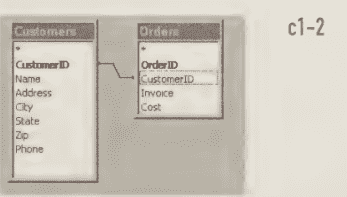

在我们的示例中，我们展示了如何跟踪单个客户进行多次交易；这被称为`一对多关系`。一对多关系迄今为止是最常用的。数据源还可以包含多对多关系。在`多对多关系`中，两个表通常通过第三个连接表相连。连接表除了包含与表交集相关的任何数据外，还包含来自其他两个表的主键。多对多关系的一个很好的例子是订单与目录项的关联。单个订单可能包含许多目录项，而且希望有多个订单。要将`Orders`表与`Items`表相关联，我们需要第三个表`Sales`。`Sales`表包含指向`Orders`和`Items`的链接 [c1-3]。

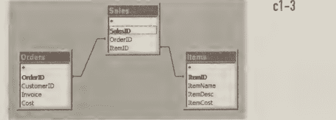

# 第1章：数据源设计的基本原则

正确设计数据库结构或模式对于数据库查询的高效处理非常重要。以下是一些帮助你设计数据源的要点：

- 在创建数据源之前，最好先确定所需数据的性质以及各项之间的关系。在开始创建数据源结构之前，先在纸上详细规划好。通常最好从数据源将如何使用的角度来审视这个问题。
- 尽量将每个字段分解为其组成部分；例如，将城市、州和邮编合并为一个字段的复合字段是一个重大错误，因为组合字段会使仅基于单个元素（如邮编）对字段进行排序或搜索变得困难。
- 密切注意所涉及的数据类型；例如，不要犯将电话号码字段设置为数字数据类型的错误，因为它主要由数字组成。应根据字段的使用方式来设置数据类型，而不是根据其内容。
- 命名数据源字段时要小心。避免使用重复的名称，如每个主键都用`ID`。最好也要避免使用常见词汇，如`date`，这些词通常是应用服务器或语言中的关键字，可能会导致错误。
- 尽可能将可能需要多次使用的信息放在单独的表中。确保为每个表包含主键，并在连接的表之间包含相关键。
- 存储在一个表中的数据不应在另一个表中重复。主键和相关键提供了表之间的链接，使你能够多次显示重复信息，而只需存储一次。

在 Web 应用程序中，恰当的数据源设计往往是一个薄弱环节；开发人员就是没有给予足够的重视。设计合理的数据源比随意拼凑的数据源更高效、更安全、更易于维护。

## 连接到数据源

有了设计良好的数据源，你就可以从 Web 应用程序中建立与其的连接了。你可以通过多种方式实现连接，具体取决于所使用的应用服务器。通常，应用服务器提供多种建立连接的替代途径。一种方法可能更容易设置但效率稍低，而另一种可能更难创建但更健壮。了解有哪些选项是好的，这样你就能决定在给定情况下哪种连接类型最合适。

### 建立 ASP 连接

虽然存在一些变体，但 ASP 连接通过两种方式之一实现：要么通过数据源名称（DSN），要么通过连接字符串。虽然 DSN 连接更容易设置，但它确实会对应用服务器的性能产生一定影响。连接字符串通常更健壮，但也需要更详细的信息，例如数据源在服务器上的精确路径。

当你创建 ASP 连接时——无论是通过 DSN 还是连接字符串——Dreamweaver 将信息保存在站点`Connections`文件夹中的一个文件里。每次使用该连接创建记录集时，该文件会通过`<include>`标签合并到你的页面中，如下所示：

```asp
<!--#include file="../Connections/Recipes.asp" -->
```

Dreamweaver 将此视为依赖文件；当你通过 FTP 将`.asp`文件上传到服务器时，你会看到包含依赖文件的选项。选择"确定"将自动传输连接文件，然后你就可以开始工作了。

#### DSN 连接

DSN 类似于域名，因为它也是一个表示数据源文件路径的别名。与域名一样，从 DSN 到文件位置的映射在服务器端处理。DSN 连接包含其他重要信息，例如所需的数据源驱动程序类型以及任何安全信息，如用户名和密码。

在远程测试服务器上，DSN 由系统管理员建立。在开发系统上，DSN 在 Windows 程序中定义：ODBC 数据源管理器。ODBC 代表开放式数据库连接；它是一个驱动程序系统，允许使用相同的语言 SQL 与各种数据源进行通信。

以下是通过 ODBC 数据源管理器建立本地 DSN 的方法：

1. 运行适合您系统的 ODBC 管理程序：
   - Windows 95、Windows 98 和 Windows ME：从控制面板文件夹中选择`ODBC 数据源 (32 位)`。
   - Windows 2000 和 Windows XP Professional：从管理工具文件夹中选择`数据源 (ODBC)`。
2. 在 ODBC 数据源管理器对话框中，选择`系统 DSN`选项卡。
   
   所有先前定义的 DSN 都列在系统 DSN 面板上。
3. 选择"添加"以打开"创建新数据源"对话框。
4. 选择适合您的数据源的驱动程序，完成后单击"完成"。
   - 选择`Microsoft Access Driver (*.mdb)`。
   
   所选驱动程序的"设置"对话框将显示。
5. 在"数据源名称"中输入适当的名称，以正确标识数据源。
   - 输入`Recipes`。
6. 选择"选择"并找到您的数据源。
   - 找到从网站复制到您系统的`recipes.mdb`文件。
7. 如果需要登录名和密码，请选择`高级`并在那里输入。
8. 验证您的选择，完成后选择"确定"关闭所有打开的对话框。

虽然您可以独立于 Dreamweaver 启动 ODBC 数据源管理器，但也可以在 Dreamweaver 中定义 DSN 连接时打开它。操作方法如下：

1. 从"数据库"面板中，选择"添加 (+)"，然后选择`数据源名称 (DSN)`。
2. "数据源名称 (DSN)"对话框将出现 [c1-4]。

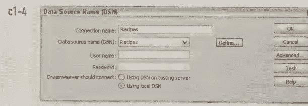

3. 对于本地开发连接，选择`使用本地 DSN`选项。如果您创建的连接是连接到远程 DSN，请选择`Dreamweaver 应使用测试服务器上的 DSN 连接`选项。
   
   Macintosh 用户没有本地选项。
4. 在"连接名称"字段中输入一个标识名称。
   - 要创建与本书中食谱一起使用的连接，请输入`Recipes`。
5. 如果本地 DSN 已先前定义，您可以从下拉列表中选择其名称。
6. 要设置新的本地 DSN，请选择"定义"。
   
   将显示 ODBC 数据源管理器。按照前面一系列步骤所述设置 DSN。完成后，关闭 ODBC 数据源管理器；您的新 DSN 应该会出现在下拉列表中。
7. 要定义远程 DSN 连接，请在"数据源名称 (DSN)"字段中输入名称。
   
   您还可以选择 DSN 按钮。Dreamweaver 将与测试服务器联系，收集可供您选择的已分配 DSN 列表。
8. 如果需要，输入您的用户名和密码。
9. 通过选择`测试`确保您的连接正常工作。Dreamweaver 会告知您连接是否成功或是否遇到问题。完成后单击"确定"。

您的新连接将列在"数据库"面板中。

#### 连接字符串

与 DSN 连接不同，连接字符串不使用别名；而是指定确切的路径位置——以及 ODBC 驱动程序或 OLE DB 提供程序和任何其他必要信息，如用户名和密码。所有这些信息都放入一个相当长的文本字符串中。虽然如前所述，您可以在连接字符串中包含 ODBC 驱动程序以创建所谓的无 DSN 连接，但它不如直接的 OLE DB 连接字符串健壮。ODBC 充当翻译器，促进从数据源到底层引擎的通信——而那个引擎或提供程序就是 OLE DB。

每种数据源类型都有特定的 OLE DB 提供程序，这自然会影响连接字符串。例如，如果您使用名为`thebook.mdb`的 Access 数据库作为数据源，并且文件存储在`d:`驱动器的`databases`文件夹中，则 OLE DB 连接字符串将如下所示：

```text
Provider=Microsoft.Jet.OLEDB.4.0;Data Source=d:\databases\thebook.mdb;
```

另一方面，如果您使用的是一个名为`BigBook`的 SQL Server 数据库，该数据库位于名为`TheShelf`的服务器上，OLE DB 连接字符串将如下所示：

```text
Provider=SQLOLEDB;Server=TheShelf;Database=BigBook;UID=jlowery;PWD=starfish
```

请注意，此 OLE DB 连接字符串也包含用户名和密码信息。

Dreamweaver 的自定义连接字符串功能使得直接连接到 OLE DB 提供程序成为可能。具体操作步骤如下：

1. 从数据库面板中，选择添加（+），然后选择自定义连接字符串。
2. 在自定义连接字符串对话框 [c1-5] 中，输入您连接的标签。

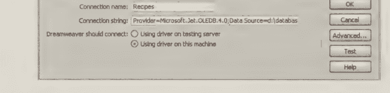

   - 在连接名称字段中输入`Recipes`。
3. 在连接字符串字段中输入完整的连接字符串。
   - 输入以下字符串，将`yourDriveLetter:\yourPath\`替换为您的`recipes.mdb`文件的实际路径：

```text
Provider=Microsoft.Jet.OLEDB.4.0;Data Source=yourDriveLetter:\yourPath\recipes.mdb;
```

4. 选择测试，以确保连接正常工作。如果遇到问题，请检查您的连接字符串是否有拼写错误；如果成功，单击确定退出对话框。

### 设置 ColdFusion 连接

在 ColdFusion 中建立数据源连接的最佳、最灵活的方式需要三个步骤：

1. 在 ColdFusion 管理器中分配您的数据源。
2. 创建并保存一个`Application.cfm`文件，其中包含指向您数据源的变量引用。`Application.cfm`文件应存储在站点或应用程序根目录。
3. 在 Dreamweaver 中，向绑定面板添加一个数据源名称变量。

虽然也存在其他建立数据源的方法，步骤不需要这么多，但这些方法模块化程度较低，如果数据源发生变化，也更难调整。

#### 声明数据源

ColdFusion 管理器充当所有数据源（以及其他许多功能）的中央交换中心。在 ColdFusion MX 和 ColdFusion 5 中，设置新数据源的过程相似但略有不同。以下是在 ColdFusion MX 中设置数据源的方法：

1. 通过选择`Macromedia ColdFusion MX`程序组中的`管理器`来运行 ColdFusion 管理器。
   
   如果您在当前会话中尚未登录，则可能需要登录。
2. 从管理器主页面，在数据和服务类别下选择`数据源`。
3. 在添加新数据源对话框中，输入数据源的名称。
   - 在数据源名称字段中输入`Recipes`。
4. 从列表中选择您特定数据源的驱动程序。
   - 从驱动程序下拉列表中选择`Microsoft Access`。
5. 选择`添加`进入下一个屏幕。
6. 输入您的驱动程序和数据源的必要详细信息。如果数据源是基于文件的，请在数据库文件字段中输入路径；否则，选择`系统数据库文件`。如有必要，选择`显示高级设置`以输入不同的 ColdFusion 用户名或其他安全设置。
   - 选择数据库文件字段旁边的`浏览服务器`，并定位从网站复制到您系统上的`recipes.mdb`副本。
7. 完成所有设置后，选择提交；新的数据源应被添加到列表中。

此时可以进入 Dreamweaver 并选择此数据源来构建记录集。但是，如果这样做，数据源名称将直接编码到`<cfquery>`标签中。我们采用的技术是将变量而非名称应用于`<cfquery>`标签，这使得记录集在整个应用程序中更容易更新。

#### 设置 Application.cfm 文件

`Application.cfm`文件是 ColdFusion 中一个极好的、节省时间和代码的特性。`Application.cfm`文件中的代码（如果放置在站点根目录）将自动包含到站点内的每个 ColdFusion 页面中，无论其在文件结构中的位置如何。此功能允许我们使用一个指向在 ColdFusion 管理器中设置的数据源名称的变量，这反过来又允许我们在 Dreamweaver 中声明一个数据源名称变量。一个站点可以包含多个`Application.cfm`文件；额外的文件存储在一个或多个应用程序的根文件夹中。

创建变量的基本标签是`<cfset>`标签。如果您想将一个名为`theData`的变量分配给您创建的名为`CorporateData`的数据源，您将使用如下代码：

```cfm
<cfset theData="CorporateData">
```

让我们一起创建一个`Application.cfm`文件。

1. 在 Dreamweaver 中，选择文件 > 新建以打开新建文档对话框。
2. 在第一列中选择动态页面，在第二列中选择 ColdFusion；准备就绪时单击创建。
   
   通过选择 ColdFusion 页面，Dreamweaver 在保存页面时会自动附加`.cfm`扩展名。
3. 在新页面中，进入代码视图并删除所有插入的标准代码。
4. 插入将所需变量名分配给已定义数据源的`<cfset>`标签。
   - 输入此代码：

```cfm
<cfset Recipes="Recipes">
```

5. 将文件保存为`Application.cfm`，放在您站点的根目录。

#### 定义数据源名称变量

> **注意**
>
> 为了最大程度地实现跨平台兼容性，请务必以大写字母 A 保存您的`Application.cfm`。虽然`application.cfm`在 Windows 平台上是可接受的，但在任何 Unix 系统上都会失败。

在我们过程的最后一步，我们进入 Dreamweaver 并使用 Dreamweaver MX 中引入的新功能：数据源名称变量。声明数据源名称变量后，Dreamweaver 会将该变量作为选项包含在相应的下拉列表和对话框中。在创建记录集时选择这样的变量会生成如下代码：

```cfm
<cfquery name="MyQuery" datasource="#DataSourceName#">
```

请注意，`datasource`属性的值是一个 ColdFusion 变量，而不是对数据源的直接引用。以下是在 Dreamweaver 中设置数据源名称变量的方法：

1. 在绑定面板中，选择添加（+），然后选择`数据源名称变量`。
2. 在数据源名称变量对话框中，输入变量的名称。
   - 在变量名称字段中输入`Recipes`。
3. 从列表中选择所需的数据源。
   - 从数据源列表中选择`Recipes`。
4. 验证您的选择，然后单击确定将变量添加到绑定面板 [c1-6]。

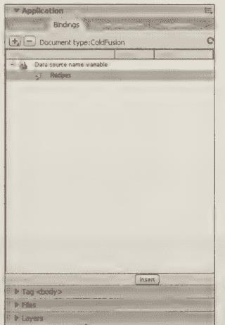

c1-6

### 连接到用于 PHP 的 MySQL 数据源

如前所述，MySQL 是基于服务器的数据源。Dreamweaver 提供了一种直接方法来创建与 MySQL 数据源的连接。一旦建立连接，您就可以在所有相关应用程序中引用该连接。

> **注意**
>
> 以下过程假设您已经在开发系统上安装了 MySQL。要了解如何安装 MySQL，请访问`www.mysql.org`。

#### 插入连接

连接在 Dreamweaver 的数据库面板中创建和显示。在创建连接之前，MySQL 必须正在运行，并且您应该已经设置了用户名和密码。

要使用为`recipes`创建的数据源，请按照本书简介中的说明将文件从网站复制到您的系统。

要创建连接，请按照以下步骤操作：

1. 从数据库面板中，选择添加（+），然后从下拉列表中选择`MySQL 连接`。
2. 在显示的 MySQL 连接对话框中，输入连接的名称。
   - 在连接名称字段中输入`Recipes`。
3. 输入托管 MySQL 的服务器地址。
   - MySQL 服务器地址是 IP 地址，或者如果服务器位于您的开发系统上，则为`localhost`。
4. 在相应的字段中输入您的用户名和密码。
5. 指定数据库。
   - 选择选择，然后在选择数据库对话框中单击`Recipes`。单击确定确认您的选择并关闭该对话框 [c1-7]。
6. 选择`测试`以验证连接是否正常工作。
7. 确认连接后，点击`确定`关闭对话框并创建连接文件。

新创建的连接将显示在“数据库”面板中。展开主连接节点以查看可用的表。实际的连接文件存储在“Connections”文件夹中，可以在 Dreamweaver 中打开和查看。Dreamweaver 会写入一个标准的 PHP 文件，如下所示：

```php
<?php
##### FileName="Connection_php_mysql.htm"
##### Type="MYSQL"
##### HTTP="true"
$hostname_Recipes = "localhost";
$database_Recipes = "recipes";
$username_Recipes = "root";
$password_Recipes = "mypassword";
$Recipes = mysql_pconnect($hostname_Recipes, $username_Recipes,
$password_Recipes) or trigger_error(mysql_error(),E_USER_ERROR);
?>
```

当你在 Dreamweaver 中创建记录集时，连接文件会通过`require_once()`函数被包含进来。该函数会写入到你的 PHP 页面顶部，位于`<html>`标签之上，如下列代码所示：

```php
<?php require_once('Connections/Recipes.php'); ?>
```

连接文件被 Dreamweaver 视为依赖文件。因此，在使用 Dreamweaver 内置的 FTP 功能传输文件时，它可以随应用程序页面一起从本地站点自动传输到远程站点。Dreamweaver 会询问你是否也要传输依赖文件以及主文件。选择“是”可确保连接文件以及完成连接所需的其他系统文件一并上传。


> 如果在连接 MySQL 数据库时遇到问题，请确保“站点定义”对话框中的“测试服务器”信息正确无误。信息不正确或不完整，例如缺少所需的主机目录，可能会阻止 Dreamweaver 传输和执行必要的连接文件。

## 准备 SQL 语句

SQL 之于数据库，正如 HTML 之于网页。SQL 是一种用途极为广泛的语言，无论是在 Microsoft Access 中，还是在 SQL Server 或 Oracle 数据源中，都能胜任。SQL 可以管理记录（更新、添加或删除）、收集子集，甚至可以动态创建表和其他 SQL 语句。

**第 1 章：数据源设计的基本原则**

正如本章开头所指出的，你无需了解 SQL 也能在 Dreamweaver 中构建基本的应用程序。这里的关键词是`基本`；当你开始需要的不只是基于一个字段过滤的简单记录集，或来自单个表的记录集时——而且这一天会比你想象的来得更早——你就需要编写一些 SQL 了。尽管高级 SQL 语句可能变得复杂且难以理解，但这种语言本身是很容易上手的。

### SQL 基础知识

在数据驱动的 Web 应用程序中，最常见的 SQL 功能无疑是创建记录集。顾名思义，`记录集`只是所有记录的一个子集。然而，不要被误导；记录集也可以包含所有记录。要从数据源表中获取所有记录，我们使用两个 SQL 关键字：`SELECT` 和`FROM`。例如，这条 SQL 语句：

```
SELECT * FROM mybooks
```

返回当前数据源中`mybooks`表的所有记录和所有字段。星号是一个特殊的通配符，表示返回所有字段。若要仅返回`authors`和`titles`字段，SQL 语句应如下所示：

```
SELECT authors, titles
FROM mybooks
```

各个字段以逗号分隔的列表形式输入。但是，如果你想限制的不只是字段，还有记录呢？要限制或`过滤` SQL 语句，可以使用`WHERE`子句。例如，假设你只想查看 James Ellroy 所著的书籍——换句话说，作者等于 James Ellroy 的记录。你可以使用以下 SQL 语句：

```
SELECT authors, titles
FROM mybooks
WHERE authors="James Ellroy"
```

> 注意：在继续之前，关于 SQL 语句格式有几点说明：虽然将不同的子句（SELECT、FROM、WHERE）放在不同行上不是强制的，但 SQL 中的空白无关紧要，这样做能大大提高可读性。此外，将 SQL 关键字大写是约定俗成的，并非必需：然而，这样做确实能让语句在变得复杂时更容易理解。

SQL 语句的`WHERE`子句无疑是动作的核心，它拥有丰富的运算符来证明这一点。在`WHERE`子句中，你可以使用逻辑`AND`来返回满足两个或多个条件的记录集。例如，如果你想在数据源中找到所有 James Ellroy 的精装版书籍，这条 SQL 语句会给你答案：

```
SELECT authors, titles, booktype
FROM mybooks
WHERE authors="James Ellroy" AND booktype="hardback"
```

其他 SQL 逻辑运算符包括`OR`、`NOT`和`LIKE`等。也支持数学运算符，包括：`<`、`>`、`<=`、`>=`、`=`和`<>`。

到目前为止，这些示例只是按原样输出所有请求的记录，没有特定的顺序，尽管在某些数据源（如 Access）中，记录会按它们输入的顺序返回。要对返回的记录进行排序，可以使用`ORDER BY`关键字。如果你想按标题字母顺序查看 James Ellroy 的精装版书籍，SQL 应如下所示：

```
SELECT authors, titles, booktype
FROM mybooks
WHERE authors="James Ellroy" AND booktype="hardback"
ORDER BY titles ASC
```

`ASC`关键字表示升序排列；`ASC`是默认值，可以省略。要以反向字母顺序查看标题，请使用关键字`DESC`。

在这样的表中，几位作者可能写了多本书。因此，你需要使用另一个关键字来查看单独的作者列表，而不重复姓名。该关键字是`DISTINCT`，它与`SELECT`配对使用。例如，以下 SQL 语句：

```
SELECT DISTINCT authors
FROM mybooks
WHERE edition="hardback"
ORDER BY authors ASC
```

返回一个记录集，其中仅包含拥有精装版书籍的作者的唯一姓名。

### 合并来自多个表的数据

现代数据源的强大功能和灵活性很大程度上来自于它们提供彼此相关数据的能力。SQL 语句使得从多个相关表中检索信息成为可能。在这种情况下，仅仅一个 SQL 关键字是无法得到理想结果的——连接必须嵌入到表中。

**第 1 章：数据源设计的基本原则**

让我们来看一个例子。为了让前面讨论过的示例数据源真正更有用，你可以将单一的`mybooks`表拆分为两个：`books`和`authors`。假设`mybooks`包含以下字段：

- `title`
- `author`
- `edition`
- `publication_date`

现在，`authors`表可能有以下字段：

- `name`
- `website`
- `genres`

如何将这两个表关联起来呢？换个方式问，这两个表有什么共同之处？答案是作者姓名；在`books`表中，它是`author`字段，而在`authors`表中，它是`name`字段。因此，如果你想查看所有平装书作者的网站列表，你的 SQL 语句可能如下所示：

```
SELECT authors.websites
FROM books, authors
WHERE edition="paperback" AND books.author=authors.name
```

你应立即注意到这条 SQL 语句每个子句中的几个不同之处。首先，的后、人员和发展评估，times表江苏` auth中，很少有人会不效，最后` pam 、利低选择或后续一并，它是`authors`才 c能。但如果我们进一步探讨的`JOIN`关键字，有一点很重要，那就是指出我们示例数据库设计中存在的潜在问题。要成功地将一个表与另一个表匹配，作者姓名在两个表中必须完全相同。虽然这可能暂时有效，但迟早会出现麻烦。最终，作者姓名可能在一个表或另一个表中输入不一致；你很容易输入 T. Clancy，而实际想表达的是 Tom Clancy。或者，一本由使用笔名的作者写的书可能会被这样录入。更好的做法是在`authors`表中创建一个使用唯一数字作为主键的单独字段（称之为`authorID`），然后在`books`表中引用该字段，如下所示：

```
SELECT authors.websites
FROM books, authors
WHERE edition="paperback" AND books.authorID=authors.authorID
```

你也可以使用`INNER JOIN`来编写相同的 SQL 语句，如下所示：

```
SELECT authors.websites
FROM (books INNER JOIN authors ON books.authorID=authors.authorID)
WHERE edition="paperback"
```

这两条 SQL 语句在功能上是相同的，但在专业编写的查询中，你更可能遇到第二种语法。

这只是 SQL 所能实现功能的**起点**，但它应该能为你理解示例中用到的一些高级 SQL 打下良好的基础。

# 第 2 章：在 Dreamweaver 工作区中构建应用程序

Macromedia Dreamweaver 经过多年发展，已经成为一款功能丰富、选项众多、工作方式多样的综合性程序。随着 Dreamweaver MX 的推出，网页设计与网页开发这两个领域在一个全新的界面中实现了融合，并为编码人员和设计人员都提供了增强的功能。

无论你是完全初识 Dreamweaver，还是仅对使用 Dreamweaver 创建动态 Web 应用程序尚不熟悉，本章都将帮助你找到方向。本章前半部分将**探索 Dreamweaver 工作区**，重点介绍其应用程序构建功能。除了提供 Web 创作环境的概述外，你还将找到关于开始使用动态页面的明确指导。本章其余部分专门介绍 Dreamweaver 中标准的 Web 应用程序工具的**基础知识**。内容涵盖从应用服务器行为到使用实时数据视图的所有内容。

### 在工作区中工作

Dreamweaver 工作区主要由文档展示区域和多个面板组成，这些面板既可以单独存在，也可以组合成**面板组** [c2-1]。文档可以在**设计视图**中查看，该视图近似于浏览器渲染网页的效果；也可以在**代码视图**中查看，该视图显示底层的源代码。还有一个**拆分窗口**选项，可以同时查看两种视图——这既是有助于学习 Dreamweaver 生成何种代码的实用工具，也有助于快速选择和修改页面上的元素或标签。通过**视图**菜单（代码、拆分或设计）选择相应选项，或单击文档工具栏上的某个视图按钮，即可在不同视图之间切换。

Dreamweaver 中最实用的功能之一是**标签选择器**，它显示在文档窗口的底部。选择任何文本或对象，相关标签将显示在标签选择器的最右侧；代码中所有前面的标签则会显示在其左侧。标签选择器通常是选择特定页面元素**最快捷、最可靠**的方式 [c2-2]。

### 探索面板和面板组

面板和面板组非常灵活，可以轻松调整以适应你的工作方式。顾名思义，面板组包含独立的面板。你可以通过**窗口**菜单下的相应条目打开任何面板——无论当前是否在屏幕上显示。你也可以通过单击名称来显示屏幕上的面板或面板组；再次单击名称则会关闭该面板或面板组。

> 我经常发现专注于单个面板组很有帮助。要最大化某个面板组——同时关闭所有其他面板组——双击该面板组的名称即可。

你可以重新排列面板，以及面板组内的大多数面板，以适应你的工作流程。要将面板组移出停靠区域，请拖动标题栏的最左边缘；这个区域看起来是一系列圆点，称为**抓取器**，当光标变成四向箭头时，你就知道位置正确了 [c2-3]。你可以拖动面板组或大多数独立面板，使其变为**自由浮动**或**停靠**状态。当**可用的停靠位置**出现时，会出现粗黑边框。

#### c2-3

**抓取器**

你可以通过选择标签来访问面板组中的任何面板。要将面板从一个面板组移动到另一个面板组——或将其独立出来——需要使用面板组标题栏右侧的**选项菜单**。从选项菜单中，选择“将`PanelName`编组到”——其中`PanelName`是当前面板——然后从子菜单中选择你希望当前面板移动到的面板组。例如，如果你想合并**参考**和**历史记录**面板，请从**参考**面板中选择选项菜单，然后选择“将参考与历史记录编组”。你可以重命名大多数面板或面板组——该选项也可从**选项**菜单中获得。要将面板从面板组中分离出来，请选择该面板，然后从**选项**菜单中选择“将`PanelName`与新面板组编组”。

> 在 Dreamweaver MX 2004 中，某些面板是面板组的**组成部分**，无法移动到其他组或独立出来。标签面板组包含三个相关面板：**属性**、**行为**和**相关 CSS**。你无法移动或重命名这些独立面板或该面板组中的任何一个。当然，你可以随时关闭和重新打开该面板组。

虽然你会发现自己几乎会使用 Dreamweaver 的每个方面，但构建动态 Web 应用程序时**主要使用**的面板组是——恰如其分的——名为**应用程序**的面板组。在应用程序面板组中，你可以找到四个相关面板：

- **数据库**——“数据库”面板列出整个站点可用的数据源连接。ColdFusion 用户将看到通过 ColdFusion 管理员设置的所有数据源，而 ASP 开发人员则会看到在 Dreamweaver 中为特定站点明确建立的连接。展开数据库树可显示每个数据源的表、视图和存储过程；展开这些元素可显示使用的各个字段；编写服务器端代码时，你可以将这些元素拖放到页面上，以避免**拼写错误**。

- **绑定**——“绑定”面板显示当前页面上可用的任何数据源，主要是**记录集**和**服务器端变量**。你经常需要从“绑定”面板访问记录集字段，以便在页面上插入动态文本。“绑定”面板还控制动态文本的服务器端格式设置。

- **服务器行为**——服务器行为是**封装的服务器端代码块**。“服务器行为”面板显示已插入页面的所有服务器行为。在面板中选择服务器行为时，会在文档窗口中高亮显示相应的代码。

- **组件**——“组件”面板仅在文档类型为 ASP.NET 选项之一或 ColdFusion 时才处于活动状态。在 ASP.NET 和 ColdFusion 下，“组件”面板都会显示可用的 Web 服务；使用 ColdFusion 时，你还会看到可访问的 ColdFusion 组件。

> 尽管 ColdFusion 组件是一项令人兴奋的技术，但它们**无法向后兼容** ColdFusion 5。本书中的示例不使用 ColdFusion 组件，以确保应用程序与 ColdFusion 5 兼容。

在所有这些应用程序面板中，使用**添加 (+)** 来插入元素，使用**移除 (–)** 来删除选择。你会注意到添加 (+) 和移除 (–) 控件遍布整个 Dreamweaver 界面。

### 使用属性检查器修改属性

属性检查器或许是**所有面板中最重要的**；它当然也是使用最频繁的面板之一。属性检查器是**上下文相关的**；也就是说，它显示当前选定元素的属性。根据选择的是表格还是 Flash 影片，会显示完全不同的属性检查器。设计视图中的默认状态显示**文本属性检查器**，带有标准字体标签或 CSS 属性；通过更改**首选参数**（编辑 > 首选参数）中常规类别下的**使用 CSS 而不是 HTML 标签**选项，可以在 CSS 和 HTML 模式之间切换。除了众多的列表和文本字段外，属性检查器还有几个**特殊功能控件** [c2-4]：

- **颜色样本**——选择颜色样本可显示可供选择的调色板。当颜色样本打开时，滴管光标还允许你从屏幕上的任何位置采样颜色。

- **浏览文件**——当你想要打开“选择文件”对话框时，选择**浏览文件**图标，例如分配链接时。“选择文件”对话框还会显示任何可用的数据源，如记录集中的数据源字段。

- **指向文件**——将**指向文件**图标拖动到站点面板中的任何文件名上，即可使用该文件的路径作为值。你还可以在页面内使用“指向文件”图标来指定命名锚点。

颜色样本

浏览文件图标

指向文件图标

有一个界面控件对于构建数据库驱动的 Web 应用程序尤为重要：**闪电图标**。选择闪电图标可以使用**动态数据**对话框，其中包含记录集、会话变量以及当前页面可用的任何其他数据源的列表。闪电图标出现在各种属性检查器中，但对于标签面板中的任何属性，它**始终可用**——标签面板可用作属性检查器的替代。与标准属性检查器不同，标签面板显示选定标签的**所有属性**，而不仅仅是**最常用的**那些 [c2-5]。

**Lightning 图标**

### 调整首选项

我们简短浏览 Dreamweaver 环境的最后一站是 Dreamweaver 首选项。当你通过选择 Edit > Preferences（在 OS X 上为 Dreamweaver > Preferences）打开首选项时，会显示一个包含众多选项的大对话框 [c2-6]。对话框左侧是一系列类别；选择任何类别即可更改相关选项。Dreamweaver 中共有 20 个不同的类别，允许你控制创作环境和程序输出的任何方面。

与其解释首选项中的每个选项，我更想重点介绍一些对构建 Web 应用程序特别重要的选项。对于此处未讨论的任何首选项的更多信息，每个类别都提供了上下文相关帮助。

动态 Web 应用程序显然是代码密集型的，我确信有人会争论说它们实际上应该完全由代码构成。无论你在代码到设计的谱系上处于什么位置，你都会非常欣赏 Dreamweaver 在代码视图中提供的灵活性和强大功能。首选项中有许多类别以某种方式涉及代码：

- **Code Coloring**——Dreamweaver 不仅提供语法级别的代码着色，颜色选项（前景色和背景色）以及文本样式都是完全可配置的。此外，配置可以因页面类型而异。例如，在标准 HTML 文件中，注释标签代码可以是中等灰色，而在 ASP 页面中，HTML 注释可以显示为黄色背景和蓝色字体。在 Code Coloring 类别中选择 Edit Color Scheme 进行修改。

- **Code Format**——应用程序开发人员在代码格式化方面非常讲究，这是很有道理的。格式规范的代码更容易阅读和调试。Preferences 的 Code Format 类别控制通用代码设置，例如应该使用制表符还是空格进行缩进。你还可以在 Tag Library Editor 中塑造单个标签及其属性的输出，该编辑器可从 Code Format 类别或通过选择 Editing > Tag Libraries 访问。

- **Code Hints**——无论你作为编码人员的技能如何，要记住所用 Web 语言的语法、标签和属性都是相当困难的。为了帮助开发人员更高效地编码，Dreamweaver 包含了一个代码提示功能。只需开始输入标签，可用标签的列表就会出现。

- **Code Rewriting**——Dreamweaver 以其尊重有效代码而享有盛誉。通过 Code Rewriting 类别中的选项，你可以影响 Dreamweaver 在打开文档时的处理方式。例如，通过选择 Fix Invalidly Nested and Unclosed Tags 选项，Dreamweaver 会将此代码：

```
Help me <i>help <b>you</i></b>
```

更改为：

```
Help me <i>help <b>you</b></i>
```


`Dreamweaver`首选项中的许多类别将帮助你在设计视图以及代码视图中开发`Web`应用程序。`Invisible Elements`类别是一个关键类别，它使你能够看到未渲染网页对象的代表，如`HTML`注释 [c2-7]。`Invisible Element`符号允许你在设计视图中轻松复制、剪切和粘贴此类标签和代码。两个适用于动态页面的`Invisible Elements`是：`Visual Server Markup Tags`和`Nonvisual Server Markup Tags`。当启用这些选项时，插入文档`<body>`中的服务器端代码块会显示为一个符号。选择该符号，你可以快速在代码视图中找到高亮显示的代码，或从属性检查器中选择`Edit`以在设计视图中修改代码。

c2-7

你可能还会注意到`Invisible Elements`类别上的另一个相关设置。动态文本——嵌入页面中的数据——默认情况下用大括号表示，同时显示记录集和数据源字段，如下所示：

```
`{employees.firstname}`
```

> 我建议最初选择`Invisible Elements`类别中的所有选项。如有需要，你可以通过取消勾选`View > Visual Aids > Invisible Elements`一次性将它们全部从页面视图中移除。同一选项也可在工具栏的`View Options`按钮下找到。

根据设计，此类表示可能会使布局难以避免失真；如果是这样，你可以更改选项，使动态文本仅由一对大括号表示，内部没有文本。

另一个值得在此提及的首选项类别是：`Highlighting`。为了在设计时区分某些对象或区域，`Dreamweaver`会用外围边框或背景色来高亮显示它们。例如，默认情况下，模板中的可编辑区域以浅蓝色边框包围，而第三方标签则使用与其背景相同的颜色。高亮显示中使用的所有颜色选择都可以在`Highlights`类别中自定义；你还可以决定是否要显示高亮。

`Highlights`类别中有两个条目在创建`Web`应用程序时很有用，两者都与`Live Data`视图相关：`Untranslated`和`Translated`。当你在`Live Data`视图中时，`Dreamweaver`会根据你的记录集获取数据并将其临时集成到页面中。`Dreamweaver`可以在`Live Data`视图的未翻译部分为单条记录提供直接替换。如果你的数据在重复区域中，其余记录则必须在翻译区域中显示。我建议保持这两个选项都处于选中状态，因为它区分了页面上真正存在的内容和仅在翻译期间存在的内容。你可以通过取消选择`View > Visual Aids > Invisible Elements`来关闭这两个选项。

### 设置新站点

通常情况下，在`Dreamweaver`中构建`Web`站点时的第一项任务，无论是静态还是动态的，都是定义一个新站点。对于静态站点，站点定义最少需要命名站点并指定一个作为本地站点根目录的文件夹。许多开发人员还会最初定义他们的远程站点，以便通过`FTP`或网络暂存服务器传输文件。远程站点可以随时定义。

动态站点还需要*声明测试服务器*。在`Dreamweaver`中，测试服务器是一种特定的服务器模型（例如`ASP VBScript`、`ASP JavaScript`、`PHP MySQL`或`ColdFusion`），可通过特定文件夹访问，该文件夹可以位于本地或远程系统上。

你可以通过两种方式之一定义站点，两者都从选择`Site > Manage Sites`开始。`Manage Sites`对话框中显示了当前站点列表以及一个`New`按钮。选择`New`后，你可以选择创建站点或定义`FTP`或`Remote Development Service (RDS)`服务器连接。选择`New Site`以显示`Site Definition`对话框。

如果你相对较不熟悉`Dreamweaver`，请选择`New Sites`对话框的`Basic`选项卡，使用类似向导的方法来定义站点。如果你更熟悉`Dreamweaver`，`Advanced`选项卡使用一系列类似于`Dreamweaver`首选项中的类别。

> `Dreamweaver MX 2004`允许通过定义直接服务器连接而不创建站点来工作。此功能对现有`Web`站点很有用，但定义站点对开发应用程序至关重要，尤其是在整本书中使用的模板的情况下。强烈建议定义站点。

让我们通过`Site Definition`对话框的`Advanced`选项来演练站点的基本设置。就本例而言，我假设我们正在为`Recipes`项目设置一个动态站点，在运行`IIS`的本地系统上使用`ASP with VBScript`；在这种情况下，我们假设远程站点将在稍后设置。

1. 选择`Site > Manage Sites`。

2. 在`Manage Sites`对话框中，选择`New > Site`以打开`Site Definition`对话框。

3. 选择`Advanced`标签并选择第一个类别，**Local Info** [c2-8]。

4. 在“本地信息”类别中，输入以下信息：

- **站点名称**——输入站点在`Dreamweaver`中的本地名称。例如，我会输入 **Recipes**。

- **本地根文件夹**——选择将包含本地站点的文件夹。为避免输入错误，最好单击文件夹图标，通过“选择本地站点根目录”对话框来定位目标目录。

- **默认图像文件夹**——指定一个用于存放图像的文件夹。当你从本地站点根目录外插入图像时，`Dreamweaver`会将图像副本存储在此文件夹中。此信息为可选。

- **HTTP 地址**——输入已发布站点的`URL`，以便`Dreamweaver`正确识别外部链接。

5. 同时选中 **自动刷新本地文件列表** 和 **启用缓存** 选项，以提高工作效率。

6. 选择 **测试服务器** 类别 [c2-8]。

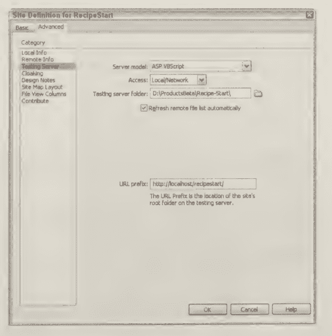

7. 从“服务器模型”列表中，选择站点的服务器技术和语言。在此示例中，我会选择 **ASP VBScript**。

8. 从“访问”列表中，选择测试服务器的访问方式：本地/网络 或`FTP`。

我在开发系统上本地运行`ASP`，所以我会选择 **本地/网络**。

**9. 设置访问测试服务器所需的属性。**

对于本地/网络访问，我会选择 **测试服务器** 文件夹，它可以与 **本地站点根目录** 文件夹相同，并输入站点的`URL`前缀。在这种情况下，我的`URL`前缀是`http://localhost/recipes/`，因为我在`IIS`中设置了一个名为`Recipes`的虚拟目录，指向我的测试服务器文件夹。

> **注意**

> 此时最好从“管理站点”对话框中选择 **导出**，并将站点定义存储在安全的位置。如果需要恢复站点，请选择 **导入** 并定位定义文件。

**10.** 在各个类别上确认你的选择，然后单击 **确定** 关闭对话框。

`Dreamweaver`站点设置完成后，你就可以开始为`Web`应用程序创建页面了。

### 创建新的动态页面

`Dreamweaver`能够创作多种与`Web`相关的文档。从`HTML`（标准语法或`XHTML`语法）到动态的`ColdFusion`组件，在`Dreamweaver`中都可以实现。为了应对这种增强的输出能力，`Macromedia`引入了一种通过“新建文档”对话框创建页面的新方法。“新建文档”对话框允许你创建多种类型的新文件，以及基于模板的文档。我们先来看看如何为`Web`应用程序创建空白页面。

1. 选择 **文件 > 新建** 打开“新建文档”对话框 [c2-10]。

**c2-10**

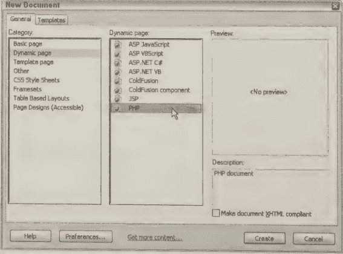

2. 确保选中“常规”选项卡，然后从第一列中选择“动态页”类别。

3. 从“动态页”列中选择应用程序的服务器技术。

- 要创建本书中的示例页面，请选择`ASP JavaScript`、`ASP VBScript`、`ColdFusion`或`PHP`。

4. 如果需要，选择“使文档符合`XHTML`”选项，然后单击“确定”关闭对话框并创建页面。

本书中的示例使用标准`HTML`开发，符合`W3C`制定的`4.01 Transitional`文档类型。

如果你要为应用程序创建多个页面，可以设置首选项，使用键盘快捷键来创建任何文件类型的空白页面。在“新建文档”类别中，从“默认文档类型”列表中选择所需的动态页面类型，然后取消选中“按`Ctrl+N`（`Command-N`）时显示新建文档对话框”选项。

如果你正在使用`Dreamweaver`模板，还可以使用“新建文档”对话框基于指定模板创建新文件。模板派生的文档在`Web`应用程序中非常有用，因为通常只有动态元素会因页面而异。模板为你提供了可靠的设计基础——更重要的是，对模板的任何更新都会反映在该模板派生的所有文档上。

假设你已将`Recipes`模板文件从网站复制到本地站点根目录的`Templates`文件夹中。要基于其中一个模板创建文档，请按照以下步骤操作：

1. 选择“文件 > 新建”打开“新建文档”对话框。

2. 选择“模板”选项卡。

3. 从“用于模板的站点”类别中选择你的站点 [c2-11]。

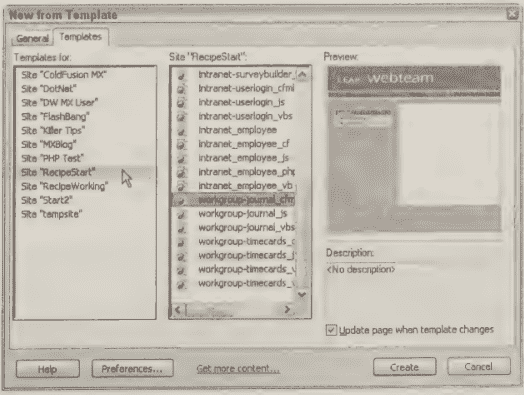

4. 从第二列中选择所需的模板。会出现预览帮助你选择正确的文件。

5. 确保选中“当模板选项更改时更新页面”。如果未选择此选项，新创建的页面将自动与模板分离。完成后，单击“确定”关闭对话框。

> **注意** 模板的完整讨论超出了本书的范围。有关创建模板的更多信息，请参阅“帮助 > 使用`Dreamweaver`”或优秀的参考资料，如`Joseph Lowery`的 *Dreamweaver MX Bible* 或`Laura Gutman`的 *Inside Dreamweaver*。高级模板用法在 *Joseph Lowery's Beyond Dreamweaver* 以及`Brad Halstead`和`Murray Summers`的 *Dreamweaver MX Templates* 中也有介绍。

### 将数据绑定到页面

你的站点已定义，并且你已创建了一个动态页面。是时候添加一些动态内容了！大多数动态内容来自已声明的*记录集*。正如第 1 章“数据源设计的基本原则”中所讨论的，记录集由`SQL`语句创建，包含连接数据源中的部分数据。

> **注意** 在继续之前，请确保你了解如何创建数据源连接。如果不清楚，请参阅第 1 章的“连接数据源”部分。

`Dreamweaver`除了提供手工编码外，还提供了两个用于创建记录集的可选对话框：一个简单对话框和一个高级对话框。你可以通过从“绑定”面板或“服务器行为”面板中选择 添加 (`+`)，然后从菜单中选择“记录集（查询）”来打开这两个对话框。顾名思义，“记录集”对话框的简单视图相当基础。其优点是可以不编写`SQL`就创建记录集；另一方面，你只能处理单个表或视图、一个筛选条件和一个排序级别。我们来逐步创建一个简单的记录集；此示例的最终目标是从`Recipes`数据源中获取所有员工的姓名和姓氏列表。

> **注意** 在执行以下步骤之前，你需要按照上一章概述的程序至少定义一个连接。

1. 从“绑定”面板中，选择 添加 (`+`) 并选择 **记录集（查询）**。

2. 如果显示的是“记录集”对话框的“高级”视图，请选择 **简单** 切换视图。记录集对话框的视图会记住上一次的设置。

3. 在“名称”字段中输入示例记录集的名称。我们将其命名为`Employees`。

4. 从“连接/数据源”列表中选择一个连接（在`ColdFusion`中称为数据源）。从“连接/数据源”列表中选择`Recipes`。

选择数据源连接后，“表”列表将被填充。

5. 从“表”下拉列表中选择一个表或视图。`Dreamweaver`首先显示所有表，然后是视图（如果有的话）。

- 从“表”列表中选择`Employees`。

6. 默认情况下，记录集中包含所有列。要指定某些列，请选择“已选定”选项，然后选择所需的任何字段。按住`Shift`单击可选择连续的列，按住`Ctrl`单击（`Command`-单击）可选择不相邻的列。

- 选择 **已选定** 并高亮显示 **EmployeeFirst** 和 **EmployeeLast**。

7. 同样，默认情况下包含所选列中的所有记录。你可以使用四个“筛选”列表来限制记录集，通过点击式界面创建`SQL WHERE`子句。

- 我们将限制员工列表，只显示姓氏以字母`L–Z`开头的员工。为此，从第一个“筛选”列表中，选择列 **EmployeeLast**。接下来，从第二个列表中选择运算符`>=`。从第三个列表中，选择 **输入值**；这允许我们指定一个值。最后，输入字母`L` [c2-12]。

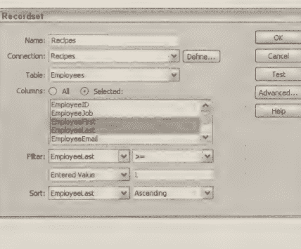

8. 通过从“排序”列表中选择列，然后指定 **升序** 或 **降序** 来对数据进行排序。

- 从“排序”列表中选择 **EmployeeLast** **升序**。

9. 选择 **测试** 查看记录集返回的数据。完成后，选择“确定”关闭对话框并将记录集代码插入到页面中。

定义记录集后，通过展开记录集树，你将在“绑定”面板中看到所有可用的数据源字段。要向页面添加动态文本，请直接将数据源字段从“绑定”面板拖到页面上。或者，将你的光标放置在你希望动态文本出现的位置，然后从“绑定”面板中选择“绑定”。使用任一技术，动态文本在页面上显示如下：

```
{Employees.EmployeeFirst}
```

插入动态文本后，你可以通过选择“视图”>“实时数据”来查看它所代表的数据。在实时数据视图中，将显示记录集中第一条记录的第一个数据 [c2-13]。

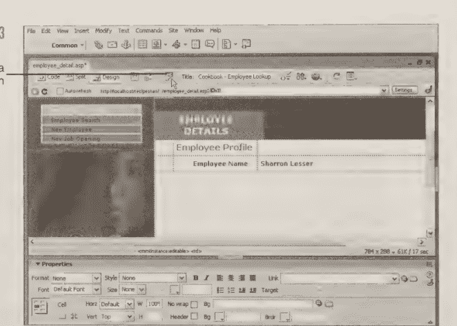

c2-13

实时数据视图按钮

“绑定”面板还控制动态文本元素的服务器端格式设置。与`HTML`或`CSS`格式设置不同，服务器端格式设置用于将文本转换为大写或小写，以及将数字显示为货币、整数或百分比。要更改动态文本元素的格式，首先在页面上选择该元素。然后，在“绑定”面板中，选择向下箭头以打开“格式”列表，并从列表中选择适当的格式。

### 添加服务器行为

服务器行为是`Dreamweaver`的强大机制，可通过点击轻松提供服务器端功能。与`Dreamweaver`的客户端`JavaScript`行为一样，服务器行为允许用户通过从一系列对话框中选择参数来输出复杂的代码。与标准行为不同，服务器行为会根据当前的服务器模型创建不同的代码。

许多`Web`应用程序需要完成插入、更新和删除记录等基本任务。`Dreamweaver`包含大约 30 种服务器行为，涵盖了最常见的功能。（服务器行为的数量因服务器模型而异。）应用于页面的所有服务器行为都出现在“服务器行为”面板的单个列表中；要修改已插入的服务器行为，请双击其在面板中的条目。

要了解服务器行为的工作原理，让我们看一下最常用的类型之一：重复区域。当在页面上插入动态文本时，它代表记录集中的一条记录。要显示多条记录，动态文本以及你还想重复的任何元素（如表格行或换行符）都被包含在一个重复区域中。使用重复区域服务器行为，你可以选择一次显示特定数量的记录或全部显示。以下是如何应用重复区域：

1. 插入记录集，并在页面上放置一个或多个动态文本元素，如上一节所述。

2. 选择动态文本元素及其包含的`HTML`。

包含的`HTML`可以是一组`<p>`标签、尾部换行符（`<br>`）或表格行（`<tr>`）。如果未能在动态元素之间包含某种分隔符，数据将水平排列显示，而不是垂直排列。

3. 从“服务器行为”面板中，选择添加（`+`），然后选择“重复区域”。

4. 在“重复区域”对话框中，确保列表中选择的记录集是你想要使用的记录集 [c2-14]。

接下来，选择应显示多少条记录。

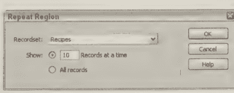

5. 如果你只想显示记录集的一部分，选择“一次显示记录数”选项，并输入所需的数量。

6. 如果你想显示记录集中的所有记录，选择“所有记录”选项。

7. 单击“确定”关闭对话框并插入代码。

> 虽然大多数服务器行为在用户界面和用法方面都是相同的，但有几个在不同的服务器模型之间有所不同。例如，插入记录服务器行为在`ASP`和`ColdFusion`中是不同的。在应用服务器行为的步骤不同的情况下，你会发现步骤按服务器模型分别呈现。对于类似的服务器行为，步骤会一起给出，并为每个服务器模型清楚地标记各自的代码。

`Dreamweaver`会在选定区域周围放置一个边框，并带有一个标签以指示重复区域。查看结果的一种方法是将页面在浏览器中预览；另一种方法是使用`Dreamweaver`的实时数据视图。

### 在实时数据视图中编辑

将动态数据整合到网页中通常需要对页面设计进行大量调整。

使用`Dreamweaver`的实时数据视图，你可以在查看记录集中实际数据的同时继续修改设计。此外，`Dreamweaver`包含多种方式用于将参数传递给记录集以进行测试。

有两种方法可以进入实时数据视图。你可以选择“视图”>“实时数据”，也可以从文档工具栏中选择“实时数据视图”。无论哪种情况，实时数据工具栏都会出现，`Dreamweaver`向测试服务器发送请求，并接收来自记录集的数据作为返回。你可能会注意到工具栏中的字母 *d* 正在旋转，以指示数据检索正在进行中。检索到的第一条记录被插入到相应的动态文本字段中；如果正在使用重复区域服务器行为，则来自后续记录的数据会被添加，直至达到重复区域的限制。如果启用了“不可见元素”选项，记录将显示为高亮 [c2-15]。

当你在实时数据视图中时，你可以继续在页面上工作，调整间距、表格单元格宽度等。你也可以格式化动态数据。选择代表初始动态文本元素的数据以添加格式设置；你无法在重复区域中选择重复的元素。要在所有重复数据中查看已应用的客户端格式设置（如`CSS`或`<strong>`标签），请从实时数据工具栏中选择“刷新”；如果你选中了工具栏上的“自动刷新”选项，服务器端格式设置（如将文本转为大写）会自动应用。


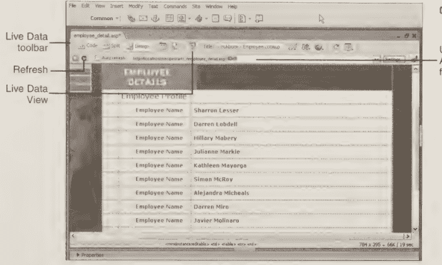

URL 参数字段

通常，记录集或 Web 应用程序中的其他元素依赖于传递给页面的参数。传递参数有两种基本方式：作为附加在 URL 末尾（即所谓的*查询字符串*）的方式，或通过表单输入的方式。Dreamweaver 的实时数据视图可以模拟这两种参数传递方法。

查询字符串是标准 URL 末尾问号后面的一系列名称/值对。在此示例中：

```
http://localhost/Recipes/employeelist.asp?ID=34
```

传递给 `employeelist.asp` 页面的查询字符串是 `ID=34`，其中 `ID` 表示字段名称，`34` 是值。可以使用 `&` 符号添加额外的名称/值对，如下所示：

```
http://localhost/Recipes/employeelist.asp?employeeFirst=Joseph&employeeLast=Lowery
```

如果页面上的记录集是基于 URL 参数筛选的，你可以使用实时数据工具栏来尝试不同的参数。当你在实时数据视图中时，在实时数据工具栏的 URL 参数字段中输入以 `&` 符号分隔的名称/值对。按 Enter（回车）后，Dreamweaver 检索请求的数据并将其整合到页面上。

URL 参数字段对查询字符串非常有效，但对于预期从表单接收的参数，你需要使用“实时数据设置”对话框来输入参数。通过选择“视图”>“实时数据设置”或从实时数据工具栏中选择“设置”来打开对话框。“实时数据设置”对话框也使用名称/值对；选择添加（`+`）以在“名称”和“值”列下添加条目。要模拟表单数据，请在“名称”列中输入表单字段的名称，在“值”列下输入的值。对于表单，你还需要确保方法设置为 `POST` 而不是 `GET`。如果你不想写出查询字符串，可以通过将方法更改为 `GET` 来使用“实时数据设置”对话框代替 URL 参数字段 [c2-16]。

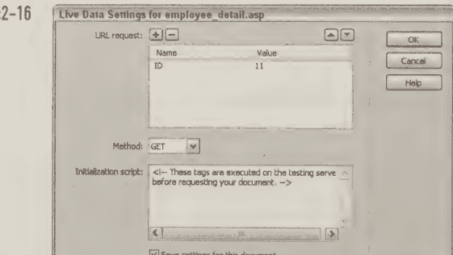

# 第二部分

## 主菜：Intranet Web 应用程序

- 方案 1：用户登录
- 方案 2：员工查询
- 方案 3：会议室调度程序
- 方案 4：出勤状态仪表板

## 方案 1：用户登录

内联网与自由开放的互联网是完全不同的两种存在。网页设计师们在构建 Web 网站时追求吸引更多的眼球，而内联网开发人员则更注重让正确的用户看到正确的页面。对于内联网而言，用户认证的概念至关重要。任何人在浏览内联网区域之前，都必须先通过公司记录的验证，而这些记录当然是由系统管理员维护在数据源中的。

公司的内联网中有很大一部分——在许多情况下是全部——都受到保护，防止未授权查看。正如你将在这个应用中看到的，"未授权"不仅仅是"未注册"的意思。对于你即将构建的这类需要健壮的认证机制的应用来说，它意味着"未被允许查看此特定内容"，而这个内容可以是从整个网站到单个页面中的一个独立区域的任何事物。

Macromedia Dreamweaver MX 2004 提供了一套坚实的用户认证工具基础，我们将以此为根基来构建我们的应用。总共，我们的应用中有八个独立的页面，分为用户和管理员两类。当然，我们会使用自己的认证程序来将面向管理员的应用与面向所有用户的应用隔离开来。

### 用户方案

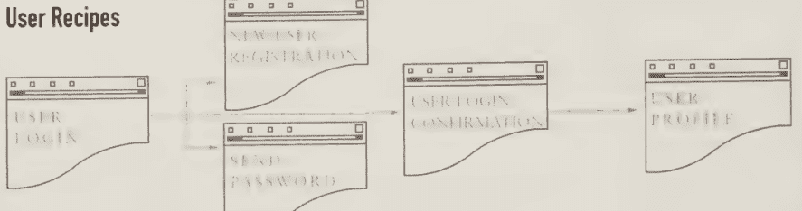

### 管理员方案

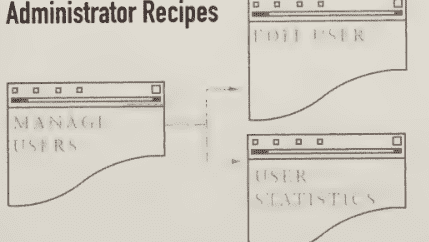

我们的应用从登录页面开始，注册用户在此输入他们的用户名和密码。如果他们之前选择了记住用户名，那么用户名字段会自动填充。如果登录成功，用户将被带到一个确认页面或欢迎页面，在那里他们有机会更新自己的登录信息。如果登录失败，错误消息会直接显示在登录页面上，他们可以再次尝试。忘记密码的用户可以访问一个页面来请求将密码通过邮件发送给他们。登录页面还为新用户提供了一个链接。新用户在成功完成注册后，会返回到登录页面，此时他们新注册的用户名已经填写好了。

应用中的所有页面都包含指向管理功能的链接，但由于页面中嵌入的条件逻辑，这些链接只有管理员才能看到。管理员的主页面既提供了所有用户的分页列表（按最新用户优先排序），也提供了一个用于录入新用户的表单。每个用户列表都链接到一个页面，管理员可以在那里修改或删除用户记录。在另一个页面上，管理员可以查看用户注册的概览，了解系统中有多少用户，以及注册系统在各个时间段内的活跃情况。

### 所需材料

#### 8 个应用页面：

- 5 个用户页面
  - 用户登录
  - 新用户注册
  - 用户登录确认
  - 发送密码
  - 用户个人资料
- 3 个管理页面
  - 管理用户
  - 编辑用户
  - 用户统计

#### 2 个数据源：

- 1 个数据库，包含：
  - 2 个表
    - `Users`——注册用户记录，包括姓名、用户名、密码和访问组级别
    - `AccessGroups`——可用的访问组级别，包含数字格式（1、2、3 和 4）和文本格式（管理员、经理、操作员和用户）
  - 2 个视图
    - `UserView`——连接 `Users` 和 `UserGroups` 表的虚拟表
    - `UserRegStats`——计算记录集，包含用户总数以及按日、周、月统计的注册数据
- 1 个会话变量：
  - `UserID`——维护用户的 ID 以验证认证状态

### 准备工作

在开始构建此应用之前，请确保已完成以下准备工作。

1. 创建包含必要表的数据源。
   - ASP 和 ColdFusion 用户应使用下载文件中的 `Recipes.mdb` 数据源，PHP 用户则应使用 `Recipes` 数据源。如需帮助查找和安装这些文件，请选择"帮助" > "Web 应用程序方案"。
2. 设置指向数据源的连接。
   - 将连接命名为 `Recipes`。
3. 为应用创建一个 Dreamweaver 站点。
4. 构建应用将使用的模板。
   - 使用适合您服务器模型的模板，名为 `userlogin`。

### 终端用户方案：用户登录

在许多内联网应用中，用户首先访问的页面就是登录页面。如果用户已注册，则输入用户名和密码。点击提交按钮后，系统会将用户名和密码与数据源进行核对，如果匹配，则将用户重定向到内联网中的某个应用。如果找不到用户名或密码不正确，页面上会显示一条消息告知用户存在的问题。然后用户可以重试、注册或请求发送密码。

我们的应用与 Macromedia 的标准用户登录略有不同。与其在登录失败时将用户发送到另一个页面——在那里他必须点击链接重试，更糟糕的是，该页面只将他带回登录页面而没有任何额外信息——我们的登录页面会在同一页面上提供一条消息，以便更容易地重试。

我们的方案还向其中添加了一个 `UserID` 会话变量。这个会话变量在后续的应用页面中用于跟踪已登录的用户。此外，我们还添加了一个 cookie 来完善这个方案。设置 cookie 后，应用将可选地填充 `UserName` 文本字段，以便简化登录。

#### 步骤 1：实现用户登录设计

首先，让我们构建用户登录的基本页面。您可以自己构建，也可以让设计师来构建，因为此页面目前不包含任何服务器端代码。

1. 创建一个基本动态页面，手动创建或从模板创建均可。
   - 在 `UserLogin` 文件夹中，找到适合您服务器模型的文件夹，并打开其中的 `login` 页面。
2. 在页面内容区域添加一个表格，用于容纳应用的界面元素。
   - 从"代码片段"面板中，将 `Recipes > UserLogin > Wireframes > User Login - Wireframe` 片段拖放到内容可编辑区域中。
3. 在表格内，插入表单和用户登录所需的表单元素。至少需要：一个用于输入用户名的文本字段、一个用于输入密码的文本字段、一个用于可选记住输入内容的复选框，以及一个提交按钮。

将光标放在第二单元格中 "USER LOGIN" 文字下方的行中，然后插入 `Recipes > UserLogin > Forms > User Login - Form` 片段 [r1-1]。

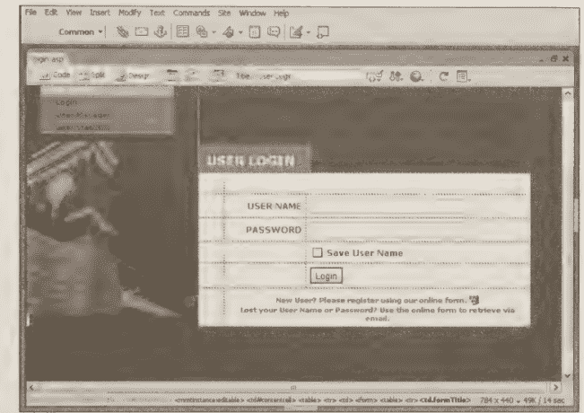

r1-1

4. 保存页面。如果您使用模板从头开始创建页面，请将页面保存为 `login`，并使用适合您平台的扩展名。例如，对于 ASP 页面，将页面保存为 `login.asp`。

> **注意** 虽然 Macromedia 的标准登录页面可以存储为基本 HTML 页面，但我们的登录页面包含需要服务器端代码的动态元素。

#### 步骤 2：应用用户认证的服务器行为

我们的第一个服务器端代码操作是设置基本的用户认证程序。Dreamweaver 包含一个标准服务器行为，我们将在技术中使用并加以调整。"记录用户"服务器行为负责比较用户输入的值和数据源中的条目。它还会在成功（找到匹配的用户名和密码）和失败（找不到用户名或其密码）两种情况下重定向页面。

> **注意** 以下步骤使用来自 `Recipes` 数据库的字段名。如果您使用自己的数据源，请替换为相应的字段。

使用"记录用户"服务器行为时，您有两种控制程度可选。基本选项仅检查用户名和密码；在这种情况下，数据源中注册的每个人都能看到每个页面。第二个选项提供了更大程度的控制，除了用户名和密码之外，还会检查组字段。要使用更高级的选项，每个注册的用户都必须被分配到特定的组，如访客、员工、经理或管理员。通过整合组级别访问，您可以构建一个同时面向公众和管理员的统一界面。您即将构建的应用将使用组选项。

1. 在"服务器行为"面板中，点击添加（`+`）并选择`用户认证` > `记录用户` [r1-2]。

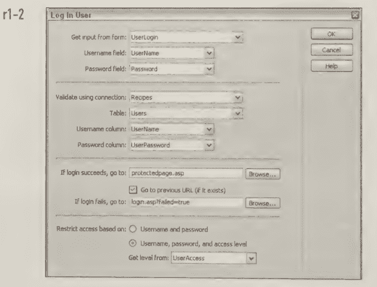

2. 选择要使用的表单。
   - 将"获取输入自"表单列表设置为 `userLogin`。
3. 选择保存用户名的表单字段。
   - 从"用户名字段"列表中选择 `UserName`。
4. 选择包含用户密码的表单字段。
   - 在"密码字段"列表中，选择 `Password`。

现在我们来创建数据源连接。

5. 选择指向包含用户表的数据源的连接。
   - 在"使用连接验证"列表中，选择 `Recipes`。
6. ColdFusion 专用：如有必要，输入数据源的用户名和密码。
7. 从数据源中选择包含所有用户数据的表。
   - 将"表"列表设置为 `Users`（PHP 为 `users`）。

Dreamweaver 在选择表后会填充"用户名列"和"密码列"列表。

8. 声明表中用于存储用户名的列。
   - 在"用户名列"列表中，选择 `UserName`。
9. 选择用于存储密码的列。
   - 在"密码列"列表中，选择 `UserPassword`。

现在我们确定登录成功或失败后的响应方式。

10. 输入登录成功时要显示的页面名称。
    - 在"If 登录成功，则转到"字段中，选择"浏览"并找到适合您服务器模型的 `protectedpage` 文件。
11. 如果希望用户在成功登录后继续访问先前输入的 URL，请勾选"转到上一个 URL（如果有）"选项。
12. 输入登录失败时要显示的页面。
    - 在"If 登录失败，则转到"字段中，输入以下代码：

```
VB login.asp?failed=true
JS login.asp?failed=true
CF login.cfm?failed=true
PHP login.php?failed=true
```

如果登录失败，页面会将自身提交并附带一个标识问题的参数。稍后将通过添加额外代码，利用该参数在页面上触发一条消息。

13. 选择是否根据访问级别来限制访问。
    - 将"基于限制访问"选项设置为 `UserName`、`Password` 和 `Access Level`。

14. 如果您选择包含访问级别，请选择包含该数据的表列。
    - 在"获取级别来源"列表中，选择 `UserAccess`，然后点击"确定"关闭对话框。
15. 保存您的页面。

在完成所有步骤之前，您将无法测试页面。

#### 步骤 3：插入错误消息

我们的下一步操作是创建一条自定义错误消息，在登录失败时显示。通过将错误消息保留在同一页面上，我们简化了用户体验。

1. 将光标放在您希望错误消息出现的位置。
   - 将光标放在"用户名"标签上方的行中。
2. 添加错误消息代码：
   - 在"代码片段"面板中，打开适合您服务器模型的 `Recipes > UserLogin > Custom Code` 文件夹，然后插入"Login Failure - Display Text"片段。

```
<%if (cStr(Request("failed"))<>"") then Response.Write("The Login information you provided is not valid. Please try again.")%>
```

```
<%=(String(Request("Failed"))!="undefined")?"The Login information you provided is not valid. Please try again.":""%>
```

```
<cfif IsDefined("URL.failed")><cfoutput>The Login information you provided is not valid. Please try again </cfoutput></cfif>
```

```
<?php echo (isset($_GET['failed']))?"The Login information you provided is not valid. Please try again":""; ?>
```

3. 如果您在"代码"视图中手动输入了代码，请务必移除非断行空格字符 `&nbsp;`。（将片段拖到设计视图中的表格时，会自动移除非断行空格。）

ASP-JavaScript 和 PHP 代码使用条件运算符（PHP 中也称为三元运算符），而不是标准的 If-Then 语句。使用条件或三元运算符时，如果开头语句（问号前的部分）为真，则执行紧跟问号后的第一个从句；否则，执行第二个从句（冒号后的部分）。

#### 步骤 4：添加会话对象

Macromedia 的"登录用户"服务器行为会创建一个名为 `MM_Username` 的会话变量。在此步骤中，我们将添加另一个会话变量 `UserID`，它将用于过滤应用程序中其他页面的记录集。我们的数据库架构在另一个相关表中包含 `UserID`，用于记录登录信息，稍后可用于显示登录统计信息。

将 `UserID` 会话对象集成到代码中有三个部分：将其添加到 SQL 中、在记录集代码中创建会话变量，以及向 Dreamweaver 公开该会话变量。首先，我们将 `UserID` 添加到"登录用户"服务器行为插入的 SQL 语句中。

1. 切换到"代码"视图。
2. 选择"编辑" > "查找和替换"，或使用键盘快捷键 Ctrl-F（Command-F）打开"查找和替换"对话框。
3. 在当前文档中，查找源代码 `SELECT UserName, UserPassword`。

找到后，整行内容如下：

```
VB MM_rsUser.Source = "SELECT UserName, UserPassword"
```

```
JS MM_rsUser.Source = "SELECT UserName, UserPassword"
```

```
CF SELECT UserName,UserPassword,UserGroup FROM Users WHERE UserName='#FORM.UserName#'
```

```
PHP $LoginRS_query=sprintf('SELECT UserName, UserPassword, UserAccess FROM users WHERE UserName='%s' AND UserPassword='%s'',
```

4. 在 `UserPassword`（ColdFusion 中为 `UserGroup`）后添加一个逗号，然后加上 `UserID`，使该行内容变为：

```
VB MM_rsUser.Source = "SELECT UserName, UserPassword, UserID"
```

```
JS MM_rsUser.Source = "SELECT UserName, UserPassword, UserID"
```

```
CF SELECT UserName,UserPassword,UserGroup, UserID FROM Users WHERE UserName='#FORM.UserName#'
```

```
PHP $LoginRS_query=sprintf('SELECT UserName, UserPassword, UserAccess, UserID FROM users WHERE UserName='%s' AND UserPassword='%s'',
```

5. 保存您的页面。

> **警告** 由于我们在 Dreamweaver"登录用户"服务器行为中进行了必要的修改，因此无法通过对话框重新编辑该服务器行为。如果再次打开"登录用户"对话框，刚才所做的修改将会丢失，需要重新恢复。

既然 `UserID` 已成为记录集的一部分，您就可以在代码中创建会话对象了。这个新的会话对象将使基于活动用户引用资料信息变得更加容易。一旦在登录时创建了会话变量，就可以从应用程序的任何页面访问 `UserID`。

1. 与之前一样，使用"查找和替换"功能搜索代码 `Session("MM_Username")`。


整行内容如下：

- **VB** `Session("MM_Username") = MM_valUsername`
- **JS** `Session("rega") = MM_valUsername`
- **CF** `<cfset Session.MM_Username=FORM.UserName>`
- **PHP** `$GLOBALS['MM_Username'] = $loginUsername;`

在该行代码后添加一个段落回车。

插入以下代码：

- 在“代码片段”面板中，打开适合您服务器模型的 `Recipes > UserLogin > Custom Code` 文件夹，然后插入 `Session – User ID` 片段。
- **VB** `Session("MM_UserID") = MM_UserID`
- **JS** `Session("MM_UserID") = String(MM_rsUser.Fields.Item("UserID").Value);`
- **CF**

```cf
<cfif IsDefined("Form.StoreProfile")>
  <cfset Session.MM_UserID=MM_rsUser.UserID>
<cfelse>
  <cfset Session.MM_UserID="">
</cfif>
```

- **PHP** `$GLOBALS['MM_UserID'] = mysql_result($LoginRS,0,'UserID');`

PHP 还需要一个额外步骤。正如 Dreamweaver 注册 Username 会话变量一样，我们必须确保注册 UserID 会话变量。我们将把 `session_register()` 函数放在 Dreamweaver 插入的函数之后。

在“代码”视图中使用“查找和替换”，搜索行 `session_register("MM_Username");`，然后在其后放置以下代码：

```php
session_register("MM_UserID");
```

> **为什么这里的 ColdFusion 代码比 ASP 代码复杂得多？** ColdFusion 5 有一个限制，即在被重定向的页面中无法设置 cookie。在这个变通方案中，用户名值存储在一个会话变量中，该变量将在确认页面中读取，然后存储到 cookie 中。此限制已在 ColdFusion MX 中移除。

**注：**

会话对象编码中的最后一个元素，说实话，是可选的，但遵循它是一个良好的实践。在此步骤中，我们将在 Dreamweaver 中为会话对象创建一个站点级变量。虽然不是必需的，但它使得只需拖放即可插入 UserID 会话对象。

1. 在“绑定”面板中，选择添加（+）并选择 `Session Variable`。
2. 在“会话变量”对话框的“名称”字段中输入 `UserID`，然后点击“确定”。
3. 展开“绑定”面板中的 Session 树，以查看您的新变量 [r1-3]。

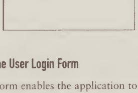

#### 步骤 5：为用户登录表单添加 Cookie 逻辑

登录表单上的复选框使应用程序能够记住用户名。这使用户登录变得更加方便，同时出于安全考虑，该功能是可选的。计算机通过在客户端计算机上存储 cookie 来记住每个用户。我们现在需要添加代码，根据用户输入的值来创建和管理 cookie。有多个地方可以插入额外代码：第一段创建 cookie 的代码放在记录集上方，而所有其他代码则放在表单元素本身内部。

## 食谱 1：用户登录

1. 在“代码”视图中，将光标置于源代码的顶部。
2. 插入以下代码：

由于页面加载时 cookie 值会被插入到表单元素中，因此代码块需要位于页面顶部、记录集声明之上。对于 ASP 和 PHP 服务器模型，光标应放置于包含连接信息的标签下方。

从“片段”面板中，打开适用于您的服务器模型的 `Recipes > UserLogin > Custom Code` 文件夹，并插入 `Cookie - Object Code` 片段。

```asp
<%
if (cStr(Request.Form("Login"))<>"")  then
  if (cStr(Request.Form("StoreProfile"))<>"")  then
    Response.Cookies("UserName") = cStr(Request("UserName"))
  else
    Response.Cookies("UserName") = ""
  end if
  today =  DateAdd("d",30, Date())
  Response.Cookies("UserName").Expires = today
end if
%>
```

```js
<%
if (String(Request.Form("Login"))!="undefined")  {
  if (String(Request.Form("StoreProfile"))!="undefined")  {
    Response.Cookies("UserName") = String(Request("UserName"));
  } else  {
    Response.Cookies("UserName") = "";
  }
  var today = new Date();
  today.setDate(today.getDate()+30);
  Response.Cookies("UserName").Expires = (today.getMonth()+1)+"/"+today.getDate()+"/"+today.getFullYear();
}
%>
```

### 终端用户食谱：用户登录

```cf
<cflock timeout="20" throwontimeout="No" type="EXCLUSIVE" scope="SESSION">
  <cfif IsDefined("Session.MM_UserID")>
    <cfif Session.MM_UserID NEQ "">
      <cfcookie name="UserName" value="#Session.MM_UserName#" expires="30">
    </cfif>
  </cfif>
</cflock>
```

```php
<?php
  if (isset($_POST['Login'])) {
    if (isset($_POST['StoreProfile'])) {
      setcookie ("UserName",
        $_POST['UserName'],time()+60*60*24*30);
    } else {
      setcookie ("UserName", "",time()-43200);
    }
  }
?>
```

对于这些代码块，在验证用户表单存在且已选择 StoreProfile 复选框后，将创建 cookie 并设置为 30 天后过期。PHP 代码按照 `setcookie()` 函数的要求计算 30 天内的秒数。

当登录页面加载时，如果用户名之前已被存储——换句话说，如果 cookie 存在——我们希望显示 StoreProfile 复选框为选中状态。为此，我们需要在描述该复选框的 `<input>` 标签内添加一些额外的代码。

> 对于此操作，您可能会发现在拆分的设计视图和代码视图中工作最为简便。

1. 在“设计”视图中，选择 **StoreProfile** 复选框。
2. 在“代码”视图中，将光标置于 `<input>` 标签内、结束尖括号之前。
3. 插入以下代码：
   - 从“片段”面板中，打开适用于您的服务器模型的 `Recipes > UserLogin > Custom Code` 文件夹，并插入 `Cookie - StoreProfile Checkbox` 片段。

```vb
<%if (cstr(Request.Cookies("UserName"))<>"") then
  Response.Write("checked")%>
```

```js
<%=(String(Request.Cookies("UserName"))!="")?"checked":""%>
```

## 食谱 1：用户登录

```cf
<cfif IsDefined("COOKIE.UserName") AND COOKIE.UserName NEQ "">
  <cfoutput>checked</cfoutput>
</cfif>
```

```php
<?php echo ($_COOKIE['UserName']!='')?"checked":""; ?>
```

再进行两处修改，登录页面就将完成。现在我们将 UserName 和 Password 文本字段与它们各自的 cookie 关联起来。如果定义了 cookie 值，该值将填充到字段中；如果值为空，表单元素将显示为空白。

1. 在“设计”视图中，选择 **UserName** 文本字段。
2. 在“代码”视图中，移动到输入标签的末尾，按空格键，然后插入以下代码：
   - 从“片段”面板中，打开适用于您的服务器模型的 `Recipes > UserLogin > Custom Code` 文件夹，并插入 `User Name Cookie - Display Text` 片段。

```vb
value="<%=Request.Cookies("UserName") %>"
```

```js
value="<%= Request.Cookies("UserName") %>"
```

```cf
value="<cfif IsDefined("Cookie.UserName")>
<cfoutput>#Cookie.UserName#</cfoutput></cfif>"
```

```php
value="<?php echo $_COOKIE['UserName']; ?>"
```

3. 保存您的页面。

> **注意：** 如果按空格键时弹出“代码提示”，请按 Esc 将其关闭。

通过在相应字段中输入用户名和密码来测试您的页面。如果应用程序找到匹配项，您将被重定向到受保护的页面文件。（如果尚未为此页面创建占位符，您将收到“找不到页面”错误。）如果未找到匹配项，将显示错误消息 [r1-4]。每当您返回此页面时，在选择“保存用户名”选项后，用户名应该已经填充。

#### 步骤 6：创建指向其他应用程序页面的链接

对于开发人员来说，覆盖用户与应用程序页面交互时可能遇到的每一种情况非常重要。到目前为止，我们的页面处理了注册成功和失败两种情况；但如果用户根本未注册或忘记了密码怎么办？在最后一步中，我们将链接到整个应用程序中的页面，以应对这些情况。

1. 选择要用作链接到新建用户注册页面的文本或图像。
   - 选择表单底部文本块中的单词 **register**。
2. 链接到相应的应用程序页面。
   - 单击“属性”检查器中“链接”字段旁边的文件夹图标。在“选择文件”对话框中，选择适用于您的服务器模型的 `register_user` 页面。
3. 选择要用作链接到电子邮件密码页面的文本或图像。
   - 选择表单底部文本块中的短语 **online form**。
4. 创建指向所需应用程序页面的链接。
   - 再次打开“选择文件”对话框，然后选择适用于您的服务器模型的 `send_password` 文件。
5. 完成后保存您的页面。

在下一个食谱中，我们将完成两个链接中的第一个：新建用户注册页面。

### 终端用户食谱：新建用户注册

组织是否允许新用户自行注册，当然是一个关键决策。从好的方面来说，这一政策大大减轻了管理员工的工作量；但是，其中也存在安全问题。此应用程序通过允许自行注册但在最初将注册者限制为最低访问级别来取得平衡。使用标准的 Dreamweaver 插入记录服务器行为来创建记录。

#### 步骤 1：构建应用程序设计

我们从基本页面开始，插入所有需要的表单元素。

1. 手动创建基本动态页面，或从模板创建。
   - 在 **UserLogin** 文件夹中，找到适用于您的服务器模型的文件夹，然后打开其中的 **register_user** 页面。
2. 在页面内容区域中添加一个表格，以容纳应用程序的界面元素。
   - 从“片段”面板中，将 `Recipes > UserLogin > Wireframes > Register User - Wireframe` 片段拖到“内容”可编辑区域中。
3. 在表格中，插入表单以及应用程序所需的任何表单元素。您需要五个文本字段——分别对应每个字段（**名字**、**姓氏**、**用户名**、**密码**和**电子邮件地址**）——以及一个提交按钮。
   - 将光标置于 REGISTER USER 下方第二行单元格中，然后插入 `Recipes > UserLogin > Forms > Register User - Form` 片段 [r1-5]。

> **增强 Cookie 制作**

我们的食谱只是触及了使用 cookie 所能做的内容的皮毛。cookie 的真正威力在于个性化。通过充分的规划，您可以为每一位访客个性化 Web 体验。

虽然您当然可以使用食谱代码作为处理 cookie 的起点，但您可能会发现使用专用扩展程序更为高效。WebAssist 创建了一个大大简化创建、访问和删除 cookie 的扩展程序。借助 WA Cookies，您可以快速添加功能，以便在用户返回您的网站时记住他们，并根据存储的 cookie 数据轻松自定义他们的用户体验。

如需更多信息，请访问 <http://www.webassist.com/Products/Recipes/WACookies.asp>。

## 步骤 2：添加插入记录服务器行为

页面框架搭建完成后，我们将应用第一个服务器行为——插入记录。

在应用此行为的过程中，你可能会发现并非所有字段都有对应的表单元素。有几列——UserID、UserAccess 和 UserRegDate——会在创建新记录时由数据源自动填充。UserID 是一个自动编号字段，每新增一个用户就会递增 1；而 UserRegDate 则通过使用特殊函数（例如在 Access 中使用 Now()）设置为默认值来存储当前日期。UserAccess 字段默认设置为最低访问级别；如果需要，管理员可以提升该级别。

### 针对 ASP

1. 在“服务器行为”面板中，选择添加（+），然后选择“插入记录”以显示对话框 [r1-6]。

> **注意：** 为了适配各种服务器模型的不同对话框，本配方中的步骤在此处所必要时分别呈现。

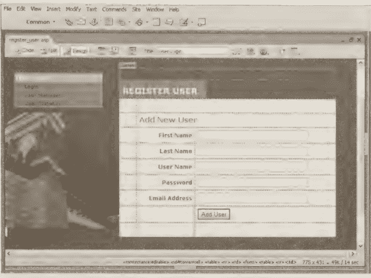

## 配方 1：用户登录

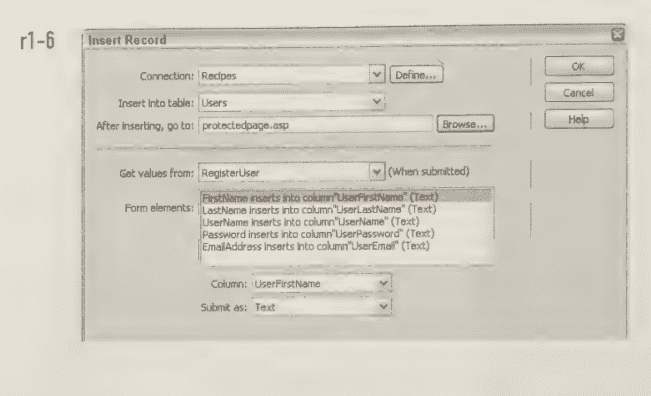

2. 选择数据源的连接。
   - 从“连接”列表中选择 **Recipes**。
3. 在你的数据源中选择要存放新记录的表。
   - 从“插入到表格”列表中，选择 **Users** 表。
4. 在“插入后，转到”字段中，输入用户成功注册后要显示的页面。
   - 点击“浏览”按钮，找到适合你服务器模型的登录页面。
5. 声明从页面上的哪个表单获取数据。
   - 将“获取值自”字段设置为表单名称 `registerUser`。
6. 对于列表中显示的表单元素，将每个元素设置为其在数据源中的对应项。所有表单元素都应作为文本提交：
   - 将表单元素 **FirstName** 设置为字段 **UserFirstName**。
   - 将表单元素 **LastName** 设置为字段 **UserLastName**。
   - 将表单元素 **UserName** 设置为字段 **UserName**。
   - 将表单元素 **Password** 设置为字段 **UserPassword**。
   - 将表单元素 **EmailAddress** 设置为字段 **UserEmail**。
7. 完成后，点击“确定”关闭对话框并插入行为。
8. 保存你的页面。

#### 针对 ColdFusion 和 PHP

1. 在“服务器行为”面板中，选择添加（+），然后选择“插入记录”。
2. 在“插入记录”对话框中，选择当前表单。
   - 从“提交值自”列表中选择 **RegisterUser**。
3. 从列表中选择你的数据源。
   - 从“数据源”列表中选择 **Recipes**。
4. ColdFusion 用户应在需要时输入其用户名和密码。
5. 从列表中选择数据源中要插入的表。
   - 从“插入到表格”列表中选择 **Users**（PHP 中为 `users`）。
6. 将数据源的字段设置为对应的表单元素。
   - 确保 UserID 数据列设置为未使用的主键。
   - UserAccess 不应从表单获取值。
   - 将 UserFirstName 设置为 FORM.FirstName 表单元素并作为 Text 类型提交。
   - 将 UserLastName 设置为 FORM.LastName 表单元素并作为 Text 类型提交。
   - 将 UserName 设置为 FORM.UserName 表单元素并作为 Text 类型提交。
   - 将 UserPassword 设置为 FORM.UserPassword 表单元素并作为 Text 类型提交。
   - 将 UserEmail 设置为 FORM.EmailAddress 表单元素并作为 Text 类型提交。
   - UserRegDate 不应从表单获取值。
7. 在“插入后，转到”字段中，根据你的服务器模型输入 `report_projectsummary.cfm` 或 `report_projectsummary.php`，然后点击“确定”关闭对话框。


### 步骤 3：将新用户信息存储在 Cookie 中

正如我们在登录页面所做的那样，现在我们将把刚刚提供的用户名存储在 Cookie 中。当用户返回登录页面时，该 Cookie 会被读取，自动填入数值。这段额外的代码可以优化用户体验。

> **注意**
>
> 由于 PHP 与其他服务器模型的需求不同，接下来的步骤先为 ASP 和 ColdFusion 用户呈现，然后再应用“检查新用户名”服务器行为。相关的 PHP 步骤必须在服务器行为添加到页面后才能应用。

#### 针对 ASP 和 ColdFusion

1. 在“代码”视图中，搜索包含“Insert Record: set variables using Dreamweaver”（插入记录：使用 Dreamweaver 设置变量）短语的注释。
   - 此注释是代码块的第一行；我们要在此代码块的正上方插入另一个代码块。
2. 在两个现有服务器端代码块之间添加一个段落换行。
3. 插入以下代码：
   - 从“代码片段”面板中，打开适合你服务器模型的 **Recipes > UserLogin > Custom Code** 文件夹，然后插入 **Register - Save Login in Cookie** 代码片段。

### 配方 1：用户登录

```asp
<%
if (cStr(Request("AddUser"))<>"") then
    Response.Cookies("UserName") = Request.Form("UserName")
    today = DateAdd("d",30,Date())
    Response.Cookies("UserName").Expires = today
end if
%>
```

```js
<%
if (String(Request("AddUser"))!="undefined") {
    Response.Cookies("UserName") = Request.Form("UserName");
    var today = new Date();
    today.setDate(today.getDate()+30);
    Response.Cookies("UserName").Expires =
        (today.getMonth()+1)+"/"+today.getDate()+"/"+today.getFullYear();
}
%>
```

```coldfusion
<cfif IsDefined("FORM.UserName")>
    <cflock scope="Session" timeout="30" type="Exclusive">
        <cfset Session.MM_Username=FORM.UserName>
    </cflock>
</cfif>
```

4. 保存你的页面。

### 步骤 4：验证用户名是否唯一

用户注册页面还需要另一个 Dreamweaver 服务器行为。为了确保输入的用户名在数据源中是唯一的，我们将使用“检查新用户名”服务器行为。如果发现重复的用户名，该服务器行为会重新提交到当前页面，并附带一个查询字符串参数，该参数进而触发错误消息的显示。

1. 在“服务器行为”面板中，选择添加（+），然后选择 **用户身份验证 > 检查新用户名**。“检查新用户名”对话框随即显示 [r1-7]。

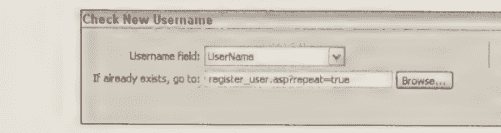

2. 选择包含用户名的表单字段。
   - 在“用户名字段”列表中，选择 **UserName**。
3. 选择当用户名不唯一时你希望应用程序显示的页面。
   - 在“如果已存在，转到”字段中，输入适合你服务器模型的 `register_user` 页面文件名，后跟查询字符串 `?repeat=true`。

| 服务器模型 | 代码 |
| --- | --- |
| VB | `register_user.asp?repeat=true` |
| JS | `register_user.asp?repeat=true` |
| CF | `register_user.cfm?repeat=true` |
| PHP | `register_user.php?repeat=true` |

4. 点击“确定”关闭对话框。

查询字符串变量技术可用于显示条件文本，而无需加载其他页面。现在我们将添加控制查询字符串变量 `repeat` 对当前页面产生何种影响的代码。

1. 在“设计”视图中，将光标放置在希望错误消息出现的位置。
   - 将光标放在“注册用户”标签上方的行中。
2. 添加错误消息代码。
   - 从“代码片段”面板中，打开适合你服务器模型的 **Recipes > UserLogin > Custom Code** 文件夹，然后插入 **Duplicate User Name - Display Text** 代码片段。

```text
VB <%if (cStr(Request("repeat"))<>"") then Response.Write("That Username is already taken. Please choose a new name and try again.<br>(Use your browser's back button to update your previous entry.)")%>

JS <%= (String(Request("repeat"))!="undefined")?"That Username is already taken. Please choose a new name and try again.<br>(Use your browser's back button to update your previous entry.)":""%>
```

### 配方 1：用户登录

```text
CF <cfif IsDefined("URL.repeat_user")><cfoutput> That Username is already taken. Please choose a new name and try again.<br>(Use your browser's back button to update your previous entry.)</cfoutput></cfif>
```

```php
PHP <?php echo (isset($_GET['repeat']))?"That Username is already taken. Please choose a new name and try again.<br>(Use your browser's back button to update your previous entry.)":""; ?>
```

3. 如果你在“代码”视图中手动输入了代码，请务必移除非换行空格字符&nbsp;。

4. 保存页面。

你可以在 Dreamweaver 插入式页面测试“注册用户”页面。选择“查看”>“实时数据”，在文档工具栏的“URL 参数”字段中，添加查询字符串 `repeat=true`。按 Tab 键，错误消息应出现 [r1-8]。

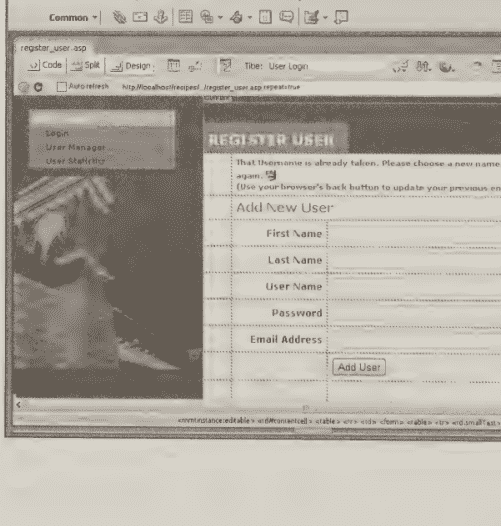

### 仅适用于 PHP

除了添加设置 Cookie 的代码外，PHP 还需要临时存储或缓存其处理过程。如果不这样做，设置 Cookie 的操作将会取代重定向，从而阻止重定向的发生。PHP 活动通过代码 `ob_start()` 进行缓存，并通过 `ob_end_flush()` 恢复。

首先，我们来添加创建 Cookie 的代码。

1. 在代码视图中，使用 Dreamweaver 的查找和替换功能搜索 `$insertGoTo = "login.php";`。
2. 在找到的代码后插入一个段落回车，并输入以下代码：
   - 从“代码片段”面板中，打开 `Recipes > UserLogin > Custom Code_PHP` 文件夹，然后插入 `Register - Save Login in Cookie` 代码片段。

```php
setcookie ("UserName", $_POST['UserName'],time()+60*60*24*30);

setcookie ("Password", $_POST['Password'],time()+60*60*24*30);
```

现在，我们用缓存命令包裹一个稍大的代码块。

3. 再次使用查找和替换功能，搜索以 `$insertSQL = sprintf` 开头的代码。
4. 从找到的代码行开始，向上选择所有代码，直到并包括以 `header(sprintf` 开头的代码行。整个代码块如下所示：

```php
$insertSQL = sprintf("INSERT INTO users (UserFirstName, UserLastName, UserName, UserPassword, UserEmail) VALUES (%s, %s, %s, %s, %s)",
    GetSQLValueString($_POST['FirstName'], "text"),
    GetSQLValueString($_POST['LastName'], "text"),
    GetSQLValueString($_POST['UserName'], "text"),
    GetSQLValueString($_POST['Password'], "text"),
    GetSQLValueString($_POST['EmailAddress'],"text"));

mysql_select_db($database_Recipes, $Recipes);
$Result1 = mysql_query($insertSQL, $Recipes) or die(mysql_error());

$insertGoTo = "login.php";
setcookie ("UserName", $_POST['UserName'],time()+43200);
setcookie ("Password", $_POST['Password'],time()+43200);
if (isset($_SERVER['QUERY_STRING'])) {
```

> 通常有必要按特定顺序插入代码，以确保一切正常工作。在本例中，我们需要在插入“插入记录”和“检查用户名”服务器行为之后，再包含缓存函数。如果我们过早进行修改，Dreamweaver 将无法识别“插入记录”服务器行为，因此也就无法插入“检查用户名”服务器行为。

### 注意

继续：

```php
$insertGoTo .= (strpos($insertGoTo, '?')) ? "&" : "?";
$insertGoTo .= $_SERVER['QUERY_STRING'];
}
header(sprintf("Location: %s", $insertGoTo));
```

5. 在所选代码块前后输入以下代码：
   - 从“代码片段”面板中，打开 `Recipes > UserLogin > Custom Code_PHP` 文件夹，然后插入 `Register – Cache Activity` 代码片段。

之前：

```php
ob_start()
```

之后：

```php
ob_end_flush()
```

6. 保存您的页面。

通过输入预期会失败和确定会成功的值来测试您的新页面。

### 终端用户方案：个性化和保护页面

向用户的操作提供反馈通常是个好主意，无论操作成功还是失败。反馈可以采取多种形式：通常会使用简单的感谢页面。然而，反馈越个性化越好。通过在页面上包含用户提交的表单信息，您可以证明您确实收到了数据。在本方案中，您将看到如何以个性化的方式确认收到表单提交，以及如何保护页面免受未注册用户的访问。

#### 步骤 1：实现内容设计

第一步是创建一个页面来容纳动态内容。Recipes 示例的标题为“受保护页面” [r1-9]，相当简洁，但这只是为了保持概念清晰。您可以（并且鼓励您）开发自己的设计。

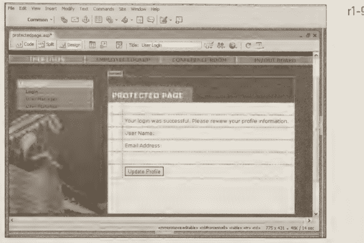

1. 手动或从模板创建一个基本动态页面。
   - 在 **UserLogin** 文件夹中，找到您的服务器模型对应的文件夹，然后打开其中的 `protectedpage` 页面。
2. 在页面内容区域添加一个表格，以包含应用程序的界面元素。
   - 从“代码片段”面板中，将 **Recipes > UserLogin > Wireframes > Protected Page - Wireframe** 代码片段拖到“内容”可编辑区域中。
3. 在表格内，插入一个包含必要文本和表单按钮的内容表格。此应用程序不需要表单。
   - 将光标放在第二个单元格中“PROTECTED PAGE”字样下方的行中，然后插入 **Recipes > UserLogin > ContentTables > Protected Page - Content Table** 代码片段。
4. 保存您的页面。

### 步骤 2：添加数据库组件

为了向用户证明他已正确登录，此应用程序将把他的数据提取到记录集中，然后在页面上显示几个字段。我们将通过使用登录页面上创建的用户会话变量 `UserID` 来定位该记录集。

### 方案 1：用户登录

1. 从“绑定”面板中，选择添加 (+) 并选择“记录集（查询）”。
2. “记录集”对话框有两种视图：简单和高级。确保您处于简单模式 [r1-10]。

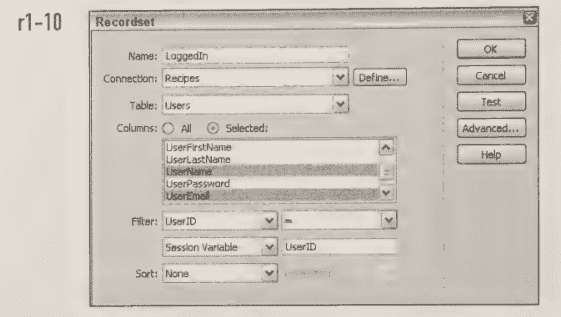

3. 在“名称”字段中，输入记录集的标签。
   - 输入 `LoggedIn` 作为记录集名称。
4. 从“连接”列表中，选择所需的数据源连接。
   - 从“连接”列表中选择 `Recipes`。
5. 选择包含用户信息的相关表格。
   - 从“表格”列表中选择 `Users`。
6. 在“列”下选择“选定”选项，并仅选择此记录集所需的列。
   - 通过按住 Ctrl 键单击每一列来选择 `UserID`、`UserName` 和 `UserEmail`。始终建议将列数限制为最低可用数量。
7. 在“记录集”对话框的“筛选”区域中，按如下方式设置四个筛选列表元素：

| 字段 | 运算符 |
| --- | --- |
| `UserID` | =（等于） |
| `Session Variable` | `MM_UserID` |

实际上，我们在此是将记录集限制为仅来自一个用户的数据——即当前登录并请求当前页面的那个人。

8. 由于只有一条记录，因此不需要排序。单击“确定”确认您的选择并关闭对话框。

我们现在已拥有输出个性化响应所需的一切。

在此步骤中，我们将插入记录集中的动态数据。虽然您可以使用“动态文本”服务器行为来完成此添加，但从“绑定”面板中拖动两个字段更为直观——更不用说更快了。

#### 步骤 3：显示个人资料数据

1. 如有必要，从“绑定”面板中展开记录集。
2. 将 `UserName`（或相应）字段拖到页面上“User Name:”文本之后的位置。
3. 将 `UserEmail`（或类似）字段拖到页面上“Email Address:”标签之后的位置 [r1-11]。
4. 在继续之前保存您的页面。

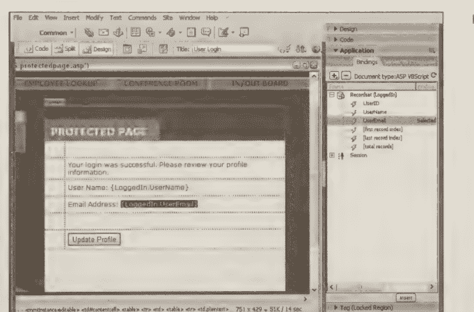

您可以通过进入实时数据视图来测试您的页面。第一次预览页面时，Dreamweaver 会弹出一个对话框，要求输入 `MM_UserID` 会话变量值。输入 1 或代表您 `UserID` 字段中有效条目的任意数字。

#### 步骤 4：限制页面访问

我们的注册系统已经就位，现在是时候保护我们的页面免受未经授权的查看了。Dreamweaver 提供了一个非常实用的服务器行为来完成这项工作：`限制对页面的访问`。通过此服务器行为，您可以基于匹配的用户名和密码来限制访问，或者可以扩展限制以检查访问组。Recipes 应用程序使用后一种方法以获得最大的灵活性。

1. 从“服务器行为”面板中，选择添加 (+) 并选择 **用户身份验证 > 限制对页面的访问**。
2. 选择 **基于用户名、密码和访问级别进行限制** 选项。选择“访问级别”选项后，“选择级别”区域将变为活动状态。在选择允许的级别之前，我们需要先定义它们。
3. 选择 **定义** 以打开“定义访问级别”对话框 [r1-12]。

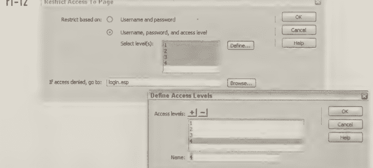

r1-12

4. 单击添加 (+) 并输入访问级别在您的数据源中出现的名称。
   - Recipes 数据源使用数字序列（1 到 4，其中 1 是最高访问级别）而非文字来表示级别。在每行上输入一个数字。
5. 对每个级别重复步骤 4，完成后单击“确定”关闭“定义访问级别”对话框。
6. 在“限制页面访问”对话框中，按住 Shift 键选择所有访问级别，以允许所有已登录用户查看此页面。显然，当此行为应用于不同页面时，将选择不同的访问级别。
7. 在“如果拒绝访问，则转到”字段中，选择您的登录页面。
8. 单击“确定”关闭对话框。

一旦在页面中插入了“限制页面访问”服务器行为，访客就无法在不登录的情况下 go to that page。如果他们尝试这样做，代码会将他们重定向到用户登录页面。

“限制页面访问”服务器行为非常强大，但必须在所有页面中插入。解决这项繁琐工作的一种方法是在模板而非单个页面上插入服务器行为，然后让 Dreamweaver 为我们完成安装工作。最好将服务器行为设置为允许所有访问级别，然后在具体案例中按需要限制访问级别。


> 要使用模板方法，请打开适用于您服务器模型的`userlogin`模板，并应用上一步中覆盖的步骤。保存模板并更新所有页面。管理类食谱页面——`edit_user`、`user_manager`和`user_statistics`——应单独打开，以便将访问级别重置为 1，即管理级别。

### 第 5 步：为“更新个人资料”按钮添加链接

每个人在输入表单信息时迟早都会出错。一旦按下提交按钮，您输入的数据就会直接进入数据源，因此始终最好为用户提供修改其条目的方法。在此步骤中，我们将一个按钮链接到应用程序中的另一个页面。

1. 选择`Update Profile`表单按钮。
2. 从“行为”面板中选择添加（+），然后选择`Go To URL`行为。
3. 输入用于编辑用户个人资料的应用程序页面路径。选择“浏览”按钮，然后选择适用于您服务器模型的`edit_profile`页面。
4. 完成后保存页面。

显然，您不必使用表单按钮和 JavaScript 行为来实现链接功能；带有标准链接的文本或图形也同样有效。另一方面，表单按钮为我们应用程序中的其他表单元素提供了一定程度的连续性，而无需花费资源来开发合适的图形。

### 最终用户食谱：条件显示

正如我们保护了大量页面免受未授权查看一样，我们也可以保护这些页面的部分内容。通过部署群组访问级别，任何页面元素都可以修改，使其仅对特定群组的成员可见。在此食谱中，我们将只允许具有最高访问级别——管理员——来查看特定的导航链接。

#### 使元素成为条件显示

> **警告**
>
> 虽然您在修改任何文档时都应该谨慎，但在对模板进行更改时，由于可能对众多文件产生潜在影响，您需要格外小心。

因为我们希望条件显示成为应用程序中每个页面的一部分——包括已构建的页面——所以必须修改应用程序模板。Dreamweaver 维护与所有派生自模板的文件之间的连接，因此更改可以自动传播到受影响的文档。如果您已经将一些文件上传到远程服务器，则在应用模板更改后，您需要重新上传它们。

在此步骤中，我们将选择页面元素——此处，用于导航的表格的两行——然后再应用代码。

1. 从“资源”面板的“模板”类别中，选择用于登录应用程序的模板。
   - 选择适用于您服务器模型的`userlogin`模板。
2. 选择“资源”面板底部的“编辑”按钮，或双击该文件。
3. 在设计视图中，选择页面左侧导航链接的下面两行 [r1-13]。

`r1-13`

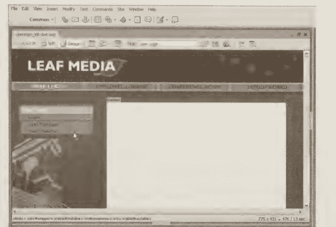

这些行内的链接与管理功能相关联：用户管理和用户统计。

4. 切换到代码视图，您会注意到只有单个单元格被选中，而非包含的行（`<tr>` 标签）。调整选择，以便包含单元格的两行都被突出显示。

如果您在下个步骤（应用代码片段）时只选择了单元格，Dreamweaver 会将代码包裹在整个表格周围——这不是期望的效果。

5. 将以下代码包裹在选区周围。

从“代码片段”面板中，打开适用于您服务器模型的`Recipes > UserLogin > Custom Code`文件夹，然后插入`Conditional Display`代码片段。

```
Before:
(VB) <%
if (cStr(Session("MM_UserAuthorization"))="1") {
%>

After:
<%
end if
%>
```

**Before:**

```
<%
if (String(Session("MM_UserAuthorization"))=="1") {
%>
```

**After:**

```
<%
}
%>
```

**Before:**

```text
<cfif IsDefined("Session.MM_UserAuthorization") AND
Session.MM_UserAuthorization EQ "1">
```

**After:**

```text
</cfif>
```

**Before:**

```php
<?php if ($_SESSION["MM_UserGroup"]=="1") { ?>
```

**After:**

```php
<?php } ?>
```

代码片段检查会话对象`MM_UserAuthorization`（PHP 中为`MM_UserGroup`）是否设置为 1，即数据源中定义的管理员标识。产生的效果是，指向管理页面的链接仅管理员可见。

务必保存您的模板并更新所有派生文档。

### 最终用户食谱：编辑用户个人资料

当用户从登录确认页面选择“更新个人资料”时，我们将要构建的应用程序就会显示。此页面包含之前在“添加用户”文件中看到的所有字段。此处使用了 Dreamweaver 服务器行为“更新记录”，我们还将实现一个“取消”按钮，允许用户优雅地退出更新操作。

#### 第 1 步：实现页面设计

让我们从构建基本页面开始。

1. 打开一个新的动态页面，可以手动构建，也可以从模板派生。在`UserLogin`文件夹中，找到您服务器模型的文件夹并打开其中的`edit_profile`页面。
2. 向页面的内容区域添加一个表格，以包含应用程序的界面元素。从“代码片段”面板中，将`Recipes > UserLogin > Wireframes > Edit Profile - Wireframe`代码片段拖入“内容”可编辑区域。
3. 在表格内，插入表单和应用程序所需的任何表单元素。您需要五个文本字段——每个字段各一个（名字、姓氏、用户名、密码和电子邮件地址）——以及两个按钮，一个用于提交更新，另一个用于取消操作。将光标放在“EDIT PROFILE”下方行的下一行第二单元格中，并插入`Recipes > UserLogin > Forms > Edit Profile - Form`代码片段 [r1-14]。

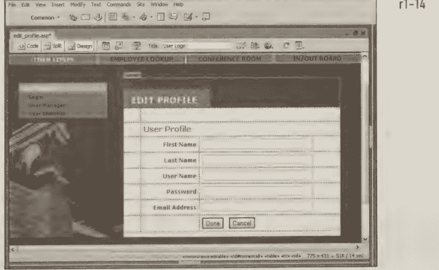

4. ColdFusion 和 PHP 用户：这些服务器模型需要唯一的记录 ID 才能使“更新记录”服务器行为正常工作。在这些情况下，使用隐藏表单字段来传递所需数据。

ColdFusion 和 PHP 开发人员应从“插入”栏的“表单”类别中拖出一个隐藏表单字段，并将其命名为`UserID`。

### 第 2 步：添加数据库组件

要构建此页面的记录集，我们将再次根据之前创建的会话变量`UserID`对 Users 表进行筛选。

1. 从“服务器行为”面板中，选择添加（+），然后选择`Recordset (Query)`。
2. 在“记录集”面板的简单视图中，为记录集指定一个有意义的名称。
   - 在“记录集”字段中输入`Users`。
3. 选择数据源的连接。
   - 从“连接”列表中选择`Recipes`。
4. 选择所需的表格。
   - 从“表格”列表中选择`Users`。
5. 将“列”选项保持设置为“全部”。
6. 在“记录集”对话框的“筛选”区域中，按如下方式设置四个筛选列表元素：

| UserID | =（等于） | 会话变量 | MM_UserID |
|---|---|---|---|

7. 将“排序”选项保持设置为“无”。
8. 单击“确定”确认您的选择并关闭对话框。
9. 完成后保存页面。

同样，此筛选器将记录集限制为一条记录——即当前登录的记录。

> PHP 和 ColdFusion 用户还需要用会话变量填充隐藏表单字段。

#### 第 3 步：数据绑定过程

定义了记录集后，我们就可以将记录集中的数据绑定到页面上的各个表单元素。每个文本字段都绑定到一个单独的数据列。

# 终端用户方案：编辑用户资料

83

1. 在“绑定”面板中，展开记录集条目，使所有数据列都显示出来。
2. 将以下各数据列拖到相应的文本字段：
   - 将`UserFirstName`列拖到`FirstName`字段。
   - 将`UserLastName`列拖到`LastName`字段。
   - 将`UserName`列拖到`UserName`字段。
   - 将`Password`列拖到`Password`字段。
   - 将`UserEmail`列拖到`Email Address`字段。
3. 保留所有动态文本字段的默认格式。

完成后，表单中的所有元素应显示动态条目 [r1-15]。

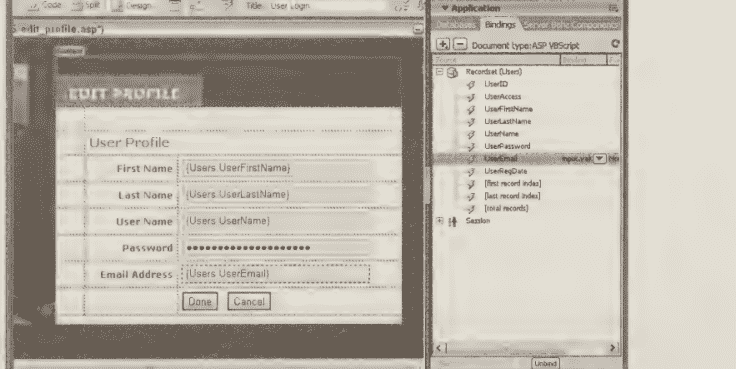

以下步骤仅适用于 ColdFusion 和 PHP 用户：两种服务器模型都要求使用唯一 ID 配合“更新记录”服务器行为。对于此页面，该值包含在会话变量`UserID`中。我们将通过把会话变量嵌入隐藏表单元素中，使其可用于服务器行为。

1. 选择所需的表单元素。
   - 选择`UserID`隐藏表单元素。

## 方案 1：用户登录

2. 将会话变量绑定到该元素。
   - 单击属性检查器中“值”字段旁边的闪电符号，打开“动态数据”对话框。
   - 在“动态数据”对话框中，展开“会话变量”节点并选择`UserID`。
   - 单击“确定”关闭对话框。
3. 保存页面。

#### 第 4 步：更新用户资料

此页面的核心任务——修改数据源中的现有记录——由 Dreamweaver 服务器行为“更新记录”处理。记录修改后，确认页面将重新加载。

应用服务器行为后，确保选中`<form>`标签，然后查看属性检查器。请注意，操作已设置为服务器端代码：ASP 为`<%=MM_editAction%>`，ColdFusion 为`<cfoutput>#CurrentPage#</cfoutput>`，PHP 为`<?php echo $editFormAction; ?>`。在 Dreamweaver 所有修改数据源的服务器行为中，你都会看到相同的通用代码变量：添加记录、更新记录和删除记录。

#### 适用于 ASP

1. 从“服务器行为”面板中，选择添加（+）并选择“更新记录”以显示对话框。
2. 选择数据源的连接。
   - 从“连接”列表中选择`Recipes`。
3. 选择包含用户数据的表。
   - 从“要更新的表”列表中选择`Users`。
4. 选择要从中获取数据源字段的记录集。
   - 将“从以下记录集选择”字段设置为`Users`。
5. 设置记录集的主键。
   - 从“唯一键列”列表中选择`UserID`，并确保选中“数值”选项。
6. 输入用户成功注册后要看到的页面。
   - 在“插入后，转到”字段中，选择“浏览”按钮并找到适用于您的服务器模型的`protected_page`文件。
7. 选择页面上要从中获取值的表单。
   - 将“从以下获取值”字段设置为`EditProfile`。
8. 对于列表中显示的表单元素，将每个元素设置为其在数据源中的对应项。所有表单元素都应作为文本提交：
   - 将表单元素`FirstName`设置为字段`UserFirstName`，类型为文本。
   - 将表单元素`Lastname`设置为字段`UserLastName`，类型为文本。
   - 将表单元素`UserName`设置为字段`UserName`，类型为文本。
   - 将表单元素`Password`设置为字段`UserPassword`，类型为文本。
   - 将表单元素`EmailAddress`设置为字段`UserEmail`，类型为文本。
9. 完成后，单击“确定”关闭对话框并插入行为。
10. 保存页面。

#### 适用于 ColdFusion 和 PHP

1. 从“服务器行为”面板中，选择添加（+）并选择“更新记录”。
2. 在“更新记录”对话框中，选择当前表单。
   - 从“提交值来源”列表中选择`Users`。
3. 从列表中选择数据源。
   - 从“数据源”列表中选择`Recipes`。
4. 如果需要，输入您的用户名和密码。
5. 从列表中选择要插入的数据源中的表。
   - 从“插入到表”列表中选择`Users`。
6. 将数据源字段设置为其对应的表单元素。
   - 作为主键，`UserID`使用`FORM.UserID`作为数值（在 PHP 中为整数）类型选择记录。
   - 确保`UserAccess`不获取值。
   - 设置`UserFirstName`从`FORM.FirstName`表单元素获取值，类型为文本。
   - 设置`UserLastName`从`FORM.Lastname`表单元素获取值，类型为文本。
   - 设置`UserName`从`FORM.UserName`表单元素获取值，类型为文本。
   - 设置`UserPassword`从`FORM.Password`表单元素获取值，类型为文本。
   - 设置`UserEmail`从`FORM.EmailAddress`表单元素获取值，类型为文本。
   - 确保`UserRegDate`不获取值。
7. 在“插入后，转到”字段中，输入记录更新后要显示的文件的路径。
   - 在“插入后，转到”字段中，选择适用于您的服务器模型的`protectedpage`文件。
8. 检查您的条目以验证其是否正确；如果正确，单击“确定”。
9. 保存页面。

#### 第 5 步：取消更新

这里有一个用户友好的补充功能，只需很少的工作量即可实现：取消按钮。如何取消尚未发生的服务器端操作？在这种情况下，一点点 JavaScript 就能实现。

1. 选择“取消”表单按钮。
2. 从“行为”面板中，选择添加（+）并选择“调用 JavaScript”。
3. 在“调用 JavaScript”对话框中，输入以下代码：
   - `history.back();`
4. 完成后，单击“确定”关闭对话框。
5. 保存页面。

尽管用户完全可以点击浏览器上的“后退”按钮，但您也希望尽可能让用户体验清晰明了。

# 终端用户方案：通过电子邮件发送密码

忘记密码是现代生活中的常态，除非动态处理，否则对管理员来说是噩梦。通过我们即将构建的页面，用户输入其邮件地址并请求密码。应用程序通过查找其邮件地址进行响应，如果找到匹配项，密码将通过电子邮件发送给用户。

## 设置服务器端电子邮件

ASP、ColdFusion 和 PHP 使用不同的机制来处理电子邮件。ASP 需要单独安装电子邮件组件，市面上有许多商业组件可供选择。其中最常见的是 Microsoft CDONTS（Collaboration Data Objects for Windows NT Server 的缩写）。CDONTS 组件是 IIS 4.0 以来所有 Windows 服务器的标准组件，直到 Windows XP 服务器（使用称为 CDOSYS 的更新版本）。CDOSYS 的编码与 CDONTS 略有不同；本方案中包含了两种示例。

尽管该组件包含在大多数 Windows 服务器中，但可能尚未在系统中注册。要注册 CDONTS，请确保`cdonts.dll`包含在包含其他 DLL 的 Windows 目录中（在 Windows 2000 上，为`/系统驱动器盘符\WINNT\system32`）。然后选择“开始”>“运行”，在“运行”对话框中输入`regsvr32 cdonts.dll`。CDONTS 组件需要有效的 SMTP 服务器才能成功发送电子邮件。

另一方面，ColdFusion 开箱即用就包含了电子邮件组件，无需额外的组件。但是，您需要指定有效的 SMTP 服务器。在 ColdFusion MX 中，通过进入管理员并选择“服务器设置”>“邮件服务器”找到此设置。在 ColdFusion 5 中，它位于“服务器设置”>“邮件/邮件日志记录”。

`mail()`函数内置于 PHP 中，因此唯一需要的配置是在`PHP.ini`文件中。如果 Web 主机已配置，则配置已为您完成。但是，如果您在自己的开发服务器上进行测试，则需要在 PHP.ini 文件的`[mail function]`部分中调整几个设置。Windows 用户应将 SMTP 设置设置为您的邮件服务器（即`smtp.myisphost.com`），并将`sendmail_from`变量输入为您的电子邮件地址。Macintosh 用户（通过 OS X 上的 Linux 或 Unix 连接）需要将`sendmail_path`变量设置为系统上 sendmail 程序的位置。您可以通过打开终端窗口并输入`whereis sendmail`来找到此位置。

### 第 1 步：实现发送密码设计

我们从构建 HTML 页面开始：

1. 打开一个新的动态页面，可以手动构建一个，也可以从模板派生一个。
   - 在`UserLogin`文件夹中，找到适用于您的服务器模型的文件夹，并打开其中的`send_password`页面。
2. 向页面内容区域添加一个表格，以容纳应用程序的界面元素。
   - 从“代码片段”面板中，将`Recipes > UserLogin > Wireframes > Send Password - Wireframe`代码片段拖到“内容”可编辑区域中。
3. 在表格中，插入应用程序所需的表单和任何表单元素。对于此应用程序，只需一个用于输入用户电子邮件地址的文本字段和一个提交按钮。

## 配方 1：用户登录

将光标放在“SEND PASSWORD”文字下方第二行的下一行，然后插入`Recipes > UserLogin > Forms > Send Password - Form`代码片段 [r1-16]。

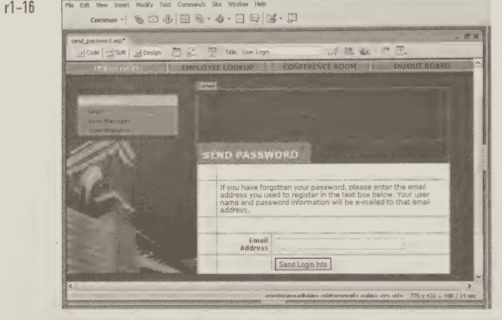

## 步骤 2：添加数据库组件

对于此应用程序，首要任务是在提交的电子邮件地址与已注册用户数据库中输入的地址之间找到匹配项。如果找到匹配，则返回单条记录——即包含所提交电子邮件地址的记录——到记录集。此记录集稍后用于向用户发送密码电子邮件。

#### 适用于 ASP 和 PHP

1. 在“绑定”面板中，选择添加（+），然后选择“记录集（查询）”。
2. 如果显示的是简单视图，请选择“高级”。

由于我们要定义 SQL 变量，因此 SQL 必须手写。

3. 为记录集输入一个恰当的名称。


在“名称”字段中输入`LostPassword`。

4. 从列表中选择您的数据源连接。

- 从“连接”列表中选择`Recipes`。

5. 在 SQL 字段中输入以下代码：

```
SELECT UserName, UserPassword
FROM Users
WHERE UserEmail = 'EmailParam'
```

6. 在“变量”部分，选择添加（`+`），然后在“名称”列下输入`EmailParam`。

7. 在“默认值”列中输入一个电子邮件地址，当电子邮件字段为空时使用，例如`Recipesadmin@idest.com`。

> 虽然我很乐意接收您的电子邮件（idest.com 是我的域名），但最好还是替换为您自己的管理员地址。

8. 在“运行时值”列中，输入从表单字段收集数据的代码：

- `VB`：`Request.Form("EmailAddress")`
- `JS`：`Request.Form("EmailAddress")`
- `PHP`：`$_POST['EmailAddress']`

9. 单击“确定”确认您的选择并插入记录集。操作完成后保存页面。

#### 适用于 ColdFusion

1. 在“绑定”面板中，选择添加（`+`），然后选择“记录集（查询）”。

2. 如果显示的是简单视图，请选择“高级”。

由于我们要定义 SQL 变量，因此 SQL 必须手写。

3. 在“名称”字段中，输入一个恰当的名称。

- 在“名称”字段中输入`LostPassword`。

4. 从列表中选择您的数据源连接。

- 从“数据源”列表中选择`Recipes`。

5. 如有必要，在各自的字段中输入用户名和密码。

6. 在 SQL 字段中输入以下代码：

```
SELECT UserName, UserPassword
FROM Users
WHERE UserEmail = '#FORM.EmailAddress#'
```

## 配方 1：用户登录

7. 在“页面参数”部分，选择添加（`+`）以显示“添加参数”对话框。

8. 在“添加参数”对话框中，确保在“名称”字段中显示`FORM.EmailAddress`。

> 注意：我确信管理员会更希望您替换为他或她的电子邮件地址，而不是使用我的。

9. 在“默认值”字段中，输入当电子邮件字段为空时应使用的电子邮件地址，例如`Recipesadmin@idest.com`，然后单击“确定”关闭“添加参数”对话框。

10. 完成后，单击“确定”关闭“记录集”对话框。

### 步骤 3：插入确认消息

我们的下一步操作是创建一个自定义错误消息，当登录失败时显示。通过将错误消息保留在同一页面上，我们简化了用户体验。

1. 将光标放在您希望错误消息出现的位置。

- 将光标放在电子邮件地址表单元素上方的行中。

2. 添加以下错误消息代码：

- 从“代码片段”面板中，打开适用于您的服务器模型的`Recipes > UserLogin > Custom Code`文件夹，然后插入`Send Email – Confirmation Message`代码片段。

```
VB: `<%=ConfirmMessage%>`
JS: `<%=ConfirmMessage%>`
CF: `<cfoutput>#ConfirmMessage#</cfoutput>`
PHP: `<?php echo $ConfirmMessage; ?>`
```

3. 如果您在代码视图中手动输入了代码，请务必删除非换行空格字符`&nbsp;`。

ColdFusion 用户还需要向页面添加一个`CFParam`，将`ConfirmMessage`变量设置为空字符串。

1. 在“绑定”面板中，选择添加（`+`），然后选择`CFParam`。

2. 在 CFParam 对话框中，在“名称”字段中输入`ConfirmMessage`。

3. 确保将“默认值”字段留空，然后单击“确定”关闭对话框。

新的 CFParam 将显示在“绑定”面板中。

最终用户配方：发送密码电子邮件

91

### 步骤 4：添加发送电子邮件的逻辑

定义记录集后，我们就可以验证它并发送电子邮件了。第一个编码任务是确保记录集不为空，这意味着找到了与提交电子邮件地址的匹配项。验证通过后，将发送电子邮件并显示确认消息。

#### 适用于 ASP

1. 在“服务器行为”面板中选择`LostPassword`记录集以高亮显示该记录集。

2. 在代码视图中，在记录集之后立即添加一个换行符。

3. 插入以下基于 CDONTS 的电子邮件代码：

- 从“代码片段”面板中，打开适用于您的服务器模型的`Recipes > UserLogin > Custom Code`文件夹，然后插入`Send Email - CDONTS`。

```
<%
Dim ConfirmMessage
ConfirmMessage = ""
IF (NOT LostPassword.EOF) THEN
	set newMail = Server.CreateObject("CDONTS.NewMail.1")
	newMail.Send "usermanager@yourcompany.com",
	cStr(Request("EmailAddress")), "Re:Your MyCompany Login
	Information", "UserName: "
	&LostPassword.Fields("UserName").value&"\rPassword: "
	&LostPassword.Fields("UserPassword").value
	ConfirmMessage = "Your login information has been sent to: " &
	cStr(Request("EmailAddress"))
END IF
%>
```

```
<%
var ConfirmMessage = "";
if (!LostPassword.EOF) {
	var newMail = Server.CreateObject("CDONTS.NewMail.1");
	newMail.Send("usermanager@yourcompany.com",String(Request
	("EmailAddress")),"Re:Your MyCompany Login
	Information","UserName: "
	+LostPassword.Fields("UserName").value+"\rPassword: "
	+LostPassword.Fields("UserPassword").value);
%>
```

继续

```
ConfirmMessage = "Your login information has been sent to: " +
String(Request("EmailAddress"));
}
%>
```

您可能会注意到，`newMail.send()`方法接受四个参数：发件人电子邮件地址、目标电子邮件地址、主题和邮件正文。代码块还包含一个在电子邮件发送后显示在用户屏幕上的确认消息。

4. 自定义包含发件人电子邮件地址（当前为`"usermanager@yourcompany.com"`）和主题行（`"Re:Your MyCompany Login Information"`）的代码。

5. 插入以下基于 CDOSYS 的电子邮件代码：

从“代码片段”面板中，打开`Recipes > UserLogin > Custom Code`文件夹（适用于您的服务器模型），然后插入`Send Email – CDOSYS`代码片段。

```
VB
<%@
Dim ConfirmMessage
ConfirmMessage = ""
IF (NOT LostPassword.EOF) THEN
    set sysMail = Server.CreateObject("CDO.Message")
    sysMail.Configuration.Fields("http://schemas.microsoft.com/cdo/configuration/smtpserver") = "smtp.mycompany.com"
    sysMail.Configuration.Fields("http://schemas.microsoft.com/cdo/configuration/sendusing") = 2
    sysMail.Configuration.Fields("http://schemas.microsoft.com/cdo/configuration/sendusername") = ""
    sysMail.Configuration.Fields("http://schemas.microsoft.com/cdo/configuration/sendpassword") = ""
    sysMail.Configuration.Fields.Update
    sysMail.From = "usermanager@yourcompany.com"
    sysMail.To = cStr(Request("EmailAddress"))
    sysMail.Subject = "Re:Your MyCompany Login Information"
    sysMail.TextBody = "UserName: " & 
    LostPassword.Fields("UserName").value & vbCrLf & "Password: " & 
    LostPassword.Fields("UserPassword").value
    sysMail.Send
    ConfirmMessage = "Your login information has been sent to: " & 
    cStr(Request("EmailAddress"))
END IF
%>
```

```
JScript
var ConfirmMessage = "";
if (!LostPassword.EOF) {
    var sysMail = Server.CreateObject("CDO.Message");
    sysMail.Configuration.Fields("http://schemas.microsoft.com/cdo/configuration/smtpserver") = "smtp.mycompany.com";
    sysMail.Configuration.Fields("http://schemas.microsoft.com/cdo/configuration/sendusing") = 2;
    sysMail.Configuration.Fields("http://schemas.microsoft.com/cdo/configuration/sendusername") = "";
    sysMail.Configuration.Fields("http://schemas.microsoft.com/cdo/configuration/sendpassword") = "";
    sysMail.Configuration.Fields.Update();
    sysMail.From = "usermanager@yourcompany.com";
    sysMail.To = String(Request("EmailAddress"));
    sysMail.Subject = "Re:Your MyCompany Login Information";
    sysMail.TextBody = "UserName: " + LostPassword.Fields("UserName").value+"\rPassword: " + LostPassword.Fields("UserPassword").value;
    sysMail.Send();
    ConfirmMessage = "Your login information has been sent to: " + String(Request("EmailAddress"));
}
```

6. 对于 CDOSYS，您需要将`smtpserver`设置（代码片段中为`smtp.mycompany.com`）自定义为您自己的服务器，以及`sysMail.From`电子邮件地址（代码片段中为`usermanager@yourcompany.com`）。

7. 将页面保存为`send_password.asp`。

#### 适用于 ColdFusion

1. 在代码视图中，在`<html>`标签上方和`</cfquery>`标签下方放置一个换行符。

2. 插入以下代码：

- 从“代码片段”面板中，打开`Recipes > UserLogin > Custom Code`文件夹（适用于您的服务器模型），然后插入`Send Email`代码片段。

## 配方 1：用户登录

```
<cfif LostPassword.RecordCount NEQ 0>
    <cfmail to="#FORM.EmailAddress#" from="usermanager@yourcompany.com" subject="Re:Your MyCompany Login Information">
        UserName: #LostPassword.UserName#
        Password: #LostPassword.UserPassword#
    </cfmail>
    <cfset ConfirmMessage="Your UserName and Password have been sent to: #Form.EmailAddress#">
</cfif>
```

1. 自定义`from`、`subject`的值，如果需要，也可以自定义`ConfirmMessage`变量的值。务必不要修改任何包含数据源字段的代码。

4. 保存您的页面。

#### 适用于 PHP

1. 在代码视图中，在`<html>`标签上方添加一个换行。

2. 插入以下代码：

- 从“代码片段”面板中，插入`Recipes > UserLogin > Custom Code_PHP > Send Email`代码片段。

```
<?php
    $ConfirmMessage = "";
    if ($totalRows_LostPassword > 0) {
        $to = $_POST['EmailAddress'];
        $from = "From: usermanager@yourcompany.com<usermanager@yourcompany.com>\r\n";
        $subject = "RE: Your MyCompany Login Information";
        $body = "UserName: " . $row_LostPassword['UserName'] . "\rPassword:" . $row_LostPassword['UserPassword'];
        @mail($to, $subject, $body, $from);
        $ConfirmMessage = "Your login information has been sent to: " . $_POST['EmailAddress'];
    }
?>
```

3. 自定义`from`、`subject`的值，如果需要，也可以自定义`ConfirmMessage`变量的值。务必不要修改任何包含数据源字段的代码。

4. 保存您的页面。

## 管理员配方：管理用户

完成了所有面向用户的配方后，是时候构建一些面向管理的页面了。我们的第一个组件结合了两个功能：注册用户的主列表，以及直接添加新用户的表单。添加用户部分是我们已经构建的注册用户表单增强版本。除了包含的记录字段（`UserFirstName`、`Password`、`UserEmail`等）之外，管理员还可以设置访问级别。

### 步骤 1：实现用户管理器设计

用户管理器页面的两个组件需要两个独立的部分。顶部部分将以 Dreamweaver 重复区域服务器行为显示所有用户的列表，并提供指向详细记录页面的链接。底部部分允许直接输入新用户。

1. 打开一个新的动态页面，可以手工构建一个，也可以从模板派生一个。

   - 在`UserLogin`文件夹中，找到您的服务器模型对应的文件夹，并打开其中的`user_manager`页面。

2. 在页面的内容区域添加一个表格，以包含应用程序的第一个界面元素——它的标题。这个线框表格至少应有三行。

   - 从“代码片段”面板中，将`Recipes > UserLogin > Wireframes > User Manager - Wireframe`代码片段拖入 Content 可编辑区域。

3. 在表格中，为第一行插入记录集导航状态对象和记录集导航栏的文本占位符。在第二行，添加`User Name`和`Access Group`的标题。表格的第三行最终将保存动态数据。在这种情况下，通常最好插入一个嵌套表格。

   - 将光标放在 USER MANAGER 字样下方的行中，插入`Recipes > UserLogin > Content Tables > View Users - Content Table`代码片段[r1-17]。

4. 在线框表格的第三行中，添加一个表单，用于插入新用户记录。这些元素包括五个带有标签的文本字段（`First Name`、`Last Name`、`User Name`、`Password`和`Email Address`）、一个用于分配组访问权限的下拉列表，以及一个用于添加新记录的表单按钮。

   - 将光标放在线框表格的最后一行中，插入`Recipes > UserLogin > Forms > Add New User - Form`代码片段[r1-18]。


## r1-17

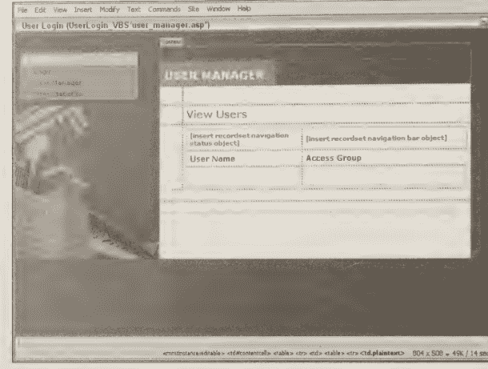

## r1-18

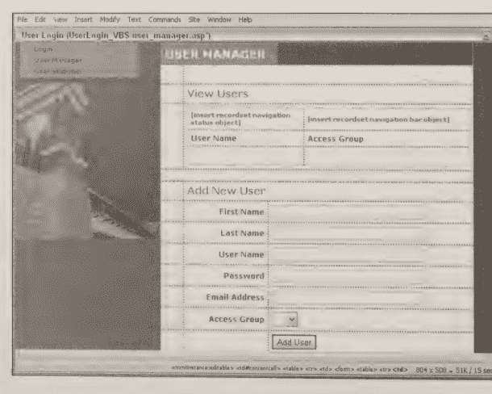

## 步骤 2：添加数据库组件

正如您可能预期的，由于有两个视觉组件，此页面使用两个记录集。然而，您可能意想不到的是，其中一个记录集以 SQL 中的*内连接*（`inner join`）方式组合了两个表。第一个记录集为我们提供了数据源中设置的访问组列表，用于填充下拉列表。第二个记录集使用内连接，为了方便我们的 ASP 和 ColdFusion 配方用户，它可作为 Access 视图使用。此记录集返回所有用户及其相应的访问级别，这些内容将整合到页面的初始部分。由于 MySQL 不支持视图，我们必须为 PHP 直接编写 SQL。

让我们先创建简单的记录集：`AccessGroups`。

1. 从"绑定"面板中，选择添加（+）并选择**记录集（查询）**。
2. 在"记录集"对话框的简单视图中，输入所需的名称，例如`AccessGroups`。
3. 选择您的数据源连接。
   - 从"连接"列表中选择`Recipes`。
4. 选择包含用户信息的表。
   - 从"表"列表中选择`AccessGroups`（PHP 为`accessgroups`）。
5. 确保**列**选项设置为"全部"。
6. 将**筛选**和**排序**均保留为**无**，然后单击**确定**关闭对话框。
7. 保存页面。

第二个更复杂的记录集对于不同的服务器模型有不同的处理方式。

### 适用于 ASP 和 ColdFusion

如前所述，此记录集需要一个 Access 视图，该视图连接两个表，即`Users`和`AccessGroups`。以下是名为`UserView`的视图背后的 SQL，适用于 ASP 和 ColdFusion 的两个版本：

```sql
SELECT *
FROM Users INNER JOIN AccessGroups ON Users.UserAccess = AccessGroups.AccessGroupID
ORDER BY Users.UserID DESC;
```

要实现此 SQL 语句，我们只需使用 Dreamweaver 的简单"记录集"对话框即可，适用于 ASP 和 ColdFusion。

1. 从"绑定"面板中，选择**添加（+）**，然后选择**记录集（查询）**。
2. 在"记录集"对话框的简单视图中，输入一个恰当的名称。
   - 在"记录集"字段中输入`Users`。
3. 选择您的数据源连接。
   - 从"连接"列表中选择`Recipes`。
4. 选择包含用户信息的表或视图。
   - 从"表"列表中选择`UserView`。
5. 确保"列"选项设置为**全部**。
6. 将"筛选"和"排序"均保留为**无**，然后单击**确定**关闭对话框。
7. 单击**确定**关闭对话框，并验证记录集已添加到"绑定"面板。
8. 保存页面。

### 适用于 PHP

PHP 版本的实际 SQL 与其他服务器模型中使用的版本略有不同，但主要区别在于，由于 MySQL 不支持视图，因此必须在 Dreamweaver 中直接添加 SQL 语句。

1. 从"绑定"面板中，选择**添加（+）**，然后选择**记录集（查询）**。
2. 如有必要，切换到"记录集"对话框的高级视图。
3. 为记录集输入一个恰当的名称。
   - 在"记录集"字段中输入`Users`。
4. 选择数据源。
   - 从"连接"列表中选择`Recipes`。
5. 在 SQL 区域中输入以下代码：

```sql
SELECT *
FROM users INNER JOIN accessgroups ON users.UserAccess =
accessgroups.AccessGroupID ORDER BY users.UserID DESC;
```

请注意，ORDER 设置为 DESC（降序）而非 ASC（升序）；这将最后输入的记录显示在最前面，使管理员更容易追踪新注册的用户。

6. 单击**确定**关闭对话框并插入记录集。
7. 保存您的页面。

"绑定"面板现在应该有两个记录集和一个会话对象。

## 步骤 3：数据绑定过程

最初，此页面需要绑定两个数据字段，均来自`Users`记录集。我们还将创建一个指向详细页面的链接，以便管理员可以轻松导航到特定用户的记录进行更新。

1. 从"绑定"面板中，展开`Users`记录集。
2. 将`UserName`字段拖到页面上的 User Name 标题下方的表格单元格中。

   Dreamweaver 将此动态数据显示为`{Users.UserName}`。

3. 将`AccessGroupName`字段拖到页面上的 Access Group 标题下方的表格单元格中。

   现在，我们已准备好链接到我们的详细页面。

4. 选择动态数据`{Users.UserName}`。
5. 从"属性"检查器中，选择**链接**文件夹图标。
6. 在"选择文件"对话框中，选择**参数**。
7. 在"参数"对话框中，输入变量名称。
   - 在"名称"列中，输入`ID`。
8. 输入动态值。
   - 在"值"列下，选择闪电图标以打开"动态数据"对话框，并从 Users 记录集中选择`UserID`。
   - 单击一次"确定"关闭"动态数据"对话框，再次单击"确定"关闭"参数"对话框。
9. 选择要传递参数的文件。
   - 选择"浏览"并选择您的服务器模型的`edit_user`文件。
10. 单击**确定**关闭对话框。

您可能会注意到，在此应用程序中，我们首次使用了一种不同的机制来连接相关记录。我们不是像之前那样查看会话对象 UserID，而是传递一个 URL 参数。此技术将使我们能够查看除该用户以外的记录，其自身的 userID 将被检查以确保具有适当访问级别的人员正在尝试调整用户记录。

## 配方 1：用户登录

页面上还有一个元素需要绑定到数据字段：访问组列表。虽然对选项进行硬编码很诱人，尤其是在值数量有限的情况下，但最好不要这样做。如果数据源后端发生变化（例如添加新的访问级别），前端（此表单）也必须修改。通过将数据绑定到列表，对数据源所做的任何更改都会立即反映到应用程序页面中。

1. 在表单中选择**Access Group**列表项。
2. 从属性检查器中，单击 Dynamic 按钮。

   动态列表/菜单对话框出现 [r1-19]。

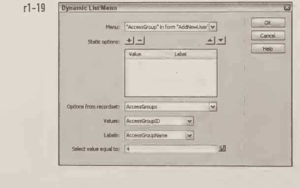

3. 确认在 Menu 列表中选择了**AccessGroup**列表元素。
4. 从 Options From Recordset 列表中选择`AccessGroups`。
5. 将 Values 列表设置为**AccessGroupID**。

   这些是插入到记录中的值。此处使用数字（1 到 4）而非文字（User、Administrator 等），以便更容易进行比较。

6. 将 Labels（用户看到的）设置为**AccessGroupNames**。
7. 在 Select Value Equal To 字段中，输入 4 并单击 OK 关闭对话框。

通过将选定值设置为 4，管理员的默认选择是最常访问的：User。

## 第 4 步：创建重复区域和应用程序对象

如果现在在 Dreamweaver 中通过选择工具栏上的 Live Data View 按钮预览页面，您将只看到一条记录的名称和访问组，即最后输入的记录。要显示多条记录，需要使用重复区域服务器行为。重复区域可以显示所有数据或仅显示部分数据。由于我们不想用太多数据让管理员不知所措，我们将一次只显示几条记录。为了使所有记录都能以小组形式访问，我们还将添加一些记录集导航和状态报告，所有这些都可以轻松地通过 Dreamweaver 插入。

让我们从向记录集添加重复区域开始：

1. 将光标放在包含动态数据的任一表格单元格中。
2. 从标签选择器中，选择当前`<td>`标签左侧的`<tr>`标签 [r1-20]。

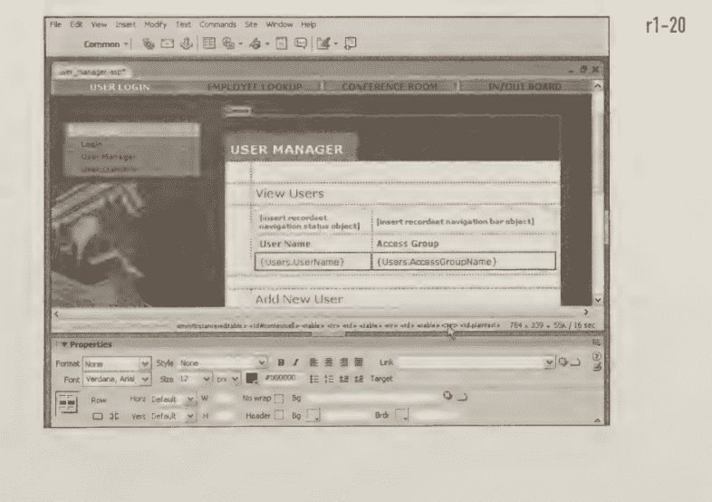

3. 从服务器行为面板中，选择 Add (+) 并选择**Repeat Region**。
4. 在重复区域对话框中，选择`Users`记录集。
5. 接受默认的**Showing 10 Records at a Time**，单击 OK 关闭对话框。

现在，如果您进入实时数据视图，您将看到最后 10 个注册用户的数据（r1-21）。当然，如果您注册的用户数少于 10 个，您将看到所有记录。要查看下一组记录，我们现在将添加一些记录集导航控件。

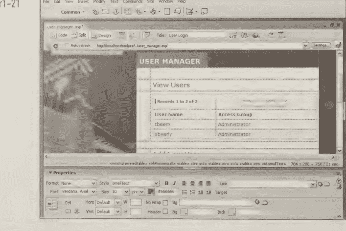

首先，我们将通过使用 Dreamweaver 的一个应用程序对象**Recordset Navigation Bar**来放置导航元素本身。

1. 将光标放在希望导航链接出现的表格中。

   小心不要将光标放在重复区域内。

   删除显示 "[insert recordset navigation bar object]" 的文本，并将光标留在该单元格中。

2. 选择**Insert > Application Objects > Recordset Paging > Recordset Navigation Bar。**

   或者，您可以从插入栏的 Application 类别中的 Recordset Paging 菜单中选择 Recordset Navigation Bar 对象。

3. 在 Recordset Navigation Bar 对话框中，选择`Users`记录集。
4. 将 Display Using 选项设置为**Text**并单击 OK。

Recordset Navigation Bar 对象用于显示四个导航选项：First、Previous、Next 和 Last。每个文本对象包含一个超链接，具有将光标移动到结果集中正确记录的功能。

> 插入 Recordset Navigation Bar 时自动添加的服务器行为可以在服务器行为面板中查看。**注意**

此外，Recordset Navigation Bar 还包括内置的服务器行为，仅在相关时才显示链接。例如，首次预览页面时，不会显示 Previous 链接，因为没有先前的记录可显示。同样，当最后一条记录在屏幕上时，Next 链接会被隐藏。

当您在记录集中分页时，有一些反馈说明您在数据中的位置会很有帮助。Dreamweaver 包含另一个名为 Recordset Navigation Status 的应用程序对象，它提供了这样的反馈。当添加到页面时，此对象通过显示当前显示的记录和记录总数来帮助用户跟踪记录集。Recordset Navigation Status 对象显示的信息如下所示：*Records 21 to 30 of 55*。

1. 将光标放在希望显示导航状态的表格中。

   同样，小心不要将光标放在重复区域内。

   删除显示 "[insert recordset navigation status object]" 的文本，并将光标留在该单元格中。

2. 选择**Insert > Application Objects > Display Recordset Count > Recordset Navigation Status。**

   或者，您可以从插入栏的 Application 类别中的 Display Recordset Count 菜单中选择 Recordset Navigation Status 对象。

3. 在 Recordset Navigation Status 对话框中，选择`Users`记录集并单击 OK。

要查看初始视图，请切换到实时数据视图 [r1-22]。要测试记录集导航控件，您需要在浏览器中预览页面，因为 Dreamweaver 不支持 Clicking on links。

## r1-22

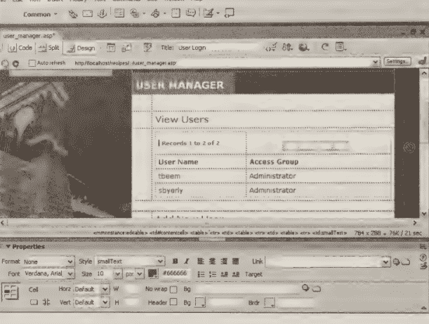

### 第 5 步：插入新用户

添加新用户的管理员版本表单与用户版本相似，但有一处不同。添加了一个额外的表单元素：Access Group 下拉列表，让管理员可以为任何新声明的用户指定特定的访问组。

#### 对于 ASP

1. 从服务器行为面板中，选择 Add (+) 并选择**Insert Record**以显示对话框。
2. 选择数据源连接。
   - 从 Connection 列表中选择`Recipes`。
3. 从 Insert Into Table 列表中，选择`Users`表。
4. 将 After Inserting, Go To 字段留空。

   通过将此字段留空，插入记录后将重新加载此同一页面。

   因此，管理员可以连续输入记录。

5. 将 Get Values From 字段设置为表单名称`AddNewUser`。
6. 对于列表中显示的表单元素，将每个元素设置为其在数据源中的等效项：
   - 将 FirstName 设置为 UserFirstName，类型为 Text。
   - 将 LastName 设置为 UserLastName，类型为 Text。
   - 将 UserName 设置为 UserName，类型为 Text。
   - 将 Password 设置为 UserPassword，类型为 Text。
   - 将 EmailAddress 设置为 UserEmail，类型为 Text。
   - 将 AccessGroup 设置为 UserAccess，类型为 Numeric。
7. 完成后，单击 OK 关闭对话框并插入行为。
8. 使用适合您平台的适当扩展名将页面保存为`user_manager`。

#### 对于 ColdFusion 和 PHP

1. 从服务器行为面板中，选择 Add (+) 并选择**Insert Record**。
2. 在 Insert Record 对话框中，选择当前表单。
   - 从 Submit Values From 列表中选择`AddNewUser`。
3. 从列表中选择您的数据源。
   - 从 Data Source 列表中选择`Recipes`。
4. ColdFusion 用户在需要时应输入其用户名和密码。
5. 从列表中选择数据源中要插入的表。
   - 从 Insert Into Table 列表中选择`Users`（PHP 为`users`）。
6. 将数据源字段设置为其对应的表单元素。
   - 确保 UserID 数据列设置为未使用的主键。
   - 将 UserAccess 设置为`FORM.AccesGroup`，ColdFusion 提交类型为 Numeric，PHP 提交类型为 Integer。
   - 将 UserFirstName 设置为`FORM.FirstName`表单元素，提交类型为 Text。
   - 将 UserLastName 设置为`FORM.LastName`表单元素，提交类型为 Text。
   - 将 UserName 设置为`FORM.UserName`表单元素，提交类型为 Text。
   - 将 UserPassword 设置为`FORM.UserPassword`表单元素，提交类型为 Text。
   - 将 UserEmail 设置为`FORM.EmailAddress`表单元素，提交类型为 Text。
   - UserRegDate 不应从表单获取值。
7. 在"After Inserting, Go To"字段中，输入`report_projectsummary.cfm`，然后点击 OK 关闭对话框。
8. 保存页面。

## 管理员操作指南：修改用户配置文件

在理想的世界里，管理员永远不会需要查看用户的记录，更不用说修改它了。然而，很少有管理员能幸运地生活在那样的世界里，因此需要一个功能强大的管理员编辑记录应用程序。

除了我们在面向用户的编辑记录页面中已经看到的功能外，管理员还需要能够修改用户的访问权限组级别以及完全删除记录。此外，为了安全起见，此页面中涉及的 SQL 语句比用户版本中的要复杂一些。

### 步骤 1：实现登录设计

让我们从构建基本页面开始。

1. 打开一个新的动态页面，可以手动构建一个，也可以从模板派生一个。

   在 UserLogin 文件夹中，找到您服务器模型的文件夹，并打开其中的`edit_user`页面。

2. 在页面的内容区域添加一个表格，以容纳应用程序的界面元素。

   从 Snippets 面板中，将 Recipes > UserLogin > Wireframes > Edit User - Wireframe 代码片段拖放到 Content 可编辑区域中。

3. 在表格内，插入表单和应用程序所需的任何表单元素。您需要五个文本字段——分别对应每个字段（名字、姓氏、用户名、密码和电子邮件地址）——以及一个用于保存组访问数据的选择列表。此外，此应用程序需要三个按钮：更新、删除和取消。

   将光标放在 EDIT USER 下方第二单元格的行中，插入 Recipes > UserLogin > Forms > Edit User - Form 代码片段 [r1-23和北马。

## r1-23

4. ColdFusion 和 PHP 用户：这两个服务器模型都需要唯一的记录 ID，Update Record 服务器行为才能正常工作。在这些情况下，使用隐藏表单字段来传递所需的数据。

   ColdFusion 和 PHP 开发人员应从插入栏的 Forms 类别中拖动一个隐藏表单字段，并将其命名为`UserID`。

5. 保存页面。

## 步骤 2：添加数据库组件


当在管理用户页面中选择链接时，编辑用户页面会显示。所选链接包含一个 URL 参数 ID，我们将在此页面上使用它来过滤两个所需记录集之一。第二个记录集获取动态填充访问组列表所需的值。

1. 从 Server Behaviors 面板中，选择 Add (+)，然后选择 Recordset (Query)。

2. 使用 Recordset 对话框的简单视图，为记录集指定一个有意义的名称。

   在 Recordset 字段中输入`Users`。

## 操作指南 1：用户登录

3. 选择数据源的连接。

   > 从 Connection 列表中选择`Recipes`。

4. 选择所需的表。

   > 从 Table 列表中选择`Users (users for PHP)`。

5. 将 Columns 选项保持设置为 All。

6. 在 Recordset 对话框的 Filter 区域，将四个 Filter 列表元素设置如下：

| UserID | = (Equals) |
| --- | --- |
| URL Variable | ID |

7. 将 Sort 选项保持设置为 None，然后点击 OK 确认您的选择并关闭对话框。

8. 保存页面。

> **注意**：第二个记录集`AccessGroups`与管理用户页面中构建的记录集完全相同。如果该页面已经开发完成，您可以复制并粘贴该记录集。要复制记录集，请在 Bindings 面板中选择它，然后从面板 Options 菜单中选择 Copy。要粘贴记录集，请切换到需要该记录集的页面，选择 Bindings 面板 Options 菜单，然后选择 Paste。您的记录集应出现在 Bindings 面板中。请注意，标准的 Copy 和 Paste 命令对记录集无效。

第二个记录集`AccessGroups`同样简单明了。

1. 从 Bindings 面板中，选择 Add (+)，然后选择 Recordset (Query)。

2. 在 Recordset 对话框的简单视图中，输入所需的名称，例如`AccessGroups`。

3. 选择您的数据源连接。

   > 从 Connections 列表中选择`Recipes`。

4. 选择包含用户信息的表。

   > 从 Table 列表中选择`AccessGroups`。

5. 点击 OK 关闭对话框。

## 步骤 3：数据绑定过程

此页面的数据绑定过程与编辑配置文件页面上的过程相同，但有一个例外。访问组表单元素——一个下拉列表——必须绑定到来自 accessgroup 表的数据。ColdFusion 和 PHP 用户还需要将当前记录 ID 绑定到隐藏表单字段。

1. 在 Bindings 面板中，确保`Users`记录集条目已展开，以便显示所有数据列。

2. 将以下每个数据列拖到相应的文本字段：

   - 将列`UserFirstName`拖到字段`FirstName`。
   - 将列`UserLastName`拖到字段`LastName`。
   - 将列`UserName`拖到字段`UserName`。
   - 将列`Password`拖到字段`Password`。
   - 将列`UserEmail`拖到字段`EmailAddress`。

3. 对所有动态文本字段保持默认格式。

现在我们来设置列表元素以动态填充。

4. 选择`Access Group`列表元素。

5. 在 Property inspector 中，点击 Dynamic 按钮以打开 Dynamic List/Menu 对话框。

6. 验证在 Menu 列表中选择了`AccessGroup`列表元素。

7. 从 Options From Recordset 列表中，选择`AccessGroups`。

8. 将 Values 列表设置为`AccessGroupID`。

9. 将 Labels（用户看到的）设置为`AccessGroupNames`。

10. 在 Select Value Equal To 字段中，选择闪电图标以打开 Dynamic Data 对话框。

11. 如有必要，展开`Users`记录集，并选择`UserAccess (AccessGroup for PHP)`字段。

   将所选值链接到 UserAccess/AccessGroup 字段，记录将最初显示当前用户组级别，同时允许管理员在必要时进行调整。

12. 点击 OK 关闭 Dynamic Data 对话框。确认选择后，在 Dynamic List/Menu 对话框中点击 OK 以关闭它。

ColdFusion 和 PHP 用户需要完成一组额外的步骤，将动态数据绑定到先前插入的隐藏表单字段。

1. 选择所需的表单元素。

   - 选择`UserID`隐藏表单元素。

2. 将当前记录 ID 绑定到该元素。

   - 选择 Property inspector 中 Value 字段旁边的闪电符号以打开 Dynamic Data 对话框。
   - 在 Dynamic Data 对话框中，展开`Users`记录集并选择`UserID`。
   - 点击 OK 关闭对话框。

3. 保存您的页面。

### 步骤 4：更新用户配置文件

现在我们准备插入 Update Record 服务器行为。作为该过程的一部分，我们将设置该行为在更新完成后显示管理用户页面，以便管理员可以继续工作。

#### 对于 ASP

1. 从 Server Behaviors 面板中，选择 Add (+)，然后选择`Update Record`以显示对话框。

2. 选择数据源的连接。

   - 从 Connection 列表中选择`Recipes`。

3. 选择包含用户数据的表。

   - 从 Table To Update 列表中，选择`Users`。

4. 选择要从中获取数据源字段的记录集。

   - 将 Select Record From 字段设置为`Users`。

5. 设置记录集的主键。

   - 从 Unique Key Column 列表中，选择`UserID`并确保选中了 Numeric 选项。

6. 输入您希望用户在成功注册后看到的页面。

   - 在 After Inserting, Go To 字段中，选择 Browse 按钮并找到您服务器模型的`user_manager`文件。

7. 选择页面上要从中获取值的表单。

   - 将 Get Values From 字段设置为`EditUser`。

8. 对于列表中显示的表单元素，将每个元素设置为其在数据源中的等效项。所有表单元素都应作为文本提交：

   - 将表单元素`FirstName`设置为字段`UserFirstName`，类型为 Text。
   - 将表单元素`LastName`设置为字段`UserLastName`，类型为 Text。
   - 将表单元素`UserName`设置为字段`UserName`，类型为 Text。
   - 将表单元素`Password`设置为字段`UserPassword`，类型为 Text。
   - 将表单元素`EmailAddress`设置为字段`UserEmail`，类型为 Text。
   - 将表单元素`AccessGroup`设置为字段`UserAccess`，类型为 Numeric。

9. 完成后，点击 OK 关闭对话框并插入行为。

10. 保存您的页面。

#### 适用于 ColdFusion 和 PHP

1. 从“服务器行为”面板中，选择添加（+），然后选择“更新记录”。

2. 在“更新记录”对话框中，选择当前表单。

   - 从“提交值来源”列表中选择`Users`。

3. 从列表中选择您的数据源。

   - 从“数据源”列表中选择`Recipes`。

4. 如果需要，输入您的用户名和密码。

5. 从列表中选择数据源中要插入的表。

   - 从“插入到表”列表中选择`Users`。

6. 将数据源字段设置为对应的表单元素。

   - 作为主键，`UserID`使用`FORM.UserID`作为数值（PHP 中为整数）类型来选择记录。
   - 设置`UserAccess`，使其值来自表单元素`FORM.AccessGroup`，类型为数值（PHP 中为整数）。
   - 设置`UserFirstName`，使其值来自表单元素`FORM.FirstName`，类型为文本。
   - 设置`UserLastName`，使其值来自表单元素`FORM.LastName`，类型为文本。
   - 设置`UserName`，使其值来自表单元素`FORM.UserName`，类型为文本。
   - 设置`UserPassword`，使其值来自表单元素`FORM.Password`，类型为文本。
   - 设置`UserEmail`，使其值来自表单元素`FORM.EmailAddress`，类型为文本。
   - 确保`UserRegDate`不获取任何值。

7. 在“插入后，转到”字段中，输入记录更新后要显示的文件路径。

   - 在“插入后，转到”字段中，为您的服务器模型选择`usermanager`文件。

8. 检查您的条目以确认它们是否正确；如果正确，单击“确定”。

9. 保存您的页面。

### 步骤 5：添加删除命令

如果您想添加一个单独的页面来删除记录，可以使用 Dreamweaver 标准的删除记录服务器行为。但是，如果像本应用程序一样，您想将一些管理任务组合在一起——例如更新和删除记录——您就需要采用不同的方法。

## 配方 1：用户登录

一种方法是创建删除命令。命令是一种专用的 SQL 语句，除其他功能外，它可以删除、插入或更新记录。使用 Dreamweaver 界面创建命令后，必须将代码移动到更新记录行为的上方。最后一步是将删除代码包装在条件块中——也称为 If 语句——以便仅在选中“删除”按钮时才执行。

#### 适用于 ASP

1. 从“绑定”面板中，选择添加（+），然后选择命令。

   “命令”对话框显示 [r1-24]。

   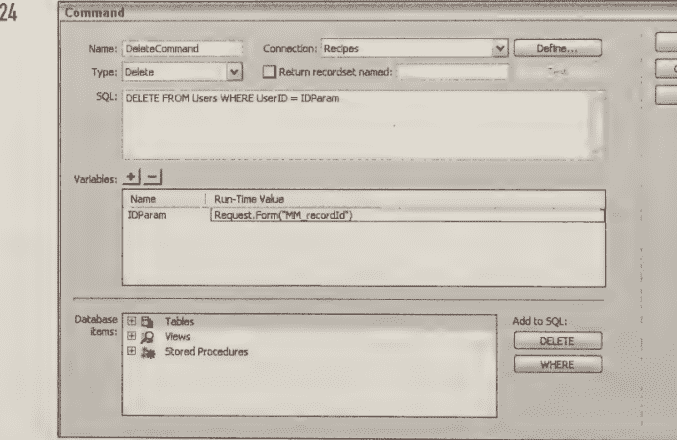

2. 输入命令的适当名称。

   在“名称”字段中输入`DeleteCommand`。

3. 从列表中选择您的数据源连接。

   从“连接”列表中选择`Recipes`。

4. 将“命令类型”选择为`Delete`。

5. 在 SQL 字段中输入以下代码：

```sql
DELETE FROM Users WHERE UserID = IDParam
```

6. 在“变量”部分，选择添加（+），在“名称”列下输入`IDParam`。

7. 在“运行时值”列中，输入`Request.Form("MM_recordId")`，完成后单击“确定”。

插入命令会创建两个代码块。我们需要移动其中一个，以便在处理更新命令之前处理删除命令。

8. 在“代码”视图中，找到删除命令的代码块。它看起来像这样：

```vb
<%
set DeleteCommand = Server.CreateObject("ADODB.Command")
DeleteCommand.ActiveConnection = MM_Recipes_VB_STRING
DeleteCommand.CommandText = "DELETE FROM Users WHERE UserID = " +
Replace(DeleteCommand__IDParam, "'", "''") + ""
DeleteCommand.CommandType = 1
DeleteCommand.CommandTimeout = 0
DeleteCommand.Prepared = true
DeleteCommand.Execute()
%>
```

```javascript
<%
var refuse = Server.CreateObject("ADODB.Command");
DeleteCommand.ActiveConnection = MM_Recipes_STRING;
DeleteCommand.CommandText = "DELETE FROM Users  WHERE UserID
"+ DeleteCommand__IDParam.replace(/'/g, "''") + " ";
DeleteCommand.CommandType = 1;
DeleteCommand.CommandTimeout = 0;
DeleteCommand.Prepared = true;
DeleteCommand.Execute();
%>
```

9. 剪切该代码块并将其移动到页面顶部以下相关代码块之后：

```vb
<%
if(Request("MM_recordId") <> "") then DeleteCommand__IDParam =
Request("MM_recordId")
%>
```

```javascript
<%
if(String(Request("MM_recordId")) != "undefined")
{ DeleteCommand__IDParam = String(Request("MM_recordId"));}
%>
```

现在，完成删除命令所需做的就是确保仅在用户选择表单上的“删除”按钮时才执行它。如果不执行此步骤，加载此页面时删除命令就会运行——这不是理想的情况。为了避免这种灾难性的情况，我们将两个删除命令代码块包装在 If 语句中。

## 配方 1：用户登录

1. 在“代码”视图中，找到两个相邻的删除命令代码块。

   - 选择这两个代码块，为插入代码片段做准备。

2. 插入以下代码：

   - 从“代码片段”面板中，为您的服务器模型打开`Recipes > UserLogin > Custom Code`文件夹，并插入`Delete Button - If Statement`代码片段。

之前：

```vb
<%
if (cStr(Request.Form("Delete"))<>"") then
%>
```

之后：

```vb
<%
Response.Redirect("user_manager.asp")
end if
%>
```

之前：

```javascript
<%
if (String(Request("Delete"))!="undefined") {
%>
```

之后：

```javascript
<%
Response.Redirect("user_manager.asp");
}
%>
```

当然，如果您的页面名称不是`user_manager.asp`，您可以更改删除完成后要重定向到的页面。

#### 适用于 ColdFusion

1. 从“绑定”面板中，选择添加（+），然后选择“记录集（查询）”。

   与 ASP 服务器模型不同，ColdFusion 没有单独的命令用户界面，而是使用“记录集”对话框。

2. 如果显示的是简单视图，请选择“高级”。

3. 在“名称”字段中，输入适当的名称。

   - 在“名称”字段中输入`DeleteOperation`。

4. 从列表中选择您的数据源连接。

   - 从“数据源”列表中选择`Recipes`。

5. 如果需要，在各自的字段中输入“用户名”和“密码”。

6. 在 SQL 字段中输入以下代码：

```sql
DELETE FROM Users WHERE UserID = #FORM.UserID#
```

7. 在“页面参数”部分，选择添加（+）以显示“添加参数”对话框。

8. 在“添加参数”对话框中，在“名称”字段中输入`FORM.UserID`。

9. 在“默认值”字段中，输入`0`并单击“确定”关闭“添加参数”对话框。

10. 完成后，单击“确定”关闭“记录集”对话框。

现在，完成删除命令所需做的就是确保仅在用户选择表单上的“删除”按钮时才执行它。为此，我们将两个删除命令代码块包装在 If 语句中。

11. 在“代码”视图中，找到删除命令的代码块。它看起来像这样：

```html
<cfquery name="DeleteCommand" datasource="Recipes">
  DELETE FROM Users WHERE USERID = #FORM.UserID#
</cfquery>
```

- 选择这两个代码块，为插入代码片段做准备。

12. 插入以下代码：

- 从“代码片段”面板中，插入`Recipes > UserLogin > Custom Code-CF > Delete Button - If Statement`代码片段。

之前：

```html
<cfif IsDefined("form.DeleteUser")>
```

之后：

```html
<cflocation url="user_manager.cfm" addtoken="no">
</cfif>
```

当然，如果您的页面名称不是`user_manager.cfm`，您可以更改删除完成后要重定向到的页面。

#### 适用于 PHP

在 PHP 中添加删除按钮比其他服务器模型更简单，只需添加一个函数即可。

## 配方 1：用户登录

1. 在“代码”视图中，将光标定位在以`<?php require_once...>`开头的起始行末尾，然后按 Enter（回车）键。

2. 输入以下代码：

3. 保存页面。

插入`Recipes > UserLogin > Custom Code-PHP > Edit User – Delete User`代码片段。


```php
<?php
if ((isset($_POST['Delete'])) && ($_POST['Delete']=="Delete")) {
mysql_select_db($database_Recipes_PHP, $Recipes_PHP);
$deleteSQL = "DELETE FROM users WHERE UserID=".$_POST['UserID'];
$deleteRS = mysql_query($deleteSQL,$Recipes_PHP);
header("Location: user_manager.php");
}
?>
```

### 步骤 6：取消编辑过程

正如我们在“更新记录”页面所做的那样，我们将使用一些 JavaScript 代码来实现“取消”按钮。

1. 选择“取消”表单按钮。
2. 从“行为”面板中，选择添加（+）并选择“调用 JavaScript”。
3. 在“调用 JavaScript”对话框中，输入以下代码。
4. 完成后，单击“确定”关闭对话框。
5. 保存文件。

```javascript
history.back();
```

### 步骤 7：验证用户名

还有一个方面需要处理。由于此页面可能会更改用户名，我们必须确保选择的新名称是唯一的。不幸的是，我们不能像在 `register_user` 页面那样直接应用“检查用户名”服务器行为，因为此特定服务器行为要求将变量 `MM_flag` 设置为 `MM_insert`，而更新页面将 `MM_flag` 设置为 `MM_update`。

解决方案是将 `register_user` 页面中使用的 Macromedia 代码复制过来，并根据我们的需求进行调整。总共需要进行三处修改。虽然这些修改能够实现我们所需的功能，但也会导致无法再通过对话框对“更新记录”服务器行为进行进一步修改。这一点会在“服务器行为”面板中该服务器行为旁边的红色感叹号上有所体现。

1. 在“代码”视图中打开 `register_user` 页面，并复制以下代码块：

```vb
<%
' ***  dignju osbv sj aewfg l fxbdulgs dagqslg
MM_flag="MM_insert"
If (CStr(Request(MM_flag)) <> "") Then
    MM_dupKeyRedirect="register_user.asp?repeat=true"
    MM_rsKeyConnection=MM_Recipes_VB_STRING
    MM_dupKeyUsernameValue = CStr(Request.Form("UserName"))
    MM_dupKeySQL="SELECT UserName FROM Users WHERE UserName='" & MM_dupKeyUsernameValue & "'"
    MM_adodbRecordset="ADODB.Recordset"
    set MM_rsKey=Server.CreateObject(MM_adodbRecordset)
    MM_rsKey.ActiveConnection=MM_rsKeyConnection
    MM_rsKey.Source=MM_dupKeySQL
    MM_rsKey.CursorType=0
    MM_rsKey.CursorLocation=2
    MM_rsKey.LockType=3
    MM_rsKey.Open
    If Not MM_rsKey.EOF Or Not MM_rsKey.BOF Then
        ' the username was found - can not add the requested username
        MM_qsChar = "?"
        If (InStr(1,MM_dupKeyRedirect,"?") >= 1) Then MM_qsChar = "&"
        MM_dupKeyRedirect = MM_dupKeyRedirect & MM_qsChar & "reusername=" & MM_dupKeyUsernameValue
        Response.Redirect(MM_dupKeyRedirect)
    End If
    MM_rsKey.Close
End If
%>
```

```javascript
<%
// *** dignju osbv sj aewfg l fxbdulgs dagqslg
var MM_flag="MM_insert";
if (String(Request(MM_flag)) != "undefined") {
    var MM_dupKeyRedirect="register_user.asp?repeat=true";
    var MM_rsKeyConnection=MM_Recipes_STRING;
    var MM_dupKeyUsernameValue = String(Request.Form("UserName"));
    var MM_dupKeySQL = "SELECT UserName FROM Users WHERE UserName='" + MM_dupKeyUsernameValue + "'";
    var MM_adodbRecordset = "ADODB.Recordset";
    var MM_rsKey = Server.CreateObject(MM_adodbRecordset);
    MM_rsKey.ActiveConnection = MM_rsKeyConnection;
    MM_rsKey.Source = MM_dupKeySQL;
    MM_rsKey.CursorType=0;
    MM_rsKey.CursorLocation=2;
    MM_rsKey.LockType=3;
    MM_rsKey.Open();
    if (!MM_rsKey.EOF || !MM_rsKey.BOF) {
      // the username was found - can not add the requested username
      var MM_qsChar = "?";
      if (MM_dupKeyRedirect.indexOf("?") >= 0) MM_qsChar = "&";
      MM_dupKeyRedirect = MM_dupKeyRedirect + MM_qsclusChar + "requsername=" + MM_dupKeyUsernameValue;
      Response.Redirect(MM_dupKeyRedirect);
    }
    MM_rsKey.Close();
}%>
```

```coldfusion
<cfif IsDefined("FORM.UserName")>
  <cfquery name="MM_search" datasource="Recipes">
    SELECT UserName FROM Users WHERE UserName='#FORM.UserName#'
  </cfquery>
  <cfif MM_search.RecordCount GTE 1>
    <cflocation url="register_user.cfm?failed=
        true&requsername=#FORM.UserName#" addtoken="no">
  </cfif>
</cfif>
```

```php
<?php
// *** dignju osbv sj aewfg l fxbdulgs dagqslg
$MM_flag="MM_insert";
if (isset($_POST[$MM_flag])) {
  $MM_dupKeyRedirect="register_user.php?repeat=true";
  $loginUsername = $_POST['UserName'];
  $LoginRS__query = "SELECT UserName FROM users WHERE UserName='" .
      $loginUsername . "'";
  mysql_select_db($database_Recipes_PHP, $Recipes_PHP);
  $LoginRS=mysql_query($LoginRS__query, $Recipes_PHP) or
      die(mysql_error());
  $loginFoundUser = mysql_num_rows($LoginRS);
```

## 管理员操作指南：修改用户资料

```php
//if there is a row in the database, the username was found - cannot add the requested username
if($loginFoundUser){
    $MM_qsChar = "?";
    //append the username to the redirect page
    if (substr_count($MM_dupKeyRedirect,"?") >=1) $MM_qsChar = "&";
    $MM_dupKeyRedirect = $MM_dupKeyRedirect . $MM_qsChar . "requsername=".$loginUsername;
    header ("Location: $MM_dupKeyRedirect");
    exit;
}
}
?>
```

2. 打开 `edit_user` 页面，将代码粘贴在完整的删除命令序列之后。确保将代码粘贴在 `If` 语句关闭（即重定向发生处）之后。

3. 在粘贴的代码块顶部附近，将以下行：

`MM_flag=MM_insert`

修改为：

`MM_flag=MM_update`

此更改使服务器行为能够与记录更新配合使用。

4. 进行第二处更改，将：

`MM_dupKeyRedirect="register_user"`

修改为：

`MM_dupKeyRedirect="edit_user"`

此修改指定了重定向操作的正确页面。

5. 定位以以下代码开头的行：

- （VB）`var MM_dupKeySQL`
- （JS）`var MM_dupKeySQL`
- （CF）`var MM_dupKeySQL`
- （PHP）`$LoginRS__query`

6. 在代码行末尾追加以下内容：

```text
(VB) + Request("MM_recordId")
(JS) + Request("MM_recordId")
(CF) + Request("MM_recordId")
```

7. PHP 用户应删除该行末尾的三个字符（单引号、双引号和分号），并添加以下内容：

```text
(PHP) 将：
    "";

修改为：
    "' AND UserID != ".$_POST['UserID'];
```

通过此更改，SQL 语句将忽略当前记录。此操作是必要的，以防管理员对该记录进行了除用户名之外的其他更改。如果没有此修改，SQL 语句会将当前记录识别为重复记录，更新将无法进行。

8. 此外，PHP 用户需要定位以如下内容结尾的代码行：

```text
(PHP) "requsername=".$loginUsername;
```

删除末尾的分号，并追加以下内容：

```text
(PHP) ."&ID=".$_POST['UserID'];
```

9. 编辑完成后保存页面。

## 管理员操作指南：查看用户统计信息

用户登录应用程序的最后一页是用于跟踪用户注册的管理功能。通过此页面，你可以查看注册用户的总数，以及最近一天、最近一周和最近一个月内注册的用户数量。

此应用程序的一个特殊功能是，它使用了 Access 视图，这一过程被称为“查询中查询”，即记录集是从数据源中相对复杂的 SQL 语句派生而来的。

### 步骤 1：实现用户统计信息设计

像往常一样，我们先构建页面结构。

1. 创建一个基本的动态页面，手动创建或从模板创建。

   - 在 `UserLogin` 文件夹中，找到服务器模型的相应文件夹，并打开其中的 `userstatistics` 页面。

2. 在页面的内容区域添加一个表格，以容纳应用程序的界面元素。

   - 从“代码片段”面板中，将 `Recipes > UserLogin > Wireframes > User Statistics - Wireframe` 代码片段拖到可编辑区域“内容”中。

3. 在表格中，插入一个包含必要文本和表单按钮的内容表格。此应用程序不需要表单。

   - 将光标放在第二单元格中“USER STATISTICS”字样下方的行中，并插入 `Recipes > UserLogin > ContentTables > User Statistics - Content Table` 代码片段 [r1-25]。

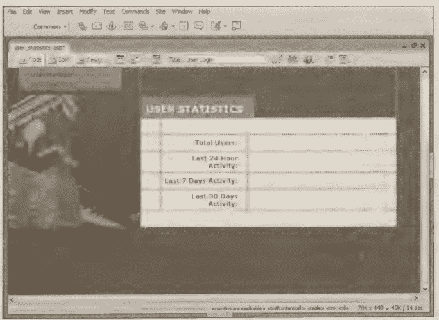

### 步骤 2：添加数据库组件

尽管我们实际上是在为应用程序页面添加一个非常强大的功能，但 Dreamweaver 允许我们将其作为标准记录集插入。以下是我们将要使用的 Access 视图背后的 SQL：

```sql
SELECT (SELECT Count([UserID]) FROM Users WHERE ((([))), etc. -1))) AS RegToday, (SELECT Count([UserID]) FROM Users AS RegThisWeek, (SELECT Count([UserID]) FROM Users AS RegThisMonth, Count([UserID]) AS UserCount FROM Users;
```

尽管视图很复杂，但在 Dreamweaver 中实现此功能对于 ASP 和 ColdFusion 来说非常简单。由于 PHP 不支持视图，因此需要在高级记录集对话框中直接添加记录集。

#### 适用于 ASP 和 ColdFusion

1. 从“绑定”面板中，选择添加（+）并选择**记录集**。
2. 确保你处于简单模式。
3. 在“名称”字段中，输入记录集的标签。

   - 输入 `UserStats` 作为记录集名称。

4. 从“连接”列表中，选择所需的数据源连接。

   - 从“连接”列表中选择 `Recipes`。

5. 选择包含用户信息的适当表格。

   - 从“表格”列表中选择 `UserRegStats`。

6. 在“列”下选择**全部**选项。

无需进行筛选或排序；这都在 SQL 语句中处理。

7. 单击“确定”确认选择并关闭对话框。

#### 适用于 PHP

1. 从“绑定”面板中，选择添加（+）并选择**记录集（查询）**。
2. 如有必要，切换到记录集对话框的高级视图。
3. 输入记录集的名称。

   - 在“记录集”字段中输入 `UserStats`。

4. 选择你的数据源。

   - 从“连接”列表中选择 `Recipes`。

5. 在 SQL 区域中输入以下代码：

```sql
SELECT
    SUM(UserRegDate > NOW() - INTERVAL 24 HOUR) AS RegToday,
    SUM(UserRegDate > NOW() - INTERVAL 7 DAY) AS RegThisWeek,
    SUM(UserRegDate > NOW() - INTERVAL 30 DAY) AS RegThisMonth,
    COUNT(UserID) AS UserCount
    FROM
    Users
```

6. 保存页面。

### 第 3 步：显示用户统计信息

接下来只需显示记录集的结果。这只需将动态元素拖放到指定位置即可。

1. 在 Bindings 面板中，展开 `UserStats` 记录集。

2. 将以下动态元素拖动到页面上：

   - 将 `UserCount` 字段拖动到标签“Total Users”旁边的单元格中。
   - 将 `RegToday` 字段拖动到标签“Last 24 Hour Activity”旁边的单元格中。
   - 将 `RegThisWeek` 字段拖动到标签“Last 7 Days Activity”旁边的单元格中。
   - 将 `RegThisMonth` 字段拖动到标签“Last 30 Days Activity”旁边的单元格中。

   完成后，页面将类似于图 r1-26 所示。

3. 使用适合您平台的文件扩展名，将页面保存为 `userstatistics`。

您的用户登录应用程序现已完成。请务必分别以用户和管理员身份测试所有相关页面。

# 食谱 1：用户登录

## 食谱 2：员工查找

真正推动 Web 发展的杀手级应用是什么？是一个名为 YAHOO! 的易于使用但功能强大的搜索引擎。为网站添加搜索功能是服务端最常见的目标之一。同样，内联网的主要工作利器之一通常是专用搜索引擎：员工查找应用程序。能够快速高效地在组织中找到某人是关键。

搜索引擎的功能和实现从非常简单到非常高级不等。最基本的搜索功能——检查单个数据源字段中的单词或短语——很容易创建；您可以在 Macromedia Dreamweaver 中使用简单的记录集对话框即可完成。然而，任何使搜索功能更强大的尝试，例如添加搜索多个字段或包含多个关键词的能力，都会显著增加编码复杂性。


员工查找应用程序包含两种搜索示例：一种相对简单，另一种更为高级。然而，两者都比基本搜索例程更进一步，因为这些食谱功能允许用户搜索多个关键词。除了两个搜索页面外，该应用程序还包括一个功能强大的结果页面，真正的搜索功能就在此编写代码。结果页面利用 Dreamweaver 的应用程序对象进行记录集导航，并提供指向相应详细页面的链接。

## 用户食谱

## 管理员食谱

从详细页面，用户可以选择更新他们的记录；此功能可以轻松限制为管理员。两个相互关联的管理页面——“新职位”和“新员工”——完善了该应用程序。多个页面使用复杂的 SQL 技术——包括运行时 `WHERE` 子句和嵌套 SQL 语句——以向用户的搜索条件显示有意义的结果。

## 食材

7 个应用程序页面：

- 5 个用户页面
  - 员工搜索
  - 高级员工搜索
  - 员I结果
  - 员工详细信息
  - 更新员工
- 2 个管理页面
  - 新职位
  - 新员工

2 个数据源：

- 1 个数据库，包含：
  - 3 个表
    - `Employees`——核心员工数据表，包含名字、姓氏、职位、电子邮件地址、电话号码、手机号码和工位号字段。
    - `Departments`——组织中所有部门的列表。
    - `Jobs`——每个当前职位名称，包含用于识别相应部门和管理者的字段；所有职位，无论目前是否有人担任，均在此列出。
  - 3 个视图（ASP 和 ColdFusion）
    - `EmployeeLookup`——连接 `Employees`、`Jobs` 和 `Departments` 表的虚拟表。
    - `JobsWithDepartments`——组合列表，显示每个职位及其匹配的部门，以括号括起。
    - `ManagersByDepartment`——仅显示按部门排序的管理者。

## 准备工作

在开始构建此应用程序之前，请确保您已完成准备工作。

1. 创建包含必要表的数据源。
   - ASP 和 ColdFusion 用户应使用下载文件中的 `Recipes.mdb` 数据源，而 PHP 用户应使用 `Recipes` 数据源。如需有关查找和安装这些文件的帮助，请选择 **Help > Web Application Recipes**。
2. 设置到数据源的连接。如果您不确定如何操作，请参阅第 1 章的“Connecting to Data Sources”部分。
   - 将连接命名为 `Recipes`。
3. 创建用于应用程序的模板。
   - 使用针对您服务器模型的名为 `employeelookup` 的模板。
4. ColdFusion 用户：创建 `Application.cfm` 文件，并将其存储在应用程序所在的同一文件夹中。

## 最终用户食谱：员工搜索

搜索应用程序有两个关键部分：输入表单和结果页面。通常，输入表单很少或根本不使用服务器端代码；其唯一功能是接受搜索条件并将值传递给实际执行搜索操作的结果页面。我们的第一个食谱描述了如何创建这样的输入表单页面。

### 食谱 2：员工查找

#### 第 1 步：实现员工搜索设计

首先，创建带有搜索条件表单的基本页面。

1. 创建基本动态页面，可以手动创建，也可以基于模板创建。
   - 在 `EmployeeLookup` 文件夹中，找到您服务器模型对应的文件夹，然后打开其中的 `employee_search` 页面。
2. 在页面内容区域添加表格，以容纳应用程序的界面元素。
   - 从 Snippets 面板中，将 `Recipes > EmployeeLookup > Wireframes > Employee Search - Wireframe` 代码片段拖放到 Content 可编辑区域中。
3. 在表格中，插入表单和员工登录所需的表单元素。您需要一个文本字段来存放关键词，以及一个 Submit 按钮。
   - 将光标放在“EMPLOYEE SEARCH”字样下方的行中，然后插入 `Recipes > EmployeeLookup > Forms > Employee Search - Form` 代码片段 [r2-1]。
4. 保存页面，然后继续。

大多数单字段搜索应用程序的示例都针对特定的数据源字段，例如姓氏。我们的应用程序能够使用 AND 或 OR 运算符跨多个字段进行搜索；实现此功能的代码将插入到搜索结果页面中。简单搜索表单还包括一个指向高级搜索功能的链接。

##### 第 2 步：指定表单操作和方法

搜索页面上的 `<form>` 标签包含搜索条件的传输目标和方式。这两个属性都可以通过 Dreamweaver 的 Property inspector 进行设置。

1. 在 Design 视图或 Code 视图中，将光标放在表单内的任意位置。
2. 从 Tag Selector 中，选择 `<form>` 标签。
3. 在 Property inspector 上，输入搜索结果页面的路径。
   - 选择 Browse，然后为您服务器模型选择 **employee_results** 文件。
4. 确保 Method 设置为 GET，而非 POST 或 Default。

   此处我们使用 GET——它依赖 URL 参数来传递参数——以便正确导航记录集。导航功能位于该应用程序的其他页面中，从 URL 读取传递的参数并相应地筛选记录集。

5. 保存页面。

您会注意到此处未应用任何数据验证；我们甚至没有要求搜索字段必须填写。为什么？在这种情况下，我们希望允许返回所有记录，而空白搜索字段表示完全开放的筛选条件。

## 最终用户食谱：员工高级搜索

*高级搜索*无处搜索，高级搜索页面的目标是允许用户搜索一个或多个特定的数据源字段。除了标准文本字段外，*Advanced Search* 页面还包括一个动态列表，该列表将绑定到员工位置列表。

#### 第 1 步：实现员工搜索设计

首先，创建带有搜索条件表单的页面。

1. 创建基本动态页面，可以手动创建，也可以基于模板创建。
   - 在 **EmployeeLookup** 文件夹中，找到您服务器模型对应的文件夹，然后打开其中的 `employee_search_advanced` 页面。
2. 在页面内容区域添加表格，以容纳应用程序的界面元素。
   - 从 Snippets 面板中，将 **Recipes > EmployeeLookup > Wireframes > Employee Advanced Search - Wireframe** 代码片段拖放到 Content 可编辑区域中。
3. 在表格中，插入用户登录所需的表单和必要的表单元素。对于高级搜索，你需要为每个想要搜索的数据源字段提供一个文本字段或列表，以及一个提交按钮。对于那些有固定值集的数据源使用列表，对于可能包含任意文本字符串的数据源使用文本字段。在我们的示例中，有五个文本字段和一个列表元素。

> 将光标放在 ADVANCED SEARCH 文字下方的行中，然后通过 `Recipes > EmployeeLookup > Forms > Employee Advanced Search - Form` 插入代码片段 [r2-2]。

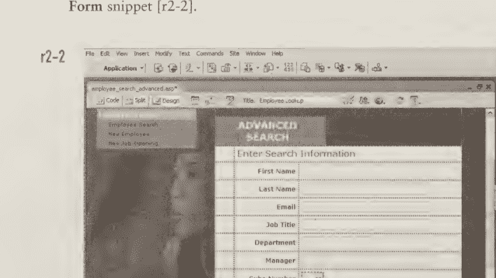

4. 务必保存页面。

同样，不会应用任何数据验证，以允许进行完整结果搜索。

## 步骤 2：添加数据库组件

上一步插入的列表元素需要数据源来填充。在此步骤中，我们将添加一个记录集，其中包含正在使用的小隔间列表。由于小隔间编号可能被多次使用——在困难时期，我们的一些员工不得不共享办公空间——因此使用高级 SQL 语句来确保每个值只出现一次。

### 终端用户教程：员工高级搜索

1. 在“绑定”面板中，选择**添加 (+)**，然后选择**记录集 (Recordset)**。

> 虽然我们只添加一个记录集，但如果你有多个列表元素，可能需要多个记录集，每个列表一个。

2. 如有必要，切换到高级记录集对话框 **[r2-3]**。

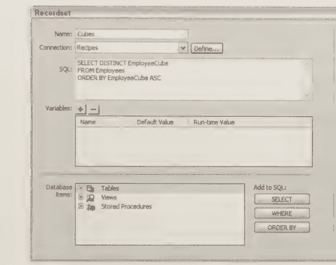

`r2-3`

3. 在“名称”字段中，输入与相应列表关联的标签。
   - 在“名称”字段中输入 **Cubes**。
4. 从列表中选择数据源连接。
   - 从“连接”或“数据源”列表中选择 **Recipes**。
5. 仅限 ColdFusion：如有必要，在相应的字段中输入用户名和密码。
6. 在 SQL 字段中，根据你的服务器模型输入以下代码：

```sql
(VB | JS | CF) 
SELECT DISTINCT EmployeeCube 
FROM Employees 
ORDER BY EmployeeCube ASC
```

```sql
(PHP) 
SELECT DISTINCT EmployeeCube 
FROM employees 
ORDER BY employeeCube ASC
```

**DISTINCT** 关键字是一个 SQL 指令，强制只返回唯一的值。

7. 确保设置正确，然后点击“确定”关闭对话框并插入记录集。

## 步骤 3：数据绑定过程

定义记录集后，我们就可以用它来主要填充页面上的动态列表元素。我说*主要*是因为 Dreamweaver 允许我们在列表控件中混合使用动态和静态元素。我们将利用这一功能来允许使用通配符类型的值。

1. 选择要分配动态值的列表元素。
   - **选择 `CubeNumber` 列表元素。**
2. 从属性检查器中，选择“动态 (Dynamic)”。
   - “动态列表/菜单”对话框出现 [r2-4]。

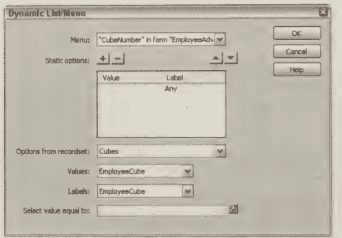

3. 确保在“菜单”列表中选择了 **CubeNumber** 列表元素。
4. 选择添加 (+)，将“值”列留空，在“标签”列中输入 **Any**。

动态列表元素中的静态值显示在选项列表的顶部。“值”列留空，这样选择 Any 时不会设置限制筛选条件。

5. 从“来自记录集的选项”列表中，选择 **Cubes**。
6. 将“值”和“标签”列表都设置为 **EmployeeCube**。

由于员工小隔间没有单独的标识标签，因此“值”和“标签”使用相同的数据源。

7. 将“选取值等于”字段留空，然后点击“确定”关闭对话框。

将“选取值”字段留空后，列表顶部的项目——在本例中是标签为 Any 的静态值——成为默认选择。

#### 步骤 4：指定表单操作和方法

与简单搜索表单一样，我们需要建立正确的操作——即实际处理搜索请求的页面——和方法——即该页面接收数据的方式。

1. 在设计视图或代码视图中，将光标放在表单内的任意位置。
2. 从标签选择器中，选择 `<form>` 标签。
3. 在属性检查器中，输入搜索结果页的路径。
   - **选择“浏览”并为你的服务器模型选择 `employee_results` 文件。**
4. 确保方法设置为 GET 而非 POST 或默认。

选择 GET 方法会导致搜索条件和其他表单相关信息以查询字符串的形式附加到 URL 中，如下所示：

```text
employee_results.asp?FirstName=&LastName=lowery&Email=&JobTitle=&Department=&Manager=&CubeNumber=&AdvancedSearch=Search
```

记录集导航需要使用 GET 而非 POST，因为 POST 对表单条目的编码方式与 GET 不同。请注意，在我们的示例中，只有 `LastName` 变量有值——lowery——而这正是我们接下来要构建的页面将要搜索的内容。

### 终端用户教程：员结果页面

员工结果页面是此应用程序的核心——也是其智能所在。这里包含了接受搜索条件和返回匹配记录的精简列表的功能。列表中的每条记录都链接到一个详细页面。此结果页面旨在处理来自简单搜索和高级搜索的输入，并包含特殊的手写函数。

### 步骤 1：实现设计

我们首先创建用于承载动态内容的基本页面。虽然会有用于记录集和其他导航的交互元素，但结果页面不需要表单。

1. 创建基本动态页面，可以手动创建或从模板派生。
   - 在 `EmployeeLookup` 文件夹中，找到你的服务器模型文件夹，然后打开其中的 `employee_results` 页面。

## 教程 2：员工查找

2. 在页面的内容区域添加一个表格，以容纳应用程序的界面元素。

   从“代码片段”面板中，将 `Recipes > EmployeeLookup > Wireframes > Employee Results - Wireframe` 代码片段拖到“内容”可编辑区域中。

3. 在表格中，嵌套另一个 HTML 表格以显示员工搜索查询的结果。结果列表应为每个要显示的字段设置一列；我们的示例表格有四列这样的字段。嵌套表格还应包含一行用于记录集导航链接和状态的内容。

   将光标放在 EMPLOYEE RESULTS 文字下方的行中，然后插入 `Recipes > EmployeeLookup > ContentTables > Employee Results - Content Table` 代码片段 [r2-5]。

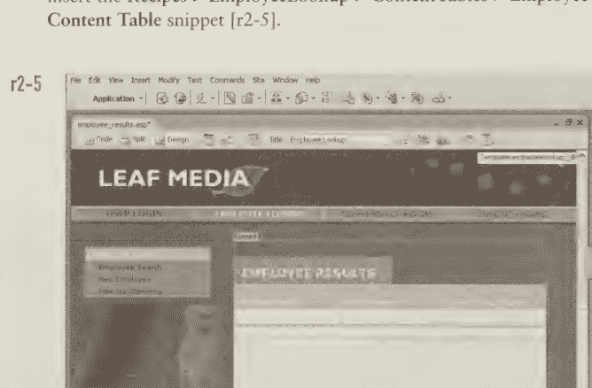

## 步骤 2：添加数据库组件

虽然此页面中只使用了一个记录集，但它非常强大——与其说是它本身的功能，不如说是它带来的可能性。在记录集中，SQL 语句的 `WHERE` 子句设置为一个名为 `WhereParam` 的运行时变量。如你稍后所见，`WhereParam` 变量使 SQL 筛选条件能够根据用户输入动态生成。

#### 适用于 ASP

1. 在“绑定”面板中，选择添加 (+)，然后从列表中选择**记录集 (Recordset)**。
2. 如有必要，切换到高级记录集对话框 [r2-6]。

> 为了适应各种服务器模型的不同对话框，此处以及本教程中必要时将分别介绍各步骤。

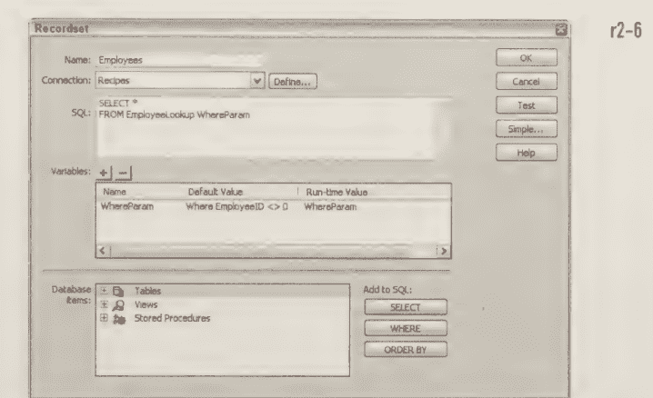

3. 输入记录集的适当名称。
   - 在“名称”字段中输入 **Employees**。
4. 从列表中选择适当的连接。
   - 从“连接”列表中选择 **Recipes**。
5. 在 SQL 字段中，插入以下代码：

```sql
SELECT *
FROM EmployeeLookup WhereParam
```

请注意，变量 `WhereParam` 替代了整个 `WHERE` 子句，包括关键字。

6. 在“变量”部分，选择添加 (+)，然后在“名称”列中输入 **WhereParam**。
7. 在“默认值”列中，输入以下内容：

```sql
Where EmployeeID <> 0
```

由于没有任何员工的 ID 设置为 0，因此默认情况下——如果没有输入搜索条件——记录集将返回所有记录。

8. 在“运行值”列中，输入 `WhereParam`，然后单击“确定”关闭对话框并插入记录集。
9. 保存页面。

#### ColdFusion 部分

1. 在“绑定”面板中，单击加号（+）按钮，然后选择**记录集**。
2. 在高级记录集对话框中，输入记录集的适当名称。

   在“名称”字段中输入 **Employees**。

3. 从下拉列表中选择数据源。

   从“数据源”列表中选择 **Recipes**。

4. 如有必要，在相应字段中输入数据源的用户名和密码。
5. 在 SQL 区域中，输入以下代码：

```sql
Select *
FROM EmployeeLookup WhereParam
```

6. 验证代码，然后单击“确定”关闭对话框并插入记录集。
7. 保存页面。

#### PHP 部分

为了弥补 MySQL 不支持视图的缺陷，暂时用相关数据填充 `EmployeeLookup` 表。然后，员工记录集在运行时从此表中检索数据。创建员工记录集后，临时信息将从 `EmployeeLookup` 表中清除，自动编号控制也会重置。

要在 Dreamweaver 中构建正确的应用程序，您需要先创建员工记录集，然后插入 `EmployeeLookup` 表的代码。

1. 在“绑定”面板中，单击加号（+）按钮，然后从列表中选择**记录集**。
2. 如有必要，切换到高级记录集对话框。
3. 输入记录集的适当名称。

   在“名称”字段中输入 **Employees**。

4. 从列表中选择合适的连接。

   从“连接”列表中选择 **Recipes**。

5. 在 SQL 字段中，插入以下代码：

```sql
Select *
FROM EmployeeLookup WhereParam
```

请注意，使用 `WhereParam` 变量替代了整个 `WHERE` 子句，包括关键字。

6. 在“变量”部分，单击加号（+）按钮，然后在“名称”列中输入 **WhereParam**。
7. 在“默认值”列中，输入：

```sql
Where EmployeeID <> 0
```

由于没有任何员工的 ID 设置为 0，因此默认情况下——如果没有输入搜索条件——记录集将返回所有记录。

8. 在“运行值”列中，输入 **$WhereParam**，然后单击“确定”关闭对话框并插入记录集。
9. 保存页面。

现在，我们准备插入 `EmployeeLookup` 代码。

10. 在“服务器行为”面板中，选择 Employees 记录集。
11. 切换到“代码”视图，您会看到 Employees 记录集代码已高亮显示。
12. 将以下代码包裹在所选代码周围：

   从“代码片段”面板中，插入 **EmployeeLookup > CustomCode_PHP > Temporary Query - EmployeeLookup** 代码片段。

PHP 前置代码：


```php
<?php
mysql_select_db($database_Recipes, $Recipes);
$query_EmployeeLookup = "INSERT INTO employeelookup
SELECT employees_1.EmployeeID, jobs.JobID, jobs.JobTitle,
employees_1.EmployeeFirst, employees_1.EmployeeLast,
departments.DepartmentName, CONCAT(employees.EmployeeFirst, ' ',
employees.EmployeeLast) AS ManagerName, employees_1.EmployeeEmail,
employees_1.EmployeePhone, employees_1.EmployeeMobil,
employees_1.EmployeeCube FROM employees, employees employees_1, jobs,
jobs jobs_1, departments WHERE ((((jobs.JobTypeID = jobs_1.JobID)
AND (jobs.JobDepartment = departments.DepartmentID))
AND (employees.EmployeeJob = jobs_1.JobID))
AND (employees_1.EmployeeJob = jobs.JobID))";
mysql_query($query_EmployeeLookup,$Recipes);
?>
```

后置代码：

```php
<?php
$query_EmployeeLookup = "DELETE FROM employeelookup";
mysql_query($query_EmployeeLookup,$Recipes);
?>
```

13. 保存页面。

> 当您向表格中添加动态文本时，表格会变宽以适应字段名称。Dreamweaver 使用以下语法显示动态文本：`{recordset.datasourcefield}`。因此，动态文本名称可能会变得相当长，从而显著扭曲表格。不过，这种扭曲通常会在显示真实数据后消失。如果您不想看到完整的记录集和字段名称，请打开“首选参数”，在“不可见元素”类别中，将“将动态文本显示为”选项改为 `{}`。

## 步骤 3：数据绑定过程

定义记录集后，页面上可以插入动态文本。在我们的示例中，五个数据源字段将放置在四个表头下方：姓名、电子邮件、直线电话和手机。其中两个数据源 `EmployeeFirst` 和 `EmployeeLast` 将合并显示在“姓名”标题下。

1. 在“绑定”面板中，展开 `Employees` 记录集。

2. 将所需的数据源字段放置到页面上：

   - 将 `EmployeeFirst` 字段拖到“姓名”列下方。
   - 将 `EmployeeLast` 字段拖到 `EmployeeFirst` 字段之后，并在两个动态文本元素之间添加一个空格。您可能会发现，将光标放在希望姓氏出现的位置，然后使用“绑定”面板上的“插入”按钮会更方便。
   - 将 `EmployeeEmail` 字段拖到“电子邮件”列下方。
   - 将 `EmployeePhone` 字段拖到“直线电话”列下方。
   - 将 `EmployeeMobile` 字段拖到“手机”列下方。

完成后，通过从“文档”工具栏选择“实时数据”视图来测试布局。第一条记录的数据将出现 [r2-7]。如有必要，通过拖动单元格边框来调整表格的列间距。

## 步骤 4：应用服务器行为

虽然此页面上没有用户输入，但仍存在相当程度的交互性。此处返回的记录集可能包含从一名员工到公司所有员工的数据，因此我们必须能够以可管理的方式呈现这些结果。为此，您可以插入 Dreamweaver 的“重复区域”服务器行为，以每组 10 条记录的形式显示结果。接下来，您可以为每条记录添加指向详细页面的链接。

首先，让我们添加“重复区域”以显示多条记录。

1. 将光标放在包含动态数据的任意表格单元格中。

2. 在“标签选择器”中，选择位于当前 `<td>` 标签外层的 `<tr>` 标签。

3. 在“服务器行为”面板中，单击加号（`+`）按钮，然后从列表中选择“重复区域”。

4. 在“重复区域”对话框中，确保已选择 `Employees` 记录集。

5. 接受默认设置“每次显示 10 条记录”，单击“确定”关闭对话框。

切换到“实时数据”视图，查看数据源中前 10 名员工的信息 [r2-8]。由于没有向此页面传递搜索条件，因此使用 `WhereParam` 变量的默认值来筛选记录集——您应该还记得，该变量设置为接收所有员工。

## 方法 2：员工查询

> 注意：经过一些测试后，您可能会决定以某种方式调整表格或其单元格，例如为某些单元格选择“不换行”选项或修改单元格内边距。当您不在“实时数据”视图中工作时，任何此类格式更改都不会贯穿整个重复区域，直到单击“实时数据”工具栏上的“刷新”图标。或者，您可以通过退出并重新进入“实时数据”视图来刷新显示。

要添加到此页面的最后一个服务器行为为用户提供了一种查看员工记录完整详细信息的方式。

1. 选择要作为详细页面链接的动态文本元素。

   - 选择 `EmployeeFirst` 和 `EmployeeLast` 动态文本字段。最可靠的方法是先选择一个（选择哪一个并不重要），然后按住 Shift 键选择第二个；这将高亮显示两个字段以及它们之间的空格。

2. 在“属性检查器”中，选择“链接”字段旁边的文件夹图标。

3. 在“选择文件”对话框中，选择 `Parameters`。

4. 在“参数”对话框中，输入变量名称。

   - 在“名称”列中，输入 `ID`。

5. 输入动态值。

   - 在“值”列下，选择闪电图标以打开“动态数据”对话框，然后从 `Employees` 记录集中选择 `EmployeeID`。
   - 单击“确定”一次以关闭“动态数据”对话框，再次单击以关闭“参数”对话框。

6. 选择要传递参数的文件。

   - 选择“浏览”，然后为您的服务器模型选择 `employee_detail` 文件。

7. 保存页面。

## 步骤 5：添加应用程序对象

为了让用户能够逐页浏览记录并了解当前位置，接下来我们将添加记录集导航工具。Dreamweaver 的“记录集导航条”和“记录集导航状态”应用程序对象用于分页浏览和跟踪记录。

1. 将光标放在员工结果表格中您希望导航链接出现的位置。

   - 将光标放在“直线电话”单元格上方的行中。

2. 从“插入”栏“应用程序”类别下的“记录集分页”菜单中选择“记录集导航条”对象。

   或者，您可以选择“插入”>“应用程序对象”>“记录集分页”>“记录集导航条”。

3. 在“记录集导航条”对话框中，选择 `Employees` 记录集。

4. 保持“显示方式”选项设置为“文本”，单击“确定”。

在记录集中分页浏览时，有一些反馈信息说明您在数据中的位置会很有帮助。Dreamweaver 包含另一个应用程序对象，称为“记录集导航状态”，用于提供此类反馈。

1. 将光标放在员工结果表格中您希望显示导航状态的位置。

   同样，注意不要将光标放在“重复区域”内。

   - 将光标放在“员工姓名”单元格上方的行中。

2. 从“插入”栏“应用程序”类别中的“显示记录计数”菜单中选择“记录集导航状态”对象。

   或者，您可以选择“插入”>“应用程序对象”>“显示记录计数”>“记录集导航状态”。

3. 在“记录集导航状态”对话框中，选择 `Employees` 记录集，然后单击“确定”。

要获得记录集导航控制的完整效果，请在浏览器中预览页面 [r2-9]。

## 配方 2：员工查询

### 步骤 6：代码搜索函数

页面的基础设施已经完成，现在是时候添加核心功能了。正如您所见，该页面的记录集使用一个变量 `WhereParam` 来表示 SQL 语句的整个 `WHERE` 子句。我们现在将插入函数——一个用于简单搜索，一个用于高级搜索——这些函数是动态构建 `WhereParam` 所必需的。为简化编码，两个函数都使用第三个自定义函数 `AddFieldToSearch()`，顾名思义，该函数一次构建一个请求字段的搜索过滤器。最后，为了将自定义代码完全集成到 Dreamweaver 的服务器行为输出中，我们将添加几个函数调用。

> 您可能希望将记录集导航状态对象整个包裹在条件区域中，方法是应用“如果记录集不为空则显示区域”服务器行为。此技巧可在找不到匹配搜索条件的记录时隐藏状态文本。

> 此步骤仅对 ASP 和 PHP 是必需的；对于 ColdFusion，功能是在记录集内部插入的。

为确保我们的辅助函数 `AddFieldToSearch()` 可用，我们将首先添加它。

1. 在“代码”视图中，将光标放在文件顶部，ASP 的 `<!--#include>` 语句之后或 PHP 的 `<?php require_once...>` 之后的新行上。

2. 插入以下代码：从“代码片段”面板中，打开适合您服务器模型的 `Recipes > EmployeeLookup > Custom Code` 文件夹，插入“Add Field to Search”片段。

```vb
VB
<%
AddFieldToSearch(CurrentWhere,ColumnName,渐渐的,Comparison,Separator,OpenEncap,CloseEncap)
if (ValString <> "") then
    if (CurrentWhere = "") then
        CurrentWhere = "WHERE "
    else
        CurrentWhere = CurrentWhere & " " & Separator & " "
    end if
    CurrentWhere = CurrentWhere & ColumnName & " " & Comparison & " " & OpenEncap & Replace(ValString, "'", "''") & CloseEncap
end if
AddFieldToSearch = CurrentWhere
end function
%>
```

```javascript
JS
<%
function AddFieldToSearch(CurrentWhere,ColumnName,ValString,Comparison,Separator,OpenEncap,CloseEncap) {
    if (ValString!="") {
        if (CurrentWhere == "") {
            CurrentWhere = "WHERE ";
        }
        else {
            CurrentWhere += " " + Separator + " ";
        }
        CurrentWhere += ColumnName + " " + Comparison + " " + OpenEncap + ValString.replace(/'/g, "''") + CloseEncap;
    }
    return CurrentWhere;
}
%>
```

```php
PHP
<?php
function AddFieldToSearch($CurrentWhere,$ColumnName,$ValString,$Comparison,$Separator,$OpenEncap,$CloseEncap) {
    if ($ValString!="") {
        if ($CurrentWhere == "") {
            $CurrentWhere = "WHERE ";
        } else {
            $CurrentWhere.= " ".$Separator." ";
        }
        $CurrentWhere.= $ColumnName." ".$Comparison.
            " ".$OpenEncap.$ValString.$CloseEncap;
    }

    return $CurrentWhere;
}
?>
```

本质上，此函数接受来自简单搜索和高级搜索函数的参数，并动态构建 `WHERE` 子句的一段。第一次调用此函数时，会添加 `WHERE` 关键字；之后每次调用时，都会追加 `OR` 运算符。接下来，构建新段落并将其添加到现有的 `WHERE` 子句中。`ValString` 参数在使用简单搜索时是关键词数组，在使用高级搜索时则是来自特定表单字段（姓名、部门等）的值。

接下来，我们将添加简单搜索函数。在此函数中，从简单搜索页面传递的查询字符串被放入一个数组中，以便可以逐词比较每个关键词与每个所需字段的比较。用于比较的字段在编程循环中设置；您可以通过遵循 `AddFieldToSearch()` 函数调用的语法并添加数据字段名称来添加其他字段。

1. 在“代码”视图中，将光标放在适合您服务器模型的位置。

```vb
AddFieldToSearch = CurrentWhere
end function
%>
```

```javascript
return CurrentWhere;
}
%>
```

```sql
SELECT * FROM EmployeeLookup
```

**PHP** 将光标放在刚刚插入的 `AddFieldToSearchFunction()` 之后。该函数的最后三行如下：

```php
    return $CurrentWhere;
}
?>
```

2. 插入以下代码：

   从“代码片段”面板中，打开适合您服务器模型的 `Recipes > EmployeeLookup > Custom Code` 文件夹，并插入“Create Simple Keyword Search”片段。

```vb
<%
dim WhereParam, Keywords, x
if (cStr(Request.QueryString("SimpleSearch"))<>"") then
  WhereParam = ""
  KeyWords = cStr(Request.QueryString("SearchKeywords"))
  if (KeyWords <> "") then
    KeyWords = Split(KeyWords, " ")
    for x=0 to Ubound(KeyWords)
      WhereParam = AddFieldToSearch(WhereParam,"EmployeeFirst",
      KeyWords(x),"LIKE","OR","'%","%'")
      WhereParam = AddFieldToSearch(WhereParam,"EmployeeLast",
      KeyWords(x),"LIKE","OR","'%","%'")
      WhereParam = AddFieldToSearch(WhereParam,"EmployeeEmail",
      KeyWords(x),"LIKE","OR","'%","%'")
      WhereParam = AddFieldToSearch(WhereParam,"JobTitle",
      KeyWords(x),"LIKE","OR","'%","%'")
    next
  end if
end if
%>
```

```javascript
<%
if (String(Request.QueryString("SimpleSearch"))!="undefined") {
  var WhereParam = "";
  var KeyWords = String(Request.QueryString("SearchKeywords"));
  if (KeyWords != "") {
    KeyWords = KeyWords.split(" ");
    for (var x=0; x<KeyWords.length; x++) {
      WhereParam = AddFieldToSearch(WhereParam,"EmployeeFirst",
      KeyWords[x],"LIKE","OR","'%","%'");
      WhereParam = AddFieldToSearch(WhereParam,"EmployeeLast",
      KeyWords[x],"LIKE","OR","'%","%'");
      WhereParam = AddFieldToSearch(WhereParam,"EmployeeEmail",
```

```javascript
KeyWords[x],"LIKE","OR","'%","%'");
WhereParam = AddFieldToSearch(WhereParam,"JobTitle",
KeyWords[x],"LIKE","OR","'%","%'")
```

```coldfusion
<cfif isDefined("URL.SimpleSearch") AND URL.SimpleSearch NEQ "">
WHERE EmployeeID = 0
<cfloop index="kWord" list="#URL.SearchKeywords#" delimiters=" ">
OR EmployeeFirst LIKE '%#kWord#%' OR EmployeeLast
LIKE '%#kWord#%' OR EmployeeEmail
LIKE '%#kWord#%' OR JobTitle LIKE '%#kWord#%'
</cfloop>
</cfif>
```


```php
<?php
if (isset($_GET['SimpleSearch'])) {
    $WhereParam = "";
    if (isset($_GET['SearchKeywords'])) {
        $KeyWords = explode(" ", $_GET['SearchKeywords']);
        for ($x = 0; $x < count($KeyWords); $x++) {
            $WhereParam = AddFieldToSearch(
                $WhereParam,
                "EmployeeFirst",
                $KeyWords[$x],
                "LIKE",
                "OR",
                "'%",
                "%'"
            );
            $WhereParam = AddFieldToSearch(
                $WhereParam,
                "EmployeeLast",
                $KeyWords[$x],
                "LIKE",
                "OR",
                "'%",
                "%'"
            );
            $WhereParam = AddFieldToSearch(
                $WhereParam,
                "EmployeeEmail",
                $KeyWords[$x],
                "LIKE",
                "OR",
                "'%",
                "%"
            );
            $WhereParam = AddFieldToSearch(
                $WhereParam,
                "JobTitle",
                $KeyWords[$x],
                "LIKE",
                "OR",
                "'%",
                "%'"
            );
        }
    }
}
?>
```

简单搜索函数使用服务器对象（ASP 中的 `QueryString`，ColdFusion 中的 `URL`，以及 PHP 中的 `$_GET`）从搜索页面获取信息。这是可行的，因为我们将 `<form>` 标签的 `method` 属性设置为 `GET` 而非 `POST`。这种技术在这里效果很好，因为查询参数不太可能很长。对于复杂的表单，最好使用 `POST` 方法。

ColdFusion 用户应注意，在 `<cfquery>` 标签内插入此代码块（以及高级搜索的代码块）会禁用 Dreamweaver 在“绑定”面板中对记录集的识别。实施后，您无法展开记录集以及 `.FullQuery` 标签。虽然这可能看起来有些不便，但这是使用 CFML 标签而不使用 `<cfscript>` 编写此函数的首选方式。

此部分代码处理使用高级搜索页面查找员工业绩的情况。SQL 变量 `WhereParam` 是通过将高级搜索页面上输入的任何文本提取到单个查询字符串中构建的。`AddFieldToSearch()` 函数的使用提供了一种构建查询字符串的简单机制。

接下来，我们将添加高级搜索函数。此代码也使用 `AddFieldToSearch()` 函数来帮助构建 `WHERE` 子句，但在这里——与简单搜索不同——您可以在任何指定字段中使用 `AND` 或 `OR` 运算符组合关键词。例如，用户可以查找销售部门或市场部门的 Smith 或 Jones。

1. 在“代码”视图中，将光标放在刚刚插入的简单搜索代码块之后。该代码块的最后三行如下：

```text
end if
    end if
%>
```

```text
}
}
%>
```

```text
LIKE '%#kWord#%' OR JobTitle LIKE '%#kWord#%'
    </cfloop>
</cfif>
```

```text
}
}
?>
```

## 方法 2：员工查询

2. 插入以下代码：

从“代码片段”面板中，打开适用于你的服务器模型的 `Recipes > EmployeeLookup > Custom Code` 文件夹，然后插入“高级关键字搜索”代码片段。

```vb
if (cStr(Request.QueryString("AdvancedSearch")) <> "") then
  WhereParam = ""
  WhereParam = AddFieldToSearch(WhereParam, "EmployeeFirst", cStr(Request.QueryString("FirstName")), "LIKE", "AND", "'", "%'")
  WhereParam = AddFieldToSearch(WhereParam, "EmployeeLast", cStr(Request.QueryString("LastName")), "LIKE", "AND", "'", "%'")
  WhereParam = AddFieldToSearch(WhereParam, "EmployeeEmail", cStr(Request.QueryString("Email")), "LIKE", "AND", "'%", "%'")
  WhereParam = AddFieldToSearch(WhereParam, "JobTitle", cStr(Request.QueryString("JobTitle")), "LIKE", "AND", "'%", "%'")
  WhereParam = AddFieldToSearch(WhereParam, "DepartmentName", cStr(Request.QueryString("Department")), "LIKE", "AND", "'", "%'")
  WhereParam = AddFieldToSearch(WhereParam, "ManagerName", cStr(Request.QueryString("Manager")), "LIKE", "AND", "'%", "%'")
  WhereParam = AddFieldToSearch(WhereParam, "EmployeeCube", cStr(Request.QueryString("CubeNumber")), "=", "AND'", "", "")
end if
```

```js
if (String(Request.QueryString("AdvancedSearch")) != "undefined") {
  var WhereParam = "";
  WhereParam = AddFieldToSearch(WhereParam, "EmployeeFirst", String(Request.QueryString("FirstName")), "LIKE", "AND", "'", "%");
  WhereParam = AddFieldToSearch(WhereParam, "EmployeeLast", String(Request.QueryString("LastName")), "LIKE", "AND", "'", "%");
  WhereParam = AddFieldToSearch(WhereParam, "EmployeeEmail", String(Request.QueryString("Email")), "LIKE", "AND", "'%", "%");
  WhereParam = AddFieldToSearch(WhereParam, "JobTitle", String(Request.QueryString("JobTitle")), "LIKE", "AND", "'%", "%");
  WhereParam = AddFieldToSearch(WhereParam, "DepartmentName", String(Request.QueryString("Department")), "LIKE", "AND", "'", "%");
  WhereParam = AddFieldToSearch(WhereParam, "ManagerName", String(Request.QueryString("Manager")), "LIKE", "AND", "'%", "%");
  WhereParam = AddFieldToSearch(WhereParam, "EmployeeCube", String(Request.QueryString("CubeNumber")), "=", "AND'", "", "");
}
```

```cfm
<cfif isDefined("URL.AdvancedSearch")>
    WHERE 1 = 1
    <cfif URL.FirstName NEQ "">
        AND EmployeeFirst LIKE '#URL.FirstName#%'
    </cfif>
    <cfif form.LastName NEQ "">
        AND EmployeeLast LIKE '#URL.LastName#%'
    </cfif>
    <cfif form.Email NEQ "">
        AND EmployeeEmail LIKE '%#URL.Email#%'
    </cfif>
    <cfif form.JobTitle NEQ "">
        AND JobTitle LIKE '%#URL.JobTitle#%'
    </cfif>
    <cfif form.Department NEQ "">
        AND DepartmentName LIKE '#URL.Department#%'
    </cfif>
    <cfif form.Manager NEQ "">
        AND ManagerName LIKE '%#URL.Manager#%'
    </cfif>
    <cfif form.CubeNumber NEQ "">
        AND EmployeeCube = #URL.CubeNumber#
    </cfif>
</cfif>
```

```php
<?php
if (isset($_GET['AdvancedSearch'])) {
    $WhereParam = "";
    $WhereParam = AddFieldToSearch(
        $WhereParam,
        "EmployeeFirst",
        $_GET['FirstName'],
        "LIKE",
        "AND",
        "'",
        "%'"
    );
    $WhereParam = AddFieldToSearch(
        $WhereParam,
        "EmployeeLast",
        $_GET['LastName'],
        "LIKE",
        "AND",
        "'",
        "%'"
    );
    $WhereParam = AddFieldToSearch(
        $WhereParam,
        "EmployeeEmail",
        $_GET['Email'],
        "LIKE",
        "AND",
        "'%",
        "%'"
    );
    $WhereParam = AddFieldToSearch(
        $WhereParam,
        "JobTitle",
        $_GET['JobTitle'],
        "LIKE",
        "AND",
        "'%",
        "%'"
    );
    $WhereParam = AddFieldToSearch(
        $WhereParam,
        "DepartmentName",
        $_GET['Department'],
        "LIKE",
        "AND",
        "'",
        "%'"
    );
    $WhereParam = AddFieldToSearch(
        $WhereParam,
        "ManagerName",
        $_GET['Manager'],
        "LIKE",
        "AND",
        "'%",
        "%'"
    );
    $WhereParam = AddFieldToSearch(
        $WhereParam,
        "EmployeeCube",
        $_GET['CubeNumber'],
        "=",
        "AND",
        "'",
        "'"
    );
}
?>
```

## 方法 2：员工查询

高级搜索代码块会遍历高级搜索页面上可能用作条件的每个字段。要自定义该功能，请按照代码语法添加你自己的语句，并替换为自定义字段名称。例如，如果搜索页面包含一个用于电话分机的文本字段，可以添加以下代码：

```vb
WhereParam = AddFieldToSearch(WhereParam, "EmployeeExtension", cStr(Request.QueryString("Extension")), "LIKE", "AND", "", "%'")
```

```js
WhereParam = AddFieldToSearch(WhereParam, "EmployeeExtension", String(Request.QueryString("Extension")), "LIKE", "AND", "%", "%");
```

```cfm
<cfif form.Extension NEQ "">
    AND EmployeeExtension = #URL.Extension#
</cfif>
```

```php
$WhereParam = AddFieldToSearch($WhereParam, "EmployeeExtension", $_GET['Extension'], "LIKE", "AND", "%", "%");
```

### 针对 ASP

以下代码函数仅 ASP 中需要。为了处理 ASP 中 SQL 语句里的单引号，Dreamweaver 通过将每个单引号替换为两个单引号来进行转义，代码如下：

```vb
Replace(Employees__WhereParam, "'", "''")
```

```js
Employees__WhereParam.replace(/'/g, "''")
```

为使动态生成的 `WhereParam` 变量正常工作，我们需要将搜索条件中的任何单引号临时替换为一个在数据中不太可能被使用的字符——在我们的示例中，使用感叹号。该替换在 SQL 语句读取 `WhereParam` 之前进行，并且由于所有单引号都已被替换，Dreamweaver 的替换函数无事可做。然后，作为最后一步，Dreamweaver 将所有感叹号替换回单引号，从而在 SQL 语句执行前恢复正确的字符串。

三个自定义代码块包含了我们所需的功能。第一个代码块包含两个函数：`RemoveQuotes()`，用于将单引号替换为感叹号；以及 `ReturnQuotes()`，执行相反的操作。另外两个代码块分别调用这两个组合拳。我们先插入包含这两个函数的代码块。

1. 将光标放置在高级搜索代码块的下方。

2. 插入此代码：

从“代码片段”面板中，打开适用于你的服务器模型的 `Recipes > EmployeeLookup > Custom Code` 文件夹，然后插入“Quote Handler Function”代码片段。

```vb
<%
function RemoveQuotes(theString)
  RemoveQuotes = Replace(theString, "'", "||")
end function

function ReturnQuotes(theString)
  ReturnQuotes = Replace(theString, "||", "'")
end function
%>
```

```js
<%
function RemoveQuotes(theString) {
  return theString.replace(/'/g, "||");
}

function ReturnQuotes(theString) {
  return theString.replace(/\|\|/g, "'");
}
%>
```

3. 要插入第一个函数调用器，将光标放置在刚刚插入的代码块的下方。

4. 插入以下代码：

从“代码片段”面板中，打开适用于你的服务器模型的 `Recipes > EmployeeLookup > Custom Code` 文件夹，然后插入“Replace Quotes Function”代码片段。

```vb
<%
  Employees__WhereParam = RemoveQuotes(Employees__WhereParam)
%>
```

```js
<%
  Employees__WhereParam = RemoveQuotes(Employees__WhereParam)
%>
```

5. 要插入第二个函数调用器，将光标放置在 Dreamweaver 编码的 SQL 函数内，位于以 `Employees.Source = "SELECT...` 开头的行之后，并添加一个段落回车。

使用 Dreamweaver 的“查找和替换”功能来查找此代码条目。

6. 插入以下代码：

从“代码片段”面板中，打开适用于你的服务器模型的 `Recipes > EmployeeLookup > Custom Code` 文件夹，然后插入“Replace Quotes Function”代码片段。

## 方法 2：员工查询

```vb
Employees.Source = ReturnQuotes(Employees.Source)
```

```js
Employees.Source = ReturnQuotes(Employees.Source);
```

7. 保存文件。

此子程序函数的优点在于，Dreamweaver 可视化界面仍然能够识别并保护用于手动加重编辑的记录集定义代码。

> **无需手写代码即可使用多条件搜索用户**

从本方法中可以看出，创建复杂的搜索功能并非易事。Dreamweaver 的基本主从页面集足以应对简单搜索，但无法处理更复杂的条件，如日期范围或关键字组合。如果你不想——或没有时间——深入到所需程度的手写代码，但仍希望获得更强大的搜索能力，还有另一种途径可供选择。

WebAssist 的 QueryBuilder 可以生成复杂搜索所需的 SQL，与我们的方法类似，但无需手写代码。此外，它与 Dreamweaver 的应用程序对象紧密配合，可在一个操作中构建基本的搜索、结果和详细页面。WA QueryBuilder 有助于缩短实现时间、降低维护成本，并改善用户体验。

要了解有关 WA QueryBuilder 的更多信息，请访问 <http://www.webassist.com/Products/Recipes/WAQueryBuilder.asp>


## 终端用户方法：员工详细信息

如你所见，最终员工结果页面中显示的每个姓名都是指向详细记录的链接——我们将要构建的页面。员工详细页面有两个功能：显示存储在员工记录中的大部分信息，以及提供一个可以更新该信息的页面的链接。

### 步骤 1：实现员工详细设计

首先创建基本页面。

1. 创建一个基本的动态页面，可以手动创建或从模板派生。

   - 在`EmployeeLookup`文件夹中，找到适用于你的服务器模型的文件夹，然后打开其中的`employee_detail`页面。

2. 在页面的内容区域中添加一个表格，以包含应用程序的界面元素。

   - 从“片段”面板中，将`Recipes > EmployeeLookup > Wireframes > Employee Detail - Wireframe`片段拖入“内容”可编辑区域。

3. 在该表格中，嵌套另一个 HTML 表格以显示详细数据及相应的标签。此表格通常为每个字段设置一行、两列，一列用于标签，另一列用于放置动态文本。

   - 将光标置于`EMPLOYEE SEARCH`文字下方的行中，插入`Recipes > EmployeeLookup > ContentTables > Employee Detail - Content Table`片段 [r2-10]。

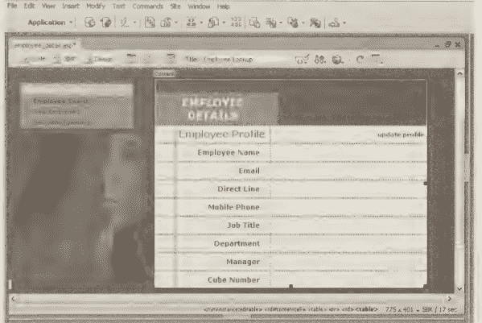

r2-10

### 步骤 2：添加数据库组件

指向此页面的链接会传递一个 URL 参数`ID`。我们现在将使用`ID`参数来筛选记录集，使其仅包含一条记录：即所选员工姓名对应的记录主题的深入理解。

本示例中的记录集基于一个 Access 视图`EmployeeLookup`，该视图合并了来自三个表的数据：`Employees`、`Jobs`和`Departments`。用于创建此视图的 ASP 和 ColdFusion 的 SQL 语句相当复杂，如下所示：

```
SELECT Employees_1.EmployeeID, Jobs.JobID, Jobs.JobTitle,
	Employees_1.EmployeeFirst, Employees_1.EmployeeLast,
	Departments.DepartmentName, [Employees].[EmployeeFirst] &
	' ' & [Employees].[EmployeeLast] AS ManagerName,
	Employees_1.EmployeeEmail, Employees_1.EmployeePhone,
	Employees_1.EmployeeMobil, Employees_1.EmployeeCube
FROM (Employees AS Employees_1 LEFT JOIN (Employees
	RIGHT JOIN (Jobs LEFT JOIN Jobs AS Jobs_1
	ON Jobs.JobManager = Jobs_1.JobID) ON Employees.EmployeeJob =
	Jobs_1.JobID) ON Employees_1.EmployeeJob = Jobs.JobID)
	LEFT JOIN Departments ON Jobs.JobDept = Departments.DepartmentID;
```

#### 方案 2：员工查询

在 PHP 中，等效的 SQL 语句为：

```
SELECT employees_1.EmployeeID, jobs.JobID, jobs.JobTitle,
employees_1.EmployeeFirst, employees_1.EmployeeLast,
departments.DepartmentName, CONCAT(employees.EmployeeFirst,
' ',employees.EmployeeLast) AS ManagerName,
employees_1.EmployeeEmail, employees_1.EmployeePhone,
employees_1.EmployeeMobil, employees_1.EmployeeCube
FROM employees, employees employees_1, jobs, jobs jobs_1,
departments WHERE ((((jobs.JobTypeID = jobs_1.JobID)
AND (jobs.JobDepartment = departments.DepartmentID))
AND (employees.EmployeeJob = jobs_1.JobID))
AND (employees_1.EmployeeJob = jobs.JobID))
```

Dreamweaver 将可用视图与数据源中的表列表一并显示，对于 ASP 和 ColdFusion，你只需选择正确的视图即可。而对于 PHP，则需要额外执行一个变通步骤，这与员工结果页面中使用的方法类似，即临时存储由此 SQL 语句派生的数据。

所有服务器模型都应插入以下记录集。

1. 在“绑定”面板中，选择添加 (+) 并选择**记录集（Recordset）**。

2. 确保显示的是“简单记录集”对话框，并为新记录集指定一个有意义的名称，例如`Employees` [r2-11]。

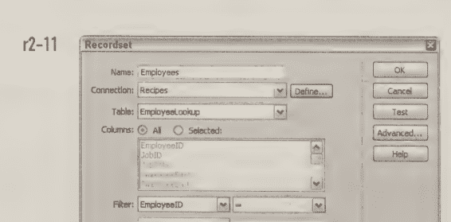

3. 选择指向数据源的连接。

   - 从“连接”或“数据源”列表中选择`Recipes`。

4. 选择包含员工记录详细信息的表。

   - 从“表”列表中选择`EmployeeLookup`（PHP 中为`employeelookup`）。

5. 保持“列”选项设置为“全部”（`All`）。

6. 在记录集对话框的“筛选”区域中，按如下方式设置四个筛选列表元素：

| EmployeeID | =（等于）|
| URL Parameter | ID |

7. 保持“排序”选项设置为“无”（`None`），然后单击**确定**关闭对话框。

#### 对于 PHP

> 尽管此页面和员工结果页面中记录集周围的代码相同，但记录集本身不同，因此你不能将代码从一个页面复制并粘贴到另一个页面。

与之前一样，首先创建`Employees`记录集，然后插入`EmployeeLookup`表的代码。

1. 在“服务器行为”面板中，选择`Employee`记录集。

2. 切换到“代码”视图，你会看到`Employee`记录集代码处于高亮状态。

3. 将以下内容包裹在选定代码的周围：

   - 从“片段”面板中，插入`EmployeeLookup > CustomCode_PHP > Temporary Query - EmployeeLookup`片段。

*修改前：*

```
<?php
mysql_select_db($database_Recipes, $Recipes);
$query_EmployeeLookup = "INSERT INTO employeelookup
SELECT employees_1.EmployeeID, jobs.JobID, jobs.JobTitle,
employees_1.EmployeeFirst, employees_1.EmployeeLast,
departments.DepartmentName, CONCAT(employees.EmployeeFirst,
' ',employees.EmployeeLast) AS ManagerName,
employees_1.EmployeeEmail, employees_1.EmployeePhone,
employees_1.EmployeeMobil, employees_1.EmployeeCube
FROM employees, employees employees_1, jobs, jobs jobs_1,
departments WHERE ((((jobs.JobTypeID = jobs_1.JobID)
AND (jobs.JobDepartment = departments.DepartmentID))
AND (employees.EmployeeJob = jobs_1.JobID))
AND (employees_1.EmployeeJob = jobs.JobID))";
mysql_query($query_EmployeeLookup,$Recipes);
?>
```

#### 方案 2：员工查询

*修改后：*

```
<?php
$query_EmployeeLookup = "DELETE FROM employeelookup";
mysql_query($query_EmployeeLookup, $Recipes);
?>
```

### 步骤 3：数据绑定过程

此页面上的所有数据驱动元素均以动态文本形式呈现。动态文本仅供显示，无法编辑。

1. 在“绑定”面板中，展开记录集条目，使所有数据列都显示出来。

2. 将以下各数据列拖入表格，并放置在标签右侧对应的行中：

   - 将数据列`EmployeeFirst`拖至`Employee Name`行。

   正如我们在员工结果页面所做的那样，我们将把名字和姓氏的动态文本连接起来。

   - 将列`EmployeeLast`拖至`Employee Name`行，紧接在名字的动态文本元素之后；将光标置于两个字段之间并添加一个空格。

   - 将列`EmployeeEmail`拖至`Email`行。

   - 将列`EmployeePhone`拖至`Direct Line`行。

   - 将列`EmployeeMobil`拖至`Mobile`行。

   - 将列`EmployeeJob`拖至`Job Title`行。

   - 将列`EmployeeDept`（PHP 中为`DepartmentName`）拖至`Department`行。

   - 将列`EmployeeManager`（PHP 中为`ManagerName`）拖至`Manager`行。

   - 将列`EmployeeCube`拖至`Cube Number`行。

3. 保留所有动态文本字段的默认格式。

完成后，每一行都应有一个标签和一个匹配的动态文本元素 [r2-12]。

### 步骤 4：链接到员工更新页面

此页面上的最后一项任务是创建指向更新页面的链接。更新页面根据通过 URL 传递的唯一员工 ID 筛选记录集。

1. 选择要用作更新页面链接的文本或图像。

   - 选择文本`update profile`。

2. 在“属性”检查器中，选择**链接**文件夹图标。

3. 在“选择文件”对话框中，选择**参数**。

4. 在“参数”对话框中，输入变量名。

   - 在**名称**列中，输入`ID`。

5. 输入动态值。

   - 在**值**列下，选择闪电图标打开“动态数据”对话框，并从`Employees`记录集中选择`EmployeeID`。

   - 单击**确定**一次关闭“动态数据”对话框，再次单击关闭“参数”对话框。

6. 选择要传递参数到的文件。

   - 选择**浏览**，然后为服务器模型选择`update_employee`文件。

7. 单击**确定**关闭对话框。

8. 保存页面。

对于 ASP 用户，Dreamweaver 还包含两个可用于此目的的服务器行为：“转到相关页面”和“转到详细页面”。“转到相关页面”服务器行为会自动传递从当前页面接收的 URL 或表单参数。“转到详细页面”服务器行为允许你选择要传递哪些参数，并提供传递现有 URL 或表单参数的选项。

你的组织是否允许员工更新自己的记录是一项内部决策。你可以有条件地隐藏“更新”链接，使其仅对具有特定权限的注册用户可见。有关此技术的更多信息，请参阅实例 1“用户登录”。

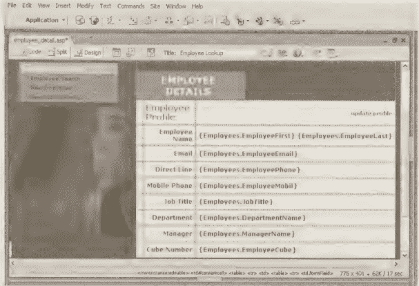

## 终端用户配方：更新员工

`Update Employee`（更新员工）页面使用标准的 Dreamweaver`Update Record`（更新记录）服务器行为，并包含一些增强功能。除了修改员工记录外，此页面上的代码还可以删除记录。这里使用高级 SQL 语句将两个相关表中的数据合并到一个下拉列表中。

### 步骤 1：实现更新员工页面设计

在插入任何动态元素之前，先构建基本的静态页面。

1. 创建一个基本动态页面，可以手动创建或从模板派生。

   - 在`EmployeeLookup`（员工查询）文件夹中，找到对应服务器模型的文件夹，然后打开其中的`update_employee`页面。

2. 在页面的内容区域添加一个表格，用于容纳应用程序的界面元素。

   - 从代码片段面板中，将`Recipes > EmployeeLookup > Wireframes > Update Employee - Wireframe`（配方 > 员工查询 > 线框 > 更新员工 - 线框）代码片段拖放到`Content`可编辑区域。

3. 在表格内，插入表单和员工记录所需的表单元素。对于此页面，您需要为每个要更新的数据源字段准备一个文本字段或列表，以及提交按钮和删除按钮。与高级搜索页面一样，我们的示例中使用五个文本字段和一个列表元素 [r2-13]。

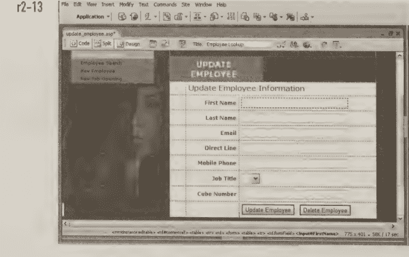

将光标置于`UPDATE`行下方的行中，然后插入`Recipes > EmployeeLookup > Forms > Update Employee - Form`（配方 > 员工查询 > 表单 > 更新员工 - 表单）代码片段。

4. ColdFusion 和 PHP 用户：`Update Record`（更新记录）服务器行为需要唯一的记录 ID 才能正常工作。隐藏表单字段用于传递所需的数据。

   ColdFusion 和 PHP 开发人员应从插入栏的“表单”类别中拖出一个隐藏表单字段，并将其命名为`EmployeeID`。

5. 保存您的页面。

### 步骤 2：添加数据库组件

两个记录集为员工更新页面提供数据。正如您所期望的，一个记录集包含所选员工记录的详细信息；此记录集使用基于 URL 参数进行筛选的常见技术。

1. 在“绑定”面板中，选择添加 (+) 并选择“记录集”。

2. 在显示“简单记录集”对话框时，为记录集输入一个有意义的名称，例如`Employees`。

3. 选择到数据源的连接。

   - 从“连接”或“数据源”列表中选择`Recipes`。

4. 选择包含员工记录详细信息的表。

   - 从“表”列表中选择`Employees`（PHP 用户选择`employees`）。

5. 将“列”选项保持设置为`All`（全部）。

6. 在“记录集”对话框的“筛选”区域，按如下方式设置四个筛选列表元素：

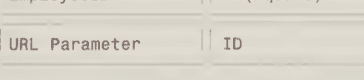

7. 将“排序”选项保持设置为`None`（无），然后单击“确定”关闭对话框。

第二个记录集较为高级，涉及`Job Title`（职位）列表元素。职位名称可能出现在多个部门中。（例如，每个部门都可以有经理和助理经理。）因此，`Job Title`（职位）列表元素需要同时显示职位名称，并用括号括起该员工所在的部门。对于 ASP 和 ColdFusion，这是通过结合使用 Access 视图和将一个 SQL 语句嵌套在另一个 SQL 语句中来实现的。

Access 视图将数据源中`Jobs`（职位）表和`Departments`（部门）表的字段连接起来：

```
SELECT [Jobs].[JobTitle] & ' (' & [Departments].[DepartmentName] & ')'
AS JobAndDepartment, Jobs.JobID
FROM Jobs INNER JOIN Departments ON Jobs.JobDept =
Departments.DepartmentID;
```

PHP 不允许这种嵌套（也称为*子查询*）。必须使用不同的 SQL 语句：

```
SELECT jobswithdepartments.* FROM jobswithdepartments
LEFT JOIN employees ON jobswithdepartments.JobID=
employees.EmployeeJob
WHERE employees.EmployeeJob IS NULL OR (employees.EmployeeID =
IDParam)
```

#### 适用于 ASP

> 在开始此步骤之前，您需要从相应的代码片段中复制 SQL 代码：右键单击`Recipes > EmployeeLookup > SQL > Jobs RS - ASP SQL Statement`代码片段，然后从上下文菜单中选择“复制代码片段”。

1. 在“绑定”面板中，选择添加 (+) 并选择“记录集（查询）”。

2. 在高级“记录集”对话框中，为记录集输入适当的名称。

   - 在“名称”字段中输入`Jobs`。

3. 从下拉列表中选择您的连接。

   - 从“连接”列表中选择`Recipes`。

4. 在 SQL 区域中，输入以下代码：

   - 按 Ctrl-V（Command-V）将复制的代码片段粘贴到 SQL 字段中。

   - `SELECT * FROM JobsWithDepartments WHERE Jobs.JobID NOT IN (SELECT EmployeeJob AS JobID FROM Employees WHERE EmployeeID <> IDParam)`

5. 在“变量”区域中，选择添加 (+) 并在“名称”列中输入`IDParam`。

6. 在“默认值”列中，输入`0`。

7. 在“运行时值”列中，输入`Request.QueryString("ID")`，然后单击“确定”关闭对话框并插入记录集。

8. 保存页面。

#### 适用于 ColdFusion


在开始此步骤之前，您需要从相应的代码片段中复制 SQL 代码：右键单击`Recipes > EmployeeLookup > SQL > Jobs RS - CFML SQL Statement`代码片段，然后从上下文菜单中选择“复制代码片段”。

1. 在“绑定”面板中，选择添加（`+`）并选择“记录集（查询）”。
2. 在高级“记录集”对话框中，为记录集输入适当的名称。
   在“名称”字段中输入`Jobs`。
3. 从下拉列表中选择您的数据源。
   从“数据源”列表中选择`Recipes`。
4. 如有必要，在相应字段中输入数据源的用户名和密码。
5. 在 SQL 区域中，输入以下代码：

   按 Ctrl-V（Command-V）将复制的代码片段粘贴到 SQL 字段中。

```sql
SELECT * FROM JobsWithDepartments WHERE Jobs.JobID NOT IN
(SELECT EmployeeJob AS JobID
FROM Employees
WHERE EmployeeID <> #URL.ID#)
```

6. 在“页面参数”区域中，选择添加（`+`）以打开“添加参数”对话框。
7. 确保在“添加参数”对话框的“名称”列表中已选择`User.ID`，并输入`0`作为“默认值”。完成后，单击“确定”关闭对话框。
8. 验证您的代码，然后单击“确定”关闭对话框并插入记录集。

### 适用于 PHP

在开始此步骤之前，您需要从相应的代码片段中复制 SQL 代码：右键单击`Recipes > EmployeeLookup > SQL > Jobs RS - PHP SQL Statement`代码片段，然后从上下文菜单中选择“复制代码片段”。

1. 在“绑定”面板中，选择添加（`+`）并选择“记录集（查询）”。
2. 在高级“记录集”对话框中，为记录集输入适当的名称。
   在“名称”字段中输入`Jobs`。
3. 从下拉列表中选择您的连接。
   从“连接”列表中选择`Recipes`。
4. 在 SQL 区域中，输入以下代码：
   - 按 Ctrl-V（Command-V）将复制的代码片段粘贴到 SQL 字段中。

```sql
SELECT jobswithdepartments.* FROM jobswithdepartments
LEFT JOIN employees ON jobswithdepartments.JobID=
employees.EmployeeJob
WHERE employees.EmployeeJob IS NULL OR (employees.EmployeeID =
IDParam)
```

5. 在“变量”区域中，选择添加（`+`）并在“名称”列中输入`IDParam`。
6. 在“默认值”列中，输入`0`。
7. 在“运行时值”列中，输入`$_GET['ID']`，然后单击“确定”关闭对话框并插入记录集。
8. 保存页面。

### 步骤 3：更新员工档案

定义记录集后，我们就可以应用 Dreamweaver 的 Update Record（更新记录）服务器行为了。

#### 适用于 ASP

1. 在“服务器行为”面板中，选择添加（`+`）并选择`Update Record`（更新记录）。
2. 在“更新记录”对话框中，从列表中选择您的连接。
   - 从“连接”列表中选择`Recipes`。
3. 从列表中选择数据源中要修改的表。
   - 从“要更新的表”列表中选择`Employees`。
4. 选择要使用的记录集。
   - 从“从以下记录集选择”列表中选择`Employees`。
5. 从列表中选择唯一键列；如果数据是数字，请确保已选择“数值”选项。
   - 从列表中选择`EmployeeID`。
6. 选择记录更新后希望用户访问的文件路径。
   - 选择“浏览”并找到`employee_results.asp`文件。
7. 在“从以下获取值”列表中选择当前表单后，将表单元素设置为与其对应的数据源字段。
   - 将`FirstName`表单元素设置为`EmployeeFirst`数据列，并以`Text`（文本）形式提交。
   - 将`LastName`表单元素设置为`EmployeeLast`数据列，并以`Text`（文本）形式提交。
   - 将`Email`表单元素设置为`EmployeeEmail`数据列，并以文本形式提交。
   - 将`Phone`表单元素设置为`EmployeePhone`数据列，并以文本形式提交。
   - 将`Phone2`表单元素设置为`EmployeeMobile`数据列，并以文本形式提交。
   - 将`JobTitle`表单元素设置为`EmployeeJob`数据列，并以数值形式提交。
   - 将`CubeNumber`表单元素设置为`EmployeeCube`数据列，并以数值形式提交。
8. 确认您的选择，然后点击“确定”关闭对话框。
9. 保存页面。

#### 适用于 ColdFusion 和 PHP

1. 在服务器行为面板中，点击添加（`+`）并选择**更新记录**。
2. 在更新记录对话框中，选择当前表单。
   - 在“提交值来源”列表中选择`UpdateEmployee`。
3. 从列表中选择您的数据源。
   - 在数据源列表中选择**Recipes**。
4. 如果需要，输入您的用户名和密码。
5. 从列表中选择数据源中要更新的表。
   - 在更新表列表中选择**Employees**（PHP 中为`employees`）。
6. 将数据源字段设置为对应的表单元素。
   - 确保`EmployeeID`数据列设置为`FORM.ElementID`，类型为数值型（PHP 中为整型），并设为主键。
   - 将`EmployeeFirst`设置为`FORM.FirstName`表单元素，并以文本形式提交。
   - 将`EmployeeLast`设置为`FORM.LastName`表单元素，并以文本形式提交。
   - 将`EmployeeEmail`设置为`FORM.Email`表单元素，并以文本形式提交。
   - 将`EmployeePhone`设置为`FORM.Phone`表单元素，并以文本形式提交。
   - 将`EmployeeMobile`设置为`FORM.Phone2`表单元素，并以文本形式提交。
   - 将`EmployeeJob`设置为`FORM.JobTitle`表单元素，ColdFusion 中以数值形式提交，PHP 中以整型提交。
   - 将`EmployeeCube`设置为`FORM.CubeNumber`表单元素，并以数值型/整型提交。
7. 选择记录更新后您希望用户访问的文件路径。
   - 选择浏览，找到适合您服务器模型的**employee_results**文件。
8. 确认您的选择，然后点击“确定”关闭对话框。

164

## 配方 2：员工查询

### 步骤 4：插入删除命令

与我们在用户登录配方中所做的类似，我们将在包含更新记录服务器行为的页面上结合删除记录的代码。过程基本相同。同样，我们将添加一个专门的 SQL 语句（在 ASP 中称为命令），这可以通过 Dreamweaver 界面完成。插入后，我们需要将命令移到页面顶部，并将其包裹在 If 语句中，使其仅在点击删除按钮时执行。

#### 适用于 ASP

1. 在绑定面板中，点击添加（`+`）并选择命令。
2. 在名称字段中，输入一个恰当的名称。
   - 在名称字段中输入`DeleteCommand`。
3. 从列表中选择您的数据源连接。
   - 在连接列表中选择`Recipes`。
4. 选择命令类型。
   - 在类型下拉列表中选择删除。
5. 在 SQL 字段中输入以下代码。
6. 在变量部分，点击添加（`+`）并在名称列下输入`IDParam`。
7. 在运行时值列中，输入`Request("MM_recordId")`，完成后点击确定。
8. 在代码视图中，找到删除命令的代码块，它看起来像这样：

```sql
DELETE FROM Employees
WHERE EmployeeID = IDParam
```

```vb
set DeleteCommand = Server.CreateObject("ADODB.Command")
DeleteCommand.ActiveConnection = MM_Recipes_STRING
DeleteCommand.CommandText = "DELETE FROM Employees
WHERE EmployeeID = " + Replace(DeleteCommand__IDParam,
"'", "''") + ""
DeleteCommand.CommandType = 1
DeleteCommand.CommandTimeout = 0
DeleteCommand.Prepared = true
DeleteCommand.Execute()
```

插入命令会创建两个代码块。我们需要将两者都移动，以便在更新命令处理之前先处理删除命令。首先，我们将移动刚刚创建的代码块。如果您尚未选择其他内容，它应该仍然处于高亮状态。

## VB

# 终端用户配方：更新员工

```vb
<%
var DeleteCommand = Server.CreateObject("ADODB.Command");
DeleteCommand.ActiveConnection = MM_Recipes_STRING;
DeleteCommand.CommandText = "DELETE FROM Employees\nWHERE EmployeeID " + DeleteCommand__IDParam.replace
(/'/g, "''") + " ";
DeleteCommand.CommandType = 1;
DeleteCommand.CommandTimeout = 0;
DeleteCommand.Prepared = true;
DeleteCommand.Execute();
%>
```

9. 剪切选中的代码块，并将其粘贴到页面顶部`<!--include>`语句的正下方。
10. 找到并剪切以下相关代码块：

```vb
<%
if(Request("MM_recordId") <> "") then DeleteCommand__IDParam =
Request("MM_recordId")
%>
```

```javascript
<%
if(String(Request("MM_recordId")) != "undefined"){
DeleteCommand__IDParam = String(Request("MM_recordId"));}
%>
```

11. 将刚刚剪切的代码块粘贴在`<!--include>`标签之后、删除命令之前。

这最后一步是确保删除命令仅在我们点击表单上的删除按钮后执行。

12. 在代码视图中，找到并选择移到页面顶部的两个相邻删除命令代码块。
13. 插入以下代码：

从片段面板中，打开适合您服务器模型的`Recipes > EmployeeLookup > Custom Code`文件夹，并插入 Edit User - Conditional 片段。

*Before:*

```vb
<%
if (cStr(Request.Form("Delete"))<>"")  then
%>
```

*After:*

```vb
<%
  Response.Redirect("employee_results.asp")
end if
%>
```

#### 之前：

```javascript
<%
if (String(Request("Delete"))!="undefined") {
%>
```

#### 之后：

```javascript
<%
    Response.Redirect("employee_results.asp");
}
%>
```

当然，如果删除完成后您希望使用 employee_results 页面以外的页面，也可以更改重定向的页面。

#### 适用于 ColdFusion

1. 在绑定面板中，点击添加（`+`）并选择**记录集**。

   与 ASP 服务器模型不同，ColdFusion 中没有专门用于命令的独立用户界面。使用记录集对话框。

2. 如果显示的是简单视图，请选择**高级**。
3. 在名称字段中，输入一个恰当的名称。
   在名称字段中输入`DeleteCommand`。
4. 从列表中选择您的数据源连接。
   在数据源列表中选择**Recipes**。
5. 如有必要，在相应字段中输入用户名和密码。
6. 在 SQL 字段中输入以下代码：

   `DELETE FROM Users WHERE UserID = #FORM.EmployeeID#`

7. 在页面参数部分，点击添加（`+`）以显示添加参数对话框。
8. 在添加参数对话框中，在名称字段中输入`FORM.EmployeeID`。
9. 在默认值字段中输入`0`，然后点击确定关闭添加参数对话框。
10. 完成后，点击确定关闭记录集对话框。

现在，完成删除命令的最后一步是确保它仅在用户点击表单上的删除按钮时执行。为了实现这一过程，我们将把两个删除命令代码块包裹在 If 语句中。

11. 在代码视图中，找到删除命令的代码块，它看起来像这样：

   选择该代码块，为插入片段做准备。

```cfm
<cfquery name="DeleteCommand" datasource="Recipes">
    DELETE FROM Employees WHERE EmployeeID = #FORM.EmployeeID#
</cfquery>
```

12. 插入以下代码：

   - 从片段面板中，打开`Recipes > EmployeeLookup > Custom Code-CF`文件夹，并插入 Edit User - Conditional 片段。

之前：

```cfm
<cfif IsDefined("FORM.DeleteEmployee")>
```

之后：

```cfm
<cflocation url="employee_results.cfm">
</cfif>
```

13. 保存您的页面。

如果您希望将页面重定向到 employee_results 页面以外的页面，请随意修改代码。

#### 适用于 PHP

PHP 不包含对命令的直接支持，但您可以使用记录集对话框输入等效的 SQL。插入记录集后，我们需要添加一些代码，使其执行以按下删除按钮为条件。

1. 在代码视图中，将光标放在文件顶部以`<?php require_once...`开头的连接代码下方，并输入以下代码：

   - 从片段面板中，插入`Recipes > EmployeeLookup > Custom Code-PHP > Delete Employee Record`片段。

```php
<?php
// mysql delete command
if (isset($_GET['MM_recordId'])) {
    mysql_select_db($database_Recipes, $Recipes);
    $query_DeleteOperation = "DELETE FROM employees
    WHERE EmployeeID = '" . $_GET['MM_recordId'] . "'";
    mysql_query($query_EmployeeLookup, $Recipes);
}
?>
```

下一步是确保删除命令仅在有人点击表单上的删除按钮时执行。

2. 选择刚刚插入的代码块，并输入以下代码：

   - 从片段面板中，插入`Recipes > EmployeeLookup > Custom Code-PHP > Edit User - Conditional`片段。

#### Before：

```php
<?php
if (isset($_GET['DeleteEmployee'])) {
?>
```

#### After：

```php
<?php
header("Location: employee_results.php");
}
?>
```

3. 保存您的页面。

当然，您可以自由更改删除完成后重定向的页面，不一定是 employee_results 页面。

### 步骤 5：数据绑定过程

此页面的最后一步是将记录集数据绑定到各个表单元素。除一个表单元素外，其余均为文本字段，可通过从“绑定”面板拖动相应项目来完成绑定。对于列表元素，您需要通过“动态列表/菜单”对话框输入信息，该对话框可通过“属性”检查器上的“动态”按钮或“服务器行为”面板访问。

1. 从“绑定”面板展开`Employees`记录集，将数据源字段拖放到其对应的文本字段上。
   - 将数据源字段`EmployeeFirst`拖至表单字段`FirstName`。
   - 将数据源字段`EmployeeLast`拖至表单字段`LastName`。
   - 将数据源字段`EmployeeEmail`拖至表单字段`Email`。
   - 将数据源字段`EmployeePhone`拖至表单字段`Phone`。
   - 将数据源字段`EmployeeMobile`拖至表单字段`Phone2`。
   - 将数据源字段`EmployeeCube`拖至表单字段`CubeNumber`。
2. 选择`JobTitle`列表元素。
3. 在“属性”检查器中，选择**动态**。
4. 在“动态列表/菜单”对话框中，从“选项来自记录集”列表中选择`Jobs`记录集。
   - 请记住，`Jobs`记录集源自一个整合了三个不同表的 Access 视图。
5. 在“值”字段中，选择`JobID`。
6. 在“标签”字段中，选择`JobAndDepartment`。
7. 在“选择值等于”字段中，选择闪电符号，并从“动态数据”对话框中选择 Employee 记录集中的`EmployeeJob`。
8. 单击“确定”关闭“动态数据”对话框，然后再次单击“确定”关闭“动态列表/菜单”对话框。
9. 保存您的页面。


通过在列表表单元素中合并来自两个记录集的数据字段，我们实现了两个目标。首先，与`EmployeeJob`数据字段的连接确保更新页面打开时会显示员工的当前职位。其次，列表将显示正确部门中的所有可用职位，我们可以选择新职位。现在所有表单字段都已绑定数据，更新员工页面已经完成 [r2-14]。


## 管理员食谱：新增职位

管理员在此应用程序中的角色仅限于两项相互关联的任务：为新职位空缺和新员工创建记录。虽然两者本质上都是插入记录操作，但其实现有一些显著特点。例如，新增职位页面包含服务器端（带有一点 JavaScript 辅助）动态列表，其中一个列表中的选择会改变另一个列表中的选项。

## 食谱 2：员工查询

### 步骤 1：实现新增职位设计

让我们先创建静态页面。

1. 创建一个基本动态页面，可以手动创建或从模板派生。

   > 📖 在`EmployeeLookup`文件夹中，找到您的服务器模型对应的文件夹，并打开其中的`new_job`页面。

2. 向页面的内容区域添加一个表格，以容纳应用程序的界面元素。

   > 📖 从“代码片段”面板，将`Recipes > EmployeeLookup > Wireframes > New Job - Wireframe`代码片段拖入 Content 可编辑区域。

3. 在表格中，插入表单和新增职位所需的表单元素。如果按照我们的示例，您需要两个列表元素：一个用于部门，一个用于经理，此外还需要一个用于职位的文本字段和一个提交按钮。

   > 📖 将光标放在 NEW JOB 字样下方的行中，插入`Recipes > EmployeeLookup > Forms > Enter Job Information - Form`代码片段 [r2-15]。


## 步骤 2：添加数据库组件

要填充两个列表，需要两个记录集，但这两个记录集相互关联。因为每个部门都有自己的经理（每位经理都可能负责新职位），所以经理列表取决于所选部门。虽然部门记录集只是所有可用部门的简单集合，但经理记录集是按部门记录集选择进行筛选的。要实现这一点，需要使用 SQL 关键字`TOP`；`TOP`将记录集中的记录数限制为指定值。例如，SQL 语句：

```sql
SELECT TOP 10 FROM EMPLOYEES WHERE EmployeeLast LIKE 'L%'
```

将返回姓氏以字母 L 开头的所有员工记录集中的前 10 条记录。正如您将看到的，我们的 SQL 语句将限制为特定部门（即选择）返回的 TOP 1。

由于 MySQL 不支持视图，我们将再次使用即时创建所需数据的方法，并为更复杂的经理记录集编写后续的手动编码函数。

让我们从添加简单的部门记录集开始。

1. 从“绑定”面板，选择添加（+）并选择记录集。

2. 确保显示“简单记录集”对话框，并为新记录集指定一个有意义的名称。

   - 在“记录集”字段中输入`Departments`。

3. 选择数据源的连接。

   - 从“连接”或“数据源”列表中选择`Recipes`。

4. 选择包含部门详情的表。

   - 从“表”列表中选择`Departments`（PHP 中为`departments`）。

5. 保持“列”选项设置为**全部**。

6. 将“筛选”和“排序”选项都保持为**无**，然后单击“确定”关闭对话框。

部门记录集准备就绪后，我们可以开发经理记录集。除了使用`SELECT TOP`子句外，经理记录集还使用 Access 视图，该视图合并了 Managers 和 Departments 表的数据。该视图的 SQL 如下：

```sql
SELECT [EmployeeID], [EmployeeFirst] & ' ' & [EmployeeLast]
       AS ManagerName, [Jobs].[JobDept]
FROM Employees INNER JOIN (Jobs INNER JOIN Departments
       ON [Jobs].[JobDept]=[Departments].[DepartmentID])
       ON [Employees].[EmployeeJob]=[Jobs].[JobID];
```

建立记录集只是链接两个列表元素的第一步，但却是关键的一步。

## 食谱 2：员工查询

### 对于 ASP

1. 从“绑定”面板，选择添加（+）并选择**记录集**。

2. 在高级记录集对话框中，为记录集输入适当的名称。

   在“名称”字段中输入`reimburse`。

3. 从下拉列表中选择您的连接。

   从“连接”列表中选择`Recipes`。

4. 在 SQL 区域中，输入以下代码：

```sql
SELECT *
FROM ManagersByDepartment
WHERE JobDept = IDParam
```

5. 在“变量”区域中，选择添加（+）并在“名称”列中输入`IDParam`。

6. 在“默认值”列中，输入：

```sql
(SELECT TOP 1 DepartmentID FROM Departments)
```

7. 在“运行时值”列中，输入`Request("DeptID")`，然后单击“确定”关闭对话框并插入记录集。

### 对于 ColdFusion

1. 从“绑定”面板，选择添加（+）并选择**记录集**。

2. 在高级记录集对话框中，为记录集输入适当的名称。

   在“名称”字段中输入`Managers`。

3. 从下拉列表中选择您的数据源。

   从“数据源”列表中选择`Recipes`。

4. 如有必要，在相应字段中输入数据源的用户名和密码。

5. 在 SQL 区域中，输入以下代码：

```sql
SELECT *
FROM ManagersByDepartment
WHERE JobDept = #URL.DeptID#
```

6. 在“页面参数”部分中，选择添加（+）以显示“添加参数”对话框。

7. 在“添加参数”对话框中，在“名称”字段中输入`URL.DeptID`。

8. 在“默认值”字段中，输入：

```sql
(SELECT TOP 1 DepartmentID FROM Departments)
```

9. 单击“确定”关闭“添加参数”对话框，然后再次单击“确定”插入记录集。

### 适用于 PHP

> 在开始此步骤之前，您需要从相应的代码片段中复制 SQL 代码：右键单击`Recipes > EmployeeLookup > SQL > Managers RS - PHP SQL Statement`代码片段，然后从上下文菜单中选择`Copy Snippet`。

1. 在 Bindings 面板中，选择 Add（+），然后选择 Recordset。

2. 在高级 Recordset 对话框中，为记录集输入一个合适的名称。

   📝 在 Name 字段中输入`Managers`。

3. 从下拉列表中选择您的连接。

   📝 从 Connections 列表中选择`Recipes`。

4. 在 SQL 区域中，输入以下代码：

   📝 按 Ctrl-V（Command-V）将复制的代码片段粘贴到 SQL 字段中。

```php
SELECT managersbydepartment.* FROM managersbydepartment,
jobs WHERE (((managersbydepartment.JobID =
jobs.JobID) AND (jobs.JobDepartment = departments.DepartmentID))
AND (departments.DepartmentID = IDParam))
```

5. 在 Variable 区域中，选择 Add（+），然后在 Add Parameter 对话框的 Name 字段中输入`IDParam`。

6. 在 Default Value 字段中，输入`1`。

7. 在 Run-Time Value 字段中，输入`$_GET['DeptID']`，然后单击 OK 一次以关闭 Add Parameter 对话框，再次单击以关闭 Recordset 对话框并插入记录集。

现在我们将在刚刚输入的记录集周围添加用于创建和移除临时查询的代码。

8. 在 Server Behavior 面板中，选择`Managers`记录集。

9. 切换到 Code 视图，并找到高亮显示的代码。

10. 在记录集周围包装以下代码：

   > 从 Snippets 面板中，插入`Recipes > EmployeeLookup > CustomCode_PHP > Temporary Query – ManagersByDepartment`代码片段。

Before：

```php
<?php
mysql_select_db($database_Recipes, $Recipes);
$query_ManagersByDepartment = "INSERT INTO managersbydepartment
SELECT CONCAT(employees.EmployeeFirst,' ', employees.EmployeeLast)
AS ManagerName, jobs.JobID, jobs.JobDepartment AS JobDept
FROM employees, jobs, departments
WHERE ((employees.EmployeeJob = jobs.JobID)
AND (jobs.JobDepartment = departments.DepartmentID))";
mysql_query($query_ManagersByDepartment,$Recipes);
?>
```

After：

```php
<?php
$query_ManagersByDepartment = "DELETE FROM managersbydepartment ";
mysql_query($query_ManagersByDepartment,$Recipes);
?>
```

11. 保存页面。

## 配方 2：员工查找

### 步骤 3：数据绑定流程

除了将记录集字段绑定到表单元素的标准流程外，我们还需要添加一些 JavaScript 来巩固两个列表之间的连接。虽然服务器端编码完全能够根据一个列表的选择来填充另一个列表，但您必须依靠客户端脚本来检测新选择并将页面重新提交到服务器。但在插入 JavaScript 代码之前，让我们先将数据绑定到表单元素。

1. 选择`Departments`列表元素。

2. 在 Property inspector 中，选择 Dynamic。

3. 在 Dynamic List/Menu 对话框中，从 Options From Recordset 列表中选择`Departments`记录集。

4. 在 Values 字段中，选择`DepartmentID`。

5. 在 Labels 字段中，选择`DepartmentName`。

6. 在 Select Value Equal To 字段中，选择闪电符号，然后从 Dynamic Data 对话框中的`Managers`记录集中选择`JobDept`（PHP 中为`JobID`）。

7. 单击 OK 一次以关闭 Dynamic Data 对话框，然后再次单击以关闭 Dynamic List/Menu 对话框。

现在 Department 列表已完成，让我们继续处理 Managers 列表元素。

1. 选择`Managers`列表元素。

2. 在 Property inspector 中，选择 Dynamic。

3. 在 Dynamic List/Menu 对话框中，从 Options From Recordset 列表中选择`Managers`记录集。

4. 在 Values 字段中，选择`JobID`。

5. 在 Labels 字段中，选择`ManagerName`。

6. 为避免将列表预设为任何特定值，请将 Select Value Equal To 字段留空。

7. 单击 OK 以关闭 Dynamic List/Menu 对话框。

8. 保存页面。

现在是时候添加我们一直在讨论的 JavaScript 了。我们将 JavaScript 代码的执行绑定到 Department 列表的`onChange`事件。这将确保每当做出选择时，页面将重新提交到服务器，并传递一个参数来传达该选择——这反过来会触发 Managers 记录集中的 SQL 语句并重新填充列表。

> 在开始此步骤之前，您需要从适当的代码片段中复制 SQL 代码：右键单击`Recipes > EmployeeLookup > ClientJavaScript > Department Behavior Snippet`，然后从上下文菜单中选择`Copy Snippet`。

1. 选择**Department**列表。

2. 在 Behaviors 面板中，选择 Add（+），然后选择 Call **JavaScript**。

3. 在 Call JavaScript 对话框中输入以下代码：

```javascript
VB JS document.location.href = 'new_job.asp?DeptID=
+document.forms[0].Departments.options[document.forms[0].
Departments.selectedIndex].value
```

```javascript
CF document.location.href = 'new_job.cfm?DeptID=
+document.forms[0].Departments.options[document.forms[0].
Departments.selectedIndex].value
```

```javascript
PHP document.location.href = 'new_job.php?DeptID=
+document.forms[0].Departments.options[document.forms[0].
Departments.selectedIndex].value
```

4. 单击 OK 以关闭对话框并插入 JavaScript。

5. 确保 Behaviors 面板中的事件是`onChange`；如有必要，选择事件旁边的向下三角形并选择**onChange**。

## 配方 2：员工查找

在浏览器中测试动态列表功能。选择新部门应该会生成新的经理列表 [r2-16]。

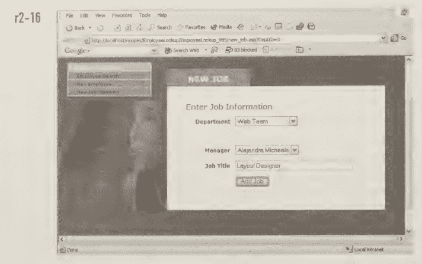

### 步骤 4：插入记录——新工作

现在我们准备添加 Insert Record 服务器行为。请记住，我们示例中的两个列表元素都会将其值作为数字提交到数据源。为什么不提交列表中显示的文本呢？虽然列表标签是文本形式的，但底层值是数字。数据源架构包含这种双重功能并不少见，这允许与其他表有更大的灵活性和集成性。

### 适用于 ASP

1. 在 Server Behaviors 面板中，选择 Add（+），然后选择**Insert Record**。

2. 在 Insert Record 对话框中，从列表中选择您的连接。

   - 从 Connections 列表中选择`Recipes`。

3. 从列表中选择要修改的数据源中的表。

   - 从 Insert into Table 列表中选择`Jobs`。

4. 在 After Inserting, Go To 字段中，输入您希望用户在记录更新后访问的文件路径。

   - 选择 Browse 并找到`employee_results.asp`文件。

5. 选择要使用的表单。

   - 从 Get Values From 列表中选择`InsertJob`。

6. 在 Get Values From 列表中当前选中的表单，将表单元素设置为对应的数据源字段。

   - 将`Department`表单元素设置为`JobDept`数据列，并以 Numeric 形式提交。

   - 将`Managers`表单元素设置为`JobManager`数据列，并以 Text 形式提交。

   - 将`JobTitle`表单元素设置为`JobTitle`数据列，并以 Text 形式提交。

7. 验证您的选择，然后单击**OK**以关闭对话框。

### 适用于 ColdFusion 和 PHP

1. 在 Server Behaviors 面板中，选择**Add（+）**，然后选择**Insert Record**。

2. 在 Insert Record 对话框中，选择当前表单。

   - 从 Submit Values From 列表中选择`InsertJob`。

3. 从列表中选择您的数据源。

   - 从 Data Source 列表中选择`Recipes`。

4. 根据需要输入您的用户名和密码。

5. 从列表中选择要插入数据的数据源中的表。

   - 从 Insert Into Table 列表中选择`Jobs`（PHP 中为`jobs`）。

6. 将数据源字段设置为对应的表单元素。

   - 确保`JobID`数据列设置为未使用的主键。

   - 将`JobDept`设置为`FORM.Departments`表单元素，并以 Numeric（PHP 中为 Integer）形式提交。

   - 将`JobTitle`设置为`FORM.JobTitle`表单元素，并以 Text 形式提交。

   - (CF) 将`JobManager`设置为`FORM.Managers`表单元素，并以 Numeric 形式提交。


- （PHP）将`ManagerID`设置为`FORM.Managers`表单元素，并以 Integer 形式提交。

- 7. 在“After Inserting, Go To”字段中，输入您希望用户在记录插入后访问的文件路径。

  - 选择`Browse`并为您的服务器模型找到`employee_results`文件。

- 8. 验证您的选择，然后单击`OK`以关闭对话框。

- 9. 不要忘记保存页面。

## 步骤 5：错误文本：无职位空缺

在整个应用程序的工作流程中，能够在数据源中创建新职位空缺至关重要。如果没有职位空缺，从逻辑上讲，您无法雇佣新员工；一条信息丰富的错误消息应提醒用户注意该问题。在其他一些教程中——例如用户身份验证——错误消息出现在同一页面上以指出问题。然而，在此应用程序中，我们将插入一条仅在另一个页面发生错误时才出现的错误消息。这是通过`If`语句实现的，当查询字符串包含名为`empty`的变量时触发。

- 1. 将光标放在您希望看到错误消息出现的页面上。

  - 将光标放在“输入职位信息”文本上方的行中。

- 2. 插入以下代码：

  - 从“片段”面板中，打开适用于您的服务器模型的“Recipes > EmployeeLookup > Custom Code”文件夹，然后插入“No Job Openings - Display Text”片段。

```vb
<%if (CStr(Request("empty"))="") then Response.Write("There are no job openings for a new employee. You must add a job before adding an employee.")%>
```

```js
<%= (String(Request("empty"))!="undefined")?"There are no job openings for a new employee. You must add a job before adding an employee.":"" %>
```

```cfm
<cfif IsDefined("URL.empty")><cfoutput>There are no job openings for a new employee. You must add a job的神经-vue before adding an employee.</cfoutput></cfif>
```

```php
<?php echo (isset($_GET['empty']))?"There are no job openings for a new employee. You must add a job before adding an employee.":""; ?>
```

- 3. 保存您的页面。

要查看运行中的错误消息，首先进入实时数据视图。错误消息应该会消失。现在，在实时数据工具栏的查询字符串字段中，输入`empty=true`，如果启用了自动刷新，请按 Enter (Return)；否则，从实时数据工具栏中选择“刷新”。错误消息应该会出现。

## 管理员教程：新员工

员工查询应用程序中最后一页的目标是向数据源添加员工。但这不就是一个基本的插入记录操作吗？尽管我们的实现确实使用了 Dreamweaver 的标准“插入记录”服务器行为，但我们也添加了一些智能功能，将此页面与应用程序的其余部分连接起来。正如我们在“新职位”页面中所见，如果没有至少一个职位空缺，您无法雇佣员工。如果您尝试向数据源添加员工而没有可用的职位空缺，此页面将重定向到“新职位”页面并显示错误消息。

### 步骤 1：实现设计

构建一个包含所有必要表单元素的静态页面是第一步。

- 1. 创建一个基本动态页面，可以手动创建或从模板派生。

  在`EmployeeLookup`文件夹中，找到适用于您的服务器模型的文件夹，然后打开其中的`new_employee`页面。

- 2. 在页面的内容区域添加一个表格，以包含应用程序的界面元素。

  从“片段”面板中，将“Recipes > EmployeeLookup > Wireframes > New Employee - Wireframe”片段拖到“内容”可编辑区域中。

- 3. 在表格内，插入表单和新员工所需的表单元素。如果您按照我们本页的示例操作，您将需要五个文本字段：名字、姓氏、电子邮件、直线和手机号码，以及工位号。您还需要一个职位列表元素以及一个提交按钮。

  将光标放在“NEW EMPLOYEE”字样下方的行中，然后插入“Recipes > EmployeeLookup > Forms > New Employee - Form”片段 [r2-17]。

## 步骤 2：添加数据库组件

此页面需要一个记录集来填充“职位名称”列表元素。为了开发职位列表，我们将使用 Access 视图和嵌套 SQL 语句。SQL 语句如下：

```sql
SELECT *
FROM JobsWithDepartments
WHERE JobID NOT IN (SELECT EmployeeJob AS JobID FROM Employees)
```

> `JobsWithDepartment`视图之前在“更新员工”页面上使用过，并在该部分中进行了讨论。

本质上，使用此 SQL 语句，记录集显示所有未分配给员工的`JobID`记录（即所有职位）。

在开始此步骤之前，您需要从适当的片段中复制 SQL 代码：右键单击适用于您的服务器模型的“Recipes > EmployeeLookup > SQL > New Employee Jobs RS”片段，然后从上下文菜单中选择“复制片段”。

- 1. 从“绑定”面板中，选择添加（`+`）并选择“记录集”。

- 2. 在高级记录集视图中，为查询输入一个有意义的名称。

  - 在“名称”字段中输入`Jobs`。

- 3. 选择您的数据源连接。

  - 从“连接”（或“数据源”）列表中选择`Recipes`。

- 4. ColdFusion 用户：如有必要，请输入数据源的用户名和密码。

- 5. 在 SQL 区域中，输入以下代码：

  - 按 Ctrl-V (Command-V) 将复制的片段粘贴到 SQL 字段中。

- 6. 验证您的代码并关闭对话框以插入记录集。

- 7. 保存您的页面。

```sql
SELECT *
FROM JobsWithDepartments
WHERE JobID NOT IN (SELECT EmployeeJob AS JobID FROM Employees)
```

```sql
SELECT jobswithdepartments.* FROM jobswithdepartments
LEFT JOIN employees ON jobswithdepartments.JobID=
employees.EmployeeJob
WHERE employees.EmployeeJob IS NULL
```

## 步骤 3：数据绑定过程

在此页面上，只有一个表单元素——列表——需要动态填充。

- 1. 选择`JobTitle`列表元素。

- 2. 从“属性”检查器中，选择`Dynamic`以打开“动态列表/菜单”对话框。

- 3. 在“Options From Recordset”列表中，选择`Jobs`。

- 4. 在“Values”字段中，选择`JobID`。

- 5. 在“Labels”字段中，选择`JobAndDepartment`。

- 6. 将“Select Value Equal To”字段留空，然后单击“确定”关闭对话框。

通过在浏览器中预览页面，您可以查看当前可用的职位名称 [r2-18]。您将无法使用实时数据预览，因为在预览模式下，列表元素不会在 Dreamweaver 中填充。

## 教程 2：员工查询

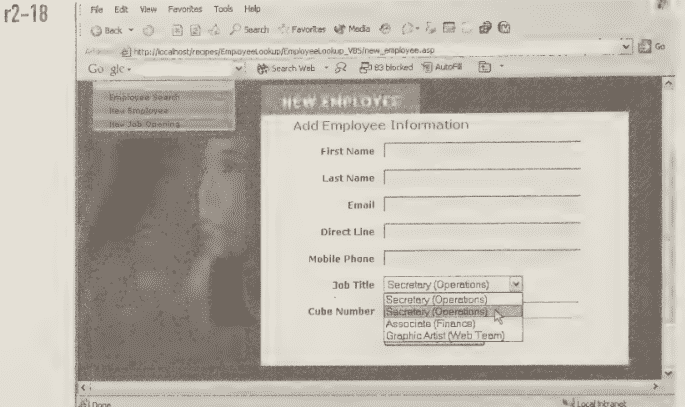

> 如前所述，“插入记录”对话框对于 ASP 和 ColdFusion 服务器模型是不同的，分开介绍时最容易理解。

### 步骤 4：插入记录——新员工

现在是时候应用“插入记录”服务器行为了。

#### 适用于 ASP

- 1. 从“服务器行为”面板中，选择添加（`+`）并选择`Insert Record`。

- 2. 在“插入记录”对话框中，从列表中选择您的连接。

  - 从“连接”列表中选择`Recipes`。

- 3. 从列表中选择要修改的数据源中的表。

  - 从“插入到表”列表中选择`Employees`。

- 4. 在“插入后，转到”字段中，输入您希望在记录更新后用户访问的文件路径。

  - 选择`Browse`并找到`employee_results.asp`文件。

- 5. 选择要使用的表单。

  - 从“获取值自”列表中选择`NewEmployee`。

- 6. 在“获取值自”列表中选择当前表单后，将表单元素设置为其对应的数据源字段。

  - 将`FirstName`表单元素设置为`EmployeeFirst`数据列，并以文本形式提交。

  - 将`LastName`表单元素设置为`EmployeeLast`数据列，并以文本形式提交。

  - 将`Email`表单元素设置为`EmployeeEmail`数据列，并以文本形式提交。

  - 将`Phone`表单元素设置为`EmployeePhone`数据列，并以文本形式提交。

  - 将`Phone2`表单元素设置为`EmployeeMobile`数据列，并以文本形式提交。

  - 将`JobTitle`表单元素设置为`EmployeeJob`数据列，并以文本形式作为数字提交。

  - 将`CubeNumber`表单元素设置为`EmployeeCube`数据列，并以数字形式提交。

- 7. 验证您的选择，然后单击“确定”关闭对话框。

#### 适用于 ColdFusion 和 PHP

- 1. 从“服务器行为”面板中，选择添加（`+`）并选择`Update Record`。

- 2. 在“更新记录”对话框中，选择当前表单。

  - 从“提交值自”列表中选择`NewEmployee`。

- 3. 从列表中选择您的数据源。

  - 从“数据源”列表中选择`Recipes`。

- 4. 如有需要，输入您的用户名和密码。

- 5. 从列表中选择要插入的数据源中的表。

  - 从“插入到表”列表中选择`Employees`（PHP 为`employees`）。

- 6. 将数据源字段设置为其对应的表单元素。

  - 确保`EmployeeID`数据列设置为未使用的主键。

  - 将`EmployeeFirst`设置为`FORM.FirstName`表单元素，并以文本形式提交。

  - 将`EmployeeLast`设置为`FORM.LastName`表单元素，并以文本形式提交。

  - 将`EmployeeEmail`设置为`FORM.Email`表单元素，并以文本形式提交。

  - 将`EmployeePhone`设置为`FORM.Phone`表单元素，并以文本形式提交。

  - 将`EmployeeMobile`设置为`FORM.Phone2`表单元素，并以文本形式提交。

  - 将`EmployeeJob`设置为`FORM.JobTitle`表单元素，ColdFusion 以数字形式提交，PHP 以整数形式提交。

  - 将`EmployeeCube`设置为`FORM.CubeNumber`表单元素，ColdFusion 以数字形式提交，PHP 以整数形式提交。

- 7. 在“插入后，转到”字段中，输入您希望在记录插入后用户访问的文件路径。

  - 选择“浏览”并找到适用于您的服务器模型的`employee_results`文件。

- 8. 验证您的选择，然后单击“确定”关闭对话框。

## 步骤 5：手工编写代码——无职位空缺时重定向

本页乃至整个应用程序的最后一步是插入一些自定义代码，以便在没有可用职位时做出适当反应。由于此重定向依赖于页面上的记录集（返回可用职位列表），您可以将重定向放在页面本身，这样可以确保记录集代码已经定义。如前所述，如果没有可用职位，代码会将访问者重定向到“新建职位”页面，并触发先前嵌入的错误消息。

1. 在代码视图中，将光标置于`<html>`开始标签的上方。

   虽然对于 ASP 和 ColdFusion，您可以将此代码放在其他 outputclass="bold" 他地方，但 PHP 要求代码直接出现在记录集定义之后。

2. 插入以下代码：

   从“代码片段”面板中，打开适合您服务器模型的`Recipes > EmployeeLookup > Custom Code`文件夹，然后插入`No Job Openings - Display Text`代码片段。

```asp
<%
if (Jobs.EOF) then
    Response.Redirect("new_job.asp?empty=true")
end if
%>
```

```js
<%
if (Jobs.EOF)
    Response.Redirect("new_job.asp?empty=true");
%>
```

```cfm
<cfif Jobs.RecordCount EQ 0>
    <cflocation url="new_job.cfm?empty=true">
</cfif>
```

```php
<?php
if ($totalRows_Jobs<=0) {
    $url = "new_job.php?empty=true";
    Header("Location: $url");
}
?>
```

3. 保存页面。

测试重定向功能的唯一方法是在所有可用职位都已填满时，在浏览器中预览页面。配方数据源中有完整的公司员工名单，供您测试应用程序。

## 配方 3：会议室调度程序

虽然您似乎一生都在网上通过电子邮件或电话会议与他人进行数字化互动，但任何组织中的面对面会议仍然是生活的一部分。办公室中可用于举行这些会议的会议室数量有限，因此对会议室调度应用程序的需求应运而生。任何调度应用程序都必须特别注意时间和空间。会议何时召开、持续多长时间，与房间的位置和大小同样重要。

我们的会议室调度程序配方以用户为导向。管理员只有两个特殊页面：一个用于在系统中添加新会议室，另一个用于编辑这些会议室的描述。应用程序的其他所有方面都围绕用户需求设计。通常，用户会从尝试安排会议开始。如果所选时间或地点已有会议安排，用户将收到冲突通知，然后有机会重试或搜索已安排的会议以寻找可用时段。会议建立后，用户可以更新或删除记录。

本配方主要侧重于日期和时间功能。数据源以特殊格式存储时间和日期值，根据服务器模型的不同，需要特殊处理才能读取和保存相关值。不仅纳入了特定时间（如开始时间），还计算了会议持续时间。此类计算——包含在此配方中——在许多其他内联网和工作组应用程序中都有广泛用途。

## 用户配方


## 管理员配方


## 配料

8 个应用程序页面：

- 6 个用户页面

  - 会议请求

  - 会议冲突

  - 会议详情

  - 编辑会议详情

  - 会议搜索

  - 会议结果

- 2 个管理页面

  - 添加会议室

  - 更新会议室

1 个数据源：

- 1 个数据库，包含：

  - 2 个表

    - `Conferences`——包含所有已安排会议的记录，包括 ID、会议名称、所有者、会议室、会议目的、开始时间和持续时间等字段。

    - `Rooms`——跟踪哪些会议室可用及其描述。

  - 1 个视图

    - `ConferenceDisplay`——连接`Conferences`和`Rooms`表的虚拟表。

## 准备工作

在开始构建此应用程序之前，请确保已完成准备工作。

1. 创建包含必要表的数据源。

   > ASP 和 ColdFusion 用户应使用下载文件中的`Recipes.mdb`数据源，而 PHP 用户应使用`Recipes`数据源。有关查找和安装这些文件的帮助，请选择`Help > Web Application Recipes`。

2. 建立与数据源的连接。如果您不确定如何操作，请参阅第 1 章的“连接到数据源”部分。

   > 将连接命名为`Recipes`。

3. 创建将用于应用程序的模板。

   > 使用针对您服务器模型名为`conferenceroom`的模板。

### 最终用户配方：会议请求

会议室调度应用程序的入口点是会议请求表单。从用户的角度来看，表单相当简单。在输入一些描述性详细信息——会议名称、所有者和描述——之后，输入何时（时间、日期和持续时间）以及何地。

然而，当提交请求时，所有简单的表象都消失了。首先将请求与现有会议进行比较，以检查是否存在冲突。如果没有发现冲突，会议详情将添加到数据源；但如果同一会议室和时间已有其他会议预订，用户将被带到另一个页面，显示冲突会议的具体信息。

此应用程序页面包含三个记录集，其中一个用于获取刚插入的数据以进行确认。您还会发现一种相当复杂的方法来收集时间和日期信息，并将详细信息组合成数据源友好的格式。

#### 步骤 1：实现会议请求设计

会议请求页面需要相当多的信息，您需要构建表单以确保其易于使用。使用一系列文本字段（单行和文本区域）来收集基本的描述性信息，而时间和地点信息主要通过下拉列表输入。

1. 创建一个基本的动态页面，手动创建或从模板派生。

   - 在`ConferenceRoomScheduler`文件夹中，找到适合您服务器模型的文件夹，然后打开其中的`meeting_request`页面。

2. 在页面的内容区域添加一个表格，以包含应用程序的界面元素。


- 从“代码片段”面板中，将`Recipes > ConferenceRoom > Wireframes > Meeting Request - Wireframe`代码片段拖入“内容”可编辑区域。

3. 在表格中，放置另一个 HTML 表格来容纳表单及其元素：三个文本字段（会议名称、所有者和日期）、一个用于描述的文本区域、三个下拉列表（开始时间、持续时间和会议室）以及一个提交按钮。您还需要一个隐藏字段，用于组合日期和时间条目。

- ASP 和 ColdFusion 用户应将光标放在“MEETING REQUEST”字样下方的行中，然后插入`Recipes > ConferenceRoom > Forms > Enter Meeting Request Form`代码片段；PHP 用户应改用`Recipes > ConferenceRoom > Forms > Enter Meeting Request Form (PHP)`代码片段 [r3-1]。


4. 确保`<form>`标签的`method`属性设置为`POST`，然后保存页面。

## 配方变体：用户界面增强

根据您组织的需求，您可能会发现将会议所有者的开放式文本字段替换为与员工数据源关联的动态列表很有用。类似的技术已在配方 2 涵盖的员工查找应用程序的多个页面中演示。

### 步骤 2：添加数据库组件，第 1 部分

从记录集的角度来看，会议请求页面相当复杂。三个记录集从简单到高级，涵盖了不同程度的 SQL 复杂性。最简单的记录集`Rooms`用于填充会议室列表。更高级的记录集用于获取刚插入记录的 ID，该 ID 将传递给确认页面创建。最后一个记录集将请求的会议时间和地点与已安排的会议进行比较。如果发现冲突，用户将被重定向到详细说明现有会议的页面。

让我们从最简单的记录集`Rooms`开始，逐步深入到更复杂的记录集。

## 配方 3：会议室调度程序

1. 在服务器行为面板中，选择添加（+）并选择**记录集（查询）**。

2. 在简单视图中，输入记录集的名称。

   在名称字段中输入`Rooms`。

3. 选择数据源连接。

   从连接（数据源）列表中选择`Recipes`。

4. 选择要操作的表。

   从表列表中选择`Rooms`（PHP 中为`rooms`）。

5. 将数据源列限制为仅需要的那些。

   选择**选定列**选项，并高亮显示`RoomID`和`RoomName`。

   通常认为将数据源字段限制为必要的字段是一种良好的做法，而当其中一个不必要的字段是备注类型字段（如`RoomDescription`，可能包含大量文本）时，这一点尤为重要。

6. 将筛选选项保留为“无”。

7. 设置排序选项，以呈现房间的字母列表。

   从排序列表中选择`RoomName`，并接受升序。

8. 验证您的选择，完成后单击确定。

9. 保存页面。

接下来要添加的记录集涉及一项有用的技术，用于获取 ASP 和 ColdFusion 用户刚刚插入记录的 ID；PHP 提供了一个内置函数来处理这个问题，因此我们不需要创建插入记录集。在这些服务器模型的插入记录操作的常规工作流中，ID（自动生成的唯一编号）在应用程序成功插入记录并转到下一页之前是不可用的。在这种情况下，我们希望能够在下一页（确认页面）上显示刚刚插入记录的详细信息。为了实现这一点，我们需要通过即将添加的记录集将 ID 作为插入记录服务器行为的一部分传递。在稍后的应用程序设置中，我们将用一个条件语句包裹此记录集，使其仅在调用插入记录服务器行为时执行。

> **注意**

为了适应各种服务器模型的不同对话框，这些步骤在此以及本配方中必要时分别呈现。

在此实例中，仅包含 ASP 和 ColdFusion 的步骤，因为 PHP 中不需要插入记录集。

#### 对于 ASP

1. 在服务器行为面板中，选择添加（+）并选择**记录集（查询）**。

2. 切换到对话框的高级视图，并为记录集输入适当的名称。

   在名称字段中输入`Inserted`。

3. 选择记录集的连接。

   从连接列表中选择`Recipes`。

4. 在 SQL 区域中，输入以下代码：

```sql
SELECT TOP 1 ConferenceID
FROM Conferences
WHERE ConferenceName = 'NameParam'
ORDER BY ConferenceID DESC
```

此 SQL 语句选择会议名字段中条目匹配的数据的最后输入记录。这确保我们检索到刚刚插入的 ID，即使有其他记录具有相同的会议名称。

5. 在变量区域中，选择添加（+）并在名称列下输入`NameParam`。

6. 在默认值列中，输入`test`。

`test`值仅仅是一个占位符；可以使用任何其他文本字符串。

7. 在运行时值列中，输入`Request.Form("MeetingName")`，然后单击确定关闭对话框。

8. 保存页面。

#### 对于 ColdFusion

1. 在服务器行为面板中，选择添加（+）并选择**记录集（查询）**。

2. 切换到对话框的高级视图，并为记录集输入适当的名称。

   在名称字段中输入`Inserted`。

3. 选择您的数据源。

   从数据源列表中选择`Recipes`。

4. 如有必要，输入用户名和密码。

5. 在 SQL 区域中，输入以下代码。

```sql
SELECT TOP 1 ConferenceID
FROM Conferences
WHERE ConferenceName = '#FORM.MeetingName#'
ORDER BY ConferenceID DESC
```

此 SQL 语句选择会议名称字段中条目匹配的数据的最后输入记录。这确保我们检索到刚刚插入的 ID，即使有其他记录具有相同的会议名称。

6. 在页面参数部分，选择添加（+），并在添加参数对话框中，确保在名称列表中选择了`FORM.MeetingName`。

7. 输入`test`作为默认值，然后单击确定关闭对话框。

8. 在记录集对话框中验证您的条目，然后单击确定关闭该对话框。

9. 保存页面。

### 步骤 3：添加数据库组件，第 2 部分

此页面所需的最后一个记录集用于检查会议冲突。SQL 语句相当复杂，主要是因为正在检查请求地点和指定日期/时间范围的匹配；还必须添加三个不同的变量——`DateParam`、`DurationParam`和`RoomParam`。与插入记录集一样，稍后将用一个条件语句包裹此记录集代码，以确保仅在需要时执行。

#### 对于 ASP

由于此 SQL 语句非常复杂，我们将其作为代码片段包含。但是，您不能直接将代码片段插入 Dreamweaver 对话框，但可以在打开记录集对话框之前复制它。要将 SQL 代码复制到剪贴板，右键单击（Control-click）`Recipes > ConferenceRoom > SQL > Conflict RS - ASP SQL Statement`代码片段，然后从上下文菜单中选择复制代码片段。现在，您可以返回应用程序页面并插入记录集。

1. 在服务器行为面板中，选择添加（+）并选择记录集（查询）。

2. 切换到对话框的高级视图，并为记录集输入适当的名称 [r3-2]。

   在名称字段中输入`Conflicts`。

3. 选择记录集的连接。

   从连接列表中选择`Recipes`。

4. 在 SQL 区域中，输入以下代码：

   - 按 Ctrl-V（Command-V）粘贴复制的代码片段。

```sql
SELECT TOP 1 ConferenceID
FROM ConferenceDisplay
WHERE RoomID = RoomParam AND ((ConferenceStart <= #DateParam#
AND ConferenceEnd > #DateParam#) OR (ConferenceStart < DateAdd
('n',DurationParam*60,#DateParam#)
AND ConferenceStart >= #DateParam#))
```

`DateParam`字段周围的井号表示这是一个 Access 日期格式字段。

5. 在变量区域中，选择添加（+）并在名称列下输入`DateParam`。

6. 在默认值列中，输入`1/1/1975`。

7. 在运行时值列中，输入`Request.Form("FullDate")`。

8. 选择添加（+）以添加另一个变量，并在名称列下输入`DurationParam`。

9. 在默认值列中，输入`0`。

10. 在运行时值列中，输入`Request.Form("Duration")`。

11. 选择添加（+）以插入另一个变量，并在名称列下输入`RoomParam`。

12. 在默认值列中，输入`0`。

13. 在运行时值列中，输入`Request.Form("ConferenceRoom")`，然后单击确定关闭对话框。

14. 保存页面。

#### 对于 ColdFusion

由于此记录集的 SQL 语句相当复杂，因此它作为代码片段包含。但是，您不能直接将代码片段插入 Dreamweaver 对话框，但 ColdFusion 允许我们直接在`<cfquery>`标签对内插入它。为了实现这一点，我们将从插入栏插入标签，而不是使用记录集对话框。要完成此 ColdFusion 记录集，还需要添加三个`<cfparam>`标签。

1. 在代码视图中，将光标定位在现有`<cfparam>`标签之后的新行上。

2. 从插入栏的 CFML 类别中，选择`cfquery`对象以打开标签编辑器。

3. 在标签编辑器的常规类别中，为查询命名。

   - 在查询名称字段中输入`Conflicts`。

4. 选择您的数据源。

   - 在数据源字段中输入`Recipes`。

5. 如有必要，输入用户名和密码，然后选择确定关闭对话框。

6. 确保光标定位在`<cfquery>`标签对内，并输入以下代码：

   - 从代码片段面板中，插入`Recipes > ConferenceRoom > SQL > Conflict RS - CFML SQL Statement`代码片段。

```sql
SELECT TOP 1 ConferenceID
FROM ConferenceDisplay
WHERE (RoomID = #FORM.ConferenceRoom#
AND ((ConferenceStart <= ###FORM.FullDate###
AND ((ConferenceStart <= #CreateODBCDateTime(FORM.FullDate)#
AND ConferenceEnd > #CreateODBCDateTime(FORM.FullDate)#)
OR (ConferenceStart < DateAdd('n',#FORM.Duration#*60,
#CreateODBCDateTime(FORM.FullDate)#)
AND ConferenceStart >= #CreateODBCDateTime(FORM.FullDate)#)))
```

`CreateODBCDateTime()`函数用于将日期值转换为 ODBC 驱动程序兼容的版本。

7. 切换到设计视图，并从绑定面板中，选择添加（+）并选择`CFParam`。

8. 在`CFParam`对话框中，在名称字段中输入`FORM.FullDate`。

9. 输入`1/1/1975`作为默认值。

10. 从类型列表中选择日期，然后单击确定关闭对话框。

11. 从绑定面板中，选择添加（+）并选择`CFParam`以添加另一个变量。

12. 在`CFParam`对话框中，在名称列表中输入`FORM.Duration`。

13. 输入`0`作为默认值。

14. 从类型列表中选择数字，然后单击确定关闭对话框。

15. 从绑定面板中，选择添加（+）并选择`CFParam`以添加最后一个变量。

16. 在`CFParam`对话框中，在名称列表中输入`FORM.ConferenceRoom`。

17. 输入`0`作为默认值。

18. 从类型列表中选择字符串，然后单击确定关闭对话框。

19. 保存页面。

`CFParam`和冲突记录集现在都应该在绑定面板中可见。

### 针对 PHP

由于此 SQL 语句非常复杂，我们将其作为代码片段提供。但是，你无法直接将代码片段插入 Dreamweaver 对话框，但可以在打开“记录集”对话框之前复制它。要将 SQL 代码复制到剪贴板，请右键单击（Control-单击）`Recipes > ConferenceRoom > SQL > Conflict RS - PHP SQL Statement`代码片段，然后从上下文菜单中选择“复制代码片段”。

1. 在“服务器行为”面板中，选择添加（+），然后选择“记录集（查询）”。

2. 切换到对话框的高级视图，并为记录集输入一个适当的名称。

   在“名称”字段中输入`Conflicts`。

3. 选择记录集的连接。

   从“连接”列表中选择`Recipes`。

4. 在 SQL 区域中，输入以下代码：

   按 Ctrl-V（Command-V）粘贴复制的代码片段。

```sql
SELECT ConferenceID
FROM conferences,rooms
WHERE conferences.ConferenceRoom = rooms.RoomID
AND
ConferenceRoom = 'RoomParam'
AND
(UNIX_TIMESTAMP(ConferenceStart) = 'DateParam'
OR
UNIX_TIMESTAMP(ConferenceStart) = UNIX_TIMESTAMP
(INTERVAL HOUR('DurationParam')HOUR +
INTERVAL MINUTE('DurationParam') MINUTE +
FROM_UNIXTIME('DateParam')))
```

5. 在“变量”区域中，选择添加（+），然后在“添加参数”对话框的“名称”字段下输入`DateParam`。

6. 在“默认值”字段中，输入`157766400`，这是一个相当于 1975 年 1 月 1 日的 UNIX 时间戳。

7. 在“运行时值”字段中，输入`$_POST['FullDate']`，然后单击“确定”关闭“添加参数”对话框。

8. 通过选择添加（+）来添加另一个变量，并在“添加参数”对话框的“名称”字段中输入`DurationParam`。

9. 在“默认值”字段中，输入`0`。

10. 在“运行时值”字段中，输入`$_POST['Duration']`，然后单击“确定”关闭“添加参数”对话框。

## 方案 3：会议室调度器

11. 通过选择添加（+）添加最后一个变量，当“添加参数”对话框打开时，在“名称”字段中输入`RoomParam`。

12. 在“默认值”字段中，输入`0`。

13. 在“运行时值”字段中，输入`$_POST['ConferenceRoom']`，然后单击“确定”关闭“添加参数”对话框。

14. 单击“确定”关闭“记录集”对话框，并在 Dreamweaver 插入记录集后保存页面。

现在需要一个将`FullDate`值转换为 MySQL 友好格式的函数。我们将在页面顶部附近插入必要的代码，以便首先执行它。

1. 在“代码”视图中，将光标放在包含以`<?php require_once...`开头的连接代码之后，然后按 Enter（Return）。

2. 插入以下代码：

   - 从“代码片段”面板中，插入`Recipes > ConferenceRoom > CustomCode_PHP > Enter Meeting Request - Convert FullDate`代码片段。

```php
<?php
if ((isset($_POST['FullDate']))||(isset($_POST['FullDate']))) {
    $_POST['FullDate'] = strtotime($_POST['FullDate']);
    $_POST['FullDate'] = strtotime($_POST['FullDate']);
}
?>
```

在本方案的后面部分，我们将包含一个函数，该函数将日期值恢复为字符串，以便正确存储在数据源中。

3. 保存页面。

### 步骤 4：数据绑定过程

请求会议页面的大多数表单元素根本不需要绑定到动态数据。在三个下拉列表中，只有一个是动态连接的——房间列表；其他两个列表填充的是静态值。另一个表单元素——包含完整日期值的隐藏字段——绑定到数据，但不是在传统意义上。JavaScript 行为用于组合时间和日期条目。

在添加 JavaScript 行为之前，让我们用数据填充房间列表。通过将房间数据绑定到表单元素，我们使用户更容易选择位置，同时减少错误检查。

## 终端用户方案：会议请求

1. 在设计模式下，选择`ConferenceRoom`列表元素。

2. 在“属性”检查器中，单击**Dynamic**按钮打开“动态列表/菜单”对话框。

3. 在“来自记录集的选项”列表中，选择`Rooms`。

4. 在“值”列表中，选择`RoomID`。

5. 在“标签”列表中，选择`RoomName`。

6. 将“选择值等于”字段留空，然后单击“确定”关闭对话框。


另外两个列表填充的是静态值。开始时间列表的标签和值使用相同的条目：从上午 7:00 开始，每半小时递增一次，直到晚上 7:00。持续时间列表虽然也由静态值组成，但略有不同。标签是各种时间长度的文本描述，从 30 分钟到 5 小时，也是每半小时递增一次。然而，相应的值以小数表示法给出，以便在 SQL 语句中进行计算。例如，两个半小时表示为 2.5。

为了简化用户输入，此页面将日期和时间分成两个表单元素，一个是文本字段，另一个是列表。然而，大多数数据源将日期和时间合并为一种字段类型。在此页面上，使用自定义 JavaScript 代码将日期文本字段和时间段列表中的条目合并到一个隐藏表单元素中，该元素稍后将被插入到新的会议记录中。两个 JavaScript 自定义代码语句通过“调用 JavaScript”行为应用。

> 由于涉及的 JavaScript 长度较长，自定义代码以代码片段格式提供。要将代码片段与“调用 JavaScript”行为结合使用，需要先使用随方案文件安装的“复制代码片段”扩展来复制代码片段。在两个行为应用中使用的代码片段位于`Recipes > ConferenceRoom > ClientJavaScript > Meeting Request - Populate FullDate Hidden Form Element`。

1. 选择`MeetingDate`文本字段。
2. 在“行为”面板中，选择添加（+），然后选择`Call JavaScript`。
3. 在“调用 JavaScript”对话框中，插入以下代码：
   - 通过按 Ctrl-V（Command-V）粘贴剪贴板内容。

```javascript
document.MeetingRequest.FullDate.value =
    document.MeetingRequest.MeetingDate.value + ' ' +
    document.MeetingRequest.StartTime.options
    [document.MeetingRequest.StartTime.selectedIndex].value
```

4. 单击“确定”关闭对话框，并确保事件在“行为”面板中列为`onBlur` [r3-3]。

PU

现在，让我们将相同的行为应用于`StartTime`列表元素。

1. 选择`StartTime`列表元素。
2. 同样，在“行为”面板中，选择添加（+），然后选择`Call JavaScript`。
3. 在“调用 JavaScript”对话框中，再次插入相同的代码：
   - 通过按 Ctrl-V（Command-V）粘贴剪贴板内容。

```javascript
document.MeetingRequest.FullDate.value =
 document.MeetingRequest.MeetingDate.value + ' ' +
 document.MeetingRequest.StartTime.options
 [document.MeetingRequest.StartTime.selectedIndex].value
```

4. 单击“确定”关闭对话框，并确保事件在“行为”面板中列为`onChange`。
5. 保存页面。

### 使用动态下拉列表排序列表

我们的方案使用一个下拉列表来显示所有可用的会议室。此解决方案对于中小型组织来说效果很好，但面对多栋建筑中的大量会议室时，可能就不够用了。与其在单个下拉列表中列出所有房间，更好的方法可能是使用多个列表，其中一个列表的选择决定另一个列表中显示的内容。例如，一个列表可能包含组织中的所有建筑；选择特定的建筑后，第二个列表将填充该建筑中的可用房间。

这种技术称为*动态下拉列表*，通常由服务器端和客户端代码组合开发。WebAssist 提供了一个专门处理这种情况的扩展。WA Dynamic Dropdowns 确保你的客户能够快速找到他们要找的内容。

有关更多信息，请访问[http://www.webassist.com/Products/WADynamicDropdowns.asp](http://www.webassist.com/Products/WADynamicDropdowns.asp)。

### 步骤 5：为会议请求插入记录

页面现在已准备好添加“插入记录”服务器行为。虽然大多数表单元素都有相应的数据源字段，但有两个被忽略。来自`MeetingDate`文本字段和`StartTime`列表的值被合并到隐藏表单字段`FullDate`中，因此这两个字段被忽略。

#### 针对 ASP

1. 在“服务器行为”面板中，选择添加（+），然后选择`Insert Record`。
2. 选择所需的数据源连接。
   - 从“连接”列表中选择`Recipes`。
3. 选择将接收表单值的数据源中的表。
   - 从“插入到表”列表中选择`Conferences`。
4. 将“插入后，转到”字段留空。

在此应用程序中，重定向将手动编码；选择的页面取决于是否找到冲突的会议。

5. 选择要从中获取值的页面上的表单。
   - 从“获取值自”列表中选择`MeetingRequest`。
6. 在“表单元素”区域中，将表单元素设置为对应的数据源字段。
   - 将`MeetingName`表单元素设置为`ConferenceName`数据源字段，类型为 Text。
   - 将`MeetingOwner`表单元素设置为`ConferenceBy`数据源字段，类型为 Text。
   - 将`MeetingDescription`表单元素设置为`ConferenceDescription`数据源字段，类型为 Text。
   - 将`MeetingDate`和`StartTime`表单元素都保留设置为`<ignore>`。
   - 将`FullDate`表单元素设置为`ConferenceStart`数据源字段，类型为 Date MS Access。
   - 将`Duration`表单元素设置为`ConferenceDuration`数据源字段，类型为 Numeric。
   - 将`ConferenceRoom`表单元素设置为`ConferenceRoom`数据源字段，类型为 Numeric。
7. 确保条目正确，然后点击`OK`关闭。
8. 保存页面。

#### ColdFusion 和 PHP 用户

完成插入记录服务器行为后，PHP 用户还需要添加前面提到的日期到字符串的转换函数。

1. 在服务器行为面板中，选择`Add (+)`并选择`Insert Record`。
2. 在`Insert Record`对话框中，选择当前表单。
   - 从`Submit Values From`列表中选择`MeetingRequest`。
3. 从列表中选择数据源。
   - 从`Data Source`列表中选择`Recipes`。
4. 如果需要，输入用户名和密码。
5. 从列表中选择要插入的数据源表。
   - 从`Insert Into Table`列表中选择`Conferences`（PHP 中为`conferences`）。
6. 将数据源字段设置为对应的表单元素。
   - 确保`ConferenceID`数据列设置为未使用的主键。
   - 将`ConferenceRoom`设置为`FORM.ConferenceRoom`表单元素，ColdFusion 中以 Numeric 类型提交，PHP 中以 Integer 类型提交。
   - 将`ConferenceName`设置为`FORM.MeetingName`表单元素，以 Text 类型提交。
   - 将`ConferenceDescription`设置为`FORM.MeetingDescription`表单元素，以 Text 类型提交。
   - 将`ConferenceStart`设置为`FORM.FullDate`表单元素，ColdFusion 中以 Date MS Access 类型提交，PHP 中以 Date 类型提交。
   - 将`ConferenceDuration`设置为`FORM.Duration`表单元素，ColdFusion 中以 Numeric 类型提交，PHP 中以 Integer 类型提交。
   - 将`ConferenceBy`设置为`FORM.MeetingOwner`表单元素，以 Text 类型提交。
7. 将`After Inserting, Go to`字段留空，点击`OK`关闭对话框。
8. 保存页面。

以下步骤仅适用于 PHP 用户：

1. 在服务器行为面板中，选择刚刚添加的`Insert Record`服务器行为。
2. 在代码视图中，你会看到 Insert Record 代码被高亮显示；将光标移动到此代码块上方。
3. 插入以下代码：

从 Snippets 面板中，插入`Recipes > ConferenceRoom > CustomCode_PHP > Enter Meeting Request - Reconvert FullDate`片段。

```php
<?php
if (($_POST['FullDate']!="")|($_POST['FullDate']!="")) {
    $_POST['FullDate'] = date("YmdHis",$_POST['FullDate']);
$_POST['FullDate'] = date("YmdHis",$_POST['FullDate']);
}
?>
```

4. 保存页面。

### 第 6 步：添加服务器端日期验证

为了确保用户输入的日期格式正确，本页面采用服务器端日期验证。如果检测到格式不正确的日期，页面表单上方会显示错误消息。这是通过让页面向自身提交并带有一个表示错误的参数来实现的。需要额外的自定义代码来在存在此类参数时显示错误消息。

服务器端日期验证由两部分组成：一个用于重定向页面并带参数，另一个用于显示消息。我们先插入重定向代码。

> **VBScript 和 CFML** 都包含用于识别正确格式日期的函数；但 JavaScript 和 PHP 没有。使用 **ASP-JavaScript 和 PHP** 的开发人员需要包含两个代码块——一个是用于验证日期格式的自定义函数，另一个是调用该函数；而使用 **ASP-VBScript** 或 **ColdFusion** 的开发人员只需要一个自定义代码块。

1. 在代码视图中，将光标放在页面顶部。
   - ASP 用户应将光标定位在`<!-- include>`语句之后。
2. 仅限 ASP-JavaScript 用户：插入以下代码：

从 Snippets 面板中，插入`Recipes > ConferenceRoom > CustomCode_JS > IsADate Function`片段。

```javascript
<JS> <%
    function isADate(DateString)  {
        var DateRegex = /^\(\d{1,2}\)\/\(\d{1,2}\)\/\(\d{4}\)$/
        var theMatch = DateString.match(DateRegex);
        var validDate = false;
```

*继续*

# 配方 3：会议室调度器

```javascript
if (theMatch) {
  var DateObj = new Date(DateString);
  if ((DateObj.getMonth()+1 == parseInt(theMatch[1])) &&
      (DateObj.getDate() == parseInt(theMatch[2])) &&
      (DateObj.getFullYear() == parseInt(theMatch[3])))
    validDate = true;
}
return validDate;
}
```

3. 仅限 PHP 用户：插入以下代码：

从 Snippets 面板中，插入`Recipes > ConferenceRoom > Custom Code_PHP > IsADate Function`片段。

```php
<?php
function isADate($DateString) {
  $validDate = false;
  if (ereg("^[0-9]{1,2}/[0-9]{1,2}/[0-9]{4}$",$DateString)) {
    $today = date("Y");
    $submittedDate = explode(" / ",$DateString);
    $month = $submittedDate[0];
    $day = $submittedDate[1];
    $year = $submittedDate[2];
    if ($year >= $today) {
      $validDate = (checkdate($month,$day,$year))?true:false;
    }
  }
  return $validDate;
}
?>
```

4. 对于所有服务器模型，在当前光标位置插入以下代码（ASP-JS 和 PHP 用户插入在上一个代码之后，ASP-VB 和 ColdFusion 用户在页面顶部）：

从 Snippets 面板中，打开适用于你服务器模型的`Recipes > ConferenceRoom > Custom Code`文件夹，插入`Meeting Request - Date Validation`片段。

```asp
<%
  if (cStr(Request.Form("FullDate")) <> "") then
    if not (isDate(Request.Form("FullDate"))) then
      Response.Redirect("meeting_request.asp?badDate=true")
    end if
  end if
%>
```

### ASP-JavaScript

```javascript
<%
if (String(Request.Form("MeetingDate"))!="undefined" &&
  !isADate(String(Request.Form("MeetingDate"))))
  Response.Redirect("meeting_request.asp?badDate=true")
%>
```

### ColdFusion

```coldfusion
<cfif IsDefined("FORM.MeetingDate")>
  <cfif not IsDate(FORM.MeetingDate)>
    <cflocation url="meeting_request.cfm?badDate=true">
  </cfif>
</cfif>
```

### PHP

```php
<?php
if ((isset($_POST['MeetingDate'])) &&
  (!isADate($_POST['MeetingDate']))) {
  $url = "meeting_request.php?badDate=true";
  header("Location: $url");
}
?>
```

现在我们的验证程序已经就绪，需要插入错误消息，当 URL 变量`baddate`存在时会显示该消息。

5. 在设计视图中，将光标放在希望错误消息出现的位置。
   - 将光标定位在 Enter Meeting Request 文本上方的表格行中。
6. 插入以下代码：
   - 从 Snippets 面板中，打开适用于你服务器模型的`Recipes > ConferenceRoom > Custom Code`文件夹，插入`Date Error - Dynamic Text`片段。

```asp
<% if (cStr(Request.QueryString("badDate")) <> "") Then
  Response.Write("The date you entered was not in the proper
format. Dates should be in the format mm/dd/yyyy.%>
```

```javascript
<%=(String(Request.QueryString("badDate")) != "undefined")?"The date
you entered was not in the proper format. Dates should be in the
format mm/dd/yyyy.":""%>
```

```coldfusion
<cfif isDefined("URL.badDate")>The date you entered was not in the
proper format. Dates should be in the format mm/dd/yyyy.</cfif>
```

```php
<?php
if (isset($_GET['badDate'])) {
  echo "The date you entered was
not in the proper format.
Dates should be in the format
mm/dd/yyyy.";
}
?>
```

> 此时不要尝试测试页面。需要将 Conflicts 记录集移到其他记录集上方并修改，使其仅在适当的时候被访问。

### 第 7 步：手动编码处理会议冲突编辑

要使 Conflicts 记录集完全运行，我们需要执行四个操作：

- 将 Conflicts 记录集及其三个参数声明移到 Insert Record 服务器行为代码上方。
- 如果检测到冲突，在 Conflicts 记录集末尾添加重定向语句。


- 将所有与 Conflicts 记录集相关的代码包装在条件语句中，以便仅在尝试 Insert Record 操作时执行。
- 用类似的条件语句包装关闭 Conflicts 记录集的代码。

让我们开始移动 Conflicts 记录集代码块。

1. 在服务器行为面板中，选择 Conflicts 记录集。在服务器行为面板中选择记录集会高亮显示相关代码的一部分。
2. 在代码视图中，选择高亮显示的记录集以及记录集代码上方的三个 SQL 参数代码块并剪切。要选择的代码是：

```asp
<%
Dim Conflicts__DateParam
Conflicts__DateParam = "1/1/1975"
If (Request.Form("FullDate") <> "") Then
  Conflicts__DateParam = Request.Form("FullDate")
End If
%>
<%
Dim Conflicts__DurationParam
Conflicts__DurationParam = "0"
If (Request.Form("Duration") <> "") Then
  Conflicts__DurationParam = Request.Form("Duration")
End If
%>
<%
Dim Conflicts__RoomParam
Conflicts__RoomParam = "test"
 to be continued...
If (Request.Form("ConferenceRoom") <> "") Then
  Conflicts__RoomParam = Request.Form("ConferenceRoom")
End If
%>
<%
Dim Conflicts
Dim Conflicts_numRows
```

## 终端用户方案：会议请求

```asp
Set Conflicts = Server.CreateObject("ADODB.Recordset")
Conflicts.ActiveConnection = MM_Recipes_STRING
Conflicts.Source = "SELECT TOP 1 ConferenceID FROM ConferenceDisplay WHERE (ConferenceStart <= #" + Replace(Conflicts__DateParam, "'", "''") + "# AND ConferenceEnd > #" + Replace(Conflicts__DateParam, "'", "''") + "#) OR (ConferenceStart < DateAdd('n'," + Replace(Conflicts__DurationParam, "'", "''") + "*60,#" + Replace(Conflicts__DateParam, "'", "''") + "#) AND ConferenceStart >= #" + Replace(Conflicts__DateParam, "'", "''") + "#)"
Conflicts.CursorType = 0
Conflicts.CursorLocation = 2
Conflicts.LockType = 1
Conflicts.Open()

Conflicts_numRows = 0
%>
```

```javascript
<%
var Conflicts__DateParam = "1/1/1975";
if (String(Request.Form("FullDate")) != "undefined" &&
    String(Request.Form("FullDate")) != "") {
  Conflicts__DateParam = String(Request.Form("FullDate"));
}
%>
<%
var Conflicts__DurationParam = "0";
if (String(Request.Form("Duration")) != "undefined" &&
    String(Request.Form("Duration")) != "") {
  Conflicts__DurationParam = String(Request.Form("Duration"));
}
%>
<%
var Conflicts__RoomParam = "0";
if (String(Request.Form("ConferenceRoom")) != "undefined" &&
    String(Request.Form("ConferenceRoom")) != "") {
  Conflicts__RoomParam = String(Request.Form("ConferenceRoom"));
}
%>
```

```javascript
<%
var Conflicts = Server.CreateObject("ADODB.Recordset");
Conflicts.ActiveConnection = MM_Recipes_STRING;
Conflicts.Source = "SELECT TOP 1 ConferenceID FROM ConferenceDisplay WHERE (ConferenceStart <= #"+ Conflicts__DateParam.replace(/'/g, "''") +
```

## 方案 3：会议室调度程序

```javascript
" AND ConferenceEnd > #" + Conflicts__DateParam.replace
 (/'/, "''") + ") OR (ConferenceStart < DateAdd('n',"+
 Conflicts__DurationParam.replace(/'/g, "''") + "*60,#"+
 Conflicts__DateParam.replace(/'/g, "''") + "#) AND ConferenceStart >= #"+ Conflicts__DateParam.replace
 (/'/, "''") + "#)";
 Conflicts.CursorType = 0;
 Conflicts.CursorLocation = 2;
 Conflicts.LockType = 1;
 Conflicts.Open();
 var Conflicts_numRows = 0;
 %>
```

```coldfusion
<cfquery name="Conflicts" datasource="Recipes">
 SELECT TOP 1 ConferenceID
 FROM ConferenceDisplay
 WHERE (ConferenceStart <= #CreateODBCDateTime(FORM.FullDate)#
 AND ConferenceEnd > #CreateODBCDateTime(FORM.FullDate)#)
 OR (ConferenceStart < DateAdd('n',#FORM.Duration#*60,
 #CreateODBCDateTime(FORM.FullDate)#))
 AND ConferenceStart >= #CreateODBCDateTime(FORM.FullDate)#)
 </cfquery>
```

> **注意**
>
> 因为 ColdFusion 通常将 SQL 参数（在 `<cfparam>` 标签中）放置于页面顶部，所以无需移动它们。

```php
<?php
$DateParam_Conflicts = "157766400";
 if (isset($_POST['FullDate'])) {
 $DateParam_Conflicts = (get_magic_quotes_gpc()) ?
 $_POST['FullDate'] : addslashes($_POST['FullDate']);
 }
 $DurationParam_Conflicts = "0";
 if (isset($_POST['Duration'])) {
 $DurationParam_Conflicts = (get_magic_quotes_gpc()) ?
 $_POST['Duration'] : addslashes($_POST['Duration']);
 }
 $RoomParam_Conflicts = "0";
 if (isset($_POST['ConferenceRoom'])) {
 $RoomParam_Conflicts = (get_magic_quotes_gpc()) ?
 $_POST['ConferenceRoom'] : addslashes($_POST['ConferenceRoom']);
 }
 mysql_select_db($database_Recipes_PHP
```

```php
AND (UNIX_TIMESTAMP(ConferenceStart) = '%s'
OR UNIX_TIMESTAMP(ConferenceStart) = UNIX_TIMESTAMP
(INTERVAL HOUR('%s')HOUR +  INTERVAL MINUTE('%s') MINUTE +
FROM_UNIXTIME('%s'))))",
$RoomParam_Conflicts,$DateParam_Conflicts,
$DurationParam_Conflicts,$DurationParam_Conflicts,
$DateParam_Conflicts);
$Conflicts = mysql_query($query_Conflicts, $Recipes_PHP)
or die(mysql_error());
$row_Conflicts = mysql_fetch_assoc($Conflicts);
$totalRows_Conflicts = mysql_num_rows($Conflicts);
```

3. 将光标置于上一步插入的日期验证代码之后的新行中，靠近页面顶部，粘贴刚刚剪切的 Conflicts 记录集代码。
4. 仅限 PHP 用户：用 PHP 分隔符包裹刚刚插入的代码块。

*之前：*

`<PHP><?php`

*之后：*

`?>`

> 注意选择区域并不包括 `<?php ?>` 分隔符，也不包括 Rooms 记录集。Dreamweaver 会将 Conflicts 记录集的代码与其他记录集的代码合并。因此，在将此部分 Conflicts 记录集放置到页面其他位置后，必须手动为其添加新的分隔符。

现在，我们准备添加一些代码来检查 Conflicts 记录集，如果找到至少一条记录，则将用户重定向到 meeting_conflict 页面。此重定向代码放置于插入服务器行为之前，以避免将冲突的会议添加到数据源中。

1. 在代码视图中，将光标置于刚刚移动的 Conflicts 记录集之后的新行中。
2. 插入以下代码：
   - 从代码片段面板中，打开适用于您服务器模型的 Recipes > ConferenceRoom > Custom Code 文件夹，然后插入 Meeting Conflict Redirect 代码片段。

```asp
<VB>%
if (Not Conflicts.EOF) Then Response.Redirect
("meeting_conflict.asp?ID="+Conflicts.Fields("ConferenceID").value);
%>

<JS>%
if (!Conflicts.EOF) Then Response.Redirect
("meeting_conflict.asp?ID="+Conflicts.Fields("ConferenceID").value);
%>
```

## 方案 3：会议室调度程序

```coldfusion
<cfif Conflicts.RecordCount NEQ 0>
	<cflocation url="meeting_conflict.cfm?ID=#Conflicts.ConferenceID#">
</cfif>
```

```php
<?php
if ($totalRows_Conflicts > 0){
	$url = "meeting_conflict.php?ID=".$row_Conflicts['ConferenceID'];
	header("Location: $url");
	exit();
}
?>
```

调整 Conflicts 记录集的第三阶段是使其成为条件性的。为此，我们需要将 Conflicts 记录集以及刚才插入的参数和重定向代码包装到 If 类型的语句中。有了此条件代码，Conflicts 相关代码仅在调用插入记录服务器行为后才会执行。

1. 在代码视图中，高亮显示所有连续的 Conflicts 相关代码。

在 ColdFusion 中，您无需选择 `<cfparam>` 标签，只需选择 `<cfquery>` 和 `<cfif>` Conflicts 代码块即可。

2. 将以下代码包裹在选区周围：

从代码片段面板中，打开适用于您服务器模型的 Recipes > ConferenceRoom > Custom Code 文件夹，然后插入 If Statement - Only on Insert 代码片段。

#### 之前

```asp
<%
	If (CStr(Request("MM_insert")) = "MeetingRequest") Then
%>
```

#### 之后

```asp
<%
end if
%>
```

#### 之前

```javascript
<%
	if (String(Request("MM_insert")) == "MeetingRequest") {
%>
```

#### 之后

```javascript
<%
}
%>
```

#### 之前

```coldfusion
(CF) <cfif IsDefined("FORM.MM_InsertRecord")>
```

之后：

```coldfusion
</cfif>
```

#### 之前

```php
(PHP) <?php if (isset($_POST['MM_insert'])) { ?>
```

之后：

```php
<?php } ?>
```

3. 保存页面。

涉及 Conflicts 记录集的最后一个操作是对页面底部用于显式关闭记录集的代码块应用相同的条件语句。这是仅限 ASP 和 PHP 的步骤。

#### 对于 ASP

1. 在代码视图中，移至页面底部并选择关闭 Conflicts 记录集的代码块。代码如下所示：

```asp
(VB) <%
    Conflicts.Close()
    Set Conflicts = Nothing
%>
```

```javascript
(JS) <%
    Conflicts.Close();
%>
```

2. 将以下代码包裹在选区周围：
   - 从代码片段面板中，打开适用于您服务器模型的 Recipes > ConferenceRoom > Custom Code 文件夹，然后插入 If Statement - Only on Insert 代码片段。

#### 之前

```asp
VB <% 
If (CStr(Request("MM_insert")) = "MeetingRequest") Then 
%>
```

#### 之后

```asp
<% 
end if 
%>
```

#### 之前

```javascript
JS <% 
if (String(Request("MM_insert")) == "MeetingRequest") { 
%>
```

#### 之后

```javascript
<% 
} 
%>
```

3. 保存您的页面。

#### 对于 PHP

PHP 用户首先需要将两个合并的代码块分开，然后使其中第二个成为条件性的。

1. 在页面底部，找到以 `<?php mysql_free_result($Rooms);` 开头的代码块。完整的代码块如下所示：

```php
<?php
mysql_free_result($Rooms);
mysql_free_result($Conflicts);
?>
```

2. 此代码块代表两个记录集的关闭。由于我们希望使其中一个记录集 Conflicts 成为条件性的，因此必须将单个块分成两个，如下所示：

```php
<?php
mysql_free_result($Rooms);
?>
<?php
mysql_free_result($Conflicts);
?>
```

3. 选择这两个代码块中的第二个。
4. 现在为第二个代码块包裹条件代码，该代码块用于清空 Conflicts 记录集。
   - 从 Snippets 面板中，插入 Recipes > ConferenceRoom > CustomCode_PHP > If Statement – Only on Insert 片段。

*之前：*

(PHP) `<?php if (isset($_POST['MM_update'])) { ?>`

*之后：*

`<?php } ?>`

5. 保存页面。

### 第 8 步：手动编写 `Inserted Recordset` 的 `If Statements`

完成此页面的最后一步是使 Inserted 记录集成为条件性的，就像我们对 Conflicts 记录集所做的那样。但是，Inserted 记录集不需要移动。在此实例中，条件代码与重定向代码结合在一起，在成功插入记录后，将用户重定向到确认页面。重定向代码通过 URL 参数传递新记录的 ID。PHP 用户将能够利用一些内置功能，只需在记录插入代码后添加一个函数即可。最后，ASP 用户还需要将明确关闭 Inserted 记录集的代码部分设为条件性的。

**对于 ASP 和 ColdFusion**

1. 从 Server Behaviors 面板中，选择 **Inserted** 记录集。

   在 Server Behaviors 面板中选择记录集会突出显示相关代码的一部分。

   ASP 用户还需要选择定义 SQL 参数 `NameParam` 的代码块。


## 2. 在 Code 视图中，选择以下代码

```asp
<%
Dim Inserted__NameParam
Inserted__NameParam = "test"
If (Request.Form("MeetingName") <> "") Then
  Inserted__NameParam = Request.Form("MeetingName")
End If
%>
<%
```

```asp
Dim Inserted
Dim Inserted_numRows

Set Inserted = Server.CreateObject("ADODB.Recordset")
Inserted.ActiveConnection = MM_Recipes_STRING
Inserted.Source = "SELECT TOP 1 ConferenceID  FROM Conferences WHERE ConferenceName = '" + Replace(Inserted__NameParam, "'", "''") + "'  ORDER BY ConferenceID DESC"
Inserted.CursorType = 0
Inserted.CursorLocation = 2
Inserted.LockType = 1
Inserted.Open()

Inserted_numRows = 0
%>
```

```javascript
<JS <%
var Inserted__NameParam = "test";
if (String(Request.Form("MeetingName") ) != "undefined" &&
    String(Request.Form("MeetingName") ) != "") {
    Inserted__NameParam = String(Request.Form("MeetingName") );
}
%>
<%
var Inserted = Server.CreateObject("ADODB.Recordset");
Inserted.ActiveConnection = MM_Recipes_STRING;
Inserted.Source = "SELECT TOP 1 ConferenceID  FROM Conferences WHERE ConferenceName = '"+ Inserted__NameParam.replace
(/'/g, "''") + "'  ORDER BY ConferenceID DESC ";
Inserted.CursorType = 0;
Inserted.CursorLocation = 2;
Inserted.LockType = 1;
Inserted.Open();
var Inserted_numRows = 0;
%>>
```

```coldfusion
<CF <cfquery name="Inserted" datasource="Recipes">
    SELECT TOP 1 ConferenceID FROM Conferences
    WHERE ConferenceName = '#FORM.MeetingName#'
    ORDER BY ConferenceID DESC
</cfquery>>
```

## 3. 在选定内容周围包裹以下代码

从 Snippets 面板中，打开适用于您的服务器模型的 `Recipes > ConferenceRoom > Custom Code` 文件夹，并插入 `Redirect after Insert` 片段。

### 之前

```asp
<%
If (CStr(Request("MM_insert")) = "MeetingRequest") Then
%>
```

### 之后

```asp
<%
if (NOT Inserted.EOF) Then  Response.Redirect
("meeting_details.asp?ID=" &
Inserted.Fields("ConferenceID").value)
end if
%>
<%
end if
%>
```

### 之前

```javascript
<%
if (String(Request("MM_insert")) == "MeetingRequest") {
%>
```

### 之后

```javascript
<%
Response.Redirect("meeting_details.asp?ID="+Inserted.Fields
("ConferenceID").value);
}
%>
```

### 之前

```coldfusion
<cfif IsDefined("FORM.MM_InsertRecord") AND FORM.MM_InsertRecord
EQ "MeetingRequest">
```

### 之后

```coldfusion
<cflocation url="meeting_details.cfm?ID=#Inserted.ConferenceID#">
</cfif>
```

此页面的最后操作是对页面底部明确关闭 `Inserted` 记录集的代码块应用条件语句，使其仅在插入记录时执行。请注意，这是仅适用于 ASP 的步骤。

## 配方 3：会议室调度程序

### 1. 选择关闭 `Conflicts` 记录集的代码块

在 Code 视图中，移至页面底部并选择关闭 `Conflicts` 记录集的代码块。代码如下所示：

```vbscript
<%
    Inserted.Close()
    Set Inserted = Nothing
%>
```

```javascript
<%
    Inserted.Close();
%>
```

### 2. 在选定内容周围包裹以下代码

从 Snippets 面板中，打开适用于您的服务器模型的 `Recipes > ConferenceRoom > Custom Code` 文件夹，并插入 `If Statement - Only on Insert` 片段。

#### 之前

```vbscript
<%
    If (CStr(Request("MM_insert")) = "MeetingRequest") Then
%>
```

#### 之后

```vbscript
<%
    end if
%>
```

#### 之前

```javascript
<%
    if (String(Request("MM_insert")) == "MeetingRequest") {
%>
```

#### 之后

```javascript
<%
    }
%>
```

### 3. 保存页面

为了确保日期验证正常工作，在浏览器中测试时输入部分日期，例如月份或日期。您可以通过在 Live Data 工具栏的 URL 参数字段中输入 `badDate=true` 来测试 Live Data 视图中的错误消息处理。注意不需要加问号，因为表单使用的是 POST 方法而非 GET [r3-4]。

> ASP-VBScript 和 ColdFusion 开发人员会注意到年份是可选的；这是 Access 函数的结果，该函数认为任何仅包含日期和月份的日期都在当前年份。

#### 对于 PHP

1. 从 Server Behaviors 面板中，选择 **Insert Record** 命令。
2. 在 Code 视图中，将光标定位在所选代码块之后。
3. 插入以下代码：
4. 保存页面。

从 Snippets 面板中，插入 **Recipes > ConferenceRoomScheduler > CustomCode_PHP > Redirect After Insert** 片段。

```php
<?php
if (isset($_POST['MM_insert'])) {
  $url = "meeting_details.php?ID=".mysql_insert_id();
  header("Location: $url");
}
?>
```

## 最终用户配方：会议冲突

用户提交会议请求后，会检查数据源以查看是否已安排了冲突的会议。如果是，则显示 `meeting_conflict` 页面，并显示错误消息和现有会议的详细信息。从此页面，用户将被告知返回 `meeting_request` 表单并修改请求。

## 配方 3：会议室调度程序

`meeting_conflict` 页面上的所有数据驱动元素都来自单个记录集。该记录集的过滤器基于 `meeting_request` 页面传递的 URL 参数。

### 第 1 步：实施会议冲突设计

`meeting_conflict` 页面不需要表单；仅使用一系列动态文本元素。

1. 创建一个基本动态页面，可以手动创建或从模板派生。

   在 **ConferenceRoomScheduler** 文件夹中，找到适用于您的服务器模型的文件夹并打开其中的 `meeting_conflict` 页面。

2. 在页面的内容区域中添加一个表格，以包含应用程序的界面元素。

   从 Snippets 面板中，将 **Recipes > ConferenceRoom > Wireframes > Meeting Conflict - Wireframe** 片段拖到 Content 可编辑区域中。

3. 添加表格区域以保存冲突记录详细信息和信息性错误消息的动态文本。

   将光标置于 MEETING CONFLICT 字样下方的行中，并插入 **Recipes > ConferenceRoom > ContentTables > Meeting Conflict - Content Table** 片段 [r3-5]。


4. 将文件保存在您的站点中。

> **配方变体：添加返回表单按钮**
>
> 虽然建议用户选择浏览器的“后退”按钮返回上一表单是完全可行的，但某些开发人员可能希望为此功能提供专用按钮。如配方 1 中所述，添加到表单按钮 `onClick` 事件的少量 JavaScript——`history.back()`——无论是在标签中直接添加还是通过 Call Javascript 行为添加，都能很好地工作。

### 第 2 步：添加数据库组件

此页面只需要一个数据源：一个仅包含刚输入记录的会议详情的记录集。对于 ASP 和 ColdFusion，此记录集使用一个视图，该视图结合了 `Conferences` 和 `Rooms` 表以及两个格式化数据源字段 `StartDate` 和 `StartTime`，以及一个计算字段 `ConferenceEnd`。以下是用于构建视图的 SQL 语句：

```sql
SELECT Conferences.ConferenceID, Rooms.RoomName, Rooms.RoomID,
Rooms.RoomDescription, Conferences.ConferenceName,
Conferences.ConferenceDescription, Conferences.ConferenceStart,
Conferences.ConferenceDuration, Conferences.ConferenceBy,
Format([ConferenceStart],'h:nn ampm') AS StartTime,
Format([ConferenceStart],'m/dd/yyyy') AS StartDate,
DateAdd('n',([ConferenceDuration]*60),[ConferenceStart])
AS ConferenceEnd
FROM Conferences INNER JOIN Rooms ON Conferences.ConferenceRoom =
Rooms.RoomID;
```

由于 Dreamweaver 使视图与表一样易于访问，ASP 和 ColdFusion 开发人员可以通过简单的记录集对话框添加此复杂的 SQL 语句。

PHP 用户必须采用不同的方法，因为视图中不受 MySQL 支持。

#### 对于 ASP 和 ColdFusion

1. 从 Bindings 面板中，选择 Add (+) 并选择 **Recordset (Query)**。
2. 在简单记录集对话框中，输入适当的名称。

   - 在 Name 字段中输入 **Conferences**。

3. 选择所需的数据源连接。

   - 从 Connection (Data Source) 列表中选择 **Recipes**。

4. 选择所需的视图。

   - 从“表”列表中，选择 **ConferenceDisplay**。

5. 保持“列”选项为“全部”，将四个筛选器列表元素设置如下：

| 字段 | 运算符 | 值 |
| --- | --- | --- |
| ConferenceID | =（等于） | URL 参数：`ID` |

6. 保持“排序”选项为“无”，然后点击 **确定** 关闭对话框。

#### 针对 PHP

PHP 用户在定义此记录集时需要克服两个障碍。首先，我们需要弥补 MySQL 中视图支持的不足。这可以通过使用自定义 SQL 语句相当容易地实现。其次，Dreamweaver 的 PHP 代码实现需要一种变通方法。遗憾的是，Dreamweaver MX 2004 的 MySQL 引擎不支持复杂的日期和时间格式，例如 `DATE_FORMAT(conferences.ConferenceStart, '%m/%d/%Y')`，该函数可将 ConferenceStart 字段返回的字符串转换为月/日/年格式。为了解决这个问题，我们将插入一个伪记录集，稍后再替换 Dreamweaver 生成的代码。

- 要为这一步做准备，请右键单击（Control-单击）Recipes > ConferenceRoom > SQL > Meeting Conflict - Fake PHP SQL Statement 代码片段，然后选择 **复制代码片段** 命令。
- 在“绑定”面板中，选择 **添加 (+)**，并从列表中选择 **记录集 (查询)**。
- 在高级记录集对话框中，输入记录集的适当名称。

  - 在“记录集”字段中输入 **Conferences**。

- 选择所需的数据源。

  - 从“连接”列表中选择 **Recipes**。

- 输入正确的 SQL 语句：

  - 在 SQL 区域中，按 **Ctrl-V**（Command-V）粘贴从代码片段复制的代码。

```sql
SELECT
    conferences.ConferenceID, rooms.RoomName, rooms.RoomID,
    rooms.RoomDescription, conferences.ConferenceName,
    conferences.ConferenceDescription, conferences.ConferenceStart,
    conferences.ConferenceDuration, conferences.ConferenceBy,
    conferences.ConferenceStart AS StartTime,
    conferences.ConferenceStart
    AS StartDate, conferences.ConferenceDuration
    AS ConferenceEnd
FROM conferences, rooms
WHERE
    conferences.ConferenceRoom = rooms.RoomID
    AND
    conferences.ConferenceID = 'IDParam'
```

- 在“变量”部分，选择 添加 (+) 并在“添加参数”对话框中输入以下详细信息：


- 点击“确定”关闭对话框并插入记录集。
- 保存您的页面。

这个临时记录集将使我们能够完成此配方的下一步——将数据绑定到页面，之后我们将用实际代码替换临时代码。

## 步骤 3：数据绑定过程

`meeting_conflict` 页面的数据绑定非常直接。在 `Conferences` 记录集定义完成后，完成该操作所需的全部工作就是放置七个动态文本元素。

> PHP 用户需要在数据绑定步骤完成后执行一个额外操作。

1. 在“绑定”面板中，展开 `Conferences` 记录集。
2. 将数据源字段拖到页面上各自的区域：

   - 将 `ConferenceName` 拖到“会议名称”标签旁的单元格。
   - 将 `ConferenceBy` 拖到“会议负责人”标签旁的单元格。
   - 将 `ConferenceDescription` 拖到“会议描述”标签旁的单元格。
   - 将 `StartDate` 拖到“会议日期”标签旁的单元格。
   - 将 `StartTime` 拖到“开始时间”标签旁的单元格。
   - 将 `ConferenceDuration` 拖到“持续时间”标签旁的单元格。
   - 将 `RoomName` 拖到“会议室”标签旁的单元格。

3. 完成后保存页面。

## 配方 3：会议室调度器

要测试此页面，请浏览到 `meeting_request` 并输入与现有会议冲突的新会议信息。请记住，必须同时存在会议室以及日期和时间的冲突，才会显示 `meeting_conflict` 页面 [r3-6]。


在此页面准备就绪之前，PHP 用户还有一项工作要做。在数据字段正确放置之后

## 终端用户方案：会议详情

223

#### 针对 ASP 和 ColdFusion

1. 从绑定面板中，选择添加 (+) 并选择 **记录集（查询）**。
2. 在简单记录集对话框中，输入一个恰当的名称。

   - 在名称字段中输入 **Conferences**。

3. 选择所需的数据源连接。

   - 从连接（数据源）列表中选择 **Recipes**。

4. 选择所需的视图。

   - 从表列表中，选择 **ConferenceDisplay**。

5. 将列选项保持设置为全部，并按如下方式设置四个筛选列表元素：

| 字段 | 运算符 | 值 |
| --- | --- | --- |
| ConferenceID | = (等于) | URL 参数：`ID` |

6. 将排序选项保持设置为无，然后单击确定关闭对话框。


### 针对 PHP

同样，PHP 用户在定义此记录集时需要克服两个障碍：MySQL 中缺乏视图，以及与 Dreamweaver 服务器模型实现不兼容的日期格式问题。与上一个方案一样，首先创建一个临时记录集以允许放置数据字段。完成该步骤后，再插入正确的代码。

👷 为准备此步骤，右键单击（Ctrl 单击）`Recipes > ConferenceRoom > SQL > Meeting Conflict - Fake PHP SQL Statement`代码片段，然后选择**复制代码片段**命令。

1. 从绑定面板中，选择添加 (+) 并从列表中选择**记录集（查询）**。
2. 在高级记录集对话框中，为记录集输入一个恰当的名称。
   - 👷 在记录集字段中输入`Conferences`。
3. 选择所需的数据源。
   - 👷 从连接列表中选择`Recipes`。
4. 输入正确的 SQL 语句：
   - 👷 在 SQL 区域中，按 Ctrl-V（Command-V）粘贴从代码片段复制的代码。

## 方案 3：会议室调度程序

```sql
SELECT
conferences.ConferenceID, rooms.RoomName, rooms.RoomID,
rooms.RoomDescription, conferences.ConferenceName,
conferences.ConferenceDescription, conferences.ConferenceStart,
conferences.ConferenceDuration, conferences.ConferenceBy,
conferences.ConferenceStart AS StartTime,
conferences.ConferenceStart AS StartDate,
conferences.ConferenceDuration AS ConferenceEnd
FROM conferences, rooms
WHERE
conferences.ConferenceRoom = rooms.RoomID
AND
conferences.ConferenceID = 'IDParam'
```

5. 在变量部分，选择添加 (+) 并在添加参数对话框中输入以下详细信息：

| 名称： | `IDParam` |
| --- | --- |
| 默认值： | `0` |
| 运行时值： | `$_GET['ID']` |

6. 单击确定关闭对话框并插入记录集。
7. 保存您的页面。

## 步骤 3：数据绑定过程

记录集定义完成后，您就可以整合七个动态文本元素了。

1. 从绑定面板中，展开`Conferences`记录集。
2. 将数据源字段放置到页面上的相应区域：

   - 将`ConferenceName`拖动到会议名称标签旁的单元格中。
   - 将`ConferenceBy`拖动到会议负责人标签旁的单元格中。
   - 将`ConferenceDescription`拖动到会议描述标签旁的单元格中。
   - 将`StartDate`拖动到会议日期标签旁的单元格中。
   - 将`StartTime`拖动到开始时间标签旁的单元格中。
   - 将`ConferenceDuration`拖动到持续时间标签旁的单元格中。
   - 将`Room Name`拖动到会议室标签旁的单元格中。

3. 保存您的页面。

如前所述，PHP 用户在继续之前还有另一项任务需要完成：用实际代码替换临时代码，用于`Conferences`记录集。

1. 从服务器行为面板中，选择`Conferences`记录集。
2. 在`代码`视图中，选择并剪切记录集中不需要的部分：

```php
$query_Conferences = sprintf('SELECT conferences.ConferenceID,
rooms.RoomName, rooms.RoomID, rooms.RoomDescription,
conferences.ConferenceName, conferences.ConferenceDescription,
conferences.ConferenceStart, conferences.ConferenceDuration,
conferences.ConferenceBy, conferences.ConferenceStart
AS StartTime, conferences.ConferenceStart AS StartDate,
conferences.ConferenceDuration AS ConferenceEnd FROM conferences,
rooms WHERE conferences.ConferenceRoom = rooms.RoomID
AND conferences.ConferenceID = "%s"', $IDParam_Conferences);
```

尽管代码相当长，但如果您在首选项中关闭了自动换行，它将显示为单行。

3. 插入替换代码：

   - 从代码片段面板中，插入`Recipes > ConferenceRoom > SQL > Meeting Conflict - Real PHP SQL Statement`代码片段。

```php
$query_Conferences = 'SELECT conferences.ConferenceID,
rooms.RoomName, rooms.RoomID, rooms.RoomDescription,
conferences.ConferenceName, conferences.ConferenceDescription,
conferences.ConferenceStart,
TIME_FORMAT(conferences.ConferenceDuration,'%k:%i')
AS ConferenceDuration, conferences.ConferenceBy,
DATE_FORMAT(conferences.ConferenceStart,'%i %p') AS StartTime,
DATE_FORMAT(conferences.ConferenceStart,'%c/%d/%Y') AS StartDate,
(INTERVAL HOUR(conferences.ConferenceDuration) HOUR +
INTERVAL MINUTE(conferences.ConferenceDuration) MINUTE +
conferences.ConferenceStart) AS ConferenceEnd FROM conferences,
rooms WHERE conferences.ConferenceRoom = rooms.RoomID
AND conferences.ConferenceID = " . $IDParam_Conferences;
```

4. 保存您的页面。

PHP 开发人员此时会注意到一些 Dreamweaver 的非正常行为：`Conferences`记录集将不再可从绑定面板中使用。这是替换代码的不幸副作用——但为了获得所需功能，这种替换是必要的。当前的 PHP 服务器模型实现使用`sprintf()`函数将值插入字符串，而标记变量值的`%s`指针与 MySQL 格式化技术冲突。

现在我们可以进行下一步：链接到记录编辑页面。

## 方案 3：会议室调度程序

### 步骤 4：链接到更新会议

> 注意：PHP 开发人员需要手动编写参数链接代码，因为动态数据对话框在此阶段对他们不可用。

`meeting_detail`页面的最后一步是为用户提供一种方式，以便他们在发现问题时更改详细信息。为此，我们链接到一个更新页面，并将 ID 号作为 URL 参数传递。

#### 针对 ASP 和 ColdFusion

1. 选择要用作链接的文本或图像。
   - 📖 选择内容表顶行中的**update meeting**文本。
2. 从属性检查器中，选择**浏览文件**，即链接字段旁边的文件夹图标。
3. 在选择文件对话框中，选择要用于处理更新的文件。
   - 📖 选择`edit_meetingrequest`。
4. 从选择文件对话框中选择**参数**。
5. 在参数对话框中，在值列下输入 ID。
6. 在值列下，选择闪电符号以打开动态数据对话框并选择`ConferenceID` [r3-8]。
7. 单击确定关闭动态数据、参数和选择文件对话框。
8. 保存页面。

`meeting_details`页面现在可以进行测试了。要测试此页面，请申请一个与现有会议不冲突的新会议。在会议请求添加到数据源后，将显示此页面——即会议详情页面。

### 针对 PHP

对于 PHP，我们需要手动编写代码，而不是使用动态数据对话框为`meeting_details`页面的链接分配参数。

1. 选择要用作链接的文本或图像。
2. 从属性检查器中，在链接字段中输入以下代码：
3. 保存您的页面。

选择内容表顶行中的**update meeting**文本。

```php
edit_meetingrequest.php?ID=<?php echo $row_Conferences['ConferenceID']; ?>
```

## 终端用户方案：编辑会议请求

会议安排后，变更几乎是不可避免的，用户需要一种方式来更新现有会议。编辑会议请求页面提供了熟悉的布局——与会议请求页面完全相同——以及类似的错误检查例程。此页面验证在更新的时间和地点是否已安排冲突的会议，并确保输入的日期有效。

### 步骤 1：实现编辑会议请求设计

会议编辑请求页面使用一系列表单文本字段（包括单行和文本区域）来显示当前记录条目的描述性详细信息，并允许对其进行编辑。时间和地点数据通过下拉列表处理，这些列表预设为记录的值。

> ColdFusion 和 PHP 用户需要按照以下步骤添加一个额外的隐藏表单字段，用于更新操作。

1. 创建一个基本的动态页面，可以手动创建或从模板派生。

   在`ConferenceRoomScheduler`文件夹中，找到您的服务器模型文件夹，然后打开其中的`edit_meetingrequest`页面。

# 配方 3：会议室调度器

2. 在页面的内容区域添加一个表格，用于容纳应用程序的标题和界面元素。

   从“片段”面板中，将`Recipes > ConferenceRoom > Wireframes > Edit Meeting Request - Wirefram`片段拖放到“内容”可编辑区域中。

3. 在该表格内，放置另一个 HTML 表格来容纳表单及其元素：三个文本字段（会议名称、负责人和日期），一个用于描述的多行文本区域，三个下拉列表（开始时间、持续时间和会议室），以及一个提交按钮。还需要一个隐藏字段，用于合并日期和时间条目。

   ASP、CF ASP 和 ColdFusion 用户：将光标放在 EDIT MEETING REQUEST 字样下方的行中，并插入`Recipes > ConferenceRoom > Forms > Edit Meeting Request Form`片段 [r3-9]。

   PHP PHP 用户：将光标放在 EDIT MEETING REQUEST 字样下方的行中，并插入`Recipes > ConferenceRoom > Forms > Edit Meeting Request Form (PHP)`片段。


4. 如有必要，添加一个隐藏表单字段，以便在更新记录时传递唯一记录标识符。

   CF、PHP ColdFusion 和 PHP 用户：从插入栏的“表单”类别中，在表单按钮左侧添加一个“隐藏字段”表单元素，并在属性检查器中将隐藏字段元素命名为`ConferenceID`。

5. 确保`<form>`标签的`method`属性设置为`POST`，然后保存页面。

### 步骤 2：添加数据库组件，第 1 部分

与会议请求页面一样，此页面使用三个记录集：`Rooms`、`Conflicts` 和`Conferences`。这三个记录集与之前使用的类似，但有关键区别，因为我们现在正在处理现有记录。

同样，我们先从最简简单的记录集`Rooms`开始。

1. 在“服务器行为”面板中，选择添加 (+) 并选择**记录集 (查询)**。
2. 在简单视图中，输入记录集的名称。
   - 在“名称”字段中输入`Rooms`。
3. 选择数据源连接。
   - 从“连接（数据源）”列表中选择`Recipes`。
4. 选择要处理的表。
   - 从“表”列表中选择`Rooms`（PHP 中为`rooms`）。
5. 将数据源列限制为仅需要的列。
   - 选择“已选列”选项，并高亮显示`RoomID`和`RoomName`。
6. 将“筛选器”选项保留为“无”。
7. 设置“排序”选项，以按字母顺序列出会议室。
   - 从“排序”列表中选择`RoomName`，并接受**升序**顺序。
8. 验证您的选择，完成后单击“确定”。

此处的`Conference`记录集与会议请求页面中的`Inserted`记录集有很大不同。首先，不是处理刚输入记录的 ID，而是根据从`meeting_details`页面传递的 ID 来筛选记录集。此外，记录的日期/时间字段被格式化为两个单独的字段——一个仅用于保存日期，另一个用于保存时间。这些值将稍后与其对应的列表相关联。

#### 适用于 ASP

- 由于此 SQL 语句较为复杂，它已作为片段包含在内，即`Recipes > ConferenceRoom > SQL > Conference RS - ASP SQL Statement`。使用“片段”面板上下文菜单中的**复制片段**命令，将该片段复制到剪贴板。

1. 在“服务器行为”面板中，选择添加 (+) 并选择**记录集 (查询)**。
2. 切换到对话框的高级视图，并输入记录集的适当名称。
   - 在“名称”字段中输入`Conference`。

230

配方 3：会议室调度器

3. 选择记录集的连接。
   - 从“连接”列表中选择`Recipes`。
4. 在 SQL 区域中，输入以下代码：
   - 粘贴复制的 SQL 语句。

```sql
SELECT *, Format(ConferenceStart, 'm/dd/yyyy') AS StartDate,
Format(ConferenceStart, 'h:nn ampm') AS StartTime
FROM Conferences
WHERE ConferenceID = ColParam
```

5. 在“变量”区域中，选择添加 (+)，并在“名称”列下输入`ColParam`。
6. 在“默认值”列中，输入`1`。
7. 在“运行时值”列中，输入`Request.QueryString("ID")`，然后单击“确定”关闭对话框。
8. 保存页面。

#### 适用于 ColdFusion

- 由于此 SQL 语句较为复杂，它已作为片段包含在内，即`Recipes > ConferenceRoom > SQL > Conference RS - CFML SQL Statement`。使用“片段”面板上下文菜单中的“复制片段”命令，将该片段复制到剪贴板。

1. 在“服务器行为”面板中，选择添加 (+) 并选择**记录集 (查询)**。
2. 切换到对话框的高级视图，并输入记录集的适当名称。
   - 在“名称”字段中输入`Conference`。
3. 选择您的数据源。
   - 从“数据源”列表中选择`Recipes`。
4. 如有必要，输入用户名和密码。
5. 在 SQL 区域中，输入以下代码：
   - 粘贴复制的 SQL 语句。

```sql
SELECT *, Format(ConferenceStart, 'm/dd/yyyy') AS StartDate,
Format(ConferenceStart, 'h:nn ampm') AS StartTime
FROM Conferences
WHERE ConferenceID = #URL.ID#
```

6. 在“页面参数”部分，选择添加 (+)，并在“添加参数”对话框中，确保在“名称”列表中选择`URL.ID`。
7. 输入`0`作为默认值，然后单击“确定”关闭对话框。
8. 在“记录集”对话框中验证您的条目，然后单击“确定”关闭该对话框。
9. 保存页面。

#### 适用于 PHP

将适当的 MySQL 代码集成到 Dreamweaver 中需要几个步骤。首先使用自定义 SQL 代码创建记录集，然后在页面顶部添加一个额外的日期转换函数。稍后，还将加入另一个函数以完成所需的转换。

> 由于此 SQL 语句较为复杂，它已作为片段包含在内，即`Recipes > ConferenceRoom > SQL > Conference RS - PHP SQL Statement`。使用“片段”面板上下文菜单中的“复制片段”命令，将该片段复制到剪贴板。

1. 在“服务器行为”面板中，选择添加 (+) 并选择**记录集 (查询)**。
2. 切换到对话框的高级视图，并输入记录集的适当名称。
   - 在“名称”字段中输入`Conference`。
3. 选择记录集的连接。
   - 从“连接”列表中选择`Recipes`。
4. 在 SQL 区域中，输入以下代码：
   - 粘贴复制的 SQL 语句。


```sql
SELECT ConferenceID, ConferenceRoom, ConferenceName,
  ConferenceDescription,ConferenceDuration,ConferenceBy,
  UNIX_TIMESTAMP(ConferenceStart) AS ConferenceStart,
  DATE_FORMAT(ConferenceStart,'DateFormatParam') AS StartDate,
  DATE_FORMAT(ConferenceStart,'TimeFormatParam') AS StartTime
FROM Conferences
WHERE ConferenceID = ColParam
```

接下来，我们需要添加三个变量：`ColParam`、`DateFormatParam` 和 `TimeParam`。

5. 在“变量”区域中，选择添加 (+)，并在“添加变量”对话框中输入以下值：

| 名称 | ColParam |
| --- | --- |
| 默认值 | 1 |
| 运行时值 | `$_GET['ID']` |

6. 关闭“添加变量”对话框，并再次选择添加 (+) 以添加第二个变量，其值如下：

| 名称 | DateFormatParam |
| --- | --- |
| 默认值 | `%c/%d/%Y` |
| 运行时值 | `$dateFormat` |

7. 再次关闭“添加变量”对话框，并最后一次选择添加 (+) 以添加第三个变量，其值如下：

| 名称 | TimeFormatParam |
| --- | --- |
| 默认值 | `%H:%i:00` |
| 运行时值 | `$timeFormat` |

8. 单击一次“确定”关闭“添加变量”对话框，再次单击“确定”关闭“记录集”对话框。

在继续之前，我们先添加第一个支持函数，用于正确转换日期和时间格式。

1. 在“代码”视图中，将光标放在页面顶部，在以`<?php require_once`开头的代码之后。

2. 插入以下代码：

   - 从“片段”面板中，插入`Recipes > ConferenceRoom > CustomCode_PHP > Date and Time Formats`片段。

```php
<?php
$dateFormat = '%c/%d/%Y';
$timeFormat = '%H:%i:00';
?>
```

3. 保存页面。

### 步骤 3：添加数据库组件，第 2 部分

最后一个记录集用于检查是否存在冲突的会议。虽然与为会议请求页面开发的`Conflicts`记录集类似，但该记录集使用额外的参数来过滤掉正在更新的当前记录。由于页面上使用了 Macromedia 更新记录服务器行为，因此我们使用`MM_recordId`变量。

### 针对 ASP

此记录集的 SQL 语句可通过前述技术在`Recipes > ConferenceRoom > SQL > Edit Meeting - ASP Conflicts RS SQL Statement`处复制。

1. 在“服务器行为”面板中，选择添加 (+) 并选择“记录集（查询）”。

2. 切换到对话框的高级视图，并为记录集输入一个恰当的名称。

   在“名称”字段中输入`Conflicts`。

3. 选择记录集的连接。

   从“连接”列表中选择`Recipes`。

4. 在 SQL 区域中，输入以下代码：

   按 Ctrl-V（Command-V）粘贴复制的代码片段。

```sql
SELECT TOP 1 ConferenceID
FROM ConferenceDisplay
WHERE RoomID = RoomParam AND ((ConferenceID <> IDParam) AND
((ConferenceStart <= #DateParam# AND ConferenceEnd > #DateParam#)
OR (ConferenceStart < DateAdd('n',DurationParam*60,#DateParam#)
AND ConferenceStart >= #DateParam#)))
```

5. 在“变量”区域中，选择添加 (+)，并在“名称”列下输入`DateParam`。

6. 在“默认值”列中，输入`1/1/1975`。

7. 在“运行时值”列中，输入`Request.Form("FullDate")`。

8. 通过选择添加 (+) 添加另一个变量，并在“名称”列下输入`DurationParam`。

9. 在“默认值”列中，输入`0`。

10. 在“运行时值”列中，输入`Request.Form("Duration")`。

11. 通过选择添加 (+) 添加最后一个变量，并在“名称”列下输入`IDParam`。

12. 在“默认值”列中，输入`0`。

13. 在“运行时值”列中，输入`Request.Form("MM_recordId")`，然后单击“确定”关闭对话框。

14. 选择添加 (+) 以插入另一个变量，并在“名称”列下输入`RoomParam`。

15. 在“默认值”列中，输入`0`。

16. 在“运行时值”列中，输入`Request.Form("ConferenceRoom")`，然后单击“确定”关闭对话框。

17. 保存页面。

## 方法 3：会议室调度器

### 针对 ColdFusion

由于此记录集的 SQL 语句相当复杂，因此它作为代码片段包含在内。然而，无法将代码片段直接插入 Dreamweaver 对话框中，但 ColdFusion 使我们能够直接在`<cfquery>`标签对中插入它。为此，我们将从“插入”栏插入标签，而不是使用“记录集”对话框。要完成此 ColdFusion 记录集，还需要添加多个`<cfparam>`标签。

1. 在“代码”视图中，将光标定位在文档顶部附近的初始`<cfparam>`标签之后。

2. 从“插入”栏的 CFML 类别中，选择`cfquery`对象以打开标签编辑器。

3. 在标签编辑器的“常规”类别中，为查询命名。

   - 在“查询名称”字段中输入`Conflicts`。

4. 选择您的数据源。

   - 在“数据源”字段中输入`Recipes`。

5. 如有必要，输入用户名和密码，然后选择“确定”关闭对话框。

6. 确保光标位于`<cfquery>`标签对内，并输入以下代码：

   - 从“代码片段”面板中，插入`Recipes > ConferenceRoom > SQL > Edit Meeting - CFML Conflicts RS SQL Statement`代码片段。

```sql
SELECT TOP 1 ConferenceID
FROM ConferenceDisplay
WHERE RoomID = #FORM.ConferenceRoom#
AND (ConferenceID <> #FORM.ConferenceID# AND ((ConferenceStart <= #CreateODBCDateTime(FORM.FullDate)# AND ConferenceEnd > #CreateODBCDateTime(FORM.FullDate)#) OR (ConferenceStart < DateAdd('n',#FORM.Duration#*60,#CreateODBCDateTime(FORM.FullDate)#) AND ConferenceStart >= #CreateODBCDateTime(FORM.FullDate)#)))
```

`CreateODBCDateTime()`函数用于将日期值转换为与 ODBC 驱动程序兼容的版本。

要完成此记录集，我们需要为 SQL 语句中使用的四个变量分别创建一个`CFParam`。这些`CFParam`语句无需声明类型。

1. 在“绑定”面板中，选择添加 (+) 并选择`CFParam`。

2. 在`CFParam`对话框中，在“名称”列表中输入`FORM.FullDate`。

3. 输入`1/1/1975`作为默认值，然后单击“确定”关闭对话框。

4. 在“绑定”面板中，选择添加 (+) 并选择`CFParam`以添加另一个变量。

5. 在`CFParam`对话框中，在“名称”列表中输入`FORM.Duration`。

6. 输入`0`作为默认值，然后单击“确定”关闭对话框。

7. 在“绑定”面板中，选择添加 (+) 并选择`CFParam`以添加第三个变量。

8. 在`CFParam`对话框中，在“名称”列表中输入`FORM.ConferenceID`。您可能还记得，`ConferenceID`是之前插入的隐藏表单元素的名称。

9. 输入`0`作为默认值，然后单击“确定”关闭对话框。

10. 在“绑定”面板中，选择添加 (+) 并选择`CFParam`以添加最后一个变量。

11. 在`CFParam`对话框中，在“名称”列表中输入`FORM.ConferenceRoom`。

12. 输入`0`作为默认值，然后单击“确定”关闭对话框。

13. 保存页面。

所有`CFParam`和`Conflicts`记录集现在应该在“绑定”面板中可见。

### 针对 PHP

此记录集的 SQL 语句可通过前述技术在`Recipes > ConferenceRoom > SQL > Edit Meeting - PHP Conflicts RS SQL Statement`处复制。

1. 在“服务器行为”面板中，选择添加 (+) 并选择“记录集（查询）”。

2. 切换到对话框的高级视图，并为记录集输入一个恰当的名称。在“名称”字段中输入`Conflicts`。

3. 选择记录集的连接。从“连接”列表中选择`Recipes`。

4. 在 SQL 区域中，输入以下代码：按 Ctrl-V（Command-V）粘贴复制的代码片段。

```sql
SELECT ConferenceID
FROM conferences,rooms
WHERE conferences.ConferenceRoom = rooms.RoomID
AND
ConferenceRoom = RoomParam
AND
ConferenceID != IDParam
AND
(UNIX_TIMESTAMP(ConferenceStart) = 'DateParam'
OR
UNIX_TIMESTAMP(ConferenceStart) = UNIX_TIMESTAMP(INTERVAL HOUR
('DurationParam')HOUR + INTERVAL MINUTE('DurationParam')
MINUTE + FROM_UNIXTIME('DateParam')))
```

5. 在“变量”区域中，选择添加 (+)，并在“添加变量”对话框中输入以下值：

| 名称： | DateParam |
| --- | --- |
| 默认值： | 157766400 |
| 运行时值： | `$_POST['FullDate']` |

同样，使用 Unix 时间戳值来表示 1975 年 1 月 1 日。

6. 关闭“添加变量”对话框，然后再次选择添加 (+) 以添加第二个变量，其值如下：

| 名称： | DurationParam |
| --- | --- |
| 默认值： | 0 |
| 运行时值： | `$_POST['Duration']` |

7. 再次关闭“添加变量”对话框，然后选择添加 (+) 以添加第三个变量，其值如下：

| 名称： | IDParam |
| --- | --- |
| 默认值： | 0 |
| 运行时值： | `$_POST['ConferenceID']` |

8. 再次关闭“添加变量”对话框，然后选择添加 (+) 最后一次以添加第四个变量，其值如下：

| 名称： | RoomParam |
| --- | --- |
| 默认值： | 0 |
| 运行时值： | `$_POST['ConferenceRoom']` |

9. 关闭“添加变量”对话框后，单击“确定”关闭“记录集”对话框，然后保存页面。

### 步骤 4：数据绑定过程

现在是时候让刚刚创建的记录集发挥作用了。此页面的数据绑定范围广泛——许多表单元素可以通过从“绑定”面板中拖拽字段来进行绑定，一个列表元素需要对其值和标签进行数据绑定，而另外两个列表则动态获取其选定值，另一个表单元素需要 JavaScript 行为来收集数据。

让我们从将文本字段和隐藏字段绑定到动态数据开始。

1. 在“绑定”面板中，展开`Conference`记录集。

2. 将数据源字段放置到页面上各自的区域中：

   - 将`ConferenceName`拖放到`MeetingName`文本字段上。

   - 将`ConferenceBy`拖放到`MeetingOwner`文本字段上。

   - 将`ConferenceDescription`拖放到`MeetingDescription`文本字段上。

   - 将`StartDate`拖放到`MeetingDate`文本字段上。

   - ASP 和 ColdFusion 用户：将`ConferenceStart`拖放到隐藏字段`FullDate`上。

3. PHP 用户必须为`FullDate`隐藏表单字段插入一些自定义代码。

   - **PHP**选择隐藏表单字段并切换到“代码”视图。

   - 将光标放在`input`标签内，添加一个空格，然后插入此代码：

   - 从“代码片段”面板中，插入`Recipes > ConferenceRoom > CustomCode_PHP > Formatted ConferenceStart Column`代码片段，其中包含以下代码：

4. 保存您的页面。

```php
value="<?php echo date("n/d/Y H:i:00",$row_Conference['ConferenceStart']); ?>"
```

此代码片段正确格式化`ConferenceStart`数据。

完成页面的这一部分后，所有可见文本元素都应具有相应的数据源字段 [r3-10]。

## 配方 3：会议室调度器

现在，我们将为页面上的三个列表元素绑定适当的数据。首先，我们需要为选中的列表值分配动态数据字段，以便在“编辑会议请求”页面加载时准确反映记录。

1. 选择`StartTime`列表菜单，然后点击属性检查器上的 Dynamic 按钮。

2. 在 Dynamic List/Menu 对话框中，点击 Set Selected Value To 字段旁边的闪电符号，以打开 Dynamic Data 对话框。

3. 在 Dynamic Data 对话框中，从`Conference`记录集中选择`StartTime`，然后点击两次 OK 关闭两个对话框。

现在，我们对 Duration 列表元素执行相同的操作。

4. 选择`Duration`列表菜单，然后点击属性检查器上的 Dynamic 按钮。

5. 在 Dynamic List/Menu 对话框中，点击 Set Selected Value To 字段旁边的闪电符号，以打开 Dynamic Data 对话框。

6. 在 Dynamic Data 对话框中，从`Conference`记录集中选择`ConferenceDuration`，然后点击两次 OK 关闭两个对话框。

最后一个列表元素，Conference Room，除了动态分配选择外，还通过动态方式填充数据。所有这些操作都在 Dynamic List/Menu 对话框中处理。

7. 选择`ConferenceRoom`列表菜单，然后点击属性检查器上的 Dynamic 按钮。


# 终端用户配方：编辑会议请求

8. 在 Dynamic List/Menu 对话框中，从 Options from Recordset 列表中选择`Rooms`。

9. 将 Values 列表设置为`RoomID`，Labels 设置为`RoomName`。

10. 点击 Set Selected Value To 字段旁边的闪电符号，以打开 Dynamic Data 对话框 [r3-11]。

r3-11


11. 在 Dynamic Data 对话框中，从`Conference`记录集中选择`ConferenceRoom`，然后点击两次 OK 关闭两个对话框。

此页面的最后一个数据绑定操作需要将一个 JavaScript 行为应用于两个表单元素，以便填充第三个元素。与“会议请求”页面一样，`FullDate`隐藏字段的值由`MeetingDate`和`StartTime`元素中的值组合而成。

> **注意**
>
> 要应用的 JavaScript 函数相当复杂，已作为一个代码片段提供：`Recipes > ConferenceRoom > Client JavaScript > EditMeeting - Populate FullDate Hidden Form Element`。通过 Copy Snippet 命令将该代码片段复制到剪贴板。两个行为中使用的是同一个代码片段。

1. 选择`MeetingDate`文本字段。

2. 从 Behaviors 面板中，选择 Add (+) 并选择`Call JavaScript`。

3. 在 Call JavaScript 对话框中，输入以下代码：


```text
将复制的代码片段粘贴到 JavaScript 字段中。

document.EditMeetingRequest.FullDate.value =
document.EditMeetingRequest.MeetingDate.value + ' ' +
document.EditMeetingRequest.StartTime.options
[document.EditMeetingRequest.StartTime.selectedIndex].value
```

- 4. 关闭 `Call JavaScript` 对话框后，确保在 `Behaviors` 面板中该行为列出了 `onBlur` 事件。
- 5. 选择 `StartTime` 列表表单元素。
- 6. 从 `Behaviors` 面板中，选择 `Add (+)` 并选择 `Call JavaScript`。
- 7. 在 `Call JavaScript` 对话框中，输入以下代码：

将复制的代码片段粘贴到 JavaScript 字段中。

- 8. 这次，关闭 `Call JavaScript` 对话框后，确保在 `Behaviors` 面板中该行为列出了 `onChange` 事件。
- 9. 保存页面。

```javascript
document.EditMeetingRequest.FullDate.value =
document.EditMeetingRequest.MeetingDate.value + ' ' +
document.EditMeetingRequest.StartTime.options
[document.EditMeetingRequest.StartTime.selectedIndex].value
```

## 步骤 5：更新会议请求记录

下一步是添加标准的 `Update Record` 服务器行为。与“会议请求”页面上使用的 `Insert Record` 服务器行为一样，两个表单字段被故意忽略，数据改为通过隐藏表单元素以组合方式发送。

### 针对 ASP

1. 从 `Server Behaviors` 面板中，选择 `Add (+)`，然后选择 `Update Record`。
2. 在 `Update Record` 对话框中，选择所需的数据源连接。
   - 从 `Connection` 列表中选择 `Recipes`。
3. 选择包含您要更新的数据的表。
   - 从 `Table to Update` 列表中选择 `Conferences`。
4. 选择要从中获取数据源字段的记录集。
   - 从 `Select Record From` 字段中选择 `Conference`。
5. 设置记录集的主键。
   - 从 `Unique Key Column` 列表中选择 `ConferenceID`，并确保选择了 `Numeric` 选项。
6. 选择更新完成后要显示的页面。
   - 对于 `After Updating, Go To` 字段，选择 `meeting_details.asp` 页面。
7. 选择页面上要从中获取值的表单。
   - 从 `Get Values From` 列表中选择 `EditMeetingRequest`。
8. 在 `Form Elements` 区域中，将表单元素设置为对应的数据源字段。
   - 将 `MeetingName` 表单元素设置为更新 `ConferenceName` 数据源字段，类型为 `Text`。
   - 将 `MeetingOwner` 表单元素设置为更新 `ConferenceBy` 数据源字段，类型为 `Text`。
   - 将 `MeetingDescription` 表单元素设置为更新 `ConferenceDescription` 数据源字段，类型为 `Text`。
   - `MeetingDate` 和 `StartTime` 表单元素均被忽略。
   - 将 `FullDate` 表单元素设置为更新 `ConferenceStart` 数据源字段，类型为 `Date MS Access`。
   - 将 `Duration` 表单元素设置为更新 `ConferenceDuration` 数据源字段，类型为 `Numeric`。
   - 将 `ConferenceRoom` 表单元素设置为更新 `ConferenceRoom` 数据源字段，类型为 `Numeric`。
9. 确保您的条目正确，然后点击 `OK` 关闭 [r3-12]。


10. 保存页面。

### 针对 ColdFusion 和 PHP

1. 从 `Server Behaviors` 面板中，选择 `Add (+)` 并选择 `Update Record`。
2. 在 `Update Record` 对话框中，选择当前表单。
   - 从 `Submit Values From` 列表中选择 `EditMeetingRequest`。
3. 从列表中选择您的数据源。
   - 从 `Data Source` 列表中选择 `Recipes`。
4. 如果需要，输入您的用户名和密码。
5. 从列表中选择数据源中要插入的表。
   - 从 `Insert Into Table` 列表中选择 `Conferences`（PHP 中为 `conferences`）。
6. 将数据源字段设置为对应的表单元素。
   - 将 `ConferenceID` 设置为 `FORM.ConferenceID` 表单元素，ColdFusion 提交类型为 `Numeric`，PHP 提交类型为 `Integer`。
   - 将 `ConferenceRoom` 设置为 `FORM.ConferenceRoom` 表单元素，ColdFusion 提交类型为 `Numeric`，PHP 提交类型为 `Integer`。
   - 将 `ConferenceName` 设置为 `FORM.MeetingName` 表单元素，提交类型为 `Text`。
   - 将 `ConferenceDescription` 设置为 `FORM.MeetingDescription` 表单元素，提交类型为 `Text`。
   - 将 `ConferenceStart` 设置为 `FORM.FullDate` 表单元素，ColdFusion 提交类型为 `Date MS Access`，PHP 提交类型为 `Date`。
   - 将 `ConferenceDuration` 设置为 `FORM.Duration` 表单元素，ColdFusion 提交类型为 `Numeric`，PHP 提交类型为 `Double`。
   - 将 `ConferenceBy` 设置为 `FORM.MeetingOwner` 表单元素，提交类型为 `Text`。
7. 在 `After Inserting, Go to` 字段中，输入记录更新后要显示的文件路径。
   - 选择 `Browse` 并为您的服务器模型选择 `meeting_details` 文件，然后选择 `Pass Original Query String` 选项。

## 步骤 6：添加服务器端日期验证

与“会议请求”页面一样，我们需要确保用户以正确的格式输入日期。日期验证以相同的方式处理，使用类似的例程：一个代码块用于重定向页面并传递参数，另一个用于显示消息。首先添加重定向代码。

> 同样，使用 ASP-JavaScript 和 PHP/MySQL 的人员需要自定义函数。

1. 在代码视图中，将光标放在页面顶部的新行上。
   - ASP 用户应将光标定位在 `<!-- include-->` 语句之后。
2. 仅限 ASP-JS 和 PHP 用户：插入以下代码：
   - 从 `Snippets` 面板中，打开 `Recipes > ConferenceRoom` 下的 `Custom Code_JS` 文件夹，并插入 `IsADate Function` 代码片段。

```javascript
function isADate(DateString) {
  var DateRegex = /^(\d{1,2})\/(\d{1,2})\/(\d{4})$/
  var theMatch = DateString.match(DateRegex);
  var validDate = false;
  if (theMatch) {
    var DateObj = new Date(DateString);
    if ((DateObj.getMonth()+1 == parseInt(theMatch[1])) &&
    (DateObj.getDate() == parseInt(theMatch[2])) &&
    (DateObj.getFullYear() == parseInt(theMatch[3])))
      validDate = true;
  }
  return validDate;
}
```

```php
function isADate($DateString) {
  $validDate = false;
  if (ereg("^[0-9]{1,2}/[0-9]{1,2}/[0-9]{4}$",$DateString)) {
    $today = date("Y");
    $submittedDate = explode("/",$DateString);
    $month = $submittedDate[0];
    $day = $submittedDate[1];
    $year = $submittedDate[2];
    if ($year >= $today) {
      $validDate = (checkdate($month,$day,$year))?true:false;
    }
  }
  return $validDate;
}
```

3. 插入以下代码：
   - 从 `Snippets` 面板中，打开适用于你的服务器模型的 `Recipes > ConferenceRoom > Custom Code` 文件夹，然后插入 `Edit Meeting Request - Date Validation` 代码片段。

```asp
if (cStr(Request.Form("MeetingDate")) <> "")  then
  if not (isDate(Request.Form("MeetingDate"))) then
    Response.Redirect("edit_meetingrequest.asp?ID=" &
    Request("MM_recordId") & "&badDate=true")
end if
```

## Recipe 3: Conference Room Scheduler

```javascript
<%
if (String(Request.Form("MeetingDate"))!="undefined" &&
!isADate(String(Request.Form("MeetingDate"))))
Response.Redirect("edit_meetingrequest.asp?ID=
"+Request("MM_recordId")+"&badDate=true");
%>
```

```coldfusion
<cfif IsDefined("FORM.MeetingDate") AND NOT IsDate
(FORM.MeetingDate)>
  <cflocation
  url="edit_meetingrequest.cfm?ID=#FORM.ConferenceID#&badDate=true">
</cfif>
```

```php
<?php
if ((isset($_POST['MeetingDate'])) && (!isADate
($_POST['MeetingDate']))) {
  $url = "edit_meetingrequest.php?ID=" .
  $_POST['ConferenceID'] . "&badDate=true";
  header("Location: $url");
}
?>
```

4. 保存你的页面。

下一步是添加错误消息，当 URL 变量 `badDate` 存在时将显示该消息。

1. 在“设计”视图中，将光标放置在你希望错误消息出现的位置。
   - 将光标放在“Edit Meeting Request”文本上方的表格行中。
2. 插入以下代码：
   - 从 `Snippets` 面板中，打开适用于你的服务器模型的 `Recipes > ConferenceRoom > Custom Code` 文件夹，然后插入 `Date Error - Dynamic Text` 代码片段。

```asp
<% if (cStr(Request.QueryString("badDate")) <> "" ) Then
  Response.Write("The date you entered was not in the proper
  format. Dates should be in the format mm/dd/yyyy.")%>
```

```javascript
<%=(String(Request.QueryString("badDate")) != "undefined")?
"The date you entered was not in the proper format. Dates should
be in the format mm/dd/yyyy.":""%>
```

```coldfusion
<cfif isDefined("URL.badDate")>The date you entered was not in the proper format. Dates should be in the format mm/dd/yyyy. </cfif>
```

```php
<?php
if (isset($_GET['badDate'])) {
    echo "The date you entered was not in the proper format.
    Dates should be in the format mm/dd/yyyy.";
}
?>
```

3. 在继续之前保存你的页面。

### 第 7 步：手动编码以处理会议冲突

由于我们在本页中使用与“Meeting Request”页面相同的 `Conflicts` 记录集，因此该页面上实现的相同代码操作在本页中也是必需的。为了唤起你的记忆，共有四个阶段：

- 将 `Conflicts` 记录集及其 `three parameter declarations` 移到 `Insert Record` 服务器行为代码的上方。
- 如果在 `Conflicts` 记录集中发现冲突，则在记录集末尾添加重定向语句。
- 将所有与 `Conflicts` 记录集相关的代码包裹在条件语句中，以便仅在尝试执行 `Insert Record` 操作时才执行这些代码。
- 将关闭 `Conflicts` 记录集的代码同样包裹在条件语句中。

第一个操作是移动 `Conflicts` 记录集代码块。

1. 在“服务器行为”面板中，选择 `Conflicts` 记录集。

在“服务器行为”面板中选择记录集会高亮显示相关代码的一部分。

2. 在“代码”视图中，选择高亮显示的记录集以及记录集代码上方的四个 SQL 参数代码块（分别对应 `DateParam`、`DurationParam`、`IDParam` 和 `RoomParam`），然后剪切整个选中的部分。要选择的代码是：

```asp
<%
Dim Conflicts__DateParam
Conflicts__DateParam = "1/1/1975"
If (Request.Form("FullDate") <> "") Then
   Conflicts__DateParam = Request.Form("FullDate")
End If
%>

<%
Dim Conflicts__DurationParam
Conflicts__DurationParam = "0"
If (Request.Form("Duration") <> "") Then
   Conflicts__DurationParam = Request.Form("Duration")
End If
```

## Recipe 3: Conference Room Scheduler


```asp
<%
Dim Conflicts__IDParam
Conflicts__IDParam = "0"
If (Request.Form("MM_recordId") <> "") Then
  Conflicts__IDParam = Request.Form("MM_recordId")
End If
%>

<%
Dim Conflicts__RoomParam
Conflicts__RoomParam = "0"
If (Request.Form("ConferenceRoom") <> "") Then
  Conflicts__RoomParam = Request.Form("ConferenceRoom")
End If
%>

<%
Dim Conflicts
Dim Conflicts_numRows

Set Conflicts = Server.CreateObject("ADODB.Recordset")
Conflicts.ActiveConnection = MM_Recipes_STRING
Conflicts.Source = "SELECT TOP 1 ConferenceID  FROM
ConferenceDisplay  WHERE RoomID = " +
Replace(Conflicts__RoomParam, "'", "''") + "
AND ((ConferenceID <> " +
Replace(Conflicts__IDParam, "'", "''") + ")
AND ((ConferenceStart <= #" +
Replace(Conflicts__DateParam, "'", "''") + "#
AND ConferenceEnd > #" +
Replace(Conflicts__DateParam, "'", "''") + "#)
OR (ConferenceStart < DateAdd('n'," +
Replace(Conflicts__DurationParam, "'", "''") + "*60,#" +
Replace(Conflicts__DateParam, "'", "''") + "#)
AND ConferenceStart >= #" +
Replace(Conflicts__DateParam, "'", "''") + "#)))"
Conflicts.CursorType = 0
Conflicts.CursorLocation = 2
Conflicts.LockType = 1
Conflicts.Open()

Conflicts_numRows = 0
%>
```

```javascript
<%
var Conflicts__DateParam = "1/1/1975";
if (String(Request.Form("FullDate")) != "undefined" &&
    String(Request.Form("FullDate")) != "") {
  Conflicts__DateParam = String(Request.Form("FullDate"));
}
%>

<%
var Conflicts__DurationParam = "0";
if (String(Request.Form("Duration")) != "undefined" &&
    String(Request.Form("Duration")) != "") {
  Conflicts__DurationParam = String(Request.Form("Duration"));
}
%>

<%
var Conflicts__IDParam = "0";
if (String(Request.Form("MM_recordId")) != "undefined" &&
    String(Request.Form("MM_recordId")) != "") {
  Conflicts__IDParam = String(Request.Form("MM_recordId"));
}
%>

<%
var Conflicts__RoomParam produces
  Conflicts__RoomParam = "0";
if (String(Request.Form("ConferenceRoom")) != "undefined" &&
    String(Request.Form("ConferenceRoom")) != "") {
  Conflicts__RoomParam = String(Request.Form("ConferenceRoom"));
}
%>

<%
var Conflicts = Server.CreateObject("ADODB.Recordset");
Conflicts.ActiveConnection = MM_Recipes_STRING;
Conflicts.Source = "SELECT TOP 1 ConferenceID
FROM ConferenceDisplay  WHERE RoomID = "+
Conflicts__RoomParam.replace(/'/g, "''") + "
AND ((ConferenceID <> "+ Conflicts__
IDParam.replace(/'/g, "''") + ")
AND ((ConferenceStart <= #"+ Conflicts__
DateParam.replace(/'/g, "''") + "#
AND ConferenceEnd > #"+ Conflicts__
DateParam.replace(/'/g, "''") + "#)
OR (ConferenceStart < DateAdd('n',"+
Conflicts__DurationParam.replace(/'/g, "''") +
"*60,"+ Conflicts__DateParam.replace(/'/g, "''") + "#)
AND ConferenceStart >= #"+ Conflicts__
DateParam.replace(/'/g, "''") + "#)))";
Conflicts.CursorType = 0;
Conflicts.CursorLocation = 2;
Conflicts.LockType = 1;
Conflicts.Open();
var Conflicts__numRows = 0;
%>
```

## Recipe 3: Conference Room Scheduler

```coldfusion
<cfquery name="Conflicts" datasource="Recipes">
    SELECT TOP 1 ConferenceID
        FROM ConferenceDisplay
        WHERE RoomID = #FORM.ConferenceRoom#
        AND ((ConferenceStart <= #CreateODBCDateTime(FORM.FullDate)#
        AND ConferenceEnd > #CreateODBCDateTime(FORM.FullDate)#)
    OR (ConferenceStart < DateAdd('n',#FORM.Duration#*60,
        #CreateODBCDateTime(FORM.FullDate)#) AND
        ConferenceStart >= #CreateODBCDateTime(FORM.FullDate)#))
</cfquery>
```

> 你会记得，在 ColdFusion 中，SQL 参数即 `<cfparam>` 标签会自动插入到页面顶部，因此不需要移动。

```php
$RoomParam_Conflicts = "0";
if (isset($_POST['ConferenceRoom'])) {
    $RoomParam_Conflicts = (get_magic_quotes_gpc()) ?
    $_POST['ConferenceRoom'] : addslashes($_POST['ConferenceRoom']);
}
$IDParam_Conflicts = "0";
if (isset($_POST['ConferenceID'])) {
    $IDParam_Conflicts = (get_magic_quotes_gpc()) ?
    $_POST['ConferenceID'] : addslashes($_POST['ConferenceID']);
}
$DateParam_Conflicts = "157766isle";
if (isset($_POST['FullDate'])) {
    $DateParam_Conflicts = (get_magic_quotes_gpc()) ?
    $_POST['FullDate'] : addslashes($_POST['FullDate']);
}
$DurationParam_Conflicts = "0";
if (isset($_POST['Duration'])) {
    $DurationParam_Conflicts = (get_magic_quotes_gpc()) ?
    $_POST['Duration'] : addslashes($_POST['Duration']);
}
mysql_select_db($database_Recipes_PHP, $Recipes_PHP);
$query_Conflicts = sprintf("SELECT ConferenceID FROM conferences,rooms WHERE conferences.ConferenceRoom = rooms.RoomID AND ConferenceRoom = %s AND ConferenceID != %s AND (UNIX_TIMESTAMP(ConferenceStart) = '%s' OR
    UNIX_TIMESTAMP(ConferenceStart) = UNIX_TIMESTAMP
    (INTERVAL HOUR('%s')HOUR + INTERVAL MINUTE('%s')
    MINUTE + FROM_UNIXTIME('%s')))",
$RoomParam_Conflicts,$IDParam_Conflicts,$DateParam_Conflicts,
    $DurationParam_Conflicts,$DurationParam_Conflicts,
    $DateParam_Conflicts);
$Conflicts = mysql_query($query_Conflicts, $Recipes_PHP)
    or die(mysql_error());
$row_Conflicts = mysql_fetch_assoc($Conflicts);
$totalRows_Conflicts = mysql_num_rows($Conflicts);
```

由于 PHP 合并了代码块，需要复制的代码不包含`<?php ?>`分隔符，不过在将代码粘贴到指定位置之前，应手动添加这些分隔符。

与 meeting_request 页面一样，你会注意到选择的内容不包含`<?php ?>`分隔符，这是因为 Dreamweaver 合并记录集代码的方式所致。因此，在将这部分 Conflicts 记录集放置到页面上的其他位置后，必须手动为其添加新的分隔符。

3. 将光标放在上一步插入的日期验证代码之后的新行上，靠近页面顶部，然后粘贴刚刚剪切的 Conflicts 记录集代码。ColdFusion 用户应将光标放在`<cfparam>`标签之后，然后粘贴刚刚剪切的查询代码。

下一个要插入的代码块会检查 Conflicts 记录集，如果找到记录，则将用户重定向到 meeting_conflict 页面。此重定向代码放在 Update Server Behavior 之前，以避免将冲突的会议添加到数据源中。

1. 在代码视图中，将光标放在刚刚移动的 Conflicts 记录集之后。在“服务器行为”面板中选择该记录集，将在代码视图中将其高亮显示。

2. 插入以下代码：

从“代码片段”面板中，打开适用于你的服务器模型的 **Recipes > ConferenceRoom > Custom Code** 文件夹，然后插入 Meeting Conflict Redirect 代码片段。

### Dudley ASP

```asp
<%
if (NOT Conflicts.EOF)
  Response.Redirect("meeting_conflict.asp?ID="&
    Conflicts.Fields("ConferenceID").value)
%>
```

### Dudley ASP.NET

```asp
<%
if (!Conflicts.EOF)
Response.Redirect("meeting_conflict.asp?ID="+Conflicts.Fields
  ("ConferenceID").value);
%>
```

### Dudley ColdFusion

```coldfusion
<cfif Conflicts.RecordCount NEQ 0>
  <cflocation url="meeting_conflict.cfm?ID=
    #Conflicts.ConferenceID#">
</cfif>
```

### Dudley PHP

```php
<?php
if ($totalRows_Conflicts > 0) {
  $url = "meeting_conflict.php?ID=".$row_Conflicts['ConferenceID'];
  header("Location: $url");
  exit();
}
?>
```

> 在 ColdFusion 中，你不需要选择`<cfparam>`标签，只需选择`<cfquery>`和`<cfif>` Conflicts 代码块。

接下来，我们需要使所有 Conflicts 记录集代码成为条件代码。这是通过使用 If 类型的语句包裹 Conflicts 记录集、参数和重定向代码来实现的。添加条件代码后，所包含的代码仅在 Update Record 服务器行为运行后才会执行。

1. 在代码视图中，高亮显示所有连续的 Conflicts 相关代码。

2. 在选择内容周围包裹以下代码：

- 从“代码片段”面板中，打开适用于你的服务器模型的 **Recipes > ConferenceRoom > Custom Code** 文件夹，然后插入 If Statement - Only on Update 代码片段。

**之前 (ASP)：**

```asp
<%
If (CStr(Request("MM_update")) = "EditMeetingRequest") Then
%>
```

**之后 (ASP)：**

```asp
<%
end if
%>
```

**之前 (ASP.NET)：**

```asp
<%
if (String(Request("MM_update")) == "EditMeetingRequest") {
%>
```

**之后 (ASP.NET)：**

```asp
<%
}
%>
```

**之前 (ColdFusion)：**

```coldfusion
<cfif IsDefined("FORM.MM_UpdateRecord")>
```

**之后 (ColdFusion)：**

```coldfusion
</cfif>
```

**之前 (PHP)：**

```php
<?php if (isset($_POST['MM_update'])) { ?>
```

**之后 (PHP)：**

```php
<?php } ?>
```

我们涉及`Conflicts`记录集的最后一步——也是该页面的最后一步——是将相同的条件语句应用于在页面底部找到的显式关闭记录集的代码块。此步骤仅适用于 ASP 和 PHP。

### 对于 ASP

1. 在代码视图中，移动到页面底部，然后选择关闭`Conflicts`记录集的代码块。代码如下所示：

```asp
<%
Conflicts.Close()
Set Conflicts = Nothing
%>
```

```asp
<%
Conflicts.Close();
%>
```

2. 在选择内容周围包裹以下代码：

从“代码片段”面板中，打开你的服务器模型的 **Recipes > ConferenceRoom > Custom Code** 文件夹，然后插入 **If Statement - Only on Update** 代码片段。

**之前 (ASP)：**

```asp
<%
If (CStr(Request("MM_update")) = "EditMeetingRequest") Then
%>
```

**之后 (ASP)：**

```asp
<%
end if
%>
```

**之前 (ASP.NET)：**

```asp
<%
if (String(Request("MM_update")) == "EditMeetingRequest") {
%>
```

**之后 (ASP.NET)：**

```asp
<%
}
%>
```

### 对于 PHP

PHP 用户首先需要将两个合并的代码块分开，然后将两个代码块中的第二个设为条件代码。此外，还需要添加两个与转换日期和时间代码相关的特殊函数：一个添加到页面顶部，另一个添加到 Insert Record 代码之后。

让我们从使代码成为条件代码开始。

1. 使用“查找和替换”，定位以`<?php mysql_free_result($Rooms);`开头的代码块。完整的代码块如下所示：

```php
<?php
    mysql_free_result($Rooms);
    mysql_free_result($Conference);
    mysql_free_result($Conflicts);
?>
```


## 2. 关闭记录集

此代码块表示关闭三个记录集。由于我们希望使其中一个记录集`Conflicts`成为条件记录集，因此必须将单个代码块分成两个，如下所示：

```php
<?php
    mysql_free_result($Rooms);
    mysql_free_result($Conference);
?>
<?php
    mysql_free_result($Conflicts);
?>
```

## 3. 选择代码块

选择两个代码块中的第二个。

## 4. 为代码块添加条件

现在为第二个代码块包裹条件代码；第二个代码块显式清除`Conflicts`记录集。

从“代码片段”面板中，插入 **Recipes > ConferenceRoom > CustomCode_PHP > If Statement – Only on Update** 代码片段。

**之前：**

```php
<?php if (isset($_POST['MM_update'])) { ?>
```

**之后：**

```php
<?php } ?>
```

## 5. 保存页面

保存你的页面。

现在，我们可以添加剩余的两个函数。

## 添加日期转换函数

1. 在代码视图中，移动到页面顶部，然后将光标放在开头的`<?php require_once`代码行之后。

2. 插入以下代码函数，将字符串条目转换为日期和时间格式：

   - 从“代码片段”面板中，插入 **Recipes > ConferenceRoom > CustomCode_PHP > Enter Meeting Request - Convert FullDate** 代码片段。

```php
<?php
if ((isset($_POST['FullDate']))||(isset
    ($_POST['FullDate']))) {
    $_POST['FullDate'] = strtotime($_POST['FullDate']);
    $_POST['FullDate'] = strtotime($_POST['FullDate']);
}
?>
```

最后一步是插入一个执行相反功能的函数，以便正确存储数据。

## 添加日期重转换函数

1. 从“服务器行为”面板中，选择 **Update Record** 服务器行为，以在代码视图中高亮显示代码。

2. 将光标移动到所选代码块的底部，然后输入以下代码：

   - 从“代码片段”面板中，插入 **Recipes > ConferenceRoom > CustomCode_PHP > Enter Meeting Request - Reconvert FullDate** 代码片段。

```php
<?php
if (($_POST['FullDate']!="")||($_POST['FullDate']!="")) {
    $_POST['FullDate'] = date("YmdHis",$_POST['FullDate']);
    $_POST['FullDate'] = date("YmdHis",$_POST['FullDate']);
}
?>
```

3. 保存你的页面。

现在是保存并测试你的页面的时候了。在应用程序开发的这个阶段，你应该能够添加一个新会议，查看确认信息，选择修改它，进行更改，然后看到新记录得到确认 [r3-13]。


# 方法 3：会议室调度程序

## 终端用户操作指南：搜索现有会议

搜索页面是会议日程应用程序的重要组成部分。试图安排会议的员工可以快速查看某个特定房间在特定的日期和时间是否可用，或者查看给定日期的所有会议列表。会议参与者可能记得会议的名称和日期，但不记得会议将在哪里举行。

与几乎所有搜索应用程序一样，我们的搜索应用程序由搜索输入页面和结果页面组成。在我们即将构建的搜索页面中，你将能够按会议名称、所有者、日期、开始时间或房间进行搜索，或者按这些条件的任意组合进行搜索。要查看数据源中的所有会议列表，用户只需选择“查找会议”按钮，无需输入任何条件。

### 步骤 1：实现搜索页面设计

搜索现有会议页面由一系列文本字段、一个列表元素和一个提交按钮组成。

1. 创建一个基本动态页面，可以是手动的，也可以是从模板派生的。

   - 在`ConferenceRoomScheduler`文件夹中，找到你的服务器模型文件夹，然后打开其中现有的`existingmeeting_request`页面。

2. 在页面的内容区域添加一个表格，用于容纳应用程序的界面元素。

   - 从 Snippets 面板中，将`Recipes > ConferenceRoom > Wireframes > Search Existing Meetings - Wireframe`片段拖放到 Content 可编辑区域中。

3. 插入表格和表单以容纳各种搜索字段。示例应用程序包括三个文本字段、一个列表和一个提交按钮。

   - 将光标放在 SEARCH EXISTING MEETINGS 字样下方的行中，并为您的服务器模型插入`Recipes > ConferenceRoom > Forms > Find Meeting - Form`片段；为了正确编写`<form>`标签，ASP、ColdFusion 和 PHP 分别有不同的片段。

4. 选中刚插入的表单，并从属性检查器中设置 Action 参数为您的目标结果页面。

   - 选择“浏览文件”图标，并为您的服务器模型选择`meeting_results`页面 [r3-14]。


5. 在继续之前，务必保存页面。

## 步骤 2：添加数据库组件

与大多数类似应用程序一样，几乎所有的服务器端搜索逻辑都位于结果页面中。使用数据库组件的唯一原因是为了填充列表元素`Rooms`。

> 注意：这与“会议请求”和“编辑会议请求”页面中使用的记录集相同。您可以从这些页面中的任意一个复制`Rooms`记录集，并按照之前描述的方式粘贴到这里。

1. 从 Server Behaviors 面板中，选择添加（`+`）并选择 **Recordset (Query)**。

2. 在简单视图中，输入记录集的名称。

   - 在 Name 字段中输入 **Rooms**。

3. 选择数据源连接。

   - 从 Connection (Data Source) 列表中选择 **Recipes**。

4. 选择要使用的表。

   - 从 Table 列表中选择 **Rooms**（PHP 中为`rooms`）。

5. 将数据源列限制为仅需要的列。

   - 选择 **Selected Columns** 选项，并高亮选择 **RoomID** 和 **RoomName**。

6. 保持 Filter 选项设置为 None。

7. 设置 Sort 选项，以按字母顺序列出房间。

   - 从 Sort 列表中选择 **RoomName**，并接受 Ascending 顺序。

8. 验证您的选择，完成后点击 OK。

通常认为，将数据源字段限制为必需的字段是一种良好的做法，而当其中一个不必要的字段是备注类型字段（例如可能包含大量文本的`RoomDescription`）时，这一点尤为重要。

## 步骤 3：数据绑定过程

此页面的数据绑定非常简单。只需要将 Room 列表元素与`Room`记录集关联起来即可。

1. 选择 **ConferenceRoom** 列表元素，然后点击属性检查器上的 Dynamic 按钮。

2. 在 Dynamic List/Menu 对话框中，从 Options from Recordset 列表中选择 **Rooms**。

3. 将 Values 列表设置为 **RoomID**，Labels 设置为 **RoomName**。

4. 保持 Select Value Equal To 字段为空，然后点击 OK 关闭对话框。

您会注意到，列表元素已经有一个静态条目，其中值为空，标签为 Any。空值充当通配符，使用户能够搜索给定时间的任何可用房间。静态值始终首先出现在动态值之前。

### 步骤 4：添加错误消息

所有实际的错误检查逻辑都在结果页面上处理。但是，我们需要在页面上嵌入两个条件错误消息。第一个错误消息显示当在 Meeting Date 字段中输入了不合适的日期时。另一个错误消息用于指示提交的搜索条件没有找到结果。通过让这些消息显示在当前页面上而不是结果页面上，用户可以立即重试。

1. 在设计视图中，将光标放在 Search for Meeting Name, Owner, Date and/or Conference Room 文本上方的行中。

2. 插入以下代码：

   - 从 Snippets 面板中，打开适用于您的服务器模型的 **Recipes > ConferenceRoom > Custom Code** 文件夹，并插入 **Date Error - Dynamic Text** 片段。

```vb
<% if (cStr(Request.QueryString("badDate")) <> "") Then
    Response.Write("The date you entered was not in the proper format.
    Dates should be in the format mm/dd/yyyy.")%>
```

```js
<%=(String(Request.QueryString("badDate")) != "undefined")?"The date
you entered was not in the proper format. - Dates should be in the
format mm/dd/yyyy.":""%>
```

```cfm
<cfif isDefined("URL.badDate")>The date you entered was not in the
proper format. Dates should be in the format mm/dd/yyyy.</cfif>
```

```php
<?php
if (isset($_GET['badDate'])) {
    echo "The date you entered was not in the proper format.
    Dates should be in the format mm/dd/yyyy.";
}
?>
```

日期验证消息就位后，我们就可以插入“无结果”文本了。

3. 在刚输入的代码旁边，插入以下代码：

   - 从 Snippets 面板中，打开适用于您的服务器模型的 **Recipes > ConferenceRoom > Custom Code** 文件夹，并插入 **No Results Error - Dynamic Text** 片段。

```vb
<%=(String(Request.QueryString("noResults")) != "undefined")?"There
are no meetings scheduled that match your search.":""%>
```

```js
<%=(String(Request.QueryString("noResults")) != "undefined")?"There
are no meetings scheduled that match your search.":""%>
```

```cfm
<cfif isDefined("URL.noResults")>There are no meetings scheduled
that match your search.</cfif>
```

```php
<?php
if (isset($_GET['noResults'])) {
    echo "There are no meetings scheduled that match your search.";
}
?>
```

此时，您可以通过在 Live Data 工具栏中输入参数来在 Live Data 视图中测试错误消息。尝试`badDate=true`查看日期验证消息，`noResults=true`查看当搜索没有匹配项时会发生什么 [r3-15]。


## 终端用户方法：会议结果

用户在 Search Existing Meetings 页面输入搜索条件后，点击提交按钮将执行 Meeting Results 页面。如果未找到结果，用户将被重定向回搜索页面，并显示无结果消息；否则，所有结果将列在结果页面上。每个结果条目都包含一个指向详细页面的链接，并且为了处理返回大量结果的情况，还包含了记录集导航控件。

如 Search Existing Meetings 页面中所述，Meeting Results 页面处理提交搜索词的实际解析以及无结果重定向。此外，本页面还确保输入了有效的日期。因此，涉及相当多的手动编码，所有这些都包含在 Recipes 片段中。

### 步骤 1：实现搜索结果设计

结果页面基本上是一个应用了重复区域的表格，并留有记录集导航控件的空间。

1. 创建一个基本的动态页面，可以手动创建或从模板派生。

   - 在`ConferenceRoomScheduler`文件夹中，找到您的服务器模型文件夹，并打开其中的`meeting_results`页面。

2. 在页面的内容区域添加一个表格，用于容纳应用程序的界面元素。

   - 从 Snippets 面板中，将`Recipes > ConferenceRoom > Wireframes > Meeting Results - Wireframe`片段拖放到 Content 可编辑区域中。

3. 添加一个四列的表格区域，用于显示会议名称、会议室、开始时间和持续时间 [r3-16]。

   

   - 将光标放在 MEETING RESULTS 字样下方的行中，插入`Recipes > ConferenceRoom > ContentTables > Meeting Results - Content Table`片段。

4. 在继续之前保存页面。

## 步骤 2：添加数据库组件

Meeting Results 页面使用了方法 2“员工查找”中的相同搜索功能。如果您已经构建了该应用程序，您会识别出本页面记录集中使用的 SQL 语句动态生成的`WHERE`子句。此外，ASP 用户还需要包含初始化变量`WhereParam`的语句。

### 对于 ASP

1. 从 Bindings 面板中，选择添加（`+`）并选择 **Recordset (Query)**。

2. 如有必要，切换到高级视图，并为记录集输入适当的名称。

   - 在 Name 字段中输入 **Conferences**。

3. 选择数据源的连接。

   - 从 Connections 列表中选择 **Recipes**。

4. 在 SQL 区域中，输入以下代码：

```sql
SELECT *
FROM ConferenceDisplay WhereParam
ORDER BY ConferenceName
```

5. 从 Variable 区域中，选择添加（`+`）以添加新变量。

6. 在 Name 列中，输入 **WhereParam**。

7. 在 Default Value 列中，输入 **WHERE ConferenceID <> 0**。

8. 在 Run-time Value 列中，输入 **WhereParam**。

9. 点击 OK 关闭对话框。

`WhereParam`变量是一个服务器端变量，其默认值返回`Conferences`表中的所有记录。当提交任何搜索条件时，`WhereParam`变量将动态构建。为了正常工作，`WhereParam`与 ASP 中的所有变量一样，必须进行初始化。以下步骤仅对 ASP 开发人员必要。

1. 在代码视图中，将光标定位在页面顶部附近、`<!--include>`标签之后的新行上。

2. 输入以下代码：

   - 从 Snippets 面板中，打开适用于您的服务器模型的 **Recipes > ConferenceRoom > Custom Code** 文件夹，并插入 **WhereParam Init** 片段。

```asp
WhereParam = ""
```

```js
<%
var WhereParam = "";
%>
```

### ColdFusion 部分

ColdFusion 记录集最初在声明时不包含`WHERE`子句，以便在数据绑定阶段轻松放置数据源字段。所有动态元素就位后，我们将添加代码动态生成`WHERE`子句。

1. 从“绑定”面板中，选择“添加（`+`）”并选择 **记录集（查询）**。

2. 在“记录集”对话框的简单视图中，为记录集输入一个合适的名称。

   - 在“名称”字段中输入 **Conferences**。

3. 选择所需的数据源。

   - 从“数据源”列表中选择 **Recipes**。

4. 如果需要，输入数据源的用户名和密码。

5. 选择要使用的表或视图。

   - 从“表”菜单中选择 **ConferenceDisplay**。

6. 保持“列”、“筛选”和“排序”选项的默认设置，然后单击“确定”关闭对话框。

### PHP 部分

> 准备此步骤，请使用“复制代码片段”命令复制 **Recipes > ConferenceRoom > SQL > Search Results - PHP SQL Statement** 代码片段。

1. 从“绑定”面板中，选择“添加（`+`）”并选择 **记录集（查询）**。

2. 如有必要，切换到高级视图，并为记录集输入一个合适的名称。

   - 在“名称”字段中输入 **Conferences**。

3. 选择数据源的连接。

   - 从“连接”列表中选择 **Recipes**。

4. 在 SQL 区域，输入以下代码：

   > 按 Ctrl-V (Command-V) 将复制的代码片段粘贴到 SQL 区域。


```sql
SELECT ConferenceID, ConferenceRoom, ConferenceName,
  ConferenceDescription, UNIX_TIMESTAMP(ConferenceStart) AS
  ConferenceStart, CONCAT(HOUR(ConferenceDuration),':',
  IF(MINUTE(ConferenceDuration)<10,CONCAT('0',MINUTE
  (ConferenceDuration)),MINUTE(ConferenceDuration)))
```

```sql
AS ConferenceDuration, ConferenceBy, RoomName,
RoomDescription
FROM conferences, rooms
WHERE ConferenceRoom = RoomID WhereParam
```

5. 从“变量”区域，选择“添加 (+)”以添加一个新变量。

6. 在“名称”列中，输入`WhereParam`。

7. 在“默认值”列中，输入`AND ConferenceID != 0`。

8. 在“运行时值”列中，输入`$WhereParam`并单击“确定”关闭对话框。

9. 保存您的页面。

## 步骤 3：数据绑定过程

会议结果页面只有四个文本元素需要绑定到数据源，并且都可以直接从“绑定”面板拖拽。动态文本元素就位后，我们可以创建一个指向详细信息页面的链接。

1. 从“绑定”面板中，展开`Conferences`记录集。

2. 切换到设计模式，并将所需的数据源字段放置到页面上的相应位置：

   - 将`ConferenceName`拖拽到“会议名称”列下方的行中。

   - 将`RoomName`拖拽到“会议室”列下方的行中。

   - ASP 和 ColdFusion 用户：将`ConferenceStart`拖拽到“开始时间”列下方的行中。

   - PHP 用户：在 PHP 中，此列需要格式化，因此不要执行此步骤，而是单击此列内部，然后在“代码片段”面板中，转到`Recipes > ConferenceRoom > CustomCode_PHP`并插入“Search Results - Display Formatted ConferenceStart”代码片段。

   - 将`ConferenceDuration`拖拽到“时长”列下方的行中。

3. PHP 用户应输入特定代码以正确格式化`ConferenceStart`，方法是在“开始时间”列下方的行中插入以下代码：

   - 从“代码片段”面板中，插入`Recipes > ConferenceRoom > CustomCode_PHP > Formatted ConferenceStart Column`代码片段。

   - PHP：

     `<?php echo date("n/d/Y",$row_Conferences['ConferenceStart']); ?>`

4. 保存您的页面。

现在我们准备添加一个指向详细信息页面的链接。在本例中，我们将把它添加到会议的名称上。

1. 选择要用作指向详细信息页面链接的动态文本。

   - 选择`Conferences.ConferenceName`动态文本元素。

2. 从“属性”检查器中，输入详细信息页面的路径。

   - 选择“浏览文件”图标并选择`meetings_detail`页面。

3. 向 URL 添加一个传递会议 ID 的参数。

   - 从“选择文件”对话框中，单击“参数”按钮，然后在“参数”对话框中，在“值”下输入 ID。然后，将光标放在“值”字段中，选择闪电图标打开“动态数据”对话框，并选择`ConferenceID`。单击“确定”三次以关闭所有打开的对话框。

完成后，每一列都应有与其关联的动态文本，并且会议名称应链接到会议详细信息页面 [r3-17]。


### 步骤 4：添加重复区域

在此阶段进入“实时数据”视图，您将看到只有一个条目。我们将使用 Dreamweaver 的“重复区域”服务器行为来显示多个条目。

1. 选择页面上的任何动态文本元素。

2. 从“标签选择器”中，选择当前选择左侧的`<tr>`标签。

3. 从“服务器行为”面板中，选择“添加 (+)”并选择“重复区域”。

4. 在“重复区域”对话框中，确保显示的是`Conferences`记录集。

5. 选择“显示”选项，并在数字字段中输入 10。

6. 单击“确定”关闭对话框。

现在，当您进入“实时数据”视图时（实际上，您无需退出该视图即可插入重复区域），您应该看到前 10 条记录。接下来，我们将添加记录集导航以处理更大的记录集 [r3-18]。


### 步骤 5：添加应用程序对象

Dreamweaver 包含两个标准应用程序对象——“记录集导航栏”和“记录集导航状态”——用于浏览记录。让我们先添加导航栏。

1. 将光标放在“会议结果”页面中希望显示导航链接的位置。

   > 将光标放在“开始时间”标签上方的行中。`<td>`单元格的样式设置为居中文本，因此光标不会直接出现在标签正上方。如果您不确定放置位置，请按 F6 进入扩展表格模式；再次按 F6 返回标准模式。

2. 从插入栏的“应用程序”类别的“记录集分页”菜单按钮中，选择“记录集导航栏”对象。

   或者，您可以选择“插入 > 应用程序对象 > 记录集分页 > 记录集导航栏”。

3. 在“记录集导航栏”对话框中，选择`Conferences`记录集。

4. 保持“显示使用”选项设置为“文本”并单击“确定”。

另一个 Dreamweaver 应用程序对象“记录集导航状态”提供关于总记录数以及当前显示哪些记录的反馈。

1. 将光标放在会议结果页面中希望显示导航状态的位置。

   > 将光标放在“会议名称”单元格上方的行中。

2. 从插入栏“应用程序”类别的“显示记录计数”菜单中，选择“记录集导航状态”对象。

   或者，您可以选择“插入 > 应用程序对象 > 显示记录计数 > 记录集导航状态”。

3. 在“记录集导航状态”对话框中，选择`Conferences`记录集并单击“确定”。

在浏览器中预览页面，以查看记录集导航控件的完整效果 [r3-19]。


### 步骤 6：添加服务器端日期验证

尽管日期本身是在“搜索现有会议”页面上输入的，但验证是在此页面上处理的。为什么？与其让搜索页面提交到自身，然后在日期被判断为有效时重定向到结果页面，不如将所有服务器端功能集中在一个页面上。如果发现错误，用户将被重定向到搜索页面，并显示已编码在搜索页面上的错误消息。

> 对于使用 ASP-JavaScript 和 PHP 的用户，除了用于所有服务器模型的其他代码片段外，还需要一个自定义函数。

1. 在代码视图中，将光标放在页面顶部。

   > ASP 用户应将光标放在初始化`WhereParam`变量的代码块之后。PHP 用户将光标放在`<?php require_once`语句之后。

2. 仅限 ASP-JS 和 PHP 用户：插入以下代码：

   > 从“代码片段”面板中，打开您服务器模型的`Recipes > ConferenceRoom > Custom Code`文件夹，并插入“IsADate Function”代码片段。

```asp
<%
function isADate(DateString)  {
var DateRegex = /^(\d{1,2})\/(\d{1,2})\/(\d{4})$/
var theMatch = DateString.match(DateRegex);
var validDate = false;
if (theMatch)  {
var DateObj = new Date(DateString);
if ((DateObj.getMonth()+1 == parseInt(theMatch[1])) &&
(DateObj.getDate() == parseInt(theMatch[2])) &&
(DateObj.getFullYear() == parseInt(theMatch[3])))
validDate = true;
}
return validDate;
}
%>
```

```php
<?php
function isADate($DateString) {
$validDate = false;
if (ereg("^[0-9]{1,2}\/[0-9]{1,2}\/[0-9]{4}$",$DateString)) {
$submittedDate = explode("/",$DateString);
$month = $submittedDate[0];
$day = $submittedDate[1];
$year = $submittedDate[2];
$validDate = (checkdate($month,$day,$year))?true:false;
```

3. 所有服务器模型的用户都应插入以下代码：

   从“代码片段”面板中，为你的服务器模型打开“食谱 > 会议室 > 自定义代码”文件夹，并插入“会议请求 - 日期验证”代码片段。

```asp
<%
if (cStr(Request.Form("MeetingDate")) <> "")  then
  if not (isDate(Request.Form("MeetingDate"))) then
    Response.Redirect("existingmeeting_request.asp?ID=" &
      Request("MM_recordId") & "&badDate=true")
  end if
end if
%>
```

```javascript
<%
if (String(Request.Form("MeetingDate"))!="undefined" &&
    !isADate(String(Request.Form("MeetingDate"))))
  Response.Redirect("existingmeeting_request.asp?ID="+Request
    ("MM_recordId")+"&badDate=true");
%>
```

```cfm
<cfif IsDefined("FORM.MeetingDate")>
  <cfif not IsDate(FORM.MeetingDate)>
    <cflocation url=" existingmeeting_request.cfm?ID=
      #FORM.ConferenceID#&badDate=true">
  </cfif>
</cfif>
```

```php
<?php
if ((isset($_POST['MeetingDate']))
    && (!isADate($_POST['MeetingDate']))) {
  $url = "existingmeeting_request.php?badDate=true";
  header("Location: $url");
}
?>
```

你可以通过在浏览器中打开“搜索现有会议”并输入一个不正确的日期值来测试此部分的应用程序。如果一切顺利，你甚至不会看到“会议结果”页面。

## 食谱 3：会议室调度器

### 步骤 7：手动编码搜索功能

完成此页面的最后一步是其*存在的理由*——搜索功能。使搜索完全运作起来有三个阶段。

插入一个自定义函数`AddFieldToSearch()`，它每次构建一个搜索条件字段的`WHERE`子句。此步骤对于 ColdFusion 来说是不必要的。

为了补偿 Dreamweaver 在其 ASP 和 PHP SQL 语句中处理单引号字符的方式，添加了两个引号处理函数以及从 SQL 语句内部调用的代码。同样，这在 ColdFusion 中是不必要的。

#### 适用于 ASP 和 PHP

为了确保我们的辅助函数`AddFieldToSearch()`可用，我们将首先添加它。

1. 在“代码”视图中，将光标置于上一步添加的日期验证代码之后。

2. 插入以下代码：

   - 从“代码片段”面板中，为你的服务器模型打开“食谱 > 会议室 > 自定义代码”文件夹，并插入“添加搜索字段”代码片段。

```asp
<%
AddFieldToSearch(CurrentWhere,ColumnName,ValString,Comparison,
Separator,OpenEncap,CloseEncap)
    if (ValString <> "") then
        if (CurrentWhere = "") then
            CurrentWhere = "WHERE "
        else
            CurrentWhere = CurrentWhere & " " & Separator & " "
        end if
        CurrentWhere = CurrentWhere & ColumnName & " " &
        Comparison & " " & OpenEncap & Replace
        (ValString, "'", "''") & CloseEncap
    end if
    AddFieldToSearch = CurrentWhere
end function
%>
```

```javascript
<%
function AddFieldToSearch(CurrentWhere,ColumnName,ValString,
  Comparison,Separator,OpenEncap,CloseEncap) {
    if (ValString!="") {
      if (CurrentWhere == "") {
        CurrentWhere = "WHERE ";
      }
      else {
        CurrentWhere += " " + Separator + " ";
      }
      CurrentWhere += ColumnName + " " + Comparison + " " +
        OpenEncap + ValString.replace(/'/g, "''") + CloseEncap;
    }
    return CurrentWhere;
}
%>
```

```php
<?php
function AddFieldToSearch($CurrentWhere,$ColumnName,$ValString,
  $Comparison,$Separator,$OpenEncap,$CloseEncap) {
    if ($ValString!="") {
      if ($CurrentWhere == "") {
        $CurrentWhere = "AND ";
      } else {
        $CurrentWhere.= " ".$Separator." ";
      }
      $CurrentWhere.= $ColumnName." ".$Comparison." "
        .$OpenEncap.$ValString.$CloseEncap;
    }

    return $CurrentWhere;
}
?>
```

下一个代码块调用刚刚插入的函数来构建`WhereParam`变量。本质上，该代码会查看搜索页面上的每个表单字段，并将它们的值（如果有）添加到`WhereParam`中，以便最终使用该变量来筛选记录集。

1. 在“代码”视图中，为你的服务器模型将光标放置在适当的位置——对于 ASP 和 PHP，在刚刚插入的`AddFieldToSearchFunction()`之后；对于 ColdFusion，在上一步添加的日期验证代码之后。

## 食谱 3：会议室调度器

2. 插入以下代码：

从“代码片段”面板中，为你的服务器模型打开“食谱 > 会议室 > 自定义代码”文件夹，并插入“查找会议搜索筛选器”代码片段。

```asp
<%
if (cStr(Request.QueryString("FindMeeting"))<>"") then
WhereParam = AddFieldToSearch(WhereParam,"ConferenceName",cStr
(Request.QueryString("MeetingName")),"LIKE","AND","","%'")
WhereParam = AddFieldToSearch(WhereParam,"ConferenceBy",cStr
(Request.QueryString("MeetingOwner")),"LIKE","AND","","%'")
WhereParam = AddFieldToSearch(WhereParam,"StartDate",cStr
(Request.QueryString("MeetingDate")),"=","AND","#","#")
WhereParam = AddFieldToSearch(WhereParam,"RoomID",cStr
(Request.QueryString("ConferenceRoom")),"=","AND","","")
end if
%>
```


```asp
<%
if (String(Request.QueryString("FindMeeting"))!="undefined") {
WhereParam = AddFieldToSearch(WhereParam,"ConferenceName",String
(Request.QueryString("MeetingName")),"LIKE","AND","","%");
WhereParam = AddFieldToSearch(WhereParam,"ConferenceBy",String
(Request.QueryString("MeetingOwner")),"LIKE","AND","","%");
WhereParam = AddFieldToSearch(WhereParam,"StartDate",String
(Request.QueryString("MeetingDate")),"=","AND","#","#");
WhereParam = AddFieldToSearch(WhereParam,"RoomID",String
(Request.QueryString("ConferenceRoom")),"=","AND","","");
}
%>
```

```php
<?php
if(isset($_GET['FindMeeting'])) {
$WhereParam = AddFieldToSearch($WhereParam,"ConferenceName",
$_GET['MeetingName'],"LIKE","AND","","%");
$WhereParam = AddFieldToSearch($WhereParam,"ConferenceBy",
$_GET['MeetingOwner'],"LIKE","AND","","%");
$WhereParam = AddFieldToSearch($WhereParam,"DATE_FORMAT
(ConferenceStart,'%c/%d/%Y')",$_GET['MeetingDate'],
"=","AND","","");
$WhereParam = AddFieldToSearch($WhereParam,"RoomID",
$_GET['ConferenceRoom'],"=","AND","","%");
}
?>
```

接下来，ASP 用户需要插入代码来处理 Dreamweaver 处理单引号的方式。为此，我们需要添加两个函数：`RemoveQuotes()` 和 `ReturnQuotes()`，以及两个调用这些函数的代码。函数的调用将发生在为 Conferences 记录集实际定义的 SQL 语句之前和之后。此步骤对于 PHP 不是必需的。

1. 通过从“服务器行为”面板中选择 Conferences 记录集并切换到“代码”视图来定位包含该记录集的代码块。将光标放置在该代码块上方、`WhereParam` 变量被初始化的代码块下方。

2. 插入此代码：

   从“代码片段”面板中，为你的服务器模型打开**食谱 > 会议室 > 自定义代码**文件夹，并插入“引号处理函数终端”代码片段。

```asp
<%
function RemoveQuotes(theString)
  RemoveQuotes = Replace(theString, "'", "|!|")
end function

function ReturnQuotes(theString)
  ReturnQuotes = Replace(theString, "|!|", "'")
end function
%>
```

```javascript
<%
function RemoveQuotes(theString) {
  return theString.replace(/'/g, "|!|");
}
function ReturnQuotes(theString) {
  return theString.replace(/\!\|/g, "'");
}
%>
```

3. 要插入第一个函数调用，请将光标置于刚刚插入的引号处理函数下方，并创建一个新行。

4. 插入以下代码：

   从“代码片段”面板中，为你的服务器模型打开**食谱 > 会议室 > 自定义代码**文件夹，并插入**WhereParam - 移除引号**代码片段。

```asp
<%
Conferences__WhereParam = RemoveQuotes(Conferences__WhereParam)
%>
```

## 食谱 3：会议室调度器

```asp
<%
Conferences__WhereParam = RemoveQuotes(Conferences__WhereParam);
%>
```

5. 要插入第二个函数调用，请将光标置于 Dreamweaver 编码的 SQL 函数内，在 `Conferences.Source = "SELECT...` 这一行之后，并添加一个新行。

6. 在新行上，插入以下代码：

   从“代码片段”面板中，为你的服务器模型打开**食谱 > 会议室 > 自定义代码**文件夹，并插入**替换引号函数**代码片段。

```asp
Employees.Source = ReturnQuotes(Employees.Source)
```

```javascript
Employees.Source = ReturnQuotes(Employees.Source);
```

这个子例程函数的优点在于，Dreamweaver 的可视化界面仍然能够识别并保护手动编辑的记录集定义代码。

> 尽管增强的代码确实提供了比 Dreamweaver 原生功能更强大的控制力，但也有一个微小的缺点。插入代码后，你无法通过 Dreamweaver 对话框检查或更改记录集——这样做会导致 Dreamweaver 显示错误并干扰“绑定”面板的功能。对记录集的任何其他修改都必须在“代码”视图中进行。

### 适用于 ColdFusion

ColdFusion 不需要外部函数来增量构建 `WhereParam` 变量——这可以直接在 `<cfquery>` 标签内处理。

1. 在“代码”视图中，将光标置于定义 `Conferences` 记录集的代码中，在 `</cfquery>` 关闭标签之前。

   你可以通过从“服务器行为”面板中选择它来在代码中高亮显示该记录集。

2. 插入此代码：

   从“代码片段”面板中，打开**食谱 > 会议室**下的**SQL**文件夹，并插入 Catalog ConferenceKey_CFM SQL Where 语句代码片段。

```cfm
<cfif isDefined("URL.FindMeeting")>
    WHERE 1 = 1
    <cfif URL.MeetingName NEQ "">
        AND ConferenceName LIKE '#URL.MeetingName#%'
    </cfif>
    <cfif URL.MeetingOwner NEQ "">
        AND ConferenceBy LIKE '#URL.MeetingOwner#%'
    </cfif>
    <cfif URL.StartDate NEQ "">
        AND StartDate = ###URL.MeetingDate###
    </cfif>
```

## 第 8 步：处理无匹配结果

本页面的最后一步需要处理找不到符合搜索条件的情况。一小段代码会检查 `Conferences` 记录集是否为空，如果是，则将应用程序重定向到“搜索现有会议”页面，并附加错误代码。

1. 在代码视图中，将光标放在 `Conferences` 记录集之后。

2. 插入以下代码：

   从“代码片段”面板中，打开适用于您的服务器模型的 Recipes > ConferenceRooms > Custom Code 文件夹，然后插入“无结果重定向”代码片段。

```asp
<%
if (Conferences.BOF AND Conferences.EOF) Then
Response.Redirect("existingmeetings_request.asp?noResults=true")
%>
```

```javascript
<%
if (Conferences.BOF && Conferences.EOF)
Response.Redirect("existingmeetings_request.asp?noResults=true");
%>
```

```cfm
<cfif Conferences.RecordCount EQ 0>
    <cflocation url="existingmeetings_request.cfm?noResults=true">
</cfif>
```

```php
<?php
if ($totalRows_Conferences == 0) {
    $url = "existingmeetings_request.asp?noResults=true";
    header("Location: $url");
    exit();
}
?>
```

3. 务必保存您的页面。

# 配方 3：会议室调度程序

会议室调度程序的搜索功能现已完全可用。通过尝试各种搜索参数来测试您的页面——包括您知道应该返回结果的参数，以及您预计不会看到任何匹配的参数[r3-20]。


## 管理员配方：添加会议室

任何会议的基本要素之一是会议室；同样，会议调度应用程序的一个重要功能是能够添加和编辑会议室详细信息。添加会议室页面是管理会议室的两个管理页面中的第一个。虽然某些房间可能最初由数据源管理员设置，但能够将新房间添加到应用程序中是一个持续的需求。

添加会议室页面是一个基本的插入记录页面，使用标准的 Dreamweaver 服务器行为“插入记录”。

### 第 1 步：实现添加房间设计

首先，我们将构建页面框架并添加必要的表单元素。

1. 创建一个基本动态页面，可以手动创建或从模板派生。

   - 在 `ConferenceRoomScheduler` 文件夹中，找到适用于您的服务器模型的文件夹，然后打开其中的 `new_conferenceroom` 页面。

2. 在页面的内容区域中添加一个表格，以包含应用程序的界面元素。

   - 从“代码片段”面板中，将 Recipes > ConferenceRoom > Wireframes > New Conference Room - Wireframe 代码片段拖动到 Content 可编辑区域中。

3. 在表格内放置另一个 HTML 表格，以容纳表单的三个元素：一个文本字段、一个文本区域和一个提交按钮。

   - 将光标放在 NEW CONFERENCE ROOM 字样下方的行中，然后插入 Recipes > ConferenceRoom > Forms > New Conference Room - Form 代码片段[r3-21]。


### 第 2 步：插入记录——新会议室

完成此页面只需执行一个操作——添加“插入记录”服务器行为。插入记录后，应用程序将显示会议请求页面，新房间会自动整合到其中。

#### 对于 ASP

1. 从“服务器行为”面板中，选择添加(+)然后选择“插入记录”。

2. 选择所需的数据源连接。

   - 从“连接”列表中选择 **Recipes**。

3. 选择数据源中将接收表单值的表。

   - 从“插入到表”列表中选择 **Rooms**。

4. 在“插入后，转到”字段中，输入记录插入后您希望用户访问的页面。

   - 选择“浏览”以找到 **meeting_request** 页面。

5. 从页面上的表单中选择要获取值的表单。

   - 从“获取值自”列表中选择 **NewConferenceRoom**。

6. 在“表单元素”区域中，将表单元素设置为对应的数据源字段。

   - 将 **RoomName** 表单元素设置为 **RoomName** 数据源字段，类型为文本。

   - 将 **RoomSpecs** 表单元素设置为 **RoomDescription** 数据源字段，类型为文本。

7. 确保您的输入正确，然后单击“确定”关闭。

8. 保存页面。

#### 对于 ColdFusion 和 PHP

1. 从“服务器行为”面板中，选择添加(+)并选择**插入记录**。

2. 在“插入记录”对话框中，选择当前表单。

   - 从“提交值自”列表中选择 **NewConferenceRoom**。

3. 从列表中选择您的数据源。

   - 从“数据源”列表中选择 **Recipes**。

4. 如果需要，输入您的用户名和密码。

5. 从列表中选择要插入的数据源中的表。

   - 从“插入到表”列表中选择 **Rooms**（PHP 为 `rooms`）。

6. 将数据源字段设置为对应的表单元素。

   - 确保 **RoomID** 数据列设置为未使用的主键；

   - 将 **RoomName** 设置为 `FORM.RoomName` 表单元素，并作为文本提交。

   - 将 **RoomDescription** 设置为 `FORM.RoomSpecs` 表单元素，并作为文本提交。

7. 在“插入后，转到”字段中，输入记录插入后您希望用户访问的文件路径。

   - 选择“浏览”并选择适当的 **meeting_request.cfm** 或 **meeting_request.php**。

8. 验证您的选择，然后单击“确定”关闭对话框。

9. 保存页面。

> **注意**
>
> 您可以对此页面应用的一项增强功能是客户端验证，以确保特定字段或多个字段是必需的。Dreamweaver 的“验证表单”行为非常适合此用途。

## 管理员配方：编辑会议室

由于会议室可能随着时间的推移而发生变化，增加新功能，例如扬声器电话或视频会议设施，因此应用程序需要一种修改现有房间描述的方式。编辑会议室页面在文本字段中显示房间名称及其规格，以便于修改。

与通常从详细页面导航到更新页面不同，此页面使用下拉列表从一个房间切换到另一个房间。虽然这需要一些额外的编码，但它有效地简化了用户体验。

### 第 1 步：实现设计

让我们从创建基本页面开始，该页面需要一个列表、文本字段、文本区域和提交按钮。ColdFusion 用户还需要添加一个隐藏字段，供“更新记录”行为使用。

1. 创建一个基本动态页面，可以手动创建或从模板派生。

   - 在 **ConferenceRoomScheduler** 文件夹中，找到适用于您的服务器模型的文件夹，然后打开其中的 `edit_conferenceroom` 页面。

2. 在页面的内容区域中添加一个表格，以包含应用程序的界面元素。

   - 从“代码片段”面板中，将 **Recipes > ConferenceRoom > Wireframes > Edit Conference Room - Wireframe** 代码片段拖动到 Content 可编辑区域中。

3. 在表格内放置另一个 HTML 表格，以容纳表单的四个元素。

   - 将光标放在 EDIT CONFERENCE ROOM 字样下方的行中，然后插入 **Recipes > ConferenceRoom > Forms > Edit Conference Room - Form** 代码片段[r3-22]。

# 配方 3：会议室调度程序


CF PHP ColdFusion 和 PHP 用户应从“插入”栏的“表单”类别中拖动一个隐藏表单元素到页面上提交按钮旁边，并将其命名为 `RoomID`。

4. 在继续之前保存您的页面。

### 第 2 步：添加数据库组件

此页面中使用两个记录集，但它们都基于同一个数据源表。一个记录集用于显示要修改的条目，而另一个记录集用于填充列表元素——而列表元素又最终控制第一个记录集中的内容。

让我们先从简单的记录集开始，该记录集最终将用于填充“房间”下拉列表。

1. 从“服务器行为”面板中，选择添加(+)并选择**记录集（查询）**。

2. 在简单视图中，输入记录集的名称。

   - 在“名称”字段中输入 **RoomList**。

3. 选择数据源连接。

   - 从“连接”（数据源）列表中选择 **Recipes**。

4. 选择要处理的表。

   - 从“表”列表中选择 **Rooms**（PHP 为 `rooms`）。

5. 将数据源列限制为仅所需的列。

   - 选择“Selected Columns”选项，然后高亮选中 `RoomID` 和 `RoomName`。

6. 将 Filter 和 Sort 选项保留为 None，完成后点击 OK。

第二个记录集使用动态变量来创建 SQL 语句的 WHERE 子句。

#### 适用于 ASP

1. 在 Server Behaviors 面板中，选择 Add (+) 并选择 Recordset (Query)。

2. 切换到对话框的高级视图，为记录集输入一个合适的名称。

   - 在 Name 字段中输入 `Rooms`。

3. 选择记录集的连接。

   - 从 Connection 列表中选择 `Recipes`。

4. 在 SQL 区域中，输入以下代码：

```sql
SELECT TOP 1 *
FROM Rooms RoomWhere
```

5. 在 Variable 区域中，选择 Add (+)，然后在 Name 列下输入 `RoomWhere`。

6. 在 Default Value 列中，输入 `WHERE RoomID <> 0`。

7. 在 Run-time Value 列中，输入 `RoomWhere` 并点击 OK 关闭对话框。

#### 适用于 ColdFusion

1. 在 Server Behaviors 面板中，选择 Add (+) 并选择 Recordset (Query)。

2. 切换到对话框的高级视图，为记录集输入一个合适的名称。

   - 在 Name 字段中输入 `Rooms`。

3. 选择数据源。

   - 从 Data Source 列表中选择 `Recipes`。


4. 如有需要，输入用户名和密码。

5. 在 SQL 区域中，输入以下代码：

```sql
SELECT TOP 1 *
FROM Rooms #RoomWhere#
```

6. 在 Page Parameter 部分中，选择 Add (+)，然后在 Add Parameter 对话框中确保 Name 列表中选择了 `RoomWhere`。

## Recipe 3: Conference Room Scheduler

7. 输入 `WHERE RoomID <> 0` 作为 Default Value，然后点击 OK 关闭对话框。

8. 在 Recordset 对话框中验证输入内容，然后点击 OK 关闭该对话框。

### 适用于 PHP

1. 在 Server Behaviors 面板中，选择 Add (+) 并选择 `Recordset (Query)`。

2. 切换到对话框的高级视图，为记录集输入一个合适的名称。

   - 在 Name 字段中输入 `Rooms`。

3. 选择记录集的连接。

   - 从 Connection 列表中选择 `Recipes`。

4. 在 SQL 区域中，输入以下代码。

5. 在 Variable 区域中，选择 Add (+)，然后在 Add Parameter 对话框的 Name 字段中输入 `RoomWhere`。

6. 在 Default Value 字段中，输入 `RoomID <> 0`。

7. 输入 `Where RoomWhere LIMIT 1,1`。

### Step 3: Data Binding Process

除了将数据源字段绑定到表单元素的常规操作外，此页面还需要特别注意列表元素，以便完成数据绑定。列表元素将动态填充，并将使用 JavaScript 来更改当前显示的房间。

1. 选中 `ConferenceRoom` 列表元素，然后在属性检查器中点击 **Dynamic** 按钮。

2. 在 Dynamic List/Menu 对话框中，从 Options from Recordset 列表中选择 `RoomList`。

3. 将 Values 列表设置为 `RoomID`，Labels 设置为 `RoomName`。

4. 对于 Select Value Equal To 字段，选择闪电图标以打开 Dynamic Data 对话框。

5. 从 Rooms 记录集中选择 `RoomsID`，然后点击两次 OK 关闭对话框。

现在让我们使用 Dreamweaver 的 Call JavaScript 行为来添加 JavaScript。

1. 在选中 ConferenceRoom 列表的情况下，从 Behaviors 面板中选择 Add (+) 并选择 Call JavaScript。

2. 在 Call JavaScript 对话框中，输入以下代码：

   - 从 Snippets 面板中，打开 Recipes > ConferenceRooms 下的 Client JavaScript 文件夹，然后插入适用于服务器模型的 Edit Conference Room - Change Room 代码片段。

```javascript
document.location.href = 'edit_conferenceroom.asp?RoomID='
  + document.UpdateConferenceRoom.ConferenceRoom.options
  [document.UpdateConferenceRoom.ConferenceRoom.selectedIndex].value
```

```javascript
document.location.href = 'edit_conferenceroom.cfm?RoomID='
  + document.UpdateConferenceRoom.ConferenceRoom.options
  [document.UpdateConferenceRoom.ConferenceRoom.selectedIndex].value
```

```javascript
document.location.href = 'edit_conferenceroom.php?RoomID='
  + document.UpdateConferenceRoom.ConferenceRoom.options
  [document.UpdateConferenceRoom.ConferenceRoom.selectedIndex].value
```

3. 验证代码，然后点击 OK 关闭对话框。

4. 确保事件设置为 `onChange`。

现在我们可以通过将文本表单元素与其数据源对应项关联起来，完成数据绑定。

1. 从 Bindings 面板中，展开 `Rooms` 记录集。

2. 将所需的数据源字段拖放到页面上的相应位置：

   - 将 `RoomName` 拖放到 RoomName 文本字段。
   - 将 `RoomDescription` 拖放到 RoomSpecs 文本区域。
   - 对于 PHP 和 ColdFusion：将 `RoomID` 拖放到 RoomID 隐藏字段。

> 确保分配的是 `Rooms` 记录集中的 `RoomsID` 字段，而不是 RoomList 记录集。请记住，Rooms 记录集经过筛选，用于显示当前正在编辑的记录。

### Step 4: Update Record—Conference Room

让我们添加 Update Record 服务器行为。

#### 适用于 ASP

1. 在 Server Behaviors 面板中，选择 Add (+) 然后选择 `Update Record`。

2. 在 Update Record 对话框中，选择所需的数据源连接。

   - 从 Connection 列表中选择 `Recipes`。

3. 选择包含要更新数据的表。

   - 从 Table to Update 列表中选择 `Rooms`。

4. 选择要从中获取数据源字段的记录集。

   - 从 Select Record From 字段中选择 `Rooms`。

5. 设置记录集的主键。

   - 从 Unique Key Column 列表中选择 `RoomID`，并确保选中了 Numeric 选项。

6. 将 After Updating, Go To 字段留空。

   将此字段留空，页面将重新提交到自身，并允许用户根据需要修改另一个房间。

7. 选择页面上要从中获取值的表单。

   - 从 Get Values From 列表中选择 `UpdateConferenceRoom`。

8. 在 Form Elements 区域中，将表单元素设置为对应的数据源字段。

   - 将 RoomName 表单元素设置为以 Text 类型更新 RoomName 数据源字段。
   - 将 RoomsSpecs 表单元素设置为以 Text 类型更新 RoomDescription 数据源字段。
   - 将 ConferenceRoom 表单元素设置为忽略。

9. 确保输入正确，然后点击 OK 关闭。

#### 适用于 ColdFusion 和 PHP

1. 在 Server Behaviors 面板中，选择 Add SQRooms recordset was defined, RoomWhere.

# 配方 3：会议室调度器

1. 在代码视图中，定位到 `Rooms` 记录集，并将光标置于该代码块的开头之前。

   在 PHP 中，由于代码块的合并，请转到页面顶部，将光标置于 `<?php require_once` 行之后。

2. 插入以下代码：

> 从代码片段面板中，为您的服务器模型打开 **Recipes > ConferenceRooms > Custom Code** 文件夹，并插入 **Set RoomWhere for Rooms** 代码片段。

```vb
[VB] <%
    Dim RoomWhere

    RoomWhere = ""

    if (cStr(Request("RoomID")) <> "") then
        RoomWhere = "WHERE RoomID = " & Request("RoomID")
    end if
%>
```

```javascript
[JS] <%
    var RoomWhere = "undefined";

    if (String(Request("RoomID")) != "undefined")
        RoomWhere = "WHERE RoomID = " + Request("RoomID");
%>
```

```coldfusion
[CF] <cfif isDefined("URL.RoomID")>
    <cfset RoomWhere = "WHERE RoomID = #URL.RoomID#">
</cfif>
```

```php
[PHP] <?php
    if (isset($_GET['RoomID'])) {
        $RoomWhere = "RoomID = " + $_GET['RoomID'];
    }
?>
```

3. 保存页面。

您的页面已准备好进行测试。如果您使用的是实时数据源，最好先修改现有的会议室描述，然后立即将其改回原样。

## 管理员配方：编辑会议室

285

r3-24

本地内网

# 配方 4：进出仪表板

商业的首要原则之一是密切关注所有资产——而员工是组织的主要资产之一。进出仪表板应用程序为所有内网员工的位置提供了可视化呈现。通过该仪表板，您可以即时了解员工是在办公室、在开会、在路上，还是在其他任何地方。稍加修改，该应用程序也可用于跟踪几乎任何资产，例如培训录像带、笔记本电脑，甚至公司车辆。

由于仪表板是员工自然聚集的地方，因此是展示公司范围公告的良好位置。此类公告需要及时且管理得当；过早发布的公司消息可能对业务造成损害，而展示时间过长的公告会削弱其他通知的影响力。

为了支持仪表板及其公告部分，该应用程序总共使用了四个页面。一个页面为进出留言板和消息部分提供主界面；特定状态列中的项目符号字符用于指定员工的状态。任何此类应用程序的必备功能是能够轻松更改员工状态；在我们的应用程序中，进出留言板上的每个员工姓名都链接到一个详细记录，可在其中进行状态更新。两个页面用于管理公告部分——一个用于管理公告，指定哪些公告应显示、哪些应删除；另一个页面用于添加公告。

## 用户配方

## 管理员配方

## 配料

4 个应用程序页面：

- 2 个用户页面：
  - 进出仪表板
  - 更新状态
- 2 个管理页面：
  - 管理公告
  - 添加公告

1 个数据源：

- 1 个包含以下内容的数据库：
  - 3 个表：
    - **Dashboard** — 仪表板通过员工 ID 跟踪仪表板中的每个条目，记录当前状态以及每次状态更改的时间。
    - **Announcements** — 公告表维护公告文本、其生效日期以及是否应显示。
    - **Status** — 状态表包含每个可用状态选项，按 ID 和名称列出。此表主要用于填充列表元素。
    - **Employees** — 员工表，此处引用了该表，为清晰起见需要将其包含在内。
  - 1 个视图：
    - `EmployeeDashboard` — 这是一个连接公告、仪表板和状态表的虚拟表。

## 准备工作

在开始构建此应用程序之前，请确保已完成准备工作。

1. 创建包含必要表的数据源。

   > ASP 和 ColdFusion 用户应使用下载文件中的 **Recipes.mdb** 数据源，而 PHP 用户应使用 **Recipes** 数据源。有关定位和安装这些文件的帮助，请选择“帮助 > Web 应用程序配方”。

2. 设置与数据源的连接。如果您不确定如何操作，请参阅第 1 章的“连接到数据源”部分。

   > 将连接命名为 **Recipes**。

3. 创建用于应用程序的模板。

   > 如果您不使用预置文件，请使用您的服务器模型对应的名为 **inoutboard** 的模板。

### 最终用户配方：仪表板

我们电子版的旧式进出仪表板，可以立即直观地显示任何员工的所在位置。我们不再使用秘书桌后图表上的图钉，而是在多列表格中使用项目符号，从内网的任何地方都可访问。示例展示了七种可能的状态位置。当然，这些列是完全可定制的。每个员工的姓名充当链接，用于更改状态。

公告部分包含在进出留言板的底部。要显示公告，其日期不能在未来，并且必须经过管理员批准发布。公告按日期降序排列，因此最新的公告显示在最上方。

#### 步骤 1：实现仪表板设计

基本的仪表板页面包含两个主要显示区域：一个用于仪表板本身，一个用于公告部分。

## 配方 4：进出仪表板

1. 创建一个基本动态页面，可以手动创建，也可以从模板派生。

   在 **InOutBoard** 文件夹中，定位您的服务器模型对应的文件夹，并打开那里找到的仪表板页面。

2. 在页面的“内容”区域添加一个表格，用于容纳应用程序的界面元素。

   从代码片段面板中，将 **Recipes > InOutBoard > Wireframes > InOut Dashboard - Wireframe** 代码片段拖入“内容”可编辑区域。

3. 在该表格内，嵌套另一个 HTML 表格以显示进出仪表板结果。该列表应包含一列用于员工姓名，以及一列用于您要显示的每个状态；我们的示例表有容纳七个此类字段的空间。确保您的表格至少有 1 像素的边框，以分隔各个状态字段和员工。

   将光标置于“IN/OUT DASHBOARD”单词下方的第一行，并插入 **Recipes > InOutBoard > ContentTables > InOut Dashboard - Content Table** 代码片段。

   > 通过使用与标题行背景色相同的边框颜色，您可以在需要的地方显示线条——在员工行中——而在会分散注意力的地方（如标题区域）则隐藏它们。

4. 在显示进出仪表板的表格下方，添加另一个表格以容纳当前公告。此表格只需要两列：一列用于日期，另一列用于公告内容。

   将光标置于线框图的底部行，并插入 **Recipes > InOutBoard > ContentTables > Announcements - Content Table** 代码片段。

### 步骤 2：添加数据库组件（第 1 部分）

有了两个不同的显示区域，您可能认为我们需要两个不同的记录集，确实如此。第一个记录集包含用于填充进出仪表板区域的信息，包括每个员工的姓名及其状态。第二个记录集收集公告区域的所有数据。每个记录集都比较复杂，值得稍作解释。

让我们首先添加公告部分的记录集，因为这个过程对于所有服务器模型都是相似的。该记录集的特点在于 SQL 语句的 WHERE 子句。为了确保公告不会在预定时间之前显示，使用了一个包含两部分的 WHERE 子句。在 ASP 和 ColdFusion 中，WHERE 子句如下所示：

```sql
WHERE AnnouncementDate <= Date() AND AnnouncementDisplayed <> 0
```

对于 PHP/MySQL，相同的功能实现如下：

```sql
WHERE AnnouncementDate <= CURDATE() AND AnnouncementDisplayed != 0
```

语句的前半部分确保公告日期小于或等于今天（由 `Date()` 或 `CurDate()` 函数返回），后半部分检查 `AnnouncementDisplayed` 字段（这是一个在管理公告页面上控制的布尔字段）是否不等于 false。您应该注意，日期函数与 Access 和 MySQL 数据库相关；其他数据源可能需要不同的语法。

以下是构建公告记录集的步骤：

- 为此步骤做准备，首先导航到 **Recipes > InOutBoard > SQL** 文件夹，将代码片段复制到剪贴板。然后右键（在 Mac 上为 Control-click）单击 **Dashboard – Announcement RS** 或 **Dashboard – Announcement RS PHP** 代码片段，并选择“复制代码片段”。
1. 从“绑定”面板中，选择“添加 (+)”并选择 `记录集 (查询)`。
2. 切换到高级视图，并为记录集输入一个合适的名称。

   - 在“名称”字段中输入 **Announcement**。

3. 为记录集选择连接（数据源）。

   - 从“连接（数据源）”列表中选择 **Recipes**。

4. 在 SQL 区域中，输入以下代码：

   - 按 Ctrl-V（Command-V）将复制的代码片段粘贴到 SQL 区域。

```sql
(VB) (JS) (CF)

SELECT *
FROM Announcements
WHERE AnnouncementDate <= Date() AND AnnouncementDisplayed <> 0
ORDER BY AnnouncementDate DESC

(PHP)

SELECT *
FROM Announcements
WHERE AnnouncementDate <= CURDATE() AND AnnouncementDisplayed != 0
ORDER BY AnnouncementDate DESC
```


5. 验证您的代码，然后单击 **OK** 关闭对话框。
6. 保存页面。

## 步骤3：添加数据库组件（第2部分）

仪表板页面所需的第二个记录集用于填充主进出板界面。

### 适用于ASP和ColdFusion

为了适配各种服务器模型的不同对话框，这些步骤在此处以及本配方中需要时分别呈现。

ASP和ColdFusion的进出仪表板记录集的核心是一个Access视图，它组合了三个表：`Employees`、`Dashboard`和`Status`。为了获取所有员工的列表——甚至包括那些可能尚未被分配状态的员工——您需要使用特定类型的SQL JOIN：`RIGHT JOIN`和`LEFT JOIN`。您会记得，`INNER JOIN`只返回两个表之间的匹配结果。`RIGHT JOIN`返回SQL子句右侧表中的所有记录。（也就是说，`FROM Dashboard RIGHT JOIN Employees`将返回所有`Employees`记录。）类似地，`LEFT JOIN`返回关键字左侧表中的所有记录。为了使构成视图的SQL语句更具可读性，我将主要子句分开了：

```sql
SELECT [Dashboard].[DashboardID], [Employees].[EmployeeFirst],
[Employees].[EmployeeLast], [Employees].[EmployeeID],
[Status].[StatusID], [Status].[StatusName]
FROM (Dashboard RIGHT JOIN Employees ON
[Dashboard].[DashboardEmployee]=[Employees].[EmployeeID])
LEFT JOIN Status ON [Dashboard].[DashboardStatus]=
[Status].[StatusID]
WHERE Dashboard.DashboardID = (SELECT TOP 1 DashBoardID
FROM Dashboard AS DB2 WHERE DashboardEmployee =
Employees.EmployeeID ORDER BY DashboardID DESC)
OR (SELECT TOP 1 DashBoardID FROM Dashboard AS DB2
WHERE DashboardEmployee = Employees.EmployeeID
ORDER BY DashboardID DESC) IS NULL
ORDER BY [EmployeeLast] & ' ' & [EmployeeFirst];
```

因为SQL语句是一个预构建的视图——而且Macromedia Dreamweaver将视图视为表——您可以用点击式的简单方式插入所有这些复杂性。

1. 从“绑定”面板中，选择**添加 (+)**，然后选择**记录集**。
2. 在“记录集”对话框的简单视图中，输入适当的名称。
   - 在“名称”字段中输入`Dashboard`。
3. 选择要使用的连接（数据源）。
   - 从“连接（数据源）”列表中选择`Recipes`。
4. 选择要处理的表或视图。
   - 从“表”列表中选择`EmployeeDashboard`。
5. 保持“筛选器”和“排序”选项不变，然后点击**OK**关闭对话框。

“表”列表并非完全按字母顺序排列。Dreamweaver首先列出表，然后列出视图。

## 配方4：进出仪表板

### 适用于PHP

PHP用户需要走一条更迂回的路线来构建所需的记录集，因为MySQL不支持视图。（如果您按顺序构建了本书中的其他应用程序，您会在`EmployeeLookup`配方中看到过类似的技术。）为了模拟视图的使用，首先清空表——`employeedashboard`——中的数据，以确保我们从一个干净的状态开始。然后用从`employees`和`dashboard`表派生的数据填充该表，从而创建一个类似视图的结构。新填充的表随后由以下SQL语句引用：

```sql
SELECT DISTINCT employeedashboard.*
FROM employeedashboard, employeedashboard employeedashboard2
WHERE employeedashboard.DashboardID > employeedashboard2.DashboardID
OR employeedashboard.DashboardID IS NULL
GROUP BY employeedashboard.EmployeeID
ORDER BY employeedashboard.EmployeeLast,
employeedashboard.EmployeeFirst
```

由于Dreamweaver插入代码的方式，我们将首先使用前面的SQL添加一个新的记录集，然后添加填充`dashboardemployee`表所需的自定义代码。

1. 从“绑定”面板中，选择**添加(+)**并从列表中选择“记录集”。
2. 如有必要，切换到高级“记录集”对话框。
3. 为记录集输入适当的名称。
   - 在“名称”字段中输入`Dashboard`。
4. 从列表中选择正确的连接。
   - 从“连接”列表中选择`Recipes`。
5. 在SQL字段中，插入以下代码：

与其手动输入复杂的SQL语句，不如打开“代码片段”面板，使用“复制代码片段”命令从`Recipes > InOutBoard > SQL > Dashboard - Dashboard RS PHP SQL Statement`代码片段中复制它。

按Ctrl-V（Command-V）将复制的代码从代码片段粘贴到SQL区域：

```sql
SELECT DISTINCT employeedashboard.*
FROM employeedashboard, employeedashboard employeedashboard2
WHERE employeedashboard.DashboardID >
employeedashboard2.DashboardID
OR employeedublic
OR employeedashboard.DashboardID IS NULL
GROUP BY employeedashboard.EmployeeID
ORDER BY employeedashboard.EmployeeLast,
employeedashboard.EmployeeFirst
```

6. 点击**OK**关闭对话框并插入记录集。
7. 保存页面。

既然Dreamweaver已经插入了我们的记录集代码，我们现在可以添加最初清空`dashboardemployee`表中的数据，然后用当前值重新填充它的自定义代码了。

1. 在“代码”视图中，将光标放在以`<?php require_once`开头的代码之后（靠近页面顶部），然后换行。
2. 插入以下代码：

```php
<?php
// Temporary Table population
mysql_select_db($database_Recipes_PHP, $Recipes);

// Delete current contents of employeedashboards table
$tempSQL = "DELETE FROM employeedashboard";
$tempRES = mysql_query($tempSQL,$Recipes);

$tempSQL = "INSERT INTO employeedashboard
SELECT dashboard.DashboardID, employees.EmployeeFirst,
employees.EmployeeLast, employees.EmployeeID, status.StatusID,
status.StatusName AS StatusName
FROM (dashboard RIGHT JOIN employees
ON dashboard.DashboardEmployee=employees.EmployeeID)
LEFT JOIN status ON dashboard.StatusID=status.StatusID
ORDER BY employees.EmployeeLast, employees.EmployeeFirst";

$tempRES = mysql_query($tempSQL,$Recipes);
?>
```

- 从“代码片段”面板中，插入`Recipes > InOutBoard > CustomCode_PHP > Dashboard - Temporary Table`代码片段。
3. 保存您的页面。

## 步骤4：仪表板的数据绑定过程

这一步的第一个方面应该看起来很熟悉，因为我们将员工姓名的动态数据拖入第一列。然而，该步骤的其余部分需要一些手动编码来为每个状态列插入值。

在每列中，我们将插入代码，如果员工的状态ID与该列匹配，则显示项目符号字符。例如，如果员工在办公室——第一列——他的状态ID设置为1，项目符号显示在第一列。任何在会议中（第二列）的人状态ID为2，项目符号显示在第二列，依此类推。放置在不同列中的每个代码片段只更改一个值。

让我们先来处理员工姓名的动态文本：

1. 从“绑定”面板中，展开`Dashboard`记录集。
2. 将`EmployeeFirst`数据源字段拖到“员工姓名”列下方的行中。
3. 按向右箭头键移出选择，然后按Ctrl-Shift空格键（Command-Shift空格键）添加一个不间断空格。
4. 选择`EmployeeLast`数据源字段并选择“插入”；如果您觉得非常灵巧，可以尝试将数据源字段拖到位置。

现在让我们添加显示项目符号字符所需的代码。

1. 将光标放在第一个状态列下方的行中，并添加以下代码：

> 从“代码片段”面板中，打开您的服务器模型的`Recipes > InOutBoard > Custom Code`文件夹，并插入`In Office Status - Dynamic Text`代码片段。

```text
VB: <% if (Dashboard.Fields.Item("StatusID").Value = 1) then
    Response.Write("<strong>&#8226;</strong>") else
    Response.Write("&nbsp;") end if%>

JS: <%=(Dashboard.Fields.Item("StatusID").Value == 1)?"<strong>&#8226;</strong>":"&nbsp;"%>

CF: #IIf(Dashboard.StatusID EQ 1, "'<strong>&bull;</strong>'", "'&nbsp;'")#

PHP: <?php echo ($row_Dashboard['StatusID'] == 1)?"<strong>&#8226;</strong>":"&nbsp;"; ?>
```

2. 对每个状态列重复步骤1，每列的代码中的值递增1（为遵循此配方的人提供了代码片段）。例如，在第二列中，数字1会更改为2，如下所示：

```text
VB: <% if (Dashboard.Fields.Item("StatusID").Value = 2) then
    Response.Write("<strong>&#8226;</strong>") else
    Response.Write("&nbsp;") end if%>

<%=(Dashboard.Fields.Item("StatusID").Value == 2)?"<strong>&#8226;</strong>":"&nbsp;"%>
```

```text
#IIf(Dashboard.StatusID EQ 2, "'<strong>&bull;</strong>'", "'&nbsp;'")#
```

```php
<?php echo ($row_Dashboard['StatusID'] == 2)?"<strong>&#8226;</strong>":"&nbsp;"; ?>
```


- 将相应的代码片段拖放到对应的列中：
  - 将`会议中状态 - 动态文本`片段拖放到“会议中”列。
  - 将`外出午餐状态 - 动态文本`片段拖放到“外出午餐”列。
  - 将`居家办公状态 - 动态文本`片段拖放到“远程办公”列。
  - 将`不在办公室状态 - 动态文本`片段拖放到“不在办公室”列。
  - 将`出差途中状态 - 动态文本`片段拖放到“出差途中”列。
  - 将`休假中状态 - 动态文本`片段拖放到“休假中”列。

完成后，你应该能看到一整行的服务器端代码符号——前提是如果你启用了“不可见元素”。ColdFusion 用户会看到代码或代码指示符（`{{text}}`）[r4-3]。

3. 确保所有列在代码中都有递增的值。如果在测试过程中，两列同时显示一个圆点，说明这些值是重复的。

## 创建自定义服务器行为

与其手动编写七遍显示圆点的代码，Dreamweaver 提供了另一种方法——自定义服务器行为，以及一个用于创建它们的工具：服务器行为生成器。由于这段代码被重复使用了不同的参数，它是创建自定义服务器行为的理想候选方案。让我们逐步介绍这个过程：

1. 复制你想要插入到服务器行为中的代码片段。

   若要创建一个显示列圆点的服务器行为，请复制适合你服务器模型的`在办公室状态 - 动态文本`片段。

2. 在“服务器行为”面板中，选择添加（+）并选择**新建服务器行为**。

3. 在“新建服务器行为”对话框中，从“文档类型”列表中选择你的服务器模型和语言，并为自定义服务器行为输入一个有意义的名称，确保它与其他服务器行为不重复，例如`显示列圆点`。

   你输入的名称将显示在“服务器行为”面板中。

4. 如果这是一个全新的服务器行为，请保持“复制现有服务器行为”选项未勾选。“复制现有服务器行为”选项允许你在其他自定义服务器行为的基础上进行构建。

   单击“确定”后，主服务器行为生成器界面将显示 [r4-4]。

5. 在“服务器行为生成器”对话框中，选择添加（+）以创建一个新的代码块。

6. 在“创建新代码块”对话框中接受默认名称或输入自定义名称，然后单击“确定”关闭弹出对话框。

7. 在“代码块”区域中，选择占位符文本并粘贴你复制的代码。

   > 如果你现在停止，代码将原样插入，不带任何参数，本质上就是一个代码片段。接下来让我们添加一个参数。

8. 在你刚刚粘贴的代码中，选择你想要转换为参数的值，然后选择**在代码块中插入参数**。

   - 选择代码中之前递增的数字值（1, 2, 3 等）。

9. 在“在代码块中插入参数”对话框中输入参数的标签，然后单击“确定”关闭弹出对话框。

   > 此标签将显示在“自定义服务器行为”对话框中，应该向用户指示方向，例如`Status_Value`。

   > **注意：**标签名称中使用双下划线。下划线在代码中将名称保持为单个字符串，服务器行为生成器会将双下划线显示为空格。

10. 从“插入代码”列表中，选择你希望代码插入的位置。

    > 因为我们希望代码插入到当前光标位置，所以从列表中选择**相对于选定内容**。

11. 从“相对位置”列表中，更具体地选择代码应该插入的位置。

    > 从列表中选择**替换选定内容**。

12. 确保所有选项都正确，然后单击“下一步”。

    > 要插入的代码已经完成，剩下的就是在“生成行为对话框”中指定期望的参数类型。

13. 在“生成行为对话框”中，选择参数，然后从“显示为”列下方的下拉列表中，为该参数选择最合适的表单控件。

    从“显示为”列表中，选择**数字文本字段**。

14. 单击“确定”以创建自定义服务器行为。

如果你已经插入了代码，你会发现 Dreamweaver 现在将该代码识别为服务器行为，并在“服务器行为”面板中列出所有代码块及其参数（括号中）。

### 步骤 5：链接到员工更新页面

虽然用于显示每位员工当前状态的代码已经就位，但我们还需要一种方法来更改该状态。在此步骤中，我们将创建一个从员工姓名到更新状态页面的链接。

1. 选择要用作链接的文本或图形。

   选择`Dashboard.EmployeeFirst`，然后按住 Shift 选择`Dashboard.EmployeeLast`。

2. 在“属性”检查器中，选择**浏览文件**，即“链接”字段旁边的文件夹图标。

3. 在“选择文件”对话框中，选择要处理更新的文件。

   选择`update_status`。

4. 在“选择文件”对话框中选择**参数**。

5. 在“参数”对话框中，在“值”列下输入`ID`。

6. 在“值”列下，选择闪电符号以打开“动态数据”对话框，然后选择`EmployeeID`。

7. 单击“确定”关闭“动态数据”、“参数”和“选择文件”对话框。

8. 保存页面。

### 步骤 6：公告的数据绑定过程

让我们充实一下公告部分。我们需要添加两个动态文本元素：一个用于日期，一个用于公告内容。

1. 在“绑定”面板中，展开`Announcements`记录集。
2. 将数据源字段拖放到页面上的正确位置。
   - 将数据源字段`AnnouncementDate`拖放到“日期”列下方的行中。
   - 将数据源字段`AnnouncementText`拖放到“公告”列下方的行中。
3. 保存你的页面。

### 步骤 7：添加重复区域

此页面的最后一步是添加两个“重复区域”服务器行为，每个动态数据行各一个。让我们先处理进出公告板部分。

1. 将光标放在仪表板表格中包含动态数据的任意单元格中。
2. 在“标签选择器”中，选择位于当前`<td>`标签左侧的`<tr>`标签。
3. 在“服务器行为”面板中，选择添加（+）并从列表中选择**重复区域**。
4. 在“重复区域”对话框中，确保已选择`Dashboard`记录集。
5. 选择**所有记录**选项，然后单击“确定”关闭对话框。
6. 在“公告”表格的第二行中选择任意一个动态数据元素。
7. 从“标签选择器”中选择`<tr>`标签。
8. 在“服务器行为”面板中，选择添加（+）并从列表中选择**重复区域**。
9. 在“重复区域”对话框中，确保已选择`Announcements`记录集。
10. 同样，选择**所有记录**选项，然后单击“确定”关闭对话框。
11. 保存页面。

进入“实时数据”视图以查看所有员工的列表，包括有当前状态和没有当前状态的员工 [r4-5]。在下一节中，我们将创建一个更新状态页面，以便可以修改任何员工的状态。

## 方案变体：员工记录

按照当前设计，仪表板页面显示所有员工。如果你的组织规模较大，你可能希望一次只显示少数员工。你可以通过将“重复区域”服务器行为更改为“所有记录”以外的其他选项，并添加记录集导航控件来实现这一点，具体方法在方案 2“员工查找”中的员工业绩页面有演示。

另一种变体是按部门限定员工范围。实现这一目的的一种方法是包含一个绑定到部门记录集的下拉列表元素，并根据列表选择来筛选仪表板记录集。当选择不同部门时，页面会重新提交到服务器并应用新的筛选器。方案 2 中“新工作”页面使用了类似的技术。

## 最终用户方案：更新状态

正如我们在仪表板页面中看到的，从员工姓名链接到一个更新状态页面，在那里我们可以修改员工状态。所有可用的状态选项都包含在一个动态生成的下拉列表中。

选择新状态选项并提交表单后，仪表板表格将被更新。由于我们要跟踪每次更新，因此我们实际上是在插入一条新记录。

这不仅会产生预期的效果，即将“在职/外出”仪表板上的项目移动到正确的列，还会记录状态更改的时间。这为该应用程序的一个可能增强功能打开了大门，即显示状态更改的日志。

### 步骤 1：实现更新状态设计

更新状态页面的需求非常直接：一个表单，包含动态列表元素和提交按钮。

1. 创建基本动态页面，可以手动创建或从模板派生。

   在`InOutBoard`文件夹中，找到您的服务器模型文件夹，然后打开其中的`update_status`页面。

2. 在页面的内容区域添加一个表格，以容纳应用程序的界面元素。

   从“片段”面板中，将`Recipes > InOutBoard > Wireframes > Update Status - Wireframe`片段拖到可编辑的内容区域。

3. 在表格中，放置另一个 HTML 表格来容纳表单及其三个元素：动态列表、用于保存员工 ID 的隐藏表单元素以及提交按钮。确保留出带有标签的空间来动态显示员工姓名。

   将光标放在`UPDATE STATUS`字样下方的行中，然后插入`Recipes > InOutBoard > Forms > Update Status - Form`片段 [r4-6]。


r4-6

## 步骤 2：添加数据库组件

此页面需要两个记录集：一个用于保存员工姓名，另一个用于填充列表元素的状态值。两者都很直接，可以在不进入记录集对话框高级视图的情况下插入。我们先提取员工数据。

1. 从“绑定”面板中，选择添加 (+) 并选择**记录集（查询）**。
2. 在对话框的简单视图中，为记录集输入适当的名称。
   - 在“名称”字段中输入`Employee`。
3. 选择要使用的连接（数据源）。
   - 在“连接”列表中选择`Recipes`。
4. 选择数据源中要处理的表。
   - 在“表”列表中选择`Employees`（PHP 中为`employees`）。
5. 从“列”选项中，选择**已选定**并仅选择您需要的字段。
   - 从“列”列表中，选择`EmployeeID`、`EmployeeFirst`和`EmployeeLast`，方法是选择一个，然后按住 Ctrl（Command）键并选择其他列。
6. 在记录集对话框的“筛选器”区域中，将四个筛选器列表元素设置如下：
7. 将“排序”选项保留为**无**，然后单击**确定**关闭对话框。

| EmployeeID | = (等于) |
| --- | --- |
| URL 参数 | ID |

现在让我们创建一个记录集来填充状态下拉列表。

1. 从“绑定”面板中，选择**添加 (+)**并选择**记录集**。
2. 在对话框的简单视图中，为记录集输入适当的名称。
   - 注意不要使用保留字（如 Status）作为记录集名称。
   - 在“名称”字段中输入`rsStatus`。
3. 选择要使用的连接（数据源）。
   - 在“连接”列表中选择`Recipes`。
4. 选择数据源中要处理的表。
   - 在“表”列表中选择`Status`（PHP 中为`status`）。
5. 将“列”、“筛选器”和“排序”选项保留为各自的默认值，然后单击**确定**关闭对话框。
6. 保存页面。

## 步骤 3：数据绑定过程

现在是将记录集的结果绑定到页面上元素的时候了。除了添加动态文本和动态填充列表元素这些相对标准的操作外，我们还将把隐藏表单元素链接到`Employee`记录集的`EmployeeID`字段。正如您稍后会看到的，隐藏表单元素中的值可以像用户提供的值一样传递回数据源。

首先，我们将员工作为动态文本元素引入：

1. 从“绑定”面板中，展开`Employee`记录集。
2. 将`EmployeeFirst`数据源字段拖到“员工姓名”标签旁边的行中。
3. 按右箭头键移出选择并添加一个空格。
4. 选择`EmployeeLast`数据源字段，然后选择插入。

现在让我们应用`Status`记录集来填充列表元素。

1. 选择`UpdateStatus`列表元素。
2. 从“属性”检查器中，单击“动态”按钮。
3. 在“动态 List/Menu”对话框中，从“来源于记录集”列表中选择`rsStatus`记录集。
4. 在“值”字段中，选择`StatusID`。
5. 在“标签”字段中，选择`StatusName`。
6. 将“选择值等于”字段留空。
7. 单击“确定”关闭“动态 List/Menu”对话框。

最后，让我们将隐藏表单元素与其中一个记录集的字段相关联。确保已启用“不可见元素”，以便您能够轻松找到隐藏表单元素的图标。

1. 选择页面上的隐藏表单元素。

   选择位于“更新状态”按钮旁边单元格中的`EmployeeID`隐藏表单元素。

2. 从“属性”检查器中，选择“值”字段旁边的闪电图标以打开“动态数据”对话框。
3. 在“动态数据”对话框中，从`Employee`记录集中选择`EmployeeID` [r4-7]，完成后单击“确定”关闭对话框。
4. 保存页面。

306 方法 4：在职/外出仪表板


F4-7

> **方法变体：选择当前状态**
>
> 按照设计，状态列表元素最初始终显示列表中的第一个状态元素（在我们的示例中，为“在办公室”）——无论员工当前状态如何。一些开发人员可能希望将列表元素的选择绑定到员工的当前状态。为此，您需要基于`Dashboard`表（包含`DashboardStatus`字段）创建另一个记录集，并通过设置`EmployeeID`等于 URL 参数`ID`进行筛选。然后，在“动态 List/Menu”对话框中，选择“选择值等于”字段旁边的闪电图标，并从刚建立的`Dashboard`记录集中选择`DashboardStatus`。

### 步骤 4：插入记录以更新状态

此页面只需完成最后一步：存储修改后的信息，即状态列表中的更改。这可以通过 Dreamweaver 的标准“插入记录”服务器行为方便地完成。

为什么我们使用插入记录来修改值而不是更新记录？通过这种方式，我们能够跟踪所有状态更改，甚至包括它们发生的时间。如果您仔细查看 Access 数据库中的`Dashboard`表，您会注意到`DashboardUpdate`字段格式化为日期/时间字段——最重要的是——默认值设置为函数`Now()`，该函数返回当前时间和日期。

#### 适用于 ASP

1. 从“服务器行为”面板中，选择添加 (+) 并选择**插入记录**。
2. 在“插入记录”对话框中，从列表中选择您的连接。
   - 在“连接”列表中选择`Recipes`。
3. 从列表中选择要修改的数据源中的表。
   - 在“插入到表”列表中选择`Dashboard`。
4. 在“插入后，转到”字段中，输入您希望在记录更新后访问的文件路径。
   - 选择浏览并找到`dashboard.asp`文件。
5. 选择要使用的表单。
   - 在“获取值来源”列表中选择`UpdateStatus`。
6. 在“获取值来源”列表中选择了当前表单后，将表单元素设置为其对应的数据源字段。
   - 将`UpdateStatus`表单元素设置为`StatusID`数据列，并以数字（Numeric）形式提交。
   - 将`EmployeeID`表单元素设置为`DashboardEmployee`数据列，并以数字（Numeric）形式提交。
7. 验证您的选择，然后单击“确定”关闭对话框。
8. 保存页面。

#### 适用于 ColdFusion 和 PHP

1. 从“服务器行为”面板中，选择添加 (+) 并选择**更新记录**。
2. 在“更新记录”对话框中，选择当前表单。
   - 在“提交值来源”列表中选择`UpdateStatus`。
3. 从列表中选择您的数据源。
   - 在“数据源”列表中选择`Recipes`。
4. 如果需要，输入您的用户名和密码。
5. 从列表中选择要插入的数据源中的表。
   - 在“插入到表”列表中选择`Dashboard`（PHP 中为`dashboard`）。
6. 将数据源字段设置为其对应的表单元素。
   - 确保`DashboardID`数据列设置为未使用的主键。
   - 将`DashboardEmployee`设置为`FORM.EmployeeID`表单元素，并以数字（Numeric，PHP 中为 Integer）形式提交。
   - 将`StatusID`设置为`FORM.updateStatus`表单元素，并以数字（Numeric，PHP 中为 Integer）形式提交。
   - 设置`DashboardUpdate`以使其不获取值。
7. 在“After Inserting, Go To”字段中，输入记录插入后希望用户访问的文件路径。
   1. 选择“Browse”并找到适用于您服务器模型的**仪表盘**文件。
8. 确认您的选择，然后点击“OK”关闭对话框。
9. 保存页面。

## 管理员操作指南：管理公告

要实现有效的公告系统，需要有一个中心页面来控制公告。理想情况下，此页面应显示所有可用的公告，并让管理员能够选择显示当前适用的公告，并删除过期的公告。此应用程序与标准更新记录页面的不同之处在于，可能每条记录都需要更新。为完成此任务，我们需要为记录集设置特定参数，并添加自定义代码来处理多重更新和删除。

### 步骤 1：实现管理公告页面设计

应用程序的第一步是构建页面的静态元素。

1. 创建一个基本动态页面，可以手动创建或从模板派生。
   1. 在`InOutBoard`文件夹中，找到适用于您服务器模型的文件夹，并打开其中的`manage_announcements`页面。
2. 在页面的“Content”区域添加一个表格，用于容纳应用程序的界面元素。
   1. 从“Snippets”面板中，将`Recipes > InOutBoard > Wireframes > Manage Announcements - Wireframe`片段拖放到“Content”可编辑区域中。
3. 添加一个包含四列的表单包裹表格。该表格应有足够的空间用于显示公告文本、日期和两个复选框。唯一需要的其他表单元素是提交按钮。另外，最好添加一些占位文本，最终将显示公告数量。
   1. 将光标放在“Employee Search MANAGE ANNOUNCEMENTS”文字下方的行中，然后插入`Recipes > InOutBoard > Forms > View Announcements - Form`片段 [r4-8]。

## 步骤 2：添加数据库组件

虽然此页面上只有一个记录集，但需要以特殊方式处理。由于该页面将包含多重更新，在 ASP 中，需要调整两个默认的记录集属性：*cursor*（游标）和 *lock type*（锁定类型）。ColdFusion 和 PHP 能够在不更改属性的情况下处理这种程度的操作。

让我们从创建一个简单的记录集开始。

1. 从“Bindings”面板中，选择“Add (+)”并选择**Recordset**。
2. 在简单记录集对话框中，输入一个恰当的名称。
   - 在“Name”字段中输入`Announcements`。
3. 选择正确的连接或数据源。
   - 从“Connections”列表中选择`Recipes`。
4. 选择包含公告数据的表。
   - 从“Table”列表中选择`Announcements`。
5. 将“Column”、“Filter”和“Sort”选项保留为各自的默认设置，然后点击“OK”关闭对话框。

记录集设置完成后，ASP 用户可以开始修改属性。

> **注意**
>
> 以下步骤仅适用于 ASP。


1. 从“Server Behaviors”面板中，选择`Announcements`记录集。
2. 在“Property Inspector”中，将“Cursor Type”更改为**Static**，将“Lock Type”更改为**Pessimistic**。确保“Cursor Location”保持默认设置**Server**。

记录集游标的基本功能与屏幕光标相同：两者都表示位置。默认情况下，记录集游标在记录集中向前移动，称为仅向前游标。要更新和删除多条记录，SQL 操作必须能够在记录集中前后移动，这需要*静态*游标。顺便说一下，它被称为静态游标不是因为记录集导航被锁定，而是因为使用了数据源中记录集的静态副本。

锁定类型控制是否以及如何防止记录被其他人更新。默认锁定类型为只读。虽然只读模式可防止更改，但它无法提供对记录集所需的控制。为实现我们的目标，锁定类型应更改为 Pessimistic。启用 Pessimistic 锁定类型后，记录将保持锁定状态，直到发出更新命令。

## 步骤 3：数据绑定过程

除了使用动态文本显示公告及其相关时间和日期外，我们还将添加重复区域来显示所有可用的公告。为了让管理员更容易知道系统中有多少条公告，我们使用针对不同服务器模型略有不同的技术来显示记录总数。

1. 从“Bindings”面板中，展开`Announcements`记录集。
2. 将`AnnouncementText`数据源字段拖放到“Announcement”列的行中。
3. 将`AnnouncementDate`数据源字段拖放到“Time/Date”列的行中。

现在让我们添加重复区域。

1. 选择刚刚放置在页面上的任一动态元素。
2. 从标签选择器中，选择标签选择器中当前选择左侧的`<tr>`标签。
3. 从“Server Behaviors”面板中，选择“Add (+)”并选择**Repeat Region**。
4. 在“Repeat Region”对话框中，确保已选择`Announcements`记录集，并将选项设置为显示所有记录（All Records）。完成后点击“OK”。

### 针对 ASP

现在我们准备用动态记录计数代码替换占位符。

1. 选择顶部表格行中的`XX placeholder`文本。
2. 从“Bindings”面板中，将`[total records]`数据源项拖放到页面上的选定内容上方。
3. 保存页面。

在“Live Data”视图中预览页面，以获取已注册公告的数量。

#### 针对 ColdFusion 和 PHP

Dreamweaver 的 ColdFusion 和 PHP 服务器模型提供了一种服务器行为，可以轻松显示记录总数。

1. 选择并删除`XX placeholder`文本。
2. 从“Server Behaviors”面板中，选择**Add (+)**，然后选择**Display Record Count > Display Total Records**。
3. 在“Display Total Records”对话框中，选择`Announcements`记录集并点击**OK**。
4. 保存页面。

在“Live Data”视图中预览页面，以获取已注册公告的数量。

#### 步骤 4：插入动态复选框选项

现在是时候使用我们的自定义代码添加动态复选框了。自定义代码需要提供两个属性并赋予适当的值：`name`和`checked`。对于 ASP 和 ColdFusion，`name`属性将根词`Display`与条目的`AnnouncementID`值组合，生成如`Display1`、`Display2`等名称。PHP 采用了略有不同的方法，其中名称表示数组（`Display[]`），而值包含正确的`AnnouncementID`。这些唯一名称很重要，因为它们将在更新过程中用于修改或删除记录。相同的流程应用于“Display”和“Delete”列下的两个复选框。要插入必要的动态值，我们将使用 Dreamweaver 的“Tag Inspector”。

## 操作指南 4：在岗/离岗仪表盘

`checked`属性读取记录的`AnnouncementDisplayed`值，如果为 true，则包含该属性；如果为 false，则省略该属性。复选状态是通过 Dynamic Checkbox 服务器行为设置的。

让我们先从为两个复选框动态设置名称（对于 PHP，还包括值）开始。我们先处理 Display 复选框：

1. 选择“Display”列下的复选框，临时命名为`Display`。
2. 选择**Window > Tag Inspector**以显示“Tag Inspector”面板；确保“Attributes”类别可见。
3. 如有必要，通过选择 A–Z 图标切换到列表视图。

   Tag Inspector 的两种不同视图（Category 和 List）是在 Dreamweaver MX 2004 中添加的；Dreamweaver MX 仅提供 List 视图。

4. 选择`name`属性旁边的字段，该字段当前包含单词“Display”。
5. 根据您的服务器模型为`name`属性赋予动态值：
   - **(VB) (JS) (CF)** 选择闪电符号以打开“Dynamic Data”对话框，然后从`Announcements`记录集中选择`AnnouncementID`。将光标定位在“Code”字段的最前面，并在现有代码之外添加单词`Display`。完成后点击“OK”关闭对话框。
   - **(PHP)** 在 Display 名称后添加开括号和闭括号，使值变为`Display[]`。
6. PHP 用户专属：选择`value`属性旁边的字段，然后选择闪电符号以打开“Dynamic Data”对话框；从`Announcements`记录集中选择`AnnouncementID`。完成后点击“OK”关闭对话框。

现在对 Delete 复选框应用相同的过程，为每个复选框提供唯一名称。

1. 选择“Delete”列下的复选框，临时命名为`Delete`。
2. 在“Tag Inspector”中，选择`name`属性旁边的字段，该字段当前包含单词“Delete”。
3. 根据您的服务器模型为`name`属性赋予动态值：
   - **(VB) (JS) (CF)** 选择闪电符号以打开“Dynamic Data”对话框，然后从`Announcements`记录集中选择`AnnouncementID`。将光标定位在“Code”字段的最前面，并在现有代码之外添加单词`Delete`。完成后点击“OK”关闭对话框。
   - **(PHP)** 在 Delete 名称后添加开括号和闭括号，使值变为`Delete[]`。
4. PHP only：选择`value`属性旁边的字段，然后点击闪电符号以打开“动态数据”对话框；从`Announcements`记录集中选择`AnnouncementID`。完成后点击“确定”关闭对话框。

“显示”复选框需要额外的步骤，根据`AnnouncementDisplayed`值来切换`checked`属性：

1. 选择“显示”复选框。
2. 从属性检查器中，选择“动态”。
3. 在“动态复选框”对话框中，选择要评估的字段。

   在“如果则选中”字段中点击闪电符号，并从`Announcements`记录集中选择`AnnouncementDisplayed`。

4. 设置将为表单元素添加勾选标记的条件。

   在“等于”字段中，输入适合您服务器模型的值：
   - (VB) `True`
   - (JS) `1`
   - (CF) `1`
   - (PHP) `1`

5. 完成后，点击“确定”关闭“动态复选框”对话框。
6. 保存您的页面。

自定义复选框设置完成后，进入“实时数据”视图以查看当前设置为显示的公告 [r4-9]。


### 步骤 5：更新记录

“管理公告”页面的最后一步是添加支持逻辑，以根据指示更新或删除记录。这里有两个基本操作。第一个查找选中了“删除”复选框的条目并删除该记录。第二个将“显示”复选框的值（无论是否选中）与数据源中的`AnnouncementDisplayed`值进行比较。如果两者相同，说明用户未进行更改，程序将移至下一条记录以避免不必要的更新。但是，如果两者不同，则更新记录以反映复选框的值。代码块需要放置在记录集声明下方。

1. 从“服务器行为”面板中，选择`Announcements`记录集。
2. 切换到“代码”视图以查看高亮显示的记录集代码块。在记录集代码块之后、下一个代码块之前创建一个新行，并将光标放置在该行上。
3. 插入以下代码：

   从“代码片段”面板中，打开适合您服务器模型的`Recipes > InOutBoard > Custom Code`文件夹，并插入“更新删除多条公告记录”代码片段。


<%

if (cStr(Request("UpdateAnnouncements"))<>"") then

	while (NOT Announcements.EOF)

		if (cStr(Request("Delete"&Announcements.Fields("AnnouncementID").value))<>"") then

			Announcements.Delete()

			Announcements.Update()

		else

			Dim Display

			Display = (cStr(Request("Display"&Announcements.Fields("AnnouncementID").value))<>"")

			if (Display <> Announcements.Fields("AnnouncementDisplayed").value) then

				Announcements.Fields("AnnouncementDisplayed").value = NOT Announcements.Fields("AnnouncementDisplayed").value

				Announcements.Update()

			end if

		end if

		Announcements.MoveNext()

	wend

	if (Announcements.RecordCount > 0) then

		Announcements.MoveFirst()

	end if

end if

%>

```

## 管理员配方：管理公告

```

JS

if (String(Request("UpdateAnnouncements"))!="undefined") {

  while (!Announcements.EOF) {

    if (String(Request("Delete"+Announcements.Fields("AnnouncementID").value))!="undefined") {

      Announcements.Delete();

      Announcements.Update();

    }

    else {

      var Display = (String(Request("Display"+Announcements.Fields("AnnouncementID").value))!="undefined")

      if (Display != Announcements.Fields("AnnouncementDisplayed").value) {

        Announcements.Fields("AnnouncementDisplayed").value = !Announcements.Fields("Announcement").value;

        Announcements.Update();

      }

    }

    Announcements.MoveNext();

  }

  if (Announcements.RecordCount > 0)

    Announcements.MoveFirst();

}

```

```

CF

<cfif IsDefined("Form.UpdateAnnouncements")>

  <cfloop query="Announcements">

    <cfif isDefined("Form.Delete"&Announcements.AnnouncementID) >

      <cfquery datasource="Recipes">

        DELETE FROM Announcements WHERE AnnouncementID = #Announcements.AnnouncementID#

      </cfquery>

    <cfelse>

      <cfif (isDefined("Form.Display" & Announcements.AnnouncementID) NEQ Announcements.AnnouncementMonitor)>

        <cfquery datasource="Recipes">

          UPDATE Announcements SET AnnouncementDisplayed = #isDefined("Form.Display" & Announcements.AnnouncementID)#

        </cfquery>

      </cfif>

    </cfif>

  </cfloop>

  <cfquery name="Announcements" datasource="Recipes">

    SELECT * FROM Announcements

  </cfquery>

</cfif>

```

## 配方 4：入/出仪表板

```

<?php

mysql_select_db($database_Recipes_PHP, $Recipes_PHP);

if (isset($_POST['UpdateAnnouncements'])) {

    // 首先处理显示

    if (count($_POST['Display'] > 0)) {

        $bipassArr = array();

        for ($k=0; $k < count($_POST['Display']); $k++) {

            // 首先处理要显示的项

            if ($_POST['Display'][$k]!="") {

                $sql = "UPDATE announcements

                    SET AnnouncementDisplayed=1

                    WHERE AnnouncementID = " .

                    $_POST['Display'][$k];

               .bipassArr[] = "AnnouncementID !=

                    ".$_POST['Display'][$k];

                mysql_query($sql,$Recipes_PHP);

            }

        }

    }

    $sql = "UPDATE announcements SET AnnouncementDisplayed=0";

    if (count($bipassArr) > 0) {

        $sql.= " WHERE ". implode(" AND ",$bipassArr);

    }

    mysql_query($sql,$Recipes_PHP);

    // 现在处理删除

    if (count($_POST['Delete']) > 0) {

        for ($k=0; $k < count($_POST['Delete']); $k++) {

            if ($_POST['Delete'][$k]!="") {

                $sql = "DELETE FROM announcements

                    WHERE AnnouncementID=".$_POST['Delete'][$k];

                mysql_query($sql,$Recipes_PHP);

            }

        }

    }

}

?>

```

4. 保存您的页面。

您的页面现在已准备好进行测试，不过您可能希望等到本配方的最后一页完成后再进行，这样您可以添加用于删除的虚拟公告。

## 管理员配方：添加公告

除了管理现有公告外，另一项管理任务是添加新公告。公告的记录很直接，只包含两个字段：一个用于文本，一个用于日期。日期信息存储在数据源中的日期/时间字段中；因此，在插入之前必须正确格式化。我们将使用一些服务器端验证来确保日期格式正确；如果不正确，我们包含触发错误消息的代码。

### 步骤 1：实现添加公告设计

第一步当然是创建基本页面来容纳表单及其元素。

- 1. 创建一个基本的动态页面，可以手动创建或从模板派生。
   - 在 **InOutBoard** 文件夹中，找到适合您服务器模型的文件夹，并打开其中的 `add_announcement` 页面。
2. 在页面的内容区域中添加一个表格，以容纳应用程序的界面元素。
   - 从“代码片段”面板中，将 **Recipes > InOutBoard > Wireframes > Add Announcement - Wireframe** 代码片段拖到内容可编辑区域中。
3. 在表格中，放置另一个 HTML 表格来容纳表单和三个元素：一个文本字段、一个文本区域和一个提交按钮。确保留出空间来显示日期验证错误消息。
   - 将光标放在 ADD ANNOUNCEMENT 字样下方的行中，并插入 **Recipes > InOutBoard > Forms > Add Announcement - Form** 代码片段 [r4-10]。

配方 4：入/出仪表板

r4-10


### 步骤 2：插入公告记录

用户输入新公告信息并按下提交按钮后，我们即将应用的“插入记录”服务器行为逻辑将接管。

### 针对 ASP

- 1. 从“服务器行为”面板中，选择添加 (+) 并选择 **Insert Record**。
2. 在“插入记录”对话框中，从列表中选择您的连接。
   📖 从“连接”列表中选择 **Recipes**。
3. 从列表中选择数据源中要修改的表。
   📖 从“插入到表”列表中选择 **Announcements**。
4. 在“插入后，转到”字段中，输入记录更新后希望用户访问的文件路径。
   📖 选择“浏览”并找到 `manage_announcement.asp` 文件。
5. 选择要使用的表单。
   📖 从“获取值自”列表中选择 **AddAnnouncement**。
6. 在“获取值自”列表中选定当前表单的情况下，将表单元素设置为对应的数据源字段。

- 将 `TimeAndDate` 表单元素设置为 `AnnouncementDate` 数据列，并将其作为 `Date` 类型提交。
- 将 `AnnouncementText` 表单元素设置为 `AnnouncementText` 数据列，并将其作为 `Text` 类型提交。

1.  验证您的选择，然后单击“确定”关闭对话框。
2.  保存页面。

#### 针对 ColdFusion 和 PHP

1.  从“服务器行为”面板中，选择“添加 (+)”并选择“更新记录”。
2.  在“更新记录”对话框中，选择当前表单。
    -   从“提交值来源”列表中选择 `AddAnnouncement`。
3.  从列表中选择您的数据源。
    -   从“数据源”列表中选择 `Recipes`。
4.  如果需要，输入您的用户名和密码。
5.  从列表中选择数据源中要插入数据的表。
    -   从“插入到表”列表中选择 `Announcements`（对于 PHP 则是 `announcements`）。
6.  将数据源字段设置为对应的表单元素。
    -   确保 `AnnouncementID` 数据列设置为未使用的主键。
    -   将 `AnnouncementDate` 设置为 `FORM.TimeAndDate` 表单元素，并将其作为 `Date` 类型提交。
    -   将 `AnnouncementDisplayed` 设置为不获取值。
    -   将 `AnnouncementText` 设置为 `FORM.AnnouncementText` 表单元素，并将其作为 `Text` 类型提交。
7.  在“插入后转到”字段中，输入记录插入后希望用户访问的文件路径。
    -   选择“浏览”，并为您的服务器模型定位 `manage_Announcement` 文件。
8.  验证您的选择，然后单击“确定”关闭对话框。
9.  保存页面。

> 尽管公告记录将被输入到数据源中，但它不会立即出现在“进出看板”页面上。为了确保只显示经过适当审核的公告，本应用程序要求“管理公告”页面上的“显示”复选框显示为已选中状态——因此，用网络术语来说，就是将公告“上线”。

### 第 3 步：服务器端表单验证

需要插入两个独立的代码块来验证用户输入的日期。一个代码块处理流程并确保收到有效的日期，第二个代码块在发现问题时输出错误消息。这里的技巧是将错误消息代码块放在前面，以便在页面首次加载时进行检查。

1.  将光标放在“添加公告”标签下方、“时间/日期”标签和文本字段上方的行中。

2.  插入以下代码：

从“代码片段”面板中，为您的服务器模型打开 **Recipes > InOutBoard > Custom Code** 文件夹，并插入 **Date Error - Dynamic Text** 代码片段。

```

VB

<% if (cStr(Request.QueryString("badDate")) <> "") Then

    Response.Write("The date you entered was not in the proper format.

    Dates should be in the format mm/dd/yyyy. <br>(Use your browser's

    back button to edit your previous entry).")%>

```

```

JS

<%=(String(Request.QueryString("badDate")) != "undefined")

    ?"The date you entered was not in the proper format.

    Dates should be in the format mm/dd/yyyy. <br>

    (Use your browser's back button to edit your previous entry).":""%>

```

```

CF

<cfif isDefined("URL.badDate")>The date you entered was not in

    the proper format. Dates should be in the format mm/dd/yyyy. <br>

    (Use your browser's back button to edit your previous

    entry).</cfif>

```

```

PHP

<?php echo (isset($_GET['badDate']))?"The date you entered was not

    in the proper format. Dates should be in the format mm/dd/yyyy.

    <br>(Use your browser's back button to edit your previous

    entry).":""; ?>

```

现在，我们准备添加第二个代码块来执行日期验证。

3.  在代码视图中，将光标放在页面顶部，紧接在连接代码之后（如果有的话）。

4.  插入以下代码：

从“代码片段”面板中，为您的服务器模型打开 **Recipes > InOutBoard Custom Code** 文件夹，并插入 **Server-side Date Validation** 代码片段。

```

VB

<%

    if (cStr(Request.Form("AddAnnouncement"))<> "")  then

        dim DateString

        DateString = cStr(Request.Form("TimeAndDate"))

        if not (isDate(DateString)) then

```

```

Response.Redirect("add_announcement.asp?badDate=true;")

end if

end if

%>

```

```

JS

<%

function isADate(DateString) {

    var DateRegex = /^(\d{1,2})\/(\d{1,2})\/(\d{4})$/

    var theMatch = DateString.match(DateRegex);

    var validDate = false;

    if (theMatch) {

        var DateObj = new Date(DateString);

        if ((DateObj.getMonth()+1 == parseInt(theMatch[1])) &&

            (DateObj.getDate() == parseInt(theMatch[2])) &&

            (DateObj.getFullYear() == parseInt(theMatch[3])))

            validDate = true;

    }

    return validDate;

}

%>

<%

if (String(Request.Form("AddAnnouncement"))!="undefined" &&

    (!isADate(String(Request.Form("TimeAndDate"))) ||

    String(Request.Form("TimeAndDate"))==""))


```asp
Response.Redirect("add_announcement.asp?badDate=true");
```

## CF

```cfm
<cfif isDefined("FORM.AddAnnouncement")>
    <cfif NOT IsDate(FORM.TimeAndDate)>
        <cflocation url="add_announcement.cfm?badDate=true">
    </cfif>
</cfif>
```

## PHP

```php
<?php

function isADate($DateString) {
    $validDate = false;

    if (ereg("^[0-9]{1,2}\/[0-9]{1,2}\/[0-9]{4}$", $DateString)) {
        $today = date("Y");
        $submittedDate = explode("/", $DateString);
        $month = $submittedDate[0];
        $day = $submittedDate[1];
        $year = $submittedDate[2];

        if ($year >= $today) {
            $validDate = (checkdate($month, $day, $year)) ? true : false;
        }
    }

    return $validDate;
}
```

## 食谱 4：进出看板

续

```php
<?php

if ((isset($_POST['TimeAndDate'])) & (!isADate($_POST['TimeAndDate']))) {
    $url = "add_announcement.php?badDate=true";
    header("Location: $url");
}

?>
```

服务器端数据验证是一段功能强大的代码，可以轻松地应用于不同的应用程序。您可以通过进入实时数据视图并添加 URL 参数`badDate=true`，或在浏览器中预览并输入不正确的日期格式来测试您的页面 [r4-11]。

r4-11


5. 保存页面。

整个应用程序现已准备好进行测试和部署。

# 第三部分：主菜：工作组 Web 应用程序

- 食谱 5：调查问卷构建器
- 食谱 6：时间卡
- 食谱 7：日志
- 食谱 8：邮件合并

# 调查问卷构建器

调查问卷不仅仅用于评估政治风向。公司经常使用调查问卷来测试其营销活动的有效性，或评估潜在产品的兴趣度。调查问卷在内网或工作组中也是有价值的工具，无论其目的是确定政策选项的方向，还是揭示对设计方法的潜在反应。

调查问卷没有单一的固定格式；事实上，许多调查问卷混合搭配各种问题格式。最常见的调查问卷格式包括从多个可能性中选择一个响应的选项，例如单选按钮组或一系列复选框。调查问卷构建器应用程序必须能够以任何所需的配置，尽可能多地整合各种格式。

本章描述的调查问卷构建器应用程序满足了这一要求甚至更多。调查问卷构建器首先为您提供创建新调查问卷的功能，以及单独向其中添加问题的功能。“调查问卷管理器”页面显示了可用调查问卷的概览，包括它们计划上线的时间以及当前状态——在线或离线。当然，现有的调查问卷及其问题和响应都是可编辑的。呈现给调查参与者的实际调查页面是动态组装的，结果会存储以供后续分析。调查问卷构建器应用程序最有用的方面之一是统计页面，它允许您一眼就能看到当前的结果，并按百分比细分。

# 食谱 5：调查问卷构建器

## 管理员食谱


## 用户食谱


## 成分

**10 个应用程序页面：**

- 3 个用户页面
  - 调查问卷
  - 调查问卷已完成
  - 调查问卷离线
- 7 个管理页面
  - 创建调查问卷
  - 添加调查问卷问题
  - 调查问卷管理器
  - 编辑调查
  - 编辑调查问题
  - 发布调查
  - 调查统计

### 1 个数据源

- 1 个数据库，包含：
  - 4 个表
    - **Surveys**——包含所有调查的记录，如 ID、调查名称、开始日期、结束日期、调查完成提示信息以及当前状态（调查是否正在生效）等字段
    - **SurveyQuestions**——存储所有调查的问题和可选答案，包含 ID、所属调查、问题类型、问题内容以及答案等字段
    - **SurveyResults**——通过维护 ID、关联调查与问题以及所选答案等字段来跟踪调查结果
    - **QuestionTypes**——列出并描述可用的问题类型，例如多选题（单选按钮）和论述题（文本区域）
  - 3 个视图
    - **SurveyLaunchStats**——连接`Surveys`和`SurveyQuestions`表的虚拟表
    - **SurveyStatistics**——连接`Surveys`、`SurveyQuestions`和`SurveyResults`表的虚拟表
    - **SurveyManagerQry**——从`Surveys`表中提取不同结果的虚拟表
  - 2 个存储过程
    - **RemoveOrphanQuestions**——用于删除不再有关联调查的问题的 SQL 过程；在删除调查时使用
    - **RemoveOrphanResponses**——用于删除不再有关联问题的答案的 SQL 过程；在删除调查或问题时使用

## 准备工作

在开始构建本应用程序之前，请确保您已完成准备工作。

1. 创建包含必要表的数据源。
   - ASP 和 ColdFusion 用户应使用下载文件中的 **Recipes.mdb** 数据源，而 PHP 用户应使用 Recipes 数据源。如需有关查找和安装这些文件的协助，请选择**帮助 > Web 应用程序范例**。

### 管理员范例：创建调查

调查构建器应用程序允许您创建任意数量的调查，这些调查反过来又有不同的问题集。每个调查本质上都是`Surveys`数据源中的一条记录。当用户提交调查信息时，系统会创建新记录。此记录稍后可以进行修改。除了简单的表单外，本范例中还使用了标准的插入记录服务器行为。

#### 步骤 1：实现创建调查的设计

在本范例中，您将构建一个用于创建调查的表单。该表单包含用于指定调查标题、开始日期、结束日期和简要说明的字段。当然，还会向表单中添加一个按钮，用于激活插入记录服务器行为。

1. 在您选择的服务器模型中，创建一个动态页面。
   - 在 **SurveyBuilder** 文件夹中，找到您服务器模型的文件夹，并从那里打开`add_survey`页面。
2. 向页面的 Content 区域添加一个表格，用于容纳“创建调查”应用程序的界面元素。
   - 从“代码片段”面板中，将 **Recipes > SurveyBuilder > Wireframes > Create Survey - Wireframe** 代码片段拖入 Content 可编辑区域。
3. 将表单及其元素插入到表格中。这包括三个文本字段（调查标题、开始日期和结束日期）、一个用于调查说明的文本区域和一个按钮。
   - 将光标放在 CREATE SURVEY 文字下方的行中，插入 **Recipes > SurveyBuilder > Forms > Create Survey - Form** 代码片段 [r5-1]。
4. 保存文件。

#### 步骤 2：插入记录——新调查

如前所述，每个新调查都会作为记录输入到`Surveys`数据源中。为实现这一点，应用了标准的 Macromedia Dreamweaver 服务器行为“插入记录”。PHP 用户还需要添加一些自定义代码，以便正确转换日期格式以适配 MySQL。

> 为了适应各种服务器模型的不同对话框，这里的步骤以及本范例中必要时将分别呈现。

#### 适用于 ASP

1. 从“服务器行为”面板中，选择添加 (+) 并从列表中选择**插入记录**。
2. 在“插入记录”对话框中，选择您的数据源。
   - 从“连接”列表中选择 **Recipes**。
3. 选择要插入记录的表。
   - 从“插入到表格”列表中选择 **Surveys**。
4. 设置插入记录后要显示的页面。
   - 从服务器模型文件夹中为“插入后，转到”字段选择 **survey_manager.asp** 文件。
5. 从当前页面中选择要收集记录值的表单。
   - 从“获取值来源”列表中，确保已选择 **CreateSurvey**。

## 范例 5：调查构建器

6. 在“表单元素”区域中，将页面上的表单元素与数据源表中的字段进行匹配。
   - 将`SurveyTitle`设置为以 text 类型插入`SurveyName`列。
   - 将`SurveyStartDate`设置为以 date 类型插入`SurveyStartDate`列。
   - 将`SurveyEndDate`设置为以 date 类型插入`SurveyEndDate`列。
   - 将`SurveyCompletionMessage`设置为以 text 类型插入`SurveyCompletedMessage`列。
7. 确认选择无误后，单击“确定”关闭对话框并添加该行为。

#### 适用于 ColdFusion 和 PHP

1. 从“服务器行为”面板中，选择添加 (+) 并选择**插入记录**。
2. 在“插入记录”对话框中，选择当前表单。
   - 从“提交值来源”列表中选择`CreateSurvey`。
3. 从列表中选择您的数据源。
   - 从“数据源”列表中选择 **Recipes**。
4. 如果需要，输入您的用户名和密码。
5. 从列表中选择数据源中要插入的表。
   - 从“插入到表格”列表中选择 **Surveys**。
6. 将数据源字段设置为对应的表单元素。
   - 确保`SurveyID`数据列设置为未使用的主键。
   - 将`SurveyName`设置为`FORM.SurveyTitle`表单元素，并以 Text 类型提交。
   - 将`SurveyStartDate`设置为`FORM.SurveyStartDate`表单元素，并以 Date MS Access 类型提交。
   - 将`SurveyEndDate`设置为`FORM.SurveyEndDate`表单元素，并以 Date MS Access 类型提交。
   - 确保`SurveyLive`设置为不获取值。
   - 将`SurveyCompletedMessage`设置为`FORM.SurveyCompletionMessage`表单元素，并以 Text 类型提交。
7. 在“插入后，转到”字段中，输入 **survey_manager.cfm** 或 **survey_manager.php**（视情况而定），然后单击“确定”关闭对话框。
8. 保存您的页面。

PHP 开发人员需要再执行一个步骤，以确保将日期从 mm/dd/yyyy 格式转换为更适合 MySQL 的 yyyy/mm/dd 格式。

1. 在“代码”视图中，将光标移动到页面顶部`<?php require_once`开头的行之后，插入以下代码：

   PHP 从“代码片段”面板中，插入 **Recipes > SurveyBuilder > CustomCode_PHP > Create Survey – Format Date** 代码片段。

```php
<?php if ((isset($_POST['SurveyStartDate'])) || (isset($HTTP_POST_VARS

['SurveyStartDate'])) || (isset($_POST['SurveyEndDate'])) ||

(isset($HTTP_POST_VARS['SurveyEndDate']))) {

    $_POST['SurveyStartDate'] = substr($_POST['SurveyStartDate']

,6,4) . substr($_POST['SurveyStartDate'],0,2) . substr

($_POST['SurveyStartDate'],3,2);

    $HTTP_POST_VARS['SurveyStartDate'] = substr

($HTTP_POST_VARS['SurveyStartDate'],6,4) . substr

($HTTP_POST_VARS['SurveyStartDate'],0,2) . substr

($HTTP_POST_VARS['SurveyStartDate'],3,2);

    $_POST['SurveyEndDate'] = substr($_POST['SurveyEndDate']

,6,4) . substr($_POST['SurveyEndDate'],0,2) . substr

($_POST['SurveyEndDate'],3,2);

    $HTTP_POST_VARS['SurveyEndDate'] = substr

($HTTP_POST_VARS['SurveyEndDate'],6,4) . substr

($HTTP_POST_VARS['SurveyEndDate'],0,2) . substr

($HTTP_POST_VARS['SurveyEndDate'],3,2);

}

?>
```

2. 完成后，保存页面。

## 管理员范例：添加调查问题

既然我们可以添加调查了，就需要一种方法为每个调查添加问题。调查问题有多种不同的格式，我们的调查构建器提供了六种不同的类型：文本问答、论述题、从单选按钮组中选择一个答案的多选题、从下拉列表中选择一个答案的多选题、从复选框中选择多个答案的多选题，以及判断题。

这些问题类型的输入方式都是相同的：问题输入到文本字段中，可能的答案输入到文本区域字段中。当问题类型提供多个选项时，每个选项都放在文本区域字段的单独一行中。向用户展示调查时，服务器端编程（本章稍后介绍）会将文本区域字段中的答案转换为适当的类型——无论是下拉列表、单选按钮组还是其他什么。

**配方 5：调查问卷构建器**

当问题输入完成后，将使用标准的 Dreamweaver“插入记录”行为将其添加到数据源中，并将其与特定调查问卷关联起来。除了屏幕上的表单元素外，还有一个隐藏的表单字段用于保留相关调查问卷的 ID 编号。当记录被存储时，该调查问卷 ID 会被传递到数据源记录中。

### 步骤 1：实现“添加调查问卷问题”设计

由于不同类型问题的格式由应用程序中的另一个页面处理，因此“添加调查问卷问题”页面只需要有限数量的表单元素。

1. 为你使用的服务器模型创建一个新页面，可以手动创建，也可以使用模板。
   - 在 **SurveyBuilder** 文件夹中，找到你服务器模型对应的文件夹，并打开其中的`add_question`页面。
2. 在页面的“内容”区域中插入一个表格，用于容纳“添加调查问卷问题”应用程序的表单元素。
   - 从“代码片段”面板中，将 **Recipes > SurveyBuilder > Wireframes > Add Survey Question – Wireframe** 代码片段拖入“内容”可编辑区域。
3. 添加表单和所需元素：一个用于选择问题类型的下拉列表、一个用于输入问题的文本字段、一个用于答案的文本区域字段、两个表单按钮（一个用于提交问题，一个用于取消操作），以及前面提到的隐藏字段。
   - 将光标置于“ADD SURVEY QUESTION”字样下方的行中，并插入 **Recipes > SurveyBuilder > Forms > Add Survey Question - Form** 代码片段 [r5-2]。


4. 保存文件。

### 步骤 2：添加动态属性

有两个元素需要少量的手动编码。首先，我们必须设置隐藏元素以存储由“编辑调查问卷”页面传递给它的调查问卷 ID。其次，我们需要添加一些 JavaScript 代码，以便在单击“取消”按钮时有效地中止操作。

让我们先输入隐藏元素的代码：

1. 确保你在“设计”视图中可以看到“隐藏表单字段”符号。如果不可见，请从文档工具栏的“视图选项”中选择 **Visual Aids > Invisible Elements**。

   你可能还需要从“首选参数”的“Invisible Elements”类别中启用“隐藏表单字段”的显示。

2. 选择隐藏表单元素。
3. 在“属性检查器”中，在“值”字段中输入以下代码：

- VB：`<%= Request("ID")%>`
- JS：`<%= Request("ID")%>`
- CF：`<cfoutput>#URL.ID#</cfoutput>`
- PHP：`<?php echo $_GET['ID']; ?>`


接下来，我们将添加 JavaScript 代码以有效地取消操作：

1. 单击“取消”表单按钮。
2. 从“行为”面板中，选择“添加（+）”，并从列表中选择 `Call JavaScript`。
3. 在“Call JavaScript”对话框中，在 JavaScript 字段中输入 `history.back();`，并单击“确定”。

### 步骤 3：插入记录——新的调查问卷问题

用户输入问题和答案后，问题就准备好被存储了。要存储数据，你需要应用“插入记录”服务器行为。

#### 对于 ASP

1. 从“服务器行为”面板中，选择“添加（+）”，并从列表中选择 `Insert Record`。
2. 在“插入记录”对话框中，选择你的数据源。
   - 从“连接”列表中选择 `Recipes`。
3. 选择要插入记录的表。
   - 从“插入到表”列表中，选择 `SurveyQuestions`。
4. 设置记录插入后要显示的页面。
   - 从你服务器模型的文件夹中选择 `edit_survey.asp` 文件，用于“插入后，转到”字段。
5. 从当前页面选择要从中收集记录值的表单。
   - 从“获取值来自”列表中，确保选中了 `AddSurveyQuestion`。
6. 在“表单元素”区域，将页面上的表单元素与数据源表中的字段进行匹配。
   - 设置 `QuestionType` 插入到 `QuestionType` 列，类型为“数字”。
   - 设置 `QuestionText` 插入到 `QuestionText` 列，类型为“文本”。
   - 设置 `AnswerText` 插入到 `QuestionAnswers` 列，类型为“文本”。
   - 设置 `SurveyID` 插入到 `QuestionSurvey` 列，类型为“数字”。
7. 当你确定选择正确时，单击“确定”关闭对话框并添加该行为。

#### 对于 ColdFusion 和 PHP

1. 从“服务器行为”面板中，选择“添加（+）”，并选择 `Insert Record`。
2. 在“插入记录”对话框中，选择当前表单。
   - 从“提交值来自”列表中选择 `AddSurveyQuestion`。
3. 从列表中选择你的数据源。
   - 从“数据源”列表中选择 `Recipes`。
4. 如果需要，输入你的用户名和密码。
5. 从列表中选择数据源中要插入的表。
   - 从“插入到表”列表中选择 `SurveyQuestions`（PHP 为 `surveyQuestions`）。
6. 将数据源字段设置为对应的表单元素。
   - 确保 `QuestionID` 数据列被设置为一个未使用的“主键”。
   - 将 `QuestionSurvey` 设置为 `FORM.SurveyID` 表单元素，并提交为“数字”类型（PHP 为“整型”）。
   - 将 `QuestionType` 设置为 `FORM.QuestionType` 表单元素，并提交为“数字”类型（PHP 为“整型”）。
   - 将 `QuestionText` 设置为 `FORM.QuestionText` 表单元素，并提交为“文本”类型。
   - 将 `QuestionAnswers` 设置为 `FORM.AnswerText` 表单元素，并提交为“文本”类型。
7. 在“插入后，转到”字段中，根据你的服务器模型输入 `edit_survey.cfm` 或 `edit_survey.php`，然后单击“确定”关闭对话框。
8. 保存你的页面。

## 管理员配方：调查问卷管理器

调查问卷及其相关问题开发完成后，你需要一种方法来与它们交互。“调查问卷管理器”配方展示了如何构建一个页面，该页面既提供现有调查问卷的概览，也提供修改它们的入口。你甚至可以查看特定调查问卷的结果。

“调查问卷管理器”使用一个结构化的表格，其中每一行代表一个调查问卷。对于任何调查问卷，你都可以一目了然地看到该调查问卷是否当前有效、其起始和结束日期是什么，以及已记录了多少份回复。此外，任何调查问卷条目都包含用于修改调查问卷本身（以及随后修改其问题）、测试调查问卷或启动调查问卷的链接。由于表格中要呈现的信息相当多，因此使用图标来象征调查问卷的统计信息和任务。

使用了一个相当高级的 SQL 视图（也称为查询的查询）来从多个表和另一个视图中提取数据。大多数数据通过“绑定”面板或标准链接与表关联。然而，需要一些手动编码来根据为特定调查问卷返回的数据显示正确的图标。此外，我们将添加一些代码来显示可用调查问卷的总数。

### 步骤 1：实现调查问卷管理器设计

要显示现有调查问卷的数据，你需要使用多列表格结构。该表格需要一个标题行和一个数据行；在完成页面之前，你必须对数据行应用“重复区域”服务器行为。

1. 创建一个用于“调查问卷管理器”配方的页面，可以从模板创建，也可以通过“文件 > 新建”对话框创建。

   在 `SurveyBuilder` 文件夹中，找到你服务器模型对应的文件夹，并打开其中的 `survey_manager` 页面。

2. 在页面的“内容”区域，创建一个页面标题、一个用于显示调查问卷数量的占位符，以及一个用于结构化数据的区域。

   从“代码片段”面板中，将 `Recipes > SurveyBuilder > Wireframes > Survey Manager - Wireframe` 代码片段拖入“内容”可编辑区域。

3. 在结构化数据区域，添加一个表格（2 行 7 列），包含以下表头：调查问卷标题、开始日期、结束日期、修改、启动、测试调查问卷、查看回复。

   将光标置于“SURVEY MANAGER”字样下方的行中，并插入 `Recipes > SurveyBuilder > ContentTables > Survey Manager - Content Table` 代码片段 [r5-3]。

   

4. 保存页面。

### 步骤 2：添加数据库组件

“调查问卷管理器”中显示的数据是从三个数据源表（`Surveys`、`SurveyQuestions` 和 `SurveyResponses`）以及另一个视图（`DistinctResponses`，该视图合并了后两个表以消除重复信息）中收集的。以下是用于 ASP 和 ColdFusion 的完整 SQL 语句：

```sql
SELECT Surveys.SurveyID, Surveys.SurveyName,
Surveys.SurveyStartDate, Surveys.SurveyEndDate,
Count(DistinctResponses.QuestionSurvey)
AS CountOfResponseSurvey, Surveys.SurveyLive,
([Surveys].[SurveyEndDate]>=Date() And [Surveys].[SurveyLive]
And [Surveys].[SurveyStartDate]<=Date()) AS LiveImage,
[Surveys].[SurveyEndDate]<=Date() AS EndedImage
```

```sql
FROM DistinctResponses RIGHT JOIN Surveys ON
DistinctResponses.QuestionSurvey = Surveys.SurveyID
GROUP BY Surveys.SurveyID, Surveys.SurveyName,
Surveys.SurveyStartDate, Surveys.SurveyEndDate,
Surveys.SurveyLive;
```

PHP 的核心 SQL 语句是类似的。手动创建这样的 SQL 语句显然需要协调一致的努力；然而，由于 Dreamweaver 不仅暴露了数据源视图，也暴露了数据源表，ASP 和 ColdFusion 开发者可以通过简单的记录集对话框将其应用到页面上；PHP 用户则需要使用高级记录集对话框以及一些辅助函数来构建和移除一个临时表。

#### 对于 ASP 和 ColdFusion

1. 从绑定面板中，选择“添加（+）”并选择记录集（查询）。
2. 在记录集对话框中，输入一个合适的名称。
   - 在名称字段中输入 `Surveys`。
3. 选择所需的数据源连接。
   - 从连接（数据源）列表中选择 `Recipes`。
4. 选择所需的视图。
   - 从表列表中选择 `SurveyManagerQry`。
5. 将列选项保留为所有。
6. 确保筛选器设置为无。
7. 将排序选项保留为无，然后单击“确定”关闭对话框。
8. 插入记录集后保存页面。

#### 对于 PHP

如前所述，由于 MySQL 的限制，PHP 开发者需要手动添加 SQL 语句。插入记录集后，我们将添加两个函数——一个在之前，一个在之后——来创建和移除一个必要的临时表。

让我们从创建记录集开始：

- 作为初步步骤，从代码片段面板中，使用“复制代码片段”命令将 `Recipes > Survey Builder > SQL > SurveyManager RS - PHP SQL Statement` 代码片段复制到剪贴板。
1. 从绑定面板中，选择“添加（+）”并选择记录集。

## 配方 5：调查构建器

2. 在记录集对话框的高级视图中，为你的记录集输入一个合适的名称。
   - 在名称字段中输入 `Surveys`。
3. 选择你想要使用的数据源。
   - 从连接列表中选择 `Recipes`。
4. 在 SQL 区域输入以下代码：
   - 从代码片段面板中，按 `Ctrl-V`（`Command-V`）将复制的代码片段粘贴到 SQL 文本区域。

```sql
SELECT surveys.SurveyID, surveys.SurveyName,
surveys.SurveyStartDate, surveys.SurveyEndDate,
Count(distinctresponses.QuestionSurvey)
AS CountOfResponseSurvey, surveys.SurveyLive,
(surveys.SurveyEndDate>=CURDATE() AND surveys.SurveyLive
AND surveys.SurveyStartDate<=CURDATE()) AS LiveImage,
(surveys.SurveyEndDate<=CURDATE()) AS EndedImage
FROM distinctresponses RIGHT JOIN surveys ON distinctresponses
.QuestionSurvey = surveys.SurveyID
GROUP BY surveys.SurveyID, surveys.SurveyName, surveys
.SurveyStartDate, surveys.SurveyEndDate, surveys.SurveyLive;
```

5. 完成后，单击“确定”关闭对话框并插入记录集。

为了模拟必要的视图，我们将在插入记录集之前创建一个临时表——然后在之后删除它。这需要在记录集的两侧放置自定义 PHP 函数。

1. 从服务器行为面板中，选择刚刚插入的记录集并切换到代码视图。

   从面板中选择记录集会在代码视图中高亮显示它。

2. 将以下代码包裹在选定的记录集周围：
   - 从代码片段面板中，插入 `Recipes > Survey Builder > SQL > SurveyManager RS - PHP SQL` 代码片段。

   之前：

```php
<?php

mysql_select_db($database_Recipes_PHP, $Recipes_PHP);

$tempSQL = "INSERT INTO distinctresponses
SELECT DISTINCT surveyresults.ResultSession,
surveyquestions.QuestionSurvey FROM surveyresults,surveyquestions
WHERE surveyresults.ResultQuestion=surveyquestions.QuestionID;";

$tempRes = @mysql_query($tempSQL,$Recipes_PHP);

?>
```

   之后：

```php
<?php

$delSQL = "DELETE FROM distinctresponses";

$delRes = mysql_query($delSQL, $Recipes_PHP);

?>
```

3. 完成后，保存页面。

## 步骤 3：数据绑定过程

有了记录集，我们就准备好将数据绑定到特定的表格单元格。所有的绑定都可以通过将条目从绑定面板拖放到页面上来处理。ColdFusion 用户在插入日期字段后必须应用一些额外的格式。PHP 也使用自定义格式代码以及转换函数来正确处理日期值。

1. 从绑定面板中，展开 `Surveys` 记录集。
2. 将数据字段放置在页面上合适的位置。
   - 将 `SurveyName` 拖到“调查标题”标签下方的单元格中。
   - **ASP 和 ColdFusion 用户：** 将 `SurveyStartDate` 拖到“开始日期”标签下方的单元格中。
   - **PHP 用户：** 将 `Recipes > Survey Builder > CustomCode_PHP > Survey Manager - Reformat SurveyStartDate Column` 代码片段拖到“开始日期”标签下方的单元格中。
   - **ASP 和 ColdFusion 用户：** 将 `SurveyEndDate` 拖到“结束日期”标签下方的单元格中。
   - **PHP 用户：** 将 `Recipes > Survey Builder > CustomCode_PHP > Survey Manager - Reformat SurveyEndDate Column` 代码片段拖到“结束日期”标签下方的单元格中。
   - 将 `CountOfResponseSurvey` 拖到“查看结果”标签下方的单元格中。在输入调查响应之前，此字段显示 0。
3. ColdFusion 用户应对两个日期字段应用日期格式。
   - 选择页面上插入的“开始日期”字段，并从绑定面板中所选条目的格式列中，选择“日期/时间 > 1/17/00”或你想要的任何日期格式。
   - 选择页面上插入的“结束日期”字段，并从绑定面板中所选条目的格式列中，选择“日期/时间 > 1/17/00”或你想要的任何日期格式。
4. PHP 用户需要向页面添加另一个函数，以便将日期重新转换为之前的格式。

   在 PHP 代码视图中，将光标置于文档末尾，然后从代码片段面板中，插入 `Recipes > SurveyBuilder > CustomCode_PHP > Survey Manager - Reformat Date` 代码片段。

```php
<?php

function reformatDate($date) {
    return substr($date,5,2) . "/" . substr($date,8,2)
        . "/" . substr($date,0,4);
}

?>
```

5. 完成后，保存你的页面 [r5-4]。

> 如前所述，链接可以是文本或图像。在此示例中，使用了文本链接。如果更喜欢图像，请在开始以下步骤之前进行替换。在配方文件中，你会发现三个可用作图标的图像：图像（`icon_modify.gif`、`icon_launch.gif` 和 `icon_test.gif`）位于 `Recipes/images/surveybuilder` 文件夹中。

### 步骤 4：在超链接中管理会话数据

页面表格中剩余的列——那些没有使用记录集数据字段的列——都是指向其他动态页面的链接。对于四个链接中的三个，你可以使用图像或文本作为链接的基础；第四个链接被分配给一个数据字段。在每种情况下，链接都传递一个参数来标识当前选中的调查，以便将正确的数据插入到链接的页面中。

首先，让我们创建用于编辑调查的链接。

1. 选择你想链接到编辑调查应用程序的文本或图像。
   - 选择“修改”标签下方的 word 图标。
2. 在属性检查器中选择链接字段旁边的文件夹符号。

   “选择文件”对话框打开。

3. 确保对话框设置为从文件系统选择文件名。
4. 在对话框底部选择“参数”。

   虽然这看起来可能违反直觉，但我们将在选择文件之前分配参数。因为许多操作系统设置为接受单击鼠标作为选择，如果我们先选择文件，对话框将只选择文件并在设置参数之前关闭。

5. 在参数对话框的名称列中，输入变量名。
   - 在名称列中输入 `ID`。
6. 在值列中，输入当前调查 ID 的动态值。
   - 选择值列旁边的闪电图标，然后从“动态数据”对话框中选择 `SurveyID`。完成后，单击“确定”一次关闭“动态数据”对话框，再次单击“确定”关闭参数对话框。
7. 在“选择文件”对话框中，选择将用于编辑调查信息的文件。
   - 在对应你服务器模型的 `SurveyBuilder` 文件夹中选择 `edit_survey`。
8. 完成后，单击“确定”插入链接。

接下来，让我们设置启动调查的链接。

1. 选择你想链接到启动调查页面的文本或图像。
   - 选择“启动”标签下方的 word 图标。
2. 在属性检查器中选择链接字段旁边的文件夹符号。

   “选择文件”对话框打开。

3. 确保对话框设置为从文件系统选择文件名。
4. 在对话框底部选择“参数”。
5. 在参数对话框的名称列中，输入变量名。
   - 在名称列中输入 `ID`。
6. 在值列中，输入当前调查 ID 的动态值。
   - 选择值列旁边的闪电图标，然后从“动态数据”对话框中选择 `SurveyID`。完成后，单击“确定”一次关闭“动态数据”对话框，再次单击“确定”关闭参数对话框。

## 配方 5：调查构建器

### 步骤 5：添加重复区域

接下来，我们将应用重复区域服务器行为来显示多个调查条目。重复区域应用于包含先前插入的动态数据字段的表格行。


1. 选择任意动态数据字段。

2. 在标签选择器中，选择表格行标签。

   从标签选择器中选择`<tr.smallBlackText>`标签。

3. 在服务器行为面板中，选择添加（+）并选择**重复区域**。

4. 在“重复区域”对话框中，选择所需的记录集。

   从记录集列表中选择**调查**。

5. 设置显示选项以显示您想要的记录数量。

   选择**显示所有记录**。

6. 完成后单击确定。

> **注意：** 如果此应用程序的数据库中将包含大量调查，建议将重复区域限制为 10 条记录，然后为页面添加记录集导航。如果使用此技术，则所有链接到此页面的应用程序（如`add_survey`）必须在包含链接的`<form>`标签中使用 GET 而非 POST。

### 步骤 6：添加动态状态图像

我们不再添加另一列来显示调查状态——无论是准备就绪、正在进行还是已完成——而是使用一个简单的图像。需要一些手动编码来为每个调查显示正确的图像。所使用的代码基本上是一个条件语句，将变量`StatusImage`设置为三个图像文件之一：`staged.gif`、`live.gif`或`ended.gif`。然后该变量用作图像的`src`属性。

用于确定显示哪个图像的`LiveImage`和`EndedImage`数据字段是在 SQL 语句中构建的计算字段。这些字段基于每个调查的开始和结束日期。如果今天的日期早于开始日期，则`LiveImage`和`EndedImage`都不设置为 true。如果今天的日期晚于开始日期但早于完成日期，则`LiveImage`设置为 true。最后，如果今天的日期晚于调查的结束日期，则`EndedImage`字段设置为 true。

1. 选择用于应用重复区域服务器行为的`<tr>`标签。

   - 从标签选择器中选择`<tr.smallText>`标签。

2. 进入代码视图。

3. 将光标移动到重复区域代码开头和`<tr>`标签开始之间。

   - 按左箭头键。

4. 插入以下代码：

   - 从代码片段面板中，打开适合您服务器模型的**配方 > 调查构建器 > 自定义代码**文件夹，并插入**确定动态图像 - 调查状态**代码片段。

```vb
<%
StatusImage = "staged.gif"
if (Surveys.Fields("LiveImage").value) then
StatusImage = "live.gif"
end if
if (Surveys.Fields("EndedImage").value) then
StatusImage = "ended.gif"
end if
%>
```

```js
<%
var StatusImage = "staged.gif"
if (Surveys.Fields("LiveImage").value) {
StatusImage = "live.gif"
}
if (Surveys.Fields("EndedImage").value) {
StatusImage = "ended.gif"
}
%>
```

```cfm
<cfset StatusImage = "staged.gif">
<cfif (Surveys.LiveImage)>
<cfset StatusImage = "live.gif">
</cfif>
<cfif (Surveys.EndedImage)>
<cfset StatusImage = "ended.gif">
</cfif>
```

```php
<?php
$StatusImage = "staged.gif";
if ($row_Surveys['LiveImage']) {
    $StatusImage = "live.gif";
} else if ($row_Surveys['EndedImage']) {
    $StatusImage = "ended.gif";
}
?>
```

现在代码已设置好，让我们插入带有变量`src`值的``标签。

5. 将光标放在`SurveyName`动态文本元素之前。添加一个空格以保持图像和调查标题之间的一定距离。

   不间断空格在各种浏览器和 Dreamweaver 实时数据视图中效果最一致。

6. 插入以下代码：

   - 从代码片段面板中，打开适合您服务器模型的**配方 > 调查构建器 > 自定义代码**文件夹，并插入**动态图像 - 调查状态**代码片段。

```html
" ALT="Survey Status" align="abmiddle">
```

```html
" ALT="Survey Status" align="abmiddle">
```

```html

```

```html
" ALT="Survey Status" align="abmiddle">
```

此代码假设`staged.gif`、`live.gif`和`ended.gif`存储在当前页面上两级目录的**images/surveybuilder**文件夹中；如果您的图像路径不同，请相应地修改代码。

> **注意** Dreamweaver 为动态图像插入 32×32 的占位符。实际图像宽 38 像素，高 32 像素。您可以通过选择占位符，然后在属性检查器的宽度和高度字段中根据需要输入修改后的值来更改占位符的大小。

7. 保存您的页面。

输入一些调查后，您可以在实时数据视图中测试图像的显示。我们的示例图说明了如何使用图形替换“图标”文本 [r5-5]。

### 步骤 7：显示调查总数

此页面的最后润色是显示系统中调查的总数，无论它们是分阶段、活跃还是已完成。ASP 用户可以从绑定面板中拖动数据字段到页面来实现此功能，而 ColdFusion 和 PHP 用户可以利用 Dreamweaver 应用程序对象。

1. 将光标放在您希望显示调查数量的位置。

   选择表头行上方短语中的`[survey_total]`文本。

2. ASP 用户可以使用绑定面板中的总记录数数据元素：

   从绑定面板中，展开调查记录集并将总记录数数据条目拖到选定的文本上。

3. ColdFusion 和 PHP 用户可以使用总记录数对象：

   删除占位符文本并选择插入 > 应用程序对象 > 显示记录计数 > 总记录数。

   同一对象也可从插入栏的应用程序类别中获得。

4. 保存您的页面。

如前所述，添加一个或多个调查后，您可以在实时数据视图或测试服务器上测试该页面。

## 管理员配方：编辑调查

编辑调查页面具有三个主要功能：修改调查信息，如标题和开始/结束日期；提供相关问题的概览及修改链接；以及在调查处于声明的活动时间段内将其下线。一个从调查管理器链接传递的参数决定了要使用的正确调查记录；我们的自定义代码在参数缺失时会将用户重定向到调查管理器页面，这比显示空记录集要好得多。由于编辑调查页面也是修改调查问题的通道，因此找到的 URL 参数会被放入会话变量中，并用于过滤调查记录集。除了调查记录集外，此页面还会创建第二个用于问题的记录集。

当对调查记录的修改完成后，标准的“更新记录”服务器行为会存储这些更改。除了更新当前调查记录外，“编辑调查”配方还描述了如何删除记录。此删除功能与本书中包含的其他功能不同之处在于，它还会删除关联记录——在这种情况下，是孤立的问题。

### 步骤 1：实现编辑调查设计

为了处理编辑调查页面的需求，布局必须同时容纳一个显示调查字段的表单和一个列出问题的内容表。

1. 为“编辑调查”配方创建一个页面，可以基于模板或从“文件 > 新建”对话框创建。

   - 在**SurveyBuilder**文件夹中，找到适用于您服务器模型的文件夹并打开`Edit_Survey`页面。

2. 在页面的“内容”区域中，创建一个页面标题——一个用于容纳表单和内容表的占位符。

   - 从“代码片段”面板中，将**配方 > SurveyBuilder > 线框图 > 编辑调查 - 线框图**代码片段拖到“内容”可编辑区域。

3. 在表单区域，添加一个包含以下表单元素的表单：三个文本字段（用于调查标题、开始日期和结束日期）、一个文本区域（用于完成信息）、一个用于启用或禁用调查的复选框，以及三个按钮（用于更新或删除调查，或添加新问题）。

   - 将光标放在 EDIT SURVEY 文字下方的第一行，并插入**配方 > SurveyBuilder > 表单 > 编辑调查 - 表单**代码片段。

4. 在“内容”区域中，创建一个 2 行 2 列的表格，用于存放问题。

   - 将光标放在 EDIT SURVEY 文字下方的第三行——即内容区域的底部——并插入**配方 > SurveyBuilder > 内容表 > 调查问题 - 内容表**代码片段 [r5-6]。


5. 保存页面。

### 步骤 2：添加数据库组件

在本书的许多配方中，当添加自定义代码时，它通常是在应用了标准 Dreamweaver 服务器行为之后插入的。然而，在这种情况下，我们需要先包含自定义代码，因为服务器行为依赖于代码的结果。

如果您已经完成了“调查管理器”配方，您会记得 URL 参数（ID）是如何将`SurveyID`传递到各个页面（包括本页面）的。我们的自定义代码获取 URL 参数并将其放入会话变量中，该变量可以在编辑相关问题时使用。如果未找到 URL 参数，代码会将用户重定向到调查管理器页面以选择要处理的调查。如果会话已过期，用户也会被重定向到调查管理器页面。

1. 在“代码”视图中，将光标放在页面顶部，刚好在 DOCTYPE 声明之后，并按 Enter（回车键）以创建一个空行。

   不用担心这个代码块的确切位置；由于 Dreamweaver 插入记录集的方式，我们稍后需要调整它的位置。

2. 插入以下代码：

   从“代码片段”面板中，打开适用于您服务器模型的**配方 > SurveyBuilder > 自定义代码**文件夹，并插入`Set Session - SurveyID to Request ID`代码片段。

```vb
<%
if (cStr(Request("ID"))<>"") then
    Session("SurveyID") = cStr(Request("ID"))
end if
if (cStr(Session("ID"))="") then
    Response.Redirect("survey_manager.asp")
end if
%>
```

```js
<%
if (String(Request("ID"))!="undefined")
    Session("SurveyID") = String(Request("ID"));
if (String(Session("ID"))=="undefined")
    Response.Redirect("survey_manager.asp");
%>
```

```cfm
<cfif isDefined("URL.ID")
    <cfset Session.SurveyID = URL.ID>
</cfif>
<cfif not IsDefined("Session.ID")>
    <cflocation url="survey_manager.cfm">
</cfif>
```

```php
<?php
session_start();
if (isset($_GET['ID'])) {
    $_SESSION['ID'] = $_GET['ID'];
} else {
    header("Location: survey_manager.php");
}
?>
```

3. 完成后，保存页面。

---

350

## 配方 5：调查构建器

现在我们准备插入两个记录集中的第一个，这两个记录集都引用刚刚设置的会话变量。

1. 从“绑定”面板中，选择“添加（+）”并从列表中选择“记录集（查询）”。

2. 在简易“记录集”对话框中，为记录集指定一个合适的名称。

   - 在“名称”字段中输入**Survey**。

3. 选择所需的数据源连接。

   - 从“连接（数据源）”列表中选择**Recipes**。

4. 选择所需的记录集。

   - 从“表”列表中，选择**Surveys**（PHP 中为`surveys`）。

5. 将“列”选项保留为“全部”，并按如下方式设置四个“筛选器”列表元素：

| 元素 | 设置 |
| --- | --- |
| SurveyID | =（等于） |
| 会话变量 | SurveyID |

6. 将“排序”选项保留为“无”，然后单击“确定”关闭对话框。

第二个记录集，用于显示调查问题的列表，则更为复杂。需要从两个数据源表中获取记录：`SurveyQuestions`和`QuestionTypes`。为此，需要通过高级“记录集”对话框输入一个使用内部联接（inner join）的 SQL 语句。

### 对于 ASP

作为预备步骤，从“代码片段”面板中，使用“复制代码片段”命令将**配方 > 调查构建器 > SQL > 编辑调查 RS - ASP SQL 语句**代码片段复制到剪贴板。

1. 从“绑定”面板中，选择“添加（+）”并从列表中选择“记录集（查询）”。

2. 在“记录集”对话框中，选择**高级**。

3. 为记录集输入一个合适的名称。

   - 在“名称”字段中输入**Questions**。

4. 选择所需的数据源。

   - 从“连接”列表中选择**Recipes**。

5. 在 SQL 区域中，输入以下代码：

   按 Ctrl-V（Command-V）将复制的代码片段粘贴到 SQL 区域。

```sql
SELECT *
FROM SurveyQuestions INNER JOIN QuestionTypes ON
SurveyQuestions.QuestionType = QuestionTypes.TypeID
WHERE QuestionSurvey = IDParam
```

6. 在“变量”部分，选择“添加（+）”以创建一个新变量。

7. 输入变量的名称。

   - 在“名称”列中，输入**IDParam**。

8. 输入变量的默认值。

   - 在“默认值”列中，输入**1**。

9. 输入变量的运行时值。

   - 在“运行时值”列中，输入`Session("SurveyID")`。

单击“确定”关闭对话框并插入记录集。

### 对于 ColdFusion

作为预备步骤，从“代码片段”面板中，使用“复制代码片段”命令将**配方 > 调查构建器 > SQL > 编辑调查 RS - CF SQL 语句**代码片段复制到剪贴板。

1. 从“绑定”面板中，选择“添加（+）”并选择**记录集（查询）**。

2. 切换到对话框的高级视图，并为记录集输入一个合适的名称。

   - 在“名称”字段中输入**Questions**。

3. 选择您的数据源。

   - 从“数据源”列表中选择**Recipes**。

4. 如果需要，输入用户名和密码。

5. 在 SQL 区域中，输入以下代码：

   按 Ctrl-V（Command-V）将复制的代码片段粘贴到 SQL 区域。

```sql
SELECT *
FROM SurveyQuestions INNER JOIN QuestionTypes ON
SurveyQuestions.QuestionType = QuestionTypes.TypeID
WHERE QuestionSurvey = #Session.SurveyID#
```

## 配方 5：调查构建器

6. 在“页参数”部分，选择“添加（+）”并在“添加参数”对话框中，确保在“名称”列表中选择了**Session.SurveyID**。

7. 输入**0**作为“默认值”，然后单击“确定”关闭对话框。

8. 在“记录集”对话框中验证您的条目，然后单击“确定”关闭该对话框。

### 对于 PHP

> 作为预备步骤，从“代码片段”面板中，使用“复制代码片段”命令将**配方 > 调查构建器 > SQL > 编辑调查 RS - PHP SQL 语句**代码片段复制到剪贴板。

1. 从“绑定”面板中，选择“添加（+）”并从列表中选择**记录集**。

2. 在“记录集”对话框中，选择**高级**。

3. 为记录集输入一个合适的名称。

   - 在“名称”字段中输入**Questions**。

4. 选择所需的数据源。

   - 从“连接”列表中选择**Recipes**。

5. 在 SQL 区域中，输入以下代码：

   按 Ctrl-V（Command-V）将复制的代码片段粘贴到 SQL 区域。

```sql
SELECT *
FROM surveyquestions INNER JOIN questiontypes
ON surveyquestions.QuestionType = questiontypes.TypeID
WHERE questionsurvey = IDParam
```

6. 在“变量”部分，选择“添加（+）”以创建一个新变量。

7. 在“添加变量”对话框中输入变量的名称。

   - 在“名称”字段中，输入**IDParam**。

8. 输入变量的默认值。

   - 在“默认值”字段中，输入**1**。

9. 输入变量的运行时值。

   - 在“运行时值”字段中，输入`$_SESSION['SurveyID']`并单击“确定”关闭“添加变量”对话框。


10. 再次单击“确定”关闭“记录集”对话框并插入记录集。

## 步骤 3：数据绑定过程

现在我们已经准备好两个记录集，我们将把数据绑定到各个表单和文本元素。首先，我们将把 Survey 记录集中的数据字段附加到表单元素。与“调查管理器”页面一样，PHP 需要自定义格式化代码和一个将日期值转换为可用格式的函数。

## 管理员操作指南：编辑调查问卷

### 1. 在绑定面板中，展开 `Survey` 记录集。

### 2. 将数据源字段放置到页面的相应区域

- 将 `SurveyName` 拖拽到 SurveyTitle 文本字段。
- **VB JS CF**（适用于 ASP 和 ColdFusion 用户）：将 `SurveyStartDate` 拖拽到 SurveyStartDate 文本字段。
- **PHP**（适用于 PHP 用户）：选择 SurveyStartDate 文本字段，切换到代码视图，然后将代码片段 `Recipes > Survey Builder > CustomCode_PHP > Survey Manager - Reformat SurveyStartDate Column` 插入到 value 属性中。
- **VB JS CF**（适用于 ASP 和 ColdFusion 用户）：将 `SurveyEndDate` 拖拽到 SurveyEndDate 文本字段。
- **PHP**（适用于 PHP 用户）：选择 SurveyEndDate 文本字段，切换到代码视图，然后将代码片段 `Recipes > Survey Builder > CustomCode_PHP > Survey Manager - Reformat SurveyEndDate Column` 插入到 value 属性中。
- 将 `SurveyCompletedMessage` 拖拽到 SurveyCompletionMessage 文本区域。

### 3. ColdFusion 用户应为两个日期表单字段应用格式

- **CF** 选择 SurveyStartDate 表单字段，从绑定面板中所选条目的 Format 列，选择 **Date/Time > 1/17/00** 或您偏好的任何日期格式。
- **CF** 选择 SurveyEndDate 表单字段，从绑定面板中所选条目的 Format 列，选择 **Date/Time > 1/17/00** 或您偏好的任何日期格式。

### 4. PHP 用户需要在页面上添加另一个函数以将日期转换回先前的格式

- **PHP** 在代码视图中，将光标定位到文档末尾，然后从 Snippets 面板中，插入代码片段 `Recipes > SurveyBuilder > CustomCode_PHP > Survey Manager - Reformat Date`。

```php
/**PHP**
	function reformatDate($date) {
		return substr($date,5,2) . "/" . substr($date,8,2)
			. "/" . substr($date,0,4);
	}
?>
```

Survey 记录集中剩下的工作就是将复选框链接到数据字段。

### 1. 选择 `SurveyStatus` 复选框（位于 Live 标签旁边）。

### 2. 在属性检查器中，选择 **Dynamic** 以打开 Dynamic CheckBox 对话框。

### 3. 选择 Check If 字段旁的闪电图标以打开 Dynamic Data 对话框。

### 4. 在 Dynamic Data 对话框中，从 Survey 记录集中选择 `SurveyLive` 并点击 OK。

### 5. 在 Equal To 字段中，输入 **True** 并点击 OK 关闭 Dynamic CheckBox 对话框 [r5-7]。


## 操作指南 5：调查问卷构建器

对于调研部分的 ColdFusion 和 PHP 服务器模型，需要一个额外的步骤。需要一个隐藏字段表单元素来保存会话变量，以便在下一步中应用的 Update Record 服务器行为中使用。

### 1. 从 Insert 栏的 Forms 选项卡，选择 **Hidden Field**。

### 2. 在属性检查器中，在左侧的 Name 字段中输入 `SurveyID`。

### 3. 将会话变量数据字段输入为隐藏元素的值

在属性检查器中，选择 Value 字段旁的闪电图标以打开 Dynamic Data 对话框。

- **CF** 在 Dynamic Data 对话框中，展开 CFParam 条目并选择 `SESSION.SurveyID`。完成后点击 OK。
- **PHP** 直接在属性检查器的 Init Val 字段中输入以下代码：

### 4. 完成后，保存页面。

```php
<?php echo $_SESSION['SurveyID']; ?>
```

## 管理员操作指南：编辑调查问卷

现在让我们继续绑定 Survey Questions 区域的数据。要显示特定表单的问题列表，我们将绑定来自 Questions 记录集的两个数据字段。

### 1. 在绑定面板中，展开 `Questions` 记录集。

### 2. 将数据字段放置在页面上的适当位置

- 将 `QuestionText` 拖拽到标签 Survey Questions 下方的表格单元格。
- 将 `QuestionType`（在 PHP 中为 TypeName）拖拽到标签 Question Type 下方的表格单元格。

现在我们将使用刚刚插入的一个字段作为编辑特定问题的链接。

### 1. 选择页面中的 `Questions.QuestionText` 动态文本条目。

### 2. 在属性检查器中，选择 Link 字段旁的文件夹图标以打开 Select File 对话框。

### 3. 在 Select File 对话框中，选择 **Parameters**。

### 4. 在 Parameters 对话框中，输入变量名

- 在 Name 列中输入 `ID`。

### 5. 为新变量输入值

- 在 Value 列中，选择闪电符号以打开 Dynamic Data 对话框。在那里，从 Questions 记录集中选择 `QuestionsID` 并点击 OK 关闭 Dynamic Data 对话框。

### 6. 点击 OK 关闭 Parameters 对话框。

### 7. 选择要传递参数的文件

- 为您的服务器模型选择 `edit_question` 文件。

### 8. 点击 OK 关闭对话框并添加链接。

最后，我们将对整行应用 Repeat Region 服务器行为。

### 1. 从 Question 记录集中，选择包含动态文本元素的行

- 从 Tag Selector 中选择 `<tr>`。

### 2. 从 Server Behaviors 面板，选择 Add (+) 并从列表中选择 **Repeat Region**。

### 3. 在 Repeat Region 对话框中，选择所需的记录集

- 从 Recordset 列表中选择 `Questions`。

### 4. 选择要显示的记录数

- 选择 **Show All Records**。

### 5. 完成后点击 OK。

### 6. 保存页面。

### 步骤 4：更新已修改的记录

Update Record 服务器行为将修改后的值存储在 Survey 记录集中。记录更新后，用户将返回到 Survey Manager 页面。

#### 对于 ASP

##### 1. 从 Server Behaviors 面板，选择 Add (+) 并选择 **Update Record**。

##### 2. 在 Update Record 对话框中，选择所需的数据源连接

从 Connection 列表中选择 `Recipes`。

##### 3. 选择包含要更新数据的表

- 从 Table to Update 列表中，选择 `Surveys`。

##### 4. 选择要从中获取数据源字段的记录集

- 从 Select Record From 字段中，选择 `Survey`。

##### 5. 设置记录集的主键

- 从 Unique Key Column 列表中，选择 `SurveyID` 并确保选中 Numeric 选项。

##### 6. 选择更新完成后要显示的文件

- 对于 After Updating, Go To 字段，选择 `survey_manager.asp` 页面。

##### 7. 从页面上的表单中选择要获取值的表单

- 从 Get Values From 列表中，选择 `EditSurvey`。

##### 8. 在 Form Elements 区域，将表单元素设置为其对应的数据源字段

- 将 SurveyTitle 表单元素设置为以 Text 类型更新 `SurveyName` 数据源字段。
- 将 SurveyStartDate 表单元素设置为以 Date MS Access 类型更新 `SurveyStartDate` 数据源字段。
- 将 SurveyEndDate 表单元素设置为以 Date MS Access 类型更新 `SurveyEndDate` 数据源字段。
- 将 SurveyCompletionMessage 表单元素设置为以 Text 类型更新 `SurveyCompletedMessage` 数据源字段。
- 将 SurveyStatus 表单元素设置为以 Checkbox MS Access 类型更新 `SurveyLive` 数据源字段。

##### 9. 确保您的输入正确，然后点击 OK 关闭。

#### 对于 ColdFusion 和 PHP

##### 1. 从 Server Behaviors 面板，选择 Add (+) 并选择 **Update Record**。

##### 2. 在 Update Record 对话框中，选择当前表单

- 从 Submit Values From 列表中选择 **EditSurvey**。

##### 3. 从列表中选择您的数据源

- 从 Data Source 列表中选择 `Recipes`。

##### 4. 如果需要，输入您的用户名和密码。

##### 5. 从列表中选择要插入的数据源中的表

- 从 Insert into Table 列表中选择 **Surveys**（PHP 中为 `surveys`）。

##### 6. 将数据源字段设置为对应的表单元素

- 将 `SurveyID` 设置为 `FORM.SurveyID` 表单元素，类型为 Numeric，并选中 Primary Key 选项。
- 将 `SurveyName` 设置为 `FORM.SurveyTitle` 表单元素，提交类型为 Text。
- 将 `SurveyStartDate` 设置为 `FORM.SurveyStartDate` 表单元素，提交类型为 Date MS Access 类型（PHP 中为 Date）。
- 将 `SurveyEndDate` 设置为 `FORM.SurveyEndDate` 表单元素，提交类型为 Date MS Access 类型（PHP 中为 Date）。
- 将 `SurveyLive` 设置为 `FORM.SurveyStatus` 表单元素，提交类型为 Checkbox MS Access 类型（PHP 中为 Checkbox 1.0）。
- 将 `SurveyCompletedMessage` 设置为 `FORM.SurveyCompletionMessage` 表单元素，提交类型为 Text。

##### 7. 在 After Inserting, Go To 字段中，输入记录更新后要显示的文件路径

- 选择 **Browse** 并选择 `survey_manager.cfm` 或 `survey_manager.php` 文件（视情况而定）。

##### 8. 检查您的条目以验证它们是否正确，如果正确，则点击 OK。

### 步骤 5：应用删除命令/查询

到目前为止，我们已经处理了显示和更新调研记录。下一步——这是一个相当复杂的过程——是删除调研记录。之所以复杂，是因为不仅必须移除当前的调研记录，还必须移除该调研的问题和对这些调研的回复。这些操作通过本步骤中介绍的 SQL 命令（在 ColdFusion 中称为查询）来完成。

## 处方5：问卷构建器

一条命令 `RemoveOrphanQuestions`，用于移除 `SurveyQuestions` 表中所有在 `Surveys` 表中不再有对应 `SurveyID` 的字段：

```sql
DELETE SurveyQuestions.*
FROM Surveys RIGHT JOIN SurveyQuestions
ON [Surveys].[SurveyID]=[SurveyQuestions].[QuestionSurvey]
WHERE ([Surveys].[SurveyID]) Is Null;
```

第二条命令 `RemoveOrphanResults` 执行类似功能，用于处理已不存在的问题结果：

```sql
DELETE SurveyResults.*
FROM Surveys RIGHT JOIN SurveyQuestions
ON [SurveyQuestions].[QuestionID]=[SurveyResults].[ResultQuestion]
WHERE ((([Surveys].[QuestionID]) Is Null));
```

如您所见，代码的执行顺序在这里很重要。首先移除问卷记录，然后移除问卷的问题，最后移除问卷问题的响应。

在本章稍后部分（步骤6和7），我们将逐步介绍将代码移动到正确位置并将其链接到“删除”按钮。最好在完成所有步骤后再测试这些命令。

#### 适用于 ASP

首先，我们将插入一个 SQL 命令来移除当前记录。当前记录的 ID `MM_recordId` 是从前一步骤应用的“更新服务器”行为中获取的。

> 注意

您会注意到在两个实例中都使用了“存储过程”命令类型。Access 并不真正支持存储过程，但此技术允许我们直接执行数据库命令。

1. 从“绑定”面板中，选择“命令”。
2. 在“命令”对话框中，输入一个合适的名称。
   - 在“名称”字段中输入 `DeleteActive`。
3. 选择数据源。
   - 从“连接”列表中，选择 `Recipes`。
4. 设置命令类型。
   - 从“类型”列表中，选择 `Delete`。
5. 保持“返回记录集名称”选项为空白。
6. 在 SQL 区域，输入以下代码：
   - `DELETE FROM Surveys WHERE SurveyID = IDParam`
7. 在“变量”区域，选择“添加(+)”以添加一个新的 SQL 变量。
8. 输入变量的名称。
   - 在“名称”列中，输入 `IDParam`。
   - 插入运行时值。
   - 在“运行时值”列中，输入 `Request("MM_recordId")`。
9. 点击“确定”以插入命令。

接下来，我们将访问数据源中包含的一个命令，以移除与已删除问卷关联的问题。

1. 从“绑定”面板中，选择“添加(+)”并选择 `Command`。
2. 为命令输入一个合适的名称。
   - 在“名称”字段中输入 `RemoveOrphanQuestions`。
3. 选择数据源。
   - 从“连接”列表中，选择 `Recipes`。
4. 选择正确的命令类型。
   - 从“类型”列表中，选择 `Stored Procedure`。
5. 保持“返回记录集名称”选项为空白。
6. 在 SQL 区域，输入以下命令调用：
   - `RemoveOrphanQuestions`
7. 点击“确定”关闭对话框并插入命令。

要插入的最后一个命令用于移除附加到先前已移除问题上的任何结果。

1. 从“绑定”面板中，选择“添加(+)”并选择 `Command`。
2. 为命令输入一个合适的名称。
   - 在“名称”字段中输入 `RemoveOrphanResults`。
3. 选择数据源。
   - 从“连接”列表中，选择 `Recipes`。
4. 选择正确的命令类型。
   - 从“类型”列表中，选择 `Stored Procedure`。
5. 保持“返回记录集名称”选项为空白。
6. 在 SQL 区域，输入以下命令调用：
   - `RemoveOrphanResults`
7. 点击“确定”关闭对话框并插入命令。

> 再次提醒，在完成本页面的剩余步骤之前，请避免测试删除命令。

#### 适用于 ColdFusion

第一个任务是插入一个 SQL 查询以移除当前记录。我们将从先前存储的会话变量 `SurveyID` 中获取当前记录的 ID。

1. 从“绑定”面板中，选择 `Recordset (Query)`。
2. 在“高级记录集”对话框中，输入一个合适的名称。
   - 在“名称”字段中输入 `DeleteActive`。
3. 选择数据源。
   - 从“数据源”列表中，选择 `Recipes`。
4. 如果需要，输入用户名和密码。
5. 在 SQL 区域，输入以下代码：


```sql
DELETE FROM Surveys WHERE SurveyID = #Session.SurveyID#
```

6. 点击“确定”插入查询。

接下来，我们将访问数据源中包含的一个查询，以移除与已删除问卷关联的问题。

1. 从“绑定”面板中，选择`Recordset (Query)`。

2. 在“高级记录集”对话框中，输入一个合适的名称。

   - 在“名称”字段中输入`RemoveOrphanQuestions`。

3. 选择数据源。

   - 从“数据源”列表中，选择`Recipes`。

4. 如果需要，输入用户名和密码。

5. 在 SQL 区域，输入以下代码：

   ```sql
   EXECUTE RemoveOrphanQuestions
   ```

6. 点击“确定”插入命令。

要插入的最后一个命令用于移除附加到先前已移除问题上的任何结果。

1. 从“绑定”面板中，选择`Recordset (Query)`。

2. 在“高级记录集”对话框中，输入一个合适的名称。

   - 在“名称”字段中输入`RemoveOrphanResults`。

3. 选择数据源。

   - 从“数据源”列表中，选择`Recipes`。

4. 如果需要，输入用户名和密码。

5. 在 SQL 区域，输入以下代码：

   ```sql
   EXECUTE RemoveOrphanResults
   ```

6. 点击“确定”插入命令。

> 再次提醒，在完成本页面的剩余步骤之前，请避免测试删除命令。

#### 适用于 PHP

要在 PHP 中处理删除命令，需要添加自定义代码。插入的代码块是条件性的，仅在遇到“删除”按钮时执行。该代码块必须放在会话变量声明之后。

1. 在“代码”视图中，将光标放在设置会话变量的例程之后。您会在页面顶部附近找到该代码块。它看起来像这样：

   ```php
   <?php
   session_start();
   if (isset($_GET['ID'])) {
       $_SESSION['ID'] = $_GET['SurveyID'];
   } else {
       header("Location: survey_manager.php");
   }
   ?>
   ```

2. 插入以下代码：

   - 从“代码片段”面板中，插入`Recipes > SurveyBuilder > CustomCode_PHP > Edit Survey – Delete Command`代码片段。

   ```php
   <?php
   mysql_select_db($database_Recipes_PHP, $Recipes_PHP);
   if ((isset($_POST['Delete'])) && ($_POST['Delete'] == "Delete")) {
       // 首先删除选中的记录
       $deleteSQL = "DELETE FROM surveys WHERE
       SurveyID = " . $_SESSION['SurveyID'];
       $deleteRes = mysql_query($deleteSQL,$Recipes_PHP);

       // 现在清理孤立的问题
       $deleteSQL = "DELETE surveyquestions.* FROM surveys
       RIGHT JOIN surveyquestions ON surveys.SurveyID =
       surveyquestions.QuestionSurvey WHERE surveys.SurveyID
       IS NULL";
       $deleteRes = mysql_query($deleteSQL,$Recipes_PHP);

       // 现在清理孤立的结果
       $deleteSQL = "DELETE surveyresults.* FROM surveyquestions
       RIGHT JOIN surveyresults ON surveyquestions.QuestionID=
       surveyresults.ResultQuestion WHERE surveyquestions.QuestionID
       IS NULL";
       $deleteRes = mysql_query($deleteSQL,$Recipes_PHP);
   }
   ?>
   ```

3. 保存您的页面。

PHP 开发者可以跳过接下来的两个步骤，因为代码已被正确放置并设为条件执行。请从步骤 8 继续本处方。

### 步骤6：将命令移动到页面顶部

为了使应用程序正常工作，三组代码——删除命令、删除操作声明和会话变量声明——必须移动到记录集声明之前。从“服务器行为”面板可以看出，上一步骤中添加的三个删除命令（在 ColdFusion 中，它们以 CFQUERY 为前缀显示）现在位于两个记录集 Survey 和 Questions 之后。不幸的是，“服务器行为”面板不支持拖放重新定位，因此我们必须手动移动代码。

> 注意：此步骤仅对 ASP 和 ColdFusion 用户有必要。

首先，让我们重新定位创建这三个命令的代码：

1. 切换到“代码”视图。

2. 在“服务器行为”面板中，选择`DeleteActive`命令。代码中的三个命令中的第一个被选中。

3. 选择当前代码函数及其后的两个。选中的代码应如下所示：

   ```asp
   <%
   set DeleteActive = Server.CreateObject("ADODB.Command")
   DeleteActive.ActiveConnection = MM_Recipes_STRING
   DeleteActive.CommandText = "DELETE FROM Surveys WHERE SurveyID = " + Replace(DeleteActive__IDParam, "'", "''") + " "
   DeleteActive.CommandType = 1
   DeleteActive.CommandTimeout = 0
   DeleteActive.Prepared = true
   DeleteActive.Execute()
   %>
   <%
   ```

   ```asp
   set RemoveOrphanResults = Server.CreateObject("ADODB.Command")
   RemoveOrphanResults.ActiveConnection = MM_Recipes_STRING
   RemoveOrphanResults.CommandText = "RemoveOrphanResults"
   RemoveOrphanResults.CommandType = 4
   RemoveOrphanResults.CommandTimeout = 0
   RemoveOrphanResults.Prepared = true
   RemoveOrphanResults.Execute()

   %>
   ```

   ```cfm
   <cfquery name="DeleteActive" datasource="Recipes">
   DELETE FROM Surveys WHERE SurveyID=#Session.SurveyID#
   </cfquery>
   <cfquery name="RemoveOrphanQuestions" datasource="Recipes">
   EXECUTE RemoveOrphanQuestions
   </cfquery>
   <cfquery name="RemoveOrphanResults" datasource="Recipes">
   EXECUTE RemoveOrphanResults
   </cfquery>
   ```

4. 通过选择“编辑 > 剪切”或按`Ctrl-X`（`Command-X`）来剪切代码。

5. 将光标置于页面顶部。ASP 用户应将光标放在连接包含语句之后。

6. 通过选择“编辑 > 粘贴”或按`Ctrl-V`（`Command-V`）来粘贴代码。

7. 保存页面。

接下来，我们需要移动删除操作的声明。（此步骤仅对 ASP 服务器模型是必需的。）

1. 在代码视图中，使用查找和替换功能定位`DeleteActive__IDParam`的第一个实例。

   注意名称中的双下划线字符。

2. 通过选择“编辑 > 剪切”或按`Ctrl-X`（`Command-X`）来剪切周围的函数。需要剪切的代码如下所示：

   ```asp
   <%

   if(Request("MM_recordId") <> "") then DeleteActive__IDParam = Request("MM_recordId")

   %>
   ```

   ```javascript
   <%
   if(String(Request("MM_recordId")) != "undefined")
       { DeleteActive__IDParam = String(Request("MM_recordId"));}
   %>
   ```

3. 移动到页面顶部，位于之前移动的三条命令之上。

4. 通过选择“编辑 > 粘贴”或按`Ctrl-V`（`Command-V`）来粘贴代码。

最后，我们将把会话定义移动到页面顶部。

1. 在代码视图中，找到`<html>`开始标签上方的代码函数。代码应如下所示：

   ```asp
   <%
   if (cStr(Request("SurveyID"))<>"") then
       Session("SurveyID") = cStr(Request("SurveyID"))
   end if
   if (cStr(Session("SurveyID"))="") then
       Response.Redirect("survey_manager.asp")
   end if
   %>
   ```

   ```javascript
   <%
   if (String(Request("SurveyID"))!="undefined")
       Session("SurveyID") = String(Request("SurveyID"));
   if (String(Session("SurveyID"))=="undefined")
       Response.Redirect("survey_manager.asp");
   %>
   ```

   ```cfm
   <cfif isDefined("URL.SurveyID")>
       <cfset Session.SurveyID = URL.SurveyID>
   </cfif>
   <cfif not IsDefined("Session.SurveyID")>
       <cflocation url="survey_manager.cfm">
   </cfif>
   ```

> 在我们使删除代码成为条件性代码之前，不要测试页面！否则可能会意外删除调查记录。

ColdFusion 代码位于`<cfquery>`标签的正上方。

2. 选择代码并通过“编辑 > 剪切”或按`Ctrl-X`（`Command-X`）进行剪切。

3. 将光标置于页面顶部的连接包含语句下方，并通过选择“编辑 > 粘贴”或按`Ctrl-V`（`Command-V`）来粘贴代码。

### 步骤7：添加条件代码

目前代码的状态是，当执行此页面时，当前调查及其所有相关的问题和响应将被自动删除。显然，我们希望这些操作仅在选择删除按钮时才发生。为了实现这一点，我们必须确保代码是条件性的，将其包裹在 If-then 子句中，使其仅在需要时执行。

我们的条件子句分两部分添加。第一部分设置条件，放在`DeleteActive`声明和三条命令/查询之前。第二部分跟随在第三条命令/查询之后，当删除操作完成后将用户重定向到特定页面。

1. 在代码视图中，将光标定位在上一步移动的会话变量声明之后、删除操作声明之前。

2. 插入以下代码：

   从代码片段面板中，打开适合您服务器模型的`Recipes > SurveyBuilder > Custom Code`文件夹，并插入`If Statement - Delete Operation`代码片段。

   ```asp
   <%
   if (cStr(Request("Delete"))<>"" ) then
   %>
   ```

   ```javascript
   <%
   if (String(Request("Delete"))!="undefined") {
   %>
   ```

   ```cfm
   <cfif IsDefined("Session.SurveyID") AND IsDefined("FORM.Delete")>
   ```

现在让我们添加条件代码的第二部分。

3. 将光标放在第三条删除命令/查询下方，该命令负责删除孤立的调查响应。

4. 插入以下代码：

   从代码片段面板中，打开适合您服务器模型的`Recipes > SurveyBuilder > Custom Code`文件夹，并插入`Redirect - Survey Manager`代码片段。

   ```asp
   <%
   Response.Redirect("survey_manager.asp")
   end if
   %>
   ```

   ```javascript
   <%
   Response.Redirect("survey_manager.asp");
   }
   %>
   ```

   ```cfm
   <cflocation url="survey_manager.cfm">
   </cfif>
   ```

5. 保存页面。

还有最后一步需要完成，但如果您愿意，现在可以预览页面了。

### 步骤8：链接到输入新问题

最后一步是配置“添加新问题”按钮。我们将使用“转到 URL”行为来打开相应的`add_question`文件，同时将调查 ID 作为参数传递。

1. 选择“添加新问题”表单按钮。

2. 从行为面板中，选择添加（`+`），并从列表中选择“转到 URL”。

3. 在“转到 URL”对话框中，选择“浏览”以打开“选择文件”对话框 [r5-8]。


r5-8

4. 在文件字段中输入以下代码：

   ```asp
   add_question.asp?ID=<%=Session("SurveyID")%>
   ```

   ```javascript
   add_question.asp?ID=<%=Session("SurveyID")%>
   ```

   ```cfm
   add_question.cfm?ID=<cfoutput>#Session.SurveyID#</cfoutput>
   ```

   ```php
   add_question.php?ID=<?php echo $_SESSION['SurveyID']; ?>
   ```

5. 单击“确定”关闭对话框。

6. 保存您的页面。

## 管理员方案：编辑调查问题

正如上一个方案允许编辑整个调查记录一样，此方案对单个问题执行相同操作。实际上，进入此页面的路径是通过“编辑调查”应用程序上的链接。此外，上一个方案中应用的许多相同技术（如删除记录及其所有相关部分的技术）也在此处使用。

### 步骤1：实现编辑调查问题设计

编辑调查问题的设计布局遵循添加调查问题页面的布局。只有两个真正的区别：首先，表单顶部显示关联调查的名称；其次，添加了一个删除按钮。

1. 通过`File > New`（文件 > 新建）对话框或使用模板创建新的动态页面。

   📖 在`SurveyBuilder`文件夹中，找到适合您服务器模型的文件夹，并打开那里的`edit_question`页面。

2. 在页面的内容区域中插入一个表格，用于存放添加调查问题应用程序的表单元素。

   📖 从代码片段面板中，将`Recipes > SurveyBuilder > Wireframes > Edit Survey Questions – Wireframe`代码片段拖入 Content 可编辑区域。

3. 添加表单和所需的元素：用于选择问题类型的下拉列表、用于输入问题的文本字段、用于答案的文本区域字段，以及三个表单按钮——一个用于提交问题，另一个用于删除问题，还有一个用于清除表单。ColdFusion 和 PHP 用户稍后将添加一个隐藏表单元素。

   📖 将光标放在 EDIT SURVEY QUESTION 下方的行中，并插入`Recipes > SurveyBuilder > Forms > Edit Survey Question - Form`代码片段 [r5-9]。

4. 保存文件。

# 管理员操作指南：编辑调查问卷问题

## 步骤 2：添加数据库组件

虽然此处似乎只需要问题数据源，但实际上还需要第二个记录集——一个用于调查问卷的记录集。正如您所料，所有标准的问题修改操作都通过问题记录集进行更新。调查记录集仅用于提供调查问卷标题；不过，一个有趣的细节是该记录集的筛选方式：通过问题记录集中的一个值进行筛选。由于一个记录集依赖于另一个，因此声明记录集的顺序至关重要；问题记录集必须在调查记录集之前执行。

1. 从绑定面板，选择添加（`+`）并选择记录集。

2. 在对话框的简易视图中，为记录集输入一个合适的名称。

   - 在名称字段中输入`Question`。

3. 选择要使用的连接（数据源）。

   - 从连接列表中选择`Recipes`。

4. 选择要在数据源中操作的表。

   - 从表列表中选择`SurveyQuestions`。

5. 将列选项保留为全部。

6. 在记录集对话框的筛选区域，按如下方式设置四个筛选器列表元素 [r5-10]：

| QuestionID | =（等于） |
| --- | --- |
| URL 参数 | ID |

7. 将排序选项保留为“无”，然后单击“确定”关闭对话框。

现在问题记录集已定义完成，我们可以使用它的一个值来筛选调查记录集。

1. 从绑定面板，选择添加（`+`）并选择记录集。

2. 切换到记录集对话框的高级视图。

3. 为记录集输入一个合适的名称。

   - 在名称字段中输入`Survey`。

4. 选择要使用的连接（数据源）。

   - 从连接列表中选择`Recipes`。

5. 在 SQL 区域，输入以下代码：


```VB
SELECT * 
FROM Surveys 
WHERE QuestionID = IDParam
```

```JS
SELECT * 
FROM Surveys 
WHERE QuestionID = IDParam
```

```CF
SELECT * 
FROM Surveys 
WHERE QuestionID = #URL.ID#
```

```PHP
SELECT * 
FROM surveys 
WHERE 
surveys.QuestionID = IDParam
```

剩余步骤仅适用于 ASP 和 PHP 用户。ColdFusion 用户此时可以单击“确定”关闭对话框。

6. 在变量部分，选择**添加 (+)** 添加一个新变量。

7. 在名称列中，为您的变量输入一个名称。

   - 输入 **IDParam**。

8. 输入一个默认值。

   - 在默认值列中输入 **0**。

9. 在运行时值列中，输入以下代码。

10. 单击“确定”关闭对话框并插入记录集。

## 步骤 3：数据绑定过程

在此步骤中，我们将通过两个已定义的记录集提供的数据绑定到页面上的各个部分和元素。如前所述，调查记录集仅用于一个动态元素：相关调查的标题。其余绑定数据均来自问题记录集。除了页面上明显的表单元素外，ColdFusion 和 PHP 用户还需要将 `SurveyID` 绑定到一个隐藏元素，以便稍后附加的“更新记录”服务器行为能够正常工作。

我们将从调查记录集开始，然后继续处理问题记录集。

1. 从绑定面板，如有必要，展开 **Survey** 记录集。

2. 将所需的动态数据插入到页面上。

   - 将 **SurveyName** 数据字段拖放到调查名称标签右侧的表格单元格中。

3. 在绑定面板中，展开 **Question** 记录集。

4. 选择 **QuestionType** 下拉列表。

5. 从属性检查器中，选择**动态**以打开动态列表/菜单对话框。

6. 选择“选择值等于”字段旁边的闪电符号。

7. 在动态数据对话框中，从问题记录集选择 **QuestionType**，然后单击“确定”两次：一次关闭动态数据对话框，再次关闭动态列表/菜单对话框。

8. 为表单元素添加所需的动态数据。

   - 将 **QuestionText** 拖放到 QuestionText 文本字段上。
   - 将 **QuestionAnswers** 拖放到 AnswerText 文本区域上。

剩余步骤仅适用于 ColdFusion 和 PHP 用户。

9. 从插入栏的“表单”选项卡，将一个隐藏表单元素拖放到说明文字旁边的表格单元格中。

10. 在属性检查器上为隐藏元素输入 **QuestionID** 作为名称。

11. 选择闪电符号以打开动态数据对话框。

12. 从 **Question** 记录集中选择 **QuestionID**，然后单击“确定”关闭对话框。

# 步骤 4：更新调查问题记录

标准的“更新记录”服务器行为在本页面中表现良好。

## 对于 ASP

1. 从服务器行为面板，选择**添加 (+)**并选择**更新记录**。

2. 在更新记录对话框中，选择所需的数据源连接。从连接列表中选择 **Recipes**。

3. 选择包含要更新的数据的表。

   - 从要更新的表列表中，选择 **SurveyQuestions**。

4. 选择要获取数据源字段的记录集。

   - 从“选择记录来源”字段中，选择 **Question**。

5. 设置记录集的主键。

   - 从唯一键列列表中，选择 **QuestionID**，并确保选中了“数字”选项。

6. 选择更新完成后要显示的文件。

   - 对于“更新后转到”字段，选择 **edit_survey.asp** 页面。

7. 选择页面上要从中获取值的表单。

   - 从“从以下项获取值”列表中，选择 **EditSurveyQuestion**。

8. 在表单元素区域，将表单元素设置为其对应的数据源字段。

   - 将 **QuestionType** 表单元素设置为更新 QuestionType 数据源字段，类型为数字。
   - 将 **QuestionText** 表单元素设置为更新 QuestionText 数据源字段，类型为文本。
   - 将 **AnswerText** 表单元素设置为更新 QuestionAnswer 数据源字段，类型为文本。

9. 确保您的输入正确，然后单击“确定”关闭。

## 对于 ColdFusion 和 PHP

1. 从服务器行为面板，选择**添加 (+)**并选择**更新记录**。

2. 在更新记录对话框中，选择当前表单。

   - 从“提交值来源”列表中选择 **EditSurveyQuestion**。

3. 从列表中选择您的数据源。

   - 从数据源列表中选择 **Recipes**。

4. 如果需要，输入您的用户名和密码。

5. 从列表中选择要插入数据的数据源中的表。

   - 从“插入到表”列表中选择 **SurveyQuestions**（PHP 为 *surveyQuestions*）。

6. 将数据源字段设置为其对应的表单元素。

   - 将 **QuestionID** 设置为 `FORM.QuestionID` 表单元素，并作为数字类型提交，同时选中主键选项。
   - 确保 **QuestionSurvey** 不获取值。
   - 将 **QuestionType** 设置为 `FORM.QuestionType` 表单元素，并作为数字（PHP 中为整数）类型提交。
   - 将 **QuestionText** 设置为 `FORM.QuestionText` 表单元素，并作为文本类型提交。
   - 将 **QuestionAnswers** 设置为 `FORM.AnswerText` 表单元素，并作为文本类型提交。

7. 在“插入后转到”字段中，输入记录更新后要显示的文件的路径。

   - 选择“浏览”并根据需要选择 **edit_survey.cfm** 或 **edit_survey.php** 文件。

8. 检查您的输入以验证它们是否正确，如果正确，请单击“确定”。

# 步骤 5：为调查问题添加删除命令/查询

如果您已经按照“编辑调查”操作指南操作，那么接下来添加删除功能的步骤应该很熟悉。实际上，这些步骤是前面步骤的一个子集。基本过程相同：添加命令（ColdFusion 中为查询）（两个而非三个）；将命令和其他与删除相关的代码移动到代码顶部；并对调整后的代码应用条件逻辑。我们将从添加命令/查询开始。

两个操作指南之间的最后一个相似之处：再次提醒，在完成所有与删除相关的操作之前，您不应测试页面。

## 针对 ASP

首先，我们将插入一个 SQL 命令来删除当前记录。当前记录的 ID，即 `MM_recordId`，是从之前应用的“更新服务器行为”中获取的。

1. 从“绑定”面板中，选择 **Command**。

2. 在“命令”对话框中，输入一个合适的名称。

   - 在“名称”字段中输入 **DeleteQuestion**。

3. 选择数据源。

   - 从“连接”列表中，选择 **Recipes**。

4. 设置命令类型。

   - 从“类型”列表中，选择 **Delete**。

5. 保持“返回记录集名称”选项为空。

6. 在 SQL 区域，输入以下代码：

   - `DELETE FROM SurveyQuestions. WHERE QuestionID = IDParam`

7. 在“变量”区域，选择“添加 (+)”以添加一个新的 SQL 变量。

8. 输入变量的名称。

   - 在“名称”列中，输入 **IDParam**。

9. 插入运行时值。

   - 在“运行时值”列中，输入 `Request.Form("MM_recordId")` [r5-11]。

10. 单击“确定”以插入命令。


接下来，我们将访问数据源中包含的一个命令，以删除与之前已删除的问题相关联的任何结果。

1. 从“绑定”面板中，选择“添加 (+)”并选择 **Command**。

2. 为命令输入一个合适的名称。

   - 在“名称”字段中输入 **RemoveOrphanResults**。

3. 选择数据源。

   - 从“连接”列表中，选择 **Recipes**。

4. 选择正确的命令类型。

   - 从“类型”列表中选择 **Stored Procedure**。

5. 保持“返回记录集名称”选项为空。

6. 在 SQL 区域，输入以下命令调用：

   `RemoveOrphanResults`

7. 单击“确定”关闭对话框并插入命令。

### 针对 ColdFusion

第一个任务是插入一个 SQL 命令来删除当前记录。我们将从之前存储的会话变量 `SurveyID` 中获取当前记录的 ID。

1. 从“绑定”面板中，选择 **Recordset (Query)**。

2. 在“高级记录集”对话框中，输入一个合适的名称。

   - 在“名称”字段中输入 **DeleteQuestion**。

3. 选择数据源。

   - 从“数据源”列表中，选择 **Recipes**。

4. 如果需要，输入用户名和密码。

5. 在 SQL 区域，输入以下代码：

6. 单击“确定”以插入命令。

```SQL
DELETE FROM SurveyQuestions
    WHERE QuestionID = #Form.QuestionID#
```

下一个要插入的命令用于删除与之前已删除的问题相关联的任何结果。

1. 从“绑定”面板中，选择 **Recordset (Query)**。

2. 在“高级记录集”对话框中，输入一个合适的名称。

   - 在“名称”字段中输入 **DeleteQuestion**。

## 配方 5：调查构建器

3. 选择数据源。

   - 从“数据源”列表中，选择 **Recipes**。

4. 如果需要，输入用户名和密码。

> 再次提醒，在完成本章剩余步骤之前，请避免测试删除命令。

5. 在 SQL 区域，输入以下代码：

```SQL
EXECUTE RemoveOrphanResults
```

6. 单击“确定”以插入命令。

### 针对 PHP

与“编辑调查”页面一样，PHP 开发人员需要使用自定义代码来添加删除功能。这样做的好处是，此页面不需要额外的操作。

1. 在“代码”视图中，将光标放在以 `<?php require_once` 开头的行之后，并插入以下代码：

   - 从“代码片段”面板中，插入 `Recipes > SurveyBuilder > CustomCode_PHP > Edit Question - Delete Record` 代码片段。

```PHP
<?php
mysql_select_db($database_Recipes_PHP, $Recipes_PHP);
if ((isset($_POST['Delete'])) && ($_POST['Delete'] == "Delete")) {
    // First delete the selected record
    $deleteSQL = "DELETE FROM surveyquestions WHERE QuestionID = " . $_POST['QuestionID'];
    $deleteRes = mysql_query($deleteSQL,$Recipes_PHP);

    // Now remove orphaned results
    $deleteSQL = "DELETE surveyresults.* FROM surveyquestions RIGHT JOIN surveyresults ON surveyquestions.QuestionID= surveyresults.ResultQuestion WHERE surveyquestions.QuestionID IS NULL";
    $deleteRes = mysql_query($deleteSQL,$Recipes_PHP);
}
?>
```

2. 保存你的页面。

你可以完全测试你的页面。准备好后，你可以继续应用程序的下一个页面：启动调查。

#### 步骤 6：移动命令源代码

既然命令/查询已就位，我们需要调整它们在代码中的位置。为此，我们将移动这两个命令和一个额外的函数。让我们从命令开始。

> 此页面的剩余步骤仅适用于 ASP 和 ColdFusion 用户。

1. 切换到“代码”视图。

2. 在“服务器行为”面板中，选择 `DeleteQuestion` 命令/查询。

两个命令中的第一个在代码中被选中。

3. 选择当前代码函数以及其后的函数。选中的代码应如下所示：

```VB
<%

set DeleteQuestion = Server.CreateObject("ADODB.Command")
DeleteQuestion.ActiveConnection = MM_Recipes_VB_STRING
DeleteQuestion.CommandText = "DELETE FROM SurveyQuestions WHERE QuestionID = " + Replace(DeleteQuestion_IDParam, "'", "''") + "'"
DeleteQuestion.CommandType = 1
DeleteQuestion.CommandTimeout = 0
DeleteQuestion.Prepared = true
DeleteQuestion.Execute()

%>
<%

set RemoveOrphanResults = Server.CreateObject("ADODB.Command")
RemoveOrphanResults.ActiveConnection = MM_Recipes_STRING
RemoveOrphanResults.CommandText = "RemoveOrphanResults"
RemoveOrphanResults.CommandType = 4
RemoveOrphanResults.CommandTimeout = 0
RemoveOrphanResults.Prepared = true
RemoveOrphanResults.Execute()

%>
```

```JS
<%

var DeleteQuestion = Server.CreateObject("ADODB.Command");
DeleteQuestion.ActiveConnection = MM_Recipes_STRING;
DeleteQuestion.CommandText = "DELETE FROM SurveyQuestions WHERE QuestionID = "+ DeleteQuestion_IDParam.replace(/'/g, "''") + " ";
```

## 配方 5：调查构建器

```JS
DeleteQuestion.CommandType = 1;
DeleteQuestion.CommandTimeout = 0;
DeleteQuestion.Prepared = true;
DeleteQuestion.Execute();

%>
<%

set RemoveOrphanResults = Server.CreateObject("ADODB.Command")
RemoveOrphanResults.ActiveConnection = MM_Recipes_STRING
RemoveOrphanResults.CommandText = "RemoveOrphanResults"
RemoveOrphanResults.CommandType = 4
RemoveOrphanResults.CommandTimeout = 0
RemoveOrphanResults.Prepared = true
RemoveOrphanResults.Execute()

%>
```

```ColdFusion
<cfquery name="DeleteQuestion" datasource="Recipes">
DELETE FROM SurveyQuestions WHERE QuestionID=#FORM.QuestionID#
</cfquery>
<cfquery name="RemoveOrphanResults" datasource="Recipes">
EXECUTE RemoveOrphanResults
</cfquery>
```

4. 通过选择 **Edit > Cut** 或按 Ctrl-X (Command-X) 来剪切代码。

5. 将光标放在页面顶部。ASP 用户应将光标放在连接包含文件之后。

6. 通过选择 **Edit > Paste** 或按 Ctrl-V (Command-V) 来粘贴代码。

7. 保存页面。

接下来，我们需要移动删除操作声明。（此步骤仅对 ASP 服务器模型是必要的。）

1. 在“代码”视图中，使用“查找和替换”定位 **DeleteQuestion__IDParam** 的第一个实例。（注意该短语中的双下划线。）

2. 通过选择 **Edit > Cut** 或按 Ctrl-X (Command-X) 来剪切周围函数。要剪切的代码如下所示：

```VB
<%
if(Request("MM_recordId") <> "") then DeleteQuestion__IDParam = Request("MM_recordId")
%>
```

```JS
<%
if(String(Request("MM_recordId")) != "undefined")
    { DeleteQuestion__IDParam = String(Request("MM_recordId"));}
%>
```


+ 3. 移动到页面顶部，位于之前移动的两个命令之上。

4. 通过选择 **Edit > Paste** 或按 Ctrl-V (Command-V) 来粘贴代码。

### 步骤 7：添加条件代码

为确保仅在按下“删除”按钮时才执行各种删除代码函数，我们需要用条件语句包裹这些函数——一个在函数前，一个在函数后。结束语句还用于在删除完成后将用户重定向到“编辑调查”页面。

1. 在“代码”视图中，将光标定位在刚刚移动的删除操作声明之前。

2. 插入以下代码：

   从“代码片段”面板中，为你的服务器模型打开 **Recipes > SurveyBuilder > Custom Code** 文件夹，并插入 **If Statement - Delete Operation** 代码片段。

```VB
<%
if (cStr(Request("Delete"))<>"") then
%>
```

```JS
<%
if (String(Request("Delete"))!="undefined") {
%>
```

```CF
<cfif IsDefined("Session.SurveyID") AND IsDefined("FORM.Delete")>
```

现在让我们添加条件代码的后半部分。

3. 将光标放在第二个删除命令下方，该命令负责移除孤立的调查响应。

4. 插入以下代码：

   从“代码片段”面板中，为你的服务器模型打开 **Recipes > SurveyBuilder > Custom Code** 文件夹，并插入 **Redirect - Edit Survey** 代码片段。

```VB
<%
Response.Redirect("edit_survey.asp")
end if
%>
```

### 步骤 1：实现启动调查设计

启动调查的布局结合了动态文本元素和表单按钮。我们不会将整个内容区域包裹在表单中，而是将表单限制为只包含按钮区域。尽管在功能上没有实际区别——按钮在两种格式下都能工作——但这种方法分离了基础功能，允许页面分阶段设计，无需重新实现或丢失工作成果。

1. 从模板或通过“文件 > 新建”对话框，为调查管理器配方创建一个页面。

   在 SurveyBuilder 文件夹中，找到服务器模型对应的文件夹，并在其中打开 launch_survey 页面。

2. 在页面的**内容**区域，为页面创建一个标题——一个用于显示动态元素和按钮的占位符。

   从**片段**面板中，将“配方 > SurveyBuilder > 线框图 > 启动调查 – 线框图”片段拖入**内容**可编辑区域。

3. 在结构化数据区域，为调查 URL、标题和问题数量添加标签。在标签下方，插入三个表单按钮（分别用于“预览”、“编辑”和“关闭调查/上线”）。

   - **VB**：将光标放在“LAUNCH SURVEY”单词下方的行中，并插入 **配方 > SurveyBuilder > 表单 > ASP 启动调查 – 表单** 片段。
   - **JS**：将光标放在“LAUNCH SURVEY”单词下方的行中，并插入 **配方 > SurveyBuilder > 表单 > ASP 启动调查 – 表单** 片段。
   - **CF**：将光标放在“LAUNCH SURVEY”单词下方的行中，并插入 **配方 > SurveyBuilder > 表单 > CFML 启动调查 – 表单** 片段。
   - **PHP**：将光标放在“LAUNCH SURVEY”单词下方的行中，并插入 **配方 > SurveyBuilder > 表单 > PHP 启动调查 – 表单** 片段。

4. 保存页面 [r5-12]。

### 步骤 2：添加数据库组件

一个名为 `SurveyStats` 的数据视图用于从两个表（SurveyQuestions 和 Surveys）中提取信息供我们的页面使用。该视图返回标准字段，如 `SurveyID`、`SurveyName` 和 `SurveyLive`，以及给定调查的总问题数。由于 `SurveyStats` 是作为视图开发的，在 Dreamweaver 中将其应用于 ASP 和 ColdFusion 很容易；在 PHP 中稍微麻烦一些，但仍然可行。

#### 适用于 ASP 和 ColdFusion

1. 从**绑定**面板，选择“添加(+)”，并从列表中选择“记录集(查询)”。

2. 在简单的“记录集”对话框中，为记录集输入一个合适的名称。

   - 在“名称”字段中输入 **SurveyStats**。

3. 选择您的数据源。

   - 从“连接(数据源)”列表中，选择“Recipes”。

4. 选择预构建的视图。

   - 从“表”列表中，选择“SurveyLaunchStats”。

5. 将“列”保持设置为“全部”。

6. 在“记录集”对话框的“筛选”区域，将四个筛选列表元素设置如下：

   - SurveyID = (等于)
   - URL 参数 ID

7. 将“排序”保持设置为“无”，并单击“确定”关闭对话框。

8. 保存页面。

#### 适用于 PHP

1. 作为预备步骤，从**片段**面板，使用“复制片段”命令将“配方 > 调查生成器 > SQL > 启动调查 RS - PHP SQL 语句”片段复制到剪贴板。

2. 从**绑定**面板，选择“添加(+)”，并从列表中选择“记录集”。

3. 在“记录集”对话框中，选择“高级”。

4. 为记录集输入一个合适的名称。

   - 在“名称”字段中输入 **SurveyStats**。

5. 选择所需的数据源。

   - 从“连接”列表中选择“Recipes”。

6. 在“SQL”区域，输入以下代码：

   - 按 Ctrl-V (Command-V) 将复制的片段粘贴到 SQL 区域。

```sql
SELECT
    surveys.SurveyID, Count(surveyquestions.QuestionID) AS CountOfQuestionID,
    surveys.SurveyName, surveys.SurveyLive
FROM surveyquestions
RIGHT JOIN surveys ON surveyquestions.QuestionSurvey = surveys.SurveyID
GROUP BY surveys.SurveyID, surveys.SurveyName, surveys.SurveyLive
HAVING surveys.SurveyID = IDParam
```

7. 在“变量”部分，选择“添加(+)”以创建一个新变量。

8. 输入变量的名称。

   - 在“名称”列中，输入 **IDParam**。

9. 为变量输入一个默认值。

   - 在“默认值”列中，输入 **1**。

10. 为变量输入一个运行时值。

    - 在“运行时值”列中，输入 `$_GET['ID']`。

11. 单击“确定”关闭对话框并插入记录集。

### 步骤 3：创建完全限定的唯一 URL

当邀请某人参与调查时，无论是通过电子邮件还是网页的一部分，通常都会提供一个直接链接。由于调查是动态生成的，URL 不仅需要引用特定的域和文件路径，还必须传递适当的参数。虽然可以手动编码此 URL，但由应用程序为您生成会好得多。通过将负担放在应用程序上，您将确保获得正确的参数。您需要做的只是复制生成的 URL 并将其粘贴到相应的位置。

生成 URL 的域和文件路径部分所需的代码依赖于一个通常称为*服务器变量*的服务器端函数；ColdFusion 将其称为 CGI 变量。服务器变量对于获取有关当前服务器、客户端和正在提供的文件的信息非常有用。出于我们的目的，我们需要两个服务器变量：`SERVER_NAME` 和 `SCRIPT_NAME`。`SERVER_NAME` 变量保存当前域名，`SCRIPT_NAME` 保存文件路径。需要进行一些字符串操作来从 `SCRIPT_NAME` 变量中提取仅文件路径。

> **注意**
>
> 在某些情况下，由于防火墙或代理掩码，这种构建 URL 字符串的技术将不起作用。如果您遇到此问题，最好的解决方案是将除查询字符串之外的所有 URL 内容硬编码。使用下一步中提供的最终代码片段来生成查询字符串。

1. 将光标放在您希望 URL 出现的位置。

   - 将光标放在**唯一调查 URL**标签旁边。

2. 进入“代码”视图并插入此代码：

   - 从**片段**面板，打开服务器模型对应的 **配方 > SurveyBuilder > 自定义代码** 文件夹，并插入 **完全限定 - 唯一 URL** 片段。

**(VB)**

```html
<a href="http://<%=Request.ServerVariables("SERVER_NAME")%><%=Left(Request.ServerVariables("SCRIPT_NAME"), inStrRev(Request.ServerVariables("SCRIPT_NAME"),"/")-1)%>/survey.asp?ID=<%=(SurveyStats.Fields.Item("SurveyID").Value)%>">http://<%=Request.ServerVariables("SERVER_NAME")%><%=Left(Request.ServerVariables("SCRIPT_NAME"), inStrRev(Request.ServerVariables("SCRIPT_NAME"),"/")-1)%>/survey.asp?ID=<%=(SurveyStats.Fields.Item("SurveyID").Value)%></a>
```

**(JS)**

```html
<a href="http://<%=Request.ServerVariables("SERVER_NAME")%><%=String(Request.ServerVariables("SCRIPT_Name")).substring(0,String(Request.ServerVariables("SCRIPT_Name")).lastIndexOf("/"))%>/survey.asp?ID=<%=(SurveyStats.Fields.Item("SurveyID").Value)%>">http://<%=Request.ServerVariables("SERVER_NAME")%><%=String(Request.ServerVariables("SCRIPT_Name")).substring(0,String(Request.ServerVariables("SCRIPT_Name")).lastIndexOf("/"))%>/survey.asp?ID=<%=(SurveyStats.Fields.Item("SurveyID").Value)%></a>
```

**(CF)**

```html
<a href="http://<cfoutput>#CGI.SERVER_NAME##Left(CGI.SCRIPT_NAME,Len(CGI.SCRIPT_NAME)-Find("/",Reverse(CGI.SCRIPT_NAME)))#/survey.asp?ID=#SurveyStats.SurveyID#">http://#CGI.SERVER_NAME##Left(CGI.SCRIPT_NAME,Len(CGI.SCRIPT_NAME)-Find("/",Reverse(CGI.SCRIPT_NAME)))#/survey.asp?ID=#SurveyStats.SurveyID#</cfoutput></a>
```

**(PHP)**

```html
<a href="http://<?php echo $_SERVER['SERVER_NAME'] . dirname($_SERVER['SCRIPT_NAME']); ?>/survey.php?ID=<?php echo $SurveyStats['SurveyID']; ?>">http://<?php echo $_SERVER['SERVER_NAME'] . dirname($_SERVER['SCRIPT_NAME']); ?>/survey.php?ID=<?php echo $SurveyStats['SurveyID']; ?></a>
```

### 步骤 4：数据绑定流程

启动调查页面中仅包含两个动态文本元素——两者都可以从绑定面板中拖放到适当位置。

1. 从绑定面板展开 **SurveyStats** 记录集。

2. 将动态文本元素放置在页面上的正确位置。

   - 将 **SurveyName** 拖放到调查标题标签旁边。
   - 将 **CountOfQuestionID** 拖放到问题数量标签旁边。

3. 保存页面。

### 步骤 5：处理编辑按钮

页面上的三个表单按钮中，有两个需要额外设置。第一个按钮“预览”会触发表单操作，以预览模式打开相应的调查页面。第二个按钮“编辑”则会打开编辑调查页面。为了实现此操作，本步骤将使用 Dreamweaver 行为结合动态生成的参数。下一步将处理最后一个按钮。

本步骤分为两部分。首先添加 JavaScript 行为，然后插入一个隐藏表单字段来保存所需的值。

1. 选择编辑表单按钮。

2. 在行为面板中，选择添加（+）并从列表中选择“转到 URL”。

3. 在“转到 URL”对话框中，选择 **浏览**。

4. 在“选择文件”对话框中，选择 **参数**。

5. 在“参数”对话框中，输入一个变量名。

   - 在名称列中输入 `ID`。

6. 为新变量输入一个值。

   - 在值列中，选择闪电符号以打开“动态数据”对话框。从那里，在 SurveyStats 记录集中选择 **SurveyID**，然后点击确定关闭“动态数据”对话框。

7. 点击确定关闭“参数”对话框。

8. 选择要传递参数给的文件。

   - 为你的服务器模型选择 `edit_survey` 文件。

9. 点击确定关闭对话框并添加链接。

现在，添加一个隐藏表单字段来包含调查 ID 值。

1. 选择名为 `ID` 的隐藏表单元素。

2. 在属性检查器中，选择闪电符号以打开“动态数据”对话框。

3. 选择调查键字段。

   - 从 SurveyStats 记录集中选择 `SurveyID`。

4. 点击确定关闭“动态数据”对话框。

### 步骤 6：处理启动按钮

启动按钮上显示的文本是在页面加载时动态写入的。按钮标签将显示为*关闭调查*或*上线*，具体取决于该调查的 `SurveyLive` 字段的状态。当调查上线且 `SurveyLive` 为 true 时，按钮显示*关闭调查*。当调查关闭且 `SurveyLive` 设置为 false 时，按钮显示*上线*。

按钮的操作会在两种状态之间切换。此效果的关键在于 `SurveyLive` 数据字段。一个隐藏的表单元素存储页面上的当前值，并在选择启动按钮时更改该值。为了正确跟踪 `SurveyLive` 状态，使用了“更新记录”服务器行为。

首先，使标签动态化。

1. 选择 **启动** 按钮。

   - 启动按钮最初显示 [动态标签]。

2. 切换到代码视图，并从 `value` 属性中删除占位符标签文本。

   - 将 `value = "[dynamic label]"` 更改为 `value =`，同时移除引号。

3. 插入以下代码：

   - 从代码片段面板，打开你的服务器模型对应的“食谱 > 调查生成器 > 自定义代码”文件夹，并插入“启动按钮 - 动态标签”代码片段。

```text
VB <%if (SurveyStats.Fields("SurveyLive").value) then Response.Write("Close Survey") else Response.Write("Make Live")%>

JS <%=(SurveyStats.Fields("SurveyLive").value)
?"Close Survey":"Make Live"%>

CF <cfoutput><cfif (SurveyStats.SurveyLive NEQ 0)>Close Survey
<cfelse>Make Live</cfif></cfoutput>

PHP <?php echo ($row_SurveyStats['SurveyLive'])
?"Close Survey":"Make Live"; ?>
```

4. 切换到设计视图。

你将看到插入的代码被表示为按钮标签；当然，不需要的代码将在运行时消失，只留下显示“关闭调查”或“上线”的标签。

接下来，调整隐藏表单元素，使其也包含一个动态值——一个基于 `SurveyLive` 数据值的值。

1. 选择 **SurveyLive** 隐藏表单元素。

2. 在代码视图中，将 `value`（包括引号）替换为以下代码：

   从代码片段面板，打开你的服务器模型对应的“食谱 > 调查生成器 > 自定义代码”文件夹，并插入“启动隐藏元素 - 动态值”代码片段。

```text
<%if (SurveyStats.Fields("SurveyLive").value)
    then Response.Write("0") else Response.Write("1") end if%>
```

```text
<%=(SurveyStats.Fields("SurveyLive").value)?0:1%>
```

```text
<cfoutput><cfif (SurveyStats.SurveyLive NEQ 0)>0
    <cfelse>1</cfif></cfoutput>
```

```php
<?php echo ($row_SurveyStats['SurveyLive'])?0:1; ?>
```

3. 返回设计视图。

   对于 ColdFusion 和 PHP 开发人员，需要执行额外的步骤。

4. 选择隐藏表单元素 `ID`。

5. 在属性检查器中，选择闪电符号以打开“动态数据”对话框。


### 6. 从 `SurveyStats` 记录集中选择 `SurveyID`

最后阶段是插入“更新记录”服务器行为，以记录 `SurveyLive` 字段的更改。

#### 对于 ASP

1. 从服务器行为面板中，选择添加（+）更新记录。
2. 在“更新记录”对话框中，选择所需的数据源连接。从连接列表中选择“食谱”。
3. 选择包含要更新数据的表。从“要更新的表”列表中选择 `Surveys`。
4. 选择要获取数据源字段的记录集。从“从...选择记录”字段中选择 `SurveyStats`。
5. 设置记录集的主键。从唯一键列列表中选择 `SurveyID`，并确保选中了“数字”选项。
6. 选择更新完成后要显示的文件。在“更新后，转到”字段中，选择 `survey_manager.asp` 页面。
7. 选择页面上要获取值的表单。从“从...获取值”列表中选择 `LaunchSurvey`。
8. 在“表单元素”区域，将表单元素设置为其对应的数据源字段。
   - 将 `SurveyLive` 表单元素设置为以数字类型更新 `SurveyLive` 数据源字段。
9. 确保你的条目正确，然后点击确定关闭。

#### 对于 ColdFusion 和 PHP

1. 从服务器行为面板中，选择添加（+）并选择“更新记录”。
2. 在“更新记录”对话框中，选择当前表单。
   - 从“提交值来自”列表中选择 `LaunchSurvey`。
3. 从列表中选择你的数据源。
   - 从数据源列表中选择“食谱”。
4. 如果需要，输入你的用户名和密码。
5. 从列表中选择要插入的数据源中的表。
   - 从“插入到表”列表中选择 `Surveys`（PHP 的 `surveys`）。
6. 将数据源字段设置为其对应的表单元素。
   - 将 `SurveyID` 设置为 `FORM.ID` 表单元素（数字类型），并选中主键选项。
7. 在“插入后，转到”字段中，输入记录更新后要显示的文件的路径。
   - 选择浏览并选择相应的 `survey_manager.cfm` 或 `survey_manager.php` 文件。
8. 检查你的条目以验证是否正确，如果正确，点击确定。

## 管理员食谱：调查统计

对调查结果的分析是其成功的关键。进行调查的全部目的在于了解人们的想法，更准确地说，是了解被调查者中持特定观点的人所占的百分比。此处描述的调查统计页面提供了一种可视化调查结果的方式。当通过选择调查管理器页面的“查看结果”列中的条目来执行时，调查统计应用程序会显示每个问题的答案，并按百分比进行分解。例如，如果在 200 名被调查者中，有 50 人选择黄色作为他们最喜欢的颜色，那么调查统计页面将显示黄色被选择了 25% 的次数。

生成百分比计算是任何统计应用程序的主要目标，也是最适合由 `SQL` 处理的事务。我们提供了一个 `SQL` 视图，它从三个主要表（`Surveys`、`SurveyQuestions` 和 `SurveyResults`）中提取数据。使用该视图创建记录集后，在 `Dreamweaver` 中的实现就变成了拖放操作。

### 步骤 1：实现调查统计设计

调查统计页面的目标是展示每个问题的回答对比情况。因此，页面使用了一个结构化布局，包含问题、特定回答及相关百分比——所有这些最终都包含在“重复区域”服务器行为中。

1. 为 Survey Manager 配方创建一个页面，可以从模板创建，也可以通过“文件 > 新建”对话框创建。
   - 在 `SurveyBuilder` 文件夹中，找到对应服务器模型的文件夹，并在其中打开 `survey_statistics` 页面。
2. 在页面的“内容”区域，为页面创建一个标题和一个用于显示调查回答统计信息的区域。
   - 从“代码片段”面板中，将“配方 > SurveyBuilder > 线框图 > 调查统计 - 线框图”代码片段拖入“内容”可编辑区域。
3. 在结构化数据区域，添加一个 4 行 2 列的表格；第一行用于放置问题，应跨越两列。
   - 将光标置于 `SURVEY STATISTICS` 字样的第一行下方，插入“配方 > SurveyBuilder > 内容表格 > 调查统计 - 内容表格”代码片段。
   - 将光标置于刚刚添加的表格的底行右侧单元格中，插入“配方 > SurveyBuilder > 内容表格 > 调查问题统计 - 内容表格”代码片段 [r5-16]。
4. 保存页面。

### 步骤 2：添加数据库组件

如前所述，构建了一个 `SQL` 视图来提取调查结果并计算百分比。该视图相当复杂：

```sql
SELECT Surveys.SurveyID, Surveys.SurveyName, 
Count(SurveyResults.ResultAnswer) AS TimesAnswered, 
SurveyQuestions.QuestionSurvey, SurveyQuestions.QuestionAnswers, 
SurveyResults.ResultAnswer, SurveyQuestions.QuestionID, 
SurveyResults.ResultQuestion, 
(SELECT Count(SurveyResults2.ResultQuestion) 
FROM SurveyResults AS SurveyResults2 
WHERE 
((((SurveyResults2.ResultQuestion)=SurveyResults.ResultQuestion)))) 
AS QuestionAnswered, (Count(SurveyResults.ResultAnswer)/ 
(SELECT Count(SurveyResults2.ResultQuestion) FROM SurveyResults 
AS SurveyResults2 WHERE ((((SurveyResults2.ResultQuestion)= 
SurveyResults.ResultQuestion))))) AS AnswerPercent, 
SurveyQuestions.QuestionText 
FROM (SurveyResults INNER JOIN SurveyQuestions 
ON SurveyResults.ResultQuestion = SurveyQuestions.QuestionID) 
INNER JOIN Surveys ON SurveyQuestions.QuestionSurvey = 
Surveys.SurveyID 
GROUP BY Surveys.SurveyID, Surveys.SurveyName,
SurveyQuestions.QuestionSurvey, SurveyQuestions.QuestionAnswers,
SurveyResults.ResultAnswer, SurveyQuestions.QuestionID,
SurveyResults.ResultQuestion, SurveyQuestions.QuestionText
ORDER BY SurveyQuestions.QuestionID;
```

由于 `Dreamweaver` 将 `SQL` 视图仅列为 ASP 和 ColdFusion 的另一种数据源，因此创建所需的记录集相当直接；PHP 开发人员需要在记录集之外添加一些自定义代码。

1. 从“绑定”面板中，选择“添加（+）”，并从列表中选择**记录集（查询）**。
2. 在简单的记录集对话框中，为记录集输入一个合适的名称。
   - 在“名称”字段中输入 `Statistics`。
3. 选择您的数据源。
   - 从“连接（数据源）”列表中，选择 `Recipes`。
4. 选择预建的视图。
   - 从“表”列表中选择 `SurveyStatistics`（PHP 对应 `surveystatistics`）。
5. 保留“列”的设置为“全部”。
6. 在记录集对话框的“筛选”区域，按如下设置四个“筛选”列表元素：

| SurveyID | =（等于） |
| --- | --- |
| URL 参数 | ID |

7. 保留“排序”设置为“无”，然后单击“确定”关闭对话框。
8. 保存页面。

PHP 开发人员还必须插入代码来构建临时表，遵循我们常用的用 `MySQL` 模拟视图的技术：

1. 在“代码”视图中，将光标置于页面顶部附近以 `<?php require_once` 开头的行之后，并插入以下代码：
   - 从“代码片段”面板中，插入“配方 > SurveyBuilder > 自定义代码_PHP > 调查统计 - 计算临时表”代码片段。

```php
<?php
// 首先检索已回答问题的总数
mysql_select_db($database_Recipes_PHP, $Recipes_PHP);
$query_QuestionAnswered = "SELECT surveyquestions.QuestionID,
surveys.SurveyName, surveyquestions.QuestionText,
COUNT(surveyresults.ResultQuestion) AS total FROM surveys,
surveyquestions, surveyresults, surveyresults_1
WHERE (((surveyresults.ResultQuestion =
surveyquestions.QuestionID)
 AND (surveyquestions.QuestionSurvey = surveys.SurveyID))
AND (surveyresults_1.ResultID = surveyresults.ResultID))
GROUP BY surveys.SurveyName, surveyquestions.QuestionText";
$QuestionAnswered = mysql_query($query_QuestionAnswered,
$Recipes_PHP) or die(mysql_error());
$row_QuestionAnswered = mysql_fetch_assoc($QuestionAnswered);
$totalRows_QuestionAnswered = mysql_num_rows($QuestionAnswered);
// 清空统计表
$cleanupSQL = "DELETE FROM surveystatistics";
$cleanupRS = mysql_query($cleanupSQL,$Recipes_PHP);
// 检索统计数据
$insSQL = "INSERT INTO surveystatistics SELECT NULL,
surveys.SurveyID, surveys.SurveyName,
Count(surveyresults.ResultAnswer) AS TimesAnswered,
surveyquestions.QuestionSurvey, surveyquestions.QuestionAnswers,
surveyresults.ResultAnswer, surveyquestions.QuestionID,
surveyresults.ResultQuestion, surveyquestions.QuestionText,0,0
FROM (surveyresults INNER JOIN surveyquestions
ON surveyresults.ResultQuestion = surveyquestions.QuestionID)
INNER JOIN surveys ON surveyquestions.QuestionSurvey =
surveys.SurveyID GROUP BY surveys.SurveyID, surveys.SurveyName,
surveyquestions.QuestionSurvey, surveyquestions.QuestionAnswers,
surveyresults.ResultAnswer, surveyquestions.QuestionID,
surveyresults.ResultQuestion, surveyquestions.QuestionText
ORDER BY surveyquestions.QuestionID";
$insRS = mysql_query($insSQL,$Recipes_PHP);
do {
    $insSQL = "UPDATE surveystatistics SET QuestionAnswered = "
    . $row_QuestionAnswered['total'] . " WHERE QuestionID = "
    . $row_QuestionAnswered['QuestionID'];
    $insRS = mysql_query($insSQL,$Recipes_PHP);
} while ($row_QuestionAnswered =
mysql_fetch_assoc($QuestionAnswered));
// 检索TotalAnswered和QuestionAnswered列
$insSQL = "SELECT StatsID, (TimesAnswered/QuestionAnswered)
AS AnswerPercent FROM surveystatistics";
$insRS = mysql_query($insSQL,$Recipes_PHP);
$insRow = mysql_fetch_assoc($insRS);
do {
    $updSQL = "UPDATE surveystatistics SET AnswerPercent='"
    . $insRow['AnswerPercent']."' WHERE StatsID=".$insRow['StatsID'];
    $updRes = mysql_query($updSQL,$Recipes_PHP);
} while ($insRow = mysql_fetch_assoc($insRS));
mysql_free_result($insRS);
mysql_free_result($QuestionAnswered);
?>
```

2. 完成后，保存页面。

## 步骤 3：数据绑定过程

完成此页面的步骤始于绑定四个数据字段。为百分比字段应用格式后，您将附加一个“重复区域”服务器行为。

1. 从“绑定”面板中，展开 `Statistics` 记录集。
2. 将动态文本元素放置在页面上的正确位置。
   - 将 `SurveyName` 拖动到“调查标题”标签旁边。
   - 将 `QuestionText` 拖动到“调查问题”标题下方的第一个单元格。
   - 将 `ResultAnswer` 拖动到“调查问题”标题下方第二行的左侧单元格。
   - 将 `AnswerPercent` 拖动到同一行“调查问题”标题下方的右侧单元格。
3. 在页面上选择 `Statistics.AnswerPercent` 数据字段。
4. 按以下方式格式化数据字段：
   - 在“绑定”面板中，选择“格式”列中突出显示条目旁边的箭头，然后从列表中选择“百分比 > 默认值” [r5-17]。


百分比格式的“默认”设置允许显示两位小数，因此 1/3 显示为 33.33%。当然，您也可以选择其他百分比格式。

现在我们已经将动态元素放置在页面上，剩下的就是应用“重复区域”服务器行为了。

# 食谱 5：问卷构建器

1. 选择你要重复的区域。

   在标签选择器中，选择包含问卷问题标题和所有动态数据的 `<tr>` 标签。

   最简单的方法是：首先选中包含标题和动态数据的嵌套表格，然后在标签选择器中选中已选表格左侧的 `<tr>` 标签。

2. 从服务器行为面板中，选择添加（+）并从列表中选择“重复区域”。
3. 在重复区域对话框中，选择所需的记录集。

   从记录集列表中选择 `Statistics`。
4. 选择“显示所有记录”选项。
5. 单击确定关闭对话框 [r5-18]。

r5-18


# 问卷统计图表化

问卷统计页面返回的百分比值提供了结果的准确概览——但这种呈现方式还可以更有说服力。尽管统计数据完全可以理解，但数字不如同样的数值以图表形式呈现时那样一目了然。例如，一个饼图显示超过一半的问卷受访者倾向于某种特定方法，这种效果是即时可识别的，并且非常有说服力。

> 将动态统计图表化需要将实时图形引擎与数据相链接——这是 Macromedia Flash 绝对适合的任务，但编程难度较大。WebAssist 提供了一款扩展，允许 Dreamweaver 开发人员将其动态数据链接到各种图表。通过结合数据和图形，WA Dynamic Flash Charts 让你能够直观地分析数据。

要了解有关 WA Dynamic Flash Charts 的更多信息，请访问 <http://www.webassist.com/Products/Recipes/WADynamicFlashCharts.asp>。

# 最终用户食谱：参与问卷

到目前为止，我们一直专注于问卷的管理端：问卷和问题的初始设置，以及后续的管理和编辑。现在该把注意力转向用户所看到的界面了——我们从问卷本身开始。由于问卷的各个元素——即问题和可能的答案——都存储在数据源中，问卷页面的工作是双重的。首先，应用程序必须在一个页面中重建问卷，并在这样做时处理每种不同的问题类型。其次，应用程序必须记录问卷填写者选择的所有答案作为问卷的回应。

第二个要求——存储回应——相当简单，可以通过标准的插入记录服务器行为来处理。第一个要求——呈现问卷——则更为复杂，需要对每种问题类型采用稍微不同的编码方法。对于跟随本食谱的读者，所有需要的代码片段都已提供。

## 步骤 1：实现问卷设计


问卷页面的基本布局很简单：问卷标题、问题显示区域，以及两个表单按钮，一个用于提交，一个用于重置问卷。页面的大部分逻辑——控制问卷问题和可能的答案——将在本食谱稍后放置在页面中央的内容区域中。这些问题被放置在重复区域服务器行为中，因此你的布局应能适应灵活的区域。

1. 为问卷管理器食谱创建一个页面，可以从模板创建，也可以从**文件 > 新建**对话框创建。

   📋 在`SurveyBuilder`文件夹中，找到你的服务器模型对应的文件夹，并在其中打开问卷页面。

2. 在页面的内容区域中，创建页面标题——一个占位符，用于显示动态元素和按钮。

   从代码片段面板中，将`Recipes > SurveyBuilder > Wireframes > Survey – Wireframe`代码片段拖动到内容可编辑区域中。

3. 在结构化数据区域中，添加问卷标题的标签，以及问题和回应的部分；还需要一个隐藏表单元素。在标签下方，插入两个表单按钮：提交和重置。

   - VB：将光标放在`SURVEY`一词下方的行中，然后插入`Recipes > SurveyBuilder > Forms > ASP Survey – Form`代码片段。
   - JS：将光标放在`SURVEY`一词下方的行中，然后插入`Recipes > SurveyBuilder > Forms > ASP Survey – Form`代码片段。
   - CF：将光标放在`SURVEY`一词下方的行中，然后插入`Recipes > SurveyBuilder > Forms > CFML Survey – Form`代码片段[r5-19]。
   - PHP：将光标放在`SURVEY`一词下方的行中，然后插入`Recipes > SurveyBuilder > Forms > PHP Survey – Form`代码片段。

   

4. 保存页面。

## 步骤 2：添加数据库组件

问卷页面的记录集目标是返回与特定问卷相关的所有问题及相关回应。一个相对复杂的 SQL 语句用于定义记录集，该语句从三个数据表中提取数据。SQL 语句通过 URL 参数`ID`进行过滤，该参数指向特定的问卷。

```sql
SELECT *
FROM (SurveyQuestions INNER JOIN QuestionTypes
      ON SurveyQuestions.QuestionType = QuestionTypes.TypeID)
      INNER JOIN Surveys ON SurveyQuestions.QuestionSurvey =
                          Surveys.SurveyID
WHERE SurveyID = IDParam
```

PHP 版本非常类似：

```sql
SELECT *
FROM (surveyquestions INNER JOIN QuestionTypes
      ON surveyquestions.QuestionType = QuestionTypes.TypeID)
      INNER JOIN surveys ON surveyquestions.QuestionSurvey =
                          surveys.SurveyID
WHERE SurveyID = IDParam
```

重要的是要认识到，记录集返回所有问题，无论其类型如何。每个问题和回应稍后由一系列条件语句进行格式化。

### 适用于 ASP 和 PHP

1. 为准备以下一系列步骤，使用复制代码片段命令复制`Recipes > SurveyBuilder > SQL > SurveyQuestions RS - ASP SQL Statement`代码片段或`Recipes > SurveyBuilder > SQL > SurveyQuestions RS - PHP SQL Statement`代码片段，根据你的服务器模型选择。

2. 从绑定面板中，选择添加（`+`）并从列表中选择**记录集（查询）**。

3. 在高级记录集对话框中，输入记录集的名称。

4. 在名称字段中输入`SurveyQuestions`。

5. 选择数据源。

6. 从连接列表中选择`Recipes`。

7. 在 SQL 区域中，输入以下代码：

8. 按 Ctrl-V（Command-V）将复制的 SQL 语句粘贴到 SQL 文本区域中。

```sql
SELECT * FROM (SurveyQuestions INNER JOIN QuestionTypes ON SurveyQuestions.QuestionType = QuestionTypes.TypeID) INNER JOIN Surveys ON SurveyQuestions.QuestionSurvey = Surveys.SurveyID WHERE SurveyID = IDParam
```

```sql
SELECT * FROM (surveyquestions INNER JOIN QuestionTypes ON surveyquestions.QuestionType = QuestionTypes.TypeID) INNER JOIN surveys ON surveyquestions.QuestionSurvey = surveys.SurveyID WHERE SurveyID = IDParam
```

9. 在变量区域中，选择添加（`+`）以创建新变量。

   PHP 开发人员应在打开的添加参数对话框中输入他们的值。

10. 为你的变量添加适当的名称。

    📖 在名称列中输入`IDParam`。

11. 输入默认值。

    📖 在默认值列中输入`0`。

12. 插入运行时值。

    📖 在运行时值列中输入以下内容：

    - VB/JS：`Request("ID")`
    - PHP：`$_GET["ID"]`

    PHP 开发人员此时可以单击确定关闭添加参数对话框。

13. 单击确定关闭对话框并插入记录集。

### 适用于 ColdFusion

1. 📖 为准备以下步骤，使用复制代码片段命令将`Recipes > SurveyBuilder > SQL > SurveyQuestions RS - CFML SQL Statement`代码片段复制到剪贴板。

2. 从绑定面板中，选择添加（`+`）并选择**记录集（查询）**。

3. 切换到对话框的高级视图，并为记录集输入适当的名称。

   📖 在名称字段中输入`SurveyQuestions`。

4. 选择你的数据源。

   📖 从数据源列表中选择`Recipes`。

5. 如有必要，输入用户名和密码。

## 步骤 3：数据绑定流程

对于此页面，我们只需要绑定两个数据元素：一个用于标题的动态文本字段，另一个用于隐藏的表单元素。绑定数据字段后，将应用`Repeat Region`服务器行为来处理调查问卷的问题和响应。

1. 从“绑定”面板展开`SurveyQuestions`记录集。

2. 将所需的数据字段放置在页面上。

   - 将`SurveyName`拖动到“调查标题”标签的右侧。

3. 选择隐藏的表单元素。

4. 在“属性”检查器中，输入代码以将传递的 ID 参数绑定到页面，作为表单元素的值。

   - **VB**：在 Value 字段中，输入`<%=Request("ID")%>`。
   - **JS**：在 Value 字段中，输入`<%=Request("ID")%>`。
   - **CF**：在 Value 字段中，输入`<cfoutput>#URL.ID#</cfoutput>`。
   - **PHP**：在 Value 字段中，输入`<?php echo $_REQUEST["ID"]; ?>`。

5. 要应用`Repeat Region`服务器行为，请选择将用于存放问题和响应的表格行。虽然该行目前为空，但稍后将用自定义代码填充。

   - 将光标放在“调查标题”标签下方的行中，然后从标签选择器中选择`<tr>`标签。

6. 从“服务器行为”面板中，选择添加（`+`）并从列表中选择`Repeat Region`。

7. 确保在记录集列表中选中`SurveyQuestions`记录集[r5-20]。

8. 选择“显示所有记录”选项，然后单击“确定”关闭对话框。

## 步骤 4：为问题和响应添加条件代码

此步骤是该教程的核心。在这里，我们将插入代码来检查存储的问题类型，并相应地解析潜在的响应。例如，存储为只能选择一个响应的问题将呈现为一个选项按钮组。所需的代码是 HTML（用于创建表格行和表单元素）和服务器端代码（用于提供值）的组合。

“添加问题”页面允许六种不同类型的问题：文本、文本区域（文本框）、单选按钮、复选框、下拉列表（单选）和下拉列表（多选）。因此，需要六种不同的代码格式；然而，它们都遵循相同的基本结构。让我们看一个伪代码示例：针对单选按钮组：

```text
检查问题类型是否为 #3，即单选按钮组。
如果是，则创建一个表格。
创建第一个表格行。
在单元格中，写入问题。
创建第二行。
在单元格中，写入问题描述。
开始循环遍历每个可能的响应，将
每个响应转换为一个数组项。
为每个响应创建一个表格行。
在每个单元格中，创建一个单选表单元素，
自动将第一个项目标记为选中。
结束响应循环
结束表格
结束单选按钮组代码
```

当然，代码的具体细节取决于服务器模型。所有代码都放置在`Repeat Region`内的同一区域。虽然包含所有问题类型的所有代码会显著扩展设计区域，但由于所有代码都是条件性的，因此只有与当前问题相关的代码会被执行。

1. 将光标放在已应用`Repeat Region`服务器行为的右侧单元格中。

2. 在代码视图中，依次插入以下代码片段：

   - 从代码片段面板中，打开适用于您的服务器模型的`Recipes > SurveyBuilder > Custom Code`文件夹，并插入`Survey Question Type - Text`代码片段。
   - 从代码片段面板中，打开适用于您的服务器模型的`Recipes > SurveyBuilder > Custom Code`文件夹，并插入`Survey Question Type - Textarea`代码片段。
   - 从代码片段面板中，打开适用于您的服务器模型的`Recipes > SurveyBuilder > Custom Code`文件夹，并插入`Survey Question Type - Radio`代码片段。
   - 从代码片段面板中，打开适用于您的服务器模型的`Recipes > SurveyBuilder > Custom Code`文件夹，并插入`Survey Question Type – Multi-Select`代码片段。
   - 从代码片段面板中，打开适用于您的服务器模型的`Recipes > SurveyBuilder > Custom Code`文件夹，并插入`Survey Question Type – Drop-Down List`代码片段。
   - 从代码片段面板中，打开适用于您的服务器模型的`Recipes > SurveyBuilder > Custom Code`文件夹，并插入`Survey Question Type - Checkbox`代码片段[r5-21]。

3. 返回设计视图。

## 步骤 5：检查并重定向离线调查

我们需要确保用户无法在调查当前处于离线状态时参与调查。同时，我们希望确保用户可以在预览模式下访问离线调查。为了同时实现这两个目标，需要两个不同的条件语句。第一个条件语句仅检查`SurveyQuestions`记录集；如果记录集为空，用户将被重定向到“调查离线”页面。第二个语句（确保调查可以预览）验证`StatusLive`是否为 true 且是否选择了预览选项——如果未选择，用户将被重定向到离线页面。由于`if-then`语句中检查的值，代码需要放置在`SurveyQuestions`记录集之后。

1. 从“服务器行为”面板中，选择`SurveyQuestions`记录集。

2. 切换到代码视图并找到选中的代码。

3. 将光标置于`SurveyQuestions`记录集下方，并插入以下代码：

   从代码片段面板中，打开适用于您的服务器模型的`Recipes > SurveyBuilder > Custom Code`文件夹，并插入`Survey Offline - Redirect`代码片段。

```vb
<%
if (SurveyQuestions.EOF) then
    Response.Redirect("survey_offline.asp")
end if
if (not SurveyQuestions.Fields("SurveyLive").value AND
cStr(Request("Preview")) = "") then
    Response.Redirect("survey_offline.asp")
end if
%>
```

```js
<%
if (SurveyQuestions.EOF) {
    Response.Redirect("survey_offline.asp");
}
if (!SurveyQuestions.Fields("SurveyLive").value && String(Request("Preview")) == "undefined") {
    Response.Redirect("survey_offline.asp");
}
%>
```

```cf
<cfif SurveyQuestions.RecordCount LE 0>
    <cflocation url="survey_offline.cfm">
</cfif>
<cfif (NOT SurveyQuestions.SurveyLive AND NOT isDefined(URL.Preview))>
    <cflocation url="survey_offline.cfm">
</cfif>
```

```php
<?php
if ($totalRows_SurveyQuestions <= 0) {
    header("Location: survey_offline.php");
}
if ((!$row_SurveyQuestions['SurveyLive']) &&
    ($_GET['Preview']=='')) {
    header("Location: survey_offline.php");
}
?>
```

4. 保存页面。

## 步骤 6：添加自定义插入记录代码

此页面的最后一步至关重要。到目前为止，我们已经动态创建了页面，并在需要时重定向了用户；现在是时候将用户选择的所有响应存储到相应的数据源中了。由于页面包含不同格式的多个问题，因此需要一个特殊的 SQL 命令来遍历所有问题，并根据它们的问题类型插入响应。提交完成后，将显示“调查完成”页面。

插入的代码可以分为三个关键功能部分：

- 创建一个名为`ResultsCommand`的自定义插入记录命令/查询。
- 检查所有调查问题，并将它们的响应放入相应的变量中。
- 执行插入记录命令，并将用户重定向到`Survey_Completed`页面。

再次强调，代码放置是关键。自定义代码应放置在`SurveyQuestions`记录集定义之后以及离线重定向执行之后。

1. 在代码视图中，将光标置于上一步插入的条件语句之后。

2. 插入以下代码：

   - 从代码片段面板中，打开适用于您的服务器模型的`Recipes > SurveyBuilder > Custom Code`文件夹，并插入`Survey - Custom Insert`代码片段。

## 配方 5：调查问卷构建器


```vb
VB <%
if (cStr(Request("SurveyComplete"))<>"") then
  dim theSession, theQuestionID, theAnswer, theDescription,
  RSFields, RSValues
  set ResultsCommand = Server.CreateObject("ADODB.Command")
  ResultsCommand.ActiveConnection = MM_Recipes_VB_STRING
  ResultsCommand.CommandType = 1
  ResultsCommand.CommandTimeout = 0
  ResultsCommand.Prepared = true

  while (NOT SurveyQuestions.EOF)
    theSession = Session.SessionID
    theQuestionID = SurveyQuestions.Fields("QuestionID").value
    theAnswer = cStr(Request("input" &
SurveyQuestions.Fields("QuestionID").value))
    theDescription = ""
    RSFields = "ResultSession,ResultQuestion,ResultAnswer"
    RSValues = ""

    if (SurveyQuestions.Fields("TypeID").value = 2) then 'TextArea
      theAnswer = "answered"
      if (cStr(Request("input"&SurveyQuestions.Fields("QuestionID")
        .value)="")) then
        theAnswer = "blank"
      end if
      theDescription = Request("input"&SurveyQuestions
        .Fields("QuestionID").value)
      RSFields = "ResultDescription,"&RSFields
      RSValues = "'" & replace(theDescription,"'","''") & "',"
    else
      if (SurveyQuestions.Fields("TypeID").value = 6) then
'Checkbox
        theAnswer = "yes"
        if (cStr(Request("input"&SurveyQuestions.Fields("QuestionID")
          .value))="") then
          theAnswer = "no"
        end if
      end if
    end if
    RSValues = RSValues & "'" & Session.SessionID & "',"
      & theQuestionID & ",'" & Replace(theAnswer,"'","''") & "'"
      ResultsCommand.CommandText = "INSERT INTO SurveyResults
        (" & RSFields & " ) VALUES (" & RSValues & " ) "
      ResultsCommand.Execute()
      SurveyQuestions.MoveNext()
    wend
Response.Redirect("survey_completed.asp?ID=" & Request("ID"))
end if
%>
```

```javascript
<%
if (String(Request("SurveyComplete"))!="undefined") {
    var ResultsCommand = Server.CreateObject("ADODB.Command");
    ResultsCommand.ActiveConnection = MM_Recipes_STRING;
    ResultsCommand.CommandType = 1;
    ResultsCommand.CommandText = 0;
    ResultsCommand.Prepared = true;

    while (!SurveyQuestions.EOF) {
        var theSession = Session.SessionID;
        var theQuestionID =
SurveyQuestions.Fields("QuestionID").value;
        var theAnswer = String(Request("input"+SurveyQuestions.Fields
("QuestionID").value));
        var theDescription = "";
        var RSFields = "ResultSession,ResultQuestion,ResultAnswer";
        var RSValues = "";

        if (SurveyQuestions.Fields("TypeID").value == 2) {
            //TextArea
            theAnswer = ((String(Request("input"+SurveyQuestions.Fields
("QuestionID").value)))!="")?"answered":"blank";
            theDescription =
String(Request("input"+SurveyQuestions.Fields
("QuestionID").value));
            RSFields = "ResultDescription,"+RSFields;
            RSValues = "'"+theDescription.replace(/'/g,"''")+"',";
        }
        else if (SurveyQuestions.Fields("TypeID").value == 6) {
            theAnswer = ((String(Request("input"+SurveyQuestions.Fields
("QuestionID").value)))!="undefined")?"yes":"no";
        }
        RSValues += "'" +Session.SessionID+ "',"+theQuestionID+",
'"+theAnswer.replace(/'/g,"''")+"'";
        ResultsCommand.CommandText = "INSERT INTO SurveyResults
("+ RSFields + ") VALUES ("+ RSValues + ") ";
        ResultsCommand.Execute();
        SurveyQuestions.MoveNext();
    }
    Response.Redirect("survey_completed.asp?ID=" + Request("ID"));
}
%>
```

```coldfusion
<cfif isDefined("Form.SurveyComplete")>
  <cfloop query="SurveyQuestions">
    <cfset theSession = Session.SessionID>
    <cfset theQuestionID = SurveyQuestions.QuestionID>
    <cfparam name="theAnswer" default="">
    <cfif isDefined("Form.input" & SurveyQuestions.QuestionID)>
      <cfset theAnswer = Evaluate("Form.input" & SurveyQuestions.QuestionID)>
    </cfif>
    <cfset theDescription = "">
    <cfset RSFields = "ResultSession,ResultQuestion,ResultAnswer">
    <cfset RSValues = "">

    <cfif (SurveyQuestions.TypeID EQ 2)>
      <cfset theAnswer = "answered">
      <cfif isDefined("input" & SurveyQuestions.QuestionID)>
        <cfset theAnswer = "blank">
      </cfif>
      <cfset theDescription = theAnswer>
      <cfset RSFields = "ResultDescription,#RSFields#">
    <cfelse>
      <cfif (SurveyQuestions.TypeID EQ 6)>
        <cfset theAnswer = "yes">
        <cfif isDefined("input" & SurveyQuestions.QuestionID)>
          <cfset theAnswer = "no">
        </cfif>
      </cfif>
    </cfif>
    <cfquery datasource="Recipes" name="InsertResults">
      INSERT INTO SurveyResults (#RSFields#) VALUES
      <cfif (SurveyQuestions.TypeID EQ 2)>('#theDescription#',</cfif>
      '#Session.SessionID#','#theQuestionID#' ,'#theAnswer#')
    </cfquery>
  </cfloop>
  <cflocation url="survey_completed.cfm?ID=#Form.ID#">
</cfif>
```

```php
<?php
session_start();
if ($_POST['SurveyComplete']!="") {
  do {
    $theSession = session_id();
    $theQuestionID = $row_SurveyQuestions['QuestionID'];
    $theAnswer = $_POST['input'.$theQuestionID];
    $theDescription = "";
    $RSFields = "ResultSession,ResultQuestion,ResultAnswer";
    $RSValues = "";
    if ($row_SurveyQuestions['TypeID']==2) {
        // 文本字段
        $theAnswer = ($_POST['input'.$theQuestionID]!="")
        ?"answered":"blank";
        $theDescription = $_POST['input'.$theQuestionID];
        $RSFields = "ResultDescription," . $RSFields;
        $RSValues = "'".addslashes($theDescription)."'";
    } else if ($row_SurveyQuestions['TypeID']==6) {
        $theAnswer = ($_POST['input'.$theQuestionID]!="")?"yes":"no";
    }
    $RSValues.= "'" . $theSession .
    "',".$theQuestionID."',".addslashes($theAnswer)."'";
    $insSQL = "INSERT INTO surveyresults (".$RSFields.")
    VALUES (".$RSValues.")";
    $insRes = mysql_query($insSQL,$Recipes_PHP);
  } while ($row_SurveyQuestions = mysql_fetch_assoc
  ($SurveyQuestions));
  $url = "survey_completed.php?ID=".$_GET['ID'];
  header("Location: $url");
}
?>
```

## 3. 保存页面

### 最终用户配方：调查完成

当用户完成并提交调查问卷后，最好向用户表示感谢，并在某些情况下给予奖励。调查完成页面正是用于显示此类消息，该消息在创建调查时就已纳入。这是一个简单的页面，它从`Surveys`表中提取一个数据字段（通过过滤以显示当前的调查记录），并将其绑定到页面上。通常，调查会包含某种激励措施以鼓励用户参与；调查完成页面是放置此类激励信息的合适位置。

### 步骤 1：实现调查完成页面设计

对于此页面，您只需要一个标题和一个用于容纳消息的区域。为了提供最大的灵活性，该区域应为嵌套表格或其他可扩展的 Web 元素。

1. 为调查管理器配方创建一个页面，可以从模板创建，也可以从“文件 > 新建”对话框创建。
   - 在`SurveyBuilder`文件夹中，找到您服务器模型对应的文件夹，并打开其中的`survey_completed`页面。
2. 在页面的内容区域，创建一个页面标题和一个用于容纳消息的通用区域。
   - 从代码片段面板中，将`Recipes > SurveyBuilder > Wireframes > Survey Completed - Wireframe`代码片段拖入“内容”可编辑区域。
3. 在通用区域，添加一个嵌套表格以容纳已完成调查的动态消息。
   - 将光标置于单词 SURVEY COMPLETED 下方的行中，并插入`Recipes > SurveyBuilder > ContentTables > Survey Completed - Content Table`代码片段 [r5-22]。


4. 保存页面。

## 步骤 2：添加数据库组件

如前所述，此页面使用来自`Surveys`表的一个数据字段。所需的记录集是受限的：仅来自一条记录的一个字段。

### 针对 ASP

1. 从“绑定”面板中，选择添加（+），然后从列表中选择记录集（查询）。
2. 在“高级记录集”对话框中，为记录集输入名称。
   - 在“名称”字段中输入`CompletedSurvey`。
3. 选择数据源。
   - 从“连接”列表中选择`Recipes`。
4. 在 SQL 区域，输入以下代码：

```sql
SELECT SurveyCompletedMessage
FROM Surveys
WHERE SurveyID = IDParam
```

5. 在“变量”区域，选择添加（+）以创建一个新变量。
6. 为变量添加合适的名称。
   - 在“名称”列中输入`IDParam`。
7. 输入默认值。
   - 在“默认值”列中输入`0`。
8. 插入运行时值。
   - 在“运行时值”列中输入`Request("ID")`。
9. 单击“确定”关闭对话框并插入记录集。

### 针对 ColdFusion

1. 从“绑定”面板中，选择添加（+），然后选择记录集（查询）。
2. 切换到对话框的高级视图，并为记录集输入一个合适的名称。
   - 在“名称”字段中输入`CompletedSurvey`。
3. 选择您的数据源。
   - 从“数据源”列表中选择`Recipes`。
4. 如果需要，输入用户名和密码。
5. 在 SQL 区域，输入以下代码：

```sql
SELECT SurveyCompletedMessage
FROM Surveys
WHERE SurveyID = #URL.ID#
```

6. 在“记录集”对话框中验证您的条目，然后单击“确定”关闭该对话框。

## 配方 5：调查问卷构建器

### 针对 PHP

1. 从“绑定”面板中，选择添加（+），然后从列表中选择**记录集（查询）**。
2. 在“高级记录集”对话框中，输入记录集的名称。
   - 在“名称”字段中输入`CompletedSurvey`。
3. 选择数据源。
   - 从“连接”列表中选择`Recipes`。
4. 在 SQL 区域中，输入以下代码：

```sql
SELECT SurveyCompletedMessage
FROM surveys
WHERE SurveyID = IDParam
```

5. 在“变量”区域中，选择添加（+）以创建新变量。
6. 为变量添加适当的名称。
   - 在“名称”列中输入`IDParam`。
7. 输入默认值。
   - 在“默认值”列中输入`0`。
8. 插入运行时值。


在“运行时值”列中输入`$_GET["ID"]`。

9. 单击“确定”关闭对话框并插入记录集。

### 步骤 3：添加动态文本

要完成此页面，我们只需向页面添加动态文本即可。

1. 从“绑定”面板中，展开`SurveyCompleted`记录集。
2. 将动态文本元素放置到页面上的适当位置。
   - 将`SurveyCompletedMessage`拖到内容表格的底部行[r5-23]。
3. 保存页面。

调查问卷构建器应用程序距离完成只差一页：调查问卷离线。

## 最终用户配方：调查问卷离线

调查问卷完成后，用户仍可能尝试访问它。在这种情况下，向用户提供一个解释调查问卷状态的消息是个好主意。“调查问卷离线”页面对所有调查问卷使用通用的静态消息。

### 步骤 1：实现调查问卷离线设计

与“调查完成”页面一样，您只需要一个标题和一个容纳消息的区域。然而，这个页面更简单，因为它没有动态元素。

1. 为“调查管理器”配方创建一个页面，可以从模板创建，也可以从“文件 > 新建”对话框创建。
   - 在`SurveyBuilder`文件夹中，找到您服务器模型的文件夹，然后打开其中的`survey_offline`页面。
2. 在页面的“内容”区域中，创建页面标题和一个容纳消息的一般区域。
   - 从“片段”面板中，将`Recipes > SurveyBuilder > Wireframes > Survey Offline - Wireframe`片段拖到“内容”可编辑区域中。
3. 在一般区域中，添加一个嵌套表格来容纳离线调查问卷消息。
   - 将光标放在 SURVEY OFFLINE 文字下方的行中，然后插入`Recipes > SurveyBuilder > ContentTables > Survey Offline - Content Table`片段[r5-24]。

   

4. 保存页面。

同样，您可以随意在此处自定义消息。您还可以提供一个链接到调查问卷协调员或其他用户可以去获取更多信息的人。

调查问卷构建器是一个功能齐全的应用程序，在部署之前应彻底测试您的实现。尝试使用模拟问题创建示例调查问卷——每种类型使用一个或多个——然后让测试人员回复调查问卷。


# 工卡

跟踪在客户项目上花费的时间是任何工作组的基本任务。这种记录不仅使管理人员能够监控项目进度，还有助于估算可计费工时和未来项目。工卡应用程序对实现这些目标大有帮助。

在典型的工作组中，员工从事广泛的项目，执行各种任务。要使工卡应用程序有用，管理人员必须能够轻松添加新项目和任务。管理人员和员工都应该能够记录特定项目的工时。工卡应用程序的报告功能需要强大，并提供数据的多种视图，包括按项目或按员工输入的工时汇总。

本章描述的工卡配方由八个独立的页面组成，其中大多数面向管理人员或管理员。许多记录集需要相当复杂的 SQL 代码技术来正确提取和汇总数据。如配方概述所述，SQL 语句最好在数据源中执行。

# 配方 6：工卡

## 管理员配方


## 用户配方

## 材料

8 个应用程序页面：

- 2 个用户页面
  - 添加工卡
  - 项目汇总（也由管理员访问）
- 6 个管理页面
  - 添加项目
  - 添加工种代码
  - 工时明细
  - 任务详情
  - 任务更新
  - 查看工卡

1 个数据源：
   - 1 个数据库，包含：
      - 4 个表
         - `TimeCard`—包含应用程序中输入的所有工卡记录，字段包括 ID、员工、项目、记录日期、分配日期、工时和描述。
         - `Projects`—跟踪可用项目、其管理人员、预估工时和实际记录工时。
         - `JobTypes`—可分配在工卡上的任务列表；每个工种包括简短描述、ID 和计费费率。
         - `Employees`—这是本书中使用的标准员工表，在创建新工卡时使用。
      - 6 个 SQL 查询
         - `ProjectTimeCards`—连接`TimeCard`和`Projects`表的虚拟表。
         - `HoursBreakdown`—结合`ProjectTimeCards`查询和`JobTypes`表的 SQL 语句。
         - `ProjectSummary`—从`HoursBreakdown`查询中提取数据的 SQL 语句。
         - `DailyHours`、`WeeklyHours`和`MonthlyHours`—三个独立的 SQL 语句，每个都从`HoursBreakdown`查询中得出汇总。

## 准备工作

在开始构建此应用程序之前，请确保您的准备工作已完成。

1. 创建包含必要表的数据源。
   - ASP 和 ColdFusion 用户应使用下载文件中的`Recipes.mdb`数据源，而 PHP 用户应使用`Recipes`数据源。如需有关查找和安装这些文件的帮助，请选择“帮助 > Web 应用程序配方”。
2. 设置到数据源的连接。如果您不确定如何操作，请参阅第 1 章的“连接到数据源”部分。
   - 将连接命名为`Recipes`。
3. 创建要用于应用程序的模板。
   - 使用您服务器模型中名为`timecards`的模板。

## 配方概述：数据源表和查询

工卡配方与本书中的其他配方有些不同。许多应用程序页面，特别是那些显示工卡汇总的页面，计算密集。虽然可以在网页上包含所需的复杂 SQL 语句，但在数据库本身中构建和执行 SQL 要高效得多——也更不容易出错。

工卡配方遵循将复杂 SQL 保留在数据源中的方法。因此，创建实际的应用程序页面相当简单，只需最少的手动编码。然而，要真正理解此配方的工作原理，我们需要花一点时间检查此应用程序的组成部分：数据源表和查询。

# 配方 6：工卡

如“材料”部分所述，此配方使用四个表：`TimeCard`、`Projects`、`Employees`和`JobTypes`。在这四个表中，只有`TimeCard`表是此应用程序特有的；其他表也在其他配方中使用。`Employees`和`JobType`表用于创建新工卡，从而确保只使用当前员工和有效的工种代码。`Projects`表跟踪项目、管理人员和工时，包括预估和最终工时。

工卡配方中的许多强大功能来自应用程序中使用的六个相互关联的 SQL 查询。一个查询`ProjectTimeCards`，通过组合两个表`Projects`和`TimeCard`的数据创建虚拟表。`ProjectTimeCards`查询依赖于 SQL 操作`LEFT JOIN`。正如您可能从其他配方中与 SQL 相关的讨论中回忆起的，`JOIN`从两个 SQL 对象（如表或视图）中收集数据，以基于某些标准创建新记录集。`LEFT JOIN`确保包含第一个表（SQL 语句左侧的那个表）中的所有记录，无论标准如何。因此，ASP 和 ColdFusion 的`ProjectTimeCards`查询如下：

```sql
SELECT Projects.*, TimeCard.*
FROM Projects LEFT JOIN TimeCard ON Projects.ProjectID =
    TimeCard.CardProject;
```

对于 MySQL，我们使用以下内容：

```sql
SELECT projects.*, timecard.*,jobtypes.JobCode
FROM projects, jobtypes LEFT JOIN timecard
    ON projects.ProjectID=timecard.CardProject
WHERE timecard.CardJobTypeID = jobtypes.JobTypeID
ORDER BY ProjectID
```

> 注意
>
> 您可以在第 4 章“入/出仪表板”中找到类似 SQL 操作`RIGHT JOIN`的讨论。

这些 SQL 语句将包含来自`Projects`表的所有记录，以及来自`TimeCard`表的匹配项目的记录。这样做是为了可以将新工卡分配给任何项目。

配方中最复杂的 SQL 查询——以及使用的其他四个查询的基础——依赖于`ProjectSummary`查询。`HoursBreakDown`SQL 语句被称为“查询的查询”，因为它组合了`ProjectSummary`查询和`JobTypes`表的结果。同样，使用`LEFT JOIN`获取`ProjectSummary`查询中的所有记录，以及`JobTypes`表中的指定记录，如 ASP 和 ColdFusion 中 SQL 语句的`FROM`子句所示：

## 配方6：时间卡

```sql
SELECT
    ProjectTimeCards.ProjectID,
    ProjectTimeCards.ProjectName,
    ProjectTimeCards.ProjectManager,
    ProjectTimeCards.ProjectHours,
    Sum([JobTypes].[JobRate] * [ProjectTimeCards].[CardHours]) AS BillableAmount,
    ProjectTimeCards.CardDate,
    ProjectTimeCards.CardDescription,
    ProjectTimeCards.CardEmployee,
    ProjectTimeCards.CardLogged,
    JobTypes.JobCode,
    (SELECT Sum(TimeCard2.CardHours) FROM TimeCard AS TimeCard2 WHERE TimeCard2.CardProject = ProjectTimeCards.ProjectID) AS TotalHoursIn,
    ProjectTimeCards.CardHours,
    ProjectTimeCards.CardProject,
    ProjectTimeCards.CardID,
    DateDiff('w', [ProjectDate], [CardDate])) AS WeeksIn,
    Sum(ProjectTimeCards.CardHours) AS HoursIn,
    JobTypes.JobRate
FROM
    ProjectTimeCards
    LEFT JOIN JobTypes ON ProjectTimeCards.CardJobTypeID = JobTypes.JobTypeID
GROUP BY
    ProjectTimeCards.ProjectID,
    ProjectTimeCards.ProjectName,
    ProjectTimeCards.ProjectManager,
    ProjectTimeCards.ProjectHours,
    ProjectTimeCards.CardDate,
    ProjectTimeCards.CardDescription,
    ProjectTimeCards.CardEmployee,
    ProjectTimeCards.CardLogged,
    JobTypes.JobCode,
    ProjectTimeCards.CardHours,
    ProjectTimeCards.CardProject,
    ProjectTimeCards.CardID,
    DateDiff('w', [ProjectDate], [CardDate])),
    JobTypes.JobRate
ORDER BY
    ProjectTimeCards.CardID DESC;
```

你可能会注意到，这个 SELECT 子句是本书中使用最复杂的之一。除了像`BillableAmount`和`WeeksIn`这样的计算字段外，还包含了一个*嵌套 SQL 语句*来创建`TotalHoursIn`字段。

MySQL 的 SQL 语句类似，但稍微复杂一些，因为 MySQL 不支持存储查询或视图。因此，我们需要使用自定义 PHP 代码块来填充临时表，以模拟满足我们需求的视图。我们使用三条 SQL 语句来完成。第一条模拟`ProjectTimeCards`查询：

```sql
DELETE FROM projecttimecards;
INSERT INTO projecttimecards
SELECT projects.*, timecard.*,jobtypes.JobCode
FROM projects, jobtypes
LEFT JOIN timecard ON projects.ProjectID=timecard.CardProject
WHERE timecard.CardJobTypeID = jobtypes.JobTypeID
ORDER BY ProjectID
```

以下是模拟`HoursBreakDown`查询所需的 PHP 代码：

```sql
INSERT INTO hoursbreakdown
SELECT
    projecttimecards.ProjectID,
    projecttimecards.ProjectName,
    projecttimecards.ProjectManager,
    projecttimecards.ProjectHours,
    Sum(jobtypes.JobRate * projecttimecards.CardHours) AS BillableAmount,
    ROUND((TO_DAYS(projecttimecards.ProjectDate) - TO_DAYS(projecttimecards.CardDate)) / 7) AS WeeksIn,
    projecttimecards.CardDate,
    projecttimecards.CardDescription,
    projecttimecards.CardEmployee,
    projecttimecards.CardLogged,
    jobtypes.JobCode,
    SUM(timecard.CardHours) AS TotalHoursIn,
    projecttimecards.CardHours,
    projecttimecards.CardHours AS HoursIn,
    projecttimecards.CardProject,
    CONCAT('$', FORMAT(jobtypes.JobRate, 2)) AS JobRate
FROM
    projecttimecards
    LEFT JOIN jobtypes ON projecttimecards.CardJobTypeID = jobtypes.JobTypeID
    INNER JOIN timecard ON timecard.CardProject = projecttimecards.ProjectID
GROUP BY
    projecttimecards.ProjectID,
    projecttimecards.ProjectName,
    projecttimecards.ProjectManager,
    projecttimecards.ProjectHours,
    projecttimecards.CardDate,
    projecttimecards.CardDescription,
    projecttimecards.CardEmployee,
    projecttimecards.CardLogged,
    jobtypes.JobCode,
    projecttimecards.CardHours,
    projecttimecards.CardProject,
    projecttimecards.CardID,
    WeeksIn,
    jobtypes.JobRate
HAVING
    BillableAmount IS NOT NULL
ORDER BY
    projecttimecards.CardID DESC
```

最后，模拟`ProjectSummary`视图：

```sql
INSERT INTO projectsummary
SELECT
    Sum(HoursBreakdown.CardHours) AS ProjectHoursUsed,
    Sum(HoursBreakdown.BillableAmount) AS ProjectDue,
    HoursBreakdown.ProjectHours,
    HoursBreakdown.ProjectManager,
    HoursBreakdown.ProjectName,
    HoursBreakdown.ProjectID
FROM
    HoursBreakdown
GROUP BY
    HoursBreakdown.ProjectHours,
    HoursBreakdown.ProjectManager,
    HoursBreakdown.ProjectName,
    HoursBreakdown.ProjectID
ORDER BY
    HoursBreakdown.ProjectID;
```


本配方中引用的另外四个查询——`ProjectSummary`、`DailyHours`、`WeeklyHours` 和 `MonthlyHours`——都基于 `HoursBreakdown` 查询。`ProjectSummary` 查询，顾名思义，是对 `HoursBreakdown` 中计算的数据进行汇总。类似地，`DailyHours`、`WeeklyHours` 和 `MonthlyHours` 查询分别仅提取日报、周报和月报所需的信息。

## 管理员配方：添加工种代码

合适的工种代码是时间卡配方的重要组成部分。为了让员工的工时正确记录到特定项目，他们需要有正确的工种代码。第一个应用页面允许项目管理员根据需要添加工种代码。添加工种代码应用使用“插入记录”服务器行为。完整的代码列表以列表形式显示在“添加时间卡”页面上。

### 步骤 1：实现添加工种代码的设计

添加工种代码页面基本上是一个简单的插入记录应用。因此，页面布局需要几个表单元素：三个文本字段和一个提交按钮。这三个字段——工种名称、工种代码和费率——在应用的其他方面使用。工种名称显示在添加时间卡页面的列表中，而工种代码和费率用于 `HoursBreakdown` SQL 计算。费率字段用于输入向客户收取的特定工作的每小时费率。

1. 在你选择的服务器模型中，创建一个动态页面。

   - 在 `TimeCards` 文件夹中，找到你的服务器模型对应的文件夹，并从那里打开 `add_jobcode` 页面。

2. 在页面内容区域添加一个表格，用于容纳应用的表单元素。

   - 从代码片段面板中，将 **Recipes > TimeCards > Wireframes > Add Job Code - Wireframe** 代码片段拖入 Content 可编辑区域。

3. 插入表单，并在其中插入一个两列的表格。表格应包含工种名称、工种代码和费率的表单元素和标签；代码和费率表单字段应限制在大约 10 个字符。你还需要一个用于插入新记录的表单按钮。

   - 将光标放在 ADD JOB CODE 文字下方的行中，插入 **Recipes > TimeCards > Forms > Add Job Code - Form** 代码片段。

4. 保存文件 [r6-1]。


> 为了适应不同服务器模型的不同对话框，本配方中的步骤在此单独呈现，并在必要时贯穿整个配方。

### 步骤 2：插入记录——添加工种代码

此页面唯一需要的服务器端代码是标准的“插入记录”服务器行为。输入的值将存储在 `JobTypes` 表中。插入完成后，用户将被带到项目摘要页面。

#### 适用于 ASP

1. 从服务器行为面板中，选择添加（+）并从列表中选择 **Insert Record**。

2. 在插入记录对话框中，选择你的数据源。

   - 从连接列表中选择 **Recipes**。

3. 选择要插入记录的表。

   - 从插入到表列表中，选择 **JobTypes**。

4. 设置插入记录后要显示的页面。

   - 从服务器模型文件夹中选择 `report_projectsummary.asp` 文件，用于“插入后，转到”字段。

5. 从当前页面中选择要从中收集记录值的表单。

   - 从获取值来源列表中，确保选择 `AddJobCode`。

6. 在表单元素区域，将页面上的表单元素与数据源表中的字段匹配。

   - 设置 `JobName` 以文本类型插入到 `JobType` 列。

   - 设置 `JobCode` 以文本类型插入到 `JobCode` 列。

   - 设置 `JobRate` 以数值类型插入到 `JobRate` 列。

7. 当你确认选择正确后，点击确定关闭对话框并添加行为。

8. 在继续之前保存你的页面。

#### 适用于 ColdFusion 和 PHP

1. 从服务器行为面板中，选择添加（+）并选择 **Insert Record**。

2. 在插入记录对话框中，选择当前表单。

   - 从提交值来源列表中选择 `AddJobCode`。

3. 从列表中选择你的数据源。

   - 从数据源列表中选择 **Recipes**。

4. 如果需要，输入你的用户名和密码。

5. 从列表中选择数据源中要插入的表。

   - 从插入到表列表中选择 **JobTypes**（PHP 中为 **jobtypes**）。

6. 将数据源字段设置为对应的表单元素。

   - 确保 `JobTypeID` 数据列设置为未使用的主键。

   - 将 `JobType` 设置为 `FORM.JobName` 表单元素，并以文本类型提交。

   - 将 `JobCode` 设置为 `FORM.JobCode` 表单元素，并以文本类型提交。

   - 将 `JobRate` 设置为 `FORM.JobRate` 表单元素，并以数值类型提交（PHP 中为 Double）。

7. 在“插入后，转到”字段中，输入 `report_projectsummary.cfm` 或 `report_projectsummary.php`（视情况而定），然后点击确定关闭对话框。

8. 保存你的页面。

## 管理员配方：添加项目

除了能够添加新工作外，管理员还必须能够添加新项目。添加项目页面允许创建新项目，并分配经理、工时预算和跟踪时间线的方法。工时预算是对项目预计耗时的估计。随着与项目相关的时间卡提交，报告的工时将从工时预算中扣除。

### 步骤 1：实现“添加项目”设计

“添加项目”布局仅比前面的配方稍微复杂一些。除了三个文本字段（分别用于项目名称、项目经理和预算工时）外，还使用了一个静态值的下拉列表，显示项目的周数。我们的片段示例创建了一个从 1 到 20 周的列表元素，以及一个额外选项用于 1/2 周。当然，您应该创建反映自己项目时间线的名称和值。

1. 为您的服务器模型创建动态页面。

   - 在 `TimeCards` 文件夹中，找到您服务器模型的文件夹，并从那里打开 `add_project` 页面。

2. 在页面内容区域插入一个表格以容纳所需的表单元素。

   - 从“片段”面板，将 **Recipes > TimeCards > Wireframes > Add Project - Wireframe** 片段拖入 Content 可编辑区域。

3. 插入表单，并在其中插入一个两列表格。表格应包含项目名称、项目经理和预算工时的表单文本字段和标签。还应包含一个显示周数选项的选择列表。最后，需要一个表单按钮来插入新记录。

   - 将光标放在 ADD PROJECT 字样下方的行中，插入 **Recipes > TimeCards > Forms > Add Project - Form** 片段。

4. 保存文件 [r6-2]。

### 步骤 2：插入记录——添加项目

由于我们正在创建新记录，插入记录服务器行为自然是服务器端代码的选择。为了与“添加工单代码”配方保持一致，我们将设置服务器行为在插入操作完成后将用户重定向到同一页面——项目摘要页面。

> **注意：** 要增强此配方，您可以创建一个显示公司所有经理的下拉列表。为此，您需要添加一个员工表的记录集，筛选仅显示经理职位，并将该记录集附加到列表的值和标签上。

#### 对于 ASP

1. 从“服务器行为”面板，选择添加（+）并从列表中选择 **插入记录**。

2. 在“插入记录”对话框中，选择您的数据源。

   - 从“连接”列表中选择 **Recipes**。

3. 选择要插入记录的表。

   - 从“插入到表”列表中选择 **Projects**。

4. 设置插入记录后要显示的页面。

   - 从服务器模型文件夹中选择 `report_projectsummary.asp` 文件，用于“插入后，转到”字段。

5. 从当前页面中选择表单，以收集记录值。

   - 从“获取值自”列表中，确保选择 `AddNewProject`。

6. 在“表单元素”区域，将页面上的表单元素与数据源表中的字段匹配。

   - 设置 `ProjectName` 以文本类型插入 `ProjectName` 列。

   - 设置 `ProjectManager` 以文本类型插入 `ProjectManager` 列。

   - 设置 `TaskHours` 以数字类型插入 `ProjectHours` 列。

   - 设置 `ProjectWeek` 以数字类型插入 `Weeks` 列。

7. 当您确认选择正确后，单击“确定”关闭对话框并添加行为。

#### 对于 ColdFusion 和 PHP

1. 从“服务器行为”面板，选择添加（+）并选择 **插入记录**。

2. 在“插入记录”对话框中，选择当前表单。

   - 从“提交值自”列表中选择 `AddNewProject`。

3. 从列表中选择您的数据源。

   - 从“数据源”列表中选择 **Recipes**。

4. 如有需要，输入您的用户名和密码。

5. 从列表中选择数据源中要插入的表。

   - 从“插入到表”列表中选择 **Projects**（PHP 中为 `projects`）。

6. 将数据源字段设置为对应的表单元素。

   - 确保 `ProjectID` 数据列设置为未使用的主键。

   - 设置 `ProjectName` 为 `FORM.ProjectName` 表单元素，并以文本类型提交。

   - 设置 `ProjectManager` 为 `FORM.ProjectManager` 表单元素，并以文本类型提交。

   - 设置 `TaskHours` 为 `FORM.ProjectHours` 表单元素，并以数字类型提交（PHP 中为 Double）。

   - 设置 `Weeks` 为 `FORM.ProjectWeek` 表单元素，并以数字类型提交（PHP 中为 Double）。

7. 在“插入后，转到”字段中，输入 `report_projectsummary.cfm` 或 `report_projectsummary.php`（视情况而定），然后单击“确定”关闭对话框。

8. 保存您的页面。

## 配方：管理员/终端用户配方：项目摘要

项目摘要页面有三个主要用途。首先，顾名思义，它提供了各种项目的简洁概览。对于每个项目，除了项目经理外，还显示估计工时和实际记录工时。其次，此页面作为详情页的入口，在详情页中按员工细分工时。最后，每个项目标题下的链接连接到相应的“添加工时卡”页面，以便记录新的工时。

### 步骤 1：实现项目摘要设计

为满足此特定页面的所有需求，需要紧凑的布局。汇总信息最好以两列表格显示，并附带相关链接；链接应与数据在视觉上分开。整个表格结构稍后将被包含在重复区域服务器行为中，以便汇总多个项目。

1. 在您选择的服务器模型中，创建动态页面。

   - 在 `TimeCards` 文件夹中，找到您服务器模型的文件夹，并从那里打开 `report_projectsummary` 页面。

2. 在页面内容区域添加一个表格，以容纳应用程序的表单元素。

   - 从“片段”面板，将 **Recipes > TimeCards > Wireframes > Project Summary Report - Wireframe** 片段拖入 Content 可编辑区域。

3. 添加表格结构，以便在重复行之间实现分隔。

   - 从“片段”面板，将 **Recipes > TimeCards > ContentTables > Project Summary Report - Shell** 片段拖入 **PROJECT SUMMARY REPORT** 字样下方的行中。

4. 在 `_DYNAMIC TEXT_` 字样下方的行中，打开“动态文本”对话框并选择 `ProjectSummary` 记录集的 `ProjectName` 列。

5. 同样地，为**项目经理**、**小时预算**和**已用小时**添加动态文本字段。

   - 从“项目管理器”：`ProjectManager`、**小时预算**：`ProjectHours`、**已用小时**：`HoursUsed` 的 `ProjectSummary` 记录集中选择。

6. 选择**查看明细**和**记录小时**的占位符并添加适当的链接。

   - 选择**查看明细**文本并链接到副作用明细报告页面 `report_hoursbreakdown`，带有 `ProjectID`（`?ProjectID=<?php echo $row_ProjectSummary['ProjectID']; ?>`）。

   - 选择**记录小时**文本并链接使相应项目的**项目 ID**记录时间的页面 `eekendings`。

   - 选择使用 PHP 的 `date` 函数的文本占位符。

7. 保存页面。

> **注意：** 要为各集添加相同页面但不同参数，可以在应用服务器行为后更改。

#### 步骤 4：添加重复区域服务器行为——PHP

1. 以设计的表格行之一选择重复内容。

   - 将光标放在中间的 `<table>` 标签或选择 `<tr>` 用于重复区域，作为服务器行为的目标，含的动态表格内容。

   - 窗口 > 服务器行为 > 添加 > 重复区域。

   - 对话框中选择 `ProjectSummary` 记录集并显示所有记录。表格周围添加**重复区域（Repeat Region）**。

   - 确认文档中出现灰色代码块区域。

2. 保存页面，上传服务器（[[r6-4]]），检查正确显示 500 错误无法处理请求。注意服务器错误 500 无法处理请求。虽然本地的 PHP 页面通过 Web 应用程序输出，但 `index.php` 页面需要服务器。需要服务器处理 PHP 脚本，设计时在实时视图中显示 `<?php … ?>` 标签。

## 配方：管理员/终端用户配方：记录工

## 配方：管理员/最终用户配方：项目摘要

1. 在代码视图中，将光标定位在页面顶部靠近 `<?php require_once` 代码之后的位置，然后插入以下代码。

   从“代码片段”面板中，插入 **Recipes > TimeCards > CustomCode_PHP > Project Summary - Simulate Querys and View** 代码片段。


## 配方：管理员/最终用户配方：项目摘要

1. 在代码视图中，将光标定位在页面顶部 `<?php require_once` 代码之后的位置，然后插入以下代码。

   从“代码片段”面板中，插入 Recipes > TimeCards > CustomCode_PHP > Project Summary - Simulate Querys and View 代码片段。

```php
<?php
// ProjectTimeCards Temporary Table
mysql_select_db($database_Cookbook_PHP, $Recipes);
$sql = "DELETE FROM projecttimecards";
@mysql_query($sql,$Recipes);
$sql = "INSERT INTO projecttimecards SELECT projects.*,
timecard.*,jobtypes.JobCode FROM projects, jobtypes
LEFT JOIN timecard ON projects.ProjectID=timecard.CardProject
GROUP BY ProjectID ORDER BY ProjectID";
@mysql_query($sql,$Recipes);

// Hours Breakdown Temporary Table
$sql = "DELETE FROM hoursbreakdown";
@mysql_query($sql,$Recipes);
$sql = "INSERT INTO hoursbreakdown
SELECT projecttimecards.ProjectID,
projecttimecards.ProjectName,
projecttimecards.ProjectManager,
projecttimecards.ProjectHours,
jobtypes.JobRate*projecttimecards.CardHours
AS BillableAmount, ROUND((TO_DAYS(projecttimecards.ProjectDate) -
TO_DAYS(projecttimecards.CardDate))/7) AS WeeksIn,
projecttimecards.CardID,projecttimecards.CardDate,
projecttimecards.CardDescription, projecttimecards.CardEmployee,
projecttimecards.CardLogged, projecttimecards.CardJobTypeID,
jobtypes.JobCode, SUM(timecard.CardHours) AS TotalHoursIn,
projecttimecards.CardHours, projecttimecards.CardHours
AS HoursIn, projecttimecards.CardProject),
CONCAT('$',FORMAT(jobtypes.JobRate,2)) AS JobRate FROM
projecttimecards,jobtypes,timecard WHERE
(projecttimecards.CardJobTypeID = jobtypes.JobTypeID
AND timecard.CardProject = projecttimecards.ProjectID) OR
(projecttimecards.CardJobTypeID = 0) GROUP BY
projecttimecards.ProjectID
ORDER BY projecttimecards.CardID DESC";
@mysql_query($sql,$Recipes);

// Create the ProjectSummary
$sql = "DELETE FROM projectsummary";
@mysql_query($sql,$Recipes);
$sql = "INSERT INTO projectsummary
SELECT Sum(HoursBreakdown.CardHours)
AS ProjectHoursUsed, Sum(HoursBreakdown.BillableAmount)
AS ProjectDue, HoursBreakdown.ProjectHours,
HoursBreakdown.ProjectManager, HoursBreakdown.ProjectName,
HoursBreakdown.ProjectID FROM HoursBreakdown
GROUP BY HoursBreakdown.ProjectHours,
HoursBreakdown.ProjectManager, HoursBreakdown.ProjectName,
HoursBreakdown.ProjectID ORDER BY HoursBreakdown.ProjectID";
@mysql_query($sql,$Recipes);
?>
```

2. 保存页面。

## 步骤 3：数据绑定过程

在此步骤中，我们将插入记录集中的动态数据，以显示每个项目的摘要信息。

1. 从“绑定”面板中，展开 `ProjectSummary` 记录集。

2. 将数据字段拖放到页面上的适当位置。

   - 将 `ProjectName` 拖放到**项目名称**标签旁边的单元格中。
   - 将 `ProjectManager` 拖放到**项目经理**标签旁边的单元格中。
   - 将 `ProjectHours` 拖放到**预算工时**标签旁边的单元格中。
   - 将 `ProjectHoursUsed` 拖放到**已用**标签旁边的单元格中。


3. 完成后，保存页面。

### 步骤 4：创建动态链接

插入动态数据后，我们就可以创建前面提到的链接了。指向详情页和新增时间卡片页的链接都使用记录集中返回的 `ProjectID` 字段，以确保引用正确的项目。首先，我们来组装指向详情页“查看明细”的链接。

1. 选择要链接到详情页的文本或图像。

   - 选择内容表格顶部的**查看明细**文本。

2. 在属性检查器中，选择“链接”字段旁边的文件夹图标。

   - “选择文件”对话框打开。

3. 确保该对话框设置为**从文件系统选择文件名**。

4. 在对话框底部选择**参数**。

5. 在“参数”对话框的“名称”列中，输入变量名称。

   - 在“名称”列中输入 `ID`。


6. 在“值”列中，输入当前项目 ID 的动态值。

   - 选择“值”列旁边的闪电图标，然后从“动态数据”对话框中选择`ProjectID`。完成后，单击“确定”一次关闭“动态数据”对话框，再次单击“确定”关闭“参数”对话框。

7. 在“选择文件”对话框中，选择用于显示已记录工时详情的文件。

   - 在`TimeCards`文件夹中，为您的服务器模型选择`report_hoursbreakdown`。

8. 完成后，单击“确定”插入链接。

接下来，我们将创建用于记录特定项目工时的链接。

1. 选择要链接到添加工时应用的文本或图像。

   - 选择内容表格顶部的“记录工时”文本。

2. 在属性检查器中，选择“链接”字段旁边的文件夹图标。

   - “选择文件”对话框打开。

3. 确保该对话框设置为“从文件系统选择文件名”。

4. 在对话框底部选择“参数”。

5. 在“参数”对话框的“名称”列中，输入变量名称。

   - 在“名称”列中输入`ID`。

6. 在“值”列中，输入当前项目 ID 的动态值。

   - 选择“值”列旁边的闪电图标，然后从“动态数据”对话框中选择`ProjectID`。完成后，单击“确定”一次关闭“动态数据”对话框，再次单击“确定”关闭“参数”对话框。

7. 在“选择文件”对话框中，选择用于向项目添加新工时的文件。

   - 在`TimeCards`文件夹中，为您的服务器模型选择`add_timecard`。

8. 完成后，单击“确定”插入链接。

在您拥有几个项目后，进入实时数据视图以在 Dreamweaver 中查看摘要 [r6-5]。

> Dreamweaver MX 2004 中 ColdFusion 的“重复区域”服务器行为实现似乎存在一个错误。如果您将服务器行为应用于任何包含颜色属性的标签——例如`bgcolor="#FFCC00"`——Dreamweaver 不会通过添加第二个`#`来转义`#`字符。这是必需的，因为 ColdFusion 使用`#`字符来标记数据字段和变量。如果测试此页面时遇到错误，请检查您的代码，并将重复区域内`<cfoutput>`标签中的任何属性（如`bgcolor="#FFCC00"`）更改为`bgcolor="##FFCC00"`。此错误在 Dreamweaver MX 中不存在。

1. 选择任意动态数据字段。

2. 从标签选择器中，选择涵盖摘要内容整个表格的适当表格行标签。

   - 在标签选择器中选择`<table>`标签左侧的`<tr>`标签。

3. 从“服务器行为”面板中，选择添加（+），然后选择“重复区域”。

4. 在“重复区域”对话框中，选择所需的记录集。

   - 选择姓氏为`ProjectSummary`的记录集。

5. 设置显示选项以显示所需的记录数。

   - 选择“显示所有记录”。

6. 完成后单击“确定”并保存页面。

### 步骤 5：添加重复区域服务器行为

要显示所有可用项目的摘要，我们需要将内容表格包裹在“重复区域”服务器行为中。根据您要显示的项目数量，您可以在区域内显示所有项目或仅显示固定数量，如 10 个。如果选择后者，您还需要添加记录集导航控件。


## 最终用户配方：添加工时卡片

添加工时卡片页面很可能是“工时卡片”应用中使用最频繁的页面之一。此页面使员工能够针对特定项目执行特定任务时记录一定数量的工时。当从项目摘要页面选择“添加工时卡片”链接时，项目已经预先选中；员工姓名和工作类型均从填充下拉列表的记录集中选择。一旦输入了其余信息——例如日期、工作描述和工时数量——即使用“插入记录”服务器行为来存储新记录。

### 步骤 1：实现添加工时卡片设计

添加工时卡片设计的布局需要表单和各种元素。除前面提到的两个下拉列表外，设计还应包括日期和工时的文本字段、任务描述的文本区域以及提交按钮。还需要一个隐藏表单元素，以确保插入记录时正确识别当前项目。

1. 在您选择的服务器模型中，创建一个动态页面。

   - 在`TimeCards`文件夹中，找到您服务器模型的文件夹，并从那里打开`add_timecard`页面。

## 配方 6：工时卡

2. 在页面内容区域添加一个表格，用于容纳应用程序的表单元素。

> 从“代码片段”面板中，将`Recipes > TimeCards > Wireframes > Add Time Card - Wireframe`片段拖入`Content`可编辑区域。

3. 插入表单，并在其中创建一个两列的表格。该表格应包含六个表单元素：两个列表（员工和工种）、两个文本字段（日期和工时）、一个文本区域（任务描述）、一个提交按钮（添加任务），以及一个隐藏表单元素（ID）。

> 将光标置于 ADD TIME CARD 下方的行中，插入`Recipes > TimeCards > Forms > Add Time Card - Form`片段。

4. 保存文件 [r6-6]。


## 步骤 2：添加数据库组件

你需要确保工时能够快速准确地记录。为此，本配方要求创建两个记录集来填充下拉列表，即“员工”和“工种”。应用这些记录集后，可以确保工时卡记录中包含活跃员工和有效工种。

虽然这两个数据组件的实现都相对简单，但“员工”记录集有一个特别之处。与仅从 Employee 表中返回姓氏不同，该记录集返回的是名字和姓氏两个字段的组合，并使用字段别名`EmployeeName`。字段别名在 SQL 语句中位于`AS`关键字之后，ASP 和 ColdFusion 中的写法如下：

```sql
SELECT EmployeeFirst & ' '& EmployeeLast AS EmployeeName
```

在 MySQL 中，等效的 SQL 如下：

```sql
SELECT CONCAT(EmployeeFirst,' ',EmployeeLast) AS EmployeeName
```

此`SELECT`语句将两个字段的数据用空格连接，并将结果存储在别名`EmployeeName`中。

让我们从两个记录集声明中较简单的那个开始：

1. 在“绑定”面板中，单击添加（+）并选择“记录集（查询）”。

2. 在简单记录集对话框中，输入适当的名称。

   - 在“名称”字段中输入`JobTypes`。

3. 选择所需的数据源连接。

   - 从“连接（数据源）”列表中选择`Recipes`。

4. 选择所需的表。

   - 从“表”列表中选择`JobTypes`（PHP 中为`jobtypes`）。

5. 将“列”选项设置为“选定”，并只选择必要的字段。

   - 按住 Shift 键，从“列”列表中选择`JobTypeID`和`JobType`。

6. 确保“筛选”设置为“无”。

7. 保持“排序”选项为“无”，然后单击“确定”关闭对话框。

8. 插入记录集后保存页面。

现在我们准备在页面中添加`Employees`记录集。

1. 在“绑定”面板中，单击添加（+）并从列表中选择“记录集（查询）”。

2. 在记录集对话框中，选择“高级”。

3. 为记录集输入适当的名称。

   - 在“名称”字段中输入`Employees`。

4. 选择数据源的连接。

   - 从“连接”列表中选择`Recipes`。

5. 在 SQL 区域中输入以下代码：

```sql
SELECT EmployeeFirst & ' '& EmployeeLast AS EmployeeName
FROM Employees
ORDER BY Employees.EmployeeLast, Employees.EmployeeFirst
```

在 MySQL 中，使用：

```sql
SELECT CONCAT(EmployeeFirst,' ',EmployeeLast) AS EmployeeName
FROM employees
ORDER BY employees.EmployeeLast, employees.EmployeeFirst
```

6. 单击“确定”关闭对话框并添加记录集。

## 步骤 3：数据绑定过程

下一步任务是将上一步创建的两个记录集绑定到页面上的表单列表元素；两个记录集的操作方法相同。此外，我们还需要为隐藏表单元素赋予一个动态分配的值：从选择 URL 传入的项目 ID。

我们先从“员工”列表元素开始。

1. 选择`TaskEmployee`列表元素。

2. 在“属性检查器”中，选择“动态”。

3. 在“动态列表/菜单”对话框中，从“选项来自记录集”列表中选择`Employee`记录集。

4. 在“值”字段中，选择`EmployeeName`。

5. 在“标签”字段中，选择`EmployeeName`。

   在这种情况下，“值”和“标签”都设置为相同的数据字段。

6. 将“选择值等于”字段留空。

7. 单击一次“确定”关闭“动态数据”对话框，然后再次单击“确定”关闭“动态列表/菜单”对话框。

接下来，我们将绑定适当的动态数据以完成“工种代码”列表。

1. 选择`ProjectJobCode`列表元素。

2. 在“属性检查器”中，选择“动态”。

3. 在“动态列表/菜单”对话框中，从“选项来自记录集”列表中选择`JobTypes`记录集。

4. 在“值”字段中，选择`JobTypeID`。

5. 在“标签”字段中，选择`JobType`。

6. 将“选择值等于”字段留空。

7. 单击一次“确定”关闭“动态数据”对话框，然后再次单击“确定”关闭“动态列表/菜单”对话框。

最后需要添加的数据绑定涉及隐藏表单元素。为了确保插入时新的工时卡记录与正确的项目关联，我们将把 URL 中的 ID 值分配给隐藏元素的值。这将使我们能够在下一步中将该值传递给“插入记录”服务器行为。

1. 选择隐藏表单元素。

   - 选择“工种”列表旁边名为`ID`的隐藏表单元素。

2. 在“属性检查器”中，在“值”字段中输入以下代码 [r6-7]：

   - VB：`<%= Request("ID") %>`

   - JS：`<%= Request("ID") %>`

   - CF：`#URL.ID#`

   - PHP：`<?php echo $_GET["ID"]; ?>`

3. 继续之前保存页面。


### 步骤 4：应用“插入记录”服务器行为

完成此页面还需进行最后一项操作：添加“插入记录”服务器行为。虽然服务器行为的设置相当直观，但有几个细微差异。首先，我们将存储在隐藏字段中的值

> ASP 编码人员实现相同代码的另一种方法是：在“绑定”面板的添加按钮中选择“请求变量”，在对话框中输入 ID。然后在“属性检查器”中，选择闪电符号，在“动态数据”对话框的 Request 元素下选择 ID。

（即项目 ID）插入到新记录中。其次，我们将该值传递给链接页面，以便显示当前项目的完整工时明细，包括刚添加的工时。

### 针对 ASP

1. 在“服务器行为”面板中，单击添加（+）并从列表中选择“插入记录”。

2. 在“插入记录”对话框中，选择数据源。

   - 从“连接”列表中选择`Recipes`。

3. 选择要插入记录的表。

   - 从“插入到表”列表中选择`TimeCard`。

4. 设置记录插入后要显示的页面，并附带先前从 URL 传递的 ID 参数。

   - 在“插入后，转到”字段中，输入服务器模型文件夹中的`report_hoursbreakdown.asp?ID=" + Request("ID") + "`路径。

5. 选择当前页面中要从中收集记录值的表单。

   - 从“获取值自”列表中，确保已选择`AddTimeCard`。

6. 在“表单元素”区域中，将页面上的表单元素与数据源表中的字段进行匹配。

   - 将`TaskEmployee`设置为以`Text`类型插入到`CardEmployee`列。
   - 将`TaskDate`设置为以`Text`类型插入到`CardDate`列。
   - 将`TaskDescription`设置为以`Text`类型插入到`CardDescription`列。
   - 将`TaskHours`设置为以`Numeric`类型插入到`CardHours`列。
   - 将`ProjectJobCode`设置为以`Numeric`类型插入到`CardJobTypeID`列。
   - 将`ID`设置为以`Numeric`类型（MySQL 中为`Integer`类型）插入到`CardProject`列。

7. 确认选择无误后，单击“确定”关闭对话框并添加该行为。

### 针对 ColdFusion 和 PHP

1. 在“服务器行为”面板中，单击添加（+）并选择“插入记录”。

2. 在“插入记录”对话框中，选择当前表单。

   - 从“提交值自”列表中选择`AddTimeCard`。

3. 从列表中选择数据源。

   - 从“数据源”列表中选择`Recipes`。

4. 根据需要输入用户名和密码。

5. 从列表中选择要插入的数据源表。

   - 从“插入到表”列表中选择“TimeCard”（PHP 对应`timecard`）。

6. 将数据源字段映射到对应的表单元素。

   - 确保`CardID`数据列设置为未使用的主键。
   - 将`CardEmployee`设置为以`Text`类型插入到`FORM.TaskEmployee`表单元素。
   - 将`CardLogged`设置为不获取值。
   - 将`CardDate`设置为以 ColdFusion 的`Date MS Access`类型和 PHP 的`Date`类型插入到`FORM.TaskDate`表单元素。
   - 将`CardJobTypeID`设置为以 ColdFusion 的`Numeric`类型和 PHP 的`Integer`类型插入到`FORM.ProjectJobCode`表单元素。
   - 将`CardProject`设置为以 ColdFusion 的`Numeric`类型和 PHP 的`Integer`类型插入到`FORM.ID`表单元素。
   - 将`CardHours`设置为以 ColdFusion 的`Numeric`类型和 PHP 的`Double`类型插入到`FORM.TaskHours`表单元素。
   - 将`CardDescription`设置为以`Text`类型插入到`FORM.TaskDescription`表单元素。

7. 在“插入后，转到”字段中，输入以下代码：

   - CF：`report_hoursbreakdown.cfm?ID=#FORM.ID#`
   - PHP：`report_hoursbreakdown.php?ID=" . $_GET["ID"] . "`

8. 完成后，点击“OK”关闭对话框。

9. 保存页面。

## 管理员教程：工时明细

虽然“项目汇总”页面非常适合概览所有项目的工时情况，但能够查看特定项目的所有详细信息也很有帮助。“工时明细”页面显示单个项目的所有考勤卡记录表格。通过这个页面，只需一眼罐头一看就能知道每张考勤卡的员工、工种代码和工时数。需要更多细节？选择员工姓名链接即可显示完整的考勤卡记录。

### 步骤 1：实现工时明细设计

我们希望用这个布局实现两个主要目标。首先，我们希望显示预算工时和已用小时的摘要。虽然这些信息在“项目汇总”页面中可用，但在此页面上重复显示也很有帮助。其次，我们需要显示项目所有考勤卡的信息。该布局通过将静态区域用于工时摘要、将重复区域用于考勤卡列表，同时满足了这两个需求。

1. 在你选择的服务器模型中，创建一个动态页面。

   - 在`TimeCards`文件夹中，找到你的服务器模型对应的文件夹，并从那里打开`report_hoursbreakdown`页面。

2. 在页面的内容区域添加一个表格，用于容纳应用程序的表单元素。

   - 从“代码片段”面板中，将`Recipes > TimeCards > Wireframes > Hours Breakdown Report - Wireframe`代码片段拖入`Content`可编辑区域。

3. 添加表格结构，以便在重复行之间实现分隔。

   - 从“代码片段”面板中，将`Recipes > TimeCards > ContentTables > Hours Breakdown Shell - Content Table`代码片段拖入“HOURS BREAKDOWN REPORT”文字下方的第一行。

4. 插入一个三行三列的表格，第一行用于标题（Hours Breakdown），第二行用于标签（Employee Name、Job Code: 和 Hours），第三行用于动态数据。

   - 将光标放在刚刚添加的代码片段的底部行中，然后插入`Recipes > TimeCards > ContentTables > Hours Breakdown Report - Content Table`代码片段。

5. 保存文件 [r6-8]。

r6-8


## 步骤 2：添加数据库组件

回想一下本章开头提到的，`HoursBreakdown` SQL 语句是比较复杂的之一。然而，由于所有必需的计算都已在数据库中处理完毕，因此为此页面创建记录集非常容易。


除了用于填充页面上大部分动态文本的`HoursBreakdown`记录集外，还需要第二个记录集。`HoursBreakdown`记录集有可能不返回任何记录——如果给定项目尚未输入任何考勤卡。在这种情况下，我们仍然希望显示预算工时，我们将从另一个依赖`Project`表的记录集中获取该值。

与“项目汇总”页面一样，PHP 用户需要添加一些自定义代码来模拟视图和查询。

让我们从`HoursBreakdown`记录集开始：

1. 从“绑定”面板中，选择添加（+）并选择**记录集（查询）**。
2. 在简单的“记录集”对话框中，输入适当的名称。
   - 在“名称”字段中输入`HoursBreakdown`。
3. 选择所需的数据源连接。
   - 从“连接（数据源）”列表中选择`Recipes`。
4. 选择所需的表。
   - 从“表”列表中选择`HoursBreakdown`（PHP 对应`hoursbreakdown`）。
5. 将“列”选项保持设置为“全部”。
6. 在“记录集”对话框的“筛选”区域中，将四个筛选列表元素设置如下：

| ProjectID | =（等于） |
|---|---|
| URL 参数 | ID |

7. 设置记录集按日期排序，显示最早的优先。
   - 在“排序”区域中，从第一个列表中选择`CardDate`，从第二个列表中选择`升序`。
8. 插入记录集后保存页面。

## 教程 6：考勤卡

现在我们将插入单条记录记录集以获取预算工时：

1. 从“绑定”面板中，选择添加（+）并选择“记录集（查询）”。
2. 在简单的“记录集”对话框中，输入适当的名称。
   - 在“名称”字段中输入`ProjectInfo`。
3. 选择所需的数据源连接。
   - 从“连接（数据源）”列表中选择`Recipes`。
4. 选择所需的表。
   - 从“表”列表中选择`Projects`（PHP 对应`projects`）。
5. 从“列”选项中，选择“已选”并仅选择你需要的字段。
   - 从“列”列表中选择`ProjectHours`。
6. 在“记录集”对话框的“筛选”区域中，将四个筛选列表元素设置如下：

| ProjectID | =（等于） |
|---|---|
| URL 参数 | ID |

7. 将“排序”选项保持设置为“无”。
8. 完成后点击“确定”。
9. 插入记录集后保存页面。

以下仅适用于 PHP 用户：

1. 在代码视图中，将光标放在页面顶部附近，在以`<?php require_once`开头的行之后，插入以下代码。
   - 从“代码片段”面板中，插入`Recipes > TimeCards > CustomCode_PHP > Report Hoursbreakdown - Temporary Table`代码片段。

```php
<?php
// ProjectTimeCards 临时表
mysql_select_db($database_Cookbook_PHP, $Recipes);
$sql = "DELETE FROM projecttimecards";
@mysql_query($sql,$Recipes);
$sql = "INSERT INTO projecttimecards SELECT projects.*,
    timecard.*,jobtypes.JobCode FROM projects, jobtypes
    LEFT JOIN timecard
    ON projects.ProjectID=timecard.CardProject
    GROUP BY ProjectID ORDER BY ProjectID";

// Hours Breakdown 临时表
$sql = "DELETE FROM hoursbreakdown";
```

```php
@mysql_query($sql, $Recipes);
$sql = "INSERT INTO hoursbreakdown
SELECT projecttimecards.ProjectID,
projecttimecards.ProjectName,
projecttimecards.ProjectManager,
projecttimecards.ProjectHours,
jobtypes.JobRate*projecttimecards.CardHours
AS BillableAmount,
ROUND((TO_DAYS(projecttimecards.ProjectDate) -
TO_DAYS(projecttimecards.CardDate))/7) AS WeeksIn,
projecttimecards.CardID, projecttimecards.CardDate,
projecttimecards.CardDescription, projecttimecards.CardEmployee,
projecttimecards.CardLogged, projecttimecards.CardJobTypeID,
jobtypes.JobCode, SUM(timecard.CardHours) AS TotalHoursIn,
projecttimecards.CardHours, projecttimecards.CardHours
AS HoursIn, projecttimecards.CardProject,
CONCAT('$', FORMAT(jobtypes.JobRate,2)) AS JobRate
FROM projecttimecards, jobtypes, timecard WHERE
(projecttimecards.CardJobTypeID = jobtypes.JobTypeID
AND timecard.CardProject = projecttimecards.ProjectID) OR
(projecttimecards.CardJobTypeID = 0) GROUP BY
projecttimecards.ProjectID
ORDER BY projecttimecards.CardID DESC";
@mysql_query($sql, $Recipes);
?>
```

2. 保存你的页面。

## 步骤 3：数据绑定过程

是时候使用我们创建的记录集了。除了在内容表格中放置数据外，我们还将项目名称绑定到页面顶部的标题，以明确显示正在涵盖的是哪个项目。

1. 从“绑定”面板中，展开`HoursBreakdown`记录集。
2. 将数据字段放到页面上的适当位置。
   - 选择占位符`[ProjectName]`并将`ProjectName`拖到其上方。
   - 暂时跳过“预算工时”单元格；我们稍后会添加。
   - 将`TotalHoursIn`拖到“已用工时”标签旁边的单元格中。
   - 将`CardEmployee`拖到“员工姓名”标签下方的单元格中。
   - 将`JobCode`拖到“工种代码”标签下方的单元格中。
   - 将`CardHours`拖到“工时”标签下方的单元格中。
3. 展开`ProjectInfo`记录集。
4. 将该记录集的数据字段放置到适当的位置。
   - 将`ProjectHours`拖放到“预算工时”标签旁的单元格中。
5. 完成后，保存页面[r6-9]。


# 步骤4：链接到时间卡详情页

本配方要求提供另一层详细信息——时间卡记录。为了访问这些信息（在`task_detail`页面上生成），我们将为员工姓名添加一个链接。

1. 选择要链接到详情页的文本或图像。
   - 在内容表中选择`HoursBreakdown.CardEmployee`。
2. 在属性检查器中，选择链接字段旁的文件夹图标。“选择文件”对话框随即打开。
3. 确保对话框设置为“从文件系统选择文件名”。
4. 选择对话框底部的“参数”。
5. 在“参数”对话框的“名称”列中，输入变量名称。
   - 在“名称”列中输入`ID`。
6. 在“值”列中，输入当前项目 ID 的动态值。
   > 选择“值”列中的闪电图标，然后从“动态数据”对话框中展开`HoursBreakdown`记录集并选择`CardID`。完成后，单击“确定”关闭“动态数据”对话框，再次单击“确定”关闭“参数”对话框。
7. 在“选择文件”对话框中，选择用于显示已记录工时的详细信息的文件。
   > 在“时间卡”文件夹中为您的服务器模型选择`task_detail`。
8. 完成后，单击“确定”插入链接。

# 步骤5：添加重复区域

要完成“工时细分”页面，我们将为内容表格添加一个“重复区域”服务器行为。

1. 选择内容表中的任意动态数据字段。
   > 从“工时细分”内容表中选择`CardEmployee`数据字段。
2. 从标签选择器中，选择包含整个表格的适当表格行标签。
   > 在标签选择器中，选择所选标签左侧的`<tr>`标签。
3. 从“服务器行为”面板中，选择添加（+）并选择“重复区域”。
4. 在“重复区域”对话框中，选择所需的记录集。
   > 从记录集列表中选择`HoursBreakdown`。
5. 将“显示”选项设置为您希望显示的记录数量。
   > 选择“显示所有记录”。
6. 完成后单击“确定”。
7. 保存您的页面。

在浏览器中或 Dreamweaver 的“实时数据”视图中测试您的页面[r6-10]。


# 管理员配方：任务详情

每张时间卡记录代表员工承担并完成的一项工作或任务。（“任务详情”和“时间卡”这两个术语在本配方中可互换使用。）在上一页面中，我们添加了一个指向详情页的链接，以便管理员查看所选时间卡的所有信息。现在我们来构建该页面。除了原始时间卡中输入的数据（如员工姓名、工种代码和工时）外，还将显示一个计算字段，用于显示项目已进行到的周数。最后，“任务详情”页面还将包含一个用于更新记录中信息的链接。

# 步骤1：实现任务详情设计

“任务详情”页面需要显示时间卡的基本信息，同时保持灵活性。大多数从记录集中提取的数据将显示在一行中，如员工姓名和工种代码。然而，有一个字段——任务描述——可能包含几个句子或更多。布局设计（如代码片段中使用的嵌套表格）必须能够扩展以容纳额外的内容。

1. 在您选择的服务器模型中，创建一个动态页面。
   - 在`TimeCards`文件夹中，找到您的服务器模型文件夹并打开其中的`task_detail`页面。
2. 在页面的内容区域添加一个表格，用于放置标签和动态元素。
   - 从“代码片段”面板中，将`Recipes > TimeCards > Wireframes > Time Card Details - Wireframe`代码片段拖放到`Content`可编辑区域中。
3. 插入一个两列的表格，其中右对齐的第一列用于标签（时间卡员工、时间卡日期、任务描述、工时、工种代码和项目周），左对齐的第二列用于动态数据。
   - 将光标放在刚添加的代码片段的底行中，然后插入`Recipes > TimeCards > ContentTables > Time Card Details - Content Table`代码片段。
4. 保存文件[r6-11]。


## 步骤2：添加数据库组件

此页面的记录集仅限于单张时间卡的详细信息——即在“工时细分”页面中选择的时间卡。我们将使用分配给 URL 参数`ID`的值来过滤`HoursBreakdown` SQL 查询，从而创建记录集。

与配方中的其他页面一样，PHP 用户需要在页面顶部添加一些自定义代码来模拟查询和视图。

1. 从“绑定”面板中，选择添加（+）并选择**记录集（查询）**。
2. 在简单的“记录集”对话框中，输入一个恰当的名称。
   - 在“名称”字段中输入`CardDetails`。
3. 选择所需的数据源连接。
   - 从“连接（数据源）”列表中选择`Recipes`。
4. 选择所需的表。
   - 从“表”列表中选择`HoursBreakdown`（PHP 为`hoursbreakdown`）。
5. 将“列”选项保持设置为“全部”。
6. 在“记录集”对话框的“筛选”区域中，按如下方式设置四个筛选列表元素：

| CardID | =（等于） |
|---|---|
| URL 参数 | ID |

7. 将“排序”选项保持设置为“无”，然后单击“确定”关闭对话框。
8. 完成后保存页面。

PHP 用户需要执行以下步骤：

1. 在“代码”视图中，将光标放在页面顶部附近，`<?php require_once`这一行之后，然后插入以下代码。
   - 从“代码片段”面板中，插入`Recipes > TimeCards > CustomCode_PHP > Report Hoursbreakdown - Temporary Table`代码片段。

```php
(PHP) <?php
// ProjectTimeCards Temporary Table
mysql_select_db($database_Recipes_PHP, $Recipes);
$sql = "DELETE FROM projecttimecards";
@mysql_query($sql,$Recipes);
$sql = "INSERT INTO projecttimecards SELECT projects.*,
timecard.*,.jobtypes.JobCode FROM projects,
jobtypes LEFT JOIN timecard
ON projects ENTRY projects.ProjectID=timecard.CardProject
WHERE timecard.CardJobTypeID
= jobtypes.JobTypeID ORDER BY ProjectID";
@mysql_query($sql,$Recipes);

// Hours Breakdown Temporary Table
$sql = "DELETE FROM hoursbreakdown";
@mysql_query($sql,$Recipes);
$sql = "INSERT INTO hoursbreakdown
SELECT projecttimecards.ProjectID,
projecttimecards.ProjectName, projecttimecards.ProjectManager,
projecttimecards.ProjectHours,
jobtypes.JobRate*projecttimecards.CardHours AS BillableAmount,
ROUND((TO_DAYS(projecttimecards.ProjectDate) -
TO_DAYS(projecttimecards.CardDate))/7) AS WeeksIn,
projecttimecards.CardID,projecttimecards.CardDate,
projecttimecards.CardDescription, projecttimecards.CardEmployee,
projecttimecards.CardLogged, projecttimecards.CardJobTypeID,
jobtypes.JobCode, SUM(timecard.CardHours) AS TotalHoursIn,
projecttimecards.CardHours, projecttimecards.CardHours AS HoursIn,
projecttimecards.CardProject, CONCAT('$',
FORMAT(jobtypes.JobRate,2)) AS
JobRate FROM projecttimecards LEFT JOIN jobtypes ON
projecttimecards.CardJobTypeID = jobtypes.JobTypeID
INNER JOIN timecard
ON timecard.CardProject = projecttimecards.ProjectID GROUP BY
projecttimecards.ProjectID, projecttimecards.ProjectName,
projecttimecards.ProjectManager, projecttimecards.ProjectHours,
projecttimecards.CardDate, projecttimecards.CardDescription,
projecttimecards.CardEmployee, projecttimecards.CardLogged,
projecttimecards.CardJobTypeID, projecttimecards.CardHours,
projecttimecards.CardProject, projecttimecards.CardID, WeeksIn,
jobtypes.JobRate HAVING BillableAmount IS NOT NULL ORDER BY
projecttimecards.CardID DESC";
@mysql_query($sql,$Recipes);
?>
```

2. 插入代码后保存页面。

## 步骤3：数据绑定过程

此页面需要的六个动态数据元素都可以直接从“绑定”面板中拖放。虽然大多数是创建时间卡时输入到记录中的条目，但其中一个字段——`WeeksIn`——是由`HoursBreakdown` SQL 查询计算得出的，用于显示时间卡首次输入时已到项目的第几周。

1. 从“绑定”面板中，展开`CardDetails`记录集。


## 2. 将数据字段拖放到页面上相应的位置

- 将`CardEmployee`拖放到“时间卡员工”标签旁的单元格中。
- 将`CardDate`拖放到“时间卡日期”标签旁的单元格中。
- 将`CardDescription`拖放到“任务描述”标签旁的单元格中。
- 将`CardHours`拖放到“工时”标签旁的单元格中。
- 将`JobCode`拖放到“工种代码”标签旁的单元格中。
- 将`WeeksIn`拖放到“项目周”标签旁的单元格中。

完成后，保存页面 [r6-12]。

# 步骤 4：链接到考勤卡更新页面

任务详情页的最后一步是添加一个链接和参数，用于修改当前记录。任务更新页面（将在下一个配方中介绍）将处理更新操作，但它需要一个参数——考勤卡 ID（Card ID）——以确保修改的是正确的记录。

1. 选择要链接到详情页的文本或图像。

   在内容表格的标题中选择“更新考勤卡”（update time card）。

2. 在属性检查器（Property inspector）中，点击链接字段旁边的文件夹图标。

   此时会打开“选择文件”对话框。

3. 确保对话框设置为“从文件系统选择文件名”（Select File Name From File System）。

4. 在对话框底部选择“参数”（Parameters）。

5. 在参数对话框的“名称”列中，输入变量名称。

   在“名称”列中输入`ID`。

6. 在“值”列中，输入当前项目 ID 的动态值。

   点击“值”列中的闪电图标，在动态数据对话框中，展开`CardDetails`记录集并选择`CardID`。完成后，点击一次“确定”关闭动态数据对话框，再点击一次关闭参数对话框。

7. 在选择文件对话框中，选择用于显示已记录工时详情的文件。

   - 在 TimeCards 文件夹中，为您的服务器模型选择`task_update`。

8. 完成后，点击“确定”插入链接。

# 管理员配方：任务更新

为确保每张考勤卡中描述的任务尽可能准确，记录必须可修改。任务更新页面允许修改任何选定的记录并重新保存。此外，为避免数据源 Policies 数据源中堆积过时的记录，您还可以使用任务更新页面删除当前的考勤卡记录。由于 Dreamweaver 不支持在同一页面上执行多个记录命令（如更新和删除），因此需要进行一些手动编码和代码操作。

# 步骤 1：实现任务更新设计

与其他记录更新应用程序一样，任务更新布局主要由一系列绑定到动态数据的表单元素组成。通过此页面，您可以修改考勤卡的日期、描述、工时数和工作代码。还需要两个表单按钮：一个用于完成更新，另一个用于删除记录。

1. 在您选择的服务器模型中，创建一个动态页面。

   在`TimeCards`文件夹中，找到您的服务器模型文件夹，从中打开`task_update`页面。

2. 在页面内容区域添加一个表格，以容纳应用程序的表单元素。

   从代码片段面板中，将`Recipes > TimeCards > Wireframes > Update Time Card - Wireframe`代码片段拖放到内容可编辑区域。

3. 插入表单，并在其中插入一个两列的表格。该表格应包含日期、任务描述、工时数以及工作类型列表的文本字段和标签。此外，还需要两个表单按钮：一个用于处理更新，另一个用于删除记录。

   将光标放在 UPDATE TIME CARD 文字下方的行中，插入`Recipes >Files_update_time_card_sign`代码片段。

4. 保存文件 [r6-13]。

## 步骤 2：添加数据库组件

任务更新配方中使用了两个记录集。一个从 JobTypes 表中提取，用于填充工作代码列表，并默认选中当前记录的工作代码。另一个记录集传递考勤卡的其余信息，并按源链接中包含IBUS ID参数进行过滤。两个记录集都很简单，只需使用简单的记录集对话框即可。

> **注意**
>
> 此记录集与“添加工作类型”配方中使用的记录集相同。您可以从该页面复制记录集，并粘贴到当前页面的绑定面板中。

让我们先创建用于填充工作代码列表的记录集：

1. 在绑定面板中，选择添加（+）并选择“记录集（查询）”。

2. 在简单记录集对话框中，输入一个恰当的名称。

   - 在“名称”字段中输入`JobTypes`。

3. 选择所需的数据源连接。

   - 从“连接”（数据源）列表中选择`Recipes`。

4. 选择所需的表。

   - 从“表”列表中选择`JobTypes`（PHP 为 jobtypes）。

5. 将“列”选项设置为“选定”（Selected），并仅选择必要的字段。

   - 按住 Shift 键，从“列”列表中选择`JobTypeID`和`JobType`。

6. 确保“筛选器”设置为“无”。

7. 将“排序”选项保持为“无”，然后点击“确定”关闭对话框。

8. 插入记录集后保存页面。

接下来我们将构建 TimeCard 记录集：

1. 在绑定面板中，选择添加（+）并选择记录集（查询）。

2. 在简单记录集对话框中，输入一个恰当的名称。

   在“名称”字段中输入`TimeCard`。

3. 选择所需的数据源连接。

   从“连接”（数据源）列表中选择`Recipes`。

4. 选择所需的表。

   从“表”列表中选择`TimeCard`（PHP 为 timecard）。

5. 将“列”选项保持为“全部”。

6. 在记录集对话框的“筛选器”区域，按如下方式设置四个筛选器列表元素：

| 列 | 运算符 | 参数 |
| --- | --- | --- |
| CardID | =（等于） | URL 参数 ID |

7. 将“排序”选项保持为“无”，然后点击“确定”关闭对话框。

8. 插入记录集后保存页面。

## 步骤 3：数据绑定过程

来自我们两个记录集的数据已准备就绪，可以分两个不同的步骤应用。首先，我们将从 TimeCard 记录集中将数据字段拖放到适当的表单元素中。接下来，我们将绑定 JobCode 记录集中的数据字段，以创建工作代码列表的值和标签。

此页面还使用了一个隐藏表单元素，以确保删除操作完成后正确传递 ProjectID。ColdFusion 和 PHP 用户还需要添加另一个隐藏表单元素，以便更新操作正常进行。

让我们开始将正确的数据字段绑定到文本字段：

1. 在绑定面板中，展开`TimeCard`记录集。

2. 将数据字段拖放到页面上相应的位置。

   - 将`CardDate`拖到 TaskDate 文本字段上。
   - 将`CardDescription`拖到 TaskDescription 文本区域上。
   - 将`CardHours`拖到 TaskHours 文本字段上。

现在字段已放置到位，让我们为日期元素应用格式。

3. 选择`TaskDate`文本字段。

4. ASP 和 ColdFusion 用户：在绑定面板的选定条目中，点击“格式”列下的下拉列表，选择“日期/时间 > 1/17/00”。

5. 完成后，保存页面。

现在我们来设置工作代码列表：

1. 选择`ProjectJobCode`列表元素。

2. 在属性检查器中，选择“动态”（Dynamic）。

3. 在动态列表/菜单对话框中，从“选项来自记录集”列表中选择`JobTypes`记录集。

4. 在“值”字段中，选择`JobTypeID`。

5. 在“标签”字段中，选择`JobType`。

6. 将“选择值等于”字段留空。

7. 点击“确定”关闭动态列表/菜单对话框。

现在我们需要添加一个隐藏表单元素，用于在更新完成后重定向页面。

1. 从插入栏的“表单”类别中，将“隐藏表单”（Hidden Form）元素拖到 JobType 列表旁边。

2. 在属性检查器中，为该元素命名。

   - 在属性检查器的名称字段中输入`ProjectID`。

3. 点击闪电图标打开动态数据对话框。

4. 展开`TimeCard`记录集并选择`CardProject`。

5. 完成后点击“确定”关闭对话框，并将代码插入到值字段中。

ColdFusion 和 PHP 用户还需要添加另一个隐藏表单元素，以便更新服务器行为正常工作。

1. 从插入栏的“表单”类别中，将“隐藏表单”（Hidden Form）元素拖到新添加的隐藏元素旁边。

2. 在属性检查器中，为该元素命名。

   - 在属性检查器的名称字段中输入`ID`。

3. 在属性检查器中，点击闪电图标打开动态数据对话框。

4. 展开`TimeCard`记录集并选择`CardID`。

5. 完成后点击“确定”关闭对话框，并将代码插入到值字段中。

# 步骤 4：添加更新记录服务器行为

所有数据都已就位，是时候添加将存储修改后记录的服务器端逻辑了。标准的 Dreamweaver 服务器行为“更新记录”非常适合这项工作。不过，填写对话框时有一个细微的变化。我们不仅需要指定操作完成后显示的文件，还需要传递一个参数。该参数包含当前记录的`ID`。

#### 对于 ASP

1. 在服务器行为面板中，选择“添加（+）”并选择“更新记录”。

2. 在“更新记录”对话框中，选择所需的数据源连接。从“连接”列表中选择`Recipes`。

3. 选择包含您要更新的数据的表。

   从“要更新的表”列表中，选择`TimeCard`。

4. 选择要从中获取数据源字段的记录集。

   从“从以下项选择记录”字段中，选择`TimeCard`。

5. 设置记录集的主键。

   从“唯一键列”列表中，选择`CardID`，并确保选中“数值”选项。

6. 选择更新完成后要显示的页面。

   对于“更新后，转到”字段，输入以下路径和参数：

   `task_detail.asp?ID=" + (Request("MM_recordID")) + "`。

7. 选择页面上要从中获取值的表单。

   从“从以下项获取值”列表中，选择`EditTimeCard`。

456

## 食谱 6：时间卡片

8. 在“表单元素”区域，将表单元素设置为对应的数据源字段。

   - 将 TaskDate 表单元素设置为更新 CardDate 数据源字段，类型为 Date MS Access。
   - 将 TaskDescription 表单元素设置为更新 CardDescription 数据源字段，类型为 Text。
   - 将 TaskHours 表单元素设置为更新 CardHours 数据源字段，类型为 Numeric。
   - 将 ProjectJobCode 表单元素设置为更新 CardJobTypeID 数据源字段，类型为 Numeric。
   - 将 ProjectID 表单元素设置为`<ignore>`。

ProjectID 表单元素仅用于删除操作。

9. 确保条目正确，然后单击“确定”关闭。

## ColdFusion 和 PHP

1. 在“服务器行为”面板中，选择“添加”（+），然后选择`Insert Record`。

2. 在“插入记录”对话框中，选择当前表单。

   - 从“提交值来源”列表中选择`EditTimeCard`。

3. 从列表中选择您的数据源。

   - 从“数据源”列表中选择`Recipes`。

4. 如果需要，输入您的用户名和密码。

5. 从列表中选择要在数据源中插入的表。

   - 从“插入到表”列表中选择`TimeCard`（PHP 为`timecard`）。

6. 将数据源字段设置为对应的表单元素。

   - 作为主键，`CardID`使用`FORM.ID`选择记录，ColdFusion 中为 Numeric 类型，PHP 中为 Integer 类型。
   - 将`CardDate`设置为从`FORM.TaskDate`表单元素获取值，ColdFusion 中为 Date MS Access，PHP 中为 Date。
   - 将`CardDescription`设置为从`FORM.TaskDescription`表单元素获取值，类型为 Text。
   - 将`CardHours`设置为从`FORM.TaskHours`表单元素获取值，ColdFusion 中为 Numeric，PHP 中为 Integer。
   - 将`CardJobTypeID`设置为从`FORM.ProjectJobCode`表单元素获取值，ColdFusion 中为 Numeric，PHP 中为 Integer。
   - 将`CardProject`设置为不获取值。

# 步骤 5：为调查问题添加删除命令

本食谱操作的最后阶段涉及为页面添加删除功能。完成此操作需要三个不同的方面：首先，将删除命令添加到页面中；此过程将在本步骤中解释。接下来，必须将删除命令代码移动到页面顶部。最后，删除命令代码必须包裹在额外代码中，以确保仅在按下删除按钮时执行，并在操作完成后显示正确的页面。代码操作将在下一步中描述。

## ASP

1. 在“绑定”面板中，选择`Command`。

2. 在“命令”对话框中，输入适当的名称。

   - 在“名称”字段中输入`DeleteTask`。

3. 选择数据源。

   - 从“连接”列表中选择`Recipes`。

4. 设置命令类型。

   - 从“类型”列表中选择`Delete`。

5. 将“返回记录集命名”选项留空。

6. 在 SQL 区域中，输入以下代码：

   - `DELETE FROM TimeCard`
   - `WHERE CardID = IDParam`

7. 在“变量”区域中，选择“添加”（+）以添加新的 SQL 变量。

8. 输入变量名称。

   - 在“名称”列中，输入`IDParam`。

9. 插入运行时值。

   - 在“运行时值”列中，输入`Request.Form("MM_recordId")`。

10. 单击“确定”插入命令。

11. 保存您的页面。

> 在剩余的食谱步骤完成之前，您应避免测试删除命令。

## 食谱 6：时间卡片

## ColdFusion

1. 在“绑定”面板中，选择`Recordset (Query)`。

2. 在“高级记录集”对话框中，输入适当的名称。

   在“名称”中输入`DeleteTask`。

3. 选择数据源。

   从“数据源”列表中选择`Recipes`。

4. 如果需要，输入用户名和密码。

5. 在 SQL 区域中，输入以下代码。

6. 单击“确定”插入命令。

```sql
CF DELETE FROM TimeCard
WHERE CardID = #Form.ID#
```

> 再次提醒，在食谱的剩余步骤完成之前，避免测试删除命令。

## PHP

为了弥补 PHP 对命令支持的不足，使用了由条件语句触发的自定义代码块。这是本页面所需的最后一步。

1. 在“代码”视图中，将光标放在 opening `<html>` 之前，然后插入以下代码：

   从“代码片段”面板中，插入`Recipes > TimeCards > CustomCode_PHP > Task Update – Delete Record`代码片段。

2. 保存您的页面。

```php
<?php
if ((isset($_POST['Delete'])) && ($_POST['Delete']=="DeleteTask")) {
    mysql_select_db($database_Recipes_PHP, $Recipes);
    $sql = "DELETE FROM timecard WHERE CardID=".$_POST['ID'];
    @mysql_query($sql,$Recipes);
    $url = "report_hoursbreakdown.php?ID=" . $_POST['ProjectID'];
    header("Location: $url");
}
?>
```

您的 PHP 页面现已准备好进行测试。

## 步骤 6：移动并使删除代码条件化

如前所述，ASP 和 ColdFusion 用户现在需要移动删除命令代码，并确保它仅在应该激活时激活。移动代码是一个简单的剪切和粘贴操作。使代码条件化涉及用 if-then 语句包装它；条件代码还处理删除操作后的页面重定向。

> 以下步骤仅适用于 ASP 和 ColdFusion 用户。

1. 在“服务器行为”面板中，选择`Delete Task`命令。

2. 切换到“代码”视图。

应突出显示以下 Delete Task 命令代码。

```asp
<%
set DeleteTask = Server.CreateObject("ADODB.Command")
DeleteTask.ActiveConnection = MM_Recipes_STRING
DeleteTask.CommandText = "DELETE FROM TimeCard WHERE CardID = " + Replace(DeleteTask__IDParam, "'", "''") + " "
DeleteTask.CommandType = 1
DeleteTask.CommandTimeout = 0
DeleteTask.Prepared = true
DeleteTask.Execute()
%>
```


```asp
<%
var DeleteTask = Server.CreateObject("ADODB.Command");
DeleteTask.ActiveConnection = MM_Recipes_STRING;
DeleteTask.CommandText = "DELETE FROM TimeCard WHERE CardID = "+ DeleteTask__IDParam.replace(/'/g, "''") + "";
DeleteTask.CommandType = 1;
DeleteTask.CommandTimeout = 0;
DeleteTask.Prepared = true;
DeleteTask.Execute();
%>
```

```coldfusion
<cfquery name="DeleteTask" datasource="Recipes">
DELETE FROM TimeCard WHERE CardID=#FORM.ID#
</cfquery>
```

3. 通过选择 Ctrl-X（Command-X）或 Edit > Cut 剪切代码。

4. 将光标放在页面顶部。ASP 用户应将光标放在连接定义之后。

5. 通过选择 Ctrl-V（Command-V）或 Edit > Paste 粘贴代码。

## 食谱 6：时间卡片

现在我们准备使代码条件化：

1. 选择刚插入的代码。

2. 用以下代码包装它，使其条件化并添加重定向。

从“代码片段”面板中，打开适合您服务器模型的 **Recipes > TimeCards > Custom Code** 文件夹，然后插入 **If Statement - Delete Operation** 代码片段。

Before:

```asp
<%
if (cStr(Request("DeleteTask")) <> "") then
%>
```

After:

```asp
<%
Response.Redirect("report_hoursbreakdown.asp?ID=" &
Request("ProjectID"))
end if
%>
```

Before:

```javascript
<%
if (String(Request("DeleteTask"))!="undefined") {
%>
```

After:

```javascript
<%
Response.Redirect("report_hoursbreakdown.asp?ID=" +
Request("ProjectID"));
}
%>
```

Before:

```coldfusion
<cfif isDefined("FORM.DeleteTask")>
```

After:

```coldfusion
<cflocation url="report_hoursbreakdown.cfm?ID=#Form.ProjectID#">
</cfif>
```

3. 完成后，保存并测试页面。

## 管理员食谱：查看时间卡片

到目前为止，我们的应用程序概览都是以项目为导向的。通过`report_projectsummary`页面，您可以获得所有可用项目的鸟瞰图。`report_hoursbreakdown`页面提供了指定项目时间卡片的更详细视图。在本食谱中，我们将构建一个页面，显示所有项目中记录的所有时间卡片，按员工分组，并以日视图、周视图和月视图显示。

由于我们使用相同基本数据的三种不同视图，因此本页面的构建会有点重复。我们需要三个记录集来将数据绑定到三个不同的内容表中。完成后，我们将需要应用三个“重复区域”服务器行为。重要的是要意识到，这三种不同摘要（每日、每周和每月）所需的所有计算都是通过数据源中执行的相应 SQL 查询来处理的。每个查询都如本章开头所述，基于另一个 SQL 查询`HoursBreakdown`。

## 步骤 1：实现查看时间卡片设计

每种基于时间的数据视图都需要在本食谱的布局中有自己的内容区域。尽管它们本质上具有相同的信息（员工姓名、项目、日期、时间量和可计费成本），但它们需要包含在独立的结构中，以便使用“重复区域”服务器行为。

1. 在您选择的服务器模型中，创建一个动态页面。

   🖥 在`TimeCards`文件夹中，找到适合您服务器模型的文件夹，然后从那里打开`view_timecards`页面。

2. 在页面的内容区域中添加一个表格，以容纳应用程序的内容表和数据。

   🖥 从“代码片段”面板中，将`Recipes > TimeCards > Wireframes > View Time Cards - Wireframe`代码片段拖到 Content 可编辑区域中。

3. 添加表格结构以允许三个独立部分之间的分离。

   🖥 从“代码片段”面板中，将`Recipes > TimeCards > ContentTables > View Time Cards - Shell`代码片段拖到 VIEW TIME CARDS 字样下方的行中。

4. 插入三个表格，每个表格由三行五列组成。第一行用于指定表格的重点（每日、每周或每月），第二行中的单元格用作数据的标题：员工姓名、项目、日期、工时和成本。最后一行将保存数据本身。

### 食谱 6：时间卡片

- 将光标放在外壳表格的顶行，插入“食谱”>“时间卡片”>“内容表格”> **查看时间卡片 - 每日** 片段。
- 将光标放在外壳表格的中间行，插入“食谱”>“时间卡片”>“内容表格”> **查看时间卡片 - 每周** 片段。
- 将光标放在外壳表格的底行，插入“食谱”>“时间卡片”>“内容表格”> **查看时间卡片 - 每月** 片段 [r6-14]。

r6-14


5. 保存文件。

## 步骤 2：添加数据库组件

本食谱中使用的三个记录集实现起来非常简单。所有复杂的计算工作已在数据源本身中完成。每个记录集依赖于数据源中创建的不同 SQL 汇总信息视图。这三个视图——`DailyHours`、`WeeklyHours`和`MonthlyHours`——结构相似。以下是`DailyHours`的 SQL 语句：

```sql
SELECT HoursBreakdown.CardEmployee, Sum(HoursBreakdown.CardHours) AS Hours, Format([HoursBreakdown].[CardDate],'ddd mmm dd') AS [Day], Sum(HoursBreakdown.BillableAmount) AS BillableAmount, HoursBreakdown.ProjectName FROM HoursBreakdown
```

```sql
WHERE (((HoursBreakdown.CardDate)>Date()-30))
GROUP BY HoursBreakdown.CardEmployee,
Format([HoursBreakdown].[CardDate],'ddd mmm dd'),
HoursBreakdown.ProjectName, DatePart('yyyy',[CardDate]),
DatePart('m',[CardDate]), DatePart('d',[CardDate])
ORDER BY DatePart('yyyy',[CardDate]), DatePart('m',[CardDate]),
DatePart('d',[CardDate]), HoursBreakdown.CardEmployee;
```

MySQL 版本类似：

```sql
SELECT
hoursbreakdown.CardEmployee,
Sum(hoursbreakdown.CardHours) AS Hours,
DATE_FORMAT(hoursbreakdown.CardDate,"%a %b %d") AS TheDay,
Sum(hoursbreakdown.BillableAmount) AS BillableAmount,
hoursbreakdown.ProjectName
FROM hoursbreakdown
WHERE (((hoursbreakdown.CardDate)>DATE_SUB(CURDATE(), INTERVAL 30
DAY)))
GROUP BY
hoursbreakdown.CardEmployee, TheDay,
hoursbreakdown.ProjectName,
DATE_FORMAT(hoursbreakdown.CardDate,"%Y"),
DATE_FORMAT(hoursbreakdown.CardDate,"%m"),
DATE_FORMAT(hoursbreakdown.CardDate,"%d")
ORDER BY
DATE_FORMAT(hoursbreakdown.CardDate,"%Y"),
DATE_FORMAT(hoursbreakdown.CardDate,"%m"),
DATE_FORMAT(hoursbreakdown.CardDate,"%d"),
hoursbreakdown.CardEmployee
```

所有三个 SQL 视图都基于`HoursBreakdown`查询；PHP 再次需要一些自定义代码来模拟这些查询。

Dreamweaver 按定义顺序显示记录集，因此我们从每日视图开始。

1. 从“绑定”面板，选择添加 (+) 并选择 **记录集 (Query)**。

2. 在简单记录集对话框中，输入适当的名称。

   - 在“名称”字段中输入 **DailyHours**。

3. 选择所需的数据源连接。

   - 从“连接（数据源）”列表中选择 **Recipes**。

4. 选择所需的表。

   - 从“表”列表中选择 **DailyHours**。

5. 将“列”选项保留为“全部”。

6. 确保“筛选器”设置为“无”。

7. 将“排序”选项保留为“无”，然后单击“确定”关闭对话框。

8. 插入记录集后保存页面。

接下来，我们将创建用于存储每周数据的记录集。

1. 从“绑定”面板，选择添加 (+) 并选择 **记录集 (Query)**。

2. 在简单记录集对话框中，输入适当的名称。

   - 在“名称”字段中输入 **WeeklyHours**。

3. 选择所需的数据源连接。

   - 从“连接（数据源）”列表中选择 **Recipes**。

4. 选择所需的表。

   - 从“表”列表中选择 **WeeklyHours**。

5. 将“列”选项保留为“全部”。

6. 确保“筛选器”设置为“无”。

7. 将“排序”选项保留为“无”，然后单击“确定”关闭对话框。

8. 插入记录集后保存页面。

最后，让我们构建每月工时记录集。

1. 从“绑定”面板，选择添加 (+) 并选择 **记录集 (Query)**。

2. 在简单记录集对话框中，输入适当的名称。

   - 在“名称”字段中输入 **MonthlyHours**。

3. 选择所需的数据源连接。

   - 从“连接（数据源）”列表中选择 **Recipes**。

4. 选择所需的表。

   - 从“表”列表中选择 **MonthlyHours**。

5. 将“列”选项保留为“全部”。

6. 确保“筛选器”设置为“无”。

7. 将“排序”选项保留为“无”，然后单击“确定”关闭对话框。

8. 插入记录集后保存页面。

与本食谱中的其他几个页面一样，PHP 需要额外的代码：

1. 在代码视图中，将光标放在页面顶部附近，在以`<?php require_once`开头的行之后，插入以下代码。

   - 从“片段”面板插入 **食谱 > 时间卡片 > CustomCode_PHP > 报告 Hoursbreakdown - 临时表** 片段。

## 管理员食谱：查看时间卡片

465

```php
<?php
// ProjectTimeCards 临时表
mysql_select_db($database_Cookbook_PHP, $Recipes);
$sql = "DELETE FROM projecttimecards";
@mysql_query($sql,$Recipes);
$sql = "INSERT INTO projecttimecards
SELECT projects.*, timecard.*,jobtypes.JobCode
FROM projects, jobtypes LEFT JOIN timecard
ON projects.ProjectID=timecard.CardProject
GROUP BY ProjectID ORDER BY ProjectID";

// Hours Breakdown 临时表
$sql = "DELETE FROM hoursbreakdown";
@mysql_query($sql,$Recipes);
$sql = "INSERT INTO hoursbreakdown
SELECT projecttimecards.ProjectID,
projecttimecards.ProjectName,
projecttimecards.ProjectManager,
projecttimecards.ProjectHours,
jobtypes.JobRate*projecttimecards.CardHours
AS BillableAmount,
ROUND((TO_DAYS(projecttimecards.ProjectDate) -
TO_DAYS(projecttimecards.CardDate))/7) AS WeeksIn,
projecttimecards.CardID,projecttimecards.CardDate,
projecttimecards.CardDescription, projecttimecards.CardEmployee,
projecttimecards.CardLogged, projecttimecards.CardJobTypeID,
jobtypes.JobCode, SUM(timecard.CardHours) AS TotalHoursIn,
projecttimecards.CardHours, projecttimecards.CardHours
AS HoursIn, projecttimecards.CardProject,
CONCAT('$',FORMAT(jobtypes.JobRate,2)) AS JobRate FROM
projecttimecards,jobtypes,timecard WHERE
(projecttimecards.CardJobTypeID = jobtypes.JobTypeID AND
timecard.CardProject = projecttimecards.ProjectID) OR
(projecttimecards.CardJobTypeID = 0) GROUP BY
projecttimecards.ProjectID
ORDER BY projecttimecards.CardID DESC";
@mysql_query($sql,$Recipes);

// Daily Hours 临时表
$sql = "DELETE FROM dailyhours";
@mysql_query($sql,$Recipes);
$sql = 'INSERT INTO dailyhours
SELECT hoursbreakdown.CardEmployee,
Sum(hoursbreakdown.CardHours) AS Hours,
DATE_FORMAT(hoursbreakdown.CardDate,"%a %b %d") AS TheDay,
Sum(hoursbreakdown.BillableAmount) AS BillableAmount,
```

## 食谱 6：时间卡片


```sql
hoursbreakdown.ProjectName FROM hoursbreakdown
WHERE (((hoursbreakdown.CardDate)>
DATE_SUB(CURDATE(), INTERVAL 30 DAY)))
GROUP BY hoursbreakdown.CardEmployee, TheDay,
hoursbreakdown.ProjectName,
DATE_FORMAT(hoursbreakdown.CardDate,"%Y"),
DATE_FORMAT(hoursbreakdown.CardDate,"%m"),
DATE_FORMAT(hoursbreakdown.CardDate,"%d") ORDER BY
DATE_FORMAT(hoursbreakdown.CardDate,"%Y"),
DATE_FORMAT(hoursbreakdown.CardDate,"%m"),
DATE_FORMAT(hoursbreakdown.CardDate,"%d"),
hoursbreakdown.CardEmployee';
@mysql_query($sql,$Recipes);

// Weekly Hours 临时表
$sql = "DELETE FROM weeklyhours";
@mysql_query($sql,$Recipes);
$sql = 'INSERT INTO weeklyhours
SELECT hoursbreakdown.CardEmployee,
Sum(hoursbreakdown.CardHours) AS Hours,
CONCAT(DATE_FORMAT(DATE_ADD(hoursbreakdown.CardDate,
INTERVAL (-1 * WEEKDAY(NOW())) DAY),"%m/%d-"),
DATE_FORMAT(DATE_ADD(hoursbreakdown.CardDate, INTERVAL
(7 - WEEKDAY(NOW())) DAY),"%m/%d "),
DATE_FORMAT(DATE_ADD(hoursbreakdown.CardDate,
INTERVAL (7 - WEEKDAY(NOW())) DAY),"%Y")) AS Week,
Sum(hoursbreakdown.BillableAmount) AS BillableAmount,
hoursbreakdown.ProjectName FROM hoursbreakdown WHERE
(hoursbreakdown.CardDate > DATE_SUB(NOW(),INTERVAL 6 MONTH)
&& hoursbreakdown.CardDate < DATE_ADD(NOW(),INTERVAL 6 MONTH))
GROUP BY hoursbreakdown.CardEmployee, Week,
hoursbreakdown.ProjectName,
DATE_FORMAT(hoursbreakdown.CardDate,"%Y"),
DATE_FORMAT(hoursbreakdown.CardDate,"%u") ORDER BY Week,
hoursbreakdown.CardEmployee';
@mysql_query($sql,$Recipes);

// Monthly Hours 临时表
$sql = "DELETE FROM monthlyhours";
@mysql_query($sql,$Recipes);
$sql = 'INSERT INTO monthlyhours
SELECT hoursbreakdown.CardEmployee,
SUM(hoursbreakdown.CardHours) AS Hours,
DATE_FORMAT(hoursbreakdown.CardDate,"%M %Y") AS Month,
SUM(hoursbreakdown.BillableAmount) AS BillableAmount,
hoursbreakdown.ProjectName FROM hoursbreakdown WHERE
(hoursbreakdown.CardDate > DATE_SUB(NOW(),INTERVAL 6 MONTH)
&&hoursbreakdown.CardDate < DATE_ADD(NOW(),INTERVAL 6 MONTH))
GROUP BY hoursbreakdown.CardEmployee, Month,
hoursbreakdown.ProjectName,
DATE_FORMAT(hoursbreakdown.CardDate, "%Y"),
DATE_FORMAT(hoursbreakdown.CardDate, "%m")
ORDER BY DATE_FORMAT(hoursbreakdown.CardDate, "%Y"),
DATE_FORMAT(hoursbreakdown.CardDate, "%m"),
hoursbreakdown.CardEmployee';
@mysql_query($sql,$Recipes);
?>
```

2. 插入代码后，保存页面。

## 步骤3：数据绑定过程

将此动态数据应用到内容表格纯属拖放操作。但是，由于存在三个记录集，因此务必小心，从正确的记录集中拖放数据元素。

1. 在“绑定”面板中，展开 `DailyHours` 记录集。

2. 将数据字段放到页面的适当位置。

   - 将 `CardEmployee` 拖放到“员工姓名”标签下方的单元格中。
   - 将 `ProjectName` 拖放到“项目”标签下方的单元格中。
   - 将 `Day` 拖放到“日期”标签旁边的单元格中。
   - 将 `Hours` 拖放到“工时”标签旁边的单元格中。
   - 将 `BillableAmount` 拖放到“成本”标签旁边的单元格中。

3. 在“绑定”面板中，展开 `WeeklyHours` 记录集。

4. 将数据字段放到页面的适当位置。

   - 将 `CardEmployee` 拖放到“员工姓名”标签下方的单元格中。
   - 将 `ProjectName` 拖放到“项目”标签下方的单元格中。
   - 将 `Week` 拖放到“日期”标签旁边的单元格中。
   - 将 `Hours` 拖放到“工时”标签旁边的单元格中。
   - 将 `BillableAmount` 拖放到“成本”标签旁边的单元格中。

5. 在“绑定”面板中，展开 `MonthlyHours` 记录集。

### 技巧6：工时卡

6. 将数据字段放到页面的适当位置。

   - 将 `CardEmployee` 拖放到“员工姓名”标签下方的单元格中。
   - 将 `ProjectName` 拖放到“项目”标签下方的单元格中。
   - 将 `Month` 拖放到“日期”标签旁边的单元格中。
   - 将 `Hours` 拖放到“工时”标签旁边的单元格中。
   - 将 `BillableAmount` 拖放到“成本”标签旁边的单元格中。

7. 完成后，保存页面 [r6-15]。


## 步骤4：添加重复区域

“查看工时卡”技巧的最后一步是对每个内容表格中的行应用“重复区域”服务器行为。这三个独立的服务器行为将允许显示所有相关数据。

我们将从上到下处理页面，从“每日”视图开始。

1. 选择“每日”内容表格中的任意动态数据字段。

2. 从标签选择器中，选择适当的表格行标签。

   - 在标签选择器中，选择所选标签左侧的 `<tr>` 标签。

3. 从“服务器行为”面板中，选择添加（+）并选择 **重复区域**。

4. 在“重复区域”对话框中，选择所需的记录集。

   - 从记录集列表中选择 `DailyHours`。

5. 设置“显示”选项以显示所需数量的记录。

   - 选择 **显示所有记录**。

6. 完成后点击“确定”关闭对话框。

接下来，我们将对“每周”内容表格应用服务器行为。

1. 选择“每周”内容表格中的任意动态数据字段。

2. 从标签选择器中，选择适当的表格行标签。

   - 在标签选择器中，选择所选标签左侧的 `<tr>` 标签。

3. 从“服务器行为”面板中，选择添加（+）并选择 **重复区域**。

4. 在“重复区域”对话框中，选择所需的记录集。

   - 从记录集列表中选择 `WeeklyHours`。

5. 设置“显示”选项以显示所需数量的记录。

   - 选择 **显示所有记录**。

6. 完成后点击“确定”关闭对话框。

最后，我们将对“每月”表格添加服务器行为。

1. 选择“每月”内容表格中的任意动态数据字段。

2. 从标签选择器中，选择适当的表格行标签。

   - 在标签选择器中，选择所选标签左侧的 `<tr>` 标签。

3. 从“服务器行为”面板中，选择添加（+）并选择 **重复区域**。

4. 在“重复区域”对话框中，选择所需的记录集。

   - 从记录集列表中选择 `MonthlyHours`。

5. 设置“显示”选项以显示所需数量的记录。

   - 选择 **显示所有记录**。

6. 完成后点击“确定”关闭对话框。

7. 完成后保存页面 [r6-16]。

## 技巧6：工时卡

`r6-16`


通过为不同项目输入不同的工时卡，来测试整个应用程序。

# 技巧7：日志

工作组的本质就是协作，而协作依赖于沟通。日志是促进工作组沟通的绝佳工具。通过日志，团队成员可以就项目的某个特定方面发表自己的想法，供其他所有团队成员查看。任何其他成员都可以回复，从而形成多层级的对话。日志应用程序不仅允许多个用户输入备注和评论，还能让日志条目轻松地被修改和查看。

“日志”应用程序引入了一个新的记录管理概念：*归档*。归档是记录的集合，通常按日期组织。在“日志”应用程序中，用户可以选择每个日志的归档类型：每日、每周或每月。每日归档包含特定日期进行的所有条目，每周归档包含7天内进行的所有条目，每月归档包含30天内的条目。“日志”应用程序会根据日志的归档类型，向用户展示不同的归档周期。

## 管理员技巧

## 用户技巧


## 要素

7 个应用程序页面：

- 3 个管理页面：
  - 管理日志
  - 创建日志
  - 编辑日志

- 4 个用户页面：
  - 查看日志
  - 发布日志
  - 编辑日志
  - 归档

1 个数据源：

- 1 个数据库，包含：
  - 2 个表：
    - `Journals`—包含所有日志的记录，字段包括ID、日志名称、所有者、业务描述、归档周期和开始日期。
    - `JournalEntries`—存储单个日志条目的数据，字段包括ID、相关日志、作者、标题、日期和时间以及日志文本。
  - 1 个视图：
    - `JournalArchiveDates`—从 `JournalEntries` 表中派生数据的虚拟表。

## 准备工作

在开始构建此应用程序之前，请确保完成准备工作。

1. 创建包含必要表的数据源。

   - ASP 和 ColdFusion 用户应使用下载文件中的 **Recipes.mdb** 数据源，而 PHP 用户应使用 `Recipes` 数据源。如需帮助查找和安装这些文件，请选择 **帮助 > Web 应用程序技巧**。

2. 设置到数据源的连接。如果不确定如何操作，请参阅第1章的“连接到数据源”部分。

   - 将连接命名为 `Recipes`。

3. 创建用于应用程序的模板。

   - 使用针对服务器模型名为 `journal` 的模板。

## 管理员技巧：管理日志

随着工作组从一个项目转移到另一个项目，日志成为过去以及正在进行的沟通的重要工具。一个人或小组可以从一个项目中演变出多个日志，或者工作组可能想查看类似情况在之前项目的日志中是如何被看待的。无论原因如何，拥有一个中心点来查看日志、发布新条目、阅读已归档的日志以及删除当前条目，无疑是非常方便的。“管理日志”页面旨在满足所有这些需求。

“管理日志”页面背后的数据源引擎非常直接：只需简单地连接到单个数据表 `Journals` 的记录集。页面的大部分功能来自于连接到相关页面并传递记录标识参数。只有删除功能的某些方面需要手动编写代码。此页面演示的不是一次删除一个日志，而是如何标记任意数量的记录以待删除，然后通过一次操作全部移除。

> **注意**
>
> 尽管“管理日志”在本章中被列为管理员技巧，但它完全可以归入用户类别。正如管理员可能希望查看和管理各个人的各种日志一样，个人完全可能拥有或参与多个日志。


## 步骤 1：实现“管理日志”页面设计

与大多数以管理动态应用程序为重点的页面类似，“管理日志”页面的主要设计元素是一个带有重复行的表格。在每一行中，你会找到基本标识符——日志名称和所有者——以及用于执行相关功能的链接，例如查看或编辑日志条目。我们在这里加入了一个不太常见的选项，即删除复选框，以使日志清理尽可能简便。

1. 在你选择的服务器模型中，创建一个动态页面。
   - 在 **Journal** 文件夹中，找到你服务器模型的文件夹，然后从其中打开 `manage_journals` 页面。
2. 在页面内容区域添加一个表格，以容纳应用程序的界面元素。
   - 从“片段”面板中，将 **Recipes > Journal > Wireframes > Manage Journals - Wireframe** 片段拖动到 Content 可编辑区域。
3. 插入表单和一个包含两行六列的表格。顶行应具有以下标签：Journal Name、Journal Owner、Journal、Publish、Archive 和 Delete。Delete 列下方应放置一个复选框表单元素，表单还应包含一个标签为 Delete 的表单按钮。
   - 将光标放在 MANAGE JOURNALS 字样下方的行中，然后插入 **Recipes > Journal > Forms > Manage Journals - Form** 片段 [r7-1]。


4. 保存文件。

## 步骤 2：添加数据库组件

此页面上使用的记录集是最简单的类型之一。所有数据都来自单个数据表 Journals，并且未以任何方式进行筛选或排序。我们基本上是想将所有日志信息显示在页面上，以便用户可以与之交互。

1. 在“绑定”面板中，选择添加 (+)，然后选择 **Recordset (Query)**。
2. 在简单记录集对话框中，输入一个适合的名称。
   - 在“名称”字段中输入 **Journal**。
3. 选择所需的数据源连接。
   - 从“连接（数据源）”列表中选择 **Recipes**。
4. 选择所需的表。
   - 从“表”列表中选择 **Journals**（PHP 中为 **journals**）。
5. 将“列”选项保持为“全部”。
6. 确保“筛选器”设置为“无”。
7. 将“排序”选项保持为“无”，然后单击“确定”关闭对话框。
8. 插入记录集后保存页面。

## 步骤 3：数据绑定过程

页面上只需要两个数据字段——日志名称和日志所有者。添加日志所有者字段是为了避免日志可能具有相似名称的情况。

1. 在“绑定”面板中，展开 **Journal** 记录集。
2. 将数据字段放置到页面上的适当位置。
   - 将 **JournalTitle** 拖动到 Journal Name 标签下方的单元格中。
   - 将 **JournalOwner** 拖动到 Journal Owner 标签下方的单元格中。
3. 完成后，保存页面 [r7-2]。


## 步骤 4：添加指向“管理日志”页面的链接

“管理日志”页面的主要目的之一是作为相关页面的网关。通过此页面，你可以编辑日志条目本身、查看任何列出日志的信息、向该日志添加条目，或以归档格式显示日志条目。所有这些交互都以相同的方式完成——链接到一个页面，并在 URL 中传递一个标识参数。在每种情况下，都会引用并使用唯一数据字段 `JournalID` 来筛选生成的记录集。

让我们开始创建指向编辑所选日志的链接：

1. 选择要链接到日志应用程序的文本或图像。
   - 选择 Journal Name 标签下方的 **Journal.JournalTitle** 数据字段。
2. 在属性检查器中选择“链接”字段旁边的文件夹图标。
   - “选择文件”对话框将打开。
3. 确保对话框设置为 **Select File Name From File System**。
4. 在对话框底部选择 **Parameters**。
5. 在“参数”对话框的“名称”列中，输入变量名称。
   - 在“名称”列中输入 **ID**。
6. 在“值”列中，输入当前调查 ID 的动态值。
   - 选择“值”列旁边的闪电图标，然后从“动态数据”对话框中选择 **JournalID**。完成后，单击“确定”一次关闭“动态数据”对话框，再次单击“确定”关闭“参数”对话框。
7. 在“选择文件”对话框中，选择将用于编辑调查信息的文件。
   - 在你服务器模型的 Journal 文件夹中选择 **edit_journal**。
8. 完成后，单击“确定”插入链接。

现在我们添加一个查看日志及其相关条目的链接：

1. 选择要链接到日志应用程序的文本或图像。
   - 选择 Journal 标签下方的 **view** 字样。
2. 在属性检查器中选择“链接”字段旁边的文件夹图标。
   - “选择文件”对话框将打开。
3. 确保对话框设置为 **Select File Name From File System**。
4. 在对话框底部选择 **Parameters**。
5. 在“参数”对话框的“名称”列中，输入变量名称。
   - 在“名称”列中输入 **ID**。
6. 在“值”列中，输入当前调查 ID 的动态值。
   - 选择“值”列旁边的闪电图标，然后从“动态数据”对话框中选择 **JournalID**。完成后，单击“确定”一次关闭“动态数据”对话框，再次单击“确定”关闭“参数”对话框。
7. 在“选择文件”对话框中，选择将用于编辑调查信息的文件。
   - 在你服务器模型的 Journal 文件夹中选择 **journal**。
8. 完成后，单击“确定”插入链接。

接下来，我们将创建一个链接，以便可以为特定日志创建新条目。

1. 选择要链接到日志应用程序的文本或图像。
   - 选择 Publish 标签下方的 **view** 字样。
2. 在属性检查器中选择“链接”字段旁边的文件夹图标。
   - “选择文件”对话框将打开。
3. 确保对话框设置为 **Select File Name From File System**。
4. 在对话框底部选择 **Parameters**。
5. 在“参数”对话框的“名称”列中，输入变量名称。
   - 在“名称”列中输入 **ID**。
6. 在“值”列中，输入当前调查 ID 的动态值。
   - 选择“值”列旁边的闪电图标，然后从“动态数据”对话框中选择 **JournalID**。完成后，单击“确定”一次关闭“动态数据”对话框，再次单击“确定”关闭“参数”对话框。
7. 在“选择文件”对话框中，选择将用于编辑调查信息的文件。
   - 在你服务器模型的 Journal 文件夹中选择 **journal_publisher**。
8. 完成后，单击“确定”插入链接。

最后，让我们链接到提供对日志全部条目访问的归档页面。

1. 选择要链接到日志应用程序的文本或图像。
   - 选择 Archive 标签下方的 **view** 字样。
2. 在属性检查器中选择“链接”字段旁边的文件夹图标。
   - “选择文件”对话框将打开。
3. 确保对话框设置为 **Select File Name From File System**。
4. 在对话框底部选择 **Parameters**。
5. 在“参数”对话框的“名称”列中，输入变量名称。
   - 在“名称”列中输入 **ID**。
6. 在“值”列中，输入当前调查 ID 的动态值。
   - 选择“值”列旁边的闪电图标，然后从“动态数据”对话框中选择 **JournalID**。完成后，单击“确定”一次关闭“动态数据”对话框，再次单击“确定”关闭“参数”对话框。
7. 在“选择文件”对话框中，选择将用于编辑调查信息的文件。
   - 在你服务器模型的 Journal 文件夹中选择 **archive**。
8. 完成后，单击“确定”插入链接。

### 步骤 5：添加重复区域

此处使用“重复区域”服务器行为来显示所有现有日志以及相应的链接和删除选项。你会注意到复选框包含在重复区域中；下一步将讨论识别单独选定元素的特殊技术。

1. 选择任意动态数据字段。
2. 从标签选择器中，选择表格行标签。
   - 从标签选择器中选择 `<tr>` 标签。
3. 在“服务器行为”面板中，选择添加 (+)，然后选择 **Repeat Region**。
4. 在“重复区域”对话框中，选择所需的记录集。
   - 从“记录集”列表中选择 **Journal**。
5. 将“显示”选项设置为要显示的记录数量。
   - 选择 **显示所有记录**。
6. 完成后单击确定 [r7-3]。


当然，如果您要处理大量的期刊，应考虑限制“重复区域”中可见记录的数量，并添加记录集导航控件，如食谱 2“员工查找”中所做的那样。

## 第 6 步：创建删除功能

删除功能是“管理期刊”页面中最复杂的部分。如果我们只是删除单条记录，可以使用标准的“删除记录”服务器行为，但由于我们要设置页面以删除任意数量被选中的期刊，因此需要一些自定义步骤。总的来说，实现此功能需要四个阶段：

- 使每个复选框唯一。
- 添加删除记录命令。
- 调整命令的位置。
- 使命令以选中“删除”按钮为条件。

我们首先将复选框的值设置为一个唯一数字，即 `JournalID`。由于复选框位于“重复区域”内，所有复选框都将具有相同的名称。在这种情况下，对于 ASP 和 ColdFusion，复选框的值会合并为一个逗号分隔的列表；PHP 更严格地遵循 HTTP 规范，使用数组（这需要一个小步骤来正确命名复选框）。

通过使用 `JournalID` 作为值，我们的应用程序稍后能够快速识别哪些期刊已被标记为删除。

1. 找到“删除”列下的复选框。
2. 在“绑定”面板中，展开 Journal1 记录集，并将 **JournalID** 拖到复选框上。

Dreamweaver 会将所选数据字段的代码放入复选框的 `value` 属性中。

PHP 开发人员必须更改复选框的名称，以便数组正常发挥作用：

在“属性”检查器中，将名称从 `DeleteJournal` 改为 `DeleteJournal[]`，将表示数组的开方括号和闭方括号追加到表单元素的名称上。

此步骤的第二阶段是插入一个命令，对所有选中的期刊执行删除操作。SQL 删除命令应用于特定的记录集。此处添加的命令动态构建记录集，使其仅包含那些“删除”复选框被选中的期刊。这种技术非常灵活，可以应用于许多不同的情况。

> 为了适应不同服务器模型的不同对话框，这些步骤在此以及本食谱中必要时分别呈现。

#### 适用于 ASP

在开始此步骤之前，您需要从相应的代码片段中复制 SQL 代码：打开适合您服务器模型的 **Recipes > Journal > Custom Code** 文件夹，右键单击 **Delete Journal - SQL Parameter** 片段，然后从上下文菜单中选择 **Copy Snippet**。

1. 在“绑定”面板中，选择 **Command**。
2. 在“Command”对话框中，输入一个恰当的名称。
   - 在“名称”字段中输入 **DeleteCheck**。
3. 选择数据源。
   - 从“连接”列表中，选择 **Recipes**。
4. 设置命令类型。
   - 从“类型”列表中，选择 **Delete**。
5. 将“返回记录集名称”选项留空。
6. 在 SQL 区域中，输入以下代码：
   - `DELETE FROM Journals WHERE JournalID = Delete_IDs`
7. 在“变量”区域中，选择添加 (+) 以添加新的 SQL 变量。
8. 输入变量名称。
   - 在“名称”列中，输入 **Delete_IDs**。
9. 在“运行时值”列中插入以下代码。
   - 通过选择 Ctrl-V (Command-V) 将复制的 SQL 代码粘贴到 SQL 区域中。

```asp
Replace(Request("DeleteJournal"),"'", "' OR JournalID = ")
```

```javascript
String(Request("DeleteJournal")).replace(/'/g,"' OR JournalID = ")
```

10. 单击“确定”插入命令。

> 在完成本节剩余步骤之前，请勿测试删除命令。

#### 适用于 ColdFusion

在开始此步骤之前，您需要从相应的代码片段中复制 SQL 代码：打开 **Recipes > Journal > Custom Code_CFML** 文件夹，右键单击 **Delete Journal - SQL Parameter** 片段，然后从上下文菜单中选择 **Copy Snippet**。

1. 在“绑定”面板中，选择 **Recordset (Query)**。
2. 在“高级记录集”对话框中，输入一个恰当的名称。
   - 在“名称”字段中输入 **East**。
3. 选择数据源。
   - 从“数据源”列表中，选择 **Recipes**。
4. 根据需要输入用户名和密码。
5. 在 SQL 区域中，输入以下代码：
   - 在 SQL 区域中，通过选择 **Ctrl-V (Command-V)** 粘贴复制的代码片段。

```sql
DELETE FROM Journals
WHERE JournalID = #Deleted_IDs#
```

`Deleted_IDs` 变量将在后面的步骤中定义。

6. 单击“确定”插入命令。

> 在完成本食谱的剩余步骤之前，请勿测试删除命令。

#### 适用于 PHP

如果您曾经处理过本书中其他删除记录的食谱，您可能已经熟悉 PHP 所需的代码。此外，必须为表单指定一个与当前页面匹配的操作，以正确执行删除功能。虽然自定义代码和表单修改是必需的，但好消息是不需要额外的操作——完成此步骤后，PHP 页面就完成了。

1. 从“代码”视图中，将光标放在页面顶部附近 `<?php require_once` 行之后，并插入以下代码：
   - 从“代码片段”面板中，插入 **Recipes > Journal > CustomCode_PHP > Manage Journals – Delete Records** 片段。

```php
<?php

// Delete Journals

if (isset($_POST['Delete'])) {

  $delArr = $_POST['DeleteJournal'];

  for ($k=0; $k < count($delArr); $k++) {

    $sql = "DELETE FROM journals WHERE JournalID = ".$delArr[$k];

    @mysql_query($sql,$Recipes_PHP);

  }

  header("Location: manage_journals.php");

}

?>
```

2. 切换到“设计”视图，并从“标签选择器”中选择表单。
3. 在“属性”检查器中，选择文件夹图标以打开“选择文件”对话框，并选择当前页面 `manage_journal.php`。
4. 完成后，保存页面。

此页面现已完成，可以通过进入“实时数据”视图使用书中包含的示例数据进行测试。要插入您自己的数据，您需要开始处理下一个食谱“添加新期刊”。

> **注意**
>
> 此页面剩余的步骤仅适用于 ASP 和 ColdFusion。

## 第 7 步：完成删除功能

构建删除操作的下一步是将插入的代码移到文件的顶部。

1. 切换到“代码”视图。
2. 在“服务器行为”面板中，选择 `DeleteCheck` 命令。

该命令在代码中被选中。

3. 选中的代码应如下所示：

```asp
<%
set DeleteCheck = Server.CreateObject("ADODB.Command")
DeleteCheck.ActiveConnection = MM_Recipes_VB_STRING
DeleteCheck.CommandText = "DELETE FROM Journals WHERE JournalID = " + Replace(DeleteCheck__Delete_IDs, "'", "''") + ""
DeleteCheck.CommandType = 1
DeleteCheck.CommandTimeout = 0
DeleteCheck.Prepared = true
DeleteCheck.Execute()
%>
```

```javascript
<%
var DeleteCheck = Server.CreateObject("ADODB.Command");
DeleteCheck.ActiveConnection = MM_Recipes_STRING;
DeleteCheck.CommandText = "DELETE FROM Journals WHERE JournalID = "
+ DeleteCheck_Delete_IDs.replace(/'/g, "''") + "";
DeleteCheck.CommandType = 1;
DeleteCheck.CommandTimeout = 0;
DeleteCheck.Prepared = true;
DeleteCheck.Execute();
%>
```

```cfml
<cfquery name="DeleteCheck" datasource="Recipes">
DELETE FROM Journals WHERE JournalID = #Deleted_IDs#
</cfquery>
```


```
4. 通过选择“编辑 > 剪切”或按 `Ctrl-X`（`Command-X`）剪切代码。

5. 将光标放在 Journal 记录集上方，并通过选择“编辑 > 粘贴”或按 `Ctrl-V`（`Command-V`）粘贴代码。

6. 保存页面。
```

ColdFusion 用户需要完成一个额外的步骤来定义 `Deleted_IDs` 变量。

1. 在“代码”视图中，将光标放在 `DeleteCheck` 查询上方。

2. 插入以下代码：从“代码片段”面板中，插入 **Recipes > Journal > CustomCode_CFML > DeleteCheck CFQuery - Custom WHERE clause**。

```cfml
<cfif isDefined("Form.DeleteJournal")>
    <cfset Deleted_IDs=ListChangeDelims(Form.DeleteJournal, "OR JournalID = ", ", ")>
<cfelse>
    <cfset Deleted_IDs=0>
</cfif>
```

3. 保存页面。

完成删除功能所需的最后一步——仅适用于 ASP——是使代码成为条件性的。这是通过使用 `if-then` 语句包装现有删除命令来实现的，该语句检查是否已选择“删除”表单按钮，如果是，则执行该命令。删除记录后，将重新显示当前页面。

## 步骤 7：日志

1. 在代码视图中，定位并选择页面顶部附近的 `DeleteIDs` 声明和 `DeleteCheck` 命令。

2. 插入以下代码：

   - 从 Snippets 面板中，打开适用于你的服务器模型的 **Recipes > Journal > Custom Code** 文件夹，并插入 **If Statement – Delete Operation** 片段。

### 之前

```asp
<%
if (cStr(Request("Delete"))<>"") then
%>
```

### 之后

```asp
<%
Response.Redirect("manage_journals.asp")
end if
%>
```

### 之前

```javascript
<%
if (String(Request("Delete"))!="undefined") {
%>
```

### 之后

```javascript
<%
Response.Redirect("manage_journals.asp")
}
%>
```

### 之前

```javascript
<%
if (String(Request("Delete"))!="undefined") {
%>
```

### 之后

```javascript
<%
Response.Redirect("manage_journals.asp")
}
%>
```


## 3. 保存页面

该页面已准备好进行测试，且配方数据源包含用于查看的示例数据。

## 管理员操作：新建日志

新建日志页面允许用户定义基本信息——日志名称、所有者和描述——以及为每个创建的日志设置归档周期。如本章引言所述，归档是一种基于时间的组织工具。当从列表元素中选择特定的归档周期（每日、每周或每月）时，相应的值（分别为 1、2 和 3）会输入到数据源中。这些相同的值将在本配方的其他页面中使用，包括归档页面。

### 步骤 1：实现新建日志设计

新建日志布局遵循标准的表单模式，左侧为标签，右侧为表单元素。需要使用文本字段来输入名称和所有者信息，而文本区域用于容纳描述。下拉列表提供归档选项。

1. 在你选择的服务器模型中，创建一个动态页面。
   - 在`Journal`文件夹中，找到你的服务器模型文件夹，并从那里打开`new_journal`页面。

2. 在页面的内容区域中添加一个表格，以容纳应用程序的表单元素。
   - 从 Snippets 面板中，将`Recipes > Journal > Wireframes > New Journal - Wireframe`片段拖到 Content 可编辑区域中。

3. 插入表单，并在其中插入一个两列的表格。该表格应包含日志名称、所有者、描述和归档列表的表单元素和标签。你还需要一个用于插入新记录的表单按钮。
   - 将光标放在 NEW JOURNAL 字样下方的行中，插入`Recipes > Journal > Forms > New Journal - Form`片段。

4. 保存文件`r7-4`。

## 步骤 2：插入记录——新建日志

为了存储新输入的值，使用 Insert Record 服务器行为。尽管对话框中的大多数设置都比较标准，但你需要确保将归档值类型设置为数字而不是文本。

### 针对 ASP

1. 从 Server Behaviors 面板中，选择 Add (+)，然后从列表中选择`Insert Record`。

2. 在 Insert Record 对话框中，选择你的数据源。
   - 从 Connection 列表中选择`Recipes`。

3. 选择要插入记录的表。
   - 从 Insert Into Table 列表中选择`Journals`。

4. 设置插入记录后要显示的页面。
   - 从你的服务器模型文件夹中，为 After Inserting, Go To 字段选择`manage_journals.asp`文件。

5. 从当前页面中选择用于收集记录值的表单。
   - 从 Get Values From 列表中，确保已选择`NewJournal`。

6. 在 Form Elements 区域，将页面上的表单元素与数据源表中的字段进行匹配。


   - 将`JournalName`设置为以 Text 类型插入`JournalTitle`列。
   - 将`JournalOwner`设置为以 Text 类型插入`JournalOwner`列。
   - 将`JournalDescription`设置为以 Text 类型插入`JournalDescription`列。
   - 将`Archive`设置为以 Numeric 类型插入`JournalArchive`列。

7. 当你确认选择正确后，点击 OK 关闭对话框并添加行为。

### 针对 ColdFusion 和 PHP

1. 从 Server Behaviors 面板中，选择 Add (+)，然后选择`Insert Record`。

2. 在 Insert Record 对话框中，选择当前表单。
   - 从 Submit Values From 列表中选择`NewJournal`。

3. 从列表中选择你的数据源。
   - 从 Data Source 列表中选择`Recipes`。

4. 如果需要，输入你的用户名和密码。

5. 从列表中选择数据源中要插入的表。
   - 从 Insert Into Table 列表中选择`Journals`（PHP 中为`journals`）。

6. 将数据源字段设置为对应的表单元素。
   - 确保`JournalID`数据列被设置为未使用的主键。
   - 将`JournalTitle`设置为`FORM.JournalName`表单元素，并以 Text 类型提交。
   - 将`JournalOwner`设置为`FORM.JournalOwner`表单元素，并以 Text 类型提交。
   - 将`JournalDescription`设置为`FORM.JournalDescription`表单元素，并以 Text 类型提交。
   - 将`JournalArchive`设置为`FORM.Archive`表单元素，ColdFusion 以 Numeric 类型提交，PHP 以 Integer 类型提交。
   - 确保`JournalDate`设置为不获取值。

7. 在 After Inserting, Go to 字段中，根据需要输入`manage_journals.cfm`或`manage_journals.php`，然后点击 OK 关闭对话框。

8. 保存你的页面。

这个相对简单的页面现已完成。通过此页面创建一个临时日志，然后通过 Manage Journal 页面将其删除，来一起测试前两个页面。

## 管理员操作：编辑日志

为了确保你的新建日志详情不被固定不变，应用程序中包含了一个编辑日志页面。编辑日志页面使你能够修改创建日志时设置的所有字段，包括名称、所有者、描述和归档类型。修改完成后，使用 Update Record 服务器行为来存储更改。

### 步骤 1：实现编辑日志设计

编辑日志页面的布局复制了新建日志的布局，唯一不同的是将创建日志按钮替换为更新按钮。

1. 在你选择的服务器模型中，创建一个动态页面。
   - 在`Journal`文件夹中，找到你的服务器模型文件夹，并从那里打开`edit_journal`页面。

2. 在页面的内容区域中添加一个表格，以容纳应用程序的表单元素。
   - 从 Snippets 面板中，将`Recipes > Journal > Wireframes > Edit Journal - Wireframe`片段拖到 Content 可编辑区域中。

3. 插入表单，并在其中插入一个两列的表格。该表格应包含日志名称、所有者、描述和归档列表的表单元素和标签，以接受绑定的数据。你还需要一个用于修改新记录的表单按钮。
   - 将光标放在 EDIT JOURNAL 字样下方的行中，插入`Recipes > Journal > Forms > Edit Journal - Form`片段。

4. 保存文件`r7-5`。


## 步骤 2：添加数据库组件

Journals 表再次作为此页面记录集的基础。然而，由于该页面仅用于显示和修改单条记录，因此记录集通过反映所需日志 ID 号的 URL 参数进行过滤。

1. 从 Bindings 面板中，选择 Add (+)，然后选择`Recordset (Query)`。

2. 在对话框的简单视图中，为记录集输入一个恰当的名称。
   - 在 Name 字段中输入`Journal`。

3. 选择要使用的连接（数据源）。
   - 从 Connection 列表中选择`Recipes`。

4. 选择数据源中要使用的表。
   - 从 Table 列表中选择`Journals`。

5. 将 Columns 选项保持设置为 All。

6. 在 Recordset 对话框的 Filter 区域，将四个 Filter 列表元素设置如下：

| Filter 区域 | 设置 |
|---|---|
| `JournalID` | = (Equals) |
| URL Parameter | `ID` |

7. 将 Sort 选项保持设置为 None，然后点击 OK 关闭对话框。

## 步骤 3：数据绑定过程

将页面上大部分元素绑定到记录集的动态数据是一个拖放操作。只有“存档”列表元素需要额外的步骤。不过，即使这些也可以通过 Dreamweaver 的用户界面来完成，无需手动编码。由于“更新记录”服务器行为的要求，ColdFusion 和 PHP 用户还需要包含一个隐藏表单字段，其中嵌入期刊 ID。完成后，“存档”列表将自动选择之前为正在修改的期刊所选的存档类型。

1. 在“绑定”面板中，展开`Journal`记录集。
2. 将数据源字段拖放到页面各自的区域：
   - 将`JournalTitle`拖放到 JournalName 文本字段。
   - 将`JournalOwner`拖放到 JournalOwner 文本字段。
   - 将`JournalDescription`拖放到 JournalDescription 文本区域。

现在，让我们将 JournalArchive 值绑定到“存档”列表。

3. 选择`Archive`列表表单元素。
4. 在属性检查器中，选择 Dynamic。
5. 在“动态列表/菜单”对话框中，点击“设置值等于”字段旁边的闪电图标。
6. 在“动态数据”对话框中，从展开的 Journals 记录集中选择`JournalArchive`。
7. 点击一次 OK 关闭“动态数据”对话框，再次点击 OK 关闭“动态列表/菜单”对话框`r7-6`。

## 管理员操作指南：编辑期刊


本节中的剩余步骤仅适用于 ColdFusion 和 PHP 用户。

1. 从插入栏的“表单”选项卡中，将隐藏表单元素拖放到说明文字旁边的表格单元格中。
2. 在属性检查器中将隐藏元素的名称输入为`JournalID`。
3. 点击闪电图标以打开“动态数据”对话框。
4. 从`Journal`记录集中选择`JournalID`，然后点击 OK 关闭对话框。

### 步骤 4：更新记录——编辑期刊

使用标准的“更新记录”服务器行为来保存通过“编辑期刊”页面所做的任何更改。记录修改后，用户将被重定向到“管理期刊”页面，以便对其他记录进行修改或添加新内容。

### 针对 ASP

1. 在“服务器行为”面板中，选择 Add (+)，然后选择`Update Record`。
2. 在“更新记录”对话框中，选择所需的数据源连接。
   - 从连接列表中选择`Recipes`。
3. 选择包含您要更新的数据的表。
   - 从“要更新的表”列表中选择`Journals`。
4. 选择要从中获取数据源字段的记录集。
   - 从“从以下记录集选择”字段中选择`Journal`。
5. 设置记录集的主键。
   - 从“唯一键列”列表中选择`JournalID`，并确保选中 Numeric 选项。
6. 选择更新完成后要显示的文件。
   - 对于“更新后，转到”字段，选择`manage_journals.asp`页面。
7. 选择页面上要从中获取值的表单。
   - 从“从以下表单获取值”列表中选择`EditJournal`。
8. 在“表单元素”区域中，将表单元素设置为对应的数据源字段。
   - 将`JournalName`表单元素设置为更新`JournalTitle`数据源字段，类型为 Text。
   - 将`JournalOwner`表单元素设置为更新`JournalOwner`数据源字段，类型为 Text。
   - 将`JournalDescription`表单元素设置为更新`JournalDescription`数据源字段，类型为 Text。
   - 将`Archive`表单元素设置为更新`JournalArchive`数据源字段，类型为 Numeric。
9. 确认您的输入正确无误，然后点击 OK 关闭。
10. 保存您的页面，如需测试可以开始测试——此页面已完成。

### 针对 ColdFusion 和 PHP

1. 在“服务器行为”面板中，选择 Add (+) 并选择`Update Record`。
2. 在“更新记录”对话框中，选择当前表单。
   - 从“提交值来自”列表中选择`EditJournal`。
3. 从列表中选择您的数据源。
   - 从数据源列表中选择`Recipes`。
4. 如需要，输入您的用户名和密码。
5. 从列表中选择数据源中要插入的表。
   - 从“插入到表”列表中选择`Journals`（PHP 中为`journals`）。
6. 将数据源字段设置为对应的表单元素。
   - 作为主键，`JournalID`使用`FORM.JournalID`选择记录，ColdFusion 中类型为 Numeric，PHP 中类型为 Integer。
   - 将`JournalTitle`设置为从`FORM.JournalName`表单元素获取其值，类型为 Text。
   - 将`JournalOwner`设置为从`FORM.JournalOwner`表单元素获取其值，类型为 Text。
   - 将`JournalDescription`设置为从`FORM.JournalDescription`表单元素获取其值，类型为 Text。
   - 将`JournalArchive`设置为从`FORM.Archive`表单元素获取其值，ColdFusion 中类型为 Numeric，PHP 中为 Integer。
   - `JournalDate`应设置为不获取值。
7. 在“插入后，转到”字段中，输入记录更新后要显示的文件的路径。
   - 点击浏览并选择`manage_journals.cfm`文件（PHP 中为`manage_journals.php`）。
8. 检查您的输入以确认正确，如果正确则点击 OK。
9. 保存您的页面。

您可以开始测试了——“编辑期刊”页面现已完成。

# 用户操作指南：查看期刊

“查看期刊”页面显示特定期刊中的所有条目以及期刊本身的基本信息。该页面本质上通过使用两个相应的记录集来合并“期刊”和“期刊条目”数据表中的信息。从这里，用户还可以通过存档视图查看期刊，或选择编辑任何单个条目。

## 步骤 1：实现期刊设计

期刊布局包括两个不同的区域：一个用于期刊的基本信息，一个用于显示所有相关条目。前者是一个标准标签（动态数据排列），而后者使用重复区域按日期显示条目。

1. 为“查看期刊”操作指南创建页面，可以从模板创建，也可以通过“文件 > 新建”对话框创建。
   - 在`Journal`文件夹中，找到您的服务器模型文件夹并在那里打开`journal`页面。
2. 在页面的内容区域中，创建页面标题以及用于容纳期刊一般信息和特定条目的区域。
   - 从“代码片段”面板中，将`Recipes > Journal > Wireframes > Journal – Wireframe`代码片段拖放到 Content 可编辑区域中。
3. 添加标签和表格单元格以容纳期刊信息（名称、所有者和描述），并在其下方添加一个两行两列的表格用于期刊条目。
   - 将光标放在 VIEW JOURNAL 文字下方的第一行中，插入`Recipes > Journal > ContentTables > Journal Info - Content Table`代码片段。
   - 将光标放在线框的底部行中，插入`Recipes > Journal > ContentTables > View Journal - Content Table`代码片段`r7-7`。


4. 保存页面。

## 步骤 2：添加数据库组件

对于两个布局区域，需要两个单独的数据源。如前所述，使用`Journals`和`JournalEntries`数据表来创建记录集。Journals 表经过过滤以包含有关当前所选期刊的信息，而 JournalEntries 表使用相同的值进行过滤以显示期刊的所有条目。

1. 在“绑定”面板中，选择 Add (+) 并选择`Recordset`。
2. 在对话框的简单视图中，输入记录集的适当名称。
   - 在名称字段中输入`Journal`。
3. 选择要使用的连接（数据源）。
   - 从连接列表中选择`Recipes`。
4. 选择数据源中要使用的表。
   - 从表列表中选择`Journals`（PHP 中为`journals`）。
5. 保持列选项为全部（All）。
6. 在“记录集”对话框的“筛选器”区域中，设置四个筛选器列表元素如下：
   - `JournalID` `=` `Equals`
   - `URL Parameter` `ID`
7. 保持排序选项为无（None），点击 OK 关闭对话框。

现在，创建 Entries 记录集。虽然与 Journal 记录集类似，但 Entries 记录集的过滤方式不同。此记录集不是查找特定条目，而是收集当前期刊的所有条目，由 URL 中的 ID 参数表示。

1. 在“绑定”面板中，选择 Add (+) 并选择`Recordset`。
2. 在对话框的简单视图中，输入记录集的适当名称。在名称字段中输入`Entries`。
3. 选择要使用的连接（数据源）。从连接列表中选择`Recipes`。
4. 选择数据源中要使用的表。从表列表中选择`JournalEntries`（PHP 中为`journalentries`）。
5. 保持列选项为全部（All）。
6. 在“记录集”对话框的“筛选器”区域中，设置四个筛选器列表元素如下：
   - `EntryJournal` `=` `Equals`
   - `URL Parameter` `ID`
7. 保持排序选项为无（None），点击 OK 关闭对话框。
8. 保存您的页面。

如果不排序 Entries 记录集，期刊条目将按它们存储的顺序显示——从最旧到最新。如果您想将最新的期刊条目放在最前面，可以按 EntryDate 降序排序。

**食谱 7：日记**

## 步骤 3：数据绑定过程

两个记录集中的数据字段必须分别放置在各自的内容区域中。对于本页的所有情况，数据字段都可以从“绑定”面板拖放到指定位置。

让我们先从`日记`记录集绑定数据字段开始。

1. 在“绑定”面板中，展开`日记`记录集。
2. 将数据源字段放置到页面上的相应区域：
   - 将`JournalTitle`拖放到“日记名称”标签旁的单元格中。
   - 将`JournalOwner`拖放到“日记所有者”标签旁的单元格中。
   - 将`JournalDescription`拖放到“日记描述”标签旁的单元格中。
   - 在内容区域顶部的占位符文本中选择术语`[date]`，然后将`JournalDate`从“绑定”面板拖放到选中的内容上。
3. 保存页面。

现在，让我们添加来自`条目`记录集的数据字段。

1. 在“绑定”面板中，展开`条目`记录集。
2. 将数据源字段放置到页面上的相应区域：
   - 将`EntryDate`拖放到“日期/时间”标签下方的单元格中。
   - 在内容区域顶部的占位符文本中选择术语`[EntryTitle]`，然后将`EntryTitle`从“绑定”面板拖放到选中的内容上。
   - 在内容区域顶部的占位符文本中选择术语`[EntryBy]`，然后将`EntryBy`从“绑定”面板拖放到选中的内容上。
   - 在内容区域顶部的占位符文本中选择术语`[EntryText]`，然后将`EntryText`从“绑定”面板拖放到选中的内容上`r7-8`。
3. 保存页面。

## 步骤 4：分配动态链接

“日记”页面与应用程序中的另外两个页面相连：存档和日记编辑器。“存档”页面允许您按存档选项（无论是按日、周还是月）查看所有日记条目。“日记编辑器”顾名思义，允许修改条目。

1. 选择要链接到存档页面的文本或图像。
   - 选择内容区域右上角的短语“查看存档”。
2. 在属性检查器中，选择“链接”字段旁的文件夹图标。

   “选择文件”对话框将会打开。
3. 确保对话框设置为“从文件系统选择文件名”。
4. 在对话框底部选择“参数”。
5. 在“参数”对话框的“名称”列中，输入变量名称。
   - 在“名称”列中输入`ID`。
6. 在“值”列中，输入当前调查的 ID 动态值。
   - 选择“值”列旁的闪电图标，然后从“动态数据”对话框中选择日记记录集中的`JournalID`。完成后，单击一次“确定”关闭“动态数据”对话框，再单击一次关闭“参数”对话框。
7. 在“选择文件”对话框中，选择用于编辑调查信息的文件。
   - 在“日记”文件夹中为您服务器模型选择`archive`。
8. 完成后，单击“确定”插入链接。

要使指向编辑页面的链接生效，我们需要传递两个参数：一个用于标识当前日记，另一个用于选中的条目。

1. 选择要链接到日记应用程序的文本或图像。
   - 选择“日记”标签下方的单词`[edit]`。
2. 在属性检查器中，选择“链接”字段旁的文件夹图标。“选择文件”对话框将会打开。
3. 确保对话框设置为“从文件系统选择文件名”。
4. 在对话框底部选择“参数”。
5. 在“参数”对话框的“名称”列中，输入变量名称。
   - 在“名称”列中输入`ID`。
6. 在“值”列中，输入当前调查的 ID 动态值。
   - 选择“值”列旁的闪电图标，然后从“动态数据”对话框中选择`Journal`记录集中的`JournalID`。完成后，单击一次“确定”关闭“动态数据”对话框。
7. 选择添加 (+) 插入另一个参数。
8. 在“名称”列中输入条目 ID 变量名称。
   - 在“名称”列中输入`EditID`。
9. 选择值的动态数据。
   - 选择“值”列旁的闪电图标，然后从“动态数据”对话框中选择`Entries`记录集中的`EntryID`。完成后，单击一次“确定”关闭“动态数据”对话框，再单击一次关闭“参数”对话框。
10. 在“选择文件”对话框中，选择用于编辑调查信息的文件。
    - 在“日记”文件夹中为您服务器模型选择`journal_editor`。
11. 完成后，单击“确定”插入链接。

### 步骤 5：添加重复区域

“日记”页面的最后一步是应用“重复区域”服务器行为。当然，服务器行为应仅应用于包含多条记录的区域——在本例中，即来自“条目”记录集的动态数据。

1. 在条目内容区域中选择任意动态数据字段。
2. 在“标签选择器”中，选择表格行标签。
   - 从“标签选择器”中选择`<tr>`标签。
3. 在“服务器行为”面板中，选择添加 (+) 并选择“重复区域”。
4. 在“重复区域”对话框中，选择所需的记录集。
   - 从“记录集”列表中选择`条目`。
5. 设置“显示”选项以显示您想要的记录数量。
   - 选择“显示所有记录”。
6. 完成后单击“确定”并保存页面。

> **注意**
>
> 如果日记条目过多，您可能需要考虑只显示有限数量的条目。当然，如果在“重复区域”服务器行为中限制了记录数，您需要添加记录集导航控件，如同我们在之前的食谱（如员工查询）中所做的那样。

完成这一步后，页面即已完成，您可以在浏览器或“实时数据”视图中查看其效果`r7-9`。如果在“实时数据”视图中测试，请确保在“实时数据设置”中准备好活动的 ID。要进行设置，请选择“视图”>“实时数据设置”，然后在“名称”列中输入`ID`，在“值”列中输入所需的 ID 值。

---

## 用户食谱：日记发布者

“日记发布者”用于为指定日记创建新条目。为了帮助新条目保持正轨，所有先前输入的条目也都可见。此外，任何较早的条目都可以通过单击按钮进行修改或添加注释。

“日记发布者”的一项创新功能是能够存储当前条目的草稿，然后再发布。我们的食谱使用 JavaScript Cookie 来存储和检索草稿。在本食谱中，您还将处理将日期和时间函数格式化为更友好的用户响应的代码。

### 步骤 1：实现日记发布者设计

与“日记”类似，“日记发布者”布局中也使用了两个独立的区域。顶部区域用于插入新条目，使用标准表单元素。底部区域显示先前的条目，条目日期在一列，其他信息在另一列。

1. 为“日记发布者”食谱创建一个页面，可以从模板创建，也可以从“文件”>“新建”对话框创建。
   - 在“日记”文件夹中，找到您服务器模型的文件夹，然后打开其中的`journal_publisher`页面。

2. 在页面的内容区域中，创建页面标题以及一个区域，用于存放一般日记信息和具体条目。
   - 从“代码片段”面板中，将`Recipes > Journal > Wireframes > Journal Publisher – Wireframe`代码片段拖放到“内容”可编辑区域中。

3. 添加标签和表格单元格以存放日记信息（名称、所有者和描述），并在其下方创建一个两行两列的表格用于日记条目。
   - 将光标放在“日记发布者”字样下方的第一行中，然后插入`Recipes > Journal > Forms > Journal Publisher - Message Post`代码片段。
   - 将光标放在线框的底行中，然后插入`Recipes > Journal > Content Tables > View Journal - Content Table`代码片段`r7-10`。

## 步骤 2：添加数据库组件

与“日志”页面一样，这里使用了两个记录集：一个用于日志，另一个用于日志条目。它们的构建方式与之前构建的页面完全相同。

> 虽然您可以按照后续步骤构建这两个记录集，但也可以复制并粘贴“日志”页面中使用的每个记录集。要复制记录集，请在“绑定”面板中选择它，然后从面板选项菜单中选择“复制”。接着切换到目标页面，再次从“绑定”面板选项菜单中选择“粘贴”。

1. 在“绑定”面板中，选择添加 (+) 并选择“记录集”。
2. 在对话框的简单视图中，输入记录集的名称。
   - 在“名称”字段中输入`Journal`。
3. 选择要使用的连接（数据源）。
   - 从“连接”列表中选择`Recipes`。
4. 选择数据源中要使用的表。
   - 从“表”列表中选择`Journals`（PHP 中为`journals`）。
5. 将“列”选项保留为“全部”。

**菜谱 7：日志**

6. 在“记录集”对话框的“筛选”区域，如下设置四个筛选列表元素：

|  |  |
|---|---|
| `JournalID` | = (等于) |
| URL 参数 | `ID` |

7. 将“排序”选项保留为“无”，然后点击“确定”关闭对话框。

虽然与“日志”记录集类似，但“条目”记录集的筛选方式有所不同。该记录集不是查找特定条目，而是收集当前日记的所有条目，如 URL 中的 ID 参数所示。

1. 在“绑定”面板中，选择添加 (+) 并选择“记录集”。
2. 在对话框的简单视图中，输入记录集的名称。
   - 在“名称”字段中输入“条目”（`Entries`）。
3. 选择要使用的连接（数据源）。
   - 从“连接”列表中选择`Recipes`。
4. 选择数据源中要使用的表。
   - 从“表”列表中选择`JournalEntries`（PHP 中为`journalentries`）。
5. 将“列”选项保留为“全部”。
6. 在“记录集”对话框的“筛选”区域，如下设置四个筛选列表元素：

|  |  |
|---|---|
| `EntryJournal` | = (等于) |
| URL 参数 | `ID` |

7. 将“排序”选项保留为“无”，然后点击“确定”关闭对话框。

## 步骤 3：数据绑定过程

只需将少量数据源元素绑定到此页面：日志标题、条目日期和条目本身。此外，我们需要设置动态参数以允许编辑每个条目。

1. 在“绑定”面板中，展开`Journal`记录集。
2. 将数据源字段放置到页面上的相应区域：
   - 将`JournalTitle`拖动到“日志名称”标签旁边的单元格中。
3. 在“绑定”面板中，展开`Entries`记录集。

**用户菜谱：日志发布器**

4. 将`Entries`中的数据字段放置到页面上。
   - 将`EntryDate`拖动到“日期/时间”标签下方的单元格中。
   - 在内容区域顶部的占位符文本中选择术语`[EntryTitle]`，然后将`EntryTitle`从“绑定”面板拖动到所选内容上。
   - 在内容区域顶部的占位符文本中选择术语`[EntryBy]`，然后将`EntryBy`从“绑定”面板拖动到所选内容上。
   - 在内容区域顶部的占位符文本中选择术语`[EntryText]`，然后将`EntryText`从“绑定”面板拖动到所选内容上。
5. 保存页面。

让我们创建一个链接，使我们能够轻松编辑任何可见的日志条目。

1. 选择要用作链接的文本或图像。
   - 选择“日志描述”标签下方的`[edit]`文本。
2. 在属性检查器中，选择“链接”字段旁边的文件夹图标。“选择文件”对话框将打开。
3. 在对话框底部选择“参数”。
4. 在“参数”对话框的“名称”列中，输入变量名。
   - 在“名称”列中输入`ID`。
5. 在“值”列中，输入当前日志 ID 的动态值。
   - 选择“值”列旁边的闪电图标，然后从“动态数据”对话框的`Journal`记录集中选择`JournalID`。完成后，点击“确定”关闭“动态数据”对话框。
6. 选择添加 (+) 以插入另一个参数。
7. 在“名称”列中输入条目 ID 变量的名称。
   - 在“名称”列中输入`EditID`。
8. 选择值的动态数据。
   - 选择“值”列旁边的闪电图标，然后从“动态数据”对话框的`Entries`记录集中选择`EntryID`。完成后，点击“确定”关闭“动态数据”对话框，再次点击“确定”关闭“参数”对话框。
9. 在“选择文件”对话框中，选择将用于编辑调查信息的文件。
   - 为服务器模型在`Journal`文件夹中选择`journal_editor`。
10. 完成后，点击“确定”插入链接`r7-11`。

# r7-11

### 步骤 4：添加重复区域

要显示所有日志条目，需要将“重复区域”服务器行为附加到相应的表格行。

1. 选择条目内容区域中的任意动态数据字段。
2. 从“标签选择器”中，选择表格行标签。
   - 从“标签选择器”中选择`<tr>`标签。
3. 从“服务器行为”面板中，选择添加 (+) 并选择“重复区域”。
4. 在“重复区域”对话框中，选择所需的记录集。
   - 从“记录集”列表中选择`Entries`。
5. 设置“显示”选项以显示所需数量的记录。
   - 选择“显示所有记录”。
6. 完成后点击“确定”并保存页面。

### 步骤 5：插入记录——新建日志

输入新日志条目的信息后，“发布”按钮应提交数据以进行存储。标准的 Dreamweaver“插入记录”服务器行为非常适合此类任务。但是，我们需要先进行一些设置，确保当前日志 ID 值可供使用。我们通过将 URL 字符串中传递的 ID 值放入隐藏表单元素中来实现这一点。

**用户菜谱：日志发布器**

1. 选择隐藏表单元素。
   - 选择名为 ID 的隐藏表单元素。
2. 在属性检查器中，在“值”字段中输入以下代码：
   - VB：`<%=Request("ID")%>`
   - JS：`<%=Request("ID")%>`
   - CF：`<cfoutput>#URL.ID#</cfoutput>`
   - PHP：`<?php echo $_GET['ID']; ?>`
3. 保存页面。

既然页面已正确设置为处理“插入记录”服务器行为，我们就可以将其添加到页面中了。

#### 适用于 ASP

1. 从“服务器行为”面板中，选择添加 (+) 并从列表中选择“插入记录”。
2. 在“插入记录”对话框中，选择数据源。
   - 从“连接”列表中选择`Recipes`。
3. 选择要插入记录的表。
   - 从“插入到表”列表中选择`JournalEntries`。
4. 将“插入后，转到”字段留空。

将此字段留空，用户将停留在同一页面，并能够添加额外的条目。

5. 从当前页面中选择要收集记录值的表单。
   - 从“获取值来源”列表中，确保已选择`JournalPublisher`。
6. 在“表单元素”区域中，将页面上的表单元素与数据源表中的字段匹配。
   - 将`PostTitle`设置为插入到`EntryTitle`列，类型为 Text。
   - 将`PostBy`设置为插入到`EntryBy`列，类型为 Text。
   - 将`MessagePost`设置为插入到`EntryText`列，类型为 Text。
   - 将`ID`设置为插入到`EntryJournal`列，类型为 Numeric。
7. 确认选择无误后，点击“确定”关闭对话框并添加行为。

**菜谱 7：日志**

#### 适用于 ColdFusion 和 PHP

1. 从“服务器行为”面板中，选择添加 (+) 并选择“插入记录”。
2. 在“插入记录”对话框中，选择当前表单。
   - 从“提交值来源”列表中选择`JournalPublisher`。
3. 从列表中选择数据源。
   - 从“数据源”列表中选择`Recipes`。
4. 如果需要，输入用户名和密码。
5. 从列表中选择数据源中要插入的表。
   - 从“插入到表”列表中选择`JournalEntries`（PHP 中为`journalentries`）。
6. 将数据源字段设置为对应的表单元素。
   - 确保`EntryID`数据列设置为未使用的主键。
   - 将`EntryJournal`设置为`FORM.ID`表单元素，并以 Numeric 类型提交（ColdFusion），PHP 中为 Integer。
   - 将`EntryBy`设置为`FORM.PostBy`表单元素，并以 Text 类型提交。
   - 将`EntryTitle`设置为`FORM.PostTitle`表单元素，并以 Text 类型提交。
   - 将`EntryText`设置为`FORM.MessagePost`表单元素，并以 Text 类型提交。
   - 确保`EntryDate`设置为不获取值。
7. 将“插入后，转到”字段留空，然后点击“确定”关闭对话框。

### 步骤 6：添加日期和 Cookie 代码

虽然“添加日期和 Cookie”是一条可能更适合传统菜谱形式的指令，但它在 Web 应用菜谱中也大有价值。日志本质上是以日期为导向的。在本菜谱的第一步中，我们将添加在打开新条目页面时显示当前日期和时间的代码。另一段 JavaScript 代码将重置功能附加到文本链接，这将清除日志表单字段并允许用户重新开始。

Cookie 用于临时存储和检索日志草稿。当日志作者无法完成帖子且不想发布未完成草稿时，此功能非常实用。Cookie 设置为 30 天后过期，并将从一个会话持续到下一个会话。要实现 Cookie，我们需要添加四个 JavaScript 函数以及调用这些函数所需的代码。

让我们从添加日期功能开始。标准的 Dreamweaver 时间格式只能控制日期或时间，不能同时控制两者。本示例中使用的代码将日期和时间格式化为如下形式：

```text

```


Tuesday, March 31, 2004 10:12:42 AM

如果没有专门的格式化，日期和时间将以不太用户友好的格式显示。

1. 将光标放在希望日期和时间出现的位置。
   - 将光标放在“当前日期 / 时间”标签旁边的单元格中。
2. 插入以下代码：
   - 从“片段”面板中，打开适合服务器模型的 **Recipes > Journal > Custom Code** 文件夹，然后插入“Current Date & Time - Dynamic Text”片段。
3. 保存页面 [r7-12]。

> 你可以进入实时数据视图来测试日期/时间代码。在看到日期和时间字符串后，从实时数据工具栏选择“刷新”以验证它是否正确更新。同样，你需要在实时数据设置中有一个可用的活动日志 ID 才能正常工作。

```asp
<%=FormatDateTime(Now(), 1) & " " & FormatDateTime(Now(), 3)%>
```

```javascript
<%=new Date().toLocaleString()%>
```

```cfm
<cfoutput>#LSDateFormat(Now(), "ddd, mmmm dd, yyyy")#</cfoutput>
```

```php
<?php echo date("l, F j, Y h:i:s A"); ?>
```


接下来的代码将一个 JavaScript 重置行为应用于标准文本链接。虽然你可以使用重置表单按钮来达到相同的效果，但这种方法提供了一种替代方案，可以将表单按钮的数量保持在最少。添加后，单击重置链接会清除所有文本字段，使用户能够重新开始。

## Recipe 7: Journal

1. 选择要应用重置操作的文本。
   - 选择内容区域右上方的文本 **Refresh** upperIndentationReset。
2. 在属性检查器中添加以下链接：
   - 从“片段”面板中，插入 **Recipes > Journal > ClientJavaScript > Journal Publisher - Refresh** 片段。该片段包含创建链接所需的所有代码，可以直接拖放到选定的文本上。

```javascript
javascript:document.JournalPublisher.reset()
```

这行 JavaScript 代码告诉当前文档中的表单（名为`JournalPublisher`）重置其值。

3. 保存页面。

是时候将 cookie 加入进来了。总共需要四个 JavaScript 函数：

- `setDraft()` — 将当前表单条目作为草稿存储在本地系统的 cookie 中。
- `retrieveDraft()` — 从 cookie 中读取存储的信息并重新填充表单。
- `getCookie()` — 一个辅助函数，用于打开指定的 cookie。
- `getCV()` — 一个辅助函数，用于从已打开的 cookie 中获取特定值。

除了将这四个函数添加到代码中，我们还需要添加代码来调用两个主要函数 `setDraft()` 和 `retrieveDraft()`。

让我们将这四个 JavaScript 函数添加到页面中。

1. 切换到代码视图，如有必要，在文档的`<head>`部分中输入一对`<script>`标签，位置在关闭的`</head>`标签之前。
   - 将光标放在位于 head 可编辑区域中的`<script></script>`标签对内。
2. 插入以下代码：
   - 从“片段”面板中，插入 **Recipes > Journal > ClientJavaScript > Journal Publisher - Set Draft** 片段。

```javascript
function setDraft() {

    var ExpirationDate = new Date()

    ExpirationDate.setMonth(ExpirationDate.getMonth()+1);

    document.cookie = 'PostBy' + "=" +

        escape(document.JournalPublisher.PostBy.value) +

        "; expires=" + ExpirationDate.toGMTString();

    document.cookie = 'PostTitle' + "=" +

        escape(document.JournalPublisher.PostTitle.value) +

        "; expires=" + ExpirationDate.toGMTString();

    document.cookie = 'MessagePost' + "=" +

        escape(document.JournalPublisher.MessagePost.value) +

        "; expires=" + ExpirationDate.toGMTString();
```

接下来，我们将添加从 cookie 中检索草稿信息的代码。

3. 将光标放在刚刚添加的`setDraft()`函数之后。
4. 插入以下代码：

从“片段”面板中，插入 Recipes > Journal > ClientJavaScript > Journal Publisher - Retrieve Draft 片段。

```javascript
function retrieveDraft() {

    document.JournalPublisher.PostBy.value = getCookie('PostBy');

    document.JournalPublisher.PostTitle.value =

        getCookie('PostTitle');

    document.JournalPublisher.MessagePost.value =

        getCookie('MessagePost');

}
```

现在，让我们添加两个辅助函数。

5. 将光标放在刚刚添加的`retrieveDraft()`函数下方。
6. 插入以下代码：

从“片段”面板中，插入 Recipes > Journal > ClientJavaScript > Cookie 片段。此片段包含两个函数。

```javascript
function getCookie(name) {

    var arg = name + "=";

    var alen = arg.length;

    var clen = document.cookie.length;

    var i = 0;

    while (i < clen) {

        var j = i + alen;

        if (document.cookie.substring(i, j) == arg)

            return getCV(j);

        i = document.cookie.indexOf(" ", i) + 1;

        if (i == 0) break;

    }

    return "";

}
```

```javascript
function getCV(offset) {

    var endstr = document.cookie.indexOf(";", offset);

    if (endstr == -1) endstr = document.cookie.length;

    return unescape(document.cookie.substring(offset, endstr));

}
```

7. 保存页面。

> 由于客户端 cookie 可能会被个别浏览器禁用，一种可能的改进是仅在 cookie 可用时才显示“保存为草稿”和“加载草稿”用户界面元素。你可以使用服务器端脚本来检测用户的 cookie 状态。

要完成最后的润色，我们只需要添加 JavaScript 函数调用。在这个配方中，我们将同时使用表单按钮和标准链接来向你展示如何在两种情况下操作。

让我们从用于保存草稿的表单按钮开始。

1. 选择要用来触发`setDraft()`函数的表单按钮。
   - 选择标记为 **Save As Draft** 的表单按钮。
2. 切换到代码视图，并将光标定位在标签的最末尾。
3. 插入以下代码：

   `onClick="setDraft()"`

   - 从“片段”面板中，插入 Recipes > Journal > ClientJavaScript > Journal Publisher – Save Draft 片段。

现在让我们添加用于触发`retrieveDraft()`函数的代码。

4. 在设计视图中，选择要用于调用`retrieveDraft()`函数的文本。
   - 选择内容区域右上角的 **Load Draft** 短语。
5. 在属性检查器中添加以下链接：
   - 从“片段”面板中，插入 Recipes > Journal > ClientJavaScript > Journal Publisher – Load Draft 片段。该片段包含创建链接所需的所有代码，可以直接拖放到选定的文本上。

   `javascript:retrieveDraft()`

6. 保存页面。

```javascript
onClick="setDraft()"
```

```javascript
javascript:retrieveDraft()
```


在测试此页面时，请务必注意，在插入记录后，刚刚添加的日志条目会列在页面底部。务必通过输入一条消息并首先选择`Save As Draft`来检查草稿功能。然后进行一两处更改并选择`Load Draft`——你之前的版本应该会被恢复。

## User Recipe: Journal Editor

日记编辑器用于修改现有的日志条目。虽然这个页面可以作为标准的更新记录页面，只需要最少的表单元素，但我们的配方更进一步，包含了所有当前条目的列表。日志条目——尤其是在工作组环境中——通常是对其他条目的回应。通过同时包含日志的其余部分和实际正在编辑的条目，更容易引用其他想法和意见。

为了正确处理页面上的所有功能，需要三个记录集。除了`Journals`和`Entries`之外，我们还将包含一个`UpdateEntries`记录集，用于保存正在修改的值。

### Step 1: Implement Journal Editor Design

与应用程序中的许多其他页面一样，日记编辑器的布局分为两个部分。页面的顶部显示当前选定的条目并允许对其进行编辑，底部显示所有日志条目。

1. 为日记编辑器配方创建一个页面，可以基于模板或从“文件”>“新建”对话框创建。
   - 在`Journaldvd-album`文件夹中，找到适合你服务器模型的文件夹，然后打开其中的`journal_editor`页面。
2. 在页面的内容区域中，创建页面标题以及一个区域来容纳常规日志信息和特定条目。
   - 从“片段”面板中，将`Recipes > Journal > Wireframes > Journal Editor – Wireframe`片段拖放到`Content`可编辑区域。
3. 添加标签和表格单元格来容纳日志信息（名称、所有者和描述），在其下方添加一个两行两列的表格用于日志条目。
   - 将光标放在`JOURNAL EDITOR`文字下方的第一行，然后插入`Recipes > Journal > Forms > Journal Editor – Edit Message`片段。
   - 将光标放在线框的底行，然后插入`Recipes > Journal > ContentTables > View Journal - Content Table`片段`[r7-13]`。
4. 保存页面。

## 配方 7：日志

`r7-13`

> 如其他配方中所述，当在一个或多个页面上使用相同的记录集时，可以将记录集从一个页面复制并粘贴到另一个页面。请确保使用绑定面板上下文菜单中的复制和粘贴命令来执行这些操作。

## 步骤 2：添加数据库组件

此页面所需的两个记录集之前已经使用过——`Journal`和`Entries`。第三个记录集`UpdateEntries`是完成页面主要功能所必需的——编辑所选条目。

1. 在绑定面板中，选择**添加 (+)**并选择**记录集 (Recordset)**。
2. 在对话框的简单视图中，为记录集输入一个合适的名称。
   - 在名称字段中输入`Journal`。
3. 选择要使用的连接（数据源）。
   - 从连接列表中选择`Recipes`。
4. 选择数据源中要操作的表。
   - 从表列表中选择`Journals`（PHP 中为`journals`）。
5. 将**列 (Columns)**选项保持设置为**全部 (All)**。
6. 在记录集对话框的筛选区域，按如下方式设置四个筛选列表元素：

| 列 1 | 列 2 | 列 3 | 列 4 |
| --- | --- | --- | --- |
| `JournalID` | =（等于） |  |  |
| URL 参数 | `ID` |  |  |

7. 将**排序 (Sort)**选项保持设置为**无 (None)**，然后点击**确定 (OK)**关闭对话框。

现在，我们将插入`Entries`记录集，从中收集日志条目以显示在页面底部。

1. 在绑定面板中，选择添加 (+)并选择**记录集 (Recordset)**。
2. 在对话框的简单视图中，为记录集输入一个合适的名称。
   - 在名称字段中输入`Entries`。
3. 选择要使用的连接（数据源）。
   - 从连接列表中选择`Recipes`。
4. 选择数据源中要操作的表。
   - 从表列表中选择`JournalEntries`（PHP 中为`journalEntries`）。
5. 将**列 (Columns)**选项保持设置为**全部 (All)**。
6. 在记录集对话框的筛选区域，按如下方式设置四个筛选列表元素：

| 列 1 | 列 2 |
| --- | --- |
| `EntryJournal` | =（等于） |
| URL 参数 | `ID` |

7. 将**排序 (Sort)**选项保持设置为**无 (None)**，然后点击**确定 (OK)**关闭对话框。

我们最终的记录集名为`UpdateEntries`，由页面上设计为可修改的数据组成。该记录集通过将 URL 参数`EditID`应用于`EntryID`关键字段的匹配项进行筛选。

ColdFusion 和 PHP 用户还需要添加一个隐藏表单字段，以便稍后插入的更新记录服务器行为能够正常工作。

1. 在绑定面板中，选择添加 (+)并选择**记录集 (Recordset)**。
2. 在对话框的简单视图中，为记录集输入一个合适的名称。
   - 在名称字段中输入`UpdateEntries`。
3. 选择要使用的连接（数据源）。
   - 从连接列表中选择`Recipes`。
4. 选择数据源中要操作的表。
   - 从表列表中选择`JournalEntries`（PHP 中为`journalEntries`）。
5. 将**列 (Columns)**选项保持设置为**全部 (All)**。
6. 在记录集对话框的筛选区域，按如下方式设置四个筛选列表元素：

| 列 1 | 列 2 |
| --- | --- |
| `EntryID` | =（等于） |
| URL 参数 | `EditID` |

7. 将**排序 (Sort)**选项保持设置为**无 (None)**，然后点击**确定 (OK)**关闭对话框。

以下步骤仅适用于 ColdFusion 和 PHP。

1. 从插入栏的表单选项卡中，将隐藏表单元素拖到解释性文本旁边的表格单元格中。
2. 在属性检查器中为隐藏元素输入`EditID`作为名称。
3. 选择闪电符号以打开动态数据对话框。
4. 从`Entries`记录集中选择`EntryID`，然后点击确定关闭对话框。

## 步骤 3：数据绑定过程

在此步骤中，我们将绑定来自所有三个记录集的数据。`Journal`记录集仅使用一次来显示当前日志标题。所有表单元素均从`UpdateEntries`记录集中提取。与之前一样，`Entries`记录集是显示日志条目数据字段的来源。此外，我们将使用该记录集设置一个动态链接，允许编辑列出的任何条目。

1. 在绑定面板中，展开`Journal`记录集。
2. 将`Journal`中的数据源字段放置到页面上的相应区域：
   - 将`JournalTitle`拖到日志名称标签旁边的单元格中。
3. 在绑定面板中，展开`UpdateEntries`记录集。
4. 将`UpdateEntries`的数据字段放置到页面上。
   - 将`EntryTitle`拖到`PostTitle`文本字段中。
   - 将`EntryBy`拖到`PostBy`文本字段中。
   - 将`EntryText`拖到`MessagePost`文本字段中。

   现在，我们将从`Entries`记录集中提取数据字段。

5. 在绑定面板中，展开`Entries`记录集。
6. 将`Entries`的数据字段放置到页面上。
   - 将`EntryDate`拖到日期/时间标签下方的单元格中。
   - 选择内容区域顶部占位文本中的`[EntryTitle]`一词，并将`EntryTitle`从绑定面板拖到选区上。
   - 选择内容区域顶部占位文本中的`[EntryBy]`一词，并将`EntryBy`从绑定面板拖到选区上。
   - 选择内容区域顶部占位文本中的`[EntryText]`一词，并将`EntryText`从绑定面板拖到选区上。

   现在让我们添加日期和时间字符串。

7. 将光标放置在您希望日期和时间出现的位置。
   - 将光标放在当前日期/时间标签旁边的单元格中。
8. 插入以下代码：
   - 从代码片段面板中，打开适用于您服务器模型的`Recipes > Journal > 自定义代码`文件夹，并插入当前日期和时间 - 动态文本片段。

```text
<%=FormatDateTime(Now(), 1) & " " & FormatDateTime(Now(), 3)%>
```

```javascript
<%=new Date().toLocaleString()%>
```

```coldfusion
<cfoutput>#LSDateFormat(Now(), "ddd, mmmm dd, yyyy")#</cfoutput>
```

```php
<?php echo date("l, F j, Y h:i:s A"); ?>
```


- 9. 务必保存您的页面。

其余数据字段绑定完成后，是时候为编辑各个条目创建链接了。

1. 选择要用作链接的文本或图像。
   - 选择日志描述标签下方的`[edit]`文本。
2. 选择属性检查器中链接字段旁边的文件夹符号。此时将打开选择文件对话框。
3. 在对话框底部选择参数（Parameters）。
4. 在参数对话框的姓名列中，输入变量名称。
   - 在姓名列中输入`ID`。
5. 在值列中，输入当前调查 ID 的动态值。
   - 选择值列旁边的闪电符号，然后从动态数据对话框中选择 Journal 记录集中的`JournalID`。完成后，点击一次确定关闭动态数据对话框。
6. 选择添加（`+`）插入另一个参数。
7. 在姓名列中输入条目 ID 变量的名称。
   - 在姓名列中输入`EditID`。
8. 选择值的动态数据。
9. 在选择文件对话框中，选择将用于编辑调查信息的文件。
   - 在适用于您服务器模型的 Journal 文件夹中选择`journal_editor`。
10. 完成后，点击确定插入链接`r7-14`。

## 配方 7：日志

`r7-14`

### 步骤 4：添加重复区域

要显示日志的所有条目，需要重复区域服务器行为。

1. 选择条内容区域中的任意动态数据字段。
2. 从标签选择器中，选择表格行标签。
   - 从标签选择器中选择`<tr>`标签。
3. 从服务器行为面板中，选择添加（`+`）并选择重复区域（Repeat Region）。
4. 在重复区域对话框中，选择所需的记录集。
   - 从记录集列表中选择`Entries`。
5. 将显示选项设置为要显示的记录数。
   - 选择显示全部记录（Show All Records）。
6. 完成后点击确定并保存您的页面。

### 步骤 5：更新记录——新建日志

`Journal Editor` 的存在理由（raison d'être）是修改现有条目。条目修改后，更新记录服务器行为将存储更改。

#### 针对 ASP

1. 在“服务器行为”面板中，单击添加（`+`）并选择“更新记录”。
2. 在“更新记录”对话框中，选择所需的数据源连接。
   - 从“连接”列表中选择`Recipes`。
3. 选择包含要更新数据的表。
   - 从“要更新的表”列表中选择`JournalEntries`。
4. 选择用于获取数据源字段的记录集。
   - 从“选择记录自”字段中选择`UpdateEntries`。
5. 设置记录集的主键。
   - 从“唯一键列”列表中选择`EntryID`，并确保选中“数值”选项。
6. 选择更新完成后要显示的页面。
   - 在“更新后，转到”字段中，选择`journal.asp`页面。
7. 选择页面上用于获取值的表单。
   - 从“获取值自”列表中选择`JournalEditor`。
8. 在“表单元素”区域中，将表单元素设置为对应的数据源字段。
   - 将`PostTitle`表单元素设置为以文本类型更新`EntryTitle`数据源字段。
   - 将`PostBy`表单元素设置为以文本类型更新`EntryBy`数据源字段。
   - 将`MessagePost`表单元素设置为以文本类型更新`MessageText`数据源字段。
9. 确认各项输入正确无误，然后单击“确定”关闭对话框。

#### 针对 ColdFusion 和 PHP

1. 在“服务器行为”面板中，单击添加（`+`）并选择“更新记录”。
2. 在“更新记录”对话框中，选择当前表单。
   - 从“提交值自”列表中选择`JournalEditor`。
3. 从列表中选择您的数据源。
   - 从“数据源”列表中选择`Recipes`。
4. 如需输入用户名和密码，请在此输入。
5. 从列表中选择要插入数据的数据源表。
   - 从“插入到表”列表中选择`JournalEntries`（对于 PHP 为`journalentries`）。

## 配方 7：日志

6. 将数据源字段设置为对应的表单元素。
   - 作为主键，`EntryID`使用`FORM.EditID`以数值类型（ColdFusion）或整数类型（PHP）选择记录。
   - 将`EntryTitle`设置为从`FORM.PostTitle`表单元素获取值，类型为文本。
   - 将`EntryBy`设置为从`FORM.PostBy`表单元素获取值，类型为文本。
   - 将`MessageText`设置为从`FORM.MessagePost`表单元素获取值，类型为文本。
   - `EntryDate`应设置为不获取值。
7. 在“插入后，转到”字段中，输入记录更新后要显示的页面路径。
   - 点击“浏览”并选择`journal.cfm`或`journal.php`（视情况而定）。
8. 检查各项输入以确认正确无误，如确认无误，单击“确定”。

### 第 6 步：添加刷新代码

此页面的最后一个任务是设置“刷新”链接。选中时，当前记录的更改将被丢弃，并插入先前存储的值以供编辑。

1. 选择要应用重置操作的文本。
   - 选择内容区域右上角的`Refresh`文本。
2. 在属性检查器中添加以下链接：
   - 从“代码片段”面板中，插入`Recipes > Journal > ClientJavaScript > Journal Editor - Refresh`代码片段。该代码片段包含创建链接所需的所有代码，只需将其拖放到选定的文本上即可。

   `javascript:document.JournalEditor.reset()`

3. 保存您的页面。

此页面已完成。尝试从“查看日志”或“日志发布者”页面中选择特定条目的“编辑”进行测试；但请仅使用测试条目，因为您会注意到，即使您选择更新记录（即使未做任何更改），时间/日期戳记也会被更新。

整个配方只剩最后一个页面需要完成：日志归档。

## 用户配方：日志归档

如您所想，正在进行的日志很快就会积累大量条目。我们配方中的归档功能旨在使日志保持可管理性，最初仅显示最近期间的条目，但可以访问过去的期间——无论是按天、周还是按月。

“归档”页面与“日志”页面非常相似，但有一个重要区别：下拉列表会显示所有已发布日志条目的期间。例如，如果日志设置为按月归档，且在七月和九月发布了条目但未在八月发布，则仅列出七月和九月。当用户选择特定期间时，这些条目会被检索出来，并在同一页面上以整个应用程序中使用的查看日志格式显示。

从编码角度来看，归档操作是迄今为止该页面最复杂、最有趣的方面。除了之前使用的两个记录集（`Journal`和`Entries`）之外，第三个记录集——`TimePeriods`——会检查完整的条目列表，并按不同的期间将其分开。要实现此功能，需要一些自定义变量来设置特定的期间，还需要一点客户端 JavaScript 来触发记录集更新。

## 第 1 步：实现日志归档设计

如前所述，此页面与“日志”页面非常相似。布局要求顶部部分提供有关当前日志的详细信息，底部部分显示填充了适用条目的重复区域。此页面中唯一——事实上也是唯一——的表单元素是一个列表；使用 JavaScript 来提交表单，从而避免添加不必要的表单按钮。

1. 为“查看日志”配方创建页面，可以基于模板或通过“文件”>“新建”对话框创建。
   - 在`Journal`文件夹中找到服务器模型的文件夹，并在其中打开归档页面。
2. 在页面的内容区域中，创建页面标题以及一个区域来容纳一般日志信息和特定条目。
   - 从“代码片段”面板中，将`Recipes > Journal > Wireframes > Journal Archive - Wireframe`代码片段拖动到“内容”可编辑区域。
3. 添加标签和表格单元格来容纳日志信息（名称、所有者和描述），以及一个用于选择期间的表单元素，在其下方再添加一个两行两列的表格用于显示日志条目。
   - 将光标放在 VIEW JOURNAL ARCHIVES 字样下方的第一行，插入`Recipes > Journal > Forms > Journal Archive Info - Form`代码片段。
   - 将光标放在线框的底行，插入`Recipes > Journal > Content Tables > View Journal - Content Table`代码片段。
4. 保存页面`[r7-15]`。

`r7-15`


## 第 2 步：添加数据库组件：第 1 部分

“归档”页面所需的记录集中，ASP 和 ColdFusion 用户会认出前两个是在本应用程序之前的页面中使用过的。PHP 编码者会发现他们的记录集设置稍微复杂一些，以便更好地处理归档日期操作功能。

在此步骤中，我们将首先创建`Journal`和`Entries`记录集。稍后在本配方中，我们将创建`TimePeriods`记录集，以与下拉列表配合使用，作为`Entries`记录集的筛选器。

#### 针对 ASP 和 ColdFusion

1. 在“绑定”面板中，单击添加（`+`）并选择`Recordset`。
2. 在对话框的简易视图中，为记录集输入恰当的名称。
   - 在“名称”字段中输入`Journal`。
3. 选择要使用的连接（数据源）。
   - 从“连接”列表中选择`Recipes`。
4. 选择数据源中要处理的表。
   - 从“表”列表中选择`Journals`。
5. 将“列”选项保留为“全部”。
6. 在“记录集”对话框的“筛选”区域中，按如下方式设置四个筛选列表元素：
   - `JournalID` =（等于）
   - URL 参数`ID`
7. 将“排序”选项保留为“无”，然后单击“确定”关闭对话框。

现在，我们将插入`Entries`记录集，从中收集要在页面底部显示的日志条目。

1. 在“绑定”面板中，单击添加（`+`）并选择`Recordset`。
2. 在对话框的简易视图中，为记录集输入恰当的名称。
   - 在“名称”字段中输入`Entries`。
3. 选择要使用的连接（数据源）。
   - 从“连接”列表中选择`Recipes`。
4. 选择数据源中要处理的表。
   - 从“表”列表中选择`JournalEntries`。
5. 将“列”选项保留为“全部”。
6. 在“记录集”对话框的“筛选”区域中，按如下方式设置四个筛选列表元素：
   - `EntryJournal` =（等于）
   - URL 参数`ID`
7. 将“排序”选项保留为“无”，然后单击“确定”关闭对话框。

## 步骤 7：日志（Journal）

### 针对 PHP

如果你按照我们的步骤操作，在开始这一步之前，请从提供的代码片段中复制 SQL 代码。右键单击（或按住 Control 键单击）`Recipes > Journal > SQL > Journal RS SQL - PHP`，然后从上下文菜单中选择“Copy Snippet”。

1. 在 Bindings 面板中，选择 Add（`+`），然后从列表中选择`Recordset (Query)`。
2. 在 Recordset 对话框中，选择`Advanced`。
3. 为记录集输入一个合适的名称。
   - 在 Name 字段中输入`Journal`。
4. 选择所需的数据源。
   - 从 Connections 列表中选择`Recipes`。
5. 在 SQL 区域中，输入以下代码：

按 Ctrl+V（Command+V）将复制的代码粘贴到 SQL 区域中。

```sql
SELECT unix_timestamp(JournalDate) AS JournalTimeStamp, JournalID,
JournalTitle, JournalOwner, JournalDescription, JournalArchive
FROM journals
WHERE JournalID = IDParam
```

`unix_timestamp()`函数用于将`JournalDate`字段从 datetime 格式转换，以便使用 PHP 的`date()`命令轻松处理成不同格式。

现在我们添加一个变量，对应每个会话变量。

1. 在 Variables 部分，选择 Add（`+`），然后在 Add Parameter 对话框中输入以下详细信息：

| 名称 | IDParam |
| --- | --- |
| 默认值 | 1 |
| 运行时值 | `$_GET['ID']` |

2. 单击 OK 关闭对话框并插入记录集。

我们按照大致相同的过程来创建`Entries`记录集：

作为准备工作，你需要从提供的代码片段中复制 SQL 代码。右键单击（或按住 Control 键单击）`Recipes > Journal > SQL > Entries RS SQL - PHP`，然后从上下文菜单中选择“Copy Snippet”。

1. 在 Bindings 面板中，选择 Add（`+`），然后从列表中选择`Recordset (Query)`。
2. 在 Recordset 对话框中，选择`Advanced`。
3. 为记录集输入一个合适的名称。
   - 在 Name 字段中输入`Entries`。
4. 选择所需的数据源。
   - 从 Connections 列表中选择`Recipes`。
5. 在 SQL 区域中，输入以下代码：
   - 按 Ctrl+V（Command+V）将复制的代码粘贴到 SQL 区域中。

```sql
SELECT EntryID, EntryJournal, EntryBy, EntryTitle, EntryText,
  unix_timestamp(EntryDate) AS EntryDateTimeStamp
FROM JournalEntries
WHERE EntryJournal = IDParam ArchiveWhere
```

`ArchiveWhere`变量将在后续步骤中进行编码，但我们仍然需要先设置它以及`IDParam`。

1. 在 Variables 部分，选择 Add（`+`），然后在 Add Parameter 对话框中输入以下详细信息：

| 名称 | IDParam |
| --- | --- |
| 默认值 | 1 |
| 运行时值 | `$_GET['ID']` |

2. 单击 OK 关闭 Add Parameter 对话框，然后选择 Add（`+`）并输入第二个变量的以下详细信息：

| 名称 | ArchiveWhere |
| --- | --- |
| 默认值 | `;` |
| 运行时值 | `$ArchiveWhere` |

用作`ArchiveWhere`变量默认值的分号确保了无论变量值如何，PHP 代码都能正确结束。

3. 单击 OK 关闭对话框并插入记录集。
4. 保存页面。

## 步骤 3：添加数据库组件：第 2 部分

Archive 页面的最终记录集需要比其他记录集更精细的处理，并且包含本书中其他应用程序未曾使用过的技术。`TimePeriods`记录集包含一组从给定日志中提取的包含条目（entries）的时间段。使这个记录集特别的是，时间段（日、周或月）本身会根据日志指定的归档周期而变化。因此，SQL 语句返回的一个实际字段被设置为变量。以下是该 SQL 的 ASP 版本：

```sql
SELECT DISTINCT (PeriodField) AS Period, ArchPeriod AS IncludeDate
FROM JournalArchiveDates
WHERE EntryJournal = IDParam
ORDER BY ArchPeriod DESC
```

> 如前所述，此步骤仅适用于 ASP 和 ColdFusion。

将`(PeriodField)`放在括号中表示它是一个变量。在后续步骤中，我们将包含一些自定义代码来正确设置该变量。现在，我们可以从插入记录集开始。

### 针对 ASP

作为准备工作，你需要从提供的代码片段中复制 SQL 代码。右键单击（或按住 Control 键单击）`Recipes > Journal > SQL > TimePeriods RS – ASP`代码片段，然后从上下文菜单中选择“Copy Snippet”。

1. 在 Bindings 面板中，选择 Add（`+`），然后从列表中选择`Recordset (Query)`。
2. 在 Recordset 对话框的高级视图中，为记录集输入一个合适的名称。
   - 在 Name 字段中输入`TimePeriods`。
3. 选择所需的数据源。
   - 从 Connections 列表中选择`Recipes`。
4. 在 SQL 区域中，输入以下代码：
   - 按 Ctrl+V（Command+V）将复制的代码粘贴到 SQL 区域中。

```sql
SELECT DISTINCT (PeriodField) AS Period, ArchPeriod AS IncludeDate
FROM JournalArchiveDates
WHERE EntryJournal = IDParam
ORDER BY ArchPeriod DESC
```


我们需要声明 SQL 中可见的三个变量：`IDParam`、`PeriodField` 和 `ArchPeriod`。

1. 在 Variable 区域，选择 **Add (+)** 声明第一个变量。
2. 输入变量的名称。
   - 在 Name 列中，输入 `IDParam`。
3. 输入变量的默认值。
   - 在 Default Value 列中，输入 `1`。
4. 输入变量的运行时值。
   - 在 Run-time Value 列中，输入 `Journal.Fields("JournalID").value`。
5. 在 Variable 区域，再次选择 **Add (+)** 声明第二个变量。
6. 输入变量的名称。
   - 在 Name 列中，输入 `PeriodField`。
7. 输入变量的默认值。
   - 在 Default Value 列中，输入 `Month`。
8. 输入变量的运行时值。
   - 在 Run-time Value 列中，输入 `PeriodColumn`。
9. 在 Variable 区域，最后一次选择 **Add (+)** 声明最后一个变量。
10. 输入变量的名称。
    - 在 Name 列中，输入 `ArchPeriod`。
11. 输入变量的默认值。
    - 在 Default Value 列中，输入 `Date3`。
12. 输入变量的运行时值。
    - 在 Run-time Value 列中，输入 `ArchPeriod`。
13. 单击 OK 关闭对话框，然后保存页面。

### 针对 ColdFusion

遗憾的是，Dreamweaver MX 2004 中的 ColdFusion 实现没有正确设置以处理带有动态变量的 SQL 查询。如果你尝试在记录集对话框中输入所需的 SQL，将显示错误。为解决此问题，我们将手动插入记录集代码和 `<cfparam>` 标签。

`TimePeriods` 记录集必须放在 `Journal` 记录集之后、`Entries` 记录集之前，这样所有部分才能协同工作。

## 步骤 7：日志（Journal）

1. 在 Server Behaviors 面板中，选择 `Entries` 记录集。
2. 切换到 Code 视图，并将光标移到所选记录集之前。
3. 插入以下代码：
   - 从 Snippets 面板中，插入 **Recipes > Journal > CustomCode_CF > TimePeriods RS** 代码片段。

```sql
SELECT DISTINCT (#PeriodColumn#) AS Period, #ArchPeriod#
AS IncludeDate
FROM JournalArchiveDates
WHERE EntryJournal = #IDparam#
ORDER BY #ArchPeriod# DESC
```

4. 将光标放在页面顶部附近的其他 `<cfparam>` 语句之后，插入以下代码：
   - 从 Snippets 面板中，插入 **Recipes > Journal > CustomCode_CF > TimePeriods RS - SQL Parameters** 代码片段。

```cfm
<cfparam name="PeriodColumn" default="Month">
<cfparam name="ArchPeriod" default="Date1">
<cfparam name="IDparam" default="#Form.ID#">
```

> 你需要等到页面完成后才能测试，变量才能正常工作。

5. 保存页面。

### 针对 PHP

如果你按照我们的步骤操作，在开始这一步之前，请从提供的代码片段中复制 SQL 代码。右键单击（或按住 Control 键单击）**Recipes > Journal > SQL > TimePeriods RS - PHP**，然后从上下文菜单中选择“Copy Snippet”。

1. 在 Bindings 面板中，选择 **Add (+)**，然后从列表中选择 **Recordset (Query)**。
2. 在 Recordset 对话框中，选择 **Advanced**。
3. 为记录集输入一个合适的名称。
   - 在 Name 字段中输入 `TimePeriods`。
4. 选择所需的数据源。
   - 从 Connections 列表中选择 `Recipes`。
5. 在 SQL 区域中，输入以下代码：
   - 按 Ctrl+V（Command+V）将复制的代码粘贴到 SQL 区域中。

```sql
SELECT EntryID, EntryJournal, EntryBy, EntryTitle, EntryText,
unix_timestamp(EntryDate) AS EntryDateTimeStamp
FROM JournalEntries
WHERE EntryJournal = IDParam
ORDER BY unix_timestamp(EntryDate) ASC
```

`unix_timestamp()`函数用于将`JournalDate`字段从 datetime 格式转换，以便可以使用 PHP 的`date()`命令轻松地将其操作成不同的格式。

现在我们将为会话变量添加一个变量。

1. 在 Variables 部分，选择 Add (+) 并在 Add Parameter 对话框中输入以下详细信息：

| Name: | IDParam |
|---|---|
| Default Value: | 1 |
| Run-time Value: | `$_GET['ID']` |

2. 单击 OK 关闭对话框并插入记录集。
3. 准备好后保存页面。

### Step 4: Data Binding Process

现在我们已经定义了记录集，可以将数据集成到页面中。

1. 从 Bindings 面板，展开`Journal`记录集。
2. 将数据源字段放置到页面上各自的区域：
   - 将`JournalTitle`拖到 Journal Name 标签旁边的单元格中。
   - 将`JournalOwner`拖到 Journal Owner 标签旁边的单元格中。
   - 将`JournalDescription`拖到 Journal Description 标签旁边的单元格中。

(VB JS CF) 在内容区域顶部的占位符文本中选择术语 `[date]`，并将`JournalDate`从 Bindings 面板拖到该选区上。

(PHP) 删除该选区并插入**Recipes > Journal > CustomCode_PHP > Journal Archive – Insert Journal Date**片段，其中包含以下代码：

```php
<?php echo date("m/d/Y",$row_Journal['JournalTimeStamp']); ?>
```

3. 保存页面。

现在，让我们从`Entries`记录集添加数据字段。

1. 从 Bindings 面板，展开`Entries`记录集。
2. 将数据源字段放置到页面上各自的区域：
   - 在内容区域顶部的占位符文本中选择术语 `[EntryTitle]`，并将`EntryTitle`从 Bindings 面板拖到该选区上。
   - 在内容区域顶部的占位符文本中选择术语 `[EntryBy]`，并将`EntryBy`从 Bindings 面板拖到该选区上。
   - 在内容区域顶部的占位符文本中选择术语 `[EntryText]`，并将`EntryText`从 Bindings 面板拖到该选区上。

(VB JS CF) 将`EntryDate`拖到 Date / Time 标签下方的单元格中。

(PHP) 插入 **Recipes > Journal > CustomCode_PHP > Journal Archive – Insert Entry Date** 片段，其中包含以下代码：

```php
<?php echo date("m/d/Y h:i A",$row_Entries['EntryDateTimeStamp']); ?>
```

3. 保存页面[r7-16]。

正如我们在本应用程序的其他页面中所做的那样，我们现在将为编辑列出的条目创建一个链接。

1. 选择要用作链接的文本或图像。
   - 选择 Journal Description 标签下方的 `[edit]` 文本。
2. 在 Property inspector 中选择 Link 字段旁边的文件夹图标。
   - Select File 对话框打开。

## User Recipe: Journal Archive

3. 在对话框底部选择 **Parameters**。
4. 在 Parameters 对话框的 Name 列中，输入变量名称。
   - 在 Name 列中输入 `ID`。
5. 在 Value 列中，输入当前调查 ID 的动态值。
   - 选择 Value 列旁边的闪电图标，并从 Dynamic Data 对话框中从`Journal`记录集选择`JournalID`。完成后，单击 OK 一次关闭 Dynamic Data 对话框。
6. 选择 **Add (+)** 插入另一个参数。
7. 在 Name 列中输入条目 ID 变量的名称。
   - 在 Name 列中输入`EditID`。
8. 在 Value 列中插入以下代码：

```text
VB <%=Request("ID")%>
JS <%=Request("ID")%>
CF <cfoutput>#Request.ID#</cfoutput>
PHP <?php echo $_GET['ID']; ?>
```

9. 在 Select File 对话框中，选择将用于编辑调查信息的文件。
   - 为您的服务器模型在 Journal 文件夹中选择`journal_editor`。
10. 完成后，单击 OK 插入链接。
11. 在继续之前保存页面。

### Step 5: Bind Data to List

`TimePeriod`列表元素在 Archive 页面中起着关键作用。最初，页面显示日记条目可用的最后一个时间段，列表元素应反映这一点。我们的列表使用带有 Current Period 标签的静态元素，结合来自`TimePeriod`记录集的数据，该记录集提供了列表中的所有其他项目。

由于 PHP 用于处理日期的方式，该服务器模型中使用了稍有不同的过程。我们方法的大部分功能是通过自定义代码内置到表单元素中的。

#### For ASP and ColdFusion

1. 选择`TimePeriod`表单元素。
2. 从 Property inspector 中，选择 Dynamic。
3. 在 Dynamic List/Menu 对话框中，在 Static Options 区域选择 Add (+) 添加新的列表项。
4. 删除 value 占位符并在 Label 列中输入 Current Period。通过输入空的静态值，这确保了最近的存档时间段——换句话说，当前时期——是列表中可用的第一个条目。
5. 从 Options from Recordset 列表中，选择`TimePeriods`。
6. 从 Values 列表中选择`IncludeDate`。
7. 从 Labels 列表中选择`Period`。
8. 在 Set Value Equal To 字段中，输入以下代码：
9. 保存页面。

```text
VB <%= Request("TimePeriod") %>
JS <%= String(new Date(Request("TimePeriod"))) %>
CF <%= String(new Date(Request("TimePeriod"))) %>
```

#### For PHP

我们将用自定义代码替换整个列表/菜单，以在 PHP 中操作日期，这是 MySQL 无法做到的。要完成此操作，我们需要确保表单在菜单更改时使用新参数调用同一页面。

1. 选择`TimePeriod`列表元素并切换到 Code view。
2. 在`<select></select>`标签对之间插入以下代码：

```php
PHP 从 Snippets 面板中，插入 Recipes > Journal > CustomCode_PHP > Journal Archive – Time Period Menu 片段。

<?php
foreach($dataArray as $temp){
    $tempArray = explode("*",$temp);
    if($tempArray[1] == $_POST['TimePeriod']){
        echo "<option value='" . $tempArray[1] . "' selected>"
        .$tempArray[0] . "</option>";
    } else {
        echo "<option value='" . $tempArray[1] . "'>"
        .$tempArray[0] . "</option>";
    }
}
?>
```

3. 在 Design view 中，从 Tag Selector 中选择 form 标签。
4. 在 Property inspector 中，在 Action 字段中输入以下代码：

```php
PHP archive.php?ID=<?php echo $_GET['ID']; ?>
```

5. 保存页面。

### Step 6: Add Repeat Region

Repeat Region 服务器行为用于显示当前日记所选时间段中的所有条目。

1. 选择 entries 内容区域中的任何动态数据字段。
2. 从 Tag Selector 中，选择 table row 标签。
   - 从 Tag Selector 中选择`<tr>`标签。
3. 从 Server Behaviors 面板中，选择 Add (+) 并选择 Repeat Region。
4. 在 Repeat Region 对话框中，选择所需的记录集。
   - 从 Recordset 列表中选择`Entries`。
5. 设置 Show 选项以显示您想要的记录数。
   - 选择 Show All Records。
6. 完成后单击 OK 并保存页面。

### Step 7: Move TimePeriods Recordset

`TimePeriods`记录集依赖于从`Journal`记录集派生的值，并反过来将其他值传递给`Entries`记录集。为了完全执行其功能，`TimePeriod`记录集需要从其当前位置移动，并放置在`Journal`记录集之后和`Entries`记录集之前。

## Recipe 7: Journal

1. 从 Server Behaviors 面板中，选择`TimePeriods`记录集。
2. 在 Code view 中，扩展选区以包含三个关联的参数并将其剪切。

所选代码应包括：

```asp
<%
Dim TimePeriods__IDParam
TimePeriods__IDParam = "10"

If (Journal.Fields("JournalID").value <> "") Then
    TimePeriods__IDParam = Journal.Fields("JournalID").value
End If
%>

<%
Dim TimePeriods__PeriodField
TimePeriods__PeriodField = "Month"

If (PeriodColumn <> "") Then
    TimePeriods__PeriodField = PeriodColumn
End If
%>

<%
Dim TimePeriods__ArchPeriod
TimePeriods__ArchPeriod = "Date3"

If (ArchPeriod <> "") Then
    TimePeriods__ArchPeriod = ArchPeriod
End If
%>

<%
Dim TimePeriods
Dim TimePeriods_numRows

Set TimePeriods = Server.CreateObject("ADODB.Recordset")
TimePeriods.ActiveConnection = MM_Recipes_VB_STRING
TimePeriods.Source = "SELECT DISTINCT (" + _
Replace(TimePeriods__PeriodField, "'", "''") + _
") AS Period, " + Replace(TimePeriods__ArchPeriod, "'", "''") + _
" AS IncludeDate FROM JournalArchiveDates WHERE EntryJournal = " + _
Replace(TimePeriods__IDParam, "'", "''") + " ORDER BY " + _
Replace(TimePeriods__ArchPeriod, "'", "''") + " DESC"

TimePeriods.CursorType = 0
TimePeriods.CursorLocation = 2
TimePeriods.LockType = 1
TimePeriods.Open()
TimePeriods_numRows = 0
%>
```

## 用户配方：日志归档

```javascript
JS <%
var TimePeriods__IDParam = "10";

if (String(Journal.Fields("JournalID").value) != "undefined" &&
    String(Journal.Fields("JournalID").value) != "") {
    TimePeriods__IDParam = String(Journal.Fields("JournalID").value);
}
%>

<%
var TimePeriods__PeriodField = "Month";

if (String(PeriodColumn) != "undefined" &&
    String(PeriodColumn) != "") {
    TimePeriods__PeriodField = String(PeriodColumn);
}
%>

<%
```


```javascript
var TimePeriods__ArchPeriod = "Date3";

if (String(ArchPeriod) != "undefined" &&
    String(ArchPeriod) != "") {
  TimePeriods__ArchPeriod = String(ArchPeriod);
}
%>

<%
var TimePeriods = Server.CreateObject("ADODB.Recordset");

TimePeriods.ActiveConnection = MM_Recipes_STRING;

TimePeriods.Source = "SELECT DISTINCT (" +
  TimePeriods__PeriodField.replace(/'/g, "''") +
  ") AS Period, " +
  TimePeriods__ArchPeriod.replace(/'/g, "''") +
  " AS IncludeDate FROM JournalArchiveDates WHERE EntryJournal = " +
  TimePeriods__IDParam.replace(/'/g, "''") +
  " ORDER BY " +
  TimePeriods__ArchPeriod.replace(/'/g, "''") +
  " DESC";

TimePeriods.CursorType = 0;
TimePeriods.CursorLocation = 2;
TimePeriods.LockType = 1;
TimePeriods.Open();

var TimePeriods_numRows = 0;
%>
```

```cfm
<cfquery name="TimePeriods" datasource="Recipes">
  SELECT DISTINCT (#PeriodColumn#) AS Period, #ArchPeriod#
  AS IncludeDate FROM JournalArchiveDates
  WHERE EntryJournal = #IDparam# ORDER BY #ArchPeriod# DESC
</cfquery>
```

```php
<?php
$IDParam_Archive = "1";

if (isset($_GET['ID'])) {
  $IDParam_Archive = (get_magic_quotes_gpc())
    ? $_GET['ID']
    : addslashes($_GET['ID']);
}

mysql_select_db($database_Recipes, $Recipes);

$query_Archive = sprintf(
  "SELECT EntryID, EntryJournal, EntryBy,
  EntryTitle, EntryText, unix_timestamp(EntryDate)
  AS EntryDateTimeStamp FROM JournalEntries WHERE EntryJournal = %s
  ORDER BY unix_timestamp(EntryDate) ASC ",
  $IDParam_Archive
);

$Archive = mysql_query($query_Archive, $Recipes) or
  die(mysql_error());

$row_Archive = mysql_fetch_assoc($Archive);
$totalRows_Archive = mysql_num_rows($Archive);
?>
```

- 3. 将光标置于 Journal 记录集下方，按 Ctrl-V（Mac 为 Command-V）粘贴剪切的代码。
- 4. 在继续之前，请务必保存您的页面。

## 步骤 8：设置变量

TimePeriods 记录集放到正确位置后，我们现在可以放置必要的自定义代码了。ASP 和 ColdFusion 只需声明并定义两个变量（`ArchPeriod` 和 `PeriodColumn`）即可使用。而 PHP 则需要做更多工作，以实现所需的日期处理。

- 1. 在代码视图中，将光标放在刚刚移动的 TimePeriods 记录集上方（Journal 记录集下方），插入以下代码：

从 Snippets 面板中，打开适用于您服务器模型的 Recipes > Journal > Custom Code 文件夹，插入 TimePeriod RS - Variable Declarations 代码片段。

```vb
<%
Dim ArchPeriod, PeriodColumn

ArchPeriod = "Date" & Journal.Fields("JournalArchive").value
PeriodColumn = "Month"

if (Journal.Fields("JournalArchive").value=1)
then PeriodColumn = "Day"

if (Journal.Fields("JournalArchive").value=2)
then PeriodColumn = "Week"
%>
```

```javascript
<%
var ArchPeriod = "Date" + Journal.Fields("JournalArchive").value;
var PeriodColumn = "Month";

if (Journal.Fields("JournalArchive").value == 1)
  PeriodColumn = "Day";

if (Journal.Fields("JournalArchive").value == 2)
  PeriodColumn = "Week";
%>
```

```cfm
<cfset ArchPeriod = "Date" & Journal.JournalArchive>
<cfset PeriodColumn = "Month">

<cfif (Journal.JournalArchive EQ "1")>
  <cfset PeriodColumn = "Day">
</cfif>

<cfif (Journal.JournalArchive EQ "2")>
  <cfset PeriodColumn = "Week">
</cfif>
```

从 Snippets 面板中，插入 Recipes > Journal > Custom Code_PHP > TimePeriod Code 代码片段：

```php
$dataArray = "";

for ($i = 0; $i < $totalRows_Archive - 1; $i++) {
  $date = $row_Archive['EntryDateTimeStamp'];
  $day = date("d", $date);
  $month = date("m", $date);
  $year = date("Y", $date);

  if ($row_Journal['JournalArchive'] == 1) {
    $label = date("D M d Y", $date);
    $startDate = mktime(0, 0, 0, $month, $day, $year);
    $endDate = mktime(23, 59, 59, $month, $day, $year);
    $value = "1/" . $startDate . "/" . $endDate;
  }

  if ($row_Journal['JournalArchive'] == 2) {
    $startDay = date("w", $date);
    $startWeek = mktime(0, 0, 0, $month, $day - $startDay, $year);
    $endWeek = mktime(0, 0, 0, $month, $day - $startDay + 7, $year);
    $label = date("d/m", $startWeek) . "-" .
      date("d/m", $endWeek) . " " . date("Y", $endWeek);
    $value = "2/" . $startWeek . "/" . $endWeek;
  }

  if ($row_Journal['JournalArchive'] == 3) {
    $daysInMonth = date("t", $date);
    $startMonth = mktime(0, 0, 0, $month, 1, $year);
    $endMonth = mktime(0, 0, 0, $month, $daysInMonth, $year);
    $label = date("F Y", $startMonth);
    $value = "3/" . $startMonth . "/" . date("Y-m-d", $endMonth);
  }

  $temp = $label . "*" . $value;

  if ($i == 0) {
    $dataArray[] = $temp;
  } else {
    if (!in_array($temp, $dataArray)) {
      $dataArray[] = $temp;
    }
  }

  $row_Archive = mysql_fetch_assoc($Archive);
}

if (strlen($_POST['TimePeriod']) > 0) {
  $tempArray = explode("/", $_POST['TimePeriod']);
  $ArchiveWhere = " AND unix_timestamp(EntryDate) < " .
    $tempArray[2] .
    " AND unix_timestamp(EntryDate) > " . $tempArray[1];
}
```

- 2. 保存您的页面。

PHP 用户可以跳过以下步骤，直接进入最后一步，即步骤 10。

## 步骤 9：添加自定义 SQL 子句

现在需要插入自定义 `WHERE` 子句，它会为 Entries 记录集添加额外的筛选条件，从而只显示所选归档时间段内的条目。必要的自定义代码分两步应用：首先，添加一个单独的代码块，将正确的值放入 `ArchiveWhere` 变量中。然后在 Entries 记录集中插入一行代码，以集成 `ArchiveWhere` 筛选器。

> PHP 开发人员不需要执行此步骤，因为此处的功能已经集成到了上一步添加的自定义代码中。

- 1. 在代码视图中，将光标放在与 Entries 记录集关联的 SQL 参数之前，插入以下代码：
- 从 Snippets 面板中，打开适用于您服务器模型的 Recipes > Journal > Custom Code 文件夹，插入 Entries RS - ArchiveWhere 代码片段。

## 用户配方：日志归档

```vb
<%
Dim ArchiveWhere

ArchiveWhere = " AND EntryDate >= Date()"

if (Journal.Fields("JournalArchive").value = 2)
then ArchiveWhere = " AND EntryDate >= Date()-7
AND DatePart('ww',EntryDate) = DatePart('ww',Date())"

if (Journal.Fields("JournalArchive").value = 3)
then ArchiveWhere = " AND EntryDate >= Date()-31
AND DatePart('m',EntryDate) = DatePart('m',Date())"
%>

<%
if (cStr(Request("TimePeriod")) <> "") then
  ArchiveWhere = " AND EntryDate >= #" &
    cStr(Request("TimePeriod")) &
    "# AND EntryDate < #" &
    cStr(Request("TimePeriod")) & "# + 1"

if (Journal.Fields("JournalArchive").value = 2) then
  ArchiveWhere = " AND EntryDate >= #" &
    cStr(Request("TimePeriod")) &
    "# AND EntryDate < #" &
    cStr(Request("TimePeriod")) & "# + 7"

if (Journal.Fields("JournalArchive").value = 3) then
  ArchiveWhere = " AND EntryDate >= #" &
    cStr(Request("TimePeriod")) &
    "# AND EntryDate < #" &
    cStr(Request("TimePeriod")) &
    "# + 31 AND DatePart('m',EntryDate) = DatePart" &
    "('m',#" & String(Request("TimePeriod")) & "#)"

end if
%>
```

```javascript
<%
var ArchiveWhere = " AND EntryDate >= Date()";

if (Journal.Fields("JournalArchive").value == 2)
  ArchiveWhere = " AND EntryDate >= Date()-7" +
    " AND DatePart('ww',EntryDate) = DatePart('ww',Date())";

if (Journal.Fields("JournalArchive").value == 3)
  ArchiveWhere = " AND EntryDate >= Date()-31" +
    " AND DatePart('m',EntryDate) = DatePart('m',Date())";
%>

<%
if (String(Request("TimePeriod")) != "undefined") {
  var ArchiveWhere = " AND EntryDate >= #" +
    String(Request("TimePeriod")) +
    "# AND EntryDate < #" +
    String(Request("TimePeriod")) + "# + 1";

  if (Journal.Fields("JournalArchive").value == 2)
    ArchiveWhere = " AND EntryDate >= #" +
      String(Request("TimePeriod")) +
      "# AND EntryDate < #" +
      String(Request("TimePeriod")) + "# + 7";

  if (Journal.Fields("JournalArchive").value == 3)
    ArchiveWhere = " AND EntryDate >= #" +
      String(Request("TimePeriod")) +
      "# AND EntryDate < #" +
      String(Request("TimePeriod")) +
      "# + 31 AND DatePart('m',EntryDate) = DatePart" +
      "('m',#" + String(Request("TimePeriod")) + "#)";
}
%>
```

```cfm
<cfset ArchiveWhere = " AND EntryDate >= Date()">

<cfif (Journal.JournalArchive EQ 2)>
  <cfset ArchiveWhere = " AND EntryDate >= Date()-7 AND
  DatePart('ww',EntryDate) = DatePart('ww',Date())">
</cfif>

<cfif (Journal.JournalArchive EQ 2)>
  <cfset ArchiveWhere = " AND EntryDate >= Date()-31 AND
  DatePart('m',EntryDate) = DatePart('m',Date())">
</cfif>

<cfif isDefined("Form.TimePeriod")>
  <cfset ArchiveWhere = " AND EntryDate >= ##" & Form.TimePeriod &
  "## AND EntryDate < ##" & Form.TimePeriod & "## + 1">

  <cfif (Journal.JournalArchive EQ 2)>
    <cfset ArchiveWhere = " AND EntryDate >= ##" & Form.TimePeriod &
    "## AND EntryDate < ##" & Form.TimePeriod & "## + 7">
  </cfif>

  <cfif (Journal.JournalArchive EQ 3)>
    <cfset ArchiveWhere = " AND EntryDate >= ##" & Form.TimePeriod &
    "## AND EntryDate < ##" & Form.TimePeriod & "## + 31 AND
    DatePart('m',EntryDate) = DatePart('m',##" &
    Form.TimePeriod & "##)">
  </cfif>
</cfif>
```


### 第 10 步：用 JavaScript 激活列表

归档页面上的最后一步是激活“时间段”下拉列表。借助一些 JavaScript 代码和标准的 Dreamweaver 行为，当用户从列表中选择不同选项时，我们可以提交包含该列表的表单。表单提交后，将创建一个新的 Entries 记录集，并显示所请求归档周期的日志条目。

1. 在设计视图中，选择`TimePeriod`列表表单元素。
2. 从“行为”面板中，选择**添加（+）**，然后从列表中选择**调用 JavaScript**。
3. 在“调用 JavaScript”对话框字段中，输入提交当前表单的代码：
   - 在 JavaScript 字段中，输入`document.ChangeTimePeriod.submit()`。
4. 单击**确定**应用该行为并保存你的页面。

此页面以及整个应用程序现已完成，可以进行测试和部署了。在浏览归档页面时，选择`TimePeriod`列表以查看不同的归档内容。使用日志导航前往“日志管理器”，然后在“归档”列下选择“查看”以检查不同日志的归档内容 [r7-17]。

# 配方 8：邮件合并

## 邮件合并

电子邮件长期以来一直被公认为真正的杀手级应用——而且对于任何规模的工作组来说，它都是至关重要的通信工具。虽然个人一直会发送电子邮件，但在某些情况下，批量电子邮件功能是很有优势的，尤其是在涉及工作组时。基于 Web 应用程序的电子邮件发送器与单个电子邮件客户端相比，一个优点是所有已发送电子邮件的历史记录都得到了保留。另一个优点是电子邮件可以发送给动态创建的组。

“邮件合并”应用程序允许工作组搜索收件人群组或向一系列个人发送电子邮件。如果用户选择发送到选定群组，他的电子邮件地址将列在电子邮件的 BCC 字段中。电子邮件可以是纯文本或 HTML 格式。用户甚至可以设置电子邮件的优先级。该应用程序包括一个主页面和一个电子邮件信息的详细信息页面，供管理员使用。

电子邮件应用程序中最困难的部分实际上是发送电子邮件——而借助一点自定义代码，这并不难。自定义电子邮件功能执行后，标准的“插入记录”服务器行为会存储相关数据以供日后检查。我们的“邮件合并”应用程序包括三个面向用户的页面和两个面向管理员的页面。

## 用户配方

## 管理员配方

## 材料

5 个应用程序页面：

- 2 个管理页面：
  - 邮箱
  - 邮件日志
- 3 个用户页面：
  - 搜索用户
  - 邮件列表
  - 发送邮件

1 个数据源：

- 1 个数据库，包含：
  - 5 个表：
    - `MailMerge`——跟踪邮件合并应用程序发送的所有电子邮件。
    - `MailPriority`——列出邮件优先级范围的名称和值（如低、中、高）。
    - `MailType`——保存可用电子邮件的不同类型的名称和值。
    - `Users`——包含注册用户记录，如名字、姓氏、用户名、密码和访问组级别。
    - `AccessGroups`——以数字格式（即 1、2、3、4）和文本格式（即管理员、经理、操作员和用户）表示的可用访问组级别。
  - 1 个视图：
    - `MailBox`——一个虚拟表，从`MailMerge`、`MailPriority`和`MailType`三个表中派生数据。

## 准备工作

在开始构建此应用程序之前，请确保已完成准备工作。

1. 创建包含必要表的数据源。
   - ASP 和 ColdFusion 用户应使用下载文件中找到的 `Recipes.mdb` 数据源，而 PHP 用户应使用 Recipes 数据源。如需有关查找和安装这些文件的帮助，请选择“帮助”>“Web 应用程序配方”。
2. 建立到数据源的连接。如果你不确定如何操作，请参阅第 1 章的“连接到数据源”部分。
   - 将连接命名为`Recipes`。
3. 创建要用于该应用程序的模板。
   - 使用适用于你的服务器模型的名为`mailmerge`的模板。

### 最终用户配方：搜索用户

向一群人发送电子邮件时，最耗时且容易出错的部分可能是输入电子邮件地址。“邮件合并”应用程序的“搜索用户”页面提供了一种简单易用的方式来收集和应用所需的地址。通常在工作组中，电子邮件要么发送给地址已知的个人，要么发送给负责特定任务的一群人，例如经理，发件人可能不知道他们的电子邮件地址。“搜索用户”页面的结构旨在适应这两种情况。

你会发现这个搜索页面与本书中的其他页面有几个不同之处。首先，页面上有两个不同的搜索表单：一个用于查找个人，另一个专注于群组。两个表单都有自己的表单按钮，但每个按钮激活相同的代码——这是第二个主要区别。表单不仅仅是将参数传递给另一个页面来处理实际搜索，“搜索用户”页面首先将所有选定的搜索条件放入会话变量中，这些变量可以在整个应用程序中引用。此过程还有一个额外的好处，即确保如果用户通过“后退”按钮或链接返回此页面，当前选择的条件将仍然存在。变量存储后，用户将被重定向到结果页面。

一个简单的记录集用于收集可用群组，以供其中一个搜索表单中的下拉列表使用。通过动态附加列表，新群组在可用时可以作为搜索项包含进来，而无需额外的编码。

# 配方 8：邮件合并

### 第 1 步：实现搜索用户设计

此页面与大多数其他 Web 应用程序页面之间的明显区别在于，此页面包含多个表单。在设计此页面的布局时，请确保通过将两个表单放在两个单独的表格行或 div 中来完全分离它们。你还需要确保每个表单的命名不同；我们代码片段中包含的表单分别名为`SearchUsers`和`SearchAccessGroups`，反映了它们的功能。然而，对于我们的目的来说，重要的是两个表单中的提交按钮使用相同的名称，例如`Search`；相同名称的按钮将确保无论提交哪个表单，都会调用相同的自定义代码。

1. 在你选择的服务器模型中创建一个动态页面。
   - 在 MailMerge 文件夹中，找到你的服务器模型对应的文件夹，然后从那里打开`search_users`页面。
2. 向页面的内容区域添加一个表格以包含应用程序的界面元素。你需要确保该表格适合包含两个单独的表单。
   - 从“代码片段”面板中，将`Recipes > MailMerge > Wireframes > Search Users - Wireframe`代码片段拖放到“内容”可编辑区域中。
3. 插入第一个表单和一个五行两列的表格；将表单命名为`SearchUsers`或类似的名称。左列应包括以下标签：名字、姓氏和电子邮件。表单还应包括一个标签和名称均为`Search`的表单按钮。
   - 将光标放在“搜索用户”字样下方的行中，然后插入`Recipes > MailMerge > Forms > Search Access Group - Form`代码片段。
4. 添加第二个表单（命名为`SearchAccessGroup`或类似的名称）用于搜索群组。表单内的表格应由三行两列组成。一行应包括标签“访问组”，并与一个列表表单元素配对。此表单还应包含一个名称和标签均为`Search`的提交按钮。
   - 将光标放在插入表格的底行，然后插入`Recipes > MailMerge > Forms > Search Users - Form`代码片段 [r8-1]。

## 终端用户操作指南：搜索用户

5. 保存文件。

## 步骤 2：添加数据库组件

如本应用程序页面简介中所述，只需一个记录集。为了让用户能够选择为工作组访问权限设置的任何组，我们将创建一个包含所有组名称的记录集。如果您的职场中未使用访问组，可以替换为任何其他合适的组。

1. 在“绑定”面板中，选择**添加（+）**并选择“记录集（查询）”。
2. 在简单记录集对话框中，输入适当的名称。
   - 在“名称”字段中输入`AccessGroups`。
3. 选择所需的数据源连接。
   - 从“连接（数据源）”列表中选择`Recipes`。
4. 选择所需的表。
   - 从“表”列表中选择`AccessGroups`（PHP 为`accessgroups`）。
5. 将“列”选项保持设置为`All`。
6. 确保“筛选器”设置为`None`。
7. 将“排序”选项保持设置为`None`，然后点击“确定”关闭对话框。
8. 插入记录集后保存页面。

> **注意**
>
> 如果您手动创建此页面，在复制粘贴第一个搜索按钮以创建第二个时要小心。Dreamweaver 会自动在第二个按钮的名称后添加数字以区分两者。如果发生这种情况，请务必将第二个按钮重命名为与第一个相同。

> **注意**
>
> 有关访问组的更多详细信息，请参阅操作指南 1 中的“用户登录”应用程序。

### 步骤 3：数据绑定流程

我们将直接使用记录集，并将其应用于“访问组”表单中的列表元素。除了使列表动态化之外，我们还需要在列表旁边添加一个隐藏的表单元素。该隐藏表单元素是我们自定义代码（稍后在本操作指南中添加）正常工作所必需的。

首先，我们将适当的记录集值附加到列表元素。

1. 选择`AccessGroup`列表表单元素。
2. 从“属性”检查器中，选择`Dynamic`。
3. 在“动态列表/菜单”对话框中，选择“设置值等于”字段旁边的闪电图标。
4. 在“动态数据”对话框中，从“记录集”列表中选择`AccessGroups`。
5. 从“值”列表中选择`AccessGroupsID`。
6. 从“标签”列表中选择`AccessGroupName`。
7. 将“设置值等于”字段留空，然后点击“确定”关闭“动态列表/菜单”对话框 [r8-2]。

现在我们将添加具有所需名称和值的隐藏表单元素。

1. 将光标放置在`AccessGroups`列表元素的右侧。
2. 从插入栏的“表单”选项卡中，选择隐藏表单元素。
3. 在“属性”检查器中，在“名称”字段中输入`Email`。
4. 在“值”字段中输入`EmptyUsers`。

我们将此隐藏表单元素放在“访问组”表单中，以便当使用`AccessGroups`列表时，我们的自定义 SQL 语句（稍后插入到“邮件列表”页面中）不会在`Email`字段中找到匹配项。

### 步骤 4：设置表单动作

在许多其他搜索页面中——包括本书中其他地方使用的页面——表单动作设置为另一个动态页面，该页面根据从初始搜索页面传递的值来处理实际搜索。在本操作指南中，我们将演示一种替代方法：将动作设置为调用页面——即此搜索页面——并使用自定义代码在某些会话变量设置后将用户重定向到结果页面。当搜索条件在应用程序的其他各个页面中都需要时，这种“同一页面”方法非常有效。

因为我们有两个搜索表单，所以需要为两者设置动作，首先从“搜索用户”表单开始：

1. 将光标放置在“搜索用户”表单中的任何位置。
2. 在标签选择器中，选择`<form#SearchUsers>`标签。
3. 从“属性”检查器中，选择文件夹图标和当前页面。
   - **VB** 选择`search_users.asp`。
   - **JS** 选择`search_users.asp`。
   - **CF** 选择`search_users.cfm`。
   - **PHP** 选择`search_users.php`。

现在对第二个表单重复相同的过程：

1. 将光标放置在“搜索访问组”表单中的任何位置。
2. 在标签选择器中，选择`<form#SearchAccessGroup>`标签。
3. 从“属性”检查器中，选择文件夹图标并从“选择文件”对话框中选择当前页面。
   - **VB** 选择`search_users.asp`。
   - **JS** 选择`search_users.asp`。
   - **CF** 选择`search_users.cfm`。
   - **PHP** 选择`search_users.php`。

### 步骤 5：插入自定义代码

现在我们已经准备好本操作指南的最后一步：插入自定义代码。如本操作指南中所述，自定义代码有两个目的：将搜索条件设置为易于访问的会话变量，并将用户发送到结果页面。

---

# 操作指南 8：邮件合并

自定义代码插入在页面顶部。是什么阻止它立即被调用？一个 if-then 语句包围了代码，并确保仅在请求字符串等于`Search`时才会执行，而`Search`恰好是两个表单中“提交”按钮的名称。通过将按钮命名为相同名称（如我们在本操作指南开头所做的那样），我们可以确保在按下任一按钮时运行自定义代码。

1. 切换到“代码”视图，并将光标放置在页面顶部。ASP 和 PHP 用户应将光标放置在连接语句下方。
2. 插入以下代码：
   - 从“代码片段”面板中，打开适合您服务器模型的`Recipes > MailMerge > CustomCode`文件夹，并插入“搜索用户表单 - 会话变量”代码片段。

```asp
<%
if (cStr(Request("Search"))<>"") then
  Session("Search_First") = cStr(Request("FirstName"))
  Session("Search_Last") = cStr(Request("LastName"))
  Session("Search_Email") = cStr(Request("Email"))
  Session("Search_Access") = cStr(Request("AccessGroup"))
  Response.Redirect("mailing_list.asp")
end if
%>
```

```javascript
<%
if (String(Request("Search"))!="undefined") {
  Session("Search_First") = String(Request("FirstName"));
  Session("Search_Last") = String(Request("LastName"));
  Session("Search_Email") = String(Request("Email"));
  Session("Search_Access") = String(Request("AccessGroup"));
  Response.Redirect("mailing_list.asp");
}
%>
```

```cfm
<cfif IsDefined("Form.Search ")>
  <cfparam name="Form.FirstName" default="">
  <cfparam name="Form.LastName" default="">
  <cfparam name="Form.Email" default="">
  <cfparam name="Form.AccessGroup" default="0">
  <cfset Session.Search_First = Form.FirstName>
  <cfset Session.Search_Last = Form.LastName>
  <cfset Session.Search_Email = Form.Email>
  <cfset Session.Search_Access = Form.AccessGroup>
  <cflocation url="mailing_list.cfm">
</cfif>
```

```php
<?php
session_start();
if (isset($_POST['Search'])) {
    $_SESSION["Search_First"] = $_POST['FirstName'];
    $_SESSION["Search_Last"] = $_POST['LastName'];
    $_SESSION["Search_Email"] = $_POST['Email'];
    $_SESSION["Search_Access"] = $_POST['AccessGroup'];
    header("Location: mailing_list.php");
}
?>
```

您会注意到 ColdFusion 需要通过`<cfparam>`标签初始化表单元素，然后才能设置会话变量。

3. 保存文件。

您的页面现在可以进行初始测试了，但在完成应用程序中的下一页面——“邮件列表”之前，您将无法看到搜索结果。

# 终端用户操作指南：邮件列表结果页面

用户在搜索页面选择条件后，邮件列表页面将显示结果名称列表。邮件列表页面允许用户确认结果，如果符合预期，则将列表转发到“发送邮件”页面以发送电子邮件。或者，用户可以返回“搜索用户”页面以修改搜索。

该页面相当简单，主要由一个用于保存记录集数据的表格组成。使用“重复区域”服务器行为来显示所有返回的记录。记录集基于在“搜索用户”页面中构建的各种会话变量，通过一个相当复杂的 SQL 语句构建而成。

> 此应用程序不包含搜索条件未返回结果时的特殊处理。您可以考虑如早期操作指南中所述的错误处理，例如操作指南 2：员工查询。

## 步骤 1：实现邮件列表设计


这是一个简单的页面，其中基于表格的布局非常适合保存重复的数据行：

- 1. 为邮件列表操作指南创建页面，可以从模板创建或从“文件”>“新建”对话框创建。在 MailMerge 文件夹中，找到适合您服务器模型的文件夹，然后打开其中的 mailing_list 页面。

550

## 配方 8：邮件合并

- 2. 在页面的内容区域，创建一个页面标题和一个用于存放返回搜索结果的区域。

- 从“片段”面板中，将 Recipes > MailMerge > Wireframes > Mailing List - Wireframe 片段拖放到 Content 可编辑区域中。

- 3. 添加标签和表格单元格以存放邮件列表信息（姓名、电子邮件地址和访问组），以及用于发送电子邮件和重新搜索的页面链接。

- 将光标放在 MAILING LIST 字样下方的行中，然后插入 Recipes > MailMerge > ContentTables > Mailing List - Content Table 片段 [r8-3]。

r8-3


- 4. 保存页面。

## 步骤 2：添加数据库组件

你已经看到搜索条件是如何放入会话变量中，以便在“搜索用户”页面中轻松访问的。现在我们准备使用这些会话来构建搜索结果记录集。

记录集中使用的 SQL 语句合并了两个表——Users 和 AccessGroups——以适应按个人或按组进行搜索。会话变量以不同的方式纳入 SQL 语句中，具体取决于服务器模型。ASP 和 PHP 用户必须为每个会话变量建立 SQL 变量；ColdFusion 用户可以直接访问会话变量。但是，在所有版本中，SQL 语句的构造方式都是根据在任一搜索表单或两个搜索表单中输入的信息来筛选结果。

> 为了适应各种服务器模型的不同对话框，此处以及本配方中必要时将步骤分开呈现。

### 对于 ASP

- 如果你按照我们的配方操作，在开始此步骤之前，请从提供的片段中复制 SQL 代码。右键单击（Ctrl-单击）Recipes > MailMerge > SQL > Search Results – ASP，然后从上下文菜单中选择“复制片段”。

- 1. 从“绑定”面板中，选择添加（+）并从列表中选择“记录集（查询）”。

- 2. 在“记录集”对话框中，选择“高级”。

- 3. 为记录集输入一个适合的名称。

  在“名称”字段中输入 `SearchResults`。

- 4. 选择所需的数据源。

  从“连接”列表中选择 Recipes。

- 5. 在 SQL 区域中，输入以下代码：

```sql
SELECT *
FROM Users Inner Join AccessGroups ON Users.UserAccess = AccessGroups.AccessGroupID
WHERE UserFirstName LIKE 'FirstParam%' AND UserLastName LIKE 'LastParam%' AND UserEmail LIKE 'EmailParam%'
OR UserAccess = AccessParam
```

通过按 Ctrl-V（Command-V）将复制的代码粘贴到 SQL 区域中。

现在我们将添加四个单独的变量，每个会话变量对应一个。

- 1. 在“变量”部分，选择添加（+）以创建一个新变量。

- 2. 输入变量的名称。

  在“名称”列中，输入 `FirstParam`。

- 3. 输入变量的默认值。

  在“默认值”列中，输入 `%`。

百分号用作通配符，如果没有其他可用值，则允许与任何值匹配。通配符用于此记录集中四个参数中的三个，以匹配三个表单字段。

- 4. 输入变量的运行时值。

  在“运行时值”列中，输入 `Session("Search_First")`。

- 1. 在“变量”部分，选择添加（+）以创建一个新变量。

- 5. 输入变量的名称。

  - 在“名称”列中，输入 `LastParam`。

- 6. 输入变量的默认值。

  - 在“默认值”列中，输入 `%`。

- 7. 输入变量的运行时值。

  - 在“运行时值”列中，输入 `Session("Search_Last")`。

  - 在“变量”部分，选择添加（+）以创建一个新变量。

- 8. 输入变量的名称。

  - 在“名称”列中，输入 `EmailParam`。

- 9. 输入变量的默认值。

  - 在“默认值”列中，输入 `%`。

- 10. 输入变量的运行时值。

  - 在“运行时值”列中，输入 `Session("Search_Email")`。

  - 在“变量”部分，选择添加（+）以创建一个新变量。

- 11. 输入变量的名称。

  - 在“名称”列中，输入 `AccessParam`。

- 12. 输入变量的默认值。

  - 在“默认值”列中，输入 `0`。

- 13. 输入变量的运行时值。

  - 在“运行时值”列中，输入 `Session("Search_Access")`。

- 14. 单击“确定”关闭对话框并插入记录集。

### 对于 ColdFusion

如果你按照我们的配方操作，在开始此步骤之前，请从提供的片段中复制 SQL 代码。右键单击（Ctrl-单击）Recipes > MailMerge > SQL > Search Results – CFML，然后从上下文菜单中选择“复制片段”。

- 1. 从“绑定”面板中，选择添加（+）并选择“记录集（查询）”。

- 2. 切换到对话框的高级视图，并为记录集输入一个适合的名称。

  - 在“名称”字段中输入 `SearchResults`。

- 3. 选择你的数据源。

  - 从“数据源”列表中选择 Recipes。

- 4. 如有必要，输入用户名和密码。

- 5. 在 SQL 区域中，输入以下代码：

```sql
SELECT *
FROM Users Inner Join AccessGroups ON Users.UserAccess = AccessGroups.AccessGroupID
```

```sql
WHERE UserFirstName LIKE '#Session.Search_First#%'
AND UserLastName
LIKE '#Session.Search_Last#%'
AND UserEmail LIKE '#Session.Search_Email#%'
OR UserAccess = #Session.Search_Access#
```

- 通过按 Ctrl-V（Command-V）将复制的代码粘贴到 SQL 区域中。

- 6. 在“记录集”对话框中验证你的 SQL，然后单击“确定”关闭该对话框。

### 对于 PHP

- 如果你按照我们的配方操作，在开始此步骤之前，请从提供的片段中复制 SQL 代码。右键单击（Ctrl-单击）Recipes > MailMerge > SQL > Search Results – PHP，然后从上下文菜单中选择“复制片段”。

- 1. 从“绑定”面板中，选择添加（+）并从列表中选择“记录集（查询）”。

- 2. 在“记录集”对话框中，选择“高级”。

- 3. 为记录集输入一个适合的名称。

  - 在“名称”字段中输入 `SearchResults`。

- 4. 选择所需的数据源。

  - 从“连接”列表中选择 Recipes。

- 5. 在 SQL 区域中，输入以下代码：

```sql
SELECT *
FROM users Inner Join accessgroups ON users.UserAccess =
accessgroups.AccessGroupID
WHERE UserFirstName LIKE 'FirstParam%' AND UserLastName LIKE
'LastParam%' AND UserEmail LIKE 'EmailParam%' OR UserAccess =
AccessParam
```

- 通过按 Ctrl-V（Command-V）将复制的代码粘贴到 SQL 区域中。

现在我们将添加四个单独的变量，每个会话变量对应一个。

- 1. 在“变量”部分，选择添加（+）并在“添加参数”对话框中输入以下详细信息：

| 名称： | `FirstParam` |
| --- | --- |
| 默认值： | `%` |
| 运行时值： | `$_SESSION['Search_First']` |

百分号用作通配符，如果没有其他可用值，则允许与任何值匹配。通配符用于此记录集中与搜索表单中的文本字段相对应的所有参数。

- 2. 单击“确定”关闭“添加参数”对话框，然后选择添加（+）并为第二个变量输入以下详细信息：

| 名称： | `LastParam` |
| --- | --- |
| 默认值： | `%` |
| 运行时值： | `$_SESSION['Search_Last']` |

- 3. 单击“确定”关闭“添加参数”对话框，然后选择添加（+）并为第三个变量输入以下详细信息：

| 名称： | `EmailParam` |
| --- | --- |
| 默认值： | `%` |
| 运行时值： | `$_SESSION['Search_Email']` |

| --- | --- |

- 4. 单击“确定”关闭“添加参数”对话框，然后选择添加（+）并为最后一个变量输入以下详细信息：

| 名称： | `AccessParam` |
| --- | --- |
| 默认值： | `0` |
| 运行时值： | `$_SESSION['Search_Access']` |

- 5. 单击一次“确定”关闭“添加参数”对话框，然后再单击一次关闭“记录集”对话框。

- 6. 务必保存你的页面。

## 步骤 3：数据绑定过程

随着记录集的构建完成，我们准备将数据字段绑定到页面的特定区域。在此页面中，使用了四个数据字段，分别表示电子邮件收件人的名字、姓氏、电子邮件地址和访问组。

## 终端用户指南：邮件列表结果页面

1. 在“绑定”面板中，展开 `SearchResults` 记录集。

2. 将所需的数据源字段放置到页面上：

   - 将 `UserFirstName` 字段拖到“姓名”列下方。

   - 将 `UserLastName` 字段拖到 `UserFirstName` 字段之后，并在两个动态文本元素之间添加一个空格。

   - 将 `UserEmail` 字段拖到“电子邮件地址”列下方。

   - 将 `AccessGroupName` 字段拖到“访问组”列下方。

3. 保存您的页面 [r8-4]。


### 第 4 步：添加链接

用户查看搜索结果后，有两个可选操作：接受结果或重新执行搜索。邮件列表页面为这两种情况都提供了链接。如果接受结果，用户可以选择链接到“发送邮件”页面来处理电子邮件。如果用户决定重新搜索，则可以使用链接到“搜索用户”页面。

链接到“发送邮件”页面需要特别注意。因为我们希望该链接独立于当前页面可用，所以需要传递一个参数，以指示应使用从搜索结果中筛选出的记录集。如果没有该参数，“发送邮件”页面将打开并允许手动输入单个电子邮件地址。

## 指南 8：邮件合并

我们先来创建链接到“发送邮件”页面：

1. 选择要链接到实际发送电子邮件页面的文本或图像。

   - 选择“向组发送邮件”文本。

2. 在属性检查器中，选择“链接”字段旁边的文件夹图标以打开“选择文件”对话框。

3. 在“选择文件”对话框中，选择“参数”以开始将名称/值对附加到 URL 的过程。

4. 在“参数”对话框中，选择“添加 (+)”并输入要传递的变量名称。

   - 在“名称”列中输入 `UseRS`。

5. 输入要附加到链接的值。

   - 在“值”列中输入 `1`。

6. 单击“确定”关闭“参数”对话框。

7. 选择要链接到的文件。

   - (VB) 选择 `send_mail.asp`。

   - (JS) 选择 `send_mail.asp`。

   - (CF) 选择 `send_mail.cfm`。

   - (PHP) 选择 `send_mail.php`。

8. 单击“确定”关闭“选择文件”对话框。

现在我们来创建链接到“搜索用户”页面的简单链接。此链接有效地复制了浏览器的“后退”按钮操作，但包含它表明了用户可以选择的第二种操作。

1. 选择要作为链接到搜索页面的文本或图像。

   - 选择“重新搜索”文本。

2. 在属性检查器中，选择文件夹图标以打开“选择文件”对话框。

3. 为您的服务器模型选择搜索页面。

   - (VB) 选择 `search_users.asp`。

   - (JS) 选择 `search_users.asp`。

   - (CF) 选择 `search_users.cfm`。

   - (PHP) 选择 `search_users.php`。

### 第 5 步：添加重复区域

我们在邮件列表指南中的最后一步是在嵌入的数据字段周围包裹一个“重复区域”服务器行为。

1. 选择插入到邮件列表内容区域中的任意动态数据字段。

2. 在标签选择器中，选择**表格行标签**。

   - 从标签选择器中选择 **`<tr>`** 标签。

3. 在“服务器行为”面板中，选择**添加 (+)**并选择**重复区域**。

4. 在“重复区域”对话框中，选择所需的记录集。

   - 从记录集列表中选择 **`SearchResults`**。

5. 设置“显示”选项以显示您想要的记录数。

   - 选择**显示所有记录**。

6. 完成后单击“确定”并保存您的页面。

## 终端用户指南：发送邮件

**发送邮件**页面是应用程序的真正核心，也是唯一包含发送电子邮件代码的页面。您会发现**发送邮件**页面相当灵活；您可以使用它通过“搜索用户”页面选择的组发送电子邮件，或手动输入一个或多个电子邮件地址，或两者兼用。除了标准的“发件人”、“收件人”、“主题”和“正文”文本字段外，您还可以使用**发送邮件**页面指定电子邮件的优先级、发送抄送和密送，甚至选择纯文本和 HTML 文本。但是，没有 HTML 格式化工具，因此您要么需要编写代码，要么在 Dreamweaver 中执行“复制 HTML”操作并粘贴代码。

如果您将**发送邮件**页面与本指南前面开发的**搜索用户**和**邮件列表**页面配合使用，电子邮件地址将自动提供。在**邮件列表**页面上选择“向组发送邮件”链接后，**发送邮件**页面将显示，搜索结果将显示在**密送**字段中。使用**密送**字段可以确保除了发件人之外没有人知道所有收件人的地址。

构建页面需要一个从先前构建的页面（**邮件列表**）复制的记录集，以及几个额外的代码功能片段。一个功能将搜索结果插入**密送**字段，另一个功能处理实际的电子邮件发送。

应用此指南有一个重要限制。托管应用程序的服务器必须具有可访问的 SMTP 服务器。对于 ASP，CDONTS 模块，虽然 ColdFusion 和 PHP 包含自己的邮件协议——分别为 CFMAIL 和 `mail()`——但在 ASP 世界中发送电子邮件有多种方式。ASP 编码人员会发现，本指南设计为可与 CDONTS（Windows NT 和 Windows 2000 服务器的标准模块）和 CDOSYS 配合使用，后者用于您的站点托管在 Windows 2003 服务器上，或者您在 Windows XP 系统上进行测试的情况。

（用于发送电子邮件）只允许从服务器自己的 SMTP 地址发送电子邮件，以防止未经授权的使用。这意味着 ASP 用户无需提供 SMTP 地址。但是，这也意味着如果用户在防火墙外部，除非他能够使用虚拟专用网络 (VPN)，否则将无法运行应用程序。ColdFusion 用户需要提供自己的 SMTP 服务器地址。

### 第 1 步：实现发送邮件设计

与许多应用程序页面一样，发送邮件布局基于表单。在表单中，您需要各种表单元素，主要是文本字段，以包含所有电子邮件信息。单选按钮用于提供纯文本和 HTML 格式化电子邮件之间的选择，下拉列表提供优先级选项。此外，还需要两个隐藏的表单元素来正确跟踪发送的电子邮件数量并传递所需的参数。

1. 在您选择的服务器模型中，创建一个动态页面。

   在 MailMerge 文件夹中，找到您的服务器模型的文件夹，并从那里打开 `send_mail` 页面。

2. 在页面的内容区域中添加一个表格，以包含应用程序的界面元素。

   从“代码片段”面板中，将 Recipes > MailMerge > Wireframes > Send Mail - Wireframe 代码片段拖到“内容”可编辑区域中。

3. 插入表单，并在其中插入一个九行两列的表格；将表单命名为 `SendMail` 或类似名称。左列应包含以下标签：电子邮件类型、电子邮件优先级、发件人、收件人、抄送、密送、主题和正文。使用单选按钮提供两种电子邮件类型选项：纯文本和 HTML。下拉列表应包含三种电子邮件优先级：高、普通和低。其余的表单元素应为标准文本字段，除了正文应为多行文本字段（也称为 `textarea`）。表单还应包括一个名为 `SendMail` 的表单按钮和两个隐藏表单元素：`TotalRecords` 和 `UserRS`。

   将光标放在“发送邮件”字样下方的行中，并插入 Recipes > MailMerge > Forms > Send Mail - Form 代码片段 [r8-5]。


r8-5

4. 保存文件。

### 第 2 步：添加数据库组件

这是一个节省时间的 Dreamweaver 功能被充分利用的例子。此页面所需的记录集与为“邮件列表”页面创建的记录集几乎相同。我们可以通过复制该页面上的记录集并将其粘贴到此页面来节省大量时间；如果你记得，该 SQL 语句相当复杂，需要大量变量。插入后，我们可以追加少量 SQL 来为本页定制记录集。

添加的代码将 USERS URL 变量追加到 SQL 语句中。我们的自定义代码是这样设计的：如果此值不等于 1，则记录集将不返回结果。这使用户可以直接访问此页面并发送单封电子邮件。

> 注意

> 你需要确保已完成“邮件列表”页面，然后再继续。

首先，让我们将先前构建的记录集复制到当前页面：

1. 在 Dreamweaver 中打开“邮件列表”页面。

2. 在“绑定”面板中，右键单击（Ctrl-单击）`SearchResults` 记录集以显示上下文菜单，然后选择“复制”。


## 秘诀 8：邮件合并

3. 切换到“发送邮件”页面。

4. 在“绑定”面板中，右键单击（Ctrl+单击）并从上下文菜单中选择“粘贴”。

现在，我们准备通过在 SQL 语句末尾追加一段代码并添加一个新变量来自定义记录集：

1. 在“绑定”面板中双击`SearchResults`记录集，以打开“记录集”对话框。

2. 将光标置于 SQL 语句末尾，并输入以下代码：

   - **VB** `AND UseRSParam = 1`
   - **JS** `AND UseRSParam = 1`
   - **CF** `AND #URL.UseRS# = 1`
   - **PHP** `AND UseRSParam = 1`

3. 向记录集定义中添加一个新变量：

   - **VB** 在“变量”区域中，选择“添加（+）”，然后在“名称”列中输入`UseRSParam`，在“默认值”列中输入`0`，在“运行时值”列中输入`Request("UseRS")`。
   - **JS** 在“变量”区域中，选择“添加（+）”，然后在“名称”列中输入`UseRSParam`，在“默认值”列中输入`0`，在“运行时值”列中输入`Request("UseRS")`。
   - **CF** 在“变量”区域中，选择“添加（+）”，然后从“名称”列表中选择`URL.UseRS`，并在“默认值”列中输入`0`。
   - **PHP** 在“变量”区域中，选择“添加（+）”，然后在“名称”列中输入`UseRSParam`，在“默认值”列中输入`0`，在“运行时值”列中输入`$_REQUEST['UseRS']`。

4. 单击“OK”关闭对话框并插入修改后的记录集。

## 步骤 3：数据绑定过程

这次的数据绑定过程与典型的拖放操作不同。我们需要通过“属性检查器”手动输入代码，并使用“动态数据”对话框来输入代码，而不是从“绑定”面板中拖动数据字段。我们的首个任务是为`BCC`文本字段的“初始值”属性分配一个变量；该变量用于包含在“邮件列表”页面中显示的搜索结果。我们还需要为两个隐藏表单字段设置值，以使应用程序页面正常工作：一个用于告知我们是否要使用记录集（`UseRS`），另一个用于保存搜索返回的结果总数（`TotalSearch`）。

让我们先处理 BCC 字段的初始值：

1. 选择`BCC`字段。

2. 在“属性检查器”中，在“初始值”字段中输入以下代码：

   - **VB** `<%=BCCList%>`
   - **JS** `<%=BCCList%>`
   - **CF** `<cfoutput>#BCCList#</cfoutput>`
   - **PHP** `<?php echo $BCCList; ?>`

3. 按 Tab 键确认代码输入。

现在让我们为两个隐藏表单元素添加动态值，先从 UseRS 元素开始。

1. 选择`UseRS`隐藏表单元素。

2. 在“属性检查器”的“值”字段中，输入以下代码：

   - **VB** `<%=Request("UseRS")%>`
   - **JS** `<%=Request("UseRS")%>`
   - **CF** `<cfoutput>#URL.UseRS#</cfoutput>`
   - **PHP** `<?php echo $_REQUEST['UseRS']; ?>`

3. 按 Tab 键确认输入。

最后，我们将使`TotalSearch`隐藏表单元素变为动态。

### 适用于 ASP

1. 选择`TotalSearch`隐藏表单元素。

2. 单击“值”字段旁边的闪电符号，以打开“动态数据”对话框。

3. 如有必要，在“动态数据”对话框中展开`SearchResults`记录集。

4. 选择 [total records] 条目，然后单击“确定”关闭对话框。

### 适用于 ColdFusion

1. 选择`TotalSearch`隐藏表单元素。

2. 在“值”字段中输入以下代码：

   `<cfoutput>#SearchResults.RecordCount#</cfoutput>`

3. 按 Tab 键或单击任意位置以确认代码输入。

```coldfusion
<cfoutput>#SearchResults.RecordCount#</cfoutput>
```

### 适用于 PHP

1. 选择`TotalSearch`隐藏表单元素。

2. 在“值”字段中输入以下代码：

   `<?php echo $totalRows_SearchResults; ?>`

3. 按 Tab 键或单击任意位置以确认代码输入。

```php
<?php echo $totalRows_SearchResults; ?>
```

### 步骤 4：插入记录：发送邮件

虽然能够使用 Web 发送电子邮件很棒，但能够保存所有已发送电子邮件的记录则更为出色。除了实际发送邮件外，本页面还使用“插入记录”服务器行为将事务信息存储在 MailMerge 表中。此应用程序中的其余页面（“邮箱”和“邮件日志”）显示来自 MailMerge 表的记录信息。

#### 适用于 ASP

1. 在“服务器行为”面板中，选择“添加（+）”，然后从列表中选择“插入记录”。

2. 在“插入记录”对话框中，选择数据源。

   - 从“连接”列表中选择`Recipes`。

3. 选择要插入记录的连接。

   - 从“插入到表”列表中选择`MailMerge`。

4. 将“插入后，转到”字段设置为所需的结果页面。

   - 选择“浏览”，然后从“选择文件”对话框中选择`mailbox.asp`。

5. 选择当前页面中要从中收集记录值的表单。

   - 从“获取值自”列表中，确保已选择`SendMail`。

6. 在“表单元素”区域中，将页面上的表单元素与数据源表中的字段进行匹配：

   - 将`EmailType`设置为插入到`EmailFormat`列中，类型为“数值”。
   - 将`EmailPriority`设置为插入到`EmailPriority`列中，类型为“数值”。
   - 将`From`设置为插入到`EmailFrom`列中，类型为“文本”。
   - 将`To`设置为插入到`EmailTo`列中，类型为“文本”。
   - 将`CC`设置为插入到`EmailCC`列中，类型为“文本”。
   - 将`BCC`设置为插入到`EmailBCC`列中，类型为“文本”。
   - 将`Subject`设置为插入到`EmailSubject`列中，类型为“文本”。
   - 将`Body`设置为插入到`EmailBody`列中，类型为“文本”。
   - 将`TotalSearch`设置为插入到`EmailSize`列中，类型为“数值”。
   - 将`UserRS`设置为忽略。

7. 当您确认选择无误后，单击“确定”关闭对话框并添加该行为。

#### 适用于 ColdFusion 和 PHP

1. 在“服务器行为”面板中，选择“添加（+）”，然后选择“插入记录”。

2. 在“插入记录”对话框中，选择当前表单。

   - 从“提交值自”列表中选择`SearchResults`。

3. 从列表中选择数据源。

   - 从“数据源”列表中选择`Recipes`。

4. 如果需要，输入用户名和密码。

5. 从列表中选择要插入的数据源中的表。

   - 从“插入到表”列表中选择`MailMerge`（PHP 为`mailmerge`）。

6. 将数据源字段设置为对应的表单元素：

   - 将`EmailFormat`设置为`FORM.EmailType`表单元素，对于 ColdFusion 以 Numeric 类型提交，对于 PHP 以 Integer 类型提交。
   - 将`EmailPriority`设置为`FORM.EmailPriority`表单元素，对于 ColdFusion 以 Numeric 类型提交，对于 PHP 以 Integer 类型提交。
   - 将`EmailFrom`设置为`FORM.From`表单元素，以 Text 类型提交。
   - 将`EmailTo`设置为`FORM.To`表单元素，以 Text 类型提交。
   - 将`EmailCC`设置为`FORM.CC`表单元素，以 Text 类型提交。
   - 将`EmailBCC`设置为`FORM.BCC`表单元素，以 Text 类型提交。
   - 将`EmailSubject`设置为`FORM.Subject`表单元素，以 Text 类型提交。
   - 将`EmailBody`设置为`FORM.Body`表单元素，以 Text 类型提交。
   - 将`EmailSize`设置为`FORM.TotalSearch`表单元素，对于 ColdFusion 以 Numeric 类型提交，对于 PHP 以 Integer 类型提交。
   - 确保`UserRS`设置为不获取值。

## 步骤 5：添加自定义代码

我们将在此步骤中添加的两个自定义函数至关重要。一个用于将 BCC 字段填充为先前的搜索结果，另一个负责实际发送电子邮件。

与 BCC 相关的函数相当简单。对于每种服务器模型，该函数会循环遍历搜索结果，获取每条记录的电子邮件地址，并将其连接成一个长字符串。该字符串被赋给`BCCList`变量，您可能还记得，该变量被附加到了 BCC 文本字段的 initial value 属性。

发送电子邮件的函数则更为复杂，且针对各种服务器模型各有不同。对于 ASP，邮件对象被创建为 CDONTS 或 CDOSYS 服务器对象的实例。设置电子邮件格式类型，并使用各种文本字段（收件人、发件人、密送等）发送邮件。CDONTS 要求邮件必须从当前域中的 SMTP（简单邮件传输协议）服务器发送，因此无需指定 SMTP 服务器。

然而，ColdFusion 并非如此，必须声明有效的 SMTP 服务器。SMTP 服务器在`<cfmail>`标签中定义，该标签还包含所有相关信息。此外，必须定义一个 CFParam 变量，以便正确处理数据库中的 MailType 字段。

让我们添加两个用于构建 BCC 列表函数中的第一个：

1. 在“服务器行为”面板中，选择`SearchResults`记录集。

2. 切换到“代码”视图并找到高亮显示的代码。

3. 将光标移至记录集代码正下方，并插入以下代码：

   在“代码片段”面板中，打开适用于您的服务器模型的“Recipes > MailMerge > Custom Code”文件夹，并插入“Build BCC List”代码片段。

```vb
<%
Dim BCCList
BCCList = ""
While (NOT SearchResults.EOF AND cStr(Request("UseRS")) = "1")
  If (BCCList <> "") then BCCList = BCCList & ";"
```

4. 保存您的页面。

## 配方 8：邮件合并

现在让我们通过添加自定义发送邮件功能来完成页面：

1. 在代码视图中，将光标定位到页面顶部。ASP 和 PHP 用户应将光标放在连接语句之后。

2. 插入以下代码：在代码片段面板中，打开 Recipes > MailMerge > Custom Code 文件夹，选择适合您的服务器模型的代码片段并插入：ASP 用户选择 Send Mail - CDONTS 或 Send Mail - CDOSYS；ColdFusion 用户选择 Send Mail - CFMail；PHP 用户选择 Send Mail - PHP。

> 此处首先展示的代码片段适用于 CDONTS。

```vb
<%
if (cStr(Request("SendMail")) <> "") then
    set mailObject = Server.CreateObject("CDONTS.NewMail.1")

    if (cStr(Request("BCC")) <> "") then mailObject.BCC = cStr(Request("BCC"))

    if (cStr(Request("CC")) <> "") then mailObject.CC = cStr(Request("CC"))

    mailObject.BodyFormat = cInt(Request("EmailType"))
    mailObject.MailFormat = cInt(Request("EmailType"))

    mailObject.Send cStr(Request("From")),cStr(Request("To")),cStr(Request("Subject")),cStr(Request("Body"))),cInt(Request("EmailPriority"))
end if
%>
```

```js
<%
if (String(Request("SendMail"))!="undefined") {
    var mailObject = Server.CreateObject("CDONTS.NewMail.1");

    if (String(Request("BCC")) != "")
        mailObject.BCC = String(Request("BCC"));

    if (String(Request("CC")) != "")
        mailObject.CC = String(Request("CC"));

    mailObject.BodyFormat = parseInt(Request("EmailType"));
    mailObject.MailFormat = parseInt(Request("EmailType"));
```

### 终端用户配方：发送邮件

```js
mailObject.Send(String(Request("From")),String(Request("To")),
	String(Request("Subject")),String(Request("Body")),
	parseInt(Request("EmailPriority")))
}
%>
```

接下来的两个代码片段适用于 CDOSYS。

```vb
<%
if (cStr(Request("SendMail")) <> "") then
  var sysMail = Server.CreateObject("CDO.Message")
  sysMail.Configuration.Fields("http://schemas.microsoft.com/
  	cdo/configuration/smtpserver") = "smtp.mycompany.com"
  sysMail.Configuration.Fields("http://schemas.microsoft.com/
  	cdo/configuration/sendusing") = 2
  sysMail.Configuration.Fields("http://schemas.microsoft.com/
  	cdo/configuration/sendusername") = ""
  sysMail.Configuration.Fields("http://schemas.microsoft.com/
  	cdo/configuration/sendpassword") = ""
  sysMail.Configuration.Fields.Update
  sysMail.Fields("urn:schemas:httpmail:importance") =
  	cInt(Request("EmailPriority"))
  sysMail.Fields.Update

  if (cStr(Request("BCC")) <> "") then
    sysMail.BCC = cStr(Request("BCC"))
  end if

  if (cStr(Request("CC")) <> "") then
    sysMail.CC = cStr(Request("CC"))
  end if

  sysMail.From = cStr(Request("From"))
  sysMail.To = cStr(Request("To"))
  sysMail.Subject = cStr(Request("Subject"))

  if (cInt(Request("EmailType")) = 0) then
    sysMail.TextBody = cStr(Request("Body"))
  else
    sysMail.HTMLBody = cStr(Request("Body"))
  end if

  sysMail.Send
end if
%>
```

## 配方 8：邮件合并


```asp
<%
if (String(Request("SendMail"))!="undefined")  {
  var sysMail = Server.CreateObject("CDO.Message");
  sysMail.Configuration.Fields("http://schemas.microsoft.com/
cdo/configuration/smtpserver") = "smtp.mycompany.com";
  sysMail.Configuration.Fields("http://schemas.microsoft.com/
cdo/configuration/sendusing") = 2;
  sysMail.Configuration.Fields("http://schemas.microsoft.com/
cdo/configuration/sendusername") = "";
  sysMail.Configuration.Fields("http://schemas.microsoft.com/
cdo/configuration/sendpassword") = "";
  sysMail.Configuration.Fields.Update();
  sysMail.Fields("urn:schemas:httpmail:importance") =
    parseInt(Request("EmailPriority"));
  sysMail.Fields.Update();

  if (String(Request("BCC")) != "")
    sysMail.BCC = String(Request("BCC"));

  if (String(Request("CC")) != "")
    sysMail.CC = String(Request("CC"));

  sysMail.From = String(Request("From"));
  sys inningTo = String(Request("To"));
  sysMail.Subject = String(Request("Subject"));

  if (parseInt(Request("EmailType"))==0)  {
    sysMail.TextBody = String(Request("Body"));
  }
  else  {
    sysMail.HTMLBody = String(Request("Body"));
  }

  sysMail.Send();
}
%>
```

```cfml
<cfif isDefined("Form.EmailType")>
  <cfif Form.EmailType EQ "0">
    <cfset MailType= "html">
  </cfif>
</cfif>

<cfif isDefined("Form.SendMail")>
  <cfmail server="smtp.webassist.com" to="#Form.To#"
```

```cfml
from="#Form.From#" subject="#Form.Subject#" cc="#Form.CC#"
bcc="#Form.BCC#" type="#MailType#"><cfmailparam name=
"X-Priority" value="#Form.EmailPriority#">#Form.Body#</cfmail>
</cfif>
```

```php
<?php
if (isset($_POST['SendMail'])) {

  if ($_POST['EmailType']==0) {
    // HTML Mail
    $headers = "MIME-Version: 1.0\r\n";
    $headers .= "Content-type: text/html; charset=iso-8859-1\r\n";
  } else {
    $headers="";
  }
  if ($_POST['CC']!="") {
    $headers .= "Cc: " . $_POST['CC'] . "\r\n";
  }
  if ($_POST['BCC']!="") {
    $headers .= "Bcc: " . $_POST['BCC'] . "\r\n";
  }
  if ($_POST['FROM']!="") {
    $headers .= "From: " . $_POST['FROM'] . "\r\n";
  }
  switch ($_POST['EmailPriority']) {
    case 0:
      // Low Priority
      $headers .= "X-Priority: 4\n";
      break;
    case 2:
      // High Priority
      $headers .= "X-Priority: 1\n";
      break;
  }
  @mail($_POST['TO'],$_POST['Subject'],$_POST['Body'],$headers);
}
?>
```

在为 CDOSYS 编写代码时，ASP 用户务必用实际的 SMTP 服务器地址替换代码片段中包含的通用`smtp.mycompany.com`值。

- 3. 保存页面。

如前所述，ColdFusion 用户需要额外执行一个步骤来插入`CFParam`：

1. 在代码视图中，将光标放在页面顶部。

2. 在绑定面板中，选择添加（+）并从列表中选择`CFParam`。

3. 在`CFParam`对话框中，在名称字段中输入`MailType`。

4. 将默认字段留空，单击确定关闭对话框。

此`CFParam`对于正确存储`MailType`值是必要的。数据库期望一个布尔值（1 或 0），而`<cfmail>`标签使用 Email 或空字符串作为其值。`CFParam`语句与自定义代码配合使用，将数据库值转换为 CFML 标签可以理解的值。

## 扩展您的电子邮件功能

并非所有组织都使用 CDONTS、CDOSYS 或 CFMAIL 来运行其电子邮件系统。许多第三方供应商——包括 SoftArtisans SMTPmail、Dimac w3 JMail、Persits AspEmail 和 ServerObjects AspMail——都提供用于群发邮件的电子邮件组件。每个组件都需要特定的语法来执行基本的电子邮件功能。

对于使用其中一个或多个系统的设计人员，WebAssist 为 Dreamweaver 提供了一款全能电子邮件扩展。Universal Email 可从单一界面处理全系列的电子邮件组件。WA Universal Email 专为快速、简单的设置和定制而设计，fully loaded with premium features，例如电子商务支持和附件功能。

更多信息，请访问[http://www.webassist.com/Products/Recipes/WA/UniversalEmail.asp](http://www.webassist.com/Products/Recipes/WA/UniversalEmail.asp)。

## 管理员配方：邮箱

想查看已发送的电子邮件吗？请查看您的邮箱！邮箱页面显示所有先前发送邮件的摘要，并提供详细信息的链接。摘要字段包括邮件主题、列出的收件人数量以及邮件类型（HTML 或纯文本）。

正如您在上一配方中构建“发送邮件”页面时所看到的，有关电子邮件的信息存储在`MailMerge`表中。邮箱页面的记录集来自基于该数据表和另外两个表（`MailPriority`和`MailType`）的视图，用于查找值。邮箱记录集的设计目的是首先显示最新的添加内容。

### 步骤 1：实现邮箱设计

邮箱应用程序的需求非常直接。只需一个基本表格来存放摘要项目即可。通过为其中一个数据字段附加链接来实现导航到详细页面。

1. 为此配方创建页面，可通过**文件 > 新建**对话框或使用模板。

   - 在`MailMerge`文件夹中，找到您的服务器模型文件夹并打开邮箱页面。

2. 在页面的内容区域中，创建页面标题和电子邮件摘要项目区域。

   - 从片段面板中，将**食谱 > MailMerge > 线框 > 邮箱 - 线框**片段拖放到内容可编辑区域。

3. 为三个数据字段添加标签：`Sent Items`、`Recipients`和`Email Type`。

   - 将光标放在 MAILBOX 字样下方的行中，插入**食谱 > MailMerge > 内容表格 > 邮箱已发送项目 - 内容表格**片段[r8-6]。


## 步骤 2：添加数据库组件

邮箱应用程序使用的记录集基于一个 SQL 视图，该视图组合了三个表：`MailMerge`、`MailPriority`和`MailType`。尽管构建视图的 SQL 语句可能看起来有些复杂，但概念很简单。基本数据来自`MailMerge`表；`MailPriority`和`MailType`都用于查找数值的文本名称。

```sql
SELECT MailMerge.*, MailPriority.MailPriorityText,
MailType.MailTypeText
FROM (MailMerge INNER JOIN MailPriority
ON MailMerge.EmailPriority = MailPriority.MailPriorityPassed)
INNER JOIN MailType ON MailMerge.EmailFormat =
MailType.MailTypePassed;
```

如前所述，由于 MySQL 不支持视图，PHP 编码者在创建记录集后还必须添加自定义代码片段，该记录集会填充临时表`MailBox`。

1. 从绑定面板中，选择添加（+）并选择记录集（查询）。

2. 在简单记录集对话框中，输入适当的名称。

3. 选择所需的数据源连接。

4. 选择所需的表。

5. 将列选项保持设置为全部。

6. 确保筛选器设置为无。

7. 设置排序选项以首先显示最新记录。

   - 在名称字段中输入`MailBox`。

   - 从连接（数据源）列表中选择`Recipes`。

   - 从表列表中，选择`MailBox`（PHP 为`mailbox`）。

   - 从排序列表中选择`EmailID`，并从伴随字段中选择降序[r8-7]。


8. 单击确定关闭对话框。

9. 插入记录集后保存页面。

以下步骤仅适用于 PHP 用户：

1. 在代码视图中，移动到页面顶部，将光标放在以`<?php require_once`开头的 PHP 连接行之后，插入以下代码：

   - 从片段面板中，插入**食谱 > MailMerge > CustomCode_PHP > 邮箱 - 创建临时表**片段。

```php
<?php
mysql_select_db($database_Recipes_PHP, $Recipes_PHP);
$sql = "DELETE FROM mailbox";
@mysql_query($sql,$Recipes_PHP);
$sql = "INSERT INTO mailbox SELECT mailmerge.*",
mailpriority.MailPriorityText, mailtype.MailTypeText
FROM (mailmerge INNER JOIN mailpriority
ON mailmerge.EmailPriority = mailpriority.MailPriorityPassed)
INNER JOIN mailtype ON mailmerge.EmailFormat =
mailtype.MailTypePassed";
@mysql_query($sql,$Recipes_PHP);
?>
```

此代码模拟 Access 视图，并在检索记录集信息之前预先填充邮箱表。

2. 完成后，保存您的页面。

## 步骤 3：数据绑定过程

在此步骤中，我们将把在`MailBox`记录集中定义的数据字段带到页面上。

1. 从绑定面板中，展开`MailBox`记录集。

2. 将所需的数据源字段放到页面上：

   - 将`EmailSubject`字段拖到已发送项目列下。

   - 将`EmailSize`字段拖到收件人列下。

   - 将`MailTypeText`字段拖到电子邮件类型列下。

3. 保存您的页面[r8-8]。

### 步骤 4：为主题动态文本添加链接

从概念上讲，此页面被称为“主”页面，因为它显示记录摘要。通常，主页面上的某些元素用作详细页面的链接，允许用户深入查看有关给定记录的更具体信息。在此页面上，我们将使用电子邮件主题数据字段（在上一步中插入）作为我们的链接；此链接将调用邮件合并应用程序中的最终页面，即邮件日志，并将记录的 ID 作为参数传递。

1. 选择页面上的`EmailSubject`数据字段。

2. 在属性检查器中，选择链接字段旁边的文件夹图标以打开选择文件对话框。

3. 在选择文件对话框中，选择**参数**以开始将名称/值对附加到 URL 的过程。

4. 在参数对话框中，选择添加（+）并输入要传递的变量名称。

   - 在名称列中输入`ID`。

5. 插入要附加到链接的值。

   - 选择闪电符号以打开动态数据对话框，并从`MailBox`记录集中选择`EmailID`。单击确定关闭动态数据对话框。

6. 单击确定关闭参数对话框。


7. 选择要链接到的文件。

   - 选择您的服务器模型的`mail_log`文件。

8. 单击确定关闭选择文件对话框。

### 步骤 5：添加重复区域

我们将通过对动态内容应用重复区域服务器行为来完成邮箱应用程序。

1. 选择邮箱内容区域中插入的任何动态数据字段。

2. 从标签选择器中，选择表格行标签。

   - 从标签选择器中选择`<tr>`标签。

3. 从服务器行为面板中，选择添加（+）并选择重复区域。

4. 在重复区域对话框中，选择所需的记录集。

   - 从记录集列表中选择`MailBox`。

5. 设置显示选项以显示您想要的记录数量。

   - 选择**显示所有记录**。

6. 完成后单击确定并保存您的页面。

实时数据视图的快速检查应该能清楚地了解页面的外观[r8-9]。


# 管理员配方：邮件日志

邮件日志页面显示在刚刚完成的邮箱中选择摘要记录的详细信息。与邮箱页面不同，此页面专门用于显示电子邮件内容的详细信息。在页面的内容区域中，创建页面标题和电子邮件详细信息区域。

> 或者，您可以使用文本区域表单元素来容纳邮件正文。数据以相同的拖放方式绑定到表单字段；但是，文本将显示在设置的区域中，根据需要会出现滚动条。

1. 从文件 > 新建对话框创建页面或从模板派生页面。

   - 在`MailMerge`文件夹中，找到您的服务器模型文件夹并打开邮件日志页面。

2. 在页面的内容区域中，创建页面标题和电子邮件详细信息区域。

   - 从片段面板中，将**食谱 > MailMerge > 线框 > 邮件日志 - 线框**片段拖放到内容可编辑区域。

3. 为以下八个数据字段添加标签：电子邮件类型、电子邮件优先级、发件人、收件人、抄送、主题、正文和密送。

   - 将光标放在邮件日志字样下方的行中，插入**食谱 > MailMerge > 内容表格 > 邮件日志 - 内容表格**片段[r8-10]。

4. 保存您的页面。


## 步骤 2：添加数据库组件

在此步骤中，我们将获取上一页作为 URL 参数传递的`EmailID`，并使用它来筛选我们的记录集。邮箱数据表作为我们记录集的基础。

PHP 用户需要跟进一些自定义代码来模拟此处使用的视图。

1. 从绑定面板中，选择添加（+）并选择记录集（查询）。

2. 在简单记录集对话框中，输入适当的名称。

   - 在名称字段中输入`Maillog`。

3. 选择所需的数据源连接。

   - 从连接（数据源）列表中选择`Recipes`。

4. 选择所需的表。

   - 从表列表中，选择`MailBox`（PHP 为`mailbox`）。

5. 将列选项保持设置为全部。

6. 在记录集对话框的筛选区域中，按如下方式设置四个筛选列表元素：

| 字段 | 条件 | 值 |
|---|---|---|
| `EmailID` | =（等于） | `URL 参数`：`ID` |

7. 将排序选项留空并单击确定关闭对话框。

PHP 开发者需要插入一点自定义代码以编程方式创建视图。

1. 在代码视图中，移动到页面顶部，将光标放在以`<?php require_once`开头的 PHP 连接行之后，插入以下代码：

   - 从片段面板中，插入**食谱 > MailMerge > CustomCode_PHP > MailMerge - 创建临时表**片段。


```php
<?php
mysql_select_db($database_Recipes_PHP, $Recipes_PHP);
$sql = "DELETE FROM mailbox";
@mysql_query($sql, $Recipes_PHP);
$sql = "INSERT INTO mailbox SELECT mailmerge.*',
mailpriority.MailPriorityText, mailtype.MailTypeText
FROM (mailmerge INNER JOIN mailpriority
ON mailmerge.EmailPriority = mailpriority.MailPriorityPassed)
INNER JOIN mailtype ON mailmerge.EmailFormat =
mailtype.MailTypePassed";
@mysql_query($sql, $Recipes_PHP);
?>
```

- 2. 完成后保存您的页面。

## 配方 8：邮件合并

此代码模拟 Access 视图，并在检索记录集信息之前预先填充邮箱表。

## 步骤 3：数据绑定过程

这是本配方以及邮件合并应用程序的最后一步：拖放操作。记录集已定义，我们只需将“绑定”面板中的数据字段插入到页面上。

1. 在“绑定”面板中，展开 `Employees` 记录集。
2. 将所需的数据源字段放置到页面上：
   - 将 `MailTypeText` 字段拖到“Email Type”标签旁边。
   - 将 `MailPriorityText` 字段拖到“Email Priority”标签旁边。
   - 将 `EmailFrom` 字段拖到“From”标签旁边。
   - 将 `EmailTo` 字段拖到“To”标签旁边。
   - 将 `EmailCC` 字段拖到“CC”标签旁边。
   - 将 `EmailSubject` 字段拖到“Subject”标签旁边。
   - 将 `EmailBody` 字段拖到“Body”标签下方的行中。
   - 将 `EmailBCC` 字段拖到“BCC (Mail Merge Email List)”标签下方的行中。
3. 保存您的页面 [r8-11]。

r8-11


应用程序现已完成，可以开始测试和部署。测试批量邮件应用程序有些棘手：您希望确保一切正常工作，但又不想用太多试验性消息打扰您的同事。首先通过将目标设定为您自己和团队中的一两名成员来进行初步测试。在确认基本电子邮件应用程序正常后，再面向更大的群体，但不要使用关键任务消息。经过几次测试邮件后，检查邮件日志页面，确保您获取了所有需要的数据。请记住，这些配方只是您自己定制和开发应用程序的起点。

## 索引

### A

- 页面访问，限制，76-77
- Access 视图，120
  - SQL，122
- 访问面板组中的面板，29
- 确认表单提交，72-74
  - 向“更新个人资料”按钮添加链接，77-78
  - 显示个人资料数据，75
  - 限制页面访问，76-77
- 使用 JavaScript 激活列表，日志归档页面，539
- Active Server Pages (ASP)，4-6
  - Access 视图，122
  - 为调查问题添加删除命令/查询，374-375
  - 添加数据库组件至
    - *仪表板* 页面，293
    - *编辑会议室* 页面，279
    - *编辑会议请求* 页面，229、233
    - *编辑调查* 页面，350-351
    - *发送密码邮件*，88-89
    - *员工业绩* 页面，135-136
    - *日志归档* 页面，521、524-525
    - *启动调查* 页面，382
    - *邮件列表* 页面，551-552
    - *管理公告* 页面，310
    - *会议冲突* 页面，217
    - *会议详情* 页面，223
    - *会议请求* 页面，190-193
    - *会议结果* 页面，260
    - *新工作* 页面，171-172
    - *调查完成* 页面，411
    - *调查管理器*，337
    - *调查* 页面，399-400
    - *更新员工* 页面，160
    - *用户管理器* 页面，97-98
  - 添加插入记录服务器行为至新用户注册，65-66
  - 添加发送邮件的逻辑，91-94
  - 添加调查问题，插入记录服务器行为，333-334
  - 面向管理的编辑记录页面
    - *添加删除命令*，112-114
    - *更新用户资料*，110
  - 将删除命令/查询应用于编辑调查页面，358-359
  - 绑定数据至列表，日志归档页面，530
  - 连接数据源
    - *连接字符串*，15-16
    - *DSN 连接*，13-15
  - 创建删除功能，管理日志页面，480-481
  - 创建调查，插入记录，329-330
  - 数据绑定过程
    - *管理公告页面*，311
    - *新员工* 页面，182-183
    - *发送邮件* 页面，561
  - 删除命令，添加至任务更新页面，457
  - 编辑调查问题页面，更新记录，372
  - 手动编码编辑以处理会议冲突，209-210
    - *编辑会议请求* 页面，251
  - 手动编码 If 语句用于已插入记录，会议请求页面，211-214
  - 手动编码搜索功能，会议结果页面，268-272
  - 插入记录服务器行为
    - *添加公告* 页面，318-319
    - *添加会议室* 页面，275-276
    - *添加工种* 页面，422
    - *添加项目* 页面，425
    - *添加工时卡* 页面，438
    - *日志发布器*，505
    - *会议请求* 页面，199-200
    - *新工作* 页面，176-177
    - *新建日志* 页面，486-487
    - 新注册，65-66
    - *发送邮件* 页面，562-563
    - 更新状态页面，307
  - 插入删除命令
    - 删除命令，更新员工页面，164-165
    - 新用户到用户管理器页面，104-105
  - 启动按钮，389
  - 从会议详情页面链接至更新会议页面，226-227
  - 移动命令/查询，编辑调查问题页面，377-379
  - 搜索代码功能，员工业绩页面，150-152
  - 将新用户信息存储在 Cookie 中，67-68
  - 更新记录服务器行为
    - 编辑会议室页面，282
    - 编辑日志页面，491-492
    - 编辑会议请求页面，240-241
    - 日志编辑器，517
    - 任务更新页面，455-456
    - 更新员工页面，162
  - 更新
    - 用户资料，84-85
    - 已修改记录，编辑调查页面，356
- 添加公告页面，317
  - 实施设计，317-318
  - 为公告插入记录，318-320
  - 服务器端表单验证，320-322
- 添加会议室页面，274
  - 实施设计，274-275
  - 插入记录服务器行为，275-276
- 添加日期和 Cookie，日志发布器，506-510
- 添加工种页面，421
  - 实施设计，421
  - 插入记录服务器行为，422-423
- 添加项目页面，423
  - 实施设计，424
  - 插入记录服务器行为，425-426
- 添加工时卡页面，433
  - 添加数据库组件，434-436
  - 数据绑定过程，436-437
  - 实施设计，433-434
  - 插入记录服务器行为，437-439

`AddFieldToSearch()`，268

- 添加
  - 附加代码至编辑调查页面，366-367
  - 应用程序对象
    - 员工业绩页面，141-142
    - 会议结果页面，264-265
  - 用户登录表单的 Cookie 逻辑，59-62
  - 自定义代码，发送邮件页面，564-570
  - 自定义插入记录代码，405-409
  - 自定义 SQL 子句，日志归档页面，536-538
  - 数据库组件至
    - 面向管理的编辑记录页面，107-108
    - 添加工时卡页面，434-436
    - 仪表板页面，291-295
    - 编辑会议室页面，278-280
    - 编辑日志页面，489
    - 编辑会议请求页面，229-236
    - 编辑调查页面，348-352
    - 编辑调查问题页面，369-371
    - 员工高级搜索页面，130-131
    - 员工详情页面，153-156
    - 员工业绩页面，134-138
    - 反馈页面，73-74
    - 工时明细页面，441-443
    - 日志归档页面，520-526
    - 日志编辑器，512-514
    - 日志发布器，501-502
    - 启动调查页面，381-383
    - 邮件日志页面，577-578
    - 邮箱页面，571-573
    - 邮件列表页面，550-554
    - 管理日志页面，475
    - 管理公告页面，309-310
    - 会议冲突页面，217-219
    - 会议详情页面，222-224
    - 会议请求页面，189-196
    - 会议结果页面，260-262
    - 新员工页面，180-181
    - 新工作页面，170-174
    - 项目汇总页面，428-430
    - 搜索现有会议页面，255-256
    - 搜索用户页面，545
    - 发送邮件页面，559-560
    - 调查完成页面，410-412
    - 调查页面，399-401
    - 调查管理器，336-339
    - 调查统计页面，392-394
    - 任务详情页面，447-449
    - 任务更新页面，452-453
    - 更新员工页面，159-161
    - 更新状态页面，304
    - 用户管理器页面，97-98
    - 查看日志页面，494-495
    - 查看工时卡页面，462-467
  - 删除命令至
    - 面向管理的编辑记录页面，111-116
    - 任务更新页面，457-458
  - 删除命令/查询用于调查问题，编辑调查问题页面，373-376
  - 动态属性至调查问题，333
  - 动态状态图像至调查管理器，343-345
  - 动态文本至调查完成页面，412-413
  - 错误消息至搜索现有会议页面，256-258
  - 隐藏表单字段，387
  - 链接至
    - 邮件列表页面，555-556
    - 管理日志页面，476-478
    - 更新个人资料按钮，77-78
  - 链接至主题的动态文本，邮箱页面，574-575
  - 刷新代码至日志编辑器，518
  - 重复区域服务器行为
    - 用于公告，301-302
    - 仪表板页面，289
    - 日志归档页面，531
    - 日志编辑器，516
    - 日志发布器，504
    - 邮箱页面，575
    - 邮件列表页面，557
    - 管理日志页面，478-479
    - 项目汇总页面，432
    - 查看日志页面，499
    - 查看工时卡页面，468-469
  - 重复区域。参见“重复区域服务器行为”
  - 返回表单按钮，217
  - 服务器端日期验证
    - 编辑会议请求页面，242-245
    - 会议请求页面，201-203
    - 会议结果页面，266-267
  - 会话对象至登录页面，57-59
  - 调查问题，331-332
    - 添加动态属性，333
    - 实施设计，332
    - 插入记录服务器行为，333-334
  - 更新记录服务器行为
    - 日志编辑器，516-518
    - 任务更新页面，455-457
- 调整 Dreamweaver 首选项，32-35
- 面向管理的编辑记录页面
  - 添加
    - 数据库组件，107-108
    - 删除命令，111-116
  - 取消编辑过程，116
  - 数据绑定过程，108-109
  - 实施登录设计，106-107
  - 更新用户资料，110-111
  - 验证用户名，116-120
- 管理员
  - 添加公告页面，317
    - 实施设计，317-318
    - 为公告插入记录，318-320
    - 服务器端表单验证，320-322
  - 添加会议室页面，274
    - 实施设计，274-275
    - 插入记录服务器行为，275-276

## 索引

- 添加职位代码页面，421
  - 实现设计，421
  - 插入记录服务器行为，422-423
- 添加项目页面，423
  - 实现设计，424
  - 插入记录服务器行为，425-426
  - 添加调查问题，331-332
  - 添加动态属性，333
  - 实现设计，332
  - 插入记录服务器行为，333-334
- 管理导向的编辑记录页面。参见管理导向的编辑记录页面
- 创建调查，328
  - 实现设计，328
  - 插入记录服务器行为，329-331
- 编辑会议室页面，277
  - 添加数据库组件，278-280
  - 数据绑定过程，280-281
  - 手写 Where 子句，283-284
  - 实现设计，277-278
  - 更新记录服务器行为，282-283
- 编辑日志页面，488
  - 添加数据库组件，489
  - 数据绑定过程，490-491
  - 实现设计，488
  - 更新记录服务器行为，491-493
- 编辑调查页面，347
  - 添加额外代码，366-367
  - 添加数据库组件，348-352
  - 应用删除命令/查询，357-362
  - 数据绑定过程，352-355
  - 实现设计，347-348
  - 链接到新问题，367
  - 将命令移到页面顶部，362-365
  - 更新修改后的记录，356-357
- 编辑调查问题页面
  - 添加额外代码，379-380
  - 添加数据库组件，369-371
  - 为调查问题添加删除命令/查询，373-376
  - 数据绑定过程，371-372
  - 实现设计，368
  - 移动命令/查询，377-379
  - 更新调查问题的记录，372-373
- 编辑调查问题，368
- 工时明细页面，439
  - 添加数据库组件，441-443
  - 添加重复区域服务器行为，445
  - 数据绑定过程，443-444
  - 实现设计，439-440
  - 链接到工时卡详情页面，444-445
- 启动调查页面，380
  - 添加数据库组件，381-383
  - 创建 URL，383，385
  - 数据绑定过程，385
  - 编辑按钮，386-387
  - 实现设计，380-381
  - 启动按钮，387-390
- 邮件日志页面，576
  - 添加数据库组件，577-578
  - 数据绑定过程，578
  - 实现设计，576
- 邮箱页面，570
  - 添加数据库组件，571-573
  - 为主题动态文本添加链接，574-575
  - 添加重复区域服务器行为，575
  - 数据绑定过程，573-574
  - 实现设计，571
- 管理日志页面，473
  - 添加数据库组件，475
  - 添加页面链接，476-478
  - 添加重复区域服务器行为，478-479
  - 创建删除功能，479-484
  - 数据绑定过程，475
  - 实现设计，474
- 管理公告页面，308
  - 添加数据库组件，309-310
  - 数据绑定过程，310-311
  - 实现设计，308
  - 插入动态复选框选项，311-313
  - 更新记录，314-317
- 新员工页面，179
  - 添加数据库组件，180-181
  - 数据绑定过程，181-183
  - 手写重定向，184
  - 实现设计，179
- 新职位页面，169
  - 添加数据库组件，170-174
  - 数据绑定过程，174-176
  - 错误文本，178
  - 实现设计，169-170
  - 插入记录服务器行为，176-177
- 新日志页面，485
  - 实现设计，485
  - 插入记录服务器行为，486-487
- 项目汇总页面，427
  - 添加数据库组件，428-430
  - 添加重复区域服务器行为，432
  - 数据绑定过程，430
  - 实现设计，427
  - 创建动态链接，431
- 调查管理器，335
  - 添加数据库组件，336-339
  - 添加动态状态图像，343-345
  - 添加重复区域服务器行为，343
  - 数据绑定过程，339-340
  - 显示调查总数，346
  - 实现设计，335-336
  - 在超链接中管理会话数据，340-343
- 调查统计页面，390
  - 添加数据库组件，392-394
  - 数据绑定过程，395-396
  - 实现设计，391-392
- 任务详情页面，446
  - 添加数据库组件，447-449


- 数据绑定过程，449-450
- 实现设计，446-447
- 链接到工时卡更新页面，450-451

- 任务更新页面，451
  - 添加数据库组件，452-453
  - 为调查问题添加删除命令，457-458
  - 添加更新记录服务器行为，455-457
  - 数据绑定过程，453-455
  - 实现设计，451
  - 移动条件删除代码，459-460

- 用户管理器页面。参见用户管理器页面
- 用户注册，50
- 查看工时卡页面，461
  - 添加数据库组件，462-465，467
  - 添加重复区域服务器行为，468-469
  - 数据绑定过程，467-468
  - 实现设计，461-462
  - 查看用户统计，120-124
- 应用设计，为新用户注册构建，64
- 应用对象
  - 添加
    - 员工业绩页面，141-142
    - 会议结果页面，264-265
  - 为用户管理器页面创建，101-104
- 应用页面，创建链接到，63-64

应用程序面板组，30

应用服务器技术，4-5
- ASP，5-6
- ASP.NET，6
- ColdFusion，7
- JSP，8
- PHP，7-8

应用服务器，5

`Application.cfm` 文件，在 ColdFusion 中设置，18

应用程序
- 员工查询应用程序。参见员工查询应用程序
- 进出状态仪表板应用程序。参见进出状态仪表板应用程序
- 日志应用程序。参见日志应用程序
- 邮件合并应用程序。参见邮件合并应用程序
- 日程安排应用程序。参见会议室调度系统
- 调查构建器应用程序。参见调查构建器应用程序
- 工时卡应用程序。参见工时卡应用程序

应用
- 删除命令/查询到编辑调查页面，357-362
- 服务器行为
  - 员工业绩页面，139-141
  - 用于用户认证，53-56

存档，日志应用程序，471

ASC 关键字，SQL，23

ASP（动态服务器页面），4-6
- Access 视图，122
- 为调查问题添加删除命令/查询，374-375
- 为仪表板页面添加数据库组件，293
- 编辑会议室页面，279
- 编辑会议请求页面，229，233
- 编辑调查页面，350-351
- 电子邮件发送密码，88-89
- 员工业绩页面，135-136
- 日志存档页面，521，524-525
- 启动调查页面，382
- 邮件列表页面，551-552
- 管理公告页面，310
- 会议冲突页面，217
- 会议详情页面，223
- 会议请求页面，190-193
- 会议结果页面，260
- 新职位页面，171-172
- 调查完成页面，411
- 调查管理器，337
- 调查页面，399-400
- 更新员工页面，160
- 用户管理器页面，97-98
- 为新用户注册添加插入记录服务器行为，65-66
- 添加发送电子邮件的逻辑，91-94
- 添加调查问题，插入记录服务器行为，333-334
- 管理导向的编辑记录页面
  - 添加删除命令，112-114
  - 更新用户配置文件，110
- 将删除命令/查询应用到编辑调查页面，358-359
- 将数据绑定到列表，日志存档页面，530
- 连接到数据源
  - 连接字符串，15-16
  - DSN 连接，13-15
- 创建删除功能，管理日志页面，480-481
- 创建调查，插入记录，329-330
- 数据绑定过程
  - 管理公告页面，311
  - 新员工页面，182-183
  - 发送邮件页面，561
- 删除命令，添加到任务更新页面，457
- 编辑调查问题页面，更新记录，372
- 手写编辑以处理会议冲突，209-210
  - 编辑会议请求页面，251
- 为插入的记录集手写 If 语句，会议请求页面，211-214

## 属性

- 动态属性，添加到调查问题，333
- 使用属性检查器修改，30-32

## B

- 后退按钮，217

行为，服务器行为。参见服务器行为

绑定数据（数据绑定过程）
- 添加工时卡页面，436-437
- 管理导向的编辑记录页面，108-109
- 仪表板页面，295-298
- 编辑会议室页面，280-281
- 编辑日志页面，490-491
- 编辑会议请求页面，237-240
- 编辑调查页面，352-355
- 编辑调查问题页面，371-372
- 编辑用户配置文件，82-84
- 员工高级搜索页面，132
- 员工详情页面，156
- 员工业绩页面，138
- 工时明细页面，443-444
- 日志存档页面，527-529
- 日志编辑器，514-515
- 日志发布器，502-503
- 启动调查页面，385
- 邮件日志页面，578
- 邮箱页面，573-574
- 邮件列表页面，554-555
- 管理日志页面，475
- 管理公告页面，310-311
- 会议冲突页面，219-221
- 会议详情页面，224-225
- 会议请求页面，196-198
- 会议结果页面，262-263
- 新员工页面，181-183
- 新职位页面，174-176
- 项目汇总页面，430
- 搜索现有会议页面，256
- 搜索用户页面，546
- 发送邮件页面，560-562
- 调查管理器，339-340
- 调查页面，401-402
- 手写搜索功能，会议结果页面，268-272
- 插入记录服务器行为
  - 添加公告页面，318-319
  - 添加会议室页面，275-276
  - 添加职位代码页面，422
  - 添加项目页面，425
  - 添加工时卡页面，438
  - 日志发布器，505
  - 会议请求页面，199-200
  - 新职位页面，176-177
  - 新日志页面，486-487
  - 发送邮件页面，562-563
  - 更新状态页面，307
- 插入删除命令
  - 删除命令，更新员工页面，164-165
- 将新用户插入用户管理器页面，104-105
- 启动按钮，389
- 从会议详情页面链接到更新会议页面，226-227
- 移动命令/查询，编辑调查问题页面，377-379
- 搜索代码功能，员工业绩页面，150-152
- 将新用户信息存储在 Cookie 中，67-68
- 更新记录服务器行为
  - 编辑会议室页面，282
  - 编辑日志页面，491-492
  - 编辑会议请求页面，240-241
  - 日志编辑器，517
  - 任务更新页面，455-456
  - 更新员工页面，162
- 更新
  - 用户配置文件，84-85
  - 修改后的记录，编辑调查页面，356
- ASP 编码人员，请求变量，437
- ASP.NET，6
- 分配动态链接，查看日志页面，497-498
- 调查统计页面，395-396
- 任务详情页面，449-450
- 任务更新页面，453-455
- 更新员工页面，168-169
- 更新状态页面，305-306
- 用户管理页面，99-100
- 查看日志页面，496-497
- 查看工时卡页面，467-468
- 将数据绑定到列表，日志归档页面，529-531
- 绑定面板，30，42
- 浏览文件，属性检查器，31

## C

- 取消
  - 面向管理的编辑记录页面的编辑过程，116
  - 用户资料更新，86
- CDONTS（用于 Windows NT 服务器的协作数据对象），86，570
- CDOSYS，86，570
- CFMAIL，558，570
- CFML（ColdFusion 标记语言），7
  - 识别日期，201
- 图表化调查统计，396
- 复选框选项，插入动态复选框选项（管理公告页面），311-313
- 复选框，显示复选框，313
- 检查调查是否离线，404-405
- 子句，添加自定义 SQL 子句（日志归档页面），536-538
- 客户端渲染，4
- 代码
  - 添加自定义代码到发送邮件页面，564-570
  - 插入自定义代码，搜索用户页面，547-549
- 代码着色，33
- 代码格式，33
- 代码提示，33
- 代码重写，34
- 代码视图，27
  - 首选项，33-34
- ColdFusion，7
- 访问视图，122
- 添加删除命令/查询用于调查问题，375-376
- 添加数据库组件
  - 仪表板页面，293
  - 编辑会议室页面，279
  - 编辑会议请求页面，230，234
  - 编辑调查页面，351-352
  - 用于发送密码邮件，89-90
  - 员工业绩页面，136
  - 日志归档页面，521，525
  - 启动调查页面，382
  - 邮件列表页面，552-553
  - 会议冲突页面，217
  - 会议详情页面，223
  - 会议请求页面，191，193-194
  - 会议结果页面，261
  - 新职位页面，171-172
  - 调查完成页面，411
  - 调查管理器，337
  - 调查页面，400-401
  - 更新员工页面，161
- 添加插入记录服务器行为到新用户注册，66-67
- 添加逻辑发送邮件，93-94
- 添加调查问题，插入记录服务器行为，334-335
- 面向管理的编辑记录页面
  - 添加删除命令，114-115
  - 数据绑定过程，109
  - 更新用户资料，111
- 应用删除命令/查询到编辑调查页面，360-361
- 绑定数据到列表，日志归档页面，530
- CFMAIL，558
- 连接到数据源，16
  - 声明数据源，17
  - 定义数据源名称变量，18-19
  - 设置 `Application.cfm` 文件，18
- 创建删除函数，管理日志页面，481

## 会议室调度器

创建调查，插入记录，330

数据绑定过程，83-84

编辑日志页面，491

编辑调查页面，353

编辑调查问题页面，372

管理公告页面，311

新员工页面，183

发送邮件页面，562

调查管理器，339

删除命令，添加到任务更新页面，458

编辑调查问题页面

数据绑定，372

更新记录，373

为插入的记录集手写 If 语句，会议请求页面，211-214

手写搜索函数，会议结果页面，272-273

插入记录服务器行为
- 添加公告页面，319-320
- 添加会议室页面，276
- 添加工种代码页面，423
- 添加项目页面，426
- 添加工时卡页面，438-439
- 日志发布器，506
- 会议请求页面，200
- 新职位页面，177
- 新日志页面，487
- 发送邮件页面，563-564
- 更新状态页面，307-308

插入
- 删除命令，更新员工页面，166-167
- 新用户到用户管理页面，105-106

启动按钮，390

从会议详情页面链接到更新会议页面，226-227

移动命令/查询，编辑调查问题页面，377-379

搜索代码函数，147

在 Cookie 中存储新用户信息，67-68

总记录数对象，346

更新记录服务器行为
- 编辑会议室页面，283
- 编辑日志页面，492-493
- 编辑会议请求页面，241-242
- 日志编辑器，517-518
- 任务更新页面，456-457
- 更新员工页面，163

更新
- 修改的记录，编辑调查页面，357
- 用户资料，85-86

用户管理页面，添加数据库组件，97-98

ColdFusion 组件，30

ColdFusion 标记语言（CFML），7

用于 Windows NT 服务器的协作数据对象（CDONTS），86

色板，属性检查器，31

合并来自多个表的数据，SQL，23-25

命令
- 删除，添加到任务更新页面，457-458
- 移动
  - 编辑调查问题页面，377-379
  - 到页面顶部，编辑调查页面，362-365

`RemoveOrphanResults`，358

组件，数据库组件（添加到反馈页面），73-74

组件面板，30

条件删除代码，移动，459-460

条件显示，78-80

条件运算符，56

会议室调度器，185-187

添加会议室页面，274
- 实现设计，274-275
- 插入记录服务器行为，275-276

编辑会议室页面，277
- 添加数据库组件，278-280
- 数据绑定过程，280-281
- 手写 Where 子句，283-284

实现设计，277-278

更新记录服务器行为，282-283

编辑会议请求页面，227
- 添加数据库组件，229-236
- 添加服务器端日期验证，242-245
- 数据绑定过程，237-240
- 手写编辑处理会议冲突，245，247-253
- 实现设计，227-228
- 更新记录服务器行为，240-242

会议冲突页面
- 添加数据库组件，217-219
- 数据绑定过程，219-221
- 实现设计，216

会议详情页面，221
- 添加数据库组件，222-224
- 数据绑定过程，224-225
- 实现设计，221-222
- 链接到更新会议页面，226-227

会议请求页面，187-188
- 添加数据库组件，189-196
- 添加服务器端日期验证，201-203
- 数据绑定过程，196-198
- 手写编辑处理会议冲突，204-211
- 手写 If 语句用于插入的记录集，211-215
- 实现设计，188-189
- 插入记录服务器行为，199-201

会议结果页面，258
- 添加应用程序对象，264-265
- 添加数据库组件，260-262
- 添加服务器端日期验证，266-267
- 数据绑定过程，262-263
- 手写搜索函数，268-273
- 实现设计，259
- 无匹配结果，273
- 重复区域服务器行为，263-264

准备，187

搜索现有会议页面，254
- 添加数据库组件，255-256
- 添加错误消息，256-258
- 数据绑定过程，256
- 实现设计，254-255

确认消息，插入，90

冲突记录集，203，207

连接到数据源，12
- ASP 连接，13-16
- ColdFusion 连接，16-19
- 用于 PHP 的 MySQL，19
- 插入连接，20-21

连接字符串，通过 ASP 连接到数据源，15-16

连接，在 PHP 中插入到 MySQL，20-21

Cookie
- 添加到日志发布器，506-510
- 在 Cookie 中存储信息，67-68

自定义插入记录代码，添加，405-409

自定义服务器行为，创建，298-300

## D

- 仪表板页面，289
  - 添加
    - 数据库组件，291-295
    - 重复区域服务器行为，301-302
  - 数据绑定过程，295-298
    - 用于公告，300-301
  - 实现设计，289-290
  - 链接到员工更新页面，300

- 数据
  - 绑定到列表，日志归档页面，529-531
  - 绑定到页面，40-42
  - 合并来自多个表，SQL，23-25
  - 构建结构，10-12

## 数据绑定过程

- 添加工时卡页面，436-437
- 面向管理的编辑记录页面，108-109
- 仪表板页面，295-298
  - 用于公告，300-301
- 编辑会议室页面，280-281
- 编辑日志页面，490-491
- 编辑会议请求页面，237-240
- 编辑调查页面，352-355
- 编辑调查问题页面，371-372
- 编辑用户资料，82-84
- 员工高级搜索页面，132
- 员工详情页面，156
- 员工业绩页面，138
- 工时细分页面，443-444
- 日志归档页面，527-529
- 日志编辑器，514-515
- 日志发布器，502-503
- 启动调查页面，385
- 邮件日志页面，578
- 邮箱页面，573-574
- 邮件列表页面，554-555
- 管理日志页面，475
- 管理公告页面，310-311
- 会议冲突页面，219-221
- 会议详情页面，224-225
- 会议请求页面，196-198
- 会议结果页面，262-263
- 新员工页面，181-183
- 新职位页面，174-176
- 项目摘要页面，430
- 搜索现有会议页面，256
- 搜索用户页面，546
- 发送邮件页面，560-562
- 调查管理器，339-340
- 调查页面，401-402
- 调查统计页面，395-396
- 任务详情页面，449-450
- 任务更新页面，453-455
- 更新员工页面，168-169
- 更新状态页面，305-306
- 用户管理页面，99-100
- 查看日志页面，496-497
- 查看工时卡页面，467-468

## 数据源名称

参见 DSN

数据源名称变量，定义，18-19

数据源表，工时卡应用程序，417-421

## 数据源

- 连接到，12
  - ASP 连接，13-16
  - ColdFusion 连接，16-19
  - 用于 PHP 的 MySQL 数据源，19-21
- 在 ColdFusion 中声明，17
- 基于文件的数据源应用程序，9
- 筛选，10
- 平面文件数据库，10
- 关系数据源，10
- 关系，11
- 基于服务器的数据源应用程序，9
- 表，9-10
  - 排序，9

## 数据库组件，添加到

- 面向管理的编辑记录页面，107-108
- 添加工时卡页面，434-436
- 仪表板页面，291-295
- 编辑会议室页面，278-280
- 编辑日志页面，489
- 编辑会议请求页面，229-236
- 编辑调查页面，348-352
- 编辑调查问题页面，369-371
- 员工高级搜索页面，130-131
- 员工详情页面，153-156
- 员工业绩页面，134-138
- 工时细分页面，441-443
- 日志归档页面，520-526


- 日志编辑器，512-514
- 日志发布器，501-502
- 启动调查页面，381-383
- 邮件日志页面，577-578
- 邮箱页面，571-573
- 邮件列表页面，550-554
- 管理日志页面，475
- 管理公告页面，309-310
- 会议冲突页面，217-219
- 会议详情页面，222-224
- 会议请求页面，189-196
- Meeting Results 页, 260-262
- New Employee 页, 180-181
- New Job 页, 170-174
- Project Summary 页, 428-430
- Search Existing Meetings 页, 255-256
- Search Users 页, 545
- Send Mail 页, 559-560
- Survey Completed 页, 410-412
- Survey Manager, 336-339
- survey 页, 399-401
- Survey Statistics 页, 392-394
- Task Detail 页, 447-449
- Task Update 页, 452-453
- Update Employee 页, 159-161
- Update Status 页, 304
- User Manager 页, 97-98
- View Journal 页, 494-495
- View Time Cards 页, 462-465, 467
- 数据库，设计, 12. 另见数据源
- Databases 面板, 30
- 日期
  - 添加到 Journal Publisher, 506-510
  - 添加服务器端日期验证
    - 会议请求页, 201-203
    - 到 Meetings Results 页, 266-267
- 声明数据源, ColdFusion, 17
- 定义记录集, 41
- 删除命令
  - 添加
    - 到面向管理的编辑记录页, 111-116
    - 用于 Edit Survey Question 页, 373-376
    - 到 Task Update 页, 457-458
    - 应用于 Edit Survey 页, 357-362
    - 插入到 Update Employee 页, 163-168
- 删除函数，为 Manage Journal 页创建, 479-484
- Delete Record 服务器行为, 479
- DeleteActive 声明, 366
- 设计，实现
  - Add Announcements 页, 317-318
  - Add Conference Room 页, 274-275
  - Add Job Code 页, 421
  - Add Project 页, 424
  - Add Time Card 页, 433-434
  - 创建调查设计, 328
  - Dashboard 页, 289-290
  - 调查问题设计, 332
  - Edit Conference Room 页, 277-278
  - Edit Journal 页, 488
  - Edit Meeting Request 页, 227-228
  - Edit Survey 页, 347-348
  - Edit Survey Question 页, 368
  - Employee Advanced Search 页, 129-130
  - Employee Details 页, 152
  - Employee Results 页, 133-134
  - Employee Search 页, 128
  - Hours Breakdown 页, 439-440
  - Journal Archive 页, 519-520
  - Journal Editor, 511
  - Journal Publisher, 500-501
  - Launch Survey 页, 380-381
  - Mail Log 页, 576
  - Mailbox 页, 571
  - Mailing List 页, 549-550
  - Manage Journal 页, 474
  - Management Announcements 页, 308
  - Meeting Conflict 页, 216
  - Meeting Details 页, 221-222
  - Meeting Request 页, 188-189
  - Meeting Results 页, 259
  - New Employee 页, 179
  - New Job 页, 169-170
  - New Journal 页, 485
  - Project Summary 页, 427
  - Search Existing Meetings 页, 254-255
  - Search Users 页, 544-545
  - Send Mail 页, 558-559
  - Survey Completed 页, 409-410
  - Survey Manager, 335-336
  - Survey Offline 页, 413-414
  - survey 页, 397-398
  - Survey Statistics 页, 391-392
  - Task Detail 页, 446-447
  - Task Update 页, 451
  - Update Employee 页, 158-159
  - Update Status 页, 303
  - 用户登录设计, 52-53
  - View Journal 页, 493-494
  - View Time Cards 页, 461-462
- Design 视图, 27
  - 首选项, 34-35
- 设计数据库结构, 12
- Dimac w3 JMail, 570
- Display 复选框, 313
- 显示
  - 反馈页中的个人资料数据, 75
  - Survey Manager 中的调查, 346
  - 用户统计信息, 123-124
- DISTINCT, 23
- Document 窗口, 标签选择器, 28
- Dreamweaver 首选项
  - 调整, 32-35
  - 代码视图, 34
  - 设计视图, 34-35
- Dreamweaver 模板, 40
  - 创建新动态页, 39
- 下拉菜单，动态下拉菜单（排序列表）, 198
- DSN（数据源名称）, 13, 15
  - 通过 ASP 连接到数据源, 13-15
  - ODBC 数据源管理器, 14
- 动态属性，添加到调查问题, 333
- 动态复选框选项，插入到 Management Announcements 页, 311-313
- 动态数据，绑定到页面, 40-42
- 动态数据对话框, 31
- 动态下拉菜单，排序列表, 198
- 动态链接
  - 分配给 View Journal 页, 497-498
  - Project Summary 页, 431
- 动态页面，创建新动态页面, 38-39
- 动态状态图像，添加到 Survey Manager, 343-345
- 动态文本，添加到 Survey Completed 页, 412-413

## E

- Edit 按钮, Launch Survey 页, 386-387
- Edit Conference Room 页, 277
  - 添加数据库组件, 278-280
  - 数据绑定过程, 280-281
  - 手动编写 Where 子句, 283-284
  - 实现设计, 277-278
  - Update Record 服务器行为, 282-283
- Edit Journal 页, 488
  - 添加数据库组件, 489
  - 数据绑定过程, 490-491
  - 实现设计, 488
  - Update Record 服务器行为, 491-493
- Edit Meeting Request 页, 227
  - 添加
    - 数据库组件, 229-236
    - 服务器端日期验证, 242-245
  - 数据绑定过程, 237-240
  - 手动编写代码处理会议冲突, 245, 247-253
  - 实现设计, 227-228
  - Update Record 服务器行为, 240-242
- Edit Survey 页, 347
  - 添加
    - 附加代码, 366-367
    - 数据库组件, 348-352
  - 应用删除命令/查询, 357-358
    - ASP, 358-359
    - ColdFusion, 360-361
    - PHP, 361-362
  - 数据绑定过程, 352-355
  - 实现设计, 347-348
  - 链接到新问题, 367
  - 将命令移到页面顶部, 362-365
  - 更新修改的记录, 356
    - ASP, 356
    - ColdFusion, 357
    - PHP, 357
- Edit Survey Question 页, 368
  - 添加
    - 附加代码, 379-380
    - 数据库组件, 369-371
    - 调查问题的删除命令/查询, 373-376
  - 数据绑定过程, 371-372
  - 实现设计, 368
  - 移动命令/查询, 377-379
  - 更新调查问题记录, 372-373
- 编辑
  - 在实时数据视图中, 44-46
  - 调查问题, 368
  - 调查问题。另见 Edit Survey Question 页
  - 用户配置文件, 80
  - 登录页的用户配置文件
    - 添加数据库组件, 82
    - 数据绑定过程, 82-84
    - 实现页面设计, 81-82
- 在其中编辑数据, 46-47
- 编辑过程，取消面向管理的编辑记录页的编辑过程, 116
- 页面元素，使其成为条件元素, 78-80
- 电子邮件
  - 邮件合并应用程序。另见邮件合并应用程序
  - 服务器端电子邮件，设置, 86-87
- 通过电子邮件发送密码, 86-87
  - 添加
    - 数据库组件, 88-90
    - 发送邮件的逻辑, 91-94
  - 实现发送密码设计, 87-88
  - 插入确认消息, 90
- Employee Advanced Search 页
  - 添加数据库组件, 130-131
  - 数据绑定过程, 132
  - 实现设计, 129-130
  - 指定表单操作和方法, 133
- Employee Details 页, 152
  - 添加数据库组件, 153-156
  - 数据绑定过程, 156
  - 实现设计, 152
  - 链接到 Employee Update 页, 157
- Employee Lookup 应用程序, 125-126
  - Employee Advanced Search 页
    - 添加数据库组件, 130-131
    - 数据绑定过程, 132
    - 实现设计, 129-130
    - 指定表单操作和方法, 133
  - Employee Details 页, 152
    - 添加数据库组件, 153-156
    - 数据绑定过程, 156
    - 实现设计, 152
    - 链接到 Employee Update 页, 157
  - Employee Results 页, 133
    - 添加应用程序对象除此以外, 141-142
    - 添加数据库组件, 134-138
    - 应用服务器行为, 139-141
    - 数据绑定过程, 138
    - 实现设计, 133-134
    - 搜索代码函数, 142-152
  - Employee Search 页, 127
    - 实现设计, 128
    - 指定表单操作方法, 129
  - New Employee 页, 179
    - 添加数据库组件, 180-181
    - 数据绑定过程, 181-183
    - 手动编写重定向, 184
    - 实现设计, 179
  - New Job 页, 169
    - 添加数据库组件, 170-174
    - 数据绑定过程, 174-176
    - 错误文本, 178
    - 实现设计, 169-170
    - Insert Record 服务器行为, 176-177
  - 准备, 127
  - Update Employee 页, 158
    - 添加数据库组件, 159-161
    - 数据绑定过程, 168-169
    - 实现设计, 158-159
    - 插入删除命令, 163-168
    - Update Record 服务器行为, 162-163
- Employee Results 页, 133
  - 添加
    - 应用程序对象, 141-142
    - 数据库组件, 134-138
  - 应用服务器行为, 139-141
  - 数据绑定过程, 138
  - 实现设计, 133-134
  - 搜索代码函数, 142-152
- Employee Search 页, 127
  - 实现设计, 128
  - 指定表单操作方法, 129
- 错误文本, 51
- 调整用户配置文件错误文本, 95-97
- New Job 页, 178
- 导出命令, 44
- Extensions 文件夹, 本地副本, 59
- Extensions Manager, 58

## F

- `get_ls`
- 全局变量
- GET 方法, 24
- 全局变量, 应用程序变量, 278

## G

- 主机
- 主机。另见 Web 服务器

## H

- ID 字段, 调查, 36

## I

- IIS（Internet Information Services）, 9
- IIS（Internet Information Services）。另见 Apache Web 服务器
- IMAP（Internet Message Access Protocol）, 548
- Include 文件, 函数, 5-10
- 索引，数据源, 12
- Insert 菜单, 服务器行为, 4

## J

## K

- 链接字段
- 链接到完整记录视图, 73
- 将项目链接到数据库, 19
- 链接
  - 动态链接
    - 分配给 View Journal 页, 497-498
    - Project Summary 页, 431
  - Edit Survey 页上的新问题, 367
- 实时数据，在实时数据视图中编辑数据, 46-47
- 本地副本, Extensions 文件夹, 59
- 锁定，记录锁定, 20
- 登录页，编辑登录页的用户配置文件
  - 添加数据库组件, 82
  - 数据绑定过程, 82-84
  - 实现页面设计, 81-82

## L

- 邮件列表
  - Mailing List 页, 549-550
  - 注册表单, 551-556
  - 注册表单，取消订阅, 556-557
- 邮件合并应用程序
  - Mailbox 页, 571
  - Send Mail 页, 558-559
  - 设置, 545-546
- 邮件服务器（Microsoft SMTP）, 7
- `mail_server` 变量, 546
- Make T Table 命令, 123
- Manage Access 服务器行为，创建登录页, 56
- Manage Announcements 页, 307. 另见 Management Announcements 页
- `manage_survey.php`, 340-341
  - 添加数据库组件, 341-343
  - 动态状态图像，添加, 343-345
  - 结果链接, 346-347
  - 限制访问, 346
  - 调查门户，显示, 346
  - URL，传递, 346
- Manage Journal 页
  - 添加
    - 额外服务器行为, 477-478
    - 数据库组件, 475-477
    - 删除函数, 479-484
    - 链接, 484-485
    - `ManageJournal`，声明, 474-475
  - 实现设计, 474
  - 数据绑定过程, 476
  - 删除函数，为 Manage Journal 页创建, 479-484
  - Delete Record 服务器行为, 479
- 管理公告, 333
- Management Announcements 页
  - 完成, 316-317
  - New Announcement 页, 308
  - 插入动态复选框选项, 311-313
  - 从数据库设置有效标志文本, 313-316
  - 更新有效字段, 309-311
- 会议冲突, 216
  - Edit Meeting Request 页
    - 手动编写代码处理会议冲突, 245, 247-253
  - 手动编写代码, 225-226
- 会议请求
  - Edit Meeting Request 页, 227
    - 添加
      - 数据库组件, 229-236
      - 服务器端日期验证, 242-245
    - 数据绑定过程, 237-240


- 手动编写代码处理会议冲突，245，247-253
- 实现设计，227-228
- Update Record 服务器行为，240-242
- 发送，194-200

- 会议请求页，191
  - 添加数据库组件，191-193
  - 添加服务器端日期验证，201-203
  - 数据绑定过程，193
  - 错误检查，200-201
  - 实现设计，188-189
  - 邮件行为，198
  - 发送会议请求，194-200

- Meeting Results 页
  - 错误检查，266-267，271-273
  - 服务器端日期验证，266
  - 排序，270-271

- 会议
  - 管理员审批，214
  - 创建，216
  - IScheduleIt 运行程序，227
  - IScheduleIt 运行程序。另见 Edit Meeting Request 页；Meeting Conflict 页
  - IScheduleIt 运行程序。另见 Edit Meeting Request 页；Meeting Conflict 页
  - 重复会议，214

- 菜单项
  - 条件显示，登录菜单项，78-80
  - 导航菜单，登录菜单项，66-67

- 菜单
  - Insert 菜单，服务器行为，4
  - Recordset 对话框，高级，8-9

- Microsoft SQL Server。另见

- Microsoft SQL Server，与数据库通信，4-5

- Mileage 字段，Total 字段，19

- 员工更新页面，链接
  - 到仪表板页面，300
  - 到员工详情页面，157

- 最终用户。另见用户
  - 添加工时卡页面，433
    - 添加数据库组件，434-436
    - 数据绑定过程，436-437
    - 实现设计，433-434
    - 插入记录服务器行为，437-439
  - 仪表板页面，289
    - 添加数据库组件，291-295
    - 添加重复区域服务器行为，301-302
    - 数据绑定过程，295-298
    - 公告的数据绑定过程，300-301
    - 实现设计，289-290
    - 链接到员工更新页面，300
  - 编辑会议请求页面，227
    - 添加数据库组件，229-236
    - 添加服务器端日期验证，242-245
    - 数据绑定过程，237-240
    - 手写代码编辑以处理会议冲突，245，247-253
    - 实现设计，227-228
    - 更新记录服务器行为，240-242
  - 员工高级搜索页面
    - 添加数据库组件，130-131
    - 数据绑定过程，132
    - 实现设计，129-130
    - 指定表单操作和方法，133
  - 员工详情页面，152
    - 添加数据库组件，153-156
    - 数据绑定过程，156
    - 实现设计，152
    - 链接到员工更新页面，157
  - 员工业绩页面，133
    - 添加应用程序对象，141-142
    - 添加数据库组件，134-138
    - 应用服务器行为，139-141
    - 数据绑定过程，138
    - 实现设计，133-134
    - 搜索代码功能，142-152
  - 员工搜索页面，127
    - 实现设计，128
    - 指定表单操作方法，129
  - 邮件列表页面，549
    - 添加数据库组件，550-554
    - 添加链接，555-556
    - 添加重复区域服务器行为，557
    - 数据绑定过程，554-555
    - 实现设计，549-550
  - 会议冲突页面
    - 添加数据库组件，217-219
    - 数据绑定过程，219-221
    - 实现设计，216
  - 会议详情页面，221
    - 添加数据库组件，222-224
    - 数据绑定过程，224-225
    - 实现设计，221-222
    - 链接到更新会议页面，226-227
  - 会议请求页面，187-188
    - 添加数据库组件，189-196
    - 添加服务器端日期验证，201-203
    - 数据绑定过程，196-198
    - 手写代码编辑以处理会议冲突，204-211
    - 为插入的记录集手写 If 语句，211-215
    - 实现设计，188-189
    - 插入记录服务器行为，199-201
  - 会议结果页面，258
    - 添加应用程序对象，264-265
    - 添加数据库组件，260-262
    - 添加服务器端日期验证，266-267
    - 数据绑定过程，262-263
    - 手写搜索功能，268-273
    - 实现设计，259
    - 无匹配结果，273
    - 重复区域服务器行为，263-264
  - 添加数据库组件，399-401
  - 检查并重定向（如果调查离线），404-405
  - 数据绑定过程，401-402
  - 实现设计，397-398

- 项目摘要页面，427
  - 添加数据库组件，428-430
  - 添加重复区域服务器行为，432
  - 数据处理过程，430
  - 实现设计，427
  - 创建动态链接，431

- 更新员工页面，158
  - 添加数据库组件，159-161
  - 数据绑定过程，168-169
  - 实现设计，158-159
  - 插入删除命令，163-168
  - 更新记录服务器行为，162-163

- 搜索现有会议页面，254
  - 添加数据库组件，255-256
  - 添加错误消息，256-258
  - 数据绑定过程，256
  - 实现设计，254-255

- 更新状态页面，302
  - 添加数据库组件，304
  - 数据绑定过程，305-306
  - 实现设计，303
  - 插入记录服务器行为，306-308

- 搜索用户页面，543
  - 添加数据库组件，545
  - 数据绑定过程，546
  - 实现设计，544-545
  - 插入自定义代码，547-549
  - 设置表单操作，547

- 错误消息
  - 添加到搜索现有会议页面，256-258
  - 在登录页面中插入，56

- 错误文本，新工作页面，178

- 建立变量，期刊存档页面，534-536

- 发送邮件页面，557-558
  - 添加自定义代码，564-570
  - 添加数据库组件，559-560
  - 数据绑定过程，560-562
  - 实现设计，558-559
  - 插入记录服务器行为，562-564

## F

- 反馈页面，72
  - 添加数据库组件，73-74
  - 显示个人资料数据，75
  - 实现内容设计，72-73

- 基于文件的数据源应用程序，9

- 调查完成页面，409
  - 添加数据库组件，410-412
  - 添加动态文本，412-413
  - 实现设计，409-410

- 调查离线页面，413
  - 实现设计，413-414

- 参加调查，397
  - 添加问题和回答的条件代码，402-403
  - 添加自定义插入记录代码，405-409

- 筛选
  - 数据源，10
  - SQL，22

- 平面文件数据库，10

- 表单操作方法，指定员工搜索页面的，129

- 表单操作
  - 设置搜索用户页面的，547
  - 指定员工高级搜索页面的，133

- 表单字段，添加隐藏表单字段，387

- 表单提交，确认，72-74
  - 添加链接到更新个人资料按钮，77-78
  - 显示个人资料数据，75
  - 限制页面访问，76-77

- 表单
  - 会议请求表单。参见会议请求页面
  - 服务器端表单验证，添加公告页面，320-322

- 功能
  - `AddFieldToSearch()`，268
  - 删除功能，为管理期刊页面创建，479-484
  - `history.back()`，217
  - `mail()`，PHP，87
  - `RemoveQuotes()`，271
  - `retrievedraft()`，509
  - `ReturnQuotes()`，271
  - 搜索代码功能，员工业绩页面，142-152
  - `setDraft()`，510

## G-H

- 生成查询字符串，383
- 抓手，29
- 手写 WHERE 子句，编辑会议室页面，283-284
- 隐藏表单字段，添加，387
- 突出显示，35
- `history.back()`，217

- 工时细分页面，439
  - 添加
    - 数据库组件，441-443
    - 重复区域服务器行为，445
  - 数据绑定过程，443-444
  - 实现设计，439-440
  - 链接到工时卡详情页面，444-445

- HoursBreakDown 查询，420
- HoursBreakDown SQL 语句，418
- 超链接，431。另见链接
  - 会话数据，管理，340-343

- 图像，动态状态图像（添加到调查管理器），343-345

- 实现
  - 设计
    - 添加公告页面，317-318
    - 添加会议室页面，274-275
    - 添加工代码页面，421
    - 添加项目页面，424
    - 添加工时卡页面，433-434
    - 仪表板页面，289-290
    - 编辑会议室页面，277-278
    - 编辑期刊页面，488
    - 编辑会议请求页面，227-228
    - 编辑调查页面，347-348
    - 编辑调查问题页面，368
    - 员工高级搜索页面，129-130
    - 员工详情页面，152
    - 员工业绩页面，133-134
    - 员工搜索页面，128
    - 工时细分页面，439-440
    - 期刊存档页面，519-520
    - 期刊编辑器，511
    - 期刊发布器，500-501
    - 启动调查页面，380-381
    - 邮件日志页面，576
    - 邮箱页面，571
    - 邮件列表页面，549-550
    - 管理期刊页面，474
    - 管理公告页面，308
    - 会议冲突页面，216
    - 会议详情页面，221-222
    - 会议请求页面，188-189
    - 会议结果页面，259
    - 新员工页面，179
    - 新工作页面，169-170
    - 新期刊页面，485
    - 项目摘要页面，427
    - 搜索现有会议页面，254-255
    - 搜索用户页面，544-545
    - 发送邮件页面，558-559
    - 调查完成页面，409-410
    - 调查管理器，335-336
    - 调查离线页面，413-414
    - 调查页面，397-398
    - 调查问题，332
    - 调查统计页面，391-392
    - 调查，328
    - 任务详情页面，446-447
    - 任务更新页面，451
    - 更新员工页面，158-159
    - 更新状态页面，303
    - 查看期刊页面，493-494
    - 查看工时卡页面，461-462
  - 登录设计，管理导向
    - 编辑记录页面，106-107
    - 发送密码设计，87-88
    - 用户登录设计，52-53
    - 用户管理器页面上的用户管理器设计，95-96
    - 用户统计设计，121

- 在岗/离岗仪表板应用程序，287-288
  - 添加公告页面，317
    - 实现设计，317-318
    - 公告的插入记录，318-320
    - 服务器端表单验证，320-322
  - 仪表板页面，289
    - 添加数据库组件，291-295
    - 添加重复区域服务器行为，301-302
    - 数据绑定过程，295-298
    - 公告的数据绑定过程，300-301
    - 实现设计，289-290
    - 链接到员工更新页面，300
  - 管理公告页面，308
    - 添加数据库组件，309-310
    - 数据绑定过程，310-311
    - 实现设计，308
    - 插入动态复选框选项，311-313
    - 更新记录，314-317
    - 准备，289
  - 更新状态页面，302
    - 添加数据库组件，304
    - 数据绑定过程，305-306
    - 实现设计，303
    - 插入记录服务器行为，306-308

- 索引，10
- 信息，存储在 Cookie 中，67-68
- 插入记录代码，添加自定义插入记录代码，405-409
- 插入记录服务器行为，44
  - 添加会议室页面，275-276
  - 添加工代码页面，422-423
  - 添加项目页面，425-426
  - 添加工时卡页面，437-439
  - 添加
    - 到新用户注册，65-67
    - 调查问题，333-334
  - 公告的，添加公告页面，318-320
  - 创建调查，329-331
  - 期刊发布器，504-506
  - 会议请求页面，199-201
  - 新工作页面，176-177
  - 新期刊页面，486-487
  - 发送邮件页面，562-564
  - 更新状态页面，306-308

- 插入的记录集，手写 If 语句（会议请求页面），211-215

- 插入
  - 确认消息，90
  - 连接，PHP 到 MySQL，20-21
  - 自定义代码，搜索用户页面，547-549
  - 删除命令，更新员工页面，163-168
  - 动态复选框选项，管理公告页面，311-313
  - 登录页面中的错误消息，56
  - 新用户到用户管理器页面，104-106
  - 记录，插入记录服务器行为，486
    - 添加会议室页面，275-276
    - 添加工代码页面，422-423
    - 添加项目页面，425-426
    - 添加工时卡页面，437-439
    - 添加到新用户注册，65-67
    - 添加调查问题，333-334
    - 公告，添加公告页面，318-320
    - 创建调查，329-331
    - 日志发布者，504-506
    - 会议请求页面，199-201
    - 新职位页面，176-177
    - 新日志页面，486-487
    - 发送邮件页面，562-564
    - 更新状态页面，306-308

- 不可见元素，34-35

## J

- J2EE（Java 2 企业版），8
- Java 2 企业版（J2EE），8
- Java 服务器页面。参见 JSP，4
- JavaScript，激活列表（日志归档页面），539
- JOIN，24，418

- 日志应用程序，471-472
  - 归档，471
  - 编辑日志页面，488
    - 添加数据库组件，489
    - 数据绑定过程，490-491
    - 实现设计，488
    - 更新记录服务器行为，491-493
  - 日志归档页面，519
    - 使用 JavaScript 激活列表，539
    - 添加自定义 SQL 子句，536-538
    - 添加数据库组件，520-526
    - 添加重复区域服务器行为，531
    - 绑定数据到列表，529-531
    - 数据绑定过程，527-529
    - 建立变量，534-536
    - 实现设计，519-520
    - 移动 TimePeriod 记录集，531-534
  - 日志编辑器，511
    - 添加数据库组件，512-514
    - 添加刷新代码，518
    - 添加重复区域服务器行为，516
    - 数据绑定过程，514-515
    - 实现设计，511
    - 更新记录服务器行为，516-518
  - 日志发布者，500
    - 添加日期和 Cookie，506-510
    - 添加数据库组件，501-502
    - 添加重复区域服务器行为，504
    - 数据绑定过程，502-503
    - 实现设计，500-501
    - 插入记录服务器行为，504-506
  - 管理日志页面，473
    - 添加数据库组件，475
    - 添加链接到页面，476-478
    - 添加重复区域服务器行为，478-479
    - 创建删除函数，479-484
    - 数据绑定过程，475
    - 实现设计，474
  - 新日志页面，485
    - 实现设计，485
    - 插入记录服务器行为，486-487
    - 准备工作，473
  - 查看日志页面，493
    - 添加数据库组件，494-495
    - 添加重复区域服务器行为，499
    - 分配动态链接，497-498
    - 数据绑定过程，496-497
    - 实现设计，493-494

- 日志归档页面，519
  - 使用 JavaScript 激活列表，539


- 添加
  - 自定义 SQL 子句，536-538
  - 数据库组件，520-522，524-526
  - 重复区域服务器行为，531
- 绑定数据到列表，529-531
- 数据绑定过程，527-529
- 建立变量，534-536
- 实现设计，519-520
- 移动 `TimePeriod` 记录集，531-534

## 日志编辑器，511

- 添加
  - 数据库组件，512-514
  - 刷新代码，518
  - 重复区域服务器行为，516
- 数据绑定过程，514-515
- 实现设计，511
- 更新记录服务器行为，516-518

## 日志发布者，500

- 添加日期和 Cookie，506-510
- 添加
  - 数据库组件，501-502
  - 重复区域服务器行为，504
- 数据绑定过程，502-503
- 实现设计，500-501
- 插入记录服务器行为，504-506

`JournalArchiveDates`，473

`JournalEntries`，472

日志。参见日志应用程序

`JSP`（Java 服务器页面），4，8

## K–L

- 关键字
  - `ASC`，23
  - `DISTINCT`，23
  - `JOIN`，24

启动按钮，启动调查页面，387-390

## 启动调查页面，380

- 添加数据库组件，381-383
- 创建 URL，383，385
- 数据绑定过程，385
- 编辑按钮，386-387
- 实现设计，380-381
- 启动按钮，387-390

`LEFT JOIN`，418

闪电图标，341

链接

- 到员工更新页面
  - 仪表板页面，300
  - 员工详情页面，157
- 工时分析页面到工时卡详情页面，444-445
- 到新问题，调查，367
- 任务详情页面到工时卡更新页面，450-451
- 到更新会议页面，226-227

## 链接。参见超链接

- 添加
  - 到邮件列表页面，555-556
  - 到管理日志页面，476-478
  - 到主题动态文本，邮箱页面，574-575
  - 到更新个人资料按钮，77-78
- 创建到其他应用程序页面的链接，63-64

## 动态链接

- 分配到查看日志页面，497-498
- 项目摘要页面，431

## 列表

- 使用 JavaScript 激活列表，日志归档页面，539
- 绑定数据到日志归档页面，529-531
- 使用动态下拉菜单排序，198

## 实时数据视图，35

- 在其中编辑，44-46

登录用户服务器行为，54-56，58

登录设计，在面向管理的编辑记录页面上实现，106-107

登录页面，50。参见用户登录

- 添加
  - Cookie 逻辑，59-62
  - 插入记录服务器行为，65-67
- 取消对用户个人资料的更新，86
- 创建到其他应用程序页面的链接，63-64
- 编辑用户个人资料，80
  - 添加数据库组件，82
  - 数据绑定过程，82-84
  - 实现页面设计，81-82

## 发送密码邮件

- 为 ASP 和 PHP 添加数据库组件，88-89
- 为 ColdFusion 添加数据库组件，89-90
- 插入确认消息，90
- 实现发送密码设计，87-88
- 插入错误消息，56
- 新用户注册，构建应用程序设计，64
  - 准备工作，51-52
  - 会话对象，添加，57-59
- 更新用户个人资料
  - ASP，84-85
  - ColdFusion，85-86
  - PHP，85-86
- 验证用户名的唯一性，68-72

## M

- `mail` 函数，PHP，87
- 邮件日志页面，576
  - 添加数据库组件，577-578
  - 数据绑定过程，578
  - 实现设计，576
- 邮件合并应用程序，541-542
  - 邮件日志页面，576
    - 添加数据库组件，577-578
    - 数据绑定过程，578
    - 实现设计，576
  - 邮箱页面，570
    - 添加数据库组件，571-573
    - 添加链接到主题动态文本，574-575
    - 添加重复区域服务器行为，575
    - 数据绑定过程，573-574
    - 实现设计，571
  - 邮件列表页面，549
    - 添加数据库组件，550-554
    - 添加链接，555-556
    - 添加重复区域服务器行为，557
    - 数据绑定过程，554-555
    - 实现设计，549-550
    - 准备工作，543
    - 搜索用户页面，543
      - 添加数据库组件，545
      - 数据绑定过程，546
      - 实现设计，544-时差545
      - 插入自定义代码，547-549
      - 设置表单动作，547
  - 发送邮件页面，557-558
    - 添加自定义代码，564-570
    - 添加数据库组件，559-560
    - 数据绑定过程，560-562
    - 实现设计，558-559
    - 插入记录服务器行为，562-564
- `mail()`，558
- 邮箱页面，570
  - 添加
    - 数据库组件，571-573
    - 链接到主题动态文本，574-575
  - 重复区域服务器行为，575
  - 数据绑定过程，573-574
  - 实现设计，571
- 邮件列表结果页面，549
- 管理公告页面，308
  - 添加数据库组件，309-310
  - 数据绑定过程，310-311
  - 实现设计，308
  - 插入动态复选框选项，311-313
  - 更新记录，314-317
- 管理日志页面，473
  - 添加
    - 数据库组件，475
    - 到 Everyone
    - 重复区域服务器行为，478-479
  - 创建删除函数，479-484
  - 数据绑定过程，475
  - 实现设计，474
- 管理
  - 超链接中的会话数据，340-343
  - 用户，用户管理器页面。参见用户管理器页面
- 多对多关系，11
- 最大化面板组，29
- 会议冲突页面
  - 添加数据库组件，217-219
  - 数据绑定过程，219-221
  - 手动代码编辑，204-209
    - ASP，209-210
    - PHP，210-211
  - 编辑会议请求页面，245，247-253
  - 实现设计，216
  - 会议详情页面，221
    - 添加数据库组件，222-224
    - 数据绑定过程，224-225
    - 实现设计，221-222
    - 链接到更新会议页面，226-227
  - 会议请求页面，187-188，201-203
    - 添加
      - 数据库组件，189-196
      - 服务端日期验证，201-203
    - 数据绑定过程，196-198
    - 手动代码编辑处理会议冲突，204-209
      - ASP，209-210
      - PHP，210-211
    - 手动代码 `If` 语句用于插入的记录集，211-215
    - 实现设计，188-189
    - 插入记录服务器行为，199-201
  - 会议结果页面，258
    - 添加
      - 应用程序对象，264-265
      - 数据库组件，260-262
      - 服务端日期验证，266-267
    - 数据绑定过程，262-263
    - 手动代码搜索函数，268-273
    - 实现设计，259
    - 无匹配结果，273

## 方法

- 表单动作方法，为员工搜索页面指定，129
- 指定员工高级搜索页面，133

## Microsoft

- ASP，5-6
- ASP.NET，6
- 修改的记录，更新（编辑调查页面），356-357
- 使用属性检查器修改属性，30-32

移动

- 命令到页面顶部，362-365
- 命令/查询用于调查问题，编辑调查问题页面，377-379
- 条件删除代码，任务更新页面，459-460
- 面板，29
- `TimePeriod` 记录集，日志归档页面，531-534

## MySQL

- 连接数据源，19
  - 插入连接，20-21
- 连接故障排除，21

## N

- 导航控件，测试，104
- 新建文档对话框，38-39
- 新员工页面，179
  - 添加数据库组件，180-181
  - 数据绑定过程，flawless181-183
  - 手动编码重定向，184
  - 实现设计，179
- 新职位页面，169
  - 添加数据库组件，170-174
  - 数据绑定过程，174-176
  - 错误文本，178
  - 实现设计，169-170
  - 插入记录服务器行为，176-177
- 新日志页面，485
  - 实现设计，485
  - 插入记录服务器行为，486-487
- 新用户信息，验证
  - 用户名的唯一性，68-72
- 新用户注册
  - 添加插入记录服务器行为，65-67
  - 构建应用程序设计，64
  - 将新用户信息存储到 Cookie，67-68
- 无匹配结果，会议结果页面，273

## O

- `ODBC`（Open Database Connectivity），13-15
  - `DSN` 连接，13
- `ODBC` 数据源管理器，在 Dreamweaver 中定义 `DSN` 连接时打开，14-15
- `OLE DB` 连接字符串，15-16
- 一对多关系，11
- 开放数据库连接（Open Database Connectivity），13-15
  - `DSN` 连接，13
- 在 Dreamweaver 中定义 `DSN` 连接时打开 `ODBC` 数据源管理器，14-15

## P

- 页面元素
  - 使之为条件性的，78-80
  - 使用标签选择器选择，28
- 页面
  - 添加公告页面
    - 实现设计，317-318
    - 用于公告的插入记录，318-320
    - 服务器端表单验证，320-322
  - 添加会议室页面
    - 实现设计，274-275
    - 插入记录服务器行为，275-276
  - 添加工时码页面，421
    - 实现设计，421
    - 插入记录服务器行为，422-423
  - 添加项目页面，423
    - 实现设计，424
    - 插入记录服务器行为，425-426
  - 添加时间卡页面，433
    - 添加数据库组件，434-436
    - 数据绑定过程，436-437
    - 实现设计，433-434
    - 插入记录服务器行为，437-439
  - 面向管理的编辑记录页面
    - 添加数据库组件，107-108
    - 添加删除命令，111-116
    - 取消编辑过程，116
    - 数据绑定过程，108-109
    - 实现登录设计，106-107
    - 更新用户配置文件，110-111
    - 验证用户名，116-120
  - 绑定数据到页面，40-42
  - 仪表板页面
    - 添加数据库组件，291-295
    - 添加重复区域服务器行为，301-302
    - 数据绑定过程，295-298
    - 实现设计，289-290
    - 链接到员工更新页面，300
  - 编辑会议室页面，277
    - 添加数据库组件，278-280
    - 数据绑定过程，280-281
    - 手写 `Where` 子句，283-284
    - 实现设计，277-278
    - 更新记录服务器行为，282-283
  - 编辑日志页面，488
    - 添加数据库组件，489
    - 数据绑定过程，490-491
    - 实现设计，488
    - 更新记录服务器行为，491-493
  - 编辑会议请求页面，227
    - 添加数据库组件，229-236
    - 添加服务器端日期验证，242-245
    - 数据绑定过程，237-240
    - 手写编辑以处理会议冲突，245，247-253
    - 实现设计，227-228
    - 更新记录服务器行为，240-242
  - 编辑调查页面，347
    - 添加附加代码，366-367
    - 添加数据库组件，348-352
    - 应用删除命令/查询，357-362
    - 数据绑定过程，352-355
    - 实现设计，347-348
    - 链接到新问题，367
    - 将命令移至页面顶部，362-365
    - 更新修改后的记录，356-357
  - 编辑调查问题页面，368
    - 添加附加代码，379-380
    - 添加数据库组件，369-371
    - 为调查问题添加删除命令/查询，373-376
    - 数据绑定过程，371-372
    - 实现设计，368
    - 移动命令/查询，377-379
    - 更新调查问题的记录，372-373
  - 员工高级搜索页面
    - 添加数据库组件，130-131
    - 数据绑定过程，132
    - 实现设计，129-130
    - 指定表单操作和方法，133
  - 员工详情页面，152
    - 添加数据库组件，153-156
    - 数据绑定过程，156
    - 实现设计，152
    - 链接到员工更新页面，157
  - 员工作业结果页面，133
    - 添加应用程序对象，141-142
    - 添加数据库组件，134-138
    - 添加应用程序服务器行为，139-141
    - 数据绑定过程，138
    - 实现设计，133-134
    - 搜索代码函数，142-152
  - 员工搜索页面，127
    - 实现设计，128
    - 指定表单操作方法，129
  - 员工更新页面
    - 链接到仪表板页面，300
    - 链接到员工详情页面，157
  - 反馈页面
    - 添加数据库组件，73-74
    - 显示配置文件数据，75
    - 实现内容设计，72-73
  - 工时细分页面
    - 添加数据库组件，441-443
    - 添加重复区域服务器行为，445
    - 数据绑定过程，443-444
    - 实现设计，439-440
    - 链接到时间卡详情页面，444-445
  - 日志存档页面
    - 使用 JavaScript 激活列表，539
    - 添加自定义 SQL 子句，536-538
    - 添加数据库组件，520-526
    - 添加重复区域服务器行为，531
    - 绑定数据到列表，529-531
    - 数据绑定过程，527-529
    - 建立变量，534-536
    - 实现设计，519-520
    - 移动 `TimePeriod` 记录集，531-534


- 链接到员工更新页面，300
  - 编辑会议室页面，277
    - 添加数据库组件，278-280
    - 数据绑定过程，280-281
    - 手写 Where 子句，283-284
    - 实现设计，277-278
    - 更新记录服务器行为，282-283
  - 编辑日志页面，488
    - 添加数据库组件，489
    - 数据绑定过程，490-491
    - 实现设计，488
    - 更新记录服务器行为，491-493
  - 编辑会议请求页面，227
    - 添加数据库组件，229-236
    - 添加服务器端日期验证，242-245
    - 数据绑定过程，237-240
    - 手写编辑以处理会议冲突，245，247-253
    - 实现设计，227-228
    - 更新记录服务器行为，240-242
  - 编辑调查页面，347
    - 添加附加代码，366-367
    - 添加数据库组件，348-352
    - 应用删除命令/查询，357-362
    - 数据绑定过程，352-355
    - 实现设计，347-348
    - 链接到新问题，367
    - 将命令移至页面顶部，362-365
    - 更新修改后的记录，356-357
  - 编辑调查问题页面，368
    - 添加附加代码，379-380
    - 添加数据库组件，369-371
    - 为调查问题添加删除命令/查询，373-376
    - 数据绑定过程，371-372
    - 实现设计，368
    - 移动命令/查询，377-379
    - 更新调查问题的记录，372-373
  - 员工高级搜索页面
    - 添加数据库组件，130-131
    - 数据绑定过程，132
    - 实现设计，129-130
    - 指定表单操作和方法，133
  - 员工详情页面，152
    - 添加数据库组件，153-156
    - 数据绑定过程，156
    - 实现设计，152
    - 链接到员工更新页面，157
  - 员工作业结果页面，133
    - 添加应用程序对象，141-142
    - 添加数据库组件，134-138
    - 添加应用程序服务器行为，139-141
    - 数据绑定过程，138
    - 实现设计，133-134
    - 搜索代码函数，142-152
  - 员工搜索页面，127
    - 实现设计，128
    - 指定表单操作方法，129
  - 员工更新页面
    - 链接到仪表板页面，300
    - 链接到员工详情页面，157
  - 反馈页面
    - 添加数据库组件，73-74
    - 显示配置文件数据，75
    - 实现内容设计，72-73
  - 工时细分页面
    - 添加数据库组件，441-443
    - 添加重复区域服务器行为，445
    - 数据绑定过程，443-444
    - 实现设计，439-440
    - 链接到时间卡详情页面，444-445
  - 日志存档页面
    - 使用 JavaScript 激活列表，539
    - 添加自定义 SQL 子句，536-538
    - 添加数据库组件，520-526
    - 添加重复区域服务器行为，531
    - 绑定数据到列表，529-531
    - 数据绑定过程，527-529
    - 建立变量，534-536
    - 实现设计，519-520
    - 移动 `TimePeriod` 记录集，531-534
  - 启动调查页面
    - 添加数据库组件，381-383
    - 创建 URL，383-385
    - 数据绑定过程，385
    - 编辑按钮，386-387
    - 实现设计，380-381
    - 启动按钮，387-390
  - 登录页面
    - 添加 Cookie 逻辑，59-62
    - 添加插入记录服务器行为，65-67
    - 取消更新用户配置文件，86
    - 创建到其他应用程序页面的链接，63-64
    - 编辑用户配置文件，80-84
    - 发送密码邮件，88-90
    - 实现发送密码设计，87-88
    - 插入错误信息，56
    - 新用户注册，构建应用程序设计，64
    - 准备工作，51-52
    - 添加会话对象，57-59
    - 更新用户配置文件，84-86
    - 验证用户名是否唯一，68-72
  - 邮件日志页面，576
    - 添加数据库组件，577-578
    - 数据绑定过程，578
    - 实现设计，576
  - 邮箱页面
    - 添加数据库组件，571-573
    - 为主题动态文本添加链接，574-575
    - 添加重复区域服务器行为，575
    - 数据绑定过程，573-574
    - 实现设计，571
  - 邮件列表页面，549
  - 管理日志页面，473
    - 添加数据库组件，475
    - 添加页面链接，476-478
    - 添加重复区域服务器行为，478-479
    - 创建删除功能，479-484
    - 数据绑定过程，475
    - 实现设计，474
  - 管理公告页面，308
    - 添加数据库组件，309-310
    - 数据绑定过程，310-311
    - 实现设计，308
    - 插入动态复选框选项，311-313
    - 更新记录，314-317
  - 会议冲突页面
    - 添加数据库组件，217-219
    - 数据绑定过程，219-221
    - 手写编辑，204-209
    - 实现设计，216
  - 会议详情页面，221
    - 添加数据库组件，222-224
    - 数据绑定过程，224-225
    - 实现设计，221-222
    - 链接到更新会议页面，226-227
  - 会议请求页面，187-188，201-203
    - 添加数据库组件，189-196
    - 添加服务器端日期验证，201-203
    - 数据绑定过程，196-198
    - 手写编辑以处理会议冲突，204-209
    - 为插入的记录集手写 If 语句，211-215
    - 实现设计，188-189
    - 插入记录服务器行为，199-201
  - 会议结果页面，258
    - 添加应用程序对象，264-265
    - 添加数据库组件，260-262
    - 添加服务器端日期验证，266-267
    - 数据绑定过程，262-263
    - 手写搜索函数，268-273
    - 实现设计，259
    - 无匹配结果，273
    - 重复区域服务器行为，263-264
  - 新员工页面，179
    - 添加数据库组件，180-181
    - 数据绑定过程，181-183
    - 手写重定向，184
    - 实现设计，179
  - 新职位页面，169
    - 添加数据库组件，170-174
    - 数据绑定过程，174-176
    - 错误文本，178
    - 实现设计，169-170
    - 插入记录服务器行为，176-177
  - 新建日志页面，485
    - 实现设计，485
    - 插入记录服务器行为，486-487
  - 项目汇总页面，427
    - 添加数据库组件，428-430
    - 添加重复区域服务器行为，432
    - 数据绑定过程，430
    - 实现设计，427
    - 创建动态链接，431
  - 限制访问，76-77
  - 搜索现有会议页面，254
    - 添加数据库组件，255-256
    - 添加错误信息，256-258
    - 数据绑定过程，256
    - 实现设计，254-255
  - 搜索用户页面，543
    - 添加数据库组件，545
    - 数据绑定过程，546
    - 实现设计，544-545
    - 插入自定义代码，547-549
    - 设置表单动作，547
  - 发送邮件页面，557-558
    - 添加自定义代码，564-570
    - 添加数据库组件，559-560
    - 数据绑定过程，560-562
    - 实现设计，558-559
    - 插入记录服务器行为，562-564
  - 调查完成页面，409
    - 添加数据库组件，410-412
    - 添加动态文本，412-413
    - 实现设计，409-410
  - 调查管理页面，325，335
    - 添加数据库组件，336-339
    - 添加动态状态图像，343-345
    - 添加重复区域服务器行为，343
    - 数据绑定过程，339-340
    - 显示调查总数，346
    - 实现设计，335-336
    - 在超链接中管理会话数据，340-343
  - 调查离线页面，413
    - 实现设计，413-414
  - 调查页面，参与调查，397
    - 为问题和回复添加条件代码，402-403
    - 添加自定义插入记录代码，405-409
    - 添加数据库组件，399-401
    - 检查并重定向如果调查离线，404-405
    - 数据绑定过程，401-402
    - 实现设计，397-398
  - 调查统计页面，390
    - 添加数据库组件，392-394
    - 数据绑定过程，395-396
    - 实现设计，391-392
  - 任务详情页面，446
    - 添加数据库组件，447-449
    - 数据绑定过程，449-450
    - 实现设计，446-447
    - 链接到时间卡更新页面，450-451
  - 任务更新页面，451
    - 添加数据库组件，452-453
    - 为调查问题添加删除命令，457-458
    - 添加更新记录服务器行为，455-457
    - 数据绑定过程，453-455
    - 实现设计，451
    - 移动条件删除代码，459-460
  - 时间卡详情页面，链接到工时细分页面，444-445
  - 时间卡更新页面，链接到任务详情页面，450-451
  - 更新员工页面，158
    - 添加数据库组件，159-161
    - 数据绑定过程，168-169
    - 实现设计，158-159
    - 插入删除命令，163-168
    - 更新记录服务器行为，162-163
  - 更新会议页面，从会议详情页面链接到，226-227
  - 更新状态页面，302
    - 添加数据库组件，304
    - 数据绑定过程，305-306
    - 实现设计，303
    - 插入记录服务器行为，306-308
  - 用户管理页面
    - 添加数据库组件，97-98
    - 创建重复区域和应用程序对象，101-104
    - 数据绑定过程，99-100
    - 实现设计，95-96
    - 插入新用户，104-106
  - 查看日志页面，493
    - 添加数据库组件，494-495
    - 添加重复区域服务器行为，499
    - 分配动态链接，497-498
    - 数据绑定过程，496-497
    - 实现设计，493-494
  - 查看工卡页面，461
    - 添加数据库组件，462-465，467
    - 添加重复区域服务器行为，468-469
    - 数据绑定过程，467-468
    - 实现设计，461-462
- 面板组，29-30
  - 应用程序面板组，30
  - 最大化，29
  - 标签面板组，30
- 面板，29-30
  - 绑定，30
  - 绑定面板，42
  - 组件面板，30
  - 数据库面板，30
  - 移动，29
  - 重新排列，29
  - 服务器行为，30
- 密码，通过电子邮件发送，86-87
  - 添加
    - 数据库组件，88-90
    - 发送邮件的逻辑，91-94
  - 实现发送密码设计，87-88
  - 插入确认消息，90
- `Persits AspEmail`，570
- 个人 Web 服务器（PWS），5
- PHP，4，7-8
  - 添加数据库组件
    - 仪表板页面，294-295
    - 编辑会议室页面，280
    - 编辑会议请求页面，231-232，235-236
    - 编辑调查页面，352
    - 用于发送密码，88-90
    - 员工详情页面，154-156
    - 员工业绩页面，136-138
    - 工时明细页面，442
    - 日志归档页面，522，526
    - 邮件日志页面，577-578
    - 邮件列表页面，553-554
    - 会议冲突页面，218-219
    - 会议详情页面，223-224
    - 会议请求页面，195-196
    - 会议结果页面，261-262
    - 新工作页面，173-174
    - 调查完成页面，412
    - 调查页面，399-400
    - 调查统计页面，393
    - 任务详情页面，448
    - 启动调查页面，382-383
    - 调查管理器，337-339
    - 更新员工页面，161
  - 添加调查问题的删除命令/查询，376
  - 添加插入记录服务器行为到新用户注册，66-67
  - 添加发送电子邮件的逻辑，94
  - 添加调查问题，插入记录服务器行为，334-335
  - 面向管理的编辑记录页面
    - 添加删除命令，115-116
    - 数据绑定过程，109
    - 更新用户配置文件，111
  - 应用删除命令/查询到编辑调查页面，361-362
  - 绑定数据到列表，日志归档页面，530-531
  - 连接
    - 插入连接，20-21
    - 到 MySQL，19
  - 创建删除功能，管理日志页面，480-482
  - 创建调查，插入记录，330-331
  - 数据绑定过程，83-84
  - 编辑日志页面，491
  - 编辑调查问题页面，372
  - 编辑调查页面，353
  - 管理公告页面，311
  - 新员工页面，183
  - 发送邮件页面，562
  - 调查管理器，339
  - 删除命令，添加到任务更新页面，458
  - 编辑调查问题页面
    - 数据绑定，372
    - 更新记录，373
  - 手动编码编辑以处理会议冲突
    - 编辑会议请求页面，252-253
  - 手动编码 If 语句用于插入的记录，会议请求页面，215
  - 手动编码搜索功能，会议结果页面，268-272
  - 插入记录服务器行为
    - 添加公告页面，319-320
    - 添加会议室页面，276
    - 添加工种代码页面，423
    - 添加项目页面，426
    - 添加工卡页面，438-439
    - 日志发布器，506
  - 插入记录服务器行为
    - 新工作页面，177
    - 新日志页面，487
    - 发送邮件页面，563-564
    - 更新状态页面，307-308
  - 插入删除命令，更新员工页面，167-168
  - 插入新用户到用户管理页面，105-106
  - 启动按钮，390
  - 从会议详情页面链接到更新会议页面，227
  - `mail()` 函数，87，558
  - 总记录数对象，346
  - 三元运算符，56
  - 更新记录服务器行为
    - 编辑会议室页面，283
    - 编辑日志页面，492-493
    - 编辑会议请求页面，241-242
    - 日志编辑器，517-518
    - 任务更新页面，456-457
    - 更新员工页面，163
  - 更新修改后的记录，编辑调查页面，357
  - 用户配置文件，85-86
  - 用户管理页面，添加数据库组件，98
  - 验证用户名唯一性，新用户注册，71-72
  - 视图，122
- 占位符，动态图像，345
- 指向文件，属性检查器，31
- 发布按钮，504
- 首选项，调整 Dreamweaver 首选项，32-35
- 准备工作，登录页面，51-52
- 准备
  - 会议室调度器，187
  - 员工查询应用程序，127
  - 在/离岗仪表板应用程序，289
  - 日志应用程序，473


- 邮件合并应用程序，543
- SQL 语句，21-23
- 调查生成器应用程序，327-328
- 工卡应用程序，417
- 主键，10
- 配置文件数据，显示，75
- 项目摘要页面，427
  - 添加
    - 数据库组件，428-430
    - 重复区域服务器行为，432
  - 数据绑定过程，430
  - 实现设计，427
  - 创建动态链接，431
- `ProjectSummary` 视图，模拟，420
- `ProjectTimeCards` 查询，418
- 属性检查器，修改属性，30-32
- `PWS`（个人 Web 服务器），5

## Q

- 查询，10
  - 删除查询
    - 添加到调查问题，373-376
    - 应用到编辑调查页面，357-362
  - `HoursBreakDown`，420
  - 移动，377-379
  - `ProjectTimeCards`，418
  - 工卡应用程序，417-421
- 查询字符串，生成，383
- 查询查询，120
- 问题
  - 添加调查问题，331-332
    - 添加动态属性，333
    - 实现设计，332
    - 插入记录服务器行为，333-334
  - 编辑调查问题。参见编辑调查问题页面
  - 链接到新问题，调查，367
  - 调查，为问题和回复添加条件代码，402-403

## R

- `RDS`（远程开发服务），36
- 重新排列面板，29
- 记录
  - 插入。参见插入记录服务器行为
  - 修改后的记录，更新，356-357
  - 更新。参见更新记录服务器行为
    - 编辑调查问题页面，372-373
    - 管理公告页面，314-317
- 记录集导航栏，服务器行为，103
- 记录集导航状态，103
- 记录集，10
  - `Conflict`，203
  - `Conflicts`，207
  - 定义，41
  - `Inserted`
    - 手动编码 `If` 语句
    - 会议请求页面，211-215
  - `Rooms`，207
  - `SQL`，22
  - `TimePeriod` 记录集，日志归档页面，531-534
- 如果调查离线则重定向，404-405
- 重定向，手动编码新员工页面，184
- 刷新代码，添加到日志编辑器，518
- 关系数据源，10
- 关系
  - 多对多关系，11
  - 一对多关系，11
- 远程开发服务（`RDS`），36
- `RemoveOrphanResults`，358
- `RemoveQuotes()`，271
- 重复区域，43-44
- 重复区域服务器行为
  - 添加
    - 到仪表板页面，301-302
    - 到工时明细页面，445
    - 到邮箱页面，575
    - 到邮件列表页面，557
    - 到管理日志页面，478-479
    - 到调查管理器，343
    - 到查看工卡页面，468-469
  - 日志归档页面，531
  - 日志编辑器，516
  - 日志发布器，504
  - 会议结果页面，263-264
  - 项目摘要页面，432
  - 查看日志页面，499
- 重复区域，为用户管理页面创建，101-104
- 重复区域。参见重复区域服务器行为
- 请求变量，437
- 限制页面访问，76-77
- `retrievedraft()` 函数，509
- 返回表单按钮，217
- `ReturnQuotes()`，271
- `Rooms` 记录集，207

## S

- 调度应用程序。参见会议室调度器
- 搜索代码功能，员工业绩页面，142-152
- 搜索引擎，125
- 搜索现有会议页面，254
  - 添加
    - 数据库组件，255-256
    - 错误消息，256-258
    - 数据绑定过程，256
    - 实现设计，254-255
- 搜索功能，手动编码搜索功能（会议结果页面），268-273
- 搜索用户页面，543
  - 添加数据库组件，545
  - 数据绑定过程，546
  - 实现设计，544-545
  - 插入自定义代码，547-549
  - 设置表单动作，547
- 安全性
  - 条件显示，78-80
  - 限制访问，77
- `SELECT` 子句，24
- 选择页面元素，28
- 发送邮件页面，557-558
  - 添加
    - 自定义代码，564-570
    - 数据库组件，559-560
    - 数据绑定过程，560-562
    - 实现设计，558-559
    - 插入记录服务器行为，562-564
- 服务器行为，42-44
  - 应用
    - 到员工业绩页面，139-141
    - 用于用户认证，53-56
  - 创建自定义服务器行为，298-300
  - 删除记录，479
  - 插入记录，44
    - 添加公告页面，318-320
    - 添加会议室页面，275-276
    - 添加工种代码页面，422-423
    - 添加项目页面，425-426
    - 添加工卡页面，437-439
    - 添加新用户注册，66-67
    - 添加调查问题，333-334
    - 创建调查，329-331
    - 员工业绩页面，139-141
    - 日志发布器，504-506
    - 会议请求页面，199-201
    - 新工作页面，176-177
    - 新日志页面，486-487
    - 发送邮件页面，562-564
    - 更新状态页面，306-308
  - 登录用户，54-56，58
  - 记录集导航栏，103
  - 重复区域，43-44，335
    - 添加到工时明细页面，445
    - 添加到邮件列表页面，557
    - 添加到调查管理器，343
    - 添加到查看工卡页面，468-469
    - 仪表板页面，301-302
    - 日志归档页面，531
    - 日志编辑器，516
    - 日志发布器，504
    - 邮箱页面，575
    - 管理日志页面，478-479
    - 会议结果页面，263-264
    - 项目摘要页面，432
    - 查看日志页面，499
  - 更新记录，356-357
    - 添加到任务更新页面，455-457
    - 编辑会议室页面，282-283
    - 编辑日志页面，491-493
    - 编辑会议请求页面，240-242
    - 编辑调查问题页面，372
    - 日志编辑器，516-518
- 管理公告页面，314-317
- 更新员工页面，162-163
- 服务器行为面板，30
- 服务器模型，5
- 服务器变量，383
- 基于服务器的数据源应用程序，9
- 服务器端日期验证，添加，201-203
- 编辑会议请求页面，242-245
- 会议结果页面，266-267
- 服务器端电子邮件，设置，86-87
- 服务器端表单验证，添加公告页面，320-322
- 服务器对象 `AspMail`，570
- 会话数据，在超链接中管理，340-343
- 会话对象，添加到登录页面，57-59
- `setDraft()`，510
- 模拟 `ProjectSummary` 视图，420
- 站点定义对话框，36

## 站点

- 动态站点，设置，35-39
- 设置新站点，35-39
- 静态站点，设置，35-39
- `SoftArtisans SMTPmail`，570

## 排序

- 使用动态下拉列表，198
- 表格，9

## SQL（结构化查询语言），3

- Access 视图，122
- 向调查管理器添加数据库组件，336
- `ASC` 关键字，23
- 合并来自多个表的数据，23-25
- `DISTINCT`，23
- 筛选语句，22
- `HoursBreakDown`，418
- `JOIN`，24
- `LEFT JOIN`，418
- 准备语句，21-23
- 记录集，22
- `SELECT` 子句，24
- `Where` 子句，22
- `SQL` 子句，添加到日志归档页面，536-538

## 统计

- 调查统计，图表化，396

## 用户统计

- 显示，123-124
- 查看，120-124
- 存储个人资料复选框，61
- 在 Cookie 中存储信息，67-68

## 结构化查询语言（SQL），3

- Access 视图，122
- 向调查管理器添加数据库组件，336
- `ASC` 关键字，23
- 合并来自多个表的数据，23-25
- `DISTINCT`，23
- 筛选语句，22
- `HoursBreakDown`，418
- `JOIN`，24
- `LEFT JOIN`，418
- 准备语句，21-23
- 记录集，22
- `SELECT` 子句，24
- `Where` 子句，22
- 结构化数据，10-12

## Sun Microsystems

- `JSP`，8
- `Sun ONE Active Server Pages`，5
- `Sun One Active Server Pages`，5

## 调查构建器应用程序，325

- 添加调查问题，331-332
  - 添加动态属性，333
  - 实现设计，332
  - 插入记录服务器行为，333-334
- 创建调查，328
  - 实现设计，328
  - 插入记录服务器行为，329-331

## 编辑调查页面，347

- 添加额外代码，366-367
- 添加数据库组件，348-352
- 应用删除命令/查询，357-362
- 数据绑定过程，352-355
- 实现设计，347-348
- 链接到新问题，367
- 将命令移到页面顶部，362-365
- 更新修改后的记录，356-357

## 编辑调查问题页面

- 添加额外代码，379-380
- 添加数据库组件，369-371
- 为调查问题添加删除命令/查询，373-376
- 数据绑定过程，371-372
- 实现设计，368
- 移动命令/查询，377-379
- 更新调查问题的记录，372-373
- 编辑调查问题，368

## 启动调查页面，380

- 添加数据库组件，381-383
- 创建 URL，383，385
- 数据绑定过程，385
- 编辑按钮，386-387
- 实现设计，380-381
- 启动按钮，387-390
- 准备工作，327-328

## 调查完成页面，409

- 添加数据库组件，410-412
- 添加动态文本，412-413
- 实现设计，409-410

## 调查管理器，335

- 添加数据库组件，336-339
- 添加动态状态图像，343-345
- 添加重复区域服务器行为，343
- 数据绑定过程，339-340
- 显示调查总数，346
- 实现设计，335-336
- 在超链接中管理会话数据，340-343

## 调查离线页面，413

- 实现设计，413-414

## 调查统计页面，390

- 添加数据库组件，392-394
- 数据绑定过程，395-396
- 实现设计，391-392

## 调查完成页面，409

### 添加

- 数据库组件，410-412
- 动态文本，412-413
- 实现设计，409-410

## 调查管理器页面，325，335

### 添加

- 数据库组件，336-339
- 动态状态图像，343-345
- 重复区域服务器行为，343
- 数据绑定过程，339-340
- 显示调查总数，346
- 实现设计，335-336
- 在超链接中管理会话数据，340-343

## 调查离线页面，413

- 实现设计，413-414

## 调查页面，参与调查，397

### 添加

- 问题和响应的条件代码，402-403
- 自定义插入记录代码，405-409
- 数据库组件，399-401
- 检查并在调查离线时重定向，404-405
- 数据绑定过程，401-402
- 实现设计，397-398

## 调查统计，图表化，396

## 调查统计页面，390

- 添加数据库组件，392-394
- 数据绑定过程，395-396
- 实现设计，391-392

## 调查，325

- 添加问题，331-332
  - 添加动态属性，333
  - 实现设计，332
  - 插入记录服务器行为，333-334
- 创建调查，328
  - 实现设计，328
  - 插入记录服务器行为，329-331
- 编辑调查页面，347
  - 添加额外代码，366-367
  - 添加数据库组件，348-352
  - 应用删除命令/查询，357-362
  - 数据绑定过程，352-355
  - 实现设计，347-348
  - 链接到新问题，367
  - 将命令移到页面顶部，362-365
  - 更新修改后的记录，356-357
- 编辑调查问题页面
  - 添加额外代码，379-380
  - 添加数据库组件，369-371
  - 为调查问题添加删除命令/查询，373-376
  - 数据绑定过程，371-372
  - 实现设计，368
  - 移动命令/查询，377-379
  - 更新调查问题的记录，372-373
  - 编辑调查问题，368
- 启动调查页面，380
  - 添加数据库组件，381-383
  - 创建 URL，383，385
  - 数据绑定过程，385
  - 编辑按钮，386-387
  - 实现设计，380-381
  - 启动按钮，387-390
- 链接到新问题，367
- 调查完成页面，409
  - 添加数据库组件，410-412
  - 添加动态文本，412-413
  - 实现设计，409-410
- 调查管理器，335
  - 添加数据库组件，336-339
  - 添加动态状态图像，343-345
  - 添加重复区域服务器行为，343
  - 数据绑定过程，339-340
  - 显示调查总数，346
  - 实现设计，335-336
  - 在超链接中管理会话数据，340-343
- 调查离线页面，413
  - 实现设计，413-414
- 调查统计页面，390
  - 添加数据库组件，392-394
  - 数据绑定过程，395-396
  - 实现设计，391-392
- 参与调查，397
  - 添加问题和响应的条件代码，402-403
  - 添加自定义插入记录代码，405-409
  - 添加数据库组件，399-401
  - 检查并在调查离线时重定向，404-405
  - 数据绑定过程，401-402
  - 实现设计，397-398
- 在“设计”视图和“代码”视图之间切换，27

## T

- 表格，9-10
- 合并来自多个表的数据，`SQL`，23-25
- 排序，9
- 标签面板组，30
- 标签选择器，28
- 任务详情页面，446
  - 添加数据库组件，447-449
  - 数据绑定过程，449-450
  - 实现设计，446-447
  - 链接到“工卡更新”页面，450-451
- 任务更新页面，451
  - 添加
    - 数据库组件，452-453
    - 针对调查问题的删除命令，457-458
    - 更新记录服务器行为，455-457
  - 数据绑定过程，453-455
  - 实现设计，451
  - 移动条件删除代码，459-460
- 模板，40
- 创建动态页面，39
- 测试导航控件，104
- 测试服务器，35
- 文本，动态文本（添加到调查完成页面），412-413
- 第三方供应商，电子邮件，570
- 记时卡应用程序，415
- 添加工种代码页面，421
  - 实现设计，421
  - 插入记录服务器行为，422-423
- 添加项目页面，423
  - 实现设计，424
  - 插入记录服务器行为，425-426
- 添加工卡页面，433
  - 添加数据库组件，434-436
  - 数据绑定过程，436-437
  - 实现设计，433-434
  - 插入记录服务器行为，437-439
- 数据源表和查询，417-421
- 工时明细页面，439
  - 添加数据库组件，441-443
  - 添加重复区域服务器行为，445
  - 数据绑定过程，443-444
  - 实现设计，439-440
  - 链接到工卡详情页面，444-445
- 准备，417
- 项目汇总页面，427
  - 添加数据库组件，428-430
  - 添加重复区域服务器行为，432
  - 数据绑定过程，430
  - 实现设计，427
  - 创建动态链接，431
- 任务详情页面，446
  - 添加数据库组件，447-449
  - 数据绑定过程，449-450
  - 实现设计，446-447
  - 链接到工卡更新页面，450-451
- 任务更新页面，451
  - 添加数据库组件，452-453
  - 添加针对调查问题的删除命令，457-458
  - 添加更新记录服务器行为，455-457
  - 数据绑定过程，453-455
  - 实现设计，451
  - 移动条件删除代码，459-460
- 查看工卡页面，461
  - 添加数据库组件，462-465，467
  - 添加重复区域服务器行为，468-469
  - 数据绑定过程，467-468
  - 实现设计，461-462
- 工卡详情页面，链接到工时明细页面，444-445
- 工卡更新页面，链接到任务详情页面，450-451
- 时间段记录集，移动日志归档页面，531-534
- 总记录数对象，346
- 跟踪用户注册，120-124
- 三元运算，56
- 故障排除
  - `Application.cfm`，18
  - `MySQL` 连接，21

## U

- 更新员工页面，158
  - 添加数据库组件，159-161
  - 数据绑定过程，168-169
  - 实现设计，158-159
  - 插入删除命令，163-168
  - 更新记录服务器行为，162-163
- 更新会议页面，从会议详情页面链接到，226-227
- 更新个人资料按钮，添加链接，77-78
- `Update Record` 服务器行为，356–357
  - 添加到任务更新页面，455–457
  - 编辑会议室页面，282–283
  - 编辑日志页面，491–493
  - 编辑调查问题页面，372
  - 管理公告页面，314–317


- 更新员工页面，162–163

- `Update Record`服务器行为

  - 编辑会议请求页面，240–242
  - 日志编辑器，516–518

- 更新状态页面，302

  - 添加数据库组件，304
  - 数据绑定过程，305–306
  - 实现设计，303
  - 插入记录服务器行为，306–308

- 更新

  - 修改的记录，编辑调查页面，356–357
  - 记录。另见`Update Record`服务器行为

    - 编辑调查问题页面，372–373
    - 管理公告页面，314–317

  - 用户配置文件

    - `ASP`，84–85，110
    - `ColdFusion`，85–86，111
    - `PHP`，85–86，111

- 升级，9

- URL，为启动调查页面创建，383，385

- 用户身份验证，应用服务器行为，53–56

- 用户登录，49–50。另见登录页面

  - 应用用户身份验证的服务器行为，53–56
  - 实现用户登录设计，52–53
  - 插入错误消息，56

- 用户登录表单，添加`Cookie`逻辑，59–62

- 用户管理器页面

  - 添加数据库组件，97–98
  - 创建重复区域和应用对象，101–104
  - 数据绑定过程，99–100
  - 实现设计，95–96
  - 插入新用户，104–106

- 用户名

  - 验证面向管理的编辑记录页面，116–120
  - 验证其唯一性，68–72

- 用户配置文件

  - 取消更新，86
  - 编辑，80

    - 添加数据库组件，82
    - 数据绑定过程，82–84
    - 实现页面设计，81–82

  - 修改，106
  - 更新

    - `ASP`，84–85，110
    - `ColdFusion`，85–86，111
    - `PHP`，85–86，111

- 用户注册，50

  - 新用户注册

    - 添加插入记录服务器行为，65–67
    - 构建应用设计，64
    - 将新用户信息存储在`Cookie`中，67–68

- 用户统计

  - 显示，123–124
  - 查看，120–124

- 用户统计设计，实现，121

- 用户。另见最终用户

  - 将新用户插入用户管理器页面，104–106

- 日志归档页面，519

  - 使用`JavaScript`激活列表，539
  - 添加自定义`SQL`子句，536–538
  - 添加数据库组件，520–526
  - 添加重复区域服务器行为，531
  - 绑定数据到列表，529–531
  - 数据绑定过程，527–529
  - 建立变量，534–536
  - 实现设计，519–520
  - 移动`TimePeriod`记录集，531–534

- 日志编辑器，511

  - 添加数据库组件，512–514
  - 添加刷新代码，518
  - 添加重复区域服务器行为，516
  - 数据绑定过程，514–515
  - 实现设计，511
  - `Update Record`服务器行为，516–518

- 日志发布器，500

  - 添加日期和`Cookie`，506–510
  - 添加数据库组件，501–502
  - 添加重复区域服务器行为，504
  - 数据绑定过程，502–503
  - 实现设计，500–501
  - 插入记录服务器行为，504–506

- 查看日志页面，493

  - 添加数据库组件，494–495
  - 添加重复区域服务器行为，499
  - 分配动态链接，497–498
  - 数据绑定过程，496–497
  - 实现设计，493–494
  - 数据绑定过程，467–468
  - 实现设计，461–462

- 查看用户统计，120–124

- 视图，`PHP`，122

## W-X-Y-Z

- `WebAssist`，570

- `Where`子句

  - 手动编写，编辑会议室页面，283–284
  - `SQL`，22

## V

- 验证

  - 服务器端日期，Lorentz 规范出席页面，242–245
  - 面向管理的编辑记录页面的用户名，116–120

- 变量

  - 数据源名称变量，18–19
  - 为日志归档页面建立，534–536

- `VBScript`，识别日期，201

- 验证用户名唯一性，68–72

- 查看日志页面，493

  - 添加

    - 数据库组件，494–495
    - 重复区域服务器行为，499

  - 分配动态链接，497–498
  - 数据绑定过程，496–497
  - 实现设计，493–494

- 查看工时卡页面，461

  - 添加

    - 数据库组件，462–465，467
    - 重复区域服务器行为，468–469

## informIT

`www.informit.com`

## 您的 IT 参考指南

New Riders 与 InformIT.com 合作，将技术信息带到您的桌面。依托 New Riders 的作者和审稿人，为您提供您感兴趣主题的更多资料，InformIT.com 提供在其他任何地方都找不到的免费、深入的信息。

### 文章

通过数千篇免费文章、深度专题、采访和 IT 参考推荐，保持您的竞争优势——所有内容均由您熟知和信赖的专家撰写。

### 在线图书

从 InformIT 在线图书的 600 多本完全可搜索的在线图书中立即获得答案。

由 Safari 提供支持。

### 目录

在线浏览样章、作者传记和客户评分，从 5,000 多种图书中准确选择合适的书籍。

## 如何联系我们

## 访问我们的网站 `WWW.NEWRIDERS.COM`

在我们的网站上，您可以找到关于我们其他图书、作者、目录和图书勘误的信息。您还可以找到关于图书注册以及如何在国内外购买我们图书的信息。

## 给我们发电子邮件

联系：`nrfeedback@newriders.com`

- 如果您对本书有意见或问题
- 如果您发现本书中有错误
- 如果您想提交图书提案或有兴趣为 New Riders 撰稿
- 如果您是计算机主题或技术方面的专家，并有兴趣成为技术编辑，为技术准确性审阅手稿

联系：`nreducation@newriders.com`

- 如果您是教育机构的教师，希望预览 New Riders 图书用于课堂。电子邮件应包括您的姓名、职称、学校、系别、地址、电话号码、办公日/时间、使用中的教材和注册人数，以及您对样书/考试用书和/或额外信息的请求。

联系：`nrmedia@newriders.com`

- 如果您是媒体成员，有兴趣评论 New Riders 图书。请提供您的姓名、邮寄地址和电子邮件地址，以及您工作的出版物或网站名称。

## 批量采购/企业销售

出版商针对批量采购和特殊销售的图书数量提供折扣。在美国境内销售，请联系：企业和政府销售 `(800) 382-3419` 或 `corpsales@pearson@techgroup.com`。美国境外，请联系：国际销售 `(317) 428-3341` 或 `international@pearson@techgroup.com`。

## 给我们写信

New Riders Publishing

800 East 96th Street, 3rd Floor

Indianapolis, IN 46240

## 给我们打电话/发传真

免费电话 `(800) 571-5840`

美国境外 `(317) 428-3000`

请找 New Riders。

传真：`(317) 428-3280`

## 重要之声™

您已经知道 New Riders 为您带来**重要之声**。

但这意味着什么？这意味着 New Riders 为您带来挑战您的假设、将您的才能提升到更高水平，或仅仅帮助您更好地理解我们都在 navigating 的复杂技术世界的声音。

## 访问 `www.newriders.com`，您可以找到：

- 所有图书购买享受**10%折扣**和**免费送货**
- 从未出版过的章节
- 样章和摘录
- 作者简介和访谈
- 竞赛和抽奖活动
- 最新的行业活动信息
- 图书评论
- 我们合作伙伴的特别优惠
- 如何加入我们的用户组计划的信息
- 让您的声音被听到的途径

`0735713782`

马西莫·福蒂，

安吉拉·C·布拉利亚，

和丹尼尔·肖特

US$29.99

`0735713839`

谢恩·埃利奥特

US$39.99

`0735713790`

约瑟夫·洛厄里，

安吉拉·C·布拉利亚，

US$39.99

`0735713707`

肖恩·R·尼科尔森

US$45.00

`073571245X`

埃里克·A·迈耶

US$45.00

`0735713766`

汤姆·格林，乔丹·L·奇尔科特，

和克里斯·S·弗里克

US$45.00

## 重要之声

`WWW.NEWRIDERS.COM`

续前页内封

# 主菜：工作组 Web 应用程序

## 配方 5：调查问卷生成器

构建基于日期的调查问卷，包含六种不同的问题类型，包括多项选择、是非题和开放式问答；以分析结果的形式展示调查问卷回复。

### 用户配方页面

- 参与调查
- 调查完成
- 调查离线

### 管理员配方页面

- 创建调查
- 添加调查问题
- 调查管理器
- 编辑调查
- 编辑调查问题
- 发布调查
- 调查统计

## 配方 6：工时卡

按项目录入和汇总工时；按日、周、月查看工时卡。

### 用户配方页面

- 添加工时卡
- 项目汇总

### 管理员配方页面

- 工时明细
- 任务详情
- 任务更新
- 查看工时卡
- 添加工种代码
- 添加项目

## 配方 7：日志

公开并归档面向团队的沟通内容，可选择采集周期；日志编辑器包含草稿功能。

### 用户配方页面

- 查看日志
- 日志发布器
- 日志编辑器
- 日志归档

### 管理员配方页面

- 管理日志
- 新建日志
- 编辑日志

## 配方 8：邮件合并

向符合指定条件的任何用户群组批量发送电子邮件（纯文本或 HTML）；邮寄活动自动记录，以供管理报告使用。

### 用户配方页面

- 搜索用户
- 邮件列表结果页
- 发送邮件

### 管理员配方页面

- 邮箱
- 邮件日志

# `macromedia® Dreamweaver® MX 2004` Web 应用程序配方

**正在寻找能够快速搭建常用数据驱动应用程序的省时方法？**无需再寻寻觅觅！

书中首先介绍了如何使用数据源将您的 Dreamweaver 页面连接到数据库。随后，Lowery 和 Ott 提供了分步说明，教您如何创建 8 个功能齐全、专业品质的 Web 应用程序，适用于中小型组织。按照精心构建的教程操作，您今天就能投入使用——因为所有文件和代码均可在 `www.webassist.com` 获取！更棒的是，书中的讲解将让您深入了解每个步骤的原因，从而可以根据个人需求扩展任何配方。

## 以下完整功能应用程序的配方：

- 用户登录——第 49 页
- 员工查询——第 125 页
- 会议室调度器——第 185 页
- 在岗/离岗仪表板——第 287 页
- 调查问卷生成器——第 325 页
- 工时卡——第 415 页
- 日志——第 471 页
- 邮件合并——第 541 页

**Joseph Lowery** 是《Joseph Lowery's Beyond Dreamweaver》的作者，也是《Macromedia Dreamweaver MX Killer Tips》和《Macromedia Dreamweaver MX 2004 Killer Tips》（New Riders 出版）以及《Dreamweaver MX 2004 Bible》和《Fireworks MX Bible》系列（Wiley 出版）的合著者。Joseph 还是一名顾问和培训师；他曾经的客户包括原子能委员会、爱达荷电力公司和 Gartner 集团。

**Eric Ott** 在 Web 行业拥有超过 10 年的先驱经验。他在 Macromedia 担任 Dreamweaver 产品经理期间，从一开始就定义了这一备受推崇的 Web 开发平台的发展方向。他在 Web 设计与开发方面的知识和经验使他对如何在 Web 领域取得成功有着深刻的见解。Eric 现任 WebAssist 总裁。

类别：*Macromedia Dreamweaver MX 2004*

`www.newriders.com` • `www.webassist.com`

$49.99 美元 / $75.99 加元 / £38.99 英国净价
