# Dreamweaver MX 动态网站开发


访问 www.glasshaus.com


面向 Web 专业人士的 Web 专业知识

## 致谢

- **作者**
  - Rachel Andrew
  - Omar Elbaga
  - Alan Foley
  - Bob Regan
  - Rob Turnbull
- **技术审校**
  - Kapil Apshankar
  - Dave Gibbons
  - Nancy Gill
  - Allan Kent
  - Martina Kosloff
  - Aaron Richmond
  - Murray Summers
- **校对**
  - Agnes Wiggers
- **索引编制**
  - Adrian Axinte
- **组稿编辑**
  - Simon Mackie
- **首席技术编辑**
  - Chris Mills
- **技术编辑**
  - Alessandro Ansa
  - Matt Machell
  - Simon Mackie
  - Dan Walker
- **执行编辑**
  - Liz Toy
- **项目经理**
  - Sophie Edwards
- **制作协调**
  - Rachel Taylor
  - Pip Wonson
- **封面**
  - Dawn Chellingworth

*本书封面图片由 Don Synstelien (http://www.synfonts.com) 创作，他是 glasshaus 图书《可用性：网站自我表达》(Usability: The Site Speaks For Itself) 的合著者。您可以在 http://www.synstelien.com 在线查看更多 Don 的插图作品。*

## 关于作者

## Rachel Andrew

Rachel Andrew 在英国经营自己的 Web 解决方案公司 edgeofmyseat.com，该公司网站也是许多"Web 标准"相关文章和 Dreamweaver 扩展的家。Rachel 是 Web Standards Project 中 Dreamweaver Task Force 的成员，致力于鼓励在 Dreamweaver 中支持和运用 W3C 标准的最佳实践。

不写代码或撰写关于代码的文章时，Rachel 会花时间陪伴女儿，鼓励人们使用 Debian GNU/Linux，通过开放大学学习，并享受一杯美味的啤酒。

> 感谢 glasshaus 的每一个人，让本书的编写过程充满乐趣；感谢 Drew McLellan 持续的爱与支持；以及我的女儿 Bethany，她认为所有的妈妈都永远粘在电脑上。谢谢。

## Omar Elbaga

Omar Elbaga（右边那位！）最初是一名美术家，后来逐渐转向计算机图形艺术。他特别惊叹于万维网的力量，因此开始利用 HTML 和他的艺术背景，出于乐趣构建小型网站。他爱上了网页设计及其潜力，于是开始了网页设计的职业生涯。此后，Omar 在 Web 开发领域工作了多年。由于整天埋头于计算机书籍，Omar 从 Web 设计转向 Web 编程以提升技能。

他的大部分工作涉及为小型公司构建数据库驱动的网站。Omar 目前是 udzone.com 的教程经理，并运营着一个受欢迎的 Dreamweaver MX 资源网站 udnewbie.com。

Omar 曾有机会在开罗的法赫尔中心（Fajr Center）进行为期数月的阿拉伯语密集课程学习，他也是一名译员，主要将 12 世纪的学术阿拉伯语手稿翻译成英语。Omar 目前是新泽西城市大学（New Jersey City University）的大四学生，主修英国文学和中等教育双专业。


## Alan Foley

Alan Foley 是北卡罗来纳州立大学（位于北卡罗来纳州罗利）的教学技术助理教授，在教育学院教授研究生课程。Alan 持有威斯康星大学麦迪逊分校的教育技术博士学位。他目前的研究兴趣包括网络无障碍与教学法，以及无障碍多媒体制作。

在完成博士学位之前，Alan 曾是一名高中英语教师。在教学期间，他接触到了教学技术和网页设计领域。他曾在多种教育和企业环境中教授网页设计，并为学校和大学提供无障碍和可用性方面的咨询。

## Bob Regan

Bob Regan 是 Macromedia 的无障碍产品经理。在该职位上，他与来自世界各地的设计师、开发人员和工程师合作，传达现有的无障碍策略并开发新策略。他与 Macromedia 内部的工程师和设计师合作，开发新技术并改善 Macromedia 工具的无障碍性。

Bob 拥有哥伦比亚大学教育学硕士学位。他目前是威斯康星大学麦迪逊分校教育学博士研究生。他的论文研究聚焦于无障碍政策实施策略。

Bob 在芝加哥和纽约市担任教师和技术负责人长达六年。他与不同年龄和学科的教师和学生合作，对中小学教育拥有丰富的知识。Bob 曾在威斯康星大学麦迪逊分校教授网页设计和无障碍课程两年。

## Rob Turnbull

Rob Turnbull 是 Lighthouse 的高级开发人员；Lighthouse 是一家位于英国什鲁伯里的知名新媒体设计公司。来自欧洲各地的客户，从小型企业到蓝筹公司，带来了日益增长的工作量，包括数据库开发、网站、多媒体演示、交互式 CD-ROM、宣传视频以及动画和静态形式的 3D 作品。

他的个人网站 www.robgt.com 主要致力于为 Dreamweaver 和 UltraDev 用户提供帮助和指导，包括教程、有用资源的链接以及一些实用扩展。

> 我要感谢在幕后同样辛勤工作的隐形团队，是你们让这样的书得以出版；与你们合作非常愉快。也许更重要的是，我要向 Sarah 表达我的感谢、感激和敬意。你的关心和支持非常棒，我期待着再次在阳光下与你相见！

简介

## 网络支持

欢迎访问我们的网站 *http://www.glasshaus.com*。网站特色包括：

- **代码下载**：本书以及所有其他 glasshaus 书籍的示例代码均可从我们的网站下载。
- **在线资源中心**：我们正在构建一个权威的网络参考资料库，包含你需要的所有最新参考资料。我们决定将这些参考资料放在网上，而不是用厚重的附录增加书籍的负担。资料库会随着时间不断更新，所以如果你觉得有应该包含但尚未包含的内容，请告诉我们。

# 第 1 章

- Dreamweaver MX 概述——将以下内容合并为一条
- Dreamweaver MX 界面
- 模板
- 库项目

作者：**Rob Turnbull**

## Dreamweaver MX 简介

自 1997 年首次发布以来，Dreamweaver 在过去五年中已成为行业标准的网站制作工具。初始版本发布后不久的一次快速点版本升级使其在 Web 开发领域获得了发展势头，随后的每年都带来了新的完整版本。Dreamweaver MX 的发布，在较长的升级周期之后，使 Dreamweaver 紧跟时代步伐。

有几个因素使其成为如此出色的软件：

- 从先前版本或竞品转向时，学习曲线相对较平缓
- 通过模板、库项目以及与整个 Macromedia MX 产品系列（例如 Flash、Fireworks 和 Freehand）的紧密集成，为视觉设计师提供了易用性
- 通过在代码环境中添加代码提示、标签补全和集成的 JavaScript 调试器等功能，为编码人员提供了易用性
- 可扩展的架构
- 大量可用的扩展（以及扩展开发者），为基础产品添加了额外功能，例如扩展的表单验证和 XML 源集成
- 友好直观的界面
- 相比传统的手工编码方法，提高了页面制作速度

它带来了大量非常强大的工具，使新手用户只需点击几下鼠标就能创建动态网站。

在创建网站时了解 HTML 会带来巨大的好处，尤其是当项目变得更加复杂时，但事实仍然是 Macromedia 创造了一个产品，让任何人在短时间内、有限的知识下就能创建一个专业的网站。

### 什么是 Dreamweaver MX？

Dreamweaver 4 并不是 Macromedia 在 2000 年推出的唯一用于 Web 开发领域竞争的工具；他们还向我们介绍了 **Dreamweaver UltraDev**，它是 Drumbeat 2000 和 Dreamweaver 思想的融合，这被证明是动态网站制作领域的一大进步——他们吸收了 Dreamweaver（到那时已是一个成熟的用于制作静态网站的设计工具）的所有优点，以及 Drumbeat 2000 的数据集成和服务器端特性，并将它们融合成一个非常简洁的动态网站制作工具。

> Drumbeat 2000 是 Macromedia 在 1999 年收购的一款软件。它是一个用于制作动态网站的可视化设计工具，但在可扩展性方面有其局限性，并且也以生成相当臃肿的代码而闻名。Drumbeat 的一些元素仍未出现在 Dreamweaver MX 的正式产品中，例如集成的电子商务系统，尽管有免费和商业扩展可以处理这些不足。然而，它是 Macromedia 开始构建新一代 Web 开发软件的一个极好的起点，而他们也正是这样做的。

可以理解，在相当长的一段时间内，这两个密切相关的产品 Dreamweaver 和 Dreamweaver UltraDev 最终会合并为一个产品。Dreamweaver MX 就是这个产品。

Web 开发领域是一个不断演变的地方，因此，我们使用的工具需要随之演变，以保持竞争力。考虑到这一点，Macromedia 在 MX 旗下发布了一系列新产品，包括 Dreamweaver。他们将 ColdFusion 升级为 ColdFusion MX 并将其包含在套件中，同时还包含了一个升级版本的 Homesite，称为 Homesite+。

这个更大的 MX 兼容产品套件包括 Flash、Fireworks 和 Freehand，所有产品在设计时都考虑了互操作性。所有 MX 产品共享一个通用的工作空间，以便于在程序之间轻松切换。与以前的版本一样，你可以创建可以在产品之间共享的文件——每个产品都有能力启动其他产品来编辑特定的文件类型。不同之处在于产品之间集成的无缝性。

> 要了解有关这些产品的更多信息，请访问 Macromedia 的网站 http://www.macromedia.com。

### Dreamweaver MX 能为你做什么

Dreamweaver MX 是一个功能极其强大的工具，它使你能够以前所未有的速度交付网站应用程序。它附带了大量预构建内容供你在项目中使用，例如可以小到单行 HTML 代码或大到整个页面的代码片段，并且可以点击鼠标即可重复使用。快速启动项目包括预构建的 Web 设计、预构建的无障碍网站、示例网站结构、示例 CSS 样式和示例 JavaScript 函数等等。


其他功能包括：

- **服务器行为**，允许你创建动态应用程序，这些应用程序能够对数据做出反应（或与数据交互），从而为用户提供与其相关的内容，同时还有许多其他可能性。**应用程序对象**则更进一步，让你在开发表单布局和数据交互时快速上手——它们会自动在页面上创建表格和表单元素，并将数据库对象绑定到这些元素上，通常一次就能提供多个服务器行为的功能。

- 连接第三方Web服务并在自己的Web应用程序中使用它们的能力。或者，你也可以使用Dreamweaver MX创建自己的Web服务。

- 验证你的网页，以确保你生成的代码能够在目标浏览器中按预期工作。你可以选择希望网页达到的兼容级别，然后相应地进行验证。报告会向你显示可能存在的问题，帮助你比以往更快、更轻松地调试页面。

- 你可以选择希望页面遵循的标准，以及Dreamweaver MX为你生成的代码所要达到的合规级别。

模板自Dreamweaver中诞生以来已经取得了长足的进步。现在可以创建符合你自定义逻辑的模板，以决定元素是否应该在页面上显示。这里的逻辑包括定义可选内容或重复内容、变量替换以及表达式求值的能力。虽然听起来可能很复杂，但这是一个非常强大的新功能，将极大地增强模板在你日常工作流中的使用。

对于ColdFusion开发人员来说，Dreamweaver MX让ColdFusion组件（即CFC）的开发和使用变得几乎过于简单。对这些组件以及Web服务、JavaBean和COM对象进行内省的能力，让你能够轻松地将页面元素与服务器逻辑链接起来。

网页的可访问性非常重要——可访问性标准正在被采纳，以确保残障人士能够访问你构建的网页。你可以在Dreamweaver MX中设置首选项，在将页面元素添加到页面时提示你添加相关属性。创建这些内容的工具也具有针对性——Dreamweaver MX还包含选项，让残障人士能够有效使用它来创建网站。

#### 从静态到动态

Dreamweaver一直是一款用于生成静态HTML页面的Web制作工具。随着MX的发布，一切都变得动态了！动态网站制作可能是当今Web开发中最大的领域，随着越来越多的网站将其内容连接到数据库，对这种工具的需求也在不断增长，以创建这种新型的动态Web应用程序。从静态网站制作切换到动态网站制作并不需要是一次困难的经历；事实上，多亏了Dreamweaver MX，这真的可以说非常容易。

在日益多元化和不断扩展的动态网站制作市场中，可供选择的服务器端语言越来越多。幸运的是，Dreamweaver MX能够帮助你用其中的许多语言创建网页，并且由于其可扩展的架构，如果你具备相应的知识，还可以添加更多语言，目前已包括：

- ASP/VBScript
- ASP/JavaScript
- VB.NET
- C#.NET
- JSP
- PHP
- ColdFusion

Dreamweaver MX还足够智能，能够根据你正在使用的服务器端语言来判断你可以使用程序的哪些部分。例如，如果你使用ASP/VBScript作为服务器端语言，那么ColdFusion组件将不适用于你的项目。

#### Dreamweaver MX中的服务器端技术

动态数据驱动网站的创建依赖于连接数据源并提取所需数据的能力。Dreamweaver MX使这一过程变得极其简单。通过其服务器端技术，你可以：

- 创建数据源连接，这些连接随后可在整个站点中重复使用
- 构建记录集以保存在网页上要使用的数据
- 创建数据库交互操作，如插入、更新和删除
- 使用基本的服务器端数据对象，如表单提交的数据或会话变量

通过智能界面，该界面只允许你构建所选服务器端语言允许的对象，你可以快速创建动态Web应用程序，利用所选开发平台的优势。

如果你使用ColdFusion进行开发，你可以：

- 自动设置ColdFusion站点
- 创建、编辑、内省和利用ColdFusion组件
- 通过*实时服务器调试*面板使用内部跟踪和调试工具
- 浏览数据库结构并通过RDS与ColdFusion服务器来回传输文件

如果你使用ASP.NET进行开发，你可以：

- 创建`DataSet`、`DataGrid`和`DataList`对象，以实现复杂的数据显示和操作
- 开发Web表单标签，以实现高级可视化和编辑
- 导入自定义标签并查看其结构属性

对于JSP开发人员，支持JavaBean内省，使你能够将它们与JSP应用程序集成。

除了这些特定功能外，各种服务器端开发语言还具有一些通用共享功能，如记录集创建和数据操作。

##### 为什么你需要Dreamweaver MX

网站创建曾经只属于单个开发人员或小型团队的领域。他们会创建站点规范，设计视觉效果，然后实现站点及其服务器端逻辑。

团队协作是Dreamweaver MX结构的关键。无论你从视觉设计角度、编码角度，还是两者的混合角度来对待网页设计，Dreamweaver MX都提供了许多优势，使你能够在更短的时间内、比使用单一工具更具成本效益地完成更多工作。

使用Dreamweaver MX，设计元素就位，便于轻松可视化创建网页；代码元素就位，使编码团队能够将视觉概念变为现实。就功能而言，它的能力令人印象深刻，但也许最重要的是，它是一个单一的软件，Web开发团队的每个成员都可以用它来构建应用程序。

##### 设计

集成工作区是一个熟悉的工作环境，在所有Macromedia MX产品中都是相同的，这使得从Flash MX和Fireworks MX过渡到Dreamweaver MX更加容易，从而提高了生产力。你在这些Macromedia产品中创建的内容和视觉效果通过紧密集成可以轻松带入Dreamweaver环境。

有许多元素可供设计师在Dreamweaver MX中快速可视化站点，包括快速入门元素，可以帮助你布局单个页面或整个站点。

你可以利用新的模板功能来保持一组页面的视觉风格一致，这些页面是通过创建复杂的规则来开发的，使你能够管理和更新页面内容而不失控。

集成的文件资源管理器让你能够快速便捷地访问桌面、文件系统或网络上的任何文件，这意味着无论你需要纳入页面的媒体位于何处，只要在你的网络上可访问，就可以在你的页面中使用。从站点结构外部带入站点的任何媒体将自动添加到设置站点时定义的默认图像位置。

Chapter  apk 1

##### 编码

Dreamweaver MX让你对代码拥有完全控制权，并通过代码提示和可自定义的语法着色（针对标签、属性等）提供大大增强的编辑支持：

- 你有一个可编辑、可自定义的**标签库**，可以向其中添加自定义标签
- 标签编辑器使你能够编辑HTML、CFML和ASP.NET中特定标签的相关属性
- 代码库可帮助你使用领先的服务器端技术可视化创建网站，包括ASP、PHP、ASP.NET、ColdFusion和JSP
- 数据库面板使你能够在构建查询之前查看数据库的结构
- 你可以即时访问大量随产品附带的代码片段，使用起来就像点击一样简单。你也可以存储自己的代码片段供以后重用
- 你可以验证多种标记语言的文档，包括HTML、XHTML、XML、WML、SMIL和CFML。还提供了使用这些语言（以及更多语言）创建和编辑文档的支持，包括对Flash ActionScript编码的支持
- 你可以在可折叠的树形视图中查看XML、HTML和ColdFusion文档的页面结构，并列出所有相关属性

除此之外，集成的JavaScript调试器是一个功能强大的特性，具有许多有用的选项。它允许你查找和修复JavaScript语法或逻辑中的错误。你可以设置断点来检查脚本运行时的变量值，并逐步执行代码、逐行执行语句，以确保从脚本中获得你想要的结果。你还可以监视和编辑变量值，在脚本运行时更改它们，以查看不同值对代码的影响。

ColdFusion Studio 5和Homesite 5已合并为一个新的单一产品Homesite+，随Dreamweaver MX一起提供，所以如果你需要从Dreamweaver MX扩展的编码环境切换出来，这个选项是存在的。

#### 在Dreamweaver MX中移动

Macromedia的工程师们在Dreamweaver MX工作区上投入了大量工作。如果你是Windows用户，现在有两个工作区可供选择。Macintosh用户只能使用标准的浮动面板工作区。

##### 新的MDI

新的MDI，即**多文档界面**，以一种非常直观的方式将所有内容整合在一起，从开发的角度来看，无论你需要什么，只需点击鼠标即可实现：


## 介绍 Dreamweaver MX

当你首次在 Windows 平台上启动 Dreamweaver MX 时，系统会询问你想使用哪种工作区（如下图所示）。你可以选择旧式的浮动面板工作区，也可以选择新的 MDI 工作区。如果需要，你稍后可以在 *“首选项”* 面板中更改此选择。

# 第 1 章

如果你选择新的 MDI 布局，那么你还可以选择使用标准布局或 Homesite/Coders 布局。这两种布局之间只有几个微小的差别，其中包括面板组在界面中显示的位置。此外，Homesite/Coders 布局的默认视图是代码视图，并且属性检查器是折叠的。

Homesite/Coders 布局视图将面板停靠在左侧，而标准视图则将它们停靠在右侧。这并不会阻止你将面板组拖放到工作区的左侧或右侧，以获得你想要的完全合适的工作环境。如何安排你的面板组完全由你决定。

如果你拥有多显示器配置的幸运条件，那么能够将面板放置在多个屏幕上，可以让你同时即时访问更多的面板。

每个面板组的左上角都有一个控制手柄，用于将面板拖放到你环境中的合适位置。控制手柄如下图所示：

如果你希望 `文件` 面板位于 `设计` 面板上方，只需抓住控制手柄，将其拖到代码面板上方，然后松开即可。

每个面板组中包含的面板也是可配置的。每个面板都有一个上下文菜单，可以通过右键单击面板选项卡或左键单击面板组选项菜单图标来访问，如上面右侧截图所示。将任何面板与其他几乎所有面板组合在一起的能力，为你按照自己希望的方式布局工作区提供了巨大的灵活性。我说“几乎所有其他面板”，是因为有几个限制需要你记住。面板只能停靠在屏幕中央主文档的上方或下方，或者停靠在主文档窗口的左侧或右侧。例如，`插入` 栏只能停靠在屏幕中央部分。

要更改任何特定面板所属的面板组，请使用 `将 [面板] 与…组合到组` 菜单选项。这也是你用于在同一面板组内排列面板的方法。当你在面板组内组合一个面板时，它会被添加到该面板组的右端。要将其向左移动，你需要将同一面板组内的其他面板重新组合，将它们添加到右侧。这比听起来要容易！

#### 面板

Dreamweaver MX 环境由 22 个面板组成。幸运的是，你不必同时打开所有面板——那可能会占用好几个显示器的屏幕空间！

新的 MDI 是一个出色的界面，因为你可以挑选对你工作流程重要的面板，然后完全按照你希望的方式和位置将它们组合在一起——如果你觉得有必要，你甚至可以重命名面板组！这里我们只介绍你可能会经常使用的主要面板。

有些面板比其他面板更有可能被包含在你的工作区中。在那些更明显且使用频率很高的面板中，本章稍后将讨论的 `插入栏`（虽然称之为 `插入` 栏，但就我们此处的讨论而言，它仍然是一个有效的面板组！）以及 `属性检查器`（见对面页面）很可能会在其中，而例如，`Sitespring` 面板，可能就不会被那么多用户使用。

希望你已经开始在工作中使用 CSS，而不是 HTML 字体样式。如果是这样，你就能够关闭并忽略 HTML 样式面板。如果你还没有，那么现在就是开始的时候了。在前面的截图中，你可以看到在格式下拉列表和 CSS 样式列表之间有一个小的“s”图标。此图标允许你将文本 **属性检查器** 在旧字体模式和好得多的 CSS 模式之间切换。它当前处于 CSS 模式，因此图标是“样式表 S”，但如果你切换回字体模式，图标会变成 A。

*第 3 章* 完全致力于 CSS，将带你了解什么是 CSS 以及如何结合 Dreamweaver MX 的众多 CSS 功能来使用它。CSS 设计面板如下所示：

隐藏不需要的面板最简单的方法之一是创建一个新的面板组，将所有不需要的面板放入该组，然后只需关闭它。

##### 应用程序面板组

对于动态 Web 应用程序的开发，**应用程序面板组**（见下页）非常重要。它包含一个用于显示你的数据源及其结构的面板（**数据库**）、每个页面与该数据源建立的绑定（**绑定**）以及你已应用于每个页面的服务器端逻辑（**服务器行为**）：

你还可以将组件面板组合到这里，但是，如果你使用不利用组件的服务器端语言（如 ASP/VBScript）进行编码，那么你可以关闭它以腾出空间给其他内容。

##### 代码面板组

**代码面板组** 包含用于帮助你进行开发编码工作的面板：

## 介绍 Dreamweaver MX

**标签检查器面板** 以可折叠的 HTML 标签树结构显示你的整个页面。这在你的标签嵌套不正确的情况下，极大地帮助了调试过程。另一个用途可能是选择页面中的一个标签，该页面包含例如深层嵌套的表格。文档底部的标签选择器显示从页面开始到光标所在位置的标签，你可能有太多标签，标签选择器无法全部显示它们（它们会超出页面的右侧），因此需要通过标签检查器来访问。

**代码片段面板** 附带了十个类别的丰富实用内容，在某些情况下可以成为页面的良好起点。还包括功能强大且经常被请求的 JavaScript 代码片段，你只需单击鼠标即可将其添加到页面中。

你可以在需要时使用和重用此面板中的元素，也许更重要的是，你可以创建自己的代码片段以供日后重用。如果你编写了一段认为以后可能有用的代码，那就把它制作成代码片段！对于大多数 Dreamweaver 用户以及可能很多 UltraDev 用户来说，代码片段可能是新东西，但 Homesite 的用户很可能认识 `代码片段` 面板并了解其在生产环境中的实用性。

**参考面板** 是你需要快速查找任何标记语言、JavaScript 对象以及 CSS 样式和它们属性相关信息的地方。

Dreamweaver MX 附带了八个参考标题——一些直接来自 Macromedia，一些来自其他著名的第三方出版商，例如 Wrox。

标题包括：

-   Macromedia CFML 参考
-   O'Reilly CSS 参考
-   O'Reilly HTML 参考
-   O'Reilly JavaScript 参考
-   Sitespring 项目站点标签参考
-   UsableNet 无障碍访问参考
-   Wrox ASP 3.0 参考
-   Wrox JSP 参考

参考面板会显示与你打开面板时正在处理的特定标签、对象或样式相关的上下文信息。例如，如果你处于一个包含表单的页面的代码视图中，并且需要知道有哪些可用的 `METHOD` 来提交表单，或者确实，提交 `METHOD` 是什么以及它们与表单的关系，那么通过在代码视图中选择单词 `METHOD` 并按 `Shift + F1`，你将在参考面板中看到相关信息。


 ## "文件"面板组

现在，您的站点可以在传统的独立全屏模式下查看，或作为工作区环境中的一个面板（见下文），让您在工作页面时能够访问所有站点文档及其组成元素。

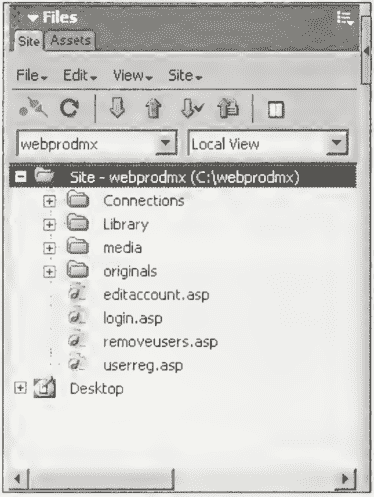

这个新面板具备全屏版本的所有功能，并且额外增强了 Dreamweaver MX 拖放功能的便利性。您可以浏览图像文件夹（上图我们将其命名为 *media*）来查找图像，然后直接将其拖放到页面上、属性检查器中或代码视图中！当您同时打开多个文件时，这是一种更加舒适的工作方式。

不仅如此，它还集成了文件浏览器，使您能够从本地计算机或网络上的任何位置收集内容并纳入站点。Dreamweaver MX 还足够智能，能够将站点定义范围之外的任何媒体文件放入默认的图像文件夹中，将这些新内容带到站点内易于找到的位置。链接跟踪功能还能帮助您保持文档的最新状态，如果您决定将任何项目移动到新的位置，无论是页面还是媒体文件。

您可以使用站点面板进行所有标准的文件维护操作，包括：

- 创建新文档
- 移动文件或使用其原生应用程序打开文件
- 创建、编辑和删除文件夹和文件等项目
- 在本地站点、远程站点和测试服务器之间传输文件

##### 标签选择器

标签选择器位于文档窗口底部状态栏：

```
<body> <form#form1> <table.maintext> <tr> <td> <h1>
```

它显示从起始标签 `<body>` 开始到设计视图中当前选择位置结束的标签层次结构。在上图中，我的光标当前位于一个标题的中间，该标题位于一个应用了名为 .maintext 的 CSS 样式的表格行中；该表格位于名为 form1 的表单内。

左键单击列出的任何标签将高亮显示该标签的内容，而右键单击标签将弹出上下文菜单，使您能够编辑所选标签的内容、移除所选标签（及其内容），或设置所选标签的 ID 或类（CSS 样式）。

状态栏还有另一个菜单；窗口大小弹出菜单。您可以使用此菜单将当前文档窗口调整为任何列出的大小。如有需要，您还可以向此列表添加自己的尺寸。这个仅适用于设计时的工具有助于您在不同屏幕尺寸下可视化页面，但它不会以任何方式影响您的代码。

在该菜单右侧有两个数字，表示估计的文档大小和基于您首选项的估计下载时间。您可以通过"编辑 > 首选项 > 状态栏 > 连接速度"（下拉列表）选择一个调制解调器速度用于此计算。估计的文档大小是通过包含构成文档的所有文件计算得出的，包括但不限于图像、JavaScript 和 CSS。下载速度是基于理论速度而非实际速度估算的，这可能会使结果略有偏差。考虑到这一点，它确实能给您一个合理的指示，说明您的页面需要多长时间加载。

##### 插入栏

插入栏是增强版的旧对象面板！

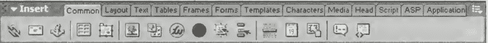

插入栏中包含多个选项卡。

- 常用
- 布局
- 文本
- 表格
- 框架
- 表单

# 第 1 章

- 模板
- 字符
- 媒体
- 标题
- 脚本
- 应用程序

如果您以前使用过 Dreamweaver，那么其中一些名称对您来说会很熟悉，有些则被重命名以使其更符合其内容。然而，在一些您熟悉的标题中，有些新增功能是您以前没见过的。例如图像占位符，用于在页面上添加图像占位符。您可能将其用于视觉布局目的，直到实际的艺术作品完成并准备好使用，或用于附加动态数据以创建数据驱动的图像。

您看到的额外选项卡可能包含仅适用于您正在使用的服务器端语言的选项。甚至可能有一些额外选项卡仅针对您选择的服务器端语言出现，而其他语言不会出现——例如，如果您正在开发 ColdFusion 应用程序，ASP 选项卡将不会出现在插入栏中，但您会在 ColdFusion 开发环境中看到三个在开发 ASP 页面时不可用的额外选项卡。

##### 文档工具栏

文档工具栏可以快速便捷地访问许多开发工具：

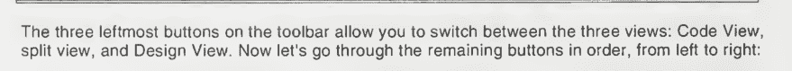

工具栏上最左侧的三个按钮允许您在三种视图之间切换：代码视图、拆分视图和设计视图。现在让我们从左到右依次介绍其余的按钮：

- **实时数据视图**按钮是一个非常强大的功能，允许您在创建页面时查看数据库中的实际数据。您可以对页面进行设计更改（或代码更改），并实时查看它们将对显示的数据产生什么样的呈现效果。
- **文件管理**按钮用于快速访问文件操作，如获取、上传和定位站点中的位置。
- **在浏览器中预览/调试**按钮允许您启动列出的浏览器之一用于预览/调试目的。您还可以从此菜单编辑浏览器列表。
- **刷新设计视图**按钮用于使设计视图与您在代码视图中所做的任何更改保持同步。您所做的大多数更改都会反映在设计视图中，但对于那些没有反映出来的情况，这个按钮就能派上用场。

- ***参考***按钮将以上下文敏感的方式显示参考面板。例如，在页面上选择一个输入字段，然后单击***参考***按钮，将打开参考面板以显示 `<input>` HTML 标签的详细信息。
- ***代码导航***按钮帮助您浏览 JavaScript 代码。如果您正在处理的页面上有许多函数，需要快速找到特定函数，从此按钮的下拉列表中选择它会帮您定位到该函数。您还可以利用调试功能来帮助查找和修复代码中的错误。
- ***视图选项***按钮让您决定某些可视化元素如何显示——您可以使用 Dreamweaver MX 提供的任何或所有可视化辅助工具，并使用此菜单来指定要使用哪些。如果您在拆分视图中工作，还可以选择将设计视图设置在代码窗口的上方或下方。

##### 标准工具栏

***标准工具栏***是另一个有用的补充，包含常用的文件、剪贴板和页面命令：

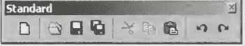

从左到右，前四个按钮分别是：***新建***、***打开***、***保存***和***全部保存***。接下来是剪贴板部分，包括***剪切***、***复制***和***粘贴***。最后，我们有页面命令***撤销***和***重做***。缺少的一个是***另存为***按钮——此命令只能从文件菜单访问，或者右键单击每个最大化文档底部的文档标签，然后从出现的菜单中选择它。

激活***标准***工具栏的最快方法是右键单击***文档***工具栏，此时弹出菜单会在任何可见工具栏的名称旁边显示一个勾选标记——确保相关选择已被勾选。

#### 结果面板组

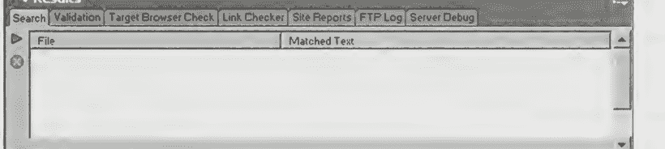

当您对文档或整个站点运行验证检查或报告时，这些详细信息将输出到**结果面板组**的相应面板。当结果显示在显示区域时，您可以双击报告的一行以直接转到指定文档的该部分。如果该文档尚未打开，系统将为您打开它，通常以拆分视图显示，以便您可以看到引用的确切代码部分。

正如截图所示，该面板组中有七个面板，我们现在来讨论一下。


 ## 第 1 章

##### 搜索面板

**搜索面板**会报告*查找*和*替换*操作的所有匹配结果。选项卡下方的绿色"播放"按钮只有在您打开文档时才会启动*查找*和*替换*对话框。您也可以通过代码视图或拆分视图的代码部分中的上下文菜单（右键单击）来启动该对话框。绿色"播放"按钮正下方是一个停止按钮，仅当结果面板任务正在运行时才会激活。这些按钮以及更多按钮在所有面板上都可用，除了*FTP 日志*面板和*服务器调试*面板。您在此区域可能看到的其他按钮包括一个"**更多信息**"按钮（白色对话气泡中带有"i"）、一个"*保存报告*"按钮（使用磁盘图标）以及一个"*浏览报告*"按钮（使用地球仪图标）。

##### 验证面板

**验证面板**让您可以快速访问 Dreamweaver MX 中的验证选项。此面板上的绿色"播放"按钮带有一个小小的黑色"向下"箭头，表示有可用的子菜单。单击绿色"播放"按钮会显示一个子菜单，为您提供以下 5 个选项：

- **验证当前文档** – 这将验证当前获得焦点的文档
- **将当前文档验证为 XML** – 这将把当前获得焦点的文档作为 XML 文档进行验证
- **验证整个站点** – 这将验证整个站点
- **验证站点中选定的文件** – 这将验证站点窗口中所有当前选定的文件
- **设置...** – 这将启动首选项面板的验证器部分，让您可以根据需要修改验证设置

##### 目标浏览器检查面板

**目标浏览器检查面板**可以帮助您在其他人发现问题之前，检查页面中存在的浏览器特定问题。Dreamweaver MX 的默认安装会根据 Internet Explorer 2 到 6 版本、Netscape Navigator 2 到 6 版本以及 Opera 2.1 到 6 版本的浏览器配置文件来检查您的文档。这些浏览器配置文件存储在文本文件中，当然是可以扩展的，因此当新版本的浏览器发布时，可以添加新的配置文件，使您能够针对它们验证文档。

##### 链接检查器

**链接检查器**让您可以选择检查当前打开文档中的链接或整个站点中的链接，并会报告任何损坏的链接。

##### 站点报告面板

**站点报告面板**让您可以对当前文档、整个站点、站点中选定的文件或文件夹运行各种报告，帮助您快速识别 HTML 文件中的常见错误。报告运行后，选择带有灰色问号图标的行，然后单击*更多信息*按钮，将打开参考面板并显示与您的报告选择相对应的相关可用性参考材料。双击某一行将显示有问题的代码部分。

## Dreamweaver MX 简介

#### FTP 日志面板

如果您使用 Dreamweaver MX 的 FTP 工具，**FTP 日志面板**是一个有用的工具。通过 Dreamweaver MX 发出的每个 FTP 命令都会记录在日志文件中，此面板可以帮助您查找 FTP 过程中可能出现的任何问题的根源。

#### 服务器调试面板

**服务器调试面板**仅用于 ColdFusion 页面，它通过向您呈现几处有用的信息来帮助您进行调试工作，例如服务器为渲染页面而必须处理的所有页面列表、执行的所有 SQL 查询，以及所有服务器变量及其值。

### 模板

模板对于确保整个网站的一致外观和风格非常有用，其理念是您创建一个页面作为网站内所有其他页面的基础。如果您更新了用于创建网站中其他页面的模板的任何部分，保存时系统会询问您是否要将这些页面更新为反映您对模板所做的更改。如果您愿意，可以跳过此步骤，并在更方便的时候从*修改* > *模板*菜单统一更新它们。

在 Dreamweaver MX 之前，模板相当基础，您可以定义模板的可编辑区域，允许其内容按页面逐页修改。模板的所有其他部分都是锁定的，这意味着您只能在模板本身上修改该内容，这样做时：您更改了使用该模板的每个页面中的内容。这很有效，但同时对于可能具有严格设计规则以及一些多样化页面内容的大型动态网站来说，在可用性方面有点受限。

Dreamweaver MX 中的新模板从这一原始理念迈出了演进的步伐，因此它们通过包含新功能来适应更多的变化。

创建嵌套模板的能力为创建和维护网站的外观和风格开辟了全新的方式。这涉及创建一个具有已定义可编辑区域的基础模板，然后基于原始模板创建一个新模板，以进一步定义所选可编辑区域的外观。这可以包括在现有可编辑区域内添加可编辑区域。

您可能使用此技术的一个例子是：为整个网站定义页面的基础视觉效果，然后从基础页面为搜索结果页面布局创建一个嵌套模板。这将为页面的一部分包含特定的设计功能，同时仍然保留整体基础视觉效果。同样的方法也可以用于详细信息页面布局，在这种页面中，除了基础页面之外，还需要放置特定的设计元素。

除了上述可编辑区域之外，您还具有进一步的模板功能，使网站设计师能够在整个网站保持视觉风格的同时，仍然允许内容贡献者向页面添加动态内容。

这些功能分为以下三类：

#### 重复区域

您经常会遇到在页面上显示动态数据列表的需求；为确保网页这些部分的一致外观，您可以在模板上创建**重复区域**，这将考虑显示多行数据的需求，同时保持视觉风格。

您可以在 Dreamweaver MX 中创建两种类型的重复区域：

- **重复区域**是模板的一部分，可以多次复制，但默认情况下不可编辑。要使其可编辑，需要在重复区域内创建一个可编辑区域
- **重复表格**是包含表格中可编辑区域的重复区域 – 您可以定义哪些表格单元格是可编辑的

#### 可选区域

**可选区域**是基于模板的页面中的一个区域，根据模板决定是否在该页面上使用。此可选区域使用变量来决定是否在页面上显示此区域。

例如，某些页面可能需要显示额外的图像或文本，但其他页面不需要，您可能希望对所有这些元素保持视觉风格，但不一定在每个页面上都包含它们。可选区域可以满足这些情况。

更进一步，**模板表达式**为可选区域评估一个值，并根据该值显示或隐藏它。它们由 JavaScript 的一个子集创建，但您仍然拥有巨大的能力。可以创建单个或多个 `IF` 语句来测试值，然后再显示可选区域。这些表达式在代码视图中编写，在设计视图中由页面上的表达式标记表示。要在设计视图中编辑表达式，请选择表达式标记，代码将显示在属性检查器中。

#### 可编辑标签属性

如果您希望让基于模板的页面中的某些标签属性（如文本对齐方式或图像大小）可由内容提供者编辑，现在可以让这些选定的特定标签属性在您的模板上可编辑。

### 库项目

库项目可以是图像、文本或任何其他对象，例如一段脚本，您希望在网站中使用和重复使用。您创建一个库来存放这些库项目，然后可以在整个网站中重复使用它们。

库项目的理念是保持页面内容的一致性。如果您想在许多页面上重复使用相同的图像，可以将其转换为库项目，然后在整个网站中使用它。当需要更改该图像时，只需在库中更改一次，所有使用它的页面都可以自动更新。


## Dreamweaver MX 简介

您确实可以选择不立即更新页面，甚至完全不更新；但如果之后需要更新，可以使用*修改 > 库 > 更新页面*菜单。

关于可以转换为库项目的元素类型，存在一定的限制；不过主要规则很简单——只有可以添加到文档主体中的元素才能转换为库项目。因此，例如，CSS 样式不能作为库项目，因为它们是添加到文档头部的。尽管如此，您可以包含例如一个翻转图像作为库项目。然后，当您将该库项目应用到页面时，Dreamweaver MX 足够智能，能够识别出产生翻转效果所需的 JavaScript 代码是必要的，以便该库项目正确工作，因此它会自动添加到文档头部。

库项目和模板之间存在一些相似之处，但需要明确区分的是：模板用于保持整个页面的视觉风格，而库项目则用于存储可重用且可更新的页面内容片段。

## 小结

我们在此处已经看到了 Dreamweaver MX 的许多新增功能和改进功能，希望您能对此次新版本带来的各种新技术有所认识。

无论是作为独立开发者还是开发团队的一员，那些能够让您工作得更快、更高效的设计功能和代码功能，都受到了关注，此外还有全新的界面和众多组成面板。

该产品的可扩展性意味着越来越多的扩展开发者将发布增加基础产品功能的扩展——有些是免费的，有些是商业的，但它们都将为产品带来附加价值。

标准合规性、可访问性和页面验证在 Dreamweaver MX 中得到了重点体现，同时还有功能强大的工具，帮助您生成任何人都能在互联网上查看的代码页面。

说到验证，这就自然地引出了*第 2 章*，我们将在其中介绍如何在 Dreamweaver MX 中生成有效的 HTML 和 XHTML。

# 第 2 章

- 我为什么要转向 XHTML？
- 编写有效 XHTML 的实践方法
- 在 Dreamweaver MX 中使用 XHTML

作者：Rachel Andrew


## Dreamweaver MX 中的有效 (X)HTML

随着 Dreamweaver MX 的发布，Macromedia 在 Dreamweaver 中引入了许多功能，使开发者能够快速创建有效、格式良好且遵循最佳实践的标记。一些新功能包括：支持在 XHTML 中工作、显著改进的 CSS 支持，以及内置验证器，让您无需使用在线工具即可根据 W3C 标准验证您的标记。在本章中，我们将不仅探索 Dreamweaver MX 中的这些新功能，还将讨论它们的实用性，以及遵循万维网联盟（W3C）制定的建议和标准进行开发为何是个好主意。

本章开头重点讨论 XHTML，因为它是 W3C 最新的推荐标准，创建新网站的开发者将开始转向它。如果您从未考虑过转向 XHTML，或者对它知之甚少，那么本章将为您提供转向 XHTML 是正确之举的理由。使用有效的 XHTML 可以使您的网站对依赖屏幕阅读器等辅助技术的残障用户更加友好，也可以让使用 PDA 等设备查看您页面的人获得更好的体验。转向 XHTML 意味着您将掌握编写 XML 文档的要求，同时使用的是一种让您感到熟悉的标记语言，而且还将允许集成其他 XML 应用。然而，我们在本章中讨论的大部分内容，无论您是在使用 HTML 还是 XHTML，都是相关的。

在本章的后半部分，我们将逐步介绍使用 Dreamweaver 创建一个简单的 HTML 页面，然后再创建一个 XHTML 页面。我们还将根据各种 XHTML 标准验证此页面，并探讨如何将现有的 HTML 网站转换为 XHTML。

### HTML

超文本标记语言（HTML）被设计为交换科学和技术文档的一种手段。它使用一种功能更强大的语言——标准通用标记语言（SGML）的标签子集，以便快速创建和分发文档。SGML 是一种用于将文本标记为结构单元的元语言，其理念是该语言独立于用于查看它的设备，并可在任何机器上实现。HTML 使用了 SGML 的部分标签和该语言的基本结构。HTML 的创造者 Tim Berners-Lee 还添加了对超文本的支持，允许内容的链接，这是 SGML 中不存在的功能。

HTML 被设计成一种易于使用的语言。这种易用性意味着几乎任何人都可以创建 HTML 文档，随着它的普及，作者们想要的不仅仅是科学家和研究人员所需的简单、结构化、超链接的文档。浏览器制造商接手了 HTML 并开发了自己的专有扩展和标签；有时这些标签在不同浏览器间是标准的，但到了 Microsoft 和 Netscape 推出各自的 4.0 版本浏览器时，许多网站建设者已经不得不为两个主要浏览器分别构建两个网站——并希望他们的访客根本不会使用其他浏览器！

在浏览器制造商进行这项开发的同时，W3C 成立了，旨在为 HTML 标记制定标准（http://www.w3.org/）。这些标准以当时基本的 HTML 标记为基础，并添加了一些已经流行起来的新功能。当我们谈论验证页面时，我们说的是确保我们的文档不包含我们所编写的特定规范之外的任何内容。为了让浏览器（和验证器）知道我们编写的是哪个版本的 HTML，我们在每个文档的顶部添加一行称为 DOCTYPE 的代码，指定我们遵循的是哪个标准。

从某种程度上说，W3C 的努力非常成功。2002 年的网页开发者会意识到访客使用屏幕阅读器、盲文阅读器、PDA 以及各种平台上的各种"传统"浏览器，而主流浏览器的最新版本——Internet Explorer 和 Netscape——正以标准合规性作为主要卖点，而不是宣传如果仅为他们的浏览器编码可以实现的各种花哨功能。

#### HTML 的未来如何？

尽管浏览器对 HTML 标准的支持和采纳比以往任何时候都好，但 HTML 将不会有进一步的版本。当前版本 HTML 4.01 将是最终的 HTML 标准，而当前推荐的网络标记语言是 XHTML。虽然 HTML 不会有后续版本，但也不太可能 suddenly 从网络上消失，验证任何 DOCTYPE（即使是 HTML 3.2）也比完全不验证要好。然而，正如我将在本章中解释的，转向 XHTML 有很多好处，而问题很少，因此鼓励新网站建设者使用 XHTML。

### XHTML

XHTML（可扩展超文本标记语言）是 XML 的子集，而 XML（与 HTML 一样）是 SGML 的子集。XML 和 SGML 都是元语言。元语言是一种允许您使用文档类型定义（DTD）创建其他语言的语言，DTD 定义了文档的结构以便对其进行解释。XHTML 就是使用 XML 创建的一种语言。

XHTML 被开发为再现 HTML 所有功能同时符合 XML 更严格规则的网页语言。它是从 HTML 4.01 合乎逻辑的发展，绝对不是什么需要担心的事，尤其现在您可以使用熟悉的可视化开发环境 Dreamweaver 来帮助您完成过渡。

> "XHTML 家族是互联网演进过程中的下一步。通过今天迁移到 XHTML，内容开发者可以进入 XML 世界及其所有随之而来的好处，同时仍然对其内容的向后兼容性和未来兼容性充满信心。"

—— W3C XHTML 规范（http://www.w3.org/TR/xhtml1/）

#### 我为什么要转向 XHTML？

了解 XHTML 是什么固然很好，但作为一名网页专业人员，为什么您某天早上醒来就决定开始使用 XHTML 而不是 HTML 呢？为什么您会考虑将现有网站转换为 XHTML？转向这种新语言有许多切实可定义的好处。

#### 更清晰的标记

HTML 允许开发者以非常灵活的方式编写 HTML。虽然网页浏览器擅长解释标记并显示它，但以其他方式操纵文档可能非常困难，因为当前桌面浏览器允许的灵活性可能导致不整洁、草率的标记。有效的 XHTML 文档可以轻松地被传统浏览器以及其他设备（如 PDA 和其他缺乏解释草率标记处理能力的移动设备）读取。

#### 更强的平台独立性

XHTML 对清晰、结构化标记的坚持使其更容易将文档移植到不同的环境中。并非所有设备都拥有传统网页浏览器那样的能力来解释不正确或复杂的标记并正确显示它。XHTML 的严格特性意味着它在所有设备上都更有可能以结构良好的方式显示。

#### 可访问性

XHTML 文档必须遵守严格的规则。这使得盲文阅读器、屏幕阅读器和其他辅助技术等替代设备更容易解释内容，并以有用且可导航的方式呈现给用户。有效的 XHTML 文档不留任何非标准标记的余地，因此消除了文档中任何内容干扰其可访问性的可能性。

#### 向前兼容性

正如我们已经看到的，HTML 将不会有未来的版本。浏览器制造商将着眼于未来发布新版本，虽然我们不太可能很快看到对 HTML 的支持被放弃，但遵循最新标准总是一个好主意。这样做，您的页面在主流浏览器的下一个版本出现时，更不容易出现显示问题。正如我们将在本章后面看到的，使用过渡型 DOCTYPE 使您能够创建在旧浏览器中正确显示的 XHTML 文档，同时仍然创建能够通过 XHTML DOCTYPE 验证的文档。


## 第二章

### 学习 XML 规则

XML 将会持续存在——通过编写 XHTML 文档，你遵守的是 XML 标记的严格规则，这将在未来给你带来很大帮助。养成创建格式良好文档的习惯，将使你在未来为不同应用创建 XML 文档时变得驾轻就熟。

### 与其他 XML 应用集成

XHTML 允许引入来自其他 XML 定义的标记，例如 MathML、SMIL（同步多媒体集成语言）或 SVG（可缩放矢量图形）。这对当今许多设计师和开发者来说可能看似不是特别有用，但随着其他 XML 应用的采用和使用不断增长，这一点可能会变得更加重要，因此在这个相对较早的阶段学习 XHTML，将使你的简历和技能看起来非常前沿。

### 页面加载时间

有效的 XHTML 文档加载更快，因为浏览器不需要重新解释错误的标记。HTML 对未闭合标签和嵌套不当的标记较为宽容，这增加了浏览器的解释负担。此外，HTML 固有的灵活性助长了草率的标记习惯，而这反过来也会增加页面的加载时间。随着我们朝着创建遵循严格 DTD 的 XHTML 页面迈进，我们需要将样式和表现方面移入 CSS，从而进一步精简页面。尽管拥有宽带、高速连接的人数在增加，页面加载时间仍然是一个重要问题。虽然编写有效、结构良好的 HTML 也能实现更快的页面加载，但 XHTML 强制执行这种严格性，防止草率的习惯悄然渗入。

### 编写 XHTML 的"规则"

对于任何精通 HTML 的人来说，XHTML 并不难学，而且 Dreamweaver MX 会全程帮助你。你只需要遵循一些适用于所有 XHTML（因此也是 XML）文档的简单规则。

#### XML 声明

XML 声明 `<?xml version="1.0" encoding="iso-8859-1"?>` 是 Dreamweaver 在新建 XHTML 文档时于 DOCTYPE 之前添加的，虽然在 XHTML 文档中并非严格必需，但 W3C 声明"强烈建议 XHTML 文档作者在所有文档中使用 XML 声明"。

XML 声明只是说明该文档是一个 XML 文档，而且还可以（如 Dreamweaver 插入的声明那样）提供文档的字符编码信息。

#### DOCTYPE

XHTML 文档必须验证符合三种 XHTML DTD 之一：XHTML strict、XHTML transitional 或 XHTML frameset。正如我们将在本章后面看到的，XHTML strict 不允许任何已弃用元素或框架集，XHTML transitional 支持已弃用元素但不支持框架，XHTML frameset 支持框架集。文档中必须有一个 DOCTYPE 声明位于 `<html>` 标签之上，并且必须引用我们将在本章后面更深入讨论的这三个 DTD 之一。当你在*新建文档*对话框中勾选*使文档符合 XHTML*复选框创建文档时，Dreamweaver MX 默认插入 XHTML Transitional DTD。但是，如果你创建的是框架集，它将插入 Frameset DTD。下面是一张截图，显示 Dreamweaver 插入的 HTML 4.01 Transitional DTD：

## Dreamweaver MX 中的有效 (X)HTML

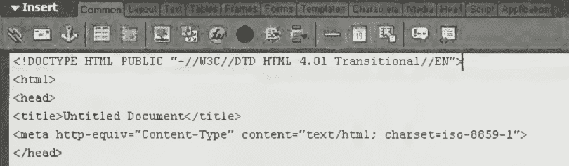

#### 引号

所有属性值必须用引号括起来。在以下 `` 标签中，height 和 width 属性的定义方式是错误的：

```

```

这是正确的方式：

```

```

虽然以前版本的 Dreamweaver 倾向于正确引用属性，但你可能会发现你或团队中的其他开发者使用的代码片段可能没有那么谨慎。选择*命令 > 清理 XHTML*将为文档中任何未加引号的属性添加引号。

#### 大小写敏感性

元素和属性名称必须小写。

以下两行都是错误的：

```


```

以下是正确的 XHTML：

```

```

如果你一直用大写书写 HTML 标签以便于区分标签和内容，你可能会觉得这种改变起初有些困难。JavaScript 事件处理程序——例如 `onclick` 或 `onmouseover`——也必须小写书写。

以下 JavaScript 是错误的：

```
onMouseOver="MM_swapImage('img1','','i/button01b.gif','1')"
```

这是正确的方式：

```
onmouseover="MM_swapImage('img1','','i/button01b.gif','1')"
```

Dreamweaver MX 在处理 XHTML 文档时会生成小写代码，包括 JavaScript。如果你在 HTML 中工作，可以在*首选参数*对话框中选择对 HTML 标签使用大写或小写。然而，即使在使用 HTML 时，开始用小写工作也不是坏事，因为这在未来是必要的。

#### 非空元素的闭合标签

所谓*非空*元素，是指在开标签和闭标签之间包含某些内容的标签。一些 HTML 元素可以不写闭合标签，例如段落元素的闭合 `</p>` 标签是可选的，因此许多 HTML 作者会省略它。但在 XHTML 中，所有元素都必须闭合。

以下内容虽然对 HTML 有效，但在 XHTML 中是错误的：

```
<p>This is some text formatted in a paragraph.
<p> This is the second paragraph.
```

这是在 XHTML 中标记相同文本的方式：

```
<p>This is some text formatted in a paragraph.</p>
<p> This is the second paragraph.</p>
```

Dreamweaver MX 会闭合所有非空元素，无论你是在 HTML 还是 XHTML 中工作，并且当你运行*清理 HTML*命令时会添加闭合标签。

#### 空元素

空元素是指那些独立存在、在开标签和闭标签之间不包含任何内容的 HTML 标签，如 `<br>` 和 `<hr>`。在 XHTML 中，这些需要闭合：

HTML 空元素如 `<br>` 和 `<hr>`，在 XHTML 中变为 `<br />` 和 `<hr />`。

> 注意标签后和斜杠前的额外空格。虽然不加这个额外空格来闭合标签也是正确的，但这个空格能让那些无法识别 XHTML 的浏览器正确显示你的内容。

Dreamweaver MX 在 XHTML 文档中生成标记以及清理 XHTML 时，都会为 `<br />` 等空标签使用正确的语法。

以下是正确嵌套标签的方式：

```
<p><strong>This is bold text.</strong></p>
```

Dreamweaver MX 会正确嵌套元素，并且在清理 XHTML 时也会修正元素的嵌套。

#### 属性最小化

有效 XHTML 文档中的属性不能最小化。属性最小化是指只写属性名而不指定值的做法，这将使属性设置为其默认值。所有属性都应写成名称-值对的形式，即使这意味着值与名称相同。

这在 XHTML 中是错误的：

```
<input type="checkbox" name="checkbox" id="checkbox" value="True" checked />
```

这是修正后的版本：

```
<input type="checkbox" name="checkbox" id="checkbox" value="True"
       checked="checked" />
```

Dreamweaver MX 会插入这个正确的标记，而且如果你将 HTML 文档转换为 XHTML，它还会将最小化的属性转换为名称-值对。

以下是一个符合上述指南的 XHTML 文档示例：

```
<?xml version="1.0" encoding="iso-8859-1"?>
<!DOCTYPE html PUBLIC "-//W3C//DTD XHTML 1.0 Transitional//EN"
"http://www.w3.org/TR/xhtml1/DTD/xhtml1-transitional.dtd">
<html xmlns="http://www.w3.org/1999/xhtml">
  <head>
    <title>My XHTML Document</title>
  </head>
  <body>
    <p><strong>Hello! World</strong></p>
  </body>
</html>
```

### 编写有效的 XHTML 和 HTML

现在你已经对 XHTML 有了一些了解，并且能够就是否要使用 XHTML 或 HTML 进行开发做出明智的选择，我们需要了解可用于文档验证的不同实现方式，以及为什么你可能甚至觉得有必要验证你的文档。


 ## 为什么编写有效的 (X)HTML 很重要？

也许到了这个时候，你可能会疑惑为什么要验证你的 HTML；毕竟，有很多网站虽然在使用验证器检查时会报错，但在所有常见浏览器中都能完美显示。验证是不是只会带来大量无法向客户收费或解释的额外工作？

- 如果你不按标准 DTD 验证你的页面，那么你就是将页面显示的控制权拱手交给了浏览器。符合规范的浏览器倾向于按照预期渲染有效的 (X)HTML，而那些不能正确渲染的情况通常都有详尽的文档记录。
- 验证并修正你的标记是一个很好的调试过程：通常一旦纠正了验证器报出的错误，问题就会消失；即使问题没有消失，至少你也知道问题不是简单地由于未闭合或错误嵌套的标签造成的。
- 即使你已经使用了浏览器专用的标签，或者为了视觉效果而做了某些你知道会导致页面在验证器眼中无效的操作，无论如何验证页面的其余事物的其余部分总不是坏主意。这样你就可以在充分了解其可能带来的任何问题的情况下，做出是否包含规范之外的内容的明智决定，同时确保网站的其余部分是有效的，能够正确显示。
- 良好、有效的标记比充斥着字体标签和表现性 HTML 技巧等混乱、臃肿的代码更容易被搜索引擎机器人抓取和索引。
- 最后，验证你的标记可以确保你的文档在未来仍然可访问。浏览器制造商在设计下一代网页浏览器时会参考 W3C 规范，他们可能会保留也可能不再支持自己的专有标签，或者那些恰好能产生某种效果的广泛使用的"技巧"。这一先例在 Netscape 6 发布时就已经确立，为了兼容标准和支持我们在 Netscape 6x 中看到的 W3C DOM，浏览器取消了对他们专有 `<layer>` 标签的支持。这种情况可能再次发生，而避免你的网站在新一代浏览器出现无法访问的最佳方法，就是现在就使用有效的标记。

## 选择文档类型声明

文档类型声明（DTD）告诉浏览器或设备你使用哪个版本的 XHTML 或 HTML 创建了文档。这意味着浏览器不必过多猜测你在使用什么，可以更快地渲染你的页面。

### XHTML Strict

```
<!DOCTYPE html PUBLIC "-//W3C//DTD XHTML 1.0 Strict//EN"
    "http://www.w3.org/TR/xhtml1/DTD/xhtml1-strict.dtd">
```

针对 XHTML Strict DTD 验证你的文档是最严格的选项。此 DTD 不支持本章后面列出的任何已弃用元素，也不支持框架集。

### XHTML Transitional

```
<!DOCTYPE html PUBLIC "-//W3C//DTD XHTML 1.0 Transitional//EN"
"http://www.w3.org/TR/xhtml1/DTD/xhtml1-transitional.dtd">
```

Transitional DTD 是大多数从 HTML 转向 XHTML 的设计人员和开发人员的选择，也是 Dreamweaver 在创建新的 XHTML 文档时默认插入的 DTD。此 DTD 支持 XHTML Strict 中不允许的已弃用元素，但不允许框架集。文档仍然必须符合 XHTML 的规则。

### XHTML Frameset

```
<!DOCTYPE html PUBLIC "-//W3C//DTD XHTML 1.0 Frameset//EN"
"http://www.w3.org/TR/xhtml1/DTD/xhtml1-frameset.dtd">
```

如果你使用框架并且希望创建有效的 XHTML 文档，则必须使用 Frameset DTD。如果你在 Dreamweaver 中使用框架集工作并且要求文档符合 XHTML，Dreamweaver 会自动为你插入此 DTD。

### HTML 4.01 Strict

```
<!DOCTYPE HTML PUBLIC "-//W3C//DTD HTML 4.01//EN"
"http://www.w3.org/TR/html4/strict.dtd">
```

HTML 4.01 Strict DTD 不允许使用任何已弃用元素或框架集。

### HTML 4.01 Transitional

```
<!DOCTYPE HTML PUBLIC "-//W3C//DTD HTML 4.01 Transitional//EN"
"http://www.w3.org/TR/html4/loose.dtd">
```

HTML 4.01 Transitional 允许使用已弃用元素和属性。

### HTML 4.01 Frameset

```
<!DOCTYPE HTML PUBLIC "-//W3C//DTD HTML 4.01 Frameset//EN"
"http://www.w3.org/TR/html4/frameset.dtd">
```

### DOCTYPE 探测：标准模式与怪异模式

当今的 Web 包含各种各样的网站，有些是按照 HTML 4.01 或 XHTML 的新标准编写的，另一些则是混合了各种 HTML 版本并利用浏览器专用标签和技巧来实现特定效果的。为了应对这种情况，最新的浏览器版本使用 DOCTYPE 来判断文档作者是希望使用符合标准的浏览器来渲染页面，还是页面是为旧的、不符合标准的浏览器编写的，可能依赖于非标准的怪异行为。DOCTYPE "探测"，正如其名称所描述的，依赖于这样一个事实：大多数这些怪异文档要么没有 DOCTYPE，要么使用旧的 DOCTYPE。

使用上述任何示例都会导致现代浏览器切换到符合标准的模式，并使你的页面相对接近 W3C 规范进行渲染。对于新网站来说这是一件好事。通过按照标准进行开发并要求浏览器根据这些标准显示你的网站，你不太可能在一个现代浏览器与另一个现代浏览器之间的渲染上看到灾难性的差异。如果你使用不完整的 DOCTYPE，例如：

```
<!DOCTYPE HTML PUBLIC "-//W3C//DTD HTML 4.01 Transitional//EN">
```

或者完全没有 DOCTYPE，IE 6、Mozilla 和 Netscape 6 会假定你希望页面看起来像在旧版本浏览器中一样，并恢复到它们的"怪异"模式。XHTML DOCTYPE 始终会强制浏览器进入符合标准的模式，这是理所当然的。

Dreamweaver MX 在创建新的 HTML 文档时会添加不带 URL 的 Transitional DOCTYPE。因此，默认情况下，使用 Dreamweaver MX 创建的页面会使现代、符合标准的浏览器以怪异模式运行。如果你正在向较旧的站点添加页面，你可能会对这种行为感到非常高兴。更改 DOCTYPE，或者开始在某些页面上使用 DOCTYPE 而在其他页面上不使用，会导致设计不一致，而且由于以前版本的 Dreamweaver 没有插入 DOCTYPE，会有很多人处于这种情况。然而，对于新网站来说，使用上面所示的完整 DTD 将有助于确保你的网站在可能不具备这种切换渲染模式能力的较新版本的浏览器中不会出现问题。

## 应对已弃用的标签

如果你的网站严重依赖某些已弃用的标签，或者是浏览器专用因此未包含在规范中的元素，那么转向 XHTML 可能会很困难。虽然有一些常用标签已被规范认定为已弃用（并且不能在 XHTML Strict 文档中使用），但这些通常是被用于特定视觉效果标签，而这些效果完全可以更好地用 CSS 来实现。

即使你不对 strict DTD 进行验证，也值得记住这些标签是已弃用的，这意味着它们将在 XHTML 的未来版本中被完全移除。为了向前兼容，如果有替代方案，你最好尽快转向替代方案。

### XHTML 中已弃用的标签

| 元素 | 描述 |
|---------|-------------|
| `<applet>` | Java 小程序 |
| `<basefont>` | 默认字体属性 |
| `<bgsound>` | 背景声音标签 |
| `<blink>` | 使文本闪烁 |
| `<center>` | 对齐文本块 |
| `<embed>`/`<noembed>` | 嵌入小程序等 |
| `<font>` | 设置字体大小或颜色 |
| `<layer>`/`<ilayer>`/`<nolayer>` | Netscape 可定位层标签 |
| `<marquee>` | 滚动文本 |
| `<menu>` | 菜单列表 |
| `<s>` | 删除线文本 |
| `<strike>` | 删除线文本 |
| `<u>` | 下划线文本 |


 ## XHTML 中已弃用的属性

| 属性 | 说明/示例 |
|-----------|---------------------|
| align | `<td align="right">` |
| | `<div align="right">` |
| alink, vlink, link | 应用于 `<body>` 标签，用于为文档内的链接设置颜色 |
| background | 应用于 `<body>` 标签，为文档添加图像背景 |
| bgcolor | `<body bgcolor="...">` |
| | `<td bgcolor="...">` |
| border | `` |
| clear | 应用于 `<br>` 标签 |
| color | `<font color="...">` |
| face | `<font face="...">` |
| height | `<td height="...">` |
| noshade | `<hr noshade>` |
| nowrap | `<td nowrap>` |
| size | `<hr size="...">` |
| | `<font size="...">` |
| width | `<td width="...">` |
| | `<hr width="...">` |

在*第3章*中，我们将探讨上述一些常用标签，并了解如何通过 CSS 实现相同的效果，同时不损害页面的结构和可访问性。

## 标记的最佳实践

无论你验证的是哪个 DTD，开发人员都有很多方式滥用 HTML 的某些方面来实现视觉效果。这些被滥用的标签之所以被弃用，都是为了推动将文档的表现与内容和结构分离。

将来，我们都需要更多考虑访问我们网站的其他设备：不仅仅是帮助残障人士访问互联网的设备，还包括现在广泛使用的各种 PDA、手机和类似设备。不当使用 HTML 标签可能会在传统网络浏览器中以传统网站形式访问内容时造成问题，而在使用其他设备访问时问题会更加严重。

在可视化开发环境中工作可以实现文档和网站的快速开发。然而，当我们在文档窗口中四处移动元素以追求最新项目的正确外观和感觉时，这可能会让我们忘记代码中实际发生了什么。通过构建糟糕的结构或不当使用标签，你的文档可能通过验证，但仍会给使用其他设备的用户带来可访问性问题。

### 避免使用字体标签进行文本样式和大小设置

如今广泛使用的浏览器都能很好地支持使用 CSS 进行文本样式设置。虽然你可能不愿意转向使用 CSS 来定位页面元素，但完全没有理由忽视使用 CSS 而非 `<font>` 标签进行文本样式设置的巨大优势。移除字体标签后产生的更简洁的标记可以带来更快的下载速度、更轻松的网站维护和重新设计。我们将在第3章中全面介绍这些优势。

### 标题标签用于结构

(X)HTML 提供的标题层级旨在为文档提供结构，而不是一种轻松获得不同大小标题的便捷方式。虽然你可以使用 CSS 来改变这些标签的视觉外观，但要确保在文档中逻辑地使用它们，以便任何无法识别 CSS 的浏览器或设备都能正确理解文档的结构。

### 避免使用 Blockquote 进行缩进

出于不应仅为了大小而使用标题标签的相同原因，不应使用 `<blockquote>`（或列表）来缩进文本。非传统浏览器很可能将 `<blockquote>` 解释为引用；如果你只是为了视觉效果而想缩进文本，则可以使用 CSS 创建一个用于缩进文本的自定义类——我们将在下一章中更多地讨论这些问题。

### 列表定义

在 HTML 4.01 和 XHTML 中，有三种未被弃用的列表定义可供选择：有序列表、无序列表和定义列表。输入信息时使用正确的列表类型很重要，不要为了视觉效果而随意选择；同样，如果你追求某种特定的"外观"，那就使用 CSS 来实现。

#### 有序列表

用于按顺序编号的项目列表，适用于分步说明或排序项目的列表。

```
<ol>
    <li>list item one</li>
    <li>list item two</li>
</ol>
```

这在大多数浏览器中显示如下：

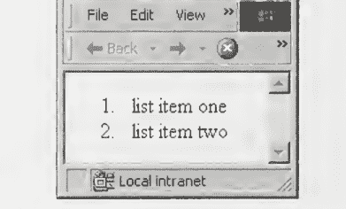

#### 无序列表

用于无序项目列表，适用于属性列表：

```
<ul>
    vicelist item one</li>
    <li>list item two</li>
</ul>
```

这在大多数浏览器中显示如下：

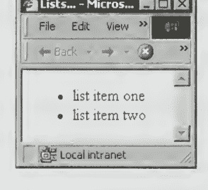

#### 定义列表

如果你有一个项目及其解释的列表，请使用定义列表。通过使用这种类型的列表，你可以向使用辅助技术（如屏幕阅读器或其他只能看到文档结构的设备）的用户明确表明，该列表包含项目及其定义。如果你只是通过修改页面的表现方面来制作这种列表，你的意图对于无法看到该表现的人来说可能就不清楚了。定义列表包含用于术语的 `<dt>` 标签和用于定义的 `<dd>` 标签：

```
<dl>
    <dt>the term</dt>
    <dd>the definition</dd>
    <dt>another term</dt>
    <dd>another definition</dd>
</dl>
```

此标记在大多数浏览器中显示如下：

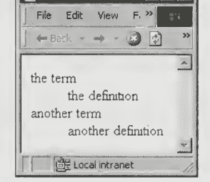

### 特殊字符

插入特殊字符（如 <、>、&）时，应始终使用正确的 Unicode 字符实体。如果你在设计视图中输入常见字符，Dreamweaver MX 会为你输入正确的字符代码，例如用 `&lt;` 代替 <，用 `&amp;` 代替 &。但是，如果你在代码视图中工作，或者需要插入键盘上没有的字符，可以从插入工具栏的字符选项卡中获取更多可用字符插入文档。字符选项卡如下所示：

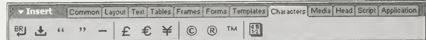

更多不常见的字符可以通过点击字符选项卡右侧的按钮找到，这将打开一个字符面板供你选择并插入文档：


## 在 Dreamweaver MX 中工作

阅读完以上内容后，你可能会觉得迁移到 XHTML 时有很多要记住的东西，或者即使遵循最佳实践进行编码时也是如此，无论你是在 HTML 4.01 还是 XHTML 中开发。幸运的是，Dreamweaver MX 会为你记住其中的大部分内容，并协助你以新的方式工作。

### 设置首选项

设置首选项可以确保从一开始，Dreamweaver MX 就与你一起工作，创建有效的 XHTML 或 HTML 文档。要访问首选项对话框，请选择"编辑 > 首选项"。

#### 常规

在首选项对话框的"常规"窗格中，确保勾选"使用 `<strong>` 和 `<em>` 代替 `<b>` 和 `<i>`"选项：

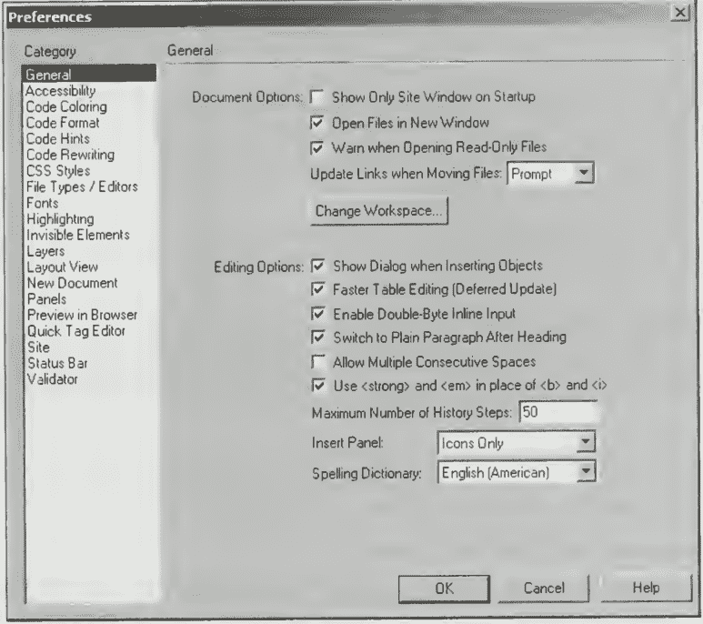

`<b>` 和 `<i>` 不会导致你的页面无效，但从最佳实践的角度来看，建议你使用 `<strong>` 和 `<em>`。为什么呢？`<b>` 用于粗体文本，`<i>` 用于斜体文本，这些都是表现性标签，旨在告诉浏览器某物应该呈现什么样子。`<strong>` 和 `<em>` 是逻辑标签，告诉浏览器或设备文档作者希望该词或陈述具有特别强调。例如，屏幕阅读器可能会以不同的方式解释这些标签，通过语调的变化让听页面的人获得与你看到粗体或斜体文本相同的理解。无论你选择哪种方式，你的页面在传统浏览器中看起来应该完全相同，因此这是一些小改动就能真正提升你网站可访问性的地方，而且不需要你做任何可能改变页面外观的事情。

在此窗格中，确保*允许连续多个空格*复选框完全未勾选！如果勾选此项，那么敲击空格键将在你的代码中插入多个 `&nbsp;`，如果你没预料到这种情况发生，这真的很烦人！从最佳实践的角度来看，页面元素的缩进应该通过 CSS 创建，而不是添加不间断空格。

#### 辅助功能

在*辅助功能*窗格中的*插入时显示属性*下：确保勾选*图像*复选框。你的文档要通过验证必须具有 `alt` 文本，这个对话框会在你每次插入图像时提醒你添加该文本。如果你热衷于创建有效且可访问的代码，你可能还想勾选表单对象、框架、媒体和表格的其他复选框。这些功能将在*第4章*中进一步讨论。

#### 新建文档

如果你决定从现在开始使用 XHTML 进行新工作，你可以设置 Dreamweaver MX 使其新文档符合 XHTML 标准。为此，请在此窗格中勾选*使文档符合 XHTML*复选框。否则，你可以在 Dreamweaver MX 中每次创建新文档时请求文档符合 XHTML 标准，但默认将是 HTML。

#### 验证器

在此窗格中，你可以设置希望使用内部验证器针对哪个 DTD 进行验证。勾选你最常使用的 DTD——如果你正在处理使用不同 DTD 的网站，你随时可以回来更改它。

## 创建有效的标记

在本章的这一部分，我们将了解可用于内容创建的工具，创建固有的 HTML 4.01 文档、XHTML 过渡文档，以及了解使 XHTML 过渡文档通过严格 DTD 验证所需的更改。

> 注意：我们将在本章中使用的功能和我要描述的文档看起来会相当朴素，因为从最佳实践的角度来看，所有表现都已从文档中移除，并在外部样式表中描述。第3章也将使用这些朴素、结构化的文档，并将它们变成视觉上的享受！

### 使用 HTML 文档工作

如果你暂时打算坚持使用经过考验的可靠 HTML 标记，那么针对 HTML DTD 验证你的文档并以有助于可访问性的方式工作仍然是一个值得追求的目标。在未来的某个时候，你可能需要升级到 XHTML，如果你的 HTML 标记是有效的，这个过程将会简单得多，而且许多支持使用有效 XHTML 的理由同样适用于任何有效的文档。

上述所有首选项设置都是从最佳实践的角度出发的，除了*使文档符合 XHTML*选项。准备好首选项设置，以便从 Dreamweaver MX 获得最大的帮助来实现有效的 HTML，让我们创建一个文档吧！


在 Dreamweaver MX 中创建有效的 (X)HTML

在 Dreamweaver MX 中选择*文件 > 新建*会打开*新建文档*对话框：

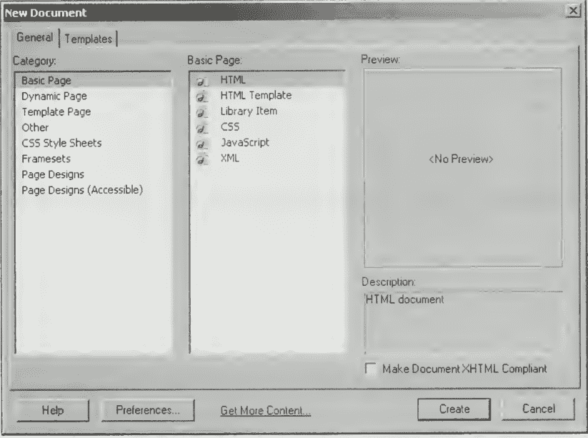

Dreamweaver MX 在创建初始文档时为你提供了更多的选择，通过在第一个列表中选择不同的选项，你可以看到此时可用的选择。今天我们使用的是标准 HTML，因此我们只需选择前两个选项：在第一个类别列表中选择*基本页面*，然后在第二个列表中选择*HTML*。

点击*创建*将新建一个文档，切换到*代码视图*，你会看到它默认给出了 HTML 4 过渡型 DTD，但没有包含 URL：

```
<!DOCTYPE HTML PUBLIC "-//W3C//DTD HTML 4.01 Transitional//EN">
```

切换回*设计视图*。正如我们之前所讨论的，在 Dreamweaver MX 这样的强大可视化编辑器中工作的一个问题是，你很容易忘记自己正在使用标记语言，而感觉像是在使用文字处理软件或印刷页面排版工具。如果你想在设计布局的同时关注文档的结构，你可能会发现切换到分割屏幕模式很有帮助，如下所示：

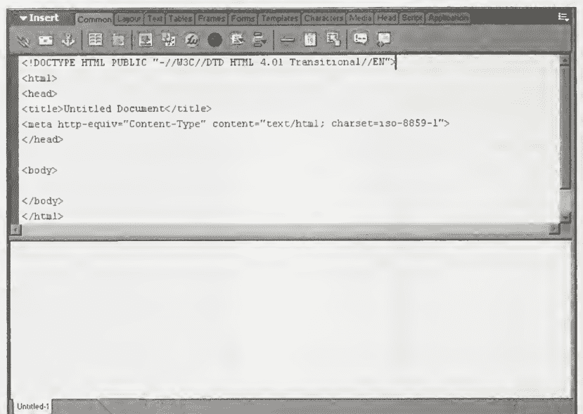

这是否能让你舒适地工作取决于你拥有的屏幕空间，但这确实能帮助你将页面背后的代码牢记在心。

此外，属性检查器有一个新的 CSS 模式，我们将在*第 3 章*中更详细地讨论。切换到 CSS 模式意味着字体标签属性不再占据屏幕的主要空间。要切换属性检查器，只需点击默认视图上的'A'符号，它会从这样：

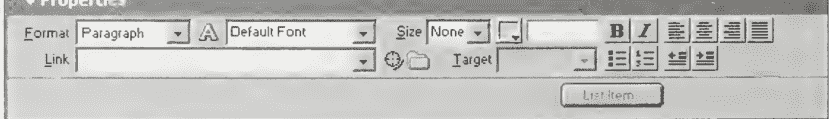

变成这样：

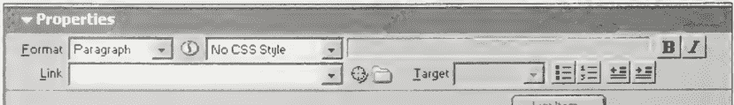

我们将在*第 3 章*中使用这个新的属性检查器，用 CSS 来设置页面的样式。

#### 页面布局

在*设计视图*中，插入一个表格并设置以下属性：

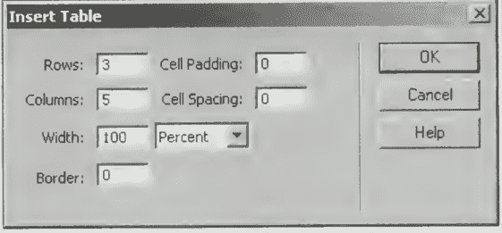

这会在文档窗口中插入一个五列三行的表格。这个表格用于布局目的。虽然 W3C 规定应该使用 CSS 而非表格来进行页面布局，因为表格是为表格数据设计的，而非用于排版图形，但许多设计师发现旧版浏览器对无表格设计的支持还不足以让他们考虑进行这种改变。我们将在下一章学习如何使用 CSS 来重现这个布局，但现在，我们将使用布局表格来完成。

> 注意：当使用表格进行布局时，请记住屏幕阅读器（供视力障碍人士使用的辅助设备）或其他纯文本浏览设备会将表格单元格的内容"线性化"。这意味着它们会按单元格出现的顺序逐个显示内容。确保即使在线性化后，你的信息仍然有意义，这样你就能克服表格布局的主要问题之一。

在这个表格中，我们可以添加一些导航按钮，这些是小图片，旁边有一个间隔图片，以确保其余单元格的背景颜色完全匹配。

插入第一张图片后，*图片标签辅助功能属性*对话框会出现；如果你还记得我们在设置首选项时开启了*插入时显示属性：图片*选项，这就是在为每个插入的图片打开的设置该首选项时显示的对话框（见下文）。*第 4 章*将进一步讨论这些辅助功能属性。

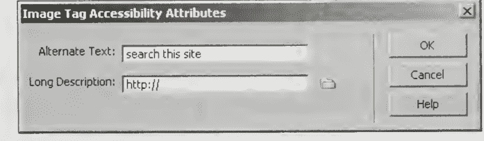

插入第一个导航图片后，我们可以使用 `<td>` 标签的 `width` 属性使其周围单元格的宽度与图片的宽度相同（*第 3 章*将介绍如何用 CSS 实现这一点）。通过使用一个与按钮背景颜色相同的间隔图片来填充最后一个单元格，我让这个布局变为 `liquid` —— 即拉伸以适应浏览器窗口：

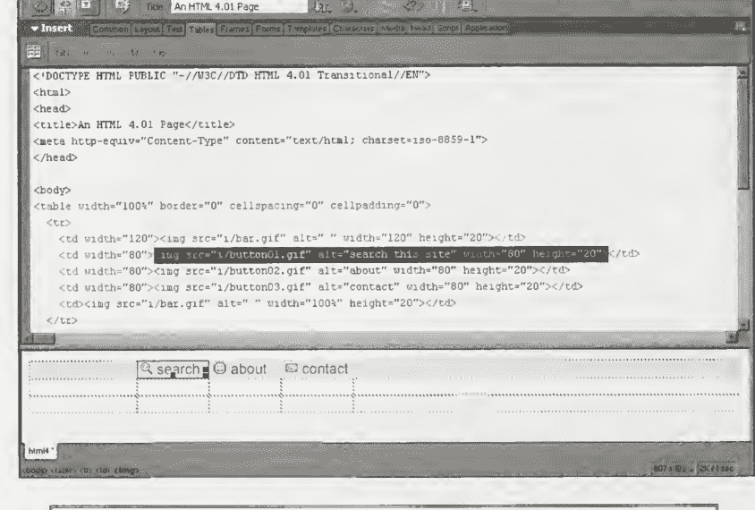

> 注意：当添加一个纯粹用于布局目的的图片（如这个间隔图片）时，给图片一个空的 alt 属性：``，这将导致无法显示图片的浏览器跳过这张图片，而不读出图片名称。

下一步是合并表格底部的四个单元格以创建一个内容区域。选择这些单元格，然后选择*修改 > 表格 > 合并单元格*。

#### 插入 rollover 图片

为了让导航更有趣，我们来添加一些 rollover 按钮。Dreamweaver 让这种效果变得简单，而且从 Dreamweaver/UltraDev 4 开始这个过程就没有改变过。

你所要做的只是选择图片并给它一个唯一的名称。然后，在*行为面板*中，点击 + 图标展开行为列表，选择*交换图片*。接着，浏览到鼠标悬停时要显示的图片并点击*确定*，确保*预载图片*和*鼠标移出时恢复图片*都已勾选：

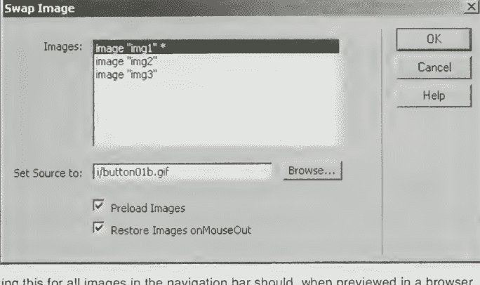

对导航栏中的所有图片重复此操作，在浏览器中预览时，应该就能呈现整齐的 rollover 按钮。

现在只剩下添加一些内容，我们就完成了页面，如下所示：

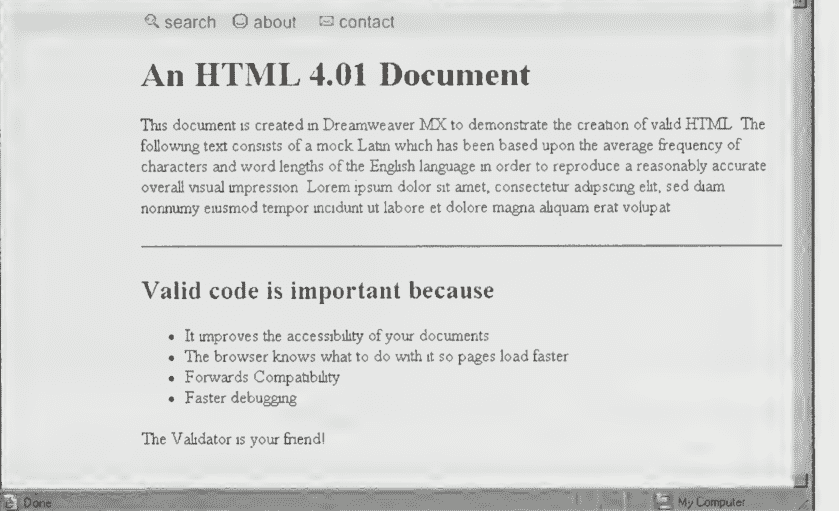

这个页面背后的 HTML 代码如下（为简洁起见，已移除 JavaScript 和内容！）：

```
<!DOCTYPE HTML PUBLIC "-//W3C//DTD HTML 4.01 Transitional//EN">
<html>
<head>
<title>An HTML 4.01 Page</title>
<meta http-equiv="Content-Type" content="text/html; charset=iso-8859-1">
<script language="JavaScript" type="text/JavaScript">
<!--
Dreamweaver generated JavaScript here
//-->
</script>
</head>
<body onLoad="MM_preloadImages('i/button01b.gif','i/button02b.gif','i/button03b.gif')">
<table width="100%" border="0" cellspacing="0" cellpadding="0">
<tr>
<td width="120"></td>
<td width="80"><a href="javascript:;"
onMouseOver="MM_swapImage('img1','','i/button01b.gif',1)"
onMouseOut="MM_swapImgRestore()"></a></td>
<td width="80"><a href="javascript:;"
onMouseOver="MM_swapImage('img2','','i/button02b.gif',1)"
onMouseOut="MM_swapImgRestore()"></a></td>
<td width="80"><a href="javascript:;"
onMouseOver="MM_swapImage('img3','','i/button03b.gif',1)"
onMouseOut="MM_swapImgRestore()"></a></td>
<td width="100%"></td>
</tr>
<tr>
<td>&nbsp;</td>
<td>&nbsp;</td>
<td>&nbsp;</td>
<td>&nbsp;</td>
<td>&nbsp;</td>
</tr>
<tr>
<td>&nbsp;</td>
<td colspan="4"><h1>An HTML 4.01 Document</h1>
<p>Content here! </p></td>
</tr>
</table>
</body>
</html>
```

### 在 Dreamweaver 中验证 HTML 文档

我们的文档只剩下最后一件事要做，那就是验证它。在进行验证之前，请确保在*编辑 > 首选项 > 验证器*中已勾选 HTML 4.0 作为验证标准。要运行验证器，打开结果面板并点击小的绿色箭头：

48

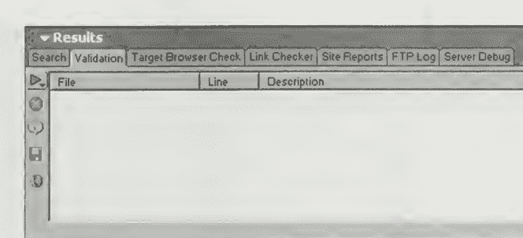

你也可以通过选择*文件 > 检查页面 > 验证标记（针对 HTML）*或*文件 > 检查页面 > 验证为 XML（针对 XHTML）*来验证你的文档。

然后你可以选择验证当前文档、整个站点，或仅验证站点中的选定文件。验证器首选项也可以在这里设置。

我们的文档验证通过 HTML 4.0，无需手动编辑代码。

#### 使用 W3C HTML 验证器

虽然内部验证器是 Dreamweaver 中处理文档时的有用工具，但在 W3C 进行验证是一个很好的最终检查。W3C HTML 验证器的网址是 *http://validator.w3.org/*。

W3C 工具允许你通过输入需要验证的页面的 URI，或上传文档来进行验证。最简单的验证方式是将页面通过 FTP 上传到你的网站，然后让验证器指向该 URL。如果你在工作时使用 Dreamweaver 验证器，你可能只需要在最终测试阶段用 W3C 验证器检查一下，以确保所有文档（包括包含动态数据的文档）都是有效的。

我们将在本章后面讨论验证器及其经常令人费解的错误信息，但希望这已经说明了，只要稍加留意和关注，Dreamweaver MX 就能帮助你以可视化的方式创建有效的 HTML 文档。

### 使用 XHTML 文档

Dreamweaver MX 让 XHTML 工作变得简单。要创建新的 XHTML 文档，在 Dreamweaver MX 中选择*文件 > 新建*以打开*新建文档*对话框。选择前两个选项——在第一个类别列表中选择*基本页面*，然后在第二个列表中选择 HTML。这次记得勾选此对话框底部的*'使文档符合 XHTML'*：


 # 第2章

如果你切换到*代码视图*，你会看到Dreamweaver MX已经插入了XHTML过渡型DTD。我们现在要按照创建HTML页面的方式一模一样地来创建我们的页面。如果你在*拆分视图*中工作，或者切换到*代码视图*，你会看到：

- 添加图像时，Dreamweaver会添加正确的XHTML语法并加上闭合的`/>`
- 用于交换图像行为的JavaScript事件处理程序`onmouseover`和`onmouseout`是小写的
- `<hr />`和`<br />`标签都正确闭合了
- 当你为图像添加名称时，也会同时添加一个`id`

下面是由Dreamweaver生成的XHTML标记，但与之前一样，省略了内容和JavaScript函数：

```
<?xml version="1.0" encoding="iso-8859-1"?>
<!DOCTYPE html PUBLIC "-//W3C//DTD XHTML 1.0 Transitional//EN"
"http://www.w3.org/TR/xhtml1/DTD/xhtml1-transitional.dtd">
<html xmlns="http://www.w3.org/1999/xhtml">
<head>
  <title>Untitled Document</title>
  <meta http-equiv="Content-Type" content="text/html; charset=iso-8859-1" />
  <script language="JavaScript" type="text/JavaScript">
```

```
<!--
    Dreamweaver generated JavaScript here
//-->
</script>
</head>

<body
onload="MM_preloadImages('i/button01b.gif','i/button02b.gif','i/button03b.gif')">
<table width="100%" border="0" cellspacing="0" cellpadding="0">
  <tr>
    <td width="120"></td>
    <td width="80"><a href="javascript:;"
onmouseover="MM_swapImage('img1','','i/button01b.gif',1)"
onmouseout="MM_swapImgRestore()"></a></td>
    <td width="80"><a href="javascript:;"
onmouseover="MM_swapImage('img2','','i/button02b.gif',1)"
onmouseout="MM_swapImgRestore()"></a></td>
    <td width="80"><a href="javascript:;"
onmouseover="MM_swapImage('img3','','i/button03b.gif',1)"
onmouseout="MM_swapImgRestore()"></a></td>
    <td width="100%"></td>
  </tr>
  <tr>
    <td>&nbsp;</td>
    <td>&nbsp;</td>
    <td>&nbsp;</td>
    <td>&nbsp;</td>
    <td>&nbsp;</td>
  </tr>
  <tr>
    <td>&nbsp;</td>
    <td colspan="4"><h1>An XHTML 1.0 Transitional Document</h1>
      <p>Content here! </p></td>
  </tr>
</table>
</body>
</html>
```

#### 在Dreamweaver中验证你的XHTML文档

要在Dreamweaver中验证XHTML文档，首先确保你已将验证器首选项设置为正在使用的XHTML DTD，此处为XHTML过渡型。要验证XHTML文档，可以点击结果面板中的绿色箭头并选择*将当前文档验证为XML*，或者选择*文件 > 检查页面 > 验证为XML*。

### 将HTML文档转换为XHTML

如果你有现有的HTML网站并希望将其转换为XHTML，你将无需手动进行这些更改。Dreamweaver MX附带了一个*转换为XHTML*功能，可以协助你完成此转换。

要转换现有文档，请选择*文件 > 转换 > XHTML*。（如果你的文档包含框架，则需要对每个框架单独执行此操作。）转换工具将会：

- 将HTML的`DOCTYPE`替换为正确的XHTML过渡型`DOCTYPE`（如果原本没有`DOCTYPE`，则会添加一个）
- 将大写标签转换为小写
- 将所有JavaScript事件处理程序转换为小写
- 为未加引号的属性添加引号
- 用`id`属性复制图像的所有name属性
- 闭合所有非空标签
- 用正确的`/>`闭合所有空标签

转换我们之前创建的HTML页面后，得到的页面与我们手动创建的XHTML过渡型页面完全相同。显然，这些都是简单的示例，在实际网站上转换器需要处理的内容要多得多，但通过运行转换器然后验证页面，你将能够快速 pinpoint 任何仍需要处理以确保符合有效XHTML标记的区域。

#### 转向XHTML严格型

正如我们在本章前面讨论的，XHTML过渡型DTD允许使用将在未来版本中移除的已弃用属性。严格型DTD不允许使用这些已弃用属性。

要将我们的文档从过渡型DTD转换为严格型，我们需要在*代码视图*中工作。Dreamweaver MX创建XHTML过渡型标记是因为认识到大多数开发人员仍需要创建与旧版（5.0版本之前）浏览器向后兼容的页面，但我们所需的更改相对简单。

##### 更改DOCTYPE

在*代码视图*中，将页面顶部的`DOCTYPE`更改为：

```
<?xml version="1.0" encoding="iso-8859-1"?>
<!DOCTYPE html PUBLIC "-//W3C//DTD XHTML 1.0 Strict//EN"
"http://www.w3.org/TR/xhtml1/DTD/xhtml1-strict.dtd">
```

### 在Dreamweaver中重新验证你的页面

在*编辑 > 首选项 > 验证器*中，勾选针对XHTML严格型进行验证的复选框。再次运行*验证为XML*。这次你会得到一个错误列表，以红色感叹号显示——如对面所示：

# 在Dreamweaver MX中创建有效的(X)HTML

> 你也可以保存此列表（在PC上右键单击，在Mac上按住Command键单击，然后选择`保存结果`），或者在浏览器中打开该列表（选择`在浏览器中打开结果`）。如果你正在验证大型文档或整个网站，这会很有用，因为你可以使用此列表作为核对清单，确保你已捕获所有无效代码的实例。

W3C网站上的验证器也提供类似的错误列表：

然而，这个列表对于使我们的页面通过XHTML严格型DTD验证非常有帮助，因为它让我们能够快速查看已弃用的元素（因为我们知道由于我们的文档已通过XHTML过渡型验证，它符合格式良好的规则）。

下表显示了验证器标记出的错误，以及这些错误的解决方法：

| 错误 | 解决方法 |
| --- | --- |
| *元素'script'未声明'language'属性* | 这指的是`<script language="JavaScript" type="text/JavaScript">`；language属性已弃用，应移除。 |
| *元素'td'未声明'width'属性* | `<td width="80">` —— `<td>`标签的width属性已弃用；由于它可以用CSS替代，应移除所有表格单元格的width属性。 |
| *元素'img'未声明'border'属性* | `` —— 我们已经习惯在作为链接的图像上使用`border="0"`来去除图像周围难看的边框。可以使用CSS来实现这一点，因此必须从所有图像中移除border属性。 |
| *元素'img'未声明'name'属性* | Dreamweaver MX在为图像命名时会同时插入name属性和id属性。name属性仍被旧版浏览器使用以确保向后兼容性，而id属性才是规范中的属性。在XHTML过渡型中同时使用两者是有效的，但在严格型中，已弃用的name属性必须去掉。 |

移除上述属性后，文档现在既能通过Dreamweaver验证器中的XHTML严格型验证，也能通过W3C在线验证。下面是新的、经过编辑的XHTML：

```
<?xml version="1.0" encoding="iso-8859-1"?>
<!DOCTYPE html PUBLIC "-//W3C//DTD XHTML 1.0 Strict//EN"
"http://www.w3.org/TR/xhtml1/DTD/xhtml1-strict.dtd">
<html xmlns="http:// Reserved1999/xhtml">
<head>
<title>Untitled Document</title>
<meta http-equiv="Content-Type" content="text/html; charset=iso-8859-1" />
<script type="text/JavaScript">
<!--
Dreamweaver generated javascript here
```


## Dreamweaver MX 中的有效 (X)HTML

```html
//-->
</script>
</head>

<body onload="MM_preloadImages('i/button01b.gif','i/button02b.gif','i/button03b.gif')">
<table width="100%" border="0" cellspacing="0" cellpadding="0">
  <tr>
    <td></td>
    <td><a href="javascript:;"
       onmouseover="MM_swapImage('img1','','i/button01b.gif',1)"
       onmouseout="MM_swapImgRestore()"></a></td>
    <td><a href="javascript:;"
       onmouseover="MM_swapImage('img2','','i/button02b.gif',1)"
       onmouseout="MM_swapImgRestore()"></a></td>
    <td><a href="javascript:;"
       onmouseover="MM_swapImage('img3','','i/button03b.gif',1)"
       onmouseout="MM_swapImgRestore()"></a></td>
    <td></td>
  </tr>
  <tr>
    <td>&nbsp;</td>
    <td>&nbsp;</td>
    <td>&nbsp;</td>
    <td>&nbsp;</td>
    <td>&nbsp;</td>
  </tr>
  <tr>
    <td>&nbsp;</td>
    <td colspan="4"><h1>An XHTML 1.0 Strict Document</h1>
    <p>Content goes here</p></td>
  </tr>
</table>
</body>
</html>
```

现在，我们的页面在浏览器中的预览效果不太理想，正如我们在下一页中看到的那样。如果没有在表格单元格上设置宽度属性，导航栏就会散架，而且图片周围现在出现了很大的边框：

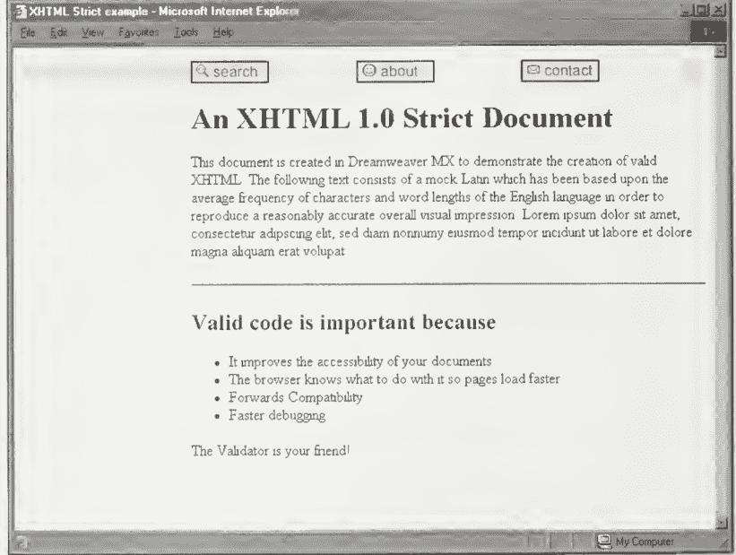

在*第3章*中，我们将进一步深入这个设计，并了解如何用 CSS 复现那些在 XHTML 中已被弃用的标签。

## 使用外部文件存放 JavaScript

Dreamweaver MX 会将所有行为所需的 JavaScript 插入到文档的头部。这并不理想。例如，我们在本章创建的文档中，实现 rollover 效果所需的 JavaScript 长达 23 行。同样的脚本块需要插入到网站的每一个页面中，并且每次都要加载。

将这些 JavaScript 移到一个链接到所有页面的中央文件中，可以缩短页面的加载时间，这也意味着搜索引擎蜘蛛不必在一行又一行脚本中爬取来寻找你的内容，而且通常能使页面更易于维护并保持风格一致。

要做到这一点，只需将 JavaScript 复制到剪贴板，然后在 Dreamweaver 中通过点击*文件 > 新建*，然后选择*其他*，再选择*JavaScript*来打开一个 JavaScript 文档。一旦你有了 JavaScript 文档，将其保存，例如保存为 `functions.js`，并将剪贴板内容粘贴进去。现在你可以回到原来的 XHTML 文档，删除 `<script>` 标签之间的所有内容。你应该只会剩下：

```html
<script language="JavaScript" type="text/javascript"></script>
```

如果你在处理 HTML 或 XHTML Transitional，或者：

```html
<script type="text/javascript"></script>
```

如果你在处理 XHTML Strict。

现在我们需要做的就是在 `<script>` 标签中添加一个指向 JavaScript 来源的链接：

```html
<script language="JavaScript" type="text/javascript" src="functions.js"></script>
```

如果你为其他页面元素添加任何其他行为，Dreamweaver 会继续将它们添加到你的文档中。然而，你可以在外部 JavaScript 文件中添加任意多个不同的函数。只需将它们复制粘贴到你的文件中，并记住删除 Dreamweaver 插入的任何额外的 `<script>` 标签。唯一不能放入外部文件的由 Dreamweaver 插入的代码是时间轴代码。

当你想创建一个新页面，使用你的 `functions.js` 文件中的任意或全部函数时，只需将指向该函数文件的链接粘贴到你的文档头部，这些函数就可以在该页面中使用。使用模板时，这是一种非常好的工作方式，因为你可以创建模板文件，将所有 JavaScript 放在文档头部，就像 Dreamweaver 添加的那样，然后将 JavaScript 移到函数文件中，只在模板文档头部保留指向该文件的链接。当你从模板创建新页面时，它们将包含所有必需的 JavaScript。

## 处理动态数据

本书后半部分将详细讨论在 Dreamweaver MX 中使用 ASP 开发动态网站。采用有效的 XHTML 或 HTML 应该会让你在将动态数据整合到页面中时更加轻松。一旦数据从数据库中提取出来，未闭合的标签和嵌套不当的元素等小错误可能会在整个网站中造成严重破坏，而且难以调试，因此在设计布局时从一开始就建立一个坚实的框架，应该能节省你在开发过程中后续的时间。

有效的 (X)HTML 和 CSS 的组合对于动态网站来说是理想的，尤其是那些允许用户添加信息的网站（如内容管理系统或可让客户更新的新闻页面），因为你的样式表会格式化插入的内容，保持外观和感觉的一致性。

## 需要注意的事项

处理动态页面时有一些注意事项：

- 在选择区域创建重复区域时——Dreamweaver MX 对从数据库提取的动态重复代码块的称呼——确保你已选中要重复的整个代码块，并且在网页浏览器中查看页面内容时，标签仍然正确闭合和嵌套。
- 在创建页面中将条件显示的区域时，确保在每种可能的条件下加载页面时，所有标签都正确闭合。
- 如果你正在创建的网站页面将由用户或通过后台管理部分的内容作者添加内容，那么在应用程序设计时需要格外小心，以确保作者不会添加任何无效内容，或者在你使用 XHTML 时添加 HTML designated 标记。如果你使用 ASP，谨慎使用 Replace 函数可以让你将违规项目（如特殊字符，或者如果你允许人们输入 HTML 标签，则是无效的标签或属性）替换为它们的有效版本。

## 验证动态页面

动态页面应该使用 W3C 的在线验证器进行验证，并且如果它们包含条件区域，应尽可能验证页面可能显示的每种方式。在验证器那里，你的服务器端代码不会导致任何验证问题，因为等它被服务器解析后，验证器看到的只是返回给浏览器的 (X)HTML。

如果你在维护一个动态网站，对于用户或内容作者频繁修改的页面，应该偶尔进行验证，以检查你对无效项目的抵消措施是否有效运作。

## 使用第三方扩展

扩展开发者社区是使用 Dreamweaver 的一大优势。如果产品没有附带你需要的某些功能，通常可以从 Macromedia Exchange 下载扩展来填补这一空白，而且学习创建你自己的扩展对于任何熟练掌握 JavaScript 的开发人员来说都是力所能及的。

> 你可以通过访问 Macromedia Dreamweaver 交换页面 http://dynamic.macromedia.com/bin/MM/exchange/main.jsp?product=dreamweaver 了解更多关于扩展的信息——在这里你可以下载许多扩展，以及扩展管理器。

在讨论有效的 (X)HTML 时，有几点值得注意：

- XHTML 支持是此版本 Dreamweaver 的新功能，并非所有扩展都支持 XHTML，因此你可能需要在代码视图中进行一些编辑，以确保使用扩展后你的页面能够通过验证。
- 扩展可能会使用浏览器特定的标签和/或非有效的标记。使用扩展后验证你的页面会告诉你是否属于这种情况，并给你一些如何在代码视图中修复问题的提示。


## 摘要

借助 Macromedia Dreamweaver MX，创建符合标准且无障碍的 HTML 和 XHTML 网站已成为每位设计师和开发人员的能力范围。在本章中，我们讨论了：

- HTML 与 XHTML 的区别
- 为什么 HTML 4.01 是我们所熟知的最后一个 HTML 版本，以及未来的网页标记标准将是 XHTML
- 如何在 Dreamweaver 环境中编写有效的 XHTML 和 HTML
- 从基于 HTML 的网站迁移到 XHTML Transitional 所需遵循的规则，并展望未来向 XHTML Strict 的过渡
- 为什么有效的、无障碍的代码很重要

本章提供了 Web 开发中良好实践的一些 essential building blocks，这将帮助我们在后续为页面添加 CSS 样式以及为网站添加动态数据时更加得心应手。通过遵循最佳实践，不仅能让您的网站对所有 Web 用户更加无障碍，还能使您的工作方法和调试过程更加流畅、简洁。

## 3

- 为什么要使用 CSS？
- CSS 基础知识
- Dreamweaver MX 中的 CSS 工具

**作者：** Rachel Andrew

## Dreamweaver MX 中的 CSS

在*第 2 章*中，我们探讨了标记语言如何演变以满足当今 Web 的需求。该过程的一部分是去除使用 HTML 标签在文档内进行样式设计的做法，因为这会导致混乱、不灵活的标记，某些设备难以解析。然而，这并不意味着我们只能用 plain, boring 的文档——远非如此！

在本章中，我们将在*第 2 章*所学技能的基础上，进一步探讨层叠样式表（CSS）以及如何在您的网站上使用 Dreamweaver MX 实现它们。我们将探讨使用 CSS 的不同方法，并讨论常见的浏览器问题以及如何解决这些问题。

### 什么是 CSS？

CSS 是一种定义 HTML 文档如何在浏览器中呈现的语言。可以将它们视为一种模板，用于定义您希望整个网站中的元素如何显示，并且在附加了该样式表的任何页面上，该元素看起来都是一致的。这有助于在网站的各个页面之间创建一致性。例如，假设您希望所有一级标题，即包含在 `<h1>` 标签中的内容，显示为紫色并使用 Verdana 字体。仅使用 HTML 时，您需要对每个 `<h1>` 元素的实例进行如下编码：

```html
<h1><font color="#663366" face="Verdana, Arial, Helvetica, sans-serif">my heading</font></h1>
```

使用 XHTML 和 CSS，您只需在标记中使用：

```html
<h1>my heading</h1>
```

并在样式表中将 `<h1>` 标签一次性定义为紫色，使用 Verdana 作为主要字体：

```css
h1 {
  color: #663366;
  background-color: transparent;
  font-family: Verdana, Arial, Helvetica, sans-serif;
}
```

因为我们只需为所有链接的页面定义一次元素，所以可以大幅减小文件大小，从而缩短页面加载时间。但您不必以相同的方式定义所有元素；您可以指定"类"应用于元素，这将在本章后面介绍。

#### 历史

CSS1 规范于 1996 年 12 月成为 W3C 推荐标准。CSS1 主要提供文本样式设置方法——从而取代了 `<font>` 标签。CSS2 于 1998 年 5 月成为推荐标准，它在 CSS1 规范的基础上增加了对元素定位的支持、新的选择器规范，以及对不同"媒体描述符"的支持，以便根据显示页面的设备提供不同的样式表。

> 您可以在此处找到 CSS 推荐标准：http://www.w3.org/TR/REC-CSS1 和此处：http://www.w3.org/TR/REC-CSS2。

第一个支持任何 CSS 的浏览器是微软的 Internet Explorer 3。Netscape 直到 Netscape 4 才添加支持，并且其实现依赖于浏览器中启用的 JavaScript——如果在任何版本的 Netscape 4 中关闭 JavaScript，CSS 也将无法显示！

当前大多数 Web 浏览器都非常良好地支持 CSS1，并且很大程度上支持 CSS2。我们尚未达到设计一次就能在每个当前浏览器中看起来都很完美的理想状态，但情况比以往任何时候都要好。要查看浏览器对 CSS1 和 CSS2 的支持列表，请访问 http://www.westciv.com/style_master/academy/browser_support/basic_concepts.html。

#### W3C

W3C（万维网联盟）与微软、Netscape、苹果以及大约 500 个其他成员组织的公司和开发人员共同创建了 CSS 推荐标准以及其他 Web 技术推荐标准。如果您想了解更多关于 CSS、HTML、XHTML 的信息，或者想找到在线验证器并查看有哪些新的推荐标准，那么 W3C 网站 http://www.w3.org 是一个不错的去处。

### 为什么要使用 CSS？

CSS 允许将内容与内容结构从表现形式中分离出来。HTML 并非作为一种允许超出创建易于阅读的结构化文档之外的视觉格式化的语言而设计的。格式化标签，如 `<font>`，是由浏览器公司（尤其是 Netscape）添加的，以扩展 HTML 的功能，其中许多后来成为官方规范的一部分。

#### 将文档结构与表现形式分离

在讨论样式表时，您会经常看到这个短语。在实践中，这意味着所有描述文档如何呈现给用户的信息都从 HTML 中移除，放入样式表规则中，而所有定义内容和文档结构的信息则保留在 HTML 中。诸如标题 `<h1>` 到 `<h6>`、段落 `<p>`、用于表格数据的表格 `<table>`、列表 `<ul>`、`<ol>`、`<dl>` 等元素，用于描述文档的结构和内容。其他元素和属性通常用于表现目的，例如用于设置文本颜色和字体的 `color` 和 `font` 属性，以及用于定位内容的 `align`、`margin`、`border` 和 `padding` 属性。

通过移除这些表现性的 HTML 元素和属性并用样式表替代，您的页面将变得更小、更易于阅读和调试。将内容和文档结构与表现形式分离是这里列出的许多优点的根本原因。

#### 无障碍性

CSS 允许对布局进行精确控制，从而避免标签的误用。我们在*第 2 章（标记最佳实践部分）*中讨论了 HTML 标签的误用问题。屏幕阅读器和其他技术通过使用页面上的 HTML 标签来解释标记；如果使用了不适当的标记，盲人用户的体验就会变得混乱，因为文档的结构和含义将远不清楚。

现代浏览器允许用户用用户样式表覆盖您的样式。您可能首先会认为这不是件好事——为什么您希望有人用他们自己的样式表取代您精心制作的艺术品般的样式表呢？然而，例如，视力有缺陷的用户可以应用使用大字体或高对比度的样式表，这意味着他们随后可以轻松浏览您的网站并在您的在线商店进行购买。

通过使用 CSS，您可以轻松更改网站的字体大小、颜色甚至布局——只需更改样式表即可。许多网站现在提供不同的"主题"，包括提供高对比度配色方案或大文本的主题，以帮助那些难以阅读小字、低对比度文本的人（如果这是您网站的设计选择）。通过这种方式，设计师可以开始解决让事物在使用传统 Web 浏览器的用户看来很棒，同时为那些使用完全不同设备或需要特定设备才能舒适使用网站的人提供有意义的体验的问题。我们将在本章后面返回讨论显示不同样式表的问题。

#### 更灵活的设计

通过使用 HTML 标签来布局和设置页面样式，我们调整页面元素大小和位置的方式非常有限。使用 `<font size="xx">` 可以调整大小，但使用 CSS 可以指定单词、字母和文本行之间的间距，增加或减少 `<h1>` 或其他结构标签周围的 padding 量。进入 CSS2 的范畴还可以将页面元素定位在使用表格作为布局工具所必需的"网格"布局之外。

#### 更小的文件大小

正如我在本章开头演示的，转向 CSS 允许您通过样式表中的一次定义来控制整个网站所有元素的视觉外观。更高级的 CSS 用法可以产生以前需要使用图像才能实现的效果——例如页面元素的层叠。


## 第三章

#### 浏览器支持

正如我在讨论 CSS 历史时所提到的，当前浏览器对 CSS1 以及 CSS2 大部分特性的支持都非常好，即便是较老的浏览器也有相当不错的支持度。很难获得准确的浏览器使用统计数据，因为不同网站之间差异很大。不过，根据 Browser News（http://www.upsdell.com/BrowserNews/stat.htm）的数据，截至 2002 年 5 月 16 日，在三个来源（使用计数器的网站、伊利诺伊大学工程工作站服务器 EWS 以及 upsdell.com）中，超过 95% 的访问者使用的浏览器都具有合理的 CSS 支持，如下图所示。我将 Netscape 4 也计入其中，尽管它的 CSS 支持可以说非常糟糕，但它确实支持我们将在本章第一部分讨论的文本样式属性。

浏览器统计（谨慎使用）

| 浏览器 | 来源 1 | 来源 2 | 来源 3 |
| :--- | :--- | :--- | :--- |
| IE6 | 34% | 32% | 36% |
| IE5 | 55% | 58% | 41% |
| IE4 | 3.3% | 2.5% | 1.3% |
| IE3 | .05% | .05% | .6% |
| IE2 | .05% | 0 | .1% |
| Gecko (NN6, Mozilla, ) | 1.1% | 1.1% | 7.6% |
| NN4 | 4.2% | 5.0% | 5.2% |
| NN3 | .05% | 1.3% | .35% |
| Opera | .8% | .1% | .6% |
| (其他) | 1.4% | .1% | 7.3% |

'-' 表示无数据
'0' 表示 <<.1%

CSS 对浏览器非常友好。如果浏览器或设备不支持 CSS，它只会忽略样式表，并使用默认设置渲染内容。除了传统网页浏览器中存在的某些 bug（这些都有详细记录，我们后面会讨论应对方法），使用 CSS 不会让那些使用旧版浏览器或不支持 CSS 的设备的用户无法访问你的页面。

#### 缩短开发时间

一旦你为网站中的常见元素设置好了样式表，添加与网站其他部分保持一致的新页面就变得很简单，因为任何链接了该样式表的页面都会采用相同的标题、段落、边框和其他元素的样式。如果你需要更改字体或整个网站使用的配色方案，只需修改那一个样式表，更改就会在整个网站中一致地反映出来。

### CSS 基础

在我们深入探讨如何在 Dreamweaver MX 中使用 CSS 之前，了解一些使用 CSS 设计的基本概念是很有必要的。如果你以前使用过 CSS，那么本节可以作为你知识的一个复习。

### 实现 CSS 的方法

在你的网站或文档中实现 CSS 有三种方法——内联、嵌入或外部。

#### 内联

内联样式定义是一种一次性的样式定义，放置在代码中以仅对其附加的元素进行样式设置。使用这种方法，你将失去 CSS 的许多优势，因为你需要像使用 `<font>` 标签或其他表现性 HTML 一样，逐个元素进行样式设置。然而，对于某些 DHTML 效果来说，它可能是有用且必要的——比如 Dreamweaver MX 中的时间轴代码。内联 CSS 的示例：

```
<h1 style=" font-family: Verdana, Arial, Helvetica, sans-serif; color: #663366;">
```

这段标记只会影响该页面上的那个特定的 `<h1>` 标签。如果页面上有第二个 `<h1>` 标签，它将显示为用户浏览器的默认样式。

#### 嵌入

嵌入样式表仅控制该页面上的元素，CSS 代码放置在文档的 head 部分。在下面的代码示例中，文档中的任何 `<h1>` 标签都会变成紫色，但是这段 CSS 不会应用到网站上的其他页面。

```
<head>
<title>CSS Example</title>
<style type="text/css">
<!--
    h1 {
        font-family: Verdana, Arial, Helvetica, sans-serif;
        color: #663366;
    }
-->
</style>
</head>
```

如果你想在网站的每个页面上都使用这种样式，并且使用的是嵌入方法，你需要将这段代码添加到每个页面，这意味着将 `<h1>` 从紫色改为橙色需要在网站的每个页面上进行更改。

#### 外部样式表

外部样式表是使用 CSS 最有用、最灵活的方式。通过在网站的所有页面中链接到一个单一的外部样式表，每个页面都会使用该样式表中的定义。要将我们全站的紫色 `<h1>` 标签改为橙色，只需对外部样式表进行一处简单的更改即可。我们将在本章后面讨论外部 CSS 的设计和实现。链接到外部样式表的简单方式如下：

```
<link href="global.css" rel="stylesheet" type="text/css" />
```

我们将在本章后面更详细地介绍如何将样式表附加到我们的文档。

#### "层叠"样式表

CSS 中的层叠指的是定义得越靠近元素的样式会覆盖其他设置的规则，因此如果我们在外部样式表中设置：

```
h1 {
    font-family: Verdana, Arial, Helvetica, sans-serif;
    color: #663366;
}
```

但是随后决定网站的某个特定页面上所有 `<h1>` 标签都应该是绿色的，我们可以在该文档 head 部分的嵌入样式表中添加一条样式规则。相反，如果我们只是想让某一个 `<h1>` 标签变为绿色，我们可以在该特定标签上使用内联样式，它将优先于嵌入或外部样式表中设置的样式。

#### 重新定义 HTML 标签

我们已经看到了如何用 CSS 规则重新定义 HTML 标签可以改变这些结构性标签的渲染方式，同时保留标记的结构。这种方法提供了一种简单的方式来创建和维护网站一致的外观和感觉，而无需用表现性标记使 HTML 膨胀。如果你与多位内容作者合作，他们为网站添加内容，那么重新定义标签将意味着他们的内容会适应网站的其余部分，使用你在样式表中定义的所有格式。

#### 创建 CSS 类

CSS 类允许你为应用了该类的一个页面元素创建规则。例如，如果我在样式表中有：

```
.myborder {
    border-width: 1px;
    border-color: #000000;
    border-style: solid;
}
```

任何带有 'border' 类的元素，比如下面的 ``，都会获得一个 1 像素宽的黑色边框：

```

```

> > Netscape 4 会以奇怪的方式渲染这个边框，如果图像是链接的话，还会导致图像无法点击。这只是在使用 CSS 时可能遇到的 Netscape 4 的问题之一。在本章后面，我们将讨论应对旧浏览器的方法。

## Dreamweaver MX 中的 CSS 工具

Dreamweaver MX 附带了许多工具，使使用 CSS 变得简单直观。与以前版本的 Dreamweaver 相比，新增了许多功能。

### 设置首选项

以下首选项将帮助你在 Dreamweaver 环境中舒适地使用 CSS。

### CSS 样式

转到 编辑 > 首选项 > CSS 样式：

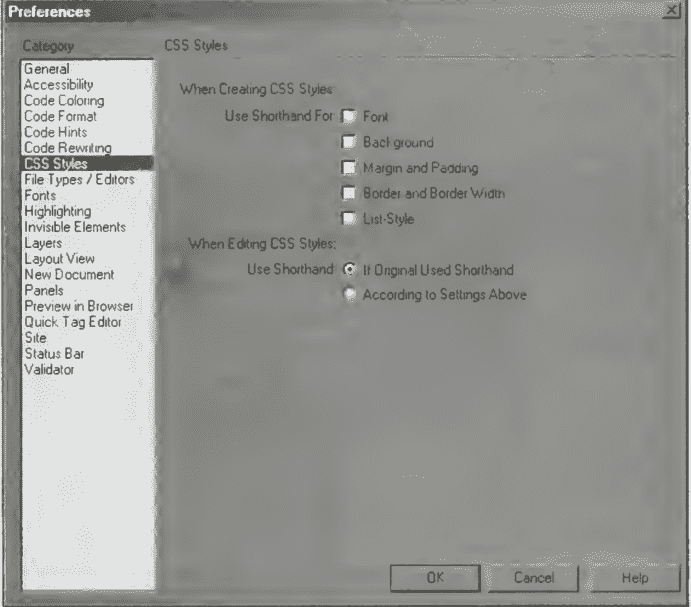

CSS 允许使用简写和冗长的语法，以分别实现简洁或清晰。冗长语法的 CSS 代码片段如下所示：

```
.longhand {
    font-family: Arial, Helvetica, sans-serif;
    font-size: small;
    color: #660066;
    text-decoration: underline;
}
```

在此对话框中，勾选复选框将强制 Dreamweaver 使用简写语法：

```
.shorthand {
  font: small Arial, Helvetica, sans-serif;
  color: #660066;
  text-decoration: underline;
}
```

这些规则在浏览器中的显示方式应该完全相同；使用哪种是个人偏好。

更重要的是底部的单选按钮。如果你在另一个编辑器（如 Topstyle）中创建样式表，但随后在 Dreamweaver 中进行编辑，你应该确保 Dreamweaver 添加的任何规则与你已在样式表其余部分使用的样式保持一致。在这种情况下，你应该将"*编辑* CSS 样式时：使用*简写*"属性设置为"*当原始代码为简写时*"。

你会发现某些规则在某些浏览器中以简写形式声明时可以工作，而以冗长形式则不行，尤其是在较旧的浏览器中，如 Netscape 4，它接受某些简写形式的样式规则（例如 `border:` 可以渲染，但 `border-left:` 不行）。如果你使用简写语法来应对这些问题，那么确保 Dreamweaver 设置为在这方面协助你就很重要。

### 文件类型/编辑器

要指定另一个编辑器作为你的默认 CSS 编辑器，请转到*首选项 > 文件类型/编辑器*：

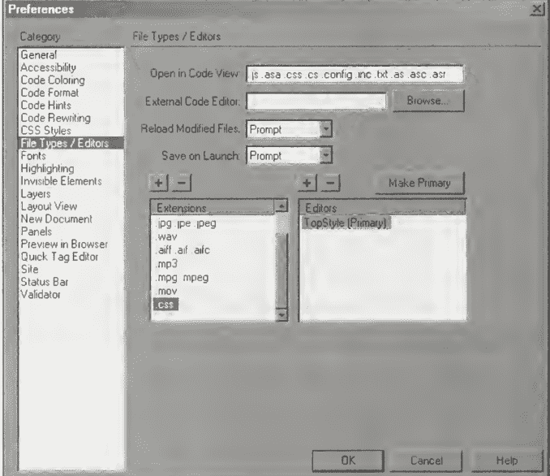

我们将在本章后面讨论如何集成外部编辑器。


## CSS 面板

CSS 面板可以让你将样式表附加到页面，创建新样式——既可以在新样式表中、现有样式表中，也可以嵌入到文档中——以及编辑已创建的样式：

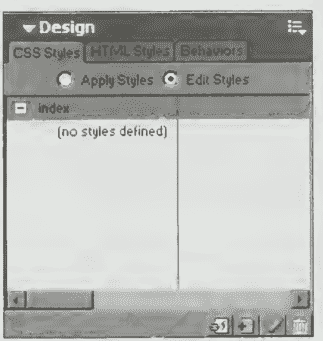

## 在 Dreamweaver MX 中创建简单样式表

要创建新样式表，请点击*新建 CSS 样式*按钮，它是从左数第二个按钮：

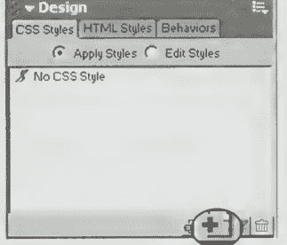

这会弹出一个新建 CSS 样式对话框：

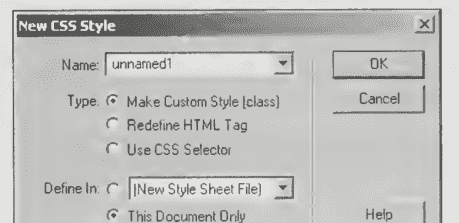

# 第 3 章

你需要创建一个样式定义才能创建新样式表，因此，从页面正文文本的基本字体样式开始是个不错的起点。在下拉列表中选择 'body'，然后点击标记为"重定义 HTML 标签"的单选按钮。选择"新建样式表文件"单选按钮来定义，然后点击确定。

由于这是一个新样式表，会弹出"另存为"对话框，让你保存样式表。请确保在样式表名称末尾加上 `.css` 扩展名（换句话说，保存为 `global.css` 而不是 `global`）。保存后，将出现以下对话框：

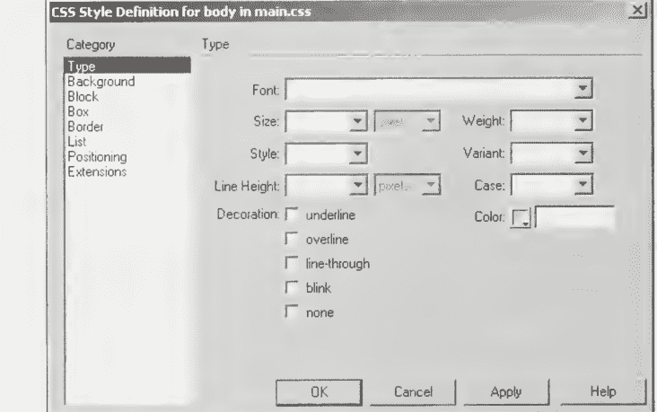

在这个 CSS 样式定义对话框中，你可以为正在处理的标签或类设置规则。对于我们的正文文本，我们希望在左侧列表中选择"类型"，然后选择字体、大小和颜色，再点击确定。

如果在文档中工作时在新样式表文件中创建样式，Dreamweaver 会自动将其附加到文档，因此你应该能立即看到更改生效。我们只针对正文文本指定了此样式。由于浏览器（特别是 Netscape 4）解释继承规则的方式存在差异，浏览器会显示不同的效果，有些会将此规则应用于所有文本——包括表格、段落和列表中的文本，有些则不会。为了保险起见，我们需要将此相同定义添加到我们想要使用相同字体设置的其他页面元素中。

再次点击*新建 CSS 样式*按钮，对 `<p>`、`<td>` 和 `<li>` 重复上述过程。现在我们已经定义了一个样式表，你将能够在新建样式对话框中选择你刚创建的样式表名称。

你可以按照此方法重定义任何你希望的 HTML 标签。要编辑 CSS 样式，请点击 CSS 面板顶部标记为*编辑样式*的单选按钮：

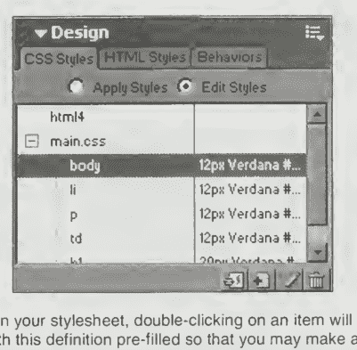

在此样式表样式的树形视图中，双击某一项将再次打开 CSS 样式定义对话框，该定义已预先填充，以便你进行更改并保存。如果你更愿意在外部编辑器中进行编辑，并且已在首选项中指定了一个，那么在面板任意位置右键单击（在 Mac 上为按住 Command 键单击）并选择*使用外部编辑器*——如果已勾选此项，双击某个定义将在你的外部编辑器中打开该样式表以供你进行更改。

## 设置自定义类

在 Dreamweaver 中创建自定义类与重定义 HTML 标签一样简单。再次调出*新建 CSS 样式*对话框，但这次选择*生成自定义样式（类）*单选按钮，并在对话框顶部的文本框中输入你的类名称。这需要以句点开头的。

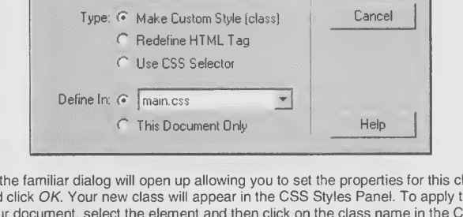

点击*确定*，熟悉的对话框将会打开，允许你设置此类的属性。设置一些属性并点击*确定*。你的新类将出现在 CSS 样式面板中。要将此类应用于文档中的元素，请选择该元素，然后在 CSS 样式面板中点击类名称。下一页的图片显示了一个列表，其中我的新类应用于一个列表项 `<li>` 标签。

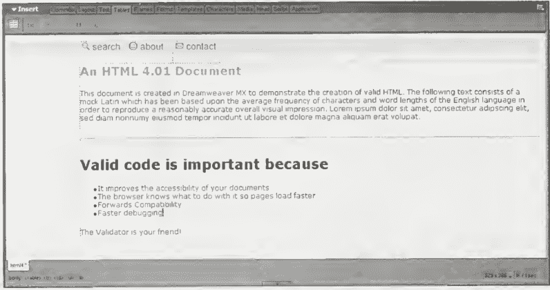

在下面的 HTML 中，你可以看到 Dreamweaver 如何将 `class="newlist"` 应用于第一项。因此，其他项采用我们对 `<li>` 标签的默认重定义，但应用了类的那一项则采用该类的样式定义。

```
<ul>
  <li class="newList">它提高了文档的可访问性</li>
  <li>浏览器知道如何处理它，因此页面加载更快</li>
  <li>向前兼容性</li>
  <li>更快的调试</li>
</ul>
```

## 使用 CSS 选择器添加不同的链接样式

CSS 新手常见的需求是如何用 CSS 创建美观的链接、如何去除链接的下划线，以及如何在一个页面上有两种或更多种不同的链接样式。这可以在 Dreamweaver 界面中轻松实现，依赖于 CSS 选择器。

再次打开*新建 CSS 样式*对话框，这次选择*使用 CSS 选择器*单选按钮。在第一个下拉列表中，你会看到列出了 4 个项目：

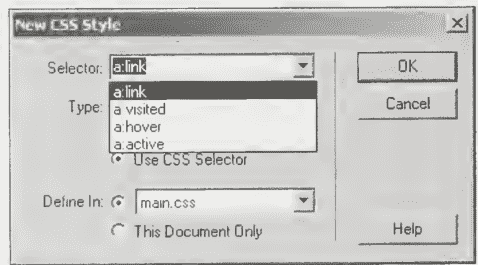

选择 *a:link* 并点击 *确定*。

> 我们添加这些定义的顺序至关重要，如果不按照 LINK、VISITED、HOVER、ACTIVE 的顺序应用，兼容的浏览器将无法正确渲染你的链接样式。

现在将出现你现在已经熟悉的对话框，你可以选择在链接样式中选择你喜欢的样式。要去除链接的下划线，请在*修饰*部分勾选 *none* 复选框，如图所示：

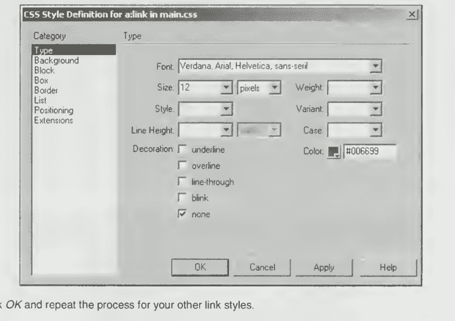

点击*确定*，然后对其他链接样式重复此过程。

如果想在用户将指针悬停在链接上时创建悬停效果，那么你需要为 `a:hover` 选择器使用不同的样式。常见的悬停状态样式设置方式有：

-   如果链接在正常状态下没有下划线，则添加下划线。为此，请在*修饰*部分勾选 *underline*。
-   在悬停时添加背景色。在处理 `a:hover` 选择器时，你可以在 CSS 属性对话框的*背景*窗格中执行此操作。

为所有 4 种状态创建样式后，样式表中的标记应如下所示：

```
a:link {
    font-family: Verdana, Arial, Helvetica, sans-serif;
    font-size: 12px;
    color: #006699;
    text-decoration: none;
}
a:visited {
    font-family: Verdana, Arial, Helvetica, sans-serif;
    font-size: 12px;
    color: #333366;
    text-decoration: none;
}
a:hover {
    font-family: Verdana, Arial, Helvetica, sans-serif;
    font-size: 12px;
    color: #333366;
    text-decoration: underline;
    background-color: #CCCCCC;
}
a:active {
    font-family: Verdana, Arial, Helvetica, sans-serif;
    font-size: 12px;
    color: #333366;
    text-decoration: none;
}
```

这将使附加了此样式表的文档中的所有链接呈现相同的外观。如果你只需要在整站使用一组链接样式，这很好，但你很可能希望在导航栏或侧边面板中使用不同颜色的链接，这可以通过在 Dreamweaver 中遵循以下步骤轻松用 CSS 实现。

启动新建 CSS 样式对话框，再次选择*使用 CSS 选择器*。选择第一个选择器 `a:link`，但这次在点击*确定*之前，按如下方式编辑选择器：

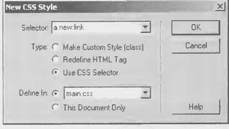

点击*确定*，并定义一些与第一组链接不同的样式规则。你需要对每个选择器依次执行此操作，记得在 `a` 后面添加 `.new`。

生成的样式表代码将如下所示：

## Dreamweaver MX 中的 CSS

```
a.new:link {
    font-family: Verdana, Arial, Helvetica, sans-serif;
    font-size: 12px;
    color: #990000;
    text-decoration: none;
}
a.new:visited {
    font-family: Verdana, Arial, Helvetica, sans-serif;
    font-size: 12px;
    color: #660000;
    text-decoration: none;
}

a.new:hover {
    font-family: Verdana, Arial, Helvetica, sans-serif;
    font-size: 12px;
    color: #660000;
    text-decoration: underline overline;
    background-color: #999999;
}

a.new:active {
    font-family: Verdana, Arial, Helvetica, sans-serif;
    font-size: 12px;
    color: #660000;
    text-decoration: none;
}
```

要将此样式应用于单个链接，请选择该链接并使用 Dreamweaver 将 new 类应用于它：

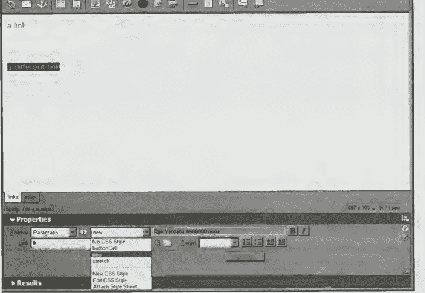


## 如何附加样式表

设计好样式表之后，下一步就是将其附加到你的文档中。为此，请点击 CSS 样式面板底部的*附加样式表*按钮。

在弹出的对话框中，你可以浏览查找样式表。下方的两个单选按钮允许你选择附加样式表的方式；选项有**链接（link）**和**导入（import）**。

### link（链接）

链接到样式表是将样式表附加到页面的常规方式。选择此选项将使用以下标记将样式表附加到页面：

```
<link href="global.css" rel="stylesheet" type="text/css" />
```

这种附加样式表的方式受到所有支持 CSS 的浏览器支持，如果你需要 Netscape 4 等浏览器也能够应用样式，那么你应该使用这种方式。

### import（导入）

如果你选择*导入*，样式表将使用以下标记附加：

```
<style type="text/css">
<!--
  @import url("global.css");
-->
</style>
```

这种附加样式表的方式不被较早的第 4 版本浏览器识别，这一点可以在需要处理这些旧浏览器中不完善的 CSS 支持时加以利用。我们稍后会回到这个话题。

## CSS 属性检查器

Dreamweaver MX 中的属性检查器 CSS 模式是新增的。如果你将属性检查器切换到 CSS 模式，它可以让你方便地访问自定义类，以及创建新样式和编辑样式（与从 CSS 面板操作的方式相同）。

要使用 CSS 属性检查器应用类，请选择你希望应用该类的元素。然后，在属性检查器中央的下拉列表中，选择你的类。该类将被应用，你还可以在属性检查器的右侧看到为该类定义的规则，因此你可以确切地看到为该元素定义了什么。

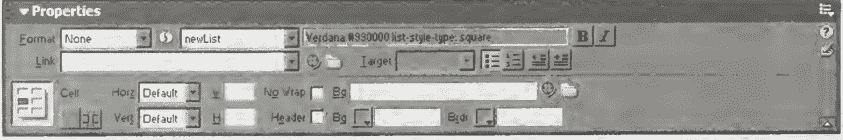

Dreamweaver MX 中的 CSS

## 设计文件：预制的 CSS 样式表

Dreamweaver MX 附带了一组现成的"设计文件"。这些文件包括 HTML 和样式表形式的站点设计。如果此时 CSS  still 感觉是一个相当抽象的概念，或者你只是想要一种快速入门的方式，那么这些文件非常有用。

要使用现成的样式表，请选择*文件 > 新建*，然后在"新建文档"对话框中选择*CSS 样式表*。预制的样式表列表将显示在中间的选取框中：

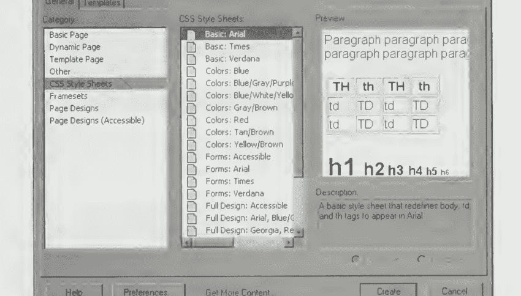

点击任意样式表名称，即可在该面板右侧的窗口中查看其部分元素，选择你希望使用的样式表后，点击*创建*，该样式表将作为新文档在 Dreamweaver 中创建。你需要将该样式表保存在你的站点中。

要开始使用你的样式表，你需要将其附加到页面。然后，任何重定义的标记将按样式表中设置的规则应用，任何自定义的类也将可供你使用。

## 设计时样式表

设计时样式表允许你在 Dreamweaver 中工作时应用一个样式表，该样式表在站点上线后不会显示。它们在处理附加了多个样式表的站点时非常有用，例如针对不同的浏览器使用不同样式表的站点，或者允许用户选择多种样式表之一的站点。如果你使用 ASP、PHP 或 JavaScript 动态地编写指向样式表的链接，Dreamweaver 将无法在设计过程中渲染该样式表，因此使用设计时样式表可以让你在 Dreamweaver 环境中进行可视化工作。

### 使用设计时样式表

你可以通过右键单击（在 Mac 上为按住 Command 键单击）CSS 样式面板，在上下文菜单中选择*设计时样式表*，或者选择*文本 > CSS 样式 > 设计时样式表*来打开设计时样式表对话框。将出现以下对话框：

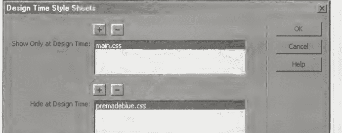

如上所示，你可以选择在站点中保存的样式表，使其在设计时显示或隐藏。要在设计时显示某个 CSS 样式表，请点击*仅在设计时显示*上方的 (+) 加号按钮，然后会弹出一个对话框，允许你浏览并选择该样式表。要隐藏某个 CSS 样式表，请点击*在设计时隐藏*上方的 (+) 加号按钮，同样地浏览该样式表。

你可以通过选择该样式表并点击减号 (-) 按钮来移除该样式表。

CSS 样式面板会更新并显示所选样式表的名称以及一个指示符，*隐藏*或*设计*，以反映该样式表的状态。这只会影响文档在 Dreamweaver 中的视图，不会对你的代码做任何更改。

## 与 Topstyle CSS 编辑器集成

虽然你可以在 Dreamweaver MX 中选择任何编辑器作为 CSS 的外部编辑器，但该产品与流行的 TopStyle CSS 编辑器有着紧密的集成。TopStyle 的试用版包含在 Dreamweaver MX 的 CD 中，也可以从 `http://www.bradsoft.com/` 下载，对于广泛处理 CSS 的用户来说，它是一个非常有用的应用程序。遗憾的是，TopStyle 目前仅支持 Windows 系统。Mac 平台有替代方案，包括 Style Master（`http://www.westciv.com/style_master/index.html`），但它们目前无法提供 TopStyle 与 Dreamweaver MX 之间那样紧密的集成。

如果你使用 TopStyle，你会发现对样式表所做的更改将自动在 Dreamweaver 的设计视图中更新，而且你添加的新类将立即可供使用。

## 用 CSS 替换已弃用或非法的元素

在*第二章*中我们看到，许多常用于展示目的的 HTML 标签已被弃用，如果你希望验证为严格的 DTD，它们就是非法的。在本节中，我们将研究如何用它们的 CSS 对应物来替换这些元素。

我们的 XHTML 严格文档显示了移除所有表现性或非法标签时出现许多问题：图像周围难看的蓝色边框、导航栏散架、文本没有任何样式：

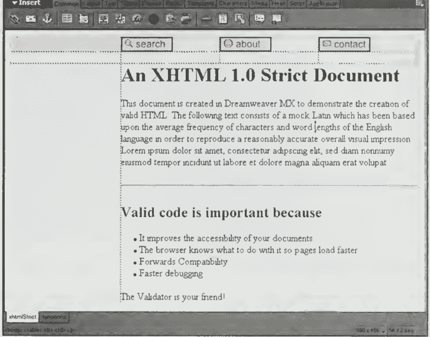

### 移除图像周围的边框

在 HTML 时代，我们会使用 `border="0"` 来移除带有链接的图像上的边框；我们可以用 CSS 实现相同的效果。

打开*新建样式*对话框，选择*重定义 HTML 标签*并选择*img*，如下所示：

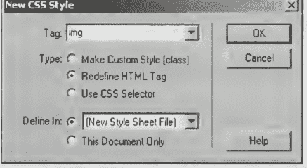

由于这是我们要添加到该页面的第一个样式，因此在一个新的外部样式表中创建它。保存样式表后，在 CSS 样式定义对话框中选择*边框*类别。在*样式*列表中，在顶部下拉列表中选择值"无"，并确保勾选*全部相同*，如下所示：

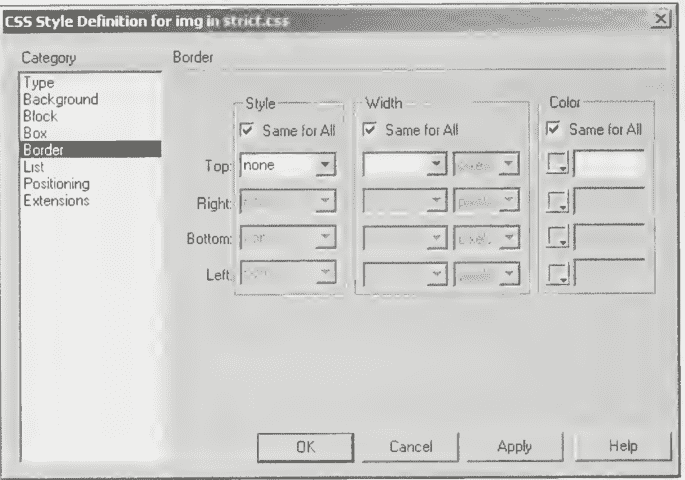

点击"确定"，你会看到图像边框已在 Dreamweaver 设计视图中自动消失。

> Dreamweaver 会为任何作为链接的图像添加 `border="0"` 属性。如果你需要验证为 XHTML Strict，或者只是不希望存在此属性，你需要在出现时检查并将其移除。

### 设置单元格的属性

移除表现性标签引起的另一个问题是，包含导航栏图像的单元格不再紧贴图像。为了改变这一点，我们将创建一个自定义类，应用于任何容纳按钮的表格单元格。

打开"新建样式"对话框，选择*创建自定义样式（类）*并命名该类。你应该在已附加的新样式表中定义它：

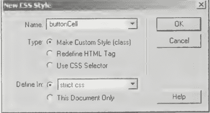

Dreamweaver MX 中的 CSS

在 CSS 样式定义对话框中，转到*方框*并将宽度设置为按钮的宽度，高度设置为按钮的高度，将填充和边距设置为 0，如下所示：

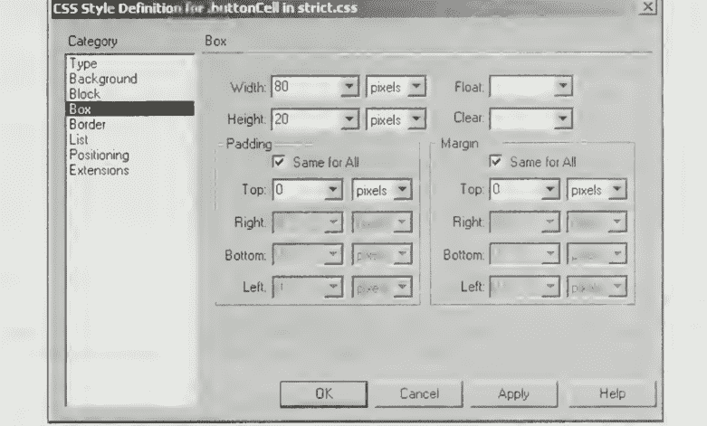

点击*确定*，然后回到文档窗口，你需要将此类应用于任何包含按钮的单元格：

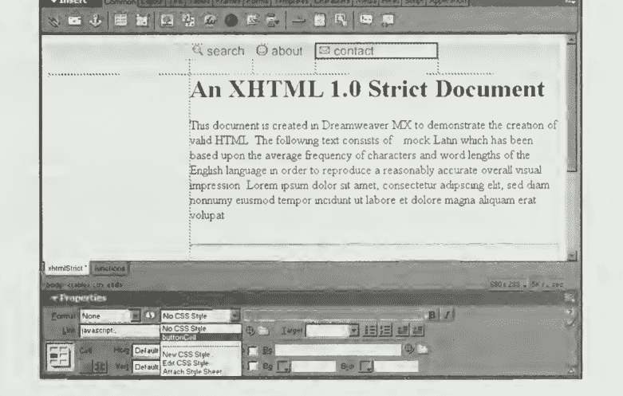


 # 第三章

你还需要创建一个类，让最后一个单元格能够拉伸以填充剩余空间。按照上面的方法创建一个类，并将其命名为`.stretch`。将该类的宽度设置为 100%。

当你把这个类应用到表格的最后一个单元格时，你会注意到 Dreamweaver 现在在文档窗口底部添加了滚动条，因为它无法正确判断视口的宽度。然而，在大多数现代浏览器中，它应该能正确显示。

> 这可能看起来有点像"hack"，确实如此，但使用表格进行布局本身就是 hack，而且如果可能的话，建议尽量避免这样做。我在这里的目的只是展示如何用其他方式替代已弃用的元素。实际上，大多数需要使用基于表格布局的人，目前可能会继续使用 XHTML Transitional DTD，并谨慎地组合使用 CSS 和 HTML 表现标签，以免失去与旧版浏览器的向后兼容性。稍后在本章中，我将解释如何在不使用表格进行定位的情况下创建这种布局。

## 将 HTML 站点转换为 CSS

一旦你开始使用 CSS 来设置字体和边框等样式，而不是使用 HTML，你会很快发现你的旧网站更难维护了，你可能希望在整个网站中实施 CSS。

我过去实现这一点的做法是创建一个样式表，精确替换你现有的所有默认设置，包括字体大小和字体、标题大小和字体等。如果你使用的是 Dreamweaver 模板，那么你有一个简单的方法将样式表链接到你的所有页面。如果没有，而且你的网站很大，*查找和替换*将是你的好帮手！

选择 **编辑** > **查找和替换**，在"查找和替换"对话框中，选择*源代码*并在**搜索**框中输入`</head>`。

在*替换为*框中，输入样式表的链接和结束的`</head>`标签。

```
<link href="/strict.css" rel="stylesheet" type="text/css" />
</head>
```

> 注意：你需要确保样式表的路径是正确的。

除非你重新定义了那些没有受到 HTML 表现标签影响的标签，否则一开始你不会看到页面的任何变化——HTML 标签优先于样式表中定义的样式。你需要删除文档中当前存在的任何 HTML 表现标签。

## 用于布局的 CSS

在任何与网页设计相关的新闻组或邮件列表中待一周左右，你很可能会遇到一场激烈的"表格与 CSS 定位"之争。大多数设计师会接受使用 CSS 来设置字体样式以及为页面元素添加内边距或边框是个好主意，但抛弃表格？我们擅长使用 HTML 表格进行布局，为什么要改变呢？

### 为什么要使用 CSS 进行布局？

表格是用来展示表格数据的，这种数据通常出现在电子表格中。之所以出现问题，是因为网页设计师们拼命想让网页看起来不那么像学术写作的页面，开始使用表格来创建布局，从而让工具做它本质上并不适合的工作。传统浏览器很快意识到了这一点，并开始很好地渲染表格布局，于是我们都开始 hack 表格来创建复杂的布局，而且我们做得很好。那么为什么我们要使用不同的东西呢？

#### 向前兼容性

随着表现元素被弃用并最终从规范中移除，用于布局的表格将变得更难使用，因为表格的每个单元格都需要通过向其应用类来控制，正如我们在本章前面看到的。现在开始使用 CSS 进行布局，你将以一种能够为工作提供最大向前兼容性——或者叫面向未来——的方式来构建网站。

#### 无障碍性

W3C 在其文档《HTML Techniques for Web Content Accessibility Guidelines 1.0》(http://www.w3.org/TR/WCAG10-HTML-TECHS/) 中建议不应使用表格进行布局：

5.2 用于布局的表格

本节检查点：

5.3 不要使用表格进行布局，除非表格在线性化后仍有意义。否则，如果表格没有意义，请提供替代等效内容（可以是线性化版本）。[优先级 2]

5.4 如果表格用于布局，不要使用任何结构标记来达到视觉格式化的目的。[优先级 2]

作者应使用样式表进行布局和定位。然而，当必须使用表格进行布局时，表格必须按可读的顺序线性化。当表格被线性化时，单元格的内容变成一系列段落（例如，向下排列）一个接一个。单元格按行顺序阅读时应该有道理，并且应包含结构元素（创建段落、标题、列表等），以便页面在线性化后仍有意义。

此外，使用表格创建布局时，不要使用结构标记来创建视觉格式化。例如，TH（表格标题）元素通常在视觉上显示为居中加粗。如果一个单元格实际上并不是某行或某列数据的标题，请使用样式表或该元素的格式化属性。

W3C 相当明确地指出不应使用表格进行布局。如果你考虑基于表格的布局一旦被线性化会发生什么，这就说得通了：

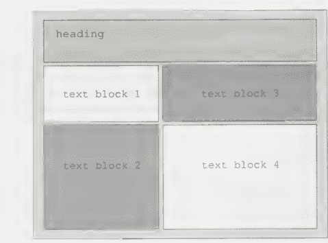

上图展示了一个典型的基于表格的布局，数据被放置在表格结构的不同单元格中，以影响页面的视觉显示。上面显示的布局会被屏幕阅读器读作：

标题
文本块 1
文本块 3
文本块 2
文本块 4

如果块 1 和块 2 的内容应该是连续相接的，那么文本块 3 跟在 1 后面将使这个页面变得非常难以理解！

#### 平台和设备独立性

正如我们已经看到的，CSS 在完全不支持 CSS 的浏览器中可以无故障降级。就 CSS 布局而言，这意味着你的文档将按照你给它的结构显示，忽略项目的定位方式。通过仔细构建文档结构，并确保信息流动在没有定位的情况下也是有意义的，你将允许所有网络用户访问你的内容——无论他们是在不支持 CSS 的 PDA 上，还是在纯文本浏览器上，或者使用屏幕或盲文阅读器。

#### 重新设计的便利性

就像使用定义在外部样式表中的 CSS 可以让你全站点更改颜色或字体一样，使用 CSS 定位页面元素可以让你全站点更改页面布局。如果你的客户决定将导航从现在左边改到右边——没问题——对样式表进行几处小修改，布局就改变了。相比之下，重新编码复杂的嵌套表格可能是一项艰巨的任务。

#### 浏览器支持

浏览器支持是区分使用表格的人和转向 CSS 布局的人的主要问题之一。从第 4 代浏览器（IE 4/Netscape 4）开始，所有浏览器都在一定程度上支持 CSS 定位。任何尝试过让 CSS 布局在第 4 代浏览器上工作的人都知道，支持的属性非常少，而且那些支持的属性可能以一种奇怪或不一致的方式呈现。

### Dreamweaver MX 中的 CSS 布局

在 Dreamweaver MX 中，与 Dreamweaver 3 和 4 一样，你可以使用"层"来代替表格，或者与表格一起使用。层不过是内联 CSS 定位，不应与 Netscape 4 中的专有`<layer>`标签混淆，现代浏览器不支持该标签。要在 Dreamweaver 中构建 CSS 布局，你可以使用"层"或构建一个包含定位的外部样式表并将其附加到你的页面。我们将在这里探讨每种方法的优缺点。

#### 层

正如我已经提到的，"层"就是简单的内联 CSS 定位。使用 Dreamweaver 层来布局页面，你不会获得使用 CSS 的许多优势，因为要进行更改你仍然需要单独编辑站点中的每个文档。然而，使用层是在 Dreamweaver 环境中探索 CSS 定位最简单的方法，所以我们首先来看一下这种方法。

创建一个新文档。在插入工具栏的*常用*选项卡上，选择*绘制层*。要重新创建导航栏，使其看起来类似于表格布局版本，请在文档顶部绘制一个宽"层"。在属性检查器中将层的大小设置为高度 20px，宽度 96%。

在属性检查器中，你还可以设置"层"距离视口顶部和左侧的距离——见下图——我将左侧位置设为 2%，因为我希望这个层在浏览器中保持大致居中。将此层命名为 nav：

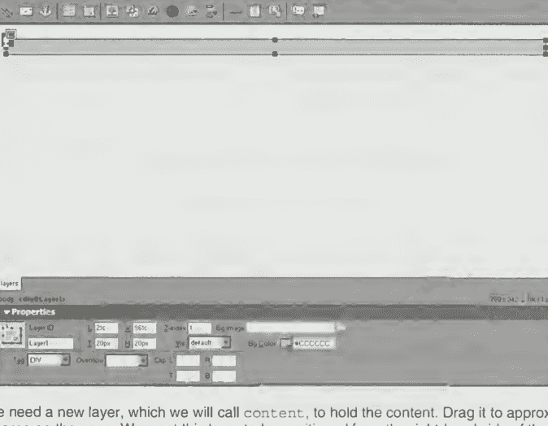

现在我们需要一个新的层，我们将其命名为 *content*，用于容纳内容。将其拖动到页面上大致正确的区域。我们希望这个层从页面的右侧定位，以保持我们的流式布局。然而，Dreamweaver MX 没有提供从页面右侧进行定位的功能。

# 第 3 章

要定位这个图层，我们需要切换到代码视图。如果你先选中该图层，进入代码视图后它会被高亮显示，这样就能轻松找到它。内容图层大致如下所示：

```
<div id="content" style="position:absolute; left:180px; top:68px; width:536px; height:259px; z-index:2"></div>
```

你需要删除 `left` 的定义，并将其替换为 `right`，如下所示：

```
<div id="content" style="position:absolute; right: 7%; top:72px; width:70%; z-index:2;">
```

我还删除了高度规则，这样该区域将根据内容自动调整大小，并将此图层的宽度设置为 70%。

这意味着无论用户的浏览器窗口大小如何，内容都会随之调整。然而在设计视图中，我们现在遇到了一个小问题。只要你触碰了那个图层，代码中就会被添加一条 `left: xxx;` 规则，这会破坏页面的流式布局——虽然删除它并不难，但总归有些麻烦。

> 如果你需要布局在 Netscape 4 中也能正常工作，那么你需要避免从页面右侧定位元素，或者使用外部样式表以及本章后面"浏览器和设备问题"部分中将讨论的某种方法。

要添加导航图片，我们需要回到导航图层。选中该图层并切换到代码视图。我们需要为此图层添加一条额外的定义，以便将图片放置在距离图层左侧 180 像素的位置。编辑这行代码：

```
<div id="nav" style="position:absolute; left:2%; top:20px; width:96%; height:20px; z-index:1; background-color: #F0F0F0; layer-background-color: #F0F0F0;"></div>
```

添加 `padding-left: 180px;`，最终效果如下：

```
<div id="nav" style="position:absolute; left:2%; top:20px; width:96%; height:20px; z-index:1; background-color: #F0F0F0; layer-background-color: #F0F0F0; padding-left: 180px;"></div>
```

切换回设计视图并在图层内点击，你会发现光标定位在距左侧 180 像素处。你会看到 Dreamweaver 添加了规则 `layer-background-color: #F0F0F0;`，这是一条 Netscape 专有规则，不会通过验证。

现在你可以依次将导航图片插入此图层，包括应用交换图像行为，就像在表格单元格中操作一样。

## Dreamweaver MX 中的 CSS

以下是我们在 Dreamweaver MX 中看到的最终效果：

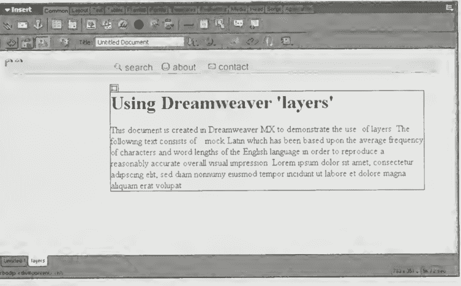

页面在 IE 6 中的效果如下：

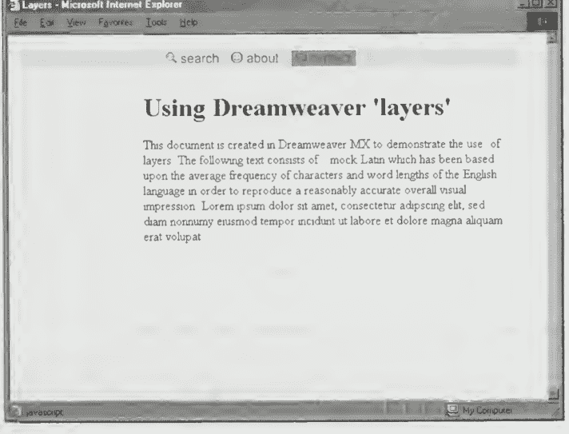

以下是用于创建此布局的最终代码，该代码包含在本书的代码下载中，保存为 layers.html：

```
<?xml version="1.0" encoding="iso-8859-1"?>
<!DOCTYPE html PUBLIC "-//W3C//DTD XHTML 1.0 Transitional//EN"
"http://www.w3.org/TR/xhtml1/DTD/xhtml1-transitional.dtd">
<html xmlns="http://www.w3.org/1999/xhtml">
<head>
  <title>Untitled Document</title>
  <meta http-equiv="Content-Type" content="text/html; charset=iso-8859-1" />
  <script type="text/JavaScript" src="functions.js"></script>
  <link href="strict.css" rel="stylesheet" type="text/css" />
</head>

<body
onload="MM_preloadImages('i/button01b.gif','i/button02b.gif','i/button03b.gif')"

  <div id="nav" style="position:absolute; left:2%; top:20px; width:96%;
height:20px; z-index:1; background-color: #F0F0F0; layer-background-color:
#F0F0F0; padding-left: 180px;">

    <a href="javascript:;"
onmouseover="MM_swapImage('img1','','i/button01b.gif',1)"
onmouseout="MM_swapImgRestore()"></a><a href="javascript:;"
onmouseover="MM_swapImage('img2','','i/button02b.gif',1)"
onmouseout="MM_swapImgRestore()"></a><a href="javascript:;"
onmouseover="MM_swapImage('img3','','i/button03b.gif',1)"
onmouseout="MM_swapImgRestore()"></a>

  </div>

  <div id="content" style="position:absolute; right: 7%; top:72px; width:70%; z-
index:2;">
    <h1>Using Dreamweaver 'layers'</h1>
    <p>This document is created in Dreamweaver MX to demonstrate the use of
layers.
      The following text consists of mock Latin which has been based upon the
      average frequency of characters and word lengths of the English language in
      order to reproduce a reasonably accurate overall visual impression. Lorem
      ipsum dolor sit amet, consectetur adipiscing elit, sed diam nonnumy eiusmod
      tempor incidunt ut labore et dolore magna aliquam erat volupat.</p>
  </div>
</body>
</html>
```

即使使用内联样式来为本文档添加定位，与使用表格布局版本相比，代码量也明显减少了。

## 在外部样式表中定义 CSS 定位

使用 Dreamweaver 图层来创建布局，虽然优于使用表格和表现性 HTML，但意味着网站的每个页面都必须包含用于定位元素的 CSS 规则标记。如果你还记得，将 CSS 样式定义在外部样式表中意味着我们只需更改一个定义就能全站更改字体大小或颜色。在外部样式表中定义 CSS 定位同样具有同样的强大效果。

我们可以使用上一节中用 Dreamweaver 图层创建的页面作为起点。

切换到代码视图，找到导航栏的 CSS 规则：

```
<div id="nav" style="position:absolute; left:2%; top:20px; width:96%; height:20px;
z-index:1; background-color: #F0F0F0; layer-background-color: #F0F0F0; padding-
left: 180px;">
```

我们需要将这些规则放入外部样式表中，因此如果你已经有一个样式表附加到该页面，请在 Dreamweaver 或你的外部 CSS 编辑器中打开它。如果没有附加样式表，则创建一个新的并将其链接到此页面。

在样式表中添加以下 CSS 规则：

```
#nav {
  position:absolute;
  left:2%; top:20px;
  width:96%;
  height:20px;
  z-index:1;
  background-color: #F0F0F0;
  layer-background-color: #F0F0F0;
  padding-left: 180px;
}
```

你会注意到这些规则与内联样式中完全相同，我们只是将它们移到了外部样式表中。

现在，回到我们的 HTML 文档中，删除样式定义，使其变为：

```
<div id="nav">
```

同样需要按照相同的流程将内容 div 的定义放入外部样式表中。页面在 Dreamweaver 中的显示效果以及在浏览器中的预览效果将与使用内联 CSS 时相同。然而，好处在此刻应该显而易见——页面将包含更少的代码，因此加载速度更快，但主要的好处是每个链接到此外部样式表的页面都会以完全相同的方式显示所有 id 为 nav 或 content 的 `<div>` 元素。如果你想将导航放在页面底部，或者更改内容的背景颜色，只需在一个地方修改规则即可。

## 有效地组织内容

使用 CSS 布局页面使我们从为了创建布局而必须组织内容流的限制中解放出来。这让我们可以自由地思考如何最好地组织文档，以便那些使用不会利用布局信息的设备（例如屏幕阅读器和纯文本浏览器）访问我们网站的用户仍然能够理解我们的内容。

为了有效地组织内容，我们需要考虑我们的信息在去掉格式后的线性化形式中会如何呈现。我们应该考虑当用户通过屏幕阅读器听到内容朗读，或者他们只是使用像 Lynx 这样的纯文本浏览器并通过 Tab 键逐个切换链接以找到正确的链接来跳转到另一个文档时，他们将如何浏览网站。

通常一个好的做法是将导航链接（至少能返回主页或网站主要部分的链接）放置在页面顶部附近，以便用户在意识到这不是他们想要的页面时，能快速返回主页或跳转到其他部分。任何不是页面主要内容的部分都应放在文档的末尾。


 ## 我们的 CSS 排版在 Lynx 中的显示效果

使用纯文本浏览器 Lynx 是测试文档结构的好方法。你可以在页面顶部看到导航链接；由于它不显示图像，因此这些链接取自我们的 alt 文本。接着是我们的 `<h1>` 标题，然后是内容。

## ……以及在 Ipaq 的 Pocket Explorer 中（无 CSS 支持）

Pocket Explorer 不支持 CSS，但会显示图像，因此我们的导航图像会出现。不过，所有内容都是线性显示的。在设计时考虑到这类设备非常重要，要记住由于屏幕很小，页面加载时只有少量内容会初始显示。因此，我们需要确保快速提供有用的内容以吸引用户的注意力。

## 浏览器和设备问题

浏览器问题被引用为人们在网站上不实施 CSS 的主要原因；但这个借口正在迅速过时。然而，虽然不支持 CSS 的浏览器应该以可读的方式渲染你的内容，但部分支持或有缺陷的 CSS 支持的浏览器存在问题，而这些浏览器——特别是 Netscape 4——正是我们需要考虑的。

Netscape 4 的某些版本在遇到某些有效的 CSS 声明时可能会崩溃，或者将页面渲染得无法使用，或者只是简单地难看！幸好有办法解决这个问题。

## 针对 Netscape 4 使用 @import

前面，我们了解了两种将样式表附加到页面的方法：链接或使用 @import。Netscape 4 无法识别 @import，因此我们利用这一点，将两个样式表附加到页面：一个基本的、Netscape 4 友好的样式表，我们使用 link 方法链接到页面；另一个更高级的样式表，我们使用 @import 附加，因此对 Netscape 4 不可见。

要使用 Dreamweaver 以这种方式将两个样式表附加到页面，你需要**首先**使用 link 方法附加基本的 Netscape 4 友好样式表：

然后附加第二个样式表，使用 @import 为较新的浏览器添加声明：

> 你必须在链接的样式表之后指定导入的样式表，以便第二个样式表覆盖基本的 Netscape 4 友好 CSS。

在代码视图中，生成的代码如下所示：

```
<link href="oldbrowsers.css" rel="stylesheet" type="text/css" />
<style type="text/css">
<!--
@import url("newbrowsers.css");
-->
</style>
```

任何你希望为较新浏览器不同的 CSS 必须包含在导入的样式表中。如果导入的样式表中未找到该元素的值，浏览器将使用链接样式表中的值。

## JavaScript 技术

也可以使用 JavaScript 检测正在使用什么浏览器，并为该浏览器输出适当的样式表。这种方法依赖于用户开启 JavaScript，但如果你发现某个浏览器的错误导致崩溃或其他问题，并且你需要通过附加专门为其设计的友好样式表来隔离该浏览器，这会非常有用。

我们还可以使用 JavaScript 检测用户是访问使用较新的、更符合标准的浏览器，还是版本 5 之前的浏览器，并相应地显示样式表。此方法检查浏览器是否支持 W3C DOM，较新的浏览器支持，然后将适当的样式表写入页面。

```
<script language="javascript" type="text/javascript">
if (!document.getElementById) {
document.write('<link rel="stylesheet" href="oldbrowsers.css" type="text/css"
/>');
}
else
{
document.write('<link rel="stylesheet" href="newbrowsers.css" type="text/css"
/>');
}
</script>
```

上述代码中的第一个样式表应该是那些不支持 W3C DOM 的旧浏览器的样式表，第二个样式表适用于所有较新的浏览器。

### 媒体描述符

媒体描述符允许我们指定文档在不同媒体上的呈现方式：显示器屏幕、纸张、屏幕阅读器、盲文阅读器或其他设备。例如，我们可以指定打印页面时使用与浏览器窗口中显示时不同的样式表。它允许带有语音合成规则的样式表提供给屏幕阅读器，并为网络电视或 PDA 设计的样式表适当地提供。

浏览器或设备是否理解媒体描述符目前因设备而异，但对 print 的支持良好（这可能是目前你最常用的媒体描述符），并且随着设备支持的增长，学习使用这种提供适当呈现规则的方法在未来应该会变得更有用。

CSS2 规范中列出的媒体描述符如下：

| 描述符 | 媒体 |
|------------|-------|
| all | 所有设备 |
| aural | 语音合成器（屏幕阅读器） |
| braille | 盲文触觉反馈设备 |
| embossed | 分页盲文打印机 |
| handheld | 手持设备（小屏幕、单色、有限带宽） |
| print | 待打印的文档 |
| projection | 投影设备 |
| screen | 彩色计算机屏幕——标准网页浏览器 |
| tty | 使用固定间距字符网格的媒体或显示能力有限的便携设备。这些通常是较早的移动设备，大多数当前设备属于 handheld |
| tv | 电视 |

你可以用两种方式使用媒体描述符：要么为每种希望使用的类型指定单独的样式表，要么使用 `@import`。

### 为每种媒体描述符指定单独的样式表

如果你已经有一个用于屏幕呈现的样式表链接到页面，并希望添加一个仅在打印文档时生效的样式表，你可以添加第二个用于打印的链接样式表。你还需要将媒体描述符 `screen` 添加到你的现有样式表，以便浏览器知道 `screen` 样式表用于浏览器中，而 `print` 样式表应在打印页面时使用。

```
<link rel="stylesheet" type="text/css" media="screen" href="screen.css" />
<link rel="stylesheet" type="text/css" media="print" href="print.css" />
```

使用 `print` 样式表允许你，例如，打印文档时隐藏导航；将字体从无衬线字体（在屏幕上更易读）改为衬线字体（在印刷品中更易读）；移除会导致打印时间更长的背景颜色或图像，并总体上允许你控制页面打印时的外观。

### 使用 @import 配合媒体描述符

上述方法意味着你需要为每个浏览器创建单独的样式表；通过使用 `@import`，你可以拥有一个样式表并为某些媒体类型指定特定元素。要使用该 `@import` 方法，请像这样将样式表附加到页面：

```
<style type="text/css" media="all">@import "all.css";</style>
```

在样式表 `all.css` 中，你使用 `@media` 为每个媒体描述符添加属性，如反面示例所示：

```
@media print {
    body { font-size: 10pt; }
}

@media screen {
    body { font-size: 12px; }
}

@media screen, print {
    body { color: #000000; }
}
```

上述声明将使得页面打印时使用 10 磅字体大小，在常规浏览器中查看时为 12 像素，并且 screen 和 print 都将使用 #000000（黑色）作为正文文本的颜色。

## 验证你的 CSS

Dreamweaver MX 没有内置的 CSS 验证器，但你可以使用 W3C 网站上的 CSS 验证器轻松验证你的 CSS：http://jigsaw.w3.org/css-validator/。你可以下载验证器离线使用，只需将验证器指向上传到你网站空间的样式表即可验证你的样式表，将你的样式表上传到验证器，或者简单地将其内容复制粘贴到网站上的文本框中。

与 HTML 和 XHTML 页面一样，验证你的样式表将帮助你修复可能在某些浏览器中导致问题的问题，如果你遇到问题，这是一件好事。

## 小结

在本章中，我试图为 CSS 的基础知识提供扎实的基础，包括在 Dreamweaver 内部以及原始代码中，以便你能快速理解界面背后的概念。你应该对以下内容有信心理解：

- CSS 是什么
- 在网站上实施 CSS 的不同方式
- Dreamweaver MX 中的 CSS 工具
- 用于文本样式的 CSS
- 用于定位的 CSS——同时使用"图层"（内联 CSS 定位）和外部样式表中的 CSS 定位
- 使用 CSS 时固有的浏览器和设备问题，以及一些应对方法

有许多资源可帮助你将 CSS 技能提升到更高水平；包括 glasshaus 书籍《Cascading Style Sheets: Separating Content From Presentation》（ISBN: 1-904151-04-3），以及网络上的众多资源。既然 Dreamweaver MX 为你的开发环境带来了良好的 CSS 支持，你可以立即开始使用 CSS 创建网站。

在下一章中，我们将详细介绍如何使用 Dreamweaver MX 构建可访问的网站。


 # 无障碍设计与 Dreamweaver MX

创建无障碍网页的重要性从未像今天这般突出。随着美国、加拿大、欧盟、澳大利亚、日本和巴西纷纷采纳无障碍标准，设计人员和开发人员面临着确保残障人士能够访问网站和 Web 应用程序内容的强制性要求。

此外，确保网站对残障人士无障碍更是理所应当之事。对于残障人士而言，互联网可能是一种极具价值的工具。它能让他们接触到周围的世界，还能获得前所未有的独立生活体验。

设想一件像读报这样简单的任务。在互联网出现之前，盲人若想读报只有两个选择。他可以获取报纸的盲文版本，但这既昂贵又难以找到；或者请别人读给他听。如今，盲人可以使用名为屏幕阅读器的软件，每天从网站上为他朗读新闻。对他人的依赖由此消除。

现在，再设想一位残障人士给同事写备忘录、申请升职或在大学选课。对许多残障人士来说，无障碍的意义远不止便利。它关乎就业、教育和融入社区的机会。它关乎能否过上正常的生活。

Dreamweaver MX 提供了最完整的工具集，可用于构建、编辑和维护无障碍网站和 Web 应用程序。Dreamweaver MX 包含多种工具，可在插入图像、表单、媒体、表格和框架时提示设计人员提供重要的无障碍信息。此外，Dreamweaver MX 还通过参考指南、模板、代码片段和内置无障碍验证工具等功能，帮助设计人员理解并遵守无障碍标准。

最后，Dreamweaver MX 让残障人士创建网站和 Web 应用程序比以往任何时候都更加容易。通过改进创作环境，Dreamweaver MX 现可与辅助技术协同工作，例如 GW Micro 公司的 Window-Eyes™ 屏幕阅读器（*http://www.gwmicro.com/*）和 Freedom Scientific 公司的 JAWS 屏幕阅读器（*http://www.freedomscientific.com/*）。

本章将介绍无障碍这一主题，并回顾 Macromedia Dreamweaver MX 的无障碍功能。主题包括：

- 无障碍概述
  - 定义残障
  - 辅助技术
- 无障碍标准
- 为什么无障碍很重要？
- Dreamweaver MX 中的无障碍功能
  - 无障碍首选项选项
  - 添加图像
  - 添加媒体
  - 添加框架
  - 添加表单
  - 添加表格
  - 无障碍验证
  - 无障碍参考
  - 无障碍模板
  - 无障碍创作环境

> 本章中的所有代码示例均可在本书的代码下载页面获取，网址为 glasshaus.com。

## 无障碍概述

一般而言，无障碍描述的是网站对残障人士的友好程度。一个无障碍的网站，是指设计元素（如颜色、字体大小或布局）不会掩盖网站内容的网站。无障碍网站还能与残障人士使用的辅助技术兼容。

更具体地说，**美国《康复法》第 508 节**（*http://www.section508.gov/*）等政策以及 **Web 无障碍倡议**（**WAI**，*http://www.w3.org/TR/WCAG10*）等指南，通过一系列检查点规定了什么样的网站才算无障碍。每个检查点针对特定的残障和技术解决问题。

本节从更完整的定义角度来阐述无障碍，包括网络用户中常见的残障类型、使用的辅助技术，以及管理网络无障碍的政策。最后，本节回顾了将无障碍融入网站设计的若干理由。

### 定义残障

美国人口普查局 1997 年的一份报告（http://www.census.gov/）将 19.6% 的美国人口归类为患有某种残障。这一比例通常被认为与全球统计数据一致。残障这一广泛类别包括以下几类：

- 视觉障碍
- 听觉障碍
- 运动障碍
- 认知障碍

每个类别都包含一系列状况。例如，视觉障碍包括低视力、色盲和失明。针对盲人的工具和技术与针对色盲人士的截然不同。认知障碍可能是最多样化的类别。这一群体包括患有癫痫症的人，以及有学习或发育障碍的人。为认知障碍人士构建无障碍网站可能是一项复杂的任务，因为理解障碍往往既存在于内容中，也存在于页面设计中。

残障类别可能重叠，也可能包括暂时性残障。有一个群体经常被忽视，那就是聋盲群体。对于既聋又盲的人来说，互联网可能是与他人沟通的极其重要的方式。此外，我们任何人都可能暂时性残障——例如手腕骨折的人可能难以使用鼠标，但仍需访问网络以满足日常的工作需求。

同时，需要记住的是，随着年龄增长，大多数人都会面临某种残障。虽然美国总人口中近 20% 患有残障，但随着人口老龄化，残障人士的比例会越来越高（见下表）。事实上，80 岁以上人口中几乎有 75% 患有残障。因此，无障碍不仅仅是打开大门；更是保持大门敞开。无障碍让人们能够维持一种 otherwise 会因年龄增长而难以实现的独立生活水准。

| 年龄段 | 总人数 | 残障人数 | 残障比例 |
| --- | --- | --- | --- |
| 所有年龄 | 267,665,000 | 52,596,000 | 19.7% |
| 15 岁以下 | 59,606,000 | 4,661,000 | 7.8% |
| 15 至 24 岁 | 36,897,000 | 3,961,000 | 10.7% |
| 25 至 44 岁 | 83,887,000 | 11,200,000 | 13.4% |
| 45 至 54 岁 | 33,620,000 | 7,585,000 | 22.6% |
| 55 至 64 岁 | 21,591,000 | 7,708,000 | 35.7% |
| 65 岁及以上 | 32,064,000 | 17,480,000 | 54.5% |

来源：http://www.census.gov/hhes/www/disable/sipp/disab97/ds97t1.html

### 辅助技术

残障用户通常依赖硬件和软件来访问网页内容。这些工具被称为辅助技术，范围从屏幕阅读器到触摸屏和头部指针。

盲人网络用户经常使用名为屏幕阅读器的 taw 软件来朗读网页内容。两种常见的屏幕阅读器上文已提及，分别是 Freedom Scientific 公司的 JAWS 和 GW Micro 公司的 Window-Eyes。屏幕阅读器使用户能够用听的代替读的；然而，屏幕阅读器只能阅读文本，无法阅读图像或动画。因此，必须为图像和动画添加屏幕阅读器可读的文本描述，这一点至关重要。这些文本描述被称为替代文本，或简称 alt 文本。

行动不便的用户可能依赖键盘而非鼠标来浏览网页。对于神经损伤、关节炎或重复性运动损伤的人来说，使用鼠标可能并不舒适或根本做不到。只使用键盘上的 *Tab* 和 *Enter* 键，这些人就能轻松浏览页面。许多互联网用户都具备这种能力，只是没有意识到而已。在 Internet Explorer（IE）中，按 *Tab* 键可在页面所有可用链接之间移动浏览器的焦点。IE 中链接周围的虚线让用户知道浏览器当前的焦点位置。按 *Enter* 键可激活链接，效果与点击（并松开）鼠标相同。在下面的示例中，请注意 "*Usable Forms for the Web*" 链接周围的虚线。


在某些情况下，用户可能会使用触摸屏、头部指针或其他辅助设备。触摸屏允许个人用手浏览页面，而无需鼠标所需的精细运动控制。头部指针只是一根放在口中或安装在头带上的棍子，用户用它与键盘或触摸屏进行交互。

在这些情况下，页面的基本组件无需鼠标即可工作非常重要。悬停效果、下拉列表和交互式模拟都是通常依赖鼠标进行用户交互的元素示例。这些元素的设计者或开发者必须确保在鼠标定义事件的同时包含键盘定义事件。使用IE中可用的按键进行快速测试，可以为了解网页可能对残障用户造成的困难提供宝贵的视角。例如，用户可以通过按*tab*键移动到任何可获得焦点的对象，包括链接、表单控件和嵌入式对象，按*enter*键将激活选中的链接。按*ctrl + tab*可在框架之间移动。

## 无障碍标准

无障碍政策因国家而异，但许多国家，包括美国、澳大利亚、加拿大、欧盟和日本，都已采纳基于**万维网联盟（W3C）**制定的标准的政策。1994年，W3C开始研究残障人士在新兴万维网上可能遇到的无障碍问题。该小组促成了网络无障碍倡议（WAI）的成立。WAI包含若干改善网络无障碍性的工作。也许使用最广泛的文档是**网页内容无障碍指南（WCAG）**。

对于构成WCAG的十四条指南中的每一条，都有一系列被评为优先级1、优先级2或优先级3的检查点：

- 优先级1检查点是设计者*必须*采取的行动，以使网站具备无障碍性
- 优先级2检查点是设计者*应该*采取的行动，以使网站具备无障碍性
- 优先级3检查点是设计者*可以*采取的行动，以改善网站的无障碍性

WCAG的优先级1检查点几乎在所有采纳正式政策的国家中构成了无障碍标准的基础。例外是加拿大和英国，这两个国家的政府网站设计者被要求遵守WCAG的优先级1和优先级2检查点。

在美国，管理网络无障碍的法律通常被称为"第508条"。美国《康复法》第508条禁止联邦机构购买、开发、维护或使用对残障人士不可访问的电子和信息技术。该法案最初于1988年颁布，但在十年后国会通过《劳动力投资法》之前进展甚微。这项对第508条的修正案规定了无障碍标准，更重要的是，赋予了公众成员和政府残障雇员在联邦法院起诉机构并就违规行为提出行政投诉的权利。

截至2002年6月21日，所有联邦政府网站都应遵守第508条规定的标准。这些标准基于WCAG的优先级1检查点，外加一个优先级3检查点以确保周全。第508条对WCAG的优先级2检查点没有任何规定。

# 第4章

第508条与WCAG之间的区别微妙但重要。第508条旨在界定问题严重到何种程度可以作为诉讼的基础。WCAG定义了一套无障碍设计的目标。因此，第508条标准被设计得更容易评估。这使得第508条标准成为州、地方和机构层面无障碍政策的流行基础。这些环境中的设计者和开发者通常没有联邦强制要求遵守第508条标准。相反，他们当地的无障碍政策可能要求使用这些标准。这种区别可能令人困惑但很重要。不合规的后果可能因地而异。

第508条标准实际上由六个部分组成。每一部分针对不同类型的技术。每个部分的完整标准集可在以下网址找到：

- 1194.21 软件应用和操作系统
  http://www.section508.gov/index.cfm?FuseAction=Content&ID=12#Software
- 1194.22 基于网络的内部网和互联网信息及应用
  http://www.section508.gov/index.cfm?FuseAction=Content&ID=12#Web
- 1194.23 电信产品
  http://www.section508.gov/index.cfm?FuseAction=Content&ID=12#Telecommunications
- 1194.24 视频和多媒体产品
  http://www.section508.gov/index.cfm?FuseAction=Content&ID=12#Video
- 1194.25 独立封闭式产品
  http://www.section508.gov/index.cfm?FuseAction=Content&ID=12#Self
- 1194.26 台式机和便携式计算机
  http://www.section508.gov/index.cfm?FuseAction=Content&ID=12#Desktop

与此处讨论最相关的是1194.22节中概述的网络内容标准。这些标准列于下文。需要注意的是，在使用插件（如Macromedia Flash内容）的情况下，1194.21节中概述的软件和应用系统标准适用。要了解更多关于第508条标准的信息，请访问http://www.section508.gov或http://www.macromedia.com/macromedia/accessibility/。

### § 1194.22

基于网络的内部网和互联网信息及应用。

- (a) 应为每个非文本元素提供文本等效内容（例如，通过"alt"、"longdesc"或元素内容）。
- (b) 任何多媒体演示的等效替代内容应与演示同步。
- (c) 网页应设计为所有通过颜色传达的信息在无色时也可用，例如通过上下文或标记。
- (d) 文档应组织为无需相关联的样式表即可阅读。
- (e) 应为服务器端图像映射的每个活动区域提供冗余文本链接。
- (f) 应提供客户端图像映射而非服务器端图像映射，除非区域无法用可用的几何形状定义。
- (g) 应标识数据表格的行和列标题。
- (h) 对于具有两个或多个逻辑层级的行或列标题的数据表格，应使用标记将数据单元格与标题单元格关联。
- (i) 框架应使用文本标题，以便框架识别和导航。
- (j) 页面应设计为避免导致屏幕以大于55 Hz且小于2 Hz的频率闪烁。
- (k) 当无法以其他方式实现合规时，应提供仅文本页面，具有等效的信息或功能，以使网站遵守本部分的规定。仅文本页面的内容应在主页面更改时更新。
- (l) 当页面利用脚本语言显示内容或创建界面元素时，脚本提供的信息应使用辅助技术可读取的功能性文本进行标识。
- (m) 当网页要求客户端系统存在小程序、插件或其他应用程序来解释页面内容时，页面必须提供指向符合§1194.21(a)至(l)的小程序或插件的链接。
- (n) 当电子表单设计为在线完成时，表单应允许使用辅助技术的人访问完成和提交表单所需的信息、字段元素和功能，包括所有指示和提示。
- (o) 应提供允许用户跳过重复导航链接的方法。
- (p) 当需要定时响应时，应向用户发出警报并给予足够的时间来指示需要更多时间。

## 为什么无障碍性很重要？

对大多数人来说，创建无障碍网站的原因很简单：这是正确的事，也是法律。然而，指出创建无障碍网站的额外好处往往很有帮助。以下是许多人认为有说服力的理由列表：

- 无障碍性是正确的做法
- 无障碍性对许多机构来说是法律要求
- 无障碍性为所有用户提供好处，不仅仅是残障人士
- 无障碍性使用创新技术
- 无障碍性创造市场机会


 ## 第4章

### 可访问性是值得去做的事

可访问性对于残障人士来说是迈向独立的重要一步。无障碍网页让他们能够获取基础的政府服务和信息，如税务表格、社会项目和立法代表信息。无障碍网页还通过提供更多的交流渠道，为残障人士创造了更广泛的就业和教育机会。此外，可访问性使残障用户能够参与我们许多人习以为常的日常活动，例如阅读报纸或为心爱的人购买礼物。

### 可访问性是许多机构的法律要求

随着美国、加拿大和欧盟新的国家级要求出台，以及不久的将来还会有更多相关政策，可访问性存在众多法律强制规定。这些政策的覆盖范围可能会进一步扩大。例如，在美国，第508条为联邦机构设计或维护的网页设定了标准。美国各州和地方政府以及全国各地的教育和非营利机构也在考虑制定自己的可访问性政策。例如，今年早些时候，威斯康星大学麦迪逊分校通过了一项可访问性政策，要求所有由该校发布或托管的网页都必须符合WCAG第1级和第2级检查点的所有要求。

### 可访问性为所有用户带来好处

与许多为残障人士设计的改进措施一样，无障碍设计的增强功能为所有网络用户带来好处。任何推着购物车走出杂货店的人都可以证明自动门和路缘坡道的价值。同样，无障碍网页通常更易于阅读、更易于导航，并且下载速度更快，因为它们针对易用性进行了优化，而且往往不会包含那么多常常是造成网站体积庞大、加载缓慢的罪魁祸首的页面元素，如Flash影片和大尺寸图片。

### 可访问性使用创新技术

无障碍设计基于这样一个前提：网页必须在包括Netscape和Internet Explorer之外的多种浏览器中正常工作。一个页面必须能够在使用屏幕阅读器、可刷新盲文显示器或头部指针时都可访问。使页面能够在非标准浏览器中工作，往往也能让它们在其他消费类互联网设备上使用，例如支持WAP的手机或手持个人数字助理（PDA）。

无障碍技术基于近期的技术和设计策略。老旧的静态HTML设计往往将内容与格式混合在网页中。可访问性指南鼓励通过使用层叠样式表（CSS）将格式与内容分离，以实现更灵活的内容使用和更强大的动态模型的更简便实施。有关使用CSS提高可访问性的更多信息，请参阅本书*第3章*。

### 可访问性创造市场机会

可访问性为组织和企业接触新客户和新市场提供了潜力。随着更多政策的采纳，政府和教育机构对支持可访问性政策的商品和服务的需求正在增长。在美国，通过网络或其他信息技术向政府提供商品和服务的企业应该了解第508条。了解可访问性问题并遵守第508条的企业具有强大的市场优势。随着地方政府实施新政策，这种优势会成倍增加。

## Dreamweaver MX中的可访问性

对于试图构建无障碍内容的设计人员和开发人员来说，Dreamweaver MX是一个理想的工具。Dreamweaver MX自动完成创建无障碍网站的许多工作，并在必要时提示设计人员提供信息。Dreamweaver MX还包括功能强大的验证和参考工具，帮助设计人员确保其网站设计正确。Dreamweaver MX的另一个优势是，它经过改进，提供了更好的键盘访问功能，并能与屏幕阅读器配合工作。Dreamweaver是第一款可供残障人士使用的专业设计工具。

本节概述了Dreamweaver MX中实现的可访问性功能。每个功能都将进行解释和描述，说明它们对残障人士和设计人员本身的益处。

### 可访问性首选项选项

创建无障碍网页需要设计人员和开发人员为页面元素添加标记信息，以供屏幕阅读器等辅助技术使用。例如，页面上的每张图片都应该提供文本等价物，称为"替代文本"或"alt文本"，屏幕阅读器会将其传达给用户，以替代图片。

在创建网站时，可访问性功能（如alt文本）常常被忽视。Dreamweaver MX允许设计人员和开发人员设置首选项，提醒他们在构建页面时提供可访问性信息。通过激活*Edit*菜单中*Preferences*对话框（见下文）的前五个*Accessibility*选项，设计人员和开发人员在插入表单对象、框架、媒体、图片和表格时，将被提示提供与可访问性相关的信息——详见下文关于这些提示的更多内容。

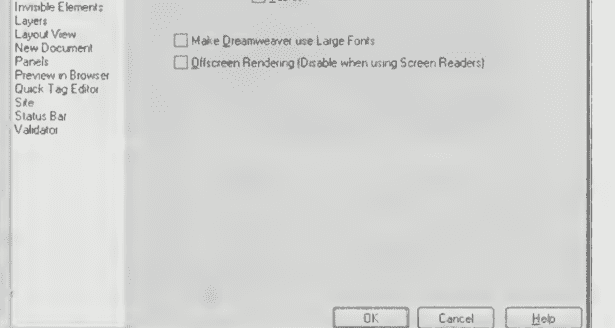

### 添加图片

选择*Images*选项后，用户在插入每张图片时都会被要求提供文本等价物和描述。当用户插入图片时，会出现以下面板：

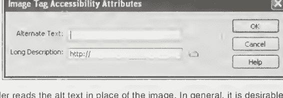

屏幕阅读器会读取alt文本以替代图片。一般来说，最好根据图片的功能而非外观来描述图片。这有助于内容在朗读给用户时更加流畅。同时也避免让用户听到与内容无关的冗长描述。

一般来说，alt文本（包含在元素的`alt`属性中）应限制在约50个字符以内。如果需要更多细节来充分传达图片内容，设计人员应考虑使用长描述。`longdesc`属性是指向存储在单独页面上的更长描述的链接。虽然长描述对视力正常的用户不可见，但屏幕阅读器用户会被告知该链接的存在。

在下面的示例中，列出的源代码显示该图片同时具有`alt`属性和`longdesc`属性。图片显示了一名潜水员在珊瑚礁附近，alt文本为"Safe diving near a coral reef"（在珊瑚礁附近安全潜水）。还有一个指向长描述文件`scuba.html`的链接，其中可能包括对照片中所示技术的更详细讨论。


```

```

对于不传达任何内容的图片，如间隔图片，适当的`alt`属性是`alt=""`。要设置空的`alt`属性，Dreamweaver MX在*Property inspector*上新增了一个下拉菜单。通过此下拉菜单，设计人员或开发人员可以选择`<empty>`作为`alt`属性的值。

106

### 添加媒体

在页面上插入媒体对象会引发一些重要问题。

首先，确保对象本身是可访问的非常重要。根据第508条标准，任何使用插件交付的内容都被视为软件。因此，Flash或Shockwave等媒体元素必须使用软件标准进行评估。有关软件标准的更多信息，请访问http://www.section508.gov。

其次，设计人员可能希望使用Dreamweaver MX提供更多关于媒体元素的信息。与图片一样，当插入媒体元素时，会出现一个对话框来收集与可访问性相关的信息。


title属性（见上文的*Title*）旨在功能上类似于图片的alt属性；然而，浏览器和屏幕阅读器对该属性的支持相当薄弱（Netscape 6+和IE 4+支持）。是否值得使用由每个设计人员自行决定。

*Access Key*（accesskey属性）为键盘用户提供了直接移动到页面上该元素的快捷方式。例如，如果Flash影片的访问键设置为"P"，依赖键盘而非鼠标的用户可以按Alt和P直接跳转到Flash影片。然而，设计人员或开发人员有必要告知用户该访问键的存在。在表单中，通常在标签中给某个字母加下划线来标识访问键；然而，媒体元素通常没有与之关联的标签。因此，设计人员必须在页面本身或单独的页面上提供此信息，该页面为残障用户提供使用说明。

tabindex（见上文的*Tab Index*）是一个非常有帮助的属性，特别是在处理Flash内容时。Tab索引允许设计人员指定用户使用Tab键导航时遇到页面内容的顺序。对于Flash内容，如果ActiveX架构将光标困在Flash影片内部，可能会出现问题。如果用户使用Tab键进入页面顶部的Flash导航栏，那么该用户很可能无法访问下方页面上的链接。解决这个问题的 common方法 是将Flash元素设置在Tab顺序的末尾。然而，重要的是要记住，在这种情况下，必须为所有链接、输入元素和对象设置Tab顺序。


 ## 第四章

### 添加框架

曾几何时，帧（frames）给屏幕阅读器带来了严峻的挑战；然而，如今大多数屏幕阅读器都能很好地处理帧。残障人士在使用帧时遇到的大多数挑战，与非残障人士相同。例如，难以链接到单个页面，而且使用*后退*按钮可能会出现问题。

具有讽刺意味的是，帧可以为无障碍访问带来实际益处。大多数设计师和开发人员使用帧来按内容分割页面。通常，横幅出现在一个帧中，导航在另一个帧中，内容则在第三个帧中。屏幕阅读器用户可以很轻松地在不同帧之间移动，跳过标题和链接，直接获取用户真正想要听到的信息。

然而，帧只有在正确添加标题的情况下才有帮助。在 Dreamweaver MX 中，当设计师插入帧集时，系统会提示为每个帧提供标题（见下图）。对话框顶部的下拉菜单包含帧集中所有帧的列表。对于这些帧中的每一个，设计师都需要指定不同的名称。这些名称不必很长或很详细，但应该有意义。即使是像 'banner'、'nav' 和 'content' 这样简单的名称也足够了。


### 添加表单

使用 Dreamweaver MX 创建无障碍表单非常简单。在*首选项*对话框中选择了*表单*选项后，设计师和开发人员会被提示为每个表单元素提供标签，以及访问键和在 Tab 键顺序中的位置。

传统上，表单元素的标签直接放在元素本身的左侧。如果布局更复杂，标签与相应元素分开放置，屏幕阅读器用户可能很难确定每个元素的用途。当设计师使用下图所示的对话框为元素添加标签时，Dreamweaver MX 还会添加 HTML 标记，将文本标签与元素正式关联起来。

这种标签-元素关联有两种样式可供选择。第一种选项，*用 Label 标签包裹*，用于文本标签紧邻表单对象时。第二种，*使用 'for' 属性附加 Label 标签*，用于布局更复杂时。

让我们来看一个简单的例子。我们将创建一个表单，包含一个用于电子邮件地址的表单字段和一个提交按钮。在第一个例子中，文本标签紧邻表单字段的左侧。在这种情况下，设计师应使用第一个选项，*用 Label 标签包裹*，来创建表单。


生成此表单的代码如下所示。请注意，`<label>` 元素同时包含文本标签 'Email' 和 `<input>` 元素本身。另外，请注意*提交*按钮没有标签。这是因为屏幕阅读器会将 `name` 属性的内容作为*提交*按钮的标签读出来。

```
<form name="form1" method="post" action="">
  <p>
    <label>Email
      <input type="text" name="textfield">
    </label>
  </p>
  <p>
    <input type="submit" name="Submit" value="Submit">
  </p>
</form>
```

请注意，在下一个示例中，布局稍微复杂一些。文本标签使用表格放置在表单元素上方。在这种情况下，上述方法将不起作用。相反，设计师应使用 `for` 和 `id` 属性将文本标签与表单字段关联起来。这最容易通过在*输入标签无障碍属性*对话框中选择第二个选项，*使用 'for' 属性附加 Label 标签* 来实现。


用于生成此示例的代码如下所示。请注意，`<label>` 元素仅包含文本标签 "Email"。`<label>` 元素中的 `for` 属性值与 `<input>` 元素中的 `id` 属性值相同——"textfield"。这就是屏幕阅读器如何知道在更复杂的布局中哪个标签与哪个表单字段配对的。

```
<form name="form1" method="post" action="">
  <table width="10" border="0">
    <tr>
      <td><label for="textfield">Email</label></td>
    </tr>
    <tr>
      <td> <input type="text" name="textfield" id="textfield"></td>
    </tr>
    <tr>
      <td><input type="submit" name="Submit" value="Submit"></td>
    </tr>
  </table>
</form>
```

### 添加表格

创建用于展示数据的无障碍表格，可能是设计师和开发人员面临的最复杂的问题。Dreamweaver MX 大大简化了这一过程，为一组或两组表头的简单表格添加了所有必要的标记。

在 Dreamweaver MX 中插入数据表格时，设计师会立即被要求提供标题、摘要信息以及表格中表头的位置。表格标题用于为表格提供标题。这些标题是可见的，放置在表格顶部。摘要应提供表格中数据的一般描述。这些信息不可见，但屏幕阅读器用户可以轻松获取。

标识表头使屏幕阅读器更容易导航表格。这一步极其重要，但经常被设计师忽视。当设计师使用*表格*对话框指定表头时，Dreamweaver MX 会标识表头行或列，并为该表头添加 `scope` 属性。`scope` 属性将数据单元格中的数据与相应的表头关联起来，以便屏幕阅读器在读取数据时同时读表头。


在下面的示例中，我们有一个相对简单的表格，顶部有一行表头，"Last Name"、"City" 和 "State"。在这些表头下方，我们有一个简短的人员列表。

| Participants 2003 |          |       |
|-------------------|----------|-------|
| **Last Name**     | **City** | **State** |
| Flynn             | Raleigh  | NC    |
| Marsh             | Madison  | WI    |
| Gandin            | Madison  | WI    |
| Rick              | Columbus | OH    |

在用于生成此表格的代码中，请注意第一行中的所有单元格都使用 `<th>` 元素。这让屏幕阅读器知道这些单元格是下方显示信息的表头。此外，这些 `<th>` 元素中的每一个都包含 `scope` 属性，其值设置为 "col"。这让屏幕阅读器知道该表头组织的是一列信息，而不是一行，并且其下方的所有单元格都使用该表头。

```
<table width="150" border="1" summary="This table shows three columns of data
displaying last name, city and state.">
  <caption>Participants 2003</caption>
  <tr>
    <th scope="col">Last Name</th>
    <th scope="col">City</th>
    <th scope="col">State</th>
  </tr>
  <tr>
    <td>Flynn</td>
    <td>Raleigh</td>
    <td>NC</td>
  </tr>
  <tr>
    <td>Marsh</td>
    <td>Madison</td>
    <td>WI</td>
  </tr>
  <tr>
    <td>Gandin</td>
    <td>Madison</td>
    <td>WI</td>
  </tr>
  <tr>
    <td>Rick</td>
    <td>Columbus</td>
    <td>OH</td>
  </tr>
</table>
```

## 无障碍验证

Dreamweaver MX 内置了一套全面的工具，用于验证单个页面、一组页面甚至整个网站的无障碍性。新的无障碍报告工具（见下图）验证网页是否符合 Section 508 标准和 WCAG 优先级 1 检查点。


无障碍报告会识别所有存在明显错误的区域，例如缺少 alt 文本，以及需要手动评估的区域，例如颜色组合。此外，当设计师或开发人员从报告中选择单个项目时，页面的相应部分会被高亮显示，以便直接将设计师引导到需要注意的区域。


除了Dreamweaver MX内置的验证工具之外，还有多种第三方产品可执行更复杂的验证功能，并有助于自动修复站点问题。其中一款产品是来自UsableNet的LIFT for Dreamweaver。LIFT允许设计者在页面构建过程中对其进行验证，指出页面上出现的问题。LIFT还帮助设计者自动修复一些最复杂的可访问性问题。例如，LIFT为设计者提供了通过图形界面快速使用headers和ID属性修复复杂表格的能力。对于经常处理这类复杂问题的设计者来说，LIFT是一款非常有价值的工具。

## 可访问性参考

Dreamweaver MX包含内置的可访问性参考，如下所示。该参考解释了用于检查页面可访问性的每条规则，并提供了关于每个问题的更详细信息的链接。该参考工具使设计者和开发者更容易掌握与其站点相关的具体可访问性问题。该参考工具可以与可访问性报告一起使用，以便设计者或开发者可以请求报告中列出的某条规则的更多信息，而响应将显示在可访问性参考面板中。

# 第4章

## 无障碍创作环境

Dreamweaver MX相比前代产品的重大改进在于其与辅助技术的协作。通过改进按钮的标签和顺序，Dreamweaver MX现在成为了Window-Eyes和JAWS屏幕阅读器等辅助技术用户最强大的网页开发环境。

Dreamweaver MX添加了几项功能，以方便残障用户创建网页。在这些功能中，有两个新的快捷键允许用户使用键盘访问Dreamweaver MX面板。第一个快捷键*Control+Alt+TAB*允许用户访问Dreamweaver MX中的面板组。例如，按一次*Control+Alt+TAB*会将用户带到设计面板组。从那里，按*Tab*键可以让用户在打开面板的按钮之间移动。按*Control+Tab*键将在组内的不同面板之间移动用户。

第二个快捷键允许用户通过按*Control+Alt+Home*返回页面窗口。用户在个人面板和面板组之间移动后将需要这个按键。

另外两个Dreamweaver MX的有用新功能专门支持视力受损用户和屏幕阅读器用户。这两个选项都在*编辑 > 首选项*的可访问性类别下可用。第一个选项*Make Dreamweaver Use Large Fonts*（使用大字体）增大Dreamweaver应用程序内的默认字体大小。这样菜单选项和面板对于低视力者来说更容易阅读。

第二个选项*Offscreen rendering (Disable when using Screen Readers)*（屏幕外渲染，使用屏幕阅读器时禁用）为Dreamweaver MX中的屏幕阅读器用户提供了改进的性能。为了防止闪烁，Dreamweaver使用双缓冲，即在内存中绘制屏幕然后再显示给用户。屏幕阅读器最好在禁用此选项的情况下工作，因为它们只读取前景屏幕，而不是在后台生成的屏幕。

## 小结

本章概述了Dreamweaver MX中的可访问性功能。Dreamweaver MX对于残障人士创建网站以及开发可访问的网站和Web应用程序来说都是一款强大的工具。Dreamweaver MX自动完成了创建可访问站点的许多要素，并在必要时提示设计者提供信息。Dreamweaver MX还包括强大的验证和参考工具，以帮助设计者确保其站点设计正确。

开发可访问的网站将确保站点内容不会被设计元素所掩盖；此外，可访问的网站与残障人士使用的辅助技术兼容，如屏幕阅读器、触摸屏或头部指针。Dreamweaver MX的开发提供了更好的键盘访问，并可以与屏幕阅读器配合工作，是首款对残障人士无障碍的专业设计工具。

## 5

- 动态网页简介：
- 变量
- 运算符
- 动态表单
-  cookies
- 会话

作者：Omar Elbaga

## 服务器端概述

在本章中，你将快速了解动态Web应用程序编码的基础知识（使用ASP/VBScript作为我们选择的语言）。这对于你的Dreamweaver MX学习体验至关重要——在使用预构建的Dreamweaver MX服务器行为之前，牢固理解动态页面的工作原理非常重要。这将使你能够充分发挥Dreamweaver MX的功能，还能为你节省时间！

在本章中，我们将介绍：

- 静态与动态网页
- 变量
- 代码注释
- 字符串、整数和布尔数据类型
- 内置函数与类型转换
- 运算符
- 条件逻辑
- 循环逻辑
- HTML表单
- URL参数
-  会话
- 环境变量

### 告别静态

在本书的这一点上，我们现在准备抛弃旧的方式，迎接新的方式。你有没有想过如何实现如今在许多网站上看到的那些酷炫的动态功能，比如登录、注册、个人文件夹、贺卡、电子邮件等等？

我们中的一些人曾经绞尽脑汁，试图利用你对普通HTML的知识，以某种旁门左道的方式来模仿这些功能，但这并不容易。有些网站会提示用户*点击这里给我留言！*，点击后，用户会看到一条消息说*给我发邮件，我会尽快发布。*然后网站管理员必须手动发布留言！下一步是提示用户的电子邮件客户端。当我们厌倦了这种做法后，我们发现了下一个最好的东西，免费的CGI程序。

这个故事可能对我们中的一些人很熟悉，但对其他人来说不是，但无论你处于什么状况，都不再需要为动态Web内容而烦恼。到本章结束时，你将掌握如何实现许多你一直垂涎的那些酷炫功能的工作知识。

#### HTML有什么问题？

没有问题。HTML很棒！HTML是并且可能永远是Web的主要语言。问题不是"HTML有什么问题"，而仅仅是"HTML不能做什么？"而答案是"很多"，如果你期望提供用户交互式应用程序和/或数据将不断变化的话。我们怎么能指望HTML在用户点击反馈按钮时自动发送电子邮件？请记住，HTML不是一种编程语言——它实际上是一种简单的标记语言——它的主要工作是格式化文本。

我们期望基于用户交互自动发生某些事情的唯一方式，是通过专门为手头的任务构建的程序或"Web应用程序"。这些Web应用程序是使用众多Web脚本语言中的一种构建的。Dreamweaver MX支持其中五种最流行的——**ASP**、**ASP.NET**、**JSP**、**Cold Fusion**和**PHP**。

> *这是否意味着我不再需要HTML了？*

*不。HTML是必需的，正如你将看到的那样，这些脚本语言与HTML携手工作。事实上，没有HTML它们在线上也做不*什么！

#### 静态与动态

简单来说，**static**（静态）意味着"固定的"或"不变的"，而**dynamic**（动态）意味着"变化的"。任何只在客户端浏览器上执行的内容都被认为是静态的，例如，HTML中包含的文本无法被操作，除非网站的作者进入源代码并手动更改它。那真是相当"不变的"。尽管客户端JavaScript比HTML复杂得多（它是一种实际的脚本语言），但它也是"不变的"，因为它只在客户端浏览器上执行。即使是JavaScript程序也被认为是客户端的，除非它们与微软的Active Server Pages（**ASP**）一起使用，我们将在本章后面讨论（ASP在服务器端执行）。客户端JavaScript程序实际上完全在浏览器内执行，并且可以在源代码中查看。这就是为什么Web开发者通常仅使用这些类型技术的Web开发称为"客户端开发"。


 服务器端概述

另一方面，“服务器端”指的是利用那些在客户端浏览器之外、在真实活动服务器上执行的技术进行 Web 开发。服务器端技术被认为是**动态**的，因为它的执行可以根据从客户端接收到的内容而改变。服务器端技术最重要的一个方面是，它允许你连接数据库并查看和更新数据，所有这些都可以从客户端浏览器完成。

Web 脚本语言嵌入在源代码中，与 HTML 在一起。一旦浏览器访问该页面，它就在服务器上执行（有些语言如 VBScript、Javascript、PHP 和 Coldfusion 逐行执行，而 JSP 和 ASP.NET 页面则在服务器上编译为原生代码）。然后动态输出和通用 HTML 一起被发送回客户端。这里有一个 PHP 示例：

```
<!-- sayHello.php -->
<html>
  <body>
    <?php
      $sayHello = "Hello friends!";
      echo $sayHello;
    ?>
  </body>
</html>
```

我们本可以直接在 body 中写入 "Hello friends!"，但相反，我们将文本放入一个 PHP 变量中，然后打印该变量。当客户端访问页面时，PHP 引擎读取以下 PHP 代码：

```
<?php
  $sayHello = "Hello friends!";
  echo $sayHello
?>
```

然后它将文本作为 HTML 发送到客户端浏览器。如果你在活动服务器上创建并执行此页面，你将不会在源代码中看到任何 PHP；相反，你只会看到以下 HTML：

```
<html>
  <body>
    Hello friends!
  </body>
</html>
```

这就是它们被称为服务器端语言的原因：服务器解析嵌入的服务器端脚本，并将结果作为 HTML 发送到客户端浏览器。

现在让我们更详细地探讨动态网页的工作原理，特别是 ASP。

#### 告别免费 CGI 搜寻，迎来 ASP

我们不会学习 Dreamweaver MX 支持的五种 Web 脚本语言。相反，我们将在本章（以及本书其余部分）中使用 **ASP** 来说明 Dreamweaver MX 中动态页面的构建。

## ASP/VBScript 基础知识

正如我们上面所学的，ASP 是微软自家的服务器端技术之一。ASP 文件以 .asp 扩展名结尾，实际上就是 HTML 页面，但内部包含脚本，位于特殊的分隔符中（稍后详细介绍这些）。ASP 页面可以使用任何支持 ActiveX 脚本引擎的脚本语言来编写——VBScript、JavaScript、JScript（微软版本的 JavaScript）、Perl、Rexx 和 Python。两个主要选择是 VBScript 和 JavaScript——两者都对 ASP 有原生支持。

VBScript 似乎是首选的，也是我们将在整本书中使用的那种——它已经到了几乎所有 ASP 资源都使用 VBScript 的地步，因此使用 VBScript 使得在需要时更容易找到帮助，尤其是对初学者而言。它是 ASP 的默认语言。

值得注意的是，Dreamweaver MX 实际上会为你生成 ASP 代码，所以你可能想知道为什么需要了解 ASP 的任何知识。这是许多 Dreamweaver 用户犯的错误。他们用它来构建动态页面，却对 Web 编程一无所知，结果陷入各种困境。

想一想。如果你不知道表格或表单是什么，使用 Dreamweaver 的对象来构建 HTML 页面会不会很困难？在使用为你生成代码和设计的东西之前，你必须对代码和设计有基本的了解。如果你知道何时以及如何使用它，Dreamweaver MX 可以加快你的应用程序构建时间。如果我们不知道什么是记录集，那我们又怎么知道何时以及如何使用 Dreamweaver MX 记录集服务器行为呢？（我将在第 7 章中解释这个服务器行为。）这就是为什么我要花时间向你介绍 ASP Web 编程，这样你在使用 Dreamweaver MX 时就能快速构建你的 Web 应用程序。别担心——你很快就会知道如何让它为你做所有“枯燥”的工作。

现在让我们直接进入 ASP/VBScript 动态 Web 编程的探讨，Dreamweaver MX 风格。

### 开始之前我需要什么

要开始用 VBScript 编写代码，你只需要任何文本编辑器（即使记事本也可以）。要执行 ASP，我们需要什么？如你可能记得的，我们之前提到 Web 脚本语言的活动服务器上执行的，因此我们当然需要一个 **Web 服务器**：

- 如果你使用 **Windows 95/98**，微软提供了一款名为 **Personal Web Server**（PWS）的迷你服务器，可免费使用。你可以在这里下载：http://www.microsoft.com/msdownload/ntoptionpack/askwiz.asp。对于 95 和 98，你可以选择 Windows 95 选项。

- 微软不随 **Windows ME** 分发 Personal Web Server（PWS），也不支持在其上使用。请参阅此技术说明：http://support.microsoft.com/support/kb/articles/Q266/4/56.asp。虽然微软不建议在 Windows Me 系统上安装 PWS，但有第三方教程介绍如何安装。请自行承担使用这些教程的风险。你可以在 http://billsway.com/notes_public/PWS_WinMe.txt 找到一个。

- 如果你使用 **Windows 2000**，你很幸运。虽然 PWS 对 Windows 95/98 用户来说工作正常，但 Windows 2000 配备了一个功能齐全的 Web 服务器，称为 **Internet Information Services（IIS）**。IIS 在 Windows 2000 上默认不安装，但你可以通过以下步骤安装：

- 开始
- 控制面板
- 添加/删除程序
- 添加/删除 Windows 组件
- 勾选 Internet Information Services 选项
- 点击下一步。

- 如果你使用 **Windows XP Professional**，你也可以插入 Windows XP Professional CD-ROM 到你的 CD-ROM 驱动器，并按照上面 Windows 2000 的相同步骤安装 IIS。

*请注意，你无法在 Windows XP Home Edition 上运行 ASP。*

Unix 默认不支持 ASP，但有软件可用，可以在 Unix 服务器上部署 Active Server Pages。如果你必须在 Unix 服务器上使用 ASP，你可能会发现 ChiliASP 很有用。详情请参见 http://www.chiliasp.com。

完成安装后，通过将首选 Web 浏览器指向 http://localhost 来确保服务器工作正常——如果成功，我们将看到默认的 Web 服务器页面。

现在让我们尝试通过我们的 Web 服务器运行一个 ASP——现在就试试！创建以下文件并将其保存为 **Myasppage.asp**。

```
<html>
  <head>
    <title>My ASP Page</title>
  </head>
  <body>
    Can you see me? I'm the first ASP page to be executed on this server!
  </body>
</html>
```

现在将此文件放入你的 Web 服务器的主目录中。这通常是 `C:\inetpub\wwwroot`——`wwwroot` 文件夹是你的虚拟网站的根目录。每当你的域名在线访问时，服务器开始在此处提供页面。默认情况下，服务器将执行名为 `default` 或 `index` 的页面。

将你的浏览器指向 `http://localhost/Myasppage.asp`，你应该会看到：


只要页面加载并你看到 body 中的文本，你就没问题。如果你没有看到，请仔细检查你是否正确安装了 Web 服务器。通过转到 控制面板 > 管理工具 > Internet 服务管理器（或 *个人 Web 管理器*）确保你的 Web 服务器正在运行。你可以在树中找到 *默认网站*，并使用显示中的“启动”和“停止”按钮来启动或关闭 Web 服务器。

你还应该确保主目录具有读取访问权限并且可以执行脚本。右键单击你的 *默认网站*，选择 *属性* 选项，然后点击 *主目录* 选项卡。确保 *读取* 选项已勾选，并确保在 *应用程序设置* 下的执行权限菜单中选择了 *仅脚本*（*脚本和可执行文件* 也可以工作，但允许他人在你的 Web 服务器上执行程序可能是一个重大的安全风险——这是良好的做法）。

### 指定你的脚本语言

因为 ASP 网页可以使用多种语言编写，所以需要告知每个页面将使用哪种语言。由于 VBScript 是 ASP 的默认语言，因此不一定需要指定你将使用 VBScript，但最好还是指定一下——如果未指定语言，服务器将假设你正在使用 VBScript。你可以通过在页面顶部添加一行代码来指定使用 VBScript 以外的语言，语法如下：`<% @ Language = "language_name" %>`。例如，如果你使用 JavaScript，你会输入：

```
<% @ Language = "JavaScript" %>
```

请记住，这一行必须是源代码中的第一行。如果你在每页顶部没有指定语言，当页面以 VBScript 以外的语言编写时，执行时会产生错误。当然，如果你使用的语言与页面指令中指定的语言不同，它也会产生错误。

每当你使用 VBScript 或 JavaScript 创建新的动态 ASP 网页时，Dreamweaver MX 会自动为你插入这一行。

### `<% %>` 分隔符

所有 ASP 脚本代码必须放在分隔符之间——然后服务器执行分隔符内的所有代码。一旦它看到第一个开始分隔符 `<%`，ASP 脚本引擎就开始工作，直到到达结束分隔符 `%>`。分隔符之间只能放置 ASP 脚本。这里有一个例子：

```
<%
Dim MyVariable
%>
```

我们使用 Dim 语句来声明变量。`Dim MyVariable` 是一行。以下与上面的等效：

```
<% Dim MyVariable %>
```

我们还可以用各自的分隔符块将多行代码分开。

```
<% Dim MyVariable %>
<% MyVariable = "Hello" %>
```

这等价于：

```
<%
    Dim MyVariable
    MyVariable = "Hello"
%>
```

我想你已经明白了。如何格式化代码取决于你自己——只要记住在整个应用程序中保持一致，并以一种让你和他人都能轻松阅读的方式来格式化代码。你应该始终尽可能地将ASP代码放在一个块中，而不是无缘无故地打开新块，尽管在ASP代码嵌入HTML时，有时多个块是必要的。

> 请记住，一行ASP代码不能拆分成单独的分隔符块。
> `<% Dim %> <% MyVariable %>` 会抛出错误，因为 `Dim` 语句后面必须跟变量。

### 变量

变量是任何语言中最重要的概念之一。变量就像一个占位符或内存中的分配空间，用于存储一个值——它可以保存你选择的值。毫不夸张地说，变量是动态信息本质所在。这是因为变量很可能会改变或变化——我们期望变量的值发生变化，这就是为什么在Web应用程序中我们通过变量来引用值，而不是它们的字面量值。我把你绕晕了吗？

想象一下：我有一辆*车*。你可能会问："呃，好吧……什么*种类*的车？" 嗯，它可以是保时捷、宝马、讴歌、奥迪等等。在现实生活中，我可能会提到我有什么*种类*的车。然而，在广阔的万维网世界中，最好只说我有一辆*车*。

为什么？因为当我编写一个处理汽车的动态Web应用程序时（例如，一个收集和存储人们汽车信息的数据库应用程序），我可能不会只谈论*我的车*，而是访问我网站的成千上万想要使用我应用程序的用户的汽车。我不知道客户端/用户会输入什么种类的车，所以我宁愿有一个可以包含任何值的占位符，以便我随时引用或编辑。

#### 声明变量

让我们在VBScript中声明我们的第一个变量。在Dreamweaver MX中创建一个新的动态页面，选择ASP/VBScript。从*文件*菜单选择*新建*，并选择如下图所示的选项：


保持代码和设计视图可见。我们将直接在代码窗格中编写VBScript代码。

> ASP代码可以放在页面的任何位置，但对于本章中的示例，所有ASP代码都应该输入在文档的 `<body>` 标签内。

在VBScript中，我们使用 `Dim` 语句来声明变量，正如你在上面的例子中看到的。创建一个新的ASP/VBScript页面并将其保存为 `my_variable.asp`。在 `<body></body>` 标签内输入以下内容：

```
<%
Dim MyVariable
MyVariable = "I am the value of an ASP variable"
%>
```

在您的服务器上实时查看页面。在Dreamweaver MX中，您可以按 `F12` 作为快捷键，在浏览器窗口中加载页面。

你看到了什么？如果你说什么都没看到……很好！你不应该看到任何东西，只有空白屏幕，因为我们所做的只是声明了一个名为 `MyVariable` 的变量，其值为 "I am the value of an ASP variable"。

我们还没有做的是输出变量的值——现在让我们来做。像这样修改你的代码：

```
<%
Dim MyVariable
MyVariable = "I am the value of an ASP variable"
Response.Write MyVariable
%>
```

`Response.Write` 语句简单地说就是"将 `MyVariable` 的内容输出到页面上"。现在查看你的页面——你应该在浏览器中看到以下内容：

*I am the value of an ASP variable*

你也可以在变量的值中包含HTML，如下所示：

```
<%
Dim MyVariable
MyVariable = "I am the value of an <strong>ASP</strong> variable"
Response.Write MyVariable
%>
```

变量可以在未事先用 `Dim` 语句声明的情况下赋值，然而，最佳实践表明，通过习惯性地显式"Dim"变量，在代码编写和发布很久之后调试页面会变得更容易，因为代码更易读且更有条理。

下面的例子可以正常工作。

```
<%
MyVariable = "I am the value of an ASP variable"
Response.Write MyVariable
%>
```

不幸的是，Dreamweaver MX 并不遵守这一惯例。它经常生成不声明变量的ASP代码。

#### 变量的语法规则

关于变量的语法有一些规则：

- 不要在变量中的任何地方使用空格、句点或破折号。`My variable` 是不可接受的
- 变量必须以字母开头。`2myvariable` 是不可接受的
- 保留字不能用作变量名。`Dim` 是不可接受的，因为它在VBScript中是保留字。有关VBScript保留字的列表，请参阅以下链接：`http://support.microsoft.com/default.aspx?scid=kb;EN-US;q216528`

#### 变量命名约定

变量的命名有一些约定俗成的惯例。根据数据类型来命名变量是常见的做法。我们将在本章后面了解更多关于数据类型的知识。

例如，如果变量是字符串，那么在变量名开头添加 `str` 并不少见——例如 `strMyVariable` 或 `str_my_variable`。整数变量也是如此——`intMyVariable` 或 `int_myvariable`。

此外，有些变量以作者的名字命名。我的首字母是 **OE**，所以我可能会这样命名我的变量：`OE_MyVariable` 或 `oe_my_variable`。

Macromedia 将其首字母添加到大多数变量中。Macromedia 使用 **MM**，所以你经常会看到诸如 `MM_RedirectPage`、`MM_ConnectionString` 等变量。

在浏览源代码时，你会习惯看到这些命名方式。不要对此感到困惑；这仅仅是一种命名约定。你如何命名变量其实并不重要。命名变量时最好的建议是保持**简单、恰当和直观**——无论你决定是否给变量添加前缀字母。你可以在 http://msdn.microsoft.com/library/default.asp?url=/library/en-us/script56/html/vbscodingconventions.asp 看到一篇关于命名规范的有趣文章。

> 避免仅使用字母缩写来命名变量，如 `RP`、`ag1`、`str_cdp` 等。

确保变量所代表的内容一目了然，只需瞥一眼就能明白，例如 `RedirectPage`、`ArabicGreeting` 等。

然后你可以随意添加自己的前缀，无论你想怎么加，例如 `str_RedirectPage`、`OE_ArabicGreeting` 等。

#### VBScript 不区分大小写

与 JScript 不同，VBScript **不区分大小写**。这意味着在VBScript代码中使用小写或大写字符并不重要。`Dim Myvariable` 与 `DIM mYvariAble` 是相同的。当然，这使得Web开发者的工作更轻松，尤其是在调试时，因为这让你少了一件需要担心的事情！

然而，尽管VBScript不区分大小写，你应该在代码中保持一定的一致性。当你在一个地方将变量写成 `myvariable`，而在另一个地方将同一个变量写成 `MYVariable` 时，代码会让人感到困惑。选择一种风格并坚持使用。

### <%= 快捷方式

你可以使用 `<%=` 来代替 `Response.Write`，只要这是你在新代码块中唯一想要执行的操作。例如，要使用 `Now()` VBScript函数输出日期和时间，以下两者是等价的：

```
<% Response.Write Now() %>
```

和

```
<%= Now() %>
```

我们还可以将上面的变量声明示例重写为以下形式，利用快捷方式来输出变量：

```
<%
    MyVariable = "I am the value of an ASP variable"
T%>
```

```
<%= MyVariable %>
```

这个快捷方式经常派得上用场，在本章中我们将看到这一点。

### 代码注释

代码注释是一种显示与代码相关的文本信息而不被解析的方式。每种编程/标记语言都提供注释代码的能力，甚至HTML也是如此。以下是一个HTML注释：

```
<!-- This table is to hold the main navigation of the page -->
<table><tr><td> home / about / contact </td></tr></table>
```

在 <!-- --> 分隔符之间的所有内容都不会被解析为HTML代码。当然，这些HTML注释在源代码中是可见的——正如你所见，注释是为了告知任何查看代码的人不同代码部分的目的。

ASP/VBScript的注释是通过在单行前面加单引号来实现的。这会导致整行被Web服务器完全忽略。例如，让我们在 `my_variable.asp` 页面中添加一个注释，并将我们的 `Response.Write` 行注释掉：

```
<%
    MyVariable = "I am the value of an ASP variable"

    'Response.Write MyVariable
    ' Here is a comment
%>
```

Dreamweaver MX 应该在代码视图中将注释掉的行显示为灰色。

现在在浏览器中查看此页面时，变量将不会被输出——只有第一行会执行。注意ASP注释**不会**在客户端浏览器中显示，因为服务器已经解析了代码。

注释代码非常重要，尤其是在调试时。它允许你快速屏蔽代码，以防你想出于某种原因测试孤立的代码段。它还让你有机会记录你的代码。这对于你（或其他人）回顾代码并更新它时非常有帮助。

> *Dreamweaver MX 经常注释由其服务器行为生成的代码。*

 ## 使用与号（&）进行连接

你也可以连接变量——连接的意思就是把东西放在一起。需要注意的是，这**不是**数学上的相加，而只是简单地把它们并排放在一起。

例如，让我们尝试将两个字符串连接成一个变量。创建以下文件并将其保存为 my_greeting.asp：

```
<%
Dim Mygreeting
Mygreeting = "Hello" & " World"
' 我们需要在 World 中的 W 前面留一个空格。

Response.Write Mygreeting
%>
```

在浏览器中查看该页面，你应该会看到以下显示：

> *Hello World*

我们已经将两个值连接成一个值，赋值给我们的 Mygreeting 变量。我们也可以将两个变量连接成第三个变量的值。创建以下文件并将其保存为 my_second_greeting.asp：

```
<%
Dim MyHello, MyWorld, Mygreeting
MyHello = "Hello"
MyWorld = "World"
Mygreeting = MyHello & " " & MyWorld

Response.Write Mygreeting
%>
```

在浏览器中查看该页面，你应该会再次看到：

> *Hello World*

你也可以在输出时将变量与值进行连接。例如：

```
<%
Dim MyHello
MyHello = "Hello"

Response.Write MyHello & " World"
%>
```

> 连接中的每个部分都必须用与号（&）分隔。

以下是**不正确**的，将会抛出错误：

```
<%
    Dim MyHello, MyWorld, Mygreeting
    MyHello = "Hello"
    MyWorld = "World"
    Mygreeting = MyHello & " " MyWorld
    ' 引号和 MyWorld 变量之间缺少一个与号

    Response.Write Mygreeting
%>
```

请注意，允许使用加号（+）来连接字符串，但不如使用与号（&）推荐。因为加号也用于整数的数学加法，使用（+）加号来连接整数可能会导致错误的结果。

### 数据类型：字符串、整数和布尔值

每个变量都有一个数据类型。重要的是你要知道**字符串**、**整数**和**布尔值**之间的区别。当然，数据类型远不止这三种，但这些是你通常会使用的。其他一些数据类型（我们这里不会涉及）包括：Currency、Date、Object、Decimal、Byte、Array、Empty、Null、Long、Single、**以及 Double**。

数据类型也被称为变量类型。变量会按照其类型行事——有些你试图对字符串进行的操作可能不会得到预期的结果，正是因为数据类型的原因。

字符串包含字母数字字符或数字（字符串**必须**用引号括起来），整数包含整数（整数**不**用引号括起来），而布尔值保存的值要么是 True，要么是 False。让我们看看每种类型的一个例子。创建以下页面并将其保存为 asp_datatypes.asp：

```
<%
    MyString = "Hi my name is Omar!"
    MyInteger = 34
    MyBoolean = False
    ' 注意只有字符串被引号括起来。

    Response.Write MyString & " I am not " & MyInteger & " That is " & MyBoolean
%>
```

你应该会在屏幕上看到以下内容：

*Hi my name is Omar! I am not 34 That is False*

请注意，虽然字符串可以包含数字，但你不能对它们直接进行数学运算。具有字符串数据类型的数字不会被当作整数处理；相反，它们被视为字母数字值。让我们来看一个例子——创建以下文件并将其保存为 string_numbers.asp：

```
<%
    MyString1 = "20"
    MyString2 = "20"
    Response.Write MyString1 + MyString2
%>
```

你会看到以下内容：

2020

加号（+）只会强制两个字符串进行连接。我们不想要 2020——我们想要的是 40！只有给 20 赋予整数数据类型，才能得到这件事才能实现。例如：

```
<%
MyNumber1 = 20
MyNumber2 = 20
' 我们不能添加双引号

Response.Write MyNumber1 + MyNumber2
%>
```

这个页面应该会在你的浏览器中给出以下结果：

40

你可能会问自己："如果我想在字符串值中添加一个引号怎么办？" 当然可以，但你必须对其进行转义，因为一旦 ASP 脚本引擎遇到第二个双引号，它就会认为这是值的结束，从而导致不良结果。你可以通过在引号前额外添加一个双引号来转义字符串值中的引号。例如：

```
<%
MyString1 = "Jennifer said, ""ASP is cool!"""
' 双引号前面有额外的双引号

Response.Write MyString1
%>
```

### VBScript 的内置函数库

VBScript 有许多内置函数供你使用。它们极大地简化了你的工作，并赋予你根据需要操纵变量的能力。内置函数有不同类型：日期/时间函数、转换函数、格式函数、数学函数、数组函数和字符串函数。要查看 VBScript 提供的众多内置函数列表，请访问 http://msdn.microsoft.com/library/default.asp?url=/library/en-us/dnexpvb/html/usingvbscriptfunctions.asp。

你不需要记住所有这些函数，因为即使是已经退休的 ASP 开发人员也会使用参考资料！让我们继续看一些例子。

#### 转换函数

这类函数可以将一种数据类型转换为另一种。例如，假设我们想将一个字符串类型的数字转换为整数，那么我们可以使用 `CInt()` 函数。创建以下文件并将其保存为 convert_to_int.asp：

```
<%
MyString = "23"
MyNewInt = CInt(MyString)
'转换为整数数据类型，声明新变量

Response.Write MyNewInt
%>
```

你应该会在浏览器中看到以下内容：

23

变量 `MyNewInt` 不再是字符串，而是整数了。我们取了一个具有字符串数据类型的数字，将其转换为整数数据类型，并从中创建了一个新变量。这可能难以置信，除非你亲眼看到，所以让我们使用另一个函数来显示变量的数据类型——`TypeName()`。

让我们在转换前后打印出变量的数据类型——在上述示例中添加以下代码：

```
<%
MyString = "23"
Response.Write TypeName(MyString)
'打印变量数据类型

MyNewInt = CInt(MyString)
'转换为整数数据类型，声明新变量

Response.Write MyNewInt
Response.Write TypeName(MyNewInt)
'打印变量及其数据类型
%>
```

你应该会在浏览器中看到以下内容：

*String23Integer*

#### 字符串函数

这些函数允许我们对字符串做一些很酷的事情。让我们快速看一下以下字符串函数：`Len()`、`Trim()` 和 `Left()`。

`Len()` 函数返回字符串的字符数。创建以下文件并将其保存为 `len.asp`：

```
<%
MyString = "I am cool"

Response.Write MyString
Response.Write "<br>There are <strong>" & Len(MyString) & "</strong> characters in the above statement."
%>
```

你应该会看到以下结果：

*I am cool*
*There are **9** characters in the above statement.*

请记住，即使是空格也算作字符。`Trim()` 函数会移除字符串左右两侧可能出现的空格。创建以下文件并将其保存为 `trim.asp`：

```
<%
    MyString = "  I am cool  "

    Response.Write "." & MyString & "."
    Response.Write "<br>." & Trim(MyString) & "."
%>
```

你应该会看到以下结果：

. I am cool .
.I am cool.

在打印变量时，我在字符串值前后添加了一个句点，以便空格更加明显。正如你所见，第一次打印仍然包含左右两侧的空格，而第二次打印则没有，这是因为 `Trim()` 函数。在此顺便一提，还有 `RTrim()` 和 `LTrim()` 函数可以只修剪特定的一侧。

`Left()` 函数允许你从左侧계 返回指定数量的字符。它在字符串后接受数字作为属性，例如，`Left(string, 5)`。创建以下文件并将其保存为 `left.asp`：

```
<%
    MyString = "I am cool. Didn't you know that I was valedictorian of my High
    School class. Not only that but I also have a bachelor's degree in Creative
    Writing contiguous 
    Response.Write Left(MyString, 10)
%>
```

在打印变量时，你应该只会看到以下结果：

I am cool.

我们剪掉了这位朋友独白的其余部分。当你只想显示一定量的文本时，这特别有用，尤其是当文本来自数据库字段时。（你将在*第 6 章*中学习更多关于如何将页面连接到数据库的内容）。欢迎探索更多的 VBScript 函数，它们还有很多功能可以提供。

### 运算符

运算符允许你在代码中操纵数据。运算符主要有三大类：逻辑运算符、比较运算符和数学运算符。以下是常用运算符的列表。如果你需要实时查看示例的结果，请键入代码并将其保存在 ASP 文件中。

#### 赋值运算符

赋值运算符只有一个，那就是等号（=）。它只是将运算符右侧的内容存储到左侧的变量中。在本章的示例中，你一直在这样做，所以现在已经习惯了。例如：


上面的赋值运算符只是将字符串 Hello 存储在名为 myGreeting 的变量中。以下是另一个示例：

```
<%
Dim myGreeting
myGreeting = "Hello"
%>
```

```
<%
Dim myNumber
myNumber = 23
%>
```

上面的赋值运算符只是将数字 23 存储在名为 myNumber 的变量中。等号也可以作为数学运算符，表示相等关系。（详见后面的数学运算符部分。）

#### 逻辑运算符

让我们按顺序来看看 And、Not、Or 这些运算符。

##### AND

例如（AND.asp）：

```
<%
number1 = 4-1
number2 = 6-2
If number1 AND number2 = 3 Then
    Response.Write "correct"
Else
    Response.Write "false"
End If
%>
```

逻辑运算符只是将左边和右边的内容连接起来。上面的示例检查变量 number1 和 number2 是否都等于 3。由于它们并非都等于 3，因此返回 false。

##### OR

我们可以使用 OR 修改上面的示例（OR.asp）：

```
<%
number1 = 4-1
number2 = 6-2
If number1 OR number2 = 3 Then
    Response.Write "correct"
Else
    Response.Write "false"
End If
%>
```

上面的代码检查 4-1 或 6-2 是否等于 3。由于至少有一个等于 3，因此输出 correct。

##### NOT

NOT 运算符只是返回其右侧语句的相反值。例如，在以下代码中（NOT_1.asp）：

```
<%
    number1 = 4-1
    If number1 = 3 Then
        Response.Write "correct"
    Else
        Response.Write "false"
    End If
%>
```

显然，4-1 等于 3，因此会输出 *correct*。现在让我们在代码中添加 NOT：

```
<%
    number1 = 4-1
    If NOT(number1 = 3) Then
        Response.Write "correct"
    Else
        Response.Write "false"
    End If
%>
```

现在返回 *false*——*number1* 仍然等于 3，但 NOT 运算符使代码返回与预期相反的结果。

关于 If...Then 语句的更多内容，你将在本章后面学到。

#### 比较运算符

| 运算符 | 含义 |
| --- | --- |
| = | 等于 |
| < | 小于 |
| > | 大于 |
| <= | 小于或等于 |
| >= | 大于或等于 |
| <> | 不等于 |

例如：

```
<%
    X = 1
    Y = 3
    If x < y Then
        [ ' 执行此代码 ]
    End If
%>
```

比较运算符比较两个参数，查看是否满足指定条件。

#### 数学运算符

| 运算符 | 含义 |
|----------|---------|
| ^ | 指数运算 |
| * | 乘法 |
| / | 除法 |
| \ | 整数除法 |
| MOD | 取模 |
| + | 加法 |
| - | 减法 |
| & | 连接 |

例如：

```
x = 54
y = 67
z = x + y
Response.Write z
```

数学运算符对其左右两边的内容进行数学运算，如上面示例中的加号 (+)。

> 除法（/）将一个数除以另一个数并返回结果，而整数除法（\）只返回商，取模（MOD）只返回余数。

> 例如，5 除以 3 商 1 余 2。整数除法将返回 1，而取模将返回 2。

让我们用以下代码亲自验证一下（divide.asp）：

```
<%
  number1 = 5/3 ' 除法
  number2 = 5\3 ' 整数除法
  number3 = 5 MOD 3 ' 取模

  Response.Write number1 & "<br>" & number2 & "<br>" & number3
%>
```

这将给我们以下输出结果：

```
1.66666666666667
1
2
```

> 关于 VBScript 运算符的更多阅读资料，请访问：
> 
> http://msdn.microsoft.com/library/default.asp?url=/library/en-us/script56/html/vbsoperators.asp。

### 运算符优先级

如你所知，ASP 代码从左到右、逐行执行，但运算符按照各自的顺序执行。这个顺序称为运算符优先级。比较运算符的优先级都相同（它们将按从左到右的顺序执行），而数学运算符和逻辑运算符则按照优先级顺序执行，不受从左到右顺序的影响，如下所示：

| 优先级顺序 | 运算 |
|---|---|
| **数学运算符** | |
| 1 | 指数运算 (^) |
| 2 | 乘法 (*)、除法 (/)、整数除法 (\) |
| 3 | 取模 (Mod) |
| 4 | 加法 (+)、减法 (-) |
| **逻辑运算符** | |
| 1 | Not |
| 2 | And |
| 3 | Or |

例如（*operator_precedence1.asp*）：

```
<%
    intOrderTest = 3 + 2 * 4
    Response.Write intOrderTest
%>
```

如果按从左到右的顺序，答案应该是 20，但由于乘法的优先级高于加法，答案将是 11。使用括号对表达式进行分组，可以强制某些运算符在优先级更高的运算符之前执行——例如，要强制加法在乘法之前执行，我们可以将示例修改如下（*operator_precedence2.asp*）：

```
<%
    intOrderTest = (3 + 2) * 4
    Response.Write intOrderTest
%>
```

括号中的表达式总是优先于不在括号中的表达式进行求值。需要注意的是，在多个都在括号中的表达式之间，运算符优先级仍然会被保持。你应该始终用括号对表达式进行分组，而不是依赖自然优先级，这样可以使你的代码更具可读性。

> *注意：当乘法、除法和整数除法出现在同一表达式中时，它们将按从左到右的顺序执行。*

### 条件逻辑

与变量一样，本节也是编程语言中最重要的方面之一。条件逻辑使程序员能够根据特定标准或条件控制程序的流程。你可以想象这在动态网站中是多么关键——对于用户如何与 Web 应用程序交互，你完全无法预知。你需要根据 Web 应用程序接收到的输入做出决策。让我们来看看如何控制输出。

#### If...Then 语句

这是所有控制结构的鼻祖！它表示"如果这是真的，**那么**执行这个"。创建以下文件并将其保存为 `if_then.asp`：

```
<%
MyExpectedOutput = "This web site is cool"
If MyExpectedOutput = "This web site is cool" Then
  Response.Write "Thanks for your kind words."
End If
%>
```

你应该看到以下结果：

*Thanks for your kind words.*

If 语句检查 `MyExpectedOutput` 变量是否等于我们期望的值。如果是，我们向用户致谢。请记住，当你比较两个字符串时，每个字符都会被考虑在内，包括空格。你也可以使用多个代码块将条件嵌入到 HTML 中。我们可以将上面的示例安排成这样：

```
<%
MyExpectedOutput = "This website is cool"
If MyExpectedOutput = "This website is cool" Then
%>
```

Thanks for your kind words.

```
<%
End If
%>
```

你应该看到与上面示例相同的结果。

我们可以在语句中添加 `Else` 关键字，以引入当表达式不符合条件时的另一种输出。创建以下文件并将其保存为 `if_then_else.asp`：

```
<%
MyExpectedOutput = "This website sucks."
If MyExpectedOutput = "This website is cool" Then
  Response.Write "Thanks for your kind words."
Else
  Response.Write "Hey, don't be so mean."
End If
%>
```

你应该看到以下结果：

*Hey, don't be so mean.*

`If` 语句检查 `MyExpectedOutput` 变量是否等于我们期望的值——如果不是，我们添加一条评论。同样，你可以像上一个示例那样，使用多个代码块将条件嵌入到 HTML 中，例如：

```
<%
  MyExpectedOutput = "This website sucks"
  If MyExpectedOutput = "This website is cool" Then
%>
```

Thanks for your kind words.

```
<% Else %>
```

Hey, don't be so mean.

```
<%
  End If
%>
```

你应该看到以下结果：

*Hey, don't be so mean.*

#### If...Then...ElseIf 语句

`If...Then...Else` 语句提供了两种可能的代码延续路径。如果你需要两个以上的选择，你有两个方案。你可以嵌套另一个 `If...Then...Else` 语句，但代码可能会变得低效且混乱。更好的方法是使用 **ElseIf** 语句。它允许你在一个语句中组合多个 `If...Then...Else` 语句。创建以下文件并将其保存为 *if_then_elseif.asp*：

```
<%
  UserRating = 9
    If UserRating = 4 Then
      Response.Write "Why have you rated my website so low."

    ElseIf UserRating = 6 Then
      Response.Write "Cmon. You can do better than that."

    ElseIf UserRating = 9 Then
      Response.Write "Close, but I deserve better."

    ElseIf UserRating = 10 Then
      Response.Write "There you go!"

    End If
%>
```

你应该看到以下结果：

*Close, but I deserve better.*


你可以在 `ElseIf` 语句的最后一个检查中使用 `Else` 关键字。它会作为默认的程序流程，当其他条件都不匹配时执行。请注意，如果使用它，它必须是最后一个语句，永远不能出现在 `ElseIf` 之前。下面的例子是正确的：

```
<%
UserRating = 9
If UserRating = 4 Then
Response.Write "Why have you rated my website so low."
ElseIf UserRating = 6 Then
Response.Write "Cmon. You can do better than that."

ElseIf UserRating = 10 Then
Response.Write "There you go!"

Else
Response.Write "I'm looking for a ten rating."

End If
%>
```

### 循环逻辑

这种类型的逻辑能够循环执行代码块，并在某些条件为 `True` 时或直到条件满足时多次执行。例如，你可能需要循环遍历数据库中的记录来显示它们，或者你可能需要循环遍历变量直到到达最后一条记录。VBScript 中有几种循环语句，它们基本上完成相同的任务——我们将介绍几种最常用的——`Do While ... Loop`。

#### Do While ... 语句

这个循环允许你在指定的条件为 `True` 时创建一个循环。`Do While` 循环采用以下形式：

```
Do While your condition
Code to be executed
Loop
```

让我们来看一个例子。创建以下文件并将其保存为 `do_loop.asp`：

```
<%
Dim intCount
intCount = 1

Do While intCount <= 15
Response.Write intCount
intCount = intCount + 1
Loop
%>
```

你应该看到以下结果：

123456789101112131415

在上面的例子中，我们循环数字 1，条件是它小于或等于 15。在循环之间，我们输出变量并将其增加 1。代码继续反复执行（打印出变量，然后增加 1），直到条件变为 `False`。

#### While ... Wend

Dreamweaver MX 在"重复区域"服务器行为中使用此循环来遍历数据库记录。此循环与 `Do ... While` 循环完全相同。你只需将上面的 `Do While` 替换为 `While`，将 `Loop` 替换为 `Wend`：

```
<%
Dim intCount
intCount = 1

While intCount <= 15
  Response.Write intCount
  intCount = intCount + 1
Wend
%>
```

> 有关"重复区域"的更多信息，请参见第 7 章。

#### Response.End 与 Response.Redirect

这是 ASP 中的两个很酷的功能，也允许你控制程序流程。**Response.End** 立即结束 Web 应用程序。一旦脚本引擎执行到它，该行之后的代码都不会执行。你可以理解为什么我们这样做——例如，如果你有一个 Web 应用程序，在用户付款后向用户流式传输下载文件，应用程序可能会检查数据库中用户的付款信息。如果未找到，你可以自动结束程序，这样脚本的其余部分就不会执行。

**Response.Redirect** 以同样的方式工作，不同之处在于它不是简单地结束程序，而是允许你立即将浏览器重定向到指定的 URL。它类似于 `Response.End`，因为当前页面上在它处理之后不会执行任何代码。

##### Response.End

让我们尝试几个例子。创建以下文件并将其保存为 `check_password.asp`：

```
<%
  Password = "45gh4"
  UserInput = "45gh4"

  If UserInput <> Password Then
    Response.End
  Else
%>

Here is the very secret code only for users who knew the password: <br><strong>The bird flew west when seeing the tarantula.</strong>

<%
  End If
%>
```

查看页面时，你应该看到以下结果：

Here is the very secret code only for users who knew the password: **The bird flew west when seeing the tarantula.**

我们所做的是设置一个密码，然后将其与"用户输入"进行比较。我们接着说，如果两个变量不相等，则结束代码，否则继续并显示秘密代码。

*此时你可能会想知道用户是如何提交 UserInput 变量的值的——你将在下一节中了解如何添加这种交互性。*

现在将 `UserInput` 密码更改为故意错误，看看会发生什么：

```
<%
    Password = "45gh4"
    UserInput = "12345"

    If UserInput <> Password Then
        Response.End
    End If
%>
```

Here is the very secret code only for users who knew the password:<br /><b>The bird flew west when seeing the tarantula.</b>

```
<%
    End If
%>
```

当你查看页面时，应该什么都看不到，因为 Web 应用程序由于密码不正确而被关闭了——这不是很酷吗！

##### Response.Redirect

那么 `Response.Redirect` 是如何工作的呢？正如我们之前所说，它的工作方式相同，但只是重定向到另一个 URL，同时在原始页面上停止代码执行。创建以下文件并将其保存为 `redirect_wrong_user.asp`：

```
<%
    Password = "45gh4"
    UserInput = "12345"

    If UserInput <> Password Then
        Response.Redirect "http://www.google.com"
    End If
%>
```

Here is the very secret code only for users who knew the password:<br><b>The bird flew west when seeing the tarantula.</b>

```
<%
    End If
%>
```

当你查看页面时，你应该会看到那个可爱的 Google 标志（当然，前提是你在上网！）。你也可以重定向到自己的网站中的另一个页面，比如错误页面或首页。这只需更改 `Response.Redirect` 行中指定的 URL 即可。

你可以随意使用这些功能。例如，你可能只是想在一些代码作为标准执行后发生重定向，而不是等待条件被满足——如何使用 `Response.End` 和 `Response.Redirect` 完全取决于你。

无论做什么，请确保测试你的代码以获得适当的结果，因为有时由于简单的错误，Web 应用程序可能会做出与你意图完全相反的事情——比如向未付费用户流式传输下载文件，而拒绝访问付费用户。

### 应用我们的 ASP 知识

到目前为止，我们的 Web 应用程序还非常有限。我们使用小例子来演示 ASP 和 VBScript 功能，但现在我们将进入更有趣（动态）的部分，在那里你终于可以看到一些实用的 ASP 示例，让用户能够实际与你的 Web 应用程序交互并提交数据！

#### 酷炫的 Web 表单

众所周知，**表单**为用户提供了向网站提交信息的机会，但在我们的"静态"时代，我们真的不知道如何让它们发挥作用，或者我们试图寻找一些 CGI 脚本来为我们完成工作。表单几乎是你从服务器上的用户那里接收信息的唯一方式。它们也是用户执行注册、登录和向你的网站发送反馈等操作的基础。

好消息是，凭借我们新发现的 ASP 和 VBScript 知识，这些表单突然变得更有用了。

你的第一个问题应该是"**我们如何显示表单提交的信息？**"这是关键。如果我们知道如何显示它，我们就知道如何检索它，如果我们知道如何检索它，我们就可以用它做很多事情，如你在后面的章节中将会看到的那样。

##### *get 与 post*

表单的 method 可以设置为 `get` 或 `post`。默认情况下，表单的 method 设置为 `get`，它将表单字段附加到 URL 中作为 URL 参数（有关更详细的解释，请参见 *URL 参数* 和 *Request.QueryString* 部分）。

使用 `get` 方法使事情更简单，因为值很容易在地址栏中看到，这也便于故障排除。但是，请注意客户端也可以看到这些值，而且 URL 也会被浏览器缓存（这意味着你不应在提交敏感信息时使用此方法——有关更多信息，请参见 *Cookies* 部分）。

传递的值的大小受地址栏中允许的最大字符长度限制。

使用 `post` 方法在 HTTP 头中提交表单字段值。这是首选方法，因为提交的数据对客户不直接可见。另一个优点是，使用 `post` 可以发送比使用 `get` 大得多的信息。


 ## Request.Form

Request.Form 用于检索通过 post 方法提交的表单元素。创建表单元素时，你会为其指定一个名称。例如，`<input type="text" name="username">` 会创建一个名为 username 的文本字段。要显示在该文本字段中输入并提交到 ASP 的值，你需要使用 Request.Form("username")。这里的 username 取决于文本字段的名称——如果你更改了该文本字段的名称，则必须同时更改 ASP 代码中的名称。两者必须相互匹配。

> 始终确保表单元素的名称与预期的 Request.Form 值匹配。

#### 虚拟登录表单

现在让我们来看一些实际代码——我们将创建一个虚拟登录表单，并在下一页显示用户名。创建以下文件：

```
<!-- login_user.asp -->

<form name="form1" method="post" action="welcome_user.asp">

  username: <input type="text" name="username" /><br />
  password: <input type="text" name="password" /><br />
  <input type="submit" name="submit" value="submit" />

</form>
```

```
<!-- welcome_user.asp -->

Welcome <strong><%=Request.Form("username")%></strong>!<br />
I know your password too but I won't display it ;)
```

如果你通过 Web 服务器访问 login_user.asp 并将用户名输入为 *Omar*，在按下 *Submit* 后，你会在 welcome_user.asp 页面看到以下结果：

*Welcome **Omar**!*
*I know your password too but I won't display it ;)*

welcome_user.asp 中的 `<%=Request.Form("username")%>` 代码检索 login_user.asp 页面中 `<input type="text" name="username">` 表单元素的值。当然，你也可以使用 Request.Form("password") 和 Request.Form("submit") 在此页面上检索其他表单元素（"password" 和 "submit"）。

> Request.Form 只能检索直接提交给它的表单元素的值。换句话说，你无法在第三页上使用 Request.Form 显示表单元素的值，除非你通过另一个表单将值从第二页传递到第三页，且该表单的默认值与第一个表单相同。

#### 列表框选择表单

我们还可以检索其他类型表单元素的值，例如复选框、列表框等类型。我们将显示从**列表框**中选择的值。创建以下文件：

```
<!-- sex_selection.asp -->

<form name="form1" method="post" action="display_sex.asp">

  <select name="sex">
    <option>male</option>
    <option>female</option>
  </select>
  <input type="submit" name="submit" value="submit" />

</form>

<!-- display_sex.asp -->

You are <strong><%=Request.Form("sex")%></strong>
```

sex_selection.asp 允许你从下拉列表框中选择性别，display_sex.asp 显示结果。

#### 带条件逻辑的列表框选择表单

我们还可以利用条件逻辑知识，根据用户的选择做一些技巧。我们可以修改 display_sex.asp 的代码，根据用户的性别重定向到不同的页面。让我们修改该页面。

```
<!-- display_sex2.asp -->

<%
If Request.Form("sex") = "male" Then
    Response.Redirect "http://www.menshealth.com"
  ElseIf Request.Form("sex") = "female" Then
    Response.Redirect "http://www.ivillage.com"
  End If
%>
```

上面的代码在性别选择为男性时将用户重定向到 *http://www.menshealth.com*，在性别选择为女性时重定向到 *http://www.ivillage.com*。由于只有两个选项，你也可以使用以下代码：

```
<%
If Request.Form("sex") = "male" Then
    Response.Redirect "http://www.menshealth.com"
  Else
    Response.Redirect "http://www.ivillage.com"
  End If
%>
```

不必检查两个选项，我们只需检查第一个。由于只有两个选项，我们知道如果不等于 "male"，那就一定是第二个选项。你会在自己的 Web 开发中发现这些技巧的其他用途。

#### 复选框选择表单

**复选框**也非常有用——按下 *Submit* 按钮时处于选中状态的每个复选框都会提交一个值。当我们希望用户进行简单选择时，这非常方便。创建以下文件：

```
<!-- send_note.asp -->

Send us a note!

<form name="form1" method="post" action="thank_you.asp">

name: <input type="text" name="name" /><br />
email: <input type="text" name="email" /><br />
message: <br /><textarea name="message" rows=2 cols=20 wrap=hard></textarea><br />
register for newsletter: <input type="checkbox" name="newsletter" value="1" />
<br />
<input type="submit" name="submit" value="submit" />

</form>
```

```
<!-- thank_you.asp -->

Thank you <strong><%=Request.Form("name")%></strong>.<br />
You submitted the following message:
<strong><%=Request.Form("message")%></strong><p>

<% If Request.Form("newsletter") = 1 Then %>

You also signed up for our newsletter.

<% End If %>
```

当 send_note.asp 提交时，thank_you.asp 会显示我们的姓名和消息。此外，如果用户勾选了复选框，与其名称 *newsletter* 关联的值 `1` 将被提交，thank_you.asp 页面将显示以下内容：

*You also signed up for our newsletter.*

在本节中，你学习了如何通过 ASP 检索通过 `post` 方法在表单中提交的表单元素——可能性是无穷无尽的。在接下来的三节中，我们将学习如何使用 `get` 方法提交表单元素，以及如何从 URL 参数中检索它们。为了简单起见，我们先做后者。

### URL 参数

我们接收用户数据的另一种方式（正如我们之前所见）是通过 `get` 方法，使用 **URL 参数**。这可以（并且经常）用于在页面之间传递数据。我们可以允许用户传递数据，也可以通过 `href` 属性在源代码中嵌入我们自己的数据。在讨论任何事情之前，你可能想知道什么是 URL 参数。URL 参数或 **QueryString** 是附加在 URL 末尾问号 (?) 之后的任何属性和值。以下是一个例子：

```
http://www.website.com/webpage.asp?name=omar
```

# 第 5 章

上面 URL 中的 URL 参数是 `name=omar`。

每个 URL 参数都由名称和值组成，就像任何变量一样。上面 URL 参数的**名称**是 `name`，名为 name 的 URL 参数的**值**是 `omar`。因此，我们也可以将其称为**名称/值对**。

可以通过在参数之间添加与号 (`&`) 来传递多个名称/值对。以下是一个例子：

```
http://www.website.com/webpage.asp?name=omar&id=23
```

#### Request.QueryString

这一切都很好，但我们想知道的是如何检索这些 URL 参数。这很简单，与 `Request.Form` 完全相同，但我们使用 **Request.QueryString** 来代替。因此，例如，如果传递了以下 URL 参数：`http://www.website.com/webpage.asp?id=23`，我们可以使用 `Request.QueryString("id")` 来显示它。

创建以下页面：

```
<!-- display_users.asp -->

<a href="get_id.asp?id=12">omar</a><br />
<a href="get_id.asp?id=15">rahim</a><br />
<a href="get_id.asp?id=145">michael</a><br />
<a href="get_id.asp?id=148">ter</a><br />
```

```
<!-- get_id.asp -->

Look at the URL Parameter in the address bar<br />
The ID you selected equals <strong><%=Request.QueryString("id")%></strong>.
```

现在，当你点击 `display_users.asp` 中的某个链接时，相应 URL 中包含的 ID 值将由 `get_id.asp` 检索并显示。

### 使用 get 提交表单

当使用 `get` 方法提交表单时，表单字段会以名称/值对的形式附加到动作页面的 URL 之后，发送的名称将是表单字段的名称，其值将是该特定表单字段输入或设置的值。例如，让我们看一个文本字段名为 `name` 且其值已设置为 "omar" 的表单，以及一个名为 `submit` 且值已设置为 "send" 的提交按钮。如果我们提交此表单到一个名为 `thanks.asp` 的页面，提交后的 URL 将如下所示：`thanks.asp?name=omar&submit=send`。

这些值不能用 `Request.Form` 检索，而是像普通 URL 参数一样使用 `Request.QueryString` 检索。例如，将以下内容添加到两个新的 ASP 文件中：


 ```
id: <input type="text" name="id" /><br />
name: <input type="text" name="name" /><br />
<br />
<input type="submit" name="submit" value="submit" />

</form>
```

```
<!-- thank_you2.asp -->

Thank you <strong><%=Request.QueryString("name")%></strong>.<br />
Your ID is: <strong><%=Request.QueryString("id")%></strong>
```

当页面提交时，表单字段将作为 URL 参数附加到操作页面的 QueryString 中。

就这么简单。你可以根据需要显示的 URL 参数来更改与 Request.QueryString 关联的值。如果 URL 参数有一个名为 name 的属性，那么你就可以使用 Request.QueryString("name") 来显示它的值。URL 参数在你开始将数据库记录显示到页面上时将变得极为重要。你通常需要将这些数据传递给其他页面。

## Cookie（不是用面团做的）

无论你是经验丰富的 Web 开发者还是单纯的互联网爱好者，你一定听说过 cookie。在此语境下，cookie 并不是我们最喜欢的零食；相反，它们只是一个术语，用来描述另一项出色的功能，这不仅原生内置于 ASP 中，而且几乎可以在任何 Web 脚本语言中使用（Netscape 最初创建了 cookie）。

Cookie 是你可以创建并存储在客户端机器上的简单文本文件。它们允许你存储简单的数据，例如用户名、日期等。Cookie 的值可以由 Web 应用程序创建，也可以接受用户提交的参数。但是，使用它们时必须小心。

我们如何实际使用它们呢？Cookie 与我们之前讨论的表单和 URL 参数类似——它们允许你在页面之间保持数据。当 cookie 被创建时，它们会自动存储在用户硬盘的特定文件夹中，该文件夹无法更改——在 Windows 2000 上，你可以通过访问 C:/Documents and Settings/Administrator/Cookies 找到这个文件夹。你可能已经发现那里已经有几十个了。每个 cookie 都包含你在使用互联网时各种 Web 应用程序存储的特定数据。

### Response.Cookies 和 Request.Cookies

创建 cookie 只需要 Response.Cookies。你只需要给 cookie 命名并赋予它一个值，例如 Response.Cookies("MyCookie") = "Hello World" 会创建一个名为 MyCookie 的 cookie，其值为 Hello World。这个例子创建了一个特定的值，但当然你也可以将用户输入的信息存储为值。

例如，如果用户提交了一个表单，其中包含一个名为 username 的文本字段，你可以将该文本字段的值作为 cookie 的值存储：Response.Cookies("MyCookie") = Request.Form("username")。这样你就将数据存储在了用户的计算机上，只要它没有被删除，你随时都可以检索它。

此时，你可能在问："既然我知道如何创建 cookie，那么如何检索它呢？" **Request.Cookies** 可以检索你创建的任何 cookie，通过名称来识别。例如，如果我们想检索之前创建的名为 `MyCookie` 的 cookie，我们可以这样做：`Request.Cookies("MyCookie")`。这有多简单？如果我们想在屏幕上输出它，只需使用 `Response.Write Request.Cookies("MyCookie")`。

让我们来看一个例子，将这一理论付诸实践——创建以下文件：

```
<!-- my_first_cookie.asp -->

<%
Response.Cookies("username") = "omar"
%>

<%=Request.Cookies("username") %>
```

你应该会看到以下结果：

*omar*

我们创建了一个名为 `username` 的 cookie，并赋予它值 `omar`——然后显示了该 cookie。现在让我们基于用户可能在表单中提交的内容来创建一些 cookie。我们将使用另一个虚拟登录表单：

```
<!-- cookie_login.asp -->

<form name="form1" method="post" action="login_create_cookies.asp">

username: <input type="text" name="username" /><br />
password: <input type="text" name="password" /><br />
<input type="submit" name="submit" value="submit" />

</form>

<!-- login_create_cookies.asp -->

<%
Response.Cookies("userid") = Request.Form("username")
Response.Cookies("pwd") = Request.Form("password")
%>
userid cookie: <strong><%=Request.Cookies("userid") %></strong><br />
pwd cookie: <strong><%=Request.Cookies("pwd") %></strong>
```

提交数据后，当你查看 `login_create_cookies.asp` 时，你应该会看到输入的值。我们之前见过类似的东西，但这次我们不是简单地使用 `Request.Form` 来显示它们，而是将值塞进了 2 个 cookie 中，然后再从那里检索值。

请注意，现在这些 cookie 已经创建，我们可以从任何页面检索数据，而无需再次提示用户（直到 cookie 被删除）。如果我们想要在多个页面上显示 `username`，这可能会派上用场。

> 许多 Web 开发者在命名 cookie 时使用 `ck` 作为前缀。例如：
> `ckUserID`、`ckPassword` 等。

### Cookie 过期

如果不指定过期日期，cookie 将在用户关闭浏览器时自动删除。如果你只想要单次会话的信息，这没问题，但你可能希望信息保持几天、几周（甚至几年）。例如，你可以指定一个名为 userid 的 cookie 在 7 天后过期：Response.Cookies("userid").Expires = Date + 7。

我们可以在 my_first_cookie.asp 页面中的第一个 cookie 示例中添加过期日期，如下所示：

```
<%
Response.Cookies("username") = "omar"
Response.Cookies("username").Expires = Date + 7
%>

<%=Request.Cookies("username") %>
```

你可以根据需要增加天数，从 7 到 365 或更多。不过，请注意用户仍然可能时不时地从他或她的计算机中删除 cookie。

### 更新 Cookie

你不能在同一台计算机上创建 2 个相同名称的 cookie，但可以通过简单地重写它们的值来更新 cookie。参见以下示例：

```
<!-- rewrite_cookie.asp -->

<%
Response.Cookies("ckRememberMe") = True
Response.Cookies("ckRememberMe") = False
%>

<%=Request.Cookies("ckRememberMe") %>
```

如果你查看该页面，应该会看到以下结果：

*False*

我们创建了一个名为 ckRememberMe 的 cookie，赋予它值 True，然后将值重写为 False。

### 删除 Cookie

我们可以通过简单地赋予它们空字符串值来删除 cookie。参见以下示例：

```
<!-- delete_cookie.asp -->

<%
Response.Cookies("ckRememberMe") = True
Response.Cookies("ckRememberMe") = ""
%>

<%=Request.Cookies("ckRememberMe") %>
```

屏幕上不应该显示任何内容，因为该 cookie 已不存在。ASP 在尝试检索不存在的 cookie 时不会抛出错误。

Cookie 很有用且有趣。它们有许多用途，可以在许多不同情况下帮助 Web 开发者——如果你在 Web 应用程序中看到它们的良好用途，不要害怕使用 cookie。

### 关于使用 Cookie 的警告

然而，在使用 cookie 时，你应该注意不要使用它们来存储任何敏感信息，例如用户名和密码，或者更糟糕的是，信用卡详情！它们本身并不危险，但正是*如何*使用它们的潜在可能性使它们成为潜在的安全风险。由于它们只是存储在用户计算机文件中的未加密文本，一些不道德的 Web 用户（只要他们知道 cookie 的名称）随时可能访问它们。因此，公司可以与其他公司共享存储在你 cookie 中的任何内容。

尽管如此，只要你在使用 cookie 时保持明智并注意这些警告，你应该没问题——此外，cookie 对任何 Web 开发者都是有益的。它们非常便于持久化数据，而且更重要的是，它们不像会话（见下文）那样占用服务器空间，会话是存储在服务器上的。有关更具体的信息，你可以访问 Netscape 关于 cookie 的法律声明：http://www.netscape.com/legal_notices/cookies.html。

## 会话变量

会话变量提供了另一种在 Web 应用程序的多个页面之间保持状态的方法。一旦用户访问你站点上的页面，就会在 Web 服务器上为该用户分配内存，这被称为**会话对象**。存储在该会话对象中的任何变量都称为会话变量。会话变量可用于在用户访问网站期间保持状态。你可以将值存储到会话变量中，这些值对每个用户来说将是**唯一**的（与 cookie 相同的方式）。每个用户访问你的网站时都会获得自己的会话。

与 cookie 不同，会话存在于服务器上，而不是客户端的计算机上。如果没有来自
- 右键点击 *Default Web Site*
- 从快捷菜单中选择 *Properties*
- 选择 *Home Directory* 选项卡
- 点击 *Configuration* 按钮
- 选择 *App Options* 选项卡
- 确保 *Enable session state* 选项已勾选
- 以分钟为单位设置 *Session timeout*
- 点击 *OK* 退出 *Application Configuration* 对话框，再次点击 *OK* 退出属性对话框

你还可以通过在 ASP 页面顶部添加以下代码，以编程方式设置会话超时：

```
<% Session.Timeout = 10 %>
```


 ## 创建和获取会话变量

会话变量的创建与其他变量一样简单。你可以用以下代码将值写入会话变量：`Session("session_name") = "my value"`。

获取会话变量也非常容易。你只需要输出该会话即可——例如 `Response.Write Session("session_name")`。

我们来创建一个与之前的 Cookie 登录类似的示例，不过这次我们将值存储在会话变量中，而不是 Cookie 中。

```
<!-- session_login.asp -->

<form name="form1" method="post" action="login_create_sessions.asp">

username: <input type="text" name="username" /><br />
password: <input type="text" name="password" /><br />
<input type="submit" name="submit" value="submit" />

</form>

<!-- login_create_sessions.asp -->

<%
  Session("userid") = Request.Form("username")
  Session("pwd") = Request.Form("password")
%>
userid session: <strong><%=Session("userid") %></strong><br />
pwd session: <strong><%=Session("pwd") %></strong>
```

访问 `session_login.asp`，输入一些值并提交表单。在提交数据后，当你查看 `login_create_sessions.asp` 时，应该能看到你输入的值。

### 更新会话变量

会话变量可以通过直接重写值来更新，与 Cookie 一样。参见以下示例：

```
<!-- rewrite_session.asp -->

<%
  Session("svRememberMe") = True
  Session("svRememberMe") = False
%>

<%=Session("svRememberMe") %>
```

查看页面时，你应该会看到 *False*。

### 删除会话变量

你可以使用 **Session.Contents.Remove** 销毁特定的会话变量。例如，以下代码会销毁一个名为 MM_Username 的会话：

```
<% Session.Contents.Remove("MM_Username") %>
```

你也可以使用 **Session.Abandon** 销毁会话对象中存储的所有值，这将销毁服务器上为该用户设置的所有会话。请谨慎使用此方法，因为它会删除 *所有* 与该用户关联的会话变量：

```
<% Session.Abandon %>
```

如果你将用户发送到一个包含此代码的页面，该用户的会话将被销毁，内存也会被释放。例如，如果你创建一个名为 `delete_sessions.asp` 的页面并写入上述代码，访问该页面后再返回 `rewrite_session.asp` 页面，你会发现会话已经为空。

你也可以使用以下代码销毁整个会话对象：

```
<% Session.Contents.RemoveAll %>
```

### 关于会话的注意事项

使用会话时请务必谨慎。因为会话可能占用大量服务器内存，你应该尽量少用，尤其是在预计网站会有大量用户访问时。有时问题出在不知道应将超时时间设置为多长。如果超时时间设置得太短，而会话中保存有登录信息，用户在一段时间不活动后就会发现自己需要重新登录。另一方面，将超时时间设置得太长，即使用户已经离开你的网站，也会消耗服务器资源。

会话会根据其超时范围持续存在。这意味着如果用户登录了你的网站，因此创建了一个会话，但在1分钟后离开了你的网站，该会话仍会继续存在19分钟（假设超时时间设置为默认值，当然！），持续消耗你的服务器内存。因此，会话超时的时间长度应该保持较短——正常情况下超过25分钟都太长了。关键在于使用平衡的超时间隔，并在 ASP 中一旦不再需要会话时就将其销毁。不要让这太吓到你——随着经验的增长，你会知道何时以及如何更高效地使用它们。

## 环境变量

环境变量是 Web 服务器向任何请求它们的程序提供的信息片段。这些变量可以提供非常有用的信息，例如 Web 服务器的名称或用户的 IP 地址。然后你可以在你的 ASP 脚本中访问这些变量。以下是一些更常用的环境变量：

| 环境变量 | 说明 |
| --- | --- |
| HTTP_REFERER | 将用户送到当前页面的页面 URL。 |
| QUERY_STRING | URL 中 (?) 之后的 URL 参数。 |
| REMOTE_HOST | 客户端的 IP 地址。 |
| SCRIPT_NAME | 当前页面的 URL。 |
| SERVER_NAME | 服务器主机名。 |
| URL | ASP 页面的 URL（不包括查询字符串）。 |

有关更多环境变量的列表，请参见 *http://www.aspfree.com/asp/servervariables.asp*。

## 服务器端概述

你可以使用以下语法获取特定的环境变量：

```
Request.ServerVariables("VariableName")
```

创建以下文件以利用一些环境变量：

```
<!-- link_page.htm -->

<a href="http://localhost/env_variables.asp">link to env_variables.asp</a>

<!-- env_variables.asp -->

The URL of this page is: <strong><%=Request.ServerVariables("URL") %></strong>
<br />
Your IP address is: <strong><%=Request.ServerVariables("REMOTE_HOST") %>
</strong>
<br />
Go back to the page you came from:
<strong>
  <a href="<%=Request.ServerVariables("HTTP_REFERER") %>">
  <%=Request.ServerVariables("HTTP_REFERER") %></a>
</strong>
```

环境变量非常有益，因为它们可以提供相关的信息。例如，你可以将用户的 IP 地址作为隐藏字段的值放在反馈表单中，这样你就能获得提交者的 IP 地址。这有助于识别特定用户——如果某个用户在你的网站上发布辱骂/攻击性消息，你可以用它来禁止该用户访问网站，通过屏蔽其 IP 地址。

以下是一个示例：

```
<!-- send_note3.asp -->

Send us a note!

<form name="form1" method="post" action="thank_you.asp">

  name: <input type="text" name="name" /><br />
  email: <input type="text" name="email" /><br />
  message: <br><textarea name="message" rows=2 cols=20 wrap=hard></textarea><br />
  register for newsletter: <input type="checkbox" name="newsletter" value="1">
  <br />
  <input type="submit" name="submit" value="submit" />

  <input type="hidden" name="ipaddress"
  value="<%=Request.ServerVariables("REMOTE_HOST") %>" />
</form>
```

当你运行此页面时，查看 HTML 源代码以查看表单的隐藏元素值，这样你可以看到你的 IP 地址确实被存储在表单中，准备与其他字段一起提交。

请随意使用这些变量！

## 小结

你做到了！我们在本章中学到了很多。我们了解了静态网站和动态网站之间的区别，以及使用 VBScript 创建 ASP 文件的最重要方面，例如：

- 声明变量
- 注释代码
- 条件逻辑
- 内置 VBScript 函数
- Web 表单
- URL 参数
- 创建、更新和删除 Cookie
- 创建、更新和删除会话
- 利用环境变量

你从本章中获得的基本 ASP 原理的理解，将使你开始使用 Dreamweaver MX 为你生成 ASP 代码时更加容易。在 *第 7 章* 中，我们将详细介绍如何使用 Dreamweaver MX 内置的大多数应用程序行为来自动化 ASP 代码。但在那之前，你将学习将动态页面连接到数据库的基础知识。

## 资源

以下链接列表为你提供了如果你想进一步了解我们在本章中简要介绍的主题时可以前往的地方。你不需要了解实际代码如何工作的太多细节，就能在 Dreamweaver MX 中构建出色的动态网站，如你在后续章节中将会看到的那样。然而，强烈建议你更深入地研究"引擎盖下的代码"，这将极大地帮助你理解实际发生的事情，让你对网站有更多的控制权，并给予你更大的灵活性。

### ASP 资源

- *http://www.w3schools.com/asp/*
- *http://www.aspin.com*
- *http://www.4guysfromrolla.com*
- *http://www.devguru.com/Technologies/asp/quickref/asp_intro.html*
- *http://msdn.microsoft.com/library/default.asp?url=/library/en-us/iisref/html/psdk/asp/aspguide.asp*
- *http://www.asptoday.com*


 # VBScript 资源

- http://www.w3schools.com/vbscript/
- http://www.devguru.com/Technologies/vbscript/quickref/vbscript_intro.html
- http://msdn.microsoft.com/library/default.asp?url=/library/en-us/script56/html/vtoriVBScript.asp

# 6

- 数据库设计
- 创建数据库
- SQL 查询
- 将网页连接到数据库
- 在 Dreamweaver MX 中访问数据库

作者：Rob Turnbull

## 数据库概述

人们通常认为数据库是在**Microsoft Access**之类的特殊软件中创建的。然而，数据库可以被定义为任何以某种方式组织起来的数据存储，使得数据的录入和检索变得容易。这意味着在**记事本**或**Excel**中创建的文件都可以用作数据库——尽管当用作数据库时，我们倾向于将它们称为"数据存储"，以明确表明它们只是**存储**数据，而如何组织更新或检索数据则取决于我们自己。

使用数据库应用程序的额外优势在于，它提供了一个用于访问数据的周边代码网络——这是平面文本文件所不具备的。如果你需要从数据库应用程序中获得易用性（说实话，谁不需要呢？），那么你应该考虑利用数据库应用程序，比如我们在本章（以及本书）中将要介绍的两种：**Microsoft Access 2000**和**Microsoft SQL Server 2000**。

### 如何创建数据库？

首先，我们需要区分创建数据库和创建数据库内容之间的区别。当你创建数据库时，你是在创建数据可以驻留的容器，此时不会创建任何数据。只有在创建了容器之后，你才能继续创建内容。

#### 在 Microsoft Access 中

Microsoft Access 2000 提供了大量向导和模板供你选择，以帮助你完成工作。创建数据库就像点击几下鼠标那样简单（当然还需要按几个键，除非你想创建一个名为`db1.mdb`的数据库，这是 Access 2000 被要求创建第一个数据库时的默认名称）。

当你打开 Access 2000 时，你会看到如下所示的对话框：


这个对话框提供了几个选项供你选择。你可以通过选择*打开现有文件*选项来打开系统中任何已有的数据库，然后在列表中选择*更多文件...*来搜索系统中的其他数据库，或者选择列表中显示的以前工作过的数据库。

你也可以使用*Access 数据库向导、页和项目*选项为你的项目创建数据库。这会呈现一系列示例数据库供你选择，这些可能适合你的特定需求（见下图）：


然而，就本书而言，我们将从头开始创建自己的数据库，所以（假设你已经打开了向导）在上述对话框中点击*取消*，然后选择*空 Access 数据库*选项并点击**确定**。

接下来，系统会要求你为数据库文件命名并选择存储位置。我将把我的数据库命名为`webprodmx.mdb`（不要与我们在下一章中使用的`webprodmx_data`数据库混淆！），并将其存储在`C:\databases\`的数据库文件夹中。

完成这些后，你就可以开始创建数据库结构（表等）和内容了。我们马上会讲到这个——首先，让我们先介绍一下 SQL Server 中的创建过程。

### 在 Microsoft SQL Server 中

我们将使用**企业管理器**在 SQL Server 中创建数据库。这是 SQL Server 的主要界面之一，但如果你愿意，也可以使用**查询分析器**来创建数据库（例如使用 SQL 命令`CREATE DATABASE`）。事实上，可以在查询分析器中编写 SQL 查询来执行与数据库相关的任何其他操作。然而，尽管它是一个极其强大的工具，我们在这里不会使用查询分析器，因为它提供的功能超出了我们目前的需求。

启动企业管理器。

> 如果你需要登录到 SQL Server，请确保以管理员身份登录，因为这会影响你将要创建的所有对象。以管理员身份登录后，你创建的任何对象都会以`dbo.`为前缀，这意味着*dbo*——数据库所有者——被记录为该对象的所有者。

当控制台打开时（企业管理器运行在**Microsoft 管理控制台 (MMC)**下），你会看到两个窗格。左窗格是树状视图，如下所示；右窗格显示左窗格中所选元素的内容。


当你将树状视图展开到与上图类似的样子时（你的服务器名称肯定与我的不同），右键单击*数据库*节点，然后从上下文菜单中选择*新建数据库...*。

在非常基础的层面上，创建 SQL Server 数据库所需要做的就是在*常规*选项卡的*名称*框中输入一个名称，然后点击*确定*，这在很多情况下可能完全可以接受。

但当你的网络管理员指定了必须创建所有文件的位置时，这就不可接受了。在这种情况下，不能保留*数据*文件和*事务日志*文件的默认位置。要更改这些文件的位置，你需要依次点击每个选项卡，并使用*位置*列中的省略号按钮(...)选择新的存储位置。你还可以在这里指定文件的替代名称，而不是默认的数据库名称——如果你已经在第一个选项卡中输入了数据库名称，这个名称会预先填入。

这对我们来说不应该是个问题，所以——除非你有这个顾虑——只需输入`webprodmx`作为我们新数据库的名称，保留所有默认设置，然后点击*确定*。

> > 此时有必要稍微解释一下 SQL Server 将如何处理你的数据——请耐心听我说。
>
> Access 和 SQL Server 之间的主要区别之一是数据管理的方式。Access 使用单个文件（.mdb 文件）来存储所有内容——其局限性很快就会显现出来——而 SQL Server 使用多个文件：至少两个。它有一个**数据**文件和一个**事务日志**文件。
>
> 不深入 SQL Server 的内部工作原理（这不在本书的范围内），基本情况是，用户1登录到 SQL Server 并对其某个数据库中的数据执行一些操作。这些操作会被写入事务日志，并在随后的某个时间点应用到数据中。如果在用户1与数据库交互过程中出现任何问题，导致其修改无法成功完成，事务将不会被应用，因此数据将保持不变（这称为"事务回滚"）。
>
> SQL Server 在行级别锁定其数据，以便多个用户可以同时使用同一个数据库igger/甚至同一批数据。然后它可以安排对该数据的多个用户访问请求。它根据优先级（取决于要对数据执行什么操作）以及这些请求最初发出的顺序来执行。这称为"并发性"。（你可以阅读**联机丛书**——SQL Server 令人印象深刻的帮助系统，可在 Microsoft SQL Server 菜单下找到——来了解更多关于这个主题的内容。）
>
> 另一方面，Access 不具备这种能力。由于它是为桌面使用而设计的，Access 在数据库级别锁定其数据，因此任何时刻只有一个用户可以使用数据库并对数据进行修改。这可能看起来是有限制的（确实是），但如果你的网站流量很低，这种**一次一个用户**的原则仍然不会被注意到。网页使用单一的数据库连接——无论有多少人在与网站交互——因此就数据库而言，每次都是同一个用户在发出数据请求。

这就是为什么 Access 被广泛用作小型网站数据库管理器的原因之一——尽管存在局限性，但它在负载较小的情况下表现相当出色。如果你只是学习，或者预计网站流量非常低（例如，如果是个人网站），你可以考虑使用它。尽管如此，对于任何类似主流工作的场景，其中对良好性能和可靠性的需求至关重要，你最好使用像 SQL Server 这样的工具，它就是为这类工作而设计的。

在 SQL Server 控制台的左窗格中展开*数据库*节点，将显示你新创建的数据库及其内部结构。

### 为互联网使用准备 SQL Server 数据库

创建一个新的 SQL Server 数据库时，它会包含十一个对象，其中两个预先填充了数据。如果你点击左窗格中*数据库*下的 *webprodmx* 数据库名称劲松，右侧将列出与该数据库关联的项目——这可能就是它的样子（你可以通过在窗格中右键单击并选择*视图*来更改此视图）：


**用户**对象包含一个名为 *dbo*（数据库所有者）的项。该对象存储数据库所有者的账户，创建它的目的是让该用户可以管理新数据库。出于安全原因，应该向数据库添加其他用户账户，每个账户仅获得完成其所需工作所需的足够访问权限。这样可以防止权限过多的用户意外造成损坏的风险。你可以手动逐个对象地为新账户分配权限，但通常更简单的方法是直接为新账户分配 SQL Server 提供的预定义**角色**之一。角色是一组针对每个数据库对象预先设置的权限，代表多种常见数据库相关工作角色之一。如果你要创建许多用户账户，角色将非常有用。

> 为了减少左窗格中的杂乱，你可能希望隐藏所有系统数据库和对象。为此，右键单击 SQL Server 名称并选择*编辑 SQL Server 注册属性...*选项。在随即出现的对话框中，底部有三个复选框。你需要取消选中标记为*显示系统数据库和系统对象*的中间那个。现在你将只能看到你自己创建的劲松项目。

我们需要在 SQL Server 中设置一个特殊账户，以便我们的 Web 应用程序能够与数据库进行通信。这就是 *IUSR/机器名*账户 —— **互联网用户**账户。该账户作为从 Web 应用程序带到数据库的所有流量的别名。

### 在 SQL Server 中创建 IUSER 账户

- 1. 在 SQL Server 控制台的左窗格中，点击*安全性*，然后点击*登录名*节点。

- 2. 在右侧窗格中（现在显示此数据库的当前用户），右键单击并选择*新建登录...*，将打开以下对话框：


- 3. 点击*名称*框旁边的省略号按钮（...）。这将打开一个名为 *SQL Server 登录属性 – 新建登录*的窗口。如果尚未选择，从标题为*从以下列表选择名称*的下拉列表中选择你的机器名称。在*名称*列表中，向下滚动登录列表，直到找到 *IUSER_机器名*登录（用你的计算机名称替换 *机器名*）。选择它并点击*添加*。

- 4. 点击*确定*，对话框将为你填写，显示 *IUSR* 的登录详细信息。名称将显示为 *域名\\IUSER_机器名*（其中该计算机所属的域将取代*域名*，机器名取代*机器名*）。然而，我们不希望此登录是特定于域的——我们希望互联网上的人能够使用它，而他们不会登录到我们的域。

- 5. 要更改此设置，选择名为 *SQL Server 身份验证*的单选按钮，使此登录成为 SQL Server 身份验证登录。

- 6. 输入密码。

- 7. 在数据库下拉列表中选择 *webprodmx*。

- 8. 点击*数据库访问*选项卡。向下滚动列表，直到可以看到 *webprodmx*。勾选它旁边的复选框，你的新登录详细信息将添加到该数据库：


- 9. 完成上述操作后，点击**确定**，你的新互联网用户登录即创建完成。

你现在可以设置一个能够连接到此数据库的网站。我们将在本章稍后的**建立连接**部分中执行此操作。

#### 数据库设计

良好的数据库设计不仅仅是遵循良好的命名约定。如果你花时间询问人们对该做和不该做的事情的看法，你最终能够写满一整本书。果不其然，有人捷足先登了：关于这个主题你可能买到的最好的书籍之一是 Michael J. Hernandez 所著的 *Database Design For Mere Mortals*（Addison-Wesley Publishing Co；ISBN：0201694719）。

我们不会在这里深入探讨，但我们会介绍设计数据库时应该考虑的几点——哪怕只是为了避免日后头疼！

#### 对象命名约定

SQL 有许多保留关键字，在为数据库对象及其属性创建名称时必须避免使用。要查看完整列表，启动**联机丛书**，转到*索引*选项卡，输入 *'keywords, reserved for SQL Server'* 并点击*显示*。

使用良好的命名约定可以帮助你在以后使用最美语句数据库时，或在返回几个月前编写的个项目时，理解发生了什么。

例如，如果你有几个如下命名的数据库表：

    tbl_Customers
    tbl_Customer_Orders
    tbl_Customer_Order_Details
    tbl_Products

如果不是天才，你也能 figuring out that `tbl_Customer_Orders` would be a good place to look if you wanted to view some customer orders. 命名事物合乎逻辑，可以快速评估对象包含什么以及应该用于什么。这在从 Dreamweaver MX 等外部程序访问这些对象时特别有用。

在上面的例子中，我们在每个表名前加上 `tbl_`，这是"表"的缩写。我们这样做是为了知道它是一个表，而不是**视图、存储过程**或任何其他数据库对象。对于视图，我使用 `view_` 前缀，对于存储过程，我使用 `sp` 前缀。注意，我在 `sp` 前缀后不使用的下划线，原因是 SQL Server 将该前缀在其自己的内部系统存储过程中使用。如果你自己采用 `sp_` 约定，有可能你给自己的一个存储过程起了与系统存储过程相同的名字。在这种情况下，SQL Server 将优先执行系统存储过程而不是你自己的——可能对你的数据库造成无法估量的损害。

表列名是另一个如果不小心可能会在以后造成严重问题的区域。例如，假设我们有一个包含客户订单的表，我们想包含一列来存储下订单的日期。我们不能简单地使用 `Date` 作为列名，因为 `Date` 是 SQL Server 中的保留字。我们通过使用 `CO_Date` 来解决这个问题（`CO_` 表示它属于 `Customer_Orders` 表）：这避免了任何命名冲突，列名仍然有意义。（当然，我们还能够区分客户订单日期和数据库中可能想要存储的任何其他日期。）

避免在对象和属性名称中使用空格。此处显示的示例使用下划线字符代替空格。你可以改用首字母大写方法，对于我们的 `tbl_Customer_Orders` 对象，它看起来像这样：`tblCustomerOrders`。每个新词的开头大写，而不是用下划线分隔。

### 创建表

表结构定义了数据从数据库中存储和检索的顺序和序列。每个条目由一条记录组成，你可以将其视为表中的一行水平行，包含一系列称为"字段"的列中的数据。每个字段存储每条记录的等效数据项。常见做法是（我们将从现在开始采用）将第一个字段作为其所属记录的唯一标识符：称为**主键**。当我们开始创建表之间的关系时，这个字段将很有用。


## 数据库概览

我们在下面对此进行总结，使用两条假想的记录——第一条已高亮显示。

| 主键 | 字段 1 | 字段 2 | 字段 3 | 字段 4 |
|---|---|---|---|---|
| 1 | 字段一的值 | 字段二的值 | 字段三的值 | 字段四的值 |
| 2 | 字段一的值 | 字段二的值 | 字段三的值 | 字段三的值 |

当然，我们可以将给定记录的所有数据完全以相同的形式存储，如果处理的是逗号分隔的文本文件，我们确实会这样做。然而，记录中每个字段的值在性质上几乎总是不同的，这取决于每个字段应该存储什么内容，因此使用**数据类型**（如`integer`或`date`）可以大大提高数据库的效率，并有助于防止在特定字段中输入不适当的数据类型（我们很快就会看到数据类型）。

假设我们想为一个名为`tbl_customers`的电子商务网站创建一个表，用于存储所有客户详细信息。在该表中，我们将包含以下字段：

- 一个主键，我们称之为`CustomerID`
- 客户的名称，无论是个体还是企业——我们将此字段称为`CustomerName`
- 客户的地址，在一个名为`PostalAddress`的字段中
- 他们的邮政编码，我们单独存储在一个名为`PostalPostcode`的字段中，因为它可用于按地理区域快速对客户进行分组
- 他们的国籍，`PostalCountry`——同样，以便来自特定国家的客户可以更容易地分组在一起

正如我们将看到的，Access 在可用数据类型方面没有 SQL Server 那么广泛，但为这些字段中的每一个设置正确的数据类型并确定每个字段可以占用多少空间，将有助于我们维护数据的完整性、节省存储空间，甚至可以加快数据访问速度。

数据类型是在表级别设置的，因此让我们现在来看一下创建表的过程以及其中字段可以存储的不同数据类型。我们先看 Access。

### 使用 Access 创建表

在打开的空数据库中，在数据库窗口的左侧列中选择*表*，单击*新建*，然后从弹出的对话框中选择*设计视图*（您也可以双击*表*窗口中的*在设计视图中创建表*图标）。

# 第 6 章

您将看到表设计视图。


我说过，我们可以将记录视为水平排列的字段行。然而，您会注意到，我们在创建字段定义时是垂直堆叠它们的，这可能一开始看起来有点反直觉。每个字段可以分配三个值：

- **名称**，Access 使用它来标识表中的给定字段并检索其数据
- 数据类型——数据所属的一个非常通用的类别，例如`Number`或`Currency`
- **描述**——一些文本，您可以用它来提醒自己给定字段的用途。您在此处输入的内容在数据库本身中没有更广泛的用途，完全是可选的

单击最上面字段的*数据类型*框内部，然后单击向下箭头——您将看到 Access 识别的一般数据类型列表。如果您选择一种通用数据类型，然后向下移动到*字段属性*对话框并选择*格式*（对于大多数通用类型）或*字段大小*（对于*数字*数据类型），您将看到另一个向下箭头出现。单击此箭头，您将看到可以分配给数据的所有子类型。例如，*数字*数据类型的子类型有：

- 字节
- 整数
- 长整数
- 单精度型
- 双精度型
- 同步复制 ID
- 小数

如果您以前进行过任何编程，您可能很熟悉使用不同数据类型来优化代码中数据的存储和处理方式的概念。如果没有，不用担心，您可以随意使用不同的数据类型和字段长度——它们中的大多数都相当容易理解——而且对于我们要创建的简单表，您不需要对此有深入的了解。

### 在 SQL Server 中创建表

让我们现在来看一下在 Access 中创建那个`tbl_customers`表。

要创建主键，在设计视图的第一个*字段名称*框中，输入*CustomerID*。为其指定*自动编号*的*数据类型*。Access 现在将确保为每个记录在此处创建的值是唯一的。字段大小将默认设置为*长整数*，所以保持这样即可。现在单击*字段名称*左侧的灰色方块以高亮显示整行。右键单击，您将看到弹出的菜单中第一个选项是*主键*。选择此项，您将看到字段名称右侧的灰色方块中出现一个小钥匙图标。这表示 Access 现在将此字段视为该表的主键。为了维护完整性，Access 只允许您在任何时候将这一属性分配给表中的一个字段。

向下移动到下一个字段，将其命名为*CustomerName*。为其指定*文本*的*数据类型*，您可能希望将*字段大小*（单个字符的数量）从默认值 *50* 增加到大约 *100*。始终力求使字段不大于您预期它需要容纳的最大值大小。

将下一个字段命名为*PostalAddress*，为其指定*文本*的*字段类型*和 *250* 的大小。请注意，文本字段最多只能容纳 255 个字符，因此如果您认为该字段应该能够容纳更多字符，则需要使用*备注*数据类型。然而，对于本示例，请使用*文本*类型以保持简单。

将下一个字段命名为`PostalPostcode`。为其指定*文本*的*字段类型*。*字段大小*为 *20* 应该足够。

将下一个字段命名为`PostalCountry`，为其指定*文本*的*字段类型*和 *50* 的*字段大小*。

您可以通过从菜单中选择*文件*选项，选择*另存为...*，然后输入 *Tbl_Customers* 作为新表的名称来保存新创建的表。您现在可以通过选择*视图 / 数据表视图*在*数据表视图*中查看您的表。如果您只是立即尝试在*数据表视图*中查看您的表，Access 会提示您先保存表。无论哪种方式，您现在已经创建好了新的`tbl_Customers`表。

在左侧窗格中*数据库*下，选择我们之前创建的空数据库*webprodmx*。在右侧窗格中，右键单击*表*图标并选择*新建表*。*新建表*对话框将打开。


# 第 6 章

这应该相当清楚：您在"字段名称"列中输入字段名称，然后移动到"数据类型"列并选择出现的向下箭头时，您将看到 SQL Server 支持的所有数据类型列表。与 Access 不同，SQL Server 没有通用数据类型，然后再细分为更具体的子类型。它的实际类型也要多得多。这反映了 SQL Server 针对快速数据检索和存储效率进行了优化。

如果您回顾一下我们的示例表 customers，您会记得它有一个名为 CustomerID 的主键字段。此截图显示了我们创建此字段后"新建表"对话框的样子：


如图所示，为此字段指定*int*的数据类型，然后转到*列*选项卡中的*标识*框并将其设置为*是*。标识是 SQL Server 内置主键数据类型的名称。默认情况下，标识种子（当创建第一条记录时标识字段将从哪个数字开始计数）和标识增量（每个新记录值增加的速度）都为 1。这意味着第一条记录将被分配主键 1，每个后续记录的主键将比前一个大 1。这很好，但 SQL Server 仍然提供了在非常低的级别自定义事物的能力。

我们选择*int*数据类型是因为它默认占用 4 个字节。因此，您会发现无法更改*长度*列中的值。如果这是一个文本字段，例如*char*类型（字符），我们可以设置它占用多少个字符，从而确定此字段对每个记录的总存储空间施加的负载类型。正如您在 Access 中执行此过程时所见，关于字段应该有多大的决定必须谨慎做出。*int*可以存储多达约 20 亿个值，这可能看起来有些过度（即使我们正在为 Amazon.com 设计！），但请记住，此处存储的任何值永远不会再次使用，而且客户来来去去。在数据库的生命周期中，为这种字段使用*int*是合适的——特别是因为下一个最小的大小是*tinyint*，而它只能存储多达 256 个不同的值。


现在让我们创建其他字段：`CustomerName`、`PostalAddress`、`PostalPostcode` 和 `PostalCountry`。对于这类普通字段，你可以允许其值为 *Null*（空值）。Null 本质上是一个未知值。它不是空字符串（即没有内容的字符串，""），而是表示什么都没有。使用 *null* 明确地存储了此处未输入任何值的事实。你也可以在 `Columns` 选项卡中指定 *Default Value*（默认值），这是当未提供其他值时，始终会填入该字段的值。

将 `CustomerName` 创建为长度为 100 的 *char* 数据类型。你可能觉得 100 太多了，但这取决于你是否预期会收到商业客户。*char* 数据类型是固定长度的，也就是说，该字段始终会占用 100 个字符，即使客户名称只有 *John Smith*；字段的其余部分会用空格填充。这听起来可能非常低效，我们其实可以将该字段设为 *varchar* 数据类型，这样给定记录的每个字段只会占用存储其值所需的字符数。然而，使用固定长度字段可以让 SQL Server 更快地搜索和检索值，因为它不必每次都检查每个字段的结尾。确保取消勾选 `Allow Nulls` 列，并且不要输入任何默认值，因为这两个选项都不适用于该字段。

现在创建 `PostalAddress`，类型为 *char*，长度为 250 个字符。`PostalPostcode` 和 `PostalCountry` 也可以设为 *char* 类型，长度分别为 20 和 50 个字符。如果这是一个真实的例子，你可能希望为 `PostalCountry` 设置 *Default Value*——例如，如果你预期大多数客户都来自你的国家。

完成后的 *New Table*（新建表）对话框应如下所示。


点击该对话框左上角的 *Save*（保存）图标保存此表；将其命名为 `tbl_Customers`。关闭对话框，然后点击右侧面板中的 *Tables*（表）图标。你新建的 `tbl_Customers` 表将显示在结果列表中。

## 第6章

### 关系数据库与参照完整性

关系数据库允许你以结构化和有组织的存储大量信息，避免存储同一数据的多个副本。可用的草图难以看清。主键的使用对于我们实现这一点至关重要。

例如，在我们的电子商务网站中，假设一位客户订购了五件商品。你需要存储客户的配送详情、订单概览以及订单详情（他们购买的各个商品）。

你可以将所有这些信息存储在一个表中，并在每个订单记录中输入客户的姓名和地址，但这会造成大量重复。幸运的是，借助关系数据库，你可以将信息拆分到多个表中：

- 我们刚刚创建的 `tbl_Customers` 表，每个客户只有一条记录，存储他们的联系和配送详情
- `tbl_Customer_Orders` 表，每个订单有一条记录，可能包含订单总额、下单日期和时间，以及订单是否已完成
- 订单详情，即每个订购商品的记录，则保存在 `tbl_Customer_Order_Details` 表中

在这种情况下，你需要建立两个关系来展示这些条目之间的关联：一个是 `tbl_Customers` 与 `tbl_Customer_Orders` 之间的关系，另一个是 `tbl_Customer_Orders` 与 `tbl_Customer_Order_Details` 之间的关系。我们通过使用 `CustomerID` 的值来实现这一点，`CustomerID` 是来自 `tbl_Customers` 表的主键。`tbl_Customer_Orders` 和 `tbl_Customer_Order_Details` 表中各自会有一个字段来存储下单客户的 `CustomerID` 值——与我们在 `tbl_Customers` 中存储的 `CustomerID` 相同。这就是所谓的**外键**。外键简单来说就是在一个表中作为字段记录的、来自另一个表的主键。

就像牵引绳将狗与主人连接起来一样，`tbl_Customer_Orders` 和 `tbl_Customer_Order_Details` 表中的外键将订单记录与其所属的客户绑定在一起——由此我们可以检索每位客户的详细信息以及他们的订单。

因此，在 `tbl_Customer_Orders` 和 `tbl_Customer_Order_Details` 表中会有名为 `CustomerID` 的列，它们将保存外键：即 `tbl_Customers` 中相关记录的 `CustomerID` 值。这些外键列不是 *Identity* 或 *Autonumber* 列（仅限唯一值），因为在这些表中我们可能需要存储多条具有相同 `CustomerID` 的记录（如果客户下了不止一个订单）。

那么，让我们回顾一下。以客户从我们的商店购买五件商品为例，`tbl_Customers` 中会创建一条记录，`tbl_Customer_Orders` 中会创建一条记录，`tbl_Customer_Order_Details` 中会创建五条记录。

让我们看看这是如何实现的。你可能想创建一些名为 `tbl_Customer_Orders` 和 `tbl_Customer_Order_Details` 的虚拟表，以便自己尝试下面的例子。你可以为它们各设置一些虚拟字段，以反映你认为它们应有的结构，但实际上它们只需要有自己的主键（`OrderID` 和 `OrderDetailsID`）以及各自一个名为 `CustomerID` 的外键字段即可。

#### 在 Access 中创建关系

要在 Access 中创建关系，请点击工具栏上的关系按钮：


你现在将看到一个大的空白灰色画布，你需要在上面添加要相互关联的表。

我们将延续前面的示例，将 `customers` 表与 `customer orders` 表关联起来，如果我们将示例进行到最后，这将是我们要建立的两个关系中的第一个。

右键点击并从上下文菜单中选择 `Show Table`（显示表）。在对话框中，选择 `tbl_Customers` 并点击 `Add`（添加）。你还应该添加 `tbl_Customer_Orders_union`。

在 `tbl_Customers` 对象的列列表中，左键点击并从 `CustomerID` 字段拖动到 `tbl_Customer_Orders` 对象的 `CustomerID` 字段，然后松开。当你开始在两个对象之间拖动时，光标会变为一个小的水平条。完成拖动并放下（松开你在 `tbl_Customers` 上开始的点击）后，`Edit Relationships`（编辑关系）对话框将会打开，供你指定此关系的详细信息：


我们希望在 `tbl_Customers` 和 `tbl_Customer_Orders` 之间建立**一对多**关系，而在本例中包含相关数据的列都名为 `CustomerID`。它们不必相同，只需包含相同的数据并使用相同的数据类型存储即可。

如上所示，你还要在参照完整性区域中指定 `Cascade Delete Related Records`（级联删除相关记录），这样如果 `tbl_Customers` 表中的记录被删除，`tbl_Customer_Orders` 表中的所有相关记录也会被删除。

点击 Create（创建）以创建关系，你会看到一条黑线绘制在两个表之间，表示该关系。注意，在连接 `tbl_Customers` 的那端线上方是一个 1，另一端上方是一个无穷大符号（看起来像一个横躺的 8）。这些直观地显示了你在两个表之间建立的一对多关系：


#### 在 SQL Server 中创建关系

一如既往地，在 SQL Server 中有多种方法可以实现你的目标。要可视化设计关系，你可以从表设计视图中点击工具栏上的 Manage Relationships...（管理关系...），并使用生成的对话框来创建它们；或者你也可以按照我们即将介绍的方法，创建数据库关系图。

在企业管理器中，在左侧面板展开 webprodmx 数据库，然后点击 Diagrams（关系图）对象。

在右侧面板中右键点击，并从上下文菜单中选择 New Database Diagram（新建数据库关系图）以启动创建数据库关系图向导。点击 Next（下一步）。

现在你可以通过点击表并点击左右列表之间的 Add（添加）按钮，来选择要添加到关系图中的表。如果你勾选 Add Related Tables Automatically（自动添加相关表）选项，它会自动将与你想要添加的表相关的任何表添加到关系图中。你还可以指定它应该自动添加多少层级的相关表。默认值为 1。我们想将 tbl_Customers 和 tbl_Customer_Orders 添加到我们的关系图中，所以选中它们并点击 Add，将它们放入右侧的列表中，如屏幕截图所示。


单击“下一步”查看详细信息，如果一切正常则单击“完成”（如果出错了，请单击“后退”返回并更正）。SQL Server 现在将为你生成一个基本的图表。

现在的操作方式与你在 Access 中看到的几乎完全相同。同样地，在 tbl_Customers 对象的字段列表中，从 CustomerID 字段左键拖动到 tbl_Customer_Orders 对象的 CustomerID 字段，然后松开。在你执行此操作时，一条虚线将被绘制在你所连接的对象之间。当你完成拖动时，“编辑关系”对话框将会打开，供你指定此关系的详细信息：


此处非常有用的选项之一就是第一个复选框“创建时检查现有数据”。这可以让你确保这些表中已有的任何数据都符合此关系。如果你知道数据不符合，请确保此复选框保持未选中状态。当然，在空表上创建关系时，是否勾选此项都无关紧要。

如果你计划将此数据库用于复制环境（复制环境是指一组在预定义间隔同步其内容的数据库），则可以通过勾选第二个复选框来指定应强制实施此关系。本书不会涉及复制相关内容，因此我也取消了该复选框。

最后，我们有“级联更新”和“级联删除”选项。我已取消选择“更新”选项，因为在此情况下它不会影响此关系。我们无法更改 tbl_Customers 表中记录的 CustomerID 值，因为它是标识值，属于只读值。因此，此关系的级联更新是不可能的。

单击“确定”创建关系。

现在图表中显示一条线，一端带有金色钥匙，另一端带有无限符号，以直观地表示你在这两个表之间创建的一对多关系：


然后你需要保存图表；你可以使用默认的名称*Diagram 1*，不过如果你在数据库中创建了许多图表，使用描述性名称可能对你将来有帮助。

保存图表时，需要对涉及图表的表进行一些幕后修改，以确保你刚刚指定的关系得到遵守。你需要单击*是*以允许保存这些更改。

### SQL Server 视图和 Access 查询

**视图**或**查询**是将你需要从数据库表中检索的数据汇集在一起的理想方式。

在数据库中使用视图或查询，可以将部分 SQL 工作存储在数据库内部，而不必将整个语句从网页传递到数据库。这意味着要更改页面上显示的数据，你可能只需修改数据库中的代码，而不必编辑网页中的 SQL。

在大型项目中，构建非常复杂的 SQL 查询的需求可能会很快出现，这就是为什么我几乎总是使用视图或查询来汇集我想要的数据，然后在网页中使用一条简单的 SELECT 语句来获取所有这些记录。我什至可以向视图中传递过滤参数，以进一步缩小记录集的范围。这样做的美妙之处在于，复杂的 SQL 语句保留在数据库中，并且查询的运行时性能可以得到提升（你的网页加载速度会更快）。

比如说，我们想通过查看谁从我的在线网店购买产品以及他们总共花费了多少来查看销售情况。目前我们还不需要知道他们购买了什么或住在哪里，我们只想看到关键数据：他们的姓名和他们的总购买费用。

要在 Dreamweaver MX 中生成一个网页以向我显示此数据的记录集，我们可以打开**记录集生成器**，切换到*高级视图*，然后构建以下语句：

```
SELECT dbo.tbl_Customer_Orders.OrderID, dbo.tbl_Customer_Orders.PostalFullName, SUM(dbo.tbl_Customer_Order_Details.TotalCost)
AS TotalPurchaseCost
FROM dbo.tbl_Customer_Orders INNER JOIN dbo.tbl_Customer_Order_Details
ON dbo.tbl_Customer_Orders.OrderID = dbo.tbl_Customer_Order_Details.OrderID
GROUP BY dbo.tbl_Customer_Orders.OrderID, dbo.tbl_Customer_Orders.PostalFullName
```

记录集生成器的好处在于，它可以帮助我们很大程度地创建此 SQL 语句，但它无法完成所有工作，因此我们必须手动添加部分代码。正如我们之前所说，通常更容易让可视化工具来为我们完成这项工作。我们将在本章后面介绍如何使用**简单记录集生成器**和**高级记录集生成器**。

更简单的方法是创建一个名为 `view_Purchase_Totals` 的 SQL Server 视图或 Access 查询来容纳上面的 SQL 代码，然后使用 Dreamweaver MX 记录集生成器来构建一个包含以下代码的记录集：

```
SELECT * FROM view_Purchase_Totals
```

我知道我更喜欢哪种方式！

当你需要从越来越多的表中收集数据时，视图和查询变得越来越有用。使用视图或查询从单个表中选择记录可能只会有轻微的好处，而且只有在表很大、列很多且你选择了大部分列的情况下才如此：如果是一个小表，那么好处通常要少得多。我相信你明白其中的道理。

### 简单 SQL

在本章后面，你将看到 Dreamweaver MX 构建 SQL 语句以创建网页记录集是多么容易。为了让你更全面地了解此创建过程及其生成的最终 SQL 代码，我认为有必要快速学习一些简单的 SQL。

如果你之前编程使用过采用点号表示法的语言，那么 SQL Server 对其对象使用严格的命名约定，你会认出这一点并轻松理解。如果没有，那其实也相当合乎逻辑。

要在 SQL Server 中引用对象，请使用以下标准：

```
databaseowner.objectname
```

例如：

```
dbo.tbl_Customer_Orders
```

> *Access 不需要这些额外的信息，而且即使你使用了它也无法理解。原因是 Access 不使用 SQL Server 所采用的所有权隐喻或权限原则：它被设计为单用户数据库管理器。SQL Server 确保只有具有相关权限的人才能对数据库对象执行操作，但在 Access 中，这是完全开放的！*

以下示例假定 SQL Server 中数据库对象的所有者是 `dbo`。此外，我们将在每种情况下都针对同一个表对象 `tbl_Logins` 进行操作。

#### 从表中选择所有记录

这可能是最简单的 SQL 语句。

Access：

```
SELECT * FROM tbl_Logins
```

SQL Server：

```
SELECT * FROM dbo.tbl_Logins
```

此语句表示“选择 tbl_Logins 中包含的所有记录”。这里的 * 表示所有列。这不应与数学中的 * 混淆，后者看起来相同但执行截然不同的功能（即乘法）。

#### 选择符合 1 个条件的所有记录

这几乎与第一个示例一样简单，但有几个关键规则需要牢记。我们将使用与上面类似的语句，但我们只想返回在指定列中包含特定值的那些记录。你可以使用关键字 WHERE 来指定这一点。

Access：

```
SELECT * FROM tbl_Logins WHERE LoginUsername = 'value'
```

SQL Server：

```
SELECT * FROM dbo.tbl_Logins WHERE LoginUsername = 'value'
```

非常相似，不是吗？

此语句表示“选择 tbl_Logins 中包含的所有记录，其中 LoginUsername 列中的值与指定的值（代替 value）相匹配”。

在 SQL 语句中，你可能需要注意存储需要匹配的值的列的数据类型。在示例中，LoginUsername 列具有基于文本的数据类型，这意味着我要与该列中的值进行比较的值需要用单引号括起来。如果它是数值列，则我不会使用单引号。

为了说明这一点，以下 SQL 代码将向你展示在此语句的值区域中使用数值的正确方法。

Access：

```
SELECT * FROM tbl_Logins WHERE LoginID = value
```

SQL：
```
SELECT * FROM dbo.tbl_Logins WHERE LoginID = value
```


这条语句的含义是“从`tbl_Logins`表中选出所有满足条件的记录：其中`LoginID`列的值与指定值（代替*value*）相匹配”。

我们数据库中的`LoginID`是数值型，因此用于比较的值也必须是数值型。通过去掉该值两边的单引号，SQL 语句就能正确执行。如果你保留单引号并尝试执行该语句，就会得到数据类型不匹配的错误，因为 SQL 会发现你试图在数值型列的比较语句中使用一个非数值型值。

牢记这些要点后，让我们快速浏览几个逐渐复杂但仍然十分简单的示例。

#### 选择满足多个条件的所有记录（使用 AND）

`AND`关键字允许你创建这样的 SQL 语句：指定必须满足多个条件才能返回任何结果。

Access：

```
SELECT * FROM tbl_Logins WHERE LoginUsername = 'value' AND LoginPassword = 'anothervalue'
```

SQL Server：

```
SELECT * FROM dbo.tbl_Logins WHERE LoginUsername = 'value' AND LoginPassword = 'anothervalue'
```

这条语句的含义是“从`tbl_Logins`表中选出所有满足以下条件的记录：`LoginUsername`列的值与第一个指定值（代替*value*）相匹配**并且**`LoginPassword`列的值与第二个指定值（代替*anothervalue*）相匹配”。

#### 选择满足一个或多个条件的记录（使用 OR）

`OR`关键字允许你创建这样的 SQL 语句：指定满足**任一**指定条件中的一个或多个，即可返回结果。

Access：

```
SELECT * FROM tbl_Logins WHERE LoginUsername = 'value' OR LoginPassword = 'anothervalue'
```

SQL Server：

```
SELECT * FROM dbo.tbl_Logins WHERE LoginUsername = 'value' OR LoginPassword = 'anothervalue'
```

这条语句的含义是“从`tbl_Logins`表中选出所有记录的所有列，其中`LoginUsername`列的值与指定值（代替`value`）相匹配**或者**`LoginPassword`列的值与指定值（代替`anothervalue`）相匹配”。

如果你要构建一个稍微复杂一些的 SQL 语句，同时使用`OR`关键字**和**`AND`关键字，那么建议你使用括号将`OR`条件括起来。如果不这样做，可能会得到错误的结果。下面的 Access 示例将说明这一点。要在 SQL Server 中使用此示例，只需在表名前加上`dbo.`。

```
SELECT * FROM tbl_Logins WHERE (LoginUsername = 'value' OR LoginPassword = 'anothervalue') AND LoginAccessLevel = 'yetanothervalue'
```

这样就能正确返回`tbl_Logins`表中所有满足以下条件的记录：`LoginUsername`值匹配**或者**`LoginPassword`值匹配，**并且**`LoginAccessLevel`值也匹配。与此对比，下面这条可能会返回错误的结果：

```
SELECT * FROM tbl_Logins WHERE LoginUsername = 'value' OR LoginPassword = 'anothervalue' AND LoginAccessLevel = 'yetanothervalue'
```

在这里，SQL 可能表达的是第一个示例的意思，也可能被解释为："返回`tbl_Logins`表中满足以下条件的所有记录：`LoginUsername`值匹配**并且**`LoginAccessLevel`值也匹配，**或者**`LoginPassword`值匹配"。如果你大声朗读整条语句，并在**OR**关键字处重重强调，你就会明白我要表达的意思了。

基本上，SQL 语句越复杂，你在创建它们时就越需要小心。

### 常用的 SQL 关键字

SQL 关键字总数太多，我无法在本书的这一部分全部涵盖。不过，快速浏览一些更常用的、你可能会反复遇到的关键字，可能有助于你理解如何实现想要的结果。要查看所有 SQL 关键字，请参阅联机丛书。

#### COUNT

例如，如果你想统计`tbl_Logins`表中存储了多少条登录记录，可以使用`COUNT`关键字，方式如下：

Access：

```
SELECT COUNT(LoginIncluded) AS TotalLogins FROM tbl_Logins
```

SQL Server：

```
SELECT COUNT(LoginIncluded) AS TotalLogins FROM dbo.tbl_Logins
```

这实际上一次性展示了两个非常实用的 SQL 关键字：`COUNT`和`AS`。

`COUNT(LoginIncluded)`部分会统计表`tbl_Logins`中的行数，而`AS TotalLogins`部分会将`COUNT`值返回到一个名为`TotalLogins`的别名列中。`TotalLogins`在我们的数据库中并不存在作为列，但我们通过使用`AS`关键字将其声明为别名。

如果我们使用选择条件来统计`tbl_Logins`表中有多少行的状态为"已包含"（`'Included'`），那么上面的 SQL 语句对我们可能更有用——这可以通过`LoginIncluded`列中的`True`值来表示，如下所示：

Access：

```
SELECT COUNT(LoginIncluded) AS TotalLogins FROM tbl_Logins WHERE LoginIncluded = 1
```

SQL Server：

```
SELECT COUNT(LoginIncluded) AS TotalLogins FROM dbo.tbl_Logins WHERE LoginIncluded = 1
```

#### SUM

如果你想将多行的数值相加（例如计算客户订单的总金额）以创建总计，可以在 SQL 语句中使用`SUM`关键字，如下例所示：

Access：

```
SELECT SUM(TotalCost) AS GrandTotal FROM tbl_Customer_Order_Details WHERE OrderID = 2
```

SQL Server：

```
SELECT SUM(TotalCost) AS GrandTotal FROM dbo.tbl_Customer_Order_Details WHERE OrderID = 2
```

`SUM(TotalCost)`部分会将表`tbl_Customer_Order_Details`中符合`WHERE`条件的所有行的数值相加，并返回单一行，该行包含在使用别名关键字`AS`命名的`GrandTotal`列中。在此示例中，匹配的行必须具有`OrderID`为 2。

#### TOP

`TOP`关键字非常有用，如果你想指定只将一定数量的行返回到你的记录集中。获取恰好所需的数据量而不多不少，对性能有好处。

例如，如果我们有一个包含数十万行数据的表，我们知道超过一万行会匹配我的特定`WHERE`条件，但我们只想查看这些记录的样本而不是全部，那么`TOP`关键字可以帮我们实现。

# 第 6 章

你需要做的只是决定想要检索多少条记录。假设我们想要 100 条。我们可以这样做：

Access：

```
SELECT TOP 100 * FROM tbl_Products WHERE ProductCategory = 'DVD'
```

SQL Server：

```
SELECT TOP 100 * FROM dbo.tbl_Products WHERE ProductCategory = 'DVD'
```

这条语句的处理过程相当直接。它用我们指定的条件（`ProductCategory`必须等于 DVD）过滤表`tbl_Products`，然后从该结果集中选择前（TOP）100 条记录。

你会注意到语句中 100 这个数字后面紧跟着*。这表示我们要返回表的哪些列。我们可以在这里指定 1 个或多个列名，以进一步缩小返回的数据范围，但我们想要所有列，所以使用了*。

这很好，但如果你不想要前 100 条记录呢？假设你想查看在产品数据库两个日期之间最后添加的 100 张 DVD。为此，你可以在 SQL 语句中使用 BETWEEN 关键字指定日期，或者使用 ORDER BY 关键字。我们将依次介绍这两种方法。

#### BETWEEN

BETWEEN 语句用途广泛，使用时只需注意几个简单的规定。让我们先看一个 BETWEEN 的使用示例，然后拆解分析其工作原理。

Access：

```
SELECT TOP 100 * FROM tbl_Products WHERE ProductCategory = 'DVD' AND ProductDateAdded BETWEEN #01 MAY 2002# AND #31 MAY 2002#
```

SQL Server：

```
SELECT TOP 100 * FROM dbo.tbl_Products WHERE ProductCategory = 'DVD' AND ProductDateAdded BETWEEN '01 MAY 2002' AND '31 MAY 2002'
```

我们想要 SELECT 返回的前 100 条记录的所有列数据，这些记录需满足指定条件——在本例中，指定 ProductCategory 为 DVD，且 ProductDateAdded 列包含的日期必须在 2002 年 5 月 1 日至 5 月 31 日之间（含首尾日期）。

使用 BETWEEN 时需要注意以下几点：

- 必须指定包含性值
- 必须比较相同的数据类型


在上面的例子中，`ProductDateAdded`的数据类型是`Date`，因此第一个和第二个值也必须是日期值。

要更深入地了解日期以及它们在 SQL 中的用法，请参阅本章后面的* Going on a DATE *部分。

#### ORDER BY

`ORDER BY`是一个强大的关键字，你可以用它来指定记录返回时的排序方式。你可能希望按照它们被输入数据库的顺序进行排序，使用主键值，这通常是每一行的顺序编号。你可能希望指定多个列来对你的数据进行排序。数据返回给你的方式取决于你在`ORDER BY`语句中指定列的顺序。

几个例子将有助于说明这个强大的关键字。

Access：

```
SELECT TOP 100 * FROM tbl_Products WHERE ProductCategory = 'DVD' AND
ProductDateAdded BETWEEN #01 MAY 2002# AND #31 MAY 2002#

ORDER BY ProductCategory, ProductPrice
```

SQL Server：

```
SELECT TOP 100 * FROM dbo.tbl_Products WHERE ProductCategory = 'DVD' AND
ProductDateAdded BETWEEN '01 MAY 2002' AND '31 MAY 2002'

ORDER BY ProductCategory, ProductPrice
```

使用与`BETWEEN`示例相同的例子，我们在其中添加了`ORDER BY`关键字，以便所有满足指定条件的返回结果将按`ProductCategory`排序，并在该类别内按`ProductPrice`排序。

这意味着符合整体语句条件的 DVD 将按以下方式返回：第一个类别中最便宜的 DVD 排在最前面，直到第一个类别中最贵的 DVD，然后是第二个类别中最便宜的 DVD 到第二个类别中最贵的 DVD，依此类推，直到所有匹配的记录都按顺序排列好。然后从该集合中检索`TOP 100`条 DVD 记录。

你还可以指定排序顺序的方向，无论是从最小值到最大值，还是从最大值到最小值。

这是通过使用`ASC`或`DESC`关键字实现的（分别是 ASCending 和 DESCending 的缩写）。

默认的排序顺序是升序，你可以在你的 SQL 语句中使用它，但这不是必需的，除非你指定了多个排序顺序。

要将前面的示例排序为在每个类别内最贵的 DVD 排在最前面，最便宜的排在最后面，同时类别仍按升序排列，你可以在语句中添加`ASC`和`DESC`关键字，如下例所示：

Access：

```
SELECT TOP 100 * FROM tbl_Products WHERE ProductCategory = 'DVD' AND
ProductDateAdded BETWEEN #01 MAY 2002# AND #31 MAY 2002#

ORDER BY ProductCategory ASC, ProductPrice DESC
```

SQL Server：

```
SELECT TOP 100 * FROM dbo.tbl_Products WHERE ProductCategory = 'DVD' AND
ProductDateAdded BETWEEN '01 MAY 2002' AND '31 MAY 2002'

ORDER BY ProductCategory ASC, ProductPrice DESC
```

#### IN

IN 关键字在你有多个想要用作数据筛选条件时非常有用。

你可以写一个很长的 WHERE 子句，使用许多 OR 语句，或者你可以写一个更短的 WHERE 子句，使用 IN 语句。以下示例说明了这一点。

首先我们来看如何使用 OR 关键字解决这个问题：

Access：

```
SELECT ProductName, ProductCategory, ProductDescription, ProductPrice FROM
tbl_Products WHERE ProductCategory = 'Cat 1' OR ProductCategory = 'Cat 2' OR
ProductCategory = 'Cat 3' OR ProductCategory = 'Cat 4' OR ProductCategory = 'Cat
5'
```

SQL Server：

```
SELECT ProductName, ProductCategory, ProductDescription, ProductPrice FROM
dbo.tbl_Products WHERE ProductCategory = 'Cat 1' OR ProductCategory = 'Cat 2' OR
ProductCategory = 'Cat 3' OR ProductCategory = 'Cat 4' OR ProductCategory = 'Cat
5'
```

现在我们使用 IN 关键字来解决这个问题。你在括号内指定要与列进行比较的值。

Access：

```
SELECT ProductName, ProductCategory, ProductDescription, ProductPrice FROM
tbl_Products WHERE ProductCategory IN ('Cat 1','Cat 2','Cat 3','Cat 4','Cat 5')
```

SQL Server：

```
SELECT ProductName, ProductCategory, ProductDescription, ProductPrice FROM
dbo.tbl_Products WHERE ProductCategory IN ('Cat 1','Cat 2','Cat 3','Cat 4','Cat
5')
```

如果你要比较的值的数据类型是数值型的，则不需要用单引号括起来。上面的示例使用了单引号，因为`ProductCategory`列是基于文本的列。

## GROUP BY

`GROUP BY`关键字会将结果集中某一列中相同的值分组在一起。在这方面，它与`ORDER BY`关键字非常相似。区别在于，在整体 SQL 语句中不允许指定某些数据。例如，在 Access 中，你不能在`Group By`子句中包含 Memo 字段。在 SQL Server 中，对应的则是 Text 字段。

数据将首先按照`GROUP BY`语句中指定的列的顺序进行排序，然后按升序逐行排列，除非你同时指定了`ORDER BY`。

例如，在`tbl_Products`表中，你可能有许多产品共享相同的类别，你可能希望返回一个结果集，按类别然后按价格对结果进行分组，就像前面`ORDER BY`示例中那样。两者之间的区别在于可以返回给结果集的数据。`ORDER BY`允许你返回任何和所有列的数据（如果你愿意）。`GROUP BY`需要先查看数据，以确定是否允许对所需数据进行分组，不幸的是，并非所有数据类型都可以分组。例如，Access 中的 memo 字段或 SQL Server 中的 text 字段不能在`GROUP BY`语句中返回，除非它们被用作要满足的条件表达式（也就是说，我想要所有描述列不为空的记录）。

一个有效的`GROUP BY`语句可以如下创建。

Access：

```
SELECT TOP 100 ProductName, ProductCategory, ProductPrice FROM tbl_Products GROUP BY ProductName, ProductCategory, ProductPrice
```

SQL Server：

```
SELECT TOP 100 ProductName, ProductCategory, ProductPrice FROM dbo.tbl_Products GROUP BY ProductName, ProductCategory, ProductPrice
```

你可以看到，我们必须指定希望由该语句返回的列。我们不能使用`*`通配符返回所有列，因为我们不能在`GROUP BY`子句中包含该表的所有列。

以下示例展示了`GROUP BY`语句的使用，结合使用了一个包含不能返回到结果集但可以用于筛选该结果集的列。

Access：

```
SELECT TOP 100 ProductName, ProductCategory, ProductPrice FROM tbl_Products WHERE (ProductDescription IS NOT NULL) GROUP BY ProductName, ProductCategory, ProductPrice
```

SQL Server：

```
SELECT TOP 100 ProductName, ProductCategory, ProductPrice FROM dbo.tbl_Products
WHERE (ProductDescription IS NOT NULL) GROUP BY ProductName, ProductCategory,
ProductPrice
```

我们仍然选择相同的列，但结果将被筛选为仅显示在 ProductDescription 列中具有非 NULL 值的记录。

NOT 关键字在这里发挥作用。它用于反转包含它的语句的逻辑。在这种情况下，我们通过指定 IS NOT NULL 来反转正常的 IS NULL 语句，以便返回所有具有 ProductDescription 的记录。

#### DISTINCT

DISTINCT 用于防止将重复的行返回到结果集中。

如果你确实必须拥有一个在每行至少包含一个唯一值的结果集，那么 DISTINCT 可以是答案。然而，并不总是需要使用 DISTINCT，因为通常情况下，你将在查询中返回每条记录的主键值。如果需要一个不包含主键值的结果集，那么 DISTINCT 将确保不返回重复记录。

以下是使用 DISTINCT 关键字的示例。

Access：

```
SELECT DISTINCT ProductCategory FROM tbl_Products
```

SQL Server：

```
SELECT DISTINCT ProductCategory FROM dbo.tbl_Products
```

这将从 tbl_Products 表的 ProductCategory 列中选择所有单独的类别。该表中可能有成千上万行的产品；每个产品存储在，比如说，20 个类别中。此示例将把这 20 个不同的行返回到你的结果集中。

#### Going On a DATE

日期是出了名的麻烦——当然，这指的是作为一种数据类型的日期，而不是你偶尔深夜一起喝酒的那个人！如果你生活在美国日期格式以外的任何国家，在数据库中存储日期时可能会遇到各种各样的麻烦。

在本章前面关键字 BETWEEN 的示例中，我们已经以一种不会引起歧义的方式指定了日期。然而，01/05/2002 可能意味着五月一日或一月五日，这取决于你在世界的哪个地方。


 ## 建立连接

Access 和 SQL Server 总是尝试以美国格式，即月/日/年的方式存储日期。如果它们遇到一个无法以此方式存储的日期，例如 17/05/2002，那么它会转换为月/日/年格式，同时保持日期准确无误。为避免很多麻烦，只需使用无歧义的日期格式，如 01 May 2002。

当在 SQL 语句中使用日期时，例如执行搜索以查找日期落在您指定的两个日期之间的匹配项，您需要记住以下关于每个数据库应用程序需要如何向其呈现日期的严格规则：

- Access 需要将日期值用井号包裹，即 `#01 May 2002#`
- SQL Server 需要将日期值用单引号包裹，即 `'01 May 2002'`

要能够在网页上使用数据，您需要告诉您的 Web 应用程序在哪里查找该数据（请注意，*第 7 章* 包括在实际 Web 应用程序环境中使用这些连接类型的回顾）。

有两种方法可以做到这一点。您可以告诉 Dreamweaver MX，您的计算机上已经设置了系统 DSN（数据源名称），并且您希望使用它；或者您可以定义一个自定义连接字符串，该字符串封装了教我连接数据源所需的所有信息，包括数据库的位置以及访问数据所需的安全信息。我们将重点介绍使用系统 DSN。

使用一种方法而不是另一种方法并没有真正的优势。这可能仅仅归结为您的托管服务商不允许您在他们的服务器上创建系统 DSN。如果是这种情况，那么您就需要使用自定义连接字符串，称为 DSNLess 连接。

这一切都可以从 Dreamweaver MX 中完成，但直接到操作系统中进行设置也同样简单——所使用的对话框完全相同，但到达这些对话框所需的点击次数更少，而且我需要解释的内容也少得多。

### 为 *Access* 数据库设置 DSN

- 在您的计算机上打开 **数据源 (ODBC)** 管理器
- 点击 **系统 DSN** 选项卡，然后点击 **添加**
- 从列表中选择 **Microsoft Access Driver (*.mdb)**，然后点击 **完成**
- 现在您可以输入此 DSN 的名称了。我将我的命名为 **DSNwebprodmxAccess**
- 除非您确实想输入一些内容，否则将描述字段留空。这对工作来说不是必需的
- 接下来，点击 **选择** 来选择您的数据库位置。使用对话框找到数据库并选中它。点击 **确定**，数据库的完整路径现在将显示在 **选择** 按钮上方。我的是 `C:\databases\webprodmx\webprodmx.mdb`
- 点击 **确定** 关闭该对话框，然后点击 **确定** 关闭主对话框

您的 DSN 已设置完毕，可以使用了。

### 为 SQL Server 数据库设置 DSN

- 在您的计算机上打开 *数据源 (ODBC)* 管理器
- 点击 *系统 DSN* 选项卡，然后点击 *添加*
- 将列表滚动到底部，选择 *SQL Server*，然后点击 *完成*
- 对于名称，我将我的命名为 *DSNwebprodmxSQL*
- 在 *服务器* 下拉列表中键入您的 SQL Server 名称，或点击它以选择您的服务器，然后点击 *下一步*
- 如果您从本章开头就按照步骤操作，那么接下来的几个屏幕都已经为您填写好了。数据库已经设置为 *webprodmx*，因为这就是我们在 SQL Server 中创建登录时设置的。其他设置您可以保持不变。点击 *下一步*，然后点击 *完成*
- 现在您有机会测试这些设置，以确保没有错误潜入。点击 *测试数据源...*，如果一切正常，您应该会看到一个包含 *测试成功完成* 字样的屏幕
- 点击 *确定*，然后再次点击 *确定*，返回到原始的 DSN 屏幕，您将在列表中看到您新创建的 DSN
- 点击 *确定* 关闭此屏幕

## 连接到 Dreamweaver MX

将您的网站连接到数据库的最后一步是在 Dreamweaver MX 中定义一个连接，该连接将使用您刚刚在计算机上设置的 DSN。此连接将存储在您站点定义中的 **Connections** 文件夹中，并将在您创建的每个需要与数据库通信的页面上引用。这样做的好处是，如果您的连接详细信息因某种原因发生变化，您只需更改一个连接文件即可更新整个站点，而无需手动修改每个页面。

要定义您的连接，请在 *应用程序* 面板组中打开 *数据库* 面板。点击加号 (+) 按钮，然后从弹出菜单中选择 *数据源名称 (DSN)*。

在弹出的对话框中，您将要命名此连接，并选择您计算机上应使用的 DSN。如果 DSN 需要在数据库中进行身份验证，您还需要提供 **用户名** 和 **密码**。在我的 Access 示例中，我没有设置用户名或密码，因此这些可以留空。在我的 SQL Server 示例中，我必须指定用户名，但密码留空。

对于 Access 数据库，按照对页所示填写对话框，然后点击 *确定*。

186

## 数据库概览


对于 SQL Server 数据库，按照此处所示填写对话框：


现在点击确定。一旦您的连接文件在站点中创建完成，您就可以开始构建记录集了。

> 注意：如果您在创建连接文件之前就开始构建记录集，那么记录集对话框中的连接下拉列表将为空，但您可以通过点击连接下拉列表旁边的"定义..."按钮来创建连接，然后按照上述步骤操作。

### 简单记录集构建器

简单记录集构建器允许您构建 SQL 语句以从数据库请求数据。您并不总是需要在 SQL 语句中指定 WHERE 子句，但如果确实需要，简单记录集构建器允许您指定单个 WHERE 子句。如果这对您的目的来说还不够，那么您将需要使用高级记录集构建器。我们将在下一节中介绍高级记录集构建器。

要能够在网页上使用动态数据，您只需遵循几个准备步骤。首先，在>E 在 Dreamweaver MX 中，您需要设置一个站点定义，您将在其中构建您的 Web 应用程序。创建站点定义后，您将创建一个新页面。您将指定此页面为动态页面，以及您将要使用哪种服务器端脚本语言。有关此处简要提及的所有步骤的详细信息，请参见第 8 章：创建基本动态网站。

创建可以添加数据的页面后，您需要创建一个记录集。非常有用的是，*应用程序* 面板组中的 *绑定* 面板会告诉您这一点，如下所示：


要使用简单记录集构建器构建记录集，请点击 *绑定* 面板或 *服务器行为* 面板中的加号 (+) 按钮，然后从弹出菜单中选择 *记录集 (查询)*。它是菜单上的第一个选项，如下所示：


这将呈现给您简单记录集构建器界面，您可以在其中开始定义要从数据库检索哪些数据。要检索 *tbl_Products* 表的全部内容，您可以按照此处所示的方式完成对话框：


简单记录集构建器还允许您指定单个 `WHERE` 子句和单个 `ORDER BY` 子句。

为了说明这有多么简单，让我们指定我们要对 `ProductCategory` 列应用筛选条件，并指定该类别必须等于 `DVD`。我们还将设置一个 `ORDER BY` 子句，按价格对这些记录进行排序，从最便宜的开始。

为此，从 *筛选器* 下拉列表中选择 `ProductCategory`，并从其右侧的下拉列表中选择等号运算符 (=)。然后从 *筛选器* 下拉列表下方的列表中选择 *输入的值*，并在其右侧的文本框中键入 `DVD`。在左下角标有 *排序* 的下拉列表中，选择 `ProductPrice`，在右下角的下拉列表中，选择 *升序*。您现在应该得到类似这样的内容：


当您在选择所有相关设置后点击 *确定* 时，记录集将为您创建，并添加到 *绑定* 面板中。如果您然后点击记录集名称旁边的加号图标，您可以看到 `tbl_Products` 表的所有列，如果我们愿意，我们可以开始将这些数据片段添加到我们的网页中，如下一页所示：


 # 第6章

这不仅检索了 `tbl_Products` 表中的所有列，还添加了三个额外项。它们是 *[第一条记录索引]*、*[最后一条记录索引]* 和 *[总记录数]*。

这三个元素对于数据标识非常有用。例如，如果你创建一个每页显示10条结果的搜索页面，可以在页面某处包含这三个元素来指示用户当前正在查看的是哪部分记录，即*当前正在查看73条记录中的1到10条*。在这个例子中，1来自 *[第一条记录索引]*，10来自 *[最后一条记录索引]*，73来自 *[总记录数]*。如果你使用链接获取下一页记录*（下10条）*，那么前两个标识将会改变，即*当前正在查看73条记录中的11到20条*。

为了让这个简单的记录集更加灵活，并且对网页更有用，我们可以不用指定 `ProductCategory` 必须是 DVD，而是让它使用一个参数，我们的网页必须将这个参数传递给该记录集以用作筛选器。

通过双击*绑定*面板中的记录集名称，再次打开该记录集的*记录集*对话框。在我们之前从下拉列表中选择*输入值*的地方，这次选择*URL参数*。在我们之前在该下拉列表右侧的文本框中输入 DVD 的地方，我们现在要输入 `cat`。这将是该记录集用来筛选数据库的 URL 参数名称：

## 数据库概述

如果这个记录集位于一个实际显示数据的网页上，并且你浏览该页面时指定了 URL 参数 *cat=DVD*，那么该记录集将被筛选为仅显示 DVD 类别中的产品。如果 URL 参数是 *cat=CD*，那么将只显示 CD 类别的产品。

简单、灵活且强大——你还想要什么呢？

### 高级记录集生成器

高级记录集生成器是构建那些在 SQL 语句方面需要比简单记录集生成器更多细节的记录集的地方。简单记录集生成器只能创建使用零个或一个条件的记录集。

一旦你知道如何操作，在这个对话框中创建简单或高级记录集就仅限于你的 SQL 知识。SQL 语句的基本布局在你逐步点击构建过程时就已经完成。之后你需要深入代码并输入最终细节。别担心，这比听起来更容易。

我们将构建与使用简单记录集生成器时相同的记录集，但这次我们会在其中添加一个额外的参数，以说明高级记录集生成器为你提供的强大功能。

我们和之前一样开始，点击*绑定*面板或*服务器行为*面板中的加号（+）按钮，然后从弹出菜单中选择*记录集（查询）*。在简单记录集生成器对话框的右侧有五个按钮——按*高级...*按钮切换到高级记录集生成器。

注意：*当你构建一个记录集并点击确定后，下次你去构建记录集时，你将看到的就是你用来构建该记录集的对话框。*

现在你会看到空的高级记录集生成器，你将在其中构建你的 SQL 语句。

我们需要做的第一件事是为记录集命名。我准备再次将其命名为 *rsProducts*。

现在我们需要选择数据库连接，以便可以在该对话框底部的*数据库项目*窗口中查看数据库对象。如果你在选择连接之前点击那里三项（*表*、*视图*和*存储过程*）旁边的加号（+）图标，它们将不包含任何内容。一旦你选择了连接，它们将填入你的数据库对象，然后你就可以继续构建你的 SQL 语句。

从**连接**下拉列表中选择你的连接。

在该对话框的**数据库项目**窗口中，点击**表**旁边的加号（+）图标，将显示数据库中所有表的列表（可能在连接数据库时有短暂延迟）。点击 **tbl_Products** 旁边的加号（+）图标，列表将更新以显示 `tbl_Products` 表的所有列。

通常，你会点击表名将其高亮显示，然后点击**数据库项目**窗口右侧的 **SELECT** 按钮开始创建你的 SQL 语句。然而，我们这里有一个快捷方式：我们想选择该表中所有记录的所有列，这些记录在 **ProductCategory** 列中的值符合我们的条件，因此生成该 SQL 语句的快速方法是点击 **ProductCategory** 列，然后点击**数据库项目**窗口右侧的 **WHERE** 按钮。

**SQL** 窗口现在将显示你的 SQL 语句的开头，如下所示：

我们现在有一个不完整的 `WHERE` 语句，如果保持原样，这将导致该记录集失败。我们需要定义 **ProductCategory** 应该等于什么。

点击将光标放在 *SQL* 窗口中 *ProductCategory* 之后，然后输入：
`= 'varCategory'`

你对变量的命名拥有完全控制权。我选择给我的变量赋予有意义的名称，并用 var 作为前缀，以便我知道这是一个变量，并且仅通过查看名称就能很好地了解该变量的内容。

我们知道这个变量将包含基于文本的值，因此必须用单引号将其括起来以标识其性质。

现在我们需要定义 `varCategory` 应该向这个 SQL 语句传递什么值。我们通过 *SQL* 窗口下方的*变量*窗口来完成。点击*变量*窗口上方的加号（+）图标。一条新的变量行将被添加到*变量*窗口中，我们将用以下详细信息填写：

- 点击该新变量行的*名称*列并输入：*varCategory*
- 点击*默认值*列（或按 *Tab* 键）并输入：*xyz*
- 点击*运行时值*列（或再次按 *Tab* 键）并输入：*Request("cat")*

现在解释一下这里发生了什么...

在 *SQL* 窗口中的 SQL 语句里，我们已经声明列 *ProductCategory* 应该等于名为 *varCategory* 的变量中包含的值。

我们提供的*默认值*有两个用途。首先，它允许我们测试已完成的 SQL 语句，以确保我们得到了预期的结果；其次，当页面在实际环境中使用时，如果名为 *cat* 的 *URL* 参数不存在，它就会充当实际的变量值。

*运行时值*列是我们指定应该用什么作为筛选该记录集的实际值的地方。如前所述，如果此参数不存在，则将使用默认值来筛选记录集。我使用 *xyz* 作为默认值，以确保如果 *cat* 参数不存在，记录集将为空。你可能希望使用现有 *ProductCategory* 作为默认值，以确保此记录集始终包含数据。

在简单记录集示例中，我们为记录添加了一个排序顺序，使其按最便宜的价格优先返回。要实现这一点，在*数据库项目*窗口中选择 *ProductPrice*，然后点击右侧的 *ORDER BY* 按钮。如前所述，*ORDER BY* 默认为 *ASCENDING*（升序），因此除非我们要添加多个 *ORDER BY* 子句，否则不需要添加它。

我们完成的高级记录集对话框应如下所示：

点击*确定*关闭对话框并创建记录集。

希望你能看到使用高级记录集生成器相对于使用简单记录集生成器的优势。你可以在语句中使用多个参数。如果你愿意，也可以直接在 SQL 窗口中手写你的 SQL 语句。

### 使用命令

在网站开发的某个阶段，你无疑会想要添加、编辑或删除数据库中的数据。在 Dreamweaver MX 中，执行这些操作有两种方式。第一种，也许最常见的方式是使用标准的*插入*、*更新*和*删除*服务器行为。

另一种方式是使用**命令**。

命令可以被创建来执行与其服务器行为对应物相同的数据库操作，并且额外能够利用**存储过程**（本章下一节将详细介绍）。

那么，你可能会问为什么要选择使用命令而不是服务器行为呢？

如果你能够熟练地手写语法正确的 SQL 语句，或者即使你只是了解正确 SQL 格式的知识，那么你会发现命令界面非常容易使用。它与记录集生成器界面非常相似。


数据库概述

如果你需要在同一页面上进行多个相同的数据库交互操作，那么每个数据库交互都需要使用一个独立的命令。例如，你可能想要在数据库中插入一条新记录，且该记录需要拆分到两个表中：你可以在一个页面上设置两个命令来完成此操作。而服务器行为版本的数据库交互只能在网页上包含一次。

命令相对于服务器行为来说，主要优势在于生成的代码量。服务器行为往往会产生大量代码，因为它们需要考虑许多不同的场景，而与之对应的命令则只产生少量代码，同时保持灵活性。

以下示例将向你介绍各命令的用法，但不包括存储过程命令，该命令将在后面介绍。

这些命令的创建过程都完全相同。

> 你的命令只有在创建后才会列在服务器行为面板中，并可在该面板中编辑，无论你选择从哪个面板开始创建过程。

在绑定面板或服务器行为面板中单击加号（+）按钮，然后从弹出菜单中选择命令。你将看到命令对话框，如下所示：


创建任何命令的第一步是命名，可以在对话框左上角的框中完成。所有命令都有默认名称，但描述性不强，因此我们会将其改为更有意义的名称。

## 第6章

## 插入记录

此插入命令将向数据库中添加一条新产品记录，因此我将它命名为`cmdInsertProduct`。

我的连接已经为我选好了，因为我已经为此站点设置了连接。如果你的没有，那么在继续之前需要先设置连接，可以通过单击此对话框中的*定义...*按钮来完成，也可以按照本章前面标题为*建立连接*一节中的步骤操作。

在*类型*下拉列表中选择*插入*，因为这是一个`INSERT`命令（很简单，不是吗？）。从列表中选择*插入*后，基本的`INSERT`语句将立即添加到`SQL`窗口中。我们所要做的只是用相关信息填充此语句。我们可以忽略*返回名为*旁边的复选框，因为它仅用于存储过程。

对话框右下角的按钮，在*添加到SQL*标题下，会根据我们正在构建的语句类型而变化。对于`INSERT`语句，两个按钮中只有一个处于活动状态，它名为`列`。

在这种情况下，我们只希望在`tbl_Products`表中插入某些信息，而且这些信息很可能是从前一页的表单提交的。考虑到这一点，我们需要从*数据库项目*窗口的`tbl_Products`中选择要插入数据的列，然后单击`列`按钮。

选择*ProductCode*并单击`列`。`SQL`窗口将更新以反映你的选择。

选择*ProductName*并单击`列`。

对*ProductCategory*、*ProductDescription*和*ProductPrice*执行相同操作。

`SQL`窗口现在应显示如下：

```
INSERT INTO dbo.tbl_Products (ProductCode, ProductName, ProductCategory, ProductDescription, ProductPrice)
VALUES ( )
```

我们需要做的只是告诉它要将哪些值插入到指定列中。需要注意的一个要点是，你不能在列表之间混合项目；它们必须完全按照相同的顺序。换句话说，在`INSERT INTO`行中指定项目的顺序必须与在`VALUES`行中指定项目的顺序相同。

要将值从前一页的假设表单中获取到此`INSERT`命令中，我们需要`请求`该信息，并在值列表中使用变量占位符，如下所示。

单击*Values*后的括号内，输入以下变量名字符串，每个变量名之间用逗号分隔。别忘了，基于文本的值需要用单引号括起来。

`'varProductCode', 'varProductName', 'varProductCategory', 'varProductDescription', 'varProductPrice'`

现在我们需要定义这些变量将从哪里获取它们的信息。此示例仍然假设我们从前一页的表单获取信息，且表单元素的名称如下所示，在以下详细信息`请求`部分中。

- 单击*变量*窗口上方的加号（+）按钮，然后单击*名称*列并输入`varProductCode`。按Tab键转到*运行时值*列，输入`Request("ProductCode")`。
- 添加另一个变量行，`varProductName`的*运行时值*为`Request("ProductName")`。
- 对`varProductCategory`执行相同操作，*运行时值*为`Request("ProductCategory")`。
- 再次对`varProductDescription`执行相同操作，*运行时值*为`Request("ProductDescription")`。
- 最后，再一次对`varProductPrice`执行相同操作，*运行时值*为`Request("ProductPrice")`。
- 你的*命令*对话框现在应如下所示：


完成所有这些后，单击*确定*，你的命令将应用到页面。

现在，当上一页的表单提交其信息到此页面时，它将被插入到数据库中。

## 更新记录

此`UPDATE`命令将允许我们向记录的`ProductThumbnail`列添加文件名（例如，我们刚刚用不包含该列的`INSERT`命令插入的那条记录）。

打开*命令*对话框，将此命令命名为`cmdUpdateProduct`，并从*类型*下拉列表中选择*更新*。你的连接应该已在*连接*下拉列表中被选中。*添加到SQL*区域中的两个按钮的标签为*SET*和*WHERE*，因为这是`UPDATE`语句的语法，你马上就要看到了。

在*数据库项目*窗口中，展开*表*列表，然后展开`tbl_Products`表。单击以突出显示*ProductThumbnail*列，然后单击*SET*。你的SQL窗口将更新为显示以下SQL代码。（此示例使用SQL Server，Access版本除了表名上没有`dbo.`前缀外，其余完全相同。）

```
UPDATE dbo.tbl_Products
SET ProductThumbnail
WHERE
```

现在我们需要告诉它*ProductThumbnail*应该设置为什么值，并且需要确定此语句应应用于哪条记录。我们通过在*ProductThumbnail*后输入`= 'varProductThumbnail'`来完成。SQL窗口的*SET*行现在将显示如下：

```
SET ProductThumbnail = 'varProductThumbnail'
```

*varProductThumbnail*，想必你现在已经猜到了，是一个变量，它将从名为*ProductThumbnail*的字段获取其*运行时值*，我们假设该字段已从前一页提交。单击*变量*窗口上方的加号（+）按钮，添加*varProductThumbnail*作为变量名，`Request("ProductThumbnail")`作为*运行时值*。唯一剩下的就是确保我们将要更新数据库中的正确记录。

我们通过使用记录的ID编号来完成，该编号也将通过前一页传递到此页面。在*数据库项目*窗口中单击*ProductID*，然后单击*WHERE*。在SQL窗口中*ProductID*后单击，添加`= varProductID`。现在我们需要将该变量添加到变量列表中，因此再次单击*变量*窗口上方的加号（+）按钮，在新变量行中将变量名设置为*varProductID*，*运行时值*设置为`Request("ID")`。

你的更新*命令*对话框完成后应如下所示：


### 批量更新记录（简单示例）

假设我们有一个页面，它列出了网站的所有用户，每个用户旁边都有一个复选框。我们希望能够一次性停用多个账户，因此能同时更新多个用户是非常合理的。有关如何设置此页面的详细信息，请参阅*第8章*中的*管理选项*部分。本示例将解释如何操作。

打开*命令*对话框，将此命令命名为`cmdUpdateMultiUsers`，并从*类型*下拉列表中选择*更新*（你的连接应该已经在*连接*下拉列表中选中）。在*数据库项目*窗口中展开*表*列表，选中*LoginIncluded*，然后点击*SET*。

你的*SQL*窗口现在应该如下所示：

```
UPDATE dbo.tbl_Logins
SET LoginIncluded
WHERE
```

现在，在*LoginIncluded*后面输入` = 0`。数据库的这一列是二进制列，因此该列中的`1`（SQL Server）或`-1`（Access）表示该记录被包含，而`0`表示被排除。

接下来，我们需要指定要更新哪些记录。在这种情况下，我们将使用*IN*关键字，这在本章前面已经详细介绍过（更多信息请参阅*有用的SQL关键字*）。在*数据库项目*窗口中，点击*LoginID*，然后点击*WHERE*。*LoginID*将被添加到*SQL*窗口。点击*SQL*窗口，将光标放在*LoginID*后面，输入以下内容：

```
IN (varLoginID)
```

你的SQL现在应该如下所示：

```
UPDATE dbo.tbl_Logins
SET LoginIncluded = 0
WHERE LoginID IN (varLoginID)
```

现在你需要做的就是将`varLoginID`添加到变量窗口。

点击*变量*窗口上方的加号（+）按钮，在*名称*列中输入变量名 - `varLoginID`。在*运行时值*列中，输入`Request("LoginID")`。

# 第6章

你完成的批量更新*命令*对话框应该如下所示：


现在，当页面上的多个复选框被选中并提交到此页面时，会传递一个以逗号分隔的*LoginID*列表。所有匹配这些*LoginID*中任意一个的记录，其*LoginIncluded*列都将被更新为包含`0`。这些人将无法登录——当然，前提是存在正确的逻辑来确保使用*LoginIncluded*列！我们将在**第8章**的**管理**部分中讨论如何做到这一点。

## 删除记录

删除记录有时是保持数据库更新的必要步骤。以下示例向你展示如何将产品记录的ID号传递给`DELETE`命令来删除该产品。

打开*命令*对话框，将命令命名为*cmdDeleteRecord*，并从*类型*下拉列表中选择*删除*。你的连接应该已经在*连接*下拉列表中选中。其他命令中详述的快捷方式不适用于*DELETE*命令，我们必须专门在*数据库对象*窗口中点击表名，然后点击**DELETE**按钮，将表名添加到SQL中。

然后，在*数据库对象*窗口中展开*tbl_Products*表，并点击*ProductID*列。点击**WHERE**将此列添加到SQL窗口。

你的*SQL*窗口应该如下所示：

```
DELETE FROM dbo.tbl_Products
WHERE ProductID
```

现在你需要将光标放在*ProductID*后面，输入` = varProductID`。

通过点击其上方的加号（+）按钮，将变量添加到*变量*窗口。在*名称*列中，输入**varProductID**，并将*运行时值*设置为**Request("ProductID")**。

你最终的*命令*对话框应该如下所示：


点击*确定*将此命令应用到页面。当此页面在*ProductID*参数中接收到记录的ID号时，该记录将被删除。

### 批量删除记录（简单示例）

承接上一个示例，一个常见的情况是从数据库中删除多个产品。你可以逐个操作，但如果你需要删除大量产品，我不推荐这样做。我推荐的是使用一个命令来批量删除产品，如下例所示。

打开*命令*对话框，将命令命名为**cmdDeleteMultiProducts**，并从*类型*下拉列表中选择*删除*。你的连接应该已经在*连接*下拉列表中选中。在*数据库项目*窗口中，选择你要从中删除产品的表，在本例中是**tbl_Products**，然后点击*DELETE*按钮。接着点击*ProductID*列，并点击*WHERE*按钮。

你的SQL窗口现在应该如下所示：

```
DELETE FROM dbo.tbl_Products
WHERE ProductID
```

# 第6章

现在将光标放在*ProductID*后面，输入：`IN (varProductID)`。点击*变量*窗口上方的加号（+）按钮以添加一个新的变量行。在*名称*列中输入`varProductID`。按Tab键切换到*运行时值*列，输入`Request("ProductID")`。

你最终的*命令*对话框应该如下所示：


点击*确定*将此命令应用到页面。当此页面在*ProductID*参数中接收到一个或多个记录的ID号时，这些记录将被删除。你可以将一个以逗号分隔的数字字符串传递给此命令，它将删除ID包含在该字符串中的每条记录。

## 存储过程

存储过程是预编译的SQL语句，存储在数据库中——Access不支持它们，SQL Server支持。它们比标准的SQL代码块执行速度快得多，因为它们在第一次执行时就被编译，并且由于其模块化设计，可以从各种网页中重复使用，而无需每次都重新创建存储过程中的SQL语句。

它们真正展现威力的地方在于其利用参数的能力。你可以在SQL语句中定义参数，然后将值传递到存储过程以供SQL语句使用。

存储过程的一个良好用例示例是，如果你需要反复执行重复性任务，例如将多行数据插入到数据库表中。通常，你可能会创建一个网页来手动将每条记录逐一输入数据库。使用存储过程和正确的编码，你可以将数据文件传递到网页，让该网页循环遍历文件的每一行，并通过使用参数依次将每一行传递给存储过程，该过程将根据你的SQL语句将每一行数据插入到数据库表中。

进一步扩展这个例子，假设我们的数据库中有两个相关表，第一个叫`tblUsers`，第二个叫`tblUserDetails`。现在，假设我们网页上的所有代码都已就位，可以接收文本文件的内容，并将这些内容逐行传递给一个命令，该命令被编程为将单行信息传递给我数据库中的存储过程。该命令将设置为使用一个变量来表示该行上的每条信息。

然后，我们需要在数据库中有一个存储过程，能够接受从这个命令传递过来的变量中的数据，并将其插入到我们的两个表中。

除此之外，由于这两个表是相关的，我们需要在将新记录插入到`tblUsers`后获取其主键值，以便在`tblUserDetails`中用作该记录的外键。

一个执行此操作的存储过程可以编码如下：

```
CREATE PROCEDURE dbo.spAddUser(
  @UName nvarchar(100),
  @UEmail nvarchar(250),
  @UUsername nvarchar(100) = NULL,
  @UPassword nvarchar(100) = NULL,
  @DAddress1 nvarchar(100) = NULL,
  @DAddress2 nvarchar(100) = NULL,
  @DAddress3 nvarchar(100) = NULL,
  @DTown nvarchar(100) = NULL,
  @DCounty nvarchar(50) = NULL,
  @DCountry nvarchar(50) = NULL,
  @DPostcode nvarchar(20) = NULL,
  @DPhone nvarchar(20) = NULL,
  @DFax nvarchar(20) = NULL,
  @DWebAddress nvarchar(250) = NULL,
  @DDescription nvarchar(1000) = NULL)
AS
Declare @NewID Int
INSERT INTO dbo.tblUsers(UName, UEmail, UUsername, UPassword) VALUES(@UName,
@UEmail, @UUsername, @UPassword)
SELECT @NewID = @@IDENTITY
INSERT INTO dbo.tblUserDetails(UserID, Address1, Address2, Address3, Town, County,
Country, Postcode, Phone, Fax, WebAddress, DDescription) VALUES(@NewID,
@DAddress1, @DAddress2, @DAddress3, @DTown, @DCounty, @DCountry, @DPostcode,
@DPhone, @DFax, @DWebAddress, @DDescription)
GO
```

从顶部开始，我们告诉SQL Server我们想要创建一个名为`spAddUser`的存储过程。然后，我们开始定义所有将在该存储过程中使用的参数，为它们分配正确的数据类型以容纳要存储的数据，并为允许存储空值的值指定`NULL`。这些参数将从调用此存储过程的命令中获得它们的值。然后我们说明我们希望如何创建这个存储过程`AS`，这就是SQL语句发挥作用的地方。我们声明一个名为`NewID`的局部变量，它将存储来自第一个表的主键值。该值是一个整数，因此变量被声明为整数类型。


# 第6章

下一行将传递给存储过程的前四个值插入到 `tblUsers` 表中。然后，名为 `NewID` 的局部变量被赋值为最后创建的标识值（`@@IDENTITY` 是一个内部 SQL Server 变量，用于存储最后创建的标识值），这也就是第一个表的主键值。随后，从命令传递到此存储过程的其余详细信息，连同 `NewID` 值，一起插入到第二个相关表中。

最后的语句 `GO` 告诉 SQL Server 执行这一批 SQL 语句。

为了让你的 Web 应用程序能够使用此存储过程，你需要向你的 `IUSR` 帐户授予 `Exec` 权限，你可以从 *存储过程属性* 窗口中完成此操作。你可以右键单击 *存储过程名称*，然后从上下文菜单中选择 *属性*，或者你可以简单地双击 *存储过程* 名称。然后，在 *属性* 对话框的右上角单击 *权限* 按钮，并点击为 *IUSR* 用户勾选 `Exec` 列。单击 *OK* 退出对话框。

### 存储过程命令

这自然引出了我们尚未介绍的命令——存储过程命令。它与其他命令略有不同，但仍然相当容易理解。

通过从 *绑定* 或 *服务器行为* 面板中选择 *命令*，打开 *命令* 对话框。在 *名称* 框中，键入 `cmdSPInsert`，并从 *类型* 下拉列表中选择 *存储过程*。

在 *数据库项目* 窗口中，展开 *存储过程* 节点以查看你数据库中有权使用的所有存储过程。如果你的列表为空，你需要关闭 *命令* 对话框，向你的存储过程授予 `Exec` 权限，然后重新开始创建命令。

单击选择名为 `dbo.spAddUser` 的存储过程，然后单击右侧的 *过程* 按钮。现在会发生各种各样的事情。你的存储过程被添加到 *SQL* 窗口中，其所有参数都被添加到 *变量* 窗口中，该窗口突然多了几列。大多数详细信息都已用“最佳猜测”项为你填写好，但你可以随意更改任何需要更改的内容。在我们的例子中，我们不想返回任何值，因此所有这些变量的 *方向* 列值都应设置为 *IN*，因为它们是被 *输入* 到存储过程中的。

你需要在 *长度* 列中指定每个项目的长度。这些长度应与你在存储过程中为每个参数声明的数据类型之后声明的长度相同。

是否需要指定默认值完全取决于你的 Web 应用程序——如果你确定所有需要传递给存储过程的值都会实际传递，那么你可以将 *默认值* 列留空。如果不是，那么在此列中填写一个值可能是个好主意。如果，如我们的示例所示，你的存储过程可以在某些列中接受 `NULL` 值，那么这些列就不需要默认值。在我们的示例中，我们的存储过程肯定只需要姓名和电子邮件地址，而为这些字段设置默认值可能不是一个好主意。因此，为了解决这个问题，你需要通过在提交数据的页面上使用表单验证来确保它们包含一个值。

需要确定的最后一列是 *运行时值* 列。这是最重要的一列，其工作方式与前面所有命令使用示例中的 *运行时值* 列完全相同——你将每个参数的运行时值设置为它应查找其数据的位置。如前所述，此列已经填充了最佳猜测数据，但很可能它是错误的，因为它使用你用作猜测的参数名称，作为你可能需要在此列中使用的表单元素名称。在继续之前，你应该仔细检查所有这些内容。

完成所有这些后，你的 *命令* 窗口应如下所示：


单击 *命令* 对话框中的 *OK* 以将其应用到你的页面。

最后值得一提的是以下这行，它是命令为你自动生成的代码的一部分。

```
cmdSPInsert.Prepared = true
```

当命令的 *Prepared* 属性设置为 `true` 时，意味着它将在首次运行时被编译。如果你计划多次使用同一个命令对象，这将有助于提高应用程序的运行速度——如果你计划只使用一次，它可能会因为编译造成的延迟而略微拖慢你的应用程序速度。

大多数数据库支持预编译命令，但如果你的数据库不支持，尝试发送预编译命令时可能会返回错误。SQL Server 支持它们，因此使用此数据库时你不会遇到此问题。

## 总结

本章让你深入了解了 SQL 语言的基础知识，并向你展示了一些关于数据库设计应避免的陷阱的要点。

通过详细阐述一些简单的示例并解释其用法，希望我能激发你一些关于使用命令和存储过程时可用可能性的想法。

当涉及到利用 SQL 提供的强大功能时，我们在这里只是浅尝辄止，我衷心建议你寻找一本专门讲解 SQL 主题的好书，以将你的知识提升到下一个层次。

通过仔细的规划和良好的数据库设计，你从本章获得的知识可以在你的 Web 应用程序开发项目中助你一臂之力。

# 第7章

- 定义网站
- 服务器行为
- 应用程序对象

作者：Omar Elbaga

## 应用程序面板

既然你已经熟悉了 ASP / VBScript 编码和数据库结构，你就可以深入探索 Dreamweaver MX 提供的奇妙服务器行为了。我们将浏览 *应用程序* 面板，同时让你深入了解每个行为能够做什么。

认为每个服务器行为只做一件单独的事情是错误的。相反，除了一些特定的服务器行为（如 *登录用户*）外，每个服务器行为都可以用于多种不同类型的 Web 应用程序。这些行为是通用的代码块，可以在你 Web 应用程序的各种方面被调用使用。

了解何时以及如何使用应用程序面板非常重要。我们将在后面的章节中介绍完整的应用程序，但在这里我们将专注于这些领域：

- 数据库/连接——Dreamweaver 如何通过数据源名称或自定义连接字符串连接到数据库。
- 绑定——Dreamweaver 使得通过记录集、应用程序、请求和会话变量将数据绑定到页面变得非常容易——在本节中学习如何操作。
- 服务器行为——这些是预先编写的服务器端代码，你可以直接添加到你的应用程序中，从而极大地加速网站开发。

## 继续之前——创建虚拟目录

请在你的 PC 上创建一个名为 `webprodmx_files` 的物理目录，用于保存本章的所有文件示例。为了在本地测试示例，我们应该创建一个名为 `webprodmx` 的虚拟目录，指向你刚才创建的物理目录。例如，在 PWS 中：

- 转到 *开始 > 设置 > 控制面板 > 管理工具 > 个人 Web 管理器*
- 转到 *高级 > 添加*，你应该会看到以下对话框：

# 第7章


- 单击 *浏览...* 并选择你上面创建的名为 `webprodmx_files` 的物理目录
- 在 *别名* 中键入 `webprodmx`
- 在 *访问权限* 下选中 *读取*，在 *应用程序权限* 下选中 *脚本*，然后单击 *OK*
- 关闭个人 Web 管理器

现在你应该能够通过将你的 Web 浏览器指向 http://localhost/webprodmx 来访问物理目录。确保你的服务器正在运行。当通过浏览器访问此虚拟目录时，它将指向你 PC 上创建的根物理文件夹 `webprodmx_files`（有关设置 Web 服务器的更多信息，请参见第5章）。

## 定义你的站点

在服务器运行的同时，打开 Dreamweaver MX。如果你尚未创建站点，你的 *应用程序面板* 应该会显示带编号的要点，列出设置站点的步骤。第一个说的是“*为此文件创建一个站点*”。单击名为 *站点* 的超链接。如果 Dreamweaver MX 加载了你已创建的其他站点，请转到 *站点 > 新建站点*。你应该会看到一个 *站点定义* 对话框。此对话框有七个屏幕，但我们将只在这里介绍前三个——这对于设置一个基本站点来说已经足够了——我们现在将依次介绍这些内容：


#### 本地信息

"本地信息"屏幕如下所示：


请按如下方式填写：

- **站点名称**：将你的站点命名为 `webprodmx`。

- **本地根文件夹**：浏览并选择上面创建的名为 `webprodmx_files` 的本地根文件夹。

- **默认图像文件夹**：浏览并选择用于存放图像的文件夹——最好将其命名为 images，并放在网站根目录 `webprodmx_files` 内——这是有效站点布局的良好实践——这样我们就能知道所有图像的位置。

- **HTTP 地址**：输入 `http://localhost/webprodmx`。

此外，请确保已启用站点缓存（即复选框已勾选）

# 第 7 章

#### 远程信息

- 切换到"远程信息"屏幕：


- 选择以下选项：
    - 访问：选择本地／网络。
    - 远程文件夹：浏览并选择上面创建的名为 webprodmx_files 的本地根文件夹。

其他设置可以保持默认——"自动刷新远程文件列表"已选中，这意味着当你在站点窗口中查看远程文件列表时，它将确保你看到的是远程文件的最新版本。另外，由于我们不在协作环境中工作，因此不需要启用"文件取出和存入"——该功能正是为这类环境设计的，它可以让你快速查看谁正在处理哪个文件。

#### 测试服务器

切换到 *Testing Server*。


选择以下选项：

- *服务器模型*：选择 ASP VBScript
- *访问*：选择本地／网络
- *测试服务器文件夹*：浏览并选择你创建的名为 `webprodmx_files` 的本地根文件夹
- *URL 前缀*：输入 *http://localhost/webprodmx*，然后点击 *OK*

让我们简要回顾一下到目前为止你应该完成的操作。你应该在 PC 上创建了一个物理目录，用于保存所有名为 `webprodmx_files` 的文件示例。你还应该创建了一个名为 `webprodmx` 的虚拟目录，通过 `http://localhost/webprodmx` 从浏览器访问。这将指向你站点的根目录。最后，你应该在 Dreamweaver MX 中定义了一个名为 `webprodmx` 的站点，该站点将在你的本地服务器上进行测试。第 8 章将详细介绍站点的设置，包括讨论其他四个面板的功能。

现在让我们继续了解如何将我们的站点与数据库连接并使用它。

## 数据库

*应用程序*面板上的 *Databases* 选项卡显示你为特定站点创建的所有数据库连接。你也可以轻松查看数据库表和列的名称，如下所示：


为了创建数据库驱动的网站，我们首先需要一个数据库。如果需要，请随意回顾第 6 章再继续。我们将使用一个名为 `webprodmx_data.mdb` 的示例数据库，该数据库可在本书代码下载页面 `http://www.glasshaus.com` 上找到。该数据库包含三个表，如下所示：

**表 1：categories**

| 字段 | 类型 |
|---|---|
| `category_id` | 自动编号（主键） |
| `category` | 文本 |

**表 2：books**

| 字段 | 类型 |
|---|---|
| `book_id` | 自动编号（主键） |
| `book_title` | 文本 |
| `book_author_fname` | 文本 |
| `book_author_lname` | 文本 |
| `book_price` | 货币 |
| `book_isbn` | 文本 |
| `page_count` | 数字 |
| `book_image_path` | 文本 |
| `category_id` | 数字（外键） |

book_image_path 列将包含书籍图像的路径。为了暂时节省时间，我们将为每条记录使用一个默认图像。让我们将该图像放在目录 images/book_images/book_image.gif 中——现在就在你的站点根目录中创建此路径。

> 你可以创建自己的图像，将其保存为 book_image.gif 并放在 book_images 文件夹中，或者从 glasshaus.com 上的本书代码下载页面下载提供的书籍图像。

**表 3：users**

| 字段 | 类型 |
|---|---|
| `user_id` | 自动编号（主键） |
| `username` | 文本 |
| `user_pwd` | 文本 |
| `first_name` | 文本 |
| `last_name` | 文本 |
| `email` | 文本 |
| `access_group` | 文本 |
| `dtstamp` | 日期／时间 |

### 连接

要在 ASP Web 应用程序中使用数据库之前，你需要从 ASP 页面创建到数据库的连接。幸运的是，Dreamweaver MX 让这一切变得简单。你可以通过两种方式创建到数据库的连接：**数据源名称（DSN）**或**自定义连接字符串**（通常称为"DSN-less 连接"）。

在创建连接之前，你必须确保托管数据库并提供连接的 PC 已安装适当的数据访问驱动程序（**Microsoft 数据访问组件——MDAC**）——请在以下位置查找驱动程序详细信息：

- Windows 95、98 或 NT —— 转到 *开始 > 设置 > 控制面板 > ODBC 数据源（32 位）*
- Windows 2000 —— 转到 *开始 > 设置 > 控制面板 > 管理工具 > 数据源（ODBC）*，然后点击 *驱动程序* 选项卡
- Windows XP —— 转到 *开始 > 控制面板 > 性能和维护 > 管理工具 > 数据源（ODBC）*，然后点击 *驱动程序* 选项卡

如果你看到 ODBC 图标，那么相应的驱动程序应该已经安装。这些驱动程序通常是标准安装的，但如果你发现自己没有正确的驱动程序，可以从 *http://www.microsoft.com/data/download.htm* 下载最新的驱动程序。

#### 自定义连接字符串

连接字符串只是一个包含变量的字符串，其中包含连接到数据库所需的信息，例如提供程序类型、数据库在服务器上的物理位置以及用户名和密码（如有）。你将在两种提供程序类型之间进行选择：**ODBC（开放数据库连接）**或 **OLE DB** 提供程序。OLE DB 正是建立在 Dame在 ODBC 成功的基础上构建的，它提供了对更多种类数据的访问。这些提供程序允许你通过指定数据库驱动程序和数据库位置来建立应用程序与数据库之间的连接。然后，该字符串必须嵌入到将检索数据库记录的每个页面中。当你向 Dreamweaver MX 提供要使用的字符串时，它会创建一个名为 *Connections* 的单独文件夹，其中包含一个以你的连接命名的文件。每当你创建记录集时，Dreamweaver MX 默认会在页面顶部包含该字符串。（你将在下一节中学习有关 *记录集* 的内容。）因此，你不必担心将连接字符串添加到每个页面。

连接字符串的语法将因你使用的提供程序和数据库而异。由于 Access 和 SQL Server 是与 ASP 一起使用的两种最常见的数据库类型，我们将展示它们对于 ODBC 和 OLE DB 提供程序的语法：

#### ODBC

**Microsoft Access**

```
Driver={Microsoft Access Driver (*.mdb)};Dbq=C:\folder_name\dbname.mdb;Uid=username;Pwd=passcode;
```

**SQL Server**

```
Driver={SQL Server};Server=server_name;Database=dbname;Uid=username;Pwd=passcode;
```

#### OLE DB

**Microsoft Access**

```
Provider=Microsoft.Jet.OLEDB.4.0;Data Source=c:\folder_name\dbname.mdb;User Id=username;Password=passcode;
```

**SQL Server**

```
Provider=SQLOLEDB;Data Source=machine_name;Initial Catalog=dbname;User ID=username;Password=passcode;
```

#### 受密码保护的 Access 数据库

如你所知，你可以通过 Access 工具为 Access 数据库设置密码。对于 **ODBC** 连接字符串，如果你在 Access 数据库上设置了密码，可以省略字符串中的这部分：`Uid=username;`，只需填写密码即可。示例如下：

```
Driver={Microsoft Access Driver (*.mdb)};Dbq=C:\folder_name\dbname.mdb;Pwd=123456;
```

对于 **OLE DB** 连接字符串，如果你在 Access 数据库上设置了密码，需要对字符串进行一些调整。你应将以下部分：`User ID=username;Password=passcode;` 替换为：`Jet OLEDB:Database Password=12345`。示例如下：

```
Provider=Microsoft.Jet.OLEDB.4.0;Data Source=c:\folder_name\dbname.mdb;Jet OLEDB:Database Password=123456;
```

> 许多 Web 开发人员已经进行了测试来比较各种提供程序，结果表明建议使用 OLE DB 提供程序，因为它的连接速度比 ODBC 更快。

有关更多连接字符串，请访问 *http://www.basic-ultradev.com/articles/ADOConnections*。

你的数据库应位于 **wwwroot** 之上，因为如果它位于 **wwwroot** 文件夹之下，你的网站访问者就可以访问它。任何知道数据库名称的人都可以尝试下载它！如果它位于 **wwwroot** 目录之上，你可以使用代码 `Server.MapPath` 获取数据库的物理路径。你应该知道数据库的名称以及它所在的文件夹。你可以在站点的 **wwwroot** 内创建一个包含类似以下 ASP 代码的文件，以显示数据库的物理路径：

```
<!-- display_dbpath.asp -->

<%=Server.Mappath("folder_with_database\webprodmx_data.mdb") %>
```

#### 那么我们实际上如何连接到数据库呢？

在添加连接之前，我们必须先打开一个页面。创建一个动态 ASP Web 页面并将其保存为 **categories.asp**，放在你的 **webprodmx_files** 目录中。该文件现在将与你站点中的 **webprodmx** 相关联（将所有将来的文件保存在此目录和站点下）。你可以通过在自定义连接字符串对话框的字段中编写适当的字符串来创建与数据库的连接——点击 *应用程序*面板中 *数据库*选项卡下的加号（+）。点击 *自定义连接字符串*选项，如下一页所示：


第七章


随后你应该会看到这样的对话框：


在此处，你必须在相应的字段中输入连接名称和自定义连接字符串。将你的连接命名为 `conn_webpromx`，并输入相应的字符串（见上文），确保根据实际需求调整数据库位置、ID 和密码。

> 按照惯例，连接名称前通常会加上 `Conn` 前缀，例如：`conn_webprodmx`、`ConnWebProDmx` 等。

此时，你应该通过点击"测试"按钮来测试连接。如果测试成功，你会看到以下提示框：


现在点击 *确定*，然后在 *自定义连接字符串* 对话框中点击 *确定*。如果一切顺利，你应该会在 *数据库* 标签页下的面板区域中看到已添加的连接。

### 数据源名称（DSN）

虽然自定义连接字符串是更快的连接方式，但它需要我们了解所连接数据库的一些详细信息，例如数据库在服务器的物理路径——这并非总能轻易获取。次佳方案是创建一个 DSN，它本质上指向你在服务器 ODBC 管理器中设置的系统数据源。一旦在服务器上设置好，你只需要知道 DSN 名称以及用户名/密码（如有）即可创建连接。连接字符串就变成了 DSN=dsn_name。Dreamweaver MX 会为你生成这个字符串，就像它生成自定义连接字符串一样。

正如你所见，DSN 必须在实际存放数据库的服务器上创建。如果你自己托管网站并有权访问数据源管理，可以在自己的机器上创建。但如果你的网站由远程托管公司托管，且你无法访问管理权限，你可以让网络托管商为你创建 DSN（如果你的网络托管套餐包含此项）。不过，一些托管公司允许用户通过某种虚拟控制面板自行创建 DSN。

无论如何，按照以下步骤创建 DSN：

- 从控制面板中打开数据源（ODBC）管理器（具体位置请参见本章前面的说明）
- 点击 *系统 DSN* 标签页
- 点击 *添加...* 按钮添加新的 DSN
- 此时会弹出 *创建新数据源* 对话框，列出系统当前加载的所有驱动程序。选择适合你数据库的驱动程序，例如选择 Microsoft Access Database (*.mdb) 用于 Access，然后点击 *完成*
- 在随后出现的最终对话框中，首先输入 DSN 的数据源名称和说明（我将 DSN 命名为 Webprodmx）。其次，点击 *选择...* 按钮并导航到你的数据库。点击 *确定*，新的 DSN 就会被添加到你的系统 DSN 列表中；现在它应该可以在 Dreamweaver MX 中使用了

现在让我们回到 Dreamweaver MX，使用我们的 DSN 创建连接。选择 *数据库* 标签页并点击加号（+）。选择 *数据源名称（DSN）* 选项，会弹出以下对话框：


填写连接名称并从列表中选择你的 DSN。如果你的数据库受用户名和密码保护，请在相应字段中输入；如果没有，则留空（使用自定义连接字符串时我们不需要这样做，因为这些信息已经由字符串提供）。同样，建议你测试一下连接——如果成功，点击 *确定*，并在 *数据源名称（DSN）* 弹出框中点击 *确定*。

该连接随后会被添加到 *数据库* 标签页下方的连接列表中。你可以为同一网站创建到不同数据库的连接，但通常一个就足够了，因为你的所有数据很可能都存储在一个数据库中。创建数据库连接是准备数据库驱动 Web 应用程序时需要做的 **第一件** 事情——在此之前，其他所有 ASP 应用程序行为都不会可用。

## 绑定

应用程序面板的 *绑定* 标签页为你安全保存动态内容，方便你在构建文档时轻松访问和绑定。例如，当你创建记录集时，它会在 *服务器行为* 标签页下列出，并可在 *绑定* 标签页中访问。你可以将记录集的列绑定到文档中（有关记录集的更多内容，请参见本章的"服务器行为"部分）。

记录集并非你可以存储在绑定区域的唯一动态内容；你还可以存储其他动态文本，如请求变量、会话变量和应用程序变量。请求变量包括 cookie、查询字符串、表单变量和环境变量。（如果你需要复习请求变量和会话变量，请参见第五章。）

请记住，绑定区域 **不会** 为你创建变量。它只是允许你存储已经在应用程序中创建的动态变量，以便你在构建文档时可以轻松访问。例如，*登录* 服务器行为会创建一个名为 MM_Username 的会话变量，用于保存成功登录的用户名。然后你可以将 MM_Username 添加到绑定区域，这样你就可以在任何创建的文档中轻松使用它。

### 请求变量

现在让我们测试一些动态变量并将它们存储在 *绑定* 标签页中，以便了解这一切是如何工作的。首先，我们来看看请求变量。

#### Request.QueryString

新建一个动态 ASP 网页，并亚健康


 ## Request.Form

科学研究院等科研机构，在计划经济体制下是典型的"纯事业单位"，其资金来源、课题立项、成果形态、人员编制，甚至会议召开，都完全按照行政指令运行。这种"政府主办、政府拨款、政府主导"的模式，导致知识生产脱离市场需求。例如，某科研机构大量投入经费研究传统胶片成像技术，但资本主义市场已全面转向数码成像，导致科研成果无法转化，大量知识分子被迫在西方学术期刊上发表论文，成为"稻桑斯基"式的理论空谈家，却解决不了本国产业升级的实际问题。其私有化改革后，部分科研机构转型为科技型企业，但多数陷入"无市场、无资金、无人才"的三无困境，昔日的国家科研英雄沦为市场化的边缘人，甚至为生存而兼职开网约车、做翻译，知识分子的尊严与市场经济的残酷形成鲜明反差。

在第二部分中，tmp


 ## 第 7 章

选择你创建的记录集，选择*所有记录*单选按钮，然后点击*确定*。你看到了什么？我们在第一个示例中创建的同一个表格。Dreamweaver MX 生成表格，添加来自记录集的动态字段，最后一步添加重复区域——全部只需 1 步即可完成！

## 转到详细页

此行为通常由两个页面组成：**主页面**和**详细页**。这个概念基于一对多表关系，即一个记录的主键作为外键存储在包含与该记录相关联的额外信息的第二个表中——只要我们有可用的键，就可以从两个表中检索信息（如果你需要复习这一点，请回顾*第 6 章*）。

你还可以使用此服务器行为在同一表的不同页面上检索不同数量的列。例如，你可能希望在主页面上显示记录的最少信息，但在深入查看详细页面时呈现更多信息——你将主键传递到详细页面，打开相同的记录集，但检索比在主页面上更多的列。

在我们的 `webprodmx_data` 数据库中，`categories` 和 `books` 表存在一对多关系——`categories` 表的主键作为外键存储在 `books` 表中。架构如此设置是为了让每本书都与特定类别相关联。在真实的 Web 应用程序中，我们会在主页面上显示类别，并将所选记录的主键 ID 传递给显示与该 ID 相关联的书籍的详细页面。

### 主页面

我们已经有可用的主页面，它显示来自我们名为 `categories.asp` 的数据库的类别。我们需要对其进行调整，使每个类别链接到详细页面，传递记录的唯一 ID（即主键：`category_id`）作为 **URL 参数**。（如果你需要复习 URL 参数，请回顾*第 5 章*。）

让我们新建一个 `categories.asp` 的副本，并将其命名为 `categories2.asp`。现在，选中 HTML 表格内的 `category` 动态文本，然后选择*服务器行为*，接着按 +，再选择*转到详细页*，如下所示：

## 应用程序面板

*转到详细页*对话框如下所示：

按所示填写字段。我们尚未创建*详细页*，但在该字段中填写 `books.asp`（我们将在此之后创建此页面）。默认情况下，传递的 URL 参数（*传递 URL 参数*）应为 `category_id`。你可以更改 URL 参数的名称，但如果我们将 URL 参数命名为数据库列名，对我们来说会更方便。你也可以手动更改*传递 URL 参数*字段的值和*列*选择器，以传递不同的列作为 URL 参数，但你通常会传递表的主键，因为这是唯一键。传递其他列通常是在传递唯一列的基础上进行的。确保*记录集*和*列*分别设置为 `rsCategories` 和 `category_id`。

*传递现有参数*旁边的复选框保持未选中状态，因为此页面或表单的 URL 上还没有已有的 URL 参数，也没有我们想要传递给 `books.asp` 的表单参数；我们没有现有的 URL 或表单参数。如果有的话，我们可以选择将它们与我们在这里传递的 `category_id` URL 参数一起传递。点击*确定*，类别动态文本将变成超链接。

在创建详细页面（`books.asp`）之前，让我们在浏览器中查看 `categories2.asp`，以便了解发生了什么。如果你将鼠标悬停在类别超链接上，你会看到每个类别都有自己的 URL——请参阅下一页浏览器窗口底部的状态栏：

作为 `category_id` 值传递的数字将与类别相关，实际上它是该记录的 Access 自动编号（主键）。现在我们只需要创建 `books.asp`！但是，在此之前，让我们看看生成动态链接的另一种方法。

### 生成主页面的另一种方法

在这里，你可以不使用"转到详细页"行为，而是手动生成将 URL 参数传递给详细页面的操作，如下所示。让我们再取一个 `categories.asp` 的副本，并将其命名为 `categories3.asp`。

现在，像以前一样选中 `category` 动态文本，但这次转到*属性*窗口，选择*链接*字段右侧的小黄色文件夹。你将看到以下对话框：

## 应用程序面板

为文件名输入 `books.asp` 并点击右下角的*参数*按钮——你现在应该看到类似以下内容：

在名称下，填写我们的 URL 参数名称 `category_id`；对于*值*字段，我们想从数据库中提取适当的值——点击字段右侧的闪电图标，将弹出以下内容：

从这里，展开 `rsCategories` 记录集，选择 `category_id` 列，然后点击确定。再次点击确定关闭*参数*对话框，现在我们已经填写了*值*列，再点击第三次确定关闭*文件选择*对话框。

现在，如果你查看*属性*窗口中的*链接*字段，应该会看到它已经填写（类似 `books.asp?category_id=<%=(rsCategories.Fields.Item("category_id").Value)%>` 这样的提供给您的）。你还应该注意到我们页面中已经创建了超链接，与使用*转到详细页*时相同。

你可以使用任一方法传递 URL 参数。"转到详细页"行为很不错，因为它节省时间，但有一个缺点——使用该行为时，你无法传递多个 URL 参数——例如，我们可能希望将类别名称作为 URL 参数与 category_id 一起传递。当你手动操作时，可以选择添加多个参数。

现在让我们创建我们的 books.asp 详细页面！

## 详细页

创建一个新的动态 ASP 页面并将其保存为 books.asp。现在我们必须创建一个记录集，打开 books 表并过滤作为 URL 参数传递的类别 ID。选择 服务器行为 > + > 记录集，当对话框弹出时切换到高级模式。将你的记录集命名为 rsBooks，并从菜单中选择 conn_webprodmx 连接。在提供的区域中输入以下 SQL：

```
SELECT book_image_path, book_title, book_author_fname, book_author_lname,
book_price
FROM books
WHERE category_id = MMColParam
ORDER BY book_title ASC
```

> 在创建 SQL 查询时，你可以利用对话框下半部分*数据库项目*下的 SELECT、WHERE 和 ORDER BY 快捷方式，选择数据库表或列，然后点击所需的按钮。例如，如果你想构建一个 SELECT 语句来从 books 表中选择某些字段，只需展开数据库树直到可以看到 books 表中的所有字段，然后依次点击你要选择的每一个，并按 SELECT 按钮。这些字段将被添加到上方 SQL 查询中的 SELECT 语句中。

接下来，直接将以下变量添加到*变量*区域中——你需要点击 + 按钮来添加变量。现在输入名称为 MMColParam，默认值为 0，运行值为 Request.QueryString("category_id")。变量区域使您能够集合您可能在 SQL 中使用的动态变量的名称和值。Dreamweaver MX 随后将简单地使用名为 MMColParam 的变量在 SQL 中表示动态 URL 参数变量 Request.QueryString("category_id")。

> 当你在列表中添加自己的变量时，请确保它与 SQL 中的变量完全匹配，否则代码在执行时将抛出错误。例如，SQL 中的 MMColParam 必须与变量列表中的 MMColParam 匹配。MMColParam 不等于 mmColparam。这适用于你在 SQL 中添加的任何变量。


此时对话框应如下所示：


因此，我们从 books 表中检索五列——`book_image_path`、`book_title`、`book_author_fname`、`book_author_lname` 和 `book_price`。我们将按标题字母顺序列出图书。我们通过筛选记录集，仅提取 `category_id` 等于从上一页传递过来的 `category_id` URL 参数的记录。

`MMColParam` 只是一个变量，用于存放 URL 参数的值。你可以将此变量命名为任意名称。（有关变量和 URL 参数的复习内容，请参阅*第 5 章*。）

切换到简单模式并点击*测试*——你将看到如下屏幕：


输入数字 5，点击*确定*，你应该能看到与 `category_id` 为 5 的类别相关联的记录。此测试模拟了一个传递的 URL 参数——在实际应用中，该 ID 将通过超链接的查询字符串传递。点击*确定*关闭测试框，再次点击*确定*提交你的记录集。

现在，在文档中创建一个两行两列的表格。将光标放在左列的第二行，从*插入*菜单选择*图像*——将出现以下对话框：


如上所示，点击顶部的*数据源*单选按钮。你将看到为此特定页面创建的所有记录集——目前应该只有一个——`rsBooks`。展开此记录集的树形结构，选择存储图像 URL 路径的数据库列——`book_image_path`。点击*确定*。

Isaacs 将在你的页面上放置一个动态图像的占位符。当页面实时查看时，适当的图像将出现。

接下来，将光标放在右列的第二行。从*绑定*面板中，将 `book_title`、`book_author_fname`、`book_author_lname` 和 `book_price` 拖放到该列中，按你喜欢的方式设置文本格式。

在页面上高亮选中 `book_price`，然后在*绑定*面板中你应该看到此字段被高亮显示。点击其右侧的倒箭头，你将看到一些格式化选项（你可能需要将*应用程序*面板滚动到最右侧才能看到），如下所示：


选择*货币* > *默认*。这将使用 VBScript 内置函数将文本格式化为货币显示。（有关 VBScript 内置函数的复习内容，请参阅*第 5 章*。）

最后，我们需要添加一个重复区域，以便显示所有记录。通过选择表格的整个第二行，从 Dreamweaver MX 文档的状态栏中选择 `<tr>`，然后选择*服务器行为* > *重复区域*，来重复表格的第二行。从记录集菜单中选择 `rsBooks` 记录集，并显示所有记录。点击*确定*。你可能还希望在详情页上的某个位置添加一个返回主页的链接。

在浏览器中加载 `categories3.asp` 页面并点击*类型小说*链接——你应该会跳转到详情页（`books.asp`），并显示与该类别相关联的图书列表（我们的页面看起来像这样）：


## 第 7 章

是不是很酷？你不必手动创建那长长的静态 HTML 图书列表并进行手动更新——ASP 为你生成 HTML，而 Dreamweaver MX 为你生成 ASP！伍德！现在，要通过你的 Web 应用程序显示新信息，你只需向 books 表中添加新记录即可。

> 你可以在 Access 中手动添加记录到数据库，或者为自己创建一个在线内容管理系统，以便随时更轻松地更新记录。你将在本章后面的"插入、更新和删除行为"部分了解更多关于这种扩展的信息。

我们的一些类别目前没有图书，例如世界文学类别，所以当你点击它时，books.asp 页面将为空。我们将利用"如果记录集为空则显示"服务器行为，使此页面在记录集为空时对用户更加友好。我们将在"显示区域"部分处理这个服务器行为，但在此之前，让我们使用一些其他酷炫的服务器行为来进一步玩转这个页面！

## 记录集分页

到目前为止，我们已经动态显示了我们的类别。当点击某个类别时，用户会看到与该类别相关联的所有图书的完整列表。到目前为止，我们总共只有 20 条不同的记录需要显示——这很容易处理，但如果将来我们想显示更多呢？还要记住，当我们添加缩略图时，它们会进一步增加页面加载时间，因此每次都显示每个类别的所有记录最终将变得难以管理。

那么，如果我们想通过每次只显示 4 条记录来解决这个问题呢？这完全不是问题——这就是记录集分页行为集的用途。

### 一次显示几条记录

让我们通过每次只显示 4 条记录来调整我们的 books.asp 页面。在继续之前，我们必须编辑我们的重复区域。双击应用程序面板的服务器行为列表中列出的重复区域行为。这将重新打开选择我们重复区域参数的对话框。不要显示所有记录，而是选中其上方的单选按钮，每次显示 4 条记录。点击确定。


### 移至前一条记录

将光标放在合适的位置（我们选择表格第一行第二列中的某个位置），选择*服务器行为* > *+* > *记录集分页* > *移至前一条记录*，应该会弹出以下对话框：


保持链接字段的值不变；它会为我们创建文本。确保在记录集字段中选择了 rsBooks 记录集，然后点击确定。上一条超链接将添加到你放置光标的位置。

### 移至下一条记录

选择另一个合适的空间（我们选择紧挨着"上一条"超链接右侧的空间），选择*服务器行为* > *+* > *记录集分页* > *移至下一条记录*，然后点击确定。下一条超链接将添加到我们"上一条"超链接的右侧。

在浏览器中查看页面之前，让我们使用一个名为"记录集导航状态"的应用程序对象。此对象创建现有记录数量以及当前显示数量的显示。它向用户显示他或她在所有记录的上下文中所处的位置。在添加它之前，让我们通过在包含"上一条"和"下一条"链接的行上方添加第三行来为其腾出一些空间。为此，将光标放在第一行中，右键单击，然后选择*表格* > *插入行*——应该在其他两行上方创建一个空行。

现在我们已经创建了空行，将光标放在第一行第二列中。选择*插入* > *应用程序对象* > *记录集导航状态*，然后点击确定出现的对话框窗口，将该对象添加到我们的页面。现在当我们在浏览器中查看 books.asp 页面时，应该会看到类似这样的内容：


## 第 7 章

虽然页面看起来很棒，但有一个小问题需要修复——你注意到了吗？问题是当你进入详情页面时，即使**没有**之前的记录（显示记录 1-4 时），*上一条*超链接仍然显示。此外，当你浏览记录到记录 12-16，最后一组记录时，*下一张*超链接仍然显示。

我们真正希望发生的是，*上一条*链接仅当**不在**第一条记录时显示，而*下一条*链接仅当**不在**最后一条记录时显示。你猜怎么着？Dreamweaver MX 有另一组服务器行为可以为我们做到这一点！它们可以在*服务器行为* > *+* > *显示区域*下找到。

## 显示区域

*显示区域*包含一组服务器行为，允许你根据一些条件显示文档的区域。在我们的应用程序中，我们将利用两个来解决上面讨论的问题：

### 如果非第一条记录则显示区域

高亮选中"移至前一条记录"行为生成的*上一条*超链接。选择*服务器行为* > *+* > *显示区域* > *如果非第一条记录则显示区域*，然后点击确定出现的窗口。

### 如果非最后一条记录则显示区域

高亮选中"移至下一条记录"行为生成的*下一条*超链接。选择*服务器行为* > *+* > *显示区域* > *如果非最后一条记录则显示区域*，然后点击确定出现的窗口。

现在在浏览器中查看 `books.asp` 页面，你应该会看到*上一条*超链接直到你进入第二组记录时才出现。同样，*下一条*超链接在你到达最后一组记录时不显示。

## 记录集导航栏

在进入另一个服务器行为之前，我要向你展示 Dreamweaver MX 还能为你做的另一件事。想想实现记录集分页需要多少步骤——我们必须使用四个不同的服务器行为：*移至前一条记录*、*移至下一条记录*、*如果非第一条记录则显示区域*和*如果非最后一条记录则显示区域*。

做好准备……我们可以使用**记录集导航栏**对象一步完成！它可以在*插入* > *应用程序对象*下找到。此对象利用了与我们之前使用的相同服务器行为，但选择它会立即插入功能完整的*第一条*、*上一条*、*下一条*和*最后一条*超链接。

> *Dreamweaver MX* 还有其他一些节省我们额外步骤的*应用程序对象*，我们将在后面看到。然而，我希望你在使用额外的省时应用程序对象之前，能够单独使用服务器行为，以帮助你的理解——希望你能原谅我！

现在让我们继续查看*显示区域*行为。

## 如果记录集为空则显示区域

可能有些情况下记录集为空，这意味着它基于查询没有检索到任何记录。我留下了一个空类别，以便为你演示这个服务器行为。


 ## 如果记录集不为空则显示区域

如果你在主页面中单击*世界文学*分类，你会看到详情页是空的，因为该分类下没有关联任何书籍。如果这是一个真实世界的应用，你很可能想要在查询结果为空时显示一条消息。例如，你可能会显示“抱歉，未找到记录。请返回选择其他分类。”废话不多说，我们现在就开始做。

在添加服务器行为之前，我们先添加文本“抱歉，未找到记录。请返回选择其他分类。”在表格的其他行上方再添加一行。你现在应该有一个空的首行。将光标放在该行的第二列，并在那里输入你的消息。当光标在该行中时，从页面状态栏选择`<tr>`标签来高亮显示该行。选择*Server Behaviors > + > Show Region > Show Region If Recordset Is Empty*。

现在通过加载`categories3.asp`页面来实时查看你的页面。选择*世界文学*分类。你应该会看到你的消息被显示出来，因为记录集将是空的。

页面上还有另一个问题需要使用另一个服务器行为来解决。我不知道你怎么看，但我认为当记录为空时显示表格的其余部分却又是空的，看起来有点乱。如果你不介意的话可以保留它，但我们也可以很容易地在记录集为空时将其隐藏，如下所示：

在 Dreamweaver MX 中返回你的文档，并高亮显示表格的第二行。选择*Server Behaviors > + > Show Region > Show Region If Recordset Is Not Empty*。对表格的第三行重复此过程。现在如果你在浏览器中查看页面，当详情页上的记录集为空时，表格的其余部分应该不会显示。

到目前为止，我们已经学会了如何：

- 创建记录集以检索数据库记录
- 在网页上动态显示数据库记录
- 根据传递的参数过滤记录集，并根据条件显示和隐藏区域

如果我们现在能添加一个系统，让我们无需手动进入数据库就能更新数据——使用 Dreamweaver MX 创建一个 Web 应用程序，让我们能够插入、更新和删除数据库记录——那就太好了。

## 插入记录

*Insert Record*行为可以在*Server Behaviors*下找到。它的功能完全如其标题所示。使用此行为时，你无需打开记录集——它会创建所有必要的代码以将记录插入到你的数据库中。你唯一需要做的就是创建一个 HTML 表单。除了自动编号列之外，每一列都会对应一个表单字段，自动编号列由数据库自动生成。任何其他会自动生成的列也应保持不变。例如，某些数据库表有一个列用于存储记录添加时的日期和时间，由 Access 自动生成。

正如我们在上面提到的，表单应该与你要插入数据的数据库表相对应。每一列都会从表单字段接收其值；因此你必须考虑数据库列的数据类型。

## 第 7 章

我们将尝试向我们的`categories`表中插入一个新分类——让我们再次查看我们的`categories`表：

| 列 | 数据类型 |
|:---|:---|
| category_id | 自动编号（主键） |
| category | 文本 |

只有两列。其中一列是自动编号，所以我们只需要使用一个表单字段向一列插入数据。因此，一个单独的文本字段就足以满足此目的。

为了节省时间，我们将在这个页面上添加插入记录表单。在真实的应用程序中，你可能会决定将插入记录表单放在单独的页面上。这并没有太大的区别。唯一的区别是，根据 Web 应用程序的类型，你很可能只希望某些人能向你的数据库插入记录。尽管如此，这与我们将插入记录表单放在哪里无关。你必须通过用户登录来隐藏或禁止访问管理功能。然后，你可以根据某个数据库列允许或禁止用户访问某些区域。你将在本章后面学习这个概念。同时，我们只想学习如何简单地允许用户在线向你的数据库插入记录。

在你的`categories3.asp`页面底部添加一条水平线。在水平线下方插入一个表格，包含一列、2 行、50% 的宽度。在第一行输入文本*“Add Category”*。在第二行插入一个空表单。在表单内插入一个新表格，2 行 2 列，100% 宽度。（确保你将表格插入到表单内部。）

在第一行的左列输入文本*“category:”*。通过将光标放在那里并选择*Insert > Form Objects > Text Field*，在第一行的右列插入一个文本字段。将文本字段命名为*“category”*。在第二行的右列插入一个按钮，并将按钮的标签更改为*“Insert Category”*。表单现在应该看起来像这样：


> 将插入数据到数据库列的表单字段命名为与数据库列完全相同的名称，可以让你自己更省事，因为这样更容易识别哪个表单字段将数据发送到哪个数据库列。它还允许 Dreamweaver MX 的*Insert Record*行为自动将表单字段与其相应的数据库列关联起来，而无需手动操作。不过，需要注意的是，这确实会带来通过 HTML 源代码向匿名用户透露数据库列名称的相关问题。透露有关数据库结构的任何信息都可能是敏感信息。如果你对此感到不安，那么请避免使用这种策略。你可以使用能帮助你识别表单字段用途的名称，而不使用数据库列的确切名称。

既然我们已经创建了表单，就可以添加*Insert Record*行为了。选择*Server Behaviors > + > Insert Record*，你将看到*Insert Record*对话框：

## 应用程序面板


如上所示：

- 从*Connection*菜单中选择`conn_webprodmx`连接
- 选择`categories`表以插入表单值。在*After Inserting, Go To*字段中输入`categories3.asp`（插入后重定向到的页面），通过浏览或输入（你可以重定向到任何你喜欢的页面。例如，你可能会决定重定向到一个感谢用户插入记录然后再显示结果的页面）
- 选择文档中保存插入记录表单的正确表单。默认情况下，它将被命名为`Form1`，除非你更改了名称。由于我们将表单字段命名为与数据库字段相同的名称，Dreamweaver MX 应该会自动选择名为`category`的文本字段作为要插入到`category`数据库表中的数据源（在它们名称不同的情况下，你可以通过在*Form Elements*字段中更改文本来手动进行关联）
- 该分类应作为*Text*提交（参见*Submit As*字段）

单击**OK**。在浏览器中查看你的`categories3.asp`页面，并尝试插入一个新分类——新分类应该会自动出现在分类列表中。不仅如此，它还会自动按字母顺序放入列表中。将鼠标悬停在新分类上并查看状态栏；你会看到数据库生成的新 ID 号。单击新分类以转到`books.asp`页面；你应该会收到消息“*Sorry, no records found. Please go back and select another category*”，因为我们尚未在此分类下添加任何书籍。

你现在知道了如何在线向数据库插入记录。在我们继续学习*Update Record*行为之前，让我们尝试向`books`表中为我们新分类插入记录。当然，在添加必要的*Insert Record*行为之前，我们需要创建一个反映数据库表的 HTML 表单——让我们再来看看`books`表的列：


 # 第 7 章

| book_id | 自动编号（主键） |
| --- | --- |
| book_title | 文本 |
| book_author_fname | 文本 |
| book_author_lname | 文本 |
| book_price | 货币 |
| book_isbn | 文本 |
| page_count | 数字 |
| book_image_path | 文本 |
| category_id | 数字（外键） |

我们需要创建一个包含 8 个表单字段的表单。你可能会对 `category_id` 列感到疑惑——我们如何知道要添加的书籍所属类别的类别 ID 呢？有多种方法可以实现。我们可以在该插入页面的同一页面上打开 `categories` 表，并将类别绑定到一个列表菜单。我们将 `category_id` 绑定为每个 `<option>` 标签的值，并让这个列表菜单插入到我们的 books 表的 `category_id` 中。

然而，构建 Web 应用程序时的一个目标是代码重用。我们应该始终尝试构建可重复用于其他选项的代码。在这种情况下，我们已经在 `categories3.asp` 上打开了 `categories` 表，为什么还要再做一遍呢？一旦我们在此页面上选择了一个类别，`category_id` 就会自动作为 URL 参数传递给 `books.asp` 页面。

因此，在 `books.asp` 页面上设置添加新书籍的功能是合理的，因为在这里我们已经选择了要处理的 `category_id`，所以无需再次担心它。我们可以将 `category_id` URL 参数绑定到表单文本字段或隐藏字段。正确插入类别 ID 非常重要，因为这是书籍与其相应类别关联的方式。

那么，让我们创建向数据库添加新书籍的功能！在 `books.asp` 页面底部插入一条水平线。在水平线下方插入一个 2 行、1 列、宽度为 50% 的表格。在此表格的第一行中输入文本"Add Book"。在第二行中插入一个空表单，并在此表单内插入一个新表格，该表格有 8 行、2 列，宽度为 100%。

在此表格的左列中，分别输入以下内容：`book_title`、`book_author_fname`、`book_author_lname`、`book_price`、`book_isbn` 和 `page_count`。最后两行左列留空。在左列有文本的每个右列（前六个）中插入一个文本字段。在第七行右列中插入一个隐藏字段（用于 `category_id`，见下文），在第八行右列中插入一个按钮。我们的表单现在应该如下所示：


现在，将每个文本字段和隐藏字段重命名为其各自对应的数据库列名。将**提交**按钮的标签改为"*Add Book*"。最后，我们需要确保隐藏字段的值是来自名为 `category_id` 的 URL 参数的类别 ID，该参数从 `categories3.asp` 页面传递而来。选中 `category_id` 的隐藏字段，并将其值更改为以下内容：

```
<%= Request.QueryString("category_id") %>
```

现在我们需要添加**插入记录**行为。**选择"服务器行为"> + >"插入记录"**。选择 `conn_webprodmx` 连接，插入到 `books` 表，并重定向到 `books.asp` 页面。通过检查**表单元素**框中的语句，确保表单字段将其数据发送到相应的数据库列。您的**插入记录**对话框现在应该如下所示：


# 第 7 章

服务器行为会在表单中添加另一个隐藏字段——请不要删除此字段。Dreamweaver MX 对**插入记录**、**更新记录**和**删除记录**服务器行为使用此方法。您可以忽略 Dreamweaver MX 为这三个服务器行为添加的隐藏字段。

如果您还记得*第 5 章*中的内容，您可以很容易地使用条件语句检查表单是否已提交到页面。当您添加行为时，Dreamweaver MX 将表单名称用作 ASP**插入记录**代码块中的变量，并将其作为隐藏字段添加到表单本身。当页面加载时，ASP**插入记录**代码块会通过条件语句检查该字段是否已提交，这实质上意味着**插入记录**表单已提交。如果是，则执行整个插入代码块；否则，正常加载页面而不执行插入记录操作。

我们现在可以为特定类别添加书籍了。关于 `book_image_path` 列，如您所知，我们已经创建了一个静态路径指向将用于每本书的默认图像。此路径将是每个添加的新记录的默认值（通过在 Access 中查看 `books` 表来确认这一点）。因此，我们不会从表单中插入 `book_image_path`。当然，您可以更改此设置，要么手动更改路径，要么从此表单上传图像。

现在通过加载您的 `categories3.asp` 页面来测试此功能，选择您喜欢的任何类别，然后尝试插入一本新书。提交表单后，您应该会在页面上看到新列出的记录。

创建 `books.asp` 页面的插入表单花了一段时间。我们必须格式化它，添加并重命名所有字段，最后添加**插入记录**行为。嗯，幸运的是，Dreamweaver MX 有一个对象可以一步完成所有这些操作！您可以在**插入 > 应用程序对象 > 插入记录表单**下找到它。您不必手动创建表单来反映数据库表。该对象将为您创建表单并添加**插入记录服务器**行为。当您有机会时，去试试吧。

现在我们知道如何插入记录了，让我们更新它们！

## 更新记录

更新记录与插入记录不同，因为插入时我们不需要检索记录，我们只需要将一条完全新的记录插入到特定的表中。由于**插入记录**做到了这一点，它基本上满足了我们所需的一切。因此，人们认为**更新记录**也必须自己完成所有事情，但事实并非如此。与插入记录不同，当我们更新记录时，我们需要检索要更新的记录，也就是说，我们需要**找到它**、**打开它**，然后**更新**记录。**更新记录**行为将执行第三部分，但它不会自动查找并打开您要更新的记录。

然而，我们现在知道如何检索记录了，不是吗——这意味着在使用**更新记录**行为之前，我们始终需要创建一个记录集。我们必须告诉**更新记录**行为要更新哪条记录。

那么我们如何检索与类别关联的书籍记录呢？我们将 `category_id` 传递给 books 页面，并按此 ID 过滤 `book` 表。同样，我们可以将 `book_id` 传递给一个新页面，该页面将重新打开 `books` 表并过滤我们传递的特定 `book_id`。然后我们将数据库列的值绑定到 HTML 表单，并添加**更新记录**行为。

打开您的 `books.asp` 页面。重新加载 `rsBooks` 记录集（转到**绑定**窗口，双击 `rsbooks` 记录集），并确保将 `book_id` 列添加到 SQL `SELECT` 语句中。我们需要检索每条记录的 ID 号，因为我们将把它传递给下一个页面。点击*确定*退出**记录集**对话框。

## 应用程序面板

现在回到您的页面，在重复区域内其他动态文本旁边添加文本"edit"。页面实时查看时，它会在每条记录旁边重复显示。将"edit"文本转换为指向 `edit_book.asp` 页面的超链接，我们马上就会创建该页面。

我们希望将 `book_id` 作为 URL 参数传递。您已经知道如何做到这一点。您可以使用**转到详细页面**行为，或从**链接**对话框手动添加。让我们手动操作：

- 选中编辑链接，然后点击**属性**窗口中**链接**字段旁边的黄色文件夹——这将弹出**选择文件**对话框
- 确保*文件名*中输入了 `edit_book.asp`
- 点击 URL 字段底部的**参数**按钮，以弹出**参数**对话框
- 点击 + 按钮添加一个新的 URL 参数，并将其命名为 `book_id`
- 点击*值*字段，然后点击其右侧的闪电图标；在出现的**动态数据**对话框中，从您的 `rsBooks` 记录集中选择 `book_id` 列。（如果您看不到它，说明您尚未将其添加到记录集中。）

点击*确定*关闭所有对话框。现在在浏览器中查看更新后的 `categories3.asp` 页面，然后点击进入 `books.asp` 页面。将鼠标悬停在出现的每个*编辑*超链接上，您会注意到相应的 `book_id` 附加在每个 URL 的末尾。

现在让我们创建 `edit_book.asp` 页面。

返回 Dreamweaver MX 并创建一个新的动态 ASP 网页——将其保存为 `edit_book.asp`。创建一个名为 `rsUpdateBook` 的新记录集，确保选择了 `conn_webprodmx` 连接。在**SQL**框中输入以下 SQL：

```
SELECT book_id, book_author_fname, book_author_lname, book_isbn, book_price,
book_title, page_count
FROM books
WHERE book_id = MM expresses param
```

现在添加一个新变量，使用以下值——*名称*为 `MMColParam`，*默认值*为 0，*运行时值*为 `Request.QueryString("book_id")`。

点击*确定*。此查询将检索其 ID 等于 URL 参数中传递的 ID 的书籍信息。

正如**插入记录**行为一样，我们必须创建一个反映我们要更新的数据库列和表的表单。但我一直让您用冗长的方式做事。既然您已经知道如何使用单独的服务器行为，我们将不再创建表单，而是使用 Dreamweaver MX 的一个省时对象——**记录更新表单**。


# 第7章

选择 *Insert > Application Objects > Record Update Form*，将出现以下对话框：


如上所示，选择 `conn_webprodmx` 连接、要更新的 `books` 表、`rsUpdateBook` 记录集、`book_id` 作为唯一键列，并在更新后重定向到 `categories3.asp`。

从列表中**移除**以下表单字段：`book_image_path`、`category_id` 和 `book_id`（在 *Update Record* 行为中，应始终移除唯一 ID，因为在正常情况下不应允许任何人编辑这些值。此外，我们也不需要通过此表单编辑图像路径）。点击 *OK*，*Update Record* 表单应已在文档中创建。

在浏览器中测试页面，并尝试编辑一些书籍记录。

如上所述，我们最初在更新中排除了 `category_id`，但我们可能想要更新它——也就是说，我们可能想将一本书放入不同的类别。现在就来做这件事。我们需要做三件事：将 `category_id` 列添加到 `rsUpdateBook` 记录集中，创建一个新的记录集以检索类别，在更新表单中添加一个类别 ID 字段，并将 `category_id` 列添加到 *Update Record* 行为中。

在 `edit_book.asp` 页面上，再次打开 `rsUpdateBook` 记录集的详细信息，并将 `category_id` 列添加到 SELECT SQL 语句中。您的 SQL 现在应如下所示：

```
SELECT book_id, book_author_fname, book_author_lname, book_isbn, book_price,
book_title, page_count, category_id
FROM books
WHERE book_id = MMColParam
```

我们还需要在更新表单中添加一个表单字段。在此之前，我们应该考虑如何显示类别以供选择。书籍记录中唯一将其与特定类别关联存储的是 `category_id`。很可能我们不会记住类别的 ID 号——更实用的做法是检索类别，然后从列表框字段中选择我们想将书籍放入哪个类别。因此，我们需要创建一个新的记录集来检索类别。

创建一个名为 `rsGetCategories` 的新记录集。确保选择了 `conn_webprodmx` 连接，并在相应的字段中输入以下 SQL：

```
SELECT category, category_id
FROM categories
ORDER BY category ASC
```

点击 OK。在您的表单中，在包含 *Submit* 按钮的第七行上方添加一行（现在总共应有八行），并在该行的左列输入文本 "category"。现在，在该行的右列向更新表单添加一个列表框字段（使用 *Insert > Form Objects > List/Menu*）。

我们希望从 `rsGetCategories` 记录集填充列表框的标签和值——将列表框字段重命名为 "*category_id*"。选择列表框字段，并从 *Properties* 中点击标有 *Dynamic* 的按钮以打开 *Dynamic List/Menu* 服务器行为。（您也可以通过 *Server Behaviors > + > Dynamic Form Elements > Dynamic List/Menu* 获得此服务器行为。）您应该看到以下内容：


从标有 *Menu* 的菜单中选择正确的列表框字段，如上所示。将 *Static Options* 留空。在下一个字段中，选择 `rsGetCategories`。用 `category_id` 列填充 *Values*，用 `category` 列填充 *Labels*（我们宁愿在列表框中看到类别名称）。

下一个选项 *Select Value Equal To* 非常重要。我们希望确保当加载页面时，列表框默认选择其当前所在的类别，否则在提交表单时可能会意外更改类别。点击字段右侧的闪电图标以调出为此页面创建的记录集。从 `rsUpdateBook` 记录集中选择 `category_id` 列，而不是从 `rsGetCategories` 记录集中选择。

# 第7章

最后，我们需要重新加载 *Update Record* 行为以确保其包含在更新中。从 *Application Panel* 的 *Server Behavior* 列表中双击 *Update Record*。当对话框打开时，确保标有 *category_id*（即列表框字段）的字段在 *Form Elements* 选项列表中按数字方式提交到 *category_id* 列（见下文高亮显示）。如果不这样做，*category_id* 可能会被默认忽略。*Update Record* 对话框现在应如下所示：


在浏览器中测试您的页面，并尝试将一些书籍移动到新的类别中。

# Delete Record

*Delete Record* 行为的工作方式与 *Update Record* 非常相似，不同之处在于它从数据库中删除记录。就像 *Update Record* 一样，您必须检索要删除的记录，然后添加服务器行为。打开您的 `books.asp` 页面，并在 "edit" 超链接旁边，添加一个 "delete" 超链接，链接到名为 `delete_book.asp`（我们稍后将创建）的页面，并传递 `book_id` 作为 URL 参数，就像我们之前所做的那样。将 URL 参数命名为 `book_id`。

创建一个新的动态 ASP 网页并将其另存为 `delete_book.asp`。创建一个新记录集并将其命名为 `rsGetBookForDelete`。确保选择了 `conn_webprodmx` 连接，并添加以下 SQL：

```
SELECT book_id, book_title, book_author_fname, book_author_lname
FROM books
WHERE book_id = MMColParam
```

在其下方直接添加一个名为 `MMColParam` 的变量，*Default Value* 为 0，*Run-time Value* 为 `Request.QueryString("book_id")`。点击 OK。

# Application Panel

将 book_id、book_title、book_author_fname 和 book_author_lname 根据您的意愿拖放到文档中。您可能还希望添加一条消息，例如 "Are you sure you want to delete this book?"。在此文本下方，插入一个空表单并在表单内插入一个按钮。将按钮的标签更改为 "Delete Book"。将表单命名为 "frm_delete_book"。通过选择 Server Behaviors > + > Delete Record 来添加 Delete Record 行为。确保选择了 conn_webprodmx 连接，将 Delete From Table 设置为 books，并从 rsGetBookForDelete 记录集中 Select Record From。选择 book_id 作为 Unique Key Column，通过提交 frm_delete_book 表单进行删除，并在删除后重定向到 categories3.asp。您的 Delete Record 对话框现在应如下所示：


点击 OK——我们现在完成了！实时测试您的删除功能——它应该看起来像这样：


我们现在完成了一个相当完整的 Web 应用程序，它允许我们通过 Web 查看和更新图书数据库。我们能够插入类别或书籍，以及更新和删除书籍。我们甚至可以将书籍移动到不同的类别中。

# 第7章

扩展我们应用程序的一种方法是添加用户登录功能——这将我们引向下一组服务器行为。

# User Authentication

User Authentication 组的服务器行为包含四个服务器行为，使得创建登录变得极其简单。一旦我们建立了登录，我们就能够限制对页面甚至页面部分的访问。让我们创建一个登录并尝试使用这些行为。

# Log In User

此服务器行为生成打开表格、验证用户并将其重定向到所需页面的全部代码。我们所要做的就是创建登录表单。*Log In User* 行为还做了其他事情——它默认创建一个会话，另一个可选创建。默认创建的会话保存登录人员的用户名——它名为 `MM_Username`。

您还可以选择让 Dreamweaver MX 为存储访问级别的列设置一个会话。该会话将名为 `MM_UserAuthorization`。

这两个会话都可以在以后通过以下代码访问：`Session("MM_Username")` 和 `Session("MM_UserAuthorization")`。在我们开始之前，让我们看看存储用户的数据库表：

| Column Name | Type |
| :--- | :--- |
| `user_id` | Autonumber (primary key) |
| `username` | Text |
| `user_pwd` | Text |
| `first_name` | Text |
| `last_name` | Text |
| `email` | Text |
| `access_group` | Text |
| `dtstamp` | Date/Time |

*Log In User* 将通过检查登录表单中提交的值是否与 `username` 和 `user_pwd` 列匹配来验证用户。我已经向用户表中填充了一些值。您可以直接在数据库中添加自己的值，也可以创建一个 *Insert Record* 行为（如本章前面所见）以允许从 Web 插入新的登录记录。

创建一个新的动态 ASP 网页并将其另存为 `login.asp`。通过在文档中插入一个空表单来创建登录表单——将表单重命名为 "frm_login"，并在表单内插入一个包含 3 行 2 列的表格。在第一行的左列输入文本 "username:"，在第二行的左列输入 "password:"。在右侧列的第一行和第二行插入文本字段。将用户名文本框命名为 "username"，密码文本框命名为 "user_pwd"，因为这些是相应数据库列的名称。选择密码文本框，并从 *Properties* 中将类型更改为 Password。这将确保在页面实时访问时，输入的字符会被星号替换。这一点很重要，以便在登录时密码始终被隐藏。在右侧列的底行插入一个按钮——将按钮的标签更改为 "Login"。表单现在应如下所示：


通过选择 *服务器行为* > + > *用户身份验证* > *登录用户* 来添加 *登录用户* 行为。在弹出的对话框中进行填写，使其完全如下所示：


如图所示，我们已选择 `access_group` 作为 *获取级别* 的列——这将使该行为创建我们之前讨论过的可选会话 *MM_UserAuthorization*。它会将成功登录用户的 `access_group` 列的值存入一个会话（你也可以仅基于用户名和密码来限制访问，但在本示例中，我们还将基于访问级别进行限制）。点击确定。

# 第7章

我们的登录应用程序已经完成，但在浏览器中测试之前，请打开 `categories3.asp` 页面。选择 *绑定 > 会话变量*，然后输入 `MM_Username` 并点击 *确定*。现在你会在绑定下方看到该会话。这并没有做什么，只是让我们更容易地在页面中添加代码 `Session("MM_Username")` 来识别当前会话中的用户。

在此页面的顶部某处输入文本 "*Welcome username!*"。选中 username 文本，然后从 *绑定* 中选择 `MM_Username` 会话，并点击 *插入*（位于 *应用程序面板* 底部）。

用户名文本应被代码 `<%=Session("MM_Username")%>` 替换。现在你可以在浏览器中测试你的登录功能——加载 `login.asp` 页面，输入 "*omar*" 作为用户名，"*123456*" 作为密码。你应该会被带到 `categories3.asp` 页面。

### 注销用户

当然，我们需要给用户提供注销选项。不过，暂且忘记服务器行为——*登录用户* 是做什么的？它所做的无非是验证用户名和密码是否与 *users* 表匹配，然后将用户名存入一个会话。这个会话是关键，因为它提供了个性化用户体验的机会，只要我们为用户存储了唯一标识符（在我们这里就是用户名）。

说到这个，注销用户无非就是简单地清除会话。正如你在 *第5章* 中所知，你可以使用 `Session.Abandon` 或 `Session.Contents.Remove()` 来清除会话。*注销用户* 行为会为我们执行此操作。它会清除 `MM_Username` 会话，并且如果我们应用 *登录用户* 行为时基于用户名、密码和访问级别限制了访问，它还会添加代码来清除 `MM_UserAuthorization` 会话。它还给我们两个选项——可以让用户注销但停留在同一页面，或者可以让用户注销并重定向到另一个页面。我们将采用后者。

创建一个名为 `logout.asp` 的新页面，并在所有你希望可以注销的页面上添加指向 `logout.asp` 的超链接（我们只在 `categories3.asp` 上放了一个，并标记为 "*Log Out*"。）

在 `logout.asp` 上，选择 *服务器行为 > + > 用户身份验证 > 注销用户*。对话框打开后，点击标记为 **页面加载** 的第二个单选按钮。完成后，重定向到 `login.asp`，如下所示：


在浏览器中测试你的页面——登录并浏览你的网页；准备好后注销。你将被重定向回 `login.asp`。

### 限制对页面的访问

现在我们的登录应用程序可以工作了，我们可以根据用户登录情况限制对页面的访问。例如，我们可以禁止访问某些页面。你会记得我们基于用户名、密码和访问级别（访问级别与数据库中存储的 `access_group` 列相对应）限制了访问。

如果你查看 `users` 表，你会看到用户在 `access_group` 列中有不同的值。只有 "omar" 的值是 "admin"，而其他人的值是 "member"。这就是作者选择标识访问级别的方式——你可以添加更多访问级别并使用不同的值；如果需要，你甚至可以使用数字。

有些站点不需要访问级别，因为可能不需要它们——例如，如果所有用户都将访问相同的信息，那就没有必要。

然而，学习这个概念很好，因为它经常被需要。我们使用 `access_group` 列只是简单地赋予每个用户一个权限级别。"admin" 意味着用户是管理员，应该拥有完整的站点访问权限，而普通的 "member" 不应访问某些站点功能，例如插入、更新和删除类别或书籍。现在让我们来测试一下——我们将修改我们的站点，使得只有 "admin" 用户才能访问更新和删除页面。

> 在开始使用此服务器行为之前，请确保你已注销（登录会话已被清除）。

打开 `edit_book.asp` 页面，选择 `服务器行为` > `+` > `用户身份验证` > `限制对页面的访问` 以打开以下对话框：


选择标记为 "用户名、密码和访问级别" 的第二个单选按钮。定义并突出显示你希望拥有访问权限的访问组值。点击 `定义` 按钮，当 `定义访问级别` 对话框打开时，点击加号 (+) 以添加你的访问组值。它将只允许 `access_group` 列中包含文本 "admin" 的用户访问。如果用户被拒绝访问，则将其重定向到 `login.asp` 页面。点击确定。

关闭此文档并打开 `delete_book.asp` 页面。现在按照上述相同步骤操作，为该页面设置与 `edit_book.asp` 相同的访问限制。

既然我们已经限制了对页面的访问，让我们来测试一下——加载你的 `categories3.asp` 页面，尝试编辑或删除一本书——你应该会被重定向到 `login.asp` 页面。此外，尝试以非管理员用户身份登录（例如，用户名 *"superman"*，密码 *"sup432"*）并尝试编辑或删除一本书——同样，你应该会被重定向到 `login.asp` 页面。

你可能也想知道如何才能让普通的 "member" 甚至看不到他们不被允许使用的功能，例如 *"编辑"* 和 *"删除"* 链接，以及用于插入新书籍的表单。你宁愿只将这些显示给管理员，对吧？

你可以利用你对 VBScript 条件逻辑的知识，仅向 `MM_UserAuthorization` 会话等于 "admin" 的用户显示这些链接。你可以用以下代码包围你想要对 "member" 隐藏的功能：

```
<% If Session("MM_UserAuthorization") = "admin" Then %>
此处放置仅显示给管理员的 HTML 内容。
<% End If %>
```

（如需复习 VBScript 条件语句，请参阅 *第5章*。）下次你可能会决定将插入记录表单放在与现有记录不同的页面上，然后简单地限制对它们的访问。现在，你已经通过仅向管理员提供访问权限，确保了站点管理选项的安全，所有这些只需几个服务器行为。

### 检查新用户名

我将不演示 *检查新用户名* 服务器行为的使用，因为它与用户注册表单配合使用，而我们尚未创建这样的表单（你必须等到下一章）。

例如，当你创建一个 *插入记录* 表单以允许用户在 *users* 表中创建记录时，你可以简单地应用此行为，如果用户输入的某个特定字段值已存在于特定字段中，它将允许你将用户重定向到指定页面。例如，它可以阻止用户选择已被他人使用的用户名。*检查新用户名* 对话框如下所示：


## 总结

在本章中，我们学习了：

- 如何在构建动态内容时高效地使用 *应用程序* 面板
- 如何创建到数据库的连接
- 如何使用 *绑定* 窗口来存储和显示你可能在整个站点中创建的动态变量
- 如何使用服务器行为和应用程序对象生成大段 ASP 代码

我们使用了 Dreamweaver MX 中各种可用的服务器行为来创建一个简单但有效的在线内容管理系统。本章展示了一些 Dreamweaver MX 更强大的功能——我们希望你现在已完全准备好开始创建自己的数据库应用程序。

然而，事情还没有结束。在接下来的几章中，我们将向你展示如何使用 Dreamweaver MX 来构建一些更复杂的完整 Web 应用程序。


## 8

- 创建一个可运行的示例网站：
  - 首页，包含注销功能
  - 用户注册页面
  - 用户登录页面
  - 用户账户编辑页面
  - 管理页面（仅管理员可访问），包括删除用户功能

作者：Rob Turnbull


## 基础动态网站

本章将在前面章节所学知识的基础上更进一步，向你展示如何创建一个功能完整的动态网站——我们将要创建的网站可以作为一个骨架站点，方便后续添加内容。它具备动态网站常见且期望的许多功能，能为你未来的工作节省时间。页面包括：

- **首页** - 该页面将包含指向所有其他页面的链接，将它们整齐地汇集在一起。它将包含一些代码，根据用户的登录状态及其访问级别来显示或隐藏页面的某些部分。
- **用户注册页面** - 允许新用户输入其注册信息，以创建一个登录账户来访问我们的网站。
- **用户登录页面** - 将用户提交的信息与数据库中存储的信息进行核对，并包含必要的逻辑，仅允许成功登录的尝试继续。
- **编辑我的账户页面** - 为已注册用户提供修改其注册信息的机会。
- **管理页面** - 一个仅网站管理员可访问的页面，赋予他们移除任何已注册用户登录账户的权限。

当然，这些页面需要与数据库进行通信才能工作——就本章而言，我们的数据库将只包含一个表，用于存储用户在注册过程中必须输入的所有详细信息。

> 请注意，你已经在*第7章*中看到过本章介绍的若干服务器行为的使用——然而，我们认为对你进行一次回顾会很有帮助，而且我们现在是在一个完整网站的上下文中展示它们的使用。

### 创建数据库

首先，我们需要在选定的数据库软件（我们涵盖 MS Access 和 SQL Server）中创建一个空白数据库。如果你不确定如何操作，请按照*第6章*（在标题“如何创建数据库？”下）中概述的说明进行。现在我们需要填充数据库。让我们分别看看在 Access 和 SQL Server 中如何操作。

#### 使用 Access

打开你的空白数据库（我们将其命名为 `ProdmxCh8`），在数据库窗口的左侧栏中选择*表*，单击*新建*，然后在弹出对话框中选择*设计视图*（你也可以在*表*窗口中双击*使用设计器创建表*）。

向数据库添加以下字段：

| 字段名称 | 数据类型 | 字段大小 | 允许空字符串 | 默认值 |
| :--- | :--- | :--- | :--- | :--- |
| UID | 自动编号 | 长整型 | 自动为“否”——没有选项可选 | |
| UName | 文本 | 50 | 否 | |
| UEmail | 文本 | 255 | 否 | |
| UUsername | 文本 | 50 | 否 | |
| UPassword | 文本 | 50 | 否 | |
| UAccessLevel | 文本 | 50 | 否 | SiteUser |
| UAddress1 | 文本 | 100 | 是 | |
| UAddress2 | 文本 | 100 | 是 | |
| UAddress3 | 文本 | 100 | 是 | |
| UTown | 文本 | 50 | 是 | |
| UCounty | 文本 | 50 | 是 | |
| UCountry | 文本 | 100 | 是 | |
| UPostcode | 文本 | 20 | 是 | |
| UPhone | 文本 | 20 | 是 | |
| UFax | 文本 | 20 | 是 | |
| UWebAddress | 文本 | 255 | 是 | |

字段大小、默认值和允许空字符串属性在设计窗口底部的*常规*选项卡上设置。你需要在该表中指定主键字段，方法是单击设计视图中的 UID 行，然后单击工具栏上的金色钥匙按钮，或者右键单击该列并选择*主键*。

当我们从网站动态地向此表插入记录时，我们将插入到所有列，除了 UID 和 UAccessLevel——这是因为 UID 是我们唯一的记录标识符，不能被插入值；UAccessLevel 指定了用户的访问级别，并根据需要用于限制访问——我们不会给用户选择其访问级别的选项！

将此表保存为 tblUsers 并关闭设计视图——现在我们准备好创建将使用此数据库表的网页了。

如果你打算将此 Access 数据库用于基础站点，你可以跳过下一节（该节将引导你在 SQL Server 中设置相同的数据库表），并直接转到标题为“设置站点”的部分。

#### 使用 SQL Server

启动*企业管理器*，并展开左窗格中的树状视图，直到可以看到*数据库*节点。

我们将把表添加到一个空白数据库中（我们已将其命名为 ProdMxCh8）。在左窗格中选择数据库的*表*节点，然后在右窗格中右键单击并选择*新建表*（或在*操作*菜单中选择）。这将打开表设计视图供你创建表。

向数据库添加以下字段：

| 字段名称 | 数据类型 | 长度 | 允许空值 | 默认值 |
| :--- | :--- | :--- | :--- | :--- |
| UID | int | 4 | 否 | |
| UName | varchar | 50 | 否 | |
| UEmail | varchar | 255 | 否 | |
| UUsername | varchar | 50 | 否 | |
| UPassword | varchar | 50 | 否 | |
| UAccessLevel | varchar | 50 | 否 | SiteUser |
| UAddress1 | varchar | 100 | 是 | |
| UAddress2 | varchar | 100 | 是 | |
| UAddress3 | varchar | 100 | 是 | |
| UTown | varchar | 50 | 是 | |
| UCounty | varchar | 50 | 是 | |
| UCountry | varchar | 100 | 是 | |
| UPostcode | varchar | 20 | 是 | |
| UPhone | varchar | 20 | 是 | |
| UFax | varchar | 20 | 是 | |
| UWebAddress | varchar | 255 | 是 | |

你需要在该表中指定主键字段，这可以通过单击表设计视图中的 UID 行，然后单击工具栏上的金色钥匙（或右键单击并选择“设置主键”）来完成。

你还需要将 UID 列设为标识列，其功能与 Access 中的自动编号列相同。为此，通过单击确保 UID 行被选中，然后在设计窗口底部的“列”面板中的“标识”下拉列表中选择“是”。种子和增量都将设置为 1，这是可以的。这意味着第一条记录应从数字 1（种子）开始，并且添加到表中的每条新记录的此值都应递增 1（增量）。

将此表保存为 tblUsers 并关闭设计视图。

最后，我们需要为 IUSR 用户分配该表的相关权限。如果不这样做，我们想要从网页执行的操作（如插入和更新）将失败，因为我们没有权限对此数据库对象进行这些更改。

在左窗格中选择“表”后，双击 tblUsers，然后单击“权限”按钮。为 IUSR 用户勾选所有四列（SELECT、INSERT、UPDATE 和 DELETE），单击“确定”，然后再次单击“确定”。

现在我们准备好创建将使用此数据库表的网页了。

### 设置站点

Dreamweaver MX 凭借其易用性和直观的站点管理工具，使得网站创建和管理变得轻而易举。一旦你创建了一个站点，Dreamweaver MX 就会为你跟踪其中的所有内容。如果你将文件从一个地方移动到另一个地方，任何指向该文件的链接都可以在你希望的情况下自动更新——这是一个非常有用的功能，我相信你会同意。

我们需要创建一个站点来存放我们的网页。为此，我们将使用站点定义向导，它有两个视图：基本和高级——我们将在这里使用高级视图。你可以通过以下两种方式之一访问站点定义向导：使用菜单选项：站点 > 新建站点，或按照以下步骤操作：

- 在“文件”面板组中，如果“站点”面板不在前面，请单击它将其置于前台。
- 在“站点”下拉列表中，选择底部选项——编辑站点...
- 在弹出对话框中，单击右上角的按钮，新建...（如果你是在全新安装的 Dreamweaver MX 上创建的第一个站点，此步骤将被跳过）
- 如果“高级”选项卡尚未被选中，请单击它将其置于前台

在此站点定义过程中，需要经过七个屏幕或窗口，它们列在定义站点对话框左侧的类别窗口中。在上一章中，我们只看了前三个，这是设置一个功能完备的 Dreamweaver MX 网站所需的最低要求——这里我们将浏览所有七个窗口，向你展示它们的目的。


#### 本地信息

*本地信息*窗口如下所示：


输入你选择的*站点名称*——我们将我们的站点命名为 `ProdmxCh8`。现在输入一个*本地根文件夹*来存放你的网站内容（我们选择 `C:\inetpub\wwwroot\ProdmxCh8\`——如果你还没有自己创建这个文件夹，Dreamweaver MX 会为你创建它）。

接下来，为你的所有图片选择一个存储位置——与本地根文件夹类似，你可以自己先创建文件夹，然后使用文件夹图标导航到它，或者输入你希望它所在的路径，让 Dreamweaver MX 为你创建。图片文件夹的创建是为了便于站点管理，此外它应该位于本地根文件夹内部，否则当你点击*确定*或切换到对话框的其他类别时，Dreamweaver MX 会给你一个警告。

将 HTTP 地址设置为 `http://localhost/webprodmx/`，并确保站点缓存已启用（即复选框被选中）。

#### 远程信息

在*访问*下拉列表中，选择*本地/网络*。现在点击*远程文件夹*旁边的文件夹图标，浏览到 *C:\Inetpub\wwwroot\ProdmxCh8\*，这是你的服务器将在此处查找为该站点提供服务的文件的位置（有关设置 Web 服务器的更多信息，请参见*第 5 章*）。

我们可以将其他设置保持为默认值——*自动刷新远程文件列表*被选中，这意味着当你在站点窗口中查看远程文件列表时，它将确保你看到的是远程文件的最新版本。此外，由于我们不是在协作环境中工作，我们不需要*启用文件签入和签出*——这在协作环境中很有用，因为它可以让你快速查看谁在处理哪个文件。

你最终的*远程信息*面板应如下所示：


#### 测试服务器

在*服务器模型*下拉列表中，选择 *ASP VBScript*，在*访问*下拉列表中，选择*本地/网络*。你的测试服务器文件夹应设置为 *C:\Inetpub\wwwroot\ProdmxCh8\*，这是你的 Web 服务器将在此处查找为该站点提供服务的文件的位置。你的 URL 前缀应设置为 *http://localhost/webprodmx/*。

你最终的测试服务器面板应如下所示：


#### 遮盖

我们可以保持其默认设置——*遮盖*默认是启用的。遮盖是一种隐藏站点内文件和文件夹免受 `GET`、`PUT`、`签入`和`签出`等操作的方式。被遮盖的文件也将被排除在报告生成等操作之外。要覆盖被遮盖文件和文件夹的遮盖状态，除了关闭遮盖功能外，唯一的方法是专门选择被遮盖的文件或文件夹并执行预期的操作。我们在这个基本站点上其实不需要启用遮盖，但我们可以保持启用状态，因为它不会对我们造成任何损害。

#### 设计备注

我个人不使用设计备注，但 Dreamweaver MX 会使用，所以我们将保持此选项被选中。

无论你是否使用它们，应用程序在某些情况下都会创建和使用它们——一些第三方扩展要求设计备注处于开启状态才能正常工作。在诸如这类情况下，设计备注将存储特定扩展所需的信息，例如变量值或界面设置。它们是非常小的文件，不会妨碍任何事情，所以就让它们保持原样吧。

它们存储在一个名为 `_notes` 的文件夹中，几乎可以按你认为合适的任何方式使用。备注文件是基本的文本文件，例如，你可以用它们来跟踪页面的更新，或者为将来参考页面的特定部分留下提醒。作为命名示例，如果你的页面名为 `index.asp`，那么该页面的设计备注文件将名为 `index.asp.mno`。

#### 站点地图布局

Dreamweaver MX 可以为你创建站点地图，为此，它需要知道从哪里开始。你通过指定网站的主页来提供此信息。如果你想创建站点地图，你需要已经创建了一个主页才能选择它——由于我们尚未创建页面，我们目前无法做到这一点。然而，我们将在构建完所有页面后回到这里，并定义一个站点地图。

#### 文件视图列

在这里，我们有机会显示或隐藏在站点窗口中可见的列。由于我们不会使用备注或文件签入/签出，我们可以隐藏这些列，为其他列腾出更多空间。在列列表中选择*备注*，然后取消选中下方的复选框。现在对*签出者*列执行相同的操作。

你最终的*文件视图列*面板应如下所示：


点击*站点定义*对话框底部的*确定*以保存定义。现在在*编辑站点*对话框中点击*完成*，我们的站点就完成了，可以使用了！

现在，在我们开始构建网页之前，我们要做的就是连接到我们的数据库——这已经在*第 6 章*（在*建立连接*一节中）详细介绍过了，所以如果你不确定如何完成此步骤，请参考该章的详细内容。

现在我们已经解决了数据库连接问题，是时候为我们的网站构建一些网页了！

## 主页

这将是我们把所有内容整合在一起的页面，为我们基本网站中的所有其他页面提供导航链接。显然，由于我们尚未构建其他页面，大多数链接目前还不会起作用，但我们现在将构建整个页面，然后依次完成其他每个页面。

页面内容将由一个简单的表格和单元格中的文本组成——我们将在本章的进行过程中将文本转换为链接。我们还将创建一个简单的样式表，可用于我们创建的所有页面。让我们先做这个。

### 使用层叠样式表为页面设置样式

点击 *CSS 样式*，然后点击*新建 CSS 样式*按钮。（CSS 已在*第 3 章*中进行了非常详细的介绍。如果你不熟悉 CSS 面板及其选项，请参考该章。）

现在让我们定义新样式表的第一个样式——点击*新建 CSS 样式*按钮，将其命名为 `.maintext`，并将其定义在名为 `ProdmxCh8.css` 的外部样式表中。将此文件保存在适当的位置，例如在站点根文件夹中的 `CSS` 文件夹中。现在完成样式的定义——在 *CSS 样式定义*对话框中，将字体设置为 *Verdana*，大小设置为 *10px*，颜色设置为黑色。点击*确定*，你将看到 `maintext` 列在 CSS 面板中。

同时，我们将创建另外两个样式以在我们的页面中使用：

- 首先，定义一个 *H1* 样式——将字体设置为 *Verdana*，大小设置为 *14px*，颜色设置为黑色。在*粗细*下拉列表中为其设置*粗体*权重
- 同时，定义一个名为 `.redtext` 的样式——将字体设置为 *Verdana*，大小设置为 *10px*，颜色设置为红色

确保从现在开始我们在本章中创建的所有页面都通过这种方式链接到 `ProdmxCh8.css` 样式表。

除了指向站点中其他页面的链接外，我们还将添加一些其他视觉元素——例如，在我们创建了登录页面（这将使我们能够实际登录站点）之后，我们将在该主页上显示一个标题，告诉我们已登录。我想你明白了。

### 创建我们的主页

首先，创建一个新的 ASP / VBScript 动态网页，并使其符合 XHTML 标准（在点击*创建*之前选中*使文档符合 XHTML 标准*复选框）。将此文件保存在你站点的根文件夹中，命名为 `index.asp`。

添加一个具有六行、两列和 450 像素宽度的表格。通过在表格的*属性检查器*窗口中将*对齐*设置为**居中**来居中表格。选择整个表格，并在 CSS 面板中点击 `maintext` 以将该样式应用于表格。

以下屏幕截图显示了要添加到此表格布局中的文本：


主页文本已应用了 *h1* 样式，以清楚地将其定义为标题。

让我们先处理简单的链接：

- *注册*需要变成一个指向 `UserReg.asp` 的链接
- *登录*需要变成一个指向 `Login.asp` 的链接
- *编辑账户*需要变成一个指向 `EditAccount.asp` 的链接
- *移除用户*需要变成一个指向 `RemoveUsers.asp` 的链接

我们现在需要向此页面添加一些数据绑定，以使我们能够显示用户当前登录的身份及其访问级别。这些将来自用户登录后创建的会话变量。当你处理用户登录页面时，你将在本章后面了解更多关于这些会话变量的信息。

我们需要向页面添加两个会话变量（一次只能添加一个）。要添加一个，请选择*绑定* > **+** > *会话变量*，然后在*名称*字段中输入 `MM_Username`，然后点击**确定**关闭对话框——它应该已出现在*绑定*面板中。重复此过程，将名为 `MM_UserAuthorization` 的会话变量绑定到页面。


现在我们可以在相关位置将会话变量插入到页面中。将光标放在包含文本 "*You are currently logged in as*:" 的行末，添加一个空格，然后将 `MM_Username` 拖放到行尾。重复这些步骤，将 `MM_UserAuthorization` 添加到文本 "*Your access level is*:" 的末尾。

要使 *Logout* 这个词实际让用户登出，选择它，然后选择*服务器行为* > **+** > *用户身份验证* > *注销用户*。你只需要告诉它用户注销后要转到哪个页面。对于我们的示例，我们将简单地将浏览器定向到同一个页面，因此在其中输入 `index.asp`，或者使用浏览按钮浏览到此文件，然后点击**确定**关闭对话框。


## 基础动态网站

您可以选择在用户注销后跳转到任意页面，但在我们的情况中，留在此页面是合理的——否则我们还能去哪里呢？您也可以通过选择上图对话框中的另一个单选按钮，让此行为在页面加载时立即运行。在某些情况下您可能希望这样做，例如，您想确保在新用户使用页面并访问其他用户详情之前，上一个用户已注销（即会话已清除）。

在此页面上，我们有一个*登录*链接和一个*注销*链接。一个贴心的设计是仅在用户未登录时显示*登录*链接，仅在用户已登录时显示*注销*链接。为此，我们需要在每个链接周围添加一些简单的代码，以检查`MM_Username`会话变量的内容。两种情况的代码仅略有不同，但请确保方向正确，否则无法正常工作！

选择拆分视图，在视图的设计部分，选择*Login*链接文本。在已高亮的*Login*文本正前方，输入以下代码：

```
<% IF Session("MM_Username") = "" THEN %>
```

在*Login*链接正后方，输入以下代码：

```
<% ELSE %>&nbsp;<% END IF %>
```

最终代码如下所示：

```
<td><% IF Session("MM_Username") = "" THEN %><a href="Login.asp">Log in</a><% ELSE %>&nbsp;<% END IF %></td>
```

对*注销*链接执行相同步骤——在其前面添加以下代码：

```
<% IF Session("MM_Username") <> "" THEN %>
```

在其后添加以下代码：

```
<% ELSE %>&nbsp;<% END IF %>
```

最终代码如下所示：

```
<td boxed-text"><% IF Session("MM_Username") <> "" THEN %><a href="<%= MM_Logout %>">Logout</a><% ELSE %>&nbsp;<% END IF %></td>
```

## 第8章

我们在此处做的是测试会话变量`MM_Username`的值。对于*登录*链接，我们测试`MM_Username`的值是否等于空。如果是，则说明用户未登录，因此可以显示*登录*链接。对于*注销*链接，我们只需测试`MM_Username`是否包含值。如果有值，则用户已登录，因此可以显示*注销*链接。在两种情况下，如果测试失败，都会向单元格添加一个不间断空格，以确保表格单元格不会塌缩！

现在我们只需要再添加一段代码，暂时完成此页面。我们需要对除管理员以外的所有人隐藏*删除用户*链接。为此，我们将复制上述显示*登录*链接的步骤，但此时第一行改为使用`MM_UserAuthorization`会话变量——它需要测试一个精确值"Administrator"。在*Remove users*链接文本前添加以下代码：

```
<% IF Session("MM_UserAuthorization") = "Administrator" THEN %>
```

我们只希望管理员 Administrator 看到此链接，这段代码将确保这一点。现在在*Remove users*文本后添加以下代码以完成。

```
<% ELSE %>&nbsp;<% END IF %>
```

就是这样。如果`MM_UserAuthorization`会话变量的值是*Administrator*，此链接将在页面上可见；否则，将向表格添加一个不间断空格。

完成本章的其他页面并确保此页面上的所有链接都正常工作后（我们将在构建其他每个页面后再回来处理），当您首次浏览此页面时，完成后的页面将如下所示：

注册并登录后（完成后续章节后即可实现），前提是将自己的访问级别设为*Administrator*（试试吧——进入数据库手动修改您的详细信息），您将看到此页面略有不同，如下一个截图所示。

## 基础动态网站

如果您将访问级别保留为默认的 SiteUser 然后登录，您的页面将反映这一点，并且"删除用户"链接将不可见。

我们快速创建了一个简单的首页，可以将所有其他页面链接在一起，使其更像是小型网站。通过在页面上显示会话变量，我们涵盖了与数据库通信之外的数据绑定创建，还涵盖了注销用户服务器行为。

现在我们将继续构建基础动态网站的其他页面，首先是用户注册页面，在那里我们将体验登录用户服务器行为的使用。

## 用户注册页面

如今，用户注册页面在互联网上非常普遍——许多网站要求您注册，以便您可以访问会员专属内容，他们还可以向您发送更新和优惠信息等。

我们的用户注册页面将要求用户填写设置用户账户的最低限度的信息（要求用户填写一页又一页的表单是可用性噩梦，通常会导致他们去其他地方获取所需内容）。它将提供用户输入有关自己的更多详情的选项，但这些详情是可选的。这些可选详情有其用途——例如，如果我们正在构建一个在线商店，我们可能需要用户注册网站才能使用。如果用户随后进行购买，我们将需要他们的完整详情以便完成订单。如果他们在注册时提供这些详情，以后就不必再费心提供，从而获得更顺畅的购物体验。

让我们开始吧——创建一个新的 ASP/VBScript 动态网页，并使其符合 XHTML 标准。将此文件保存在您网站的根文件夹中，文件名为 UserReg.asp。

## 第8章

### 添加用户注册功能

在*UserReg.asp*页面上，首先添加一个空白表单——暂时不要担心属性值，完成此页面后，Dreamweaver MX 会为我们填充这些值。现在在表单内为文档添加一个表格，20 行，2 列，宽度为 300px。通过在表格的属性检查器窗口中将*对齐*设置为*居中*来使表格居中。选择整个表格，在 CSS 面板中点击*maintext*以将该样式应用于表格。

现在拖动光标划过表格的两个顶部单元格，仅高亮这两个单元格——按*M*键将它们合并。对第 5 行的单元格同样操作。

在表格的顶行输入标题*User registration*，并对其应用*h1*样式。下一行留空——我们用它来为表单提供间距。

以下截图显示您需要如何填充表格：

将 *.redtext* CSS 样式分配给"Username already taken, please choose another"文本。

接下来，您需要在右列的单元格中插入文本字段，并为它们指定*名称*和*最大字符*值，如下所示：

| 行 | 文本字段名称 | 最大字符值 |
|-----|------------|-----------|
| 3 | UName | 50 |
| 4 | UEmail | 255 |
| 6 | UUsername | 50 |
| 7 | UPassword | 50 |
| 8 | UPassword2 | 50 |
| 9 | UAddress1 | 100 |
| 10 | UAddress2 | 100 |
| 11 | UAddress3 | 100 |
| 12 | UTown | 50 |
| 13 | UCounty | 50 |
| 14 | UCountry | 100 |
| 15 | UPostcode | 20 |
| 16 | UPhone | 20 |
| 17 | UFax | 20 |
| 18 | UWebAddress | 255 |

`UPassword`和`UPassword2`文本字段应为密码类型文本字段。这会将用户输入的任何内容替换为星号，这也是设置第二个密码框的主要原因——确保他们输入的内容与他们认为输入的一致，没有任何错误。您可以通过在文本字段的属性检查器中选择 Password 单选按钮，将文本字段设为密码类型。

我们将第 19 行留空以用于间距目的。在第 20 行的第 2 列中，插入一个提交按钮。

### 将注册详情发送到数据库

我们的用户注册页面要发挥作用，需要将输入的详情插入数据库。我们将使用插入记录服务器行为来实现，其使用方法已在第 7 章中介绍过。

转到 应用程序 > 服务器行为 > + > 插入记录。在出现的对话框中，在连接下拉列表中选择您的连接（ProdmxCh8），并确保在插入到表下拉列表中选择了 tblUsers。在插入后，转到字段中输入 login.asp ——我们将紧接着创建此页面。接下来，检查您的表单是否已在获取值自列表中被选中。

现在您需要将表单元素绑定到相应的数据库列，以便将正确的内容输入到正确的列中。如果您遵循了本章使用的命名约定，这些绑定已经为您完成。如果没有，请使用下表作为指南。要手动将数据库列绑定到表单元素，请选择要绑定到的表单元素，然后从绑定窗口中选择与其对应的数据库列，并点击绑定窗口底部的绑定按钮。


第8章

| 表单元素 | 数据库列 | 提交为 |
| :--- | :--- | :--- |
| Uname | UName | 文本 |
| Uemail | UEmail | 文本 |
| Uusername | UUsername | 文本 |
| Upassword | UPassword | 文本 |
| UPassword2 | <忽略> | |
| UAddress1 | UAddress1 | 文本 |
| UAddress2 | UAddress2 | 文本 |
| UAddress3 | UAddress3 | 文本 |
| Utown | UTown | 文本 |
| Ucounty | UCounty | 文本 |
| Ucountry | UCountry | 文本 |
| Upostcode | UPostcode | 文本 |
| Uphone | UPhone | 文本 |
| Ufax | UFax | 文本 |
| UwebAddress | UWebAddress | 文本 |

UPassword2 字段会被忽略，因为我们只使用它来确保用户正确输入了密码。我们将使用验证技术，确保这两个密码字段在允许执行*插入*操作之前彼此匹配。我们将按如下方式进行操作：

### 验证用户密码

Jaro von Flocken（一位相当知名的扩展开发者）创建了被认为是 Dreamweaver MX 最佳表单验证扩展的工具——**Check Form**。这是一个功能强大的行为，允许您验证表单中输入的数据，无论是范围内的数字、电子邮件地址、特定格式的日期或时间等。它远超标准表单验证的能力，这就是我推荐您使用它的原因。您可以从 http://www.macromedia.com/software/dreamweaver/special/extensions 下载，或者在 Jaro 的个人网站 http://www.yaromat.com 上获取。您需要安装此扩展，才能为页面添加验证功能。

#### 安装扩展

安装扩展非常简单，这要归功于扩展管理器应用程序，它负责管理所有已安装 Macromedia 应用程序（如 Dreamweaver MX、Flash MX 和 Fireworks MX）的这一方面。

基本动态网站


这个出色的小工具在您安装 Dreamweaver 时会默认安装，它使您能够快速安装或卸载计算机上任何支持 .mxp（Macromedia 扩展包）类型扩展的 Macromedia 应用程序中的扩展。中间的下拉列表列出了它可以找到的扩展，更改此选择将更改其下方的面板，以反映您已安装到其他应用程序中的扩展。扩展管理器本身可以从 http://www.macromedia.com/exchange/ 下载。

下载扩展后，您可以通过两种方式之一进行安装——要么在计算机上找到该文件并双击它以启动扩展管理器并开始安装过程，要么首先启动扩展管理器应用程序，然后单击应用程序左上角的“安装新扩展”按钮，然后找到扩展以开始安装过程。

顶部面板显示为所选应用程序安装的所有扩展，底部面板可以显示有关顶部面板中所选扩展的信息（如果存在任何信息的话——通常都会有，并且可能是关于扩展的简短介绍，例如它的功能、如何使用它以及在应用程序界面中的位置）。

如果您需要，可以从 Dreamweaver MX 中移除扩展而无需卸载它们。这是通过取消勾选“开/关”列中的复选框来实现的。如果您安装了很多扩展并且开始变慢，您可能需要这样做。此操作只是告诉 Dreamweaver MX 在启动时不加载该扩展。要重新启用已禁用的扩展，只需再次勾选该框即可。

#### 继续

安装了 *Check Form* 扩展后，将光标置于表单内的任意位置。现在，在标签选择器中，单击 `<form#form1>` 元素，这将突出显示页面上表单中包含的所有内容。

转到*设计*面板并选择 *行为* > + > *Yaromat* > *Check Form*。现在我们需要设置此表单验证行为以检查我们的表单并指定可接受的值。首先，当我们创建此表单插入到的数据库表时，我们指定了 `Name`、`Email`、`Username` 和 `Password` 都是必需字段——因此，您需要从顶部的列表框中依次选择这些字段，并选中*必填（不允许空值）*复选框。此外：

- 对于 `UName`，将单选按钮保持在 *任何* 选项上。您可以将用户将看到的错误消息保留为默认值，也可以键入自己的消息——我们选择了“请输入您的姓名”
- 对于 `UEmail`，选择 *电子邮件地址* 单选按钮，并输入“请输入您的电子邮件地址”作为错误消息
- 对于 **UUsername**，保持选中 *任何*，并输入“请选择用户名”作为错误消息
- 对于 **UPassword**，保持选中 *任何*，并输入“请选择密码”作为错误消息
- 对于 **UPassword2**，选择 *文本必须相同*，并从对应的字段列表中选择 **UPassword**。输入“密码字段不匹配-请重新输入”作为错误消息

就是这样！现在，当您单击 *确定* 时，该行为将应用于您的页面，并列在 *行为* 面板中。它应用于 `onSubmit` 事件，这很好，因为我们希望在提交表单时检查其内容是否有效。

### 避免重复用户名

我们不能允许多个用户拥有相同的用户名，因此我们需要在继续并允许记录插入之前，检查他们选择的用户名是否是唯一的。幸运的是，Dreamweaver MX 包含一个服务器行为来为我们检查这一点。要将此服务器行为应用于我们的页面，请从 *服务器行为* > *+* > *用户身份验证* > *检查新用户名* 中选择它。弹出的对话框如下所示：


这是一个非常简单的对话框，如上图所示——选择包含可能重复用户名的表单元素（在我们的情况下是 `UUsername`），然后选择如果用户名重复且用户必须重试时要跳转到的重定向页面。将 *如果已存在，转到* 字段设置为 `UserReg.asp`。

我们将做的是获取通过查询字符串传递给重定向页面的参数，并在页面上显示一些文本，向用户表明他们选择的用户名已被占用。此参数名为 `regusername`，当您使用此服务器行为时，Dreamweaver MX 会为我们创建它。要显示的文本已添加到表格的第五行。此时我们需要进行一些手动编码，但不要惊慌！这相当容易做到。

首先，切换到拆分视图，以便您可以在设计模式下查看页面，同时也能看到代码。现在，突出显示包含红色文本“*用户名已被占用，请选择另一个。*”的行。在页面底部的标签选择器中，您应该能够单击突出显示的 `<td.redtext>` 标签左侧的 `<tr>` 标签，以选择表格行的所有代码。（不幸的是，这并不总是有效，您可能需要单击代码视图中这行突出显示的代码，然后单击 `<tr>` 标签以获得所需结果。如果失败，您可以在代码视图中使用光标手动突出显示代码。）在此实例中，此突出显示仅用于说明目的，只是为了向您展示您将要处理的代码部分。

结果是在拆分视图的代码视图部分中，以下几行代码被突出显示：

```
<tr>
    <td colspan="2" class="redtext">
        Username already taken, please choose another.
    </td>
</tr>
```

我们将用一些服务器端代码包围这部分代码。此服务器端代码将根据 `requsername` 参数的内容决定是否显示整个表格行。现在我们需要在刚刚突出显示的代码之前插入：

```
<% IF Request ("requsername") <> "" THEN %>
```

并在刚刚突出显示的代码之后插入：

```
<% END IF %>
```

这所做的就是检查名为 `requsername` 的参数是否包含值。如果包含，此表格行将被显示；如果不包含，则不会显示。只有当用户输入的用户名在数据库中已存在时，它才会包含值。

您最终的代码段应如下所示：

```
<% IF Request ("requsername") <> "" THEN %>
<tr>
    <td colspan="2" class="redtext">
        Username already taken, please choose another.
    </td>
</tr>
<% END IF %>
```

### 持久化表单中已输入的数据

我们还应该考虑这个表单的可用性。如果用户输入的用户名已被占用，我们实际上只希望他们重新输入一个新的用户名来尝试完成注册过程，而不是还要重新输入所有其他信息。每当您尝试在网站上注册时，如果它要求您重新输入所有信息，而不仅仅是输入一个新的用户名来尝试，您不会有点恼火吗？我会！

解决这个问题需要更多的编码，但同样，这相当简单。您只需要非常小心语法。现在就开始吧。

双击我们的*检查新用户名*服务器行为以打开对话框。在*如果已存在，转到*字段中，您当前应该输入了 `UserReg.asp`——我们将向其末尾追加一个相当复杂的查询字符串，以便在用户必须输入另一个用户名时，持久化表单中已输入的数据。


 将 UserReg.asp 替换为以下字符串：

```
userreg.asp?UName=" & Request("UName") & "&UEmail=" & Request("UEmail") &
"&UPassword=" & Request("UPassword") & "&UPassword2=" & Request("UPassword2") &
"&UAddress1=" & Request("UAddress1") & "&UAddress2=" & Request("UAddress2") &
"&UAddress3=" & Request("UAddress3") & "&UTown=" & Request("UTown") & "&UCounty="
& Request("UCounty") & "&UCountry=" & Request("UCountry") & "&UPostcode=" &
Request("UPostcode") & "&UPhone=" & Request("UPhone") & "&UFax=" & Request("UFax")
& "&UWebAddress=" & Request("UWebAddress") & "
```

这段代码会将用户在表单中输入的内容（不包括用户名）添加到查询字符串末尾作为 URL 参数——这样我们就可以自动用这些值填充表单，省去用户再次输入的麻烦。

要自动用这些值填充表单，我们需要在页面中添加更多服务器端代码——表单元素的*Value*属性需要按如下方式填充：

| 文本字段 | 值 |
|-----------|-------|
| UName | <%=Request("UName")%> |
| UEmail | <%=Request("UEmail")%> |
| UPassword | <%=Request("UPassword")%> |
| UPassword2 | <%=Request("UPassword2")%> |
| UAddress1 | <%=Request("UAddress1")%> |
| UAddress2 | <%=Request("UAddress2")%> |
| UAddress3 | <%=Request("UAddress3")%> |
| UTown | <%=Request("UTown")%> |
| UCounty | <%=Request("UCounty")%> |
| UCountry | <%=Request("UCountry")%> |
| UPostcode | <%=Request("UPostcode")%> |
| UPhone | <%=Request("UPhone")%> |
| UFax | <%=Request("UFax")%> |
| UWebAddress | <%=Request("UWebAddress")%> |

确保将 UUsername 属性检查器值留空；这是用户需要重新填写的字段，因为他们的首选用户名已被占用，这正是他们看到红色文字的原因。

你的用户会感谢这种额外的周全考虑；相信我！

`UserReg.asp` 就完成了——现在在浏览器中查看，你应该会看到以下内容：


我们已使页面仅要求提供最少的信息，同时为用户提供向我们提供更多信息的机会。我们还通过确保用户在选择其他用户名时只需输入一次信息，使页面更加用户友好。

既然我们已经将他们的详细信息存储在数据库中，你的用户将需要一个可以用来登录的页面，这样他们才能看到你所有精彩的内容，这正是我们现在要前往的方向！

## 用户登录页面

登录页面是一个相当容易创建的页面，你很快就会看到。创建一个新的动态 ASP VBScript 页面，使其符合 XHTML 标准，并将其保存为 `Login.asp`，放在网站的根目录下。在 CSS 面板中，点击*附加样式表*，选择我们之前创建的样式表以链接到 `Login.asp`——你的 CSS 样式现在应该列在 CSS 面板中。

# 第 8 章

现在在页面中添加一个表单，并在表单内添加一个表格，该表格有 8 行、2 列，宽度为 300px。通过在表格的属性检查器中选择对齐：居中，将表格居中。选择整个表格，然后在 CSS 面板中点击 maintext，将该样式应用到表格上。

接下来，高亮表格最上面的两个单元格，按 M 将它们合并——对第三行的单元格执行相同操作。在最上面的行中（现在跨越表格其余部分的两列），输入标题"用户登录"，并对其应用 h1 样式。将下一行留空；我们只是用它来间隔表单。

在第三行的单个单元格中，输入"登录失败，请重试"，并为其分配 redtext 样式。现在在第 4、5、6 行插入以下标题：

| 行 | 列 | 标题 |
|---|---|---|
| 4 | 1 | 用户名 |
| 5 | 1 | 密码 |
| 6 | 1 | 记住我 |

接下来，在相应标题旁边添加表单元素，并在属性检查器中设置每个元素的名称，如下表所示。

| 行 | 列 | 类型 | 名称 | 值 |
|---|---|---|---|---|
| 4 | 2 | 文本字段 | Username | |
| 5 | 2 | 文本字段 | Password | |
| 6 | 2 | 复选框 | RememberMe | remember |
| 8 | 1 | 隐藏字段 | Login | true |
| 8 | 2 | 按钮 | | |

将复选框初始状态设置为已选中，并将第七行留空用于间距目的。现在我们需要将"登录用户"服务器行为应用于此表单，该行为位于 服务器行为 > + > 用户身份验证 > 登录用户。

在出现的"登录用户"对话框中，按如下方式设置所有元素：


*如果登录成功，转到*字段中指定的页面（index.asp）在本章开头创建。这应该是你网站的主页。

这里有一点不寻常的是*如果登录失败，转到*的值。我们将其设置为 `login.asp?lf=true`，这将返回此页面并传递一个名为 `lf`、值为 `true` 的参数——其目的将在下面说明。

我们现在要在登录页面上检查 `lf` 的值——如果为 `true`，我们将显示包含*登录失败*文本的表格行。切换到拆分视图，以便可以在设计模式下查看页面，同时查看代码。

现在选择包含红色文字*登录失败，请重试*的行。在页面底部的标签选择器中，你应该能够点击高亮的 `<td.redtext>` 标签左侧的 `<tr>` 标签，以选择以下代码：

```
<tr>
  <td colspan="2" class="redtext"> Login failed, please retry.</td>
</tr>
```

> 同样，你可能需要再次从代码视图中手动选择代码，以使 `<tr></tr>` 标签也被高亮——至少你可以使用设计视图来轻松找到我们感兴趣的代码。

和以前一样，我们将用服务器端代码包围这个表格行，该代码将根据我们之前传递的 `lf` 参数的内容来决定是否显示整个表格行。要在表格行之前插入的代码是：

```
<% IF Request("lf") = "true" THEN %>
```

要在表格行之后插入的代码是：

```
<% END IF %>
```

这段代码确定参数 `lf` 中包含的值是否等于 `"true"`——如果是，则显示该行；如果不是，则隐藏该行。如果用户因任何原因未能正确登录，`Login.asp` 页面将重定向到自身，并在 `lf` 参数中传递值 `true`。

### 使用 Cookie 存储用户登录详情

现在我们可以为页面添加"*记住我*"功能了。如果用户勾选此复选框，我们需要向他们的系统写入两个 cookie，以存储他们的登录详情，这样下次访问此页面时，他们的详情可以自动添加到*用户名*和*密码*字段中，省去他们每次都要输入的麻烦。Dreamweaver MX 中目前还没有用于此操作的服务器行为，所以我们需要进行更多手动编码。让我们来看看如何操作。

执行此操作的代码需要添加到 `Login.asp` 的顶部，就在语言声明（`<%@LANGUAGE="VBSCRIPT" CODEPAGE="1252"%>`）下方，代码如下：

```
<%
IF Request("Login") <> "" THEN
   IF Request.Form("RememberMe") = "remember" THEN
      Response.Cookies("ckUsername") = Request.Form("Username")
      Response.Cookies("ckUsername").Expires = Date + 30
      Response.Cookies("ckPassword") = Request.Form("Password")
      Response.Cookies("ckPassword").Expires = Date + 30
   ELSE
      Response.Cookies("ckUsername") = ""
      Response.Cookies("ckUsername").Expires = Date - 1
      Response.Cookies("ckPassword") = ""
      Response.Cookies("ckPassword").Expires = Date - 1
   END IF
END IF
%>
```

这段代码表示"如果 `Login` 的值存在，则检查 `RememberMe` 表单元素的值。如果等于 `remember`，则写入两个分别包含 `Username` 和 `Password` 的 cookie，并将每个 cookie 设置为 30 天后过期。如果不等于 `remember`，则删除 cookie，这样用户将不再被记住。如果 `Login` 的值不存在，则跳过所有这些步骤并继续。"`Login` 的值只能在表单提交后存在。有关 cookie 的更多详细信息，请参见*第 5 章*。

每次用户登录时，他们机器上的 cookie 将被最新信息覆盖，因此在最近 30 天内登录过的情况下，用户将始终被记住。


要完成*记住我*功能，我们需要检索存储在Cookie中的信息，并在存在的情况下用它填充表单元素：

-   选择*用户名*文本框，在属性检查器的*初始值*字段中输入：`<%=Request.Cookies("ckUsername")%>`
-   选择*密码*文本框，在属性检查器的*初始值*字段中输入：`<%=Request.Cookies("ckPassword")%>`

`Request`项目实际上是数据绑定，因此你可以在数据绑定面板中设置它们，然后使用Dreamweaver MX的点选功能将它们绑定到页面上的文本框。

若要采用此方式，请单击*绑定* > *+* > *请求变量*。从对话框下拉列表中选择*Request.Cookie*，在*名称*框中输入Cookie的名称，然后单击*确定*关闭对话框。


这将向你的绑定面板添加一个*Request*节点，其下列出*Cookies.ckUsername* Cookie。显然，你可以根据网页需要添加任意多个项目——在此例中，为*密码*Cookie再添加一个可能很有用。

要将Cookie绑定到表单元素，请选择你感兴趣的元素*用户名*，然后在绑定面板中选择*Cookies.ckUsername*，并单击绑定面板底部的*绑定*按钮。

就这样！你的登录页面现已完成。如果在浏览器中查看*Login.asp*，它应该如下所示：


请随意测试——如果你登录时勾选了*记住我*复选框，下次登录时，你的详细信息将已显示在表单中。如果你取消选择该复选框，则需要重新输入它们。

这里我们以一个基本的登录页面为基础，添加了一些额外的修饰，使其更加用户友好。该页面被设置为检查指定的数据库表列以获取正确的登录信息，如果找到匹配项，用户将被授予访问网站的权限，并重定向到你希望他们在登录后查看的第一个页面。他们的访问级别存储在一个名为`MM_UserAuthorization`的会话变量中，我们稍后将在管理页面中使用它。

使用*登录用户*服务器行为附带的一个有用额外好处是创建一个名为`MM_Username`的会话变量，该变量保存已登录用户的用户名。我们将在下一节中了解这对我们为何如此有用。

### 关于会话变量的说明

如果你想基于存储在用户数据库记录中的数据创建自己的会话变量，可以自行将它们添加到*登录用户*代码中。你需要添加两样东西——第一样是将数据库列名添加到行为选择的SQL语句中，第二样是创建会话变量并为其赋值的代码行。

例如，要创建一个额外的会话变量来存储`UserID`，你需要在*登录用户*服务器行为中找到以下代码行：

```
MM_rsUser.Source = "SELECT UUsername, UPassword"
```

然后你可以在该行末尾添加你的列名：

```
MM_rsUser.Source = "SELECT UUsername, UPassword, UID"
```

现在，要创建会话变量，你需要找到：

```
Session("MM_Username") = MM_valUsername
```

并在其正下方插入以下新行来创建你的会话变量：

```
Session("svUserID") = MM_rsUser.Fields.Item("UID").Value
```

就这么简单。从现在起，如果你需要在网站的任何地方使用`UserID`，你可以引用该会话变量（我将其命名为`svUserID`）。

再次打开主页；从`Login`文本添加一个指向此页面的链接，并再次保存页面。

现在我们将继续前进，创建一个允许用户编辑其账户信息的页面！

## 编辑我的账户页面

现在我们将创建一个页面，允许我们的用户更改其所有注册详细信息，但有一项例外。他们无法更改其用户名，因为这在数据库中必须是唯一的，如果包含此项将使该页面变得非常复杂。

## 基本动态网站

创建一个新的符合XHTML标准的动态ASP VBScript页面，并将其保存为`Editaccount.asp`，放在我们网站的根文件夹中。将我们的层叠样式表链接到此页面，就像我们之前对页面所做的那样。

现在，向页面添加一个表单，并在表单内插入一个表格，设置为17行2列，宽度为300像素。与之前的页面一样，在页面中居中该表格，并对表格应用*maintext*样式。

接下来，合并表格顶部的两个单元格——在这个合并的单元格中输入标题*编辑账户*，并对其应用我们的*h1*样式。为节省时间，以下截图显示了还应添加到表格中的其他内容：


上面看到的文本框需要按如下方式命名，以便它们能显示正确的详细信息进行编辑：

| 行号 | 文本框名称 |
|-----|--------------|
| 3 | UName |
| 4 | UEmail |
| 5 | UPassword |
| 6 | UAddress1 |
| 7 | UAddress2 |
| 8 | UAddress3 |
| 9 | UTown |
| 10 | UCounty |
| 11 | UCountry |
| 12 | UPostcode |
| 13 | UPhone |
| 14 | UFax |
| 15 | UWebAddress |

将密码文本框的*类型*设置为*密码*，这样在用户更改密码时，它将对窥探的眼睛隐藏。

### 从数据库获取数据

为了使此页面显示正确的用户数据供我们的用户编辑，我们需要创建一个记录集，从数据库中抓取数据并将其过滤为单条记录。如果显示了错误信息，此页面可能会给我们带来各种各样的问题。

正如本章*用户登录*部分末尾简要提到的，当你使用*登录用户*服务器行为时，成功登录后会创建一个会话变量。此会话变量名为`MM_Username`，毫不奇怪，它包含用户的用户名。为了确保你的记录集只包含单条记录，你必须对其应用一个使用唯一值的过滤器。

`MM_Username`对我们如此有用的原因在于，我们的用户注册页面已设置为检查每一个用户名以确保数据库中没有两个相同的用户名——当用户登录我们的网站时，他们的用户名存储在`MM_Username`会话变量中，这给了我们一个唯一值！

让我们开始吧——启动*记录集（查询）*构建器（如*第7章*所见），我们可以开始构建我们的记录集。按如下方式填写*记录集*对话框：


很容易理解这里发生的事情。我们正在创建一个名为`rsUser`的记录集，它使用`ProdmxCh8`连接到数据库。我们想从`tblUsers`表的所有字段中检索值，以便能够将它们绑定到页面上对应的表单元素。我们指定了一个过滤器，该过滤器要求数据库`UUsername`列中的值必须与`MM_Username`会话变量中保存的值匹配。我们不需要排序顺序，因为应该只有一条记录符合该标准。单击*确定*关闭*记录集*对话框。

### 将数据写入表单

现在我们已经构建了记录集，我们需要将其包含的数据绑定到页面上的表单元素，以便用户可以查看其当前详细信息。单击`应用程序`面板中的`绑定`选项卡，展开你的记录集，使所有列都可见。

让我们用简单的方法——要将我们的记录集绑定到表单，请将记录集中的每一列拖放到其相关的表单元素上——下表显示了需要将记录集的哪一列绑定到哪个表单文本框（右侧列中的值是与每个文本框关联的标题）：

| 记录集列 | 要绑定到的表单字段 |
|:---|:---|
| UName | 姓名 |
| UEmail | 电子邮件地址 |
| UPassword | 密码 |
| UAddress1 | 地址行 1 |
| UAddress2 | 地址行 2 |
| UAddress3 | 地址行 3 |
| UTown | 城镇 |
| UCounty | 州/县 |
| UCountry | 国家 |
| UPostcode | 邮政编码 |
| UPhone | 电话 |
| UFax | 传真 |
| UWebAddress | 网站地址 |

表单字段在绑定到记录集列时会变蓝，并在其中显示一个动态数据占位符。

> 显示的占位符取决于你设置的首选项。默认情况下，你会看到 {}，但如果你愿意，可以将其更改为在花括号内显示记录集字段的名称。你可以通过转到编辑 > 首选项 > 不可见元素，然后更改“动态文本显示为”标题旁下拉列表中选定的值来更改此设置。


## 第八章

我们需要为这个页面添加的最后一个绑定是用户名——我们将直接将其绑定到页面，这样用户就无法编辑它，但他们可以轻松地看到这是他们正在编辑的记录。

点击 UUsername 记录集列，并将其拖到页面上“编辑账户”标题的右侧。接下来，我们需要添加一个“更新记录”服务器行为，以便将用户所做的任何更改都记录到数据库中——选择“服务器行为” > + > “更新记录”。然后，你应该按如下方式填写出现的对话框：


确保“表单元素”中的绑定指向正确的列（在每种情况下，表单元素和列值应该相同，并且应作为文本提交）。点击“确定”关闭“更新记录”对话框并应用该行为。

### 向编辑页面添加验证

需要添加到此页面的最后一步是“检查表单”验证，就像我们为注册页面所做的那样。

我们需要这样做是为了确保我们的用户无法删除数据库所需的任何数据——他们的姓名、用户名、密码和电子邮件地址。使用此表单，他们可以更改其姓名、密码和电子邮件地址，我们需要确保他们对这三个元素所做的任何更改都是有效的。

点击页面上的某个位置，然后点击标签选择器中的 `<form#form1>` 标签来选择整个表单。现在选择“设计” > “行为” > + > “Yaromat” > “检查表单”。在此对话框中设置以下内容：

- 选中 UName，勾选“必需”复选框，保留“任何东西”单选按钮选中状态，并输入“请输入您的用户名”作为错误消息
- 选中 UEmail，勾选“必需”复选框，选择“电子邮件地址”单选按钮，并输入“请输入您的电子邮件地址”作为错误消息
- 选中 UPassword，勾选“必需”复选框，保留“任何东西”单选按钮选中状态，并输入“请输入您的密码”作为错误消息

我们完成了——点击“确定”应用表单验证行为并关闭对话框。这完成了编辑账户页面的创建。要在浏览器中测试此页面，你需要先登录，你可以从本网站的索引页进行登录。登录后，索引页会显示一个指向*编辑账户*页面的链接，该页面应如下所示：


这个页面执行了一些复杂的操作，但由于 Dreamweaver MX 提供的灵活性，它被快速轻松地创建出来。我们允许用户访问其账户信息，以便他们可以更改其记录中不正确的任何内容。然而，在这样做的同时，我们移除了用户更改其用户名的能力，仅仅是因为我们需要确保我们数据库中每个用户的用户名都是唯一的。

我们本可以使用 Dreamweaver MX 的另一个内置对象来开始构建此页面，即*记录更新表单*应用程序对象。有关如何使用此对象的详细信息，请参阅*第七章*。

再次打开主页；从*编辑账户*文本中添加一个指向此页面的链接，并再次保存页面。

本章的最后一部分如下：一个站点管理页面！

## 管理页面

为了结束本章，我们将创建一个页面，该页面赋予站点管理员删除其任何或所有用户的权限——此页面将需要以下项目：

- 我们所有用户的列表
- 一种选择要删除的一个或多个用户的方法
- 一个用于删除所选用户的按钮
- 一条显示给偶然发现此页面的用户的消息

让我们开始吧——创建一个符合 XHTML 的动态 ASP VBScript 页面，并将其保存在您站点的根文件夹中，命名为 `RemoveUsers.asp`。像之前一样将我们的级联样式表链接到页面。向页面添加一个空白表单，并在其中添加一个表格，包含 5 行、3 列，宽度为 500px。像之前一样居中表格，并将 *maintext* 样式应用于它。表格需要按如下方式填充：

- 合并表格的前三个单元格，并在此新单元格中输入标题*删除用户*——将 `h1` 样式应用于它
- 留空第 2 行；我们只用它来为表单留出间距
- 在第 3 行，第 1 列，插入一个复选框并将其命名为 `UserID`
- 留空第 4 行；我们只用它来为表单留出间距
- 在第 5 行，第 1 列，插入一个名称为 `Submitted`、值为 `True` 的隐藏字段
- 在第 5 行，第 2 列，插入一个提交按钮并为其设置标签*删除所选用户*

### 在页面上显示我们的用户

我们现在需要创建一个包含我们所有用户的记录集，以便可以将它们显示在此页面上。以简单模式启动*记录集（查询）*构建器——按如下方式填写（然后点击*确定*创建记录集）：


这个记录集将简单地从我们的 `tblUsers` 表中选择所有用户，这正是我们想要的。现在我们需要将 `UName` 和 `UUsername` 绑定到页面上，并将 `UID` 绑定到复选框。为此，从“绑定”选项卡中拖放 `UName` 到第 3 行第 2 列的单元格中，并拖放 `UUsername` 到第 3 行第 3 列。最后，点击复选框以选中它，然后点击“绑定”面板中的 UID 列并点击“绑定”。

现在我们需要将重复区域应用于整个第三行，以便在页面上显示所有用户记录，而不仅仅是单个记录。为此，选择这一整行，然后转到“服务器行为” > + > “重复区域”。

在此对话框中，记录集已为我们选中，因为此页面上只有一个记录集。点击“所有记录”旁边的单选按钮，使此重复区域显示此页面上记录集中的所有记录。从该对话框中点击“确定”。

为了能够删除多个用户（或仅一个！），我们需要向页面添加一个命令，该命令将在页面提交时运行——点击“服务器行为”菜单上的“命令”，以显示以下对话框：


如上所示，将命令命名为 `cmdRemoveUsers` 并从“类型”下拉列表中选择“删除”。确保 `ProdMxCh8` 被选为您的连接。接下来，在“数据库项”窗口中选择 `tblUsers` 表并点击“DELETE”，然后选择 UID 列并点击“WHERE”。为了完成我们的 SQL 语句，在 WHERE UID 之后输入 IN (`varUserID`)。

最后，通过点击“变量”旁边的 + 按钮创建一个新变量。在变量“名称”中输入 `varUserID`，在“运行时值”列中，输入 `Request("UserID")`。点击“确定”以应用命令并关闭对话框。

### 运行命令

现在我们需要添加一些代码，以确保该命令仅在此页面提交时运行。（此页面提交给自身，除非您指定其他方式，否则任何页面都会如此。）

点击 `Server Behaviors` 面板中的 `cmdRemoveUsers`，然后点击 `Show Code View` 按钮从设计视图切换到代码视图——您的命令代码应被高亮显示。

还记得我们添加到表单中的名为 `Submitted`、值为 `True` 的隐藏字段吗？我们的代码片段将检查此字段的值，如果它存在且包含值“True”，则允许命令代码运行。

我们需要向命令代码添加一些代码——就在开始定界符 `<%` 之后，添加以下代码：

```
IF Request("Submitted") <> "" THEN
    IF (Request("UserID") <> "") THEN
```

就在结束定界符 `%>` 之前，添加以下代码：

```
    END IF
    Response.Redirect("removeusers.asp")
END IF
```

最终的代码块应如下所示：

```
<%
IF Request("Submitted") <> "" THEN
    IF (Request("UserID") <> "") THEN
        set cmdRemoveUsers = Server.CreateObject("ADODB.Command")
        cmdRemoveUsers.ActiveConnection = MM_ProdmxCh8_STRING
```

> 有一点你应该记住，在某些情况下，如果你编辑最初编写代码的命令或行为，你添加到 Dreamweaver MX 生成代码中的任何额外代码都可能会丢失。如果你对 Dreamweaver MX 生成的代码所做的更改足够大，行为名称左侧会出现一个红色感叹号。这并不意味着出了什么问题，它只是意味着 Dreamweaver 认为它创建的行为的代码模式不再位于页面上，但它仍然可以看到该模式的大部分，所以有点困惑。


## 基础动态网站

### 限制页面访问

为这个页面添加的最后一项功能是基于用户访问级别限制访问的服务器行为。当用户登录时，他们的访问级别会存储在一个名为`MM_UserAuthorization`的会话变量中，我们现在可以检查该变量以确认他们是否有权访问此页面。我们只希望管理员能够访问此页面——可以使用*限制页面访问*服务器行为来实现。

选择 *服务器行为* > *+ > 用户身份验证 > 限制页面访问* ——你应该会看到以下对话框：


如上所示，选择*用户名、密码和访问级别*单选按钮。接下来，点击*定义...*按钮来定义我们的访问级别——在第二个对话框中，在名称字段中输入*管理员*，然后点击确定。回到*限制页面访问*对话框，点击"浏览..."选择将未授权用户重定向到的页面——我们选择了`index.asp`。点击确定，再次点击确定以应用服务器行为并关闭对话框。

现在，当你以*管理员*的访问级别登录并访问此页面时，你将能够查看页面内容。没有此访问级别，你将被重定向回主页。最终的`RemoveUsers.asp`页面如下所示：


再次打开主页；从*Remove users*文本添加指向此页面的链接并再次保存页面。

这个页面并不复杂，但它涉及当今大多数开发人员在构建Web应用程序时需要理解的一些复杂问题。限制用户访问任何特定网页的能力至关重要——你不希望任何人都能删除数据库中的记录！

你可能会发现需要限制页面中某些特定部分而非整个页面的通用访问，而此服务器行为同样允许你这样做。你需要手动编写一些细节代码，但组件部分已经就绪，可以为你提供便利。你所需要做的就是添加一行代码来检查用户的访问级别（保存在`MM_UserAuthorization`会话变量中）是否与你设置的值匹配。

例如，如果页面上有一个只希望管理员看到的按钮，你可以通过用一些ASP代码包围按钮代码来实现，如下所示：

```
<% IF Session("MM_UserAuthorization") = "Administrator" THEN %>
    <input type="submit" name="Submit" value="Remove selected users" />
<% END IF %>
```

此按钮仅对访问级别为*管理员*的用户可见。

## 总结

我们在此构建的几个页面展示了你的Web应用程序可能需要执行的一些常见任务。它们涵盖了用户注册和登录的基础知识，以及一个供注册用户编辑其详细信息的页面和一个用于删除用户的管理页面。

我们还构建了一个主页来将所有页面链接在一起，并根据用户是否已登录显示不同的内容——单独来看，这些页面相当简单，但它们共同提供了强大的功能，为许多Web应用程序奠定了良好的基础。

我们越来越需要了解在我们的网站上执行的操作——例如新用户注册时的情况。在下一章中，我们将讨论一些动态电子邮件交互，使此类信息能够自动发送给我们。

# 第 9 章

- SMTP 服务器
- 静态和动态电子邮件
- 示例应用：
  - 忘记密码找回系统
  - 用户消息系统

作者：Omar Elbaga

## 动态电子邮件交互

电子邮件可以为我们的动态网站增添新的功能层面。我们通常都会想到使用 Hotmail、Yahoo! 或 Outlook Express、Netscape、Eudora 等电子邮件客户端给朋友和家人发送消息，但你是否想过从自己的ASP页面发送电子邮件！让用户从我们自己的ASP页面发送电子邮件又如何？凭借我们在前面章节中获得的知识，我们还可以在特定事件发生时发送电子邮件，例如用户向数据库输入记录时。电子邮件赋予我们的动态网站额外的优势，通过它我们可以向用户发送电子邮件，允许用户向我们发送电子邮件，以及允许用户彼此发送电子邮件。电子邮件甚至可以帮助我们跟踪网站上的活动。让我们进一步了解。

### SMTP 服务器

电子邮件由简单邮件传输协议（SMTP）服务器处理。两个SMTP服务器相互连接；一个服务器发送电子邮件，另一个接收电子邮件。你需要在本地启动并运行SMTP服务器后才能执行邮件发送。PWS没有SMTP服务器，但IIS自带SMTP服务器。你可以根据需要关闭或启动它。

要确保SMTP服务器配置正确，请按照以下说明操作。从控制面板的管理工具中打开**Internet服务管理器**。展开计算机图标和你的PC机器名称旁边的加号。右键点击默认SMTP虚拟服务器并选择*属性*。


从常规选项卡中，从IP地址菜单中选择你的IP地址。如果未列出，点击菜单旁边的高级按钮并添加你的IP地址。（你可以在Windows 95/98的MS DOS提示符或Windows 2000的命令提示符中输入ipconfig来获取你的IP地址。）


选择**访问**选项卡。点击**身份验证**按钮。勾选复选框以授予匿名访问权限。


点击**连接**按钮。勾选标有*仅以下列表*选项旁边的单选按钮：


将你的IP地址添加到列表中并点击**确定**。现在我们只允许自己的IP地址连接到SMTP服务器。这样，没有我们的许可，其他任何机器都无法连接到我们的SMTP服务器。你可以根据需要更改此设置，添加更多IP地址或拒绝某些IP地址。还剩下一个重要的步骤来保护SMTP服务器的安全。

点击**中继**按钮。按照与连接控制相同的步骤操作。勾选"*仅以下列表*"旁边的单选按钮。将你的IP地址添加到列表中并点击**确定**。


SMTP服务器可以通过转发发送到任何电子邮件域名的邮件来中继电子邮件消息。如果此功能对你之外的Internet用户可用，那么恶意用户可以使用你的SMTP服务器向数千人发送垃圾邮件。完成此选项后，我们已阻止了除我们自己IP地址之外的计算机通过SMTP服务器中继消息。

你的SMTP服务器现在应该已配置好可以发送电子邮件。目前，只有你的IP地址被允许连接到SMTP服务器并从中继消息。你可以稍后根据需要通过在连接和中继限制选项下添加更多IP地址或限制特定IP地址来更改这些选项。添加或限制IP地址时，请务必同时完成两个选项以完全保护SMTP服务器的安全。我们很快将测试SMTP服务器。

### ASP 邮件组件（COM）

组件是包含用于应用程序特定功能的代码的对象，并通过一组明确定义的方法和属性提供对该代码的访问。它们安装在将从ASP页面执行该组件的服务器上，可以用多种编程语言编写。就我们的目的而言，我们特别关注那些使我们能够通过SMTP服务器发送邮件的ASP邮件组件，其中一些是免费的。

> 开发ASP组件本身就是一个庞大的课题。如果你对开发自己的ASP组件感兴趣，你可能会对阅读诸如《Beginning Components for ASP》（Richard Anderson 等著，Wrox出版社，ISBN 1861002882）之类的书籍感兴趣。

我们将在示例中使用三个最受欢迎的免费版本。不过在开始使用邮件组件之前，有一件非常重要的事情需要注意。邮件组件必须像任何其他ASP组件一样安装和配置在服务器上。如果你在本地IIS上测试页面，你可以下载、安装并开始使用所有邮件组件。另一方面，托管公司通常为客户提供对某个特定邮件COM的访问权限，而另一些则不提供，还有一些提供不止一个。这应在托管套餐详情中说明。在注册托管公司之前，请确保你将能够访问你选择的邮件组件。否则你将无法从ASP页面触发邮件。


动态电子邮件交互

#### 静态电子邮件

如果你还记得第5章中静态和动态术语的区别，你会知道静态意味着“不变”，而动态意味着“变化”。在我们探索动态电子邮件交互之前，我们将先熟悉如何发送具有硬编码值的简单静态电子邮件。

##### 发送邮件

为了发送电子邮件，当然需要某些值：发件人、收件人、主题和正文。使用邮件组件时，我们通常需要指定 SMTP 服务器的 IP 地址。除了这些值之外，还有其他语法要求，例如创建、执行和关闭对象的要求。因此，我们创建对象，提供电子邮件内容所需的值，执行对象，最后关闭对象。每个组件都有自己的语法，但大多数情况下，它们的用法相似。此外，每个组件都有许多属性和方法，但我们将仅限于那些发送电子邮件所必需的属性和方法。如果你想探索你正在使用的特定邮件组件提供的其他属性，请通读其公司网站上的手册。

在我们直接开始使用邮件组件之前，有一点需要提及。如果你打算在无法访问管理选项的服务器上测试邮件组件示例，你可能会发现你的网络主机不允许你发送不是由该特定 SMTP 服务器托管的电子邮件。换句话说，如果你的邮件组件语法中尝试从 `omar@udnewbie.com` 发送电子邮件，而你发送邮件的服务器并不托管 `udnewbie.com`，它将拒绝该电子邮件并且不发送任何内容。这可能会让你抓狂，特别是当我们进入动态电子邮件时，因为你很可能希望允许你的用户使用他们自己的电子邮件地址发送电子邮件，而这些电子邮件地址的域名可能不是你正在使用的服务器托管的。但如果你的主机不允许匿名域，这些邮件将被拒绝，你将不得不使用你自己的电子邮件地址，其域名是服务器本地的。

这很不方便，因为你将不知道发件人的电子邮件地址，因为你不得不从你自己的电子邮件地址重新发送每一封电子邮件。有一些不太巧妙的方法可以解决这个问题，我们稍后会谈到，但我们需要考虑到这一点。虽然这有时是一个令人烦恼的不便，但托管公司不允许匿名域名是有正当理由的。一些恶意客户可以使用服务器，通过他们自己网络主机服务器上的匿名电子邮件地址发送垃圾邮件。网络主机禁止匿名域名访问其 SMTP 服务器，以保护自身和他人免受这些可能发生的粗暴网络电子邮件策略的影响，这就是为什么我们之前指定了中继主机的 IP 地址。

> 如果你打算从你的本地 IIS 测试这些示例，你将可以顺利进行，并且可以使用任何电子邮件地址作为发件人，只要你调整了 SMTP 服务器的一些管理选项，如上面 SMTP 服务器部分所示。但是，如果你打算从一个托管公司的服务器测试这些示例，而该托管公司禁止匿名域名通过其 SMTP 服务器发送电子邮件，那么你需要联系主机或使用本地电子邮件地址，然后再想知道为什么电子邮件没有发送。我们很抱歉，但除此以外没有其他办法。

# 第 9 章

### CDONTS

**CDONTS** 是最受欢迎的 ASP 邮件组件之一，因为它随 IIS 一起提供，并且默认安装。因此，不需要指定 SMTP 服务器的 IP 地址。让我们看看 `CDONTS` 的语法。重申一下，这些是组件或服务器对象，具有我们可以设置的属性和可以传递参数的方法。创建一个新页面并将其保存为 `execute_cdonts.asp`。在代码视图中，在 `<html>` 标签上方键入以下内容，为 `From` 和 `To` 属性指定你自己的电子邮件地址。你也可以创建自己的 `Subject` 和 `Body` 内容：

```
<%
Set objCDO = Server.CreateObject("CDONTS.NewMail")
' 创建对象

objCDO.From = "omar@udnewbie.com"
objCDO.To = "omar@udnewbie.com"

objCDO.Subject = "Test CDONTS"
objCDO.Body = "Hi, I was sent because the page execute_cdonts.asp on my server was accessed."

objCDO.Send
' 发送电子邮件

Set objCDO = Nothing
' 销毁对象
%>
```

代码非常直接。以下代码在我们的 ASP 页面中创建一个 `CDONTS` 对象的实例：

```
Set objCDO = Server.CreateObject("CDONTS.NewMail")
```

我将 `CDONTS` 对象命名为 **objCDO**，你可以随意命名：`objSendMail`、`Mail`、`CDOMail` 等等。每个对象属性都是在其对象上下文中引用的，即 `objCDO.PropertyName`。如果你将对象命名为 `objSendMail`，那么你引用属性时将使用 `objSendMail.PropertyName`。

我们使用了四个属性和一个方法：`From`、`To`、`Subject` 和 `Body` 属性，以及 `Send` 方法。这些属性的含义不言自明。`From` 包含发件人的电子邮件地址，`To` 包含收件人的电子邮件地址。`Subject` 包含电子邮件的主题，`Body` 包含电子邮件的正文。最后，`Send` 实际发送电子邮件。最后，在对象完成其工作后，我们通过以下代码将其从服务器中清除：

```
Set objCDO = Nothing
```

通过在浏览器中加载一次页面来实时测试 `execute_cdonts.asp` 页面。页面加载后，`CDONTS` 应该已经执行了。HTML 页面本身将是空白的，因为我们没有对其做任何其他处理。要确认电子邮件已发送，你必须检查你为 `To` 属性定义的电子邮件地址的邮箱。（希望你没有指定我的地址！）你应该在你的电子邮件正文中看到以下内容：

Hi, I was sent because the page execute_cdonts.asp on my server was accessed.

> 对于本章，尝试使用一个你可以轻松检查的电子邮件账户，因为我们将发送大量的电子邮件。例如，最好发送到一个你在 Outlook Express 中接收的电子邮件。然后你可以让 Outlook Express 程序保持加载状态，以便你可以立即检查电子邮件。

#### 文本/HTML 格式

为电子邮件定义的文本默认是纯文本，因此为 `Body` 属性定义的所有内容都将作为纯文本处理，其中包含的任何 HTML 都不会被解析。例如，向正文文本添加一个 HTML 标签，执行页面，然后检查电子邮件：

```
<%
Set objCDO = Server.CreateObject("CDONTS.NewMail")

objCDO.From = "email address"
objCDO.To = "email address"

objCDO.Subject = "Test CDONTS"
objCDO.Body = "Hi, I was sent because the page <b>execute_cdonts.asp</b> on my server was accessed."

objCDO.Send
Set objCDO = Nothing
%>
```

注意：请将 `From` 和 `To` 属性设置的文本 "email address" 替换为你选择的电子邮件地址。

电子邮件的内容将是：

Hi, I was sent because the page <b>execute_cdonts.asp</b> on my server was accessed.

为了确保 `Body` 属性中的 HTML 被解析，你必须手动更改邮件格式。我们将需要使用另外两个属性来做到这一点：`MailFormat` 和 `BodyFormat`。`MailFormat` 指消息是否以 MIME 格式发送，`BodyFormat` 指电子邮件正文的实际文本格式。

> MIME（多用途互联网邮件扩展）是一个官方互联网标准，它规定了在不同电子邮件系统之间交换消息时必须如何格式化。

这两个属性的值都可以是 1 或 0。1 以纯文本格式发送电子邮件，这是默认值；0 以 HTML 和 MIME 格式发送电子邮件。这些属性必须一起使用才能将格式更改为 HTML。我们必须手动将这些属性的值更改为 0 才能以 HTML 格式发送。

要以 HTML 格式发送电子邮件，请将 `execute_cdonts.asp` 页面的代码更改为以下内容：


## 第9章

<%
Set objCDO = Server.CreateObject("CDONTS.NewMail")

objCDO.From = "email address"
objCDO.To = "email address"

objCDO.Subject = "Test CDONTS"
objCDO.Body = "Hi, I was sent because the page <b>execute_cdonts.asp</b> on my server was accessed."
objCDO.BodyFormat = 0
objCDO.MailFormat = 0

objCDO.Send
Set objCDO = Nothing
%>

在你的生产服务器上执行此页面。检查电子邮件，以下内容应出现在正文里：

> 你好，我被发送是因为我服务器上的页面 *execute_cdonts.asp* 被访问了。

一旦你将电子邮件格式更改为 HTML，就可以使用任何 HTML 标签来格式化内容。例如，你可以更改字体，甚至添加图片。假设你的徽标（或任何其他图片）存在于服务器上的某个文件夹中，你可以用 `` 标签将其嵌入到电子邮件中。我的服务器上可能有一个徽标，其 URL 路径是：http://www.udnewbie.com/images/logos/main_logo_272x42.gif。

我可以将其嵌入到 HTML 中：

```

```

你可以将这行代码放在电子邮件正文的任何位置。在我们测试之前，我需要指出一点。你注意到这行 HTML 使用了双引号。正如你在*第5章*中所知，双引号标记变量值的开始和结束，因此变量值中包含的双引号可能会破坏它，导致错误的结果。我们需要通过在每个双引号旁边添加额外的双引号来转义 HTML 标签中的双引号。在任何需要一个双引号字符的地方都输入两个双引号。这适用于电子邮件正文中可能出现的任何双引号。

将 `execute_cdonts.asp` 页面的代码更改为以下内容，以便在正文中添加图片：

```
<%
Set objCDO = Server.CreateObject("CDONTS.NewMail")

objCDO.From = "email address"
objCDO.To = "email address"

objCDO.Subject = "Test CDONTS"
objCDO.Body = " <p> Hi, I was sent because the page <b>execute_cdonts.asp</b> on my server was accessed."
objCDO.BodyFormat = 0
objCDO.MailFormat = 0

objCDO.Send
Set objCDO = Nothing
%>
```

当你检查电子邮件时，应该会在正文中看到你的图片。你可以看到许多大型网站是如何向你的收件箱发送那些看起来像巨大网页的简报的；你可以添加任何你喜欢的 HTML，将网页作为电子邮件的正文。你甚至可以在 HTML 电子邮件中使用 CSS；你需要从自己的服务器调用外部样式表（在这种情况下，阅读电子邮件的人需要在线），或者使用内联或嵌入式 CSS，将所有 CSS 标记放在电子邮件的 `<head>` 元素内。

在你决定以 HTML 格式发送所有电子邮件之前，请考虑你的一些收件人的电子邮件程序可能无法查看 HTML。由于拒绝 HTML 的电子邮件程序不会解析 HTML 标签，有时 HTML 电子邮件可能完全无法阅读。纯文本电子邮件可以正常工作，并且可能是你大多数电子邮件的格式，除非绝对有必要以 HTML 格式发送电子邮件。

#### 抄送 (CC) 和密送

你可能想知道如何向多个电子邮件地址发送电子邮件。为此，你可以简单地重复 `objCDO.To` 属性并输入不同的电子邮件地址。例如，这就是我们如何更改 `execute_cdonts.asp` 页面的代码，将电子邮件发送到两个不同的地址：

```
<%
Set objCDO = Server.CreateObject("CDONTS.NewMail")

objCDO.From = "email address"
objCDO.To = "email address"
objCDO.To = "email address"
objCDO.Subject = "Test CDONTS"
objCDO.Body = "Hi, I was sent because the page <b>execute_cdonts.asp</b> on my server was accessed."

objCDO.Send
Set objCDO = Nothing
%>
```

或者，要将电子邮件的抄送副本发送到另一个地址，请使用 `Cc` 属性，即 `objCDO.Cc`：

```
objCDO.To = "email address"
objCDO.Cc = "email address"
```

但这两种方法都会向两个电子邮件地址发送副本，其中两个收件人都将看到对方的电子邮件地址，这与密送不同，在密送中，主要收件人将无法看到还有谁收到了邮件。

要发送密送副本，CDONTS 有另一个属性，毫不奇怪地叫做 `Bcc`，你可以使用它：

```
objCDO.From = "email address"
objCDO.To = "email address"
objCDO.Bcc = "email address"
```

在生产服务器上执行该页面并检查两个电子邮件地址。电子邮件的副本应该已发送到这两个电子邮件地址。

一旦你知道了邮件组件属性的语法，你就能够增强电子邮件的功能。我们已经介绍了网络开发人员在使用邮件组件时感兴趣的大部分主要功能。在接下来的几个部分中，我想演示另外两个流行的邮件组件的语法：ASPEmail 和 Jmail，但我们将不会像本节这样深入探讨。并不是说一个比另一个更好；一旦你了解了每个组件的语法，尤其是属性，你就可以用每个组件做同样的事情。

> 有关 CDONTS 属性和方法的更多信息，请参见：
http://msdn.microsoft.com/library/default.asp?url=/library/en-us/cdo/html/_denali_newmail_object_cdonts_library_.asp。

### ASPEmail

这个邮件组件是另一个流行的 ASP 邮件组件，但与 CDONTS 不同，它不随 IIS 一起提供。它是 Persits Software, Inc.（*http://www.Persits.com*）的专有软件。他们在其网站上提供此邮件组件的免费版本以及一些商业高级功能。当你下载免费版本时，商业高级功能将可用 30 天，但通用功能将始终可用。商业版本附带更多有用的属性供你使用，但免费版本包含我们进行这些示例所需的所有内容，也可能适用于你未来的大多数示例。你可以从以下地址下载 ASPEmail 4.5 组件：*http://www.aspemail.com/download.html*。下载后，双击文件进行安装。确保在安装过程中被要求时注册该组件。

回到 Dreamweaver MX，创建一个新的动态 ASP 网页并将其保存为 execute_aspemail.asp。在 `<html>` 标签上方添加以下代码：

```
<%
Set objASPEmail = Server.CreateObject("Persits.MailSender")

objASPEmail.Host = "123.111.123.111"
objASPEmail.From = "email address"
objASPEmail.AddAddress "email address"

objASPEmail.Subject = "Test ASPEMAIL"
objASPEmail.Body = "Hi, this is an ASPEmail component test."

objASPEmail.Send
Set objASPEmail = Nothing
%>
```

> 请将为 From 和 AddAddress 属性设置的文本 *email address* 替换为你自己的电子邮件地址。

与 CDONTS 对象一样，我们必须创建该对象的实例：

```
Set objASPEmail = Server.CreateObject("Persits.MailSender")
```

对于 ASPEmail 组件，我们必须在名为 Host 的属性中指定 SMTP 服务器地址，这是我们在使用 CDONTS 时不需要做的。如果你在本地测试，应该输入你的 IP 地址。（你可以在命令提示符下键入 ipconfig 来获取你的 IP 地址。）如果你在由网络主机托管的页面上执行该页面，你需要联系他们以获取正确的 SMTP 服务器地址。

其他属性对你来说并不陌生。唯一的区别是属性名称，但它们都具有与 CDONTS 属性相同的功能。你可能对上面的 AddAddress 方法感到困惑。这是你指定收件人电子邮件地址的地方，与 CDONTS 的 To 属性没有区别。好吧，我撒谎了。它确实可以做一件 CDONTS 的 To 属性做不到的事情，那就是为电子邮件地址指定显示名称。你可以通过在电子邮件地址后添加一个逗号并将名称放在双引号中来实现：

```
objASPEmail.AddAddress "email address", "omar"
```

另外，请注意，在 ASPEmail 中定义 AddAddress 方法的值时，你不需要使用等号。这是因为 CDONTS 使用 To 属性的地方，ASPEmail 使用 AddAddress 方法；当我们设置属性（使用 = 号）时，我们向方法传递参数。这些是邮件组件之间语法上的一些差异。在你的电脑上为每个邮件组件保留一个参考示例以便快速参考是个好主意。

> AddAddress 不使用等号，因为电子邮件地址是传递给方法的。属性将始终使用 = 号设置，而方法则不会。

在生产服务器上执行该页面并检查指定收件人电子邮件地址的电子邮件。你应该会在电子邮件正文中看到以下内容：

> 你好，这是一个 ASPEmail 组件测试。

#### 文本/HTML 格式

默认情况下，ASPEmail 以纯文本格式发送邮件。你可以通过将以下属性定义为 true 来以 HTML 格式发送电子邮件：IsHTML = True。（如果定义为 False，则以纯文本发送。）将 execute_aspemail.asp 页面的代码更改为以下内容，以 HTML 格式发送电子邮件：

```
<%
Set objASPEmail = Server.CreateObject("Persits.MailSender")

objASPEmail.Host = "123.111.123.111"
objASPEmail.From = "email address"
objASPEmail.AddAddress "email address"

objASPEmail.Subject = "Test ASPEMAIL"
objASPEmail.Body = "Hi, this is an <b>ASPEmail</b> component test."
objASPEmail.IsHTML = True
%>
```


## 第9章

```asp
objASPEmail.Send
Set objASPEmail = Nothing
%>
```
在服务器上运行该页面，并检查你指定的收件人电子邮箱。你应该会在邮件正文中看到以下内容：

嗨，这是一段来自ASPEmail组件的测试文本。

#### 抄送（CC）和密送（BCC）

ASPEmail也有一个用于发送抄送邮件的方法，名为`AddCc`。对`execute_aspemail.asp`页面进行以下修改：

```asp
<%
Set objASPEmail = Server.CreateObject("Persits.MailSender")

objASPEmail.Host = "123.111.123.111"
objASPEmail.From = "电子邮件地址"
objASPEmail.AddAddress "电子邮件地址"
objASPEmail.AddAddress "电子邮件地址"
objASPEmail.AddCc "电子邮件地址"
objASPEmail.Subject = "测试 ASPEMAIL"
objASPEmail.Body = "嗨，这是一段来自<b>ASPEmail</b>组件的测试文本。"
objASPEmail.IsHTML = True

objASPEmail.Send
Set objASPEmail = Nothing
%>
```
由于`AddCc`是一个方法而非属性，在向其传递参数时不需要使用等号。在服务器上运行该页面，并检查两个电子邮箱地址。一封邮件的副本应该已发送到两个邮箱地址。

你也可以通过重复使用`AddAddress`方法达到相同的效果：

```asp
objASPEmail.AddAddress "电子邮件地址"
objASPEmail.AddAddress "电子邮件地址"
```
对于密送，你需要使用`AddBcc`方法：

```asp
objASPEmail.AddBcc "电子邮件地址"
```

### 附加功能

以下是一些你可以使用的、实用的ASPEmail属性和方法。你可以使用`FromName`属性为发件人邮箱地址定义一个显示名称。通过使用名为`AddReplyTo`的方法，你可以指定一个不同的邮箱地址，以便收件人点击回复邮件时使用。以下是一些示例：

```asp
objASPEmail.From = "电子邮件地址"
objASPEmail.FromName = "omar"
objASPEmail.AddReplyTo "另一个电子邮件地址"
```
更多属性请参阅在线ASPEmail手册：http://www.aspemail.com/manual.html。

## 动态邮件交互

### Jmail

Jmail是Dimac公司（http://www.Dimac.net）推出的另一款专有邮件组件。你可以在其官方网站下载免费版本4.3以及许多其他商业产品。你可以在“产品”类别下找到w3Jmail，下载免费版本，然后双击文件进行安装。

回到Dreamweaver MX，创建一个新的动态ASP网页并将其保存为`execute_jmail.asp`。在`<html>`标签之前添加以下代码：

```asp
<%
Set JMail = Server.CreateObject("JMail.SMTPMail")
JMail.ServerAddress = "123.111.123.111"
JMail.Sender = "电子邮件地址"
JMail.AddRecipient "电子邮件地址"
JMail.Subject = "测试 JMAIL"
JMail.Body = "嗨，这是一段来自Jmail组件的测试文本。"
JMail.Execute
Set JMail = Nothing
%>
```
> 请将为`Sender`和`AddRecipient`属性设置的文本"电子邮件地址"替换为你选择的电子邮箱地址。

与前两个邮件组件类似，其属性和方法的含义不言自明。与ASPEmail一样，你也必须在Jmail中指定一个IP地址。

在你的服务器上运行该页面。检查邮件，以下内容应出现在正文中：

嗨，这是一段来自Jmail组件的测试文本。

#### 文本/HTML格式

你可以通过将`ContentType`属性定义为"text/html"，将邮件从纯文本格式更改为HTML格式。修改`execute_aspemail.asp`页面的代码如下，以便以HTML格式发送邮件：

```asp
<%
Set JMail = Server.CreateObject("JMail.SMTPMail")
JMail.ServerAddress = "123.111.123.111"
JMail.Sender = "电子邮件地址"
JMail.AddRecipient "电子邮件地址"
JMail.Subject = "测试 JMAIL"
JMail.Body = "嗨，这是一段来自<b>Jmail</b>组件的测试文本。"
JMail.ContentType = "text/html"
JMail.Execute
Set JMail = Nothing
%>
```
在服务器上运行该页面，并检查你指定的收件人电子邮箱。你应该会在邮件正文中看到以下内容：

> 嗨，这是一段来自*Jmail*组件的测试文本。

#### 抄送（CC）和密送（BCC）

你也可以使用`AddRecipientCc`方法，或者简单地重复使用`AddRecipient`方法，向多个不同的邮箱账户发送邮件。以下是两个示例：

```asp
JMail.AddRecipient "电子邮件地址"
JMail.AddRecipientcc "电子邮件地址"
```

以及

```asp
JMail.AddRecipient "电子邮件地址"
JMail.AddRecipient "电子邮件地址"
```
有关Jmail和其他属性的更具体信息，请登录*http://dimac.net*。Jmail的**手册**可以在以下位置找到：*http://www.dimac.net/files/pdf/w3_JMail.pdf*。

向另一个邮箱地址发送密送也很简单。你需要添加以下方法：`AddRecipientBcc`。以下是一个示例：

```asp
JMail.AddRecipient "电子邮件地址"
JMail.AddRecipientBcc "电子邮件地址"
```

## 动态邮件

是时候实践一下了！既然每个人都在从静态网页转向动态网页，让我们用同样的思路来处理我们的邮件。我们现在知道如何通过ASP页面发送邮件，但只知道如何在页面加载时发送一次，并且使用的是预定义的值。那么，在特定操作发生后发送邮件，或者允许用户为属性定义值呢？这就是我所说的“动态”邮件，因为属性值不是硬编码的，而是不断变化的。一旦我们设置好Web应用程序，我们网站的用户就能够更改属性值。我们希望用户拥有多少控制权，这取决于我们。我们可以允许用户指定发件人邮箱地址，并预定义收件人。这通常是反馈或联系表单的情况。我们也可以允许用户定义发件人、主题和正文。这些属性将像普通变量一样起作用。我们希望用户定义邮件组件的哪些属性，这由我们决定。

在上一节中，我们学习了如何使用三种不同的邮件组件：`CDONTS`、`ASPEmail`和Jmail。在本章其余部分的示例中，我们将仅限于使用`CDONTS`，因为它更容易获得，因为它随IIS一起提供。既然你已经了解了所有三种组件的语法，你可以轻松地替换代码，以使用你选择的邮件组件。

### 通过超链接发送邮件

我们可以基于许多不同的条件触发邮件。让我们从基于点击超链接来触发邮件开始。在Dreamweaver MX中，打开一个新文档并输入以下脚本，将其保存为`email_link.asp`：

## 动态邮件交互

```asp
<% If Request.QueryString("link") = "true" Then %>
<%
Set objCDO = Server.CreateObject("CDONTS.NewMail")

objCDO.From = "电子邮件地址"
objCDO.To = "电子邮件地址"

objCDO.Subject = "超链接被点击"
objCDO.Body = "email_link.asp上的链接被点击了。"

objCDO.Send
Set objCDO = Nothing
%>
<% Response.Redirect "email_link.asp?email=true" %>

<% End If %>

<html>
<head><title>电子邮件链接</title></head>
<body>

<a href="email_link.asp?link=true">发送邮件</a>

</body>
</html>
```
页面加载后，除了显示超链接外，什么都不会发生：


邮件不会自动触发，因为它嵌入在一个条件语句中，该语句告诉它在名为`link`的URL参数存在且等于`true`时执行。首次加载页面时，不会有URL参数。点击超链接会带你回到同一个页面，但这次传递了相应的URL参数，该参数触发`CDONTS`发送邮件。在`CDONTS`执行后，它会将你重定向回同一个页面，并带有一个新的URL参数，告诉我`CDONTS`已执行：

## 第9章


这种方法的一个妙处在于，所有操作都在一个页面上进行，但其行为却像是使用了两个页面。如果页面被刷新，ASP脚本不会连续执行；它只在特定超链接被点击或传递了正确的URL参数时才执行。邮件仅在名为`link`的`QueryString`为`true`时执行。在超链接传递`QueryString`后，邮件被执行，然后用户通过`Response.Redirect`被重定向到同一个页面，并且`QueryString`被清除。因此，只有在超链接被点击时，邮件才能执行。另一种方法是将ASP脚本放在一个单独的页面上。你可以链接到该页面并重定向回来或到另一个页面，但在这种情况下，只要访问了包含`CDONTS`的页面，邮件就会被发送，无论是否是有意为之。无论如何，你总可以在ASP脚本周围包装条件语句，确保只有在满足特定条件时才执行。你甚至可以允许代码仅在从特定页面访问时才执行。

### 通过表单按钮发送邮件

基于表单按钮的点击来发送邮件同样简单。创建一个新的动态ASP网页并将其保存为`email_button.asp`。选择 `插入 > 表单`。将光标放在表单内，然后选择 `插入 > 表单对象 > 按钮`。将按钮重命名为`email_submit`，并将标签更改为“发送邮件”。设置表单的action属性以提交到同一个页面。表单的方法应为`POST`而非`get`。（`get`会将表单值作为URL参数发送。）在`<html>`标签之前添加以下代码：

```asp
<% If Request.Form("email_submit") <> "" Then %>

<%
Set objCDO = Server.CreateObject("CDONTS.NewMail")

objCDO.From = "电子邮件地址"
objCDO.To = "电子邮件地址"

objCDO.Subject = "表单按钮被点击"
objCDO.Body = "email_button.asp上的表单按钮被点击了。"

objCDO.Send
Set objCDO = Nothing
%>
<% Response.Redirect "email_button.asp?email=true" %>

<% End If %>
```


### 使用动态值发送电子邮件

围绕ASP脚本的条件语句用于检查名为 `email_submit` 的表单字段是否为空。一旦表单被提交，这个表单字段（提交按钮）将具有一个值，因此ASP脚本就会执行。（如需复习VBScript语法，请参阅 *第5章*。）

> 检查表单按钮的值是否为空是一种常用的方法，用于判断表单是否已提交到页面。

请实时测试该页面，并点击表单按钮发送电子邮件。

基于我们的条件发送电子邮件是发送动态电子邮件的第一步。我们还可以基于其他条件发送电子邮件，例如ASP页面中可能发生的某个事件。例如，你可能希望每当有人访问你网站上的某个特定页面时，就给自己发送一封电子邮件。一旦你理解了这个概念，你就会发现很多可以应用它的场景。

为电子邮件应用程序添加更多动态行为的下一步是让属性值本身动态化，而不仅仅是执行过程。一个有用的例子是，当我们想将页面上存在的动态信息（如URL参数）添加到电子邮件中时。这可用于收集页面上的动态值。我们可能还只是想从用户那里收集动态值，我们可以将动态变量添加到主题和正文中，或者我们可以用这些变量替换整个属性值。我们将在接下来的两节中介绍这两种方法。

让我们将页面上的一些动态值添加到电子邮件中。我们将在电子邮件的正文中收集发件人的IP地址以及他或她发送电子邮件的页面。创建一个新的动态ASP网页，并将其保存为 `dynamic_values_in_email.asp`。创建与上一个示例相同的表单。选择 *插入* > *表单*。将光标放在表单内部，然后选择 *插入* > *表单对象* > *按钮*。将按钮重命名为 `email_submit`，并将标签更改为“Send Mail”。将表单的操作设置为提交到同一页面。表单的方法应为 `Post`。在 `<html>` 标签上方添加以下代码：

```
<% If Request.Form("email_submit") <> "" Then %>

<%
Set objCDO = Server.CreateObject("CDONTS.NewMail")

objCDO.From = "email address"
objCDO.To = "email address"

objCDO.Subject = "Form button clicked"
objCDO.Body = "Here is the IP Address of the sender: " &
Request.ServerVariables("REMOTE_HOST") & vbCrLf & "This is the page the sender
sent the page from: " & Request.ServerVariables("URL")

objCDO.Send
Set objCDO = Nothing
%>
<% Response.Redirect "dynamic_values_in_email.asp?email=true" %>

<% End If %>
```

## 第9章

实时测试该页面，并点击表单按钮发送电子邮件。

代码与上一个示例基本相同，只是我们在电子邮件的正文中添加了一些动态变量。我们还更改了重定向页面的值为新页面。为了用字符串和动态变量创建电子邮件正文，我们必须将它们连接在一起。（如果需要复习连接，请参阅 *第5章*。）

> 如果你遗漏了连接字符，可能会破坏值，因此请务必正确地将字符串和变量连接在一起。

我们收集了两个环境变量：IP地址和当前页面的URL。正文中唯一的新代码是：`vbcrlf`：这只是一个内置的VBScript字符串常量，用于创建回车和换行。如果你想使用HTML标签如 `<br>` 而不是它，我们必须使用本章前面描述的属性将电子邮件格式更改为HTML。我们现在已经在电子邮件的正文中添加了动态变量。我们可以将变量添加到主题中，或者你也可以检索其他环境变量。

#### 使用表单字段值发送电子邮件

现在让我们用动态变量替换整个属性值，而不是硬编码它们。创建一个新的动态ASP网页，并将其保存为 `send_email_form.asp`。插入一个空表单，并在其中插入四个文本字段，以对应CDONTS的属性。重命名文本字段，并按照下表所示添加标签和属性：

| 文本字段 | 标签 | 属性 |
|-----------|-------|------------|
| sender | *发件人电子邮件:* | |
| recipient | *收件人电子邮件:* | |
| subject | *主题:* | |
| body | *正文:* | `多行` |

同时插入一个提交按钮，并将其标签设置为“*发送电子邮件*”。选中该表单，从 *属性* 面板中更改表单的操作，使其发送回同一页面，并确保方法设置为 `Post`。用户将通过此表单输入 `CDONTS` 属性值。


> 请注意，一些开发人员使用命名约定，其中文本字段的名称以 `txt` 为前缀，以便在检索时易于识别。在这些示例中，我们不遵循此约定。

切换到代码视图，在 `<html>` 标签上方输入以下ASP脚本。将 `From`、`To`、`Subject` 和 `Body` 属性的值留空：

```
<% If Trim(Request.Form("submit")) <> "" Then %>
<%
Set objCDO = Server.CreateObject("CDONTS.NewMail")

objCDO.From =
objCDO.To =

objCDO.Subject =
objCDO.Body =

objCDO.Send
Set objCDO = Nothing
%>
<% End If %>
```

## 第9章


我们需要检索表单字段的值。正如你在 *第5章* 中所知，这是通过 `Request.Form("textfield_name")` 完成的。我们还知道，为了修剪变量值左右两侧的多余空格，我们可以使用VBScript函数 *Trim*，如下所示：

```
Trim(Request.Form("textfield_name")).
```

我们可以简单地使用适当的表单字段名称作为每个属性的值来输入此内容。但是，Dreamweaver MX 让我们这一步变得更容易。将光标放在 *From* 属性的等号右边。从 *插入* 面板中选择 ASP 选项卡，然后单击 *修剪后的表单元素* 图标。它是剪刀在表单旁边的图标。

> 你可以更改插入面板，使其仅显示图标、仅显示文本或两者兼有，方法是通过编辑 > 首选项 > 常规 > 编辑选项 > 插入面板。

Dreamweaver MX 将为你插入以下代码：`Trim(Request.Form(""))` 并将光标放在双引号之间，以便你可以输入要检索的表单字段的名称。对于 *From* 属性，我们想检索名为 *sender* 的文本字段，因此在双引号之间输入 *sender*。对剩余的属性遵循相同的过程。将表单字段的名称更改为反映我们为所定义属性值要检索的特定字段。你的代码应该如下所示：

```
<% If Trim(Request.Form("submit")) <> "" Then %>
<%
Set objCDO = Server.CreateObject("CDONTS.NewMail")
objCDO.From = Trim(Request.Form("sender"))
objCDO.To = Trim(Request.Form("recipient"))

objCDO.Subject = Trim(Request.Form("subject"))
objCDO.Body = Trim(Request.Form("body"))

objCDO.Send
Set objCDO = Nothing
%>
<% End If %>
```

实时测试该页面，为每个表单字段输入适当的值，然后提交表单。一旦页面重新加载，CDONTS 就会执行。最后，检查你输入的收件人电子邮件账户中的电子邮件。

我们之前提到过，你的网络主机可能已禁止匿名域名访问SMTP服务器。因此，如果用户将他或她自己的电子邮件地址作为发件人输入，除非该电子邮件地址的域名由服务器托管（这极不可能！），否则电子邮件将不会被发送。因此，为了允许用户提交电子邮件，我们必须使用我们自己的电子邮件地址硬编码From属性，该地址与网络主机托管的域名相关联。

我之前提到过有一种变通方法。邮件头包含有关电子邮件的详细信息，我们可以在CDONTS代码中设置邮件头。我们仍然必须使用我们自己的电子邮件地址硬编码From属性，这是无法避免的，但是我们可以从发件人表单字段中收集用户的电子邮件地址，并将其设置在From邮件头中。这对发件人将是不可见的。

让我们看看代码。打开我们刚刚创建的send_email_form.asp页面。你可以保持表单原样。用户将输入他或她自己的电子邮件地址，认为电子邮件是从此地址发送的。在代码视图中，从From属性的值中删除Trim(Request.Form("sender"))代码，并在双引号中输入你自己的电子邮件地址。向脚本中添加以下两行代码：

```
objCDO.Value("From") = Trim(Request.Form("sender"))
```

这两行代码将From邮件头设置为在发件人表单字段中输入的电子邮件。当收到邮件时，From邮件头将显示此电子邮件，而不是在From属性中硬编码的那个。

以下是完整的代码：

```
<% If Trim(Request.Form("submit")) <> "" Then %>
<%
Set objCDO = Server.CreateObject("CDONTS.NewMail")

objCDO.From = "email address"
objCDO.Value("From") = Trim(Request.Form("sender"))
objCDO.To = Trim(Request.Form("recipient"))

objCDO.Subject = Trim(Request.Form("subject"))
objCDO.Body = Trim(Request.Form("body"))

objCDO.Send
Set objCDO = Nothing
%>
<% End If %>
```


# 第九章

`From`邮件头的值默认将用作`Reply-To`邮件头，但您可能也会发现，使用以下行来设置`Reply-To`邮件头很有用：

```
objCDO.Value("Reply-To") = Trim(Request.Form("sender"))
```

当用户在其电子邮件工具中点击回复时，此电子邮件地址将用于`回复给`字段。

您还可以将`Sender`表单字段的值设置为`Body`属性的值，以便收件人从电子邮件正文中知道是谁发送了该邮件。您可以将`Body`属性的值重新配置为以下内容：

```
objCDO.Body = Trim(Request.Form("body")) & vbCrLf & vbCrLf & "This page was sent by: " & Trim(Request.Form("sender"))
```

此时，正文将被定义为用户在`body`文本框中输入的任何内容，其后将跟两个换行符，然后是一些文本"*此页面由以下人员发送：*"，接着是在`sender`文本框中输入的电子邮件地址。

在线测试该页面并检查收件人电子邮件。这种解决方法很好，因为它还可以阻止用户使用他人的电子邮件地址发送电子邮件。尽管用户仍然可以在`sender`文本框中输入任何电子邮件地址，但电子邮件不会从该地址发送。它将从您的地址发送，这将使您更容易处理发生的任何问题。您还可以将发送者的IP地址附加到正文中，并将每封发送给您的电子邮件记录下来，以便更可靠地识别发送者。

这些问题一直在Web开发者之间争论不休，但老实说，在我多年的Web开发中，我很少遇到恶意用户，特别是如果您使用了正确的方法。大多数用户对出于恶意目的使用您的Web应用程序不感兴趣，但确实有少数人可能会这样做。如果您使用一些简单的策略，例如检查电子邮件和检索发送者的IP地址，您通常可以在不必采取极端措施来保护您的Web应用程序的情况下阻止这少数人。我并不是说不需要采取保护措施，相反，您应该采取适当的措施，同时考虑Web应用程序的上下文和您网站的受众。

通过上面的示例，您已经掌握了进行各种不同技巧的足够知识。这只是将各种概念应用到创建Web应用程序的问题。让我们来看一个完整的“将页面发送给朋友”应用程序，我们将应用前面概述的技术。我们将硬编码一些属性值，并允许用户定义其他属性值。这次我们还将在正文中使用HTML。

创建一个新的动态ASP网页并将其保存为`send_page_form.asp`。创建一个包含四个文本框和一个提交按钮的表单：

-   将第一个文本框重命名为`sender_email`
-   将第二个文本框重命名为`sender_name`
-   将第三个文本框重命名为`recipient_email`
-   将第四个文本框重命名为`recipient_name`

## 动态电子邮件交互

-   将提交按钮的标签更改为“发送”

您可以随心所欲地格式化您的表单。这是我的`send_page_form.asp`页面：


HTML已使用CSS进行了样式化，有关CSS的复习，请参见第3章。

在Dreamweaver MX中加载此页面并切换到代码视图。在`<html>`标签上方输入以下ASP脚本：

```
<% If Trim(Request.Form("submit")) <> "" Then %>
<%
Set objCDO = Server.CreateObject("CDONTS.NewMail")

objCDO.From = Trim(Request.Form("sender_email"))
objCDO.To = Trim(Request.Form("recipient_email"))

objCDO.Subject = "A friend has sent you a udnewbie.com page"
objCDO.Body = "Hi " & Trim(Request.Form("recipient_name")) & "!" & "<br>" &
Trim(Request.Form("sender_name")) & " thought you might like to check out this page:<p>" & "<a href=" & """http://localhost" & Request.ServerVariables("URL") & """>" & "http://localhost" & Request.ServerVariables("URL") & "</a>"

objCDO.MailFormat = 0
objCDO.BodyFormat = 0

objCDO.Send
Set objCDO = Nothing
%>
<% Response.Redirect "send_page_form.asp?email=true" %>
<% End If %>
```

## 第九章

我们只需将`sender_email`文本框的值赋给`From`属性，将`recipient_email`文本框的值赋给`To`属性，并添加将文本格式更改为HTML的属性。现在，对于`Body`属性，不要让这段代码迷惑您。我们将一些预定义的字符串与表单字段连接起来，以生成电子邮件中的语句：

```
Hi <recipient_name>!
<sender_name> thought you might like to check out this page:

<url>
```

唯一可能令人困惑的代码可能是我们如何构建URL链接。我们需要生成锚点元素的标记：

```
<a href="url">url</a>
```

URL在元素中出现两次，并由一个硬编码字符串和一个名为`URL`的环境变量组合而成。因为此环境变量不检索域名，所以我们必须在前面加上域名，如下所示：

```
"http://localhost" & Request.ServerVariables("URL")
```

此代码将为我们提供完整的URL，然后我们可以将其插入到HTML锚点元素的两个位置中。

> 由于我们是在本地测试，我们在`href`属性中使用了域名`http://localhost`。如果您是在远程服务器上测试，则需要用`http://`加上您的域名替换此值，例如`http://www.domain_name.com`。

现在让我们考虑双引号。因为每个双引号必须用另一个双引号进行转义，所以我们最终会得到很多双引号。这不仅需要两个双引号，我们还必须添加一个双引号将它们包围起来，以将其定义为字符串。如何分解锚点元素的最终HTML代码取决于您自己，我将其分解为以下块：

```
<a href="http://localhost Request.ServerVariables("URL")">
    http://localhost Request.ServerVariables("URL") </a>
```

字符串内的每个双引号都必须更改为两个双引号。（在上面的块中总共有两个；`a`标签中URL周围的两个双引号）。然后每个字符串块本身必须用双引号包围。然后，我们必须连接字符串块和动态变量以组装以下代码：

```
"<a href=" & """http://localhost" & Request.ServerVariables("URL") & """>" &
"http://localhost" & Request.ServerVariables("URL") & "</a>"
```

*有关连接的复习，请参见第5章。*

## 动态电子邮件交互

`CDONTS`执行后，我们重定向到同一页，并添加一个URL参数来通知我们该操作已发生。在线测试该页面，在表单字段中添加一些值，提交表单，并检查电子邮件。

让我们使这个Web应用程序更酷。我们可以在发送电子邮件后显示一条消息来通知发送者。我们已经有一种方法可以让用户知道`CDONTS`已执行，即我们在ASP脚本下方传递了一个URL参数。在您的Dreamweaver MX文档中添加以下代码：

```
<% If Request.QueryString("email") = "sent" Then %>
Thank you, the page has been sent to.
<% End If %>
```

我们无法在此消息中使用`Request.Form`显示一个或所有表单字段，因为一旦我们`Response.Redirect`到另一个页面，这些值就会丢失，即使在这种情况下，我们是重定向到同一页。但如果我们确实想显示其中一个，我们可以在URL中传递值，甚至可以为它们创建会话。例如，您可以将上例中的`Response.Redirect`值更改为将`recipient_email`文本框作为URL参数传递：

```
<% Response.Redirect "send_page_form.asp?email=true&recipientemail=" &
Request.Form("recipient_email") %>
```

然后，您可以从`QueryString`中检索电子邮件以进行显示。让我们更改上面显示消息的`If`语句，使其也显示收件人电子邮件：

```
<% If Request.QueryString("email") = "sent" Then %>
Thank you, the page has been sent to <%=Request.QueryString("recipientemail") %>.
<% End If %>
```

#### 使用会话值发送电子邮件

我们也可以将会话变量的值赋给`CDONTS`属性，就像我们对表单元素所做的那样。您从*第7章*知道，*登录*服务器行为从`Username`字段创建了一个名为`MM_Username`的会话变量。您可以将会话变量用作整个属性值或属性值的一部分。

创建一个新的动态ASP网页并将其保存为`send_email_sessions.asp`。添加一个空表单，并插入两个文本框和一个提交按钮。将第一个文本框命名为`recipient_email`，第二个文本框命名为`message`。从*属性*中，将`message`文本框从*单行*更改为*多行*。将按钮的标签更改为*发送*。突出显示该表单，然后从*属性*中，将表单的action更改为发送回自身（`send_page_form.asp`），并确保方法设置为*Post*。按照您喜欢的方式格式化表单。

在`<html>`标签上方添加以下代码：

```
<%
Session("MM_Username") = "cooldude"
Session("OE_Email") = "email address"
%>
```


 # 第9章

```
<%
If Trim(Request.Form("submit")) <> "" Then
Set objCDO = Server.CreateObject("CDO.NewMail")
objCDO.From = Trim(Session("OE_Email"))
objCDO.To = Trim(Request.Form("recipient_email"))
objCDO.Subject = "User " & Trim(Session("MM_Username")) & " has sent you a message"
objCDO.Body = Trim(Request.Form("message"))
objCDO.Send
Set objCDO = Nothing
%>
<%
Response.Redirect "send_email_sessions.asp?email=true"
%>
<%
End If
%>
```

在浏览器中测试该页面并检查收件人邮箱。邮件的主题将为：

*用户 cooldude 给你发送了一条消息*

你可以在 ASP 脚本中使用任何动态变量，不仅仅是表单元素，还可以是会话变量、URL 参数等。在从你的 ASP 页面发送邮件时，适时地使用它们。

#### 使用记录集值发送邮件

我们还可以发送包含来自数据库值的邮件。我们可以筛选记录集以获取用户的信息，并在邮件中使用这些信息。新建一个动态 ASP 网页，保存为 *send_email_recordset.asp*。添加一个空表单，插入两个文本字段和一个提交按钮。将第一个文本字段命名为 *recipient_email*，第二个文本字段命名为 *message*。再次在 *属性* 中，将该文本字段从 *单行* 更改为 *多行*。将按钮的标签改为"发送"。选中表单，在 *属性* 中将表单动作设置为提交回自身，并确保方法设置为 *Post*。按你喜欢的方式格式化表单。

创建一个名为 `rsGetUser` 的新记录集，选择 `conn_webprodmx` 连接，并使用以下 SQL：

```
SELECT username, first_name, last_name, email
FROM users
WHERE username = 'MMColParam'
```

在下方直接添加以下**变量**：

| | |
|:---|:---|
| MMColParam | Session("MM_Username") |

点击 **确定**，切换到代码视图，在记录集代码**上方**添加以下代码以创建会话：

```
<% Session("MM_Username") = "omar" %>
```

接着，在记录集代码**下方**添加以下 ASP 脚本：

```
<% If Trim(Request.Form("submit")) <> "" Then %>
<%
Set objCDO = Server.CreateObject("CDONTS.NewMail")

objCDO.From = **rsGetUser.Fields.Item("email").Value**
objCDO.To = Trim(Request.Form("recipient_email"))

objCDO.Subject = **rsGetUser.Fields.Item("email").Value** & " has sent you a message"
objCDO.Body = Trim(Request.Form("message")) & vbcrlf & vbcrlf & "This message was sent by " & **rsGetUser.Fields.Item("first_name").Value** & " " & **rsGetUser.Fields.Item("last_name").Value**

objCDO.Send
Set objCDO = Nothing
%>
<% End If %>
```

当页面加载时，会话将被创建，记录集将打开并筛选 users 表以获取 Omar 的记录。一旦记录被检索，我们就可以使用这些列。正如我们可以在 Dreamweaver MX 中通过从绑定面板拖放来显示它们一样，我们也可以在 ASP 脚本中使用它们。以下是检索数据库列值的代码：

```
RecordsetName.Fields.Item("ColumnName").Value
```

因此，我们可以使用以下代码从记录集中检索 email 列：

```
rsGetUser.Fields.Item("email").Value
```

**From** 属性将自动填充 Omar 的电子邮件。我们还使用了其他列来填充 **Subject** 和 **Body** 属性。在进入下一节之前，先在浏览器中测试该页面。

# 第9章

### 插入记录后发送邮件

现在我们将在插入记录后给自己发送一封邮件。这在构建网站时可能非常有用。每当网站插入一条记录时，我们都可以给自己发送一封邮件，甚至可以将用户发送的值添加到邮件中。这有很多应用场景，例如你可以选择为邮件列表应用程序执行此操作，将发送的所有邮件保存在数据库中；或者当用户在你的网站注册时，插入注册详细信息并通过邮件发送给用户。

新建一个动态 ASP 网页，保存为 `insert_and_email.asp`。从 *插入 > 应用程序对象 > 记录插入表单* 插入一个记录插入表单。选择 `conn_webprodmx` 连接，插入到 `users` 表中。插入完成后，重定向到同一页面。删除所有表单字段，仅保留以下字段：`username`、`user_pwd`、`first_name`、`last_name` 和 `e-mail`。

查看表单，Dreamweaver MX 添加了一个名为 `MM_insert` 的隐藏字段。它使用表单名称作为其值。当表单提交时，该隐藏字段被提交，插入记录操作执行。如果我们想在插入记录发生时执行邮件发送，我们可以简单地检查该隐藏字段的提交情况。切换到代码视图，在插入记录代码上方添加以下代码：

```
<% If Request.Form("MM_insert") <> "" Then %>
<%
Set objCDO = Server.CreateObject("CDONTS.NewMail")

objCDO.From = "email address"
objCDO.To = "email address"
```

```
objCDO.Subject = "An Insert Record has just occurreduber"
objCDO.Body = "Hi Omar," & vbCrLf & "An Insert Record has just occurred." & vbCrLf
& "username: " & Trim(Request.Form("username")) & vbCrLf & "password: " &
Trim(Request.Form("user_pwd")) & vbCrLf & "first name: " &
Trim(Request.Form("first_name")) & vbCrLf & "last name: " &
Trim(Request.Form("last_name")) & vbCrLf & "email: " & Trim(Request.Form("email"))

objCDO.Send
Set objCDO = Nothing
%>
<% End If %>
```

邮件正文将显示所有表单字段值。顺便说一下，你也可以将邮件发送到电子邮件文本字段中输入的任何电子邮件地址：

```
objCDO.To = Trim(Request.Form("email"))
```

在浏览器中测试该页面。插入一条记录并检查你的邮件。

ASP 脚本实际上可以放在页面的任何位置，因为它被条件语句包裹，一旦 MM_insert 隐藏字段提交到页面，它就会执行。邮件发送和实际插入哪个先发生并不重要，因为两者都从表单字段获取值。但如果你希望确保 CDONTS 仅在插入记录成功后执行，你可以将其放在插入记录代码中的适当位置。在代码视图中，滚动浏览插入代码，直到在代码末尾附近找到以下内容：

```
' execute the insert
Set MM_editCmd = Server.CreateObject("ADODB.Command")
MM_editCmd.ActiveConnection = MM_editConnection
MM_editCmd.CommandText = MM_editQuery
MM_editCmd.Execute
MM_editCmd.ActiveConnection.Close
```

这是实际执行插入的位置。你可以将 ASP 脚本直接放在此代码块下方。由于整个代码已经被定界符包围，你应该添加 ASP 脚本时不带定界符，也不需要检查 MM_insert 代码，因为我们将其放在插入代码本身内部，而插入代码已经配置为在提交 MM_insert 隐藏字段时执行：

```
Set objCDO = Server.CreateObject("CDONTS.NewMail")

objCDO.From = "email address"
objCDO.To = "email address"

objCDO.Subject = "An Insert Record has just occurred"
objCDO.Body = "Hi Omar," & vbCrLf & "An Insert Record has just occurred." & vbCrLf
& "username: " & Trim(Request.Form("username")) & vbCrLf & "password: " &
Trim(Request.Form("user_pwd")) & vbCrLf & "first name: " &
Trim(Request.Form("first_name")) & vbCrLf & "last name: " &
Trim(Request.Form("last_name")) & vbcrlf & "email: " & Trim(Request.Form("email"))

objCDO.Send
Set objCDO = Nothing
```

现在，ASP 脚本仅在插入成功时才会执行。

### 更新或删除记录后发送邮件

我们也可以对更新记录和删除记录执行类似的操作。每当 Dreamweaver MX 向文档添加行为之一（插入、更新、删除）时，它会添加一个名为 `MM_insert`、`MM_update` 或 `MM_delete` 的隐藏字段，其值是表单的名称（默认名为 `form1`），以便表单提交时执行该操作。我们所要做的就是检查该表单字段是否存在。

为了在更新表单提交后发送邮件，你可以使用以下条件语句：

```
<% If Request.Form("MM_update") <> "" Then %>
<%
Set objCDO = Server.CreateObject("CDONTS.NewMail")

objCDO.From = "email address"
objCDO.To = "email address"

objCDO.Subject = "An Update Record has just occurred"
objCDO.Body = "Hi Omar," & vbcrlf & "An Update Record has just occurred."

objCDO.Send
Set objCDO = Nothing
%>
<% End If %>
```

上面的邮件代码只是一个示例。你应该根据实际情况调整邮件内容以反映你自己的更新记录表单。

你还可以确保仅在更新记录成功后发送邮件，方法是将 ASP 脚本添加在更新记录行为的以下 Dreamweaver MX 代码**之后**， rulescode通常位于代码末尾：

```
' execute the update
Set MM_editCmd = Server.CreateObject("ADODB.Command")
MM_editCmd.ActiveConnection = MM_editConnection
MM_editCmd.CommandText = MM_editQuery
MM_editCmd.Execute
MM_editCmd.ActiveConnection.Close
```

要在删除记录时达到相同效果，只需使用相同的代码，但检查 `MM_delete` 表单字段：

```
<% If Request.Form("MM_delete") <> "" Then %>
```


## 动态电子邮件交互

## 忘记密码 Web 应用程序

在本章中，我们已经掌握了很多关于从 ASP 网页发送电子邮件的知识。让我们创建一个最终的实际示例。有了这些发送电子邮件的操作，你可能会对用户在忘记密码时如何通过电子邮件收到密码感到好奇。让我们允许用户通过简单地提交用户名来接收包含密码的电子邮件。这个概念的实现非常简单，而且你已经掌握了实现它所需的所有知识。它与前面*发送包含记录集值的电子邮件*部分中的概念相同。我们所需要做的就是创建一个表单，用户可以通过它提交自己的用户名。用户名会被提交到一个页面，该页面会筛选记录集，检索与提交的用户名相对应的记录。然后我们只需发送一封电子邮件，将记录集中的任何值放入电子邮件中。

创建一个新的动态 ASP 网页，并将其保存为`forgotten_pwd.asp`。插入一个包含一个文本字段和一个提交按钮的表单。将文本字段命名为`username`，并将按钮的标签更改为"发送密码邮件"。将表单的提交动作更改为提交回自身，即`forgotten_pwd.asp`，并确保方法设置为`Post`。添加一个名为`rsGetUser`的新记录集，选择`conn_webprodmx`连接，并添加以下 SQL：

```
SELECT email, first_name, user_pwd
FROM users
WHERE username = 'MMColParam'
```

在**直接下方**添加以下**变量**：

`MMColParam` &nbsp;&nbsp;&nbsp;&nbsp;&nbsp;&nbsp; `x` &nbsp;&nbsp;&nbsp;&nbsp;&nbsp;&nbsp; `Request.Form("username")`


点击**确定**。该记录集将检索在表单中提交的用户名对应的`email`、`first_name`和`user_pwd`列。我们将在记录集和 ASP 脚本周围都添加一个条件语句。由于我们还没有添加 ASP 脚本，请在记录集代码的**上方**输入以下**If**语句代码的部分：

```
<% If Trim(Request.Form("submit")) <> "" Then %>
```

在记录集代码的**直接下方**添加以下 ASP 脚本：

```
<%
Set objCDO = Server.CreateObject("CDONTS.NewMail")

objCDO.From = "email address"
objCDO.To = rsGetUser.Fields.Item("email").Value

objCDO.Subject = "Here is your password"
objCDO.Body = "Your password is: " & rsGetUser.Fields.Item("user_pwd").Value

objCDO.Send
Set objCDO = Nothing
%>
<% Response.Redirect "forgotten_pwd.asp?email=true" %>
<% End If %>
```

`To`属性设置为从记录集中检索到的电子邮件。然后我们将密码添加到电子邮件的正文中。最后，我们重定向并使用`End If`关闭`If`语句。Web 应用程序基本上已经完成了。还有最后一件事要做。在代码视图中，滚动到页面底部。你会找到销毁记录集对象的代码：

```
<%
rsGetUser.Close()
Set rsGetUser = Nothing
%>
```

我们还需要让这段代码在表单提交之前不执行。如果不这样做，页面会抛出错误，因为它会尝试关闭一个不存在的对象，因为我们隐藏了记录集对象。用与记录集和 ASP 脚本相同的条件语句将此代码包裹起来：

```
<% If Trim(Request.Form("submit")) <> "" Then %>
<%
rsGetUser.Close()
Set rsGetUser = Nothing
%>
<% End If %>
```

我们的忘记密码 Web 应用程序完成了。在线测试该页面，输入用户名，密码将被发送到该用户电子邮件列中存储的电子邮件地址。

## 邮件列表 Web 应用程序

在结束本章之前，让我们再尝试一个涉及向用户发送电子邮件的 Web 应用程序。使用此页面，你可以在需要时向用户发送电子邮件。电子邮件地址将从记录集中提取，然后我们将添加邮件组件代码并让它重复执行，以便向记录集中的每个电子邮件地址发送电子邮件。在我们的数据库中，每个用户的电子邮件地址都存储在`users`表的某一列中。在我们的示例中，我们将从这个表中提取电子邮件地址，并一次性向每个地址发送相同的电子邮件。

创建一个新的动态 ASP 网页，并将其保存为`mailing_list.asp`。创建一个名为`rsMailingListEmails`的记录集。从*Connections*菜单中选择`conn_webprodmx`连接，并添加以下 SQL：

```
SELECT email
FROM users
```


点击*确定*。在页面中添加一个包含两个文本字段和一个按钮的表单。将第一个文本框命名为`subject`，第二个命名为`body`。从*Properties*中，将两个文本字段都更改为*Multi-line*。将提交按钮的名称更改为`email_submit`，标签更改为*"Send Mail"*。

现在我们需要将 ASP 脚本添加到页面中。本章我们已经手写了这么多代码；让我们利用代码片段面板来保存我们的 ASP 脚本示例。在文档的空白处右键单击，然后从快捷菜单中选择*Create New Snippet*。当对话框打开时，将代码片段命名为`CDONTS`，并将代码片段类型更改为*Insert Block*。在框中插入以下代码：

```
<%
Set objCDO = Server.CreateObject("CDONTS.NewMail")

objCDO.From = "email address"
objCDO.To = "email address"

objCDO.Subject = Trim(Request.Form("subject"))
objCDO.Body = Trim(Request.Form("body"))

objCDO.Send
Set objCDO = Nothing
%>
```

将预览类型更改为代码。点击确定：


> 在代码片段代码中，你可以随意使用你经常使用的电子邮件地址作为 From 和 To 属性的值，这样插入代码片段后它们就已经设置好了。

此代码片段现在将随时在您的 CDONTS 代码片段面板中可用。当然，您可能需要根据不同情况更改 ASP 脚本的属性值，但它将提供您代码的主体部分，并可以在工作时手动更改需要更改的内容。选择 Window > Snippets。您应该会在列表末尾看到您的 CDONTS 代码片段。在设计视图中，将此代码片段拖放到您刚创建的表单下方。然后您会看到一个 ASP 占位符，它将代表 ASP 脚本。在代码视图中查看 ASP 脚本。我们需要手动更改 To 属性，使其从 rsMailingListEmails 记录集中获取电子邮件作为其值。将此属性的值更改为以下内容：

```
objCDO.To = rsMailingListEmails.Fields.Item("email").Value
```

返回设计视图，高亮显示代表 CDONTS 代码的 ASP 占位符，然后选择 Server Behaviors > Repeat Region。从菜单中选择 rsMailingListEmails 记录集，并显示所有记录。点击确定。最后，我们需要确保 ASP 脚本和重复区域仅在提交表单时执行。在代码视图中，找到以下代码，这是重复区域代码块的开始：

```
<%
While ((Repeat1__numRows <> 0) AND (NOT rsMailingListEmails.EOF))
%>
```

在重复区域开始之前添加以下代码：

```
<%
If Request.Form("email_submit") <> "" Then
%>
```

接下来，在代码视图中找到重复区域代码的结尾：

```
<%
    Repeat1__index=Repeat1__index+1
    Repeat1__numRows=Repeat1__numRows-1
    rsMailingListEmails.MoveNext()

Wend
%>
```

在重复区域代码结尾之后直接添加以下代码：

```
<%
Response.Redirect "mailing_list.asp?email=true"
End If
%>
```

以下是你刚在代码视图中创建的代码块：


就是这样。当页面在线测试时，记录集将从 users 表中检索所有电子邮件。一旦提交表单，ASP 脚本将执行，向每个电子邮件账户发送电子邮件消息。最后，它会重定向到同一页面，并添加一个 URL 参数，通知你电子邮件已发送。

## 小结

在本章中，我们了解了从自己的 ASP 页面发送电子邮件所需的大部分知识。我们了解了如何配置您的 SMTP 服务器。然后我们了解了三种最流行的 ASP 邮件组件的语法：CDONTS、ASPEmail 和 Jmail，以及如何从 ASP 页面发送静态电子邮件。接着，我们转向发送动态电子邮件，基于条件，即时更改邮件组件属性的值，甚至允许用户更改它们。最后，我们了解了两个完整的电子邮件应用程序：忘记密码和邮件列表。你现在应该能够为自己的网站创建自定义的电子邮件 Web 应用程序了。


 ## 高级技巧

在前面的章节中，我们学习了如何使用 Dreamweaver MX 服务器行为来为网站添加大量功能。到目前为止，我们构建的大多数 Web 应用程序都是使用数据库和一些内置服务器行为来设置的，不需要太多手动操作。

Dreamweaver 用户常常感到受限，因为他们不了解 Dreamweaver 所具备的范围。例如，一个用户可能知道如何创建登录功能以及如何使用*插入记录*功能，但如果要求创建用户注册功能，他们就会感到困惑，因为并没有一个明确命名为"*用户注册*"的服务器行为。然而，实际上正是使用熟悉的*插入记录*功能来创建用户注册的。要在 Dreamweaver 中开发高级应用程序，重要的是要理解服务器行为的灵活性，例如*插入记录*可以用于多种任务：用户注册、找回密码、管理插入等等。

在本章中，我们将创建两个 Web 应用程序：

- 用户愿望清单
- 用户消息应用

第一个 Web 应用程序将允许用户将图书标题输入到他们自己的个人愿望清单中，通过登录即可访问。第二个 Web 应用程序将允许用户从您的网站互相发送消息。您很快就会发现，即使是最简单的 Dreamweaver MX 服务器行为，也可以用来帮助您构建非常高级的 Web 应用程序。

## 用户愿望清单

我们即将构建的 Web 应用程序将允许用户将图书标题保存到他们自己的个人愿望清单中，通过登录即可访问。这个概念可以应用于许多其他应用程序。例如，假设我们有一个显示数据库驱动新闻或文章的页面；我们可以让用户将新闻故事或文章保存到个人列表中，通过登录即可访问。在我们的案例中，由于我们在数据库中存储了图书详细信息，我们将允许用户保存一个包含他们可能想要购买的图书标题的列表，作为愿望清单，类似于*www.bn.com*或*www.amazon.com*上的那些。

为此，我们需要将`username`和图书的`book_id`存储在一个单独的表中。用户应该能够向该表插入记录。由于`username`是唯一的，我们可以查询该表以检索特定用户的所有图书，这将成为他或她的愿望清单。因此，我们需要创建一个新表来存储这些信息。打开我们在*第 7 章*中创建的数据库，名为`webprodmx_data.mdb`，并创建一个名为`wishlist`的新表，包含以下列和数据类型：

表：`wishlist`

| 列 | 数据类型 |
|--------|-----------|
| `wishlist_id` | 自动编号（主键） |
| `username` | 文本 |
| `book_id` | 数字 |

以下是 Access 中的表设计：

我们可以保留字段属性的默认值。现在我们已经创建了数据库中的表，需要创建三个页面来实现我们的应用程序：

- 一个列出我们表中图书的页面
- 一个作为"详细信息"页面的页面，显示有关所选图书的附加信息，并允许用户通过添加他或她的`username`和所选图书的`book_id`来执行向`wishlist`表的插入操作
- 第三个页面将查询`wishlist`表并显示其中存储的所有与登录用户的特定`username`关联的图书

在继续之前，请确保您已在服务器上创建了一个名为`webprodmx`的虚拟目录。我们还应该已定义一个名为`webprodmx`的站点，并在 Dreamweaver MX 中创建了与`webprodmx_data.mdb`数据库的连接。这些步骤在第 7 章中有描述。如果您需要更多信息，请回头参考。

### Books_display.asp

这个 Web 应用程序需要利用登录系统，因为我们希望确保用户登录后查看他或她的愿望清单。为了节省篇幅，我不想让您构建登录页面；希望您已经在*第 7 章*和*第 8 章*中拥有使用的登录页面。

如果您有一个现成的，请在 Dreamweaver MX 中打开它并重新应用*登录*行为，更改设置使用户在登录后重定向到`books_display.asp`页面。这是我们将要在下面创建的显示图书的页面。

如果您没有现成的登录页面，我们将采用次优方案。*登录*行为仅验证用户名和密码，并将用户名设置到会话中。由于我们作为管理员在测试时不需要登录，我们可以为一个用户手动创建名为`MM_Username`的会话，并将实际登录过程视为"既定事实"，直到我们真正将应用程序部署上线。我们将使用表中的第一个用户名`omar`，并从中创建一个会话。只要此会话存在，我们就可以继续构建应用程序，就好像已经发生了登录一样。我们将在第一个页面上创建此会话。

这个第一页将简单地显示`books`表中的所有图书详细信息，并作为我们随后创建的详细信息页面的主页面。创建一个新的动态 ASP 网页并将其保存为`books_display.asp`。首先，如果您使用的是完整的登录页面，您需要确保页面加载时创建用户名会话。在代码视图中，在页面顶部添加以下代码：

```
<% Session("MM_Username") = "omar" %>
```

这将创建名为`MM_Username`的会话，其中存储用户名"omar"作为其值。

> 请记住，手动设置此会话只是作为某种"虚拟"登录。访问此页面的任何人都将被假定为以 Omar 身份登录。请确保删除此行并在这些页面投入生产环境之前创建一个单独的登录页面。

创建一个新的记录集，名为`rsGetBooks`，选择`conn_webprodmx`连接并插入以下 SQL：

```
SELECT book_id, book_image_path, book_author_fname, book_author_lname, book_title,
book_price
FROM books
ORDER BY book_title ASC
```

点击确定。在设计视图中，插入一个表格，一行两列，50% 宽度。将光标放在表格的左列中，选择*插入 > 图像*。从对话框顶部选择*数据源*。从`rsGetBooks`记录集中选择`book_image_path`列。

在刚添加到 URL 字段中的记录集列变量**之前**添加以下 URL 详细信息：

```
http://localhost/webprodmx/
```

在代码视图中，最终 URL 应为：

```
http://localhost/webprodmx/<%=(rsGetBooks.Fields.Item("book_image_path").Value)%>
```

点击**确定**关闭对话框。将光标放在表格的右列中。将以下列拖放到其中：

- `book_title`
- `book_author_fname`
- `book_author_lname`
- `book_price`

您可以随意设置文本格式。突出显示价格的动态文本，在*绑定*下选择`book_price`列旁边的下拉箭头。选择*货币 > 默认*以使用美元符号格式化价格。选择`book_title`的动态文本并将其链接到名为`book_details.asp`的页面。传递一个名为`book_id`的 URL 参数，其值应来自`rsGetBooks`记录集中的`book_id`列。您可以从*属性*中执行此操作；点击*链接*字段旁边的文件夹。点击*参数*按钮并添加参数。

链接现在应如下所示：

```
book_details.asp?book_id=<%=(rsGetBooks.Fields.Item("book_id").Value)%>
```

将光标放在表格内，从文档状态栏中选择`<tr>`代码。选择*服务器行为 > 重复区域*。当对话框打开时，勾选显示所有记录选项并点击**确定**。

我们的页面已完成。在页面上的任意位置添加指向`wishlist.asp`页面的链接。最后在浏览器中测试页面以确保图书正确显示。您可以随意设置页面格式。


 ## Book_details.asp

第二个页面将显示从 books_display.asp 页面选中的书籍详情。创建一个新的动态 ASP 网页，并将其保存为 book_details.asp。创建一个名为 rsGetBook 的新记录集，选择 conn_webprodmx 连接，并添加以下 SQL：

```
SELECT * FROM books WHERE book_id = MMColParam
```

直接在下方添加以下变量：

```
MMColParam 0 Request.QueryString("book_id")
```


在设计视图中，插入一个两行两列、宽度为 50% 的表格。将光标放在表格第一行的左列，插入一张图片，其路径应来自 rsGetBook 记录集的 book_image_path 列，与上一个示例相同。在代码视图中，显示图片的来源 URL 应为：

```
http://localhost/webprodmx/<%=rsGetBooks.Fields.Item("book_image_path").Value%>
```

将光标放在第一行的右列，从绑定面板中拖放以下 rsGetBook 记录集的列：

- book_title
- book_author_fname
- book_author_lname
- book_price
- page_count
- book_isbn

将光标放在第二行的右列，选择*插入 > 应用程序对象 > 记录插入表单*。选择 `conn_webprodmx` 连接。插入到我们之前创建的 `wishlist` 表中。插入后，重定向到 `wishlist.asp` 页面。从表单字段列表中删除 `wishlist_id`，因为我们不希望用户能够向此列插入值。`book_id` 和 `username` 两列都需要使用默认值。`book_id` 列应使用来自 `book_id` URL 参数的值。`username` 列应使用存储在会话 `MM_Username` 中的值。从表单字段列表中高亮选择 `book_id` 列。从*显示为*选项中选择*隐藏字段*，然后添加以下代码作为其默认值：

```
<%=Request.QueryString("book_id") %>
```


从表单字段列表中高亮选择 `username` 列。从*显示为*选项中选择*隐藏字段*，然后添加以下代码作为其默认值：

```
<%=Session("MM_Username") %>
```

输入所有信息后，点击*确定*。文档中应该已经创建了一个插入记录表单，其中包含 `book_id` 和 `username` 两列的两个文本字段。我们确实不希望用户必须手动添加 `book_id`，因为他或她已经从上一页选择了它。而且我们 certainly 不希望用户手动添加用户名，因为这不仅不方便，而且用户可以添加任何他或她想要的用户名，从而将书籍添加到其他用户的愿望清单中，这就是为什么我们需要将这些字段显示为隐藏字段的原因。当你返回设计视图时，将插入按钮的标签更改为 "Add to Wish List"。


此页面现已完成。用户将能够将某本特定的书添加到仅与其用户名关联的愿望清单中。如果你实时测试此页面，请确保先加载 `books_display.asp` 页面以设置 `MM_Username` 会话，然后再进入 `book_details.asp` 页面，否则插入记录中的用户名将为空，并且插入到 `wishlist` 表中的书籍将不会与插入记录的用户关联！每当你为真实网站创建这样的 Web 应用程序时，请确保每当用户有机会向 `wishlist` 添加内容时，保存用户唯一标识符的会话实际上存在。

### Wishlist.asp

让我们创建最后一个网页，即实际显示愿望清单的页面。此页面将简单地查询 `wishlist` 表，以获取与已登录用户 `username` 关联的书籍。由于 `wishlist` 表仅存储 `username` 和 `book_id`，我们的查询必须同时针对 `wishlist` 表和 `books` 表运行，以便我们还可以显示检索到的书籍的书名。（如需复习 SQL，请参阅*第 6 章*。）

创建一个新的动态 ASP 网页，并将其保存为 `wishlist.asp`。创建一个名为 `rsGetWishList` 的记录集，选择 `conn_webprodmx` 连接，并添加以下 SQL：

```
SELECT wishlist.book_id, books.book_image_path, books.book_title
FROM wishlist, books
WHERE wishlist.book_id = books.book_id AND wishlist.username = 'MMColParam'
```

直接在下方添加以下变量：

```
MMColParam     x     Session("MM_Username")
```


你可能想知道为什么这里的默认值是 x，而我们在其他地方使用了 1。在这种情况下，动态变量是字符串数据类型，因此我们使用了字符串默认值。当我们在其他记录集中使用 1 时，这是因为动态变量是数字数据类型。

点击*确定*。上面的 SQL 查询从 *books* 表中选择三组数据：

- *wishlist* 表的 *book_id* 列
- *book_image_path*
- 以及 *book_title*

其中 *wishlist* 表的 *username* 列中存储的 *username* 与 *MM_Username* 会话中存储的 *username* 相同。

插入一个两行两列、宽度为 50% 的表格。将光标放在第一行的左列。插入书籍图片，其来源应来自 *rsGetWishList* 记录集的 *book_image_path* 列，就像你在之前两个页面上插入的那样。将光标放在第一行的右列，从*绑定*面板中拖放 *rsGetWishList* 记录集的 *book_title*。你可以将书籍链接到 *book_details.asp* 页面，但如果这样做，请确保将从记录集中获取的 *book_id* 作为名为 *book_id* 的 URL 参数传递，因为这是 *book_details.asp* 筛选所选书记录集的方式。

我们需要让页面显示愿望清单中包含的所有书籍，因此将光标放在第一行的某个位置，然后从文档状态栏中选择 `<tr>` 代码。选择*服务器行为* > *重复区域*。当对话框打开时，勾选*显示所有记录*选项，然后点击*确定*。

如果返回的记录集中没有记录，则显示一条消息，告知用户他或她的愿望清单为空。将光标放在第二行的右列，输入文本*"You have not added any books to your Wish List"*。我们仅在记录集为空时才显示此文本，因此高亮选择整个文本并选择*服务器行为* > *显示区域* > *如果记录集为空则显示区域*。

我们的愿望清单大部分已完成。当用户访问该页面时，它将显示为已登录用户存储在愿望清单中的书籍（或缺乏书籍）。

#### Delete Book from Wishlist

最后，我们需要让用户能够从他或她的愿望清单中删除书籍。我们将简单地在此页面上添加一个删除记录服务器行为。通过将光标放在第一行的右列，右键单击并选择 PicTable > 拆分单元格表格 > 拆分单元格*，将单元格拆分为两列，添加一列，见下图：


在新列中插入一个包含提交按钮的空表单。确保删除表单位于重复区域内。将此按钮的标签更改为 *"Delete from Wish List"*。选择*服务器行为* > *删除记录*。选择 `conn_webprodmx` 连接。从 `wishlist` 表中删除。从 `rsGetWishList` 记录集中选择记录。从*唯一键列*中选择 `book_id`。通过提交你刚刚创建的表单来删除。删除后，转到 `wishlist.asp`。


点击*确定*。我们的 `wishlist.asp` 页面已完成。以下是我添加两本书后的愿望清单视图。


## 用户消息应用程序

在添加书籍之前，请务必确保会话已创建。请记住，会话是在`books_display.asp`页面上创建的。如果会话未创建，则`book_details.asp`页面中插入愿望清单表的插入表单内的用户名隐藏字段将为空，因此该书将无法与任何用户关联。

在线测试你的页面。可以随意使用应用程序，向你的愿望清单添加和删除书籍。

我们现在将创建一个出色的 Web 应用程序，让你的用户能够在你的网站上互相留言。用户将拥有发送给他们的个人消息列表，能够查看消息并进行回复。这个 Web 应用程序需要向我们的数据库添加一个新表，用于存储消息详情。如果我们收集消息详情以及与消息关联的两个用户名（发送者、接收者），那么我们就可以在 ASP 页面上查询数据库以显示与这些用户名关联的消息。我们必须创建一个新表来存储这些信息。打开`webprodmx_data.mdb`数据库并创建一个名为`usermessages`的新表，包含以下列和数据类型：

表：`usermessages`
- `message_id` 自动编号（主键）
- `from_username` 文本
- `to_username` 文本
- `subject` 文本
- `message` 备注
- `viewed_status` 是/否
- `dtstamp` 日期/时间

`from_username`列应存储发送者的用户名。`to_username`列将存储接收者的用户名。当然，`subject`列将存储消息的标题，`message`列将存储消息文本本身。`viewed_status`列将是布尔数据类型，用于存储消息是否已被查看。`viewed_status`的布尔值默认将为`False`，并在首次查看消息时设置为`True`。`dtstamp`列将存储消息发送的日期和时间。为该列设置默认值，使用`Now()`（Access）或`GetDate()`（SQL Server）在创建记录时生成日期和时间。以下是 Access 中的表设计视图：


## 高级技术

这个 Web 应用程序还将包含 4 个动态 ASP 页面。

- 第一个页面将允许用户选择另一个用户来发送消息
- 第二个页面将允许用户向数据库表提交消息，该表将存储消息，包括提交者和接收者的用户名
- 第三个页面将显示登录用户收到的消息
- 第四个页面将显示从第三个页面的列表中选择的详细消息内容

就像愿望清单应用程序一样，这个应用程序也需要用户登录，以便我们可以将用户名保存在表中。如果我们不将用户名保存在表中，就无法将用户与他们的消息关联起来。同样，在这个阶段我们不会创建登录应用程序，而是简单地为一个用户创建一个名为`MM_Username`的会话，以模拟 Dreamweaver MX 登录的结果。然而，在这种情况下，我们还想做一件在创建愿望清单应用程序的会话时没做过的事情。为了帮助测试，我们需要能够在不同用户之间切换以检查我们的系统。

因此，让我们创建一个小表单，使我们能够更改`MM_Username`会话的值，以模拟不同用户的登录。

### display_users.asp

我们将创建的第一个页面将是用户列表，从中我们可以选择特定用户来发送消息。我们将创建超链接，将`username`作为 URL 参数传递给下一个页面，在那里我们实际发送消息。

创建一个新的动态 ASP 网页并将其保存为`display_users.asp`。在你的页面上，`<body>`标签正下方，在代码视图中添加以下导航代码或在设计视图中创建：

```
Welcome <%= Session("MM_Username") %> | <a href="display_users.asp">Home</a> | <a href="my_messages.asp"> My Messages</a>
```

> 为了组织更好，最好将这组导航链接放在所有页面的顶部。这有助于你在测试页面时轻松浏览网页。确保设置了`MM_Username`会话，以查看你以哪个用户名登录。

创建一个新的名为`rsGetUsers`的记录集，选择`conn_webprodmx`连接并添加以下 SQL：

```
SELECT username
FROM users
```

这个记录集将检索所有用户名。在我们创建的导航栏下方，插入一个单行、三列、宽度 50% 的表格。从"绑定"面板中，将`username`列拖放到第一列。在第二列中，输入文本"Send Message"。将此文本链接到我们将要创建的`send_message.asp`页面。传递一个名为`username`的 URL 参数，其值应来自`rsGetUsers`记录集的`username`列。最终链接应如下所示：

```
send_message.asp?username=<%=(rsGetUsers.Fields.Item("username").Value)%>
```

你现在应该重复显示记录。将光标放在表格的第一行，从文档状态栏中选择`<tr>`标签，然后选择*服务器行为 > 重复区域*。当对话框打开时，选中显示所有记录的选项并点击*确定*。

最后，我们希望能够使用各种用户名测试我们的 Web 应用程序，因此我需要创建我之前提到的模拟登录。同样，它所做的就是通过设置一个名为`MM_Username`的会话来模拟 Dreamweaver MX 登录服务器行为。在我们的情况下，我们将实习生允许从此页面更改登录的`username`。当然，这只是为了测试目的。

将光标放在第三列并输入文本"Log In"。将文本链接回同一页面并传递一个名为`dummy_login`的 URL 参数，其值应来自`rsGetUsers`记录集的`username`列。在代码视图中，最终链接应如下所示：

```
display_users.asp?dummy_login=<%=(rsGetUsers.Fields.Item("username").Value)%>
```

切换到代码视图并在页面顶部添加以下代码；在连接包含文件之上：

```
<% if Request.QueryString("dummy_login") <> "" Then %>
<% Session("MM_Username") = Request.QueryString("dummy_login") %>
<% End If %>
```

这段代码的作用是检查是否传递了名为`dummy_login`的 URL 参数。如果是，它会设置一个名为`MM_Username`的会话，其中将包含 URL 参数中传递的任何用户名。完成页面格式化，然后在线查看。以你所需的用户登录：我以用户名`omar`登录。随着我们完成其他页面，你可能需要以不同用户登录来在用户之间发送和查看消息。你现在可以通过使用不同用户名登录来测试它。欢迎消息旁边的用户名应反映登录的用户名。


### send_message.asp

此页面将允许用户实际发送消息。消息将存储在`usermessages`表中，以便用户日后检索。在开始构建页面之前，回顾一下`usermessages`数据库表中最重要的列：

```
from_username    文本
to_username      文本
subject          文本
message          备注
```

我们将从此页面向这些列插入值。我们将收集在`username` URL 参数中传递的用户名，并将其插入`to_username`列；这是在前一页面上选择的`username`，代表接收者用户名。发送者的用户名是登录用户的用户名。幸运的是，我们总是可以随时获得这个值，即`MM_Username`会话的值，我们将它插入`from_username`列。这两个值都将从表单中的隐藏字段插入到适当的列。`subject`和`message`将正常通过表单文本字段收集并分别插入。现在我们需要创建收集消息详情的插入表单。

创建一个新的动态 ASP 网页并将其保存为`send_message.asp`。将我们在`display_users.asp`中创建的导航栏添加到此页面的顶部。在导航栏下方，插入一个四行、一列、宽度 25% 的表格。在表格内插入一个空表单。将光标放在空表单**内部**，插入另一个四行、一列、宽度 100% 的表格。将光标放在第一行，切换到代码视图，添加以下代码：

```
Send a message to <%= Trim(Request.QueryString("username")) %>
```

这一列将告知发送者他或她正在向哪位用户发送消息。接收者用户名来自从上一页面传递的 URL 参数。回到设计视图，将光标放在第二行，输入文本"Subject:"，换行并插入一个文本字段。将文本字段重命名为"subject"。将光标放在第三行，输入文本"Message:"，换行并插入一个文本字段。将文本字段重命名为"message"。在*属性*中将类型从*单行*更改为*多行*。将字符宽度更改为 22，行数更改为 9。将光标放在第四行并插入一个提交按钮。将按钮的标签更改为"Send"。

主题和消息将由用户创建。我们需要将发送者和接收者用户名添加到隐藏字段中，这些字段将与主题和消息一起插入到表中。因此，在提交按钮后插入两个隐藏字段。确保隐藏字段仍在表单内部，否则它们将不会被提交，插入记录时会抛出错误。将第一个隐藏字段重命名为`from_username`并赋予以下值：

```
<%=Session("MM_Username") %>
```

将第二个隐藏字段重命名为`to_username`并赋予以下值：

```
<%=Request.QueryString("username") %>
```


# 第10章

我们的表单现已完成。


选择*服务器行为* > *插入记录*。当对话框打开时，选择`conn_webprodmx`连接。插入到`usermessages`表中。插入后，重定向到`display_users.asp`。将表单字段提交到相应的列，然后点击*确定*。


目前我们的页面已经完成，不过稍后我们还会对页面做一些其他处理，例如创建显示消息列表的页面，以及另一个显示所选消息详情的页面。你可以通过尝试向其他用户发送消息来实时测试页面，如果你想确认消息是否已保存，可以打开数据库进行检查。在此之前，请确保MM_Username会话已设置（如果你从伪登录界面选择的用户名出现在欢迎消息中，那么你就没问题了）。

我们现在可以发送消息了，但仍需创建为用户检索消息的页面。现在让我们创建实际显示发送给用户的消息列表的页面。

### my_messages.asp

此页面将作为用户的收件箱使用。他们将进入此页面查看发送给他们的消息列表。这是最容易创建的页面之一！我们只需从usermessages表中检索记录，条件是to_username列等于存储在MM_Username会话中的用户名。

创建一个新的动态ASP网页，并将其保存为my_messages.asp。别忘了在页面顶部添加我们在其他页面中使用的导航栏。创建名为rsGetMessages的新记录集。选择conn_webprodmx连接，并添加以下SQL：

```
SELECT *
FROM usermessages
WHERE to_username = 'MMColParam'
ORDER BY viewed_status DESC
```

直接在下方添加以下变量：

```
MMColParam    x    Session("MM_Username")
```


该SQL查询将检索存储在usermessages表中的整条记录，其中to_username列的值与MM_Username会话的值相同。我们对查询进行排序，以便首先显示用户尚未查看的记录。

# 第10章

在设计视图中，导航栏正下方插入一个四行三列、宽度为80%的表格。在第一列输入文本"收件箱"。现在处理第二行：在第一列输入文本"发件人"，在中间列输入文本"主题"，在最后一列输入文本"日期"。在我自己的示例中，我将此时包含文本的列的背景色更改为橙色（#FF3300）。

在绑定窗口中查看你的记录集。你应该能看到rsGetMessages记录集中的所有列。将from_username列拖放到表格第三行的第一列。将subject列拖放到第三行的中间列。将dtstamp列拖放两次到第三行的最后一列。我们需要这两次，因为我们要分别显示消息的日期和时间。

在设计视图中，高亮选中第一个dtstamp动态文本，然后从绑定中设置其格式，从日期/时间格式中选择仅显示日期，样式由你自定。高亮选中第二个dtstamp动态文本，然后从绑定中设置其格式为仅显示时间，样式由你自定。此时，我将包含动态文本的行的背景色更改为淡黄色（#FFFF99）。

将光标置于第三行，选择文档状态栏中的`<tr>`代码，然后选择服务器行为 > 重复区域。当对话框打开时，勾选显示所有记录的选项，然后点击确定。

我们希望用户能够选择 Message to view more details. 在设计视图中高亮选中subject动态文本，并将其链接到view_message.asp，传递一个名为message_id的URL参数，其值应来自rsGetMessages记录集的message_id列。subject动态文本的最终链接在代码视图中应如下所示：

```
view_message.asp?message_id=<%= (rsGetMessages.Fields.Item("message_id").Value) %>
```

用户现在可以选择消息主题在下一页查看，我们稍后将创建该页面。在此之前，我们最好先显示一条友好的消息，告知用户是否没有消息。如果该用户没有消息，这意味着rsGetMessages记录集中不会检索到任何记录，因为登录用户的用户名不会出现在任何记录的to_username列中。在设计视图的表格最后一行的第一列，输入文本"您没有消息"。高亮选中此文本，然后选择服务器行为 / 显示区域 / 如果记录集为空则显示区域。现在，当记录集为空时将显示此文本。

此页面现已完成。你应该通过向不同用户发送消息然后检查它们来测试我们到目前为止创建的页面。你还无法查看特定消息的所有详细信息，因为我们还没有创建该页面，但通过使用他或她的用户名登录并访问my_messages.asp，你将看到发送给特定用户的消息列表。

请记住，在测试页面时，MM_Username会话必须已设置，否则my_messages.asp页面上不会显示任何记录。从display_users.asp页面登录一个用户，然后点击另一个用户旁边的发送消息文本，向他或她发送消息...

## 高级技巧


...发送你的消息...


...然后返回`display_users.asp`页面，使用你刚才发送消息的目标`用户名`登录。检查`my_messages.asp`页面，消息应该会列出。


### view_message.asp

我们的应用程序只差最后一个页面就可以完成了。此页面将显示从`my_messages.asp`页面选择的消息的完整主题和正文。它还需要将`viewed_status`列的值更改为`True`，这将使用`命令`行为在用户不知情的情况下完成。

创建一个新的动态ASP网页，并将其保存为`view_message.asp`。在Design View中，我们首先在页面顶部添加导航栏。

现在创建记录集，该记录集将检索从上一页选择的消息。`message_id`作为URL参数传递给此页面。我们需要从`usermessages`表中检索记录，其中`message_id`列的值等于`message_id` URL参数的值。创建名为`rsGetMessage`的新记录集。选择`conn_webprodmx`连接，并添加以下SQL：

```
SELECT *
FROM usermessages
WHERE message_id = MMColParam
```

直接在下方添加以下变量：

```
MMColParam   0   Request.QueryString("message_id")
```

## 高级技巧


在导航栏下方，在设计视图中插入一个七行一列、宽度为35%的表格。在第一行输入文本*"主题："*。在第二列从*绑定*中拖放*subject*列。在第三行输入文本*"消息："*。在第四列从*绑定*中拖放*message*列。在第五行输入文本*"发件人："*。在此文本右侧输入一个空格，然后在其旁边拖放*from_username*列。用户现在将能够查看发送给他们的消息内容。最后两行暂时留空。此页面将显示主题、消息和发件人用户名。

就现状而言，消息可能包含回车符，但它们在页面显示时将不会被保留，也就是说，即使发送者使用回车符来分隔他或她的消息，消息也会显示为一个段落。这是因为页面将以HTML生成，HTML使用（`<br>`）或段落分隔符（`<p></p>`）而非回车符，但是，我们可以用HTML换行符替换ASCII回车符。在设计视图中高亮选中message动态文本，然后切换到代码视图，并将message动态文本的代码更改为以下内容：

```
<%=Replace(rsGetMessage.Fields.Item("message").Value, chr(13), "<br>")%>
```

此代码将查找发送者输入中所有由`chr(13)` ASCII字符表示的回车符，并将其替换为HTML换行符。

现在消息已被查看，我们通过将值从*False*更改为*True*来更改*viewed_status*。在Access中，我们必须勾选此记录的*是/否*列。由于我们希望用户对此过程一无所知，我们将创建一个*命令*，在页面加载后自动更新记录。请记住，我们在URL参数中存储了消息的ID。

选择*服务器行为 > 命令*。将命令命名为*cmdViewedStatus*，选择*conn_webprodmx*连接，并从*类型*菜单中选择*更新*。Dreamweaver MX应该生成基本的*更新*语句SQL。添加以下值：

```
UPDATE usermessages
SET viewed_status = True
WHERE message_id = MMColParam
```


## 第 10 章

直接在下方添加以下变量：

```
MMColParam      Request.QueryString("message_id")
```


该 SQL 命令会将 URL 参数中名为 message_id 的消息标识对应的 viewed_status 列设置为 True。此命令将在页面加载时执行。

你现在应该在实际环境中测试你的页面。


### 附加功能

如果你对 Web 应用程序目前的工作方式感到满意，那么你可以到此为止。如果你想再添加一些特殊功能，那就继续阅读吧！我们将为页面添加更多内容，使其更加用户友好。

#### 删除不需要的消息

我们将为 view_message.asp 页面再添加几个功能，但在那之前，我希望你把当前这个页面复制一份保存，因为稍后它会被用于其中一个附加功能。在 Dreamweaver MX 中重新加载 view_message.asp 页面，并将其另存为 view_sent_message.asp。在关闭之前，将 HTML 表格第五行中的 "From" 文本改为 "To"，并将其旁边的 from_username 动态文本改为 to_username 动态文本。暂时把这个页面放一边。

让用户在查看消息后能够删除不需要的消息会是一个不错的功能。在 Dreamweaver MX 中重新加载 view_message.asp 页面。在显示消息的 HTML 表格下方插入一条水平线。插入一个一行、宽度为 35% 的表格。在表格内插入一个空表单，并在表单内插入一个按钮。将表单重命名为 frm_delete，并将按钮的标签改为 "Delete"。选择 Server Behaviors / Delete Record。当对话框打开时，选择 conn_webprodmx 连接。从 usermessages 表中删除记录。从 rsGetMessage 记录集中选择记录。将 message_id 选为 Unique Key Column。选择提交 "frm_delete" 表单，并在删除操作完成后重定向到 my_messages.asp 页面。


用户现在可以在查看消息后删除该消息了。

#### 回复消息

让我们为用户做一件更贴心的事。既然他们现在可以查看消息，如果我们能让他们有机会回复那条特定的消息，而不是发送新消息，那就更有用了。与其创建一个新页面，我们可以直接使用现有的 send_message.asp 页面来进行回复。

请记住，view_message.asp 中的 HTML 表格有七行，最后两行我们留空了。第六行暂时留空，但请将光标放在第七行并插入一个空表单。将表单的 Action 设置为提交到 "send_message.asp"，并确保 Method 设置为 Post。在表单内插入两个按钮和三个隐藏字段。将第一个提交按钮重命名为 "submit_reply"，并将标签改为 "Reply"。选中第二个提交按钮，在 Properties 中将其 Action 改为 None，并将标签改为 "Cancel"。在该按钮仍被选中时，转到 Window > Behaviors，从行为列表中选择 Go To URL。


在 URL 字段中输入 my_messages.asp，然后点击 OK 关闭对话框。如果用户决定不回复，这个按钮将直接重定向而不提交表单到 my_messages.asp。

将第一个隐藏字段重命名为 "username"，并从 Bindings 中将 from_username 列绑定为其值。虽然这是此消息的发送者用户名，但它会提交回 send_message.asp 以成为接收者的用户名。如果你还记得，我们从 display_users.asp 页面通过名为 username 的 URL 参数将接收者用户名传递给 send_message.asp 页面。现在我们将使用相同的名称通过表单 POST 发送它。将第二个隐藏字段重命名为 "subject"，并从 Bindings 中将 subject 列绑定为其值。该值应如下所示：

```
<%= (rsGetMessage.Fields.Item("subject").Value) %>
```

将第三个隐藏字段重命名为 "message"，并从 Bindings 中将 message 列绑定为其值。该值应如下所示：

```
<%= (rsGetMessage.Fields.Item("message").Value) %>
```

我们将把 subject、message 和接收者用户名发送回 send_message.asp 页面，如果用户选择回复，这些数据将用于发送消息表单。


发送者用户名将来自 `MM_Username` 会话。为了使此功能正常工作，我们需要调整 `send_message.asp` 页面上的表单，以接受从此页面上表单提交的表单字段。

重新加载 `send_message.asp` 页面，仔细查看该页面上的表单。有四个字段会插入到 `usermessages` 表中。现在我们有可以从两个不同页面传到该页面的值。我们有一个 `username` 可以来自 `display_users.asp` 页面，以及 `username`、`subject` 和 `message` 值可以来自通过 `view_message.asp` 页面上的表单提交的表单。`display_users.asp` 页面提交一个名为 `username` 的 URL 参数，其值为表单中名为 `to_username` 的隐藏字段的值。我们要确保这个字段从 URL 参数或回复表单中的 username 获得值。该字段的默认值当前为：

```
<%=Request.QueryString("username") %>
```

这迫使它只从 `QueryString` 接受名为 `username` 的参数。将其改为以下内容：

```
<%=Request("username") %>
```

现在它将接受来自查询字符串或表单 POST 的名为 `username` 的参数。对表格第一行中的 `username` 动态文本执行相同操作。现在它应该显示为：

Send a message to <%=Request("username") %>

这样 username 就处理好了。接收者的用户名将在用户发送新消息时来自 URL 参数，或在用户回复时来自表单 POST。发送者的用户名将始终来自 `MM_Username` 会话，无论用户是发送新消息还是回复现有消息。

##### 在回复中使用原始主题和消息

还有一件事要做：当用户使用此表单回复在 `view_message.asp` 页面上查看的消息时，我们希望在主题文本框中填充消息的原始主题，并在主题前加上 `Re:`，以便接收者知道这是一条回复。幸运的是，我们已经从 `view_message.asp` 页面上的回复表单将 subject 和 message 值提交到了此页面。如果该表单被提交，我们希望将此页面的主题文本框填充为原始主题的值。选中主题文本框，并将其值添加以下代码：

```
<% If Request.Form("submit_reply") <> "" Then %>Re: <%=Request.Form("subject")%><% End If %>
```

`<input>` 标签现在在代码视图中应如下所示：

```
<input name="subject" type="text" id="subject" size="29" value="<% If Request.Form("submit_reply") <> "" Then %><%=Request.Form("subject")%><% End If %>">
```

该条件语句将检查回复表单是否被提交到此页面。如果是，则将其值填充为从 `view_message.asp` 页面上的回复表单提交的原始主题。

## 第 10 章

另一个不错的功能是用原始消息填充消息文本框。我们将使用 > 字符在原始消息各行之前进行标识，以区分原始消息和回复消息。将以下代码作为 textarea 的初始值：

```
<% If Request.Form("submit_reply") <> "" Then %>
<%=Replace(Request.Form("message"),chr(10), "> ")%><% End If %>
```

上面的代码应该写成一行。请在 `<%=Replace(Request.Form("message"),chr(10), "> ")%>` 这行中的 > 字符后留一个空格，以便在该字符和原始消息行的开头之间留出一些距离。

`<textarea>` 标签现在在代码视图中应如下所示：

```
<textarea name="message" cols="22" rows="9" id="message"><% If
Request.Form("submit_reply") <> "" Then %>
<%=Replace(Request.Form("message"),chr(10), "> ")%><% End If %></textarea>
```

该条件语句将检查回复表单是否被提交到此页面。如果是，则将其值填充为从 view_message.asp 页面上的回复表单提交的原始消息。它还在每一新行的开头放置一个 > 字符，以便发送者和接收者用户都能区分原始消息和新消息。


354


## 高级技巧

### 区分已读与未读消息

如果用户只需在 my_messages.asp 页面上看一眼就能知道哪些消息已经查看过，那将会更加友好。现在，我们已经在 view_message.asp 页面上创建了更新 viewed_status 列的命令，因此我们就能够知道用户是否已经阅读过某条消息。如果已读，该列的值将为 True；如果未读，则为 False。

在 Dreamweaver MX 中重新加载 my_messages.asp 页面。将光标放在表格第三行的第一列中。我们将为已读消息显示不同的背景颜色。切换到代码视图，该列背景颜色的代码应如下所示：`bgcolor="#FFFF99"` 将 bgcolor 的值更改为以下内容：

```
bgcolor="<% If rsGetMessages.Fields.Item("viewed_status").Value <> True Then %>#FFFF99<%Else%>#FFFFCC<% End If %>"
```

> 你也可以对第三行后面两列的 bgcolor 执行同样的操作。这样，显示消息详情的整行颜色将会更加明显。

这段代码将在 viewed_status 列值为 False（即消息未读）时使用颜色 #FFFF99，在 viewed_status 列值为 True（即消息已读）时使用颜色 #FFFFCC。你可以通过发送新消息并查看它们来测试该页面。当你在 my_messages.asp 页面上点击某个主题查看消息时，将会跳转到 view_message.asp 页面。当你返回 my_messages.asp 页面时，请确保重新加载页面以查看更新后的背景颜色。

### 显示已发送消息

最后，如何让用户不仅能查看收到的消息，还能查看已发送的消息呢？其背后的思路很简单，与我们 my_messages.asp 页面的概念相同。该页面上的记录集检索的是 to_username 列等于 MM_Username 会话值的记录。这将检索发送给已登录用户的消息，但要显示已登录用户发送的消息，记录集必须检索 from_username 列等于 MM_Username 会话值的记录。该页面上的 rsGetMessages 记录集应更改为以下内容，以便检索已发送的消息：

```
SELECT *
FROM usermessages
WHERE from_username = 'MMColParam'
ORDER BY viewed_status DESC
```

我们可以简单地使用这个记录集创建一个新页面，但让我们使用同一个页面。你可能在想，SQL 已经硬编码为过滤特定列了，我们怎么可能使用同一个页面呢？其实我们可以让 SQL 也变成动态的，使其根据传递给页面的动态变量而改变。我们将允许用户通过 URL 参数来更改列名。它将根据用户的需求在 to_username 和 from_username 之间切换。

首先在 Dreamweaver MX 中重新加载 my_messages.asp 页面。将 HTML 表格第一行第一列中的 "INBOX" 文本链接到自身，不带任何 URL 参数。在第一行第二列中添加文本 "SENT"。将该文本也链接到同一个页面，但传递一个名为 OEusername 的 URL 参数，其值为 from_username。最终链接应如下所示：

355

# 第10章

my_messages.asp?OEusername=from_username

该链接将 `from_username` 列传递给 SQL。我们需要调整 SQL 以接受此参数。目前该页面的 SQL 如下所示：

```
SELECT *
FROM usermessages
WHERE to_username = 'MMColParam'
ORDER BY viewed_status DESC
```

变量：

| MMColParam | x | Session("MM_Username") |

重新加载 `rsGetMessages` 记录集，并将此 SQL 更改为以下内容：

```
SELECT *
FROM usermessages
WHERE OEusername = 'MMColParam'
ORDER BY viewed_status DESC
```

直接在下面添加以下变量：

| MMColParam | x | Session("MM_Username") |
| OEusername | to_username | Request.QueryString("OEusername") |

SQL 将根据名为 `OEusername` 的 URL 参数的值来过滤对应的列。由于在用户点击 `SENT` 链接之前不会传递此 URL 参数，因此我们将默认列设置为 `to_username`，以便在用户做出其他选择之前，默认显示发送给已登录用户的消息。如果我们不添加默认值，SQL 可能会出错，因为在页面加载时它将不知道要过滤哪一列。

## 高级技巧

你可以实时测试页面，一切应该都能正常工作。有一个问题：当用户选择查看消息时，它会跳转到 `view_message.asp`。你可能觉得这没什么问题，但问题是该页面允许用户回复甚至删除消息，而我们不希望允许用户删除或回复已发送的消息，否则它也会从收件用户的收件箱中消失。

因此，如果用户选择了一条已发送的消息，那么我们需要重定向到一个显示消息但不提供删除或回复功能的页面。这就是为什么我之前让你在添加回复和删除功能之前，保存一份原始 `view_message.asp` 页面的副本，命名为 `view_sent_message.asp`。如果用户正在查看已发送的消息，我们应该链接到这个页面。那么，我们如何知道用户正在查看已发送的消息呢？我们通过名为 `OEusername` 的 URL 参数的存在来判断。如果存在，就意味着用户点击了 SENT 链接。我们需要使用条件语句来链接主题：如果用户正在查看收件箱（INBOX），则链接到 `view_message.asp`；如果用户正在查看已发送消息（SENT），则链接到 `view_sent_message.asp`。在设计视图中，高亮显示用于链接的主题动态文本。切换到代码视图，完整链接应如下所示：

```
<a href="view_message.asp?message_id=<%= (rsGetMessages.Fields.Item("message_id").Value)%>"><%= (rsGetMessages.Fields.Item("subject").Value)%></a>
```

将整段代码更改为以下内容：

```
<% If Request.QueryString("OEusername") = "" Then %>
  <a href="view_message.asp?message_id=<%= (rsGetMessages.Fields.Item("message_id").Value)%>"><%= (rsGetMessages.Fields.Item("subject").Value)%></a>
<% Else %>
  <a href="view_sent_message.asp?message_id=<%= (rsGetMessages.Fields.Item("message_id").Value)%>"><%= (rsGetMessages.Fields.Item("subject").Value)%></a>
<% End If %>
```

链接将根据 `OEusername` URL 参数是否存在而发生变化。

## 小结

这些 Web 应用程序可以有多种创建方式，其背后的概念也可以用于其他类型的 Web 应用程序。我们已经创建了两个很棒的 Web 应用程序，这些都是 Web 开发人员经常使用的。愿望清单 Web 应用程序背后的概念可以用于任何你想要为会员个性化定制的内容。许多网站都使用相同的概念，比如那些允许你记住书签、文章等的网站。我们为我们的电子邮件消息 Web 应用程序添加了一些非常实用的功能。稍加思考，你还可以添加更多功能。利用你从本章中获得的知识，进一步探索这个 Web 应用程序，构建你自己的自定义功能。

# 索引

## 索引使用指南

索引按层次结构排列，以字母顺序排序，符号排在字母 A 之前。大多数二级条目和许多三级条目也以一级条目的形式出现。这是为了确保无论用户选择何种搜索方式，都能找到所需的信息。

## 符号

- `+ -` &(与号)
  - 连接，ASP VBScript 编码，128
- `<%%>` 分隔符，ASP，122
- `<%=`
  - 快捷方式
  - 变量，声明，126

## A

- **Access, Microsoft（微软 Access）**
  - 连接数据库，DSN 设置，185
  - 创建数据库，157，256
  - 日期，处理，184
  - Now() 函数，340
  - 密码保护数据库，自定义连接字符串，217
  - 关系，创建，171
  - SELECT...FROM，选择表记录，176
  - SQL 关键字，使用，178
  - 表，创建，165
  - 另见 SQL Server/数据库/关系型~。
- **accessibility（可访问性）**，9，97
  - Dreamweaver MX，9，105
    - 创作环境，114
    - 表单，添加，108
    - 框架，添加，108
    - 图像，添加，106
      - 示例，106
    - 媒体，添加，107
    - 首选项选项，设置，105
    - 参考，113
    - 表格，添加，110
    - 验证，112
  - 重要性，原因，103
    - 商业，104
    - 便利，104
    - 伦理，104
    - 法律，104
    - 技术，104
  - 概述，98
- 辅助技术，100
- 残疾，定义，99
- 标准，WCAG 和第 508 条，101
- 首选项，在 Dreamweaver MX 中设置，42
- 表格，45
- XHTML 优势，29
- **accesskey 属性**，可访问性，107
- **AddAddress/~ReplyTo() 方法**，ASPEmail，303-304
- **AddRecipientBcc/~Cc() 方法**，Jmail，306
- **administration page application（管理页面应用程序）**，286
  - 显示用户名，286
  - 限制页面访问，289
  - 运行命令，288
- **alt 属性**，替代文本，42，45
  - 可访问性，添加图像，106
  - 空，46，106
- **AND 关键字**，SQL
  - SELECT...FROM 所有满足多个条件的记录，177
- **AND 逻辑运算符**，133
- **anonymous access to SMTP servers（SMTP 服务器的匿名访问）**，294
- **Application Objects（应用程序对象）**，9
  - 记录插入/更新表单，224，243
  - 记录集导航栏/状态，235，236
- **Application 面板组**，15，209
  - 绑定面板，220
    - 请求变量，创建，220
    - 会话变量，创建，222
  - 数据库连接，创建，215
    - 自定义连接字符串，216
    - DSN，219
    - MDAC，安装，216
    - 数据库表，创建，214
  - 服务器行为面板，223
    - 删除记录，246
    - 动态列表/菜单，245
    - 转到详细页面，226
    - 插入记录，237
    - 记录集，223
    - 记录集分页，234
    - 重复区域，225
    - 显示区域，236
    - 更新记录，242
  - 服务器行为面板，身份验证，248
    - 检查新用户名，252
    - 登录用户，248
    - 注销用户，250
    - 限制对页面的访问，251
  - 站点定义对话框，210
    - 本地信息类别，211
    - 远程信息类别，212
    - 测试服务器类别，213
    - 虚拟目录示例，创建，209


 ## ASC/DESC 关键字，SQL

- ASC/DESC 关键字，SQL，181
  - 使用简单记录集生成器，189
  - 指定 ORDER BY 方向，181
- ASCII 回车符，替换，349
- ASP（Active Server Pages），Microsoft，119
  - ASP 邮件组件，296
  - CDONTS，298
  - ASP.NET，服务器端编程，11
  - 用 VBScript 编写 ASP 页面，120
    - `<% %>` 与 Dim，122
    - 注释，127
    - 连接，128
    - 条件逻辑，If...Then，137
    - Cookie，147
    - 环境变量，152
    - 表单，Web，142
    - 函数，VBScript 内置，130
    - 循环逻辑，139
    - 运算符，132
    - Response.End/-Redirect，140
    - 脚本语言，指定，122
    - 会话变量，150
    - 字符串、整数与布尔值，129
    - 变量，123
    - Web 服务器，选择，120
- ASPEmail，HTML 电子邮件，302
  - AddAddress/-ReplyTo() 方法，303-04
  - 密送/抄送，304
  - FromName 属性，304
- 属性，XHTML 语法，33
  - XHTML 中已弃用，37
- 身份验证，应用程序服务器行为，248
  - 检查新用户名，252
  - 登录/注销用户，248，250
  - 限制页面访问，251
- 创作环境，无障碍性，114
  - Control+Alt+TAB/+Home 快捷键，114
  - 视力障碍/屏幕阅读器，功能，114

## B

- `<b>` 标签，41
- Bcc 属性，CDONTS，301
- 行为，参见服务器行为。
- BETWEEN 关键字，SQL
  - 选择符合条件的表列，180
- 绑定选项卡，应用程序，220
  - 创建请求变量，220
    - Request.Cookie，222
    - Request.Form，222
    - Request.QueryString，220
    - Request.ServerVariable，222
  - 创建会话变量，222
  - 简单记录集生成器，188
- 密送副本，电子邮件，301，304，306
- `<blockquote>` 标签，38
- Body/-Format 属性，CDONTS，298-99
- 布尔值，ASP VBScript 编码，129
- border 属性，已弃用，54
- `<br>`，替换回车符，349
- 浏览器，CSS 支持，64，84，91
  - `@import`，Netscape 4 无法识别，91
  - JavaScript 检测浏览器类型，92
  - 怪异模式，36

## C

- 抄送副本，电子邮件，301，304，306
- 回车符，用 `<br>` 替换，349
- Cc 属性，CDONTS，301
- CDONTS，HTML 电子邮件，298
  - 抄送/密送副本，301
  - 属性，298
    - BodyFormat/Mail~，299
    - From/To，298
    - Subject，298
  - send() 方法，298
- char 数据类型（字符）
  - 选择，SQL Server 表创建，169
- Check Form 扩展，270
- 检查新用户名身份验证服务器行为，252
  - 使用示例，252
- 复选框选择表单，145
- CInt() 转换函数，VBScript，130
- 类，CSS，66
  - 自定义，创建示例，71
- 遮蔽，261
- 代码面板组，16
  - 标签检查器/代码片段/参考面板，17
- Cold Fusion，服务器端编程，10
- 命令，SQL，194
  - 添加到页面，287
  - DELETE，删除记录，200
  - 功能概述，194
    - 命令对话框，绑定/服务器行为，195
  - INSERT，插入记录，196
  - Prepared 属性，首次运行时编译命令，205
  - 运行，288
  - 存储过程，204
  - UPDATE，更新记录，197
- 注释，ASP VBScript 编码，127
  - 在前面使用单引号，127
- 比较运算符，134
  - 列表，134
- 连接，ASP VBScript 编码，128
  - 使用 `&`（与号），128
  - 示例，128
- 条件逻辑，ASP VBScript 编码，137
  - If...Then 语句，137
  - ...Else/...ElseIf，添加，137-38
- ContentType 属性，JMail，305
- 转换函数，VBScript，130
  - CInt/TypeName()，130，131
- Cookie，147
  - 创建/检索，Response.Cookies/Request.Cookie，222
    - 登录表单示例，148
  - 删除，149
  - 设置过期日期，149
  - 概述，147
  - 安全限制，150
  - 存储用户登录信息，278
  - 更新，149
- COUNT 关键字，SQL
  - 统计表记录，178

## CSS（层叠样式表），61

- 附加，76
  - 使用 link/@import，76
- 浏览器支持，91
  - @import，Netscape 4 无法识别，91
  - JavaScript 检测浏览器类型，92
- 层叠样式表，66
- 类，66
  - 自定义，创建，71
- 将 HTML 站点转换为 CSS，82
- 创建，69
  - 重新定义 HTML 标签，70
  - 创建样式定义，69
  - 设置标签/类规则，70
- CSS 样式面板，设计，15，69
  - 附加样式表，76
  - 创建样式表，69
  - 创建自定义 CSS 类，71
  - 选择器添加链接样式，72
大力支持      - 设计时隐藏/显示 CSS，78
- Dreamweaver MX 工具，功能，67
- 实现方式，65
  - 嵌入式，65
  - 外部，65
  - 内联，65
- 构建布局，优点，83
  - 无障碍性，83
  - 浏览器支持，84
  - 向前兼容性，83
  - 平台和设备独立性，84
  - 重新设计容易，84
- 构建布局，Dreamweaver MX，85
  - 使用外部样式表，88
  - 使用层，85
  - 有效构建内容结构，89
    - CSS 布局显示，Lynx，89
    - CSS 布局显示，Pocket IE，90
- 媒体描述符，92
  - @import 使用单个样式表，93
  - 为每个指定单独的样式表，93
- 概述，38，61
  - 定义，61
  - 历史，62
  - W3C，62
- 预定义，77
- 设置首选项，67
  - CSS 样式，67
    - 长短语法示例，67
  - 文件类型/编辑器，68
- 属性检查器，CSS 模式，76
- 重新定义 HTML 标签，66
- 用 CSS 替换已弃用/非法 HTML 元素，78
  - 删除背景图像，79
  - 设置表格单元格属性，80
- 选择器添加链接样式，72
- 样式化页面，263
- Top Style CSS 编辑器，Dreamweaver MX-CSS 集成，76
- 使用优点，62
  - 无障碍性，63
  - 浏览器支持，64
  - 设计灵活性，63
  - 缩短开发时间，64
  - 文档表现与结构分离，63
  - 更小的文件大小，63
- 验证，CSS 验证器，94

## 自定义连接字符串，创建数据库连接，216

- 使用 ODBC/OLE DB，216
- 受密码保护的 Access 数据库，217

## D

- 数据类型，ASP VBScript Coding，129
  - 整数，130
  - 字符串，129
- **数据库，157**
  - Access，256
  - 命令，操作记录，194
    - 存储过程，204
  - 连接到 Access/SQL Server，185
    - 定义到 Dreamweaver MX 的连接，186
    - DSN 设置，185
  - 创建，157，256
    - Access，157
    - SQL Server，159
  - 日期，处理，184
  - 设计，问题，163
  - 命名约定，对象，164，175
    - SQL Server，175
  - 为互联网使用准备，SQL Server，161
    - 创建互联网用户账户，161
  - 查询/视图，构建，174
    - 使用记录集生成器，174
  - 记录集生成器，构建 SQL 语句，187
    - 高级，191
    - 简单，191
  - 关系型，170
    - 关系，Access 创建，171
    - 关系，SQL Server 创建，172
  - 从中检索数据，282
  - SELECT...FROM，选择表记录，176
  - SQL 关键字，使用，178
  - SQL Server，257
  - 存储过程，202
  - 表，创建，164
    - Access，165
    - 主键，165
  - 包含用户注册页面，269
  - 参见关系数据库/Access/SQL Server。

## 数据库选项卡，应用程序，214

- 创建数据库连接，185，215
  - 自定义连接字符串，216
  - 定义到 Dreamweaver MX 的连接，186
  - DSN，219
  - MDA 文件，安装，216
  - 创建表示例，214
- **日期，184**
  - Access/SQL Server 数据库处理，185
- 定义列表，38
- **DELETE 命令，SQL，200**
  - 删除多条记录，201
    - 输出，202
  - 删除表记录，200
    - 输出，201
- **删除记录服务器行为，246**
  - 使用示例，246
    - 添加行为，247
  - 创建记录集，246
  - 删除后发送电子邮件，322

## 已弃用标签

**已弃用标签**，36

#### 设计备注

**设计备注**，261

- **设计面板组**，43
  - HTML/CSS 样式面板，15

## 设计时样式表对话框，CSS 样式，77

- **详细页面**
  - 转到详细页面生成，226
  - 详细页面，230
  - 主页面，226
  - 手动生成，228

- **Dim 语句**，VBScript，122
  - 声明变量，124

- **障碍**，无障碍性定义，99
  - 辅助技术，100
  - 美国人口图表，99

- **DISTINCT 关键字**，SQL
  - 防止返回重复行，184

- **Do While... 循环语句**，139
  - 示例，139

- **DOCTYPE**，28
  - 选择 DTD，34
  - HTML，35
  - 嗅探，35
  - 验证，51
  - XHTML，30

- **文档工具栏**，20
  - 按钮，功能列表，20

- **Dreamweaver MX**，7
  - 无障碍性首选项，42
  - 高级技术，331
  - 优点，11
    - 编码，12
    - 设计，11
  - 动态网站制作，9
    - 支持的语言，9
    - 服务器端技术，10
  - 内部验证器，42，48
  - 库项目，24
  - MDI，12
  - 概述，8
    - 功能，8
    - 历史，8
    - 流行度，1
  - 面板，14
    - 应用程序组，15
    - 代码组，16
    - 设计组，15
    - 文件组，18
    - 插入栏（面板组），19
    - 属性，14
    - 结果组，21
  - 首选项对话框，41
  - 拆分屏幕模式，43
  - 状态栏，文档窗口，19
  - 标签选择器，19
  - 窗口大小弹出菜单，19
  - 模板，23
    - 可编辑标签属性，24
    - 重复/可选区域，24
    - 模板表达式，24
  - 工具栏，20
    - 文档，20
    - 标准，21
  - XHTML，49

- **DSN（数据源名称）**，创建数据库连接，185，219
  - Access，185
  - Dreamweaver MX，定义连接，186
  - SQL Server，186

- **DTD（文档类型定义）**，选择，34

- **动态数据**，118
  - ASP，119
  - 基本动态网站，255
  - Dreamweaver MX 处理，9
  - 电子邮件，306
  - 处理概述，57
    - 注意事项，57
    - HTML 局限性，118
    - 服务器端示例，119
    - 静态与动态，118
  - 用户注册页面，267
  - 验证，58

- **动态列表/菜单服务器行为**
  - 更新记录示例，245

## E

- **可编辑标签属性**，24

- **元素**，XHTML 语法，31
  - 已弃用标签，36

- **`<em>` 标签**，41

- **电子邮件**
  - ASPEmail，302
  - 抄送副本，301
  - CDONTS，298
  - 删除/更新后发送，320
  - 动态，306
    - 通过动态值发送，309
  - 忘记密码应用程序，323
  - 通过表单按钮发送，308
    - 使用表单字段值，310
  - 头部，313
  - 通过超链接发送，306
  - 插入记录后发送，320
  - Jmail，305
  - 邮件列表应用程序，324
  - 使用记录集值，318
  - 使用会话值，317
  - SMTP 服务器，293
  - 静态，297

- **嵌入式样式表**，CSS，65

- **空元素**，XHTML 语法，32

- **企业管理器**，SQL Server
  - 创建数据库，159

- **环境变量**，152
  - ASP，列表，152
  - 检索，Request.ServerVariables，153
  - 示例，153

- **扩展**，Macromedia Extension 包，270
  - Check Form，270
  - Extension Manager 应用程序，270
  - 安装，270
  - XHTML 支持，58

- **外部样式表**，CSS，65
  - 构建 CSS 布局示例，88
  - 向 CSS 添加导航/内容规则，89

## F

- **文件面板组**，18
  - 站点/资源面板，18

- **文件**，遮蔽，261

- **`<font>` 标签**，避免使用，38

- **外键**，关系数据库，170


# JMail，HTML 电子邮件

-   表单，网页，108，142
    -   添加，可访问性，108
        -   使用 'for' 属性附加标签选项，109
        -   用标签包裹选项，109
    -   复选框选择表单，145
    -   电子邮件，通过表单按钮发送，308
        -   表单字段值电子邮件，310
    -   get/post()，将表单方法设置为，142
    -   列表框选择表单，144
        -   使用 If...Then...Else/ElseIf，144
    -   持久化其中包含的数据，273
    -   检索表单元素，Request.Form，143，222
        -   登录表单示例，143
    -   URL 参数，通过 get() 接收数据，145
        -   登录表单示例，146
    -   验证扩展，270
    -   写入数据，283
-   框架，可访问性添加，108
-   框架集 HTML/XHTML 文档类型定义，35
-   From 属性，CDONTS，298
-   FromName 属性，ASPEmail，304
-   FTP 日志面板，结果，23
-   函数，VBScript 内置，130
    -   转换/字符串，130-31

## G

-   get() 方法，142
    -   将表单方法设置为，142
    -   Request.QueryString，146
        -   登录表单示例，146
-   GetDate() 函数，SQL Server，340
-   转到详细页面服务器行为，创建详细页面，226
    -   详细页面，230
    -   高亮字段，232
    -   手动创建页面替代方法，228
    -   主页面，226
    -   重复区域，添加，233
    -   表格，创建，232
    -   变量，添加，230
-   GROUP BY 语句，SQL
    -   将相同值分组到列中，183
    -   使用 IS NOT NULL 示例，183
    -   与 ORDER BY，183

## H

-   标题标签，38
-   主页，263
    -   创建，263
-   Homesite/Coders 布局视图，MDI，14
-   HTML（超文本标记语言），28
    -   转换为 XHTML，51
    -   文档类型定义，35
    -   电子邮件，299
        -   ASPEmail，303
        -   CDONTS，299
        -   JMail，305
    -   未来，28
    -   HTML 样式面板，设计，15
    -   使用，42
    -   验证，48
    -   W3C 验证器，49
-   超链接，通过超链接发送电子邮件，306

-   `<i>` 标签，41
-   id 属性，``，54
-   Identity 内置主数据类型，SQL Server，168
    -   标识种子/-增量，默认设置为，168
-   If...Then 条件语句，137
    -   .. Else，添加，137
        -   示例，137
    -   ..ElseIf，添加，138
        -   示例，138
    -   示例，137
    -   使用列表框选择表单，144
-   图像，106
    -   添加，可访问性，106
    -   alt/longdesc 属性，106
    -   alt 文本，42
        -   空，46
    -   border/name 属性，已弃用，54
    -   id 属性，54
    -    rollover，46
-   @import 方法
    -   CSS 附加到文档，76
    -   使用单个样式表的媒体描述符，93
    -   Netscape 4 无法识别，91
-   IN 关键字，SQL，182
    -   与 OR，182
    -   使用 UPDATE，199
    -   当多个标准用作过滤器时，182
-   内联样式表，CSS，65
-   插入栏（面板组），19
    -   标签（面板），列出，19
-   INSERT 命令，SQL，196
    -   向表中插入记录，196
        -   输出，197
        -   要插入的变量，定义，196
-   插入记录服务器行为，237
    -   高级用途，331
    -   使用示例，238，239
        -   添加行为，238，241
        -   向表单中插入隐藏字段，242
        -   插入新表，238
        -   插入表格，240
    -   记录插入表单，应用程序对象，242
    -   插入后发送电子邮件，320
-   int 数据类型（整数），ASP VBScript 编码，130
    -   选择，SQL Server 表创建，168
-   Internet Explorer，Microsoft
    -   怪异模式，36
-   IP（互联网协议）地址
    -   SMTP 服务器权限，授予，294
-   ipconfig 命令，294

## J

-   JavaScript
    -   浏览器检测，CSS 支持，92
    -   外部文件，使用，56
-   JMail，HTML 电子邮件，305
    -   AddRecipientBcc/~RecipientCc() 方法，306
    -   抄送/密送副本，306
    -   ContentType 属性，305

## K

-   关键字，SQL，176
    -   AND，满足多个条件的记录，177
    -   BETWEEN，选择匹配条件的列，180
    -   COUNT，计数记录，178
    -   DISTINCT，防止返回重复行，184
    -   GROUP BY，将相同值分组到列中，183
    -   IN，当多个标准用作过滤器时，182
    -   NOT，反转语句逻辑，183
    -   OR，满足一个/多个条件的记录，177
    -   ORDER BY，排序返回的记录，181
        -   ASC/DESC，指定 ORDER BY 方向，181
    -   SUM，汇总表行，179
    -   TOP，选择行数，179
    -   WHERE，满足一个条件的记录，176

## L

-   标签，表单元素，108
    -   可访问性，添加表单，108
    -   放置，108
-   language 属性，已弃用，54
-   层，CSS 布局构建，85
    -   创建内容/导航层，85
    -   将导航图像插入层，86
    -   输出，87
    -   定位内容层，86
    -   源代码，88
-   布局（网站），CSS 构建，83
    -   优势，83
    -   使用外部样式表，88
    -   使用层，85
    -   流式，46
-   Left/Len() 字符串函数，VBScript，131，132
-   库项目，24
-   LIFT 验证工具，UsableNet，113
-   换行，349
-   链接检查器面板，结果，22
-   link 方法
    -   CSS 附加到文档，76
-   流式布局，46
-   列表定义，38
-   列表框选择表单，144
    -   使用 If...Then...Else/ElseIf，144
-   本地信息窗口，259
-   登录用户/~ 退出用户身份验证服务器
    -   行为，示例，248，250
    -   行为，添加，249
    -   登录表单，创建，248
-   登录页面，用户注册，276
-   longdesc 属性，可访问性，106
-   循环逻辑，ASP VBScript 编码，139
    -   Do While... 语句，139
    -   While...Wend 语句，140

## M

-   Macromedia 扩展包，271
-   MailFormat 属性，CDONTS，299
-   邮件列表应用示例，324
-   标记，最佳实践，37
-   数学运算符，134
    -   示例，135
    -   列出，134
-   MathML，30
-   MDAC（Microsoft 数据访问组件）
    -   安装，数据库连接，216
-   MDI（多文档界面12
    -   标准或 Homesite/Coders 布局，选择，14
    -   工作区设置，13
-   媒体，可访问性添加，107
    -   title/accesskey/tabindex 属性，107
-   媒体描述符，CSS，92
    -   使用 @import 的单个样式表，93
    -   列出，93
    -   为每种指定单独的样式表，93
-   消息应用示例，340
    -   删除消息，351
    -   display_users.asp，341
    -   虚拟登录，342
    -   my_messages.asp，345
    -   导航代码，341
    -   原始主题标题，353
    -   已读/未读消息，区分，355
    -   回复消息，351
    -   send_message.asp，343
    -   userssmessages 表，340
    -   view_message.asp，348
-   元语言，28
-   MIME（多用途互联网邮件扩展），299
-   MM_delete/~ insert/~ update 隐藏字段，321-22
-   MM_UserAuthorization 会话变量，264，289

## N

-   Netscape Navigator
    -   @import，Netscape 4 无法识别，91
    -   附加样式表，示例，91
    -   怪异模式，Netscape 6，36
-   非空元素，XHTML 语法，32
-   NOT 关键字，SQL
    -   反转语句逻辑，183
    -   IS NOT NULL 示例，183
-   NOT 逻辑运算符，134
-   _notes 文件夹，262
-   Now() 函数，Access，340

## O

-   ODBC（开放数据库连接）
    -   自定义连接字符串，数据库连接，216
    -   受密码保护的 Access 数据库，217
-   OLE DB（对象链接与嵌入 - 数据库）
    -   自定义连接字符串，数据库连接，217
    -   受密码保护的 Access 数据库，217
-   运算符，ASP VBScript 编码，132
    -   比较，列出，134
    -   逻辑，AND/NOT/OR，133
    -   数学，列出，134
    -   优先级顺序，列出，136

-   可选区域，24
-   OR 关键字，SQL
    -   与 IN，182
    -   SELECT ... FROM 满足一个/多个条件的所有记录，177
-   OR 逻辑运算符，133
-   ORDER BY 语句，SQL
    -   与 GROUP BY，183
    -   排序返回的记录，181
    -   ASC/DESC，指定排序方向，181
    -   简单记录集生成器指定，189
-   有序列表，38

## P

-   面板，14
    -   应用程序组，15
    -   数据库/绑定/服务器行为，15
    -   代码组，16
    -   标签检查器/片段/参考，17
    -   设计组，15
    -   HTML/CSS 样式，15
    -   文件组，18
    -   站点/资源，18
    -   插入栏（面板组），19
    -   概述，14
    -   配置/定位面板，14
-   属性，14
-   结果组，21
    -   搜索/验证，22
    -   站点报告/FTP 日志/服务器调试，22
    -   目标浏览器/链接检查器，22
-   密码
    -   忘记密码应用，323
    -   受密码保护的 Access 数据库，自定义连接字符串，217
    -   验证，270
-   性能问题
    -   外部 JavaScript 文件，56
    -   XHTML，30
-   平台独立性，XHTML，29
-   post() 方法，142
    -   将表单方法设置为，142
    -   Request.Form，检索表单元素，143
    -   登录表单示例，143
-   优先级顺序，运算符，136
    -   示例，136
    -   列出，136
-   首选项对话框，41
    -   CSS 样式，67
-   Prepared 属性，命令
    -   首次运行时编译命令，205
-   主键，数据库，164
-   属性面板，14
-   属性检查器，44
    -   CSS 模式，76

## Q

-   查询，SQL Server 构建，174
-   QueryStrings，参见 URL 参数。
-   怪异模式，Netscape/Internet Explorer，36

## R

-   记录插入表单，336
-   记录集生成器，187
    -   高级，构建 SQL 语句，191，224
    -   连接，选择，192
    -   默认/运行时变量值，提供，193
    -   整个表内容，选择，192
    -   输出，194
    -   等于列的变量值，定义，192
    -   查询/视图，构建，174
    -   简单，构建 SQL 语句，187，223
    -   附加记录，添加，190
    -   整个表内容，选择，188
    -   输出，194
    -   记录灵活性，增加，190
    -   记录集，构建，188
    -   WHERE/ORDER BY，指定，189
-   记录集，223
    -   创建，服务器行为，223
        -   高级模式，示例，224
        -   简单模式，示例，223
    -   删除记录服务器行为，246
    -   包含记录集值的电子邮件，318
    -   插入记录服务器行为，237
    -   记录集导航栏/状态，应用程序对象，235，236
    -   记录集分页服务器行为，234
        -   移至下一条/上一条记录，234，235
        -   显示 * 条记录，234
    -   如果记录集为空/不为空则显示区域，236
    -   更新记录服务器行为，242
-   参考，可访问性，113
    -   参考面板，代码，17
    -   功能，17
    -   参考标题，包括，17
-   区域，文档
    -   显示区域服务器行为，236
-   关系数据库，创建关系，170
    -   Access，171
        -   指定一对多关系，171
        -   输出，172
    -   概述，170
    -   示例，概述，170
    -   使用外键，170
    -   SQL Server，172
        -   将相关表添加到图表，172
        -   编辑关系，选项，173
        -   输出，173
        -   参见 数据库/Access/SQL Server。
-   中继限制，SMTP 服务器，295
-   记住我功能，用户注册，278
-   远程信息窗口，260
-   重复区域，24，225
    -   创建，服务器行为，225
    -   转到详细页面，创建详细页面，233
    -   类型，24
    -   使用，限制，57
-   Reply-To 邮件头，314
-   请求变量，绑定创建，220
-   Request.* 命令，ASP
    -   ~ .Cookie，148，222
        -   检索 cookie，示例，148
    -   ~ .Form，143，222
        -   post()-提交的表单元素，检索，143
        -   登录表单示例，143


# Request.* 命令，ASP（续）

**Request.* 命令，ASP（续）**
- **QueryString**，146，220
  - get() — 已提交的 URL 参数，检索，146
    - *登录*表单示例，146
  - 使用/复用已创建的变量，221
- **ServerVariable**，153，222
  - 环境变量，检索示例，153
- **requsername 参数**，272
- **Response.* 命令，ASP**
  - **Cookie**，148
    - 创建 Cookie，示例，148
    - 过期日期，设置，149
    - 更新/删除 Cookie，149
  - **End/~.Redirect**，140
    - 示例，140，141
- **限制页访问服务器行为**，251
  - 仅向授权用户显示链接，252
- **"结果"面板组**，21
  - 搜索/验证面板，22
  - 站点报告/FTP 日志/服务器调试面板，22
  - 目标浏览器/链接检查器面板，22
- **Roles 对象，SQL Server**
  - 数据库，为 Internet 使用做准备，161
- **rollover 图像**，46
- **会话变量**，150，222
- 添加到页面，264
- 创建/检索，151，222
  - 绑定，应用程序，222
  - 创建自己的，280
  - 登录表单示例，151
- 默认超时，更改，150
- 删除，151
  - Session.Abandon，销毁所有会话，152
  - Session.Contents.Remove，销毁特定会话，151
  - Session.Contents.RemoveAll，销毁整个会话对象，152
- 包含会话变量的电子邮件，317
- 概述，150
  - 会话限制，152
- 更新，151
- **Session.* 命令，ASP**
  - .Abandon，152
  - .Contents.Remove/RemoveAll，151
- **SGML（标准通用标记语言）**，28
- **显示区域...服务器行为**，236
  - ...如果不是第一条/最后一条记录，236
  - ...如果记录集为空/不为空，236
- **站点定义对话框类别，应用程序**，210
  - 遮罩，261
  - 设计备注，261
  - 文件视图列，262
  - 本地信息，211，259
  - 远程信息，212，260
  - 站点地图布局，262
  - 测试服务器，213，260
- **站点面板，文件**，18
- **站点报告面板，结果**，22
- **站点，Web**
  - 管理，286
  - 遮罩，261
  - 主页，创建，263
  - 本地/远程信息，259，260ERO
  - 地图，262
  - 限制页面访问，289
  - 设置，258
  - 测试服务器窗口，260
  - 用户注册页面，267
- **SMIL（同步多媒体集成语言）**，30
- **SMTP（简单邮件传输协议）服务器**，293
  - 匿名访问，294
  - 中继限制，295
- **片段面板，代码**，17
  - ASP 脚本，325
  - 代码片段，8
- **特殊字符**，40
- **拆分视图模式**，43
- **SQL Server，Microsoft**
  - 命令，SQL，194
    - DELETE，删除记录，200
    - INSERT，插入记录，196
    - 存储过程，204
    - UPDATE，更新记录，197
  - 连接数据库，DSN 设置，186
  - 创建数据库，159，257
    - 使用企业管理器，159
  - 日期，处理，184
  - 动态化，使 SQL 动态，355
  - GetDate() 函数，340

## S

- **scope 属性，辅助功能**，110
- **[Search] 面板，结果**，22
- **Section 508，美国康复法案**，101
  - 辅助功能标准，6 部分，102
  - § 1194.22，Web 辅助功能规则，102
  - 与 WCAG 的关系，102
- **安全，Cookie**，150
- **SELECT...FROM 语句，SQL**
  - 选择表记录，176
    - 所有记录，176
    - 满足一个条件的所有记录... WHERE，176
    - 满足一个/多个条件的所有记录，... Alfab，177
    - 满足多个条件的所有记录，...AND，177
- **选择器，添加 CSS 链接样式**，72
  - 将样式应用于链接，75
  - 样式表，源代码，73，74
  - 悬停状态样式，方法，73
  - 链接样式，73
- **send() 方法，CDONTS**，298
- **服务器行为面板，应用程序**，9，223
  - 删除记录，246
  - 动态列表/菜单，245
  - 转到详细页面，226
  - 插入记录，237
  - 记录集，223
  - 记录集分页，234
  - 重复区域，225
  - rollover 图像，46
  - 显示区域，236
  - 更新记录，242
  - 用户身份验证行为，248
- **服务器调试面板，结果**，23
- **服务器变量，Request.ServerVariable**，222
- **服务器端编程，功能**，10
  - ASP.NET 开发人员，11
  - Cold Fusion 开发人员，10

## SQL Server，Microsoft（续）

关键词，SQL，176

| 关键词 | 说明 |
|---------|-------------|
| AND | 满足多个条件的记录，177 |
| ASC/DESC | 指定 ORDER BY 方向，181 |
| BETWEEN | 选择符合条件的列，180 |
| COUNT | 计数记录，178 |
| DISTINCT | 防止返回重复行，184 |
| GROUP BY | 将相同值分组到列中，183 |
| IN | 当多个条件用作筛选器时，182 |
| NOT | 反转语句逻辑，183 |
| OR | 满足一个/多个条件的记录，177 |
| ORDER BY | 对返回的记录排序，181 |
| SUM | 汇总表行，179 |
| TOP | 选择表行数，179 |
| WHERE | 满足一个条件的记录，176 |

- 命名约定，对象，164，175
  - 列名，164
- 查询/视图，构建，174
  - 使用记录集生成器，174
- 为 Internet 使用准备数据库，161
  - 创建 Internet 用户账户，161
  - Users/Roles 对象，161
- 记录集生成器，构建 SQL 语句，187
  - 高级，191，224
  - 简单，187，223
- 关系，创建，172
- SELECT…FROM，选择表记录，176
- 存储过程，202
- 表，创建，164

# 标准工具栏，21

- 按钮，功能列表，21
- 静态内容，118
  - 与动态内容，118
- 发送静态电子邮件，297
- 状态栏，文档窗口，19
  - 标签选择器，19
  - 窗口大小弹出菜单，19
- 存储过程，SQL Server，202
  - 示例，203
  - 功能，概述，202
- 存储过程命令，204
  - 指定默认值/运行时列值，204
  - 输出，205
- 严格 HTML/XHTML DTD，34，35
  - 迁移到，52
- 字符串，ASP VBScript 编码，129
  - Left/Len/Trim() 字符串函数，131-32
  - 包含的数字**不**被视为整数，129
- **<strong> 标签**，41
- Subject 属性，CDONTS，298
- SUM 关键词，SQL
  - 汇总表行，179
- SVG（可缩放矢量图形），30

## T

- **tabindex 属性，辅助功能**，107
- **表（数据库），创建**，110，164
  - 使用 Access，165
    - 附加字段，创建，167
    - 名称/数据类型/说明值，字段，166
    - 主键，创建，167
    - 子类型，数字数据类型，166
  - 辅助功能，添加表，110
    - 示例，111
    - 问题，45
    - <th> 元素，scope 属性，110
  - 插入，45
  - 概述，164，214
    - 示例，概述，165
    - 主键，使用，165
  - SELECT…FROM，选择表记录，176
  - 使用 SQL 关键词，178
  - 使用 SQL Server，168
    - 附加字段，创建，169
    - Identity 内置主数据类型，168
    - 选择 int/char 数据类型，168
    - 输出，169
    - 主键，创建，168
- **width 属性，已弃用**，54
- **标签检查器面板，代码**，17
- **标签选择器，状态栏**，19
- **标签，参见**元素。
- **目标浏览器面板，结果**，22
- **模板**，9，23
  - 可编辑标签属性，24
  - 外部 JavaScript 文件，57
  - 嵌套，23
  - 概述，23
  - 重复/可选区域，24
  - 模板表达式，44
- **测试服务器窗口**，260
- **<th> 元素，辅助功能**，111
- **第三方扩展，参见**扩展。
- **时间轴代码**，57
- **title 属性，辅助功能**，107
- **To 属性，CDONTS**，298
- **TOP 关键词，SQL**，179
  - 选择表行数，179
- **Top Style CSS 编辑器**，78
  - 与 Dreamweaver CSS 工具集成，78
- **过渡 HTML/XHTML DTD**，35
- **Trim() 字符串函数，VBScript**，131
- **trimmed 表单元素**，312
- **TypeName() 转换函数，VBScript**，131

## U

- **UltraDev，Dreamweaver**，1
- **Unicode 字符实体**
  - 列表定义，40
- **无序列表**，38
- **UPDATE 命令，SQL**，197
  - 更新多条记录，199
    - 输出，200
    - 指定要更新的变量，199
  - 更新表记录，198
    - 输出，198
    - 指定要更新的变量，198
- **更新记录服务器行为，示例**，242
  - 创建 ASP 页面和记录集，243
  - 使用动态列表/菜单，245
  - 更新后发送电子邮件，322
  - 手动传递 URL 参数，243
  - 记录更新表单，应用程序对象，243
  - 创建记录集，245
  - 重载行为，246
  - 创建更新表单，244
- **URL（统一资源定位符）参数**，145
  - 名称/值对，146
  - 使用 get() 接收数据，145
  - 检索，Request.QueryString，146，220
    - 登录表单示例，146


## user authentication, 见 authentication

## user messaging, 见 messaging application.

## user registration pages, 267

- 避免重复名称, 272
- 编辑详细信息, 280
- 登录页面, 275
- 在表单中持久化数据, 273
- 从数据库检索数据, 282
- 向数据库发送详细信息, 269
- 在 cookie 中存储详细信息, 278
- 可用性, 用户注册, 267
- 验证表单/编辑页面珔, 270, 284
- 向表单写入数据, 283

## Users object, SQL Server

- 数据库, 为互联网使用做准备, 161

## V

## validation, 9

- Check Form 扩展, 270
- CSS 验证器, 94
- Dreamweaver MX, 42, 112
  - Accessibility Reports 工具, 112
  - LIFT, 113
- 动态页面, 58
- HTML 文档, 48
- 密码, 270
- 用户注册页面, 284
- 验证面板, 结果, 22
  - 选项, 22
- XHTML 文档, 51
  - 验证为严格 XHTML DTD, 52

## variables, VBScript 声明, 123

- <%= 快捷方式, 使用, 126
- Dim, 使用/不使用, 124, 125
- 命名约定, 126
- 打印输出值, 125
- 会话变量, 150
- 语法规则, 125
- VBScript 不区分大小写, 126

## VBScript

- ASP 页面, 编码, 120
- 函数, 内置, 130
  - 转换/字符串, 130-31

## views, SQL Server 构建, 174

## von Flocken, Jaro, 270

## W

## W3C (World Wide Web Consortium), 27, 62

- HTML 验证器, 49

## WCAG (Web Content Accessibility Guidelines), 101

- Priority1/2/3 检查点, 101
- 与 Section 508 的关系, 102

## web forms/sites, 见 forms, web & sites, web.

## web servers, ASP VBScript 选择, 120

- 运行 ASP, 示例, 121

## well-formedness, XHTML, 32

## WHERE 关键字, SQL

- SELECT...FROM 满足一个条件的所有记录, 176
- Simple Recordset Builder 指定, 189
- UPDATE, 使用, 198, 199

## While...Wend 循环语句, 140

## width 属性, 已弃用, 54

## window size 弹出菜单, 状态栏, 19

## wish list 应用示例, 331

- book_details.asp, 335
- book_display.asp, 332
- 删除书籍, 339
- wishlist 数据库, 332
- wishlist.asp, 337

## X

## XHTML (Extensible HTML), 28

- 优点, 29
  - 可访问性, 29
  - 更简洁的标记, 29
  - 向前兼容性, 29
  - 平台独立性, 29
  - 性能优势, 30
- 属性, 33
  - 已弃用的属性/标签, 36-37
- 合规文档, 42
- 从 HTML 转换到, 51
- DOCTYPEs/DTDs, 30, 34
  - 迁移到严格 DTD, 52
- Dreamweaver MX 使用, 40, 49
- 扩展, 58
- 列表定义, 38
- 概述, 语法, 31
  - 特殊字符, 40
- 验证, 51
  - 重要性, 34
  - 格式良好性, 32
  - XML 声明, 30

## XML (Extensible Markup Language), 28

- 通过 XHTML 学习, 30
- XML 声明, 30

# 注释

# glasshaus 其他图书：

## Dreamweaver MX: PHP Web Development

ISBN: 1904151116

作者：Gareth Downes-Powell, Tim Green, Bruno Mairlot

页数：400

美国：$39.99 英国：£28.99 加拿大：$61.99

出版日期：2002 年 7 月

本书全面介绍如何使用 Dreamweaver MX 构建动态 PHP 网站。内容涵盖 PHP 基础知识，足以让读者快速掌握该技术，以及如何利用 Dreamweaver MX 快速高效地生成 PHP 代码。还涉及网站设计、数据库和 SQL。书中包含一个示例项目——酒店预订系统，通过各章逐步构建，以演示所讲解的概念。


## Usable Forms for the Web

ISBN: 1904151094

作者：Andy Beaumont, Jon James, Jon Stephens, Chris Ullman

页数：400

美国：$24.99 英国：£18.99 加拿大：$38.99

出版日期：2002 年 6 月

表单是许多网站不可或缺的一部分——例如，注册表单和反馈表单——但表单填写耗时，需要尽可能提高可用性，否则会破坏用户体验。本书通过提供即用型、详细解释的代码示例（涵盖 HTML、Flash、JavaScript、ASP 和 PHP），消除了实现表单的麻烦。还包括客户端和服务器端数据验证技术（使用 JavaScript、ASP 和 PHP）、表单与数据库交互（涉及 Access 和 MySQL 数据库），以及 ASP.NET Web Forms 的内容。


## Usability: The Site Speaks for Itself

ISBN: 1904151035

作者：Kelly Braun, Max Gadney, Matt Haughey, Adrian Roselli, Don Synstelien, Tom Walter, David Wertheimer, Molly E. Holzschlag, Bruce Lawson

页数：300

美国：$49.99 英国：£36.99 加拿大：$77.99

出版日期：2002 年 5 月

Web 可用性没有硬性规则，这就是为什么组织专家的原因。相反，本书研究了四个不同但可用性极高的网站：eBay、SynFonts（一个基于 Flash 的字库电子商务网站）、BBC News Online 网站、Economist.com 网站、evolt.org（一个对等网络专业网站）和 MetaFilter。


glasshaus 为您撰写图书。任何关于您理想图书中信息呈现方式的建议或想法，都会被我们的团队认真研究。您的意见在 glasshaus 始终受到重视。

美国免费电话 800-873 9769
传真 (312) 893 8001

英国电话：(0121) 687 4100
传真：(0121) 687 4101

## Dynamic Dreamweaver MX- 注册卡

姓名 _________________________________

地址 _________________________________

城市 _________________ 州/省_______________

国家 ________________ 邮政编码/邮编______________

电子邮件 _________________________________

职业 _________________________________

## 您是如何听说本书的？

- [ ] 书评（名称） _________________
- [ ] 广告（名称） _________________
- [ ] 推荐 _________________
- [ ] 目录 _________________
- [ ] 其他 _________________

## 您在哪里购买的本书？

- [ ] 书店（名称） _________________ 城市_______________
- [ ] 电脑店（名称） _________________________________
- [ ] 邮购 _________________________________
- [ ] 其他 _________________________________

## 什么因素促使您购买本书？

- [ ] 封面设计
- [ ] 内容
- [ ] 其他（请说明）：_______________________________

## 您如何评价本书的整体内容？

- [ ] 优秀
- [ ] 良好
- [ ] 一般
- [ ] 较差

您认为本书最有用的部分是什么？_______________________________

您认为本书最没用的部分是什么？_______________________________

请补充任何其他意见。_______________________________

您最近还会购买哪些计算机书籍？_______________________________

您今年使用的最佳计算机书籍是什么？_______________________________

> **注：** 这些信息仅用于向您介绍 glasshaus 的新书，不会用于任何其他目的或传递给任何其他第三方。


web professional to web professional

注：如果您在英国寄回下面的反馈卡，请寄至：

glasshaus, Arden House, 1102 Warwick Road, Acocks Green, Birmingham B27 6HB. UK.

计算机图书出版商

||||

在美国境内邮寄无需邮资

## **商业回邮**

邮资由收件人支付

glasshaus 29 S. LA SALLE ST., SUITE 520 CHICAGO IL 60603-USA

## glasshaus 其他图书：

### "Insite" 系列：

关注成功实现技术与设计平衡的站点。

### Usability: The Site Speaks For Itself

ISBN: 1904151035

(Braun, Gadney, Haughey, Roselli, Synstelien, Walter, Wertheimer, 编辑: Holzschlag, Lawson)

### "Tools of the Trade" 系列

学习网络专业人士使用的工具。

### Dreamweaver MX: PHP Web Development

ISBN: 1904151116

(Gareth Downes-Powell, Tim Green, Bruno Mairlot)

### Cascading Style Sheets

ISBN: 1904151043

(Owen Briggs, Steven Champeon, Eric Costello, Matt Patterson)

### Practical Javascript for the Usable Web

ISBN: 1904151051

(Paul Wilton, Stephen Williams, Sing Li)

### "Constructing" 系列：

任务导向——帮助网络专业人士完成工作。

### Usable Forms for the Web

ISBN: 1904151094

(Andy Beaumont, Jon Stephens, Jon James, Chris Ullman)

### Accessible Web Sites

ISBN: 1904151000

(Thatcher, Waddell, Henry, Swierenga, Urban, Burks)

### Usable Web Menus

ISBN: 1904151027

(Andy Beaumont, Dave gibbons, Jody Kerr, Jon Stephens)

- 我们的图书是节省劳力的工具

- 我们为没有时间去研读某一特定编程语言大部头著作或翻阅华丽艺术类书籍的专业人士提供解决方案

- glasshaus 非常务实——一个让手工艺人分享真实经验和蓝图的平台


 ## 行业利器

## Dynamic Dreamweaver MX 动态开发

## 概述

本书将助你快速掌握 Macromedia Dreamweaver MX 的使用——这是 Macromedia 旗下旗舰级可视化网站设计工具的新版本，帮助你构建符合网络标准与无障碍访问指南的动态、创意十足、视觉震撼的网站。本书直奔主题，让你减少阅读时间，将更多精力投入到网站构建中。

Dreamweaver MX 拥有众多出色的新特性，包括对 XHTML 和 CSS 标准的大幅改进支持，以及便于创建无障碍网站和帮助残障人士有效使用 Dreamweaver MX 的工具。但这还不是全部——Dreamweaver MX 还支持多种服务器端脚本语言，让你能够轻松创建专业的动态 Web 应用程序，使用内置的、即开即用的代码片段，称为服务器行为。

## 本书适合谁？

本书主要面向希望学习如何使用 Dreamweaver MX 新高级功能，轻松创建符合标准、尽可能无障碍的专业静态和动态网页（以 ASP 演示概念）的读者。本书假设读者具备一定的 HTML 和 Web 开发概念知识。

## 作者团队

是一群对这款产品了如指掌的 Web 专业人士：

- Rachel Andrew 是 Web 标准项目 Dreamweaver 工作组成员，负责改进 Dreamweaver 的标准合规性和无障碍性
- Omar Elbaga 最初是美术专业出身，后转向计算机图形艺术领域。他也是 Team Macromedia 成员
- Alan Foley 是Instructional Technology 助理教授，教授和咨询 Web 无障碍性和可用性问题
- Bob Regan 是 Macromedia 无障碍性高级产品经理
- Rob Turnbull 也是 Team Macromedia 成员

http://www.glasshaus.com  support@glasshaus.com

## glasshaus Web 专业人士三大系列：

**行业利器（Tools of the Trade）：** 学习 Web 专业人士使用的工具

**构建实践（Constructing）：** 任务导向——完成 Web 专业人士的工作

**站点剖析（Insite）：** 审视成功兼顾技术与设计的优秀网站

**美国定价：$29.99**
**加拿大定价：$46.99**

**上架分类：** Dreamweaver MX
网页设计/开发
