# Java、JavaScript 和 Informix 动态网页编程使用指南

## Informix Press

### 相关书目

- 在 WINDOWS NT 上管理 INFORMIX DYNAMIC SERVER  
  Carlton Doe
- 使用 INFORMIX 进行数据仓库：最佳实践  
  Angela Sanchez，主编
- 动态 Web 编程：使用 JAVA、JAVASCRIPT 和 INFORMIX  
  Graham Harrison
- INFORMIX 基础  
  Glenn Miller
- INFORMIX DBA 生存指南，第 2 版  
  Joe Lumbley
- INFORMIX DYNAMIC SERVER.2000：用 C 语言进行服务器端编程  
  Jacques Roy
- INFORMIX DYNAMIC SERVER WITH UNIVERSAL DATA OPTION：最佳实践  
  Angela Sanchez，主编
- INFORMIX 数据库与数据仓库设计指南  
  Informix Software
- INFORMIX SQL 指南：参考与语法，第 2 版  
  Informix Software
- INFORMIX SQL 指南：教程，第 2 版  
  Informix Software
- INFORMIX 手册  
  Ron Flannery
- INFORMIX-ONLINE DYNAMIC SERVER 手册  
  Carlton Doe
- INFORMIX：权威参考  
  Art Taylor
- INFORMIX SQL 参考库  
  Informix Software
- JDBC 开发者资源，第 2 版  
  Art Taylor
- INFORMIX SQL/4GL 编程：循序渐进方法，第 2 版  
  Cathy Kipp
- 面向 INFORMIX DBA 的 SAP R/3  
  Sari Nathans

如需获取 Informix Press 完整书目列表，请访问`www.phptr.com`或`www.informix.com/ipress`。

献给 Lily、Jack、Sue 和 Dad，致以爱意。

2022 年由 Internet Archive 数字化，资助方：Kahle/Austin Foundation。

`https://archive.org/details/dynamicwebprogra0000harr`

## 索引

Informix Web DataBlade 是当今市场上用于将 Web 与数据库连接起来的最通用产品之一。在整个企业范围内创建和管理动态 Web 内容对于为业务启用 Web 数据库至关重要——但关于如何做到这一点、如何做出正确的设计决策以及如何使其全部良好运行的信息却稀少且分散在多篇正式文档中。关于如何将其与 Java 和 JavaScript 集成的信息则完全不存在。本书整合了所有相关的资料，包括一些只有从艰苦经验中才能获得且尚未公开的技巧。

在与客户合作部署这项技术时，几乎在每种情况下都跨越了一个概念上的卢比孔河，而且整合不同技术需要对每个技术在整体 Web 系统架构中的位置有一个简单但清晰的理解。

1990 年代初的一天，当时对互联网一无所知的我拨号上网。我对接下来发生的事情毫无准备。能够下载大量关于我几乎感兴趣的任何主题的信息所带来的那种高度兴奋是无法抗拒的。作为一名从事数据库管理系统工作的专业程序员，我知道我必须掌握这项技术并将其与数据库连接起来。那种兴奋——肖称之为“第七级专注”——持续了许多个漫长的编码、上传和下载之夜。

当我开始使用 Informix Web DataBlade 时，我对管理丰富的内容和企业数据竟如此简单感到同样的兴奋。Informix 对互联网社区的一大贡献是能够管理这些内容和通过互联网进行交付；随着丰富内容与关键业务数据融合为信息，Informix 的技术优势能够很好地利用这些信息，并将其传递给不断增长的电子客户世界。

开发者来到 Web 领域时希望使用 JavaScript 和 Java，而下一步就是集成数据库。本书将为新手 Web 开发者、数据库管理员、顾问以及希望了解更广泛问题的有经验的开发者，综合介绍这三者。非数据库程序员将拥有从 Web 访问数据库的能力，而无需或只需少量 SQL 知识。

## 致谢

首先，非常感谢我的家人，特别是我的伴侣 Sue Marples，她的支持、宽容和坚持使我得以在数月后完成本书，对此我深表感激。

其次，要特别感谢 Informix 的首席工程师 Randy Willard。Randy 出色的热情和专业知识对审阅过程做出了关键贡献，使我得以按时完成本书；如果没有 Randy 的参与，本书几乎肯定无法以现在的形式呈现。谢谢你，Randy。

还要特别感谢英国前 intox 员工 David Pippin，他审阅了 Java 相关章节并提出了一些宝贵建议，这些建议已被纳入最终版本。

我还要感谢 Informix 先进技术部的 Chris Jenkins，他对性能调优章节的重要审阅。

必须特别感谢 Omens​soft 的 Colin Tucker（`omenmedia@ozemail.com.au`），他编写了第 6 章中介绍的优秀 Omentree 软件，并允许我在本书和 CD-ROM 中以原始形式和定制形式重现该软件。

还要特别感谢 Fuat A. Kircaali 和 SYS-CON 出版社，允许我转载和改编发表在《Java 开发者杂志》第三卷第四期上的文章“Browing the JDBC API”中的部分内容，这些内容出现在第 11 章中。

衷心感谢 Todd Katz 和 Informix By Example 团队，允许我转载和开发关于 RMI 的完整示例以及一些 JDBC 示例，并允许我在第 7、8 和 10 章中重用 Informix By Example 网站中的一些图表和分步指南。Todd 的合作显著提升了本书的质量。

特别感谢 Informix 英国专业服务部的 Andy Stephenson 和 Tim Clark，允许我在极短时间内重新安排我的日程以满足出版需求。

还要感谢 Informix 英国专业服务部的 Andrew Hopkinson 和 Thom Fortunato，他们提出了建设性的建议和意见。

特别感谢 Prentice Hall 的策划编辑 Miles Williams，感谢他的礼貌和耐心，以及在短时间内获取有价值的许可。还要感谢 Anne Trowbridge 和 Precision Graphics 的制作团队，他们在本书最终形式的制作中表现出色。

还要感谢 Judy Bow 旺和 Informix Press，允许我在全书（尤其是第 1 部分和第 4 部分）中转载有用的演示材料，并允许我转载 Web DataBlade 手册及相关材料中的文字，特别是第 3 部分以及附录 A 和 B 中的部分。

最后，感谢逻辑世界，让我成为它的客人。

# 第 1 部分：动态 Web 应用的重要性

## 第 1 章：简介

本书向您展示如何使用 Java、JavaAlias 和 Informix Dynamic Server（配合 Web DataBlade）创建高性能的数据库驱动网站。

Web DataBlade 允许您创建网页模板，您可以扩展这些模板以包含对多媒体内容和存储在 Informix 数据库内部（或外部）的业务信息的引用。

即使您只是想从 Java 小程序中查询数据库，本书也适合您。然而，它也可以作为学习如何使用远程方法调用（RMI）和 Java 数据库连接（JDBC）创建分布式应用的教程。如果您想将 Java 小程序连接到可以连接数据库的 Java 服务器程序，本书同样适合您。

具体而言，本书将教您以下内容：

- 如何使用 Web DataBlade AppPage 脚本标签和函数创建网页模板。
- 如何使用 Web DataBlade 动态标签向 Web 开发者隐藏 SQL 复杂性。
- 如何编写使用 JDBC 连接数据库的 Java 小程序和应用。
- 如何编写多层 RMI（远程方法调用）Java 小程序和应用，使用 JDBC 访问数据库中不同类型的对象。
- 如何利用 JavaScript 的强大功能处理 Informix 数据库中的信息。
- 如何集成 Java、JavaScript 和 Web DataBlade AppPage 脚本以发挥每种语言的优势。
- 如何配置、保护和优化这些应用以获得最佳性能。

Web DataBlade 简化了 Web 数据库应用的开发、管理和部署。针对发布环境和基于事务的环境进行了优化，Web DataBlade 与 Informix Dynamic Server.2000 或具有通用数据选项的 Informix Dynamic Server 相结合，使组织能够创建智能 Web 应用，整合所有类型的数据，包括 HTML 文件和多媒体内容（如文本、图像、地图和照片）——所有这些都从 Informix 数据库中动态检索。

Web DataBlade 允许用户构建从简单查询前端网页到交互式网站的任何东西，这些网站可以检索和更新存储在 Informix 数据库中的任何数据。使用 Web DataBlade 标签，开发者无需编写低级网关接口代码，从而可以将精力集中在应用流程和设计上。

使用此产品还有另一个根本原因：使用 Web DataBlade 创建动态网页比使用竞争对手的类似产品要简单得多。

### 本书适合谁使用

本书涵盖了对各类用户重要的几个主要主题。

**Web 应用开发者**，从新手到经验丰富者，在 UNIX 或 NT 上使用 Informix Dynamic Server 的，都会发现本书极其有用。特别是，您可以学习如何将 Java 和 JavaScript 与 Informix AppPage 脚本集成，以及如何将 Type 4 JDBC 驱动程序与 Informix 数据库一起使用。对 Web 启用大型 Informix 数据库感兴趣的开发者将在实践环境中发现本书特别有用。

**网站管理员**可以了解为什么管理动态内容对网站性能至关重要。

**Windows NT 和 Unix 系统管理员**，虽然在某些情况下不像网站管理员那样直接负责网站性能，但仍需要了解如何管理基于 Web 的关键业务系统，以及熟悉底层操作系统和硬件的性能影响。本书涵盖了 Informix Dynamic Server 和 Web DataBlade 的基本内容，以及其他无论产品如何都适用的重要概念。

**数据库管理员**在管理支持 Web 的 Informix 数据库时，可以在上下文中找到性能提示。

**系统架构师**以及更一般地，那些负责组建商业 Web 存在组件的人员，将能够探索涉及的 Informix 选项。系统架构师将了解使用 Informix Web DataBlade 开发数据库驱动 Web 应用的优势，这对那些必须实施企业级互联网商务或媒体资产管理系统的人员尤为重要。本书还讨论了涉及使用 Java、JavaScript 和 Informix AppPage 脚本的多平台设计决策。

**任何**对 Web 启用关键业务 Informix 应用以及更一般地数据库应用的更广泛性能问题感兴趣的人都将从本书中受益。非数据库程序员将拥有无需 SQL 知识即可编写数据库访问的能力。

### 您应该熟悉什么

您只需要具备 HTML（超文本标记语言）、JavaScript 和 Java 的基本工作知识，即可涵盖使用这些材料的章节。入门水平的知识应能让您相对快速地理解 Java 和 JavaScript 代码示例。

理想情况下，您还应该对 SQL（结构化查询语言）有基本的了解，或者至少理解关系数据库的概念——您可以通过使用任何关系数据库产品（无论多小）来获得这种知识水平。目的不是教 SQL，而是向您展示如何使用它从数据库中提取智能信息并在网页中呈现。您不需要成为 SQL 专家即可做到这一点。其中一个优势是使用 Web DataBlade 的优势在于可以实现特殊标签（动态标签），从而将 SQL 的复杂性隐藏起来。

### 如何使用本书

本书的核心主题是如何使用 Java、JavaScript 和 Informix Web DataBlade 来创建动态的、数据库驱动的网站。本书将提供相关的教程和参考资料来帮助你实现这一目标。这本书并不会教你关于 Web DataBlade——或者 Java 和 JavaScript——的所有知识；而是向你展示如何高效地使用这三者，主要聚焦于 Web DataBlade 的使用，以及围绕这一重要技术整合 Java、JDBC 和 JavaScript。

你可以通过多种方式使用本书：

- 作为 JDBC 和 RMI 编程基础知识的教程。
- 作为如何使用数据库驱动 JavaScript 的示例。
- 作为 Web DataBlade 基础知识的教程和参考。
- 作为配置、保障安全性以及性能调优 Informix Web 应用的参考。
- 作为将相关问题归类到相关领域的汇总。

本书分为四个部分，将相关信息分组到不同的章节中，以便于实现上述第五种用途。这四个部分对应于前四种用途。

第一部分，“动态 Web 应用的重要性”，描述了数据库驱动网站的背景，并介绍了本书中使用的关键技术。

第二部分，“使用 Java、JDBC 和 JavaScript 进行动态 Web 编程”，包含了学习如何使用 Java 数据库连接（JDBC）编程 Java 小程序和应用的必要材料，特别是当这些应用使用 Informix Type 4 JDBC 驱动程序时。本书的这一部分还展示了如何使用 RMI 和 JDBC 创建分布式 Java 小程序和应用。

第三部分，“Dynamic Web DataBlade 编程”，包含了使用 Informix Web DataBlade 第 3 版和第 4 版创建 Web DataBlade 应用的所有相关材料。Web DataBlade 标签和变量处理函数均有说明。专门用单独的章节介绍 Informix 产品，例如依赖 Web DataBlade 的 Data Director for Web 和 AppPage Builder。本书的这一部分还展示了如何在浏览器中管理动态表单、向 Informix 数据库上传和从中检索文档、通过动态标签重用代码、以及处理大型对象（如 GIF 图像和音频文件），同时提供了 Web DataBlade 标签和函数的有用参考。

第四部分，“高级配置与性能”，展示了如何配置 Web DataBlade 产品的第 3 版和第 4 版，如何配置 Netscape、Microsoft 和 Apache 的 Web 服务器以与 Web DataBlade 应用协同工作，以及重要的是如何优化 Web DataBlade 应用的性能。此外，还专门用单独的章节介绍安全性问题和调试。

本书包含许多 Java、JavaScript 和 Web DataBlade 模板代码的工作示例。一些章节专门介绍特定的应用示例，例如 JavaScript SQL Explorer、Java SQL Editor、Database Browser 和 Customer Maintenance Application，尽管大多数章节的风格是实用的。你可以根据需要扩展这些示例。

### 章节分解

本书的章节可以概括如下：

- **第 2 章，“Web Applications: The Generation Gap”**  
  解释了 Web 架构如何从简单的基于平面文件的系统通过明确定义的代际演进到复杂的、动态的、数据库驱动的、内容丰富的 Web 架构。

- **第 3 章，“Dynamic Web Solutions: Managing the Digital Value Chain”**  
  描述了数字价值链和客户解决方案周期，并说明了为什么它们是重要的概念，特别是当 Informix Web DataBlade 可用于管理整个数字价值链时：提供与信用卡授权、计费和库存系统进行通信的网关，同时管理所有内容。

- **第 4 章，“Dynamic Web Application Development Introduction”**  
  介绍并阐述了本书中使用的关键技术的背景，从浏览器端使用 JavaScript 和 Java 到数据库服务器端使用 Informix AppPage Script。

- **第 5 章，“Create Dynamic Web Pages Using JavaScript”**  
  说明了如何单独使用 JavaScript、与 Java 结合使用（使用 LiveConnect）、以及与 Web DataBlade 结合使用来创建复杂的、基于客户端的动态 Web 页面。特别是，该章节包含了在浏览器中由 JavaScript 驱动的数据库内容的新颖工作方式。

- **第 6 章，“A JavaScript SQL Explorer”**  
  描述了一个类似 Windows 资源管理器的 JavaScript 分层树，可用于管理各种 Web 内容。除了作为一个很棒的实用功能外，该树使用 Web DataBlade 动态标签来管理 JavaScript 的复杂性，因此是一个有趣的示例，展示了如何在客户端使用 JavaScript 的强大功能，以及如何在 Web 或数据库服务器上生成 JavaScript。

- **第 7 章，“Informix Java Database Connectivity”**  
  以实用的方式介绍了关键的 JDBC 主题，使你能够快速连接到你笔记本电脑或远程机器上的 Informix 数据库。你在本章学到的知识可以普遍应用于其他数据库服务器，而不仅仅是 Informix。

- **第 8 章，“Essential JDBC Programming”**  
  描述了 JDBC 编程的基础知识以及如何与不同类型的 Web 内容一起工作，包括关系数据和 GIF 图像等对象内容。还涵盖了跟踪 JDBC 活动以及 Informix Type 4 JDBC 驱动程序的性能调优。

- **第 9 章，“Integrating Java Applets with the Database”**  
  展示了如何从 Informix 数据库提供 Java 小程序，以及如何使用 Web DataBlade 标签对这些小程序进行参数化和个性化。


第 10 章“Creating Distributed Applications Using RMI and JDBC”介绍了使用远程方法调用（RMI）与 Informix Type 4 JDBC 驱动程序创建分布式数据库应用的基础知识。特别是，向你展示了如何使用 RMI 创建多层数据库应用，以及如何在 Java 小程序中使用 RMI。

第 11 章“A Simple Java SQL Editor”描述了一个用 Java 编写的 SQL 编辑器，它为任何具有 JDBC 或 ODBC 驱动程序的数据库提供 SQL 接口。Java SQL 编辑器为数据库提供了一个基本、有用的 GUI 界面。本章的目的是使用一个简单的应用来整合前面关于 Java 的章节中的一些关键主题。

第 12 章“Web DataBlade Architecture”说明了构成 Web DataBlade 应用的不同组件，并展示了它们如何协同工作。

第 13 章“Creating and Managing Websites with Data Director for Web”描述了 Informix Data Director for Web 产品的基本功能，你用它构建和部署网站，并展示了 Data Director for Web 在开发生命周期模型中的位置。

第 14 章“Creating Web Applications with AppPage Builder”向你展示了如何使用随 Web DataBlade 附带的 Informix AppPage Builder 应用，将 Web 内容存储在 Informix 数据库中，并使用 AppPage 模板进行发布。

第 15 章“Working with AppPage Tags and Functions”涵盖了 AppPage 脚本编程中的所有基本组件，包括 AppPage 标签、变量处理函数、AppPage 变量和网站导航。你可以将本章作为参考，查找你需要的 AppPage 标签和函数。

第 16 章“Web Database Programming with AppPages”展示了如何使用 Informix AppPage Script 创建在 Informix 数据库中维护数据的动态 Web 页面。使用本书这一部分中的简单示例，你可以学习创建动态的、数据库驱动的网站。

第 17 章“Dynamic Web Forms Programming”展示了如何使用 Informix AppPage Script、JavaScript 和 HTML 创建在 Informix 数据库中维护数据的交互式表单。

第 18 章“Managing Documents in the Information Repository”展示了如何将桌面文档和其他文档上传到 Informix 数据库，然后检索它们，使用浏览器来完成这两项操作。该章节包含一个你可以扩展以满足自己特定需求的示例。

第 19 章“Creating and Using Dynamic Tags”展示了如何通过使用 Informix 动态标签创建通用代码库来降低网站的维护需求。

第 20 章“Working with Large Objects”说明了大型对象（如 BLOB）的重要性，以及如何在 Informix 数据库中访问这些对象以进行 Web 传递到客户端浏览器。这些知识将帮助你掌握从数据库通过 Web 传递复杂多媒体内容的一些基础知识。

第 21 章“A Customer Maintenance Application”呈现了一个完整的浏览器应用示例，该应用使用 HTML 表单、AppPage Script 和 JavaScript 在 Informix 数据库中维护客户详细信息，它代表了一个完整的端到端开发练习。

第 22 章“Understanding webdriver Configuration”描述了 Informix Web DataBlade 第 3 版和第 4 版的 `webdriver` 程序配置，说明了 `webdriver` 配置的重要性，并解释了如何为 AppPage Builder 和 Data Director for Web 应用设置 `webdriver` 配置参数。

第 23 章“Web Server Integration”展示了如何为 CGI（通用网关接口）配置 Netscape、Microsoft 和 Apache Web 服务器网关接口）和 API（应用程序编程接口）`webdriver`，例如 NSAPI、ISAPI 和 Apache API。

第 24 章“保护你的 Web 应用程序”展示了如何在应用程序和 Web 服务器级别保护你的 Web DataBlade 应用程序，包括 SSL（安全套接层）。

第 25 章“性能调优基础”是有关 Web DataBlade 应用程序中不同组件性能调优的指南。

第 26 章“调试 Web DataBlade 应用程序”涉及调试 Web 应用程序以及在端到端环境中追踪问题。

附录 A“变量映射”列出了 Web DataBlade 第 3 版和第 4 版之间名称发生变化的 `webdriver` 变量。如果你想检查不同版本之间的变量名称，可以使用此附录作为快速参考。

附录 B“webdriver 变量”按功能列出你可以使用的 `webdriver` 变量。

### 使用 `stores` 数据库

当你获得 Informix Dynamic Server 时，会获得一个测试数据库，即 `stores7` 或 `stores9`，具体取决于你使用的是 7.x 版还是 9.x 版的数据库引擎。为了避免使本书中的示例过于复杂，`stores7` 数据库架构被用作示例数据的基础。该架构未使用 Universal Data Option 架构的一些高级功能，例如行类型。这样做的目的是尽可能简单地阐述要点，而不偏离与高级架构相关功能的讨论。此外，使用 Informix Dynamic Server 第 7 版的读者应该能够开发部分示例，而无需重新设计架构。

`stores7` 数据库架构被用作起点。随着示例的开发，架构中添加了几个表——特别是用于管理在线目录智能大对象的表。完整的架构包含在随附的 CD 中，名为 `stores.sql`。

## Informix Web 产品概述

在本书中，我们严格讨论 Informix Web DataBlade——特别是 Web DataBlade 的第 3 版和第 4 版。Web DataBlade 专为带有 Universal Data Option 的 Informix Dynamic Server 设计，即 9.x 版。Web DataBlade 第 4 版专为 Informix Dynamic Server.2000 设计。

### Web DataBlade 与 Informix Dynamic Server

Web DataBlade 以前被定位为一种称为 Web Integration Option 的产品中的一个组件。从历史上看，Web Integration Option 是一个 umbrella term，涵盖两个组件；第一个称为 Universal Web Connect，第二个称为 Web DataBlade。你只能为 Informix 服务器使用其中一个组件，这取决于你使用的 Informix 服务器。

表 1-1 显示了 Web Integration Option 和 Web DataBlade 的产品依赖关系。

Informix Dynamic Server.2000 位于 Informix 称为 Informix Internet Foundation.2000 的产品中，该产品与 Informix Dynamic Server.2000 一起，在下一节中简要介绍。

#### Web DataBlade

Web DataBlade 是本书中使用的产品，因为它实际上取代了 Universal Web Connect。第 3 版和第 4 版是 Web DataBlade 的两个主要版本。

**表 1-1. Web Integration Option 和 Web DataBlade 产品依赖关系**

| 产品 | Informix 服务器版本 | 描述 |
| :--- | :--- | :--- |
| Web DataBlade 第 4 版 | Informix Dynamic Server.2000 | 动态页面由 `webdriver` 中间件控制下的 DataBlade 函数在数据库中创建。 |
| Web DataBlade 第 3.x 版 | Informix Dynamic Server/Universal Data Option（第 9.x 版） | 与 Web DataBlade 第 4 版相同。 |
| Universal Web Connect | Informix Dynamic Server 第 7 版（包括工作组版） | 动态网页由 `webdriver` 中间件组件创建。 |

第 4 版是第 3 版的功能增强，同时也增强了产品的配置。然而，如果你使用的是 Informix Dynamic Server 第 7.x 版，则只能将该引擎与 Universal Web Connect 产品配合使用。如果你使用的是带有 Universal Data Option 的 Informix Dynamic Server，或 Informix Dynamic Server.2000，那么你应该使用 Web DataBlade 产品，如表 1-1 所示。

#### Universal Web Connect

用于 Informix Dynamic Server 第 7 版的 Universal Web Connect 与 Web DataBlade 的产品架构不同，因为 Informix Dynamic Server 第 7 版没有 Universal Data Option 来注册和使用生成动态网页的 DataBlade 函数。

如果你将第 7 版的引擎与 Universal Web Connect 配合使用，那么本书中使用 Web DataBlade 第 4 版增强功能的示例将无法工作。然而，早期版本的 Universal Web Connect 与 Web DataBlade 之间存在足够的对等性，可以实现本书中描述的相当数量的 AppPage 脚本标记和功能。但请记住，对于内容丰富的数据驱动型 Web 应用程序，带有 Universal Data Option 的 Informix Dynamic Server 和 Informix Dynamic Server.2000 比 IDS 第 7 版更适合。

#### Informix Internet Foundation.2000

Informix Dynamic Server.2000 位于称为 Informix Internet Foundation.2000 的产品中。该产品包含以下组件：

- Informix Dynamic Server.2000
- Informix J/Foundation
- Informix COM 开发工具包
- Informix Web DataBlade 模块
- Informix Excalibur 文本 DataBlade 模块
- Informix Office Connect

你不需要完整的 Informix Internet Foundation.2000 产品即可使用 Web DataBlade 第 4 版产品。你可以单独使用 Informix Dynamic Server.2000 与 Web DataBlade 第 4 版。

#### Informix Dynamic Server.2000

Informix Internet Foundation.2000 核心的数据库服务器是 Informix Dynamic Server.2000，它结合了事务处理、Internet 数据管理和内容可扩展性。Informix Dynamic Server.2000 是 Informix 的 IDS 7.x 和 IDS/Universal Data Option 9.1x 代码行的组合，提供了增强的性能和功能。

#### Informix J/Foundation

这是在 Informix 数据库中创建的标准 Java 环境，通过将最佳的 Java 虚拟机（JVM）嵌入服务器进程来实现。J/Foundation 使用户定义的例程（UDR）和 DataBlade 模块能够用 Java 开发，并且它提供了一个将数据密集型 Java 逻辑迁移到服务器中以提高性能的环境。

#### Informix COM 开发工具包

该模块为开发人员提供了在 Informix 服务器中运行 COM 业务逻辑以及 Java 的能力，使组织能够将现有的 COM 库与业务内容集成。

### Informix Web DataBlade 模块

Web DataBlade 模块使组织能够将其业务数据转换为动态的数据驱动型网页。

#### Informix Excalibur 文本 DataBlade 模块

该模块为包含 ASCII 和 ISO 字符的几乎任何格式的文档在数据库引擎内提供全文搜索功能。

#### Informix Office Connect

该模块简化了在 Microsoft Excel 电子表格或工作簿等办公产品中检索数据并将其可视化的任务，无论数据背后的数据类型如何。

### 总结

本引言描述了本书的结构，以便你能够充分利用其中的内容。此外，列出了构成原始 Web Integration Option 的产品，并简要介绍了 Informix Internet Foundation.2000 和 Informix Dynamic Server.2000 产品。你现在距离创建动态的数据库驱动型和媒体丰富的网站只差本书的内容了。

# 第 2 章：Web 应用程序：代际差距

## 本章内容

- 简介
- 第一代 Web 应用程序
- 第二代 Web 应用程序
- Informix 第三代 Web 应用程序
- 下一代

Web 应用程序可以方便地划分为可识别的代际。每一代际主要由应用程序架构定义，而不是由年龄或功能复杂性定义。本章将解释 Web 应用程序的代际如何从简单的超文本文档存储库演变为业务关键的、基于媒体资产的、内容管理应用程序。每一代际都可能带来一组问题，而下一代的架构试图解决这些问题。然而，本章的重要性在于将 Informix Web 平台定位在最新的架构模型中。动态 Web 内容可以不仅仅是一项令人兴奋的技术，用于为网站增添趣味；它应该是跨内联网、互联网和外联网表面实施关键业务解决方案的设计主线。

### 简介

将 Web 应用程序划分为不同的代，可以很容易地识别每一代的特性和缺点。如果你将自己或公司的 Web 应用程序归类为以下三类之一，你将能够识别系统中的局限性以及如何克服它们。

当然，在现实中，网站可能是多代的组合：一些 Web 内容存储在数据库中，一些存储在文件系统中。一个最初可能是静态的基于文件的网站，专注于列出企业产品和服务，可能会变成一个交互式 OLTP（在线事务处理）网站，其数据库存储交易数据和客户资料。

需要记住的是，网站最初存在的目的是什么。驱动 Web 应用程序开发技术选择的一些问题包括：

- 网站应该包含什么信息？
- 如何以某种方式管理我的企业资产，使它们能够交流并产生信息？
- 如何让我的网络冲浪者挖掘我的企业资产中的信息，以有利于他们自己和我的方式？
- 如何按照访客希望的方式个性化他们的服务？
- 如何利用他们提供的信息来告诉我更多关于他们和他们的类型的信息，从而阻止客户流失并让他们回头？
- 如何利用我的企业资产，使企业的每一个成员都成为潜在的信息贡献者和传播者？

### 第一代 Web 应用程序

Web 的早期采用者是技术人员和学者。最初的业务 presence 涵盖了外部和内部站点。外部站点是产品和服务的静态页面，附带公司简介。内部站点包含员工手册、组织结构图和接收建议的 Web 管理员地址等项目；有时还有一个公告板。当时并没有真正赋权的愿景——什么可以被提供，如何利用不断发展的技术来发挥企业的知识库作用。

#### 第一代的特征

通常情况下，如图 2-1 所示，第一代网站的架构包括浏览器、Web 服务器和一组存储在主机文件系统中的平面文件。

这些平面文件不仅仅是静态 HTML 页面；它们可以包括音频和视频数据，以及 MS-Excel、MS-PowerPoint 或 Zip 文件；任何需要下载到浏览器的文件都存储在文件系统文件夹中。网站本身是基于文件的；它存在于文件系统中，并与文件系统中的其他文件一起维护，即使那些不属于网站的文件也是如此。网站只在 Web 服务器中（或多个 Web 服务器，如果文件系统跨网络共享）具有身份，Web 服务器包含包含文件的文档目录的文件系统路径。

第一代网站的业务驱动者往往是需要“店面”来在网上宣传产品和服务的销售和营销部门。这通常是公司创建网站的最初原因：营销其服务。此外，公司可能希望允许注册用户访问首次的信息知识库，如新闻剪报、业务合作伙伴和业务联系人；这可以松散地描述为外联网环境。无论 Web 应用程序功能如何，如果网站内容存储为平面文件系统，它就属于第一代。

这一代网站的开发者往往是临时的 Web 管理员、爱好者、任何想要参与的人。因此，这种贡献的技能基础是有限的。

这类网站的优势之一是，构建和部署静态站点很容易。使用网站构建工具，一个静态的企业 presence 可以在几天内完成原型设计、构建和部署。将生成的站点导入 Informix 数据库也很容易，正如我们将在第 13 章“Web 数据总监”中看到的那样。

#### 静态网站的问题

##### 内容存储在多个地方

第一代 Web 应用程序的问题是内容存储在多个地方。一个网站可能引用多个主机，网站内容分布在各种计算机上。例如，如果网站包含服装目录项目信息的缩略图，完整图像可能在一个来源进行扫描，下载到另一个盒子生成缩略图，再将缩略图导出到另一个盒子，甚至可能导出到支持 blob 的遗留数据库。这就是现实世界的运作方式，组织是强加的，不是继承的。组织和管理所有这些项目开始占用 Web 管理员太多时间；而且这还只是在考虑到网站内容包含信息、不仅仅是文件之前，这些信息需要与交付媒介一样多的控制。

##### 安全考虑


文件系统会被黑客入侵。负责保护其多媒体企业资产的 IT 经理可能会觉得，她希望让企业数据库来存储这些信息。正如在性能调优章节中将要描述的，穿透数据库是极其困难的。

### 备份、恢复和搜索机制困难

静态网站难以备份、恢复和查询。备份往往是主机整体文件系统备份的一部分。因此，恢复可能需要遍历数 GB 的信息；冗余是巨大的。搜索能力也是有限的。如果你想在网站上查找信息怎么办？你访问过多少个网站，第一件事就是跳到搜索机制？在一个可能有 10,000 页静态信息的企业网站上，用户不会翻阅页面或导航复杂的路径索引。

### 维护成本高

静态网页引用文件系统中的其他网页。如果一个页面移动了，引用页面中的链接必须更改：否则它将断开。大多数用户只需点击一个断开的链接就会转到另一个网站；用户界面的人体工程学对网站成功至关重要——不仅仅是网站的外观和感觉，还有它的行为方式。基于文件系统引用的网站依赖于文件系统本身的管理性，任何单一更改都可能产生多重影响。例如，如果你有一个包含 100 个页面的网站，每个页面都有一个反馈链接，而反馈页面被移动了，那就是 100 处更改，在你已经对将要更改的文件进行备份之后。如果你使用 UNIX 并且可以使用`grep`和`sed`，你的情况会稍微好一些；如果你是一个只对尽可能高效地发布网站内容感兴趣的企业用户，`grep`和`sed`最好被忽略。

### 无状态持久性

HTTP 协议本身无法维持状态持久性。因此，事务无法跨多个页面和表单。如果你在做电子商务网站，这是一个问题；你无法真正维持状态，也无法使用传统的应用程序方法。所以，如果你想复制一个客户端服务器应用程序但使用 Web 作为你的新方法，第一代应用程序帮不上忙，因为设计不支持你想做的事情。对于关键任务系统要利用 Web 的架构，Web 应用程序架构需要支持多层基于事务的系统的复杂性和精密性。

### 内容是静态的

当然，网站的内容是静态的，也就是说，网页——HTML、图像和视频——不会改变。例如，一家通过在线目录销售硬件和软件的公司将不得不持续维护包含产品信息硬编码在其中。少数页面可能会在 cookie 中跟踪你的用户名，但网页内容、信息并不会改变。若要You'll要更改产品详情，HTML 程序员必须编辑相关文件夹中的网页。对于大量产品和服务来说，需要编辑的网页数量非常多。

与静态内容相比，动态内容不仅仅意味着网页根据赞助公司的事件（如新产品和服务）或用户配置文件中的事件（如搜索某一类型的产品而非另一类）而变化。正如你将看到的，动态内容几乎影响网站创建、维护和使用的方方面面。

## 第二代 Web 应用：从静态到动态

第二代网站试图通过在静态第一代网站的基础上添加一个编程层来处理一些所需的复杂性，并允许访问数据库和遗留系统，从而解决一些问题。

这个编程层通常是 CGI（通用网关接口）。它也可以是 Netscape LiveWire 之类的技术，虽然它使用 JavaScript 和 Java 来访问数据库，但仍然基于传统的 ODBC 和客户端通信 API 来访问数据库。

图 2-2 展示了基本第二代架构的组成部分。Web 服务器调用一个程序，在 Web 服务器主机上执行某些功能。

图 2-3 展示了 CGI 架构的组成部分，图 2-4 展示了 CGI 程序访问数据库时的 CGI 组成部分。

在图 2-3 和图 2-4 中，Web 服务器将 CGI 程序`a_program.exe`识别为 CGI 程序并执行它。浏览器传递给 Web 服务器的任何参数都会传递给 CGI 程序。CGI 程序的输出被重定向到 Web 浏览器。CGI 程序可以是 C 语言或 4GL 程序，它最终会调用 CGIauriCGI 程序（即数据库客户端）与数据库服务器之间的连接层。对于没有 Web 服务器父进程调用的情况下运行的数据库客户端程序，无论 Web 服务器如何，都需要相同的连接层。对于该 URL（统一资源定位符）的多次调用，主机操作系统将生成多个客户端进程，并为每个生成的进程建立连接。

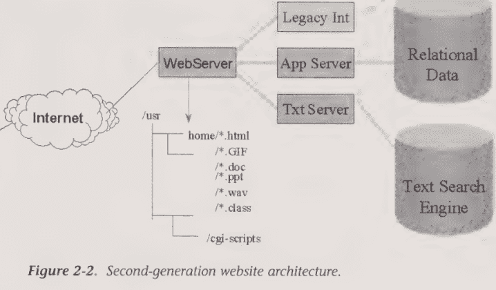

图 2-2. 第二代网站架构。

`http://a_web_server/a_program.exe`

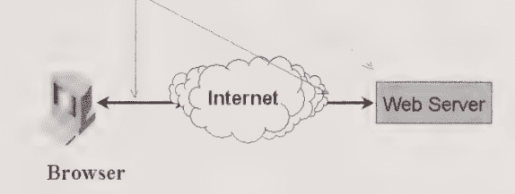

图 2-3. 通用网关接口（CGI）。

可以将中间组件（上一个例子中的 CGI 组件）与某些 Web 服务器集成。这使得以前作为 CGI 程序运行的程序，不再为每次调用作为单独的进程运行，而是作为与 Web 服务器运行时模型集成的多线程组件运行。

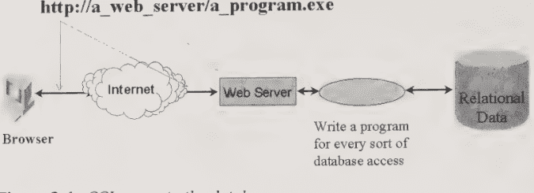

图 2-4. CGI 访问数据库。

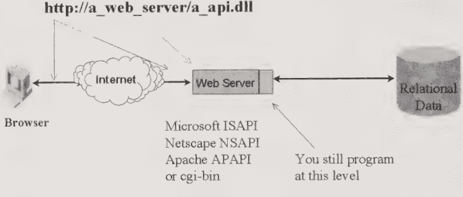

图 2-5. 使用 Web 服务器 API。

这种架构的一个例子是 Netscape NSAPI 接口，它允许开发人员编写由 Netscape Web 服务器作为动态共享对象调用的程序。

另一个例子是 LiveWire。这种模型允许 Web 服务器解释预编译的 JavaScript，除了其他功能外，还可以访问 Informix 数据库。

图 2-5 展示了 Web 服务器 API（应用程序接口）的基本架构。

基本 Web 服务器 API 模型的缺点在于，你只能在中层进行编程，而且如果 LiveWire 程序被用于动态创建网页（通过列出一个主-从查询的结果），那么你必须自己完成所有这项工作，管理连接，并管理性能。而且源代码和共享对象都位于文件存储中。

### 第二代的特征

#### 用户注册和画像

通过添加应用层，信息可以存储在平面文件或关系数据库中。这个应用层可以包括用 C 语言、Shell 脚本或批处理文件、AWK、Perl 或 Java 编写的 CGI 程序。将信息存储在平面文件数据库中相对容易，其中每一行都是一组带分隔符的字段。例如，用户信息可以存储在数据库中，以实现用户画像。

#### 应用服务器

CGI、Perl 和 LiveWire 等技术用于管理针对持久数据存储（例如，平面文件或关系数据）的应用语义。CGI 脚本可以调用 C 语言或 4GL 程序从数据库中选择数据，重新格式化结果，并将输出发送到浏览器。此外，Web 服务器可以通过调用用 JavaScript 或 Java 编写的 LiveWire 程序来向数据库发送查询。

#### 全文内容搜索

网站内容可以使用文本搜索引擎进行搜索。这可能包括也可能不包括对数据库内容的内容搜索，但通常涉及搜索 HTML 页面。一些 LiveWire 脚本可能会根据提交的表单内容向数据库发出查询，并可能会为浏览器格式化结果。

#### 遗留集成

Web 服务器可以使用 CGI 调用来调用 C 或 COBOL 程序，以访问遗留数据库中的数据，例如索引顺序数据库甚至层次数据库和平面文件。

### 第二代的问题

#### 与操作系统的复杂集成

开发人员尝试将数据库集成到他们的 Web 应用中。有 Perl 和 CGI 脚本经验的开发人员意识到 Web 将成为理想的前端。每个人的桌面上都安装了浏览器，因此，Web 的可能性开始让想要使用他们熟悉工具的程序员着迷。第一步是编写 CGI 脚本，将浏览器客户端、Web 服务器和数据库连接在一起。问题是 Perl 和 CGI 从未被设计为事务监视器，也无法扩展以支持对数据库的多个连接。

#### 性能复杂性

CGI 方法的总体问题在于它是一个单进程模型：每次调用 CGI 脚本启动进程时，你与数据库对话，获取数据，重新格式化，交给 Web 服务器，然后关闭进程。这有问题，因为很多人会访问你的数据库，而你必须为每次访问启动和关闭进程。启动和关闭可能占网站工作量的三分之二到四分之三。这可能是一个不可接受的高开销。此外，即使多个人想要对数据库执行相同的操作，每个人都必须启动一个新进程，这往往会耗尽资源。最后，因为它是一个启动-关闭环境，CGI 并不能真正解决持久状态模型的问题。

#### 技能复杂性

组织了解 HTML，因为他们有 Web 服务器，他们了解 SQL，因为他们有数据库。问题是组织通常不了解 Perl、C 和 Shell 脚本等 CGI 语言。一般来说，MIS 部门没有太多余地在快节奏的环境中学习和支持新技术。

#### RDBMS 局限性

RDBMS 本身不理解 HTML。Web 服务器使用 URL，但数据库使用 SQL。RDBMS 能跟上 Web 的变化速度吗？

#### 版本控制和部署

第二代环境中网页的版本控制基本上是一个手动过程，如果出错，由网站管理员承担责任。一些开发环境可能在版本控制机制之上有一个用户界面，以便将项目检入和检出内容仓库。在存在发布工作流模型的内联网环境中，管理 Web 内容版本可能是一项主要开销。将网页从未发布状态移动到已发布状态可以像 FTP（文件传输协议）调用一样简单，但内容作者不懂 FTP。网站管理员必须为每个文档、每次操作来完成这项工作。

#### 增强局限性

第二代架构只能在 CGI 模型的局限性内进行增强。由于没有与数据库集成，因此没有集成的内容搜索、备份和恢复，也无法利用数据库服务器的特性，例如性能调优。Web 应用需要复杂的数据和复杂的逻辑，而 HTML 不是一种编程语言。

## Informix 一代：第三代 Web 应用

当行业其他公司还在讨论第二代网站的相对优劣时，Informix 推出了第三代架构。该架构基于 Illustra Technologies 开发的创新型 ORDBMS（对象关系数据库管理系统）和 Web DataBlade。第三代架构不仅解决了动态内容和与现有运营系统集成的问题，还解决了全单点管理和全单点搜索的问题。

想想你当初为什么要买数据库：数据集中化、数据安全、查询能力、备份和恢复。再想想数据库如何真正应用于我们构建 Web 应用的问题：我们有一个网站；它需要被保护、集中管理、备份和恢复。它也需要被查询。为什么不把功能放在数据库内部呢？数据库免费为你提供这些功能。到目前为止，没有人想到的原因是网页不是你通常的数据类型。数据库存储哪些数据类型？姓名、地址、电话号码、日期、时间和货币。全文和结构化对象并不是数据库真正处理的东西。Informix 出现了，其后续版本是对象关系数据库，实际上允许你存储和管理除姓名、地址、日期、时间和货币之外的内容。而这就是网页。

图2-6展示了现在可被描述为Informix一代网站的架构：第三代。让我们通过图2-6来了解各架构组件。

- **浏览器。** 这是Netscape或Microsoft浏览器平台：连接到Web服务器的PC或UNIX终端。
- **Web服务器。** 可以是任何符合HTTP标准的Web服务器。Web服务器将调用中间件来访问数据库。
- **webdriver。** 这是一个Informix可执行程序，用于管理动态内容的访问和创建以供浏览器呈现。该软件可以作为CGI程序执行，也可以作为动态加载的共享对象集成到Netscape和Microsoft Web服务器中。
- **Informix数据库。** 可以是Informix 9.x或Informix Dynamic Server.2000数据库。这些数据库是对象关系型的，允许对数据库内容进行更丰富的语义呈现。
- **数据库内容。** HTML页面、图像、Office文档、视频、音频、Java小程序。这些对象以增强的行/列关系模型形式存储在数据库中，不同之处在于存储对象的列可以具有由已安装DataBlade赋予意义的数据类型。例如，存储HTML页面的列本身也是HTML类型。
- **DataBlades。** DataBlade本质上是一个直接链接到Informix服务器的软件库。该软件具有特定的应用程序，如文本或视频。它定义了增强数据类型的模式，以及操作这些增强数据类型的方法。综合起来，这些组件允许进行智能内容查询。

Informix架构模型仍然允许你使用第一代和第二代站点的特性。不过在这种情况下，你是在相关的地方使用它们，而不是因为你不得不使用。应用服务器层可能仍然存在；例如，你可能仍然使用Netscape LiveWire或CGI来访问其他数据库或旧版本的Informix数据库产品。但为了增强网站功能和性能，实施Web DataBlade是必须做出的选择，因为该选项允许你创建动态网页、在企业范围内捕获和呈现网站内容，同时在Intranet、Internet和Extranet环境中管理网站性能，且不损害安全性、可靠性和成本。

## 下一代

随着互联网业务的爆炸式增长，这需要企业数据和互操作组件的支持，Informix推出了两款产品（Informix Dynamic Server.2000和Informix Internet Foundation.2000），将第三代模型扩展为一个包容性的开放平台，以支持OLTP（在线事务处理）应用程序以及需要互联网内容的应用程序。这些产品在第1章中已讨论过。

第三代模型已被扩展，以纳入一个开放平台，该平台支持将顶级的Java虚拟机内置于数据库服务器中，并能够在数据库服务器中运行COM业务逻辑。这种扩展可被称为开放一代。

一个关键特性是能够直接在数据库中运行数据密集型的Java业务逻辑。Java是互联网的语言，而在业务环境中，互联网本质上是一个由数据库驱动的现象，因此在引擎内充分利用Java是合理的。

在某种程度上，第三代模型已在开放一代模型中得到扩展，将Informix数据库服务器重塑为一个更大的、异构技术框架中的组件，能够在OLTP环境中传递传统数据，同时也能够运行互联网感知的应用程序。Informix数据库服务器系列的最新扩展——Informix Dynamic Server.2000，使服务器能够充当一个网络感知的应用服务器，靠近它能够理解的互联网数据。本质上，数据库服务器被编织到开放互联网平台的结构中。

## 总结

本章指出了每一代Web应用程序的关键特征，从扁平文件Web应用程序到使用Informix技术的数据库驱动、智能数据驱动的Web应用程序。我们已经看到数据管理对Web应用程序至关重要。RDBMS的好处是必需的，但没有相关的限制。数据库必须理解Web，并且必须可由第三方扩展，以便客户能够充分利用他理解的数据和应用程序表面。我们还看到了Informix如何扩展第三代模型，以包括在数据库服务器内运行网络感知的、数据库和智能内容密集型应用程序的能力。你现在可以通过使用Web DataBlade创建动态网站，将此理解付诸实践。

# 第3章：动态 Web 解决方案：管理数字价值链

本章内容：

- 客户解决方案周期
- 如何为已安装的应用程序启用 Web 功能
- Intranet 信息仓库
- 电子商务和在线目录
- 完整的 Web 系统集成

大多数现实世界环境运行在一系列复杂的技术依赖关系中，这可能会限制公司整合和简化业务流程的能力。Informix Web DataBlade可用于管理整个数字价值链，通过提供一个网关来与信用卡授权、计费和库存系统通信，同时管理所有内容。大多数遗留和更新的应用程序都可以在其下集成，无论是特定目标是市场营销产品、获取订单、向客户计费，还是跟踪产品交付。本章描述了数字价值链和客户解决方案周期，并展示了它们的重要性。理解客户解决方案周期中定义的各个阶段将帮助你认识自己Web平台的特征，以及可能的局限性。

## 客户解决方案周期

数字价值链通过实施所谓的客户解决方案周期来实现。该周期被分为离散的步骤，最终允许大多数相关的业务流程，尤其是关键的业务流程，实现Web化。图3-1将客户解决方案周期的四个步骤描绘为四个模块。这些步骤是：

1. 为已安装的应用程序基座启用Web功能；
2. 实施Intranet信息仓库以存储和管理企业资产基座；
3. 开发电子商务目录；
4. 与遗留业务应用和数据进行完整的Web系统集成。

使用Informix，你在第1步学到的内容将帮助你完成第2、3和4步。现实世界的企业IT平台可能复杂得令人眼花缭乱：大型机上遗留应用程序生成的业务数据被聚合到数据集市，以导出到Web平台，供Intranet用户查询生成的信息；而公司董事们希望明早7:30前看到所有这些信息！将遗留系统中的数据Web化并通过电子商务解决方案增值的过程可能显得笨拙且相互矛盾，每个业务部门通过定义自己对所提供的业务服务的理解来阻碍该计划，从而混淆了服务接口。然而，使用Informix Web DataBlade，我们将澄清客户解决方案周期中的每个步骤。

## 如何为已安装的应用程序启用 Web 功能

你可以为你安装的Informix应用程序基座启用Web功能。例如，你安装的浏览器客户端基座可能包括Internet、Intranet或Extranet用户。你还有一个Web服务器和一个数据库，它们可能没有直接通信，甚至根本没有通信；如果它们通信，它们可能使用Perl、C或Shell脚本进行通信。在其上添加Web DataBlade使你能够获取数据库中已有的数据、你已编写的查询，并将这些查询嵌入HTML中，从而将查询输出呈现给Web浏览器。

要启动客户解决方案周期并为已安装的应用程序基座启用Web功能，你必须学习如何使用AppPages。AppPages是包含用Informix AppPage Script编写的命令的标准HTML页面。AppPage Script是一组伪HTML标签，允许你在HTML页面中嵌入SQL和变量处理函数。当Web DataBlade软件解释这些标签时，HTML页面会被动态创建，从而允许将可变数量的格式化数据作为网页发送到浏览器。使用AppPage Script的部分强大功能在于，你可以通过创建自己的标签（称为动态标签）来定义标准的网页外观和感觉。动态标签只需定义一次，但可以在所有Web应用程序中重复使用。这使你能够构建强大的模板网页。动态标签可以包含你能放入AppPage中的任何内容，包括其他动态标签和AppPage Script命令。这些AppPage随后可以用于客户解决方案周期的下一步：开发Intranet信息仓库。

## Intranet 信息仓库


此时，你只是将更多的企业资产基座放入数据库——例如 MS-Word、MS-Excel 和 MS-PowerPoint 文档，或者联系人和合作伙伴详情，包括新闻剪报，现在都可以存储在数据库中。使用文本 DataBlades，你实际上可以搜索 MS-Word、MS-Excel 和 MS-PowerPoint 文档。这对实际负责维护网站的人有益。为什么不让所有开发网站内容的人也维护他们自己的内容呢？内容管理应用程序允许内容作者、所有者和审批者维护他们自己的内容。幸运的是，内容作者、所有者和审批者往往并不介意绕过 IT 服务组织。在某些组织中，IT 服务部门的响应速度太慢，而且其工作人员手头有太多技术问题要处理，无暇顾及外部的又一个请求。内容管理应用程序分担了工作量，让网站管理员和 Web 应用程序开发人员维护网站，而内容作者、所有者和审批者则负责维护内容。

内容管理的实现方式是将页面构建引擎（其从模板动态生成数据和网页）移至数据库内部。你还需将大多数 Web 文件——HTML 模板、Microsoft Word 文档或任何可能发布在企业内网上的文档——移至数据库。随后，你可以在数据库中存储内容管理应用程序。这样一来，维护所有网页和企业数据的同一架构也允许你或其他人使用浏览器来维护提供数据的内容。简而言之，这正是 `publishing services`（发布服务）如何利用内网信息资源库的方式。

`corporate asset base`（企业资产库）由一组 `media assets`（媒体资产）组成。单个媒体资产可以是任何信息项目：新闻稿、报告、手册、联系人详情或合作伙伴详情数据库，甚至图像。创建、编辑、发布和管理资产库可能需要耗费大量的时间、精力和资金。

特别是，资产捕获和修改流程往往效率极低。例如，一家软硬件产品零售商拥有一个第二代网站。用户可以查看外设和软件包的缩略图；也可以按价格和库存进行查询。有权访问广告素材的部门对图像进行扫描。随后这些图像被下载到一台作为企业文件服务器的 UNIX 主机上，然后调用批处理管理器来启动批处理作业，将图像转换为缩略图。完整图像和缩略图图像随后被导出到另一台独立的 NT 主机，在那里被导入到一个用于基本目录管理信息（如产品属性维护）的数据库中。每晚，批处理作业从各个来源收集所有数据，创建一组压缩文件，然后将其导出到网站。

这是一个真实世界的情况，其中任何一项企业资产——图像、网页、产品项目信息——都以某种形式产生成本。上述捕获和修改流程存在多处症结，任何一处都可能导致系统无法在每天开始时提供前一天更新的网站。

另一方面，该公司可能拥有一个内网空间，可以沿着其网站的思路加以利用，以简化其呼叫中心服务，从而避免数据和业务逻辑的重复。当然，内网信息资源库（见图 3-2）需要一个应用程序来管理创作、维护、安全和发布信息的需求；该应用程序可以称为 `dynamic content management services`（动态内容管理服务）。

在内网动态内容管理服务模型中，存在内容所有者和内容审批者，但我们可能还希望将这些信息目录发布到外联网或互联网上。内容管理模型使你能够动态地向内部用户以及外部客户发布信息，用于电子商务应用。

在上图中，动态内容管理产品是一个内容管理应用程序，由 HTML、JavaScript、Java 和 Informix AppPage Script 组合编写而成。它是一个 Web 应用程序，具有管理丰富内容的 engagement 规则。

内容管理应用程序通常具有创作视图和已发布用户视图。用户视图是内网和/或互联网上已发布材料的视图。创作视图是内容管理视图，内容作者在此处提交网站内容，如 MS Word 文档、PDF 文件、新闻报告、Zip 文件，以及任何可存储在数据库中并赋予一组标识属性的内容。应用程序本身以一组 AppPage 模板的形式存储在数据库中。

内容作者将文档提交到资源库以供审批。授权人批准文档，并要求应用程序将文档公开。随后该文档出现在网站上。

这类应用程序的优势在于网站内容在数据库中进行管理。通过数据库复制，可以将选定数据复制到各个数据库服务器，使信息在内部分发的同时也面向公众。此外，使用对象关系型数据库可以将丰富内容存储在数据库中，并按上下文进行智能搜索。

这些应用程序通常包含文档属性（元数据）和文本搜索功能。所有这些功能都无法在没有与对象关系型数据库集成的复杂文档资源库应用的情况下实现。

#### 什么是元数据？

> 元数据是关于数据的数据。它是描述其他数据的属性列表。例如，一个文本文档（例如使用记事本创建的文档）包含作者输入的文本。文本文档是数据。元数据的例子可以包括“文档作者”、“创建日期”，甚至“文档类型（文本）”。数据库模式是另一个元数据的例子。数据库表包含表名、列名和列数据类型。这个模式就是表的元数据；它与存储在每行中的实际数据是分开的。复杂的内容管理应用程序使用元数据来定义内容资源库中的所有内容项，以及对文档进行编目和参数化属性搜索。

巧妙的是，你开发的目录和你建立的维护网站的流程可以被利用到你的电子商务解决方案中——这是客户解决方案周期中的下一步。这是因为你可以使用相同的方法和工具来管理电子商务网站的商品销售、目录、客户信息和自助服务方面，但现在你可以添加交易功能。

### 电子商务与在线目录

如本章引言所述，Web DataBlade 为应用平台增加了与信用卡授权系统以及计费和库存系统通信的网关，同时管理整个数字价值链中的所有内容。

电子商务可以被称为价值链。电子商务不仅仅是信用卡和保障交易安全。要在 Web 上实现成功的电子商务，你必须让人们相信你拥有正确的产品、服务、信息和客户服务。

数字价值链的关键部分——售前、商品销售、售后和客户支持——都依赖于内容。一位认真的客户会向网站提出以下问题：

- 目录是否最新？
- 数据库是否最新？
- 网站是否在向我推荐我想购买的产品？
- 他们是否让我的购物体验独一无二？
- 购买产品后，他们会为我提供客户服务吗？
- 他们会提供も提供在线帮助、在线说明、在线手册吗？

你的电子商务应用毫无价值，除非你提供人们想要的信息，因为交易将会流失。因此，电子商务系统也可以被描述为动态内容管理产品。

如果你已经安装并运行了一套遗留系统，你可能不想替换该系统，但你可能希望在顶层叠加 Informix Web 应用架构，因为它为管理整个数字价值链的组织增加了价跌。

为了让你能够识别电子商务应用的关键要素，以下是电子商务解决方案特征的简要定义：

- `Advertising and marketing`（广告与营销）：需求创造活动，如横幅广告和宣传册。一对一营销。
- `Merchandising`（商品销售）：产品的展示、定价和销售方式。电子商务网站应支持大量商品销售方法：例如优惠券、会员折扣、购买激励和演示产品。具有成熟商品销售模式的网站必须能够整合新的商品销售方法。
- `Payment processing`（支付处理）：信用卡支付和采购订单。
- `Price calculation`（价格计算）：购买时用户的税费和运费。
- `Order fulfillment`（订单履行）：产品有库存吗？何时送达？一个全面的 Web 解决方案需要与主机公司传统订单履行系统的高度集成。
- **跟踪：**追踪用户活动（例如，点击路径）。
- **画像分析：**市场细分分析，实现一对一营销。
- **客户服务：**利用常见问题解答、电子邮件和互动功能，将一次性购买者转化为忠实客户。

一个平台若要支持电子商务，就必须能够以可扩展且可管理的方式将这些要素整合在一起。

### 全面的 Web 系统集成

利用 Web DataBlade 在现有架构之上，将您已安装的应用程序实现 Web 化。这不仅能让您将应用程序数据呈现给 Web 用户，还可以开始管理您的企业资产库。您还可以在无需对 Web 应用程序架构进行根本性改变的情况下，将电子商务系统应用于 Web。您希望将组织内的一切整合起来：计费系统、库存和传统平台。管理电子商务系统的同样逻辑也适用于此，Web DataBlade 成为所有应用程序的前端。而这些应用程序都可以围绕该架构之上的 Web DataBlade 进行集成。

您可能还想更进一步，将所有系统都实现 Web 化。统一的 Web 应用程序方法将组织内的一切整合起来，完成客户解决方案周期。图 3-3 显示了这一统一的 Web 化应用程序集合中的主要组成部分。但请注意，这一简化的架构模型并未反映有时从外部系统获取信息所需的物理过程的复杂性。

将现有应用程序实现 Web 化的渐进式方法，从企业资产管理到电子商务应用程序，可能看起来有些人为，但它是基于现实世界的运作方式。核心要点在于，在每个阶段，基础的使能架构不会改变，而且在一个阶段学到的知识对下一个阶段也有用。

### 小结

在本章中，我们了解了如何将已安装的应用程序基础实现 Web 化，并逐步扩展，直到最终使企业应用程序平台与 Web DataBlade 核心实现全面集成。我们看到了数字价值链的重要性，以及如何实现本章描述的客户解决方案周期，从而重用上一周期中实现的收益。大多数现实世界的环境都在一套复杂的技术依赖关系中运作，这些依赖关系往往会影响整合和优化业务流程的能力。使用 Web DataBlade 搭配 Informix 数据库服务器等技术，可以让您探索内部网空间，并在以前会是独立的应用程序之间重用大量业务逻辑——一个用于 Web，一个用于内部用户。

# 第 4 章：动态 Web 应用程序开发简介

本章内容包括：

- 基本术语
- Web DataBlade 应用程序组件
- 什么是 Web DataBlade？
- 什么是 JavaScript？
- JavaScript 与 AppPage Script 有何不同？
- 什么是 Java？
- Java 与 JavaScript 有何不同？

当您构建动态网站时，您会涉足许多令人兴奋的领域，从客户端到 Web 服务器再到数据库服务器。这种所谓的多层架构正是本章介绍本书所用关键技术的背景。

### 基本术语

本节介绍全书使用的基本术语。

**HTML（超文本标记语言）。**简单的文档标记语言，其工作方式与多年前的文字处理器类似。Microsoft Word 和 Hot Metal 等程序可以自动为您生成 HTML。

**CGI 程序。**通用网关接口（CGI）是一种将外部应用程序与信息服务器（如 HTTP 或 Web 服务器）连接的标准。CGI 程序按需实时执行，以便输出动态信息。

**URL（统一资源定位符）。**URL 唯一标识可在 Internet 上访问的资源。URL 告诉 Web 浏览器在哪里找到您希望显示的信息。URL 的结构通常类似于 `http://www.informix.com:80/demos/welcome.htm`。如果 URL 中未指定端口号，则默认端口为“80”。

**HTTP（超文本传输协议）。**这是与 Web 服务器通信所使用的协议。HTTP 是一种位于 TCP/IP 之上的无状态协议。每个请求都必须连接到 Web 服务器，完成其工作，然后与 Web 服务器断开连接。它专为快速周转而设计。它不像客户端-服务器数据库，因为连接不会被保持。

**MIME 类型。**多用途 Internet 邮件扩展（MIME）是一种组织不同文件格式的标准化方法。该方法根据文件格式定义 MIME 类型。例如，当 Internet 浏览器从服务器检索文件时，服务器提供文件的 MIME 类型。浏览器使用 MIME 类型来确定浏览器的内置软件（或插件）能否读取该文件格式，若不能，则是否有合适的辅助应用程序可用于读取该文件。

**DTD（文档类型定义）。**DTD 定义文档的结构，类似于数据库模式描述其处理的信息类型。DTD 为构成文档的元素类型（章节、章标题、节）提供框架，以及文档元素之间关系的规则。HTML 是一种专门的 DTD，旨在促进由 Web 浏览器显示文档的存储和检索。

**SGML（标准通用标记语言）。**SGML 用于将文档的内容和结构与文档的格式分离，从而使文档的渲染独立于软件和硬件。

**Web 组件。**Web 浏览器（如 Netscape Navigator）知道如何显示 HTML 页面、播放音频以及显示页面中指定的图像。Web 服务器进程被称为 `HTTPD`，在 Web 服务器机器上以守护进程形式运行。

### Web DataBlade 应用程序组件

Web DataBlade 应用程序通常由表 4-1 中列出的元素组成。

HTML 页面与 AppPage 的区别在于是否存在 AppPage Script 标签。

**表 4-1。Web DataBlade 应用程序元素**

| 元素 | 描述 |
|---|---|
| HTML | 由浏览器渲染的 Web 页面。AppPage 源中的任何特殊标签都已被 Web DataBlade 处理为标准 HTML 内容格式。 |
| AppPage | 带有特殊 AppPage Scripting 标签的 HTML 页面，用于与 Informix 数据库交互。AppPage 存储在数据库中。 |
| AppPage Scripting 标签 | 支持数据库感知的标签，允许使用 SQL 将数据库内容动态渲染到 HTML 页面中。 |
| SQL | 结构化查询语言语句，用于维护数据库中的数据。 |
| Java | 面向对象的、支持网络的语言，可以在浏览器中以小程序形式运行，也可以在客户端和服务器上以应用程序形式运行。 |
| JavaScript | 主要包含在 HTML 页面中的编程语言，尽管某些服务器端 JavaScript 可以用一种名为 LiveWire 的技术编写。 |
| Web DataBlade | 适用于 Informix Dynamic Server.2000 和带通用数据选项的 Informix Dynamic Server 的 DataBlade 插件。此 DataBlade 允许从 Informix 数据库中使用 SQL 语句提供 AppPage，处理 AppPage Scripting 标签，并将生成的 HTML 发送到浏览器。 |

在本书中，我们将使用表 4-1 中列出的所有技术。我们还将介绍 Data Director for Web，并在较小程度上介绍 AppPage Builder。本书中的所有 AppPage 示例都是在 Data Director for Web 下创建和管理的。

> 本书中使用 Data Director for Web 特定动态标签的示例可以更改为在 AppPage Builder 下运行。您需要了解动态标签的功能，并在 AppPage Builder 中使用等效标签（或创建自己的标签）。

### Data Director for Web

Data Director for Web 是一款 Windows 产品，支持对存储在 Informix 数据库中的网站进行全面网站管理。它允许您将基于文件的网站导入和导出到数据库，并将网站部署到远程机器和数据库。它包含一个网页编辑器和向导，允许您构建支持数据库感知的网页。

### AppPage Builder

AppPage Builder 是用于将 AppPage 和 Web 内容存储在数据库中的默认基于浏览器的应用程序。AppPage Builder 随 Web DataBlade 一起交付。如果您没有 Data Director for Web，可以使用 AppPage Builder。AppPage Builder 的功能远少于 Data Director for Web，用作 AppPage 和多媒体对象的基本存储库。您仍然可以使用 AppPage Builder 创建功能强大、内容丰富的应用程序，但 Data Director for Web 是更直观、功能更强大的工具。

### 什么是 Web DataBlade？

Web DataBlade 用于构建动态、可扩展、富媒体的 Web 应用程序。Web DataBlade 提供了一套完整的工具、函数和示例，用于开发复杂的数据库驱动网站。Web DataBlade 使用户能够创建 Web 应用程序，其中纳入从 Informix Dynamic Server.2000 和通用数据选项数据库动态检索的数据。

Web DataBlade 旨在利用 Informix Dynamic Server.2000 和 9.x 服务器的独特架构，为第 3 章描述的客户解决方案周期的各个阶段提供工具和解决方案。Web DataBlade 将帮助您利用企业资产库的价值在于，您可以存储并向内部网或互联网平台上的广大用户提供几乎所有媒体格式的文件（如果不是全部的话）。

您可以将 Web DataBlade 与 Informix Dynamic Server.2000 以及 Informix 9.x 服务器配合使用，以动态管理多媒体 Web 内容。

### 什么是企业资产库？

**企业资产库**一词指的是对您的组织具有价值的完整文档集合。示例文档包括营销公告、新闻剪报、联系人和合作伙伴文档、公司手册以及人事表格。通常情况下，这些文档需要进行管理：添加新文档、更新现有文档。通常，这些文档需要以某种形式在组织内部传播，同时也需要向外传播给客户。**资产**一词是对文档的有用描述；Web DataBlade 被认为可以利用企业资产库，例如，将内部管理开销转移到内部网上，通过 Web 快速向目标受众部署新文档。

Web DataBlade 本质上由中间件组件和数据库组件组成。中间件组件位于 Web 服务器和数据库之间。数据库组件是一个 DataBlade，由数据类型和函数组成，允许您在数据库内部操作 Web 内容。

中间件组件是一个名为 `webdriver` 的程序。这是将 SQL 发送到页面创建引擎的程序，该引擎根据 Web 页面内容的定义和 SQL（即页面模板或 AppPage）来构建 Web 页面。`webdriver` 在 Web 服务器上运行，并直接连接到可能托管在另一台机器上的 Informix 数据库服务器。您可以将 `webdriver` 作为 CGI 程序运行，或作为通过 Web 服务器 API 与 Web 服务器集成的动态链接库运行。

### Informix 服务器版本与 Web DataBlade


Web DataBlade 是一款成功的产品，已在 Informix Dynamic Server 9.x 产品以及现在的 Informix Dynamic Server.2000 产品中使用。Informix Dynamic Server.2000 使用 Web DataBlade 第 4 版。

Web DataBlade 第 4 版在某些配置方面以及某些功能的新增和增强方面与第 3 版有所不同。但是，本书中的大多数示例都可以在 Web DataBlade 第 3.32 版和第 4 版上运行。

Web DataBlade 的用户群涵盖了不同版本的 Informix 数据库服务器。表 4-2 总结了每个 Informix Dynamic Server 对应的网站产品。

| Informix 服务器 | Web 产品 |
|:---|:---|
| Informix Dynamic Server.2000 | Web DataBlade 第 4 版及更高版本 |
| Informix Dynamic Server 9.1x/ Universal Data Option | 最高至 Web DataBlade 3.32 |
| Informix Dynamic Server 7.x | Universal Web Connect |

*Universal Data Option* 允许您在 Informix Dynamic Server 的 9.x 版本上安装 DataBlade。DataBlade（或“刀片”）允许您定义新的数据类型以及对这些数据类型的操作。例如，Web DataBlade 定义了一种名为 HTML 的数据类型。它还定义了一个名为`FileToHTML`的操作，该`publ.shtml`导入一个网页（例如`HelloWorld.html`）并将其存储在具有 HTML 数据类型的表列中。

您无法在 Informix Dynamic Server 的 7.x 版本上安装 DataBlade。要执行此操作，您需要升级到 Informix Dynamic Server.2000 或 Informix Internet Foundation.2000。

您可以使用 DataBlade 开发工具包（DBDK）构建自己的 DataBlade，或从专业供应商处购买。前者的例子可能是解释复杂数据库架构的特殊文件格式的刀片。后者的例子可能是文本或图像搜索刀片。

Universal Web Connect 产品允许您将 Informix 服务器的 7.x 版本连接到 Web 服务器以提供动态 Web 页面。该产品的架构与 Web DataBlade 不同，本书除在某些区域进行比较外，不涵盖该产品。但是，大多数 AppPage 脚本标记和功能都可以在该产品中使用，尽管其中这些功能的 Web DataBlade 实现在 Web DataBlade 第 3.32 版和第 4 版中得到了增强和进一步发展。

### 简化 Web 应用程序开发

使用 Informix Web DataBlade，可以对公司网站进行重构，从而在运行公司网站方面获得可观的时间和成本效益。例如，一个拥有 400,000 个网页的网站可以使用几百个模板进行重构。这些模板用于捕获网站的外观和感觉，并可以被其他网页重用。由于 Web DataBlade 动态生成网页中的格式化数据和 HTML，页面内容不必硬编码在页面本身中。网站的外观和感觉存储在一个地方（模板），而不是必须在每个呈现它的网页中定义。

#### 什么是 Web 模板？

Web 模板是一个包含基本 HTML 标记和 SQL 语句的网页，允许 Web DataBlade 进行动态页面生成。DataBlade 函数`webexplode()`处理该模板。这涉及解释 AppPage 脚本标记以在模板页面结构中呈现可变数量的信息。

#### 什么是 Web 内容？

简单来说，Web 内容是可以存储在网站上的任何类型的文件。这些文件类型包括文字处理文档、电子表格文档、图像（例如 GIF、JPEG）、HTML 页面、视频（例如 AVI）、音频（例如 WAV）和 Java 小程序。如果存在用于解释文档类型的程序，则该程序可以在浏览器中作为插件或辅助应用程序安装时使用该文档。Informix 数据库可以存储这些文档，而不管其类型如何。但是，并非所有类型的文档都应存储在数据库中。后续章节将确定哪些类型的文档最适合数据库存储。

### Web DataBlade 的优势

#### 适用于大规模 Web 管理

Web 应用程序和内容在数据库中进行集中管理。服务器端页面生成速度快。AppPage 模板减少了网站页面数量。此外，Informix Dynamic Server 的可扩展性使您能够管理快速增长的内容。

#### 快速创建动态和定向 Web 页面

支持数据库感知的页面模板（称为 AppPage）允许您重用常见的应用程序元素，例如 HTML 页眉和页脚，包括用于访问数据库的 SQL 语句。例如，网站可以以统一的外观和感觉呈现，页眉显示公司徽标，页脚显示电子邮件详细信息。可以使用两个 AppPage 模板或动态标记来实现这一点。

#### 提供低开销的高速数据库连接

应用程序服务器解决方案通常依赖 ODBC 连接从页面构建引擎访问数据库。Web DataBlade 的`webdriver`程序不使用 ODBC；连接层内置于产品中，消除了对中间层的需求，从而提高了性能。此外，页面构建功能是 DataBlade 功能，运行在数据库服务器`内部`，靠近数据。

#### 改进 Web 内容管理

网页在数据库内部进行管理。由于数据库得到管理，网站也同样得到管理。Informix 提供了客户端工具，例如用于 Web 的 Data Director，以对网站进行精细级别的控制。

#### 提高性能和可扩展性

Web DataBlade 的`webdriver`程序提供会话和连接管理。此外，还可以实现静态 Web 内容的缓存管理。Web DataBlade 的`webdriver`程序还可以与您的 Web 服务器集成，以允许进一步的性能增强。由于 Informix 服务器是企业级数据库驱动业务解决方案的可扩展平台，并且由于 Web DataBlade 与数据库集成，使用 Web DataBlade 创建的动态和数据库驱动网站将随着数据库服务器平台一起扩展。

#### 利用您现有的基础设施和经验

使用 Web DataBlade，您可以利用现有的 Informix 数据库和 Web 服务器。AppPage 脚本也非常容易学习，因此从 HTML 迁移到 Web DataBlade 扩展标签的路径非常短。此外，网站管理员仍然可以使用 Java、JavaScript、HTML、XML 以及他目前掌握的技能库。其他可能希望向网站提交内容的用户，例如需要向网站提交文字处理文档的行政用户，可以继续像以前一样使用他们的文字处理和电子表格软件。Web DataBlade 允许在其上开发的 Web 应用程序维护这些内容。

### 与行业领先工具和技术集成

您可以将自己喜欢的网页创作工具与 Web DataBlade 一起使用。您可以发布到 Informix 数据库，而不是发布到文件系统。使用 Web 版 Data Director，您还可以将网站从文件系统拖放到数据库中。

### 提供开放/可扩展的平台，随您的需求和全球创新而成长

Informix Dynamic Server.2000 和 Informix Dynamic Server/Universal Data Option 允许数据库随着业务信息领域的创新而扩展。可以为新的复杂信息开发 DataBlade。Informix 和 Informix 客户都在这样做。这就是为什么 DataBlade API 是一个开放接口，让您能够掌控一切。大型组织拥有大量构成竞争优势的专有代码。您可以非常轻松地将这些代码利用到 DataBlade 应用程序中。

### 什么是 DataBlade？

DataBlade 模块是一组数据库对象和代码的集合，通过添加新功能来扩展 Informix Dynamic Server。DataBlade 模块可以使 Informix Dynamic Server 为新的数据类型提供与内置数据类型（如 VARCHAR）相同级别的支持。

DataBlade 总是针对特定问题，因为它通常支持特定的应用领域，如空间数据管理或文档索引和检索。多个 DataBlade 模块可用于支持单个应用程序。例如，一个存储来自许多不同医院信息的媒体记录应用程序可能会使用空间 DataBlade 模块来记录和查询医院位置，以及使用实验室 DataBlade 模块来索引和查询对医院患者进行的测试结果。

开发 DataBlade 模块涉及定义数据类型及其操作的例程，编写数据类型和客户端应用程序的支持代码，以及测试、记录和打包模块。

第 12 章包含了理解 DataBlade 总体而言以及 Web DataBlade 模块特别所需的详细信息。

### Web DataBlade 有何不同？

通常，Web 数据库应用程序需要由 Perl 或 C 编写的通用网关接口（CGI）应用程序来访问数据。您甚至可以使用 CGI 运行 4GL 过程。然而，通过使用 Web DataBlade 模块，不需要开发定制的 CGI 接口。Web DataBlade 模块在`webdriver`可执行文件中包含客户端代码。这是一个运行在 Web 服务器机器上的客户端应用程序。使用 Web DataBlade 模块时，您创建包含数据库感知型 Web DataBlade 模块标签（称为 AppPage Script 标签）的 HTML 页面（称为 AppPage），这些标签动态执行您指定的 SQL 语句并格式化结果。您可以从 Informix Dynamic Server 数据库中检索传统数据类型，以及 HTML、图像、音频和视频数据。

Web DataBlade 模块标签使您能够：

- 在 AppPage 中直接嵌入 SQL 语句。
- 在 AppPage 中处理错误。
- 在 AppPage 中条件执行语句。
- 使用变量处理函数在 AppPage 中操作变量。
- 使用其他高级查询处理和格式化技术。

Web DataBlade *动态标签*允许您重用现有 HTML 以简化 Web 应用程序的构建和维护。

Web DataBlade 模块提供*系统*动态标签，但您也可以创建自己的*用户*动态标签。

Web DataBlade 的`webdriver`程序允许您通过使用其配置文件、Web 服务器环境、URL、HTML 表单以及您自己的 Web 应用程序变量中的信息来定制 Web 应用程序，无需额外的 CGI 编程。

`webdriver`的 Web 服务器 API 实现允许您使用 Netscape、Microsoft 和 Apache Web 服务器的安全功能，并且它消除了 CGI 进程开销。

### 什么是 webdriver？

`webdriver`是一个使 Web 服务器能够与 Informix 数据库服务器通信以提取存储在数据库中的 AppPage 的程序。`webdriver`替代了编写自定义 CGI 程序以使 Web 服务器能够与数据库交互的必要性。`webdriver`有不同的实现，具体取决于使用的 Web 服务器，如表 4-3 所示。`webdriver`是作为 Web DataBlade 软件包一部分交付的少数几个程序之一。

作为应用程序，`webdriver`（或 Web 服务器 API 版本）构建 SQL 查询，在数据库服务器内部执行`webexplode()`函数以从 Informix 数据库检索 AppPage。该软件的 Universal Web Connect 版本没有可用的 DataBlade 函数；Universal Web Connect 软件在数据库`外部`构建 HTML 页面。

### 什么是 webexplode()？

当您在一台 Informix Dynamic Server.2000 或 Informix 9.x 数据库上安装 Web DataBlade 时，`webexplode()` DataBlade 函数由 Blade Manager 安装。这是处理 AppPage 并解释 AppPage 标签的核心函数，在大多数情况下，这将涉及向数据库服务器发送 SQL 查询并处理结果。

**表 4-3. webdriver 实现**

| 实现 | 使用的组件 |
|---|---|
| CGI | `webdriver`（UNIX）或`webdriver.exe`（NT）。可在任何支持 CGI 的 Web 服务器上运行。 |
| Netscape 服务器 API（NSAPI） | `webdriver`的共享对象（UNIX）或 DLL（NT）版本，用于直接与 Netscape Web 服务器接口以进行用户认证和性能优化。 |
| Microsoft IIS API（ISAPI） | `webdriver`的 DLL 版本，用于直接与 IIS Web 服务器接口以进行用户认证和性能优化。 |
| Apache API（APAPI） | `webdriver`的共享对象或 DLL 版本，用于直接与 Apache Web 服务器接口以进行用户认证和性能优化。 |

`webdriver`程序构建一个包含`webexplode()`调用的 SQL 语句。传递给`webexplode()`的参数包括 AppPage 的名称以及从 Web 服务器环境和`webdriver`配置传递的一组变量，这些变量随后可在 AppPage 中使用以改变最终 HTML 页面的行为和输出。

### 什么是 AppPage？

AppPage 是存储在 Informix 数据库中的模板网页。在典型的 Web 数据库应用程序中，大部分逻辑都在用 Perl 或 C 编写的网关应用程序代码中。这个通用网关接口（CGI）应用程序连接到数据库，构建并执行 SQL 语句，并格式化结果。使用 Web DataBlade 模块，您无需开发 CGI 应用程序即可动态访问数据库数据。相反，您创建包含 Web DataBlade 模块标签和函数的 HTML 页面，这些标签和函数动态执行您指定的 SQL 语句并格式化结果。这些页面称为应用程序页面（AppPage）。您可以检索的数据类型可以包括传统数据类型，以及 HTML、图像、音频和视频数据。

### 什么是 AppPage Script？

Informix 将 AppPage Script 开发为 HTML 的扩展。该扩展包括一组预构建的标签，用于格式化和操作变量数据，主要用于使用 SQL 从数据库检索的数据。AppPage Script 标签是 HTML 网页和 Informix 数据库之间的接口。您可以将 AppPage Script 视为一种脚本语言，但非常简单。从使用 HTML 创建网页迁移到同时使用 HTML 和 AppPage Script 工作很容易。事实上，AppPage Script 和 HTML 是互补的。脚本标签用于启动 SQL 命令并处理这些命令的结果。

浏览器永远看不到 AppPage Script。它只能被 Web DataBlade `webexplode()`函数看到，该函数解释并执行 AppPage Script 标签和变量，然后格式化结果。在大多数情况下，这涉及对数据库的查询。浏览器只能看到最终结果。

相比之下，动态标签允许您重用现有的 AppPage 片段以简化 Web 应用程序的构建和维护。Web DataBlade 模块提供了您可以使用的系统动态标签。您还可以创建用户动态标签。

### 什么是 JavaScript？

JavaScript 是开始学习 Web 编程的理想技术。它易于学习，尽管它是基于对象的；其优势在网页中可以立即显现。JavaScript 最初由 Netscape 开发，作为一种网页脚本语言，可能是最通用、使用最广泛的网页脚本语言。它通常用于以下方面：

- *与用户交互。* JavaScript 可以响应用户事件，例如按下 HTML 表单按钮。
- *与 HTML 文档交互。* JavaScript 可以处理为网页创建的文档对象。
- *控制浏览器。* JavaScript 可以打开新的浏览器窗口、弹出窗口和对话框。
- *管理文档外观。* JavaScript 可以在`客户端`动态格式化一个或多个网页。

所有这些功能都在本书中有所说明。

有两个不同但重叠的系统：客户端 JavaScript，在 Web 浏览器中运行；以及服务器端 JavaScript，由 Web 服务器运行。本书涉及客户端 JavaScript。

#### 客户端 JavaScript

客户端 JavaScript 包含在网页内部，或作为单独的文件发送（带有`.js`后缀）。JavaScript 由浏览器解释，并在浏览器内部与 HTML 紧密结合。HTML 标签由浏览器创建为内部对象，JavaScript 可以访问它们。使用 JavaScript，你可以将事件与浏览器对象（如 HTML 表单和链接）关联起来。客户端 JavaScript 的强大之处在于，你可以访问基于网页内容的对象层次结构。

客户端 JavaScript 还可以与客户端上的 Java 小程序交互。可能最简单的实现是一种名为 LiveConnect 的技术，本书后面会介绍。

#### 什么是 Applet？

Applet 可以被定义为移动应用程序代码。Applet 是一个自包含的应用程序，或代码片段，用于执行特定功能。JavaScript Applet 是在网页中`<SCRIPT>`和`</SCRIPT>`标签之间内联编码的代码片段。类似地，Java Applet 包含一个或多个 Java 类文件，通过网页中的`<APPLET>`标签定义。一个或多个类文件随网页一起下载。

**注意**

JavaScript 可以访问由浏览器创建的客户端对象，这些对象代表 HTML 文档内容。例如，为网页上的每个表单创建一个`Form`对象。相比之下，JavaScript 无法访问 Web DataBlade 解释的脚本标签的任何对象。这是因为 AppPage 脚本标签不会发送到浏览器，因此客户端没有可访问的对象。


#### 服务器端 JavaScript

服务器端 JavaScript 提供了 CGI 编程的替代方案。服务器端 JavaScript 嵌入在 HTML 页面中，当请求容器页面时，允许可执行的服务器端 JavaScript 运行。服务器端 JavaScript 包含允许访问服务器文件系统和数据库的对象。数据库访问通过 ODBC 进行。

请注意我说的关于服务器端 JavaScript 访问数据库的解决方案属于第 2 章介绍的第二代类别，而不是第三代。然而，第三代才是为电子商务和完全集成的 Web 解决方案提供最佳平台的。

**提示**

虽然你可以使用服务器端 JavaScript 通过 ODBC 访问 Informix 数据库，但 Web DataBlade 是更具可扩展性的替代方案，因为数据库连接是直接的，而不是通过 ODBC 层。此外，如果你使用服务器端 JavaScript 在服务器上动态格式化网页，Web DataBlade 包含正好用于此目的的软件；你只需要专注于应用程序，而不是在应用程序中重复造轮子。

#### JavaScript 组件总结

JavaScript 是基于对象的，不是面向对象的。JavaScript 在浏览器内存中创建和使用对象，但面向对象的概念，如继承和多态，在 JavaScript 中实际上是不可能实现的。此外，JavaScript 只有在浏览器或 LiveWire 应用程序内部运行时才真正具有生命力，而 LiveWire 应用程序由 Web 服务器控制。尽管如此，JavaScript 是一种完整且优美表达力的编程语言。

为了总结本节，表 4-4 列出了相关组件。客户端 JavaScript 和 LiveConnect 在第 5 章中描述。

| 组件 | 描述 |
| --- | --- |
| 客户端 JavaScript | JavaScript 代码由浏览器内部的 JavaScript 解释器执行。 |
| LiveWire（服务器端 JavaScript） | 基于服务器的预编译 JavaScript 代码，在 Web 服务器控制下在服务器上执行。你可以使用服务器端 JavaScript 通过 ODBC 访问 Informix 数据库。 |
| LiveConnect | 基于客户端。允许 Java 访问 JavaScript 数据和方法，反之亦然。 |

### JavaScript 和 GO AppPage Script 有何不同？

尽管两者名称中都有 `script` 一词，但 JavaScript 和 GO AppPage Script 有替本不同。AppPage Script 是 HTML 用于数据库工作最强大的扩展之一，也是最容易学习的；你可以称它为 HTML 脚本，因为标准 HTML 是静态的，描述的是文档结构而非内容。相比之下，AppPage Script 既阐明了文档结构，又动态地在其中渲染了文档内容。

从 HTML 迁移到 JavaScript 需要理解编程语言和对象，才能使这种努力物有所值。此外，使用 JavaScript 访问数据库时，如果没有 AppPage Script，你可能需要使用 Web 服务器上称为 LiveWire 的技术。

从 HTML 迁移到 AppPage Script 的门槛很低。AppPage Script 看起来像 HTML。它是一组扩展标签，源自 SGML，就像 HTML 源自 SGML 一样。你可以在 AppPage 本身中编写访问数据库的 SQL，并在 HTML 页面中动态格式化 SQL 查询的结果。

> JavaScript 用于在客户端创建动态网页。AppPage Script 用于在数据库服务器端创建动态网页。

表 4-5 总结了 JavaScript 和 AppPage Script 之间的差异。

| JavaScript | AppPage Script |
| --- | --- |
| 在浏览器中执行（在某些情况下，使用 LiveWire 在 Web 服务器上执行）。 | 仅在 Web 服务器上处理。 |
| 基于对象。 | 不使用对象。 |
| 无法访问 Effective 数据库（除非通过 LiveWire 和 ODBC）。 | 可以无需额外编码即可访问数据库。 |
| 无法轻松格式化数据库查询结果。 | 可以轻松格式化 SQL 查询结果。 |
| 是一种编程语言，看起来像 C 或 C++。 | 是一种脚本语言，看起来像 HTML。 |
| 可以在客户端动态渲染网页（在某些情况下，使用 LiveWire 在服务器上渲染）。 | 使用 Informix Web DataBlade 的 `webexplode()` 组件在服务器上动态格式化网页。如果需要，可以生成基于 JavaScript 的代码以在客户端动态渲染网页。 |

### 什么是 Java？

关于 Java 存在一个误解。Java 被称为让网页生动起来的语言；这只有部分正确。更重要的是，Java 是当今最重要的应用程序和网络平台。

从根本上说，Java 是一个可以在任何地方运行分布式应用程序组件的平台，你可以在该框架内包含遗留应用程序。历史上，分布式应用程序有一个相当固定的参考点。应用程序中的一个组件会在一台机器上运行，另一个组件会在另一台机器上运行。数据会通过网络从各种数据库传输到每个应用程序。

使用 Java，不仅数据在网络上传输，应用程序代码也是如此。以前在一台机器上运行的代码现在可以发送到任何需要它的机器上。此外，你可以远程与 Java 函数（或方法）接口。Java 平台还具有内置的网络功能。Java 应用程序接口（称为 API）包括用于智能卡、嵌入式操作系统、多媒体和目录服务等的 API，仅举几例。

由于 Java 的网络功能是内置的，在某种程度上，Java 使网络对其构建的应用程序不可见。由于 API 在许多级别上定义了一组可互操作的服务，它们将实现隐藏起来不让开发者知道，并提供了一个统一且行业范围内的发展平台。

JavaBeans 是客户端组件模型。Enterprise JavaBeans 是服务器组件模型，能够封装遗留应用程序并将它们作为服务呈现给 Java 开发平台。

由于 Informix 认识到 Java 的重要性，J/Foundation 与 Informix Internet Foundation.2000 产品集一起使用，以允许你在数据库服务器内部运行 Java 模块，使用最优质的 Java 虚拟机。

本书将向你展示如何使用 JDBC 和 RMI 创建分布式数据库驱动的应用程序。

### Java 和 JavaScript 有何不同？

理解 Java 和 JavaScript 之间的根本差异很重要。作为 Web 开发者，你需要理解它们之间的架构差异，以便正确确定、扩展和定位你的各个 Web 组件。

使用 LiveConnect（本书后面会介绍），Java 可以通过 JavaScript 访问浏览器对象。同样，JavaScript 可以访问 Java 方法。然而，这两种语言之间存在显著差异。特别是，它们可以根据三个标准进行对比：

- **静态类型。** JavaScript 变量是松散类型的。Java 要求所有变量在编译时声明类型。这消除了一些灵活性，但它在性能和稳健性方面获得了提升。

- **静态绑定。** 使用 JavaScript 时，你可以在脚本首次被浏览器加载和检查时引用脚本中不存在的对象。相比之下，如果所有对象未定义完毕，Java 程序将无法通过编译。

- **对象模型。** JavaScript 是基于对象的，其对象模型有一定局限性。相比之下，Java 是一种完全面向对象的编程语言。

JavaScript 并不依赖 Java，反之亦然。不过，它们确实可以相互补充。本书将展示如何通过 LiveConnect 实现 Java 与 JavaScript 的交互。

### 小结

本章介绍了 Web DataBlade 应用程序和 Web DataBlade 的主要组件，并介绍了 Java 与 JavaScript，将它们定位为可以相互交互、与 AppPage 交互以及与数据库交互的互补技术。本书的关键技术得到了描述、对比，并置于具体上下文之中。这些技术的实现将在本书后续章节中详细阐述。

# 第二部分

## 使用 Java、JDBC 和 JavaScript 进行动态 Web 编程

# 第 5 章

## 使用 JavaScript 创建动态 Web 页面

本章内容：

- 使用 JavaScript 的“Hello World”
- 使用框架和 JavaScript 创建动态 Web 页面
- JavaScript 小结
- 将 JavaScript 与 AppPage 脚本变量混合使用
- 使用 JavaScript 显示数据库查询结果
- 将 JavaScript 与 Java 集成：LiveConnect 基础
- 滚动显示来自数据库的图片
- 创建动态选择列表
- 无需重新加载页面即可提交查询
- 对 HTML 页面执行 JavaScript 文本搜索

在本书中，尤其是在专门介绍 Web DataBlade 示例的章节里，你会发现 JavaScript 与 AppPage 脚本紧密集成。本章重点介绍 JavaScript——单独使用 JavaScript、JavaScript 与 Java 配合使用，以及 JavaScript 与 AppPage 脚本配合使用，来创建一些展示数据给用户的精彩技巧，这些技巧并不那么显而易见。本章有多个示例，介绍如何在浏览器中使用 JavaScript 为数据库查询结果添加功能。其中最好、最有趣的示例是那些使用 AppPage 中的 JavaScript 动态生成对数据库的查询。

有关 Shelf 关于使用 JavaScript 在客户端动态创建 SQL 查询的详细信息，请参见第 21 章“客户维护应用程序”。关于使用 JavaScript 处理表单的详细信息，请参见第 17 章“动态 Web 表单编程”。

关于如何创建类似资源管理器的、由数据库驱动的 JavaScript 菜单结构，请参见第 6 章“JavaScript SQL 资源管理器”。关于 Java 小程序编程的详细信息，请参见第 8 章“JDBC 编程基础”和第 9 章“将 Java 小程序与数据库集成”。

本章包含一节关于在浏览器中集成 Java 与 JavaScript 的内容，这不是作为教程，而是作为管理浏览器中信息的一种略有不同的方法的指引。本章的示例有效地将 JavaScript 定位在第三代 Web 架构之中，你在本章学到的关于 JavaScript 的知识可以同样适用于各种上下文，而不仅限于基于 Informix 的系统。

## 使用 JavaScript 的“Hello World”

使用 JavaScript 可以轻松编写“Hello World”程序。HTML 页面不必作为 AppPage 存储在数据库中来实现这一点。这个 JavaScript 示例不必存储在数据库中的原因是我们不依赖 Informix 来执行任何特殊标签。是浏览器将执行 JavaScript。即使 Web 页面存储在数据库中，仍然是浏览器执行 JavaScript。Informix 的 `webdriver` 程序无法理解 JavaScript，会在扫描 Web 页面时忽略它。

反之，即使 Web 页面不包含特殊的 Web DataBlade 标签（如 `<?MIVAR>`），也可以将其存储在数据库中。Informix 的 `webdriver` 程序仍然会从数据库中获取该 Web 页面，并将其传递给 `webexplode()` 函数，但页面内容将保持不变。

当浏览器显示或渲染清单 5-1 中的下一个示例时，它会执行找到的 JavaScript。JavaScript 代码将动态渲染“Hello World”字符串。你可以使用 `webdriver` URL 从数据库调用清单 5-1 中的 Web 页面，也可以从文件系统（你自己的或 Web 服务器的）调用。

## 清单 5-1：使用 JavaScript 的“Hello World”（HelloWorld.html）

```html
<html>
<head>
<title>Hello World: JavaScript and Strings</title>
</head>
<body bgcolor='#DFDFDF'>
<script language=JavaScript>
document.write("<P><CENTER><B>" + 
              "Hello World".fontsize(7) + 
              "</B></CENTER>");
</script>
</body>
</html>
```

### 客户端和服务器端动态 Web 编程

使用 Web DataBlade 的服务器端动态 Web 编程包括编写包含 SQL 和 AppPage 脚本标签及函数的 AppPage。HTML 页面在 Web 服务器或数据库服务器（即 Informix 数据库所在的位置）上动态创建。相比之下，客户端动态 Web 编程包括在浏览器客户端动态创建 HTML 页面。你可以集成服务器端和客户端的动态页面生成，以允许客户端 JavaScript 与数据库动态生成的 Web 页面信息协同工作。这方面的一个很好示例在第 6 章“JavaScript SQL 资源管理器”中描述。

清单 5-1 中有几个值得注意的点：

- 注意 `fontsize(7)` 方法的使用。这是字符串的内置 JavaScript 方法，输出由 `<FONT SIZE=7>` 和 `</FONT>` 分隔的字符串值。

- 注意字符串“Hello World”是如何使用的。最初，它以内联方式编码为字符串常量。然后它被当作字符串对象使用。

- Web 页面的实际显示内容是通过 JavaScript 使用 `document.write()` 方法调用动态创建的。

由于 JavaScript 在读取时被解释，你可以编写如下语句：

```javascript
"Hello World".fontSize(7);
```

浏览器中的 JavaScript 解释器会创建一个 String 对象，并将其初始化为“Hello World”字符串。由于 String 对象具有操作 String 数据的内置方法，我们可以调用其中一个方法来操作内联编码的 String——在本例中，是 `fontSize` 方法。

我们也可以将上述代码编写为：

```javascript
var str = "Hello World";
str = str.fontsize(7);
document.write(str);
```

通过比较这两种替代方案，你可以感受到 JavaScript 的优雅和简洁。来自清单 5-1 的浏览器源输出如下：

```html
<html>
<head>
<title>Hello World: JavaScript and Strings</title>
</head>
<body bgcolor='#DFDFDF'>
<P><CENTER><B><FONT SIZE="7">Hello
World</FONT></B></CENTER>
</body>
</html>
```

图 5-1 显示了上述代码的输出。

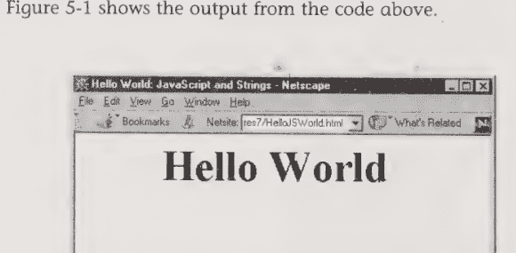

### 对象和方法

由于 JavaScript 是基于对象的，大多数数据都表示为对象。你可以使用许多内置的 JavaScript 对象类型，如 String 或 Array。对象可以有与之关联的函数，称为方法。内置对象有一组预定义的方法用于操作对象数据。这些方法包含操作该对象实例的代码。方法与单个对象相关联，而不是一组对象。例如，值为“Java”的 String 对象在调用 `fontsize()` 方法时的输出结果与值为“JavaScript”的 String 对象不同。

### 使用 JavaScript 进行动态字符串格式化

下一个示例展示了如何使用 String 方法动态格式化字符串。动态生成的 HTML 为清晰起见以大写显示。清单 5-2 包含 HelloTime.html。

#### 清单 5-2：JavaScript 字符串和字符串方法 AppPage，HelloTime.html

```html
<html>
<head>
<title>Hello World: JavaScript and Strings</title>
</head>

<body>

<script language=JavaScript>

var now = new Date();

document.write("<P><CENTER><B>" +
               "Hello World".fontsize(7) +
               "<BR>The time is " + new Date() +
               "</B><BR>")

document.write(((now.toString())).bold() + "<BR>");
document.write(((now.toString())).bold().
fontsize(5) + "<BR>");
document.write("</B></CENTER>");

</script>
</body>
</html>
```

#### 清单 5-3：清单 5-2 的 HTML 输出

```html
<html>
<head>
<title>Hello World: JavaScript and Strings</title>
</head>

<body>
<P><CENTER>
<B><FONT SIZE="7">Hello World</FONT><BR>
The time is Fri Mar 19 10:40:32 GMT+0000 (GMT)
1999</B><BR>
<B>Fri Mar 19 10:40:32 GMT+0000 (GMT) 1999</B><BR>
<FONT SIZE="5">
<B>Fri Mar 19 10:40:32 GMT+0000 (GMT) 1999</B></FONT>
<BR></B></CENTER>

</body>
</html>
```


源代码，且清单 5-3 包含由 JavaScript 创建并由浏览器显示的 HTML 页面。请注意：

- 使用`Date`对象来获取当前日期和时间；
- `Date`对象被转换为`String`，并包裹在`<B>`和`</B>`标签内，而这对标签又被包裹在`<FONT>`和`</FONT>`标签内；以及
- `Date`对象还内联用作`document.write()`语句的一部分。

图 5-2 展示了清单 5-3 的浏览器输出。

### 显示弹出框

下一个示例展示了如何使用 JavaScript 将“Hello World”字符串输出为弹出框。清单 5-4 包含`HelloPopupWorld.html`的 AppPage 源代码。在此示例中，调用`alert()`方法在对话框中输出字符串。当浏览器中的 JavaScript 解释器执行`alert()`方法时，会显示一个对话框，如图 5-3 所示。

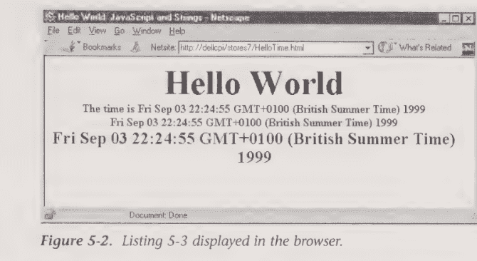

**图 5-2.** 在浏览器中显示的清单 5-3。

#### 清单 5-4. 在 JavaScript 中使用弹出框（`Hellopopupworld.html`）

```html
<html>
<head>
<title>Hello World: JavaScript</title>
</head>
<body>
<script language=JavaScript>
alert("Hello World");
</script>
</body>
<html>
```


**图 5-3.** 来自清单 5-4 的 JavaScript 弹出框。

> 属于`window`对象的内置方法（由浏览器创建以表示浏览器窗口的对象）不需要在方法名前面加上`window`一词。例如，`window.alert()`和`alert()`是同义的。

### 使用框架和 JavaScript 创建动态网页

JavaScript 可用于动态地渲染浏览器显示内容。通常，在一个 HTML 框架中的鼠标点击会导致另一个框架中显示的内容发生变化，要么下载新的网页，要么在客户端创建显示内容。要正确执行此操作，您需要使用*框架*，它使您能够在一个浏览器屏幕内构建一组 HTML 文档。每个文档窗口称为一个*框架*，这些框架的总和称为一个*框架集*。

假设您已基本掌握框架和框架集的实践细节。下一个示例创建两个框架，第一个框架控制第二个框架的显示。当第一个框架下载时，它会将“Hello World”字符串写入第二个框架。清单 5-5 包含名为`HelloFramesWorld.html`的 AppPage 源代码。

#### 清单 5-5. 使用框架和 JavaScript 控制动态页面内容（`HelloFramesWorld.html`）

```html
<html>
<head>
<title>Hello World: JavaScript</title>

<script language=JavaScript>
function displayHelloWorld() {

  var Header = "<HTML><BODY><CENTER><BR>";
  var Footer = "</CENTER></BODY></HTML>";
  var Message = "Hello Frames World".bold();

  displayFrame = mainPanel.window.document;
  displayFrame.open('text/html');

  displayFrame.write(Header);
  displayFrame.write(Message.fontsize(7));
  displayFrame.write(Footer);

  displayFrame.close();
}
```

#### 清单 5-5（续）

```html
</script>
</head>
<frameset rows="100%,*" onLoad='displayHelloWorld();'>
    <frame name="mainPanel"
           src="<?MIVAL>$WEB_HOME<?/MIVAL>?MIval=blank">
    <noframes>
    <body>
    <p>此页面使用框架，但您的浏览器不支持它们。</p>
    </body>
    </noframes>
</frameset>
</html>
```

总结此示例，浏览器正在使用两个文档：

1. 主文档是清单 5-5 中的网页，其中包含 JavaScript 代码。第二个文档将包含动态创建的字符串。
2. 框架集定义了一个框架，该框架被声明为占据整个屏幕。此框架称为`mainPanel`。默认情况下，一个空白 HTML 页面会下载到其中。此页面称为`blank`，存储在数据库中，这就是我们使用 AppPage 标签来标识它的原因。

一旦主文档下载完成，浏览器就会调用名为`displayHelloWorld()`的 JavaScript 函数，然后写入`mainPanel`框架；由于此函数没有其他对象引用，因此默认绑定到`window`对象。

清单 5-5 中`displayHelloWorld()`方法的 JavaScript 代码实际上与前面的示例没有太大区别。我们不是编写：

```javascript
document.write("<HTML>");
```

而是编写：

```javascript
displayFrame.write("<HTML>");
```

这里，`displayFrame`是一个变量，它包含对`mainPanel`框架内 HTML 文档的引用。

清单 5-6 包含主文档的生成 HTML，其中包含框架集定义，由 Web DataBlade 生成。此 HTML 页面与清单 5-5 中的 AppPage 源代码之间的唯一区别是`<?MIVAR>`标签的扩展，用于名为`blank`的 AppPage。清单 5-7 显示了在`mainPanel`框架中生成和显示的 HTML。生成的 HTML 为大写，以便清晰起见，因为它最后在清单 5-6 中定义。图 5-4 展示了浏览器输出。

#### 清单 5-6. 清单 5-5 中 AppPage 源代码的 HTML 输出

```html
<html>
<head>
<title>Hello World: JavaScript</title>

<script language=JavaScript>
function displayHelloWorld() {
var Header = "<HTML><BODY><CENTER><BR>";
var Footer = "</CENTER></BODY></HTML>";
var Message = "Hello Frames World".bold();
displayFrame = mainPanel.window.document;
displayFrame.open('text/html');
displayFrame.write(Header);
displayFrame.write(Message.fontsize(7));
displayFrame.write(Footer);
displayFrame.close();
}
</script>
</head>
<frameset rows="100%,*" onLoad='displayHelloWorld();'>
<frame name="mainPanel" src="/stores7-cgi/webdriver.exe?MIval=blank">
<noframes>
<body>
<p>此页面使用框架，但您的浏览器不支持它们。</p>
</body>
</noframes>
</frameset>
</html>
```

#### 清单 5-7. 浏览器客户端上由 JavaScript 为`mainframe1`框架生成的 HTML

```html
<HTML>
<BODY>
<CENTER>
<BR>
<FONT SIZE="7">
<B>Hello Frames World</B>
</FONT>
</CENTER>
</BODY>
</HTML>
```

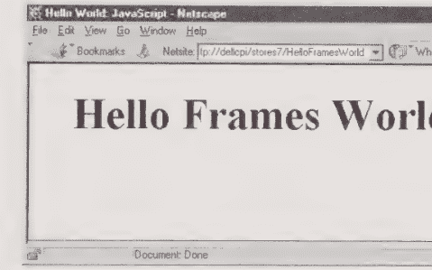

**图 5-4.** 清单 5-7 的浏览器输出。

### 将 JavaScript 与 AppPage 脚本变量混合使用

下一个示例将 JavaScript 与 AppPage 脚本变量结合，展示如何弹出 JavaScript 警告框以显示可以连接到数据库的用户名，以及 Web 服务器软件的名称和类型。此示例适用于 webdriver 的 CGI 版本；某些 Web 服务器变量对 webdriver 的 NSAPI、ISAPI 和 Apache API 版本不可用。

清单 5-8 展示了将 JavaScript 和 AppPage 脚本结合以弹出 JavaScript 警告框的 AppPage 源代码。

#### 清单 5-8. `mixer.html` AppPage 源代码

```html
<html>
<head>
<script language=javascript>
function displayMessage(userName, serverSoftware) {
    alert("Hello " + userName + "\n freewaywww for using
    " + serverSoftware);
}
</script>
</head>
<?MIVAR>
<body onLoad="displayMessage('$MI_USER', '$SERVER_SOFTWARE');">
</?MIVAR>
</body>
</html>
```

请注意，`<?MIVAR>` AppPage 标签包裹了整个`<body>` HTML 标签。这允许 Web DataBlade 处理 AppPage 脚本变量，而不会因过多的`<?MIVAR>`标签而使代码变得杂乱。

AppPage 变量在数据库服务器上展开，然后再将生成的 HTML 页面发送到浏览器。也就是说，当这些参数值是 AppPage 脚本变量值时，我们动态生成 JavaScript 方法参数。

从此示例中可以看出，当 Web DataBlade 处理 AppPage 时，AppPage 脚本变量值将替代 AppPage 脚本变量名称输出。当客户端浏览器加载 HTML 页面时，`onload`事件的`displayMessage()`事件处理程序将弹出一个警告框，其中显示由 Web DataBlade 提供的值。

清单 5-9 展示了生成的 HTML 页面。

#### 清单 5-9. 清单 5-8 的 HTML 输出

```html
<html>
<head>
<script language=javascript>
function displayMessage(userName, serverSoftware) {
    alert("Hello " + userName + "\nThank you for using
    " + serverSoftware);
}
```

#### 清单 5-9（续）

```html
</script>
</head>
<body onLoad="displayMessage('Informix', 'Netscape-Enterprise/3.6');">
</body>
</html>
```


**图 5-5.** 代码清单 5-9 中的 HTML 页面加载后显示的弹出框。

图 5-5 展示了弹出对话框的内容。

### 使用 JavaScript 显示数据库查询结果

您可以非常轻松地使用 JavaScript 显示数据库查询结果，而无需在 JavaScript 代码中进行复杂的字符串处理。

您可能希望在 JavaScript 窗口中而不是 HTML 表格中显示查询的结果集。代码清单 5-10 中的 AppPage`custAlert.html`展示了如何在 JavaScript 警告框中显示 SQL 结果集。

当 AppPage 通过`webexplode()`展开时，SQL 语句被执行，并且结果集的每一行都会被格式化。对于返回的每一行，客户值都会追加一个新行字符（`\n`）。格式化后的输出被写入名为`$custList`的 AppPage 变量，该变量通过 MISQL 标签的`NAME`属性声明。随后，该变量的内容被作为参数写入 JavaScript 的`alert()`方法，如下面的代码片段所示。

#### 代码清单 5-10：AppPage`custAlert.html`

```html
<HTML>
<BODY>
<?MIVAR NAME=custList>OK <?/MIVAR>
<?MISQL NAME=custList SQL="
select trim(fname) || ' ' || trim(lname) from customer
order by l;">$1\n<?/MISQL>

<?MIVAR>
客户列表如下：<BR>
<script>

alert ("所选客户为：\n\n" + "$custList")
</script>
<?/MIVAR>
</BODY>
</HTML>
```

```javascript
alert ("Ludwig Pauli\nCarole Sadler\nPhilip
Currie\nAnthony Higgins\nRaymond Vector\nGeorge
Watson\nCharles Ream\nDonald Quinn\nJane Miller\nRoy
Jaeger\nFrances Keyes\nMargaret Lawson\nLana
Beatty\nFrank Albertson\nAlfred Grant\nJean
Parmelee\nArnold Sipes\nDick Baxter\nBob Shorter\nFred
Jewell\nJason Wallack\nCathy O'Brian\nMarvin
Hanlon\nChris Putnum\nJames Henry\nEileen Neelie\nKim
Satifer\nFrank Lessor\n")
```

您可以使用 MISQL 标签的`NAME`属性将数据库查询的格式化结果存储到 AppPage 变量中。然后在 AppPage 脚本语句中使用该变量。请记住，JavaScript 无法“看到”AppPage 变量。AppPage 变量由`webexplode()`函数处理，该函数返回该变量的值并将其写入：

```html
<html>
<body>
<script language=javascript>
  var System=Packages.java.lang.System;
  System.out.println("\nHello Java from JavaScript");
</script>
</body>
</html>
```

作为 Informix 数据库中的一个 AppPage；你可以将该页面从文件系统拖放到浏览器中。清单 5-11 展示了名为`console.html`的 HTML 页面。

该示例使用 Java`lang`包中`System`对象的`println()`方法向 Navigator 的 Java 控制台写入信息。在 Navigator 中，可以通过`Window → Java Console`访问 Java 控制台。当`console.html`页面加载时，控制台的内容应与图 5-7 类似。

JavaScript 可以在浏览器中访问 Java 包，因为浏览器会自带一组在浏览器 Java 虚拟机（JVM）中运行的 Java 类。由于不同的浏览器自带不同版本的 Java 类，因此通常很难依赖任何浏览器中完整实现的 Java 版本。因此，你可以从 Sun 下载并安装 Java 插件，这将允许你使用 Java 版本的全部功能。这是因为当你使用 Java 插件时，你会用插件的 JVM 替代浏览器的 JVM。副作用是你无法与 Java 插件内部运行的小程序进行 JavaScript 交互，不过这一功能可能会在 Java 插件的未来版本中实现。

你可以从以下 URL 从 Sun 下载 Java 插件：

```text
http://java.sun.com
```

### 从 JavaScript 控制小程序

你可以从 JavaScript 控制 Java 小程序。例如，你可以通过调用`stop()`和`start()`小程序方法来停止和启动小程序。小程序中的任何*public* Java 方法或变量都可以从 JavaScript 访问；该方法或变量必须在前面带有 Java 关键字`public`。

> 良好的编程实践是在你的小程序中创建`public`的 Java 方法来获取和设置你希望提供给 JavaScript 使用的变量；你可以对变量的设置进行过滤，以避免意外的小程序结果。同样，你应该在 JavaScript 中实现对需要从 Java 读取和写入的那些属性的 get 和 set 方法。

#### `applets`数组

当在 HTML 页面中指定小程序时，浏览器会创建一个 applet 对象，你可以在一个名为`applets`的 applet 对象数组中按名称引用该小程序。例如：

```javascript
document.appletname.method()
document.appletname.variable
document.applets['appletname'].method()
document.applets[0].variable
```

你可以直接按名称引用`applet`，也可以按`applet`数组中的偏移量引用。

#### 简单示例


本示例设置网页中存在于小程序里的 Java `Label` 对象的文本。`Label` 类是一个 Java AWT（抽象窗口工具包）类，它定义了一个文本标签，你可以使用 `Label.setText()` Java 方法来设置此标签中的文本。在本例中，我们将从两个事件来设置标签：

1. 当鼠标经过 HTML 页面中的锚点时，我们将标签文本设置为 `HREF` 值。
2. 当 JavaScript `prompt()` 方法提示时，我们将标签文本设置为用户输入的文本值。

当鼠标经过 `Enter Text` 超链接时，会显示一个 JavaScript 提示；用户可以输入一些文本，然后文本会被设置到 Java 小程序的 `Label` 对象中。图 5-8 显示了 JavaScript 提示。

使用以下 JavaScript 语句将文本设置到小程序中的 `Label` 对象：

```
document.urlApplet.setUrlLabel(
    prompt('Enter Text'))">
```

该小程序名为 `urlApplet`。`setUrlLabel()` 方法是一个公共 Java 方法，允许你设置名为 `urlLabel` 的 `Label` 对象的文本，如以下 `setTextApplet` 小程序代码片段所示：

```
java.awt.Label urlLabel;
public void setUrlLabel( String txtValue ) {
    urlLabel.setText(txtValue);
}
```

`stringSet.html` 的 HTML 源代码如清单 5-12 所示。当使用 `setUrlLabel()` 方法将文本设置到 Java 小程序中时，浏览器中的小程序会显示该文本。图 5-9 显示了前面图 5-8 所示提示输入后的浏览器显示。

**图 5-9.** JavaScript 提示输入后的浏览器显示。

**清单 5-12.** `stringSet.html` 的 HTML 源代码。

```
<html>
<head>
<title>Set Applet Label Text</title>
</head>
<body>
<center>
<h2>Set Applet Text Example</h2>
<applet NAME="urlApplet" CODE="setTextApplet.class"
        WIDTH="395" HEIGHT="56">
</applet>
<br>
<a href="http://www.informix.com"
 onMouseOver="document.urlApplet.setUrlLabel(this.href)">
Informix</a><br>
<a href="javascript:void"
  onMouseOver="document.urlApplet.setUrlLabel(
                          prompt('Enter Text'))">Enter
  Text</a>
</body>
</html>
```

> 图 5-10. 鼠标经过 Informix 超链接后的浏览器显示。

## 从 Java 调用 JavaScript

要从 Java 小程序访问 JavaScript 方法和变量，需要执行两个基本任务：

1. 将 `netscape.javascript.JSObject` 类导入到你的 Java 小程序中，并在 `APPLET` HTML 标签中包含 `MAYSCRIPT` 关键字。
2. 在小程序中创建 Java 对象来保存浏览器窗口的不同组件，并使用这些对象来访问 JavaScript 方法和变量。

### 导入 `JSObject` 类

Java 通过 `netscape.javascript.JSObject` 类与 JavaScript 通信。`JSObject` 类使 HTML 文档内部的 JavaScript 对象可供 Java 使用。你可以在小程序代码中导入该类。例如：

```
import netscape.javascript.JSObject;
```

在 `APPLET` 标签中，你需要指定 `MAYSCRIPT` 属性。例如：

```
<applet NAME="urlApplet" CODE "setTextApplet.class"
WIDTH="395" HEIGHT="56" MAYSCRIPT>
</applet>
```

注意，如果你 paramountly 使用 Java 插件，`MAYSCRIPT` 属性可能不受支持，这意味着你无法编译引用 `netscape.javascript.JSObject` 类的 Java 类。

> 要编译引用 `netscape.javascript.JSObject` 类的 Java 类，需要在 `CLASSPATH` 规范中包含包含此类的 JAR 文件。例如，在 `CLASSPATH` 中包含 `\netscape\Communicator\program\java\classes\java40.jar` 路径。

### 在小程序内部创建 JavaScript 对象

要访问 JavaScript 方法和变量，你需要创建表示浏览器窗口不同组件的对象。

这些组件以实例层次结构创建；例如，`window.document.myForm.myFormField.value` 就是一个实例层次结构。因此，你在每个级别创建 `JSObject` 对象。例如：

```
JSObject win = (JSObject) JSObject.getWindow(this);
JSObject doc = (JSObject) win.getMember("document");
JSObject form = doc.getMember("myForm");
JSObject formfield = form.getMember("myFormField");
String strVal = (String) formField.getMember("value");
```

你可以用这种方式访问所有 JavaScript 对象的属性。

### 从 Java 设置 JavaScript

你可以从 Java 为 JavaScript 属性赋值。Java 和 JavaScript 之间会进行一定量的数据转换。

设置 JavaScript 属性有两种基本方式。你可以使用 `JSObject` 类的 `call()` 或 `eval()` 方法调用 JavaScript 函数来赋值，也可以使用 `JSObject` 类的 `setMember()` 方法。你可能希望在 JavaScript 中实现 `get` 和 `set` 方法，以便 Java 可以调用这些方法，而不是 `getMember()` 和 `setMember()` 方法。

### 调用 JavaScript 方法

`JSObject` 类提供了两种调用 JavaScript 方法的方式。`call()` 方法接受两个参数：方法名称和参数数组。如果你想向 JavaScript 方法传递对象，`call()` 方法非常有用。

`eval()` 方法接受一个字符串，该字符串应求值为带有或不带有参数的方法调用，就像在 JavaScript 中编码的那样。如果你想向 JavaScript 方法传递字面量值，这个方法会很有用。

## 示例：获取和设置 JavaScript

此示例在 Java 和 JavaScript 之间传递值，并由 Java Applet 控制。你可以输入一个字符串值并选中一个复选框。然后，点击 applet 上的 `Get JavaScript` 按钮，这些值将被读取并发布到 Java 窗体中的文本框和复选框。如果 JavaScript 复选框被选中，Java 复选框也会被选中。

此外，在 HTML 页面上创建了一个名为 `myNumber` 的 JavaScript 对象。该对象有一个名为 `numberVal` 的属性，Java Applet 读取该属性并将其发布到 applet 中的 `Number` 文本框。

你也可以在 applet 文本框中输入文本，并选中复选框；当你点击 `Set JavaScript` 按钮时，这些值将被发布到 HTML 窗体，并且 `numberVal` 属性将被更新。会执行一个确认性的 `alert()` 以显示属性已正确设置。

清单 5-13 展示了 `setJavaScript.html` 页面。

#### 清单 5-13：`setJavaScript.html` 页面

```
<HTML>
<HEAD>
<TITLE>Get and Set JavaScript</TITLE>
</HEAD>
<BODY>
<h2>Get and Set JavaScript</h2>
<APPLET CODE="setJavaScript.class" WIDTH=355 HEIGHT=98
        NAME="myApplet" MAYSCRIPT>
</APPLET>
<FORM NAME="myForm" method=post>
<TABLE BORDER=0>
<TR>
<TD ALIGN=RIGHT>String:</TD>
<TD><INPUT TYPE=TEXT SIZE=30 NAME="myString"></TD>
</TR>
<TR>
<TD ALIGN=RIGHT>Boolean:</TD>
<TD><INPUT TYPE=CHECKBOX NAME="myCheck">
</TR>
</TABLE>
</FORM>
<script>
function fmyNumber( pNumber ) {
  this.numberVal = pNumber;
}

myNumber = new fmyNumber("12.99");

function setMyCheck (pValue) {
    document.myForm.myCheck.checked = pValue;
}

function setMyNumber(pValue) {
    myNumber.numberVal = pValue;
    alert(myNumber.numberVal);
}
</script>
</BODY>
</HTML>
```

通过名为 `getJavaScriptFormObject()` 的通用 JavaScript 处理程序访问单个表单元素，如下所示：

```
jsString =
getJavaScriptFormObject("myForm","myString");

jsBoolean =
getJavaScriptFormObject("myForm","myCheck");
```

清单 5-14 展示了 `getJavaScriptFormObject()` 方法的片段。请注意 `JSException` 的使用。此异常属于 `netscape.javascript` 包，如果在 `JSObject` 类中调用方法时遇到任何 JavaScript 错误，则会生成此异常。

`myNumber` JavaScript 对象以 `window.myNumber` 的形式访问，而 `numberVal` 属性则以 `window.myNumber.numberVal` 的形式访问，如下一个片段所示：

```
JSObject win = (JSObject) JSObject.getWindow(this);
JSObject myNumO = (JSObject) win.getMember("myNumber");
String myNum = (String) myNumO.getMember("numberVal");
```

#### 清单 5-14：管理与 HTML 表单元素的接口

```
try {
    win = (JSObject) JSObject.getWindow(this);
    doc = (JSObject) win.getMember("document");
    documentForm = (JSObject) doc.getMember(jForm);
    formField = (JSObject)documentForm.getMember
        (jFormField);
    return formField;
}
catch (Exception e) {
    if (e instanceof JSException) {
        System.out.println("JavaScript Exception Encountered");
    }
    e.printStackTrace();
}
```

要设置 `myString` 表单字段，我们按照前面的片段映射表单字段，并使用 `setMember()` 方法（`stringField.getText()` 获取名为 `stringField` 的 applet 文本框的内容）：

```
jsString =
    getJavaScriptFormObject("myForm", "myString");

jsString.setMember("value", stringField.getText());
```

要设置 HTML 复选框，我们调用 `JSObject` 的 `eval()` 方法，该方法调用 JavaScript 的 `setMyCheck()` 方法。我们还调用 `setMyNumber()` 方法来设置 `myNumber` JavaScript 对象的属性，如下一个片段所示：

```
jsWin = (JSObject) JSObject.getWindow(this);

jsWin.eval("setMyCheck(" + checkbox1.getState()+
    ");");

jsWin.eval("setMyNumber(" + numberField.getText() +
    ");");
```

图 5-11 展示了“Get and Set”示例的浏览器显示效果。

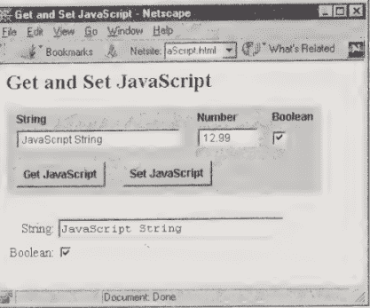

*图 5-11. Java 与 JavaScript 之间变量“Get”和“Set”的示例。*

## 从浏览器将 JavaScript 连接到更广泛的应用程序网络

由于你现在可以从 JavaScript 调用 applet 方法，因此也可以使用可与 applet 一起下载的 JDBC Type 4 驱动程序将 JavaScript 与 Informix 数据库进行对接。实际上，你可以使用 Java Applet 作为门户，让你的 JavaScript 方法、表单对象和浏览器事件与更广泛的应用程序网络进行通信。

例如，如果你正确配置了 applet 安全性，则可以从浏览器客户端管理 RMI（远程方法调用）（有关如何使用 applet 和 RMI 的信息，请参阅第 10 章）。

例如，要将你的 JavaScript 方法从浏览器连接到 Informix 数据库：

- 创建一个包含 applet 的隐藏框架；确保 JDBC Type 4 驱动程序类可供 applet 使用。
- applet 应在 `init()` 方法中或在有需求时通过 JavaScript 可见的 `public` 方法与目标数据库服务器建立 JDBC 连接。
- applet 应在被销毁之前关闭连接。
- 创建能够调用适当的 Java 方法来执行查询和执行存储过程的 JavaScript 代码。

### 从数据库滚动显示图像

我们大多数人都见过当鼠标悬停在图像或相关超链接上时图像会改变的效果。本节将向你展示当图像从 Informix 数据库中提取时如何实现此效果。清单 5-15 展示了 `scroller.html` AppPage 的 AppPage 源代码，该代码演示了此功能。

#### 清单 5-15：`scroller.html` AppPage 源代码

```
<html>
<head>

<?mierror>
Error in SQL: $MI_ERRORCODE, $MI_ERRORMSG
</mierror>

<script language="JavaScript">
<!-- Begin
var computer = new Image();
var bag = new Image();
var diskettes = new Image();
var monitor = new Image();
var laptop = new Image();
var scanner = new Image();
var blankimage = new Image();

<?mivar>
// name the source images

computer.src = "$WEB_HOME?MIvalObj=computer&type=image/gif";
bag.src = "$WEB_HOME?MIvalObj=computerBag&type=image/gif";
diskettes.src = "$WEB_HOME?MIvalObj=diskettes&type=image/gif";
monitor.src = "$WEB_HOME?MIvalObj=monitor&type=image/gif";
blankimage.src = "$WEB_HOME?MIvalObj=blankimage&type=image/gif";
</mivar>
```

```
// select the source images

<?misql sql="select $MInamObj, $MIcolObj
                from $MItabObj
                where $MInamObj in ('laptop','scanner');">

$1.src = "$WEB_HOME?LO=$2&type=image/gif"

<?/misql>
```


```javascript
// swap the images

function doImages(picimage) {
    document['picture'].src = picimage.src;
}

// display the webdriver URL

function showLO() {
    alert(document['picture'].src);
}

// End -->
```

```html
</script>

</head>

<body>

<center>

<h2>JavaScript Image Rotation</h2>

<h3>Pass the Mouse over the Hyperlink to View the Image</h3>

<h4>Click the Hyperlink to View the Webdriver URL</h4>

<table border=5>
    <tr>
        <td>
            <a href="javascript:showLO()"
               onmouseover="doImages(computer)"
               onmouseout="doImages(blankimage)">
                <b>Computer</b>
            </a>
        </td>
        <td rowspan=6>
            
        </td>
    </tr>
    <tr>
        <td>
            <a href="javascript:showLO()"
               onmouseover="doImages(bag)"
               onmouseout="doImages(blankimage)">
                <b>Bag</b>
            </a>
        </td>
    </tr>
    <tr>
        <td>
            <a href="javascript:showLO()"
               onmouseover="doImages(diskettes)"
               onmouseout="doImages(blankimage)">
                <b>Diskettes</b>
            </a>
        </td>
    </tr>
    <tr>
        <td>
            <a href="javascript:showLO()"
               onmouseover="doImages(monitor)"
               onmouseout="doImages(blankimage)">
                <b>Monitor</b>
            </a>
        </td>
    </tr>
    <tr>
        <td>
            <a href="javascript:showLO()"
               onmouseover="doImages(laptop)"
               onmouseout="doImages(blankimage)">
                <b>Laptop</b>
            </a>
        </td>
    </tr>
    <tr>
        <td>
            <a href="javascript:showLO()"
               onmouseover="doImages(scanner)"
               onmouseout="doImages(blankimage)">
                <b>Scanner</b>
            </a>
        </td>
    </tr>
</table>

</center>

</body>

</html>
```

##### 下载图像

提供了两个下载图像的示例。在第一个示例中，通过名称检索图像。在第二个示例中，通过 LO（大对象）句柄检索图像。有关捕获和检索多媒体对象的更多信息，请参阅第 20 章"使用大对象"。

为每幅图像创建一个 `Image` 对象。然后将映射到图像的 URL 分配给 `Image` 对象的 `src` 属性，图像将被下载但此时不显示：BaseException

```javascript
var computer = new Image();

computer.src = "$WEB_HOME?MIvalObj=computer&type=image/gif";
```

在下一个代码片段中，Image 对象已经被创建，但对象名称和 URL 是从 SELECT 语句的结果动态分配的；Image 对象使用结果集中的第一列来指定，而大对象（LO）句柄则从第二列分配。随后图像被下载，但不会显示。

```misql
// select the source images

<?misql sql="select $MInamObj, $MIcolObj
               from $MItabObj
               where $MInamObj in ('laptop','scanner');">

$1.src = "$WEB_HOME?LO=$2&type=image/gif"

<?/misql>
```

出于性能考虑，你应该缓存大对象。具体方法请参阅第 25 章。

##### 图像滚动

图像是通过 `doImages()` 函数来滚动的，该函数接收一个图像对象作为参数，并将其 `src` 属性值赋给另一个 Image 对象。

```javascript
// swap the images

function doImages(picimage) {
    document['picture'].src = picimage.src;
}
```

`picture` Image 对象是由 IMG 标签创建的 Image 对象，其 NAME 属性设置为 `picture`。

当鼠标经过超链接时，`onMouseOver` 事件处理程序设置如下例所示：

```html
onmouseover="doImages(bag)"
```

当鼠标已经经过超链接后，`onMouseOut` 事件处理程序设置为显示 blankimage.gif 图像：

```html
onmouseout="doButtons(blankimage)">
```

图 5-12。当鼠标经过"Computer"时，显示 computer.gif。

当点击超链接时，`webdriver` URL 会在 JavaScript 警告框中显示。文本取自 `Image` 对象的 `src` 属性。

图 5-12 显示了鼠标经过"Computer"超链接时的显示。图 5-13 显示了鼠标经过"Bag"超链接时的显示。图 5-14 显示了点击"Bag"超链接时显示的 JavaScript 警告框。图 5-15 显示了点击"Scanner"超链接时显示的 JavaScript 警告框。

图 5-13。当鼠标经过"Bag"时，显示 bag.gif。

图 5-14。点击"Bag"链接时显示的 URL。

图 5-15。点击"Scanner"链接时显示的 URL。

### 创建动态选择列表

你可以使用 JavaScript 在 HTML 表单中创建动态选择列表（对于较旧的浏览器或不支持 JavaScript 1.1 版本的浏览器，这可能无法实现）。例如，如果这些链接存储在选择列表中，你可能希望动态更改网页上的可用链接。

这种技术的应用仅受你的想象力限制。例如，数据库管理员可能决定使用这样的列表向部分已登录用户发送消息，甚至向 `onstat -u` Informix 命令列出的选定用户数发送消息。关键是你能够使用 JavaScript 动态更新当前查看的选择列表，而无需重新加载页面。

本节中的示例使用两个选择列表来筛选所选客户的订单项目显示。JavaScript 选择列表操作的核心设计取自出色的"The JavaScript Source"，网址为 `http://javascript.internet.com`。此示例所需的功能是系统：

- 从 `customer` 表中将所有客户选入一个选择列表；
- 允许用户从选择列表中选择一个或多个客户到另一个已选客户列表中；以及
- 选择所选客户的所有订单项目。

该示例将详细展示：

- 如何在不使用动态标签的情况下从查询填充选择列表；
- 如何从一个选择列表动态刷新另一个选择列表；
- 如何使用选择列表的内容参数化调用 AppPage；以及
- 如何使用框架（frames）完成所有这些操作。

#### 框架集（Frameset）规范

`frameset` 规范是基本的。名为 `results` 的框架将包含执行名为 `dynamicListOutput.html` 的 AppPage 的结果。对于初始显示，`frameset` 设置为一个空白屏幕，使用空白 HTML 页面。清单 5-16 显示了 `frameset` AppPage。

##### 清单 5-16。控制框架集 `dynamicListExample.html`

```html
<html>

<head>
    <title>Dynamic List Example</title>
</head>

<frameset rows="30%,*">
    <frame name="top" src="$WEB_HOME?MIval=dynamicList">
    <frame name="results" src="$WEB_HOME?MIval=blank">

    <noframes>
        <body>
            <p>This page uses frames, but your browser doesn't support them.</p>
        </body>
    </noframes>
</frameset>

</html>
```

##### 表 5-2。数据移动按钮

| 按钮 | 功能 |
|---|---|
| `>>` | 将客户名称移到右侧列表并将其从左侧列表中删除。 |
| `<<` | 将客户名称移到左侧列表并将其从右侧列表中删除。 |

##### 生成选择列表

该示例使用两个 SELECT 表单字段。你可以通过从左侧列表中选择一个或多个客户并将其移到右侧列表来选择要查看订单项目的客户。表 5-2 列出了执行此操作的按钮。

##### 从查询填充 SELECT 列表

你可以不使用 SELECTLIST 动态标签来填充 SELECT 列表的内容。例如，以下来自 `dynamicList.html` 的代码片段创建了一个客户名称列表；当一个或多个客户被选中时，处理表单结果的 AppPage 将接收一个名为 `fromList` 的变量向量，其中包含所选客户编号的列表：

```html
<select multiple size="5" name="fromList">
    <?misql sql="select trim(fname) || ' ' ||
                        trim(lname), customer_num
                 from customer">
        <option value="$2">$1</option>
    <?/misql>
</select>
```

##### 从另一个选择列表的选定内容创建一个选择列表

清单 5-17 展示了 JavaScript 方法，用于用屏幕左侧选择列表（名为 `fromList`）的选定内容填充右侧的选择列表（`toList`），反之亦然。

##### 清单 5-17。AppPage `dynamicList.html`

```html
<html>

<base target=bottom>

<body bgcolor="#e1e1e1">

<SCRIPT LANGUAGE="JavaScript">

var firstPass = 0;

function copy(from, to) {
    if (firstPass == 0) {
        firstPass = 1;
        rollup(to);
    }

    for (var i = 0; i < from.options.length; i++) {
        if (from.options[i].selected && from.options[i].value != "") {
            var opt = new Option();

            opt.value = from.options[i].value;
            opt.text = from.options[i].text;

            to.options[to.options.length] = opt;

            from.options[i].value = "";
            from.options[i].text = "";
        }
    }

    rollup(from);
}
```

##### 清单 5-17（续）

```javascript
function rollup(box) {
    for (var i = 0; i < box.options.length; i++) {
        if (box.options[i].value == "") {
            for (var j = i; j < box.options.length - 1; j++) {
                box.options[j].value = box.options[j + 1].value;
                box.options[j].text = box.options[j + 1].text;
            }

            var ln = i;
            break;
        }
    }

    if (ln < box.options.length) {
        box.options.length -= 1;
        rollup(box);
    }
}

// The following function is required because we need to
// pass a variable vector to webExplode()

function doSubmit(toList) {
    with (toList) {
        for (var i = 0; i < options.length; i++) {
            options[i].selected = 1;
        }
    }

    return true;
}

</script>

<center>

<h1>Select Customers</h1>

<form ACTION="<?mivar>$WEB_HOME<?/mivar>" METHOD="POST">
    <input type=hidden name=MIval value="dynamicListOutput">
    <input type=hidden name=MI_WEBRAWMODE value="0">

    <table border="0">
        <tr>
            <td>
                <select multiple size="5" name="fromList">
                    <?misql sql="select trim(fname) || ' ' ||
                                        trim(lname), customer_num
                                 from customer">
                        <option value="$2">$1</option>
                    </misql>
                </select>
            </td>

            <td>
                <input type="button" value="  >>  "
                       onclick="copy(this.form.fromList,this.form.toList)"
                       name="copyFrom">
                <br>

                <input type="button" value="  <<  "
                       onclick="copy(this.form.toList,this.form.fromList)"
                       name="copyTo">
                <br>

                <input type="submit" value="Select " name="goButton"
                       onclick="return doSubmit(this.form.toList);">
            </td>

            <td>
                <select multiple size="5" name="toList">
                    <option value="">This is sizing text</option>
                </select>
            </td>
        </tr>
    </table>
</form>

<script>
    // clear out the sizing text
    document.forms[0].toList.options[0].text = "";
</script>

</center>

</body>

</html>
```


JavaScript 方法 `copy()` 滚动 `fromList` 选择列表以查找一个或多个已选中的项目。如果某个选项已被选中，则将该选项的 `option.value` 和 `option.text` 值写入一个新的 `Option` 对象，并将此对象分配给 `toList` 选择列表中的下一个空闲元素。

分配完成后，源 SELECT 列表会向上滚动以覆盖已选中的选项或选项们。

你可以使用 `copy()` 方法将 SELECT 选项从一个列表移动到另一个列表，从左到右或从右到左。

清单 5-17 展示了 `copy()` 和 `rollup()` 方法。列表的其余部分展示了用于渲染 SELECT 列表的 HTML，包括用于创建客户列表的 SQL。

> `dynamicList.html` 使用虚拟文本来填充目标 SELECT 列表的内容，该列表最初不包含任何数据。一旦使用虚拟文本创建了目标 SELECT 列表，显示文本就会被设置为空格。这是必需的，因为我们需要以适当的大小渲染 SELECT 列表。

### 使用 WITH 关键字

你可以使用 `with` 关键字为 JavaScript 变量指定默认作用域。例如，通过使用 `with(document.forms[0].toList)` 来缩短访问路径，可以将以 `document.forms[0].toList` 访问的变量的路径缩短，从而为路径中剩余的对象定义作用域。例如，你可以使用 `options[0]` 代替 `document.forms[0].toList.options[0]`。

在以下截图中，顶部浏览器框架已调整大小以便清晰显示。图 5-16 展示了列表的初始状态；客户名称已列在左侧的选择列表中。

随后选中客户 `Ludwig Pauli`，并点击 `>>` 按钮。该客户被移动到右侧列表框中，如图 5-17 所示。

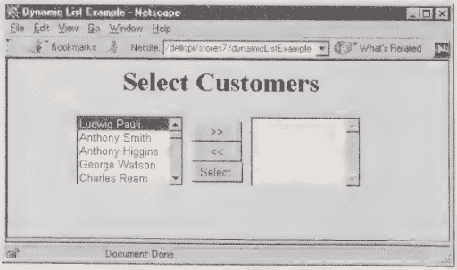

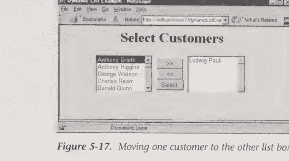

*图 5-17.* 将一位客户移动到另一个列表框。

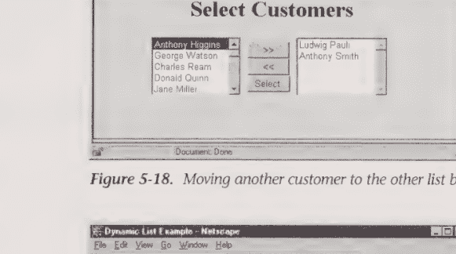

*图 5-18.* 将另一位客户移动到另一个列表框。

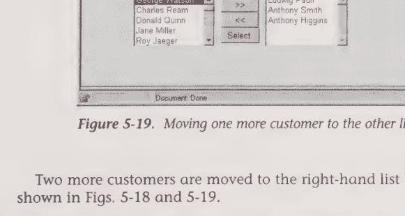

*图 5-19.* 再将一位客户移动到另一个列表框。

如图 5-18 和 5-19 所示，另外两位客户被移动到右侧列表框中。

### 参数化结果展示和查看结果

当用户点击 Select 按钮时，结果框架会显示 `toList` 选择列表中所有已选客户的订单项目列表。

`toList` 是表单中定义的 SELECT 列表，因此是一个表单字段，其值可以由目标 AppPage 访问。用于处理表单字段结果的目标 AppPage 名为 `dynamicListOutput.html`。这通过 `dynamicList.html` 在表单中指定如下：

```html
<input type=hidden name=MIval
        value="dynamicListOutput">
```

`toList` 的内容以变量向量的形式传递给 `dynamicListOutput.html`；对于 `toList` 中的每个选中项目，都会创建一个名称/值对。这些值是 OPTION 标签的 VALUE 子句中指定的选中选项值。清单 5-18 展示了从数据库中选择订单项目并将其显示在 HTML 表格中的 AppPage。

#### 清单 5-18. `dynamicListOutput.html` AppPage

```html
<html>
<body bgcolor="#e1e1e1">

<?mivar name=inClause>$(SEPARATE,$toList,",")<?/mivar>

<?mivar name=MI_NULL>Outstanding<?/mivar>

<center>
<h2>Order Details for Selected Customers</h2>

<table border=1 cellpadding=1 cellspacing=1>
<tr>
<td><b>Customer Number</td>
<td><b>Name</td>
<td><b>Order Number</td>
<td><b>Order Date</td>
<td><b>Shipping Date</td>
<td><b>Description</td>
<td><b>Paid Date</td>
</tr>

<?misql err=sqlError
        sql="select c.customer_num, trim(c.fname) || ' '
             || trim(c.lname),
o.order_num, o.order_date,
s.description, o.ship_date, o.paid_date
from customer c, orders o, items i, stock s
where
c.customer_num = o.customer_num and
o.order_num = i.order_num and
i.stock_num = s.stock_num and
i.manu_code = s.manu_code and
c.customer_num in ($inClause)
  order by c.customer_num, o.order_num">

<tr>
<td bgcolor="#ffffff"><b>$1</td>
<td bgcolor="#ffffff"><b>$2</td>
<td bgcolor="#ffffff"><b>$3</td>
<td bgcolor="#ffffff"><b>$4</td>
<td bgcolor="#ffffff"><b>$5</td>
<td bgcolor="#ffffff"><b>$6</td>
<td bgcolor="#ffffff"><b>$7</td>
</tr>

<?/misql>
</table>
</center>

</body>
</html>
```

传入的变量 `$toList` 包含变量向量中的选中值列表。`$(SEPARATE)` AppPage 函数用于在每个选中值之间放置逗号。生成的字符串被赋给一个名为 `inClause` 的变量，该变量在 `misql` 标签中用作 IN 子句的规范。

```html
<?mivar name=inClause>
   $(SEPARATE,$toList,",")
<?/mivar>
```

图 5-20 展示了选择三位客户后点击 Select 按钮以显示所选客户订单的结果。请注意，在图 5-20 中，客户 "Charles Ream" 没有订单。

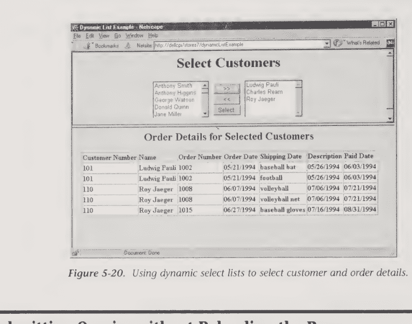

图 5-20. 使用动态选择列表来选择客户和订单详情。

### 在不重新加载页面的情况下提交查询

我们可以从 HTML 页面向数据库发送查询，并将结果显示在请求的 HTML 页面中，*无需重新加载请求页面*。通常，我们必须提交表单或点击超链接才能刷新当前页面（或目标框架）以显示已执行查询的结果。相反，我们可以通过*秘密地*提交查询并使用 JavaScript 来查询查询结果，从而动态更新当前显示的 HTML 页面。

感知就是一切，对用户来说，看起来就像是当前活动的 HTML 页面本身向数据库发送了查询并格式化了该查询的结果。

#### 工作原理？

我们通过在隐藏框架中使用一个页面并从数据库重新加载该页面来实现这一切。框架源是一个 AppPage，其中包含用于查询数据库并将结果分配给一组 JavaScript 对象的 SQL。当生成的页面下载到浏览器中的隐藏框架时，JavaScript 被执行，对象被填充数据。然后主查看页面可以使用这些 JavaScript 对象。

例如，查询结果可用于动态刷新选择列表的内容，类似于上面的示例。右侧列表不是从左侧列表填充的，而是从刚刚从数据库服务器到达的数据库结果集的内容中填充的。选择列表的 JavaScript 操作来自 http://javascript.internet.com 的 "The JavaScript Source"。

#### 示例功能

本节中的示例允许用户从 `stores7` 数据库的表列表中选择一个数据库表，然后在同一页面的另一个列表中查看所选表的列。

当用户选择一个表时，所选表名作为参数传递给从 `syscolumns` 表中选择列详细信息的 AppPage。生成的页面下载到隐藏框架，列详细信息从隐藏页面中提取并发布到"选择表列"列表。图 5-21 和 5-22 展示了一个示例。

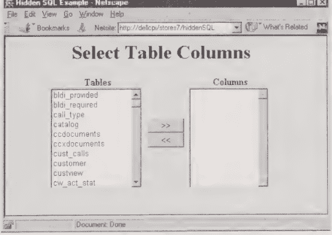

> *图 5-21. 选择列表屏幕的初始状态。*

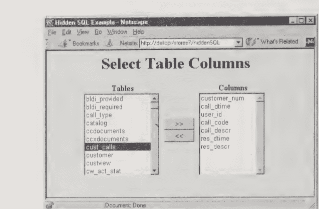

图 5-22。`cust_calls` 表已被选中，列列表已从数据库中检索。

### 指定框架集和隐藏框架

清单 5-19 展示了框架集 `hiddenSQL.html`。它包含两个框架：第一个名为 `selection`，占据整个浏览器窗口；第二个名为 `columnData`，是隐藏框架，将包含以 JavaScript 表达的查询结果。

清单 5-19。框架集 `hiddenSQL.html` 的 AppPage 源代码。

```html
<html>

<head>
<title>Hidden SQL Example</title>
</head>

<?mivar>

<frameset rows="100%,*">
    <frame name="selection" src="$WEB_HOME?MIval=selectionLists">
    <frame name="columnData" src="$WEB_HOME?MIval=listRefresh">

    <noframes>
    <body>
    <p>This page uses frames, but your browser doesn't support them.</p>
    </body>
    </noframes>
</frameset>

<?/mivar>

</html>
```

#### 主框架 `selectionLists.html`

显示 SELECT 列表并控制隐藏 AppPage 调用的 AppPage 是 `selectionLists.html`，如清单 5-20 所示。此 AppPage 中有两个基本的 JavaScript 函数：`populateList()` 和 `writeList()`。`populateList()` 函数调用隐藏 AppPage 以从所选表中选择列。`writeList()` 函数接收在隐藏 AppPage 中创建的 JavaScript OPTION 对象数组，并将其内容写入屏幕上的列列表。

清单 5-20。AppPage `selectionLists.html`。

```html
<html>

<head>
</head>

<body bgcolor="#e1e1e1">

<SCRIPT LANGUAGE="JavaScript">

var columns=null;

function writeList() {
  with (document.forms[0].toList) {
    if (top.columnData.pageLoaded) {
      columns = top.columnData.getOptionCollection();

      for (var i=0; i < columns.length; i++) {
        // Note: The following assignment is valid in
        // Navigator
        // but not Explorer: options[i] = columns[i]

        options[i] = new Option();
        options[i].text = columns[i].text;
        options[i].value = columns[i].value;
      }

      length=columns.length
    }
    else {
      setTimeout("writeList()",1000);
    }
  }
}

function populateList( fromList, toList ) {
<?mivar>
  with (toList) {
    top.columnData.document.location=
      "$WEB_HOME?MIval=listRefresh&TABID=" +
      fromList.options.value;
  }

  top.columnData.pageLoaded=null;
  setTimeout("writeList()",1000);
<?/mivar>
}

function clearList( toList ) {
  with (toList) {
    for(var i=0; i < options.length; i++) {
      if(options[i].selected) options[i].value = "";

      if(options[i].value == "") {
        for(var j=i; j < options.length-1; j++) {
          options[j].value = options[j+1].value;
          options[j].text = options[j+1].text;
        }

        var ln = i;
        break;
      }
    }

    if(ln < options.length) {
      options.length -= 1;
      clear(toList);
    }
  }
}

</script>
```

```html
<center>

<h1>Select Table Columns</h1>

<form ACTION="<?mivar>$WEB_HOME<?/mivar>"
      METHOD="POST" NAME="listForm">

<input type=hidden name=MIval value="dynamicListOutput">

<table border="0">
<tr>
<td align=center><b>Tables</b><br>

<select multiple size="10" name="fromList">
<?misql sql="select tabname, tabid
             from systables order by 1">
  <option value="$2">$1</option>
<?/misql>
</select>

</td>

<td>
  <input type="button" value=" >> "
         onclick="PopulateList(this.form.fromList,
         this.form.toList)"
         name="populate"><br>

  <input type="button" value=" << "
         onclick="clearList(this.form.toList)"
         name="clear">
</td>

<td align=center><b>Columns</b><br>

<select size="10" name="toList">
  <option value="">This is sizing text</option>
</select>

</td>
</tr>
</table>
</form>

<script>
  // clear out the sizing text
  document.forms[0].toList.options[0].text="";
</script>

</center>
</body>
</html>
```

#### 填充表的选择列表

以下代码片段展示了表的选择列表是如何创建的：

```html
<select multiple size="10" name="fromList">
    <?misql sql="select tabname, tabid
                 from systables order by 1">
        <option value="$2">$1</option>
    <?/misql>
</select>
```


```html
</select>
```

列表中显示的是表名；表 ID 用于传递给选择列数据的隐藏 AppPage，如下一节所述。

#### 在 JavaScript 中直接调用隐藏 AppPage

以下代码片段展示了如何使用 JavaScript 直接调用 AppPage：

```javascript
top.columnData.document.location =
    "$WEB_HOME?MIval=listRefresh&TABID=" +
    fromList.options[fromList.options.selectedIndex].value;
```

`TAB_ID` 参数取自表的选项列表中所选的选项。

#### 使用隐藏框架 `listRefresh.html` 执行秘密 SQL

当选择一个表时，会在 JavaScript 中调用 `listRefresh.html` AppPage 以选择所选表的所有列名。清单 5-21 展示了 `listRefresh.html` AppPage。

当此 AppPage 在数据库服务器上处理时，会输出多条 JavaScript 语句来创建 JavaScript 对象并为其赋值。此 JavaScript 在客户端浏览器中执行。

创建一个名为 `optionCollection` 的数组。当 `MISQL` 标签处理从 `syscolumns` 表中选择列名的查询结果集时，会创建一个新的 `Option` 对象并赋值给数组的下一个元素。`Option` 的 `text` 和 `value` 属性分别设置为列名和列号。

清单 5-21。`listRefresh.html` AppPage。

```html
<html>

</head>

<script language="JavaScript">

// optionCollection is refreshed once per page load

var optionCollection = new Array();

var pageLoaded = null;

var i = 0;

<?miblock cond=$(XST,$TABID)>

    <?misql sql="select colname, colno from syscolumns

where tabid = $TABID;">

        optionCollection[i] = new Option();

        optionCollection[i].text = "$1";

        optionCollection[i].value = "$2";

        i++;

    <?/misql>

<?/miblock>

// getOptionCollection() returns the optionCollection

// array. You could reference the optionCollection array

// by name, but we want a first class hiding of the

// variable implementation

function getOptionCollection() {

    return optionCollection;

}

</script>

</head>

<body onLoad="pageLoaded=true;"></body>

</html>
```

### 什么是 `Option` 对象？

`Option` 对象是一种内置的 JavaScript 对象类型，代表 SELECT 列表中的单个 OPTION。例如，浏览器会创建一个 `Option` 对象来表示以下 Option 子句的值和标签文本：`<OPTION VALUE=10>Ten`。在本例中，`Option.text` 设置为 `"Ten"`，`Option.value` 设置为 `"10"`。

### 使用 `pageLoaded` 变量

注意 `pageLoaded` 变量的使用。当页面完成加载时，会触发 `onLoad` 事件，并将该变量设置为 `"true"`，如以下代码片段所示：

```html
<body onLoad="pageLoaded=true;"></body>
```

`selectionLists.html` 页面使用此变量来检查隐藏页面是否已从数据库服务器完成加载；如果是，则 `selectionLists.html` 中的 `writeList()` 函数可以查询 `optionCollection` 数组。

### 使用 JavaScript 等待 AppPage 加载

当 `selectionLists.html` 页面调用 `listRefresh.html` AppPage 时，该 AppPage 包含的 SQL 可能需要时间执行。由于 `selectionLists.html` 中的 `writeList()` 函数需要使用 `listRefresh` 页面加载时创建的 JavaScript 数据，因此设置了一个超时（timeout），每秒轮询隐藏框架中的一个变量，以检查隐藏页面是否已加载。

### 使用 `setTimeout()` 函数

`selectionLists.html` 中的 `populateList()` 函数调用隐藏 AppPage，然后执行以下代码：

```javascript
top.columnData.pageLoaded = null;

setTimeout("writeList()", 1000);
```

表达式 `top.columnData.pageLoaded` 指的是隐藏框架（`columnData`）以及上次文档呈现创建的 `pageLoaded` 变量。当隐藏 AppPage `listRefresh.html` 加载完成后，使用 `onLoad` 事件处理程序将 `pageLoaded` 变量设置为 `"true"`。

此处展示的 `setTimeout()` 函数接受两个参数：要执行的一些 JavaScript，以及执行 JavaScript 前的间隔秒数。该线程不会每秒循环。一旦时间到了，就会执行 JavaScript，仅此而已。如果你希望持续每秒执行某些 JavaScript，你需要持续执行 `setTimeout()` 函数，如以下代码片段所示：

```javascript
if (top.columnData.pageLoaded) {

    // code snipped out

} else {

    setTimeout("writeList()", 1000);

}
```

### 在 HTML 页面中执行 JavaScript 文本搜索

有时能够在浏览器窗口内对 HTML 页面的内容进行搜索是非常有用的。例如，假设你在一个 AppPage 中对目录表执行了 SQL 查询，并从数据库中检索了大量记录。这时如果能够输入另一个搜索字符串，但这次是在浏览器客户端渲染的 HTML 页面内进行搜索，那将会非常方便。本节将向你展示如何实现这一功能。执行搜索的 JavaScript 代码取自 "The JavaScript Source"，网址为 <http://javascript.internet.com>。

> 请记住，JavaScript 和 `webexplode()` 是完全独立的。JavaScript 在浏览器客户端执行，如果 JavaScript 使用了任何 AppPage 变量值，那是在它们被 exploded 之后。

下面的示例展示了如何在渲染后的 HTML 页面中搜索文本。搜索表单包含在一个框架中，而要搜索的 HTML 页面则在另一个框架中渲染。将搜索框架与结果框架分离，使我们能够重复搜索并滚动结果窗口。

#### 创建搜索框架集

代码清单 5-22 展示了名为 `find.html` 的 AppPage 框架集，它包含一个搜索框架和一个用于显示数据库查询结果的框架。搜索框架名为 `select`，而包含数据库查询结果的结果框架名为 `sql`。虽然所有 HTML 页面都存储在数据库中，但只有 `findInPageSQL.html` AppPage 需要存储在数据库中，因为这个 AppPage 包含用于选择 `catalog` 详情的 SQL，而且最终的搜索是在客户端执行的。

```html
<frameset rows="20%,*">

    <?mivar>

        <frame name="select" src="$WEB_HOME?MIval=findInPage">

        <frame name="sql" src="$WEB_HOME?MIval=findInPageSQL">

    </mivar>

</frameset>
```

#### 搜索框架

代码清单 5-23 展示了 `findInPage.html` AppPage 源框架，它包含搜索表单和执行 `sql` 结果框架文本搜索的 JavaScript 代码。

```html
Listing 5-23. The AppPage source frame (findInPage.html).

<html>

<HEAD>

<SCRIPT LANGUAGE="JavaScript">

var NS4 = (top.sql.document.layers);

var IE4 = (top.sql.document.all);

var win = this;

var n = 0;

function findInPage(str) {

  var txt, i, found;

  if (str == "")

    return false;

if (Rh4) {

  if (!top.sql.find(str))

      while (top.sql.find(str, false, true))

        n++;

  else

      n++;

if (n == 0) alert(str + " was not found on this page.");

}

if (IE4) {

  txt = top.sql.document.body.createTextRange();

  for (i = 0; i <= n && (found = txt.findText(str)) != false; i++) {

      txt.moveStart("character", 1);

      txt.moveEnd("textedit");

  }

}
```

##### 代码清单 5-23。（续）

```html
if (found) {

    txt.moveStart("character", -1);

    txt.findText(str);

    txt.select();

    txt.scrollIntoView();

    n++;

}

else {

    if (n > 0) {

        n = 0;

        findInPage(str);

    }

    else

        alert(str + " was not found on this page.");

}

}

return false;

}

</script>

<title>Find in Page</title>

</HEAD>

<body>

<h2>Find Text in Page</h2>

<form name="search" onSubmit="return findInPage(this.string.value);">

<b>Find in Page:</b>

<input name="string" type="text" size="15" onChange="n = 0;">

<input type="submit" value="Go">

</form>

</body>

</html>
```

#### 可搜索框架

`sql` 框架包含 `findInPageSQL.html` AppPage 的 exploded 结果，该 AppPage 从目录表中选择 `catalog_num` 和 `cat_advert` 列。代码清单 5-24 展示了此 AppPage。

```html
Listing 5-24. The AppPage findInPageSQL.html

<html>

<body>

<table border="1">

<?misql sql="select catalog_num, cat_advert from catalog

        order by 1">

<tr><td>$1</td><td>$2</td></tr>

<?/misql>

</table>

</body>

</html>
```


### 执行搜索

使用 `find.html`、`findInPage.html` 和 `findInPageSQL.html`，我们可以对包含 SQL 查询结果的 HTML 页面进行搜索，而无需返回服务器执行另一个 SQL 查询。

图 5-23 展示了 `find.html` 框架集浏览器显示的初始状态。


图 5-23. 浏览器初始显示。

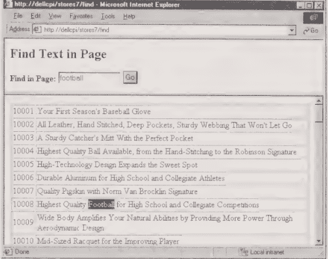

图 5-24. 搜索字符串 `"football"`。

图 5-24 展示了输入搜索字符串 `"football"` 并单击 Go 按钮或按回车键后的结果。该字符串的第一个不区分大小写的匹配项在 `sql` 框架中高亮显示。如果再次单击 Go 按钮，将找到下一个匹配项。

### 小结

本章重点介绍了在各种情境中利用 JavaScript 的强大功能。你现在应该能够创建使用 JavaScript 与用户、数据库（通过 AppPage 间接使用）以及 Java Applet 进行交互的网页。

具体而言，我们看到了如何滚动从 Informix 数据库检索到的图像，以及如何向数据库服务器提交查询而无需在浏览器中重新加载请求页面。此外，还展示了一些有用的 JavaScript 工具，例如如何创建动态选择列表以及如何在浏览器中对 HTML 页面执行文本搜索。总之，通过一些与数据库和用户交互的新颖且不同寻常的方式，我们涵盖了 JavaScript 编程的基础知识。

## JavaScript SQL 资源管理器

### 在本章中

- JavaScript SQL 资源管理器是什么？
- JavaScript SQL 资源管理器的工作原理
- 管理 Web 内容及相关信息
- 使用 JavaScript SQL 资源管理器
- 构建树形结构——基础知识
- 绘制树形结构
- 实现和定制 JavaScript SQL 资源管理器

本章介绍了一个简单的分层菜单，它使用 JavaScript 在浏览器中工作，数据来源为 Informix 数据库。该分层菜单称为 JavaScript SQL 资源管理器。

JavaScript SQL 资源管理器基于 Colin Tucker 在 OmenSoft 开发的分层树 OmenTree，这是 JavaScript 中分层树的最佳实现之一。OmenTree 软件的源代码包含在随附的 CD 中。本章展示了如何使用动态标签和 SQL 在 AppPage 中实现 OmenTree 软件；还展示了如何实现你自己的数据库驱动树。

### JavaScript SQL 资源管理器是什么？

JavaScript SQL 资源管理器是使用客户端 JavaScript 实现的分层菜单树结构。它是一个逻辑清晰展示的菜单，运行在你网站的一个框架中。

该树的设计借鉴了优秀的 OmenTree 软件。与 OmenTree 软件相比，JavaScript SQL 资源管理器的实现：

- 使用 Informix 数据库的数据填充树；
- 使用动态标签来封装和重用 JavaScript 代码。

除了这两个特性之外，树在浏览器中的工作方式均复制自 OmenTree 设计。

分层菜单树已经出现了一段时间。如果你使用过 Windows 资源管理器，那么你就已经使用过分层菜单树。JavaScript SQL 资源管理器基于 Windows 资源管理器界面，因此经常使用资源管理器的用户会立即认出并能够使用它。

名称中的三个部分描述了各组件：

- `JavaScript` 用于在客户端管理分层树。
- `SQL` 通过 AppPage 在数据库服务器上处理，用于从 Informix 数据库检索数据以填充树并创建树结构。
- `Explorer`（资源管理器）——树结构类似于 Windows 资源管理器树。但不同的是，JavaScript SQL 资源管理器运行在浏览器中，并且可以语义地以及物理地映射信息，无论信息存储在数据库中还是数据库外。

> **注意**
>
> 尽管本章示例从 Informix 数据库检索所有树图标和文档，但你可以根据需要使用数据库内容和非数据库内容的组合。

有关动态标签的更多信息，请参阅第 19 章“创建和使用动态标签”。如果你不想学习第 19 章，只需将动态标签看作是可参数化的宏，其中包含 JavaScript 代码。动态标签引用会被其中包含的 JavaScript 代码所替代。

### 为何使用层级树？

通过使用树结构，你可以为网站用户提供便利，尤其是当网站规模较大、难以通过传统的内联超文本链接进行导航时。

层级结构对我们所有人来说都很熟悉，因为我们天生就会将事物分门别类，以帮助理解它们之间的关系。层级是一种合乎逻辑的信息呈现方式；它非常容易理解和领会。

JavaScript SQL 浏览器类似于 Web 上的文件结构，只不过文件本身被替换为指向基于 Web 的内容的超链接，例如：

- 存储在 Informix 数据库中的逻辑相关信息；
- Informix 数据库（或文件系统）中的文档；
- Web DataBlade 及其他 Web 应用程序；
- 本地文件；
- 远程服务器、新闻组和电子邮件地址。

任何可以通过 URL 指向的内容都可以在树结构中表示为一个节点，而这些节点又可以被分类并按逻辑组织。

层级树与文件系统中文件布局的类比并不是树结构最重要的方面。我们正在实现的是一种关系视图，这种关系不必存在于任何计算机文件存储中。我们可以用任何方便的方式组织和重新组织“信息空间”；树结构使我们能够理解数据，无论数据是在数据库中，还是构成远程 Web 服务器上的一组网页。

### JavaScript SQL 浏览器展示什么

JavaScript SQL 浏览器展示了以各种方式组织信息的绝佳方法，还展示了如何将 JavaScript 与 AppPage 集成。简而言之，JavaScript SQL 浏览器展示了如何：

- 使用 AppPage 脚本在数据库服务器上参数化 JavaScript 方法和函数；
- 使用在数据库服务器上生成的 JavaScript，在客户端动态创建网页；
- 使用动态标签配合 JavaScript 来管理部分编码复杂性并实现代码复用；
- 将大型对象（如 GIF 图像）与 JavaScript 一起使用；以及
- 将 SQL 与 JavaScript 一起使用。

### JavaScript SQL 浏览器如何工作

AppPage 脚本用于管理在数据库服务器上生成 JavaScript 代码。它用于从 Informix 数据库中提取数据，并用这些数据参数化 JavaScript 语句。生成的 JavaScript 用于在浏览器客户端上加载树结构，并管理文件夹的打开和关闭，以及文件夹内容的呈现。

当用户点击文件夹时，文件夹会展开或收起。顶层框架集将在浏览器中绘制和重绘树到一个名为 `treeframe` 的框架中，以显示展开或收起的文件夹。当树中的链接被点击时，结果将显示在一个名为 `pageframe` 的框架中。`treeframe` 和 `pageframe` 的定义都包含在一个框架集页面中，称为 `jsqlExplore.html`。该框架集页面是包含所有 JavaScript SQL 浏览器代码的页面。

#### 架构概要

图 6-1 展示了使用 Informix 数据库中的数据生成层级树所涉及的步骤。

步骤可以描述如下：

1. 用户请求包含 JavaScript SQL 浏览器顶层框架集的 URL，称为 `jsqlExplore`。

   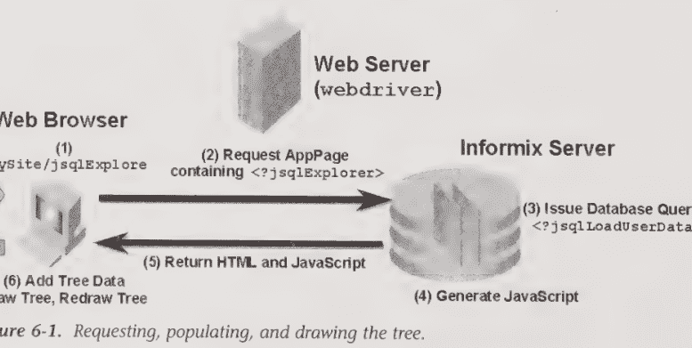

2. Web 服务器调用 `webdriver`，它请求 `jsqlExplore` AppPage；该 AppPage 包含 `jsqlExplorer` 动态标签，即层级树的 JavaScript 库。
3. `webexplode()` 函数展开 `jsqlExplorer` 标签，插入所有 JavaScript 方法和数据，然后处理 `jsqlLoadUserData` 动态标签，该标签包含用于从数据库提取数据的 SQL。
4. 当处理 `jsqlLoadUserData` 标签时，会生成包含已执行 SQL 语句结果的列值的 JavaScript；这些值将用于在客户端填充树。
5. 一个完整的 HTML 页面，包含 JavaScript SQL 浏览器代码和用于填充树的数据，被返回给浏览器客户端。
6. 浏览器加载树数据，绘制树，并在用户导航时重绘树。

请注意，树数据只收集一次，即在请求完整框架集（`jsqlExplore.html`）时。

#### 动态标签的代码复用

在整个树源代码中，多个动态标签被调用来在 `webexplode()` 函数处理时创建 JavaScript 字符串表达式。这些字符串表达式在浏览器中被求值以产生 `IMG` 标签和超链接。例如：

```javascript
newStructure = newStructure +
    <?jsqlImage image=img-vert-line-
    width=19 height=16 align=TEXTTOP method=no> ;
```


表面上看起来，动态标签似乎是直接在 JavaScript 中作为同一表达式的一部分来使用。这是错误的。JavaScript 表达式在客户端求值。动态标签在数据库服务器上求值；标签结果（JavaScript 代码）被替换标签引用，然后这个结果会被下载到客户端。

在编写代码以在客户端上使用 JavaScript 创建 HTML 页面时，你可能会陷入大量字符串表达式的困境。因此，动态标签对于将代码分解为功能单元非常有用。你还可以更进一步，对标签进行参数化以使其更通用。

#### 树设计的封装

JavaScript SQL 浏览器代码包含在一组动态标签中。这些动态标签包含树使用的 JavaScript 对象，以及操作这些对象的 JavaScript 方法。

你可以在不同的应用程序之间复用 JavaScript SQL 浏览器。你可以通过参数化来扩展动态标签，以完全从动态标签自定义树，或者按原样使用并对树使用的 JavaScript 变量进行参数化。


> 你可以使用 Web 数据主管或 AppPage Builder 架构来维护 JavaScript SQL 浏览器。

### 管理 Web 内容及相关信息

你可以使用 JavaScript SQL 浏览器来组织你可以访问的信息空间。本章描述的示例假设我们正在使用 JavaScript SQL 浏览器来组织企业内网中不同层次的信息。在顶层，这些信息被分为以下区域：

- 客户及相关客户信息，如客户订单和客户来电；
- Web 应用程序，如客户搜索、文档管理和数据库浏览；
- 文档，列出存储在 Informix 数据库仓库中的文档内容；
- 搜索引擎；
- 新闻组；
- 电子邮件。

前三项与可以存储在 Informix 数据库中的信息和内容相关。后三项具有通用功能。我们将查看前三项。

### 管理客户相关信息

JavaScript SQL 浏览器用于可视化客户、客户订单以及客户向虚构呼叫中心来电之间的关系。用于支持此信息的三个表（`customer`、`orders` 和 `cust_calls`）用于填充树。其摘要功能如下：

- 当点击客户文件夹时，客户详情会显示在 `pageframe` 中，并且文件夹会展开或收起。
- 当客户文件夹展开时，会显示订单文件夹。
- 如果客户有任何来电，会显示“来电记录”文件夹。
- 当订单文件夹展开时，客户的所有订单都会显示为链接。
- 当点击“订单”链接时，订单详情会显示在 `pageframe` 中。
- 当点击“来电记录”链接时，该客户的来电列表会显示在 `pageframe` 中。
- 如果客户有未收到付款的订单，会显示一个特殊图标（中间有 Carmel 的文件夹）以提醒用户。

当显示客户详情时，我们复用了另一个应用程序的部分功能，该应用程序选择并深入查看客户详情。此应用程序列在应用程序文件夹下，称为“客户列表”。

### 管理 Web 应用程序

与管理信息的关系视图相比，树结构用于将 Web 应用程序分组，以便你可以在单独的框架中调用和运行它们。

Web 应用程序与 JavaScript SQL 浏览器是分开的。JavaScript SQL 浏览器用于管理指向这些应用程序入口点的链接。

例如，在大型内网环境中，可能有许多 Web 应用程序正在开发中。当它们完成时，你希望发布该应用程序的 URL，这时你可以在数据库中创建一个条目来存储 URL，不久之后该 URL 就会作为链接出现在名为“应用程序”的树文件夹中。当点击该链接时，应用程序将显示在单独的框架中。

所有分组在应用程序文件夹下的应用程序都包含在本书的以下章节中：

- 维护客户——见第 21 章，“客户维护应用程序”。
- 维护文档——见第 18 章，“在信息库中管理文档”。
- 客户列表——见第 16 章，“使用 AppPages 进行 Web 数据库编程”。
- 数据库浏览器——见第 17 章，“动态 Web 表单编程”。

#### 列出文档

文档文件夹包含一些存储在 Informix 数据库中的文档内容的链接。这包括文字处理文档、PDF 文档、电子表格、HTML、纯文本文档和图像。

管理文档内容的应用程序位于应用程序文件夹下，名为“维护文档”。当你使用此应用程序将文档存储在 Informix 数据库中时，刷新包含树的框架集后，该文档将显示在文档文件夹下。

每个列出的文档都会显示一个适合该文档内容类型的图标。

### 使用 JavaScript SQL 资源管理器

本节将引导你使用本章示例数据中的 JavaScript SQL 资源管理器。

#### 调用 JavaScript SQL 资源管理器

你要调用该应用程序的顶级框架集，在本例中名为 `jsqlExplore`。一旦在数据库服务器上处理完 AppPage 并在客户端加载树数据后，树就会被绘制出来，从而产生如图 6-2 所示的界面。

#### 查看客户、订单和客户电话

当你点击“客户”文件夹时，该文件夹会展开，显示出一列单独的客户文件夹。点击某个客户文件夹，会显示该客户的“订单”文件夹，以及一个可选的链接，用于查看该客户拨打的客户电话。

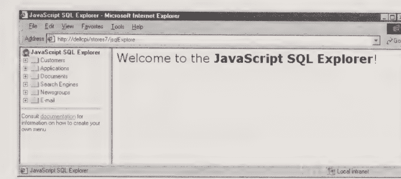

图 6-2。调用 JavaScript SQL 资源管理器。

### 查看客户详情

当点击客户文件夹时，客户详情会显示在相邻的框架中。图 6-3 显示了一个示例。注意，显示的部分客户名称前有一个“*”字符。这意味着他们有一个或多个未付款订单。

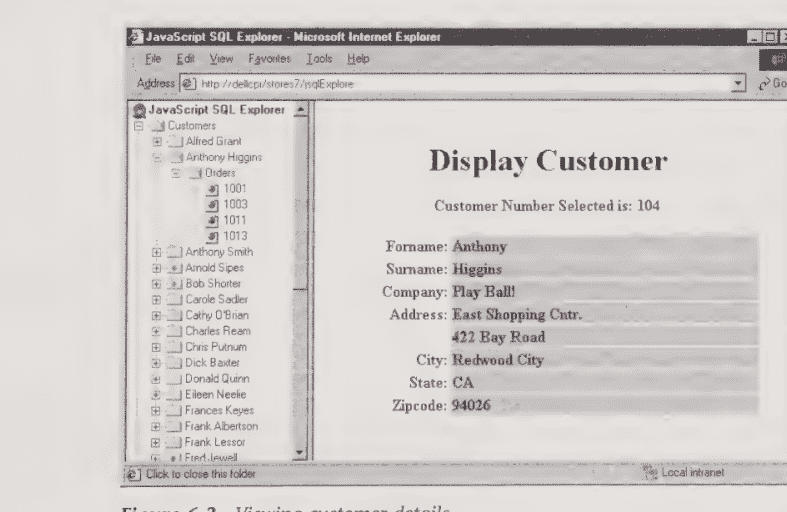

图 6-3。查看客户详情。

### 查看订单详情

当“订单”文件夹列出后，点击其中某个订单，订单详情将显示在相邻的框架中，如图 6-4 所示。

### 查看客户电话详情

当客户包含“客户电话”链接时，你可以点击它以在相邻框架中列出电话详情，如图 6-5 所示。

### 浏览应用程序

如果你点击“应用程序”文件夹，将显示一个应用程序链接列表。点击其中一个链接会将相邻的框架填充为应用程序页面。图 6-6 显示了点击“维护客户”应用程序后的其中一个“维护客户”应用程序页面。


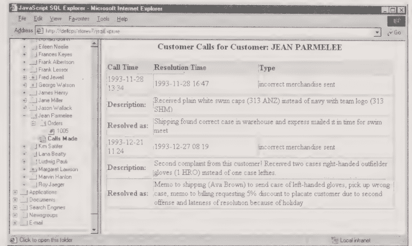

图 6-5。查看客户电话详情。

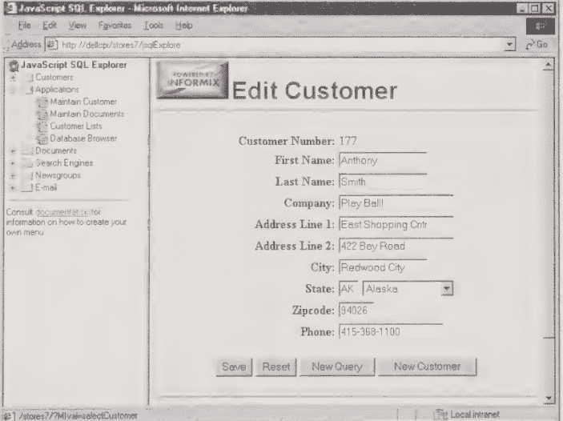

图 6-6。从树中操作“维护客户”应用程序。

JavaScript SQL 资源管理器

127

##### 查看文档

当你点击“文档”文件夹时，会显示一个文档链接列表。每个文档都会显示一个描述该文档的图标。文档和图标都存储在 Informix 数据库中。

当点击某个文档时，该文档会从数据库中检索出来。根据浏览器中配置的 MIME 类型，该文档将由浏览器、浏览器插件或辅助应用程序处理（有关此主题的更多详细信息，请参见第 18 章）。

图 6-7 显示了“文档”文件夹的内容，页面框架显示了点击“DDW 用户指南”PDF 链接后 PDF 文档的内容；在此示例中，MS Internet Explorer 在页面框架中处理该 PDF 文档。

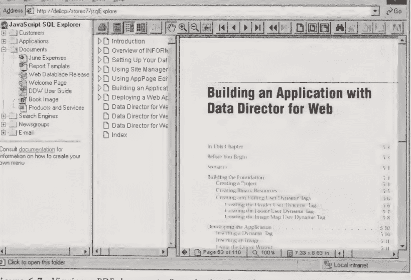

图 6-7。从树中选择后查看 PDF 文档。

> 有关缓存大对象（如 MS Office 文档）以提高性能的信息，请参见第 25 章。

### 浏览多个文件夹

你可以同时查看多个打开的文件夹。当你打开一个文件夹时，任何子文件夹都会显示为打开或关闭状态，具体取决于你关闭父文件夹时的状态。

图 6-8 显示了所有可见文件夹打开的情况（以及屏幕顶部“订单”中建：1008）。图 6-9 显示了多个打开的客户文件夹，其中“已拨电话”链接显示在树的中间，在页面框架中显示。

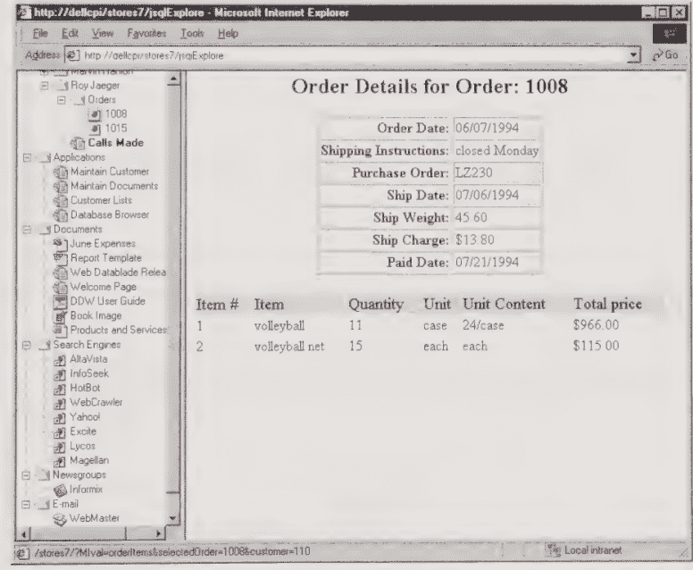

> 图 6-8。多个打开的文件夹。

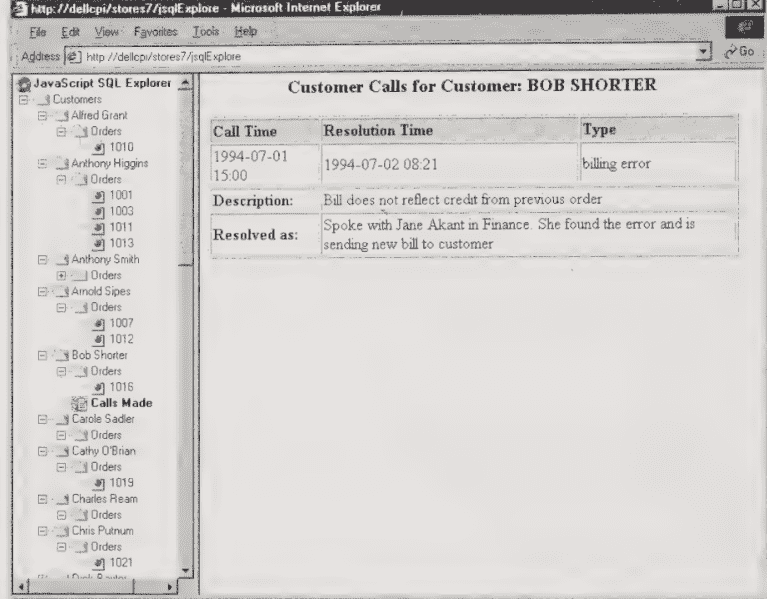

### 构建树——基础

本节介绍如何使用 JavaScript、动态标签和 SQL 构建树，从主页面 `jsqlExplore.html` 开始，然后依次介绍最重要的标签。

#### 节点和集合

JavaScript SQL 资源管理器树是特定类型对象的*集合*，称为**节点**。节点是一个包含数据和指向一个或多个其他对象的引用的对象。集合对象类似于数组；你可以动态地向集合中添加对象。分层树就是一个节点的集合。

节点有三种基本类型——根节点、文件夹节点和链接节点，以及一种集合类型。这些对象都不是内置的 JavaScript 类型，例如 `Array()`；它们完全是为这个应用程序创建的。

#### 根节点

树有一个根节点，其中包含描述根节点图标的属性，以及点击根节点时将填充目标框架的 URL。根节点定义在动态标签 `jsqlRootNode` 中，如清单 6-1 所示。

##### 清单 6-1。使用 `jsqlRootNode` 动态标签的根节点

```javascript
// RootNode() - OBJECT - 表示分层树的最顶层节点。

function RootNode(id,name,url,target,icon) {
	this.id = id;
	this.name = name;
	this.url = url;
	this.target = target;
	this.icon = icon;
	this.type = 'root';
	return this;
}
```

根节点的参数如表 6-1 所述。

##### 表 6-1。根节点参数

| 名称 | 描述 |
|------|-------------|
| ID | 根文件夹的内部名称 |
| Name | 文件夹的显示名称 |
| URL | 可选；点击根文件夹时在 `pageFrame` 中显示的 URL |
| target | URL 的目标框架 |
| Icon | 可选；根文件夹的非默认图像 |

#### 文件夹节点

树可以包含称为*文件夹节点*的对象。文件夹节点是一个具有预定义数量属性的 JavaScript 对象，用于描述该文件夹。动态标签用于封装文件夹的 JavaScript 定义，如清单 6-2 所述。当点击文件夹时，`link` 属性用于将 `pageframe` 填充为 `folderURL` 参数的内容。在此示例中，这被设置为客户详情的显示。


```javascript
// FolderNode() - OBJECT - 表示一个分支节点，
// 用于包含其他节点。

function FolderNode(id, parent, name, iconClosed, iconOpen,
                   folderURL) {
    this.id = id;
    this.parent = parent;
    this.name = name;
    this.iconClosed = iconClosed;
    this.iconOpen = iconOpen;
    this.type = 'folder';
    this.open = 0;
    this.link = folderURL;
    return this;
}
```

文件夹节点的参数如表 6-2 所述。


| 名称 | 描述 |
| :--- | :--- |
| ID | 文件夹的内部名称 |
| Parent ID | 作为此文件夹父级的文件夹名称 |
| Name | 文件夹的显示名称 |
| Icon Closed | 可选；关闭文件夹的非默认图像 |
| Icon Open | 可选；打开文件夹的非默认图像 |
| folder URL | 可选；点击文件夹时在 `pageframe` 中显示的 URL |

#### 链接节点（Link Node）

链接节点描述了用于构成树叶的属性。链接节点是层次结构中的最后一项，代表一个 URL，可以映射到 Web 内容的交付，无论是 HTML 页面、应用程序还是文档。

> 清单 6-3。使用 `jsqlLinkNode` 动态标签的链接节点。

```javascript
// LinkNode() - OBJECT - a node that represents a link
// using a URL.

function LinkNode(parent,name,url,target,icon) {
    this.parent = parent;
    this.name = name;
    this.url = url;
    this.target = target;
    this.icon = icon;
    this.type = 'link';
    return this;
}
```

链接节点接受的参数如表 6-3 所述。

> 表 6-3。链接节点参数。

| 名称 | 描述 |
|------|-------------|
| Parent ID | 作为此链接父级的文件夹名称 |
| Name | 链接的显示名称 |
| URL | 点击链接节点时在页面框架中显示的 URL |
| target | 点击时 URL 的目标框架 |
| Icon | 可选；链接的非默认图像 |

#### 集合对象（Collection Object）

集合对象通过 `jsqlCollection` 动态标签实现，如清单 6-4 所示。树由名为 `treeData` 的集合对象中的条目构成。

`Collection` 对象使用 `Collection()` 函数定义。`add()` 方法也在 `jsqlCollection` 标签中定义。`add()` 函数的引用存储在 `Collection` 对象的 `add` 属性中，因此可以使用 `Collection.add()` 方法调用来向集合中添加节点。

```javascript
Listing 6-4. JavaScript collection object in the
jsqlCollection dynamic tag.

// Collection() - OBJECT - a dynamic storage structure
// similar to an Array.

function Collection() {
    this.length = 0;
    this.add = add;
    return this;
}

// add() - METHOD of Collection - adds an object to a
// Collection.

function add(object) {
    this.length++;
    this = object;
}
```

### 主页面：`jsqlExplore.html`

在前面部分使用树时，我们在 URL 中调用了 `jsqlExplore` AppPage。当此页面在数据库中仍为未展开的 AppPage 时，它包含对 `jsqlExplorer` 应用程序代码的引用，形式为动态标签引用。当页面到达浏览器时，它包含完整的 JavaScript SQL Explorer 应用程序以及用于显示它的框架集。

清单 6-5 显示了 `jsqlExplore` AppPage。

#### 清单 6-5。`jsqlExplorer.html` AppPage 源代码

```html
<HTML>

<HEAD>

<TITLE>JavaScript SQL Explorer</TITLE>

<!-- include the JSQL Explorer JavaScript Library -->

<?jsqlExplorer>

<!-- include the JSQL Explorer User Initializations -->

<?jsqlLoadUserData>

</HEAD>

<FRAMESET COLS="180,*" onLoad="start()">

    <FRAME SRC=<?MIVAR>$WEB_HOME<?/MIVAR>?MIval=preload
            NAME=treeFrame
            MARGINWIDTH=2 MARGINHEIGHT=2 SCROLLING=Auto>

    <FRAME SRC=<?MIVAR>$WEB_HOME<?/MIVAR>?MIval=welcome
            NAME=pageFrame
            MARGINWIDTH=8 MARGINHEIGHT=4 SCROLLING=Auto>

</FRAMESET>

</HTML>
```


此页面定义了我们将要使用的框架集。左侧框架将包含使用 JavaScript 在客户端绘制的树，右侧框架包含点击树中各种文件夹和链接的结果。左侧框架称为`treeFrame`，右侧框架称为`pageFrame`。

此 AppPage 中有两个动态标签引用：

- `jsqlExplorer`动态标签封装了用于操作 JavaScript SQL Explorer 的 JavaScript 方法。
- `jsqlLoadUserData`动态标签包含树内容初始化。此标签包含用于使用来自 Stores 数据库的信息填充树定义的 SQL。这是我们最详细查看的标签。

> `jsqlExplorer`动态标签必须放置在框架集 AppPage 中，因为只有框架集中的`top`文档才能包含控制`treeFrame`中树绘制的代码。

如果您实现树，那么您的大部分自定义将集中在`jsqlLoadUserData`标签上。

**欢迎**页面是一种横幅类型的页面，在创建树时加载；它非常简单，如下所示。

```html
<HTML><BODY BGCOLOR='#FFFFFF'>

<FONT FACE='Verdana,Arial,Helvetica' SIZE=5

  COLOR='#000000'>

Welcome to the <B>JavaScript SQL Explorer</B>!

</FONT>

</BODY></HTML>
```

您可以点击树顶部的地球图标以再次显示**欢迎**页面。

> 树仅在客户端创建一次。展开或折叠文件夹不会更改树中的数据，重新加载`treeFrame`也不会。如果您想刷新树的内容（树数据），您需要重新加载整个框架集`jsqlExplore.html`，这将使 SQL 得以处理，进而提取树的数据。如果底层数据频繁更改且您希望频繁更新，您可能需要这样做。

### `jsqlExplorer` JavaScript 库

JavaScript SQL Explorer 代码封装在一个动态标签库中。以这种方式实现原始 OmenTree JavaScript 函数的主要原因，是通过参数化一些用于向`treeFrame`写入 HTML 的冗长 JavaScript 来实现代码重用。

要点在于，您可以使用动态标签提供一种简单易懂的接口，用于使用 JavaScript 实现的功能。您可以创建一个动态标签库，对用户隐藏底层实现的复杂性。

清单 6-6 显示了`jsqlExplorer`动态标签。

### 使用 `jsqlLoadUserData` 标签填充树

此标签包含填充树的所有 SQL。`jsqlExplorer`标签引用了所有用于操作树的 JavaScript，但`jsqlLoadUserData`标签包含填充树的 AppPage 脚本。清单 6-7 显示了为本章示例应用程序定制的`jsqlLoadUserData`动态标签。

> 虽然用于填充树的 JavaScript 是在此动态标签中生成的，但 JavaScript 仅在客户端浏览器中执行。我们动态生成的是使用来自 Stores 数据库的数据参数化的 JavaScript 语句。

#### 清单 6-6：`jsqlExplorer`动态标签

```html
<SCRIPT LANGUAGE="JavaScript">

<!-- Begin Hiding

// JavaScript method to load user data and draw the tree

<?jsqlStart>

// JavaScript method to draw tree

<?jsqlDrawTree>

// JavaScript method to draw branch of tree

<?jsqlDrawBranch>

// JavaScript method to open and close folder nodes

<?jsqlToggleNode>

// JavaScript method to find a folder node

<?jsqlIndexofNode>

// JavaScript method to extract the children of a

// parent folder

<?jsqlExtractChildren>

// JavaScript objects and methods for Collections

<?jsqlCollection>

// JavaScript Root node object definition

<?jsqlRootNode>

// JavaScript Folder node object definition

<?jsqlFolderNode>

// JavaScript Link node object definition

<?jsqlLinkNode>

// end hiding -->

</SCRIPT>
```

#### 清单 6-7：`jsqlLoadUserData`动态标签

```html
<SCRIPT language=JavaScript>

<!-- begin hiding

//

// loadData() - GENERAL FUNCTION - user defined data and variables

// exist in this function.

function loadData() {

	treeData = new Collection();

	// Root Node MUST be first!

	treeData.add(new RootNode('root',

		'JavaScript SQL Explorer','welcome','',''));

	// add folders for main groupings

	treeData.add(new FolderNode('Customers',

			'root','Customers','','',' '));

	treeData.add(new FolderNode('Applications',

			'root','Applications','','',' '));

	treeData.add(new FolderNode('Documents',

			'root','Documents','','',' '));

	// add customer folder hierarchy

	<?misql sql="select distinct trim(a.fname) || ' '

				|| trim(a.lname), a.customer_num

				from customer a

				order by 1">

		// add customer folder

		treeData.add(new FolderNode('C$2',

				'Customers',"$1",'','',

				'?MIval=HelloWorld6&selectedCustomer=$2'));

</pre>
```

#### 清单 6-7：（续）

```javascript
// 为客户文件夹添加订单文件夹

treeData.add(new FolderNode('O$2','C$2',

    'Orders','','',' '));

<?/misql>

// 为每个有订单的客户添加订单链接

<?misql sql="select distinct a.customer_num, b.order_num

    from customer a, orders b

    where a.customer_num = b.customer_num

    order by 1">

treeData.add(new LinkNode('O$1','$2',

    '?MIval=orderItems&selectedOrder=$2&customer=$1',

    '','img-page'));

<?/misql>

// 标记有未付款订单的客户

<?misql sql="select customer_num

    from orders

    where paid_date is null">

    with (treeData) {

        iconClosed='img-folder-closed-fav';

        iconOpen='img-folder-open-fav';

    }

<?/misql>

// 为每个有客户来电的客户添加客户来电链接

<?misql sql="select distinct customer_num from cust_calls">

    // 为客户文件夹添加客户来电链接

    treeData.add(new LinkNode('C$1',

        '<b>Calls Made</b>',

        '?MIval=customerCalls&selectedCustomer=$1','',''));

<?/misql>

// 添加文档列表

<?misql sql="select a.id, a.object, a.mime_type, b.icon_name

    from appdocuments a, iconmap b

    where a.mime_type=b.mime_type">

    treeData.add(new LinkNode('Documents',

        '$1','?LO=$2&type=$3','','$4'));

<?/misql>
```

#### 代码清单 6-7：（续）

```javascript
// 添加应用程序列表

<?misql sql="select appname, appURL from applications">

    treeData.add(new LinkNode('Applications',"$1","$2",

        '',''));

<?/misql>

// 插入任何其他初始化内容

<?jsqlOther>

// 插入树的默认用户属性

<?jsqlDefaults>

}

// End Hiding -->

</SCRIPT>
```

该标签作为 JavaScript`loadData()`函数的包装器使用。这是在加载框架集时由`start()`方法调用的函数。

### 创建树

上面代码清单 6-7 的以下代码片段展示了树创建的开始方式。

```javascript
treeData = new Collection();

// 根节点必须首先添加！

treeData.add(new RootNode('root',

    'JavaScript SQL Explorer',

    '<?mivar>$WEB_HOME?MIval=welcome<?/mivar>',

    ''));
```

在使用`new Collection()`语句实例化树之后，添加根节点。所有顶级文件夹都将添加到此根文件夹中。

#### 添加顶级文件夹

以下代码片段展示了将三个主要顶级分组添加到树中："Customers"、"Applications"和"Documents"。

```javascript
// 添加主要分组的文件夹

treeData.add(new FolderNode(

    'Customers','root','Customers','','',' '));

treeData.add(new FolderNode(

    'Applications','root','Applications','','',' '));

treeData.add(new FolderNode(

    'Documents','root','Documents','','',' '));
```

请参阅前面的小节"节点和集合"以了解传递给节点实例的实际参数。

`jsqlOther`动态标签包含不是从数据库派生的树数据。以下代码片段展示了将"newsgroups"文件夹添加到树中，随后将链接节点添加到 newsgroups 文件夹。

```javascript
treeData.add(new FolderNode(

            'newsg','root','Newsgroups','','',' '));

treeData.add(new LinkNode(

            'newsg','Informix',

            'news:comp.databases.informix','',

            'img-newsgroup'));
```

一旦这些顶级分组就位，我们就可以使用 AppPage Script 生成 JavaScript，以从 Informix 数据库填充树数据。

> 您不必按树的顺序将节点添加到树中。例如，您不必在转到下一个文件夹之前完成一个文件夹的填充。您可以添加顶级文件夹，然后以任意顺序向任何文件夹添加数据，只要您指定了文件夹名称即可。在绘制树时，父子引用会被解析以生成层次结构。

#### 添加客户文件夹

我们将客户列表添加到客户文件夹中。每个客户将包含一个订单文件夹，以及可选的来电链接节点（如果他们曾向呼叫中心打过电话）。订单文件夹将包含链接，用于显示该文件夹下每个订单的订单详情。

我们不会立即添加订单和来电链接；我们先添加所有客户和订单文件夹，然后列出订单，最后添加所有来电链接。代码清单 6-8 展示了执行此操作的 SQL 和 JavaScript。

##### 代码清单 6-8：添加客户文件夹层次结构

```javascript
// 添加客户文件夹层次结构

<?misql sql="select distinct trim(a.fname) || ' ' ||

        trim(a.lname), a.customer_num

        from customer a

        order by 1">

      // 添加客户文件夹

      treeData.add(new FolderNode(

          'C$2','Customers',"$1",'','',

          '$WEB_HOME?MIval=customerDetail&selectedCustomer=$2')

      );

      // 为客户文件夹添加订单文件夹

      treeData.add(new FolderNode(

          'O$2','C$2','Orders','','',' '));

<?/misql>
```

`<?misql>`和`<?/misql>`标签中包含的 JavaScript 将为 SQL 语句检索到的每条记录写入输出 HTML 页面一次。

添加客户文件夹时，我们将`customer_num`值附加到字母`C`作为节点的标识；例如，`C115`。我们稍后使用此标识来查找特定客户文件夹，以便在其下插入节点。

请注意，我们还将 Web 驱动程序 URL 存储在客户文件夹中。这是当文件夹被点击时显示客户详细信息的 AppPage。`customer_num`作为参数传递给`customerDetail` AppPage 中的客户详细选择。

我们还在客户文件夹下创建一个空的订单文件夹。我们使用`C$2`（`customer_num`）字符串作为订单文件夹的父文件夹名称，并将订单文件夹标识为`O$2`；例如`O115`。稍后我们可以向命名订单文件夹添加订单链接。

#### 向订单文件夹添加订单

一旦为树中的每个客户创建了空订单文件夹，我们就将每个客户存在的所有订单添加到该客户的订单文件夹中。代码清单 6-9 展示了执行此操作的 SQL 和 JavaScript。

##### 代码清单 6-9：向订单文件夹添加订单

```javascript
// 为每个有订单的客户添加订单链接

<?misql sql="select distinct a.customer_num, b.order_num

      from customer a, orders b

      where a.customer_num = b.customer_num

      order by 1">

    treeData.add(new LinkNode('O$1', '$2',

    '$WEB_HOME?MIval=orderItems&selectedOrder=$2&customer=$1',

    '', 'img-page'));

<?/misql>
```

我们要添加的是为每个客户订单链接到特定客户订单文件夹的链接节点。我们使用`O$1`字符串标识订单文件夹——例如`O115`，其中`$1`是查询中的`customer_num`列。

请注意，当 JavaScript 在浏览器中执行时，树数据不会在输入节点时自动排序。

当点击特定订单的链接时，将调用`orderItems` AppPage 以显示订单详情，并列出该订单的所有项目。代码清单 6-10 展示了`orderItems` AppPage。

##### 代码清单 6-10：`orderItems` AppPage 源代码

```html
<html>

<head>

<title>Order Items</title>

</head>

<!-- 处理空值 -->

<?mivar name=MI_NULL><b>None</b><?/mivar>

<body>

<center>

<strong><big><big>订单详情，订单号：

<?mivar>$selectedOrder<?/mivar></big></big></strong>
```

##### 代码清单 6-10：（续）

```html
<br><br>

<table border="1">

<?misql sql="select order_date, ship_instruct,

                      po_num, ship_date,
```


```sql
ship_weight, ship_charge, paid_date
from orders
where order_num=$selectedOrder">
```

```html
<tr>
  <td align="right"><strong>订单日期：</strong></td>
  <td>$1</td>
</tr>

<tr>
  <td align="right"><strong>配送说明：</strong></td>
  <td>$2</td>
</tr>

<tr>
  <td align="right"><strong>采购订单：</strong></td>
  <td>$3</td>
</tr>

<tr>
  <td align="right"><strong>发货日期：</strong></td>
  <td>$4</td>
</tr>

<tr>
  <td align="right"><strong>发货重量：</strong></td>
  <td>$5</td>
</tr>

<tr>
  <td align="right"><strong>运费：</strong></td>
  <td>$6</td>
</tr>

<tr>
  <td align="right"><strong>付款日期：</strong></td>
  <td>$7</td>
</tr>

<tr>
  <td align="right"><strong>付款日期：</strong></td>
  <td>$7</td>
</tr>
</table>
</center>
</body>
</html>
```

```html
<table border="0" width="100%">
  <tr>
    <td bgcolor="#E0E0E0"><big>Item #</big></td>
    <td bgcolor="#E0E0E0"><big>Item</big></td>
    <td bgcolor="#E0E0E0"><big>Quantity</big></td>
    <td bgcolor="#E0E0E0"><big>Unit</big></td>
    <td bgcolor="#E0E0E0"><big>Unit Content</big></td>
    <td bgcolor="#E0E0E0"><big>Total price</big></td>
  </tr>

<?misql sql="select a.item_num, b.description,
                    a.quantity, b.unit, b.unit_descr, a.total_price
             from items a, stock b
             where a.order_num=$selectedOrder and
                   a.stock_num=b.stock_num and
                   a.manu_code=b.manu_code">
  <tr>
    <td>$1</td>
    <td>$2</td>
    <td>$3</td>
    <td>$4</td>
    <td>$5</td>
    <td>$6</td>
  </tr>
<?/misql>
</table>
</body>
</html>
```

#### 标记有未付款订单的客户

在`jsqlDefaults`动态标签中，我们指定了 JavaScript SQL 资源管理器用于树节点的默认图标。然而，在某些情况下，我们需要为某个节点指定非默认图标。例如，有未付款订单的客户会在文件夹图标中用“*”标记。

实现这一功能的 JavaScript 代码与此前展示的示例有所不同。我们使用 SQL 提取有未付款订单的客户，但需要在现有的客户文件夹节点中更改默认图标，以指定基于标记的新图标。

`jsqlIndexofNode`动态标签包含一个名为`indexOfNode()`的 JavaScript 工具函数。当你向该函数传入一个值时，函数会返回具有匹配标识的 JavaScript 对象的引用。

在本例中，我们将`customer_num`传给该函数，然后返回该客户的客户文件夹节点对象。随后我们就可以相应地设置图标引用。清单 6-11 展示了标记有未付款订单的客户的 AppPage 代码，其中使用了`indexOfNode()`函数。清单 6-12 展示了`jsqlIndexofNode`动态标签。

###### 清单 6-11. 标记有未付款订单的客户的 AppPage 代码

```javascript
// 标记有未付款订单的客户

<?misql sql="select customer_num from orders where
              paid_date is null">
  with (treeData) {
    iconClosed = 'img-folder-closed-fav';
    iconOpen = 'img-folder-open-fav';
  }
<?/misql>
```

###### 清单 6-12. `jsqlIndexofNode`动态标签

```javascript
// indexOfNode() - 通用函数 - 在 treeData 集合中
// 查找具有给定 id 的节点的索引

function indexOfNode(id) {
  var currentIndex = 1;

  while (currentIndex <= treeData.length) {
    if (
      (treeData[currentIndex].type == 'root') ||
      (treeData[currentIndex].type == 'folder')
    ) {
      if (treeData[currentIndex].id == id) {
        return currentIndex;
      }
    }

    currentIndex++;
  }

  return -1;
}
```

#### 添加客户来电链接

要为已在虚构呼叫中心登记来电的客户添加客户来电链接，我们执行一个查询，在客户文件夹中添加一个链接节点。在链接节点中，我们为客户来电页面设置`webdriver` URL。清单 6-13 展示了实现此功能的 AppPage 源码。

链接描述设置为 HTML `<b>Calls Made</b>`，在树中渲染时会显示为粗体。

当点击“Calls Made”链接时，会调用`customerCalls` AppPage，并将`customer_num`传递给它。清单 6-14 展示了简单的`customerCalls` AppPage 源码，它使用设置到`$selectedCustomer`变量中的`customer_num`值。

###### 清单 6-13. 添加客户来电链接

```javascript
// 为每个有客户来电的客户添加客户来电链接

<?misql sql="select distinct customer_num from cust_calls">
  // 在客户文件夹中添加客户来电链接

  treeData.add(new LinkNode(
    'CS1',
    '<b>Calls Made</b>',
    '$WEB_HOME?MIval=customerCalls&thrillerCustomer=$1',
    '',
    ''
  ));
<?/misql>
```

###### 清单 6-14. `customerCalls` AppPage 源码

```html
<html>
<head>
  <title>Customer Calls</title>
</head>
<body>

<?misql sql="select trim(fname) || ' ' || trim(lname)
             from customer
             where customer_num = $selectedCustomer">
<p align="center">
  <strong>
    <big>Customer Calls for Customer: $(INFO,$1)</big>
  </strong>
</p>
<?/misql>
```

列是存储在`wbBinaries`或`webimages`表中的 GIF 图像名称（取决于你使用的是 Data Director for Web 还是 AppPage Builder）。

清单 6-16 展示了该查询的`dbaccess`输出：

```sql
select * from iconmap;
```

###### 清单 6-16. `iconmap`表的内容

| mime_type | icon_name |
|---|---|
| application/xls | xls |
| application/msword | word |
| image/gif | imageicon |
| text/plain | img-page-globe |
| text/html | img-page-globe |
| application/ppt | ppt |
| application/pdf | pdf |

### 创建 Web 应用程序列表

为了在`applications`文件夹下存储 Web 应用程序链接列表，我们需要找到某种方式来存储这些应用程序的信息。将信息存储在表中是个不错的办法；我们可以根据需要添加、删除或更改应用程序链接。以下代码片段展示了`applications`表的结构：

```sql
create table applications (
  appname varchar(40,10) not null,
  appurl varchar(40,20) not null
);
```

`appname`列是树中应用程序链接的显示名称。`appurl`列是应用程序的`webdriver` URL。在本示例中，我们存储了本书中完整描述的应用程序的`webdriver` URL。

要创建应用程序链接，我们读取`applications`表并在`applications`文件夹下创建链接节点。我们将链接 URL 设置为`appurl`列的内容。清单 6-17 展示了实现此功能的 AppPage 源码。

请注意，我们使用 AppPage 变量处理函数`EVAL`来转换`appurl`列中的任何 AppPage 变量表达式。例如，如果`appurl`列包含`$WEB_HOME`变量，那么我们需要在此时将变量名替换为`$WEB_HOME`的值。

###### 清单 6-17. 在`applications`文件夹中创建 Web 应用程序链接列表

```javascript
// 添加应用程序列表

<?misql sql="select appname, appURL
             from applications">
  treeData.add(new LinkNode(
    'Applications',
    '$1',
    '$(EVAL,$2)',
    '',
    ''
  ));
<?/misql>
```

图 6-10 展示了使用`applications`表的内容填充`applications`文件夹后展开的“Applications”文件夹。在图 6-10 中，从文件夹链接中选择了“Database Browser”应用程序，并且显示了`applications`表的内容。你可以在`appurl`列下看到用于调用“Database Browser”应用程序的`webdriver` URL。

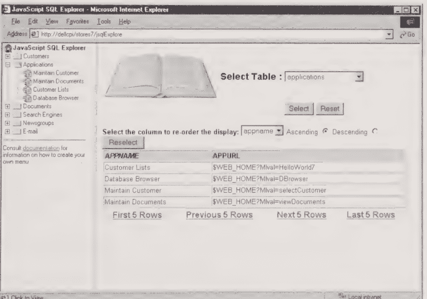

### 设置树的默认值

`jsqlDefaults`标签包含用于初始化变量的 JavaScript，这些变量设置树的默认特性，例如：

- 默认目标框架
- 默认图像 URL
- 默认链接图标
- 文本和链接颜色
- 字体
- 树的前缀和后缀 HTML

你可以根据你自己的需求更改这些变量。例如，树中的所有图标都是按名称从 Informix 数据库检索的。默认图像 URL 设置如下：

```javascript
defaultImageURL = '<?mivar>$WEB_HOME?MIvalObj=<?/mivar>';
```

当绘制树时，图标的 IMG 标签将引用该图标的`webdriver` URL。类似地，默认链接图标和默认图像类型设置如下：

```javascript
defaultLinkIcon = 'img-page-globe';
defaultImageType = '&MItypeObj=image/gif';
```

这些变量用于在客户端绘制树时形成`webdriver` URL。

### 绘制树

JavaScript 用于动态地将 HTML 写入`treeframe`中的文档。每次展开或折叠文件夹时，都会重新绘制`treeframe`文档。

实际执行此操作的逻辑是用相当复杂的 JavaScript 编写的，所以如果你想知道树如何管理的原始细节，可以查看随书附带的 CD 上的实际代码。但是，Web DataBlade 的树实现包含了一些动态标签，允许你对写入 HTML 的部分 JavaScript 进行参数化，以及在单击时切换文件夹的打开和关闭状态。这些是本节将要介绍的主题。


> 如果你想查看 JavaScript SQL Explorer 的完整端到端 JavaScript 清单，你可以在自己的 AppPage Builder 或 Data Director for Web 副本中实现动态标签，然后调用主页面`jsqlExplore`。然后你可以在框架集的顶部页面中查看 HTML 源代码。例如，使用 Microsoft Internet Explorer 5 时，从菜单栏中选择"查看\源文件"。如果你不想使用动态标签实现树，那么可以使用随附 CD 中包含的原始 OmenTree 源代码。

#### 启动绘制过程

当用户展开或折叠文件夹时，或者如果`jsqlExplore`页面被刷新时，树会被重新绘制。当浏览器加载`jsqlExplore.html`页面时，会调用`start()`方法来加载数据并绘制树。

```html
<FRAMESET COLS="180,*" onLoad="start()">
```

由`jsqlLoadUserData`动态标签的扩展在数据库服务器上生成的数据现在包含在一系列 JavaScript 语句中，这些语句在执行时加载树。`start()`方法包含在`jsqlStart`标签中：

```javascript
function start() {
  loadData();
  drawTree();
}
```

`loadData()`方法包含在`jsqlLoadUserData`动态标签中，我们已经在"使用`jsqlLoadUserData`标签填充树"小节中介绍过了。

`drawTree()`方法包含在`jsqlDrawTree`动态标签中，并调用`drawBranch()`方法，使用每个节点中的标识递归地绘制树中的节点，以映射出树的层次结构。`drawBranch()`方法包含在`jsqlDrawBranch`动态标签中，正是这个方法执行了大部分工作。

两个动态标签用于参数化写入图像和文件夹 HTML 标签的 JavaScript：`jsqlImage`和`jsqlToggleFolder`。

#### 使用`jsqlImage`标签

`drawBranch()`方法包含多个对`jsqlImage`动态标签的引用，如下所示：

```html
<?jsqlImage image=img-branch-cont- width=19
            height=16 align=TEXTTOP method=yes>
```

`jsqlImage`标签允许对格式化 HTML IMG 标签的公共 JavaScript 代码进行参数化和重用。例如，`image`参数指定要使用的图像名称；在动态标签中，一个样式会附加到名称上以标识特定的图像。树使用在主题内样式不同的图像来绘制，例如"图像分支"。样式由树逻辑控制。

`width`、`height`和`align`参数直接用于正在写入的 IMG 标签中。`method`参数指定 IMG 标签是通过 JavaScript`output()`方法写入的，还是直接放置在 HTML 源代码中。

`jsqlImage`动态标签还有另外三个参数：`alt`、`border`和`toggle`。这些在动态标签声明中分别默认为空格、0 和 off：

```text
&alt=&border=0&toggle=off
```

`alt`和`border`参数是 IMG 标签的属性。`toggle`参数用于在 JavaScript 中管理文件夹图标的切换，它由`jsqlToggleFolder`动态标签设置（详见下一小节）。

##### 清单 6-18. `jsqlImage`动态标签

```text
<?mivar cond=$(EQ,@method@,yes)>outputFrame.write(<?/mivar>
"
+ "@IMAGE@"
+ structureStyle
+ defaultImageType
<?/mivar>
<?mivar cond=$(NE,&toggle@,off)>+ @IMAGE@ <?/mivar>
+ "' WIDTH=@width@ HEIGHT=@height@ ALIGN=@align@ ALT='@alt@'
BORDER=@border@>">
<?mivar cond=$(EQ,@method@,yes)>;<?/mivar>
```

在 JavaScript 表达式中使用`jsqlImage`标签的示例：

```javascript
newStructure = newStructure +
    <?jsqlImage image=img-vert-line-
        width=19 height=16
        align=TEXTTOP method=no> ;
```

在这个片段中，`jsqlImage`标签用于生成一个字符串，该字符串被附加到 JavaScript`newStructure`变量中包含的字符串值。

然而，请记住，`jsqlImage`标签由数据库服务器上的`webexplode()` Web DataBlade 函数评估，这会生成一个 JavaScript 字符串表达式。是客户端的浏览器执行 JavaScript 语句。

`jsqlImage`标签也在`jsqlToggleFolder`动态标签中使用，下面介绍。

#### 使用`jsqlToggleFolder`标签

当单击文件夹时，它会展开或收缩（打开或关闭）。这意味着需要为文件夹的打开和关闭状态准备不同的图像集。

`jsqlToggleFolder`动态标签包含用于管理文件夹在打开和关闭之间切换的 JavaScript。清单 6-19 是来自`drawBranch()`方法的示例。

```javascript
清单 6-19. 使用 jsqlToggleFolder 动态标签。

if (children.open == 0) {
    <?jsqlToggleFolder
        toggle=open
        image=img-plus-end-
        icon=iconClosed
        level=1>
}
else {
    <?jsqlToggleFolder
        toggle=close
        image=img-minus-end-
        icon=iconOpen level=0>;
    { .. 额外代码 .. }
}
```

当处理`jsqlToggleFolder`时，生成的 JavaScript 将用于在浏览器中处理时切换文件夹和图标。JavaScript 是一组`write()`方法，用于写入`treeFrame` HTML 文档。清单 6-20 展示了`jsqlToggleFolder`动态标签源。

##### 清单 6-20. `jsqlToggleFolder`动态标签

```text
outputFrame.write("<A HREF=\"javascript:top.toggleFolder('"
 + children.id +
 "',@LEVEL@);\" onMouseOver=\"window.status='Click to @TOGGLE@
this folder'; return true\">" +
<?> <pre>jsqlImage image=@IMAGE@
           width=19 height=16 method=no
           align=TEXTTOP border=0
           alt="Click to @TOGGLE@ this folder"</pre>>);

outputFrame.write(
    <pre><?jsqlImage image=@ICON@
           width=16 height=16 method=no
           align=TEXTTOP border=0 toggle=on
           alt="Click to @TOGGLE@ this folder"</pre>> +
"</A>&nbsp;" + children.name + "<BR>\n");
```

为了进一步管理 JavaScript，我们在`jsqlToggleFolder`中包含使用`jsqlImage`动态标签。

> 你可以拥有一个用于树操作的 JavaScript 中央存储库，但仍可使用不同的`jsqlLoadUserData`动态标签自定义你自己的树内容。通过使用动态标签管理树的工作方式，你可以更改动态标签，以便将更改导出到每个实现。

### 使用的动态标签

表 6-4 列出了 JavaScript SQL Explorer 使用的动态标签。大多数标签是简单的 JavaScript 容器，根据功能将代码拆分，其中一些标签是参数化的，允许重用公共 JavaScript 方法，其参数和行为可以以明确定义的方式变化。

你可以进一步自定义这些标签，以完全参数化它们包含的 JavaScript。

# 实现和自定义 JavaScript SQL 浏览器

当您想要实现树形结构时，您的文件夹和内容将不同于本章中的示例。不会变化的是树的操作（例如，展开和折叠文件夹）以及填充树的方法。

## 直接使用 OmenTree

您可以使用 Colin Tucker 的`OmenTree` JavaScript 应用程序，通过直接编辑 HTML 来手动添加文件夹和链接到树中。即使文件夹和链接引用的内容在数据库中，您也可以这样做；在这种情况下，任何超链接或对图像或图标的引用都是 webdriver 引用。实际上，如果树结构基于可能变化（即添加、更改或删除）的内容，那么应该使用本章描述的方法来实现树；即使用动态标签（Dynamic Tags）和带有 SQL 的 AppPage。这样您就不必担心更改任何 HTML 或 JavaScript；您让 Web DataBlade 为您完成工作。

> **提示**

> 您可以创建一组新的表关系，将根文件夹映射到一组主题领域，例如客户、应用程序和文档，并使用 MISQL 标签生成树文件夹。在本章中，根文件夹的直接子项是手动分配的，以展示如何执行手动分配。

### 如何实现一个新的树？

您可以遵循一个快速清单，来确定实现一个新的数据库驱动树需要做的工作。

> **注意**

> 如果您不想使用动态标签，您可以获取`OmenTree`代码并编辑`loadData()`函数，以包含将 web 内容映射到树结构的 SQL。在这种情况下，您仍然需要将`OmenTree`代码存储在数据库中，以便可以处理 SQL。

- 规划您的内容基础；决定您希望如何构造树，以及您希望在树中放入哪些链接。
- 在 Data Director for Web 或 AppPage Builder 中创建一个新项目，例如名为`myTree`。
- 将 JavaScript SQL 浏览器动态标签存储在`myTree`项目中。
- 创建一个框架集 AppPage（例如`jsqlExplore`），以包含操作树的动态标签，并将其添加到`myTree`项目中。
- 自定义`jsqlDefaults`动态标签，该标签设置树的默认值，例如颜色和图标。
- 自定义`jsqlLoadUserData`动态标签。这是将包含 SQL 以检索数据并对 JavaScript 代码进行参数化以填充树和创建树结构的标签。
- 在 web 服务器中创建一个 URL 前缀，以便您可以调用`jsqlExplore` AppPage，如果尚未创建此类前缀（您可以使用 CGI 或 API webdriver）。

您可以根据需要自定义随附 CD 中的`jsqlExplore` AppPage 和动态标签。重要的一点是，您需要一个框架集、一个树框架和一个页面框架。您还需要包含操作树的 JavaScript 代码的动态标签。

实际上，自定义是在`jsqlLoadUserData`动态标签中进行的。该标签包含 SQL，用于基于我们正在分组的内容基础创建树结构，例如客户信息、文档和应用程序。

> 值得将现有代码作为模板，并针对您自己的站点自定义`jsqlDefaults`和`jsqlLoadUserData`动态标签。

### 小结

本章向您展示了如何使用服务器端 AppPage 脚本和客户端 JavaScript 来创建数据库驱动的分层树，以及如何处理您自己的树实现。关系视图的映射与对象内容的映射进行了对比，以展示如何使用同一棵树来查看数据之间的关系，以及在同一信息空间中管理对象。

动态标签用于实现常见的 JavaScript 代码，其中一些动态标签被参数化以允许代码重用。服务器端 AppPage 处理和客户端 JavaScript 处理之间的区别被突出强调，并且这两个独立的进程被展示为在明确定义的应用程序环境中相互补充。您可以获取本章中的示例应用程序或原始的`OmenTree`源代码，并为您自己创建网络空间菜单，其用途仅受您自己的想象力限制。

# Informix Java 数据库连接

本章内容：

- 什么是 JDBC？
- JDBC 驱动程序的类型
- Informix Type 4 驱动程序
- 浏览 JDBC API
- 配置 JDBC 驱动程序
- Informix 客户端/服务器连接
- JDBC API 的数据库环境属性
- 连接到数据库
- 使用 JLogin 测试您的 JDBC 连接
- 使用 JDBC/ODBC 桥

本章将通过示例展示如何配置 JDBC Type 4 驱动程序，以及如何使用 JDBC 方法调用连接到数据库。理解使 JDBC 连接工作的组件非常重要。您在本章学到的知识通常可以应用于其他数据库服务器，而不仅仅是 Informix。

本章将以实用的方式介绍关键主题，例如 JDBC URL、协议和连接参数，以便您可以从笔记本电脑或远程机器开始连接到 Informix 数据库。

## 什么是 JDBC？

简单来说，JDBC 代表 *Java Database Connectivity*（Java 数据库连接）。它是 Sun 开发的一个 API，允许 Java 应用程序连接到数据库服务器。因此需要 JDBC 驱动程序才能连接到数据库服务器；这由数据库供应商或第三方提供。无论如何，如果驱动程序实现了目标数据库要支持的一组 JDBC 方法，则该驱动程序是符合 JDBC 标准的。这些方法允许客户端应用程序连接到数据库服务器或数据库，创建 SQL 语句，执行这些语句，并查询结果。有一个方法库用于查询数据库的元数据和查询结果。无论源数据库是什么，无论是 Informix、DB2 还是 Oracle，都使用相同的方法。实际上，某些 JDBC 方法根据您使用的驱动程序不同而返回略有不同的结果，而且某些驱动程序并未实现所有已发布的 JDBC 方法。Informix Type 4 驱动程序也不例外。JDBC 不是 ODBC（Open Database Connectivity，开放数据库连接）的替代品。JDBC 仅适用于 Java 应用程序。它也不是 ODBC 的扩展，但它可以与 ODBC 一起工作。有一种特殊的 JDBC 驱动程序，称为 JDBC/ODBC 桥，它将 JDBC 方法调用转换为 ODBC 方法调用。

### JDBC 驱动程序的类型

在本书中，我们使用两种类型的 JDBC 驱动程序：Informix Type 4 JDBC 驱动程序和 Type 1 JDBC/ODBC 桥驱动程序。然而，对于大部分示例，我们将使用 Informix Type 4 驱动程序，这是一个纯 Java 驱动程序，直接连接到数据库服务器。了解不同类型的 JDBC 驱动程序是什么很有用。在某种程度上，它们反映了供应商对 JDBC API 支持的演变，从一开始作为 ODBC 的可移植接口，到后来直接、纯 Java 地连接到数据库。表 7-1 列出了 JDBC 驱动程序的类型。

#### 表 7.1. JDBC 驱动程序类型

| 驱动程序类型 | 描述 |
|---|---|
| 1. JDBC/ODBC 桥接器 | 在客户端将 JDBC 调用转换为 ODBC 调用 |
| 2. 原生 API，部分 Java | 在客户端将 JDBC 调用转换为 DBMS API 调用 |
| 3. JDBC-Net，纯 Java | JDBC API 调用被发送至中间层，由其转换为特定的 DBMS 网络 API 调用 |
| 4. 原生协议，纯 Java | 直接将 JDBC API 调用转换为 DBMS 网络调用，直接连接到数据库服务器 |

##### 类型 1 — JDBC/ODBC 桥接器

JDBC/ODBC 桥接器驱动程序随 JDK（Java 开发工具包）免费提供，名为`sun.jdbc.odbc.JdbcOdbcDriver`。该 JDBC 驱动程序之所以称为"桥接器"，是因为它可以将 JDBC 方法调用转换为 ODBC 方法调用。然后由 ODBC 驱动程序处理与数据库的连接。

你需要在所有将使用 JDBC/ODBC 桥接器的客户端上放置 ODBC 二进制文件。注意，如果 Java 客户端是小应用程序（applet）：不可信的小应用程序无法从下载该小应用程序的客户端加载 ODBC 驱动程序。

这种类型的连接通常用于访问没有其他 JDBC 驱动程序可用的数据源。

然而，JDBC/ODBC 桥接器具有可移植性，因为它应能与大多数 ODBC 驱动程序配合工作。

##### 类型 2 — 原生 API，部分 Java 驱动程序

该驱动程序针对特定的 DBMS API 编写，因此在 DBMS 供应商之间不具有可移植性。驱动程序将 JDBC 方法调用转换为客户机上特定于供应商的 DBMS 网络软件调用，该软件接收数据库请求，然后连接到数据库服务器。该驱动程序被称为"部分 Java"，因为它依赖于在将使用此 JDBC 驱动程序的每个客户端上都安装 DBMS API 二进制文件。此 JDBC 驱动程序依赖于 DBMS 的底层网络 API。

##### 类型 3 — JDBC-net，纯 Java 驱动程序

该驱动程序将 JDBC API 调用发送到中间层网络服务器，由其将 JDBC 请求转换为特定于 DBMS 的网络 API 调用。转换后的调用随后被发送至相应的 DBMS。此 JDBC 驱动程序不依赖于 DBMS 的网络 API。


此类 JDBC 驱动程序与类型 1 和类型 2 的区别在于，当 JDBC 驱动程序向中间层发送请求时，该请求采用供应商无关的协议，而非 ODBC 或特定于 DBMS 的协议。中间层网络服务器理解此协议，并将其转换为特定于 DBMS 的协议。执行 API 转换的不是 JDBC 驱动程序本身。

当你的企业平台包含来自不同供应商的多个数据库服务器，且你需要管理不同的 DBMS 连接时，这种类型的驱动程序非常有用。

## 类型 4 — 原生协议，纯 Java 驱动程序

该驱动程序将 JDBC 方法调用转换为特定于 DBMS 的网络调用。它被称为“纯 Java”，因为特定于 DBMS 的网络协议是在 JDBC 驱动程序本身中实现的，而不依赖于任何客户端 API 库或中间层转换器。对于 Informix，实现的协议是`jdbc`，子协议称为`informix-square`。`sqli`是 Informix 客户端用于连接 Informix 服务器的协议。

由于类型 4 驱动程序用 Java 实现了 DBMS 网络协议，因此这种类型的驱动程序专属于该 DBMS。例如，你不能使用 Informix 类型 4 驱动程序来访问其他供应商的数据库服务器。

这种类型的驱动程序有两个优点：可移植性和性能。

### 可移植性和性能优势

由于驱动程序不依赖于客户端库，JDBC 驱动程序可以跨网络部署。例如，你可以将小应用程序代码与 JDBC 驱动程序一起发送，以便小应用程序可以从浏览器访问数据库。

由于驱动程序实现了 DBMS 网络协议，无需转换为 ODBC 或 DBMS 网络 API，这应当能提高连接吞吐量。

### Informix JDBC 类型 4 驱动程序

Informix 类型 4 驱动程序只能连接到 Informix 数据库，并使用`jdbc:informix-sqli`协议。Informix JDBC 驱动程序是一种类型 4 JDBC 驱动程序。这意味着它是纯 Java 的，不需要在将使用它的任何主机上安装任何客户端库。你所需要的只是在适当主机上运行将加载 JDBC 驱动程序的 Java 应用程序或小应用程序的 Java 虚拟机。

JDBC 驱动程序使您能够开发并部署针对 Informix 数据库运行的 Java 应用程序。JDBC 驱动程序实现了 JDBC 类型 4 驱动程序规范，并在任何标准 Java 平台上运行。图 7-1 提供了 JDBC 的架构视图，特别是 Informix 数据库接口。

### 获取 Informix JDBC 驱动程序

你可以单独获取 Informix 类型 4 JDBC 驱动程序，也可以作为 Client SDK（软件开发工具包）捆绑包的一部分获取。

Informix Client SDK 是一个包含多个应用程序编程接口（API）的软件包，用于为 Informix 服务器开发客户端应用程序。这些接口允许你用 Java、C 和 ESQL 编写应用程序。

例如，如果你在 NT Web 服务器计算机上托管`webdriver`程序，而 Informix 数据库位于另一台计算机上，则需要在 Web 服务器计算机上安装来自 Client SDK 的连接库，以便`webdriver`可以连接到远程 Informix 数据库。Informix 服务器包含这些连接库，因此你不必在 Informix 服务器计算机上安装来自 Client SDK 的连接组件。

图 7-1. JDBC 架构。

### 浏览 JDBC API

JDBC API 是名为`java.sql`的 JDK 软件包，由一组接口、类和异常处理程序组成，使 Java 开发人员能够以可移植的方式访问数据库中的数据。表 7-2 列出了基本的 JDBC 接口、类和异常。

#### 接口

| 接口 | 描述 |
|---|---|
| `Connection` | 建立与数据库的连接 |
| `DatabaseMetaData` | 返回有关数据库的元数据信息 |
| `Statement` | 将静态 SQL 语句发送至数据库服务器 |
| `CallableStatement` | 执行存储过程 |
| `PreparedStatement` | 将预编译的 SQL 语句发送至数据库服务器 |
| `ResultSet` | 检查执行查询的结果 |
| `ResultSetMetaData` | 提取有关结果集中各列的信息 |
| `Driver` | 查找特定 DBMS 的驱动程序 |

#### 类

| 类 | 描述 |
|---|---|
| `DriverManager` | 管理一组驱动程序 |
| `DriverPropertyInfo` | 发现并供应驱动程序的属性 |
| `Types` | 定义用于标识标准 SQL 数据类型的常量 |
| `Date` | 用于`SQL DATE`数据类型 |
| `Time` | 用于`SQL TIME`数据类型 |
| `TimeStamp` | 用于`SQL TIMESTAMP`数据类型 |

#### 异常

| 异常 | 描述 |
|---|---|
| `DataTruncation` | 如果数据被截断，则抛出异常或警告 |
| `SQLException` | 提供有关数据库错误的信息 |
| `SQLWarning` | 提供有关数据库警告信息的警告 |

### 接口和类

*接口*是方法和常量的模板。它规定了方法和常量必须在一个 Java 类中实现，如果该 Java 类希望使用该接口的话。接口中的方法没有代码。实现代码是类的责任。Java 类必须实现接口中的所有方法才能被实例化。

接口用于管理应用程序中一致的设计主线。通常，设计阶段（如数据库设计）的输出将是一组接口。通过这种方式，Java 类可以维护一个或多个协作应用程序的设计特征，这些应用程序在代码中有不同的实现。Java 允许你声明接口类型的变量。创建对象的方法将返回实现该接口中方法的具体类。

## 配置 JDBC 驱动程序

### 设置 CLASSPATH 变量

`CLASSPATH`环境变量告诉 Java 虚拟机（JVM）和其他应用程序在 Java 程序中使用的 Java 类库的位置。由于我们需要让 JDBC 驱动程序对我们的 Java 程序可用，因此需要将驱动程序的位置添加到`CLASSPATH`变量中。

### 在应用程序中使用驱动程序

要在应用程序中使用 JDBC 驱动程序，必须将`CLASSPATH`环境变量设置为指向驱动程序文件。你可以通过在`CLASSPATH`中包含`jar`归档文件，或包含已从`jar`归档文件中解包的类所在的目录，来使 JDBC 驱动程序可见。

### 使用 jar 文件

你需要将`ifxjdbc.jar`的完整路径名添加到`CLASSPATH`变量中。例如，在 UNIX 上：

```sh
setenv CLASSPATH
  /usr/informix/jdbc/lib/ifxjdbc.jar:$CLASSPATH
```

或者，在 Windows 下：

```bat
set CLASSPATH=C:\informix\jdbc\lib\ifxjdbc.jar;%CLASSPATH%
```

### 使用目录

如果你未按上述方式指定 jar 归档文件，则需要解包该 jar 归档文件并将其内容放到某个目录中。你需要在`CLASSPATH`中包含该目录。例如，在 UNIX 上：

```sh
cd /usr/informix/jdbc/lib
jar -xvf ifxjdbc.jar
setenv CLASSPATH /usr/informix/jdbc/lib:$CLASSPATH
```

或者在 Windows 下：

```bat
cd C:\informix\jdbc\lib
jar -xvf ifxjdbc.jar
set CLASSPATH=C:\informix\jdbc\lib;%CLASSPATH%
```

## 在 Applet 中使用驱动程序

你可以在 applet 中使用 JDBC 驱动程序，以便从 applet 直接连接到数据库。你需要确保 jar 归档文件的指定方式如下：

- 确保`ifxjdbc.jar`与 applet 类放在同一目录中。
- 在`/intellectual_class`标签的`archive`属性中指定`ifxjdbc.jar`。

例如：

```html
<html>
<body>
<applet archive=ifxjdbc.jar
        code=commerce_applet.class
        codebase=http://theale2.eu.informix.com
        width=110 height=36>
</applet>
</body>
</html>
```

如果你有多个 jar 归档文件，则按如下方式定义：

```html
<applet
        archive=ifxjdbc.jar,commerce.jar
        code=commerce_applet.jar
        codebase=http://theale2.eu.informix.com
        width=110 height=36>
</applet>
```

如果 HTML 页面是由 Web DataBlade AppPage 生成的，那么可以按照如下方式在 AppPage 中对`applet`组件进行参数化：

```html
<?mivar>
<applet
 archive=$JARFILE_HOME/ifxjdbc.jar,$JARFILE_HOME/
commerce.jar
 code=$COMMERCE_START width=$COMMERCE_HEIGHT
height=$COMMERCE_WIDTH>
</applet>
<?/mivar>
```

AppPage 变量的设置如下：

- `$JARFILE_HOME`设置为`http://theale2.eu.informix.com`。
- `$COMMERCE_START`设置为`commerce_applet.class`。
- `$COMMERCE_HEIGHT`设置为 110。
- `$COMMERCE_WIDTH`设置为 136。

请注意，Java applet 中的 JDBC URL 应连接到`http://theale2.eu.informix.com`（而不是在你的网络上可能解析的缩短版本）；否则，applet 安全管理器可能会认为驱动程序没有连接回其来源的 Web 服务器主机。如果你用于下载网页的 URL 与`$JARFILE_HOME`中的 URL 不同，也可能会遇到此问题。

> 如果你预计对实时生产数据库的连接请求不止少量，那么将 JDBC 驱动程序放在 Web 服务器或网络中的其他可见主机上可能是值得的。这样可以让你以受控方式管理数据库的连接池。

> 如果有任何客户端浏览器不支持 applet 标签的`archive`属性，则将`ifxjdbc.jar`文件解包到 Web 服务器上的文档目录中。如果浏览器的 JVM 不支持 JDBC API，则还需要将`java.sql`中的类与驱动程序一起放置。

> 如果你希望使用支持调试的驱动程序，则使用`ifxjdbc-g.jar`代替`ifxjdbc.jar`。

## Informix 客户机/服务器连接性

客户机程序（例如 Java 应用程序或 applet）可以通过网络连接到大多数有效的 Informix 数据库环境。连接后，客户机程序可以访问为该环境定义的 Informix 数据库服务器所管理的任何数据库。

三种不同的 Informix API 使客户机程序能够连接到 Informix 数据库环境。表 7-3 列出了它们。

## 什么是本机网络协议？

对于 Informix，此协议称为`sqli`。它是 Informix 特有的协议，是客户机和服务器程序（包括 JDBC 驱动程序）都能理解的协议。客户机将请求服务并使用数据参数化该请求，将完整的请求作为按照`sqli`协议格式化的消息发送。数据库服务器理解此请求并对其进行响应。服务器通过发送按照`sqli`协议格式化的消息作为响应来回复客户机。

| API | 说明 |
|---|---|
| `JDBC` | 将 JDBC 请求转换为 Informix 数据库服务器使用的本机网络协议 |
| `ODBC` | 将 ODBC 请求转换为 Informix 数据库服务器使用的本机网络协议 |
| `ESQL/C` | 将 ESQL/C 请求转换为 Informix 数据库服务器使用的本机网络协议 |

## JDBC API 的数据库环境属性

你必须在 Java 客户机程序中指定数据库服务器及其主机计算机的属性。使用 JDBC URL 字符串，客户机程序必须指定客户机希望连接到的数据库环境的属性（至少包括数据库服务器的属性）。

## 什么是数据库环境？

要连接到特定主机计算机上运行的特定数据库服务器，无论使用哪种 API 来实现连接，客户机程序都必须识别要使用的特定数据库环境。

数据库环境由表 7-4 列出的属性组成。根据所使用的 API，客户机可能会在运行时指定这些属性中的一个或多个。

> Informix Java API（如 JDBC 驱动程序）不使用系统注册表或系统文件来确定数据库环境属性。相反，它们使用由 Java 客户机程序传递给它们的属性。你可以通过 Java 应用程序或 applet 的参数来设置这些属性，或者使用属性文件。你可以使用属性文件来存储相当于环境变量和 Java 程序其他参数的内容。

## 在 JDBC URL 中设置连接参数

为了使 Java 程序连接到数据库，它必须指定一个直接映射到托管数据库服务器的计算机上的端口的 URL。URL 的格式类似于 HTTP 和 FTP URL。我们称之为 JDBC URL。连接参数指定数据库环境属性。

JDBC URL 包含连接到数据库服务器所需的所有信息（参见表 7-5）。数据库服务器可以是本地的或远程的。连接可以从独立的 Java 程序或 Java applet 进行（对于 applet 有限制，参见“在 Applet 中使用驱动程序”小节）。

连接到 Informix 数据库环境时，JDBC URL 的形式为：

```text
jdbc:informix-sqli://{<ip-address>|<host-name>}
:<port-number>[/<dbname>]
:INFORMIXSERVER=<servername>
;user=<username>
;password=<password>
```

### 表 7-5. JDBC URL 参数

| 参数 | 说明 |
|---|---|
| `ip-address` | 托管 Informix 服务器的计算机的 IP 地址 |
| `host-name` | 托管 Informix 服务器的计算机名称；可以使用此名称代替 IP 地址 |
| `port-number` | 服务器计算机上监听传入请求的端口号 |
| `dbname` | 可选；我们要使用的数据库名称 |
| `servername` | 你希望连接的 Informix 服务器的名称 |
| `user` | 可以连接到目标数据库的有效用户名 |
| `password` | 该用户的密码 |

## 表 7-6. 参数映射

| 参数 | 值 | 说明 |
|---|---|---|
| `host-name` | `theale2` | 运行 Informix 服务器的 IRIX 计算机 |
| `port-number` | `1526` | `theale2`上 sqlexec 服务的监听端口 |
| `dbname` | `stores7` | `stores7`数据库 |
| `servername` | `online_tcp` | `theale2`上 sqlhosts 文件中指定的 Informix 服务器名称。始终在此参数值前加上`INFORMIXSERVER`。 |
| `user` | `joe` | 可以在`theale2`上访问`stores7`的帐户名称 |
| `password` | `myPassword` | `theale2`上该帐户的密码 |

为了说明 JDBC URL 规范，以下是一个示例 URL，它允许 Java 应用程序或 applet 使用 Informix JDBC 驱动程序连接到名为`theale2`的计算机上的`stores7`数据库：

```text
jdbc:informix-sqli://theale2:1526/stores7:INFORMIXSERVER=online_tcp;user=joe;password=myPassword
```

表 7-6 将此示例中的连接参数映射到相应的值。

> **提示**
>
> 你可以将完整的 URL 规范存储在属性文件中，Java 应用程序可以读取该文件。同样，如果你在由`webdriver`生成的 HTML 页面中使用 applet，那么可以将 JDBC URL 或 URL 的任何部分存储在`web.cnf`的变量中，并在 AppPage 中使用这些变量来对 applet 进行参数化。有关此主题的更多信息，请参见第 8 章和第 9 章。

### 连接到数据库

为了总结前面各节的内容，我们现在将连接到 Informix 数据库。

1. 在 Java 模块中导入网络和 SQL 包：

```java
import java.net
import java.sql
```

2. 在 Java 代码中指定 JDBC 驱动类。为了支持 Netscape Navigator，请加载该类：

```java
// 加载 Informix 特定的 Type 4 JDBC 驱动
Class.forName ( "com.informix.jdbc.IfxDriver" );
```

为了同时支持 Navigator 和 Internet Explorer，您可能需要在 applet 中显式注册该驱动：


```java
DriverManager.registerDriver(
    (Driver) Class.forName(
        "com.informix.jdbc.IfxDriver"
    ).newInstance()
);
```

### 3. 打开数据库连接

```java
// 指定数据库 URL
Connection conn = DriverManager.getConnection(
    "jdbc:informix-sqli://hostname:portnumber/"
        + "database:"
        + "INFORMIXSERVER=servername;"
        + "user username;"
        + "password=password"
);
```

您必须将驱动所需的环境设置以名称-值对的形式传递，并用分号（`;`）分隔。或者，您也可以使用`Properties`类的`put()`方法，如下代码片段所示：

```java
String urlConnection =
    "jdbc:informix-sqli://123.45.67.89:1526"
        + "/stores7:";

Properties params = new Properties();
params.put("informixserver", "online_tcp");
params.put("user", "joe");
params.put("password", "myPassword");

// 创建连接对象以管理到数据库服务器的连接
conn = (Connection) DriverManager.getConnection(
    urlConnection,
    params
);
```

当执行`getConnection`方法时，JDBC驱动管理器会加载 Informix JDBC 驱动，并将连接请求传递给该驱动。

# 使用 JLogin 测试 JDBC 连接

Informix 提供了一个名为`JLogin`的实用工具，允许您在编写代码之前预先测试 JDBC URL。`JLogin`实用工具是`ILogin`的 Java 等价物，随 Client SDK 一起提供。您只能使用`JLogin`测试 Type 4 JDBC 驱动。不能使用`JLogin`测试 JDBC/ODBC 桥。不过，您可以修改源代码来实现此功能（提示：实现另一个单选按钮，并添加一个文本框以接受 ODBC 数据源名称）。

## 以应用程序方式运行 JLogin

如果以独立应用程序方式运行`JLogin`，请将`CLASSPATH`环境变量设置为包含`jlogin.jar`和`ifxjdbc.jar`的完整绝对路径名。假设文件`jlogin.jar`位于`C:\Informix\JDBC`目录中，则按如下方式设置`CLASSPATH`：

```cmd
SET CLASSPATH=C:\Informix\JDBC\jlogin.jar;%CLASSPATH%
```

然后在命令行输入：

```bash
java JLogin
```

JVM 应该能在`jlogin.jar`归档中找到`JLogin.class`文件。

## 以 Applet 方式运行 JLogin

如果以 applet 方式运行`JLogin`，则包含 Informix JDBC 驱动程序的归档文件`ifxjdbc.jar`必须在客户端主机上可供浏览器的类加载器使用。为此，请遵循以下两种方法之一：

### 将 JLogin 放在 Web 服务器上

在`applet`标签中指定`archive`属性，以在 Web 服务器上定位`ifxjdbc.jar`。这将允许驱动程序在需要时通过网络下载。

### 将 JLogin 放在客户端上

在每个客户端主机上安装`ifxjdbc.jar`，然后在启动浏览器之前设置客户端上的`CLASSPATH`环境变量，使其指向`ifxjdbc.jar`的位置。

> **更改 JLogin 代码**
>
> 如果您想更改 JLogin 的源代码，请使用命令`jar -xf jlogin.jar JLogin.java`将 Java 源代码提取到独立目录中。更改、编译并使用`jar -cf jlogin.jar *.class`重新构建`jlogin.jar`文件。
>
> 当`JLogin`以 applet 方式运行时，主机参数是固定的，因为基于 JDBC 的 applet 只能连接到交付该 applet 的 Web 服务器所在的机器上的数据库服务器。

## 测试 JDBC URL

假设在将`jlogin.jar`归档放到相关平台后，您已正确设置了`CLASSPATH`，请执行以下步骤来测试 JDBC URL。

1. 确定要连接的主机。如果以 applet 方式运行`JLogin`，则不能更改主机名或 IP 地址；如果以独立应用程序方式运行`JLogin`，则可以使用任何有效的主机名或地址。使用名称或 IP 地址均可。
2. 输入数据库服务器正在监听的端口号。
3. 输入对要连接的主机有效的用户名和密码。
4. 输入在主机上运行的数据库服务器的名称。
5. （可选）输入由指定数据库服务器管理的数据库名称。
6. 单击其中一个“Ping”按钮。

根据您按下的“Ping”按钮，`JLogin`会尝试与指定的数据库服务器或数据库建立连接。在状态文本框中，`JLogin`会显示用于连接的 JDBC URL 以及各种进度消息，以指示连接是否成功。

> 您可以通过编辑`JLogin.java`源文件并重新编译，轻松更改`JLogin`显示的默认属性。您也可以查看代码，了解`JLogin`如何创建框架（窗口）、填充内容以及测试 JDBC 连接。

图 7-2 显示了一个测试示例。我们尝试连接到`dellcpi`机器，连接到名为`ol_dellcpi`的数据库服务器，该服务器监听端口`1526`，并且我们希望连接到此服务器管理的`stores7`数据库。我们可以分别 ping 数据库服务器和数据库连接。

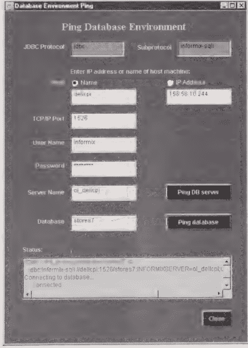

#### 图 7-2. 使用 JLogin 通过 ping 测试 JDBC URL

## 使用 JDBC/ODBC 桥

JDBC 包允许您通过一座桥来访问 Informix 数据库，该桥将来自 JDBC 驱动管理器的 JDBC 请求转换为 ODBC 请求，然后发送给 ODBC 驱动程序。您可以使用 JDBC/ODBC 桥连接到任何具有可用 ODBC 驱动程序的数据源。这种类型的 JDBC 连接是 Type 1 连接。我们依赖于客户端软件（ODBC 驱动程序）的可用性。总之，使用 JDBC/ODBC 桥连接到 Informix 数据源的步骤如下：

- 配置 Informix 客户端软件。
- 定义 ODBC 数据源。
- 编写 Java 代码以使用 ODBC 数据源。

这些步骤将在接下来的小节中描述。

> 您可以使用 JDBC/ODBC 桥连接到任何具有 ODBC 驱动程序的数据源，不仅仅是 Informix 数据库服务器。您可以将这些步骤作为配置非 Informix 服务器 JDBC/ODBC 数据源的指南。但是，您需要为特定 ODBC 驱动程序成功配置客户端软件库。

## 配置 Informix 客户端软件

有两种基本配置：Windows 和 UNIX。两者都在此描述。

### Windows（win32）配置

您至少必须通过名为`Setnet32`的实用工具设置数据库服务器及其主机计算机的属性。此实用工具包含在 Informix 客户端软件开发工具包（SDK）中。要在 Windows 平台上使用 ODBC API 时设置和测试数据库环境属性，请按以下步骤操作：

1. **下载客户端 SDK（如果尚未下载）。** Informix 客户端软件包含您需要的 ODBC 驱动程序。（对于 Windows 平台，此客户端软件还包括`Setnet32`。）确保您定义了可以使用的数据库服务器。
2. 定义 ODBC 驱动程序可以使用的网络服务。使用预定义的网络服务，ODBC API 向运行在服务器主机上的数据库服务器发送和接收数据库请求。每个网络服务通过网络上的特定唯一端口号进行通信。因此，数据库驱动程序可确保与网络上的特定服务器通信。使用`Setnet32`在客户端主机上定义数据库服务器时，应确保在该主机的网络服务文件中定义了适当的网络服务。您还可以将端口号保存在`Setnet32`实用工具的服务框中。请参阅本章后面“定义网络服务”小节。
3. 使用`Setnet32`定义数据库环境属性。您使用`Setnet32`来定义数据库服务器。

图 7-3 中的示例显示了名为`online_tcp`的服务器的定义。这些设置存储在注册表中。

在本例中：

- Informix 服务器`online_tcp`位于`theale2`机器上。
- Informix 服务器使用基于网络套接字的 TCP/IP 协议。

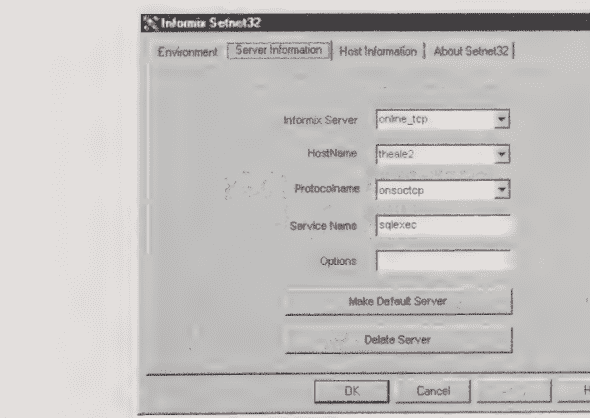

**图 7-3.** `online_tcp` Informix 服务器的定义。

- 名为`sqlexec`的网络服务可以在本地服务文件中找到，它列出了数据库服务器监听连接的端口。

4. 使用`ILogin`测试数据库环境属性。你可以通过`Setnet32`创建一个 Informix 登录配置文件。创建登录配置文件后，你应该对其进行测试。验证设置有效性并测试连接的一个简便方法是运行 Informix 实用工具`ILogin`，该工具随 Informix 客户端交付物（如 Client SDK）一起提供。

该实用工具尝试连接到指定的数据库服务器，如果成功，则对数据库执行一个简单的查询。

图 7-4 显示了用于建立连接的默认对话框，图 7-5 显示了成功连接后显示的结果。

要测试通过`Setnet32`建立的默认设置，请将所有字段留空。无论选择哪个数据库，`ILogin`要成功，该数据库必须包含一个名为`customer`的表。

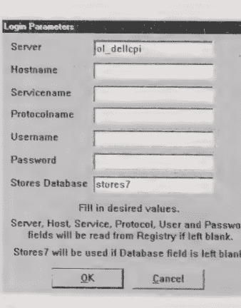

**图 7-4.** 用于测试连接设置的默认`ILogin`对话框。

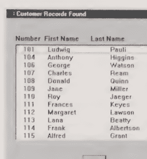

**图 7-5.** 连接成功。

> 等效的 Java 连接性测试是`JLogin`，本章前面已作描述。JDBC Type 4 驱动程序不使用注册表设置，因此 ODBC 无法证明你的 JDBC Type 4 连接能够工作。

## UNIX 安装

你需要在`odbc.ini`文件中定义数据源，并在`$INFORMIXDIR/etc/sqlhosts`文件中定义数据库服务器。你可能还需要修改`odbcinst.ini`文件。在运行时，通过客户端程序中定义的连接字符串，客户端可以覆盖其想要连接的数据库环境的一个或多个属性。

## 定义网络服务

网络服务定义在一个名为`services`的文件中。该文件的位置取决于客户端平台。

| 平台 | 位置 |
|---|---|
| Windows 95 | `c:\windows` |
| Windows NT | `c:\winnt40\system32\drivers\etc` |
| UNIX | `/etc` |

一个服务由两个参数定义，以及一个可选的第三个参数：

| 服务名称 | 端口号/协议 | 别名（可选） |
|---|---|---|
| `turbo` | `1526/tcp` | `myServer` |

想要使用此服务的客户端引用你为服务分配的名称。例如，在 Windows 下使用`Setnet32`时，你会在“服务名称”框中输入`turbo`。分配给此服务的端口号必须与服务器主机上相应的端口号匹配。

例如，在 Windows 下，要连接到数据库服务器，你在客户端程序中指定 Informix 服务器。`Setnet32`注册表会将此名称映射到主机上的服务名称。该服务名称映射到`services`文件中的条目，其中包含目标端口号。然后尝试连接。

协议还必须与服务器主机上数据库服务器使用的协议匹配。此协议的定义位置取决于服务器运行的平台：

| 平台 | 位置 |
|---|---|
| Windows NT | `HKEY_LOCAL_MACHINE\SOFTWARE\Informix\SqlHosts` |
| UNIX | `$INFORMIXDIR/etc/sqlhosts` |

使用数据库服务器名称作为查找键，以确定服务器使用的协议。

## 定义 ODBC 数据源

在 Windows 平台上，你通过 ODBC 数据源管理器定义 ODBC 数据源，该管理器可以从控制面板启动。

例如，图 7-6 和图 7-7 显示了在 Windows NT 4.0 服务器计算机上配置 ODBC 数据源的过程。该 Informix 服务器与之前通过`JLogin`访问的服务器相同。

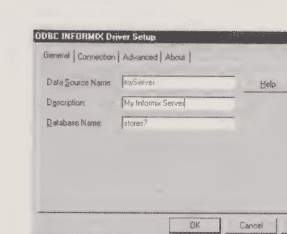

**图 7-6.** 定义名为`myServer`的 ODBC 数据源名称。

> **注意：** 你可能需要根据 ODBC 驱动程序所需的合规级别检查你的需求。例如，Informix 2.80 ODBC 驱动程序符合 ODBC 2.5 标准。Intersolv 3.01 驱动程序符合 ODBC 3.0 标准。

## 编写 Java 代码以使用 JDBC/ODBC 驱动程序

我们现在将上一步创建的 ODBC 数据源用作 JDBC/ODBC 桥中的 ODBC 组件。

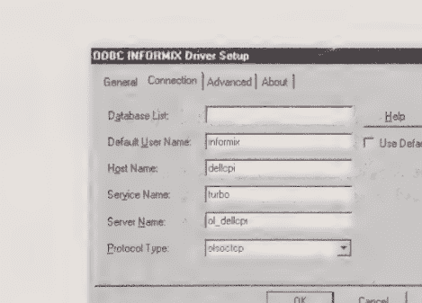

**图 7-7.** ODBC Informix 驱动程序设置。

## 注册 JDBC/ODBC 驱动程序

你可以使用以下语句注册驱动程序：

```java
Driver d = (Driver) Class.forName(
    "sun.jdbc.odbc.JdbcOdbcDriver"
).newInstance();
```

类`sun.jdbc.odbc.JdbcOdbcDriver`是 JavaSoft 免费提供的 JDBC 桥。

## 连接到 ODBC 数据源

我们在步骤 2 中创建了名为`myServer`的 Informix ODBC 数据源。我们现在希望连接到该 Informix 服务器，以及为其定义的`stores7`数据库。因此，我们创建一个`Connection`对象来管理连接详请。用户名为`informix`，密码为`in4mix`。

```java
Connection con = DriverManager.getConnection(
    "jdbc:odbc:myServer",
    "informix",
    "in4mix"
);
```

从此刻起，我们可以创建一个语句对象并使用它向 Informix 数据库提交 SQL。

清单 7-1 包含代码的完整详请。注意使用`try`和`catch`来管理可能由 JDBC 方法抛出的异常。我们还滚动查看连接目标服务器和数据库时遇到的任何警告，并将其写入标准输出。


```java
// 注册驱动程序
try {
    Driver d =
        (Driver) Class.forName(
            "sun.jdbc.odbc.JdbcOdbcDriver"
        ).newInstance();
} catch (Exception e) {
    System.out.println(e);
}
```

**清单 7-1.**（续）

```java
// 获取连接
Connection con;
try {
    con = DriverManager.getConnection(
        "jdbc:odbc:myServer",
        "informix",
        "in4mix"
    );
} catch (Exception e) {
    System.out.println(e);
}

// 获取连接警告
SQLWarning warning = null;
try {
    warning = con.getWarnings();

    if (warning == null) {
        System.out.println("No Warnings");
        return;
    }

    while (warning != null) {
        System.out.println("Warning: " + warning);
        warning = warning.getNextWarning();
    }
} catch (Exception e) {
    System.out.println(e);
}
```

### 小结

在本章中，我们了解了什么是 JDBC，不同类型的 JDBC 驱动程序是什么，以及如何使用 Type 1 和 Type 4 JDBC 驱动程序的 JDBC 方法调用连接到数据源。你在本章中学到的知识可以应用于本书其余部分，并将帮助你连接到非 Informix 数据源。

# JDBC 编程精要

## 本章内容

- 在 JDBC 环境中设置变量
- 将 DBMS 数据类型映射到 JDBC 数据类型
- 执行 SQL 语句和检索数据
- 错误处理
- 管理事务
- 调用存储过程
- 处理大对象
- 使用 Java 表单管理大对象
- JDBC 调试
- Informix JDBC 驱动程序性能调优
- Informix Type 4 驱动程序不支持的 JDBC API 方法


# 使用 JDBC 进行 Java 编程

本章描述了使用 JDBC 进行 Java 编程的要点。特别是，它向你展示了如何在 Java 程序中使用 Web 内容（如 GIF 图像），特别是当这些 GIF 图像存储在数据库中时。到本章结束时，你将拥有通过 Web 连接维护数据库中数据的 Java 程序工作示例，这些数据包括用于在线购物目录等应用程序的 GIF 图像等对象。此外，你还将学习如何调优 JDBC 驱动程序的性能，以及如何跟踪正在运行的客户端程序执行的 JDBC 方法。

要有效使用 JDBC，我们需要了解如何配置 JDBC 驱动程序以及如何以最佳方式维护数据库中的数据。以下各节描述了配置和实现使用 Informix JDBC 驱动程序维护数据库内容的 Java 程序的主要元素。

## 在 JDBC 环境中设置变量

JDBC 驱动程序不会读取用户环境来获取环境变量的值。相反，这些变量必须在 JDBC URL 中或连接属性列表中声明并赋值。无论你选择哪种方法，都使用名称/值对来设置环境变量。

## 使用 JDBC URL

你在 URL 字符串中指定名称/值对。以下示例显示了如何设置`user`、`password`和`OPTOFC`环境变量：

```java
String newUrl =

"jdbc:informix-sqli://theale2:1526/" + "
stores7:INFORMIXSERVER=online_tcp;" +
"user=informix;password=in4mix;OPTOFC=1";
```

## 使用连接属性列表

你还可以通过属性列表指定环境变量。使用`java.util.Properties`类来构建属性列表。属性列表是一个名称/值对数组。通过指定变量名称，你可以在此列表中查找值。JDBC 驱动程序将使用此列表作为其使用的环境变量集。

与在 URL 中指定相比，清单 8-1 在属性列表中设置了`user`、`password`和`OPTOFC`变量。

### 代码清单 8-1. 使用属性来设置变量

```java
try {
         String newUrl = "jdbc:informix-sqli://theale2:1526/stores7:INFORMIXSERVER=online_tcp"
         Properties pr = new Properties();
         pr.put("OPTOFC","1");
         pr.put("user","informix");
         pr.put("password","in4mix");
         conn = DriverManager.getConnection(newUrl, pr);
}
catch (SQLException e) {
         System.out.println("ERROR: failed to connect!");
}
```

## Informix 环境变量

表 8-1 列出了可为 JDBC 驱动程序设置的环境变量。

### 表 8-1. Informix JDBC 驱动程序支持的环境变量

| 环境变量 | 说明 |
|---|---|
| DBANSIWARN | 在运行时检查 Informix 对 ANSI 标准语法的扩展 |
| DBSPACETEMP | 将创建临时表的 dbspace。 |
| DBUPSPACE | UPDATE STATISTICS 语句在同时构建多列分布时可使用的系统磁盘空间量。 |
| DELIMIDENT | 使用双引号括起的字符串为定界标识符。 |
| FET_BUF_SIZE | 此值覆盖除大对象外所有数据的获取缓冲区大小的默认设置。 |
| IFX_AUTOFREE | 如果数据库服务器中的游标已关闭，则`Statement.close()`方法不需要网络往返即可释放服务器游标资源。 |
| INFORMIXCONRETRY | 在 INFORMIXCONTIME 环境变量默认值（15 秒）指定的时间限制内，客户端对每个数据库服务器应进行的额外连接尝试的最大次数。 |
| INFORMIXOPCACHE | 客户端应用程序临时区域 BLOB 空间的内存缓存大小。 |
| INFORMIXSERVER | 客户端应用程序连接到的默认数据库服务器。 |
| INFORMIXSTACKSIZE | 数据库服务器用于特定客户端会话的堆栈大小（以 KB 为单位）。 |
| NODEFDAC | 防止在不符合 ANSI 标准的数据库中创建新表或例程时将默认表和例程权限授予 public 用户（默认为 NO）。 |
| OPTCOMPIND | 查询优化器应使用的首选连接方法。 |
| OPTOFC | 如果所有行都已检索到客户端的缓冲区中，则关闭 ResultSet 不需要网络往返。如果此变量设置为 1，数据库服务器在所有行都检索完毕后自动关闭游标。 |
| PATH | 应搜索可执行程序的目录。 |
| PDQPRIORITY | 数据库服务器使用的并行度。 |
| PLCONFIG | 高性能加载器使用的配置文件名称。 |
| PSORT_DBTEMP | 数据库服务器执行排序时写入临时文件的目录。 |
| PSORT_NPROCS | 允许数据库服务器通过分配更多排序线程来提高并行进程排序包的性能。 |
| USEV5SERVER | 如果连接的是 Informix Online 5.x 数据库服务器，则此环境变量是必需的，在这种情况下将属性设置为 YES |

## 将 DBMS 数据类型映射到 JDBC 数据类型

本节展示如何将 Informix 数据类型映射到 JDBC 数据类型，并推荐用于提取该数据类型`ResultSet`数据的方法。

### 映射 Informix 数据类型

`java.sql.Types`定义了一组通用 SQL 数据类型，这些数据类型映射到各 DBMS 厂商对这些数据类型的不同实现。Informix JDBC 驱动程序将这些数据类型映射到相应的 Informix 数据类型。编写访问 Informix 数据库的 Java 程序时，您需要使用 JDBC 数据类型。表 8-2 列出了这些映射。

### 将数据从数据库传输到 Java 程序

执行查询时（例如使用`Statement.executeQuery()`方法），提交查询的`Statement`对象可能返回一个`ResultSet`对象。该对象包含对查询返回的一条或多条数据行（称为元组）的引用。

#### 表 8-2. Informix 与 JDBC 对应的数据类型

| Informix 数据类型 | JDBC 数据类型 | ResultSet.getxxx() |
|:---|:---|:---|
| BOOLEAN | OTHER | getBoolean() |
| BYTE | BINARY | getBytes() |
| BYTE | LONGVARBINARY | getBinaryStream() |
| BYTE | VARBINARY | getBytes() |
| BLOB | LONGVARBINARY | getBinaryStream() |
| CHAR(n) | CHAR | getString() |
| CLOB | LONGVARCHAR | getAsciiStream() |
| DATE | DATE | getDate() |
| DATETIME | TIME | getTime() |
| DATETIME | TIMESTAMP | getTimestamp() |
| DECIMAL | DECIMAL | getBigDecimal() |
| DECIMAL | NUMERIC | getBigDecimal() |
| FLOAT | DOUBLE | getDouble() |
| INT8 | BIGINT | getLong() |
| INTEGER | INTEGER | getInt() |
| LVARCHAR | LONGVARCHAR | getAsciiStream() |
| SERIAL | Not implemented | getSerial() |
| SERIAL8 | Not implemented | getSerial8() |
| SMALLFLOAT | FLOAT | getDouble() |
| SMALLFLOAT | REAL | getFloat() |
| SMALLINT | SMALLINT | getShort() |
| SMALLINT | TINYINT | getByte() |
| TEXT | LONGVARCHAR | getAsciiStream() |
| VARCHAR(max, start) | VARCHAR | getString() |
| Not supported | BIT | Not supported |

要从`ResultSet`提取列中的数据，我们使用`ResultSet.getxxx()`，其中 xxx 替换为您希望从列数据返回的 JDBC 类型。例如，`ResultSet.getInt()`将返回整数，`ResultSet.getString()`将返回 String 对象，`ResultSet.getBytes()`将返回字节数组，这可以是一个 GIF 图像。要将 Informix 数据类型映射到 JDBC`ResultSet.getxxx()`方法：

1. 确定 Informix 数据类型。
2. 将 Informix 数据类型映射到 JDBC 数据类型。
3. 将 JDBC 数据类型映射到推荐的`ResultSet.getxxx()`方法。

`ResultSet.getxxx()`方法可应用于多种 JDBC 数据类型，但推荐的方法如表 8-2 所示。

### 使用 SERIAL 和 SERIAL8

Informix 类型 SERIAL 和 SERIAL8 与 JDBC 数据类型没有明显的映射关系。因此，您需要将 Informix 特定类导入到 Java 程序中，并将`Statement`对象强制转换为`IfxStatement`，这是 Informix 对 JDBC Statement 类的扩展：

```java
import com.informix.jdbc.*;

PreparedStatement pStmt = conn.prepareStatement("insert into customer ... ");

pStmt.executeUpdate()

Integer serial_number = ((IfxStatement)pStmt).getSerial();
```

在上面的代码片段中，分配给表列的 serial 值将返回到`serial_number`变量，除非该表没有 SERIAL 或 SERIAL8 列，在这种情况下将返回零。要分配连续的 SERIAL 值，请在 INSERT 查询中将 SERIAL 列设置为零。

> 提示：您可以在大多数数据类型上使用`getString()`方法以字符串形式返回值。

> 注意：如果检索到的列值为 NULL，则`getxxx()`方法返回 NULL。

## 执行 SQL 语句和检索数据

要将 SQL 查询发送到数据库服务器执行，您需要：

- 注册 JDBC 驱动程序；
- 连接到数据库服务器；
- 创建`Statement`对象并通过此对象提交查询；
- 查询`ResultSet`（如果有）。

### 注册 JDBC 驱动程序

您需要向 JDBC 驱动程序管理器注册 JDBC 驱动程序。以下代码片段注册 Informix Type 4 驱动程序。

```java
try {
    Driver d = (Driver)Class.forName("com.informix.jdbc.IfxDriver").newInstance();
} catch (Exception e) {
    System.out.println(e)
}
```

您可以向驱动程序管理器注册多个 JDBC 驱动程序。您可以注册 Informix Type 4 JDBC 驱动程序以直接连接到 Informix 数据源，也可以注册 JDBC/ODBC 桥以连接到 ODBC 数据源。您可以使用静态方法`DriverManager.getDrivers()`返回驱动程序的枚举列表。驱动程序管理器将根据您提供的 JDBC URL 选择适当的驱动程序。例如，如果使用以`jdbc:informix-sqli`开头的 URL 连接数据源，将选择 Informix 驱动程序。如果 URL 以`jdbc:odbc`开头，则将选择 JDBC/ODBC 桥。

如果正确设置`CLASSPATH`，可以确保 Java 虚拟机能够找到您的驱动程序。对于 Informix Type 4 驱动程序，您需要在`CLASSPATH`中显式指定`ifxjdbc.jar`归档文件，除非您已将归档文件解压到某个文件夹，在这种情况下可以使用文件夹规范。

## 连接数据库服务器

注册了适当的 JDBC 驱动程序后，您可以使用由`DriverManager`产生的`Connection`对象连接到目标数据库服务器。您可以在不指定数据库的情况下连接到数据库服务器，也可以同时连接到数据库服务器和数据库。这并不会阻止您稍后使用`DATABASE`语句切换数据库。同样，Informix 数据库服务器也不会阻止您使用 Informix 数据库程序员所习惯的标准同义词和服务器网络。

```java
Connection con;
try{
    con = DriverManager.getConnection("jdbc:
        informix-sqli://dellcpi:1526/stores7:informix
        server=ol_dellcpi;user=informix;password=inf
        ormix",userName,password);
}catch(Exception e){
    System.out.println(e);
}
```

> 有关 JDBC URL 的格式和内容的详细信息，请参见第 7 章"Informix Java 数据库连接"。

连接后，您可以准备 SQL 语句并将其提交给数据库服务器。

### 创建 Statement 对象

`Statement`对象允许您向数据库服务器发送 SQL 语句。例如：

```java
Statement stmt;
try {
    stmt = con.createStatement();
} catch (Exception e){
    System.out.println(e);
}
```

语句有三种基本类型：`Statement`、`PreparedStatement`和`CallableStatement`。这些在表 8-3 中进行了总结。

#### 表 8-3. JDBC Statement 的种类

| Statement | 允许提交 SQL 语句，包括对存储过程的调用。 |
|---|---|
| PreparedStatement | 指定参数化查询字符串。SQL 语句被预编译到查询计划阶段。 |
| CallableStatement | 允许调用存储过程。 |

### Statement

`Statement`对象允许您向数据库服务器提交 SQL 语句，最适合那些只执行一次的 SQL 语句。数据库服务器在收到语句后会立即检查 SQL 语句的语法并生成查询计划。语句执行后，查询计划即被丢弃。表 8-4 列出了最重要的方法。

这些方法以 String 作为参数。该字符串是一个 SQL 语句。`executeQuery()`方法通过 JDBC 驱动程序将 SQL 语句传递给数据源，并返回一个`ResultSet`，它由一个或多个结果行组成，每一行包含若干列。您可以使用`execute()`或`executeQuery()`方法来运行大多数类型的查询，但对于一次操作可能返回多个`ResultSet`对象的查询，您应该使用`execute()`；但请注意，Informix 对该 API 的实现有所不同，`execute()`将只返回一个`ResultSet`。

#### 表 8-4. Statement 类的重要方法

| 方法 | 描述 |
|---|---|
| executeQuery | 执行将返回结果集的查询（例如 SELECT）。 |
| executeUpdate | 执行不返回结果集的查询（例如 INSERT）。 |
| execute | 执行可能返回多个结果集的查询（Informix JDBC 驱动程序返回一个 ResultSet）。 |

> *Informix JDBC 驱动程序对`Statement.execute()`方法的实现返回单个`ResultSet`对象。这与 JDBC API 规范不同，后者声明该方法可以返回多个 ResultSet 对象。*

> *务必确保在处理完 SQL 语句的结果后，通过在 Java 程序中调用适当的`close()`方法来显式关闭`Statement`、`PreparedStatement`或`CallableStatement`对象。这将释放为执行 SQL 语句而分配的资源。*

`executeUpdate()`方法用于不返回`ResultSet`的查询，例如 UPDATE、DELETE 和 DDL（数据定义语言）语句。此方法返回一个整数，指示受 SQL 语句影响的行数。

### PreparedStatement

`PreparedStatement`允许您重用 SQL 查询。数据库服务器将一次性生成并存储该查询的查询计划。在 Java 程序中，您可以通过在执行查询之前填充查询的运行时值来对查询进行参数化。


您可以像使用`Statement`对象一样使用`executeQuery()`、`executeUpdate()`和`execute()`方法，但不会在方法调用中传递任何参数。相反，您使用其中一个`PreparedStatement.setxxx()`方法将`PreparedStatement`中的参数标记替换为实际值。

使用`PreparedStatement`时，JDBC驱动程序只将执行计划 ID 和参数发送给数据库服务器。这减少了网络流量；如果需要多次执行查询，它非常适合基于 Internet 的应用程序。请注意，查询执行计划在程序运行期间被存储，并在 Java 程序终止时被丢弃。清单 8-2 说明了`PreparedStatement`的使用。

在列表 8-2 中，我们将第一个（也是唯一的）参数标记设置为整数值 1000，然后执行查询。接着我们查询`ResultSet`。

###### 清单 8-2. 使用 PreparedStatement 对象

```java
String forename;
String surname;
String company;
try {
    pstmt =
        con.prepareStatement(
            "select fname, lname, company from customer where
            customer_num > ?");
}
catch (Exception e) {
    System.out.println(e);
}

try {
    pstmt.setInt(1,1000);
    ResultSet rs = pstmt.executeQuery();
    while (rs.next()) {
        forename = rs.getString(1);
        surname = rs.getString(2);
        company = rs.getString(3);
        ......
    }
}
catch (Exception e) {
    System.out.println(e)
}
```

##### CallableStatement

Java 允许您使用`CallableStatement`类和称为“转义子句”的字符串来调用存储过程。`CallableStatement`对象由`Connection`对象中的`prepareCall()`方法创建，该方法以转义子句作为参数。转义子句可以采用两种形式：

```java
"{ ? = call procedureName [ ? ? . . . ] }"
"{ call procedureName [ ? ? . . . ]}"
```

“?”字符是参数，从左到右按位置标识，从 1 开始。参数可以是变量或字面量。如果使用第一个转义子句定义，则必须将赋值左侧的参数注册为“输出”参数。`CallableStatement`在本章后面的“调用存储过程”一节中有详细介绍。

#### 查询 ResultSet

`ResultSet`对象从`executeQuery()`或`execute()`方法返回。如果查询未返回任何行，则返回的值不是`ResultSet`对象，而是`NULL`。

##### 检索行

`ResultSet`由一行或多行数据组成。每一行被格式化为列。每一列都有一个 JDBC 映射的数据类型。您可以使用其中一种`getxxx()`方法来提取列值。您可以从`ResultSet`列中提取`TEXT`、无误的，以及更简单的数据类型，如`VARCHAR`、`INTEGER`、`DATE`和`TIME`。

使用 JDBC 时，您一次只能看到一行数据，这是通过按顺序一次检索结果行来实现的。Java 程序使用`ResultSet.next()`方法获取下一行。使用 JDBC 时，您无法在`ResultSet`中向后移动或书签标记某一行。

##### 检索列

您可以通过*位置*或*名称*来标识列。位置从 1 开始。在提取列值之前，您应该确定该列的 JDBC 数据类型。您使用**适当的**`ResultSet.getxxx()`方法来提取列值。您可以在大多数列上使用`ResultSet.getString()`，包括整数列。

您可以通过使用从`ResultSet`返回的`ResultSetMetaData`对象来查找列名，如下所示：

```java
ResultSetMetaData rsmd = rs.getMetaData();
String colHeader = rsmd.getColumnLabel(1);
String forName = rs.getString(colHeader);
// 或者
String forName = rs.getString(1);
```

你可以使用`ResultSetMetaData`从`ResultSet`及其数据列中提取大量信息。本书后面展示的 Java SQL 编辑器就是利用这些信息来格式化查询结果的显示，而查询结果可能任意复杂。

> 如果你在投影中使用别名（*例如*，`select fname as Firstname, lname as Lastname from customer`），其中 Firstname 和 Lastname 是别名，那么`ResultSetMetaData.getColumnLabel()`方法将返回该别名。同样，如果你将任何扩展对象类型转换为另一种类型（例如，将 HTML 转换为 LVARCHAR，如`select object:: lvarchar from wbpages`），那么返回的列类型将是转换的目标类型（即，本例中的 LVARCHAR）。你可以使用`ResultSetMetaData.getColumnType()`来提取 JDBC 数据类型的值。

#### 解读 ResultSet 中的数据类型

要从`ResultSet`中提取某一列的数据，你需要先知道该列的 JDBC 数据类型，除非你只是想提取该值的字符串等价形式，但这并不适用于所有 JDBC 数据类型。

你可以使用`ResultSetMetaData.getColumnType()`方法来提取该列的`java.sql.Type`。清单 8-3 展示了如何识别`ResultSet`列的数据类型并从`ResultSet`中提取值。为简单起见，列值被追加到一个`String`中。

`ResultSet.wasNull()`方法用于检查读取的最后一列是否为`NULL`。

> 清单 8-3. 解读 ResultSet 中的数据类型

```java
// retrieve resultset metadata.
ResultSetMetaData rsmd = rs.getMetaData();

// get query results, row by row.
String s = null;
while ( rs.next() ) {
    String st = new String();

// Build the next row, column by column.
for (int numcol = 1; numcol <= ncols; numcol++) {
    switch(rsmd.getColumnType(numcol)) {
        case Types.CHAR:
        case Types.VARCHAR:
        case Types.LONGVARCHAR:
            s = rs.getString(numcol);
            break;
        case Types.SMALLINT:
            if (!rs.wasNull() )
                s = "" + rs.getShort(numcol);
            break;
        case Types.INTEGER:
            if (!rs.wasNull() )
                s = "" + rs.getInt(numcol);
            break;
        case Types.BIGINT:
            if (!rs.wasNull() )
                s = "" + rs.getLong(numcol);
            break;
        case Types.FLOAT:
            if (!rs.wasNull() )
                s = "" + rs.getFloat(numcol);
            break;
        case Types.DOUBLE:
            if (!rs.wasNull() )
                s = "" + rs.getDouble(numcol);
            break;
        case Types.DECIMAL:
        case Types.NUMERIC:
            if (!rs.wasNull() )
                s = "" + rs.getBigDecimal(numcol, 4);
            break;
        case Types.BIT:
            if (!rs.wasNull() )
                s = "" + rs.getBoolean(numcol);
            break;
        case Types.DATE:
            if (!rs.wasNull() )
                s = "" + rs.getDate(numcol);
            break;
        case Types.TIME:
            if (!rs.wasNull() )
                s = "" + rs.getTime(numcol);
            break;
        case Types.TIMESTAMP:
            if (!rs.wasNull() )
                s = "" + rs.getTimestamp(numcol);
            break;
        case Types.BINARY:
            if (!rs.wasNull() )
                s = "" + rs.getByte(numcol);
            break;
        case Types.VARBINARY:
        case Types.LONGVARBINARY:
            if (!rs.wasNull() )
                s = "" + rs.getBytes(numcol);
            break;
        default:
            break;
    } // switch

    if (rs.wasNull() ) s = "<null> ";
} // end for
} // end while
```

#### 共享 Statement 和 ResultSet 对象

如果你的`Statement`和`ResultSet`对象对其他可能需要使用它们的对象可见，比如并发运行的线程，你应该注意当同一个对象被多个其他对象（例如，两个线程）同时访问时可能出现意外结果。

本质上，这种情况应该避免。请记住，`ResultSet`对象允许你一次处理一行。假设线程 A 执行了`next()`方法，然后线程 B 在同一个`ResultSet`上执行`next()`方法：下次线程 A 调用`next()`时，该`ResultSet`的行指针将不会如预期，因为线程 B 已将其移动到了第 3 行。

同样，如果一个`Statement`对象被多个线程访问，并且每个线程都执行查询，结果可能是未定义的——因为`Statement`对象会为`executeQuery()`和`executeUpdate()`返回一个`ResultSet`——而期望某个查询的`ResultSet`的线程最终可能得到另一个查询的`ResultSet`。你需要从程序中消除这些相互依赖关系。

### 错误处理

错误可能发生在 JDBC 驱动程序或数据库服务器中。无论哪种情况，都使用`java.sql.SQLException`类来处理错误。`SQLException`类有三个方法，你可能想要用它们来报告遇到的错误。

| 方法 | 描述 |
|---|---|
| `getMessage` | 返回错误的描述。 |
| `getErrorCode` | 返回一个`integer`值，对应于 Informix 数据库服务器*或* Informix JDBC 驱动程序的错误代码。 |
| `getSqlState` | 返回一个描述`SQLState`值的`String`。 |

> 所有 Informix JDBC 驱动程序错误都返回 -79xxx 形式的错误代码。

#### 使用 SQLException

以下代码片段展示了如何捕获`SQLException`。

```java
try {
    ResultSet r = stmt.executeQuery(
            "select lname, company" +
            " from customer");
    while(r.next()) {
        short i = r.getShort(1);
        System.out.println("Select: fname = " + i);
    }

r.close();
stmt.close();
}
catch (SQLException e) {
    System.out.println("ERROR: statement failed: " +
                       e.getMessage() + " CODE: " +
                       e.getErrorCode());
}
```

#### 查找错误消息

可以使用`com.informix.jdbc.Message`类来显示错误消息的文本，类似于 Informix 的`finderr`工具。你可以将命令包装在脚本中以避免全部输入。例如，以下是一个名为`jerror.bat`的 Windows 命令文件：

```bat
echo off
java com.informix.jdbc.Message %1
```

你可以按如下方式调用该命令文件：

```text
jerror 100
```

应显示以下消息：

```text
-100: ISAM error: duplicate value for a record with
unique key.
```

请记住设置`CLASSPATH`以找到`Message`类。

### 管理事务

使用 JDBC 时，你可以控制要实施的数据库事务，这与 Informix Web DataBlade 不同，后者的事务仅在 AppPage 被解析时存在。事务在连接级别通过`Connection`对象进行管理。

#### 默认事务行为

`Connection`的默认行为是*自动提交*执行的每一条语句。要开始一个事务，你需要关闭自动提交。

#### 启动事务

你最初通过调用`Connection.setAutoCommit(false)`来启动事务。Informix JDBC 驱动程序会在执行下一条语句时自动启动一个事务。在已经调用过该方法之后再次发出`setAutoCommit(false)`对事务没有影响。一旦事务被提交或回滚，下一条语句将启动另一个事务。

#### 结束事务

假设自动提交已关闭，你可以调用`Connection.commit()`、`Connection.rollback()`，或者通过显式 SQL 语句`COMMIT`或`ROLLBACK`来结束事务。

#### 打开自动提交

如果你在事务中使用`Connection.setAutoCommit(true)`打开自动提交，那么在自动提交重新打开之前，事务会被回滚。

表 8-5 列出了事务处理中重要的`Connection`方法。

你可以在自动提交模式为 ON（true）时使用`BEGIN WORK`语句。如果你打开自动提交，则可以使用`BEGIN WORK`显式启动事务。结果是，即使自动提交模式为 ON，在你执行`COMMIT WORK`语句或调用`Connection.commit()`方法之前，更新都不会永久生效。如果你想放弃更改，使用`ROLLBACK`或`Connection.rollback()`。

> 示例中描述的方法——例如`Connection.rollback()`——不是静态方法。它们是实例方法，这意味着你需要创建一个`Connection`类的实例来调用该方法。相比之下，静态方法不需要对象来无需创建；要使用静态方法，只需加载类即可。示例在文本中显示为`Connection.rollback()`，以便将方法与类绑定，简洁起见。

表 8-6 和 8-7 展示了在自动提交开启和关闭时使用 SQL 语句的结果。如果关闭自动提交并使用`BEGIN WORK`语句，您将从数据库服务器收到错误（类似于“already in transaction”）。这是因为如果自动提交关闭，SQL 语句会自动启动一个新事务。

### 示例：更新 Stores7.items 表

List. 8-4 中的示例（updateItems.java）更新`stores7.items`表中的库存位置和库存价格。


## 表 8-5. 处理事务的 Connection 方法

| 方法 | 说明 |
|---|---|
| `commit()` | 使此事务的所有更改永久生效，并释放请求连接的所有数据库锁。 |
| `rollback()` | 放弃此事务的所有更改，并释放请求连接的所有数据库锁。 |
| `getAutoCommit()` | 返回连接的自动提交状态，`true`（开启）或 `false`（关闭）。 |
| `setAutoCommit()` | 如果连接处于自动提交模式，则其所有 SQL 语句将作为独立事务执行和提交。 |
| `getTransactionIsolation()` | 返回当前连接的事务隔离模式。 |
| `setTransactionIsolation()` | 更改事务隔离级别。 |

## 表 8-6. 使用设置为 false（关闭）的自动提交

| 语句 | 结果 |
|---|---|
| `conn.setAutoCommit(false);` | 自动提交关闭 |
| 执行 `INSERT` | 启动下一个事务 (1) |
| 执行 `UPDATE` | 在事务 (1) 中 |
| `conn.commit()`, `"commit work"` | 提交或回滚事务 |
| `conn.rollback()`, `"rollback work"` | (1) |
| 执行下一个 `INSERT` | 启动下一个事务 (2) |
| 执行下一个 `UPDATE` | 在下一个事务 (2) 中 |
| `conn.commit()`, `"commit work"` | 提交或回滚事务 |
| `conn.rollback()`, `"rollback work"` | (2) |
| 执行下一个 `INSERT` | 启动下一个事务 (3) |
| 执行下一个 `UPDATE` | 在下一个事务 (3) 中 |
| `conn.setAutoCommit(true)` | 回滚事务 (3)，开启自动提交。 |

## 表 8-7. 使用设置为 true（开启）的自动提交

| 语句 | 结果 |
|---|---|
| `conn.setAutoCommit(true)` | 默认为 `true` |
| 执行 `INSERT` | 启动并提交事务 (1) |
| 执行 `UPDATE` | 启动并提交事务 (2) |
| `stmt.execute("BEGIN WORK")` | 启动事务 (3) |
| 执行 `INSERT` | 在事务 (3) 中 |
| 执行 `UPDATE` | 在事务 (3) 中 |
| `conn.commit()`, `"commit work"` | 提交或回滚事务 (3) |
| `conn.rollback()`, `"rollback work"` | |

## 清单 8-4. 使用 updateItems.java 管理事务

```java
import java.sql.*;
import java.io.*;

public class updateItems
{

    static String connURL;
    Connection conn;
    ResultSet queryResults;

    public static void main(String args[]) {
        if (args.length != 0) {
            connURL = args[0];
        }
        else {
            System.out.println("Usage: java txn <jdbc:url>");
            return;
        }

        updateItems thisDemo = new updateItems();
        thisDemo.run();
    } //end of main method

    public void run()  {
        try {
            connectToDBServer();
            executeUpdates();
        }
        catch (Exception e) {
        }
    } // end of run

    private void connectToDBServer() throws Exception {
        try {
            String ifxDriver = "com.informix.jdbc.IfxDriver";
            Driver IfmDrv =
                (Driver)Class.forName(ifxDriver).newInstance();
            conn = DriverManager.getConnection(connURL);
            System.out.println("Connected");
        }
```

## 清单 8-4.（续）

```java
catch (Exception e) {
    System.out.println("Could not connect to database server at " +
    connURL);
    System.out.println(e.toString());
    throw e;
}
} // end of connectToDBServer method


private void executeUpdates() throws Exception {
    String unitPriceUpdateStmt = "UPDATE items SET total_price =
    total_price*1.15";
    String stockUpdateStmt = "UPDATE items SET quantity =quantity
    +10";

    BufferedReader prompt = new BufferedReader(new
    InputStreamReader(System.in));
    String answer;

    try {
        // Begin Work
        conn.setAutoCommit(false);
        Statement stmt = conn.createStatement();
        stmt.executeUpdate(unitPriceUpdateStmt);
        stmt.executeUpdate(stockUpdateStmt);
        // Commit Work


        System.out.print("Commit or Rollback [CR]?: ");
        answer = prompt.readLine();
        if (answer.equals("C")) {
            conn.commit();
            System.out.println("Updates executed...transaction
            committed");
        }
        else {
            System.out.println("Proceeding gihg to ROLLBACK");
            conn.rollback();
            conn.commit();
            System.out.println("Transaction rolled back");
        }
    }
```

## 清单 8-4.（续）

```java
catch (Exception e) {

    System.out.println("Could not commit the transaction....rolling back!!");
    System.out.println(e.toString());

    try {
        conn.rollback();
    }
    catch (Exception ex) {
        System.out.println("Could not rollback....");
        System.out.println(ex.toString());
    }
}
} //end of executeUpdates method
} // end of class updateItems
```

记录更新后，系统会提示用户确认提交或回滚更改。输入除 `"C"` 以外的任何值都将回滚事务。

清单 8-5 展示了在 Windows 控制台中运行时的示例输出。

## 清单 8-5. 运行 updateItems 的示例输出

```text
C:\PENDING>java updateItems jdbc:informix-
sqli://dellcpi:1526/stores7:INFORMIXSERVER=ol_dellcpi;user=informix;password=informix
Connected
Commit or Rollback [CR]?: R
Proceeding to ROLLBACK
Transaction rolled back

C:\PENDING>java updateItems jdbc:informix-
sqli://dellcpi:1526/stores7:INFORMIXSERVER=ol_dellcpi;user=inform互补性;password=informix
Connected
Commit or Rollback [CR]?: C
Updates executed...transaction committed
```

## 调用存储过程

存储过程用于在数据库中实现应用程序业务规则，并强制表之间的依赖关系。您可以使用存储过程来精简客户端，并将应用程序逻辑与客户端代码分离。

本节展示如何使用 JDBC 调用执行存储过程。Informix 允许您的存储过程返回多个值，此外还可以使用 `resume` 状态返回。如果从存储过程返回多个值，则您的 `ResultSet` 将为每个返回值包含一列，您可以使用 `getxxx()` 方法进行查询。

如果您希望在存储过程中跳出循环，并在下次执行过程时从上次离开的位置继续，则应使用 `resume` 返回。例如，您可能正在从 `customer` 表中选择多行。对于每一行，您可能希望返回到调用程序以使用 `customer` 值，然后在存储过程中恢复 `customer` 表的下一行。

### 使用 CallableStatement

#### 设置输入参数

`CallableStatement` 是 `PreparedStatement` 的扩展形式，因此您可以使用 `setxxx()` 方法按位置设置参数值。例如，要使用字面量和变量的组合将实际参数设置为 `String`、`Int` 和 `String`，请使用以下示例：

```java
String str = "Pauli";
CallableStatement CSmt = conn.prepareCall("{call
custCount (?,?,?)}");
CSmt.setString(1,"Lugwig");
CSmt.setInt(2,100);
CSmt.setString(3,str);
```

`CallableStatement` 扩展了 `PreparedStatement`，因此您可以使用 `PreparedStatement` 方法将值设置到转义子句中。

#### 注册和检索单个输出参数

您需要注册输出参数，以便 JDBC 驱动程序知道如何处理它们。`CallableStatement` 对象的 `registerOutParameter()` 方法用于注册输出参数的数据类型。例如：

```java
CallableStatement CSmt = conn.prepareCall("{?=call custCount ()}");

CSmt.registerOutParameter(1,java.sql.Types.INTEGER);
```

要从过程中提取返回值，您首先调用该过程，然后使用适当的 `getxxx()` 方法从 `CallableStatement` 对象中提取返回值：

```java
int retStatus = CSmt.executeUpdate();

int custCount = CSmt.getInt(1);
```

**注意：** 如果您的输出 JDBC 类型是 `NUMERIC` 或 `DECIMAL`，请使用 `registerOutputParameter(int position, int type, int scale)` 方法的第二种形式。

**注意：** 读取输出参数的值时，必须使用其数据类型与已注册参数的 SQL 数据类型对应的 `getxxx()` 方法。

#### 执行过程

您使用 `CallableStatement.executeUpdate()` 方法执行存储过程。表 8-8 列出了基于 Informix 过程返回类型的 execute 方法。例如：

```java
int retStatus = CSmt.executeUpdate();
```

您还可以在 `CallableStatement.executeQuery()` 方法调用中使用 EXECUTE PROCEDURE 调用。

## 表 8-8. 根据过程返回类型选择要调用的 execute 方法

| 过程返回 | CallableStatement 方法 |
|:---|:---|
| 单个值 | `executeUpdate` |
| 多个值 | `executeQuery` |
| 带 resume 的返回 | `executeQuery` |
| 带 resume 的多个值 | `executeQuery` |

### 从过程返回多个值

如果你的过程返回多个值，那么你可以使用 `CallableStatement.executeQuery()` 方法，该方法返回一个 `ResultSet`。每个返回值都被指定为 `ResultSet` 中的列值。然后你可以使用 `getxxx()` 方法来提取返回值。

如果你的过程使用 `RETURN WITH RESUME`，那么你可以使用 `CallableStatement.executeQuery()`。如果你的过程返回**多个**值并带有 resume，你也可以使用此方法。

### 调用使用 RETURN WITH RESUME 的过程

以下示例展示了如何处理使用 `RETURN WITH RESUME` 子句的过程的结果。清单 8-6 展示了该过程。

此过程接受一个输入参数，并用它将 1 到 5 的值相乘，将每个值返回给调用者。

使用此过程的 Java 应用程序如清单 8-7 所示。此应用程序调用存储过程 `multipleReturns`，传入值 2。过程的输出以 `ResultSet` 的形式呈现给客户端，Java 应用程序按顺序检查该结果集。

该应用程序名为 `callableSPL`，可以按如下方式运行：

```bash
java callableSPL jdbc:informix-sqli://dellcpi:1526/stores7:INFORMIXSERVER=ol_dellcpi;user=informix;password=informix
```

#### 清单 8-6. multipleReturns 存储过程

```sql
CREATE PROCEDURE multipleReturns (i integer)
    RETURNING integer;
    define j integer;
    for j in (1 to 5)
        return i*j with resume;
    end for;
END PROCEDURE;
```

#### 清单 8-7. 调用 multipleReturns 过程的应用程序 callableSPL.java

```java
import java.sql.*;
import java.io.PrintWriter;

public class callableSPL
{
    static String connURL;
    Connection conn;
    ResultSet procResults;

    public static void main(String args[])
    {
        if (args.length != 0) {
            connURL = args[0];
        }
        else {
            System.out.println("Usage: java callableSPL <jdbc:url>");
            return;
        }

        callableSPL thisDemo = new callableSPL();
        thisDemo.run();
    } //end of main method

    public void run() {
```

#### 清单 8-7.（续）


```java
connectToDBServer();
createProcedure();
executeProcedure();
displayResults();
dropProcedure();
}
catch ( Exception e ) {
System.out.println("Error encountered: " +
    e.getMessage());
}
} // end of run

private void connectToDBServer() throws Exception {
  try {
    String ifxDriver = "com.informix.jdbc.IfxDriver";
    Driver IfmxDrv = (Driver)
Class.forName(ifxDriver).newInstance();
    conn = DriverManager.getConnection(connURL);
    System.out.println("Connection Successfull");
  }
  catch (Exception e) {
    System.out.println("Could not connect to database server at " +
    connURL);
    throw e;
  }
} // end of connectToDBServer method

private void createProcedure() throws Exception {

String createProcStmt =
  "CREATE PROCEDURE multipleReturns (i integer)" +
                      "RETURNING integer;" +
                      "  define j integer;" +
                      "  for j in (1 to 5)" +
                      "    return i*j with resume;" +
                      "  end for;" +
                      "END PROCEDURE;";

try {
  Statement stmt = conn.createStatement();
  stmt.executeUpdate(createProcStmt);
```

##### 清单 8-7.（续）

```java
System.out.println("Procedure multipleReturns Created");
}
catch (SQLException e) {
  System.out.println("Error creating procedure multipleReturns: "
    + e.getErrorCode());
  throw e;
}
} //end of createProcedure method

private void executeProcedure() throws Exception {
  String procCallStmt = "{call multipleReturns(?)}";
  try {
    CallableStatement cstmt = conn.prepareCall(procCallStmt);
    cstmt.setInt(1,2);

    procResults = cstmt.executeQuery();
    System.out.println("Procedure executed...");
  }
  catch (Exception e) {
    System.out.println("Could not execute procedure
      multipleReturns");
    throw e;
  }
} //end of executeProcedure method

private void displayResults() throws Exception {
  try
  {
    while (procResults.next())
    {
      Integer procRetVal =
        new Integer(procResults.getInt(1));
      System.out.println("Procedure iteration returned: " +
        procRetVal.toString());
    }
    procResults.close();
  }
  catch (Exception e) {
    System.out.println("Could not display procedure return
      values");
```

##### 清单 8-7.（续）

```java
throw e;
}
} // end of displayResults method

private void dropProcedure() throws Exception {

    String dropProcStmt = "DROP PROCEDURE multipleReturns";
    try {
        Statement stmt = conn.createStatement();
        stmt.executeUpdate(dropProcStmt);
        System.out.println("Procedure dropped");
    }
    catch (Exception e) {
        System.out.println("Could not drop procedure multipleReturns");
        throw e;
    }
} //end of dropProcedure method
} //end of class callableSPL
```

#### 定义查询

此示例的转义子句设置如下：

```java
String procCallStmt = "{call multipleReturns(?)}";
```

然后使用转义子句创建`CallableStatement`：

```java
CallableStatement cstmt =
    conn.prepareCall(procCallStmt);
```

第一个参数标记设置为值 2：

```java
cstmt.setInt(1,2);
```

然后执行该过程，并将结果返回到`ResultSet`：

```java
ResultSet procResults;
procResults = cstmt.executeQuery();
```

#### 处理结果

过程的每次返回都作为`ResultSet`行中的一列存储。每次带 resume 的返回都会产生一个`ResultSet`行。我们遍历`ResultSet`行来提取过程每次返回的值：

```java
while (procResults.next()) {
    Integer procRetVal = 
        new Integer(procResults.getInt(1));
    System.out.println("Procedure iteration returned: " + 
        procRetVal.toString());
}
procResults.close();
```

### 处理大对象

本节展示如何通过`JDBC`方法处理大对象，如`BLOB`。本节最后有一个示例，详细展示了如何从 Java 表单将大对象插入和查询到数据库。Informix 数据类型`BYTE`、`TEXT`、`BLOB`和`CLOB`可以通过`JDBC`进行维护。表 8-9 汇总了对象类型。

> `BLOB`和`CLOB`数据类型仅在 Informix 9.x 及更高版本的服务器上受支持，包括 Informix Dynamic Server.2000。

#### 维护大对象列

Informix `BYTE`和`BLOB`数据类型在`JDBC`中使用相同的方法进行管理。Informix `TEXT`和`CLOB`数据类型也以相同方式管理。表 8-10 汇总了这些数据类型的大对象检索方法。

表 8-9. 大对象类型。

| LO 类型 | 描述 |
|---|---|
| `BYTE`、`BLOB` | 存储二进制数据，如电子表格、音频、视频；无最大大小限制。 |
| `TEXT`、`CLOB` | 存储任何类型的大型文本对象，无最大大小限制。 |

表 8-10. Informix 大对象类型的检索方法。

| Informix 数据类型 | JDBC 数据类型 | 检索方法 |
|---|---|---|
| `BYTE`、`BLOB` | `BINARY`、`LONGVARBINARY` | `getBytes()`、`getBinaryStream()` |
| `TEXT`、`CLOB` | `LONGVARCHAR` | `getBytes()`、`getAsciiStream()` |

`SQL LONGVARBINARY`和`LONGVARCHAR`数据类型可以是任意大小。`getBytes()`和`getString()`方法可以读取这些类型，上限由`JDBC`驱动程序限制。这些限制可以使用`Statement.getMaxFieldSize()`方法读取。对于更大的数据块，`JDBC`允许开发人员使用`java.io.InputStream`方法以块的形式返回数据。

#### 插入和更新大对象

使用`PreparedStatement`对象插入或更新大对象。`PreparedStatement`对象有用于插入各种大小对象的方法。根据`JDBC`驱动程序的限制，你可以使用`setBytes()`或`setBinaryStream()`。表 8-11 描述了这些`set`方法。

> 当需要向数据库服务器发送非常大的二进制值时，通过`InputStream`发送对象可能更有效，因为`JDBC`会根据需要从输入流读取，直到流的末尾。

#### 查询大对象

当你选择包含大对象的记录时，用于从相应列检索数据的方法请参见表 8-12。

表 8-11. 大对象的 set 方法。

| 方法 | 描述 |
|---|---|
| `setBinaryStream` | 将非常大的二进制值转换为`LONGVARBINARY`。 |
| `setBytes` | 将字节数组转换为`BINARY`或`LONGVARBINARY`，具体取决于参数的大小。 |
| `setAsciiStream` | 将非常大的二进制值转换为`LONGVARCHAR`。 |

表 8-12：检索大对象的方法。

| 检索方法 | 描述 |
|---|---|
| `getBinaryStream` | 从`LONGVARBINARY ResultSet`列中提取非常大的二进制值。 |
| `getBytes` | 从`BINARY`或`LONGVARBINARY`列中提取字节数组。 |
| `getAsciiStream` | 将非常大的二进制值提取到`LONGVARCHAR`。 |

`ResultSet`取决于对象的`JDBC`数据类型。您可以使用`getBytes()`提取大对象，或者使用字节或 ASCII 输入流方法之一。对于非常大的对象，您应该使用`getAsciiStream()`和`getBinaryStream()`。表 8-12 总结了从`ResultSet`中检索大对象的相关方法。

#### JDBC 驱动程序将大对象存储在哪里？

使用 Informix Type 4 JDBC 驱动程序时，如果对象超出内存缓冲区的大小，则该对象要么存储在客户端内存中，要么存储在客户端文件系统的临时文件中。如果您使用 applet 来选择大对象，当 applet 尝试创建临时文件时，可能会遇到安全违规。Informix JDBC 驱动程序使用名为`LOBCACHE`的变量来管理客户端上的大对象。

#### 为大对象配置内存

表 8-13 总结了`LOBCACHE`变量的设置。

表 8-14 总结了当驱动程序尝试在客户端创建临时文件以存储大对象时发生安全违规的情况。

##### 设置 LOBCACHE

您可以将`LOBCACHE`作为名称/值对设置在`JDBC URL`中，或设置在属性列表中。例如：

```text
jdbc:informix-sqli://theale2:1526/stores7:informixserver=online_tcp;
user=informix;password=in4mix;lobcache=8192
```

表 8-13. 设置 LOBCACHE 变量。

| LOBCACHE 值 | 发生的情况 |
|---|---|
| `0` | 大对象始终存储在临时文件中。 |
| 负数（例如 `-1`） | 大对象始终存储在内存中；如果没有可用内存来存储大对象，则抛出`SQLException`。 |
| 字节数（例如 `4096`） | 在内存中分配最大字节数（例如 `4096`）来保存大对象。 |

表 8-14. 使用 LOBCACHE 时安全违规的结果。

| LOBCACHE 值 | 发生的情况 |
|---|---|
| `0` | 对象不存储在内存或文件中。 |
| 负数 | 抛出`SQLException`。 |
| 正数 | 无论 LOBCACHE 最大规范如何，对象都存储在内存中。 |

#### 使用 Java 窗体管理大对象

了解如何在 Java 应用程序中管理对象（例如图像）非常重要，特别是当应用程序领域是电子商务和在线购物时，并且 Web 内容（例如 GIF 图像）存储在数据库中。

此示例展示了如何使用 Java 窗体来维护简单在线目录的内容。该示例代表了一个简单的在线目录浏览和管理界面。

目录项由文本属性和该项的图像组成。该窗体将允许您从可见文件系统中选择文件，并将文件内容保存到数据库。例如，您可以选择 GIF 和 JPEG 图像来伴随项文本。

功能如下：

- 允许用户滚动浏览目录项，查看目录项文本和项的图片。
- 允许用户通过添加相应的文本信息和项的图片（例如 GIF 文件）来添加目录项。
- 允许用户从可见文件系统中选择图片。
- 选择图片后，允许用户在目录项保存到数据库之前查看图片。
- 允许用户删除目录项。

在`JDBC`层面，该示例演示了如何：

- 从数据库中选择不同数据类型的列并在窗体中显示列值，包括`BLOB`和`CLOB`；
- 滚动浏览`ResultSet`并用下一条记录填充窗体；
- 在数据库中插入不同数据类型的列，包括`BLOB`和`CLOB`；
- 基本使用 Java AWT 窗体结合`JDBC`。

窗体显示基于 AWT，这是 JDK 版本 1 的核心交付物。这意味着您不需要任何来自高级表单工具供应商的特殊类或源代码来理解该示例。

##### AWT

> 抽象窗口工具包（AWT）是一组构成 JDK 版本 1 一部分的类。包名是`java.awt`。该包包含一组用户界面类，用于创建窗口、表单字段（例如列表框）、表单事件和图形对象。

本书的重点不是用户界面，用户界面被认为是应用程序中最可替换的部分。有许多 Java IDE（集成开发环境）包含屏幕绘制器，可以按您想要的方式渲染 Java 窗体。此示例中的重要问题是我们如何读取和写入数据列（包括大对象，例如`BLOB`和`CLOB`），通过 JDBC 驱动程序访问 Informix 数据库。

但是，了解我们如何在用户界面中捕获图像将很有用，以便它们可以在批准后保存。

##### 设计注意事项

在设计应用程序时，您需要将用户界面（表示层）与应用程序或业务逻辑分离。在传统系统中，系统是由一组应用程序构建的，用户界面内置在该应用程序中。这意味着，如果用户界面或应用程序逻辑发生变化，整个应用程序都需要重新构建。在分布式 Java 应用程序中，Java 对象不应将用户界面代码与实现业务规则的代码混合在一起。遵守此规则使用户界面可替换，并允许两种类型的组件都被重用。

##### 示例中使用的 Java 类

表 8-15 列出了此示例中使用的 Java 类。我们关注的类是`Catalog`、`dataBase`和`ImgCanvas`。

###### Catalog 类

此类创建和管理 Java 窗体，用于选择和插入行到`myCatalog`表。该类创建并定位所有表单元素，例如文本字段、按钮和用于显示图像的画布。此类还实例化数据库对象，该对象提供与数据库的接口。

此类是应用程序的主要入口点，因此它包含`main()`方法，创建`Catalog`对象和`dataBase`对象：

表 8-15. 用于管理大对象的示例 Java 类。

| 类 | 定义在 | 描述 |
|---|---|---|
| `Catalog` | `Catalog.java` | 创建 Java 窗体和关联对话框；实例化数据库对象。 |
| `dataBase` | `dataBase.java` | 执行与数据库的接口，创建连接并将 SQL 传递给数据库服务器。还从`ResultSet`中提取数据并将数据写入 Java 窗体。 |
| `ImgCanvas` | `Catalog.java` | 扩展`Canvas`类的内部类。用于管理`Image`对象以进行显示。该类在`Catalog.java`中定义。 |
| `AboutDialog` | `AboutDialog.java` | 弹出对话框以显示应用程序信息。 |
| `QuitDialog` | `QuitDialog.java` | 当请求退出或关闭主浏览窗口时，弹出对话框请求确认。 |


```java
public static void main(String args[])
{
    Catalog f1 = new Catalog();
    f1.show();
    f1.db = new dataBase(f1);
}
```

`Catalog` 的构造函数方法创建整套用户界面控件，包括稍后讨论的 `ImgCanvas`。窗体显示后，应用程序等待单击 Select 按钮。可用功能在表 8-16 中描述。

### 表 8-16. 应用程序功能

| 功能 | 描述 |
| --- | --- |
| Select | 从 `myCatalog` 表中选择行并填充窗体，从 `ResultSet` 中的第一行开始。 |
| Next | 读取 `ResultSet` 中的下一行并填充窗体。 |
| Picture | 使用 `FileDialog` 对象从客户端文件系统中选择图像文件，例如 GIF 图像。 |
| Save | 将新目录项插入到 `myCatalog` 表中。 |

主窗体实现了一个菜单栏，它执行一些也通过按钮实现的功能，但它还包括 Remove 菜单项。菜单项在表 8-17 中描述。

`Catalog` 类还为从 `myCatalog` 表中的列填充的每个字段实现了一组 `get` 和 `set` 方法。数据库对象在插入新的 `myCatalog` 记录时调用这些方法，在将行从 `ResultSet` 发布到窗体时调用这些方法。清单 8-8 显示了这些方法。请注意，如果窗体要部署为 Java Bean，则需要这些方法。

> 在多级系统中，数据库对象可以重新定位到数据库服务器主机，并且可以从用户界面调用的更高级别的数据库方法可以制成远程方法调用。

### 表 8-17. 应用程序菜单项

| 菜单 | 菜单项 | 描述 |
| --- | --- | --- |
| 文件 | 打开图片/保存 | 从文件系统中选择图像。将新的目录项保存到数据库，包括图像。 |
|  | 退出 | 关闭数据库连接，并退出应用程序。 |
| 编辑 | 删除 | 删除目录项。 |
| 帮助 | 关于 | 提供应用程序的简要描述。 |

通过 RMI。当前的设计使用基本的 `get` 和 `set` 模型，用户界面提供公共方法来获取和设置用户界面表单中的数据，而不暴露表单字段的实现细节。同样，`get` 方法可以是公共的 `database` 对象方法，其具体实现在 `ResultSet` 的 `getxxx()` 方法中。

### 代码清单 8-8. 主“浏览目录”表单的 GET 和 SET 方法

```java
// GET 方法
public String getCatalogNum() {
    return catalogNum.getText();
}
public String getUnit() {
    return unit.getText();
}
public String getCatalogDescr() {
    return catalogDescr.getText();
}
public String getCatAdvert() {
    return catAdvert.getText();
}
public String getProductType(){
    return productType.getText();
}
public String getSelectedFile() {
    return selectedFile;
}
```

```java
// SET 方法
public void setCatalogNum( String s ) {
    catalogNum.setText(s);
}
public void setUnit( String s ) {
    unit.setText(s);
}
public void setCatalogDescr( String s ) {
    catalogDescr.setText(s);
}
public void setCatAdvert( String s ) {
    catAdvert.setText(s);
}
public void setProductType( String s ){
    productType.setText(s);
}
public void setCatalogPictureCanvas( byte []
imageSourceBytes ) {
    Image img = Toolkit.getDefaultToolkit().
    createImage(imageSourceBytes);
        catalogPictureCanvas.setImage(img);
        catalogPictureCanvas.repaint();
}
```

### `dataBase` 类

`dataBase` 类通过 JDBC 管理数据库接口。该类创建与数据库服务器的连接，提交 SQL 并处理 `ResultSet`。

当类首次实例化时，`dataBase` 对象会建立与数据库服务器的连接。该类的构造函数必须接受一个用户界面对象的引用，该对象包含用于初始化和显示数据库数据的 `get` 和 `set` 方法。代码清单 8-9 展示了这一顺序。


> 本示例涉及的用户界面组件可以是适用于任何平台的任意用户界面对象。因为 `dataBase` 对象使用该对象中的 `get` 和 `set` 方法，所以目标界面被隐藏起来。

### `ImgCanvas` 类

我们需要能够控制图像在屏幕上的绘制。因为图像的获取和设置比文本字段的获取和设置稍微复杂一些，所以我们将 `Canvas` 类子类化为 `ImgCanvas`，它存储对 `Image` 对象的引用，并管理图像在屏幕显示中的画布对象上的显示。代码清单 8-10 展示了 `ImgCanvas` 类。

```java
public class dataBase
{
    Connection conn;
    ResultSet queryResults;
    Catalog ui = null;

    public dataBase ( Catalog ui ) {
        this.ui = ui;
        connectToDBServer();
    }

    private void connectToDBServer()
    {
        try
        {
            String ifxDriver = "com.informix.jdbc.IfxDriver";
            Driver IfmxDrv = (Driver)
                Class.forName(ifxDriver).newInstance();
            conn = DriverManager.getConnection("jdbc:informix-sqli://
                dellcpi:1526/teacher:informixserver=ol_dellcpi;
                user=informix;password=informix");
            System.out.println("Connected");
        }
        catch (Exception e)
        {
            System.out.println("Could not connect to database server");
            System.out.println(e.toString());
        }
    } // end of connectToDBServer method
```

### 代码清单 8-10. `Catalog.java` 中的 `ImgCanvas` 类

```java
public class ImgCanvas extends Canvas {
    private Image myImage;

    ImgCanvas()
    {
        super();
        myImage = null;
    } // end of ImgCanvas constructor

    public void setImage(Image img)
    {
        myImage = img;
    } // end of setImage method

    public Image getImage()
    {
        return myImage;
    } // end of getImage method

    public void paint(Graphics g)
    {
        if(myImage == null)
            return;
        else
            g.drawImage(myImage, 0, 0, this);
    } // end of paint method
} // end of inner class ImgCanvas
```

`setImage()` 方法由 `dataBase` 对象调用以初始化 `ImgCanvas` 对象。调用 `paint()` 方法以在 `ImgCanvas` 的左上角渲染图像。

### `Catalog` 模式

存储目录数据的表名为 `myCatalog`。该模式包含项目的描述，定义为 `clob`，以及项目的图片，存储为 `blob`。

```sql
create table mycatalog (
    catalog_num integer,
    unit char(4),
    cat_descr clob,
    cat_picture blob,
    cat_advert varchar(255,65),
    prod_type char(10),
    primary key (catalog_num)
);
```

本示例的重点是处理 `clob` 和 `blob` 列。

#### 选择和浏览目录项

当点击“选择”按钮时，`myCatalog` 表中的所有行都会被选中以进行显示，包括图像。以下代码片段展示了“选择”按钮的事件处理程序，代码清单 8-11 展示了 `dataBase` 对象中的调用方法。


```java
public void executeSelectQuery() {

    String str = "select catalog_num, unit, cat_descr, cat_picture,
                   cat_advert, prod_type " +
                 "from myCatalog";

    try
    {
        Statement stmt = conn.createStatement();
        queryResults = stmt.executeQuery(str);
        System.out.println("Query executed");
        nextRow();
    }
    catch (Exception e)
    {
        System.out.println("Could not execute query");
        System.out.println(e.toString());
    }
}
```

`database.executeSelectQuery()` 方法创建 SELECT 语句，执行查询，然后调用名为 `nextRow()` 的方法将 `ResultSet` 移动到第一行并从第一行提取列数据。

```java
void selectButton_Action(java.awt.event.ActionEvent event) {
    db.executeSelectQuery();
}
```

`nextRow()` 方法用于移动到下一行 `ResultSet` 行并将数据发布到表单，如代码清单 8-12 所示。


```java
public void nextRow()
{
    try
    {
        if (queryResults.next())
        {

            ui.setCatalogNum(queryResults.getString(1));
            ui.setUnit(queryResults.getString(2));
            ui.setCatalogDescr(new String(queryResults.getBytes(3)));
            ui.setCatAdvert(new String(queryResults.getString(5)));
            ui.setProductType(queryResults.getString(6));

            byte[] catalogPictureArray = null;
            try {
                catalogPictureArray = queryResults.getBytes(4);
            }
            catch (SQLException e)
            {
                if ( ! queryResults.wasNull() ) throw e;
            }
            if (catalogPictureArray != null)
            {
                ui.setCatalogPictureCanvas(catalogPictureArray);
            }
        }
        else
        {
            System.out.println("No more rows!!");
        }
    }
    catch (Exception e)
    {
        System.out.println("Could not display next row...");
        System.out.println(e.toString());
    }
} // end of nextRow method
```

#### 填充目录描述字段（CLOB）

目录描述表单字段是数据库表 `myCatalog` 中的 CLOB 列。我们可以选择使用 `ResultSet` 的 `getAsciiStream()` 或 `getBytes()` 方法。为简单起见，我们使用 `getBytes()` 方法并将得到的字节转换为平台的 2 字节 UNICODE 字符串。生成的字符串被发布到表单上的描述字段。

```java
ui.setCatalogDescr(new
String(queryResults.getBytes(3)));
```

#### 填充目录图片字段（BLOB）

`ImgCanvas` 表单字段用于将图像渲染到屏幕上。我们可以使用 `getBinaryStream()`，但为了简单起见（因为我们知道我们使用的是小型 GIF 图像），我们使用 `getBytes()` 方法：

```java
byte[] catalogPictureArray = null;
try {
    catalogPictureArray = queryResults.getBytes(4);
}
catch (SQLException e) {
}
```

`ImgCanvas` 表单字段的填充方式如下：

```java
ui.setCatalogPictureCanvas(catalogPictureArray);
```

`Catalog` 方法 `setCatalogPictureCanvas()` 包含代码清单 8-13 中显示的方法，用于将图像渲染到 AWT 画布中。

### 清单 8-13. 将 BLOB 图像写入表单 Canvas

```java
public void setCatalogPictureCanvas(
    byte [] imageSourceBytes )
{
    Image img =
    Toolkit.getDefaultToolkit().createImage(imageSourceBytes);
    catalogPictureCanvas.setImage(img);
    catalogPictureCanvas.repaint();
}
```

请记住，我们已经扩展了 `Canvas` 类来创建 `ImgCanvas` 类，该类包含 `setImage()` 和 `repaint()` 方法。

#### 选择下一行

当用户点击 Next 按钮时，表单调用数据库对象的 `nextRow()` 方法（见上文），移动到 `ResultSet`（仍然打开）的下一行，并将行数据发布到表单：

```java
void forwardButton_Action(java.awt.event.ActionEvent
    event) {
    db.nextRow();
}
```

#### 插入目录项：选择用于审批的图片


当用户希望创建新的目录项时，用户必须选择合适的图像。图像会在用户将图像保存到目录之前显示在屏幕上，这使得用户可以在需要时更改图像。主表单有两个选项允许您执行此操作。您可以点击`Picture`按钮，或从菜单栏选择`File/Open Picture`。无论选择哪一个，都会打开一个`FileDialog`窗口，以便您选择所需的 GIF 或 JPEG 图像。一旦选择了图像，图像就会被绘制到`ImgCanvas`上，以便用户可以看到所选的内容。清单 8-14 展示了执行捕获图像文件文件系统路径以及将图像绘制到屏幕的代码。图像文件被打开，字节流被读取为字节数组。该字节流用于构造`Image`对象，该对象被发布到`ImgCanvas`对象，然后用于将图像绘制到`ImgCanvas`上。

###### 清单 8-14. 选择图像文件并查看其显示在屏幕上

```java
void chooseButton_Action(java.awt.event.ActionEvent event) {
    // Show the OpenFileDialog
    openFileDialog1.show();
    selectedFile=openFileDialog1.getDirectory() +
openFileDialog1.getFile();
    selectedItem.setText(selectedFile);

    try {
        // display the image in the window
        File f = new File(selectedFile);
        FileInputStream fs = new FileInputStream(f);
        byte [] b = new byte [ (int)f.length() ];
        int junk = fs.read(b);
        Image img =
            Toolkit.getDefaultToolkit().createImage(b);
        catalogPictureCanvas.setImage(img);
        catalogPictureCanvas.repaint();
    } catch (Exception e) {
        System.out.println("Could not render Image: "
            + e.toString());
    }
}
```

## 插入目录项：保存到数据库

当用户点击`Save`按钮或从菜单栏选择`File/Save`时，目录项文本和目录图片将保存到数据库。以下片段显示了`Save`和`File/Save`对象的事件处理器，清单 8-15 展示了执行 SQL 插入的`database`方法。

```java
void saveButton_Action(java.awt.event.ActionEvent
event) {
    db.executeQuery();
}
```

> 清单 8-15. 使用`database.java`将文本和图像插入数据库

```java
public void executeQuery() {

    PreparedStatement pstmt;

    String insertStatement =
        "insert into myCatalog ( " +
        " catalog_num, unit, cat_descr, cat_picture, cat_advert, prod_type ) " +
        "values ( " +
        " ?, ?, ?, ?, ?, ? )";

    try {

        pstmt = conn.prepareStatement(insertStatement);
        pstmt.setInt(1, (new Integer(ui.getCatalogNum())).intValue() );
        pstmt.setString(2, ui.getUnit());
        pstmt.setBytes(3,ui.getCatalogDescr().getBytes());
        pstmt.setString(5, ui.getCatAdvert());
        pstmt.setString(6, ui.getProductType());
    }
    catch (Exception e)
    {
        System.out.println("Could not prepare statement");
        System.out.println(e.toString());
        returnCone return;
    }

    File pictureFile = new File(ui.getSelectedFile());
    int fileLength = (int)pictureFile.length();

    // this is the input stream for the setBinaryStream method.
    InputStream inp = null;
    // this is the file input stream that the above input stream will use
    FileInputStream finp = null;

    int row = 0;
    String str = null;
```

###### 清单 8-15.（续）

```java
int rc = 0;
ResultSet rs = null;

System.out.println("Inserting picture file " + ui.getSelectedFile());
try {
    finp = new FileInputStream(pictureFile);
    inp = (InputStream)finp;
}
catch (Exception e) {
    System.out.println("Could not create file input streams");
    System.out.println(e.toString());
}

try {
    pstmt.setBinaryStream(4, inp, fileLength);
}
catch (SQLException e) {
    System.out.println("Unable to set parameter");
    e.getMessage();
    return;
}

try {
    pstmt.executeUpdate();
}
catch (SQLException e) {
    System.out.println("Failed to insert Catalog record: " + e.toString());
    e.printStackTrace();
}
} // end of executeQuery method
```

`insert`语句是一个`PreparedStatement`，允许我们用表单值（包括所选图像）设置参数标记。`Catalog`对象的`getxxx()`方法用于提取表单字段的内容。

## 插入 CLOB 描述

`myCatalog`表的`catDescr`列是`CLOB`类型，用于存储大量 ASCII 文本。表单字段名为`catalogDescr`。方法`ui.getCatalogDescr()`返回一个 UNICODE `String`对象（每个字符两个字节），该对象随后被转换为字节数组，其中每个字符由一个字节表示，而不是两个字节。字节数组用于参数化`PreparedStatement`中的查询字符串。如下所示：

```java
pstmt.setBytes(3,ui.getCatalogDescr().getBytes());
```

我们也可以对此列使用`pstmt.setAsciiStream()`，以允许 JDBC 驱动程序将大量文本作为输入流处理，而不是将`PreparedStatement`设置为固定参数值。

## 插入 BLOB 图像

目录项图片在`ImgCanvas`画布上渲染为图像，它只是屏幕上的另一个对象。当我们将此图像插入数据库时，我们使用`InputStream`对象读取用户从文件对话框中选择的图像源文件（或者，我们可以使用原始字节数组创建`ByteArrayInputStream`来创建图像）。`getSelectedFile()`方法返回文件系统上图像文件的绝对路径（例如，`D:\images\laptop.gif`）：

```java
File pictureFile = new File(ui.getSelectedFile());
int fileLength = (int)pictureFile.length();
```

在文件上打开`FileInputStream`并将其转换为其超类`InputStream`，这是`setBinaryStream()`方法所需的类：

```java
finp = new FileInputStream(pictureFile);
inp = (InputStream)finp;
```

然后，图像文件的`InputStream`作为参数发布到`PreparedStatement`：

```java
pstmt.setBinaryStream(4,inp,fileLength);
```

然后执行包含`insert`的`PreparedStatement`：

```java
pstmt.executeUpdate();
```

## 删除目录项

用户可以通过以下两种方式之一删除目录项：

- 滚动浏览目录直到显示目录项，然后从菜单栏选择`Edit/Remove`。
- 在`catalog_num`字段中输入目录编号，然后从菜单栏选择`Edit/Remove`。

无论选择哪种方法，`database`对象中的`delete`方法只需要键值：`catalog_num`。清单 8-16 展示了执行删除目录项的方法。

由于 SQL 包含可变参数，因此使用`PreparedStatement`比使用适当 SQL 和参数值格式化`String`更容易。使用`PreparedStatement`可以将格式化细节从应用程序中隐藏起来。

> 在工业级应用中，您还应该使用`PreparedStatement`在数据库中预编译 SQL 并提前生成查询计划，以便在每次调用查询时重复使用。

使用`executeUpdate()`方法执行`delete`语句，该方法返回受影响的行数。

清单 8-16. 使用`database.java`删除目录项

```java
public void executeDeleteQuery() {
    String str = 
            "delete from myCatalog where catalog_num = ?";
    int numRows;
    try {
        PreparedStatement pstmt = conn.prepareStatement(str);
        pstmt.setInt(1, 
            (new Integer(ui.getCatalogNum())).intValue() );
        numRows = pstmt.executeUpdate();
    } catch (Exception e) {
        System.out.println("Could not execute query");
        System.out.println(e.toString());
    }
}
```

# 执行目录浏览器

要运行目录浏览器，请在命令行输入`java Catalog`。此时将显示图 8-1。

从这里开始，您可以输入要删除的项目的目录编号，或点击`Select`（选择）按钮开始浏览`myCatalog`表中的记录。

如果点击`Select`，将显示第一个目录项，如图 8-2 所示。

要显示下一个目录项，请点击`Next`（下一个）按钮，将从`ResultSet`中读取下一行并显示在屏幕上。以下各图（图 8-3 至 8-6）显示了连续点击`Next`按钮四次时目录项的依次显示。

要插入新的目录项，只需覆盖文本字段即可。要选择新图像，请点击`Picture`（图片）按钮或选择`File/Open Picture`（文件/打开图片）。无论选择哪种方式，都会显示一个`FileDialog`（文件对话框），如图 8-7 所示。注意，`FileDialog`的标题由 Java 应用程序设置（"Select a Picture"）。

`FileDialog`是一个标准的 Java AWT 类，它调用本地窗口系统来显示一个允许您选择文件或保存文件的对话框。如果在不受信任的 applet 中使用此对话框，将会遇到安全违规。


图 8-2. "Browse Catalog"（浏览目录）项目。

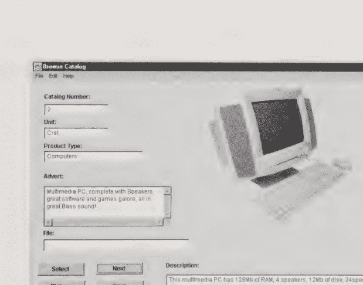

图 8-3. "Browse Catalog"（浏览目录）项目。


图 8-4. "Browse Catalog"（浏览目录）项目。

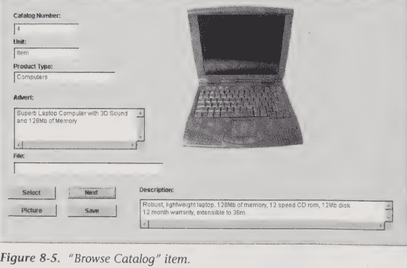

图 8-5. "Browse Catalog"（浏览目录）项目。

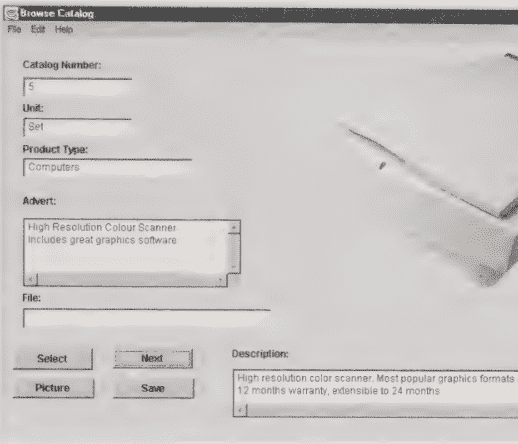

图 8-6. "Browse Catalog"（浏览目录）项目。

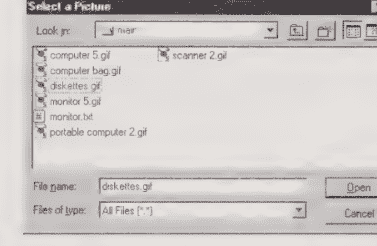

图 8-7. 选择图片。

选择图片后，图片将显示在屏幕上，以便用户可以看到最终效果。此外，图片的文件路径将显示在文件文本框中。图 8-8 显示了输入新文本并选择图片后的表单。

要从头查看目录，请点击`Select`（选择）按钮，目录将从第一条记录开始滚动。如果通过点击`Next`（下一个）按钮滚动到末尾，您将看到插入的目录项。

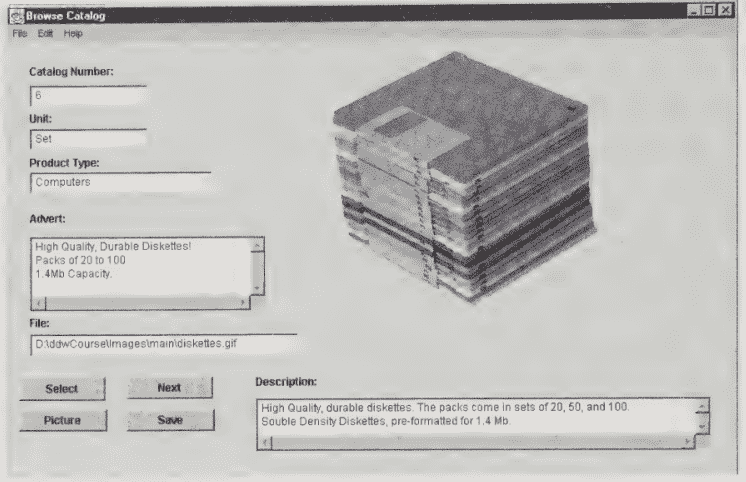

图 8-8. 在表单中显示图片。

> **注意**
>
> 表单的 "Description"（描述）字段是`myCatalog`表中的`CLOB`列。如果输入换行符，这些换行符将按您看到的方式存储。同样，"Advert"（广告）表单字段是作为`VARCHAR`存储的文本区域。换行符也会按您看到的方式存储到数据库列中。

# 调试 JDBC

本节简要介绍可与 Informix JDBC 驱动程序一起使用的调试和跟踪选项。

Informix JDBC 驱动程序包有两个基本交付项：

- `ifxjdbc.jar` — JDBC 驱动程序类的优化版本。
- `ifxjdbc-g.jar` — JDBC 驱动程序类的调试版本。

## 跟踪 JDBC 活动

您可以通过打开跟踪变量（设置跟踪的粒度）并设置跟踪文件来捕获跟踪输出，来跟踪驱动程序活动。这些文件在使用 JDBC 驱动程序的客户端上创建。

### 常规活动跟踪

使用表 8-18 中所示的变量来跟踪 JDBC 驱动程序的常规活动。

根据调试所需的信息量，`TRACE`变量可以设置为多个值之一。这些值按粒度级别列在表 8-19 中。`TRACE`变量的默认值设置为零，表示不跟踪。

### Informix 协议消息跟踪

您可以使用表 8-20 中所示的变量来跟踪 JDBC 驱动程序与 Informix 数据库服务器之间传递的协议消息和协议数据。

### 表 8-18. 跟踪变量

| 变量 | 描述 |
|---|---|
| `TRACE` | 设置时，跟踪驱动程序的一般信息。 |
| `TRACEFILE` | 保存跟踪输出的客户端文件的完整路径名。 |

### 表 8-19. TRACE 变量的粒度

| 级别 | 粒度 |
|---|---|
| 1 | 跟踪方法的进入和退出。 |
| 2 | 执行级别 1，加上通用错误消息。 |
| 3 | 执行级别 2，加上跟踪驱动程序变量。 |

### 表 8-20. 协议跟踪变量

| 变量 | 描述 |
|---|---|
| `PROTOCOLTRACE` | 跟踪驱动程序与数据库服务器之间的 SQLI 协议消息。 |
| `PROTOCOLTRACEFILE` | 保存跟踪输出的客户端文件的完整路径名。 |
| 级别 | 粒度 |
|---|---|
| 1 | 跟踪消息 ID。 |
| 2 | 执行级别 1 加上通用消息数据。 |

`PROTOCOLTRACE`变量可以设置为多个值之一，如表 8-21 所示。`PROTOCOLTRACE`默认设置为零，表示不跟踪。

## 设置 TRACE 变量

您可以在 JDBC URL 中或在传递给 JDBC URL 的属性列表中设置这些 TRACE 变量的值。例如：


```text
jdbc:informix-sql://theale2:1526/stores7:informixserver=online_tcp;user=informix;password=inf4mix;TRACE=2;TRACEFILE=d:\informix\jdbc.out
```

> 如果要跟踪驱动程序活动，请记住设置 `CLASSPATH`，使 `ifxjdbc-g.jar` 归档位于 `ifxjdbc.jar` 归档之前。

以下代码片段是在执行 `SELECT` 查询并提取 `ResultSet` 中的列时，JDBC 驱动程序的级别 2 常规跟踪：

```text
IfxValue.makeInstance:
  ColInfo.SQLType = 0
  ColInfo.ExtendedId = 0
  This instance is com.informix.jdbc.IfxChar
```

```text
IfxResultSet.getValue() exited
IfxResultSet.getString(int) called. ColumnIndex: 2
IfxResultSet.getString() exited.
IfxResultSet.getValue(int) called
IfxValue.makeInstance:
    ColInfo.SQLType = 44
    ColInfo.ExtendedId = 11
    This instance is com.informix.jdbc.IfxSmBlob
IfxBaseType: fromIfx.length = 72
IfxBaseType: fromIfx.index = 5
IfxSqli: constructor() exited
IfxSqli: receiveMessage() called
IfxSqli: flip() called
IfxSqli: flip() exited
IfxSqli: receiveMessage() exited
IfxSqli: sendBind(Vector) called
```

> **务必在处理完结果后关闭** `Statement`（语句）、`PreparedStatement`（预编译语句）、`CallableStatement`（可调用语句）**和** `ResultSet`（结果集）**对象**。为此，请调用语句对象的 `close()` 方法；例如，`PreparedStatement.close()`。关闭语句对象会释放分配给该语句对象的资源；如果仅使用 `ResultSet.close()` 关闭 `ResultSet`，则分配给语句的资源不会被释放。

# Informix JDBC 驱动程序的性能调优

虽然设计良好的数据库和编写良好的应用程序确实可以带来显著的性能提升，但在应用程序平台之间优化软件的具体实现方面，您仍然可以做更多的事情。特别是在使用 JDBC 时，至少有两种方法可以解决性能问题。本节介绍如何管理 `ResultSet` 的获取缓冲区以及优化网络流量。

## 使用 `FET_BUF_SIZE` 管理 SELECT 缓冲区大小

当 `SELECT` 语句从 Java 程序发送到 Informix 服务器时，返回的行（称为元组）存储在 Informix JDBC 驱动程序内存中的元组缓冲区中。元组缓冲区的默认大小是完整返回元组大小或 4096 字节中的较大者。您可以覆盖此缓冲区的大小，这在其他语言中可能称为 *fetch buffer*（获取缓冲区）。

我们要做的是确保充分利用*网络资源*和*本地性*。如果减少网络请求次数，我们就能充分利用网络资源。如果所需数据已经存在于客户端上，我们就充分利用了本地性。增大获取缓冲区的大小将减少向数据库服务器发送剩余元组的请求次数，并且能够让我们在本地滚动浏览更多行，因为单次获取已返回更多行。

### 配置 `FET_BUF_SIZE`

可以使用 `FET_BUF_SIZE` **环境变量**来覆盖元组缓冲区的默认大小。`FET_BUF_SIZE` 值可以小于或等于 32,767（字节）。如果设置了此变量且其值大于默认元组大小，则使用 `FET_BUF_SIZE` 定义元组缓冲区大小。

### `FET_BUF_SIZE` 的局限性

由于 `FET_BUF_SIZE` 可以配置为使用更多内存，使用过多内存可能会导致性能下降，从而迫使其他应用程序或数据段移出内存；换句话说，将导致 *swapping out*（交换出）内存。如果计算机上的交换空间有限，则需要注意这种可能性。

如果有许多同时打开的数据库连接，则每个连接都将占用 `FET_BUF_SIZE` 内存单元。这也会消耗内存，如果计算机的内存资源有限，可能会导致性能下降。您应该根据将要使用的目标平台，评估在应用程序中使用 `FET_BUF_SIZE` 的实际可行性。

## 减少网络流量

减少网络流量应该有助于提高 Java 程序的可见性能，因为我们降低了对网络带宽的依赖。Informix 提供了两个可以设置的环境变量来帮助减少这种网络依赖性。这些变量名为 `OPTOFC` 和 `IFX_AUTOFREE`。

### 为 `ResultSet` 对象配置 `OPTOFC`

`OPTOFC` 变量是 *optimize open fetch close* 的缩写，用于在关闭 `Statement` 和 `ResultSet` 对象时减少网络流量。

将 `OPTOFC` 设置为 1 以指定：如果所有符合条件的行都已在驱动程序的元组缓冲区中检索完成，`ResultSet.close()` 方法无需与数据库服务器进行网络对话即可关闭 `ResultSet`。这是因为 Informix 数据库服务器在所有行检索完成后会自动关闭游标。

当调用 `ResultSet.next()` 方法时，JDBC 驱动程序可能已经在元组缓冲区中有额外的行，也可能没有。除非 JDBC 驱动程序已从数据库服务器接收到所有行，否则当 `OPTOFC` 设置为 1 时，`ResultSet.close()` 方法可能仍需要与数据库服务器进行网络对话。

### 为 `Statement` 对象配置 `IFX_AUTOFREE`

将 `IFX_AUTOFREE` 设置为 1 以指定：如果游标已经关闭，`Statement.close()` 方法无需与数据库服务器进行网络对话即可释放服务器游标资源。数据库服务器在游标关闭后会自动释放游标资源。你可以通过调用 `ResultSet.close()` 方法*显式地*关闭游标。你也可以使用 `OPTOFC` 环境变量*隐式地*关闭游标。当游标资源被释放后，该游标将不能再被引用。

### 设置性能调优变量

与其他所有环境变量一样，你可以在 JDBC URL 或属性列表中设置 `FET_BUF_SIZE`、`OPTOFC` 和 `IFX_AUTOFREE`。例如：

```text
jdbc:informix-
sqli://theale2:1526/stores7:informixserver=online_tcp;
user=informix;password=in4mix;OPTOFC=1;IFX_AUT-
OFREE=1;FET_BUF_SIZE=8192
```

## Informix Type 4 驱动程序不支持的 JDBC API 方法

表 8-22 列出了 Informix 的 Type 4 驱动程序未实现的 JDBC 方法。

对于 Informix Type 4 驱动程序，表 8-23 中方法的行为与 JDBC API 指定的行为有所不同。

| 方法 | 描述 |
|---|---|
| `Connection.setCatalog()` | 选择数据库目录的子集。 |
| `Connection.setReadOnly()` | 将连接设置为只读模式以启用数据库优化。 |
| `Connection.isReadOnly()` | 如果连接为只读则返回 True。 |
| `Statement.setMaxFieldSize()` | 设置列的最大字段大小；丢弃多余部分。 |
| `Statement.setQueryTimeout()` | 指定等待 `Statement` 执行的秒数。 |
| `Statement.cancel()` | 一个线程取消另一个线程正在执行的 `Statement`。 |
| `PreparedStatement.setUnicodeStream()` | 将大型 UNICODE 值作为 `InputStream` 发送。 |
| `CallableStatement.registerOutParameter()` | 注册每个 OUT 参数的 `java.sql.Type`。 |
| `ResultSet.getUnicodeStream()` | 从 `InputStream` 中检索大型 UNICODE 踩刹车。 |

| 方法 | 返回值 |
|---|---|
| `Statement.execute()` | 返回单个 `ResultSet` |
| `PreparedStatement.execute()` | 返回单个 `ResultSet` |
| `CallableStatement.execute()` | 返回单个 `ResultSet` |
| `ResultSetMetaData.getTableName()` | 返回 `""` |
| `ResultSetMetaData.getSchemaName()` | 返回 `""` |
| `ResultSetMetaData.getCatalogName()` | 返回 `""` |
| `ResultSetMetaData.isReadOnly()` | 返回 `FALSE` |
| `ResultSetMetaData.isWritable()` | 返回 `TRUE` |
| `ResultSetMetaData.isDefinitelyWritable()` | 返回 `TRUE` |

### 总结

本章重点介绍了 Java 中实用 JDBC 编程的细节。涵盖了使用 Informix JDBC 驱动程序的所有主要问题。特别是，我们将 Informix 数据类型映射到 JDBC 数据类型，并使用这些信息来维护数据库中的数据。我们还展示了如何设置 JDBC 跟踪信息以及如何调优 JDBC 驱动程序的性能。

描述了在线购物目录管理界面的基础知识；更具体地说，你学习了如何通过实现 JDBC 方法将大型对象（如 GIF 图像）维护在数据库中。

使用本章中的示例，你现在已准备好从 Java 小程序或应用程序管理数据库中的多种数据类型，然后在 Java 客户端程序中捕获和渲染这些数据。

# 将 Java 小程序与数据库集成

在本章中：

- 从数据库提供 Java 小程序：将 Java 小程序作为 *Web 内容*进行管理，其中小程序存储在数据库中并从数据库中检索。
- 将动态 Web 页面与 Java 小程序集成：Java 小程序可以使用特定于浏览器客户端的 `AppPage` 变量进行参数化。

理解如何将 Java 小程序与动态 Web 页面集成非常重要，因为成功的集成允许我们动态更改 Java 小程序的行为，而无需更改 Java 小程序代码或包含它的 AppPage。当 Java 小程序的数据和行为需要针对特定内部网或互联网客户端进行*个性化*设置时，这一点尤为重要。例如，用户可能只能看到数据库上可用数据的一个子集。与其在 Java 或 SQL 中编写所有权限，不如使用 AppPages 对 Java 小程序进行参数化来动态管理这种复杂性。此外，这种小程序的动态参数化允许你使用简单的 JDBC 和 RMI 连接到各种数据库。

## 从数据库提供 Java 小程序

### 概述

Java 小程序的源代码存储在带有后缀 `.java` 的文件中。源代码被编译为字节码并存储在带有后缀 `.class` 的文件中。`.class` 文件使用 `APPLET` 标签包含在 HTML 文档中。以下是演示小程序使用的 `APPLET` 标签示例：

```html
<APPLET CODE="Demo.class" WIDTH=170 HEIGHT=150>
```

Java 小程序由 Web 浏览器执行，当浏览器加载包含 `APPLET` 标签的 HTML 文档时。`APPLET` 标签指定将在 Web 页面中运行的 Java 小程序。

### 使用 Web Data Director 模式

Java 小程序可以通过 Web DataBlade 和 Web 数据管理器从 Informix 数据库提供。Web 数据管理器模式将二进制对象存储在 `wbBinaries` 表中。存储在 `wbBinaries` 中的每个对象都有一个关联的扩展名，用于在 `wbExtensions` 表中查找对象的 MIME 类型。Web 服务器需要 MIME 类型才能成功将 AppPage 提供给客户端。

### 通过站点管理器添加小程序内容类型

站点管理器工具促进网站的开发、管理和部署。它使用户能够轻松创建、编辑和维护应用程序页面和相关内容。为了支持 Java 小程序，必须执行以下任务。

### 为 Java 类文件和 JAR 归档指定新内容类型

Web 数据管理器模式需要了解其管理的内容类型。示例内容类型包括 HTML 页面、AppPage、GIF 和 JPEG 图像、办公文档以及视频和音频文件。这些对象存储在数据库中，通常在 `wbBinaries` 表中。每个对象的元数据描述该对象是什么，通常会反映我们想要用它做什么。Java 小程序是一组编译后的类。JAR 归档是一组编译后的 Java 类和其他对象（如 GIF 图像），存储在一个归档文件中。

因此，我们需要向 Web 数据管理器描述类文件和 JAR 归档，然后将类或 JAR 归档存储在数据库中，以便在 HTML 页面中提供。我们通过向 Web 数据管理器添加文件扩展名信息来实现这一点。当我们向 Web 数据管理器添加资源（例如新文件）时，文件扩展名（及相关的扩展名信息）将决定资源在 HTML 页面中的呈现方式。

### 添加 `.class` 和 `.jar` 扩展名

在选择数据库服务器和数据库后，从站点管理器中选择 `工具/扩展名` 菜单选项。将显示一个类似于图 9-1 的对话框，显示所有文件后缀（例如 `.PDF`）到对象 MIME 类型的映射，以及到读取该对象的目标应用程序的映射。

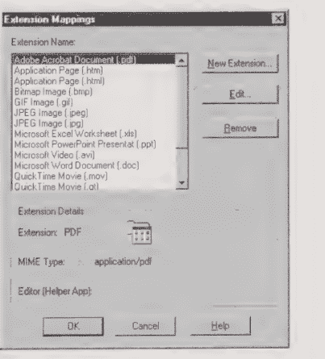

图 9-1. 扩展名映射。

尽管我们在数据库中存储对象，但我们需要从文件系统上的文件中获取对象的数据，而文件扩展名以某种方式描述了数据。文件后缀是最基本的元数据；例如，从后缀 `.PDF` 中，我们知道需要 PDF 阅读器，并且可以了解文件内容的基本特征。如果我们将 PDF 文件存储在数据库中，它会作为大对象存储，并且我们存储整个文件的内容，而不仅仅是文本。我们使用原始文件扩展名作为对象的元数据；当 PDF 文件从数据库交付到浏览器时，我们知道如何为对象定义 MIME 类型，以便客户端浏览器可以调用适当的插件或辅助应用程序来处理该对象。如果我们使用 Data Director for Web 将网站内容（存储在数据库中）导出为平面文件，则 PDF 对象将以其注册时所赋予的名称和扩展名创建为文件。

现在，点击**新建扩展**按钮。我们将为 `class` 文件和 `JAR` 归档添加映射。

将出现一个"创建扩展"对话框（见图 9-2）。该对话框由三个选项卡面板组成，用于捕获有关我们要在数据库中注册的对象类型的信息。表 9-1 列出了这些选项卡面板的功能。

将扩展属性设置为表 9-2 中指定的值（截图如下），然后点击**确定**。将创建新的扩展映射。

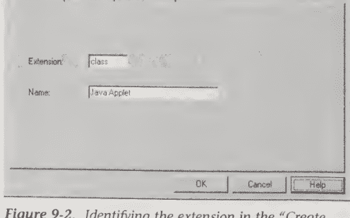

**图 9-2.** 在"创建扩展"对话框中标识扩展（`.class`）。

### 表 9-1. "创建扩展"对话框选项卡面板的含义

| 选项卡面板 | 说明 |
|:---|:---|
| 标识 | 命名一个特定的文件扩展名，我们向其添加描述如何使用源自文件的对象的属性。 |
| MIME 类型 | MIME 类型是发送给客户端浏览器的对象定义，客户端浏览器随后调用客户端上的插件或辅助应用程序。此对话框中的辅助应用程序用于 Data Director for Web。 |
| 表/列 | 标识 Data Director for Web 模式中的表和表列，或 Data Director for Web 未控制的模式中的表和表列。我们还定义对象的检索方法，从而说明它是被转换（展开）的、作为大对象交付的，还是保持不变的。 |

### 表 9-2. `.class` 和 `.jar` 文件的扩展值

| 属性 | `.class` 文件的值 | `.jar` 文件的值 |
|:---|:---|:---|
| 扩展名 | `class` | `jar` |
| 名称 | Java Applet | Java Archive |
| 超级类型 | `application` | `application` |
| 子类型 | `x-java` | `x-jar` |
| 源表 | `wbBinaries` | `wbBinaries` |
| 名称列 | `id` | `id` |
| 内容列 | `object` | `object` |
| 路径列 | `path` | `path` |
| 检索方法 | `Blob` | `Blob` |

对于 `class` 文件，图 9-2、9-3 和 9-4 显示了完成的选项卡面板。图 9-5 显示了"扩展映射"对话框中的完成映射。

对于 JAR 归档文件，图 9-6、9-7 和 9-8 显示了完成的选项卡面板。图 9-9 显示了"扩展映射"对话框中的完成映射。

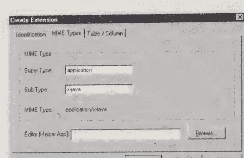

图 9-3. 在"创建扩展"对话框中标识 MIME 类型（`.class`）。

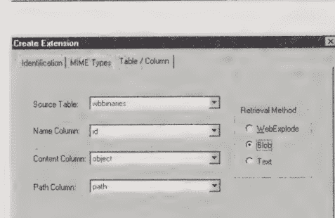

图 9-4. 标识源表和检索方法（`class`）。

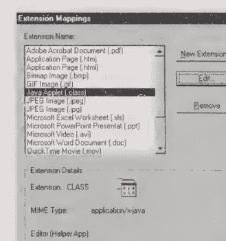

图 9-5. 查看完成的扩展映射（`class`）。

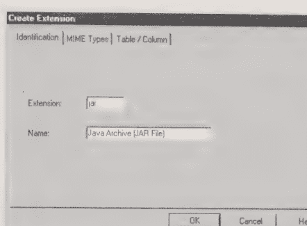


图 9-6. 在“创建扩展”对话框中标识扩展（JAR）。

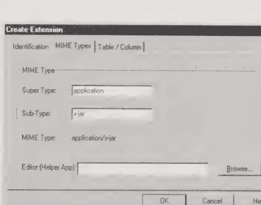

图 9-7. 在“创建扩展”对话框中标识 MIME 类型（JAR）。

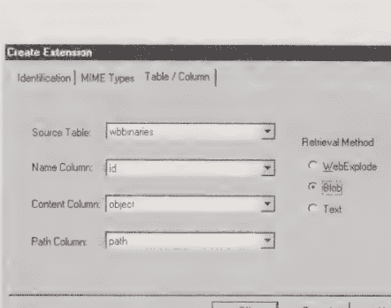

图 9-8. 标识源表和检索方法（JAR）。

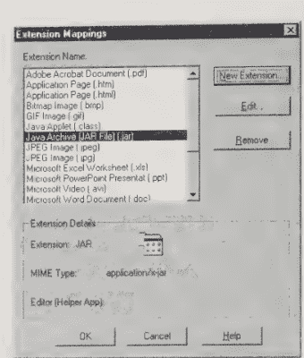

图 9-9. 查看完成的扩展映射（JAR）。

### 将 Java Applet 资源添加到 Web 项目

这可以通过将资源从文件系统拖放到所需项目来实现，或者使用 `File`/`New`/`Resource` 菜单选项。Java `.class` 和 `.jar` 文件被添加到您将其拖放到的项目的应用程序文件夹中，或添加到“不在项目中”文件夹的应用程序文件夹中。

### 创建包含 Java Applet 的 AppPage

AppPage 编辑器允许创建和编辑 AppPage。Java applet 可以通过使用 `APPLET` 标签在 AppPage 中显示。

`CODE` 属性指定要运行的 Java applet 的名称。

`CODEBASE` 属性指定 NSAPI 映射的 URL，用于引导 NSAPI `webdriver` 从数据库中提取 applet（由 `CODE` 属性指定）。

> `CODEBASE` URL 必须是 NSAPI URL，它映射到 Informix NSAPI `webdriver` 请求。

您可以在 `<APPLET>` 和 `</APPLET>` 标签之间使用 `PARAM` 属性，以提供有关 Java applet 要使用的参数或参数的信息。

清单 9-1 显示了一个包含从数据库检索的 applet 的简单 AppPage，图 9-10 显示了该 AppPage 的浏览器输出。

Java class 文件 `dbMessage.class` 存储在 `wbBinaries` 表中。

#### 清单 9-1. 包含存储在数据库中的 applet 的 message1.html

```html
<HTML>
<HEAD>
<TITLE>Messages</TITLE>
</HEAD>
<BODY>
<center>
<APPLET
    CODE="dbMessage.class"
    CODEBASE="/stores7"
    WIDTH=426 HEIGHT=266 IGNORE="" >
    <PARAM NAME=User VALUE="Web">
    <PARAM NAME=Message VALUE="This text is an applet parameter">
</APPLET>
</center>
</BODY>
</HTML>
```


图 9-10. 清单 9-1 的浏览器输出。

### 工作原理概述

当浏览器加载 HTML 页面时，浏览器使用 `CODEBASE` URL 来获取由 `CODE` 属性指定的 Java class：

```text
CODE="dbMessage.class"
CODEBASE="/stores7"
```

URL `/stores7` 必须是 NSAPI 映射的 URL，Web 服务器将其解析为指向 NSAPI `webdriver`。Web 服务器将接收以下形式的请求：

`/stores7/dbMessage.class`

NSAPI `webdriver` 被调用，Java class 从 `wbBinaries` 表中检索并发送到浏览器客户端。一旦浏览器获得 class 文件，就可以实例化 applet。

如果 `APPLET` 标签指定了一个或多个存储在数据库中的 `JAR` 归档，则 `JAR` 归档将以完全相同的方式检索。例如，以下 `APPLET` 属性指定了两个 `JAR` 归档以及扩展 `java.applet.Applet` 的初始 class，即 `dbMessage.class`：

```text
CODE="dbMessage.class"
ARCHIVE="ifxjdbc.jar, viewCustomerJdbc.jar"
CODEBASE="/stores7"
```

在这个例子中，两个 `JAR` 归档都存储在数据库中，并使用 `CODEBASE` URL 进行检索。Web 服务器将接收以下形式的请求：

`/stores7/ifxjdbc.jar`

`/stores7/viewCustomerJdbc.jar`

`ifxjdbc.jar` 归档包含 Informix JDBC 驱动程序。`viewCustomerJdbc.jar` 归档包含 applet 所需的所有相关 class，以及 GIF 图像和音频文件等对象。

> 如果可能，使用 `JAR` 归档来存储您的 Java class 和相关对象，例如 GIF 图像。使用 `JAR` 归档的优势在于归档只下载一次，涉及一个 HTTP 请求；如果 class 和图像单独存储在 Web 服务器机器上，则每个 class 和图像都会有单独的 HTTP 请求来获取。

### 在 `web.cnf` 中配置 `CODEBASE`

使整个端到端工作可能会稍微棘手，但只要您注意细节，它就会工作。

假设 URL 前缀 `/stores7` 是 NSAPI 映射的 URL（一个将 Netscape Web 服务器导向调用 NSAPI `webdriver` 共享对象中的方法以连接到数据库的 URL），那么，`webdriver` 配置文件 `web.cnf` 中需要以下条目：

```text
WEB_HOME /stores7/
MI_WEBNSNAMETRANS /stores7
```

使用 Web 模式的 Data Director 时，变量 `MI_WEBNSNAMETRANS` 是必需的。该变量设置为 NSAPI URL，这也是 `WEB_HOME` 变量所使用的。但是请注意，`MI_WEBNSNAMETRANS` 的 URL 末尾没有添加斜杠（`"/"`）字符，这是由 NSAPI `webdriver` 所限制的要求（`/stores7` 是在 Netscape 配置文件 `obj.conf` 中定义的 URL）。

### 映射 `APPLET` 标签中的 `CODEBASE`

要成功引导浏览器从数据库中获取 `class` 或 `JAR` 对象，你需要正确设置 `APPLET` 标签的 `CODEBASE` 属性。

必须将 `CODEBASE` 设置为 `MI_WEBNSNAMETRANS` 的值。例如，给定 `MI_WEBNSNAMETRANS` 的设置：

```text
MI_WEBNSNAMETRANS /stores7
```

然后将 `CODEBASE` 设置为：

```text
CODEBASE="/stores7"
```

### 使用 Web 服务器访问日志跟踪 HTTP 请求

如果你在从数据库中提取小程序时遇到问题（例如，浏览器提示无法找到或加载 `APPLET` 标签的 `CODE` 属性中指定的类），那么你可以通过查看 Netscape Web 服务器的访问日志和错误日志来跟踪 HTTP Web 服务器尝试获取的内容。你可以在 Netscape Web 服务器的管理界面中找到这些日志。

例如，当请求清单 9-1 中的 AppPage 时，该页面包含对一个 `class` 文件的引用，Netscape 访问日志会显示 AppPage 请求，随后是相关的小程序请求：

```text
127.0.0.1 - - [18/Jun/1999:23:47:06 +0100] "GET
/stores7/message1 HTTP/1.0" 200 280
127.0.0.1 - - [18/Jun/1999:23:47:11 +0100] "GET
/stores7/dbMessage.class HTTP/1.0" 200 1685
```

当检索名为 `viewCustomer1` 的 AppPage 时，该页面在 `APPLET` 标签中包含两个 `JAR` 归档引用，此时会记录以下 HTTP 请求：

```text
134.168.237.55 - - [18/Jun/1999:12:53:11 +0100] "GET /stores7/viewCustomer1 HTTP/1.0" 200 459
134.168.237.55 - - [18/Jun/1999:12:53:12 +0100] "GET /stores7/ifxjdbc.jar HTTP/1.0" 200 297665
134.168.237.55 - - [18/Jun/1999:12:53:13 +0100] "GET /stores7/viewCustomerJdbc.jar HTTP/1.0" 200 6077
```

如果在尝试从数据库加载 `class` 文件或 `JAR` 归档时遇到错误，请查看错误日志。例如，如果 `CODEBASE` 配置不正确，错误日志中可能会出现类似以下的错误：

```text
[17/Jun/1999:17:06:28] failure ( 364): for host
134.168.237.55 trying to GET /stores7/dbMessage.class,
informix_explode reports: HTTP/1.0 404 Asset not found
```

该错误消息说明 NSAPI `webdriver` 函数 `informix_explode` 无法在 Data Director for Web 模式中找到该对象。假设 `class` 文件确实存在于 `wbBinaries` 表中，这表明 `CODEBASE` URL `/stores7` 与 `MI_WEBNSNAMETRANS` 不匹配。

> **注意** 你不必使用存储在数据库中的 AppPage 来调用存储在数据库中的小程序和 `JAR` 文件。你可以使用存储在文件系统中的 HTML 文件，但仍然需要正确配置 `CODEBASE`。

### 将动态 Web 页面与 Java 小程序集成

使用 AppPage 来包含 Java 小程序的一个优势在于，你可以参数化小程序的行为，无论这些小程序是从数据库还是其他来源提供的。你可以使用 AppPage 变量来实现这一点。这些变量可以在 AppPage 内部设置，也可以在 `webdriver` 配置文件 `web.cnf` 中初始化。下一节将扩展名为 `message1` 的 AppPage（如清单 9-1 所示），并使用 AppPage 变量来显示数据库内容，而无需使用 JDBC。

你不必将 Java 小程序存储在数据库中，也能在 AppPage 中对其进行参数化。

### 动态参数化 Java 小程序

为了说明如何使用 AppPage 变量来参数化 Java 小程序，我们将扩展 `message1` AppPage。这次，我们不会将参数值硬编码到 `APPLET` 标签中，而是执行一个 SQL 查询，对结果进行格式化，然后将这些结果传递给 Java 小程序。

该 SQL 查询选择客户最近一次拨打呼叫中心电话的记录，该记录存储在 `stores7` 数据库的 `cust_calls` 表中。电话记录经过格式化后，与登录站点的用户名一起传递给小程序进行显示。

该 AppPage 如清单 9-2 所示。

#### 清单 9-2. 使用 AppPage 变量参数化 message2.html 中的 Java applet

```text
Listing 9-2. Using AppPage Variables to parameterize a java applet in message2.html
```

```html
<HTML>
<HEAD>
<TITLE>Parameterised Messages</TITLE>
</HEAD>
<BODY>
<CENTER>
<?misql
   sql="select customer_num, call_descr, trim(user_id),
            call_dtime
       from cust_calls
       where call_dtime = (
           select max(call_dtime) from cust_calls
       );">
   $(SETVAR,$MESSAGE,Customer $3 called at $4: $2)
</?misql>
<?mivar>
   <APPLET
        CODE="dbMessage.class"
        CODEBASE="/stores7"
        WIDTH=426 HEIGHT=266>
     <PARAM NAME=User VALUE="$REMOTE_USER">
     <PARAM NAME=Message VALUE="$MESSAGE">
   </APPLET>
</?mivar>
</CENTER>
</BODY>
</HTML>
```

图 9-11. 在浏览器中显示的 `message2.html`。

在清单 9-2 中，变量 `$REMOTE_USER` 设置为 `web.cnf` 中定义的值，通常设置为默认值。如果用户通过安全 URL 访问 AppPage（例如使用 NSAPI 或 ISAPI），那么 `$REMOTE_USER` 设置为用户进行身份验证时使用的用户 ID。

`$MESSAGE` 变量通过 `SETVAR` AppPage 变量处理函数，从 SQL 查询的结果中进行设置。

请注意，`APPLET` 标签由 `<?mivar>` 和 `<?/mivar>` 标签包围。这确保了用于参数化小程序的 AppPage 变量在 `webexplode` 函数处理 AppPage 时会被展开。

假设使用的安全 URL 前缀为 `/stores7-secure`，且经过身份验证的用户名为 Graham，那么浏览器将显示类似图 9-11 所示的消息。

最后，`dbMessage` 小程序的完整源代码如清单 9-3 所示。

小程序参数值使用 `Applet` 类的 `getParameter()` 方法获取，如下所示：

```java
userName.setText("Hello " + getParameter("User"));
messageArea.setText(getParameter("Message"));
```

传递给 `getParameter()` 的字符串应与 `APPLET` 标签的某个 `PARAM` 属性匹配。例如，要提取已声明为：

```html
<PARAM NAME="User" VALUE="$REMOTE_USER">
```

的 User 参数的值，`getParameter()` 的调用为：

```java
getParameter("User");
```

#### 清单 9-3. `dbMessage.java` 的完整源代码

```java
import java.awt.*;
import java.applet.*;

public class dbMessage extends Applet
{
        java.awt.Label userName;
        java.awt.TextArea messageArea;
        java.awt.Label label1;

        public void init()
        {
            setLayout(null);
            setSize(426,266);
            setBackground(new Color(12632256));
            userName = new java.awt.Label("Hello ");
            userName.setBounds(24,12,396,44);
            userName.setFont(new Font("TimesRoman", Font.BOLD, 34));
            userName.setBackground(new Color(12632256));
            add(userName);
            messageArea =
new java.awt.TextArea("",0,0,TextArea.SCROLLBARS_VERTICAL_ONLY);
            messageArea.setEditable(false);
            messageArea.setText("No Message");
            messageArea.setBounds(24,108,377,131);
            messageArea.setFont(new Font("Dialog", Font.BOLD, 12));
            messageArea.setBackground(new Color(16777215));
            add(messageArea);
            label1 = new java.awt.Label("Your Latest Message is:");
            label1.setBounds(24,60,313,24);
            label1.setFont(new Font("Dialog", Font.BOLD, 20));
            add(label1);

            userName.setText("Hello " + getParameter("User"));
            messageArea.setText(getParameter("Message"));
        }
}
```

动态 JDBC 连接与 SQL 查询


我们可以通过`AppPage`变量将 JDBC 信息传递给小程序。在本例中，我们希望从小程序连接到`stores7`数据库，以查看客户记录。为简化操作，我们希望将查看应用程序以及 Type 4 JDBC 驱动程序下载到浏览器，以便小程序能够直接从浏览器连接到数据库。我们不希望硬编码所需的 JDBC 驱动程序引用或用于连接数据库的 JDBC URL，而是希望从变量中动态地将这些值传递给小程序。这些变量在`web.cnf`文件中进行初始化。

通过这种方式对 JDBC 信息进行参数化，允许我们将特定 URL 定向到特定的数据库。例如，我们可能希望安全用户访问一个数据库，而非安全用户访问另一个数据库。通过 URL 前缀`/stores7-secure`连接的用户，其接收到的 JDBC URL 可能与通过`/stores7` URL 连接的用户不同。这是因为 JDBC 变量存储在`web.cnf`文件中，而这两个 URL 指向不同的`web.cnf`配置。

同样，演示如何将 SQL 查询传递给小程序也很有用。这本身并不重要，但它可用于根据用户可能请求的 URL，动态地为查询绑定权限过滤器。例如，过滤器可能指定经纪人只能查询特定类型股票的价格。权限过滤器会将此规则表示为 SQL`WHERE`子句的一部分，并将此字符串传递给小程序。`WHERE`子句将在`web.cnf`中的一个变量中定义。

始终拥有连接数据库、执行查询并滚动浏览`ResultSet`的示例都是有用的。这是一个相当小的例子，因此连接功能以代码形式列出。

### `customerView`小程序功能

用户可以在“Customer Number”屏幕字段中输入客户编号。当点击`Select`按钮时，将选择所有`customer_num`大于所输入客户编号的客户记录，并且屏幕会一次显示一条客户记录。用户可以通过点击`Next`按钮滚动浏览匹配的记录。

`customer`表与`state`表进行连接，以使用`state`表中存储的描述来扩展`customer.state`列。代码和描述都将在 Java 小程序中显示。

#### JDBC 变量配置

此应用程序的`web.cnf`文件包含在包含`APPLET`标签的 AppPage 中使用的变量。这些变量由`webexplode`展开，生成的值通过`APPLET`标签的`PARAM`属性传递到小程序。清单 9-4 包含了`web.cnf`中针对`customerView`小程序的变量部分。`JDBCURL`和`QUERYSTRING`变量的值必须在一行内输入。表 9-3 列出了这些变量的用法。

```text
清单 9-4. 在 web.cnf 中声明的 AppPage 变量。

##### 应用程序变量
# 小程序类
JAVACLASS	viewCustomer.class

# 包含小程序类和其他类的 JAR 归档文件
APPARCHIVE	viewCustomerJdbc.jar

# Informix Type 4 JDBC 驱动程序归档文件
JDBCARCHIVE	ifxjdbc.jar

# Informix Type 4 JDBC 驱动程序
JDBCDRIVER	com.informix.jdbc.IfxDriver

# 小程序用于连接数据库的 URL
JDBCURL		jdbc:informix-sqli://dellcpi:1526/stores7?:informixserver=ol_dellcpi;user=informix;password=informix

# 以 Prepared 格式传递给小程序的查询
QUERYSTRING	SELECT trim(fname) || ' ' || trim(lname), company, address1, address2, city, zipcode, phone, state, sname, customer_num FROM customer,state WHERE customer_num > ? and customer.state = state.code
```

**表 9-3. 使用`web.var`变量对 JDBC 小程序进行参数化。**

| 变量 | 描述 |
| :--- | :--- |
| `JAVACLASS` | 浏览器实例化的小程序类。 |
| `APPARCHIVE` | 包含小程序类及小程序使用的任何其他类的 JAR 归档文件。 |
| `JDBCARCHIVE` | 包含 Type 4 JDBC 驱动程序类的 Informix JDBC 驱动程序 JAR 文件。 |
| `JDBCDRIVER` | 由小程序注册的 Informix Type 4 JDBC 驱动程序的类名。 |
| `JDBCURL` | JDBC 驱动程序用于从 Java 小程序连接到数据库的 URL。 |
| `QUERYSTRING` | 将用于从`stores7`数据库选择客户记录的 SQL 字符串。此语句包含参数标记（`?`），供`PreparedStatement`类使用。 |

## `customerView` AppPage

清单 9-5 显示了包含小程序的 AppPage。

> 要使此示例工作，小程序不必从数据库中检索，但此示例基于可工作的代码，该代码从数据库中检索 AppPage 和两个 JAR 归档文件，其中`MI_WEBNSNAMETRANS`设置为 Netscape `obj.conf`文件中的 NSAPI 映射 URL（例如`/stores7`）。如果您没有将小程序 JAR 文件存储在数据库中，请将它们存储在提供 AppPage 的同一 Web 服务器的 CLASSPATH 中。

```html
<HTML>
<HEAD>
<TITLE>查看客户</TITLE>
</HEAD>
<BODY>
  <BODY>
    <?mivar>
      <APPLET CODE="$JAVACLASS"
```

```html
ARCHIVE="$JDBCARCHIVE, $APPARCHIVE"
CODEBASE="$MI_WEBNSNAMETRANS"
    WIDTH=685
    HEIGHT=400>
      <PARAM NAME="JdbcDriver" VALUE="$JDBCDRIVER">
      <PARAM NAME="JdbcUrl" VALUE="$JDBCURL">
      <PARAM NAME="QueryString" VALUE="$QUERYSTRING">
    </APPLET>
<?/mivar>
</BODY>
</HTML>
```

在清单 9-5 中，我们可以看到`<?mivar>`标签界定了 AppPage 中展开 AppPage 变量的部分。AppPage 变量（例如`$JAVACLASS`、`$JDBCARCHIVE`）在`web.cnf`中初始化并写入生成的网页。这些值通过`APPLET`标签的`PARAM`属性传递给小程序。

清单 9-6 显示了 AppPage 展开后发送到浏览器的最终 HTML 页面。

### 清单 9-6. 展开后的`customerView` AppPage，发送到浏览器

```html
<HTML>
<HEAD>
<TITLE>查看客户</TITLE>
</HEAD>
<BODY>
  <APPLET CODE="viewCustomer.class"
    ARCHIVE="ifxjdbc.jar, viewCustomerJdbc.jar"
    CODEBASE="/stores7"
    WIDTH=685
    HEIGHT=400>
  <PARAM NAME="JdbcDriver" VALUE="com.informix.jdbc.IfxDriver">
  <PARAM NAME="JdbcUrl" VALUE="jdbc:informix-sqli://dellcpi:1526/stores7:informixserver=ol_dellcpi;user=informix;password=informix">
  <PARAM NAME="QueryString" VALUE Vendor757Vendor757Vendor757Vendor757Vendor757Vendor757Vendor
```

### 清单 9-7：通过使用小应用程序参数值从`viewCustomer`小应用程序连接到数据库

```java
private void connectToDB() {

	try {

		// load driver

		System.out.println( "Loading Driver: " + JdbcDriver );

		Class.forName (JdbcDriver);

	} catch (Exception e) {

		System.out.println("Can't load driver: " +

											e.getMessage() );

		return;

	}

	try {

		System.out.println("Connecting to " + JdbcUrl);

		// Connect to the database

		con = (Connection) DriverManager.getConnection(

											jdbcUrl);

	} catch (Exception e) {

		System.out.println("Can't connect: " +

											e.getMessage());

		return;

	}

	try {

		System.out.println("Preparing " + QueryString);

		// Create a prepared statement

		stmt = con.prepareStatement(QueryString);

	} catch (Exception e) {

		System.out.println("Can't create statement: " +

											e.getMessage());

	}

}
```

所有客户编号大于输入值的客户记录。以下代码片段展示了`Select`按钮的事件处理程序：

```java
void goButton_Action( java.awt.event.ActionEvent event)
{
	performQuery();
}
```

清单 9-8 展示了执行参数化查询的小应用程序方法。

该方法执行的第一个任务是将 SQL 查询中的参数标记设置为用户输入的客户编号值。然后，执行`PreparedStatement`的`executeQuery()`方法以选择相关的客户记录。一旦成功完成，就会调用小应用程序的`results()`方法。该方法最初滚动到第一条记录，然后是后续的记录，这些记录来自查询返回的`ResultSet`。`results()`方法还会使用为每一行检索到的列值填充屏幕。

### 滚动`ResultSet`

执行查询后，将调用`results()`方法来滚动查询的`ResultSet`。请记住，需要执行`ResultSet.next()`方法来获取第一行数据。`results()`方法用于从`ResultSet`中获取第一条及后续的客户记录行，并将列值写入屏幕。清单 9-9 展示了`results()`方法。

### 清单 9-8. 执行作为参数传递给 applet 的查询

```java
private void performQuery() {

	try {

		// set the customer number

		stmt.setInt(1,

			Integer.valueOf(customerNum.getText()).intValue() );

	} catch (Exception e) {

		System.out.println("Error in set: " + e.getMessage());

		return;

	}

	try {

		System.out.println("Executing Query");

		// rs is a ResultSet defined at the start of the class

		// definition

		rs = stmt.executeQuery();

	} catch (Exception e) {

		System.out.println("Error in Query: " +

						e.getMessage());

		return;

	}

	results();

}
```

### 清单 9-9. `results()`方法

```java
private void results() {

    try {

        // get first and next result set rows, one by one

        if ( rs.next() ) {

            noMoreRows.setVisible(false);

            name.setText( rs.getString(1) );

            company.setText( rs.getString(2) );

            addressLine1.setText( rs.getString(3) );

            addressLine2.setText( rs.getString(4) );

            city.setText( rs.getString(5) );

            zip.setText( rs.getString(6) );

            phone.setText( rs.getString(7) );

            state.setText( rs.getString(8) );

            stateLabel.setText( rs.getString(9) );

            customerNum.setText( rs.getString(10) );

        }

        else {

            // no more rows, close the ResultSet

            rs.close();

            noMoreRows.setVisible(true);

        }

    } catch (SQLException e) {

        System.out.println("Error using ResultSet: " + e.getMessage());

    } catch (Exception e) {

        System.out.println("Error in results: " + e.getMessage() );

    }

}
```

`ResultSet.next()`方法用于获取下一行。如果该方法返回`false`，我们假设`ResultSet`为空（无匹配项）或已到达`ResultSet`的末尾。无论哪种情况，我们都会在小应用程序屏幕上显示"No More Rows"消息。如果存在行，则我们将`ResultSet`中的列数据写入屏幕字段。由于我们将所有屏幕字段视为文本对象，因此我们使用这些对象的`setText()`方法用列值填充屏幕。

当用户单击`Next`按钮时，再次调用`results()`方法以滚动到下一行并填充屏幕。以下代码片段展示了`Next`按钮的事件处理程序。

```java
void next_Action(java.awt.event.ActionEvent event) {
	results();
}
```


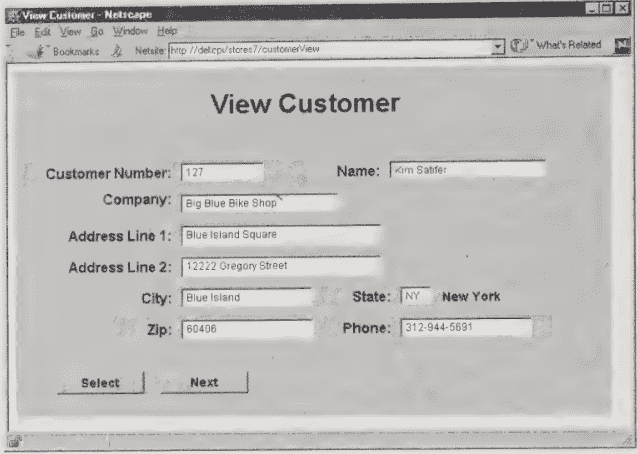

**图 9-12.** `customerView` 小应用程序的浏览器显示。

### customerView 小应用程序显示

图 9-12 展示了用户输入“客户编号”并单击 **Select** 按钮时 `customerView` 小应用程序的浏览器显示。请注意，所有屏幕字段都已填充，并且州描述作为 **Label** 对象显示在 `state` 代码旁边。

### 小结

本章讨论了从数据库提供 Java 小应用程序的实际问题，并说明了如何使用 AppPage 变量参数化 Java 小应用程序。特别是，本章还展示了如何通过 AppPage 变量将 JDBC 连接信息和 SQL 查询传递给 applet。

凭借本章的内容，您可以将 Web DataBlade 的功能与 Java 小应用程序和 JDBC 集成，以创建动态的、数据库驱动的 Web 应用程序。

# 使用 RMI 和 JDBC 创建分布式应用程序

在本章中：

- 理解远程方法调用（RMI）
- 使用 RMI 创建多层数据库应用程序
- 在小应用程序中实现 RMI
- 一个实用的 RMI 小应用程序示例
- 从 RMI 服务器主机连接到数据库
- 参数化连接信息

本章介绍使用远程方法调用（RMI）和 JDBC 创建分布式数据库应用程序的基本要素。JDBC 和 RMI together 将允许您实现高度可扩展的分布式数据库应用程序。在本章结束时，您将了解如何使用 RMI 将 Java 客户端对象连接到远程对象，以及如何调用使用 JDBC 连接到数据库的远程方法。

## 理解远程方法调用（RMI）

RMI 技术使您可以轻松开发网络化的 Java 应用程序，这些应用程序隐藏了传输方法参数和返回值的底层机制。

RMI 使程序员能够创建分布式的 Java 到 Java 程序。在分布式 Java 计算下，程序的一部分——在一个 Java 虚拟机中作为客户端运行——可以调用另一个虚拟机中的服务器对象的方法，通常在不同的主机上。

然而，客户端程序并不直接与服务器对象通信。当调用远程方法时，客户端转而调用远程对象的 `stub` 的方法，该 `stub` 驻留在客户端主机上。本地 `stub` 执行将远程方法调用传递给驻留在服务器主机上的 `skeleton`（远程对象的另一个接口）所需的网络操作。

图 10-1 展示了 RMI 架构。

RMI 允许客户端和服务器对象像驻留在同一 Java 虚拟机中的本地对象一样进行交互。此外，服务器对象还可以是其他远程对象的 RMI 客户端。

### 传递参数和返回值

RMI 允许 Java 客户端将参数值传递给远程服务器方法，并接受这些方法的返回值。它通过允许 `stub` 和 `skeleton` 进行 `marshal` 和 `unmarshal` 实现这一点。

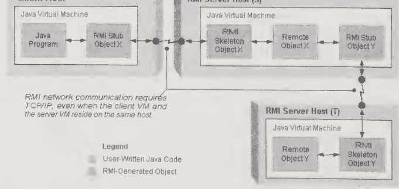

*图 10-1. RMI 架构。*

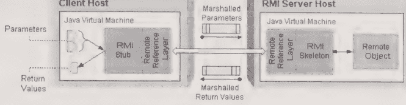

图 10-2. 参数和返回值的编组。

#### 什么是编组？

> 编组是指打包方法参数和返回值以便它们可以在网络上传输的过程。此过程涉及序列化，这是一种转换对象的方式，以便它们可以通过网络传递。可序列化对象包括基本类型、远程 Java 对象、AWT 组件以及任何其他实现了可序列化接口的对象。请注意，如果您将 Java 属性声明为 `transient`，则该属性将不会被序列化。

### 基本 RMI 组件

表 10-1 列出了我们将用于创建实用 RMI 应用程序的基本 RMI 组件。接下来的几个部分将更详细地展示如何使用这些组件。

### 有用的链接

有关 RMI 的更多信息，您可以查看以下文档：

JavaSoft RMI 文档位于：

```text
http://Java.sun.com/products/jdk/1.1/docs/guide/rmi/index.html
```

表 10-1. RMI 核心组件。

| 组件 | 功能 |
| :--- | :--- |
| RMI 编译器 (`rmic`) | 为远程服务器类生成存根和骨架。 |
| 存根（Stubs） | 客户端视角的远程方法。 |
| 骨架（Skeletons） | 在服务器端，将存根连接到远程服务器类。 |
| 远程接口 | 一个接口，定义远程服务器类将在代码中实现的远程方法。 |
| 远程服务器类 | 实现接口文件中定义的方法的类。 |
| 服务器工厂 | 一个程序，生成远程服务器类的实例，并将其注册到 RMI 注册表。 |
| RMI 注册表服务 | 运行在服务器主机上的 RMI 引导注册表程序，按名称在网络中注册远程 RMI 对象。 |

JavaSoft RMI 常见问题：

`http://Java.sun.com/products/jdk/1.1/docs/guide/rmi/faq.html`

JavaSoft RMI 规范：

`http://Java.sun.com/products/jdk/1.1/docs/guide/rmi/spec/rmiTOC.doc.html`

### 使用 RMI 创建多层数据库应用程序

创建分布式数据库应用程序的步骤如下：

1. 定义远程接口。创建并编译一个扩展 `java.rmi.Remote` 的接口类。此接口定义服务器实现的方法。客户端 Java 程序将调用这些方法，就像它们是本地方法一样，而实际上它们是远程的。
2. 定义远程类。创建并编译一个扩展 `RemoteObject`（如 `java.rmi.server.UnicastRemoteObject`）的远程服务器类。此类将实现步骤 1 中定义的接口。
3. **创建存根和骨架。** 使用 RMI 编译器 `rmic`，为步骤 2 中创建的实现类生成存根和骨架。
4. **创建服务器程序以生成远程对象。** 创建并编译一个服务器程序，该程序创建步骤 2 中远程对象的实例，然后通过名称将其注册到 RMI 注册表服务。
5. **在服务器上启动 RMI 注册表服务。** 在服务器主机上，启动引导注册表服务 `rmiregistry`，并启动步骤 4 中创建的服务器程序。
6. **创建 Java 客户端程序。** 创建并编译将调用远程方法的客户端 Java 程序。

#### 定义远程接口

我们要做的是使用分布式 Java 对象运行 SQL 查询。要操作远程服务器对象，客户端代码需要知道它可以对该对象执行哪些操作。因此，接口在客户端和服务器之间共享。正是这个接口将远程对象的方法暴露给客户端。

##### 创建远程接口

我们在名为 `JR.java` 的文件中创建接口。要创建远程接口，请在 Java 代码中导入 RMI 包，如果使用 SQL，还需导入 SQL 包。清单 10-1 中的接口声明了打开和关闭数据库连接、执行查询以及检索表行的方法。

为了将远程方法暴露给客户端，接口必须扩展 `java.rmi.Remote`。

每个暴露的方法必须在其 `throws` 子句中声明 `java.rmi.RemoteException`，因为通过网络进行远程调用时可能会发生很多问题。对远程主机的调用本质上不如对本地主机的调用可靠。例如，进行远程调用时，远程主机可能不可用。

还要注意，因为我们使用的是 SQL 包，所以还需要在远程方法的 `throws` 子句中声明 `java.sql.SQLException`。

> 尽量保持远程接口的设计稳定。如果使用参数，尽量将所有相关参数封装到单个对象中。如果需要添加另一个参数，就不必更改远程接口，只需更改参数类即可。

###### 清单 10-1. 在接口中定义远程方法（JR.java）

```java
import java.rmi.*;
import java.sql.*;

public interface JR extends java.rmi.Remote {

    public int openConnection()
        throws RemoteException,
               SQLException,
               ClassNotFoundException;

    public void closeConnection(int id)
        throws RemoteException,
               SQLException;

    public void performQuery(int id, String searchString)
        throws RemoteException,
               SQLException;

    public String getNextRow(int id)
        throws RemoteException,
               SQLException;
}
```

##### 编译并定位接口

使用 `javac` 命令编译接口文件。

```bash
javac JR.java
```

这会生成一个名为 `JR.class` 的文件。

对于独立的 Java 应用程序，将编译后的接口同时放置在客户端主机和服务器主机上。

在两台主机上，将 `CLASSPATH` 环境变量指向放置接口的目录。这必须在客户端主机上启动客户端程序之前完成，也必须在服务器主机上启动注册表服务和服务器工厂之前完成。

对于 Java 小应用程序（applet）形式的客户端程序，将编译后的接口放置在与小应用程序相同的 RMI 服务器主机目录中。

一旦声明并编译了接口类，下一步就是定义实现已声明远程方法的远程服务器类。

> **提示**
>
> 可以将编译后的接口放置在 RMI 服务器上的任何位置。确保启动服务器程序时使用的 `CLASSPATH` 环境变量指向这些接口类的位置。

#### 定义远程类

此步骤创建远程服务器类。远程服务器类通过创建与接口签名匹配的实际 Java 方法，来实现步骤 1 中创建的接口所定义的所有方法。

##### “远程服务器类”是什么意思？

这个实现类是一个服务器类，因为它扩展了 `UnicastRemoteObject`，这使对象可以被远程访问。这个类继承了服务器对象与其在客户端主机上的存根之间的通信基本技术，因此您无需编写这些代码。

##### 创建远程服务器类

您可以在此类中创建非远程的方法。在更复杂的应用程序中，您可以创建多个接口和多个远程服务器类。这是一个设计问题；通常，设计阶段的输出将是一组接口，其中有一个或多个被定义为远程的。

因为 Java 平台处理数据的编组和远程调用，所以您无需编写这些代码。除了定义方法的远程特性之外，您专注于需要编写的应用程序功能。

在此示例中，我们通过在名为 `JRImpl.java` 的文件中创建一个名为 `JRImpl` 的 Java 类来定义远程服务器，如清单 10-2 所示。请注意，我们将 `java.rmi.server` 包导入到类中。

为了将该类定义为包含可以远程访问的方法，我们将 `JRImpl` 定义为 `UnicastRemoteObject` 的子类，实现接口 `JR`。

###### 清单 10-2. Remote server class JRImpl.java

```java
import java.rmi.*;
import java.rmi.server.*;
import java.sql.*;

public class JRImpl
        extends UnicastRemoteObject
        implements JR {

    // Default constructor
    public JRImpl() throws RemoteException { }

    public synchronized int openConnection()
        throws RemoteException,
               SQLException,
               ClassNotFoundException
    {
        ...
    }

    public void closeConnection(int id)
        throws RemoteException,
               SQLException
    {
        ...
    }

    public void performQuery(int id, String searchString)
        throws RemoteException,
               SQLException
    {
        ...
    }

    public String getNextRow(int id)
        throws RemoteException,
               SQLException
    {
        ...
    }
}
```

##### 为什么要使用 `UnicastRemoteObject`？

`UnicastRemoteObject` 与其他 RMI 组件一起处理所有远程方法调用任务；您无需采取任何特殊操作，只需确保接口类中声明的所有远程方法在其各自的 `throws` 子句中声明 `java.rmi.RemoteException`。

##### 编译并定位远程服务器类

使用 `javac` 编译远程服务器类：

```bash
javac JRImpl.java
```

这会生成一个名为 `JRImpl.class` 的文件。您可以将编译后的远程服务器类放置在 RMI 服务器主机的任何位置。确保 `CLASSPATH` 环境变量指向这些远程服务器类的位置。

或者，将您为特定程序开发的所有支持类放置在 RMI 服务器上的同一目录中；并在启动服务器工厂时在命令行上将 `java.rmi.server.codebase` 属性指向该目录（参见本章后面的小节“启动服务器工厂”）。

> RMI 客户端和服务器程序应安装安全管理器，以控制从网络位置加载的存根和骨架对象的操作。对于小应用程序，有一个默认的安全管理器以确保小应用程序不会造成危害。对于独立应用程序，没有默认的安全管理器，因此在使用 RMI 时必须设置一个。
>
> 当客户端请求服务时，远程服务器对象必须已经在服务器主机上运行。

##### 创建存根和骨架

使用 RMI，客户端程序和远程对象使用称为存根和骨架的代理来处理它们之间必要的网络通信。

您无需以任何方式关注存根和骨架，除了如何创建和定位它们。

存根和骨架是 Java 类。您将编译后的存根放在客户端上（如果是小应用程序，则将其与小应用程序代码捆绑在一起），将编译后的骨架放在服务器上。请注意，RMI 服务器主机可以作为另一个 RMI 服务器的客户端进行协作，在高度分布式的应用程序中充当主机。即使如此，要遵循的步骤也是相同的。

##### 生成 Stub 和 Skeleton 类

您需要使用 `rmic`（RMI 编译器）来创建 stub 和 skeleton，`rmic` 随 JDK 一起提供。在生成 stub 和 skeleton 之前，请确保已经编译了远程接口 `JR.java` 和远程服务器 `JRImpl.java`。

按照以下方式为远程服务器 `JRImpl.class` 生成 stub 和 skeleton：

```bash
rmic JRImpl
```

这会创建两个类文件：

```text
JRImpl_Stub.class
JRImpl_Skel.class
```

> *如果编译后的类属于某个 Java 包，请向 `rmic` 提供完整的包名。*

##### 定位 Stub 和 Skeleton

生成的 skeleton 文件 `*.Skel` 可以放在 RMI 服务器上的任何位置。请确保启动服务器程序时使用的 `CLASSPATH` 环境变量指向 skeleton 类的位置。通常，您会将服务器应用程序的所有支持类放在 RMI 服务器上的同一目录中，并在启动服务器工厂时将该目录指定给 `CLASSPATH` 环境变量。

对于独立的 Java 应用程序，您需要将 stub 类复制到客户端主机的某个目录中，并在启动客户端程序之前将 `CLASSPATH` 环境变量指向该目录。

对于 Java 小程序（applet），您需要将 stub 类放在 RMI 服务器主机上存放该小程序的同一目录中。

#### 创建服务器程序以生成远程对象

您需要创建并编译一个服务器程序，该程序创建远程对象的实例，然后通过名称将其注册到 RMI 注册表服务中。当远程对象在 RMI 注册表服务中注册后，客户端就可以访问该对象中的远程方法。

我们现在创建的服务器程序称为服务器工厂，因为它实例化远程对象。

##### 创建服务器工厂

客户端程序要访问远程对象，首先必须获得该远程对象的引用或对象句柄。要获得该引用，客户端可以调用运行在 RMI 服务器主机上的服务器工厂中的远程方法，该方法返回包含远程方法的对象的引用。

服务器程序将远程对象注册到引导注册表服务中。远程对象注册后，服务器程序就可以返回对该对象的引用。

您通过在 RMI 服务器主机上给出对象的引用（`servlet`）和某个名称（`rmiExample`）来注册远程对象。此注册过程将远程对象绑定到主机（`dellcpi`）和端口（`1099`）的名称。这些对象汇总在表 10-2 中。`JRServer.java` 如清单 10-3 所示。

包含远程方法的类在以下行中实例化：

```java
JRImpl servlet = new JRImpl();
```

然后将该对象注册到 RMI 注册表服务中：

```java
Naming.rebind(
    "//dellcpi.eu.informix.com/rmiExample", servlet);
```


| 对象 | 描述 |
| --- | --- |
| `servlet` | 实现客户端将调用的远程方法的类的实例。 |
| `Naming.rebind` | `Naming` 提供默认的注册表服务。`rebind` 方法向 RMI 注册表添加对象。 |
| `//dellcpi:1099` | RMI 注册表运行的主机和端口。 |
| `rmiExample` | 注册对象的标签；所有客户端都可以使用该标签。 |

设置远程工厂以实例化远程对象所需做的就是这些；RMI 会处理其他所有事情。

##### 定位服务器工厂

您可以将编译后的服务器工厂类放在 RMI 服务器主机上的任何位置，但请确保启动服务器工厂时使用的 `CLASSPATH` 环境变量指向该服务器工厂类的位置。

如果您的 Java 客户端是一个 applet，则服务器工厂必须在 applet 启动之前运行。

清单 10-3. 服务器工厂 `JRServer.java`，它创建对象并将其注册到 RMI 注册表中。

```java
import java.rmi.*;

import java.rmi.registry.*;

import java.net.*;

public class JRServer {

    public static void main( String args[] ) {

        String hostName   = null;

        String hostIP     = null;

        try {

            java.net.InetAddress hostInet =

                java.net.InetAddress.getLocalHost();

            hostName = hostInet.getHostName();

            hostIP   = hostInet.getHostAddress();

            System.out.println(

                "Starting RemoteSQL on " + hostName +

                " [" + hostIP + "]");

        }

        catch (java.net.UnknownHostException e) {

            System.err.println("JRServer.main exception: "

                + e.getMessage());

            e.printStackTrace();

        }

        if ( System.getSecurityManager() == null ) {

            System.setSecurityManager( new RMISecurityManager() );

        }

    }

}
```

**清单 10-3.（续）**

```java
try {

    JRImpl servlet = new JRImpl ();

    System.out.println( "Binding to the registry" );

    Naming.rebind(

        "//dellcpi.eu.informix.com/rmiExample", servlet );

    System.out.println( "...RemoteSQL is bound and ready." );

}

catch ( Exception e ) {

    System.err.println("JRServer.main exception: " + e.getMessage());

    e.printStackTrace();

}
```

##### 在服务器上启动 RMI 注册表服务

RMI 引导注册表程序运行在服务器主机上，按名称在网络中注册远程 RMI 对象。注册后，远程对象实际上就被导出了，可以被 RMI 客户端访问。

要访问远程对象，客户端程序首先使用 `Naming` 类通过其注册名查找该对象。客户端程序将名称指定为 `rmi:` URL。注册表服务然后返回远程对象的远程接口实例——对象的 `stub`。

###### 在 RMI 服务器上启动注册表命名服务

设置环境变量以指向 Java 安装的位置。例如，在 UNIX 上：

```sh
setenv JAVA_HOME /usr/local/java/jdk1.1.7

setenv PATH $JAVA_HOME/bin:$PATH
```

在 Windows 上等效的操作是：

```bat
set JAVA_HOME=D:\java\jdk1.1.7

set PATH=%JAVA_HOME%\bin;%PATH%
```

然后可以启动注册表命名服务 `rmiregistry`。在 UNIX 上按以下方式启动此程序：

```sh
unsetenv CLASSPATH

rmiregistry &
```

在 Windows 上：

```bat
unset CLASSPATH

start rmiregistry
```

在 Windows 示例中，如果 `unset` 在您的系统上不起作用，请使用 `set CLASSPATH=`。

> **注意**
>
> 启动注册表之前，`CLASSPATH` 应该被取消设置；至少，它不应该指向任何类。当 `rmiregistry` 程序启动时，如果它能找到您的 stub 类，它就不会记住这些 stub 可以从服务器的代码库加载。

> **提示**
>
> 注册表默认运行在端口 1099 上。要在不同的端口上启动注册表，请在命令行上指定端口号。例如，`start rmiregistry 1090`。RMI 引导注册表必须保持运行，以便注册表的命名服务始终可用。

##### 启动服务器工厂

适当设置 `CLASSPATH` 并启动您在第 4 步中创建的服务器程序，该程序创建由客户端远程访问其实现方法的对象。您可以按如下方式启动服务器程序：

```sh
java JRServer
```

#### 创建 Java 客户端程序

客户端程序使用由远程服务器程序导出的远程对象。为此，客户端程序必须在远程 RMI 注册表中查找远程对象。当远程对象被定位后，远程对象的 stub 会被发送到客户端。客户端调用此 stub 中的方法，就好像该 stub 是本地 Java 虚拟机中的实际远程对象一样。stub 与关联的远程 skeleton 通信，skeleton 调用远程客户端请求的方法。

##### 获取远程对象的引用

客户端使用 `Naming.lookup` 方法获取远程对象的引用。返回的值实际上是对 stub 对象的引用。

```java
JR servlet = (JR)Naming.lookup( registryName );
```

`registryName` 变量应定义 RMI 注册表运行的 RMI 服务器主机和端口，还应声明对象的名称。

例如，清单 10-4 中的 applet 从 `//dellcpi.eu.informix.com` 下载。该主机上的 RMI 注册表运行在默认端口 1099 上。所需的 `JRImpl` 对象标记为 `rmiExample`。因此，`lookup` 方法的 URL 为：

```text
//dellcpi.eu.informix.com/rmiExample
```

如果 RMI 服务器是在不同的端口上启动的（`rmiregistry 1090`），则 URL 将是：

```text
//dellcpi.eu.informix.com:1090/rmiExample
```

##### 在客户端实现 RMI 安全管理器

由于 Java 客户端将下载不受信任的 stub 对象，请在客户端代码中实现 `RMISecurityManager` 对象：

```java
System.setSecurityManager( new RMISecurityManager() );
```

清单 10-4 显示了使用 RMI 连接到存储在 RMI 注册表中的 `JR` 类远程实例的 Java applet 的 `init()` 方法。

## 清单 10-4. `TestApplet.java` 客户端小程序

```java
import java.rmi.*;

import java.awt.*;

import java.awt.event.*;

import java.applet.Applet;

public class TestApplet extends Applet

        implements ActionListener {

    // 安装安全管理器

    public void init() {

        if (System.getSecurityManager() == null) {

            System.setSecurityManager(

                new RMISecurityManager() );

        }

        // 获取对远程对象的引用

        String registryName;

        try {

            // 获取加载此小程序的主机名称。

            // 远程对象及其接口位于该主机上。

            registryName = "//" +

                getCodeBase().getHost() +

                    "/";

            // 追加已绑定到服务器主机上注册表的远程对象的预定名称

            registryName += "rmiExample";

            // 获取对远程对象的引用。

            JR servlet = (JR)Naming.lookup( registryName );

        }

        catch ( Exception e ) {

            showStatus( "Cannot connect to RMI registry." );

            return;

        }

        // 调用远程方法

        try {

    connectionId = servlet.openConnection();

}

catch (RemoteException e) {

    showStatus("Failed to Open Connection");

}

}

}
```

##### 在小程序中实现 RMI

由于小程序的安全限制，不受信任的小程序只能与加载它们的主机建立网络连接。这意味着所有服务器对象必须与托管网页的计算机位于同一台机器上。这些对象包括：

- 包含 `APPLET` 标签的 HTML 网页；
- 小程序类；
- 编译后的存根（stubs）；
- 编译后的骨架（skeletons）；
- 编译后的服务器类和对象；
- RMI 引导注册表。

对于小程序，编译后的存根与小程序代码捆绑在一起。你需要将存根类放置在 RMI 服务器主机上小程序所在的同一目录中。此外，将编译后的接口（例如，`JR.class`）放置在同一目录中。

> 小程序可以引用的远程对象不会被阻止连接到网络上的其他计算机和对象。例如，机器 1 上的远程对象可以实现一个方法，以调用另一台机器（机器 2）上对象的另一个远程方法。如果小程序需要来自机器 2 上远程对象的服务，它将调用机器 1 上的远程方法来管理此接口。

> RMI 客户端和服务器程序应安装安全管理器，以控制从网络位置加载的存根和骨架对象的操作。对于小程序，有一个默认的安全管理器来确保小程序不会造成危害。对于独立应用程序，没有默认的安全管理器，因此在使用 RMI 时必须设置一个。

> 注册表和服务器对象必须在小程序启动之前运行。

###### 一个可运行的 RMI 小程序示例

一旦 RMI 注册表运行并且服务器工厂已实例化并注册远程对象，就可以调用客户端应用程序。

清单 10-4 包含一个 Java 小程序的 `init()` 方法，该小程序试图通过远程对象打开与数据库的 JDBC 连接。清单 10-4 很好地总结了建立与远程对象连接的基本要点。

本节列出了一个完整可运行的小程序，它调用远程对象（`JRImpl.java`）中的方法，以打开数据库连接并执行用户在浏览器中输入的 SQL 命令。

要运行此示例，请确保按照上一节中的所有步骤操作，以便在 RMI 注册表中拥有 `JRImpl` 类的注册实例。

> 要运行基于 RMI 的小程序，用于运行小程序的查看器或浏览器必须支持 Java 1.1 的 RMI 功能。不支持这些功能的浏览器可能会崩溃。

本节列出以下代码：

- `RemoteSQLApplet.java`，即从浏览器请求远程连接的小程序；
- `JR.html`，其中包含用于下载和实例化小程序的 `APPLET` 标签。

###### `RemoteSQLApplet` 类

此 Java 类在浏览器中创建并显示一个表单，以便用户可以向数据库提交 `SELECT` 查询并显示结果。清单 10-5 显示了 Java 源代码。

清单 10-5. `RemoteSQLApplet.java` 的 Java 源代码。

```java
import java.awt.*;

import java.awt.event.*;

import java.applet.Applet;

import java.rmi.*;

import java.rmi.registry.*;

public class RemoteSQLApplet

        extends Applet

        implements ActionListener {

    Panel       north, center;

    TextField   searchCriteria;

    Button      searchButton, clearButton;

    List        searchResults;

    TextArea    samples;

    int         connectionId;

    JR          servlet;

    // 初始化小程序，显示用于输入 SQL 查询的 GUI，

    // 并打开与远程对象的连接。

    public void init() {

        String registryName;

        // 构建小程序显示界面。

        setLayout( new BorderLayout() );

        north = new Panel();

        north.setLayout( new FlowLayout() );

        north.add( new Label( "Enter SELECT statement:" ) );

        searchCriteria = new TextField( 40 );

        north.add( searchCriteria );

        searchButton = new Button( "Query" );

        searchButton.addActionListener( this );

        north.add( searchButton );

        clearButton = new Button( "Clear" );

        clearButton.addActionListener( this );

        north.add( clearButton );

        add( "North", north );

```

##### 清单 10-5.（续）

```java
searchResults = new List( 10, true );

add( "Center", searchResults );

Panel notes = new Panel();

notes.setLayout( new BorderLayout() );

samples = new TextArea( "", 4,60,

        TextArea.SCROLLBARS_BOTH );

samples.setFont( new Font( "TimesRoman",

        Font.BOLD, 10 ) );

samples.setBackground( Color.darkGray );

samples.setForeground( Color.white );

samples.setText("");

notes.add( "North", samples );

Panel messages = new Panel();

messages.setFont( new Font( "Sans Serif",

        Font.BOLD + Font.ITALIC, 12 ) );

messages.setBackground( Color.white );

messages.setForeground( Color.black );

messages.add(

    new Label( "Check your browser status bar" +

        " for any SQL messages.", Label.CENTER ) );

notes.add( "South", messages );

add( "South", notes );

validate();

setVisible( true );

try {

    // 安装安全管理器
```


```java
if (System.getSecurityManager() == null) {
    System.setSecurityManager(new RMISecurityManager());
}

searchResults.addItem("RemoteSQLApplet:init: Preparing for registry lookup...");

registryName = "//" + getCodeBase().getHost() + "/";
registryName += "rmiExample";
```

##### 清单 10-5.（续）

```java
searchResults.addItem("RemoteSQLApplet:init: Looking up '" + registryName + "'...");

servlet = (JR) Naming.lookup(registryName);

if (servlet == null) {
    searchResults.addItem(
        "RemoteSQLApplet:init:Naming.lookup: Lookup failed. Servlet is null."
    );
    return;
}

searchResults.addItem("RemoteSQLApplet:init: Lookup successful...");
}

catch (Exception e) {
    showStatus("Cannot CONNECT to RMI registry for 'RemoteSQL'");
    e.printStackTrace();
    return;
}

try {
    // 打开与远程对象的连接。
    // 此调用使远程服务器
    // 在服务器主机上加载 JDBC 驱动程序，并使用
    // 该驱动程序建立到 "stores7" 数据库的 JDBC 连接。

    searchResults.addItem(
        "RemoteSQLApplet:init: Starting OPEN db connection task..."
    );

    connectionId = servlet.openConnection();

    searchResults.addItem(
        "RemoteSQLApplet:init: Finished OPEN db connection task..."
    );

    if (connectionId == -1) {
        searchResults.addItem(
            "RemoteSQLApplet:init: Error during OPEN db connection task..."
        );
        searchResults.addItem("-- Cannot OPEN DATABASE connection.");
    }
```

##### 列表 10-5.（续）

```java
}
catch (Exception ex) {
    searchResults.addItem(
        "RemoteSQLApplet:init: Exception during OPEN db connection task..."
    );
    searchResults.addItem("Exception: Cannot OPEN DATABASE connection.");
    ex.printStackTrace();
}
}

// 关闭与远程对象的连接。
// 此调用会导致远程服务器关闭所有
// 与 JDBC 连接关联的服务器主机和数据库资源。
// 例如，所有游标、
// 结果集、语句对象和连接对象
// 都会被释放。

public void finalize() {
    try {
        servlet.closeConnection(connectionId);
    }
    catch (Exception ex) {}

    super.destroy();
}

// 处理属于此 Applet 的两个操作事件：
// “查询”按钮和“清除”按钮的点击。

public void actionPerformed(ActionEvent e) {
    if (e.getActionCommand().equals("Query")) {
        try {
            showStatus("");
            performQuery();
        }
        catch (Exception ex) {
            showStatus(ex.toString() + ": Cannot issue Query");
        }
    }
    else {
        showStatus("");
        clearListBox();
    }

    return;
}

public void clearListBox() {
    searchResults.removeAll();
}

// 将输入的 SQL 字符串传递给
// 远程对象执行，并从远程对象
// 逐行检索结果集，在检索
// 时显示每一行。

public void performQuery() throws Exception {
    String searchString;
    String result;

    clearListBox();
    searchString = searchCriteria.getText();

    // 执行查询。
    servlet.performQuery(connectionId, searchString);

    // 获取并显示结果集。
    result = servlet.getNextRow(connectionId);

    if (result == null) {
        showStatus("No rows found using specified search criteria.");
        return;
    }

    while (result != null) {
        searchResults.addItem(result);
        result = servlet.getNextRow(connectionId);
    }
}
```

##### 在浏览器中使用 `RemoteSQLApplet`

列表 10-6 展示了引用该 Applet 的 HTML 页面 `JR.html`。

图 10-3 展示了由浏览器实例化并显示 `RemoteSQLApplet` 类的效果。当 Applet 尝试建立与数据库的远程连接时，远程对象会向控制台写入一组确认消息，如列表 10-7 所示。Applet 还会通过写入 List 对象来确认其自身的处理状态，该列表显示在 Applet 窗口中。

列表 10-7 展示了服务器工厂 `JRServer` 的输出，包括：使用 `java JRServer` 启动工厂、代表在客户端浏览器中运行的 Applet 连接到数据库，以及根据客户端请求运行 SQL 查询。图 10-4 展示了当用户输入查询字符串并点击 `Query` 按钮时的浏览器输出。

> 列表 10-6. `JR.html` 页面。

```html
<HTML>
<APPLET CODE="RemoteSQLApplet" WIDTH=600 HEIGHT=300></APPLET>
</HTML>
```

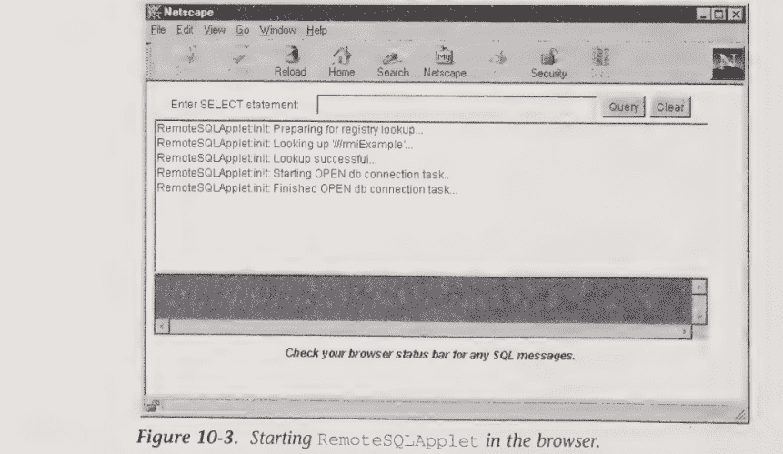

##### 列表 10-7. 从命令行调用 `JRServer` 的输出。

```text
Binding to the registry

...RemoteSQL is bound and ready.

JRImpl:openConnection: Starting...

JRImpl:openConnection: Creating connection object...

JRImpl:openConnection: Opening connection to DATABASE...

JRConn:openConnection:  Loading driver...

JRConn:openConnection:urlConnection:  jdbc:informix-sqli://

dellcpi:1526/stores7:INFORMIXSERVER=ol_dellcpi;user=

informix;password=informix;

JRConn:openConnection:getConnection: Making connection...

JRImpl:openConnection: Returning connection Id...

JRConn:performQuery:stmt.executeQuery().
```

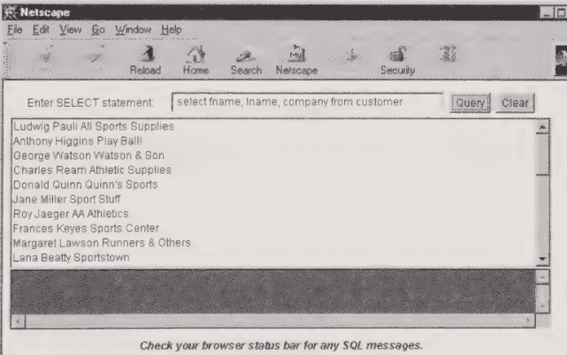

**图 10-4.** 查询结果的浏览器输出。

##### 从 RMI 服务器主机连接到数据库

我们可以使用 JDBC 从远程对象连接到 Informix 数据库。该数据库可以位于 RMI 服务器主机上，也可以位于网络中另一个可见的主机上。

由于我们不是从 Applet 连接到数据库，因此不受施加在 Applet 上的限制。Applet 连接到 RMI 服务器上的远程对象，该对象实现了它所需的远程方法。

列表 10-8 展示了 `JRImpl` 类。远程对象 `JRImpl` 为每个代表客户端建立的连接创建一个 `JRConn` 类的实例。正是 `JRConn` 类实现了 JDBC API 调用。`JRImpl` 中的远程方法是 `JRConn` 方法调用的包装器。多个客户端都将连接到同一个 `JRImpl` 对象。通过使用 `synchronized` 关键字来避免打开连接时的冲突，如下所示：

```java
public synchronized int openConnection()
```

##### 为什么要使用 `synchronized`？

> 当调用 `synchronized` 方法时，会在方法开始时获取对象锁。这会阻止其他对象在持有锁时调用该方法。当方法退出时，锁被释放。由于多个远程客户端连接会依次等待获取对象锁，每个客户端将在连接池中占据不同的槽位。

##### 列表 10-8. `JRImpl.java` 类

```java
public class JRImpl
    extends UnicastRemoteObject implements JR {

    // 创建一个可以容纳
    // 连接（JRConn）对象的表。
    private JRConn jrc[] = new JRConn[100];

    public JRImpl() throws RemoteException {
        super();
    }
```

##### 列表 10-8.（续）

```java
// 实现远程接口 JR 中
// 指定的每个远程方法

public synchronized int openConnection()
    throws RemoteException,
           SQLException,
           ClassNotFoundException {

    int connectionId;

    System.out.println(
        "JRImpl:openConnection: Starting..."
    );

    // 循环遍历连接表
    // 直到找到空槽位。
    for (
        connectionId = 0;
        connectionId < jrc.length;
        connectionId++
    ) {
        if (jrc[connectionId] == null) {
            break;
        }
    }

    // 如果未找到空槽位，则生成错误。
    if (connectionId >= jrc.length) {
        System.out.println(
            "WARNING: No more connection objects available"
                + " for RemoteSQL example."
        );
        return -1;
    }

    // 为新进程创建连接
    // 并运行它
    System.out.println(
        "JRImpl:openConnection: Creating connection object..."
    );

    jrc[connectionId] = new JRConn();

    System.out.println(
        "JRImpl:openConnection: Opening connection to DATABASE..."
    );

    jrc[connectionId].openConnection();

    // 返回连接标识符。
    System.out.println(
        "JRImpl:openConnection: Returning connection Id..."
    );
```

##### 列表 10-8.（续）

```java
return connectionId;
} // end openConnection

// 通过将字符串传递给
// 连接对象来执行 SQL 查询
// 以进行实际执行。

public void performQuery(int id, String searchString)
    throws RemoteException,
           SQLException {
    jrc[id].performQuery(searchString);
}

// 从当前查询结果中获取下一行。
public String getNextRow(int id)
    throws RemoteException,
           SQLException {
    return jrc[id].getNextRow();
}

// 关闭当前数据库连接
public void closeConnection(int id)
    throws RemoteException,
           SQLException {
    jrc[id].closeConnection();
    jrc[id] = null;
}
```

`JRImpl` 对象为每个远程客户端实例化一个 `JRConn` 对象，然后将该对象插入到 `JRConn` 对象数组中，该数组最多支持 100 个远程客户端连接。实际上，`JRImpl` 类实现了一个基本的连接池，这是一种管理到一个或多个数据源多个连接的方法。连接 ID 会返回给远程客户端，以标识客户端的数据库连接。`JRImpl` 中实现的远程方法映射到 `JRConn` 方法调用，后者实现了 JDBC 接口。

##### 参数化连接信息

我们可能希望指定不同的远程主机来访问不同的服务集。此外，我们可能希望连接到一个或多个远程对象——例如，多个数据库。Informix 服务器可以连接到其他 Informix 服务器，但我们可能希望使用 JDBC/ODBC 桥接器或其他 JDBC 驱动程序连接到非 Informix 数据库。如果该数据库是我们正在进行 Web 改造以参与更大应用框架的非 Informix 遗留数据库，则尤其如此。

###### 动态参数化客户端 Applet

如果您使用 Applet 连接到远程服务，可以使用 APPLET 标签的 PARAM 属性来指定在 `Naming.lookup()` 方法调用中使用的远程主机和对象名称。

在分布式数据库应用的更广泛处理中，您可能希望安全用户连接到不同的数据库或不同的远程对象集。在这种情况下，您将实现安全接口，例如 NSAPI 身份验证，并使用绑定了 NSAPI 的 URL 前缀，并相应地参数化 APPLET 标签以指定适当的远程对象。

您可以使用 AppPage 来参数化传递给 Applet 的参数值。为简单起见，假设您有一个名为 `/catalog` 的安全 URL 前缀。您的用户在数据库的 `webusers` 表中注册。每个用户都有一个或多个远程 Informix 数据库的指定远程接口。

```html
<APPLET CODE=catalog.class WIDTH=400 HEIGHT=500>

<PARAM NAME=user
    VALUE="<?MIVAR>$REMOTE_USER<?/MIVAR>">

<?MISQL SQL="select host, db1, db2 from rmiUsers">

    <PARAM NAME=remoteHost VALUE="$1">

    <PARAM NAME=remoteObject1 VALUE="$2">

    <PARAM NAME=remoteObject2 VALUE="$3">

<?/MISQL>

</APPLET>
```


# 摘要

在本章中，我们学习了如何创建和部署一个分布式的、多层的 Java 应用程序，该程序使用 JDBC 连接到远程数据库，并且我们了解了使用 RMI 来实现这一功能是多么简单。本章介绍了连接池的概念，还学习了如何通过实现数据库处理器来向客户端和服务器对象隐藏 JDBC 细节。

本章给出的示例是一个清晰简单的多层分布式组件应用程序，你可以将其扩展为工业级的分布式 Java 应用程序。

# 第 11 章：一个简单的 Java SQL 编辑器

## 在本章中

- Java SQL 编辑器是什么？
- Java SQL 编辑器的功能
- Java SQL 编辑器组件概述
- Java SQL 编辑器的设计
- 调用 Java SQL 编辑器
- 建立数据库连接
- 列出表和表信息
- 执行查询并显示结果
- 查询和显示的工作原理
- Java SQL 编辑器用户界面的工作原理
- 处理 SQL 编辑器事件
- 理解协议处理器
- 管理 JDBC 层

本章描述了一个用 Java 编写的简单 SQL 编辑器，它使用 JDBC 连接数据库并运行 SQL 查询。Java SQL 编辑器是一个 Java 应用程序，为任何具有 JDBC 或 ODBC 驱动的数据库提供 SQL 接口，并为该数据库提供有用的基础 GUI（图形用户界面）。

本章的主要目的是通过一个简单的应用程序来阐明和整合前面各章关于 Java 的一些关键主题。Java SQL 编辑器随附在配套 CD 中，包含完整的 Java 源文件，因此你可以按任何方式进行扩展。由于该编辑器旨在提供数据库的通用浏览接口，你会发现编写代码的方法很有用，并且该应用程序可以作为一个可操作的教程供你学习使用。

## Java SQL 编辑器是什么？

Java SQL 编辑器是一个简单的 Java 应用程序，为任何具有 JDBC 或 ODBC 驱动的数据库提供 SQL 接口。如果你想使用 Type 2 驱动，则需要安装适当的供应商客户端库。

编辑器允许你提交 SQL 查询、查看结果、查找数据库中的表，以及查看表的列信息。编辑器使用 Java 1.1 AWT 类来创建应用程序的外观和感觉，它不依赖第三方类库来渲染用户界面。

> 如果你只能访问数据源的 ODBC 驱动，可以使用 JDBC/ODBC 桥与 Java SQL 编辑器一起访问你的数据源。JDBC/ODBC 桥驱动随 JavaSoft JDK 一起提供。

## 为什么这个示例有用？

Java SQL 编辑器是一个重要的示例，原因有很多。你可以使用源代码来理解如何运用 JDBC API、实现基本的协议处理器，以及使用基础和高级 AWT 功能，还有许多其他与 Java 语言相关的功能。

你可以扩展核心软件以实现你想要的功能；这包括在 RMI 上下文中管理组件。编辑器展示了如何使用 Java AWT 包来创建带有标签面板和其他表单字段的 GUI 表单。因此，你将了解如何自己创建高级 AWT 界面。

JDBC 方法用于提交查询和格式化结果。你将学习如何使用 JDBC 方法来接受任何类型的查询，以及如何使用 Java AWT 类和 Java 语言来格式化任意复杂的结果集。

## Java SQL 编辑器的功能

可用功能在接下来的几节中概述。

### 输入并向数据库服务器提交 SQL

- 以自由格式文本输入 SQL，并提交 SQL 执行。
- （可选）指定从结果集中显示的行数。
- 将 SQL 结果以表格形式显示在单独的窗口中。

用户可以在文本框中输入 SQL 查询，然后发送到数据库服务器执行。查询可以是数据库服务器支持的任何 SQL，例如，`SELECT`、`INSERT`、`UPDATE`、`DELETE`、`EXECUTE PROCEDURE`。

用户可以通过在行数文本框中指定一个数字来限制查询显示的行数。这个数字即是要显示的行数。

非 `SELECT` 语句的查询，例如，`UPDATE`、`INSERT`，将返回更新计数，并在面板显示中附加确认消息。

### 列出数据库元数据

- 列出可用的数据库。
- 列出数据库中的表。
- 列出数据库中的目录和模式。
- 列出所选表中的列、列数据类型和其他列元数据。

JDBC 驱动在某些元数据 API 方法的实现上可能有所不同。然而，查询数据库中的对象是有用的。例如，在查询表之前，我们可能希望列出一个或多个表中的列。

### 指定和查询 JDBC 连接

- 使用 JDBC 驱动或 JDBC/ODBC 桥驱动以及 JDBC URL 连接和断开数据源。
- 显示 JDBC 驱动信息。

用户可以选择要连接的 JDBC 驱动和 JDBC URL。默认驱动是 JDK 1.1 中提供的 JDBC/ODBC 桥，用于 `jdbc:odbc` 协议。但是，可以输入任何有效的驱动，并且数据库 URL 可以指向远程数据库服务器。

连接到数据源后，用户可以显示有关 JDBC 驱动的重要元数据信息。

## Java SQL 编辑器组件概述

SQL 编辑器的 Java 组件由一组接口和类组成。每个接口强制要求所有实现该接口的类遵循一个设计主线。例如，所有实现 `DBProtocol` 接口的类都能够创建绑定到协议设计的协议指令。

表 11-1 列出了接口。表 11-2 列出了类。

### 表 11-1：SQL 编辑器定义的接口

| 接口 | 说明 |
| --- | --- |
| `DBProtocol` | 指定协议操作符和操作数偏移量。实现此接口的类将共享协议常量。 |
| `DBConstants` | 指定应用程序常量。实现此接口的类将共享应用程序范围的常量。 |
| `DBHandle` | 允许一个组件引用另一个组件。实现此接口的类将共享一个名为数据库处理器的对象的引用。 |
| `LogComponent` | 允许一个组件写入另一个组件。实现此方法的类必须提供写入日志设备的代码。 |

### 表 11-2：SQL 编辑器定义的类

| 类 | 接口 | 说明 |
| --- | --- | --- |
| `DataBase` | `DBConstants`, `DBProtocol` | 处理 JDBC 接口，包括连接和 JDBC API。 |
| `DataBrowser` | `DBProtocol`, `DBHandle`, `DBConstants` | 这是主要的用户界面客户端。它管理协议客户端的接口，以请求服务器执行数据库请求。 |
| `ProtocolClient` | `DBProtocol` | 打包协议指令并将其分派给协议服务器。 |
| `ProtocolServer` | `DBProtocol` | 解释协议指令并向 `DataBase` 对象发送消息以执行指令操作数。 |
| `ProtocolData` | `DBProtocol` | 创建和存储协议指令。 |
| `LogDevice` | `LogComponent` | 实现写入由 `DataBrowser` 提供的日志设备。对于此示例，日志设备是显示查询结果的屏幕面板。 |

## Java SQL 编辑器的设计

SQL 编辑器具有以下设计特性：

- 表示层与数据库层分离。
- 使用接口支持组件集成。
- 使用协议客户端和服务器进行协议处理。
- 使用匿名类将组件与事件紧密耦合。
- 严格使用核心 Java 1.1 AWT 类，包括用于标签面板的卡片布局。

### 表示层与数据库层分离

用户界面类（捕获查询请求并显示输出，可称为消费者）与数据库类（处理请求，可称为生产者）是分离的。

用户界面通过协议处理程序向数据库类传达服务请求。数据库类执行请求的服务，并获取两个项目的句柄：一个用于显示查询结果的结果组件，以及一个用于包含标准错误输出的日志设备。

就本示例而言，日志设备是显示查询结果的面板。因此，用户界面类实现了 `LogDevice` 接口。协作对象将调用在 `LogDevice` 接口中定义签名的方法，在本示例中，该接口由用户界面实现。

### 使用接口支持组件集成

使用少量接口来确保在每个相关组件中遵循设计线索。这些接口执行两个功能：

- 指定常量值，以便交互组件可以共享它们（接口 `DBConstants` 和 `DBProtocol`）。
- 允许指定方法签名，以便一个组件可以调用由另一个组件完成细节的方法（接口 `LogComponent`）。

### 使用协议客户端和服务器类进行协议处理

大多数多层架构在客户端和服务器之间实现某种形式的协议处理，无论多么非正式。

在基于协议的平台上，请求被形式化为一种协议，该协议由带有数据的指令组成，或者更正式地说，是带有操作数的运算符。与远程主机上的服务交互的客户端组件需要了解如何将指令或协议数据打包成合适的形式。

Java SQL 编辑器使用协议客户端类将协议指令打包到协议数据类中，后者将协议指令转发给协议服务器类进行解释——调用数据库方法来执行 JDBC 方法调用。这种表面复杂性的附加价值在于，协议客户端应该能够将应用程序服务请求转换为更详细的实现请求。

协议客户端类包含一个方法，用于打包操作数值并将协议指令发送到协议服务器。协议数据对象是单例对象；也就是说，无论调用构造函数多少次，都只创建一个类的实例。

协议客户端和协议服务器类从不实例化；相关变量和方法声明为静态，因此它们在类级别被引用。

> 协议处理的分布式多层处理可以使用 RMI。在 RMI 处理中，协议服务器请求是一个 RMI 调用。


### 使用匿名类将组件与事件紧密耦合

Java 1.1 引入了事件委托和匿名类。事件委托允许由一个组件（例如按钮）生成的事件由另一个组件处理。

匿名类允许在注册该组件的事件监听器时指定事件处理代码，从而消除了定义和实例化另一个类的需要。这降低了设计和构建的复杂性。

匿名标签描述了一个没有名称的类；就构建器而言，它是内联事件处理代码。当代码编译时，会生成一个包含事件处理代码的类文件，该类以包含类命名，后面附加 `$` 字符和类编号。

### 严格使用核心 Java 1.1 AWT 类

尽管存在许多支持网格和树控件的部件库，但 SQL 编辑器不使用任何这些库；相反，它使用核心 AWT 组件和布局管理器。这减少了用户界面的一些复杂性，并简化了设计。你可以从这个示例中学习如何组合基本表单。


> 你可以断开现有用户界面并提供自己的界面。例如，你可能希望使用网格控件来显示 `ResultSet`。你可以保留与数据库的现有接口，为你的新界面提供所需的服务。

很好地利用了 `CardLayout` 组件，它实现了类似标签页的功能。在这里，用户单击按钮（Query、Tables、Connect）时，会显示不同的卡片或标签页。标签页的内容在显示之间保持不变，因此，例如，在进入和返回 Query 标签页时，表列表仍然显示。以下部分向你展示如何使用 Java SQL 编辑器。

## 调用 Java SQL 编辑器

通过命令行调用应用程序，如下所示：

```bash
java DataBrowser
```

主应用程序窗口显示如图 11-1 所示。控制面板分为四个 `CardLayout` 面板，每个面板都有自己的功能集。`CardLayout` 旨在模拟标签面板，因此在本章的其余部分，术语标签页与 `CardLayout` 中的面板同义。

应用程序显示默认的 Connect 标签页，默认的 JDBC 驱动程序是 JDBC/ODBC 桥。顶部窗口用于显示查询结果和错误消息。应用程序窗口的下半部分是一个控制面板，用于创建 SQL 语句和管理与数据库的连接。

表 11-3 列出了每个控制面板标签页的主要功能。表 11-4 列出了其余控制面板按钮的功能，这些按钮映射到简单操作。


### 表 11-3：控制面板标签页功能

| 标签页 | 功能 |
| --- | --- |
| Query | 执行 SQL 查询。 |
| Tables | 列出对连接的数据库服务器可见的数据库、表、视图和其他实体。你可以查询这些项目的属性。 |
| Connect | 连接到数据库服务器并列出 JDBC 驱动程序详细信息。 |

### 表 11-4：控制面板操作

| 按钮 | 功能 |
| --- | --- |
| Clear | 清除顶部显示。 |
| Exit | 退出应用程序。 |

## 建立数据库连接

你不受限于使用 Informix Type 4 JDBC 驱动程序。你可以使用 JDBC/ODBC 桥连接到 ODBC 数据源，或者可以使用其他类型的 JDBC 驱动程序。

### 使用 JDBC/ODBC 桥

例如，假设你配置了一个 ODBC 数据源，用于与名为 AdvWorks 的 MS-Access 数据库接口。使用 Connect 标签页：

- 将 Driver URL 设置为 `sun.jdbc.odbc.JdbcOdbcDriver`（应用程序启动时默认显示）。
- 将 Connect To 设置为 `jdbc:odbc:AdvWorks`。
- 如果需要，将 User ID 设置为可以访问数据库的有效用户账户。
- 如果需要，将 Password 设置为该账户的密码。
- 单击 Connect。


图 11-2。连接到 ODBC 数据源。

左侧文本框将显示连接状态消息。顶部窗口将显示任何连接警告和错误。Connect 按钮的标签将更改为显示“Disconnect”。

如果单击 Details 按钮，将显示当前注册驱动程序的基本元数据。

图 11-2 显示了执行上述步骤后的屏幕。

### 使用 Informix Type 4 JDBC 驱动程序

步骤不变，但连接值发生变化。以下值假设你正在连接到 `dellcpi` 机器上的 `stores7` 数据库，服务器监听端口 1526。

- 将 Driver URL 设置为 `com.informix.jdbc.IfxDriver`。
- 将 Connect To 设置为 `jdbc:informix-sqli://dellcpi:1526/stores7:informixserver=ol_dellcpi`。
- 如果需要，将 User ID 设置为可以访问数据库的有效用户账户。
- 如果需要，将 Password 设置为该账户的密码。
- 单击 Connect。

单击 Details 以查看基本的 JDBC 驱动程序元数据。最终屏幕如图 11-3 所示。

顶部窗口包含连接时遇到的 SQL 警告。

> **注意**
>
> 你可以在程序中注册多个 JDBC 驱动程序以连接到多个数据库。例如，你可以注册 Type 4 驱动程序和 JDBC/ODBC 桥驱动程序。你可以扩展 Java SQL 编辑器以实现此功能；目前，它只能与一个驱动程序配合使用。

## 列出表和表信息

你在 JDBC URL 中选择要连接的数据库。

你可以从 Tables 标签页列出数据库中不同类型的对象，例如表、同义词和视图。

“表”选项卡包含四个列表，用于筛选数据库中的不同类型的实体。每个列表由 JDBC 元数据方法调用填充。不同的 JDBC 驱动程序会以自己的方式解释元数据调用。

例如，Informix Type 4 驱动程序会在“模式”列表中显示所选数据库中表的所有者；在“目录”列表中显示你所连接的 Informix 动态服务器管理的所有数据库。其他驱动程序可能会根据 JDBC 驱动程序的实现产生不同的列表。本节的其余部分假设你使用的是 Informix Type 4 驱动程序。

### 列出表或视图的列信息

在“表类型”列表框中，选择 `TABLE` 或 `VIEW`，然后点击“选择”。右侧列表将填充该数据库中的表或视图列表。

要查看某个特定表的列信息，请在右侧列表中点击该表。图 11-4 显示了选择 `orders` 表的结果。


图 11-5 显示了从“表类型”列表中选择 `VIEW`，然后选择 `someorders` 视图的结果。视图的投影列显示在上部窗口中。

## 执行查询并显示结果

“查询”选项卡允许你提交目标数据源支持的任何 SQL 命令。上部窗口显示 SQL 语句的执行结果。

通常，你会使用“表”选项卡来查找表或视图的列，然后在“查询”选项卡中组合 SQL 查询。

“查询”选项卡有三个值得关注的功能：

- **Go 按钮**：此按钮将 SQL 查询提交给数据库服务器。
- **Clear 按钮**：此按钮清除你输入 SQL 命令的文本区域。
- **行数**：此文本框允许你指定从 `ResultSet` 中显示的行数，从第一行开始。

> 每个选项卡面板的内容在选项卡之间会被保留，因此你可以移动选项卡面板而不会丢失已获取的任何信息。

## 执行存储过程

你可以在“查询”选项卡中创建并执行存储过程。如果存储过程返回多个结果，那么查询的 `ResultSet` 会将每个返回值显示为单独的列。

例如，假设你已创建如下存储过程：

```sql
create procedure returnTwo()

returning char(5), char(12);

    return "Hello", " Java World";

end procedure;
```

然后，在“查询”选项卡中输入 `execute procedure returnTwo()` 并点击 Go 按钮。上部窗口应显示类似以下的输出：

```text
(expression) (expression)

------------ ---------------

Hello        Java World
```


### 选择和显示 HTML 页面

你可以在上部面板中显示`AppPage`源代码以及`AppPage`的展开版本。

图 11-6 显示了发送给数据库服务器的查询，结果展示在上部窗口中。请注意，显示的`AppPage`尚未展开。

图 11-7 显示了提交查询以展开`AppPage`的结果。上部窗口显示在`JDBC ResultSet`中返回的已展开`AppPage`。

图 11-8 显示了使用`HTTP`请求时在浏览器中显示的已展开`AppPage`。


图 11-6. 选择并显示`AppPage`源代码。


图 11-7. 选择`AppPage`进行`webexplode`并显示结果。


图 11-8. 在浏览器中通过`HTTP`选择`AppPage`。

请注意，我们将 HTML 对象列使用`::`运算符转换为`LVARCHAR`，以便从`ResultSet`中提取并显示可打印的文本：

```sql
select object::lvarchar from wbpages

where id='select1'
```

一个整体更易于可视化的示例是`"HelloWorld"`示例。图 11-9 显示了`AppPage`源代码，图 11-10 显示了已展开的`AppPage`。两者的显示都是通过从查询的`ResultSet`中提取`String`对象来实现的。

> 你可以为列选择别名（例如`select fname as FirstName from customer`），列标题将在上部面板中显示为别名。


图 11-9. `"HelloWorld"`的`AppPage`源代码。


图 11-10. `"HelloWorld"`的已展开`AppPage`源代码。

### 插入、更新和删除数据

你可以在“查询”选项卡中输入 SQL 命令，然后点击 Go 按钮来插入、更新和删除数据。上部窗口将显示受操作影响的`rows`数量。

### 使用事务

如果你的 Informix 数据库已启用日志记录，则可以创建显式事务。输入`BEGIN WORK`并点击 Go 按钮。然后输入并提交适当的 SQL 命令，每次都要点击 Go 按钮。完成后，在“查询”选项卡中输入`COMMIT`或`ROLLBACK`，然后点击 Go 按钮。请注意，“查询”选项卡每次只接受一条 SQL 语句进行提交。

### 查询和显示的工作原理

管理未知查询结果的关键在于能够显示任意复杂度的结果。如果你不知道查询内容，你就不知道`ResultSet`的列。因此，你需要使用`ResultSetMetaData`来查询结果，以便按可打印的顺序显示列名和值。

### 查询和显示的逐步说明

- 在“查询”选项卡的文本框中输入查询，然后点击 Go 按钮。
- `DataBrowser`对象处理 Go 按钮，并要求协议客户端创建要发送给数据库服务器的应用程序请求。
- 协议客户端接收来自“查询”选项卡的 SQL 查询文本，并格式化协议指令，即请求协议服务器执行操作。协议指令由操作符（执行查询）和操作数（SQL 文本）组成。然后，协议指令被发送给协议服务器执行。
- 协议服务器解释协议指令，提取操作数值（如有），并调用`DataBase`类执行适当的方法，在本例中涉及执行 JDBC 查询。
- 查询结果返回给用户界面对象`DataBrowser`。

> 更高级的架构处理方式会将`ResultSet`作为记录对象向量返回给用户界面。例如，返回十条客户记录的查询会向数据库处理程序返回一个十行的`ResultSet`。数据库处理程序继而请求特定于应用程序的对象将十条原始`ResultSet`记录转换为应用程序更高层可以理解的客户记录向量。在某些情况下，拥有中间层的业务对象存储库（如客户记录向量）可能无需重新查询数据库，因为相关对象可能已经被提取。

### Java SQL 编辑器用户界面的工作原理

用户界面由`DataBrowser`类创建。这个类是应用程序的主入口点，因为它包含`main()`方法。此外，`DataBrowser`类是`java.awt.Frame`类的子类：

```java
class DataBrowser extends Frame
```

由于应用程序的所有组件都在同一个虚拟机中运行，因此这个类还会实例化所有其他组件，如协议对象和数据库处理程序。

#### 创建主窗口

`DataBrowser`类使用名为`createControls()`的方法创建用户界面组件。

用户界面使用 Java 1.1 AWT 容器和组件（例如`Frame`、`Textarea`、`List`、`Button`）以及`LayoutManager`（如`CardLayout`）构建。容器（如框架或窗口）可以包含其他组件。此外，容器可以嵌入到更高级别的容器中，因此也可以被描述为组件。

容器的`LayoutManager`用于定位其中的组件。

清单 11-1 展示了`createControls()`方法。`createStructure()`方法创建实际的用户界面显示；`createListeners()`方法创建并注册用户界面组件的事件处理器。

#### 创建面板和按钮

`createStructure()`方法创建`Panel`对象，并在其中嵌入其他面板。每个面板都分配了一个`LayoutManager`。结构完成后，添加文本区域和按钮。

清单 11-2 展示了`createStructure()`方法的片段。总之，创建了三个面板，使用`BorderLayout`或`FlowLayout`管理器。`panel4`使用`CardLayout`（见下一节）创建，以模拟标签页布局。主结果显示区域被创建并分配给`panel2`。

#### 创建按钮栏

将按钮添加到使用`FlowLayout`管理器的`panel3`，在屏幕中央创建按钮栏。以下代码片段取自`createStructure()`方法。

```java
// add smallest components that are left

panel3.add(queryButton = new Button("Query"));

panel3.add(schemaButton = new Button("Tables"));

panel3.add(connectButton = new Button("Connect"));

panel3.add(clearLogButton = new Button("Clear"));

panel3.add(exitButton = new Button("Exit"));
```

#### 使用 `LogDevice` 类创建主结果显示区

屏幕顶部的主结果显示区是一种特殊的`TextArea`，称为`LogDevice`。`LogDevice`类是`TextArea`类的简单扩展，旨在处理其他组件写入日志设备的消息。

简而言之，结果显示区用于显示查询结果以及错误消息。任何想要写入应用程序错误日志的对象都会写入实现`LogComponent`接口的对象，在我们的例子中就是`LogDevice`类。

##### 清单 11-1. 通过 `DataBrowser.createControls()` 创建用户界面组件

```java
public void createControls() {

    try {

        createStructure();

        createListeners();

    }

    catch (IllegalArgumentException e) {

        e.printStackTrace();

    }

    catch (Exception e) {

        e.printStackTrace();

    }

}
```

##### 清单 11-3. `createStructure()`方法的片段

```java
private void createStructure()
                throws IllegalArgumentException {

    // Create Panels within Panels to format the separate
    // functional areas

    setLayout(new BorderLayout());

    add("Center", panel1 = new Panel(new BorderLayout()));

    panel1.add("Center",
        panel2 = new Panel(new BorderLayout()));

    panel1.add("South",
        panel4 = new Panel(tabOptions = new CardLayout()));

    // create the

    panel2.add("Center", resultList = new LogDevice());

    resultList.setFont(
        new Font("Monospaced", Font.PLAIN, 12));

    panel2.add("South", panel3 = new Panel());

    resultList.setEditable(false);

    resultList.setBackground(new Color(22, 69, 218));

    resultList.setForeground(Color.white);
```

以下`DataBrowser.createStructure()`方法中的片段展示了主结果显示区的创建和格式设置。

```java
panel2.add("Center", resultList = new LogDevice());

resultList.setFont(new Font("Monospaced",
    Font.PLAIN, 12));

resultList.setEditable(false);

resultList.setBackground(new Color(22, 69, 218));

resultList.setForeground(Color.white);
```

清单 11-3 展示了非常简单的`LogComponent`接口，清单 11-4 展示了`LogDevice`类。

清单 11-4 显示`LogDevice`类实现了`writeLog()`方法，其签名在`LogComponent`接口中定义。

> `LogComponent`接口和`LogDevice`类是维护一个或多个基于组件的应用程序中设计思路的简单示例。一般来说，Java 应用程序的设计阶段会产生一组接口（常量和方法签名），具体类使用这些接口作为模板来实现真正的 Java 方法。例如，如果我们想写入错误设备，那么我们会选择一个实现`LogComponent`接口的类。写入错误设备的对象不关心写入日志的具体细节。我们可以替换掉`TextArea`，换成一个在文件系统中写入日志文件的类。这个类可以称为`FileDevice`，但它仍然必须实现`LogComponent`接口，这意味着`FileDevice`类必须实现`LogComponent`接口模板中的`writeLog()`方法。不过，不是写入屏幕，该方法会写入`FileOutputStream`。

##### 清单 11-3. 简单的 `LogComponent.java` 接口

```java
public interface LogComponent {

    public void writeLog(String mesg);

}
```

##### 清单 11-4. `LogDevice.java`

```java
import java.awt.*;

public class LogDevice extends TextArea
    implements LogComponent {

    public void writeLog(String mesg) {

        append(mesg);

    }

}
```

#### 使用 `CardLayout` 创建标签面板

当今市场上有许多组件库，包含高级 GUI 组件，如标签面板和网格框，用于显示表格数据，如`ResultSet`的内容。Java SQL 编辑器的用户界面使用 JDK 1 版本中的 Java AWT 类。不仅一切都是免费的，而且我们可以学习基本 Java 用户界面组件的实际工作原理。

AWT 中最接近标签面板的是`CardLayout`管理器。`CardLayout`类允许你创建一张或多张卡片，它们是`Panel`类的实例，用作其他组件的容器。我们将卡片叠在一起显示，所以任何时候只有一张可见。除此之外，我们可以向卡片添加其他容器和组件。

我们需要填充三张卡片：

1. Query：输入 SQL 查询。
2. Tables：列出表和查询列元数据信息。
3. Connect：通过 JDBC 连接数据库。

让我们看看 Query 卡片。其他两张遵循相同的步骤。

##### 创建 Query 卡片

`DataBrowser.createStructure()`方法创建一个名为`panel4`的面板，包含所有卡片，并将`CardLayout`管理器分配给它。

```java
panel1.add("South", panel4 = new Panel(tabOptions =
    new CardLayout()));
```

`CardLayout`的对象引用存储在`tabOptions`变量中，稍后用于控制卡片顺序。然后我们为每张卡片创建单独的面板。

对于 Query 卡片，我们创建`panel5`来包含 Query 卡片的所有组件。

```java
panel5 = new Panel(new BorderLayout());
```

然后我们添加一个`TextArea`来填充`panel5`的中心区域，称为`queryWindow`。这是我们输入 SQL 命令的文本区域。

```java
panel5.add("Center", queryWindow = new TextArea(10, 10));
```

Query 面板的其余部分包括一个 Go 按钮、一个 Clear 按钮和一个 Row Count 文本字段，用于限制从`ResultSet`显示的行数。Go 按钮将查询提交给数据库服务器。Clear 按钮清除`queryWindow`。

为了格式化这些组件，我们创建`panel6`并将 Query 卡片的其余组件添加到其中。面板的默认`LayoutManager`是`FlowLayout`（组件从左到右添加，居中，最终换行）。

```java
panel6 = new Panel();

panel6.add(goButton = new Button("Go"));

panel6.add(clearButton = new Button("Clear"));

panel6.add(new Label("Row Count:"));

panel6.add(rowCount = new TextField(5));
```

`panel6`完成后，我们将其添加到 Query 卡片的主面板`panel5`。

```java
panel5.add("South", panel6);
```

##### 向 `CardLayout` 添加卡片

一旦每张卡片的所有三个面板都创建完成，我们逐个将它们添加到包含`CardLayout`管理器的面板`panel4`，并为面板传入一个文本标签。我们稍后使用这个标签来识别`CardLayout`中的卡片。

```java
// Add cards to the card layout

panel4.add(panel5, new String(queryButton.getLabel()));

panel4.add(panel9, new String(schemaButton.getLabel()));

panel4.add(panel13, new String(connectButton.getLabel()));
```

此时，我们可以确定要显示的第一个面板。`tabOptions`变量是一个`CardLayout`对象的引用。我们调用`CardLayout`的`show()`方法来显示卡片，传入带有`CardLayout`管理器的面板，以及代表特定卡片的`text`标签：

```java
// flip to the first card

tabOptions.show(panel4, connectButton.getLabel());
```

##### 滚动浏览卡片

当点击 Query、Tables 或 Connect 按钮中的任意一个时，会显示该按钮对应的卡片。例如，当点击 Query 按钮时，显示器的下部面板会用 Query 卡片刷新。用技术术语来说，就是 Query 被*翻转*出来了。

我们稍后讨论事件处理程序和组件监听器。现在，假设三个按钮之一已被点击，并且该动作的委托事件处理程序正在处理它。

如果点击了 Query 按钮，事件处理程序执行以下操作：

```java
tabOptions.show(panel4, queryButton.getLabel());
```

当点击 Tables 按钮时：

```java
tabOptions.show(panel4, schemaButton.getLabel());
```

当点击 Connect 按钮时：

```java
tabOptions.show(panel4, connectButton.getLabel());
```


#### 填充列表

`Tables` 选项卡允许用户通过从数据库中的表列表中选择一个表来显示列元数据信息。此列表可以被过滤以选择表类型，例如`View`、`System Table`和（标准）`Table`。本节展示了如何填充这些列表。

为了实现所需的功能，`Tables` 选项卡包含三个`Choice`组件和一个`List`组件。这些组件的内容用从我们连接的数据库中获取的元数据信息填充。

> JDBC API 的实现因驱动程序而异，具体涉及`Catalogs`、`Schema`和`Table Type` API 方法。

##### 填充表列表

当首次建立连接时，会查询数据库元数据，并使用`DataBrowser.addChoiceTypes()`方法将目录、模式和表类型写入屏幕组件。例如：

```java
addChoiceTypes(dataBase.getCatalogs(), catalogChoices);

addChoiceTypes(dataBase.getSchemas(), schemaChoices);

addChoiceTypes(dataBase.getTableTypes(), tableTypeChoices);

metaWindow.append("Connected.\n");

connectCardButton.setLabel("Disconnect");
```

`getxxx()`方法是 JDBC 数据库元数据 API 调用`getSchemas()`、`getCatalogs()`和`getTableTypes()`的包装器。用户界面看到的是`Strings`的`Vector`，用于填充三个`Choice`组件。`addChoiceTypes()`方法如清单 11-5 所示。该方法首先做的是移除所有项目。因为我们在使用`Vector`，所以可以使用`Enumeration`，它允许我们使用`hasMoreElements()`方法滚动浏览所有元素，以检查我们是否已到达列表末尾。

在`Tables`选项卡中，用户可以在点击`Select`按钮从数据库元数据获取表列表之前，过滤要列出的表类型（例如，`Views`）。`addListTypes()`方法用于填充`Tables`列表框。这与`addChoiceTypes()`仅在签名上不同；方法细节相同：

```java
private void addListTypes(Vector v, List c)
```

### 处理 SQL 编辑器事件

当用户点击按钮时，会请求一项服务。例如，如果用户点击了`Tables`按钮，则显示该表的选项卡；如果点击了`Connect`按钮，则显示`connect`选项卡。

Java 允许你使用一种称为事件委托的技术来处理事件。简单地说，事件委托允许你为组件注册一个事件处理程序。例如，`Query`按钮是`java.awt.Button`类的一个实例，但你可以指定另一个类来处理该特定按钮的各种类型的事件；换句话说，你是将事件处理委托给另一个对象。被委托处理事件的对象称为该事件的监听器。

可以处理的事件类型很多，但通常它们分为两类：项目事件和语义事件。项目事件处理具体的单个事件，例如鼠标点击。语义事件处理更高层次的事件。例如，点击按钮包括按下鼠标键然后释放；所有这些事件都可以被处理。然而，语义事件被称为`ActionEvent`——即按钮的一次点击。

简而言之，处理事件涉及的步骤如下：

- 创建将生成事件的组件。
- 创建事件处理程序或监听器，其中包含处理事件的代码。
- 将事件处理程序注册为组件的监听器。

Java SQL 编辑器注册匿名类来处理事件，因此最后两个步骤合并。

#### 使用匿名类创建事件处理程序

Java SQL 编辑器中的大多数监听器都是作为匿名类创建的。匿名类是在另一个类的体中声明而没有名称的类，在我们的示例中，它用于为组件创建事件处理代码，无需使用单独源文件或维护单独对象引用的繁琐。然而，你不必使用匿名类来处理事件。

尽管匿名类在 Java 源文件中是无名的，但它会被编译成一个单独的类文件。这个类文件与外部类同名，但会附加一个`$`和一个数字作为标识。

`DataBrowser`类包含许多用于处理来自每个用户界面组件的事件的匿名类。当编译`DataBrowser.java`时，会为匿名类以及主`DataBrowser`类创建类文件。例如，这是创建的一些类文件的列表：

- `DataBrowser.class`
- `DataBrowser$1.class`
- `DataBrowser$2.class`
- `DataBrowser$3.class`
- `DataBrowser$4.class`

#### 创建和注册监听器

一个组件可以有许多已注册的监听器。例如，如果点击了一个按钮，可能有几个对象已将自己注册为该事件的监听器，它们都对事件做了一些稍微不同的处理。更技术性地说，`Button`对象将存储对已将自己注册为监听器的所有对象的引用，并依次调用每个对象中适当的事件处理方法。

`listener`对象将被定义为实现`java.awt.event`包中的接口。例如，实现`java.awt.event.ActionListener`接口的对象将实现该接口中定义的`actionPerformed()`方法的代码。

`DataBrowser`类包含一个名为`createListeners()`的方法，该方法创建和注册各种对象作为用户界面事件（如按钮点击或列表选择）的监听器。

清单 11-6 展示了`createListeners()`方法的一个片段。它展示了创建实现`ItemListener`接口的匿名类。

##### 清单 11-6. 创建匿名类以处理从表列表中选择表

```java
tableList.addItemListener(
    new ItemListener() {
        public void itemStateChanged(ItemEvent e) {
            Integer index = (Integer) e.getItem();

            tableName = tableList.getItem(index.intValue());

            try {
                ProtocolClient.tellProtocolClient(DBP_COLUMNS);
            } catch (Exception ea) {
                ea.printStackTrace();
            }
        }
    }
);
```

当代码运行时，匿名类被实例化，对象引用被传递给`addItemListener()`方法，该方法将对象注册为项目事件的监听器，例如选择列表元素。当用户从显示表列表中选择数据库表时，`tableList`组件将向匿名`summed()`监听器对象发送`ItemEvent`。

匿名类通过引用它实现的接口来声明和实例化：

```java
new ItemListener()
```

从那时起，该类实现`itemStateChanged()`方法。在此示例中，从列表中提取选定的表名，并调用协议客户端类的静态方法`tellProtocolClient()`来管理所选表的列元数据显示。

大多数用户界面组件都有匿名类注册为监听器。清单 11-7 展示了`Tables`按钮、`Query`按钮和`Query`选项卡中`Go`按钮的监听器。点击这些按钮会导致`ActionEvent`被发送到匿名监听器对象，该对象实现`java.awt.event.ActionListener`接口的`actionPerformed()`方法。

##### 清单 11-7. 按钮的事件处理器

```java
schemaButton.addActionListener(
    new ActionListener() {
        public void actionPerformed(ActionEvent e) {
            tabOptions.show(panel4, schemaButton.getLabel());
        }
    }
);

queryButton.addActionListener(
    new ActionListener() {
        public void actionPerformed(ActionEvent e) {
            tabOptions.show(panel4, queryButton.getLabel());
        }
    }
);

goButton.addActionListener(
    new ActionListener() {
        public void actionPerformed(ActionEvent e) {
            try {
                ProtocolClient.tellProtocolClient(DBP_EXECUTE_QUERY);
            } catch (Exception x) {
                x.printStackTrace();
            }
        }
    }
);
```

对于`Go`按钮，`actionPerformed()`方法会发起一个请求，用于执行已在`Query`选项卡的文本区域中输入的查询。该请求被发送给协议处理器，由协议处理器从该点开始管理此请求。

##### 将 DataBrowser 类注册为监听器

`DataBrowser`类本身处理在`Tables`选项卡中显示的`Choices`组件的选项事件，并通过以下方式将自己注册为监听器：

```java
catalogChoices.addItemListener(this);

schemaChoices.addItemListener(this);

tableTypeChoices.addItemListener(this);
```

当这些组件中发生选项事件时（例如点击列表项），组件内部的事件处理代码将调用`DataBrowser`对象中的`itemStateChanged()`方法。

`DataBrowser`类实现了`java.awt.event.ItemListener`接口，这意味着它必须包含接口方法`itemStateChanged()`的实现。`DataBrowser`的类声明部分如下：

```java
class DataBrowser extends Frame implements ItemListener
```

清单 11-8 展示了`itemStateChanged()`方法。该方法在用户点击`Tables`选项卡中的`Select`按钮时，为后续的 JDBC `DataBaseMetaData` API 调用设置基本参数值。为此，我们需要找出哪个`Choices`组件生成了该事件。调用`ItemEvent`对象的`getSource()`方法，返回委托组件的对象引用。如果选中的项是`All`，那么 JDBC API 调用需要以`null`作为参数，而不是字符串`All`。

```java
// choices 的选项监听器
// 在此设置 JDBC 方法调用的参数值；
public void itemStateChanged(ItemEvent e) {
    Object csrc = e.getSource();

    String s = (String) e.getItem();

    if (csrc == catalogChoices) {
        catalog = s;

        if (catalog.equals("All")) {
            catalog = null;
        }
    } else if (csrc == schemaChoices) {
        schema = s;

        if (schema.equals("All")) {
            schema = null;
        }
    } else if (csrc == tableTypeChoices) {
        tableType = s;

        if (tableType.equals("All")) {
            tableType = null;
        }
    }
}
```

### 理解协议处理器

在任何基于组件的应用程序中，组件需要通过方法调用进行通信，或者通过引发事件并由事件处理器拦截。

在协作组件之间传递的消息可能很复杂，包含一个请求以及随请求附带的一些可选数据。

为了使应用程序可扩展和可复用，创建一种结构化的消息传递方式（称为协议）是很有用的。客户端和服务端组件都理解该协议。例如，浏览器和 Web 服务器理解 HTTP 协议，即使实际产品不同。浏览器可以向任何 HTTP Web 服务器发送 HTTP 请求。

Java 平台允许你为协议创建高度成熟的协议处理器。然而，Java SQL 编辑器并没有走那么远。Java SQL 编辑器实现了一个协议，使应用程序的用户界面可以向数据库服务器发送请求，而无需关心请求的具体细节。协议客户端和协议服务器对象负责处理请求的具体细节。

总之，协议处理器位于客户端和服务端组件之间，具体如下：

- 用户界面与协议客户端通信。
- 协议客户端与协议服务器通信。
- 协议服务器与数据库处理器通信，数据库处理器进而使用 JDBC 连接到数据库服务器。

每一层都有自己的功能，其实现对其他层是隐藏的。

实际上，协议处理器的方法被视为一种服务 API。任何需要通过理解此协议的服务器获取服务的客户端，都会与协议客户端进行交互以连接到该服务，就像我们使用 JDBC 驱动程序连接到数据库服务器一样。

#### 处理协议数据

`ProtocolData`对象用于通过`ProtocolClient`类创建指令、`ProtocolData`类格式化指令、`ProtocolServer`类执行指令，将请求从用户界面传递到数据库处理器。

#### DBProtocol 接口

`DBProtocol`接口包含协议处理组件所需的所有常量，如清单 11-9 所示。

##### 清单 11-9. DBProtocol.java 接口

```java
public interface DBProtocol {
    // 指令操作符
    final byte DBP_EXECUTE_QUERY = 1;
    final byte DBP_TABLES = 2;
    final byte DBP_COLUMNS = 3;
    final byte DBP_METADATA = 4;
    final byte DBP_CONNECT = 5;
    final byte DBP_DISCONNECT = 6;

    // 操作数描述符
    final byte DBP_SQLTEXT_ARG = 0;
    final byte DBP_ROWCOUNT_ARG = 1;

    final byte DBP_DRIVER_ARG = 0;
    final byte DBP_URL_ARG = 1;
    final byte DBP_USERID_ARG = 2;
    final byte DBP_PASSWORD_ARG = 3;

    final byte DBP_CATALOG_ARG = 1;
    final byte DBP_SCHEMA_ARG = 2;
    final byte DBP_TYPES_ARG = 3;
    final byte DBP_TABLES_ARG = 3;

    final byte DBP_PROTOCOL_OPERANDS = 10;
}
```

协议客户端将使用这些值创建协议指令。协议服务器也将使用这些值来解释协议消息。

指令操作符定义了由协议服务器实现的服务。例如，指令`DBP_EXECUTE_QUERY`指示协议服务器告知`DataBase`对象执行 SQL 查询，使用的 SQL 文本操作数从用户界面的`Query`选项卡传递过来。

操作数描述符用于向协议服务器描述指令操作数。

例如，要执行从用户界面组件传递来的 SQL 查询，协议指令可以概括如下：

- **指令：** `DBP_EXECUTE_QUERY`定义要执行的服务。
- **操作数 1：** `DBP_SQLTEXT_ARG`描述第一个操作数的内容，即 SQL 命令字符串。
- **操作数 2：** `DBP_ROWCOUNT_ARG`描述第二个操作数的内容，即从`ResultSet`中显示的行数。

#### ProtocolData 类

`ProtocolData`类封装了处理协议指令操作符和一个或多个协议指令操作数的具体细节。`DBProtocol`接口中定义的常量用于操作指令。清单 11-10 展示了`ProtocolData`类。

##### 清单 11-10. ProtocolData.java 类源代码

```java
public class ProtocolData implements DBProtocol {
    private int opcode;

    private String[] operand =
        new String[DBP_PROTOCOL_OPERANDS];

    private static ProtocolData pd;

    public int getOpcode() {
        return opcode;
    }
```


##### 清单 11-10.（续）

```java
public String getOperand(int index) {
    return operand[index];
}

public String[] getOperand() {
    return operand;
}

public void setOpcode(int opcode) {
    this.opcode = opcode;
}

public void setOperand(String operand, int index) {
    this.operand[index] = operand;
}

public ProtocolData() {
    if (pd == null) {
        pd = this;
    }
}

public static ProtocolData getProtocolData() throws Exception {
    if (pd == null) {
        throw new Exception("No Protocol");
    }
    return pd;
}
```

一条协议指令由一条指令（即操作码）和一个或多个操作数组成，操作数的最大数量由`DBP_PROTOCOL_OPERANDS`指定。

该类包含一组用于协议指令的`get`和`set`方法。指令操作数存储在一个`String`数组中。可以使用`DBProtocol`常量按位置引用操作数，从而选择所需的操作数。

在该实现中，`ProtocolData`类被实现为单例对象。如果一个类被实例化为单例，则只会被实例化一次。类的构造函数`ProtocolData()`确保仅创建一个实例。

这种设计对于单个客户端来说是令人满意的。多个客户端请求将为每个客户端需要单独的`ProtocolData`对象。同样，单例对象可以维护一个`ProtocolData`对象的向量，每个元素代表该机器上的一个客户端。

#### 协议客户端

`ProtocolClient`类负责创建要传递给`ProtocolServer`的协议指令。用户界面调用`ProtocolClient`来请求服务。`ProtocolClient`选择适当的指令操作符和操作数值，并将它们存储在`ProtocolData`对象中。然后`ProtocolClient`调用`ProtocolServer`来执行该指令。

例如，如果用户在“查询”选项卡中输入 SQL 查询，然后单击**Go**按钮，该按钮的事件处理程序将执行以下方法：

`ProtocolClient.tellProtocolClient(DBP_EXECUTE_QUERY);`

在`tellProtocolClient()`方法内部，获取对`ProtocolData`对象的引用，并使用`setOpcode()`方法创建指令。两个参数（SQL 命令和要检索的行数）使用`setOperand()`方法创建。`setOperand()`的第二个参数是操作数值数组的索引。最后，调用`ProtocolServer`请求`DataBase`对象执行查询。清单 11-11 包含`ProtocolClient.tellProtocolClient()`方法的片段。

`ProtocolClient`对象包含对用户界面组件`DataBrowser`的引用，以便可以从屏幕字段中获取操作数值。

#### 协议服务器

`ProtocolServer`类接收包含指令的`ProtocolData`对象，并执行由其内容定义的服务。

`ProtocolServer`类包含对数据库处理对象的引用，该对象执行详细的 JDBC API 调用。

##### 清单 11-11. tellProtocolClient() 方法片段

```java
ProtocolData protocolData = ProtocolData.getProtocolData();

protocolData.setOpcode(opcode);

switch (opcode) {
    case DBP_EXECUTE_QUERY: {
        protocolData.setOperand(
            ui.queryWindow.getText(), DBP_SQLTEXT_ARG
        );
        protocolData.setOperand(
            ui.rowCount.getText(), DBP_ROWCOUNT_ARG
        );
        ProtocolServer.serviceDBRequest(protocolData);
        break;
    }
}
```

`ProtocolServer`中的核心方法是`serviceDBRequest()`方法。该方法解释协议指令。首先，它读取指令操作码，然后提取操作数值，之后调用适当的服务函数并将操作数值传递给它。

例如，假设上面显示的`DBP_EXECUTE_QUERY`指令被发送到`ProtocolServer`。以下代码负责解释它。

```java
public static Object serviceDBRequest(ProtocolData p)
    throws Exception {
    switch (p.getOpcode()) {
        case DBP_EXECUTE_QUERY: {
            db.execSQL(
                p.getOperand(DBP_SQLTEXT_ARG),
                p.getOperand(DBP_ROWCOUNT_ARG)
            );
            return db.getResults();
        }
    }
}
```

`ProtocolServer`了解所使用的协议格式，因此它知道`DBP_EXECUTE_QUERY`指令有两个操作数。我们不依赖于`DataBase`方法`execSQL()`来理解协议，因此在将它们传递到`execSQL()`方法之前提取操作数值。

Java SQL Editor 中几乎每一项功能都是以这种方式实现的，允许你替换应用程序的表示层而不会倒退应用程序架构。

你可以在各种情况下重用这种简单的指令处理模型，不仅仅用于在表示层和数据库层之间传递服务请求。你可以使用它来实现网络客户端和服务器之间的服务请求（使用或不使用 RMI），或者基于网络的批处理调度程序之间；实际上，你可以在中间层程序控制由其他组件实现的服务请求的任何应用程序中使用它。

`ProtocolServer`类是一个非常小的类。详细的 JDBC 接口由接下来讨论的`DataBase`类提供。

### 管理 JDBC 层

与数据库服务器的所有交互都包含在一个称为`DataBase`类的类中。这是数据库处理程序。该类包含由协议服务器调用的方法，用于执行诸如连接和断开数据库、执行查询、检索 JDBC 驱动程序元数据，以及获取用户从表列表中选择的数据库表的列元数据等功能。`DataBase`类将注册 JDBC 驱动程序并连接到用户在“连接”选项卡中输入的 JDBC URL。

为了说明，我们将查看`DataBase`对象如何执行 SQL 查询并返回结果。

#### 将指令传递给`DataBase`类

协议服务器将解释协议客户端传递给它的指令。在此示例中，指令是*执行 SQL 查询*。协议服务器从`ProtocolData`对象中提取操作数，并将它们作为参数传递给`DataBase`类。有两个操作数：SQL 查询文本，以及如果有`ResultSet`，要从其中显示的行数。

```java
db.execSQL(
    p.getOperand(DBP_SQLTEXT_ARG),
    p.getOperand(DBP_ROWCOUNT_ARG)
);
```

### 执行查询

用户在“查询”选项卡中输入的 SQL 文本已经传递到`DataBase`对象，请求显示的最大行数也是如此。此数字不影响`ResultSet`中返回的行数。

查询使用`Statement.execute()`方法执行。

```java
boolean status = query.execute(queryStmt);
```

请记住，我们不知道查询是什么，它是 SELECT、UPDATE、BEGIN WORK 还是 EXECUTE PROCEDURE。我们需要相应地管理查询结果。如果查询返回`ResultSet`，`execute()`方法返回`true`。如果未返回`ResultSet`，则查询可能是 INSERT、UPDATE 或 DELETE 类型的查询，在这种情况下我们可以提取受影响的行数。

我们调用`resultsInfo()`方法从`ResultSet`中提取值，并将它们放入应用程序类`ResultsInfo`的实例中。清单 11-12 显示了完整的`execSQL()`方法。

清单 11-12. `DataBase.execSQL()`方法。

```java
public void execSQL(String queryStmt, String rowcount)
    throws Exception {
    info.numUpdates = 0;
    try {
        rowCount = (new Integer(rowcount)).intValue();
    } catch (NumberFormatException ne) {
        rowCount = 0;
    }

    boolean status = query.execute(queryStmt);
    if (status) {
        // query has returned a ResultSet
        rs = query.getResultSet();
        rowspec = rs.getMetaData();
        resultsInfo();
    } else {
        // insert, update or delete
        info.numUpdates = query.getUpdateCount();
    }
}
```

### 提取结果

我们需要查询`ResultSet`的元数据，以查找返回的列名和大小等信息（如果有的话）。以下行调用`ResultSetMetaData`对象`rowspec`的`getColumnCount()`方法，以提取查询返回的列数：

```java
numberOfColumns = rowspec.getColumnCount();
```

以下代码片段提取`ResultSet`中每一列的列名和显示大小。

```java
for (int i = 0; i < numberOfColumns; i++) {
    names[i] = rowspec.getColumnName(i + 1);
    sizes[i] = rowspec.getColumnDisplaySize(i + 1);
}
```

如果所选列包含别名（例如，`select fname as Forename from customer`），则别名将显示在屏幕上。我们知道要显示什么，因为我们从`ResultSet`列的元数据中提取列标签：

```java
labels[i] = rowspec.getColumnLabel(i + 1);
```

最后，我们需要提供一些格式化信息，帮助显示组件以某种形式呈现查询结果。严格来说，我们应该只提供对象数组，但目的是只处理一次`ResultSet`的元数据属性。

#### 清单 11-13. `ResultInfo` Java 类源代码

```java
import java.awt.*;

public class ResultInfo {
    List values;                  // Row set

    String[] names;               // column names

    String[] labels;              // column labels

    int[] sizes;                  // column size

    int[] displaySizes;           // column display size

    int numUpdates;               // insert/update/delete (>=0)
                                  // or select (-1)

    int rowSize;                  // size of row in bytes
}
```

#### 清单 11-14. `Database.resultsInfo()`方法，用于填充`ResultsInfo`对象

```java
public void resultsInfo() throws Exception {
    String[] names;
    String[] labels;
    int[] sizes;

    info.rowSize = 0;
    numberOfColumns = rowspec.getColumnCount();

    names = new String[numberOfColumns];
    labels = new String[numberOfColumns];
    sizes = new int[numberOfColumns];

    for (int i = 0; i < numberOfColumns; i++) {
        names[i] = rowspec.getColumnName(i + 1);
        sizes[i] = rowspec.getColumnDisplaySize(i + 1);

        // some drivers return -1
        // also, metadata column size is big
        if ((sizes[i] == DBC_NO_DISPLAYSIZE) || (sizes[i] > 30)) {
            sizes[i] = 30;
        }

        if (sizes[i] < names[i].length()) {
            sizes[i] = names[i].length();
        }

        sizes[i]++;
        labels[i] = rowspec.getColumnLabel(i + 1);
        info.rowSize += sizes[i];
    }

    info.names = names;
    info.labels = labels;
    info.sizes = sizes;
}
```


尽管将结果格式化为列看起来比较复杂，但借助查询列属性的能力（如列大小和标签大小），这一过程得以简化。清单 11-14 展示了完整的`DataBase.resultsInfo()`方法。`info`对象是一个包装类，用于将`ResultSet`的值返回到`ResultsInfo`对象中，这使非数据库组件无需了解如何查询 JDBC API。清单 11-13 展示了`ResultsInfo`类。

### 摘要

这个简单的 Java SQL 编辑器允许你通过 JDBC 连接到数据源，以便以高度灵活的方式提交查询和查询数据库元数据，同时不损害可移植性。通过提供的源代码，本章应能让你使用和扩展该编辑器，学习如何使用布局管理器来实现相当复杂的效果而无需第三方控件类调用，并且主要是学习如何连接数据库以及使用 JDBC 方法调用。

如果你雄心勃勃，可以尝试使用 RMI 将组件分布在网络上，这只需要对代码进行少量修改。例如，你可以将用户界面和协议客户端放在一台主机上，而将协议服务器和数据库对象放在另一台主机上。如果应用程序的表示层更吸引你，那么你可以断开基本的 AWT 组件，并用你最喜欢的 GUI 表单替换它们。总之，你有很多代码可以玩。

# 第三部分

## 动态 Web DataBlade 编程

# 第 12 章

### Web DataBlade 架构

在本章中：

- Web DataBlade 架构
- 动态页面生成的工作原理
- 理解`webexplode()`DataBlade 函数
- 理解 Web DataBlade
- 注册和注销 Web DataBlade

Web DataBlade 支持捕获、管理和交付非常复杂的基于动态多媒体的网站。本章的目的是清晰说明所涉及的架构组件及其工作原理。由于我们使用的是 Web DataBlade，因此包含了一个足够详细的章节，以便你直接与 DataBlade 和 DataBlade 函数一起工作。本章将向你展示 Web DataBlade Accept 工作原理，而不会将其重要性隐藏在大量细节中。理解其工作原理将帮助你在 Web 项目中做出重要的设计决策。

### Web DataBlade 架构

图 12-1 展示了 Web DataBlade 的组件。

图 12-1 展示了三个基本平台：Web 浏览器、Web 服务器和 Informix 数据库服务器。你可以将每个平台视为逻辑上独立的主机或计算机，执行特定的任务。表 12-1 描述了这些平台及其交互方式。

| 平台 | 组件-session |
|----------|------------|
| Web 浏览器 | 通常是由 UNIX 或 Windows 工作站托管的 Netscape 和 Microsoft 浏览器。 |
| HTTP TCP/IP | HTTP 协议使浏览器客户端能够与 Web 服务器应用程序通信。TCP/IP 用于将 HTTP 请求从客户端传输到 Web 服务器。 |
| Web 服务器 | 托管 Web 服务器产品的 UNIX 服务器或 NT4 服务器。该平台还托管 Informix 中间件，如`webdriver`，以及可能需要的任何共享对象。 |
| TCP/IP | TCP/IP 用于支持`webdriver`程序和 Informix 服务器之间的网络通信。如果`webdriver`和 Informix 服务器在同一主机上，则可以使用共享内存、流管道或命名管道。 |
| Informix 数据库服务器 | 用于 Informix Dynamic Server.2000 或 Informix Dynamic Server with Universal Data Option 的 UNIX 或 NT4 主机。 |

#### 表 12-2. 架构软件组件

| 组件 | 描述 |
|-----------|-------------|
| HTML 框架 | 由浏览器软件呈现的 Web 应用程序。除 Web 服务器外，与其他任何平台组件无直接交互。 |
| HTTPD Web 服务器 | Web 服务器守护程序。这可以是任何符合 CGI 的 Web 服务器。如果需要 API 实现，则应为 Netscape (Fasttrack/Enterprise)、Microsoft (IIS) 或 Apache。 |
|`webdriver(s)`|连接到 Informix 数据库请求 Web 页面由`webexplode()`DataBlade 函数展开的程序。|
| CGI |`webdriver`的 CGI 实现。对每个 CGI 请求调用一次。|
| NSAPI |`webdriver`实现为共享对象，以便与 Web 服务器（如 Netscape Fasttrack 和 Enterprise）集成。 |
| ISAPI |`webdriver`实现为共享对象，以便与 IIS 集成。 |
| DBMS 线程 | 当`webdriver`连接到 Informix 服务器时，会启动一个 DBMS 线程。对于 NSAPI/ISAPI 连接，该线程会保持。对于 CGI 连接，页面构建完成后该线程会关闭。 |
| 解析 AppPage | 这是`webexplode()`DataBlade 函数，用于从 AppPage 模板构建生成的 HTML 页面。 |

### 架构软件组件

表 12-2 比图 12-1 更详细地列出了每个平台的软件组件。

### 分布式组件架构

你可以将三个逻辑平台放在一台物理平台上。例如，NT4 服务器可以托管 Netscape 浏览器、Netscape Web 服务器和 Informix 数据库服务器。

相比之下，Netscape Web 服务器和`webdriver`可以在 NT4 下托管，而 Informix 数据库则在另一台计算机上的 UNIX 中托管。表 12-3 列出了一个示例。

决定将`webdriver`等协作对象重新放置到不同机器上的决策可以基于多种理由，取决于客户安装中的更广泛问题：

- 当前架构是异构的，出于财务或其他原因需要保持这种状态。
- 性能要求规定数据库服务器平台专用于 Informix 数据库和客户端应用程序（如 4GL 报告和批处理作业），因此一台或多台其他机器专用于处理客户端 HTTP Web 服务器请求（例如，大容量站点）。
- 出于安全原因，Web 服务器位于防火墙之外，但数据库位于防火墙之后。

图 12-2 展示了组件的默认位置。Web 服务器、`webdriver`和 Informix 数据库服务器（安装了 Web DataBlade）位于同一主机计算机（NT 或 UNIX）上，处于 Intranet 环境中。

图 12-3 展示了跨不同服务器的 Web DataBlade 高级实现。请注意，`webdriver`中间件与 Web 服务器软件一起托管。只要满足表 12-4 中的依赖关系，`webdriver`中间件就可以通过网络与另一台机器上的 Informix 数据库服务器通信。

#### 表 12-3. 分发 Web DataBlade 组件

| NT4 组件 | UNIX 组件 |
|--------------|---------------|
| Web 服务器 | Informix Dynamic Server.2000、Informix Dynamic Server/Universal Data Option |
| 用于 NT4 的 Web DataBlade（`webdriver`组件） | 用于 UNIX 的 Web DataBlade |
| 用于 NT 的客户端/SDK。（此分布式架构主要需要实现 SQLI 协议的 I-Connect 库。） | 连接性内置于 Informix 服务器中 |

*图 12-2. 单服务器托管数据库、Web 服务器和 Web DataBlade。*

*图 12-3. 分布式 Web 组件架构。*

| Web 服务器 NT 到数据库 UNIX | Web 服务器 UNIX 到数据库 NT/UNIX |
|---|---|
| 使用`setnet`为数据库主机和服务器初始化注册表条目 | 设置`Sqlhosts`条目以描述数据库主机和服务器 |

### 使用协议进行通信

架构中的每个组件都必须能够接收和发送消息给其他组件。协议是一组定义计算机——以及软件应用程序——如何进行通信的规则。协议帮助不同计算机上的不同应用程序通过共享语言进行通信。HTTP 协议定义了 HTTP 客户端（浏览器）与 HTTP 协议处理程序（Web 服务器）之间的交互。协议处理程序解释协议指令，并使用客户端与服务器之间传递的数据来执行协议指令所定义的功能。

#### 协议类型

不同用途有不同种类的协议。您的 Web 浏览器不关心 Web 服务器是在 UNIX 还是 NT4 Server 上，因为 Web 服务器会理解 HTTP 协议。当您在浏览器地址栏中输入`http://`时，这就是与目标主机上的 HTTP 服务器建立协议对话的开始，默认端口为 80。如果您输入`ftp://`，浏览器将尝试与目标主机上端口 21 的 FTP 服务器建立 FTP 协议对话。

##### 协议层级

HTTP 定义的协议指令与 FTP 定义的不同。TCP/IP（传输控制协议/网际协议）是一种用于计算机之间通信的传输/寻址协议。HTTP 或 FTP 协议指令由 TCP 定义的数据包携带到具有 IP 地址（如 192.325.123.0）的计算机。HTTP 和 FTP 都是应用层协议。TCP 是传输层协议，IP 是互联网寻址协议。以太网可用于物理层来传输数据。Informix 客户端程序（如`webdriver`）被称为客户端程序，因为它们连接到数据库服务器。然而，与 Informix 数据库服务器的通信是通过一种客户端和服务器都理解的协议进行的，称为 SQLI。在这种情况下，Informix 服务器就是协议处理程序。这对应用程序开发者来说是透明的。

##### 应用协议

您可以定义自己的应用协议。简单地说，您定义一组命令，并编写一个协议处理程序来接收和解释这些命令。您可以使用 Java 相对容易地实现一个通过网络与客户端通信的协议处理程序（参见第 11 章“一个简单的 Java SQL 编辑器”）。一个例子是分布式批处理调度应用程序，每台计算机运行一个依赖于其他计算机上其他批处理作业的批处理作业。实现一种协议，使每台计算机上的控制程序能够理解其他计算机正在做什么，这将使您能够编写作为客户端和服务器交互的组件，因为它们都应该解释与语言无关的协议的语义。在这种情况下，每台计算机上的控制程序既是协议客户端（发送指令）也是协议处理程序（接收和处理指令）。

### 动态页面生成的工作原理

本节将介绍 Web DataBlade 如何使用 HTML 模板（AppPage）、AppPage 脚本标签、`webdriver`和 Web DataBlade 来生成动态 Web 页面。

图 12-4 展示了当浏览器客户端请求 URL 时，生成动态 Web 页面所涉及的步骤。

*图 12-4. 动态页面生成。*

#### 表 12-5. 动态页面生成组件

| 组件 | 描述 |
| --- | --- |
| Web 浏览器 | 请求 URL 的客户端浏览器，例如，`http://dellcpi/stores7-cgi/webdriver.exe?Mival=HelloWorld` |
| Web 服务器 | 处理 URL 请求。Web 服务器使用 Web 服务器配置文件中存储的信息，将 URL 映射到对`webdriver.exe`的 CGI 调用。 |
|`webdriver`|用于从数据库请求名为“HelloWorld”的页面，并通过 Web 服务器将其返回给浏览器的 CGI 程序。|
| 发送查询 |`webdriver`向数据库发送查询以获取 AppPage，并使用`webexplode()`函数处理它。参数`Mival=HelloWorld`告诉`webdriver`要获取哪个 AppPage。|
| 检索“应用程序页面” | Informix 服务器通过首先从数据库中选择请求的 AppPage 来处理查询。 |
| 获取内容 | 查询中使用的`webexplode()`函数处理 AppPage 脚本标签，其中可以包括用于检索数据（包括音频和视频）的 SQL 语句。 |
| 动态构建 HTML | 从数据库检索到数据后，数据被格式化为 HTML 页面。例如，客户列表被格式化为 HTML 表格行。 |
| 返回页面 |`webdriver`发送的查询返回结果——一个 HTML 页面。该页面通过 Web 服务器发送回浏览器。 |

表 12-5 列出了图 12-4 图示中实际涉及的组件。

### 动态页面生成逐步说明

当 URL 包含`webdriver`请求时，Web 浏览器向 Web 服务器发出请求以调用`webdriver`。该请求可能是 CGI 或 API 请求。例如，在 UNIX 上将`webdriver`作为 CGI 程序调用：

```text
http://dellcpi/stores7/cgi-bin/webdriver?Mival=mywebpage
```

在 NT 上将`webdriver`作为 CGI 程序调用：

```text
http://dellpi/stores7/cgi-bin/webdriver.exe?Mival=mywebpage
```

在 UNIX 和 NT 上将`webdriver`作为 Web 服务器 API 实现的一部分调用：

```text
http://dellpi/stores7api?Mival=mywebpage
```

接下来会发生以下事情：

- 根据配置信息，`webdriver`编写一个 SQL 语句来检索请求的 AppPage，然后通过执行`webexplode()`函数来扩展它。
- `webexplode()`函数从 Web 应用程序表（存储在 Informix 数据库中）获取选定的 AppPage，执行该 AppPage 中的 SQL 语句，扩展 Web DataBlade 模块标签，并格式化结果。
- `webexplode()`函数将生成的 HTML 返回给`webdriver`，`webdriver`再将 HTML 返回给 Web 服务器。
- Web 服务器返回 HTML 供 Web 浏览器渲染。

`webdriver`使 Web 服务器能够与数据库通信，以提取存储在数据库中的 AppPages。`webdriver`替代了编写 CGI 程序以使 Web 服务器能够与数据库交互的需求。

`webdriver`在 Web DataBlade 第 4 版之前有三种基本实现：Netscape 服务器 API (NSAPI)、Microsoft ISAPI 或 CGI。从第 4 版开始，提供了 Apache API `webdriver`。作为 Informix 应用程序，`webdriver`构建执行`webexplode()`函数以从 Informix 数据库检索 AppPages 的 SQL 查询。`webdriver`将调用`webexplode()`产生的 HTML 返回给 Web 服务器。

Web 服务器通过 CGI 或 API 接口调用`webdriver`，以从 Informix 数据库检索 AppPages。`webdriver`从以下来源获取配置信息：

- `webdriver`配置文件——Web 服务器计算机上的一个名为`web.cnf`的文件，包含目标数据库名称、数据库用户、用户认证表名称以及其他重要配置信息。
- Web 浏览器——“cookies”信息可以从浏览器传递到 Web 服务器，然后传递到`webdriver`。
- Web 服务器环境——`webdriver`可以使用 Web 服务器使用的环境变量。

### 理解`webexplode()`DataBlade 函数

`webexplode()`是一个 DataBlade 函数。它使用 Informix DataBlade API 与 Informix Dynamic Server 进行交互。

#### `webexplode()`函数与 Informix Dynamic Server

由于`webexplode()`是一个 DataBlade 函数，它需要 Informix Dynamic Server 2000 或带有 Universal Data Option 的 Informix Dynamic Server。这些服务器允许使用 DataBlade API 来“链接”由第三方供应商、客户和顾问编写的函数，如`webexplode()`。Informix 可以在 SQL 语句中使用这些函数，就像它们是核心 SQL 实现的一部分一样。

`webexplode()`函数基于存储在 Informix 数据库中的数据动态构建 HTML 页面。`webexplode()`函数执行以下操作：

- 解析包含 AppPage 脚本标签的 AppPages，并动态构建和执行嵌入在 AppPage 标签中的 SQL 语句和处理指令。
- 格式化这些 SQL 语句和处理指令的结果，并将生成的 HTML 文档返回给客户端应用程序（通常是`webdriver`）。

例如，以下查询将为 Web DataBlade `webexplode()`函数专门赋值给 Web DataBlade 变量。此查询可以在`dbaccess`或 AppPage 中执行：

```sql
select webexplode( object,

"MI_DATABASE='stores7'&MI_USER='joe'&HTTP_HOST=

'theale2'&"

||

"REMOTE_HOST='theale2.informix.com&SERVER_NAME=

'theale2'&"

||

"SERVER_URL='http://theale2'&SERVER_PORT='80'&"

||

"SERVER_PROTOCOL='http://'&SERVER_SOFTWARE='Netscape

FastTrack'&"

||

"HTTP_USER_AGENT='Netscape Browser'")

from webpages

where ID='HelloWorld1'
```


传递给`webexplode()`函数的`AppPage`变量使用类似于 CGI 程序参数 URL 语法的语法进行链接。按顺序连接参数的操作符是`&`字符。

此查询是`webdriver`程序将发送给 Informix 服务器的查询类型。本示例中的查询：

- 标识数据库中名为`"HelloWorld1"`的`AppPage`；
- 初始化`AppPage`所需的`AppPage Scripting`变量（例如，`MI_USER`）；
- 调用`webexplode()`函数来处理设置了`AppPage Scripting`变量（其值取自`webexplode()`参数列表）的`AppPage`源代码。

如果在调用`webexplode()`时覆盖第二个参数中的变量赋值，则新的变量赋值将 retained 直到在其他地方被重新赋值。

由于`webexplode()`是一个可以在 SQL 查询中调用的强大服务器函数，您可以递归地使用`webexplode()`将多个`AppPage`链接在一起，以动态生成非常复杂的网页。

`webexplode()`的第一个参数称为`"object"`；这是`webpages`表中的一列，其数据类型为`HTML`——这是 Web DataBlade 引入的新数据类型之一。只有 Web DataBlade 能够理解`HTML`数据类型，因此 Web DataBlade 会安装函数来创建、选择和维护`HTML`对象列。

图 12-5 显示了`dbaccess`查询。

图 12-6 显示了`webexplode()`查询输出的一个选择。

我们在此示例中所做的与`webdriver`程序构建的查询没有太大不同。请记住，是`webdriver`将查询组合在一起；是`webexplode()`函数将`AppPage`转换为供浏览器使用的 HTML 页面。

```sql
select webexplode(

  object,

  "MI_DATABASE='stores7'&MI_USER='joe'&HTTP_HOST='theale2'&" !!

  "REMOTE_HOST='theale2.informix.com'&SERVER_NAME='theale2'&" !!

  "SERVER_URL='http://theale2'&SERVER_PORT='80'&" !!

  "SERVER_PROTOCOL='http://'&SERVER_SOFTWARE='Netscape FastTrack'&" !!

  "HTTP_USER_AGENT='Netscape Browser'")

from webpages

where ID='HelloWorld1'
```


```html
=#"DFDFDF" align="right">

<font color="#000000">

  <strong>Web Server Software:</strong>

</font>

</td>

<td width="50%" bgcolor="#DFDFDF">

  <strong>'Netscape FastTrack'</strong>

</td>

</tr>

<tr>

<td width="50%" bgcolor="#DFDFDF" align="right">

<font color="#000000">

  <strong>Your Browser:</strong>

</font>
```


### `webdriver`是客户端还是中间件？

Web DataBlade 的`webdriver`组件是一个使用 SQLI 协议连接到 Informix 数据库的程序。`webdriver`可以被称为中间件，因为它运行在 Web 服务器和 Informix Dynamic Server 之间，可能位于浏览器客户端和 Informix 服务器之间的中间层。它也是一个 Informix 数据库客户端。

### 了解 Web DataBlade

#### 什么是 DataBlade 模块？

DataBlade 模块是一组数据库对象和支持代码的集合，通过添加新的数据类型、函数、强制转换、聚合或访问方法来扩展数据库服务器；例如，图像或 HTML 编码文本。图 12-7 显示了 DataBlade 模块的典型组件。

#### DataBlade 安装（服务器）

当模块文件从分发介质复制到宿主计算机的文件系统时，DataBlade 模块即被安装到服务器上。


### 注销 DataBlade

如果数据库中的表或索引依赖于某个 DataBlade 模块，则无法注销该模块。例如，如果存在某个表，其中包含由该模块定义的类型的列，则当该表包含数据时，尝试注销该模块将会失败。


图 12-7. 典型 DataBlade 模块组件。

### 用户定义的数据类型

这些组件是您定义的新数据类型，用于添加到服务器内置的数据类型中。Web DataBlade 的`HTML`数据类型就是一个例子。当`BladeManager`应用程序安装 Web DataBlade 时，会创建特定于 Web DataBlade 的数据类型。

关键字`class`经常用于描述数据类型。与面向对象编程类似，`class`包含数据以及操作这些数据的方法。例如，内置数据类型`VARCHAR`标识一个长度可变的字符串。在内部，该字符串带有一个长度属性进行存储。当`VARCHAR`在涉及连接运算符`||`的表达式中使用时，服务器将使用内部函数来获取字符串的长度。使用 DataBlade 注册的新数据类型可以拥有特定于该新数据类型的函数。同样，现有函数可以被`overloaded`以适用于新数据类型。表 12-6 总结了数据类型的含义。

与我们理解 Web DataBlade 相关的数据类型是`row`和`opaque`。

如果您使用 Informix 的`dbexport`实用程序将数据库内容转储到磁盘，您可以查看创建和使用`row`类型和`opaque`类型所需的命令。例如，名为`html`的`opaque`类型创建如下：

| 数据类型 | 描述 |
|----------|-------------|
| Distinct | 一种与现有类型完全相同的数据类型，但服务器在行为上将其视为与该其他类型完全不同。 |
| Collection | 一组相同数据类型的元素。 |
| Row | 一种包含一组数据字段的数据类型，这些字段可以是相同或不同的数据类型，共同构成数据记录的模板。 |
| Opaque | 一种存储单个值且服务器无法将其分解为组成部分的数据类型（例如，`HTML`、`lld_lob`）。 |
| Built-In | 内置于服务器中的数据类型（例如，`integer`、`char`、`date`）。 |

```sql
create opaque type 'informix'.html

(

    internallength=variable,

    maxlen=8192,

    alignment=8

);
```

此模式定义了一个长度可变的数据类型。

`webpages`表（随 Application Page Builder 应用程序安装，是 Web DataBlade 可交付成果的一部分）定义了一个名为`object`的列来存储`html`：

```sql
create table "informix".webpages

(

    id varchar(40) not null ,

    project varchar(40) not null ,

    object_type varchar(40) not null ,

    mime_type varchar(40) not null ,

    description varchar(250),

    author varchar(40),

    page_version integer,

    last_changed datetime year to second,

    last_changed_by varchar(40),

    write_level integer,

    read_level integer,

    object "informix".html,

    primary key (id)

) PUT object in

(

    sbspace

) extent size 32 next size 32 lock mode page;
```

`object`列被定义为`html`类型，该类型声明为`opaque`类型。相比之下，`read_level`被定义为`integer`类型，这是一个内置类型。

### 用户定义的例程

这些可以是 C 函数或存储过程。它们可以在支持`opaque`数据的 SQL 数据库服务器中调用。当 Web DataBlade 注册时，函数和过程的`signatures`会被定义。

#### 什么是 Signature？

`Signature`唯一标识一个过程。一个过程（例程或函数）可以使用相同的名称和返回类型定义多次，但该过程的参数在数据类型或数量上必须不同。当一个例程或函数使用相同的名称但不同的参数定义时，这称为函数重载。在面向对象编程中，这称为方法重载，通常用于为对象分组相关行为。

例如，以下函数是在`BladeManager`实用程序安装 Web DataBlade 时在数据库中创建的：

```sql
create function "informix".filetohtml(lvarchar)

returns html

external name

"$INFORMIXDIR/extend/web.3.32.TC4/web.bld(filetohtml)"

language c;
```

此函数将磁盘上的文件转换为 HTML 数据类型，通常使用 SQL `INSERT`语句调用。执行对源数据进行任何转换的职责由该函数负责。

函数定义指出，执行所有工作的可执行代码存储在目录`$INFORMIXDIR/extend/web.3.32.TC4`中的`web.bld`对象内，且源语言为 C。`web.bld`对象将包含许多这样的函数。

当首次从`web.bld`对象调用函数时，Informix 将`web.bld`作为动态链接对象库加载。您可以使用`onstat`查看对象的加载情况。例如，在调用`FileToHtml()`函数后，您可以输入`onstat -m`以产生如下示例输出：

```text
INFORMIX-Universal Server Version 9.14.TC4    -- On-Line

           -- Up 05:54:47 -- 90560 Kbytes

17:28:07 Logical Log 79 Complete.

17:33:05 Checkpoint Completed: duration was 0 seconds.

18:17:02 Loading Module <$INFORMIXDIR/extend/web.3.32.TC4/web.bld>

18:17:06 C Language Module <D:\informix\extend\web.3.32.TC4\web.bld> loaded

18:53:17 Checkpoint Completed: duration was 0 seconds.
```

### 清单 12-1. AppPages 的长度

| 名称 | html_page_size |
|------|----------------|
| apb | 628 |
| apb_add | 478 |
| apb_add_ObjectType | 1692 |
| apb_add_Audio | 3605 |
| apb_add_Document | 3157 |
| apb_add_Image | 4027 |
| apb_add_Tag | 3505 |
| apb_add_MimeType | 2543 |
| apb_add_Page | 6941 |
| apb_add_Project | 1845 |
| apb_admin | 1352 |

另一个对 HTML 进行操作的 Web DataBlade 函数是`length()`函数。其定义如下：

```sql
create function "informix".length(html)

returns integer

with

(

    not variant

)

external name

"$INFORMIXDIR/extend/web.3.32.TC4/web.bld(htmlLength)"

language c;
```

`length()`函数可以在 SQL 表达式中使用。因此，要查找`webpages`表中所有 AppPages 的字节长度，请在`dbaccess`中执行以下查询：

```sql
select id as name, length(object) as html_page_size

from webpages;
```

此处，`object`指的是类型为`html`的列。清单 12-1 展示了示例输出。

### 访问方法

访问方法是一组服务器函数，用于访问和操作索引或表，以支持用户定义的数据类型。

*主（primary）*访问方法是一组用于访问表的函数。这些例程执行表操作，例如创建、删除、插入、删除、更新和扫描表中的数据。服务器调用这些例程代替内置的表访问例程。主访问方法的一个示例是通向另一个关系数据库的网关。

*辅助（secondary）*访问方法是一组用于访问和操作索引的函数。

### SQL 接口

用户定义的数据类型由 DataBlade 函数操作，这些函数可在 SQL 语句中调用。

本质上，DataBlade 用于实现复杂数据类型，以及该数据类型的行为。例如，Web DataBlade 实现了 HTML 数据类型。Web DataBlade 提供了一个名为`FileToHtml()`的函数。该函数将源文本转换为`HTML`数据类型。

DataBlade 通常还有其他组件，与上述组件配合使用。

### 转换（Casts）

转换是一种将数据从一种类型转换为另一种类型的机制。转换允许您比较不同数据类型的值，或将一种数据类型的值替换为另一种数据类型的值。

如果两种数据类型不具有相同的二进制表示形式，数据库服务器将调用 C 函数来执行转换。如果两种类型具有相同的二进制表示形式，则可能不需要 C 函数。

Informix 服务器提供内置的转换函数，并将`::`作为转换运算符。转换值允许查询处理引擎隐式或显式地更改值的类型，并将其用作需要目标类型的函数的参数。

表 12-7 总结了在开发 DataBlade 应用程序时可能遇到的转换类型。

转换的示意性定义如下：

```sql
create implicit cast (lvarchar as html with

    'informix'.htmlin);

create explicit cast (html as lvarchar with

    'informix'.htmlout);
```

表 12-7. 转换类型。

| 转换 | 说明 |
| :--- | :--- |
| 显式（Explicit） | 显式转换需要使用转换函数或转换运算符`::`来指定两种数据类型之间的类型转换。当转换超过一层深度或存在歧义时，需要使用显式转换。 |
| 隐式（Implicit） | 隐式转换允许两种数据类型之间自动进行类型转换。 |
| 系统定义（System-defined） | 内置于数据库服务器中的转换。此转换在不同内置数据类型之间执行自动转换。 |

支持函数定义如下：

```sql
create function "informix".htmlin(lvarchar)

returns html

external name

"$INFORMIXDIR/extend/web.3.32.TC4/web.bld(htmlInput)"

language c;

create function "informix".htmlout(html)

returns lvarchar

external name

"$INFORMIXDIR/extend/web.3.32.TC4/web.bld(html ~(htmlOutput)"

language c;
```

隐式转换的示例：

```sql
select weblint("<?MIVAR><?/MIVAR>",1) from webpages

where

id='apb';
```

`weblint`函数的第一个参数从字符转换为 HTML。然后对生成的 HTML 对象进行解析，检查 AppPage 脚本语法错误。

显式转换的示例：

```sql
select weblint("<?MIVAR><?/MIVAR>"::HTML,

"3"::integer) from webpages where

id='apb';
```


包含 `AppPage` 脚本标记的字符串被转换为 HTML。字符串 `"3"` 被转换为 `integer`，这是 `weblint` 函数所需的签名。注意，如果转换不是显式的，Informix 服务器仍然会将字符串转换为 `HTML` 和 `integer`，因为已经定义了隐式转换。如果转换未定义为隐式，则需要使用显式转换。

### 接口

唯一 ID 分配给 DataBlade 模块或 DataBlade 模块中类型和例程的子集。依赖于其他 DataBlade 模块接口的 DataBlade 模块声明它们所需的接口，以便 BladeManager 可以确保所有必需的 DataBlade 模块都已注册到数据库中。

### 客户端文件

客户端文件与其他 DataBlade 模块文件一起安装在服务器上，并复制到访问 DataBlade 模块对象的每个客户端工作站。示例包括独立的客户端程序、供开发人员使用的可链接客户端库，以及 `help` 和 `readme` 文件。并非所有 DataBlade 模块都提供客户端文件。

仅当客户端需要本地文件来执行检索和验证数据等操作时，才需要进行客户端安装。

`webdriver` 程序是一个客户端应用程序，不是 DataBlade，尽管它作为 Web DataBlade 组件套件中的组件发布。如果 Web 服务器位于 Informix 数据库服务器之外的主机上，则可以将其与 Web 服务器安装在同一主机上。

### Web DataBlade 模块组件

Web DataBlade 由多个组件组成，如表 12-8 所列。

#### 表 12-8. Web DataBlade 模块组件

| 组件 | 说明 |
| :--- | :--- |
| HTML 数据类型 | 允许用户在 AppPages 中嵌入 SQL 语句并使用变量。 |
| DataBlade 函数 | 用 C 等语言实现的函数，用于在 SQL 表达式中对 HTML 数据类型执行操作。以下组件都有对应的函数，但 `webdriver` 是一个应用程序可执行文件，没有对应函数。 |
| `webexplode` | 返回指定的 AppPage，其中所有 DataBlade 模块标记都已展开，SQL 结果动态检索。 |
| `Weblint` | 报告指定 AppPage 中 Web DataBlade 模块标记的语法错误。 |
| `WebUnHtml` | 返回指定的文本，其中特殊 HTML 字符被替换以便在 Web 浏览器中显示。 |
| `WebURLDecode` | 返回指定的文本，其中十六进制值被替换为其非字母数字 ASCII 字符。 |
| `WebUrlEncode` | 返回指定的文本，其中非字母数字 ASCII 字符被替换为十六进制值。 |
| `webdriver` | 允许 Web 应用程序从数据库动态检索数据并展开 AppPage 脚本标记。 |

### 使用 HTML 数据类型

您可以使用 HTML 数据类型在 Informix 数据库中存储 AppPages。AppPage 的外部表示是一个文本字符串。您可以使用标准 SQL 命令（如 `SELECT`、`INSERT`、`UPDATE`、`DELETE` 和 `LOAD`）对 Informix 数据库中的 AppPages 进行操作。由于存在从 `HTML` 到 `CHAR` 数据类型的转换，您还可以对 `HTML` 对象执行字符串函数。当字符串函数执行时，`HTML` 对象将被转换为 `CHAR`。

#### HTML 对象存储在哪里？

Web DataBlade 模块支持将任意大小的 AppPages 存储为 HTML 数据类型。表 12-9 列出了存储策略。存储策略的实现对用户是透明的。根据对象的大小，Web DataBlade 模块确定特定的 `HTML` 对象是否完全存储在表行中。

#### 表 12-9. HTML 对象的存储策略

| HTML 对象大小 (AppPage) | 存储策略 |
| :--- | :--- |
| <= 7500 字节 | 完整存储在表行中。 |
| > 7500 字节 | 为剩余部分创建智能大对象，并存储在指定的 sbspace 中。 |

行数据会扩展为智能大对象，并且仅在必要时才检索智能大对象的内容。表 12-9 说明了这一概念。

指定的 sbspace 是存储 HTML 列的 sbspace。当创建 `webPages` 表（或者，对于 Web 的 Data Director 模式，`wbpages` 表）时，存储 HTML 对象的列可以指定一个 sbspace 来存储数据。例如：

```sql
CREATE TABLE webPages
(
    object html
) PUT object IN (sbspace2);
```

在此示例中，大于 7500 字节的 HTML AppPage 将存储在智能 BLOB 空间 `sbspace2` 中。

> 由于 AppPage 部分或全部存储在行中，因此不能对 HTML 对象使用智能大对象函数。

> 由于 `webTags` 表的智能 BLOB 空间在 Web DataBlade 模块安装期间设置，因此 `webTags` 表的默认智能 BLOB 空间是服务器的默认智能 BLOB 空间。如果希望更改此设置，请编辑服务器实例的 `ONCONFIG` 文件，并更改 `SBSPACENAME` 参数。

### 大型 HTML 页面的内存管理

可以通过设置 `MI_WEBMAXHTMLSIZE` 环境变量来配置 HTML 数据类型的缓冲区大小上限。设置此变量可实现动态内存分配，而不会导致 Web 服务器内存不可控增长。默认缓冲区大小为 32KB。对于 NSAPI `webdriver`，每个线程最初将分配 8KB，并可增长至 `MI_WEBMAXHTMLSIZE`。

### 使用 AppPage Builder 或 Data Director for Web 以外的应用程序输入 HTML

使用 AppPage Builder (`APB`) 或 Data Director for Web (`DDW`) 以外的应用程序创建和编辑 AppPage 时，必须为每个会话执行以下过程。否则，无法在 AppPage 中输入新行并将其存储为 HTML 数据类型。例如，在 `dbaccess` 中：

```sql
execute procedure ifx_allow_newline('t');
```

要禁止新行：

```sql
execute procedure ifx_allow_newline('f');
```

### Web DataBlade 的注册与取消注册

### 安装 Web DataBlade

Web DataBlade 安装介质将包含 CD 或磁带。将文件从安装介质复制到主机文件系统的命令格式将在介质文档中说明。对于磁带归档，通常需要 `cpio` 将磁带内容传输到主机文件系统。

需要为每个具有需要 Web DataBlade 的数据库的 Informix 实例安装 Web DataBlade。这意味着，如果一台计算机有两个 Informix 实例，则 Web DataBlade 需要安装两次，每个实例一次。

安装 DataBlade 与注册 DataBlade 不同。安装是将 DataBlade 组件复制到文件系统目录，每个实例一次。注册涉及使用 BladeManager 实用程序为每个需要使用 DataBlade 函数和数据类型的数据库注册 DataBlade。

例如，一台主机有一个 Informix 实例。Web DataBlade 安装一次。该实例有六个数据库，每个应用程序一个。有三个应用程序需要使用 Web DataBlade 来实现 Web 功能。Web DataBlade 注册三次，每个应用程序数据库一次。

### 安装目录

在 UNIX 和 NT 上，DataBlade 都安装在 `$INFORMIXDIR/extend` 目录中。Web DataBlade 目录的名称来源于产品版本控制代码。简而言之，`web.3.32.TC4` 表示适用于 NT 的版本 3.32，包含补丁。安装后，将存在以下目录（使用上段中的 NT 示例）：

```text
D:\informix\extend\web.3.32.TC4
```

### 配置 Web DataBlade

要使用 Web DataBlade，必须已经创建：

- 用于存储大型二进制对象的智能 BLOB 空间
- 日志数据库

默认 sbspace 在 `ONCONFIG` 文件中定义。

#### 什么是智能 BLOB 空间

> 一个或多个块构成智能 BLOB 空间，或 sbspace（有时称为智能大对象空间）。智能 BLOB 空间的页大小在创建 sbspace 时定义。可以在一个 Informix Universal Server 实例中拥有多个 sbspace。这是用于大型对象的存储空间，例如 CLOB、BLOB、HTML 和其他 DataBlade 对象类型（如 text DataBlade 索引）。sbspace 具有类似于 UNIX 文件的读、写和寻道属性；它是可恢复的，遵循事务隔离模式，并且应用程序可以分段检索。

### 创建智能 BLOB 空间

可以使用 `onspaces` 命令创建 sbspace。例如，要创建名为 `etxspace` 的智能 BLOB 空间，初始 cooked 块为 `D:\ifmxdata\ol_dellcpi\etx_idx_chunk`（在 NT 上），执行以下操作：

```shell
onspaces -c -S etxspace -g 1 -p D:\ifmxdata\ol_dellcpi\etx_idx_chunk -o 0 -s 50000
```

请注意，如果 sbspace 块位于原始设备上，`-o` 参数可能为零或更大。对于 cooked 块，偏移量始终为零（文件开头）。表 12-10 列出了参数语义。

#### 表 12-10. 创建智能 BLOB 空间

| 参数 | 说明 |
| :--- | :--- |
| `-c` | 创建 BLOB 空间。 |
| `-S sbspaceName` | 创建名为 `sbspaceName` 的智能 BLOB 空间。 |
| `-g n` | 使用 Informix 系统页大小的 n 倍作为页大小创建 `sbspace`。 |
| `-p pathname` | `sbspace` 的初始块名为 `pathname`，其中 `pathname` 是绝对路径。 |
| `-o offset` | 块偏移量。对于 cooked 块，偏移量为零。对于原始设备，偏移量可以由系统管理员指定。 |
| `-s size` | 初始 `sbspace` 大小，以 KB 为单位。例如，指定 50000 表示初始块（和 `sbspace`）大小为 50,000KB，即 50MB。 |

### 使用 BladeManager 注册 Web DataBlade 模块

需要在每个将使用 Web DataBlade 函数（如 `webexplode()` DataBlade 函数）的数据库中注册 Web DataBlade 模块。

使用 `BladeManager` 实用程序注册 DataBlade 模块。`BladeManager` 实用程序有两种主要形式：命令行和 GUI。通常，在 Windows 下使用 GUI 版本，在 UNIX 下使用命令行版本，尽管如果您愿意，也可以在 Windows 下以命令行模式使用 `BladeManager`，并且可以使用 GUI 版本远程管理 UNIX 服务器上的 DataBlade。

### 为什么要注册 DataBlade 模块？

向数据库注册 DataBlade 模块时，基本上是创建 SQL 接口可用函数、应用程序可用数据类型与将实现这些函数和数据类型相关行为的本地（或源）函数之间的映射。

> 每个 Informix 实例只需安装一次 DataBlade。需要在每个需要使用 DataBlade 数据类型和函数的数据库中注册 DataBlade。例如，在主机计算机上安装一次 Web DataBlade。如果创建了两个数据库 `stores7dev` 和 `stores7prod`（分别用于开发和生产数据），则需要注册两次 DataBlade，每个数据库一次。

### 重要的 BladeManager 命令

表 12-11 列出了用于识别、注册和审计 Web DataBlade 安装的相关 `BladeManager` 命令。这些命令在 `BladeManager` 的 GUI 和命令行版本中均可用。以下以命令行形式列出。

#### 表 12-11. BladeManager 摘要命令

| 命令 | 用途 |
| :--- | :--- |
| `list database` | 列出指定数据库的已注册 DataBlade。 |
| `show modules` | 列出当前 Informix 实例的已安装 DataBlade 模块。 |
| `register module database` | 将名为 `module` 的 DataBlade 注册到指定数据库中。 |
| `unregister module database` | 从指定数据库中取消注册名为 `module` 的 DataBlade。 |
| `info module` | 显示有关名为 `module` 的 DataBlade 的信息。 |
| `show log` | 显示执行 DataBlade 命令时创建的日志文件内容。 |
| `del logs` | 删除所有日志。 |
| `?` | 显示所有命令的帮助。 |

### 逐步完成 Web DataBlade 注册

本节将介绍如何在数据库中注册 Web DataBlade，使用的是名为 `onlineorders` 的数据库。

- 确保您已创建带有缓冲日志的数据库。
- 启动 `BladeManager`。

```shell
$ blademgr

online_pln>
```

- 列出 `onlineorders` 数据库中已注册的 DataBlade 模块。

```text
online_pln>list onlineorders

There are no modules registered in database onlineorders.
```

- 列出可注册的在学堂已安装的 DataBlade 模块。

```text
online_pln>show modules

7 DataBlade modules installed on server online_pln:

    web.3.30.UC6        web.3.31.UC2

    TXT.1.10.UC1B1      ETX.1.10.UC1A8

    ifxrltree.1.00      ifxbuiltins.1.1

    LLD.1.20.UC1B1
```

- 注册 Web DataBlade 版本 `3.31.UC2`。

```text
online_pln>register web.3.31.UC2 onlineorders

Register module web.3.31.UC2 into database

    onlineorders? [Y/n]Y

Registering DataBlade module... (may take a while).

DataBlade web.3.31.UC2 was successfully registered in

database onlineorders.
```

- 重新列出 `onlineorders` 数据库中已注册的 DataBlade 模块。

```text
online_pln>list onlineorders

DataBlade modules registered in database onlineorders:

    web.3.31.UC2
```

如果注册（或注销）过程失败，您可以按如下方式查看 `BladeManager` 诊断信息：

```text
online_pln>show log
```

这将显示所有 `BladeManager` 日志。示例输出如下：

```text
14 1999-04-04 13:24:56 Unregister web.3.31.UC2 Fail

 - Log in /tmp/blademgr/1111g

15 1999-04-04 13:27:38 Prep ifxmngr OK

 - Log in /tmp/blademgr/1111/log015.log

16 1999-04-04 13:28:21 Register web.3.31.UC2 OK

 - Log in /tmp/blademgr/1111/lg

Type 'Enter' for next page, or

  'Q' and 'Enter' to quit. :

Pick the number of a log or N to cancel :- 16

Nothing to report.
```

本例中，日志 16 对应于上述执行的注册操作。日志 14 对应于失败的注销操作，这将在下一节中描述。

### 注销 DataBlade

注销 DataBlade 意味着从数据库中移除新的数据类型和函数。您需要在数据库级别进行注销，而不是在安装级别。如果您有六个数据库安装了 Web DataBlade，并且从其中一个数据库注销了该 DataBlade，那么其他五个数据库仍然保留已注册的 DataBlade。

如果某个 DataBlade 实现的数据类型正在被使用，您将无法注销该 DataBlade。同样，如果您的表中包含 `VARCHAR` 数据类型的列，您也不会希望注销该 `VARCHAR` 数据类型。

清单 12-2 显示了当您尝试从名为 `web` 的数据库中注销 Web DataBlade 时会发生什么情况，当时 `webpages` 表中包含 AppPages。

您必须问自己，当某类型正在使用时，为什么要移除该数据类型。如果您需要移除某个 DataBlade，则必须删除相关表中的数据或删除涉及的表；然后尝试注销。

#### 清单 12-2 注销数据类型正在使用中的 DataBlade

```shell
$ blademgr

online_pln>unregister web.3.31.UC2 web

Unregister module web.3.31.UC2 out of database web? [Y/n]y
```


`blademgr`: ERROR: DataBlade `web.3.31.UC2` could not be unregistered from database.

Use `show logs` for details of failures in module's scripts.

```text
online_pln>show logs

1 1999-03-19 16:13:41 Prep ifxmngr OK

   - Log in /tmp/blademgr/1111/log001.log

2 1999-03-19 16:14:20 Register ifxbuiltins.1.1 OK

   - Log in /tmp/blademgr/1111g

3 1999-03-19 16:14:43 Register ifxrltree.1.00 OK

   - Log in /tmp/blademgr/1111/g

4 1999-04-04 09:03:32 Prep ifxmngr OK

   - Log in /tmp/blademgr/1111/log004.log

5 1999-04-04 09:04:48 Prep ifxmngr OK

   - Log in /tmp/blademgr/1111/log005.log

6 1999-04-04 09:05:25 Unregister web.3.31.UC2 Fail

   - Log in /tmp/blademgr/1111/g

Pick the number of a log or N to cancel :- 6

 blade: web.3.31.UC2

 err expt: unexpected

 SQL stmt: drop type html restrict;

 SQL state: XIX000:-9630 : Cannot drop type (html): still in use.

 blade: web.3.31.UC2

 err expt: unexpected

 SQL stmt: EXCEPTION

 SQL state: Unregistration failed for DataBlade module "web.3.31.UC2".
```

以下代码片段显示了从 `onlineOrders` 数据库成功注销 `Web DataBlade` 的过程。

```text
$ blademgr

online_pln>unregister web.3.31.UC2 onlineOrders

Unregister module web.3.31.UC2 out of database onlineOrders? [Y/n]y

DataBlade web.3.31.UC2 was successfully unregistered from Database onlineOrders.
```


### 小结

本章概述了 Web DataBlade 的架构。DataBlade 函数和数据类型的覆盖足以让您直接使用 DataBlade 函数开始工作，例如 Web DataBlade 的 `length()` 函数。

本章还展示了 AppPage 的构造方式，以及动态页面生成如何在多台计算机之间进行分发。

此外，您还成功使用 BladeManager 实用工具在 Informix 数据库中注册了 Web DataBlade。

处理这些管理和架构问题的经验应该能帮助您比以前更好地管理基于 Informix 数据库的网站，并为您决策如何在多台计算机之间重新部署 Web DataBlade 组件提供参考。

## 使用 Data Director for Web 创建和管理网站

在本章中：

- 什么是 Data Director for Web？
- Data Director for Web 开发环境
- 设计和构建网站
- Data Director for Web 对象
- Site Manager 概述
- 通过 Site Manager 在数据库中存储多媒体内容
- AppPage Editor 概述
- 使用 AppPage Editor 向导
- 将 AppPage Builder 资源迁移到 Data Director for Web
- 部署网站
- 多媒体快速入门示例

将网页存储在数据库中只是创建数据库驱动网站的一半工作；如果您能将网页和图形存储在数据库中，那为什么不把网站结构也存储在数据库中呢？如果用于构建网站的工具还能在开发项目的每个生命周期阶段增加价值，那也将非常有帮助。

本章描述了 Data Director for Web 中对于构建和部署网站至关重要的功能。全书都会提到 Data Director for Web；构建动态网页的要素在单独的章节中介绍。然而，本章主要关注使用 Data Director for Web 在项目生命周期模型中构建和管理网站。

Data Director for Web 是一款适用于 Windows 客户端的 Informix GUI 工具，可让您在数据库内部管理网站。了解 Data Director for Web 在开发生命周期模型中的定位至关重要，因为您需要管理的不仅仅是某个特定的网站。您还需要在多个数据库之间以及内联网和互联网平台之间整合和部署网站内容。

本章还包含一个简单的按需多媒体示例，演示了将所有类型的资源存储在数据库中并通过 Web 交付是多么容易，Data Director for Web 可以隐藏实现细节。您还应该阅读第 19 章"创建和使用动态标签"，了解实现动态标签如何获得代码重用的好处，这将对整个开发项目产生影响。

### 什么是 Data Director for Web？

Data Director for Web 是一套图形用户界面工具，让您能够在整个开发生命周期中构建和管理基于 Informix 的网站和应用程序。它允许您：

- 创建和维护 AppPages 和动态标签；
- 管理存储在数据库中的网站内容；
- 使用向导在数据库中添加、更新和检索数据及对象；
- 在数据库之间部署内容；
- 添加和扩展内容类型；
- 与其他开发环境（如 Microsoft FrontPage）集成。

Data Director for Web 的功能比随 Web DataBlade 捆绑提供的 APB（Application Page Builder）更加丰富。

您可以使用“从 APB2 迁移”菜单选项，将现有的 APB 应用程序迁移到 Data Director for Web 架构。

Data Director for Web 安装了两个核心应用程序：Site Manager 和 AppPage Editor。

### Site Manager

Site Manager 允许您维护数据库驱动的网站。您可以在任何已注册 Web DataBlade 的可见数据库上创建网站。使用 Site Manager，您可以：

- 创建项目、文件和资源视图；
- 编辑和预览资源；
- 实现资源并发和版本管理；
- 将网站从开发环境部署到生产环境。

### AppPage Editor

AppPage Editor 允许您创建和维护 AppPage。AppPage Editor 提供了多种功能，其中重要的功能总结如下：

- 向导功能引导您创建查询，例如 `INSERT`、`UPDATE` 和 `DELETE` 查询。
- 您可以将资源从文件系统拖放到 Data Director for Web 中，从而实现文件系统链接的转换。
- 实现了 AppPage 标签的颜色编码。
- 为标签和变量处理函数提供了对话框。
- 您可以在不将 AppPage 从 Web 服务器中提取出来的情况下预览它，例如，在将页面保存到数据库之前预览结果。

### Data Director for Web 开发环境

图 13-1 展示了典型的 Data Director for Web 开发环境。它展示了使用第三方工具创建的网站，通过 Data Director for Web 导入到数据库中。然后，该网站从一个或多个开发数据库部署到一个或多个生产数据库。


您可以使用 FrontPage 等工具来创建网站的外观和风格，以及文件系统中的整体网站结构。然后，您可以将此网站（HTML、图像、音频和视频）拖放到 Data Director for Web Site Manager 中。随后，您在数据库中维护该网站。

您可以将遗留的第一代或第二代网站迁移到 Informix 数据库，以充分利用 Data Director for Web 和 Informix Dynamic Server 的管理和内容管理能力。

### 设计和构建网站

Data Director for Web 非常适合包含多个产品的完整开发生命周期模型，每个产品都发挥其特定优势。本节将展示 Data Director for Web 在项目生命周期中的定位。

能够快速使用工具创建网站，并不能免除管理网站创建过程的必要性。如果您构建的网站不是客户想要或需要的，您将得不到报酬。

反之，一个包含客户所有需求的网站也不会更好，除非客户能够理解如何使用它。

这种失败并不局限于互联网技术。我曾听到客户抱怨，说一个老式的逐步屏幕应用程序被使用可视化开发工具创建的新 GUI 应用程序所取代，新应用程序把所有功能都堆在上面：他们发现完全无法使用！这是因为用户没有被询问他们希望如何使用系统——这是一个令人震惊的疏忽，因为快速开发工具非常适合在早期阶段对用户需求进行原型设计。用户界面人体工程学是设计和构建网站的一个重要概念，但它同样适用于应用程序旨在实现的任何业务功能的可视化界面。

每个应用程序都不同。我们在第 2 章"Web 应用程序：代际差距"中看到了静态网站到动态网站的演变。在连续谱上，客户最初可能只想要一个简单的数据库浏览器前端。他只想让动态页面根据可变的选择筛选器呈现未知数量的数据。然而，再往上一层，客户可能希望管理她的所有媒体资产，以便能够存储和检索所有媒体内容，如图片和视频。它们可能已经存储在另一个部门的另一个数据库中。想想管理报纸所有内容所涉及的角色。一个人将图片放入数据库，另一个人会在故事中用到它，当然，前提是她已经找到它。这些客户拥有后端系统，转换成本太高，因此他们希望这些系统能够与 Web 系统集成。

如您所见，展示层并不是最关键的组件。需求范围越广，系统集成的问题就越重要。可以说展示层是应用程序中最可丢弃的部分，但这只有在它被设计为可丢弃的情况下才成立。许多传统应用程序的设计方式是，扔掉用户界面也会让一半的应用程序逻辑丢失。

一些较大的组织开发了一种称为技术应用程序框架的方法，该方法识别跨部门和公司应用平台的组件及其交互，包括 OLTP 和数据仓库应用。这并不意味着部署技术是 Java 或 Enterprise Java Beans，尽管它可能是。这意味着概述一组每个应用程序必须遵守的约束，例如确保 HTML 页面不包含任何业务逻辑，以及在某些情况下使用 Java 等可移植语言编写业务逻辑，而不是存储过程。

#### 什么是业务逻辑？

业务逻辑包含实现业务功能（如"添加客户订单"）的规则和程序。在这种情况下，业务逻辑将创建一组与特定客户相关的订单项目。此外，可能需要更新未结订单总额。此逻辑可以在数据库内的存储过程中实现，或者中间层中的业务对象可以实现执行该功能的方法，可能使用 JDBC 连接到数据库。此功能不是在客户端软件中实现的，例如在 Java Applet 中。关键是，我们将业务逻辑与应用程序的用户界面分离开来，以便在多个应用程序中重用该业务组件。

我们可以定义开发项目的若干离散阶段，例如设计和发现、构建、集成和功能测试，以及生产部署。Data Director for Web 在每个阶段都发挥着作用。

#### 设计和发现

此阶段涉及捕获用户需求，包括网站的外观和风格、业务功能和项目约束。交付物通常是包含详细用户需求的功能规格说明，以及设计规格说明——对于快速开发环境而言，它是构建者将实现的功能的高级概述。对于 RAD（快速应用程序开发）项目，系统设计文档（包含整体架构中的关键链接）仍然很重要，但原型设计、设计和构建是一个迭代过程。例如，如果您需要改变网站的外观和风格，您可以更改动态标签，而不是 AppPage。

##### 功能原型设计

功能原型设计用于模拟用户将与之交互的功能。这通常涉及创建业务逻辑的模拟。使用水平原型和垂直原型来定义用户界面和网站结构。垂直原型定义单个屏幕的外观和风格。水平原型创建站点地图，并定义菜单导航路径。被启用或授权的用户是那些能够对所有功能方面做出决策的人。JAD（联合应用开发）会议通常由被授权用户、记录员和主持 JAD 会议的协调员组成的团队举行。

JAD 会议是迭代的。关键功能在客户端使用虚拟业务逻辑进行原型设计。在 JAD 会议之间，用户的观察和建议在原型中实现。下一次会议 review 迄今为止已原型化的功能。

市场上有很多迭代的 RAD 环境。例如，使用 Microsoft FrontPage 等工具创建网站的外观和风格（屏幕、站点地图）可能很有用。

您可以使用 AppPage Editor 展示如何动态地从数据库内容创建网页。从页面构建软件中获取页面，并将其作为资源导入。添加适当的 SQL，并格式化结果集。然后，您可以使用 `WINSIZE` 和 `WINSTART` 等元素，演示如何遍历所选数据的结果集。

一旦原型处于稳定状态，就从原型中提取网站的外观和风格，并在 Data Director for Web 中创建一组 AppPage 动态标签，以便在一个地方创建外观和风格，供整个网站重用。

##### 非功能原型设计

此步骤涉及一组端到端的原型设计任务。这是用户看不到的功能，主要涉及整体系统架构。后端功能，例如与外部系统的接口，可能需要进行接口原型设计以确定设计约束。

##### 数据库设计

在此阶段开发逻辑数据库设计。它将被实现为构建用的 Informix 架构。请记住，网站将是数据库驱动的，在点击量、用户和查询过滤器方面具有 OLTP 配置文件；请特别注意逻辑设计的物理实现。您不必设计包含网站内容的架构；这已经存在。但您可能必须 interfacing 外部数据库或集成来自遗留数据库的内容。逻辑设计被映射到 Informix 架构上，并且该架构部署在开发数据库中。

#### 构建

此阶段涉及为整个网站构建 AppPage 和动态标签。请注意，你应该创建 AppPage 模板，根据 AppPage 脚本行为生成不同的 HTML 页面。你还应该实现并参数化可以在整套 AppPage 模板中部署的动态标签（例如页眉或页脚模板；详见第 19 章）。此阶段还包括创建支持的存储过程、批处理作业和与外部系统的接口，以满足底层需求。

设计阶段应已确定需要构建的 AppPage，以及支持所需查询的应用数据库设计。

设计应说明业务逻辑的实现位置。例如，业务逻辑可以在存储过程中实现。表单验证可以在浏览器中（使用 JavaScript）执行，或者在下一个 AppPage 展开时在服务器上执行。

在此阶段，你可以使用 Data Director for Web 创建项目，将资源存储在数据库中（如图形和基线办公内容），并通过查询和更新向导等工具创建生产级别的 AppPage 和动态标签。

##### 网站测试

构建网站的本质是构建和测试同时进行。你无法在不测试的情况下真正构建一组页面。你可能无法测试的是业务逻辑的效果，因为在你创建触发它的 HTML 表单时，业务逻辑可能尚未构建完成。

你可以将项目增量部署到测试数据库。根据你在 Data Director for Web 中管理项目的方式，最好一次性部署一组更改，尤其是在构建和集成测试阶段重叠时，因为你不会希望部署半成品资源。

你会使用 Data Director for Web 将资源从开发数据库部署到测试数据库。

在此阶段，你应该模拟生产环境。如果 Web 服务器和数据库服务器位于不同的机器上，你应该针对这种架构进行测试。

###### 集成与功能测试

集成测试将验证所有不同组件是否能协同工作。功能测试将验证需求规格说明中定义的业务需求是否已在应用程序中实现，这包括测试业务场景以及包含与外部系统接口的端到端测试。

###### 容量测试

对于预计会接收大量访问的网站，你需要配置 Web 服务器和数据库服务器以支持最大允许的连接数。此外，向数据库发起查询的 Web 用户可能期望在几秒钟内获得响应。容量测试应模拟施加在 Web 服务器和数据库服务器上的压力。

###### 上线部署

Data Director for Web 会将经过测试的应用程序从测试数据库部署到生产数据库。数据库可能位于 ISP（互联网服务提供商）托管的跨网络机器上，也可能位于公司内部防火墙另一侧的机器上。

### Data Director for Web 对象

Data Director for Web 对存储在 Data Director for Web 模式下的对象进行操作。你可以使用 Data Director for Web 来操作资源、扩展、动态标签、变量处理函数和项目。

### 从 Web 内容创建资源

网站内容，如 AppPage、图像和其他内容类型（例如 PDF 文档）被称为资源。Data Director for Web 包含的内置资源如表 13-1 所示。

资源是存储在 Data Director for Web 模式中的对象，我们已知其 MIME 类型。在某些时候，资源将通过 Web 交付，因此我们需要知道对象的 MIME 类型。Data Director for Web 的 `wbExtensions` 表将文件后缀（如 DOC 或 XLS）映射到 MIME 类型。如果使用 Site Manager 将文件从文件系统导入到数据库，则使用文件后缀来识别 MIME 类型，并由此确定项目视图中将包含该资源的文件夹。`wbExtensions` 表还包含资源的其他信息，例如用于存储资源的数据库表。

#### 表 13-1. Data Director for Web 内置资源

| 资源 | 描述 |
|:---|:---|
| AppPage | 存储在 `wbPages` 表中。 |
| Binary | 图像或音频剪辑等对象，作为 BLOB 存储在 `wbBinaries` 表中。 |
| Other | 此资源描述未存储在 Data Director for Web 表中的所有对象。该资源以二进制或文本对象的形式存储在用户表中，源表信息存储在 `wbExtensions` 表中。 |

### 扩展

扩展为 Web 内容指定映射信息。你可以通过定义扩展来添加新的 MIME 类型，包括对象所在表的名称。通常，文本对象应存储在 `wbPages` 表中，二进制对象存储在 `wbBinaries` 表中，但也可以使用包含资源内容的现有数据库表。除 `wbPages` 和 `wbBinaries` 之外的表只能与单个扩展相关联。扩展存储在 `wbExtensions` 表中。

### Data Director for Web 动态标签

动态标签是一种动态扩展的 AppPage 片段，可以轻松地在多个 AppPage 之间共享。动态标签存储在 `wbTags` 表中。动态标签是另一种类型的资源。

### 变量处理函数

变量处理函数用于变量表达式中，使计算能够使用 AppPage 变量执行。

### 项目

项目是一组相关资源的集合，如 AppPage、图像和动态标签，这些资源与特定的 Web 应用程序相关联。资源可以属于一个或多个项目，但也可以不属于任何项目。给定项目的特定信息存储在 `wbProjects` 表中。

### Data Director for Web 模式

Data Director for Web 使用自己的一组表，称为 Data Director for Web 模式。此模式不同于 AppPage Builder 模式。表 13-2 列出了该模式中的表。

#### 表 13-2. Data Director for Web 汇总模式

| 表 | 描述 |
|:---|:---|
| `wbPages` | 存储 AppPage 和任何其他文本格式资源，如纯文本文件或 HTML 页面。 |
| `wbBinaries` | 存储所有非文本资源，如 GIF 图像、音频、视频、Java 小程序。 |
| `wbTags` | 存储动态标签。 |
| `wbExtensions` | 将 MIME 类型映射到数据库中存储该类型对象的表。 |
| `wbProjects` | 存储数据库中所有项目的项目信息。 |
| `wbResProjects` | 在多对多关系中存储哪些资源属于哪些项目的映射。 |
| `wbPreviews` | 存储每个项目的预览信息，允许你在 AppPage 编辑器中预览展开的 AppPage。 |

> 你可以将 AppPage Builder 应用程序迁移到 Data Director for Web 模式，以便使用 Data Director for Web 进行管理。对迁移内容所做的任何更改不会反映在 AppPage Builder 版本中。

使用的模式在 `web.cnf` 文件中声明。你无法为同一个 URL 同时使用 AppPage Builder 和 Data Director for Web 模式，因为这会映射到 `web.cnf`（或 Web DataBlade 第 4 版中的映射，指定配置），而该配置仅支持 AppPage Builder 或 Data Director for Web 之一。

> 你可以在同一数据库中同时安装 Data Director for Web 和 AppPage Builder。你可以为每个 `web.cnf` 创建一个单独的 URL，映射适当的模式。但是，你无法从 Data Director for Web 访问 AppPage Builder 对象，反之亦然，除非你将 AppPage Builder 应用程序迁移到 Data Director for Web，或者编写一些自定义代码。如果你需要从 Data Director for Web 访问 AppPage Builder 对象，建议将 AppPage Builder 项目迁移到一个新的 Data Director for Web 项目。

### 安装 Data Director for Web 模式

如果尚未安装，Site Manager 将在数据库中安装 Data Director for Web 模式。

例如，我们想使用 `restock` 数据库来管理一个仓库内部网站点，监控进出仓库的库存状态。需要遵循的步骤如下：

- 从 Site Manager 项目视图中选择数据库 `restock`。
- 从“向数据库安装模式”对话框中选择 `Install Schema`。

当你从项目视图中选择 `restock` 数据库时，将显示类似于图 13-2 的屏幕。

对话框将显示你使用哪个组件来管理 Web 内容，即 Universal Web Connect 或 Web DataBlade。对话框还会提供智能 BLOB 空间列表，你应该从中选择一个。

点击 `Install Schema` 按钮后，Data Director for Web 模式将在 `restock` 数据库中创建，并显示类似于图 13-3 的确认消息。

*图 13-2. 将 Schema 安装到数据库中。*

*图 13-3. Schema 安装完成。*

### Site Manager 概览

Site Manager 组件帮助你开发和管理基于 Informix 的网站，并创建新的 Data Director for Web 资源。使用 Site Manager，你可以使用类似 Microsoft Windows Explorer 的文件系统模型来查看你的网站。

Site Manager 主窗口由两个框架组成。左侧框架提供网络环境的树状视图；右侧框架提供资源视图。完全展开后，这些视图会列出所有可用的数据库服务器、数据库和与 Web 相关的数据库资源。

#### 项目视图（Project View）

在项目视图中，你可以将数据库视为一组项目。每个项目包含用于不同 Data Director for Web 超类型的文件夹。当你将 Data Director for Web 的 schema 安装到新数据库时，会创建两个默认文件夹：Not In Project（未归入项目）文件夹和 Other Resources（其他资源）文件夹。Not In Project 文件夹包含所有未与任何项目关联的资源。Other Resources 文件夹包含所有存储在数据库中并在 `wbExtensions` 表中映射，但未存储在 Data Director for Web schema 中的资源。

图 13-4 展示了项目视图，其中 `text` 超类型对象在 `MaintainCustomer` 项目中选中。你可以看到由 `INFORMIXSERVER` `ol_dellcpi` 管理的所有数据库。其中一些数据库未安装 Data Director for Web 的 schema。如果你点击其中一个，安装对话框将会出现。

#### 文件视图（File View）

在文件视图中，你可以将数据库视为独立的文件系统。点击文件夹可显示下一级子文件夹。图 13-5 展示了 `myCompany` 项目的文件视图，该项目在项目视图中的展示见图 13-6。

> 当从 Data Director for Web 的 schema 中检索 AppPages 等内容时，你不需要指定项目。项目信息不会存储在 `wbPages` 表中。AppPages 不必属于某个项目——在这种情况下，它们会显示在 Not In Projects 文件夹中。

图 13-6. 图 13-5 的项目视图。

### 连接到数据库服务器

你可以在 Windows 客户端上通过单个 Site Manager 实例连接到多个数据库服务器和数据库。连接在数据库级别维护，每个数据库一个连接。登录信息在数据库服务器级别提供。你必须在主机上具有登录访问权限。数据库连接会一直保持，直到你退出 Site Manager 或网络连接断开。

要连接到数据库服务器，请在项目视图中点击相应的服务器图标。连接到服务器后，将显示服务器中的数据库列表。你可以通过在项目视图中点击数据库图标来选择数据库。

### 配置 Data Director for Web 以使用动态标签

Data Director for Web 使用 `wbTags` 表来存储动态标签。要使用动态标签，`web.cnf` 文件需要包含一个名为 `MI_WEBTAGSSQL` 的变量，设置如下：

```text


```sql
MI_WEBTAGSSQL SELECT parameters, object FROM wbTags
WHERE webupper(ID)=webupper('$MI_WEBTAGSID');
```

此变量应设置在服务器端的`web.cnf`中，以及 Data Director for Web 客户端上项目的预览设置中。

如果动态标签在浏览器中显示为未展开的文本，请检查`MI_WEBTAGSSQL`的设置。

### 排查连接问题

在 Data Director for Web 的安装目录中，有一个名为`error.log`的文件，其中包含产品写入的跟踪信息。如果连接 Site Manager 或 AppPage Editor 到数据库服务器时遇到问题，建议检查此文件。

如果错误日志显示类似`The INFORMIXSERVER value is not listed in the sqlhosts file or the Registry`的内容，请检查 Setnet32 中`INFORMIXSERVER`变量的值。如果未设置，请转到`Server Information`选项卡并点击`Make Default Server`。

此外，如果你通过 webdriver 从 Web 服务器连接到数据库，请确保`web.cnf`中的 schema 定义存在于数据库中。

### 锁定项目和资源

锁定项目或资源（如 AppPage）可以防止其他用户在你编辑时更新或删除该资源。每次修改资源时，其版本号都会增加一。

当你锁定一个项目时，你会锁定该项目内的所有资源。如果项目中的资源被其他用户锁定，你可能无法获得锁定。这种情况可能发生在另一个用户单独锁定了资源，或者对包含你欲锁定项目共享资源的项目施加了项目锁定时。

### 导入和导出项目

你可以使用`Import`菜单选项将整个项目从文件系统导入到数据库中。导入时，静态链接可以通过称为链接转换的过程全部转换为在数据库中有效的动态链接。URL 被更改为 webdriver URL，使用项目预览设置中的`$WEB_HOME`。

此外，你可以将项目从数据库导出到文件系统。所有存储在 Data Director for Web schema 中并在`wbExtensions`表中映射的内容都会被导出。

你还可以通过将根文件夹从 Windows Explorer 拖放到项目视图中的 Data Director for Web 项目，将网站从文件系统导入到数据库。

你无法将动态标签导出到文件系统。

### 添加资源

添加资源有两种基本方式。你可以使用**创建资源（Create Resource）**对话框创建新的空白资源（如 AppPage），或从文件系统导入现有资源。或者，你也可以将现有资源从桌面拖放到 Site Manager。

资源由名称、扩展名和路径组成。扩展名用于将内容类型映射到`wbExtensions`表中的扩展名。这是必需的，这样当内容交付到 Web 时，`webdriver`才能知道对象的 MIME 类型。

你可以拖放文件系统中任何在`wbExtensions`表中已定义映射的资源。文件扩展名用于映射适当的资源扩展名。

表 13-3 展示了作为资源添加到 Site Manager 的文件系统对象所创建的默认路径、ID 和扩展名元数据。如果你拖放资源，路径设置为`/`，并使用文件扩展名映射资源类型。如果你使用 Import 选项导入文件夹和子文件夹，文件夹层次结构将保留在路径中，并像以前一样使用文件扩展名。你可以在 Site Manager 中稍后更改路径。

| 文件系统对象 | 路径 | ID | 扩展名 |
|---|---|---|---|
| `d:\mySite\pages\home.html` | `mySite/pages` | `home` | `html` |
| `d:\mySite\images\logo.gif` | `mySite/images` | `logo` | `gif` |
| `d:\mySite\audio\welcome.wav` | `mySite/audio` | `welcome` | `wav` |

### 通过 Site Manager 在数据库中存储多媒体内容

你可以在数据库中存储多种类型的 Web 内容。你可以存储音频、视频、VRML 对象和行为，以及任何可由辅助应用程序或浏览器插件解释的内容。你需要做的是确保 MIME 类型被定义为*extension mapping*（扩展名映射）。如果不是，请创建一个。如果你想在 Data Director for Web 中查看该对象，请在创建扩展名映射时创建指向辅助应用程序的链接。

> 有时将某些类型的 Web 对象存储在数据库中并不实际。例如，你不会将流式音频或视频存储在数据库中，因为从数据库交付该内容的开销会过大。但这并不阻止你将此内容的 URL 及其内容元数据存储在数据库中。如果你打算发布最新的流式视频样本集合，你可能会希望这样做。在这种情况下，你将指向视频服务器的 URL 存储在数据库中，然后使用 MISQL AppPage 标签在 ANCHOR 标签中选择和格式化该 URL。实际的视频内容 resides 在数据库外部。

### MIME 类型与 Data Director for Web

Data Director for Web 维护的每个内容项都有一个 MIME 类型。这些内容类型可以是您存储在数据库中的任何对象。例如，Microsoft Word 文档、PowerPoint 演示文稿、QuickTime 视频。MIME 类型的定义存储在`wbExtensions`表中。

创建资源时，你使用资源的扩展名来标识其 MIME 类型。如果拖放资源到 Data Director for Web 中，则使用文件扩展名来标识 MIME 类型。无论如何，文件扩展名作为该项目的元数据存储；当项目从数据库导出到文件系统时，以及通过 HTML 页面交付对象时，都会使用它。

### 已安装的扩展名映射

您可以在*扩展名映射（Extension Mappings）*对话框中查看所有已注册的扩展名，该对话框可通过按钮栏或菜单栏中的`Tools/Extensions`进行选择。随后将显示*扩展名映射*对话框，如图 13-7 所示。

Data Director for Web 安装时已预定义了大量 MIME 类型，如图 13-7 所示。

辅助应用程序信息并未随 Data Director for Web 一同安装。当你添加新扩展名时，必须自行设置这些信息；或者你也可以在“扩展映射”对话框中编辑已安装的扩展名。

### 理解扩展名与项目文件夹

对于在`wbExtensions`表中定义的每一个超类型，当该内容类型的实例在数据库中创建时，项目视图中将会生成对应的文件夹。

内容项被添加到的文件夹取决于为该 MIME 类型定义的*超类型*，而超类型由对象的扩展名映射（例如`DOC`、`PDF`、`GIF`）。

例如，若你向数据库中添加 Microsoft Word 文档，扩展映射中为 DOC 扩展名内容定义的 MIME 类型为`application/ms-word`。其中超类型为`application`，子类型为`ms-word`。因此，该对象将被添加到`application`文件夹中。

| MIME 超类型 | 文件夹 | 示例内容 |
|---|---|---|
| application | application | PDF 文档、EXCEL 电子表格、PowerPoint 演示文稿、WORD 文档 |
| text | text | HTML 页面 |
| image | image | BMP、JPEG、GIF 文件 |
| video | video | AVI 文件 |

在添加资源时，如果项目视图中的选中项是项目文件夹，则该对象将被添加到该项目的 application 文件夹中。否则，它将被添加到“未在项目中”文件夹的 application 文件夹中。

> 数据库中只能存在一个具有特定名称的对象实例。你可以在另一个数据库中拥有相同名称的对象。一个对象可用于多个项目。你甚至可以完全不使用项目。项目是用于对内容项的相关语义信息进行分组的便捷方式。导入或导出内容时，是以项目为基础的。内容项与项目的映射关系存储在`wbResProjects`表中。

表 13-4 列出了一些内容类型及其被分配到的文件夹示例。

### 添加新的 MIME 类型

第 9 章“将 Java 小程序与数据库集成”包含一个完整可用的示例，演示如何为 Java 类文件和 JAR 归档添加 MIME 类型，以便我们能够将 Java 小程序添加到数据库并通过 Web 从数据库交付。此示例可应用于你希望添加的任何新 MIME 类型。

### 为 Data Director for Web 资源配置查看器

能够使用辅助应用程序从 Data Director for Web 查看资源是非常有用的。例如，你可能希望阅读在项目视图中看到的 Word 文档。只要你已在“扩展映射”对话框的“MIME 类型”选项卡中为该辅助应用程序创建了映射，就可以调用相应的辅助应用程序来查看该对象。

例如，若要将 Microsoft Word 添加为 Data Director for Web 在从 Site Manager 双击 Word 文档时应调用的辅助应用程序，请在“扩展映射”对话框的“MIME 类型”选项卡中输入 Word 应用程序的路径，如图 13-8 所示。

### 集成来自其他来源的 Web 内容

我们使用扩展映射来命名存储 MIME 类型的表。默认情况下，`wbBinaries`表存储除`text`超类型之外的所有对象。然而，我们可能需要集成来自其他应用程序的 Web 内容，而这些应用程序可能并未使用 Data Director for Web 的架构。因此，如果我们需要从不同的表集合交付 Web 内容，就需要将该内容的 MIME 类型映射到存储它的应用程序表。

扩展信息是针对数据库本地的。每个数据库都有自己的`wbExtensions`表版本。

“扩展映射”对话框的“标识”和“MIME 类型”选项卡保持不变。而“表/列”选项卡必须声明源表及表列，这些表和列在数据库中标识并存储对象。你可能会发现其他架构不兼容，尤其是在没有对象元数据的情况下；例如，如果元数据与并非直接关联于对象的信息存储在一起（例如，与客户详细信息存储在同一表中的客户信用报告）。如果你发现架构存在后述情况中的差异，那么更明智的做法是将对象从旧架构迁移到`wbBinaries`表，并相应设置 MIME 属性。

### 缓存扩展信息

扩展映射应在生产和系统测试环境中进行缓存，以避免对`wbExtensions`表中的静态扩展信息进行重复查询。你无需在开发环境中缓存此信息，因为预计该信息会发生变化。

你应将`webdriver`变量`MI_WEBEXTENSIONS`设置为文件系统中某个文件的绝对路径，该文件将包含`webdriver`将要使用的扩展映射信息。指定该文件时，文件尚不存在也无妨。你可以为该文件任意命名。

例如，`web.cnf`中的以下设置指示`webdriver`在`d:\tmp`文件夹中创建名为`extensions.txt`的文件。

```text
MI_WEBEXTENSIONS      d:\tmp\extensions.txt
```

列表 13-1 展示了在调用某个 URL 后，上述设置运行`webdriver`时`MI_WEBEXTENSIONS`所引用文件的内容。注意，你可以在该文件末尾看到 Java`class`和`jar`资源的定义。这些扩展名是在第 9 章“将 Java 小程序与数据库集成”中创建的。

缓存的映射反映了“扩展映射”对话框中输入的内容，它们按每个映射一行的方式排列，每行分为如下条目：

- 第一个条目是扩展名。
- 第二个条目是存储具有该扩展名的资源实例的表。
- 第三个条目是 MIME 类型。
- 第四个条目是指定表（例如`wbBinaries`）中标识资源的列名。
- 第五个条目是指定表中存储实际资源的列名。
- 第六列是一个内部代码，告知`webdriver`如何检索对象：1（`webexplode`它）、2（将其作为文本使用）、3（通过名称或大对象句柄进行`BLOB`检索）。

#### 列表 13-1. 缓存的扩展映射

```text
#This file was automatically generated

#Manual editing could cause problems

html    wbPages     text/html                  ID      object  1
htm     wbPages     text/html                  ID      object  1
txt     wbPages     text/plain                ID      object  2
gif     wbBinaries  image/gif                  ID      object  3
jpg     wbBinaries  image/jpeg                ID      object  3
jpeg    wbBinaries  image/jpeg                ID      object  3
bmp     wbBinaries  image/bmp                  ID      object  3
doc     wbBinaries  application/ms-word        ID      object  3
ppt     wbBinaries  application/ms-ppt         ID      object  3
xls     wbBinaries  application/ms-excel       ID      object  3
pdf     wbBinaries  application/pdf             ID      object  3
wav     wbBinaries  audio/x-wav                ID      object  3
qt      wbBinaries  video/quicktime            ID      object  3
mov     wbBinaries  video/quicktime            ID      object  3
avi     wbBinaries  video/x-msvideo            ID      object  3
vrml    wbPages     x-world/vrml                ID      object  2
class   wbBinaries  application/x-java          id      object  3
jar     wbBinaries  application/x-jar           id      object  3
```


有关通过名称或大对象（LO）句柄检索大对象的说明，请参见第 20 章“使用大对象”。

> **提示**
>
> 如果你使用的是 NSAPI、ISAPI 或 Apache API webdriver，请记住在更改 `web.cnf` 文件时（在 Version 3 中手动更改，或在 Version 4 中使用管理工具更改）停止并启动 Web 服务器，因为 webdriver 变量在 webdriver 共享对象首次加载时被存储在 Web 服务器内存中。

### AppPage 编辑器概览

AppPage 编辑器可帮助你轻松创建和编辑 AppPage，以及向现有 HTML 页面添加 AppPage 标签。AppPage 编辑器具有一个主窗口，你可以在其中创建、编辑和查看 AppPage 和动态标签。您可以在此窗口中查看当前打开的文档。您也可以连接到完全不同的数据库。

#### 调用 AppPage 编辑器

您可以点击站点管理器中的 AppPage，或从程序菜单中选择它。如果从程序菜单中选择，则需要连接到 Informix 数据库服务器和数据库。

##### 连接到数据库

从文件菜单中选择**文件/连接到数据库**。将显示一个与图 13-9 类似的对话框。选择数据库服务器，随后将填充可供选择的数据库列表。用户名和密码条目取自注册表。

> *Data Director for Web* 是 Windows 客户端应用程序，因此 Informix 服务器和远程主机的设置位于注册表中。使用 `setnet32` 来管理 Informix 服务器和主机计算机的注册表设置。

#### 从数据库中检索 AppPage 或动态标签

选择**文件/从数据库打开**。随后将显示所选数据库中的项目列表。如需要，选择项目，并显示该项目中的 AppPage 列表。您还可以通过选择对话框底部的动态标签资源类型来选择要编辑的动态标签。图 13-10 显示了该对话框。选择您希望编辑的资源，然后点击确定。AppPage 或动态标签将从数据库中检索出来，并显示在 AppPage 编辑器主窗口中。


**图 13-9.** 从 AppPage 编辑器连接到数据库。


图 13-10. 从数据库中打开资源。

#### 设置用户首选项

选择 `工具/首选项` 来设置使用 AppPage 编辑器时的用户首选项。

您可以从用户首选项对话框中设置以下信息：

- 对 HTML 文本和特殊标签进行颜色编码；
- 启用或禁用 META 标签信息；
- 启用或禁用页面预览中的 `webexplode()`。

设置后，这些首选项将在 AppPage 编辑器的所有后续调用中持久保持。图 13-11 显示了用户首选项对话框。可能最重要的选项是颜色编码选项。

> Data Director for Web 通过 Informix 连接库与 Informix 数据库服务器建立原生连接。因此，您必须安装 Informix-Connect 和 Informix-DBA 工具包。

注意


图 13-11. 设置用户首选项。

#### 在编辑和预览模式之间切换

编辑模式允许您编辑 AppPage 或动态标签。预览模式允许您在 AppPage 编辑器中查看展开的 AppPage 或动态标签。您可以使用菜单栏在这些模式之间切换。

在预览模式下，AppPage 编辑器使用预览设置来管理 AppPage 或动态标签的展开。本质上，资源的展开是在客户端执行的。

##### 预览设置

您可以通过从菜单栏选择 `工具/预览设置` 来编辑预览设置。将预览设置视为客户端的 `web.cnf`。例如，`_SCRIPT_FUNCTIONS WEB_HOME _` 在预览设置中定义。如果您的 AppPage 需要 AppPage 变量，可以在预览设置中定义默认值。您可以在 AppPage 编辑器的 `WebExplode 参数` 文本框中更改此默认值。如果您没有指定默认值，则必须在 `WebExplode 参数` 文本框中为命名变量赋值。您还可以从文件系统导入 `web.cnf` 作为预览配置。在这种情况下，配置是完全独立的，但用于将客户端预览与最终的 Web 浏览器视图紧密绑定。

> 您只能为每个项目定义一个预览。如果您希望为资源定义多个预览，请将该资源共享到多个测试项目中。

##### 将预览设置与项目关联

*默认*预览设置随 Data Director for Web 一起安装。您可以通过将默认预览设置复制到另一个设置文件并将其与相关项目关联，以此为基础定义特定于项目的设置。图 13-12 显示了 `stores7` 数据库的预览设置。您可以将一个预览设置与多个项目关联。

如果您的 AppPage 需要为预览功能操作定义 AppPage 变量，请使用 URL 表示法在 `WebExplode 参数` 框中输入它们。例如，如果您的 AppPage 需要设置两个变量，分别为 `MIval` 和 `customerId`，请在 `WebExplode 参数` 框中输入以下内容：

`MIval=myPage&customerId=101`

> 使用 Web 服务器和服务器端 Web 驱动程序在浏览器中测试您的 AppPage 可能更容易。例如，您可以使用保存图标或文件\保存到数据库菜单选项从 AppPage 编辑器将 AppPage 或动态标签保存到数据库。然后，切换到浏览器并在地址栏中输入 URL。保存的 AppPage 将从数据库中展开，而不是在客户端本地展开。此选项可能是最可靠的。

#### 创建 AppPage

AppPage 编辑器的主要功能是帮助您快速构建 AppPage。使用 AppPage 编辑器，您可以创建 AppPage、添加资源，并将 AppPage 保存到数据库或文件系统。您可以通过 AppPage 的属性表来定义 AppPage 的属性。表 13-5 列出了基本属性。

##### 使用 AppPage 编辑器向导

AppPage 编辑器包含向导，可帮助您快速构建查询标签、删除标签、输入表单和更新表单。每个向导允许您以可视化方式创建标签或表单，并选择输出格式。向导动态构建 HTML 以执行适当的操作；您可以选择将结果文本作为动态标签存储在数据库中，或将其直接插入到 AppPage 中。将结果存储为动态标签的优势在于，您可以在多个 AppPage 中重用该表单。

| 属性 | 说明 |
| --- | --- |
| 描述 | AppPage 的文本描述。 |
| 作者 | AppPage 的作者。 |
| 版本 | AppPage 的版本号。 |
| 关键字 | 描述 AppPage 的关键字。 |
| 读取级别 | 运行时查看 AppPage 所需的用户授权级别。 |

###### 使用查询向导

查询向导指导您创建 MISQL 标签以查询底层表。您需要提供标签名称、输出格式、表名、要检索的列名、要显示的列名、选择条件以及任何必要的超链接。

###### 使用删除向导

删除向导指导您创建 MISQL 标签以从底层表中删除信息。您需要提供标签名称、表名、选择条件和成功消息。

###### 使用输入表单向导

输入表单向导指导您创建 HTML 表单以向底层数据库表中插入新行。您需要提供表名、列名和成功消息。此外，您还需要选择输出格式。

输入向导生成两个标签。您为标签命名，此名称将作为标签标题的前缀。

`ADD` 标签创建输入表单。`Insert` 标签将数据提交到数据库。AppPage 变量 `apb_state_` 用于控制执行哪个标签。`apb_state_` 变量设置为 `GET` 或 `POST`：`GET` 表示我们处于输入模式；`POST` 表示表单提交后处于处理模式。

###### 使用更新向导

更新向导指导您创建 HTML 表单以更新底层数据库表中的信息。您需要提供标签名称、表名、选择条件、成功消息和输出格式。

更新向导生成两个标签。您为标签命名，此名称将作为标签标题的前缀。

`Edit` 标签创建输入表单并用当前信息填充它。`Update` 标签将数据提交到数据库。AppPage 变量 `apb_state_` 用于控制执行哪个标签。`apb_state_` 变量设置为 `GET` 或 `POST`，用法如上所述。

# 将 AppPage Builder 资源迁移至 Data Director for Web

为了使用 Data Director for Web 工具，您可以使用 Site Manager 将所有 AppPage Page Builder 项目转移至 Data Director for Web 的 schema 中。原始项目不会从 AppPage Builder 的 schema 中删除。您对 Data Director for Web 版本所做的任何更改不会自动回传至 AppPage Builder 项目。

## 概要任务

使用 Site Manager，任务列表可概括如下：

- 选择项目的数据库服务器和数据库。
- 从 Site Manager 菜单中选择 `Tools/Migrate APB2 Resources`。此时将弹出 Migrate APB2 Resources 对话框，其中列出了所选数据库中不同 schema 内包含的 AppPage Builder 项目和 Data Director for Web 项目。
- 如果要转移动态标签（AppPage Builder 标签和用户标签），请勾选 `Copy Dynamic Tags` 复选框。
- 从左侧面板中选择要转移的 AppPage Builder 项目，然后点击 `>>` 按钮。
- 随后，AppPage Builder 项目的资源将被转移至 Data Director for Web 的 schema。
- 修改 `web.cnf` 中与 schema 相关的变量值，以反映 Data Director for Web 的 schema。

如果访问 AppPage Builder 项目时使用了 NSAPI，则需要在 `web.cnf` 文件中设置变量 `MI_WEBNSNAMETRANS`。该变量的值设置为 `WEB_HOME` 的值。例如：

```text
# If you are using the NSAPI Webdriver, include the

following:

# NOTE: The line must end with slash ( / )

WEB_HOME /stores7/

MI_WEBNSNAMETRANS /stores7
```

转移完成后，将创建一个与 AppPage Builder 项目同名的新项目，并且资源扩展名将映射到已转移项目的文件夹位置。

请记住修改 `web.cnf` 中的与 schema 相关的变量，以及您作为自定义项引入的任何其他依赖项。

# 修改 web.cnf 文件

本节列出了 AppPage Builder 配置的 `web.cnf` 文件示例，以及与之等效的 Data Director for Web 配置的 `web.cnf` 文件。如果您迁移了使用第一种配置的任何 AppPage Builder 项目，请将 `web.cnf` 文件更改为与第二种配置匹配。需要更改的内容很少，但这里展示两个完整的示例。清单 13-2 显示了 AppPage Builder 的配置，清单 13-3 显示了项目从 AppPage Builder 迁移到 Data Director for Web 之后的 Data Director for Web 配置。

## 清单 13-2：AppPage Builder 版本的 web.cnf 变量

```text
# Connection Specific Variables

    MI_DATABASE              stores7

    MI_USER                  informix

    MI_PASSWORD              informix

    REMOTE_USER?             admin

    INFORMIXDIR              d:\informix

    INFORMIXSERVER           ol_dellcpi

# If you are using the NSAPI Webdriver, include the following:

# NOTE: The line must end with slash ( / )

    WEB_HOME        /stores7/

# Webdriver Specific Variables

    MInam        ID

    MIcol        object

    MItab        webPages

    MInamObj?    ID

    MIcolObj?    object

    MItabObj?    webImages

    MItypeObj?   image/gif

    MIval?       apb

# Security Schema

    MIusertable   webusers

    MIusername    ID

    MIuserpasswd  password

    MIuserlevel   security_level

    MIpagelevel   read_level
```

## 清单 13-3：Data Director for Web 版本的 web.cnf 变量

### 连接特定变量

```text
MI_DATABASE       stores7

MI_USER           informix

MI_PASSWORD       informix

REMOTE_USER?      admin

INFORMIXDIR       d:\informix

INFORMIXSERVER    ol_dellcpi
```

### 如果使用 NSAPI Webdriver，请包含以下内容

#### 注意：该行必须以斜杠（ / ）结尾

```text
WEB_HOME          /stores7/

MI_WEBNSNAMETRANS /stores7
```

### Webdriver 特定变量

```text
MInam    ID

MIcol    object

MItab    wbPages

MInamObj?    ID

MIcolObj?    object

MItabObj?    wbBinaries

MItypeObj?   image/gif

MIval?       HomePage
```

### 安全 Schema

```text
MIusertable   webusers

MIusername    ID

MIuserpasswd  password

MIuserlevel   security_level

MIpagelevel   read_level
```

### Data Director for Web Schema 和动态标签变量

```sql
MI_WEBSCHEMADEF  wb

MI_WEBTAGSSQL    SELECT parameters,object FROM wbTags WHERE

                 webupper(ID)=webupper('$MI_WEBTAGSID');
```


# 部署网站

使用 Data Director for Web 部署网站是一个重要主题，因为从根本上说，我们是将 Web 应用程序的开发版本“投入生产”。此后，您需要以最小的中断来维护一个或多个生产应用程序，尤其是在网站的预期正常运行时间为 24 × 7 的情况下。

当 Web 应用程序首次投入生产时，应用程序会整体转移，但后续部署可以是增量的。

Data Director for Web 中的物理网站是某个数据库中 Data Director for Web schema 内所有资源的完整集合。Web 应用程序是该物理站点中的一组链接资源。生产数据库可能只包含开发 schema 中所有条目的一个子集，这些子集可以作为项目来管理。因此，您可以将 Web 应用程序与项目关联起来。由于您是在项目级别之间进行数据库部署，因此如果您正确地将它们作为项目管理，就可以单独部署多个应用程序。

使用 URL 前缀和 `webdriver` 配置，您可以管理对物理站点的基本和认证访问。因此，对于不同的用户组，可查看的站点可能有所不同。

> 如果希望将 Web 应用程序部署到网络上不可用的目标计算机，则从源安装导出项目，并将其导入到目标安装。

网站的部署意味着将一个 Data Director for Web 项目复制到另一个 Data Director for Web 安装。目标安装可以是同一 Informix 服务器中的另一个数据库，也可以是远程 Informix 服务器中的另一个数据库。

## 完整部署

这是*默认*的部署方法。所有资源都将复制到目标数据库。请注意，目标数据库中较新版本的资源将被覆盖，因此应使用此选项来强制实现源项目与目标项目之间的一致性。通常情况下，您将在应用程序首次投入生产时使用此选项，之后如果进行了任何重大修订，也会使用此选项。

以下是从 Site Manager 部署 Informix Web DataBlade 应用程序时要执行的任务清单：

- 配置目标数据库服务器。
- 从 Data Director for Web 客户端将网站部署到目标数据库。
- 将应用程序 schema 部署到目标数据库。
- 配置将通过 `webdriver` 连接到目标 Web 应用程序的 Web 服务器。

### 配置目标数据库服务器

- 使用 `createdb` 在目标 Informix 实例上创建日志数据库。
- 如果尚未创建，请使用 `onspaces` 为目标实例创建智能 BLOB 空间。
- 使用 `blademgr` 在目标实例上注册 Web DataBlade。

### 从 Data Director for Web 客户端部署

- 通过在 Site Manager 中单击数据库图标，在目标数据库上安装 Data Director for Web schema；系统将提示您安装 schema。
- 使用 Site Manager 在目标数据库上创建目标项目。
- 从 Site Manager 菜单中选择 *Tools/Deployment*。
- 输入源 Informix 服务器（数据库和项目）和目标 Informix 服务器（数据库和项目）。在 Deployment Option 框中选择 Full Deployment。单击 OK。

图 13-13 显示了 Deployment 对话框中将 `MaintainCustomer` 项目从 `stores7dev` 数据库部署到 `stores7live` 数据库的示例。此示例在同一 Informix 服务器实例中的数据库之间进行部署，但源数据库和目标数据库可以由任何受支持平台上的远程 Informix 实例管理。

图 13-14 显示了部署后的 Site Manager 项目视图。

旨在确保即使一台机器宕机，另一台也能正常工作，从而避免单点故障。在此示例中，Informix Dynamic Server/ Universal Data Option（或 Informix Dynamic Server.2000）位于每台 Web 服务器上；或者，它也可以完全位于不同的机器上，这样交换后的 Web 服务器就可以连接到单个 Informix 服务器实例。

关键点是 Web 内容被部署到多个位置，单个或多个项目也被部署到多个位置。


## 多媒体快速入门示例

此示例演示如何使用 Site Manager 将各种类型的对象存储到数据库中，包括音频、视频、图像和 Office 文档（如 Microsoft Word 文档）。然后，我们将在 AppPage Editor 中创建 AppPage，并使用 Resource 对话框为这些数据库中的多媒体资源创建 HTML 链接。当在浏览器中点击链接时，浏览器将原生处理该资源（或使用插件），或者启动注册的辅助应用程序来处理该资源。如果浏览器可以处理该资源，该资源将显示在单独的框架中。否则，将调用注册的辅助应用程序。

关键点是多媒体内容按需从 Informix 数据库中交付。而且，我们可以在 AppPage Editor 中使用 Resource 对话框的 Burst 模式，向 Web 开发人员隐藏资源实现的细节。

我们要做的是：

- 将多媒体资源导入数据库。
- 为新项目创建可选的预览设置，以便你可以在 AppPage Editor 中预览 AppPage。
- 创建 AppPage 以包含指向资源的链接。
- 在 AppPage 中创建链接，以便按需检索资源并将其传递到浏览器客户端。
- 测试新的 AppPage。

### 将多媒体资源导入数据库

使用 Site Manager：

- 选择数据库服务器和数据库。
- 在数据库中创建一个名为 `QuickStart` 的新项目。
- 选择例如一个 Word 文档、一个 Excel 电子表格、一个 GIF 图像、一个 AVI 视频和一个 WAV 文件。
- 检查你的扩展名映射，确保这些内容类型存在 MIME 类型映射（上述列出的内容类型应作为 Data Director for Web 安装的默认内容）。
- 将选定的对象从桌面拖到你刚刚创建的 Site Manager 项目中。

在项目视图中，你现在应该为拖入 `QuickStart` 项目的每种内容类型都有一个文件夹，路径设置为`/`。项目文件夹应存在音频、视频、图像和应用程序。

> 如果你在 Windows 资源管理器中创建一组文件夹并将对象放入这些文件夹中，你可以将根文件夹拖入你创建的 Site Manager 项目中。然后使用内容元数据中的“路径”列来维护文件夹结构。使用文件视图来验证文件夹结构。


### 为项目创建可选的预览设置

*仅当*你想在 Data Director for Web 中预览展开的 AppPage 时才执行此操作。对于*第一次*尝试，你最好直接使用浏览器，稍后再考虑预览配置。

- 从 Site Manager 菜单中选择*工具/预览*设置。
- 选择`默认`**预览**配置，点击**复制到**按钮。
- 在复制到对话框中，输入`QuickPreview`并点击确定。将创建一份名为`QuickPreview`的项目`默认`预览配置副本。
- 选择新创建的预览配置`QuickPreview`并点击**编辑**按钮。
- 在预览编辑器中，将`WEB_HOME`更改为与服务器`web.cnf`中的 URL 的`WEB_HOME`设置相同。
- 将`QuickPreview`配置分配给`QuickStart`项目，如图 13-18 所示。


**图 13-17.** 基于`默认`配置的`QuickStart`预览配置。


图 13-18. 将`QuickPreview`配置分配给`QuickStart`项目。

图 13-17 显示了`QuickStart`预览配置的示例，其中`WEB_HOME`变量已更改。

> 在部门环境中，如果有多个用户创建 AppPage 并将内容提交到数据库，最佳选择是由 Web 管理员或开发管理员设置多个模板预览配置，以便开发人员可以导入它们。Data Director for Web 面向工作组环境，因此在更改预览配置时要小心，因为你的更改可能会影响其他开发人员。

> 如果你想在不同的预览配置下预览 AppPage，请创建单独的预览配置并在需要时将其分配给项目。

### 创建 AppPage 以检索内容项

使用`文件/新建资源`或点击创建资源按钮，创建两个名为`QuickTest`和`QuickFrames`的新 AppPage 资源。确保扩展名为`html`或`htm`。图 13-19 显示了一个示例。如果你想从文件系统导入文件，请在“创建资源”对话框中使用“内容文件”文本框。你可以先用文本编辑器创建 AppPage，然后再导入它们。

`QuickStart`项目下将创建一个名为`text`的新文件夹。如果在创建资源之前没有选择`QuickStart`项目，该资源将被添加到`Not In Projects/text`文件夹中。

### 在 AppPage 中创建指向内容项的链接

使用 AppPage 编辑器，我们将在已添加到数据库的内容项上添加链接。我们将使用*插入资源*对话框来添加链接。暂时不必太担心链接的格式；只需在 AppPage 中生成链接即可。

- 在“站点管理器”中，双击`QuickTest` AppPage。将调用 AppPage 编辑器，并从数据库中检索该 AppPage 以进行编辑。

在 AppPage 编辑器中：

- 通过从菜单中选择*插入/链接到/图像*，或按 AppPage 编辑器窗口左侧的“插入图像”按钮，为导入的图像添加链接。


图 13-19. 创建新的 AppPage 资源。

- “选择资源”对话框将出现。如果尚未选择 Destinations，请选择 `QuickStart` 项目和图像类型。将显示 `QuickStart` 项目中具有图像超类型的对象列表。选择合适的图像，然后单击“确定”。图 13-20 显示了一个示例。随后将显示“插入资源”对话框。
- 在“插入资源”对话框中，选择要链接还是嵌入资源。对于任一选项，你可以生成动态标签或内联 HTML。在“资源”框中，选择“链接到资源”。在“文本类型”框中，选择“动态标签”。“标签文本”框会随你的每次选择而刷新。你可以编辑此框的内容以更改写入 AppPage 的生成文本。单击“插入标签”按钮。标签文本被写入 AppPage（示例请参见图 13-21）。
- 对你导入的每个音频、视频和 Word 文档重复此过程，使用 AppPage 编辑器中的*插入/链接到资源*菜单选项。
- 在生成的标签周围添加一些 HTML 格式。
- 使用*文件/保存*菜单选项将 AppPage 保存到数据库。

图 13-22 显示了 AppPage 编辑器和生成的标签。


图 13-20. 选择图像资源。


*图 13-21. 插入动态标签以检索图像。*


*图 13-22. QuickTest.html 的 AppPage 编辑器视图。*

清单 13-4 显示了`QuickTest.html`的格式化源代码。请注意，动态标签`wbLink`是随 Data Director for Web 一起安装的。

如果你想更改 Data Director for Web 安装的动态标签的行为，可以在 AppPage 编辑器中通过从站点管理器的“动态标签”文件夹中选择标签来编辑它们。首选选项是基于已安装的标签创建另一个动态标签；这样你可以保留原始标签。

#### 清单 13-4 QuickTest.html 的格式化源代码

```html
<html>

<head><title>Multimedia Content Example</title></head>

<body>

<base target=mediaPanel>

<h1>Multimedia Content Delivery</h1>

<h3>Click one of the following </h3>

<table border=1>

<tr>

  <td><b>Image</td>

  <td><b>Audio</td>

  <td><b>Video</td>

  <td><b>Document</td>

</tr>

<tr>

  <td>

    <?wbLink name="monitor 5" path="/images" ext="gif">

  </td>

  <td>

    <?wbLink name="Greeting" path="/audio" ext="wav">

  </td>

  <td>

    <?wbLink name="clock" path="/video" ext="avi">

  </td>

  <td>

    <?wbLink name="Todo" path="/documents" ext="doc">

  </td>

</tr>

</table>

</body>

</html>
```

### 创建框架集页面

- 在 AppPage 编辑器中，打开`QuickFrames.html`。
- 将清单 13-5 中的代码添加到 AppPage。
- 创建 AppPage `blank.html`。这只是一个空白页，用于在浏览器处理 MIME 类型或使用插件来处理时显示点击链接的结果。例如：

```html
<html><body></body></html>
```

### 测试 AppPage

在浏览器地址栏中选择`QuickFrames.html` AppPage 的 URL。例如：

```text
http://dellcpi/stores7-cgi/webdriver.exe?MIval=/pages/QuickFrames.html

http://dellcpi/stores7/pages/QuickFrames
```

### 选择图像链接

如果点击图像链接，图像将显示在`mediaPanel`框架中（参见图 13-23）。

### 选择音频链接

如果点击音频链接，则根据你的浏览器设置，辅助应用程序将在浏览器之外单独调用，或者插件将在`mediaPanel`框架中处理播放对象，如图 13-24 所示。

> 清单 13-5. `QuickFrames.html` AppPage 源代码

```html
<html>

<?MIvar>

  <frameset rows="30%,*">

  <frame src=$WEB_HOME?MIval=/pages/QuickTest>

  <frame name=mediaPanel src=$WEB_HOME?MIval=/pages/blank>

  </frameset>

<?/MIvar>

</html>
```


图 13-23. 点击图像链接后的资源管理器显示。


图 13-24. 点击图像链接后的 Navigator 显示。

### 选择视频链接

如果点击视频链接，辅助应用程序或插件将处理该资源。例如，如果你在资源管理器中点击视频链接，MIME 类型 `video/x-msvideo` 的默认设置可能是启动 Windows Media Player 应用程序。

### 选择文档链接

当你点击 Microsoft Word 文档的文档链接时，如果你已安装 Word 插件，文档将在 `mediaPanel` 中显示，否则将调用 Microsoft Word，浏览器从数据库下载文档后将其传递给 Word。请注意，如果你在 Word 中更改了文档，则无法自动将其保存回数据库。你必须将其保存到桌面，然后重新提交到站点管理器。

图 13-25 显示了当你点击文档链接且 Microsoft Word 已安装为辅助应用程序时，Navigator 显示的对话框。你可以选择将其保存到磁盘，或使用辅助应用程序查看它。


图 13-25. 下载文档：Navigator 中的保存或打开对话框。


图 13-26 显示了浏览器处理 Word 文档时，Explorer 中 `mainPanel` 框架内显示的 Word 文档。

> 可能更方便的是为 Word 文档单独打开一个浏览器窗口。这样就无需在桌面上安装 Word，但需要浏览器的 Word 插件。

### 总结

在本章中，我们了解了 Data Director for Web 在 Web 开发环境中的定位。我们了解了如何创建资源，包括从文件系统导入网站，以及如何使用项目来组织它们。我们还了解了如何将项目选择性地部署到目标数据库。

我们还了解了如何使用 AppPage 编辑器资源对话框和动态标签来隐藏从数据库检索多媒体对象时的实现细节。这些对话框和动态标签在检索数据和对象（如音频、视频和 Office 文档）时隐藏了数据库的 SQL 接口。

重要的是，我们从项目经理的角度学习了设计和构建 Web 项目的基础知识，重点在于利用动态标签进行代码复用、用户界面人体工学、原型设计和核心功能的迭代交付。

本章介绍如何使用 AppPage Builder 将 Web 内容存储在 Informix 数据库中，并利用 AppPage 模板进行交付。了解如何使用 AppPage Builder 是很有用的，因为它是管理 Web 内容和动态渲染的默认界面。然而，如果您已经使用过 Data Director for Web，您可能就不想再回到 AppPage Builder 了。

您可以使用 AppPage Builder 创建 AppPage，只要浏览器支持 HTML 3.0 规范中定义的表单和表格即可。如果您使用的浏览器支持客户端文件上传，还可以使用 AppPage Builder 管理数据库中的多媒体内容。

## 在 AppPage Builder 中使用 AppPage Script

AppPage Builder 和通过 Data Director for Web 创建的 Web 应用程序都可以使用相同的 AppPage Scripting 函数。AppPage Builder 和 Data Director for Web 是管理数据库中 Web 内容和网站的不同功能界面。如果您认真对待数据库驱动网站的管理，应该使用 Data Director for Web，但使用 AppPage Builder 也可以创建高度复杂的应用程序。

通常情况下，如果您使用了 AppPage Builder，之后想要使用 Data Director for Web，您需要将 AppPage Builder 项目迁移到 Data Director for Web 的架构中。

> 有关如何将应用程序从 AppPage Builder 迁移到 Data Director for Web 的详细信息，请参见第 13 章。

### AppPage Builder 组件

您需要在每个将存储由 AppPage Builder 管理的 Web 内容的数据库上安装 AppPage Builder。AppPage Builder 需要以下组件：

- 在将托管 AppPage Builder 应用程序的数据库上安装 Web DataBlade；
- 在同一数据库上安装 AppPage Builder 架构；这是一组用于存储 Web 内容（如 AppPage）和大对象（如办公文档）的表；
- AppPage Builder 的 `webdriver` 配置，指定正确的架构；
- 在 Web 服务器中定义的 URL 前缀，映射到为 AppPage Builder 定义的 `web.cnf`；
- 浏览器。

### AppPage Builder 和 `webdriver` 配置

使用 Web DataBlade 第 3 版时，您在 `web.cnf` 文件中为 AppPage Builder 创建 `webdriver` 配置。该文件定义存储 Web 内容的 AppPage Builder 表。例如，`webpages` 表存储 AppPage 以及与 AppPage 关联的元数据。从第 4 版开始，您使用 Web DataBlade 模块管理工具安装时提供的 `apb` 配置。

如果您有存储在 AppPage Builder 架构中的应用程序，并且想要开发在 Data Director for Web 下运行的应用程序，您需要为 Data Director for Web 应用程序实现单独的 `webdriver` 配置（`web.cnf` 文件）。这是因为 AppPage Builder 和 Data Director for Web 使用不同的表。

有关为 AppPage Builder 实现 `web.cnf` 的详细信息，请参见第 22 章“了解 `webdriver` 配置”。

### 版本 4 特定功能

安装 Web DataBlade 第 4 版时，您可以为 AppPage Builder 创建映射。您还可以使用 Web DataBlade 模块管理工具为 AppPage Builder 创建映射。例如：

- 使用 Web DataBlade 模块管理工具为 AppPage Builder 创建映射。
- 为添加到 `web.cnf` 的映射添加 Web 服务器 URL 前缀。

例如，如果您想在 `catalog` 数据库上运行 AppPage Builder，`web.cnf` 中 AppPage Builder 的示例条目如下：

```text
<map path=/apb>
database catalog
user informix
password 7f02d4393b21b02c1a76c321fbcde4f2
password_key 37bdce41
config_name apb
</map>
```

在此代码片段中，配置为 `apb`；此配置指定存储 Web 内容的 AppPage Builder 表的名称。然后，您需要在 Web 服务器中为 `/apb` 映射创建 URL 前缀。

映射示例如下：

```text
http://dellcpi/apb/webdriver.exe
http://dellcpi/apb/
```

第一个是 CGI URL 映射；第二个是 NSAPI 映射。

#### AppPage Builder 可以使用哪些类型的 `webdriver`？

AppPage Builder 独立于 `webdriver`。您可以使用 CGI、NSAPI、ISAPI 以及（从第 4 版开始）Apache API `webdriver` 与 AppPage Builder 配合使用。请记住，AppPage Builder 是在数据库中创建 Web 内容的接口。由于 `webdriver` 使用 `web.cnf` 文件来识别正确的 Web 内容架构，因此您需要创建 `webdriver` 所需的 AppPage Builder 版本的 `web.cnf`。

#### 使用 AppPage Builder 创建 Web 应用程序

使用 AppPage Builder 创建 Web 应用程序时，您通常会创建一个新的 AppPage Builder 项目，并向该项目添加内容，例如 AppPage 模板和多媒体对象。

本节将创建一个简单的应用程序，用于列出选定的客户电话号码。用户可以输入搜索字符串，该字符串将与 `customer` 表中客户的名字和姓氏进行匹配。如果找到匹配项，姓名、公司和电话号码将显示在 HTML 表格中。动态标签将用于 AppPage 页眉、页脚和查询控制。

要在 AppPage Builder 中创建 Web 应用程序并向其中添加内容，请按照以下步骤操作：

- 调用 AppPage Builder。
- 创建一个新项目（例如，名为 `shopper`）。
- 向 `shopper` 项目添加动态标签。
- 向 `shopper` 项目添加 AppPage。
- 向 `shopper` 项目添加多媒体内容。
- 调用应用程序。

您可以根据需要以任意顺序添加动态标签、AppPage 和多媒体内容，但我们将按照以下顺序进行示例说明。

### 调用 AppPage Builder

您可以使用浏览器中的 HTTP URL 来调用 AppPage Builder。您可以使用 CGI、NSAPI、ISAPI 或 Apache API `webdriver` 中的任何一种来调用 AppPage Builder。

Web 管理员或系统管理员将设置一个 URL 前缀，该前缀将映射到指定 AppPage Builder 架构的 `webdriver` 配置。有关如何为 `webdriver` 添加 CGI 和 API URL 前缀的详细信息，请参见第 23 章“Web 服务器集成”。

调用 AppPage Builder 时，将显示类似于图 14-1 的屏幕。

表 14-1 包含图 14-1 中列出的元素。

管理属性可以在 Admin Menu 页面上设置。有关管理 AppPage Builder 的详细信息，请参见本章后面标题为“AppPage Builder 管理”的部分。

**图 14-1。** 调用 AppPage Builder

| 元素 | 描述 |
| --- | --- |
| Add Object | 添加 Web 应用程序对象 |
| Edit Object | 编辑 Web 应用程序对象 |
| Admin Menu | 维护用户帐户、项目、MIME 类型和对象类型 |
| Administration Properties | 此用户的管理属性 |

#### 创建新项目

我们创建一个项目来包含相关的内容项。除动态标签外，所有 Web 内容都属于一个项目。项目仅用于组织；项目对内容的动态渲染没有影响。要创建新项目，请按照以下步骤操作：

- 从主菜单中，选择 Admin Menu。
- 从 Admin Menu 中，选择 Add Project。

将显示 Add Project 屏幕。输入项目名称和描述。您可以将项目所有者保留为当前连接的用户。例如，如果我们创建 `shopper` 项目，生成的屏幕应如图 14-2 所示。

单击 Save 按钮后，项目创建成功，并显示确认屏幕，如图 14-3 所示。

> 很容易理解 AppPage Builder（APB）的工作原理。只需查看存储在 APB 项目下的 AppPage 源代码即可。了解 AppPage Builder 如何使用 AppPage Script 来填充表单并将文档上传到数据库服务器以插入数据库是很有用的。

### 向 `shopper` 项目添加动态标签

创建项目后，我们可以添加 AppPage 和其他 Web 内容。其中一些 Web 内容可以包含动态标签。本示例将创建三个简单的动态标签，分别名为 `header`、`footer` 和 `sqlView`，它们分别代表 HTML 页面页眉、页脚以及用于 SQL 语句的部分格式化代码。

有关可用于创建超链接和表单的核心 AppPage Builder 产品中包含的 AppPage Builder 动态标签列表，请参见第 19 章“创建和使用动态标签”。

本示例中的所有标签均在示例 AppPage `Home.html` 中引用。

#### 创建 `header` 动态标签

`header` 动态标签接受两个参数，并创建用于图像链接和页面标题的 HTML。要在 AppPage Builder 中创建该标签，请执行以下操作：

- 在 AppPage Builder 主菜单中，选择 Add Object。
- 在 Add Object 屏幕中，选择 Dynamic Tag，然后点击 Continue；此时将显示 Add Dynamic Tag 屏幕。
- 输入动态标签元数据；ID、class、parameters 和 description。
- 输入动态标签源代码，然后点击 Save 按钮。

动态标签元数据包括：Tag ID，即标签的名称；Class，除非为 system，否则仅用于说明；标签 Parameters，在本示例中定义了两个名为 `title` 和 `link` 的必填参数；以及 Description。

图 14-4 显示了 Add Dynamic Tag 页面的部分内容，图 14-5 显示了用于添加动态标签 HTML 和 AppPage Scripting 命令的文本区域。

添加动态标签时，您可以基于任何现有动态标签创建新标签，也可以从头开始创建新标签。将 AppPage 源代码（参见清单 14-1）输入到 Add Dynamic Tag 屏幕中。

##### 清单 14-1. `header` 动态标签

```html
<html>
<head><title>@title@</title></head>
<body bgcolor="#F7F7F7">
<a href="<?mivar>$WEB_HOME<?/mivar>?MIval=@link@">
$WEB_HOME<?/mivar>?MIvalObj=directoryImage&MIobjObj=image/gif" border=0 alt="Home"></a>
<font size=+3 face="arial" color="#003300"><b>@title@</b></font>
<br clear=all>
<hr>
```

#### 创建 `footer` 动态标签

`footer` 标签显示 webmaster 电子邮件和摘要 HTML，如清单 14-2 所示。

要创建此标签，请按照创建 `header` 标签时使用的相同步骤操作。`footer` 标签有一个参数，即 `ATSIGN` 符号（这在第 19 章中有更详细的说明），该参数允许动态标签对 @ 符号进行求值，而不会将其与参数语法混淆。图 14-6 显示了此标签的 Add Dynamic Tag 屏幕。

#### 创建 `sqlView` 动态标签

由于 `MISQL` 标签不知道要执行什么 SQL，因此它无法知道列是什么。因此，通配符表达式实现如下：

```html
<tr>{<td>$*</td>}</tr>
```

`$*` 变量规范表示结果集中的任何列。花括号 `{}` 内的表达式针对结果集中返回的每一列执行一次。因此，`MISQL` 标签的主体将每一列格式化为单独的 HTML 表格单元格，每一行格式化为 HTML 表格行。

清单 14-3 包含 `sqlView` 动态标签源代码。按照 `header` 标签的说明创建此动态标签。图 14-7 显示了 `sqlView` 动态标签的 Add Dynamic Tag 屏幕。

##### 清单 14-2. `footer` 动态标签

```html
<hr>
<center>Questions? Email me at
<a href="mailto:webmaster@ATSIGN@mysite.com">
            webmaster@ATSIGN@mysite.com</a><br>
</center>
</body>
</html>
```

##### 清单 14-3. `sqlView` 动态标签

```html
<table border=1>
<?misql sql="@SQL@">
<tr><td>$?</td></tr>
<?/misql>
</table>
```


### 将 AppPage 添加到项目

要创建 AppPage，请按照以下步骤操作：

- 使用您喜欢的网页制作工具创建 AppPage；包含任何 AppPage Scripting 和动态标签。
- 从 Add Object 屏幕中选择添加 AppPage；此时将显示 Add AppPage 屏幕。
- 添加 AppPage 元数据，例如 ID 和 `description`。
- 使用 Browse 按钮导入 AppPage，或直接输入。

#### 创建 AppPage

您可以使用任何网页制作工具来生成 HTML 页面的外观和风格。例如，您可以使用制作工具创建站点结构、用户界面和一个或多个表单。然后，您可以将 AppPage Script 和 AppPage 变量添加到网页中，包括用于操作数据库中数据的任何 SQL。生成的 AppPage 仍然在 AppPage Builder 外部。

清单 14-4 显示了我们将在 AppPage Builder 中输入的 AppPage，名为 `Home.html`。此 AppPage 创建一个简单的表单，并使用 `sqlView` 动态标签执行查询和格式化结果。该 AppPage 还使用先前创建的 `header` 和 `footer` 动态标签。

##### 清单 14-4. `home.html` AppPage 源代码

```html
<?header
    title="Online Directory"
    link="$WEB_HOME?MIval=Home">

<?mivar name=shopper default=Guest>$shopper<?/mivar>

<?mivar name=viewstart default=0><?/mivar>

<center>

<h2><?mivar>Hello $shopper<?/mivar></h2>

<form method=post action=<?mivar>$WEB_HOME<?/mivar> >

<input type=hidden name=MIval value=<?mivar>$MIval<?/mivar>

Enter search string:

<input name=searchString type=text size=20 value="">

<br>

<input type=submit value=Search>

</form>

<?miblock cond=$(XST,$searchString)>

<?sqlView
    sql="select fname,lname,company, phone
          from customer
          where lname matches '$searchString' or
                fname matches '$searchString';"
 >

<?/miblock>

<?footer>
```

### 将 AppPage 添加到 AppPage Builder 项目

Add Object 屏幕如图 14-8 所示。当您想要将 AppPage 和其他 Web 内容添加到数据库时，可以使用 Add Object 屏幕。Add Object 屏幕列出了可以使用 AppPage Builder 存储在数据库中的对象类型。

当您选择添加 AppPage 对象时，将显示 Add AppPage 屏幕，如图 14-9 所示。

您可以基于现有页面创建新的 AppPage。要执行此操作：

- 选择项目，然后点击 Continue；基础页面列表将刷新。
- 从项目中选择 AppPage，然后点击 Continue。

对于本示例，我们不会重用任何现有的 AppPage。

> 如果您要上传文件，请先上传，然后输入 AppPage 元数据。上传文件时，Add AppPage 屏幕会刷新以接受元数据，您之前输入的任何数据都将丢失。

Project 列表应包含新创建的 `shopper` 项目。如果它不是默认项目，请选择它。

将 Page ID 设置为 `Home` 或 `Home.html` 之类的名称。这是您将在 `MIval` 参数中引用的 ID。

您可以设置 AppPage 的 read 和 write 级别。使用安全 URL 前缀时，经过身份验证的用户将在 `webusers` 表中定义安全级别；该值将分配给 `MI_WEBACCESSLEVEL` 变量。选择 AppPage 时，如果 AppPage 的 `read_level` 小于或等于 `MI_WEBACCESSLEVEL`，则检索该页面，否则将生成错误。

当元数据和 AppPage 显示在 Add AppPage 屏幕中时，点击 Save 按钮。AppPage 将被写入 `webpages` 表。

如果 `Home.html` AppPage 位于文件系统的文件中，请使用 Add AppPage 屏幕上的 Browse 按钮选择要作为表单数据上传的文件，然后点击 Continue 按钮。或者，您可以手动在文本区域中键入 AppPage，然后点击 Save 按钮。

### 添加多媒体内容

AppPage Builder 附带一组默认的对象类型。这些对象类型允许您向数据库中添加各种对象。例如，您可以使用 AppPage Builder 添加 MS-Word 文档、GIF 图像或 PDF 文档。在本例中，对象类型为 Document 和 Image。

AppPage Builder 将对象类型（例如，`Image`）映射到属于该对象类型的一个或多个 MIME 类型。例如，AppPage Builder 定义了 `Document` 对象类型。你可以使用“添加文档”屏幕来添加 MS-Word 或 PDF 文档。

本节将介绍如何使用 AppPage Builder 将图像和 MS-Word 文档添加到数据库中。

# 使用 AppPage Builder 将图像对象添加到数据库

我们将向 `shopper` 项目添加一个名为 `book.gif` 的 GIF 图像。该图像将用于 `header` 动态标签。要添加 `Image` 对象：

- 从主菜单选择“添加对象”。
- 在“添加对象”屏幕中，选择“添加图像”，此时将显示“添加图像对象”屏幕。
- 选择项目；在本例中，选择 `shopper` 项目。
- 在“图像 ID”文本字段中输入图像名称（`header` 标签中的图像名称为 `directoryImage`）。
- 选择图像的 MIME 类型；在本例中选择 GIF。
- 输入图像的高度和宽度（可选）。
- 输入图像的描述（可选）。
- 使用“浏览”按钮从文件系统中选择图像文件。
- 完成上述任务后，点击“保存”按钮。

当图像保存到数据库时，它存储在 `webimages` 表中。图 14-10 显示了 `book.gif` 对象的“添加图像对象”屏幕。图像保存到数据库后，将显示图 14-11。

> **注意**
>
> AppPage Builder 不具备 Data Director for Web 的拖放功能，也不具备使用向导创建表单和动态标签的功能。

# 使用 AppPage Builder 将 MS-Word 文档添加到数据库

该过程与添加 `Image` 对象相同。

- 从主菜单选择“添加对象”。
- 在“添加对象”屏幕中，选择“文档”：此时将显示“添加文档对象”屏幕。
- 选择项目；在本例中，选择 `shopper` 项目。


图 14-10. 添加图像对象。


图 14-11. 存储在 AppPage Builder 架构中的图像对象。

- 选择文档的格式；这将映射到文档的 MIME 类型；选择 Microsoft Word。
- 在“文档 ID”文本字段中输入文档名称。
- 输入文档的描述（可选）。
- 使用“浏览”按钮从文件系统中选择文档。

完成上述任务后，点击“保存”按钮。该文档将被插入到 AppPage Builder 表 `webdocuments` 中。

## 调用应用程序

此时，我们拥有：

- 一个名为 `shopper` 的项目。
- 一个名为 `Home` 的 AppPage。
- 一个名为 `directoryImage` 的 GIF 图像。
- 三个动态标签：`header`、`footer` 和 `sqlView`。

我们可以按如下方式调用应用程序：

```text
http://dellcpi/apb/webdriver.exe?MIval=Home
```

此时应显示与图 14-12 类似的屏幕。


*图 14-12. 在线目录主页。*

## 选择客户编号

在文本框中输入 `*` 通配符，然后点击“搜索”。所有客户都将匹配该搜索字符串，浏览器显示应如图 14-13 所示。

在文本框中输入字符串 `M*`，然后点击“搜索”。将显示名字或姓氏以 `M` 开头的客户。图 14-14 显示了此查询的搜索结果。


**图 14-13.** `*` 通配符搜索的搜索结果。


## 处理大对象和 MIME 类型

你可以使用 AppPage Builder 将图像、音频和视频等对象存储在数据库中。AppPage Builder 随附了多媒体对象类型的默认定义，因此你可以立即开始向数据库添加不同的对象类型。

### 什么是对象类型？

在 AppPage Builder 中，对象类型用于标识用于捕获不同类型的 Web 内容并将其存储在 AppPage Builder 架构中的方法容器。为此，AppPage Builder 在 AppPage Builder 对象类型、一个或多个 MIME 类型以及用于捕获和维护给定类型对象的 AppPage 集之间创建映射。AppPage Builder 对象类型定义了内容项的元数据，可以定义具有不同 MIME 类型的对象。

例如，AppPage Builder 随附了 `Image` 对象类型。当你想向 AppPage Builder 仓库添加图像时，你可以选择“添加图像”屏幕。在此屏幕中，你为图像对象命名并选择 MIME 类型，可以是 `image/gif` 或 `image/jpeg`。当你将图像保存到数据库时，图像元数据以及对 blobspace 中图像的引用将存储在 `webimages` 表中。

实际上，特定对象类型的对象存储在特定的 AppPage Builder 表中。对象类型到数据库表的映射列在表 14-2 中。

请注意，在 Web DataBlade 4 版之前，Routine 对象类型不可用。

### 将 MIME 类型映射到对象类型

存储在 AppPage Builder 架构中的所有对象都有一个 MIME 类型，包括 AppPage。

这个 MIME 类型由 `webexplode()` 函数使用，以便在浏览器请求对象时生成该对象的 HTTP `content-type` 标头。`content-type` 由浏览器解释，以便通过插件辅助应用程序或在浏览器中原生正确渲染对象。

当你插入对象时，首先将对象映射到适当的 AppPage Builder 对象类型，然后从该类型对象可用的 MIME 类型列表中选择 MIME 类型。

| 对象类型 | 表 |
|---|---|
| Images | `webimages` |
| Audio | `webaudios` |
| Video | `webvideos` |
| Documents | `webdocuments` |
| AppPages | `webpages` |
| Dynamic tag | `webtags` |
| Routine | `webudrs` |

例如，要插入 MS-Word 文档：

- 在“添加对象”屏幕中选择“文档”。
- 在“添加文档”屏幕的“格式”列表中选择 Microsoft Word。

对象可用的格式列表与可用的 MIME 类型列表相同。存储 MIME 类型到对象类型映射的表称为 `webmimetypes`。

AppPage Builder 安装时带有一组默认的对象到 MIME 类型的映射。这些列在表 14-3 中。“MIME 名称”列用于填充“添加文档”屏幕中的“格式”列表。

例如，如果你想向数据库添加一个名为 `book` 的 GIF 图像，你可以从“添加对象”屏幕中选择 Image（对象类型），然后从“添加图像”屏幕中选择 GIF 格式。你可以在 AppPage 中按名称引用此对象，如下所示：

```html
<?mivar>


<?/mivar>
```


#### 表 14-3. AppPage Builder 中对象的 MIME 类型

| MIME 名称 | MIME 类型 | 扩展名 | 对象类型 |
|---|---|---|---|
| AppPage | text/html | html | AppPage |
| AU | audio/basic | au | Audio |
| AIFF | audio/x-aiff | aiff | Audio |
| WAV | audio/x-wav | wav | Audio |
| Microsoft Word | application/msword | doc | Document |
| Microsoft PowerPoint | application/ppt | ppt | Music |
| Adobe PDF | application/pdf | pdf | Document |
| GIF | image/gif | gif | Image |
| JPEG | image/jpeg | jpeg | Image |
| Dynamic Tag | text/plain | tag | Dynamic tag |
| Quicktime | video/quicktime | mov | Video |
| MPEG | video/mpeg | mpeg | Video |
| AVI | video/x-msvideo | avi | Video |

当 `webdriver` 使用 `book` 作为键从 `webimages` 表中检索图像信息时，发送到浏览器的 HTTP `content-type` 将是 `image/gif`。

你可以使用 `APB_IMG` 动态标签生成对存储在 `webimages` 表中的图像的引用。此标签将从 `webimages` 表中提取图像的对象引用以及 MIME 类型。有关在 AppPage 中使用对象的详细信息，请参见第 20 章"处理大对象"。

### 将对象类型映射到 AppPage Builder 页面

当你创建对象时，你将调用一个专门用于将特定类型的对象添加到数据库的 AppPage。

每个对象类型都有自己的一组 AppPage 来维护该类型的对象。例如，`Document` 对象在 APB 项目中创建了以下 AppPage：

- `apb_add_Document` — 将文档添加到 `webdocuments` 表；例如，添加 PDF 或 MS-Word 文档。
- `apb_edit_Document` — 编辑文档元数据和/或通过上传另一个文档来替换文档。
- `apb_delete_Document` — 从 `webdocuments` 表中删除文档。

当你想添加或编辑对象时，你选择"添加对象"或"编辑对象"屏幕。在此屏幕中，你选择要添加或编辑的对象类型。基于此选择，AppPage Builder 通过将 `Page Suffix` 添加到 `apb_add_` 或 `apb_edit_` AppPage 名称来组合将服务请求的 AppPage 名称。

存储对象类型到页面后缀映射的表称为 `webobjecttypes`。你可以通过从"管理"菜单选择"编辑对象类型"来维护此表中的数据。

图 14-15 显示了 `Document` 对象类型的"编辑对象类型"屏幕，其中显示文档对象的页面后缀为 `Document`。

如果你更改现有的对象类型/页面后缀映射，那么如果无法在 `webpages` 表中找到派生的页面名称，AppPage Builder 可能无法工作。通常，在自定义 AppPage Builder 以接受具有不同元数据需求的 Web 内容时，你将使用"添加对象类型"和"编辑对象类型"管理功能。

## AppPage Builder 管理

您可以为用于连接 AppPage Builder 的用户管理 AppPage Builder 属性。您还可以为此用户设置 AppPage Builder 会话的属性。您所做的任何更改都将应用于管理屏幕中显示的特定用户。

### 调用管理屏幕

调用管理屏幕有两种方式：

- 单击每个 AppPage Builder 屏幕管理页脚中的某个超链接，或者
- 单击 AppPage Builder 屏幕顶部的管理菜单按钮，然后从管理菜单中选择编辑用户。

图 14-16 展示了 AppPage Builder 管理屏幕。

### 什么是 AppPage Builder 用户名？

AppPage Builder 用户名位于每个 AppPage Builder 屏幕以及管理屏幕本身的管理页脚中。这是您运行 AppPage Builder 时所使用的用户。

当您在浏览器中请求 AppPage Builder URL 时，Web 服务器会调用 `webdriver` 来检索 AppPage Builder 应用程序页面。

如果您使用的是 CGI `webdriver` 或基本 API 版本的 `webdriver`，则 AppPage Builder 用户名将设置为 `web.cnf` 文件中 `REMOTE_USER` 的值。

如果您使用的是安全 URL 前缀，因此使用 API 版本的 `webdriver`，则用户名将设置为认证用户名。这是存储在 `webusers` 表中的用户名。该表用于在浏览器端对用户进行认证。当请求安全 URL 时，浏览器会提示用户输入用户名和密码。如果用户成功通过认证，则会从 `webusers` 表中提取 AppPage Builder 管理属性，然后用于个性化 AppPage Builder 会话。用户的所有管理属性都存储在 `webusers` 表中。

> AppPage Builder 用户名与连接到数据库的用户会话名称（如 `onstat -u` 所示）不同，除非 `MI_USER_REMOTE`（Version 4 中的 `connect_as_user`）设置为 ON。

### 设置默认项目和对象类型

创建项目后，您可能想要进行的第一个更改是为您运行 AppPage Builder 的用户设置默认项目和对象类型。如果默认项目保持为 AppPage Builder，那么每次需要从列表中选择对象时，您都必须先选择正确的项目和对象类型。例如，在编辑对象屏幕中，您必须选择 `shopper` 项目，然后单击继续按钮，才能选择要编辑的对象。这看起来似乎无关紧要，但很快就会变得烦人。

要设置默认项目，请按照以下步骤操作：

- 从默认项目选择列表中选择项目。
- 如果您想更改默认对象类型，则从默认对象类型列表中选择所需的对象类型。例如，当您进入编辑对象屏幕时，对于 `shopper` 项目，您可能始终希望看到文档列表而不是 AppPage 列表。

### 更改 AppPage 和动态标签的编辑窗口大小

您可以更改在添加或编辑 AppPage 和动态标签时显示的文本区域大小。如果您的大部分编辑工作都是在 AppPage Builder 中完成的，您可能希望这样做。

要从管理屏幕更改此文本区域的大小：

- 输入所需的 TEXTAREA 高度值。
- 输入所需的 TEXTAREA 宽度值。

例如，如果您将 TEXTAREA 高度设置为 100，并将 TEXTAREA 宽度保留为 80（默认值），则当您选择添加或编辑 AppPage 屏幕时，可编辑文本区域将包含 100 行和 80 列。

## 页面版本控制

您可以在管理屏幕中打开或关闭页面版本控制。有关如何管理页面版本的详细信息，请参阅下文"维护 AppPage 的版本"部分。

### `weblint` 解析

当您使用 AppPage Builder 将 AppPage 保存到数据库时，可以使用 `weblint` 工具检查语法错误。任何错误都会显示在添加或编辑 AppPage 屏幕的文本区域中，在您将 AppPage 保存到数据库之后显示。您在管理屏幕中设置 `weblint` 检查级别。有关 `weblint` 工具的更多信息，请参阅第 26 章"调试 Web DataBlade 应用程序"。

> **提示**
>
> 您可以通过查看每个 AppPage Builder 屏幕上的管理页脚来检查用户的管理设置。此页脚来自 `APB_FOOTER` 动态标签。

### 维护 AppPage 的版本

如果您在 AppPage Builder 中打开页面版本控制，则可以存储页面的先前版本。例如，如果页面版本控制处于打开状态，并且您编辑了一个 AppPage，当您将 AppPage 的更新版本保存到数据库时，将创建一个版本号递增一的新版本 AppPage。先前版本保留在数据库中，但除非通过 AppPage Builder 中的特殊屏幕激活，否则永远不会被使用。

页面版本控制为您的 AppPage Builder 应用程序提供了一种非常基本的配置管理形式。或者，您也可以在数据库外部维护 AppPage 的先前版本。

请注意，如果您希望在同一个数据库中同时存在一个 AppPage 的实时版本和开发版本，则必须自定义 AppPage Builder 才能实现此目的。您无法在编辑 AppPage 屏幕中编辑 AppPage 版本，除非激活您所需的版本，但这对于实时应用程序来说不推荐这样做。

当页面版本控制打开时，编辑 AppPage 屏幕上会出现一个名为版本的新按钮。当 AppPage 的版本大于一时，此按钮才会出现。

#### 什么是 AppPage 版本？

AppPage 版本包括 AppPage 源代码以及 AppPage 元数据，例如描述、对象类型、读写级别以及版本号。存储此信息的表称为 `webpagesversions`。

此表将存储 AppPage 的所有版本，但最新版本除外，除非用户激活了 AppPage 的先前版本，在这种情况下，最新版本将存储在 `webpagesversions` 表中。

#### 激活和删除页面版本

激活 AppPage 版本意味着将其复制到 `webpages` 表。删除 AppPage 版本意味着从 `webpagesversions` 表中删除特定的 AppPage 版本。图 14-17 展示了 AppPage 版本屏幕。

要激活 AppPage 的版本：

- 单击编辑 AppPage 屏幕中的版本按钮；将显示 AppPage 版本屏幕。
- 从激活列表中选择要设为当前（激活）的 AppPage 版本（当前活动的 AppPage 将不可用）。
- 单击激活按钮；屏幕将刷新，可用页面版本现在将包括已被停用的页面版本。

要删除 AppPage 的版本：

- 单击编辑 AppPage 屏幕中的版本按钮；将显示 AppPage 版本屏幕。
- 从删除列表中选择要删除的 AppPage 版本；当前活动的 AppPage 不可用于删除。
- 单击删除按钮；屏幕将刷新，可用版本将不再包含已删除的 AppPage 版本。

**图 14-17.** AppPage 版本。

##### 示例更改历史

表 14-4 展示了对名为 `Home.html` 的 AppPage 执行的操作，以及这些操作的页面版本控制结果。

> 如果您从编辑 AppPage 屏幕删除一个带版本控制的 AppPage，您将从 `webpages` 表中删除该 AppPage，并从 `webpagesversions` 表中删除该 AppPage 的所有版本，即使活动版本不是最新版本也是如此。

### 扩展 AppPage Builder

您通常希望通过向数据库添加开箱即用应用程序不支持的新类型内容来扩展 AppPage Builder。这将涉及添加新的 MIME 类型以及可能的新对象类型。例如，如果你想能够在数据库中存储纯文本，你可以向 AppPage Builder 架构添加一个新的 MIME 类型 `text/plain`，并将此 MIME 类型与 `Document` 对象类型关联起来。

如果你需要存储关于数据库中存储的对象的额外元数据，你可能想要创建一个新的对象类型。你可能想要存储数据库中对象的内容创作详细信息；你也可能想要以各种方式链接内容项。

例如，你可能想要在数据库中存储每周电子表格，并通过内部网络将它们交付给授权用户。为此，你可能想要存储名称；`webdocuments` 表已被用作新表 `websecuredocs` 的模板。我们已向文档对象元数据中添加了 `author`、`expiry_date` 和 `department`，从而形成了 `SecureDocument` 元数据。

`SecureDocument` 的元数据将存储在 `websecuredocs` 表中，但对象本身将存储在名为 `sbspace` 的智能 BLOB 空间中。

### 创建 AppPages

你需要创建三个新的 AppPages 来维护新的对象类型。例如，使用 `SecureDocument` 对象类型，页面后缀为 `SecureDoc`。

#### 清单 14-5. `websecuredocs` 表

```sql
create table websecuredocs

(

    id varchar(40) not null,

    project varchar(40) not null,

    object_type varchar(40) not null,

    mime_type varchar(40) not null,

    description varchar(250),

    author varchar(20) not null,

    expiry_date date not null,

    department char(3) not null,

    object blob,

    primary key (id)

) PUT object in

(

    sbspace

) extent size 32 next size 32 lock mode page;
```

| 操作 | 结果 |
|---|---|
| 添加 Home.html 的版本 1 | 版本 1 已添加到 `webpages` 表。 |
| 修改版本 1 的 AppPage 源文件或元数据 | Home 的版本 1 存储在 `webpageversions` 表中<br>版本 2 存储在 `webpages` 表中 |
| 修改版本 2 的 AppPage 源文件或元数据 | Home 的版本 2 存储在 `webpageversions` 表中<br>版本 3 存储在 `webpages` 表中 |
| 激活 Home 的版本 2 | Home 的版本 3 存储在 `webpageversions` 表中<br>版本 2 存储在 `webpages` 表中 |
| 删除 Home 的版本 1 | 版本 1 从 `webpageversions` 表中删除 |


因此，你应该创建：

- `apb_add_SecureDoc`——添加 SecureDoc 对象；
- `apb_edit_SecureDoc`——编辑元数据并覆盖 SecureDoc 对象；
- `apb_delete_SecureDoc`——删除 SecureDoc 对象。

你应该基于 Document 对象类型的现有页面来创建这些 AppPages；例如，`apb_add_Document`。请记住自定义页面以包含新的元数据并使用新的表。

#### 添加 SecureDocument 对象

完成上述所有步骤后，你可以将 SecureDocument 对象添加到`websecuredocs`表中。

当你从 AppPage Builder 菜单中选择“添加对象”时，将显示图 14-20 中所示的对象类型列表。

选择`SecureDocument`对象类型，将显示`apb_add_SecureDoc`页面。


**图 14-20.** 添加 SecureDocument 对象。

### 总结

你可以直接使用 AppPage Builder 来创建使用 AppPage Script 的 Web DataBlade 应用程序。在本章中，我们学习了如何使用 AppPage Builder 创建 Web 应用程序。特别是，我们学习了如何在正在运行的 Online Directory 应用程序的上下文中向 AppPage Builder 架构添加动态标签、AppPages 和大对象。我们还学习了如何为 AppPage Builder 的用户设置用户首选项。

重要的是，我们学习了如何扩展 AppPage Builder 以接受不同的 MIME 类型和对象类型，为什么这两者不同，以及为什么你会希望以这种方式扩展 AppPage Builder。

# 第15章

# 使用 AppPage 标签和函数

在本章中：

- 使用 Web DataBlade 创建“Hello World”程序
- 使用 AppPage 标签
- 使用 AppPage Script
- 使用变量处理函数
- 变量处理函数总结
- 网站导航

Web DataBlade 允许你通过使用包含在称为 AppPages 的模板网页中的 HTML 和 AppPage Script 标签来创建复杂且动态的网页。本章将涵盖 AppPage Scripting 中的所有基本组件，包括 AppPage 标签、变量处理函数、AppPage 变量和网站导航。你可以将本章作为查找所需 AppPage 标签和函数的参考。

使用 Web DataBlade 模块和 Informix Dynamic Server 2000 或带有 Universal Data Option 的 Informix Dynamic Server 构建的 Web 应用程序使用 AppPages 既从数据库中检索数据，又将数据格式化为 HTML 页面呈现给浏览器端的用户。

在大多数情况下，你将使用以下其中一种方式将 AppPages 存储在数据库中：

- 用于 Web 的 Data Director，使用 AppPage Editor 和 Site Manager 键入 AppPage 或从文件系统导入 AppPage；
- AppPage Builder，键入或导入 AppPage 源文件到 AppPage Builder 架构中。

你可能更习惯于使用桌面编辑器先创建 AppPage，然后使用用于 Web 的 Data Director 或 AppPage Builder 将其导入 Informix 数据库。你可以使用网站创建工具创建完整的网站框架，然后将此网站导入用于 Web 的 Data Director，以便你可以添加 AppPage Script 来提供动态的数据库驱动功能。

# 使用 Web DataBlade 创建“Hello World”程序

不过，在开发动态的数据库驱动 Web 应用程序之前，重要的是你要理解基本原理。

你不需要 JavaScript、Java、JDBC 或 ODBC 来完成此操作。你可以使用简单的 HTML 和 AppPage Scripting 来访问数据并适当地格式化数据。因为课程：AppPage Scripting 标签对你来说已经很熟悉了。如果你也掌握基础的 SQL（结构化查询语言），你就可以将 HTML、AppPage Script 和 SQL 结合起来创建一个动态的数据库驱动网站。

动态的 Informix Web 应用程序可以像带有在服务器上执行的额外脚本命令的网页一样简单；在我们的例子中，脚本语言是 AppPage Script，它由 Web DataBlade 软件理解。本节介绍通过简单的 AppPage Script 动态创建网页的方法。

第一个示例是“Hello World”程序的实现。第二个示例展示如何使用 AppPage Scripting 变量来显示以前需要 JavaScript 编码和对象才能实现的信息。两个示例都不从数据库中选择数据。

## “Hello World”—AppPage Script

使用 AppPage Script 编写经典的“Hello World”程序非常简单。清单 15-1 展示了这一点。首先，HTML 页面看起来像一个标准的网页。然而，页面中有一些标签不是标准的 HTML 标签。这些标签由“<?”和“<?/”字符界定。请注意这些标签与标准 HTML 标签的相似之处。唯一的语法区别是存在一个“?”字符。

这个 HTML 页面实际上存储在 Informix 数据库中。当从浏览器请求该页面时，Web 服务器通过 CGI 调用一个 Informix 程序（称为`webdriver`），该程序向数据库提交查询。此查询调用`webexplode()` DataBlade 函数，从数据库中获取 HTML 页面并处理由“<?”和“<?/”界定的标签。当此处理完成后，一个新的 HTML 页面就准备好返回给浏览器了。`webdriver`获取这个 HTML 页面并将其返回给 Web 服务器，以便传输到浏览器。由于`webexplode()`函数将这些标签视为不仅仅是 HTML 文档标记标签，它将其解释为一种简单的编程语言。

`<?MIVAR>`标签是一个特殊的 Informix 标签，允许您在 HTML 页面模板（或 AppPage）中定义和使用变量。Web 浏览器和 Web 服务器永远看不到这些标签和变量。只有 Web DataBlade 能够理解它们。

在清单 15-1 中，声明了一个变量（名为`message`）。该变量包含字符串 Hello World。下一行显示了变量内容的输出。

### 清单 15-1. HelloWorld.html AppPage 源代码

```html
<html>

<head>

    <title>Hello World</title>

</head>

<body>

    <center>

        <?MIVAR NAME=message>Hello World<?/MIVAR>

        <h1><?MIVAR>$message<?/MIVAR></h1>

    </center>

</body>

</html>
```

当`webexplode()`程序读取 AppPage 时，它解释 Informix 标签并为每个标签执行相关任务。无论任务是什么，通常都会产生一个输出字符串，尽管该输出字符串可能是空的。浏览器将渲染的就是这个输出字符串。在上面的示例中，`webexplode()`将获取变量`$message`的内容并输出 Hello World。也就是说，第一个 Informix 标签创建并初始化`$message`变量；第二个将输出`$message`变量的内容。

发送给浏览器的输出页面如清单 15-2 所示。图 15-1 显示了在浏览器中渲染的 HTML。

### 清单 15-2. AppPage（清单 15-1）经过 Web DataBlade 处理后发送给浏览器的 HTML 页面

```html
<html>

<head>

    <title>Hello World</title>

</head>

<body>

    <center>

        <h1>Hello World</h1>

    </center>

</body>

</html>
```


**图 15-1.** “Hello World”—清单 15-2 的浏览器输出。

## 使用 AppPage Script 标签列出客户端和服务器信息

下一个示例展示如何使用 AppPage Script 变量向用户显示客户端和服务器信息。与前面的示例不同，这些变量不是在 AppPage 中创建的。此示例中的变量是 Web DataBlade 和 Web 服务器配置的一部分，因此由`webdriver`传递给`webexplode()`函数。

我们要做的是在用户的浏览器中显示以下信息：

- 将要连接到 Informix 数据库的用户；
- 用户可以从该 URL 访问的数据库；
- Web 服务器主机的名称；
- 服务器的 IP 地址；
- Web 服务器的名称；
- Web 服务器的 URL；
- Web 服务器主机上 Web 服务器监听的端口；
- Web 服务器理解的协议；
- Web 服务器软件和版本；
- 用户连接的浏览器。

这些信息都不会从数据库中检索。唯一从数据库中检索的组件是 AppPage 源代码，如清单 15-3 所示。


### 为什么要在这里使用数据库？

> 清单 15-3 中的 AppPage 不包含任何用于处理数据库内容的脚本标签。然而，AppPage 本身存储在数据库中，Web DataBlade 函数`webexplode()`在数据库“内部”处理 AppPage。如果 AppPage 不存储在数据库中，Web DataBlade 就无法处理赋予示例其强大功能和简洁性的特殊标签。

清单 15-3 展示了该示例的 AppPage 源代码。此示例的特点如下：

- 发送给浏览器的 HTML 页面是根据上述 AppPage 源代码模板动态构建的。
- 所有 AppPage 脚本变量都以“$”字符开头，就像用户定义的变量一样。
- AppPage 脚本变量列表包含在单个`<?MIVAR>`到`<?/MIVAR>`标签中。

### 清单 15-3. 使用 HelloWorld1.html 显示客户端和服务器变量的内容

```html
<html>

<head>

<title>Hello World: AppScript</title>

</head>

<body bgcolor="#FFFFFF">

<br>

<?MIVAR NAME=message>Welcome, $MI_USER<?/MIVAR>

<?MIVAR>

<center>

    <b><font size=6>$message</font><br>

    You can access the

    <font size=+1>$MI_DATABASE database</font> from this site.<br>

    Your Connection Information is:<br><br>

</center>

<div align="center"><center>

<table border="0" width="73%" cellpadding="2" bgcolor="#FFFFFF">

  <tr>

    <td width="50%" bgcolor="#686868" align=center>

        <font color="#FFFFFF">

            <big><strong>Description</strong></big>

        </font>

    </td>

    <td width="50%" bgcolor="#686868" align=center>

        <font color="#FFFFFF">

            <big><strong>Value</strong></big>

        </font>

    </td>

  </tr>

  <tr>

    <td width="50%" bgcolor="#DFDFDF" align="right">

        <font color="#000000">

            <strong>Web Server Host:</strong>

        </font>

    </td>

    <td width="50%" bgcolor="#DFDFDF">

        <strong>$HTTP_HOST</strong>

    </td>

  </tr>

  <tr>

    <td width="50%" bgcolor="#DFDFDF" align="right">

      <font color="#000000">

        <strong>Web Server IP:</strong>

      </font>

    </td>

    <td width="50%" bgcolor="#DFDFDF">

      <strong>$REMOTE_HOST</strong>

    </td>

  </tr>

  <tr>

    <td width="50%" bgcolor="#DFDFDF" align="right">

      <font color="#000000">

        <strong>Server Name:</strong>

      </font>

    </td>

    <td width="50%" bgcolor="#DFDFDF">

      <strong>$SERVER_NAME</strong>

    </td>

  </tr>

  <tr>

    <td width="50%" bgcolor="#DFDFDF" align="right">

      <font color="#000000">

        <strong>Web Server URL:</strong>

      </font>

    </td>

    <td width="50%" bgcolor="#DFDFDF">

      <strong>$SERVER_URL</strong>

    </td>

  </tr>

  <tr>

    <td width="50%" bgcolor="#DFDFDF" align="right">

      <font color="#000000">

        <strong>Web Server Port:</strong>

      </font>

    </td>

    <td width="50%" bgcolor="#DFDFDF">

      <strong>$SERVER_PORT</strong>

    </td>

  </tr>

  <tr>

    <td width="50%" bgcolor="#DFDFDF" align="right">

      <font color="#000000">

        <strong>Web Server Protocol:</strong>

      </font>

    </td>

    <td width="50%" bgcolor="#DFDFDF">

      <strong>$SERVER_PROTOCOL</strong>

    </td>

  </tr>

  <tr>

    <td width="50%" bgcolor="#DFDFDF" align="right">

      <font color="#000000">

        <strong>Web Server Software:</strong>

      </font>

    </td>

    <td width="50%" bgcolor="#DFDFDF">

      <strong>$SERVER_SOFTWARE</strong>

    </td>

  </tr>

  <tr>

    <td width="50%" bgcolor="#DFDFDF" align="right">

      <font color="#000000">

        <strong>Your Browser:</strong>

      </font>

    </td>

    <td width="50%" bgcolor="#DFDFDF">

      <strong>$HTTP_USER_AGENT</strong>

    </td>

  </tr>

</table>

</center></div>

<?/MIVAR>

</body>

</html>
```


- 标准 HTML 可以放在 AppPage 脚本标签之间。
- AppPage 脚本变量是 webdriver 程序的 Web 服务器环境的一部分。
- 不需要 Java 或 JavaScript 代码来控制这些信息的渲染。

### 为什么要使用 AppPage Script 而不是 JavaScript？

> 如果没有 AppPage Script，您将不得不使用 JavaScript 等脚本语言从浏览器内部创建的对象中获取浏览器和 Web 服务器环境信息。然而，JavaScript 代码将在包含它的 HTML 页面从 Web 服务器下载后在客户端运行。使用 AppPage 脚本变量，客户端不会运行任何代码。相反，Web DataBlade 软件在服务器上初始化或继承变量，并将相关值输出到正在构建的 HTML 页面中。

当 Web DataBlade 处理完 AppPage 源代码后，生成的 HTML 页面将发送给请求它的浏览器。清单 15-4 展示了此 HTML。

### 清单 15-4：Web DataBlade 处理 AppPage 脚本变量后的清单 15-3

此 HTML 页面发送给浏览器。

```html
<html>
<head>
<title>Hello World: AppScript</title>
</head>
<body bgcolor="#FFFFFF">
<br>
<center>
    <b><font size=6>Welcome, Informix</font><br>
    You can access the <font size=+1>stores7 database</font> from this site.<br>
    Your Connection Information is:<br><br>
</center>
<div align="center"><center>
```

### 清单 15-1（续）

```html
<table border="0" width="73%" cellpadding="2" bgcolor="#FFFFFF">
  <tr>
    <td width="50%" bgcolor="#686868" align=center>
      <font color="#FFFFFF">
        <big><strong>Description</strong></big>
      </font>
    </td>
    <td width="50%" bgcolor="#686868" align=center>
      <font color="#FFFFFF">
        <big><strong>Value</strong></big>
      </font>
    </td>
  </tr>
  <tr>
    <td width="50%" bgcolor="#DFDFDF" align="right">
      <font color="#000000">
        <strong>Web Server Host:</strong>
      </font>
    </td>
    <td width="50%" bgcolor="#DFDFDF">
      <strong>dellcpi</strong>
    </td>
  </tr>
  <tr>
    <td width="50%" bgcolor="#DFDFDF" align="right">
      <font color="#000000">
        <strong>Web Server IP:</strong>
      </font>
    </td>
    <td width="50%" bgcolor="#DFDFDF">
      <strong>127.0.0.1</strong>
    </td>
  </tr>
  <tr>
    <td width="50%" bgcolor="#DFDFDF" align="right">
      <font color="#000000">
        <strong>Server Name:</strong>
      </font>
    </td>
    <td width="50%" bgcolor="#DFDFDF">
```

### 清单 15-4（续）

```html
<strong>dellcpi.</strong>
  </td>
</tr>
<tr>
  <td width="50%" bgcolor="#DFDFDF" align="right">
    <font color="#000000">
      <strong>Web Server URL:</strong>
    </font>
  </td>
  <td width="50%" bgcolor="#DFDFDF">
    <strong>http://dellcpi</strong>
  </td>
</tr>
<tr>
  <td width="50%" bgcolor="#DFDFDF" align="right">
    <font color="#000000">
      <strong>Web Server Port:</strong>
    </font>
  </td>
  <td width="50%" bgcolor="#DFDFDF">
    <strong>80</strong>
  </td>
</tr>
<tr>
  <td width="50%" bgcolor="#DFDFDF" align="right">
    <font color="#000000">
      <strong>Web Server Protocol:</strong>
    </font>
  </td>
  <td width="50%" bgcolor="#DFDFDF">
    <strong>HTTP/1.0</strong>
  </td>
</tr>
<tr>
  <td width="50%" bgcolor="#DFDFDF" align="right">
    <font color="#000000">
      <strong>Web Server Software:</strong>
    </font>
  </td>
  <td width="50%" bgcolor="#DFDFDF">
```

### 清单 15-4（续）

```html
<strong>Netscape-Enterprise/3.6</strong>
    </td>
  </tr>
  <tr>
    <td width="50%" bgcolor="#DFDFDF" align="right">
      <font color="#000000">
        <strong>Your Browser:</strong>
      </font>
    </td>
    <td width="50%" bgcolor="#DFDFDF">
      <strong>Mozilla/4.08 [en] (WinNT; I ;Nav)</strong>
    </td>
  </tr>
</table>
</center></div>
</body>
</html>
```

在清单 15-4 中，请注意 AppPage 脚本变量是如何被这些变量的内容替换的。还要注意，网页中没有任何一行 JavaScript 代码。

图 15-2 显示了清单 15-4 中 HTML 的浏览器显示效果。图 15-3 显示了连接到不同 Web 服务器主机时的变量值。

图 15-4 展示了在`<?MIVAR>` AppPage 脚本标签中移除特殊“?”字符后的结果。AppPage 仍然是从 Informix 数据库中获取的；但是，Web DataBlade 会忽略不以“?”字符开头的标签，因此变量名会原样输出而不经处理。

图 15-4 很有用，因为它还能让您看到使用了哪些 AppPage 脚本变量。不过，您可以使用一个特殊的配置变量，名为`MI-WEBRAWMODE`，来列出所使用的变量及其值，而无需修改 AppPage 源代码。这在第 26 章中有详细说明。

AppPage 中唯一需要做的更改如下。将此：

```text
<?MIVAR>
code
<?/MIVAR>
```

更改为此：

```text
<MIVAR>
code
</MIVAR>
```

Web DataBlade 将忽略在“<”字符后缺少“?”字符的标签。浏览器也会忽略它无法识别的标签，例如`<MIVAR>`和`</MIVAR>`。

## 使用 AppPage 标签

### AppPage 脚本标签的语法

`NAME`属性用于存储 SQL 语句的结果，以便在需要时将单个格式化后的结果集传递给不同的 AppPage。由于格式化语句面向浏览器，因此这些格式化语句可以包含 HTML 和 JavaScript。

### `COND`

只有当`COND`中的表达式求值为 true（即非零）时，`MISQL`标签才会被解释执行。你经常使用`COND`属性来将 SQL 的执行依赖于其他查询值或 AppPage 参数。

### `ERR`

如果 SQL 语句遇到错误，`ERR`指定处理该错误的 AppPage 中的`MIERROR`标签。由于你可以在一个 AppPage 上放置多个`MISQL`标签，因此你应该为`MIERROR`处理器命名，并在`ERR`属性中引用它们。

### `WINSTART`

`WINSTART`属性指定当前结果集中要处理的第一行。`WINSTART`属性可以被赋予一个值，也可以通过变量指定一个值。`WINSTART`的值从上一次检索的最后一行的下一行开始递增。

例如，如果你将`WINSIZE`属性设置为 20，则在第一次迭代 AppPage 相关部分时，`WINSTART`的值为 0。第二次迭代 AppPage 时，`WINSTART`的值设置为 20。第三次迭代 AppPage 时，`WINSTART`的值设置为 40。如此继续，直到`webexplode()`检索完所有行。

使用`NAME`属性会禁用`WINSTART`和`WINSIZE`的功能。

### `WINSIZE`

`WINSIZE`属性设置`MISQL`标签输出中显示的最大行数。如果你执行的查询可能返回大量行，可以使用`WINSIZE`来限制通过网络返回的结果集大小。设置此属性可以限制执行查询并将结果返回给客户端所需的系统资源。

### `RESULTS`

此属性仅从版本 4 开始可用。`RESULTS`属性定义了一个位置或命名空间，用于寻址 SQL 结果集。从版本 4 开始，`MISQL`语句可以相互嵌套。使用`RESULTS`时，你指定一个容器的名称，其属性为列值。这些值通过位置来寻址。要访问`RESULTS`的值，输入列号、点号（`.`）和`RESULTS`属性。

在嵌套的`MISQL`标签中，你不需要指定`RESULTS`属性，因为 SQL 格式化部分仍会围绕结果集进行迭代。但是，如果你想寻址来自不同结果集的列，你必须使用`RESULTS`属性定义的命名空间来实现。

如果你使用`$1..$n`而不是命名空间来寻址返回的列值，则其作用域仅限于当前的`MISQL`标签。

你可以嵌套`MISQL`语句来执行主从查询和反规范化表。

你可以使用命名空间值来参数化内部嵌套的 SQL 查询（参见本章后面的内容）。

### `MAXROWS`

此属性指定要显示的最大格式化行数。从版本 4 开始，此属性不再被官方支持。

### `MIVAR`标签

`MIVAR`标签使你能够赋值和显示变量。你可以使用`MIVAR`标签内联展开 Web DataBlade 变量。在`MISQL`格式化部分中使用变量时，你不需要使用`MIVAR`。

| 属性 | 是否必填？ |
| --- | --- |
| `NAME` | 否 |
| `DEFAULT` | 否 |
| `COND` | 否 |
| `ERR` | 否 |

你还可以使用`MIVAR`在 AppPage 标签外部调用 AppPage 脚本函数。使用`MIVAR`时，`webexplode()`函数可以识别并展开`MIVAR`开始和结束标签之间的变量。

### `NAME`

此属性声明一个变量名，`MIVAR`开始和结束标签之间的任何值都会被赋给该名称的变量。下面的代码片段将值“My name is Joe”赋给一个名为`$selectedCustomer`的变量，该值在下一行被写入 HTML 页面（即被展开）。

```text
<?>MIVAR NAME=$selectedCustomer>My name is Joe<?/MIVAR>

<?>MIVAR>$selectedCustomer<?/MIVAR>
```

声明`NAME`属性时，你不必在变量名前指定“$”字符。如果未指定`NAME`属性，则输出开始和结束标签之间的文本。

### `DEFAULT`

使用`DEFAULT`属性为`MIVAR`开始和结束标签之间任何未赋值的变量指定默认值。当你想使用传递给 AppPage 的参数，但不确定该参数是否已在 URL 或表单中设置时，这非常有用。在以下示例中，如果变量`$optionParameter`未赋值，它将被设置为“Bond Option”。

```text
<?>MIVAR DEFAULT Servlet Option">$optionParameter
<?/MIVAR>

<?>MIVAR> The Option selected is $optionParameter
<?/MIVAR>
```

### `COND`

`COND`属性指定一个在处理标签之前进行求值的条件。如果条件为 true，则处理该标签。条件是变量或变量表达式，当值为零时为 false，非零时为 true。

```text
<?>MIVAR COND=$(EQ,$optionParameter,"Bond Option")>The
option selected is Bond.<?/MIVAR>
```

### `ERR`

`ERR`属性将`MIVAR`标签与`MIERROR`标签关联，以便在该标签处理过程中发生错误时调用`MIERROR`标签。

### `MIBLOCK`标签

`MIBLOCK`标签使你能够将逻辑相关的 HTML 代码块分组，以便在各种条件下执行。版本 4 引入了`MIBLOCK`标签的扩展功能，允许在`MIBLOCK`开始和结束标签内对语句进行迭代。

`MIBLOCK`迭代是一个简单但功能强大的工具，是对版本 3 中`MIBLOCK`实现的重大改进。请参见本章后面的“在 AppPage 脚本中使用循环”小节。

| 属性 | 是否必填？ |
| --- | --- |
| `COND` | 否 |
| `ERR` | 否 |
| `INDEX` | 否 |
| `FROM` | 否 |
| `TO` | 否 |
| `STEP` | 否 |
| `FOREACH` | 否 |
| `WHILE` | 否 |

### `COND`

如果`COND`求值为 true（非零），则执行`MIBLOCK`部分。例如，以下`MIBLOCK`仅在变量`$option`的值为“Customer”时才会被处理。

```text
<?MIBLOCK COND=$(EQ,$option,"Customer")>
```

你将看到一个可供选择的客户列表。

```text
<?/MIBLOCK>
```


# ERR

这是用于处理 `MIBLOCK` 标签的 `COND` 属性中产生的错误的 `MIERROR` 标签的标签名。

## INDEX

此属性定义一个用作循环计数器的变量。如果指定了 `FROM` 或 `FOREACH` 属性，则此属性是必需的。请参见本章后面关于使用循环的小节。

## FROM

此属性指定 `MIBLOCK` 迭代的 `FOR` 循环版本中 `INDEX` 属性的初始值。

## TO

指定 `FROM` 或 `FOREACH` 循环中 `INDEX` 的最大值。

## STEP

指定 `INDEX` 属性的递增或递减值。如果未指定 `STEP`，默认值为“1”。

## FOREACH

在 `FOREACH` 循环中使用，指定一个变量（可以是也可以不是变量向量），用于为循环的迭代提供值。

# 变量向量

> 变量向量由多个同名变量组成，这些变量通过复选框或选择列表的 `MULTIPLE` 属性传递到 AppPage 中。你可以通过在 AppPage 中重复使用带有变量名下标的 `NAME` 子句来创建自己的变量向量。

如果该变量不是变量向量，则循环仅处理一次。如果该变量是向量，则循环体会针对向量中的每个值处理一次。你可以使用此属性来处理 HTML 表单，其中每个在复选框中被选中的值都通过一个与表单中复选框同名的变量向量传递。

## 向量与数组

> 在本书中，向量与数组是同义词。两者都包含一个值列表，因此都有一个长度。JavaScript 有一个 `Array` 对象的 `length` 属性，我们可以读取它来检查数组的大小，但 AppScript 向量没有公共的 `length` 属性。不过，两者都是弱类型的。这意味着不存在元素类型的概念，即数组的每个元素都是相同的类型（如 Java 中那样）。AppPage 向量和 JavaScript 数组可以在相邻元素中包含数字和文本。

## WHILE

此属性的求值结果决定是否处理循环体。如果此属性的值不等于零，则处理循环体。

## MIELSE 标签

`MIELSE` 标签与 `MIBLOCK` 标签配合使用，仅从版本 4 开始可用。它用于实现模拟 `if-then-else` 条件结构的逻辑结构。

| AppPage 条件结构 | 标准条件结构 |
| --- | --- |
| `<?MIBLOCK COND=$()>` | `IF (condition) THEN` |
| `<?MIELSE COND=$()>` | `ELSE IF (condition) THEN` |
| `<?MIELSE>` | `ELSE` |
| `<?/MIBLOCK>` | `ENDIF` |

代码清单 15-5 展示了 `MIBLOCK` 和 `MIELSE` 的结构，其中包含了 `MIBLOCK` 和 `MIELSE` 标签的嵌套。如果你理解 `if-then-else`，就不会出错。

### 列表 15.5：带有 MIBLOCK 和嵌套 MIBLOCK 标签的 MIELSE 标签

```html
<HTML>

<BODY>

<?MIVAR NAME=$False>false<?/MIVAR>

<?MIVAR NAME=$True>True<?/MIVAR>

<?MIBLOCK COND=$(EQ,$False,True)>

This will not be displayed.

<?MIELSE COND=$(EQ,$True,True)>

  <?MIBLOCK COND=$(EQ,$True,True)>

    This will be displayed.<BR>

  <?MIELSE COND=$(EQ,$True,True)>

    Although the condition is true, this line will not be displayed

      because the last MIBLOCK condition has been evaluated to true.

  <?/MIELSE>

    This will never be displayed.

  <?/MIBLOCK>

This will always be displayed.

<?/MIELSE>

This will never be displayed.

<?/MIBLOCK>

</BODY>

</HTML>
```

## MIERROR 标签

`MIERROR` 标签用于在 AppPages 中指定错误处理。当 `webexplode()` 在其他 Web DataBlade 标签中遇到错误时，这些标签可以指定一个 `ERR` 属性来处理因执行该标签而产生的错误。您将 `ERR` 属性与 `MIERROR` 标签关联起来。

例如，如果数据库服务器无法成功处理 SQL 语句，或者您尝试访问未分配的变量，或者使用了不正确的标签结构，都可能发生错误。

当 AppPages 以嵌套方式展开时（当一个 AppPage 中的 `MISQL` 标签调用 `webexplode()` 时），嵌套 AppPage 中的动态标签遇到的任何错误都将由具有匹配失败标签的 `ERR` 标签的 `MIERROR` 标签处理，即使该 `MIERROR` 标签位于页面链的更高层。

| 属性 | 必需？ |
| --- | --- |
| `TAG` | 否 |
| `COND` | 否 |
| `ERR` | 否 |

> 设计良好的应用程序应该始终优雅地处理错误。至少，您应该指定一个通用的 `MIERROR` 标签来捕获所有未定向到指定错误处理程序的错误。请将错误处理视为用户界面人机工程学的一部分。用户会离开行为不受控制的网站。

### TAG

该属性指定错误处理行为。如果未指定 `TAG`，`MIERROR` 的默认行为类似于 `MIVAR` 标签；输出开始和结束 `MIERROR` 标签之间的文本。您可以使用 `TAG` 属性更改此行为。您需要指定以下标签之一：

| 标签 | 行为 |
| --- | --- |
| `MISQL` | `MIERROR` 的行为类似于 `MISQL` 标签的实例。 |
| 动态标签 | `MIERROR` 的行为类似于该动态标签的实例。 |

如果使用 `MISQL`，则 `MIERROR` 标签的行为类似于 `MISQL` 标签，其余的错误处理遵循 `MISQL` 的规则。如果指定了动态标签，则其余的错误处理遵循所使用的特定动态标签的规则。

> 如果使用动态标签，您可以创建一个通用的错误处理程序，在整个应用程序中重用。您仍然可以在动态标签中包含 `MISQL` 和 `MIVAR`。使用动态标签允许您只指定和参数化一次常见行为，并通过在需要的地方插入动态标签名称来在整个应用程序中实现该行为。

`MIERROR` 标签的位置很重要。您必须在调用之前在 AppPage 中指定 `MIERROR` 标签。

## COND

该属性指定一个错误条件，在 `MIERROR` 标签被处理之前必须评估为 true（非零）。请注意，`COND` 只评估一次，即当 `webexplode()` 第一次在 AppPage 中遇到 `MIERROR` 标签时。如果 `COND` 在 `webexplode()` 首次遇到时评估为 false，则 `MIERROR` 标签将被忽略。

例如，如果 `COND` 属性依赖于变量的存在或内容，则这些变量可能在错误点时被声明为具有或已经具有适当的值。然而，如果在评估 `MIERROR` 标签的 `COND` 属性时这些变量未设置，则 `MIERROR` 标签将被忽略，因为对于 `MIERROR` 标签，`COND` 不会在错误点进行评估。

## ERR

`ERR` 属性是 `MIERROR` 标签的标签。如果 `MIERROR` 标签没有 `ERR` 属性，则称为通用错误处理程序。处理 AppPage 标签时遇到的错误，如果未指定 `MIERROR` 处理程序或指定了不存在的处理程序，将被定向到没有 `ERR` 属性的 `MIERROR` 标签。

如果在 AppPage 中定义了多个没有 `ERR` 属性的 `MIERROR` 标签，则调用的错误处理程序是最后一个定义的处理程序。

在以下示例中，`select` 语句中的错误将由 `ERR` 属性设置为 `selectError` 的 `MIERROR` 标签处理。`insert` 语句中的错误将由 `ERR` 属性设置为 `insertError` 的 `MIERROR` 标签处理。

```html
<?MIERROR ERR=selectError>Error in Select<?/MIERROR>

<?MIERROR ERR=insertError>Error on Insert<?/MIERROR>

<?MISQL ERR=selectError SQL="select * from customer;"?><?/MISQL>

<?MISQL ERR=insertError SQL="insert into customer values (...);"<?/MISQL>
```

## MIFUNC 标签

`MIFUNC` 标签允许从 AppPage 调用由 NSAPI 或 ISAPI `webdriver` 调用的用户编写的服务器模块，其使用超出了本书的范围。

您在需要实现无法轻易在 AppPages 中实现的功能时使用 `MIFUNC` 标签。例如，一个 C 函数用于执行某些详细计算或与主机操作系统进行接口。虽然您可以通过由 `MISQL` 调用的 SQL 程序中的系统调用人体內的人的 system call 来访问此函数，但这是最长且最耗时的路径。使用编译后的 C 函数，您将创建一个共享对象并将其声明给 NSAPI 或 ISAPI。然后您的 AppPage 在需要时调用该函数。将函数与 NSAPI 或 ISAPI 集成允许 `webdriver` 识别和处理函数标识，因为在 NSAPI 和 ISAPI 实现中 `webdriver` 也是属于同一进程的共享对象。

在 AppPage 中使用 `MIFUNC` 标签之前，您必须创建一个共享对象或 DLL 并将其注册到 Web 服务器。当 `webexplode()` 函数在 AppPage 中遇到 `MIFUNC` 标签时，`webexplode()` 将函数名称传递给 `webdriver`，然后 `webdriver` 执行用户编写的函数并将结果返回给 `webexplode()` 函数。在 `MIFUNC` 标签内，您必须包含要导入和导出的变量（通过引用传递）作为名称/值对。

| 属性 | 必需？ |
| --- | --- |
| `FUNCTION` | 是 |
| `OPTION` | 否 |

### FUNCTION

`FUNCTION` 属性指定 `webdriver` 函数在 Web 服务器中的位置并命名所请求的例程。

### OPTION

指定一个用户定义的函数，该函数必须提供输入和输出的使用描述。

## `MIDEFERRED` 标签

`MIDEFERRED` 标签界定 AppPage 中始终展开的部分，即使 AppPage 被缓存。缓存的 AppPage 将由生成内容加上零个或多个由 `MIDEFERRED` 标签界定的 AppPage 部分组成。这些 `MIDEFERRED` 部分尚未展开，由原始的 AppPage 脚本组成。缓存的 AppPages 存储在 Web 服务器上。当 `webexplode()` 由 `webdriver` 传递缓存的 AppPage 时，它将忽略页面的静态部分并展开 `MIDEFERRED` 部分。

`webdriver` 通过在 Web 服务器上的目录中创建文件来缓存 AppPage，该目录专门用于缓存 AppPages。文件后缀为 `.def` 扩展名。第一次调用并缓存 AppPage 时，`webdriver` 第二次调用 `webexplode()` 以完成页面的展开。

> 有关完整和部分 AppPage 缓存的详细信息，请参阅第 25 章“性能调优要点”。

## `MIEXEC` 标签

`MIEXEC` 标签使您能够在 AppPage 中执行 Perl 程序，从版本 4 开始可用。您可以通过为 `MIEXEC` 标签指定用户定义的属性来向 Perl 程序传递参数。您可以通过在 `MIEXEC` 标签之间包含文本来向 Perl 程序传递文本。此标签的使用超出了本书的范围。

如果 Perl 程序返回信息，`webexplode()` 函数将 AppPage 中的完整 `MIEXEC` 标签规范替换为返回的信息，然后将展开的 AppPage 传回给 `webdriver`。

要使用 `MIEXEC`，您需要创建一个 `WEB` 虚拟处理器（VP），方法是修改 Informix `ONCONFIG` 文件，添加新的 VP 类 `WEB` 以服务 `MIEXEC` 请求。

| 属性 | 必需？ |
| --- | --- |
| `SERVICE` | 是 |
| `NAME` | 否 |
| `COND` | 否 |
| `ERR` | 否 |
| `UserAttribute1` | 否 |

## SERVICE

`SERVICE` 属性用于标识查找和执行 Perl 程序所需的命令。将 `SERVICE` 属性设置为切换到包含你要执行的 Perl 程序的目录所需的命令，然后将其设置为执行该 Perl 程序所需的命令。使用 Perl 二进制文件的完整路径名。

## NAME

此属性是将 `MIEXEC` 标签的格式化结果赋值给的变量的名称。如果未指定 `NAME`，则结果将输出到 exploding 页面。

## COND

如果 `COND` 的求值为真（1），则对 `MIEXEC` 标签进行求值；否则忽略它。你可以使用 AppPage 函数对 `COND` 表达式进行求值以返回真或假。

## ERR

`ERR` 属性用于标识在处理或解析 `MIEXEC` 标签时遇到错误所处理的 `MIERROR` 标签。

## User Attribute

这是传递给 `SERVICE` 属性指定的 Perl 程序的用户自定义属性的名称。你可以指定多个用户自定义属性。

# 使用 AppPage Script

## 创建变量

你可以通过以下方式创建 AppPage 变量：

- 在 URL 中创建变量；
- 从表单字段创建变量；
- 在 AppPage Script 中创建变量；
- 使用 `HTTPHEADER` 函数创建变量；
- 从数据库表中选择列来创建变量。

## 在 URL 中创建变量

```text
http://theale2/stores-cgi/webdriver?MIval=myAppPage&var1=10&var2=20
```

将创建两个 AppPage 变量：

- `$var1` 将被创建并赋值为 10。
- `$var2` 将被创建并赋值为 20。

## 从表单字段创建变量

当表单被提交到 Web 服务器以供 `webdriver` 处理时，HTML 表单字段会转换为 AppPage 变量，你可以像使用任何其他变量一样使用它们。例如：

```html
<form method=post action=<?mivar>$WEB_HOME<?/mivar>>

<input type=hidden name=var1 value=10>

<input type=text name=var2 value=20>

<input type=hidden name=MIval value=myAppPage>

<input type=submit name=submitButton value=Go>

</form>
```

当提交此表单时，以下变量将可见：

- `$var1` 将被创建并从表单赋值为“10”。
- `$var2` 将被创建并从表单赋值为“20”（或来自用户在浏览器中输入的任何内容）。
- `$MIval` 将被 `webdriver` 用于从数据库中检索 AppPage `myAppPage`。
- `$submitButton` 将被创建并从表单赋值为“Go”。

## 在 AppPage Script 中创建变量

你可以在 AppPage Script 中创建 AppPage 变量。在第一个示例中，创建 `$myVar` 并赋值为“My String.”；在第二个示例中，创建 `$myVar2` 并赋值为“Value Exists.”；在第三个示例中，如果 `$myvar` 存在，则使用 `$myVar` 的值创建 `$myVar3`，否则创建它并赋值为“New String.”。

```html
<?MIVAR name=myVar>My String<?/MIVAR>

<?MIVAR name=myVar2 default="New String">Value Exists<?/MIVAR>

<?MIVAR name=myVar3 default="New String">$myVar<?/MIVAR>
```

你还可以使用 `SETVAR` 函数来创建和初始化变量。例如：

```html
<?MIVAR>$(SETVAR,$myNewVar,"My New String")<?/MIVAR>
```

## 使用 HTTPHEADER 函数创建变量

你可以使用 `HTTPHEADER` 函数来创建变量，以便在客户端创建一个或多个 cookie。例如，如果你想让用户信息在同一客户端的浏览器会话之间持久保存，那么你可以创建 cookie。

```html
<?MIVAR>

$(HTTPHEADER,set-cookie,myCookieName="Hello World")

<?/MIVAR>
```


在包含此函数的页面被 `exploded` 之后，任何被 `exploded` 的 `AppPage` 都将能够访问名为 `$myCookieName` 的 `AppPage` 变量。

## 从数据库表中选择列来创建变量

当你使用 `MISQL` 标签从数据库表中选择行和列时，这些列被编号为 `$1` 到 `$n`。你可以在 `MISQL` 标签内使用 `$n` 表示法来引用这些值。你也可以在 `MISQL` 标签完成后引用它们，但严格来说，由于这些值将代表表的最后一行，这样做是不良编程实践。如果有人更改了 `AppPage` 源代码，这些变量的上下文可能会被破坏。

## 变量向量

变量向量是包含一个或多个元素的 `AppPage` 变量。每个元素都是一个独立的值。

通常，变量向量是从可以接受多个值的 HTML 表单字段创建的。这些包括选择框和复选框（有关使用这些表单字段与 `AppPage Script` 进行动态 Web 表单编程的详细信息，请参见第 17 章）。

以下脚本片段在 `AppPage Script` 中显式初始化变量向量，然后访问第二个元素（来自 Web DataBlade 第 4 版）：

```html
<?MIVAR NAME=myList[1]>10<?/MIVAR>
<?MIVAR NAME=myList[2]>20<?/MIVAR>
<?MIVAR>$myList[2]<?/MIVAR>
```

## 在 AppPage Script 中使用循环

Web DataBlade 第 4 版引入了使用 `MIBLOCK` 标签进行循环的概念。你可以模拟在其他编程语言中找到的迭代构造类型。

### FOR 循环

你可以使用 `MIBLOCK` 标签来模拟 `FOR` 循环。表 15-3 列出了使用 `MIBLOCK` 标签模拟 `FOR` 循环时的属性。清单 15-6 展示了 `FOR` 循环的使用，结果的浏览器显示如图 15-5 所示。

> 你可以在循环外部使用 `INDEX` 变量，但不能在声明它的循环之前使用。

### FOREACH 循环

你可以使用 `MIBLOCK` 标签滚动浏览变量向量的元素，这些元素可以从 HTML 表单返回，也可以在 `AppPage Script` 中动态构建。这种循环称为 `FOREACH` 循环（参见表 15-4）。对于变量向量的每个元素，`MIBLOCK` 标签的内容将被处理。

### 表 15-3. FOR 循环的 MIBLOCK 属性

| 属性 | 描述 |
|---|---|
| `INDEX` | 循环计数器变量 |
| `FROM` | `INDEX` 的初始值 |
| `TO` | `INDEX` 的最大值 |
| `STEP` | 每次循环迭代开始时 `INDEX` 的增量，默认为 1 或 -1 |

### 清单 15-6. 使用 for 循环

```html
<html>
<body>

<?MIBLOCK index=counter from=1 to=10 step=2>

Value of counter is <?MIVAR>$counter<?/MIVAR><br>

<?/MIBLOCK>

<?MIVAR><br>The value of the counter is currently $counter<br><br><?/MIVAR>

<?MIBLOCK index=newCounter from=$counter to=1>

Value of counter is <?MIVAR>$newCounter<?/MIVAR><br>

<?/MIBLOCK>

<?MIVAR><br>The value of the counter is now $newCounter<br><br><?/MIVAR>

</body>
</html>
```


### 图 15-5. 清单 15-6 的浏览器输出

| 属性 | 描述 |
|---|---|
| `INDEX` | 一个 `AppPage` 变量的名称，该变量将在迭代开始时用元素值初始化。 |
| `FOREACH` | 用于控制循环的变量向量。 |

```html
<?MIVAR cond=$(NXST,$myList)>

<form method=post action=$WEB_HOME>

<select name=myList multiple size=4>

<option value=one>One
<option value=two>Two
<option value=three>Three
<option value=four>Four
<option value=five>Five
<option value=six>Six

</select>

<input type=hidden name=MIval value=$MIval>

<input type=submit value="Go">

</form>

<?/MIVAR>

<?MIBLOCK cond=$(XST,$myList)>

<?MIBLOCK INDEX=$myElement foreach=$myList>

The following option was selected:

<?MIVAR>$myElement<?/MIVAR><br>

<?/MIBLOCK>

<?/MIBLOCK>
```

清单 15-7 展示了如何使用 `MIBLOCK` 标签作为 `FOREACH` 循环。创建一个包含 `select` 列表的 HTML 表单。提交表单时，`foreach` 循环会解释所选的多项，并将其写入 HTML 页面以在浏览器上显示。如果用户选择前三个选项并点击提交按钮，清单 15-7 中的 `AppPage` 将再次被 `exploded`，并生成以下 HTML：

```text
The following option was selected: one
The following option was selected: two
The following option was selected: three
```

如果变量向量不存在，则不会处理 `MIBLOCK FOREACH` 构造。

### WHILE 循环

你可以使用 `MIBLOCK` 标签来表示 `WHILE` 循环。当你为 `MIBLOCK` 指定 `WHILE` 属性时，它使用的变量表达式必须求值为数值。如果值为零，则跳过 `MIBLOCK` 标签。如果值大于零，则处理 `MIBLOCK` 标签的内容一次。在 `MIBLOCK` 主体结束时，再次对条件进行求值。注意，作为程序员，你有责任递增或递减 `WHILE` 属性使用的表达式中的任何值。

### 表 15-5. WHILE 循环的 MIBLOCK 属性

| 属性 | 描述 |
|---|---|
| `WHILE` | 求值为数值的表达式。 |

以下代码片段展示了使用 `while` 属性的示例：

```html
<?MIVAR NAME=counter>10<?/MIVAR>

<?MIBLOCK while=$counter>

The value of counter is:<?MIVAR>$counter<?/MIVAR><br>

<?MIVAR NAME=counter>$(-,$counter,1)<?/MIVAR>

<?/MIBLOCK>
```

此 `AppPage Script` 的 HTML 输出如下：

```html
The value of counter is:10<br>
The value of counter is:9<br>
The value of counter is:8<br>
The value of counter is:7<br>
The value of counter is:6<br>
```

```text
counter 的值为：5
counter 的值为：4
counter 的值为：3
counter 的值为：2
counter 的值为：1
```

## 使用变量处理函数

变量处理函数是一种 `AppPage Script` 函数，可以操作 `AppPage` 变量或字面量，生成可包含在生成的 HTML 页面中的结果。此外，函数结果可用于 `AppPage` 标签的 `COND` 属性中，以便在构建网页时做出决策。

`AppPage Script` 函数由 `webexplode()` 函数执行。当 `webexplode()` 遇到 `AppPage Script` 函数时，会对函数操作数进行求值并执行函数操作符，尽管不一定按此顺序。例如，如果操作数是条件求值的，某些 `AppPage` 函数不会对提供给该函数的所有操作数进行求值。

### 变量处理函数的语法

`AppPage` 变量由美元符号（`$`）后跟字母、数字和下划线字符来标识。类似地，变量处理函数由美元符号、括号、操作符和一个或多个操作数来标识。

### 变量表达式

变量表达式是一组嵌套到任意深度的 `AppPage` 变量和函数。变量表达式产生单一结果。嵌套变量表达式首先对最内层的表达式进行求值，并将结果传递给下一个更高层的表达式，直到所有表达式都被求值。

在 `AppPage` 中，必须将变量表达式用括号括起来，并在前面加上美元符号，即：`$()`。这样 `webexplode()` 才能识别它。

在变量表达式中，您可以使用 `AppPage` 变量和变量处理函数来操作这些变量。

### 变量处理函数

变量处理函数允许您在变量表达式中对变量和字面量进行求值和操作。变量处理函数具有以下特征：

- 单一操作符；
- 一个或多个操作数；
- 函数结果。

#### 单一操作符

操作符定义了函数。它接受一个或多个操作数，并对它们执行操作以产生结果。表 15-6 列出了一些示例。请注意，操作数本身也可以是变量表达式的结果。

#### 一个或多个操作数

*操作数*被认为是一个产生值的表达式。它可以是字面量（例如 `1.29` 或 `Customer`）或 `AppPage` 变量（例如 `$category`），因此该表达式分别求值为字面量或 `AppPage` 变量的值。但是，如果操作数是一个表达式，例如 `$(+,2,2)`，那么必须首先对该表达式进行求值以产生一个值，然后才能使用此操作数值。

如果求值基于条件，某些变量处理函数不会对所有操作数进行求值。例如，表达式 `$(IF,expr,truescript,falsescript)` 包含三个操作数 `expr`、`truescript` 和 `falsescript`。如果 `expr` 产生的结果为 1（真），则不会对 `falsescript` 操作数进行求值。例如，以下代码片段将导致字符串 `This is false` 被输出到 HTML 页面：

```html
<?MIVAR>
$(IF,$(EQ,abc,123),"This is True",$(UPPER,"This is false"))
<?/MIVAR>
```

函数操作数是函数的参数。`AppPage` 函数可以有一个或多个操作数，具体取决于函数操作符是什么。操作数也可以是产生结果的表达式，其结果类型必须与预期的操作数类型相同。在列表 15-8 中，`EQ` 函数（字符串相等）需要两个字符串操作数。第二个操作数写为 `UPPER` 函数，它将字符串转换为大写。在对 `EQ` 函数进行处理之前，会对该操作数进行求值，并将字符串结果返回给 `EQ` 函数。

列表 15-8 包含三个 `IF` 函数。必须测试的条件是 `EQ`。每个 `EQ` 函数的第二个操作数是返回字符串的表达式。第一个 `IF` 函数将返回字符串 `Uppercase`。第二个 `IF` 函数将返回由 HTML 粗体标签分隔的字符串 `Uppercase`。第三个 `IF` 函数将返回一个 JavaScript 命令字符串。每个返回的字符串都会被写入由 `webexplode()` 构建的 HTML 页面中。

当该列表由 `webexplode()` 处理并返回到浏览器时，JavaScript 警告框将弹出，显示字符串 `Hello Uppercase`。

列表 15-9 是由列表 15-8 中的 `AppPage` 源代码发送到浏览器的 HTML。

#### 函数结果

`AppPage` 函数将返回一个结果。该结果可以是字符串或布尔值（真或假）。字符串结果可以直接在网页中使用。如果函数结果是布尔值，则用于某些相关操作的决策路径中。

这对 Web 开发人员的意义在于，您拥有大量可用的函数，而无需承担标准过程式语言的编程开销。

> **注意：** 变量和变量表达式仅在 `MISQL`、`MIVAR` 和 `MIERROR` 标签内，以及标签的 `COND` 属性中进行解释。

#### 列表 15-8. 操作数求值

```html
<HTML>

<HEAD><TITLE>Operand Evaluations</TITLE></HEAD>

<BODY>

<?MIVAR>

$(IF,$(EQ,ABC,$(UPPER,abc)),Uppercase,Lowercase)

<?/MIVAR>

<BR>

<?MIVAR>

$(IF,$(EQ,ABC,$(UPPER,abc)),"<B>Uppercase</B>",Lowercase)

<?/MIVAR>

<?MIVAR NAME=displayString>Hello Uppercase<?/MIVAR>

<?MIVAR NAME=htmlString><script>alert('$displayString');</script><?/MIVAR>

<?MIVAR>

$(IF,$(EQ,ABC,$(UPPER,abc)),$htmlString,Lowercase)

<?/MIVAR>

</BODY dissociated>

</HTML>
```

#### 列表 15-9. 列表 15-8 的 HTML 输出

```html
<HTML>

<HEAD><TITLE>Operand Evaluations</TITLE></HEAD>

<BODY>

Uppercase

<BR>

<B>Uppercase</B>

<script>alert('Hello Uppercase');</script>

</BODY>

</HTML>
```

### 处理变量处理函数的错误

如果变量处理函数失败，则 `webexplode()` 会生成异常，并将异常消息返回到浏览器。您可以使用包含该函数的标签的 `ERR` 属性来捕获和处理这些异常。

错误可能会意外发生，例如因为无法识别 `AppPage` 变量或发生了语法错误。然而，设计良好的应用程序会捕获这些错误并从中优雅地恢复。

由于变量处理函数绑定到 `MISQL`、`MIVAR`、`MIERROR` 和标签的 `COND` 属性，因此您可以使用与这些标签关联的 `MIERROR` 标签来处理错误。

您不必在每个相关标签的实例中使用 `ERR` 属性。如果您在 `AppPage` 中定义了通用错误处理程序（使用不带 `NAME` 属性的 `MIERROR`），则该处理程序将捕获这些标签中的错误。

以下 `AppPage` 代码片段展示了如何捕获变量处理函数的意外错误。在此示例中，变量 `$custname` 不存在（它未使用 `MIVAR` 标签创建，也未从 HTML 表单或 URL 传入）。

```html
<?MIERROR>

<h2>An unexpected error has occurred.<br>
Contact <a href="mailto:webmaster@company.com"> your Webmaster</a></h2>

<?/MIERROR>

<!-- 变量 $custname 尚未初始化 -->

<?MIVAR>$(EVAL,$custname)<?/MIVAR>
```

当此代码片段由 `webexplode()` 处理时，会将以下 HTML 发送到浏览器：

```html
<h2>An unexpected error has occurred.<br>
Contact <a href="mailto:webmaster@company.com"> your Webmaster</a></h2>
```

### 变量处理函数汇总

变量处理函数可以方便地分为几个类别。

后缀带有 `*` 字符的函数仅从 Web DataBlade 第 4 版开始提供。

#### 条件函数

这些函数返回真或假，允许您在 `AppPage Script` 中做出决策。

| 函数 | 作用 |
|---|---|
| `$(IF,expr,truescript)` | 如果 `expr` 求值为非零，则对 `truescript` 进行求值并返回。 |
| `$(IF,expr,truescript,falsescript)` | 如果 `expr` 求值为非零，则对 `truescript` 进行求值并返回；否则对 `falsescript` 进行求值并返回。 |

##### 示例

```html
<?MIVAR>

$(IF,$(EQ,1,2),<h1>TruePath</h1>,<h1>FalsePath</h1>)

$(IF,$(>,2,1),<b>Correct</b>,<b>Incorrect</b>)

<?/MIVAR>
```

上述变量表达式产生以下 HTML 输出到浏览器：

```html
<h1>FalsePath</h1>

<b>Correct</b>
```

> 请记住使用 `MIVAR` 标签来分隔需要由 `webexplode()` 解释的 `AppPage Script` 块。

#### 算术函数

| 函数 | 作用 |
|---|---|
| `$(+,var1,var2,...varn)` | 返回数字 `var1` 到 `varn` 的和。 |
| `$(-,val1,val2,...valn)` | 返回从 `val1` 中依次减去 `val2` 到 `valn` 的结果，从右向左计算。 |
| `$(*,val1,val2,...valn)` | 返回从 `val1` 开始依次乘以 `val2` 到 `valn` 的结果，从左向右计算。 |


`$(/,var1,var2,...varn)`

返回将`var1`依次除以`var2`到`varn`的结果，从左向右计算。

`$(MOD,value1,value2)`

将`value1`除以`value2`并返回余数，即模数。

> **注意**
>
> 算术函数接受小数或整数参数，并使用十进制算术执行所有计算（从 Web DataBlade 3.32 版开始）。允许两个以上参数的算术函数最多允许十个参数。

### 示例

```html
<?MIVAR name=six>$(+,1,2,3)</?MIVAR>

<?MIVAR name=eighteen>$(-,24,$six)</?MIVAR>

<?MIVAR name=sixteen>$(*,4,2,2)</?MIVAR>

<?MIVAR name=answer>$(/,$sixteen,2,2)</?MIVAR>

<?MIVAR>The result is $answer</?MIVAR>
```

上述变量表达式将向浏览器输出以下结果：

> The result is 4

**从 Web DataBlade 第 4 版开始：**

```html
<?MIVAR>The answer is $(MOD,11,3)</?MIVAR>
```

结果为：

> The answer is 2

## 数字转换函数

数字转换函数允许你对数字进行截断和四舍五入。

| 函数 | 功能 |
| --- | --- |
| `$(FIX,value)` | 将实数`value`截断为整数；丢弃任何小数部分。 |
| `$(ROUND,value,digit)` | 将数值`value`四舍五入到`digit`位小数并返回该值。 |
| `$(TRUNC,value,digit)` | 将数值`value`截断到`digit`位小数并返回该值。 |

### 示例

```html
<?MIVAR>
$(FIX,99.9)<br>
$(ROUND,100.568,2)<br>
$(TRUNC,100.568,2)
<?/MIVAR>
```

上述变量表达式生成以下 HTML：

```html
99<br>
100.57<br>
100.56
```

## 数字比较函数

这些函数允许你比较两个数字，并测试某个值是否为整数或者是否为数字。

| 函数 | 功能 |
| --- | --- |
| `$(=,val1,val2)` | 如果`val1`和`val2`相等则返回 true，否则返回 false；两个操作数都应为数字。 |
| `$(<,val1,val2)` | 如果`val1`小于`val2`则返回 true，否则返回 false；两个操作数都应为数字。 |
| `$(>,val1,val2)` | 如果`val1`大于`val2`则返回 true，否则返回 false。 |
| `$(!=,val1,val2)` | 如果`val1`不等于`val2`则返回 true，否则返回 false。 |
| `$(<=,val1,val2)` | 如果`val1`小于或等于`val2`则返回 true，否则返回 false。 |
| `$(>=,val1,val2)` | 如果`val1`大于或等于`val2`则返回 true，否则返回 false。 |
| `$(ISINT,value)` | 如果`value`是整数则返回 true，否则返回 false。如果使用 1.0 这样的小数值，则返回 true，因为它求值结果为整数。 |
| `$(ISNUM,value)` | 如果`value`是数字则返回 true，否则返回 false。 |

### 示例

清单 15-10 包含数字比较示例。清单 15-11 包含生成的 HTML。

#### 清单 15-10. 数字比较示例

```html
<?MIVAR cond=$(=,99,99.0)>
Correct: 99 = 99.0<br>
<?/MIVAR>

<?MIVAR cond=$(<,99.9,100)>
Correct: 99 < 100<br>
<?/MIVAR>

<?MIVAR cond=$(!=,5.45,5.46)>
Correct: 5.45 != 5.46<br>
<?/MIVAR>

<?MIVAR>
$(IF,$(>,99.99,99.98),Correct: 99.99 > 99.98<br>,Incorrect)

$(IF,$(>=,20,21),Incorrect,Correct: 20 not > 21<br>)

$(IF,$(<=,20,21),Correct: 20 < 21<br>,Incorrect)

$(IF,$(ISINT,99.9),Incorrect,Correct: 99 is not an integer<br>)

$(IF,$(ISINT,99.0),Correct: 99.0 is treated as an
integer<br>,Incorrect)

$(IF,$(ISNUM,99.9), Correct: 99.9 is a number,Incorrect)<br>

$(IF,$(ISNUM,NinetyNine),Incorrect,Correct: <i>Text correctly
rejected</i><br>)
<?/MIVAR>
```

## 向量和参数选择

这些函数用于处理列表。列表可以是向量（数组），也可以是包含分隔项列表的字符串。

| 函数 | 功能 |
| --- | --- |
| `$(INDEX,which,string)` | 从以分隔符分隔的字符串列表中提取子字符串。分隔的字符串列表应包含一个或多个以逗号分隔的值。`which`参数按位置标识适当的子字符串。注意位置从 0 开始。 |
| `$(NTH,index,arg0,arg1,..argn)` | 与 INDEX 类似。选择位置`index`处的参数，从 0 开始。一旦选中参数，将对其进行求值然后返回。 |
| `$(VECSIZE,$vecname)` | 返回向量`$vecname`中的元素个数。 |
| `$(VECAPPEND,$vecname,value)` | 将`value`追加到向量`$vecname`的末尾。 |

### 示例

对于以下变量表达式：

```html
<?MIVAR>$(INDEX,2,"1,2,3,4,5")<br></?MIVAR>

<?MIVAR name=myString>One,Two,3.3,Four</?MIVAR>

<?MIVAR>$(INDEX,2,$myString)</?MIVAR>
```

输出以下结果：

```html
3<br>
3.3
```

> 请参阅后面的 SEPARATE 和 REPLACE 函数，了解如何处理从表单字段（如选择列表和复选框）返回的变量向量。

对于以下变量表达式：

```html
<?MIVAR>
$(NTH,2,one,two,<b>three</b>,four)
<?/MIVAR>

<?MIVAR
  cond=$(EQ,$(NTH,2,one,two,three,four),three)>
Success
<?/MIVAR>
```

输出以下结果：

```html
<b>three</b>

Success
```

### 使用 VECSIZE 和 VECAPPEND

从 Web DataBlade 第 4 版开始，VECSIZE 和 VECAPPEND 函数可用。

例如，清单 15-12 展示了一个简单表单，其中包含一个可多选的选择列表。来自此列表的选定数据将作为变量向量传递给 webdriver。当 AppPage 处理接收到的表单数据时，将获取变量向量的大小（有关使用 Web DataBlade 的表单说明，请参见第 17 章"动态 Web 表单编程"）。

如果用户从选择列表中选择了两个选项，则在提交时重新调用 AppPage，输出如下：

```html
Number of elements selected is: 2<br>
```

VECAPPEND 函数向向量添加一个新元素。假设我们正在处理清单 15-12 中的变量向量，我们可以如下添加新元素：

#### 清单 15-12. 用于捕获选项列表并计算已选择选项数量的 AppPage 片段

```html
<!-- 使用 MIVAR 界定块；也可以使用 MIBLOCK -->

<?MIVAR cond=$(NXST,$myList)>
<form method=post action=$WEB_HOME>
<select name=myList multiple size=4>
<option value=one>One
<option value=two>Two
<option value=three>Three
<option value=four>Four
<option value=five>Five
<option value=six>Six
</select>

<input type=hidden name=MIval value=$MIval>
<input type=submit value="Go">
</form>
<?/MIVAR>

<?MIVAR cond=$(XST,$myList)>Number of elements selected is:
$(VECSIZE,$myList)<br><?/MIVAR>
```

```html
<?MIVAR cond=$(XST,$myList)>
$(VECAPPEND,$myList,"NewValue")

Number of elements now is: $(VECSIZE,$myList)<br>
<?/MIVAR>
```

如果用户在清单 15-12 的选择列表中选择了两项，则上述 VECAPPEND 片段将产生以下输出：

```html
Number of elements now is: 3<br>
```

## 字符串比较

字符串比较函数比较两个字符串是否相等，可选择区分或不区分大小写。

| 函数 | 功能 |
| --- | --- |
| `$(EC,str1,str2)` | 不区分大小写时`str1`与`str2`相同则返回 true，否则返回 false。 |
| `$(EQ,str1,str2)` | `str1`与`str2`完全相同（包括大小写）则返回 true，否则返回 false。 |
| `$(NC,str1,str2)` | 不区分大小写时`str1`与`str2`不同则返回 true，否则返回 false。 |
| `$(NE,str1,str2)` | 区分大小写时`str1`与`str2`不同则返回 true，否则返回 false。 |

> **提示**
>
> 空格在变量表达式求值中具有重要意义。例如，变量表达式`$(EQ,abc,abc)`与`$(EQ, abc, abc)`不等价，因为后者在字符串 abc 前有一个空格。

清单 15-13 包含字符串比较示例。

清单 15-13 中的 AppPage 脚本将生成以下 HTML 输出：

```html
True:Strings match regardless of case<br>

True:Strings don't match regardless of case<br>

False:Strings don't match on case<br>

True:Strings match including case<br>

True:Strings don't match on case<br>

False:Strings match including case<br>
```

#### 清单 15-13. 字符串比较示例

```html
<?MIVAR>
$(IF,$(EC,abc,ABC),True:Strings match regardless of case<br>,)

$(IF,$(NC,abc,ABD),True:Strings don't match regardless of case<br>,)

$(IF,$(EQ,abc,ABC),,False:Strings don't match on case<br>)

$(IF,$(EQ,ABC.DEF,ABC.DEF),True:Strings match including case<br>)

$(IF,$(NE,abc,ABC),True:Strings don't match on case<br>,)

$(IF,$(NENinetyNine),Incorrect,Correct: <i>Text correctly
rejected</i><br>)
<?/MIVAR>
```

## 字符串 IO 函数

TRACEMSG 函数用于将字符串写入由 MI_WEBEXPLOG 指定的输出文件。如果未设置 MI_WEBEXPLOG，则该函数不执行任何操作。

| 函数 | 操作 |
| --- | --- |
| `$(TRACEMSG,string)` | 将字符串写入跟踪文件。 |

### 示例

例如：

```html
<?MIVAR>$(TRACEMSG,SMIval called)<?/MIVAR>
```

如果包含上述函数的 AppPage 名为 mypage，则跟踪文件将包含以下输出：

```text
17:22:28  MSG              mypage called
```

## 字符串属性函数

字符串属性函数用于查询字符串的内容和大小。

| 函数 | 操作 |
| --- | --- |
| `$(POSITION,string1,string2)` | 返回`string2`在`string1`中的起始位置；如果未找到`string2`，则返回 0。`string1`中的第一个字符位置为 1（不是 0）。 |
| `$(STRLEN,string)` | 返回字符串的长度。 |
| `$(SUBSTR,string,start,length)` | 提取字符串的子串，从`start`开始，长度为`length`个字符。字符从 1 开始编号。`length`为可选参数；如果省略，则返回从`start`参数到字符串末尾的整个字符串。 |

#### 代码清单 15-14. 字符串属性函数

```html
<?MIVAR>
$(POSITION,Hello World,World)<br>

$(STRLEN,Hello World) <br>

$(SUBSTR,Hello World,1)<br>

$(SUBSTR,Hello World,7)<br>

$(SUBSTR,World Wide Web,7,4)<br>

$(SUBSTR,$(SUBSTR,World Wide Web,7),6)
<?/MIVAR>
```

### 示例

代码清单 15-14 包含使用字符串属性函数的示例。以下输出是从代码清单 15-14 返回到 HTML 页面的内容。

```html
7<br>

11 <br>

Hello World<br>

World<br>

Wide<br>

Web
```

## 字符串转换函数

字符串转换函数以各种方式转换其参数，以生成字符串结果。

| 函数 | 操作 |
| --- | --- |
| `$(LOWER,string)` | 返回小写形式的字符串。 |
| `$(REPLACE,string1,string2,string3)` | 在`string1`中将所有出现的`string2`替换为`string3`。 |
| `$(SEPARATE,vector,stringval)` | 使用字符串值`stringval`分隔变量向量`vector`中的项。 |
| `$(STRFILL,string,numcopies)` | 连接`numcopies`个`string`并返回结果。 |
| `$(TRIM,string)` | 移除字符串开头和结尾的空白字符。 |
| `$(UPPER,string)` | 将字符串转换为大写并返回。 |

#### 代码清单 15-15. 字符串转换函数

```html
<?MIVAR>
$(LOWER,This was MIXED CASE)<br>

$(UPPER,This was MIXED CASE)<br>

$(REPLACE,This is a string, ,<br>) <br>

$(STRFILL,"<b>World Wide Web<b><br>",4)

$(STRLEN,"    Web    ")<br>

$(STRLEN,$(TRIM,"    Web    "))<br>
<?/MIVAR>
```

### 示例

代码清单 15-15 包含使用字符串转换函数的示例。代码清单 15-15 中的变量表达式将产生以下 HTML 输出：

```html
this was mixed case<br>

THIS WAS MIXED CASE<br>

This<br>is<br>a<br>string <br>

<b>World Wide Web<b><br><b>World Wide
Web<b><br><b>World Wide Web<b><br><b>World Wide
Web<b><br>

11<br>

3<br>
```


#### HTML 和 URL 相关函数

这些函数专门应用于 HTML 编码的字符串和内容，用于创建 cookie 等项目，或将字符与其实体引用之间进行转换。

| 函数 | 操作 |
| --- | --- |
| `$(HTTPHEADER,name,value)` | 向 AppPage 添加 HTTP 标头 `name` 及其值 `value`。 |
| `$(UNHTML,string)` | 将特殊 HTML 字符替换为其对应的实体引用。 |
| `$(URLDECODE,string)` | 将字符串中的所有十六进制值转换为其非字母数字 ASCII 字符。 |
| `$(URLENCODE,string)` | 将非字母数字字符转换为十六进制代码，并返回结果字符串。 |

##### 使用 `UNHTML` 显示原始 HTML

`UNHTML` 函数可用于显示原始 HTML，而不是让浏览器解释 HTML。例如，函数：

```text
$(UNHTML,<html><body></body></html>)
```

将返回以下字符：

```text
&lt;html&gt;&lt;body&gt;&lt;/body&gt;&lt;/html&gt;
```

当浏览器渲染这些字符时，它们将显示为：

```html
<html><body></body></html>
```

您还可以使用 `HTTPHEADER` 函数指示浏览器以原始形式显示 HTML 页面。请参阅本节后面的示例。

##### 使用 `URLENCODE` 和 `URLDECODE` 编码字符串

`URLENCODE` 函数使您能够对字符串进行编码，以便将空白字符和控制字符替换为 URL 控制代码。例如，以下代码片段获取字符串：

```text
This is my parameter string
```

并将其编码以用于 `ANCHOR` 标签：

```html
<?MIVAR>

<a href=
http://theale2/webdriver?MIval=myPage&myParameter=
$(URLENCODE,This is my parameter string)
>Go</a>

<?/MIVAR>
```

写入 HTML 页面的结果输出如下：

```html
<a href=
http://theale2/webdriver?MIval=myPage&myParameter:This
+is+my+parameter+string
>Go</a>
```

`URLDECODE` 函数获取 `URLENCODED` 字符串，并将其 URL 控制字符替换为相应的文本形式。例如：

```text
$(URLDECODE,$(URLENCODE,This is my parameter string))
```

将返回：

```text
This is my parameter string
```

##### 使用 `HTTPHEADER` 设置 Cookie 和内容

`HTTPHEADER` 函数将 HTTP 标头放入您的 AppPage 中，以便您可以下载非 HTML 页面的页面。您还可以使用 `HTTPHEADER` 函数设置 cookie。

第一个示例为浏览器设置 HTTP content-type 标头，以声明传入信息将显示为纯文本。第二个示例在浏览器客户端上设置一个名为 `appUserName` 的 cookie，其值为 AppPage 变量的值。

```text
$(HTTPHEADER,content-type,text/plain)

$(HTTPHEADER,set-cookie,appUserName=$userID)
```

#### 基于 AppPage 变量的变量函数

变量函数获取作为 AppPage 变量的参数，并创建、销毁、扩展或测试它们的存在。

| 函数 | 操作 |
| --- | --- |
| `$(EVAL,varname)` | 评估 AppPage 变量 `varname` 并返回字符串结果。失败时返回异常。 |
| `$(NXST,variablename)` | 如果 `variablename` 未分配数值或字符串值，则为 true；否则为 false。 |
| `$(SETVAR,varname,value)` | 将 AppPage 变量 `varname` 设置为值 `value`。 |
| `$(UNSETVAR,varname)` | 如果已设置，则取消设置变量 `varname`；否则不执行任何操作。 |
| `$(XST,varname)` | 如果 `varname` 存在（已分配数值或字符串值），则返回 true；否则返回 false。 |

##### 示例

代码清单 15-16 包含这些函数的示例。代码清单 15-16 中的函数产生以下输出。

```html
Evaluated String<br>

Correct: variable does not exist<br>

Correct: variable does not exist<br>

Correct: variable is set to World Wide Web<br>

Correct: variable has been unset<br>
```

#### 逻辑函数

这些函数的操作方式类似于其他语言中的逻辑函数。

| 函数 | 操作 |
| --- | --- |
| `$(AND,val1,val2,...valn)` | 返回整数 `val1` 到 `valn` 的逻辑 AND。当遇到 false 条件时停止处理。 |
| `$(NOT,value)` | 返回 `value` 的逻辑否定。 |
| `$(OR,val1,val2,...valn)` | 返回整数 `val1` 到 `valn` 的逻辑 OR。当条件为 true 时停止处理。 |
| `$(XOR,var1,var2,...varn)` | 返回整数 `var1` 到 `varn` 的逻辑异或。 |

##### 代码清单 15-16. 基于 AppPage 的变量函数的 AppPage 片段

```text
<?MIVAR name=textVariable>Evaluated String<?/MIVAR>

<?MIVAR>

$(EVAL,$textVariable)<br>

$(IF,$(NXST,$notAVariable),Correct: variable does not exist,
incorrect)<br>

$(IF,$(XST,$notAVariable),incorrect,Correct: variable does not
exist)<br>

$(SETVAR,aVariable,World Wide Web)

$(IF,$(XST,$aVariable),Correct: variable is set to $aVariable,)<br>

$(UNSETVAR,$aVariable)

$(IF,$(XST,$aVariable),incorrect,Correct: variable has been
unset)<br>

<?/MIVAR>
```

##### 示例

代码清单 15-17 包含逻辑函数的示例。代码清单 15-17 将产生以下输出。

```html
1<br>

0<br>

1<br>

0<br>

0<br>

1
```

##### 代码清单 15-17. 逻辑函数

```text
<?MIVAR>

$(AND,$(EQ,ABC,ABC),$(NE,ABC,DEF))<br>

$(NOT,$(EQ,abc,abc))<br>

$(OR,$(EQ,12,11),$(NE,A,B))<br>

$(XOR,$(EQ,abc,abc),$(EQ,abc,abc))<br>

$(XOR,$(EQ,abcd,abc),$(EQ,abcd,abc))<br>

$(XOR,$(EQ,abcd,abc),$(EQ,abc,abc))

<?/MIVAR>
```

## 网站导航

在两个网页之间导航有两种基本方法。您可以使用表单中的隐藏字段，或者通过超链接指定目标页面和参数。

### 使用表单

如果您使用表单来导航网站，那么当您提交表单时，`webdriver` 将被调用以处理表单数据。这将包括您希望处理表单数据的指定 AppPage。

当需要传递参数时，使用表单在 AppPage 之间导航非常有用。例如，您可以创建隐藏表单字段来包含这些参数值，并将它们随表单一起发送到下一个 AppPage。

但是，除了目标 AppPage 的名称之外，您不必包含任何表单数据。例如，下面的表单表明当用户点击 `Next Page` 按钮时，将处理 AppPage `targetAppPage`。

```html
<form method=post action=<?MIVAR>$WEB_HOME<?/MIVAR>>

<input type=hidden name=MIval value=targetAppPage>

<input type=submit value="Next Page">

<form>
```

### 使用超链接

您也可以使用超链接在 AppPage 之间导航。如果要传递参数，则需要对它们进行 `URLENCODE` 编码。

例如，以下 URL 设计为在点击 `Home` 超链接时调用 `targetAppPage`。当 `targetAppPage` 由 `webexplode()` 处理时，AppPage 变量 `$param1` 将被设置为 `Hello World`。但是，要实现这一点，必须对其进行 URL 编码以保留空白字符。

```html
<?MIVAR>

<a href="$WEB_HOME?MIval=targetAppPage&param1=$
(URLENCODE,Hello World)">
Home</a>

<?/MIVAR>
```

### 小结

在本章中，我们介绍了使用 AppPage 标签、AppPage 变量和变量处理函数从存储在数据库中的 AppPage 模板创建动态网页的基础知识。您可以将本章作为参考资料，查找您需要的标签和函数及其示例。我们还学习了 AppPage 导航可用的选项。我们通过使用服务器上的 AppPage 页面脚本将 Web 服务器变量写入 HTML 页面，将基本的 "Hello World" 应用程序扩展为在客户端显示 Web 服务器变量列表。

现在，您可以着手处理更广泛的问题，如从数据库中选择数据和处理表单，并且您知道您有 AppPage 标签和函数的灵活性来帮助您动态地捕获和呈现信息。

# 使用 AppPage 进行 Web 数据库编程

在本章中：

- 使用 AppPage 页面脚本从数据库中选择数据
- 基本搜索和钻取
- 使用数据窗口管理大量数据
- 在数据库中维护数据
- 使用 SQL 相关的系统变量
- 两遍查询处理
- 使用 `MIERROR` 标签显示错误诊断信息
- 从网页调用 SQL 过程

本章展示如何使用 AppPage 页面脚本创建动态网页，以在 Informix 数据库中维护数据。数据维护包括通过内部网或互联网添加、检索和修改数据。通过本书这一部分的简单示例，您可以学习创建动态数据库驱动的网站。

本章主要关注从 AppPage 到数据库的接口；其他章节侧重于动态管理表单或使用 AppPage 变量函数动态呈现内容。有关这些主题的详细内容，分别参见第 17 章和第 15 章。

## 使用 AppPage 页面脚本从数据库中选择数据

要根据数据库内容动态构建网页，我们首先需要学习如何从数据库中选择数据。然后我们需要了解如何格式化这些数据以便在 HTML 页面中呈现。

## 使用 `MISQL` 标签构建 `SELECT` 语句

使用 `MISQL` 标签执行您的 Informix 数据库服务器版本支持的任何有效查询。包括 `SELECT`、`INSERT`、`UPDATE`、`DELETE` 和 `EXECUTE PROCEDURE`。您可以使用 SQL 相关的系统变量（本章后面详细介绍）来增强结果的报告，特别是在遇到错误时。

例如，以下 `MISQL` 标签从 `stock` 表中选择所有列，其中 `description` 包含字符串 `'ball'`：

```text
<?MISQL SQL="SELECT

    stock.stock_num Alfred, stock.manu_code,

    stock.description, stock.unit_price,

    stock.unit, stock.unit_descr

FROM stock WHERE description like '%ball%';"
```

## 在 `MISQL` 标签中使用变量

您可以使用 AppPage 变量来参数化查询，甚至替换整个查询。`webexplode()` 函数将在将 SQL 语句提交给数据库服务器之前，将变量引用替换为变量值。以下两个示例展示了如何做到这一点。

```text
<?MISQL SQL="SELECT * FROM $table WHERE
$where_clause">

...

<?/MISQL>

<?MISQL SQL="$sqlQuery">

...

<?/MISQL>
```

第一个示例包含两个变量，`$table` 和 `$where_clause`。假设它们设置如下：

```text
$table : customer

$where_clause: customer_num = 121
```

那么 `MISQL` 标签变为：

```text
<?MISQL SQL="SELECT * FROM customer WHERE customer_num = 121">
```

第二个示例将整个 SQL 语句放在一个变量中。假设 `$sqlQuery` 设置如下：

```sql
select fname, lname from customer order by 2 desc
```

那么 `MISQL` 标签变为：

```text
<?MISQL SQL="select fname, lname from customer order by 2 desc">
```

### 错误处理

您可以指定一个 `MIERROR` 标签来处理处理 SQL 语句时遇到的错误，或者 `webexplode` 遇到 `MISQL` 标签本身的任何错误。为此，您可以使用 `MISQL` 标签的 `ERR` 属性。例如：

```text
<?MIERROR ERR=sqlError>
    An error has occurred: $MI_ERRORCODE
<?/MIERROR>

<?MISQL ERR=sqlError SQL="select * from stock">...</?/MISQL>
```

如果 SQL 语句失败，则 `MISQL` 标签中的 SQL 查询，以及在该页面或任何嵌套页面上执行的任何其他查询，都将被回滚并丢弃。然后 `webexplode()` 函数使用指定错误处理程序的内容，在本例中是 `sqlError`，来呈现适当的 HTML。

*指定（nominate）* 是指引用一个 `MIERROR` 标签的标签名，该标签将处理该标签的错误。有关如何使用 SQL 相关的系统变量处理错误和报告具体信息的详细信息，请参见“使用 SQL 相关的系统变量”部分。

> 始终指定一个 `MIERROR` 标签来处理来自 `MISQL` 标签的错误是一个很好的做法。您可以通过在 `MISQL` 标签的 `ERR` 属性中命名一个 `MIERROR` 标签来做到这一点。然后，您可以在 `MISQL` 标签特定的级别应用错误处理行为，或者通过为每个 `MISQL` 标签指定相同的 `MIERROR` 处理程序来实现一组 `MISQL` 标签的组错误处理。

## `MISQL` 标签的条件执行

您可以使用 `MISQL` 标签的 `COND` 属性来确定是否处理该 `MISQL` 标签。例如，您可以使用 `COND` 属性来确定您是正在插入数据还是检索数据：

```text
<?MISQL COND=$(EQ,$state,POST) SQL="insert into customer....">

<?MISQL COND=$(EQ,$state,GET) SQL="select * from customer">
```

### 格式化结果集

当 `MISQL` 标签中的 SQL 成功执行后，会生成一个结果集。对于 `SELECT` 语句，这包含检索到的每一行的列值。开始和结束 `MISQL` 标签之间的任何内容都被视为查询返回值的格式化信息，称为 `MISQL` 主体。对于结果集中的每一行，都会迭代这个主体。

```text
<?MISQL SQL="..">

    formatting directives

<?/MISQL>
```

您可以在 `MISQL` 主体中放置任何 HTML。`webexplode()` 方法不会验证 HTML。您可以在 `MISQL` 主体中引用 AppPage 变量，而无需用 `MIVAR` 标签将它们括起来。您还可以设置变量的值。从这个意义上说，`MISQL` 的操作类似于 `MIVAR` 标签。例如：

```text
<?MISQL SQL="select * from stock">

    $myCustomer : required stock number is $1

    $(SETVAR,$stock_num,$1)

<?/MISQL>
```

从数据库中选择数据时，您应该记住，`MISQL` 主体对于查询返回的每一行都会写入到生成的 AppPage 中一次。

## 使用列值

列值通过特殊变量返回，这些变量表示 `SELECT` 语句中的列位置。它们从 1 开始，依次递增，直到标识所有列。例如，以下查询将四个列的值放入四个变量中：

```text
<?MISQL SQL="select fname, lname, company, phone from customer">

名字: $1<br>

姓氏: $2<br>

公司: $3<br>

电话: $4<br>

<?/MISQL>
```

当 `MISQL` 主体在结果集中迭代时，变量 `$1` 到 `$4` 会用当前行的列值刷新。

### 使用 HTML 表格格式化结果集

您不必使用表格来格式化结果集，但这很有帮助。代码清单 16-1 展示了如何使用简单的 HTML 表格列出列值来格式化结果集。AppPage 包含一个从 `stock` 表中选择库存详细信息的查询，并格式化结果。

注意，`MISQL` 主体只包含用于格式化一个表格行的 HTML 标签。如果将 `TABLE` 放在 `MISQL` 主体内部，那么会为结果集中返回的每一行创建一个表格。图 16-1 展示了代码清单 16-1 的浏览器显示效果。

#### 代码清单 16-1. 使用 `select1.htm` 通过 HTML 表格格式化结果集

```html
<h2>选择库存详细信息</h2>

<TABLE BORDER=0 CELL_PADDING=0>

<TR>
```


```html
<TH> stock_num </TH>
<TH> manu_code </TH>
<TH> description </TH>
<TH> unit_price </TH>
<TH> unit </TH>
<TH> unit_descr </TH>
</TR>

<?MISQL SQL="SELECT
            stock.stock_num,
            stock.manuf_code,
            stock.description,
            stock.unit_price,
            stock.unit,
            stock.unit_descr
     FROM stock WHERE description like '%ball%';" ?>

<TR>
    <TD> $1 </TD>
    <TD> $2 </TD>
    <TD> $3 </TD>
    <TD> $4 </TD>
    <TD> $5 </TD>
    <TD> $6 </TD>
</TR><?/MISQL>
</TABLE>
```

#### 图 16-1. 执行`webexplode()`后代码清单 16-1 的浏览器显示

代码清单 16-2 展示了格式化结果集的替代方法。我们仍然使用表格来控制格式，但列名与列值相邻。图 16-2 展示了浏览器结果。控制这种格式的最佳方式是使用 walking window 方法，将在下一节中描述。

### 第 4 版增强功能

从 Web DataBlade 第 4 版开始，MISQL 标签有两项增强功能。第一是 LX SYST L是引入 RESULTS 属性到该标签，第二项是能够嵌套 MISQL 标签。

#### 代码清单 16-2. 使用`select2.html`作为替代的表格格式

```html
<h2>选择库存详细信息</h2>

<TABLE BORDER=0 CELL_PADDING=0>

<?MISQL SQL="SELECT
        stock.stock_num,
        stock.manu_code,
        stock.description,
        stock.unit_price,
        stock.unit,
        stock.unit_descr
FROM stock WHERE description like '%ball%';">

<TR>
        <TD> <B>stock_num:</B> </TD><TD> $1 </TD>
</TR>

<TR>
        <TD> <B>manu_code:</B> </TD><TD> $2 </TD>
</TR>

<TR>
        <TD> <B>description:</B> </TD><TD> $3 </TD>
</TR>

<TR>
        <TD> <B>unit_price:</B> </TD><TD> $4 </TD>
</TR>

<TR>
        <TD> <B>unit:</B> </TD><TD> $5 </TD>
</TR>

<TR>
        <TD> <B>unit_descr:</B> </TD><TD> $6 </TD>
</TR><?/MISQL>

</TABLE>
```

#### 图 16-2. 执行`webexplode()`后代码清单 16-2 的浏览器显示

### 使用 RESULTS 属性进行主-从查询

RESULTS 属性命名一个变量，该变量将包含查询的 ResultSet；RESULTS 指定一个容器的名称，其属性为列值。这些值按位置寻址。要访问结果值，引用列号、点号（`.`）、RESULTS 属性。

通常，您会使用结果集来通过一个查询的内容参数化另一个查询；第二个查询为从第一个查询检索到的每一行完整执行。换言之，第二个查询是嵌套的。

代码清单 16-3 展示了一个简单的主-从查询结果，用于查找 stores7 数据库中所有客户的所有订单。

在此示例中，列出了客户表中所有客户的所有订单项目。为此，使用客户表的`customer_num`列针对当前`customer_num`的所有订单项目对订单表执行键查找。注意，我们可以在嵌套查询中使用命名空间值。

#### 代码清单 16-3. `resultSet.html`，使用 RESULTS 的主-从查询

```html
<HTML>

<BODY>

<?MISQL
SQL="select trim(fname) || ' ' || trim(lname),
customer_num from customer order by 1;" RESULTS=master>

<h2>客户姓名: $master.1</h2>

<TABLE BORDER=3>

<TH>订单编号</TH><TH>订单
日期</TH><TH>发货</TH><TH>付款</TH>

<?MISQL
SQL="select order_num, order_date, ship_instruct,
paid_date from orders
where customer_num=$master.2 order by 2;"
RESULTS=detail>

<TR>
<TD>$detail.1</TD>
<TD>$detail.2</TD>
<TD>$detail.3</TD>
<TD>$detail.4</TD>
</TR>

<?/MISQL>

<BR>
</TABLE>

<?/MISQL>

</BODY>

</HTML>
```

图 16-3 展示了生成的 HTML 页面的浏览器显示效果。

如果可以对表进行连接，那么为了格式化收集的结果集而嵌套两个或更多查询并不总是最佳选择。对于每条主记录，都会选择一组详细记录；即使详细记录可以通过键值检索，但建议您通过运行查询将两个或更多查询合并为一个，并使用`SET EXPLAIN`检查查询计划来比较结果。

### 主-从查询示例

| | | | |
|:---|:---|:---|:---|
| **订单编号** | **订单日期** | **发货** | **付款** |
| 1010 | 06/17/1994 | 送至 776 King St.，如无人应答 | 08/22/1994 |

| | | | |
|:---|:---|:---|:---|
| **订单编号** | **订单日期** | **发货** | **付款** |
| 1001 | 05/20/1994 | 快递 | 07/22/1994 |
| 1003 | 05/22/1994 | 快递 | 06/14/1994 |
| 1011 | 06/18/1994 | 快递 | 08/29/1994 |
| 1013 | 06/22/1994 | 快递 | 07/31/1994 |

| | | | |
|:---|:---|:---|:---|
| **订单编号** | **订单日期** | **发货** | **付款** |
| 1007 | 05/31/1994 | | |
| 1012 | 06/18/1994 | | |

> 图 16-3. 执行`webexplode()`后`resultSet.html`的浏览器显示。

### 基本搜索和深入钻取

本节展示如何使用 SQL 查询和参数化超链接执行简单的搜索和深入钻取功能。该示例动态创建一个网页来显示客户表的选定内容。对于该示例，我们假设自己是浏览客户数据库的内网用户。以下是需求：

- 我们希望看到客户及其所在公司的列表。
- 我们希望能够使用客户姓名的精确匹配或通配符匹配来选择客户。

因此，该示例执行以下操作：

- 显示一个 HTML 表单，允许用户通过客户姓名选择客户。
- 允许用户输入精确或部分客户姓名。
- 将表单数据发送到数据库，在其中选择客户详细信息。
- 将查询结果格式化为 HTML 页面，然后显示给用户。

该示例介绍了以下关键功能：

- 处理表单；
- 将表单数据传递到 Web 服务器，然后传递到 Informix Web DataBlade；
- 将表单数据处理为在数据库服务器上创建的网页的参数；
- 使用表单数据参数化 SQL 语句以从数据库获取数据；
- 在 HTML 中格式化 SQL 语句的结果。

#### 使用选择屏幕

在代码清单 16-4 中，我们创建一个表单以允许输入客户姓名并将其发送到 Web server。此 AppPage 存储在 Informix 数据库中。

#### 代码清单 16-4. 选择`customerName` AppPage

```html
<html>

<head>
<title>选择客户</title>
</head>

<body>

<p>&nbsp;</p>

<p align="center"><strong><big><big><big>
选择客户列表
</big></big></big></strong></p>

<form method="POST"
      name="selectionForm"
      action="<?MIVAR>$WEB_HOME<?/MIVAR>">

  <input type="hidden" name="MIval" value="HelloWorld4">

  <div align="center"><center>

  <table border="0" width="45%" height="77">

    <tr>
      <td width="30%" height="1" valign="top">
        <div align="right"><p><font color="#000000">
        <big><strong>Customer:&nbsp;
        </strong></big></font>
      </td>

      <td width="70%" valign="top" height="1" align="left">
        <input type="text" name="customerName" size="30">
      </td>
    </tr>

    <tr>
      <td width="30%" height="27"></td>

      <td width="70%" height="27">
        <input type="submit" value="Select" name="submitButton">
        <input type="reset" value="Reset" name="B2">
      </td>
    </tr>

  </table>

  </center></div>

</form>

</body>

</html>
```

总结清单 16-4，这是一个简单的 HTML 表单。但是，它有两个关键特性使其与标准 HTML 表单不同：

- 表单的`action`是一个包含 AppPage 脚本标签的字符串。该标签界定了一个名为`$WEB_HOME`的变量（`$`是语法的一部分）。`$WEB_HOME`的内容指向 webdriver 程序。
- 定义了一个隐藏表单字段，其特定名称为`MIval`。该表单字段的值是将要处理表单数据的 AppPage 的名称。在我们的示例中，AppPage 名为 HelloWorld4。

在清单 16-5 中，AppPage 脚本标签已被生成的字符串替换。Web DataBlade 将 AppPage 标签替换为 webdriver 配置文件中定义的变量值。

清单 16-5 中的 HTML 页面不存储在数据库中。它由 webdriver 程序输出，该程序类似于标准的 CGI 程序，将标准输出发送到 Web 服务器，再从那里返回到浏览器。

##### 清单 16-5. 清单 16-4 经过 Web DataBlade 处理后发送到浏览器的结果

```html
<html>

<head>
<title>Select Customer</title>
</head>

<body>

<p>&nbsp;</p>

<p align="center"><strong><big><big><big>
Select Customer List
</big></big></big></strong></p>

<form method="POST"
      name="selectionForm"
      action="/stores7-cgi/webdriver.exe">

<input type="hidden" name="MIval" value="HelloWorld4">

<div align="center"><center>

<table border="0" width="45%" height="77">

  <tr>
    <td width="30%" height="1" valign="top">
      <div align="right"><p><font color="#000000">
      <big><strong>Customer:&nbsp;
      </strong></big></font>
    </td>

    <td width="70%" valign="top" height="1" align="left">
      <input type="text" name="customerName" size="30">
    </td>
  </tr>

  <tr>
    <td width="30%" height="27"></td>

    <td width="70%" height="27">
      <input type="submit" value="Select" name="submitButton">
      <input type="reset" value="Reset" name="B2">
    </td>
  </tr>

</table>

</center></div>

</form>

</body>

</html>
```

总结清单 16-5，AppPage 脚本标签已被`webdriver`变量的内容替换。

- `$WEB_HOME`已被替换为`/stores7-cgi/webdriver.exe`。这是将通过在 SQL 语句中调用 Web DataBlade 函数来控制动态页面生成的 CGI 程序。`$WEB_HOME`变量的内容定义在 Web DataBlade 配置文件中，将在后续章节中讨论。
- URL`/stores7-cgi/`指的是 Web 服务器主机上已注册为 CGI 目录的目录。
- 隐藏表单字段`MIval`没有变化。没有围绕它的 AppPage 脚本标签指示 Web DataBlade 对其执行某些操作。

在 NT 系统上，`webdriver`程序名为`webdriver.exe`，应使用`.exe`后缀调用。在 UNIX 系统上，`webdriver`程序简单地称为`webdriver`，不需要后缀。

图 16-4 显示了清单 16-5 的浏览器显示。

##### 接下来发生什么

到目前为止，我们已输入 URL（例如，`http://dellcl/stores7-cgi/webdriver.exe?Mival=HelloWorld3`）。AppPage 已从 Informix 数据库中提取，AppPage 脚本标签已展开，最终 HTML 页面已发送到浏览器。用户现在可以输入客户选择。当用户输入客户名称（精确或通配）并点击`Select`按钮时：

- 表单内容按照表单声明中`action`属性的定义进行处理；
- 名为`HelloWorld4`的 AppPage 从 Informix 数据库中检索，AppPage 脚本标签被处理，输出 HTML 页面首先发送到有机服务器，然后到浏览器。


下一节将描述第二个要点。这是客户数据在网页中被动态选择和格式化的地方。

##### 什么是通配符匹配和精确匹配？

通配符匹配指的是选择不完全精确的数据。不精确的部分用一个称为“通配符”的字符来定义。例如，要从客户数据库中选择姓氏以“Ha”开头的客户，用于匹配姓氏的实际字符串将是“Ha%.”。“%”是通配符。Informix 数据库服务器内部的 SQL 解析器理解这一点，并告诉数据库服务器匹配任何以“Ha”开头的姓氏。这将包括 Harrison、Harris 和 Harridan。

相比之下，精确匹配要求服务器将搜索字符串与客户姓氏完全匹配。例如，搜索字符串“Pauli”必须逐字符精确匹配客户表中的姓氏 Pauli。

### 选择和显示数据

清单 16-6 显示了包含 AppPage 脚本标签的 AppPage 源代码，用于从 Informix 数据库中选择和格式化客户信息。

#### 清单 16-6. 用于选择和显示客户详情的 AppPage（`helloworld4`）

```html
<html>

<head>
<title>Display Customers</title>
</head>

<body>

<p>&nbsp;</p>

<p align="center">

<big><big><big>
<strong>Display Customer List</strong>
</big></big></big></geries<p>
```


```html
<p align="center">
<big><strong>Database:
<?MIVAR>$MI_DATABASE<?/MIVAR></strong></big>
</p>

<table border="0" width="100%">
    <tr>
        <td width="34%" align="center" bgcolor="#5E5E5E">
            <big><strong>
            <font color="#FFFFFF">Name</font></strong>
            </big>
        </td>
        <td width="47%" align="center" bgcolor="#5E5E5E">
            <big><strong>
            <font color="#FFFFFF">Company</font>
            </strong></big>
        </td>
        <td width="19%" align="center" bgcolor="#5E5E5E">
            <big><strong>
            <font color="#FFFFFF">Zipcode</font>
            </strong></big>
        </td>
    </tr>
<?MISQL
    SQL="select
            fname || ' ' || lname,
            company,
            zipcode
            from customer
            where lname like '$customerName';"?>
    <tr>
        <td width="34%" bgcolor="#C0C0C0">$1</td>
        <td width="47%" bgcolor="#C0C0C0">$2</td>
        <td width="19%" bgcolor="#C0C0C0">$3</td>
    </tr>
<?/MISQL>
</table>
<p>&nbsp;</p>
</body>
</html>
```

清单 16-6 包含许多有趣的特性，使得从网页中使用数据库变得简单直接。

- `MISQL` AppPage 脚本标签用于指定要执行的 SQL。
- `<?MISQL>` 和 `<?/MISQL>` 标签界定符之间的 `$1`、`$2`、`$3` 变量是从 `customer` 表中选择的三个列。
- `$customerName` 是选择屏幕中表单文本字段的名称，它已由 `webdriver` 程序转换为 AppPage 变量。
- `$customerName` 用于参数化 `select` 语句的 `where` 子句。

总之，文本字段中名为 `customerName` 的表单数据在 AppPage 中用作变量。当 Web DataBlade 处理 AppPage 时，它将用变量内的值替换 AppPage 中的变量。

然后 Web DataBlade 将执行 SQL。对于 SQL 查询返回的每一行，`<?MISQL>` 和 `<?/MISQL>` 标签内的 HTML 将被执行。`$1`、`$2` 和 `$3` 变量代表所选列值；它们将随每一行返回而变化。假设在选择屏幕的文本字段中输入了字符串 `"P%"`，结果输出如清单 16-7 所示。

#### 扩展标签语法

> AppPage 脚本标签称为扩展标签。它们符合 SGML（标准化通用标记语言）语法，HTML 是其衍生品。Web DataBlade 能够通过 `"?"` 字符识别 AppPage 脚本标签。如果移除 `"?"`，Web DataBlade 将忽略它们，它们将被发送到浏览器。浏览器也会忽略它们，因此标签将显示在浏览器屏幕上。

清单 16-7 包含了清单 16-6 中的 AppPage 经过 Web DataBlade 处理后生成的 HTML。AppPage 脚本标签已被解释；SQL 标签导致了数据库查询，产生了一个客户列表；并且，对于每个返回的客户，客户详情已在 HTML 表格中格式化。

清单 16-7 显示了三个格式完全相同的 HTML 表格行。这在清单 16-6 的源 AppPage 中编码为一个表格行。

#### 代码清单 16-7：Web DataBlade 处理 AppPage 后生成的 HTML

用户输入的搜索条件是 `"ps"`。此输出将被发送回浏览器。

```html
<html>
<head>
<title>Display Customers</title>
</head>
<body>

<p>&nbsp;</p>

<p align="center">
<big><big><big>
<strong>Display Customer List</strong>
</big></big></big>
</p>

<p align="center">
<big><strong>Database: stores7</strong></big>
</p>

<table border="0" width="100%">
    <tr>
        <td width="34%" align="center" bgcolor="#5E5E5E">
            <big><strong>
            <font color="#FFFFFF">Name</font>
            </strong>
            </big>
        </td>
        <td width="47%" align="center" bgcolor="#5E5E5E">
            <big><strong>
            <font color="#FFFFFF">Company</font>
            </strong></big>
        </td>
        <td width="19%" align="center" bgcolor="#5E5E5E">
            <big><strong>
            <font color="#FFFFFF">Zipcode</font>
            </strong></big>
        </td>
    </tr>
```

##### 代码清单 16-7（续）

```html
<tr>
    <td width="34%" bgcolor="#C0C0C0">Ludwig Pauli</td>
    <td width="47%" bgcolor="#C0C0C0">All Sports Supplies </td>
    <td width="19%" bgcolor="#C0C0C0">94086</td>
</tr>

<tr>
    <td width="34%" bgcolor="#C0C0C0">Jean Parmelee</td>
    <td width="47%" bgcolor="#C0C0C0">Olympic City </td>
    <td width="19%" bgcolor="#C0C0C0">94040</td>
</tr>

<tr>
    <td width="34%" bgcolor="#C0C0C0">Chris Putnum</td>
    <td width="47%" bgcolor="#C0C0C0">Putnum's Putters </td>
    <td width="19%" bgcolor="#C0C0C0">74206</td>
</tr>

</table>
<p>&nbsp;</p>
</body>
</html>
```

> **注意**
>
> 代码清单 16-7 显示名和姓之间存在空格。这些空格是从数据库中检索出的姓名值的一部分。浏览器会忽略名和姓之间的多余空格，只保留一个。它们在清单中列出是为了显示实际结果，但你可以使用 SQL 的 `trim` 函数来去除这些空格。

首先，展示 Web DataBlade 将执行的查询是很有用的，可以在 `dbaccess` 中查看。现在，`dbaccess` 是 Informix 数据库服务器的基于字符的界面，作为服务器交付的一部分提供。你可以在 `dbaccess` 中执行各种数据库管理任务，也可以运行查询。

以下两张 `dbaccess` 截图展示了 Web DataBlade 将要处理的查询，以及该查询的结果。

图 16-5 显示了在 `dbaccess` 中输入的相同查询。

图 16-6 显示了该查询的 `dbaccess` 输出。

下一个屏幕显示了 `webdriver.exe` 发送到浏览器的查询输出。图 16-7 显示了代码清单 16-7 在浏览器窗口中的渲染效果。


图 16-5。AppPage 处理的查询窘询的 `dbaccess` 列表。


图 16-6。查询结果的 `dbaccess` 列表。


图 16-7。SQL 查询结果显示。

接下来的几个屏幕展示了针对相同数据的不同查询（图 16-8、16-9 和 16-10、16-11，以及 16-12 和 16-13）。


图 16-8。查询所有客户的 `dbaccess` 查询。


图 16-9。“所有客户”查询的 `dbaccess` 输出。


图 16-10。图 16-9（续）。

### 深入查看客户详细信息

在 Web 应用程序中提供钻取功能是很有用的，它允许从汇总数据导航到该数据的更详细分解。通常，数据库模式的设计会通过在包含摘要数据的表和包含特定摘要项详细信息的表之间拆分数据来支持这些钻取需求。


图 16-11。“选择客户列表”选择屏幕，支持通配符选择。


图 16-12。显示所有客户。


图 16-13。显示所有客户（续）。

#### 什么是数据库模式？

数据库模式是数据库表、列、列数据类型、表索引以及表之间关系的定义。它在物理上由 DDL（数据定义语言）语句表示，这些语句用于创建表、索引、引用约束和存储过程。

对于本示例，我们将扩展前面部分中的客户查询。这些是新需求：

- 从客户列表中，通过选择列表中的客户来钻取到客户详细信息。

#### 对现有 AppPage 的更改

客户选择屏幕的唯一更改是处理表单数据并运行数据库查询的 AppPage 的名称。由于这是由名为 `MIval` 的隐藏字段定义的，因此我们更改该字段的值：

```html
<input type="hidden" name="MIval" value="HelloWorld5">
```

客户列表显示有一些有趣的更改：

- 处理查询结果的 AppPage 已更改。
- 客户名称被改为使用 `<A>` 和 `</A>` HTML 标签分隔符的锚点。
- 请注意，在 `<?MISQL>` 和 `<?/MISQL>` 标签之间，Web DataBlade 变量不需要使用 `<?MIVAR>` 标签进行界定。
- 处理钻取请求的 AppPage 是在客户名称的锚点内部引用的，布满了在隐藏表单字段中。

上面最后一点很重要。到目前为止，我们一直使用隐藏表单字段来标识要显示的下一个网页。现在，客户名称的超链接直接指向 `webdriver`，并且超链接还包含所选客户的客户 ID。代码清单 16-8 显示了新的客户列表显示的 AppPage 源代码。

##### 代码清单 16-8：修订后的客户列表显示

```html
<html>
<head>
<title>Display Customers</title>
</head>
<body>
<p>&nbsp;</p>

<p align="center">
<big><big><big>
<strong>Display Customer List</strong>
</big></big></big>
</p>

<p align="center">
<big><strong>Database:
<?MIVAR>$MI_DATABASE<?/MIVAR></strong></big>
</p>
```

###### 代码清单 16-8（续）

```html
<table border="0" width="100%">
    <tr>
        <td width="34%" align="center" bgcolor="#5E5E5E">
            <big><strong>
            <font color="#FFFFFF">Name</font></strong>
            </big>
        </td>
        <td width="47%" align="center" bgcolor="#5E5E5E">
            <big><strong>
            <font color="#FFFFFF">Company</font>
            </strong></big>
        </td>
        <td width="19%" align="center" bgcolor="#5E5E5E">
            <big><strong>
            <font color="#FFFFFF">Zipcode</font>
            </strong></big>
        </td>
    </tr>

<?MISQL
    SQL="select
            fname || ' ' || lname,
            company,
            zipcode,
            customer_num
        from customer
        where lname like '$customerName';">
    <tr>
        <td width="34%" bgcolor="#C0C0C0">
            <a href='$WEB_HOME?MIval=
                    HelloWorld&selectedCustomer=$4'
onMouseOver='status="Display Details for Customer $4";
return true;'>$1</a>
        </td>
        <td width="47%" bgcolor="#C0C0C0">$2</td>
        <td width="19%" bgcolor="#C0C0C0">$3</td>
    </tr>
<?/MISQL>

</table>
<p>&nbsp;</p>
</body>
</html>
```

总而言之，此示例将基于客户名称的钻取链接参数化为客户 ID。请注意客户名称超链接的 `onMouseover` 事件处理程序。当鼠标经过超链接时，浏览器状态栏将显示包含该链接所指向的实际客户 ID 的消息。

代码清单 16-9 显示了当用户在对应屏幕的浏览器文本字段中输入 `"P%"` 时的 HTML 输出。

##### 代码清单 16-9：匹配 `"P%"` 的客户的 HTML 输出


```html
<html>
<head>
<title>Display Customers</title>
</head>
<body>

<p>&nbsp;</p>

<p align="center">
<big><big><big>
<strong>Display Customer List</strong>
</big></big></big>
</p>

<p align="center">
<big><strong>Database: stores7</strong></big>
</p>

<table border="0" width="100%">
    <tr>
        <td width="34%" align="center" bgcolor="#5E5E5E">
            <big><strong>
            <font color="#FFFFFF">Name</font></strong>
            </big>
        </td>
        <td width="47%" align="center" bgcolor="#5E5E5E">
            <big><strong>
            <font color="#FFFFFF">Company</font>
            </strong></big>
        </td>
        <td width="19%" align="center" bgcolor="#5E5E5E">
            <big><strong>
            <font color="#FFFFFF">Zipcode</font>
            </strong></big>
```

## 清单 16-9.（续）

```html
            </td>
        </tr>
        <tr>
            <td width="34%" bgcolor="#C0C0C0">
                <a href='/stores7-cgi/webdriver.exe?MIval=
                HelloWorld6&selectedCustomer=101' onMouseOver=
                'status="Display Details for Customer 101";
                return true;'>Ludwig         Pauli        </a></td>
            <td width="47%" bgcolor="#C0C0C0">All Sports
            Supplies </td>
            <td width="19%" bgcolor="#C0C0C0">94086</td>
        </tr>
        <tr>
            <td width="34%" bgcolor="#C0C0C0">
                <a href='/stores7-cgi/webdriver.exe?MIval=
                HelloWorld6&selectedCustomer=116' onMouseOver=
                'status="Display Details for Customer
                116";return true;'>
                Jean         Parmelee      </a></td>
            <td width="47%" bgcolor="#C0C0C0">Olympic City
            </td>
            <td width="19%" bgcolor="#C0C0C0">94040</td>
        </tr>
        <tr>
            <td width="34%" bgcolor="#C0C0C0">
                <a href='/stores7-cgi/webdriver.exe?MIval=
                HelloWorld6&selectedCustomer=124' onMouseOver=
                'status="Display Details for Customer
                124";return true;'>
                Chris       Putnum       </a></td>
            <td width="47%" bgcolor="#C0C0C0">Putnum's Putters
            </td>
            <td width="19%" bgcolor="#C0C0C0">74006</td>
        </tr>
</table>
<p>&nbsp;</p>
</body>
</html>
```

这个 HTML 页面的有趣之处在于，当点击客户姓名时，超链接会要求 Web 服务器执行一个 CGI 程序，在我们的例子中是`webdriver.exe`。此外，我们通过以标准 URL 编码格式传递一些参数来对此浏览器调用进行参数化。

图 16-14 展示了在浏览器窗口中显示的查询结果。客户姓名被设置为超链接，可以`深入`查看该客户的详细信息。

### 为什么要在超链接中使用 CGI？

通常，Web 页面中的超链接引用的是主机计算机上的 HTML 页面和图像对象。当点击链接时，页面及其相关元素会被下载。然而，由于 AppPage 存储在数据库中，需要由 Web DataBlade 进行处理，因此我们要求 Web 服务器执行名为`webdriver`的 CGI 程序来完成此任务。不过，AppPage 也可以包含指向未存储在 Informix 数据库中的 HTML 页面和对象的链接。


### 显示客户详细信息

一旦显示了客户列表，用户可以通过点击客户姓名`深入`查看客户详细信息。该客户的详细信息随后会从数据库中选取，格式化为 HTML，并返回给浏览器。

请注意，在`显示客户列表`屏幕上，浏览器状态栏将显示一条包含鼠标焦点所在客户 ID 的消息；例如：

> 显示客户 116 的详细信息

清单 16-10 展示了客户详细信息屏幕的 AppPage 源代码。

#### 清单 16-10. 客户详细信息 AppPage 源代码

```html
<html>
<head>
<title>Home Page</title>
</head>

<body>

<p>&nbsp;</p>

<p align="center"><big><big><big><strong>Display
Customer</strong></big></big></big></p>

<p align="center"><strong>Customer Number Selected is:
<?MIVAR>$selectedCustomer<?/MIVAR></strong></p>
<div align="center"><?MIVAR NAME="$MI_NULL">
<?/MIVAR>
<?MISQL
    SQL="select fname, lname, company, address1, address2,
        city, state, zipcode, phone from customer where
        customer_num=$selectedCustomer;">
<div align="center"><center>

<table border="0" width="95%">
  <tr>
```

**清单 16-10.（续）**

```html
<td width="27%" align="right"><strong>Forname: </strong></td>
  <td width="73%" bgcolor="#C0C0C0"><strong>$1</strong></td>
</tr>
<tr>
  <td width="27%" align="right"><strong>Surname: </strong></td>
  <td width="73%" bgcolor="#C0C0C0"><strong>$2</strong></td>
</tr>
<tr>
  <td width="27%" align="right"><strong>Company: </strong></td>
  <td width="73%" bgcolor="#C0C0C0"><strong>$3</strong></td>
</tr>
<tr>
  <td width="27%" align="right"><strong>Address: </strong></td>
  <td width="73%" bgcolor="#C0C0C0"><strong>$4</strong></td>
</tr>
<tr>
  <td width="27%" align="right"></td>
  <td width="73%" bgcolor="#C0C0C0"><strong>$5</strong></td>
</tr>
<tr>
  <td width="27%" align="right"><strong>City: </strong></td>
  <td width="73%" bgcolor="#C0C0C0"><strong>$6</strong></td>
</tr>
<tr>
  <td width="27%" align="right"><strong>State: </strong></td>
  <td width="73%" bgcolor="#C0C0C0"><strong>$7</strong></td>
</tr>
<tr>
  <td width="27%" align="right"><strong>Zipcode: </strong></td>
  <td width="73%" bgcolor="#C0C0C0"><strong>$8</strong></td>
</tr>
</table>
</center></div><?/MISQL>
</div>
</body>
</html>
```

设置为相当客户 ID 的变量名为`$selectedCustomer`。这是在客户列表页面中创建的超链接中设置的。

`http://dellcpi/stores7-cgi/webdriver.exe?MIval=HelloWorld6&selectedCustomer=124`

---

`webdriver.exe`程序使用超链接中的参数从数据库中提取相关网页，并对提取网页中的 SQL 语句进行参数化。在上述超链接中，参数为`MIval`和`selectedCustomer`。参数传递的详细信息将在后面的章节中讨论。

清单 16-11 展示了由 Web DataBlade 处理后发送到浏览器的 HTML 输出，假设用户选择了上述超链接中的客户`124`。

图 16-15 展示了浏览器显示。客户详细信息由 Web DataBlade 输出的 HTML 页面渲染而成。

#### 清单 16-11. 清单 16-10 的 HTML 输出

```html
<html>
<head>
<title>Home Page</title>
</head>

<body>

<p>&nbsp;</p>

<p align="center"><big><big><big><strong>Display Customer</strong></big></big></big></p>

<p align="center"><strong>Customer Number Selected is: 124</strong></p>
<div align="center">

<div align="center"><center>

<table border="0" width="95%">
  <tr>
    <td width="27%" align="right"><strong>Forname: </strong></td>
    <td width="73%" bgcolor="#C0C0C0"><strong>Chris</strong></td>
  </tr>
  <tr>
    <td width="27%" align="right"><strong>Surname: </strong></td>
    <td width="73%" bgcolor="#C0C0C0"><strong>Putnum</strong></td>
  </tr>
```

```html
<tr>
  <td width="27%" align="right"><strong>Company: </strong></td>
  <td width="73%" bgcolor="#C0C0C0"><strong>Putnum's Putters</strong></td>
</tr>
<tr>
  <td width="27%" align="right"><strong>Address: </strong></td>
  <td width="73%" bgcolor="#C0C0C0"><strong>4715 S.E. Adams Blvd</strong></td>
</tr>
<tr>
  <td width="27%" align="right"></td>
  <td width="73%" bgcolor="#C0C0C0"><strong>Suite 909C</strong></td>
</tr>
<tr>
  <td width="27%" align="right"><strong>City: </strong></td>
  <td width="73%" bgcolor="#C0C0C0"><strong>Bartlesville</strong></td>
</tr>
<tr>
  <td width="27%" align="right"><strong>State: </strong></td>
  <td width="73%" bgcolor="#C0C0C0"><strong>OK</strong></td>
</tr>
<tr>
  <td width="27%" align="right"><strong>Zipcode: </strong></td>
  <td width="73%" bgcolor="#C0C0C0"><strong>74006</strong></td>
</tr>
</table>
</center></div>
</div>
</body>
</html>
```

### 使用数据窗口管理批量数据

当你使用`MISQL`标签从数据库中选择数据时，返回的行数称为*结果集*。`MISQL`标签的主体会按每行处理一次。因此，如果`MISQL`查询返回 100 行，则`MISQL`主体会被处理 100 次。如果`MISQL`主体显示一个 HTML 表格行，则会创建 100 个表格行。在某些情况下，你可能希望控制每次在屏幕上显示的行数。此外，你可能还希望在结果集中前后滚动。本节将向你展示如何做到这一点。

自定义返回行数是一个重要主题，因为它允许你控制通过网络发送的数据量。例如，假设一名移动汽车修理工需要特定汽车的汽车零部件明细。他通过野外笔记本电脑拨入，并选择汽车的制造商和型号。除非他以某种方式过滤数据，否则可能多达数百个组件的详细信息将会被下载到 HTML 页面中。如果我们能对该数据设置一个窗口，并允许用户选择窗口大小，将会更好。

> 第 17 章包含使用数据窗口的详细工作示例，包括如何动态更改数据窗口的大小。

## 什么是数据窗口

使用 AppPage Script 的数据窗口功能，您可以显示结果集中的部分行，而不是一次性显示整个结果集。结果集是指在应用所有筛选条件后，查询返回的总行数。您可以通过数据窗口在结果集中滚动。如果数据窗口为四行，那么您可以每次向前或向后滚动四行。

### 数据窗口的工作原理

当处理`MISQL`标签时，数据库服务器会执行 SQL 查询。一旦从查询中返回所有行后，`webexplode()`会提取数据窗口中的行。这些行随后在`MISQL`标签的主体中进行处理。请注意，每次滚动数据窗口时，整个查询都会重新执行。

### 使用 MISQL 标签创建数据窗口

`MISQL`标签设置了以下两个属性：

- `WINSTART`—这是结果集中要开始的第一条记录。
- `WINSIZE`—这是要处理的行数（即窗口大小），包括第一条记录。

例如，如果`WINSTART`为 1 且`WINSIZE`为 4，那么我们将处理从第 1 条到第 4 条的记录（含）。

清单 16-12 展示了如何使用`MISQL`标签创建一个基本的数据窗口。该示例从客户表中选择客户的姓和名。图 16-16 和图 16-17 展示了生成的 HTML 在浏览器中的显示效果。清单 16-12 一次显示四行。您可以在结果集中向前和向后滚动。如果您位于结果集的开头，则只能向前滚动。滚动请求包含在“下一页”和“上一页”超链接中，这些链接是对`webdriver`的调用，并带有所需的`winstart`和`winsize`参数值。

对基本数据窗口模型的扩展是使用带下标的字段。如果我们按如下方式修改示例：

```html
<tr><td>$1 $2</td><td>$1[2] $2[2]</td></tr>
```

那么对于数据窗口中的每一行，我们会得到两条记录。如果您希望在较小的窗口大小中显示汇总数据，但又不想不断点击浏览多个窗口，这可能会很有用。图 16-18 展示了浏览器渲染效果；窗口中的四行被显示出来，但两条结果集行对应一条显示行。


#### 清单 16-12. 使用`dataWindow.html`——一个基本的 AppPage 数据窗口

```html
<html>
<body>
<h2>Data Windows Example</h2>

<?MIVAR cond=$(NXST,$winstart) name=winstart>1<?/MIVAR>
<?MIVAR cond=$(NXST,$winsize) name=winsize>4<?/MIVAR>
<table border=1>
<?MISQL sql="select fname, lname from customer"
        winstart=$winstart winsize=$winsize>
<tr><td>$1 $2</td></tr>
<?/MISQL>
</table>
<br>
<?MIVAR cond=$(!=,$winstart,1)>
<a href=$WEB_HOME?MIval=$MIval&winstart=$(+,$winstart,
$winsize)&winsize=4>Next 4</a>
<a href=$WEB_HOME?MIval=$MIval&winstart=$(-,
,$winstart,$winsize)&winsize=4>Previous 4</a>
<?/MIVAR>
<?MIVAR cond=$(=,$winstart,1)>
<a href=$WEB_HOME?MIval=$MIval&winstart=$(+,$winstart,
$winsize)&winsize=4>Next 4</a>
<?/MIVAR>
</body>
</html>
```

**图 16-16.** 数据窗口中的前四行。

**图 16-17.** 数据窗口中的后四行。

### 维护数据库中的数据

本节介绍如何从浏览器*更新*、*删除*和*插入*数据到数据库中。在大多数情况下，您将使用 HTML 表单来捕获要插入或更新到表中的数据。第 17 章"动态表单编程"详细介绍了表单编程的具体内容，因此在本章中，我们将专注于数据管理的要点。

#### 向数据库中插入数据

您可以使用 HTML 表单捕获数据，并使用`MISQL`标签将该数据提交到数据库表中，从而向数据库插入数据。在插入数据库表之前，您可能还希望验证数据。

作为 Web 开发人员，您可以选择使用同一个 AppPage 来捕获数据并将其插入数据库，或者使用一个 AppPage 来捕获数据，另一个 AppPage 来验证并插入数据库。这取决于您的偏好。但是，如果您希望验证用户输入的数据并在出错时重新显示表单，那么最好使用一个 AppPage 来包含表单和验证逻辑。

##### 清单 16-13. 处理`INSERT`查询

```html
<?MIERROR nameHeldError>Error $MI_ERRORMSG Occurred
<?/MIERROR>

<?MISQL err=handleError sql="
    INSERT INTO customer (
        customer_num, fname, lname, company, address1,
        address2, city, state, zipcode, phone)
    VALUES (
        0, '$fname', '$lname', '$company',
        '$address1', '$address2', '$city', '$state',
        '$zipcode', '$phone');"?>
<?/MISQL>
```

清单 16-13 展示了一个`INSERT`语句。AppPage 变量已预先创建或通过表单传递。

#### 更新数据库中的数据

清单 16-14 包含一个`UPDATE`语句。如果成功更新一行或多行，将输出成功消息。

##### 清单 16-14. `UPDATE`语句

```html
<?MIERROR name=handleError>Error $MI_ERRORMSG Occurred
<?/MIERROR>

<?MISQL err=handleError sql="UPDATE customer SET
    fname = '$fname' ,
    lname = '$lname' ,
    company = '$company' ,
    address1 = '$address1' ,
    address2 = '$address2' ,
    city = '$city' ,
    state = '$state' ,
    zipcode = '$zipcode' ,
    phone = '$phone'
    WHERE customer_num = '$customer_num' ;">
    <h2>Success! Customer $customer_num updated</h2>
<?/MISQL>
```

##### 清单 16-15. `DELETE`语句

```html
<?MIERROR name=handleError>Error $MI_ERRORMSG Occurred
<?/MIERROR>

<?MISQL err=handleError sql="delete from customer where
customer_num = '$customer_num';"
><?/MISQL>

<?MIVAR cond=$(!=,$MI_ROWCOUNT,0)>
<h2>Success! Customer $customer_num deleted. </h2>
<?/MIVAR>
```

#### 删除数据库中的数据

清单 16-15 包含`DELETE`语句。如果`DELETE`查询删除了行，`$MI_ROWCOUNT`将不为零，此时我们可以输出成功消息。

### 查询执行前的数据预处理

对于`INSERT`和`UPDATE`语句，您应该执行两项基本验证：

- 转义单引号
- 验证数字字段

#### 转义单引号

您应该对基于字符串的变量进行预处理以转义单引号。当`webexplode()`将变量作为`MISQL`标签的 SQL 语句的一部分进行展开时，任何未转义的单引号都会导致在查询处理时数据库服务器返回语法错误。

清单 16-16 展示了如何将`REPLACE`函数应用于表单数据，将每个`'`字符改为`''`（转义的`'`字符）。

#### 验证数字字段

您还应该确保数字字段实际上是数字；否则数据库服务器将生成语法错误。清单 16-17 展示了一个示例。

##### 清单 16-16. 转义单引号

```html
<?MIVAR name="fname" default="" >
$(REPLACE,$form_fname,',','')<?/MIVAR>
<?MIVAR name="lname" default="" 
>$(REPLACE,$form_lname,',','')<?/MIVAR>
<?MIVAR name="company" default="" >
  $(REPLACE,$form_company,',','')<?/MIVAR>
<?MIVAR name="address1" default=""
 >$(REPLACE,$form_address1,',','')<?/MIVAR>
<?MIVAR name="address2" default=""
 >$(REPLACE,$form_address2,',','')<?/MIVAR>
<?MIVAR name="city" default=""
>$(REPLACE,$form_city,',','')<?/MIVAR>
<?MIVAR name="state" default=""
>$(REPLACE,$form_state,',','')<?/MIVAR>
<?MIVAR name="zipcode" default="" >
   $(REPLACE,$form_zipcode,',','')<?/MIVAR>
<?MIVAR name="phone" default=""
>$(REPLACE,$form_phone,',','')
<?/MIVAR>
```

##### 清单 16-17. 验证数字字段

```html
<?MIVAR name=errorText
cond=$(NOT,$(ISNUM,$customer_num))>
Field "customer_num" was an invalid numeric.
<?/MIVAR>
```

一个 AppPage 及其内部展开的任何 AppPage 都在一个事务中执行。如果`webexplode()`遇到错误，当前事务执行的所有 SQL 语句都将被回滚。如果可能，请尝试为`INSERT`、`UPDATE`和`SELECT`创建单独的页面。由于每个页面都包含在一个事务中，您可以更容易地管理提交控制。

### 使用与 SQL 相关的系统变量

执行查询时，`webdriver`会设置几个系统变量，您可以像访问其他变量一样访问它们。因此，这些系统变量遵循表 16-1 的说明。

#### 表 16-1：SQL 相关系统变量

| 变量 | 设置时机 | 说明 |
| --- | --- | --- |
| `MI_COLUMNCOUNT` | 执行时 | 检索到的列数。 |
| `MI_CURRENTROW` | 当前行开始时 | 当前格式化的行。 |
| `MI_ERRORCODE` | 出错时 | 返回的 SQL 错误代码。 |
| `MI_ERRORMSG` | 出错时 | 返回的错误消息。 |
| `MI_ERRORSTATE` | 出错时 | 查询返回的 SQLSTATE。 |
| `MI_ROWCOUNT` | 执行后 | 查询中检索到的总行数。 |
| `MI_SQL` | 执行时 | 执行的 SQL 语句。 |

与其他 AppPage 变量一样，它们前面带有美元符号（`$`），且区分大小写。

这些变量的值在 AppPage 之间会丢失，除非递归调用`webexplode()`函数以嵌套序列方式展开 AppPage。如果您尝试在第一个`MISQL`标签处理完成之前在 AppPage 中使用这些系统变量，`webdriver`将报告错误，因为在执行`MISQL`标签之前，这些变量是未定义的。如果需要在未一起展开的 AppPage 之间访问这些变量的值，可以将值赋给隐藏表单字段或写入数据库表中。表 16-1 列出了这些变量。

#### `MI_COLUMNCOUNT`

此变量包含查询中检索到的列数。它可以在`MISQL`主体的每次迭代中访问，但在每次迭代中将被设置为相同的值。它在 AppPage 的剩余时间内保持设置，或直到下一个`MISQL`语句为止。例如，当列数未知时，`MI_COLUMNCOUNT`在查询中非常有用。例如：

```sql
select * from customer where ...
```

然而，当查询细节隐藏在其他地方（例如在动态标签中）时，此变量对于动态格式化查询输出尤其有用。

#### `MI_CURRENTROW`

此变量包含当前正在从结果集中格式化的行号。它在`MISQL`主体迭代开始时、处理`MISQL`主体中的文本之前设置。例如，如果`SELECT`查询返回十行（按任何顺序），对于`MISQL`主体的每次迭代，`MI_CURRENTROW`将从 1 开始设置，并在每次迭代开始时递增，直到我们处理完所有十行。然后，在`MISQL`标签结束后，`MI_CURRENTROW`将保持设置为十，直到 AppPage 结束或处理下一个`MISQL`标签。

#### `MI_ERRORCODE`

此变量设置为 SQL 语句返回的错误代码。Informix 数据库服务器在执行 SQL 语句时会设置一个名为 SQLCODE 的变量。出错时，该代码将发布到此变量中。

如果`webexplode()`在处理 AppPage 标签时遇到错误（例如，语法错误），则`webexplode()`将在此变量中返回`"-937"`；否则，SQL 错误代码将返回到此变量中。

这是 Informix 特定的错误代码，与您在命令行执行`finderr <errorcode>`时将找到的错误消息相同，除非错误为`-937`，在这种情况下`MI_ERRORMSG`由 Web DataBlade 定义。在这两种情况下，`MI_ERRORMSG`都包含您需要的详细信息。

#### `MI_ERRORMSG`

此变量包含伴随错误代码的错误文本，由数据库服务器设置。如`MI_ERRORCODE`部分所述，此消息与返回的错误代码对应的`finderr`给出的消息相对应。

#### `MI_ERRORSTATE`

这是从 SQL 语句返回的 SQLSTATE 值，仅在发生错误时设置。当执行 SQL 语句时，数据库服务器将状态代码设置到名为 SQLSTATE 的变量中。编码的状态分解为成功、警告、无行、无更多行或错误。出错时，数据库服务器将返回一个代码，指示 SQL 语句未成功执行。

#### `MI_ROWCOUNT`

此变量包含 SQL 语句中检索到的行数。通常，在`INSERT`或`execute procedure`之后，`MI_ROWCOUNT`将为 1；对于`UPDATE`、`SELECT`或`DELETE`，`MI_ROWCOUNT`将设置为受影响的行数。

例如，如果您要从一个包含 100 行的表中选择 10 行，则`MI_ROWCOUNT`将被设置为 10，即使扫描了该表以过滤出 10 个结果行。

此变量在查询处理*之后*包含正确的值；在当前`MISQL`标签的主体中引用时，不能依赖`MI_ROWCOUNT`的值。

#### `MI_SQL`

此变量包含当前或最近 SQL 语句的文本。它在`MISQL`标签执行时设置，并且对于`MISQL`主体的每次迭代都设置为相同的值。它保持设置直到 AppPage 结束或下一个`MISQL`标签。

您可能希望使用此变量来记录关键查询执行后的审计日志，以及在浏览器中向用户显示错误诊断信息。

### 使用和显示查询信息

您可以使用系统变量来决定页面生成的方向，或向用户显示查询信息。请注意，某些变量的值在`MISQL`标签执行期间保持不变，有些在`MISQL`标签完成后设置，有些则随着`MISQL`格式化主体的每次迭代而变化。

清单 16-18 展示了在实施简单`select`时如何使用这些系统变量。目的是实时显示这些变量何时设置以及何时更改。图 16-19 显示了清单 16-18 的输出。

> **清单 16-18.** `systemVariablesSet.html`，展示了 SQL 系统变量的设置。

```html
<h2>SQL Related System Variables</h2>
<b><font size=+1>Variables Set During Execution of</font>
<pre>"select fname, lname from customer where city like 'Sunny%'"</font></pre>
```

```html
<table border=1>
<tr>
	<th><small>MI_CURRENTROW</th>
	<th><small>First Name</th>
	<th><small>Last Name</th>
	<th><small>MI_COLUMNCOUNT</th>
	<th><small>MI_SQL</th>
</tr>
<?MISQL sql="select fname, lname from customer where city like 'Sunny%'">
<tr>
	<td>$MI_CURRENTROW</td>
	<td>$1</td>
	<td>$2</td>
	<td>$MI_COLUMNCOUNT</td>
	<td><small>$MI_SQL</td>
</tr>
<?/MISQL>
</table>
```

#### 执行后设置或持久化的变量

```html
<?MIVAR>
<table border=1>
<tr>
	<td align=center><b><small>MI_COLUMNCOUNT</td>
	<td align=center><b><small>MI_CURRENTROW</td>
	<td align=center><b><small>MI_ROWCOUNT</td>
</tr>
<tr>
	<td>$MI_COLUMNCOUNT</td>
	<td>$MI_CURRENTROW</td>
	<td>$MI_ROWCOUNT</td>
</tr>
<tr>
	<td colspan=3 align=center><b><small>MI_SQL</td>
</tr>
<tr>
	<td colspan=3 align=center><small>$MI_SQL</td>
</tr>
</table>
<?/MIVAR>
```

##### 图 16-19. 清单 16-18 经`webexplode()`处理后的浏览器显示

无论使用`SELECT`还是`INSERT`或`EXECUTE PROCEDURE`等查询，都会设置相同的系统变量。清单 16-19 展示了`MISQL`查询为`EXECUTE PROCEDURE`时这些变量的设置。此示例展示了从 AppPage 调用 SQL 过程。该过程返回两个 HTML 片段，它们在 HTML 页面中的相应位置进行定位。图 16-20 显示了清单 16-19 的浏览器显示。

顺便一提，查看清单 16-19 中使用的存储过程`exampleProcedure()`是很有用的。此过程返回两个值，均为 HTML 类型。这些值编码为字符串，但需要使用`"::"`运算符转换为 HTML 数据类型，因为 HTML 是返回类型。两个返回值包含用于将一些文本渲染为粗体和小斜体的 HTML 标签。

```sql
create procedure exampleProcedure()
returning html, html
return
    "<b><i><small>Result text 1"::html,
    "<b><i><small>Result Text 2"::html;
end procedure;
```


## 清单 16-19：`systemVariablesProc.html` AppPage，展示 `EXECUTE PROCEDURE` 后 SQL 系统变量的设置

```html
<h2>SQL Related System Variables</h2>
<b><font size=+1>Variables Set During Execution of</font>
<pre>"execute procedure exampleProcedure()"</font></pre>
<table border=1>
<tr>
	<th><small>MI_CURRENTROW</th>
	<th><small>Result 1</th>
	<th><small>Result 2</th>
	<th><small>MI_COLUMNCOUNT</th>
	<th><small>MI_SQL</th>
</tr>
<?MISQL sql="execute procedure exampleProcedure()">
<tr>
	<td>$MI_CURRENTROW</td>
	<td>$1</td>
	<td>$2</td>
	<td>$MI_COLUMNCOUNT</td>
	<td><small>$MI_SQL</td>
</tr>
<?/MISQL>
</table>
```

```html
<h3>Variables Set After Execution or Persisting:</h3>
<?MIVAR>
<table border=1>
<tr>
	<td align=center><b><small>MI_COLUMNCOUNT</td>
	<td align=center><b><small>MI_CURRENTROW</td>
	<td align=center><b><small>MI_ROWCOUNT</td>
</tr>
<tr>
	<td>$MI_COLUMNCOUNT</td>
	<td>$MI_CURRENTROW</td>
	<td>$MI_ROWCOUNT</td>
</tr>
<tr>
	<td colspan=3 align=center><b><small>MI_SQL</td>
</tr>
<tr>
	<td colspan=3 align=center><small>$MI_SQL</td>
</tr>
</table>
<?/MIVAR>
```

因为该过程返回两个值，`MISQL` 可以将 `$1` 和 `$2` 视为从表中检索出的两列。返回的 HTML 字符串原样放入两个表列 Result 1 和 Result 2 中。由于文本由 HTML 格式化标签组成，因此结果文本会相应地进行格式化。

### 为什么使用 HTML 返回类型？

我们可以返回两个 VARCHAR 字符串而不是两个 HTML 类型，这种情况下就不需要转换。然而，了解可以如上所示使用 HTML 很有用；随后你可以在 HTML 片段上使用 `weblint` 和 `webexplode()` 等函数，而这些操作无法对 VARCHAR 字符串进行。请根据你的功能需求选择最合适的处理方式。

## 两遍查询处理

如果 AppPage 包含的 `MISQL` 标签尝试更新该 AppPage 所选自的表（`wbPages` 或 `webPages`），则 Informix 数据库服务器将返回错误。

在用户定义例程中发出 DDL 语句是非法的，因为用户定义例程是作为 DML（数据操纵语言）语句的一部分执行的。因此，如果你的 AppPage 包含执行 `DROP TABLE` 等 DDL 语句的 `MISQL` 标签，则数据库服务器将返回错误。

### 设置 `MIqry2pass` 变量

为解决此异常，你可以在 `web.cnf` 或 URL 中设置变量，告知 `webdriver` 必须使用两遍方法来执行查询。

例如，在 `web.cnf` 中，为所有 AppPage 设置变量如下：

```text
MIqry2pass on
```

或为单个 AppPage 设置参数：

```text
http://theale2/stores-cgi/webdriver?MIval=myPage&MIqry2pass=on
```

### `MIqry2pass` 的工作原理

当 `MIqry2Pass` 设置为 `on` 时：

- `webdriver` 选择请求的 AppPage：

  ```sql
  select object from wbPages where ID='mypage';
  ```

- `webdriver` 然后执行 `webexplode()` 函数，如下所示：

  ```sql
  execute function webexplode(object,'var1=value&var2=value2');
  ```

> AppPage Builder 使用此技术允许向选择 AppPage 的表中插入数据。

> 两遍方法有性能损耗，因此仅在不可避免时才设置 `MIqry2pass` 变量。

# 使用 `MIERROR` 标签显示错误诊断

如果遇到 SQL 错误或 `webexplode()` 处理 AppPage 标签时发生错误，将停止当前 AppPage 的展开，并回滚对数据库的任何更新。如果存在 `MIERROR` 标签，生成的 HTML 页面将包含由其指定的 HTML。如果找不到 `MIERROR` 标签，`webdriver` 将向 HTML 页面写入默认的错误诊断文本。对于生产级 Web 应用，你应该捕获所有错误并帮助用户解决它们。

## SQL 错误诊断

清单 16-20 包含在遇到错误时显示错误诊断信息的 AppPage 源代码；列出它是为了展示所设置的系统变量的用法。该清单包含一个故意为之的错误：将表 `customer` 写成了 `customers`。默认的未处理消息如下所示：

```text
Exception from Informix: X42000:-206:Base table not found
```

我们应该让此信息对用户更有帮助，因此使用 `MIERROR` 标签捕获错误。当 AppPage 展开时，`MIERROR` 标签将在处理 `MISQL` 标签时被触发，并输出系统变量的内容。用户可以向 `webmaster` 发送邮件，附上相应的错误代码和文本。图 16-21 显示了结果。

如果将 SQL 语句更改为以下：

```sql
select f_name from customer
```

则浏览器输出将如图 16-22 所示。

### 在 Web 服务器上跟踪查询

> 最佳策略是使用 `MIERROR` 处理所有错误（SQL 和脚本）。不过，若要详细检查服务器上为特定 URL 执行的所有查询，可以在 `webdriver` 配置文件 `web.cnf` 中设置跟踪变量 `MI_WEBEXPLEVEL`。然后，通过查看跟踪文件，可以跟踪实际发送到数据库服务器的查询。此功能在动态构建查询、无法从 AppPage 看出查询将是什么，或者未实现 MIERROR 处理程序且急需修复问题时非常有用。但是，你应该避免在生产环境中过于频繁地开启此功能，如果开启，也应仅短时间使用。将 `webdriver` 活动跟踪到文件会明显降低性能。

### `webdriver` 错误诊断

如果 `webexplode()` 在 AppPage 中遇到错误，则 `MI_ERRORCODE` 设置为 `–937`。`webdriver` 错误的示例包括 AppPage 中的未定义变量或 AppPage 标签中的错误语法。浏览器中显示的默认错误诊断信息如下所示：

```text
Exception from Informix: XUWEB1:-937:Undefined variable:$my_var
```

我们应该让此信息对用户更有帮助。我们现在使用相同的清单（`errorVariables.html`），但更改 SQL 语句来说明这一点。我们将 SQL 语句更改为：

```html
<?MISQL sql="select fname from customer"> $my_var
</?MISQL>
```

其中 `$my_var` 尚未创建或初始化。请求 AppPage 后，浏览器将返回图 16-23 所示的屏幕。

**图 16-23：**未定义变量错误。

> 请注意，`$MI_SQL` 仅在适当的 `MISQL` 标签执行后才正确设置。在引用未定义变量的 AppPage 中的任何位置都可能出现未定义变量错误，不仅仅是在 `MISQL` 标签中。因此，当要显示 `$MI_SQL` 的内容时，你应该为 `MISQL` 标签指定单独的 `MIERROR` 处理程序。

### 有效使用 `MIERROR`

你可以自定义 `MIERROR` 标签的行为。`MIERROR` 标签的默认行为类似于 `MIVAR` 标签。但是，你可以使 `MIERROR` 的行为类似于 `MISQL`，或类似于你创建的用于通用地处理错误的动态标签。

#### `MISQL` 标签替换

你可以轻松地将 `MIERROR` 标签转换为 `MISQL` 标签。将 `tag` 属性添加到 `mierror`，如下所示：

```html
<?mierror err=myError tag=misql
         sql="select description from appErrors
         where id=$MI_ERRORCODE">
Error in $MIval: $1
<?/mierror>
```

当此 `MIERROR` 标签捕获来自 `webexplode()` 的异常时，该标签从此点开始的行为类似于 `MISQL` 标签。在此示例中，使用 `$MI_ERRORCODE` 的值查找自定义错误消息，其描述输出到 HTML 页面。

#### 动态标签替换

请参阅第 19 章“创建和使用动态标签”，了解如何使用动态标签创建通用错误处理程序。

# 从 Web 页面调用 SQL 过程

你可以使用 `MISQL` 标签中的 `EXECUTE PROCEDURE` 命令从 AppPage 调用用户定义例程（UDR）。UDR 包括 DataBlade 函数（如 `webexplode()`）和你自己的存储过程。从 Web DataBlade 第 4 版开始，你可以使用类似于动态标签语法的语法直接调用 UDR。

## 使用存储过程的强大功能

如果要为现有应用启用 Web 功能，你的业务逻辑可能以存储过程语言（SPL）例程和函数的形式存储在数据库中。你不必重写此逻辑，而是希望重用它们。

你可以使用 `MISQL` 标签调用数据库中的存储过程。如果存储过程返回多个值，你可以在 AppPage 脚本中捕获它们。例如，假设创建了以下过程：

```sql
create procedure multipleData() returning
  varchar(20), integer;
  return 'Return Value 1', 101;
end procedure;
```

使用 `MISQL` 标签调用该过程，返回值解释如下：

```html
<?MISQL sql="execute procedure multipleData()">
$1, $2
<?/MISQL>
```

你还可以调用 `RETURN WITH RESUME` 的过程，这将迭代 `MISQL` 标签。

### 直接从第 4 版调用存储过程

从 Web DataBlade 第 4 版开始，你可以直接从 AppPage 调用存储过程。这比使用 `MISQL` 标签执行 `EXECUTE PROCEDURE` 更快。

要从 AppPage 直接调用 UDR，你需要在由 `web.cnf` 映射的数据库中创建 UDR（如果尚未创建），注册该 UDR，然后从 AppPage 调用它。

### 注册 UDR

关于可直接调用的 UDR 的信息存储在一个名为 `webudrs` 的表中，该表随 AppPage Builder 从 Web DataBlade 第 4 版开始安装。你可以注册自己的 UDR，也可以注册 Web DataBlade 产品提供的现有 UDR（例如 `webexplode()`）。

> 你也可以使用 Data Director for Web 直接调用 UDR。按照本节所示注册 UDR，然后在下一节所示从 AppPage 调用该 UDR。尽管 Web 内容存储在 Data Director for Web 模式中，`webexplode()` 仍将使用 `webudrs` 表来映射到可调用 UDR。

假设我们已在数据库中创建以下存储过程：

```sql
create procedure formatData ( str lvarchar ) returning lvarchar;
return '<h1>' || str || '</h1>';
end procedure;
```

此过程接收一个输入字符串，并以 HTML 格式返回该字符串（作为一级标题）。

要注册此存储过程，请执行以下操作：

- 在 AppPage Builder 中，选择**添加对象**。
- 选择**例程**选项；将显示“添加用户定义例程”屏幕（见图 16-24）。
- 从**例程/签名**下拉列表中选择 `formatData`，然后单击**继续**。
- 屏幕将刷新，并填充函数元数据；输入**说明**（可选）。
- 输入**类**（可选）。你可以输入对项目有意义的任何类名；如果输入 `system`，则无法从 `webudrs` 表中删除该 UDR。
- 单击**保存**。

**图 16-24：**将 UDR 添加到 `webudrs` 表。

### 调用 UDR

UDR 注册后，即可从 AppPage 调用它。例如：

```html
<?formatdata name=resultVar 1="Hello Procedure">
<?MIVAR>$resultVar<?/MIVAR>
```

当 `$resultVar` 展开时，HTML 页面将包含：

```html
<h1>Hello Procedure</h1>
```

清单 16-21 显示了一个调用 `webexplode()` 函数以拆分字符串的 AppPage。在此示例中，`webexplode()` 已按照前述方式注册在 `webudrs` 表中。

生成的 HTML 为：

```html
<html><body>
<h1>Hello Cortez of WebWorld</h1>
</body></html>
```

### 生成文件而非网页

你可以使用存储过程在 Web 服务器上生成逗号分隔文件（与在 AppPage Script 中为客户机生成逗号分隔文件相对）。以下示例针对 UNIX 开发。

- 创建一个控制过程来与操作系统交互。
- 创建一个 Shell 脚本来生成逗号分隔输出文件。
- 创建 `MISQL` 标签来调用和参数化控制过程和 Shell 脚本。

#### 创建控制过程

以下过程调用名为 `runRep.sh` 的 Shell 脚本，并传递一个字符串参数，即查询的 `WHERE` 子句。

> 你可以扩展此示例以包含传递整个查询。

```sql
create procedure callScript(
         where_clause lvarchar);
system 'sh runRep.sh ' || '"' || where_clause
         || '"';
end procedure;
```

##### 清单 16-21：使用 `stractvor.html` 拆分字符串

```html
<html><body>
<?webexplode
      name=pageFragment
      1="<h1>Hello <?MIVAR>$userName of
$company?</MIVAR></h1>"
      2="userName=Cortez&company=WebWorld">
<?MIVAR>
$pageFragment
<?/MIVAR>
</body></html>
```

#### 创建生成逗号分隔文件的 Shell 脚本

以下脚本（`runrep.sh`）读取 `webpages` 表，并将逗号分隔的字段写入输出文件。

```sh
dbaccess myDatabase << !
unload to '/tmp/myFile.out'
select id || ',' || read_level
from webpages
$1
!
```

#### 使用 AppPage Script 调用和参数化

要筛选查询，请在 AppPage 中使用以下内容。例如，假设你需要 `apb_edit` AppPage 的详细信息：

```html
<?MIVAR name=clause>where ID = "apb_edit"<?/MIVAR>
<?MISQL sql="execute procedure
           callScript('$(EVAL,$clause)'")">
$1
<?/MISQL>
```

要选择所有行：

```html
<?MISQL sql="execute procedure callScript('')">
```

### 摘要

在本章中，我们学习了使用 AppPage Scripting 标签在 Informix 数据库中维护数据的基本知识。特别是，我们学习了如何创建数据窗口，以便管理传输到浏览器的 data 量。我们还学习了如何使用与 SQL 相关的 AppPage 变量向浏览器中的用户报告错误，以及如何使用 `MIERROR` 标签控制错误诊断的报告。此外，我们还学习了如何从 AppPage 调用存储过程，包括直接调用已注册的 UDR。

# 第 17 章：动态 Web 表单编程

本章内容：

- HTML 表单属性
- Web DataBlade 如何处理表单
- 创建基本表单
- 在 JavaScript 中处理用户事件
- 验证表单数据
- 示例：使用动态表单的数据库浏览器

如果 HTML 表单为 Web 应用程序开发人员提供了与用户交互的灵活工具，那么 Web DataBlade 允许表单开发人员使用 AppPage Script 和 SQL 轻松捕获和呈现数据库内容。此外，JavaScript 允许表单开发人员创建与用户高度交互的对话框。你可以结合这些技术来创建动态的数据库驱动 Web 表单。


本章涉及使用 AppPage Script、JavaScript 和 HTML 创建交互式表单，以及表单数据的客户端和服务器端处理。从实际角度来看，HTML 表单和 JavaScript 表单编程是相辅相成的，你可以将两者与 AppPage Script 结合使用，在客户端和服务器端创建动态 Web 表单。为了强调本章的要点，我们列出了一个数据库浏览器应用程序，它综合了交互式 JavaScript、SQL 和 AppPage Scripting 元素，以便动态呈现数据库内容。

如果你是为 Internet 创建 Web 表单，则必须着眼于最广泛的平台可用性，这意味着创造性地使用 HTML 表单（和基本 JavaScript），并由服务器实现一些业务逻辑。如果你的用户群是受控的，例如 Intranet 平台，每个人都使用（或应该使用）相同的浏览器和插件，那么你在部署技术方面就有更大的灵活性；如果你想为 Web 表单创建真正的 GUI 外观和感觉，可以使用 Java 表单。

## HTML 表单属性

本节介绍`form`标签和表单字段的基本属性。表 17-1 列出了`<FORM>`标签的属性。本节的目的是快速了解`<FORM>`语法和基本 JavaScript 表单事件处理，以便你能非常快速地编写交互式事件驱动表单。

### 表 17-1 FORM 标签的属性

| 属性 | 说明 |
| --- | --- |
| `NAME` | 可选。为表单添加标签，以便在 JavaScript 代码中使用该标签。 |
| `METHOD` | 必填。`GET` 或 `POST`。 |
| `ACTION` | 必填。命名处理表单数据的应用程序的 URL。也可以是`mailto:` URL。 |
| `ENCTYPE` | 可选。定义将表单数据传递到 Web 服务器时的编码方法。 |
| `onEvent` | 可选。为表单定义事件处理程序。 |
| `TARGET` | 可选。标识表单处理完成后表单结果的目标框架。 |

### FORM 标签

```text
FORM
	[NAME=<formlabel>]
	METHOD=<method>
	ACTION=<url>
	[ENCTYPE=<enctype>]
	[OnEvent=<eventhandler>]
	[TARGET=<targetframe>]
/FORM
```

> **注意**
>
> 你可以用任意大小写输入标签和属性。如果定义了事件处理程序，则事件处理程序引用的大小写必须与代码中实际事件处理程序定义的大小写匹配。

### NAME 属性

此属性为表单关联一个标签，主要由 JavaScript 事件处理程序使用。在包含表单的任何 HTML 页面中，你可以使用 JavaScript 按名称或按页面中表单数组的位置来引用该表单。例如，如果 HTML 页面包含三个表单，第三个名为`myForm`，则以下内容等效：

- `document.forms[2]`将产生对网页中第三个表单对象的引用，从零开始计数。
- `document.forms["myform"]`将产生`name`属性设置为`myform`的表单对象。
- `document.myform`将产生相同的表单对象。

### METHOD 属性

有两种方法可以将数据发布到 Web 服务器，一种方法是使用以下任意一种：

| 方法 | 说明 |
| --- | --- |
| `POST` | 表单值作为 Web 服务器`ACTION`程序的环境变量创建。 |
| `GET` | 浏览器在`QUERY_STRING`变量中发送表单值，该变量作为表单`ACTION`属性中指定的程序的命令行参数。 |

> 您应该使用`电位器`操作来发送表单数据。这样您可以发送比`GET`操作更多的数据量，尤其是在发送来自`text`和`textarea`字段的大量文本时。

### ACTION 属性

此属性指定用于处理表单结果的应用程序。通常，这是一个服务器端程序。如果`webdriver`正在处理表单数据，则此值设置为`$WEB_HOME`的内容，这相当于调用 CGI 或 API 版本的`webdriver`。您还可以将此属性设置为值`mailto:e-mail_address`，表单数据将以 URL 编码形式发送到指定的电子邮件地址。例如：

```html
<form action="http://theale2/stores7-cgi/webdriver" method=post>
<form action=<?MIVAR>$WEB_HOME</?MIVAR>method=post>
<form action=mailto:webmaster@mywebsite.com method=post>
```

当提交第一个表单时，浏览器将连接到`theale2`机器上端口 80 的 Web 服务器，然后 Web 服务器将调用 Web 服务器所知目录`stores7-cgi`中的`webdriver`程序。第二个示例是第一个的 AppPage 脚本版本，其中`$WEB_HOME`转换为`http://stores7-cgi/webdriver`。第三个示例是`mailto` URL 格式的示例。

### ENCTYPE 属性

浏览器在将数据发送到 Web 服务器之前*编码*表单数据。然后，Web 服务器将参数传递给由`ACTION`属性定义的接收器。

默认的标准编码格式是`application/x-www-form-urlencoded`。您可以使用`ENCTYPE`属性覆盖默认编码。

编码将空格转换为加号（`+`），将非字母数字字符转换为百分号（`%`），后跟两个十六进制数字，表示该字符的 ASCII 代码。

> Web DataBlade 变量处理函数`URLENCODE`以与浏览器编码表单数据相同的方式对字符串进行编码。如果要使用 HTML`ANCHOR`标签将参数传递给 AppPage，则必须对可能包含空格或非字母数字字符的变量进行电位器处理。如果在 URL 规范中使用 AppPage 变量，并且该变量包含任何特殊字符，您的 Web 服务器将报告错误。采取防御性措施并对作为 URL 一部分在`ANCHOR`标签中传递的任何变量进行电位器处理是明智的。请参阅本章末尾的`contentDetail.html` AppPage，了解使用电位器在 URL 中传递参数的实用示例，这些参数否则会在表单中传递。

只有在计划使用`FILE`表单元素类型时才需要更改`ENCTYPE`。要使用`FILE`类型表单元素从客户端上传文件到 Web 服务器，请将`ENCTYPE`设置为`multipart/form-data`。

### onEvent

此属性指定表单级 JavaScript *事件处理程序*，当事件发生时将调用该处理程序。通常，这是当用户单击表单提交按钮时触发的`submit`事件。例如：

```html
<form action=<?MIVAR>$WEB_HOME<?/MIVAR>
       method=post
       onSubmit="return doSubmitHandler(this);">
```

事件处理程序返回一个布尔结果，告诉浏览器要么执行`submit`事件（`true`），要么取消事件并将焦点返回到表单（`false`）。

### TARGET

此属性标识用于显示表单结果的目标框架（如果有）。默认是当前框架或窗口。以下示例将在名为`mainPanel`的框架中显示生成的 AppPage：

```html
<form method=post action=<?MIVAR>$WEB_HOME<?/MIVAR>
      target="mainPanel">
```

## 表单字段

表单字段的类型列在表 17-3 中。每个表单字段可以有一个名称，以便您可以在 JavaScript 中引用该表单字段。此外，每个表单字段可以有一个或多个由 JavaScript 事件处理程序处理的事件。

| 元素 | 描述 |
| --- | --- |
| `BUTTON` | 用于显式触发事件的按钮。 |
| `CHECKBOX` | 单个或多个复选框项，可以选择一个或多个。 |
| `FILE` | 指定当表单提交时要上传到 Web 服务器的文件的本地路径。 |
| `RADIO` | 单个或多个单选按钮项，只能选择其中一个。 |
| `RESET` | 将表单字段重置为初始显示的值，这些值是使用`VALUE`表单字段属性设置的。 |
| `SELECT` | 可以选择一个或多个选项的列表。 |
| `SUBMIT` | 单击时将表单提交到服务器。 |
| `TEXT` | 单行文本。 |
| `TEXTAREA` | 多行文本。 |

### BUTTON 元素

以下标签创建一个名为`myButton`的按钮。按钮标签是 Click Me。单击时，浏览器会弹出一个 JavaScript 警告框，显示一条消息。

```html
<input type=button name=myButton value="Click Me"
        onClick="alert(this.value + '-Well Done!');">
```

当提交表单时，目标 AppPage 将接收一个名为`myButton`的变量，该变量初始化为`value`属性的内容。

### CHECKBOX 元素

以下标签创建两个具有相同名称的复选框项。具有相同名称的复选框项称为复选框组，它们在 AppPage 中作为变量向量引用。您可以选中多个复选框。

第一个标签的`checked`属性告诉浏览器将该元素显示为已选中。如果使用重置按钮或`reset()` JavaScript 方法重置表单，复选框将重新被选中。

```html
<input type=checkbox name=myCheck value="One" checked
  onClick="var x=this.value; alert(x + ' Clicked');">
```

```html
<input type=checkbox name=myCheck value="Two" checked
  onClick="var x=this.value; alert(x + 'Clicked');">
```

每个变量向量元素将包含已选中项的值，取自复选框项的`value`属性。当单击这些复选框中的任何一个时，浏览器将弹出一个框来显示选中的值。


此示例展示了 JavaScript`onClick`事件处理程序作为一组语句使用，与函数调用形成对比。

当提交表单时，目标 AppPage 将接收一个名为`myCheck`的变量，这是一个变量向量，其元素设置为复选框组中已选中项的值。

### FILE 元素

`file`元素创建一个文本框，其值从文件对话框设置。此标签用于从浏览器客户端上传文件到 Web 服务器。

```html
<input type=file name=myFile value="Unsupported"
  size=20 onChange="confirm('Do you want\n' + this.value
  + '?');">
```

AppPage 脚本可以在文件上传后处理这些文件。例如，您可能想要将缩略图图像上传到数据库。此表单字段允许您指定图像文件。然后您编写 AppPage 脚本将传输的图像插入数据库。

文件对话框是一个选择框，其实现具有所安装浏览器平台的原生外观和感觉（例如，在 Windows 上它看起来像 Windows 文件对话框，在 X-Windows 下像 X-Windows 文件对话框）。文件对话框允许您从客户端的文件夹中选择一个文件。浏览器启动文件对话框显示。Web 程序员无法在 HTML 或 JavaScript 中控制它。


您无法在 JavaScript 或 HTML 中设置 FILE 输入字段的内容。浏览器认为这是安全风险，因为这样做将允许 JavaScript 程序员解释或访问本地磁盘驱动器内容。只有用户才能设置此字段的内容。

### RADIO 元素

以下标签创建两个具有相同名称的单选元素。与复选框元素一样，同一表单中具有相同名称的单选元素被组合在一起。对于同一组中的单选按钮，您只能选择其中一个单选按钮。

```html
<input type=radio name=myRadio value="Option One"
checked onClick="alert(this.value + ' selected');">
<input type=radio name=myRadio value="Option Two"
onClick ="alert(this.value + ' selected');">
```

在此示例中，当单击任一单选按钮时，将调用`onClick()` JavaScript 事件处理程序以显示消息。

### RESET 元素

`reset`元素重置表单。`reset`元素由浏览器渲染为按钮。当单击按钮时，表单元素将重置为其默认值。您还可以使用 JavaScript 中的`form.reset()`方法重置表单。

以下示例展示了一个重置字段的创建，当单击时，提示用户确认是否应重置表单；如果用户确认，则重置表单，否则不重置。

```html
<input type=reset name=myReset value="Reset Form"
onClick="if (confirm('Really Reset?'))
			return true;
		 else {
			alert('Nothing Reset');
			return false;
		 }">
```

注意在`onClick`事件处理程序中使用内联事件处理代码。您不必创建单独的功能来处理事件，可以内联编写特定行为。

### SELECT 元素

此元素允许您创建一个可以选择一个或多个项目的列表。

`SIZE`属性允许您指定列表的显示大小。如果省略`SIZE`或将其设置为 1，则列表将渲染为下拉列表。如果`SIZE`设置为大于 1 的值，则渲染为滚动列表。

如果设置了`MULTIPLE`属性，则列表中可以选择多个项目。当表单字段值被发送到 Web 服务器时，Web DataBlade 会将该表单字段解释为一个变量向量，每个元素对应一个选中的项目。

列表中的每个项目都使用`OPTION`属性定义，如下所示：

```html
<OPTION VALUE=myValue>Label for Value
```

标签（Label）显示在浏览器中。如果用户选择了该`OPTION`，则值（Value）将作为表单数据提交。

列表 17-1 展示了 SELECT 元素的下拉列表和滚动列表版本。

列表 17-1 中的示例包含一个事件处理程序，它会显示一个弹出框以确认所选值。

### SUBMIT 元素

提交元素是一个按钮，点击时会执行表单`ACTION`，大多数情况下涉及调用 Web 服务器上的程序来处理传递给它的表单数据。如果你希望由 AppPage 来处理表单数据，Web 服务器将调用`webdriver`（只要在`FORM`标签的`ACTION`属性中指定了此项）。

#### 列表 17-1. SELECT 元素

```html
<select name='mySelect'
            onChange= "alert(this.options
                            [this.selectedIndex].value +
                            ' Selected');">
                <option value='One'>Option One
                <option value='Two' selected>Option Two
</select>
<select name='multipleSelect '
        size=4 multiple
        onChange=
        "alert(this.options[this.selectedIndex].value +
        ' Selected') ;">
        <option value='One'>Option One
        <option value='Two' >Option Two
        <option value='Three'>Option Three
        <option value='Four' selected>Option Four
</select>
```

```html
<input type=submit name=submitButton value="Send"
onClick="return confirm('Really Send?');";
```

上面的示例展示了提交按钮的定义。与该按钮关联的是一个`onClick`事件处理程序。当点击提交按钮时，该事件处理程序将被触发，并弹出一个 JavaScript 对话框，根据用户响应返回`true`或`false`。如果用户在对话框中点击“取消”，则事件处理程序将返回`false`，这将中止提交事件，表单数据将不会被提交。

### TEXT 元素

此元素是一个单行文本输入区域。可以使用`SIZE`属性指定其大小。

```html
<input type=text name=myText value="Default Value"
size=20
onChange="this.value+=prompt('Add text to ' +
this.value);">
```

在此示例中，当用户更改文本字段中的任何字符并使该字段失去焦点（通过按 Tab 键退出或点击屏幕的其他部分）时，将调用`onChange`事件处理程序，提示用户在现有字段值中添加一些文本。此文本随后将追加到文本字段中。

### TEXTAREA 元素


此元素允许你在表单上创建一个文本区域，用于输入多行文本。在下面的示例中，如果`textarea`的值发生变化，JavaScript 事件处理程序将确认新值。

```html
<textarea name=myTextArea cols=40 rows=3 wrap=virtual
onChange="alert('New Text is\n' +this.value);">
Default Value
</textarea>
```

`wrap`属性影响文本在屏幕上的显示方式，以及文本传输到 Web 服务器的方式。表 17-4 展示了`wrap`属性的取值。

| Wrap 属性值 | 说明 |
| --- | --- |
| Virtual | 文本将在列边界处换行，称为软换行。仅屏幕字段换行；文本按输入原样发送到服务器。 |
| Physical | 如果屏幕字段换行，则会将向服务器发送硬换行符，就像输入了换行一样。 |
| Off | 不会发生软换行。 |

你可以使用动态标签来格式化表单和表单字段。如果你在包含表单的一个或多个网站中实现了表单字段的标准事件集，那么你应该在创建表单字段实例的动态标签中实现这些标准事件。你可以使用`SELECTLIST`、`RADIOLIST`和`CHECKBOXLIST`动态标签作为起点。详见第 19 章"创建和使用动态标签"，了解如何使用这些与表单相关的动态标签。

### Web DataBlade 如何处理表单

表单对于捕获要存储到数据库中的数据以及捕获数据库查询的筛选条件非常有用。

当我们向 Web 服务器提交表单时，表单数据需要被处理。表单数据可能包含用于执行查询的一组筛选条件。例如，我们可能在文本字段中输入了客户姓名，当我们提交表单时，希望显示符合选择条件的客户列表。

为此，我们需要了解 Web DataBlade 如何处理表单数据。

#### 所需的最少信息

提交表单时，`FORM`标签的`ACTION`属性将指定一个服务器端程序来处理表单数据。该程序将是`webdriver`。无论调用`webdriver`的 URL 是 CGI 还是 API 调用，也无论是基本 URL 还是安全 URL，过程都是相同的。（有关 CGI、API、基本和安全 URL 的信息，请参见第 23 章"Web 服务器集成"）。

所需的最少信息是`webdriver`程序的 URL 以及处理表单数据的页面 ID。例如：

```html
<FORM NAME=myForm
       METHOD=POST
       ACTION="<?Mivar>$WEB_HOME<?/Mivar>">
<INPUT TYPE=HIDDEN NAME=MIval
       VALUE=targetProcessingForm>
(form fields...)
</FORM>
```

##### ACTION URL

表单提交时要调用的 URL 定义在`FORM`标签的`ACTION`属性中。该属性设置为`$WEB_HOME`，它在`web.cnf`文件中进行初始化。例如，假设`$WEB_HOME`在`web.cnf`中设置如下：

```text
WEB_HOME  /myCgi/webdriver.exe
```

此外，假设包含表单的 AppPage 的`ACTION`属性设置如下：

```html
ACTION="<?Mivar>$WEB_HOME<?/Mivar>"
```

那么展开的 HTML 将如下所示：

```html
ACTION=/mycgi/webdriver.exe
```

然而，仅指定 URL 是不够的。我们还需要指定将处理表单数据并生成下一页 HTML 的目标 AppPage。

##### 目标 AppPage

要通过 ACTION URL 指定调用的目标 AppPage，请使用一个名为`MIval`的隐藏输入字段。

指定此 AppPage 时，我们实际上是在指定要从数据库展开的下一页。目标 AppPage 不必使用传递给它的所有表单数据。

例如，要指定`validateForm` AppPage 接收并处理表单数据，请输入以下内容：

```html
<INPUT TYPE=HIDDEN
       NAME="MIval" VALUE="validateForm">
```

> **注意**
>
> 如果未指定名为`MIval`的表单字段，`webdriver`将使用`web.cnf`文件中`MIval`的值。但是，在表单中设置`MIval`是良好的编程实践。

##### 最终结果

当表单提交到 Web 服务器时，数据将被编码，Web 服务器将通过`ACTION`属性中的 URL 调用`webdriver`，并将未编码的数据`POST`到`webdriver`程序。

`webdriver`随后将使用`MIval`表单字段的值，从包含 AppPage 的表（例如`wbPages`或`webpages`）中选择 AppPage。表单数据与 Web 服务器和`webdriver`环境的所有其他变量一起传递给`webexplode()`函数。

### AppPage 如何使用表单数据？

提交给`webdriver`的表单字段将转换为 AppPage 变量，其名称是你在表单中为该字段指定的名称。然后，这些变量可以像任何其他 AppPage 变量一样进行操作。因此，使用`NAME`属性命名表单字段至关重要。

### 创建基本表单

列表 17-2（`ExampleForm1.html`）中的示例是一个表单，其中包含除`FILE`元素之外的每种类型元素的示例表单字段。当点击提交按钮时，将调用 AppPage `ExampleForm2` 来处理表单数据。

`ACTION` URL 定义如下：

```html
<form name=myForm method=POST
       action="<?mivar>$WEB_HOME<?/mivar>">
```

目标 AppPage 在表单中初始化如下：

```html
<input type=hidden name="MIval"
       value="ExampleForm2">
```

另请注意，我们可以将当前展开的 AppPage 名称作为表单数据传递。这是通过引用包含正在展开的 AppPage 名称的`$MIval`变量来实现的：

```html
<input type=hidden name="callingForm"
       value="<?mivar>$MIval<?/mivar>">
```

图 17-1 显示了该表单的浏览器输出，其中选择了一些值。

# 清单 17-2. `ExampleForm1.html`

```html
<html>
<body>
<h2>Example Form</h2>
<form name=myForm method=POST
      action="<?mivar>$WEB_HOME<?/mivar>">
<table border=2>
<tr><td><h3>Checkbox</h3></td>
<td>
<input type=checkbox  name=myCheck value="One Checked" checked>
<input type=checkbox  name=myCheck value="Two Checked">
</td></tr>
<tr><td><h3>Radio</h3></td>
<td>
<input type=radio name=myRadio value="Option One" checked>
<input type=radio name=myRadio value="Option Two">
</td></tr><tr>
<td><h3>Select</h3></td>
<td>
<select name='mySelect'>
<option value='Option One Selected'>Option One
<option value='Option Two Selected' selected>Option Two
</select>
</td></tr><tr>
<td><h3>Select</h3></td>
<td>
<select name='myMultipleSelect'  size=4 multiple>
<option value='Option One Selected'>Option One
<option value='Option Two Selected' >Option Two
<option value='Option Three Selected'>Option Three
<option value='Option Four Selected' selected>Option Four
</select>
</td></tr><tr>
<td><h3>Text</h3></td>
<td>
<input  type=text name=myText value="Default Value" size=20>
</td></tr><tr>
<td><h3>TextArea</h3></td>
<td>
<textarea name=myTextArea cols=40 rows=3 wrap=virtual>
Default Value
</textarea>
</td></tr><tr>
```

# 清单 17-1（续）

```html
<td><h3>Reset</h3></td>
<td>
<input type=reset name=myReset value="Reset Form">
</td></tr><tr>
<td><h3>Submit</h3></td>
<td>
<input type=submit name=mySubmitButton value="Send">
</td>
</tr>
</table>
<input type=hidden name="MIval" value="ExampleForm2">
<input type=hidden name="callingForm"
	value="<?mivar>$MIval<?/mivar>">
</form>
</body>
</html>
```

图 17-1. `ExampleForm1.html`的浏览器输出。

清单 17-3 展示了`ExampleForm2.html` AppPage，它接收来自`ExampleForm1.html`的表单字段数据并将其显示在屏幕上。

图 17-2 展示了`ExampleForm2.html`在展开处理表单数据后的浏览器显示。注意已勾选项目和从 MultipleSelect 列表中选定项目的显示。还要注意`SEPARATE`变量处理函数的使用。

# 清单 17-3. `ExampleForm2.html` AppPage

```html
<html>
<body>

<?mivar>
<h2>Results of $callingForm</h2>
<?/mivar>
<?mivar name=displaySelected>$(SEPARATE,$myMultipleSelect, AND )<?/mivar>
<?mivar name=displayChecked>$(SEPARATE,$myCheck, AND )<?/mivar>

<?mivar>
<table>
<tr>
<td align=right>
<b>Checkbox value:</td><td>$displayChecked</td></tr>
<tr><td align=right>
<b>Radio value:</td><td>$myRadio</td></tr>
<tr><td align=right>
<b>Single Select Value:</td><td>$mySelect</td></tr>
<tr><td align=right>
<b>Multiple Select Value:</td><td>$displaySelected</td></tr>
<tr><td align=right>
<b>Text Value:</td><td>$myText</td></tr>
<tr><td align=right>
<b>TextArea Value:</td><td>$myTextArea</td></tr>
<tr><td align=right>
<b>Submit Button Value:</td><td>$mySubmitButton</td></tr>
</table>

<?/mivar>
</body>
</html>
```

图 17-2. `ExampleForm2.html` AppPage 的浏览器显示。

在`ExampleForm2.html`中。这些特性将在下一节中解释。

## 解释 SELECT 列表和 CHECKBOX 项目中的多个值

`ExampleForm1.html`包含一个名为`myCheck`的复选框组，以及两个名为`mySelect`和`myMultipleSelect`的选择列表。表单字段`mySelect`只能选择一项。表单字段`myCheck`和`myMultipleSelect`可以选择多项。如果我们只有一个变量名，该如何解释多个值呢？

复选框组`myCheck`和多选列表`myMultipleSelect`将作为**变量向量**传递给目标 AppPage。变量向量是一种特殊的变量，包含多个称为元素（`element`）的值。变量向量的名称与表单字段变量的名称相同。不过，您可以通过位置来标识向量中的各个元素。

## 格式化变量向量值

AppPage `ExampleForm2.html`包含以下用于格式化变量向量的代码：

```text
<?mivar name=displaySelected>
$(SEPARATE,$myMultipleSelect, AND )</?mivar>
<?mivar name=displayChecked>
$(SEPARATE,$myCheck, AND )</?mivar>
```

首先，`SEPARATE`函数在元素之间插入字符串 `" AND "`。结果被赋值给新的 AppPage 脚本变量，随后在浏览器中显示。

## 从变量向量中检索元素

您可以通过位置从变量向量中检索元素。可以使用`INDEX`变量处理函数按位置访问变量向量中的元素。

当变量向量初始化时，元素之间没有分隔符。要使用`INDEX`函数，您需要用逗号分隔元素。

以下代码片段展示了如何从变量向量`$myMultipleSelect`中提取第一个元素。位置从零开始。

```text
<?mivar name=formattedString>
  $(SEPARATE,$myMultipleSelect,",")</?mivar>
<?mivar>$FormattedString<?/mivar>
<?mivar>$(INDEX,0,$formattedString)<?/mivar>
```

我们首先使用`SEPARATE`函数用逗号分隔变量向量的元素，然后将结果赋值给一个名为`formattedString`的变量。接着，我们对格式化后的字符串使用`INDEX`函数来提取第一个元素。

从 Web DataBlade 第 4 版开始，您可以使用`VECSIZE`函数返回变量向量中的元素数量。`VECSIZE`变量处理函数的使用方式如下：

```text
<?mivar>$(VECSIZE,$myMultipleSelect)<?/mivar>
```

## 处理不存在的数据

用户可能决定不向表单字段输入任何数据。用户可能决定不从选择列表中选择任何选项。如果表单字段已被分配了默认值，用户可能直接将其删除。

只有当浏览器中的表单字段已被设置为一个值（包括空格）时，才会为目标 AppPage 创建 AppPage 变量。如果表单字段没有值，那么在目标 AppPage 中使用表单字段名称引用该字段将导致错误。

您可以使用`NXST`变量处理函数来处理变量的缺失情况。例如，您可以在 AppPage 的顶部插入以下内容：

```text
<?mivar cond=$(NXST,$myText)
         name=myText>Default Value<?/mivar>
```

此代码片段测试名为`$myText`的变量是否存在。如果该变量不存在，则创建一个名为`$myText`的新变量，并将其值设置为字符串`Default Value`。然后，您可以在 AppPage 的其余部分引用`$myText`变量（有关`MIVAR`标记属性的完整列表，请参阅第 12 章）。

## 在 JavaScript 中处理用户事件

如果您需要处理用户事件（如鼠标点击）并在表单提交前执行客户端处理，可以在表单中使用 JavaScript。此外，您还可以使用 JavaScript 根据用户的输入在客户端设置表单字段的值。

JavaScript 可以访问浏览器中表单和表单元素的内部属性。您在表单或表单元素中设置的属性可以被 JavaScript 访问，而且在大多数情况下可以修改，这为您提供了一层 HTML 所没有的控制能力。您可以使用表单的事件处理程序来创建与用户的动态交互。

> 第 5 章包含了如何将 JavaScript 与浏览器中的 Java 连接的示例，这使您能够在不提交表单的情况下将表单数据呈现给 Java 方法。例如，您可以通过隐藏式 Java 小程序将表单数据发送回数据库，该小程序通过 JDBC 连接到数据库，可以直接连接，也可以通过 Web 服务器主机上的远程方法连接。

### 表单中的事件是什么？

当用户与表单交互时，例如向表单字段输入数据、修改表单字段中的数据或点击按钮，就会生成一个事件。事件是 JavaScript 可以捕获并响应的信号。表 17-5 列出了我们感兴趣的事件。

### 事件处理程序是什么？

事件处理程序由一个或多个 JavaScript 命令组成，这些命令在事件发生时被执行。该命令可以是对 JavaScript 函数的调用，也可以是 JavaScript 函数外的一个或多个命令。

表单中事件处理程序的基本语法为：

```html
<TAG ATTRIBUTES eventHandler="JavaScript">
```


# 表 17-5. JavaScript 事件

| 事件 | 触发时机 |
|---|---|
| `blur` | 当表单元素的输入焦点被移除时。 |
| `click` | 当用户点击链接或表单元素时。 |
| `change` | 当用户更改表单元素的值时。 |
| `focus` | 当表单元素获得输入焦点时。 |
| `load` | 当页面加载时。 |
| `mouseover` | 当用户将指针移到超链接上时。 |
| `mouseout` | 当用户将指针移出超链接时。 |
| `reset` | 当表单被重置时。 |
| `select` | 当用户选择表单字段中的数据时。 |
| `submit` | 当表单被提交时。 |
| `unload` | 当用户离开页面时。 |

例如：

```html
<input type=text name=myText value="Default Value"
size=20
onChange="this.value+=prompt('Add text to ' +
this.value);"
```

在此示例中，当用户更改表单字段的值时，`onChange`事件将被触发，引号之间的 JavaScript 代码将被执行。

严格来说，像`onChange`这样的事件处理程序本身不会执行任何操作。如果发生了`change`事件，但不存在`onChange`事件处理代码，那么什么也不会发生。`onChange`事件处理程序是你代码的占位符；`onChange`处理程序将控制权传递给为其定义的任何 JavaScript。

# `this` 是什么？

> 关键字`this`指的是当前作用域内的 JavaScript 对象。在上面的示例中，`this`指的是文本表单字段。

# 可用的事件处理程序

表 17-6 列出了你可以在表单、浏览器文档和窗口中使用的事件处理程序。

| 对象 | 事件处理程序 |
|---|---|
| `BUTTON` 元素 | `onClick` |
| 浏览器窗口 | `onLoad`、`onUnload`、`onBlur`、`onFocus` |
| `CHECKBOX` | `onClick` |
| `FILE` 元素 | `onBlur`、`onChange`、`onFocus` |
| `FORM` | `onSubmit`、`onReset` |
| HTML 文档 | `onLoad`、`onUnload` |
| 超链接 | `onClick`、`onMouseOver`、`onMouseOut` |
| 单选按钮 | `onClick` |
| `RESET` 按钮 | `onClick` |
| `SELECT` 列表 | `onBlur`、`onChange`、`onFocus` |
| `SUBMIT` 按钮 | `onClick` |
| `TEXT` 元素 | `onBlur`、`onChange`、`onFocus` |
| `TEXTAREA` 元素 | `onBlur`、`onChange`、`onFocus` |

# 生成事件

除了等待用户生成事件外，你还可以使用 JavaScript 来生成事件。如果已定义，你所生成事件的组件的事件处理程序将捕获该事件。

例如，如果你想使用 JavaScript 而不是等待用户点击提交按钮来提交表单，你可以执行以下操作：

```html
<input type=button value='Click to Submit'
    onClick='this.form.submit()'>
```

在很多情况下，你将调用`form.submit()`等事件处理程序，在用户点击提交按钮时验证表单上的数据。

请注意，在此示例中，`form.submit()`方法是通过从表单字段引用该表单来调用的。每个表单字段都有一个指向其所属表单的引用。当表单字段对象在作用域内时，你可以使用`this.form`来引用该表单。

例如，在以下代码片段中，当用户通过 Tab 键或点击进入文本字段时，将调用`select()`方法以高亮显示文本字段中的所有文本。

```html
<input type=text size=20 onFocus="select();">
```

你还可以为其他表单字段生成事件。例如，以下片段将在焦点给到`myField`文本字段时，高亮显示名为`otherField`的表单字段中的文本：

```html
<input type=text name=myField
       onFocus="this.form.otherField.select();">
```

你可以在一个表单上有多个提交按钮，每个按钮都有不同的自定义验证行为的事件处理程序。例如，你可以有一个执行验证的提交按钮，另一个则不执行验证。区别在于每个提交按钮都定义了独立的事件处理代码。

表 17-7 列出了你可以在 JavaScript 中生成的事件摘要。有关可以应用到的对象，请参阅表 17-6。

# 验证表单数据

当用户在表单中输入数据以插入到表中或更新表时，在大多数情况下你都需要验证数据。你可以使用 JavaScript 在客户端验证数据，使用 SQL 或 AppPage Script 在服务器端验证数据，或者两者都使用。

| 事件 | 说明 |
|---|---|
| `blur()` | 移除表单字段的焦点。 |
| `click()` | 为超链接或表单字段生成点击事件。 |
| `focus()` | 将输入焦点给到表单字段。 |
| `select()` | 选择（高亮显示）表单字段中的文本。 |
| `reset()` | 重置表单。 |
| `submit()` | 提交表单。 |

## 在客户端执行验证

在客户端验证表单数据的优点是，你不会占用发送表单数据到服务器、进行验证然后将错误输出显示回浏览器客户端所需的带宽。如果你想在客户端验证数据，你可以使用 JavaScript 来完成。这涉及捕获一个事件，例如`submit`事件，并相应地验证表单字段。

你可以在用户提交表单时验证表单字段，或者在用户在表单中导航时进行验证。

如果验证包含表单字段之间的依赖关系，那么可能值得等到用户提交表单时再进行。

如果用户有很多表单字段，那么在用户提交表单时执行验证可能更为合适。相反，用户可能要求在进入表单数据时逐个字段进行验证。


如果你正在开发商业网站，那么对用户界面的这部分进行原型设计是值得的。如果你决定逐个字段进行验证，请注意有些用户可能会反对逐个字段报告的弹出框。有些用户希望看到错误报告列在表单的顶部。

## 在服务器端执行验证

你可以在服务器端验证表单字段，其中服务器被定义为调用`webdriver`来展开包含验证规则的 AppPage 的 Web 服务器。在这种场景下，表单字段数据没有客户端验证。


你可以使用浏览器客户端上的隐藏框架或小程序来执行客户端数据的服务器端验证。请参阅第 5 章了解如何执行此操作。

相反，在这种场景下，表单字段由 AppPage 进行验证，该 AppPage 将错误报告写入生成的 HTML 页面，然后跟随表单一起下载到浏览器，以便重新输入数据。通常包含该表单的同一 AppPage 会执行验证，但也可以是任何指定的 AppPage。其他程序，如 CGI 程序，也可以执行服务器端验证。


如果你正在将现有的、嵌入在数据库中的业务逻辑作为 SPL 验证例程进行 Web 启用，则可以使用`MISQL`标签将表单数据传递给这些例程，并在 AppPage Script 中解释结果。

# 使用 JavaScript 进行客户端验证

你可以使用 JavaScript 在客户端验证表单字段的格式和内容。

## 验证文本字段

下面的 JavaScript 代码用于验证文本字段的以下属性：

- 只能包含字母和数字（无空白字符）。
- 必须至少 10 个字符，最多不超过 40 个字符。

当点击提交按钮时，将调用 JavaScript 函数来验证文本字段。如果字段验证失败，则会显示一个弹出框来通知用户错误。以下代码片段显示了表单声明和文本元素：

```html
<form method="POST"
       action="<?mivar>$WEB_HOME<?/mivar>"
       onsubmit=
"return validateTextField(this)">
<input type="text" name="mytextField"
size="20" maxlength="40">
```

如果验证失败，`validateTextField()`函数将返回`false`。如果返回`false`，则放弃提交事件；否则提交事件继续执行，表单数据将被发送到 Web 服务器。清单 17-4 显示了 JavaScript 验证函数。如果文本字段包含空白字符，图 17-3 显示了弹出框，并且

**清单 17-4. JavaScript 对文本表单字段的验证。**

```javascript
function validateTextField(theForm)
{

  if (theForm.mytextField.value == "")
  {
    alert("Please enter a value for the \"mytextField\" field.");
    theForm.mytextField.focus();
    return (false);
  }
```

### 表 17-1（续）

```javascript
if (theForm.mytextField.value.length < 10)
{
  alert("Please enter at least 10 characters in the \"mytextField\" field.");
  theForm.mytextField.focus();
  return (false);
}

if (theForm.mytextField.value.length > 40)
{
  alert("Please enter at most 40 characters in the \"mytextField\" field.");
  theForm.mytextField.focus();
  return (false);
}

var checkOK = "ABCDEFGHIJKLMNOPQRSTUVWXYZabcdefghijklmnopqrstuvwxyz0123456789-";
var checkStr = theForm.mytextField.value;
var allValid = true;
for (i = 0;  i < checkStr.length;  i++)
{
  ch = checkStr.charAt(i);
  for (j = 0;  j < checkOK.length;  j++)
    if (ch == checkOK.charAt(j))
      break;
  if (j == checkOK.length)
  {
    allValid = false;
    break;
  }
}
if (!allValid)
{
  alert("Please enter only letter and digit characters in the \"mytextField\" field.");
  theForm.mytextField.focus();
  return (false);
}
return (true);
```


图 17-3. 输入了无效的字母数字字符。

图 17-4. 输入的字符数不足。

图 17-4 显示了如果文本字段未包含最少字符数时的弹出框。

## 验证数字字段

清单 17-5 包含一个 JavaScript 函数，用于验证文本字段中的数字，该数字只能包含逗号和点号分隔符（例如，1,999.99），并且必须大于 100.99。输入 100.98 将验证失败，输入任何非数字字符也会验证失败。图 17-5 显示了如果数字小于 100.99 时的弹出框。


```javascript
function Form1_Validator(theForm)
{

    var checkOK = "0123456789-.";
    var checkStr = theForm.myNumber.value;
    var allValid = true;
    var decPoints = 0;
    var allNum = "";
    for (i = 0;  i < checkStr.length;  i++)
    {
        ch = checkStr.charAt(i);
        for (j = 0;  j < checkOK.length;  j++)
            if (ch == checkOK.charAt(j))
                break;
        if (j == checkOK.length)
        {
            allValid = false;
            break;
        }
    }
```

## 清单 17-5.（续）

```javascript
if (ch == ".")
{
    allNum += ".";
    decPoints++;
}
else if (ch != ",")
    allNum += ch;
}
if (!allValid)
{
    alert("Please enter only digit characters in the \"myNumber\" field.");
    theForm.myNumber.focus();
    return (false);
}

if (decPoints > 1)
{
    alert("Please enter a valid number in the \"myNumber\" field.");
    theForm.myNumber.focus();
    return (false);
}

var chkVal = allNum;
var prsVal = parseFloat(allNum);
if (chkVal != "" && !(prsVal >= "100.99"))
{
    alert("Please enter a value greater than or equal to \"100.99\" in the \"myNumber\" field.");
    theForm.myNumber.focus();
    return (false);
}
return (true);
}
```


**图 17-5. 数字验证警告。**

> 如果你想针对与业务相关的依赖关系验证表单字段，那么应该在服务器端实现业务规则。例如，可以使用目标 AppPage 可以调用的存储过程来实现。在服务器端实现此规则可以让协作应用程序共享该规则。

## 使用 AppPage 脚本进行服务器端验证

你可以使用 AppPage 脚本验证表单字段。验证是接收表单数据的目标 AppPage 的`webexplode()`的一部分。

接收表单数据的目标 AppPage 可以是捕获表单数据的同一个 AppPage，也可以是另一个页面。在大多数情况下，如果同一个 AppPage 捕获并验证数据会更简单，这样表单可以与指示用户重新输入表单数据的错误消息一起重新显示。

### 验证页面的结构

当你使用同一个 AppPage 捕获表单数据并验证数据时，可以将 AppPage 分为两个部分：

- 捕获表单数据的部分；
- 验证数据、显示任何错误消息、重新显示表单或接受并处理正确验证的数据的部分。

数据成功验证后，你可以根据需要应用数据。例如，你可能希望将表单数据作为记录插入数据库表，或使用表单数据更新表列。

清单 17-6 中的示例展示了应用于一个表单的验证，该表单用于捕获`stores7`数据库中新的库存记录数据。该 AppPage 名为`captureStock.html`。该 AppPage 具有以下特点：

- 表单分为两个部分：`GET` 和 `POST`。
- 变量`$apb_state_`使用带有`COND`属性的`MIBLOCK`标签来控制处理哪个部分。
- 在`GET`部分，`MIval`设置为`captureStock.html`，`$apb_state_`设置为`POST`。
- `GET`部分捕获表单数据。提交表单时，重新调用 AppPage 来处理表单数据。
- 重新调用表单时，处理`POST`部分。


图 17-6. 捕获表单数据（GET 阶段）。

- 如果任何表单字段值为必填但未输入，错误文本将输出到 HTML 页面。
- 如果任何数字表单字段（如`stock_number`）不是数字，错误文本将输出到 HTML 页面。

如果遇到任何错误，错误文本将显示在 HTML 输出中，用户必须重新输入数据。如果所有表单字段都通过验证规则，新库存记录将插入数据库。清单 17-6 展示了用于处理表单数据捕获和验证的 AppPage。

图 17-6 显示了浏览器中的表单。

清单 17-6. `captureStock.html` AppPage。


```html
<html>
<body>
<?mivar name="apb_state_" default="GET">$apb_state_</mivar>
<?mivar name="apb_error_"> </mivar>

<?miblock cond=$(EQ,$apb_state_,POST)>
    <?mivar name="apb_state_"
          cond=$(NXST,$apb_stock_num)>ERROR</mivar>
    <?mivar name="apb_error_"
          cond=$(NXST,$apb_stock_num)>$apb_error_<BR>Field "Stock
Number" is mandatory.<?/mivar>
    <?mivar name="apb_state_"
          cond=$(NXST,$apb_manu_code)>ERROR<?/mivar>
    <?mivar name="apb_error_"
          cond=$(NXST,$apb_manu_code)>$apb_error_<BR>Field "Manufacturer Code" is mandatory.<?/mivar>
    <?mivar name="apb_state_"
          cond=$(NXST,$apb_description)>ERROR<?/mivar>
    <?mivar name="apb_error_"
          cond=$(NXST,$apb_description)>$apb_error_<BR>Field "Description" is mandatory.<?/mivar>
    <?mivar name="apb_state_"
          cond=$(NXST,$apb_unit_price)>ERROR<?/mivar>
    <?mivar name="apb_error_"
          cond=$(NXST,$apb_unit_price)>$apb_error_<BR>Field "Unit Price" is mandatory.<?/mivar>
    <?mivar name="apb_state_"
          cond=$(NXST,$apb_unit)>ERROR<?/mivar>
    <?mivar name="apb_error_"
          cond=$(NXST,$apb_unit)>$apb_error_<BR>Field "Unit" is mandatory.<?/mivar>
    <?mivar name="apb_state_"
          cond=$(NXST,$apb_unit_descr)>ERROR<?/mivar>
    <?mivar name="apb_error_"
          cond=$(NXST,$apb_unit_descr)>$apb_error_<BR>Field "Unit Descr" is mandatory.<?/mivar>

<?miblock cond=$(EQ,$apb_state_,POST)>
    <?mivar name="apb_state_"
          cond=$(NOT,$(ISNUM,$apb_stock_num))>ERROR<?/mivar>
    <?mivar name="apb_error_"
          cond=$(NOT,$(ISNUM,$apb_stock_num))>$apb_error_<BR>Field "Stock Number" was an invalid numeric.<?/mivar>
    <?mivar name="apb_stock_num">$(REPLACE,$apb_stock_num,',',"")<?/mivar>
    <?mivar name="apb_manu_code">$(REPLACE,$apb_manu_code,',',"")<?/mivar>
    <?mivar name="apb_description">$(REPLACE,$apb_description,',',"")<?/mivar>
    <?mivar name="apb_unit_price">$(REPLACE,$apb_unit_price,',')<?/mivar>
    <?mivar name="apb_unit">$(REPLACE,$apb_unit,',')<?/mivar>
    <?mivar name="apb_unit_descr">$(REPLACE,$apb_unit_descr,',')<?/mivar>

    <?mivar name="apb_sql">INSERT INTO stock (
        stock_num, manu_code, description, unit_price,
        unit, unit_descr) VALUES (
        $apb_stock_num, '$apb_manu_code',
        '$apb_description', $apb_unit_price, '$apb_unit',
        '$apb_unit_descr');
    <?/mivar>

    <?misql cond=$(EQ,$apb_state_,POST)
    sql="$apb_sql">Success! $MI_ROWCOUNT rows inserted.
    <?/misql>
    <?/miblock>
    <?mivar cond=$(EQ,$apb_state_,ERROR)>$apb_error_<?/mivar>

<?mivar name="apb_state_"
    cond=$(EQ,$apb_state_,ERROR)>GET<?/mivar>
<?/miblock>

<?mivar name=apb_state_ default="GET">$apb_state_<?/mivar>
<?miblock cond=$(EQ,$apb_state_,GET)>
<FORM METHOD=POST ACTION=<?mivar>$WEB_HOME<?/mivar>>

    <INPUT TYPE=hidden NAME=MIval
        VALUE="<?mivar>$MIval<?/mivar>">
    <INPUT TYPE=hidden NAME=apb_state_ VALUE="POST">
    <TABLE BORDER=1>
        <?mivar name="apb_stock_num"
            default="">$apb_stock_num<?/mivar>
        <?mivar name="apb_manu_code"
            default="">$apb_manu_code<?/mivar>
        <?mivar name="apb_description"
            default="">$apb_description<?/mivar>
        <?mivar name="apb_unit_price"
            default="">$apb_unit_price<?/mivar>
        <?mivar name="apb_unit" default="">$apb_unit<?/mivar>
        <?mivar name="apb_unit_descr"
            default="">$apb_unit_descr6607/><??mivar>
```

# 清单 17.5（续）

```html
<?mivar>
    <tr>
        <td><b> 库存编号 <b>：</td>
        <td><input type=text name="apb_stock_num"
                value="$apb_stock_num" size="0"><BR></td>
    </tr>
    <tr>
        <td><b> 制造商代码 <b>：</td>
        <td><input type=text name="apb_manu_code"
                value="$apb_manu_code" size="3"><BR></td>
    </tr>
    <tr>
        <td><b> 描述 <b>：</td>
        <td><input type=text name="apb_description"
                value="$开关量, 4
    <BR></td>
    </tr>
    <tr>
        <td><b> 单价 <b>：</td>
        <td><input type=text name="apb_unit_price"
                value="$apb_unit_price" size="0">
    <BR></td>
    </tr>
    <tr>
        <td><b> 单位 <b>：</td>
        <td><input type=text name="apb_unit"
        value="$apb_unit" size="4"> <BR></td>
    </tr>
    <tr>
        <td><b> 单位描述 <b>：</td>
        <td><input type=text name="apb_unit_descr"
        value="$apb_unit_descr" size="15"> <BR></td>
    </tr>
<?/mivar>
</TABLE><P>

<input type="submit" value="Submit">
</FORM>
</miBlock>
</body>
</HTML>
```

图 17-7 展示了当部分必填字段留空时的验证输出。

如果您使用 Data Director for Web，可以利用输入和更新表单向导的属性来生成基本的验证条件，例如确保表单字段不为空，以及确保数值字段确实为数值。

## 示例：使用动态 Web 表单的数据库浏览器

您可以利用动态 Web 表单的强大功能来创建一款简单但非常精密的数据库浏览器。本节提供了一个完整的基于 Web 运行的数据库浏览器示例。该示例允许您从数据库的表列表中选择一个表，选择该表中的列，然后以您选择的顺序在可配置的行走窗口中查看数据（参见第 16 章了解行走数据窗口的介绍）。该示例将之前章节中讨论的所有主要主题整合在一起，结合了 AppPage 脚本、HTML 表单和 JavaScript，构建成一个实用且高度可用的应用程序。此示例是以下内容的实际演示：

- 通过 JavaScript 动态构建查询，并使用这些查询通过表单从数据库获取数据。
- 使用 JavaScript 根据用户事件设置和取消设置表单数据。
- 使用表单来参数化查询结果集的排序顺序。
- 使用表单值作为参数。
- 使用超链接进行表单导航。
- 使用 `separate` 和 `replace` 变量处理函数实现行走窗口。
- 动态构建选择列表、单选按钮和复选框。
- 使用变量表达式动态渲染页面。
- 使用框架和表单。

### 数据库浏览器功能

数据库浏览器的功能可列举如下：

- 选择要查询的表。
- 选择要查看的该表中的列。
- 选择要显示的行数（`窗口`）。
- 选择用于排序结果集的列；决定升序或降序。
- 查询第一组、下一组、上一组和最后一组行。
- 按不同的列和排序顺序重新排序查询。

数据库浏览器是一个双框架框架集，顶部框架用于选择要浏览的数据库表，底部框架用于选择所选表的列，并显示遍历该表的结果。

### 选择表和列

顶级框架集名为 `DBrowser.html`，可以使用 CGI 或 API `webdriver` 调用。例如：

```text
http://dellcpi/your-URL-prefix/webdriver.exe?MIval=DBrowser
```

将 URL 前缀 `your-cgi-path` 替换为您自己的 CGI URL 前缀。

#### 顶级框架集

清单 17-7 展示了应用程序的第一个页面 `DBrowser.html`。此 AppPage 描述了应用程序的框架集，顶部框架显示 `viewHeader.html` AppPage，底部框架显示空白的结果页面。顶部框架名为 `Header`，始终可见，允许您随时选择另一个表。显示所有结果的框架名为 `main`。`Blank.html` 页面非常简单：

```html
<html><body></body></html>
```

顶级框架集显示后，您可以从下拉列表中选择一个表，然后点击选择按钮。所选表的列列表将显示在主框架中。

#### 清单 17-7. `DBrowser.html` AppPage

```html
<html>
<head>
<title>Database Browser</title>
</head>
<frameset framespacing="0" border="false" rows="30%,*" frameborder="0">
  <frame name="Header"
         scrolling="no"
         noresize
         src="<?MIVAR>$WEB_HOME?MIval=viewHeader<?/MIVAR>">
  <frame name="main" scrolling="auto"
         src="<?MIVAR>$WEB_HOME?MIval=Blank<?/MIVAR>">
</frameset>
<noframes>
<body>
<p>此页面使用框架，但您的浏览器不支持框架。</p>
</body>
</noframes>
</frameset>
</html>
```

#### 显示表列表

清单 17-8 展示了 `viewHeader.html` AppPage。此 AppPage 从数据库创建表的 SELECT 列表，选择表后，将表单提交到 Web 服务器，指示 webdriver 展开 `columnList` AppPage，其中包含用户可以选择的列。

##### 清单 17-8. `viewHeader.html` AppPage

```html
<html>
<head>
<title>Database Browser</title>
<base target=main>
</head>
<body>
<script Language="JavaScript">
function Form1_Validator(theForm)
{
  if (theForm.selectedTable.selectedIndex < 0)
  {
    alert("请选择一个 \"selectedTable\" 选项。");
    theForm.selectedTable.focus();
    return (false);
  }
  return (true);
}
</script>
<form method="POST"
      action="<?MIVAR>$WEB_HOME<?/MIVAR>"
      onsubmit="return Form1_Validator(this)"
      name="Form1">

<input type=hidden name=MIval value=columnList>

<table border="0" width="100%">
    <tr>
      <td valign="top">
        <wbImg name="book" path="/" ext="gif">
      </td>
      <td valign="middle"><div align="right"><p>
        <font face="Arial"><big><strong>选择表 ：
```

##### 清单 17-8.（续）

```html
</strong></big></font>
</td>
<td valign="middle"><font face="Arial">
<select name="selectedTable" size="1">
    <?MISQL SQL="select tabid, tabname from systables order by 2;">
    <option value="$1">$2</option>
    <?/MISQL
</select></font>
</tr>
<tr>
<td width="6%"><small>
    <font face="Arial"></font></small></td>
<td width="20%"><div align="right"><p>
    <font face="Arial"><strong>&nbsp;</strong></font>
</td>
<td width="24%"><small><font face="Arial">
    <input cashback="Submit" value="Reset"
           name="B2"></font></small>
</td>
<td width="16%">
    <small><font face="Arial"></font></small>
</td>
</tr>
</table>
</form>
</body>
</html>
```

清单 17-8 的关键部分是 SELECT 列表，它通过使用 MISQL 标签查询 `systables` 表来获取数据库中的表列表而形成：

```html
<select name="selectedTable" size="1">
    <?MISQL SQL="select tabid, tabname from systables order by 2;">
    <option value="$1">$2</option>
    <?/MISQL
</select>
```


图 17-8 展示了清单 17-7 和 17-8 的浏览器显示。用户选择表后，主框架将填充用户可以选择的列列表。

#### 显示所选表的列


清单 17-9 展示了 `columnList.html`，它显示在 `viewHeader.html` AppPage 中所选表的所有列。用户可以选择一个或多个列，也可以选择要在行走数据窗口中显示的行数。一旦用户选择了列和要显示的行数，表单就会被提交，并且 `contentDetail` AppPage 会在主帧中显示以展示所选列形式的数据。

在清单 17-9 中，变量 `$selectedTable` 从 `Header` 帧中的表单传递过来，并用于从系统目录中选择所选表的列名。

```html
<html>
<head>
<title>数据库浏览器</title>
<!-- 参数说明：
$selectedTable: systables 中表的表 ID。
-->

<script>
// 将所有列选为选中状态
function checkAll( colForm ) {
    with (colForm)  {
        for (var i = 0; i <= selectedColumn.length - 1; i++) {
            selectedColumn[i].checked = true;
        }
    }
}

// 取消所有列的选中状态
function uncheckAll ( colForm ) {
    with (colForm)  {
        for (var i = 0; i <= selectedColumn.length - 1; i++) {
            selectedColumn[i].checked = false;
        }
    }
}

// 提交处理
function doSubmit( colForm ) {
    with (colForm) {
        for (var i = 0; i <= selectedColumn.length - 1; i++) {
            if (selectedColumn[i].checked == true) {
                orderClause.value +=
                    "<OPTION value=" + selectedColumn[i].value +
                    ">" + selectedColumn[i].value;
            }
        }
    }
    return true;
}

</script>
```

```html
<?MIERROR ERR=NOVARIABLES>
未选择表。
<?/MIERROR>

<?MIERROR ERR=SELECTERROR>
检索列信息时发生错误。
<?/MIERROR>
<body>
<form method="POST" action="<?MIVAR>$WEB_HOME<?/MIVAR>"
      onSubmit="return doSubmit(this);">

<strong>
<font face="Arial">选择要显示的行数：
<input type="text" name=WINSIZE value=5 size />
</font> </strong><br>
<strong><font face="Arial">
选择您希望显示的列：</font>
</strong></p>


<!-- MIval 包含将处理结果的 AppPage 的名称
      winsize 设置为要显示的行数
      selectedTable 也需要传入
 -->
  <input TYPE="hidden" NAME="MIval" VALUE="contentDetail">
  <input type="hidden" name="orderClause" value="">
  <input TYPE="hidden" NAME="selectedTable"
         VALUE=<?MIVAR>$selectedTable<?/MIVAR>>
  <table border="0" width="100%">
    <tr>
      <td width="33%" align="center" bgcolor="#D3D3D3">
        <font face="Arial">
          <strong>列名</strong>
        </font>
      </td>
      <td width="33%" align="center" bgcolor="#D3D3D3">
        <font face="Arial"><strong>选择</strong></font>
      </td>
    </tr>
  <?MISQL SQL="select colname from syscolumns
             where tabid = $selectedTable;"
```

```html
<tr>
  <td width="33%">
    <font face="Arial">$(UPPER,$1)</font>
  </td>
  <td width="33%">
    <div align="center"><center><p><font face="Arial">
    <input type="checkbox" name="selectedColumn"
           value="$1"></font>
  </td>
</tr>
</?MISQL>
</table>
<table border="0" width="100%">
  <tr>
    <td width="33%">
      <div align="center"><center><p><small>
      <font face="Arial">
      <input type="button" value="全选"
             name="chooseall"
             onClick="checkAll(this.form);">
      <input type="button" value="全不选"
             name="choosenone"
             onClick="uncheckAll(this.form);">
      <input type="submit" value="选择"
             name="submit">
      </font></small>
    </td>
  </tr>
</table>
</form>
</body>
</html>
```

图 17-9 显示了当用户选择 `stock` 表时，清单 17-9 的浏览器显示效果。清单 17-9 有两个有趣的特点。首先，如果用户点击**全选**按钮，将调用 JavaScript 函数 `checkAll` 来选中所有复选框。如果点击**全不选**按钮，则将运行 JavaScript 函数 `uncheckAll` 来取消所有复选框的选中状态。


图 17-9. 当选择 `stock` 表时，清单 17-9 的浏览器显示效果。

其次，当表单提交时，所选列用于动态格式化 SELECT 列表的一部分，该列表将由表单的目标 AppPage 构建。此 SELECT 列表包含用户可从中选择的列，以请求对查询结果进行重新排序。JavaScript 函数 `doSubmit()` 被调用以创建此字符串，并将其分配给其中一个隐藏表单变量。

### 使用列规范选择数据

清单 17-10 显示了 `contentDetail.html` AppPage。这是用于从所选表和列中选择并格式化数据的 AppPage，数据窗口大小为选定的大小。您可以通过选择要重新排序的列并点击**重新选择**按钮，按升序或降序模式对结果集重新排序。当框架刷新时，被选为排序列的列将以*斜体*显示。下拉列表中只包含已显示的列；这是因为清单 17-9 中的 `columnList` AppPage 传递了在此处渲染的 SELECT 标签的 OPTION 列表。

```html
<html>

<head>
<title>首页 1</title>

<!--
参数：
$selectedColumn - 这是一个变量向量，包含要用于 SELECT 子句的列名列表。
$orderClause    - 如果指定，这是 ORDER 字段的列表。
$displayFormat  - 0: 简单字段, 1: 表格字段
-->

<?MIERROR ERR=LISTERR>
从表中选择值时出错。
<?/MIERROR>
<?MIERROR ERR=noTable>
未选择包含 $selectedTable 的表。
<?/MIERROR>

</head>
<body>

<?MIVAR COND=$(NXST,$WINSTART)   NAME=WINSTART>0<?/MIVAR>
<?MIVAR COND=$(<,$WINSTART,0)    NAME=WINSTART>0<?/MIVAR>

<?MIVAR NAME=ascdesc DEFAULT="">$ascdesc<?/MIVAR>
<?MIVAR COND=$(NXST,$orderList) NAME=ascdesc> <?/MIVAR>
<?MIVAR COND=$(XST,$orderList)  NAME=orderSpec>
ORDER BY $(SEPARATE,$orderList,",")<?/MIVAR>
<?MIVAR COND=$(NXST,$orderList) NAME=orderList><?/MIVAR>
<?MIVAR COND=$(XST,$orderList)  NAME=orderSpec
  DEFAULT="">$orderList<?/MIVAR>
<?MIVAR COND=$(AND,$(XST,$selectedColumn),$(NXST,$selectList))
NAME=selectList>$(SEPARATE,$selectedColumn,",")<?/MIVAR>

<?MISQL ERR=noTable
        SQL="select tabname from systables
                where tabid = $selectedTable;">
```

```
$(SETVAR,$selectedTableName,$1)
```

```html
<?/MISQL>
<?MISQL ERR=noTable
    SQL="select count(*) from $selectedTableName;">
```

```
$(SETVAR,$recordCount,$1)
```

```html
<?/MISQL>
```

```html
<?MIBLOCK>
<form NAME=listForm ACTION=<?MIVAR>$WEB_HOME<?/MIVAR>>
<?MIVAR>
    <input type=hidden name=MIval value=$MIval>
    <input type=hidden name=selectedTable
            value=$selectedTable>
    <input type=hidden name=selectList value="$selectList">
    <input type=hidden name=selectedColumn
            value="$selectedColumn">
    <input type=hidden name=orderClause value="$orderClause">
    <input type=hidden name=WINSIZE value="$WINSIZE">
    <input type=hidden name=WINSTART value="$WINSTART">
<?/MIVAR>
```

```html
<?MIVAR>
<font face="Arial" size=2>
<strong>选择用于重新排序显示的列：</strong>
<select name=orderList>
    $orderClause
</select>
升序
<input type=radio name=ascdesc value="ASC"
$(IF,$(OR,$(EQ,$ascdesc,),$(EQ,$ascdesc,ASC)),CHECKED)>
降序
<input type=radio name=ascdesc value="DESC"
$(IF,$(EQ,$ascdesc,DESC),CHECKED)>
<input type=submit value='重新选择'>
</font>
<?/MIVAR>
```

```html
<table border="1" width="100%">

    <?MIVAR NAME=headers>

    $(REPLACE,$selectList,",",<font></strong></td>
```

**清单 17-10。（续）**

```html
<td bgcolor='#D3D3D3'><strong>
    <font face=Arial size=2>)</?MIVAR>
    <?MIVAR COND=$(XST,$orderList) NAME=headers>
        $(REPLACE,$headers,$orderList,<I>$orderList</I>)
    </?MIVAR>
    <tr><td bgcolor="#D3D3D3"><strong><font face="Arial" size=2>
        <?MIVAR>=$(UPPER,$headers)</?MIVAR>
    </font></strong></td>
</tr>
<?MISQL
    WINSIZE=$WINSIZE
    WINSTART=$WINSTART
    SQL="select $selectList
        from $selectedTableName $orderSpec $ascdesc;"
    <tr>
        <td><font face="Arial" size=2>$*</font></td>
    </tr>
</?MISQL>
</table>

<?MIVAR>
<table border:"0" width "100%">
    <tr>
        <td align="center"><strong><font face="Arial">
            <a
href="$WEB_HOME?MIval=$MIval&orderList=$orderList&orderClause=
|$(URLENCODE,$orderClause)&ascdesc=$ascdesc&selectList=$(URLENCODE,
$selectList)&orderSpec=$(URLENCODE,$orderSpec)&selectedTable=
$selectedTable&selectedColumn=$(URLENCODE,$selectedColumn)&WINSIZE=
$WINSIZE&WINSTART=0">前 $WINSIZE 行</a></font></strong>
        </td>
        <td align="center"><strong><font face="Arial">
            <a
href="$WEB_HOME?MIval=$MIval&orderList=$orderList&orderClause=
$(URLENCODE,$orderClause)&ascdesc=$ascdesc&selectList=$(URLENCODE,
$selectList)&orderSpec=$(URLENCODE,$orderSpec)&selectedTable=
$selectedTable&selectedColumn=$(URLENCODE,$selectedColumn)&WINSIZE=
$WINSIZE&WINSTART=$(-,$WINSTART,$WINSIZE)">前 $WINSIZE
行</a></font></strong>
        </td>
        <td align="center"><strong><font face="Arial">
            <a
```

### 清单 17-10。（续）


```html
<a
href="$WEB_HOME?MIval=$MIval&orderList=$orderList&orderClause=
$(URLENCODE,$orderClause)&ascdesc=$ascdesc&selectList=$(URLENCODE,
$selectList)&orderSpec=$(URLENCODE,$orderSpec)&selectedTable=
$selectedTable&selectedColumn=$(URLENCODE,$selectedColumn)&WINSIZE=
$WINSIZE&WINSTART=$(+,$WINSTART,$WINSIZE) ">Next $WINSIZE
Rows</a></font></strong>
</td>
<td align="center"><strong><font face="Arial">
<a
href="$WEB_HOME?MIval=$MIval&orderList=$orderList&orderClause=
$(URLENCODE,$orderClause)&ascdesc=$ascdesc&selectList=$(URLENCODE,
$selectList)&orderSpec=$(URLENCODE,$orderSpec)&selectedTable=
$selectedTable&selectedColumn=$(URLENCODE,$selectedColumn)&WINSIZE=
$WINSIZE&WINSTART=$(-,$recordCount,$WINSIZE) ">Last $WINSIZE
Rows</a></font></strong>
</td>
</tr>
</table>
<?MIVAR
</form>
<?MIBLOCK>
</body>
</html>
```

通过点击页面底部适当的链接，你可以在结果集中导航到首行或末行，也可以导航到前一行或后一行。在遍历结果集时，列的排序顺序将保持不变。

图 17-10 展示了按`stock_num`列升序排列的`stock`表中的行。图 17-11 展示了按`unit_price`列降序排列的`stock`表中的行。

请注意，如果在遍历结果集的过程中重新排序查询，则重新排序后的行集会使用相同的`WINSTART`和`WINSIZE`设置显示；因此，如果在查看第 6 到第 10 行时重新排序，那么当页面重新显示时，你会看到重新排序后的结果集中的第 6 到第 10 行。你可以通过使用 JavaScript 在请求重新选择时相应地设置隐藏表单字段来改变这一行为。

选择表：`stock`  [选择] [重置]

选择要重新排序显示的列：`stock_num` ○ 升序 ○ 降序 [重新选择]

| STOCK_NUM | MANU_CODE | DESCRIPTION | UNIT_PRICE | UNIT | UNIT_DESCR |
|-----------|-----------|-------------|------------|------|------------|
| 102 | SHM | bicycle brakes | $220.00 | case | 4 sets/case |
| 103 | PRC | frnt derailleur | $20.00 | each | each |
| 104 | PRC | rear derailleur | $58.00 | each | each |
| 105 | PRC | bicycle wheels | $53.00 | pair | pair |
| 105 | SHM | bicycle wheels | $80.00 | pair | pair |

[前 5 行] [前 5 行] [后 5 行] [末 5 行]

_图 17-10. 按库存编号排序的库存数据。_

选择表：`stock`  [选择] [重置]

选择要重新排序显示的列：`stock_num` ○ 升序 ○ 降序 [重新选择]

| STOCK_NUM | MANU_CODE | DESCRIPTION | UNIT_PRICE | UNIT | UNIT_DESCR |
|-----------|-----------|-------------|------------|------|------------|
| 4 | HSK | football | $960.00 | case | 24/case |
| 8 | ANZ | volleyball | $840.00 | case | 24/case |
| 1 | HSK | baseball gloves | $800.00 | case | 10 gloves/case |
| 113 | SHM | 18-spd, assmbld | $685.90 | each | each |
| 203 | NKL | irons/wedge | $670.00 | case | 2 sets/case |

[前 5 行] [前 5 行] [后 5 行] [末 5 行]

_图 17-11. 按单价降序排列的库存数据。_

表单的基本状态在表单提交之间得以保持。也就是说，排序顺序、排序序列（升序或降序单选按钮选择）以及数据窗口中的当前位置都会保留。传递到`contentDetail` AppPage 的变量存储在隐藏表单字段中，以便当页面中的表单提交时，数据能够持久化。

例如，从`stock`表中选择数据的`MISQL`查询完全由源自先前表单提交的 AppPage 参数化：

```sql
select $selectList from $selectedTableName
    $orderSpec $ascdesc;
```

控制结果集遍历的超链接需要在 URL 中包含表单变量，因为我们没有使用表单来传递它们。由于变量值包含在 URL 中，我们需要对它们进行`URLENCODE`编码，以确保将任何控制字符替换为 URL 友好字符。例如：

```html
<a href= "$WEB_HOME?MIval=$MIval&orderList=$orderList
&orderClause=$(URLENCODE,$orderClause)&ascdesc=
$ascdesc&selectList=$(URLENCODE,$selectList)
&orderSpec=$(URLENCODE,$orderSpec)&selectedTable=
$selectedTable&selectedColumn=$(URLENCODE,
$selectedColumn)&WINSIZE=$WINSIZE&WINSTART=$(+,
$WINSTART,$WINSIZE) ">Next $WINSIZE Rows</a>
```

## 小结

在本章中，我们了解了如何使用 JavaScript 和 AppPage 脚本来创建交互式表单。我们学习了 Web DataBlade 如何处理表单数据。还涵盖了在 JavaScript 中处理用户事件的基础知识。我们还了解了如何使用 JavaScript 在浏览器客户端验证表单数据，以及如何使用 AppPage 脚本在数据库服务器端进行验证。此外，本章还演示了将客户端文件上传到数据库服务器的技术。最后，我们将这些技术的大部分组合起来，创建了一个交互式数据库浏览器，它将客户端 JavaScript 事件处理与 SQL 和 AppPage 脚本相结合，以动态渲染数据库的选定内容。

# 第 18 章：在信息仓库中管理文档

## 在本章中

- 回顾内联网信息仓库
- 内容项和内容元数据
- MIME 类型示例
- 使用表单上传客户端文件
- 动态更改内容类型
- 示例：一个简单的文档仓库

你可以在 Informix 数据库中存储各种类型的文档。例如，你可以存储文字处理文档、电子表格、演示文稿、PDF 文档、项目计划以及你在桌面环境中使用的各种文档。第 3 章讨论了数字价值链和客户服务周期。该周期的一部分是存储媒体资产基础的内联网信息仓库。本章旨在以某种方式管理文档基础，使我们能够使用浏览器将文档上传到数据库以及从数据库中检索文档。为此，我们设计了一个实用的应用程序，你可以根据自身的特定需求进行扩展。

## 回顾内联网信息仓库

内联网越来越多地用于管理企业资产基础。如果公司能够通过浏览器和内容仓库数据库来管理其所有文档和内容项，那么内部业务流程的复杂性就会降低一层。

例如，假设一家公司想要发布一本宣传其最新产品和服务的小册子。在互联网出现之前，该公司会委托印刷厂来印刷小册子。现在，通过基于浏览器的内容仓库应用程序，该公司可以以 PDF 格式将文档提交到数据库，并将此文档发布到网站。互联网用户无需将可能成百上千份的小册子印刷出来，而是可以通过网络界面从 Informix 数据库下载 PDF 文档，该界面连接存储小册子及其他相关文档的内容仓库。

## 内容项和内容元数据

我们将**内容**定义为媒体资产，例如 GIF 文件或 Microsoft PowerPoint 演示文稿。这是存储在 Informix 数据库的 blobspace 或 smart blobspace 中的对象。**内容元数据**是关于对象的信息：文档名称、描述、文件系统路径和作者等。此元数据存储在数据库的表中。你还可以在对象的元数据中包含指向 blobspace 或 smart blobspace 中对象的指针。


以下 `create table` 语句包含文档对象元数据的列以及文档对象本身的列，即对象的元数据，以及一个名为 `object` 的列，用于包含指向 smart blobspace `sbspace2` 中实际对象的指针（大对象句柄）。

```sql
create table myAppDocuments
(
    id varchar(40) not null,
    mime_type varchar(40) not null,
    description varchar(250),
    author varchar(40),
    object blob
)
    put object in (sbspace2);
```

如你所见，元数据实际上是描述数据库中存储的对象的另一种方式。应用程序的元数据需求各不相同。然而，无论元数据模式看起来多么复杂，它最终都会映射到一个内容项和描述它的一系列属性。

本章中的示例捕获文档对象以及对象的元数据，因此你会在稍后看到它们是如何组合在一起的。

#### MIME 类型示例

由于我们将内容项从仓库交付到浏览器客户端，因此我们需要能够告诉浏览器它将接收什么类型的文档，以便浏览器能够自行处理该文档，使用插件或辅助应用程序。HTTP 头属性 `content-type` 由浏览器使用，以获取正在下载的信息的 MIME 类型。

你可以使用 `HTTPHEADER` 变量处理函数在 AppPage 脚本中动态设置 `content-type` 属性。本章稍后将有更多关于此主题的信息。

#### 插件及辅助应用程序

插件与辅助应用程序的区别在于，插件在浏览器内部运行，并通过浏览器 API 调用。辅助应用程序是在浏览器外部运行的独立应用程序。一些桌面程序具有插件，允许你在浏览器中使用桌面文档。

浏览器使用其所接收信息的 MIME 类型来决定浏览器软件是否可以渲染数据，或者是否必须将控制权传递给插件或调用辅助应用程序。例如，Netscape Navigator 允许你定义 MIME 类型，并将插件或辅助应用程序与该 MIME 类型关联。

### 文档类型和扩展名

熟悉 Data Director for Web 或 AppPage Builder 的人都知道，当你创建诸如 AppPage 之类的对象并导入诸如图像文件之类的对象时，一个 MIME 类型会与该内容关联。例如在 Data Director for Web 中，你使用或添加扩展名映射，将对象扩展名（如 `DOC`）与 MIME 类型（如 `application/ms-word`）关联起来。当 `webexplode()` 生成 HTML 页面时，生成的 HTML 将包含引用存储在数据库中的内容项的标签。然而，MIME 类型也与 HTML 中的内容项相关联。请参阅第 20 章“处理大对象”和第 13 章“使用 Data Director for Web 创建和管理网站”，了解 `webdriver` 如何处理大对象和扩展名映射的详细说明。

表 18-1 列出了一些可以存储在数据库中的示例文档。

> 如果你使用 Data Director for Web，则可以在站点管理器中使用工具/扩展名来列出扩展名映射，查看与文档扩展名关联的完整 MIME 类型列表。

#### 表 18-1：示例文档类型

| 文档类型 | 扩展名 | 浏览器中的 MIME 类型 |
|---|---|---|
| 文字处理文档 | DOC | application/ms-word |
| 电子表格文档 | XLS | application/ms-excel |
| 纯文本 | TXT | text/plain |
| QuickTime 电影 | QT | video/quicktime |
| 视频剪辑 | AVI | video/avi |
| 音频文件 | WAV | audio/x-wav |
| PDF 文档 | PDF | audio/x-wav |
| Zip 压缩数据 | ZIP | application/x-zip-compressed |

### 使用表单上传客户端文件

如果你使用支持客户端文件上传的 Web 浏览器，可以使用 `webdriver` 从客户端计算机上传文件。可以在 `web.cnf` 文件中设置 `MI_WEBUPLOADDIR` 文件变量，以指定 Web 服务器计算机上放置上传文件的目录。此变量不是必需的。如果未指定，客户端文件将放置在默认临时位置，例如 `/tmp`。

#### 相关 AppPage 变量

提交表单时，你可以在 AppPage 中访问表 18-2 中列出的变量来处理表单。

在表 18-2 中，“变量名”列项应替换为分配给表单字段变量的名称。例如，如果表单字段名为 `myDocument`，则：

- `input_file` 为 `myDocument`
- `input_file_name` 为 `myDocument_name`
- `input_file_type` 为 `myDocument_type`

`webdriver` 会创建变量 `myDocument_name` 和 `myDocument_type`，并使它们在 AppPage 中可见。

### 上传示例

清单 18-1 展示了 AppPage `uploadDocs.html`。该 AppPage 允许你从客户端选择文件，以便将它们上传到 Web 服务器进行处理，这通常涉及将文件插入数据库服务器上的 Informix 数据库。AppPage `uploadDocs.html` 允许你选择四个客户端文件，当你使用“上传”按钮提交表单时，文档将上传到由 `webdriver` 变量 `MI_WEBUPLOADDIR` 指定的 Web 服务器目录。

#### 表 18-2：客户端文件上传可用的 AppPage 变量

| 变量名 | 说明 |
|---|---|
| `input_file` | Web 服务器计算机上已上传文件的绝对路径名。 |
| `input_file_name` | 客户端文件的绝对路径名。 |
| `input_file_type` | 已上传文件的 MIME 类型。 |

#### 清单 18-1：`uploadDocs.html` AppPage

```html
<html>
<body>
<?mivar cond=$(NXST,$form_state) name=form_state>GET</($form_state)</?mivar>

<?miblock COND=$(EQ,$form_state,POST)>
<?mivar>
    Input File on server is: $myDocument1<br>
    Input File on client is: $myDocument1_name<br>
    Input File type is: $myDocument1_type<br><hr>

    Input File on server is: $myDocument2<br>
    Input File on client is: $myDocument2_name<br>
    Input File type is: $myDocument2_type<br><hr>

    Input File on server is: $myDocument3<br>
    Input File on client is: $myDocument3_name<br>
    Input File type is: $myDocument3_type<br><hr>

    Input File on server is: $myDocument4<br>
    Input File on client is: $myDocument4_name<br>
    Input File type is: $myDocument4_type<br><hr>
</?mivar>
</?miblock>

<?miblock COND=$(EQ,$form_state,GET)>
<form ENCTYPE=multipart/form-data name=docsForm
action=<?mivar>$WEB_HOME</?mivar> method=POST>
<h2>Enter Document Paths:</h2><br>
<input type=file size=40 name=myDocument1><br>
<input type=file size=40 name=myDocument2><br>
<input type=file size=40 name=myDocument3><br>
<input type=file size=40 name=myDocument4><br>

<input type=hidden name=MIval value=<?MIvar>$MIval</?MIvar>
<input type=hidden name=form_state value=POST>
<input type=submit value='Upload'>
</form>
</?miblock>
</body>
</html>
```

该示例假设 `web.cnf` 包含以下设置：

```text
MI_WEBUPLOADDIR d:\stores7
```

AppPage `uploadDocs.html` 包含两个由 `MIBLOCK` 标签分隔的部分。第一部分显示由 `webdriver` 转换的 `FILE` 输入表单字段变量的确认输出。第二部分捕获要上传的文件。

捕获要上传的文件的表单字段范围从 `myDocument1` 到 `myDocument4`。`webdriver` 为每个文件创建两个新变量，分别为 `myDocument1_name` 和 `myDocument1_type` 到 `myDocument4_name` 和 `myDocument4_type`。变量的内容输出到浏览器。

显示的 `myDocument` 变量是 `MI_WEBUPLOADDIR` 目录、表单字段名称和 `webdriver` 进程进程 ID 的组合。请注意，在浏览器输出中，由同一 `webdriver` 进程接受的具有相同表单字段名的文档会被唯一标识。

图 18-1 显示了一个示例 Windows 客户端 `filedialog`，允许你选择文件，其路径被导入到相关表单字段中。图 18-2 显示了 `uploadDocs.html` 的浏览器输出以及客户端文件名字路径的捕获。图 18-3 显示了提交表单后处理客户端文件的结果。在此示例中，没有客户端文件被导入数据库。

**图 18-1：** 用于选择要上传的客户端文件的 Windows 文件对话框。

**图 18-2：** 选择客户端文件后的 `uploadDocs.html` 浏览器输出。

**图 18-3：** `uploadDocs.html` 将客户端文件上传到 Web 服务器后的浏览器输出。

### 引用文件系统上的文档

> 与其将文档对象存储在数据库中，不如将文档的路径作为元数据存储。在这种情况下，当你在浏览器中渲染文档名称时，提供 FILE URL 作为指向文档的超链接，而不是 `webdriver` URL。

### 动态更改内容类型

你可以使用 `HTTPHEADER` 函数来设置由客户端浏览器解释的 `content-type` 标头，从而更改正在下载的 AppPage 的内容类型。

#### 什么是 HTTP 标头？

客户端浏览器需要两条信息来处理下载的信息。

- `status` 标头告诉客户端浏览器其请求的状态。
- `content-type` 标头告诉浏览器正在下载的内容的 MIME 类型。

例如，状态码 200 告诉浏览器 HTTP 请求成功，数据正在发送。状态码 401 将指示浏览器弹出身份验证对话框。例如，如果你使用安全 URL 前缀，状态 401 将指示浏览器弹出身份验证对话框以捕获 NSAPI 或 ISAPI 身份验证的用户名和密码（有关此主题的更多信息，请参阅第 23 章“Web 服务器集成”）。

`content-type` 标头告诉浏览器要期待的数据类型，以便浏览器可以使用内部软件或使用插件或辅助应用程序正确渲染。例如，如果 `content-type` 被定义为 `application-msword`，并且你的浏览器安装了 Microsoft Word 插件，或者将 Microsoft Word 定义为辅助应用程序，则下载的数据将被传递到 Microsoft Word 应用程序的实例。

只要浏览器被指示以特定方式管理 `content-type`，`content-type` 就可以是你定义的任何字符串。例如，如果你将 Microsoft Word 添加为辅助应用程序以处理 MIME 类型 `application/myType`，那么通过 `HTTPHEADER` 函数将 `content-type` 设置为 `myType`，浏览器将调用 Microsoft Word。你可以在 Navigator 4.05 中使用 Edit/Preferences/Navigator/Applications 设置辅助应用程序。

#### 使用 HTTPHEADER 动态更改内容类型

清单 18-2 中的 AppPage 将导致 `webexplode()` 输出清单 18-3 中的文本。浏览器会将其渲染为纯文本，而非 HTML。浏览器显示的文本如图 18-4 所示。

> **提示**
>
> 您可以使用 CGI 版本的 `webdriver` 来跟踪 HTTP 输出。进入 CGI `webdriver` 所在的目录，在环境中设置 `MIval`，然后输入 `webdriver`。`webdriver` 会将展开的 AppPage 写入屏幕，包括 `content-type` 设置。

#### 清单 18-2：包含用于更改浏览器所理解的 `content-type` 的 `HTTPHEADER` 函数的 AppPage

```html
<html>
<body>
<h1>This example will be displayed as plain text in the browser</h1>
</body>
</html>
<?mivar>$(HTTPHEADER,content-type,text/plain)<?/mivar>
```

#### 清单 18-3：发送到浏览器的 `webdriver` 输出

```text
content-type: text/plain
content-length: 99

<html>
<body>
<h1>This example will be displayed as plain text in the browser</h1>
</body>
</html>
```


**图 18-4：** 浏览器显示清单 18-3 的效果。

##### 选择内容类型

在下一个示例中，会向用户展示一个表单，用户可以选择如何查看 AppPage。用户有三个选项：HTML、纯文本，或使用 Microsoft Word 编辑页面。提交表单后，AppPage 将以指定的内容类型返回其展开版本。

清单 18-4 显示了 AppPage 源代码。

##### 清单 18-4：`httpheaderForm.html` AppPage 源代码

```html
<html>
<body>
<h2>Choose How to Display This Page</helf>
<?mivar
<form method=post action=$WEB_HOME>
<input type=hidden name=MIval value=$MIval>
<select name=param1 size=3>
<option selected value="text/html">HTML
<option value="text/plain">Plain Text
<option value="application/ms-word">MS Word
</select>
<input type=submit value=Go>
</form>
</mivar>
</body>
</html>

<?mivar cond=$(XST,$param1)>
$(HTTPHEADER,content-type,$param1)
</mivar>
```

图 18-5 显示了纯文本浏览器显示效果。图 18-6 显示了 HTML 显示效果；图 18-7 显示了选择 Microsoft Word 选项时弹出的对话框，随后是图 18-8，展示了在 Microsoft Word 中显示的展开 AppPage。

### 将表格导出为格式化文件以供下载到客户端

在某些情况下，您可能希望将一个或多个数据库表的内容导出为格式化文件，以供另一个程序（可能在另一台机器上）输入使用。通常，导出文件包含表中每条记录的逗号分隔列集。


**图 18-7：** 确认打开或保存 Microsoft Word 文档。


**图 18-8：** 在 Microsoft Word 中编辑展开的 AppPage。

#### 清单 18-5：生成逗号分隔输出的 AppPage


```text
<?MISQL sql="select trim(fname) || ',', trim(lname) || ',',
                    trim(company) || ',', trim(state)
            from customer">
$1$2$3$4
<?/MISQL>
<?mivar>
$(HTTPHEADER_clipped_content-type,application/myDownloadType)<?/mivar>
```

有时您必须编写 CGI 脚本来处理导出请求，并在 Web 或数据库服务器上创建导出文件。然后您必须提供指向新文件的链接以便下载——除非您愿意使用 FTP（文件传输协议）手动移动文件。

您可以使用 AppPage Script 和 HTTPHEADER 函数来创建逗号分隔文件、下载并保存它——全部无需 CGI 或 FTP。

清单 18-5 展示了一个简单的 AppPage，它从 `customer` 表中选择并分隔四列。结果被指定为内容类型 `myDownloadType`。您可以指定自己的内容类型：如果您使用的是非 Windows 客户端，可以在 Navigator 首选项对话框中创建新的辅助应用程序类型，并将其设置为“保存文件”。

生成的示例输出如下：

```text
Ludwig,Pauli,All Sports Supplies,MI
Anthony,Smith,Play Ball!,AK
Anthony,Higgins,Play Ball!,CA
George,Watson,Watson & Son,CA
Charles,Ream,Athletic Supplies,CA
Donald,Quinn,Quinn's Sports,CA
```

### 示例：简单的文档仓库

本示例展示如何：

- 向数据库添加文档。
- 更新文档元数据，并可选择更新存储在数据库中的文档。
- 从数据库删除文档。
- 使用映射到 `webdriver` URL 的超链接查看文档，以从数据库中提取文档对象。

文档是一种内容项。内容项可以是任何类型的对象：例如图像、音频样本、视频样本或 Microsoft Word 文档。

> 当您需要下载档案文档时，应使用大对象缓存来加快文档检索速度。有关如何缓存大对象的详细信息，请参阅第 25 章“性能调优基础”。

#### 包含的功能

本示例包含四个功能：

- 查看仓库中的文档。
- 向仓库添加文档。
- 编辑文档元数据并更新仓库中的文档对象。
- 从仓库删除文档。

##### 查看文档

“查看文档”屏幕允许您查看仓库中的完整文档列表。您还可以选择要从数据库下载到浏览器查看的文档。

##### 添加文档

“添加文档”屏幕允许您向仓库添加文档。您需要指定名称、描述和文档类型（MIME 类型），并指定文档将从客户端哪个路径获取以存储到数据库中。

##### 编辑文档

“编辑文档”屏幕允许您更改对象的元数据。如果您不指定要上传的新文档，则数据库中存储的现有文档将保持与此元数据关联。如果您决定上传新文档以替换现有文档，则新的对象 LO 句柄将与元数据一起存储。

##### 删除文档

您从“查看文档”屏幕删除文档。当选择 `Delete` 选项时，“查看文档”屏幕会刷新，在此过程中，文档将从数据库中删除。

#### 内容架构

清单 18-6 包含非常简单的内容仓库架构。清单 18-7 显示了 `appmimetypes` 表的卸载内容。

##### 查看文档

清单 18-8 显示了 `viewDocuments.html` AppPage。用户可以下载文档进行查看，或选择编辑或删除文档。

将显示仓库中的完整文档列表。用户点击 `Name` 列，或点击单选按钮选择或取消选择要编辑或删除的项。

```sql
-- Listing 18-6. Content repository schema.

create table appdocuments
(
    export_id serial not null ,
    id varchar(40) not null ,
    mime_type varchar(40) not null ,
    description varchar(250,20),
    object blob
);

create table appmimetypes
(
    mime_name varchar(40) not null ,
    mime_type varchar(40) not null ,
    extension varchar(14) not null ,
    object_type varchar(40) not null
);
```

###### 清单 18-7. `appmimetypes` 表的上传数据

```text
HTML,text/html,text/html,Document,
Microsoft Word,application/msword,doc,Document,
Microsoft PowerPoint,application/ppt,ppt,Document,
Microsoft Excel,application/xls,xls,Document,
Microsoft Project,application/mpp,mpp,Document,
Adobe PDF,application/pdf,pdf,Document,
Plain Text,text/plain,txt,Document,
Image (GIF),image/gif,gif,Image,
```

###### 清单 18-8. `viewDocuments.html` AppPage

```html
<html>
<head>
<title>View Documents</title>

<script language=javascript>
function setAddLink( pForm, linkPage ) {
	pForm.MIval.value = linkPage;
	pForm.submit();
}

var selectedDocument=null;
function selectDocument( documentName ) {
	selectedDocument = documentName;
}

function docSelected( pForm, linkPage ) {
	if (selectedDocument==null) {
		alert("No Document Selected");
		return false;
	}
	pForm.id.value = selectedDocument;
	setAddLink( pForm, linkPage );
}
```

###### 清单 18-8（续）

```javascript
function docDelete( pForm ) {
    if (selectedDocument==null) {
      alert("No Document Selected");
      return false;
    }
    if (confirm("Confirm delete of " + selectedDocument)) {
      pForm.delAction.value="DELETE";
      pForm.id.value = selectedDocument;
      setAddLink( pForm, <?MIVAR>"$MIval"<?/MIVAR> );
    }
}
function doReset(pform) {
    selectedDocument=null;
    pform.reset();
}
</script>
</head>
```

```html
<body bgcolor="#FFFFFF" text="#000000" link="#660066"
     〔中文对照〕vlink="#996699" alink="#6699FF"＞
```

```html
<CENTER><h2>查看文档</h2></CENTER>
```

```text
<?MIBLOCK COND=$(AND,$(XST,$delAction),$(EQ,$delAction,DELETE))>
<?MISQL SQL="delete from appDocuments where id = '$id';"><?/MISQL>
<?/MIBLOCK>
```

```text
<?MIVAR>
<form method="POST" action="$WEB_HOME">
<INPUT TYPE=HIDDEN NAME=MIval VALUE=viewhelp>
<INPUT TYPE=HIDDEN NAME=id>
<INPUT TYPE=HIDDEN NAME=delAction>
```

```html
  <table border="0" width="100%">
    <tr>
      <td width="28%" align=left><font face="arial, helvetica">
          <small><u><strong>名称</strong></u></small></font></td>
      <td width="5%" align=left><font face="arial, helvetica">
          <small><u><strong></strong></u></small></font></td>
      <td width="37%" align=left><font face="arial, helvetica">
          <small><u><strong>描述</strong></u></small>
          </font></td>
      <td width="30%" align=left><font face="arial, helvetica">
          <small><u><strong>文档类型</strong>
          </u></small></font></td>
    </tr>
```

###### 清单 18-8（续）

```text
<?/MIVAR>

<?MIERROR NAME=HANDLEERR>
Error selecting Help Documents
<?/MIERROR>

<?MISQL
  ERR=HANDLEERR
  SQL="SELECT h.id, m.mime_name, h.description, h.object, h.mime_type
      FROM appDocuments h, appmimetypes m
      where h.mime_type = m.mime_type">
  <tr>
    <td width="28%"><font face="arial, helvetica">
      <small><A HREF="$WEB_HOME?LO=$4&type=$5"
      onMouseOver="window.status='Click to View'; return
      true;">$1</A></small></font></td>
    <td width="5%"><font face="arial, helvetica">
      <small></small><input type="radio" value="$1"
      name="selectedHelp" onClick="selectDocument(this.value);">
      <small></small></font></td>
    <td width="37%"><font face="arial,
helvetica"><small>$3</small></font></td>
    <td width="30%"><font face="arial,
helvetica"><small>$2</small></font></td>
  </tr>
<?/MISQL>

</table><font face="arial, helvetica"><small>

<CENTER>
  <BR>
  <input type="reset" value="Reset" name="B2"
        onClick="doReset(this.form);"
```

###### 清单 18-8（续）

```html
<input type="submit" value="Add" name="addDocument"
	onClick="setAddLink(this.form,this.name);"
<input type="button" value="Edit" name="editDocument"
	onClick="docSelected(this.form,this.name);"
<input type="button" value="Delete" name="deletedocument"
	onClick="docDelete(this.form);"></p>

</CENTER>
</form>
</font></body>
</html>
```

##### 下载文档

通过点击**名称**链接可以下载文档。点击后，`webdriver` URL 会被 Web 服务器执行，并调用 `webdriver` 来获取大对象并构造浏览器的 HTTP 头。HTTP 头的 `content-type` 属性将被设置为文档的 `document_type`（即 MIME 类型）。

例如，点击 Book Image 链接将从 Informix 数据库中提取 GIF 图像，并在浏览器窗口中单独显示。图 18-9 展示了这一点。浏览器处理 MIME 类型为 `image/gif` 的内容。


假设浏览器没有用于下载文档的插件。例如，假设浏览器没有 Microsoft Word 插件。当选择下载 Microsoft Word 文档时，可能会显示类似于图 18-10 的对话框。

如果您决定打开文档，则会在浏览器客户端调用 Microsoft Word，并将下载的文档传递给它。如果想将文档保存回仓库，请将文档保存到本地，然后使用编辑文档屏幕从客户端重新加载文件。

##### 端到端 MIME 类型映射

图 18-11 显示了 Data Director for Web 的大对象扩展名映射，这些大对象是以 `doc` 扩展名导入到 Data Director for Web 架构中的。

例如，使用 Netscape Navigator，可以设置新的辅助应用程序首选项，使用 HTTP 头属性 `content-type` 来映射浏览器对该内容的处理。图 18-12 展示了处理 Microsoft Word 文档的详细信息。

当从数据库中提取 Microsoft Word 文档并下载到浏览器时，浏览器将映射：


**警告：此处可能存在安全隐患。**

打开：

使用 `winword.exe` 打开 `stores7.doc`。

从网络下载文件时，您应注意安全事项。

包含恶意编程指令的文件可能会损坏或危害您计算机中的内容。

您应仅使用从可信站点获取的文件。

您希望如何处理此文件？

- ○ **打开**
- ◉ **保存到磁盘**
- ☑ 在打开此类文件之前始终询问
- ☐ [ ] [确定] [取消]


`content-type application/msword` 与配置好的辅助应用程序，并将文档传递给该辅助程序。

Data Director for Web 将大对象引用存储在其自己的架构中（表 `wbBinaries`）。当 `webdriver` 检索大对象时，它从 `web.cnf` 中得知，除非另有指示，否则它将获取 LO 句柄和该对象的 MIME 类型，这些信息来自 `wbBinaries` 表中该对象的条目。

在我们的示例中，我们将对象引用存储在 `appDocuments` 表中。Data Director for Web 对象和我们的对象将位于同一个默认智能 blobspace 中，但在我们的示例中，LO 句柄存储在 `appDocuments` 表中。`viewDocuments.html` AppPage 从 `appDocuments` 表中检索 LO 句柄，并将其参数化为**名称**超链接。

##### 创建 `webdriver` URL 的 AppPage 脚本

> 如果启用了大对象缓存且文档在缓存中，则将从缓存中检索大对象。

文档信息从 `appDocuments` 表中获取，如下所示：

```sql
SELECT h.id, m.mime_name, h.description,
       h.object, h.mime_type
FROM appDocuments h, appmimetypes m
WHERE hcoeptype = m.mime_type
```

AppPage 中指定的 `webdriver` 超链接由上述查询提取的数据构成。


```html
<A HREF="$WEB_HOME?LO=$4&type=$5"
        onMouseOver="window.status='Click to View';
        return true;">$1</A>
```

`object` 列 `$4` 包含文档的 LO 句柄。`mime_type` 列 `$5` 包含文档的 MIME 类型。链接文本是文档的名称。

##### 查看文档 AppPage

清单 18-8 显示了 `viewDocuments.html` AppPage。下图 18-13 展示了查看文档屏幕。


图 18-13. 在浏览器中呈现的 AppPage `viewDocuments.html`。

##### 将文档添加到内容仓库

清单 18-9 显示了 `addDocument.html` AppPage。此 AppPage 包含一个表单，用于捕获文档元数据和文档对象，并将这些信息插入数据库。AppPage 分为两个部分：客户端的表单数据捕获和数据库服务器端的表单数据处理。

###### 使用 ENCTYPE 进行文档上传

由于表单将从客户端上传文档，因此表单的编码显式设置如下：

```html
<form method="POST" action="$WEB_HOME"
       ENCTYPE="multipart/form-data"
  onsubmit="return Form1_Validator(this)"
  name="Form1">
```

```html
# 清单 18-9. addDocument.html AppPage.

<html>
<head>
<title>添加文档</title>
</head>

<?MIERROR ERR=HANDLEERR>
从 appmimetypes 查询出错
<?/MIERROR>

<?MIERROR ERR=INSERTERROR>
插入 appDocuments 时出错
<?/MIERROR>

<?contentHeader link="Add Document">
<?jsValidation>

<?MIVAR>
<form method="POST" action="$WEB_HOME" ENCTYPE="multipart/form-data"
      onsubmit="return Form1_Validator(this)"
name="Form1">
<?/MIVAR>
<input TYPE="hidden" NAME="MIval" VALUE="addDocument">
<input TYPE="hidden" NAME="action" VALUE="on">

</font>
<table border="0" width="101%">
    <tr>
        <td valign="middle" align="right"><font face="arial,
        helvetica"><small><strong>名称： </strong></small></font></td>
        <td valign="middle"><font face="arial, helvetica">
            <input type="text" name="id" size="20"
            maxlength="40"></font></td>
        <td valign="middle"><font face="arial, helvetica"></font></td>
    </tr>
    <tr>
        <td valign="middle" align="right"><font face="arial,
        helvetica"><small><strong>文档类型：
        </strong></small></font></td>
        <td valign="middle"><font face="arial, helvetica"><small>
  <select name="mime_type" size="1">
    <?MISQL ERR=HANDLEERR SQL="select mime_name, mime_type
    from appmimetypes">
      <OPTION VALUE='$2'>$1
    <?/MISQL>
  </select></small></font></td>
  <td valign="middle"><font face="arial, helvetica"></font></td>
</tr>
<tr>
  <td align="right"><font face="arial, helvetica">
  <small><strong>描述：</strong></small></font></td>
  <td ><font face="arial, helvetica"><textarea rows="4"
  name="description" cols="30"></textarea></font></td>
</tr>
<tr>
  <td align="right"><font face="arial,
  helvetica"><strong><small>文档
  位置：</small></strong></font></td>
  <td ><font face="arial, helvetica"><input type="file"
  name="object" size="30"></font></td>
</tr>
<tr>
  <td align="right"><font face="arial, helvetica">
  &nbsp;</font></td>
  <td >
    <font face="arial, helvetica"><small>
    <input type="submit" value="添加文档" name="add">
    <input type="reset" value="重置" name="B2">
    <input type=submit value="显示文档" name="showDocs"
    onClick="this.form.MIval.value='viewDocuments';return
    true;"></small>
    </font></td>
</tr>
</table><font face="arial, helvetica">
</form>


<MIBLOCK COND=$(NXST,$description)>
<MIVAR NAME=$description><?/MIVAR>
<?/MIBLOCK>
```

```html
<?MIBLOCK COND=$(XST,$action)>

	<?MISQL ERR=INSERTERR

		SQL="insert into appDocuments

			values (0, '$(REPLACE,$id,'','')',

			'$(REPLACE,$mime_type,'','')',

			'$(REPLACE,$description,'','')', filetoblob(

			'$object','client','appDocuments','object'));"

	<?/MISQL>

	<strong>文档 <?MIVAR>$id<?/MIVAR> 已添加到数据库。</strong>

<?/MIBLOCK>

</font></body>

</html>
```

然后我们可以指定表单字段来接受客户端文档路径：

```html
<input type="file" name="object" size="30">
```

###### 选择文档类型

文档类型列表，即 MIME 类型，存储在 `appmimetypes` 表中。您可以使用这样的表来控制存储库中接受的内容类型，或者如果您使用 Data Director for Web 并想使用所有预定义的内容类型，也可以使用 `wbExtensions` 表。`appmimetypes` 表的目的是将我们要添加的文档的 MIME 类型与文档元数据映射起来，这样当我们想要下载该文档时，`webdriver` 可以将 MIME 类型作为 HTTP 头的一部分传输给文档（HTTP 头的 `content-type` 属性）。MIME 类型在 select 列表中渲染如下：

```html
<select name="mime_type" size="1">

	<?MISQL ERR=HANDLEERR

		SQL="select mime_name, mime_type

			from appmimetypes">

		<OPTION VALUE='$2'>$1

	<?/MISQL>

</select>
```

###### 插入文档

当表单提交时，表单字段会被添加到文档存储库中，在本例中即 `appDocuments` 表。元数据通过 `REPLACE` 函数处理以转义任何单引号。文档对象也存储在后者termi四`filetoblob()` 函数用于将已从客户端传输到 web 服务器的文件插入到 `appDocuments` 表中。`$object` 变量的值设置为已传输到 web 服务器的对象的路径，如果设置了 `webdriver` 变量 `MI_WEBUPLOADDIR`，该路径可能包含此变量。以下代码片段显示了将文档添加到数据库的 `insert` 语句：

```html
<?MISQL ERR=INSERTERR

    SQL="insert into appDocuments  values (

        0, '$(REPLACE,$id,'','')',

        '$(REPLACE,$mime_type,'','')',

        '$(REPLACE,$description,'','')',

        filetoblob('$object','client',

            'appDocuments','object'));"?>

<?/MISQL>
```

###### 添加文档 AppPage

清单 18-9 显示了 `addDocument.html` AppPage。

图 18-14 显示了渲染为"添加文档"界面的 `addDocument.html`。

图 18-15 显示了文档已插入数据库*之后*的"添加文档"界面。

##### 编辑内容元数据和替换文档

您可以通过在"查看文档"界面上单击其中一个单选按钮，然后单击 `编辑` 按钮进入"编辑文档"界面。您可以在"编辑文档"界面中更改内容元数据。您还可以通过上传另一个文档来替换存储库中持有的文档引用。编辑文档的 `文档类型` 默认被选中。


**图 18-14.** 添加文档界面。


**图 18-15.** 添加文档界面。

当 `editDocument.html` 由 `webexplode()` 处理时，文档元数据从 `appDocuments` 表中查询如下：

```html
<?MISQL COND=$(NXST,$action)

     SQL="select unique id, mime_type, description

          from appDocuments where id = '$id';">

     $(SETVAR,$oldid,$1)

     $(SETVAR,$mime_type,$2)

     $(SETVAR,$description,$3)

<?/MISQL>
```

`$id` 变量作为来自 `viewDocuments.html` 的表单字段传递。上述代码片段中设置的 `$oldid` 变量用于更新原始记录。表单字段会填充数据库中的内容，如下所示（以 description 字段为例）：

```html
<textarea rows="4"

  name="description" cols="30">$description</textarea>
```

###### 更新 appDocuments 表

当用户单击应用按钮时，使用元数据以及可选的客户端文件来更新 `appDocuments` 表。以下代码片段显示了 `update` 语句：

```html
<?MISQL ERR=UPDATEERR

     SQL="update appDocuments

          set id = '$(REPLACE,$id,'','')',

              mime_type = '$(REPLACE,$mime_type,'','')',

              description = '$(REPLACE,$description,'','')',

              object = filetoblob('$object',

                  'client','appDocuments','object')

          where id = '$old_id';">

<?/MISQL>
```

`filetoblob()` 函数将创建一个新的大对象，并将该对象的新句柄分配给 `appDocuments.object` 列。如果用户没有指定要上传的新文件，则使用另一个 `UPDATE` 语句来排除 object 列的更新。使用以下测试，AppPage 可以检测对象是否已上传：

```html
<?MIBLOCK COND=$(XST,$object)>
```

###### 编辑文档 AppPage

清单 18-10 显示了 `editDocument.html` AppPage。图 18-16 显示了更改已应用后的"编辑文档"界面。

# 清单 18-10. `editDocument.html` AppPage.

```html
<html>

<head>

<title>编辑文档</title>

</head>

<?MIERROR ERR=UPDATEERR>

更新 appDocuments 时出错：$MI_ERRORMSG

<?/MIERROR>

<?MIERROR ERR=SELECTERR>

从 appDocuments 查询时出错：$MI_ERRORMSG

<?/MIERROR>

<?contentHeader title="Edit Document">

<?jsValidation>

<?MISQL  COND=$(NXST,$action) SQL="select unique id, mime_type,

           description from appDocuments where id = '$id';">

        $(SETVAR,$oldid,$1)

        $(SETVAR,$mime_type,$2)

        $(SETVAR,$description,$3)

<?/MISQL>

<?MIVAR>

<form name="form1" method="POST" action="$WEB_HOME"

       ENCTYPE="multipart/form-data"

       onsubmit="return Form1_Validator(this)"

       name="FrontPage_Form1">

<?/MIVAR>

<input TYPE="hidden" NAME="MIval" VALUE="editDocument">

<input TYPE="hidden" NAME="action" VALUE="on">

<input TYPE="hidden" NAME="old_id"

<?MIBLOCK COND=$(NXST,$action)>

      VALUE=<?MIVAR>"$oldid"<?/MIVAR>

<?/MIBLOCK>

<?MIBLOCK COND=$(XST,$action)>

      VALUE=<?MIVAR>"$id"<?/MIVAR>

<?/MIBLOCK>

//font>

<?MIVAR>

<table border="0" width="101%">
```

## 代码清单 18-10.（续）

```html
    <tr>

      <td valign="middle" align="right">

        <font face="arial, helvetica"><small><strong>姓名：

        </strong></small></font></td>

      <td valign="middle"><font face="arial, helvetica">

        <input type="text" name="id" size="20" maxlength="40"

        value="$id"></font></td>

      <td valign="middle"><font face="arial, helvetica">

        </font></td>

    </tr>

    <tr>

      <td valign="middle" align="right">

      <font face="arial, helvetica"><small>

        <strong>文档类型：</strong></small></font></td>

      <td valign="middle">

        <font face="arial, helvetica"><small>

<?MIVAR?>
```


```html
<select name="mime_type" size="1">
  <?MISQL SQL="select mime_name, mime_type
                from appmimetypes
                where mime_type = '$mime_type'">
    <OPTION VALUE='$2' SELECTED>$1
  </?MISQL>

  <?MISQL SQL="select mime_name, mime_type
                from appmimetypes
                where mime_type != '$mime_type'">
    <OPTION VALUE='$2'>$1
  </?MISQL>
</select>
</small>
</font>
</td>

<?MIVAR?>

<td valign="middle">
  <font face="arial, helvetica"></font>
</td>
</tr>

<tr>
  <td align="right">
    <font face="arial, helvetica">
      <small><strong>描述：</strong></small>
    </font>
  </td>
  <td>
    <font face="arial, helvetica">
      <textarea rows="4" name="description" cols="30">
        $description
      </textarea>
    </font>
  </td>
</tr>
```

```html
<tr>
  <td align="right">
    <font face="arial, helvetica">
      <strong><small>文档位置：</small></strong>
    </font>
  </td>
  <td>
    <font face="arial, helvetica">
      <input type="file" name="object" size="30">
    </font>
  </td>
</tr>

<tr>
  <td align="right">
  <td>
    <input type="submit" value="Apply" name="add">
    <input type="reset" value="Reset" name="B2">
    <input
      type="submit"
      value="Show Documents"
      name="showDocs"
      onClick="this.form.MIval.value='viewDocuments';
               return true;">
  </td>
</tr>

</table>
<font face="arial, helvetica">
</form>

<?/MIVAR?>

<?MIBLOCK COND=$(NXST,$description)>
  <?MIVAR NAME=$description><?/MIVAR>
<?/MIBLOCK?>

<?MIBLOCK COND=$(XST,$action)>
  <?MIBLOCK COND=$(XST,$object)>
    <?MISQL ERR=UPDATEERR
      SQL="update appDocuments
             set id = '$(REPLACE,$id,'','')',
                 mime_type = '$(REPLACE,$mime_type,'','')',
                 description = '$(REPLACE,$description,'','')',
                 object = filetoblob('$object','client',
                            'appDocuments','object')
           where id = '$old_id';" ?>
  <?/MISQL>
  <?/MIBLOCK>
```

```html
<?MIBLOCK COND=$(NXST,$object)>
  <?MISQL ERR=UPDATEERR
    SQL="update appDocuments
           set id = '$(REPLACE,$id,',','')',
               mime_type = '$(REPLACE,$mime_type,',','')',
               description = '$(REPLACE,$description,',','')'
         where id = '$old_id';">
  <?/MISQL>
<?/MIBLOCK?>

<strong>
  文档 <?MIVAR> $old_id <?/MIVAR> 已更新。
</strong>

<?/MIBLOCK?>

</font>
</body>
</html>
```


##### 删除文档

在“查看文档”界面中，用户可以通过单击文档名称旁边的单选按钮选择一个文档，然后点击“删除”按钮来删除文档。此时会显示一个确认对话框，允许用户取消或继续操作。例如，如果用户选择删除《Web DataBlade 用户指南》，则会出现图 18-17 所示的对话框。

如果点击“确定”，则会重新调用`viewDocuments.html`并执行删除操作，具体如下：

```sql
<?MISQL SQL="delete from appDocuments where id = '$id';"?></MISQL>
```

随后会重新选择`appDocuments`表中的内容。

### 小结

本章实现了一个基本的内容仓库，允许你将任何类型的对象存储到 Informix 数据库中，然后在浏览器中选中该对象进行查看。本章还介绍了内容元数据的概念。为了在浏览器中查看对象，我们学习了如何将数据的内容类型存储到仓库中，以便按需告知浏览器如何渲染。本章还展示了如何通过表单上传客户端文件，以及如何根据我们想要查看信息的方式动态更改对象的内容类型。在本章开头，我们还看到了本章示例与第 3 章中概述的客户解决方案周期中的内联网信息仓库元素的相关性。总之，你现在拥有了一个简单但有效的工作应用程序，可以将你的桌面与数据库对接起来。

## 第 19 章：创建和使用动态标签

本章内容：

- 什么是动态标签？
- 为什么要使用动态标签？
- 动态标签应用的多样性
- 动态标签的结构
- 动态标签存储在哪里？
- 动态标签何时被处理？
- 系统动态标签
- 使用插入资源标签向导将数据库资源插入 AppPage
- 创建用户动态标签
- 使用用户定义的动态标签创建网页页眉
- 审计网站并创建网页点击计数器
- 使用用户动态标签创建 AppPage 通用错误处理程序

维护网站可能是一项昂贵的业务。首先，网站必须被创建。网站应该具有统一的外观和感觉。然后，你需要在该外观和感觉中管理动态内容的渲染。网站上线后，你需要对网站进行更改：新页面、用户反馈带来的更改、新公司标志；产品表中需要展示给用户的新产品属性。维护网站的成本经常被忽视。每个网页都有创建成本和维护成本。构建网页应用程序的问题在于，人们很容易各行其是、重复造轮子。本章将向你展示如何利用 Web DataBlade 的动态标签功能，大幅减少网站的维护需求，并使你的 Web 项目能够使用通用代码仓库来创建和维护网站。

### 什么是动态标签？

动态标签是一种 AppPage 脚本标签，你可以像创建 HTML 或标准 AppPage 脚本标签一样自己创建它。动态标签允许多个 AppPage 共享 AppPage 片段。这减少了维护需求，并将 Web 应用程序的更新来源集中化。

动态标签可以使用任何文本编辑器创建，但它们通过 AppPage Builder 或 Data Director for Web 注册到 Informix 数据库中。动态标签存储在 AppPage Builder 或 Data Director for Web 的模式中。你也可以使用 SQL Editor 或`dbaccess`从`.sql`脚本手动将动态标签插入到适当的表中。

动态标签允许你指定出现在每个 AppPage 上的标准组件，例如页眉和页脚。由于动态标签与 AppPage 标签一起由`webexplode`函数展开，因此对动态标签所做的更改会自动应用到包含该动态标签的所有 AppPage。Informix 产品（如 Data Director for Web 和 AppPage Builder）提供了多个系统动态标签，以及创建你自己的用户动态标签的能力。

当你安装 Data Director for Web 产品或 Web DataBlade 附带的 AppPage Builder 产品时，会获得几个有用的动态标签。

### 为什么要使用动态标签？

使用动态标签可以带来多项好处：

- 在最简单的层面上，你可以将动态标签作为 AppPage 片段包含到另一个 AppPage 中。
- 然后，你可以向动态标签添加参数，通过使用标准 AppPage 脚本标签或其他动态标签来自定义其行为。
- AppPage 片段可以在多个 AppPage 之间共享。
- AppPage 的维护需求减少。
- Web 应用程序的更新变得集中化。
- 你能够指定 Web 应用程序中每个 AppPage 上出现的标准组件。
- 消除了 HTML 程序员需要了解如何编写 SQL 查询的需求，因为标签可以执行查询。

### 动态标签应用的多样性

动态标签可以为多种用途而创建。下面的列表绝不是详尽无遗的。其理念是在各种上下文中重用代码。

#### 网页页眉

可以创建动态标签为网站中的每个网页渲染标准页眉。你还可以对此页眉标签进行参数化，以根据网页内容创建链接。

#### 网页页脚

动态标签也可用于为网站中的每个网页渲染标准页脚。例如，你可以创建一个包含网站管理员邮件地址和版权信息的页脚。

#### 网页的外观和感觉

你可以使用动态标签通过创建一个包含背景图像、链接颜色、文本颜色和字体信息的标签，来为网页创建标准的外观和感觉。

#### JavaScript 表单验证与错误处理

可以创建动态标签来实现 JavaScript 表单字段验证，例如，JavaScript 日期验证、文本长度验证、大小写敏感性、必填属性要求等。JavaScript 在标签中定义一次，并在需要此验证的每个 AppPage 中实例化。

还可以创建实现 JavaScript 错误处理的动态标签，尤其是在使用表单时。如果在浏览器客户端处理表单时发生错误，JavaScript 可以接管以显示弹出式警告框或从服务器获取另一个网页。JavaScript 在标签中定义一次，并在需要此错误处理的每个 AppPage 中实例化。

#### AppPage 通用错误处理

动态标签可用于需要通用错误处理程序的每个 AppPage。此错误处理程序创建一次，但在不同的网页中反复重用，从而在整个网站上实现一致的错误处理行为。

#### 使用 JavaScript 事件处理程序的自定义选项列表

您可以使用动态标签来创建具有通用 JavaScript 事件处理行为的选择列表、复选框列表或单选按钮列表。例如，您可能希望在这些表单字段的值发生更改时定义通用行为。用于 Web 的 Data Director 和 AppPage Builder 附带动态标签来创建这些选项列表，但您可以扩展这些标签或创建自己的标签，以提供基于事件的表单字段处理方式。

#### 通用表单与表单结果处理

您可能希望创建可在整个网站上重用的多个表单，从而为表数据提供标准界面，这可以避免因不同程序员而导致的表处理不一致问题。

#### 标准 SQL 过滤器

您的安装环境中可能有一些 SQL 查询需要标准过滤器。例如，用户将登录到企业内联网中的 Web 应用程序。每个用户可能只能看到与其部门相关的数据库内容。因此，大多数查询可能涉及在 SQL 的`WHERE`子句中指定部门过滤器。您可以使用动态标签一次性创建此功能，以便在整个网站上重用机密功能。

使用此类 SQL 过滤器允许您创建任意复杂的 SQL 表达式来实现应用程序规则。您可以使 SQL 参数化尽可能简单或复杂；关键是要识别可重用的功能。

#### 模式封装

可以为数据库中的每个应用程序表定义一个接口。此接口将处理表的查询、插入、删除和更新。动态标签将以参数化的方式接受相关数据，并对表执行相关的`_NONNULL`操作。

通过为数据库模式定义标准接口，您正在封装数据库模式以及操作该模式中表的操作，从而几乎消除了 Web 程序员理解 SQL 的需求。此类接口的定义将在 Web 项目的设计阶段进行。

> 虽然动态标签将消除大多数标签用户编写 SQL 的需求，但这并不能消除他们理解关系数据库背后概念的需求。

#### 动态菜单

您可以使用动态标签创建动态菜单。假设您需要在一个框架中创建一个菜单导航面板，该面板会随着您在网站中的导航而变化，并且菜单选项存储在数据库中。您无需硬编码菜单选项或硬编码渲染菜单选项的 SQL，而是创建一个动态标签来包含 SQL 并格式化菜单选项结果。您将在需要它的每个框架中实现该动态标签。

#### 上下文相关帮助

您可以使用动态标签通过 HTML 和 JavaScript 实现上下文相关帮助。例如，如果每个表单字段都包含提示或帮助超链接（或按钮），那么动态标签可以通过接受来自链接的参数来定义帮助的行为和上下文。使用 AppPage 脚本，表单字段详细信息将作为参数传递给相关动态标签，并相应地定义生成的代码。

> 创建动态标签比在网页上内联编码更好。您只需更改标签，而不是网页。如果该标签在整个网站中使用，您还可以避免在多个位置对各个页面进行更改。

## 动态标签的结构

每个动态标签都具有表 19-1 中列出的组件。

| 标签组件 | 描述 |
| --- | --- |
| ID | 必填。标识标签。 |
| `description` | 可选。描述标签。 |
| `parameters` | 可选。描述参数规范。 |
| 标签主体 | 可以包含 HTML、JavaScript 和 AppPage 脚本。 |
| `class` | 可选。可被自定义检索机制用于对不同类型的动态标签进行分类的代码。 |

## 指定动态标签参数

在使用动态标签时，参数和标签属性是同义的。参数允许您根据参数值修改动态标签的行为。请记住，当您使用 AppPage 脚本标签时，每个标签都有一组可以设置的属性；有些是必填的，有些是可选的。

当您使用 HTML 标签时，您以相同的方式指定属性和值（例如，`FORM`标签的`ACTION`属性）。这些动态标签的属性称为参数，当您在 AppPage 中实例化动态标签时，您将参数传递给标签，就像它们是标签的属性一样。

## 动态标签参数的语法

参数列中的参数由与号（＆）分隔。您可以通过将参数及其值指定为名称/值对来分配默认值。不需要默认值的参数由参数后跟等号（=）且后面没有值来指定。

参数在动态标签主体中由商业用 at（@）符号在参数名称前后分隔。

当在 AppPage 中遇到动态标签时，会验证该标签以确保所有需要值的参数都已分配值。在定义动态标签之后，可以在任何 AppPage 中调用该标签。

## 将 AppPage 变量传递给动态标签

所有属性都以纯文本形式传递到动态标签中。如果您想将变量传递到动态标签中然后使用该值，则必须仅在动态标签主体中评估变量的位置使用动态标签参数。

例如，如果您想在`display_image`标签中显示`$emp_name`的值，则必须在其周围放置`MIVAR`标签。给定动态标签：

```
<?doSql SQL_CODE=$sql_statement>
```

那么参数`$sql_statement`需要在`doSql`动态标签主体中编码如下：

```
<?MIVAR>@SQL_CODE@<?/MIVAR>
```

其评估结果为：

```
<?MIVAR>$sql_statement<?/MIVAR>
```

> 如果您在动态标签主体中使用参数但未在参数部分中定义它，则该参数被归类为必填参数。如果您未向此参数传递值，`webexplode`将报告错误。您可以通过在动态标签声明的参数部分中添加参数名称并不赋予其值来避免此问题。例如，`&myParam=&myOtherParam=`。

动态标签接受变量、变量表达式和常量作为参数值。AppPage 标签的`COND`属性也是动态标签的有效属性。`COND`属性指定在标签处理之前评估的条件。如果条件为真，则处理该标签。`COND`属性还可以涉及变量表达式。

> 动态标签的`COND`属性在 AppPage 中遇到标签时评估一次。这意味着所使用的任何变量的后续状态不会影响`COND`属性的结果。

## 转义特殊字符

为了在动态标签中放置商业“@”符号，您必须使用特殊参数。

例如，在参数字段中输入以下内容：

```
&ATSIGN=@
```

在动态标签字段中输入以下内容：

```html
<HR>

<A HREF="mailto:webmaster@ATSIGN@yourcompany.com">
  webmaster@ATSIGN@yourcompany.com
</A>
```


在上面的代码片段中，`@ATSIGN@`已通过静态参数被赋予`"@"`的值。

# 参数示例

以下示例展示了以各种方式使用参数的方法。该示例创建一个名为`parameterExample`的动态标签，以及一个名为`tagParameters.html`的`AppPage`，该页面将通过参数化引用该动态标签来实例化它，以渲染网页的各个部分。

清单 19-1 显示了动态标签主体，清单 19-2 显示了引用`parameterExample`动态标签的`AppPage`。清单 19-3 显示了`webexplode`发送回浏览器的 HTML，图 19-1 显示了清单 19-3 的浏览器显示效果。

## 清单 19-1. parameterExample 动态标签

```
<?MIVAR>
Parameter 1 has been set to:&nbsp;@param1@<br>
Parameter 2 has been set to:&nbsp;@param2@<br></h3>
<?/MIVAR>
```

## 清单 19.3. tagParameters.html，展示如何使用和设置动态标签参数的示例

```
<h1>Parameter Passing with Dynamic Tags</h1>
<h2>Example to show Parameter Passing</h2>
<LI>No Parameters passed.
<?parameterExample>
<LI>Both Parameters passed.
<?parameterExample param1="This is Parameter One"
                param2="This is Parameter Two">
<LI>The next example shows how to pass variables as parameters.
<?MIVAR NAME=paramString1>This is the content of a variable<?/MIVAR>
<?MIVAR NAME=paramString2>$paramString1 for parameter 2<?/MIVAR>
<?parameterExample param1=$paramString1
                param2=$paramString2>
<LI>The next tag will never be evaluated.
<?parameterExample COND=$(=,1,0)>
```


```
<h1>Parameter Passing with Dynamic Tags</h1>
<h2>Example to show Parameter Passing</h2>
<LI>No Parameters passed.
<br><h3>
Parameter 1 has been set to:&nbsp;<br>
Parameter 2 has been set to:&nbsp;DefaultValue<br></h3>
<LI>Both Parameters passed.
<br><h3>
Parameter 1 has been set to:&nbsp;This is Parameter One<br>
Parameter 2 has been set to:&nbsp;This is Parameter Two<br></h3>
<LI>The next example shows how to pass variables as parameters.
<br><h3>
Parameter 1 has been set to:&nbsp;This is the content of a
variable<br>
Parameter 2 has been set to:&nbsp;This is the content of a variable
for parameter 2<br></h3>
<LI>The next tag will never be evaluated.
```

### 示例说明

使用`tagParameters.html`（清单 19-2），该示例展示了以下内容：

- `parameterExample`的第一次调用使用分配给标签参数的默认值。
- 第二次调用设置两个参数值。
- 第三次调用将两个参数设置为`AppPage`变量的内容。注意，变量在标签内部使用`<?MIVAR>`进行展开。
- 第四个示例展示了如何编写带有`COND`属性的标签。此示例永远不会导致标签被求值，因为条件始终求值为 false。

### 在 Data Director for Web 中定义 parameterExample 标签

如果使用`Data Director for Web`，则可以编辑动态标签的属性。如果在`Site Manager`窗口中选择动态标签的属性表，则可以修改标签属性。图 19-2 显示了`parameterExample`的参数定义。图 19-3 显示了`parameterExample`的标签体定义。


## 动态标签存储在哪里？

动态标签定义存储在`Informix`数据库的专用表中。根据使用的客户端应用程序不同，表的名称也不同。表 19-2 显示了差异。

动态标签表的架构定义在`AppPage Builder`和`Data Director for Web`中有所不同。`AppPage Builder`需要最少的属性集来定义标签。`Data Director for Web`需要更多的属性来实现其提供的额外功能，例如项目锁定和动态标签版本控制（`AppPage Builder`不提供此功能）。

表 19-3 和表 19-4 描述了每个产品表的表属性。

在这两种架构中，动态标签都存储在类型为`HTML`的列中，`HTML`是一种`Web DataBlade`对象类型。此外，额外的`Data Director for Web`属性用于存储`Data Director for Web`用于仓库控制的值。有趣的是，`wizData`属性是`BLOB`。它用于存储使用`Data Director for Web`动态标签向导创建动态标签时标签的属性值。

#### 表 19-2. 动态标签主表

| 产品 | 表 |
| --- | --- |
| AppPage Builder | webTags |
| Data Director for Web | wbTags |

#### 表 19-3. APB webTags 表的属性

| 属性 | 描述 |
| --- | --- |
| ID | 标签名称。 |
| parameters | 传递给标签的参数。 |
| class | 标签的类。 |
| description | 标签的描述。 |
| content | 标签的内容，作为`HTML`对象类型。 |

**表 19-4. Data Director for Web 存储表的属性。**

| 属性 | 描述 |
| :--- | :--- |
| ID | 标签名称。 |
| parameters | 传递给标签的参数。 |
| class | 标签的类。 |
| description | 标签的描述。 |
| object | 标签的内容，作为`HTML`对象类型。 |
| current_version | 标签的当前版本。 |
| last_changed | 标签上次修改的时间。 |
| last_changed_by | 上次修改标签的用户。 |
| last_locked | 标签上次锁定的时间。 |
| last_locked_by | 锁定标签的用户。 |
| wizData | 标签的属性；仅适用于由`Data Director for Web`向导生成的标签。 |

### 动态标签何时被处理？

当`webexplode`在`AppPage`中遇到动态标签时，动态标签体会替代标签标识符。如果在`AppPage`中指定了未在相应标签表中定义的标签，则不会生成错误，标签会像文本一样原样返回在`webexplode`函数输出中。

注意，系统定义的`AppPage`标签名称（如`MIVAR`）优先于动态标签的名称。

## System Dynamic Tags

系统动态标签定义在`wbTags`或`webTags`表中，具体取决于所使用的客户端应用程序。

## AppPage Builder Dynamic Tags

这些标签随`APB`一起安装，列在表 19-5 中。如果使用`APB`作为开发环境，它们是通过使用动态标签的有用入门。

| 系统动态标签 | 描述 |
| --- | --- |
| APB_ERROR | 在网页上显示错误诊断信息。使用此标签显示从`Informix`数据库服务器返回的错误代码和诊断文本。 |
| APB_IMG | 为`webImages`表中的图像生成`IMG`标签，使用图像 ID 作为键。该标签将获取高度、宽度和 MIME 类型（如果已定义），并将使用`webImages`表中`object`列的图像 LO 句柄。 |
| APB_IMG_URL | 使用图像 ID 作为键，为`webImages`表中的图像生成 URL。 |
| APB_INPUT_IMG | 为`webImages`表中的图像生成`TYPE=image`的`INPUT`标签，使用图像 ID 作为键。 |
| APB_PAGE_URL | 使用页面 ID 作为键，为`webPages`表中的`AppPage`生成 URL。 |

### 表单的基本动态标签

`APB`和`Data Director for Web`都使用三个基本的系统动态标签，它们列在表 19-6 中。

### CHECKBOXLIST 标签

`CHECKBOXLIST`系统动态标签简化了基于您指定的属性创建 HTML 复选框列表的过程。`CHECKBOXLIST`具有表 19-7 中列出的标签属性。

| 系统动态标签 | 描述 |
| --- | --- |
| CHECKBOXLIST | 创建 HTML 复选框列表。 |
| RADIOLIST | 创建 HTML 单选列表。 |
| SELECTLIST | 创建 HTML 选择列表。 |

#### 使用 CHECKBOXLIST 动态标签

下一个示例，在清单 19-4 中，展示了如何使用`CHECKBOXLIST`动态标签。该示例使用`CHECKBOXLIST`动态标签来

##### 表 19-7. CHECKBOXLIST 标签属性

| 属性 | 必需？ | 描述 |
| --- | --- | --- |
| NAME | 是 | 指定复选框的表单名称。 |
| SQL | 是 | 将返回形成复选框集合的项目列表的 SQL 语句。 |
| CHECKED | 否 | 将返回初始选中项目列表的 SQL 语句。 |
| CHECKONE | 否 | 指定初始选中项目的值。 |
| PRE | 否 | 每个复选框字段前的文本。 |
| POST | 否 | 每个复选框字段后的文本。 |

##### 清单 19-4. 选择至少有一位客户的州，并选中拥有多位客户的州的 AppPage

```
<h1>States with Customers</h1>
<form name=MyForm
    method=POST action=<?MIVAR>$WEB_HOME<?/MIVAR>
<?mivar>
   <input type=hidden name="MIval" value="$MIval">
<?/mivar>
<?CHECKBOXLIST
    NAME="myCheckBox"
    SQL="select distinct sname from state s, customer c
        where s.code=c.state "
    PRE="State: " POST="<BR>"
    CHECKED="select sname from state s,customer c
             where s.code=c.state and s.code in (
    select state from customer group by 1 having count(*) > 1)")
```

*选中的州包含多位客户

```
</form>
```

从`state`表中（在`stores7`数据库中）选择所有至少有一位客户的州，然后为那些拥有不止一位客户的州设置`CHECKED`属性。

图 19-4 展示了清单 19-4 的浏览器输出。

### RADIOLIST 标签

`RADIOLIST`系统动态标签可根据您指定的属性简化 HTML 表单单选按钮列表的创建。`RADIOLIST`的标签属性列于表 19-8 中。


**表 19-8. RADIOLIST 标签属性**

| 属性 | 是否必需？ | 说明 |
|-----------|------------|-------------|
| NAME | 是 | 指定单选按钮列表的表单名称 |
| SQL | 是 | 将返回项目列表以构成单选按钮列表的 SQL 语句 |
| CHECKED | 否 | 将返回初始选中项目列表的 SQL 语句；对于单选列表，需要使用单例选择 |
| CHECKONE | 否 | 指定初始选中项的值 |
| PRE | 否 | 每个复选框字段前的文本 |
| POST | 否 | 每个复选框字段后的文本 |

清单 19-5. 选择所有制造商的 AppPage 源代码

```
<h1>选择制造商</h1>
<FORM name=MyForm method=POST action=<?MIVAR>$WEB_HOME<?/MIVAR>
<?RADIOLIST
	NAME="myCheckBox"
	SQL="select manu_name from manufact order by 1"
	PRE="<b>" POST="</b><BR>"
	CHECKED="select manu_name from manufact where lead_time in
		(select min(lead_time) from manufact)">
<br>
<h4>* 选中的制造商具有最短交付时间</h4>
</form>
```

#### 使用 RADIOLIST 动态标签

下一个示例，清单 19-5，展示了如何使用`RADIOLIST`来渲染单选按钮列表。该示例从`manufact`表中（在`stores7`数据库中）选择所有制造商，并默认选择交付时间最短的制造商。图 19-5 展示了浏览器输出。

### SELECTLIST 标签

`SELECTLIST`系统动态标签可根据您指定的属性简化 HTML 选择列表的创建。`SELECTLIST`的标签属性如表 19-9 所示。


**表 19-9. SELECTLIST 标签属性**

| 属性 | 是否必需？ | 说明 |
|-----------|------------|-------------|
| NAME | 是 | 指定选择列表的表单名称 |
| SQL | 是 | 将返回项目列表以构成选择列表的 SQL 语句 |
| MULTIPLE | 否 | 如果指定，用户可以从选择列表中进行多项选择 |
| SELECTED | 否 | 指定将返回初始选中项目列表的 SQL 语句 |
| SELECTONE | 否 | 指定初始选中单项的值 |
| SIZE | 否 | 指定可见选项数。如果为 1，则列表为下拉列表；否则为可滚动列表 |

#### 使用 SELECTLIST 动态标签

以下清单 19-6 中的示例执行与`RADIOLIST`示例相同的查询，但使用两种不同形式的`SELECTLIST`标签。第一个`SELECTLIST`显示一个`SELECT`表单字段，在窗口中显示选中项目，一次可显示五个。这是通过将`SIZE`属性设置为大于 1 并同时设置`MULTIPLE`属性来实现的。第二个`SELECTLIST`展示了如何创建下拉选择列表，从中可以选择一项。第二个`SELECTLIST`没有`MULTIPLE`属性，且`SIZE`定义为 1，从而启用下拉功能。图 19-6 展示了浏览器输出。

**清单 19-6. 使用不同样式 SELECTLIST 动态标签的 AppPage**

```
<h1> 选择制造商</h1>
<FORM name=MyForm method=POST action=<?MIVAR>$WEB_HOME<?/MIVAR>
<br>
<?SELECTLIST NAME="mySelectList"
      SQL="select manu_name from manufact order by 1"
      SELECTED="select manu_name from manufact where
      lead_time in ( select min(lead_time)
                       from manufact)"
      SIZE="5"
      MULTIPLE>
<h4>* 选中的制造商具有最短交付时间</h4>
```


```text
<?SELECTLIST NAME="mySelectList"
      SQL="select manu_name from manufact order by 1"
      SELECTED="select manu_name from manufact where
      lead_time in ( select min(lead_time)
                       from manufact)"
      SIZE="1">
```

</form>


**图 19-6.** 清单 19-6 的浏览器输出。

### 在 Data Director for Web 中使用 WebBuilder 类标签来包含数据库 Web 内容

Data Director for Web 包含 AppPage Builder 中没有的额外动态标签。这些标签被定义为属于 `webBuilder` 类，Data Director for Web 使用它们来引用 Data Director for Web 架构中的其他资源。表 19-10 列出了这些标签。

当内容存储在 Informix 数据库中时，您将使用这些标签作为快速生成 HTML 标签以链接和嵌入 Web 内容的方式。例如，您可能希望包含指向 PDF 文档或 `avi` 格式视频文件的链接。或者，您可能希望在网页中嵌入 PDF、音频和视频等对象，并使用浏览器插件在浏览器中处理该内容。

Data Director for Web 提供了向导，让您可以组合使用 WebBuilder 类动态标签，这些向导在 AppPage 编辑器中可用。

**表 19-10.** Data Director for Web 中的 WebBuilder 类标签

| 动态标签 | 说明 |
|---|---|
| `wbEmbed` | 使用 `EMBED` 标签将资源嵌入 AppPage |
| `wbImg` | 使用 `IMG` 标签将图像嵌入 AppPage |
| `wbInclude` | 使用 `webexplode` 递归地将一个 AppPage 嵌入另一个 AppPage |
| `wbLink` | 为 AppPage 创建锚点，并可选择图像链接 |

> **提示** 您可以使用动态标签的“编辑标签”菜单选项来获取和设置所有动态标签（无论是系统标签、WebBuilder 标签还是用户标签）的属性。在 AppPage 编辑器中选择动态标签，右键单击，然后选择编辑标签。

> **提示** 您可以使用动态标签的属性表来获取和设置所有动态标签的属性。在站点管理器中，右键单击动态标签并选择属性。您可以设置参数、描述和标签主体代码等属性。或者，您可以使用 AppPage 编辑器来编辑标签主体，在那里您将可以访问 AppPage 编辑器向导。

#### `wbEmbed` 标签

您使用此标签通过 HTML `EMBED` 标签将资源（如音频或视频对象）嵌入 AppPage。当 HTML 页面下载到浏览器时，嵌入的对象将由应用程序或插件处理。表 19-11 列出了其属性。

| 属性 | 是否必需？ | 说明 |
|---|---|---|
| `NAME` | 是 | 对象名称 |
| `PATH` | 否 | 对象路径，默认为 `/` |
| `EXT` | 否 | 对象扩展名，例如 `gif` |
| `HEIGHT` | 否 | HTML 页面中嵌入对象的高度 |
| `WIDTH` | 否 | HTML 页面中嵌入对象的宽度 |

##### 使用 `wbEmbed` 标签从数据库中包含音频内容

本示例将展示如何使用 `wbEmbed` 动态标签生成 HTML 以在网页中嵌入音频链接。我们希望创建一个嵌入音频对象的 AppPage，以便该对象在浏览器窗口中由插件处理。在本例中，我们将使用 Netscape LiveAudio 插件。

我们使用 Data Director for Web 的“添加资源”选项将音频文档存储在 Informix 数据库中。图 19-7 展示了站点管理器中该文档的视图。


> 图 19-7. 存储在 Informix 数据库中的音频对象，显示路径和扩展名属性。

我们现在希望将此音频对象发布到 Web。因此，我们需要创建一个 AppPage 来引用此对象，以便 `webdriver` 将其从数据库中提取出来。创建 AppPage 作为新资源后，我们使用 AppPage 编辑器编辑该页面。然后，我们在 AppPage 编辑器中使用适当的插入资源向导来创建所需的动态标签。本章稍后我们将学习如何使用插入资源向导；现在，我们仅查看生成的动态标签。

以下代码片段展示了此标签的使用：

```text
<?wbEmbed name="TheMicrosoftSound" path="/" ext="wav"
width="145" height="60">
```

当浏览器接收要显示的 HTML 页面时，该标签已被转换为以下文本：

```html
<EMBED SRC="/teacher-cgi/webdriver.exe?MIval=/
TheMicrosoftSound.wav" WIDTH=145 HEIGHT=60 >
```

图 19-8 展示了生成的 HTML 页面。

> 您可能希望扩展 `webBuilder` 标签，对所使用的对象名称进行 URLENCODE 编码以消除嵌入的空白字符；否则，点击链接时可能会收到错误。

#### `wbImg` 标签

您使用此标签生成 HTML `IMG` 标签。默认的 `IMG` 标签属性（如 `WIDTH` 和 `HEIGHT`）来自 `wbBinaries` 表，但您可以通过设置 `HEIGHT`、`WIDTH`、`BORDER`、`ALT` 和 `ALIGN` 的标签参数来覆盖此信息。参见表 19-12。

> 图 19-8. 使用 `wbLink` 和 `wbEmbed` 进行链接和嵌入的音频。

##### 表 19-12. `wbImg` 标签属性

| 属性 | 是否必需？ | 说明 |
|---|---|---|
| `NAME` | 是 | 图像的名称 |
| `PATH` | 否 | 图像的路径，默认为 `/` |
| `EXT` | 否 | 扩展名，例如 `gif`、`jpeg`，默认为 `gif` |
| `HEIGHT` | 否 | 图像高度 |
| `WIDTH` | 否 | 图像宽度 |
| `BORDER` | 否 | 指定图像是否带有边框 |
| `ALT` | 否 | 指定图像的弹出标签 |
| `ALIGN` | 否 | 图像对齐方式 |

##### 使用 `wbImg` 标签从数据库传递图像内容

本示例使用 `wbImg` 标签生成 `IMG` 标签的 HTML，其中 `SRC` 属性指向 Informix 数据库中的对象。globe 图像的 `wbImg` 标签如下：

```text
<?wbImg name="globe" path="/" ext="gif" ALT="This is a globe.">
```

传递到浏览器的 HTML 如下：

```html

```

图 19-9 渲染了此对象。

您应尽可能使用大对象（LO）引用，以便利用服务器对图像的缓存。

通过使用动态标签，您可以在不更改 AppPage 源代码的情况下重置生成的 HTML 页面中的内容属性。例如，您可以在站点管理器中更改图像描述（使用属性表），`wbImg` 标签将生成 `IMG` 标签的正确 `ALT` 属性，该属性取自图像描述。


图 19-9. 使用 `wbLink` 和 `wbEmbed` 进行链接和嵌入的图像。

您可以在 AppPage 编辑器中选择动态标签，然后单击鼠标右键来编辑生成的标签。您可以设置额外的标签属性值，并覆盖生成的属性值，其默认值取自内容元数据。例如，您可以使用 `wbImg` 在 HTML 页面中嵌入 `IMG` 标签，这将在 `IMG` 标签的 `ALT` 属性中包含图像的任何描述性文本。描述性文本取自 Informix 数据库中图像的描述字段。通过在调用点于 AppPage 编辑器中设置标签参数，您可以通过为动态标签的该实例设置自己的描述文本来覆盖 `ALT` 文本。

#### `wbInclude` 标签

您可以使用 `wbInclude` 标签（属性见表 19-13）在一个 AppPage 中展开另一个 AppPage。例如，您的错误处理可能需要向用户显示标准错误页面；在 `MIERROR` 标签中，您会请求使用 `wbInclude` 动态标签来展开错误处理页面。`wbInclude` 动态标签调用 `webexplode` 函数来获取您使用标签参数指定的页面。

| 属性 | 是否必需？ | 说明 |
|---|---|---|
| `NAME` | 是 | AppPage 的名称。 |
| `PATH` | 否 | AppPage 的路径。 |
| `EXT` | 否 | AppPage 的扩展名。 |

##### 使用 `wbInclude` 标签展开 AppPage 和 AppPage 片段

下一个示例展示了如何在 `webexplode` 当前正在处理的 AppPage 中的某个点展开 AppPage 的内容。`wbInclude` 动态标签调用 `webexplode` 来处理一个 AppPage，结果将插入到引用 `wbInclude` 的 AppPage 中的该点。

该示例将一个名为 `includedPage` 的 AppPage 的内容插入到 HTML 表格单元格中。`includedPage` 本身包含两个动态标签，用于渲染图像和音频对象。

在其中一个表格单元格中，还显示了指向 AppPage `includedPage` 的链接。

> 您可以*不*调用 `wbInclude` 而直接调用 `wbexplode`。如果您需要向请求的 AppPage 传递额外参数，您可能希望这样做。或者，您可以修改 `wbInclude` 标签以接受定义额外参数的属性。

清单 19-7 显示了 `includedPage` 的内容。`includedPage` 代码不是一个完整的 HTML 页面。相反，它是一个可在别处重复使用的片段。通过定义自己的表格上下文，它可以轻松插入到其他表格中，如示例所示。

清单 19-8 显示了调用 AppPage 的内容，其中显示了 `wbInclude` 以及用于比较的 `wbLink` 标签。

图 19-10 显示了清单 19-8 中 AppPage 的浏览器输出。

图 19-11 显示了点击图 19-10 中的链接后的浏览器输出。这显示了 AppPage 片段在其自己的页面中的样子。

#### `wbLink` 标签

您可以使用 `wbLink` 标签创建指向资源的超链接，例如 HTML 页面、图像文件、音频文件或视频文件。参数值将转换为 HTML 锚点标签 `<A>` 的属性。参见表 19-14。

要指定构成链接的图像，请填写 `IMGNAME`、`IMGPATH` 和 `IMGEXT` 属性。如果指定了 `IMGNAME`，则不会显示 `TEXT`。

##### 清单 19-7. `includedPage` AppPage

```html
<TABLE BORDER=0>
<TR>
<TD COLSPAN=2><h2>This cell is an included page</h2></TD>
</TR><TR>
<TD ALIGN=center>
<?wbImg name="globe" path="/" ext="gif">
</TD>
<TD ALIGN=center>
<?wbEmbed name="TheMicrosoftSound" path="/" ext="wav" width="145"
	height="60" >
</TD>
</TR></TABLE>
```

##### 清单 19-8：使用 `wbInclude` 调用 `includedPage` 的调用 AppPage

```html
<HTML>
<HEAD><TITLE>Embedding Pages Using Tags</TITLE></HEAD>
<BODY>
<h1>Embedding Pages Using Tags</h1>
<TABLE BORDER=1 CELLPADDING=5 CELLSPACING=5>
<TR><TD><b>This is a <i>Link</i> to the AppPage</TD>
<TD>
<?wbLink name="includedPage" path="/" ext="html">
</TD></TR>
<TR>
<TD><b>This is an <i>Embedded</i> reference to it</TD>
<TD>
<?wbInclude name="includedPage" path="/" ext="html">
</TD></TR></TABLE>
</BODY>
</HTML>
```


*图 19-10. 清单 19-8 中 AppPage 的浏览器输出。*


*图 19-11. 点击图 19-10 中超链接后的浏览器输出。*

##### 表 19-14. `web:link` 标签属性

| 属性 | 是否必需？ | 说明 |
|---|---|---|
| `NAME` | 是 | 被链接资源的名称。 |
| `PATH` | 否 | 被链接资源的路径。 |
| `EXT` | 否 | 被链接资源的扩展名。 |
| `TARGET` | 否 | 要附加到超链接的链接文档中的锚点或书签（不要与目标框架混淆——请参见 `WINDOW`）。 |
| `TEXT` | 否 | 链接文本。 |
| `WINDOW` | 否 | 用于包含链接渲染的目标窗口或框架。 |
| `IMGNAME` | 否 | 点击后触发链接的图像的名称。 |
| `IMGPATH` | 否 | 图像的路径。 |
| `IMGEXT` | 否 | 图像的扩展名。 |

> 使用 Data Director for Web，您可以通过在 AppPage 编辑器中编辑标签来设置 `wbLink` 标签的所有属性。插入资源向导本身不会填充所有可用的属性。

##### 在 `wbLink` 标签中使用图像

我们已经了解了如何在 AppPage 中使用 `wbLink` 标签。本示例展示了如何在 `wbLink` 标签中使用图像，以便在点击时触发超链接。

下面的代码片段显示了我们希望使用 globe.gif 图像来触发指向 AppPage includedPage.html 的链接。

```text
<?wbLink NAME="includedPage" PATH="/" ext="html" IMGNAME="globe" IMGEXT="gif" IMGPATH="/">
```


图 19-12 显示了 `webexplode` 处理包含 `wbLink` 标签的 AppPage 后的浏览器输出。


图 19-12. 使用 `wbLink` 通过图像链接到 AppPage。

### 使用插入资源标签向导将数据库资源插入 AppPage

您可以使用 Data Director for Web 中的插入资源向导来插入对数据库资源（例如 PDF 文档、图像、MS-Office 文档、音频和视频）的引用。此向导可帮助您自动生成动态标签引用，并将相关属性设置为适当的值。这免去了开发人员手动编写对数据库对象引用的麻烦。该向导在 AppPage 编辑器中可用。

目的是在 AppPage 中插入对数据库对象的引用，最好使用 `webBuilder` 类动态标签。您可以扩展这些标签以提供更多功能，具体取决于您的项目需求。

在 AppPage 编辑器中，您选择要插入的资源类型。这些资源存储在数据库中。它们包括图像、音频、视频、VRML、AppPage、MS-Office 文档以及您为 Data Director for Web 产品默认安装之外定义扩展名的任何类型的内容。

您可以选择生成 `webBuilder` 类动态标签——或不生成动态标签，在这种情况下将生成 HTML。

您可以选择从当前 AppPage 生成指向资源的*链接*；或者，您可以选择生成将资源*嵌入* AppPage 的代码。

对于这两个选项，您都可以选择使用动态标签，或者直接向 AppPage 生成 HTML 代码而不使用动态标签。

表 19-15 列出了插入选项，表 19-16 列出了插入方法。

| 选项 | 说明 |
| --- | --- |
| 嵌入 | 资源直接插入到 AppPage 中，并带有适当的 HTML 标签，例如 `EMBED`、`IMG`。 |
| 链接 | 从 AppPage 链接到资源。 |

| 方法 | 描述 |
| --- | --- |
| 动态标签 | 将 `wbLink` 或适当的动态标签（如 `wbEmbed` 或 `wbImg`）插入到 AppPage 中。 |
| 静态 HTML | 如果资源是链接的，则会在 HTML 页面中插入锚点标签。如果资源是嵌入的，则会插入 `EMBED` 或 `IMG` 标签等。 |

> 您可以修改“插入资源”向导中作为选项提供的动态标签。这样，您就可以在 AppPages 中扩展和重用这种扩展功能。如果您选择不使用此对话框提供的动态标签，则无法重用您已定义的任何功能扩展。

#### 嵌入资源

您包含的资源类型将决定生成的 `webBuilder` 类动态标签，或者，如果您需要 HTML，则是生成的 HTML 标签。

表 19-17 列出了 Data Director for Web 中默认资源类型生成的动态标签。例如，如果您想使用向导插入图像，则生成的动态标签为 `wbImage`。

| 资源类型 | 生成的动态标签 |
| --- | --- |
| 图像 | `wbImage` |
| 视频 | `wbEmbed` |
| 音频 | `wbEmbed` |
| AppPage | `wbInclude` |
| VRML | `wbEmbed` |
| 应用程序文档（例如，PDF、MS-Office） | `wbEmbed` |

#### 链接资源

如果您选择生成指向 AppPage 上资源的链接，则生成的动态标签为 `wbLink`。该标签将通过资源元数据（如名称和扩展名）进行参数化。此信息来自 Data Director for Web 系统目录。

对于表 19-17 中的所有资源类型，您都可以生成 `wbLink` 标签来链接 AppPage 上的资源。

#### 生成 HTML 而非动态标签

“插入资源”向导生成的 HTML 取决于您是要链接还是嵌入资源。

#### 在 AppPage 中使用 HTML 链接资源

将生成 HTML `anchor` 标签来链接资源。超链接本身是对 `webdriver` `jang=javascript>` 的调用，以从 Informix 数据库中提取对象。图 19-13 显示了“插入资源”向导中为指向数据库中存储的图像的 HTML 链接生成的 HTML。


图 19-13. 数据库中图像的 HTML *锚点*。

#### 在 AppPage 中使用 HTML 嵌入资源

将生成 HTML 标签以在数据库中嵌入资源。对于图像，将生成 `IMG` 标签，并且大对象句柄（LO 句柄）包含在 `webdriver` URL 中（参见图 19-14）。对于文档（如电子表格文档），`EMBED` 标签指定 `webdriver` URL 以从数据库中提取文档（参见图 19-15）。


图 19-14. 为数据库中存储的图像生成的包含大对象句柄的 `IMG` 标签。


图 19-15. 为数据库中存储的电子表格生成的 `embed` 标签。

## 逐步使用“插入资源”向导

为了说明如何使用 AppPage 编辑器将资源插入 AppPage，我们将从内容存储库中选择 PDF 文档，并在 AppPage 中插入对它的引用。

### 什么是内容存储库？

如第 3 章所述，内容存储库存储您或您的公司拥有的所有媒体资产。这包括文件系统或数据库中存储的所有类型的媒体对象。数据库对象是二进制对象（BLOB），但每个对象都有一个或多个元数据属性，以某种方式描述内容；例如，创建日期、MIME 类型、大小、渲染特性、内容所有者。在部门环境中，内容可以组织到部门文件夹中，使用针对 Informix 数据库运行的内容管理 Web 应用程序来管理文件夹层次结构。在业务信息环境中，存储库可能分为新闻剪报、联系人、产品信息等的文件夹。Data Director for Web 内容存储库是 Data Director for Web 模式；内容是 AppPages、图像、音频、视频和其他对象；元数据在站点管理器和 AppPage 编辑器中查看。有关实际应用，请参阅第 18 章。

## 选择“插入资源”向导

在 AppPage 编辑器中，有图标用于选择要插入的资源，在大多数情况下，会出现相同的对话框，类型字段默认为您选择插入的资源类型。

### 选择资源

在 AppPage 编辑器中，选择“插入文档”向导。您将看到图 19-16 中的对话框，默认选中了要选择的文档资源类型（在我们的例子中是应用程序）。从列表中选择文档，然后单击“确定”。

### 在 AppPage 中链接或嵌入文档

有四种方式插入我们选择的 PDF 文档（参见图 19-17 至 19-20）。Data Director for Web 在“插入资源”向导的下一阶段提供了四个选项。我们可以生成指向 PDF 文档的超链接，或在网页中嵌入 PDF 文档引用。无论我们是链接还是嵌入，我们都可以选择使用动态标签或生成不带动态标签的 HTML。

对于您选择的每个选项，标签文本框都会刷新，以显示将插入到 AppPage 中的文本。选择所需选项后，单击“插入标签”按钮，标签文本框中显示的代码将导出到当前正在编辑的 AppPage。


图 19-16. 选择要包含在 AppPage 中的资源。


图 19-17. “插入资源”选项：使用动态标签嵌入资源。


图 19-18. “插入资源”选项：使用动态标签链接资源。


图 19-19. “插入资源”选项：使用 HTML 嵌入资源。


图 19-20. “插入资源”选项：使用 HTML 链接资源。

### 在浏览器中显示结果

使用生成的动态标签或内联 HTML 代码，当请求 AppPage 时，浏览器插件会显示 PDF 文档（参见图 19-21）。

> **注意**
>
> 您需要在浏览器配置中安装 ADOBE ACROBAT 插件才能使其工作。使用插件的好处是插件应用程序在浏览器窗口中运行，而不是作为单独的应用程序运行。

> **提示**
>
> 为了使用 HTML 选项在标签文本框中生成正确的 `WEB_HOME` 值，您需要在站点管理器预览设置中设置 `WEB_HOME` 的值。在站点管理器中，从站点管理器菜单栏中选择“工具/预览设置”。选择您正在使用的项目的预览配置（如果未指定项目配置，则选择默认配置）。在“预览设置”窗口中，编辑预览配置，并将 `WEB_HOME` 设置为服务器文件 `web.cnf` 中存在的值。

#### 创建用户动态标签

作为 Web 应用程序开发人员，您将希望为您的 Web 应用程序创建自己的动态标签。您可以声明参数并为它们分配默认值。您编写动态标签的主体，其中可以包含对其他用户或系统动态标签（例如，`wbImage`）或 AppPage 标签（例如，`MISQL`）的引用。

#### 为什么要创建用户动态标签？

系统动态标签很有用，但无法满足功能丰富的 Web 应用程序的所有不同需求。Web DataBlade 允许您通过基于它们创建新的动态标签来扩展系统动态标签，还可以创建动态标签来执行 AppPage 脚本允许的几乎任何功能集。

在本章后面，我们将展示如何创建网页的*审计页脚*，它跟踪访问过页面的用户并创建点击计数器来记录页面被访问的次数。这在用户动态标签中实现，它是动态标签最适合实现的功能类型：网站范围的功能，在一个地方创建和维护，在多个 AppPages 中实现。

#### 创建用户动态标签

您可以通过以下三种方式之一创建用户动态标签：

1. 使用 `dbaccess` 向 `wbTags` 或 `webTags` 表添加行。
2. 在 Data Director for Web 的站点管理器中使用“创建动态标签”功能。
3. 在 AppPage Builder 中使用“添加动态标签”页面。

您几乎肯定会使用第二或第三种选项。Data Director for Web 和 AppPage Builder 的安装脚本使用第一种。

动态标签的五个基本要素列在表 19-18 中。

| 元素 | 描述 |
| --- | --- |
| ID | 动态标签名称。 |
| 描述 | 动态标签描述。 |
| 参数 | 动态标签的参数列表，以 `&` 分隔，参数可选带有默认值。 |
| 类 | 自定义检索机制可用于对相关标签进行分组的代码。 |
| 主体 | 动态标签代码。 |

Data Director for Web 和 AppPage Builder 将允许您相应设置此数据。

`class` 元素对动态标记的使用或处理没有内在影响；它仅作为元数据存在。您可以在自定义网站功能时使用此元素。您可能希望自动化网页创建，以便子网站使用特定类别的页眉和页脚动态标记。子网站的页眉和页脚数据可以这种方式进行分组。例如，一个在线购物中心可能在各种商店中展示表达子网站主题的页眉和页脚。您将根据商店类别来选择页眉和页脚，这将映射到一个页眉和页脚类别。因此，此选择将在所有子网站通用的页眉动态标记内进行。

#### 用户动态标记的范围

创建动态标记时，您需要将其分配到一个项目。在 Data Director for Web 中，如果您没有选择项目，该标记将在“未分配项目”文件夹中创建。

标记的 ID 用于在 `wbTags` 或 `webTags` 表中标识该标记。标记所在的项目不属于标记标识的一部分。您不能在同一个数据库中创建两个名称相同的动态标记，即使您希望这些标记属于不同的项目。

### 使用用户自定义动态标记创建网页页眉

清单 19-9 中的示例展示了如何使用页眉动态标记创建网页页眉。该标记将为网页创建一个包含图像的页眉。该图像是链接到另一个 AppPage 的链接。该链接是标记的一个参数。

参数定义很简单：`link=`（浏览器输出见图 19-22）。

以下标记插入到 AppPage 的顶部。

```text
<?header LINK=Home>
```

#### 清单 19-9. 动态标记源。

```html
<html>

<head><title>Global Wholesalers</title></head>

<body bgcolor="#FFFFFF">

<a href="<?mivar>$WEB_HOME<?/mivar>?MIval=@link@">

$WEB_HOME<?/mivar>?MIvalObj=globe&MItypeObj

       =image/gif" border=0></a>

<font size=+3 face="arial" color="#003300"><b>Global Wholesalers, Inc.

       </b></font>

<br clear=all>

<hr>
```

### 审计您的网站和创建网页点击计数器

查看谁访问了网页，以及在某些情况下他/她当时的 IP 地址是什么，是很有用的。换句话说，您可能希望*审计*您的网站访问。这可以是超出 Web 服务器 IP 地址日志的内容。您可能希望为一对一营销优势*个性化*您的网站，以展示网页内容；如果是这样，使用动态标记在 Informix 数据库中跟踪用户导航路径是理想的选择。

您可以在没有 CGI 脚本的情况下，轻松地为 AppPage 引用流程创建审计跟踪和点击计数器。本示例展示了如何在页脚动态标记中实现审计跟踪和网页点击计数器。支持以下功能：

- 包含标准电子邮件链接（展示如何使用“@”字符）。
- 使用数据库中的信息显示页面最近更改的详细信息。
- 向 `audit` 表添加条目，记录谁访问了页面以及他/她的 IP 地址是什么。
- 如果这是页面首次被访问，则显示消息。
- 在数据库中维护页面的点击计数器。

用于执行此操作的用户动态标记 `auditFooter` 显示在清单 19-10 中。AppPage 源显示在清单 19-11 中。

> 如果要使用 `$REMOTE_USER` 变量，您需要使用 API Web 驱动程序（如 NSAPI Web 驱动程序）来执行用户身份验证。否则，`$REMOTE_USER` 变量将设置为 `web.cnf` 文件中 `REMOTE_USER` 的值。如果您的 Web 应用程序代码控制用户访问，则可以使用您自己的变量。例如，您可以使用 HTTP cookie 存储用户名，然后使用 cookie 变量代替。

> 动态标记名称和实际参数名称不区分大小写。

#### 清单 19-10. `auditFooter` 动态标记。

```html
<hr>

<!-- Include a standard mailto link -->

<center>Questions? Email me at

<a href="mailto:webmaster@ATSIGN@mysite.com">

   webmaster@ATSIGN@mysite.com</a>

<br>

</center>

<!-- Display Last Changed Details -->

<?misql sql="select author, last_changed, last_changed_by from

       wbPages where id='@page@';">

Created by: $1<br>

Last Modified: $2<br>

Last Modified by: $3<br>

<?/misql>

<!-- Add an entry to the audit table to say who accessed the page -->

<?misql sql="insert into audit (access_tm, page_id, remote_user, com-

      ment) values ( current, '@page@','$REMOTE_USER','HOST:

      $REMOTE_HOST');">

<font size=-1 color=red>Access logged.<br></font>

<?/misql>

<!-- The more traditional 'hit counter' might go something like this

... -->

<?misql sql="update hits set (num_hits)=(num_hits + 1) where

page_id='@page@' and log_date=today;">

<?/misql>

<!-- Find out how many rows were updated using dbinfo and store it in

     a variable -->

<?misql sql="select unique dbinfo('sqlca.sqlerrd2') from systables;">

   $(SETVAR,num_rows,$1)

<?/misql>

<?misql cond=$(EQ,$num_rows,0) sql="insert into hits

(page_id,log_date,num_hits) values ('@page@', today, 1 );"><font

size=-1 color=red>First access to the page!<br>

</font>

<?/misql>
```


```html
</body>
</html>
```

#### 清单 19-11. 图 19-23 所渲染页面的 AppPage 源

```text
<?header LINK=Home>

Thank you for calling.

<?auditfooter PAGE="$MIval">
```

图 19-23. `auditFooter` 标记的浏览器输出。

### 使用用户动态标记创建 AppPage 通用错误处理程序

您可以使用动态标记创建通用错误处理程序，将错误处理的细节对 AppPage 开发者隐藏。

例如，您可能希望实现一个通用错误处理程序，捕获所有由 `MISQL` 命令引起的未捕获错误（以及 AppPage 标记中的任何其他未捕获错误）。未捕获错误是指 AppPage 标记或数据库 SQL 中没有指定 `MIERROR` 错误处理标记的错误。

#### 清单 19-12. `sqlErrorHandler` 动态标记源

```html
<TITLE>Error Report</TITLE>

Executing page "<?MVAR><EM>$MIval</EM><?/MVAR>" failed:

<H4>

    Error Code: <?MVAR>$MI_ERRORCODE<?/MiVAR><br>

<?MVAR>$(IF,$(XST,$MI_ERRORMSG),Error Message:

$MI_ERRORMSG)<?/MVAR>

</H4>
```

#### 清单 19-13. 引用 `sqlErrorHandler` 动态标记的 AppPage 源

```text
<?MIERROR tag=sqlErrorHandler>

</MIERROR>

<?MISQL SQL="select good from bad"><?/MISQL>
```

通用错误处理程序的作用范围是正在处理的 AppPage，包括该 AppPage 内所有动态标记和 AppPage 片段（例如，如果 `webexplode` 被递归调用）。

此示例使用动态标记中定义的错误处理。`MIERROR` 标记以这种方式指定：如果 `MIERROR` 标记在未捕获错误发生时被执行，则名为 `sqlErrorHandler` 的动态标记将替代它。

清单 19-12 显示了 `sqlErrorHandler` 动态标记的动态标记源。清单 19-13 显示了引用该标记的 AppPage 源。图 19-24 显示了当清单 19-13 中的 SQL 错误由 `MIERROR` 标记处理时的浏览器显示。

您可能希望将此类通用 `MIERROR` 处理程序放在您指定的页眉标记中。

### 小结

在本章中，我们了解了什么是动态标记、它们的结构以及它们如何在动态 Web 应用程序中实现代码重用。

我们还研究了动态标记在现实世界情况中的一些用途，例如跟踪和审计网页访问。

Data Director for Web 被用来说明如何使用系统和 `webBuilder` 类别标记在 AppPage 中快速部署动态标记功能。

此处学到的经验将允许您在所有 Web DataBlade 应用程序中应用代码重用，以减少这些应用程序在 Web 项目生命周期所有阶段的维护开销。

## 处理大对象

在本章中：

- 什么是大对象？
- 通过名称检索大对象
- 通过大对象句柄利用缓存进行检索
- 使用查询字符串自定义大对象检索
- 在基础在线购物目录中使用图像

想象一个新闻网站，例如 `http://www.bbc.co.uk/news`。当最新新闻爆发时，记者必须撰写她的报道。报道提交给编辑，编辑组织报道并开始协调所有合适的材料。这些材料包括来自新闻档案的相关新闻项目、电视版故事的音频和视频链接，以及用于增强故事即时性的图片。编辑可能需要搜索图片档案，以找到恰到好处的图像（人物或事物）来配合报道。

在这个发布周期中，妥善管理这些对象（图像、音频和视频）的存储、维护和检索，对于将内容交付给编辑进行网络排版和展示至关重要。因此，理解网站对象的基本概念及其访问方式非常重要，尤其是当这些对象存储在数据库中时。正如新闻制作的紧迫性所强调的，网站内容存储库的有效性取决于对存储大对象的灵活且高效的访问。

本章将帮助您了解如何在 Informix 数据库中访问这些对象以进行 Web 交付到客户端浏览器。这些知识将帮助您掌握从数据库通过 Web 交付复杂多媒体内容的一些基本要点。

## 什么是大对象？

*大对象*（LO）在大多数情况下是指长度大于 255 字节的数据，或包含非 ASCII 字符表示的数据。大对象数据的示例包括：

- 图像（例如 GIF 或 JPEG）
- 文档（例如 MS-Office 文档）
- 声音（例如 WAV 文件）
- 视频（例如 AVI 文件）
- 图像映射

除了 `HTML` 数据类型外，Web DataBlade 还使用另外两种大对象类型，即 `BLOB` 和 `CLOB`，如表 20-1 所示。

| 数据类型 | 说明 |
| --- | --- |
| BLOB（二进制大对象） | 用于存储二进制数据（例如图像、视频、应用程序）的无差别字节流，大小可达 2 GB。 |
| CLOB（字符大对象） | 可用于存储可打印字符的字节流；大小可达 2 GB。 |

## 什么是 BLOB？

*二进制大对象*数据类型旨在保存程序可以生成的数据。这些数据包括图形图像、卫星图像、视频剪辑、音频剪辑，或 MS-Office 等产生的格式化文档。带有通用数据选项的 Informix 动态服务器和 Informix 动态服务器 2000 允许在 `BLOB` 列中存储任何类型的数据。

## 什么是 CLOB？

*字符大对象*数据类型存储文本块。它旨在存储 ASCII 文本数据，包括 HTML 或 PostScript 等格式化文本。虽然您可以在 `CLOB` 对象中存储任何数据，但 Informix 工具期望 `CLOB` 对象是可打印的，因此请将此数据类型限制为可打印的 ASCII 文本。

## 检索大对象

Web DataBlade 模块为 Web 应用程序中常见的对象提供内置支持，例如图像、音频和视频。也可以使用新的对象类型来操作它们。

如果您使用 Data Director for Web 或 AppPage Builder 来维护您的网站，大对象存储在预定义的架构中。表 20-2 列出了存储大对象的默认表。

存储在这些表中的*大对象*有时被称为*静态*大对象。*静态*并不意味着对象不能更改；而是说，表结构使得可以通过名称检索大对象。

> 您不必将 Web 内容存储在预定义的 Data Director for Web 或 AppPage Builder 架构中。只要您在 `web.cnf` 中正确设置架构变量，就可以使用不同的表。如果您继承的内容库已经存储在单独的架构中，您可能希望设置单独的表。

| 表 | 产品 |
| --- | --- |
| `wbBinaries` | Data Director for Web |
| `webImages` | AppPage Builder |

您可以使用 AppPage Builder 或 Data Director for Web 将大对象存储在数据库中。如果您想自己编写 SQL，也可以使用 `dbaccess`。一旦对象进入数据库，您的 Web 应用程序就会希望检索它以下载到浏览器。有三种检索大对象的基本方法：

- 按对象名称
- 按大对象句柄
- 按查询字符串（第 4 版起）

### 按名称检索大对象

您可以使用 `webdriver` 从数据库表中检索大对象，通过指定唯一标识该对象的 `webdriver` 变量。这种检索方法最可能在检索单个对象时使用。

为了让 `webdriver` 获取对象，`webdriver` 需要知道对象存储在哪个表和表列中（见清单 20-1）。此信息不是固定的，因为您的应用需求可能与 AppPage Builder 和 Data Director for Web 产品使用的架构不同。

按名称检索大对象意味着 `webdriver` 必须知道以下内容：

- 存储大对象的数据库表的名称
- 存储大对象的 BLOB 列的名称
- 标识对象所在适当行的 VARCHAR 列的名称
- 针对 VARCHAR 列进行检查以标识您要从数据库表中检索的行的值
- 用于导出大对象以及浏览器用于适当渲染对象的 MIME 类型和子类型

> 按名称检索大对象始终需要数据库连接；因此，它可能比通过 LO 句柄检索慢。如果启用了大对象缓存，通过 LO 句柄检索大对象可能不需要数据库连接。

#### 清单 20-1. 定义按名称检索大对象的变量的 `web.cnf` 文件示例

```ini
# web.cnf file

INFORMIXDIR D:\informix

INFORMIXSERVER ol_dellcpi

MI_USER informix

MI_PASSWORD informix

MI_DATABASE stores

# Retrieve large objects by name

MInamObj ID

MIcolObj object

MItabObj? wbBinaries

MItypeObj? image/gif
```

在清单 20-1 中，由 `MItabObj` 指定的 `wbBinaries` 表包含存储为大对象的图像。`ID` 列（`MInamObj`）包含 `wbBinaries` 表每一行的唯一标识符。`object` 列（`MIcolObj`）包含大对象。在 URL 中指定的 `MIvalObj` 值标识唯一值，以确定要检索哪一行。

基于这些变量，`webdriver` 构建以下 `SELECT` 语句来检索大对象：

```sql
SELECT $MIcolObj from $MItabObj where
$MInamObj='$MIvalObj'
```

您可以在 URL 中覆盖 `webdriver` 变量的默认值以检索大对象。

> 如果在 URL 中设置了 `MIvalObj`，则所有其他 `webdriver` 环境变量（`MItab`、`MIcol`、`MInam`、`MIval`）将被忽略，并提取指定的大对象。因此，请勿在 `web.cnf` 文件中设置 `MIvalObj`。

## 示例——按名称检索大对象

在以下示例中，清单 20-2 中的 AppPage 从 `wbBinaries` 表中检索图像对象。在这种情况下，您知道要显示给客户端的对象的确切名称。

### 清单 20-2. 按名称检索大对象

```html
<html>

<head><title>OnLine Shopping Mall</title></head>

<body bgcolor="#FFFFFF">

$WEB_HOME<?/mivar>?MIvalObj=
globe&MItypeObj=image/gif" border=0>

<font size=+3 face="arial" color="#002200."><b>OnLine
Shopping Mall</b></font>

<br clear=all>

<hr>

<center>

<h3>Welcome to the OnLine Shopping Mall</h3>

<p>

<center>

<h2>Under Construction</h2>

$WEB_HOME<?/mivar>?MIvalObj=
menatwork&MItypeObj=image/gif" border=0>

</center>

<p>

<hr>

Questions? Contact <a href="mailto:webmaster@yoursite.com">
webmaster@yoursite.com</a>

</body>

</html>
```

> 对于本节中的所有示例，我们假设使用 Data Director for Web 架构，而非 AppPage Builder 架构。

我们检索的图像名为 `globe` 和 `menatwork`。我们可以轻松使用 AppPage 变量来指定大对象名称。

清单 20-2 说明了按名称检索的使用，清单 20-3 显示发送到浏览器的 HTML（参见图 20-1 中的浏览器显示）。

在清单 20-3 中，img URL 的形式为：

### 清单 20-3. 清单 20-2 中 AppPage 的 HTML 输出

```html
<html>

<head><title>OnLine Shopping Mall</title></head>

<body bgcolor="#FFFFFF">


<font size=+3 face="arial" color="#002200"><b>OnLine Shopping Mall</b></font>

<br clear=all>

<hr>

<center>

<h3>Welcome to the OnLine Shopping Mall</h3>

<p>

<center>

<h2>Under Construction</h2>


</center>

<p>

<hr>

Questions? Contact <a href="mailto:webmaster@yoursite.com">
webmaster@yoursite.com</a>

</body>

</html>
```

```html

```

这表示将使用 `webdriver` 从数据库中提取大对象。`webdriver` 会查看 `wbBinaries` 表，使用 `ID` 作为键、`menatwork` 作为键值，然后提取 LO 句柄。该 LO 句柄将指定 blobspace 或 smart blobspace 中大对象的存储位置，随后提取该 BLOB。

为了 accomplish 这一点，`webdriver` 需要设置其余的大对象变量。由于这些变量已在 `web.cnf` 中定义，因此我们无需在 URL 中提供它们。如果 `web.cnf` 中的任何变量需要指向不同的表和/或列，则需要在 URL 规范中覆盖这些变量。

### 基于模式的对象位置定义变量

`webdriver` 配置文件 `web.cnf` 需要知道去哪里找到你按名称请求的对象。表 20-3 描述了这些变量。你可以在应用程序中随时覆盖一个或多个此类变量的内容。

| 变量 | 是否必需？ | 描述 |
| --- | --- | --- |
| `MItabObj` | 是 | 存储大对象的表名。 |
| `MIcolObj` | 是 | 在 `MItabObj` 表中存储 LO 句柄的列名（BLOB）。 |
| `MInamObj` | 是 | 标识对象的列名（varchar）。此列中的每个值都是唯一的。 |
| `MIvalObj` | 是 | 类似于 `MIval`。其值用于与 `MInamObj` 列进行比对，以识别您要从指定的 Web 应用程序大对象表中检索的行。 |
| `MItypeObj` | 是 | 用于导出大对象的 MIME 类型和子类型。示例有效的 MIME 类型和子类型：`image/gif`。 |

> **注意：版本 4**
>
> 你可以在 Web DataBlade 的第 4 版中使用 Web DataBlade 管理工具来定义这些变量的内容，而无需直接编辑 `web.cnf`。

表 20-4 列出了 AppPage Builder 和 Data Director for Web 各自的默认值。在 Web DataBlade 3.3 及更早版本中，你需要编辑 `web.cnf` 文件。

| 变量 | AppPage Builder 值 | Data Director for Web 值 |
| --- | --- | --- |
| `MItabObj` | `webImages` | `wbBinaries` |
| `MIcolObj` | `object` | `object` |
| `MInamObj` | `ID` | `ID` |
| `MItypeObj` | `image/gif` | `image/gif` |

**`MIvalObj` 和 `MITypeObj` 都必须是可覆盖变量。** 这些变量是整个应用程序中最可能不同的变量。要使变量可覆盖，请在 `web.cnf` 中的变量名后指定 `?`。从第 4 版开始，请勾选变量的 Overwrite 复选框。

### `webdriver` 对大对象变量的转换

根据代码清单 20-3 中的 img URL，我们可以展示 `webdriver` 启动的 SQL 语句。

这是该 img URL：

```html

```

SQL 语句将根据所使用的配置而有所不同，该配置决定了 `webdriver` 将查询哪些表。

#### 使用 AppPage Builder 配置

假设使用表 20-4 中的默认值，使用 AppPage Builder 模式检索大对象的 SQL 语句为：

```sql
select object from webImages where ID = 'menatwork'
```

#### 使用 Data Director for Web 配置

假设使用表 20-4 中的默认值，使用 Data Director for Web 模式检索大对象的 SQL 语句为：

```sql
select object from wbBinaries where ID = 'menatwork'
```


**为配置设置 `webdriver` 变量时，请勿为 `MIvalObj` 赋值。** 如果设置了 `MIvalObj` 变量，则所有其他 `webdriver` 环境变量（包括 `MItab`、`MIcol`、`MInam` 和 `MIval`）都将被忽略，因为 `webdriver` 期望检索指定的大对象。

### 覆盖大对象属性

如果我们仔细查看代码清单 20-2 中 IMG 标签的 URL，会发现唯一指定的参数是 `MIvalObj`。我们也可以指定 `MITypeObj`，它定义了对象的 MIME 类型。然而我们没有这样做，因为 `MITypeObj` 已经在 `web.cnf` 文件中设置了默认值。

如果对象类型是 JPEG，那么我们需要覆盖 `web.cnf` 变量的默认值，以便生成的 HTML 能够正确定义对象在浏览器中的渲染方式。我们可以在 img URL 中这样操作：

```html

```

请注意以下几点：

- `MIvalObj` 表示 `wbBinaries` 表中 ID 列的值，它被声明为 CGI `webdriver` 程序的参数。
- `MITypeObj` 表示对象的 MIME 类型，同样被定义为 CGI `webdriver` 程序的参数。
- 参数之间使用标准的 `&` 运算符分隔。

你可以在 URL 规范中覆盖对象的所有模式参数。正如预期的那样，你也可以使用 `AppPage` 变量来定义变量名、变量值，或两者都定义。

### 通过大对象（LO）句柄检索大对象以利用缓存

当大对象存储在 Informix 数据库中时，它存储在 blobspace 或 smart blobspace 中。该空间由专门设计用于处理大对象的特殊 chunk 组成。描述大对象位置的术语称为大对象句柄——简称 LO 句柄。

当对象从文件系统插入数据库时（例如使用 `fileToBlob` 函数），该函数会返回一个 LO 句柄。该值存储在数据库列中，该列引用 `wbBinaries` 或 `webImages` 表中的大对象。

当你希望按名称提取大对象时，`webdriver` 必须首先使用 ID=value 列/值对在 `wbBinaries` 或 `webImages` 中查找对象的 ID。一旦在表中找到该对象，`webdriver` 就会提取 LO 句柄，然后从 blobspace 中检索该对象。

> **提示**
>
> 按 LO 句柄检索对象是唯一能够利用大对象缓存的方法。

当你动态检索 `SELECT` 语句的结果时，可以通过 LO 句柄检索大对象。你可以设置 `webdriver` 变量来指定大对象句柄及其输出 MIME 类型，如表 20-5 所示。表 20-4 中的变量以名称/值对的形式传递给 URL 中的 `webdriver`。

如果设置了 `LO` 和 `MITypeObj` 变量，则所有其他 `webdriver` 环境变量都将被忽略。因此，**请勿**在 `web.cnf` 文件中指定 `LO`。变量 `LO` 是从 `wbBinaries` 或 `webImages` 表的 object 列中获取的 LO 句柄；因此实际上，只能通过从数据库中选择适当的对象来设置它。

> **提示**
>
> 我们会通过电话告诉你的。
>
> 要从表中检索 LO 句柄，请从存储大对象的表中进行选择。当你检索满足查询的多个对象时，这种检索大对象的方法非常有用。

代码清单 20-4 展示了如何通过 LO 句柄检索对象。在此示例中，我们从 `wbBinaries` 表中选择 `menatwork` 图像的元数据，以及从 `wbBinaries.object` 列中选择 LO 句柄。实际 URL 将包含 LO 句柄，`webdriver` 将使用它直接寻址图像，以便浏览器渲染页面时调用。代码清单 20-5 展示了生成的 HTML。

请注意，在代码清单 20-5 中，LO 句柄是一长串数字。还要注意，`IMG` 标签的 `ALT` 属性数据来自图像的元数据，你可以在 Data Director for Web 站点管理器的图像属性表中设置该值（如果你愿意，也可以直接使用 `dbaccess` 进行设置）。

#### 表 20-5. `webdriver` LO 句柄变量

| 变量 | 值 |
|---|---|
| `LO` | 大对象句柄，以数字字符串表示。 |
| `MITypeObj` | 生成的 HTML 中用于在浏览器中渲染对象的 Mime 类型和子类型。 |

#### Listing 20-4. Retrieving large objects by LO handle, with metadata

```misql
<?misql sql="SELECT a.object, b.super_type || '/' ||
    b.sub_type, a.width, a.height, a.description
    FROM wbBinaries a, wbExtensions b
    WHERE a.ID='menatwork'
    AND a.path='/'
    AND a.extension='gif'
    AND a.extension=b.extension;">


<?/misql>
```

#### Listing 20-5. The HTML generated by `webexplode()` and passed to the browser

```html
IMG SRC=/stores7-cgi/webdriver.exe?LO=50a2c988d9c8b7a602000000020000003e020000b310e0360000000001000000000000006f626a6563744620c5719440090806e0cf853620cc338480090806e0c0c54620c01000000&MItypeObj=image/gif
WIDTH=0 HEIGHT=0 ALT="Under Construction Sign">
```

### 使用查询字符串自定义大对象检索

前述两种检索大对象的方法除了使用对象的唯一 ID 或 LO 句柄外，并未对从数据库提取对象的操作应用任何过滤器。**查询字符串**检索与按名称检索大对象类似，但它使用自定义查询来覆盖由 `webdriver` 构建的默认查询。因此，您可以部署更细粒度、更安全的模式特定方法来从应用程序数据库中提取大对象。

在前两种方法中，您可以动态设置模式变量的值来提取可能驻留在不同于 AppPage Builder 或 Data Director for Web 所使用的模式中的对象，但这里的重点是定制化以实现应用程序特定的过滤器。

您在 `web.cnf` 中定义变量（使用 Web DataBlade 管理工具）来控制通过查询字符串进行大对象检索（见表 20-6）。

| 变量 | 是否必需 | 描述 |
|---|---|---|
| `lo_query_string` | 是 | 用于从数据库提取大对象的参数化 SQL 语句。 |
| `lo_query_params` | 是 | 替换 `lo_query_string` 中参数的参数列表。 |
| `lo_error_zerorows` | 是 | 如果 `lo_query_string` 中的 SQL 语句返回零行，应返回的整数错误号。 |
| `lo_error_sql` | 是 | 使用 `lo_query_string` 中的 SQL 检索大对象时发生 SQL 错误，应返回的整数错误号。 |

> **重要提示：** 通过查询字符串检索大对象会覆盖 `webdriver` 构建的默认查询。因此，您需要考虑创建两个 `webdriver` 映射和两个 `webdriver` 配置，每个映射一个。第一个可以使用查询字符串方法，第二个可以使用默认的 `webdriver` 查询。如果您在旧配置中定义了许多用户变量，可以基于旧配置创建新配置，但请记住：您可能需要保持它们同步。

#### 自定义的工作原理

如果您在 `web.cnf` 中定义了 `lo_query_string` 和 `lo_query_params` 变量，那么 `webdriver` 将执行通过查询字符串进行的大对象检索，**无论**您是否已经定义了其余用于大对象检索的模式变量（如 `MItabObj`）。

然后 `webdriver` 将获取 `lo_query_string` 中的查询，并将字符串中从左到右的所有形式参数替换为从 `lo_query_params` 定义的变量中获取的实际参数。该操作在概念上类似于 C 语言中的 `sprintf`，其中 `%s` 参数被传递给 `sprintf` 函数的实际字符串值替换。

然后 `webdriver` 执行查询。请记住，最终结果是在 blobspace 中对象的 LO 句柄。`lo_query_string` 中任何不返回 LO 句柄的自定义查询应视为结果未定义。

**`lo_query_string` 中 `%s` 占位符的数量必须等于 `lo_query_params` 中参数的数量。**

通过 LO 句柄检索大对象时，如果所需对象在缓存中，则不会产生数据库读取。通过查询字符串检索将产生与按名称检索相同的开销，因为我们使用 `MIvalObj` 来获取对象的 LO 句柄。您必须评估特定于项目的优先级。保护对象可能不是优先事项中排名很高的；另一方面，如果这些对象是绝密文件的扫描图像，则过滤用户是有意义的（尽管在这种情况下，您更明智的做法是使用 NSAPI 等保护 URL，而不是在对象级别应用安全性）。但是，存在这样的情况：一个 AppPage 可能根据 `user_profile` 的属性选择性地渲染图像，而使用自定义对象查询可能比在整个应用程序中编写特定查询更容易。

#### 使用查询字符串时的错误处理

您可以捕获执行 `lo_query_string` 中的查询时发生的错误。有两种事件可以使用 `webdriver` 变量来解读：

- `lo_query_string` 中的查询不返回任何行。
- `lo_query_string` 中的查询返回错误。

##### 使用 `lo_error_zerorows` 处理无行返回的情况

如果 `lo_query_string` 中的查询没有返回行，则使用 `lo_error_zerorows` 指定应返回给 `webdriver` 的整数错误号。此错误号随后导出到相关的 `webdriver` 变量，可以通过 `MIERROR` 标签（如果已定义）在浏览器中显示回来。如果未定义错误处理程序，则 `webdriver` 将显示标准错误报告，包含 `lo_error_zerorows` 指定的错误号及该错误号对应的错误消息。

##### 使用 `lo_error_sql` 处理 SQL 错误

如果 `lo_query_string` 中的 SQL 语句遇到 SQL 错误（如语法错误），则可以设置变量 `lo_error_sql` 以返回特定的错误号给 `webdriver`。然后 `webdriver` 将通过 `MERROR` 标签（如果已定义）将错误报告回浏览器。如果未定义错误处理程序，则 `webdriver` 将显示标准错误报告，包含 `lo_error_sql` 定义的错误号及该错误号对应的错误消息。

### 在基本在线购物目录中使用图像

本节将展示如何在通过互联网交付的在线购物目录应用程序中使用图像。该应用程序可能在桌面浏览器或购物中心特殊浏览亭中显示。我们还将看到如何从使用非 `webImages` 或 `wbBinaries` 表的模式中检索对象。

#### 示例功能

目标是显示满足产品类别的产品列表，然后允许用户从该列表中选择产品以详细渲染产品信息。

在大多数此类应用程序中，至少创建两种类型的图像——缩略图和全尺寸图。创建缩略图是为了在缩略图尺寸下产生最佳质量的图像。原始图像从其来源（扫描或其他方式）收集并转移到制作车间。通常在这个阶段，从全尺寸图像创建缩略图。然后两者都存储在内容仓库中，该仓库可能是文件系统或 Informix Dynamic Server 等数据库。

在此示例中，我们使用缩略图在名为计算机及外围设备的产品类别的产品列表中显示产品的小图片。然后我们想从列表中选择特定产品并在产品详情屏幕中显示全尺寸图像。这意味着我们为每个产品图像存储两个图像——缩略图版本和全尺寸版本。缩略图渲染在产品列表屏幕中，全尺寸图像渲染在产品详情屏幕中。

#### 基本图像模式

示例中有两个主要表。`catalog_smart` 表用于存储产品的大对象数据。`cat_descr` 列用于存储描述性文本，`cat_picture` 用于存储全尺寸图像。

```sql
create table catalog_smart (
    catalog_num integer,
    stock_num smallint,
    manu_code char(3),
    unit char(4),
    cat_descr clob,
    cat_picture blob,
    cat_advert varchar(255,65),
    prod_type char(10),
    primary key (catalog_num)
);
```

第二个感兴趣的表是 `catalog_thumbnail` 表。它通过 `catalog_num` 链接到 `catalog_smart` 表，用于在 `catalog_smart.cat_picture` 列中存储图像的缩略图版本。

```sql
create table catalog_thumbnail (
    catalog_num integer,
    thumbnail blob,
    primary key (catalog_num)
);
```

#### 描述性文本（CLOB）数据的导入

`catalog_smart` 表中产品的长描述是 `CLOB` 列。描述从存储在文件系统中的文本文件导入。文本文件使用 `filetoclob()` 函数导入数据库：

```sql
filetoclob('d:\text\portable computer.txt', 'client'),
```

#### 图像（BLOB）数据的导入

`filetoblob()` 函数用于将文件系统中的图像文件导入到数据库的 `BLOB` 列中。例如，要将便携式计算机的 GIF 图像导入到 `catalog_thumbnail` 表的 `BLOB` 列中，可以使用以下代码：

```sql
insert into catalog_thumbnail
values (
    2199,
    3199,
    filetoblob(
        'd:\Images\thumbnail\portable computer 2.gif',
        'client'
    )
)
```

`filetoblob()` 函数返回一个大对象（LO）句柄，该值存储在表列中。

### 显示产品列表——AppPage

清单 20-6 中的 AppPage 显示所选类别中的产品项目列表。我们在此处不关注选择界面。当用户点击缩略图图像或文本链接时，将显示产品详情屏幕。

#### 传递给 AppPage 的参数

从选择屏幕传入的单个参数是 `$category`。这是所请求产品的类别代码。在本例中，选择的类别是 *computers*，这是 *computers and peripherals*（计算机及外设）的简称。`prod_types` 表维护了此类别代码和描述信息。您可以使用以下 URL 调用此页面：

```text
http://dellcpi/teacher-cgi/webdriver.exe?MIval=category_list&category=computers
```

### 类别列表 AppPage 源代码

清单 20-6 显示了显示 *computers and peripherals*（计算机及外设）类别中产品的 AppPage 源代码。此 AppPage 通过上述 URL 调用，旨在展示如何从数据库中提取缩略图图像的大对象句柄，并将其用于 `IMG` 标签。

#### 清单 20-6. `categorylist.html` AppPage 源代码

```html
<?header link=welcome function="Browse Products">

<center>

<h2>Products of type:

<?mysql sql="select type_desc from reader fay55rom prod_types where prod_type='$category'">

$1

</mysql><br></h2>

<table border=1 cellspacing=2>

<tr><th>Catalog #</th><th>Stock #<br>Manu CD</th><th>Product</th><th>Information</th></tr>

<?mysql
sql="select unique c.catalog_num, c.stock_num, c.manu_code,
        s.description, c.cat_advert, d.thumbnail
    from catalog_smart c, stock s, catalog_thumbnail d
    where c.stock_num=s.stock_num and
          c.manu_code=s.manu_code and c.unit=s.unit and
          c.prod_type='$category' and c/所示/catalog_terms = d.catalog_num
    order by 1;">

<tr><td>$1</td><td align=center>$2<br>$3</td><td>$4</td>

<td><table border=0 width="100%"><tr>

<td width="25%">

<a href=$WEB_HOME?MIval=m9_prod_dtl&catalog_num=$1>

    

</a>
</td>
```


```html
<td><a href=$WEB_HOME?MIval=m9_prod_dtl&catalog_num=$1>$5</a>
</td>
</tr></table></td>
</tr>
</mysql>
</table>
</center>
<p>
<?footer page="$MIval">
```

#### 清单 20-7. 由清单 20-6 生成的 HTML 页面片段

```html
<tr>
  <td>2199</td>
  <td align=center>3199<br>ANZ</td>
  <td>Laptop Computer</td>
  <td>
    <table border=0 width="100%">
      <tr>
        <td width="25%">
          <a href=/teacher-cgi/webdriver.exe?MIval=m9_prod_dtl&catalog_num=2199>
            
          </a>
        </td>
        <td>
          <a href=/teacher-cgi/webdriver.exe?MIval=m9_prod_dtl&catalog_num=2199>
            Laptop Computer.
          </a>
        </td>
      </tr>
    </table>
  </td>
</tr>
```

第一个 `misql` 标签使用 `$category` 参数选择类别代码的详细描述。第二个 `misql` 标签从 `catalog_thumbnail` 表中选择产品缩略图图像。大对象句柄存储在 `thumbnail` 列中，并用于参数化 HTML `img` 标签的 `src` 属性。由于我们只处理 GIF 图像，因此 MIME 类型没有在数据库中参数化。如果我们愿意，可以将图像的 MIME 类型存储在 `catalog_thumbnail` 表中，并在 `img` 标签中使用该值。

清单 20-7 展示了由清单 20-6 中的 `AppPage` 源代码生成的 HTML 页面片段。请注意，`LO` 句柄是 `webdriver` CGI 程序的参数。

> 当 `webexplode` 从相应的图像表中读取 `LO` 句柄时，图像并不会从数据库中提取出来。`LO` 句柄用于参数化 `IMG` 标签的 `src` 属性。当 HTML 页面发送到浏览器时，`IMG` 标签指示浏览器向 Web 服务器发送请求，以运行 `webdriver`（作为 CGI 程序或 API 接口，具体取决于配置）来提取具有指定 `LO` 句柄的对象以供下载。如果图像位于 Web 服务器机器上的 `webdriver` 缓存中，则直接从缓存中获取图像。

### 使用页眉和页脚标签

页眉动态标签用于参数化显示页面的页眉。我们传入页面标题和返回欢迎页面的链接。页眉标签如清单 20-8 所示。

页脚动态标签显示有关 `ouri Application Page` 本身的信息，并将用户的名称和 IP 地址插入审计表中，以记录请求该页面的用户。使用单独的点击数表来记录该 `AppPage` 的点击次数。更多内容请参见第 19 章“创建和使用动态标签”。目前，清单 20-9 显示了页脚标签的源代码。

> 如果您使用带有 `NSAPI` 或 `ISAPI` 的安全 URL 前缀，例如，那么 `$REMOTE_USER` 的值将设置为认证登录时输入的用户 ID。

### 浏览器显示类别项目

图 20-2 显示了类别列表的浏览器输出。

#### 清单 20-8. 页眉动态标签

```html
<html>
<head><title>Global Wholesalers</title></head>
<body bgcolor="#FFFFFF">

<a href="<?www.examiv>$WEB_HOME<?/mivar>?MIval=@link@">
  $WEB_HOME<?/mivar>?MIvalObj=globe&MItypeObj=imagegif"
    border=0
    alt="New Query">
</a>

<font size=+3 face="arial" color="#003300"><b>@function@</b></font>
<br clear=all>
<hr终止标签异常截断保留原文，实际应为完整闭合>
```

修复并继续：

```html
</font>
<br clear=all>
<hr>
</body>
</htmlDP>标记保留原文实际无此多余字符
```

#### 清单 20-9. 页脚动态标签

```html
<hr>
<center>
Questions? Email me at
<a href="mailto:myname@ATSIGN@mysite.com">myname@ATSIGN@mysite.com</a>
<br>
</center>

<?misql sql="select author, last_changed, last_changed_by from
wbPages where id='@page@';">
Created by: $1<br>
Last Modified: $2<br>
Last Modified by: $3<br>
<?/misql>

<?misql sql="insert into audit (access_tm, page_id, remote_user,
            comment) values ( current, '@page@','$REMOTE_USER','HOST:
$REMOTE_HOST');">
<font size=-1 color=red>Access logged.<br></font>
<?/misql>

<?misql sql="update hits set (num_hits)=(num_hits + 1) where
page_id='@page@' and log_date=today;">
<?/misql>

<?misql sql="select unique dbinfo('sqlca.sqlerrd2') from systables;">
    $(SETVAR,num_rows,$1)
<?/misql>

<?misql cond=$(EQ,$num_columns) sql="insert into hits
(page_id,log_date,num_hits)
        values ('@page@', today, 1 );">
<fort size=-1 color=red>First access to the page!<br>
</font>
<?/misql>

</body>
</html>
```

图 20-2. 类别项目的浏览器显示。

### 显示产品详情——AppPage

当用户选择某个产品进行更详细的浏览时，可以点击查看缩略图或旁边的短文本链接。产品详情页面将下载到浏览器，并显示产品详情，包括产品的全尺寸图像。

#### 传递的参数

产品类别编号通过类别列表页面中的链接传入。例如，类别列表页面的 `AppPage` 包含以下行：

```html
<a href=$WEB_HOME?Mival=prod_dtl&catalog_num=$1>
  
</a>
```

当用户点击此链接中的图像时，`AppPage prod_dtl` 将被展开。产品项目的 `catalog_num` 作为参数在 URL 中传递。`catalog_num` 来自从数据库中选择目录项目列表的查询。`prod_detail` 页面将使用参数 `$catalog_num` 从数据库中选择产品详情。

### 产品详情——AppPage

清单 20-10 显示了产品详情页面的 `AppPage` 源代码。请注意，页眉标签现在已参数化，为显示页面提供了新的标题。

此 `AppPage` 测试是否传入了 `catalog_num` 参数。如果没有，则将用户引导至另一个页面。然后从 `stock` 和 `catalog_smart` 表中选择产品详情。全尺寸图像从 `catalog_smart` 表的 `cat_picture` 列中获取。然后将信息呈现在 HTML 表格中。清单 20-11 展示了由 `webexplode` 生成的结果 HTML 页面片段，用于检索和格式化全尺寸图像和产品详情。

#### 清单 20-10. `prod_dtl.html` AppPage 源代码

```html
<?header link=welcome function="Browse Product Detail">
<center>

<?miblock cond="$(NXST,$catalog_num) "
  You did not enter this page correctly from the product summary page,
please go
  <a href=<?mivar>$WEB_HOME<?/mivar>?MIval=categoryList>
back</a> and try again.
<?/miblock>

<?miblock cond="$(XST,$catalog_num) "
<H3>Product Detail for Catalog Number:
<?mivar>$catalog_num<?/mivar><br>
</H3>

<center>
<table border=1>

<?misql sql="select c.stock_num,c.manu_code,c.unit,c.cat_descr,
  cat_picture,unit_price, qty_on_hand, cat_advert
  from catalog_smart c, stock s
 where c.stock_num=s.stock_num and c.manu_code=s.manu_code and
c.unit=s.unit
  and c.catalog_num=$catalog_num">
```

## 第二十一章

# 客户维护应用程序

本章内容：

- 选择客户并构建动态查询
- 查看和浏览客户详情
- 编辑客户详情
- 添加客户详情
- 删除客户详情
- 使用 JavaScript 和表单进行屏幕导航
- 动态页眉和页脚

本章展示了一个完整的浏览器应用程序示例，该程序使用 HTML 表单、`AppPage Script` 和 `JavaScript` 在 `Informix` 数据库中维护客户详情。该示例应用程序是一个端到端的开发练习：HTML 表单部署在客户端以捕获数据，`JavaScript` 用于为客户端添加交互性并动态生成 SQL 查询，`AppPage Script` 则用于在数据库服务器上处理表单数据。这是应用程序的垂直视图。应用程序的水平视图涵盖屏幕导航：此示例使用客户端 HTML 表单和数据库服务器上的 `AppPage Script` 在各屏幕之间进行导航。

## 应用程序功能

该应用程序的功能非常简单：

- 通过指定可选数量的基本字符串过滤器，从数据库中选择一个或多个客户。
- 滚动查询产生的结果集。
- 编辑所选客户的详情。
- 删除所选客户的详情。

表 21-1 列出了应用程序组件。

### 选择客户并构建动态查询

在此屏幕中，您可以：

- 使用基本过滤器选择一个或多个客户；
- 构建动态查询；
- 显示动态查询的当前状态；
- 选择添加新客户。

用户可以在每个表单字段中输入基本子字符串，以过滤发送到数据库的 SQL 查询。对于 `State` 表单字段，您可以从下拉选择列表中选择州描述，州代码将写入 `State` 表单字段。

用户可以随时通过点击**显示查询**按钮来显示查询字符串的当前形式。

用户还可以从此屏幕请求添加新客户。

| 屏幕功能 | AppPage 源文件 |
| --- | --- |
| 选择客户 | `selectCustomer.html` |
| 查看客户 | `viewCustomer.html` |
| 编辑客户 | `editCustomer.html` |
| 删除客户 | `deleteCustomer.html` |
| 页眉 | `header` 动态标签 |
| 页脚 | `footer` 动态标签 |

### 输入查询过滤器

如果您在表单字段中输入字符串，该字符串将用于 SQL `like` 子句，以匹配该列中包含该字符串的任意行。例如，图 21-1 展示了当输入两个过滤器时的“选择客户”屏幕：在 Company 字段中输入 `Ath`，在 State 字段中输入 `California`。

发送到数据库服务器的最终查询为：

```sql
select customer_num, fname,lname,
       company,address1,address2,city,
       state,zipcode,phone
from customer
where company like '%Ath%' and state like '%CA%'
```

您输入的每个过滤器都会追加到 `where` 子句的末尾。如果您没有输入任何过滤器，则不会生成 `where` 子句。

### 显示当前查询

您可以通过点击**显示查询**按钮来显示当前查询字符串。对于上一节中的过滤器，将显示图 21-2 所示的 `JavaScript` 对话框。

响应“显示查询”请求时，会调用一个 `JavaScript` 函数来动态构建 `SELECT` 语句。以下代码片段展示了实现方式：

```javascript
var whereClause = "";

with (pForm) {
  if (customer_num.value != "") {
    whereClause += " customer_num = " +
      customer_num.value;
  }

  if (fname.value != "") {
    if (whereClause != "") {
      whereClause += " and ";
    }

    whereClause += " fname like '%" +
      fname.value + "%'";
  }
}
```

`pForm` 变量是传递给 `JavaScript` 函数的 `FORM` 对象。如果相应的表单字段不为空，则将表单字段值追加到 `whereClause`。

### 提交查询

点击**选择**按钮，动态构建的查询将作为表单数据提交给 `webdriver`。随后处理 `viewCustomer.html` `AppPage`，并执行查询。结果展示如图 21-3 所示。

在图 21-3 中，有两行数据符合查询过滤器。如果查询未找到任何行，则显示图 21-4 所示的屏幕。

`SELECT` 语句在用户使用**选择**按钮提交表单时构建。使用 `JavaScript` 函数利用表单数据动态构建该语句。此外，还会构建第二个 `select` 语句，用于选择符合查询条件的行数。该语句同样应用查询过滤器，使用相同的动态构建的 `whereClause`，如下所示：

```javascript
sqlStatement += (whereClause != "") ? " where " + whereClause : "";
```

```javascript
// 将表单字段值设置为
// 动态创建的查询
pForm.sqlQuery.value = sqlStatement;
pForm.sqlCount.value = "select count(*) from customer " +
  ((whereClause != "") ? " where " + whereClause : "");
```

创建了两个隐藏表单字段来保存这两个查询。

```html
<INPUT TYPE=hidden NAME=sqlQuery VALUE="">
<input type=hidden name=sqlCount VALUE="">
```

以下 `JavaScript` 语句将动态构建的 SQL 语句赋值给 `sqlQuery` 表单字段。

```javascript
pForm.sqlQuery.value = sqlStatement;
```

## 选择客户 AppPage 源代码

清单 21-1 展示了 `selectCustomer.html` AppPage。

#### 清单 21-1. `selectCustomer.html` AppPage

```html
<?header link=selectCustomer title="Select Customer">

<?mierror tag=mivar>
An Error occurred in processing the insert form:<BR><B>
<PRE>$MI_ERRORMSG</PRE></B>Please go Back and try again.
<?/mierror>

<script language="javascript">
function showQuery(pForm, pDisplay) {
  var sqlStatement = "select customer_num, fname, lname, company,
address1, address2, city, state, zipcode, phone from customer ";
  var whereClause = "";
```

## 小结


在本章中，我们学习了如何在 Web 应用程序中使用大对象，例如图像和音频文件。由于这些对象存储在数据库中，我们还学习了如何从数据库中以多种方式检索大对象，每种方式都有其优势。

此外，我们还学习了如何在简单的在线目录应用程序中使用缩略图和全尺寸图像。

本章中展示的示例与功能丰富且复杂的 Web 应用程序之间的区别在于程度而非种类，后者使用复杂的内容存储库来存储多媒体对象。本章向您展示了如何将这些大对象作为创建动态 Web 页面的一部分进行检索。

## 清单 21-1.（续）

```javascript
with (pForm) {
  if (customer_num.value != "") {
    whereClause += " customer_num = " +
                   customer_num.value;
  }
  if (fname.value != "") {
    if (whereClause != "") whereClause += " and ";
    whereClause += " fname like '%" +
           fname.value + "%'";
  }
  if (lname.value != "") {
    if (whereClause != "") whereClause += " and ";
    whereClause += " lname like '%" +
           lname.value + "%'";
  }
  if (company.value != "") {
    if (whereClause != "") whereClause += " and ";
    whereClause += " company like '%" +
           company.value + "%'";
  }
  if (address1.value != "") {
    if (whereClause != "") whereClause += " and ";
    whereClause += " address1 like '%" +
           address1.value + "%'";
  }
  if (address2.value != "") {
    if (whereClause != "") whereClause += " and ";
    whereClause += " address2 like '%" +
           address2.value + "%'";
  }
  if (city.value != "") {
    if (whereClause != "") whereClause += " and ";
    whereClause += " city like '%" +
           city.value + "%'";
  }
  if (state.value != "") {
    if (whereClause != "") whereClause += " and ";
    whereClause += " state like '%" +
           state.value + "%'";
  }
  if (zipcode.value != "") {
    if (whereClause != "") whereClause += " and ";
    whereClause += " zipcode like '%" +
            zipcode.value + "%'";
  }
  if (phone.value != "") {
    if (whereClause != "") whereClause += " and ";
    whereClause += " phone like '%" +
            phone.value + "%'";
  }
} // end with

sqlStatement += (whereClause != "") ? " where " +
                whereClause : "";
if (pDisplay == true) alert("The Query is:\n" +
                    sqlStatement);
//
// set the form field value to be the dynamically
// created query
//
pForm.sqlQuery.value = sqlStatement;
pForm.sqlCount.value =
"select count(*) from customer " +
((whereClause != "") ? " where " + whereClause : "");
    return true;
}
</script>
```

```html
<!-- 选择表单 -->
<center>
<FORM METHOD=POST
    ACTION="<?mivar>$WEB_HOME<?/mivar>"
    onSubmit="return showQuery(this,false);">
<INPUT TYPE=hidden NAME=MIval
VALUE="<?mivar>viewCustomer<?/mivar>">
<INPUT TYPE=hidden NAME=sqlQuery VALUE="">
<INPUT type=hidden name=sqlCount value="">
<TABLE BORDER=0 width=100%>

<?mivar>
<tr>
<td align=right width=50%><b> 客户编号： <b></td>
<td><input type=text name="customer_num" size="4">
<BR></td>
    </tr>
    <tr>
    <td align=right><b> 名字： <b></td>
    <td><input type=text name="fname" size="15" maxsize=15>
<BR></td>
    </tr>
    <tr>
    <td align=right><b> 姓氏： <b></td>
    <td><input type=text name="lname" size="15"> <BR></td>
    </tr>
    <tr>
    <td align=right><b> 公司： <b></td>
    <td><input type=text name="company" size="20">
<BR></td>
    </tr>
    <tr>
    <td align=right><b> 地址行 1： <b></td>
    <td><input type=text name="address1" size="20">
<BR></td>
    </tr>
    <tr>
    <td align=right><b> 地址行 2： <b></td>
    <td><input type=text name="address2" size="20">
<BR></td>
    </tr>
    <tr>
    <td align=right><b> 城市： <b></td>
    <td><input type=text name="city" size="15" > <BR></td>
    </tr>
    <tr>
    <td align=right><b> 州/省： <b></td>
    <td><input type=text name="state" size="2">
<?/mivar>
<select name="state_select" size=1
onchange=
"this.form.state.value=this.options[this.selectedIndex].value;
">
<?mivar sql="select code, sname from state order by 1">
<option value="$1">$2
```

## 客户维护应用程序

```html
<?/misql>
<option value="" selected>
</selectifa <?mivar>  <BR></td>
        </tr>
        <tr>
        <td align=right><b> 邮政编码： <b></td>
        <td><input type=text name="zipcode"  size="5">
        <BR></td>
        </tr>
        <tr>
        <td align=right><b> 电话： <b></td>
        <td><input type=text name="phone"  size="18">  <BR></td>
        </tr>
        </?mivar>
        </TABLE><P>
        <!--  表单提交按钮 -->
        <input type="submit" value="选择">
        <input type="reset" value="重置">
        <input type="button" value="显示查询"
              onClick="showQuery(this.form,true);">
        <input type="submit" value="新建客户"
              onClick="this.form.MIval.value='newCustomer';
              return true;">
        </FORM>
        </center>
<?/miblock>

<?footer  page="$MIval" audit="Select Customer: From: $REMOTE_HOST">
```

### 查看和滚动客户详情

在此界面中，用户可以：

- 编辑当前显示客户的详细信息；
- 删除当前显示客户的详细信息；
- 使用新的筛选条件重新查询数据库；
- 显示第一条、最后一条、下一条或上一条客户记录。

当用户在“选择客户”界面点击“选择”按钮时，在浏览器上动态构建的查询将作为另一个表单字段数据值提交给`webdriver`。

“查看客户” AppPage 接收此查询并使用`MISQL`标签执行它。从查询返回的结果集将在大小为一行的数据窗口中显示。

数据窗口的管理方式允许用户选择结果集中的第一条、最后一条、下一条和上一条客户记录。如果用户位于第一行或最后一行，“下一条”和“上一条”按钮将相应显示。

图 21-5 显示了结果集中显示的第一条记录。

图 21-6 显示了点击`>>`按钮后显示的下一条记录。请注意，结果集导航按钮栏已变化，以适应在结果集中前后滚动的需求。


**图 21-5.** 显示的结果集第一条记录。


**图 21-6.** 显示的结果集第二条记录。

图 21-7 显示了点击“最后一条”按钮后显示的最后一条记录。请注意，结果集导航按钮栏已发生变化，以适应记录的位置；从此处我们只能向后滚动。

#### 滚动浏览结果集

假设用户没有在选择客户界面输入任何筛选条件。当点击该界面上的“选择”按钮时，将显示“查看客户”界面，即处理`viewCustomer.html` AppPage 时`webdriver`的输出。

`viewCustomer.html` AppPage 执行的查询会产生一个结果集。“查看客户”界面每次一次显示该结果集中的行。它OlOeOlOildeOlO

通过使用 AppPage Script 的行走窗口技术实现这一点。当点击行走窗口表单导航按钮时，表单数据的设置方式使得


图 21-7. 显示的结果集最后一条记录。

参数化`viewCustomer.html` AppPage 的逻辑，特别是 MISQL 标签的`WINSIZE`和`WINSTART`属性。

以下代码片段显示了如何使用 AppPage 变量处理函数设置名为`winstart`和`previous`的两个表单字段，以增加或减少结果集位置。

```html
<input type="hidden" name=winstart
       value=<?mivar>$(+,$winstart,1)<?/mivar>>
<input type="hidden" name=previous
       value=<?mivar>$(-,$winstart,1)<?/mivar>>
```

如果另一个用户在我们导航客户表时向其中添加了一行，那么我们可以查看的结果集行数将动态增加，前提是新添加的行符合查询筛选条件。当我们滚动浏览结果集时，我们会看到页数增加——如果其他用户删除了客户，页数也可能减少！

#### 渲染结果集导航路径

当浏览器用户点击相应按钮以获取符合筛选条件的第一条、下一条、最后一条或上一条客户记录时，将使用 JavaScript 事件处理程序来设置`WINSTART`的值，以便后续调用 AppPage。存在一个名为`winstart`的表单字段，根据我们想要滚动的方向，相应地设置`winstart.value`。例如，如果用户点击“第一条”按钮，此代码片段将`winstart`表单字段的值设置为 1：

```html
<input type=submit value="First"
        onClick="this.form.winstall.value=1;
        return true;">
```

如果点击“最后一条”按钮，以下代码片段将`winstart`的值设置为结果集中的最后一条记录。

```html
<?mivar cond=$(!=,$NUM_ROWS,1)>
    <input type=submit value="Last"
    onClick="this.form.winstall.value=$NUM_ROWS">
<?/mivar>
```

当再次请求`viewCustomer` AppPage 时，通过 JavaScript 设置的`winsize`表单字段值将在 MISQL 查询中使用，以控制显示的记录：

```html
<?misql sql="$sqlQuery"
    winstart=$winstart winsize=1>
```

清单 21-2 显示了动态生成用于滚动浏览查询结果集的导航按钮的相关 AppPage 源代码。

> 我们滚动的是查询结果集，而不是客户表中的记录。即便如此，对于每次调用 MISQL 标签，查询都会完整执行。`webexplode()`函数将根据您指定的筛选条件重新选择数据后，返回数据上的窗口。

## 显示“页数”

页数与符合查询筛选条件的行数相同，其中只有一行通过`webexplode()`在数据窗口中返回。

## 列表 21-2. 结果集导航按钮的条件输出

```html
<?mivar cond=$(!=,$NUM_ROWS,1)>
	<input type=submit value="First"
	onClick="this.form.winstart.value=1; return true;">
<?/mivar>
<?mivar cond=$(!=,$winstart,1)>
	<input type=submit value="<<"
		onClick="with (this.form) {
			winstart.value=previous.value;
		}
		return true;">
<?/mivar>
<?mivar cond=$(!=,$winstart,$NUM_ROWS)>
	<input type=submit value=">>">
<?/mivar>
<?mivar cond=$(!=,$NUM_ROWS,1)>
	<input type= submit value="Last"
	onClick="this.form.winstart.value=$NUM_ROWS">
<?/mivar>
```

符合条件的行数（页数）在 AppPage 开头通过如下方式获取：

```html
<?misql sql= "$sqlCount">
	$(SETVAR,$NUM_ROWS,$(FIX,$1))
<?/misql>
```

AppPage 变量`$NUM_ROWS`被设置为以下值：

```sql
select count(*) from customer $where_clause
```

其中`$where_clause`是由“选择客户”表单中的 JavaScript 设置的。本质上，有两个查询作为表单数据由“选择客户”和“查看客户”表单发送：一个是选择数据的查询，另一个是选择要返回的数据行数的查询。在滚动结果集时，“查看客户”表单必须将这部分数据重新发送给自己。

在 AppPage 的后部，我们显示当前页面信息，如下所示：

```html
<?mivar>
<h4>Page $winstart of $NUM_ROWS</h4>
<?/mivar>
```


### 查看客户 AppPage 源代码

列表 21-3 包含`viewCustomer.html`的完整 AppPage 源代码。

#### 列表 21-3. viewCustomer.html 的 AppPage 源代码


```html
<?header link=selectCustomer title="View Customer">

<script language=JavaScript>
function deleteConfirm(pForm) {
        with (pForm) {
            if (confirm("Really Delete Customer: " +
                        customer_num_input.value + " " +
                        fname.value + " " + lname.value + " ?")) {
              MIval.value='deleteCustomer';
              return true;
            }
        }
        return false;
}
</script>
<?mivar name=winstart default=1>$winstart<?/mivar>
<?mivar name=MI_NULL> <?/mivar>
<?mivar name=MI_NOVALUE> <?/mivar>

<center>

<FORM NAME=viewForm METHOD=POST
    ACTION=<?mivar>$WEB_HOME<?/mivar>>
<input type="hidden" name=MIval
    value="<?mivar>$MIval<?/mivar>">
<input type="hidden" name=winstart
    value=<?mivar>$(+,$winstart,1)<?/mivar>>
<input type="hidden" name=previous
    value=<?mivar>$(-,$winstart,1)<?/mivar>>
<input type="hidden" name="sqlQuery"
    value="<?mivar>$sqlQuery"<?/mivar>>
<input type="hidden" name="sqlCount"
    value="<?mivar>$sqlCount"<?/mivar>>
```

```html
<!--
For simplicity, select the number of rows in the table to illustrate the
feature
-->
<?misql sql="$sqlCount">$(SETVAR,$NUM_ROWS,$(FIX,$1))<?/misql>
<TABLE BORDER=0 cellpadding=1 width=100%>
<?misql sql="$sqlQuery" winstart=$winstart winsize=1>

<!-- Include some fields for confirmatory output on delete screen
-->
$(SETVAR,$CUSTOMER,$1)
<input type="hidden" name="customer_num_input" value=$1>
<input type="hidden" name="fname" value="$(TRIM,$2)">
<input type="hidden" name="lname" value="$(TRIM,$3)">

<TR>
	<TD align=right width=50% > <B>Customer Number:</B> </TD><TD >
$1 </TD>
</TR>
<TR>
	<TD align=right> <B>First Name:</B> </TD><TD > $2 </TD>
</TR>
<TR>
	<TD align=right> <B>Last Name:</B> </TD><TD > $3 </TD>
</TR>
<TR>
	<TD align=right> <B>Company:</B> </TD<TD > $4 </TD>
</TR>
<TR>
	<TD align=right> <B>Address Line 1:</B> </TD><TD> $5 </TD>
</TR>
<TR>
	<TD align=right> <B>Address Line 2:</B> </TD><TD> $6 </TD>
</TR>
<TR>
	<TD align=right> <B>City:</B> </TD><TD> $7 </TD>
</TR>
<TR>
	<TD align=right> <B>State:</B> </TD><TD> $8 </TD>
</TR>
```

```html
</TR>
<TR>
        <TD align=right> <B>Zipcode:</B> </TD><TD> $9 </TD>
</TR>
<TR>
        <TD align=right> <B>Phone:</B> </TD><TD> $10 </TD>
</TR>
</misql>
</TABLE>
<?miblock cond=$(!=,$MI_ROWCOUNT,0)>
<hr width=50%>
<input type=submit value="Edit Details" onClick=
        "this.form.MIval.value='editCustomer'; return true;">
<input type=submit value="Delete Customer" onClick="return
    deleteConfirm(this.form);">
<input type=submit value="New Query"
    onClick="this.form.MIval.value='selectCustomer';
    return true;">

<hr width=50%>
<?mivar cond=$(!=,$NUM_ROWS,1)>
        <input type=submit value="First"
    onClick="this.form.winstart.value=1;
        return true;">
<?/mivar>
<?mivar cond=$(!=,$winstart,1)>
        <input type=submit value="<<"
    onClick="with (this.form) {
                winstart.value=previous.value;
            }
            return true;">
<?/mivar>
<?mivar cond=$(!=,$winstart,$NUM_ROWS)>
        <input type=submit value=">>">
<?/mivar>
<?mivar cond=$(!=,$NUM_ROWS,1)>
        <input type=submit value="Last" onClick=
"this.form.winstart.value=$NUM_ROWS">
<?/mivar>
```

```html
<br>
<?mivar><h4>Page $winstart of $NUM_ROWS</h4><?/mivar>
<?/miblock>
<?miblock cond=$(=,$MI_ROWCOUNT,0)>
<font size=+3 face="arial" color="#003300">
<b>No Rows Found</b></font><br><br>
<input type=submit value="New Query">
<script language=JavaScript>
    document.viewForm.MIval.value='selectCustomer';
</script>
<?/miblock>
</FORM>
</center>
<?footer page="$MIval" audit="View Customer From: $REMOTE_HOST">
```

### 编辑客户详细信息

通过此界面，用户可以：

- 修改所选客户的详细信息并将更改保存到数据库；
- 选择重新查询数据库；
- 选择向数据库添加新客户。

当用户在“查看客户”界面点击**编辑详情**按钮时，会从数据库中重新选择当前显示客户的详细信息，并将其显示在用于更新客户的表单中。每个列值都写入相应的表单字段，以便用户在需要时进行修改（键值除外）。

当用户完成更新后，点击**保存**按钮，使用该表单中的数据更新`customer`表中所选客户。

图 21-8 显示了选择编辑客户 106 时的“编辑客户”界面。


图 21-8. 编辑客户界面。

#### 设置州/省表单字段

当首次显示客户详细信息时，**州/省**表单字段被设置为从所选客户记录中获取的州/省代码。该代码用于在`state`表中查找州/省描述。从数据库中检索完整的州/省代码和描述集合，用于填充选择列表，以便用户可以更改客户的州/省条目。此外，当从列表中选择一个州/省时，JavaScript 会捕获此事件并将所选州/省的代码写入州/省表单字段。

选择列表的初始状态被设置为该客户当前存储的州/省代码的描述。以下代码片段展示了这些功能：

```html
<select name=apb_state_change size=1
        onChange=
"this.form.apb_state.value=
```

```html
this.options[this.selectedIndex].value;">
	<?misql sql="select code, sname from state order
		by 1">
		<option value="$1"
		$(IF,$(EQ,$apb_state,$1),selected)>$2
	<?/misql>
</select>
```

当客户州/省代码等于`MISQL`标签结果集中当前正在处理的州/省代码时，设置默认选中选项。

JavaScript 能够通过映射到包含表单，然后通过名称引用目标表单字段来设置`apb_state`表单字段的值。每个表单字段都包含一个指向其包含表单的对象句柄，因此在它们之间处理事件时，很容易寻址和设置表单字段。

请参阅第 19 章“创建和使用动态标签”，了解如何结合表单使用`SELECTLIST`动态标签。


#### 将更改保存到数据库

当客户点击**保存**按钮时，JavaScript 会输出一个确认对话框，要求用户在保存前确认更改。该对话框如图 21-9 所示。

如果用户选择**取消**，则取消更新，否则提交表单。以下代码片段显示了提交表单字段的`onClick`事件处理程序，以及点击**提交**按钮时调用的 JavaScript 函数。

```html
<INPUT type=submit value="Save"
	onClick="return updateConfirm(this.form);">
<script language=JavaScript>
function updateConfirm (pForm) {
```


图 21-9. 保存更改确认对话框。

```javascript
return confirm ("Confirm the updates for Customer " +
                pForm.apb_customer_num.value + " ?");
```

```html
}
</script>
```

> note
>
> You can trap submit events at the form level by using the `onSubmit` event handler in the declaration of the `FORM`.

The SQL to update the `customer` table is shown in the following snippet. The AppPage variables contain the validated and escaped strings from the input form. The AppPage variable`$apb_customer_num`is used as the key to update the customer record with the new values. In our example,`apb_customer_num`contains the value 106.

```html
<?mivar name="apb_sql_">
UPDATE customer SET
    fname = '$apb_fname' ,
    lname = '$apb_lname' ,
    company = '$apb_company' ,
    address1 = '$apb_address1' ,
    address2 = '$apb_address2' ,
    city = '$apb_city' ,
    state = '$apb_state' ,
    zipcode = '$apb_zipcode' ,
    phone = '$apb_phone'
WHERE customer_num = $apb_customer_num;<?/mivar>
```

If the`UPDATE`is successful, a confirmatory message is output to the HTML page and is eventually displayed in the browser, as shown in Fig. 21-10.

### Edit Customer AppPage Source

Listing 21-4 contains the AppPage source for`editCustomer.html`.

### Adding Customer Details

From this screen, the user can:

- enter the details for a new customer and add them to the database;
- choose to requery the database.


#### Listing 21-4. The editCustomer.html AppPage source.

```html
<?header link=selectCustomer title="Edit Customer">

<?mierror TAG=MIVAR><B>Error in update page:</B><BR>
Code: $MI_ERRORCODE<BR>
Msg: $MI_ERRORMSG<BR>
<?/mierror>

<script language=javaScript>
function updateConfirm (pForm) {
    return confirm ("Confirm the updates for Customer " +
                    pForm.apb_customer_num.value + " ?");
}
</script>
<!-- Database update form for the customer table -->
<?mivar name="apb_state_" default="GET">$apb_state_<?/mivar>
<?mivar name="apb_error_"<?/mivar>
<!-- POST state: process the update to the table -->
<?miblock cond=$(EQ,$apb_state_,POST)>

      <!--  replace ' with double " so sql will not fail -->
      <?mivar name="apb_fname" default="" >
      $(REPLACEacd_replace,$apb_fname,'','"')<?/mivar>
```

#### Listing 21-4. (continued)


```html
<?mivar name="apb_lname" default="">
$(REPLACE,$apb_lname,',"')<?/mivar>
<?mivar name="apb_company" default="">
$(REPLACE,$apb_company,',"')<?/mivar>
<?mivar name="apb_address1" default="">
$(REPLACE,$apb_address1,',"')<?/mivar>
<?mivar name="apb_address2" default="">
$(REPLACE,$apb_address2,',"')<?/mivar>
<?mivar name="apb_city" default="">
$(REPLACE,$apb_city,',"')<?/mivar>
<?mivar name="apb_state" default="">
$(REPLACE,$apb_state,',"')<?/mivar>
<?mivar name="apb_zipcode" default="">
$(REPLACE,$apb_zipcode,',"')<?/mivar>
<?mivar name="apb_phone" default="">
$(REPLACE,$apb_phone,',"')<?/mivar>
<!-- Build SQL for update statement -->
<?mivar name="apb_sql_">
UPDATE customer SET
fname = '$apb_fname',
lname = '$apb_lname',
company = '$apb_company',
address1 = '$apb_address1',
address2 = '$apb_address2',
city = '$apb_city',
state = '$apb_state',
zipcode = '$apb_zipcode',
phone = '$apb_phone'
WHERE customer_num = '$apb_customer_num';<?/mivar>

<!-- Process Update SQL -->
<?misql cond=$(EQ,$apb_state_,POST) sql="$apb_sql_">
  <h2>Success! Customer $customer_num_input updated</h2>
<?/misql>
<form method=post action="<?mivar>$WEB_HOME<?/mivar>">
  <input type=hidden name=Mival value="selectCustomer">
  <input type=submit value="New Query">
  <input type=submit value="New Customer"
    onclick="this.form.Mival.value='newCustomer'; return true;">
</form>
<?/miblock>
```

#### 清单 21-4（续）

```html
<!-- Database update form for the customer table. -->
<!-- Setup state variable -->
<?mivar name="apb_state_" default="GET">$apb_state_<?/mivar>

<!-- GET state: display the HTML form for the table -->
<?miblock cond=$(EQ,$apb_state_,GET)>
<center>
  <!-- update form -->
  <FORM METHOD=POST ACTION=<?mivar>$WEB_HOME<?/mivar>
    <!-- Hidden variables -->
    <INPUT TYPE=hidden NAME=MIval VALUE="<?mivar>$MIval<?/mivar>">
    <INPUT TYPE=hidden NAME=apb_state_ VALUE="POST">
    <INPUT TYPE=hidden NAME=customer_num_input
      VALUE="<?mivar>$customer_num_input<?/mivar>">

    <!-- Load Values for current row -->
    <?misql sql="SELECT customer_num, fname, lname, company,
address1, address2, city, state, zipcode, phone FROM customer
WHERE customer_num = '$customer_num_input';"><?/misql>
    <?mivar name="apb_customer_num" default="$1">$apb_customer_num<?/mivar>
    <?mivar name="apb_fname" default="$2">$apb_fname<?/mivar>
    <?mivar name="apb_lname" default="$3">$apb_lname<?/mivar>
    <?mivar name="apb_company" default="$4">$apb_company<?/mivar>
    <?mivar name="apb_address1" default="$5">$apb_address1<?/mivar>
    <?mivar name="apb_address2" default="$6">$apb_address2<?/mivar>
    <?mivar name="apb_city" default="$7">$apb_city<?/mivar>
    <?mivar name="apb_state" default="$8">$apb_state<?/mivar>
    <?mivar name="apb_zipcode" default="$9">$apb_zipcode<?/mivar>
    <?mivar name="apb_phone" default="$10">$apb_phone<?/mivar>

    <?mivar>
    <TABLE>
      <tr>
        <td align=right><b>Customer Number:</b></td>
        <td>
          $apb_customer_num
          <INPUT type=hidden name="apb_customer_num"
            value="$apb_customer_num">
        </td>
      </tr>
      <tr>
```

#### 清单 21-4（续）

```html
        <td align=right><b>First Name:</b></td>
        <td>
          <input type=text name="apb_fname" value="$apb_fname"
            size="15">
        </td>
      </tr>
      <tr>
        <td align=right><b>Last Name:</b></td>
        <td>
          <input type=text name="apb_lname" value="$apb_lname"
            size="15">
        </td>
      </tr>
      <tr>
        <td align=right><b>Company:</b></td>
        <td>
          <input type=text name="apb_company"
            value="$apb_company" size="20">
        </td>
      </tr>
      <tr>
        <td align=right><b>Address Line 1:</b></td>
        <td>
          <input type=text name="apb_address1"
            value="$apb_address1" size="20">
        </td>
      </tr>
      <tr>
        <td align=right><b>Address Line 2:</b></td>
        <td>
          <input type=text name="apb_address2"
            value="$apb_address2" size="20">
        </td>
      </tr>
      <tr>
        <td align=right><b>City:</b></td>
        <td>
          <input type=text name="apb_city" value="$apb_city"
            size="15">
        </td>
      </tr>
      <tr>
        <td align=right><b>State:</b></td>
        <td>
          <input type=text name="apb_state" value="$apb_state"
            size="2">
          <?mivar>
          <select name=apb_state_change size=1
            onChange="this.form.apb_state.value=this.options
[this.selectedIndex].value;">
            <?misql sql="select code, sname from state order by 1">
            <option value="$1"
              $(IF,$(EQ,$apb_state,$1),selected)>$2
            </?misql>
          </select>
          <?/mivar>
```

#### 清单 21-4（续）

```html
        </td>
      </tr>
      <tr>
        <td align=right><b>Zipcode:</b></td>
        <td>
          <input type=text name="apb_zipcode"
            value="$apb_zipcode" size="5">
        </td>
      </tr>
      <tr>
        <td align=right><b>Phone:</b></td>
        <td>
          <input type=text name="apb_phone" value="$apb_phone"
            size="18">
        </td>
      </tr>
    </TABLE>
    <?/mivar>
    <P>

    <!-- Submit button for form -->
    <INPUT type=submit value="Save"
      onClick="return updateConfirm(this.form);">
    <input type=reset value="Reset">
    <input type=submit value="New Query"
      onClick="this.form.MIval.value='selectCustomer'; return true;">
    <input type=submit value="New Customer"
      onClick="with (this.form) {
        MIval.value='newCustomer';
        apb_state_.value='GET';
        return true;
      }">
  </FORM>
</center>
<?/miblock>
<?footer page="$MIval"
  audit="Edit Customer: $customer_num_input From: $REMOTE_HOST">
```

当用户从【选择客户】或【编辑客户】界面选择添加新客户时，会显示【添加客户】界面。当用户完成数据录入表单后，如图 21-11 所示，点击【插入客户】按钮将新的客户记录插入到数据库中。随后会显示一个确认界面，如图 21-12 所示，显示创建的新客户编号。

*图 21-11. 新建客户屏幕。*

*图 21-12. 新建客户确认屏幕。*

### 表单输入验证

验证仅限于确保必填字段已被输入，且数字字段为数字。由于验证在 AppPage Script 中执行，因此它在表单提交后在数据库服务器上进行。所有表单字段均被声明为必填。要检查表单字段是否已输入，使用以下 AppPage Script：

```html
<?mivar name="apb_error_" cond=$(NXST,$apb_company)>
(Error Message)
<?/mivar>
```

如果`Company`表单字段（在表单中名为`apb_company`）没有输入数据，则`apb_error_`变量会被设置，这意味着该变量在表单提交时将不会被 webdriver 创建。

### 数据预处理

字符字段通过`REPLACE`函数处理以转义单引号。如果单引号未被转义，SQL 将因语法错误而失败。结果字符串被赋值给一个变量，该变量在`INSERT`语句中使用。

```html
<?mivar name="apb_company">
$(REPLACE,$apb_company,',")
<?/mivar>
```

### 插入新客户记录

表单字段成功验证后，`INSERT`语句作为字符串表达式创建并赋值给 AppPage 变量`apb_sql`。该变量随后在`MISQL`标签中使用。

```html
<?mivar name="apb_sql")>
INSERT INTO customer (
    customer_num, (other fields) phone)
VALUES (
    0, (other fields) '$apb_phone');
<?/mivar>

<!-- 若无错误则处理插入 SQL -->
<?misql cond=$(EQ,$apb_state_,POST)
    sql="$apb_sql"?><?/misql>
```

客户表有一个名为`customer_num`的序列列，当新记录插入客户表时，其值由数据库服务器自动递增。这就是图 21-12 中显示的值。

# 新客户 AppPage 源代码

清单 21-5 展示了`newCustomer.html` AppPage。

## 清单 21-5 `newCustomer.html` AppPage 的内容


```text
<?header link=selectCustomer title="New Customer">
<?mierror tag=mivar>
An Error occurred in processing the insert form:<BR><B>
<PRE>$MI_ERRORMSG</PRE></B>Please go Back and try again.
<?/mierror>

<?mivar name="apb_state_" default="GET">$apb_state_<?/mivar>
<?mivar name="apb_error_"></?mivar>

<?miblock cond=$(EQ,$apb_state_,POST)>

	<!-- validate mandatory fields -->
	<?mivar name="apb_state_"
	cond=$(NXST,$apb_fname)>ERROR<?/mivar>
	<?mivar name="apb_error_"
	cond=$(NXST,$apb_fname)>$apb_error_<BR>* Field "fname" was mandatory but was not entered.<?/mivar>
	<?mivar name="apb_state_"
	cond=$(NXST,$apb_lname)>ERROR<?/mivar>
	<?mivar name="apb_error_"
	cond=$(NXST,$apb_lname)>$apb_error_<BR>* Field "lname" was mandatory but was not entered.<?/mivar>
	<?mivar name="apb_state_"
	cond=$(NXST,$apb_company)>ERROR<?/mivar>
	<?mivar name="apb_error_"
	cond=$(NXST,$apb_company)>$apb_error_<BR>* Field "company" was mandatory but was not entered.<?/mivar>
	<?mivar name="apb_state_"
	cond=$(NXST,$apb_address1)>ERROR<?/mivar>
	<?mivar name="apb_error_"
	cond=$(NXST,$apb_address1)>$apb_error_<BR>* Field "address1" was mandatory but was not entered.<?/mivar>
	<?mivar name="apb_state_"
	cond=$(NXST,$apb_address2)>ERROR<?/mivar>
	<?mivar name="apb_error_"
	cond=$(NXST,$apb_address2)>$apb_error_<BR>* Field "address2" was mandatory but was not entered.<?/mivar>
	<?mivar name="apb_state_"
	cond=$(NXST,$apb_city)>ERROR<?/mivar>
	<?mivar name="apb_error_"
	cond=$(NXST,$apb_city)>$apb_error_<BR>* Field "city" was mandatory but was not entered.<?/mivar>
	<?mivar name="apb_state_"
	cond=$(NXST,$apb_state)>ERROR<?/mivar>
	<?mivar name="apb_error_"
	cond=$(NXST,$apb_state)>$apb_error_<BR>* Field "state" was mandatory but was not entered.<?/mivar>
	<?mivar name="apb_state_"
	cond=$(NXST,$apb_zipcode)>ERROR<?/mivar>
	<?mivar name="apb_error_"
	cond=$(NXST,$apb_zipcode)>$apb_error_<BR>* Field "zipcode" was mandatory but was not entered.<?/mivar>
	<?mivar name="apb_state_"
	cond=$(NXST,$apb_phone)>ERROR<?/mivar>
	<?mivar name="apb_error_"
	cond=$(NXST,$apb_phone)>$apb_error_<BR>* Field "phone" was mandatory but was not entered.<?/mivar>

	<?miblock cond=$(EQ,$apb_state_,POST)>
	<!-- assign default values -->
	<!-- validate that integers are integers -->
	<!-- replace ' with double " so sql will not fail -->
	<?mivar name="apb_fname">$(REPLACE,$apb_fname,',')<?/mivar>
	<?mivar name="apb_lname">$(REPLACE,$apb_lname,',')<?/mivar>
	<?mivar name="apb_company">$(REPLACE,$apb_company,',')<?/mivar>
	<?mivar name="apb_address1">$(REPLACE,$apb_address1,',')<?/mivar>
	<?mivar name="apb_address2">$(REPLACE,$apb_address2,',')<?/mivar>
	<?mivar name="apb_city">$(REPLACE,$apb_city,',')<?/mivar>
	<?mivar name="apb_state">$(REPLACE,$apb_state,',')<?/mivar>
	<?mivar name="apb_zipcode">$(REPLACE,$apb_zipcode,',')
<?/mivar>
	<?mivar name="apb_phone">$(REPLACE,$apb_phone,',')<?/mivar>

	<!-- Build SQL for insert statement -->
	<?mivar name="apb_sql">
INSERT INTO customer (
  customer_num, fname, lname, company, address1,
  address2, city, state, zipcode, phone)
VALUES (
  0, '$apb_fname', '$apb_lname', '$apb_company',
  '$apb_address1', '$apb_address2', '$apb_city',
  '$apb_state', '$apb_zipcode',
  '$apb_phone');
<?/mivar>
	<!-- Process Insert SQL if no errors -->
	<?misql cond=$(EQ,$apb_state_,POST) sql="$apb_sql">
<?/misql>
	<?misql cond=$(EQ,$apb_state_,POST)
sql="select DBINFO('sqlca.sqlerrd1')
  from systables
  where tabname = 'systables'">
  <h2>Success! Customer $1 Created.</h2>
  $(SETVAR,$NEWCUST,$1)
<?/misql>

	<form method=post action="<?mivar>$WEB_HOME<?/mivar>">
  <input type=hidden
         name=MIval value="selectCustomer">
  <input type=submit value="New Query">
  <input type=submit value="New Customer"
onClick="this.form.MIval.value='newCustomer'; return true;">
</form>

<?/miblock>
<!-- Display error message if we got an error -->
<?mivar cond=
$(EQ,$apb_state_,ERROR)>$apb_error_<?/mivar>
```

```text
<?footer cond=$(NE,$apb_state_,ERROR)
page="$MIval"
audit="New Customer: $NEWCUST created From: $REMOTE_HOST">

<!-- Reset State so form is redisplayed for errors -->
<?mivar name="apb_state_"
cond=$(EQ,$apb_state_,ERROR)>GET<?/mivar>
<?/miblock>

<!-- Database insert form for the customer table.
<!-- Setup state variable -->
<?mivar name=apb_state_ default="GET">$apb_state_<?/mivar>
<!-- GET State: display the HTML form for the table -->
<?miblock cond=$(EQ,$apb_state_,GET)>
    <!-- input form -->
    <center>
    <FORM METHOD=POST ACTION=<?mivar>$WEB_HOME<?/mivar>>
    <!-- hidden variables -->
    <INPUT TYPE=hidden NAME=MIval
    VALUE="<?mivar>$MIval<?/mivar>">
    <INPUT TYPE=hidden NAME=apb_state_ VALUE="POST">
    <TABLE BORDER=0 WIDTH=100%>

    <?mivar name="apb_fname" default="">$apb_fname<?/mivar>
    <?mivar name="apb_lname" default="">$apb_lname<?/mivar>
    <?mivar name="apb_company"
    default="">$apb_company<?/mivar>
    <?mivar name="apb_address1"
    default="">$apb_address1<?/mivar>
    <?mivar name="apb_address2"
    default="">$apb_address2<?/mivar>
    <?mivar name="apb_city" default="">$apb_city<?/mivar>
    <?mivar name="apb_state" default="">$apb_state<?/mivar>
    <?mivar name="apb_zipcode"
    default="">$apb_zipcode<?/mivar>
    <?mivar name="apb_phone" default="">$apb_phone<?/mivar>

    <tr>
    <td align=right width=alias="newCustomer" newName="autosum">50%><b> 名字： <b></td>
    <td><input type=text name="apb_fname"
   value="$apb_fname" size="15">  <BR></td>
</tr>
<tr>
<td align=right><b> 姓氏： <b></td>
<td><input type=text name="apb_lname"
   value="$apb_lname" size="15">  <BR></td>
</tr>
<tr>
<td align=right><b> 公司： <b></td>
<td><input type=text name="apb_company"
   value="$apb_company" size="20">  <BR></td>
</tr>
<tr>
<td align=right><b> 地址行 1： <b></td>
<td><input type=text name="apb_address1"
   value="$apb_address1" size="20">  <BR></td>
</tr>
<tr>
<td align=right><b> 地址行 2： <b></td>
<td><input type=text name="apb_address2"
   value="$apb_address2" size="20">  <BR></td>
</tr>
<tr>
<td align=right><b> 城市： <b></td>
<td><input type=text name="apb_city" value="$apb_city"
   size="15">  <BR></td>
</tr>
<tr>
<td align=right><b> 州/省： <b></td>
<td><?/mivar>
<select name="apb_state" size=1>
    <?misql sql="select code, sname
        from state order by 1">
    <option value="$1">$2
    <?/misql>
</select><?/mivar?>
    </td>
</tr>
<tr>
<td align=right><b> 邮编： <b></td>
```

# 客户维护应用程序

## 删除客户详细信息

在“查看客户”屏幕中，用户可以选择从数据库中删除当前显示的客户。当点击“删除客户”按钮时，用户需要先确认删除，然后才会从数据库中删除该客户。

例如，假设我们要删除客户 176。我们在“选择客户”屏幕中输入 176 到`Customer Number`字段并点击“选择”来选择该客户。“查看客户”屏幕将显示为如图 21-13 所示。

然后我们点击“删除客户”按钮。JavaScript 捕获此事件，并显示一个确认提示，询问用户是否要继续，如图 21-14 所示。

如果用户点击“取消”，则删除请求被取消；否则调用`deleteCustomer` AppPage 从`customer`表中删除该客户。当客户成功删除后，浏览器将显示如图 21-15 所示的页面。

如果该客户已被另一个用户在第一个用户选择该客户之后、但在他选择删除之前删除，则`deleteCustomer` AppPage 会捕获这种情况并生成如图 21-16 所示的响应。

## 删除客户 AppPage 源代码

清单 21-6 显示了`deleteCustomer.html` AppPage。

### 使用 JavaScript 和表单进行屏幕导航

使用表单而不是超链接在不同屏幕之间进行导航。默认选择的页面通常是当前 AppPage，即`$MIval`。这可以在 Java 中被覆盖，具体取决于用户点击的按钮。例如，在`deleteCustomer.html`中，如果用户点击“新建客户”按钮，`onClick` JavaScript 事件处理程序将执行，将表单字段`MIval`的值更改为新建客户 AppPage 的名称，即`newCustomer`。事件处理程序返回`true`，以便可以提交表单并渲染`newCustomer` AppPage。代码如下所示。

此示例使用表单进行屏幕导航，即使在某些情况下除了按钮值之外没有输入数据。如果您有大量变量需要在屏幕之间传递，使得使用超链接过于繁琐，您可以决定使用表单进行导航。例如，通过超链接传递参数时，应使用 URLENCODE 变量处理函数。如果使用表单，浏览器将自动对数据进行编码，从而使编码开销更简单。

“编辑客户”AppPage，即`editCustomer.html`，有上述内容的一个变体。从“编辑客户”屏幕，用户可以点击“新建客户”按钮导航到`newCustomer.html` AppPage。然而，`newCustomer.html`是一个两阶段的 AppPage：(1) 表单数据捕获；(2) 表单数据处理。控制`newCustomer` AppPage 初始状态的表单变量值设置为`GET`，目标 AppPage 设置为`newCustomer`，如以下代码片段所示。

### 扩展应用程序

在此应用程序中实现一些扩展相对简单。例如，用户可能不想查看所选客户的所有列。此外，用户可能希望根据一个或多个列按升序或降序排列所选行。对于这两种情况，您都可以实现列和排序选择逻辑，如第 17 章最后一部分关于数据库浏览器的内容所示。

#### 动态页眉和页脚

本章中的 AppPage 使用相同的动态标签来渲染 HTML 页面的页眉和页脚。这是一个简单但有用的代码重用示例。此外，AppPage 中每个动态标签的实例都经过参数化，以便为该特定 AppPage 中的动态标签产生特定行为。

##### 创建页眉

每个 AppPage 页眉都使用`header`动态标签。此标签接受两个参数：

- 主页的链接。
- 作为页面标题的字符串。

页眉将图像显示为 IMG 超链接。页面标题显示在其旁边。例如，“新建客户”AppPage，即`newCustomer.html`，包含以下对`header`动态标签的引用。


当 HTML 页面构建时，徽标将被创建为超链接，在浏览器中点击时，将调用`selectCustomer.html` AppPage。

###### 清单 21-7：header 动态标签

> 有关动态标签的详细信息，请参见第 19 章“创建和使用动态标签”。有关如何从数据库中检索大型对象（例如图像）的说明，请参见第 20 章“处理大型对象”。

##### 创建页脚

每个`AppPage`使用`footer`动态标签，该标签接受两个参数：

- 当前`AppPage` ID；
- 浏览器客户端的 IP 地址。

例如：

`$MIval`变量将设置为当前正在渲染的`AppPage`的 ID。

`footer`标签选择`AppPage`元数据信息，例如最近更改日期，并将其写入 HTML 页面。然后，它在`AppPage`的`audit`表中创建审计日志条目。最后，该标签增加调用`AppPage`的点击计数。

请注意，如果您使用的是`webdriver` API，`REMOTE_HOST`变量可能不可用。

###### 清单 21-8：footer 动态标签

###### 列表 21-8（续）

```
Last Modified by: $2<br>
<?/misql>

<?misql sql="insert into audit (access_tm, page_id, remote_user,
comment) values ( current, '@page@', '$REMOTE_USER', '@audit@');">
<font size=-1 color=red>Access logged.<br></font>
<?/misql>

<?misql sql="update hits set (num_hits)=(num_hits + 1) where
page_id='@page@' and log_date=today;">
<?/misql>
<!-- Find out how many rows were updated using dbinfo and store it in
a variable -->
<?misql sql="select unique dbinfo('sqlca.sqlerrd2') from systables;">
    ${SETVAR,num_rows,$1}
<?/misql>
<?misql cond=S(EQ,$num_rows,0) sql="insert into hits
(page_id,log_date,num_hits) values ('@page@', today, 1 );">
<font
size=-1 color=red>First access to the page!<br>
</font>
<?/misql>

</body>
</html>
```

### 总结

在本章中，我们提供了一个完整的端到端工作示例，展示了如何使用 HTML 表单、`AppPage` 脚本、JavaScript 和动态标签来维护数据库中的数据。我们还介绍了如何在浏览器客户端使用 JavaScript 创建动态 SQL 查询，以及如何使用 HTML 表单和`AppPage`脚本在数据库服务器上执行这些查询。

尽管`AppPage`脚本在服务器端执行，而 JavaScript 在客户端执行，但我们已经看到将这些技术集成起来，为数据库创建一个功能完善的浏览器界面是多么容易。您开发的更大规模的生产级应用程序与此示例相比，只是程度上的差异，而非本质上的不同。

# 第四部分：高级配置与性能

# 第 22 章：理解`webdriver`配置

在本章中：

- `webdriver`程序
- Web DataBlade 模块管理工具
- `webdriver`配置
- `webdriver`变量
- 版本 4 的`webdriver`配置文件格式
- 配置`webdriver`——基础知识
- 示例：为目录应用程序创建`webdriver`配置（版本 3 和 4）
- 将`web.cnf`从版本 3 转换为版本 4
- 覆盖`webdriver`变量
- 管理应用程序特性
- 连接到多个数据库

### `webdriver`程序

术语`webdriver`用于指代以下之一：

- 与 CGI URL 一起使用的 CGI 程序；
- 与 Netscape Web 服务器一起使用的 NSAPI DLL 或共享对象；
- 与 Microsoft Internet Information Server 一起使用的 ISAPI DLL；
- 与 Apache Web 服务器一起使用的 Apache DLL 或共享对象。

在讨论配置时使用`webdriver`这个术语很方便，因为每种`webdriver`程序的基本配置问题是相同的。

`webdriver`配置文件名为`web.cnf`。该文件存储连接到 Informix 数据库、检索 Web 内容和处理`AppPage`模板所需的所有信息。在 Web DataBlade 版本 3 中，单个`web.cnf`文件映射到一个 URL 前缀和一个数据库。

在版本 4 中，只有一个`web.cnf`，由环境变量`MI_WEBCONFIG`指定。这个单一的`web.cnf`包含每个 URL 前缀的映射。

有关`webdriver`如何融入 Web DataBlade 架构的详细信息，请参阅第 12 章“Web DataBlade 架构”。

有关不同类型`webdriver`程序的详细信息，请参阅第 23 章“Web 服务器集成”。

### Web DataBlade 模块管理工具

Web DataBlade 模块管理工具是随版本 4 引入的浏览器应用程序。该工具是`web.cnf`文件的接口，用于创建新的`webdriver`映射以及创建和更新`webdriver`配置。

安装版本 4 时，管理工具会安装到自己的模式中，并使用诸如`dbname-admin`之类的 URL 前缀创建。您需要将该前缀添加到 Web 服务器，以便从浏览器调用管理工具。在本章中，您将看到如何使用此工具的示例。请注意，如有需要，您也可以自己编辑`web.cnf`文件。

> **提示**
>
> Web DataBlade 模块管理工具需要安装在每个包含 Web DataBlade 的数据库中。安装 Web DataBlade 版本 4 时，您还将安装 Web DataBlade 模块管理工具。

#### `webdriver`配置

Web DataBlade 模块应用程序需要为其定义多个变量。在版本 4 之前，所有这些变量都定义在关联于特定 URL 前缀的`web.cnf`文件中。因此，`webdriver`配置完全包含在`web.cnf`文件中。

如果您使用的是 Web DataBlade 版本 4 之前的版本（例如，版本 3.32），那么要访问具有不同`webdriver`配置的多个数据库，您需要创建多个`web.cnf`文件，每个数据库一个。

从版本 4 开始，这些变量中的大多数都定义在名为`webconfigs`的表中。存储在`webconfigs`表中的一组变量称为`webdriver`配置。所有`webdriver`配置都存储在`webconfigs`表中。您通过名为`config_name`的列的值来标识特定配置的一组变量。

我们可以将 Web DataBlade 版本 3 的`webdriver`配置定义为`web.cnf`文件，这与版本 4 的实现形成对比——版本 4 是`web.cnf`中的 Web 映射加上`webconfigs`表中定义的变量。

> **提示**
>
> 从版本 4 开始，您可以在`webdriver`配置中包含已禁用的变量。尽管 Web DataBlade 模块管理工具将该`webdriver`变量列为`webdriver`配置的一部分，但该`webdriver`变量不会影响`webdriver`的行为方式。此功能在开发应用程序时非常有用，当您需要多次禁用和启用`webdriver`功能，但又不想不断从`webdriver`配置中添加和删除该变量时。在 Web DataBlade 版本 3 中，您需要在`web.cnf`中使用“#”字符将该变量注释掉。

### `webdriver`变量

`webdriver`需要不同类型的变量。有些告诉`webdriver`从哪些表中读取以检索`AppPage`；其他的改变`webdriver`的行为；还有一些是应用程序特定的，由创建和命名它们的人自行定义。

> `webdriver`需要不同类型的变量。有些用于指定`webdriver`应从哪些表中读取以检索`AppPage`；有些用于改变`webdriver`的行为方式；还有一些是应用程序特定的，由开发人员根据需求创建和命名。

| 变量 | 说明 |
| --- | --- |
| `MItabObj` | 存储所有应用的大对象数据的表名（例如`webimages`或`wbBinaries`）。 |
| `MIcolObj` | `MItabObj`表中包含大对象引用的列名（例如`object`）。 |
| `MInamObj` | 包含大对象标识的列名（例如`ID`）。 |
| `MIvalObj` | `MInam`列中存储的值。在按名称检索大对象时动态设置，用于标识`MInamObj`列中的值。 |

或许是诸如 MS-Excel 电子表格之类的 Office 文档。因此，你需要定义更多变量来指定**大对象模式**。这些变量列于表 22-2 中。

### 版本 4 中与模式相关的变量

与模式相关的变量在随 Web DataBlade 版本 4 安装的三个配置中有默认值。

#### 与模式相关变量的默认设置

与模式相关变量的默认设置取决于它们所属的配置。共有三种默认配置：

- **APB。** 此配置将设置与模式相关的变量以引用`APB`模式。
- **DDW。** 此配置将设置与模式相关的变量以引用`DDW`模式。
- **ADMIN。** 此配置将设置与模式相关的变量以引用`ADMIN`模式，Web DataBlade 模块管理工具在该模式下运行。

表 22-3 列出了不同配置的默认设置。由于 Data Director for Web 的`AppPage`由 Windows 客户端应用程序管理，`MIval`仅在设置运行应用程序时才有意义，而 AppPage Builder 是浏览器应用程序则不同。

| 变量 | 配置 | 值 |
| --- | --- | --- |
| `MItab` | APB | `webpages` |
| `MItab` | DDW | `wbpages` |
| `MItab` | ADMIN | `webcmpages` |
| `MIcol` | APB | `object` |
| `MIcol` | DDW | `object` |
| `MIcol` | ADMIN | `object` |
| `MInam` | APB | `ID` |
| `MInam` | DDW | `ID` |
| `MInam` | ADMIN | `ID` |
| `MIval` | APB | `Apb` |
| `MIval` | DDW | 应用特定 |
| `MIval` | ADMIN | `Cm` |

表 22-3。与模式相关的变量设置。

> Data Director for Web 配置只需将`schema_version`或`MI_WEBSCHEMADEF`变量设置为值“wb”，`webdriver`即可正确映射 Data Director for Web 模式。

#### `webexplode`函数如何使用与模式相关的变量

当`webdriver`处理`webdriver` URL 时（例如，`http://dellcpi/catalog/HelloCatalog`），`webdriver`将根据以下模板组合 SQL 语句：

```sql
SELECT webexplode($MIcol,'ENVIRONMENT')
FROM $MItab
WHERE $MInam = '$MIval';
```

如果你使用的是 Data Director for Web 配置或基于它的配置，则将为 URL `http://dellcpi/catalog/HelloCatalog`生成以下 SQL 语句：

```sql
SELECT
webexplode(object,'variable=val&variable=val&...') FROM
wbpages WHERE ID = 'HelloCatalog'
```

如果你使用的是 AppPage Builder 配置或基于它的配置，则将为同一 URL 生成以下 SQL 语句：

```sql
SELECT
webexplode(object,'variable=val&variable=val&...') FROM
webpages WHERE ID = 'HelloCatalog'
```

`ENVIRONMENT`参数是 URL 编码形式的变量赋值字符串。这些变量是在配置中创建的，也是你添加到配置中的变量。

你可以控制传递给`webexplode`的变量数量。出于性能和安全性考虑，你可能希望阻止变量传递给`webexplode`。一般规则是，只传递影响`AppPage`行为的变量，而不是影响`webdriver`行为的变量。有关此主题的更多详细信息，请参见第 24 章“保护你的 Web 应用程序”。

### 与功能相关的变量

与功能相关的`webdriver`变量可启用特定的`webdriver`功能，例如`AppPage`缓存或大对象支持。你不必在`webdriver`配置中包含这些`webdriver`变量；仅在要启用特定功能时才添加和设置它们。例如`MI_WEBDRVLEVEL`和`MI_WEBDRVLOG`，它们设置`webdriver`跟踪级别和跟踪输出文件。

### 与用户相关的（应用程序）变量

这些变量由`AppPage`脚本使用。你可以设置变量来控制`AppPage`脚本应用程序的行为。例如`specialOffer`，可以将其设置为描述特别优惠的字符串，包括 HTML 格式。例如：

```text
specialOffer    <I>一百张软盘</I>
```

### `webdriver`配置文件格式，版本 4

从版本 4 开始，你为每个 Informix 服务器实例创建一个`web.cnf`文件。

`web.cnf`文件格式可简要列出如下：

- `global`部分；
- `setvar`部分；
- `map`部分。

#### `global`部分

`web.cnf`文件的`global`部分描述对客户端连接数据库全局的`webdriver`变量。无论你使用哪个 URL 前缀，这些变量都具有相同的值。例如：

```text
<global>
debug_file /tmp/driver.log
debug_level 2
anchorvar WEB_HOME/webdriver.exe
</global>
<map path=/stores7-cgi>
</map>
```

版本 3.x 的等效设置将是：

```text
MI_WEBDRVLOG     /tmp/driver.log
MI_WEBDRVLEVEL   2
WEB_HOME         /stores7-cgi/webdriver.exe
```

> **注意**
>
> 版本 3 中的`WEB_HOME`变量设置为包含 URL 前缀。从版本 4 开始，URL 前缀在`web.cnf`的`map`部分中定义。

表 22-4 列出了可以在`global`部分中初始化的变量集。

> **提示**
>
> 你可以使用附录 A“变量映射”将这些变量映射到版本 3 的等效变量。

#### `setvar`部分

`web.cnf`文件的`setvar`部分描述环境变量，或者你也可以在 UNIX 或 Windows 环境中设置的变量。特别是，`setvar`部分描述 Informix 环境变量，例如`INFORMIXDIR`、`INFORMIXSERVER`和`DBDATE`。

```text
<setvar>
INFORMIXDIR D:\informix
INFORMIXSERVER ol_dellcpi
</setvar>
```

| 变量 | 说明 |
| --- | --- |
| `dbconnmax` | 数据库的最大连接数。 |
| `anchorvar` | 始终设置为`WEB_HOME`；转换为写入展开 HTML 文件的 URL 前缀。 |
| `driverdir` | 仅适用于 Apache 和 CGI `webdriver`；`webdriver`使用它来协调与 Web 服务器的交互。 |
| `debug_file` | `webdriver`跟踪的日志文件。 |
| `debug_level` | `webdriver`跟踪的级别。 |
| `maxcharsize` | 如果你使用多字节字符集，请将此值设置为大于 1，以强制对发送到`webexplode()`的每个字符进行 URL 编码。 |
| `config_user` | Web DataBlade 模块管理工具的用户名。 |
| `config_password` | `config_user`用户的密码。 |

版本 3.x 的等效设置是：

```text
INFORMIXDIR    D:\informix
INFORMIXSERVER ol_dellcpi
```

#### `map`部分

`web.cnf`文件的`map`部分描述 Web 服务器上的 URL 前缀与存储在数据库中的`webdriver`配置之间的映射。`map`部分的变量描述`webdriver`如何连接到特定数据库。`web.cnf`文件中构成单个`map`部分的变量集合称为`webdriver`映射。例如：


```text
<map path=/stores7-wb4-cgi>
database stores74
user informix
password 86520153fd81d8940fb742b4fabba23a
password_key informix
config_name ddw
</map>
```

`map` 部分将变量分配给用于为该 URL 连接数据库的值。

`database`、`user` 和 `config_name` 变量是强制性的，因为它们指定了要连接的数据库、连接时使用的用户，以及要使用的变量设置（与模式、功能和用户相关的设置），这些设置位于使用 `config_name` 变量定义的配置中。

`web.cnf` 中的等效版本 3 设置将是：

```text
MI_DATABASE      stores74
MI_USER          informix
MI_PASSWORD      86520153fd81d8940fb742b4fabba23a
MI_PASSWORD_KEY  informix
```

表 22-5 列出了可以在 `web.cnf` 的 `map` 部分中设置的变量。

### webdriver 环境设置

`webdriver` 程序需要找到 `web.cnf` 文件以读取映射信息，以便连接到数据库。要找到 `web.cnf` 文件，`webdriver` 需要一个环境变量。

#### 表 22-5. 可以在 web.cnf 的 map 部分中设置的变量

| 变量 | 说明 |
| --- | --- |
| `database` | 要连接的 Informix 数据库。 |
| `user` | 用于连接数据库的用户名。 |
| `password` | 用户的加密密码。 |
| `password_key` | 密码的解密密钥。 |
| `server` | 要连接的 Informix 服务器；如果未设置，则使用 `setvar` 部分中 `INFORMIXSERVER` 的值。 |
| `config_name` | 要使用的 `webdriver` 配置，例如 `apb`、`ddw`、`catalog`。 |
| `config_security` | 只有 `global` 部分中 `config_user` 变量指定的用户才能使用此特定的 `webdriver` 映射。 |

需要将名为 `MI_WEBCONFIG` 的变量设置为 `web.cnf` 文件的完整路径名。例如，如果 `web.cnf` 文件位于 `D:\catalog\configs`，则将 `MI_WEBCONFIG` 设置为：

`D:\catalog\configs\web.cnf`

参考以下章节找到您的 Web 服务器和 `webdriver` 使用方式，以便正确地在环境中设置 `MI_WEBCONFIG`。

#### CGI webdriver

CGI `webdriver` 会忽略环境变量 `MI_WEBCONFIG`，始终在与 CGI `webdriver` 程序相同的目录中查找 `web.cnf` 文件。

#### NSAPI webdriver

在 Netscape Web 服务器启动文件以及启动 Netscape Web 服务器进程的用户环境中设置该变量。

#### ISAPI webdriver

使用“开始\设置\控制面板”中的“系统”图标将 `MI_WEBCONFIG` 设置为系统变量。在“环境”选项卡的第一个列表框中进行设置。

#### Apache webdriver

在 Apache Web 服务器启动文件（通常是一个 shell 脚本）中设置该变量，或者在启动 Apache Web 服务器的用户环境中设置。

### 配置 webdriver—基础知识

本节介绍如何在 Web DataBlade 的第 3 版和第 4 版中创建基本的 `webdriver` 配置。示例使用的是 CGI 版本的 `webdriver`。有关如何使用 NSAPI、ISAPI 或（从第 4 版开始）Apache API 的信息，请参阅第 23 章“Web 服务器集成”。

该示例说明如何将 URL 前缀 `/shopper` 通过 `webdriver` 程序和 `webdriver` 配置文件与 Informix 数据库连接。涵盖以下步骤：

- 什么是基本配置？
- 连接到数据库；
- 将 `WEB_HOME` 配置为锚点变量；
- 配置 Web 模式；
- 添加功能相关变量；
- 添加用户（应用程序）变量；
- 结果：第 3 版和第 4 版中的基本 `web.cnf`。

基本功能正常运作后，您可以扩展以下领域的配置：

- 密码加密（参见第 24 章）；
- NSAPI、ISAPI 和 Apache API 的基本和安全 URL 前缀（参见第 23 章）；
- 性能优化，例如缓存 AppPage 和大对象（参见第 25 章）。

#### 什么是基本配置？

基本的 `webdriver` 配置允许 `webdriver` 连接到 Informix 数据库，调用 `webexplode()` 函数来展开 AppPage。您不需要 Web 服务器即可完成此操作；可以从命令行调用 CGI `webdriver`，并将展开的 AppPage 输出到屏幕。

如果 AppPage 包含引用其他 AppPage 的超链接，或者引用存储在 Informix 数据库中的大对象内容（如图像），则还需要包含 `webdriver` 对 `WEB_HOME` 的引用。简而言之，您需要配置 Informix 连接设置，以及 AppPage 所在的 Web 内容模式。

##### 连接到数据库

`webdriver` 需要连接到数据库以展开 AppPage 和检索 Web 内容。`web.cnf` 文件必须包含基本的连接信息，以便 `webdriver` 能够执行此操作。

##### webdriver 与 Informix 服务器之间的通信

Informix 服务器实例可以是本地的（位于运行 `webdriver` 的 Web 服务器机器上），也可以是远程的。如果 Informix 服务器实例是远程的，则必须在注册表（NT4）或 SQLHOSTS（UNIX）中存在适当的设置，以便解析 `web.cnf` 中的 Informix 服务器映射。请记住，`webdriver` 使用这些设置连接到 Informix 服务器和数据库以读取 AppPage 和提取大对象，因此从这个意义上说，`webdriver` 是一个客户端程序，因此需要在其运行的机器（Web 服务器）上安装 Informix 连接层。

假设我们要以用户 `cortez` 连接到 `catalog` 数据库。我们需要指定：

- `webdriver` 将连接到的数据库；
- `webdriver` 将以其身份连接的用户；
- 用户的密码；
- `INFORMIXDIR` 的值；
- 要连接的 `INFORMIXSERVER`。

#### 第 3 版

连接要求在 `web.cnf` 文件中的实现如清单 22-1 所示。

有关如何在 `web.cnf` 中加密密码的详细信息，请参阅第 24 章。

#### 第 4 版

连接要求在 `web.cnf` 文件中的实现如清单 22-2 所示。请注意，`password` 和 `password_key` 变量的设置方式不同。如果使用 Web DataBlade 模块管理工具或 `webconfig` 实用程序添加映射，则密码将被加密。

清单 22-1. 第 3 版中的连接配置。

```text
MI_DATABASE        catalog
MI_USER            cortez
MI_PASSWORD        c0rtez
REMOTE_USER?       default

INFORMIXDIR        d:\informix
INFORMIXSERVER     ol_dellcpi
```

```text
<setvar>
IN notnull D:\informix
INFORMIXSERVER ol_dellcpi
</setvar>
<map path=/shopper>
database catalog
user cortez
password 2deda0277c0bd8cd59b97024d1a907be
password_key 37b5790f
</map>
```

> 您可以在 `map` 部分中覆盖 `INFORMIXSERVER` 设置，通过包含 `server` 变量来连接到不同的 Informix 服务器。

##### 将 WEB_HOME 配置为锚点变量

我们需要设置 `WEB_HOME` 变量，以便在整个应用程序中将其用作锚点变量。这允许您在 AppPage 中使用 `$WEB_HOME` 变量，URL 前缀将被替换。例如：

```html
<FORM METHOD=POST ACTION=<?mivar>$WEB_HOME<?/mivar>
```

变为：

```html
<FORM METHOD=POST ACTION=/shopper/webdriver.exe>
```

#### 第 3 版

对于 CGI URL 前缀 `/shopper`，在 `web.cnf` 中设置 `WEB_HOME` 变量如下：

```text
WEB_HOME /shopper/webdriver.exe # for CGI
```

如果 `/shopper` URL 前缀是 NSAPI 或 ISAPI URL，例如，那么 `WEB_HOME` 将是：

```text
WEB_HOME /shopper/                   # for NSAPI
WEB_HOME /shopper/drvisapi.dll        # for ISAPI
```

#### 第 4 版

您使用 `WEB_HOME` 作为 `anchorvar`（您可以随意命名，但 `WEB_HOME` 是标准名称）。您编辑 `web.cnf` 文件，并在 `global` 部分中放置 `WEB_HOME`。

这是针对 CGI `/shopper` URL 前缀的示例：

```text
<global>
anchorvar WEB_HOME/webdriver.exe
</global>
```

有关 NSAPI、ISAPI 和 Apache API 中的 `anchorvar` 示例，请参阅第 23 章。

> CGI `web.cnf` 文件必须与 CGI `webdriver` 程序位于同一目录中。在同时使用 API `webdriver`（例如 NSAPI）和 CGI `webdriver` 的安装中，您需要两个 `web.cnf` 文件。第一个用于驻留在 CGI `webdriver` 目录中的 CGI 映射，第二个是用于 NSAPI（或 ISAPI 或 Apache API）`webdriver` 的映射。这第二个 `web.cnf` 文件是由 `MI_WEBCONFIG` 系统环境变量映射的文件，该变量传递给 `webdriver` 的 API 版本。CGI `webdriver` 不需要设置 `MI_WEBCONFIG`。

##### 配置 Web 模式

Web 模式是存储 Web 内容的模式，例如 AppPage、图像文件、音频文件和 Office 文档。`web.cnf` 中定义该模式的变量称为模式相关变量。

#### 第 3 版

如果使用 AppPage Builder，则需要在 `web.cnf` 中设置强制性的模式相关变量列表。如果使用不同的表集来存储 Web 内容，则需要将这些变量的值设置为适当表的名称和列。例如：

```text
# AppPage 存储
MInam?      ID
MIcol?      object
MItab?      webpages
```

```text
# 大对象存储，例如音频、文档、图形
MItabObj? webimages
MIcolObj? object
MInamObj? ID
MItypeObj? image/gif
MIval apb
```

请注意，`MIval` 默认设置为 `apb`；如果我们在不设置 `MIval` 的情况下在命令行调用 `/shopper/webdriver.exe URL`，则将显示 AppPage Builder 应用程序。

如果使用 Data Director for Web，则只需设置以下变量：

```text
MI_WEBSCHEMADEF wb
MI_WEBTAGSSQL SELECT parameters,object FROM wbTags WHERE webupper(ID)=webupper('$MI_WEBTAGSID');
```

您也可以显式设置其他模式变量，例如 `MInam`、`MItab` 等，但仍需要设置 `MI_WEBTAGSSQL`：

```text
MInam ID
MIcol object
MItab wbPages
MItabObj? wbBinaries
MIcolObj? object
MInamObj? ID
MItypeObj? image/gif
MI_WEBTAGSSQL SELECT parameters,object FROM wbTags WHERE webupper(ID)=webupper('$MI_WEBTAGSID');
```

#### 第 4 版

Web 模式存储在配置中。该配置通过名称标识，配置设置集存储在 `webconfigs` 表中。

如果使用 AppPage Builder，可以使用第 4 版附带的 `apb` 配置。如果使用 Data Director for Web，可以使用同样随第 4 版附带的 Data Director for Web 配置。

假设我们使用 AppPage Builder 配置，则 `/shopper` URL 的 `map` 条目变为：

```text
<map path=/shopper>
database catalog
```

```text
user cortez
password c0rtez
config_name apb
</map>
```

实际上，我们需要向该配置添加变量，因此请基于 `apb` 配置创建一个新配置，命名为 `shoppers`；然后按照下面的代码片段所示分配配置名称：

```text
<map path=/shopper>
database catalog
user cortez
password c0rtez
config_name shoppers
</map>
```

在大多数情况下，您需要先创建配置，然后再添加 `webdriver` 映射。本章末尾的示例提供了分步详细说明。图 22-1 显示了我们在添加任何其他变量之前，Web DataBlade 模块管理工具中的基本 `shopper` 配置。


图 22-1. 基于 `apb` 配置的 `shopper` 配置。

> 值得基于 AppPage Builder 或 Data Director for Web 配置创建一个新配置，这样您就无需调整这些模板配置。

##### 设置功能相关变量

此时，我们可以使用 `web.cnf` 中的设置将 `webdriver` 连接到 Informix 数据库。

您也可以在此添加功能相关的变量。这些变量控制 `webdriver` 的行为。

###### 版本 3

`web.cnf` 中的变量对使用它的所有应用程序都是全局的。以下变量指定了 `webdriver` 的跟踪级别和跟踪输出文件。

```text
MI_WEBDRVLEVEL 64
MI_WEBDRVLOG   d:\catalog\log\webdrvlog.log
```

###### 版本 4

您可以直接将变量添加到 `web.cnf` 文件中，也可以将它们添加到为应用程序创建的配置中。请参阅本章后面的示例，了解如何向配置中添加变量。下面的代码片段显示了 `MI_WEBDRVLOG` 和 `MI_WEBDRVLEVEL` 变量的版本 4 等效项，它们被添加到 `global` 部分，以便对所有映射可用。

```text
<global>
debug_file     d:\catalog\logs\webdriver.log
debug_level    64
anchorvar      WEB_HOME/webdriver.exe
</global>
```

##### 设置用户（应用程序）变量

您可能希望添加应用程序可以使用的变量。例如，您可能希望使用 Java 小程序，通过 Informix JDBC Type 4 驱动程序直接连接到 Informix 数据库。

因此，使用版本 3，您可以将 `driver` 类名、JDBC URL 和 JDBC 驱动程序 `jar` 归档文件名存储在 `web.cnf` 中，如下所示：

```text
JAVACLASSrabiliy     viewCustomer.class
APPARCHIVE    viewCustomerJdbc.jar
JDBCARCHIVE   ifxjdbc.jar
JDBCDRIVER    com.informix.jdbc.IfxDriver
```

使用版本 4，您可以使用管理工具中的“添加用户变量”屏幕将变量和变量值添加到配置中。请参阅本章后面的示例，了解更多相关信息。

> 请参阅第 9 章“将 Java 小程序与数据库集成”，了解有关集成 JDBC、Java 和 AppPages 的更多详细信息。

##### 版本 3 和版本 4 的最终 web.cnf

`/shopper` 的版本 3 基本 `webdriver` 配置如清单 22-3 所示。`/shopper` 的版本 4 基本 `webdriver` 配置如清单 22-4 所示。图 22-2 显示了输入用户变量后的 `shoppers` 配置。

### 清单 22-3. 基本版本 3 web.cnf


```text
#
# web.cnf: /shopper CGI URL
#
# 连接
MI_DATABASE				catalog
MI_USER			cortez
MI_PASSWORD			c0rtez
REMOTE_USER?		default
INFORMIXDIR			d:\informix
INFORMIXSERVER		ol_dellcpi

# anchorvar

WEB_HOME /shopper/webdriver.exe # 用于 CGI

# AppPage 存储

MInam?	ID
Micol?	object
MItab?	webpages

# 大对象存储，例如，音频、文档、图形

MItabObj?	webimages
MicolObj?	object
MInamObj?	ID
```

## 清单 22-3（续）

```text
MITypeObj? image/gif
Mival?       apb

#
# 注意：以下两个变量可用于
# Data Director for Web 架构
#
# MI_WEBSCHEMADEF  wb
# MI_WEBTAGSSQL    SELECT parameters,object FROM wbTags
WHERE webupper(ID)=webupper('$MI_WEBTAGSID');

#
# 以下变量对于将 webdriver 连接到
# 数据库以检索 Web 内容并非必需

# 功能相关 - 可选

MI_WEBDRVLEVEL        64
MI_WEBDRVLOG          d:\catalog\log\webdrvlog.log

# 用户（应用程序）相关 - 可选

JAVACLASS          viewCustomer.class
APPARCHIVE         viewCustomerJdbc.jar
JDBCARCHIVE        ifxjdbc.jar
JDBCDRIVER         com.informix.jdbc.IfxDriver
```

## 清单 22-4：版本 4 的 web.cnf

```text
# 使用此配置文件，您可以定义 webdriver 特定的
# 变量，这些变量允许连接到数据库，其中完整
# 配置将从 webconfigs 表中提取


# Global: 此处定义的变量是 webdriver 全局变量，
# 用于调整和诊断。
```

## 清单 22.4（续）

```text
# (dbconnmax, maxcharsize, driverdir, debug_file, debug_level,
# anchorvar)
<global>
debug_file           d:\catalog\log\webdriver.log
debug_level          64
anchorvar            WEB_HOME/webdriver.exe
</global>
```

```text
# Setvar: 此处定义的变量通常是
# 在执行客户端程序之前在环境中设置的变量，
# 如果在启动适当的 Web 服务器之前未设置 INFORMIXDIR 和 INFORMIXSERVER，
# 则应在此处设置它们
<setvar>
INFORMIXDIR         D:\informix
INFORMIXSERVER      ol_dellcpi
</setvar>
```

```text
# Map path=/virtual: 此处设置的变量用于将 URL
# 映射到连接请求，每个映射都需要：
# （必需）   database, user, config_name
# （可选）   server, password, password_key
#
<map path=/catalog-admin>
database catalog
user informix
password 12afc2e9bd17b772b544811adbf3e8cc
password_key 37175268
</map>
```

```text
<map path=/shopper>
database catalog
user cortez
password 2deda0277c0bd8cd59b97024d1a907be
password_key 37b5790f
config_name shoppers
</map>
```


## 示例：为目录应用程序创建 webdriver 配置—版本 4

本示例将引导您完成创建版本 4 应用程序的基本 `webdriver` 配置所需的步骤。

- 将应用程序 URL 前缀添加到 Web 服务器。
- 执行初步配置以设置 Web DataBlade 模块管理工具。
- 创建配置。
- 向配置中添加功能相关变量。
- 向配置中添加用户相关（应用程序）变量。
- 将使用配置的 URL 映射添加到 `web.cnf`。
- 确保在 Web 服务器环境中设置了 `MI_WEBCONFIG`。
- 创建 AppPages。
- 调用 AppPages。

### 将应用程序 URL 前缀添加到 Web 服务器

该应用程序将使用以下 URL：

- `/catalog-admin`——这将调用 Web DataBlade 模块管理工具。
- `/catalog`——这是一个基本的未经身份验证的 NSAPI URL。

有关如何设置基本 NSAPI URL 前缀的详细信息，请参阅第 23 章“Web 服务器集成”。

### 准备工作

要达到可以创建应用程序的 `webdriver` 配置和映射的阶段，必须执行以下操作：

- 创建 `catalog` 数据库。
- 在 `catalog` 数据库中注册 Web DataBlade。
- 设置 `MI_WEBCONFIG` 变量。
- 使用 `webconfig` 工具在 `catalog` 数据库中创建 `/catalog-admin` 映射和配置。

最终结果应该是一个名为 `catalog` 的数据库，其中包含 Web DataBlade 模块管理工具应用程序的架构和 Web 页面。将创建一个 `web.cnf` 文件，路径为 `MI_WEBCONFIG`。该 `web.cnf` 文件将包含 `/catalog-admin` URL 的映射。

调用 Web DataBlade 模块管理工具，使用 `/catalog-admin`，并选择添加一个名为 `catalog` 的新配置。将显示类似于图 22-3 的屏幕。在配置名称中输入 `catalog`，并将新配置基于 `ddw`（Data Director for Web）。

提交此表单时，将在 `catalog` 数据库中创建一个名为 `catalog` 的新配置。然后我们可以编辑此配置并为其添加变量。

### 添加与功能相关的变量

作为示例，我们将添加三个变量：

- `raw_password`——这将使我们能够在浏览器中列出 `webdriver` 环境；
- `upload_directory`——这将在 Web 服务器上指定包含上传客户端文件的目录；
- `show_exceptions`——这将允许我们显示来自数据库服务器的错误消息（包括 `webexplode()` 错误），而不是状态 500 HTTP 错误。

从 `/catalog-admin` URL，选择“配置”，然后点击 `catalog` 配置。将显示为 Web Data Director 配置定义的变量列表，类似于图 22-4。

要添加与功能相关的变量，请点击**添加 Webdriver 变量**按钮。页面将刷新为“添加 Webdriver 变量到 `catalog`”屏幕。此屏幕允许您向配置添加设置，以某种方式更改 `webdriver` 的行为。

**变量名称**下拉列表包含您可以设置的 `webdriver` 变量列表。选择 `show_exceptions` 变量。请注意，**值**文本区域已设置为该变量的默认值。对于 `show_exceptions`，默认值为 `on`。图 22-5 显示了此时浏览器的显示。

**图 22-5.** 将 `show_exceptions` 变量添加到目录配置中。

点击**添加**按钮。页面将刷新，变量已添加到**编辑 Webdriver 配置** `catalog` 屏幕。

对 `upload_directory` 和 `raw_password` 配置重复相同的步骤。例如，将 `upload_directory` 设置为 `/informix/clientfiles` 或 `d:\temp`，将 `raw_password` 设置为 `raw`。

### 添加应用程序变量

现在我们将向 `catalog` 配置添加两个应用程序变量或用户变量。这些变量是：

- `shopper`——用户的通用名称；
- `specialOffer`——在线目录的当前特别优惠。

要添加这些变量：从**编辑 Webdriver 配置** `catalog` 屏幕，点击**添加用户变量**按钮。将显示“添加用户变量到 `catalog`”屏幕。在“添加用户变量到 `catalog`”屏幕中，输入变量名称和值，然后点击**添加**按钮。图 22-6 显示了 `specialOffer` 变量的屏幕。

添加用户变量后，点击编辑屏幕上的**提交**按钮，将配置更改保存到数据库。图 22-7 显示了保存的配置。

> **注意**
>
> 使用 AppPage Builder 或 Web Data Director 配置不会影响此处描述的变量创建。

### 添加 URL 映射

现在我们需要向 `web.cnf` 添加映射。此映射将把 Web 服务器 URL 前缀与 Informix 数据库服务器、数据库和配置关联起来。对于此示例，我们将创建 `/catalog` 映射。

在某个时刻，您需要在 Web 服务器中创建 `/catalog` URL 前缀。您可以在此步骤之前或之后执行此操作。

从 Web DataBlade 模块管理工具中，选择**映射**。

将显示现有映射列表，以及**添加新 Webdriver 映射**框架。在此框架中：

- 在 URL 前缀文本框中输入 `catalog`；
- 从**配置名称 SELECT** 列表中选择 `catalog`；
- 输入将连接到 Informix 数据库服务器的用户的用户名；
- 输入此用户的密码；
- 重新输入密码。

图 22-6. 将 `specialOffer` 变量添加到目录配置中。

图 22-7. 目录配置。

#### 图 22-8. 添加 `/catalog` 映射

图 22-8 显示了一个示例。

映射保存到数据库后，我们就完成了 Web 服务器 URL 前缀到 `web.cnf` 条目的映射，该条目映射到以 **catalog** 名称存储在数据库中的一组变量（配置）。

以下 `web.cnf` 文件的片段显示了创建的映射。

```text
<map path=/catalog>
	database stores74
	user cortez
	password 34d5888e59380124f6056ff430a07523
	password_key 37b3f2bd
	config_name catalog
</map>
```

### 使用 webconfig 工具添加和验证映射

当您使用 Web DataBlade 模块管理工具添加映射时，映射连接的数据库设置为当前提供 Web DataBlade 模块管理工具的数据库。例如，如果您在目录数据库中安装 Web DataBlade 模块管理工具，那么当您从 Web DataBlade 模块管理工具创建 `/catalog` 映射时，映射的数据库设置为 `catalog`。

如果您想定位不同的数据库或数据库服务器怎么办？您可以手动编辑 `web.cnf` 文件，或者——更好的是——使用随 Web DataBlade 4 版提供的 `webconfig` 工具。

#### 添加映射

您可以使用 `webconfig` 工具向 `web.cnf` 添加映射部分。使用此工具，您可以直接设置数据库名称和数据库服务器。清单 22-5 显示了一个示例命令行对话框。此示例显示了一个名为 `/catalog-secure` 的新映射，它使用目录数据库中的 `catalog` 配置；连接用户是 `cortez`。请记住在运行 `webconfig` 工具之前设置环境变量 `MI_WEBCONFIG`。清单 22-6 显示了从清单 22-5 中输入的 `webconfig` 命令写入 `web.cnf` 的结果。

**清单 22-5.** 运行 `webconfig` 工具以在 `web.cnf` 文件与 `webconfigs` 表中的条目之间创建映射。

```text
D:\>webconfig -addmap -p /catalog-secure -n catalog -d catalog -u cortez

Using $MI_WEBCONFIG=d:\catalog\configs\web.cnf

Enter password for user 'cortez': ******

Enter password again: ******

Enter password key [37b3f64a]: special

'd:\stores7\wb4\cgi-bin\web.cnf' updated

D:\informix\extend\web.4.00.TC1B1\utils>
```

**清单 22-6.** 来自清单 22-5 中 `webconfig` 数据的映射配置。

```text
<map path=/catalog-secure>
database catalog
user cortez
password a4f2f5b079efbe0c24dde42034900fa8
password_key special
config_name catalog
</map>
```

#### 验证映射

您可以使用 `webconfig` 验证您使用 Web DataBlade 模块管理工具创建的映射或手动使用 `webconfig` 工具创建的映射。验证映射时，`webconfig` 工具将尝试连接到指定的数据库（使用 `INFORMIXSERVER` 或覆盖的服务器变量），检查 `webconfigs` 表中的配置，并检查架构。

例如，清单 22-7 显示了通过 `webconfig` 工具验证的 `/catalog` 映射。

### 创建 AppPages

我们可以创建一个使用我们刚刚创建的变量设置的 AppPage。清单 22-8 显示了一个简单的 AppPage，它使用我们创建的两个变量。

**清单 22-7.** 使用 `webconfig` 验证 `/catalog` 映射。

```text
D:\>webconfig -verify -p /catalog

Using $MI_WEBCONFIG=d:\catalog\configs\web.cnf

Checking: /catalog

        : database=catalog

        : user=cortez

        : password=<encrypted>

        : config_name=catalog

Connect : Success

Config  : 7 variables found

Schema  : ddw (source_table=wbPages, content_column=object, id_column=ID)

AppPages: 68
```

**清单 22-8.** `hellocatalog.html` AppPage。

```html
<html>

<body>

<h1>
  <?mivar>Hello $shopper<?/mivar>
</h1>

<h2><?mivar>Todays Special Offer is
$specialOffer<?/mivar></h2>

</body>

</html>
```

此 AppPage 可以存储在 AppPage Builder 或 Web Data Director 架构中。目录配置基于 Web Data Director 架构，因此架构变量将映射到存储 Web 内容（包括此 AppPage）的 Web Data Director 表。如果我们没有 Web Data Director，也可以使用 AppPage Builder 配置。

### 调用 AppPages

在浏览器中，您可以输入 `http://dellcpi/catalog/HelloCatalog`，图 22-9 中列出的屏幕将出现。

> 创建用户变量时未选中“覆盖”复选框。以下 URL 将无效：`http://dellcpi/catalog/HelloCatalog&shopper=wanderer`。要允许通过 URL、超链接和表单动态设置 AppPage 变量，请在“编辑 Webdriver 配置”屏幕中设置“覆盖”复选框。

如果我们在“编辑配置”屏幕中将 `shopper` 变量定义为可覆盖，那么我们可以输入以下 URL：

```text
http://dellcpi/catalog/HelloCatalog&shopper=and+Welcome
```


```
图 22-10 中的屏幕将显示。
```

**图 22-9。** 添加`/catalog`映射。

**图 22-10。** 选中“覆盖”复选框时动态更改变量。

## 示例：为目录应用程序创建 webdriver 配置——第 3.x 版

本节展示如何在 Web DataBlade 的第 3.x 版中创建上述目录应用程序。

需要执行的步骤相同，但`web.cnf`变量有所不同：

- 准备工作；
- 将应用程序 URL 前缀添加到 Web 服务器；
- 将与连接相关的变量添加到`web.cnf`文件；
- 将与模式相关的变量添加到`web.cnf`文件；
- 将与功能相关的变量添加到`web.cnf`文件；
- 将与用户相关的（应用程序）变量添加到`web.cnf`文件；
- 创建 AppPages。

### 准备工作

确保 Web DataBlade 已在目录数据库中注册。注册 AppPage Builder 应用程序或用于 Web 模式的 Data Director，具体取决于您要使用的产品。

请注意，除非您使用的是`webdriver`的 ISAPI 版本，否则不必设置`MI_WEBCONFIG`。但是，您应该从 Web DataBlade 安装目录中复制一份`web.cnf`，并将其放置在具有受限访问权限的文件夹中，以防止未经授权的编辑。

### 将应用程序 URL 前缀添加到 Web 服务器

将`/catalog`前缀添加到 Web 服务器。有关如何向 Web 服务器添加 URL 前缀的详细信息，请参阅第 23 章“Web 服务器集成”。

> 您不能同时使用第 3.x 版和第 4 版的`webdriver`，除非您使用的是`webdriver`的 CGI 版本。您应该从第 3.x 版升级到第 4 版，并相应地更改 Web 服务器映射。

### 将连接、模式和功能相关的变量添加到 web.cnf

手动编辑`web.cnf`。添加列表 22-9 中所示的条目。

> `shopper`变量使用`?`后缀定义；这允许我们动态地为该变量赋值。

```
# 连接信息

MI_DATABASE catalog_dev

MI_USER       cortez

MI_PASSWORD  cortez

REMOTE_USER? default

INFORMIXSERVER        ol_dellcpi

INFORMIXDIR           d:\informix

# 锚点变量

WEB_HOME      /catalog/

# 模式相关变量

# Data Director for Web 模式使用所有默认设置

# 包含动态标签查询

MI_WEBSCHEMADEF     wb

MI_WEBTAGSSQL       SELECT parameters,object FROM wbTags

WHERE webupper(ID)=webupper('$MI_WEBTAGSID');

# 功能相关

MI_WEBRAWPASSWORD         raw

MI_WEBUPLOADDIR           d:\temp

MI_WEBSHOWEXCEPTIONS      on

# 用户相关变量

shopper?         Web Shopper

specialOffer     <i>一百张软盘</i>
```

假设 Web 服务器中已设置`/catalog` URL 前缀，您可以按如下方式调用`HelloCatalog` AppPage：

```
http://dellcpi/catalog/HelloCatalog
```

### 将 web.cnf 从第 3 版转换为第 4 版

您可以使用`webconfig`工具非常轻松地将现有的`web.cnf`文件转换为第 4 版格式。

例如：

```
webconfig -convert -p /catalog4 -n newcatalog4 -f
d:\catalog\version3\web.cnf
```

此命令将执行以下操作：

- 将`d:\catalog\Version3`目录中的第 3 版`web.cnf`转换为新的映射和配置。
- 新映射将称为`/catalog4`。
- 新配置将称为`newcatalog4`。
- `newcatalog4`配置将包含第 3 版`web.cnf`文件中定义的所有功能和用户变量。

请注意，如果您已在另一个数据库中全新安装了第 4 版 Web DataBlade，则必须将第 3 版`web.cnf`中的`MI_DATABASE`变量更改为指向新数据库，因为带有`-convert`选项的`webconfig`工具需要知道目标数据库才能创建新配置。

假设第 3 版`web.cnf`中的连接变量如下：

```
MI_DATABASE        catalog

MI_USER            informix

MI_PASSWORD        informix

REMOTE_USER?       default
```

`webconfig`工具完成后，第 4 版`web.cnf`包含以下映射：

```
<map path=/catalog4>

database catalog

user informix

password informix

server ol_dellcpi

config_name newcatalog4

</map>
```

您可以使用 Web DataBlade 模块管理工具来编辑新配置`newcatalog4`。

## 在 URL 中覆盖 webdriver 变量

您可以为`webdriver`变量分配默认值。如果`webdriver`允许，您还可以覆盖变量的值。如果您自己创建了变量，或者该变量与功能相关且在产品中定义为可覆盖，则`webdriver`允许您覆盖该变量的值。

如果您定义自己的变量，您可以将变量标记为可覆盖，这样就能覆盖这些变量。

覆盖`webdriver`变量意味着您可以在具有瞬态应用程序的 URL 或表单中为该变量赋值。例如，如果在调用`webdriver`时未指定`MIval`的值，则采用`webdriver`配置中定义的默认值。但是，您可以在 URL 或表单中设置`MIval`的值；此新值将在 AppPage 展开后被丢弃。

从第 4 版开始，您可以使用 Web DataBlade 模块管理工具在“编辑配置”屏幕中变量声明旁边的“覆盖”复选框中勾选，然后将更改提交到数据库。

在第 3 版中，您在`web.cnf`中为变量添加问号后缀。例如：

```
MIval?    StartPage
```

用户定义的变量可以动态覆盖。但是，只有少数模式和功能相关的变量可以覆盖。这些变量如下所示：

- `MIval`
- `MInam`
- `MItab`
- `MIcol`
- `MIvalObj`
- `MInamObj`
- `MItabObj`
- `MIcolObj`
- `MIqry2pass`
- `MI_WEBACCESSLEVEL`
- `MI_WEBGROUPLEVEL`

在第 4 版中，对于任何其他模式或功能相关的变量，Web DataBlade 模块管理工具将忽略“覆盖”复选框。

### 管理应用程序特性

每个 Web DataBlade 应用程序都有不同的特性。某些应用程序可能希望使用 Java 和 JDBC 将 Java 小程序从浏览器直接连接到 Informix 数据库。在这种情况下，您可能希望将 JDBC URL 和 JAR 文件路径存储在`web.cnf`文件中，以便由 URL 前缀映射的所有应用程序共享这些变量的值。

例如，以下三个 URL 定义了同一数据库和模式中三个不同应用程序的入口点。URL 前缀为`/shopper`。

```
http://theale2/shopper/BuyersHome.html

http://theale2/shopper/SellersHome.html

http://theale2/catalog/ProductsHome.html
```

如果`Buyers`应用程序具有经过身份验证的应用程序视图以及未经身份验证的视图：

```
http://theale2/shopper-secure/BuyersHome.html

http://theale2/shopper/BuyersHome.html
```


则`/shopper-secure`是不同的 URL 前缀。即便如此，buyers 应用程序可能需要由经过身份验证和未经身份验证的应用程序同时使用的变量。

### 第 3 版

您在所有具有应用程序 URL 映射的`web.cnf`文件中设置应用程序变量。如果您有基本 URL 前缀和经过身份验证的 URL 前缀，则需要两个`web.cnf`文件。可能每个文件都会在内部设置相同的应用程序变量。如果您使用 ISAPI，则可以定义一个主`web.cnf`文件，该文件将 URL 映射到该 URL 前缀的特定`web.cnf`文件（有关更多信息，请参阅第 23 章）。您仍然需要在各个`web.cnf`文件中复制应用程序变量。

### 第 4 版

一个`web.cnf`文件将包含多个 URL 前缀映射。如果您有基本 URL 和身份验证 URL，则每个映射可以共享相同的配置。此配置将包含在第 3 版下重复的应用程序变量设置。

> **重要**
>
> 从第 4 版开始，您只能在一个 Web 服务器上使用一个 NSAPI、ISAPI 或 Apache API`web.cnf`文件。这是因为您需要适当地设置`anchorvar`变量。您可以在同一台计算机上拥有多个 Web 服务器，但如果操作环境允许，您仍然需要在 Web 服务器的环境中设置`MI_WEBCONFIG`以指向不同的`web.cnf`文件。

## 连接到多个数据库

您可以使用一个数据库来存储多个应用程序的 Web 内容。应用程序数据也可以分布在多个数据库中。例如，如果您使用 Data Director for Web，Data Director for Web 的配置和架构可能存在于目录数据库中，但定价和产品信息（由其他数据源提供）可能存在于两个独立的数据库中，分别名为`pricing`和`product`。这并不意味着您不应该将数据导入到一个数据库中——如果数据分散在多个远程位置并不实际的话。然而，从架构的角度来看，您的应用程序数据可以驻留在远程数据库服务器和数据库上，与 AppPages 和大对象分开。

您也可以使用多个数据库来存储多个应用程序的 Web 内容。例如，您可能希望部署一个在线目录的开发版本和生产版本，在这种情况下：

- 存在两个数据库，`catalog_dev`和`catalog_prod`，可能在不同的 Informix 服务器上；
- Data Director for Web（或 AppPage Builder）的架构安装在这两个数据库上；
- 开发 Web 服务器上有一个`web.cnf`，它映射到`catalog_dev`；
- 生产 Web 服务器上有一个`web.cnf`，它映射到`catalog_prod`。

使用 Data Director for Web，您可以将 Web 内容从一个数据库部署到另一个 Informix 服务器上的数据库。在本例中，我们将应用程序从`catalog_dev`部署到`catalog_prod`。

> 有关使用 Data Director for Web 部署 Web 应用程序的更多信息，请参见第 13 章“使用 Data Director for Web 创建和管理网站”。

> 您可以在`map`部分使用`server`变量来覆盖`setvar`部分中的`INFORMIXSERVER`。此功能允许您从同一个`web.cnf`文件连接到多个数据库服务器，这在版本 4 之前是不可能的。在版本 4 之前，一个`web.cnf`文件默认将一个 URL 前缀映射到一个数据库。

### 小结

在本章中，我们了解了 Web Data-Blade 版本 3 和版本 4 的 webdriver 配置之间的本质区别。我们了解了什么是 webdriver 配置以及 webdriver 如何使用它。我们了解了不同类型的 webdriver 变量以及它们的实现方式。Web DataBlade 模块管理工具被介绍为管理映射和配置的工具。我们还在版本 3 和版本 4 下配置了一个简单的应用程序。

# 第 23 章

## Web 服务器集成

本章内容：

- Web 服务器接口
- CGI 进程架构
- API 进程架构
- 配置 CGI webdriver
- 配置 NSAPI webdriver
- 配置和使用 ISAPI webdriver
- 配置 Apache API webdriver
- 版本 4 变更摘要
- 分布式应用程序的 Web 服务器映射

将 Web 应用程序与 Web 服务器集成是一个关键主题。通过正确规划 Web 服务器集成，您可以在 Web 应用程序性能和安全性方面获得收益。要做到这一点，您需要了解 webdriver 程序与 Web 服务器的集成方式。

本章涵盖两个关键领域。第一个是对两种架构（CGI 和 API）的概述，以展示它们的区别及原因。第二个领域是如何配置 CGI、NSAPI、ISAPI 和 Apache API 的 webdriver 的摘要，以及各配置之间特定相似性的摘要。

本章的大多数示例在 Microsoft Windows NT4 Server 下运行。如果存在 UNIX 实现且功能有所不同，将注明任何差异。

### Web 服务器接口

Web DataBlade webdriver 程序有四种基本接口连接到 Web 服务器。

- **CGI**：这是 webdriver 的默认开箱即用实现。webdriver 可执行文件作为 CGI 程序被调用。
- **Netscape API (NSAPI)**：将 webdriver 共享对象或 DLL 与 Netscape Web 服务器集成（UNIX 和 NT）。
- **Microsoft IIS API (ISAPI)**：将 webdriver DLL 与 Microsoft Internet Information Server 集成（NT 和 95）。
- **Apache API**：将 webdriver 与 Apache Web 服务器集成（仅在 Web DataBlade 版本 4 中可用）。

CGI 连接数据库的程序有一个，名为`webdriver`。每个 API 有单独的 DLL。对于每个 API 实现，有两种配置，称为 basic 和 secure。basic API 配置是从 CGI 升级的第一步；它使用共享对象或 DLL 连接到数据库。secure 配置使用相同的共享对象或 DLL，但要求用户登录到 URL，以便对用户 ID 和密码进行数据库中用户条目的认证。

每种接口在以下章节中详细解释。

`webdriver`可执行文件和 DLL 需要对 Web 服务器软件可见；在大多数情况下，这意味着将相关对象移动到 Web 服务器计算机上的目录中。您可以从网络上的共享目录加载这些对象，但性能可能会下降。

您不需要将 Web 服务器软件和 Informix 数据库服务器托管在同一台机器上。Web 服务器软件和 webdriver 对象可以驻留在 Web 服务器计算机上（例如，在 Microsoft Windows NT 4.0 Server 下），而 Informix 数据库服务器可以驻留在网络上的另一台机器上（例如，在 AIX 或 HP-UX 下）。在这种情况下，客户端连接库必须安装在 Web 服务器计算机上，以便 webdriver 对象可以与远程 Informix 数据库服务器通信。

### CGI 进程架构

CGI 是`webdriver`的默认开箱即用配置。如果使用 CGI 版本的`webdriver`，它应该可以在任何支持 CGI 的 Web 服务器上运行。

相比之下，API 集成意味着 Web 服务器在启动时加载一个特殊版本的`webdriver`。这涉及特定于您正在使用的 Web 服务器的配置任务。

图 23-1 是相对于 Web DataBlade 的 CGI 进程架构的图解表示。

表 23-1 列出了各组件及其摘要说明。

#### 表 23-1. CGI 进程架构（Web DataBlade）摘要

| 组件 | 说明 |
| :--- | :--- |
| Web 服务器 | 安装有 Web 服务器软件的机器。 |
| HTTPD 进程 | 运行 HTTPD 程序的 Web 服务器线程，例如 Netscape Enterprise Server。 |
| webdriver | CGI 版本的`webdriver`可执行文件。 |
| Informix Dynamic Server | Informix 数据库服务器。它可以与 Web 服务器位于同一台机器上，也可以位于不同的机器上。 |
| Explode | 这是 Web DataBlade 的`webexplode()`函数。它在 Informix 服务器内部作为 DataBlade 函数执行。 |
| DBMS 线程 | 这是当`webdriver`连接到数据库运行`webexplode()`函数时创建的`sqlexec`线程。 |

Web 服务器进程是*多线程*的；它将同时处理许多 HTTP 请求。每个 HTTP 请求将是一个独立的线程，它将生成对`webdriver`程序的 CGI 调用，以从数据库访问 Web 页面。

NT 下 CGI 实现的一个示例 URL 为：

```text
http://dellpi/stores7-cgi/webdriver.exe?MIval=homePage
```

UNIX 下 CGI 实现的一个示例 URL 为：

```text
http://theale2/stores7-cgi/webdriver?MIval=homePage
```

对于 NT，唯一的区别是 webdriver 名称后的`.exe`。Web 服务器线程知道`stores7-cgi`目录是 CGI 目录，因为此映射在调用 URL 之前已经建立（稍后介绍如何指定 URL 前缀）。然后 Web 服务器将尝试生成`webdriver`程序作为单独的进程。此进程将作为客户端访问 Informix 数据库。一旦 webdriver 建立了数据库连接，Informix 服务器将其视为 DBMS（`sqlexec`）线程。然后 webdriver 将调用`webexplode()`函数来展开选定的 AppPage。

> **提示** 在 CGI 下，每个 HTTP 请求都会启动一个`webdriver`进程。这意味着操作系统每次都必须启动一个新版本的`webdriver`。对于拥有大量用户的站点，或者即使只有少量用户但有许多数据库请求来获取 AppPage 的站点，这种开销是不必要的。如果您的 Web 服务器支持，建议使用 basic API 实现替代 CGI。

### 什么是多线程？

单线程进程是只能服务一个线程——它自己的线程——的进程。进程（例如，可执行程序）由操作系统（例如，UNIX 或 NT）启动。进程由程序指令和数据组成。操作系统从第一个程序指令开始启动程序，程序继续执行到结束，然后停止。相比之下，多线程程序可以有许多客户端执行线程。线程是一个可调度的实体，可以启动、被中断（挂起）、恢复以及在程序结束前或结束时停止。它包含线程执行的状态、变量数据的副本、用于处理数据和指令的堆栈，以及程序计数器，即该线程在程序中的位置。因此，多线程程序可以一次运行许多客户端线程。换句话说，只有一个程序副本在运行，但它被许多客户端共享。

线程的执行方式就像是独自运行程序一样。每个客户端轮流执行一些程序代码，这被称为多任务处理。当一个线程被挂起而另一个线程被恢复时，这被称为上下文切换。上下文切换软件会将线程的状态保存在进程控制块中。有时应用程序（如 Java 虚拟机，或 JVM）会将线程从运行状态切换为挂起状态；有时操作系统充当交换台。多线程进程的程序代码本身不必管理这一点。例如，多线程 Java 应用程序会创建由 JVM 管理的线程。事实上，JVM 本身就是一组线程，管理着 AWT 和垃圾回收等，这些是系统（或守护）线程。正在运行的 Java 小程序或应用程序是 JVM 内的一个用户线程。即使有了 JVM 式的辅助，多线程应用程序也应该知道如何主动挂起自己（即协作）以及如何做到线程安全（通过对共享数据的访问进行串行化）。协作式多任务处理是指线程自愿为另一个线程让出执行权。抢占式多任务处理是指操作系统或应用程序挂起正在运行的线程并将其放入等待队列。Web 服务器（例如，Netscape Enterprise Server）和 Informix Dynamic Server 虚拟进程都是多线程的。

要为 CGI 配置 Web DataBlade 应用程序，需要创建一个`webdriver`配置来服务 CGI 请求，并且必须在 Web 服务器中创建 URL 前缀，以便识别 CGI 请求。这在“配置 CGI`webdriver`”一节中有描述。

请注意，使用`webdriver` CGI 模型不允许您使用 Web 服务器对 Informix 数据库的访问进行身份验证。

## API 进程架构

`webdriver` API（应用程序编程接口）进程架构旨在允许开发人员编写自己的函数，并让正在运行的 Web 服务器调用这些函数，使得代码被视为 Web 服务器运行时的一部分，从而使 Web 开发人员能够将 Web 服务器用作身份验证平台。

如果用户编写的函数符合 API，这意味着该函数将接受特定类型和特定顺序的参数，并且它会返回符合特定类型的结果。

`webdriver`有四个版本（版本 3 中有三个）——CGI、NSAPI、ISAPI 和 Apache API（仅限版本 4）。CGI 独立运行；NSAPI 符合 Netscape 定义的接口；ISAPI 符合 Microsoft 定义的接口；Apache API 符合为 Apache 定义的接口。每个 API 版本将包含一组调用`webexplode()`函数的函数，以及可选地用于验证用户对 AppPage 的访问权限的函数。

Webdriver 的 API 版本由一组 Web 服务器可调用的特殊函数库组成。这些函数被构建为一个共享对象库，当请求 URL 时由 Web 服务器加载。在 NT 上，这个库作为 DLL（动态链接库）访问；在 UNIX 上，作为共享对象访问。

您可以用 C 等语言编写自己的函数，Web 服务器可以以相同的方式调用它们。C 函数必须符合 Web 服务器发布的 API；Webdriver 的 API 版本以相同方式符合。

## 为什么要使用 API 进行集成？

> 尽管相关 API 库的设置可能看起来很复杂，但这是值得的。这是因为 Webdriver 函数与正在运行的 Web 服务器集成在一起，既提供了比 CGI 更高的性能，又能够将 Web 服务器用作 Web 应用程序代码之外的身份验证平台。

图 23-2 说明了 Webdriver 与 Web 服务器的集成，以访问 Informix 数据库。


| 组件 | 描述 |
| --- | --- |
| webdriver | 作为 Webdriver 共享对象库一部分的函数。每个 Web 服务器必须使用特定版本的 Webdriver 共享对象。 |
| DBMS 线程 | 这是当 API Webdriver 连接到数据库以运行`webexplode()`函数时创建的`sqlexec`线程。与 CGI 不同，此连接会保持。 |

图 23-2 显示了 Webdriver 代码如何与执行中的 Web 服务器集成。图 23-2 中的大多数组件与表 23-1 中列出的描述相同；API 实现中不同的组件总结在表 23-2 中。

Informix 为 Netscape、Microsoft 和 Apache Web 服务器提供了 Webdriver 版本。尽管配置它们的步骤不同，但每个 Webdriver 的配置都依赖于相同类型的信息。要配置 Web DataBlade 应用程序以使用 Web 服务器 API，必须创建一个 Webdriver 配置来服务 API 请求，并且必须在 Web 服务器中创建 URL 前缀，以便识别 API 请求。使用 API 选项，您可以创建基本和安全 URL 前缀，以允许您使用基本（未经身份验证的）或安全（经身份验证的）Webdriver。

> 使用 API Webdriver 时，AppPage 脚本只有一组有限的 Web 服务器变量可用。附录 B 列出了这些变量。

## 配置 CGI Webdriver

配置 CGI Webdriver 的目的是允许 Web 服务器在 URL 中引用 Webdriver 程序时找到它，并允许 Webdriver 程序访问 Informix 数据库，以及提供来自 Web 服务器环境和请求 URL 的变量。

### 摘要配置

应将`webdriver`安装在已安装 Web 服务器软件的计算机上。要遵循的步骤如下：

1. 创建一个 CGI 目录（例如，`stores7-cgi`）。在 Web 服务器注册此目录之前，需要先创建此目录。
2. 向 Web 服务器注册 CGI 目录。
3. 将 CGI 版本的`webdriver`和`web.cnf.example`文件复制到 CGI 目录。将`web.cnf.example`重命名为`web.cnf`。
4. 使用 BladeManager 在将要用于存储 Web 内容的数据库中注册 Web DataBlade（参见第 12 章）。
5. 在同一数据库中安装 AppPage Builder 模式。这将确保从一开始就有一个可以管理 Web 内容的工作 Web 应用程序。
6. 更改`web.cnf`中的变量，使其指向正确的 Informix 服务器和数据库。

## CGI 设置组件

## `webdriver`配置文件（`web.cnf`）

CGI`webdriver`将使用此文件中的信息连接到 Informix 服务器和数据库。它必须与 CGI`webdriver`可执行文件位于同一目录中。所有 Web DataBlade 应用程序都使用名为`$WEB_HOME`的变量，以使`webdriver`调用透明化，无需知道您正在使用 CGI 还是 API。对于 CGI，`$WEB_HOME webdriver`变量在版本 3 中定义如下：

```text
WEB_HOME,/url_prefix/webdriver
```

在版本 4 中：

```text
anchorvar WEB_HOME/webdriver
```


您不能将同一个`web.cnf`用于CGI和API选项，除非您使用的是Microsoft IIS Web服务器的安全URL，并且已在Web服务器环境中设置了`MI_WEBCONFIG`变量。在这种情况下，您必须在主`web.cnf`中引用CGI映射（参见后面关于ISAPI的部分）。

## Webdriver可执行文件

应将CGI`webdriver`可执行文件从Web DataBlade安装目录移动到将包含`web.cnf`文件的`cgi-bin`目录。

## URL前缀

URL前缀用于指示Web服务器该URL是调用CGI程序的请求，而不是对文档（例如HTML页面）的URL请求。URL前缀是向Web服务器声明的逻辑名称，映射到Web服务器可访问的文件系统上的物理目录。Web服务器将识别URL中的`URL prefix`，并生成`webdriver`进程，将`web.cnf`中的参数、Web服务器环境中的参数以及URL本身的参数（如`MIval`）传递给`webdriver`程序。

例如，在以下URL中：

```text
http://theale2/stores7-cgi/webdriver?MIval=Start
```

`URL prefix`是`stores7-cgi`。这是向Web服务器声明的前缀。

尽管您可以配置多个映射到同一文件夹、因此映射到相同`web.cnf`和`webdriver`程序的CGI URL前缀，但这样做没有任何优势。

## 为CGI配置Web服务器

支持CGI的Web服务器可以运行CGI版本的`webdriver`来连接数据库。每个Web服务器都会有注册CGI URL前缀的方法。不过，为了完整起见，本节简要列出了本书涉及的三个Web服务器注册CGI`webdriver`所需的步骤。

## 使用Netscape FastTrack和Enterprise服务器

Web服务器需要在URL前缀和Web服务器可见的CGI目录之间建立映射。需要将URL`stores7-cgi`映射到目录`D:\stores7\cgi-bin`。

我们给Web服务器起的名称是一个映射到文件夹的逻辑名称。

下面的示例适用于在Microsoft Windows NT 4.0 Server下运行的Netscape Enterprise Server 3.6。

**登录到Netscape服务器管理。** Netscape系统管理员会配置服务器管理以在特定端口上运行。在浏览器中，输入Wal liuirek(dsatuulllsldml/s7v9的URL。

### 使用Microsoft Internet Information Server 4版进行CGI

启动Microsoft Internet服务管理器。它通常位于`Windows NT4 Option Pack \ Microsoft Internet Information Server`下。Microsoft管理控制台将会显示，它应该与图23-8类似。选择要为其映射CGI目录的网站。

我们现在要向该站点添加虚拟目录。右键单击该站点并选择新建 \ 虚拟目录，或从菜单栏中选择操作 \ 新建 \ 虚拟站点。将显示新建虚拟目录向导。输入您希望分配给CGI目录的URL前缀，如图23-9所示，然后单击下一步。例如，输入`stores7`作为以下形式的URL：

```text
http://dellcpi/stores7/webdriver.exe?MIval=Start
```

向导的下一个屏幕允许您指定包含`webdriver`可执行文件及其`web.cnf`配置的实际文件夹。如图23-10所示输入文件夹详细信息，然后单击下一步。

如果您将在同一IIS Web服务器上托管CGI`webdriver`和ISAPI`webdriver`（已在系统环境中设置`MI_WEBCONFIG`），则需要创建一个主`web.cnf`来控制不同配置的映射。在这种情况下，主`web.cnf`将引用`stores7\cgi-bin`目录中的`web.cnf`。请参阅本章稍后的“配置和使用ISAPI webdriver”部分。

向导的下一个屏幕允许您设置目录权限。选中允许执行复选框，如图23-11所示，然后单击完成。新映射将出现在所选网站下。

### Apache Web服务器

将`web.cnf`文件和CGI`webdriver`可执行文件复制到为Apache Web服务器定义的`cgi-bin`目录。

Apache的`conf`目录中的`httpd.conf`文件是您需要编辑的文件，用于使用`ScriptAlias`命令声明您的CGI目录。

例如，要在NT下在`httpd.conf`文件中声明`cgi-bin`目录，请添加以下`ScriptAlias`指令：

```apache
ScriptAlias /cgi-bin/ "D:/Program Files/Apache Group/Apache/cgi-bin/"
```

您可以用这种方式为Apache定义多个CGI目录。您还可以在一个CGI目录下创建子目录，这些子目录包含不同的`web.cnf`文件，用于访问不同的数据库或包含不同的应用程序配置文件。

例如，我们可以通过创建`cgi-bin`下的一个名为`stores7`的子文件夹、将`webdriver`和`web.cnf`放在该目录中，并按如下方式调用CGI`webdriver`来定义仅`stores7`的CGI`webdriver`配置：

```text
http://dellcpi/cgi-bin/stores7/webdriver.exe?MIval=Start
```

通过这种方式，您可以创建子目录来映射多个数据库，或为一个数据库的多个特定`webdriver`配置。

有关Apache Web服务器的更多信息，请访问`http://www.apache.org`。

## 配置NSAPI webdriver

配置NSAPI`webdriver`的目的是允许Netscape Web服务器加载特定于Netscape的`webdriver`共享对象库，并可选地为连接到Informix数据库的用户定义任何身份验证映射。

### NSAPI设置组件

#### `webdriver`配置文件（`web.cnf`）

NSAPI`webdriver`将使用此文件中的信息连接到Informix服务器和数据库。

#### `webdriver`共享对象库

NSAPI`webdriver`包含一组函数，用于调用`webexplode()` DataBlade函数并对Informix数据库的用户访问进行身份验证。共享对象不必与`web.cnf`文件位于同一目录中，但建议将适合您的Netscape Web服务器的正确共享对象从安装目录移动到应用程序目录。

Web DataBlade提供了一个针对特定Netscape Web服务器的共享对象。您使用适用于您的Web服务器的共享对象。这些对象位于Web DataBlade的安装目录中，通常是`$INFORMIXDIR/extend`。

例如，在Microsoft Windows NT 4.0 Server和Web DataBlade 3.32.TC4下，表23-4和表23-5分别列出了安装在`$INFORMIXDIR/extend/web.3.32.TC4/webdriver/netscape`文件夹中的共享对象。

| 共享对象 | 描述 |
| :--- | :--- |
| `drvnsapi35.dll` | 用于Netscape Enterprise Server 3.5的`webdriver` |
| `drvnsapi30.dll` | 用于Netscape Enterprise Server 3.0的`webdriver` |
| `drvnsapi20.dll` | 用于Netscape Enterprise Server 2.0的`webdriver` |

| 共享对象 | 描述 |
| :--- | :--- |
| `drivernsapi36.dll` | 用于Netscape Enterprise Server 3.6的`webdriver` |
| `drivernsapi35.dll` | 用于Netscape Enterprise Server 3.5的`webdriver` |

### URL前缀

URL前缀用于指示Netscape Web服务器该URL表示对`webdriver`共享对象中NSAPI函数的调用。API URL前缀本质上称为`basic`和`secure`；`basic`前缀调用`informix_explode` NSAPI函数以`webexplode()` AppPage，而`secure`前缀在对请求安全URL前缀的用户执行身份验证后调用`informix_explode`函数。

例如，在以下URL中：

```text
http://theale2/stores7-basic/?MIval=Start
```

屏幕应与图23-3类似。对于您希望配置的特定服务器，单击相关链接或按钮。进入该服务器的管理屏幕后，单击程序按钮。

**添加CGI目录。** 图23-4显示了用于添加CGI目录的程序屏幕。在此屏幕中，您需要输入表23-3中显示的字段。

| 字段 | 描述 |
| :--- | :--- |
| URL前缀 | 这是用户将输入的URL的逻辑名称（例如，`stores7-cgi`）。 |
| CGI目录 | 这是`webdriver`程序和`web.cnf`文件所在的物理目录。 |

图23-5显示了您需要输入的逻辑和物理映射条目。单击确定按钮。将显示图23-6。单击保存并应用按钮。保存更改后，您可以在屏幕上查看CGI注册的CGI目录列表，如图23-7所示。

> 您可能会混淆什么是文档目录，什么是程序或cgi目录。文档目录是包含HTML页面和GIF图像等内容的文件系统目录。程序目录包含可执行内容，如`webdriver`。如果您错误地为`webdriver`创建文档目录，则`webdriver`程序将不会被作为CGI程序找到。

*URL前缀*为`stores7-basic`。这是向Web服务器声明的前缀。

您可以为同一Informix数据库配置多个URL前缀。在版本3中，多个基本URL前缀可以使用同一个`web.cnf`，多个安全URL前缀也可以使用同一个`web.cnf`，但两者不能混合使用；基本和安全URL前缀需要两个`web.cnf`文件。在版本4中，UR API只有一个`web.cnf`；该文件包含所有URL前缀的映射。

### 对象配置文件（`obj.conf`）

此文件包含CGI和NSAPI URL前缀与物理目录名称之间的映射，以及当Web服务器遇到URL前缀时应采取的操作。NSAPI URL前缀将具有一个*转换*指令，该指令将URL前缀映射到Web服务器*对象*，以及为该对象定义的一系列NSAPI`webdriver`*函数*列表。这些函数完成用户认证和动态网页生成的所有工作。不再是`webdriver.exe`参数化并调用`webexplode()`，而是NSAPI函数`informix_explode`，它是NT上共享对象的一部分。

您可以在`obj.conf`文件中定义多个URL前缀。

`obj.conf`文件存储在已在Web服务器计算机上创建的Netscape服务器实例的`config`目录中。每个服务器实例都有自己的`config`目录，因此也有自己的URL前缀映射集。

### 摘要配置

NSAPI`webdriver`从`web.cnf`和`obj.conf` Netscape Web服务器配置文件获取有关Web应用程序环境的配置信息。

Web DataBlade版本4还使用存储在数据库中的`webdriver`配置信息。

#### 仅版本4

> *如果您最初使用`websetup`实用程序为数据库配置Web DataBlade模块，该实用程序可能已自动执行了本节中的一些步骤。*

- 创建一个目录，用于包含将由NSAPI映射的URL使用的`web.cnf`配置文件。
- 停止Netscape Web服务器。
- 在Netscape配置文件`obj.conf`中注册基本`webdriver`共享对象。
- （可选）在`obj.conf`中注册安全`webdriver`共享对象。
- 向`web.cnf`添加认证变量。
- 重新启动Netscape Web服务器。

您可以在操作系统命令提示符下运行`webconfig`实用程序，将特殊的`webdriver`映射（称为`/dbname/admin`）添加到`web.cnf`文件，该映射调用Web DataBlade模块管理工具。

### 创建`webdriver` NSAPI目录

在Web服务器主机上创建一个目录，例如：

`D:\stores7\nsapi`

将示例`webdriver`配置文件`web.cnf.example`复制到此目录，并将其重命名为`web.cnf`。然后需要更改`web.cnf`中的变量定义以访问Informix数据库（参见第22章）。特别是，您必须记住正确设置`WEB_HOME`。例如，如果我们有一个名为`stores7-basic`的NSAPI URL映射，则`WEB_HOME`将设置如下：

`WEB_HOME /stores7-basic/`

> `web.cnf.example`文件位于目录`$INFORMIXDIR/extend/web.version/install`中，其中`$INFORMIXDIR`指的是主Informix目录，`version`指的是计算机上安装的Web DataBlade模块的当前版本。

### 向Netscape Web服务器注册NSAPI `webdriver`

将适当的共享对象复制到包含`web.cnf`文件的目录，并根据使用的是NT还是UNIX，可选择将其重命名为`drvnsapi.dll`或`drvnsapi.so`。

#### 清单23-1：`obj.conf`中的NSAPI对象指令

```conf
Init fn="load-modules" \
shlib="D:/informix/extend/WEB.3.32.TC1.netscape.drvnsapi.dll" \
funcs="informix_auth,informix_explode,informix_init"

Init fn="informix_init"
```

编辑Netscape Web服务器用于控制URL前缀映射和NSAPI共享对象引用的`obj.conf`文件。清单23-1显示了此文件的示例。

对于Web DataBlade版本4，上述`funcs`参数已更改：

```conf
funcs="informix_auth,informix_require_auth,
informix_explode,informix_init"
```

`obj.conf`文件的`Init`指令向Netscape Web服务器注册Web服务器应用程序函数，并指向包含这些函数的共享对象的位置。`Init`指令必须在一行内完成。

第一条`Init`指令注册NSAPI`webdriver`使用的函数，并指向包含`shlib`参数指定的函数的共享对象。必须指定完整路径名。

第二条`Init`指令指示Web服务器在启动时使用`informix_init` NSAPI函数初始化NSAPI`webdriver`。

### 向`obj.conf`文件添加URL前缀转换

我们需要将URL映射到NSAPI`webdriver`函数，并且可以选择对URL启用权限。

您通过添加`NameTrans`指令向`obj.conf`文件添加URL前缀。`obj.conf`文件中的`NameTrans`指令指定当用户在浏览器中指定URL前缀时，调用哪个Netscape对象来管理下一步。

URL前缀可以在以下URL中看到：

```text
http://dellcpi/stores7-nsapi/?Mival=Start
```

在`obj.conf`中配置的URL前缀是`stores7-nsapi`。此前缀将映射到存储`web.cnf`文件的物理目录——在我们的示例中，为`D:\stores7\nsapi`。

Web服务器使用`NameTrans`指令将URL前缀映射到Web服务器必须执行的操作，例如调用符合NSAPI接口的函数。这些操作在`obj.conf`文件的`object`标签内定义。

对于`stores7`数据库，我们希望创建两个NSAPI URL，一个经过认证，一个未经过认证。经过认证的URL被定义为安全`webdriver`对象，未经过认证的URL被称为基本`webdriver`对象。

#### 创建URL前缀

将名称转换指令放在默认对象中，如下清单23-2所示。

> **清单23-2：创建基本和安全URL前缀映射。**

```conf
<Object name=default>

NameTrans fn="pfx2dir" from="stores/.nsapi" dir="D:/stores7/nsapi"
name="stores7_basic"

NameTrans fn="pfx2dir" from="stores7-secure" dir="D:/stores7/nsapi"
name="stores7_secure"

</Object>

<Object name="stores7-basic ">
```


```text
Service method=(GET|POST) fn="informix_explode"

filename="D:/stores7/nsapi/web.cnf"
```

</Object>

<Object name="stores7-secure">

```text
AuthTrans fn="basic-auth" auth-type="basic"

userdb=" D:/stores7/nsapi/web.cnf" userfn="informix_auth"

PathCheck fn="require-auth" auth-type="basic" realm="Secure"

Service method=(GET|POST) fn="informix_explode"

filename="D:/stores7/nsapi/web.cnf"
```

</Object>

###### 仅版本 4

`AuthTrans` 指令的 `userdb` 参数设置为 `web.cnf` 文件中由 `MI_WEBCONFIG` 定义的映射信息。`PathCheck` 参数设置如下：

```text
PathCheck fn="informix_require_auth" auth-type="basic" realm="Secure"
```

`PathCheck` 指令表明需要授权。`AuthTrans` 指令表明 `informix_auth` NSAPI 函数基于 `userdb` 参数中指定的 `web.cnf` 文件中的用户访问信息执行授权。`web.cnf` 文件应与 `Service` 指令的 `filename` 参数中指定的文件相同。

> 您可以为同一数据库拥有多个基本和安全 URL。您可能希望这样做以使网站的一部分成为安全的。受保护的 URL 将被映射为安全对象。

##### 基本 webdriver 对象定义

清单 23-2 显示了名为 `stores7-basic` 的基本 webdriver 对象。`Service` 指令指示调用 `informix_explode` NSAPI 函数，该函数又调用 Informix `webexplode()` 函数。

`Service` 函数的 `filename` 参数不是必需的。`web.cnf` 的路径在 Web 服务器环境变量 `MI_WEBCONFIG` 中指定。

当输入以下 URL 时，将从数据库获取 Start AppPage 并使用 `informix_explode` NSAPI 函数展开，而无需询问用户名和密码。

```text
http://dellcpi/stores7-basic/?Mival=Start
```

##### 安全 webdriver 对象定义

清单 23-2 展示了 `stores7-secure` 对象。`PathCheck` 指令表明需要进行授权。`AuthTrans` 指令表明 `informix_auth` NSAPI 函数执行授权。`Service` 指令的 `filename` 参数是此 `webdriver` 对象使用的 `web.cnf` 文件。请注意，此 `webdriver` 对象不同于基本的 `webdriver` 对象。

当输入以下 URL 时，浏览器将弹出对话框要求输入用户 ID 和密码。这些信息将由 NSAPI 认证函数进行验证，该函数从 `web.cnf` 配置和数据库中的用户信息获取信息。如果用户通过认证，则将从数据库中获取 `Start` AppPage，并使用 `informix_explode` NSAPI 函数进行展开。

```text
http://dellcpi/stores7-secure/?MIval=Start
```

> **重要**

为确保选择正确的 URL 映射，NSAPI `webdriver` 的 `NameTrans` 指令*应优先于*其他 `NameTrans` 指令。这是因为 Web 服务器按顺序评估这些指令。

#### 设置认证变量

在用于安全 URL 前缀的 `web.cnf` 中，您需要设置变量以告知 `webdriver` 中的方法哪些数据库表包含用户信息。例如：

```text
MIpagelevel     read_level

MIuserpasswd    password

MIuserlevel     security_level

MIusertable     webusers

MIusername      name
```

表 23-6 解释了这些值的含义。

| 值 | 描述 |
| --- | --- |
| `webusers` | 包含用于验证的用户信息的表。 |
| `name` | `webusers` 表中包含有效用户名称的 varchar 列。 |
| `security_level` | 用于在用户浏览站点时针对 AppPage `read_level` 进行验证的整数。 |
| `password` | `webusers` 表中包含 name 密码的 varchar 列。 |
| `read_level` | 在 `MItab` 变量指定的表中，包含 AppPage 读取级别的整数列。 |

> **注意**

您只能使用一个特定的 Netscape Web 服务器注册一个 NSAPI `webdriver`。这是因为在 Netscape Web 服务器中注册的模块名称对于任何版本的 Web DataBlade 模块始终相同，您不能使用相同名称在 Netscape Web 服务器中注册多个模块。

> **重要**

在版本 4 之前，基本和安全 URL 前缀可以映射到不同的目录，每个目录包含不同的 `web.cnf`。此 `web.cnf` 可以映射到完全独立的数据库或 Informix 服务器。由于 Netscape 对象是独立的 `webdriver` 对象，您可以将它们视为映射到 `webdriver` 的完全独立配置。

> **提示**

在通过 Netscape 服务器运行 NSAPI `webdriver` 之前，请运行命令行 CGI `webdriver` 以确保与 Informix 数据库的连接正常。如果连接不正常，请使用 `SetNet32` 工具在 Windows 平台上设置正确的注册表值，或在 UNIX 上设置 SQLHOSTS 文件中的正确条目；同时检查 `web.cnf` 中的设置。

### 配置和使用 ISAPI webdriver

ISAPI `webdriver` 是一个动态链接库（DLL），称为 `drvisapi.dll`。Microsoft 的 Internet Information Server 在首次遇到指向 ISAPI `webdriver` 的 URL 时加载该 DLL。

#### ISAPI 设置组件

##### webdriver 配置文件（web.cnf）

ISAPI `webdriver` 将使用此文件中的信息连接到 Informix 服务器和数据库。变量 `MI_WEBCONFIG` 由 Web 服务器用于在文件系统中识别 `web.cnf`。

##### webdriver 共享对象库

ISAPI `webdriver` 包含一组函数，用于调用 `webexplode()` DataBlade 函数并验证用户对 Informix 数据库的访问。共享对象不必与 `web.cnf` 文件位于同一目录，但建议将正确的共享对象从安装目录移动到 Web 服务器上的应用程序目录。

##### URL 前缀

URL 前缀用于指示 IIS Web 服务器该 URL 表示对 ISAPI `webdriver` 共享对象中函数的调用。

##### 配置摘要

1. 在 Web 服务器上创建一个目录来存放 `web.cnf` 文件（例如，`D:\stores7\isapi`）。
2. 将 Web DataBlade 安装目录的 Microsoft 目录中的示例 `webdriver` 配置文件 `web.cnf.example` 复制到步骤 1 中创建的目录，并将其重命名为 `web.cnf`。使用最低所需信息更新 `web.cnf` 文件，包括安全 URL 的安全认证变量。
3. 如果设置了系统变量 `MI_WEBCONFIG`，请更新指向 `MI_WEBCONFIG` 的 `web.cnf` 文件，以包含新 URL 前缀与新 `web.cnf` 文件路径之间的映射。
4. 将 Web DataBlade 模块安装目录中的 `drvisapi.dll` 文件复制到步骤 1 中创建的目录。如有需要，您可以将此文件复制到另一个目录。
5. 将基本和安全 URL 前缀映射信息添加到 Microsoft Internet Information Server，以便在指定具有映射定义的 URL 前缀时 Web 服务器调用 ISAPI `webdriver` 模块。
6. 将 ISAPI 认证筛选器添加到安全 URL 前缀。
7. 添加认证 NT 用户。

> 要为 Web DataBlade 版本 4 注册 URL 前缀，您必须使用下面针对 IIS 版本 4 的说明。

#### 在 Microsoft IIS 版本 4 中创建基本和安全 URL 前缀

要在 IIS 中为基本和安全 URL 创建 URL 前缀，您需要遵循“将 Microsoft Internet Information Server 版本 4 用于 CGI”小节中描述的相同过程来设置虚拟目录。

例如，假设我们要创建一个名为 `stores7-basic` 的基本未经认证 URL 前缀，以替代 IIS 下对 CGI `webdriver` 的需求。按照先前描述的过程创建虚拟目录，但将 `stores7-basic` 映射到一个目录，例如 `D:\stores7\isapi\basic`。将此特定 URL 的 `web.cnf` 文件放在此目录中。如果您使用多个 ISAPI URL 前缀，请更新系统变量 `MI_WEBCONFIG` 指向的 `web.cnf` 文件，以将新 URL 前缀与新 `web.cnf` 映射。

我们现在可以调用 ISAPI `webdriver`，而无需继续将 DLL 注册为认证筛选器。例如，您现在可以调用以下 URL：

```text
http://dellcpi/stores7-basic/drvisapi.dll/HelloWorld
```

要创建一个名为 `stores7-secure` 的安全 URL 前缀，请将虚拟目录映射到一个目录，例如 `D:\stores7\isapi\secure`。将此特定 URL 的 `web.cnf` 文件放在此目录中。如果您在此目录中放置了 `drvisapi.dll` 的副本，您可以像基本 URL 前缀一样调用它（但使用 `/stores7-secure/drvisapi.dll`），但这样做没有意义。我们需要将安全筛选器应用于安全 URL 前缀，以便在从该 Web 服务器调用包含此前缀的任何 URL 时启用认证。

#### 在 Microsoft IIS 版本 3 中创建基本和安全 URL 前缀

您使用 Microsoft Internet Service Manager 创建目录映射到包含 `drvisapi.dll` 共享对象的目录。

启动 Microsoft Internet Services Manager。双击 WWW Service 图标。在 WWW Service 属性窗口中单击 Directories 选项卡。单击 Add 按钮。在 Directory Properties 窗口的 Directory 字段中输入包含 `drvisapi.dll` 共享对象的目录的完整路径，例如 `D:\stores7\isapi\basic`。在 Virtual Directory 下的 Alias 字段中输入 URL 前缀，例如 `/stores7-basic`。在 Directory 页面下，单击 Edit Properties 按钮，高亮显示 `D:\stores7\isapi\basic`，然后选择 Execution 复选框。单击 OK 保存新的 URL 前缀并关闭 Directory Properties 窗口。单击 OK 关闭 WWW Service 属性窗口。

### 将 ISAPI 认证筛选器添加到安全 URL 前缀

对于所有 API `webdriver`，都有基本 URL 前缀和安全 URL 前缀。安全 URL 前缀要求 Web 服务器知道要调用哪个共享对象来认证发出 HTTP 请求的用户。

#### 设置认证变量

此任务与 NSAPI `webdriver` 相同。参见结束 NSAPI 部分的“设置认证变量”小节。

#### 指定认证 NT 用户

在 NT 下，认证不仅涉及验证浏览器用户的用户 ID 和密码，还涉及*验证 Web 服务器上指定的 NT 用户*。此用户在映射到安全 URL 的 `web.cnf` 中指定，必须是 Web 服务器计算机上的有效用户。如果无法包含现有用户，NT 管理员需要创建一个具有普通用户权限的虚拟 NT 用户。然后必须在 `web.cnf` 的两个变量中指定该用户的登录名和密码。`drvisapi.dll` 认证方法使用这些值来检查 NT 用户注册表。

例如，如果虚拟（或现有）NT 用户名为 `isapi_user`，用户密码为 `isapi_password`，请添加到版本 3 的 `web.cnf` 文件：

```text
MI_WEBNTUSER      isapi_user

MI_WEBNTPASSWORD  isapi_password
```

对于版本 4：

```text
iis_nt_user      isapi_user

iis_nt_password  isapi_password
```

对于 Web DataBlade 的第 4 版，请使用 Web shipments Web DataBlade 模块管理工具来添加这些变量。

#### 设置 ISAPI 筛选器 DLL

要启用 ISAPI 身份验证，需要附加 ISAPI 筛选器 DLL，以验证用户在请求安全 URL 时在浏览器对话框中输入的用户 ID 和密码。此文件与 ISAPI `webdriver` 的 `drivisapi.dll` 相同。对于 IIS，第 3 版和第 4 版的筛选器注册方式有所不同。

**使用 Microsoft Internet Information Server 第 4 版。** 从 Internet 服务管理器（或 Microsoft 管理控制台）中，选择要添加身份验证筛选器的网站。选择该站点的属性表，选择 ISAPI 筛选器选项卡，然后单击添加按钮。

在筛选器属性对话框中输入筛选器属性。例如，如果 `drivisapi.dll` 位于 `d:\stores7\isapi\secure` 目录中，请将此路径输入到可执行文件框中。在筛选器名称框中输入描述性名称。图 23-12 显示了此对话框的示例，图 23-13 显示了添加筛选器后的 ISAPI 筛选器属性表。

##### 什么是 ISAPI 筛选器？

ISAPI 筛选器是在处理 HTTP 请求期间响应事件的程序。在本例中，ISAPI `webdriver` 既作为向 Informix 数据库服务器发送 `webexplode()` 请求的 `webdriver`，又作为使用 `web.cnf` 中身份验证变量指定的表中的值验证用户 ID 和密码的身份验证筛选器。在 IIS 4 中，ISAPI 筛选器始终加载到为网站分配的内存中。您可以指定多个筛选器来处理传入数据。筛选器按照它们在 ISAPI 筛选器属性表中出现的顺序进行处理。


图 23-12。在 IIS 中注册 ISAPI 身份验证筛选器。


图 23-13。ISAPI 筛选器属性表。

**IIS 第 3 版。** 需要使用 NT 的注册表编辑器将 ISAPI 筛选器添加到注册表中。注册表项和值如下：

```text
HKEY_LOCAL_MACHINE
    /SYSTEM
        /CurrentControlSet
            /Services
                /W3SVC
                    /Parameters
                        /Filter DLLs
```


筛选器 DLLs 是存放筛选器 DLL 的值名称。由于 IIS 3.0 使用筛选器 `sspifilt.dll`，因此该条目已经存在。

在 `sspiFilt.dll`（IIS 3.0 筛选器）之后添加一个逗号以及 `drivisapi.dll` 的完整路径和名称。多个条目之间用逗号分隔。

#### 为安全 URL 前缀启用基本身份验证

Internet Information Server 第 4 版允许您在 URL 级别启用身份验证，这意味着您可以将 ISAPI 用于未经身份验证的 URL，以及需要用户 ID 和密码才能访问的 URL。这使您能够利用 CGI 的性能改进，而无需因为站点上有一个安全 URL 就要求用户进行不必要的身份验证。

即使已添加筛选器，它也仅在为表示安全 URL 前缀的虚拟目录启用了基本身份验证时才会使用。要添加基本身份验证，请选择虚拟目录的属性表，然后选择目录安全性选项卡。假设安全 URL 前缀映射到 IIS 虚拟目录 `stores7-secure`，显示内容应类似于图 23-14。

在匿名访问和身份验证控制框中，单击编辑按钮。身份验证方法对话框应会出现。勾选基本身份验证，并取消勾选允许匿名身份验证和 Windows NT 质询/响应。图 23-15 显示了此设置。单击确定。


图 23-14. 安全 URL 属性显示。


图 23-15. 启用基本身份验证。

在浏览器中输入时，安全 URL 现在应会弹出一个对话框，首次调用安全 URL 时要求输入用户名和密码。

> IIS 第 3 版和第 4 版之间的用户身份验证存在差异。在第 3 版中，您可以选择对 URL 前缀不进行身份验证（默认），或者启用身份验证，它将应用于所有 URL 前缀。在第 4 版中，您可以为特定的 URL 前缀设置身份验证选项。

### 单个和多个 ISAPI 配置

在 Web DataBlade 第 4 版之前，如果 Web 应用程序分布在多个数据库中，则必须创建多个 `web.cnf` 文件。`web.cnf` 文件指定了 `INFORMIXSERVER` 和数据库；因此，如果某个 URL 前缀需要来自未在现有 `web.cnf` 文件中配置的数据库的 Web 页面，则必须创建另一个 `web.cnf` 并将其与 URL 前缀关联。

Web DataBlade 第 4 版使用一个包含多个 URL 前缀映射的 `web.cnf` 文件，这些映射可以指定独立的数据库和 `webdriver` 配置。

本节介绍如何使用 `stores7` ISAPI 目录作为示例，管理 Web DataBlade 第 3 版的单个和多个 ISAPI URL。

目的是告诉 ISAPI `webdriver` 在哪里找到必须使用的 `web.cnf` 文件。这通过在 IIS 环境中设置一个名为 `MI_WEBCONFIG` 的变量来实现（此变量也在 Web DataBlade 第 4 版中使用）。`web.cnf` 的内容将根据 ISAPI `webdriver` 是要服务*单个*还是*多个* `webdriver` 配置而有所不同。

#### 单个 webdriver ISAPI 配置

本节适用于基本或安全 URL 前缀的单个 ISAPI 配置。可以使用示例目录 `D:\stores7\isapi`。确保将 `web.cnf` 文件和 `drivisapi.dll` 放置在 `D:\stores7\isapi` 目录中。

（可选）使用控制面板\系统\环境，将 Windows NT 系统环境变量 `MI_WEBCONFIG` 设置为 `web.cnf` 的完整路径。例如：

```text
MI_WEBCONFIG=d:\stores7\isapi\web.cnf
```

图 23-16 显示了用于输入此系统变量的环境选项卡。

> 请确保系统环境 `PATH` 变量中包含 `<drive>:\informix\bin` 目录。否则，当 IIS 尝试加载 ISAPI 共享对象时，您将收到错误。


图 23-16. 将 `MI_WEBCONFIG` 添加到 NT 系统环境。

然后必须重新启动 Windows NT 计算机，以使新的系统环境 `MI_WEBCONFIG` 在 IIS 服务中生效。

#### 多个 `webdriver` ISAPI 配置

如果要创建三个具有三种不同 `webdriver` 配置的 URL 前缀，则必须更改由变量 `MI_WEBCONFIG` 指定的 `web.cnf` 文件。如果不需要多个配置，则无需设置 `MI_WEBCONFIG`。但是，一旦设置了此变量，就需要使用它来控制所有 `web.cnf` 设置，包括 CGI 设置。本节介绍如何执行此操作。

本节中的示例为 ISAPI 创建三种不同的 `webdriver` 配置。表 23-7 列出了我们将要配置的 URL。示例 URL 包括：

```text
http://dellcpi/stores7/webdriver.exe?MIval=HelloWorld

http://dellcpi/stores7-basic/drivisapi.dll/HelloWorld

http://dellcpi/stores7-secure/drivisapi.dll/HelloWorld
```

第一个是调用 `webdriver` 的 CGI 调用。第二个是对 `webdriver` 共享对象的基本未经身份验证的调用。此调用是将 `webdriver` 与 Web 服务器集成以消除 CGI 开销的第一步。第三个示例 URL 是对 `webdriver` 共享对象的安全调用。此 URL 配置了基本身份验证，因此首次调用包含 `/stores7-secure` 的 URL 时，用户必须输入用户名和密码详细信息。

例如，您可能已在三个数据库中部署了 Web DataBlade 应用程序。相反，您可能正在使用单个数据库作为 Web 内容，但需要按部门组织应用程序页面的多个视图：一个视图供管理员使用，一个视图供员工使用，另一个视图供经理使用。

每个视图都有不同的配置，可能使用不同的表集来存储 Web 页面，或者可能使用不同的应用程序-

**表 23-7. 示例 URL**

| URL 前缀 | 用途 |
| :--- | :--- |
| `stores7` | 用于 CGI `webdriver` URL。 |
| `stores7-basic` | 基本未经身份验证的 ISAPI `webdriver` URL。 |
| `stores7-secure` | 安全经身份验证的 ISAPI `webdriver` URL。 |

针对某个特定变量集初始化为不同值（例如，JDBC URL 中的用户名和密码值不同），或者一个或多个 URL 前缀需要认证。

无论原因是什么，需要遵循的步骤如下：

- 为每个 URL 前缀创建 `web.cnf` 文件。
- 创建一个主控文件，并将此文件的路径添加到 NT 系统变量 `MI_WEBCONFIG` 中。
- 将每个 URL 前缀的映射添加到由 `MI_WEBCONFIG` 指定的主控 `web.cnf` 中。

我们的做法是：将 NT 系统变量 `MI_WEBCONFIG` 设置为一个*通用*配置文件，该文件将为每个 URL 前缀引用一个*特定的* `web.cnf` 文件。使用控制面板\系统\环境。例如：

```text
MI_WEBCONFIG=D:\stores7\isapi\web.cnf
```

图 23-16（第 854 页）显示了系统属性对话框中环境选项卡的显示。

清单 23-3 显示了由 `MI_WEBCONFIG` 指向的文件的内容。这是主控 `web.cnf` 文件。

### 清单 23-4 显示了 `stores7` URL（这是一个 CGI URL）的 `web.cnf` 文件的内容。

### 清单 23-3. 由 `MI_WEBCONFIG` 引用的 `web.cnf` 文件，映射所有 `web.cnf` 文件

```text
#
# 这是主控 web.cnf，它映射
# 每个 URL 前缀的配置文件。
#
# 如果未设置系统变量 MI_WEBCONFIG，
# 则不需要此文件
#
# 在此文件中，我们有三个 URL 前缀：
#
# stores7          : CGI webdriver
# stores7-basic    : 基本 ISAPI URL 前缀
# stores7-secure   : 安全、需要认证的 URL 前缀
```

## MI_WEBCONFIG 映射

```text
/stores7/webdriver.exe           d:\stores7\cgi-bin\web.cnf

/stores7-basic/drvvisapi.dll     d:\stores7\isapi\basic\web.cnf

/stores7-secure/drvvisapi.dll    d:\stores7\isapi\secure\web.cnf

#
# 注意：你可以为各个 web.cnf 文件
# 使用不同的名称。
# 例如：
#/stores7/webdriver.exe      d:\stores7\cgi-bin\cgi.cnf
#/stores7-basic/drvvisapi.dl d:\stores7\isapi\basic\basic.cnf
#/stores7-secure/drvvisapi.dll d:\stores7\isapi\secure\sec.cnf
```

**`/stores7-basic` 的 `WEB_HOME` 值为**

```text
WEB_HOME                   /stores7-basic/drvvisapi.dll
```

**`/stores7-secure` 的 `WEB_HOME` 值为**

```text
WEB_HOME                   /stores7-secure/drvvisapi.dll
```

## 连接变量

```text
MI_DATABASE          stores7

MI_USER              Informix

MI_PASSWORD          informix

REMOTE_USER? default

# 如果使用 CGI Webdriver，请包含以下内容：

WEB_HOME             /stores7/webdriver.exe

INFORMIXDIR          d:\informix

INFORMIXSERVER       ol_dellcpi
```

## AppPage 表变量

### 清单 23-4.（续）

```text
MInam            ID

MIcol            object

MItab            wbPages

MItabObj?        wbBinaries

MIcolObj?        object

MInamObj?        ID

MItypeObj?       image/gif

MI_WEBMAXHTMLSIZE        90000
```

## Data Director for Web 环境变量

```text
MI_WEBSCHEMADEF        wb

MI_WEBTAGSSQL        SELECT parameters,object FROM wbTags
                     WHERE webupper(ID)=webupper('$MI_WEBTAGSSID');

.OPTOFC                1
```


### 配置和使用 Apache API Webdriver

Informix 提供了共享对象库，用于将 Webdriver 与 Apache Web 服务器程序 HTTPD 集成。您需要重新构建 Apache Web 服务器，以将这些共享对象与 HTTPD 二进制可执行文件集成。本节列出了 Apache Webdriver 集成的主要配置任务。

#### Apache API 设置组件

##### Webdriver 配置文件（`web.cnf`）

Apache Webdriver 将使用此文件中的信息连接到 Informix 服务器和数据库。变量`MI_WEBCONFIG`被 Web 服务器用于向 Webdriver 对象标识文件系统中的`web.cnf`。

##### Webdriver 共享对象库

Apache 有两个共享对象，`explode`和`explode_ssi`。前者用于基本和安全 URL 前缀，后者允许您在 AppPage 中包含服务器端包含（SSI）。

Apache Webdriver 包含一组函数，用于调用`webexplode()` DataBlade 函数并验证用户对 Informix 数据库的访问权限。所使用的共享对象不必与`web.cnf`文件位于同一目录，但建议将正确的共享对象移动到 Apache Web 服务器目录。

##### 什么是服务器端包含？

服务器端包含（SSI）是存储在 HTML 源文件中的 Web 服务器指令。Web 服务器会在页面发送到浏览器之前处理这些指令，按顺序执行 SSI 指令。

在这方面，SSI 指令与 AppPage 脚本标记类似，不同之处在于 AppPage 标记由`webexplode()`处理。如果 AppPage 包含 SSI 指令，它们将在`webexplode()`处理完 AppPage 脚本标记后由 Web 服务器处理，`webexplode()`会忽略 SSI。

SSI 指令的示例包括：包含网页的最后修改时间戳、包含点击计数，或包含页面页眉和页脚信息。

##### URL 前缀

URL 前缀用于指示 Apache Web 服务器，该 URL 表示对 Apache Webdriver 共享对象中函数的调用。

##### Apache Web 服务器配置文件（`httpd.conf`）

文件`httpd.conf`位于 Apache Web 服务器安装的`conf`目录中。此文件使 Apache 能够映射 URL 前缀、CGI 目录和 Webdriver 共享对象。

您更新此文件以包含非默认 CGI 目录位置（使用前面讨论的`ScriptAlias`指令），以及 Webdriver 共享对象位置（使用本节所示的`Location`指令）。

##### Apache Web 服务器构建配置（`Configuration`）

`Configuration`文件位于主 Apache 安装目录下的`src`目录中。此文件包含构建 HTTPD 可执行文件所需的信息。

在我们的案例中，我们需要编辑此文件，以指定将链接到 HTTPD 可执行文件中的 Informix Webdriver 共享对象。我们还需要指定 Informix 目录路径，以便重新构建 HTTPD 可执行文件的实用程序能够解析共享对象中引用的符号名称，并链接已安装的客户端软件开发工具包中 Informix 库包含的相关二进制对象。

##### 摘要配置

1. 在 Web 服务器上创建一个目录来存放`web.cnf`。从 Web DataBlade 安装目录下的`install`目录中将名为`web.cnf.example`的示例 Webdriver 配置文件复制到 Web 服务器计算机上的某个目录，并将其重命名为`web.cnf`。使用最低所需信息更新`web.cnf`文件。
2. 将 Web DataBlade 模块安装目录中的`explode`或`explode_ssi`对象复制到步骤 1 中创建的目录。如有需要，可以将对象文件复制到另一个目录。
3. 通过编辑位于主 Apache Web 服务器目录下`src`目录中的名为`Configuration`的 Apache Web 服务器配置文件，注册 Apache Webdriver 模块。
4. 通过运行位于主 Apache Web 服务器目录下`src`目录中的`Configure`程序，为您的操作系统配置 Apache Web 服务器。
5. 重新创建`HTTPD`二进制文件。
6. 将 URL 前缀信息添加到 Apache Web 服务器配置文件`httpd.conf`中，以便当您指定映射到 Webdriver 的 URL 前缀时，Web 服务器调用 Apache Webdriver 模块。
7. SOAP 在 Apache Web 服务器环境中，设置`MI_WEBCONFIG`和`LD_LIBRARY_PATH`环境变量，分别指向`web.cnf`文件的完整路径名和 Informix 库。

有关如何重新构建 Apache Web 服务器的信息，请访问`http://www.apache.org`。Informix 产品文档也包含如何重新构建 Apache Web 服务器的详细说明。

#### 将 Apache Webdriver 注册到 Apache Web 服务器

Apache Webdriver（`explode`或`explode_ssi`）被构建到`HTTPD`可执行文件中，模块规范存储在 Apache `Configuration`文件中。

一旦将配置信息输入此文件，就会运行`make`实用程序来重新构建`HTTPD`可执行文件，链接 Webdriver 共享对象，并解析已安装的客户端 SDK 目录中包含的 Informix 库中的任何符号名称。

### 向 `httpd.conf` 文件添加 URL 前缀转换

您可以通过向`httpd.conf`文件添加条目，在 Apache Web 服务器上注册基本和安全 URL 前缀。`web.cnf`文件中的每个 Webdriver 映射在`httpd.conf`文件中都有一个对应的`Location`指令，该指令定义了 URL 前缀。

您需要为基本和安全 URL 前缀分别定义`Location`指令。清单 23-5 展示了使用`stores7`作为示例的这两种指令类型。

在清单 23-5 中，第一个`Location`指令指定了一个基本 URL 前缀。`informix_explode`函数位于`explode`或`explode_ssi`共享对象中，该对象已经链接到`HTTPD`可执行文件中。

当 Web 服务器收到以下 HTTP 请求时：

```text
http://dellcpi/stores7-basic/Start
```

Apache Web 服务器将调用`informix_explode`函数，该函数进而调用`webexplode()` DataBlade 函数来展开名为`Start`的 AppPage。

清单 23-5 中的第二个`Location`指令指定了一个安全 URL 前缀。当 Apache Web 服务器收到以下 HTTP 请求时：

```text
http://dellcpi/stores7-secure/Start
```

Apache 将使用 Webdriver 对 HTTP 请求进行身份验证，要求提供用户 ID 和密码组合，并根据该 URL 前缀的 Webdriver 配置中定义的表进行验证。用户通过身份验证后，将调用`informix_explode`来展开名为`Start`的 AppPage。

清单 23-5：`httpd.conf`中的基本和安全 URL 映射。

```apache
<Location /stores7-basic>
    SetHandler informix_explode
</Location>

<Location /stores7-secure>
    SetHandler informix_explode
    AuthType Basic
    AuthName /stores7-secure
    require valid-user
</Location>
```

> **注意** Apache Web 服务器环境必须设置变量`MI_WEBCONFIG`，指向 Apache Webdriver 所需的`web.cnf`文件。该`web.cnf`文件将包含`/stores7-basic`和`/stores7-secure`URL 前缀的映射和配置信息。

> **重要** `httpd.conf`中`Location`指令里的 URL 前缀必须与使用`MI_WEBCONFIG`指定的 Webdriver 配置文件中的 URL 映射匹配。

### 版本 4 变更摘要

#### Webdriver 配置

Informix 巧妙地扩展了 Web DataBlade 版本 3 中`MI_WEBCONFIG`的使用方式，创建了一种 Webdriver 配置模型，消除了维护多个`web.cnf`文件的需求。

变量`MI_WEBCONFIG`在 Web 服务器环境中定义，用于标识`web.cnf`文件的路径（可以命名为任何名称，但`web.cnf`具有描述性）。

如果使用 CGI，则忽略`MI_WEBCONFIG`，因为 CGI Webdriver 要求`web.cnf`与 Webdriver 可执行文件位于同一目录。

您需要为使用的每个 Netscape、Microsoft 和 Apache Web 服务器分别准备单独的`web.cnf`。

#### 使用 `WEB_HOME`

以下小节展示了如何为 Web DataBlade 版本 3 和版本 4 定义`WEB_HOME`。

##### Netscape 版本 3

```text
WEB_HOME /stores7/webdriver.exe # CGI 映射

WEB_HOME /stores7-basic/ # NSAPI 映射

WEB_HOME /stores7-secure/ # NSAPI 映射
```

##### Netscape 版本 4

```text
anchorvar WEB_HOME/webdriver  # CGI

anchorvar WEB_HOME # NSAPI 不需要共享

                         # 对象引用
```

##### Microsoft 版本 3

```text
WEB_HOME /stores7/webdriver.exe # CGI

WEB_HOME /stores7-basic/drvvisapi.dll # ISAPI

WEB_HOME /stores7-secure/drvvisapi.dll # ISAPI
```

##### Microsoft 版本 4

```text
anchorvar WEB_HOME/stores7/webdriver # CGI

anchorvar WEB_HOME/drvvisapi.dll # ISAPI
```

##### Apache 版本 4（Apache 不支持 Web DataBlade 版本 3）

```text
anchorvar WEB_HOME # Apache API 和 CGI
```


确保系统环境变量 `PATH` 包含 Informix 可执行文件所在的目录。

# 版本 4

> 您应该为 Web DataBlade 管理工具创建一个 URL 前缀，例如 `/stores7-admin`。您可以使用 `webconfig` 实用程序来完成此操作。您还应该按照本章所述将该 URL 前缀添加到 IIS。

# 分布式应用程序的 Web 服务器映射

在分布式 Web 内容交付的世界中，您需要管理多个位置的 Web 内容。这包括多台 Web 服务器计算机、同一台 Web 服务器计算机上的多个数据库，或位于远程计算机上的数据库（该计算机可能专用于 Informix 服务器）。对于 Informix Web DataBlade 来说，这实质上归结为在 Web 服务器设置中管理多个 `webdriver` 配置。图 23-17 展示了 Web DataBlade 版本 3 和版本 4 中多个文件和多个数据库的配置。表 23-8 列出了图 23-17 中的各项。

# Web 服务器平台

版本 4 的 Web 服务器平台为每个运行中的 Web 服务器使用一个 `web.cnf` 文件，该 `web.cnf` 文件由 `MI_WEBCONFIG` 环境变量指示。如果您的 Web 服务器计算机上运行着不同的 Web 服务器产品，则应为每个 Web 服务器创建一个 `web.cnf` 文件。


表 23-8. 图 23-17 中列出的组件。

| 组件 | 描述 |
| --- | --- |
| Web 服务器版本 3 | Web DataBlade 版本 还敢的 Web 服务器平台；用于展示 `webdriver` 配置的局限性。 |
| Web 服务器版本 4 | Web DataBlade 版本 4 的 Web 服务器平台；用于展示从单个 `webdriver` 配置访问多个配置的方式。 |
| Informix 数据库服务器 | Informix Dynamic Server.2000 或 Universal Data Option，包含 3 个示例数据库。 |
| CGI | CGI `webdriver` 配置。 |
| NSAPI | NSAPI `webdriver` 配置。 |
| ISAPI | ISAPI `webdriver` 配置。 |
| Apache API | Apache API `webdriver` 配置。 |

总之，`web.cnf` 文件包含 Web 服务器识别的 URL 前缀映射。每个映射标识一个 `webdriver` 配置。在 Web DataBlade 版本 4 中，可以在 `web.cnf` 文件中写入多个 URL 前缀。因此，您不必创建多个版本的 `web.cnf` 文件。

图 23-17 展示了版本 3 的 Web 服务器平台。它表明，对于每个 Web 服务器产品，您需要一个单独的 `webdriver` 配置文件。对于应用程序的每个配置，您还需要多个 `web.cnf` 文件。

> 图 23-17 展示了两个 `web.cnf` DataBlade 版本与同一数据库通信。这仅用于说明；您应该只针对 Web DataBlade 版本 4 运行版本 4 的 `webdriver` 配置。

显然，版本 4 的 `webdriver` 配置减少了 Web 服务器设置中的这种管理开销。

# Web 服务器与 Informix 数据库服务器的分布式部署

图 23-17 中的水平线和斜线代表 Web 服务器与存储 `webdriver` 配置和 Web 内容的 Informix 数据库之间的分布式连接层。Informix 数据库包括应用程序和遗留数据的访问，这与 Web 内容特定数据（如 AppPages、图像和音频对象）相对。

例如，您可能有一台运行 IIS 或 Netscape Enterprise Server 的 NT4 Server 计算机，需要从位于 LAN 另一端 AIX 计算机上的 Informix Dynamic Server 数据库获取 Web 内容。只要 `setnet` 中的注册表设置已为远程 Informix 服务器配置，`webdriver` 就可以访问远程数据库以提取 AppPages。如果 Web 服务器主机是 UNIX，则目标 Informix 服务器需要在 `$INFORMIXDIR/etc` 的 `sqlhosts` 文件中注册。

通过 URL 前缀映射仔细管理 `webdriver` 配置文件，可以配置一个 Web 服务器访问多个数据库。

> 如果 Web 服务器和 Informix 数据库服务器位于不同的计算机上，则应在 Web 服务器上安装 Informix 客户端软件开发工具包（CSDK）。`webdriver` 需要安装 CSDK 的两个组件：LIBDMI 客户端接口和用于运行时的 Informix-Connect。

# 数据库访问的分布式部署

部署多个应用程序的 Intranet 站点可能会选择每个应用程序使用一个数据库，因此一个 Web 服务器必须为多个数据库提供访问。某些安装可能需要向 Intranet 平台呈现特殊的数据视图，以供组织的管理层查询，例如数据集市。

此数据集市展示了交易数据的聚合摘要，该摘要从更大的交易数据数据库中隔夜计算得出。查看此数据的内部网应用程序无法访问更广泛的交易数据集，这些数据可能甚至存储在非 Informix 数据库中。

Informix Dynamic Server 允许你在同一 Informix 服务器实例中访问多个数据库，或者访问分布在网络中的其他 Informix 服务器实例所提供的数据库。这些就是图 23-17 中的垂直线。你可以用完整名称来访问目标数据库表，也可以在启用 Web 的数据库（即由 `web.cnf` 寻址的那个数据库）上创建一个同义词，将其映射到远程 Informix 服务器、数据库和表。

然而，你可能会发现并非所有数据都能以这种方式访问；例如，你可能无法从其他数据库访问某些 DataBlade 数据类型。建议你为包含 Web 内容（如 AppPage、图像和其他复杂对象）的数据库映射 URL 前缀；如果动态内容源自分布在多个数据库中的数据，你必须先在 `dbaccess` 中测试远程访问。

## 总结

本章展示了如何将 Web 服务器与中间件 `webdriver` 集成。你现在可以为 Netscape、Microsoft IIS 和 Apache 实现 CGI。你还可以实现 NSAPI、ISAPI 和 Apache API。显然，在使用 CGI 之后的第一步就是为你的 Web 服务器使用 API。我们学习了如何对 URL 进行身份验证，以及如何区分安全 URL 和基本的未经验证的 URL。我们还学习了如何为不同的 Web 应用程序需求管理多个 URL 配置。使用本章中的技术，你现在可以将 Web 服务器与 `webdriver` 集成，并从单个 Web 服务器管理对多个数据库的多个安全与非安全 URL 映射。

# 第 24 章：保护你的 Web 应用程序

## 在本章中

- 在 `webdriver` 配置文件中实现安全性
- 在 Web 服务器中实现安全性
- 限制对 AppPage 的访问
- 分布式 Web 服务器安全性
- 将动态 Web 应用程序与安全套接层（SSL）集成

随着互联网商务的不断扩展，通过开放技术以安全方式捕获和存储机密信息的需求日益迫切。Web DataBlade 允许你通过本章描述的技术来保护应用程序层；对于电子商务应用程序的安全性尤为重要的是安全套接层，即 SSL。在本章中，你将学习如何在应用程序和 Web 服务器级别保护 Web DataBlade 应用程序，包括 SSL。

## 安全组件

对于 Web DataBlade，有三个主要组件构成了实现更高安全性的手段：

- `webdriver` 的 `web.cnf` 文件（密码和用户名安全性）
- Web 服务器（用户名安全性和安全套接层加密）
- AppPage（AppPage 级别安全性）

安全套接层（SSL）安全性对 Web DataBlade 来说是透明的，在通过 Web 交付电子商务应用程序时非常重要。本章后面将专门介绍这一部分。

## 在 `webdriver` 配置文件中实现安全性

要确保使用 `web.cnf` 文件的安全性，需要执行以下任务：

- 对 Web 服务器数据库连接进行密码保护
- 加密密码
- 建立向 `webexplode()` 有选择地传递变量
- 将 `MI_USER` 设置为权限较低的用户
- 将 `MI_WEBRAWPASSWORD` 设置为非一的值

## 对 Web 服务器连接进行密码保护

Web 服务器进程在 Web 服务器计算机上的某个用户账户下启动。当请求的 URL 映射到 `webdriver` 请求时，Web 服务器将通过 CGI 或 NSAPI、ISAPI 等 API 连接到数据库。

当 Web 服务器连接到数据库时，它代表指定的数据库用户作为数据库客户端进行连接。

指定的数据库用户在 `web.cnf` 的 `MI_USER` 变量中指定，如下所示：

```text
MI_DATABASE     catalog

MI_USER         cortez
```

如果 Web 服务器以 `MI_USER` 运行，则不需要密码；否则需要密码。

例如，假设 Web 服务器以表 24-1 中列出的三个用户之一运行，针对指定的 `MI_USER`，密码要求如表所示。

Web 服务器通常以 `nobody` 用户运行，因此除非你的 `MI_USER` 也是 `nobody`（不推荐），否则你需要实现密码。

指定数据库用户的密码在 `web.cnf` 的 `MI_PASSWORD` 变量中指定，如下所示：

```text
MI_DATABASE catalog

MI_USER cortez

MI_PASSWORD sw0rd
```

在 `web.cnf` 文件中设置 `MI_PASSWORD` 的一个问题是，Web 服务器计算机上的其他用户可能查看该文件。Web 管理员应相应地设置 `web.cnf` 文件的文件级权限。对于你创建的几乎每个 URL 前缀，直到 Web DataBlade 第 4 版都有一个相应的 `web.cnf` 文件；从第 4 版开始，有一个 `web.cnf` 在变量 `MI_WEBCONFIG` 中指定；但是，多个 Web 服务器可以将环境变量 `MI_WEBCONFIG` 设置为不同的 `web.cnf` 文件。

> `MI_USER` 必须至少具有对 `MI_DATABASE` 的连接权限。

如果你不仅想使用文件系统权限保护 `web.cnf` 文件本身，还想加密 `MI_PASSWORD`，那么你应该为 `MI_USER` 加密密码，以便只有 `webdriver` 能够解密。这将在下一节中解释。

表 24-1. 通过指定用户进行 Web 服务器数据库连接的密码要求。

| Web 服务器用户 | `MI_USER` 的值 | 是否需要密码？ |
| :--- | :--- | :--- |
| `cortez` | `cortez` | 否 |
| `cortez` | `randall` | 是 |
| `nobody` | `cortez` | 是 |

> 使用安全 URL 前缀时，实际的数据库连接是以 `MI_USER` 进行的。例如，如果 `MI_USER` 设置为 Informix，而你通过 NSAPI 连接，输入的用户名为 `randall`，密码为 `myPassword`，那么 `onstat -u` 显示的用户连接是 Informix，而不是 `randall`。

## 加密密码

你可以使用 `webpwcrypt` 程序来加密密码。`webpwcrypt` 程序位于 Web DataBlade 安装目录的 `utils` 子目录中，该目录可在 `$INFORMIXDIR/extend` 下找到。你可以直接从该目录运行 `webpwcrypt`，也可以将 `utils` 目录放入 `PATH` 环境变量中。

你将加密后的密码和选定的密码密钥存储在 `web.cnf` 文件中。只有 `webdriver` 才能使用密码密钥解密密码。

`webpwcrypt` 程序接受三个参数，参数列于表 24-2。

例如，要为数据库 `catalog` 中的用户 `cortez` 使用密钥 `myKeyString` 加密密码，请执行以下操作：

- 调用 `webpwcrypt` 程序：

  ```text
  webpwcrypt catalog cortez mykeystring
  ```

- 系统会提示你输入用户 `cortez` 的密码。输入密码。
- 系统会要求你验证密码。再次输入密码。

然后，`webpwcrypt` 程序将在屏幕上显示 `MI_PASSWORD` 和 `MI_PASSWORD_KEY` 的值。这些就是你需要在 `web.cnf` 中设置的变量和值。清单 24-1 显示了在 NT4 下运行此示例的情况。

### 表 24-2. `webpwcrypt` 参数

| 参数 | 说明 |
| --- | --- |
| `database` | `MI_DATABASE` 的值。 |
| `user` | `MI_USER` 的值。 |
| `key` | 用户提供的字符串。 |

#### 清单 24-1. 通过 `webpwcrypt` 加密密码

```text
D:\informix\extend\web.3.32.TC4\utils>webpwcrypt catalog cortez myKeyString

Enter password for user 'cortez': *****

Enter password again: *****

MI_PASSWORD 09ed6f3ad83d0c42bf320cd66fe7f84a

MI_PASSWORD_KEY myKeyString
```

将 `webpwcrypt` 的输出放入 `web.cnf` 中，如下所示：

| `MI_DATABASE` | `catalog` |
| --- | --- |
| `MI_USER` | `cortez` |
| `MI_PASSWORD` | `09ed6f3ad83d0c42bf320cd66fe7f84a` |
| `MI_PASSWORD_KEY` | `myKeyString` |

> **注意**  
> `MI_PASSWORD` 和 `MI_PASSWORD_KEY` 变量不会传递给 `webexplode()`。它们在 `RAW` 模式下无法查看。

## 有选择地向 `webexplode()` 传递变量

当 `webdriver` 程序或共享对象执行时，它会从以下来源收集每个变量：

- `web.cnf` 文件
- Web 服务器环境
- 查询字符串（URL，变量以 `&` 分隔）

变量值在传递给 `webexplode()` 函数之前会进行 URL 编码。将所有这些变量传递给 `webexplode()` 是一种开销，我们可以通过选择指定的变量推入 `webexplode()` 函数来减少。相关好处是我们可以降低这些变量在浏览器中的可见性。为了确认，在 URL 中设置 `MI_WEBRAWMODE` 将只返回选定的或被推入的变量。注意：

- 推入选定变量可以减少 `webdriver` 和 `webexplode()` 的执行时间；
- 通过减少可能爆炸的变量集合数量，可以减少缓存中每个 AppPage 的实例数量。

大多数情况下，`webdriver` 配置变量不需要展开。在应用程序中使用的变量应当始终推送。默认情况下，CGI `webdriver` 会传递从 Web 服务器环境中提取的每一个变量。这些环境变量特定于所使用的 Web 服务器。

### 设置 `MI_WEBPUSHVARS`

`webdriver` 变量 `MI_WEBPUSHVARS` 用于标记将选定变量推送到 `webexplode()` 的需求。您将其设置为值 `select`，如下所示：

```text
MI_WEBPUSHVARS    select
```

> 使用 `MI_WEBPUSHVARS` 仅包含那些影响 Web 应用程序逻辑的变量。

当 `MI_WEBPUSHVARS` 设置为 `select` 时，表 24-3 中列出的语法扩展将在 `web.cnf` 中启用。在以下示例中，`MI_WEBEXPLOG` 不会被传递给 `webexplode()`：

```text
MI_WEBPUSHVARS    select

!MI_WEBEXPLOG   d:\stores7\nsapi\basic\webexplog.log
```

在下一个示例中，`MI_WEBEXPLOG` 将会被传递给 `webexplode()`：

```text
MI_WEBPUSHVARS    select

MI_WEBEXPLOG  d:\stores7\nsapi\basic\webexplog.log
```

**表 24-3：`MI_WEBPUSHVARS` 的语法扩展**

| 前缀 | 结果 |
| :--- | :--- |
| `!` | 该变量不会被传递给 `webexplode()`。 |
| 无前缀 | 如果该变量在 `web.cnf` 中初始化，则将其传递给 `webexplode()`。 |
| `+` | 如果该变量是 Web 服务器变量，则将其传递给 `webexplode()`；否则不传递。 |

在下一个示例中，Web 服务器变量 `HTTP_USER_AGENT` 将被传递给 `webexplode()`：

```text
MI_WEBPUSHVARS    select

+HTTP_USER_AGENT
```

请注意，您不需要指定：

```text
!HTTP_USER_AGENT
```


来阻止`HTTP_USER_AGENT`被传递给`webexplode()`。如果`MI_WEBPUSHVARS`设置为`select`，则 Web 服务器变量只有在以`+`字符开头时才会被传递。

### 从版本 4 开始有选择地传递变量

您无法从 Web DataBlade 版本 4 设置`MI_WEBPUSHVARS`。从版本 4 开始，用户变量会被传递到`webexplode()`函数中。这些变量是您在 Web DataBlade 模块管理工具中创建的变量。如果您想要将 Web 服务器变量传递给`webexplode()`，则需要在 Web DataBlade 模块管理工具中将该变量创建为用户变量，并为其分配值`+`。

> 您可以使用`webdriver`跟踪来查看哪些变量被传递给了`webexplode()`。这对于调试目的很有用。如果您需要检查特定 Web 服务器产品设置了哪些变量，这也会很有用。在`web.cnf`中，您可以设置以下两个变量：`MI_WEBDRVLEVEL`（设置为`0xFFFF`）和`MI_WEBDRVLOG`（设置为跟踪文件的绝对路径）。如果您使用的是 API `webdriver`，例如 NSAPI，那么在引入这些变量设置后需要重新启动 Web 服务器。输出将根据您使用的是 API `webdriver`共享对象还是 CGI `webdriver`程序而有所不同。

## 在 Web 服务器中实现安全性

从根本上说，您希望能够阻止某些用户从 Web 服务器检索网页。用户点击的超链接，或用户在浏览器中键入的 URL，应包含一个 URL 前缀映射，该映射可以在 Web 服务器级别进行保护，并且如果用户无权查看该页面，将阻止页面发送到客户端。

## 使用安全 Web 服务器 API

您可以从 Web 服务器实现的安全措施会因 Web 服务器产品而异。例如：

- 使用 Netscape，您可以实现 NSAPI；
- 使用 Microsoft Internet Information Server，您可以使用 ISAPI；
- 使用 Apache，您可以使用 Web DataBlade 版本 4 中的 Apache API。

请参阅第 23 章“Web 服务器集成”，了解如何创建需要用户名和密码组合才能访问的`安全 URL 前缀`。

通过使用安全 URL 前缀，您可以限制对整个网站或仅网站某部分的访问。

如果您无法使用 Web 服务器辅助的安全方法（例如，您只有 CGI 访问权限），则可以执行以下操作：

- 维护一个包含用户和密码列表的表；
- 创建一个 AppPage 来包含一个请求用户名和密码的表单；
- 创建一个 AppPage 来处理提交的表单，并检查用户名和密码是否存在于用户表中。

在仅 CGI 实现中，您可以使用 HTTP cookie 来维护用户信息和偏好设置，您可以使用`HTTPHEADER` AppPage 函数为所有用户数据设置这些 cookie。或者，您可以为用户名创建一个 cookie，然后在每个 AppPage 的头部使用一个动态标签从数据库中选择用户信息，用存储在 cookie 中的用户名作为该动态标签的参数。从数据库中选择用户偏好设置比使用 HTTP cookie 更安全，因为如果偏好设置用于动态渲染网页，客户端将永远不会看到这些偏好设置。

## URL 前缀映射

在创建 CGI 或 API URL 前缀映射时，您应该在 URL 中隐藏物理路径。例如，物理目录：

```text
/theale2/website/stores7/cgi-bin
```

应在 Web 服务器中映射为以下 URL 前缀：

```text
/theale2/stores7-cgi
```

### 检查密码有效性

在使用 API `webdriver`（例如 NSAPI）时，您需要用户名和密码组合来访问安全 URL 前缀。用户名和密码默认缓存在 Web 服务器内存中。如果用户从存储组合的 Informix 数据库表中删除，或密码被更改，则缓存的信息将不正确。

为了解决这个问题，您可以指定 API `webdriver`如何处理用户名和密码组合。

您在`web.cnf`中设置`MI_WEBAUTHCACHE`变量来重置用户名和密码组合。您可以使用三种设置之一，如表 24-4 所示。

一个示例设置是：

```text
MI_WEBAUTHCACHE   check
```

将`MI_WEBAUTHCACHE`设置为`on`是最快的。如果未设置，这是默认行为。最终，设置此变量取决于您对 Informix 数据库和 API `webdriver`用于认证的用户表的控制程度。性能至关重要，因此尽量避免任何会为每个安全 URL 调用实例涉及数据库请求的操作。

### 强制重新认证

您可能希望已认证的用户在某个时候再次登录。例如，如果用户回家并让整个晚上保持认证浏览器会话打开，这是一个安全风险，特别是如果另一个用户在第二天早上坐在同一张桌子前，哪怕只是短暂的时间。通常，一旦您通过认证，您将保持该状态直到关闭浏览器的最后一个实例。您可能希望指定用户必须重新认证之前的时间量。

如果您使用 NSAPI，那么您可以配置`认证超时`。认证超时的工作原理如下：例如，如果超时设置为 60 秒，那么在请求任何安全 URL 之间有 60 秒的延迟意味着您在下次从该浏览器会话请求安全 URL 时将被要求再次登录。

有三个关键变量控制此功能，如表 24-5 所示。

一个示例配置是：

```text
MI_WEBAUTHTIMEOUT     5
MI_WEBAUTHCOOKIE      APITIMEOUT
MI_WEBAUTHHOME        http://theale2/stores-cgi/webdriver?MIval=userInfo
```

## 使用 NSAPI 强制远程用户连接到数据库

在使用 NSAPI 时，`REMOTE_USER` webdriver 变量的值设置为用户认证时输入的用户名。然而，这不是 Web 服务器连接数据库所使用的数据库用户；该用户在`MI_USER` webdriver 变量中定义。

如果您希望数据库连接以`REMOTE_USER`运行，您需要在`web.cnf`中设置另一个变量。从 Web DataBlade 的 web.3.32.TC4 版本开始，NSAPI webdriver 有一种额外的授权方法。如果在`web.cnf`文件中将`MI_USER_REMOTE`设置为`on`，所有数据库请求将以`REMOTE_USER`用户而不是`MI_USER`用户连接。`REMOTE_USER`

**表 24-4. `MI_WEBAUTHCACHE` 的设置**

| 设置 | 描述 |
| --- | --- |
| `on` | 使用缓存的密码，这是`MI_WEBAUTHCACHE`未设置时的默认行为。 |
| `off` | 使用存储在数据库中的密码。 |
| `check` | 检查缓存的密码是否与数据库值相同。如果不同，将数据库中的新密码存储到缓存中。 |

**表 24-5. 认证超时变量**

| 变量 | 用途 |
| --- | --- |
| `MI_WEBAUTHTIMEOUT` | 用户名/密码对超时之前的秒数。 |
| `MI_WEBAUTHCOOKIE` | 赋予用于维护编码时间戳的 cookie 的名称。 |
| `MI_WEBAUTHHOME` | 如果无法设置 cookie，将用户重定向到该变量值指定的页面。 |

### 限制对 AppPage 的访问

尽管可以使用安全 URL 前缀来限制对包含该前缀的任意 URL 的访问，但你可能还希望限制对 AppPage 的访问。从历史上看，此功能是为那些无法使用 NSAPI 的用户提供的，但它仍然是一个值得了解的有用特性。对于用户身份验证（使用 NSAPI、ISAPI 或 Apache API），是由`webdriver`共享对象根据用户来验证 AppPage 权限的。对于 CGI 用户，则使用`MI_WEBACCESSLEVEL`的值。

存储 AppPage 的表中包含一个名为`read_level`的列（根据你的模式，这可能是`wbPages`或`webpages`）。该值在创建 AppPage 时设置，默认为零。你可以使用此列来测试浏览器端的用户是否可以访问该 AppPage，还是被阻止访问。为此，你可以设置一个名为`MI_WEBACCESSLEVEL`的变量，或者对于使用 NSAPI、ISAPI 或 Apache API 的安全 URL，设置`MIuserlevel`。

#### CGI 配置项

以下四个配置项表明，`wbPages`表中的`read_level`列存储了所请求 AppPage 的读取级别。所有通过包含这些行的`web.cnf`连接到数据库的用户，其访问级别均为`2`。如果`wbPages.read_level`的值大于`2`，则将下载 HTML 页面`http://dellcpi/noAccess.html`。该页面位于 Web 服务器的`文档根目录`中。

```text
MItab                wbPages
MIpagelevel          read_level
MI_WEBACCESSLEVEL    2
MI_WEBREDIRECT       http://dellcpi/noAccess.html
```

例如，AppPage `HelloWorld.html`在`webPages`表中的`read_level`设置为`3`。如果该 AppPage 被某个用户请求，且该用户的 URL 映射到包含上述四行配置的`web.cnf`文件，则将获取`noAccess.html`页面。你可以为`MI_WEBREDIRECT`指定数据库中的 AppPage，前提是`read_level`设置为`0`。

##### 安全 URL 设置

当将 NSAPI、ISAPI 或 Apache API 与安全 URL 配合使用时，如果你希望允许使用同一`web.cnf`文件的每个认证用户拥有不同的访问级别，则不应定义`MI_WEBACCESSLEVEL`；否则所有认证用户将拥有相同的 AppPage 级别权限。

例如，如果你定义了`MI_WEBACCESSLEVEL`，用户`cortez`和`sales`将拥有相同的 AppPage 级别安全性，即使这些用户在存储用户身份认证信息的表中定义了不同的 AppPage 权限级别（使用 API `webdriver`时）。

相反，应在`web.cnf`中使用`MIuserlevel`变量来指定表中的列，该表用于验证浏览器端输入的用户名和密码。

阅读第 23 章“Web 服务器集成”，了解如何配置`web.cnf`以使用`安全 URL 前缀`。

例如，以下从`web.cnf`文件中提取的一组变量用于指定 Informix 数据库中的认证表和列，如第 23 章所述。目前相关的变量是`MIuserlevel`，其值设置为`security_level`；`security_level`是`webusers`表中的一个列名，该表存储了浏览器端认证用户的等效`MI_WEBACCESSLEVEL`：

```text
MIusertable        webusers
MIusername         name
MIuserpasswd       password
MIuserlevel        security_level
MIpagelevel        read_level
```


如果你希望所有认证用户共享相同的 AppPage 级别权限，则将所有用户的 `security_level` 列设置为相同的值。如果你改用 `MI_WEBACCESSLEVEL`，很可能会遇到需求略有不同的用户，届时你将需要重新配置。

如果在 `web.cnf` 中未设置 `MIpagelevel`，则不执行 AppPage 检查。

### 基本 URL 设置

如果你在不使用身份验证的情况下使用 NSAPI、ISAPI 或 Apache API，则使用 `MI_WEBACCESSLEVEL`，因为用户不会登录，因此我们无法从数据库中获取 AppPage 权限级别。

### 限制模式权限

数据库管理员还应保护存储网站的表。例如：

- 对存储 AppPage 的表授予 public SELECT 访问权限；
- 限制对 Data Director for Web 或 AppPage Builder 模式中表的 UPDATE 访问权限。

### 限制对大对象的访问

你可以限制对媒体内容（如办公文档、音频、视频以及存储在数据库中的任何媒体类型）的访问。从 Web DataBlade 第 4 版开始，可以通过查询字符串检索大对象。后一种选项允许你指定自定义查询，该查询可以包含授权表，用于根据一组权限验证请求用户。有关如何使用自定义查询检索大对象的说明，请参见第 20 章"使用大对象"。

### 分布式 Web 服务器安全性

第 13 章"使用 Data Director for Web 创建和管理网站"中的图 13-16 展示了跨防火墙的网站部署架构示例。生产 Web 服务器访问位于防火墙前方的 Informix 数据库。在直接可通过 Internet 访问的系统上运行任何内容在一定程度上都固有地不安全。然而，要访问位于可通过 Internet 访问的机器上的 Informix 数据库服务器，入侵者需要具备：

- 数据库服务器机器的 IP 地址；
- 数据库服务器正在监听的 IP 端口号；
- 数据库服务器的 `dbservername`；
- 数据库服务器所在机器的有效用户名和密码组合；
- 访问 Informix 启用客户端应用程序的权限，例如，Informix 启用的 ODBC 驱动程序加 ODBC 应用程序；或
- 对 Informix SQLI 协议的详细了解，以及编写程序通过模拟必要的 ASF 和 SQLI 对话来欺骗数据库服务器，使其相信正在与真正的 Informix 客户端通信的能力，这极不可能。

如果你认为 Informix 数据库服务器应该位于防火墙后面，而 Web 服务器位于防火墙前面，那么只要 Web 服务器上的 `sqlhosts`（UNIX）或 `registry`（NT）设置指定了一个通过防火墙的命名端口、目标数据库服务器机器以及 Informix 服务器名称、服务和协议，这就不是问题。

### 将动态 Web 应用程序与安全套接层（SSL）集成

在电子商务不断扩展的领域中，一个经常被问到的问题是：如何将 Web DataBlade 应用程序与安全的电子商务事务集成？答案是：使用实现安全套接层协议的安全 Web 服务器。使用安全套接层（SSL）配置安全 Web 服务器对 Web DataBlade 应用程序来说是透明的。

虽然你可以使用 NSAPI 或 ISAPI 确保对 URL 的认证访问，但一旦用户登录后，Web 内容并不会安全地通过网络发送。

Web DataBlade 运行在加密和解密所有传输到网络客户端以及从网络客户端传输的 Web 内容的组件之后，例如在使用安全 Web 服务器时与浏览器之间的通信。例如，假设你想使用 HTML 表单捕获客户的信用卡详细信息，然后将这些详细信息存储在 Informix 数据库中。该 HTML 表单是一个从数据库中获取并通过 Web 服务器经由 SSL 协议传递给浏览器的 AppPage，数据以加密形式传输。浏览器理解 SSL，因此当用户输入信用卡详细信息并点击 `Submit` 按钮时，表单数据被加密并使用 SSL 发送回 Web 服务器。

必须将用户添加到由 `MIusertable` 变量标识的用户访问表中（通常是 `webUsers` 表），以启用 `MI_USER_REMOTE` 授权。

由于 Informix 数据库用户的要求，如果你将 `MI_USER_REMOTE` 设置为 `on`，则 `REMOTE_USER` 用户必须是具有数据库连接权限的有效操作系统用户。因此，这种身份验证方法应限于内联网应用，而非互联网应用。

### 为何使用安全 Web 服务器？

当敏感数据在浏览器和 Web 服务器之间传输时，例如信用卡号在提交至网站的表单上输入时，安全 Web 服务器就非常有用。如果你需要阻止他人窥探你接收或发送的数据，或者如果你需要验证与你通信的 Web 服务器确实是你认为的那个 Web 服务器，那么你就需要安全 Web 服务器。

使用安全 Web 服务器基本上有三个原因：机密性、完整性和真实性。对于电子商务应用而言，你需要这三者兼备。

- 机密信息需要保持机密。可能有人在窥探你发送和接收的数据：你可能正在发送信用卡详细信息，或查看你的私人银行账户信息。
- 信息在传输过程中可能被篡改，而你却毫不知情。例如，你可能提交了一笔银行账户之间的转账；有人截获了该消息，更改了目标银行账户，然后重放该消息。
- 你可能正在向一个冒充者发送信息。例如，你可能将信用卡详细信息发送给一家冒充他人的公司。

即使你不将 Web DataBlade 用作电子商务平台，你可能仍希望保护你的 Web 事务。例如，如果你有以文字处理文档或电子表格形式存储在数据库中的报告，你可能希望以安全的方式通过网络发送它们；此外，你可能希望使用 HTML 表单上传敏感的电子表格或文字处理文档。

### 什么是安全 Web 服务器？

安全 Web 服务器旨在通过使用加密和认证的组合来保证机密性、完整性和真实性。如果 Web 服务器实现了 SSL 协议，你就可以将其用作安全 Web 服务器。

安全 Web 服务器与普通 Web 服务器的区别在于，它配置为使用 SSL 协议，即 `https://`，而不是 `http://`。你使用 `https://` 与安全 Web 服务器通信。如果你使用 `http://`，你将不会收到任何数据。

例如，你可以使用 Netscape Enterprise Server (NES) 作为安全 Web 服务器。如果你已经安装并运行 NES 来处理 `http://` 请求（例如在端口 80 上），则可以使用 Netscape Administration Server 在另一个端口上创建另一个 NES 实例。然后按照后面描述的方式配置这个新 Web 服务器以使用 SSL。

要与安全 Web 服务器交互，你还需要一个实现 SSL 协议的浏览器客户端，例如 Netscape Navigator。

### SSL 简要概述

值得对 SSL 中的组件有一个基本的了解，因为其整体架构 surprisingly simple and elegant。这些组件可以列举如下：

- 公钥加密，用于加密通过网络在 Web 服务器和浏览器客户端之间发送的数据；
- 对称加密，允许 Web 服务器和浏览器在浏览器会话级别进行加密；
- 认证，允许 Web 服务器和浏览器通过称为认证机构的第三方来验证它们是否确实是其所声称的实体；
- 认证机构（CA），通过数字签名证书来验证发送给你的证书持有者是否确实是其所声称的实体；
- 数字签名，是附在消息（如证书）上的加密文本；该签名基于消息的内容，用于验证消息是否未被篡改。

#### 公钥加密

当使用 SSL 通过 Internet 或 Intranet 发送数据时，数据会被打乱，使其看起来像随机的字节流。通信链路的一端打乱（加密）数据，另一端解乱（解密）数据。

加密后的文本称为密文，因为用于加密数据的算法称为密码。密码的强度各不相同，因此加密所需的时间也不同。通常，当 Web 服务器和浏览器启动 SSL 对话（称为握手）时，双方会协商确定它们都能使用的最强密码。密码越强，越难破解。安装 Web 服务器和浏览器时，密码会默认安装。

要使用密码加密数据，需要使用加密密钥。如果加密和解密数据使用相同的密钥，则该密钥称为对称密钥。使用对称密钥会带来风险，即通信链路的一端可能获取了加密密钥，因此可以冒充他人。为了解决这个问题，使用了一种称为公钥加密的技术。

公钥加密涉及使用两个密钥来加密数据：私钥和公钥。这称为密钥对，通常由 Web 服务器程序生成。如果私钥加密，公钥解密，反之亦然。私钥仅 Web 服务器知晓。公钥发送给任何请求安全事务的客户端。因此，由私钥加密的数据必须来自一个来源——拥有该私钥的 Web 服务器。

公钥是 Web 服务器发送给任何希望与其执行加密事务的人的密钥。例如，如果你想与安全 Web 服务器执行加密事务以发送你的信用卡详细信息，Web 服务器必须向你发送一个公钥，以便你能够解密 Web 服务器将使用其私钥加密发送给你的消息。如果你随后使用公钥加密一条消息，只有 Web 服务器可以使用其私钥解密你发送的消息；你不能使用公钥加密数据并用公钥解密数据；你需要密钥对。由于只有安全 Web 服务器拥有私钥，你的浏览器使用公钥加密的任何消息只能由该 Web 服务器解密。

> 包含密钥对的文件应在 Web 服务器文件系统中得到保护。如果此文件被复制，你必须重新生成密钥对，并将新的密钥对引入安全 Web 服务器。

#### 对称加密

对称加密意味着使用相同的加密密钥来加密和解密数据。通信链路的两端共享相同的加密密钥。这比公钥加密更快，但安全性较低。

#### 认证

认证为 Web 服务器和客户端提供了所需的认证级别。证书是一条包含 Web 服务器公钥和认证机构（CA）数字签名的消息。CA 验证证书持有者是真实的。为此，客户端必须对 CA 有一定程度的信任。

##### 认证机构

认证机构（CA）可能是 Intranet 上的内部认证服务器，也可能是 VeriSign（`http://www.verisign.com`）等公共机构。CA 是受信任的第三方。拥有安全 Web 服务器的公司或个人将向 CA 发送公钥以及公司或私人详细信息；随后证书将被返回，并带有 CA 的数字签名。

##### 数字签名

数字签名附在消息上，用于验证消息未被篡改。例如，安全 Web 服务器证书可以未加密地传递给浏览器；附在该证书上的是一块加密文本——数字签名。要生成此签名，消息内容（在本例中为证书）会经过一个加密算法处理。如果消息哪怕在最小的程度上被篡改，当浏览器解密签名时，签名和消息将不匹配。

### 安全 Web 服务器 SSL 周期

对称加密存在将加密密钥暴露给冒充者的风险，而公钥加密比对称加密慢。安全 Web 服务器（如 Netscape Enterprise Server）巧妙地将两者结合起来，以发挥各自的优势，从而解决了这两个问题。

Web 服务器将公钥嵌入数字签名证书中发送给浏览器。如果浏览器认证了该证书，它会生成自己的私钥，称为会话密钥，并使用从 Web 服务器接收到的公钥对其进行加密。加密后的会话密钥随后被发送给 Web 服务器。Web 服务器使用 Web 服务器的私钥解密此会话密钥。

在事务的剩余时间里，会话密钥用于在一端加密数据，在另一端解密数据。

在此场景中，我们将对称加密嵌入到公钥加密中，并通过认证进行身份验证。因此，机密性、完整性和真实性得以实现。图 24-1 更详细地展示了这一周期。

图 24-1. 安全 Web 服务器 SSL 周期。

在图 24-1 中，Web 服务器接收来自浏览器的 `https://` 请求。Web 服务器响应一个经签名的真实性证书，该证书还包含存储在 Web 服务器上的密钥对中的公钥。一旦 Web 浏览器接受此证书，Web 浏览器和 Web 服务器将协商双方都能使用的最强加密算法来加密数据。达成一致后，浏览器生成一个会话密钥，并使用证书中包含的公钥对其进行加密。此加密密钥被发送到 Web 服务器，服务器随后使用基于 Web 服务器的私钥对其进行解密。

从此时起，Web 服务器和浏览器都将使用相同的会话密钥来加密和解密双向数据。例如，Web 服务器可以发送一个加密的电子表格，浏览器将对其进行解密；加密和解密都将使用相同的会话密钥。同样，如果浏览器想要在 HTML 表单中提交信用卡详细信息，浏览器将使用会话密钥对表单数据进行加密，提交数据，然后 Web 服务器将解密表单数据，并调用适当的 AppPage 将表单数据存储到数据库中。

这种安全通信会带来一些额外的开销，因此通常最好只将其保留给需要此安全级别的页面。例如，某些超链接可以使用 `http://`，而 SSL 超链接可以使用 `https://`。不过请记住，`https://` 服务器运行在不同的端口上。

> 你可能希望扩展 AppPage 的元数据，以标记该 AppPage 是否安全。例如，你可能希望维护一个以 AppPage ID 为键的查找表，用于包含所有安全的 AppPage。你可以在调用 AppPage 时将 `$WEB_HOME` 前缀加上 `https://`。然后，你可以在动态标签中包含此逻辑，用 AppPage 的 ID 作为标签参数，从而在整个应用程序中封装你的安全 Web 服务器处理。

### Web DataBlade 如何融入其中？

Web DataBlade 应用程序对安全 Web 服务器是透明的。你可以使用 `https://` 协议连接到安全 Web 服务器，该服务器将发送从 Informix 数据库检索到的加密 Web 内容。图 24-2 概述了此架构。

不同的 Web 服务器可以通过 `webdriver` 连接到同一个数据库。因此，你可以让一个安全 Web 服务器（`https://`）和一个非安全 Web 服务器（`http://`）连接到同一个 Informix 数据库。两者都可以使用 NSAPI、ISAPI、Apache API（第 4 版）或 CGI webdriver。

例如，假设你想下载一个作为 BLOB 存储在 Informix 数据库中的敏感 Word 处理文档，使用的是 Data Director for Web 架构。假设获取此文档的 URL 为：

```text
http://theale2/secure/?MIvalObj=securedoc&type=application/ms-word
```

如果你不想加密此信息，可以使用上面所示的 `http://`。输入此 URL 会将浏览器连接到 theale2 计算机的 80 端口。

如果你想加密此信息，则应输入：

```text
https://theale2:90/secure/?MIvalObj=securedoc&type=application/ms-word
```


这些 URL 有两个区别：第一个是使用 `https://` 而不是 `http://`；第二个是安全 Web 服务器在 90 端口而不是 80 端口。默认的 Web 服务器使用 80 端口；90 端口由 Web 服务器的安全实例使用。

`webdriver` URL 不会改变。文档在两种示例中都按名称检索。然而，在第二个示例中，当文档通过 Web 服务器时，生成的消息将被加密。因此，文档需要在浏览器端进行解密。

如果客户端以安全方式使用 `https://` 提交表单数据，数据将在被 Web 服务器解密*之后*写入数据库。

### 配置安全 Web 服务器

要设置同时使用非安全和安全通信的 Web DataBlade 安装，你需要设置两个 Web 服务器，为每个服务器使用不同的端口号。

在新的 Web 服务器中创建适当的 URL 前缀（请参阅第 23 章"Web 服务器集成"了解如何执行此操作）。

你不必更改 `web.cnf` 文件，但你必须将 `$WEB_HOME` 前缀加上 `https://`。

一般遵循的步骤如下：

- 生成用于公钥加密的密钥对文件；
- 生成证书请求；
- 申请证书；
- 安装证书；
- 在 Web 服务器中启用 SSL。

#### 生成密钥对文件

首先，需要生成包含公钥和私钥的密钥对文件。生成密钥对文件是特定于 Web 服务器的，但通常意味着你必须运行一个接受一个或多个参数的程序，包括密码和用于标识文件的别名。确保生成的密钥对文件在 Web 服务器计算机上是安全的。

#### 生成证书请求

你需要生成安全证书请求。具体程序取决于你的 Web 服务器，但结果是一个证书签名请求，其中包含所有相关详细信息，包括 Web 服务器的主机名和密钥对文件详细信息。

#### 申请并安装证书

你从证书颁发机构（如 VeriSign）申请实际证书。你需要将证书签名请求提交给 CA。届时，你将通过电子邮件收到证书。一些 CA 提供有限试用期的试用证书，以便你在购买前进行测试。从 CA 收到证书后，将其安装在你的 Web 服务器上。

#### 启用 SSL

最后，你必须使用适当的管理界面在 Web 服务器上启用 SSL，将 SSL 打开。SSL 有多个级别。你的 Web 服务器会告诉你哪些级别可供你选择，但通常应选择尽可能多的级别。

### 小结

在本章中，我们学习了如何通过实施密码、密码加密以及 NSAPI 和 ISAPI 等 Web 服务器集成技术来保护 Web DataBlade 应用程序的安全。我们还学习了如何启用 AppPage 权限设置。这两项技能组合在一起，将使你能够以相当细粒度构建分层网站权限。

我们还学习了如何使用 `https://` 和安全证书配置到 Web 服务器的安全套接字层（SSL）连接。这项技术将为你的 Web DataBlade 应用程序的安全电子商务交易提供特别有价值的保障。

# 第 25 章 性能调优要点

在本章中：

- 性能调优目标
- 性能调优领域
- 调优 Web 服务器
- 调优数据库服务器
- 调优网络
- 单服务器和多服务器架构
- 调优应用程序查询
- Web DataBlade 调优
- 缓存大对象
- AppPage 的完全和部分缓存

对 Web 应用程序和应用程序平台进行有效的性能调优至关重要。你可能需要尽快向客户交付一个电子商务任务关键型网站，同时不损害功能。你不仅需要处理要展开的 AppPage、要交付的多媒体内容以及要触发的应用程序业务规则；还需要管理 Web 服务器、数据库服务器以及它们所在的主机上的负载。本章是 Web DataBlade 应用程序中不同组件性能调优要点的指南。你可以将本章包含的内容作为指向适用于你所用平台的适当文档集中更详细处理的指针。

## 性能调优目标

性能调优需要解决特定的目标。对于 Web 应用程序，其中我们有网络、Web 服务器、防火墙、Web 应用程序和数据库的复杂性，我们应该以一个特定目标来衡量性能：浏览器端用户的最快响应时间——不是最快的批处理运行、最有效的算法或最佳的图形渲染方法——而是浏览器端用户的最快响应时间。

对于商业网站来说，这一点至关重要；研究表明，在等待响应十秒后，用户将按下停止按钮，你就失去了一次销售——可能是许多重复销售。这一点确实很重要，因为互联网 commerce 领域的炒作因素使潜在客户感到被欺骗，如果他们无法获得他们认为可接受的响应时间。

想想你自己拨打客服电话时的个人反应：如果你必须等待超过十秒才能听到另一端的声音，如果给你播放的是天球音乐，没完没了，你就会挂断电话。你本想下订单；现在可能不会了。在互联网上没有什么不同。事实上，客户越来越有主动权。媒体大师马歇尔·麦克卢汉所说的地球村已经变成了全球市场。最不起眼的客户也将掌握最基本、点彩派的技术来限制你的现金流——停止按钮。

我们可以使用一组传统方法来调优 Web 架构中的组件以提高性能。我们需要了解调优每个领域的成本/收益。

## 性能调优领域

Web 应用程序中的总响应时间是网络、Web 服务器、数据库和 Web 应用程序功能。在开发 Web 应用程序时，很容易忘记这些组件各自的性能。毕竟，性能可以留给 Web 管理员和数据库管理员来负责。这是你雇用顾问要做得事情。按时交付自己的组件就已经够困难了，更不用说还要担心整个系统的性能。

不幸的是，Web 管理员和数据库管理员也只能做这么多。大多数业务系统——无论是 Web 还是其他——的瓶颈在于应用程序。这归结为糟糕的应用程序设计和糟糕的查询设计。

六十年代的媒体大师马歇尔·麦克卢汉认为，印刷机给人类带来了线性视角，而电子时代正在通过蒙太奇侵蚀它——或者改善它。他可不是被请来审查应用程序的系统顾问。线性视角在应用程序世界中占主导地位。

虽然你可以对系统每个层级的组件进行性能调优，但有些调优领域带来的收益比其他领域更高。图 25-1 列出了一种通用的成本/收益评估形式，说明哪些组件可以以较低开销获得高性能提升。

图 25-1 中的表格列可以概括如下：

- *领域（Area）*。这是作为独立的、可调整实体的架构组件。
- *调优改进（Tuning Improvement）*。每个领域可以调优性能的程度。
- *实施工作量（Implementation Effort）*。实现*调优改进*水平所需的工作量。
- *应用程序影响（Application Impact）*。对 Web DataBlade 应用程序在所需代码更改方面的影响。

| 领域 | 调优改进 | 实施工作量 | 应用程序影响 |
|---|---|---|---|
| 数据库配置 | 高 | 低 | 无 |
| 数据库硬件 | 高 | 低 | 无 |
| Web DataBlade 配置 | 高 | 低 | 无 |
| 数据库索引 | 高 | 中 | 无 |
| 操作系统 | 低 | 低 | 无 |
| Web 服务器 | 低 | 低 | 无 |
| 网络 | 低 | 中 | 无 |
| 硬件架构 | 中 | 低 | 无 |
| 数据库磁盘利用率 | 中 | 中 | 无 |
| AppPage 嵌入式 SQL | 中 | 中 | 低 |
| AppPage 构造 | 低 | 中 | 中 |
| 数据库模式 | 高 | 高 | 高 |

图 25-1. 调优领域。

例如，你可以通过调优数据库服务器配置来获得高性能提升。要做到这一点，需要一两天时间来确定正确的 Informix ONCONFIG 参数，然后实施所需的配置，通常在整个调优练习中进行两到三次迭代。这项任务不应对 Web 应用程序产生负面影响——或*退化*。

相比之下，如果数据库模式设计不佳，导致一组查询性能低下，那么要纠正它需要花费大量时间和精力。这是因为数据库设计对于使用它的整个应用程序来说是基础性的。充其量，调优数据库模式只是一种反规范化形式；最糟糕的情况则是重大的重新设计。几乎任何对数据库模式的更改都可能导致应用程序代码的更改。请注意，Data Director for Web 和 AppPage Builder 的模式在逻辑上与包含应用程序规则和数据的程序模式是分开的。例如，存储在 Data Director for Web 模式中的 Web 内容可能比通过它表达的应用程序数据量大得多。另一方面，应用程序数据可能是一个数据集市（Data Mart），通过一个极薄的应用程序表面传递数百万条记录，只有少数 AppPage 和图形从一小套动态标签展开。

在这些极端情况之间，你需要在调优改进和实施工作量之间进行权衡。

### 调优 Web 服务器

每个 Web 服务器产品都有自己的性能调优程序，有些基于产品本身的特定特性。本节列出了一些重要主题，你可能需要在 Web 服务器文档中找到它们。

本质上，我们希望调优 Web 服务器能帮助我们管理通过网络传入的 HTTP 请求，以便我们能尽快处理它们。在我们的情况下，HTTP 请求将涉及调用 `webdriver` 来展开 AppPage、从数据库检索文档、从缓存检索对象或网页，或从缓存检索 AppPage 以进行*延迟*的 `webexplode()`（参见本章稍后的"部分 AppPage 缓存"一节）。因此，调优 Web 服务器特定参数还涉及 `webdriver` 调优，以确保我们有效管理 Web 服务器和 Web DataBlade 之间的接口（参见本章稍后的"Web DataBlade 调优"）。

> 应尽可能确保使用 NSAPI、ISAPI 或 Apache API `webdriver` 共享对象。

#### 持久连接超时

支持 HTTP 1.1 及更高版本的 Web 服务器可以保持与浏览器的持久连接。但是，如果浏览器处于非活动状态，连接应该超时。你可能能够设置持久连接超时来强制超时空闲会话。但是，如果将此值设置得太高，你将面临为空闲浏览器会话消耗资源的风险。

#### 调优同时请求数

Web 服务器可以使用多个线程同时处理多个 HTTP 请求。这些被称为活动请求。当浏览器向 Web 服务器发送 HTTP 请求时，如果 Web 服务器尚未超过配置的活动请求数，它将处理该请求。如果它已经在处理最大数量的活动请求，那么浏览器必须等到有空位。HTTP 请求本身的持续时间很短。但是，如果 HTTP 请求映射到 `webdriver` 请求，则处理请求的数据库部分可能需要更长时间。

作为一个基本指标，你可以预期一个线程每秒处理大约 200 个 HTTP 请求。因此，你可以通过设置某些 Web 服务器中默认的 128 个同时请求来扩展此数值。如果许多 HTTP 请求需要数秒才能完成，则应考虑增加同时请求数。

#### 调优域名系统（DNS）查找

某些 Web 服务器允许你启用或禁用 DNS 查找。如果启用，Web 服务器将使用客户端的 IP 地址查找每个客户端的主机名。

在某些 Web 服务器中，DNS 查找会串行化多个-thread，这意味着一次代表一个活动请求执行查找。要解决这个问题，你的 Web 服务器可能允许你启用异步 DNS。

##### 关闭 DNS

如果禁用 DNS 以消除 Web 服务器中的潜在瓶颈，你可能无法基于客户端的主机名限制对资源的访问。此外，Web 服务器日志文件将只包含客户端的 IP 地址，而不是主机名。

##### 缓存 DNS

如果你需要使用 DNS 来解析主机名以限制对资源的访问，那么某些 Web 服务器允许你缓存 DNS 条目是很重要的。在这种情况下，主机名和 IP 地址对会被缓存。你可以设置缓存条目过期的时间。

### 调优数据库服务器

迭代的性能调优方法将允许你一次调优一个 Informix 配置参数（参见图 25-2）。总之，基本任务包括：

- 定期测量资源利用率和数据库活动。


- 识别性能问题的症状，例如，CPU、内存或磁盘的过度利用。
- 一次调优一个 Informix 数据库服务器配置参数。
- 优化 chunk 和 dbspace 配置。
- 优化表放置、扩展大小和分段。
- 优化和管理表索引。
- 优化后台 I/O 活动：日志记录、检查点、页面清理。
- 优化应用程序和 SQL。

浏览器客户端可以被视为 OLTP（在线事务处理）用户。通常，OLTP 环境有大量用户执行大量短事务（例如，`INSERT`、`UPDATE`、`DELETE`）。在我们的情况下，每个 AppPage——以及任何递归展开的 AppPage——都是一个事务。

本节其余部分介绍有关 OLTP 调优的一些要点，并假定你熟悉 ONCONFIG 服务器配置文件中的参数设置。

#### OLTP 服务器调优的关键成功因素

调优练习中的具体目标将是：

- 获得高读写缓冲缓存命中率；
- 获得快速检查点；
- 最大化 I/O 吞吐量。

#### 缓冲缓存命中率

缓冲缓存是 Informix 服务器驻留内存段的一部分。在读写数据时，数据页被放置在缓存中。因此，当我们想要读写数据时，最好包含该数据的页在缓存中，因为这样可以减少磁盘 I/O。如果它们在磁盘上，服务器必须获取它们，这可能涉及缓慢的磁盘读取。读缓存命中率是最重要的统计指标。写缓存命中率基于物理和逻辑日志写入以及检查点之间和期间将脏页写入磁盘。

读缓存命中率应大于 95%。写缓存命中率应大于 85%。缓存命中率使用 `onstat -p` 显示。

## 提高缓存命中率

如果缓存命中率低于预期，请尝试增加 `ONCONFIG` 文件中的 `BUFFERS` 数量。这样可以增加内存中的缓冲区数量，使得数据页被读入内存时，较旧的页面不会被过快地老化（写入磁盘或丢弃）。

如果 `LRU_MAX_DIRTY` 和 `LRU_MIN_DIRTY` 的值非常低，那么您可能无法达到最佳的写缓存命中率，因为缓冲区经常被刷新到磁盘。这些参数通常设置得较低，以减少执行检查点所需的时间。

##### 快速检查点

在 OLTP 环境中，拥有较短的检查点持续时间至关重要。理想情况下，检查点应该不超过一两秒。

在检查点期间，共享内存缓冲区中所有已修改的页面都会被写入磁盘。在此操作期间，代码关键部分中的所有用户会话都会被挂起。任何修改页面的尝试在检查点期间都会被阻塞。因此，我们需要检查点尽快完成。我们可以配置检查点写入、检查点持续时间以及检查点之间的间隔来实现这一目标。

##### 检查点写入

将检查点写入活动以摘要形式列出是值得的：

- 数据页由页面清理器写入磁盘。
- 每个 chunk 分配一个页面清理器线程。
- 在检查点期间，页面清理器会定位其 chunk 在缓存中的所有脏页，并向 AIO（异步 I/O）或 KIO（内核 I/O）线程发出请求，将它们写入磁盘。

作为基本指标，为每个 LRU 队列配置一个页面清理器线程。但是，如果页面清理器线程始终处于忙碌状态，则添加更多页面清理器线程。您可以使用 `onstat -F` 命令监控页面清理器的活动状态。

##### 检查点持续时间

您可以通过减少检查点内执行的工作量来缩短检查点持续时间；本质上，这意味着在检查点期间需要写入磁盘的脏页更少。我们希望这些页面在检查点*之间*写入磁盘。您可以降低 `ONCONFIG` 文件中的 `LRU_MAX_DIRTY` 和 `LRU_MIN_DIRTY` 参数来实现这一点。例如，假设 `LRU_MIN_DIRTY` 为 5，`LRU_MAX_DIRTY` 为 10。当任何队列对中有 10% 的缓冲区处于修改队列时，页面清理器线程将开始请求将页面写入磁盘，直到只剩下 5%。一般来说，缓冲区越多，这些参数的设置就越低；甚至可以低到 1 和 2。

##### 检查点间隔

当以下任一条件满足时，就会发生检查点：

- `CKPINTVL` 参数指定的秒数已经过；
- 物理日志文件已满 75%。

增加 `ONCONFIG` 文件中的 `CKPINTVL` 和物理日志文件大小将确保您不会过于频繁地启动检查点，但要确保通过降低 `LRU_MIN_DIRTY` 和 `LRU_MAX_DIRTY` 使检查点持续时间降到一两秒。您可以使用 `onstat -m` 查看检查点发生的时间及其持续时间。

#### 最大化 I/O 吞吐量

我们可以通过以下方式最大化 I/O 吞吐量：

- 消除 I/O 瓶颈；
- 实施并优化分片策略；
- 优化索引的利用率。

有效布局数据的关键是分布数据和索引，以消除 I/O 瓶颈并最大化 I/O 吞吐量。例如：

- 使用卷管理器（LVM）将数据条带化分布在磁盘上，或通过轮询方式对数据（而非索引）进行分片。
- 为接收大量活动的大表创建基于表达式的分片索引。这将减少必须搜索的索引页数。
- 限制索引分片的数量，以减少表达式评估的开销。

> 某些 LVM 在每个磁盘设备的起始位置放置一个头。如果是这种情况，请为每个 chunk 使用偏移量以避免使用该区域。

#### 配置共享内存

配置数据库服务器使用的共享内存很重要，因为缓冲区缓存就驻留在这里。作为指导原则，您可以使用表 25-1 中所示的共享内存*初始*设置。

在 OLTP 环境中，通常需要比决策支持（DSS）环境更多的锁。最好高估这个数字，因为锁的内存开销很小。锁的数量还受到所访问表的锁定模式的影响。

使用*行级*锁定的表可以提高并发性，但需要更多的锁；相比之下，使用*页级*锁定的表可能会降低并发性，但它们需要更少的锁。表的锁定模式由应用程序需求决定；但是，您需要记住，如果您的表行大小相当小，那么在选择性 OLTP 环境中，如果表的锁定模式是页级锁定，那么您将锁定比所需更多的行。

表 25-1：OLTP 环境中共享内存的初始设置

| 参数 | 初始设置 |
|---|---|
| `BUFFERS` | 设置为可用内存的 50–75%。 |
| `LOCKS` | 1000 × 用户数量。 |
| `PHYSBUFF` | 每次 I/O 的页数应约为缓冲区大小的 75%。 |
| `LOGBUFF` | 每次 I/O 的页数应约为缓冲区大小的 75%。 |
| `LRUS` | 每个 CPU VP 从四个 LRU 对开始。 |
| `CLEANERS` | 每个 LRU 对一个页面清理器线程。 |
| `SHMVIRTSIZE` | 32000 +（预期用户数量 × 800） |
| `CKPTINTVL` | 设置为 9999。让物理日志启动检查点。 |
| `LRU_MAX_DIRTY` | 设置为 10。 |
| `LRU_MIN_DIRTY` | 设置为 5。 |
| `RA_PAGES` | 设置为 32。 |
| `RA_THRESHOLD` | 设置为 30。 |

虽然 OLTP 环境不需要像 DSS 环境那样多的虚拟内存，但确保有足够的虚拟内存用于各种操作（例如由 `ORDER BY` 语句产生的排序）是很重要的。您可以使用 `onstat -g seg` 命令监控虚拟内存段的共享使用情况。

使用此命令时，请注意虚拟段中 `blkfree` 列的较大值。每个块代表 8 K，因此您可以减少 8 倍于 `blkfree` 的虚拟共享内存量，这些内存可以在其他地方重用，例如用于 `BUFFERS` 参数。

> *注意* — 增加分配给数据库服务器的共享内存量可能会导致操作系统级别的分页。特别是在同时托管 Web 服务器和数据库服务器的平台上，您需要使用 `vmstat`（UNIX）或 `perfmon`（NT）对此进行监控。

物理日志和逻辑日志*缓冲区*通过减少写入磁盘上的物理日志和逻辑日志的次数来提高性能。本质上，理想情况是减少将缓冲区内容写入磁盘所需的磁盘 I/O 次数。这可以通过调整 `LOGBUFF` 和 `PHYSBUFF` 的值来实现，直到缓冲区大小尽可能接近 `onstat -l` 命令输出中报告的*每次 I/O 页数*。`onstat -l` 的输出包含一列 `pages/io`，它提供了这个值。通过这种方式对齐物理日志和逻辑日志缓冲区的大小，我们可以避免从这些日志缓冲区执行不必要的磁盘操作。

不要为基于 OLTP 的系统花费太多时间配置 `RA_PAGES` 和 `RA_THRESHOLD`。这些参数控制可以读入共享内存的预读页数，这仅在查询结果集中存在某种*局部性*且该局部性也存在于磁盘上时才有效。如果您将 `RA_PAGES` 设置得太高，而您实际上并不需要从磁盘获取的大部分页面，那么您可能会不必要地强制排出所需的页面。通常，OLTP 查询需要数据的过滤子集。但是，您仍然应该检查这些参数是否配置正确。

您可以使用 `onstat -p` 命令监控预读。此命令将显示 `ixda-RA`、`idx-RA` 和 `da-RA` 列；这些列的总和应接近 `RA-pgused` 列。如果总和远高于该列，则预读页面未被使用；此外，读缓存率可能会降低，因为页面被读入缓冲池但从未使用。

如果服务器执行了*前台写入*，您可能需要更多缓冲区。前台写入是将脏页同步写入磁盘以容纳从磁盘读取的新页面。您可以使用 `onstat -F` 检查是否发生了前台写入。

### 定位静态和动态 Web 内容

就数据库中的易变性而言，AppPages 和大对象可以被认为是*静态*的。虽然它们是在开发环境中创建和更新的，但一旦投入运行，它们就是静态的（有关可用的开发和部署路径概述，请参见第 13 章"使用 Data Director for Web 创建和管理网站"）。

动态数据库内容是指经常被添加、更新或同时进行添加和更新的表。例如，支持在线目录的数据库中的 `order_items` 表会被定期添加数据。

理想情况下，你应该尝试将以下内容定位在与动态内容分开的磁盘设备上：Data Director for Web 或 AppPage Builder 模式中的表，或支持 Web 内容的任何静态表。你可以通过以下方式实现：

- 创建带有到特定磁盘路径映射的 chunks；
- 将这些 chunks 分配给 dbspace；
- 在创建表时将表定位到某个 dbspace。

如果你希望确保 dbspace 中的表驻留在一个设备上，那么请为该设备创建一个或多个 chunks，并将这些 chunks 分配给你放置表的 dbspace。

> 虽然可以在数据库中存储多媒体内容，但这并不意味着你可以毫无保留地这样做。例如，在将大型视频对象存储到服务器之前请三思：这实际上会将服务器变成一个被过度使用的文件系统，因为我们没有利用 DataBlade 来定义内容的行为。你应该存储的是视频元数据，包括文件系统路径。由于我们应该缓存大对象，因此将大视频对象等内容存储在数据库中会滥用缓存。

### 为其他 DataBlade 分配资源

某些 Web DataBlade 应用需要与其他 DataBlade 共存，这些 DataBlade 具有对其运行至关重要的磁盘和 blobspace 要求，例如 Excalibur Text Blade。Excalibur Blade 对有日志记录和无日志记录的智能 blobspace 有特定要求。例如，用户可能在浏览器的表单中输入搜索字符串；当表单提交时，将对数据库服务器中 Excalibur 创建的索引执行文本搜索。

在使用其他 Blade 时，你需要将其特定要求纳入性能调优工作中。DataBlade 附带的文档会告诉你如何配置 Informix 服务器以配合新的 Blade 运行。你需要尽早评估这些额外 Blade 的影响，以便将其依赖项纳入调优工作。

### 调优网络

网络是内容传递链中的一个重要瓶颈。如果网络性能不是最优的，那么无论我们如何调优数据库、操作系统和 Web 服务器，为浏览器用户提供快速响应时间这一关键成功因素都会受到影响。

除了网络的物理实现（这超出了本书的范围）之外，你还可以采取一些实用方法来改善 Web 应用对网络的使用。总结如下：

- 使用 `OPTOFC` 变量设置优化 `webdriver` 与数据库服务器之间的客户端/服务器对话。
- 配置数据库连接。
- 限制 SQL 查询返回的结果集。

#### 使用 OPTOFC 变量

你可以通过设置名为 `OPTOFC` 的变量来优化 `webdriver` 客户端与数据库服务器之间的 SQLI 协议对话。在 `webdriver` 配置文件 `web.cnf` 中设置 `OPTOFC` 变量。例如：

```text


`OPTOFC    1`

`OPTOFC` 的含义是优化打开、获取、关闭。它是一项旨在改变预编译游标工作方式的功能。最终结果是可以减少客户端/服务器流量（有人建议可减少约 40%）。客户端/服务器流量是客户端和服务器实现 SQLI 协议的产物，该协议允许 Informix 客户端程序直接（或原生地）与 Informix 服务器通信。这就是 JDBC Type 4 驱动程序使用的协议。`webdriver` 程序（CGI 或 API）是一个具有到数据库原生连接的数据库客户端。

由于设置了 `OPTOFC` 后 SQLI 对话的顺序发生了变化，ESQL/C 程序等程序中的错误处理逻辑可能无法按预期工作（例如，可能在 `FETCH` 语句中遇到 `OPEN CURSOR` 错误）。

## 数据库连接

如果 Web 服务器和数据库服务器在同一台机器上，值得考虑在 Web 服务器中的 `webdriver` 线程与 Informix 数据库服务器之间使用共享内存或 stream/命名管道连接。这被称为本地连接，但它确实存在缺点。表 25-2 总结了在 UNIX 和 NT 上可用于本地和远程连接的网络协议。

### 使用本地连接

基本目标是使 `webdriver` 与数据库之间的连接在两者位于同一台机器上时尽可能快。你可以选择使用 stream 或命名管道，而不是基于网络的连接。

共享内存连接使用一块共享内存区域，`webdriver` 客户端和 Informix 服务器通过该区域进行通信。共享内存提供了对数据库服务器非常快的访问速度，但它可能带来安全风险，特别是当 Web 服务器是一台面向互联网的机器时。例如：

- 错误的或不受信任的应用程序可能会查看或销毁消息缓冲区；
- 如果客户端应用程序执行显式的内存寻址，越界索引可能会写入共享内存的消息部分。

表 25-2：网络协议。

| 连接类型 | UNIX | NT | Informix 协议 |
|---|---|---|---|
| Sockets (TCP/IP) | 支持 | 支持 | `onsoctcp` |
| TLI (TCP/IP) | 支持 | 不支持 | `ontlitcp` |
| TLI (IPX/SPX) | 支持 | 不支持 | `ontlispx` |
| 共享内存 | 支持 | 不支持 | `onipcshm` |
| Stream 管道 | 支持 | 不支持 | `onipcstr` |
| 命名管道 | 不支持 | 支持 | `onipcnmp` |

Stream 管道连接允许在运行于同一台计算机上的进程之间进行进程间通信。在这种情况下，`webdriver` 与 Informix 服务器之间建立 stream 管道连接。Stream 管道没有共享内存连接相关的安全风险，但在某些机器上可能比共享内存连接更慢。

命名管道是 Windows NT 上用于双向进程间通信的 API。命名管道将数据存储在内存中，并在请求时检索数据，其方式类似于从文件系统读写。

当 Web 服务器和数据库服务器在同一台机器上时，你可能会遇到以下相关问题：

- Web 服务器软件和数据库服务器的内存需求可能会拖慢所有组件的运行速度，因为当每个组件要求分配自己的内存时，操作系统会将内存分页换出。
- `webdriver` 与数据库服务器之间的基于网络的连接必须与其他 Internet 或内网用户建立的网络连接共存。

在后一种情况下，最好使用 stream 或命名管道。但是，你需要反复更改、测试，直到为你的系统获得最佳结果。

> 如果你发现数据库服务器连接即将耗尽，请尝试在 `ONCONFIG` 文件中添加额外的 `DBSERVERALIAS` 条目。这将启动额外的 TCP 监听线程。你需要更改 `web.cnf` 中的 `INFORMIXSERVER` 值，并创建从 Web 服务器到包含不同 `INFORMIXSERVER` 值的多个 `web.cnf` 文件的多个映射（在版本 4 中更容易实现）。如果你有多个 Web 服务器，这个过程会更简单，因为简单来说，每个 Web 服务器可以映射到一个特定的别名。

### 分布式 Web 服务器和数据库服务器

如果 Web 服务器和数据库服务器在不同的机器上，那么 `webdriver` 只能通过网络连接到数据库服务器，因此在将大量图形和其他大对象内容从数据库服务器传输到 Web 服务器时，你可能会遇到带宽问题。

如果 Web 服务器托管在一台可以从 Internet 访问的机器上，那么位于防火墙后面的数据库服务器上的某些 Web 内容很可能会通过 `webdriver` 传输到防火墙之外的 Web 服务器上。正在传输的 Web 内容从数据库机传输的数据可能会开始饱和防火墙连接提供的可用带宽。

在这种情况下，基本要求是你必须在位于防火墙之外的 Web 服务器机上的安全目录中实现 AppPage 和大对象缓存。

## 限制 SQL 结果集

使用 MI SQL AppPage 标签时，应限制返回给客户端的结果集。尽量在 SQL 语句中进行大部分过滤，而不是在 AppPage 标签本身中进行。

目的是减少 Web 服务器与浏览器客户端之间发送的数据量。SQL 语句在 `WHERE` 子句中应尽可能具有限制性。此外，应使用 `WINSTART` 和 `WINSIZE` 指令来限制由 `webexplode()` 格式化并返回给浏览器的实际行数。

你可以通过实现一个带 resume 返回的存储过程来扩展这种滑动窗口方法，如第 16 章所述。

限制性 SQL 适用于使用 JDBC 的 Java 小程序以及 AppPage。有关 JDBC 性能调优，请参阅第 8 章“基本 JDBC 编程”。

## 单服务器和多服务器架构

你可以将 Web 服务器和数据库服务器放置在不同的机器上，也可以放在同一台机器上。最终决定架构的通常是以下一个或多个问题（或其变体）：

- 是否需要高可用性故障转移？
- 是否需要跨多个数据库服务器和防火墙复制应用数据？
- 单台机器能否处理预期的 Internet 或 Intranet 请求量，并使用本地数据库服务器为这些请求提供服务？

例如，在线目录可能有一个关键要求，即客户必须能够在线下单；即使 Web 服务器宕机或数据库服务器宕机，也不能阻止客户下单。为确保这一点，你需要一个高可用性 Web 服务器，它将从高可用性数据库获取 Web 内容。这需要多台 Web 服务器机器，每台都包含 Informix 服务器的本地安装以及相应的 `product` 和 `order` 数据库，这些数据库从后端产品捕获系统以及故障转移 Web 服务器之间进行复制。

我们可以将选项总结为单平台和多平台。

### 单平台

在此模型中，一台机器承载 Web 服务器、Informix 数据库服务器和数据库。使用单台机器时，最好使用多个处理器，以便在其上分布应用。

如果你的机器上除了 Web 服务器和数据库服务器外还有多个应用，那么你可能会在某些时候遇到麻烦。例如，如果你有一台四 CPU 机器，那么将其中三个分配给 Informix 服务器是明智的，留下第四个给操作系统和 Web 服务器。

这比多平台架构更容易管理，但可能会遭受 CPU 和内存的过载。

如果你需要在多个 Web 服务器之间分担站点点击量，那么多平台是最佳选择。在单平台配置中，可能没有足够的 CPU 来为 Web 服务器和数据库服务器提供服务，以及该机器承载的任何其他应用。

### 多平台

多个 Web 服务器可以连接到一个数据库。多个 Web 服务器也可以连接到多个数据库（有关如何配置此架构的说明，请参阅第 23 章“Web 服务器集成”）。

在此模型中，多台机器承载 Web 服务器，这些 Web 服务器连接到承载 Informix 数据库的独立机器。此平台的优势在于，你可以将 Web 服务器的可用性分布到多台机器上，从而消除了单平台模型中隐含的单点故障。但是，你也可以在多台机器上安装 Web 服务器和 Informix 数据库服务器。

使用多个 Web 服务器连接到 Informix 数据库有显著的优势：

- 这是利用非最优服务器硬件的更好方式。
- 你可以将非数据库 Web 活动从数据库服务器移开。例如，你可以将流式视频和音频内容远离 Informix 数据库服务器。
- 它允许数据库充分利用 CPU 资源。
- 它允许 Web 服务器之间的负载共享。

## 调优应用查询

无论数据库服务器和 Web 服务器进行了多少调优，如果 Web 应用包含设计非常糟糕的查询，性能将会下降。同样，如果数据库设计不佳，编写最优查询的能力也会相应受损。

应用调优，以及 AppPage 限制性 SQL，适用于使用 JDBC 的 Java 小程序，页面和大对象缓存是 Web DataBlade 应用性能调优中最重要的因素。

### 支持不同类型的在线查询

重要的是，数据库模式应正确构建，以支持用户可能请求的不同类型查询。对于具有受控用户群的大型企业 Intranet，查询需求可以提前明确定义，因为它们可能由组织的高层管理层驱动，他们有特定的在线报告需求。

因此，查询特征对每个应用都有所不同。想想你将如何为一家 Internet 书店设计数据库，在该书店中，数千用户可以搜索数百万本书中的部分书名。将其与希望获取本年度至今和去年同期销售信息的财务总监进行比较。关键点是数据库必须支持在线查询需求。

### 通用 SQL 查询指南

同样，假设 Web 应用基于 OLTP 模型，以下通用指南将有所帮助：

- 尽量在 Java 小程序和应用中使用预编译 SQL 语句。
- 确保在存储过程中适当使用 `insert` 游标。
- 在 `web.cnf` 中将隔离级别设置为脏读或游标稳定性。
- 如果可能，将相关子查询重写为 `join`。当子查询产生的值依赖于外部 `SELECT` 语句产生的值时，该子查询是相关的。由于子查询的结果对每一行可能不同，如果外部查询迭代之间的相关值不同，则对外部查询中的每一行都会再次执行子查询。此过程耗时。
- 仅获取所需数量的行和列。
- 仅更新已更改的列。这可以通过不对冗余更新的列的索引条目加锁来减少锁争用。
- 使用 `SET EXPLAIN` 检查查询计划是否符合预期。这将显示统计信息、数据分布、索引、碎片化和 SQL 语句结构对查询性能的影响。

> **提示**
>
> 默认情况下，已记录数据库的 `ISOLATION LEVEL` 为 `COMMITED READ`，`LOCK MODE` 为 `NOT WAIT`。至少应将锁模式更改为对所有 `webdriver` 会话等待若干秒。隔离级别的选择需要由应用开发人员确定，但不应简单地允许使用默认值。在 `web.cnf` 文件中配置 `MI_WEBINITIALSQL` 变量，将 `LOCK MODE` 设置为等待若干秒。即使应用开发人员声明 `COMMITTED READ` 是此应用的适当隔离级别，也应考虑使用此配置参数显式设置会话 `ISOLATION LEVEL`。

> **注意**
>
> 使用 `MISQL` 标签的 `WINSTART` 和 `WINSIZE` 属性不会减少数据库服务器中生成的结果集。有关详细信息，请参阅第 16 章。

为了支持你执行的查询，你需要确保在查询中使用的适当列上保留数据分布统计信息。下一节介绍如何收集相关统计信息。

#### 收集数据分布统计信息

你的测试和生产数据库应包含数据分布统计信息，以便数据库服务器中的查询优化器能够生成最佳的查询计划来执行查询。最佳查询计划是访问数据的成本最低的访问路径。

如果没有适当的统计信息，优化器可能会将你认为结构良好、精简高效的查询误解为对查询中所有表的最坏情况全表扫描。

收集统计信息的命令叫做 `UPDATE STATISTICS`。运行 `UPDATE STATISTICS` 命令的核心目标是尽可能收集关于列中值分布的更多信息。这将直接帮助查询优化器创建查询执行计划，以检索你需要的数据。

### Web 应用程序和大对象模式

Web Data Director 或 AppPage Builder 的模式可以包含在 `UPDATE STATISTICS` 作业中。这些表中关键列的平均每值计数几乎是唯一的，因此在几乎所有情况下，我们都期望对数据进行键查找。以 2013 年 8 月 11 日为例，当我们选择 AppPage 时，我们使用 `wbPages` 表中的 `ID` 列。浏览器客户端不会请求一组 AppPage，而是一次只请求一个页面。同样，也不需要扫描 `wbBinaries` 表来获取少量大对象。

> 如果你想在 Web 应用程序中获得明显的性能提升，建议配置 AppPage 和大对象缓存。

#### 应用程序数据模式

此模式包含应用程序数据。例如，在线目录将包含支持定价和产品可用性的数据库表。用户将通过来自 Web 内容模式（例如，Web Data Director）的页面和对象查询产品信息并下订单，但定价和产品数据将存储在为在线目录应用域创建的表中。这些表可能是已启用 Web 功能的旧表；它们可能由其他非 Web 应用程序使用。因此，这些应用程序表需要包含在 `UPDATE STATISTICS` 作业中。

#### `UPDATE STATISTICS` 的类型

`UPDATE STATISTICS` 有三种基本设置，如表 25-3 所示。

| 设置 | 描述 |
|---|---|
| `HIGH` | 为列中的每个不同值创建分布单元。 |
| `MEDIUM` | 创建代表列中值 85% 到 99% 准确采样的分布。 |
| `LOW` | 仅更新 `systables`、`syscolumns` 和 `sysindexes` 表的统计信息。 |

#### `UPDATE STATISTICS` 指南

- 对所有作为索引首列的列、所有带有等值过滤条件（如“=”）的查询中的列，以及所有连接列执行 `UPDATE STATISTICS HIGH`。
- 对表中剩余的列，执行 `UPDATE STATISTICS MEDIUM`。
- 对多列索引中未执行 `UPDATE STATISTICS HIGH` 的每一列，执行 `UPDATE STATISTICS LOW`。
- 对存储过程执行 `UPDATE STATISTICS`。

#### 优化 `UPDATE STATISTICS`

- 对于非常大的表，在列级别而非表级别执行 `UPDATE STATISTICS HIGH`。
- 对于没有索引的表，对整个表执行 `UPDATE STATISTICS MEDIUM`。
- 并行地对不同表执行多个 `UPDATE STATISTICS` 命令。一个基本的参考指标是每个物理 CPU 运行三个 `UPDATE STATISTICS` 会话。

### 在 Web DataBlade 应用程序中使用 `SET EXPLAIN` 检查查询计划

数据库查询性能对于数据库驱动的网站至关重要。因此，确保预期使用索引的查询能够正确使用索引非常重要。

> 从项目一开始就应将监控查询性能的方法纳入设计中。不要等到应用程序上线后才测试查询性能。确保你实现了一个容量测试阶段，让应用程序在包含预期数据量的数据库上运行。一些项目还在应用程序设计阶段就使用预期数据量，以确保设计出正确的模式来支持预期的查询类型。

你可以使用数据库服务器监控长时间运行的查询，无论该查询是由 `webdriver` 还是 4GL 应用程序发出的。

你可以使用 `onstat -g sql` 和 `onstat -g sql <session_id>` 来查看所有连接会话或特定会话正在执行的 SQL。

对于长时间运行的查询，你可以使用 `SET EXPLAIN` 来跟踪服务器使用的查询路径。通常，这在应用程序代码中设置，例如 4GL。使用 Web DataBlade 时，你可以在 `web.cnf` 文件中指定 `SET EXPLAIN`，如下所示：

```sql
MI_WEBINITIALSQL set explain on;
```


`MI_WEBINITIALSQL`变量用于设置数据库连接的数据库会话特性。

`SET EXPLAIN ON`的输出文件存储在数据库服务器机器上的某个目录中。在 NT4 下，会创建一个名为`sqexpln`的文件夹。在此文件夹中，`SET EXPLAIN`的输出根据连接到数据库服务器的用户用户名存储为不同的文件。例如，如果`MI_USER`设置为`cortez`，则会创建一个名为`cortez.out`的文件。

> 你应该只在测试时使用`SET EXPLAIN ON`。在生产环境中以及需要对应用程序进行计时时，请将其关闭。

## Web DataBlade 调优

提高 Web DataBlade 模块应用程序性能的主要方法是启用 AppPage 和大对象（如图像文件）的缓存。但是，你应该检查 Web DataBlade 应用程序的配置参数，以确保可以进行任何可能的优化。

### Web DataBlade 调优检查清单

以下是 Web DataBlade 性能调优的快速检查清单。每一项在后续章节中都有更详细的介绍。

- 使用 Web 服务器 API `webdriver`。
- 设置并监控从`webdriver`到数据库服务器的连接峰值数量。
- 以受控方式释放和刷新`webdriver`的数据库连接。
- 中断将消耗服务器资源的长时间运行查询。
- 当浏览器用户请求停止时中断查询。
- 优化动态标签查找。
- 对包含更新和插入查询的应用程序设置`LOCK MODE`。
- 减少传递给`webexplode()`的变量数量。
- 实现 AppPage 和大对象缓存。

其中第一项和最后一项是最重要的，配置正确时能提供最大的性能收益。第 23 章关于 Web 服务器集成的内容展示了如何将`webdriver`与 NSAPI、ISAPI 和 Apache 集成。本章后续将详细解释大对象和 AppPage 缓存。

### 使用 Web 服务器 API

如果你认真想要创建高性能的 Web 应用程序，那么可以使用 NSAPI、ISAPI 或 Apache API 时，就不要使用 CGI。Web DataBlade 安装说明会告诉你`webdriver`共享对象适用于哪些 Web 服务器版本，但你至少会收到 NSAPI 和 ISAPI 的共享对象，并且从 Web DataBlade 第 4 版开始，还提供了一个适用于 Apache 的共享对象。基本的经验法：如果你使用的 Netscape、Microsoft 或 Apache 服务器能够运行 API `webdriver`共享对象，就不要使用 CGI。

使用 API 有两个显著优势：

- 消除 CGI 进程开销。
- 重用数据库连接。

### 设置连接峰值数量

你可以使用变量`MI_WEBDBCONNMAX`来建立与数据库的最大连接数。你应该将其设置为与 Web 服务器线程数相同的值，例如 128。

#### 监控连接池

本节仅适用于 NSAPI `webdriver`。*连接池*是从 Web 服务器到数据库的一组`webdriver`连接，最多达到`MI_WEBDBCONNMAX`。当 HTTP 请求到达 Web 服务器时，会打开到数据库的连接，最多达到`MI_WEBDBCONNMAX`的值。这些连接保持打开状态，并分配给任何需要数据库连接的 Web 服务器线程。

你可能会发现 HTTP 请求的数量超过了连接池中的可用连接数。在这种情况下，请求`webdriver`连接的 Web 服务器线程将等待。你可以通过在`web.cnf`中设置以下变量，使用`webdriver`的跟踪功能来监控连接池：

```text
MI_WEBDRVLEVEL  1024

MI_WEBDRVLOG    /usr/informix/stores/logs/webdrvlog.log
```

第一个变量设置跟踪级别，第二个设置跟踪输出文件。你应该在跟踪输出中查找`WAITING`，这意味着连接池饱和。你应该将`MI_WEBDBCONNMAX`设置为 Web 服务器线程数以避免这种情况。

#### 释放数据库连接

使用 API `webdriver`时，你可以指定单个连接的`webdriver`线程在被丢弃并重新创建之前，会被请求执行数据库操作的次数。重新启动连接会消耗时间，因此我们可以通过设置`web.cnf`中的以下变量来尝试延长活动连接的运行时间：

```text
MI_WEBRECONNECT  500
```

`MI_WEBRECONNECT`的默认值是 20。

较大的数值的优势在于，打开和关闭数据库连接的请求更少。

> 如果你怀疑已连接数据库会话的内存未被正确释放，那么请为`MI_WEBRECONNECT`设置较低的值；当数据库连接关闭时，内存应该会被释放。

### 中断长时间运行的查询

我们不希望允许浏览器端的用户请求触发一个可能需要很长时间才能完成的查询的 AppPage。例如，假设 Web 应用程序允许你按地理区域查找所有房主的*姓名*。你选择区域代码并输入一个搜索字符串，称为`surname`。如果你输入 SMITH，几乎肯定会得到一个长时间运行的查询，而且如果相关表没有以适当的统计粒度正确建立索引，用户很可能会在几分钟后按下停止按钮。这种类型的查询在现实世界中是存在的。

另一个例子是 AppPage 在捕获选择条件时缺乏适当的过滤。如果数据量表明用户必须输入一些默认值来缩小搜索范围，但 AppPage 没有实现这一规则，那么你可能会最终扫描非常大的表。

显然，我们需要一种机制来终止长时间运行的查询。由于`webdriver`是数据库客户端，我们在`web.cnf`中实现`MI_WEBQRYTIMEOUT`变量，如下所示：

```text
MI_WEBQRYTIMEOUT     30
```

此设置告诉`webdriver`，如果查询在 30 秒内未完成，则中断正在运行的查询。

*请记住在所有查询中使用`MIERROR`标签，以捕获意外错误或中止。*

#### 当使用停止按钮时中断查询

浏览器端的用户可能随时按下停止按钮。如果通过 API `webdriver`代表该用户执行的数据库查询正在进行，那么该查询将继续执行，尽管浏览器与 Web 服务器之间的连接已被取消。这有两个影响：首先，查询正在消耗数据库服务器中的资源；其次，发送该查询的 API 线程如果有任何等待处理的查询，则无法为其他查询提供服务。

我们希望的是，如果用户按下停止按钮，查询将被终止。你可以设置变量`MI_WEBKEEPALIVE`来指定`webdriver`检查浏览器连接的时间间隔（以秒为单位）。例如：

```text
MI_WEBKEEPALIVE     5
```

此示例告诉`webdriver`每五秒钟检查一次浏览器连接。

`MI_WEBKEEPALIVE`变量仅适用于 NSAPI 和 ISAPI，以及从 Web DataBlade 第 4 版开始的 Apache API。

#### 等待数据库连接

当`webdriver`线程尝试获取数据库连接时，你可以通过使用`MI_WEBDBCONNWAIT`指定它将等待的时间（以毫秒为单位），如下所示：

```text
MI_WEBDBCONNWAIT 0.5
```

当线程让出时，它允许任何等待的线程得到处理。

### 优化动态标签访问

如果你使用 Data Director for Web 模式，则可以优化动态标签的访问方式。在包含许多动态标签的页面上，或者即使动态标签在整个应用程序中频繁使用，你也应该考虑更改`web.cnf`中`MI_WEBTAGSSQL`节的值，以移除`webupper()`函数。例如，`MI_WEBTAGSSQL`的默认值是：

```sql
MI_WEBTAGSSQL SELECT parameters, object FROM wbTags

WHERE webupper(ID) = webupper('$MI_WEBTAGSID');
```

你可以将其更改为：

```sql
MI_WEBTAGSSQL SELECT parameters, object FROM wbTags

WHERE ID = '$MI_WEBTAGSID';
```

如果这样做，请确保 AppPage 中动态标签的实例与`wbTags.ID`列的值完全匹配。

### 为`INSERT`和`UPDATE`查询设置`LOCK MODE`

如果你的应用程序包含`INSERT`或`UPDATE`查询，请在`web.cnf`文件中配置`SET LOCK MODE`，这将强制数据库服务器在无法获取锁时代表`webdriver`等待。否则，`webdriver`将返回错误。以下代码片段展示了如何在`web.cnf`文件中配置`SET LOCK MODE`：

```text
MI_WEBINITIALSQL SET LOCK MODE TO WAIT 20;
```

请记住，所有请求映射到包含此设置的`web.cnf`文件的 URL 的会话都将设置`LOCK MODE`为`WAIT 20 seconds`。

### 选择性变量传递

如果你将`MI_WEBPUSHVARS`设置为值`select`并手动指定哪些变量被推入`webexplode()`函数，则可以减少从 Web 服务器和`webdriver`环境传递到`webexplode()`的变量数量。有关此主题的更多信息，请参阅第 24 章"保护您的 Web DataBlade 应用程序"。

### 优化 API 缓存

第 23 章包含了对`web.cnf`文件中变量安全设置的完整描述。相关的性能影响在此处描述。

#### 设置`MI_WEBAUTHCACHE`

如果你将此变量设置为`check`，则 Web 服务器仅在浏览器和 Web 服务器对用户的密码具有不同的值，或者 Web 服务器未缓存密码时才会访问数据库。这允许用户在屏幕上更改密码后，不会被迫立即重新登录数据库。管理员将无法通过更改他或她的密码来锁定用户，因为经过身份验证的密码存储在 Web 服务器中。通常，`check`是安全 URL 连接的最快吞吐量。

### 缓存 Web 内容以提高性能

在电子商务环境中，管理服务器对象对于确保你实现最佳的 Web 内容交付架构至关重要。在 Web 服务器上使用`缓存`来存储 AppPages、图像、音频和其他文档等对象，将减轻数据库服务器的负载。缓存将在本章的后续部分中更详细地介绍。本小节总结了 Web DataBlade 的对象缓存是什么。

从磁盘检索数据始终比从数据库检索数据快得多，这就是为什么缓存能提高 Web 应用程序性能的原因。

#### 为什么要使用缓存？

你在 Web 服务器计算机上缓存 AppPages 和大对象。这将允许你利用 Web 内容的更快文件系统访问。如果 Web 服务器和数据库服务器位于不同的机器上，那么在 Web 服务器上缓存这些对象将允许你利用 Web 服务器的资源，并让数据库服务器来处理查询请求和数据库中实现的业务逻辑。

当 URL 请求 AppPage 时，`webdriver`将从 Informix 数据库中提取 AppPage，该页面将由`webexplode()`函数展开。当生成的 HTML 页面发送到浏览器时，它可能包含对 GIF 图像、音频文件或 QuickTime 视频文件等对象的引用。例如，以下 HTML 片段将导致通过 CGI 调用`webdriver`从 Informix 数据库中提取`menatwork`图像，以便将其下载到浏览器：

```html

```


如果我们已经实现了对象缓存，并且 `menatwork` 之前已从 Informix 数据库中提取，那么我们就可以从大对象缓存中*而不是*从 Informix 数据库中获取 `_OBJECT`。从缓存中获取对象比从数据库中获取更快。然而，在上面的片段中，我们需要使用 LO 句柄来利用大对象缓存。这是因为通过名称访问对象总是涉及数据库访问，以从适当的列中检索 LO 句柄，然后使用 LO 句柄作为地址从 blobspace 中提取对象。

大多数浏览器能够本地缓存下载的网页和内容项目。浏览器可能不会使用其缓存来渲染作为函数（如 `webdriver`）产品的页面。然而，这对大型电子商务网站的缓存策略没有实际影响，因为该网站可能有数百个客户端访问页面和图像，每个新客户端都想下载其缓存中没有的数据。因此，电子商务网站需要实施缓存策略，以确保频繁访问的内容项目能够尽快可用。

使用 Web DataBlade 并不妨碍你引用存储在文件系统中的内容。你可以包含映射到存储在文件系统目录中的对象的文件系统 URL，而无需调用 `webdriver`。这取决于应用程序的具体情况。即便如此，你仍然可以将 URL 本身作为元数据存储在数据库中，用于从文件系统交付的 Web 内容。这将允许你使用 HTML 表单界面搜索内容。

频繁访问的内容项目的示例包括横幅广告、公司徽标、按钮、按钮栏和图形菜单。这些项目经常出现在网页的页眉或页脚中。它们可能在浏览器客户端缓存，但有数百个用户时，我们需要在服务器上为所有人缓存它们。重要的是，我们要在数据库服务器上缓存对象，以提高内容交付链中这一点的响应时间。我们正试图通过在数据库外部尽可能缓存更多频繁访问的对象来减少数据库服务器（内容所在位置）的开销。这并不是因为数据库在提取方面速度慢；相反，在快速动态的电子商务环境中，我们希望 Informix 服务器执行查询来解决业务规则，而不是获取对象。

### 什么是 AppPage 缓存？

尽管 AppPage 会通过 `webexplode()` 函数传递，但如果页面内容不是动态创建的，它也可以被视为静态 AppPage 并放入缓存中。如果只有部分 AppPage 是静态的，那么该部分也是缓存的候选对象。

在 AppPage 缓存中，静态 AppPages 在最初通过 `webexplode()` 函数处理后存储在磁盘上。对于后续对 AppPage 的引用，`webdriver` 使用（已展开的）缓存 AppPage，而不是从数据库请求 AppPage 并通过 `webexplode()` 处理它。

你可以对包含一些动态内容的 AppPages 使用部分 AppPage 缓存。AppPage 的静态部分被缓存，只有动态内容通过 `webexplode()` 函数处理。

### 什么是大对象缓存？

大对象缓存类似于 AppPage 缓存，区别在于大对象是从其所在的 blob 空间中取出了提取后缓存到磁盘上的。如果您更新了一个大对象，将生成一个新的 LO（大对象）句柄，该 LO 句柄存储在 `wbBinaries` 表（或其对应表）的 `object` 列中。

> 通过 LO 句柄检索大对象将使 `webdriver` 能够使用大对象的缓存版本。如果您更新了大对象的源文件，例如用另一个图像文件替换某个图像资源，则会生成一个新的 LO 句柄并存储到数据库中。建议您在页面被 exploded 时使用动态标记来获取大对象资源的 LO 句柄。当 AppPage 在浏览器中渲染时，最新的 LO 句柄将在初始从数据库加载后用于从缓存中获取对象。

### 什么是缓存？

缓存目录与 Web 服务器位于同一台机器上。服务器缓存是由网站管理员或 Informix DBA 创建的一个或多个特殊目录，用于存放所有缓存对象。大对象是多媒体项目（例如图像、音频和视频），存储在由 Informix 数据库服务器管理的 blob 空间中。当这些对象被缓存时，对象的一个副本会存储在文件系统的缓存目录中。大对象以文件名的形式存储，文件名是该对象 LO 句柄的压缩版本。这些文件存储在一个目录中，目录名称取自对象所在的数据库名称。AppPage 存储在一个由数据库名称加上 AppPage 名称组成的目录中。该目录中存放着迄今为止遇到的所有 AppPage 变体。这些变体是由传递给该 AppPage 的 `webexplode()` 函数的不同变量集合生成的。

### 缓存大对象以提升性能

要启用数据库对象的大对象缓存，请在 `web.cnf` 文件中设置表 25-4 和表 25-5 所示的变量。这些变量将在接下来的几个小节中介绍。

| 变量（3.3 及更早版本） | 4 及更高版本 |
| --- | --- |
| `MI_WEBCACHEDIR` | `cache_directory` |
| `MI_WEBCACHEADMIN` | `cache_admin` |
| `MI_WEBCACHEPASSWORD` | `cache_admin_password` |
| `MI_WEBCACHESUB` | `cache_buckets` |
| `MI_WEBCACHEPAGE` | `cache_page` |
| `MI_WEBCACHEMAXLO` | `cache_maxsize` |
| `MI_WEBPAGELIFE` | `cache_page_life` |

| 变量 | 描述 |
| --- | --- |
| `cache_page_debug` | 设置为 ON 时，启用 AppPage 缓存调试；默认值为 OFF。 |
| `cache_page_buckets` | 使用 AppPage 缓存时，在缓存目录下创建的子目录数量。 |

#### `MI_WEBCACHEDIR`/`cache_directory`

该变量指定 Web 服务器计算机上用于存放缓存大对象和 AppPage 的目录。如果未设置此变量，则无法对大对象或 AppPage 进行任何缓存。

#### `MI_WEBCACHEPASSWORD` / `cache_admin_password`

缓存管理网页的密码，该网页使用户能够维护缓存目录中的缓存条目。

#### `MI_WEBCACHEADMIN` / `cache_admin`

缓存管理网页的名称，该网页使用户能够维护缓存目录中的缓存条目。例如，您可以添加、删除、清除或查看这些条目。

#### `MI_WEBCACHESUB` / `cache_buckets`

在 `MI_WEBCACHEDIR` 指定的目录下，每个数据库创建的子目录数量。默认每个数据库一个子目录。如果您预计会有大量大对象被缓存，可以通过指定更大的 `MI_WEBCACHESUB` 数值，为每个数据库在 `MI_WEBCACHEDIR` 目录下创建多个子目录。创建的子目录命名为 `database_name0`、`database_name1` 等。除了操作系统限制之外，这些子目录中可以存放的大对象数量没有限制。

> 如果您修改 `MI_WEBCACHESUB` 的设置，用于在数据库子目录中定位大对象的算法将会改变。因此，如果您更改 `MI_WEBCACHESUB` 的值，应该从子目录中删除所有大对象。

#### `MI_WEBCACHEPAGE` / `cache_page`

变量 `MI_WEBCACHEPAGE` 用于启用 AppPage 缓存。默认为 OFF。要启用，请将该变量设置为 ON。

#### `MI_WEBCACHEMAXLO` / `cache_maxsize`

要缓存的大对象的最大字节大小。默认为 64 K。实际上，您可能需要增加此数值以适应从数据库交付的典型 Web 内容。例如，一份 PDF 格式的员工手册可能超过 500 K。

当您设置 `MI_WEBCACHEDIR` 变量后，`webdriver` 会在首次检索大对象时将其放入磁盘缓存。后续对该大对象的检索将从这个磁盘缓存中进行。

#### `MI_WEBPAGELIFE` / `cache_page_life`

该变量指定 AppPage 从数据库刷新的时间间隔。单位规范如表 25-6 所示。

例如：

```text
MI_WEBPAGELIFE 12h
```

此设置确保由该 `web.cnf` 缓存的 AppPage 在缓存中保留 12 小时，之后由 `webdriver` 刷新。

表 25-6. `MI_WEBPAGELIFE` 的时间单位。

| 限定符 | 缓存对象的预期存留时间 |
| :--- | :--- |
| h,H | 小时 |
| d,D | 天 |
| s,S | 秒 |

### 缓存配置示例

清单 25-1 显示了一个 `web.cnf` 配置示例。如果您使用的是 Web DataBlade 的 4 版本，可以很容易地将 3 版本变量名转换为 4 版本变量名。清单 25-1 中的配置具有以下设置：

- 大对象和 AppPage 的缓存已启用，`MI_DATABASE` 的缓存目录为 `D:\stores\cache`。
- stores 数据库有五个缓存子目录。
- 最大可缓存 1 MB 的大对象。
- AppPage 缓存已开启。
- 如果缓存版本已有两天历史，则从数据库刷新 AppPage。

```text
#

MI_DATABASE                     stores

#

# General Caching profile for Large Objects and AppPages

MI_WEBCACHEDIR                  D:\stores\cache

MI_WEBCACHESUB                  5

#

# Large Object Caching Profile

MI_WEBCACHEMAXLO                1024000

#

# AppPage Caching profile

MI_WEBCACHEPAGE                 on

MI_WEBPAGELIFE                  2d
```

### 管理大对象缓存

在某些环境中，您可能希望调整缓存策略。例如，某些内容可能不需要像其他内容那样频繁地老化。一份电子表格可能每周更新一次，存储在数据库中以供内网分发。该电子表格在本周开始时缓存一次，并在本周剩余时间保留在缓存中。一份 PDF 文档创建后可能永远不会更改。您需要能够以这种方式识别 Web 内容的波动性，以免过早地老化缓存。

解决这一问题的一个简单方法是提名一个单独的 Web 配置，并按 URL 管理缓存变量。4 版本及更早版本需要创建一个单独的 `web.cnf` 文件。从 4 版本开始，您可以创建一个单独的配置（有关 Web DataBlade 版本之间差异的更多详细信息，请参阅第 22 章"了解 `webdriver` 配置"）。例如，电子表格对象可能在 72 小时后老化。在线目录图像可能按季节老化。这取决于您的应用需求。在对象库中分发 URL 的风险在于，如果某个对象被多个页面使用，您可能会在多个地方缓存该对象。因此，如果严格的缓存管理很重要，您需要确保对象绑定到特定的 URL 前缀。

#### 大对象缓存的清理维护

清单 25-2 显示了一个可用于清理大对象缓存的 UNIX `find` 命令示例。在大多数情况下，您会希望将此命令放入 `cron` 脚本中每晚运行。如果您发现缓存填充过快，可以更频繁地运行它。频率取决于具体应用。

您需要以缓存目录中文件的所有者或超级用户的身份运行此命令。将 `/stores` 替换为 `MI_WEBCACHEDIR` 中指定的缓存目录名称。将 `+7` 修改为您希望监控文件的天数值。

> 在 Web DataBlade 的 4 版本及更早版本中，曾存在两个用于执行大对象清理维护的变量：`MI_WEBCACHECRON` 和 `MI_WEBCACHELIFE`。由于部分用户在使用这些变量时遇到问题，它们很快被这种完全由用户控制的 `find` 大对象缓存清理维护方法所取代。

第一个 `find` 将根据文件的修改时间删除文件。第二个 `find` 将根据文件的最后访问时间删除文件。选择最符合您需求的那一个。

### 代码清单 25-3. 清理大对象缓存

```shell
#

# 删除 /stores 下所有

# 7 天未修改的文件

find /stores -depth -mtime +7 -exec rm {} \;

# 删除 /stores 下所有

# 7 天未访问的文件

find /stores -depth -atime +7 -exec rm {} \;
```


或者，你也可以基于这些示例编写自己的 `find` 命令。

请注意，AppPage 缓存在 `MI_WEBCACHEDIR` 目录中，因此无论 AppPage 缓存刷新变量 `MI_WEBPAGELIFE` 的设置如何，AppPage 都会受到此清理操作的影响。如果你想将 AppPage 从此清理方法中排除，请在 `MI_WEBCACHEDIR` 中识别出你将用于 `find` 命令的大对象子目录，并发出与大型对象子目录数量相同的 `find` 命令。请记住，`webdriver` 默认会在 `MI_WEBCACHEDIR` 中创建一个以 `web.cnf` 中指定的数据库命名的子目录。例如，如果你将 `MI_WEBCACHESUB` 设置为 5，则最多会为该数据库创建五个子目录。在 `find` 命令中指定所有这些子目录。

如果你不想把事情复杂化，并且有足够的磁盘空间来容纳大量缓存内容，那么你可以让 `MI_WEBPAGELIFE` 来刷新 AppPages，并手动运行 `find` 命令脚本。

### 为提升性能而缓存 AppPage

我们知道，如果你的应用程序包含许多静态 AppPage，你可以通过消除一些数据库请求并直接从 `webdriver` 使用的磁盘缓存中检索 AppPage 来提高性能。

如果 AppPage 被缓存，那么 AppPage 的全部或部分被定义为*静态*。如果整个 AppPage 都是静态的，那么在没有缓存的情况下，每次引用 AppPage 时，`webexplode()` 都会重复生成相同的 HTML。你需要尽早确定哪些 AppPage 适合进行 AppPage 缓存，以便为系统和验收测试阶段以及最终的实时环境准备好缓存配置。

### 完整和部分 AppPage 缓存

你可以将 AppPage 分部分缓存：*静态部分*和*动态部分*。AppPage 的*静态部分*不会因每次调用而改变，包括传递给 AppPage 的变量。AppPage 的*动态部分*可能会因每次调用而改变，包括 AppPage 变量。

动态部分始终由 `webexplode()` 展开。

能够识别 AppPage 的静态和动态部分，使你可以减少缓存中 AppPage 的*键大小*，该键由 `webexplode()` 传递给 AppPage 的变量值组成，从而减少缓存中持有的 AppPage 变体数量。你在识别 AppPage 进行缓存方面也有更大的灵活性，因为你可以识别出 AppPage 中每季度展开一次的部分（例如在线目录的 AppPage）以及需要始终展开的部分。

部分 AppPage 缓存在后面的“部分 AppPage 缓存”一节中解释。

> **重要提示**
>
> `webdriver` 检查传递给 AppPage 的所有变量，并在遇到它们时为这些变量赋值的每一种可能组合创建一个展开的 AppPage 实例。为了优化 AppPage 缓存，请使用第 24 章“保护你的 Web 应用程序”中描述的 `MI_WEBPUSHVARS` 变量。使用此变量将限制 AppPage 实例的数量，仅保留那些影响 Web 应用程序逻辑的变量赋值。从 Web DataBlade 第 4 版开始，只有配置中的用户变量会传递给 `webexplode()`。

> **重要提示**
>
> 数据库中底层数据的更改并不意味着缓存的 AppPage 会自动从数据库刷新。`webdriver` 无法知道底层数据何时发生了更改；它只能跟踪传递给 AppPage 的变量的更改。例如，如果你在数据库中添加了一条新的 `customer` 记录，`webdriver` 无法检测到这一点，如果页面的 `MI_WEBPAGELIFE` 尚未过期，它将使用读取 `customer` 表的缓存 AppPage。因此，你需要将文件系统检索的速度与动态展开的优势结合起来：分析你的 AppPage，然后提名适合缓存的 AppPage 并相应设置 `MI_WEBPAGELIFE` 的值。

不同类型的 AppPage 具有不同程度的易变性。这些在表 25-7 中描述。你可以使用此表来映射每个 AppPage 的页面易变性，以便提名最适合缓存的 AppPage。

#### 单实例 AppPage 缓存

AppPage 的单实例是一个永远不会改变的 AppPage，无论传递给 AppPage 多少变量。变量值可能不同，但它们对 AppPage 脚本的行为没有影响，因此每次对 AppPage 进行 `webexplode()` 时 HTML 输出都是不变的。

#### 多实例 AppPage 缓存和易变性

AppPage 的多实例是指其 HTML 输出根据传递给 AppPage 的变量（包括底层数据）而变化的 AppPage。如果 AppPage 展开结果不同，我们需要知道它会多频繁地变化。例如，AppPage 选择的数据照片可能每小时、每天、每周、每季度或每年变化。这些间隔将给出我们的频率，即易变性。

如果频率或间隔已知，易变性可以描述为低。如果 AppPage 随时可能变化（例如使用实时数据），则易变性为高。

| AppPage 实例 | 易变性 | 描述 |
| --- | --- | --- |
| 单实例 | 零 | AppPage 展开时不变。 |
| 多实例 | 低 | 底层数据按已知间隔变化，因此 AppPage 展开时按已知间隔变化。 |
| 多实例 | 高 | AppPage 展开时的变化无法确定。 |

> 如果 AppPage 通过名称引用大对象（如图像），那么只要页面的其余部分是静态的，即使数据库中的大对象发生变化，该 AppPage 仍被视为静态。这是因为按名称检索对象始终会涉及在数据库中查找大对象（LO）句柄；对象的 URL 是静态的。如果 AppPage 通过 LO 句柄引用大对象，则数据库中对象的变化会导致新的 LO 句柄，因此你不应将 AppPage 视为完全静态。

### 实现 AppPage 缓存

要实现 AppPage 缓存，有两个基本步骤：

- 在 `webdriver` 的 `web.cnf` 文件中配置 AppPage 缓存。
- 注册一个或多个 AppPage 进行缓存。

第一步涉及在 `web.cnf` 中设置变量，告诉 `webdriver` 需要 AppPage 缓存并指定清理参数。第二步涉及通过从浏览器调用的特殊页面注册特定的 AppPage 进行缓存。

#### 配置 AppPage 缓存

要在 `web.cnf` 中配置 AppPage 缓存，请设置表 25-8 中列出的变量。

##### 使用 `cache_page_buckets` 管理多个 AppPage 实例

作为基本指标，如果你的 AppPage 可能有超过 1000 个展开的变体，那么请设置 `cache_page_buckets`。这会在 `cache_directory` 下为 AppPage 的每个展开变体创建一个单独的子目录。此额外功能的原因是，当通过子目录路径限定缓存中的展开 AppPage 时，`webdriver` 更容易获取它，而不是从单个目录中一个 AppPage 的展开变体列表中提取。

> 如果你修改了 `cache_page_buckets` 的设置，用于在子目录中定位 AppPage 不同版本的算法会发生变化。如果更改了 `cache_page_buckets` 的值，请从子目录中删除所有 AppPage。你可以使用前面列出的 `find` 脚本来执行此操作。

| 变量/版本 4 | 描述 |
| --- | --- |
| `MI_WEBCACHEPAGE`/ `cache_page` | 设置为 ON 启用 AppPage 缓存；OFF 禁用。默认值为 OFF。 |
| `MI_WEBCACHEDIR`/ `cache_directory` | 用于放置缓存 AppPage 和大对象的 Web 服务器目录的完整路径名。 |
| `cache_page_buckets`（仅版本 4 起） | `cache_directory` 下 AppPage 的子目录数量。默认为每个 AppPage 1 个。 |
| `MI_WEBPAGELIFE`/ `cache_page_life` | 如果缓存 AppPage 的时间戳超过此值，则从数据库刷新 AppPage。 |
| `MI_WEBCACHEADMIN`/ `cache_admin` | 如果不使用默认值，则为 `cacheadmin` 页面的名称（可选）。 |
| `MI_WEBCACHEPASSWORD`/ `/cache_admin_password` | 用于从 `MI_WEBCACHEADMIN` 页面执行操作的密码（可选）。 |

#### 使用 `cache_page_life` 清理 AppPage 缓存

你可以指定一个时间间隔，在此间隔之后，AppPage 将在下次 `webexplode()` 时从数据库刷新。此间隔使用 `cache_page_life`（`MI_WEBPAGELIFE`）定义。每次从缓存中检索 AppPage 时，如果时间戳表明 AppPage 比 `cache_page_life` 的值更旧，则该 AppPage 将从数据库刷新。

> **注意** 你需要同时设置 `MI_WEBCACHEPAGE` 和 `MI_WEBCACHEDIR` 才能启用 AppPage 缓存。如果其中任何一个未设置，则不会启用 AppPage 缓存。如果 `MI_WEBCACHEDIR` 未设置，也不会启用大数据对象的缓存。

### 管理 AppPage 缓存

设置好 `webdriver` 变量后，你需要注册 AppPage 进行缓存。`webdriver` 输出一个特殊页面，用于管理缓存中的 AppPage。此页面的默认名称为 `cacheadmin`。你可以使用两个 `webdriver` 变量更改此页面的名称并为所有操作分配密码。例如：

```text
MI_WEBCACHEADMIN      webcacheadmin
MI_WEBCACHEPASSWORD   mypassword
```

如果两者都未设置，默认页面名为 `cacheadmin`，且没有密码。

如果 `MI_WEBCACHEADMIN` 设置为 `webcacheadmin` 或任何其他值，`webdriver` 会将相同的缓存管理页面传送到浏览器，但您不能使用默认名称 `cacheadmin` 来访问它；您必须在 URL 中指定 `webcacheadmin`。如果您指定 `cacheadmin`，`webdriver` 将无法找到该页面。这为管理 AppPage 缓存提供了一种基本的安全形式。

例如，如果未设置 `MI_WEBCACHEADMIN`：

```text
http://theale2/stores-cgi/webdriver.exe?MIval=cacheadmin
```

如果 `MI_WEBCACHEADMIN` 设置为 `webcacheadmin`：

```text
http://theale2/stores7-cgi/webdriver.exe?MIval=webcacheadmin
```

**注意**

您可以通过 CGI 或 API `webdriver` 调用缓存管理页面。

#### 调用缓存管理页面

缓存管理页面从浏览器中调用。例如：

```text
http://dellcpi/stores7/cacheadmin
```

应显示与图 25-3 类似的屏幕。

屏幕字段具有以下功能：

- 目录：此操作需使用默认名称 `cacheadmin` 访问；你必须在 URL 中指定 `webcacheadmin`。如果你指定 `cacheadmin`，`webdriver` 将无法找到该页面。这为管理 AppPage 缓存提供了一种基本的安全形式。
- AppPage：输入要对其执行操作的 AppPage 名称。
- 密码：如果设置了此变量，请对执行的任何操作输入 `MI_WEBCACHEPASSWORD` 的值。
- 操作：勾选你要执行的操作类型。
- 检查数据库：注册 AppPage 时，勾选或不检查 AppPage 是否在 `MItab` 指定的表中。

#### 注册 AppPage 以进行缓存

要注册 AppPage 以进行缓存：

- 在 AppPage 文本框中输入 AppPage 的名称。
- 点击 Enable 单选按钮。
- 点击 Submit。

将在 `MI_WEBCACHEDIR\databasename\apppagename` 下创建目录。缓存的 AppPage 变体将存储在此目录中。

例如，假设 `web.cnf` 中的 `MI_DATABASE` 设置为值 `stores`，AppPage 名为 `HelloWorld`，且 `MI_WEBCACHEDIR` 设置为 `D:\stores\nsapi\cache`。如果从此屏幕注册 `HelloWorld`，将创建以下目录：

```text
D:\stores\nsapi\cache\stores.HelloWorld
```


在此目录中，将为每个`AppPage`调用创建单独的文件，其中包含传递给`webexplode()`的参数值的差异。

#### 取消注册 AppPage 以禁用缓存

要禁用`AppPage`的缓存：

- 在`AppPage`文本框中输入`AppPage`的名称；
- 点击`Disable`单选按钮；
- 点击`Submit`。

#### 清除 AppPage 缓存条目

要从缓存中移除`AppPage`：

- 在`AppPage`文本框中输入`AppPage`的名称；
- 点击`Purge`单选按钮；
- 点击`Submit`。

#### 列出 AppPage 缓存条目

要列出所有已注册缓存的`AppPage`（无论是否启用）：

- 点击`View`单选按钮；
- 点击`Submit`。

> 如果已设置`MI_WEBCACHEPASSWORD`，请确保将此变量的值输入缓存管理屏幕中的密码框。

### 优化 AppPage 缓存

如果您在`web.cnf`中添加、更改或移除变量，那么下次请求时，已注册缓存的`AppPage`将缓存另一个变体，除非您正确使用`MI_WEBPUSHVARS`。请记住，变体基于传递给`webexplode()`的变量，这些变量包括来自 Web 服务器和`webdriver`环境的变量。通过使用`MI_WEBPUSHVARS`仅推送直接影响`AppPage`行为的变量，来减少这些变量的数量和相关性。

### 在项目生命周期中整合 AppPage 缓存

您可以在开发环境中实施`AppPage`缓存，但这不应用于应用程序的性能或压力测试。相反，这应该是一种保障措施，以确保您的应用程序在缓存表面上按预期工作。Informix DBA 和/或项目技术设计权威（技术负责人）应在实施缓存的任何地方进行监控。例如，我们应该能够追踪`AppPage`是否已缓存，并证明以下内容已正确实施：

- `AppPage`缓存（完整或部分）；
- 大对象缓存；
- 缓存清理。

技术负责人需要基于对页面爆炸时渲染的动态内容的理解，充分了解哪些`AppPage`是缓存的候选对象。例如，每周发布到内联网的报告可以在整个星期内缓存，直到它过期或被清理。这也适用于大对象。例如，以 PDF 格式保存的季度报告在 Informix 数据库中管理，但应缓存直到刷新。

如果您使用`NSAPI`访问已注册缓存的`AppPage`的安全 URL，那么如果您同时使用`MI_WEBAUTHTIMEOUT`和`MI_WEBAUTHCOOKIE`，请格外小心，因为可能会设置一个名为`MIAUTH_ID`的变量。随着您反复访问`AppPage`，该变量会变化，从而缓存每次调用。您可以在缓存的`AppPage`顶部看到这个变量的设置。确保在设置了所有`webdriver`变量的情况下测试完整的应用程序，以监控此类行为。

### 部分 AppPage 缓存

部分`AppPage`缓存允许您使用一个名为`MIDEFERRED`的特殊标签来界定`AppPage`源中的一个块，该块由`webexplode()`*始终*进行爆炸，即使`AppPage`已在缓存中。

部分`AppPage`缓存允许您重用缓存中的页面，同时使用变量值对该页面进行参数化。如果没有`MIDEFERRED`标签，您传入的每个变量值都会导致一个新缓存的页面，而该页面可能永远不会再次使用。

#### 使用 `MIDEFERRED` 标签

缓存的`AppPage`包含原始`AppPage`的爆炸内容。通常，所有缓存的页面都会直接返回给浏览器，无需进一步操作。但是，如果缓存的`AppPage`包含一个或多个爆炸被*延迟*的部分，那么缓存的`AppPage`会通过`webexplode()`*再次*传递，同时携带所有变量，以便将延迟内容爆炸为 HTML 发送回浏览器。`webdriver`知道缓存的页面需要再次通过`webexplode()`，因为缓存页面的后缀是`.def`。

延迟内容是`AppPage`中由`MIDEFERRED`标签界定的部分，该标签类似于`MIBLOCK`标签。

当`webdriver`从缓存中传递页面时，它遇到的第一个标签应该是`MIDEFERRED`，因为外部标签之前已经爆炸过了。`MIDEFERRED`标签与`MIBLOCK`类似，它定义了要由`webdriver`扩展的文本块。此文本块可以包含 Web DataBlade 标签和变量，这些标签和变量在 encountered 时会被扩展。生成的输出会随网页其余部分一起发送回浏览器；*不会*写入缓存中的文件。下次使用相同的变量值调用`AppPage`时，会重复此过程。

#### 使用 MIDEF/defer 变量前缀

传入`AppPage`的变量值形成一个键，用于在缓存目录中查找`AppPage`。如果任何一个变量值发生变化，那么另一个爆炸后的`AppPage`实例将存储在缓存中。如果您想优化`AppPage`的缓存，请减少缓存`AppPage`键中的`AppPage`变量数量。您可以通过在`AppPage`变量前添加前缀`defer`来实现这一点。在 Web DataBlade 第 4 版之前，您使用的是`MIDEF`前缀。

> **提示**
>
> 如果您尝试在`MIDEFERRED`部分中使用在部分外部初始化的`AppPage`变量，`webexplode()`将无法识别该变量，因为初始化该变量的`AppPage`脚本已经被爆炸，而不是延迟。在这种情况下，请使用`defer`（或`MIDEF`）前缀将变量作为参数传递。

> **重要**
>
> 如果除延迟变量外其他变量都相同，`webdriver`将重用缓存中的`AppPage`。如果调用之间的延迟变量相同，`webdriver`仍会对缓存的页面进行`webexplode()`以解析延迟变量值。这是因为延迟变量值不是缓存页面键的一部分，且延迟部分尚未爆炸。

##### 注册部分缓存的 AppPage

参见本章中的“注册 AppPage 以进行缓存”小节。

##### 调用和查看部分缓存的 AppPage

要查看缓存的`AppPage`，请查看`MI_WEBCACHEDIR`指定的目录。将创建一个名为`MI_DATABASE.AppPagename`的文件夹。

例如，清单 25-3 显示了`HelloWorld.html`的`AppPage`源。假设`MI_DATABASE`的值为`stores`，当使用缓存管理工具为此`AppPage`注册`AppPage`缓存时，将在 Web 服务器的`$MI_WEBCACHEDIR`目录中创建名为`stores.HelloWorld`的目录。

假设`AppPage`的调用方式如下：

```text
http://dellcpi/stores/HelloWorld&Param1=World&defer.param2=Test3
```

`Param1`将构成在缓存中查找`AppPage`的键的一部分。变量`param2`的前缀为关键字`defer`，因此不会构成键的一部分。该值将在每次调用`AppPage`时被动态写入 HTML 页面。

# 清单 25-3. HelloWorld.html 的 AppPage 源代码

```html
<html>

<body>

<h1>

    <?mivar>Hello $Param1<?/mivar>

</h1>

<?mideferred>

    <h2><?mivar>This is the value of $defer.param2<?/mivar></h2>

<?/mideferred>

</body>

</html>
```

# 清单 25-4. 缓存中的“Hello World”AppPage

```text
access=0;

MI_WEBTAGSSQL=SELECT+parameters%2c+object+FROM+wbTags+WHERE+webwrapper%28ID%29%3dwebwrapper%28%27%24MI%5fWEBTAGSID%27%29%3b&Mval=HelloWorld&Param1=World&WEB_HOME=%2fstores7%2fcgi%2fwebdriver%2eexe

<html>

<body>

<h1>

    Hello World

</h1>

<h2><?mivar>This is the value of $defer.param2<?/mivar></h2>

</body>

</html>
```

清单 25-4 展示了清单 25-3 中的缓存`AppPage`。

清单 25-5 展示了发送到浏览器的 HTML，即清单 25-4 中的缓存`AppPage`经过第二次展开后的结果。

请注意，清单 25-4 中的缓存`AppPage`包含尚未展开的`mivar`标签。这是因为`MIDEFERRED`标签将它们分隔开了。

# 清单 25-5. 清单 25-4 的 HTML 输出

```html
<html>

<body>

<h1>

  Hello World

</h1>

  <h2>This is the value of Test3</h2>

</body>

</html>
```

在 Web DataBlade 版本 4 之前，请使用`MIDEF_`前缀代替`defer.`前缀。

清单 25-4 顶部的文本是传递给`webexplode`的`AppPage`变量列表。文档的其余部分是缓存的`AppPage`，包括延迟部分。

每次使用相同的一组变量值调用`AppPage`时，缓存版本都会通过`webexplode()`进行处理，以便可以展开剩余的`AppPage`标签。

# 小结

在本章中，我们看到了在处理性能问题时，需要如何关注最终用户。总性能是所有协作组件的总和。我们介绍了一种基本的调优方法，用于对任何组件的配置方式执行增量更改。

我们列出了一些关于调优 Web 服务器、网络和数据库服务器的指导原则。

我们看到，最大的潜在收益来自调优 Web DataBlade 配置、应用程序和数据库。

`AppPage`和大对象缓存，以及最优的 SQL 查询，被视为提高 Web 应用程序性能的最佳方式。

# 第 26 章

## 调试 Web DataBlade 应用程序

在本章中：

- 一个问题场景
- 隔离问题
- 测试 Web 服务器
- 交互式运行`webdriver`
- 检查 Web 服务器配置
- 检查数据库服务器可用性
- 使用原始模式进行调试
- 跟踪`webexplode()`函数
- 跟踪`webdriver`
- 使用 WebLint 检查 AppPage 脚本

在构建 Web DataBlade 应用程序时，您将不时需要调试自己和他人的代码。您还可能必须检查端到端架构中所有组件的工作方式和交互，例如 Web 服务器、`webdriver`和数据库服务器。

本章涉及调试 Web DataBlade 应用程序以及跟踪端到端上下文中的问题。表面上，您可以将调试应用程序与实时应用程序中的故障排除分开，但实际上，您可能需要在开发环境和实时环境中端到端地跟踪问题。因此，拥有一份可在任一情况下使用的信息清单是很有用的。

如果您需要调试 Java 小程序或应用程序，第 8 章包含有关如何调试和调优使用 Informix JDBC Type 4 驱动程序的 Java 小程序和应用程序性能的详细信息。第 25 章详细介绍了您可能希望遵循的性能调优任务，以最佳方式管理您的实时环境。

### 问题场景

假设某个内网用户抱怨从您的站点获取浏览器响应缓慢。您编写了代码；所有错误都已排除，而且运行良好，直到现在。问题是什么？是`MISQL`标签中 SQL 的错误，还是数据库服务器配置的问题？可能是 Web 服务器或网络速度慢吗？

这个例子突出了调试和性能调优之间的一些重叠。在此场景中，Web 服务器或数据库服务器可能已宕机。然而，问题可能是数据库尚未优化；例如，开发模式可能已部署到生产机器，但表上没有应用索引，或者可能尚未运行`UPDATE STATISTICS`。

在尝试解决此类问题时，您可以遵循一些简单的步骤来*隔离问题区域*。

### 隔离问题

您可以遵循一种简单的方法来隔离发生故障的组件。

1. 确保浏览器可以从 Web 服务器检索简单页面；如果 Web 服务器返回简单页面，则尝试测试 2。
2. 交互式运行`webdriver`；如果`webdriver`成功返回页面，则进行测试 3。
3. 检查 Web 服务器配置，包括 API `webdriver`配置。

如果测试 1 失败，则您需要纠正 Web 服务器中的问题。如果测试 2 失败，则您需要检查从 Web 服务器到数据库服务器的连接设置、检查数据库服务器可用性，并检查 CGI `webdriver`配置。测试 3 用于识别将 API `webdriver`连接到 Informix 服务器并维护该连接时出现的问题。这些测试将在以下部分中解释。

### 测试 Web 服务器

我们需要测试浏览器到 Web 服务器的连接。首先，我们确保 Web 服务器可以从文件系统检索文件。大多数 Web 服务器都配置为在 URL 未指定页面时显示默认页面。例如，假设`theale2`机器上的 Web 服务器监听端口 80，请输入以下 URL：

```text
http://theale2/
```

应显示 Web 服务器的默认主页。如果未配置此项，请向 Web 管理员索取 Web 服务器文档目录中可用于测试的网页。如果无法从 Web 服务器获得响应，则 Web 服务器可能已宕机，或者您存在网络问题。如果一切正常，请以交互方式运行`webdriver`。

### 交互式运行 webdriver

您可以交互式运行`webdriver`以检查`webdriver`到数据库的连接。登录到 Web 服务器机器，并从命令行运行 CGI `webdriver`。您需要找到放置 CGI `webdriver`的目录。

> 即使您使用 NSAPI、ISAPI 或 Apache API，也最好配置一个 CGI `webdriver`，以便您可以执行此基本测试。请记住将`web.cnf`文件放在与`webdriver`程序相同的目录中。

如果`web.cnf`文件中未设置`MIval`（或版本 4 中的相应配置），则在 shell 环境中设置`MIval`。例如，在 UNIX 下：

```sh
setenv MIval=HelloWorld

export MIval
```

或者，在 NT 下：

```bat
set MIval=HelloWorld
```

如果`web.cnf`中不存在其他变量，您可以在 shell 环境中设置它们。当所有相关变量都已设置后，运行`webdriver`，如清单 26-1 所示。

清单 26-1 中的输出显示内容类型（MIME 类型）、内容长度和展开的`AppPage`。这证明了`webdriver`可以连接到数据库服务器，并且`webexplode()`函数正在针对配置的模式按预期工作。

如果您使用的是 NSAPI、ISAPI 或 Apache API `webdriver`共享对象，则从 Web 服务器到数据库的连接可能已经挂起。这可能表明数据库服务器中存在长时间运行的查询，且所有`webdriver`线程都处于活动状态，导致`webdriver` HTTP 请求在 Web 服务器中被延迟。

#### 清单 26-1：交互式运行 webdriver

```text
D:\stores7\cgi-bin>webdriver

content-type: text/html

content-length: 142

<HTML>

<HEAD>

    <TITLE>Hello World</TITLE>

</HEAD>

<BODY>

    <CENTER>

        <H1> Hello World</H1>

    </CENTER>

</BODY>

</HTML>

D:\stores7\cgi-bin>
```

有关如何调整 Web 服务器和`webdriver`配置以处理 Web 服务器与`webdriver`连接问题的详细信息，请参阅第 25 章。

要检查 NSAPI、ISAPI 或 Apache API 的`webdriver`配置，请参阅第 23 章“Web 服务器集成”，了解这些`webdriver`设置的详细信息。

如果`webdriver`*不会*输出展开的页面，则可能是以下原因之一：

- `web.cnf`设置可能已损坏。
- 数据库服务器可能已关闭。
- Web 服务器上的连接设置可能不正确。

例如，如果`web.cnf`中的连接设置指定了一个不存在的数据库，则`webdriver`会向屏幕返回以下内容：

```text
Status: 500 Couldn't connect to database!
```


## 检查 Web 服务器配置

需要执行三个基本检查：

- 检查从 Web 服务器到数据库服务器的连接设置。
- 检查 Web 服务器中的 URL 前缀映射。
- 检查 `webdriver` 配置。

### 检查连接设置

`webdriver` 程序在 Web 服务器上运行，因此无论数据库服务器是本地还是远程，它都必须能够作为客户端程序连接到 Informix 服务器和数据库。

以下要点可能有助于您诊断问题：

- 检查 Web 服务器机器上是否安装了正确版本的客户端连接库。
- 检查 `web.cnf` 中 `INFORMIXSERVER` 的值是否是有效的服务器名称；在数据库服务器机器上的 `ONCONFIG` 文件中，检查 `DBSERVERNAME` 和 `DBSERVERALIASES` 下列出的有效服务器名称列表。
- 如果 Web 服务器是 NT 机器，请使用 `setnet` 程序检查注册表设置，并运行 `ILogin` 程序以连接到 `web.cnf` 文件中指定的 Informix 服务器和数据库，使用注册表中的默认值；如果失败，请检查目标数据库服务器的 `INFORMIXSERVER` 名称、协议、主机名和侦听端口是否正确。
- 如果 Web 服务器是 UNIX 机器，请检查目标数据库服务器的 `SQLHOSTS` 条目；确保 `INFORMIXSERVER`、协议、主机名和服务正确映射到数据库服务器机器和 Informix 实例；检查 Web 服务器服务文件中指定服务的端口设置是否正确映射到数据库服务器上配置的侦听端口。

## 检查 Web 服务器中的 URL 前缀映射

Web 服务器必须能够通过 CGI 程序或通过 NSAPI、ISAPI 或 Apache API 调用 `webdriver`。

如果您可以从命令行运行 CGI `webdriver`，但通常使用 API 版本，请检查 Web 服务器 URL 前缀映射和 `webdriver` 配置。

如果您可以从命令行运行 CGI 程序，但从 Web 服务器作为 CGI 程序调用时无法运行，请检查 Web 服务器配置中 CGI `webdriver` 的 URL 前缀映射。

有关为不同 Web 服务器配置 `webdriver` 以及创建 URL 前缀的详细信息，请参阅第 23 章“Web 服务器集成”。

## 检查 `webdriver` 配置

除了检查连接变量（如 `INFORMIXSERVER`、`MI_DATABASE` 和 `MI_USER`）外，您还可以检查是否设置了以下任何变量：

- `MI_WEBRECONNECT`：如果设置得太低，`webdriver` 可能会过于频繁地尝试刷新数据库连接；默认值是 20，因此除非重新连接明显拖慢了系统速度，否则请使用默认值。
- `MI_WEBQUERYTIMEOUT`：如果设置得太低，`webdriver` 可能会过早停止向数据库发出的查询。
- `MI_WEBKEEPALIVE`：如果设置得太高，浏览器与 Web 服务器之间的任何断开连接可能无法被 `webdriver` 及时捕获，从而无法阻止为断开会话执行的任何查询占用 Web 服务器和数据库服务器资源。
- `MI_WEBDBCONNMAX`：如果服务器中的 `webdriver` 线程处于 WAITING 状态，请考虑将此值增加到 HTTP Web 服务器线程的数量。

有关这些主题的更多信息，请参阅第 25 章“性能调优基础”。

## 监控 NSAPI `webdriver` 的连接池

您可能需要检查 `webdriver` 到 Informix 数据库服务器连接的状态。您可以按以下方式监控 NSAPI `webdriver` 到数据库的连接状态：

- 将 `MI_WEBDRVLEVEL` 设置为 1024。
- 将 `MI_WEBDRVLOG` 设置为指向 `webdriver` 跟踪输出文件。

有关设置 `webdriver` 跟踪变量的更多信息，请参阅本章后面的“跟踪 `webdriver`”部分。设置跟踪变量后，以下示例输出将写入跟踪输出文件。清单 26-2 显示了一个跟踪示例。

> 如果将 `webdriver` 跟踪级别设置为 1024，CGI `webdriver` 也会导致类似的输出写入跟踪输出文件，但在此情况下，CGI 连接不是持久的，并且在跟踪中没有实际意义。

**清单 26-2. 连接池跟踪**

```text
(173-a9a168,1)  DEBUG: Sun Aug 22 23:52:19 1999

   thread    conn     sessid    status rqs max database     user    qt

   qd  ka

001 00101100 00abd298       24       run  10  20  catalog   cortez    30

  0  2

002 00079ac0 000eb478       27       run   5  20  catalog   cortez    30

  0  2

003 000aa9d0 00105990       28       run   2  20  catalog   cortez    30

  0  2

004 00079890 00100548       35       sleep   2  20  catalog   cortez    30

  0  2
```

## 表 26-1. 连接池跟踪描述

| 列 | 描述 |
| --- | --- |
| `thread` | `webdriver` 线程 ID |
| `conn` | 数据库连接 ID |
| `sessid` | `onstat -u` 显示的会话 ID |
| `status` | 连接状态 |
| `rqs` | 此连接上的请求数量 |
| `max` | 在重新打开连接之前，连接的最大请求数；由 `MI_WEBRECONNECT` 设置 |
| `database` | 正在访问的数据库名称 |
| `user` | `webdriver` 连接到数据库时使用的用户名 |
| `qt` | 查询超时间隔，由 `MI_WEBQRYTIMEOUT` 设置 |
| `qd` | 查询运行了多长时间，以 `ka` 为单位 |
| `ka` | 检查连接是否仍然存活的间隔（秒） |

表 26-1 列出了清单 26-2 中跟踪各列的含义。使用跟踪值，您可能需要检查以下信息：

- 是否有任何 `webdriver` 线程因连接请求而过载（`rqs` 列）？
- 是否有任何运行缓慢的查询（检查 `qd` 列）？
- 查询超时设置是否过高？（检查 `qt` 列，但超时可能需要根据应用程序要求进行调整。）
- 运行 `onstat -g ses <sessid>` 和 `onstat -g sql <sessid>` 以监控从特定 `webdriver` 线程运行的 SQL。

连接在处理了 `MI_WEBRECONNECT` 数量的请求后会关闭并重新创建。如果达到 `MI_WEBDBCONNMAX`（默认为 16）设置的最大连接数，并且所有线程都在处理查询，您将在 `ka` 列右侧看到 `WAITING` 消息。如果您经常看到 `WAITING` 消息，请考虑提高 `MI_WEBDBCONNMAX` 的值。

### 检查数据库服务器可用性

登录到数据库服务器机器。您可以运行 `onstat -m` 命令来检查 Informix 服务器是否在线。例如，如果数据库服务器在 `theale2` 机器上：

```text
theale2 4% onstat -m

shared memory not initialized for INFORMIXSERVER

'online_pln'
```

此输出表明数据库服务器已关闭。如果数据库服务器在线，则输出的第一行将类似于以下片段：

```text
theale2 2% onstat -m | more

INFORMIX-Universal Server Version 9.13.UC2  --

On-Line -- Up 20 days 03:10:48 -

-- 20800 Kbytes
```

您应该检查 `onstat -m` 输出的消息，看看是什么可能阻碍了像 `webdriver` 这样的客户端（例如，长时间的检查点持续时间）。`onstat -m` 的输出还将向您显示将 Web DataBlade 函数加载到 Informix 服务器环境中时是否存在任何加载错误（有关显示 DataBlade 函数加载确认到消息文件的示例清单，请参阅第 12 章“Web DataBlade 架构”）。

您可能还想在数据库服务器机器上运行一些诊断命令，例如：

- `onstat -g seg`：共享内存分配。
- `onstat -g sql`：谁在运行 SQL？
- `onstat -g sql <session id>`：特定会话的详细 SQL 列表。
- `onstat -K`：持有的锁。

## 使用 RAW 模式调试

您可以使用 `webdriver` 的 RAW 模式功能来调试您的 Web 应用程序。原始模式使您能够：

- 显示传递给 `webexplode()` 函数的变量，包括 Web 服务器变量和 `web.cnf` 中的变量，并确定变量赋值的位置。
- 显示存储在数据库中的 AppPage 源代码，而不展开 AppPage 标签。

在大多数情况下，您会在开发环境中使用 RAW 模式来调试 AppPage，但您也可能需要在实时生产环境中使用 RAW 模式，以检查从浏览器、Web 服务器和 `webdriver` 配置传递的变量值。

### 启用 RAW 模式

要启用 RAW 模式以调试输出，您需要执行以下操作：

- 在 `web.cnf` 文件中设置 `MI_WEBRAWPASSWORD`；如果您使用的是 4 版或更高版本，请在 `webdriver` 配置中设置 `raw_password`。
- 在要追踪的 AppPage 的 URL 中指定 `MI_WEBRAWMODE`。

您可以按以下方式在 `web.cnf` 中设置此变量：

```text
MI_WEBRAWPASSWORD    myPassWord
```

您可以通过在 URL 中指定以下内容来获取未展开的 AppPage：

```text
MI_WEBRAWMODE=myPassWord
```

`webdriver` 返回存储在数据库中的未展开 AppPage，包括 AppPage 模块标签。RAW 模式还会显示所有变量及其赋值位置。

图 26-1 和 26-2 展示了非常简单的 “HelloWorld” AppPage 的示例输出。

### 追踪变量赋值

表 26-2 列出了显示变量信息的各列。


该变量可以是 Web 服务器设置的变量、浏览器 Cookie 设置的变量，或 `webdriver` 配置设置的变量。这是您可以在 AppPage 脚本中使用的变量，只需在变量名前加上 “s” 字符。

源值指示了谁设置了变量值。表 26-3 列出了在 `webdriver` 的 3 版和 4 版中显示在 `source` 列下的变量含义。

`mode` 字段显示变量的模式，可以具有以下值之一：

- `rw` — 变量可以被覆盖。
- `ro` — 变量是只读的。


#### 表 26-2. RAW 模式变量追踪中的列

| 追踪列 | 描述 |
| --- | --- |
| `Variable` | 变量名称。 |
| `Source` | 指示变量在何处设置。 |
| `Mode` | `ro`（只读）或 `rw`（读/写）。 |
| `Explode` | 变量是否传递给 `webexplode()`？（是或否） |
| `Value` | 变量的当前值。 |

| 环境设置 | 设置位置 |
| --- | --- |
| `config file` | `web.cnf` |
| `config table` | `webconfigs` 表 |
| `query string` | `QUERY_STRING` 环境变量 |
| `path info` | `PATH_INFO` 环境变量 |
| `cookie` | Web 浏览器 Cookie |
| `post` | 调用 HTML 表单中的 `METHOD=POST` |
| `uri` | NSAPI URL（仅限 NSAPI） |
| `environment` | Web 服务器环境（仅限 CGI） |
| `rq->vars` | Web 服务器环境（仅限 NSAPI） |
| `rq->headers` | Web 服务器环境（仅限 NSAPI） |
| `rq->reqpb` | Web 服务器环境（仅限 NSAPI） |
| `sn->client` | Web 服务器环境（仅限 NSAPI） |
| `iis_cblock` | Web 服务器环境（仅限 ISAPI） |
| `iis_filter` | Web 服务器环境（仅限 ISAPI） |
| `session` | 会话变量 |
| `driver_err` | `MI_DRIVER_ERROR` |
| `apache hdrs` | Web 服务器环境（仅限 Apache） |
| `apache req` | Web 服务器环境（仅限 Apache） |

`explode` 文件指示变量是否由 `webdriver` 传递给 `webexplode()`。

`value` 列显示变量的当前值。

### 追踪 `webexplode()` 函数

您可以通过在 `webdriver` 配置中设置 `MI_WEBEXPLEVEL` 和 `MI_WEBEXPLOG` 变量来追踪 `webexplode()` 活动。对于 3 版，在 `web.cnf` 中设置变量；对于 4 版，使用 Web DataBlade 模块管理工具设置变量。

`MI_WEBEXPLEVEL` 变量是 `webexplode()` 追踪的设置。`MI_WEBEXPLOG` 变量是用于包含追踪输出的文件的完整路径名。例如：

```text
/webapps/logs/webexplode.log
```

#### 3 版的 `MI_WEBEXPLEVEL` 设置

表 26-4 列出了 Web DataBlade 4 版之前 `MI_WEBEXPLEVEL` 的可用设置。

#### 正确设置 `MI_WEBEXPLEVEL`

要启用某项功能，请将 `MI_WEBEXPLEVEL` 设置为该功能的值。如果要启用更多功能，请将该功能的值加到 `MI_WEBEXPLEVEL` 上。表 26-5 列出了一个示例。

| 设置 | 功能 |
| --- | --- |
| 1 | 将追踪输出作为注释写入 HTML 页面。 |
| 2 | 条件信息。 |
| 4 | 标签属性信息。 |
| 8 | 变量信息。 |
| 16 | 动态标签处理结果。 |
| 32 | 记录从 MISQL 标签执行的 SQL 语句。 |

| 设置 | 结果 |
| --- | --- |
| 32 | 追踪来自 MISQL 的 SQL 查询，并将输出发送到 `MI_WEBEXPLOG`。 |
| 33 | 将 1 加到 32，SQL 追踪将作为注释发送到发送到浏览器的 HTML 页面。 |
| 40 | 32 加 8：SQL 和变量信息发送到 `MI_WEBEXPLOG`。 |
| 41 | 32 加 8 加 1：SQL 和变量信息作为 HTML 注释发送到发送到浏览器的页面。 |

> 将输出发送到 HTML 页面时要小心；调试输出可能会淹没网络！但是，您可能希望将输出发送到浏览器，以将您的追踪信息与其他人的隔离开来。追踪到 `MI_WEBEXPLOG` 将捕获所有浏览映射到包含追踪设置的 `webdriver` 配置的 URL 前缀的所有用户的所有追踪。

#### 追踪 `webexplode` — 示例

清单 26-3 展示了一个示例 AppPage，其中包含变量引用和 MISQL 标签。我们在 `webdriver` 配置中将 `MI_WEBEXPLEVEL` 设置为 41。我们调用的 URL 是：

```text
http://dellcpi/stores7-cgi/webdriver.exe?Mival=trace&shopper=cortez
```

清单 26-4 展示了发送到浏览器的 HTML。

##### 清单 26-3. `trace.html` 示例

```html
<html>

<body>

<h2>Hello <?mivar>$shopper<?/mivar></h2>

<?misql sql="select manu_code, manu_name from manufact">

$1,$2<br>

<?/misql>

</body>

</html>
```

##### 清单 26-4. 将 `MI_WEBEXPLOG` 设置为 41 时 `trace.html` 的 HTML 输出

```html
<!-- WebDebug:* START $MI_WEBEXPLEVEL : 41--->

<!-- WebDebug:set VAR:$MI_WEBEXPLEVEL=41---><!-- WebDebug:set

VAR:$MI_WEBEXPLOG=d:\stores7\cgi-bin\webexplog.log--->

<!-- WebDebug:set VAR:$MI_WEBEXTENSIONS=d:\tmp\extensions.txt--->

<html>

<html>

<body>

<h2>Hello <!-- WebDebug:?MIVAR---><!-- WebDebug:get VAR:$+ERROR

=NULL---><!-- WebDebug:$shopper<?/mivar></h2>
```

##### 清单 26-4.（续）

```html
<?misql sql="select manu_code, manu_name from manufact">

$1,$2<br>

<?/misql>

</body>

</html>---><!-- WebDebug:get VAR:$shopper=cortez--->cortez</h2>

<!-- WebDebug:<?MISQL---><!-- WebDebug:get VAR:$+ERROR=NULL--->

<!-- WebDebug:

$1,$2<br>

<?/misql>

</body>

</html>---><!-- WebDebug:set VAR:$MI_ROWCOUNT=0---><!--
```


`WebDebug:set VAR:$MI_COLUMNCOUNT=0---><!-- WebDebug:set VAR:$MI_SQL=select manu_code, manu_name from manufact--->`

`<!-- WebDebug:select manu_code, manu_name from manufact--->`

`<!-- WebDebug:set VAR:$MI_COLUMNCOUNT=2---><!-- WebDebug:set VAR:$MI_CURRENTROW=1--->`

SMT,Smith `<br>`

`<!-- WebDebug:set VAR:$MI_CURRENTROW=2--->`

ANZ,Anza `<br>`

`<!-- WebDebug:set VAR:$MI_CURRENTROW=3--->`

NRG,Norge `<br>`

`<!-- WebDebug:set VAR:$MI_CURRENTROW=4--->`

HSK,Husky `<br>`

`<!-- WebDebug:set VAR:$MI_CURRENTROW=5--->`

HRO,Hero `<br>`

`<!-- WebDebug:set VAR:$MI_CURRENTROW=6--->`

SHM,Shimara `<br>`

`<!-- WebDebug:set VAR:$MI_CURRENTROW=7--->`

KAR,Karsten `<br>`

`<!-- WebDebug:set VAR:$MI_CURRENTROW=8--->`

NKL,Nikolus `<br>`

`<!-- WebDebug:set VAR:$MI_CURRENTROW=9--->`

PRC,ProCycle `<br>`

`<!-- WebDebug:set VAR:$MI_ROWCOUNT=9--->`

`</body>`

`</html>`

```html
</body>

</html>
```

您可以看到，传递给 `webexplode()` 的变量在清单顶部设置为 AppPage 变量（为清晰起见，大多数变量设置已从清单中移除）。`webexplode()` 函数在生成 HTML 输出之前预处理页面（页面格式包含在注释中）。另请注意，您可以看到由 `webexplode()` 设置的变量，例如 `MI_CURRENTROW`。

如果我们将 `MI_WEBEXPLEVEL` 设置为 33（SQL 追踪到 HTML 注释），则调试输出非常简单：

```html
<!--- WebDebug:select manu_code, manu_name from manufact--->

SMT,Smith <br>

ANZ,Anza <br>
```

等等。

## 4 版设置

从 Web DataBlade 4 版开始，有更多设置可供使用。与 3 版相比，您可以获得更细粒度的输出，显示到 HTML 页面或 `MI_WEBEXPLOG`。表 26-6 列出了显示消息的粒度，表 26-7 列出了追踪设置。

要设置功能，您可以将功能设置相加（参见 3 版的示例）。例如，如果您想追踪来自 `MISQL` 标签的 SQL，监控变量访问，并将输出写为 HTML 注释，请在 Web DataBlade 模块管理工具中将 `MI_WEBEXPLEVEL` 设置为 73（64 加 8 加 1）。

| 设置 | 结果 |
| --- | --- |
| 1 | 追踪输出作为注释发送到 HTML 页面。 |
| 2 | 进入所有函数时输出消息。 |
| 4 | 为内部循环输出消息。 |

| 设置 | 功能 |
| --- | --- |
| 8 | 监视变量访问。 |
| 16 | 跟踪扩展变量处理函数。 |
| 32 | 用户自定义标签和缓存命中的使用详情。 |
| 64 | 在 `MISQL` 标签的 SQL 属性中显示处理的 SQL 语句。 |
| 128 | 与 `webdriver` 通信的消息。 |
| 256 | 保留。 |
| 1024 | 监视 `MIDEFFERED` 和延迟变量的使用。 |
| 2048 | 跟踪对 UDR 的直接调用。 |
| 4096 | 跟踪 `MIEXEC`。 |

### 跟踪 `webexplode`—版本 4 示例

清单 26-5 展示了之前列出的 `trace.html` AppPage，该页面在通过 `webexplode()` 展开并返回到浏览器后的样子。

> 对于生产环境，不应设置 `webexplode()` 或 `webdriver` 跟踪，以确保性能最佳。如果开启跟踪，请记住清理日志文件，因为跟踪输出总是追加到现有文件的末尾。

### 跟踪 `webdriver`

可以通过设置 `webdriver` 配置中的变量来跟踪 `webdriver` 活动，这些变量决定了跟踪级别和跟踪输出文件。

#### 版本 3 设置

在 `web.cnf` 中设置的两个变量如下：

- `MI_WEBDRVLEVEL` 设置跟踪级别。
- `MI_WEBDRVLOG` 是跟踪输出文件的完整路径名。

##### 清单 26-5. 在版本 4 下通过 `webexplode()` 跟踪展开的 `trace.html`

```html
<!-- WebDebug:158    * 开始 $MI_WEBEXPLEVEL : 73--->

<html>

<body>

<h2>你好 <!-- WebDebug:158    VAR (VarTag) 进入 >$shopper<?/mivar></h2>

<?misql sql="select manu_c--->cortez<!--- WebDebug:158    VAR (VarTag) 退出---></h2>

<!-- WebDebug:158    Sql 标签: 原始:<?MISQL sql="select manu_code,

manu_name from manufact">

$1,$2<br>

<?/misql>

</body>

</html>---><!-- WebDebug:158    Sql 标签 执行 : select

manu_code, manu_name from manufact--->

SMT,Smith <br>

ANZ,Anza <br>

NRG,Norge <br>

HSK,Husky <br>

HRO,Hero <br>

SHM,Shimara <br>

KAR,Karsten <br>

NKL,Nikolus <br>

PRC,ProCycle <br>

<!-- WebDebug:158    Sql 标签: 退出--->

</body>

</html>
```

表 26-8 列出了 `MI_WEBDRVLEVEL` 变量的可用设置。

#### 版本 4 设置

您可以在 `web.cnf` 的全局部分中，或使用 Web DataBlade 模块管理工具在我们的映射配置中设置以下变量。

- `debug_level`：`webdriver` 跟踪设置（原为 `MI_WEBDRVLEVEL`）。
- `debug_file`：`webdriver` 跟踪输出文件（原为 `MI_WEBDRVLOG`）。

##### 表 26-8. `MI_WEBDRVLEVEL` `webdriver` 跟踪设置

| 跟踪值 | 功能 |
| --- | --- |
| 1 | 记录从浏览器传递到 Web 服务器的名称/值对，作为 pblocks（仅 NSAPI）。 |
| 2 | 记录来自数据库服务器的回调。 |
| 4 | 记录 `webdriver` 对数据库服务器的查询请求，例如调用 `webexplode()` 函数或授权请求。 |
| 8 | 记录大对象请求。 |
| 16 | 记录 AppPage 头信息。 |
| 32 | 记录大对象头信息。 |
| 64 | 记录客户端文件上传信息。 |
| 128 | 保留。 |
| 256 | 记录会话变量。 |
| 512 | 记录类似 NSAPI 的信息（仅 CGI）。 |
| 1024 | 记录连接池信息。 |

表 26-9 列出了 `debug_level` 变量的可用设置。这些设置是可累加的；要设置多个功能，将功能设置值相加，并将 `debug_level` 设置为该值。

有关使用 `webdriver` 跟踪的实际示例，请参阅本章前面“监控 NSAPI `webdriver` 的连接池”小节。

## 使用 `WebLint` 检查 AppPage 脚本

`WebLint()` 函数是 Web DataBlade 的一个实用工具，用于查找 AppPage 标签中的语法错误。您可以为 `WebLint` 设置检查级别，这会改变该实用工具的错误报告行为。然后指定一个或多个 AppPage 通过 `WebLint()` 函数进行检查。这些 AppPage 将根据为 `WebLint` 设置的检查级别进行验证。


> 即使 AppPage 包含语法错误，您仍然可以调用它们。语法错误可能会导致在 `webexplode()` 函数处理包含错误的标签时出现运行时错误。

#### 表 26-9. `debug_level` `webdriver` 跟踪设置

| 跟踪值 | 功能 |
| --- | --- |
| 1 | 记录从浏览器传递到 Web 服务器的名称/值对，作为 pblocks（仅 NSAPI）。 |
| 2 | 记录来自数据库服务器的回调。 |
| 4 | 记录 `webdriver` 对数据库服务器的查询请求，例如调用 `webexplode()` 函数或授权请求。 |
| 8 | 记录大对象请求。 |
| 16 | 记录 AppPage 头信息。 |
| 32 | 记录大对象头信息。 |
| 64 | 记录客户端文件上传信息。 |
| 128 | 记录 AppPage 从 AppPage 缓存中添加和检索时的信息。 |
| 256 | 记录请求变量。 |
| 512 | 记录类似 NSAPI 的信息（仅 CGI）。 |
| 1024 | 记录连接池信息。 |
| 2048 | 记录会话管理信息。 |
| 4096 | 以解码格式记录 `webexplode()` 的参数。 |
| 8192 | 以编码格式记录 `webexplode()` 的参数。 |
| 16384 | 为 `webdriver` 的每个请求记录时间戳。 |

### `WebLint` 语法检查级别

`WebLint()` 函数在表 26-10 所示的级别执行检查。

| 级别 | 描述 |
| --- | --- |
| 0 | 返回 *通过* 或 *失败*。遇到错误时立即停止检查。 |
| 1 | 返回 *通过* 或 *错误文本*，描述遇到的第一个错误。 |
| 2 | 返回 *通过* 或 *错误文本*，针对遇到的每个错误。 |
| 3 | 与级别 2 处理相同，但对变量进行额外检查；如果 AppPage 中未为变量赋值，则会发出警告。 |

### 调用 `WebLint` 函数

您可以通过多种方式调用 `WebLint` 实用工具：

- 使用 AppPage Builder；
- 使用 Data Director for Web；
- 作为 SQL 函数；
- 从命令行。

#### 在 AppPage Builder 中使用 `WebLint`

您可以在 AppPage Builder 中通过从 Admin Menu 访问或从 AppPage Builder 页面的 Administration 页脚访问 Edit User 屏幕来设置 `WebLint` 检查级别，称为 `WebLint 解析`。

当您添加或编辑 AppPage 时，将根据您设置的用户首选项应用 `WebLint` 检查。`WebLint` 输出会写入到 Add 或 Edit AppPage 屏幕底部的文本区域中。

#### 在 Data Director for Web 中使用 `WebLint`

您可以从 AppPage Editor 调用 `WebLint`。从 AppPage Editor 使用 `WebLint` 的优点是，您可以点击 `WebLint` 报告的错误，它会将您带到 AppPage 源代码中的该位置，以便您进行修正。

要从 AppPage Editor 调用 `WebLint()`，请执行以下操作：

- 从 AppPage Editor 菜单中选择 `Tools/Syntax Check(WebLint)`。
- 从单选按钮列表中选择检查级别。
- 点击 `Execute WebLint` 按钮。

图 26-3 展示了一个示例。

#### 在 SQL 语句中使用 `WebLint`

您可以在 SQL 表达式调用 `WebLint()` 函数。以这种方式调用 `WebLint()` 时，需要向 `WebLint()` 函数传递两个参数：

- HTML 对象，或可以转换为 HTML 对象的字符串；
- 检查级别。


##### 图 26-3. 在 AppPage Editor 中运行 `WebLint`

例如：

```sql
select ID, WebLint(object,3) from wbPages
```

> **提示**
>
> `WebLint` 实用工具不会评估 AppPage 中的动态标签。您可以通过检查存储动态标签的表中的 `object` 列来对动态标签进行一定程度的语法检查；例如：
>
> `select WebLint(object,3) from wbTags`

### 从命令行调用 `WebLint`

Web DataBlade 提供了一个名为 `WebLint` 的实用程序，您可以从命令行调用此程序。该实用工具安装在 `$INFORMIXDIR/extend/web*/utils` 目录中，其中 `web*` 是您安装的 Web DataBlade 版本。

要从命令行使用 `WebLint`，请切换到 `utils` 目录或将 `utils` 目录设置到 `PATH` 环境变量中，然后输入以下命令：

```shell
WebLint <level> < <AppPage source>
```

例如：

```shell
WebLint 3 < sample.html

cat sample.html | WebLint 3

type sample.html | WebLint 3
```


`WebLint` 实用工具将结果写入标准输出，您可以为方便起见将其重定向到文件。

## 摘要

本章介绍了如何在开发环境中调试 Web DataBlade 应用程序，以及如何在端到端的环境中排查实时系统问题。我们学习了如何以交互方式运行 `webdriver`、检查 Web 服务器配置、使用 RAW 模式列出 `webdriver` 和 `webexplode()` 可用的变量，以及如何跟踪 `webexplode()` 和 `webdriver` 的活动。总而言之，我们提供了一份可供开发人员在构建、部署和支持 Web DataBlade 应用程序出现问题时使用的检查清单。

## 附录 A

### 变量映射

本附录列出了 Web DataBlade 第 3 版和第 4 版之间名称发生变化的 `webdriver` 变量。本列表的目的是帮助你将第 3 版的变量名称映射到第 4 版的等效名称，反之亦然。

| 第 3 版变量 | 第 4 版等效变量 |
| --- | --- |
| `MI_WEBACCEPTCKI` | `accept_cookie` |
| `MI_WEBAUTHCACHE` | `auth_cache` |
| `MI_WEBCACHEADMIN` | `cache_admin` |
| `MI_WEBCACHEPASSWORD` | `cache_admin_password` |
| `MI_WEBCACHESUB` | `cache_buckets` |
| `MI_WEBCACHEDIR` | `cache_directory` |
| `MI_WEBCACHEMAXLO` | `cache_maxsize` |
| `MI_WEBCACHEPAGE` | `cache_page` |
| `MI_WEBPAGELIFE` | `cache_page_life` |
| `MI_USER_REMOTE` | `connect_as_user` |
| `MI_USER_DBCONNMAX` | `connect_user_max` |
| `MI_WEBRECONNECT` | `connection_life` |
| `MI_WEBDBCONNWAIT` | `connection_wait` |
| `MI_WEBDRVLEVEL` | `debug_level` |
| `MI_WEBDRVLOG` | `debug_file` |
| `MI_WEBERRORPAGE` | `error_page` |
| `MI_WEBERRORGLSPOST` | `error_gls_post` |
| `MI_WEBEXTENSIONS` | `extensions` |
| `MI_WEBNTPASSWORD` | `iis_nt_password` |
| `MI_WEBNTUSER` | `iis_nt_user` |
| `MI_WEBINITIALSQL` | `init_sql` |
| `MI_WEBKEEPALIVE` | `keepalive` |
| `MI_WEBLOBUFSIZE` | `lo_buffer_size` |
| `MI_WEBLOSQLERROR` | `lo_error_sql` |
| `MI_WEBLOZEROROWS` | `lo_error_zerorows` |
| `MI_WEBLOPARAMS` | `lo_query_params` |
| `MI_WEBLOQUERY` | `lo_query` |
| `MI_WEBMAXHTMLSIZE` | `max_html_size` |
| `MI_WEBSSITMPDIR` | `parse_html_directory` |
| `MI_WEBQUERYTIMEOUT` | `query_timeout` |
| `MI_WEBREDIRECT` | `redirect_url` |
| `MI_WEBRAWPASSWORD` | `raw_password` |
| `MI_WEBSCHEMADEF` | `schema_version` |
| `MI_WEBSESSION` | `session` |
| `MI_WEBSESSIONSUB` | `session_buckets` |
| `MI_WEBSESSIONHOME` | `session_home` |
| `MI_WEBSESSIONLIFE` | `session_life` |
| `MI_WEBSESSIONLOC` | `session_location` |
| `MI_WEBSHOWEXCEPTIONS` | `show_exceptions` |
| `MI_WEBUPLOADDIR` | `upload_directory` |

## 附录 B

### `webdriver` 变量

本附录按功能列出 `webdriver` 变量：

- 检索 AppPage（与模式相关的 `webdriver` 变量）
- Data Director for Web 专用
- 启用 NSAPI、ISAPI 和 Apache 安全性
- 启用基本 AppPage 级别安全性
- 启用 AppPage 缓存
- 启用大对象缓存
- 中断查询
- 启用 `webdriver` 跟踪
- 启用 `webexplode()` 跟踪
- 定义 SQL 环境
- 按名称检索大对象
- 按查询字符串检索大对象
- 按 LO 句柄检索大对象
- 在 AppPage 中启用会话变量的使用
- 使用 `MI_DRIVER_ERROR` 变量处理错误
- 上传客户端文件
- 传递图像映射坐标
- 将 RAW 模式与 `webdriver` 配合使用
- NSAPI、ISAPI 和 Apache API 可用的 Web 服务器变量
- 管理连接
- 自定义 `webexplode()`

本附录介绍可以为 `webdriver` 配置设置的 `webdriver` 变量。如果使用 Web DataBlade 第 4 版，可以使用 Web DataBlade 模块管理工具将变量设置为*配置*的一部分。如果使用 Web DataBlade 第 3 版，可以在 `web.cnf` 文件中手动设置第 3 版的等效变量。本附录包含与模式和功能相关的变量。要将第 4 版变量映射到现有的第 3 版等效变量，请参阅*附录 A*。

### 检索 AppPage（与模式相关的 `webdriver` 变量）

下表介绍与模式相关的 `webdriver` 变量；创建不基于 Data Director for Web 的 `webdriver` 配置时，必须设置所有这些变量。

| 变量 | 是否必需？ | 内容 |
| --- | --- | --- |
| `MItab` | 是 | 指定存储 Web 应用程序 AppPage 的数据库表名称。对于 AppPage Builder (APB) 应用程序，此变量的值为 `"webPages"`。 |
| `MIcol` | 是 | 指定 Web 应用程序表中包含 AppPage 的 HTML 列名称。对于 AppPage Builder (APB) 应用程序，此变量的值为 `"object"`。 |
| `MInam` | 是 | 指定标识 Web 应用程序表中适当行的 VARCHAR 列名称。对于 AppPage Builder (APB) 应用程序，此变量的值为 `"ID"`。 |
| `MIval` | 是 | 指定要与 `MInam` 列进行核对以标识要在 Web 应用程序表中检索的行的值。要启动 AppPage Builder (APB) 应用程序，请将此变量设置为 `"apb"`。 |

### Data Director for Web 专用

下表介绍与 Data Director for Web 模式配合使用的 `webdriver` 变量。

| 变量 | 是否必需？ | 内容 |
| --- | --- | --- |
| `schema_version` | 是 | 设置为 `"wb"` 时，指定生成 `webexplode()` 查询时应使用 Data Director for Web 模式。 |
| `MI_WEBTAGSSQL` | 是 | 定义存储动态标签的表。 |
| `extensions` | 否 | 在 `schema_version` 变量已设置为 `"wb"` 以使用 Data Director for Web 模式时使用。此变量用于存储文件系统上某个文件的名称，以存储扩展查询的结果；扩展查询用于根据文件扩展名查找应从哪些表中提取数据的信息。在开发应用程序且修改 DDW 模式期间，此变量的值应设置为 `"nocache"`。NSAPI、ISAPI 和 Apache `webdriver` 能够缓存此文件。CGI `webdriver` 必须从指定文件中获取物理文件缓存数据。 |

#### 启用 NSAPI、ISAPI 和 Apache 安全性

要使用 Netscape Web 服务器、Microsoft Internet Information Server 或 Apache Web Server 的安全功能，请设置下表中列出的 `webdriver` 变量。

| 变量 | 是否必需？ | 内容 |
| --- | --- | --- |
| `MIusertable` | 是 | 包含用户访问信息的表的名称。例如，对于 AppPage Builder (APB) 应用程序，此变量的值为 `"webUsers"`。 |
| `MIusername` | 是 | 用户访问表（`MIusertable`）中包含数据库用户名称的 VARCHAR 列名称。对于 AppPage Builder (APB) 应用程序，此变量的值为 `"name"`。 |
| `MIuserpasswd` | 是 | 用户访问表（`MIusertable`）中包含数据库用户密码的 VARCHAR 列名称。对于 AppPage Builder (APB) 应用程序，此变量的值为 `"password"`。 |
| `MIuserlevel` | 是 | 用户访问表（`MIusertable`）中包含数据库用户访问级别的 INTEGER 列名称。对于 AppPage Builder (APB) 应用程序，此变量的值为 `"security_level"`。 |
| `MIpaglevel` | 是 | AppPage 表（`MItab`）中包含 AppPage 访问级别的 INTEGER 列名称。对于 AppPage Builder (APB) 应用程序，此变量的值为 `"read_level"`。 |
| `MIusergroup` | 否 | 用户访问表（`MIusertable`）中包含用户组访问级别的 INTEGER 列名称。如果设置了此变量，则用户的组级访问值将通过变量 `MI_WEBGROUPLEVEL` 传递给 `webexplode()` 函数。 |
| `redirect_url` | 否 | 当用户无权访问试图检索的 AppPage 时，用于重定向用户的 URL。 |
| `auth_cache` | 否 | 确定是否应在 `webdriver` 中启用名称/密码对的缓存。默认情况下，始终启用名称/密码对的缓存。检查模式会在访问失败（例如，密码已更改）时重新测试密码值。 |
| `iis_nt_user` | 是 | 指定使用 Microsoft Internet Information Server 进行身份验证时用于身份验证的虚拟帐户。除非系统上存在真实用户帐户，否则需要虚拟帐户。 |
| `iis_nt_password` | 是 | 有效 Windows NT 用户的密码。使用 Microsoft Internet Information Server (IIS) 进行身份验证时，除非系统上存在真实用户帐户，否则必须针对虚拟帐户进行身份验证。`"iis_nt_user"` 用户指的是此虚拟帐户。 |

#### 启用基本 AppPage 级别安全性

要配置 AppPage 级别授权，请设置下表中列出的 `webdriver` 变量。

| 变量 | 是否必需？ | 描述 |
| --- | --- | --- |
| `MItablevel` | 是 | 指定 AppPage 表（`MItab`）中包含 AppPage 访问级别的 INTEGER 列的名称。 |
| `MI_WEBACCESSLEVEL` | 是 | 指定特定 `webdriver` 配置下所有用户的访问级别。包含该用户在 `MIusertable` 表中 `MIuserlevel` 列的值。 |
| `redirect_url` | 否 | 指定当用户无权访问其尝试检索的 AppPage 时，要重定向到的 URL。 |

#### 启用 AppPage 缓存

要为 `webdriver` 配置设置 AppPage 缓存，请设置下表中列出的 `webdriver` 变量。

| 变量 | 是否必需？ | 描述 |
| --- | --- | --- |
| `cache_page` | 是 | 指定是否启用或禁用 AppPage 缓存。设置为 ON 以启用 AppPage 缓存，设置为 OFF 以禁用 AppPage 缓存。默认值为 OFF。 |
| `cache_directory` | 是 | 指定 Web 服务器计算机上用于存放缓存 AppPage 和大对象的目录的完整路径名。如果未设置此变量，则不会缓存 AppPage 和大对象。 |
| `cache_page_buckets` | 否 | 指定在 `cache_directory` 指定的目录下为每个 AppPage 创建的子目录数量。默认每个 AppPage 一个子目录。仅在打算缓存可能具有超过 1000 个不同版本的 AppPage 时设置此变量。 |
| `cache_page_life` | 否 | 指定从数据库刷新 AppPage 的时间长度。以秒（s 或 S）、小时（h 或 H）或天（d 或 D）为单位设置 `cache_page_life`。例如，值 `"5d"` 表示五天。 |
| `cache_admin` | 否 | 指定缓存管理 AppPage 的名称。当 `MIval` 设置为此值时，`webdriver` 调用此 AppPage，以便您可以在 `cache_directory` 目录中添加、删除、清除或查看缓存条目。默认值为 `cacheadmin`。 |
| `cache_page_debug` | 否 | 设置为 ON 时，启用 AppPage 缓存调试；默认值为 OFF。启用后，允许部分页面缓存机制在没有缓存条目的情况下工作——因此开发人员可以看到输出而不是错误消息。 |
| `cache_admin_password` | 否 | 指定仅在缓存管理 AppPage 中输入的密码与此值匹配时才处理缓存管理请求。 |

#### 启用大对象缓存

要设置大对象缓存，请设置下表中列出的 `webdriver` 变量。

| 变量 | 是否必需？ | 描述 |
| --- | --- | --- |
| `cache_directory` | 是 | 指定 Web 服务器计算机上用于存放缓存大对象的目录。如果未设置，则不会缓存大对象。 |
| `cache_buckets` | 否 | 指定在 `cache_directory` 指定的目录下为每个数据库创建的子目录数量。默认每个数据库一个子目录。 |
| `cache_maxsize` | 否 | 指定要缓存的大对象的最大大小（以字节为单位）。默认值为 64 KB。 |

#### 中断查询

下表中的 `webdriver` 变量用于控制何时应中断从 `webdriver` 发送到 Informix Dynamic Server 的查询。

| 变量 | 是否必需？ | 描述 |
| --- | --- | --- |
| `query_timeout` | 是 | 指定查询在被中断之前必须完成的秒数。 |
| `keepalive` | 是 | 指定 `webdriver` 检查 Web 浏览器连接的间隔秒数。如果浏览器由于浏览器发送了 STOP 或 CANCEL 信号而不再连接，则 running 查询将被中断，Web 服务器将被释放以执行下一个查询请求。此变量仅适用于 `webdriver` 的 NSAPI、ISAPI 和 Apache 实现。 |

#### 启用 `webdriver` 跟踪

下表描述了用于启用 `webdriver` 跟踪的各个变量。

| 变量 | 描述 |
| --- | --- |
| `debug_level` | 启用 `webdriver` 跟踪到由 `debug_file` 变量指定的日志文件。 |
| `debug_file` | 指定 `webdriver` 消息写入的日志文件的完整路径名。 |

#### 启用 `webexplode()` 跟踪

下表描述了用于启用 `webexplode()` 跟踪的各个变量。

| 变量 | 描述 |
| --- | --- |
| `MI_WEBEXPLEVEL` | 此 INTEGER 变量用于打开 `webexplode()` 跟踪。 |
| `MI_WEBEXPLOG` | 启用 `webexplode()` 跟踪时，信息会写入由 `MI_WEBEXPLOG` 变量指定的跟踪文件。如果未设置 `MI_WEBEXPLOG`，服务器将在 `/tmp` 目录中创建具有 `.trc` 文件扩展名的文件。 |

#### 定义 SQL 环境

下表描述了可用于自定义查询 SQL 环境的变量。

| 变量 | 描述 |
| --- | --- |
| `init_sql` | 指定首次连接到数据库时应执行的 SQL 语句。例如，可以使用此变量通过 SET ISOLATION SQL 命令更改默认锁定策略。 |

#### 按名称检索大对象

可以使用 `webdriver` 通过指定唯一标识该对象的 `webdriver` 变量，从数据库表中检索大对象。下表列出了用于标识大对象的 `webdriver` 变量。

| 变量 | 是否必需？ | 内容 |
| --- | --- | --- |
| `MItabObj` | 是 | Web 应用程序大对象存储的数据库表名称。 |
| `MIcolObj` | 是 | 在 `MItabObj` 变量指定的表中包含大对象的 `BLOB` 列的名称。对于 AppPage Builder (APB) 应用程序，此变量的值为 `"object"`。 |
| `MInamObj` | 是 | 标识 `MItabObj` 变量指定的表中适当行的 `VARCHAR` 列的名称。对于 AppPage Page Builder (APB) 应用程序，此变量的值为 `"ID"`。 |
| `MIvalObj` | 是 | 要与 `MInamObj` 变量指定的列进行比对以标识要在 `MItabObj` 表指定的表中检索的行的值。 |
| `MItypeObj` | 是 | 用于导出大对象的 MIME 类型和子类型。 |

#### 通过查询字符串检索大对象

要针对特定需求定制由 `webdriver` 构建的查询，请使用 Web DataBlade Module Administration Tool 设置以下 `webdriver` 变量。

| 变量 | 是否必需？ | 内容 |
| --- | --- | --- |
| `lo_query_string` | 是 | 包含用于查询数据库中大对象的 SQL 语句。 |
| `lo_query_params` | 是 | 指定替换为 `lo_query_string` 变量指定的 SQL 语句中参数的变量。 |
| `lo_error_zerorows` | 是 | 如果用于检索大对象的 SQL 语句（由 `lo_query_string` 变量指定）返回零行，则指定整数错误号。 |
| `lo_error_sql` | 是 | 如果检索大对象时发生 SQL 错误，则指定应返回的整数错误号。 |

#### 通过 LO 句柄检索大对象

动态检索 SELECT 语句的结果时，可以通过大对象句柄（LO handle）检索大对象。设置以下 `webdriver` 变量以指定 LO 句柄及其输出 MIME 类型。

| 变量 | 是否必需？ | 内容 |
| --- | --- | --- |
| `LO` | 是 | 大对象句出不。 |
| `MItypeObj` | 是 | 用于导出大对象的 MIME 类型和子类型。 |
| `lo_buffer_size` | 否 | 此变量设置用于服务大对象请求的缓冲区大小。默认情况下，此缓冲区大小为 8 KB。 |

#### 在 AppPage 中启用会话变量

要在 AppPage 中启用会话变量的使用，请使用 Web DataBlade Module Administration Tool 设置以下 `webdriver` 变量。

| 变量 | 描述 |
| --- | --- |
| `session` | 启用会话变量功能。启用后，会话 ID 绑定到浏览器，使得 AppPage 中以 `"session"` 为前缀的会话变量或那些变量在整个用户会话期间持续存在。此变量允许您选择将会话 ID 绑定到浏览器的方法。此变量可以具有 `"url"`、`"cookie"` 或 `"auto"` 的值。如果设置为 `"url"`，则 Session ID 绑定到页面中包含的任何动态锚变量。通常，此变量为 `$WEB_HOME`。如果设置为 `"cookie"`，则 Session ID 通过作为 cookie 发送回浏览器的变量进行跟踪。如果选择 `"auto"`，`webdriver` 自动确定使用哪种 Savannah 方法最佳。 |
| `session_home` | 此变量标识您的应用程序用于锚定 HREF 标签的配置文件变量。例如，如果您的应用程序使用 `WEB_HOME` 作为其锚点，则此变量的值设置为 `"WEB_HOME"`。如果此变量需要多个值，应使用逗号分隔它们。 |
| `session_location` | 此变量描述持久状态的处理方式。如果会话代码将在同一进程内运行，此变量需要指向创建会话状态文件的目录的完整路径。如果代码将作为单独的进程运行，则变量需要指向以下形式的端口和 IP 地址：`port@ip-address`。 |
| `session_buckets` | 如果站点特别大，此变量用于定义可用于哈希会话数据的子目录数量。仅在会话管理在同一进程内进行控制时才需要。默认值为 100。 |

| 变量 | 说明 |
| --- | --- |
| `session_life` | 此变量用于定义会话允许持续的时间。它从会话堆栈的最后更新开始计时（如果存在会话堆栈），或从会话创建开始计时。粒度以秒（默认）、小时（h）或天（d）为单位，使用与 `cache_page_life` 相同的语法。 |
| `config.compatibility` | 要使用会话管理，请将此变量设置为 0；这允许 `"."` 成为合法的 Web DataBlade 变量字符，从而允许使用 `$session.var` 等变量。将此变量设置为 1 可禁用此功能并恢复为旧行为。 |

#### 使用 `MI_DRIVER_ERROR` 变量处理错误

使用 Web DataBlade 模块管理工具设置以下 `webdriver` 变量，以修改浏览器在 encountering 不同类型的错误时看到的错误消息。

| 变量 | 必填？ | 内容 |
| --- | --- | --- |
| `show_exceptions` | 否 | 设置为 ON 或 OFF。当开启时，`webdriver` 显示由 `webexplode()` 返回的数据库异常。当关闭时，`webdriver` 显示 HTTP/1.0 500 服务器错误消息。默认为 OFF。 |
| `redirect_url` | 否 | 设置为用户尝试访问的 AppPage 无权访问时要重定向到的 URL。 |
| `error_page` | 否 | 设置为包含错误处理例程的 AppPage 的值。您可以在应用程序中定义一个 `error_page` AppPage 来处理所有 `MI_DRIVER_ERROR` 错误。 |

#### 上传客户端文件

使用 Web DataBlade 模块管理工具设置以下 `webdriver` 变量以上传客户端文件。

| 变量 | 必填？ | 内容 |
| --- | --- | --- |
| `upload_directory` | 否 | Web 服务器计算机上存放上传文件的目录。默认为 `"/tmp"`。 |
| `remove_upload_file` | 否 | 当此变量设置为 FALSE 时，文件上传过程中创建的中间文件不会被删除。此功能可用于调试客户端文件上传期间的故障。 |

#### 传递图像映射坐标

设置 `MImap` 变量以启用将图像映射坐标传递给 AppPages。

| 变量 | 必填？ | 内容 |
| --- | --- | --- |
| `MImap` | 是 | 设置为 ON 或 OFF。当开启时，URL 被视为图像映射，值作为 x 和 y 坐标传递。默认为 OFF。 |

#### 在 `webdriver` 中使用 RAW 模式

要启用 RAW 模式，请设置以下 `webdriver` 配置文件变量。

| 变量 | 必填？ | 内容 |
| --- | --- | --- |
| `raw_password` | 是 | 启用 RAW 模式的密码。 |

### 对 API `webdriver` 可用的 Web 服务器变量

只有以下 Web 服务器变量可用于 NSAPI、ISAPI 和 Apache API 版本的 `webdriver`。如果您想查看 AppPages 可用的完整变量列表，请在 URL 中使用 `MI_WEBRAWMODE` 列出所有可用变量（来自任何来源）。请参阅第 26 章“调试 Web DataBlade 应用程序”，了解如何执行此操作。

- `AUTH_TYPE`
- `HTTP_USER_AGENT`
- `HTTP_REFERER`
- `HTTP_HOST`
- `HTTP_URI`
- `REMOTE_ADDR`
- `REQUEST_METHOD`
- `SERVER_PROTOCOL`
- `QUERY_STRING`
- `REMOTE_USER`
- `MI_WEBACCESSLEVEL`
- `MI_WEBGROUPLEVEL`

CGI `webdriver` 传递从 Web 服务器环境收集的每个变量。这些环境变量特定于所使用的 Web 服务器。

### 管理连接

设置这些变量以管理 `webdriver` 与数据库的连接：

| 变量 | 必填？ | 内容 |
| --- | --- | --- |
| `connect_as_user` | 否 | 当设置为 ON 时，所有数据库请求都以 `REMOTE_USER` 用户身份连接，而不是以 `web.cnf` 文件中为 `webdriver` 映射定义的用户身份连接。要使用此功能，必须启用 `webdriver` 身份验证。 |
| `connection_life` | 否 | 数据库连接在被断开并重新创建之前的最大请求数。默认值为 100。 |
| `connection_wait` | 否 | 如果连接池已满，即所有数据库连接都处于活动状态，线程将让出并稍后尝试获取连接。此变量存储一个 INTEGER 值，用于以毫秒为单位设置此等待时间。 |
| `connect_user_max` | 否 | 与 `connect_as_user` 变量结合使用时，此变量将允许的用户连接数增加到该变量的值。此变量的默认值为 1。 |

### 自定义 `webexplode()` 和 `webdriver`

您可以设置这些变量以使用 `webexplode()` 和 `webexplode()` 的结果。

| 变量 | 说明 |
| --- | --- |
| `MIdatype` | 此变量通过将包含 AppPages 的列（通常是 `MIcol`）转换为该变量的值来更改构建调用 `webexplode()` 函数的查询的方式。默认情况下，`MIcol` 列的数据类型为 HTML，标准 `webexplode()` 函数假定其第一个参数的数据类型为 HTML。通过将此变量设置为不同的数据类型名称，您可以创建自己的 `webexplode()` 函数，期望其第一个参数为新的数据类型，并且您可以依赖数据库服务器的数据类型匹配功能（多态性）来选择正确的 `webexplode()` 函数。 |
| `auth_crypt_udr` | 用户定义例程的名称，该例程定义用户定义的加密程序，允许用户存储加密密码而非明文密码。 |
| `error_gls_post` | 此变量指定用户在 POST 中发送非法字符时要重定向到的 URL（如果设置为数值，则仅返回该值作为状态）。 |
| `max_html_size` | 此变量指定从 `webexplode()` 函数返回的最大缓冲区大小（以字节为单位）。例如，100,000。 |

## 索引

- `!=`，变量处理函数，509
- `*`，变量处理函数，508
- `-`，变量处理函数，508
- `/`，变量处理函数，508
- `+`，变量处理函数，507
- `<`，变量处理函数，509
- `<=`，变量处理函数，510
- `=`，变量处理函数，509
- `>`，变量处理函数，509
- `>=`，变量处理函数，510
- `&quot` 字符，482
- `4GL` 程序，20，23

### A

- `ABP_IMG` 动态标签，453
- 访问日志
  - Web 服务器 HTTP 跟踪，261
- 访问方法，365–66
- `ACTION` 属性，`FORM` 标签，586
- `addDocument.html` 清单，658
- 版本 4 中的管理配置，789
- `anchorvar` 变量
  - 配置，798–99
  - 在 `web.cnf` 的全局部分中，792
- `AND`，变量处理函数，520
- 匿名类
  - Java SQL 编辑器中的事件处理，332
- Apache API，49，893
- Apache
  - AIAF
    - 添加 URL 前缀转换，860–62
    - 设置组件，858–59
    - 摘要配置，859–60
  - 为 Apache 配置 CGI `webdriver`，837–38
  - 为 Apache 配置 `webdriver`，858–62，858–62
- Webdriver 环境设置，795
- APB（AppPage 构建器）
  - `APB_ERROR` 动态标签，680
  - `AFB_IMG` 动态标签，680
  - `APB_IMG_URL` 动态标签，680
  - `APB_INPUT_IMG` 动态标签，680
  - `APB_PAGE_URL` 动态标签，680
  - 动态标签，679–80
  - 大对象的 schema 变量值，721
- `APB_ERROR` 动态标签，680
- `APB_IMG` 动态标签，680
- `APB_IMG_URL` 动态标签，680
- `APB_INPUT_IMG` 动态标签，680
- `APB_PAGE_URL` 动态标签，680
- API 进程架构，827–29
- `APPLET` 标签，52，168，169
- 小程序，26，45
  - applet 类
    - `getParameter` 方法，264，265，270
  - 添加到数据库的 applet 内容类型，252–55
- AppPage 集成
  - 个性化，251
  - 配置 JDBC 以用于，168
  - 从 JavaScript 控制 Java 小程序，78–81
  - 定义，52
  - 提取参数，269–70
  - 将 JLogin 实现为小程序，175–76
  - 将数据库小程序与 AppPages 集成，262–74
  - 作为数据库中的 Web 内容进行管理，251
  - 动态参数化，263–65
- 限制 SQL，904
- RMI，在小程序中实现，291–99
- 从数据库提供服务，252–62
- 跟踪 HTTP 小程序请求，261–62
- 使用 AppPage 变量连接，266
- `webdriver` 配置文件（`web.cnf`）
  - 设置小程序变量，267–68
- 应用程序模式，892
- AppPage(s)
  - 和事务，565
  - 缓存，`webdriver` 变量，965–66
  - 创建，431–34
  - 在 Java SQL 编辑器中显示，318–20
  - HelloWorld 示例，468–80
  - `MIval`，设置 FORM 目标，595
  - 使用 `wbInclude` 动态标签嵌套，691
  - 概述，50
  - 页面生成，说明，354–57
  - 动态参数化 Java 小程序，263–65
  - `MLERROR` 标签的放置位置，492
  - 限制对 AppPages 的访问，876–79
  - 安全相关的 `webdriver` 变量，965
  - 使用数据库中的小程序，262–74
  - 用于检索的 `webdriver` 变量，962
- AppPage Builder，42，892，900，908
  - 管理，453–57
  - 与 `webdriver`，433–34
  - AppPage Script，配合使用，432
  - AppPages，使用其创建，441–44
  - 作为 Web 应用程序组件，42
  - 更改编辑窗口大小，456
  - 组件，432–34
  - 在 Version 4 中的配置，789
  - 创建新项目，435–36
  - 创建动态标签，436–41
  - 示例应用程序，448–50
  - 扩展和自定义，459–64
  - 调用，435
  - 处理大型对象，450–53
  - 将 MIME 类型映射到对象类型，451–53
  - 将对象类型映射到 APB 页面，453
  - 迁移到 Data Director for Web，408–12
  - 创建 MIME 类型，461
  - 对象类型
    - 创建，461
    - 定义，450–51
  - 页面版本，457–59
    - 激活，458
    - 删除，458
  - 设置用户默认值，456
  - 用于对象类型存储的表，451
  - 用户名，定义，455–56
  - 使用 Data Director for Web 标签，42
  - 使用多媒体内容，444–48
  - 使用 `weblint`，956
  - 创建 Web 应用程序，434–50
  - `weblint` 解析，457
- AppPage Cache，923–34
  - 管理，927–30
  - 配置，926–27
  - 清理维护，927
  - 与项目生命周期的集成，930
  - 易变级别，924，925
    - 多实例，925
    - 单实例，925
  - 列出已注册的 AppPages，930
  - 优化，930
  - 部分 AppPage 缓存，931–34
  - 清除，929
  - 注册 AppPages，928–29
  - 注销 AppPages，929
- AppPage Editor
  - 删除向导，408
  - 编辑动态标签，691
  - 输入表单向导，408
  - 概述，402–7
  - 查询向导，408
  - 更新向导，408
- AppPage Script，48，53。另见 Variable processing functions
  - 构建 SELECT 语句，526–28
  - 动态更改内容类型，639–42
  - 与内容管理应用程序，33
  - 创建动态页眉和页脚，779–82，779–82
  - 与 JavaScript 的区别，53–54
  - 显示选定表的列，620–24
  - 显示表列表，617–20
  - 显示记录数，754–55
  - 使用 `MIERROR` 进行错误处理，573–77
  - 转义单引号，564
  - 导出文件，580–82
  - 将表导出为格式化文件，642–44
  - `FOR` 循环，498
  - `FOREACH` 循环，498–501
  - 生成文档引用，651–53
  - 使用动态标签进行通用错误处理，710–12
  - 与 JavaScript 混合使用，69–71
  - 循环
    - `FOR`，498
    - `FOREACH`，498–501
    - `WHILE`，498–501，498–501
  - 使用其维护数据，562–65
    - 删除数据，563–64
    - 插入数据，562–63
    - 预处理数据，564–65
    - 更新数据，563
  - 管理大量数据。见 Data windows
  - 从 HTML 迁移的路径，46
  - 使用其进行导航，521–22
  - 概述，50
  - 将 AppPage 变量传递给动态标签，673–74
  - 基本搜索和下钻，533–49
  - SQL 错误诊断，573–75
  - 调用存储过程，577–82
  - `MIERROR` 中的标签替换，577
  - 事务，565
  - 使用系统相关变量，565–72
  - 验证表单数据，604–15，610–15
  - 验证数字字段，564
  - 变量向量
    - 示例，498
  - 变量
    - 在 AppPage 中创建，496
    - 从表单字段创建，496
    - 使用 SQL 创建，497
    - 在 URL 中创建，496
    - 使用 `HTTPHEADER`，497
  - 使用 `weblint` 调试，954–57
  - `WHILE` 循环，501
- AppPage 标签
  - 显示为文本，478
  - 列表，481
  - 列出客户端和服务器变量，470–80
  - `MIBLOCK`，487–89
  - `MIDEFERRED`，493–94
  - `MIELSE`，489–90
  - `MIERROR`，490–92
  - `MIEXEC`，494–95
  - `MIFUNC`，492–93
  - `MISQL`，483–85
  - `MIVAR`，485–87
  - 嵌套，481
  - 特殊格式字符，467–83
  - 语法，480
- AppPage 变量
  - AppPage 变量相关函数，519–20
- applet JDBC 连接，266
- 为 JDBC 参数化 Java applet，169
- 变量向量。见 Variable vectors
- `ARCHIVE` 属性（`APPLET`），168，175
- 算术函数，AppPage Script，507–8
- 资源。见 Corporate assets
- 异步 DNS，Web 服务器调优，894
- 音频，17，26
  - 使用 `wbEmbed` 动态标签，687–88
  - 使用 Data Director for Web 的示例，417–28
- `auditFooter` 动态标签列表，708–9
- 审计动态标签，707–10
- `auth_cache` 变量，964
- `AUTH_TYPE` 变量，974
- 身份验证。见 NSAPI、ISAPI、Apache
- AWK，23
- 异步 I/O，896

### B

- 备份，18，19，25
  - 静态网站，18
- BIGINT JDBC 数据类型，192
- BINARY JDBC 数据类型，192
- BIT JDBC 数据类型，192
- Blade Manager，49
- Blade Manager 程序命令摘要，374
- `blkfree`，onstat 列，899
- BLOB 数据类型，192，218，219
  - 定义，714–15
  - 导入示例，730
  - 与 Informix 服务器，218

- REAL 类型，366
- `VALUES()` 函数，366
- 视频，364
- INT8 类型，367
- 时间类型，373
- 叶页，348
- 列表类型，362
- LVARCHAR 类型，366
- 货币类型，367–68
- NCHAR 类型，366
- 数字类型，366–67
- NVCHAR 类型，366
- Opaque 类型，368–69
  - 转换，368–69
  - 创建，369–72
  - 定义，368
  - 类定义，366–67
    - BOOLEAN，367
    - DateTime，367
    - Informix，367
    - 间隔，367
    - SERIAL8，367
- 行类型，362，367
- 安全性，371–72
  - 内置数据类型，SQL 关键字，366
  - 集合，362，373
  - 复杂类型，367
  - 隐式转换，371
  - 类型映射，371–72
  - 用户转换，373
  - Caster，362
- 集合类型，362
- SQL 标准类型，366
- BYTE 和 TEXT，364
- 表类型，367
- 时间，371–72
- UTF-8，为 Blades 打包，353
- 用于 DataBlades 的二进制数据，353
- 绑定函数（JDBC），186
- 绑定方法，JNDI，278–79

### C

- 缓存问题，345
- 日历，344–45
- 基数，364–65
- `cast` 函数，366–67，368
- 转换，366–69
  - 支持的转换，368
  - 区别类型，371–72
  - 显式转换，368–69
  - 隐式转换，368–69
  - 溢出错误，368
  - 运算符，368
  - 转换注册表，371
  - 行类型，371
- CHAR 类型，366
- Connection Manager，339
  - 数据库连接，343
  - DataBlade 模块，343
- 类
  - 类，定义，167
- `CLASSPATH`
  - 与 RMI 设置。见 RMI
  - 配置 JDBC
    - 映射到解压的 JAR 归档文件，168
    - 使用 JDBC 调试，244
    - 为 JDBC 设置，167
- 类-用户映射，338，344–45
- 客户端/服务器通信，JDBC，165
- CLOB 数据类型，192
  - 定义，715
  - 导入示例，729
  - 与 Informix 服务器，218
  - 检索方法，219–20
- COBOL，23
- `CODE` 属性（`APPLET`），258
  - 类加载错误，261
- `CODEBASE` 属性，258，259
  - 配置突厥错误，262
  - 在 `web.cnf` 中的配置，260–61
  - 检索 JAR 文件，260
  - 与 NSAPI 映射的 URL，258
  - 从 `MI_WEBNSNAMETRANS` 设置，261–62
- 集合数据类型，362
- 集合对象，133–34
- 集合派生表，373
- `com.informix` 类，183–85
- 提交事务，JDBC，165，207–9
- 复杂数据类型，367
- 并发性
  - 使用锁的影响，898
- COND 属性
  - `MIBLOCK` 标签，487
  - `MIERROR` 标签，492
  - `MIEXEC` 标签，495
  - `MISQL` 标签，484
  - `MIVAR` 标签，486
- 条件函数，AppPage Script，506–7
- `config.compatibility`，972
- Version 4 中的配置，789
- 配置 JDBC
  - 用于 applet，168
  - 用于 Java 应用程序，167
  - 设置 `CLASSPATH`，167
  - 使用目录和 `CLASSPATH`，168
  - 使用 JAR 文件，167
- `connect_as_user` 变量，975
- `connect_user_max`，975
- Connection 接口，166
- 连接管理，`webdriver` 变量，975
- 连接池监控，NSAPI，941–42
- 连接超时，893
- `connection_life` 变量，975
- `connection_wait`，975
- `console.html` 列表，77
- 内容项与内容元数据，632–33
- 内容管理应用程序
  - 内容所有者与审批者，33
  - 定义，33–34
  - 内联网信息仓库，31
  - 发布服务，32
  - 使用元数据，34
- 内容仓库。另见插入数据库资源、动态标签
  - 添加文档，654–58
  - 动态更改内容类型，639–42，639–44
  - 内容项与内容元数据，632–33
  - 从中删除文档，664–65
  - 文档类型，示例，634
  - 下载文档，646–51
  - 编辑内容元数据，658–64
  - 示例，644–65
  - MIME 类型示例，633–34
  - 示例架构，646
  - 将表导出为格式化文件，642–44
  - 扩展映射，适用于 Web 的 Data Director，651
  - 生成文档引用，651–53
  - 将客户端文档插入数据库，657–58
  - 选择文档 MIME 类型，657
  - 存储文件系统引用，639
  - 上传客户端文件，634–39
  - 查看文档，646–54
- `contentDetail.html` 列表，624–28
- Content-type 属性，HTTP 标头，639
  - 自定义，639，640
- 内容类型
  - 小程序内容类型
    - 添加到数据库，252–55
    - 自定义，创建，639，640
- 上下文相关帮助，671
- 上下文切换，827
- 企业资产，36
  - 内容，43
  - 定义，32
  - 管理开销，32
  - 管理，16
  - 多媒体内容，使用 Site Manager 存储，397–402
  - 相关成本，32
  - 与 Web DataBlade，43
- CPU VP，698
- 创建基本表单，595–99
- 创建动态查询，743–44
- `custAlert.html` 列表，72
- 客户解决方案周期，7，29，30–36，42
  - 定义，30
  - 电子商务和在线目录，34–36
  - 内联网信息仓库，31–34
  - 全 Web 系统集成，36
  - Web 启用已安装基础架构，31
- `customerView.html` 列表，268–69
  - 分解，269

### D

- 适用于 Web 的 Data Director，18，42，47，892，900，908
  - AppPage 编辑器。见 AppPage 编辑器
  - 小程序资源，添加，258
  - 在构建阶段使用，385–86
  - 缓存扩展信息，400–402
  - 版本 4 中的配置，789
  - 组件，379–81
  - 内容管理，46
  - 数据库设计，385
  - 定义动态标签，676–77
  - 部署 Web 站点，412–17
  - 设计和构建 Web 站点，382–87
  - 开发环境，381–82
  - 与动态标签。见动态标签
  - 导出
    - 文件扩展名，254
    - 扩展映射。见扩展映射
  - 导入第一代 Web 站点，18
  - 插入对象。见插入数据库资源
  - 集成和功能测试，386–87
  - 应用程序的实时部署，387
  - 迁移 APB 资源，408–12
  - MIME 类型，创建和使用，397–402
  - `MI_WEBTAGSSQL` 变量，963
  - 多媒体示例，417–28
  - 非功能性原型设计，384–85
  - 对象。见适用于 Web 的 Data Director 对象
  - 架构。见适用于 Web 的 Data Director 架构
  - 架构变量值，大对象，721
  - Site Manager。见 Site Manager
  - 在架构中存储小程序，252
  - 测试 Web 站点，386
  - 与 WebLint 一起使用，956
  - 变量处理函数，389
  - 容量测试阶段，387
- 作为 Web 应用程序组件，42
- `webbuilder` 类动态标签，685–95
- 适用于 Web 的 Data Director 对象，387–91
  - 创建资源，387–88
  - 扩展，388
  - 项目，389
- 适用于 Web 的 Data Director 架构，389–91
  - 安装，390–91
  - 摘要，389
- 数据分布统计，907
- Data Mart，892
- 数据集市，30
- 数据窗口
  - 创建，560–62
  - 定义，560–62
  - 显示其中的页数，754–55
  - 管理卷数据，558–62
  - 滚动结果集，示例，750–59
- 数据库，890
  - 碎片
    - 基于表达式的碎片，897
    - 索引碎片，897
  - 高可用性要求，904
  - 定位数据库内容，900
- 数据库浏览器。另见表单
  - 显示表列表，617–20
  - 显示所选表的列，620–24
  - 功能，616
  - 使用列规范选择数据，624–30
  - 选择表和列，616–24
- DataBase 类，309
- 数据库连接，902
  - 命名管道连接，903
  - 共享内存连接，902
  - 流管道连接，903
- 数据库设计，385
- 数据库元数据，显示，307
- 数据库服务器
  - 性能调优，894–900
  - 共享内存，配置，898–99
- `DatabaseMetaData` 类
  - 在 Java SQL 编辑器中使用，330
- DatabaseMetaData 接口，166
- DataBlades。另见 Web DataBlade
  - 访问方法，365–66
  - 类型转换，366–68
  - 类，362
  - 客户端文件，368
  - 数据类型，362
  - DBDK（DataBlade 开发工具包），44
  - DataBlades（续）
    - 接口，368
    - 函数重载，362
    - SQL 接口，366
    - 用户定义数据类型，361–63
    - 用户定义例程，363–65
    - 与 Web DataBlade，47–48
- `DataBrowser` 类，309
- `DataTruncation` 类，166
- 数据类型。另见 HTML 数据类型、JDBC 数据类型
  - BLOB，192
  - BOOLEAN，192
  - BYTE，192
  - CHAR，192
  - CLOB，192
  - DATE，166，192
  - DATETIME，192
  - DECIMAL，192
  - FLOAT，192
  - INT8，192
  - INTEGER，192
  - 解释 `ResultSet` 数据，200–202
  - JDBC 数据类型，映射，191–93
  - LVARCHAR，192
  - SERIAL，192
  - SERIAL8，192
  - SMALLFLOAT，192
  - SMALLINT，192
  - TEXT，192
  - TIME，166
  - TIMESTAMP，166
  - 用户定义
    - DataBlades，361–63
    - SQL 接口，366
  - VARCHAR，192
- Date 类，166
- DATE 数据类型，166，192
- Date 对象，JavaScript，63
- DATETIME 数据类型，192
- `dbaccess`，在其中调用 `webexplode`，359
- `DBANSWARN` 环境变量，189
- `DBConstants` 接口，308
- `DBHandle` 接口，308
- `dbMessage.java` 列表，265
- `DBProtocol` 接口，308
- `DBprotocol.java` 列表，337
- `DBrowser.html` 列表，617
- `DBSERVERALIAS` 参数，903
- `DBSPACETEMP` 环境变量，189
- `DBSPACE` 环境变量，189
- `default_file` 变量，967
- `default_level` 变量，967
- 调试
  - 连接，Web 服务器，939–40
  - 数据库服务器，可用性，942–43
  - 隔离问题，936–37
  - JDBC。见 Informix JDBC Type 4 驱动程序
  - NSAPI 连接池，监控，941–42
  - 测试 Web 服务器，937
  - URL 前缀，940
  - 使用 RAW 模式，943–47
  - Web 服务器连接，939–42
  - `webdriver`
    - 配置，940–41
    - 交互式运行，937–39
    - 跟踪，952–54
  - `webexplode` 跟踪，947–52
  - WebLint，用于检查违法资源
- `dynamicListExample.html` 列表，94
- `dynamicListOutput.html` 列表，100–101

### E

- EC，变量处理函数，514
- 电子商务，19，30，33–36，52
  - 特点，35–36
  - 与客户解决方案周期，30
  - 与数字价值链，35，34–36
- `editCustomer.html` 列表，762
- `editDocument.html` 列表，660–64

#### 加密

- 公钥加密，882–83
- 对称加密，883
- `webdriver` 密码的加密，870–71

- `ENCTYPE` 属性，`FORM` 标签，586–87
  - 上传文档，示例，654–57
- Enterprise JavaBeans，55
- 实体引用，定义，483
- Enumeration 接口，331
- `hasMoreElements` 方法，331

#### 环境变量

- `DBANSIWARN`，189
- `DBSPACETEMP`，189
- `DBUPSPACE`，189
- `DELIMIDENT`，189
- `FET_BUF_SIZE`，189，190，246
  - 为 Statement 对象配置，247
- `IFX_AUTOFREE`
  - 为 Statement 对象配置，247
- `INFORMIXCONRETRY`，190
- `INFORMIXOPCACHE`，190
- `INFORMIXSERVER`，190
- `INFORMIXSTACKSIZE`，190
- JDBC 变量，189–91
- `NODEFDAC`，190
- `OPTCOMPIND`，190
- `OPTOFC`，190
  - 与 JDBC `ResultSets`，247
- `PATH`，190
- `PDQPRIORITY`，190
- `PLCONFIG`，190
- `PSORT_DBTEMP`，191
- `PSORT_NPROCS`，191
- `USEVSSERVER`，191

- EQ，变量处理函数，514
- `ERR` 属性
  - `MIBLOCK` 标签，488
  - `MIERROR` 标签，492
  - `MIEXEC` 标签，495
  - `MIROW` 标签，484
  - `MIVAR` 标签，487

#### 错误处理

- 错误消息
  - 查找，204
- 在 JDBC 中，203–4

#### 错误日志

- Web 服务器 HTTP 错误跟踪，261
- `error_page` 变量，972

- 变量处理中的错误
  - 函数
    - 来自函数的错误处理，505–6
- 转义单引号，564
- `EVAL`，变量处理函数，520

#### 事件委托

- `ActionListener` 接口，333
- `actionPerformed` 方法，333
- `addItemListener` 方法，333
- 与 `ActionEvent`，333
- 说明，331
- `itemStateChanged` 方法，333

- 事件生成，JavaScript，603–4
- 事件处理程序，JavaScript，601–3
- JavaScript 中的事件，列表，602
- `ExampleForm1.html` 列表，595–97
- `ExampleForm2.html` 列表，597–98
- Excalibur DataBlade，900
- `Execute` 方法，196
  - Informix 实现差异，197
- `executeQuery` 方法，196
- `executeUpdate` 方法，196
- 执行计划 ID
  - `PreparedStatement`，197

#### 从 AppPage Script 导出平面文件

- 使用其生成文件，580–82
- 将表导出为格式化文件，642–44

#### 扩展映射

- 与 Data Director for Web，398
- 与项目文件夹，398–99
- 与 Site Manager，397–402
- 缓存扩展信息，400–402
- 添加类和 JAR 扩展，253–55
- Data Director for Web 的已安装映射，397–98
- 超类型、文件夹和示例，399

- 外联网，16，18，27，31，33

### F

- 故障转移，904，905
- 功能相关变量，791
- `FET_BUF_SIZE` 环境变量
  - 配置和限制，246
  - 定义，189
- FILE 表单字段，589
- FILE URL，639
- `filedialog`，在表单中使用，589
- `FileToBlob` 函数，657，658，723
- `FileToHTML` 数据库函数，44
- `FileToHtml` 函数，366
  - `onstat -m` 输出，364
- `find.html` 列表，111
- `findinpage.html` 列表，112–13
- `findinpageSQL.html` 列表，113–14
- 防火墙，890

#### 第一代网站

- 优势，18
- 架构，17
- 业务驱动因素，17
- 特点，17
- 存在的问题，18–20
  - 备份和恢复，18
  - 内容分发，18
  - 成本，19
  - 安全，18
  - 静态内容，19–20

- `FIX`，变量处理函数，509
- `FLOAT` 数据类型，192
- `FLOAT` JDBC 数据类型，192
- Focus 事件，602
- 文件夹节点，131–32
- `Fontsize` 方法，61
- 页脚动态标签列表，440，781–82，781–82
- `FOR` 循环，AppPage Script，498
- `FOREACH` 属性，`MIBLOCK` 标签，488
- `FOREACH` 循环，AppPage Script，498–501
- 前台写入，899

#### FORM 标签

- `ACTION` 属性，586
- 属性列表，585
- `ENCTYPE` 属性，586–87
- `METHOD` 属性，585–86
- `NAME` 属性，585
- `TARGET` 属性，587

#### 表单

另见内容仓库、数据库浏览器。

- 创建 AppPage 变量，496
- `BUTTON` 表单字段，588
- `CHECKBOX` 表单字段，588–89
- 客户端验证，604–5
- 创建动态查询，743–44
- 创建基本表单，595–99
- 表单字段的动态标签，680–85
- 输入查询筛选条件，742–43
- 事件处理程序，601–3
- 使用 JavaScript 进行事件处理，600–604
- `FILE` 表单字段，589
- 表单字段列表，587–593
- `FORM` 标签，584–87
- 在 JavaScript 中生成事件，603–4
- `mailto` URL，用于发送表单数据，586
- 在 Java 中管理大对象，221–42
- 使用表单浏览网站，522
- 将 SQL 查询作为表单数据传递，744–46
- 属性。参见 `FORM` 标签
- `RADIO` 表单字段，589–90
- `RESET` 表单字段，590
- 使用动态标签复用，670
- 使用 JavaScript 进行屏幕导航，777–79
- 搜索和钻取，535
- `SELECT` 表单字段，590–91
- 动态设置 `SELECTED` 选项，761
- 服务器端验证，605
  - 使用 AppPage Script，610–15
- 使用 `MIVAR` 标签设置默认值，486
- `SUBMIT` 元素，591–92
- `TEXT` 表单字段，592
- `TEXTAREA` 表单字段，592–93
- 表单字段类型，587–88
- 上传客户端文件，634–39
- 使用数据窗口，示例，750–59
- 验证表单数据，604–15
- 验证文本字段，606–8
- Web DataBlade 处理，593–95
- `webdriver` URL 与，594
- `TEXTAREA` 表单字段的 wrap 属性，593

#### 分段

- 基于表达式的分段，897
- 索引分段，897

#### 使用框架的示例

- `DBBrowser.html`，617

- `FROM` 属性，`MIBLOCK` 标签，488
- FTP（文件传输协议），25，644
- `FUNCTION` 属性，`MIFUNC` 标签，493

### G

- 使用动态标签的通用错误处理，710–12
- `GET` 操作，`FORM` 标签，585
- `getAsciiStream` 方法，220
- `getBinaryStream` 方法，220
- `getBytes` 方法，220
- `getCatalogs` 方法，330
- `getConnection` 方法，175
- `getParameter` 方法，264
  - 和 `PARAM` 属性，265
  - 提取参数，270
- `getSchemas` 方法，330
- `getTableTypes` 方法，330
- 全球市场，890
- 全局部分，`web.cnf`，792
- 全球村，890

### H

- `hasMoreElements` 方法，331
- 页眉动态标签列表，438，780
- `HelloCatalog.html` 列表，814
- `HelloFramesWorld.html` 列表，66–67
- `HelloJSWorld.html` 列表，60–61
- `HelloPopupWorld.html` 列表，65
- `HelloTime.html` 列表，63
- HelloWorld 示例，AppPage，468–80
- `HelloWorldi.html`，933
- `HelloWorld1.html` 列表，471–74
  - 解析，475–78
- `hiddenSQL.html` 列表，104–5
- 点击计数器，707–10
- `home.html` 列表，443
- HTML（超文本标记语言），17，24，26，32，33
  - 将 SQL 添加到 Web 启用已安装应用程序，31
  - 与第一代网站，17
  - 内容搜索，23
- HTML 数据类型，26，44
  - 转换为 `LVARCHAR`，320
  - 作为文档类型扩展，40
  - 编程上下文，25
  - 使用 JavaScript 搜索 HTML 页面，111–15
  - 静态内容，19
- HTML 和 URL 相关函数，AppPage Script，517–19
- HTML 数据类型
  - 内存管理，370–71
  - 存储，370
  - 在 Web DataBlade 中的使用，370–71
- HTTP（超文本传输协议），26，40，893
  - 定义，40
- HTTP 头，639
  - 请求，892，893
  - 状态持久性，19
  - 跟踪小程序请求，261–62
  - 使用 `webdriver` 跟踪 HTTP 输出，640
- `HTTP_HOST` 变量，472，974
- `HTTP_REFERER` 变量，974
- `HTTP_URL` 变量，974
- `HTTP_USER_AGENT` 变量，474，974
- `HTTPHEADER` 变量处理函数，518
  - 动态更改内容类型，639–642
  - 设置 cookie，519
  - 在 AppPage 中创建变量，497
  - 定义的 HTTP 头，639
- `httpHeaderForm.html` 列表，641–42
- 超链接，使用超链接导航，522

### I

- `IF`，变量处理函数，507
- `ifx_allow_newline` 过程，371
- `IFX_AUTOFREE` 环境变量
  - 为 Statement 对象配置，247
  - 定义，190
- `ifxjdbc.jar`，167，168，169，175，176
- `ifxjdbc-g.jar`。参见 JAR 文件
- `IfxStatement`
  - 与 `SERIAL` 和 `SERIAL8` 一起使用，193
- `iis_nt_password` 变量，849，964
- `iis_nt_user` 变量，849，964
- Illustra Technologies，25
- 图像
  - gif，45
  - jpeg，45
- 图像映射坐标，`webdriver` 变量，973
- `IMG` 标签，与 `wbimg` 动态标签一起使用，688
- 导入和导出内容，395–96
- 内置方法，JavaScript，74
- `INDEX` 属性，`MIBLOCK` 标签，488
- `INDEX`，变量处理函数，511
- Informix 客户端/服务器连接，170。另见 Informix SQLI 协议
  - 与 ESQL/C，170
  - 与 JDBC，170
  - 与 ODBC，170
- Informix Dynamic Server，26，27，41–44，47，49
  - Web 和 OLTP 上下文，27
  - Universal Data Option，41，42，47
    - 概述，44
  - Web 集成产品，44
- Informix Internet Foundation.2000，27
- Informix JDBC Type 4 驱动程序，164–65。另见 JDBC 数据类型
  - 优势，164
  - 调试，242–245
    - 跟踪协议消息，243–244
  - 环境变量，189–191
  - 处理大对象，218–220
    - 客户端存储，220
    - 使用的列，218–219
    - 插入和更新，218–219
    - 内存配置，220
    - 检索，219–220

### Informix JDBC 4 型驱动程序（续）

- 使用 Java SQL 编辑器列出表所有者，316
- 使用 Java 表单管理大型对象，221–42
- 数据类型映射，191
- 不支持的方法，248–49
- 性能调优，245–47
  - `IFX_AUTOFREE`，配置，247
  - 网络流量，减少，246–47
  - `OPTOFC` 和结果集，246–47
  - `SELECT` 缓冲区大小，管理，245–46
  - 设置性能变量，247
- 使用 SQL 编辑器连接，314–15
- 使用 JLogin 进行测试，175
- URL 规范，172–73
- 5.x 版本，连接到，191

### Informix Online

- 使用 5.x 版本，191

## Informix SQLI 协议

- 定义，170
- 使用 JDBC 跟踪协议消息，243–44
- 在 JDBC 中使用，165

- `INFORMIXCONRETRY` 环境变量，190
- `INFORMIXOPCACHE` 环境变量，190
- `INFORMIXSERVER` 环境变量，190
- `INFORMIXSERVER` 变量，903
  - 在 `web.cnf` 的 map 部分覆盖，798
- `INFORMIXSTACKSIZE` 环境变量，190
- 继承，52
- `init_sql`，968
- 初始设置，共享内存配置，898
- 使用 AppPage 脚本插入数据，562–63

### 插入数据库资源

695–703，695–703

- 嵌入，697
- 生成 HTML，698–99
- 链接，697–98
- 方法，697
- 选项，696
- 使用插入资源向导，699–703，699–703

- `INT8` 数据类型，192
- `INTEGER` 数据类型，192
- `INTERVAL` JDBC 数据类型，192
- 集成 AppPages 和 Java 小程序，262–74
  - 动态 JDBC 连接，265–74
  - 动态参数化，263–65
- 集成来自其他来源的 Web 内容，400
- 集成和功能测试，386–87

### 接口

- 类和异常，166
- DataBlades，368
- 定义，167

- 解释器。参见 JavaScript
- 中断查询，相关变量，967
- 内网信息库，30，31–34。另请参见客户解决方案周期和内容管理应用程序，31
- ISAPI，49，893
  - 启用身份验证，851–53
  - 指定身份验证过滤器 DLL，850–51
  - 设置身份验证变量，849
  - 创建基本和安全 URL，848–49
  - 安装中的组件，846–47
  - 配置摘要，847–53
  - 配置和使用，846–58
  - `MIFUNC` 标签，492
  - 指定用于身份验证的 NT 用户，849–50
  - 在 Web DataBlade 架构中的位置，351
  - 共享对象库，847
  - 单配置和多配置，853–58
  - URL 前缀，847
  - Web 驱动程序环境设置，795
- `ISINT`，变量处理函数，510
- `ISNUM`，变量处理函数，510
- 隔离级别
  - 指南，SQL 性能，906

### J

- J/Foundation，55
- JAR 文件
  - 使用优势，260
  - 配置 JDBC，167
  - `ifxjdbc.jar`，170
  - `ifxjdbc-g.jar`，170
  - 和 `CLASSPATH`，244
  - 使用 NSAPI URL 检索，260
- Java，55
  - 应用程序，设计，223
  - CGI 上下文，20
  - 类
    - 定义，167
  - 创建标签面板。参见 Java SQL 编辑器
  - 在数据库中，27
  - 与 JavaScript 的区别，55–56
  - 接口
    - 定义，167
  - 使用 Java 表单管理大型对象，221–42
  - 对象锁，300
  - 对象模型，56
  - 概述，54–55
  - SQL 编辑器。参见 Java SQL 编辑器
  - 静态绑定，56
  - 静态类型，55
  - 同步方法，300
- Java SQL 编辑器
  - AppPages，在其中显示，318–20
  - 类
    - `DataBase`，309
    - `DataBrowser`，309
    - `LogDevice`，309
    - `ProtocolClient`，309
    - `ProtocolData`，309
    - `ProtocolServer`，309
  - 组件摘要，308–9
  - 连接到数据库，313–15
    - 使用 Informix 4 型驱动程序，314–15
    - 使用 JDBC/ODBC 桥接驱动程序，314
  - 设计，309–11
    - 匿名类，311
    - AWT，311
    - 使用接口，310
    - 协议处理，310
    - 查询和显示，322–23
    - 应用程序层分离，309–10
    - 用户界面，323–31
  - 输入并提交 SQL，307
  - 事件处理，331–36
    - 创建和注册监听器，332–34
    - `DataBrowser` 类，注册为监听器，334–36
    - 事件委托，311
    - 使用匿名类，332
  - 执行查询和显示结果，317–22
  - 功能，307–8
  - JDBC 连接性，307–8
  - 列出数据库元数据，307
  - 插入、更新和删除数据，322
  - 接口
    - `DBConstants`，308
    - `DBHandle`，308
    - `DBProtocol`，308
    - `LogComponent`，308
  - 调用和使用，312–13
  - JDBC 层，342–46
  - 列出列信息，316–17
  - 列出表信息，315–17
  - 协议处理，336–42
    - 协议客户端，340
    - 协议数据，337–40
    - 协议服务器，340–42
  - 执行存储过程，318
  - 实用性，306
  - 用户界面
    - CardLayout 类的使用，312
    - 使用 CardLayout 类创建标签面板，326–31
    - 创建主窗口，323–26
    - 填充列表，330–31
    - 在其中使用事务，322
- Java 虚拟机。另请参见 RMI 和 I/Foundation，55
  - 和线程，827
- `java.awt` 包
  - CardLayout 类，312
- `java.rmi` 包
  - Naming 类，285
  - Remote 接口，278
  - RemoteException 类，279
  - RMISecurityManager 类，289
- `java.rmi.server` 包
  - UnicastRemoteObject 类，278
    - 使用原因，283
- `java.sql` 包，166–67
  - 和浏览器 JVM（Java 虚拟机），169
  - CallableStatement 接口，166，211–13
  - Connection 接口，166
  - DatabaseMetaData 接口，166
  - DataTruncation 类，166
  - Date 类，166
  - Driver 接口，166
  - DriverManager 类，166
  - DriverPropertyInfo 类，166
  - PreparedStatement 接口，166
  - ResultSet 接口，166
  - ResultSetMetaData 接口，166
  - SQLException 类，166
    - 和远程方法，279
  - SQLWarning 类，166
  - Statement 接口，166
  - Time 类，166
  - Timestamp 类，166
  - Types 类，166
- `java.sql`
  - DatabaseMetaData 类。参见 DatabaseMetaData 类
- `java.sql.DatabaseMetaData` 类
  - `getCatalogs` 方法，330
  - `getSchemas` 方法，330
  - `getTableTypes` 方法，330
- `java.util` 包
  - Enumeration 接口，331
- JavaBeans，55
- JavaScript。另请参见 JavaScript SQL Explorer、数据库浏览器
  - 访问 AppPage 脚本标签，52
  - 和内容管理应用程序，33
  - 和动态标签，验证，670
  - 和 LiveWire，20，22
  - 与 AppPage 脚本混合，69–71
  - 客户端，51
  - 集合对象，133–34
  - 组件摘要，69–75，69–75
  - 组件摘要，52–53
  - 创建动态查询，743–44
  - 创建动态选择列表，92–102
  - Date 对象，63
  - 与 AppPage 脚本的区别，53–54
  - 与 Java 的区别，55–56
  - 使用显示查询结果，71–73
  - 文档对象，74
  - 使用生成事件，603–4
  - 窗体中的事件处理程序，601–3
  - 窗体中的事件处理，600–604
  - 事件，601
  - 文件夹节点，对象，131–32
  - `fontsize` 方法，61
  - 表单字段，按名称引用，585
  - 框架，与之一起使用，65–69
  - 函数，75
  - 使用实现 Hello World，60–63
  - 图像
    - 从数据库下载，89–90
    - 在浏览器中滚动，90–92
  - 内置方法，74
  - 解释器，75
  - 链接节点，对象，132–33
  - LiveConnection，与之一起使用，75–86
    - 从 JavaScript 调用 Java，76–78
    - 从 Java 调用 JavaScript，81–83
    - 连接到数据库，86
    - 从 JavaScript 控制小程序，78–81
    - 双向示例，83–86
  - 主要用途，51
  - 方法，74
  - 对象实例，74
  - 对象模型，56
  - 对象，74
  - 概述，51–53
  - Packages 对象，76
  - 将 SQL 查询作为表单数据传递，744–46
  - 对 HTML 执行文本搜索，111–15
  - 使用显示弹出框，63–65
  - 根节点，对象，131
  - 从数据库滚动图像，86–92
  - 选择列表，动态操作，94–99
  - 服务器端，52
  - `setTimeOut` 函数，110–11
  - 静态绑定，56
  - 静态类型，55
  - 字符串格式化，63
  - String 对象，75
  - 在不重新加载页面的情况下提交查询，102–11
  - 验证数值字段，608–10
  - 验证文本字段，606–8
  - 等待 AppPages 加载，110–11
  - window 对象，74

## K

- `keepalive` 变量，967

## L

- 大对象缓存
  - 配置示例，921
  - 使用 `find` 命令进行维护，922–23
  - 管理缓存条目，922
- 大对象缓存，918–23
- 大对象句柄，723
- 大对象
  - 与 `ENCTYPE` 属性、`FORM` 标签，587
  - APB 配置，722
  - 缓存 `webdriver` 变量，966
  - DDW 配置，722
  - 定义，713–15
  - BLOB 数据导入，730
  - CLOB 数据导入，729
  - 大对象（LO）句柄变量，724
  - 在线目录示例，728–39
  - 覆盖变量值，722–23
  - 性能，使用 LO 句柄，690
  - 限制访问，879
  - 通过 LO 句柄检索，723–25
    - `webdriver` 变量，970
  - 通过名称检索，716–23
    - `webdriver` 变量，969
  - 通过查询字符串检索，725–28
    - `webdriver` 变量，969–70
  - 模式变量值，721
  - 使用 AppPage Builder。参见 AppPage Builder
  - 使用 Java，218–20
  - 利用大对象缓存，723–25
  - 定义位置的变量，719–22
  - `webdriver` 变量转换，722
- 遗留集成，23
- `Length` 函数
  - 清单，365
  - 使用，365
- Link 节点，132–33
- Listing 客户端和服务器变量，470–80
- 列表
  - `addDocument.html`，658
  - `auditFooter` 动态标签，708–9
  - `callableSQL.java`，213–17
  - `categoryList.html`，730–31
  - `columnList.html`，620–23
  - `console.html`，77
  - `contentDetail.html`，624–28
  - `custAlert.html`，72
  - `customerCalls.html`，147–48
  - `customerView.html` 详细说明，268–69
  - `DBrowser.html`，617
  - `dbMessage.java`，265
  - `DBprotocol.java`，337
  - `deleteCustomer.html`，776–77
  - `dynamicList.html`，95–97
  - `dynamicListExample.html`，94
  - `dynamicListRefOutput.html`，100–101
  - `editCustomer.html`，762
  - `editDocument.html`，660–64
  - `ExampleForm1.html`，595–97
  - `ExampleForm2.html`，597–98
  - `find.html`，111
  - `findInPage.html`，112–13
  - `findInPageSQL.html`，113–14
  - footer 动态标签，440，781–82
  - header 动态标签，438，780
  - `HelloCatalog.html`，814
  - `HelloWorld.html`，471–74，933
  - `HelloFramesWorld.html`，66–67
  - `HelloJSWorld.html`，60–61
  - `HelloPopupWorld.html`，65
  - `HelloTime.html`，63
  - `hiddenSQL.html`，104–5
  - `httpHeaderForm.html`，641–42
  - `home.html`，443
  - `JR.html`，298
  - `JR.java`，279
  - `JRImpl.java`，282，300–302
  - `JRServer.java`，286–87
  - `jsqlExplore.html`，134–35
  - `jsqlExplorer.java`，137
  - `jsqlImage` 动态标签，154
  - `jsqlIndexOfNode`，146
  - `jsqlLoadUserData`，138–40
  - `jsqlToggleFolder`，156
  - `listRefresh.html`，109
  - `message1.html`，258–59
  - `message2.html`，263
  - `mixer.html`，70
  - `multipleReturns` 存储过程，214
  - `orderItems.html`，143–45
  - `newCustomer.html`，770–75，770–75，770–75，770–75，770–75
  - `parameterExample` 标签，674
  - `ProtocolData.java`，339
  - `prod_dt1.html`，736
  - `QuickFrames.html`，425
  - `quicktest.html`，424–25
  - `RemoteSQLApplet.java`，292–97
  - `ResultsInfo.java`，344
  - `scroller.html`，87–89
  - `selectCustomer.html`，746–50
  - `selectionLists.html`，105–7
  - `setJavaScript.html`，83–84
  - `sgView` 动态标签，441
  - `sizingSet.html`，80
  - `testApplet.java`，289–91
  - `testParameters.html`，674–75
  - `updateItems.java`，208–10
  - `uploadDocs.html`，637
  - `viewCustomer.html`，756
  - `viewDocuments.html`，653
  - `viewHeader.html`，618–19
- LiveConnect，51，53，55。参见 JavaScript
- LiveWire，20，22，23，27，41，53，54
  - 内容搜索，23
- LO 变量，970
- `lo_buffer_size` 变量，970
- `lo_error_sql` 变量，726，728，970
- `lo_error_zerrorows` 变量，726，727，970
- `lo_query_params` 变量，726，970
- `lo_query_string` 变量，726，970
- Load 事件，602
- 负载共享，906
- `LOBCACHE` 环境变量
  - 配置内存，220
  - 初始化，220
  - 使用时的安全违规，221
  - 设置，221
- 本地连接，902
- 定位数据库内容，900
- 锁争用，907
- 锁模式，表的，898
- LOCK MODE
  - 在 `web.cnf` 中设置，914
- LOCKS，898
  - 应用程序要求，898
- LOGBUFF，898，899
- LogComponent 接口，308
- LogDevice 类，309
- 逻辑函数，AppPage 脚本，520–21
- LONGVARBINARY JDBC 数据类型，192
- LONGVARCHAR JDBC 数据类型，192
- `Lookup` 方法，289
- AppPage 脚本中的循环，498–501，498–501
- `LOWER`，变量处理函数，516
- `LRU_MAX_DIRTY`，897，898
  - 与缓存率，896
- `LRU_MIN_DIRTY`，897，898
  - 与缓存率，896
- LRUS，898
- LVARCHAR 数据类型，192
- LVM（Logical Volume Manager，逻辑卷管理器），897
  - 块头，898
  - 使用它进行磁盘条带化，897

## M

- `mailto` URL，586
- 使用 AppPage 脚本维护数据，562–65
- 映射 Informix 和 JDBC 数据类型，193
- 映射，使用 `webconfig` 实用程序验证，812–13
- 参数编组。参见 RMI
- 主从查询，`MISQL` 标签，531–32
- `MAXROWS` 属性，`MISQL` 标签，485
- McLuhan, Marshall，890，891
  - 与线性透视，891
- 内存配置，客户端（JDBC），246
- 内存
  - HTML 数据类型，管理，370–71
- `message1.html` 清单，258–59
- `message2.html` 清单，263
- 元数据，34
  - 数据库元数据，使用 Java SQL 编辑器显示，307
  - 定义，34
- 元数据视频，900
- `METHOD` 属性，`FORM` 标签，585–86
- 方法学
  - 与性能调优，894
- JavaScript 中的方法，74
- `MI_COLUMNCOUNT` 变量，566
- `MI_CURRENTROW` 变量，566
- `MI_DATABASE` 变量，541，794，921，929，932
  - 在 AppPage 中显示，472
- `MI_DRIVER_ERROR` 变量，947，972
- `MI_ERRORCODE` 变量，527，566，711
- `MI_ERRORMSG` 变量，563，566，711
- `MI_ERRORSTATE` 变量，566
- `MI_NULL` 变量，143，148，555
- `MI_PASSWORD` 变量，794
  - 以及密码保护，869
- `MI_PASSWORD_KEY` 变量，794
- `MI_ROWCOUNT` 变量，564，566，737
- `MI_SQL` 变量，566
- `MI_USER` 变量，794，910
  - 以及密码保护，868
  - 在 AppPage 中显示，472
  - 保护，868
- `MI_USER_DBCONNMAX` 变量，960
- `MI_USER_REMOTE` 变量，876，960
  - 与 AppPage Builder 配合使用，456
- `MI_WEBACCEPTCKI` 变量，960
- `MI_WEBACCESSLEVEL` 变量，965，974
  - 与 AppPage Builder 配合使用，444
- `MI_WEBAUTHCACHE` 变量，915，960
- `MI_WEBAUTHCOOKIE` 变量，931
- `MI_WEBAUTHTIMEOUT` 变量，931
- `MI_WEBCACHEADMIN` 变量，919，927，928，960
- `MI_WEBCACHECRON` 变量，922
- `MI_WEBCACHEDIR` 变量，919，920，922，923，927，928，929，932，960
- `MI_WEBCACHELIFE` 变量，922，927
- `MI_WEBCACHEMAXLO` 变量，919，920，960
- `MI_WEBCACHEPAGE` 变量，919，920，927，960
- `MI_WEBCACHEPASSWORD` 变量，919，927，928，930，960
- `MI_WEBCACHESUB` 变量，919，920，923，960
- `MI_WEBCONFIG` 变量，795
- `MI_WEBDBCONNMAX` 变量，911，912，941
- `MI_WEBDBCONNWAIT` 变量，914，960
- `MI_WEBDRVLEVEL` 变量，791，912，960
  - 设置，954
  - 版本 4 设置，955
- `MI_WEBDRVLOG` 变量，791，912
- `MI_WEBERRORLOGSPOST` 变量，960
- `MI_WEBERRORPAGE` 变量，960
- `MI_WEBEXLEVEL` 变量，968
  - 设置，948
  - 用于跟踪 SQL 查询，575
  - 版本 4 设置，951
- `MI_WEBEXPLOG` 变量，968
  - 以及 `TRACEMSLO` 函数，515
- `MI_WEBEXTENSIONS` 变量，401，960
- `MI_WEBGROUPLEVEL` 变量，964，974
- `MI_WEBINITIALSQL` 变量，907，910，915，960
- `MI_WEBKEEPALIVE` 变量，913，940，960
- `MI_WEBLOGBUFSIZE` 变量，960
- `MI_WEBLOGPARAMS` 变量，960
- `MI_WEBLOGQUERY` 变量，960
- `MI_WEBLOGERROR` 变量，960
- `MI_WEBLOGERRORS` 变量，960
- `MI_WEBMAXHTMLSIZE` 变量，960
  - 以及 HTML 缓冲区大小，370
- `MI_WEBNSNAMETRANS` 变量
  - 为 Data Director for Web 设置，409
  - 261，262，268
- `MI_WEBNTPASSWORD` 变量，849，960
- `MI_WEBNTUSER` 变量，849，960
- `MI_WEBPAGELIFE` 变量，919，920，923，924，927
  - 时间单位，921
  - 960
- `MI_WEBPUSHVARS` 变量，872–73，915，924，930
- `MI_WEBQUERYTIMEOUT` 变量，913，940，960
- `MI_WEBRAWMODE` 变量，944，974
- `MI_WEBRAWPASSWORD` 变量，944，960
  - 保护，868
- `MI_WEBRECONNECT` 变量，912，940，960
- `MI_WEBREDIRECT` 变量，960
- `MI_WEBSCHEMADEF` 变量，790，960
  - 以及模式相关变量，788
- `MI_WEBSESSION` 变量，960
- `MI_WEBSESSIONHOME` 变量，960
- `MI_WEBSESSIONLIFE` 变量，960
- `MI_WEBSESSIONLOC` 变量，960
- `MI_WEBSESSIONSUB` 变量，960
- `MI_WEBSHOWEXCEPTIONS` 变量，960
- `MI_WEBSITMPDIR` 变量，960
- `MI_WEBTAGSID` 变量，800，914
- `MI_WEBTAGSSQL` 变量，800，914，963
- `MI_WEBUPLOADDIR` 变量，635，637
- `MI_WEBUPLOADLDIR` 变量，960
- `MIAUTH_ID`，931
- `MIBLOCK` 标签，487–89
  - COND 属性，487
  - ERR 属性，488
  - FOREACH 属性，488
  - FROM 属性，488
  - INDEX 属性，488
  - NESTING，481
  - STEP 属性，488
  - TO 属性，488
  - WHILE 属性，489
- `MIBLOCK`，931
- `MIcol` 变量，717，788，962
- `MIcolObj` 变量，717，721，969
- `MIDEFERRED` 标签，493–94，933
- `MIELSE` 标签，489–90
- `MIERROR` 标签，490–92
  - 以及 `MISQL` 标签替换，577
  - 以及变量处理函数，505–6
  - COND 属性，492
  - ERR 属性，492
    - 在 AppPage 中的位置，492
  - TAG 属性，491
    - 与动态标签配合使用，577
- `MIEXEC` 标签，494–95
  - COND 属性，495
  - ERR 属性，495
  - NAME 属性，495
  - SERVICE 属性，495
  - 用户属性，属性，495
- `MIFUNC` 标签，492–93
  - FUNCTION 属性，493
  - OPTION 属性，493
- `MImap` 变量，973
- MIME（多用途互联网邮件扩展）
  - 示例类型，633–34
  - 创建并在 Data Director for Web 中使用，397–402
  - 概述，40
  - 在 AppPage Builder 中的使用，451–53
- `MInam` 变量，717，788，962
- `MInamObj` 变量，717，721，969
- `MIPagelevel` 变量，964，965
- `MIqry2pass` 变量，572
  - 使用，572–73
- `MISSQL` AppPage 标签，907
- `MISSQL` 标签，483–485
  - 构建 SELECT 语句，526–28
  - 列值，使用，528–29
  - COND 属性，484
  - 删除数据，563–64
  - 动态创建 SQL 语句，527
  - ERR 属性，484
  - 格式化结果集，528–33
  - 使用 HTML 表格格式化，529–31
  - 插入数据，562–63
  - 维护数据，562–65
  - 管理卷数据。参见数据窗口
  - 主从查询，531–32
  - MAXROWS 属性，485
  - 以及 `MIERROR` 标签替换，577
  - 以及 `MIqry2pass` 变量，572
  - NAME 属性，483
  - 嵌套，481
  - RESULTS 属性，485
  - 主从查询，531–32
  - 搜索和钻取，基本，533–49
  - SQL 属性，483
  - 更新数据，563
  - 版本 4 增强功能，531–33
  - WINSIZE 属性，484
  - WINSTART 属性，484
- `MItab` 变量，717，788，962，963
- `MItabObj` 变量，717，721，969
- `MItypeObj` 变量，721，969，970
- `MIusergroup` 变量，964
- `MIuserlevel` 变量，964
- `MIusername` 变量，963
- `MIuserpasswd` 变量，964
- `MIusertable` 变量，963
- `MIval` 变量，717，788
  - FORM 设置，595
  - 用于设置 FORM 目标，595
  - 与模式相关变量配合使用，789
- `MIvalObj` 变量，717，721，969
  - 赋值，722
- `MIVAR` 标签，485–87
  - COND 属性，486
  - DEFAULT 属性，486
  - ERR 属性，487
  - NAME 属性，486
  - 在动态标签中使用，673
- `mixer.html` 清单，70
- MOD，变量处理函数，508
- Mouseout 事件，602
- Mouseover 事件，602
- MS-Access
  - 与 JDBC/ODBC 桥配合使用，313
- MS-Excel，17，31
- MS-PowerPoint，17，31
- MS-Word，31
- 多媒体内容
  - 在数据库中存储，900
- `MULTIPLE` 属性，SELECT 表单字段，598
- 多平台，905
- `multipleReturns` 存储过程清单，214
- 多任务处理，827
- 多线程
  - 定义，826–27
  - HTTP 请求，826

### N

- NAME 属性
  - FORM 标签，585
  - `MIEXEC` 标签，495
  - `MISSQL` 标签，483
  - `MIVAR` 标签，486
- 命名管道，数据库连接，903
- 命名类，285
  - `lookup` 方法，289
  - `rebind` 方法，285
- 本机网络协议，170
- 网站导航，521–22
- NC，变量处理函数，514
- NE，变量处理函数，514
- 嵌套 `MIELSE` 标签，490
- AppPage 标签嵌套，481
- 使用 `wbInclude` 动态标签嵌套 AppPage，691–93
- 网络服务
  - 为 JDBC/ODBC 桥定义，181–82
- 网络，17，27，28，41，890
- 网络，性能调优，901
- 网络协议，902
- `newCustomer.html` 清单，770–75
- `NODEFDAC` 环境变量，190
- 非功能性原型设计，384–85
- 未实现的 JDBC 数据类型，192
- NOT，变量处理函数，520
- NSAPI，22，49，893，931
  - 以及 `obj.conf`，840
  - 以及 `webdriver` 共享对象，838–39
  - 认证变量，设置，845–46
  - 配置 NSAPI `webdriver`，838–46
  - 连接池，监控，941–42
  - 定义对象，844
  - JAR 文件，检索，260
  - `MIFUNC` 标签，492
  - 在 Web DataBlade 架构中的位置，351
  - 在 `obj.conf` 中注册 `webdriver`，841–42
  - 安全 `webdriver` 对象，定义，844–45
  - 提供小程序
    - `CODEBASE` 属性，258
  - 设置组件，838–40
  - 向 Web 服务器添加 URL 前缀转换，842
  - NSAPI 的 URL 前缀，839–40
  - URL 前缀，创建，842–44
  - `webdriver` 环境设置，795
- NSAPI、ISAPI、Apache 安全，变量，963–64
- NTH，变量处理函数，511
- AppPage 中的 NULL 处理，555
- 数字比较函数，AppPage 脚本，509–11
- 数字转换函数，AppPage 脚本，508–9
- NUMERIC JDBC 数据类型，192
- `NXST` 变量处理函数，520
  - 表单使用示例，600

### O

- `obj.conf`。参见 NSAPI
- 对象配置文件（`obj.conf`），840
- 对象实例，JavaScript，74
- 对象锁，同步 Java 方法，300
- 对象模型
  - Java 和 JavaScript 使用的，56
- JavaScript 中的对象，74
- ODBC，20，52–53，54
  - 以及 `webdriver` 程序，46
  - 为 JDBC 定义 ODBC 数据源，182–83
- OLTP（联机事务处理），16，27，895，896，899
  - 特性，895
  - 以及快速检查点，896
  - 以及 Informix Dynamic Server.2000，27
  - 锁，内存需求，898
  - 服务器调优，成功因素，895
  - 虚拟内存需求，899
- OmenTree 软件，117，158
  - 自定义，158
  - 设计，118
  - 动态标签实现，136
  - 不使用标签实现，153
- `ONCONFIG` 文件与 Perl 的 Web 虚拟处理器，494
- `ONCONFIG`，895，896，897
- `ONCONFIG` 配置文件，903
  - 大对象示例，728–739
- 在线目录，19，904，908
- `onMouseover` 事件处理程序下钻链接，552
- `onspaces` 命令参数，373
- `onstat` 命令
  - `-F` 选项，896，899
  - `-g seg` 选项，899
  - `-g sql` 选项，910
  - `-l` 选项，899
  - `-m` 选项，897
  - `-p` 选项，895，899
- Opaque 数据类型，362
- 操作数求值，AppPage Script 函数，505
- 运算符与操作数，AppPage Script 函数，503–4
- `OPTCOMPIND` 环境变量，190
- `OPTION` 属性，`MIFUNC` 标签，493
- `OPTOFC` 环境变量，190
  - 与 JDBC `ResultSets`，247
  - 定义，247
- `OPTOFC` 变量，901
- OR，变量处理函数，520
- ORDBMS（对象-关系数据库管理系统），25
- `ORDER BY`，子句，899
- `orderItems.html` 清单，143–45
- OTHER JDBC 数据类型，192
- 重载，DataBlade 函数，362

### P

- Packages 对象，76
- 页面清理器，896
  - 配置，检查点，896
- 页面级锁定，898
- 页面版本控制，使用 AppPage Builder，457–59
- `PARAM` 属性（`APPLET`），258
  - 与 `setParameter` 方法，264
- `personal-Example` 标签清单，674
- 将 SQL 查询作为表单数据传递，744–46
- `PATH` 环境变量，190
- `PDQPRIORITY` 环境变量，190
- Perfmon，899
- 性能，18，22，24，25，27
  - 缓存扩展信息，400–402
  - 与 CGI，24
  - Informix JDBC Type 4 驱动，245–47
  - 查询字符串，使用的影响，727
  - 与 Java 静态类型，55
  - 与 `webdriver` 连接，46
- 性能调优
  - 需考虑的调优领域，890–92
  - 并发，898
  - 成本/收益，890，891
  - 与数据库设计，效率，892
  - 数据分布统计，907
  - 与数据库服务器，894–900
  - 数据库服务器共享内存，配置，898–99
  - 与炒作因素，商业，890
  - I/O 吞吐量，最大化，897–98
  - 方法学，894
  - 与网络，901
  - 目标，890
  - 与其他 DataBlades，900
  - 页面级锁定，影响，898
  - 预读配置，899
  - 行级锁定，影响，898
  - 单平台与多平台，904–6
    - 负载共享，906
  - SQL 调优，906–10
    - 使用 `SET EXPLAIN`，909–10
  - 与 Web DataBlade。参见 Web DataBlade 性能调优
  - 与 Web 服务器，892–94
    - Web 服务器 DNS 调优，893–94
    - 并发请求，893
- Perl 语言，23，24，31，48，50
  - 与 `MIEXEC` 标签，494
- 使用 applet 和 AppPage 进行个性化，251
- PHYSBUFF，898，899
- `PLCONFIG` 环境变量，190
- 多态性，52
- POSITION，变量处理函数，515
- POST 操作，`FORM` 标签，586
- `PreparedStatement` 接口，166
  - 使用，197
- AppPage Script 中的数据预处理，564–65
- `prod_dt1.html` 清单，736
- `Properties` 类，174
- `Properties` 文件与 JDBC 数据库环境，173
- 属性列表设置 JDBC 变量，188
- Java SQL Editor 中的协议处理，336–42
- protocol。参见 Informix SQLI 协议
- `ProtocolClient` 类，309
- `ProtocolData` 类，309
- `ProtocolData.java` 清单，339
- HTTP 协议，350
  - 概述，354
  - TCP/IP，350
- `ProtocolServer` 类，309
- `PSORT_DBTEMP` 环境变量，191
- `PSORT_NPROCS` 环境变量，191
- 公钥加密，882–83
- 发布服务。参见内容管理应用程序

### Q

- 查询，中断，912–14
- 使用查询字符串检索大对象，725–28
- `QUERY_STRING` 变量，974
- `query_timeout` 变量，967
- `QuickFrames.html` 清单，425
- `quicktest.html` 清单，424–25

### R

- `RA_PAGES` 参数，899
- `RA_PAGES`，898
- `RA_THRESHOLD` 参数，899
- `RA_THRESHOLD`，898
- RADIO 表单字段，589–90
- `RADIOLIST` 动态标签，682–83
  - 示例，683
- RAW 模式（调试），`webdriver` 变量，943–47，974
- `raw_password` 变量，974
- 预读配置，899
  - 使用 `onstat` 监控，899
- 读缓存速率，895
  - 增加，配置，896
- REAL JDBC 数据类型，192
- `Rebind` 方法，285
- 恢复，18，25
  - 静态网站，18
- `redirect_url` 变量，964，965，972
- 注册和取消注册 Web DataBlade，373–77
- 注册表设置，分布式应用程序，353
- 远程接口，278。参见 RMI
- 远程服务器类。参见 RMI
- `REMOTE_ADDR` 变量，974
- `REMOTE_HOST` 变量，473
- `REMOTE_USER` 变量，263，264，265，797，974
  - 使用审计，708
- `RemoteException` 类，279
- `RemoteSQLApplet.java` 清单，292–97
- `REPLACE` 变量处理函数，516
  - 格式化变量向量，599
- 仓库。参见内容仓库
- `REQUEST_METHOD` 变量，974
- Reset 事件，602
- RESET 表单字段，590
- 响应时间，性能，890
- `RESULTS` 属性，`MISQL` 标签，485
- `ResultSet` 接口，166
  - AppPage，显示内容，318
  - 解释数据，200–202
  - 查询，199–200
  - Informix 与 JDBC 数据类型映射，193
  - `OPTOFC`，影响，190
  - 共享 Statement 和 `ResultSet` 对象，202
  - 存储过程
    - 多结果返回，318
  - 与网格控件一起使用，311
- `ResultSetMetaData` 接口，166
  - 在 Java SQL Editor 中使用，322
- `ResultsInfo.java` 清单，344
- RMI（远程方法调用）。参见动态 JDBC 连接
  - 与 applet
    - 示例，292–99
    - 实现，291–99
    - 动态参数化，303
  - 架构，276
  - `CLASSPATH`
    - 工厂类，定位，286
    - 定位 stub 和 skeleton，284
    - 为 RMI 客户端和服务器设置，280
  - 编译器
    - 定义，278
    - 生成 stub 和 skeleton，279
  - 组件，277
  - 连接多个 RMI 客户端，300
  - 创建多层应用程序，278–91
    - 客户端程序，创建，288–89
    - 远程类，定义，281–84
    - 远程接口，定义，279–81
    - RMI 注册表服务，启动，286–88
    - 服务器工厂，创建，284–86
    - stub 和 skeleton，创建，284
  - 与数据库
    - 从 RMI 服务器连接，299–302
    - 连接参数，302–3
  - 参数编组，277
  - 瞬态属性，277
  - 对象间参数传递，276–77
  - 使用 `ProtocolServer`，311
  - 注册表服务，定义，278
  - 远程接口，定义，278
  - 远程服务器类，定义，278，281
    - 与安全管理器，284
  - 可序列化对象，277
  - 对象序列化，277
  - 服务器工厂，定义，278
  - skeleton，定义，278
  - stub，定义，278
  - 理解 RMI，275–77
  - URL，287
- RMI 编译器。参见 RMI
- RMI 注册表服务。参见 RMI
- RMIC（RMI 编译器）。参见 RMI
- `rmiregistry`。参见 RMI、注册表
- `RMISecurityManager` 类，289
- 根节点，131
- `ROUND`，变量处理函数，509
- 行数据类型，362
- 行级锁定，898

### S

- `SBSPACENAME` 参数，370
- 使用动态标签进行模式封装，671
- 模式相关变量，788–91
- 使用 JavaScript 和表单进行屏幕导航，777–79
- `SCRIPT` 标签，52
- `scroller.html` 清单，87–89
- 搜索
  - 输入查询过滤条件，742–43
  - 文本搜索，内容管理应用程序，34
  - 使用 AppPage，533–49
  - 使用 JavaScript 进行 HTML 文本搜索，111–15
  - 使用文本 DataBlades，31
  - 通配符与精确匹配，540
- 第二代网站，20–25
  - 架构，21
  - 特征，22–23
    - 应用服务器，23
    - 遗留系统集成，23
    - 注册与配置，23
  - 增强，25
  - 问题，23–25
  - 版本控制，24
- 安全
  - 组件，867–68
  - 分布式 Web 服务器安全，879–80
  - 密码加密，870–71
  - 强制重新认证，875–76
  - 强制远程用户连接，876
  - 在 Web 服务器中实现，873–79
  - 在 `web.cnf` 中实现，868–73
  - 密码保护，868–70
  - 密码有效性，检查，874–75
  - 限制对 AppPages 的访问，876–79
  - 限制对大对象的访问，879
  - 安全套接字层（SSL），880–88
  - 选择性传递变量，871–73
  - SSL Web 服务器，配置，887–88
- RMI 应用程序中的安全管理器，284
- 安全相关 `webdriver` 变量，965
- Select 事件，602
- SELECT 表单字段，590–91
  - 解释多个值，599–600
  - SELECTED 选项，动态设置，761
- SELECT 列表
  - 使用 `VECSIZE` 和 `VECAPPEND`，512
- SELECT 语句
  - 在 AppPage Script 中构建，526–28
  - 格式化结果集，528–33
- `selectCustomer.html` 清单，746–50
- SELECTED 选项，SELECT 表单字段，761
- `selectionLists.html` 清单，105–7
- `SELECTLIST` 动态标签，683–85
  - 示例，684–85
- `SEPARATE` 变量处理函数
  - 格式化变量向量，599
- `SEPARATE`，变量处理函数，516
- SERIAL 数据类型，192
  - 使用 SERIAL 和 SERIAL8，193
- SERIAL8 数据类型，192
  - 使用 SERIAL 和 SERIAL8，193
- 可序列化对象，277
- 对象序列化，277
- 服务器工厂。参见 RMI
- `SERVER_NAME` 变量，473
- `SERVER_PORT` 变量，473
- `SERVER_PROTOCOL` 变量，474，974
- `SERVER_SOFTWARE` 变量，474
- `SERVER_URL` 变量，473
- `SERVICE` 属性，`MIEXEC` 标签，495
- 从数据库中提供 Java 小程序，252–62
  - 添加小程序内容类型，252–55
  - 添加小程序资源，258
  - 为小程序创建 AppPage，258
  - CODEBASE 配置，260–61
  - 工作原理，259–62
  - 概述，252
  - 跟踪 HTTP 小程序请求，261–62
  - 使用用于 Web Schema 的 Data Director，252
- Session 变量，971
- 会话变量，`webdriver`，971–72
- `session_buckets` 变量，971
- `session_home` 变量，971
- `session_life` 变量，972
- `session_location` 变量，971
- `SET EXPLAIN` 命令，907，909，910
  - 使用，909–10
- `setJavaScript.html` 清单，83–84
- Setnet32
  - 为 JDBC/ODBC 桥配置 Windows 客户端，178
- `setTimeOut`，JavaScript 函数，110–11
- `SETVAR` 函数，263，264
- Setvar 节，`web.cnf`
  - setvar 节，792–93
- `SETVAR`，变量处理函数，520
- SGML（标准化通用标记语言）
  - 与 AppPage 标签语法，480
  - 概述，40
- 共享内存，数据库连接，902
  - 用于性能的配置，898–99
  - 初始设置，共享内存配置，898
  - 分页，899
- Shell 脚本，31
- `SHMVIRTSIZE`，898
- `show_exceptions` 变量，809，972
- 并发请求，Web 服务器，893
- 单平台和多平台
  - 多平台，905
  - 性能影响，904–6
- 单平台，905
- 单例对象，310
- 站点管理器。另见适用于 Web 的 Data Director、AppPage 编辑器
  - 添加资源，396–97
  - 为资源配置查看器，399–400
  - 连接到数据库服务器，393–94
  - 文件视图，391–93
  - 导入和导出项目，395–96
  - 集成来自其他来源的 Web 内容，400
  - 锁定项目和资源，395
  - 使用其存储多媒体内容，397–402
  - 概述，391–97
  - 项目视图，391–93
  - 资源元数据，396
- 骨架。见 RMI
- SMALLFLOAT 数据类型，192
- SMALLINT 数据类型，192
- SMALLINT JDBC 数据类型，192
- 智能大对象空间
  - 为 Web DataBlade 配置，372–73
  - 定义，372
  - `SBSPACENAME` 参数，370
- 智能大对象空间，900
- 特殊字符
  - AppPage 标签，467–82
  - 动态标签，482
  - 实体引用转换，482
  - 格式化语句，482–83
- SQL（结构化查询语言），24，31。另见 JavaScript SQL Explorer
  - 创建动态查询，743–44
  - 使用其在 AppPage 中创建变量，497
  - 在 AppPage 中显示错误诊断，573–75
  - 输入查询过滤器，742–43
  - 中断查询，912–14
  - 用于 SQL 的 `webdriver` 变量，967
  - 带动态标签的 SQL 过滤器，670
  - 使用系统相关变量，565–72，565–72
  - 使用 WebLint，956
  - 显示 `webdriver` 错误诊断，575–77
- SQL 属性，`MISQL` 标签，483
- SQL 环境变量，`webdriver`，968
- SQL 接口，DataBlade，366
- SQL 结果集限制，904
- SQL 调优，906–10
  - 创建数据分布统计，907
- `SQLException` 类，166
  - 与远程方法，279
  - JDBC 中的错误处理，203–4
  - `sqlexec` 线程与 `webdriver` 连接，825
- `SQLHOSTS` 文件，353
- SQLI 协议，901
- SQLI 视图动态标签清单，441
- `SQLWarning` 类，166
- SSL（安全套接字层），880–88
  - 认证，883–84
  - 配置安全 Web 服务器，887–88
  - 数字签名，884
  - 概述，881–82
  - 公钥加密，882–83
  - SSL 周期，884–86
  - 对称加密，883
  - 与 Web DataBlade，886–87
- Statement 接口，166
  - `execute` 方法，196
  - `executeQuery` 方法，196
  - `executeUpdate` 方法，196
  - 使用，196
- 静态绑定，Java 与 JavaScript，56
- 静态类型，Java 与 JavaScript，55
- `STEP` 属性，`MIBLOCK` 标签，488
- 存储过程
  - 从 AppPage 脚本调用，577–82
  - 使用 JDBC 方法调用，211–18
  - 使用其生成文件，580–82
  - 使用 Java SQL 编辑器调用，318
  - Web 启用，605
- 将文件系统引用存储为元数据，639
- 流管道，数据库连接，903
- 流式音频和视频，397
  - 存储内容元数据，397
- `STRFILL`，变量处理函数，517
- 字符串比较函数，AppPage 脚本，513–14
- 字符串转换函数，AppPage 脚本，516–17
- 字符串 I/O 函数，AppPage 脚本，514–15
- String 对象，JavaScript，75
- 字符串属性函数，AppPage 脚本，515–16
- `stringSet.html` 清单，80
- `STRLEN`，变量处理函数，515
- 存根。见 RMI
- `SUBMIT` 元素，表单，591–92
- Submit 事件，602
- `SUBSTR`，变量处理函数，515
- 对称加密，883
- 同步方法，300

### T

- 在 Java SQL 编辑器中创建选项卡面板，326–31
- `TAG` 属性，`MIERROR` 标签，491
- 标签替换，577
- `tagParameters.html` 清单，674–75
- `TARGET` 属性，`FORM` 标签，587
- TCP/IP 协议，350
- `TestApplet.java` 清单，289–91
- 测试 Web 站点，386
- TEXT 数据类型，192
  - 检索方法，219
- TEXT 表单字段，592
- TEXTAREA 表单字段，592–93
- 第三代 Web 站点，25
  - 架构，26
  - 数据类型的重要性，25
- `this` 关键字，表单中，602
- 线程
  - API 连接，351
- 缩略图，732
- Time 类，166
- TIME 数据类型，166
- TIME JDBC 数据类型，192
- Timestamp 类，166
- TIMESTAMP 数据类型，166
- TIMESTAMP JDBC 数据类型，192
- TINYINT JDBC 数据类型，192
- `TO` 属性，`MIBLOCK` 标签，488
- `TRACEMSG` 函数，515
- `TRACEMSG`，变量处理函数，515
- 事务
  - 与 AppPage，565
  - 用于处理的事务连接方法，JDBC，205
  - 使用 JDBC 管理，204–10
  - 在 Java SQL 编辑器中使用，322
- `TRIM`，变量处理函数，517
- 应用程序故障排除。见调试
- `TRUNC`，变量处理函数，509
- Type 1 JDBC 驱动程序，163
- Type 2 本机 API 部分 Java JDBC 驱动程序，163
- Type 3 JDBC Net 驱动程序，163–64
- Type 4 纯 Java JDBC 驱动程序，164
- Types 类，166

### U

- `UCASE`，变量处理函数，518
  - 示例，518
- `UnicastRemoteObject` 类，278
  - 使用原因，283
- Universal Web Connect，44，49
- Unload 事件，602
- `UNSETVAR`，变量处理函数，520
- `UPDATE STATISTICS`，189，908
  - 与存储过程，909
  - 基本设置，908
  - 使用指南，999
  - HIGH 限定符，909
  - 包括 DDW 和 APB，908
  - LOW 限定符，909
  - MEDIUM 限定符，909
  - 优化，909
  - 并行运行，指标，909
- `updateItems.java` 清单，208–10
- 使用 AppPage 脚本更新数据
  - 维护数据使用
  - 更新数据，563
- `upload_directory` 变量，973
  - 添加到 `web.cnf`，810
- `uploadDocs.html` 清单，637
- 上传客户端文件，634–39
- 上传客户端文件，`webdriver` 变量，973
- `UPPER`，变量处理函数，517
- URL（统一资源定位符）
  - 定义，40
- `URLDECODE`，变量处理函数，518
  - 示例，518
- `URLENCODE`，变量处理函数，518
  - 示例，518
- User 属性，属性，`MIEXEC` 标签，495
- 用户定义数据类型，361–63
- 用户定义例程，363–65
- 用户注册和配置，23
- 用户相关变量，791
- `USEVSSERVER` 环境变量，191
- 利用大对象缓存，723–25

### V

- 验证表单数据，604–15
- 在 AppPage 脚本中验证数字字段，564
- VARBINARY JDBC 数据类型，192
- VARCHAR 数据类型，192
- VARCHAR JDBC 数据类型，192
- 变量表达式，AppPage 脚本，502
- 变量处理函数
  - `!=`，509
  - `*`，508
  - `-`，508
  - `/`，508
  - `+`，507
  - `<`，509
  - `<=`，510
  - `<>`，509
  - `>`，509
  - `>=`，509
  - AND，520
  - AppPage 变量相关函数，519–20
  - 算术函数，507–8
  - 条件函数，506–7
  - 与用于 Web 的 Data Director，389
  - 错误处理，505–6
  - HTML 和 URL 相关函数，517–19
  - 逻辑函数，520–21
  - 数字比较函数，509–11
  - 数字转换函数，508–9
  - 操作数求值，505
  - 运算符和操作数，503–4
  - `SETVAR` 函数，264
  - 字符串比较函数，513–14
  - 字符串转换函数，516–17
  - 字符串 I/O 函数，514–15
  - 字符串属性函数，515–16
  - 语法，502
  - 向量和参数选择函数，511–13
- 变量向量
  - 与数组，489
  - 定义，488
  - 示例，498
  - 与表单字段，599
  - 使用 `SEPARATE` 和 `REPLACE` 格式化，599
  - 处理其中的不存在数据，600
  - 与 `MIBLOCK` 循环，488
  - 从中检索元素值，599–600
- 变量，选择性传递，871–73
- `VECAPPEND`，变量处理函数，511
  - 示例，512
- `VECSIZE`，变量处理函数，511
  - 示例，512
  - 使用表单的示例，600
- 向量和参数选择，AppPage 脚本，511–13
- Vector 类，331
- 向量。另见变量向量
- 视频，17，19，26，48，50
  - 使用用于 Web 的 Data Director 的实例，417–28
- `viewCustomer.html` 清单，756
- `viewDocuments.html` 清单，653
- `viewHeader.html` 清单，618–19

### W

- Walking windows。参见 Data windows
- `wcbinaries` 表，389
- `wclbinaries` 表，721
  - 其中的 MIME 类型信息，653
- `wcEmbed` 动态标签，687–88
  - 用于音频内容，687–88
- `wcExtensions` 表，389
- `wcimg` 动态标签，688–91
  - 用于分发图像内容，689–90
- `wcInclude` 动态标签，691–93
- `wcLink` 动态标签，693–95
- `wcPages` 表，389，790，908
- `wcPreviews` 表，389
- `wcProjects` 表，389
- `wcResProjects` 表，389
- `wcTags` 表，389，678
  - 属性，679
- Web 应用程序，890。参见 JavaScript SQL Explorer
  - 使用动态标签进行审计，707–10
  - 使用 AppPage Builder 创建。参见 AppPage Builder
  - 关键成功因素，16
  - 调试和故障排除。参见 Debugging
  - 使用 Data Director for Web 部署网站，412–17
  - 设计和构建网站，382–87
  - 分布式 Web DataBlade，351–54
  - 代的划分
    - 第一代网站，16–20
    - 下一代 Informix 应用程序，27
    - 第二代网站，20–25
    - 第三代网站，25
  - 点击计数器，动态标签，707–10
  - Java 应用程序，设计，223
  - 管理应用程序特性，819–20
  - SQL 调优，906–10
  - 测试网站，386
  - 使用 EMI 实现多层应用程序，278–91
  - 与 Web 服务器集成，863–66
  - 行为良好的错误处理，491
- Web 内容
  - 定义，45
  - 实现，工作示例，417–28
  - 集成来自其他来源的内容，400
  - 流式音频和视频，397
- Web DataBlade 模块
  - 管理工具，786
  - ADMIN 配置，789

#### Web DataBlade 性能监控

- 连接，释放，912

#### Web DataBlade 性能调优

- AppPage 缓存，923–34
  - 定义，917
- 认证，优化缓存，915
- 缓存，简介，918
- 连接池，监控，912
- 连接，等待，914
- 动态标签访问，优化，914
- 中断查询，912–14
- 大对象缓存
  - 定义，918
  - `webdriver` 变量，918–20
- 大对象缓存，918–23
- LOCK MODE，在 `web.cnf` 中设置，914
- 设置连接数，911

- Web Server API，911
- Web DataBlade，34，36。参见 DataBlades、Forms、JavaScript SQL Explorer、`webdriver`
  - 应用程序组件，41–42
  - 架构，349–54
  - 作为整体 Web 系统集成的组成部分，37
  - 优势，45–47
  - 组件，368–70
  - 配置，372–73
  - 连接性，依赖关系，353
  - 连接性，46
  - 客户解决方案周期，影响，30
  - 调试。参见 Debugging
  - 与数字价值链，7，29
  - 分布式组件，351–54
  - 函数
    - `FileToHtml`，366
  - HTML 数据类型，使用，370–71
  - 与 Informix Server 版本，43–44
  - 安装，371–72
  - 与 ODBC、JavaScript 和可扩展性，52
  - 概述，42–50
  - 页面生成，说明，354–57
  - Perl 程序，执行，494
  - 注册和注销，373–77
  - 注册，示例，374–76
  - 简化 Web 应用程序开发，45
  - SSL（Secure Sockets Layer），集成，886–87
  - 与第三代网站，25，27
  - 注销，示例，376–77
  - 使已安装的基础 Web 化，31
  - `webexplode` 函数，工作原理，357–59
  - 使已安装的应用程序 Web 化。参见 Customer solution cycle
  - Web 集成产品，44

#### Web 服务器

- CGI 进程架构，824–27
- 与 `webdriver` 的接口，824
- HTTP 请求的多线程处理，826
- Web 服务器，890
- Apache
  - 配置，858–62
  - 为 Apache 配置 CGI，837–38
- API 进程架构，827–29
- API 集成的优势，828
- CGI
  - 组件，830–31
  - 配置摘要，829–30
  - 配置，829–38
  - 使用 IIS，833–37
  - 使用 Netscape 服务器，831–33
- CGI 进程架构，827–29
- 在其中调试 `webdriver`，937
  - 与分布式应用程序，863–66
  - 与数据库服务器一起分发，903
  - DNS，调优，893–94
  - 高可用性要求，904
  - HTTP 跟踪，261
- ISAPI
  - 配置，846–58
- JAR 文件位置，268
- NSAPI
  - 配置，838–46
- 性能调优，892–94
  - 异步 DNS，894
  - 连接超时，893
  - 从数据库提供 Java 小程序
    - 使用 `MI_WEBSNNAMETRANS`，260
  - 并发请求，调优，893
  - SSL Web 服务器，配置，887–88
  - 测试。参见 Debugging
  - 可用于 AppPages 的变量，974
  - 第 4 版变更摘要，862–63

- `WEB_HOME` 变量
  - 与 `FORM` 标签的 `ACTION` 属性，586
  - URL 前缀设置，792
- `webaudios` 表，451
- `webcmpages` 表，790
- `webconfig` 实用工具，797，807，812，813，814，817–18
  - 添加和验证映射，812–13
- `webconfigs` 表，787，800，804，813，814
- `webdocuments` 表，451
- `webdriver`
  - 网络对话框，901
  - 使用 Informix Client-SDK 的远程连接，165–66
  - `webdriver` 的 Web 服务器性能，892
- `webdriver` 配置文件（`web.cnf`）
  - 基本配置，795–806
  - 小程序的 CODEBASE 配置，260–61
  - 配置，786–87
  - 连接到数据库，796–98
  - 转换 `web.cnf` 版本，817–18
  - 环境设置，794–95
  - 示例配置
    - 第 3 版，815–17
    - 第 4 版，806–15
  - 示例，按名称检索大对象，717
  - 功能相关变量，791
    - 设置，802
  - 第 4 版 `web.cnf` 的格式，791–95
  - 带有大对象缓存变量，918
  - 管理应用程序特性，819–20
  - 映射部分，793–94
    - 变量，794
  - 验证映射，812–13
  - 连接多个数据库，820–21
  - 覆盖 `INFORMIXSERVER`，798
  - 覆盖变量，818–19
  - 程序说明，785–86
  - 大对象的查询字符串变量，726
  - 模式
    - 配置，799–802
    - 相关变量，788–91
  - 设置小程序变量，267–68
  - `setvar` 部分，792–93
  - 用户相关变量，791
    - 设置，802–3
  - 变量，定义，787–91
- Web DataBlade 模块
  - 管理工具，786
  - `WEB_HOME`，配置，798–99
  - `webconfigs` 表，787
- `webdriver` 配置，786–87
- `webdriver` 错误诊断，显示，575–77
- `webdriver` 程序。参见 Web servers
  - 与 AppPage Builder。参见 AppPage Builder
  - 与 ODBC，46
  - 作为 FORM 目标，594
  - 作为中间件组件，43
  - 作为 Web DataBlade 组件，369
  - 配置，调试，940–41
  - 连接池，监控，941–42
  - 大对象（LO）句柄变量，724
  - 大对象，变量转换，722
  - 概述，49
  - 按名称检索大对象，716
  - 交互式运行，937–39
  - 跟踪，952–54
  - 使用它跟踪 HTTP 输出，640
- `webdriver` 跟踪，变量，967
- `webexplode`
  - 跟踪变量，968
- `webexplode` 函数
  - `dbaccess` 示例，359
  - 动态标签，处理，679
  - 工作原理，357–59
  - 限制结果集，904
  - 嵌套 AppPages，691–93
  - 概述，49–50
  - 处理 AppPage Script 函数，502
  - 递归调用，359
  - 变量的选择性传递，871–73
  - 跟踪，851–52
  - 模式变量的使用，790–91
  - 变量赋值，覆盖，359
- `webimages` 表，451，721
- WebLint 组件，369
  - 使用，367
- WebLint 函数，954–57
  - 检查级别，955
  - 调用，955–57
- `webpages` 表，451，790
  - 与 `dbexport` 一起列出，363
- `webTags` 表，451，678
  - 属性，678
- `webudrs` 表，451
- WebUnHtml 组件，369
- WebURLDecode 组件，369
- WebUrlEncode 组件，Slo489
- `webvideos` 表，451
- `WHERE` 子句
  - 限制，904
- `WHILE` 属性，`MIBLOCK` 标签，489
- `WHILE` 循环，AppPage Script，501
- 通配符和精确匹配，搜索，540
- Window 对象，JavaScript，74
- `WINSIZE` 属性，`MISQL` 标签，484，904，907
  - 在 Data Windows 中使用，560
  - 作为表单值传递，753
- `WINSTART` 属性，`MISQL` 标签，484，904，907
  - 在 Data Windows 中使用，560
  - 作为表单值传递，753
- `wrap` 属性，TEXTAREA 表单字段，593

### X

- XOR，变量处理函数，520
- XST，变量处理函数，520

Prentice Hall：专业技术参考

<http://www.phptr.com/>

## 普伦蒂斯·霍尔（PRENTICE HALL）

## 专业技术参考

*为今日专业人士提供明日解决方案。*

## 与 PH PTR 在线同步更新！

我们致力于走在专业计算机科学与工程领域的前沿。访问 <http://www.phptr.com/> 时，您会发现以下内容：

- **专业兴趣领域**提供我们最新的图书、图书系列、软件、每月精选、相关链接及其他有用信息，助您顺利完成工作。
- **优惠，优惠，更多优惠！**前往我们的促销专区，获取零售商为您独家提供的最新优惠信息。
- **需要找书店？**附近很可能就有销售 PTR 图书的零售商。请在 <http://www.phptr.com/> 查找您附近的 Magnet 书店。
- **PH PTR 有什么新鲜事？**我们不仅为专业人士出版图书，我们也是这个社区的一员。查看我们的展会日程、参加作者在线交流、获取您感兴趣话题的最新评论和新闻稿。
- **立即订阅！加入 PH PTR 的月度电子邮件通讯！**

希望随时了解您所关注领域的最新动态？在我们的网站上选择目标分类，我们将及时通知您该领域的最新 PH PTR 产品、作者活动、评论和会议信息。

立即访问我们的邮件室订阅！<http://www.phptr.com/mail_lists>

## 英孚美（INFORMIX）……

## 源自官方的第一手资料

## 在 WINDOWS NT 上管理 INFORMIX 动态服务器

卡尔顿·多伊（CARLTON DOE）/ 英孚美出版社（INFORMIX PRESS）

最大化性能与效率的英孚美 DBA 实战技巧！

- 在 Windows NT 上安装、配置、调优和管理英孚美动态服务器的系统性指南。
- 涵盖英孚美动态服务器 7.3 版本——最新、功能最全面的英孚美 NT 版本。

©1999，平装/CD-ROM，400 页，0-13-080533-5

## 面向 INFORMIX DBA 的 SAP R/3

萨里·纳桑斯（SARI NATHANS）

在英孚美上运行 SAP R/3 的完整实战指南！

- 深入理解 SAP R/3 环境的组成部分，以及英孚美如何与 SAP R/3 集成。
- 全面涵盖在英孚美环境中管理 SAP R/3 的完整流程——包括全新的调优技巧与诀窍！

©2000，350 页，平装，0-13-022554-1

## INFORMIX 动态服务器.2000：C 语言服务器端编程

雅克·罗伊（JACQUES ROY）

充分利用 IDS.2000 的对象关系和多媒体功能。

- Data-Blade API 编程的完整覆盖。
- 使用 IDS.2000 构建健壮多媒体数据库的程序员指南。

©2000，400 页，平装/CD-ROM，0-13-013709-X

## 英孚美手册

罗恩·弗兰纳里（RON FLANNERY）

英孚美数据库的必备全能参考手册。

- 有史以来最全面的英孚美桌面参考书。
- 详细介绍在 Windows NT、UNIX 和 Linux 上运行英孚美。

©2000，1100 页，精装/CD-ROM，0-13-012247-5

## 英孚美 DBA 生存指南，第二版

乔·伦布利（JOE LUMBLEY）

如果英孚美是您的数据库引擎，这就是您的“引擎手册”！

- 150 多页全新的调试内容！
- 针对英孚美引擎、实用工具、SQL 和 ESQL/C 代码的实战问题解决方法。
- 特别附赠！CD-ROM 中包含免费的 CBT Systems 培训模块，价值 225 美元！

1999，512 页，平装/CD-ROM，0-13-079623-9

## 动态网页编程：使用 Java、JavaScript 和 Informix

格雷厄姆·哈里森（GRAHAM HARRISON）

编写高效的 Java 和 JavaScript 代码以访问 Web 数据库，并将其与英孚美 Web 集成选项相集成的程序员指南。

- 涵盖数据库驱动型网站的性能调优。
- 包含所讨论技术的真实案例。

©2000，500 页，平装/CD-ROM，0-13-086184-7

## 英孚美基础

格伦·米勒（GLENN MILLER）

就像拥有您自己的私人英孚美顾问！

- 选择合适的英孚美工具——并充分发挥它们的作用。
- 掌握 SQL 和自定义应用程序开发的基础知识。
- 数百个真实案例、练习和技巧。

1999，672 页，平装，0-13-080799-0

## 英孚美数据库与数据仓库设计指南

英孚美软件公司（INFORMIX SOFTWARE）

英孚美内部人士的数据库和数据仓库设计指南。

- 提供详细的数据模型，阐明数据库设计的每种关键方法。
- 经过验证的、逐步的构建英孚美数据仓库的技术。

©2000，360 页，平装，0-13-016167-5

## 英孚美 SQL 指南：参考与语法，第二版

英孚美软件公司（INFORMIX SOFTWARE）

英孚美 SQL 的必备权威参考书——针对 8.2 版全面修订。

- 现包含详细的语法部分，涵盖所有英孚美 SQL 和 SPL 语句的描述。
- 配有详细的逐步图解和全面的术语表。

©2000，900 页，平装，0-13-016166-7

## 英孚美 SQL 指南：教程，第二版

英孚美软件公司（INFORMIX SOFTWARE）

掌握英孚美 SQL 的完整指南——针对全新 8.2 版更新。

- 学习关键 SQL 概念和术语——从基础到高级技巧。
- 精通英孚美数据操作语言。

©2000，375 页，平装，0-13-016165-9

## 另有售

## 英孚美：强力参考

阿特·泰勒（ART TAYLOR）

1999，528 页，平装，0-13-080906-3

## 使用英孚美构建数据仓库：最佳实践

安吉拉·桑切斯（ANGELA SANCHEZ）/ 英孚美出版社（INFORMIX PRESS）

1998，352 页，平装，0-13-079622-0

## 英孚美动态服务器通用数据选项：最佳实践

安吉拉·桑切斯（ANGELA SANCHEZ）/ 英孚美出版社（INFORMIX PRESS）

1999，432 页，平装，0-13-911074-7

## JDBC 开发人员资源，第二版

阿特·泰勒（ART TAYLOR）

1999，600 页，平装，0-13-901661-9

## 英孚美在线动态服务器手册

卡尔顿·多伊（CARLTON DOE）

1997，496 页，平装/CD-ROM，0-13-605296-7

## 英孚美 SQL/4GL 编程：循序渐进方法，第二版

凯茜·基普（CATHY KIPP）

1998，512 页，平装/CD-ROM，0-13-675919-X

## 英孚美 SQL 参考文库

英孚美软件公司（INFORMIX SOFTWARE）

©2000，盒装，0-13-017042-9

## 订购信息

### 单本销售

仅接受 Visa、Master Card、American Express、支票或汇票。

电话：515-284-6761 / 传真：515-284-2607  
免费电话：800-811-0912

### 政府机构

普伦蒂斯·霍尔客户服务（#GS-02F-8023A）  
免费电话：800-922-0579

### 大学教授

样书或评审用书  
免费电话：800-526-0485

### 企业账户

批量订购，总计 10 本及以上。仅限采购订单——不接受信用卡。

电话：201-236-7156 / 传真：201-236-7141  
免费电话：800-382-3419

## 加拿大

普伦蒂斯·霍尔加拿大公司（Prentice Hall Canada, Inc.）

电话：416-293-3621 / 传真：416-299-2540  
（多伦多以外地区）  
免费电话：800-567-3800  
企业销售电话：416-299-2514

## 拉丁美洲及美国出口销售办事处

培生教育国际公司（Pearson Education International）  
国际客户服务部  
地址：200 Old Tappan Road  
Old Tappan, NJ 07675 USA  
电话：201-767-5625 / 传真：201-767-5625  
拉丁美洲邮箱：leonardo_martinez@prenhall.com  
出口销售邮箱：laura_rosenzweig@prenhall.com

## 英国、欧洲、非洲及中东

培生教育公司（Pearson Education）  
地址：128 Long Acre  
London WC2E 9AN  
United Kingdom  
电话：44-0171-447-2000 / 传真：44-0171-240-5771  
邮箱：ibd_orders@prenhall.co.uk

## 日本

培生教育公司（Pearson Education）  
地址：Nishi-Shinjuku KF Bldg.  
8-14-24 Nishi-Shinjuku, Shinjuku-ku  
Tokyo, Japan 160  
电话：81-3-3365-9224 / 传真：81-3-3365-9225

## 亚洲——新加坡、马来西亚、文莱、印度尼西亚、泰国、缅甸、老挝、柬埔寨、越南、菲律宾、中国、香港、澳门、台湾、韩国、印度、斯里兰卡

普伦蒂斯-霍尔（新加坡）私人有限公司（Prentice-Hall (Singapore) Pte Ltd）

地址：317 Alexandra Road #04-01,  
IKEA Building, Singapore 159965  
电话：65-476-4688 / 传真：65-378-0370  
客户服务：65-476-4788 / 传真：65-378-0373  
邮箱：prenhall@singnet.com.sg

## 澳大利亚及新西兰

普伦蒂斯·霍尔澳大利亚公司（Prentice Hall Australia）

地址：Unit 4, Level 2, 14 Aquatic Drive  
(Locked Bag 507)  
Frenchs Forest NSW 2086 Australia  
电话：02-9454-2200 / 传真：02-9453-0117

## 南非

普伦蒂斯·霍尔南非私人有限公司（Prentice Hall South Africa Pty Ltd）

地址：P. O. Box 12122, Mill Street  
8010 Cape Town, South Africa  
电话：021-686-6356 / 传真：021-686-4590  
邮箱：prenhall@iafrica.com

CBT Systems 开发、出版并推广一套全面的交互式培训与教育课程库，帮助用户掌握客户端/服务器、内联网和互联网信息技术。这些课程按需提供，以方便的、自定进度的信息技术培训形式呈现。我们的课程旨在帮助用户及时掌握关键业务应用。由于这些应用的更新速度不断加快，我们致力于相应地更新和扩展我们的产品线。

**如需订购更多 CBT Systems 课程，请致电 800.789.8590 或访问 <http://www.clbooks.com/training/cbt.htm>**

## 恭喜您，现在您拥有 CBT Systems 的课程资料，它采用了全球最具实效的培训方法：实战

最有效的学习从*实践*开始。现在您拥有 CBT Systems™ 全面的基于*实战*的培训。

选择 CBT Systems，您将获得行业领先者：

- 卓越的产品质量
- 更多的 IT 课程，从终端用户级别到系统管理员及以上
- 真正的信息系统技术专业知识——这是我们的唯一专注领域
- 全球最庞大、经验最丰富的内部课程开发团队
- 一致性——学生友好的直观界面
- 应用技能培训，以及完整的认证合规支持
- 课程内容定期更新，以跟上 IT 应用的快速变化
- 高度互动的、以学习者为中心的方法
- 多种部署选项

## CBT Systems 提供的其他课程

- Cisco
- Informix
- Java
- Marimba
- Microsoft
- Oracle
- SAP
- Sybase
- C/C++
- 信息技术
- 互联网与内联网技能
- 网络互联
- UNIX

如需订购更多 CBT Systems 课程，请致电 800.789.8590 或访问 <http://www.clbooks.com/training/cbt.htm>

## CBT 软件许可协议

### 如您不同意以下条款和条件，请勿安装本软件。

这是您与 CBT Systems Ltd.（“许可方”）之间的法律协议，您从许可方处获得 CBT Group PLC 课程（“软件”）的使用许可。通过安装、复制或以其他方式使用本软件，即表示您同意受本许可协议（“许可”）条款的约束。如您不同意本许可条款，许可方不愿将软件许可给您。在此情况下，您不得使用或复制本软件，并应及时联系许可方获取关于退还未使用软件的说明。

1. **使用。** 许可方授予您非独家的、不可转让的许可，以根据本许可协议（“许可”）的条款和条件以及您与许可方签订的协议（“管理协议”）的规定使用许可方的软件产品（“软件”）及附带文档。如本许可与管理协议之间存在任何冲突，以管理协议为准。

   您可以：

   - a.（如指定为“个人使用”版本）将软件安装于单台独立计算机或单个网络节点，该节点不能被其他计算机访问，且此类软件仅供一人使用；*或*
   - b.（如指定为“工作站”版本）将软件安装于单台独立计算机或单个网络节点，该节点不能被其他计算机访问，且此类软件仅供一人使用；*或*
   - c.（如指定为“局域网”版本）将软件安装于局域网服务器，该服务器可为多台计算机提供访问，最多计算机或用户数量以您的管理协议中规定的为准，且此类软件仅限您组织的员工使用；*或*
   - d.（如指定为“企业”版本）将一个或多个站点的软件或软件副本安装于多个本地或广域网服务器、内联网服务器、独立计算机和网络节点（并为此目的制作软件副本），这些服务器可为多名用户提供访问，最多用户数量以您的管理协议中规定的为准，且此类软件仅限您组织的员工使用。

   *本许可并非销售。软件、附带文档及您制作的任何副本的所有权和版权归许可方或其供应商或授权方所有。*

2. **知识产权。** 软件由许可方或其授权方所有，受美国及其他司法管辖区的版权法和国际条约条款保护。因此，未经 CBT Group PLC 明确书面授权，您不得使用、复制或分发本软件。本许可授权您仅为满足员工内部培训需求而使用本软件，并仅为备份或存档目的制作一份软件副本。您不得打印任何以“在线”或电子形式提供的用户文档。许可方保留所有未明确授予的权利。

3. **限制。** 您不得转让、出租、租赁、借出或分时共享本软件或附带文档。您不得对软件进行反向工程、反编译或反汇编，但适用法律明确禁止前述限制的情况除外。您不得修改或基于本软件全部或部分创建衍生作品。

4. **保密。** 软件包含属于许可方的机密商业秘密信息，您仅可根据您的管理协议（如有）及本许可规定的条款使用本软件。此外，您不得向任何第三方披露本软件。

5. **有限责任。** 在任何情况下，许可方因本协议产生或与本协议相关的责任不超过您为软件向许可方支付的金额。无论许可方是否已被告知可能发生此类损害，许可方均不对任何特殊、附带、间接或后果性损害负责，无论其原因如何前沿与任何责任理论无关。尽管有前述规定，许可方不承担责任。损失、数据丢失或替代费用。

6. **有限保证。** 许可方保证，软件在正常使用情况下自收到之日起三十（30）天内无材料和工艺缺陷。如果软件故障系因滥用或误用而导致，则本有限保证无效。任何替换软件自替换软件收到之日起三十（30）天内享有保证。软件和文档按“原样”提供。许可方在此声明放弃所有其他明示、默示或法定的保证，包括但不限于适销性和特定用途的适用性的默示保证。

7. **例外情况。** 某些州不允许限制附带损害或限制默示保证的持续时间，因此上述限制或排除可能不适用于您。本协议赋予您特定的法律权利，您可能还拥有因州而异的其他权利。

8. **美国政府受限权利。** 软件和附带文档根据适用情况，依据 FAR 第 227.7202 节和 FAR 第 12.212 节被视为“商业计算机软件”和“商业计算机软件文档”。美国政府对本软件及附带文档的任何使用、修改、复制发布、执行、展示或披露应仅受本协议条款管辖，且除本协议条款明确允许的范围外，禁止进行上述行为。

9. **出口限制。** 您不得将软件下载、出口或再出口（a）至古巴、伊拉克、利比亚、南斯拉夫、北朝鲜、伊朗、叙利亚或美国对其实施货物禁运的任何其他国家，或向该等国家的国民或居民；或（b）向美国财政部特别指定国民名单或美国商务部拒绝订单表中的任何人。通过安装或使用本软件，您声明并保证您不在任何此类国家，不受任何此类国家的控制，也不是任何此类国家的国民或居民，且不在任何此类名单上。

10. **一般条款。** 本许可受美国和加利福尼亚州法律管辖，不涉及法律冲突原则。双方同意《联合国国际货物销售合同公约》不适用于本许可。如本协议的任何条款被判定无效，本许可的其余条款仍将继续完全有效。

11. **更多信息。** 如您对本协议有任何疑问，或因任何原因希望联系许可方，请联系：CBT Systems USA Ltd., 1005 Hamilton Court, Menlo Park, California 94025, 收件人：首席法务官。

如您不同意上述条款和条件，请勿安装本软件并将其退还许可方。

## 许可协议及有限担保

在打开此 CD 包装之前，请仔细阅读以下条款和条件。本法律文件是您与 Prentice-Hall, Inc.（以下简称“**公司**”）之间的协议。打开此密封的 CD 包装即表示您同意受这些条款和条件的约束。如果您不同意这些条款和条件，请勿打开 CD 包装。请立即将未拆封的 CD 及所有随附物品退回您获取它们的地点，以获得您已支付的全部款项的退款。

1. 许可证授予：鉴于您购买本书以及您同意遵守本协议条款和条件，公司授予您一项非排他性权利，在单个计算机（即具有单个 CPU）上的单个地点使用和展示所附软件程序（以下简称“**软件**”）的副本，但须您遵守本协议条款。公司保留本协议下未明确授予您的所有权利。
2. 软件所有权：您仅拥有软件被记录或固定的磁性或物理介质（所附 CD），但公司和软件开发者保留对原始 CD 副本及软件所有后续副本中录制的软件的所有权利、所有权和权益，无论原始副本或其他副本以何种形式或介质存在。本许可证不是向您出售原始软件或其任何副本。
3. 复制限制：本软件及随附的印刷材料和用户手册（“**文档**”）受版权保护。CD 上的各个程序由其作者版权所有。CD 上的一些程序包含单独的许可协议。如果您打算使用其中某个程序，您必须阅读并遵守其随附的许可协议。您不得复制文档或软件，但您可以制作软件的单一副本，仅用于备份或存档目的。您可能因未能遵守本限制条款而导致或促使的任何复制或版权侵权行为承担法律责任。
4. 使用限制：您不得将软件联网使用，或以其他方式同时在多台计算机或计算机终端上使用。您可以将软件从一台计算机物理转移到另一台，但前提是软件一次只能在一台计算机上使用。您不得向他人分发软件或文档的副本。未经公司事先书面同意，您不得对软件或文档进行反向工程、反汇编、反编译、修改、改编、翻译或创建衍生作品。
5. 转让限制：所附软件仅许可给您，未经公司事先书面同意，不得转让给任何其他人。任何未经授权的软件转让将导致本协议立即终止。
6. 终止：本许可证在终止前有效。如果您未能遵守本许可证的任何条款或限制，本许可证将自动终止，无需公司通知，并归于无效。终止后，您应销毁文档及软件的所有副本。本协议中关于担保、责任限制、救济或损害赔偿以及我们的所有权权利的所有条款在终止后继续有效。
7. 其他：初步的：本协议应根据美利坚合众国和纽约州法律进行解释，并使公司、其关联公司和受让人受益。
8. 有限担保及免责声明：公司保证，软件在按照文档正确使用时，将在实质上符合文档中所述的软件说明。公司不保证软件将满足您的要求，或软件的运营将不间断或无错误。公司保证，交付软件的介质在自购买之日起三十（30）天的正常使用期内，在材料和工艺方面无缺陷。您在这些有限担保下的唯一救济以及公司的唯一义务是，由公司选择，退回担保物品以获得您已支付金额的全额退款，或更换该物品。根据担保更换软件或介质不会延长原始担保期。上述有限担保不适用于公司善意认定曾遭受您的误用、疏忽、不当安装、修理、改动或损坏的任何软件。除上述明确担保外，公司**不承担所有担保，无论是明示的还是默示的，包括但不限于对适销性和特定用途适用性的默示担保**。除上述明确担保外，公司不保证、担保或就软件使用的正确性、准确性、可靠性、时效性或其他方面做出任何陈述。

**在任何情况下，公司或其员工、代理人、供应商或承包商均不对因本协议项下授予的许可而产生或与之相关的任何附带、间接、特殊或后果性损害承担责任，也不对因伤害任何人、财产丢失或损坏或第三方索赔而导致的任何使用损失、数据损失、收入或利润损失或其他损失承担责任，即使公司或公司的授权代表已被告知可能发生此类损害。在任何情况下，公司就软件所承担的损害赔偿责任均不超过您为软件实际支付的金额（如有）。**

**某些司法管辖区不允许限制默示担保或对附带、间接、特殊或后果性损害的责任，因此上述限制并非始终适用。本协议中的担保赋予您特定的法律权利，您还可能享有因当地法律而异的其他权利。**

### 确认

**您确认您已阅读本协议，理解其内容，并同意受其条款和条件的约束。您还同意，本协议是您与公司之间协议的完整和排他性声明，并取代所有先前或以往的建议或协议，无论是口头的还是书面的，以及您与公司或公司任何代表之间与本协议主题相关的任何其他通信。**

如果您对本协议有任何疑问，或因任何原因希望联系公司，请按以下地址书面联系。

Robin Short  
Prentice Hall PTR  
One Lake Street  
Upper Saddle River, New Jersey 07458

## 关于 CD-ROM

*Dynamic Web Programming* 所附的 CD-ROM 包含以下内容：

### Informix Dynamic Server/Universal Data Option（IDS/UDO）

Windows NT4 的最新评估版可从 <http://www.intraware.com> 下载。

### Web DataBlade 3.32 版（用于 NT4）

已拥有 Windows NT4 的 IDS/UDO 的读者可以安装此 DataBlade。没有 IDS/UDO 的读者可以下载评估版，然后安装 DataBlade。

### AppPage Builder

AppPage Builder 随 Web DataBlade 一起提供，在 Web DataBlade 安装后安装。安装 Web DataBlade 后，请阅读 Web DataBlade 随附的 AppPage Builder 安装说明。

### Data Director for Web

最新评估版可从 <http://www.intraware.com> 下载。

### 第 4 类 JDBC 驱动程序

请从 <http://www.intraware.com> 下载，以确保获取 1.x 驱动程序的最新版本。

### Client/SDK

从 <http://www.intraware.com> 下载最新版本。

### CBT 模块

包含标题为“Java 语言简介”的培训模块。

### 源代码

书中大部分清单都包含在此 CD-ROM 上。所有示例应用程序均已包含。

### 实用工具

包含 Omentree 软件和 JLogin 实用工具。您可以使用 Omentree 创建网络空间菜单。JLogin 用于测试您的 JDBC 连接。

### 平台

此 CD-ROM 可在 Microsoft Windows® 95/98/NT® 上使用。

### 许可协议

使用 *Dynamic Web Programming* 随附的软件须遵守前两页中的《许可协议及有限担保》条款。

### 技术支持

Prentice Hall 不为 CD-ROM 上的任何程序提供技术支持。但是，如果 CD-ROM 损坏，您可以通过发送描述问题的电子邮件至以下地址获取替换副本：disc_exchange@prenhall.com

## 使用 Java™、JavaScript™ 和 Informix® 进行动态 Web 编程

**企业级数据库驱动网站构建实战指南！**

这是第一本实用的、循序渐进的指南，教你如何使用 Java、JavaScript 和 Informix 构建富媒体、交互式、动态的 Web 应用程序。Graham Harrison 将带你掌握构建支持高容量、可扩展、动态数据库驱动内容网站所需的每一项技术。你还将找到深入的、首次公开的技术，用于将 Java 和 JavaScript 与业界最稳健的企业数据库技术——Informix Dynamic Server 及其 Informix Web DataBlade——进行集成。涵盖内容包括：

- 针对 Web 数据库编写高效 Java 和 JavaScript 代码的实用技巧
- 使用 RMI、JDBC 和 Informix Dynamic Server 创建分布式 Java 应用程序
- 使用 Informix Web DataBlade 构建动态大规模 Web 应用程序
- 管理企业级内容以支持任务关键型网站的强大技巧
- Web 应用程序性能调优——涵盖从 Web 服务器到数据库的广泛内容

*Dynamic Web Programming* 汇聚了“一线实战”的深刻洞察、工业级强度的代码以及首次公开的信息。无论你是开发人员、网站管理员、DBA 还是 IT 分析师，只要你构建数据库驱动的企业 Web 应用程序，你都会发现这本书极其宝贵。

## 附赠 CD-ROM

CD-ROM 中包含专门为本书精选的计算机培训课程，以及 Informix 功能强大的 Web DataBlade™ 软件。你还可以获得用于创建高性能、数据库驱动网站的独家定制模板和源代码，包括 Java 小程序、JavaScript 实用程序和 Web DataBlade 应用程序！

## 关于作者

**GRAHAM HARRISON** 是 Informix 的高级顾问，拥有超过 14 年开发数据库相关应用程序的经验，包括本书所讨论的所有技术的工业级强度实践经验。作为 Sun 认证 Java 程序员，他为 *Java Developers Journal* 撰写了多篇关于 JDBC、JavaScript、原型设计和企业策略的文章。Harrison 居住在英国。
