# Curl 先驱者：献给 SOFTPRO 的 Rick Trietman，感谢他让 Wrox 与 Curl 公司携手合作

## 致谢

- 作者
  - Michael Gordon
  - James Joly
  - David Kranz
  - Daniel Maharry
  - Paul J. Metzger
  - Chris Ullman
- 附加材料
  - Don Davis
  - Evangela Hoots
  - Liza Martin
  - Brent A. Young
- Curl 联络人
  - Joseph P. Golden
- 系列经理
  - Christiane Bailey
- 技术架构师
  - Daniel Maharry
- 技术编辑
  - Benjamin Hickman
  - Mohammed Rfaquat
- 封面
  - Chris Morris
- 技术审阅
  - Christopher Barber
  - William Bardwell
  - John Clouse
  - Dave Goldberg
  - Frank Jeng
  - Bruce Mount
  - Friedger Mueffke
  - John Murphy
  - Dan Nussbaum
  - Sheryl Sarokas
  - Carl Soeder
  - Christine Tucker
  - Jason Underdown
  - Eric Wehmeyer
- 制作经理
  - Simon Hardware
- 制作协调
  - Emma Eato
- 校对
  - Chris Smith

## 关于作者

### Michael Gordon

Michael Gordon 毕业于麻省理工学院，获得电气工程与计算机科学学位。他热衷于使用 `C++`、`Java` 和 `Curl` 为 Macintosh OS、Windows 和 Web 进行编程。他对用户界面设计与实现特别感兴趣。爱好包括烹饪、音乐和电子学。在大学之前，他曾为业余无线电爱好者杂志撰写 construction 文章。毕业后，他所参与的项目包括电子设计自动化、嵌入式系统、IBM PC 共享软件、软件工具、交互式数学、封装电子表格、流行财务软件以及 Curl。

> 献给我的 Curl 前任们，他们给了我们值得书写的东西。

Michael 撰写了第 7 章。

### James Joly

James 是一名土生土长的波士顿人，在位于马萨诸塞州剑桥市的 Curl 公司总部工作。在获得化学工程学士学位并短暂担任 Intel 的 `process engineer` 之后，他决定完全放弃自己选择的职业，转而专注于 something far less esoteric 且 arguably 更有趣的领域：Web 编程。作为一名自学的 ASP 和 Oracle 专家，他在互联网繁荣的黄金时代积极参与其中，为 several dot-coms 工作，并为中小型企业提供 Web 咨询服务。他仍然幻想着 Yahoo! 的股票会回到历史最高点，以及“眼球”确实是任何优秀商业计划的基本指标。最近他加入市场部而投身“黑暗面”；他那些仍在软件工程战壕中奋战的朋友们已经与他断绝了关系。

作为 Curl 公司 Surge 软件平台的产品经理，James 负责 Surge runtime 以及 Curl 内容语言的特性和产品方向。如果您有产品问题或建议，欢迎通过 `jjoly@curl.com` 与他联系。

> 感谢 Bennett 博士教我明白成为一名工程师意味着什么，感谢我的父母相信我会成为一位伟大的工程师。还要感谢 `12 Myrtle Ave. in Troy` 的所有人，无论过去还是现在，感谢你们从不让我把自己太当回事。

James 撰写了第 1 章和第 11 章。

### David Kranz

David Kranz 是 Curl 公司的创始人和企业架构师。在耶鲁大学获得计算机科学博士学位后，他在麻省理工学院计算机科学实验室担任研究科学家。他的研究领域包括编程语言、编译器和并行计算。1995 年，由于对 Web 技术发展方向感到沮丧，他与 Steve Ward 在麻省理工学院发起了 Curl 研究项目。Steve 和 David 于 1998 年离开麻省理工学院，创办了 Curl 公司。

### Daniel Maharry

Dan Maharry 目前居住在英国伯明翰，他在那里为 Wrox Press 工作——无论是在伯明翰还是在印度——已经将近四年。作为 Early Adopter 团队的全职作者/编辑，他继续在 IT 世界中寻找下一个值得书写的 groovy thing（下个月是 Hailstorm），并 wondering 每天规律地睡眠超过六小时是什么感觉。

> 感谢 Curl 公司的 Joe Golden 在他们那边的组织协调，感谢 Bruce Mount 完成了比我们本应要求更多的 one day turnarounds，还有 Lou——此刻我想不出具体原因，但似乎还是 appropriate 的。这本书是为了期待 Iowa、Terria，以及近期真的会下雨而创作的。

Dan 撰写了第 2 章、第 4 章和第 5 章。

### Paul J. Metzger

Paul 是 Curl 技术的热忱支持者，尤其在图形和音频领域，他曾担任 Curl 图形与虚拟现实团队的经理和首席架构师。Paul 天生具有企业家精神，他是 Reality by Design (`RBD`) 的联合创始人，并担任其 CTO 和工程副总裁。在 RBD 期间，他还是 numerous distributed simulation 产品和项目的技术负责人和主要开发者。Paul 在 3D 图形和网络方面拥有丰富经验，自 DARPA 的 `SIMNET` 项目早期以来一直从事分布式仿真工作——SIMNET 是一个大规模的、多玩家的、广域网的、实时的 3D 战争游戏。作为一名 local thespian，Paul 喜欢与社区剧团一起表演，并热忱支持波士顿的艺术界。

> 我想把这本书献给我曾共事过的最有才华的叛逆者团队——Aaron O.、Ben L.、Damian F.、Gil I.、Jonathan Z.、Kris R. 和 Roger G.。还有我的妹妹 Maria，她是北伊利诺伊州你能找到的最好的图书管理员，感谢这些年来的所有支持。对于我的孩子们，Matthew 和 Margaret，希望这本书是朝着让未来几代软件开发者的生活更轻松迈出的一小步。

Paul 撰写了第 8 章、第 9 章和第 10 章。

### Chris Ullman

Chris Ullman 是一名计算机科学毕业生，他在六年半前加入 Wrox，那时 `14.4` 调制解调器还是最热门的互联网技术，Netscape Navigator 2.0 还是一项 groundbreaking 的创新。当他不在尝试重建自己 PC 的内部构造或匆忙赶写额外章节时，你可能会发现他在迷幻乐队 The Beemen（`http://www.beemen.com`）中演奏键盘，在教他的猫咪们学会和平地从自己的食盆而不是旁边的食盆吃饭，或者抱着一线希望盼望这一年他心爱的足球队 Birmingham City 能够结束他们远离英超联赛的流亡。Chris 关于音乐、艺术和文学的非计算机相关作品选集可以在 `http://www.atomicwise.com` 找到。

> Chris 想感谢在 Wrox 与他共事的每一个人，感谢他们在六年半的时间里对他的帮助，让这段时光如此美好。Chris 还想感谢他的妻子 Kate，感谢她在他所有写作事业中给予的永恒的爱与支持。

Chris 撰写了第 3 章和第 6 章。

## 第3章：Curl 作为 HTML/CSS 27

- `Curl 表达式` 27
  - 显示文本 28
  - 核心格式 29
  - 保留字符 30
  - 注释 30
  - 逐字字符串 31
  - 文本格式化 32
  - 字符选项 32
  - 字符格式 33
  - 特殊字符 35
  - 换行 35
  - 段落格式化 36
  - 段落选项 36
  - 段落格式 37
  - 表格文本格式 45
  - 表格文本选项 47
  - 特殊文本格式 48
    - 标题 48
    - 图像 49
    - 链接和目标 50
    - H-rule 格式 52
- `类似 HTML 的布局项` 53
  - 框架 53
    - 框架对象 53
  - 表单 55
  - 列表控件 55
    - `ListBox` 55
  - 按钮控件 57
  - 文本控件 57
- `定义自己的样式` 57
  - 定义文本格式 57
  - 将代码与内容分离 59
  - 定义文本过程 60
- 摘要 61

## 第4章：Curl 语法 63

我们目前了解的内容 63

### 类型

- 基本类型
- 运算符
- 变量的创建和初始化
  - `any` 类型
  - 为变量赋新值
- 数量
  - 数量与运算符
- 字符采用 Unicode
- 常量
- 一切都是对象吗？
- 内存管理

### 顶层表达式与代码块

### 程序控制

- `if` 表达式
- `unless` 表达式
- `switch` 表达式
- `type-switch` 表达式
- `for` 表达式
  - 遍历范围
  - 遍历集合
- `while` 表达式
- `until` 表达式
- `break` 和 `continue` 表达式
  - 使用带标签的循环

### 调用过程

- 顶层过程
- 匿名过程

### 包

- 附属文件
- 超级包
  - 使用包

### 摘要

## 第5章：面向对象编程

### 枚举

### 类

- 访问器
- `self` 引用
- 选项
- 构造函数
- 类变量和过程
- 工厂

### 继承

- 多重继承和共享类
- 辅助构造函数
- 使用超类引用
- 访问超类成员
- 调用超类构造函数
- 受保护访问
- 强制类型转换
- 重写超类方法
- 抽象类和方法
- 阻止派生
- 参数化类
- `Object` 类

### 集合

- 集合
- 哈希表
- 数组
  - 快速数组
  - 多维数组

### 错误处理

- 内置异常类
- 创建自己的异常类
- 错误

### 摘要

## 第6章：Curl 的“脚本对象”

### 安全问题

- 特权小程序
  - URL 和资源
  - 授予特权小程序权限
- 非特权小程序
  - Curl 访问文件
- 小程序限制
  - 系统限制
  - 网络访问限制
  - 文件访问限制
  - 用户界面限制

### 在客户端持久化数据

- 私有持久数据
  - 存储私有持久数据
  - 检索持久数据
- 共享持久数据
  - PDI 文件
  - 仓库
- 小程序挂起

### 使用本地文件系统

- `TextInputStream` 和 `TextOutputStream` 对象
  - 从文件读取
  - 写入文件
- 文件和目录
  - `File` 类
  - `Directory` 类
- 流
  - 流缓冲
  - 可定位流

### 摘要 151

## 第7章：动态布局与交互 155

### 概述 155

- 文档样式
- 小程序内容
- `Visual` 类及其子类
- 图形容器

### 属性 = 字段 + 选项 161

- 常用选项
- 颜色、填充图案和背景
- 综合应用：一个简单的小程序
  - 不同的用户界面
- 盒子的类型
- 布局
  - 弹性压缩的工作原理
  - 弹性拉伸的工作原理
  - 使用弹性
  - 按比例调整大小
- 事件
  - 事件传递
  - 事件类型
  - 指针事件
  - 键盘和焦点事件
- 控件
  - 按钮
  - `CheckButton`、`RadioButton` 和 `RadioFrame`
  - 文本字段
  - 列表控件
  - 对话框
  - 菜单

### 结论与延伸阅读 189

## 第8章：动态 2D 图形 191

### Curl 图形的架构概述 191

- 立即模式与保留模式

### 立即模式 2D 图形 192

- 过程图像
- `Renderer2d` 方法
- 操作 `Renderer2d` 属性
- 创建自定义控件 201
- 图形形状 204
- 创建自定义图形形状 204
- 图像滤镜 208
- 访问像素 209
- 修改图像 213
- `DisplacementMesh` 类 215

### 摘要

## 第9章：动态 3D 图形

### 3D 图形

- 保留模式 3D 图形 220
  - 交互式 3D 图形 223
  - 光照效果 224
  - 可扩展性 229
- 立即模式 3D 图形 229
- 纹理映射 233
- 获取绘图表面 235
- 动画 237
- 高级主题 238
  - 抗锯齿 239

### 摘要

## 第10章：音频和输入设备

### 音频

- 基本声音播放 244
- 编程控制 244
- 异步播放 246
- 使用 Curl 生成声音 248
- 音频滤镜 251

### 输入设备

- 操纵杆 252
- 原始键盘访问 254

### 摘要

## 第11章：本书之外

### Curl 技术的其他特性

- 网络和客户端-服务器支持 257
- 集成的 XML 和 SOAP 连接性 258
- 内存管理 261

# Foreword

Before the days of the World Wide Web, developers were faced with some unfortunate choices when developing applications, particularly those in which complex user interaction was involved. A developer could use a real statically-typed, object-oriented programming language such as `C++`. The result would be a robust, maintainable application with good performance, but the development cycle would be long. In addition, programming user interface behavior would take a lot of coding. Alternatively, an interpreted scripting language could be used that would get the job done much more quickly but the result would likely be difficult to maintain and might have inadequate performance. If the performance was not adequate or the scripting language lacked some functions that were needed, then some parts of the application would have to be programmed using a more robust technology anyway.

With the advent of the World Wide Web the problem got worse, not better. Now, web applications are expected to provide user interfaces to a wide assortment of content, including textual content. Conventional programming languages do not do this well. In addition, the robust client-side platform of conventional applications was taken away, leaving the developer to cope with HTML, Javascript, and non-portable Java applets. Forcing most computation to the server and transmitting it to the client in an inefficient format also resulted in the World Wide Wait for users.


Curl 内容语言于 1995 年在 MIT 创建，旨在专门解决现有技术的这些缺陷。它的使命是提供一个编程环境，将脚本语言和面向对象编程的优势结合起来，同时让开发人员能够在互联网环境中轻松创建丰富、交互式且高性能的用户体验。Curl 通过向开发人员提供从简单的、类似 HTML 的文本格式化功能，到高性能 3D 图形以及两者之间各种功能的完整能力来实现这一目标，并且能够以独立于浏览器的方式，将应用程序交付到客户端。

Curl 语言的基本原则是“Gentle Slope”（平缓斜坡）。在平缓斜坡系统中，描述简单行为很容易编程；同时，通过扩展简单行为，也可以引入更加复杂的行为。如果应用程序需要更复杂的行为或更高的性能，就不应该被迫使用其他语言重写。

平缓斜坡原则意味着，这个环境就像一个洋葱。你可以使用一组 Curl API；当这些 API 无法完全满足需求时，可以剥开该层级的 API，使用或修改其内部实现。这样的分层系统支持大量开发人员可以使用的功能，而本书只能介绍其中很小一部分。本书主要关注使用洋葱外层开发丰富的用户界面，但不要认为 Curl 的能力仅限于此。Curl 的所有运行时库、编译器和执行引擎几乎完全使用 Curl 语言编写。

Curl 语言受此前许多技术的启发，汲取了 C++、Lisp、TCL/TK 和 Latex 中最优秀的方面。希望你能像我的同事和我创建 Curl 时一样，享受使用 Curl 编程的过程。

David Kranz

创始人兼企业架构师

Curl Corporation

2001 年 8 月

早期适配者 Curl

## Curl™ 技术简介

在本章中，我们将开始探索 Curl™ 技术的各个方面。首先，我们将简要回顾客户端 Web 的发展历程，解释 Curl 项目的动机及其发展出的技术。然后，我们将了解 Curl™ 内容语言，以及它用于解决当今 Web 开发问题的多层方法。接下来，我们会将 Curl 语言与市场上的其他语言进行比较，分别考察这些层次。此外，我们还将探索 Curl 技术能够实现的功能、代码如何在客户端交付和执行，以及部署 Curl 内容时可选择的方案。最后，我们将讨论 Curl Corporation 基于日志的收入模式，以及它如何影响使用 Curl 语言编写的应用程序和内容的开发与部署。

## 客户端 Web 的发展

> “平台和工具当前存在的不兼容性，使得无法通过统一的界面访问现有信息，导致时间浪费、挫败感，以及对简单数据查询给出过时的答案。通过整合各种系统，使用户能够沿着从一条信息指向另一条信息的链接进行浏览，具有巨大的潜在价值。”
>
> **《万维网：超文本项目提案》；Tim Berners-Lee、Robert Cailliau，1990 年。**

互联网（及其前身 ARPANET）解决了不同计算机系统之间的联网问题，使参与组织（主要是学术和军事机构）能够以电子方式访问来自世界各地的信息。

# 第 1 章

HTML（超文本标记语言）源于 Tim Berners-Lee 和 Robert Cailliau 的这份提案，它建立了一种链接这些信息的方法，并定义了发布信息使其可访问的标准方式。随着 HTTP 成为通信协议，万维网（WWW）诞生了。

在《超文本项目提案》发布后的十多年里，HTML 已成为互联网上几乎所有内容的基础。它的简单性仍然是其优势，一个简单的“Hello World”（任何编程语言的标准测试）可以写成：

```html
<html>
  <body>
    Hello World
  </body>
</html>
```

然而，尽管经过多次迭代，HTML 仍然只是用于静态信息的技术。仅使用 HTML，不可能实现具有自动重新计算能力的电子表格程序。个人计算机（以及我们已经习惯的应用程序）与 WWW 的融合，推动了许多新语言的创建。这些语言建立在 HTML 之上，希望让单个网页更具交互性、更易于使用，从本质上说，也更像我们的 PC 应用程序。

在最基本的 Web 交互中，网页从 Web 服务器下载到用户的计算机，浏览器解释 HTML，并将文本显示在屏幕上。当你从一个页面转到另一个页面时，新的页面会被下载并显示。

> “网页可能需要相当长的时间才能出现在屏幕上。延迟的原因是，当你输入一个 Web 地址时，计算机会将它传递给另一台计算机；那台计算机又将它传递给另一台计算机，如此经过最多 5 台计算机，最终到达一名心情糟糕的美国邮政服务员工的工作站，而他会把它扔进垃圾桶。”
>
> **Dave Barry，《Dave Barry In Cyberspace》**

David Kranz 在本书引言中所称的“World Wide Wait”（全球等待），已经成为 Web 的不幸现实。这不仅是网络问题——Web 的架构定义了这种服务器负载较重的环境。即使是动态生成的页面，例如针对特定用户的个性化页面，也是在服务器上创建，然后以静态 HTML 的形式交付给客户端。

随着 Web 的发展，以及我们对网页提出更高要求，许多建立在 HTML 之上的技术被开发出来，旨在让客户端计算机承担更多工作。脚本语言（例如 JavaScript）可以嵌入 HTML 页面，为页面提供一定程度的交互性。JavaScript 能够识别用户事件，例如鼠标移动和单击，并允许动态操控某些控件和图形对象。

WWW 上的网站也已经超越了只能使用 HTML 定义的纯文本页面，开始提供更加视觉化的显示效果。随着人们对视觉吸引力更强的页面需求不断增加，许多技术（包括动画 GIF、DHTML、RealMedia、Flash、Shockwave 等）被加入页面作者可使用的工具中。如今，一个标准网页可能会结合五种或更多不同的技术！

随着 Web 从单纯展示内容发展为交付分布式应用的媒介，客户端与服务器端技术集成的复杂性正在增加。编写 Web 应用程序需要更多的编程知识，因为业务或应用逻辑必须在后端服务器上编写代码，并用于动态生成客户端代码。

Curl 技术自 1995 年以来一直在开发中，以解决这些问题。通过允许业务和应用逻辑与展示逻辑一起转移到客户端，Curl 内容语言提供了一个软件平台，用于交付交互式内容和分布式应用的所有方面。让我们进一步探讨 Curl 语言的一些细节，并看看它与市场上其他语言相比如何。

## Curl 内容语言

Curl 内容语言被设计为具有多个复杂层次。要进行包括文本格式化和布局在内的基本展示，不需要了解面向对象编程。要添加交互性，有一些简单的脚本级别构造，允许事件处理和动态修改。更高级的程序员会发现一个底层面向对象语言，具有一些传统上 Web 技术所缺乏的特性。这三者都以相同的方式交付，通过小程序和包，并由 Surge™ 软件平台执行，即 Curl 语言的运行时执行环境。

## 展示级别

如前所述，HTML 为 WWW 和网络内容展示奠定了基础。Curl 语言的基本文本格式化和布局与 HTML 相似，都有简单的顶层布局容器和文本格式过程，可以放置在页面上，而无需编写额外代码将其放入图形层次结构中。Surge 运行时为您处理布局协商和文本渲染，类似于 Web 浏览器解释标记的方式。这使开发人员能够快速上手 Curl 编程，学习语言语法，而无需任何面向对象知识。Curl 语言的展示能力在第 3 章中有更深入的探讨。

## 脚本级别

Curl 语言还提供了简单展示层和更复杂的面向对象编程级别之间的中间步骤。这一步骤是“脚本”级别，允许开发人员定义顶层过程并将事件处理附加到对象上，而无需处理类、继承、显式变量声明或任何其他面向对象概念。这类似于 JavaScript 为 HTML 提供的功能，但脚本级别和展示级别代码完全用 Curl 编写。Curl 语言的脚本能力在第 6 章中有更深入的探讨。

## 面向对象编程

驱动 Curl 技术的底层引擎是一个功能齐全的面向对象（OO）编程语言，作为上述更抽象层的基础。随着 Curl 开发人员学习更多语言并熟悉类、方法和继承等 OO 概念，他们可以以新的方式修改其顶层代码。

# 第 1 章


Curl 内容语言提供了一些面向对象编程特性和逻辑构造，允许在创建紧凑代码的同时实现高复杂度。这些特性传统上在 Web 使用的编程语言中是缺失的。仅举几例：参数化类型（类似于 C++ 中的模板）、多重继承、多返回值、关键字参数、剩余参数、非空类型和严格类型检查。Curl 语言设计这些方面的动机是减少开发人员代码中的错误，并在应用开发过程中最大限度地减少冗余。通过在具有即时（JIT）编译和垃圾回收功能的语言中实现这些高级语言特性，Curl 内容语言使开发人员能够快速原型化和部署其应用和内容。Curl 语言中的 OO 编程在第 5、7、8 和 9 章中有更深入的探讨。

## Curl 内容的打包和安全性

Curl 代码通过两种方式交付给客户端：小程序和包。当 Curl 小程序到达客户端机器时，Surge 软件平台启动，JIT 编译代码。小程序在由 Surge 运行时解释时进行渲染，因此 Curl 内容将在被评估时增量显示。小程序可以作为完整页面运行，也可以嵌入到 HTML 页面中，这取决于开发人员是希望用 Curl 技术运行整个站点，还是仅运行一部分。

虽然小程序代码提供了展示 Curl 内容的框架和大部分顶层代码，但 Curl 代码也可以包的形式交付。通过在包中定义部分代码，开发人员可以创建可重用组件，这些组件被其他包或顶层小程序代码导入和使用。然后，这些小程序和包可以在必要时下载额外组件，以动态添加功能。包的导入在第 4 章中介绍，动态包加载在第 7 章中进一步讨论。

有人可能会质疑 Curl 技术如何应对困扰其他移动代码实现的安全问题。下载小程序和包并在客户端动态执行的能力，如果不加仔细控制，可能会带来安全风险。Surge 软件平台采用集成的“沙箱”方法来处理安全性；任何非特权小程序和相关包在消耗系统资源时都被限制在预定义的限制内。此外，在配置 Surge 安全性时，最大程度地减少了最终用户交互；由于不能指望最终用户始终做出正确的安全决策，Curl 技术不要求他们做出这些决策。相反，Surge 安全模型的重点是尽可能赋予非特权小程序更多能力，同时以安全的方式实现。这一安全模型在第 6 章中有更详细的讨论。

## 创建并运行您的第一个 Curl 小程序

在 Curl 内容语言中创建“Hello World”小程序非常直接。任何 Curl 小程序或包的顶部都需要两行。第一行是一个预告，指定代码所编写的 Curl API 版本。第二行是一个小程序元数据标签，允许用户定义关于代码的几条信息；唯一必需的数据是许可证标签。本书示例的目的，我们将使用“developer”许可证；关于 Curl Corporation 提供的不同许可证类型的更多细节在本章后面提供。因此，要创建“Hello World”小程序，您只需要下面给出的代码：

```curl
|| HelloWorld.curl

{curl 1.7 applet}
{applet license = "development"}

Hello World
```

注意顶层文本是如何即时求值的，无需任何面向对象编程。这与其他 OO 语言形成直接对比，也是 Curl 内容语言的独特特性之一。

## Curl 与其他语言

当试图评估 Curl 语言对任何特定应用的实用性时，必须了解它在 Web 开发和分布式应用编程可用语言谱系中的位置。首先我们来探讨展示和脚本级别，Curl 内容语言在这些级别提供了许多传统上由 HTML 等简单标记以及 JavaScript 和 VBScript 等脚本语言处理的功能。接下来值得一看的是 Curl 技术的基础，它是一个功能齐全的面向对象编程语言，与 C++ 和 Java 同属一类，但有一些独特的区别。最后，Curl 与流行的服务器端技术相比如何，以及如何与动态内容交付技术集成？

### Curl 与 HTML/CSS

如前所述，本章前面提到，HTML 为通过互联网交换和展示数据和信息提供了统一标准，为 WWW 奠定了基础。在其最初实现中，文本格式化、布局和控件的选项有限。万维网联盟——一个负责创建和维护 Web 规范的机构，包括 HTML 规范——认识到了这些局限性。随着 HTML 4.0 和层叠样式表（CSS）的创建，该规范实现了更高级的布局和展示选项，包括用户定义的样式、自定义标记标签以及图形元素的绝对定位。不幸的是，HTML 标准在不同浏览器中的实现始终存在差异，时至今日，由于这些平台不兼容性，HTML 的许多高级功能仍未被使用。

首次探索 Curl 技术的 HTML 开发人员会看到非常熟悉的功能。在顶层 Curl 代码中，可以添加不同字体和大小的简单文本、创建表格、显示图像以及添加简单控件。语法上的差异很容易克服，这是任何程序员入门 Curl 语言的好方法。对于几乎每个 HTML 标签，Curl API 中都有类似的对象。然而，与 HTML 不同的是，解释该语言的实现只有一种，即 Surge 软件平台，它无论在何种浏览器下都能一致地渲染 Curl 内容。这使得代码维护更加容易，这是 Curl 语言编程的优势之一；然而，高级脚本和面向对象特性才是采用 Curl 技术最令人信服的理由。

### Curl 与 JavaScript/VBScript/JScript

基于 HTML 的 1990 年代初期的 Web 在当时是革命性的；然而，它是静态的，能力相对有限。一个简单的标记语言无法提供 Web 开发人员所期望的交互性和动态展示水平，他们试图做的不仅仅是简单的布局和展示。

JavaScript 于 1995 年由 Netscape 和 Sun 推出，作为解决 Web 静态性质的方案。作为一种轻量级脚本语言，它非常受欢迎，原因有以下几点：

- 无需预编译
- 提供文档对象模型（DOM），允许操作 HTML 页面
- 允许开发人员定义自己的过程来直接处理客户端逻辑

### 第 1 章

通过为访问和修改 HTML 页面上的对象提供层级结构，JavaScript DOM 实现了更动态、更具交互性的用户体验。该语言的常见应用包括客户端表单数据验证以及图像翻转等对象操作。

微软很快提供了一种客户端交互性的替代方案；它发布了自己的轻量级脚本语言 VBScript。对于愿意牺牲浏览器兼容性的开发者来说，VBScript 提供了一些独特的优势。与 Windows 组件交互的能力、一些强大的内置过程以及熟悉的 VB 语法，使其成为 Web 编程首选脚本语言的充分理由。然而与此同时，微软也在其 Internet Explorer 浏览器中实现了一个 JavaScript 的克隆版本，名为 Jscript，尽管实现略有不同。Netscape 从未采用 VBScript；但 JavaScript/Jscript 成为了事实上的行业标准。客户端 Web 开发社区实际上忽略了 VBScript。相反，VBScript 在 ASP 中延续了下来，成为微软首选的服务器端脚本语言，其许多功能可以在其中得到更好的利用。

尽管 JavaScript 的设计初衷是与 HTML 标记交互，但这充其量只是一桩奇特的结合。要学习 JavaScript 编程，开发者必须学习一种全新的语法，并明确区分代码中的脚本部分和标记部分。虽然 JavaScript 提供了一些强大的功能，但它也遭受着与 HTML 类似的跨平台不兼容性问题的困扰。由于两大主流浏览器无法就 JavaScript 的统一实现达成一致，该语言的威力及其高级功能的使用受到了限制。

Curl 语言提供了 JavaScript 所提供的所有脚本功能，但处于一个统一的开发环境中，不存在跨平台实现问题。applet 中的所有 Curl 代码，从原生顶层过程到用户自定义过程，再到演示和布局，在语法上都是一致的，并为构建整个应用程序提供了一种共同的语言基础。一旦 Curl 开发者熟悉了语言的演示和脚本层面，他们就可以进入语言的面向对象方面，而 Curl 技术在其中还展现了一些其他独特优势。

### Curl 与 Java/C++

演示和脚本语言可以结合起来，为分布式应用程序添加基本的交互性和逻辑功能提供易于使用、轻量级的解决方案。然而，要编写更广泛的业务逻辑、利用不同的网络协议以及提供高级数据演示，就必须进入更复杂的面向对象语言的世界。如今可用的面向对象语言家族提供了广泛的不同功能，每种都有其独特的优势和劣势。

C++ 于 20 世纪 80 年代初开发，旨在创建一种现代衍生的 C 语言，提供面向对象编程的优势。通过从 C 迁移到 C++，程序员可以利用其简化的语法、实现和接口继承以及多态性，创建出更易理解、可扩展和可重用的代码。然而，其根植于 C 的传统留下了复杂的痕迹，仍然使其难以学习且容易产生编程错误。尽管它提供了多重继承和剩余参数等强大功能，但很少有 C++ 应用程序能充分利用其功能和优势。

Java 的开发旨在提供一种 C++ 的替代方案，提供类似的强大功能，但更易于使用，且能在任何平台上运行。通过去除一些 C 的痕迹并添加多重接口等功能，Java 从语言角度成功地实现了许多设计目标。Java 使许多任务的开发周期大大缩短。其垃圾收集系统与过去的执行环境相比是一个巨大的飞跃，提供了比 C++ 手动内存管理简单得多的替代方案。这帮助开发者编写更安全的代码，减少了困扰 C++ 应用程序的内存泄漏问题。

Java 引入的另一个激进概念是中间字节码。Java 开发者可以编写一次代码，将其编译为称为 Java 字节码的中间格式，然后使用称为 Java 虚拟机（JVM）的通用运行时平台在任何平台上进行 JIT 编译。由于 Java 最初面向 Web 应用程序进行推广，浏览器成为 JVM 的重要分发渠道。然而，通用编程语言的愿景在不同平台之间的 JVM 实现差异面前受到了一定阻碍。特别是，微软创建了一个专有的 JVM 在 Windows 平台上运行，并带有本质上不具备跨平台性的语言扩展。浏览器从未搭载过最新版本的 JVM，这阻碍了较新语言特性和 API 的采用。此外，由于大多数 Java applet 所需的权限以及 Java 字节码的漏洞，还存在广为人知的安全顾虑。这些顾虑在很大程度上将 Java 开发推向了服务器端，在那里其优势和开发易用性得到了最有效的发挥。

Curl 内容语言的设计旨在利用 C++、Java 及其他语言的最佳面向对象特性，同时提供一种简单的演示和脚本编写方式。通过汲取每种语言的长处，Curl 语言为开发者提供了一套独特的功能阵列。Curl 语言包括强类型检查、垃圾收集和异常处理，这些都是 Java 相对于 C++ 的一些优势。然而，Curl 公司的开发者在 Curl 中保留了 C++ 的一些优势，这些优势在 Java 中被移除了，例如定义过程、枚举类型和多重继承的能力。他们还通过添加多重返回值、量值、位置参数和关键字参数等功能，为这些语言提供了更多便利。

无论开发者背景如何，都能在 Curl 语言中找到高级功能，使他们能够以自己习惯的任何风格进行编程。在将应用程序迁移到 Curl 语言时，大多数开发者发现 Curl 代码可以比其他语言中的类似代码编写得更具简洁性，行数也更少。其他改进措施是为了解决 Java 客户端移动代码的问题。尽管 Curl 代码在跨平台运行时环境中进行 JIT 编译，但 Java 的移动代码实现与 Curl 语言实现之间存在关键差异。由于执行 Curl 代码的运行时只有一个（Surge 软件平台），困扰 Java 虚拟机的实现不一致性不是问题。与移动代码相关的安全风险已经得到解决，因为不存在中间字节码，且 applet 通常不需要特权文件系统访问。这些改进使 Curl 语言成为许多编程任务的可行选择。

### Curl 与服务器端语言（ASP、PHP、JSP）

截至本文撰写之时，Curl 技术尚无服务器端实现。未来很可能会出现服务器端组件，但目前 Curl 公司决定将重心放在客户端。这样做确保了 Curl 语言能够与现有的服务器端技术（如 JSP、ASP、PHP、Perl）以及通信格式（如 XML）良好集成。

目前，Web 服务器与 Web 客户端之间通信的主要机制是通过使用套接字和 HTTP 协议实现的。当你在 Web 浏览器中点击超链接时，会与 Web 服务器建立一个套接字连接，符合 HTTP 或 HTTPS 规范的数据会在浏览器和服务器之间传递。该数据代表了点击超链接后的结果。无论响应是 HTML、XML 还是 Curl，请求和响应的执行机制都是相同的。

正如服务器端技术可以动态生成 HTML 一样，它们也可以动态生成 Curl。以下是一个生成动态 Curl 页面的 PHP 脚本简单示例：

```php
<?php header( "Content-type: text/vnd.curl" ); ?>
{curl 1.7 applet}
{applet license = "development"}
今天的日期是：
<?php echo gmdate("m d y"); ?>
```

然而，HTML 网页与 Curl 网页与服务器端技术进行通信的主要区别在于，Curl 网页是一个正在运行的应用程序。鉴于此，Curl 小程序可以请求额外的数据，而不仅仅是初始下载的信息。这使得 Curl 小程序能够在其当前状态中包含更多信息，以按需添加。

例如，在 Curl 小程序内部，点击 Curl 网页中看似超链接的元素可能会执行上述操作，即向服务器发送新的 HTTP 请求。然而，由于 Curl 代码是一个正在运行的小程序，结果可以直接由 Curl 小程序本身处理，而无需浏览器干预。这使得 Curl 开发人员能够创建一个网页，该网页可以与各种 Web 服务器进行多次通信——也许一个用于维护购物车，另一个处理网站的库存，还有一个处理发货订单。反之，标准 HTML 页面与服务器端技术之间的许多交互都可以被消除。这包括对图形用户界面进行修改以排序表格、执行 heavy 计算、动画以及大多数典型的桌面应用程序常见但在网页中不常见的用户交互。

## 是什么让 Curl 与众不同？

Curl 内容语言的独特之处在于，它为初学者提供了一种编写表示层和脚本代码的方式，而无需任何高级编程知识。Web 开发人员习惯于从 HTML 和 JavaScript 等语言中获得的所有功能都在非常高的层次上提供。这使得从 Web 内容和分布式应用程序开发以及过去脱节的技术到使用 Curl 技术的统一开发环境的平滑迁移成为可能。随着开发人员对语言越来越熟悉，他们将开始意识到它仍然具有高级编程所需的所有强大编程能力。结果是，整个软件开发过程中的所有开发人员都可以使用同一种语言，无论他们是在编写简单的网页、引人注目的动画，还是复杂的业务逻辑。

## 我能用 Curl 做什么？

如前所述，Curl 内容语言旨在涵盖许多传统面向对象编程、脚本和标记语言的优点。由于这种设计，Curl 技术有许多应用：交互式内容、业务应用程序、动态布局和数据展示、2D 和 3D 游戏、数据可视化等等。由于 Curl 技术的应用领域如此广泛，还需要有几种方式来交付 Curl 应用程序。目前，开发人员可以通过两种方式将 Curl 内容交付给 Web 浏览器：作为全页小程序或嵌入式小程序。此外，开发人员可以选择预处理（pcurl）他们的 Curl 内容以减小下载大小。展望未来，将会有更多方式来应用 Curl 语言和交付 Curl 内容。

## 小程序——全页和嵌入式

Curl 技术为开发人员在选择如何将其内容交付给最终不看好的用户时提供了灵活性，使得完全用 Curl 编写的内容易于部署，同时认识到并非每个开发人员都希望为新的软件平台重写他们的整个网站或应用程序。

当交付完全用 Curl 内容语言编写的应用程序时，用户可以直接浏览到 Curl 小程序。这个小程序可能是一个 `.curl` 文件，或者可以是像以前讨论的那样在服务器端动态生成的。这将启动 Surge 软件平台，该平台渲染小程序，并通过其插件接口，将其直接绑定到浏览器的窗口和菜单中。这种交付 Curl 内容的首选方式是因为 Surge 运行时与浏览器和终端用户的交互方式是紧密集成的，以提供更好的可用性。

对于希望只在其内容的一部分中实现 Curl 语言的开发人员，也可以使用嵌入式插件接口。这种技术将很好地适用于有限的 Curl 内容部署，但浏览器集成和可用性会有所降低。HTML 代码示例如下：

```html
<html>
  <body>
    <embed height="500" width="500" src="helloworld.curl"
    pluginspage="http://www.curl.com/html/products/surge.jsp"
    type="text/vnd.curl">
  </body>
</html>
```

有关 `embed` 标签的完整指南，请查阅您首选的 HTML 参考资料。

## 预处理 Curl

开发人员在部署 Curl 内容时的另一个选项是预处理或 `pcurl` 他们的文件。当文件被“pcurl”后，源代码会经过少量处理，以及压缩以减小文件大小。此外，源代码不再容易被人类阅读，尽管它远不如编译代码那样难以逆向工程。根据应用程序的不同，这可能不是期望的行为。虽然代码有所混淆，但 `pcurl` 不应被视为保护您的代码、数据或知识产权的方法。

由于下载大小的优势，大多数获得许可的 Curl 内容部署预计将被预处理。一个例外是动态生成的 Curl 代码，因为没有机制可以即时进行 `pcurl`。要预处理 Curl 文件，您必须使用第 2 章中描述的发布工具。预处理需要来自 Curl 公司的有效许可证号，该许可证号可以通过许可或个人部署获得。

## 未来计划

尽管目前仅限于小程序分发，但 Curl 内容语言的设计支持许多不同类型的分布式和独立应用程序。在即将发布的版本中，Curl 内容的开发和交付有许多潜在的增强功能，包括编写独立 Curl 应用程序、Curl 脚本和服务器端 Curl 程序的能力。

## Curl 技术许可

麻省理工学院的 Curl 项目始于 1995 年，是一项旨在探索下一代 Web 编程语言的研究计划。经过三年在麻省理工学院计算机科学实验室的开发，Curl 技术的基础已经奠定，研究人员正在寻找下一步的方向。1998 年 3 月，Curl 公司成立，以开发这项技术的商业应用。又经过三年的重新思考和重写，该软件终于准备好面向更广泛的受众。2001 年 3 月 28 日，Curl 公司发布了 Surge 软件平台 1.0，这是一个免费分发的运行时环境，用于解释用 Curl 内容语言编写的内容。同时，Surge Lab IDE Beta 4 作为免费分发的开发环境发布，以允许商业内容的开发。由于这两款产品都是免费的，而每个企业都需要收入来生存，Curl 公司开发了一种独特的方式来向那些最受益于其技术的人收费——内容提供商。


## Curl 日志记录

通过提供免费的软件运行时和开发环境，Curl 公司依靠日志记录来从其技术中产生收入。这种日志记录机制允许根据客户端执行的 Curl 内容量向内容提供商收费。内容提供商从 Curl 公司获得许可证号，并将其附加到他们部署的任何内容中。Surge 软件平台 1.2 版本识别三种许可证类别：

- **个人**——适用于有兴趣出于个人目的发布用 Curl 构建的内容的个人。个人许可证不收取任何费用，在小程序元数据中添加许可证号是可选的。小程序元标签的语法如下面的代码片段所示：

  ```
  {applet license = "personal"}                           |无许可证号
  {applet license = "personal wxyz1234QWERXXXX"} |可选许可证号
  ```

- **开发**——适用于从事评估、构建和测试用 Curl 构建的内容的个人或组织。开发许可证不收取任何费用，在小程序元数据中添加许可证号是可选的。小程序元标签的语法如下面的代码片段所示：

  ```
  {applet license = "development"}                           |无许可证号
  {applet license = "development wxyz1234QWERXXXX"} |可选许可证号
  ```

- **许可**——适用于发布非个人用途且非开发中的用 Curl 构建的内容的个人或组织。此类别需要许可证号。小程序元标签的语法如下面的代码片段所示：

  ```
  {applet license = "licensed wxyz1234QWERXXXX"} |需要许可证号
  ```

Surge 运行时会跟踪哪些 Curl 内容被执行，并为此创建日志。该日志会定期上传到 Curl 日志服务器，以便处理并向内容提供商计费。记录的仅有信息包括内容提供商的许可证编号、Curl 文件的大小、内容来源的主机域名以及时间戳。不会记录任何客户端信息，而且日志文件包含的信息远少于提供该内容的服务器日志文件。Curl 公司仅采集向内容所有者计费所必需的信息——仅此而已。更重要的是，只有包含许可证编号的内容才会被记录。标记为`"personal"`或`"development"`且没有许可证编号的内容不会被记录。例如，在执行本书中的任何示例时，都不会创建日志记录。

已执行的内容每个会话记录一次。因此，如果某个 Curl 小程序被执行，且会话全天保持活动状态，则仅记录一个实例。已编译或已执行的内容不会缓存在 Web 浏览器或 Curl 缓存中——尽管浏览器可能会缓存 Curl 源代码或预处理的 Curl 代码。因此，即使从浏览器缓存中检索，如果 Curl 内容由 Surge 软件编译并执行，带有有效许可证编号的代码仍将被记录。

在很大程度上，Curl 公司为其计费机制采用信用制度。许可内容需要许可证密钥，客户可通过联系 Curl 的销售代表（`sales@curl.com`）获取。如需了解更多信息，请访问`http://www.curl.com/`。

## 早期采用者 Curl

# 2

## Surge Lab v1.0 概览

Surge Lab 集成开发环境（IDE）的 v1.0 `"Fenway"`版本在外观上借鉴了 Microsoft Visual Studio，包含集成的源代码编辑器、项目窗口和输出窗口，以及独立的文档查看器和调试工具。虽然不如 VS.NET 那样集成，但它仍然是使用 Curl 内容语言开发小程序的一个非常合理的环境，也是当你用心钻研时可以用该语言实现何种功能的一个绝佳示例——该 IDE 本身就是一个 Curl 应用程序。

在本章中，我们将了解如何利用 Surge Lab IDE 提供的各种组件来创建和部署 Curl 项目。

如果你仍在使用 Surge Lab 的 beta 5 版本，并且可以升级到 v1.0，那么非常值得这样做。然而，如果你选择不升级，或者 v1.0 尚未可用（在撰写本文时，预计于 2001 年 10 月底发布），我们将在附录 A 中介绍 IDE 的 beta 5 版本。

请注意，本章使用的是 v1.0 IDE 的预发布版本——这就是某些屏幕截图的标题栏中显示的是 BETA 5.1 而非 v1.0 的原因。最终版本可能会包含此处未提及的更多工具，或在实际发布时包含额外功能，但此处传达的基本信息应保持准确。

## 安装 Surge Lab

可以通过三种方式安装 Surge™ 插件或完整的 Surge Lab IDE：

- 从以下地址下载完整安装程序：`http://www.curl.com/html/products/archives.jsp`
- 从以下地址下载并运行安装程序：`http://www.curl.com/html/products/products.jsp`
- 右键单击系统托盘中 curl 图标，然后选择`Update Surge`或`Update Surge Lab`。这样做将从 Web 下载最新文件并进行安装。

如果你在安装过程中遇到问题，请记住，你需要具备系统上的适当管理权限才能完成安装。

## 是否正常运行？

无论你是单独安装 Surge 插件还是整个 IDE，确认 Surge 运行时环境是否已加载都非常简单。只需尝试加载包含小程序或任一 IDE 应用程序的网页，你就会注意到左侧图片所示的图标出现在 Windows 系统托盘中。这表示 Surge 已加载并在后台运行。右键单击该图标会显示一个菜单，允许你访问 Surge Lab 的各个部分，特别是我们将在本章后面看到的 Surge Lab 控制面板。你还可以找到我们在“安装 Surge Lab”框中提到的更新选项。


Surge Lab 本身将保持运行，直到你关闭计算机或通过在系统托盘图标上右键单击并选择`"Shut Down Surge Lab"`显式关闭它。这意味着下次下载小程序时，你无需等待插件重新加载。

> 请注意，如果不实际显示任何 Curl 内容，Surge 根本不会占用任何处理器时间，尽管它的内存占用确实不小。

在机器上运行 Curl 小程序时，安装 Surge 插件和安装 Surge Lab 之间没有区别。只有安装了 IDE 后才会出现明显的变化，此时你会在系统托盘菜单中发现更多可用选项（最显著的是对源代码编辑器和开发者文档的访问），以及控制面板中的一个额外选项卡，我们将在后面介绍。

你还会发现，Surge Lab 启用了通过在任何运行中的 Curl 应用程序的任何部分上按`Ctrl`+右键单击激活的上下文菜单。有关此功能的更多信息，请参阅本章后面的`"The Inspector"`部分。

## 商业小程序日志记录

在 Surge 幕后运行的还有一个日志工具，用于跟踪你下载和使用的每个商业部署的 Curl 小程序。每个此类小程序都可以通过其代码第二行中的许可证编号来识别，该编号位于与下载小程序的网站对应的许可证表达式中。Surge 会定期将当前日志（仅包含小程序信息，与你作为用户无关的任何信息）发送回 Curl 公司，以便他们可以向相关的内容提供商收取使用其产品的费用。完整而言，日志仅包含：

- 事件的唯一时间戳
- 许可证编号
- 事件类型，例如`"run applet"`或`"import package"`
- 组件大小
- 组件 URI 中的主机名，该主机名与许可证编号核对以防止伪造
- 用于执行内容的 Curl API 版本
- 记录校验和

有关 Curl 使用条款和安全策略的详细信息，可在线查阅`http://www.curl.com`。

## Surge Lab

安装完整的 Surge Lab IDE 后，在打开开始按钮的程序菜单时，你会发现一个新的 Curl Surge Lab 菜单，其中包含卸载和重新安装整个 IDE 的选项、访问 IDE 最新发布说明的权限，以及最后运行 Surge Lab 三个主要组件的选项：

- Surge Lab IDE 本身
- 开发者指南
- 开发者参考（API 查看器）

这些应用程序都包含相同的菜单选项，以便在需要时随时访问 Curl 文档，且位置始终相同。你可以通过以下方式运行：

- 选择`Help | Developer's Guide`（`Alt+H|G`）打开开发者指南
- 选择`Help | Developer's Reference`（`F1`）打开开发者参考

Surge Lab 的其他组件——Inspector 和 Debugger——在调用之前保持“隐藏”状态。然而，一旦打开，Surge Lab 中每个应用程序实例都会出现在`"Window List"`中，并且可以通过按`Alt+W|W`（或在 Windows 图标下）在每个 Surge Lab 应用程序中访问。

## 文档

Curl 公司通过两种方式提供对 Curl 语言的非常详尽的参考。

### 开发者指南

开发者指南提供了使用 Curl 内容语言开发的“官方手册”，以一组用 Curl 语言编写的页面（包含一些交互式示例）呈现，并在窗口左侧的可导航目录中编制索引。

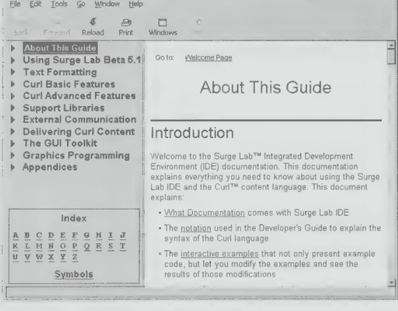

## 第 2 章

作为浏览本手册的另一种方式，窗口左下角还提供了一个带超链接的索引供您使用。不过，本应用程序内不提供此文本的全文搜索功能，因此《开发者指南》也以一组 PDF 文件的形式提供下载，可在`http://www.curl.com/`的文档部分获取。该版本支持此类搜索，当然也能获得更优质的打印效果。完整版共 11 个文件、1024 页，大小为 3.6MB。

### 开发者参考

相比之下，《开发者参考》（也称为 API 查看器）提供了标准 Curl 语言包中所有类的完整参考。

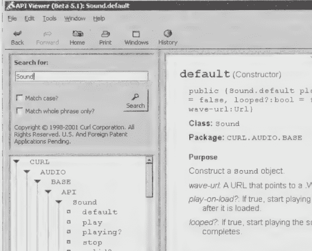

左侧窗口允许您通过语言类层次结构导航到需要信息的类，或直接搜索该类。右侧显示所选类成员的相关信息。例如，在上面的截图中，您可以看到`CURL.AUDIO.BASE.API.Sound.default`下`Sound`对象构造方法的语法和参数描述。

> 请注意，此文档没有其他来源。除预编译的 DLL 文件外，Curl 公司不在 Surge Lab 中提供这些对象库的源代码。

## 编写和调试代码

如果您已下载 Surge Lab IDE，您可能会想要开始开发代码。本节将介绍 IDE 中提供的编辑和调试功能。

Surge Lab IDE 有三个不同的操作区域——项目窗格、编辑器窗格和输出窗格——我们将依次介绍：

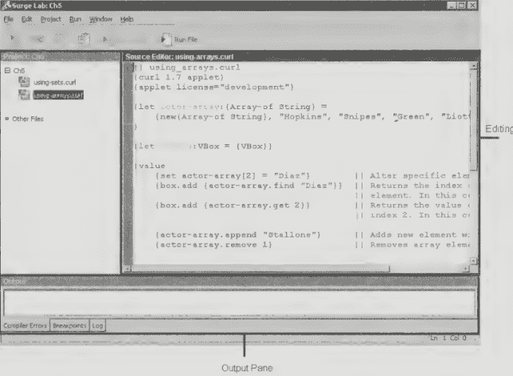

### 项目窗格——创建项目文件

项目窗格以层级列表形式呈现您正在处理的所有文件。这些文件要么以所属项目的名称列出，要么列在“其他文件”列表下，表示它们未附加到任何项目。在项目窗格中双击某个文件会将其在编辑器窗格中打开，以便修改。

创建项目（`.cprj`）文件，从而能够将文件分组在一起，操作非常简单。只需从“文件”菜单中选择“新建项目”即可。注意，Surge Lab 中一次只能打开一个项目。

### 编辑器窗格——使用编辑器

无论您是开始开发新的小程序，还是处理已有的小程序，这里都是您的首选——位于编辑器窗格中的源代码编辑器。

```curl
| using_arrays.curl
{curl 1.7 applet}
{applet license="development"}

{let actor-array:{Array-of String} =
    {new {Array-of String}, "Hopkins", "Snipes", "Green", "Liotta"}
}

{let box:VBox = {VBox}}

{value
    {set actor-array[2] = "Diaz"}           || Alter specific element of a
    {box.add {actor-array.find "Diaz"}}      || Returns the index of the na
                                               || element. In this case, 2
    {box.add {actor-array.get 2}}              || Returns the value of the el
                                               || index 2. In this case, 'Dia

    {actor-array.append "Stallone"}            || Adds new element with index
    {actor-array.remove 1}                     || Removes array element with
```

如您所知，在运行之前，Curl 小程序只是纯文本，因此您完全可以在 Notepad 等简单文本编辑器中编写代码——只要将代码保存为`.curl`扩展名，小程序就能正常运行。当然，源代码编辑器比 Notepad 多一些功能，所有这些都旨在让您编写 Curl 代码更加简单：

- 编辑器允许您从本地 conta 本地或远程源打开小程序，让您可以将其位置指定为 URI。该 URI 可以使用您之前接触过的`file:`或`http:`前缀，或者使用`curl:`。在特定情况下，后者前缀等同于`file:///<path_to_your_curl_install_directory>`，尽管这不是它唯一的用途。

  请注意，您无法将小程序保存回远程位置。打开/保存对话框使用`http://`作为传输机制，而该机制不支持将文件上传到远程位置。

- 编辑器能够识别 Curl 程序的各种组成部分，并自动对其进行颜色编码，使其更易于区分，如下所示。

| 代码类型 | 颜色 | 代码类型 | 颜色 |
|---|---|---|---|
| 错误 | 红色 | 保留字 | 紫色 |
| 注释 | 绿色 | 特殊字（`in`、`do`等） | 紫色 |
| 字符串 | 棕色 | 参数、变量和字段名 | 橙色 |
| 函数和方法名 | 蓝色 | | |

源代码中的所有其他内容显示为黑色。

- 编辑器还会自动对跨越两行或相互嵌套的 Curl 表达式进行缩进。按 Tab 键会将光标所在行缩进到正确的缩进位置。默认缩进为四个字符，目前无法更改。

- “平衡花括号”选项（编辑 | 平衡... 或`Ctrl+B`）会高亮显示光标所在的 Curl 语句（例如，`if... else...`语句）中包含的所有代码。如果光标位于嵌套在多个语句中的某一行，它将高亮显示最嵌套的语句。然后按 Tab 键会将所有高亮显示的代码正确缩进。

- 点击源代码编辑器中的“运行文件”图标（也可通过工具 | 运行或`F5`）提供了一种便捷的测试小程序代码的方式，它会打开一个新的默认浏览器实例，并在其中运行小程序。

- 您还可以通过单击代码行左侧深灰色列中的位置来设置调试断点。源代码编辑器会在给定代码行上用一个红色圆圈标记此断点。您在代码中设置的所有断点的完整列表可以在输出窗格的“断点”选项卡中找到。

然而，与 Notepad 不同的是，源代码编辑器没有自动换行功能。因此请务必小心，不要让代码意外地从窗口边缘消失。在 Curl 语言中，将单行代码拆分到多行是完全可行的，这样做不会导致错误。

### 调试代码

当然，除非我们余生都在写`"Hello World"`小程序（即使如此，可能也会出错），错误在所难免。当您尝试运行有缺陷的小程序时，Surge Lab 会捕获语法错误并将其提示给您。浏览器窗口中会显示一条消息，说明发现了错误，完整的错误列表将出现在 IDE 输出窗格区域的“编译器错误”选项卡下。

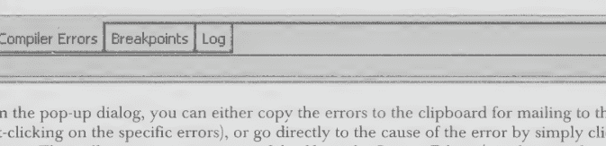

从弹出对话框中，您可以将错误复制到剪贴板以便邮件发送给小程序的所有者（右键单击特定错误即可），或者直接单击有问题的错误以跳转到错误原因。这将在源代码编辑器中打开该文件的新实例（不是已经打开的那个），并将有错误的代码行高亮显示以引起您的注意。同时，可以启用 Surge Lab 调试器来捕获并消除代码中的任何运行时错误。实际上，调试器只有在实际发生运行时错误或您通过设置断点来故意调用时才会介入。

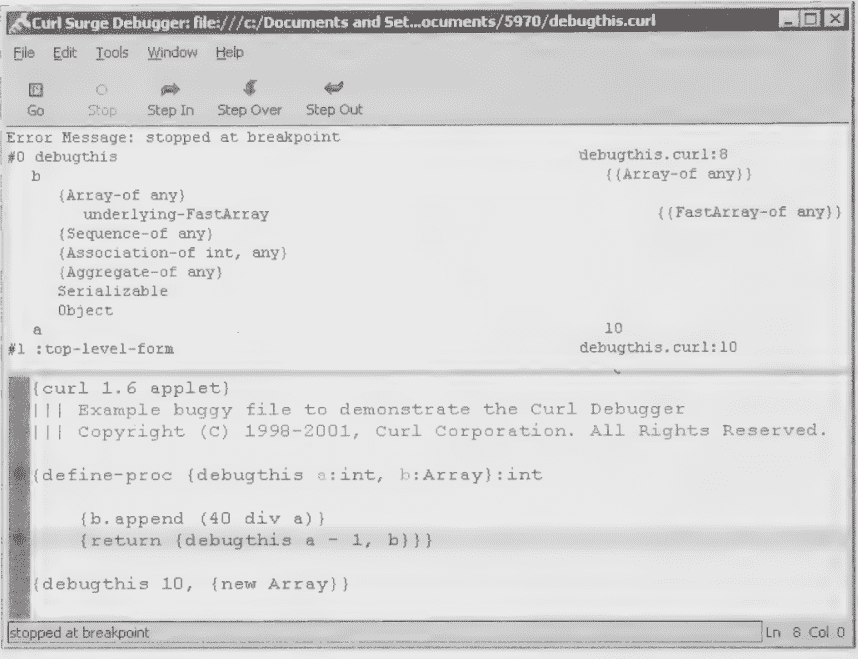

通过调整 Surge 控制面板的“调试选项”面板中的设置，还可以实现远程调试，稍后我们会看到这一点。注意，您在小程序上设置的断点会一直保留，直到您自行清除或关闭源文件。断点存储在内存中而非磁盘上，因此文件关闭后不会持续保留。

调试器窗口有两个面板，上方的面板显示在下方面板中高亮显示的源代码行执行之后，Curl 小程序栈的状态。从此处，您可以逐步执行后续代码行，查看栈如何受到影响，或者继续小程序的执行，直到发生运行时错误或更理想地，直到其正常终止。

栈面板包含两列，左列标识小程序执行期间调用的过程，最近出现的位于列的顶部，而最初调用的位于底部。左列中每个条目对面是文件名称以及该过程最后被访问时所在的行号。

通过点击上方面框中的某个过程，您可以在左列中查看该过程本地命名的变量列表及其当前值在右侧显示。如果变量的类型继承自其他对象，还可以通过点击变量名来查看对象类型的层次结构。您可以继续深入这些继承类型，点击它们或在右列中选择其关联值。在后一种情况下 Skin 后者情况下，将打开一个新的调试器窗口，其中仅包含特定于该变量的信息。

## 输出窗格

Surge Lab IDE 的输出窗格包含三个标签式窗口，点击相应的标签即可切换到任一窗口。正如我们已看到的，断点和编译器错误标签会显示您代码中引入的断点和语法错误。剩下的那个标签（日志标签）也能帮助您追踪错误。

### 日志标签

观察小程序内变量状态和代码流程的另一种方法，是在代码中使用`output`方法编写调试语句，然后通过输出窗格的日志标签（而非浏览器窗口）查看它们的回显信息。例如：

```curl
{output "Construct PuzzleBoard [", x, "," , y, "]"}
```

会将变量`x`和`y`的值以及一些相关上下文信息写入控制台。此时，控制台可能会返回以下调试日志：


```
Construct PuzzleBoard [0,0]
Construct PuzzleBoard [1,0]
Construct PuzzleBoard [2,0]
Construct PuzzleBoard [3,0]
```

虽然这很有用，但请记住，在代码中放入大量输出语句——然后又忘记移除其中一部分——并不一定是调试代码的最佳方式。;-)

## 检查器

仅靠调试器和控制台很难发现的一个典型运行时错误是：将内容错误地分配给了 Curl 小程序的图形元素。任何时候，屏幕上都可能有五十个不同的对象，因此很容易在方框、列表、菜单和其他各种项目之间丢失内容。同样，了解其他人如何布局他们的小程序以及使用了哪些元素，也常常令人感兴趣。幸运的是，Curl 为我们提供了检查器来解决这些问题。

简而言之，就像调试器向我们展示小程序堆栈的完整细节以便我们分析一样，检查器向我们展示了 Curl 小程序中某个对象的完整图形谱系。

要演示这一点，请在您想运行的 Curl 应用程序的任意活动部分上按住 Ctrl 键并右键单击。为了便于说明，让我们选择《开发者指南》的背景（记住，它也是一个 Curl 应用程序）。一个类似于此菜单将会出现：


此时，我们可以返回源代码编辑器根据需要编辑代码，或者：

- 通过选择“检查”选项，查看`BrowserTextFlowBox`对象的属性和继承关系。
- 通过选择“图形层次结构”选项，查看此对象与屏幕上其他对象的关系。
- 通过选择“图形统计信息”选项，检查此对象的宽度和高度设置。您还可以通过更改其背景色或边框颜色（或两者）在屏幕上识别它。

## 部署您的项目

开发工作的最后一环是发布工具。您可以使用它将调试和完善后的小程序打包，然后发布到互联网上。

发布工具是一个从命令行运行的 Curl 脚本。它接收您的 Curl 项目描述以及您希望为其配置包的 Web 服务器信息，然后以压缩的`.pcurl`格式将您的代码、任何相关的 Curl 包以及发布代码运行所需的配置信息部署到指定的 Web 服务器上。

或者，您可以从菜单中选择“项目 | 部署”（或`Alt+P|D`），这会运行一个向导，该向导对发布工具进行了抽象封装，使操作相对更简单一些。

## Curl 控制面板

到目前为止，我们已经了解了 Surge Lab IDE 的各个组件，它们使我们能够创建和调试 Curl 小程序。通过添加和切换 Curl 控制面板中的各种选项，我们可以有效地更改小程序在我们机器上的运行方式以及我们可以调试哪些小程序。

> 再次提醒，要访问控制面板，只需在系统托盘中的 Curl 图标上单击鼠标右键，然后选择“显示 Surge Lab 控制面板”。

控制面板上有四个标签页。默认情况下，您会进入“Curl Surge Lab 关于”面板，其中包含您本 Surge Lab 副本的各种版权和版本信息。

## 特权位置

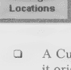

对于 Web 开发者来说，一个主要关切（您需要向客户负责）是 Web 上的安全性问题。作为在 Web 上运行的半独立程序，Curl 小程序可能被视为安全威胁。因此，小程序在一个“沙盒”中运行，这意味着其功能被显著限制，具体如下：

- Curl 小程序只能通过网络或互联网连接到其来源的计算机。
- 它不能读取或写入硬盘驱动器上的文件。
- 它不能消耗超过 64 MB 的内存。
- 它不能打开超过 200 个窗口。它打开的任何窗口的标题前都会有“Curl Applet”短语，因此它不能伪装成另一个应用程序。

然而，例如，您可能需要一个小程序从文件中读取信息并显示，或者将文件上传到另一台计算机。在这种情况下，您可以指定一个位置，从该位置下载的任何 Curl 小程序都被视为特权小程序，不受上述任何规则的约束。

当然，这种绕过功能意味着特权小程序可能会从您的计算机中删除文件或向其添加新文件，但如果您能接受这一点，您可以使用 Surge 控制面板中的“特权位置”对话框。在此，您可以为特权 Curl 小程序设置下载位置列表（本地或在线），设置该主机上是否只有特定目录中的小程序是特权的而其他目录的不是，以及小程序是否必须通过 SSL 连接下载才能成为特权小程序。

此对话框中有两个默认条目：

- 始终假定您在本地运行的 Curl 小程序可能需要特殊权限，因此默认情况下有一个“本计算机”的条目。不过，您仍然需要通过单击“添加特权目录”链接并相应填写对话框，来指定您的特权小程序所在的目录。请注意，对话框不会检查您指定的目录是否实际存在。
- 第二个默认条目是 Curl 公司自己的安全网站，`http://secure.curl.com`。

您可以通过单击控制面板右下角的“添加主机...”按钮，将更多的在线目录追加到特权位置列表中。

## 偏好设置

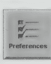

控制面板上的“偏好设置”对话框允许用户取消 Curl 插件的两个运行默认值。

默认情况下，Curl 会将其下载的每个包和小程序缓存在执行机器本地，以便更快地重复使用。如果认为有必要，用户可以关闭此默认值——这意味着每次请求时都会重新加载所有 Curl 代码。

默认情况下，Curl 使用计算机可用的任何 2D 和 3D 硬件加速。但是，如果使用的显卡未运行最新驱动程序，小程序很可能会崩溃。为了避免这种可能性，用户可以选择禁用硬件加速，以较慢但普遍兼容的纯软件模式运行 Curl 小程序。只需在相关框中打勾，即可关闭这些默认选项之一。

## 调试选项

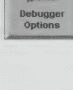

最后一个对话框也是唯一一个仅下载了 Surge 插件的用户无法使用的对话框，因为它确定了可以调试产生错误（无论是语法错误还是运行时错误）的小程序的位置。

默认情况下，此框包含一个`file:`条目，这意味着本地文件系统上的任何小程序都将被调试。您只需使用“添加位置”对话框，添加您想要调试的远程主机上小程序的位置即可。同样，您可以使用`http:`、`https:`或`curl:` URI 前缀来命名这些资源。

## 总结

在本章中，我们了解了用于 Curl 内容语言的开发环境——Surge Lab IDE。我们看到了哪些组件涵盖了 Curl 小程序的文档、编码、调试和环境控制。在这个版本中，它不是一个特别复杂的 IDE，但值得确保您知道如何使用每个特定组件。

接下来，我们将迈出进入 Curl 世界的第一步，看看如何创建等效于我们可以用 HTML 和 CSS 创建的图形元素。

## 作为 HTML/CSS 的 Curl

Curl 公司致力于提供一种单一的集成解决方案，以解决网页中因共存多种不同技术而产生的问题。在接下来的几章中，我们将从 Curl 语言试图取代的不同技术的角度来探讨它。

在本章中，我们将首先讨论 Curl 中提供模拟 HTML 和级联样式表功能的部分。虽然 HTML 页面常常包含各种标记、脚本代码和嵌入对象的混合体，但 Curl 仅仅填补现有技术当前占据的空间是不够的，它必须完全取代它们；提供一种替代方案，而这正是它所做的。

本章将介绍 Curl 中类似于 HTML/CSS 的非编程组件。我们将探讨如何利用 Curl 中的功能来显示字符或文本，以及如何简单地更改文本的颜色、粗细和位置，就像你使用样式表所做的那样。此外，还将讨论 Curl 提供的一些与 HTML 元素（如列表、框架和表单）等效的功能。然而，我们将推迟对其中一些控件的详细讨论，直到涵盖动态布局的第 7 章。

### Curl 表达式

与大多数编程语言一样，Curl 程序由表达式和语句混合创建。在我们进一步讨论之前，我们需要在此语境下定义表达式的含义。我们讨论的不是典型的变量赋值或算术表达式，而是用于显示文本并帮助格式化文本的编程结构。

Curl 提供了一系列表达式，不仅可以帮助您创建和格式化文本，还可以在网页中包含链接和图像。网页最基本的功能是显示文本，因此让我们从那里开始，然后再介绍它提供的其他功能，如显示图像、表格、列表和其他类 HTML 特性。

## 显示文本

与 HTML 不同，仅仅输入一些文本并期望 Curl 插件能将其解释为文本是不够的：

这是一些文本

一个网页浏览器会显示上面这句话，但如果你将其保存为 Curl 页面，你会收到以下错误消息：

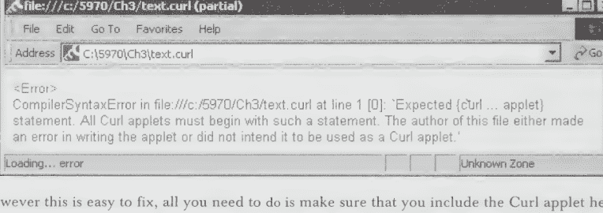

然而，这很容易修复，你所需要做的就是确保包含了 Curl 小程序前导符，然后文本就可以放置在下方：

```
{curl 1.7 applet}
{applet license = "development"}
This is some text that Curl can display
```

> 本书中的所有前导符都是 1.7（IDE v1），但如果你将其更改为 1.6，可以在 beta 5.1 IDE 中使其工作。

Curl 区分大小写，因此请确保不要将其指定为如下形式：

```
{CURL 1.7 applet}
{applet license = "development"}
This is some text that Curl can display
```

否则你仍然会生成错误。

文本可以通过各种样式进行增强（我们很快就会讨论），但当没有指定样式时，你会看到 Curl 默认使用黑色、12 点 Arial 字体显示文本：


### 核心格式

虽然你可以用这种方式显示文本，但更好的方法是使用文本的核心格式（`text`、`paragraph` 和 `table`）来组织它。格式是 Curl 对其表达式中包含的关键字的命名。这些格式实际上是过程，但它们被称为格式，因为它们是专门用于处理文本格式化的过程。

在 HTML 中，你会使用不同的 HTML 元素来结构化文档中的文本；在 Curl 中，你使用格式。格式包含在花括号内，以一个关键字开头，后跟需要显示的文本（请注意，格式名称与要显示的实际文本之间没有分隔符）。整个结构被称为一个表达式：

```
{format-name text here}
```

要使用`text`格式以此方式显示文本，它必须用花括号括起来，并带有关键字`text`，如下所示：

```
{curl 1.7 applet}
{applet license = "development"}
{text This is text that will be treated as text}
```

或者使用关键字`paragraph`来显示`paragraph`格式（我们稍后将详细讨论），如下所示：

```
{curl 1.7 applet}
{applet license = "development"}
{paragraph This is text that will be treated as text in a paragraph}
```

> 这些`text`和`paragraph`关键字将在 Curl Surge Lab 中以不同的颜色显示，以将其与文本区分开来。如果你使用普通编辑器，这并不是一个特别吸引人的文本与代码分离方式。不过，流行的编辑器 Emacs 已经有 Curl 高亮模式，参见：http://www.curl.com/html/developers/curltools.jsp。

另请注意，一些基本的文本编辑器（特别是 Windows 记事本）无法正确显示`.curl`文件，因为 Curl 使用 Unix 风格的行尾字符。

我们已经说过 Curl 格式提供了与 HTML 元素相同的功能。这里的段落格式只是提供了与 HTML 中`<p>`（段落）元素相同的功能，因此 HTML 中等效的行将使用`<p>`元素，如下所示：

```
<p> This is text that will be treated as text in a paragraph</p>
```

虽然严格来说 HTML 4.01 没有 text 元素，但它提供了`<div>`和`<span>`两个元素，可用于指定块级或内联内容，而不添加任何额外的隐式样式信息。

*块级元素和内联元素的区别在于，块级元素在新的一行开始（例如`<div>`元素），而内联元素则不是（例如`<span>`）。*

因此，HTML 中与 text 格式等效的是：

```
<span> This is text that will be treated as text</span>
```

你会发现本章的大部分内容都依赖于不同类型格式来为 Curl 提供必要的样式和呈现信息。

### 保留字符

有几个文本字符 Curl 无法直接显示，因为它们被用来表示编程结构的开始或结束。

Curl 中的四个保留字符是：

- `{` 左花括号，用于开始 Curl 编程结构
- `}` 右花括号，用于结束 Curl 编程结构
- `\` 反斜杠，用于表示 Curl 中跟有一个转义字符
- `|` 竖线（管道），用于表示 Curl 中的注释，请参见*注释*部分

为了能够显示这些字符，必须事先用另一个字符进行转义。正如我们已经提到的，转义字符是反斜杠（`\`）。要能够将这些字符作为文本显示，只需在前面放置反斜杠字符，例如`\{`、`\}`、`\\`或`\|`。

例如，要显示花括号，你可以使用以下代码：

```
{curl 1.7 applet}
{applet license = "development"}
{text This will display the curly braces \{ and \}. }
```

### 注释

你还可以在 Curl 程序中添加各种注释（就像大多数编程语言一样），Curl 不会显示它们，但可以作为你自己或其他可能阅读源代码的开发人员的参考。

要向现有的 Curl 代码行添加注释，你可以使用以下双竖线语法：

```
{curl 1.7 applet}
{applet license = "development"}
This is some text that Curl will display || This is a comment that it won't
```

`||`注释仅在到达行尾之前有效。现在我们已经介绍了注释，我们将在每个示例 Curl 文件的顶部添加一个注释。下一行将再次被视为文本：

```
|| comment2.curl
{curl 1.7 applet}
{applet license = "development"}
This is some text that Curl will display || This is a comment that it won't
This is some more text that Curl will display
```

当添加跨越多行的注释时，你需要添加以下语法`|#`和`#|`：

```
|| comment3.curl
{curl 1.7 applet}
{applet license = "development"}
|# This is a comment
    crossing several lines
        that Curl will not display
#|
```

您还可以使用这种第二种语法来注释掉整段代码；这在调试代码时通常非常有用。

```
|
# 不要执行这段代码
{
    ... 在此处添加一些 Curl 代码 ...
}
#|
```

## 逐字字符串

如果您希望显示整段文本，但不希望 Curl 解释它，可以使用一种称为**逐字字符串**的功能。逐字字符串用于显示包含许多保留字符的字符串，例如在网页中显示源 Curl 代码。特殊的字符序列用于标记字符串的开始和结束；它们之间的任何内容都会按照您输入的原样显示。Curl 中有三种主要的逐字字符串类型：

- 常规逐字字符串
- 带标签逐字字符串
- 长度指定逐字字符串

常规逐字字符串是可以包含保留字符的正常转义文本段。要使用它们，需要将文本放在`|"`和`"|`标记之间。

下面是一个简单的例子：

```
|| verbatim.curl
{curl 1.7 applet}
{applet license = "development"}
{text |" 这些标记之间的任何代码，如 \ 不会被 Curl 解释
    "| }
```

带标签逐字字符串用于逐字字符串本身必须包含逐字字符串的情况。要创建这些字符串，同样使用相同的`|"`和`"|`分隔符，但需要在竖线字符和第一组引号之间放置一个有效的 Curl 标签名称标识符，两者之间没有任何空格：

```
|| verbatim2.curl
{curl 1.7 applet}
{applet license = "development"}
{text |curl-identifier" 这些标记之间的任何代码，如 \，以及
    这些 |" 和 "| 标记之间的内容不会被 Curl 解释 *curl-identifier|}
```

另一种包含逐字字符串的方法是使用长度指定逐字字符串，这对于生成逐字字符串特别有用。长度指的是 Curl 不应解释的字符数。该长度范围内的任何文本（包括任何逐字字符串）都不会被解释。要创建长度指定逐字字符串，需要在竖线字符和第一组引号之间指定您希望作为逐字字符串处理的字符数：

```
|| verbatim3.curl
{curl 1.7 applet}
{applet license = "development"}
{text |98"这些标记之间的任何代码，如 / 标记和 |" 或 "|
    标记都不会被 Curl 解释"98| }
```

## 第 3 章

注意，您必须精确获取长度指定逐字字符串中的字符数，否则会产生错误。换句话说，第 99 个字符应该是闭合的引号。

## 文本格式化

现在我们已经了解了在 Curl 程序中显示文本这个相对简单的主题，接下来让我们看看如何在 Curl 中对文本应用样式。

如前所述，有三种格式可以使用：`text`格式，仅用于显示文本；`paragraph`格式，可用于将文本分组为独立的段落；以及最后，`table`格式（我们尚未讨论），它将文本分组为表格。在每种格式中，可以使用**字符选项**或**字符格式**来设置文本样式。


- 字符选项用于影响文本，类似于 HTML 使用现已弃用的 `<font>` 标签和/或特定标签的弃用属性，如 `color` 和 `align`。不过最重要的是，它们形成了许多层叠样式表提供的功能的等价物。
- 字符格式是逻辑 HTML 元素的等价物，例如 `<h1>` 到 `<h6>` 标题元素、`<strong>`（粗体）、`<em>`（通常为斜体）、`<sub>`（下标）或 `<sup>`（上标）元素，仅举几例。

## 字符选项

字符选项用于在核心格式之外指定表示信息。以下都是 Curl 中有效的字符选项：

- `color` – 指定字体颜色，可以采用 Surge 安装包附带的开发者参考中指定的任何颜色。
- `font-family` – 指定使用的字体类型，可以指定系统识别的任何字体类型。
- `font-size` – 字体大小，可以以点（pt）、厘米（cm）、英寸（in）以及默认大小的百分比（em）指定。
- `font-style` – 指定字体样式，可以是 `italic`、`true italic`、`oblique` 或 `normal`，`italic` 根据系统不同可以是 `oblique` 或 `true italic`。
- `font-weight` – 定义字体是否为粗体；允许的值是 `bold` 或 `normal`。
- `text-underline?` – 布尔值，指定文本是否加下划线。
- `text-line-through?` – 布尔值，指定文本是否带删除线。
- `text-breakable?` – 布尔值，指示文本是否可以跨多行断开。
- `text-preserve-whitespace?` – 布尔值，指示文本中的空白是否应保留或折叠。

以下是在 Curl 中使用字符选项将一段文本设置为蓝色的示例：

```curl
|| bluetext.curl
{curl 1.7 applet}
{applet license = "development"}
{text color="blue", 这段文本是蓝色的}
```

在颜色选项之后有一个逗号，将其与实际文本分隔开。这个逗号对于 Curl 正确解释这行代码至关重要；如果省略它会生成错误。这似乎与关键字本身未与文本分隔开的事实相矛盾，但这样做是为了确保字符选项紧跟在 `text` 关键字之后不会被 Curl 当作纯文本处理。

要将一段文本设置为绿色，字号为 16 点，需要以下代码：

```curl
|| greentext.curl
{curl 1.7 applet}
{applet license = "development"}
{text color="green", font-size=16, 这是16号大小的绿色文本}
```

这里我们用引号指定了颜色的文本信息，Curl 会据此推断它是一个字符串。`font-size` 选项故意没有引号，因为 Curl 需要这样来识别数字信息。与许多可以进行隐式转换或强制转换的语言不同，在 Curl 中这是不可能的。使用这些格式时，您必须小心地根据文本数据或数字数据的必要来添加或省略引号。如果不这样做，Curl 解释器将生成错误消息。

您可能还会注意到，虽然这些选项提供了大致与样式表相同的功能，但它们不允许将表示与内容分离。样式表可以单独指定于网页之外，而在 Curl 中，字符选项的指定方式与 HTML 标签属性相同。可以认为，将表示与内容分离的理念与此相悖，因此这可能被认为是一种倒退。然而，考虑到 Curl 的目标是让所有东西都使用一种技术集成到一个网页中，这在某种程度上是有道理的。此外，这并不是说您不能在 Curl 中分离内容与表示，只是不能通过选项来实现。使用文本格式将内容与表示分离的方法将在本章后面讨论。

## 字符格式

除了文本和段落格式之外，Curl 还有一组额外的格式，它们还添加了自己的隐式样式。这些格式如下，以及它们等价的字符选项设置，或者如果它们不等价于任何东西，则说明它们的作用：

- `monospace` – 等价于 `{text font-family="monospace" ...}`。
- `tiny` – 等价于 `{text font-size="0.6em" ...}`。
- `small` – 等价于 `{text font-size="0.8em" ...}`。
- `big` – 等价于 `{text font-size="1.5em" ...}`。
- `huge` – 等价于 `{text font-size="2.0em" ...}`。
- `italic` – 等价于 `{text font-style="italic" ...}`。
- `bold` – 等价于 `{text font-weight="bold" ...}`。
- `quote` – 用智能引号包裹文本。
- `underline` – 等同于 `{text text-underline?="true" ...}`。
- `line-through` – 等同于 `{text text-line-through?="true" ...}`。
- `superscript` – 将文本渲染为上标。
- `subscript` – 将文本渲染为下标。
- `no-break` – 等同于 `{text text-breakable?="false" ...}`。

你可以指定关于这些字符格式的信息，这些信息将仅适用于你的特定系统。因此，`big` 格式在你的系统上可能是 42 磅的字号，但在街角 Computers-R-Us 公司使用的系统上可能是巨大的 128 磅字号。你可以按以下方式使用它们：

```curl
|| bigtext.curl
{curl 1.7 applet}
{applet license = "development"}
{big this is some big text} this is normal text
```

你可以看到，当它与一些普通文本并排显示时，差异显而易见：

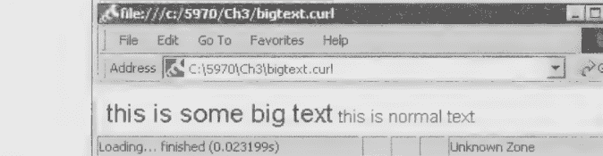

同样，这些字符格式在逻辑样式元素中有直接的 HTML 等价物。例如，`big` 格式将等价于设置了 `size` 属性的 `font` 元素：

```html
<font size="16">this is some big text</font>
```

字符格式的理念在于，它们是为你在使用的特定系统量身定制的。所有字符格式都依赖于相对设置，例如 `big`，它会将字体大小设置为系统默认字符集大小的 150%。

> 附带说明一下，这就是在 HTML 中你应该始终使用逻辑样式元素（如 `<em>`）来强调文本，而不宜使用等效的物理样式元素（如 `<i>`）的原因。对于前者，即使你的系统无法渲染斜体文本（这种情况不太可能发生），它也会寻求其他方式来强调文本。如果你使用 `<i>` 元素来设置斜体文本，它就不会这样做，只会默认为普通文本样式。同样的规则也适用于 Curl 字符格式。

还可以将字符格式与字符选项结合使用。因此，如果你想以 `big` 字符格式显示红色文本，可以使用颜色字符选项，如下所示：

```curl
|| bigredtext.curl
{curl 1.7 applet}
{applet license = "development"}
{big color="red", this is some big red text}
```

同样，逗号是必需的，用于将 Curl 内容与实际的文本分隔开。

### 特殊字符

Curl 还提供了以下字符格式，用于显示实际字符，而不是对现有文本应用样式：

- `trademark`
- `registered-trademark`
- `copyright`
- `degrees`
- `em-dash`
- `en-dash`
- `bullet`

这些都是不言自明的，因此我们不会逐一讨论它们各自的作用，而是直接进入一个示例，了解它们的工作原理。事实上，它们可能是最接近使用 HTML 的等价物之一，因为这里的每个字符格式只需用花括号括起来即可。

要在文本中包含商标，你可以这样做：

```curl
|| trademark.curl
{curl 1.7 applet}
{applet license = "development"}
{text this text is copyrighted by the Namllu corporation}
{trademark}
{text please do not make un-authorized copies}
```

然后将以如下方式显示：

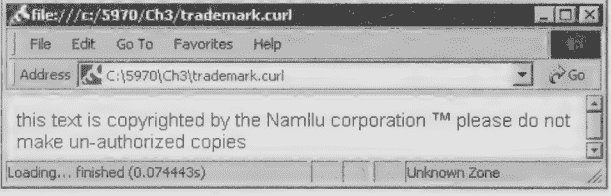

### 换行

空白字符和换行符与 HTML 一样被忽略；但是，空行会被识别并在浏览器中解释为新段落。此外，Curl 还提供了以下用于创建换行的格式：

- `br`
- `page-break`

在浏览器窗口中，`br` 和 `page-break` 具有相同的效果：它们后面的文本将显示在新的一行。区别在于打印文档时：此时 `page-break` 后面的文本将出现在新的一页上。下面的示例展示了这一点：

```curl
|| pagebreak.curl
{curl 1.7 applet}
{applet license = "development"}
{text This is some text}
{br}
{text This is some text that will be started on the next-line}
{page-break}
{text This text, when printed out, will be on a new page}
```

这将在浏览器窗口中将文本分成三行显示，打印时则分布在两页上。

## 段落格式

我们已经简要了解过段落格式，但尚未详细研究。文本格式和段落格式之间存在差异：文本格式用于内联内容，而段落格式用于需要从新的一行开始的块级内容。如果我们在以下代码中使用 `br` 格式来提供换行：

```curl
|| paragraphformat.curl
{curl 1.7 applet}
{applet license = "development"}
{text this text is part of the text format}
{br}
{text please do not make un-authorized copies}
{br}
{paragraph this text is part of the paragraph format}
{paragraph please do not make un-authorized copies}
```

我们可以在浏览器中查看输出时看到差异：

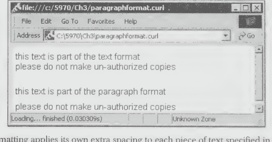

段落格式会为每个用段落格式指定的文本块应用额外的间距。还有一些专门适用于使用段落格式的文本样式的集合，我们将会看到。

## 段落选项

你可以与段落格式一起使用的段落选项如下：

- `paragraph-left-indent` – 指定一个值，用于定义段落左边缘在其容器中的位置。
- `paragraph-right-indent` – 指定一个值，用于定义段落右边缘在其容器中的位置。
- `paragraph-first-line-offset` – 段落第一行相对于 `paragraph-left-indent` 所指定值的缩进量。
- `paragraph-justify` – 指定你希望将段落对齐到左侧、右侧还是居中。
- `paragraph-line-spacing` – 段落中行与行之间的间距。
- `paragraph-before-spacing` – 此段落之前的间距。
- `paragraph-after-spacing` – 此段落之后的间距。

你可以像下面这样使用段落选项来设置段落内的文本对齐方式：

```curl
|| justify.curl
{curl 1.7 applet}
{applet license = "development"}
{paragraph paragraph-justify="center", this is some centered text in a paragraph format}
```

你还可以将这些选项组合使用，以创建一些相当复杂的格式化指令，例如：

```curl
|| justify2.curl
{curl 1.7 applet}
{applet license = "development"}
{paragraph
    paragraph-left-indent=1,
    paragraph-justify="left",
    paragraph-line-spacing=3,
    paragraph-first-line-offset=30,
    This is a paragraph which has been采摘left justified, spaced at 3 points between each line, indented by 1 character with a first line offset of 30 points.
}
```

这将产生以下显示效果：

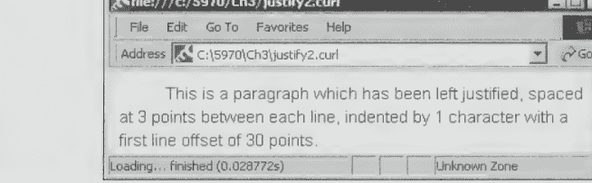

除此之外，还可以将段落格式放置在其他容器内，例如表格、框架，甚至其他段落中。段落格式随后会显示出来，并从其容器中继承设置。

## 段落格式

就像我们之前看到的字符格式一样，Curl 也支持一组自己的段落相关格式，其中许多格式同样与某些 HTML 元素有直接等价关系。Curl 中有四种永久定义的格式，可以通过我们之前讨论的段落选项分别设置，但它们构成了方便的对齐文本的默认设置，无需担心必须定义具体的对齐值。它们是：

- `left-justify` – 左对齐文本。
- `right-justify` – 右对齐文本。
- `center` – 居中文本。
- `blockquote` – 左对齐并缩进文本。

你可以不使用段落格式，而是使用 `right-justify` 格式来右对齐文本，如下所示：

```curl
|| rightJustify.curl
{curl 1.7 applet}
{applet license = "development"}
{right-justify The cat sat on the mat}
```

虽然这些都可以使用段落选项重新创建，但有一些段落格式值得单独讨论，因为它们无法仅使用文本或段落格式及其支持的选项轻松重新创建。

### 预格式化

HTML 中的 `<pre>` 元素经常被忽视，而且经常被滥用，主要是因为它没有正确被理解。HTML 4.01 标准已弃用此元素，但在那之前，它用于向浏览器提供关于特定文本块应该渲染为多宽的“提示”。通常这意味着它使用固定宽度的 Courier 字体渲染。在 Curl 中，`pre` 格式的作用要复杂一些。它用于评估语言表达式内容，同时保留空格和换行。如果你不希望所有文本都被评估，那么可以将其放在逐字字符串中。

当使用 `pre` 格式来评估其中包含的另一个表达式时，我们可以如下指定：

```curl
|| preformat.curl
{curl 1.7 applet}
{applet license = "development"}
{pre {paragraph paragraph-justify ="right", The cat sat on the mat} }
```

这将只显示右对齐的文本“the cat sat on the mat”。

如果你不希望任何部分被评估，那么可以按常规方式使用逐字字符串：

```curl
|| preformat2.curl
{curl 1.7 applet}
{applet license = "development"}
{pre |" { paragraph paragraph-justify ="right", The cat sat on the mat} "|}
```

这将显示整个 Curl 表达式，包括段落格式和对齐选项。

### 标题

一种特殊的段落格式允许你创建标题，就像你可以在 HTML 中使用 `<h1>` 到 `<h6>` 元素一样。标题格式可以采用四种可能的大小，这些大小实际上被称为级别（实际上可以采用超过四种，但在第 4 级之后，所有更大的标题都以相同的大小渲染）：

- 第 1 级渲染为 `2em`。
- 第 2 级渲染为 `1.5em`。
- 第 3 级渲染为 `1.3em`。
- 第 4 级及以上标题均渲染为 `1.2em`。

> 注意，`em` 是一个排版术语，指的是相对于网页默认字体大小的字体尺寸。

标题格式采用以下语法，将级别数字作为单独的选项：

```curl
{heading level=level-number, text }
```

例如，包含多个标题的文档代码如下所示：

```curl
|| headings.curl
{curl 1.7 applet}
{applet license = "development"}
{heading level=1, A level one heading }
{br}
{heading level=2, A level two heading }
{br}
{heading level=3, A level three heading }
{br}
{heading level=4, A level four heading }
{br}
{heading level=10, A level ten heading }
```

显示效果如下：

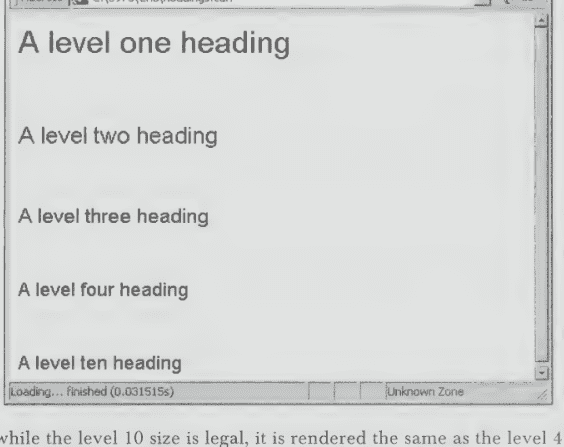

如你所见，虽然 10 级标题在语法上是合法的，但它渲染出来的效果与 4 级标题相同。另外，请注意各级标题之间的间距是一致的。

## 编号标题

除了基本标题格式外，Curl 还提供了一种编号标题格式，允许你进一步组织结构。编号标题的指定方式与普通标题几乎完全相同：

```curl
{numbered-heading level=level-number, text }
```

然而，它们的工作方式稍微复杂一些。首先，当它们被显示时，标题会自动添加一个编号，因此如果你编写以下代码：

```curl
|| numbered.curl
{curl 1.7 applet}
{applet license = "development"}
{numbered-heading level=1, This is a level 1 numbered heading }
```

文本中会额外添加一个指示标题编号的数字。


# 1 This is a level 1 numbered heading

编号标题根据它们与其他编号标题及其他标题的相对位置来显示编号。因此以下代码：

```curl
|| numbered2.curl
{curl 1.7 applet}
{applet license = "development"}
{numbered-heading level=1, This is a level 1 numbered heading }
{numbered-heading level=2, This is a subsection of a level one numbered heading }
```

将产生以下文本：

1 This is a level 1 numbered heading

1.1 This is a subsection of a level one numbered heading

如果你将这第二行放在普通标题下面，如下所示：

```curl
|| numbered3.curl
{curl 1.7 applet}
{applet license = "development"}
{heading level=1, This is a level 1 heading }
{numbered-heading level=2, This is a subsection of a level one heading }
```

那么编号标题仍会从标题级别的下一个数字开始，尽管原始标题并没有编号：

This is a level 1 heading

1.1 This is a subsection of a level one heading

因此，基于这个原因，最好不要混合使用普通标题和编号标题。

编号标题可用于创建大量的子章节。如果你想要一组编号的子章节，可以这样做：

```curl
|| numbered4.curl
{curl 1.7 applet}
{applet license = "development"}
{numbered-heading level=1, A level one heading}
{numbered-heading level=2, A subsection of a level one heading}
{numbered-heading level=2, A subsection of a level one heading}
{numbered-heading level=3, A subsection of a level two heading}
```

这将显示为：

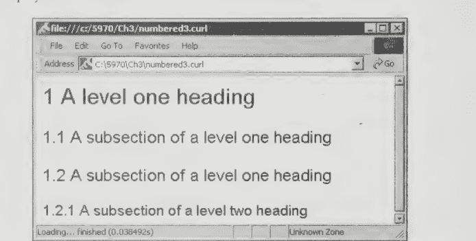

因此，每个新编号创建一个新级别，而同一级别内的每个编号创建同一级别的新子章节。标题是组织内容的好方法，特别适用于目录等项目。

## 列表

在 HTML 中有三种不同的元素用于定义列表，在 Curl 中也不例外。在 HTML 中，列表是通过 `<ul>`（无序列表）、`<ol>`（有序列表）和 `<dl>`（定义列表）元素的属性设置混合定义的。

而 Curl 则依赖三种不同的格式：

- `itemize` – 用于项目符号列表
- `enumerate` – 用于编号列表
- `definition-list` – 用于定义列表

现在让我们简要地看一下这三种格式。

### 项目符号列表

在 HTML 中，你会使用 `<ul>` 元素来创建项目符号列表。列表中的每一项由 `<li>`（列表项）元素表示，如下所示：

```html
<ul>
    <li>Point 1</li>
    <li>Point 2</li>
    <li>Point 3</li>
</ul>
```

Curl 中的项目符号列表工作方式非常相似。它们使用 `itemize` 格式创建。`itemize` 格式包含一系列由 `item` 格式定义的表达式包围的表达式。`item` 格式用于创建列表中的不同元素。这两种格式的语法如下：

```curl
{itemize
    {item ...}
    {item ...}
    {item ...}
}
```

此外，`itemize` 格式还可以指定 `marker` 选项来定义你希望列表中使用的项目符号样式，同样需要用逗号隔开：

```curl
{itemize marker="bullet type",
    {item ...}
    {item ...}
    {item ...}
}
```

`marker` 选项的可能值可以是浏览器支持的任何字符。例如，如果你希望列表中每一项都用 `o` 作为项目符号，可以将 `marker` 类型指定为 `o`。对于三个项目，我们可以使用以下代码：

```curl
|| bullets.curl
{curl 1.7 applet}
{applet license = "development"}
{itemize marker="o",
    {item Bullet point 1}
    {item Bullet point 2}
    {item Bullet point 3}
}
```

这在浏览器窗口中将显示如下：

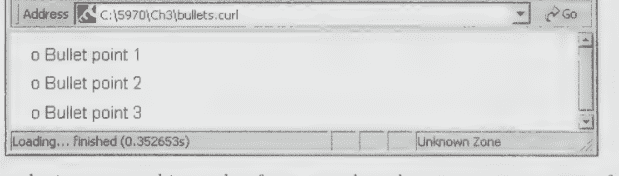

项目符号可以嵌入到其他格式中，例如 `text` 或 `paragraph` 格式，只需将它们放入这些其他格式中即可。

### 编号列表

在 HTML 中，要创建编号列表，唯一的区别是使用 `<ol>`（有序列表元素）来创建列表，并再次使用 `<li>` 元素来表示每个列表项：

```html
<ol>
    <li>Point 1</li>
    <li>Point 2</li>
    <li>Point 3</li>
</ol>
```

Curl 中的编号列表使用 `enumerate` 格式，工作方式类似，同样使用 `item` 格式来定义各个项目。因此要构造一个项目列表，你需要使用以下内容：

```curl
{enumerate
    {item ...}
    {item ...}
    {item ...}
}
```

`enumerate` 格式没有专门的选项，列表中的编号按先后顺序自动分配：

```curl
|| numberedlist.curl
{curl 1.7 applet}
{applet license = "development"}
{enumerate
    {item Point 1}
    {item Point 2}
    {item Point 3}
}
```

这将显示如下：

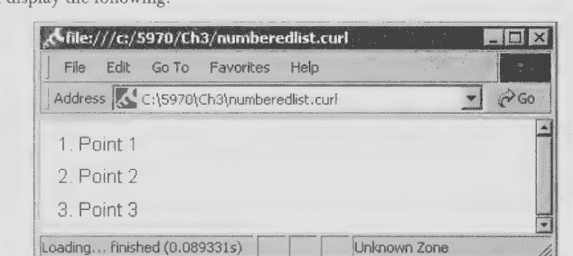

如你所见，编号会自动添加到项目符号。然而，可以使用普通字符选项来影响列表内容。例如，要将各个列表项变为红色，我们可以这样做：

```curl
|| numbered2.curl
{curl 1.7 applet}
{applet license = "development"}
{enumerate color="red",
    {item Point 1}
    {item Point 2}
    {item Point 3}
}
```

### 定义列表

最后，Curl 中也使用定义列表，它们的工作方式与其他两种列表略有不同。在 HTML 中，你会使用 `<dl>`（定义列表）、`<dt>`（定义术语）和 `<dd>`（定义描述）元素。`<dl>` 元素是最外层的容器，包含一组术语和每个术语的相关描述。

定义列表用于当你希望创建一组项目符号，而每个项目使用不同的文本术语时使用。它在 HTML 中的典型工作方式如下：

```html
<dl>
    <dt>HTML</dt>
    <dd>Hyper text markup language</dd>
    <dt>JavaScript</dt>
    <dd>Client-side Scripting Language</dd>
    <dt>Flash</dt>
    <dd>Tool for writing multimedia extensions</dd>
    <dt>Curl</dt>
    <dd>The replacement for all of the above!</dd>
</dl>
```

Curl 有自己的语法，与 HTML 类似：

```curl
{definition-list
    {term ...}
    {definition ...}
}
```

`definition-list` 格式与 `<dl>` 元素的用途类似，用于包含所有术语和描述。其中包含的表达式用于定义术语和描述。

如果我们要将上面的例子翻译成 Curl，我们可以这样做：

```curl
|| definitionlist.curl
{curl 1.7 applet}
{applet license = "development"}
{definition-list
    {term HTML}
    {definition Hyper text markup language}
    {term JavaScript}
    {definition Client-side Scripting Language}
    {term Flash}
    {definition Tool for writing multimedia extensions}
    {term Curl}
    {definition The replacement for all of the above!}
}
```

这将定义四个独立的术语，每个术语都有自己的描述。上述代码在浏览器窗口中将显示如下：

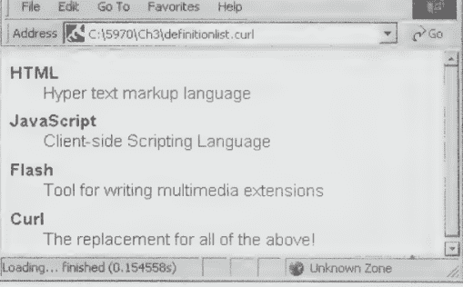

定义列表格式也可以接受任何字符选项，例如 `color` 或 `font-weight`，以改变列表的外观：

```curl
{definition-list color="blue",
    {term HTML}
    {definition Hyper text markup language}
    etc ...
}
```

这将改变整个列表的外观。如果你希望仅将其应用于单个项目，例如单个标题，那么你只需修改 `term` 格式，如下所示：

```curl
{definition-list
    {term color="blue",HTML}
    {definition Hyper text markup language}
    etc ...
}
```

## 表格文本格式

我们将 `table` 格式的讨论推迟到现在，因为它比我们迄今为止讨论的 `text` 和 `paragraph` 格式要稍微复杂一些。在 HTML 中，表格通常是这样创建的：

```html
<table border=1>
    <tr>
        <td>Paul Klee</td>
        <td>Abstract Expressionism</td>
    </tr>
    <tr>
        <td>Max Ernst</td>
        <td>Surrealism</td>
    </tr>
</table>
```

`<table>` 元素包含 `<tr>`（表格行）元素，而 `<tr>` 又包含 `<td>`（表格单元格）元素。确实，由于 `table` 文本格式类似于 HTML 的 `<table>` 元素，因此在表格中需要使用多种类型格式是合乎情理的。

`table` 格式构成最顶层的容器表达式，可以包含以下格式：

- `row` – 表格中的每一行
- `header-row` – 表格的顶行
- `cell` – 表格中的每一个单元格
- `header-cell` – 第一行中最顶部的单元格

在层级结构中，它将采用以下形式：

```curl
{table ...
    {header-row
        {header-cell}
        {header-cell}
    }
    {row
        {cell}
        {cell}
    }
    ...
}
```

标题行和标题单元格不是必需的，但它们有助于区分表格的标题行和其下方的内容行。

要创建一个基本表格，你只需要以下代码。这里我们用它在其中显示两位著名20世纪艺术家的名字：

```curl
|| table.curl
{curl 1.7 applet}
{applet license = "development"}
{table
    {row
        {cell Paul Klee}
        {cell Abstract Expressionism}
    }
    {row
        {cell Max Ernst }
        {cell Surrealism}
    }
}
```

没有任何额外信息时，表格将不显示任何边框或样式信息，如下所示：

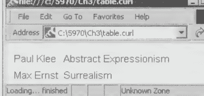

可以向表格中添加标题行和标题单元格，以帮助标题更加突出，因为它们包含一些隐含的样式信息。我们可以修改前面的表格，使其包含一些标题信息，为表格中包含的数据提供更多细节，如下所示：

```curl
|| table2.curl
{curl 1.7 applet}
{applet license = "development"}
{table
    {header-row
        {header-cell Artist}
        {header-cell Movement}
    }
    {row
        {cell Paul Klee}
        {cell Abstract Expressionism}
    }
    {row
        {cell Max Ernst }
        {cell Surrealism}
    }
}
```

然后将显示如下：

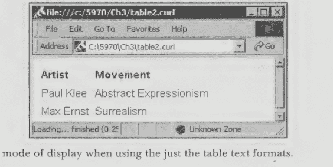

这是仅使用表格文本格式时的默认显示模式。

## 表格文本选项

除了默认支持的所有字符选项外，还有一些只能在表格文本格式中使用表格样式设置的选项。这些选项如下：

- `cell-border-width` - 指定单元格周围边框的宽度
- `cell-border-color` - 单元格周围边框的颜色
- `cell-border-style` - 单元格边框的六种可能样式之一，可以是 `flat`、`raised`、`sunken`、`ridge`、`groove` 或 `none`
- `cell-margin` - 表格单元格内容与表格内边距之间的空间量

你可以使用这些表格文本选项，如下所示，创建一个具有更复杂（如果不是特别雅致！）样式组合的表格：

```curl
|| table3.curl
{curl 1.7 applet}
{applet license = "development"}
{table cell-border-width=1, cell-border-style="raised",
  cell-border-color="green", cell-margin= 5,
  {header-row
      {header-cell background="pink", Artist}
      {header-cell background="pink", Movement}
  }
  {row
      {cell Paul Klee}
      {cell font-style="italic", Abstract Expressionism}
  }
  {row
      {cell Max Ernst }
      {cell font-style="italic", Surrealism}
  }
}
```

在这里，我们使用了表格文本选项的混合：`cell-border-width`、`cell-border-style`、`cell-border-color` 和 `cell-margin`。这些选项改变了表格单元格的边框样式。由于我们将它们放在表格文本格式中，因此它们会影响整个表格。我们另外将第二列内容的 `font-style` 指定为斜体，并将标题单元格的背景指定为粉色。所有这些产生如下所示的显示效果，不过黑白显示看起来比彩色要好一些：

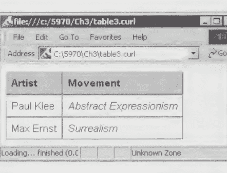

这个演示充分展示了 Curl 表格文本格式的多功能性。原则上，许多浏览器支持 HTML 中的等效元素，例如背景颜色和表格标题等。然而，当你对表格运行样式表以更改表格内单个单元格的颜色时，即使是最新版本的浏览器也不支持这些功能。

## 特殊文本格式

除了这三种核心格式（`text`、`paragraph` 和 `table`）之外，Curl 还支持一些其他格式。它们如下：

- `title`
- `image`
- `link` and `destination`
- `hrule`

借助这些文本格式，可以在文档中嵌入图像、创建超链接、插入水平分隔线以及添加标题。

## 标题

标题格式等同于 HTML 的 `<title>` 元素，它可以用来在浏览器的标题栏中显示内容。

你可以像这样使用标题格式，先声明标题，然后是你想要显示的文本：

```curl
|| title.curl
{curl 1.7 applet}
{applet license = "development"}
{title This is the title of a Curl document}
```

这在浏览器的标题栏中显示如下，但也在文档的文本页面上显示：

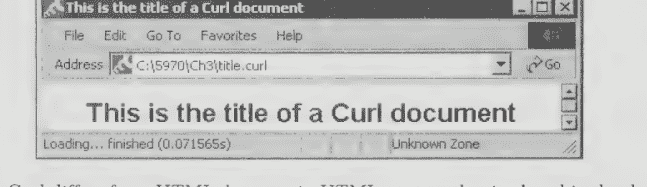

这就是 Curl 与 HTML 的不同之处，因为在 HTML 中，放在文档头部的内容通常不会作为文档内容的一部分显示。

如果你不想在页面上显示标题，而是真正模拟 HTML 的 `<title>` 标签，那么你应该使用 `heading?` 选项并将其设置为 `false`，如下所示（默认设置为 `true`）：


```curl
|| title2.curl
{curl 1.7 applet}
{applet license = "development"}
{title heading?=false, This is the title, which you won't see}
```

图像格式用于在 Curl 文档中显示图像。与 HTML 不同，HTML 仅支持三种图像格式（GIF、JPEG 和 PNG），Curl 将显示 GIF、JPEG、BMP、TGA 和 PPM 格式的图像。图像格式有一个强制性的`source`选项来指定图像的位置。然而，Curl 中的`source`选项本身需要一个表达式来提供 URL。URL 前面带有 URL 格式：

```curl
{image source=
    {url "imagefile"}
}
```

因此，如果你想在 Curl 页面上显示一个名为`mypicture.gif`的文件，并且该文件位于与 Curl 文件相同的目录中，那么你应该使用以下代码：

```curl
|| image.curl
{curl 1.7 applet}
{applet license = "development"}
{image source = {url "mypicture.gif"}
}
```

`source`选项接受指定图像文件位置的文件名；你也可以在字符串中包含文件的完整路径，如下所示：

```curl
|| image2.curl
{curl 1.7 applet}
{applet license = "development"}
{image source = {url "file:///C:/My Images/mypicture.gif"}
}
```

可选地，你还可以指定`width`和`height`选项，用逗号分隔：

```curl
|| image3.curl
{curl 1.7 applet}
{applet license = "development"}
{image
    width = 100,
    height = 100,
    source = {url "mypicture.gif"}
}
```

你可以使用 Curl 支持的任何测量单位来指定图像的大小，包括这些选项中的英寸、厘米和毫米。

这种格式的工作方式与 HTML 中的``元素几乎完全相同。如果你将文件的边界更改得比实际图像文件大或小，那么 Curl 将调整图像大小以适应。例如，调整 Wrox logo 大小时：

```curl
|| image4.curl
{curl 1.7 applet}
{applet license = "development"}
{image
    width = 10cm,
    height = 2.5cm,
    source = {url "wrox_logo.gif"}
}
```

将显示如下：

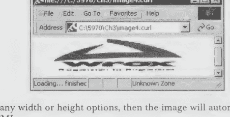

如果你不指定任何`width`或`height`选项，那么图像将自动默认为其正确大小，就像 HTML 一样。

## 链接与目标

链接和目标格式用于提供指向其他文档的超链接，无论它们是用 Curl、HTML 编写的，还是完全基于其他技术的文档。它们都取代了 HTML 中的`<a>`锚元素，但各自支持其功能的不同方面。

Curl 中的`link`格式是链接到另一个 HTML 文档的链接。然而，在 Curl 中，链接也可以指向另一个 Curl applet 或同一 Curl applet 的不同部分。`destination`格式用于指定链接到文档的特定部分。

### 将 Curl 视为 HTML/CSS

链接格式必须包含强制的`href`选项。`href`选项接受一个 URL，该 URL 在单独的表达式中指定：

```curl
{link href=
    {url "link"}
}
```

如果你想创建一个指向 Wrox Press 网站的链接，可以这样做：

```curl
|| link.curl
{curl 1.7 applet}
{applet license = "development"}
{link href=
    {url "http://www.wrox.com"}, Click Here to Jump to Wrox
}
```

你必须在表达式中指定将构成链接的文本，该文本位于包含 URL 的表达式之后。此文本必须用逗号与前面的表达式分隔开。默认情况下，链接的文档将在当前窗口中打开。但是，你也可以使用`target`选项指定浏览器应在哪个窗口中加载：

```curl
|| link2.curl
{curl 1.7 applet}
{applet license = "development"}
{link target="new", href=
    {url "http://www.wrox.com"}, Click Here to Jump to Wrox
}
```

我们指定了`"new"`以使浏览器打开自身的新实例，但实际上任何唯一字符串都可以。还可以指定以下选项，这些选项应该为 HTML 中的熟悉选项：

- `_blank` – 在新浏览器窗口中加载链接
- `_parent` – 在窗口的直接父窗口中加载文档（如果存在）
- `_self` – 在当前窗口中加载文档
- `_top` – 在主窗口中加载文档

链接格式对链接到页面特定部分的工作方式相同，但要求用户在代码中使用`destination`格式预先指定该部分的名称，如下所示：

```curl
{destination name="link_name", {format_name_you_wish_to_jump_to ...}
}
```

该格式是可选的，因为你不必将`destination`附加到任何特定的代码片段，你可以直接跳转到页面中`destination`格式所在的位置。

因此，如果你想为页面附加多个链接，每个链接与特定的标题相关联，可以执行以下操作——确保文档中的每个链接都有一个唯一的名称：

```curl
|| destination.curl
{curl 1.7 applet}
{applet license = "development"}
{destination name="link1", {heading First Link Destination}}
```

```curl
{paragraph The first section ...}
{destination name="link2", {heading Second Link Destination}}
{paragraph The second section }
{destination name="link3", {heading Third Link Destination}}
{paragraph The third section }
```

然后将其保存为`destination.curl`。我们已经说过 HTML 中熟悉的`URL#Location`语法在 Curl 中使用。要指定文档的实际部分，例如链接到"Third Link Destination"，可以使用以下代码：

```curl
|| link3.curl
{curl 1.7 applet}
{applet license = "development"}
{link target="_self", href=
    {url "destination.curl#link3"}, Click here to jump to Link 3
}
```

你必须确保在`#Location`部分指定的名称与`destination`格式的`name`选项大小写完全相同。你可以看到我们在两处都使用了`link3`。如果一处使用`link3`，另一处使用`Link3`，代码将会被破坏。如果你运行`link.curl`，会看到以下内容：

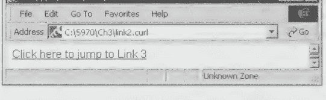

然后点击此链接，将直接跳转到文档中请求的部分：

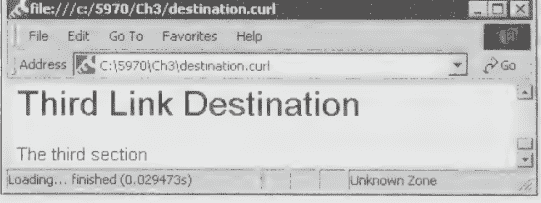

## 水平线格式

`hrule`格式相当于 HTML 的`<hr>`标签，它添加一条水平线以帮助划分网页上的文本。实际上，用法几乎完全相同：

```curl
{hrule}
```

此外，你可以为`hrule`指定两个选项。第一个选项是`height`，用于定义线条的粗细。此选项可以采用任何测量单位。第二个选项是`color`，同样支持 Curl 中的任何合法颜色。

要在 Curl 中创建一条一英寸厚的绿色线条，可以编写以下内容：

```curl
|| hrule.curl
{curl 1.7 applet}
{applet license = "development"}
{hrule height=1in, color="green"}
```

## 类 HTML 布局项

Curl 提供了一组控件，其用途和功能与许多熟悉的 HTML 控件（如按钮和列表）相同。Curl 中还存在与框架和表单等项对应的功能。我们不会在这两方面花费太多时间，因为它们在关于 GUI 的章节中有更深入的讨论。但是，将它们与 HTML 对应物进行比较并提出它们的工作原理并无坏处。

## 框架

框架——喜欢或讨厌它们——在过去几年中在许多网站上已经司空见惯。它们具有即时吸引力，例如能够将屏幕分成几个独立的部分，并能够单独重用内容。它们还可以隐藏网页的代码，因为只有主框架集的代码会出现在"查看源代码"选项中——尽管从技术上讲，获取源代码仍然不难，因此虽然代码被隐藏，但它*并不*安全。然而，HTML 4.01 标准弃用了框架，因为它们存在几个缺点，例如导致混乱的页面结构，阻止搜索引擎正确索引框架中的页面，并且通常被认为是一种笨拙的权宜之计。因此，随着 XHTML 朝着完全移除框架的方向发展，Curl 却包含了`frame`操作，这有点令人惊讶。

然而，有一个合理的解释。Curl 内容语言的区别在于，`frame`操作并不提供与 HTML`<frame>`元素相同的功能。Curl 中的框架用于构建 GUI，它们的主要用途是作为容纳其他项的容器。当你想节省空间或在页面中交换图形时，它们非常方便。

### 框架对象

在 HTML 中，框架是包含在单个`<frameset>`元素中的独立元素。这用于指定屏幕布局，其中包含一组框架元素，每个元素链接到独立的页面：

```html
<frameset cols="*,*" rows="*,50%,*">
    <frame name="frame1" src="frame1.html">
    <frame name="frame2" src="frame2.html">
    <frame name="frame3" src="frame3.html">
    <frame name="frame4" src="frame4.html">
    <frame name="frame5" src="frame5.html">
    <frame name="frame6" src="frame6.html">
</frameset>
```

这将产生一个具有 3 行框架和 2 列框架的屏幕。中间的框架将占据屏幕显示的 50%。`cols`属性指定每个框架的数量和宽度，而`rows`属性指定每组行的数量和大小。

### 第 3 章

Curl 中的`Frame`对象以不同的方式工作，尽管框架可用于包含单个图形或多个文本对象，但它们不像在 HTML 中那样用于包含指向独立页面的链接。`Frame`对象如下所示：

```curl
{Frame ...
    {object ...}
}
```

`Frame`可以包含以下格式：

- `text`
- `table`
- `paragraph`
- graphic objects（在后面的章节中介绍）

要创建一个具有黄色背景并包含一些蓝色文本的单个框架，可以提供以下代码：

```curl
|| frame.curl
{curl 1.7 applet}{applet license = "development"}
{Frame background="yellow", width=100, height=25,
    {text color="blue", this is some text}
}
```

这将在浏览器中显示以下内容：

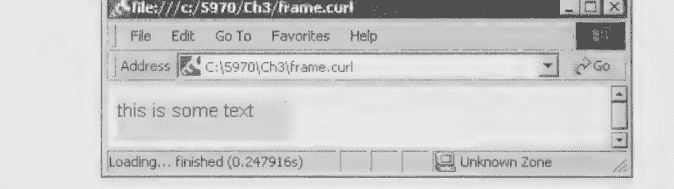

此外，还有一些额外的对象提供框架的专用版本，其中一些更接近 HTML 框架提供的功能：

- `HBox`和`VBox` – 用于创建按水平或垂直顺序容纳一系列内容的容器
- `View` – 表示窗口的框架
- `ScrollBox` – 提供滚动条的框架

我们不会在这里讨论这些对象，因为它们在第 7 章中有更详细的介绍，在那里你还会找到关于 Curl 中框架如何工作的更深入讨论。然而，这个介绍应该已经证明，虽然 HTML 和 Curl 框架之间存在相似之处，但它们也有一些重要的区别。

## 表单

HTML 中有一个重要领域在 Curl 中并没有直接对应的实现，那就是表单。在 Curl 中并没有单一的表单等价物，但 HTML 表单上下文所支持的所有控件在 Curl 中都能找到。常见的控件包括下拉列表框、按钮、文本字段、文本区域、单选按钮等，还有很多这里无法一一列举。我们将快速概述 Curl 提供的与 HTML 有直接对应关系的控件。这个话题尤其值得关注，因为使用 HTML 表单时，必须有某种服务器端技术协同工作，但在 Curl 中，可以提交控件中的数据，并且 Curl 能够直接解释这些数据，而无需与服务器进行任何交互。

## 列表控件

Curl 提供了四种列表控件，使用户能够从列表中进行选择，就像用户在 HTML 表单中从列表里选择一样。Curl 提供了`ListBox`控件，它只是显示一个列表，用户可以从中进行选择。Curl 还提供了两种下拉`ListBox`，即`dropdownlist`和`ColorDropdown`，这两种控件都需要用户手动"下拉"列表后才能使用。最后，Curl 提供了`combobox`，它允许用户从下拉列表中进行选择，或者像文本字段一样直接在`ListBox`中输入答案。

## ListBox

`ListBox`显示一个包含可选值列表的列，用户可以从中选择一个值。与下拉`ListBox`不同，`ListBox`的内容是始终显示的。要创建`ListBox`控件的实例，可以使用以下对象：

`{ListBox "List Item 1", "List Item 2", ...}`

这个列表控件可以通过以下方式使用，来显示四位著名艺术家的列表：

```curl
|| listbox.curl
{curl 1.7 applet}
{applet license = "development"}
{ListBox height=3cm, "Paul Klee", "Max Ernst", "Giorgio De Chirico",
 "Egon Schiele"
}
```

这里我们添加了一个`height`选项来控制`ListBox`的大小。这将显示如下：

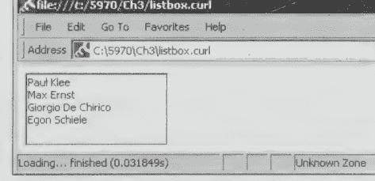

这与 HTML 中`<select>`元素提供的功能非常相似。不过，Curl 在这方面更进一步。列表控件中还可以使用另外两个对象，以提供对其外观的更多控制。它们是：

- `ListValueItem` – 允许为每个列表项添加样式
- `ListSeparator` – 允许在列表控件中指定分隔符

这些在 Curl 中提供的功能，在 HTML 中需要使用样式表或指定`style`属性才能实现。在 Curl 中，你需要在`ListBox`控件中分别指定每个`ListValueItem`，如下所示：

```curl
{ListBox
    {ListValueItem "item_name" label={text option="value", list_item_text}
    {ListValueItem "item_name" label={text option="value", list_item_text}
    {etc ... }
}
```

我们可以使用`ListValueItem`以与 HTML 代码相同的方式来指定样式，如下所示：

```curl
|| listvalue.curl
{curl 1.7 applet}
{applet license = "development"}
{ListBox
    {ListValueItem "Paul Klee", label={text color="red", Paul Klee}},
    {ListValueItem "Max Ernst", label={text color="blue", Max Ernst}},
    {ListValueItem "Giorgio De Chirico", label={text color="yellow", Giorgio De Chirico }},
    {ListValueItem "Egon Schiele", label={text color="green", Egon Schiele}}
}
```

每个项目都有一个标识符，然后是一个标签。标签用于指定列表控件中实际显示的文本，并可以使用相关的文本选项来影响每个项目的样式。

`ListSeparator`使用起来简单得多，因为它可以直接作为独立的对象来指定。要在第二个和第三个名称之间放置分隔符，可以按如下方式放置：


```curl
|| listseparator.curl
{curl 1.7 applet}
{applet license = "development"}
{ListBox
    {ListValueItem "Paul Klee", label={text color="red", Paul Klee}},
    {ListValueItem "Max Ernst", label={text color="blue", Max Ernst}},
    {ListSeparator},
    {ListValueItem "Giorgio De Chirico", label={text color="yellow", Giorgio De Chirico }},
    {ListValueItem "Egon Schiele", label={text color="green", Egon Schiele}}
}
```

关于列表控件显然还有很多内容可以讲，比如如何向 Curl 发送用户已提交列表中哪一项的信息，但这会涉及本书后面关于 GUI 的章节。因此，我们将只总结一下其他与 HTML 有等价物的控件。

如前所述，Curl 还支持以下列表控件对象：

- `DropDownList` – 等价于 `<select>` 元素
- `ColorDropDown` – 等价于通过样式表增强的 `<select>` 元素
- `ComboBox` – 没有直接的 HTML 等价物，但基本上是由 `<input>` 标签创建的类型属性设置为 text 的文本字段与 `<select>` 元素列表的组合

## 按钮控件

Curl 还有一组按钮控件，其工作方式与 HTML 支持的按钮、复选框和单选控件相同。它们是：

- `CommandButton` – 等价于 `<button>` 元素
- `CheckButton` – 等价于 type 设置为 checkbox 的 `<input>` 元素
- `RadioButton` – 等价于 type 设置为 radio 的 `<input>` 元素

同样，我们不会详细讨论它们，因为它们在第 7 章中有介绍。

## 文本控件

最后，Curl 支持一组文本控件，用于处理来自用户的文本输入：

- `TextField` – 等价于 type 设置为 text 的 `<input>` 元素
- `PasswordField` – 等价于 type 设置为 password 的 `<input>` 元素
- `TextArea` – 等价于 `<textarea>` 元素
- `TextDisplay` – 在对话框中显示文本，但没有编辑能力

这完成了我们对 Curl 中模拟 HTML 提供的功能的不同格式和对象的概述。还有一个领域需要考虑，那就是如何扩展 Curl 提供的预定义样式。

## 定义你自己的样式

现在我们需要了解 Curl 中镜像样式表功能的能力，即创建你自己的样式。我们还没有具体介绍 Curl 如何模仿样式表功能，因为在大多数情况下，任何可以在 HTML 元素属性中设置的样式，也可以通过层叠样式表来设置。首先，我们将了解如何通过组合大量选项来定义你自己的样式。理解如何创建自己的样式，就能够创建你自己的独立样式表。

## 定义文本格式

创建可能包含任意数量字符、段落或表格选项的独立样式，这类似于使用层叠样式表创建类。

在 CSS 中，你可以在样式表中创建独立类，如下所示：

```css
<style type="text/css">
class1 {font-size: 20pt;
        color: red;
        font-weight: bold}
</style>
```

实际上，如果你想要一个独立的样式表，你可以去掉 `<style>` 标签，只将样式信息保存在一个带有 `.css` 前缀的独立文件中，并使用 `<link>` 元素链接到它。

然后你可以通过大多数 HTML 元素支持的 class 属性来调用该类：

```html
<p class="class1">This is a paragraph with some big red text</p>
```

在 Curl 中，可以使用 `define-text-format` 实现类似的方法。这种格式允许你创建自己的文本、段落或样式格式。我们的意思是创建一个直接映射到格式合法设置的格式。因此你可以创建一个格式 `big-red-text`，它将映射到以下文本格式和字符选项：

```curl
{text color="red", font-size=20pt, font-weight="bold", Some text in our example style}
```

但是，无需指定你自己的选项，你可以直接使用这个自定义格式：

```curl
{big-red-text Some text in our example style}
```

`define-text-format` 的工作方式如下：

```curl
{define-text-format
    your-format-name as
    Curl_format with character_options
}
```

因此，要使用 `define-text-format` 格式创建我们的 `big-red-text` 格式，你需要执行以下操作：

```curl
|| brt.curl
{curl 1.7 applet}
{applet license = "development"}
{define-text-format
        big-red-text as
        text with color="red",
                   font-size=20pt,
                   font-weight="bold"
}
```

第一部分只是定义了我们的样式，不过，要使用它，我们需要在定义之后放置文本。它可以很容易地包含在另一个文本、段落或表格格式中，如下所示。

```curl
{text this is some {big-red-text big red text !!!}}
```

在我们的浏览器中，这将显示如下：

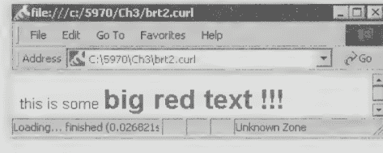

这样，Curl 就能够模拟层叠样式表中许多自定义类的特性。

如果现有的文本格式不适合您的需求，您也可以使用 Curl 重新定义它们。操作方法与处理普通格式完全相同：只需使用保留字，就像它是您自己的保留字一样。例如，如果 `tiny` 保留字不够小，无法满足您的需求，您可以按如下方式重新定义它：

```curl
{define-text-format
    tiny as
        text with font-size=0.1em
}
```

唯一的先决条件是，此定义不能与“旧”定义位于同一个包中。由于“旧”定义由单独的 Curl 语言包支持，因此这通常不会成为问题。通常，您会将文本格式放在 Curl 程序的顶部，在执行任何其他操作之前，尽管当样式信息与内容分离时，它并非真正放置在另一个文件中。

## 将代码与内容分离

我们尚未看到将呈现方式与内容真正分离的能力，即将内容与呈现信息放在不同的文件中。不过，Curl 通过能够在 Curl 代码中包含其他文件的内容来支持这一点。

您可以使用 `include` 格式将单独的 Curl 文件包含在自己的 Curl 文件中：

```curl
{include "file_name"}
```

因此，如果您将之前的大红色文本格式保存为 `big-red.curl`：

```curl
|| big-red.curl
{define-text-format
    big-red-text as
        text with color="red",
            font-size=20pt,
            font-weight="bold"
}
```

您可以按如下方式将其包含在另一个文件中：

```curl
|| include.curl
{curl 1.7 applet}
{applet license = "development"}
{include "big-red.curl"}
{text this is some {big-red-text big red text!!!}}
```

> 请注意，如果您尝试在本地加载此代码，可能会引发安全异常，因为小程序正在尝试访问本地文件。必须授予小程序访问本地文件的权限，否则在尝试使用本地文件时会抛出错误消息。我们将在第 6 章中探讨如何授予此权限。

在现实世界中，此小程序将从 Web 服务器下载，而包含的文件也将从 Web 服务器下载。小程序可以无限制地从它们来源的同一 Web 服务器下载文件，因此如果此小程序是从网络下载而非从本地文件系统运行，就不会有问题。换句话说，不必担心；这些“样式表的等效文件”不需要特殊权限即可在您的服务器上运行。

由于可以通过 `include` 格式在单独的文件中提供文本格式，因此可以将呈现样式信息与实际的 Curl 内容分离。

## 定义文本过程

我们尚未探讨 Curl 样式的最后一个方面，即文本过程。它们比文本格式更强大，因为它们支持过程提供的大部分功能，例如接受参数、返回值以及调用其他过程的能力。

Curl 文本过程的工作方式与其他 Curl 语言过程相同——我们将在下一章中探讨。与文本过程的唯一区别在于，后者是输入文本更合适的载体。`define-text-proc` 格式用于指定您自己的文本过程。其语法如下：

```curl
{define-text-proc
    {text-procedure-name (arguments)}
        {Curl expressions...}
        {return *return_value*}
}
```

此格式功能强大，可用于包含多种样式和格式。例如，如果我们希望在显示任何来自本书的文本之前放置 Wrox 标志和版权声明，我们可以创建一个文本来完成此操作。下一个示例文本过程将在表格的一个单元格中放置 Wrox 标志，并在下一个单元格中放置版权声明。在表格下方的一行中，我们将显示希望返回的内容。我们不会返回整个章节或段落，而只是返回一个示例标题来演示该过程的工作原理。

为此所需的代码如下：

```curl
|| textproc.curl
{curl 1.7 applet}
{applet license = "development"}
{define-text-proc
    {Wrox ...}:any
    {return
        {table
            {row
                {cell
                    {image source=
                        {url "wrox_logo.gif"}
                    }
                }
            }
        }
    }
}
    }
    {cells
        {text This text is copyrighted by Wrox Press}
    }
}
{row
    {cell
        {value ...}
    }
}
}
}
{Wrox Chapter 3 of the Curl book}
```

我们的文本过程名为 `Wrox`。我们将包含表格、图像和文本格式的 Curl 表达式放在 `return` 表达式内。`return` 表达式返回整个 Curl 表达式。此 Curl 表达式返回我们的表格格式，并且在表格的第一行中，我们将图像放在一个单元格中，将版权文本放在下一个单元格中。第二行有一个单元格，它返回我们提供给过程的任何值。我们将在第 4 章中探讨 `value` 关键字的工作原理。因此，发生的情况是，每当我们调用该过程时，它都会创建一个包含所需图像和文本的表格，并将过程的参数作为表格输出的一部分返回。

然后这将显示如下：

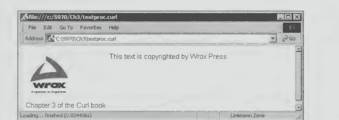

如您所见，图像和相关文本首先显示，然后作为参数提供给过程的文本显示在其下方，但仍保持在同一单元格内。

# 本章小结

本章对 Curl 文本、段落和表格格式特性进行了快速概览。我们有意侧重于 Curl 中类似于 HTML 的组件，并展示了它们与 HTML 对应部分的相似之处。这使得 Web 开发人员能够轻松上手 Curl，因为文本和段落格式中的许多特性都非常接近他们意图替代的 HTML 元素。本章最后，我们探讨了一些用于指定样式的特性，并了解了如何在 Curl 中将呈现方式与内容分离，并使用过程创建一些相当复杂的样式和格式组合。

# 第 4 章：Curl 语法

在本章和下一章中，我们将探讨 Curl 内容语言的核心，本章涵盖其基本语法元素，下一章涵盖其面向对象的特定功能。阅读本文的大多数读者当然是该语言的新手，但我们假设您已经具备一些面向对象编程的基础知识，至少了解类的概念及其用途。

如果您完全是面向对象编程的新手，这可能是去阅读相关主题、了解其工作原理的好时机。根据您之前的语言专业知识，可以在 *Beginning Visual Basic 6 Objects*（*Wrox Press*，ISBN 1-861001-72-X）和 *Beginning Java Objects*（*Wrox Press*，ISBN 1-861004-17-6）中找到一些不错的入门书籍。

## 我们目前已知的内容

在上一章中，我们了解了如何创建近似于 HTML 页面的 Curl 小程序，但没有深入了解幕后发生的事情。因此，现在我们将更深入地探讨，但首先，让我们借助一个经典示例来回顾一下我们已知的内容。

```curl
{curl 1.7 applet}
{applet license = "development"}

||This is a comment. hello-world.curl

Unimaginative set of words which happen to include the phrase
{bold 'Hello World'} but not by itself.
```

您可以将此代码键入源编辑器，并将其另存为 `.curl` 文件（Curl 文件的默认扩展名），然后直接从源编辑器运行，或者在 Windows 资源管理器中双击它，或者从浏览器中打开它。正如预期的那样，您将看到以下内容：

## 第四章

你应该不难弄清楚代码如何转换为输出结果，但让我们来看看这个小程序的组成部分，并指出几个显著特点：

- 任何 Curl 内容主文件的第一行是 **Curl 前导声明**。它有三个功能：标识代码所依据的 Curl 技术版本、指定内容类型（小程序、包），以及隐式导入该版本 Surge 或 Surge Lab 的标准 Curl 库集。

  包中的任何附属文件都不应包含 Curl 前导声明——否则会导致错误。另一方面，小程序可以包含其他小程序，因此附属文件可以包含前导声明，前提是它指定了相同的技术版本。

| Surge | Surge Lab | 前导声明版本 |
|---|---|---|
| 1.0 | beta 4 | 1.5 |
| 1.1 | beta 5 | 1.6 |
| 1.2 | 1.0 | 1.7 |

请注意，Surge 插件和 Surge Lab 依赖于您提供小程序编写时所用的正确技术版本。指定与您机器上安装的版本不同的版本将导致 Surge 弹出一个对话框，询问您是否要安装前导声明中指示的技术版本。

> **可以通过用逗号分隔在前导声明中指定多个技术版本，例如 `{curl 1.6, 1.7 applet}`。但是，当遇到版本之间的不兼容问题时，这可能会导致问题。**

**本书中的所有示例均使用技术版本 1.7 编写，但如果您使用的是 v1.6，只需更改前导声明即可，除非另有说明，示例应能正常工作。**

- 在 Curl 技术的 v1.7 版本中，您必须为每个小程序和包添加一个许可证标签，以说明其是开发中、私有还是商业用途。正如前面提到的，此标签向 Surge 的内部日志提供信息，其存在是强制性的。否则，您的小程序将无法工作。

- 第三行是一个**注释**，由双竖线 `||` 表示。它可以单独占一行，也可以位于一行代码的右侧。如果需要在代码行的其他地方或多行编写注释，应将其包含在 `|# ... #|` 标记对中。注释没有返回值，因此被 Surge 插件“忽略”。

小程序的内容被 Surge 插件视为**顶层代码**，除非包含在代码块中。插件逐个字符地评估顶层代码。任何在花括号内的内容都将作为 **Curl 表达式** 进行评估，而花括号外的任何内容都被视为 **文本**，并使用 Curl 的默认文本格式在浏览器中直接显示。行内的空格被忽略（就像在 HTML 中一样），但换行符会被保留，并在浏览器中查看小程序时重现。

我们还知道，我们可以根据需要将小程序的内容拆分到多个文件中，然后将代码包含或导入回小程序中，就像我们在第三章“将代码与内容分离”一节中对样式定义所做的那样。事实上，我们还可以利用其他小程序和包中的代码。

Curl 小程序可以比作一个包含一个或多个 Java 小程序的 HTML 页面，从而赋予其一些 Java 功能。当然，区别在于 Curl 小程序将 HTML 和 Java（以及 JavaScript）的特性结合到了一种语言中。

## 类型

Curl 有两组不同的数据类型——**值类型**和**引用类型**。值类型用于充当值或值组的存储位置，例如圆的半径和中心点坐标。因此，值类型包括：

- 原始类型（整数、双精度浮点数、字符等）
- 量
- 枚举类型

我们将在这里讨论原始类型和量，枚举类型将在下一章讨论。引用类型包括所有其他类型，即：

- 类
- 接口
- 字符串
- 集合
- 由类实现的任何其他东西

如果您试图区分值类型的变量和引用类型的变量，前者取决于其当前状态，依赖于它直接包含的值。后者的定义则更侧重于其行为，使用引用变量指向该类型的对象。

## 原始类型

下表显示了 Curl 中定义的原始类型（准确地说是在 CURL LANGUAGE CORE-TYPES 包中）：

| 名称 | 描述 | 默认值 | 备注 |
|---|---|---|---|


| 类型 | 描述 | 默认值 | 范围或说明 |
| --- | --- | --- | --- |
| `bool` | 布尔值 | `false` | 仅限 `true` 或 `false`，区分大小写，不能与 `1` 和 `0` 互换 |
| `byte` | 8 位无符号整数（如 `uint8`） | `0` | 范围在 `0` 到 `255` 之间 |
| `char` | 单个字符 | `'\u0000'` | 用单引号括起来的 16 位 Unicode 字符，也可以是单引号中的转义字符 |
| `double` | 双精度浮点数 | `0.0` | 范围为 `0.0`、`-1.7976931348623157E+308` 到 `-2.2250738585072014E-308`，或 `2.2250738585072014E-308` 到 `1.7976931348623157E+308` |
| `float` | 单精度浮点数 | `0.0f` | 范围为 `0.0`、`-3.402823466E+38` 到 `-1.175494351E-38`，或 `1.175494351E-38` 到 `3.402823466E+38` |
| `int` | 32 位有符号整数 | `0` | 范围在 `-2,147,483,648` 和 `2,147,483,647` 之间 |
| `int8` | 8 位有符号整数 | `0` | 范围在 `-128` 和 `127` 之间 |
| `int16` | 16 位有符号整数 | `0` | 范围在 `-32,768` 和 `32,767` 之间 |
| `int32` | 32 位有符号整数（如 `int`） | `0` | 范围在 `-2,147,483,648` 和 `2,147,483,647` 之间 |
| `int64` | 64 位有符号整数 | `0` | 范围在 `-2^63` 和 `2^63` 之间 |
| `uint16` | 16 位无符号整数 | `0` | 范围在 `0` 和 `65,535` 之间 |
| `uint8` | 8 位无符号整数 | `0` | 范围在 `0` 和 `255` 之间 |

正如您所预期的那样，您可以声明数字字面量。整数值可以用十进制以及二进制、八进制和十六进制编写，只要它们带有适当的前缀，分别是 `0b`、`0o` 和 `0x`。因此，`255` 等同于 `0b11111111`、`0o377` 和 `0xFF`。浮点值默认是双精度，但您可以使用 `f` 来表示单精度值（例如 `12.45f`）。

> 每种原始类型也为该类型的变量定义了一个默认值，如果变量未被显式初始化，则使用此默认值。有关更多信息，请参阅“变量创建和初始化”一节。

## 运算符

下表列出了 Curl 支持的所有运算符：

| 类别 | 运算符 |
| --- | --- |
| 一元运算符 | 一元取负 `-` |
| 算术运算符 | `+` `-` `*` `/` `div` `mod` `rem` |
| 逻辑运算符 | `and`、`or`、`not` |
| 字符串连接 | `&` |
| 关系运算符 | `==` `!=` `<` `>` `<=` `>=` `isa` |
| 强制转换 | `asa` |

如果您之前编写过自己的程序或使用过一些 JavaScript 来丰富网页，其中大部分运算符应该很熟悉。有些运算符可能看起来陌生——我们将在适当的时候介绍它们。同时，有几点需要注意：

- 有四个除法运算符——`/`、`div`、`mod` 和 `rem`。前两个运算符 `/` 和 `div` 分别返回浮点数和整数的除法结果。后两个运算符都将除法结果截断为整数（`mod` 向零舍入，`rem` 向负无穷舍入），并返回相应的除法余数。因此 `13 mod -5` 返回 `-2`，但 `13 rem -5` 等于 `3`。
- 请记住，`=` 用于赋值，`==` 用于测试相等性。混淆这两者，例如写 `v1=v2` 而不是 `v1==v2` 或反之，是 Curl 中常见的错误原因。请注意，在 Curl 语言中，`=` 在技术上不是运算符。

Curl 中的运算符遵循逻辑上的优先级顺序，如下表所示。优先级最高的运算符在表格顶部，优先级最低的在底部。与往常一样，括号中的表达式首先被评估。

| 组 | 运算符 |
| --- | --- |
|  | `()` |
| 一元 | `-`（一元取负） |
| 乘法 | `*` `/` `div` `mod` `rem` |
| 加法 | `+` `-` |
| 强制转换 | `asa` |
| 字符串 | `&` |
| 关系 | `==` `!=` `<` `>` `<=` `>=` `isa` |
| 逻辑非 | `not` |
| 逻辑与 | `and` |
| 逻辑或 | `or` |
| 赋值 | `=` |

除了这套基本的运算符和类型，Curl 还提供了支持库，位于 `CURL.LANGUAGE.*` 下，支持更多比较、位运算、三角函数、科学函数、常量以及大量的引用类型。同样，第二个支持库为用户提供了一个 `DateTime` 类型以及操作日期和时间值的方法。您可以通过查阅 Surge Lab 附带的《开发者指南》中的“支持库”部分来了解更多关于这些库的信息。

## 变量创建和初始化

在 Curl 中创建和初始化变量的方法因变量是值类型还是引用类型而略有不同，但在两种情况下，我们都使用 `let` 表达式来完成这项工作。值类型变量的声明非常直接：

```curl
|| variables.curl
{curl 1.7 applet}
{applet license = "development"}

{let i1:int}                    || i1 : 初始化为 int 的默认值 0
{let i2:int64=12}               || i2 : int64 类型，初始化为 12
{let f1:float}                  || f1 : 初始化为 float 的默认值 0.0
{let f2:float=3.1415f}          || f2 : float 类型，初始化为 3.1415f
{let d1:double}                 || d1 : 初始化为 double 的默认值 0.0
{let d2:double=3.14159}         || d2 : double 类型，初始化为 3.14159
{let b1:bool}                   || b1 : 初始化为 bool 的默认值 false
{let b2:bool=true}              || b2 : bool 类型，初始化为 true
{let c1:char,                   || c1 : 初始化为 char 的默认值 \u0000
    c2:char='Z',                || c2 : char 类型，初始化为 'Z'
    c3:char='\u20AC'}            || c3 : char 类型，初始化为 '€'
```

## 有效的标识符

Curl 将变量、类、过程、包等的有效标识符定义为符合以下规则的任意字符组合：

- 标识符区分大小写；`myclass` 与 `MyClass` 不同。按照约定，包名全部大写，类名大小写混合，其他则全部小写，必要时使用连字符分隔单词。
- 标识符必须以字母或下划线开头。
- 后续字符可以是字母、数字、下划线、问号或连字符。
- 标识符中不允许出现空格。
- 使用的字符必须存在于 Unicode 标准中。

Curl 允许我们在同一个表达式中定义标识符、类型，以及可选的值类型的值。你也可以在同一个 `let` 表达式中定义多个变量，用逗号分隔，就像前面示例中的 `c1`、`c2` 和 `c3` 那样。如果你选择不给它赋值，你的变量将获得一个默认值（如上所示的 `0` 或 `false`），从而确保栈中没有未初始化的变量。

引用类型变量的过程相同，但有一点注意事项。

```curl
{let str1:#String}
{let str2:String = {String "I wish to register a complaint"}}
{let arr1:#{Array}}
{let arr2:#{Array-of int} = {new {Array-of int}, 1, 2, 3}}
```

正如值类型变量一样，Curl 对引用类型变量强制使用默认值 `null`，这基本上意味着“此引用变量当前没有指向任何对象”。但是，除非你在引用类型前加上井号（`#`），否则你的变量不能取 `null` 值，否则会发生错误。我们将在下一章再次讨论创建和初始化对象的问题。

## any 类型

这里还有一个需要介绍的变量类型，它有时确实非常方便。Curl 语言中变量的默认数据类型是加工 `any` 类型。如果你在初始化变量时没有声明其数据类型，Surge 插件会将其视为 `any` 类型的变量，默认值为 `null`。

```curl
{let any1:any} || any1 : 初始化为 any 类型，默认值 null
{let any2 = 1} || any2 : 初始化为 any 类型，给定整数值 1
```

`any` 类型的工作原理与 Visual Basic 和 VBScript 中的 `variant` 类型非常相似，你可以将任意类型的值与该类型的变量关联，从复杂对象到简单整数均可。该变量会自动确定其值的类型，并在分配该值期间伪假定为该类型，直到被赋予新值时重复此过程。当然，这种灵活性确实会在编译和运行时带来性能损失。

> **只要可能解，如果你知道变量将持有的数据类型，请使用该特定类型而非 `any` 类型。**

## 为变量赋新值

如果无法更改变量持有的值，那么使用变量几乎没有意义，因此除非你打䇟只使用常量和字面量，否则你需要知道可以使用 `set` 表达式为变量赋新值：下面的示例演示了这一点：

```curl
|| using-set.curl
{curl 1.7 applet}
{applet license = "development"}

{let i1:int=0,
    c1:char='a',
    b1:bool=true,
    str1:String = {String "It's..."},
    str2:#String}
{let any1 = 1}

{set i1 = 123}
{set c1 = 's'}
{set b1 = false}
{set any1 = str1,
    str1 = {String "Monty Python's Flying Circus"},
    str2 = str1
}
```

`set` 表达式将为变量分配一个（正确类型的）新值，该值由 `=` 号右侧表达式指定。此表达式可以是字面量、变量，或返回所需值或值的调用。与 `let` 一样，你可以一次使用 `set` 进行一个或多个赋值，只要用逗号分隔即可。你也可以在一个赋值中设置多个变量，前提是右侧的表达式返回的变量数量与你希望设置的数量相同。

```curl
{set (var1, var2, ..., varx) = {return-x-values}}
```

需要注意的是：引用类型变量用于指向对象这一事实意味着，让两个引用指向同一对象是完全合法的，就像我们之前已经做过的那样，让 `str2` 指向 `str1` 中引用的对象：

```curl
{set any1 = str1,
    str1 = {String "Monty Python's Flying Circus"},
    str2 = str1
}
```

在使用比较运算符 `==` 和 `!=` 比较两个引用时需要小心——这些运算符比较的是引用而非对象的内容。假设我们的某个 Curl 小程序使用了一个概念性的 `Email` 类来存储用户电子邮件地址。我们可以创建两个包含相同值的类实例，但按 `==` 运算符它们不相等，因为它们引用两个不同的对象，因此不相等。

```curl
(let
    e1:Email = {Email "danm@wrox.com"},
    e2:Email = {Email "danm@wrox.com"}
)
{if (e1==e2)
    then
        {text You shouldn't see this}  || e1 和 e2 指向不同的对象
    else
        {text Objects aren't equal}    || 此分支始终被调用
}
```

为了比较对象的内容，`Email` 类需要一个专门执行此操作的成员函数，而不是使用 `==`。当然，这个规则也有例外。Curl 本身重载了 `==`，使其知道如何比较 `String` 和 `DateTime` 对象的内容。更具体地说，重载的 `==` 适用于任何继承自 `StringInterface` 或 `DateTime` 的对象。

```curl
|| equal-refs.curl
{curl 1.7 applet}
{applet license = "development"}

(let
    str1:String = {String "I am a string"},
    str2:String = {String "I am a string"}
)
{if (str1==str2)
    then
        {text == is overloaded for Strings}
    else
        {text You won't see this}
}
```

这可能造成一组不一致的操作，但对某些程序员来说，这也使得字符串、日期和时间的比较更加直观。

## isa

Curl 提供了布尔运算符 `isa`，让你可以检查变量是否为特定类型，返回 `true` 或 `false`。例如：

```curl
{value 42 isa int}     || 输出 true
{value 4.5 isa float}  || 输出 false。注意默认的 float 类型是 double
{value 1 isa bool}     || 输出 false
```

你可以用这种方式检查字面量、变量和对象。如果检查的表达式是对象，`isa` 在以下情况返回 `true`：对象的类型是指定的类型、给定类型的别名，或是给定类型的子类型。

## 数量

Curl 还允许你给变量指定**数量**，即基本值（默认类型为 `double`）和计量单位的组合；例如，`2.5m`、`129.01g` 和 `3e3s`。注意，数值和单位之间不能有空格。

下表显示了不同的内置计量类型及其默认单位：

| 计量类型 | 默认单位 | 缩写 |
| --- | --- | --- |
| `Acceleration` | `m/s^2` | - |
| `Angle` | `radian` | `rad` |
| `Distance` | `meter` | `m` |
| `Fraction` | - | - |
| `Frequency` | `1/s` | - |
| `Intensity` | `candela` | `cd` |
| `Mass` | `gram` | `g` |
| `Percent` | - | - |
| `Resolution` | `1/m` | - |
| `Speed` | `m/s` | - |
| `Time` | `second` | `s` |

与普通的值类型变量一样，我们可以声明这些新类型的变量并赋值。

```curl
|| quantities.curl
{curl 1.7 applet}
{applet license = "development"}

{let
    d1:Distance,                  || 使用默认值
    d2:Distance=7.5m,             ||
    m1:Mass=125grams,             || 使用 grams 而不是 g
    m2:Mass=2kg,                  || 对基本单位应用前缀 kilo 或 k
    t1:Time=12hr,                 || 使用兼容的计量单位
    f1:FloatAcceleration=2f(m/s^2) || 使用 float 值而不是 double
}

|| d1 = {value d1}{br}        || 输出 d1 = 0m
|| d2 = {value d2}{br}        || 输出 d2 = 7.5m
|| m1 = {value m1}{br}        || 输出 m1 = 125g
|| m2 = {value m2}{br}        || 输出 m2 = 2000g
|| t1 = {value t1}{br}        || 输出 t1 = 43200s
|| f1 = {value f1}            || 输出 f1 = 2(m*s^-2)
```

通过阅读这段代码并运行小程序，可以得出几个明显的结论。

### 第 4 章

- 数量类型变量如果在创建时未初始化，将获得 `0.0` 单位的默认值，其单位是上述表格中所示的该度量的默认单位。
- 在适用的情况下，度量单位可以用其完整名称、常用缩写或任何其他可能的替代名称表示。例如，`in` 表示 inch 或 inches，`m` 表示 meter(s)，`lb` 或 `lbs` 表示 pound 或 dry-pound 等。完整的替代名称列表请参阅开发者指南。
- 在适当的情况下，如果需要写出单位的复数形式，只需遵循英语语法的一般规则。
- 在使用数量时，可以方便地使用公制度量的标准前缀（kilo、milli、centi 等）及其缩写（`k`、`m`、`c`）。这些度量与默认值之间的转换在后台自动进行。同样，任何兼容的度量单位也是如此，例如小时、分钟和秒。
- 如果需要将数量的值部分以 `float` 而非 `double` 形式存储，可以将类型定义为 `FloatDistance`、`FloatTime` 等。浮点字面量的形式为 `value(unit)`，例如 `5f(cm)`、`12.0f(feet)` 等。
- 描述中使用 `*` 或 `/` 运算符的度量单位必须置于括号中，例如 `2(m/s)`、`23.75(g/ft^2)`。

使用数量工作的便利性以及语言在不同兼容单位之间的透明转换，在使用一段时间后很快就会显现出来——93 厘米小于一码吗？你甚至可以基于已有定义定义自己的度量单位。例如，如果你想定义一个 `Pressure` 类型，单位为每平方英寸一磅，可以这样做：

```curl
{let constant Pressure:Type={type-of 1(lb/in^2)}}
```


## `type-of`

`type-of`函数除了用于创建新的度量类型外，还有另一个常见用途。更常见的是，`type-of`用于返回表达式的运行时类型（`primitive`、`quantity`或`class`），例如：

```curl
{let c1:char = 'z'}

{type-of c1}    || 返回 'char'

{let a1:any = 123.0f}

{type-of a1}    || 返回 'float'
```

在第二个例子中，`type-of`返回`float`而非`any`，因为变量的运行时类型由其被赋予的值定义；`type-of`对变量和字面量都适用这种方式。

如果数量没有关联的度量单位，则它是**无单位的**（unitless）。Curl中预定义了几个无单位度量（thousand、million等），但最有用的可能是百分比类型（25%、0.01%等），其值在任何操作执行前会被除以100。

## 数量与运算符

Curl为原始类型实现的一小部分运算符（一元运算符、乘法、加法和关系运算符）也可用于处理数量，前提是这些数量是兼容的。例如，你可以将fortnights加到hours上，但不能加到yards上。

每个运算通过将两个值转换为该类型的默认（SI）度量单位进行计算，并以这些默认单位返回。如果你尝试将fortnight和hour相加，答案将以秒为单位返回。

```curl
{value 1fortnight + 1hour}    || 返回 1.2132e+006s
```

如果运算符是乘法性的，结果则以对两个原始值的单位执行相同操作后确定的单位表示。例如，如果你想知道物体从飞机上自由下落15秒后的速度（忽略空气阻力），可以使用以下计算。

```curl
{value 9.81(m/s^2) * 15s}    || 返回 147.15(m*s^-1)
```

确实，答案是以米每秒为单位的，正如将加速度（米每秒每秒）乘以时间（秒）所期望的那样。

不要尝试将`null`赋给数量；数量不是对象，因此不能接受`null`作为值。同样，也不要尝试将数量与值进行比较——你会得到错误，因为它们不是同一类型。如果需要从数量中提取`double`值，可以将其除以一个兼容的度量单位。如果你想以不同单位表达数量，这也同样适用，例如：

```curl
|| time.curl

{curl 1.7 applet}

{applet license = "development"}

{let
    t1:Time=(1fortnight + 1hour)
}

一 fortnight 加一小时是 {br}

{value (t1 / 1s)} 秒, {br}       || 默认情况下 t1 以秒为单位

{value (t1 / 1minute)} 分钟, 或{br} || t1 '转换'为分钟

{value (t1 / 1hour)} 小时             || t1 '转换'为小时
```

你可以使用这个技巧来确定数量在任何兼容度量单位下的值，并将其反转（将值乘以度量单位）以从数值创建数量。

## 字符采用Unicode编码

Curl的`char`和`String types`都使用16位Unicode字符。Unicode宽字符编码已成为以Web为中心编程语言的默认选择，因为它足够大，可以容纳多种国家字符集。

> 结合Locales和CharClasses使用，为chars和strings选择Unicode也使得Curt applet能够有效地实现国际化。更多内容请参阅Curl开发者指南。

`char`是无符号16位整数，可以容纳65535个值，构成Unicode字符空间。字符字面量可以用两种形式书写：

- 单引号字符，`'Z'`
- 单引号Unicode值，`'\u20AC'`

第4章

正如我们已经看到的，当你声明但不初始化`char`变量时，它会被赋予默认值`'\u0000'`。字符串字面量可以用引号字符串或原样字符串书写。引号字符串字面量由双引号（`""`）分隔，并支持通常的一组C风格转义序列，如下表所示。

## Curl中的转义序列

| 转义序列 | Unicode编号 | 转换为 |
|---|---|---|
| `\n` | 000A | 换行符 |
| `\r` | 000D | 回车符 |
| `\t` | 0009 | 制表符 |
| `\'` | 0027 | 单引号字符 `'` |
| `\"` | 0022 | 双引号字符 `"` |
| `\\` | 005C | 反斜杠字符 `\` |
| `\{` | 007B | 左花括号字符 `{` |
| `\}` | 007D | 右花括号字符 `}` |
| `\|` | 007C | 竖线字符 `|` |
| `\uXXXX` | XXXX | Unicode字符编号 XXXX |

## 常量

通过在`let`表达式中使用`constant`关键字定义变量，可以使其不可更改。如果变量被声明为常量，则必须进行初始化，因为根据其定义，它之后不能再从其他默认值进行更改。例如：

```curl
{let constant i1:int}                     || 默认值为0的整数常量

{let constant
    c2:char = 'Z',
    s3:String = "Always the same"    || c2 和 s3 都是常量
}
```

可以使用表达式初始化常量变量，但它必须是Curl能够求值为常量值的表达式。用变量初始化常量也是完全可以的；Curl只需在常量初始化时取其当前值。

还要注意，`constant`关键字在表达式中只能使用一次——其后声明的每个新变量也将被视为常量。

```curl
{let i4:int = 7}                    || i4 不是常量

{let
    constant i5:int = 12,
    i6:int = i5 div 3,             || 可以。Curl已经知道i5的值
    i7:int = i4 + 17               || 仍然可以。i7现在被永久设置为i4的当前值加17
}                                   ||
```

74

## 一切都是对象吗？

面向对象语言在表示原始类型（如整数和字符）时往往会遇到问题，因为虽然将所有事物都视为对象是有用且一致的，但这并不是很高效。语言倾向于通过以下三种方式之一来解决这个问题：

- 将原始类型作为特殊情况处理（如Java和C++），这会导致类型系统不一致
- 将所有事物都作为整数处理（如SmallEscape Sequences in CurlSmalltalk和Lisp），这效率不高
- 让原始类型在必要时被视为对象（如C#），允许基本值类型的变量在需要对象的地方使用，并直接对其调用对象方法（对前两种方法的改进）

Curl采用与Java和C++相同的方法。原始类型是特殊情况，不被视为对象。具有已知单位的数量也不是对象。其对any类型的使用也意味着该语言支持原始类型和对象的异构集合。

## 内存管理

Curl实现了自动内存管理系统，定期扫描内存中的孤立对象，回收其使用的内存以便后续重用。孤立对象产生于没有引用变量指向它们时，因此它们再也无法被访问。然而，像所有其他面向对象语言的垃圾收集器一样，无法准确预测孤立对象何时会被垃圾回收，因为该例程只在似乎需要释放一些内存时才会运行，也无法确定每一块垃圾是否都会被收集。

我们将在第11章进一步探讨通过编程方式访问收集器来强制垃圾回收的方法。

## 顶层表达式与代码块

Curl applet的代码由注释和表达式组成，分组为顶层元素、代码块、过程和类。我们稍后会讨论过程和类，但目前可以确定的是，与代码块相关的规则也适用于它们。

与C++或C#中的语句类似，表达式是我们构建applet和其他Curl内容所使用的命令，每个表达式都可以通过一个左花括号、我们调用的过程的名称、该过程所需的信息和右花括号来识别。

```curl
{procedure-name info-required-by-procedure}
```

如果任何其他成对的花括号不包围表达式，则它被视为**顶层表达式**。另一方面，嵌套在顶层表达式中的表达式本身不是顶层表达式，而是更深一层。花括号包围表达式的数量决定了代码的层级，即使表面上看起来并非如此——在代码块中，像`let`和`set`这样的简单表达式不需要用花括号括起来。

表达式可以排列成代码块，块是由`value`或`do`等关键字、由花括号括起来的一系列注释和表达式以及右括号组成。块中封闭的语句按顺序执行：

### 第四章

```curl
{value
    {let a:int = 9}    || 所有在花括号内的语句和表达式
    {set a=a+1}        || 都是由 value 表达式定义的
    a                   || 代码块的一部分
}
```

代码块可以在任何需要单个语句的地方使用。例如，while 循环中迭代的一系列指令就包含在一个代码块中，因此它们本身不是顶级表达式，尽管整个 while 循环可能是：

```curl
{while b!=0 do
    {
        set i1=10         || 这两个 set 语句位于
        set i2=i1 * 2     || while 表达式定义的代码块中。
    }
}
```

关于将表达式写成顶级表达式还是放在代码块中，有几个重要的要点需要注意：

- 代码块定义了变量的作用域。在顶级表达式中定义的变量是全局变量，可以在代码中的任何位置访问。在代码块中定义的变量只在该代码块及其嵌套的块中局部有效；因此，不能在外部访问它们。
- 无论是顶级表达式还是代码块都不一定返回值，这一点在需要显示某些内容时尤为重要。顶级表达式的返回值会显示在屏幕上，而代码块内的返回值不会显示，必须将其放入图形容器（例如，Box 对象）中，该容器保留这些值，之后可以通过顶级表达式中的调用来显示。
- 如果一段顶级代码未包含在花括号内，则被视为文本并直接显示在屏幕上。

在继续之前，你需要清楚理解这里的不少概念，所以让我们来看一个例子。这个例子使用了 Curl 中创建代码块的两种最简单的表达式——`value` 和 `do`。唯一的区别是，`value` 会计算代码块中的表达式并返回一个值（由其定义的代码块中某个表达式生成的最后一个值）；而 `do` 则完全不返回值。

```curl
|| dovalue.curl

{curl 1.7 applet}

{applet license = "development"}

{let a:int=12}          || a 是全局变量

{value a}

{value 2*3}
```

我们首先定义变量 a。该声明是一个顶级表达式，因此 a 是一个全局变量。接下来的 `value` 表达式确定 a 的内容（在本例中为 12）并返回一个表示 "12" 的图形并显示出来。同样地，随后计算 2*3 并将表示 "6" 的图形显示在屏幕上。

## Curl 语法

```curl
{value
    let b:int=12    || b 是局部变量
    b               || 这不会输出到屏幕
    set b=b+2
    b               || 这将会输出
}

|| {value b}       || b 超出作用域，会返回错误
```

下一个 `value` 表达式包含一个代码块，它定义了一个局部变量 b，尝试返回值，加上 2，然后再次尝试返回值。请注意，两个返回值中只有第二个，即 14，会实际返回，因为 `value` 本身只返回代码块中生成的最后一个值。由于 b 是局部变量，在代码块结束时它将不可访问，你可以通过取消注释对 `{value b}` 的调用并运行小程序来验证这一点。将会出现一个语法错误，提示 b 未绑定（到值）。

```curl
{let constant c:int=42}    || c 不能在代码块内声明为常量

{do
    {value a}              || a 可用但 do 不返回值
}

{value c}                  || 而 value 则返回一个值
```

为了举例说明一个不返回值的代码块，我们将使用 `do` 表达式。尽管 `{value a}` 返回变量的内容，它仍然有效，因为这是我们之前声明的全局变量，但 `do` 语句不返回值。为了强调这一点，我们在 `do` 块周围声明并显示了另一个变量 c。

```curl
{let box:VBox = {VBox}} || 为了在不会返回值的代码块中

{do                     || 显示值，创建一个盒子来
    {box.add a}         || 添加值...
}

{value box}             || 然后稍后显示该盒子
```

如前所述，解决方案是创建一个指向图形 Box 对象（这里我们使用了 VBox 对象）的全局引用类型变量，并使用 `add` 方法在代码块中将所需值放入盒子中。然后，当我们回到顶级时，使用 `value` 来显示盒子。

我们将在第七章详细讨论盒子，但记住这种在屏幕上显示信息的方法很重要。虽然我们演示了一些代码块不会返回可显示的值，但某些你可能以为会返回值的高级表达式同样不会返回值。对于这些表达式，同样的盒子技巧也适用。Curl 开发者指南中的内联示例也使用这种方法来显示其结果。

## 程序控制

在本节中，我们将介绍 Curl 语言支持的条件和循环语句。

### `if` 表达式

Curl 中的 `if` 表达式并不出人意料。如果给定条件（为了清晰可以加上括号）计算结果为 **true**（仅限布尔值——不允许使用整数），则执行一个表达式或表达式块。`if` 后面可以跟一个或多个 `elseif` 子句，和/或一个可选的 `else` 子句。然而，与 C++ 或 Java 不同，你必须在 `if` 表达式中使用 `then` 保留字。下面是一个快速演示 `if` 结构的例子，同时也展示了 Curl 在兼容单位之间进行透明转换的实用性，这是我们之前提到过的。

77

```curl
|| using-if.curl

{curl 1.7 applet}

{applet license = "development"}

{let
    d1:Distance=93cm,
    d2:Distance=1yard
}

|| 看看 93cm 是大于还是小于一码

{if d1>d2 then
    {value "93cm is greater than a yard"}     || 结果它更长
elseif d1==d2 then
    {value "93cm is the same distance as a yard"}
else
    {value "93cm is less than a yard"}
}
```

请注意，如果 `if` 表达式的每个分支都返回值，则整个表达式被视为返回值。因此，我们可以像下面这样重写上面的例子：

```curl
{value
    {if d1>d2 then
        "93cm is greater than a yard"
    elseif d1==d2 then
        "93cm is the same distance as a yard"
    else
        "93cm is less than a yard"
    }
}
```

### `unless` 表达式

`unless` 表达式与 `if` 以互补的方式工作，不同之处在于，`if` 在其控制条件为 **true** 时执行其表达式块，而 `unless` 仅在条件计算结果为 **false** 时才执行其表达式块。本质上，`unless ... do` 等同于 `if (not ...) then` 表达式。

```curl
|| using-unless.curl

{curl 1.7 applet}

{applet license = "development"}

{let d = 3}

|| d 在编译时类型为 any，但在运行时类型为 int

{let box:VBox={VBox}}

{unless (type-of d)==int do
    {box.add "Strange. d should be an integer at runtime"}
}

{value box}
```

`unless` 表达式不如 `if` 表达式灵活。如果条件计算结果为 **true**，你无法指定替代子句，并且整个表达式不返回值。你可以像从通用 `do` 结构中提取值一样从 `unless` 表达式中提取值——使用图形元素（如 Box）来嵌入内容，然后显示该元素。

78

### `switch` 表达式

`switch` 表达式是带有多个 `else if` 子句的 `if` 表达式的更优雅替代方案。它根据条件表达式的值在备选方案之间进行选择，执行与第一个匹配条件相关联的代码块，或者执行由 `else` 子句指定的默认代码块。然后它返回代码块生成的值，跳过可能列出但尚未测试的任何其他备选方案，程序控制从下一个表达式继续。

```curl
|| using-switch.curl

{curl 1.7 applet}

{applet license = "development"}

{let d1:Distance=1meter}

{switch d1
case 98cm, 99cm do || 多个选项用逗号分隔
    {value "There are 98 or 99cm in a meter"}

case 100cm do
    {value "There are 100cm in a meter"}

case 100cm do      || 此情况也为真但不是第一个匹配，所以不使用
    {value "There are really 100cm in a meter"}

case 101cm do
    {value "There are 101cm in a meter"}

else               || 仅当其他选项都不适用时才使用此选项
```


```curl
{value "I thought there were about 100cm in a meter. Guess not"}

}
```

默认情况下，`switch` 表达式使用相等运算符 `==` 来比较条件表达式（在本例中为 `d1`）和每个 `case` 语句中的选项（或多个选项）。但是，你可以使用 `using` 子句指定替代比较运算符（`<`、`<=`、`>=`、`>` 或 `isa`），如下所示：

```curl
{switch d1 using <

case 99cm do

    {value "There are 99cm in a meter"}

...
```

如果我们运行经过此修改的小程序，将会得知一米中有 101 厘米！

传统上，`switch` 语句只允许条件子句中计算结果为 `char` 或 `int` 的表达式。在 Curl 中，情况有所不同；`switch` 表达式子句可以返回任何支持类型的值。该子句使用通常的 `==` 运算符进行比较，但比较方式取决于使用的类型；对于字符串比较文本，对于其他对象比较引用。因此，例如，我们可以写：

```curl
{let b1 = true}

{switch {type-of b1}

case any do

    {value "b1 remains of type any"}

case bool do

    {value "b1 is now of type bool"}

else

    {value "It's not a value as we know it."}

}
```

在大多数编程语言中，我们比较表达式的 `case` 标签必须是常量。在 Curl 中，情况并非如此，它允许你使用任何返回值的表达式作为 `case` 标签，只要它们在表达式的上下文中返回值。

## type-switch 表达式

`type-switch` 表达式是 `switch` 的一种特殊情况，它使用 `isa` 运算符进行比较，基于条件表达式中值的类型来决定执行哪块代码。

```curl
{type-switch (2 + 2)

    case i:int do

        {value i & " is an int"}

    case f:float do

        {value f & " is a float"}

    case x:SomeUserDefinedClassType do

        {value x & " is some user defined reference type"}

    else

        {value "I dunno what this is."}

}
```

条件表达式的返回值会被存储，其类型会被确定并与 `case` 语句中给出的选项进行比较。当某个语句匹配到该类型，或者找到的选项是指定类型的子类型时，就会执行相关的代码块，并将条件表达式的值的副本作为局部变量提供给该代码块使用。在该代码块结束时，程序控制流会转到 `type-switch` 语句的末尾，跳过任何其他 `case` 语句。

## for 表达式

`for` 表达式是 Curl 支持的三种迭代表达式中的第一种。它支持对数值范围以及容器对象的内容进行迭代。

### 遍历范围

`for` 循环的基本形式允许你通过 `start` 起始值和 `end` 结束值指定一个数值范围，使用一个循环变量来遍历该范围，并指定数值的取值顺序。

```curl
{for iterator-name:type = start-value to end-value [step step-value] do

    code-block

}
```

这种 `for ... to ... step ... do` 循环会针对循环变量在指定的起始值和结束值之间（含）的每个值执行代码块中的内容。它预设：

- `start-value` 小于 `end-value`。
- `step-value` 决定了每次循环迭代后循环变量的增量。它必须是正值；如果未指定，则使用默认值 1（或 1.0）。

举个简单的例子，让我们从 1 数到 10：

```curl
|| using-for.curl

{curl 1.7 applet}

{applet license = "development"}

|| 基本循环和默认步长 - 数到十

{let box:VBox = {VBox}}

{for i:int = 0 to 10 do

    {box.add i}      || 向 box 中添加 0 1 2 3 4 5 6 7 8 9 10

}
```

```curl
{value box}

|| 基本循环和 step=2 - 显示偶数

{for i:int = 0 to 10 step 2 do

  {box.add i}      || 向 box 中添加 0 2 4 6 8 10

}

{value box}

|| 这会导致错误，因为步长值为负数

||{for i:int = 10 to 0 step -1 do

||  {box.add i}

||}

||{value box}
```

声明整数循环变量 `i` 并设置为 `0`；注意 `i` 是循环的局部变量。每次循环时，将 `i` 的当前值添加到图形框中，并在每次迭代结束时递增。循环持续进行，直到 `i` 大于给定的结束值。注意 `for` 循环本身不返回值，因此我们必须使用前面介绍的 `box` 方法。

`for` 表达式还有另外三种用于遍历范围的形式，如下所示：

```curl
{for i:int = 0 below 10 do

  {box.add i}      || 向 box 中添加 0 1 2 3 4 5 6 7 8 9

}
```

`for ... below ... step ... do` 循环按前述方式工作，但只遍历范围中直到但不包括结束值的值。因此，如果我们将上面的示例重写为这种方式，循环变量将永远不会取值 10。

```curl
{for i:int = 10 downto 0 do

  {box.add i}      || 向 box 中添加 10 9 8 7 6 5 4 3 2 1 0

}
```

`for ... downto ... step ... do` 循环也按上述方式工作，但此时假设范围的起始值大于其结束值，每次迭代结束时递减循环变量。注意 `step` 的值仍应大于 0。

```curl
{for i:int = 10 above 0 do

  {box.add i}      || 向 box 中添加 10 9 8 7 6 5 4 3 2 1

}
```

最后，`for ... above ... step ... do` 循环类似于 `below` 和 `downto` 循环的一种组合。此循环也假设范围从较高的值开始，向下计数到其结束值，但仅在循环变量的值大于给定结束值时继续执行。

如果需要，有两种方法可以创建无限 `for` 循环：

- 将循环的 `step-value` 设置为 0。
- 在代码块中为循环变量赋值，使其永远达不到范围的末尾。

### 遍历集合

第二种 `for` 循环允许程序对容器对象（例如数组或字典对象）中的每个项目执行代码块中包含的一个表达式或一组表达式。对象必须实现 `to-Iterator` 或 `for-loop-count` 方法，此循环结构才能工作。我们将在下一章进一步研究容器循环，届时我们将学到更多关于对象的知识。

## while 表达式

Curl 中的 `while` 循环工作方式与 C++ 或 C# 中相同，对一个表达式或表达式块迭代零次或多次，直到布尔表达式求值为 `false`。注意 `while` 表达式不返回值。

```curl
|| using-while.curl

{curl 1.7 applet}

{applet license = "development"}

|| 显示从 a 到 y 的字母表

{let box:VBox = {VBox}}

{let count:char = 'a'}

{value

    {while count<'z' do

        {box.add count}

        set count = (count + 1) asa char

    }

    box

}
```

## until 表达式

`until` 循环是 Curl 中 `while` 循环的补充，对代码块迭代零次或多次，直到控制表达式求值为 `true`。注意 `until` 表达式也不返回值。

```curl
|| using-until.curl

{curl 1.7 applet}

{applet license = "development"}

|| 显示从 z 到 b 的字母表

{let box:VBox = {VBox}}

{let count:char = 'z'}

{value

    {until count <= 'a' do

        {box.add count}

        set count = (count - 1) asa char

    }

    box

}
```

## break 和 continue 表达式

`break` 和 `continue` 表达式可用于控制循环内的迭代。`break` 表达式将立即退出包含它的 `for`、`while` 或 `until` 循环。例如，在下面的示例中，我们修改了 `while` 循环的示例，当变量 `count` 达到 `'h'` 时包含一个 `break`。

```curl
|| using-break.curl

{curl 1.7 applet}

{applet license = "development"}

|| 用 break 中断循环。只显示 z 到 i

{let box:VBox = {VBox}}

{let count:char = 'z'}

{value

    {while count>'a' do

        {if count=='h' then     || 如果 count 等于 h，跳出循环

            {break}

        }

        {box.add count}

        set count = (count - 1) asa char

    }

    box

}
```

`continue` 表达式也控制循环内的迭代。然而，这次调用 `continue` 只会停止循环的当前迭代，导致下一次迭代开始。如果在重新启动循环之前没有更新控制循环的表达式，`continue` 很可能会每次都被调用，从而导致无限循环。

```curl
|| using-continue.curl

{curl 1.7 applet}

{applet license = "development"}

|| 显示 y 到 a，但跳过 l 到 g

{let box:VBox = {VBox}}

{let count:char = 'z'}

{value

    {while count>'a' do

        {set count = (count - 1) asa char}

        {if (count>='g') and (count<='l') then

            {continue}    || 如果在 l 到 g 范围内，跳到下一次循环

        }

        {box.add count}

    }

    box

}
```

注意 `break` 和 `continue` 本身是表达式，必须用大括号括起来，否则会产生错误。

### 使用带标签的循环

我们还可以通过使用标签扩展来跳出嵌套循环或继续特定循环的迭代。这要求我们使用 `tag` 属性为循环命名：

```curl
{for tag=MyForLoop, i::int=0 to 10 do

    code

}

{while tag=MyWhileLoop, i<=10 do

    code

}

{until tag = MyUntilLoop, i>10 do

    code

}
```

## 第 4 章

然后，我们可以在调用 `break` 或 `continue` 时给出特定循环的标签名称，以跳到该循环的末尾或开始该循环的新迭代：

```curl
{break tag=MyWhileLoop}

{continue tag=MyForLoop}
```

## 调用过程

Curl 区分四种类型的过程。它们是：

- 顶层过程
- 匿名过程
- 类过程
- 方法

我们将在下一章介绍类过程和方法。

### 顶层过程

在 Curl 中定义和调用顶层过程（或者如果你愿意，就称为过程）非常简单。作为顶层代码，过程由 `define-proc` 表达式定义，使用以下语法：

```curl
{define-proc [modifier-list] [access] {procedure-name [argument-list]}

    [:return-types]

    procedure-body

}
```

与 Pascal 或 Visual Basic 一样，你必须在调用过程之前先定义它，否则在后续代码中调用时会收到 `not bound` 错误消息。

每个过程都必须有返回类型，即使是 `void`，这种情况下不需要返回任何值。如果声明没有指定返回类型，则默认假定为 `any` 类型。过程可以不带任何参数，这种情况下函数名称仍然是声明中内部大括号内唯一的项目。

过程名之前还可以有编译时修饰符 `inline` 和/或 `access` 属性。`inline` 修饰符告诉 Curl 用过程声明中的实际代码替换程序中对该过程的调用，因为这可能比通过查找表访问它运行得更快。而 `access` 属性指定哪些代码可以访问此过程。默认情况下，它设置为 `package`，因此只有同一包中的代码才能调用该过程。你也可以将其设置为 `public`，表示任何代码都可以访问此代码。

过程声明之后是过程体，它采用由大括号包围的表达式和注释组成的代码块形式。代码块的最后一行通常是，但并非总是，一个 `return` 表达式，它确定过程将向调用它的表达式返回什么值。对面的示例显示了将摄氏温度转换为华氏度和开尔文温度等效值的方法的定义。

```curl
|| using-procedures.curl

{curl 1.7 applet}

{applet license = "development"}

{let celsius : int = 21,

    fahrenheit : int,

    kelvin : int

}

{define-proc {c2f celsius_in:int}:int

    let f:int = (celsius_in*(9/5)+32) asa int

    {return f}

}

{define-proc {f2k fahrenheit_in:int}:int

    let k:int = (fahrenheit_in+273)

    {return k}

}

{set fahrenheit={c2f celsius}}

{value "21 celsius = " & fahrenheit & " degrees fahrenheit"}{br}

{set kelvin={f2k fahrenheit}}

{value "21 celsius = " & kelvin & " degrees kelvin"}
```

一旦定义完成，你可以像调用任何其他 Curl 表达式一样调用过程：以左花括号开头，紧接着是过程名、参数，最后是右花括号。

```curl
(c2f celsius)

{f2k fahrenheit}
```

参数和返回值都必须是过程声明中指定的类型——`c2f` 因此定义了它的一个参数是整数，返回值也是整数。同样，如果未指定参数或返回类型，它们默认使用 `any` 类型。

## 参数

你可以用三种方式指定过程的参数：

- 位置参数，定义为 `arg-name[: arg-type]`，要求你在调用过程时为它们指定值。
- 关键字参数在声明中指定默认值 `arg-name[: arg-type]=def-value`，如果你选择在调用过程时不给它赋值，该参数将采用此默认值。
- 剩余参数，`...`（三个句点），表示过程调用中的最后一个参数，可以容纳任意数量的额外参数，这些参数是在它之前指定的参数之外的。这些参数保存在一个特殊的容器对象中，可以使用 `for` 循环进行迭代，我们将在第 5 章中看到这一点。

如果过程返回单个值，你可以将该值赋值给变量以便进一步使用，或者简单地将其作为顶层表达式调用以在屏幕上显示。如果过程返回多个值，你可以使用多值 `set` 表达式将它们赋值给变量。请注意以下示例中使用括号来分组返回类型，并指定该过程返回两个值。

```curl
{define-proc {c2fandk celsius_in:int}:(int, int)  || 注意分组

    let f:int =(c2f celsius_in)

    let k:int =(f2k f)

    {return f, k}

}

{set (fahrenheit, kelvin) = {c2fandk 45}}  || 同样如此

{value "45 celsius = " & fahrenheit & " degrees fahrenheit or "

    & kelvin & " kelvin"

}
```

## 匿名过程

Curl 将所有过程视为具有底层引用类型的对象，称为 `proc-type`。在其他语言中，这也可以被称为过程的签名。`proc` 类型的语法如下：

```curl
{proc-type {[argument-types]}[:return-types]}
```

因此，例如，我们之前定义的温度转换函数的 `proc` 类型是：

```curl
|| c2f 和 f2k 具有相同的 proc-type

{proc-type {int}:int}

|| c2fandk 的 proc-type 略有不同

{proc-type {int}:(int, int)}
```


我们可以像处理其他引用类型一样处理这些`proc`类型，声明某个`proc`类型的引用变量，并在声明时或之后将其指向该类型的匿名过程。匿名过程（或简称`proc`）与普通过程类似，但它们没有自己的过程名，而是采用指向它们的引用变量的名称。

```curl
|| using-anon-procedures.curl

{curl 1.7 applet}

{applet license = "development"}

{let celsius : int = 21,

    fahrenheit : int,

    kelvin : int,

    changing-proc : {proc-type {int}:int}

}

|| 首先我们将 changing-proc 设置为将摄氏度转换为华氏度

{set changing-proc = {proc {celsius_in:int}:int

                      {return ((celsius_in*1.8)+32) asa int}

                      }

}
```

首先，我们声明一个引用变量`changing-proc`，它可以指向接受一个整数参数并返回整数值的过程。请注意，此声明与任何其他变量声明的处理方式完全相同——与顶层过程不同，`proc`可以在任何可以声明变量的地方声明和初始化，甚至可以作为调用另一个过程时的参数。

`proc`的语法与`define-proc`略有不同，因为`proc`要求参数列表必须用花括号括起来。然而，`proc`定义的其余部分与顶层过程没有什么不同。

```curl
|| 然后我们以与 c2f 相同的方式调用它

{set fahrenheit={changing-proc celsius}}

{value "21 celsius = " & fahrenheit & " degrees fahrenheit"}{br}
```

对`proc`的调用可以在调用顶层过程的任何地方进行，并且使用相同的语法。将上面调用`changing-proc`的方式与之前调用`c2f`的方式进行比较。

```curl
|| 接下来我们将 changing-proc 设置为将华氏度转换为开尔文

{set changing-proc = {proc {fahrenheit_in:int}:int

                        let k:int = {fahrenheit_in+273}

                        {return k}

                     }

}
```

```curl
|| 再次，调用 changing-proc 与调用 f2k 相同

{set kelvin={changing-proc fahrenheit}}

{value "21 celsius = " & kelvin & " degrees kelvin"}
```

由于`changing-proc`是一个变量，它可以被赋予新值，因此将它指向一个新的`proc`是完全有效的，正如示例的其余部分所做的那样。在这里，我们重新将它指向一个看起来很像我们之前创建的华氏度到开尔文转换器的`proc`。同样，我们像调用顶层过程一样调用它。

匿名过程确实非常有用：

- 你可以在任何代码块或表达式中声明和使用匿名过程——例如，在调用另一个过程时、作为从另一个过程返回的值，或作为存储在数据结构中的值。
- 匿名过程可以访问定义在其所在代码块作用域内的变量，这是其他类型过程无法做到的。这除了全局和局部定义的变量以及作为参数传递给过程调用的变量之外。
- 你可以使用匿名过程来伪重载过程。

《开发者指南》包含了更多关于过程和`proc`的示例，供进一步参考。

## 包

最后，我们来看看在 Curl 中可以创建的另一类内容——包。包提供了一种将类、顶层代码和全局变量声明分组为单个可重用单元的方式。这些声明可以位于一个主文件中，或者分布在几个附属文件中，这些文件：

- 包含在主文件中，意味着它们的代码实际上被剪切并粘贴到主文件中编写`include`语句的位置。
- 在`package`声明的`files`属性中指定。

例如，如果我们有几个与温度相关的过程，我们可以将它们分组到一个包中，如下所示：

```curl
|| load.curl

{curl 1.7 package}

{applet license = "development"}
```

## 第 4 章

```curl
{package TEMPERATURE.BASIC,

    {files

        "convert-temperature.curl",      || 声明包中包含的文件

        "adjust-temperature.curl",        ||

        "temperature-variables.curl"

    },

    author="Dan Maharry",                 || 声明关于包的元数据

    version="1.0",

    resources=(new {ReadOnlyArray-of String},

                      "images/thermometer.gif",

                      "images/icicle.jpg"

                 )

    }

    {include "another-file.curl"}

    || ... 任何额外的类、过程和变量声明紧随其后
```

主包文件通常称为`load.curl`（尽管这不是强制的），并且本身不能在浏览器中运行。它仅作为可重用代码的来源，供小程序包含或导入到它们自己的代码中。Curl herald 像往常一样开始文件，说明该包将使用哪个版本的 Curl 技术，以及它是一个包而不是小程序。

紧接着 herald 的是包声明，其语法如下：

```curl
{package name[, {files file-list}] [, meta-data-list])}
```

包的名称按照惯例全部大写，由多个有效的 Curl 标识符用点分隔组成。这使你可以按逻辑层次结构命名你的包，这在开始创建超级包时特别有用，例如：

```text
TEMPERATURE

TEMPERATURE.BASIC

TEMPERATURE.BASIC.CONVERSION

TEMPERATURE.QUANTITIES

COM.WROX.TEMPERATURE.BASIC
```

举债经营总是存在风险的，网上其他人可能已经给自己的包起了相同的名字。解决潜在冲突的一种流行方法是在包名前加上你网站的注册域名的反向顺序，如上面最后一个示例所示。请注意，保存包的文件结构不需要反映你为包定义的层次关系，这与 Java 包不同。

还有两个可选属性完成包声明。第一个是逗号分隔的 URL 列表，指向组成包的附属文件。这个列表可以省略，改为稍后使用`include`。最后，你还可以在包的定义中指定一些关于包的元数据。关于可以定义什么的完整列表在《开发者指南》中，但最有用的是`resources`选项，它允许你列出除了代码文件之外希望包含在包中的任何其他资源；例如，图像或声音文件。

在包声明之后，我们可以按需要安排变量和过程。请注意，包的内容不像小程序的内容那样按顺序检查。相反，包中的定义是一次性导入内存的。因此，允许前向引用和循环引用。换句话说，在包中，你可以在定义某项之前引用它。

## 附属文件

包中的附属文件具有特定的格式，以标识它们是包的一部分：

```curl
|| convert-temperature.curl
{in-package TEMPERATURE.BASIC}

{define-proc {c2f celsius_in:int}:int
     ...

|| further definitions and procedures
```

附属（或片段）文件不需要 Curl 标识行。相反，主包文件顶部的标识行也适用于其附属文件。此外，我们可以选择性地指定一个`in-package`头，以指明该文件属于哪个包，后跟我们希望在包中提供的定义和过程。`in-package`是可选的，因为某个文件可能会被包含或导入到多个包中。

## 超级包

超级包是一种只从其他包和超级包导入定义而不添加新 Curl 代码的包，这进一步说明了以逻辑层次结构命名包实际上是一个相当好的主意。例如，你可以使用超级包将所有与温度相关的包归置在一起。然后，只需导入超级包一次，即可将所有这些包的内容导入到你的 applet 中，而不需要多次导入每个包，例如：

```curl
|| temperature.scurl
{curl 1.7 package}
{applet license = "development"}

{package COM.WROX.TEMPERATURE,
      author="Dan Maharry"}
{import public * from COM.WROX.TEMPERATURE.BASIC,
      location="http://www.wrox.com/curl/temperature/basic.scurl"}
{import public * from COM.WROX.TEMPERATURE.CLIMATE,
      location="http://www.wrox.com/curl/temperature/climate.scurl"}
{import public * from COM.WROX.TEMPERATURE.MAPS,
      location="http://www.wrox.com/curl/temperature/maps.scurl"}
```

## 使用包

当你需要让 applet 使用包内的定义时，你需要做两件事：

- 从包中加载部分或全部定义。
- 确保这些定义不会与 applet 中的其他内容发生冲突。

我们使用对`import`过程的顶级调用来完成第一项任务。其语法如下：

```curl
{import [access] [direct-names from] PACKAGE-NAME
[, using-name=NAME
[, override?=true/false]
[, location="url"]
[, id="ComponentID-string"]
[, jit-compiled?=true/false]
[, transitive-id="ComponentID-string"]
[, version=version]
}
```

如果我们回顾一下超级包代码中的示例，可以看到这在实际中可能是什么样子。

```curl
{import public * from COM.WROX.TEMPERATURE.BASIC,
    location="http://www.wrox.com/curl/temperature/basic.scurl",
    location="http://beta.wrox.com/curl/temperature/basic.scurl"}
```

此示例说明了每次调用时你主要应该指定的选项。（不太常用的选项在《开发者参考》中有描述。）这里的`access`属性选项设置为`public`，意味着导入超级包/文件的代码也对任何导入该超级包/文件的 applet 可用。另一种选择（也是默认选项）是`package`，意味着任何被导入的代码仅对该包/文件保持私有。

`direct-names`列表精确指定了你希望让 applet 使用的定义。最好是一个由相应标识符组成的逗号分隔列表，或者是`*`，这告诉插件将该特定包中的每个定义都导入到你的 applet 中。

另一个我们应该指定的选项是包本身可能的位置或多个位置，以防插件无法自行找到它。如果找不到，它将使用`location`属性作为查找位置的建议。

成功让定义可用于 applet 后，有两种方法可以在代码中引用它们。最简单的方法是使用包中的过程名。

```curl
{set fahrenheit={c2f 21}}
```

只要只有一个该名称的过程，这种方法就能正常工作。如果有疑问，你可以使用完全限定名，如下所示：

```curl
{set fahrenheit={COM.WROX.TEMPERATURE.BASIC.c2f 21}}
```

对`c2f`的引用是完全明确的，但每次想要调用它时都要输入`COM.WROX.TEMPERATURE.BASIC.c2f`可能会很快变得相当繁琐。有两种方法可以解决这个问题。第一种是在`import`表达式中指定`using-name`属性。这允许你为包指定一个（更短的）别名，你可以用它来代替完全限定名。

```curl
{import public * from COM.WROX.TEMPERATURE.BASIC,
    location="http://www.wrox.com/curl/temperature/basic.scurl",
    using-name="basic_temp"
}

{set fahrenheit={basic_temp.c2f 21}}
```

我们还可以使用`define-alias`表达式为包中的声明逐个创建别名，甚至可以像`import`表达式一样为别名指定`access`属性，具有相同的`public`和`package`选项。

```curl
{define-alias c2f = COM.WROX.TEMPERATURE.BASIC.c2f }
{define-alias public f2k = COM.WROX.TEMPERATURE.BASIC.f2k,
    c2fandk = COM.WROX.TEMPERATURE.BASIC.c2fandk
}
```

我们现在可以调用这三个过程而不需要前缀，就像它们是在导入其定义的文件中本地定义的一样。

## 小结

在本章中，我们介绍了 Curl 的基本语法，以及在适当情况下一些更高级的语言特性。我们涵盖的主要特性有：

- 所有 Curl applet 都有一个标识行、一个包含许可证标签的 applet 声明，以及由表达式、代码块和注释组成的主体。
- Curl 中的所有字符都使用 16 位 Unicode 编码。
- 一行代码根据其是作为顶级代码求值还是在代码块中出现，可能会产生不同的结果。
- 某些 Curl 表达式返回值，但其他表达式不返回值。
- 所有过程都有一个底层的`proc-type`。我们可以创建该类型的变量并为其分配匿名过程。
- 包是不可执行的代码集合，包含类、过程和变量定义，可以导入到任何需要其功能的 applet 中。

# 第 5 章

## 面向对象编程

本章将介绍 Curl 内容语言的主要面向对象（OO）特性，从枚举这种简单的复合数据类型开始，然后继续介绍类和继承。接着我们将研究 Curl 语言中定义的三种集合对象——数组、哈希表和集合。最后，我们将探讨如何使用异常来处理程序中的错误。

## 枚举

枚举是一种用户定义的数据类型，由一组命名的、带索引的常量组成。

```curl
{define-enum Actor
    Snipes,
    Hopkins,
    Green,
    Liotta
}
```

每个命名常量都有一个索引值，从 0 开始，后续每个名称递增 1。因此，在上面的示例中，Snipes 的索引为 0，Hopkins 为 1，Green 为 2，Liotta 为 3。索引值固定于常量在枚举中的位置，因此不可更改。每个常量可以有一个分配的值，该值可以是数字、字符、布尔值或字符串。如果你不显式地为枚举类型常量分配值，它将采用从 0 开始的整数值，每增加一个隐式值递增 1。

```curl
|| enumeration.curl
{curl 1.7 applet}
{applet license="development"}

{define-enum Actor         || Actor 是枚举类型的名称
    Snipes="Action",       || Snipes 的索引为 0，字符串值为 "Action"
    Hopkins=12,            || Hopkins 的索引为 1，整数值为 12
    Green=false,           || Green 的索引为 2，布尔值为 false
    Liotta="R"             || Liotta 的索引为 3，字符值为 "R"
}
```

分配了枚举类型但未分配值的变量会自动设置为枚举中的第一个常量。

```curl
{let star:Actor}                      || 设置为 Actor.Snipes 的默认值
{let luvvie:Actor = Actor.Hopkins}    || 设置为 Actor.Hopkins
{let b-list:Actor = "Green"}          || 也可以为变量分配
                                     || 枚举类型的值

{value luvvie}                       || 返回 Actor.Hopkins
{value luvvie.name}                  || 返回 Hopkins
{value luvvie.index}                 || 返回 1
{value luvvie.value}                 || 返回 12
```

有多种方法可以确定枚举元素的索引、值和名称，这取决于你已经知道枚举类型的名称及其三个值之一。

```curl
{value Actor.Green.name}              || 返回 Green
{value {Actor name="Green"}.name}     || 返回 Green
{value {Actor index=2}.name}          || 返回 Green
{value {Actor value=false}.name}      || 返回 Green
```

如果你需要知道枚举类型中有多少个元素，可以使用`enum-size`表达式，将你要查询的类型作为参数。


```curl
{enum-size Actor}                      || 返回 4
```

你还可以使用`for ... in ... do`表达式遍历枚举的所有元素。

```curl
{let box:VBox = {VBox}}
{for person in Actor do
    {box.add person.name}
}
{value box}                            || 返回常量名称的列表
```

## 类

类的概念是面向对象编程的核心。就像我们可以列出一个枚举类型的可能值一样，类允许我们将数据和过程归置在一个名称下。同样，本书不是深入讨论面向对象编程的地方（有关该主题的推荐阅读，请查看第 4 章引言部分），但值得提及它的一些优点：

- “黑盒”开发和测试——OO 编程让你可以将数据和方法（称为方法）分组到类中，并精确决定哪些内容将对访问对象（类的实例称为对象）的代码可用，哪些仅在内部可用。如果做得当，类就成为一个伪黑盒，可以独立于任何其他代码进行测试和开发。
- 可复用性 – 良好的设计实践要求类应尽可能少地依赖使用它的外部代码；遵循这一规则将极大地增强可复用性。
- 健壮性 – 如果一个类不允许任何外部代码访问其中的数据，除非通过 getter 和 setter 方法，那么用户就无法做任何直接影响对象完整性的事情。

这个示例展示了代表商店中产品的类的非常简单的实现：

```curl
|| using-classes.curl
{curl 1.7 applet}
{applet license="development"}

{define-class public Product

	{field private _amount-in-stock:int = 100}

	{getter public {check-stock}:int
		{return self._amount-in-stock}
	}

	{method public {buy amount-in-delivery:int}:String
		|| Add to delivery to number-in-stock
		set self._amount-in-stock = self._amount-in-stock + amount-in-delivery
		{return "Bought " & amount-in-delivery & " DVDs"}
	}

	{method public {sell amount-in-cart:int}:String
		|| Check have enough, then sell
		{if (self._amount-in-stock - amount-in-cart) < 0 then
			{return "Can't sell more DVDs than we have"}
		else
			set self._amount-in-stock = self._amount-in-stock - amount-in-cart
		}
		{return "Sold " & amount-in-cart & " DVDs"}
	}
}
```

`define-class`表达式定义一个类；它类似于我们之前看到的`define-enum`表达式，只是枚举定义的是值类型，而类是引用类型，也可以包含一定量的功能。

`Product`类包含一个用于保存数据的字段成员——在本例中是产品的库存数量——以及三个方法（method 是为类的每个实例定义的过程的名称）。请注意，每个声明，无论是字段还是方法，都应包含在`define-class`表达式的大括号内，不过对于字段来说是可选的。你还可以在类内部定义类过程；它们与方法类似，但不像方法那样通过神奇的`self`变量与类实例存在隐式关系。

一旦实例化了`Product`类型的对象，我们就可以使用与枚举类型相同的点符号来调用其方法。

```curl
|| Creates the Product object
{let DVD:Product = {Product}}
{value "There are " & {value DVD.check-stock} & " DVDs in stock"}

|| Buy and sell some products
{DVD.buy 150}{br}
```

## 第 5 章

```curl
{value "Now there are " & {value DVD.check-stock} & " DVDs in stock"}

{DVD.sell 200}{br}
{value "Now there are " & {value DVD.check-stock} & " DVDs in stock"}
```

请注意，也可以使用`new`关键字来实例化对象，尽管这不是强制性的。然而，在实例化本身包含在大括号中并且/或者需要参数的对象时，这会很有用，例如：

```curl
{let DVD:Product = {new Product}}
{let rect-array:{Array-2-of int} = {new{Array-2-of int},4,5}}
```

你可能已经注意到，方法、字段甚至类本身都具有访问限定符。`define-class`表达式的访问属性定义了该类是只能由同一包内的代码使用，还是公开的，可供任何导入它的代码使用。方法和字段共享这些访问属性，此外还有`private`属性，表示该方法或字段只能由同一类内的代码访问。

方法和字段还定义了`protected`访问属性，我们将在后面看到。

指定类外部可以看到什么和不能看到什么有一些明显的优势。例如，通过将产品的库存数量设为私有值，用户无法直接修改它，只能通过`buy`和`sell`方法间接修改。这使我们能够在必要时检查和记录库存的变化，同时也维护了数据的完整性。

```curl
{method public {sell amount-in-cart:int}:String
|| Check have enough, then sell
{if (self._amount-in-stock - amount-in-cart) < 0 then
    {return "Can't sell more units than we have"}
else
    set self._amount-in-stock = self._amount-in-stock - amount-in-cart
}
{return "Sold " & amount-in-cart & " units"}
}
```

事实上，我们可以根据代码是否需要读取或设置字段的值，通过在常规访问属性后添加`-get`和`-set`后缀来指定代码对字段的访问级别。例如，我们可以将`amount-in-stock`定义为公开可读，但只能通过 setter 或类定义的其他方法写入。

```curl
{field public-get private-set amount_in_stock:int = 100}
```

## 访问器

让类的使用者对类内定义的字段拥有公开访问权限是非常糟糕的编程实践。因此，类通常会定义方法来获取和设置每个字段的值，无论是实际值还是派生值，这是非常常见的。这类方法统称为访问器。Curl 语言也不例外，使用`getter`和`setter`表达式来定义它们各自的功能。

```curl
{getter public {amount-in-stock}:int
    {return self._amount-in-stock}
}
```

```curl
{setter public {amount-in-stock level:int}:void
    set self._amount-in-stock = level
}
```

Getter 和 setter 具有与常规方法相同的可能的访问属性值。然而，与其他方法不同的是，它们可以具有相同的名称（如果需要），并且调用时就像引用变量而不是方法一样。

```curl
{set DVD.amount-in-stock = 450}
{value "Now there are " & {value DVD.amount-in-stock} & " DVDs in stock"}
```

访问器提供了一种引用字段的便捷方式，但与其他方法一样，它们可以包含任意数量的代码行，因此它们不仅仅是设置和获取私有字段的值。如上所述，它们可以返回依赖于所讨论字段的值，与字段的原始值完全不同，或者在 setter 的情况下，根本不返回任何值。

## `self`引用

在大多数面向对象语言中，类成员总是相对于特定对象来引用的。这种引用可以是显式的——例如，在对象上调用方法：

```curl
{DVD.buy 250}
```

或者在从类内部代码调用时是隐式的，尽管 Curl 语言在这种情况下不允许这样做。

```curl
{value buy(250)}
```

在大多数语言中，程序员通常可以选择使这种调用显式化，从而清楚地表明该调用是同一类中的方法。不寻常的是，Curl 语言强制要求这样做。因此，要从类内部的代码引用类成员，我们必须使用`self`关键字。

```curl
{getter public {amount-in-stock}:int
    {return self._amount-in-stock}
}

{setter public {amount-in-stock level:int}:void
    set self._amount-in-stock = level
}

{method public {purchase units:int}:String   || A synonym for buy.
    {return {self.buy units}}
}
```

## 选项

除了字段和方法之外，Curl 类成员的第三种类型可能对 Visual Basic 程序员或者那些使用过基于表单或图形的编程语言的人来说最为熟悉。选项看起来非常像字段，允许你在需要时设置对象的视觉属性。如果不设置，那么派生自 Visual 类的对象将采用预设默认值。例如，我们可以创建一个`VBox`对象，并设置它的`background`和`margin`选项。

```curl
{let box1:VBox = {VBox
    background = "green",
    margin = 10pt}
}
```

像我们为对象定义的字段一样，选项可以在对象实例化时赋予一个值，如上所示，或者在其生命周期后期使用`set`表达式来设置。

```curl
{set box1.background = "green"}
```

然而，与字段不同的是，图形对象将赋予其某些选项的值传递给它包含的任何其他图形对象——它的子对象。例如，如果将`box2`添加到`box1`的内容中，它的`background`选项将是`box1`的值，即使没有显式设置。

```curl
{let box2:VBox = {VBox}}
{box1.add box2}  || box2's background is now green
```

我们可以通过赋予一个新值或使用`unset`来更改`box1`的`background`，从而阻止`box2`具有绿色背景，在这种情况下，选项将恢复为其默认值。

```curl
{unset box1.background}
```

前面我们说过父对象会将其“某些选项”的值传递给子对象，因为实际上有两种选项——局部的和非局部的。那些传递给子对象的选项是非局部选项，而那些不传递给子对象的是该对象的局部选项。开发者指南的 GUI 工具包部分有图形选项的完整列表。

如果你需要 meanwhile 为你的类创建局部或非局部选项，只要你的类可以支持选项（这意味着它需要从`Visual`类或其某个子类派生），你就可以使用`local-option`和`non-local-option`表达式适当地定义它们：

```curl
{local-option public option-name:option-type [= option-value]
    option-code
}
```

```curl
{nonlocal-option public option-name:option-type [= option-value]
    option-code
}
```

你必须将选项声明为类的公共成员，并定义类型。它们的初始值可以在定义中显式设置，或者保留为给定`option-type`的默认值。值得记住的是，选项是内存高效的，因为它们在被设置为非默认值之前不需要任何内存，这与字段不同。这是因为对象的默认选项包含在对象本身内部。

## 构造函数

构造函数是用于初始化其类的新对象的方法。构造函数有几个特点：

- 它没有返回类型。
- 程序员不必显式返回一个值，尽管创建类的新实例的调用从而间接调用构造函数会返回一个对象。
- 类及其构造函数通常具有相同的访问属性，尽管这不是一成不变的，让它们不同也可能很有用。

你可以在类中创建多个构造函数来处理传递给它的不同参数。然而，与某些其他语言不同的是，这要求每个新构造函数必须有不同的名称——Curl 语言不支持方法重载。你可以将其中一个构造函数命名为`default`，那么如果在创建类的新实例时没有指定构造函数，就会使用这个默认构造函数。

```curl
|| using-classes2.curl
{curl 1.7 applet}
{applet license="development"}

{define-class public Product

    {field private _amount-in-stock:int}

    {getter public {check-stock}:int
        {return self._amount-in-stock}
    }

    {setter public {new-stock-value level:int}:void
        set self._amount-in-stock = level
    }

    {constructor {default}
        set self.new-stock-value = 150
    }

    {constructor {AbnormalDelivery x:int}
        set self.new-stock-value = x
    }

    || method code omitted for clarity
    {method public {buy amount-in-delivery:int}:String
    {method public {sell amount-in-cart:int}:String
}

{let boxes-of-eggs:Product = {Product}}
{value "There are " & {value boxes-of-eggs.check-stock} & " boxes of eggs in stock"}

{let baskets-of-raspberries:Product = {Product.AbnormalDelivery 300}}
{value "There are " & {value baskets-of-raspberries.check-stock} & " baskets of raspberries in stock"}
```

我们的小程序记录了两种新产品的到货。我们通常收到 150 箱鸡蛋，因此我们使用默认构造函数创建一个`Product`对象来记录这一点。但是，我们收到了一大笔异常批量的覆盆子，所以我们使用`AbnormalDelivery`构造函数来记录，并传递我们收到的数量。

如果一个类没有声明任何工厂方法或构造函数，Curl 会提供一个默认的无参构造函数。这显然有局限性；例如，类中的所有字段必须声明初始值。如果你出于某种原因不想这样做，就必须提供自己的构造函数。

## 类变量和类过程

有些变量实际上属于整个类，而不是任何单个实例。例如，在我们的`Product`类中，任何一种产品的库存数量是该产品独有的，但每个`Product`对象都会影响库存中不同产品的数量。在这种情况下，这些成员被称为类变量。C++ 程序员将它们称为静态变量。

```curl
{define-class public Product

    let number_of_products_in_stock:int

    {field private _amount-in-stock:int}
...
}
```

类变量在每个小程序中创建一次，因此在小程序的生命周期内，每个`Product`对象都能访问`number_of_products_in_stock`类变量的唯一实例，因此它们都会影响或检索相同的值。你也可以通过在定义中添加`constant`关键字将类变量变为类常量。假设每种在售产品的价格都是 $2.50——我们可以定义一个类常量来反映这一点。

```curl
{define-class public Product

    let number_of_products_in_stock:int
    let constant one_price:double = 2.5

    {field private _amount-in-stock:int}
...
}
```

我们乐于使用`object_name.member`语法来利用与特定对象关联的字段、选项和方法，但如何获取类变量和常量呢？只需将`object_name`改为类名即可，例如：


```text
{define-class public Product

    let number_of_products_in_stock:int

    ...

    {constructor {default}
        set self.new-stock-value = 150
        {inc Product.number_of_products_in_stock}
    }

    {constructor {AbnormalDelivery x:int}
        set self.new-stock-value = x
        {inc Product.number_of_products_in_stock}
    }

    ...

}
```

我们还可以使用之前见过的`define-proc`表达式来定义类过程，用于声明顶级过程；它们也可以使用`class_name.xxx`语法来调用。

```text
|| using-class-members.curl
{curl 1.7 applet}
{applet license="development"}

{define-class public Product

    let number_of_products_in_stock:int

    {define-proc {Inventory}:int
        {return Product.number_of_products_in_stock}
    }

    {constructor {default}
        {inc Product.number_of_products_in_stock}
    }

}

{Product.Inventory}{br}                          || Returns 0

{let boxes-of-eggs:Product = {Product}}
{let baskets-of-raspberries:Product = {Product}}

{Product.Inventory}                          || Returns 2
```

我们`Product`类示例的这个简化版本还巧妙地展示了使用类变量和过程时需要记住的另一点。由于它们都属于类而不属于类的对象，因此无论是否已实例化该类的对象，它们都会存在并可供使用。

## 工厂方法

除了构造函数之外，类还可以定义一个或多个工厂方法，返回该类或其子类的实例。通过使用工厂方法，你可以显式地：

- 初始化对象（通过调用构造函数）
- 为对象分配内存
- 返回对象

在创建实现工厂方法的新对象时，它将调用工厂方法来创建对象，而不是构造函数。例如：

```text
{define-class public Product

    {factory public {default}:Product
        {return {Product}}
    }
    ...
}
```

在这种情况下，我们为`Product`类定义了一个默认`factory`，它简单地调用对象的默认构造函数并返回新创建的对象。如果新引用变量被设置为`Product`，它将调用这个默认工厂方法而不是默认构造函数。

`factory`的语法与`constructor`几乎完全相同，访问权限和修饰符属性具有相同的可能值：

```text
{factory [access] [modifiers] {factory-name [arg-list]}:return-value
    body
}
```

访问非默认工厂方法的`class-name.factory-name`语法也相同。工厂方法必须只有一个返回类型，并且必须是包含该工厂方法的类或其子类之一。

大多数情况下，使用构造函数而不是工厂方法就足够了，但在以下情况下，后者更为合适：

- 你想从共享的对象池或资源池中返回对象。
- 你想在一次调用中调用多个不同的构造函数。
- 你想返回子类的对象，而不是类本身的对象。

## 继承

继承的概念与类的概念一样，是面向对象编程的基础之一，它使我们能够从已编写的类派生出新类。因此，它在类之间建立了一种关系。继续我们上面的例子，我们可以说`Groceries`继承自`Product`，因此`Groceries`和`Product`之间存在一种关系。

当一个类（子类）继承自父类（或超类）时，它继承了该超类的非私有字段、方法、访问器和选项，使我们能够基于现有类进行构建和扩展。它不会继承超类的构造函数、工厂方法、类变量或类过程。所谓继承，是指子类拥有超类字段的自己的副本，并且可以在子类类型的对象上调用超类的方法。

让我们考虑`Groceries`类。

```text
{define-class public Groceries {inherits Product}
}
```

要在类之间建立继承关系，只需在调用`define-class`时添加`inherits`表达式。如果我们只是这样做，`Groceries`类型的对象将能够使用标准点符号调用访问器方法`check-stock`和`new-stock-value`以及两个类方法`buy`和`sell`。它还会生成一个默认构造函数，调用其超类（在本例中为`Product`）的默认构造函数。然而，它还无法做其他事情，因为我们还没有添加任何其他功能。

```text
{let boxes-of-eggs:Groceries = {Groceries}}
{boxes-of-eggs.buy 200}
{boxes-of-eggs.check-stock}
```

你可以选择覆盖从超类继承的任何方法，甚至可以覆盖这些方法接受的参数，前提是：

- 当一个方法有多个参数时，覆盖方法必须有相同数量的参数，名称相同且顺序相同。然而，参数的类型可以不同——它们可以是原始参数的超类型。
- 如果一个方法接受`rest`参数，覆盖方法也必须接受`rest`参数。
- 如果一个方法返回一些值，覆盖方法必须返回相同数量的值。然而，返回类型不必相同；它们可以是原始返回类型的子类。

你只需使用方法表达式来重新定义方法，实际上是隐藏了同名的超类方法。

## 多重继承与共享类

Curl语言完全支持类之间的多重继承，因此我们可以定义一个`FreshlyBakedProduce`类，让它同时继承`FreshProduce`和`Bakery`类，如下所示。

```text
{define-class public FreshlyBakedProduce {inherits FreshProduce, Bakery}
...
}
```

只需在`define-class`调用的`inherits`部分添加你希望新子类继承的所有超类即可。但要注意，你的子类不能从多个超类中继承两个或更多同名的不同方法。在这种情况下，编译器会抛出错误，除非其中一个方法位于一个子类中，而该子类继承自包含其他同名方法的所有其他类。

如果一个类可以被子类多次继承，它被称为共享类（shared class），应在`define-class`调用中使用`shared`修饰符来定义。例如，如果`FreshProduce`和`Bakery`类都继承自`Product`类，那么`FreshlyBakedProduce`将两次继承`Product`，使其成为共享类，我们应这样重新定义它。

```text
{define-class shared public Product
...
}
```

使用共享类确实会带来小幅性能损失。例如，当实例化`FreshlyBakedProduce`类的一个实例时，它会调用`Product`类的默认构造函数两次。此外，访问共享字段时也会发生间接寻址。

## 辅助构造函数

在更一般的情况下，当子类两次继承自一个共享超类时，调用超类构造函数两次可能会对子类对象的初始值产生不利影响。Curl语言允许你通过指定共享超类中的辅助构造函数（secondary-constructor）来纠正这些异常值，并根据需要设置新的值（选项、字段、方法），以抵消对其构造函数第二次调用所产生的影响。

```text
{secondary-constructor public {default}
{dec Product.number_of_products_in_stock}
}
```

例如，如果我们创建一个类型两次继承自`Product`的新对象，存储库存商品数量的变量将增加二而非一。因此，我们使用辅助构造函数将增量重新减少为一。

如果共享超类显式定义了一个或多个构造函数，则每个构造函数都必须有一个匹配的辅助构造函数，与其对应的主构造函数具有相同的访问属性、名称和参数列表。如果共享类不包含任何构造函数，将创建一个默认的主构造函数，但不会有辅助构造函数被生成或调用。

## 使用超类引用

一旦我们创建了`Groceries`这样的子类，就可以通过指向其超类`Product`的引用来访问它。

```text
{let apples:Groceries = {Groceries}}
{apples.buy 125}

{let fruit:Product = apples}

{value fruit.check-stock}
{value apples.check-stock}
```

- 创建一个`Groceries`对象
- 将`amount_in_stock`属性从默认值移出
- 设置一个`Product`引用变量指向`Groceries`对象
- 使用`check-stock`验证是否有效
- 两者返回相同的非默认值

现在我们可以有两个引用变量指向同一个`Groceries`对象，一个是`Groceries`类型，另一个是`Product`类型。这是可行的，因为`Groceries`对象**就是**`Product`对象；它可能定义了额外的成员，但它可以访问与其超类相同的字段、方法和选项。

> 在运行时通过超类引用调用子类的对象及其成员的能力称为多态性（polymorphism）。

事实证明，这种将对象作为其超类来引用的方法在面向对象编程中被大量使用。继承和多态性使我们能够创建类层次结构，并根据需要将这些层次结构中的对象视为相似的（它们都是`Products`）或不同的（`apples`是一个`Groceries`对象）。我们可以保存所有不同产品对象的列表，使用`Product`类型的引用变量来跟踪它们，并对每个对象调用`check-stock`。此时，我们不需要知道每个对象是`Product`的哪个子类型，因为库存数量是所有产品共有的。

## 访问超类成员

有时，你可能需要在子类内部向上调用超类的方法或查询超类的字段。Curl语言允许我们使用`super`关键字来实现这一点。

例如，我们可以重新定义`Product`类中的`sell`方法，使其不检查调用是否有效，而将这一决定留给继承它的子类。

```text
|| superclass.curl
{curl 1.7 applet}
{applet license="development"}
{define-class public Product

  {field private _amount-in-stock:int}

  {getter public {check-stock}:int
     {return self._amount-in-stock}
  }

  {setter public {new-stock-value level:int}:void
     set self._amount-in-stock = level
  }

  {method public {sell amount-in-cart:int}:String
     set self._amount-in-stock = self._amount-in-stock - amount-in-cart
```

```text
     {return "Sold " & amount-in-cart & " units"}
  }
...    || 我们在这里省略了一部分以节省空间
}
```

接着，在`Groceries`类中，我们重新定义`sell`方法来检查交易是否有效，然后调用超类方法来执行交易。

```text
{define-class public Groceries {inherits Product}

  {method public {sell amount-in-cart:int}:String
    || 检查库存是否充足，然后进行销售
    {if (self.check-stock - amount-in-cart) < 0 then
        {return "Can't sell more than we have"}
    else
        {return {super.sell amount-in-cart}}
    }
  }
}
```

如果子类继承自两个或更多超类，你需要添加要调用的方法所属超类的名称。例如：

```text
{return {super.Product.sell amount-in-cart}}
```

注意，要访问超类的非默认构造函数，需要使用稍微不同的方法。

## 调用超类构造函数

我们知道，当创建新对象时，会调用它的某个构造函数。如果其类是一个子类且没有显式定义构造函数，则会生成一个尝试调用超类默认构造函数的构造函数。如果超类也没有定义默认构造函数，则沿继承链向上继续查找，直到我们到达最终的超类`Object`类，它确实定义了默认构造函数。所以如果`Groceries`类没有定义构造函数，它会间接调用`Product`的默认构造函数，在这种情况下，以下代码是可行的。

```text
{define-class public Groceries {inherits Product}

  {method public {sell amount-in-cart:int}:String
    || 检查库存是否充足，然后进行销售
    {if (self.check-stock - amount-in-cart) < 0 then
        {return "Can't sell more than we have"}
    else
        {return {super.sell amount-in-cart}}
    }
  }
}

{Product.Inventory}{br}      || 返回 0

{let boxes-of-eggs:Groceries = {Groceries}}
{boxes-of-eggs.sell 50}

{Product.Inventory}{br}      || 返回 1
```

请记住，`Inventory`类过程返回存在的`Product`对象的数量。果然，`Product`类的默认构造函数执行了新的`Groceries`对象的实例化，在第二次调用`Inventory`时将一个`Product`标记为存在。

## 第 5 章

为了显式调用超类的构造函数，我们必须使用`construct-super`表达式：

```text
{define-class public Groceries (inherits Product)
  ...
  {constructor {default}
    {construct-super}
  }
  {constructor {AbnormalDelivery x:int}
    {construct-super.AbnormalDelivery x}
  }
}
{let boxes-of-eggs:Groceries = {Groceries}}
{let baskets-of-raspberries:Groceries = {Groceries.AbnormalDelivery 300}}
```

与`super`前缀一样，如果子类继承自多个父类，你需要用想要调用其构造函数的类名来限定`construct-super`。

```text
{construct-super.ThisClass}
|| 调用 ThisClass 的默认构造函数
{construct-super.ThisClass.ConstructThat}
|| 调用 ThisClass 的 ConstructThat 构造函数
```

调用`construct-super`并不会禁止类构造函数中的其他处理，但在上面的例子中，我们只是创建了`Groceries`构造函数，将新库存的数量交给`Product`构造函数处理。这种委托是相当常见的。

## 受保护访问

从`Product`派生的类可以调用`Product.sell`方法来进行销售，但我们没有理由希望一个无关类的对象（例如`Rain`对象）也能够调用`Product.sell`。为了防止这种情况，我们可以在方法表达式中使用`protected`访问属性。

```text
{define-class public Product
  ...
  {method protected {sell amount-in-cart:int}:String
    set self._amount-in-stock = self._amount-in-stock - amount-in-cart
    {return "Sold " & amount-in-cart & " DVDs"}
  ...
}
```

将方法设为`protected`意味着只有同一包中的代码或子类中的代码才能调用该方法。只要你不试图在电子商务包中提供天气预报，那么只有从`Product`派生的子类才能调用`Product.sell`。

## 类型转换

我们之前看到，通过超类引用变量来引用子类是相当常见且非常安全的。如果我们想反过来，将子类引用变量指向超类的对象呢？例如：

106

## 面向对象编程

```text
{let fruit:Product = {Groceries}}
...
{let apples:Groceries = fruit}   || 此处出现语法错误
```


此处发生错误的原因是，引用变量`fruit`可能指向`Product`的任意派生类型，而不仅仅是超类本身的对象。`Groceries`类型的引用指针`apples`如果随意赋值，最终可能指向一个`Bakery`类型的对象。语法错误信息本身包含了解决方案：

> "遇到从超类`Product`到子类`Groceries`的禁止隐式转换。你需要使用`asa`插入显式转换"

```curl
{let fruit:Product = {Groceries}}
...
{let apples:Groceries = fruit asa Groceries}   || 现在没有错误了
```

因此，我们使用`asa`来指示编译器：如果`fruit`可能指向`Groceries`的超类，则应将其向下转换层次结构为`Groceries`对象，并让`apples`指向它。如果不是超类（也可能是`Product`的子类），小程序将在运行时抛出异常，调试器将出现（如果你已安装 Surge Lab 而不仅仅是 Surge 插件的话）。

关于引用类型之间转换的更详细描述，请参阅开发者指南中 Curl 基本特性部分。

## 重写超类方法

如果你决定重写从超类继承的方法（记住我们在前面“继承”部分提到的规则），那么任何对该方法的调用，无论是来自指向子类对象的引用变量还是指向超类对象的引用变量，都会调用子类中的方法。

```curl
|| superclass2.curl
{curl 1.7 applet}
{applet license="development"}

{define-class public Product

  {getter public {check-stock}:int
      {return self._amount-in-stock}
  }

  {setter public {new-stock-value level:int}:void
      set self._amount-in-stock = level
  }

  {method public {sell amount-in-cart:int}:String
      set self._amount-in-stock = self._amount-in-stock - amount-in-cart
      {return "Sold " & amount-in-cart & " units"}
  }
}

{define-class public Groceries {inherits Product}

  {method public {sell amount-in-cart:int}:String
      || 检查库存是否充足，然后销售
      {if (self.check-stock - amount-in-cart) < 0 then
```

```curl
    {return "Can't sell more units than we have"}
    else
        {return {super.sell amount-in-cart}}
    }
...
}

{let apples:Groceries = {Groceries}}    || 创建一个 Groceries 对象
{let fruit:Product = apples}             || 创建一个指向它的 Product 引用

{apples.sell 5000}                       || 返回 "Can't sell more units than we have"

{fruit.sell 5000}                        || 同样返回 "Can't sell more units than we have"
                                          || 而非你可能预期的 "Sold 5000 units"
{value fruit.check-stock}
```

在上述示例中，调用`apples.sell`按预期调用了`Groceries`对象的`sell`方法，但调用`fruit.sell`同样调用了`Groceries`对象的`sell`方法，而非你可能预期的`Product`对象的`sell`方法。

## 抽象类和方法

从本节关于继承及其引发问题的示例中可以看出，我们的电子商务小程序最终可能会引用多种不同的产品类型（`Groceries`、`Bakery`、`FreshlyBakedProduce`、`FreshProduce`），它们都派生自`Product`超类。可以合理推断，`Product`只是一个其他类可以从中派生基本字段和方法集合的类，其本身并不直接有用。此外，允许用户创建`Product`类型的对象而非其派生类型之一可能是得不偿失的。我们可以通过将`Product`声明为抽象类来禁止这一点。

如果`define-class`表达式包含`abstract`修饰符，这意味着不能直接创建该类型的对象。即使在抽象类中声明的工厂方法也无法覆盖这一点，必须生成子类对象。

```curl
{define-class abstract public Product
...
}

{define-class public Groceries {inherits Product}
...
}

{let fruit:Product = {Product}}       || 导致语法错误
{let fruit:Product = {Groceries}}     || 正确
```

在将类定义为抽象后尝试创建`Product`对象会导致 Surge 返回语法错误信息，提示“无法创建抽象类 Product 的实例”。然而，我们仍然可以使用`Product`类型的引用变量指向其某个子类的对象。

你还可以在类中创建抽象方法（和访问器）。如果子类继承自声明了抽象方法的超类，它必须用自己的定义重写这些方法；否则，这些方法在子类中也将是抽象的，无法调用。将方法声明为抽象是一种有用的技巧，可以确保子类必须实现自己版本的某些方法。

```curl
{define-class abstract public Product

...
  {method abstract public {buy amount-in-delivery:int}:String
  }
...
}
```

```curl
{define-class public Groceries {inherits Product}
  || 定义中不包含 buy 方法的实现
}
```

```curl
{let apples:Groceries = {Groceries}}
{apples.buy 250}
                          || 呃，出错
}
```

如果你尝试调用子类未重新实现的继承抽象方法（如上述示例中的`{apples.buy 250}`），Surge 会返回语法错误信息：“Groceries 中没有 'buy' 成员”。由于派生类必须重写抽象方法，因此无需在抽象类中实现它们。另外，请注意只有抽象类才能包含抽象方法。

## 阻止派生

默认情况下，每个类都可以从任何地方继承——包内和包外均可。虽然不必显式使用，但类定义中的`open`修饰符设置了这种可访问性。

```curl
{define-class public open Product

...

}
```

如果出于某种原因（例如安全性），你不希望你的类被派生，可以在其定义中添加以下修饰符之一：

- `final`修饰符表示该类不能被任何类继承。
- `sealed`修饰符表示该类只能被同一包内的类直接继承。请注意，`sealed`类的子类如果本身不是`sealed`或`final`，则可以被进一步继承。

```curl
{define-class public final FreshlyBakedProduce

...

}
```

```curl
{define-class public sealed Bakery

...

}
```

任何尝试继承`final`类或在包外继承`sealed`类的行为都会导致 Surge 返回语法错误。请注意，这两个选项彼此互斥，也与`abstract`和`shared`修饰符互斥——你不能在同一个`define-class`表达式中使用两个或更多这样的修饰符。例如，`final`和`abstract`显然是互斥的，因为前者阻止子类化，而后者则需要子类化。

## 参数化类

你还可以定义接受一个或多个参数的类，这些参数将确定该类型的对象被引用时类的特征。这方面的经典例子是 Curl 语言的`Array-of`类，它接受一个参数来声明该数组将存储哪种变量。

```curl
{define-class public {Array-of t:Type}

    || 类主体

}
```

在这种情况下，参数`t`的数据类型为`Type`，这允许它接受任何有效的数据类型作为其值，但你的类的参数可以是你需要的任何类型，当然前提是该类型存在！例如，我们可以定义一个`Hotel`类，其中对象的功能取决于其位置和星级评分。

```curl
{define-class public {Hotel stars:int, location:Place}

    ...

}
```

要创建参数化类的实例，你必须在类名旁边包含参数值，并将两者都用花括号括起来。例如：

```curl
let exam-marks:{Array-of int} = {new {Array-of int}}

let more-exam-marks:{Array-of int} = {{Array-of int}}

let caesars-palace:{Hotel 5, Las Vegas} = {{Hotel 5, Las Vegas}};
```

正如我们之前提到的，使用`new`来创建类的实例是可选的，但它确实有助于理解双花括号的含义，否则这些括号只是环绕着新对象。

## Object 类

Curl 内容语言定义了一个名为`Object`的抽象类，每个其他类都继承自它，即使它们没有明确说明。作为该语言的终极超类，我们可以创建`Object`类型的引用变量并将其指向任何其他对象。

```curl
let some-item:Object = {Groceries}
```

然而，由于`Object`类没有实现子类的任何成员，因此无法访问任何成员，除非使用`asa`将其转换回原始类型。

```curl
{some-item.buy 50}                 || 错误

{{some-item asa Groceries}.buy 50}  || 正确
```

正如我们在“类型转换”部分看到的，Surge 将返回错误信息“Object 中没有 'buy' 成员”。

## 集合

如果你再回顾一下枚举，你会记得它们是定义变量可以逐个取值的可能值集合的数据类型。相比之下，集合是允许该类型的单个变量同时管辖多个值的数据类型。Curl 内容语言定义了三种我们可以使用的通用集合类型：

- **集合（Sets）**——包含无序的值集合
- **哈希表（Hash Tables）**——为集合中的每个元素关联一个键
- **数组（Arrays）**——为集合中的每个元素关联一个整数索引值

我们将依次介绍这些集合类型，从最简单的集合（Sets）开始。

## 集合（Sets）

集合是复杂度最低的集合类型，表示一组无序的元素，遵循以下规则：

- 集合中的所有元素都属于相同类型和/或创建集合时声明的命名类型的子类。因此，一个`Set-of Object`可以持有任何类型对象的引用。
- 访问特定元素的唯一方式是直接按名称访问，或使用`for ... in ... do`循环遍历集合中的每个元素。
- 两个元素不能具有相同的名称；否则，最新添加的具有该名称的元素将替换之前具有该名称的元素。
- 如果在遍历集合的过程中修改了其内容，结果将是未定义的。

集合本身是一个参数化类，通过调用`Set-of`类型创建，该类型会为我们初始化一个正确类型的引用变量。

```curl
{let actor-set:#{Set-of String}} || actor-set 等于 null，因此在类型声明中
                                    || 必须使用 #

{let number-set:{Set-of double} = (new {Set-of double}, 3.14159, 1e1, 42)}

                                    || number-set 会立即被初始化
```

我们可以先创建引用，然后再将其指向某个对象；在这种情况下，我们需要在变量类型前加上`#`以表示它可以取空值。

> 请注意，如果您尝试遍历任何值可能为空的集合，Surge 将会抛出错误。

创建集合后，您可以添加或删除元素、对其进行查询，以及使用迭代来处理整个集合。

```curl
|| using-sets.curl

{curl 1.7 applet}

{applet license="development"}

{let box:VBox = {VBox}}

                                    || 创建包含三个数字的集合

{let number-set:{Set-of double} = (new {Set-of double}, 3.14159, 1e1, 42)}

{value

    {number-set.insert 1.614}         || 现在向集合中添加第四个数字

    {box.add number-set.size}          || 并查询其大小。

                                    || 查询结果返回 4

    {box.add "终极答案是否在集合中？" &

        {number-set.member? 42}}

                                    || 现在检查 42 是否在集合中

    {number-set.remove 1e1}             || 现在从集合中移除一个元素

    {for each-number:double in number-set do

        {box.add each-number}}          || 遍历集合并

                                    || 将每个元素添加到 box 的内容中

    {number-set.clear}                  || 最后，清空集合中的元素

    {box.add "这组数字现在为空。是真还是假？" &

        number-set.empty?}              || 并检查它是否为空

    box

}
```

集合还理解有限的集合算术运算，允许您在需要时创建集合的差集、并集和交集。当然，集合必须是相同类型的，例如：

```curl
{let set1:{Set-of int} = {{Set-of int} 1,2,3},

    set2:{Set-of int} = {{Set-of int} 4,5,6}

}

{set1.union set2}
```

不要忘记集合是无序的。虽然`set1`确实包含整数元素 1 到 6，但遍历集合以打印这些元素并不一定按数字顺序进行。

《开发者指南》包含了 Curl 语言支持的集合操作的完整列表。

## 克隆来袭

集合、数组、哈希表和字符串都允许您创建它们自身的克隆。克隆的集合与原始集合具有相同的类型，但包含内部元素的“浅拷贝”。简而言之，这意味着如果您更新集合中某个元素的对象/值——可能是原始集合或克隆集合——另一个集合也会更新该元素。但是，如果您为某个元素分配一个新对象，另一个集合将保留旧对象。

有关克隆集合的更多信息，请参阅《开发者指南》。

## 哈希表（Hash Tables）

与集合类似，哈希表也表示元素的无序集合，但它们额外为每个元素关联一个键，用户也可以通过该键来访问元素的值。使用哈希表的规则反映了这一点：

- 哈希表中的键值对都属于相同类型和/或创建哈希表时声明的命名类型的子类。因此，一个`HashTable-of Object`可以持有任何类型对象的引用。
- 访问特定元素值的唯一方式是直接通过其键访问，或使用`for key . . . in . . . do`循环遍历集合中的每个元素。
- 两个元素不能具有相同的键；否则，最新添加的元素将替换之前具有相同名称的键。
- 如果在遍历哈希表的过程中修改了其内容，结果将是未定义的。

我们可以使用`HashTable-of`参数化构造函数创建哈希表，如下所示：

```curl
{let actor-salaries:#(HashTable-of String, int) =

    {new (HashTable-of String, int),

        "Hopkins", 20,

        "Snipes", 7,

        "Green", 1,

        "Liotta", 3

    }

}
```

`HashTable-of`接受两个参数，指定其将包含的每个元素的键和值的类型。您可以先创建引用变量，然后再将其指向合适的对象，但不要忘记在类型声明前添加`#`，以便引用可以指向空值。

```curl
|| using-hashtables.curl

{curl 1.7 applet}

{applet license="development"}

{let actor-salaries:{HashTable-of String, int} =

    {new {HashTable-of String, int},

        "Hopkins", 20,

        "Snipes", 7,

        "Green", 1,
```


```curl
        "Liotta", 3

    }

}

{let box:VBox = {VBox}}

{value

    {actor-salaries.set "Gibson", 25}           || 添加一个新的键\值对

    {box.add {actor-salaries.get "Hopkins"}} || 返回关联的值

    {box.add {actor-salaries.get-key "Hopkins"}}   || 返回命名的键

    {box.add "哈希表中有 " & actor-salaries.size &

        " 个键值对"}

    {for key actor:String in actor-salaries do || 循环遍历键

        {box.add {value actor} & " 每部电影获得 $" &

            {actor-salaries.get actor}}

    }

    {actor-salaries.clear}

    {box.add "这个哈希表现在为空。是真还是假？" &

        actor-salaries.empty?}

    box

}
```

如您所见，我们可以对哈希表执行与集合相同的操作，但方法不同，因为我们必须使用它们的键来引用元素，而不是直接使用其值，使用以下语法：

```curl
{set table[key] = value}
```

我们还使用不同类型的`for`循环，它理解什么是键，并使用它们（而不是元素的值）来遍历哈希表。

您可以在《开发者指南》中找到哈希表方法的完整列表。

## 数组（Arrays）

数组与哈希表非常相似，不同之处在于数组对其元素进行排序，在将它们添加到集合时为其分配一个整数索引值，例如：

```curl
{let integer-array:#{Array-of int}}
```

```curl
{let actor-array:{Array-of String} =

    {new{Array-of String}, "Hopkins", "Snipes", "Green", "Liotta"}

}
```

与集合一样，我们使用`#`表示数组的引用变量可能为空。`Array-of`构造函数将引用初始化为指向正确类型的数组。在创建`actor-array`期间，每个元素都被赋予一个索引值——“Hopkins”的索引为 0，“Snipes”为 1，“Green”为 2，“Liotta”为 3。

我们现在可以使用`array-name[index]`语法直接访问元素并更改其值，或者整体处理数组，添加、删除或以某种方式操作其内容。例如：

```curl
{curl 1.7 applet}

{applet license="development"}

|| using_arrays.curl

{let actor-array:{Array-of String} =

    {new{Array-of String}, "Hopkins", "Snipes", "Green", "Liotta"}

}

{let box:VBox = {VBox}}

{value

    {set actor-array[2] = "Diaz"}                  || 更改数组的特定元素

    {box.add {actor-array.find "Diaz"}}           || 返回命名元素的索引。

                                                   || 在此例中，为 2

    {box.add {actor-array.get 2}}                   || 返回索引为 2 的元素的值。

                                                   || 在此例中，为 'Diaz'

}
```

由于我们可以通过索引直接访问数组的各个元素，因此我们可以完全控制在数组中的哪个位置添加元素。我们可以使用`insert`方法添加单个元素，或者使用`splice`方法添加整个其他数组。

```curl
    {actor-array.append "Stallone"}      || 添加索引为 4 的新元素

    {actor-array.remove 1}               || 移除索引为 1 的数组元素
```

数组索引是简单的整数值，因此可以使用我们在第 4 章中看到的任何循环结构通过索引遍历数组的元素。或者，我们仍然可以使用`for . . . in . . . do`循环通过它们的值来捕获所有元素。

```curl
    let index:int=0

    {while index < actor-array.size do

        {box.add actor-array[index]}

        {inc index}

    }

    {for each-actor:String in actor-array do

        {box.add each-actor}

    }

    {actor-array.clear}

    {box.add "这个演员数组现在为空。是真还是假？" &

            actor-array.empty?}

    box

}
```

与集合不同，数组可以包含两个或更多名称相同的元素，因为它们的索引值可以区分它们。同样，有关您可以对数组调用的方法的完整列表，请参阅开发指南。

## 快速数组

`FastArray`是数组的一种优化实现。然而，这种优化的代价是可用方法减少，并且必须在数组的生命周期内设置其最大元素数量。一旦设置，您将无法更改此最大值。

```curl
{let quick-array:{FastArray-of int} = {{FastArray-of int} 1,2,3,4,5}

}
```

在上述实例化中，作为参数给出的元素数量定义了数组的最大大小，在本例中为五。

## 多维数组

Curl 语言还支持使用`Array-2-of`类创建二维矩形数组。

```curl
{let rect-array:{Array-2-of int} = {new{Array-2-of int},4,Anna5}

}
```

上述代码实例化了一个包含四列和五行的数组，其中每个元素都使用`array-name[column-number, row-number]`语法访问。迭代此类数组中所有元素的最佳方法是使用两个嵌套循环，引用每个元素的索引。

```curl
{do

    {let column-number:int,

        row-number:int}

    {for column-number= 0 to 3 do

        {for row-number=0 to 4 do

            {set rect-array[column-number, row-number] =

                column-number * row-number}

        }

    }

}
```

## 错误处理

Curl 语言使用与 Java 或 C++ 中非常相似的异常模型来标记运行时错误和异常事件，并为程序员提供处理它们的方法。与其他语言一样，如果检测到异常情况，您可以使用`error`表达式发出错误信号，或者抛出某种类型的异常。

然后，Surge 插件会挂起小程序的执行，以寻找能够捕获和处理该特定类型表达式的过程，最有可能的方式是优雅地停止小程序并显示有用的错误消息。如果 Surge 找不到适当的处理程序，小程序将终止并显示错误消息。

使用异常来处理错误是一种非常有用的策略，因为：

- 如果忽略它们，它们将导致小程序终止。
- 它们不必在错误源处处理，这使得它们适合包含在包代码中。包引发的任何异常都可以由导入它的小程序中的代码处理。
- 当返回值不可行时，可以抛出它们。例如，程序可以抛出异常，而不是无法返回除以零的结果。

那么，要抛出异常，我们使用`throw`表达式。

```curl
|| using_exceptions.curl

{curl 1.7 applet}

{applet license="development"}

{define-proc public {divide i:int}: double

    {if i == 0 then

        {throw {Exception "Can't divide by zero"}}

        else

        {return (15 / i)}

    }

}

{value {divide 0}}
```

果然，如果您按原样运行此小程序，执行将停止并出现调试器（告诉我们"Can't divide by zero"），高亮显示`throw`表达式。Surge 已抛出异常，挂起了小程序的执行并去寻找处理程序。如果无法在相同过程中找到，它会回溯到小程序的运行时堆栈中寻找，只有在那里也找不到时，它才会终止小程序并打开调试器。

异常通过使用`try . . . catch`表达式来处理。可能抛出异常的代码被包含在`try`块中，后面跟着一个或多个`catch`块，用于定义如果抛出异常时的行动方案。

```curl
{let box:VBox = {VBox}}

{try

    {box.add {divide 0}}

    catch e:Exception do

        {box.add "Naughty. You been trying to divide by zero again, haven't you?"}

}

{value box}
```

只有在`try`块内的代码抛出异常时，`catch`块中的代码才会执行。如果定义了多个`catch`块，则执行的是列表中第一个异常类型为抛出异常子类的块。如果`try`块中没有任何异常发生，小程序的执行将继续，跳过`catch`块。

另一方面，一旦抛出异常，`try`块中的代码执行将被挂起，无法稍后恢复。请注意，您不能在`try`块内的代码中包含`return`、`break`或`continue`关键字。

`try`块还可以定义`finally`子句，其内容将在以下两种情况之一执行：如果没有抛出异常，则在`try`块结束时执行；如果抛出了异常，则在`catch`块执行后执行，例如：

```curl
{let box:VBox = {VBox}}

{try

    {box.add {divide 3}}

    catch e:Exception do

        {box.add "Naughty. You been trying to divide by zero again, haven't

finally

    {box.add "This will always get displayed in the box"}

}

{value box}
```

如果`finally`块内发生异常，它将被传递给外部的`try`表达式来处理。

> 请注意，Curl 语言的第一个版本不支持受检异常。也就是说，编译器不提供确保某些异常始终被处理的机制，例如 Java 中的情况。

## 内置异常类

Curl 定义了许多异常类，如果您不想定义自己的异常类，可以在代码中使用它们。它们都派生自`CURL.LANGUAGE.EXCEPTIONS.Exception`类，如下表所示：

| 异常类 | 原因 |
| --- | --- |
| `Exception` | 所有系统定义异常的基类，继承自`Throwable`类 |
| `SecurityException` | 小程序试图越界 Surge 运行时的安全措施 |
| `DateTimeException` | 对`DateTime`、`DateTimeData`或`DateTimeInfo`对象的错误转换已发生 |
| `IOException` | 发生了各种 I/O 错误 |
| `FileException` | 发生了各种本地文件系统错误 |
| `ExistingFileException` | 尝试创建已存在的文件 |
| `MissingFileException` | 文件未找到 |
| `NotDirectoryFileException` | 有东西试图将文件当作目录使用 |
| `PermissionDeniedFileException` | 本地文件系统拒绝了小程序执行某些操作的权限 |
| `RuntimeException` | 发生了运行时错误 |
| `OutOfMemoryException` | 没有剩余的系统内存可分配 |
| `KeyNotFoundException` | 键在哈希表中不存在 |
| `ArrayBoundsException` | 有东西试图访问比其实际大小更大的数组 |
| `ArithmeticException` | 发生了算术上溢或下溢 |
| `OverflowException` | 发生了数学溢出 |
| `UnitsException` | 尝试处理两个不兼容的量时发生了单位不匹配 |

如果您想针对`try`块定义多个`catch`块，请不要忘记按继承顺序定义它们。执行的`catch`块是列表中第一个异常类型为抛出异常子类的块。上表应该可以帮助您跟踪哪个异常是哪个。

## 创建自己的异常类

当然，您很可能希望创建自己的异常来处理代码中的特定条件。例如，您可能需要在 Monty Python 小程序中定义一个`DeadParrotException`。您定义的任何异常类都必须继承自`Throwable`类（就像`Exception`一样），或者至少继承自它的某个子类，但除此之外，定义是使用`define-class`表达式完成的，就像创建任何其他类一样。

```curl
{define-class public DeadParrotException (inherits Exception)

    {constructor public {default

        value:any,

        filename:Url=null,

        line:int=0,

        column:int=0

    }

    {construct-super value, filename=filename, line=line,

        column=column}

}

}
```

## 错误

正如我们之前提到的，如果我们想出于某种原因完全停止小程序，我们使用`error`表达式发出错误信号。

```curl
{error "All change. This applet terminates here."}
```


您给表达式的消息将同时出现在调试器和浏览器窗口中。

## 总结

在本章中，我们看到了 Curl 语言如何实现其面向对象编程特性，集合类如何允许我们在单个变量中收集多个值，以及如何在运行时发生错误时使用异常处理它们。

特别是，我们看到了：

- 类将数据值（字段）、视觉属性（选项）和功能（方法）集中在一个地方。
- 类成员可以对所有代码公开，仅对包代码公开，或对类私有。字段成员在大多数情况下应该为私有。
- 我们可以创建访问器来获取和设置字段成员的值。
- Curl 语言支持子类从单个和多个超类继承。

# 6 Curl 的“脚本对象”

在本章中，我们将探讨 Curl 如何实现 Windows 脚本编写者通过各种可用脚本对象所使用的功能。具体来说，我们将研究 Curl 的文件和资源操作例程。

不过，首先我们要看看安全问题，其中许多问题将在本章中反复出现。我们将考虑许多人认为最重要的一个问题：如何保护你的 Curl 文件免受互联网上的窥探，以及如何有效地沙盒化小程序。事实上，要让本章中的许多示例运行，你需要将你的小程序分配为一个特殊状态，即“特权小程序”。我们将研究如何做到这一点以及这涉及到什么。

接下来，我们将看看 Curl 如何在网页之间完成客户端数据持久化的任务。这在服务器端几乎是理所当然的事情，但在客户端技术中，它更具挑战性，然而 Curl 为这个问题带来了自己的巧妙解决方案。最后，我们将转向文件和目录对象，它们允许用户访问文件内容和浏览目录结构——这是 VBScript 和 JavaScript 中通过 `FileSystemObject` 脚本对象暴露的功能。

## 安全问题

*任何*在客户端处理的内容都有一个潜在问题：小程序可能获取存储在客户端机器上的数据，并将其广播给所有人，或者滥用客户端机器的资源。后一种情况在最近的许多“僵尸网络”攻击中已经出现（尽管不是使用 Curl 的攻击），用户下载并无意中运行了受感染的可执行文件或脚本文件。这会启动一个隐藏的进程（除非用户知道在哪里查找），称为“僵尸”程序，在用户的机器上运行并将数据传回给第三方。通常，然后第三方可以有效地将一组受感染的机器连接在一起，而用户毫不知情，并利用它们参与拒绝服务攻击或其他恶意入侵活动。

为了帮助防止这种情况发生，Curl 语言采取了双管齐下的方法来解决这个问题。首先，对小程序施加了一组限制，意味着在任何情况下，它们都无法执行某些操作。其次是身份验证，拒绝任何小程序获得某些特权，例如能够使用特定对象（例如允许访问文本文件的 `TextOutputStream` 对象），除非客户端机器的用户明确允许该小程序成为特权小程序。通过这种方式，Curl 内容语言为小程序创建了一个安全的工作环境。这在原则上类似于应用于 Java 小程序的沙盒，尽管 Curl 公司已费尽心思确保 Curl 内容语言不会受到 Java 小程序所遭受的那类漏洞的影响，因此可以认为它更安全。

## 特权小程序

在 Curl 中，小程序通常没有任何特权来访问文件或更改客户端机器上的其他数据。这是意料之中的，因为在 Java 中，小程序同样被沙盒化，以防止恶意小程序写入用户的硬盘驱动器或删除文件。然而，虽然小程序默认被限制写入文件或读取某些位置，但有可能授予它们执行此操作的权限，无论是永久性的还是临时性的。在我们研究这个过程如何运作之前，我们先快速回顾一下 Curl 如何识别单个文件。

## URI 和资源

Curl 使用标准的 URI 格式来识别和访问系统上的不同文件和目录。所有类型的文件和目录统称为**资源**。你可以通过 Curl 语言支持的任何标准协议访问它们：

- `http://`
- `file:///`
- `https://`

除此之外，你还可以使用 Curl 格式：

- `curl://`

这种格式允许你访问 Curl 特定的例程。这些 URI 然后可以使用标准的 `url` 格式传递给过程。我们已经见过这种格式：

```curl
{url "location"}
```

这是 Curl 引用 URI 时使用的格式。因此，要访问存储在主机 `myserver` 上的目录 `c:\inetpub\wwwroot\example.curl` 中的文件 `example.curl`，你可以通过 Web 服务器访问它，如下所示：

```curl
{url "http://myserver/example.curl"}
```

或者通过本地目录系统访问，如下所示：

```curl
{url "file:///C:/inetpub/wwwroot/example.curl"}
```

这看起来是一个相当微不足道的区别，也是一个显而易见的要点，但它会影响你使用 `TextInputStream` 和 `TextOutputStream` 对象访问文件内容的方式。虽然指定本地文件格式似乎是个好主意，但这实际上指定了物理位置，不是在服务器上，而是在用户的客户端上。因此，如果他们的硬盘驱动器上的 `inetpub\wwwroot` 文件夹中没有名为 `example.curl` 的文件，那么示例将失败。在使用特定位置时，建议使用 `http://` 格式，除非你确实打算访问用户硬盘驱动器上的文件。

> 不要在 URL 中放置多余的空格。

另外，确保你不在 URL 中放置任何多余的空格。引号和单词 `file` 之间的以下空格足以确保 Curl 无法识别你的文件，即使显然存在这样一个文件：

```curl
{url " file:///C:/inetpub/wwwroot/example.curl"}
```

即使 URL 末尾的一个空格也可能足以导致它中断：

```curl
{url "file:///C:/inetpub/wwwroot/example.curl "}
```

## 授予特权小程序权限

被授予永久权限的小程序列表包含在一个称为客户端特权数据库的东西中。它包含所有包含特权小程序的目录列表。要将一个小程序添加到此数据库中，你需要使用 Surge Lab 控制面板，并从面板左侧的图标列表中选择“特权”图标。

默认情况下，当你第一次运行 Curl 时，只有一个位置被启用：`secure.curl.com`。要启用其他目录或主机，你需要选择“添加主机”按钮。

在出现的对话框中，你需要提供服务器名称和目录。你可以指定整个主机或特定主机下的选定目录。你不需要指定协议名称，因为这将不起作用。因此，指定 `http://www.wrox.com/` 不会启用特权小程序在 `wrox.com` 下工作；你必须指定 `www.wrox.com`。一旦你输入了主机名/目录，然后单击“确定”以启用它。

一旦你启用了它们，那么主机/目录将出现在 Surge Lab 控制面板的“特权位置”下。此外，任何时候你运行小程序，你现在都可以这样做，而无需担心产生安全错误消息，但请记住，任何匹配客户端机器上主机/目录的内容都会继承其特权设置。此外，由小程序加载的任何 Curl 内容都将继承该小程序的特权设置。

## 非特权小程序

所有这一切都很好，但它仍然给我们留下了一个尖锐的问题：这意味着非特权小程序能做什么？首先，非特权小程序面临着比特权小程序更严格的一组限制，即它们只能打开 20 个数据存储库，并且这些存储库的大小限制为 16Kb。然而，这并不意味着它们完全没有功能，它们可以进行网络请求，甚至可以读取和写入本地磁盘驱动器上的文件，只是这种 I/O 操作需要在受监督的条件下进行。

为了绕过没有网络权限的问题，使用了移动代码的常见安全策略，该策略允许小程序仅向明确接受 Curl 小程序连接的主机发出 HTTP 请求和其他网络连接。最常见的是，小程序可能会从提供小程序本身的主机下载图像、Curl 包和其他数据。这种场景类似于 Java 的“仅呼叫回家”规则，不同之处在于 Curl 小程序可以向其“主页网站”中的任何主机呼叫，而 Java 小程序只能向一个物理主机呼叫。

非特权 Curl 小程序也有其他 I/O 选项。Curl 扩展了其网络安全策略，以便小程序不仅可以向其主服务器发出网络请求，还可以向允许此类访问的第三方主机发出网络请求。此外，非特权 Curl 小程序可以从网络上的任何地方下载并显示位图图像。这些第三方访问功能使最终用户能够安全地运行探索网络的 Curl 小程序，而不会将最终用户受防火墙保护的内部网 Web 服务器暴露给敌对的小程序。最后，任何 Curl 小程序都可以显示“打开文件”对话框，以请求最终用户读取或写入本地磁盘文件的权限。总体而言，非特权 Curl 小程序能够执行比 Java 的不可信小程序更多的 I/O 操作，无论是本地还是全局。尽管如此，非特权 Curl 小程序是安全可靠的，因为小程序在未获得资源所有者或最终用户的许可的情况下，无法使用任何敏感的 I/O 资源。

## Curl 的“脚本对象”

Surge 插件使用 `curl-access` 机制来强制执行 Web 服务器的安全策略。当一个小程序想要访问某个网站上的文件时，Surge 会尝试在目标站点上读取 `curl-access` 文件。`curl-access` 文件包含一些规则，用于告诉 Surge 插件哪些小程序可以访问其站点。小程序通过其所属主机名来识别。

## curl-access 文件

`curl-access` 文件位于 Web 服务器上的任意目录中。其文件名为 `curl-access.txt`。插件首先会在站点的根目录中查找 `curl-access` 文件，如果找到了，就使用它来做访问决策。如果在 Web 站点的根目录中没有找到 `curl-access` 文件，插件就会在包含目标 URL 叶子节点的目录中查找。`curl-access` 文件包含控制哪些小程序有权限访问站点的指令。

## curl-access 规则

`curl-access` 文件的指令执行以下三种规则之一：仅允许归家规则（`only-call-home`），允许一组第三方小程序服务器访问的较宽松规则，或允许任何小程序服务器访问的通用规则，但 `curl-access` 文件不能混合使用这些指令。`Curl-access` 指令是互斥的。因此，共有三种 `curl-access` 文件：

- `Call-home` `curl-access` 文件 – 用于最严格的内部网络 Web 服务器。
- `Allow some` `curl-access` 文件 – 同样适用于内部网络 Web 服务器的良好配置。
- `Allow-all` `curl-access` 文件 – 仅适用于公共访问的外部网络服务器。

切勿在敏感的内部网络 Web 服务器上部署 `allow-all` `curl-access` 文件，因为内部网络的防火墙无法阻止外部小程序在防火墙内部运行。如果内部网络终端用户从防火墙外的小程序服务器下载并运行小程序，该小程序将被允许访问任何“allow-all”的内部服务器。

仅允许归家规则要求目标主机的 IP 地址是小应用程序所属主机 IP 地址的严格子集。它还要求小应用程序所属主机的名称出现在 `home-hostnames` 列表中。

其他 `curl-access` 指令不比较小应用程序所属主机和目标主机的网络地址，因此您可以使用这些指令来允许第三方访问。要通过这些指令获得访问权限，小应用程序所属主机或域名必须出现在 `curl-access` 文件的允许主机列表中，且不在拒绝主机列表中。

## curl-access 文件的内容

该文件包含一组不区分大小写的保留关键字，通常还有关键字相关的值。所有行都必须以 `curl-access` 关键字开头。同一关键字可以在多行中重复出现，但在一个特定的 `curl-access` 文件中只能使用一种类型的指令。以下是可以在 `curl-access` 文件中使用的全部关键字列表：

| 允许的关键字 | 关键字描述 |
|---|---|
| `#` | 注释行，将被忽略。 |
| `version: major.minor` | `curl-access` 文件的版本。 |
| `home-hostnames: <list-of-host-names>` | 该指令强制执行仅允许归家规则。`<list-of-host-names>` 包含一个逗号分隔的一个或多个由服务器托管的 Web 站点列表。由这些 Web 站点托管的小程序可以访问该站点。 |
| `allow: <list-of-names>` | `<list-of-names>` 包含一个逗号分隔的一个或多个主机和/或 DNS 域名的列表，这些主机和/或域名的小程序可以访问该站点。域名必须以通配符（`*`）后跟点（`.`）开头。 |
| `allow: <list-of-names> except: <list-of-names2>` | 来自 `allow:` 子句中列出的主机和/或域名的小程序可以访问该站点，`except:` 子句中列出的主机除外。`<list-of-names2>` 包含一个逗号分隔的一个或多个不允许访问该站点的主机列表。这些名称通常是 `allow: <list-of-names>` 中更包容性名称的例外。注意这些名称不能使用通配符。 |
| `allow-all:` | 来自任何 Web 站点的小程序都可以访问该站点。 |

典型的 `curl-access` 文件内容可能如下所示：

```text
# 这是一个运行在单主机上的单站点 curl-access.txt 文件

version: 1.1

home-hostnames: www.myserver.com
```

您还可以在 `curl-access` 文件中添加 `localhost` 缩写，如下所示：

```text
# 这是一个运行在单主机上的单站点 curl-access.txt 文件

version: 1.1

home-hostnames: myserver,www.myserver.com
```


这里的本地主机名是`"myserver"`；逗号将其与主主机名分隔开。如果您不想启用对整个主机的访问，而只是主机上的特定路径或目录，那么您必须在`home-hostnames`部分中指定该目录，并将`curl-access.txt`文件放在您希望启用此权限的每个目录中。

## 小程序限制

我们将在本章中反复强调，某些资源只有特权小程序才能访问，例如文件和目录结构。然而，即使是特权小程序也存在潜在的安全风险，因此必须在一定程度上进行沙箱隔离。让我们来看看所有小程序都必须面对的可能限制。

### 系统限制

小程序无法在系统上执行的操作列表如下：

- 生成主机进程
- 在页面中包含`ActiveX`控件
- 执行低级拖放操作
- 访问环境变量
- 访问系统首选项
- 访问 Windows 注册表项
- 访问本地文件并获取主机名

这些建议大多是非常常识性的，对于保护系统免受黑客攻击以及防止不需要的进程写入硬盘至关重要。除此之外，还有内存限制——为了防止小程序占用用户机器上的所有内存——每个小程序的虚拟内存限制为 64MB。

### 网络访问限制

最重要的网络访问限制是，小程序只能联系那些明确邀请它的主机。其次，小程序本身不能接受来自另一台机器的网络请求，最后，任何时刻最多只能有 20 个网络连接处于打开状态。

对于可以从特定主机下载哪些小程序存在一些限制。通常，您只能在下载小程序的同一主机上运行它。因此，在从远程主机下载小程序后，通常无法在本机运行它——尽管正如我们将要看到的，特权小程序提供了部分解决这一问题的办法。对于图像有一个例外；图像可以从任何主机加载，而不仅仅是小程序运行的主机。

### 文件访问限制

我们在本章前面已经讨论了一些文件访问受限的方式，但重申一下其中的一些要点并无坏处。首先，小程序不能直接访问文件，也不能移动、复制或删除文件。这可以防止恶意小程序删除或篡改系统配置文件。其次，如果您正在使用`include`或`import`指令，在访问本地文件系统时无法使用它们，任何使用它们的尝试都必须通过`http://`协议系统进行。此外，与网络访问系统或`http://`一样，对可打开的文件数量也有限制；尝试打开超过 20 个文件将引发`SecurityException`。

### 用户界面限制

用户界面的主要限制是，小程序无法访问系统剪贴板，除非用户启用了此功能。这是为了防止小程序访问原本可能是安全的数据，并将其传输到另一个应用程序。对于打开过多窗口也存在限制，从而避免对系统资源造成消耗，同时还采取了措施防止小程序伪装成系统应用程序，例如木马程序，这些程序会窃取用户的个人详细信息，然后将其传输给未经授权的第三方。然而，Curl 文档并未具体说明这些特定措施是如何工作的。

在了解了确保小程序安全所采取的方法之后，我们现在可以看看具有权限的小程序可以实现哪些类型的任务。

# 第 6 章：在客户端持久化数据

**持久化数据**是指当用户在网页之间移动时应被“记住”的信息。服务器端和客户端技术都有一些有用的方法来实现这一点。使用 JavaScript，可以在客户端创建名为`cookie`的小型文本文件。Cookie 长期以来一直存在争议，因为许多人不喜欢他们访问的网站能够直接写入他们的硬盘，并存储包含用户无法理解的信息的文件。实际上，关于 cookie 存在很多不必要的恐慌，它们只是文本文件，如果你真的想要，可以阻止浏览器接收它们，但因此，它们并不是数据持久化的理想解决方案。

在服务器端技术中，有更复杂的方法来持久化数据并维护状态信息。Active Server Pages 中的`Session`对象在用户进入站点时创建，并在用户访问期间持续存在，直到它显式关闭或用户的会话因一段时间不活动而超时。然而，在 ASP.NET 出现之前，这种方法也依赖于 cookie。随着 ASP.NET 以及现在同样支持“无 cookie”会话变量的 PHP 4 的引入，在持久化数据时使用 cookie 有了一些替代方案。然而，即使有了这种新的无 cookie 模型，在服务器端维护状态仍然存在缺点，那就是可扩展性。而在客户端持久化中，你不会遇到这个问题。

在 Curl 中，也可以将数据写入客户端计算机，而无需将其存储在文件中。Curl 的 Surge 插件支持存储少量信息，并自动处理存储过程。这种持久化数据具有一定的灵活性，你可以像使用 cookie 一样，设置它在一定时间后过期，可以限制存储数据的大小，还可以在不同的 applet 之间共享这些数据。

可存储为持久化数据的内容是有限制的；只有以下数据类型可以存储为持久化数据：

- `null`
- 基本数据类型：`bool`、`char`、`double`、`float`、`int`、`int8`、`uint8`、`int16`、`uint16`、`int32`和`int64`
- 任何预定义的量，如`Angle`、`Distance`和`Frequency`
- `String`
- `Array-of`、`FastArray-of`和`HashTable-of`——只要它们只包含上述数据类型

这意味着以下数据类型不能存储：

- `ByteString`
- `UTF8string`
- `StringBuffer`
- `Set-of`
- `Array-2-of`

> 对可存储为持久化数据的类型的限制取决于值的类型，而不是持有该值的变量类型。

不过在大多数情况下，Curl 为持久化数据提供的功能既灵活又强大。

Curl 语言可以使用的持久化数据有两种类型：私有持久化数据和共享持久化数据。它们使用略有不同的方法，因此我们需要分别讨论它们。Curl 语言还支持使用 HTTP cookie，但我们不会涵盖这些内容，因为持久化数据的技术值得更深入的讨论，以便每个使用 Curl 的人都能使用它们。

## 私有持久化数据

正如我们所说，通常在客户端持久化信息涉及以某种方式写入客户端，这对其他应用程序也有用。目前最明显的例子就是 cookie。使用 cookie 时，网页使用一些 JavaScript（或类似的东西）在客户端创建一个小型文本文件。虽然这个 cookie 理论上只供一个网站使用，但没有什么能阻止一个聪明且狡猾的应用程序访问其他网站写入的 cookie。

在 Curl 语言中，可以写入仅由特定 applet 访问的持久化数据。为此，Curl 使用`persistent-data`过程，其语法如下：

```curl
{persistent-data
    comment:String,
    duration:Time = 180days,
    max-size:int = max-int
}:void
```

`comment`存储关于你要存储的数据的注释，它以字符串形式存储，因此需要你在字符串周围指定引号。`duration`是你希望数据持久化的时间长度。在此期限之后，系统中任何在此期限内未被访问的数据将被 Surge 插件自动删除；如果你未指定此选项，则默认为 180 天。最后，`max-size`是一个整数，指定持久化数据可以占用的最大字节数。

以下是创建存储持久化数据区域的表达式示例：

```curl
{persistent-data
    "The date the user last visited this site",
    duration=120days,
    max-size=1024
}
```

这只是故事的一部分，因为你仍然需要能够存储实际的数据本身。

### 存储私有持久化数据

使用 Curl 存储数据时，你需要使用两个过程。第一个是`set-persistent-data`，它将数据存储在仓库中；第二个是`commit-persistent-data`，它将仓库存储在硬盘上。换句话说，你可以继续向仓库添加数据（直到达到最大大小），想加多久就加多久，但只有当你运行`commit-persistent-data`过程时，数据才会被实际存储，从而实现持久化。

`set-persistent-data`过程接受两个参数：

```curl
{set-persistent-data Identifier, object-to-store}
```

`Identifier`是一个用于识别持久化数据的字符串，当你希望检索它时使用。你可以使用此过程存储上述允许的数据类型列表中的任何对象。因此，要存储用户上次访问站点的实际日期和时间，请执行以下操作：

```curl
{set-persistent-data "UserVisitDate", {DateTime}.to-String}
```

然后要将数据存储到磁盘，你必须执行一个提交语句：

```curl
{commit-persistent-data}
```

这仍然留给我们一个问题：如何取回数据。

### 检索持久化数据

尽管我们选择的示例不需要我们从持久化数据中检索先前的值，但很可能存储和检索持久化数据的过程将同时执行。存储持久化数据时，你通常希望根据会话变量中已包含的先前 prior value 来确定实际存储的值。因此，在我们的示例中，虽然我们不打算使用从持久化数据中获取的先前值来更改会话变量的内容，但我们仍将在同一时间存储和检索数据；这将使我们能够处理由此产生的问题。

要检索持久化数据，你需要指定`get-persistent-data`过程。它的工作方式类似于`set-persistent-data`过程，但只接受一个值：

```curl
{get-persistent-data
    key:String,
    repository:Repository = {get-persistent-data-repository},
    error-if-missing?:bool = true
):any
```

要使用它，你需要创建一个对象并将返回的值存储在那里：

```curl
set lasttime = {get-persistent-data "UserVisitDate"}
```

现在让我们通过将前面的代码行放在一个 applet 中来尝试一下。我们将添加一行来显示结果，以及一些进行简单错误处理的代码。`try`和`catch`行用于检查我们持久化数据的内容，因为第一次运行此页面时，我们不可能存储任何日期/时间值，如果我们不捕获它，将会产生错误。

```curl
|| persisting-data.curl

{curl 1.7 applet}

{applet license="development"}

{persistent-data
    "The date the user last visited this site",
    duration=120days,
    max-size=1024
}

{value let lasttime:String = ""
    {try
        set lasttime = {get-persistent-data "UserVisitDate"}
    catch not-found: KeyNotFoundException do
    }
}

{set-persistent-data "UserVisitDate", {{DateTime}.to-String}}

{commit-persistent-data}

{text You last viewed this page at: {value lasttime}}
```

其余代码都很简单。`persistent-data`过程为我们的数据创建存储空间。我们创建一个名为`lasttime`的字符串变量，用于存储用户上次查看此页面的时间。`set-persistent-data`过程将数据放入`persistent-data`仓库中。要实际将其写入客户端并取得权限时，我们使用`commit-persistent-data`过程。最后，我们使用`value`子句返回包含我们持久化数据先前值的变量内容。

第一次查看页面时不会显示任何内容，但当你返回并刷新页面时，你会看到以下内容：

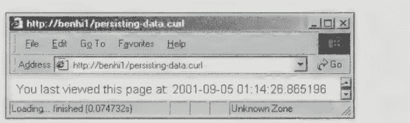

显示的时间始终是你上次查看页面的时间。所以如果你在 18:42 查看页面，然后在 19:12 刷新，在 19:12 你会看到显示的时间为 18:42。如果你在 19:15 再次刷新页面，你会看到显示 19:12。这种功能常见于银行等场所；例如检查是否有其他人访问了用户的账户。如果你知道你整周都没有在线查看过银行详情，然后发现上次登录日期/时间是二十四小时前，这就会让你有理由担忧！

## 共享持久化数据

当然，有很多情况你不想将访问限制为仅一个小程序。Curl 通过创建共享持久化数据来实现这一点。在使用从本地文件系统加载的小程序时，共享持久化数据仅限于受信任的小程序，但如果小程序是从同一主机加载的，则任何小程序都可以共享持久化数据。这里的唯一条件是必须将小程序包含在与包含持久化共享数据的文件相同的目录中，或者该文件的父目录或子目录中。我们在前面的**安全问题**中介绍了什么是受信任的小程序以及如何启用它们。共享持久化数据与主 Curl 文件分开存储，存储在一个称为持久化数据标识符（PDI）文件的文件中。共享持久化数据依赖于使用这个独立的 PDI 文件。

### PDI 文件

PDI 文件包含相同的`persistent-data`过程，负责创建持久化数据，正如我们在私有持久化数据中看到的。它使用的语法与之前完全相同：

```curl
{persistent-data
    comment:String,
    duration:Time = 180days,
    max-size:int = max-int
}:void
```

不同之处在于，由于这些信息现在与主 Curl 程序分开存储，它可以被多个小程序访问。PDI 文件通常使用`.scurl`后缀，这是 Curl 中所有包含文件的通用后缀。我们在第 8 章更详细地讨论了包含文件。

PDI 文件除了这个调用之外不需要其他任何内容（甚至不需要 Curl 声明）。因此，如果我们回到前面的例子并将其改为持久化数据现在可供所有受信任的小程序使用，我们只需要移除以下行：

```curl
|| persist.scurl

{persistent-data
    "The date the user last visited this site",
    duration=120days,
    max-size=1024
}
```

并将其保存到 Web 服务器上`persist.curl`的同一目录中。

> 在使用没有权限的普通小程序时，PDI 文件必须与`.curl`文件相关联，要么放在同一目录中，要么放在包含`.curl`文件的目录的任何直接父目录或子目录中。

这是 Curl 依赖服务器的一个地方，因为客户端必须从服务器下载`.scurl`文件并使用位于 Web 服务器上的小程序。事实上，如果你尝试从本地文件系统访问持久化数据，例如`C:\Curl\persist.curl`，而不是从服务器访问，例如`http://myserver/persist.curl`，这是行不通的，因为本地访问是被禁止的。

其次，调用`set-persistent-data`、`get-persistent-data`和`commit-persistent-data`的方式也需要修改。

### 仓库

为了能够使用共享持久化数据，你需要使用称为仓库的特性。我们通过创建`Repository`对象来实现这一点，并且我们需要使用`get-persistent-data-repository`过程来指定 PDI 文件的位置。

`get-persistent-data-repository`过程如下所示：

```curl
{get-persistent-data-repository
    pdi-name:String = {get-the-applet}.url.name
}:Repository
```

PDI 文件通过`pdi-name`选项指定。然后我们这样创建`Repository`对象：

```curl
let repository-name:Repository = {get-persistent-data expression}
```

在我们的示例中，我们如下创建`Repository`对象的实例，同时调用`get-persistent-data-repository`过程：

```curl
let lasttime:Repository =
    {get-persistent-data-repository
        pdi-name="http://myserver/persist.scurl"
    }
```

在我们的数据上下文中，这是可以的，这允许我们创建共享仓库，但这还不是我们需要做的全部。一旦我们创建了共享仓库，我们需要将持久化数据的值分配给它，为此，我们再次使用`get-persistent-data`过程首先从我们的仓库中检索日期。除了我们对私有持久化数据需要做的之外，我们还需要添加一个额外的选项，使用`repository`指向我们的`Repository`对象：

## Curl 的“脚本对象”

```curl
{let lasttime:any =
    {get-persistent-data
        "persistent-data-name",
        repository = object-name
    }
}
```

当我们来分配实际内容时，我们再次使用`set-persistent-data`过程，但同样，我们需要设置`repository`选项：

```curl
{set-persistent-data Identifier, Object-to-store, repository=Object-name}
```

然后你需要提交数据，与之前一样，同样指定`repository`选项：

```curl
{commit-persistent-data repository=Object-name}
```

最终代码应该如下所示：

```curl
|| persisting-data2.curl

{curl 1.7 applet}

{applet license="development licensing", timeout=0.000}
```


（查看 applet 标签的源代码……）

```curl
{curl-file-attributes character-encoding = "utf8"}

{import * from CURL.GRAPHICS.USER-CONTROLS}

{define-proc public {get-the-string}:String

    let the-repository:Repository =

        {get-persistent-data-repository

            pdi-name= "../persist.scurl"

        }

    let lasttime:any =

        {get-persistent-data

            "The date the user last visited this site",

            repository = the-repository

        }

    {set-persistent-data

        "The date the user last visited this site",

        {String {time-now}},

        repository = the-repository

    }

    {commit-persistent-data repository = the-repository}

    {return {String lasttime}}

}

{value {get-the-string}}
```

## `TextInputStream` 和 `TextOutputStream` 对象

在 Curl 语言中，文件系统 usage 最常见的用途之一就是读写文本文件。你可以访问文本文件，正如我们已经提到的，使用 Curl 的 `TextInputStream` 对象来读取文本文件，以及 `TextOutputStream` 对象来写入。从文本文件读取的过程如下：

- 使用 url 格式定位文本文件
- 创建 `TextInputStream` 对象的实例来打开输入流
- 使用 `TextInputStream` 对象的方法从文本文件读取
- 使用 `TextInputStream` 对象关闭文本文件

这个列表概括了从文本文件读取的过程，虽然向文本文件写入的过程非常相似，但两个过程之间仍存在一些细微差异，值得分别研究；首先，我们来看看读取。

## 从文件读取

要从文本文件读取，你只需定位文本文件、打开输入流、从文本文件读取，然后关闭它。每个步骤都有相应的程序，因为正确打开文件取决于可变因素，如文件权限、文件未损坏，或文件包含我们期望看到的数据类型——在本例中是纯文本。建议在任何文件操作中使用 `try` 和 `catch` 例程来处理任何错误或意外结果。

要创建打开输入流的 `TextInputStream` 对象，应使用以下语法：

```curl
let Object_Name:TextInputStream =

    {read-open { url "location-of-file"}}
```

在 `try...catch` 块的上下文中，代码看起来像这样：

```curl
{try

    let TextFile:TextInputStream =

        {read-open {url"file:///C:/EA_Curl/Ch6/readme.txt"}}

catch err:MissingFileException do

}
```

文件打开后，你可以使用 `TextInputStream` 类的以下三种方法之一从中读取：

- `read-one-line`：返回直到遇到下一个换行符之前的所有字符，接受参数 `buf:StringBuf`（指定用于存储文本的缓冲区名称）、`append?:bool`（指定检索到的字符是否追加到 `buf` 末尾）和 `eol-sequence:String`（指定行终止字符）。
- `read-one-string`：返回特定字符串中的所有字符。它接受 `buf`、`append?` 和 `eol-sequence` 参数。
- `read`：返回指定数量的字符，由方法中其他位置定义的参数指定，接受参数 `out:`（指定接收对象的数组）、`start:int`（指定开始读取的字符）、`n:int`（指定要读取的字符数）、`allow-short-read?:bool`（指定调用是否可以接受少于 `n` 个字符）和 `non-blocking?:bool`（指定如果未找到数据，调用是否应立即终止）。

你可以使用 `close` 方法终止从输入流的读取。现在让我们看一个简短的示例，它只将文本文件的第一行读入字符串。

首先，创建一个简单的文本文件，包含类似以下内容：

```text
This is the first line of our example text file

This is the second line of our example text file
```

将其保存为 `test.txt`，然后创建以下 Curl 文件，在适当的地方替换你自己的文件详情：

```curl
|| read.curl

{curl 1.7 applet}

{applet license = "development"}

{value

    let TextFile:StringBuf = {StringBuf}

    {try

        let input:TextInputStream=

            {read-open {url "file:///C:/EA_Curl/Ch6/test.txt"}}

            {TextFile.concat {input.read-one-line}}

            {input.close}

        catch err:MissingFileException do

            {error "File not Found!"}

    }

    {value TextFile}

}
```

如果将其作为特权小程序运行，则会得到以下结果：

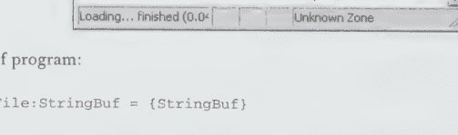

程序的第一行：

```curl
let TextFile:StringBuf = {StringBuf}
```

创建一个空的 `StringBuf` 对象，我们可以向其写入字符。然后我们创建一个 `TextInputStream` 对象的实例。在定义中，我们打开测试文本文件，并将从文本文件读取的第一行连接（concatenate）到我们的 `StringBuf` 对象中。然后我们关闭对象，因为这完成了我们的任务。

如果 Curl 由于某种原因找不到文件，它将生成异常；我们自己处理这个异常，使用我们自己的自定义错误消息：

```curl
catch err:MissingFileException do

    {error "File not Found!"}
```

这不是我们可以检查的唯一异常——还有很多其他异常。

## 异常

总的来说，Curl 在读取或写入文件时可能会生成七种不同的异常之一：

- `IOException`：所有其他 IO 异常的基类
- `FileException`：所有其他文件相关异常的基类
- `KeyNotFoundException`：当 URL 无法解析时抛出
- `MissingFileException`：当找不到文件时抛出
- `ExistingFileException`：当尝试创建已存在的文件时抛出，且未指定 `{error-if-Exists? = false}`
- `PermissionDeniedFileException`：如果尝试读写的程序没有足够的权限则抛出
- `SecurityException`：如果程序在限制性环境中运行（如小程序），没有执行所请求任务的权限则抛出

所有这些都可以放在 `catch` 部分中，但在大多数情况下，我们只使用 `MissingFileException` 异常。

## `read-from` 过程

有一种更简单、更快速的方法可以从文本文件读取，如果你不想从文本中提取部分并只想返回文本文件的整个内容。你可以使用 `read-from` 过程，它采用以下格式：

```curl
{read-from

    url:Url,

    buf:#StringBuf = null,

    append?:bool = false,

    n:int = {if append? and buf != null then max-int - buf.size else

        max-int },

    character-encoding:CharEncoding = CharEncoding.none-specified

}
```

唯一必须指定的是文本文件的位置。我们现在可以回去修改之前的示例，使其使用 `read-from` 过程而不是 `TextInputStream` 对象。代码短了很多：

```curl
|| read-from.curl

{curl 1.7 applet}

{applet license = "development"}

{value

    let (TextFile:StringBuf) =

        {read-from {url "file:///C:/EA_Curl/Ch6/test.txt"}}

    {value TextFile}

}
```

作为特权小程序运行时，这将返回整个文本文件的内容：

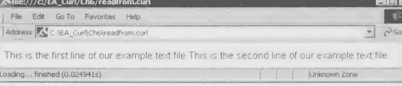

我们无法将 `read-from` 过程放在 `try` 和 `catch` 例程中，因为它不向过程返回成功或失败，这与使用 `TextInputStream` 对象时不同。

## 写入文件

正如我们已经指出的，向文本文件写入的过程与从文件读取的过程非常相似。同样，你必须定位文本文件并打开输入流；区别是在关闭之前你要向文本文件写入。遵循与之前相同的过程，只是使用 `TextOutputStream` 对象来：

- 使用 url 格式定位文本文件
- 创建 `TextOutputStream` 对象的实例来打开输出流
- 使用 `TextOutputStream` 对象的方法向其写入数据
- 使用 `TextOutputStream` 对象关闭文本文件

你还会发现用于写入的 `TextOutputStream` 对象的方法看起来很熟悉：

- `write-open`：此方法打开一个文本文件进行写入，如果文件已存在则会截断该文件
- `append-open`：此方法打开一个ade 文本文件进行写入，并将你添加的任何内容追加到文本文件末尾。

选择打开 `TextOutputStream` 的适当方法后，你可以使用以下方法之一向文件写入：

- `write-one`：此方法向文本文件写入单个字符，接受参数 `obj:char`（指定要写入流的字符）。
- `write`：此方法向文本文件写入数组，接受参数 `data:Array-of`（指定要写入的数组）、`start:int`（指定在文件中开始写入的位置）、`n:int`（指定要写入的字符数），以及 `non-blocking?` 和 `allow-short-read?` 布尔参数。
- `write-one-string`：此方法向文本文件写入字符串，接受参数 `string:StringInterface`（指定要写入的字符串）、`start:int`（指定开始写入的起始字符）和 `length:int`（指定字符串的长度）。
- `write-strings`：此方法向文件写入 `n` 个字符串。它接受以下参数：`data:Array-of`（指定要写入的数组）、`start:int`（指定在文件中开始写入的位置）、`n:int`（指定要写入的字符数）和 `separator:String`（用于分隔每个单独的字符串）。

## Curl 的“脚本对象”

由于写入过程稍微复杂一些，你可能会不时发现数据在文本流中被排队到缓冲区。为了确保数据已完全发送，而不仅仅是排队，你应该使用 `flush` 方法来清除缓冲区。最后，一旦你完成了向流写入文本，就需要使用 `close` 方法。

因此，让我们回到之前使用 `TextInputStream` 对象读取文本文件的示例，并使用 `TextOutputStream` 对象来添加一行：

> 这是我们示例文本文件的第三行

到我们的文本文件中。在这个示例中，我们首先写入文本文件，然后从文本文件中读取并显示到屏幕上，以证明我们确实已成功将文本写入文件：

```curl
|| write-to-file.curl

{curl 1.7 applet}

{applet license = "development"}

{value

    {try

        let output:TextOutputStream=

            {append-open {url "file:///C:/EA_Curl/Ch6/test.txt"}}

        {output.write-one-string " This is the third line of our example

            text file"}

        {output.flush}

        {output.close}

    catch err:MissingFileException do

        {error "File not Found!"}

    }

}

{value

    let (TextFile:StringBuf) =

        {read-from {url "file:///C:/EA_Curl/Ch6/test.txt"}}

    {value TextFile}

    }

}
```

这会在浏览器中查看时显示以下内容：

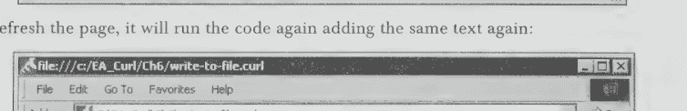

如果你刷新页面，代码会再次运行，再次添加相同的文本：

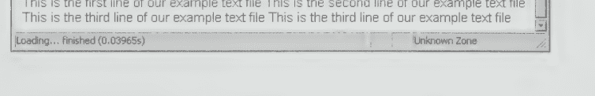

# 第 6 章

该代码与用于从文本文件读取的代码非常相似：

```curl
{try

    let output:TextOutputStream=

        {append-open {url "file:///C:/EA_Curl/Ch6/test.txt"}}

        {output.write-one-string " This is the third line of our example text file"}

        {output.flush}

        {output.close}

    catch err:MissingFileException do

        {error "File not Found!"}

}
```

然而，我们不需要存储文本文件 content，只需打开文件进行写入（使用 `append-to` 确保不会覆盖之前的内容），然后使用 `TextOutputStream` 对象的 `write-one-string` 方法，后跟需要追加的字符串。严格来说，我们不需要 `flush` 对象，因为 `close` 调用会为我们执行此操作，但我们仍然会 `flush` 对象。最后，我们关闭对象，并将所有内容放在 `try ... catch` 块内，以处理如果我们要写入的文件不可用而导致的任何异常。

如果你想创建一个新文件，并且如果已经存在同名文件则中止操作，该怎么办？在这种情况下，你可以使用测试来检查文件是否存在。需要使用的检查是 `error-if-exists?` 检查，可与 `write-open` 方法一起使用，如下所示：

```curl
{write-open {url "location"}, error-if-exists?=true}
```

这将生成一个 `ExistingFileException`，可以在 `try` 和 `catch` 块的上下文中处理。让我们看一个示例，在这个示例中，我们不是将内容追加到现有文件，而是创建一个新文件并将内容写入其中。为此，我们可以修改之前的示例如下：

```curl
|| write-new.curl

{curl 1.7 applet}

{applet license = "development"}

{value

    {try

    let output:#TextOutputStream=

        {write-open {url "file:///C:/EA_Curl/Ch6/test.txt"}, error-if-exists?=true}

        {output.write-one-string " This is the first line of our new example text file"}

        {output.flush}

        {output.close}

    catch err:ExistingFileException do

        {error "Can't write to an existing file!"}

    }

}

{value

    let (TextFile:StringBuf) =

            {read-from {url "file:///C:/EA_Curl/Ch6/test.txt"}}

    {value TextFile}

}
```


然后，如果我们运行这个，确保先删除文件夹中任何 `test.txt` 的出现，我们将得到以下显示：

## `write-to` 和 `append-to` 过程

就像读取文本文件有更快的程序一样，写入和追加到文本文件也有等效的程序。

`write-to` 过程将任何 `StringInterface`、`StringBuf` 或 `String` 对象写入任何现有文件的内容之上。它采用以下语法：

```curl
{write-to {url "location"},val}
```

`append-to` 过程将 `StringInterface`、`StringBuf` 或 `String` 对象写入现有文件的末尾，它采用以下语法：

```curl
{append-to {url "location"},val}
```

如果我们想采用前面的示例，因为我们将整个内容作为单个 `String` 对象写入文件，我们可以这样编写代码：

```curl
|| write-string.curl

{curl 1.7 applet}

{applet license = "development"}

{let (line:String) = "This is the first line of our new

    example text file"}

{write-to {url "file:///C:/EA_Curl/Ch6/test.txt"}, line}
```

这将执行与前面示例相同的任务，只要你将其作为特权 applet 运行。

## 文件和目录

我们已经了解了定位、打开和关闭文本文件的过程。然而，操纵文件/资源不仅仅是简单的读/写过程。每个资源都有关于它上次修改时间的信息，或者它是文件还是目录，每个文件还有其他单独的属性。如前所述，使用脚本语言 JavaScript 和 VBScript，`FileSystemObject` 可以将硬盘上的整个目录结构表示为对象。`FileSystemObject` 中的每个对象，例如 `Drive` 对象，都有其特定于文件系统该部分的属性和方法。

考虑这些对象中的每一个在 `FileSystemObject` 中建模的不同信息是有帮助的，因为 Curl 对象也必须建模相同的信息。我们将依次考虑每个 `FileSystemObject` 对象：

- `Drive` 对象具有与驱动器上的可用空间、驱动器的卷名、驱动器类型以及驱动器上根文件夹的引用相关的属性。
- `Folders` 对象包含文件夹名称、文件夹大小以及属性，例如文件夹是否为只读、隐藏或压缩。

# 第 6 章

`File` 对象位于对象模型的最低级别，允许访问文件名、路径和文件大小等属性。正是通过 `File` 对象，你可以复制、移动和删除文件，甚至使用 `TextStream` 对象打开文件进行读写。然而，正如我们所说，在 Curl 中有两个单独的对象，`TextInputStream` 和 `TextOutputStream` 对象，用于此目的。

Curl 语言提供的内容与 `FileSystemObject` 对象不太一样深入，例如，只有代表文件和目录的对象。然而，如果你熟悉 `FileSystemObject`，那么 Curl 的 `File` 和 `Directory` 类中的许多属性和方法应该相当熟悉。我们将从查看 Curl 的 `File` 类开始，它代表文件和其他资源。

## `File` 类

我们首先定义什么是 Curl 中的文件——它纯粹是一个可以从中读取数据或向其写入数据的对象。`File` 对象正如你所期望的，允许移动、复制和删除文件。文件的成功操作取决于文件的类型，实际上 `File` 类本身也作出了这些区分，包括三个单独的子类：

- `HttpFile` – Web 服务器上的文件
- `LocalFile` – 本地文件系统上的文件
- `StringFile` – 使字符串能够转换为系统可以像文件一样读取的内容

Surge Lab 文档建议优先使用 `File` 类，而不是任何子类，除非你只在该特定子类中发现需要特定的方法或属性。

你需要做的第一件事是将 URL 解析为 `File` 对象。这个两步过程首先涉及将 URL 格式更改为 `Url` 对象，然后使用 `resolve` 方法创建 `File` 对象。格式如下：

```curl
let urlname:Url = {url "location"}

let resource:File = {urlname.resolve}
```

如果你想使用示例文件 `example.curl` 创建 `File` 对象，你可以按如下方式操作。事实上，如果你希望运行本节中的任何示例，你需要在 HTTP 服务器上运行它们，我们建议首先在服务器上创建一个 `example.curl` 文件，位于你将从中运行示例的同一目录中：

```curl
|| example.curl

{curl 1.7 applet}

{applet license = "development"}

{text This is our example Curl file.}
```

这创建了一个表示 `example.curl` 文件的对象实例，并在名为 `examplefile` 的变量中保留对该对象的引用。不过，要以任何方式操作该文件，您需要使用 `File` 对象的某些访问器或方法。

## `File` 类的访问器

`File` 类具有以下访问器：

- `parent-dir` – 返回一个 `Directory` 对象，表示包含该文件的目录
- `when-last-accessed` – 返回一个 `DateTime` 对象，显示文件最后一次被访问的时间，但仅在文件系统提供此信息时可用，否则返回 `null`
- `when-last-modified` – 返回一个 `DateTime` 对象，显示文件最后一次被修改的时间，但仅在文件系统提供此信息时可用，否则返回 `null`

此外，`LocalFile` 类还支持以下 `File` 类不支持的访问器：

- `exists?` – 如果文件存在则返回 `true`
- `readable?` – 返回一个布尔值，指示 `LocalFile` 对象是否可以打开进行读取
- `writable?` – 返回一个布尔值，指示 `LocalFile` 对象是否可以写入

我们现在可以扩展前面的示例，以返回关于我们已创建的示例文件的信息：

```curl
|| file-info.curl

{curl 1.7 applet}

{applet license = "development"}

{value

let display:TextFlowBox = {TextFlowBox}

let exampleurl:Url = {url "file:///C:/EA_Curl/Ch6/test.txt"}

let examplefile:File = {exampleurl.resolve}

{display.add

    {paragraph the file is located at:

        {value examplefile.parent-dir.name})

}

{display.add

    {paragraph the file was last accessed at:

        {value examplefile.when-last-accessed}}

}

{display.add

    {paragraph the file was last modified on:

        {value examplefile.when-last-modified}}

}

    {if examplefile isa LocalFile and (examplefile asa LocalFile).writable?

    then

        {display.add {paragraph the file is writable}}

    else

        {display.add {paragraph the file isn't writable}}

    }

{value display}

}
```

这里我们将文件访问器返回的值添加到了一个 `TextFlowBox` 中。在浏览器中查看时，它看起来如下所示：

## `File` 类的方法

`File` 类还具有以下独有的方法，无法通过过程访问：

- `equal?` - 测试这是否与参数所代表的同一个文件，返回一个布尔值
- `set-length` - 将文件大小更改为方法中指定的字节数。这可能导致文件被扩展或截断。其格式如下：`File.set-length length:int64`

除了这些方法之外，我们已经见过的过程有：

- `write-to`
- `append-to`
- `read-from`

我们不会再次介绍这些内容，而是继续讨论能够移动和修改文件的主题。

## 复制、删除和更改文件名

有一组用于以这种方式操作文件的过程，它们的名称都很直观明了：

- `copy`
- `rename`
- `delete`

它们的工作方式类似；让我们首先更详细地查看 `copy` 过程。`copy` 过程具有以下格式：

```curl
{copy

    resource-to-copy-from:Url,

    resource-to-copy-to:Url,

    recurse?:boolean,

    error-if-exists?:boolean

}
```

您指定要复制资源的位置，以及要复制到的名称和位置。此外，还有两个选项，第一个是 `recurse?`，如果指定为 `true` 且资源是一个目录，我们还会复制整个目录内容。第二个 `error-if-exists?`，与 `write-to` 过程中的工作方式相同；如果将其指定为 `true`，当 `resource_to_copy_to` 指定的资源已经存在时，Curl 会生成一个错误。

如果我们想从服务器上的一个目录复制文件到另一个目录——比如创建 `example.curl` 文件的副本，名为 `example2.curl`，放在主机上的 `C:\inetpub\wwwroot` 目录中——那么我们可以这样做：

```curl
|| copy-file.curl

{curl 1.7 applet}

{applet license = "development"}

{try

    {copy {url "file:///C:/inetpub/wwwroot/example.curl"},

          {url "file:///C:/inetpub/wwwroot/example2.curl"},

          error-if-exists?=false

    }

catch err:PermissionDeniedFileException do

    {error "You don't have permission to copy this file across"}

}
```

我们通过将 `error-if-exists?` 设置为 `false` 来抑制如果文件已经存在时会生成的错误。此示例在浏览器窗口中没有输出，但如果您查看目录结构，应该会出现一个名为 `example2.curl` 的文件，其内容与 `example.curl` 文件相同。我们将整个过程放在 `try` 和 `catch` 块中，如果您由于未启用权限或试图使用本地文件系统来实现此操作而无法复制文件时，将会引发错误。

> **! 你不能复制、重命名或删除 HTTP 文件**
>
> 虽然可以在本地文件系统上复制、重命名或删除文件，但无法对 HTTP 文件或 HTTP 目录的内容使用这些方法。问题最终在于 Curl 的继承层次结构，以及不存在 HTTP 目录的概念。Curl 可能会在未来的版本中改变继承层次结构以规避此问题，但当前如果您尝试使用 `http://www.myserver.com/example.curl`，而不是本地的 `file:///` 引用，那么将会生成 `HTTPDirectory` 错误。

要重命名文件，您需要使用以下格式：

```curl
{rename

    resource-to-rename:Url,

    new-name-of-resource:Url,

    error-if-exists?:bool

}
```

它的工作方式与 `copy` 过程相同，只是无需指定 `recurse?` 选项，因为该过程仅直接影响一个资源。如果您想将 `example.curl` 重命名为 `example3.curl`，那么您可以使用以下代码：

```curl
|| rename-file.curl

{curl 1.7 applet}

{applet license = "development"}

{try

    {rename

        {url "file:///C:/inetpub/wwwroot/example.curl"},

            {url "file:///C:/inetpub/wwwroot/example3.curl"},

        error-if-exists?=false

    }

 catch err:PermissionDeniedFileException do

    {error "You don't have permission to rename this file"}

}
```

这与 `copy` 过程的工作方式相同，只是不再存在 `example.curl` 文件。如果 Curl 文件名前的目录名不存在，或者 `resource_to_rename` 部分指定的资源缺失，则会抛出 `IOException`。最后，如果您将 `error-if-exists?` 设置为 `true`，尝试将文件重命名为现有资源的名称将会生成 `ExistingFileException` 异常。

要删除文件，您需要使用以下语法：

```curl
{delete

    resource_to_delete:Url,

    error-if-missing?:bool,

    recurse?:bool

}
```

这些过程的工作方式与前面的 `copy` 和 `rename` 过程类似。但是，不是指定如果文件存在该怎么办，而是需要指定如果文件缺失该怎么办。此外，还有 `recurse?` 选项，这是必要的，因为如果您将目录指定为 `resource_to_delete`，那么其中包含的一切，包括子目录都将被删除。

要删除我们的文件 `example3.curl`，您可以使用以下代码：

```curl
|| delete-file.curl

{curl 1.7 applet}

{applet license = "development"}

{try

    {delete

        {url "file:///C:/inetpub/wwwroot/example3.curl"},

        error-if-missing?=false,

        recurse?=false

    }

 catch err:PermissionDeniedFileException do

    {error "You don't have permission to delete this file"}

}
```

如果 `recurse?` 选项设置为 `false` 且资源是一个目录，则会抛出 `IOException`。仅当 `error-if-missing?` 选项设置为 `false` 且资源缺失时，才会抛出 `MissingFileException`。

## `Directory` 类

我们已经详细研究了 `File` 类，现在该把注意力转向其相关的 `Directory` 类了。`Directory` 类有三个独立的子类：

- `LocalDirectory` – 本地文件系统中的目录
- `HttpDirectory` – Web 服务器上的目录
- `ObjectDirectory` – Curl 对象的目录

## 解析目录

这些类与用于文件的子类类似，同样，你只有在需要调用主 `Main Class` 中不存在的方法或属性时，才应该将它们用于代替 `Directory`。

你可能希望执行的首要任务之一是检查你所查看的特定资源是文件还是目录。

我们之前已经了解了如何将 URL 解析为 `File` 对象，但同样也可以对 Curl `Directory` 对象执行相同操作。在解析 `Directory` 对象之前，你需要先检查所使用的 URL 实际上是文件还是目录。

我们可以将之前用于解析文件并创建 `Directory` 对象的代码重写如下：

```curl
|| resolve-directory.curl

{curl 1.7 applet}

{applet license = "development"}

{value

let exampleurl:Url = {url "http://myserver/Curl"}

|| 将 "myserver" 替换为你的主机名

let exampledirectory:Directory = {exampleurl.resolve}

}
```

然而，这会导致错误。它提示文件无法被解析为目录。事实上，如果我们编写一些代码来告诉我们 `exampleurl.resolve` 方法返回的类型是什么，你可能会得到相当令人惊讶的答案。

```curl
|| resolve-directory2.curl

{curl 1.7 applet}

{applet license = "development"}

{value let text:StringBuf = {StringBuf}

let exampleurl:Url = {url "http://myserver/Curl"}

|| 将 "myserver" 替换为你的主机名

let example:any = {exampleurl.resolve}

{switch example using isa

    case HttpDirectory do

        {text.concat "This is an Http directory"}

    case HttpFile do
```


```curl
{text.concat "This is an Http file"}

case LocalDirectory do
    {text.concat "This is a local directory"}

case LocalFile do
    {text.concat "This is a local file"}

case StringDirectory do
    {text.concat "This is a string directory"}

case StringFile do
    {text.concat "This is a string file"}

case ObjectDirectory do
    {text.concat "This is an object directory"}

case File do
    {text.concat "This is a file"}
}

{value text}
}
```

如果运行此代码，你将看到返回以下文本：

```text
This is an Http file.
```

这有一个解释，那就是`resolve`的行为可能并不如你所预期。事实上，你无法使用 HTTP 执行“探测”操作，因为任何 HTTP 请求都可能对服务器产生副作用（这取决于服务器）。这是因为 HTTP 实际上并没有目录的概念，你也无法通过 HTTP 执行任何远程目录操作。

因此，通过 HTTP 执行解析操作时根本不会进行网络请求。它不会联系服务器——它只是构造一个`HttpFile`对象并将其返回给调用者。事实上，没有任何东西会被解析为`HttpDirectory`。

如果要将 URL 解析为`Directory`对象，那么它必须是本地目录，如下所示：

```curl
|| resolve-directory3.curl

{curl 1.7 applet}

{applet license = "development"}

{value
  let exampleurl:Url = {url "File:///C:/inetpub/wwwroot/Curl"}

  let exampledirectory:Directory = {exampleurl.resolve}
}
```

现在让我们看看如何获取目录的内容。

## 访问目录内容

`Directory`类以 Association-of 的形式返回目录中包含的资源列表。这样做的好处是，你可以使用`for...in`循环（类似于 VBScript 的`for...each`循环）来遍历目录中的每个成员并为其返回值。

我们现在创建一个快速示例，该示例返回示例目录中文件名称的列表。请替换主机上的任意本地目录，以便在你的机器上运行：

```curl
|| directory.curl

{curl 1.7 applet}

{applet license = "development"}

{value
    let name:StringBuf = {StringBuf ""}

    {try
        let directory:any = {{
            url "File:///C:/inetpub/wwwroot/Curl"
        }.resolve}

        {if directory isa Directory then
            {for key item:String in directory do
                {name.concat item}
                {name.concat "\n"}
            }
        }
    catch err:MissingFileException do
        {set name = {StringBuf "Directory not found."}}
    }

    {value {name.to-String}}
}
```

该代码创建一个`StringBuf`对象，并解析一个`Directory`对象。一旦 Curl 确认它是目录，就会遍历该目录，将每个资源名称连接到`StringBuf`对象，然后在代码末尾返回`StringBuf`对象的内容。

## 访问目录信息

当然，你可能不想仅仅返回目录中包含的资源名称；你可能还希望返回文件夹中不同资源的相关信息。

要获取有关目录的信息，你可以使用`Directory`类的访问器，如下所示：

- `name` – 返回包含`Directory`对象 URI 的字符串
- `parent-dir` – 包含当前目录的目录
- `url` – 当前目录的路径名称
- `url-separator` – 用于分隔路径不同部分的字符

因此，我们可以回到前面的示例并进行修改，使用`name`方法显示指定目录中包含的文件名称，如下所示：

```curl
|| directory-info.curl

{curl 1.7 applet}

{applet license = "development"}

{set-document-properties text-preserve-whitespace? = true}

{value
    let name:TextFlowBox = {TextFlowBox}

    {try
        let directory:any = {{
            url "file:///C:/inetpub/wwwroot/Curl"
        }.resolve}

        {if directory isa Directory then
            {for key item:String in directory do
                {name.add directory.name}
                {name.add "/"}
                {name.add item}
                {name.add "\n"}
            }
        }
    }
    catch err:MissingFileException do
        {name.add "Directory not found."}
}

{value name}
}
```

该代码与前面的示例略有不同，我们使用`TextFlowBox`将信息返回到浏览器。这是因为我们希望分隔目录中的每个项目并在新行上显示。`TextFlowBox`还可以保留空白并使用保留的`\n`– 换行符。我们的代码简单地访问目录，并使用`for ... do`循环返回目录的`name`访问器。

此代码返回以下结果：

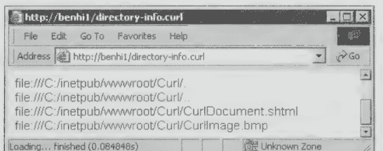

这将返回四个项目：其中两个是目录中包含的文件，另外两个是`.`和`..`，它们分别是对父目录和根目录的引用。

此外，`Directory`类还具有以下方法：

- `url-helper-absolute` – 如果路径名是绝对的则返回 true；接受字符串作为路径名的参数
- `concat` – 将相对路径追加到已有的 URL 并返回完整 URL；接受字符串作为要追加的相对路径的参数
- `special-entry?` – 将返回一个布尔值，确认传递给此方法的`entry`参数是否为特殊条目（在执行删除等操作时不应遍历的条目）
- `url-separator-fn` – 这是`url-separator`访问器的类方法版本
- `url-valid-separator` – 接受一个参数，并根据参数内容是否为有效的 URL 路径分隔符返回布尔值

这些方法比访问器更为深奥，因此我们在此不介绍它们的工作原理示例。

## 创建目录

要创建目录，可以使用`create-Directory`过程。此过程需要采用`url`格式，以创建`Directory`对象的新实例。默认情况下，如果目录已经存在，它将生成错误。如果你不希望它这样做，则需要将`error-if-exists?`参数设置为`false`。

在本地文件系统上创建名为 Curly 的目录的示例将如下所示：

```curl
|| create-directory.curl

{curl 1.7 applet}

{applet license = "development"}

{create-Directory {url "file:///C:/inetpub/wwwroot/Curly"}}
```

这将创建一个名为`"Curly"`的新空文件夹。

## 流

我们已经看到了如何将文本写入流以及从流中读取文本的示例，以将信息写入文本文件并读取数据。然而，文本流并不是 Curl 中可以使用的唯一流类型。流可以承载多种不同类型的数据：

- Text streams – 用于字符流，并具有一些用于处理文本的附加方法。
- Binary streams – 原始字节流，Curl 语言不对其进行任何解释。
- Transcoding streams – 使用每个文本字符多于一个字节进行编码的文本流。（通常是 Unicode 流——只是编码为字节的字符。每个字符可能是一个字节或更多字节，具体取决于编码。你还可以构造任意对象的流。）

除此之外，这些流还具有以下特征——它们可以是：

- 输入或输出流
- 带缓冲或不带缓冲的流
- 可定位或不可定位的流

我们已经了解了输入流和输出流的区别：你可以使用输入流从文件读取，或使用输出流写入文件。但其他区别还需要稍微展开说明。

## 流缓冲

流缓冲是将流存储到内存中的临时缓冲区，然后再写入资源的过程。当你从资源读取或向资源写入时，这会自动发生。Curl 语言允许你通过`buffer-size`参数来更改缓冲区大小，该参数可与`read-open`和`write-open`字节过程一起使用。Curl 访问缓冲区的次数越多，对速度的影响就越大，因此调整这些设置可能是有益的。例如，如果你频繁地向缓冲区写入大量数据，增大缓冲区大小可能是个好主意。然而，当使用非常大的数据量时，缓冲可能会比直接写入实际资源更影响速度。在这种情况下，要关闭缓冲，你可以将缓冲区大小设置为零。

## 可定位流

使用流时，你只能从流中的当前位置进行读取和写入。可以创建可定位流，这样你就可以从流的任何部分读取或写入。

这并不适用于所有流，仅适用于来自或去往随机访问资源的流。只有来自本地文件的流才能非顺序读取，因为整个内容会一次性提供。通过`http://`协议读取的流，以及内存流，是“不可定位”的，因为它们是以严格的线性方式读取的。

要测试一个流是否可定位，你可以使用`isa`测试，并将`Seekable`作为对象类型。一旦你确定了特定流是否可定位以及它是哪种类型的可定位流，你就可以使用`seek`方法到达流中的特定位置。通常你会转换一个变量并将其存储为某种合适的类型。

`seek`方法接受以下参数：

```curl
{SeekableStream.seek offset-number-of-chars/bytes/objects:int64, offset_from: SeekFrom}
```

`seek`方法使用一个特殊类型`SeekFrom`，它决定了偏移量是相对于什么的。

## 总结

在本章中，我们探讨了三个独立但相关的领域，即：

- 安全问题
- 持久数据
- 文件访问

# 第 6 章

首先，我们研究了运行客户端语言所涉及的安全问题，以及 Curl 提供了哪些设施来防止恶意小程序攻击用户系统。

正如我们所看到的，Curl 使用一种“无 cookie”的方法来记忆状态，这使我们能够使用更有效的方式在页面之间记忆信息，并跟踪用户存储的信息。

最后，我们还探讨了 Curl 语言使用`TextInputStream`和`TextOutputStream`对象进行文本文件读写的功能。我们了解了`File`和`Directory`类，它们使你不仅能操作文件内容，还能访问不同的属性并移动系统中的文件——在此过程中介绍了流的概念。

# 7 动态布局与交互

与传统的应用程序框架类似，Curl GUI 工具包包含一套丰富的标准 GUI 容器和控件；同时，像 HTML 一样，它包含格式化文本，因此你可以构建一个使用富文本且看起来像表单或文档的界面。由于它同时包含文本和图形对象（并且可以自由混合），你的文档可以生动起来，你的功能性用户界面可以轻松包含文本、图形和超链接。你还可以通过编写自己的类和文本来扩展工具包的过程。

在本章中，你将学习 GUI 工具包的工作原理、各个部分是什么以及它们如何协同工作，特别是我们将讨论：

- 布局
- 事件
- 控件

## 概述

我们将从外部到内部快速浏览一个 Curl 小程序。每个 Curl 小程序都在自己的进程中运行。当加载 Curl 小程序文件时，会创建一个进程，文件的内容被编译并评估到这个进程中。由于每个小程序只有一个进程，因此小程序的执行是单线程的。这被称为“增量评估”，因为输入文件是一块一块地被评估的。

如果你从一个小程序中的超链接跳转到另一个网页或 Curl 小程序，离开的小程序将被挂起。如果你通过浏览器的“后退”按钮返回，小程序将被恢复（如果可能的话；否则会重新启动）。你可以注册挂起和恢复过程，它们会在适当的时间自动调用。如果你需要为用户保存任何数据，挂起过程是最佳地点，因为一旦小程序被挂起，就不能保证它会被恢复。

## 文档样式

一个小程序可以创建多个独立的窗口。使用 GUI 工具包创建的顶级窗口称为视图（View）；视图是一个表示 Curl 在屏幕上图形内容的对象。当小程序在插件中运行时，最外层的容器是嵌入在浏览器窗口中的一种特殊视图。几乎所有 Curl 图形对象，包括控件，都是用 Curl 实现的，并在视图拥有的主窗口客户端区域中绘制自身。不使用主机操作系统控件。这很高效，并有助于使工具包可移植到其他平台。

紧接在与小程序关联的视图内部的是一个文档（Document）对象。文档决定了小程序的整体呈现样式。默认样式是滚动文档，非常像网页。

传递给主机窗口的事件由`GuiManager`转换为 Curl 事件模型，并传递给正确的事件目标。`GuiManager`还与浏览器交互，以便从浏览器菜单选择的命令（如剪切、复制和粘贴）传递给小程序执行。通常，`GuiManager`在小程序和插件环境之间进行调解。

事件可以同步或异步传递（排队等待稍后传递）；我们稍后将详细描述事件模型，但现在请注意，它的设计是灵活、可扩展且易于使用的。

每个视图都有一个`FocusManager`，用于跟踪视图中的哪个对象具有键盘焦点并应首先接收键盘事件。每个视图有一个`FocusManager`，因此如果你切换到不同的窗口（或应用程序）再返回，键盘焦点将保持在离开原始窗口时的位置。

在 Curl 中，对话框（Dialog）只是一个用于用户界面的矩形图形容器，可以包含文本、图形和控件。像 HTML 表单一样，你可以将对话框嵌入到更大的文本和其他对象页面中。此外，你可以对任何对话框调用`Dialog.show`方法，在其自己的视图中显示该对话框（一个带标题栏的独立窗口），可以是模态的或非模态的。

到目前为止，我们已经了解了如何将小程序加载到其自己的进程中，并了解了它的生命周期。主视图嵌入在浏览器窗口中，并包含一个文档。小程序可以根据需要创建额外的视图对象，用于对话框或任何其他目的。

这就是框架。现在是时候探索你可以在视图或文档中创建的内容的性质了。

正如我们已经看到的，文档是 Curl 小程序的最外层。当你编写小程序时，你可以选择三种可用文档样式中的一种。默认文档样式是包含`ScrollBox`的页面。来自加载文件的内容只是被添加到`ScrollBox`中。当内容变得比浏览器窗口大时，就会出现滚动条。使用这种样式，Curl 小程序看起来就像 HTML 网页。

如果你编写的小程序更像独立应用程序而不是网页，一个替代方案是`PlainDocument`，它将整个浏览器窗口完全交给你的小程序，没有任何装饰。这为你提供了一个窗口中的顶级文档，没有其他任何附加内容；小程序完全控制内容。如果你正在编写一个应该填满浏览器窗口但不滚动的游戏，或者你想将屏幕空间分成两个或多个面板，并在其中一个或两个面板中添加滚动条，你可能会使用这种样式。

最后，还有一种更专业的文档样式称为`TOCDocument`。这种样式在左侧为你提供一个树形结构的目录，在右侧提供一个大的内容面板——两者可以独立滚动。当你向右侧的内容面板添加标题时，会自动在树形结构的目录中创建一个条目。

## Applet 内容

当加载一个 Curl applet 时，它会从头到尾逐个表达式进行求值。在求值每个顶层表达式之后，任何返回的值都会被直接追加到文档中。在这个层面上，Curl applet 的可见内容就是顶层表达式返回的对象序列。

下面是一个包含六个顶层表达式的简单 applet 及其输出：

```curl
|| simple.curl

{curl 1.7 applet}

{applet license="development"}

{TextField}

{CommandButton label="Search"}

{br}

Enter a search string
```


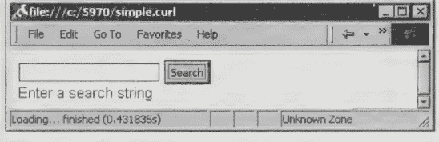

这六个顶层表达式分别是：

- Curl 版本声明（无输出）
- Applet 声明（无输出）
- 一个 `TextField`
- 一个 `CommandButton`
- 一个换行符
- 一个包含一行文本的段落

在上面的示例中，每行只有一个表达式。一般来说，Curl 会忽略源文件中的空白字符，因此你可以按照你自己的编码标准来格式化输入文件。

在实践中，向文档添加值的表达式可以分为四类：

- 任何 Curl 表达式之外的文本（未被花括号括起的部分）会自动作为文本追加到文档中。
- 一个表达式可以通过调用构造函数或工厂方法来创建新对象。这可以通过如下表达式完成：
  - `{Fill}`
  - `{Frame width=.5in, height=.5in, background="red"}`
- 调用过程、方法、访问器或任何其他返回值的表达式铁汉纸飞记，例如：
  - `{rule width=2in}`
  - `{value {sqrt 7}}`
- 最后，在 applet 完全加载之后，事件驱动代码可以对文档进行添加、删除或其他结构性修改。

如果一个 applet 是应用程序而非文档（例如游戏、计算器、网络监控工具），可能只有一个返回值的顶层表达式，而该值就是整个用户界面。稍后我们会看到一个示例。

前两种技术在本质上是声明式的。代码只是声明了用户界面应该是什么。第三种技术也可以具有明显的声明式风格，这取决于你如何定义过程和方法。例如，内置的文本过程在本质上是声明式的。第四种技术在需要动态改变界面时非常有用。

## `Visual` 类及其子类

要在屏幕上可见，一个对象必须是 `Visual` 的子类。唯一的例外是创建用于 3D 图形的特殊对象，这将在下一章中介绍。

`Visual` 类有两个主要的子类分支，分别与文本和图形相关。文本对象会自动创建，适用于文档中不属于 Curl 代码的部分，以及使用文本过程（如 `text`、`bold`、`paragraph` 等）时。图形对象则在实例化 `Graphic` 的某个子类时创建。这些类构成了 GUI 工具集的主要部分。

如果只有 `Visual` 的子类才能显示，那么当顶层表达式返回的值不是 `Visual` 时会发生什么？在很多情况下，有专门的方法可以自动将数据类型转换为 `Visual`。例如，`String` 或数字会自动转换为文本 `Visual`，并成为文本流的一部分。任何没有自动转换为 `Visual` 的类都会被渲染为一个由类名和数字对象 ID 组成的字符串。以下是一些示例：

```curl
{curl 1.7 applet}

{applet license="development"}

1. This is text outside of any Curl expression.

2. {Frame width=.5in, height=.5in, background="red"}

3. {hrule width=2in}

4. {value {sqrt 7}}

5. {Palette.get-red}
```

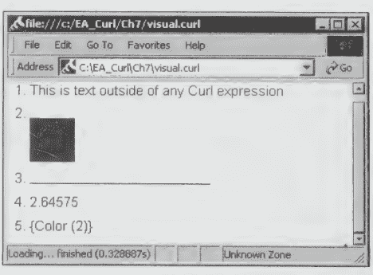

注意第二个示例中创建的 `Frame` 如何下沉到文本基线以下。这是因为每个图形对象都有一个内部原点，默认情况下，对象会沿其原点对齐。空 `Frame` 的原点位于左上角。上图中的第五个示例展示了一个没有特殊转换为视觉形式的对象。它被转换为字符串形式，这种形式实际上只对调试有用。

## 图形容器

`Graphic` 的一种重要类型是图形容器。各种图形容器用于在屏幕上以可视方式组织和排列对象。这些容器都是抽象基类 `Box` 的子类，而 `Box` 又是 `Graphic` 的子类（`Graphic` 本身又是 `Visual` 的子类）。你可能已经认出这是组合设计模式的一种应用。

任何 `Box` 对象都可以包含其他 `Box` 以及不是 `Box` 的视觉对象。图形 `Box` 对象的嵌套构成了 GUI 容器层次结构。不是 `Box` 对象的 `Visual` 实例是这个层次结构中的叶节点。

例如，两个常见的容器类是 `HBox` 和 `VBox`。`HBox` 可以有任意数量的子对象，并将它们并排排列在水平行中。`VBox` 与之类似，但它将子对象一个接一个地垂直排列在列中。

以下是如何创建一个 `HBox`，其中包含几个人名，从左到右横跨页面：

```curl
|| hbox.curl

{curl 1.7 applet}

{applet license="development"}

{HBox spacing=4pt, "Joe", "Karen", "Steve", "Paul", "Julia"}
```

这将在屏幕上渲染为所有名字排成一行：

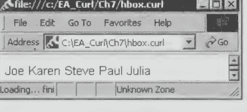

这个表达式创建的图形层次结构如下所示：

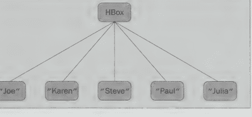

现在让我们在每个名字下方添加每个人的电话分机号。我们可以使用 `VBox` 来实现，因为每个 `VBox` 将其内容显示为一列。与之前一样，`HBox` 用于将这些列并排排列。

```curl
|| hbox-vbox.curl

{curl 1.7 applet}

{applet license="development"}

{HBox spacing=6pt,
     {VBox "Joe", "x2939"},
     {VBox "Karen","x2987"},
     {VBox "Steve", "x2933"},
     {VBox "Paul", "x2980"},
     {VBox "Julia","x2923"}
}
```

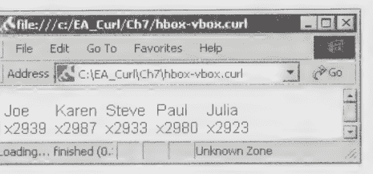

上述示例中这个表达式创建的图形层次结构如下所示：

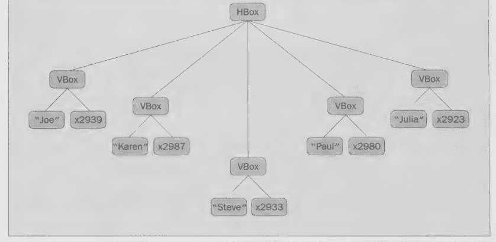

由于文本和图形都是相同基类（`Visual`）的子类，因此在创建任何你选择的展示风格时，它们可以自由混合。以下是创建几乎相同表格的另一种方式，这次使用格式化文本来创建列：

```curl
|| hbox-text.curl

{curl 1.7 applet}

{applet license="development"}

{HBox spacing=6pt,
    {text Joe {br} x2939},
    {text Karen {br} x2987},
    {text Steve {br} x2933},
    {text Paul {br} x2980},
    {text Julia {br} x2923}
}
```

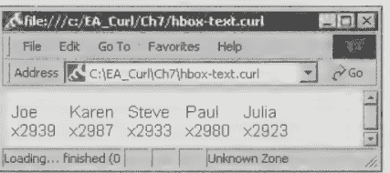

使用适合你应用程序的风格。随着你对 GUI 工具集的熟悉，你会培养起对任何给定情况哪种方式更好的直觉。

总结来说，`Visual` 的子类具有以下共同特征：

- 一组用于控制 `Visual` 内文本外观的属性
- 处理事件的能力
- 获得键盘焦点的能力
- 对于容器而言，`add` 和 `clear` 方法
- 当鼠标指针位于 `Visual` 上方时显示的光标
- 当鼠标指针悬停在 `Visual` 上方时显示的工具提示

## 属性 = 字段 + 选项

视觉对象共享大量通用属性，可以通过构造函数上的关键字参数来指定。我们已经在上面的示例中看到了 `width`、`height` 和 `background`。

某些属性会改变对象的行为；某些属性会改变对象的外观，有些则两者兼具。例如，`control-color` 属性会改变控件的外观，而 `enabled?` 属性则会同时改变视觉对象的外观和行为。

Curl 语言提供了几种机制来将属性值分配给对象。字段与其他语言中一样，在对象中预留一个槽位，用于存储某些指定类型的数据。字段的访问和更新效率很高，但每个字段都会占用每个对象实例的空间，无论是否需要。Curl 提供了选项作为另一种在对象实例上存储数据的方式，除非实际设置了选项值，否则不会为其分配任何空间。

例如，每个图形对象都有一个 `tooltip` 属性。如果该属性的值非空，则必须将其设置为 `Tooltip` 对象。如果鼠标指针悬停在具有非空 `tooltip` 的 `Visual` 对象上，相关的 `Tooltip` 对象就会弹出。当然，在任何给定的 applet 中，只有少量对象具有工具提示。如果为每个对象实例都分配该值的空间，而实际上只有很小一部分对象具有此属性，这将是浪费的。因此，`tooltip` 属性不是使用字段定义的，而是定义为选项，如下所示：

## 常用选项

每个 `Graphic` 子类在屏幕上占据一个矩形区域，并可以拥有边框、边距和背景。背景是 `Background` 类的值，可以是纯色、图案，甚至是图像。默认背景是透明的。如果对象没有填满其边界矩形，默认背景允许其下方的对象显示出来。

我们可以使用这些选项让我们的电话列表看起来更有趣：

```curl
|| box-options.curl

{curl 1.7 applet}

{applet license="development"}

{HBox
    border-width=1px, border-color="orange",
    background="navy", color="yellow",

    {VBox spacing=3pt, margin=3pt, border-width=1px,
        "Joe", "x2939"
    },

    {VBox spacing=3pt, margin=3pt, border-width=1px,
        "Karen", "x2987"
    },

    {VBox spacing=3pt, margin=3pt, border-width=1px,
        "Steve", "x2933"
    },

    {VBox spacing=3pt, margin=3pt, border-width=1px,
        "Paul", "x2980"
    },

    {VBox spacing=3pt, margin=3pt, border-width=1px,
        "Julia", "x2923"
    }
}
```

请注意，最外层 `HBox` 上的非本地 `color="yellow"` 设置如何影响所有文本的颜色，无论其嵌套层级多深。

为了节省输入并使更改外观更容易，我们可以定义自己的过程来为该表格创建列。Curl 允许你将表现形式与内容分离（如果你想这样做的话），并且你可以使用同一种语言来处理两者。在本例中，我们的 `name-number` 过程决定了列的最终外观，而调用则提供实际数据：

```curl
|| box-options-proc.curl

{curl 1.7 applet}

{applet license="development"}

{define-proc {name-number name:String, number:String}:Visual
    {return
        {VBox spacing=3pt, margin=3pt, border-width=1px,
            name, number
        }
    }
}

{Frame margin=6pt, {paragraph
    {HBox
        border-width=1px, border-color="orange",
        background="navy", color="yellow",
        {name-number "Joe", "x2939"},
        {name-number "Karen", "x2987"},
        {name-number "Steve", "x2933"},
        {name-number "Paul", "x2980"},
        {name-number "Julia", "x2923"}
    }
}}
```

以下是常用本地选项的表格：

| 本地选项 | 描述 |
| --- | --- |
| `background:Background` | 所有 `Graphic` 对象都有一个 `background` 属性。这是在边距中和对象前景部分后面绘制的图案。 |
| `border-width:any`<br>`border-style:BorderStyle` | 每个 `Graphic` 对象都可以有边框。只需将 `border-width` 设置为非零值即可。可用样式有 `"none"`、`"flat"`、`"raised"`、`"sunken"`、`"ridge"` 和 `"groove"`。还有一个 `border-color` 选项。它是非本地的，因为你通常希望所有边框都匹配。 |
| `width:any` | 固定的距离或弹性值（参见 *布局* 部分）。这些决定了对象的首选尺寸。布局系统决定实际尺寸。 |
| `height:any` | |
| `margin:any` | 边距的宽度。边距是 `Graphic` 对象边界框四边额外的空间。背景将在边距中显示。 |
| `visible?:bool` | 决定 `Graphic` 是否可见。 |
| `cursor:Cursor` | 如果设置此属性，将鼠标指针移到 `Graphic` 上方时会显示选定的光标。 |
| `tooltip` | 将此属性设置为 `ToolTip` 对象，当鼠标指针在 `Graphic` 上悬停一小段时间时，你的工具提示就会出现。 |

这里我们有一个常用非本地（可继承）属性的表格：

| 非本地选项 | 描述 |
| --- | --- |
| `color` | 这会影响文本的颜色以及某些简单图形的周长颜色。 |
| `font-weight: "bold" 或 "normal"` | 这些属性控制文本的外观。`font-weight` 可以是 `"bold"` 或 `"normal"`。`font-family` 可以是客户端系统上安装的任何字体，或者是 `"serif"`、`"sans-serif"` 或 `"monospace"`。其余选项是显而易见的。 |
| `font-style: "italic" 或 "normal"` | |
| `font-family:String` | |
| `font-size:any` | |
| `text-underline?:bool` | |
| `text-line-through?:bool` | |
| `border-color:FillPattern` | 这控制任何 `Graphic` 对象的边框颜色。 |

## 颜色、`FillPattern` 和 `Background`

一个名为 `FillPattern` 的类表示 GUI 工具包中的大多数颜色属性。对于 `background` 属性，我们使用一个名为 `Background` 的特殊类——必要时，`FillPattern` 会自动转换为 `Background`。顾名思义，`FillPattern` 不需要是纯色；实际上，可以将几乎任何图像转换为 `FillPattern` 并将其用作颜色属性。

一个名为 `Color` 的类表示纯色；以下是创建它的几种方式：

```curl
;; color-box.curl

{curl 1.7 applet}

{applet license="development"}

{define-proc {color-box c:Color}:Visual
    {return
        {RectangleGraphic width=.5in, height=.5in, fill-color=c}
    }
}

{color-box {Color.from-rgb .5, .9, .9}}

{color-box {Color.from-rgb-uint8 128, 220, 220}}

{color-box {Color.from-cmy .9, .2, .9}}

{color-box {Color.from-cmyk .9, .2, .9, .25}}

{color-box {Color.from-hsv 20deg, .8, .8}}

{color-box {Palette.get-red}}

{color-box {Color.from-string "yellow"}}

{color-box {Color.from-string "#4040A0"}}
```

最后两个示例表明字符串可以转换为颜色值。以井号 `#` 开头并仅包含十六进制数字的字符串被解释为红、绿、蓝的三个 8 位值。

还有一个预定义的命名颜色集合。这是一个显示 Curl 中所有预定义颜色名称的 applet。你可以将这些颜色中的每一个指定为字符串，或者使用类方法，例如 `Palette.get-green`，其优点是不存在的名称会产生编译时错误。

```curl
|| hbox-text.curl

{curl 1.7 applet}

{applet license="development"}

{define-proc {show-colors ...:String}:Visual
    {let r:Visual = {Table columns=8}}

    {for cname:String in ... do
        {r.add
            {VBox spacing=2pt,
                {Frame background=cname, width=.5in, height=.25in},
                {center {value cname}}
            }
        }
    }

    {return r}
}

{show-colors
    "aqua", "beige", "black", "blue", "brown", "cyan",
```


`"fuchsia", "gray", "green", "lime", "magenta", "maroon",`

`"navy", "olive", "orange", "pink", "purple", "red",`

`"silver", "teal", "wheat", "white", "yellow"`

}

```text
{local-option public tooltip:#Tooltip = null}
```

这意味着你可以像使用字段一样使用`tooltip`属性（例如，你可以写`set v.tooltip = something`），但如果你从未设置该值，它将具有默认值`null`。实际上有两种选项：本地和非本地。非本地选项具有通过包含层次结构可继承的附加属性。

一个`Table`可以包含许多按行和列排列的单元格。`color`选项是非本地的，所以如果你设置`table.color`为蓝色，那么所有单元格中的文本都将是蓝色。但是，你可以将某个特定单元格的颜色设置为红色，这将只影响该单元格内文本的颜色。由于继承，如果该单元格包含一个嵌套表，嵌套表中的所有文本也将是红色。

与字段不同，选项还支持更改处理程序。当你声明一个选项时，你可以提供一段代码块，每当选项值因任何原因更改时，该代码块会自动调用。这允许对象在必要时对作为选项存储的属性进行更改时做出反应。

最后，Curl 提供了`getter`和`setter`。这些允许 API 使用字段和选项访问的语法（不需要花括号）来调用一个更新值的方法（`setter`）和另一个返回值的方法（`getter`）。通常有一个`getter`但没有`setter`，如果它是一个计算属性而不是存储值。另一个有用的技术是拥有一个公共`getter`和私有或受保护的`setter`，这样实现可以更新属性，而客户端代码只能读取它。

## 综合应用：一个简单的 Applet

到目前为止，我们已经掌握了足够的知识来开始构建一个简单的 applet——桌面计算器。将用户界面与底层模型分离始终是一个好主意。对于我们的计算器用户界面，顶部会有一个数字显示屏，下方是一个矩形按钮阵列。模型将逐个接受按键输入并计算结果。基本模型的不同子类可以实现不同的行为，例如逆波兰表示法或处理带括号表达式的能力。

```curl
|| calculator.curl

{curl 1.7 applet}

{applet license="development"}

{define-class public CalculatorModel

    field private input:StringBuf = {StringBuf ""}

    field public result:String = ""

    field private a:double

    field private b:double

    field public last-op:char

    {constructor public {default}

        {self.clear}

    }

    {method public {clear}:void

        {self.clear-entry}

        set self.b = 0.0

        set self.last-op = 0

    }

    {method public {clear-entry}:void

        set self.a = 0.0

        {self.input.clear}

        {set self.result = "0"}

    }

    {method public {update}:void

        set self.result = {format "%f", self.a}

        {self.input.clear}

    }

    {method public {set-input v:String}:void

        {self.input.set-contents v}

        set self.result = v

        set self.a = {self.input.to-double}

    }

    {method public {do-key k:char}:void

        {switch k

        case 'x' do  || Clear

            {self.clear}

        case 'c' do  || Clear Entry

            {self.clear-entry}

        case KeyPressValue.backspace, KeyPressValue.delete do

            {if self.input.size > 0 then

                {self.input.remove self.input.size - 1}

            }

        case '0', '1', '2', '3', '4', '5', '6', '7', '8', '9', '.' do

            {self.set-input self.input & k}

        case '+', '-', '*', '/' do

            {if self.last-op != 0 then

                {self.do-operator self.last-op}

            }

            set self.b = self.a

            {self.clear-entry}

            set self.last-op = k

        case '=' do

            {if self.last-op != 0 and self.last-op != '=' then

                {self.do-operator self.last-op}

            }

            {self.update}

        }

    }

    {method public {do-operator op:char}:void

        set self.last-op = 0

        {switch op

        case '+' do

            set self.a = self.b + self.a

        case '-' do

            set self.a = self.b - self.a

        case '*' do

            set self.a = self.b * self.a

        case '/' do

            set self.a = self.b / self.a

        }

        set self.b = 0.0

    }

}

{let cm:CalculatorModel = {CalculatorModel}}
```

这个模型足以累积输入条目，并在用户界面中的按钮点击或按键响应时计算结果。我们还在名为`cm`的变量中创建了一个`CalculatorModel`实例。

现在我们可以构建用户界面了。首先，我们需要一个地方来显示计算器计算出的结果值。我们将创建一个`Frame`对象并将其赋值给一个变量。稍后我们可以将其放置到整体布局中的适当位置。通过这个变量，我们可以在需要时改变此`Frame`中显示的视觉效果。我们将把`"result-display"` `Frame`放入一个`HBox`中，并在左侧放置一个`Fill`来使显示的数字右对齐。

```curl
{let result-display:Frame = {Frame font-weight="bold", cm.result}}

{let display:Visual =

    {HBox

        font-size=12pt,

        border-width=2px, border-color="gray",

        margin=2pt,

        background=(Color.from-rgb .95, .95, .95),

        {Fill},

        result-display

    }

}
```

接下来，我们需要一组按钮。由于所有按钮都应该相似，我们将定义一个过程来创建单个按钮，给定按下按钮时应传递给计算器模型的字符，以及一个可选的标签，用于按钮上的标签与发送给模型的键值不同的情况。

```curl
{define-proc (cb key:char, label:#Visual=null):Visual

    {return

        {CommandButton

            width=.4in,

            label={if label != null then label

                   else {bold {value {String key}}}

            },

            {on Action at cb:CommandButton do

                {the-calculator.do-key key}

                {result-display.add replace?=true, the-calculator.result}

            }

        }

    }

}
```

`CommandButton`类对应于一个简单的按钮控件。我们将给所有这些按钮一个固定的宽度。高度由标签自动确定。除非使用`label`关键字参数指定了替代标签，否则标签会以粗体文本显示在按键本身上。最后，`Action`有一个事件处理程序，当用户点击按钮时按钮会触发该事件处理程序。事件处理程序将指定的键值传递给计算器模型，获取新结果，并更新`result-display`帧。

接下来，我们可以使用一个包含四列的`Table`将所有按钮排列成矩形阵列。

```curl
{let buttons:Visual =

    {Table columns=4, cell-margin=2px,

        {Fill}, {cb 'c', label="CE"},

        {cb 'x', label="C"}, {cb '/'},

        {cb '7'}, {cb '8'}, {cb '9'}, {cb '*'},

        {cb '4'}, {cb '5'}, {cb '6'}, {cb '-'},

        {cb '1'}, {cb '2'}, {cb '3'}, {cb '+'},

        {cb '0'}, {cb '.'}, {Fill}, {cb '='}

    }

}
```

最后，我们可以将所有内容放在一个`VBox`中，将数字显示屏置于按钮表格的上方。

```curl
{VBox

    margin=4pt, spacing=6pt,

    background={Color.from-rgb .6, .6, .6},

    display,

    buttons

}
```

最后一个表达式是唯一实际返回值的表达式。

## 另一种用户界面

现在让我们构建一个像加法机一样工作的用户界面。顶部将是一个显示结果的“纸带”。这个纸带可以按需设置高度，但在这个例子中，它有六行的空间。纸带下方是一个`TextField`，你可以在其中输入数字和运算符。每次执行运算符后，一行内容将被追加到输出纸带上。

我们将`TapeDisplay`实现为`VBox`的一个简单子类，因为它的行为接近我们的需求。我们添加了一个名为`size`的字段来存储纸带上的行数，并修改构造函数以每行添加一个空白文本项。唯一需要覆盖的是`Visual.add`方法，其中我们在每次添加新行时移除最上面的一行。

纸带下方是一个`TextField`，其中的代码包含在`ValueChanged`事件处理程序中，用于驱动`CalculatorModel`。当然，真实世界的 applet 会有更多的错误检查。

```curl
{define-class public TapeDisplay {inherits VBox}

    field size:int

    {constructor public {default size:int=5, ...}

        set self.size = size

        {construct-super ...}

        {for i:int = 1 to size do

            {self.add {text \ }}

        }

    }

    {method public {add g:any, ...}:#Visual

        let first:#Graphic=null

        let count:int = 0

        {for cg:Graphic in self.graphical-children do

            (inc count)

            {if first == null then set first = cg}

        }

        {if count >= self.size then {first.detach}}

        {return {super.add {HBox {Fill}, g}, ...}}

    }

}

{let td:Visual = {TapeDisplay size=6, background="white",

                                      font-family="monospace", font-size=9pt

                   }

}

{VBox hstretch?=true,

       margin=4pt, spacing=0pt,

       background={Color.from-rgb .6, .6, .6},

       td,

       {Fill height=4pt},

       {TextField

            {on ValueChanged at tf:TextField do

                 {if tf.value.size > 0 then

                      let lc:char = tf.value[tf.value.size - 1]

                      {if lc == '+'

                          or lc == '-'

                          or lc == '*'

                          or lc == '/'

                          or lc == '='

                       then

                          {td.add {text {value cm.result} {value lc}}}

                          {cm.do-key lc}

                          {set tf.value = ""}

                          {if lc == '=' then

                              {td.add {text {value cm.result} \ }}

                          }

                       else

                          {cm.set-input tf.value}

                      }

                 }

            }

       }

}
```


显然，这段代码只是一个用户界面，需要前一个示例中的`CalculatorModel`类才能运行：

```
Loading...Holder(tape-display.curl)
```

## 盒子的类型

GUI 工具包提供了多种不同的盒子类。盒子的主要区别在于它们能包含的子元素数量（一个或多个）以及它们如何排列这些子元素。例如，`ScrollBox` 只包含一个子元素，但该子元素可以是 `HBox` 或 `Table`，而后者又包含许多子元素。一个有趣的盒子是 `TextFlowBox`，它对如何处理文本有专门的知识。

下表是可用盒子的摘要：

| 盒子类型 | 子元素 | 布局 | 说明 |
|-------------|----------|--------|-------|
| `Frame` | 一个图形 | 如果未指定大小，由子元素决定大小。 | 常用作占位符 |
| `View` | 一个，被视为 `Graphic` | 与 `Frame` 相同。 | `View` 是一个独立的窗口，带有标题栏等。 |
| `HBox` | 多个，均被视为 `Graphic` | 将子元素排成一行。计算宽度以确保所有子元素获得其首选大小和水平位置。 | 非常常见 |
| `VBox` | 多个，均被视为 `Graphic` | 将子元素按列排列，上下堆叠。计算高度以确保所有子元素获得其首选大小和垂直位置。 | 非常常见 |
| `ScrollBox` | 一个，被视为 `Graphic` | 允许子元素为其首选大小。 | 当子元素超过 `ScrollBox` 的大小时，会出现滚动条 |
| `OverlayBox` | 多个，均被视为 `Graphic` 对象 | 子元素在其原点处对齐。最大的子元素决定盒子的首选大小。 | 子元素可以重叠 |
| `Canvas` | 多个，均被视为 `Graphic` 对象 | 每个子元素的 x,y 位置在添加到盒子时显式指定。`Canvas` 的大小也必须显式设置，但可以使用弹性来增加灵活性。 | 子元素可以重叠 |
| `Grid` | 多个，均被视为 `Graphic` 对象 | 子元素对齐到称为“基准线”的假想线上。 | 子元素可以重叠 |
| `Table` | 多个，均被视为 `Graphic` 对象 | 按行和列排列。列将采用最宽单元格的宽度，除非被覆盖。 | 不如 HTML 中常见，因为有其他容器可用 |
| `RasterBox` | 多个，均被视为 `Graphic` 对象 | 类似于 `HBox`，但可以将内容换行到多行。计算高度以确保所有子元素获得其首选大小和相对于基线的位置。 | |
| `TextFlowBox` | 多个，均被视为 `Visual` 对象 | 从左到右，从上到下，如同文本。 | 文本的主要容器 |

## 布局

GUI 工具包包含一个自动布局系统。它根据高度和宽度偏好、边距和边框设置以及对容器施加的约束，计算每个图形对象的大小和位置。你可以为所有对象指定固定大小，完全不指定任何大小，或者使用`Elastic`对象指定大小约束。

使用`Elastic`对象，你可以分配最小大小和首选大小，以及控制它们在空间过多或过少时能被拉伸或压缩的难易程度的参数。

当你指定`width=1in`或`height=12pt`时，会自动创建一个`Elastic`，其最小大小和首选大小都设置为你指定的距离。

如果你完全不指定任何大小，大多数容器将自动计算首选大小和最小大小，使其足够大以容纳内部所有对象的首选大小和最小大小，再加上边框和边距所需的大小（如果有的话）。

如果你想对布局有更多控制，可以使用`Elastic`对象。`Elastic`对象最多可由六个参数指定：

- `minimum-size` – 布局系统始终尽可能遵守此最小值。如果任何对象未能获得其最小大小，那是因为没有足够的空间让任何对象获得其最小大小。此时，所有对象将被压缩以保持最小大小之间的比例。
- `preferred-size` – 对象的大小，前提是空间足够。如果没有足够的空间，对象可能被迫低于其首选大小（在 Curl 术语中称为“压缩”）。如果有额外的空间，对象可能会被“拉伸”到大于其首选大小。
- `compressibility`、`compress-order` – 这些控制当`Elastic`没有足够的空间达到首选大小而必须被压缩时的行为。
- `stretchiness`、`stretch-order` – 这些控制当布局系统需要为至少一个对象分配大于首选大小的大小时`Elastic`的行为。

“order”将弹性分为拉伸和压缩的类别。Curl 将多余空间分配给具有最高拉伸顺序的对象。所有其他对象将获得其首选大小。在不足以让所有对象获得其首选大小的情况下，具有最高压缩顺序的对象将先被压缩到其最小大小，然后才压缩其他对象。

## 动态布局与交互

通过调用`make-elastic`并指定上述六个参数中的任意或全部来创建`Elastic`对象。以下是一个示例：

```curl
|| elastic.curl

{curl 1.7 applet}

{applet license="development"}

{Fill
    width={make-elastic minimum-size=2cm, preferred-size=3cm},
    border-width=.5pt,
    height=1cm, background="blue"
}
```

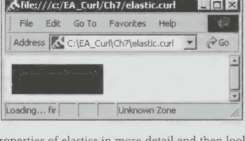

接下来，我们将更详细地考察弹性的属性，然后看看它们如何解决一些常见的布局问题。

## 弹性压缩的工作原理

当没有足够的空间让每个对象获得其首选大小时，一些对象会被压缩。了解其工作原理最简单的方法是看一些简单的例子。在所有这些示例中，我们将两个`Fill`对象并排放置在`HBox`中。红色`Fill`的最小大小为 1cm，首选大小为 2cm。橙色`Fill`的最小大小为 2cm，首选大小为 4cm。改变`HBox`的宽度，看看这对内部`Fill`对象的大小有什么影响。

```curl
|| elastic-compression.curl

{curl 1.7 applet}

{applet license="development"}

1. 容器没有大小限制，因此两者都获得首选大小。 {br}

{HBox border-color="black", border-width=.5pt,
    {Fill background="red", height=.25in,
        width={make-elastic minimum-size=1cm, preferred-size=2cm}
    },
    {Fill background="orange", height=.25in,
        width={make-elastic minimum-size=2cm, preferred-size=4cm}
    }
}

2. 缺少 1cm。两者压缩量相同。 {br}

{HBox border-color="black", border-width=.5pt,
    width = 5cm,
    {Fill background="red", height=.25in,
        width={make-elastic minimum-size=1cm, preferred-size=2cm}
    },
    {Fill background="orange", height=.25in,
        width={make-elastic minimum-size=2cm, preferred-size=4cm}
    }
}

3. 缺少 1cm，红色 Fill 的可压缩性是橙色 Fill 的两倍。

因此它被压缩两倍。 {br}

{HBox border-color="black", border-width=.5pt,
    width = 5cm,
    {Fill background="red", height=.25in,
        width={make-elastic minimum-size=1cm, preferred-size=2cm,
            compressibility=100
        }
    },
    {Fill background="orange", height=.25in,
        width={make-elastic minimum-size=2cm, preferred-size=4cm,
            compressibility=50
        }
    }
}

4. 缺少 1cm。压缩顺序：红色=30，橙色=20。橙色

Fill 完全不被压缩。 {br}

{HBox border-color="black", border-width=.5pt,
    width = 5cm,
    {Fill background="red", height=.25in,
        width={make-elastic minimum-size=1cm, preferred-size=2cm,
            compress-order=30
        }
    },
    {Fill background="orange", height=.25in,
        width={make-elastic minimum-size=2cm, preferred-size=4cm,
            compress-order=20
        }
    }
}
```

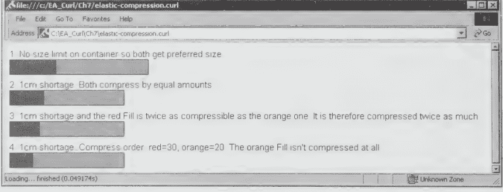

- 第一个示例给两个对象提供了它们需要的所有空间。
- 在第二个示例中，容器（`HBox`）的大小为 5cm，短了 1cm。由于所有弹性参数都相同，短缺量均分，每个`Fill`缩短半厘米。两者都没有达到其最小大小。
- 在第三个示例中，我们将红色`Fill`的可压缩性设置为橙色`Fill`的两倍。正如预期的那样，红色`Fill`被压缩的量是橙色`Fill`的两倍：三分之一的空间不足从可压缩性较低的橙色`Fill`中扣除，而三分之二从红色`Fill`中扣除。
- 在第四个示例中，我们将红色`Fill`的压缩顺序设置为 30，橙色`Fill`设置为 20。在任何一组可用空间不足的对象中，压缩顺序最高的对象将全部被压缩到其最小尺寸，然后才会压缩其他任何对象。在这种情况下，红色对象被压缩到其 1cm 的最小值。

## 弹性拉伸的工作原理

如果容器对其子元素有多余空间，且任一子元素具有足够的可拉伸性，则弹性元素可能会被拉伸。拉伸量没有上限，因此在一组需要共享一定空间的对象中，只有拉伸顺序最高的对象会被拉伸。在这些对象中（如果有多个），多余空间的分配根据拉伸性属性进行。

同样，查看一些示例是理解规则的最佳方式：

```curl
|| elastic-stretch.curl

{curl 1.7 applet}

{applet license="development"}

1. 容器没有尺寸限制，因此两者都获得首选尺寸。

{br}

{HBox border-color="black", border-width=.5pt,
    {Fill background="red", height=.25in,
        width={make-elastic preferred-size=2cm}
    },
    {Fill background="orange", height=.25in,
        width={make-elastic preferred-size=3cm}
    }
}

2. 多出 1cm。两者拉伸量相等。

{br}

{HBox border-color="black", border-width=.5pt,
    width = 6cm,
    {Fill background="red", height=.25in,
        width={make-elastic preferred-size=2cm}
    },
    {Fill background="orange", height=.25in,
        width={make-elastic preferred-size=3cm}
    }
}

3. 多出 1cm，红色 Fill 的可拉伸性是橙色 Fill 的两倍。

因此它被拉伸了两倍。

{br}

{HBox border-color="black", border-width=.5pt,
    width = 6cm,
    {Fill background="red", height=.25in,
        width={make-elastic preferred-size=2cm, stretchiness=100}
    },
    {Fill background="orange", height=.25in,
        width={make-elastic preferred-size=3cm, stretchiness=50}
    }
}

4. 多出 1cm。拉伸顺序：red=30, orange=20。

橙色 Fill 完全没有被拉伸。

{br}

{HBox border-color="black", border-width=.5pt,
    width = 6cm,
    {Fill background="red", height=.25in,
        width={make-elastic preferred-size=2cm, stretch-order=30}
    },
    {Fill background="orange", height=.25in,
        width={make-elastic preferred-size=3cm, stretch-order=20}
    }
}
```

- 在第一个示例中，容器没有任何限制，我们可以看到对象处于其自然尺寸。
- 在第二个示例中，我们简单地将容器宽度设置为 6cm，从而在内部创造了 1cm 的额外空间。由于我们没有更改任何拉伸参数，额外空间在两个子元素之间平均分配，每个都比之前宽半厘米。
- 在第三个示例中，我们将红色`Fill`的拉伸性设置为 100，橙色`Fill`设置为 50。正如预期的那样，红色`Fill`被拉伸了两倍，并获得了可用空间的 2/3。
- 在最后一个示例中，红色`Fill`的拉伸顺序为 30，使其比拉伸顺序为 20 的橙色`Fill`具有无限大的可拉伸性。因此，只有红色`Fill`被拉伸。

## 使用弹性

首先，考虑一个两列布局，其中第一列是固定宽度，第二列占据所有剩余空间。我们可以通过在`HBox`中包含一个固定宽度的`Frame`和一个弹性宽度的第二个`Frame`来实现这一点。注意，当我们增加容器宽度时，蓝色`Frame`如何拉伸，而绿色`Frame`保持其固定大小。

```curl
|| using-elastic.curl

{curl 1.7 applet}

{applet license="development"}

{let c2width =
    {make-elastic preferred-size=0cm,
        stretch-order=proportional-stretch-order,
        stretchiness=100
    }
}

{HBox width=2in, background="silver",
    {Frame width=72pt, height=18pt, background="green"},
    {Frame width=c2width, height=18pt, background="blue"}
}

{HBox width=2.5in, background="silver",
    {Frame width=72pt, height=18pt, background="green"},
    {Frame width=c2width, height=18pt, background="blue"}
}

{HBox width=3in, background="silver",
    {Frame width=72pt, height=18pt, background="green"},
    {Frame width=c2width, height=18pt, background="blue"}
}
```

要在 applet 中使用这种技术，你应该指定`PlainDocument`样式，以便外部`HBox`拉伸到浏览器窗口的宽度。以下是实现此功能的代码：

```curl
|| plain-document.curl

{curl 1.7 applet}

{applet license="development"}

{document-style PlainDocument}

{let c2width:Elastic =
    {make-elastic preferred-size=0cm,
        stretch-order=proportional-stretch-order,
        stretchiness=100
    }
}

{HBox vstretch?=true,
    {Frame width=72pt, background="beige"},
    {ScrollBox width=c2width, background="wheat",
        {text 这里可能有大量内容。

            必要时会出现滚动条。
        }
    }
}
```


为了更真实，我们更改了背景颜色，并且没有指定高度。相反，使用了选项 `vstretch?=true` 使 `HBox` 将其内容拉伸到浏览器窗口的高度。

如果你在浏览器中运行此代码，当你调整浏览器窗口大小时，小麦色的 `Frame` 会调整大小，而米色 `Frame` 保持固定。在真实的 applet 中，你可以在固定的左列中放置垂直链接列表等内容，在右侧放置文本内容。如果你想在 applet 的主区域中放置大量内容，可以将右侧的 `Frame` 替换为 `ScrollBox`。

## 比例尺寸

通常你希望按某种比例分配可用空间，比如 30/70。为此，你可以按所需比例分配拉伸性。例如，拉伸性值为 30 和 70（以及名义大小 0cm）就可以实现，如下一个示例所示。在浏览器中运行此代码，注意左侧的绿色 `Frame` 如何保持相同大小，而另外两个保持其宽度之间的 30/70 比例。

```curl
|| sizing.curl

{curl 1.7 applet}

{applet license="development"}

{let e1:Elastic = {make-elastic preferred-size=0cm,

                              stretch-order=proportional-stretch-order,

                              stretchiness=30

                    }

} {let e2:Elastic = {make-elastic preferred-size=0cm,

                              stretch-order=proportional-stretch-order,

                              stretchiness=70

                    }

} {HBox width=3cm, background="silver",

      {Frame width=1cm, height=1cm, background="green"},

      {Frame width=e1, height=1cm, background="blue"},

      {Frame width=e2, height=1cm, background="orange"}

}

{HBox width=6cm, background="silver",

      {Frame width=1cm, height=1cm, background="green"},

      {Frame width=e1, height=1cm, background="blue"},

      {Frame width=e2, height=1cm, background="orange"}

}
```

现在我们已经了解了盒子、图形 containment 层次结构和布局系统，是时候看看事件了。

# 事件

GUI 工具包使得向任何 `Visual` 对象添加事件处理程序变得简单。在本节中，我们将了解不同类型的事件以及如何传递和处理它们。

一个重要的事件组是 `GuiInputEvent` 的子类。这些事件由键盘、鼠标和其他输入设备生成。鼠标指针事件被发送到鼠标指针位置处最内层的可见对象。如果该对象没有消费该事件，它将被发送到其容器。每个容器依次，一直到 applet 的最外层容器，都有机会响应尚未被消费的事件。

GUI 工具包中的每个 `Visual` 对象都能够处理事件，因为 `Visual` 继承自 `EventTarget` 类。如果你创建了一个 `Visual` 对象的实例，并希望该实例响应特定类型的事件，你可以添加一个事件处理程序，如下例所示。

```curl
|| fill-event.curl

{curl 1.7 applet}

{applet license="development"}

{Fill width=.5in, height=.5in,

    background="green",

    {on PointerEnter at f:Fill do

        set f.background = "blue"

    },

    {on PointerLeave at f:Fill do

        set f.background = "yellow"

    }

}
```

当鼠标指针进入 `Visual` 的边界时，会向该可视对象发送 `PointerEnter` 事件。移出鼠标会触发 `PointerLeave` 事件。当你加载此 applet 时，你会看到一个每边半英寸的绿色正方形。当鼠标指针进入正方形时，它会变成蓝色。当鼠标离开时，它会变成黄色。

我们目前看到的事件处理程序是“动态事件处理程序”——表达式：

```curl
{on e:event-type at v:type do ...}
```

这是在 Curl 中创建动态事件处理程序的方式。动态事件处理程序简单来说是一个 `EventHandler` 的子类对象。你可以将其赋值给变量，或从过程或方法中返回。在以下示例中，事件处理程序被添加到一个图形对象上，然后又被移除。

```curl
|| fill-event2.curl

{curl 1.7 applet}

{applet license="development"}

{value

    (let handler:EventHandler =

        {on e:PointerPress at g:Graphic do

            {if e.button == 1 then

                {set g.background = "orange"}

            else

                {set g.background = "violet"}

            }

        }

    )

}

(let g:Graphic =
    {Fill width=.5in, height=.25in, background="green"}
)

(g.add-event-handler handler)

{HBox vstretch?=true,
    g,
    {CommandButton label="Remove Event Handler",
        {on Action do
            {g.remove-event-handler handler}
        }
    }
})
```

当此小程序加载时，它会显示一个绿色方块。使用鼠标左键单击会使方块变为橙色，而使用任何其他鼠标按钮单击则会使其变为紫罗兰色。如果你单击标有“Remove Event Handler”的 `CommandButton`，你会发现单击方块将不再改变其颜色。这是因为 `Fill` 上的事件处理程序在 `CommandButton` 的 `Action` 处理程序中被移除了。

到目前为止，我们已经了解了动态事件处理程序，但大多数事件也有相应的静态事件处理程序，你可以在子类中重写它们。例如，`PointerEnter` 事件的事件处理程序方法是：

```curl
{method public {on-pointer-enter e:PointerEnter}:void}
```

通过子类化并使用静态事件处理程序，可以简单高效地在创建的每个实例上使用相同的事件处理代码。有些事件没有静态事件处理方法，但大多数都有。

## 事件传递

将许多事件传递给单个对象是有意义的。例如，`ViewResizeEvent` 只会传递给被调整大小的 `View`。另一方面，与鼠标相关的事件（具体来说，`PointerEvent` 的子类）会被传递给一系列对象，从位于事件（x,y）位置的最顶层最内层的对象开始，向外传播到所有包含的对象，直到到达最外层的 `View`。在任何一个步骤中，事件处理程序可以消费事件 `e`（通过调用 `e.consume`）。这会完全处理该事件，并阻止其继续通过包含层次结构向外传播。

## 事件类型

GUI 工具包中事件的基类是 `GuiEvent`。此类定义了 `consumed?` 标志和 `GuiEvent.consume` 方法。

一个重要的子类是 `GuiInputEvent`。它继承自 `GuiWindowEvent` 以获取一个 `view` 属性（即事件触发的 `View`），并添加了事件触发时鼠标（x,y）位置的字段。还有一个 `state-mask` 字段用于指示键盘 Shift 键的状态。

## 指针事件

`PointerEvent` 是 `GuiInputEvent` 的子类。其子类包括：

- `PointerEvent` – 基类
- `PointerScroll` – 与鼠标滚轮相关的事件
- `PointerButtonEvent` – 由鼠标按钮引起的事件
- `PointerPress` – 鼠标按钮按下
- `PointerRelease` – 鼠标按钮释放
- `PointerMotion` – 鼠标移动

这些事件允许小程序响应最基本的鼠标事件。

与鼠标指针相关的一个有趣事件是 `PointerEnvelopeEvent`，它继承自 `GuiEvent`。为了找到内部最顶层的对象来处理普通的 `PointerEvent`，GUI 工具包只需将事件放入 `PointerEnvelopeEvent` 中，并将此封装事件发送给最外层的 `View`。封装事件的处理程序会在事件的（x,y）坐标处找到一个子对象，并将封装事件发送给该子对象。这个过程递归地继续，直到到达某个在事件位置没有子对象的对象。该对象会从 `PointerEnvelopeEvent` 中取出 `PointerEvent` 并将其发送给自己。随着递归展开，封装内的事件会被发送给每个容器，直到某个对象消费了它或没有父容器为止。如果你想在事件进入时而不是离开时看到它们，在外部容器上处理 `PointerEnvelopeEvent` 有时会很有用。`PointerEnvelopeEvent` `e` 有一个名为 `e.contents` 的只读字段，即它所包含的事件。

与鼠标指针相关的事件传递规则之一是，通常情况下，事件只会传递给那些在事件位置可见像素上绘制过的对象。`Graphic` 的子类对象具有一个名为 `opaque-to-events?` 的属性，如果你希望能够处理原本会进入其内部或同一容器中位于其下方的事件，可以将其设置为 `true`。

## 键盘和焦点事件

键盘事件会被发送给具有键盘焦点的 `Visual` 对象。有两个事件与焦点的获取或丢失相关：`FocusIn` 和 `FocusOut`。你可以调用 `v.request-key-focus` 将键盘焦点分配给 `Visual` `v`。如果 `v` 确实获得了焦点，`FocusIn` 事件将会发送给它。当 `v` 即将失去键盘焦点时，会发送 `FocusOut` 事件。

在每次按键和释放时，一系列键盘事件会被发送给具有键盘焦点的 `Visual`。第一个事件始终是 `RawKeyPress`，最后一个是 `RawKeyRelease`。如果所涉及的键是 Shift 键之一（Shift、Ctrl、Alt），那么这些原始键事件就是唯一被触发的事件。对于其他键，会在原始键事件之间触发 `KeyPress` 事件。大多数小程序只需要处理 `KeyPress` 事件，它包含 Shift 键的状态和一个字符代码。对于某个事件 `e.KeyPress`，`e.insertable?` 会告诉你该键是否为普通字符。如果 `e.insertable?` 为 `false`，则表示该键是特殊键，如 Esc 或功能键。

## 控件

控件是构建复杂的客户端用户界面的基本组件。在本节中，你将了解 Curl 语言中提供的控件。它们比 HTML 和 JavaScript 中的控件更加灵活。它们支持更丰富的事件模型，你可以轻松地动态更改或通过子类化更改它们的外观。

GUI 工具包包括以下类型的控件：

- **按钮**：`CommandButton`、`CheckButton` 和 `RadioButton`
- **文本**：`TextField`、`PasswordField` 和 `TextArea`
- **列表**：`ListBox`、`ComboBox` 和 `DropdownList`
- **菜单**：`MenuBar`、`MenuPane`、`MenuAction` 和上下文菜单

## 按钮

`CommandButton` 是一个简单的按钮控件。当你按下并释放按钮时，它会向自身发送一个 `Action` 事件。按钮上的事件处理程序随后可以采取任何适当的操作。我们在前面的示例中已经见过这种情况。现在让我们探讨如何自定义按钮的外观。

`CommandButton` 可以以三种不同的样式创建：标准、rollover 和仅标签。第一种提供平台原生的外观和感觉，是默认样式。rollover 样式使按钮具有平面外观，除非鼠标悬停在按钮上。仅标签样式表示只应绘制标签。这与自定义的 `ReactiveLabel` 结合使用时很有用。

如果你想更改控件中使用的颜色或字体，可以将非本地选项 `control-appearance-changeable?` 设置为 `true`，可以在控件上或任何包含容器上设置。然后你可以使用以下继承选项来修改屏幕上控件的绘制：

- `color:FillPattern` – 控件上文本的颜色
- `control-content-background:Background` – 控件背后的背景
- `control-color:FillPattern` – 按钮表面的控件
- `font-family:String` – 控件中文本的字体
- `font-size:any` – 控件中文本的字体大小
- `font-style:FontStyle` – 控件中文本的字体样式（normal 或 italic）
- `font-weight:FontWeight` – 控件中文本的字体粗细（normal 或 bold）

以下是一个使用这些选项的示例：

```curl
|| control-color.curl

{curl 1.7 applet}

{applet license="development"}

{Frame control-appearance-changeable?=true,

    color="navy",

    background="wheat",

    control-content-background="beige",

    control-color="orange",

    font-family="Tahoma",

    font-size=14pt,

    font-style="normal",

    font-weight="bold",

    margin=3pt,

    {VBox spacing=3pt,

        {HBox {Fill}, {text Username:}, {TextField}},

        {HBox {Fill}, {text Password:}, {PasswordField}},

        {HBox {Fill}, {CommandButton color="beige", label="Login"}}

    }

}
```

对于几乎完全的自定义，除了为控件子类化 UI 委托之外，你还可以使用 `ReactiveLabel`。`ReactiveLabel` 简单地说是由最多 7 个视觉效果组成的集合，分别对应以下每种状态：normal（正常）、rollover（悬停）、pressed（按下）、disabled（禁用）、checked（选中）、checked with rollover（选中并悬停）、checked and pressed（选中并按下），以及 disabled and checked（禁用且选中）。（后几种状态仅适用于 `CheckButton` 和 `RadioButton` 对象。）根据按钮的状态显示相应的视觉效果。

使用 `ReactiveLabel` 可以完全控制按钮的外观。如果你想使用自定义图像来创建特殊外观，`ReactiveLabel` 是一种将它们附加到按钮的简便方法。

以下是使用不同文本属性来改变标签在各种状态下外观的示例。

```curl
|| action.curl

{curl 1.7 applet}

{applet license="development"}

{CommandButton

    reactive-label=

    {ReactiveLabel

        label={big Action!},

        label-rollover = {big {italic {bold Action!}}},

        label-pressed = {big color="red", {bold Action!}},

        label-disabled = {big Action}

    }

}
```

## CheckButtons、RadioButtons 和 RadioFrames

`CheckButton` 和 `RadioButton` 对象具有一个布尔值，对应于按钮的状态：checked（选中）或 unchecked（未选中）。`RadioFrame` 是一个容器，确保其中多个 `RadioButton` 中只有一个处于选中状态。`RadioFrame` 的值是其中被选中的 `RadioButton` 的值。以下是这三个控件的示例：

```curl
|| buttons.curl

{curl 1.7 applet}

{applet license="development"}

{VBox control-appearance-changeable?=true,

    {bold What kind of coffee would you like?},

    {HBox spacing=9pt,
```


```curl
{RadioFrame value=10,

    {VBox spacing=3pt,

        {RadioButton label="Small", radio-value=8},

        {RadioButton label="Medium", radio-value=10},

        {RadioButton label="Large", radio-value=12}

    }

},

{VBox

    {CheckButton label="Sugar"},

    {CheckButton label="Cream"}

}
```

这里需要注意的一点是，虽然`RadioButton`具有布尔值，但它还有一个更有用的`radio-value`属性。这个值的类型是`any`，因此其用法完全取决于小程序。`RadioFrame`相应地具有一个`value`属性，该属性被设置为框内选中单选按钮的`radio-value`。

在介绍文本输入控件之后，我们将展示这些控件上事件处理程序的一些示例。

## Text Fields

文本字段控件包括`TextField`、`PasswordField`和`TextArea`。`TextField`准确地说接受单行文本。每当值发生变化时，会向它触发`ValueChanged`事件。当按下 Enter 键或字段失去键盘焦点时，会触发`ValueFinished`事件。`PasswordField`将键入字段的字符显示为星号（或你指定的任何其他字符），但除此之外与`TextField`相同。`TextArea`允许输入多行文本。`ValueFinished`事件仅在它失去焦点时触发，因为按下 Enter 键会在控件内开始新的一行文本。

## List Controls

如果你需要向用户展示一个可供选择的项目列表，可以使用`ListBox`、`DropDownList`或`ComboBox`。以下是这三个控件的示例：

```curl
|| list-controls.curl

{curl 1.7 applet}

{applet license="development"}

{HBox spacing=12pt, valign="top",

    {VBox

        "Select your industry...",

        {ListBox height=72pt,

            "ISP", "Web Hosting Service", "Web Site Design",

            "Web Consultant", "Software Publisher",

            "Media/Publishing", "Advertising"

        }

    },

    {VBox spacing=4pt,

        {Fill height=9pt},

        {DropdownList

            prompt="Your job title",

            "CTO", "VP Technology", "IT Director",

            "Webmaster", "Architect", "Developer"

        },

        {ComboBox

            prompt="Your IT spending",

            "Under $10,000", "$10,000 to $100,000",

            "Over $100,000"

        }

    },

    {VBox

        "Buyer for...",

        {ListBox height=72pt, width=96pt,

            style="checkbutton", selection-policy="multiple",

            "Self", "Group", "Division/Location", "Corporate"

        }

    }

}
```

`ComboBox`看起来与`DropdownList`完全一样，但`ComboBox`允许你除了从列表中选择之外还可以输入任何值。一个有趣的功能是可以指定`prompt`（提示）。这个字符串会显示在控件中，直到用户选择某个值为止。

与文本字段控件一样，当选择发生变化时，这些控件会触发`ValueChanged`事件。你可以处理此事件来更新底层数据或采取任何其他必要的操作。

列表控件有一个`selection-policy`属性，可以是`single`（单选）或`multiple`（多选）。在前一种情况下，控件的值将是被选中的项目。在多选情况下，值将是一个数组。你还可以使用`ListBox`的`checkbutton`样式来将列表项显示为复选框。

## Dialogs

大多数对话框和表单都会包含某种形式的控件。让我们看看如何在 Curl 中创建一个简单的模态对话框。我们将构建一个包含文本字段、OK 按钮和 Cancel 按钮的对话框。仅当文本字段中有文本时，OK 按钮才会启用。该对话框将提示用户输入股票代码，用于一个假设的 Web 应用程序，该程序随后会使用该代码来定位一些相关数据。

### 第七章

有几个专门提供的事件来帮助控制运行对话框的过程。首先，当在自己的窗口中显示对话框时，会向`Dialog`本身发送`DialogShow`事件。有一个名为`Commit`的事件，会向每个控件触发，以指示用户已成功完成对话框。OK 或 Apply 按钮应在其`Action`事件处理程序中调用`dialog.commit`。此方法向每个控件发送`Commit`事件，然后发送到`Dialog`本身。Cancel 等按钮或弹出辅助对话框的按钮不应调用`dialog.commit`，因为它们不表示用户已完成操作。

我们的代码首先声明一个变量来保存运行对话框的结果。在实际应用中，这可能是一个包含多个字段的对象，所有字段都用当前值初始化控件。接下来是 OK 按钮和文本字段。它们放在这里是为了我们能在对话框代码的后面引用它们。

```curl
|| dialogs.c1 7

{curl 1.7 applet}

{applet license="development"}

{let symbol:String = ""}

{let constant ok-result:String = "ok"}

{let ok-button:CommandButton =

    {CommandButton label="OK",

        {on Action at cb:CommandButton do

            {cb.dialog.commit}

            {cb.dialog.close ok-result}

        }

    }

}

{let symbol-field:TextField =

    {TextField

        {on ValueChanged at tf:TextField do

            set ok-button.enabled? = tf.value.size > 0

        },

        {on Commit at tf:TextField do

            set symbol = tf.value

        }

    }

}
```

在此之后，我们在文本字段的`ValueChanged`处理程序中声明`Dialog`本身，并启用或禁用 OK 按钮。我们添加了一个`Commit`处理程序，将新输入的值存储到前面声明的结果变量（名为`symbol`）中。在添加了构成对话框内容的控件和图形之后，我们有一个`DialogShow`事件处理程序。这设置控件的初始状态，包括将键盘焦点设置到文本字段上。

```curl
{let quote-dialog:Dialog =

    {Dialog

        {HBox spacing=6pt, margin=6pt,

            {VBox spacing=4pt,

                "Enter symbol for quote",

                {HBox "Symbol:", symbol-field}

            },

            {VBox spacing=4pt, hstretch?=true,

                ok-button,

                {CommandButton label="Cancel",

                    {on Action at cb:CommandButton do

                        {cb.dialog.close "cancel"}

                    }

                }

            }

        },

        {on DialogShow at d:Dialog do

            {set symbol-field.value = symbol}

            {set ok-button.enabled? = symbol.size > 0}

            {symbol-field.request-key-focus}

        }

    }

}

{let display:Frame = {Frame ""}}

{CommandButton label="Get Quote...",

    {on Action do

        {quote-dialog.show modal?=true, title="Get Quote..."}

        {if-non-null r:String=quote-dialog.return-state then

            {if {ok-result.equal? r} then

                {display.add replace?=true, "Symbol is " & symbol}

            }

        }

    }

}

{value display}
```

接下来，我们在页面本身添加一个按钮和一个显示框架，以便我们可以看到对话框的作用。此按钮的`Action`处理程序以模态方式显示对话框。此调用直到用户按下 OK 或 Cancel 时才会返回（因为这些按钮调用`Dialog.close`）。在此之后，我们可以查看`return-state`字段以了解哪个按钮关闭了对话框，并采取适当的操作。在这种情况下，如果用户点击 OK，我们更新显示框架；如果点击 Cancel，则保持原样。

## Menus

GUI 工具包提供了以下用于构建菜单的类：

- `MenuBar` – 水平菜单栏。它可以包含任意数量的子菜单。
- `MenuPane` – 用于显示菜单内容的窗格。该菜单可以是弹出式上下文菜单，也可以是来自另一个`MenuPane`或`MenuBar`的子菜单。
- `SubMenu` – 用于在`MenuBar`或`MenuPane`上放置`MenuPane`。
- `menu-separator` – 一个返回水平分隔线的过程，用于放置在`MenuPane`上。

## 第7章

下面是带有菜单和子菜单的`MenuBar`示例：

```curl
|| menus.curl

{curl 1.7 applet}

{applet license="development"}

{MenuBar

    {SubMenu

        label="File",

        {MenuAction label="Open",

            {on Action do

                    {popup-message "Opens a file"}}

        },

        {SubMenu

            label="New",

            {MenuAction label="Network Diagram",

                {on Action do

                        {popup-message "Creates a new Network Diagram"}

                }

            },

            {MenuAction label="Org Chart",

                {on Action do

                        {popup-message "Creates a new Org Chart"}

                }

            }

        }

        {MenuAction label="Close",

            key-accel-string="Ctrl-W",

            {on Action do

                    {popup-message "Closes a file"}

            }

        }

    },

    {SubMenu label="Edit",

        {MenuAction label="Cut",

            {on Action do

                    {@popup-message "Cut selection and put on clipboard"}

            }

        },

        {MenuAction label="Copy",

            {on Action do

                    {popup-message "Copy selection to clipboard"}

            }

        },

        {MenuAction label="Paste",

            {on Action do

                    {popup-message "Pastes clipboard"}

            }

        },

        {menu-separator},

        {CheckButton label="Show clipboard",

            {on ValueChanged at cb:CheckButton do

                    {popup-message {if cb.value then "Show" else "Hide"}

                                        & " clipboard"

                    }

            }

        }

    }

}
```


你可以通过将`key-accel-string`属性设置为一个描述性字符串，为任何`MenuAction`分配键盘加速器，如上面的`Close`项所示。你可以通过为`key-access`属性分配一个字符，来分配用于遍历菜单的键盘快捷键（通常在 Windows 上以带下划线的字母显示）。

## 总结与延伸阅读

本章展示了 Curl GUI 工具包中大部分重要的特性和概念。了解更多信息的一个好方法是编写你自己的 applet。GUI 工具包是原型化新应用程序的绝佳方式。特别地，我们已经了解了：

- 如何使用`Visual`及其子类（尤其是`Elastic`）控制屏幕上的布局
- 如何使用`Events`为屏幕上的对象添加交互性
- 如何利用各种可用的控件增强客户端用户界面

如需更详细的信息，Curl Surge Lab 附带了详尽的程序员参考手册，还有一份全面的开发人员指南，详细涵盖了 Curl 的所有内容。

Carl A. Dera, Peter Curl

# 8 动态二维图形

本章描述了在 Curl 内容语言中使用过程化生成的客户端二维图形。它假定读者已掌握前面章节中给出的基本 Curl 语法，同时也假定读者熟悉面向对象编程的一般概念，以及类和方法的使用。

本章将涵盖的主题包括：

- Curl 图形的架构概述
- 即时模式二维图形
- 过程化图像
- 图形形状
- 图像滤镜
- 访问像素
- `DisplacementMesh`类

## Curl 图形的架构概述

Curl 图形系统的架构如后文所示。本章不会详细介绍架构的所有方面，而是提供一个概述，以描述二维（2D）图形系统动态能力的最重要方面。

该架构由多个分层的应用程序编程接口（API）组成，提供对具有不同灵活性和复杂度的图形系统的访问。最低级别的库提供了系统其余部分所构建的功能基础块。使用低级接口（如`Renderer`类）进行编程需要对面向对象编程有适度的熟悉。

当 Surge™ 插件启动时，图形库会自动导入。第三章将要讨论的 3D 保留模式包（称为`Scene`API）是可选的，不会自动加载。如果你希望使用 Scene API，则需要显式导入`CURL.GRAPHICS.SCENE`。

## 即时模式与保留模式

在即时模式图形系统中，程序员告诉计算机要绘制什么，一旦绘制完成，计算机就会清除与渲染该数据相关的所有知识。如果要修改数据（例如，某个图形对象旋转了若干度），程序员必须发出显式命令来重新绘制整个数据集。在保留模式系统中，计算机记住与图形对象及其环境相关的各种状态数据，使程序员更容易操作数据集或为其添加交互性。它允许提供增量更改命令，而无需显式指定渲染整个数据集的所有命令。

## 即时模式二维图形

下图显示了渲染二维即时模式图形时使用的坐标系。该图处于“屏幕空间”中，即用户查看其计算机显示器的方式。

二维系统的主要接口是一个名为`Renderer2d`的类。该类用于绘制即时模式图形基元，如线条、矩形、椭圆、区域和路径。`Renderer2d`能够绘制到 GUI 工具包图形以及多种其他类型的`Drawable`。关于如何获取绘图表面的更多说明将在本章后面提供。目前，你只需要知道`Drawable`对象是你最终要渲染到的表面，而`Renderer2d`是执行该渲染的过程。图形对象参与 Curl 页面上的布局，这使它们在使用 Curl GUI 系统的任何应用程序中无处不在。

所有继承自`Graphic`的对象都有一个`draw`方法，该方法接收一个`Renderer2d`对象。这提供了生成自定义客户端图形的主要接口。你可以通过继承`Graphic`并重写`draw`方法来创建自定义图形。这可用于创建与 Curl 布局系统无缝交互的自定义控件类型。你新创建的小部件形状还可以通过重写`contains-point?`方法，并实现用于确定给定的`x,y`坐标何时位于自定义图形内的代码，与标准 GUI 工具包鼠标事件处理进行交互。如果需要在对象大小更改时初始化状态数据（这在布局期间发生，而不是在构造函数方法期间），你可能还需要重写`set-size`方法，该方法在对象大小被修改时调用。

## 过程化图像

Curl 内容语言的一个重要优势是能够过程化地生成图像，而无需使用 GIF 或 JPG 文件来表示图像。然而，这并不意味着你不能使用静态图像——这在使用第 7 章中的`image`过程时已演示过。

`image`调用返回一个`Graphic`，因此任何你会传递给`Graphic`的参数，如高度和宽度，在这里都是有效的。对于过程化图像，要使用的 Curl 对象类型是`FillPattern`类。`FillPattern`可以被认为是应用于绘制表面的颜料。你可以用`FillPattern`填充一个矩形，它可以是一种简单的颜料，如纯蓝色，也可以是更复杂的东西，如看起来像图片的颜料。

`FillPattern`类通常用作颜色的基准类型，包括背景色、前景色，偶尔还有`Graphic`对象的边框。有许多预定义颜色可用于创建`FillPattern`。

| 与`FillPattern`一起使用的预定义颜色 |
| --- |
| `aqua`、`beige`、`black`、`blue`、`brown`、`cyan`、`fuchsia`、`gray`、`green`、`lime`、`magenta`、`maroon`、`navy`、`olive`、`orange`、`pink`、`purple`、`red`、`silver`、`teal`、`wheat`、`white`、`yellow` |

可以通过引号直接赋值，也可以通过调用`Palette.get-<color>`访问器来赋值。

```curl
let red-fill-pattern:FillPattern = "red"

let green-fill-pattern:FillPattern = "green"

let fuchsia-fill-pattern:FillPattern = "fuchsia"
```

这与以下调用方式等效：

```curl
let red-fp:FillPattern = {Palette.get-red}

let green-fp:FillPattern = {Palette.get-green}

let fuchsia-fp:FillPattern = {Palette.get-fuchsia}
```

你也可以通过为`FillPattern`分配一个 URL 来创建它，其中 URL 为受支持的图像文件类型。例如：

```curl
let my-fillpattern:FillPattern = {url "myimage.jpg"}
```

这将从当前页面所在的目录导入图像`myimage.jpg`，并将其加载到`FillPattern`对象中。目前支持的图像文件类型有`.gif`、`.jpg`（以及`.jpeg`）和`.bmp`。创建自定义图像文件处理程序的功能也是支持的，但这超出了本书的范围。

以下示例展示了如何使用`FillPattern`来设置`Graphic`对象的`background`属性。请注意，通过`curl://source/...`URL 引用`.jpg`文件是被支持的。这指的是相对于 Curl Surge Lab 安装目录的文件。此外，该语法也适用于任何有效的`http://`或`file://`URL 命名约定。

> 本章中的多个示例引用了相对于 Curl 安装目录的图像文件 URL。这些文件只有在安装了 Surge Lab 的情况下才会存在。此外，为了让 Surge 运行时能够访问你的本地磁盘来打开这些文件，你需要授予 applet 信任，这在第 6 章前面已经介绍过。你不必使用示例中列出的图像 URL——任何有效的`.jpg`、`.gif`或`.bmp`文件的 URL 同样适用。

```curl
|| background.curl

{curl 1.7 applet}

{applet license = "development"}

{let copper-panel = {url "curl://source/Textures/copper-panel.jpg"}}

{CheckButton
    height = 0.5in,
    label = {text color="wheat",
        {big Sample Checkbox Label}
    },
    background = copper-panel
}
```

Curl 中还有另外两种与`FillPattern`类似的原生类型，即`Texture`和`Color`类。`Texture`对象是不可变的填充模式，用于与`Renderer`接口（3D 即时模式图形的 API）进行纹理映射。`FillPattern`类用于绘制用`Renderer2d`绘制的对象，而`Texture`用于绘制用`Renderer`绘制的对象。`Color`是一种特殊的`Texture`，代表纯色。`FillPattern`可以从`Texture`或`Color`创建。

> `FillPattern`和`Renderer2d`是配对使用的。`Texture`和`Renderer`是配对使用的。

`FillPattern`存在多个支持渐变填充的子类，即`LinearGradientFillPattern`和`RadialGradientFillPattern`。以下代码使用`LinearGradientFillPattern`创建了一些渐变，并用它们填充了两个方框。

```curl
|| gradient-fill.curl

{curl 1.7 applet}

{applet license = "development"}

{let first-linear:FillPattern =
    {LinearGradientFillPattern
        {Fraction2d 0, 0},
        {Fraction2d 1, 1},
        {Spectrum.from-endpoints
            "blue",
            "lime"
        }
    }
}

{let second-linear:FillPattern =
    {LinearGradientFillPattern
        {Fraction2d 0.5, 0},
        {Fraction2d 0.5, 1},
        {Spectrum.from-envelope
            "blue", 0.0,
            "red", 0.25,
            "lime", 0.5,
            "black", 1.0
        }
    }
}

{HBox
    {Fill
        width = 1in,
        height = 1in,
        background = first-linear
    },
    {Fill width=0.25in},
    {Fill
        width = 1in,
        height = 1in,
        background = second-linear
    }
}
```

`LinearGradientFillPattern`的构造函数接受几个参数；首先是渐变的起点和终点：

```curl
{Fraction2d 0, 0},
{Fraction2d 1, 1},
```

以及指定`Spectrum`中颜色的基础光谱：

```curl
{Spectrum.from-endpoints
    "blue",
    "lime"
}
```

上述代码应在浏览器中显示以下输出：一个蓝到青柠色的对角线渐变，以及一个蓝/红/绿/黑的水平渐变：

下一个示例演示了径向渐变填充的使用。

```curl
|| radial-fill.curl

{curl 1.7 applet}

{applet license = "development"}

{let fill-pattern:FillPattern =
    {RadialGradientFillPattern
        {Spectrum.from-envelope
            "yellow", 0,
            "orange", 0.4,
            "black", 1
        },
        center = {Fraction2d 1.0, 1.0},
        radius = 1.0
    }
}

{Fill
    width = 1in,
    height = 1in,
    background = fill-pattern
}
```

除了颜色之外，你还必须指定填充图案的中心和半径：

```curl
center = {Fraction2d 1.0, 1.0},
radius = 1.0
```

## `Renderer2d`方法

下表列出了`Renderer2d`类可用的部分方法。

| `Renderer2d.*` | 描述 |
| --- | --- |
| `render-line` | 使用当前的填充图案，渲染两个端点之间的线段。 |
| `render-string` | 从给定的基线位置开始渲染字符串。 |
| `render-pixmap` | 将给定的像素图渲染到矩形上，可选择性地指定源矩形。像素图是像素的二维网格。它们与位图相同，只是使用“像素图”这一术语，因为其表示可能涉及每个像素多位。 |

*表格续见下页*

| `Renderer2d.*` | 描述 |
| --- | --- |
| `render-rectangle` | 在`Renderer2d`上渲染矩形，除非另有指定，否则使用当前的填充图案。 |
| `render-triangle` | 渲染三角形，除非另有指定，否则使用当前的填充图案。 |
| `render-polygon` | 从`Distance2d`常量列表渲染多边形，这些常量描述多边形的顶点。除非另有指定，否则使用当前的填充图案。 |
| `render-path` | 使用（可选）提供的填充图案和描边粗细渲染路径。如果没有指定值，则使用当前的渲染属性。路径是一系列直线、跳转或贝塞尔曲线。 |
| `render-elliptic-path` | 在提供的高度和宽度约束内渲染椭圆路径。除非另有指定，否则使用当前的填充图案和描边宽度。 |
| `render-rectangular-path` | 围绕指定矩形渲染路径，除非另有指定，否则使用当前的填充图案和描边粗细。 |
| `render-region` | 使用当前的填充图案渲染区域（闭合路径内的区域）。 |

正如我们之前简要提到的，`Renderer2d`类型的对象携带一定数量的状态数据。`Renderer2d`的属性不是直接通过 set/get 来操作的，而是通过一个功能强大且灵活的宏`with-render-properties`来操作。

## 操作 `Renderer2d` 属性

`with-render-properties`宏有一个理想的特性：它设置`Renderer2d`上的属性，调用指定的代码块，然后将状态恢复为之前的值。这样，可以对同一个`Renderer2d`进行多次嵌套调用，每一级都设置适当的属性，而无需担心恢复状态。

函数`Renderer2d.create-offscreen`也可以用来获取一个`Renderer2d`可以在其上绘制的表面。以下示例演示了`with-render-properties`的嵌套功能，并展示了如何使用`Renderer2d.create-offscreen`过程来生成一个宽 6cm、高 4cm 的渲染表面。在此示例中，我们选择不遵循布局系统的宽度和高度，而是使用硬编码值强制我们的图形图像以我们选择的尺寸显示。

实现此目的的代码如下所示：

```curl
;; render2d.curl

{curl 1.7 applet}

{applet license = "development"}

(let g-width:Distance = 4cm)

(let g-height:Distance = 3cm)

(let (r:Renderer2d, d:Drawable) =
    {Renderer2d.create-offscreen g-width, g-height, 100dpi})
```

```curl
{d.clear color=(Color.from-string "silver")}

{with-render-properties fill-pattern="white" on r do
    || 以下调用渲染一条白色直线
    || 从左上角到右下角。
    {r.render-line 0cm, 0cm, 4cm, 3cm}

    {with-render-properties fill-pattern="black" on r do
        || 以下调用渲染一条黑色直线
        || 横穿中部。
        {r.render-line 0cm, 1.5cm, 4cm, 1.5cm}
    }

    || 以下调用渲染另一条白色直线，
    || 从左下到右上。
    {r.render-line 3cm, 1cm, 1cm, 2cm}
}

{Frame
    width=g-width,
    height=g-height,
    background=(d.to-Pixmap)
}
```


这将生成如下图像：

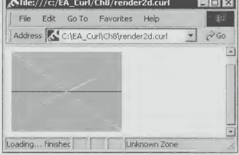

`Drawable` 对象始终与`Renderer2d`（或稍后介绍的`Renderer`）相关联，这就是为什么它们都从`Renderer2d.create-offscreen`调用中返回。将`Drawable`视为渲染发生的表面，将`Renderer2d`类视为使这些效果发生的过程。`Frame`必须被赋予非零的宽度和高度才能显示。

下表列出了可以使用`with-render-properties`宏设置的渲染属性。

| 名称 | 描述 |
|------|-------------|
| `fill-pattern` | 指定用于渲染的`FillPattern`。 |
| `draw-operation` | 描述如何组合源像素和目标像素的红、绿、蓝和 alpha 通道。 |
| `stroke-thickness` | 渲染线条的粗细。 |
| `font` | 指定用于渲染字符串的字体。 |
| `translation` | 在 x-y 平面内平移当前变换。 |
| `rotation` | 用于围绕原点旋转当前变换。正值将产生顺时针旋转，负值则为逆时针旋转。 |
| `scale` | 用于为当前变换指定 x 和 y 缩放因子。 |
| `clipping-region` | 用于将当前裁剪区域重置为输入`Region`与初始当前裁剪区域的交集。在`with-render-properties`块结束时，它将恢复为原始值。 |
| `clipping-rectangle` | 用于将当前裁剪区域重置为输入矩形与初始当前裁剪区域的交集。在`with-render-properties`块结束时，它将恢复为原始值。 |

特别值得关注，并且值得单独举例说明的，是`rotation`属性。这是一个非常便捷的工具，用于渲染旋转的图形图像。旋转是围绕原点进行的，因此我们需要平移到原点，执行旋转，然后再平移回我们期望的屏幕空间，以便在我们预期的位置绘制旋转后的图像。以下示例还演示了`scale`属性的使用，该属性可以通过使用相对比例来简化坐标计算。

```curl
|| rotation.curl

{curl 1.7 applet}

{applet license = "development"}

{define-class RotatedRectangle {inherits Frame}

  field rotation:Angle

  {constructor{default angle:Angle = 0deg, ...}

    set self.rotation = angle

    {construct-super...}

  }

  {method public {draw r:Renderer2d}:void

    let bounds:GRect = {self.layout.get-bounds}

    let p={Distance2d 10m, 25m}

    {with-render-properties

        scale={Double2d bounds.width/100m, bounds.height/50m},

        fill-pattern = self.fill-color,

        translation= p,

        rotation=self.rotation,

        translation=~p

      on r do

      {r.render-rectangle p.x, p.y, 40m, 20m}
```

```curl
{HBox

    spacing = 5mm,

    {RotatedRectangle

        angle=0deg,

        width=2in, height=1in,

        fill-color = "purple",

        border-width=2pt, border-color="black"

    },

    {RotatedRectangle

        angle=-40deg,

        width=2in, height=1in,

        fill-color = "purple",

        border-width=2pt, border-color="black"

    }

}
```

这里展示了一个紫色矩形，带有黑色边框，首先是没有旋转的情况，然后围绕原点逆时针旋转 40°：

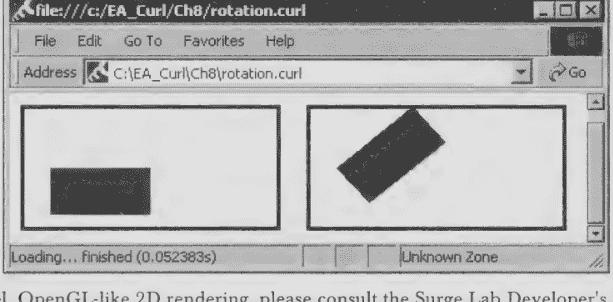

对于更低级别、类似 OpenGL 的 2D 渲染，请参阅 Surge Lab 开发者参考中关于`Renderer`和`Primitive`类的内容。

## 创建自定义控件

让我们从一个基本示例开始，你应该在之前的章节中已经熟悉了。下面的代码简单地渲染了一个标准的 GUI 工具包`CommandButton`（在第 7 章中介绍），当用鼠标点击时会显示消息 "Button Clicked!"。

```curl
|| command-button.curl

{curl 1.7 applet}

{applet license = "development"}

{CommandButton

    {on Action do

        {popup-message "Button Clicked!"}

    }

}
```

# Chapter 8

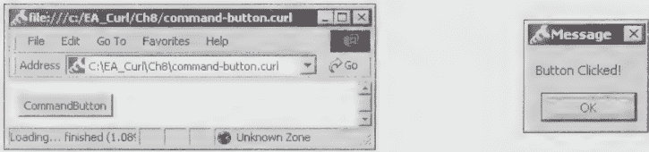

我们可以创建一个行为与`CommandButton`完全相同的自定义控件，但具有不同的图形表示。我们通过继承`CommandButton`类、提供默认构造函数并重写`draw`方法来实现这一点，如下所示。

```curl
|| mybutton.curl

{curl 1.7 applet}

{applet license = "development"}

{define-class MyButton {inherits CommandButton}

  {constructor {default ...

   {construct-super ...}

  }

  {method public {draw r:Renderer2d}:void

    let bounds:GRect = {self.layout.get-bounds}

    {with-render-properties

         fill-pattern = self.fill-color,

         translation = {Distance2d -bounds.lextent, -bounds.ascent}

         on r do

      {r.render-ellipse

          0in, 0in, bounds.width, bounds.height,

          start=0deg, stop=270deg}

      {r.render-string

          0in, bounds.ascent, {self.label.get-text},

          fill-pattern = "black"}

    }

  }

}

{MyButton

    label = "my button",

    fill-color="orange",

    {on Action do

        {popup-message "Button Clicked!"}

    }

}
```

我们的自定义控件应该产生一个从 0° 到 270° 的椭圆形饼形楔形，上面带有 "my button" 字样。此示例的输出如下所示；如果你点击此按钮，它的行为将与之前完全相同：

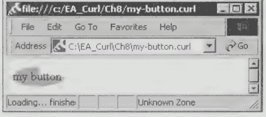

上述示例有几点需要注意。首先，我们创建的`MyButton`实例使用了普通`CommandButton`会使用的默认宽度和高度。由于我们希望尊重这些 GUI 工具包的选项设置，因此在创建自定义控件时需要查询底层系统以确定我们的宽度和高度。我们通过调用

```curl
{self.layout.get-bounds}
```

来实现这一点。这使我们能够访问宽度和高度，以及相对于对象中心的其他几个参数。本示例中使用的两个是左延伸距离（`bounds.lextent`）和上延伸距离（`bounds.ascent`）。你可能还会注意到`with-render-properties`宏的使用，起初这看起来有些奇怪。这个宏是维护状态数据的主要方式，它还将众多属性传播到`with-render-properties`块内的任何`Renderer2d`调用中；更多内容将在几页后介绍。目前，只需认识到我们遵循 GUI 工具包`fill-color`的方式是通过访问`self.fill-color`变量并将其赋值给`fill-pattern`渲染属性。还要注意，为了使用左上角为 0, 0 的 2D 坐标系统，我们需要通过左延伸距离（x 轴）和上延伸距离（y 轴）来平移我们的参考框架。

```curl
{r.render-string

  0in, bounds.ascent, {self.label.get-text},

  fill-pattern = "black"}
```

接下来，请注意从我们的简单示例中，如何在`draw`方法中通过`self.label.get-text`方法访问设置在`MyButton`实例上的文本标签。最后，如果我们点击该控件，我们会得到与初始示例相同的弹出消息。默认情况下，边界矩形内的任何鼠标点击都将被视为在对象内部——即使你点击的是自定义图形的空白区域。如果你希望鼠标事件处理被限制在你绘制的特定图形范围内，你需要重写`contains-point?`方法并提供代码来确定传入的 x, y 坐标是否位于你的对象内，返回布尔值`true`/`false`。

如果我们更改`MyButton`的实例以指定特定的宽度和高度，自定义渲染会自动适应，因为我们在`draw`方法中的所有参数都是相对于布局系统使用的边界而言的。

```curl
{MyButton

    width = 3cm, height = 3cm,

    label = "my circle",

    fill-color="lime",

    {on Action do

        {popup-message "Button Clicked!"}

    }

}

...
```

上述代码生成如下图像：

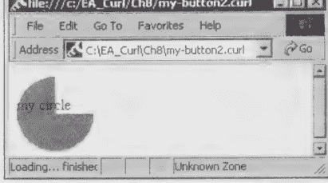

如果希望基类`Graphic`先被渲染，然后自定义内容在默认外观之上渲染，请在子类`draw`方法的第一个调用处添加以下内容：

```curl
{super.draw r}
```

其中 `r` 是传递给`draw`方法的`Renderer2d`。

## 图形形状

二维保留模式接口有时被称为 "shapes" 包。它包含`RectangleGraphic`、`EllipseGraphic`等类。这些对象以及其他内置形状的文档和示例可在《Curl 开发者指南》的 GUI 工具包章节中的 Graphical Shapes 部分找到。

| 名称 | 描述 |
|------|-------------|
| `RectangleGraphic` | 该类用于绘制矩形；可以为轮廓和内部填充指定不同的颜色 |
| `EllipseGraphic` | 该类用于绘制椭圆；可以为轮廓和内部填充指定不同的颜色 |
| `EllipticalArcGraphic` | 椭圆或椭圆形的饼状楔形 |
| `PolygonGraphic` | 该类绘制由直线围成的闭合二维多边形 |
| `RegularPolygonGraphic` | 一个（可能拉伸的）正多边形 |

## 创建自定义图形形状

除了标准的预定义图形形状外，您还可以创建自己的形状。下一个示例创建了一个`EllipseGraphic`的特例版本，专门用于创建圆形。该示例还演示了如何重写`contains-point?`方法。

```curl
|| circle-cursor.curl

{curl 1.7 applet}

{applet license = "development"}

{define-class CircleGraphic {inherits EllipseGraphic}
```

```curl
{constructor {default radius:Distance, ...}

    {construct-super ...}

    set self.height = radius

    set self.width = radius

}

{method public {draw r:Renderer2d}:void

    let bounds:GRect = {self.layout.get-bounds}

    {with-render-properties

        fill-pattern = self.fill-color,

        translation = {Distance2d -bounds.lextent, -bounds.ascent}

        on r do

            {r.render-ellipse

                0in, 0in, bounds.width, bounds.height}

    }

}

{method public {contains-point? x:Distance, y:Distance}:bool

    || 注意：原点是矩形边界框的左下角

    let status:bool = false

    let half-width = self.width * 0.5

    let half-height = self.height * 0.5

    let r-squared:Area = half-width * half-height

    let mag-squared:Area =

        {pow (x - half-width), 2) + {pow (y + half-height), 2)

    {if mag-squared < r-squared then

        set status = true

    }

    {return status}

}

}

{CircleGraphic 2cm, fill-color="blue", cursor = cursor-hand}
```

通过为`CircleGraphic`对象指定`cursor`选项，我们表示当光标位于该对象上时，希望光标显示为 "hand"（手形）光标。否则，将显示默认的箭头光标。我们的`contains-point?`实现会为我们执行此检查，如下所示，只有当鼠标真正位于绘制的对象内部时，才会看到 "hand" 光标——而不仅仅是在边界矩形内。

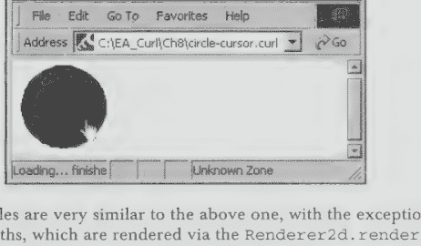

以下两个示例与上面的示例非常相似，不同之处在于我们引入了区域和路径的概念，它们分别通过`Renderer2d.render-region`和`Renderer2d.render-path`调用进行渲染。在第一个示例中，我们传入五个顶点来创建一个星形的自相交多边形，并使用`Region.contains-point?`方法来测试一个点是否位于给定区域内。

## 第 8 章

```curl
|| regions.curl

{curl 1.7 applet}

{applet license = "development"}

{define-class RegionGraphic {inherits Frame}

  field shape:#Region = null

  field vertices:{Array-of Fraction2d}

  {constructor {default vertices:{Array-of Fraction2d}, ...}

    set self.vertices = vertices

    {construct-super ...}

  }

  {method public {set-size lc:LayoutContext, bounds:GRect}:void

    let width:Distance = bounds.width

    let height:Distance = bounds.height

    let scaled-vertices:{Array-of Distance2d} =

        {{Array-of Distance2d}.from-size self.vertices.size,

            {Distance2d 0in, 0in}}

    {for vertex key idx in self.vertices do

        set scaled-vertices[idx] =

            {Distance2d width * vertex.x, height * vertex.y}

    }

    set self.shape = {Region.from-vertex-array scaled-vertices}

  }

  {method public {draw r:Renderer2d}:void

    {with-render-properties

        fill-pattern = self.fill-color

        on r do
```


```curl
{r.render-region {non-null self.shape}}

}

}

{method public {contains-point? x:Distance, y:Distance}:bool

{if-non-null self.shape then

{return {self.shape.contains-point? {Distance2d x, y}}}

else

{return false}

}

}

}
```

```curl
{RegionGraphic

width=2in, height=2in, cursor = cursor-hand,

fill-color="red",

{{Array-of Fraction2d}

{Fraction2d 0.5, 0.0},

{Fraction2d 0.2, 1.0},

{Fraction2d 1.0, 0.4},

{Fraction2d 0.0, 0.4},

{Fraction2d 0.8, 1.0}

}

}
```

运行此示例应显示如下星形：


请注意，上述图像不是作为五个独立的三角形绘制的，而是通过五个顶点创建一个`Region`来绘制的。另外，请注意光标如何从箭头变为手形，仅当它在`Region`的填充部分内时才会如此。

除了使用以下代码渲染`Region`：

```curl
{r.render-region {non-null self.shape}}
```

我们还可以将其转换为`Path`，并使用`render-path`方法：

```curl
{r.render-path {(non-null self.shape).to-outline-path}}
```

这将生成如下图像，其鼠标行为与上述`Region`相同。


除了相连的线段外，`Path`对象还可以由曲线段以及`move-to`调用组成，从而允许创建不相连的路径。

实现二维保留模式应用程序的另一种选择是使用`Scene`接口。虽然`Scene API`通常用于渲染三维保留模式图形，但通过保持其中一个维度（x、y 或 z）恒定，可以创建二维保留模式系统。`Scene`接口将在第 9 章中更详细地介绍。

## 图像过滤器

Curl 内容语言有许多图像处理工具。这些被称为图像过滤器，定义在`CURL.GRAPHICS.IMAGEFILTER`包中。以下示例演示如何将图像过滤器应用于 JPEG 图像。该示例左侧显示标准图像，右侧的图像则应用了百分之三十的模糊过滤器。

```curl
|| image-filter.curl

{curl 1.7 applet}

{applet license = "development"}

{import blur from CURL.GRAPHICS.IMAGEFILTER}

{HBox

spacing = 0.25in,

{Fill width=1in, height=2in,

background = {url "curl://source/Textures/copper-panel.jpg"}},

{Fill width=1in, height=2in,

background=

{blur

{FillPattern

{url "curl://source/Textures/copper-panel.jpg"}},

amount=30%

}

}

}
```


下表列出了 Curl 内容语言当前提供的图像过滤器。请注意，图像过滤器可以串联，将其中一个的输出作为另一个的输入。

| 名称 | 描述 |
|---|---|
| `autolevel` | 该过滤器可用于校正图像中的低光照 |
| `blend` | 将两个`FillPattern`混合在一起的图像过滤器 |
| `blur` | 高斯模糊算法的实现 |
| `brightness-adjust` | 通过向黑色或白色混合来调整输入的亮度 |
| `bubble` | 在结果`FillPattern`中显示一个或多个气泡 |
| `contrast-adjust` | 调整输入`FillPattern`的对比度级别 |
| `emboss` | 通过将图像中区域的边缘视为凸起线条来模拟`FillPattern`上的浮雕效果 |
| `glow` | 发光效果，通过模糊 alpha 值来创建从不透明区域到周围透明区域的透明度渐变 |
| `hsv-adjust` | 调整图像的色调、饱和度和/或明度 |
| `rgb-channel` | 从图像中选择性移除红色、绿色、蓝色和/或 alpha 通道 |
| `rgb-offset` | 为图像的红色、绿色、蓝色和 alpha 通道添加单独的值 |
| `rgb-scale` | 将图像的红色、绿色、蓝色和 alpha 通道乘以单独的系数 |
| `rotate` | 按指定角度旋转`FillPattern`，可选参数指示是裁剪图像还是调整大小以适应 |
| `scale` | 水平和垂直缩放`FillPattern` |
| `skew-height` | 垂直倾斜`FillPattern` |
| `skew-width` | 水平倾斜`FillPattern` |
| `sphere` | 创建图像的球形扭曲 |
| `translate` | 水平和/或垂直平移图像 |
| `twirl` | 创建图像的旋转扭曲 |
| `warp` | 通过应用任意位移网格来扭曲图像 |

## 访问像素

有时需要能够访问图像的各个像素。在 Curl 内容语言中，实现此目的的机制是`for-pixel`迭代器，通常与`mutate-fill-pattern`宏配合使用。这提供了强大而便捷的工具，用于对一个或多个`Pixmap`对象的内容执行操作，例如比较或复制。它允许您遍历一个或多个（等大的）`Pixmap`对象中的每个像素，或`Pixmap`中的某个区域，而无需担心边界条件或坐标转换细节。

# 第 8 章

`for-pixel`的强大功能和用途最好通过一个示例来说明。让我们创建一个示例`Pixmap`，其中一半是黄色，一半是紫色。以下代码初始化了一个 256×128 像素的`Pixmap`，全部为黄色，但其`empty-value`为紫色。然后我们遍历这些像素，如果`x`小于`(y*2)`，则将当前像素的值更改为与该像素关联的`empty-value`，从而得到两个三角形区域，一个黄色，一个紫色。该示例还演示了如何使用`from-rgb`方法初始化颜色（该方法接受介于 0.0 和 1.0 之间的`Fraction`参数，表示红色、绿色和蓝色通道的分数值），以及如何将 GUI 对象初始化为特定的像素大小，而不是使用`Distance`单位。

```curl
|| pixel.curl

{curl 1.7 applet}

{applet license = "development"}

{let sample-pixmap:Pixmap =

{Pixmap 256, 128,

initial-value = {{Color.from-rgb 1.0, 1.0, 0.0}.to-Pixel},

empty-value = {{Color.from-rgb 1.0, 0.0, 1.0}.to-Pixel}

}

}

{for-pixel p at x, y in sample-pixmap do

{if x < (y*2) then

set p = sample-pixmap.empty-value

}

}

{Fill width=256pixel, height=128pixel,

background = sample-pixmap

}
```


在此示例的基础上，我们演示如何将透明度（或称为 Alpha 混合）添加到`Pixmap`中，并将其叠加到另一张图像之上。这是通过为像素分配一个介于 0.0 和 1.0 之间的 alpha 值来实现的。值为 0.0 表示像素完全透明，值为 1.0 表示像素完全不透明。注意，为了让`Renderer2D`正确组合多个图像的 alpha 值，您需要设置`draw-operation`渲染属性。

```curl
|| Transparency.curl

{curl 1.7 applet}

{applet license = "development"}

|| 初始化 Pixmap

{let sample-pixmap:Pixmap =

{Pixmap 128, 128,

initial-value = {{Color.from-rgb 1.0, 1.0, 0.0}.to-Pixel},

empty-value = {{Color.from-rgb 1.0, 0.0, 1.0}.to-Pixel}

}

}

|| 遍历 Pixmap，将一半颜色设置为 empty-value

{for-pixel p at x, y in sample-pixmap do

{if x < y then

set p = sample-pixmap.empty-value

}

|| 通过将 alpha 设为 0，在 pixmap 中间创建"孔洞"

{if (x > sample-pixmap.width * 0.25) and

(x < sample-pixmap.width * 0.75) and

(y > sample-pixmap.height * 0.25) and

(y < sample-pixmap.height * 0.75) then

set p = {Pixel.create

p.red, p.green, p.blue, alpha = 0.0}

}

}

{define-class TransparentDemo {inherits Frame}

{constructor {default ...}

{construct-super ...}

}

{method public {draw r:Renderer2d}:void

let bounds:GRect = {self.layout.get-bounds}

{with-render-properties

fill-pattern = {self.background.to-FillPattern},

draw-operation = DrawOperation.mask,

translation = {Distance2d -bounds.left-extent, -bounds.ascent}

on r do

{r.render-rectangle 0in, 0in, bounds.width, bounds.height}

{r.render-pixmap bounds.width * 0.25, bounds.height * 0.25,

bounds.width * 0.5, bounds.height * 0.5, sample-pixmap}

}

}

}

{TransparentDemo

width=2in, height=2in,

background = "leaves"

}
```

在这里，我们在树叶背景上渲染了一个"空心"的黄紫色矩形：


Curl Surge 中的底层图形系统采用混合渲染方法。小程序的一部分可以使用本机主机渲染系统进行渲染（例如在 Win32 平台上使用 Windows GDI 调用），另一部分可以使用 3D 硬件加速图形进行渲染（在 Windows95/98/2000/ME/XP 上通过 DirectX，在 Windows NT 上通过 OpenGL）。采用这种方法是为了优化所显示内容的渲染性能。这里需要特别注意的一点是，Windows GDI 不支持可变级别的透明度。这意味着图像的部分可以显示为完全透明或完全不透明，但不能部分透明。在上面的示例中，我们将`draw-operation`渲染属性设置为`DrawOperation.mask`，但即使我们将其设置为`DrawOperation.blend`并使用可变透明度初始化我们的`Pixmap`，显示的图像仍将包含完全透明的像素（当像素的 alpha 小于或等于 0.5 时）或完全不透明的像素（alpha 大于 0.5）。

以下示例演示如何在 Curl 内容语言中支持可变透明度。该过程涉及创建离屏`Drawable`，这是一个表面，对`Renderer2d`的调用将在其上执行，但结果仅存在于内存中——而不是在计算机屏幕上。创建离屏内容时，系统默认会使用 DirectX 或 OpenGL 来创建图像，这确实支持可变透明度。然后我们将渲染到离屏`Drawable`上的内容转换为`Pixmap`，并以与前面示例相同的方式将其渲染到屏幕上。

```curl
|| transparency2.curl

{curl 1.7 applet}

{applet license = "development"}

{let (offscreen-r:Renderer2d, offscreen-d:Drawable) =

{Renderer2d.create-offscreen 2in, 2in, 100dpi}

}

{let sample-pixmap:Pixmap =

{Pixmap 128, 128,

initial-value = {{Color.from-rgb 1.0, 1.0, 0.0}.to-Pixel},

empty-value = {{Color.from-rgb 1.0, 0.0, 1.0}.to-Pixel}

}

}

{for-pixel p at x, y in sample-pixmap do

{if x < y then

set p = sample-pixmap.empty-value

}

{if (x > sample-pixmap.width * 0.25) and

(x < sample-pixmap.width * 0.75) and

(y > sample-pixmap.height * 0.25) and

(y < sample-pixmap.height * 0.75) then

set p = {Pixel.create

ationale = -bounds.leExtent, -bounds.ascent}

on offscreen-r do

{offscreen-r.render-rectangle 0in, 0in, bounds.width, bounds.height}

{offscreen-r.render-pixmap bounds.width * 0.25, bounds.height *

0.25, bounds.width * 0.5, bounds.height * 0.5, sample-pixmap}

}

}

|| 将 Drawable 转换为 pixmap，并传入 Renderer2d 句柄

{with-render-properties

translation = {Distance2d -bounds.left-extent, -bounds.ascent}

on r do

{r.render-pixmap 0in, 0in, bounds.width, bounds.height,

{offscreen-d.to-Pixmap}

}

}

}

{TransparentDemo

width=2in, height=2in,

background = "leaves"

}
```


在这里我们可以看到，黄紫色正方形的中心设置为 50% 透明度，而外部部分则与之前一样完全不透明。


`for-pixel` 还有其他机制支持从一个 `Pixmap` 复制部分到另一个 `Pixmap`，以及针对已知为只读或只写的 `Pixmap` 实例优化迭代循环。有关 `for-pixel` 的更多详细信息，请参阅 Surge 开发者参考。

## 图像变换

`FillPattern` 可以通过内置宏 `mutate-fill-pattern` 安全地进行变换。此宏允许使用 `Pixmap`、`Drawable` 或 `Renderer2d` 的 API 对 `FillPattern`（通常是不可变的）进行变换。这提供了多种替代方法，通过它们可以执行 `FillPattern` 的像素级操作。

接下来的示例显示了两个并排的图像。左边是 Surge Lab 提供的树叶图像，未经修改。右边的图像是使用 `mutate-fill-pattern` 宏和 `Pixmap` 界面修改的，其中 `for-pixel` 完成了大部分转换工作。此示例还展示了如何从 RGB 颜色空间转换为 HSV，反之亦然。

# 第 8 章

```curl
|| mutate.curl

{curl 1.7 applet}

{applet license = "development"}

{value

    let original:FillPattern =

        {FillPattern.from-url {url "curl://source/Textures/leaves.jpg"}}

    let mutant:FillPattern = {original.clone}

    {mutate-fill-pattern pixmap:Pixmap on mutant do

        let hue:FloatAngle

        let saturation:FloatFraction

        let value:FloatFraction

        let red:Fraction

        let green:Fraction

        let blue:Fraction

        {for-pixel pixel:Pixel at x:int, y:int in pixmap do

            || 使用此启发式方法选择最浅的绿叶：

            {if pixel.green > 0.4f then

                set (hue, saturation, value) =

                    {Color.rgb-to-hsv pixel.red, pixel.green, pixel.blue}

                set hue = 0deg asa FloatAngle

                || 调整明度值使其更偏红色

                set value = value + 0.2f

                {if value > 1.0f then

                    set value = 1.0f

                }

                set (red, green, blue) =

                    {Color.hsv-to-rgb hue, saturation, value}

                set pixel = {Pixel.create red, green, blue}

            }

        }

    }

    {HBox

        spacing = 0.25in,

        {Fill width = 1in, height = 1in, background = original},

        {Fill width = 1in, height = 1in, background = mutant}

    }

}
```

如果你运行此示例，将会看到第一张图像中的浅绿色叶子在第二张图像中变成了红色。


还需要注意的是，上述功能可以通过对 `PixmapBasedFillPattern` 进行子类化来定制，它是 `LinearGradientFillPattern` 和 `RadialGradientFillPattern` 两者的抽象基类，你可以提供自己的像素操作代码。

## `DisplacementMesh` 类

`DisplacementMesh` 类对于实现任何可以通过从源图像到目标图像的空间映射来描述的扭曲效果都非常有用。`DisplacementMesh` 作用于 `Map-of` 子类（如 `Pixmap`）上，并输出相同的对象类型。

控制是通过使用点网格来实现的（其分辨率在初始化时传递给 `DisplacementMesh` 对象）。每个点使用纹理坐标来描述源图像中的哪个点应该映射到目标图像上的给定点。目标图像上位于网格点之间的点使用四个最近的网格点进行插值。

例如，假设我们的网格由 30x30 的点组成，其中中间网格点（网格中的点 15,15）的值为 (0.5, 0.25)。如果我们的输入是一个 320x200 的 `Pixmap`，则网格中点对应于目标 `Pixmap` 中的点 (160, 100)。由于该网格点的分数值是 (0.5, 0.25)，这标识了源 `Pixmap` 中的点 (160, 50)，因为 320 * 0.5 = 160 且 200 * 0.25 = 50。因此，目标 `Pixmap` 中 (160, 100) 处的像素将取源 `Pixmap` 中 (160, 50) 处像素的颜色。如果网格点 15,15 处的值是 (0.1, 0.1)，那么它将取源图像中 (32, 20) 处的值——但它仍然会被分配到相同的目标像素。

`DisplacementMesh` 网格的初始化可以自动完成。存在一些方法可以自动为你创建网格扭曲效果：`spherize`、`translate`、`twirl`、`perturb` 和 `reset`。请注意，其中一些方法绝对地设置网格，而另一些则在现有网格上进行原位修改。你也可以直接显式设置 `DisplacementMesh` 的点，如下所示：

```curl
{mesh.set 2, 3, {Fraction2d 0.2, 0.3}}
```

或：

```curl
set mesh[2, 3] = {Fraction2d 0.2, 0.3}
```

一旦初始化完成，网格将通过在 `Map-of` 上调用 `distort` 方法应用于该对象（换句话说，你调用 `Pixmap.distort` 方法）。扭曲也可以通过 `warp` 图像滤镜来执行，它在内部调用 `Pixmap.distort` 方法，并在源网格和目标网格上同时操作。

这个 `DisplacementMesh` 示例将百分之七十五的球形扭曲应用于一个程序生成的 320x200 像素网格。

```curl
|| displacement-mesh.curl

{curl 1.7 applet}

{applet license = "development"}

|| 定义源 pixmap —— 一个蓝色网格

{let original-pixmap:Pixmap = {Pixmap 320, 200}}

{for-pixel p:Pixel at x, y in original-pixmap do

    {if {floor x/10} mod 3 == 0 or {floor y/10} mod 3 == 0 then

        set p = {Pixel.create 0, 0, 1}

    }

}

|| 通过模糊滤镜平滑样本 pixmap 网格

{set original-pixmap =

    {IMAGEFILTER.filter-pixmap IMAGEFILTER.blur, original-pixmap,

        amount=20%}
}
```

```curl
|| 创建目标网格

{let grid:DisplacementMesh = {DisplacementMesh 30, 30}}

|| 对目标网格应用球形扭曲

{grid.spherize 75%}

|| 扭曲原始 pixmap

{let distorted-pixmap:Pixmap = {original-pixmap.distort grid}}

{HBox

    spacing = 5mm,

    {Frame width=320pixel, height=200pixel, background = original-pixmap},

    {Frame width=320pixel, height=200pixel, background = distorted-pixmap}

}
```

请注意，我们通过 `filter-pixmap` 调用直接对 `Pixmap` 应用了图像滤镜（在本例中是模糊滤镜），该调用包含在 `IMAGEFILTER` 包中。或者，不调用：

```curl
{set original-pixmap =

    {IMAGEFILTER.filter-pixmap IMAGEFILTER.blur, original-pixmap, amount=20%}
}
```

我们可以将代码写成如下形式：

```curl
{import filter-pixmap, blur from CURL.GRAPHICS.IMAGEFILTER}

{set original-pixmap =

    {filter-pixmap blur, original-pixmap, amount=20%}
}
```

或者只从 `IMAGEFILTER` 包导入所有公共 API 入口点：

```curl
{import * from CURL.GRAPHICS.IMAGEFILTER}
```

以上所有方法都会产生相同的结果。

原始 `Pixmap`（未扭曲）显示在下面的左侧，球形扭曲后的 `Pixmap` 在右侧。


## 小结

本章介绍了 Curl 内容语言中可用于在客户端生成动态、程序生成的 2D 图形的能力。这为你创建自己的定制图形效果提供了所需的基本知识。它也为下一章提供了必要的基础，届时我们将探索程序化的交互式 3D 图形的开发。

# 动态 3D 图形

本章描述了如何在 Curl 内容语言中使用程序生成的客户端 3D 图形。它假设你已经掌握了前面章节中关于 Curl 基本语法的内容，以及第 8 章中介绍的一些图形类。

本章将涵盖的主题包括：

- 保留模式 3D 图形
- 立即模式 3D 图形
- 纹理映射
- 动画
- 获取绘图表面
- 一些高级主题的介绍

## 3D 图形

本章描述了关于 Curl 中 3D 图形子系统的基本信息。它不是作为 3D 图形的入门读物，而是作为 Curl 内容语言中 3D API 的概述。内容涵盖了高级 3D 保留模式 API（`Scene`）和低级 3D 立即模式 API（`Renderer`、`Primitive` 以及 `render-primitive` 宏）。

默认的 3D 坐标系统与 2D 坐标系统相同，只是增加了 z 轴，该轴被视为指向屏幕内部。请注意，在使用 `SceneGraphic` 类时，默认的相机移动以 Z 向上（朝向屏幕顶部）。此外，程序员可以定义任何他们想要的 3D 坐标系，只要它遵循右手定则。右手定则描述了正 z 轴的方向。

右手定则可以这样理解：伸出你的拇指、食指和中指，使它们彼此成直角。现在将食指沿 +x 轴对齐，中指沿 +y 轴对齐，你的拇指现在将指向 +z 轴。

## 保留模式 3D 图形

Curl 中的 3D 保留模式系统由 `Scene` 类提供，并结合 `CURL.GRAPHICS.SCENE` 包中的附加类，这些类将在接下来的页面中描述。初始化场景非常简单。你只需实例化 `Scene` 类：

```curl
let my-scene:Scene={Scene}
```

通过创建 `SceneObject` 类的实例并将它们传递给 `Scene` 构造函数或调用 `Scene.add-object` 方法，可以将数据添加到场景中。数据通过 `Scene.remove-object` 方法移除。可以创建的基本 `SceneObject` 类型包括三角形（`Triangle` 类）、四边形（`Quad` 类）和任意多边形（`PolygonSet` 类）。通过允许你子类化 `SceneObject`（或其任何子类），可以扩展性以创建你自己的场景对象类型。

```curl
{my-scene.add-object red-quad}
```

在页面中显示 `Scene` 最简单的方法是使用 `SceneGraphic`。`SceneGraphic` 是一个实用工具类，在隐式相机设置和控制、相机移动的默认鼠标映射、事件处理程序以及用于重绘场景的预定义例程（默认的 `repaint-handler` 方法）方面提供了显著的功能。它还像任何其他 `Graphic` 对象一样参与页面布局，这使得将 3D 图形嵌入到网页的其他部分中变得非常轻松。

以下示例演示了两个 `Triangle` 对象的创建，并将它们添加到 `Scene` 中。

> 本章中的几个示例引用了相对于 Curl 安装目录的图像文件 URL。这些文件只有在安装了 Surge Lab 的情况下才会存在。此外，为了使 Surge 运行时能够访问你的本地磁盘以打开这些文件，你需要授予小程序信任，这在前面第 6 章中已经描述过。你不必使用示例中列出的图像 URL——指向任何有效的 JPEG、GIF 或 BMP 文件的 URL 都可以同样很好地工作。

```curl
|| triangles.curl

{curl 1.7 applet}

{applet license = "development"}

{import * from CURL.GRAPHICS.SCENE}

{SceneGraphic

    width = 3in,

    height = 3in,

    camera-motion-axis = CameraMotionAxis.none,

    {Scene

        {Triangle

            {Distance3d 1in, 1in, 0in},

            {Distance3d 4in, 2in, 0in},

            {Distance3d 2in, 4in, 0in},

            fill-pattern = "blue"

        },

        {Triangle

            {Distance3d -1in, -1in, 1in},

            {Distance3d -4in, -3in, 1in},

            {Distance3d -1in, -6in, 1in},

            fill-pattern = {url "curl://source/Textures/leaves.jpg"}

        }

    }

}
```

默认的鼠标控制可在按住左键时旋转场景。按住左键左右移动鼠标会水平旋转场景。按住左键上下移动鼠标会垂直旋转场景。按住右键向上或向右移动鼠标会放大场景。按住右键向左或向下移动鼠标会缩小场景。


下一个示例展示了使用 `Quad` 对象创建平行六面体（一个每边两英寸、高 1 英寸、每面颜色不同的盒子）。注意，`Quad` 的默认调用约定指定了 x、y、宽度和高度。你还可以进一步指定可选的 z 值，以及可选的 `Transformation3d`，用于更精确地控制 `Quad` 的位置和方向。

该示例展示了 `Transformation3d` 类的各种方法的使用，以及如何通过 `Scene` 构造函数添加对象，此外还有 `Scene.add-object` 方法。

以下示例在静态书面页面上失去了相当大的冲击力，与作为交互式 3D 示例运行时相比。例如，如果不通过交互式旋转对象，很难看到平行六面体的每个面。

```curl
|| cube.curl

{curl 1.7 applet}

{applet license = "development"}

{import * from CURL.GRAPHICS.SCENE}
```

```curl
|| 右侧面的变换

{let xform-right:Transformation3d = {Transformation3d}}

{xform-right.local-orient-and-position

    position={Distance3d 2in, 1in, -2in},

    target={Distance3d 0in, 1in, -2in}

}

|| 左侧面的变换

{let xform-left:Transformation3d = {Transformation3d}}

{xform-left.local-orient-and-position

    position={Distance3d 0in, 1in, 0in},

    target={Distance3d 1in, 1in, 0in}

}

|| 底面的变换

{let xform-bottom:Transformation3d = {Transformation3d}}

{xform-bottom.local-rotate

    axis = {Direction3d 1, 0, 0}, angle=-90deg

}

{let parallelepiped:Scene =

    {Scene

        || 前面（z 默认为 0in）

        {Quad 0in, 0in, 2in, 1in, fill-pattern="blue"},

        || 后面

        {Quad 0in, 0in, z=-2in, 2in, 1in, fill-pattern="red"},
}
```


## 3D 立方体

```curl
|| 右侧面

{Quad 0in, 0in, 2in, 1in, fill-pattern="green",
    transformation = xform-right
},

|| 左侧面

{Quad 0in, 0in, 2in, 1in, fill-pattern="yellow",
    transformation = xform-left
},

|| 底面

{Quad 0in, 0in, 2in, 2in, fill-pattern="silver",
    transformation = xform-bottom
}

}

}

|| 顶面的变换

{let xform-top:Transformation3d = {Transformation3d}}

{xform-top.local-translate 0in, 1in, 0in}

{xform-top.local-rotate
    axis = {Direction3d 1, 0, 0}, angle=-90deg
}

|| 顶面

{parallelepiped.add-object
    {Quad 0in, 0in, 2in, 2in, fill-pattern="orange",
        transformation = xform-top
    }
}

{SceneGraphic
    width = 3in,
    height = 3in,
    camera-motion-axis = CameraMotionAxis.none,
    parallelepiped
}
```

此示例渲染了一个可旋转的 3D 立方体，每个面都有不同的颜色：


## 交互式 3D 图形

为了让`SceneObject`响应鼠标按钮点击，你需要为其提供`EventHandler`。Scene API 提供了几个 3D 事件处理程序，包括`PointerPressSceneEvent`和`PointerReleaseSceneEvent`。你可以将多个`SceneObject`对象组合在一起作为`SceneGroup`的一部分，允许对组中的所有对象进行整体操作，包括受相同场景事件的影响。以下示例展示了将一个`Quad`和一个`Triangle`分组到`SceneGroup`中，并为它们分配事件处理程序——点击绿色矩形会将`SceneGroup`顺时针旋转，点击红色三角形会将其逆时针旋转。注意，`SceneGraphic`的默认相机功能仍然有效。

```curl
|| scene-event.curl

{curl 1.7 applet}

{applet license = "development"}

{import * from CURL.GRAPHICS.SCENE}

{value
    let sample-scene:Scene = {Scene}

    let quad:Quad =
        {Quad
            0in, 0in, z = 1ft,
            10cm, 10cm, fill-pattern = {FillPattern.get-green},

            {on PointerPressSceneEvent at obj:Quad do
                {obj.parent.rotate {Fraction3d 0, 0, 1}, -10deg}
            }
        }

    let tri:Triangle =
        {Triangle
            {Distance3d -5cm, 0cm, 5cm},
            {Distance3d -5cm, -25cm, 5cm},
            {Distance3d -5cm, 0cm, 20cm}, fill-pattern = "red",

            {on PointerPressSceneEvent at obj:Triangle do
                {obj.parent.rotate {Fraction3d 0, 0, 1}, 10deg}
            }
        }

    let group:SceneGroup = {SceneGroup}
    {group.add-object quad}
    {group.add-object tri}
    {sample-scene.add-object group}

    {SceneGraphic
        sample-scene,
        width=2in,
        height=2in,
        background = {FillPattern.get-navy}
    }
}
```


有关为`SceneObject`添加交互性的更多信息，包括场景事件处理、对象与对象之间的交互以及动画，请参阅 Surge Lab 开发者指南中关于图形编程的章节，其中有关`Scene`类的部分。

## 光照效果

Scene API 中也提供了光照效果。`SceneLight`的三个子类可用于在 3D 图形中提供光照效果。

| 子类 | 说明 |
|---|---|
| `PointLight` | 类似于灯泡——光线从空间中的一个点发出 |
| `DirectionalLight` | 无限远处的光源，光线平行 |
| `SpotLight` | 类似于手电筒——光线从点光源在锥形范围内发出 |

与其他对象一样，`SceneLights`必须添加到`Scene`中才能产生效果。`SceneLights`默认不会自行绘制，因此你看不到光源对象，但你会看到光线对其他对象的影响。

> 目前，只有`PolygonSet`对象可以被照亮。任何`SceneLight`对象对`Triangle`或`Quad`对象都没有任何效果。

下一个示例是相对复杂的 Scene 示例，但它展示了使用`PolygonSet`创建带有法线的多个球体（光照所需）、动画以及`PointLight`的使用。

```curl
|| lighting.curl

|| 版权所有 (C) 1998-2001, Curl Corporation. 保留所有权利。

{curl 1.7 applet}

{applet license = "development"}

{import * from CURL.GRAPHICS.SCENE, using-name="SCENE"}

{import PrimitiveType from CURL.GRAPHICS.MACHINE}

{define-class public ExampleScene {inherits Scene}
    field public camera-position:Distance3d =
        {Distance3d 5ft, -3ft, 5ft}

    {method public {camera-setup}:void
        let camera:Camera = self.scene.camera
        let camera-target:Distance3d = {Distance3d 0ft, 0ft, 0ft}
        let camera-direction:Direction3d =
            {(camera-target - self.camera-position).direction}
        let up:Direction3d = {Direction3d 0, 0, 1}

        {camera.set-orientation-and-position
            camera-direction, up, position = self.camera-position}

        set camera.projection = Projection.perspective
        set camera.near-clipping-plane = 1in
        set camera.far-clipping-plane = 20ft
        set camera.field-of-view = 90degrees
    }

    {constructor public {default ...}
        {construct-super ...}
    }
}

{define-proc {make-axis-object scale:Distance}:PolygonSet
    let object:PolygonSet = {PolygonSet}
    set object.primitive-type = PrimitiveType.lines

    set object.vertices =
        {new {Array-of FloatDistance3d},
            {Distance3d 0m, 0m, 0m} asa FloatDistance3d,
            {Distance3d scale, 0m, 0m} asa FloatDistance3d,
            {Distance3d 0m, 0m, 0m} asa FloatDistance3d,
            {Distance3d 0m, scale, 0m} asa FloatDistance3d,
            {Distance3d 0m, 0m, 0m} asa FloatDistance3d,
            {Distance3d 0m, 0m, scale} asa FloatDistance3d
        }

    set object.colors =
        {new {Array-of Pixel},
            {Pixel.create 1, 0, 0},
            {Pixel.create 1, 0, 0},
            {Pixel.create 0, 1, 0},
            {Pixel.create 0, 1, 0},
            {Pixel.create 0, 0, 1},
            {Pixel.create 0, 0, 1}
        }

    set object.opaque-to-intersection? = false
    {return object}
)
```

### 光照示例支持

### 绘制球体的实用过程

```curl
{define-proc {sphere-vertices-normals hres:int, vres:int}:
    {(Array-of FloatDistance3d), (Array-of FloatDirection3d)}

    let vertices:{Array-of FloatDistance3d} =
        {{Array-of FloatDistance3d}.from-size
            (hres + 1) * (vres + 1),
            {Distance3d 0m, 0m, 0m} asa FloatDistance3d
        }

    let normals:{Array-of FloatDirection3d} =
        {{Array-of FloatDirection3d}.from-size
            (hres + 1) * (vres + 1),
            {FloatDirection3d 0, 0, 0}
        }

    let n:int = 0

    {{for i:int = 0 to hres do
        {for j:int = 0 to vres do
            let az:Angle = -180deg + i * 360deg/hres
            let el:Angle = -90deg + j * 180deg/vres

            set vertices[n] = {Distance3d
                ((cos az) * (cos el)) * 1in,
                ((sin az) * (cos el)) * 1in,
                ((sin el)) * 1in
            } asa FloatDistance3d

            set normals[n] = (vertices[n]/1in) asa FloatDirection3d
            {inc n}
        }
    }

    {return vertices, normals}
}
```

```curl
{define-proc {mesh-faces hres:int, vres:int}:#{Array-of #{Array-of int}}
    let faces:#{Array-of #{Array-of int}} =
        {{Array-of #{Array-of int}}.from-size
            hres * vres, null}

    let n:int = 0

    {{for i:int = 0 to hres - 1 do
        {for j:int = 0 to vres - 1 do
            set faces[n] =
                {new {Array-of int},
                    i * (vres + 1) + j,
                    (i + 1) * (vres + 1) + j,
                    (i + 1) * (vres + 1) + j + 1,
                    i * (vres + 1) + j + 1
                }

            {oppy n}
        }
    }

    {return faces}
}
```

```curl
{define-class public Sphere {inherits PolygonSet}
    field hres:int
    field vres:int

    {constructor public {default
        hres:int = 20,
        vres:int = 10,
        ...)
        (construct-super ...)

        set self.hres = hres
        set self.vres = vres
        set (self.vertices, self.normals) =
            (sphere-vertices-normals hres, vres)
        set self.faces = (mesh-faces hres, vres)
    }

    (method open public
        (paint renderer:Renderer,
            viewport-width:Distance,
            viewport-height:Distance):void
        {with
            renderer.cull-face-enabled? = true
        do
            {super.paint renderer, viewport-width, viewport-height}
        }
    )

    (method open public
        {get-local-bounding-box}:
            (min-xyz:Distance3d, max-xyz:Distance3d)
        {return
            {Distance3d -1in, -1in, -1in},
            {Distance3d 1in, 1in, 1in}}
    )

    {value
        deprecate.spheres.1.3-1.4

        let point-light-color:Color = {Palette.get-yellow}

        let point-light:PointLight =
            {PointLight
                position = {Distance3d 3in, 0in, 0in},
                diffuse-color = point-light-color,
                specular-color = point-light-color
            }

        let point-sphere:Sphere =
            {Sphere fill-pattern = point-light-color}

        {point-sphere.add-event-handler
            (on PointerPressSceneEvent do
```


```curl
set point-light.enabled? = not point-light.enabled?
}

}

let point-light-group:SceneGroup =
    {SceneGroup point-sphere, point-light}

{point-sphere.translate 3in, 0in, 0in}

{point-sphere.scale .1, .1, .1}

let scene:ExampleScene = {ExampleScene}

set scene.camera-position = {Distance3d .25ft, -.5ft, .25ft}

{scene.camera-setup}

{scene.add-object point-light-group}

{scene.add-object {make-axis-object 5in}}

let sphere:Sphere =
    {Sphere
        lighting-enabled? = true,
        hres = 50, vres = 25,
        fill-pattern = {FillPattern.get-white}
    }

let sphere1:Sphere =
    {Sphere
        lighting-enabled? = true,
        hres = 50, vres = 25,
        fill-pattern = {FillPattern.get-white}
    }

}

{sphere1.translate 0m, -4in, 0m}
{scene.add-object sphere}
{scene.add-object sphere1}

let sg:SceneGraphic =
    {SceneGraphic
        scene,
        width = 4in,
        height = 4in,
        background = {FillPattern.get-black}
    }

let t1:Timer =
    {Timer interval=100ms,
        enabled?=false,
        {on TimerEvent do
            {point-light-group.rotate {Fraction3d 0, 0, 1}, 17deg}
            {sg.update-drawable}
        }
    }

let run-stop-button:CommandButton =
    {CommandButton label = "运行/停止",
        {on Action at b:CommandButton do
            set t1.enabled? = not t1.enabled?
        }
    }

{VBox
    sg,
    run-stop-button
}
```

## 可扩展性

关于`Scene`接口，还有最后一点需要提及，那就是**可扩展性**。在 3D 图形工具包中，允许程序员在高级接口或低级接口上工作并不罕见，但通常很难找到能够**无缝集成**两者的工具包。在 Curl 内容语言中，这相当直接。所涉及的全部工作就是创建一个`SceneObject`的子类并重写`paint`方法。这将提供一个`Renderer`的实例句柄，允许你使用以下定义的 API 渲染自定义的即时模式图形。

## 即时模式 3D 图形

上一节描述了 Curl 3D 图形系统的保留模式功能。本节概述 3D 即时模式系统。这些功能由`Renderer`类与`Primitive`类共同提供。一个名为`render-primitive`的宏用于让`Renderer`对一组给定的`Primitive`进行操作。

使用即时模式系统的第一步是创建一个渲染表面。这与获取一个用于`Renderer2d`创建 2D 图形的表面的方式类似。我们使用`Drawable.create-offscreen`过程创建一个离屏`Drawable`。我们通过`Drawable.renderer`访问器获取`Renderer`的实例句柄。

在深入 3D 图形渲染之前，让我们先看一个使用`Renderer`接口的简单 2D 示例。该示例将两个不同颜色的三角形渲染到离屏`Drawable`上，将其转换为`Pixmap`，并将其用作`Frame`的背景。

```curl
|| 2d-render.curl

{curl 1.7 applet}

{applet license = "development"}

{let d:Drawable = {Drawable.create-offscreen 10cm, 10cm, resolution=100dpi}}

{render-primitive p:Primitive, type="triangles" on d.renderer do

     || 渲染第一个三角形（蓝色）

     {p.color3 0.0, 0.0, 1.0}

     {p.vertex2  0cm,  0cm}

     {p.vertex2  0cm,  10cm}

     {p.vertex2  10cm, 10cm}

     || 渲染第二个三角形（红色）

     {p.color3 1.0, 0.0, 0.0}

     {p.vertex2 10cm,  0cm}

     {p.vertex2  0cm,  0cm}

     {p.vertex2  10cm, 10cm}

}

{Frame width=2.5cm, height=2.5cm, background={d.to-Pixmap}}
```

渲染 3D 数据时，你通常首先要做的是告诉`Renderer`进行隐藏面消除，以便靠近相机的物体能够遮挡更远的物体。这是通过`Renderer`上的`depth-test-enabled?`设置器实现的。你还需要设置`depth-function`，通常会设置为`Compare.less`。如果深度标志未启用，渲染系统将按程序中指定的顺序绘制图形基元——最后绘制的将出现在最靠近观察者的位置。另外请注意，你需要向`Drawable`的`clear`方法指定`"depth=1"`，以表明你还希望清除深度缓冲区。在下一个示例中，我们将在前面示例的基础上扩展，将两个三角形渲染为 3D，并修改顶点数据使它们重叠，其中**蓝色三角形**放置在比**红色三角形**更靠近相机的位置。我们还将把清除颜色设置为白色。

```curl
|| 3d-render.curl

{curl 1.7 applet}

{applet license = "development"}

{let d:Drawable = {Drawable.create-offscreen 10cm, 10cm, resolution=100dpi}}

{define-proc {draw3D}:void

    {d.clear color={Palette.get-white}, depth=1}

    let r:Renderer = d.renderer

    {r.projection-matrix.ortho

        -5cm,   5cm,    || X 范围（左/右）

        5cm,   -5cm,    || Y 范围（下/上）

        -50cm,  50cm    || Z 范围（近/远）

    }

    {r.modelview-matrix.load-identity}

    {r.modelview-matrix.translate -5cm, -5cm, 0cm}

    {r.modelview-matrix.scale 1, 1, -1}

    set r.cull-face-enabled? = true

    set r.cull-face = Cull.back

    set r.depth-test-enabled? = true

    set r.depth-function = Compare.less

    {render-primitive p:Primitive, type="triangles" on r do

        || 渲染第一个三角形（蓝色）

        {p.color3 0.0, 0.0, 1.0}

        {p.vertex3  0cm,  0cm, 5cm}

        {p.vertex3  0cm, 10cm, 5cm}

        {p.vertex3 10cm, 10cm, 5cm}

        || 渲染第二个三角形（红色）

        {p.color3 1.0, 0.0, 0.0}

        {p.vertex3 10cm,  0cm, 15cm}

        {p.vertex3  0cm,  0cm, 15cm}

        {p.vertex3  0cm, 10cm, 15cm}

    }

}

{value

    {draw3D

        {Frame

            width=2.5cm, height=2.5cm,

            background={d.to-Pixmap}

        }

    }

}
```


上面的示例演示了几个关键特性。首先要注意的是，为了区分正面朝向和背面朝向的多边形（例如，执行背面剔除），顶点顺序需要按**逆时针**指定。也就是说，顶点的顺序需要遵循右手定则，拇指指向多边形“正面”的方向。该示例启用了背面多边形的剔除。它还展示了深度测试的使用，红色多边形渲染在蓝色多边形“后面”。我们还引入了设置投影矩阵的概念。在渲染 3D 数据时，你需要设置一个投影矩阵，可以是正交投影（如上所示）或透视投影（在后续示例中展示）。你可以将投影矩阵看作是在虚拟相机上设置变焦；它指示要渲染场景的多少部分。

当你调用`projection-matrix.ortho`时，你定义了一个轴与相机对齐的平行六面体。只有在这个棱柱内部的物体才会被绘制。`projection-matrix.frustum`调用定义了一个平截头体（截角金字塔），用于确定哪些物体被绘制以及透视的程度。这些调用类似于 OpenGL 函数`glOrtho`和`glFrustum`。

`modelview-matrix`设置建模变换，类似于设置虚拟相机的位置和方向。虚拟相机初始位置在原点 (0m, 0m, 0m)，指向负 z 轴方向，并定向为结果图像中的*上方*对应正 y 轴。你可以将模型视图变换视为场景的变换，或者视为对相机的逆变换。例如，如果你想将相机放在 (0m, 0m, 5m) 处，你会调用：

```curl
{r.modelview-matrix.translate 0m, 0m, -5m}
```

## 第 9 章

我们现在采用上面的示例，并将其初始化为透视投影而非正交投影。

```curl
|| perspective.curl

{curl 1.7 applet}

{applet license = "development"}

{let d:Drawable = {Drawable.create-offscreen 10cm, 10cm, resolution=100dpi}}

{define-proc {draw3D}:void

    {d.clear color={Palette.get-white}, depth=1}

    let r:Renderer = d.renderer

    {r.projection-matrix.frustum

        -1.5cm,  1.5cm, || X 范围 (左/右)

        1.5cm, -1.5cm, || Y 范围 (下/上)

        1cm,            || Z 近裁剪面

        25cm            || 深度 (到远裁剪面的距离)

    }

    {r.modelview-matrix.load-identity}

    {r.modelview-matrix.translate -5cm, -5cm, 0cm}

    {r.modelview-matrix.scale 1, 1, -1}

    set r.cull-face-enabled? = true

    set r.cull-face = Cull.back

    set r.depth-test-enabled? = true

    set r.depth-function = Compare.less

    || 渲染第一个三角形 (蓝色)

    {render-primitive p:Primitive, type="triangles" on r do

        {p.color3 0.0, 0.0, 1.0}

        {p.vertex3  0cm,  0cm, 5cm}

        {p.vertex3  0cm, 10cm, 5cm}

        {p.vertex3 10cm, 10cm, 5cm}

    }

    || 渲染第二个三角形 (红色)

    {render-primitive p:Primitive, type="triangles" on r do

        {p.color3 1.0, 0.0, 0.0}

        {p.vertex3 10cm,  0cm, 15cm}

        {p.vertex3  0cm,  0cm, 15cm}

        {p.vertex3  0cm, 10cm, 15cm}

    }

}

{value

    {draw3D}

    {Frame width=2.5cm, height=2.5cm, background={d.to-Pixmap}}

}
```


232

如上所示，图形基元本身的渲染是通过`render-primitive`宏完成的。以下各种类型的`PrimitiveType`可用。你可以在`render-primitive`中将其指定为`PrimitiveType.triangles`（例如）、`Primitive.triangles`或简单地写为`"triangles"`。它们在宏内部都会被转换为`PrimitiveType`。

| PrimitiveType.* | 描述 |
| --- | --- |
| `line-loop` | 一组相连的线段，从一个顶点到下一个顶点简单地绘制一条线，同时将第一个和最后一个顶点连接起来，产生一个非填充的对象。 |
| `line-strip` | 一组相连的线段，从一个顶点到下一个顶点简单地绘制一条线。 |
| `lines` | 在一对顶点之间绘制一条线。 |
| `points` | 每个顶点用于绘制一个单独的不连续点。 |
| `polygon` | 从一组顶点绘制一个凸多边形。 |
| `quad-strip` | 绘制一组相连的四边形。在初始顶点对之后，每对顶点定义一个四边形。 |
| `quads` | 从一组四个顶点绘制一个四边形。 |
| `triangle-fan` | 一组相连的三角形。在前两个顶点之后，每个顶点定义一个三角形。第一个顶点是中心。 |
| `triangle-strip` | 绘制一组相连的三角形。在前两个顶点之后，每个新顶点绘制一个三角形。 |
| `triangles` | 与上面相同，但第一个顶点被定义为中心。 |

在进行绘制调用之前，操作几何体将经历的变换通常很有用。将矩阵的当前状态压入栈可以避免破坏存储了虚拟相机数据的当前矩阵：

```curl
{r.modelview-matrix.push}

{r.modelview-matrix.rotate ...}

|| 绘制某些内容

{r.modelview-matrix.pop}
```

当你将一个元素压入栈时，你将它添加到栈的末尾；这样你可以保存元素的设置，直到需要恢复它们为止。这通过调用`pop`方法来完成，该方法从栈的末尾移除一个元素并将其返回给你。通过使用嵌套调用`modelview-matrix.push`和`modelview-matrix.pop`，你可以创建分层变换的模型。

## 纹理映射

为了使用`Renderer`在 3D 对象上放置纹理贴图，你首先需要获取一个包含图像数据的`Texture`对象。这可以通过`FillPattern.to-Texture`方法以及`Drawable.to-Texture`方法轻松实现。

```curl
let adria:FillPattern = {url "curl://source/Textures/adria.jpg"}

let adria-texture:Texture = {adria.to-Texture}
```

下一步是设置`Renderer`纹理。同时只能有一个纹理作为活动纹理。

```curl
set r.texture = adria-texture
```

通过在指定多边形顶点时设置纹理坐标来应用纹理，如下例所示。请注意，当前纹理对于`render-primitive`块内的所有渲染调用都有效。下面的示例与前面的示例相同，只是我们将蓝色三角形替换为将 Adria 图片纹理映射到其上的三角形。

```curl
|| texture-map.curl

{curl 1.7 applet}

{applet license = "development"}
```


```curl
{let d:Drawable = {Drawable.create-offscreen 10cm, 10cm, resolution=100dpi}}

{let adria:FillPattern = {url "curl://source/Textures/adria.jpg"}}

{define-proc {draw3D}:void

    {d.clear color={Palette.get-white}, depth=1}

    let r:Renderer = d.renderer

    {r.projection-matrix.frustum

        -1.5cm,  1.5cm,  || X 范围 (左/右)

        1.5cm, -1.5cm,  || Y 范围 (下/上)

        1cm,            || Z 近裁剪面

        25cm            || 深度 (到远裁剪面的距离)

    }

    {r.modelview-matrix.load-identity}

    {r.modelview-matrix.translate -5cm, -5cm, 0cm}

    {r.modelview-matrix.scale 1, 1, -1}

    set r.cull-face-enabled? = true

    set r.cull-face = Cull.back

    set r.depth-test-enabled? = true

    set r.depth-function = Compare.less

    || 渲染第一个三角形 (纹理映射的Adria)

    set r.texture = {adria.to-Texture}

    {render-primitive p:Primitive, type="triangles" on r do

        {p.color3 1.0, 1.0, 1.0}

        {p.texture-coord2 0.0, 0.0}

        {p.vertex3  0cm,  0cm, 5cm}

        {p.texture-coord2 0.0, 1.0}

        {p.vertex3  0cm, 10cm, 5cm}

        {p.texture-coord2 1.0, 1.0}

        {p.vertex3 10cm, 10cm, 5cm}

    }

    |#

    渲染第二个三角形 (红色) 注意 将纹理设置为白色

    实际上会禁用纹理映射。

    #|

    set r.texture = {Palette.get-white}

    {render-primitive p:Primitive, type="triangles" on r do

        {p.color3 1.0, 0.0, 0.0}

        {p.vertex3 10cm,  0cm, 15cm}

        {p.vertex3  0cm,  0cm, 15cm}

        {p.vertex3  0cm, 10cm, 15cm}

    }

}

{value

    {draw3D}

    {Frame

        width=2.5cm, height=2.5cm,
```

`texture-coord2` 的 `u` 和 `v` 参数指定纹理的归一化索引。例如，如果纹理图像的大小为 200x200，纹理坐标设置为 `u=0, v=.25`，那么该顶点将获取纹理图像中像素 `(0,50)` 的颜色。多边形内部的点是通过包含该点的三角形顶点的纹理坐标的双线性插值来计算的。

## 获取绘图表面

之前已经介绍了多种创建绘图表面的方法，用于渲染 2D 或 3D 数据。本节将对这些方法进行总结，并引入一个新的概念——`DrawableGraphic` 类。

首先，让我们再次指出，图形系统使用 `Drawable` 类作为渲染架构的基础。所有绘图都是在 `Drawable` 中完成的——无论数据是否绘制到屏幕上。例如，`Window` 和 `Printer` 都继承自 `Drawable` 类。渲染命令本身通过渲染类来实现——即 `Renderer2d` 或更底层的 `Renderer`。

`Drawable` 类本身不提供直接执行渲染的方法。这主要是出于安全原因。有时你可能希望让不受信任的小程序在某处进行渲染，而不允许它操纵对象本身（例如，允许一个函数渲染到 `Window` 中，但不允许它移动 `Window`）。请注意，每个 `Drawable` 都有一个关联的 `Renderer`。

`Drawable` 类包含影响整个视图的命令。例如 `clear`（清除整个视图区域）、`set-clipping-rectangle` 和 `set-viewport`。`Drawable` 的继承者提供了额外的、影响整个视图的方法（例如 `Printer` 有 `end-page`）。

一个尚未介绍的概念是 `DrawableGraphic` 类。`DrawableGraphic` 会隐式创建一个离屏 `Drawable`，你可以在其中进行渲染。当屏幕需要刷新时，离屏 `Drawable` 会被复制到屏幕上。这是通过 `repaint-handler` 过程自动完成的，程序员需要在 `DrawableGraphic` 构造函数中指定该过程。

由于 `DrawableGraphic` 是 `Graphic` 的子类，它的设计使其能够像任何其他 `Graphic` 一样与 GUI Toolkit 布局系统配合工作。`DrawableGraphic` 类在 3D 硬件加速方面提供了最佳性能，本质上提供了一个位于 Curl 页面之上（Z 轴顺序上）的 DirectX（或 OpenGL）窗口。

然而，这种模式可能会导致某些 GUI Toolkit 类（如 `OverlayBox`）产生不理想的结果。这可以通过 `DrawableGraphic` 构造函数的关键字参数 `occlusion-performance-mode` 来控制。你可以将其设置为 `OcclusionPerformanceMode.high-performance`、`OcclusionPerformanceMode.accurate-occlusion` 或 `OcclusionPerformanceMode.best-effort`。

`DrawableGraphic` 的默认行为是 `best-effort`，即系统会查询父对象以确定哪种模式最合适。只有在尝试从硬件加速的 3D 图形或大量使用 alpha 透明度的 2D 图形中获得绝对最高性能时，才应使用 `DrawableGraphic`。

以下示例展示了如何实例化一个 `DrawableGraphic` 并使用 `Renderer2d` 调用绘制一个蓝色矩形：

```curl
|| drawable.curl

{curl 1.7 applet}

{applet license = "development"}

{define-proc public {redraw dg:DrawableGraphic, r:Renderer2d,

                                     area:#RectangleSet}:void

    {dg.drawable.clear

        color={{dg.background.to-FillPattern}.to-Texture} asa Color)

    let bounds:GRect = {dg.layout.get-bounds}

    let left-edge:Distance   = -bounds.lextent

    let top-edge:Distance    = -bounds.ascent

    {r.render-rectangle

        fill-pattern = "blue",

        left-edge, top-edge, bounds.width, bounds.height

    }

}

{DrawableGraphic

    width=2in, height=1in,

    repaint-handler=redraw

}
```

下表总结了获取绘图表面以渲染自定义 2D 或 3D 数据的各种方式。如前所述，`Renderer` 是比 `Renderer2d` 更底层的接口，需要更多的图形编程能力才能充分利用其功能。下表比较了使用这两个类实现一些常见操作所需的方法。

| Renderer2d（仅限 2D 数据） | Renderer（2D 或 3D 数据） |
| --- | --- |
| 子类化一个 `Graphic` 并重写 `draw` 方法（该方法提供对 `Renderer2d` 实例的访问）。 | 调用 `Drawable.create-offscreen` 创建一个离屏 `Drawable`。`Renderer` 的实例可通过 `Drawable.renderer` 访问器获得。 |
| 调用 `Renderer2d.create-offscreen` 创建一个离屏 `Drawable`。此方法返回一个 `Renderer2d` 实例（以及关联的 `Drawable` 实例）。 | 实例化一个 `DrawableGraphic`。你提供给构造函数的 `repaint-handler` 将被调用，并传入 `DrawableGraphic` 的实例句柄。可通过 `DrawableGraphic.drawable` 访问器访问 `Drawable`。一旦获得 `Drawable`，即可通过 `Drawable.renderer` 获得 `Renderer`。 |
| 实例化一个 `DrawableGraphic`。你提供给构造函数的 `repaint-handler` 将被调用，并传入 `Renderer2d` 的实例句柄。 | 子类化一个 `SceneObject` 并重写 `paint` 方法（该方法提供对 `Renderer` 实例的访问）。请注意，你不能在 `paint` 方法中更改对象的变换。如果你希望这样做，请重写 `pre-paint` 方法并在其中修改变换。 |
| 使用 `mutate-fill-pattern` 宏，指定使用 `Renderer2d` 接口。 | 使用 `mutate-fill-pattern` 宏，指定使用 `Drawable` 接口（通过 `Drawable.renderer` 提供对 `Renderer` 的访问）。 |

`DrawableGraphic` 的另一个重要特性是提供了对渲染到其中的对象的自动抗锯齿功能。其算法是将内容以双倍大小渲染到离屏 `Drawable` 中，应用模糊滤镜，然后以原始大小重新采样。

抗锯齿默认是禁用的，可通过在创建 `DrawableGraphic` 时指定 `antialias-oversample` 来启用，通常将该关键字的值设置为 2。

## 动画

本节描述了在 Curl 语言中创建动画和实时游戏/模拟的几个基本组件。它们是 `Timer` 类、`Alarm` 类和 `Visual.animate` 方法。

`Timer` 是一个按照编程指定的时间间隔触发事件的对象，只要计时器处于启用状态。你还可以指定 `Timer` 应执行的迭代次数，或指示其应无限重复。

```curl
{Timer

    frequency=30fps,

    {on timer-event:TimerEvent do

        {output "The timer went off"}

    }

}
```

`TimerEvent` 对象包含计时器触发时的日期和时间信息。这并非总是需要，但根据应用程序的不同，可能很有用。

`Alarm` 发送一个单次计划事件。可以让它在特定时间触发，或在指定的时间间隔过后触发，如以下代码片段所示。下面的代码创建了一个 `Alarm`，在代码被求值后的 10 秒触发一次。

```curl
{after 10s do

    {output "10 seconds have elapsed"}

}
```

`Timer` 可以独立于任何其他对象使用，但如果你打算对图形对象进行动画处理，你可能更希望使用 `animate` 方法。任何继承自 `Visual` 的对象都包含一个 `animate` 方法。

它在对象内部创建一个 `Timer`，其操作与标准 `Timer` 类相同，但由于它与图形对象相关联，垃圾回收系统能更好地自动确定何时可以回收资源。

以下示例基于第 8 章创建的 `CommandButton` 子类示例，使用 `animate` 方法来改变椭圆的颜色。

```curl
|| animation.curl

{curl 1.7 applet}

{applet license = "development"}

{define-class MyButton {inherits CommandButton}

    {constructor {default ...}

        {construct-super ...}

    }

    {method public {draw r:Renderer2d}:void

        let bounds:GRect = {self.layout.get-bounds}

        {with-render-properties

            fill-pattern = self.fill-color,

            translation = {Distance2d -bounds.lecxtent, -bounds.ascent}

            on r do

                {r.render-ellipse

                    0in, 0in, bounds.width, bounds.height,

                    start=0deg, stop=270deg}

                {r.render-string

                    0in, bounds.ascent, {self.label.get-text},

                    fill-pattern = "black"}

        }

    }

}

{let demo:MyButton =

    {MyButton

        label = "my button",

        fill-color="orange",

        {on Action do

            {popup-message "Button Clicked!"}

        }

    }

}

{let r:Fraction, g:Fraction, b:Fraction}

{do

    {demo.animate

        interval = 0.1s,

        {on TimerEvent do

            set r = (r + 0.05) mod 1.0

            set g = (g + 0.02) mod 1.0

            set b = (b + 0.03) mod 1.0

            set demo.fill-color = {Color.from-rgb r, g, b}

            {demo.request-draw}

        }

    }

}

{value demo}
```

动画在 3D 保留模式系统中也得到了显式支持。特别是，关键帧动画的支持是可用的，包括直接从 3D Studio Max 导出的动画。

这是通过 `CURL.GRAPHICS.SCENE` 包的 `SceneObjectController` 和 `TransformController` 类来实现的。每个关键帧指定：

- 平移，表示为 `Distance3d`
- 旋转，表示为 `Quaternion`
- 缩放，表示为 `Fraction3d`
- 时间，表示为 `Time`

每个关键帧的平移、旋转和缩放指定了该关键帧给定时间点的对象方向。

## 高级主题

3D 图形系统还有两个额外的高级功能，这些内容超出了本书的范围。它们是底层照明子系统（由 `Scene` 照明系统在内部使用）和 `ParticleSystem` 接口。有关这些功能的详细信息，请参考 Surge Lab 开发者指南和 Surge Lab 开发者参考文档中的文档。

Curl 提供了基本的文件读取例程，但目前不支持对任何 3D 文件格式的显式导入。目前有三种将 3D 数据导入 Curl 的方法。

第一种是使用公共领域的 3D Studio Max 导出插件，可在 Curl 网站（`http://www.curl.com/html/developers/curltools.jsp`）上获取。该插件将 3D Studio Max 场景导出为 `.curl` 文件，你可以将其与上述的 Curl Scene 接口一起使用。

第二种导入数据的方法是手工将数据编写到特定于你的小应用程序的 `.curl` 文件中，或者在小应用程序执行期间动态创建它。

第三种方法是编写你自己的导入库并直接渲染数据。值得庆幸的是，未来的版本将提供对 3D 数据导入的大量支持。

关于硬件加速，Curl 会尝试运行尽可能多的、你的系统能够支持的硬件加速图形。在某些情况下，各种显卡驱动程序可能会产生视觉异常。在大多数情况下，最佳解决方案是将驱动程序更新到显卡供应商支持的最新的发布版本。

另一种选择是显式强制 Curl 仅使用软件渲染，这可以通过 Surge（或 Surge Lab）控制面板来实现。右键单击系统托盘中 Curl 图标，然后选择“Show Surge Control Panel”选项。接下来，单击左窗格中的“Preferences”按钮，并启用标有“Force Surge Graphics to use software-only rendering”的复选框。

如果你遇到的视觉异常无法通过此设置解决，Curl 鼓励你联系他们的技术支持（`support@curl.com`）。

## 抗锯齿

除了在 `DrawableGraphic` 类中对反走样的支持外，你还可以将对象放入 `AntiAliasedFrame` 中，该框架内的所有子对象都会应用抗锯齿处理。

你还可以选择在屏幕外的 `Drawable` 上执行自己的抗锯齿。其算法是：以正常分辨率的两倍创建 `Drawable`，渲染数据，应用一个小的模糊滤镜，然后应用 50% 的缩放滤镜。

下面的示例展示了如何实现这一点，通过渲染一个标准椭圆和一个自定义抗锯齿椭圆。

```curl
|| aliased.curl
```


# Curl 示例：抗锯齿椭圆

```curl
{curl 1.7 applet}

{applet license = "development"}

{let bgnd:FillPattern = "wheat"}

{set-document-properties background=bgnd}

{import filter-pixmap, blur, scale from CURL.GRAPHICS.IMAGEFILTER}

{define-class CustomEllipse {inherits Frame}

    field smooth?:bool

    {constructor {default smooth?:bool = false, ...}

        set self.smooth? = smooth?

        {construct-super ...}

    }

    {method public {draw r:Renderer2d}:void

        let bounds:GRect = {self.layout.get-bounds}

        {if not self.smooth? then

            {with-render-properties

                fill-pattern = self.fill-color

                on r do

                {r.render-ellipse

                    0in, 0in, bounds.width, bounds.height

                }

            }

        }

        else

        let dots-per-inch:double = {round

            (1 / {get-default-display-context}.device-pixel-size), 1dpi}

        (let (off-r:Renderer2d, off-d:Drawable) =

            {Renderer2d.create-offscreen bounds.width, bounds.height,

                dots-per-inch * 2dpi})

        {with-render-properties

            fill-pattern = self.fill-color,

            draw-operation = DrawOperation.mask

            on off-r do

            {off-d.clear color={bgnd.to-Texture} asa Color}

            {off-r.render-ellipse 0in, 0in, bounds.width, bounds.height

            }

            {with-render-properties

                translation = {Distance2d -bounds.lextent, -bounds.ascent}

                on r do

                let p:Pixmap =

                    {filter-pixmap blur, {off-d.to-Pixmap}, amount=20%}

                set p = {filter-pixmap scale, p, scale=50%}

                {r.render-pixmap 0in, 0in, bounds.width, bounds.height, p}

            }

        }

    }

}

{table

    {row halign="center",

        {cell Standard ellipse}

        {cell Anti-aliased ellipse}

    }

    {row

        {cell {CustomEllipse smooth?=false,

                width=1.5in, height=.75in, fill-color="purple"}

        }

        {cell {CustomEllipse smooth?=true,

                width=1.5in, height=.75in, fill-color="purple"}

        }

    }

}
```

如果运行此示例，你会看到抗锯齿椭圆在屏幕上的外观比标准椭圆平滑得多。


## 总结

在一本提供 Curl 内容语言概述的书中，涵盖整个 Curl 3D 图形系统是具有挑战性的。我们提供了对创建保留模式和即时模式图形的深入了解，以及为它们添加纹理映射、光照、动画和抗锯齿等效果。虽然本章特意避免对任何一个主题进行深入详细的讨论，但希望读者能够对图形系统的功能和特性获得足够的了解，从而能够自如地开发自定义的过程式 3D 图形。

# 早期采用者 Curl

# 10 音频和输入设备

在本章中，我们将介绍 Curl 内容语言的更多用于多媒体应用的功能，包括声音播放和生成，以及与客户端输入设备（如操纵杆）的接口。

本章涵盖的主题包括：

- 音频
  - 基本声音播放
  - 程序化控制
  - 异步播放
  - 过程式音频
  - 音频滤镜
- 输入设备
  - 操纵杆
  - 原始键盘访问

## 音频

Curl 中的音频系统提供了多层 API，它们以非常类似于图形 API 的方法论提供对系统的不同入口点。高级功能可用于快速集成音频功能，而较低级别的访问点则提供精细的控制。类似于 Curl 图形系统使用过程式客户端图形来节省网络带宽的方式，音频系统也提供了多种创建客户端过程式音频的机制。此外还包括内置的音频滤镜，类似于图形系统的动态图像滤镜功能。

多个同时发生的声音可以同时播放。在播放过程中，内部音频系统会跟踪所有各种文件的播放位置；这使你可以导航到浏览器中的不同页面，并有效地将音频系统置于“暂停”状态。当你返回到该页面时，音频系统将从上次中断的位置精确恢复播放。

## 基本声音播放

通过`Sound`类可以将音频集成到你的 Curl 小应用程序中。该类将声音文件 URL 作为构造函数的参数。下面的示例将播放名为“demo-sound.wav”的声音，并包含一个`CheckButton`以指示是否循环播放该声音。作为相对 URL，此声音文件必须与小应用程序本身位于同一目录中。

```curl
|| playback.curl

{curl 1.7 applet}

{applet license = "development"}

{import * from CURL.AUDIO.BASE}

{let demo-sound:Sound = {Sound {url "demo-sound.wav"}}}

{let loop:CheckButton = {CheckButton label= "Loop sound? "}}

{VBox

    loop,

    {CommandButton label= "Play ",

        {on Action at cb:CommandButton do

            {if {demo-sound.playing?} == true then

                {demo-sound.stop}

                set cb.label =  "Play "

            else

                {if loop.value == true then

                    set cb.label =  "Stop "

                }

                {demo-sound.play looped? = loop.value}

            }

        }

    }

}
```

> Surge 运行时中的安全系统禁止不受信任的小应用程序访问本地文件。运行此示例所需的配置更改在第 6 章中有描述。

Surge（和 Surge Lab）的音频功能未作为默认 API 入口点的一部分包含在公开导出的内容中。因此，你需要显式导入`CURL.AUDIO.BASE`包才能访问音频 API。`Sound`类还提供了在加载后立即播放声音的选项，并且如上所示，提供了在声音到达末尾时将其循环回 beginning 的功能。

## 程序化控制

虽然`Sound`类是向 Curl 小应用程序添加基本音频功能的一个良好起点，但你对声音的程序化控制级别是有限的。如果你想动态更改立体声声相、音量衰减或音高值（声音效果的频率级别），则需要使用较低级别的音频 API。这些包括`AudioDevice`类，以及与`AudioBuffer`和`AudioData`类的配合使用。

下一个示例复现了之前使用`Sound` API 展示的功能，但使用了更低级的音频 API。

```curl
|| playback2.curl

{curl 1.7 applet}

{applet license = "development"}

{import * from CURL.AUDIO.BASE}

{let audio:#AudioDevice = {primary-audio-device}}

{if audio == null then
    {error "No audio device found."}
}

{let demo-sound:#AudioBuffer = {audio.request-buffer}}

{if demo-sound == null then
    {error "Could not get an audio buffer."}
}

{set demo-sound.input = {Wave.load-from-url {url "demo-sound.wav"}}}

{let loop:CheckButton = {CheckButton label= "循环播放?"}}

{VBox
    loop,

    {HBox

        {CommandButton label= "播放",

            {on Action at cb:CommandButton do

                set loop.enabled? = false

                {demo-sound.play looped? = loop.value}

            }

        },

        {CommandButton label= "停止",

            {on Action at cb:CommandButton do

                {demo-sound.stop}

                set loop.enabled? = true

            }

        }

    }

}
```

将数据与`AudioBuffer`关联的方式是，将一个有效的`AudioData`实例赋值给`AudioBuffer.input`变量。获取`AudioData`实例的一种方式是使用`Wave`构造函数，它是`AudioData`的一个子类。

除了`play`和`stop`方法，以及`playing?`查询之外，`AudioBuffer`类还包含几个访问器，提供更深层次的编程控制，部分列表如下所示。

| `AudioBuffer.*` | 描述 |
| --- | --- |
| `pan` | 控制播放时的左/右立体声声像值。值为 -1.0 表示样本在左扬声器播放，+1.0 表示样本在右扬声器播放，0.0 表示样本在扬声器之间居中播放。 |
| `volume` | 控制样本的相对音量。值为 1.0 表示无衰减；样本以其原始音量播放。值为 0.0 表示完全衰减。 |
| `sample-rate` | 控制连接的源缓冲区的播放采样率。指定比样本原始速率更高的采样率会使样本的音高听起来更高。相反，指定较低的速率会使音高听起来更低。 |

## 异步播放

`Wave`类加载声音文件并构造`AudioData`对象的默认模式是同步的。也就是说，程序执行会等待所有数据加载完毕后才继续。这种行为并非总是理想的，尤其是在处理大型音频文件时。方便的是，Curl 也提供了通过构造函数中的`async?`选项来异步实例化`AudioData`的选项。

一旦指定了`async?`标志，如果您立即调用`AudioBuffer.play`方法，如果缓冲区中尚无数据，您可能听不到声音开始播放。为避免这种情况，您可能需要在调用`play`之前查询`Wave.loaded`字段，查看其是否非零。如果是，则数据可用，`play`调用应能立即开始播放音频。

您可能想知道：“为什么`play`调用不直接排队这个请求？”原因是，预计异步音频会在网页上频繁使用，特别是用于提供事件（例如鼠标悬停）发生的声学反馈。当悬停首次发生时，会发起一次异步加载。让初始的`AudioBuffer.play`调用不产生音频反馈（因为数据正在传输中）比让它排队调用并在稍后时间点播放声音要更可取——尤其是在用户早已完成悬停事件本身之后。一旦下载完成，数据会驻留在本地缓存中，后续对`AudioBuffer.play`的调用应该会产生预期的音频提示。

下面的示例演示了如何将这些概念付诸实践。它还创建了一个复选框来设置`async?`标志的值，以便您可以尝试同步与异步音频播放的结果。在尝试此示例时，您可能还需要禁用 Surge 的本地缓存。这可以通过打开 Surge 控制面板（在系统托盘中的 Curl 图标上单击鼠标右键）、单击偏好设置图标，然后启用写着“在此会话期间，每次加载小程序时强制重新加载 Curl 包和 Web 元素”的复选框来完成。

> 注意：异步播放仅在 Surge 运行时 1.2 版本中引入，因此此示例将不适用于 Surge beta 5.1。

与之前的音频示例一样，您需要提供自己的`.wav`文件并更新下面代码中的 URL，示例才能正常工作。


```curl
|| asynchronous.curl
{curl 1.7 applet}
{applet license = "development"}

{import * from CURL.AUDIO.BASE}

{let big-soundfile:Url = {url "some-really-large-audio-file.wav"}}

{let audio:#AudioDevice = {primary-audio-device}}
{let buffer:#AudioBuffer = {audio.request-buffer}}
{let wave:#Wave}
{let t:#Timer}
{let stop-button:CommandButton =
    {CommandButton label = "停止",
        enabled? = false,
        {on Action do
            {buffer.stop}
            {buffer.clear}
            set stop-button.enabled? = false
            set t.enabled? = false
        }
    }
}

{let use-async?:bool = true}
{CheckButton label = "异步加载文件?", value = use-async?,
    {on ValueChanged at cb:CheckButton do
        set use-async? = cb.value
    }
}

|| TextDisplay 对象显示已加载文件的百分比

{let td:TextDisplay =
    {TextDisplay height=0.75cm, width=3cm, value = "空缓冲区"}
}

{set t =
    {Timer
        enabled?=false,
        interval=1/30fps,
        {on timer-event:TimerEvent do
            {if wave.loaded > 0.0 then
                {if buffer.playing? == false then
                    {buffer.play}
                }
                set td.value =
                    {format "已加载 %d%%", (wave.loaded * 100) asa int}
            }

            {if buffer.playing? == true then
                set stop-button.enabled? = true
            }

            {if wave.loaded == 1.0 then
                set td.value = "缓冲区已加载"
|| 禁用此定时器...在此之后不再需要它了。
                set t.enabled? = false
            }
        }
    }
}

{let start-button:CommandButton =
    {CommandButton label = "开始播放 " & big-soundfile.full-filename,
        {on Action do
            set td.value = "空缓冲区"
            {dispatch-events true}
            {if buffer.playing? == true then
|| 如果我们已经在播放，则停止播放。
                {buffer.stop}
            }
            {buffer.clear}
            set wave = {Wave.load-from-url big-soundfile, async? = use-async?}
            {set buffer.input = {non-null wave}}
            set t.enabled? = true
            set stop-button.enabled? = false
        }
    }
}

{HBox spacing=2mm,
    td, start-button, stop-button
}
```

## 使用 Curl 生成声音

在上面的代码中，我们使用定时器主要有两个目的。第一个是在有数据可用时立即开始播放文件（这就是对`wave.loaded > 0.0`的检查）。第二个是显示文件已加载的百分比，或者在整个文件读入缓冲区后显示字符串“缓冲区已加载”。

如果您有一个非常大的音频文件（数兆字节以上），请尝试此示例，您会看到异步播放时文件几乎会立即开始播放。然而，如果您取消勾选异步播放框，您将需要等待相当长的时间才会有任何反应。

除了从声音文件加载数据外，Curl 还提供了几种机制来在客户端生成程序化音频。我们的第一个示例演示了`ToneGenerator`类的使用，它（类似于`Wave`）是`AudioData`的一个子类。这意味着，我们之前构造一个`Wave`并赋值给`AudioBuffer.input`字段的地方，我们可以创建一个`ToneGenerator`并进行完全相同的赋值。

以下示例在我们首次通过`AudioBuffer`类进行音频播放的基础上，实例化了一个`ToneGenerator`而不是`Wave`。程序化音频是通过定义任意数量的声音包络（Envelope）来创建的，每个包络可以在声音包络内包含多个`Transition`点。

```curl
|| tone-generator.curl
{curl 1.7 applet}
{applet license = "development"}

{import * from CURL.AUDIO.BASE}

{let audio:#AudioDevice = {primary-audio-device}}
{if audio == null then
    {error "No audio device found."}
}

{let demo-sound:#AudioBuffer = {audio.request-buffer}}
{if demo-sound == null then
    {error "Could not get an audio buffer."}
}

{set demo-sound.input =
    {ToneGenerator
        sample-rate = 8000Hz,
```

## 第 10 章

下一个过程式音频的示例与之非常相似，因为它设置了带有多个声音包络的`ToneGenerator`。然而，在此示例中，包络内分配的音高值是音阶上的一个值，通过`note`过程初始化。该示例播放一个递减的音阶，每个音符的共振持续到下一个音符开始之后。

```curl
|| tone-generatator2.curl
{curl 1.7 applet}
{applet license = "development"}

{import * from CURL.AUDIO.BASE}

{let audio:#AudioDevice = {primary-audio-device}}
{if audio == null then
    {error  "No audio device found. "}
}

{let demo-sound:#AudioBuffer = {audio.request-buffer}}
{if demo-sound == null then
    {error  "Could not get an audio buffer. "}
}

{set demo-sound.input =
    {ToneGenerator
        sample-rate = 8000Hz,
        {Envelope
            start-time = 0s,
            pitch = {note "A3 "},
            {Transition 0ms, volume=0.75},
            {Transition 500ms, volume=0.0}
        },
        {Envelope
            start-time = 200ms,
            pitch = {note "G#3 "},
            {Transition 0ms, volume=0.75},
            {Transition 500ms, volume=0.0}
        },
        {Envelope
            start-time = 400ms,
            pitch = {note "F#3 "},
            {Transition 0ms, volume=0.75},
            {Transition 500ms, volume=0.0}
        },
        {Envelope
            start-time = 600ms,
            pitch = {note "E3 "},
            {Transition 0ms, volume=0.75},
            {Transition 500ms, volume=0.0}
        },
        {Envelope
            start-time = 800ms,
            pitch = {note "D3 "},
            {Transition 0ms, volume=0.75},
            {Transition 500ms, volume=0.0}
        },
        {Envelope
            start-time = 1000ms,
            pitch = {note "C#3 "},
            {Transition 0ms, volume=0.75},
            {Transition 500ms, volume=0.0}
        },
        {Envelope
            start-time = 1200ms,
            pitch = {note "B2 "},
            {Transition 0ms, volume=0.75},
            {Transition 500ms, volume=0.0}
        },
        {Envelope
            start-time = 1400ms,
            pitch = {note "A2 "},
            {Transition 0ms, volume=0.75},
            {Transition 500ms, volume=0.0}
        }
    }
}

{let loop:CheckButton = {CheckButton label= "Loop sound? "}}

{VBox
    loop,
    {HBox
        {CommandButton label= "Play ",
            {on Action at cb:CommandButton do
                set loop.enabled? = false
                {demo-sound.play looped? = loop.value}
            }
        },
        {CommandButton label= "Stop ",
            {on Action at cb:CommandButton do
                {demo-sound.stop}
                set loop.enabled? = true
            }
        }
    }
}
```

## 音频滤波器

音频系统还提供了以过程式方式应用音频滤波器的能力。在 Surge 的此版本中提供了一个音频滤波器——回声滤波器。`Echo`是`AudioData`的一个子类，并接受一个`AudioData`实例（例如`Wave`、`ToneGenerator`或另一个`Echo`）作为输入源。你指定回声的时间延迟和衰减值，衰减值是音量衰减的分数值。

```curl
|| audio-filter.curl
{curl 1.7 applet}
{applet license = "development"}

{import * from CURL.AUDIO.BASE}

{let audio:#AudioDevice = {primary-audio-device}}
{if audio == null then
    {error  "No audio device found. "}
}

{let demo-sound:#AudioBuffer = {audio.request-buffer}}

{if demo-sound == null then
    {error  "Could not get an audio buffer. "}
}

{set demo-sound.input =
    {Echo
        delay = 250ms,
        decay = 0.20,
        {Wave.load-from-url {url  "demo-sound.wav"}}
    }
}

{let loop:CheckButton = {CheckButton label= "Loop sound? "}}

{VBox
    loop,
    {HBox
        {CommandButton label= "Play ",
            {on Action at cb:CommandButton do
                set loop.enabled? = false
                {demo-sound.play looped? = loop.value}
            }
        },
        {CommandButton label= "Stop ",
            {on Action at cb:CommandButton do
                {demo-sound.stop}
                set loop.enabled? = true
            }
        }
    }
}
```

你可以通过创建自己的音频滤波器（作为`AudioData`的子类）来扩展这些功能。也可以创建一个音频滤波器，该滤波器对声音数据进行操作并提供图形化输出。

## 输入设备

除了可以访问键盘和鼠标等输入设备的方式外，Curl 内容语言还支持访问额外的物理输入设备——特别是操纵杆。获取原始键盘事件的能力也可用，下文将进行描述。

### 操纵杆

`Controller`类提供了与外部输入设备（如操纵杆）交互的接口。`Controller`允许你查询特定设备可能具有的轴数和按钮数。`Controller.query`方法轮询设备的状态更改更新，然后通过`Controller.axis`和`Controller.get-button-down?`方法访问这些更新。

`Controller`接口可以与键盘和鼠标输入结合使用。下面的示例演示了如何查询是否存在`Controller`，并动态创建一个表格来显示设备具有的轴数和按钮数。然后创建一个 15Hz 的定时器来轮询设备并更新表格。


```curl
|| joystick.curl
||| Copyright (C) 1998-2001, Curl Corporation. All Rights Reserved.
{curl 1.7 applet}
{applet license = "development"}

{import * from CURL.DEVICES.CONTROLLER}

{set-document-properties font-family = "monospace"}

{if not {Controller.present?} then
    {text No joystick found.}
else
    let joystick:Controller = {Controller}
    let num-axes:int = joystick.number-of-axes
    let num-buttons:int = joystick.number-of-buttons
    let status-message:String =
        "Current joystick has " & num-axes & " axes and " &
        num-buttons & " buttons."
    let a-table:Table =
        {Table
            halign= "center", cell-margin=1mm, cell-border-width=1pt
        }
    {for i:int=0 below num-axes do
        {a-table.add    i, row=0, column=i}
        {a-table.add  "0.0 ", row=1, column=i}
    }

let b-table:Table =
    {Table
        halign= "center", cell-margin=1mm, cell-border-width=1pt
    }
{for i:int=0 below num-buttons do
    {b-table.add     i, row=0, column=i}
    {b-table.add  "false", row=1, column=i}
}
{Timer
    interval=1/15Hz,
    {on TimerEvent do

        {joystick.query}

        {for i:int=0 below num-axes do
            {{a-table.get-element 1, i}.replace-with
                {format "%+0.4f ", {joystick.axis i}}
            }
        }
        {for i:int=0 below num-buttons do
            {{b-table.get-element 1, i}.replace-with
                {format "%5s ", {joystick.get-button-down? i}}
            }
        }
    }
}
{VBox spacing=2mm,
    status-message,
    {hrule height=2pt},
    {text {bold Axes:}{br}},
    a-table,
    {text {bold Buttons:}{br}},
    b-table
}
```

此示例生成的输出类似于下面所示的内容。具体结果取决于是否连接了操纵杆，如果连接了，还取决于它有多少个轴和按钮。


## 原始键盘访问

虽然GUI工具包很可能提供键盘事件处理所需的几乎所有功能，但偶尔也可能需要直接访问原始键盘事件本身。这一功能可通过`Machine`、`Keyboard`、`Keycode`和`StateMask`类实现。以下示例演示了如何向系统查询当前硬件抽象层的句柄，该句柄被称为"machine"实例。一旦获取了machine的句柄，就可以按如下方式查询键盘。该示例初始化一个`Timer`，以每秒十五次的频率轮询键盘，检查"o"、"k"或"Esc"键是否被按下。如果按下"o"或"k"键，屏幕上将显示一条消息。按下"Esc"键会显示一条消息，然后禁用`Timer`。

```curl
|| keyboard.curl
{curl 1.7 applet}
{applet license =  "development"}

{import get-current-machine from CURL.GRAPHICS.MACHINE}  ~

{let machine:Machine = {get-current-machine}}

{let vb:VBox = {VBox}}
{vb.add {text Press the "o" or "k" key.{br}}}
{vb.add {text Press "Esc" to stop processing.{br}}}

{let t:Timer = {Timer frequency=15Hz,
        {on TimerEvent do
            {if machine.keyboard[Keycode.o] then
                {vb.add {text "o" action detected {br}}}
            }

            {if machine.keyboard[Keycode.k] then
                {vb.add {text "k" action detected {br}}}
            }

            {if machine.keyboard[Keycode.esc] then
                set t.enabled? = false
                {vb.add
                    {text "Esc" detected ... timer stopped{br}}}
            }
        }
}}

{value vb}
```

## 小结

本章简要介绍了Curl内容语言的音频和操纵杆接口，包括播放数字音频文件的方法，以及可用于成功生成程序化音频的几种机制。如果更高层级的`Sound`类提供了您所需的功能，那么建议您使用此接口而非更低层级的接口。这主要是因为传输等效的Curl源代码所需的字节数会更少。通过这些示例，希望您能了解到程序化音频在为网站和启用Web的应用程序开发声学反馈方面所提供的令人兴奋的可能性。

## 音频与输入设备

## 本书之外

在本章中，我们将触及本书范围之外的一些Curl技术的其他方面。首先，我们将概述前几章未涉及的其他语言和运行时功能，并给出一些使用示例。接下来，我们将讨论如何应用Curl技术来解决现实世界中的问题。最后，我们将展望语言即将推出的增强功能，以及关键行业举措将如何影响（和被影响）Curl技术。

## Curl技术的其他功能

现在您已经熟悉了Curl内容语言的基本语法以及一些布局和图形功能，让我们来看看Surge软件平台的其他方面。有关如何详细使用所述API的解释，请参阅Surge Lab IDE安装中附带的《开发者指南/参考》。

## 网络与客户端-服务器支持

HTTP是互联网的基本通信协议，HTTPS则是安全内容传输的主要方法。作为一种专为网络分布式应用程序设计的编程语言，Curl语言包含全面的网络API，支持各种HTTP/HTTPS和套接字层连接。此API可用于创建客户端-服务器或对等客户端应用程序。

例如，您可以通过HTTP检索文件内容并将其放入字符串缓冲区中，以便根据需要操作或显示：

```curl
|| http.curl
{curl 1.7 applet}
{applet license="development"}
```

```curl
{value
    let wrox-url:Url = {url "http://www.wrox.com/index.asp"}
    let string-buffer:StringBuf = {new StringBuf}
    let file-contents:TextInputStream = {non-null {read-open wrox-url}}
    {until file-contents.end-of-stream? do
        {string-buffer.concat {file-contents.read-one-line}}
    }
    {spaced-vbox
        {HBox {text Results:}},
        {HBox width=5in, string-buffer}
    }
}
```

对于复杂的分布式应用程序，您可以与任何服务器或其他对等客户端建立套接字层连接；但是，这些操作需要小程序具有特权。

网络API的另一项功能是访问HTTP头以创建专门的请求。此外，小程序可以访问为其提供服务的站点的HTTP cookie，从而允许基于先前存储在那里的cookie来定制Curl小程序。此功能提供了一条从cookie到使用客户端持久数据的迁移路径。在以下示例中，我们打印出与特定URL关联的cookie。您必须将列出的"www.yourdomain.com"URL更改为您机器上存储了cookie的真实域名。请注意，要访问除提供小程序的URL之外的任何URL的cookie，您必须以特权模式运行小程序：

```curl
|| cookies.curl
{curl 1.7 applet}
{applet license="development"}

{value
    let cookies:{Array-of HttpCookie} = {get-http-cookies {url
"http://www.yourdomain.com/"}}
    let cookie-container:VBox = {VBox}

    {for cookie:HttpCookie in cookies do
        {cookie-container.add {HBox {bold Cookie Name:}, cookie.name}}
        {cookie-container.add {HBox {bold Value:}, cookie.value}}
    }

    cookie-container
}
```

## 集成的XML和SOAP连接

可扩展标记语言（XML）是一种与表示无关的数据格式。一旦文档格式化以符合XML规范，几乎任何技术都可以根据需要解释和呈现该文档的内容。以XML格式表示数据有许多好处；然而，最重要的是可以轻松维护同一XML文档的多种表示形式。当相同的数据需要多种表示格式时，保持所有副本同步会成为一场后勤噩梦。通过从单个文档构建每种表示形式，对底层数据的修改将传播到该数据的所有视觉表示形式。

Surge软件平台为基于Web的内容展示提供了一些独特而重要的功能。该平台包含一个SAX2 XML解析器，允许运行时解释XML内容。SAX2代表XML简单API的第二版。它是一种基于事件的XML解析器，意味着当遇到标签、内容、空白字符和其他重要元素时，会调用相应的方法。在Curl语言中，您可以扩展现有的`ContentHandler`类，该类实现了这些方法，并让解析器在XML文档中遇到元素时使用此类。有关SAX2 API的更多信息，请参阅`http://www.megginson.com/SAX/`。

下面我们有一个解析XML文档的示例。该文档以字符串参数的形式通过`InputSource`参数传递。代码还使用了`DefaultHandler`类，该类实现了抽象类`ContentHandler`所需的所有回调。这使编码更加容易，因为并非每个方法都需要开发人员实现。

```curl
|| xml.curl
{curl 1.7 applet}
{applet license="development"}

|| Since the XML parser is not in the Core of the Surge runtime, we need
|| to load it into this applet first.
{import * from CURL.XML.SAX.PARSER}

|| Create a graphic which will hold the results of our parsing.
{let elements:VBox = {VBox "This is a list of the elements parsed"}}

|| This is the class which receives the event callbacks from the parser.
{define-class MyHandler {inherits DefaultHandler}

  {method public {start-document}:void
    {elements.add "Starting to parse the document"}
  }

  {method public {end-document}:void
    {elements.add "Finished parsing the document"}
  }

  {method public {start-element namespace:String, local-name:String, q-
                  name:String, atts:Attributes}:void
    {elements.add "Starting element: " & q-name}
  }

  {method public {end-element namespace:String, local-name:String, q-
                  name:String}:void
    {elements.add "Ended element: " & q-name}
  }

  {method public {characters chars:StringBuf, start:int, length:int}:void
    {elements.add "Characters: " & chars}
  }
}
```

```curl
|| Create the parser and the ContentHandler.
{let parser:SAXParser = {SAXParser}, handler:MyHandler = {MyHandler}}

|| Put the elements box on the page.
{value elements}

|| Tell the parser to start parsing.
{parser.set-content-handler handler}
{parser.parse {InputSource character-stream = {"<root><first /><second>some
      content</second></root>".to-InputStream}}}
```

## 第11章

除了支持XML之外，Curl API还通过原生实现简单对象访问协议（SOAP）来提供对Web服务的支持。这是一种进行远程过程调用的方法，用于从各种称为Web服务的来源接收数据。通过提供Web服务，发布者公开发布一个特定的函数或一组函数，供他人调用。相反，通过调用Web服务，应用程序是在调用他人提供的函数。有关Curl技术如何适应Web服务世界的更多信息，请参阅本章后面的*Web服务*部分。

下面是一个Curl语言中SOAP支持的代码片段。

> 请注意，此实现的语法在Curl API的最终1.7版本中可能会有所变化，截至撰写本文时该版本尚未完成。

这个概念性示例假设存在一个提供股票价格报价的Web服务，以下Curl代码可以调用该服务并检索结果。

```curl
|| Create the list of input arguments (just one in this case).
{let input-arguments:{Array-of SOAPArgumentDescriptor} =~
    (new {Array-of SOAPArgumentDescriptor},
        {new SOAPArgumentDescriptor,
            "ticker",
            {new QualifiedName, "http://www.w3.org/1999/XMLSchema",
                "string"},
            "http://schemas.xmlsoap.org/soap/encoding/"
        }
    )
}
```


```
|| Similarly, create the list of return values (also one in this case).
{let output-arguments:{Array-of SOAPArgumentDescriptor} =
    (new {Array-of SOAPArgumentDescriptor},
        {new SOAPArgumentDescriptor,
            "return",
            {new QualifiedName, "http://www.w3.org/1999/XMLSchema",
                "float"},
            "http://schemas.xmlsoap.org/soap/encoding/"
        }
    )
}
```

```
|| Create the object which represents a call to this Web service.
{let soap-http-operation:SOAPHttpOperation =
    (new SOAPHttpOperation,
        "getStockPrice",
        {url "http://stockticker-domain.com/stockticker"},
        "",
        input-arguments,
        output-arguments
    )
}
```

```
|| Call the Web service.
{let results:#{Array-of any} = {soap-http-operation.call "NSDQ"}}
{if-non-null results then
    {if results.size >= 1 then
        {output "The ticker value is: " & results[0]}
    }
}
```

将来，`input-arguments`、`output-arguments`和`soap-http-operation`的创建都将基于 WSDL（Web 服务描述语言）文件自动完成，该文件描述了 Web 服务。使用上面的示例，将来调用此 Web 服务将变得非常简单，只需访问 WSDL 文件，然后编写：

```
|| Invoke the service.
{output "The ticker value is " & {getStockPrice "NSDQ"}}
```

其中`getStockPrice`是 WSDL 文件中描述的 Web 服务的一个过程。

## 内存管理

正如我们之前提到的，Surge 运行时利用垃圾回收来限制资源消耗，并消除与 C 等早期语言中内存管理相关的复杂性。除了标准垃圾回收之外，Curl 语言还允许开发人员灵活地手动管理内存分配的某些方面。这是必要的，因为垃圾回收有一些副作用，对于某些应用程序来说可能是不理想的。特别是，垃圾回收会导致程序执行出现短暂暂停，而且这种暂停不保证在任何给定的时间间隔内发生。

你可以运行以下代码，然后点击创建垃圾按钮，观察 Surge 运行时的内存分配增长，然后手动触发垃圾回收，观察内存分配恢复到原始大小：

```
|| memory.curl
{curl 1.7 applet}
{applet license="development"}

{define-proc {create-garbage}:void
    {for x = 1 to 200 do
        let gc-array:{Array-of char} = {new {Array-of char}}
        {gc-array.set-size 2048, 'x'}
    }
}

{value
    let create:CommandButton =
        {CommandButton label = "Create Garbage",
            {on Action do
                {create-garbage}
            }
        }
    let collect:CommandButton =
        {CommandButton label = "Collect Garbage",
            {on Action do
                {garbage-collect}
            }
        }
    {HBox create, collect}
}
```

如果你有一段性能至关重要的代码，你可能希望手动触发垃圾回收，以确保代码执行不会中断：

```
{value
    || Some code which creates garbage
    {garbage-collect}
    || Performance-critical code
}
```

Curl 语言提供的另一种内存管理技术是弱指针的使用。弱指针允许开发人员通过将非关键且可以重新计算的信息存储在内存中，同时允许垃圾回收系统在资源受限时回收该内存，从而提高应用程序的性能。要使用弱指针，被定义的字段或变量必须能够容纳空值，因为如果它被垃圾回收，其值将自动设置为 null。

在下面的示例中，我们创建了一个利息计算器类，该类使用一个字段将计算出的利率值存储在弱指针中，以便数据可以快速访问，但不需要保留在内存中。请记住，弱指针只能分配给可以取 null 值的字段，因此类型声明前需要加`#`符号。

```
|| interest-calculator.curl
{curl 1.7 applet}
{applet license="development"}

{define-class public InterestCalculator
  field private weak _weak-interest-rate:#any
  field public rate-type:int

  {method private {calculate-interest-rate x:int}:any
    let interest-rate:Percent = 0.0%
    {if x == 1 then
        {set interest-rate = 7.9%}
     elseif x == 2 then
        {set interest-rate = 8.9%}
     else
        {set interest-rate = 9.9%}
    }
    {return interest-rate}
  }

  {method public {calculate-interest-total principal:double = 0.0, months:int =
              1}:Percent

    |#
    Create a temporary reference to the interest rate that
    isn't weak, to prevent the weak interest rate from being garbage
    collected while it is being accessed.
    #|

    let tmp-interest-rate:any = self._weak-interest-rate
    {if tmp-interest-rate == null then
        || It has been garbage collected! Recalculate
        set tmp-interest-rate = {self.calculate-interest-rate self.rate-type}
        || Set the weak pointer to the new instance of the interest rate
        set self._weak-interest-rate = tmp-interest-rate
    }

    let interest-total:double = 0.0
    let tmp-interest:double = 0.0
    {for y:int = 0 to months do
        {set tmp-interest = principal * tmp-interest-rate / 12}
        {set interest-total = interest-total + tmp-interest}
        {set principal = principal + tmp-interest}
    }
    {return interest-total}
  }
}
```

```
{constructor {default x:int}
  set self.rate-type = x
  set self._weak-interest-rate = {self.calculate-interest-rate x}
}
```

```
|| Let's test out our calculator, with a rate type of 1 (low interest rate)
|| and calculate the interest on $1000 for a period of 36 months.
```

```
{let int-calc:InterestCalculator = {InterestCalculator 1}}
```

```
{value
    {int-calc.calculate-interest-total principal = 1000.00, months = 36}
}
```

## 将 Curl 技术应用于现实世界的问题

本书主要关注 Curl 语言和 Surge 软件平台的功能。现在我们将探讨 Curl 技术的一些实际应用。这绝不是一份详尽的列表；Curl 语言的创建旨在为构建几乎任何事情的软件奠定基础。然而，我们将让你初步了解一些该语言最初被应用的领域，以及它特别适用的一些应用。

## 交互式内容和高级服务

在过去五年左右的时间里，人们做了大量工作使 Web 更具交互性、用户驱动性、响应性和个性化。这些努力大多集中在服务器端：使用后端逻辑来交付针对特定用户定制的动态定制 HTML 内容。为了加快这一过程，使用了缓存技术将内容带到离终端用户更近的地方。

Curl 技术提供了一种不同的解决此问题的方法。通过允许用户下载实时可执行小程序，Surge 运行时驱动客户端上所有数据内容的定制、呈现和操作。客户端机器在互联网发展过程中一直处于利用不足的状态，现在它成为呈现交互式终端用户体验的合作伙伴。

通过显著改善终端用户体验，Curl 语言正被用于开发“高级服务”。许多互联网公司正试图使其收入来源多样化，从广告转向按使用付费的模式。Curl 技术正被用于创建独特的内容，提供显著改善的体验，客户愿意为此付费。

## 企业系统的分布式用户界面

通过网络分发客户端软件有两个被广泛认可的优势：它可以从任何网络节点访问，并且软件更新在整个组织中是即时的。然而，将当前的互联网技术作为复杂后端系统的前端应用，会带来一些挑战。其中一个主要问题是，像 HTML 这样的静态客户端语言不太适合交付此类内容的消费者所要求的终端用户体验。与桌面客户端-服务器应用程序相比，基于 HTML 的界面显得缓慢而缺乏灵活性，每次数据操作尝试都会因与服务器的另一次往返和由此产生的延迟而受到影响。

Curl 语言正被用作一种工具，用于实现分布式客户端应用的优势，同时避免当前 Web 界面相关的缺陷。由于 Curl 应用可以作为 applet 进行分发，其关联的包可以一次性或增量式地导入到客户端，因此所有的展示逻辑和业务逻辑都可以被存储以供复用。与服务器的连接只在需要获取额外数据或动态导入额外组件时才需要建立。这些与服务器之间的往返传输所需的数据量远少于对应的 HTML 方案；只有页面的动态部分会被下载，而且即使在那时也只有 XML 或原始格式的数据，没有任何冗余的展示逻辑。除了减少下载字节数之外，Curl applet 还允许在任何客户端机器上执行数据操作和自定义展示。这进一步降低了网络延迟，减轻了服务器的处理负载。

## 数据可视化与分析

传统 Web 技术应用于数据展示的方式有限。一个典型的数据可视化任务可能涉及：请求某种类型的图表，等待服务器处理数据并动态生成图像，然后等待图像下载。这给服务器带来了显著的负载，而且速度主要取决于客户端-服务器关系中最薄弱的环节——网络。

Curl 技术为数据可视化与分析提供了一种截然不同的方法。在初始下载 Curl applet 和请求的数据之后，用户可以按应用开发者允许的任何方式操纵数据的展示。可能会有对额外数据的请求，但下载量减少了，因为仅发送数据本身，没有任何其他展示逻辑。借助动态包加载和评估，额外的可视化或图表组件可以按需获取，初始下载量还可以进一步减少。

## Curl 技术的未来增强

与任何技术一样，Curl 内容语言和 Surge 软件平台在不断发展，以增加特性和功能。Curl 公司致力于延续六年前始于 MIT 的创新，并已概述了该技术在近期将采取的若干方向。在本节中，我们将讨论其中一些特性和计划，探讨其背后的动机，并详细介绍其优势。

### 动态组件检索

创建 Web 应用最具挑战性的方面之一是跟踪可用的浏览器版本、可用的插件版本，以及这些因素各自如何影响内容的展示。如果你使用了某个特定的第三方库，这将如何影响你的用户？你能有效地使用最新版本的 API，还是要等到足够多的用户升级后才值得做出权衡？这如何影响现有代码的向后兼容性？

尝试维护任何运行时引擎的向后兼容性都是一件困难的事情。当向包中添加新功能或更改 API 时，需要进行广泛的测试，以确保这不会以意外的方式破坏现有代码。Microsoft Windows 就是一个很好的例子；即使开发团队拥有广泛的资源，从一个版本到下一个版本保持兼容性的努力也并不总是按计划成功。

Curl 技术旨在以某些特定方式解决这些问题。目前，可以同时运行多个版本的 Surge 引擎；这允许混合和匹配使用不同版本 API 编写的内容。如果用户没有所有必需的版本，系统会提示他们下载适当的组件。每个组件都有版本控制，因此如果你在使用版本 1.7 API 的图形包，它与版本 2.0 API 中的同一个包是物理上不同的组件。这确保了代码最初编写时所针对的组件，与执行代码时使用的组件相同。

展望未来，Surge 软件平台将包含一些独特的技术，将这一理念推进一步。当用户遇到 applet 时，Surge 引擎将检测执行内容所需的组件。这些组件将是更小的增量式功能片段，可以根据需要动态检索和安装。此外，引擎可以在空闲时静默下载其他可用组件；然而，这一行为是可选的，基于用户的选择。

这些能力将使 Curl 语言实现真正的“一次编写，随处运行”的开发。

### 增强的 2D 渲染和 SVG 支持

Curl 内容语言提供了支持即时模式图形的 2D 图形 API，并提供了 Macromedia Flash 等知名过程式图形包中的大部分功能。未来，Curl 开发者将获得更多额外的 2D 功能。

Surge 软件平台当前采用的 2D 渲染引擎在很大程度上依赖 Windows 的原生 GDI 渲染器。虽然这对大多数应用来说已经足够，但在尝试更高级的渲染时，如可变透明度和抗锯齿，一些不足之处就会显现出来。为解决这些不足，Curl 团队正在开发一个优化的 2D 渲染器，它将集成到 Surge 运行时中。这将带来更干净、更清晰的 2D 图形，并在进行更复杂的图形编程和动画时获得更好的性能。作为这项工作的一部分，Curl API 还将支持保留模式 2D 图形。以前，Curl 程序员要实现 2D 保留模式，必须使用深度设置为零的 3D 引擎，这会带来不理想的性能影响。

随着这一增强的 2D 渲染能力，Surge 软件平台将原生支持可缩放矢量图形。SVG 是一个基于 XML 的开放标准，用于定义矢量图形，并正被许多基于矢量的图形包（如 Adobe Illustrator）所支持。利用 Surge 运行时的底层 XML 解析能力，SVG 文件将被解释，生成的对象将被放入图形层次结构中。这些图形可以像层次结构中的任何其他成员一样被动态操纵。此外，这将使 Curl 语言能够用作 SVG 的脚本替代方案。

### 自定义 GUI 工具包

Surge GUI 工具包提供了用于构建交互式和可扩展用户界面的标准组件。通过子类化默认组件，可以定制其行为和外观的许多方面。然而，还有一些方面你无法修改，要创建跨应用的自定义外观和感觉，需要单独修改每个组件。

另一项即将推出的改变是，GUI 工具包的更多方面将可供修改。允许更多地访问底层方法和实现，将使开发者在改变 GUI 组件的行为和外观时拥有更大的灵活性。通过修改默认组件，开发者可以创建供自己使用的第三方 GUI 包，或者转售给其他开发者。

### 封装复杂图形功能的额外 GUI 组件

尽管 Curl 图形 API 提供了许多高级渲染功能，但更强大的许多方面需要大量的图形编程经验。例如，新手程序员可能会发现，很难复现 Curl 公司网站上展示的演示中任何一种 3D 绘图功能。

当前大部分 Surge GUI 工具包都建立在 Curl 2D 图形 API 之上。随着 Curl 公司寻求扩展工具包的功能，重点将放在为 Curl 3D 图形 API 以及一些更复杂的 2D 功能创建高级接口。例如，一个额外的组件可能是条形图，开发者只需提供要展示的数据、所需条形的颜色以及坐标轴标签。类似的组件可能有 3D 条形图，具有类似的 API 但多了一个轴。这样的功能将使开发者能够无需掌握大量图形编程知识，就能实现强大的数据展示和操纵。对于高级程序员来说，这些组件将实现更干净的代码和更好的性能，因为它们将在 Surge 运行时库中原生支持。

### 第三方工具支持


Curl 公司提供 Surge Lab IDE 作为创建 Curl 内容的免费开发环境。尽管该 IDE 包含了开发和调试内容所需的一切，但由于 Curl 技术的复杂性，人们可以想到许多对 Curl 开发者有用的其他工具。一个用于高级文本展示和页面布局的简单所见即所得编辑器是理想的。此外，还需要用于快速 3D 图形编程的工具，以帮助开发复杂的 applet。

由于 Curl 公司并非单纯的工具公司，而且不为其提供的 IDE 收费，这些额外的工具将来自第三方。实现方式之一是为 Adobe GoLive 和 Macromedia Director 等工具创建插件。这些插件将允许开发者在他们熟悉的工具中创建内容，并将其导出为 Curl 代码。

第三方工具得以开发的另一种方式，是创建流行 IDE 和内容开发工具的 Curl 版本。Curl 公司目前正在与多家供应商讨论合作，以将这些工具推向市场。请查看 Curl 网站（`http://www.curl.com/`）获取有关插件和独立工具的最新消息。

## 国际化

Curl 技术的若干早期用户是大型国际公司表现在。Surge 运行时处理 Unicode 字符和识别国际键盘配置的当前能力，使它们能够在其组织内部署 Curl 内容。这些功能还有若干需要改进的领域，正在针对 Surge 软件平台的未来版本进行解决。

一个已识别的改进领域是更好地支持双字节 Unicode 字符集。这对于许多亚洲和中东语言至关重要。尽管 Surge 软件平台可以渲染双字节 Unicode 字体，但目前尚不支持使用双字节 Unicode 进行编程或进行字符串比较。其他计划中的开发涉及改进区域设置和本地化操作系统配置的处理。让开发者访问国际客户端设置，将在定制 Curl 内容时提供更多灵活性。

## 多平台和手持计算

尽管 Surge 软件平台和 Surge Lab IDE 目前仅在 Microsoft Windows 桌面端可用，但 Curl 公司已承诺支持多个额外平台。“一次编写，随处运行”的应用开发愿景极具吸引力。Curl 技术提供了专为移动代码范式设计的软件基础设施，使这一愿景成为现实。不同公司在不同平台上实现 Java 虚拟机这一事实，造成了实现之间出现不兼容的可能性。Curl 公司致力于通过确保 Surge 软件平台的核心仅由 Curl 公司自身或与紧密合作伙伴共同开发移植，来防止这些平台不兼容性。目前已有计划将桌面版本移植到 Linux 和 Apple 的 MacOS X。

手持设备应用开发是 Curl 技术最令人感兴趣的潜在应用之一。Curl 技术的许多优势可以应用于解决为手持平台创建互联网应用所面临的挑战。在可用带宽有限的情况下，在手持设备上访问大多数互联网内容通常是一个极其缓慢的过程。由于 Curl 技术针对低带宽但功能丰富的应用进行了优化，Surge 软件平台正被考虑用于多个手持设备应用。目前，针对 WinCE 版本的 Surge 计划正在推进中，并且正在对核心技术进行修改，以在资源受限的设备上实现更好的性能。这些举措将在 2002 年迅速加速。

## Curl 技术与软件行业

没有任何技术是孤立存在的；必须结合当前的行业趋势和举措来评估 Surge 软件平台和 Curl 语言。软件行业的几项运动正在影响 Curl 技术的发展方向，同时也被 Curl 技术所影响。Web 服务正迅速成为现实，而 Surge 软件平台已在此市场中占据了一席之地。接下来，我们将审视普适计算的趋势，它旨在将计算机融入我们的日常生活。最后，我们将探讨按使用付费定价模型如何变得更加普遍，以及 Curl 公司的日志收入模型如何符合这一行业趋势。

### Web 服务

互联网正在迅速演进到第三代，这一点正变得越来越明显。最初的 ARPANET 是为文件传输和简单的电子邮件通信而设计的，在过去的十年里，万维网已将其转变为传输内容和开展商业活动的媒介。互联网现在正成为一个动态的网络计算环境，推动着基于共享 Web 服务构建的 Web 软件应用。这得益于一系列专为此目的创建的相关行业标准，即 SOAP、WSDL 和通用描述、发现与集成协议（UDDI）。

行业对 Web 服务的大部分关注集中在一系列服务器端技术上，它们竞相成为支持 Web 服务的首选后端技术。这包括 Microsoft 的 .NET 计划、SunONE 以及其他一些技术。目前几乎或完全没有关注这些服务将如何实际交付给最终用户。大多数原型涉及在服务器端串联 Web 服务，并动态生成 HTML 和 JavaScript 代码以供 Web 浏览器解释执行。

Surge 软件平台作为客户端技术，能够以交互式、动态的方式消费 Web 服务，具有良好的定位。凭借对 SOAP 和 WSDL 的原生支持，Surge 运行时可用于直接在客户端聚合 Web 服务；无需在中间件服务器上动态生成代码。这有助于将网络和计算负载从服务器转移到客户端，从而优化系统性能。更重要的是，Curl 语言提供了比 HTML 灵活得多的 UI 环境。

### 普适计算

在过去 20 年中，计算能力呈指数级增长；然而，人们与 PC 的交互方式在很大程度上保持不变。计算机行业内部有一股运动，旨在从根本上改变计算机将如何影响我们的生活，这主要集中在 MIT 的 Oxygen 项目和一个被称为“普适计算”的概念上。

普适计算背后的基本理论是，计算能力应用于帮助人们解决日常生活中的问题，并且不应强迫人们以与桌面 PC 交互相同的方式与这种分布式计算进行通信。实现这一运动的一些关键技术包括语音识别和即时启动的计算设备。

Oxygen 项目的负责人是 Steve Ward，他是 Curl 公司的创始人之一；他目前担任公司的技术和战略顾问。Curl 技术旨在应用于多个方面；第一个例子就是向手持计算和资源受限设备发展的趋势。我们正在紧密合作，以确保 Curl 技术随着软件行业的其他部分共同发展，因为一个更具可用性的分布式计算应用愿景正在成为现实。

### 按使用付费计费

随着 Web 服务日益普及，软件公司开始寻求更稳定和可预测的收入流，按使用付费或按需计费模型正在全行业范围内被探索和实施。基于订阅的计费是 Microsoft “软件即服务”模式向前推进的关键组成部分，而 IBM 则提出 Web 服务可以选择按请求或按订阅进行计费。随着互联网内容提供商寻找替代收入流（除了广告之外），关于微支付和基于使用情况的内容计费也进行了多次公开讨论。

Curl 公司的日志机制可以应用来提供支持这一行业趋势的基础设施。虽然 Curl 公司检索的日志数据不包含任何关于客户端的信息，但可以使用不同的许可证号码来监控应用程序的使用情况。这样，自定义应用程序开发者可以在没有隐私顾虑的情况下进行按使用计费。日志机制未来也可以进行修改，以提供不同类型的使用信息，例如点击量，从而实现创新的计费和微支付模型。

## 总结

在本章中，我们探讨了 Curl 语言的一些更高级特性，例如对网络编程、XML 和 SOAP 的原生支持。我们还讨论了 Curl 所提供的优势如何能够规避许多当前网络应用中固有的响应缓慢问题。接下来，我们审视了 Curl 语言、Curl Surge IDE 功能的计划增强，以及第三方工具开发的可能性。最后，我们以更具前瞻性的视角，审视了 Curl 的未来发展将如何融入互联网和整个计算领域的未来。

## Surge Lab Beta 5 导览

Surge Lab 集成开发环境（IDE）的 beta 5 版本与我们在第 2 章介绍的 1.0 版本之间的主要区别在于，其集成性有所降低。然而，它仍然是一个用于开发用 Curl 内容语言编写的小程序的优秀环境。除了实际的源代码编辑器外，还有半打支持应用程序，为开发者提供出色的文档和调试设施以辅助其工作。

在本附录中，我们将快速浏览 IDE 的主要功能，并突出两个版本之间的差异。

### Surge Lab IDE

Beta 版本的安装过程与第 2 章中介绍的相同。一旦你安装了完整的 Surge Lab IDE，从开始菜单打开“程序”菜单，将显示一个新的 Curl Surge Lab 菜单，其中包含卸载和重新安装整个 IDE 的选项、访问该版本最新发行说明的选项，以及最终运行 Surge Lab 三个主要组件的选项：

- 源代码编辑器（与 v1.0 中的 Surge Lab 相对）
- 开发者指南
- 开发者参考（API 查看器）

这些应用程序中的每一个都包含菜单选项，使我们能够运行另外两个应用程序，并且位置始终相同。你可以运行：

- 通过选择 `File | New Source Editor (Alt+F | N)` 来运行源代码编辑器。
- 通过选择 `Help | Developer's Guide (Alt+H | G)` 来运行开发者指南。
- 通过选择 `Help | Developer's Reference (F1)` 来运行开发者参考。

## 附录 A

Surge Lab 的其他组件在调用前会保持“隐藏”状态，直到从三个主要应用程序之一中调用它们。这些其他应用包括：

- 检查器
- 调试器
- 发布工具
- 控制台

开发者指南和开发者参考与 v1.0 版本基本相同；在其他应用中，只有源代码编辑器和 Surge 控制台与早期版本有很大不同。因此，我们将详细探讨这些组件，但首先让我们看看窗口列表。

## 窗口列表

打开 Surge Lab 中的每个应用程序实例后，它们都会被列在“窗口列表”中，并且可以从那里访问。你可以在每个 Surge Lab 应用的窗口图标下找到它（或通过按 `Alt+WW`）。这个功能在 Surge Lab 的测试版中比在 v1.0 中重要得多，因为你需要为正在处理的每个文件打开一个单独的源代码编辑器，这很快就会导致混乱。窗口列表将帮助你整理这些，但它也有一些缺点。

> β “窗口列表”

窗口列表测试版 5 中的一个“功能”是它无法调整大小，这导致条目被截断。如你所见，这常常导致你无法确定哪个是源代码编辑器实例，哪个是文档查看器实例。


> β

## 源代码编辑器

测试版中最大的不同之一是源代码编辑器。没有包含项目窗格、编辑窗格和输出窗格的集成窗口——只有一个单独的编辑窗口。你需要为每个编写的 Curl 小程序（applet）完全打开一个单独的源代码编辑器窗口。无论是开始处理一个新小程序还是处理一个旧的小程序，这都是你的首选工具。


现在如你所知，在运行之前，Curl 小程序只是纯文本，因此完全可以在像记事本这样的简单文本编辑器中编写代码——只要你将代码保存为 `.curl` 扩展名，小程序就能正常运行。当然，源代码编辑器比记事本有更多功能，都是为了使编写 Curl 代码更加简单：

- 编辑器允许你从本地或远程来源打开小程序，让你将其位置指定为 URI。URI 可以使用你之前见过的 `file:` 或 `http:` 前缀，或者使用 `curl:`。在特定情况下，后一个前缀等同于 `file:///path_to_your_curl_install_directory`——尽管这并非其唯一用途。
- 请注意，你无法将小程序保存回远程位置。打开/保存对话框使用 `http://` 作为传输机制，不支持将文件上传到远程位置。
- 编辑器能够识别 Curl 程序的各种组件，并会像 v1.0 IDE 一样对它们进行颜色编码。
- 当 Curl 表达式被拆分成多行或相互嵌套时，编辑器还会自动缩进。按下 `Tab` 键会强制将光标所在的行设置到正确的缩进位置。默认缩进为四个字符，目前无法更改。
- 平衡选项（编辑 | 平衡或 `Ctrl+B`）会高亮显示光标所在的 Curl 语句（例如，一个 `if...else...` 语句）中的所有代码。如果光标位于几条语句嵌套的一行上，它将高亮显示最内层的语句。按下 `Tab` 键将正确缩进所有高亮显示的代码。
- 点击源代码编辑器中绿色的右侧图标（标记为运行，也通过工具 | 运行或 `F5` 访问）提供了一种便捷的方式来测试你的小程序代码，它会打开一个新的默认浏览器实例并在其中运行代码。请记住，要使用测试版 5 的 IDE 运行代码，必须将开头声明从 `{curl 1.7 applet}` 更改为 `{curl 1.6 applet}`。同样值得注意的是，在此版本的 IDE 中运行小程序不需要许可证声明。
- 你也可以通过点击代码行左侧的深灰色列来设置调试断点，断点处会用一个红色圆圈标记，如上图所示。选择工具 | 列出断点可以查看你为代码设置的所有断点的完整列表。

## Surge 控制台

它提供的功能与 v1.0 IDE 输出窗格中的日志选项卡完全相同。不同之处在于它作为一个独立窗口打开，而不是源代码编辑器中的一个窗格。如第 2 章所述，它提供了一种替代方式来监视变量的状态和小程序内代码的流程。这是通过在代码中编写调试语句（调用 `output` 方法）来实现的，然后通过 Surge 控制台（而不是浏览器窗口）观察它们被回显给你。例如，这个语句：

```curl
{output "Construct PuzzleBoard [", x, ",", y, "]"}
```

将变量 `x` 和 `y` 的值以及一些相关上下文写入控制台。在这种情况下，控制台可能会返回以下调试日志：

```text
Construct PuzzleBoard [0,0]

Construct PuzzleBoard [1,0]

Construct PuzzleBoard [2,0]

Construct PuzzleBoard [3,0]
```

虽然这很有用，但请记住，在代码中放入许多 `output` 语句——然后忘记删除其中一些——不一定是调试代码的最佳方式。;-)

## 总结

在本附录中，我们探讨了 Surge Lab IDE 的测试版 5。与 v1.0 的主要区别在于缺乏包含编辑、项目和输出窗格的集成窗口。我们已经看到，尽管缺乏这种集成，它仍然为开发 Curl 内容提供了出色的环境。

## Surge Lab 测试版 5 之旅

## earl's an outer Curl

## 实用在线资源

### Wrox 网站

- Wrox 主页 – `http://www.wrox.com`
- Wrox EA Curl 页面 – `http://www.wrox.com/Books/Book_Details.asp?section=1_2&isbn=1861005970`
- P2P 讨论列表 – `http://p2p.wrox.com/l`

### Curl Corporation 网站

- Curl Corporation 主页 – `http://www.curl.com`
- Curl 演示页面 – `http://www.curl.com/html/demos/demos.jsp`
- Curl 开发者中心 – `http://www.curl.com/html/developers/developers.jsp`
- PDF 格式的 Curl 开发者指南 – `http://www.curl.com/html/technology/documentation.jsp`
- Curl 下载列表 – `http://www.curl.com/html/products/products.jsp`
- Curl FAQ – `http://www.curl.com/html/developers/faqexamples.jsp`
- Curl 更新和补丁 – `http://www.curl.com/html/products/updatesandpatches.jsp`

### 独立 Curl 网站

- Curl Breaker – `http://www.curlbreaker.com/`
- Curl DMOZ 页面 – `http://dmoz.org/Computers/Programming/Languages/Curl/Personal_Pages/`
- Curl 示例 – `http://www.curlexamples.com/`
- 老牌 MIT Curl 站点 – `http://cag-www.lcs.mit.edu/curl/`
- Muffke 的 Curl 页面 – `http://www.curl.f2s.com/`
- Swordplay – `http://www.geocities.com/caitlinst/curl/homepage.html`

### Curl 邮件列表

- Curl Breaker 列表 – `http://www.curlbreaker.com/curlBreaker-I/devlist.html`
- 官方 Curl 列表 – `http://www.curl.com/cgi-bin/wwwwthreads/postlist.pl?Cat=&Board=programming`
- Wrox Curl 列表 – `http://p2p.wrox.com/list.asp?list=curl`


## p2p.wrox.com

### 程序员资源中心

Wrox Press 提供的一项独特的免费服务，旨在帮助程序员互相帮助。

Wrox Press 旨在为当今的程序员提供及时实用的信息。P2P 是一个邮件列表服务器，提供大量针对性的邮件列表，你可以在那里与同行程序员分享知识并找到问题的解决方案。无论你的编程知识水平如何，无论你使用什么技术，P2P 都能为你提供所需的信息。

- **ASP**：为初学者和专业人士提供支持，包括一个包含数百个链接的资源页面和一个受欢迎的 ASP+ 邮件列表。
- **DATABASES**：面向数据库程序员，提供对 SQL Server、mySQL 和 Oracle 的支持。
- **MOBILE**：移动市场的软件开发正在迅速增长。我们为几种当前标准提供列表，包括 WAP、WindowsCE 和 Symbian。
- **JAVA**：一套完整的 Java 列表，涵盖初学者、专业人士和服务器端程序员（包括 JSP、servlets 和 EJBs）。
- **.NET**：微软的新操作系统平台，涵盖 ASP+、C# 和一般 .Net 讨论等主题。
- **VISUAL BASIC**：涵盖 VB 编程的所有方面，从编写 Office 宏到为 .Net 平台创建组件。
- **WEB DESIGN**：随着网页要求变得越来越复杂，程序员在创建网站中扮演着更重要的角色。对于这些程序员，我们提供涵盖 Flash、Coldfusion 和 JavaScript 等技术的列表。
- **XML**：涵盖 XML 的所有方面，包括 XSLT 和模式。


- **OPEN SOURCE**：涵盖许多开源主题，包括 PHP、Apache、Perl、Linux、Python 等。
- **FOREIGN LANGUAGE**：多个列表专为西班牙语和德语程序员而设，类别包括 .Net、Java、XML、PHP 和 XML。

## 如何订阅

只需访问 P2P 网站：<http://p2p.wrox.com/>

在侧边菜单栏上选择“FAQ”选项，了解有关订阅流程和我们服务的更多信息。

面向程序员，服务程序员™

Wrox 为您出版图书。我们团队会研究您关于理想书籍中信息呈现方式的任何建议或想法。您的评论在 Wrox 始终受到重视。

美国免费电话 `800-USE-WROX`

传真 `(312) 893 8001`

英国电话：`(0121) 687 4100`

传真：`(0121) 687 4101`

## 早期采用者 Curl – 注册卡

- 姓名
- 地址
- 城市
- 国家/地区
- 电子邮件
- 职业
- 您如何得知本书？
  - 书评（书名）
  - 广告（来源）
  - 推荐
  - 目录
  - 其他
- 您从何处购买本书？
  - 书店（名称）城市
  - 电脑商店（名称）
  - 邮购
  - 其他
- 是什么影响了您购买本书？
  - 封面设计
  - 内容
  - 其他（请注明）：
- 您如何评价本书的整体内容？
  - 优秀
  - 良好
  - 一般
  - 较差
- 您认为本书最有用的是什么？
- 您认为本书最无用的是什么？
- 请添加任何其他意见。
- 您近期还会购买关于哪些其他主题的计算机书籍？
- 今年您用过的最好的计算机书籍是哪本？

> 注意：此信息仅用于让您了解 Wrox Press 的新书信息，不会用于任何其他目的或提供给任何第三方。

如果您不想获得本书的支持服务，请在此处打勾 ☐

面向程序员，服务程序员™

注意：如果您在英国邮寄下方的回复卡，请将其寄至：

`Wrox Press Limited, Arden House, 1102 Warwick Road, Acocks Green, Birmingham B27 6HB, UK.`

*计算机图书出版商*

在美国境内邮寄无需贴邮资。

## 商业回函邮件

一级邮件许可号 `#64` 伊利诺伊州芝加哥

邮资将由收件人支付。

`WROX PRESS INC. 29 S. LA SALLE ST. SUITE 520 CHICAGO IL 60603-USA`

## 早期采用者 Curl

迈克尔·戈登、詹姆斯·乔利、大卫·克兰兹、丹·马哈里、保罗·J·梅茨格、克里斯·乌尔曼

Curl 内容语言及其配套的 Surge Lab IDE 代表了对未来网页内容的一种可能展望。作为一种完全面向对象的语言，Curl 集合了 HTML、JavaScript、DHTML 和 Java 的最佳特性，并将它们融合成一种易于学习、功能强大的跨浏览器、跨平台技术。经过六年的开发，Curl 是第一种专门设计用于涵盖构建客户端 Web 应用程序所有问题的语言，旨在消除我们日常遇到的“全球等待”现象。

本书不仅提供了该语言本身的教程，还对其图形和多媒体功能进行了精彩介绍，将为开发者提供在真实世界场景中开始应用 Curl 技术所需的一切知识。

## 本书适合谁？

现有的 Web 开发者，最好具备一些面向对象语言的知识，他们希望了解 Curl 内容语言的概述以及如何开发 Curl 应用程序的简明扼要信息。本书基于 Surge Lab IDE 的 beta 5 和 pre-RTM 版本编写，虽然我们无法保证最终版本完全相同，但可以确定所有概念、示例和解释对于计划于 2001 年 10 月发布的最终 v1.0 版本仍然有效。

## 本书涵盖什么？

- 解释什么是 Curl 以及网页为何需要它
- Curl 内容语言主要功能的简洁介绍
- Surge Lab IDE beta 5 和 1.0 版本
- Curl 作为 HTML 和 CSS 的替代品
- Curl 作为其他脚本语言和 DOM 的替代品
- 动态页面布局和动态生成 2D/3D 图形
- Curl 中的多媒体支持
- XML 及 v1.0 版本之后的未来

## Curl 时间线

| 事件 | 日期 |
| --- | --- |
| Curl 公司成立 | 1998 年 2 月 |
| Curl IDE v4 | 2001 年 3 月 |
| Curl IDE v5 | 2001 年 7 月 |
| 早期采用者版 Curl 发布 | 2001 年 9 月 |
| Curl v1.0 | 2001 年 10 月 |

美国 34.99 美元

加拿大 52.95 加元

英国 27.99 英镑 净价

推荐计算机图书类别：

网络开发
