# 轻松学习 JavaScript 设计模式：更好的编码与设计模式构建指南

简单是智慧的开始。本书简要阐述概念，生动培养编程兴趣，深入分析 JavaScript 设计模式，让您轻松、快速且扎实地掌握。

[`en.verejava.com`](http://en.verejava.com)

## 策略模式原理

策略模式：将算法封装在类中。定义一系列算法，将每个算法封装起来，并使它们可以互换。策略模式让算法独立于使用它的客户端而变化。

### 1. 计算策略：加、减、乘、除

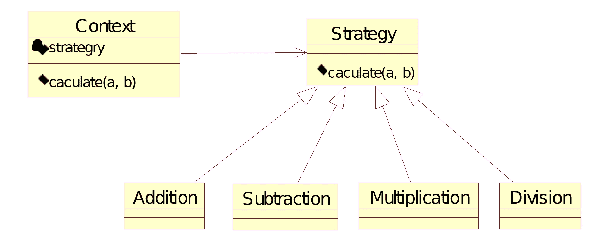

1. 使用记事本创建 `TestStrategy1.html`，并在浏览器中打开。

```javascript
<script type ="text/javascript" >function Addition(){this.caculate = function ( a, b){return a + b;}}function Subtraction(){this.caculate = function ( a, b){return a - b;}}function Multiplication (){this.caculate = function ( a, b){return a * b;}}function Division(){this.caculate = function ( a, b){return a / b;}}function Context( strategy){this.strategy = strategy;this.caculate = function ( a, b){return this.strategy.caculate( a, b);}}var context = new Context( new Addition());var result = context.caculate( 4 , 2 );document.write( result + "<br>" );var context = new Context( new Subtraction());var result = context.caculate( 4 , 2 );document.write( result + "<br>" );var context = new Context( new Multiplication());var result = context.caculate( 4 , 2 );document.write( result + "<br>" );var context = new Context( new Division());var result = context.caculate( 4 , 2 );document.write( result + "<br>" );</script>
```

结果：

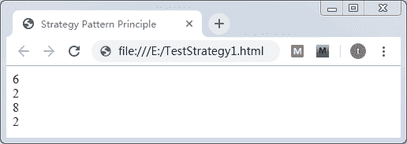

2. 另一种方式：使用记事本创建 `TestStrategy2.html`，并在浏览器中打开。

```javascript
<script type ="text/javascript" >var strategy = {"Addition" : function ( a, b){return a + b;},"Subtraction" : function ( a, b){return a - b;},"Multiplication" : function ( a, b){return a * b;},"Division" : function ( a, b){return a / b;}};var context = function ( key, a, b ){return strategy key;};var result = context( "Addition" , 4 , 2 );document.write( result + "<br>" );var result = context( "Subtraction" , 4 , 2 );document.write( result + "<br>" );var result = context( "Multiplication" , 4 , 2 );document.write( result + "<br>" );var result = context( "Division" , 4 , 2 );document.write( result + "<br>" );</script>
```

## 策略模式案例

### 1. 实际案例：电商选择不同银行支付的不同策略实现


### 2. UML 图

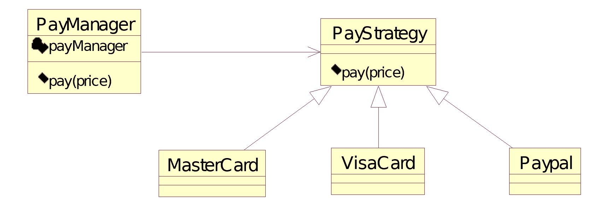

1. 使用记事本创建 `TestStrategyCase1.html`，并在浏览器中打开。

结果：

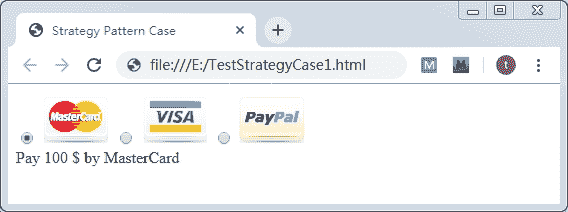

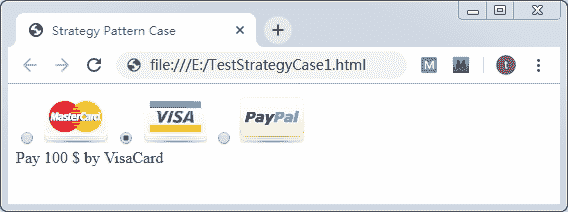

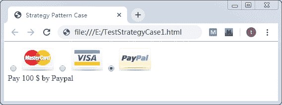

2. 使用记事本创建 `TestStrategyCase2.html`，并在浏览器中打开。

```html
<input type ="radio" name ="card" value ="MasterCard" onclick ="doTestPay(this)" /> <input type ="radio" name ="card" value ="VisaCard" onclick ="doTestPay(this)" /><input type ="radio" name ="card" value ="Paypal" onclick ="doTestPay(this)" /><br><span id ="result" ></span><script type ="text/javascript" >var payStrategy = {"MasterCard" : function ( price){document.getElementById( "result" ). innerHTML = "Pay " + price + " $ by MasterCard" ;},"VisaCard" : function ( price){document.getElementById( "result" ). innerHTML = "Pay " + price + " $ by VisaCard" ;},"Paypal" : function ( price){document.getElementById( "result" ). innerHTML = "Pay " + price + " $ by Paypal" ;}};var payManager = function ( key, price){return payStrategy key;};function doTestPay( obj){payManager( obj.value, 100 );}</script>
```

结果：


## 组合模式原理

组合模式：简单对象和复合对象的树形结构。将对象组合成树形结构以表示“部分-整体”的层次结构。组合模式使得客户端对单个对象和组合对象的使用具有一致性。

### 1. 国家城市树形图

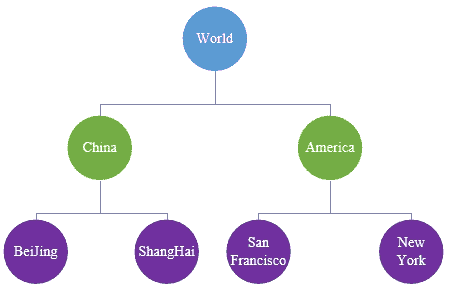

### 2. UML 图

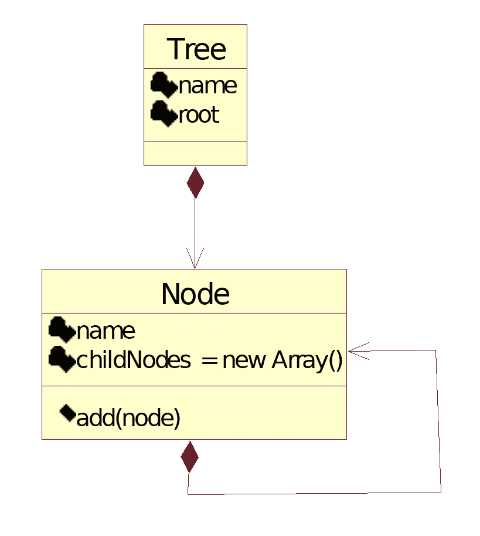

1. 使用记事本创建 `TestComposition.html`，并在浏览器中打开。

## 组合模式案例

1. 下拉菜单。

   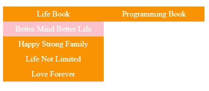

2. UML 图。

   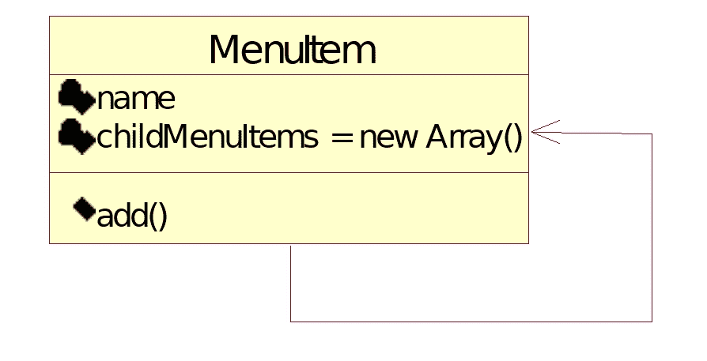

3. 使用记事本创建 `TestCompositionCase.html` 并在浏览器中打开。

   结果：

   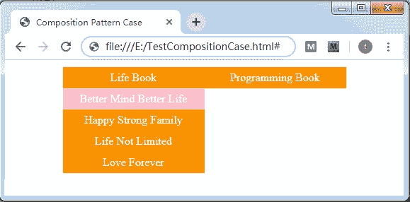

   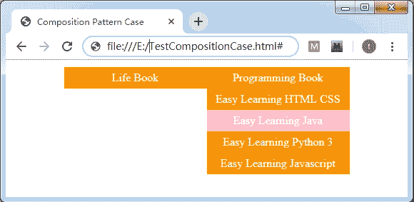

## 单例模式原理

单例模式：一个类只能存在一个实例。确保一个类只有一个实例，并提供一个全局访问点。

1. UML 图。

   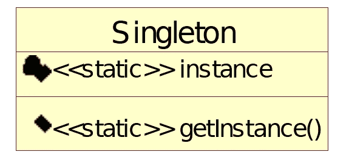

2. 使用记事本创建 `TestSingleton.html` 并在浏览器中打开。

```javascript
<script type="text/javascript">
var Singleton = {
    instance: null,
    getInstance: function() {
        if (Singleton.instance == null) {
            // there is only one instance
            Singleton.instance = {};
        }
        return Singleton.instance;
    }
};
/////////////////////test/////////////////////////
var singleton1 = Singleton.getInstance();
var singleton2 = Singleton.getInstance();
document.write(singleton1 === singleton2);   // true one instance
</script>
```

## 单例模式案例

单例模式：确保一个类只有一个实例，共享全局访问。

1. 点击登录按钮始终显示同一个对话框，避免重复创建。

   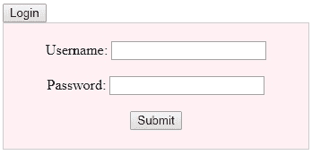

   UML 图：

   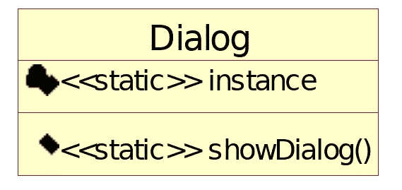

2. 使用记事本创建 `TestSingletonCase.html` 并在浏览器中打开。

```html
<style>
#login{
    width:300px; height: 100px;
    border:1px solid #cccccc; background-color: #fff0f3;
    text-align:center;
    padding: 20px;
}
</style>
<input type="button" value="Login" onclick="doLogin()" />
<script type="text/javascript">
var Dialog = {
    instance: null,
    showDialog: function() {
        if (Dialog.instance == null) {
            var dialogDiv = document.createElement("div");
            dialogDiv.setAttribute("id", "login");
            dialogDiv.innerHTML = "Username: <input type='text' id='username' />";
            dialogDiv.innerHTML += "<br><br>";
            dialogDiv.innerHTML += "Password: <input type='password' id='password' />";
            dialogDiv.innerHTML += "<br><br>";
            dialogDiv.innerHTML += "<input type='button' value='Submit' />";
            document.body.appendChild(dialogDiv);
            Dialog.instance = {};
        }
        return Dialog.instance;
    }
};
function doLogin() {
    Dialog.showDialog(); // Singleton instance always create one dialog
}
</script>
```

结果：

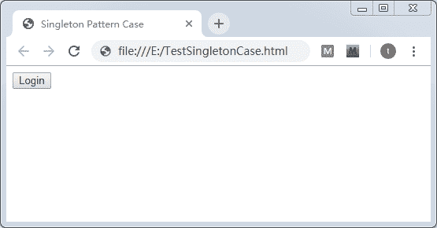

始终点击登录按钮显示同一个对话框。

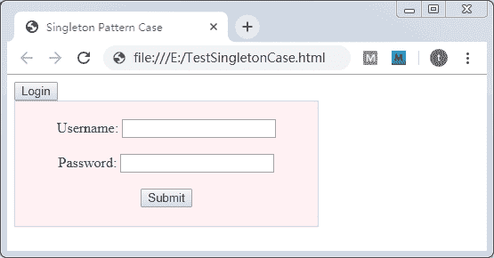

## 模板模式原理

模板模式：将算法的具体步骤延迟到子类中实现。定义一个操作中的算法骨架，将一些步骤延迟到子类中。模板方法使得子类可以在不改变算法结构的情况下重新定义算法的某些步骤。

1. 父类打印 A4 纸，子类还可以设置颜色。

   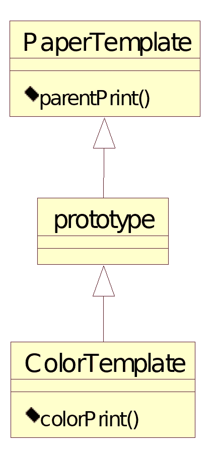

2. 使用记事本创建 `TestTemplate.html` 并在浏览器中打开。

```javascript
<script type="text/javascript">
function PaperTemplate() {
    this.parentPrint = function() {
        document.write("Print A4 Paper<br>");
    }
}
function ColorTemplate() {}
/////////////////////test///////////////////////////////////////////////////////
ColorTemplate.prototype = new PaperTemplate();
ColorTemplate.prototype.colorPrint = function() {
    this.parentPrint();
    document.write("Set the color of A4 paper red<br>");
}
var template = new ColorTemplate();
template.colorPrint();
</script>
```

结果：

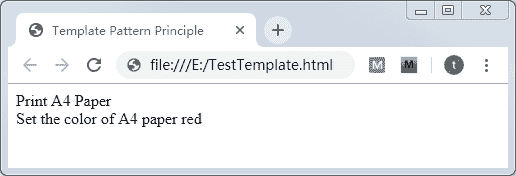

## 模板模式案例

飞机游戏：不同的飞机具有相同的飞机特征，但每架飞机的行为不同。

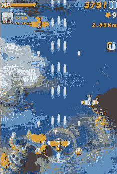

1. UML 图。

   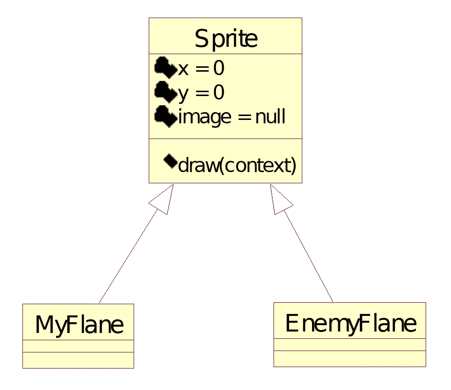

2. 使用记事本创建 `TestTemplateCase.html` 并在浏览器中打开。

   结果：

   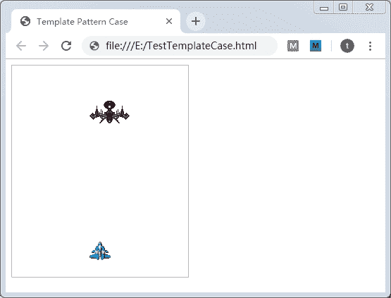

## 工厂模式原理

飞机游戏：通过工厂创建不同的飞机，然后发射不同的子弹。

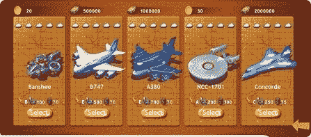

1. UML 图。

   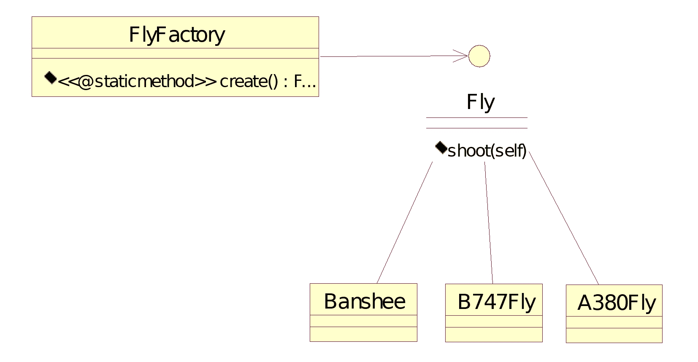

2. 使用记事本创建 `TestFactory.html` 并在浏览器中打开。


```html
<input type="radio" name="fly" value=1 onclick="doCreate(this)" /> Banshee
<input type="radio" name="fly" value=2 onclick="doCreate(this)" /> B747fly
<input type="radio" name="fly" value=3 onclick="doCreate(this)" /> A380fly
<br><br>
<span id="result"></span>
<script type="text/javascript">
function Fly() {
    this.shoot = function() {}
}
function Banshee() {
    this.shoot = function() {
        document.getElementById("result").innerHTML = "Banshee fire the laser";
    }
}
Banshee.prototype = new Fly();
function B747fly() {
    this.shoot = function() {
        document.getElementById("result").innerHTML = "B747 fire the missile";
    }
}
B747fly.prototype = new Fly();
function A380fly() {
    this.shoot = function() {
        document.getElementById("result").innerHTML = "A380 fire the trigeminal shot";
    }
}
A380fly.prototype = new Fly();
var FlyFactory = {
    create: function(type) {
        var fly = null;
        if (type == 1) {
            fly = new Banshee();
        } else if (type == 2) {
            fly = new B747fly();
        } else if (type == 3) {
            fly = new A380fly();
        }
        return fly;
    }
};
/////////////////////test///////////////////////////////////////////////////////
function doCreate(obj) {
    fly = FlyFactory.create(obj.value);
    fly.shoot();
}
</script>
```

结果：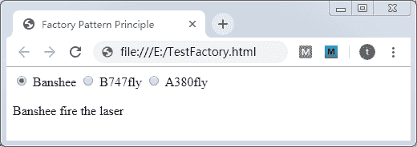 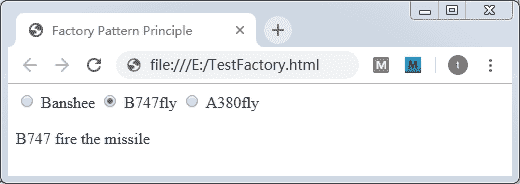

## 工厂模式案例

**绘制图形**：在画布上绘制不同的图形，如矩形、正方形等。

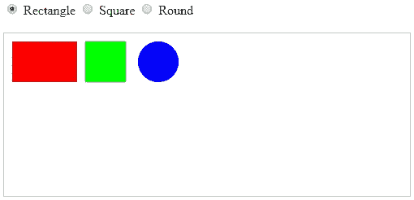

### UML 图

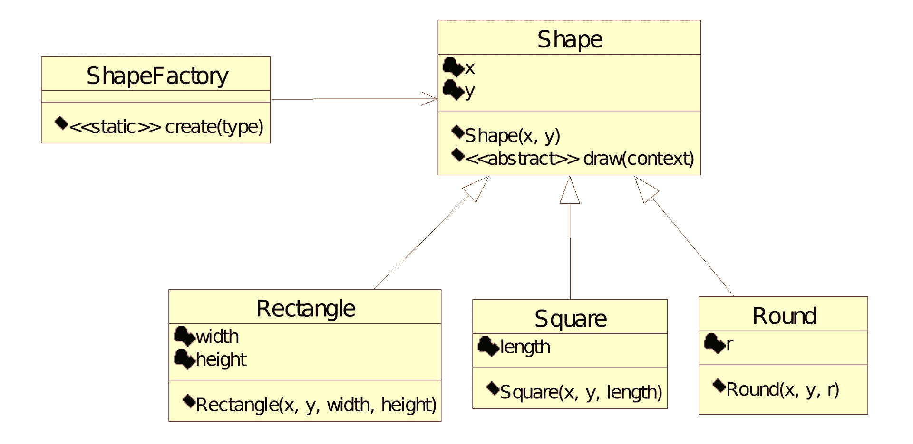

1. 使用记事本创建 `TestFactoryCase.html` 并在浏览器中打开。

结果：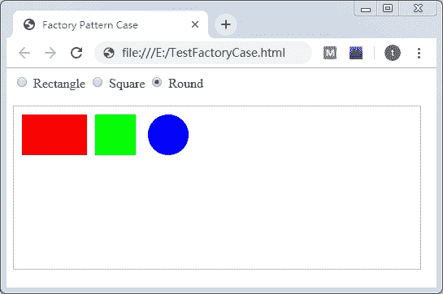

## 建造者模式原理

**建造者模式**：将对象的构建与其表示分离。将一个复杂对象的构建与其表示分离，使得同样的构建过程可以创建不同的表示。

1. 汽车分为三个部分：车头、车身、车轮分别构建。

   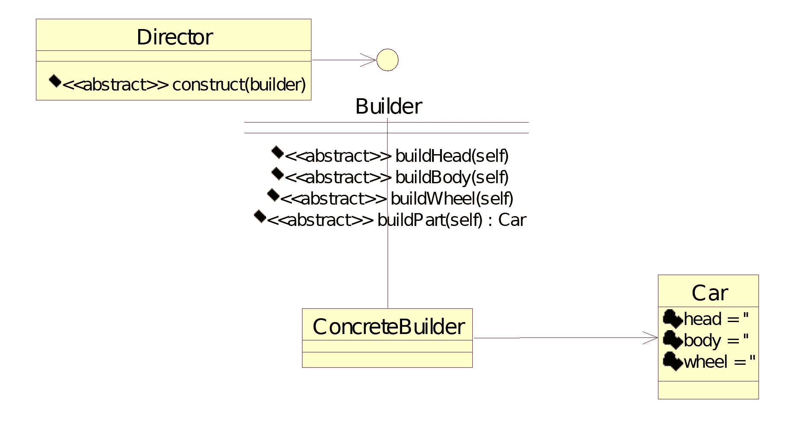

2. 使用记事本创建 `TestBuilder.html` 并在浏览器中打开。

## 建造者模式

### 代码示例

```html
<script type ="text/javascript" >
function Car(){
    this.head = "";
    this.body = "";
    this.wheel = "";
    this.getHead = function (){
        return this.head;
    }
    this.setHead = function (head){
        this.head = head;
    }
    this.getBody = function (){
        return this.body;
    }
    this.setBody = function (body){
        this.body = body;
    }
    this.getWheel = function (){
        return this.wheel;
    }
    this.setWheel = function (wheel){
        this.wheel = wheel;
    }
}
function Builder(){
    this.buildHead = function (){}
    this.buildBody = function (){}
    this.buildWheel = function (){}
    this.buildPart = function (){}
}
function ConcreteBuilder (){
    this.car = new Car();
    this.buildHead = function (){
        this.car.setHead("Car head construction completed");
    }
    this.buildBody = function (){
        this.car.setBody("Car body construction completed");
    }
    this.buildWheel = function (){
        this.car.setWheel("Car Wheel construction completed");
    }
    this.buildPart = function (){
        return this.car;
    }
}
var Director = {
    construct: function (builder){
        builder.buildHead();
        builder.buildBody();
        builder.buildWheel();
        return builder.buildPart();
    }
};
/////////////////////test///////////////////////////////////////////////////////
var car = Director.construct(new ConcreteBuilder());
document.write(car.getHead() + "<br>");
document.write(car.getBody() + "<br>");
document.write(car.getWheel() + "<br>");
</script>
```

### 结果

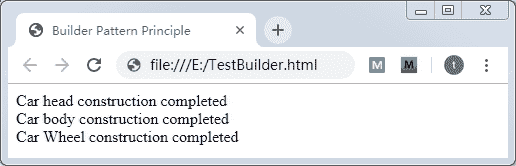

### 案例

建造者模式案例弹出对话框：首先内部创建提示、消息和按钮，最后构建对话框使其弹出。

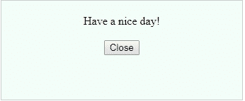

### UML 图

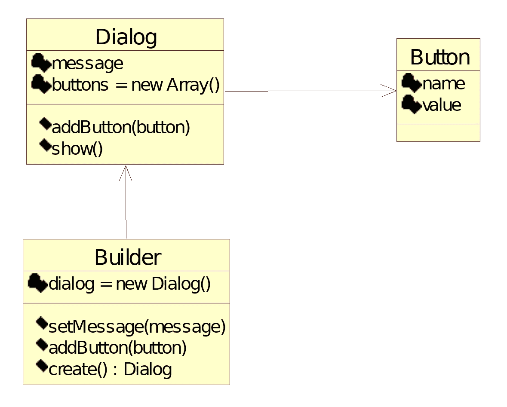

### 测试

1. 使用记事本创建一个 `TestBuilderCase.html` 文件，并在浏览器中打开。

结果：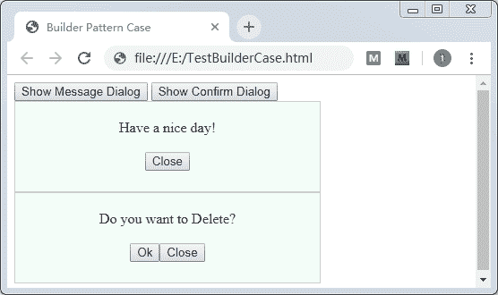

## 适配器模式

### 原理

适配器模式：匹配不同类的接口。将一个类的接口转换成客户期望的另一个接口。适配器使得原本由于接口不兼容而无法一起工作的类能够协同工作。

1. 原始电源为 100 伏特，需要适配为 36 伏特才能工作。

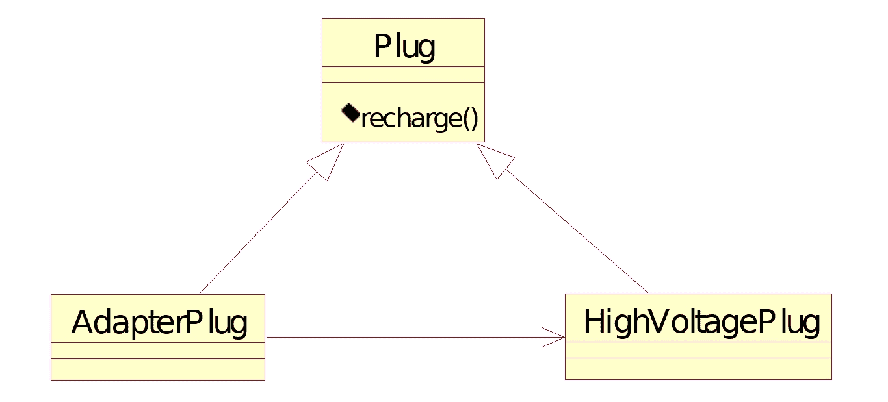

### 测试

1. 使用记事本创建一个 `TestAdapter.html` 文件，并在浏览器中打开。

### 代码示例

```html
<script type ="text/javascript" >
function Plug(){
    this.recharge = function (){}
}
function HighVoltagePlug(){
    Plug.call(this);
    this.recharge = function (){
        return 100; // Power is 100 Voltage
    }
}
function AdapterPlug (){
    Plug.call(this);
    this.recharge = function (){
        var highPlug = new HighVoltagePlug();
        var highVoltage = highPlug.recharge();
        var lowVoltage = highVoltage - 64;
        return lowVoltage;
    }
}
/////////////////////test///////////////////////////////////////////////////////
var plug = new HighVoltagePlug();
document.write(plug.recharge() + " too much voltage <br>");
plug = new AdapterPlug();
document.write("Adapter into " + plug.recharge() + " voltage");
</script>
```

### 结果

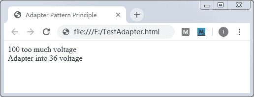

### 案例

适配器模式案例弹出列表菜单和图片列表菜单：数据填充，相同的数据，不同的适配显示不同的视图。

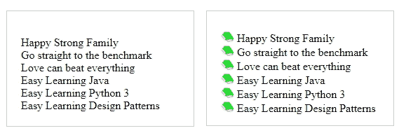

### UML 图

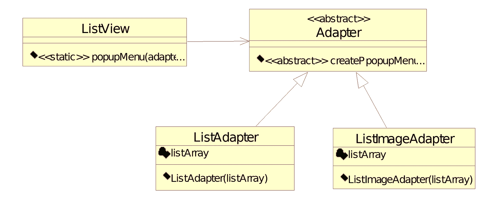

### 测试

1. 使用记事本创建一个 `TestAdapterCase.html` 文件，并在浏览器中打开。

结果：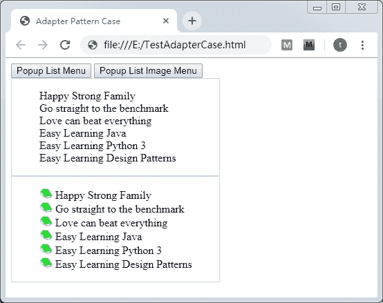

## 外观模式

### 原理

外观模式：一个代表整个子系统的单一类。为系统中的一组接口提供统一的接口。外观定义了一个更高级别的接口，使得子系统更易于使用。

1. 状态提供一致的接口来执行：灯光、音乐和视频。

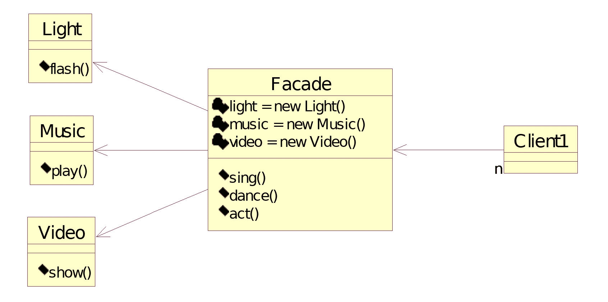

### 测试

1. 使用记事本创建一个 `TestFacade.html` 文件，并在浏览器中打开。

### 代码示例

```html
<script type ="text/javascript" >
function Light(){
    this.flash = function (){
        document.write("Flashing color light<br>");
    }
}
function Music(){
    this.play = function (){
        document.write("Playing classical music<br>");
    }
}
function Video (){
    this.show = function (){
        document.write("Mountain stream video display<br>");
    }
}
function Facade(){
    this.light = new Light();
    this.music = new Music();
    this.video = new Video();
    this.sing = function (){
        document.write("Start singing with<br>");
        this.light.flash();
        this.music.play();
    }
    this.dance = function (){
        document.write("Start dancing with<br>");
        this.light.flash();
        this.music.play();
        this.video.show();
    }
    this.act = function (){
        document.write("Start acting with<br>");
        this.light.flash();
        this.video.show();
    }
}
/////////////////////test///////////////////////////////////////////////////////
var facade = new Facade();
facade.sing();
document.write("<br>------------------------------<br>");
facade.dance();
document.write("<br>------------------------------<br>");
facade.act();
</script>
```

### 结果

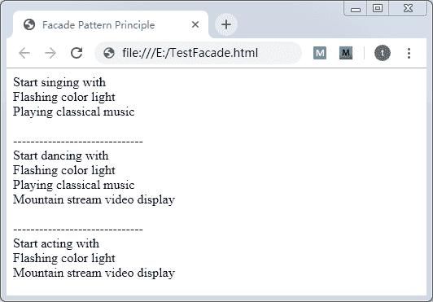

### 案例

外观模式案例：

1. 文本框数字、字符串验证。


### UML 图

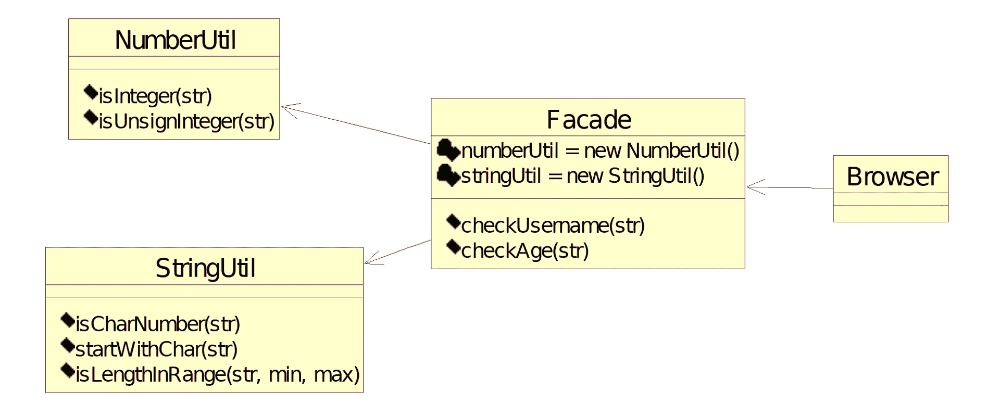

### 测试

1. 使用记事本创建一个 `TestFacadeRegister.html` 文件，并在浏览器中打开。

结果：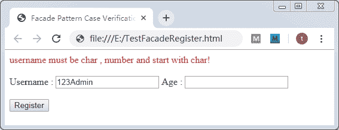 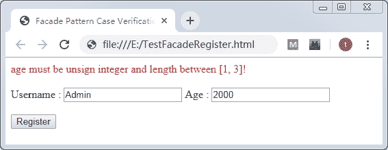 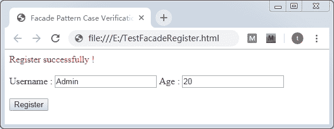

## 装饰器模式

### 原理

装饰器模式：动态地向对象添加职责。动态地给对象附加额外的职责。装饰器为扩展功能提供了一种比子类化更灵活的替代方案。

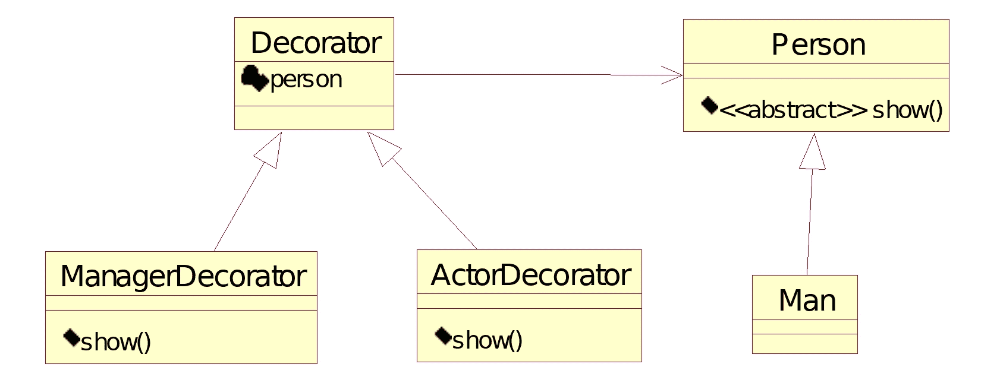

### 测试

1. 使用记事本创建一个 `TestDecorator.html` 文件，并在浏览器中打开。

### 代码示例

```html
<script type ="text/javascript" >
function Person(){
    this.show = function (){}
}
function Man(){
    this.show = function (){
        document.write("I am a man <br>");
    }
}
Man.prototyoe = new Person();
function Decorator(person){
    this.person = person;
}
function ManagerDecorator(person){
    Decorator.call(this, person);
    this.show = function (){
        this.person.show();
        document.write("I am still a manager <br>");
    }
}
function ActorDecorator(person){
    Decorator.call(this, person);
    this.show = function (){
        this.person.show();
        document.write("I am still an international actor. <br>");
    }
}
/////////////////////test///////////////////////////////////////////////////////
var person = new Man();
person.show();
document.write(" <br>------------------------------------ <br>");
person = new ManagerDecorator(person);
person.show();
document.write(" <br>------------------------------------ <br>");
person = new ActorDecorator(person);
person.show();
</script>
```

### 结果

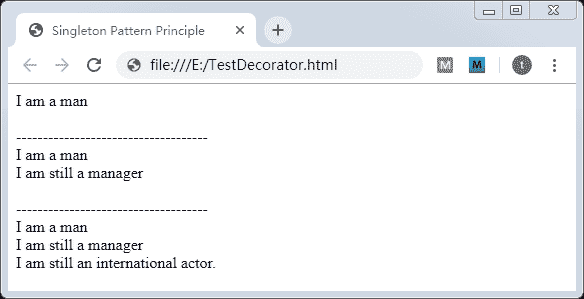

### 案例

装饰器模式案例飞行游戏：在飞机游戏中，飞机可以向上发射红色子弹，或者可以装饰飞机子弹并同时向下发射白色子弹。

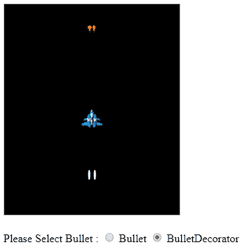

### UML 图

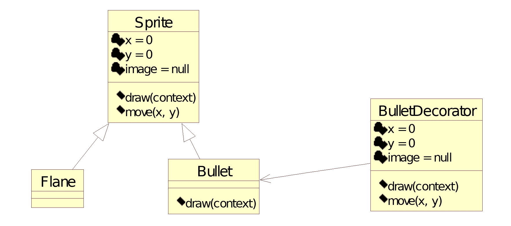

### 测试

1. 使用记事本创建一个 `TestDecoratorCase.html` 文件，并在浏览器中打开。

结果：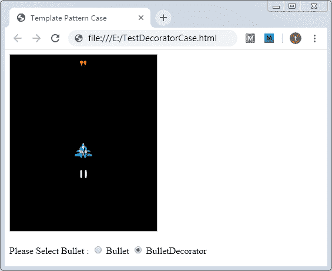

## 浅克隆模式

### 原理

浅克隆只复制基本数据类型。


### 测试

1. 使用记事本创建一个 `TestShallowClone.html` 文件，并在浏览器中打开。

结果：

`shallowClonePerson` 和 `person` 实例指向不同的 `name`、`age`，但指向相同的 `hobby`、`cat` 引用。

## 深克隆模式

### 原理

深克隆模式：可以复制基本数据类型和引用对象。


### 测试

1. 使用记事本创建一个 `TestDeepClone.html` 文件，并在浏览器中打开。

## 克隆模式

### 克隆模式案例


```javascript
<script type ="text/javascript" >
function Cat( name){
    this.name = name;
    this.getName = function (){
        return this.name;
    }
    this.setName = function ( name){
        this.name = name;
    }
}
function Person( name, age, hobby, cat ){
    this.name = name;
    this.age = age;
    this.hobby = hobby;
    this.cat = cat;
    this.getName = function (){
        return this.name;
    }
    this.setName = function ( name){
        this.name = name;
    }
    this.getAge = function (){
        return this.age;
    }
    this.setAge = function ( age){
        this.age = age;
    }
    this.getHobby = function (){
        return this.hobby;
    }
    this.setHobby = function ( hobby){
        this.hobby = hobby;
    }
    this.getCat = function (){
        return this.cat;
    }
    this.setCat = function ( cat){
        this.cat = cat;
    }
}
//deep clone
function deepClone( obj, newObj){
    var newObj = newObj||{};
    for ( var i in obj){
        if ( typeof obj[ i]=== 'object' ){
            newObj[ i] = ( obj[ i]. constructor === Array) ? [] : {};
            deepClone( obj[ i], newObj[ i]);
        } else {
            newObj[ i] = obj[ i];
        }
    }
    return newObj;
}
/////////////////////test///////////////////////////////////////////////////////
var person1 = new Person();
person1.setName( "David" );
person1.setAge( 20 );
person1.setHobby( new Array( "BasketBall" , "Swimming" ));
person1.setCat( new Cat( "BlackCat" ));
document.write( "------ Original Person : -------- <br>" );
document.write( person1.getName() + "<br>" );
document.write( person1.getAge() + "<br>" );
document.write( person1.getHobby() + "<br>" );
document.write( person1.getCat(). getName() + "<br>" );
var deepClonePerson = deepClone( person1);
document.write( "-------- Deep Clone Person : -------- <br>" );
document.write( deepClonePerson.getName() + "<br>" );
document.write( deepClonePerson.getAge() + "<br>" );
document.write( deepClonePerson.getHobby() + "<br>" );
document.write( deepClonePerson.getCat(). getName() + "<br>" );
person1.setName( "Grace" );
person1.setAge( 30 );
person1.getHobby(). push( "Reading" );
person1.getCat(). setName( "WhiteCat" );
document.write( "--------- Original Changed Person : ------- <br>" );
document.write( person1.getName() + "<br>" );
document.write( person1.getAge() + "<br>" );
document.write( person1.getHobby() + "<br>" );
document.write( person1.getCat(). getName() + "<br>" );
document.write( "------ Deep Clone Person : -------- <br>" );
document.write( deepClonePerson.getName() + "<br>" );
document.write( deepClonePerson.getAge() + "<br>" );
document.write( deepClonePerson.getHobby() + "<br>" );
document.write( deepClonePerson.getCat(). getName() + "<br>" );
</script>
```

结果：

`deepClonePerson` 和 `person` 实例指向不同的 `name`、`age`、`hobby`、`cat`。

## 克隆添加联系人

 点击添加联系人按钮 

1. 用记事本创建一个 `TestCloneCase.html` 文件，并在浏览器中打开。

```html
<style>
#contact{
    border:1px solid #dddddd;
    background-color:eeeeee;
    width:550px;
    font-size:16px;
}
#contact input{
    width: 120px;
}
</style>
<input type ="button" value ="Add Contact" onclick ="doAddContact()" />
<div id ="contact_list" >
    <div id ="contact" >
        Name: <input type ="text" /> Telephone: <input type ="text" /> Email: <input type ="text" />
    </div>
</div>
<script type ="text/javascript" >
function doAddContact (){
    var contactObj = document.getElementById( "contact" );
    newContactObj = contactObj.cloneNode( true );
    document.getElementById( "contact_list" ). appendChild( newContactObj);
}
</script>
```

结果： 点击添加联系人按钮 

## 桥接模式

### 桥接模式原理

桥接模式：将对象的接口与其实现分离。将抽象部分与实现部分解耦，使它们可以独立变化。

1. 不同的人可以穿不同的衣服。


2. 用记事本创建一个 `TestBridge.html` 文件，并在浏览器中打开。

```javascript
<script type ="text/javascript" >
function Person( name){
    this.name = name;
    this.clothing = null ;
    this.getName = function (){
        return this.name;
    }
    this.setName = function ( name){
        this.name = name;
    }
    this.getClothing = function (){
        return this.clothing;
    }
    this.setClothing = function ( clothing){
        this.clothing = clothing;
    }
    this.dress = function (){}
}
function Man( name){
    Person.call( this , name);
    this.dress = function (){
        document.write( this.getName() + " wear " + this.clothing.getName() + "<br>" );
    }
}
function Lady( name){
    Person.call( this , name);
    this.dress = function (){
        document.write( this.getName() + " wear " + this.clothing.getName() + "<br>" );
    }
}
function Clothing( name){
    this.name = name;
    this.person = null ;
    this.getName = function (){
        return this.name;
    }
    this.setName = function ( name){
        this.name = name;
    }
    this.getPerson = function (){
        return this.person;
    }
    this.setPerson = function ( person){
        this.person = person;
    }
}
function Jacket( name){
    Clothing.call( this , name);
}
function Trouser( name){
    Clothing.call( this , name);
}
/////////////////////test///////////////////////////////////////////////////////
var man = new Man( "Man" );
var lady = new Lady( "Lady" );
var jacket = new Jacket( "Jacket" );
var trouser = new Trouser( "Trouser" );
man.setClothing( jacket); // Man wear Jacket
man.dress();
man.setClothing( trouser); // Man wear Trouser
man.dress();
lady.setClothing( jacket); // Lady wear Jacket
lady.dress();
lady.setClothing( trouser); // Lady wear Trouser
lady.dress();
</script>
```

结果：

### 桥接模式案例

桥接模式：将抽象部分与实现部分分离，使它们都可以独立变化。

1. 不同的飞机发射不同的子弹。


2. UML 图。


3. 用记事本创建一个 `TestBridgeCase.html` 文件，并在浏览器中打开。

结果： 

## 享元模式

### 享元模式原理

享元模式：一种用于高效共享的细粒度实例。使用共享来高效地支持大量细粒度对象。享元是一个共享对象，可以同时在多个上下文中使用。享元在每个上下文中都充当独立对象——它与非共享对象的实例无法区分。

某些数据可以存储在缓存中。客户端可以直接从缓存获取数据，提高查询速度。


1. 用记事本创建一个 `TestFlyWeight.html` 文件，并在浏览器中打开。

```javascript
<script type ="text/javascript" >
function Person( name){
    this.name = name;
    this.getName = function (){
        return this.name;
    }
    this.setName = function ( name){
        this.name = name;
    }
}
var Cache = {
    map : {},
    get: function ( key ){
        return Cache.map[ key];
    },
    put: function ( key, value){
        Cache.map[ key] = value;
    }
};
/////////////////////test/////////////////////////////////////////////////////////
// Basic data types are stored in the cache
Cache.put( "1" , 1000 );
// String are stored in the cache
Cache.put( "name" , "Grace" );
// Object are stored in the cache
Cache.put( "person" , new Person( "Sala" ));
// Get data from the cache
document.write( "int : " + Cache.get( "1" ) + "<br>" );
document.write( "String : " + Cache.get( "name" ) + "<br>" );
person = Cache.get( "person" );
document.write( "Person Object : " + person.getName() + "<br>" );
</script>
```

结果：

### 享元模式案例

将购物车数据缓存到 `localStorage`：


1. 用记事本创建一个 `TestFlyWeightCase.html` 文件，并在浏览器中打开。


```html
<style>
  #product_table {
    border: 1px solid #dddddd;
    background-color: #eeeeee;
    width: 550px;
    font-size: 16px;
  }

  #product input {
    width: 120px;
  }
</style>

<table id="product_table">
  <tr>
    <td>Product</td>
    <td>Price</td>
    <td>Quantity</td>
  </tr>
</table>

<script type="text/javascript">
  var cartJson = null;

  if (localStorage.getItem("cart") == null) {
    // for example this json data from server
    cartJson = [
      {
        "product": "Easy Learning Javascript",
        "price": 3.99,
        "quantity": 1
      },
      {
        "product": "Easy Learning Java",
        "price": 3.99,
        "quantity": 1
      },
      {
        "product": "Easy Learning Python 3",
        "price": 3.99,
        "quantity": 1
      }
    ];

    localStorage.setItem("cart", JSON.stringify(cartJson));
    // localStorage is cache
  } else {
    cartJson = JSON.parse(localStorage.getItem("cart"));
  }

  /////////////////////test///////////////////////////////////////////////////////

  var product_table = document.getElementById("product_table");

  for (var i = 0; i < cartJson.length; i++) {
    var item = cartJson[i];
    var product_tr = product_table.insertRow();
    var product = product_tr.insertCell();
    var price = product_tr.insertCell();
    var quantity = product_tr.insertCell();

    product.innerHTML = item.product;
    price.innerHTML = item.price;
    quantity.innerHTML = item.quantity;
  }
</script>
```

结果：

## 责任链模式原理

责任链模式：一种在对象链之间传递请求的方式。通过给多个对象处理请求的机会，避免请求发送者与接收者之间的耦合。将接收对象链接起来，并沿着链传递请求，直到某个对象处理它。

1. 离职申请 -> 财务审核 -> 经理审核 -> 批准


2. 用记事本创建一个 `TestChain.html` 并在浏览器中打开。

```html
<script type="text/javascript">
  function Handler() {
    this.handleRequest = function (request) {};
  }

  function FrontHandler(nextHandler) {
    Handler.call(this);
    this.nextHandler = nextHandler;

    this.handleRequest = function (request) {
      if ("ResignationApply" == request) {
        document.write("Resignation Apply -> ");

        if (this.nextHandler != null) {
          this.nextHandler.handleRequest("FinancialReview");
        }
      }
    };
  }

  function FinanceHandler(nextHandler) {
    Handler.call(this);
    this.nextHandler = nextHandler;

    this.handleRequest = function (request) {
      if ("FinancialReview" == request) {
        document.write("Financial Review Completed -> ");

        if (this.nextHandler != null) {
          this.nextHandler.handleRequest("ManagerReview");
        }
      }
    };
  }

  function ManagerHandler(nextHandler) {
    Handler.call(this);
    this.nextHandler = nextHandler;

    this.handleRequest = function (request) {
      if ("ManagerReview" == request) {
        document.write("Manager Review Completed -> ");

        if (this.nextHandler != null) {
          this.nextHandler.handleRequest("Approval");
        }
      }
    };
  }

  function HrHandler(nextHandler) {
    Handler.call(this);
    this.nextHandler = nextHandler;

    this.handleRequest = function (request) {
      if ("Approval" == request) {
        document.write("HR Approval -> ");

        if (this.nextHandler != null) {
          this.nextHandler.handleRequest("Approval Completed");
        }
      }
    };
  }

  var hrHandler = new HrHandler(null);
  var managerHandler = new ManagerHandler(hrHandler);
  var financeHandler = new FinanceHandler(managerHandler);
  var frontHandler = new FrontHandler(financeHandler);

  frontHandler.handleRequest("ResignationApply");
</script>
</body>
</html>
```

结果：

## 责任链模式案例

JavaScript DOM 事件冒泡机制就是责任链模式：


当点击 `level_3_box` div 时，事件总是向上传递到 `body`。


1. 用记事本创建一个 `TestChainCase.html` 并在浏览器中打开。

```html
<style>
  #level_1_box {
    border: 1px solid red;
    background-color: red;
    width: 300px;
    height: 300px;
  }

  #level_2_box {
    border: 1px solid green;
    background-color: green;
    width: 200px;
    height: 200px;
  }

  #level_3_box {
    border: 1px solid blue;
    background-color: blue;
    width: 100px;
    height: 100px;
    color: white;
  }
</style>

<body id="body">
  <div id="level_1_box">
    <div id="level_2_box">
      <div id="level_3_box">level_3_box</div>
    </div>
  </div>
  <br>
  <span id="result"></span>
</body>

<script type="text/javascript">
  window.onload = function () {
    document.getElementById("body").addEventListener("click", eventHandler);
    document.getElementById("level_1_box").addEventListener("click", eventHandler);
    document.getElementById("level_2_box").addEventListener("click", eventHandler);
    document.getElementById("level_3_box").addEventListener("click", eventHandler);
  };

  function eventHandler(event) {
    document.getElementById("result").innerHTML +=
      event.currentTarget.id + " -> ";
  }
</script>
```

结果：

## 命令模式原理

命令模式：将命令请求封装为一个对象。将请求封装为对象，从而让你可以用不同的请求对客户端进行参数化、对请求进行排队或记录日志，并支持可撤销的操作。

1. 按钮事件，鼠标点击“确定”或“取消”按钮。

### UML 图


2. 用记事本创建一个 `TestCommand.html` 并在浏览器中打开。

```html
<script type="text/javascript">
  function Mouse() {
    this.click = function (button) {
      button.onClick();
    };
  }

  function Button(name) {
    this.name = name;
    this.command = null;

    this.addEventLisnener = function (command) {
      this.command = command;
    };

    this.onClick = function () {
      this.command();
    };
  }

  var okCommand = function () {
    document.write("OK button is clicked <br>");
  };

  var cancelCommand = function () {
    document.write("Cancel button is clicked <br>");
  };

  var okButton = new Button("Ok");
  okButton.addEventLisnener(okCommand);

  var cancelButton = new Button("Cancel");
  cancelButton.addEventLisnener(cancelCommand);

  var mouse = new Mouse();

  mouse.click(okButton);
  // Mouse click OK button

  mouse.click(cancelButton);
  // Mouse click Cancel button
</script>
```

结果：

## 命令模式案例

鼠标点击“关闭”按钮关闭 div 菜单。


1. 用记事本创建一个 `TestCommandCase.html` 并在浏览器中打开。

```html
<style>
  #menu {
    border: 1px solid #dddddd;
    background-color: #eeeeee;
    width: 400px;
    font-size: 16px;
  }
</style>

<div id="menu">
  <ul>
    <li>Easy Learning Java</li>
    <li>Easy Learning Javascript</li>
    <li>Easy Learning HTML CSS</li>
    <li>Easy Learning Python 3</li>
    <li>Easy Learning Design Patterns</li>
  </ul>

  <center>
    <input type="button" id="closeButton" value="Close">
  </center>
</div>

<script type="text/javascript">
  document
    .getElementById("closeButton")
    .addEventListener("click", closeCommand);

  function closeCommand(event) {
    document.getElementById("menu").style.display = "none";
  }
</script>
```

结果：

## 迭代器模式原理

迭代器模式：顺序访问集合中的元素。提供一种方法顺序访问聚合对象中的元素，而不暴露其底层表示。

1. 在 JavaScript 中实现迭代器。


2. UML 图。


3. 用记事本创建一个 `TestIterator.html` 并在浏览器中打开。

```html
<script type="text/javascript">
  function Iterator(list) {
    this.index = 0;
    this.list = list;

    this.hasNext = function () {
      return this.index < this.list.length;
    };

    this.next = function () {
      var element = null;

      if (this.index < this.list.length) {
        element = this.list[this.index];
        this.index = this.index + 1;
      }

      return element;
    };
  }

  function List() {
    this.size = 0;
    this.element = new Array();

    this.add = function (element) {
      this.element.push(element);
      this.size = this.size + 1;
    };

    this.get = function (index) {
      return this.element[index];
    };

    this.size = function () {
      return this.size;
    };

    this.iterator = function () {
      return new Iterator(this.element);
    };
  }

  /////////////////////test///////////////////////////////////////////////////////

  var list = new List();

  list.add("Berkeley University");
  list.add("Market Street");
  list.add("Polo Alto");
  list.add("Cuptino");

  var iterator = list.iterator();

  while (iterator.hasNext()) {
    obj = iterator.next();
    document.write(obj + " -> ");
  }
</script>
```

# 设计模式示例

## 迭代器模式案例

使用 JavaScript 的 `forEach` 输出新闻列表。


1. 用记事本创建一个 `TestIteratorCase.html` 文件，并在浏览器中打开它。


```html
<style>
#book_table {
  border: 1px solid #dddddd;
  background-color: f7fefe;
  width: 550px;
  font-size: 16px;
}
</style>
<table id="book_table">
  <tr><td> title </td><td> Date </td></tr>
</table>
<script type="text/javascript">
//for example this data from server
var bookArray = new Array(
  { "title": "Easy Learning Javascript", "date": "09/09/2019" },
  { "title": "Easy Learning Python 3", "date": "07/07/2019" },
  { "title": "Easy Learning Java", "date": "06/06/2019" }
);
var book_table = document.getElementById("book_table");
bookArray.forEach(function(item) {
  var book_tr = book_table.insertRow();
  var title = book_tr.insertCell();
  var date = book_tr.insertCell();
  title.innerHTML = item.title;
  date.innerHTML = item.date;
});
</script>
```

结果：

## 中介者模式原理

**中介者模式**：定义类之间的简化通信。定义一个对象，该对象封装了一组对象如何交互。中介者通过使对象不显式地相互引用来促进松散耦合，并允许你独立地改变它们的交互。

1. 客户想通过中介联系房东租房


2. UML 图


3. 用记事本创建一个`TestMediator.html`文件，并在浏览器中打开它。

```html
<script type="text/javascript">
function HouseOwner() {
  this.action = function() {}
}
function HouseRent() {
  HouseOwner.call(this);
  this.action = function() {
    document.write("Client come to rent a house <br>");
  }
}
function HouseSale() {
  HouseOwner.call(this);
  this.action = function() {
    document.write("Client come to need to sell <br>");
  }
}
function Mediator() {
  this.owner1 = new HouseRent();
  this.owner2 = new HouseSale();
  this.handle = function(content) {
    if (content == "rent") {
      this.owner1.action();
    }
    if (content == "sale") {
      this.owner2.action();
    }
  }
}
var mediator = new Mediator();
// mediator help adjust the renting and selling between the client and the houseowner
mediator.handle("rent");
mediator.handle("sale");
</script>
```

结果：

## 中介者模式案例

我们有 3 个用户，通过向聊天室（中介者）注册来加入聊天。每个用户由一个`User`对象表示。用户之间发送消息，聊天室负责路由。


1. UML 图


2. 用记事本创建一个`TestMediatorCase.html`文件，并在浏览器中打开它。

结果：

## 备忘录模式原理

**备忘录模式**：捕获并恢复对象的内部状态。在不破坏封装的前提下，捕获并外部化对象的内部状态，以便以后可以将对象恢复到此状态。例如文本编辑器的撤销、重做、历史恢复等。

UML 图：


1. 用记事本创建一个`TestMemento.html`文件，并在浏览器中打开它。

```html
<script type="text/javascript">
function Memento(state) {
  this.state = state;
  this.getState = function() {
    return this.state;
  }
  this.setState = function(state) {
    this.state = state;
  }
}
function TextEdit() {
  this.mementos = [];
  this.index = 0;
  this.push = function(memento) {
    this.mementos.push(memento);
    this.index += 1;
  }
  this.forward = function() {
    memento = this.mementos[this.index];
    this.index += 1;
    return memento;
  }
  this.back = function() {
    this.index -= 1;
    memento = this.mementos[this.index];
    return memento;
  }
}
function Originator() {
  this.state = '';
  this.getState = function() {
    return this.state;
  }
  this.setState = function(state) {
    this.state = state;
  }
  this.createMemento = function() {
    return new Memento(this.state);
  }
  this.setMemento = function(memento) {
    this.state = memento.getState();
  }
  this.show = function() {
    document.write(this.state);
  }
}
/////////////////////test///////////////////////////////////////////////////////
var textEdit = new TextEdit();
// Enter text in textEdit, save while saving
var originator = new Originator();
originator.setState("Move you in the direction of your dream. <br>");
textEdit.push(originator.createMemento());
originator.setState("Ways to start your day positively. <br>");
textEdit.push(originator.createMemento());
originator.setState("Love can change the world. <br>");
originator.show();
// Undo  redo   Recovery history
originator.setMemento(textEdit.back());
originator.show();
originator.setMemento(textEdit.back());
originator.show();
document.write("<br>------------------------------ <br>");
originator.setMemento(textEdit.forward());
originator.show();
originator.setMemento(textEdit.forward());
originator.show();
</script>
```

结果：

## 备忘录模式案例

`HtmlEdit`的撤销、重做、历史恢复。


UML 图：


1. 用记事本创建一个`TestMementoCase.html`文件，并在浏览器中打开它。

结果：

点击撤销按钮：


## 观察者模式原理

**观察者模式**：一种向多个类通知变化的方式。定义对象之间的一对多依赖关系，这样当一个对象改变状态时，其所有依赖者都会自动收到通知并更新。

1. 在股票市场中，股票数据随时变化。卖家和买家可以随时看到变化。


2. 用记事本创建一个`TestObserver.html`文件，并在浏览器中打开它。

```html
<script type="text/javascript">
function Observable() {
  this.observerList = [];
  this.notifyObservers = function() {
    this.observerList.forEach(function(observer) {
      observer.update();
    });
  }
  this.addObserver = function(observer) {
    this.observerList.push(observer);
  }
}
function StockData(price) {
  Observable.call(this);
  this.price = price;
  this.getPrice = function() {
    return this.price;
  }
  this.setPrice = function(price) {
    this.price = price;
    this.notifyObservers();
  }
}
function Observer(observable) {
  this.observable = observable;
  this.observable.addObserver(this);
  this.update = function(observable) {}
}
function Buyer(observable) {
  Observer.call(this, observable);
  this.update = function(observable) {
    document.write("Buyer Price :" + this.observable.getPrice() + "<br>");
  }
}
function Seller(observable) {
  Observer.call(this, observable);
  this.update = function(observable) {
    document.write("Seller Price :" + this.observable.getPrice() + "<br>");
  }
}
/////////////////////test///////////////////////////////////////////////////////
var data = new StockData(16.9);
var buyer = new Buyer(data);
var seller = new Seller(data);
data.setPrice(18.9);
document.write("<br>-------------------------<br>");
data.setPrice(12.9);
</script>
```

结果：

## 观察者模式案例

画布绘制各种形状、直方图和饼图，选择颜色后自动更改填充颜色。


1. UML 图


2. 用记事本创建一个`TestObserverCase.html`文件，并在浏览器中打开它。

结果： 

## 访问者模式原理

**访问者模式**：在不改变类的情况下定义新的操作。表示要对对象结构的元素执行的操作。访问者允许你在不改变所操作元素类的情况下定义新操作。

1. 男人可以成功  
   女人可以成功  
   男人恋爱了  
   女人恋爱了


2. 用记事本创建一个`TestVisitor.html`文件，并在浏览器中打开它。

结果：

## 访问者模式案例

JavaScript 的拖放功能类似于访问者模式。


1. 用记事本创建一个`TestVisitorCase.html`文件，并在浏览器中打开它。

```html
<style>
#accept {
  width: 350px;
  height: 150px;
  border: 1px solid #cccccc;
  background-color: #fff0f3;
  text-align: left;
  padding: 20px;
}
#drag1 {
  width: 300px;
  height: 100px;
  text-align: left;
}
</style>
<div id="accept" ondrop="drop(event)" ondragover="allowDrop(event)"></div>
<div id="visitor" draggable="true" ondragstart="drag(event)">
  <ul>
    <li>Easy Learning Javascript</li>
    <li>Easy Learning Python 3</li>
    <li>Easy Learning Java</li>
    <li>Easy Learning HTML CSS</li>
  </ul>
</div>
<script type="text/javascript">
function allowDrop(event) {
  event.preventDefault();
}
function drag(event) {
  event.dataTransfer.setData("visitor_id", event.target.id);
}
function drop(event) {
  event.preventDefault();
  var visitor_id = event.dataTransfer.getData("visitor_id");
  event.target.appendChild(document.getElementById(visitor_id));
}
</script>
```

结果：

将`ul`列表拖拽到`div`框中：


## 状态模式原理

状态模式：当对象的状态改变时，改变其行为。允许对象在内部状态改变时改变其行为。该对象看起来像是改变了它的类。


1. 使用记事本创建一个`TestState.html`文件，并在浏览器中打开它。


```html
<script type="text/javascript">
function Flow() {
    this.action = function () {}
}

function ApplyFlow() {
    Flow.call(this);
    this.action = function () {
        document.write("Apply -> ");
    }
}

function VerfiyFlow() {
    Flow.call(this);
    this.action = function () {
        document.write("Verfiy -> ");
    }
}

function ApproveFlow() {
    Flow.call(this);
    this.action = function () {
        document.write("Approve");
    }
}

function Context() {
    this.flow = null;
    this.setFlow = function (flow) {
        this.flow = flow;
    }
    this.process = function () {
        this.flow.action();
    }
}

/////////////////////test///////////////////////////////////////////////////////

var context = new Context();
context.setFlow(new ApplyFlow());
context.process();
context.setFlow(new VerfiyFlow());
context.process();
context.setFlow(new ApproveFlow());
context.process();
</script>
```

结果：

### 状态模式案例

新闻发布管理有 3 种状态：查看、编辑、审核。每个状态下只显示对应的操作按钮。


UML 图


1. 使用记事本创建一个 `TestState.html` 文件，并在浏览器中打开它。

```html
<style>
#news_table {
    border: 1px solid #dddddd;
    background-color: #eeeeee;
    width: 550px;
    font-size: 16px;
}

#title_tool {
    background-color: #dddddd;
}
</style>

<table id="news_table">
    <tr id="title_tool">
        <td>title</td>
        <td>Date</td>
        <td>State</td>
        <td>Action</td>
    </tr>
</table>

<script type="text/javascript">
function Flow() {
    this.action = function () {}
}

function ViewFlow() {
    Flow.call(this);
    this.action = function () {
        return "";
    }
}

function EditFlow() {
    Flow.call(this);
    this.action = function () {
        return "<input type='button' value='Update' />";
    }
}

function VerifyFlow() {
    Flow.call(this);
    this.action = function () {
        return "<input type='button' value='Update' /> <input type='button' value='Delete' />";
    }
}

function Context() {
    this.flow = null;
    this.setFlow = function (flow) {
        this.flow = flow;
    }
    this.process = function () {
        return this.flow.action();
    }
}

var newsArray = new Array(
    {
        "title": "Happy Labor Day",
        "date": "05/01/2019",
        "state": "view"
    },
    {
        "title": "New book has been released",
        "date": "07/07/2019",
        "state": "edit"
    },
    {
        "title": "Merry Christmas",
        "date": "12/25/2019",
        "state": "verify"
    }
);

newsArray.forEach(function (item) {
    var news_tr = news_table.insertRow();
    var title = news_tr.insertCell();
    var date = news_tr.insertCell();
    var state = news_tr.insertCell();
    var action = news_tr.insertCell();

    title.innerHTML = item.title;
    date.innerHTML = item.date;
    state.innerHTML = item.state;

    var context = new Context();

    if (item.state == "view") {
        context.setFlow(new ViewFlow());
    } else if (item.state == "edit") {
        context.setFlow(new EditFlow());
    } else if (item.state == "verify") {
        context.setFlow(new VerifyFlow());
    }

    action.innerHTML = context.process();
});
</script>
```

结果：

## 代理模式原理

代理模式：一个代表另一个对象的对象。为另一个对象提供一个代理或占位符，以控制对其的访问。

1. 代理注册


2. 使用记事本创建一个 `TestProxy.html` 文件，并在浏览器中打开它。

```html
<script type="text/javascript">
var Target = {
    doSomething: function () {
        document.write("Agency registration company");
    }
}

function Proxy() {
    this.call = function (target, method) {
        document.write("<br> before <br>");
        result = target[method]();
        document.write("<br> after  <br>");
        return result;
    }
}

var proxy = new Proxy();
proxy.call(Target, "doSomething");
</script>
```

结果：

### 代理模式案例

当加载大图时，通过代理预加载默认的小图标，等待大图加载完成后立即显示大图。


UML 图


1. 使用记事本创建一个 `TestProxyCase.html` 文件，并在浏览器中打开它。

```html
<div id="image"></div>

<script type="text/javascript">
var Target = {
    loadImage: function (loadimg, imageSrc) {
        var img = document.createElement("img");
        img.src = imageSrc;
        img.onload = function () {
            // Once the image is loaded, it will be displayed immediately
            loadimg.src = img.src;
        }
    }
}

function Proxy() {
    this.call = function (target, method, imageSrc) {
        // preload image
        var img = document.createElement("img");
        img.src = "images/loading.gif";
        document.getElementById("image").appendChild(img);
        result = target method;
        return result;
    }
}

var proxy = new Proxy();
proxy.call(Target, "loadImage", "images/javascript.jpg");
</script>
```

如果您喜欢这本书并从中受益，我希望听到您的反馈，并希望您能花点时间在亚马逊上写一篇评论。您的反馈和支持将帮助我们在未来大幅改进，使这本书变得更好。

您现在可以点击此链接：

[`www.amazon.com/review/create-review?&asin=B07SCJMWV8`](http://www.amazon.com/review/create-review?&asin=B07SCJMWV8)

不同国家的评论只需修改链接中的亚马逊域名：

- `www.amazon.co.uk`
- `www.amazon.de`
- `www.amazon.fr`
- `www.amazon.es`
- `www.amazon.it`
- `www.amazon.ca`
- `www.amazon.nl`
- `www.amazon.in`
- `www.amazon.co.jp`
- `www.amazon.com.br`
- `www.amazon.com.mx`
- `www.amazon.com.au`

祝您未来一切顺利，取得成功！
