# HTML CSS JavaScript 轻松学习：循序渐进快速学习指南


# 第一个网页

HTML 是网页上用于格式化显示的一系列标签。

1. 使用记事本或其他编辑器创建一个 `FirstWebPage.html` 文件，并在浏览器中打开它以查看网页

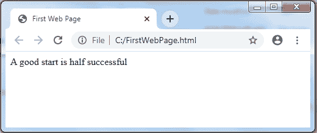

`<html>`: 标签告诉浏览器这是一个 HTML 文档。  
`<title>`: 标签定义文档的标题。  
`<body>`: 标签定义文档的主体。

```
<! DOCTYPE HTML>
<html>
<head>
<title> First Web Page </title>
</head>
<body>
A good start is half successful
</body>
</html>
```

## `<div>` CSS 盒子

1. 创建一个 `Box.html` 文件，并在浏览器中打开它以查看网页

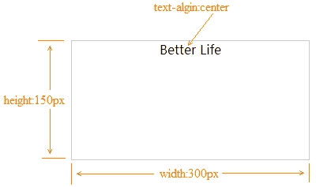

`<div>`: HTML 标签定义 HTML 文档中的一个分区或节。  
`<style>`: 设置 HTML 元素的样式。  
`.class 选择器`: CSS 选择具有特定 class 属性的元素。  
`border`: CSS 属性允许你指定元素边框的样式、宽度和颜色。  
`Color`: (红色:#ff0000 , 绿色:#00ff00 , 蓝色:#0000ff , 灰色:#cccccc )  
`text-align`: CSS 属性指定文本的水平对齐方式（左、中、右）

```
<! DOCTYPE HTML>
<html>
<head>
<title> Border </title>
<style>
.box{
border:1px solid #cccccc;
width:300px;
height:150px;
text-align:center;
}
</style>
</head>
<body>
<div class ="box" >Better Life</div>
</body>
</html>
```

### 2. 定义 div 圆角的半径。

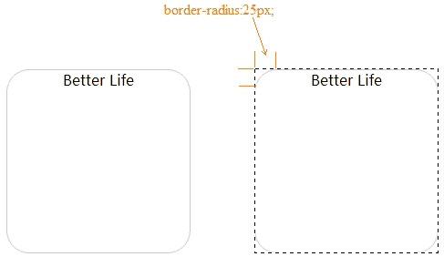

`border-radius`: CSS3 属性定义元素圆角的半径。

```
<style>
.box{
border:1px solid #cccccc;
width:300px;
height:150px;
text-align:center;
border-radius:25px;
}
</style>
<div class ="box" >Better Life</div>
```

### 3. 定义 div 盒子的阴影。

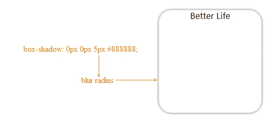

`box-shadow`: CSS3 属性为一个元素添加一个或多个阴影。

```
<style>
.box{
border:1px solid #cccccc;
width:200px;
height:200px;
text-align:center;
border-radius:25px;
box-shadow: 0px 0px 5px #888888;
}
</style>
<div class ="box" >Better Life</div>
```

### 4. 定义 div 盒子的阴影。

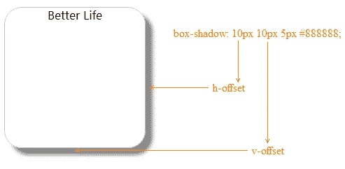

`box-shadow`: CSS3 属性为一个元素添加一个或多个阴影。  
`h-offset`: 阴影的水平偏移量。  
`v-offset`: 阴影的垂直偏移量。

```
<style>
.box{
border:1px solid #cccccc;
width:200px;
height:200px;
text-align:center;
border-radius:25px;
box-shadow: 10px 10px 5px #888888;
}
</style>
<div class ="box" >Better Life</div>
```

### 5. 定义 div 盒子的背景颜色。

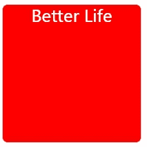

`background-color`: CSS 属性定义背景颜色。  
`font-size:24px;` CSS 属性定义字体大小。  
`color:#ffffff;` CSS 属性定义字体颜色。

```
<style>
.box{
border:1px solid #cccccc;
width:200px;
height:200px;
text-align:center;
border-radius:8px;
background-color:#ff0000;
font-size:24px;
color:#ffffff;
}
</style>
<div class ="box" >Better Life</div>
```

### 6. 定义 div 盒子的绝对位置。

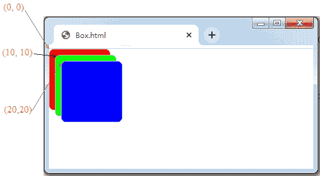

`position:absolute;` 元素相对于其第一个已定位的父元素进行绝对定位。  
`top: offset;` CSS 属性定义元素的顶部位置。  
`left: offset;` CSS 属性定义元素的左侧位置。

```
<style>
.redBox{
border:1px solid #cccccc;
width:100px;
height:100px;
border-radius:8px;
background-color:#ff0000;
position:absolute;
top:0px;
left:0px;
}
.greenBox{
border:1px solid #cccccc;
width:100px;
height:100px;
border-radius:8px;
background-color:#00ff00;
position:absolute;
top:10px;
left:10px;
}
.blueBox{
border:1px solid #cccccc;
width:100px;
height:100px;
border-radius:8px;
background-color:#0000ff;
position:absolute;
top:20px;
left:20px;
}
</style>
<div class ="redBox" ></div>
<div class ="greenBox" ></div>
<div class ="blueBox" ></div>
```

### 7. 定义 div 盒子的相对位置。

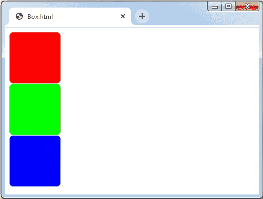

`position:relative;` 元素相对于其正常位置进行定位。


```
<style>.redBox{border:1px solid #cccccc;width:100px;height:100px;border-radius:8px;background-color:#ff0000;position:relative;}.greenBox{border:1px solid #cccccc;width:100px;height:100px;border-radius:8px;background-color:#00ff00;position:relative;}.blueBox{border:1px solid #cccccc;width:100px;height:100px;border-radius:8px;background-color:#0000ff;position:relative;}</style><div class ="redBox" ></div><div class ="greenBox" ></div><div class ="blueBox" ></div>
```

8. 定义元素内容周围的空间，位于 `div` 盒子外部。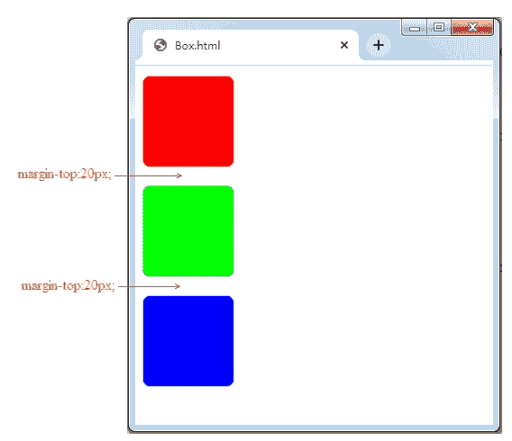`margin`：CSS 属性用于在元素周围创建空间，位于任何已定义边框的外部。（上、右、下、左）  
1. `margin-top`  
2. `margin-right`  
3. `margin-bottom`  
4. `margin-left`

```
<style>.redBox{border:1px solid #cccccc;width:100px;height:100px;border-radius:8px;background-color:#ff0000;position:relative;}.greenBox{border:1px solid #cccccc;width:100px;height:100px;border-radius:8px;background-color:#00ff00;position:relative;}.blueBox{border:1px solid #cccccc;width:100px;height:100px;border-radius:8px;background-color:#0000ff;position:relative;}</style><div class ="redBox" ></div><div class ="greenBox" ></div><div class ="blueBox" ></div>
```

9. 定义元素内容周围的空间，位于 `div` 盒子内部。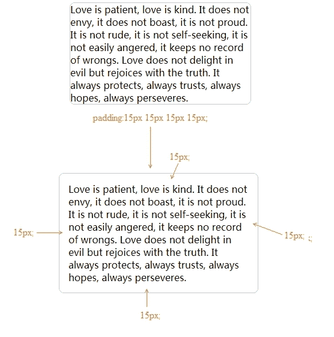`padding`：CSS 属性用于在元素内容周围生成空间，位于任何已定义边框的内部。（上、右、下、左）  
1. `padding-top`  
2. `padding-right`  
3. `padding-bottom`  
4. `padding-left`

```
<style>.box{border:1px solid #cccccc;width:300px;border-radius:8px;padding:15px 15px 15px 15px;}</style><div class ="box" >Love is patient, love is kind. It does not envy, it does not boast, it is not proud. It is not rude, it is not self-seeking, it is not easily angered, it keeps no record of wrongs. Love does not delight in evil but rejoices with the truth. It always protects, always trusts, always hopes, always perseveres.</div>
```

10. 定义两个内联元素之间的空间，位于 `div` 盒子内部。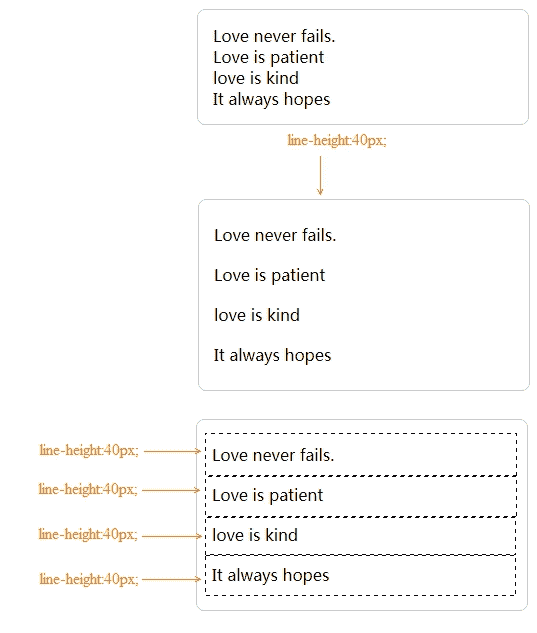`line-height`：CSS 属性定义两个内联元素之间的空间。  
`<br>`：HTML 标签，用于换行。

```
<style>.box{border:1px solid #cccccc;width:300px;border-radius:8px;padding:15px 15px 15px 15px;line-height:40px;}</style><div class ="box" >Love never fails.<br>Love is patient<br>love is kind<br>It always hopes</div>
```

11. 向 `div` 盒子中插入图像。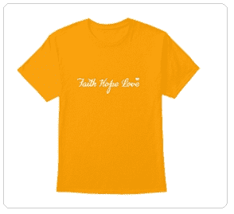``：标签用于在 HTML 页面中定义图像。`src ="shirt.jpg"` 图像路径。

```
<style>.box{border:1px solid #cccccc;width:250px;border-radius:8px;padding:15px 15px 15px 15px;}</style><div class ="box" ></div>
```

12. 在图像下方插入文本到 `div` 盒子中。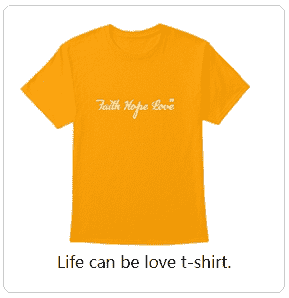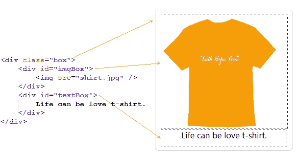`#id`：CSS 用于选择具有特定 id 的元素。

```
<style>.box{border:1px solid #cccccc;width:250px;border-radius:8px;padding:15px 15px 15px 15px;}#imgBox{width:100%;}#textBox{text-align:center;width:100%;line-height:30px;}</style><div class ="box" ><div id ="imgBox" ></div><div id ="textBox" >Life can be love t-shirt.</div></div>
```

13. 文本环绕图像。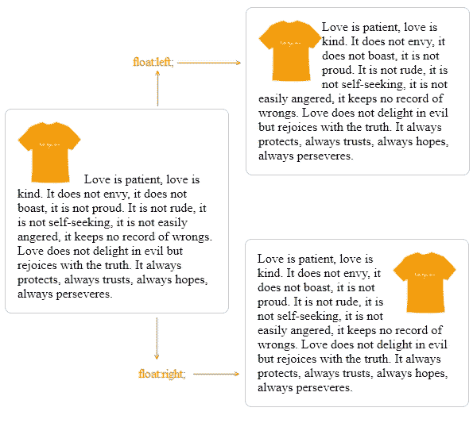`float`：CSS 属性指定元素应该如何浮动。（左、右、清除）  
`.box img`：后代选择器，CSS 样式将应用于子元素。  
`font-family`："Times New Roman", Times, serif;

```
<style>.box{border:1px solid #cccccc;width:250px;border-radius:8px;padding:15px 15px 15px 15px;font-size:16px;font-family: "Times New Roman", Times, serif;}.box img{width:80px;float:left;}</style><div class ="box" >Love is patient, love is kind. It does not envy, it does not boast, it is not proud. It is not rude, it is not self-seeking, it is not easily angered, it keeps no record of wrongs. Love does not delight in evil but rejoices with the truth. It always protects, always trusts, always hopes, always perseveres.</div>
```

14. 无序列表：以 `<ul>` 标签开始。每个列表项以 `<li>` 标签开始。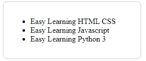

```
<style>#box{border:1px solid #cccccc;width:250px;border-radius:8px;padding:15px 15px 15px 15px;font-size:16px;font-family: "Times New Roman", Times, serif;}</style><div id ="box" ><ul><li> Easy Learning HTML CSS </li><li> Easy Learning Javascript </li><li> Easy Learning Python 3 </li></ul></div>
```

15. 无序列表：插入图标图像替换黑色圆点。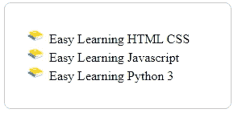`list-style-image:url('icon.jpg')`：CSS 属性用于指定用作标记的图像。

```
<style>#box{border:1px solid #cccccc;width:250px;border-radius:8px;padding:15px 15px 15px 15px;font-size:16px;font-family: "Times New Roman", Times, serif;}#box ul li{list-style-image:url('icon.jpg');}</style><div id ="box" ><ul><li> Easy Learning HTML CSS </li><li> Easy Learning Javascript </li><li> Easy Learning Python 3 </li></ul></div>
```

16. 链接状态样式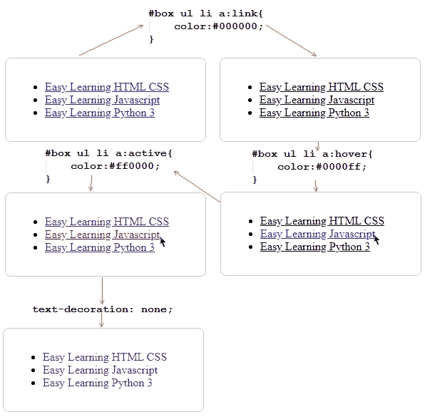`text-decoration: none`：从文本中移除文本装饰  
`li a:link`：用于选择未访问的元素  
`li a:hover`：用于选择鼠标悬停时的元素  
`li a.active`：CSS 伪类。它指定 `<li> <a>` 处于活动状态。

```
<style>#box{border:1px solid #cccccc;width:250px;border-radius:8px;padding:15px 15px 15px 15px;font-size:16px;font-family: "Times New Roman", Times, serif;}#box ul li a:link{color:#000000;text-decoration: none;}#box ul li a:hover{color:#0000ff;}#box ul li a:active{color:#ff0000;}</style><div id ="box" ><ul><li><a href ="#" > Easy Learning HTML CSS </a></li><li><a href ="#" > Easy Learning Javascript </a></li><li><a href ="#" > Easy Learning Python 3 </a></li></ul></div>
```

17. 下拉菜单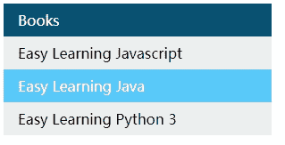`list-style-type: none`：CSS 属性，移除 `<li>` 中显示的标记  
`display: block`：将元素显示为块级元素（如 `<div>`）。它在新行开始。  
`li a:hover:not(.active)`：用于选择鼠标悬停但非活动状态的元素。

```
<style>ul {list-style-type: none;margin: 0;padding: 0;width: 300px;background-color: #eeeeee;}li a {display: block;color: #000000;padding: 8px 16px;text-decoration: none;}li a.active {background-color: #075272;color: white;}li a:hover:not(.active) {background-color: #59c9f9;color: white;}</style><ul><li><a class ="active" href ="#" > Books </a></li><li><a href ="#" > Easy Learning Javascript </a></li><li><a href ="#" > Easy Learning Java </a></li><li><a href ="#" > Easy Learning Python 3 </a></li></ul>
```

18. 导航菜单

```
<style>ul {list-style-type: none;margin: 0;padding: 0;overflow: hidden;background-color: #333;position: fixed;top: 10;width: 100%;}li {float: left;}li a {display: block;color: white;text-align: center;padding: 15px;text-decoration: none;}li a:hover:not(.active) {background-color: #fde352;}.active {background-color: #fde352;}</style><ul><li><a class ="active" href ="#" > HTML </a></li><li><a href ="#" > CSS </a></li><li><a href ="#" > Javascript </a></li><li><a href ="#" > Python </a></li></ul>
```

19. 点击下拉菜单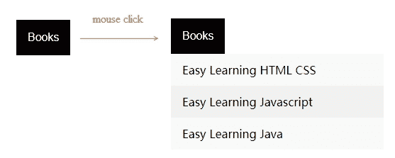

```
<style>.menubtn {background-color: #000000;color: white;padding: 16px;font-size: 16px;border: none;cursor: pointer;}.menudown {position: relative;display: inline-block;float:left;}.menudown-content {display: none;position: absolute;right: 0;background-color: #f9f9f9;min-width: 300px;}.menudown-content a {color: black;padding: 12px 16px;text-decoration: none;display: block;}.menudown-content a:hover {background-color: #f1f1f1}.menudown:hover .menudown-content {display: block;}.menudown:hover .menubtn {background-color: #000000;}</style><div class ="menudown" ><button class ="menubtn" > Books </button><div class ="menudown-content" style ="left:0;" ><a href ="#" > Easy Learning HTML CSS </a><a href ="#" > Easy Learning Javascript </a><a href ="#" > Easy Learning Java </a></div></div>
```

20. 登录 div 对话框。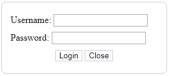


```html
<style>#login{border:1px solid #cccccc;width:250px;border-radius:8px;padding:15px 15px 15px 15px;font-size:16px;font-family: "Times New Roman", Times, serif;}#login div{line-height:30px;width:100%;}.textbox{width:160px;}#buttonDiv{text-align:center;}#buttonDiv input{border:1px solid #cccccc;background-color:#ffffff;}</style><div id ="login" ><div> 用户名：<input class ="textbox" type ="text" id ="username" /></div><div> 密码：<input class ="textbox" type ="password" id ="username" /></div><div id ="buttonDiv" ><input type ="button" value ="登录" /><input type ="button" value ="关闭" /></div></div>
```

# JavaScript HelloWorld

JavaScript 是一种用于网页开发的动态交互式语言。

1. 用记事本创建一个 `helloworld.html` 文件，并在浏览器中打开以查看网页
   - `<html>`：标签告诉浏览器这是一个 HTML 文档。
   - `<head>`：标签是内容和字符集元数据的容器。
   - `<title>`：标签定义文档的标题。
   - `<body>`：标签定义文档的主体。
   - `<script>`：标签用于定义客户端脚本（JavaScript）。
   - `document.write()`：向浏览器文档写入 HTML 内容。

```html
<html><head><meta http-equiv ="Content-Type" content ="text/html; charset=UTF-8" ><title> 第一个网页 </title></head><body><script type ="text/javascript" >document.write( "HelloWorld" );</script></body></html>
```

结果：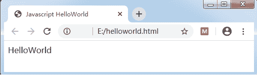

# 变量

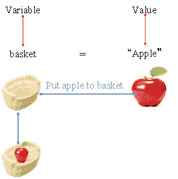

1. 创建一个文件：`Variable.html` 并在浏览器中打开
   - `//`：单行注释不会被 JavaScript 执行
   - `""`：字符串类型

```javascript
<script type ="text/javascript" >var basket = "Apple" ;document.write( basket);</script>
```

结果：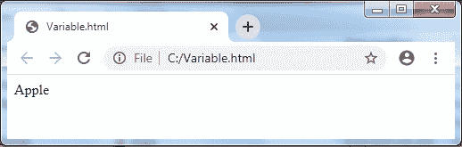

2. 修改文件：`Variable.html`，将 "apple" 替换为 "orange"。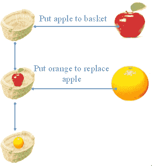
   - `<br>`：HTML 标签，换行

```javascript
<script type ="text/javascript" >var basket = "Apple" ;document.write( basket);document.write( "<br>" );basket = "Orange" ;document.write( basket);</script>
```

运行结果：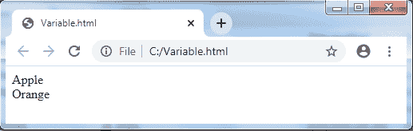

# 变量与类型

JavaScript 是动态类型语言

1. 用记事本创建一个 `var.html` 文件，并在浏览器中打开以查看网页
   - `typeof()`：查找 JavaScript 变量的类型

```javascript
<script type ="text/javascript" >var x;           //undefinedvar a= 9 ;         //numbervar b= 1.5 ;       //numbervar c= true ;      //Booleanvar d= "abc" ;     //stringvar e= 'abc' ;     //stringdocument.write( typeof ( x) + "<br>" );document.write( typeof ( a) + "<br>" );document.write( typeof ( b) + "<br>" );document.write( typeof ( c) + "<br>" );document.write( typeof ( d) + "<br>" );document.write( typeof ( e) + "<br>" );</script>
```

结果：
```
undefined
number
number
boolean
string
string
```

# 算术运算符

1. 用记事本创建一个 `ArithmeticOperator.html` 文件，并在浏览器中打开
   - 算术运算符：加 `+`、减 `-`、乘 `*`、除 `/`、取模 `%`
   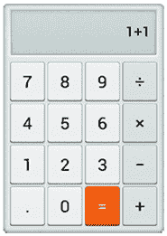

```javascript
<script type ="text/javascript" >var a = 1 ;var b = 2 ;var c = 3 ;var d = 4 ;document.write( a + b); // = 3document.write( "<br>" );document.write( a - b); // = -1document.write( "<br>" );document.write( a * b); // = 2document.write( "<br>" );document.write( b / a); // = 2document.write( "<br>" );document.write( c % b); // = 1 //除法后的余数 document.write( "<br>" );</script>
```

# 函数

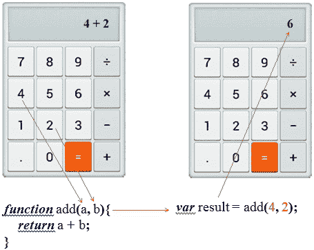 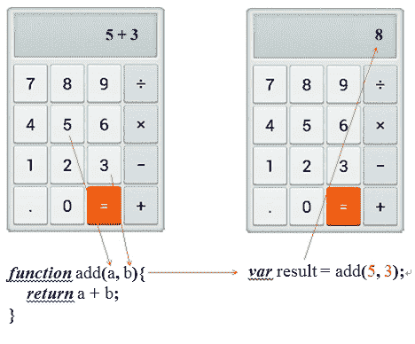 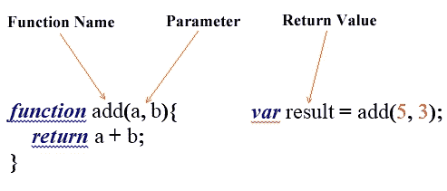

1. 创建一个文件：`Function.html`

```javascript
<script type ="text/javascript" >function add( a, b){return a + b;}var result = add( 4 , 2 );document.write( result); // 6document.write( "<br>" );var result = add( 5 , 3 );document.write( result)   // 8</script>
```

运行结果：
```
6
8
```

2. 在 `Function.html` 中添加关于 `-`、`*`、`/` 的 3 个函数

```javascript
<script type ="text/javascript" >function add( a, b){return a + b;}function sub( a, b){return a - b;}function multiply( a, b){return a * b;}function divide( a, b){return a / b;}var result = add( 4 , 2 );document.write( result); // 6document.write( "<br>" );var result = sub( 4 , 2 );document.write( result)   // 2document.write( "<br>" );var result = multiply( 4 , 2 );document.write( result)   // 8document.write( "<br>" );var result = divide( 4 , 2 );document.write( result)   // 2</script>
```

# 类

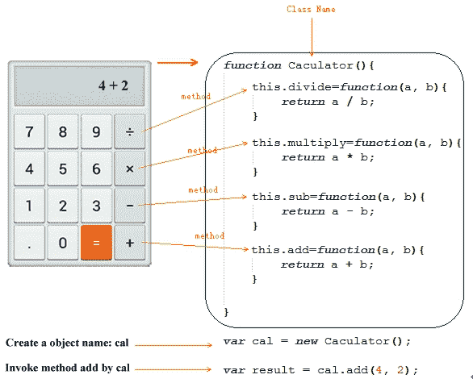

1. 创建一个文件：`Caculator.html`

```javascript
<script type ="text/javascript" >function Caculator(){this.add= function ( a, b){return a + b;}this.sub= function ( a, b){return a - b;}this.multiply= function ( a, b){return a * b;}this.divide= function ( a, b){return a / b;}}var cal = new Caculator();var result = cal.add( 4 , 2 );document.write( result); // 6var result = cal.sub( 4 , 2 );document.write( result)   // 2var result = cal.multiply( 4 , 2 );document.write( result)   // 8var result = cal.divide( 4 , 2 );document.write( result)   // 2</script>
```

# 类型转换

1. 创建一个 `TypeConversion.html`
   - `parseInt()`：这是 JavaScript 的默认函数，可以将字符串转换为整数。

```javascript
<script type ="text/javascript" >var a= "1" ;        var b= "2" ;    var result = a + b; // + 连接两个字符串 document.write( result); // = 12document.write( "<br>" );result = parseInt( a) + parseInt( b);document.write( result); // = 3</script>
```

结果：
```
12
3
```

# DOM

DOM：在 JavaScript 中，每个 HTML 元素都是一个类对象。
文档对象模型结构图：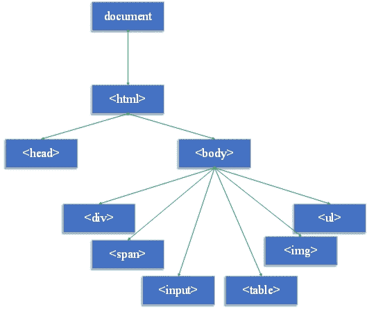

1. 创建一个文件：`getElementById.html`
   - `document.getElementById()`：是一种 DOM 方法，通过 ID 属性获取元素。
   - `alert()`：是一个函数，用于打开信息窗口。
   - `Obj.innerHTML`：设置或返回元素的内部 HTML 内容。
   - `<div>`：标签定义 HTML 文档中的一个分区或节。

```html
<div id ="word" > 信念与希望 </div><script type ="text/javascript" >var divObj = document.getElementById( "word" );var htmlContent = divObj.innerHTML;alert( htmlContent);</script>
```

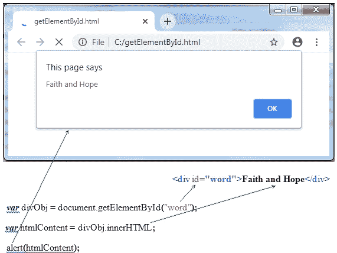

2. 修改文件：`getElementById.html`
   - `<input type= " text " />`：HTML 标签，指定一个用户可以输入数据的输入字段。

```html
<input type ="text" id ="username" value ="Joseph" /><script type ="text/javascript" >var divObj = document.getElementById( "username" );var value = divObj.value;alert( value);</script>
```

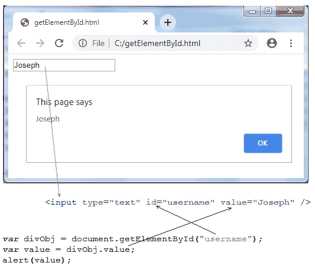

# 事件

1. 创建一个文件：`onClick.html`
   - `onClick`：当鼠标点击按钮时，会调用一个函数。
   - `<input type= " button " />`：HTML 标签，定义一个可点击的按钮。

```html
<input type ="text" id ="username" value ="Joseph" /><input type ="button" value ="点击我" onClick ="doClick()" /><script type ="text/javascript" >function doClick(){var divObj = document.getElementById( "username" );var value = divObj.value;alert( value);}</script>
```

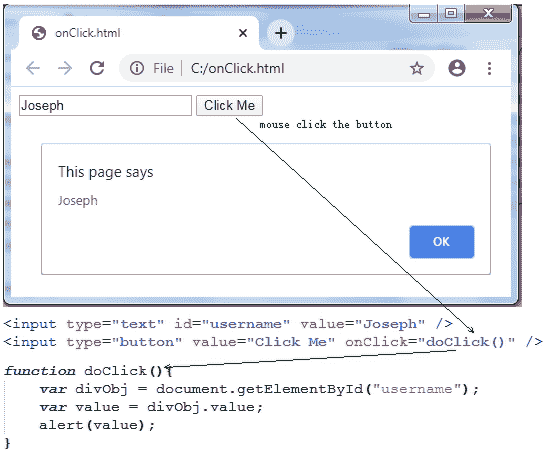

# 创建一个网页计算器

1. 创建一个文件：`WebCaculator.html`
   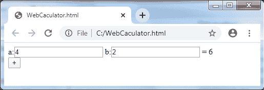

```html
a: <input type ="text" id ="a" value ="" />b: <input type ="text" id ="b" value ="" />=<span id ="result" ></span><br><input type ="button" value ="+" onClick ="doAdd()" /><script type ="text/javascript" >function doAdd(){var aObj = document.getElementById( "a" );var bObj = document.getElementById( "b" );var resultObj = document.getElementById( "result" );var a = parseInt( aObj.value); // 将字符串转换为整数 var b = parseInt( bObj.value);resultObj.innerHTML = a + b;}</script>
```

2. 在 `WebCaculator.html` 中添加另外 3 个函数 `-`、`*`、`/`


# JavaScript 示例文档

## 基本运算器

以下是一个简单的加减乘除运算器 HTML 代码：

```
| a: <input type="text" id="a" value="" /> b: <input type="text" id="b" value="" /> = <span id="result"></span><br>
<input type="button" value="+" onClick="doAdd()" />
<input type="button" value="-" onClick="doSub()" />
<input type="button" value="*" onClick="doMultiply()" />
<input type="button" value="/" onClick="doDivide()" />
<script type="text/javascript">
function doAdd(){
    var aObj = document.getElementById("a");
    var bObj = document.getElementById("b");
    var resultObj = document.getElementById("result");
    var a = parseInt(aObj.value); // Convert string to integer
    var b = parseInt(bObj.value);
    resultObj.innerHTML = a + b;
}
function doSub(){
    var aObj = document.getElementById("a");
    var bObj = document.getElementById("b");
    var resultObj = document.getElementById("result");
    var a = parseInt(aObj.value);
    var b = parseInt(bObj.value);
    resultObj.innerHTML = a - b;
}
function doMultiply(){
    var aObj = document.getElementById("a");
    var bObj = document.getElementById("b");
    var resultObj = document.getElementById("result");
    var a = parseInt(aObj.value);
    var b = parseInt(bObj.value);
    resultObj.innerHTML = a * b;
}
function doDivide(){
    var aObj = document.getElementById("a");
    var bObj = document.getElementById("b");
    var resultObj = document.getElementById("result");
    var a = parseInt(aObj.value);
    var b = parseInt(bObj.value);
    resultObj.innerHTML = a / b;
}
</script> |
```

点击不同按钮的结果如下：

- 点击 + 按钮结果：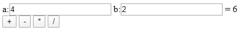
- 点击 - 按钮结果：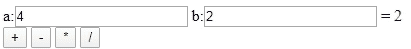
- 点击 * 按钮结果：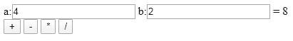
- 点击 / 按钮结果：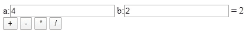

## 赋值运算符

1. 创建一个 `AssignmentOperator.html` 文件，用记事本编辑并在浏览器中打开。

```
| <script type="text/javascript">
var d = 4;
document.write(d++); // = 4 print d and then increment 1
document.write("<br>");
d = 4;
document.write(++d); // = 5 increment 1 and then print d
document.write("<br>");
d = 4;
document.write(d--); // = 4 print d and then decrement 1
document.write("<br>");
d = 4;
document.write(--d); // = 3 decrement 1 and then print d
var result = 10;
result = result + 1;
document.write(result); // = 11
document.write("<br>");
result = 10;
result++;
document.write(result); // = 11
document.write("<br>");
result = 10;
result += 1;
document.write(result);   // = 11
document.write("<br>");
</script> |
```

2. 创建一个数量加减器 `quantity.html`。点击 `+` 按钮数量增加 1，点击 `-` 按钮数量减少 1。

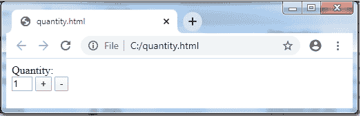

```
| Quantity:<br>
<input type="text" style="width:30px" id="quantity" value="1" />
<input type="button" value="+" onClick="doAdd()" />
<input type="button" value="-" onClick="doSub()" />
<script type="text/javascript">
function doAdd(){
    var quantityObj = document.getElementById("quantity");
    var value = parseInt(quantityObj.value);
    value++;
    quantityObj.value = value;
}
function doSub(){
    var quantityObj = document.getElementById("quantity");
    var value = parseInt(quantityObj.value);
    value--;
    quantityObj.value = value;
}
</script> |
```

## 关系运算符

1. 创建一个 `RelationalOperator.html` 文件，用记事本编辑并在浏览器中打开。关系运算符的结果只有两个值：`true` 和 `false`。

```
| <script type="text/javascript">
document.write(1 > 2); // false
document.write("<br>");
document.write(1 >= 1); // true
document.write("<br>");
document.write(1 < 2); // true
document.write("<br>");
document.write(1 <= 2); // true
document.write("<br>");
document.write(1 == 1); // true
document.write("<br>");
document.write(1 != 2); // true
</script> |
```

## If 条件语句

`if` 语句的三种形式：
1. `if (expression) { statement }`
2. `if (expression) { statement } else { statement }`
3. `if (expression) { statement } else if { statement }`

1. 创建一个 `If.html` 文件，用记事本编辑并在浏览器中打开。分数示例：
   - 如果 `score == 5`：Excellent
   - 否则如果 `score == 4`：Good
   - 否则：Need to catch up

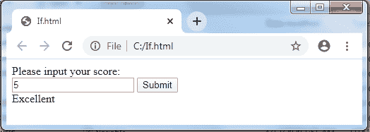 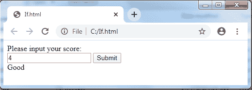 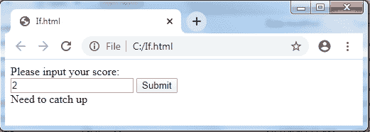

```
| Please input your score:<br>
<input type="text" id="score" value="" />
<input type="button" value="Submit" onClick="doSubmit()" /><br>
<span id="message"></span>
<script type="text/javascript">
function doSubmit(){
    var scoreObj = document.getElementById("score");
    var messageObj = document.getElementById("message");
    var score = parseInt(scoreObj.value);
    if (score == 5) {
        messageObj.innerHTML = "Excellent";
    } else if (score == 4) {
        messageObj.innerHTML = "Good";
    } else {
        messageObj.innerHTML = "Need to catch up";
    }
}
</script> |
```

## 逻辑运算符

1. 创建一个 `LogicOperator.html` 文件，用记事本编辑并在浏览器中打开。逻辑运算符：与 `&&`、或 `||`、非 `!`。
   - `&&`：两边都为 `true` 时返回 `true`，否则 `false`。
   - `||`：两边都为 `false` 时返回 `false`，否则 `true`。
   - `!`：如果为 `true` 则返回 `false`，否则返回 `true`。

```
| <script type="text/javascript">
document.write(true && false); // false
document.write("<br>");
document.write(false && true); // false
document.write("<br>");
document.write(false && false); // false
document.write("<br>");
document.write(true && true); // true
document.write("<br>");
document.write(true || false); // true
document.write("<br>");
document.write(false || true); // true
document.write("<br>");
document.write(true || true); // true
document.write("<br>");
document.write(false || false); // false
document.write("<br>");
document.write(!true); // false
document.write("<br>");
document.write(!false); // true
document.write("<br>");
</script> |
```

2. 创建 `LogicOperator2.html`。

```
| <script type="text/javascript">
document.write(1 > 2 && 3 > 4) // = false
document.write(2 > 1 && 3 > 4) // = false
document.write("--------------")
document.write(2 > 1 || 3 > 4) // = true
document.write(2 > 1 || 3 > 4) // = true
document.write(1 > 2 || 3 > 4) // = false
</script> |
```

3. 工资税示例：税额 = 工资 * 税率。等级：
   - 500 – 2000 $：税率 10%
   - 2000 – 5000 $：税率 15%
   - 5000 – 20000 $：税率 20%
   - 超过 20000 $：税率 30%

```
| <script type="text/javascript">
var salary = 10000;
var tax = 0;
if (salary >= 500 && salary < 2000) {
    tax = salary * 0.1;
} else if (salary >= 2000 && salary < 5000) {
    tax = salary * 0.15;
} else if (salary >= 5000 && salary < 20000) {
    tax = salary * 0.2;
} else {
    tax = salary * 0.3;
}
document.write("tax amount=" + tax);
</script> |
```

结果：`tax amount=2000`

2. 创建 `WebTax.html`。输入工资，点击 `Calculate Tax` 按钮。

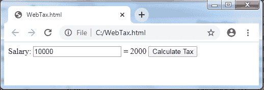

```
| Salary: <input type="text" id="salary" value="" /> = <span id="tax"></span>
<input type="button" value="Calculate Tax" onClick="doTax()" />
<script type="text/javascript">
function doTax(){
    var salaryObj = document.getElementById("salary");
    var salary = parseInt(salaryObj.value);
    var tax = 0;
    if (salary >= 500 && salary < 2000) {
        tax = salary * 0.1;
    } else if (salary >= 2000 && salary < 5000) {
        tax = salary * 0.15;
    } else if (salary >= 5000 && salary < 20000) {
        tax = salary * 0.2;
    } else {
        tax = salary * 0.3;
    }
    document.getElementById("tax").innerHTML = tax;
}
</script> |
```

## Switch 语句

1. 创建一个 `switch.html` 文件，用记事本编辑并在浏览器中打开。输入数字 1、2、3：
   - 1：Pay by Visa Card
   - 2：Pay by Master Card
   - 3：Pay by Paypal
   - 其他：Pay by face to face

```
| <script type="text/javascript">
var num = 1;
switch (num) {
    case 1:
        document.write("Pay by Visa Card");
        break; // terminate the code to continue execution
    case 2:
        document.write("Pay by Master Card");
        break;
    case 3:
        document.write("Pay by Paypal");
        break;
    default:
        document.write("Pay by face to face");
}
</script> |
```

结果：`Pay by Visa Card`

2. 创建 `WebPay.html`。`this` 表示当前元素对象。

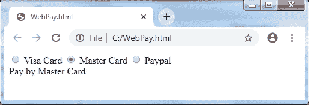


```
<input type="radio" name="card" value="1" onclick="doPay(this)" /> Visa Card
<input type="radio" name="card" value="2" onclick="doPay(this)" /> Master Card
<input type="radio" name="card" value="3" onclick="doPay(this)" /> Paypal
<br>
<span id="result"></span>
<script type="text/javascript">
function doPay(obj) {
    var num = parseInt(obj.value);
    var resultObj = document.getElementById("result");
    switch (num) {
        case 1:
            resultObj.innerHTML = "Pay by Visa Card";
            break;
        case 2:
            resultObj.innerHTML = "Pay by Master Card";
            break;
        case 3:
            resultObj.innerHTML = "Pay by Paypal";
            break;
        default:
            resultObj.innerHTML = "Pay by face to face";
    }
}
</script>
```

## While 循环语句

`while (expression) { statement; }` 当表达式为真时继续执行，否则退出循环。

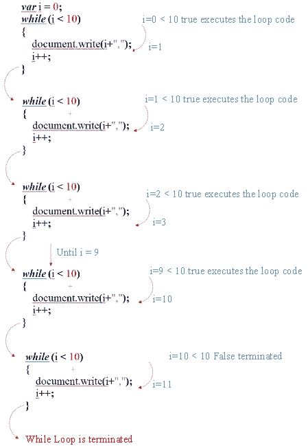

1. 使用记事本创建一个 WhileLoop.html 文件，并在浏览器中打开

```
<script type="text/javascript">
var i = 0;
while (i < 10) {
    document.write(i + ",");
    i++;
}
</script>
```

结果：0,1,2,3,4,5,6,7,8,9,

## For 循环语句

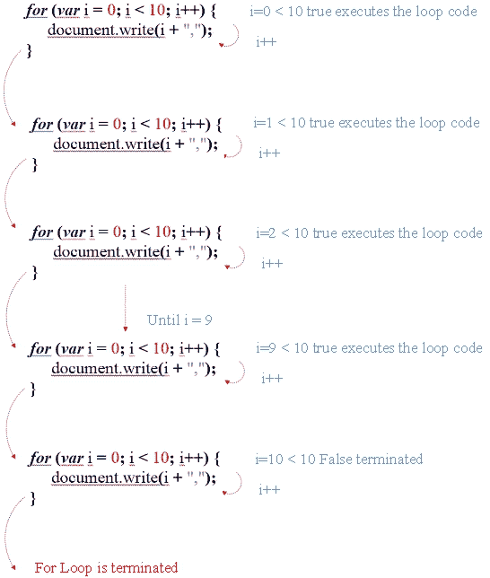

1. 使用记事本创建一个 ForLoop.html 文件，并在浏览器中打开

```
<script type="text/javascript">
for (var i = 0; i < 10; i++) {
    document.write(i + ",");
}
</script>
```

结果：0,1,2,3,4,5,6,7,8,9,

## 一维数组

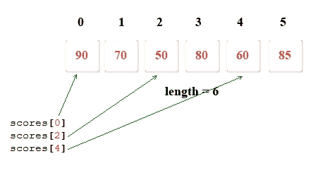

1. 使用记事本创建一个 OneArray.html 文件，并在浏览器中打开

```
<script type="text/javascript">
// 一维数组的定义和初始化
var scores = [90, 70, 50, 80, 60, 85];
document.write(scores[0] + "<br>");
document.write(scores[2] + "<br>");
document.write(scores[4] + "<br>");
</script>
```

结果：90 50 60

2. 修改 OneArray.html，打印数组中的所有分数。`scores.length`：数组的总元素个数。

```
<script type="text/javascript">
var scores = [90, 70, 50, 80, 60, 85];
// 打印数组中的所有分数
for (var i = 0; i < scores.length; i++) {
    document.write(scores[i] + ",");
}
</script>
```

结果：90,70,50,80,60,85,

3. 修改 OneArray.html，打印数组中的所有分数

```
<script type="text/javascript">
// 动态定义一维数组
var scores = new Array();
scores[0] = 90;
scores[1] = 70;
scores[2] = 50;
scores[3] = 80;
scores[4] = 60;
scores[5] = 85;
// 打印数组中的所有分数
for (var i = 0; i < scores.length; i++) {
    document.write(scores[i] + ",");
}
</script>
```

结果：90,70,50,80,60,85,

## 全选复选框

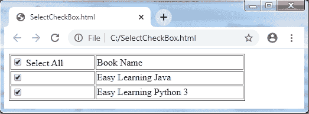

1. 使用记事本创建一个 SelectCheckBox.html 文件，并在浏览器中打开

`document.getElementsByName()`：获取具有相同名称的元素数组。`checked`：复选框是否被选中。

```
<table width="400" border="1">
<tr><td><input type="checkbox" onclick="checkAll(this)" /> 全选 </td><td> 书名 </td></tr>
<tr><td><input type="checkbox" name="book" /></td><td> Easy Learning Java </td></tr>
<tr><td><input type="checkbox" name="book" /></td><td> Easy Learning Python 3 </td></tr>
</table>
<script language="JavaScript">
function checkAll(obj) {
    var bookArray = document.getElementsByName("book");
    for (var i = 0; i < bookArray.length; i++) {
        bookArray[i].checked = obj.checked;
    }
}
</script>
```

## 二维数组


1. 使用记事本创建一个 TwoArray.html 文件，并在浏览器中打开

```
<script type="text/javascript">
// 二维数组的定义和初始化
var arrs = [[10, 20, 30], [40, 50, 60], [70, 80, 90]];
document.write(arrs[0][0] + "<br>");
document.write(arrs[0][2] + "<br>");
document.write(arrs[1][2] + "<br>");
</script>
```

结果：10 30 60

2. 使用记事本创建一个 TwoArray2.html 文件，并在浏览器中打开


```
<script type="text/javascript">
var arrs = [[10, 20, 30], [40, 50, 60], [70, 80, 90]];
// i: 行索引, j: 列索引
for (var i = 0; i < arrs.length; i++) {
    for (var j = 0; j < arrs[i].length; j++) {
        document.write(arrs[i][j]);
        document.write(" ");
    }
    document.write("<br>");
}
</script>
```

## 找狗游戏

1. 根据二维数组地图绘制按钮


```
<style>
input{width:40px;height:40px;}
</style>
<span id="result"></span>
<script type="text/javascript">
var maps = [[1, 1, 1, 1], [1, 1, 1, 1], [1, 2, 1, 1], [1, 1, 1, 1]];
var mapHTML = "";
for (var i = 0; i < maps.length; i++) {
    for (var j = 0; j < maps[i].length; j++) {
        mapHTML += "<input type='button' value=' ' />";
    }
    mapHTML += "<br>";
}
document.getElementById("result").innerHTML = mapHTML;
</script>
```

2. 将数组的值填入按钮，并添加按钮点击事件，如果按钮值为 1 则变为 *，如果按钮值为 2 则变为 Dog


1: *  
2: Dog

```
<style>
input{width:40px;height:40px;}
</style>
<span id="result"></span>
<script type="text/javascript">
var maps = [[1, 1, 1, 1], [1, 1, 1, 1], [1, 2, 1, 1], [1, 1, 1, 1]];
var mapHTML = "";
for (var i = 0; i < maps.length; i++) {
    for (var j = 0; j < maps[i].length; j++) {
        mapHTML += "<input type='button' value=' ' onClick='doButtonClick(this," + maps[i][j] + ")' />";
    }
    mapHTML += "<br>";
}
document.getElementById("result").innerHTML = mapHTML;
function doButtonClick(obj, value) {
    if (value == 1) {
        obj.value = "*";
    } else if (value == 2) {
        obj.value = "Dog";
    }
}
</script>
```

3. 打印随机数 0-9

`Math.random()`：返回一个介于 0 和 1 之间的随机数。  
`Math.floor()`：向下取整到最接近的整数。

```
<script type="text/javascript">
for (var i = 0; i < 10; i++) {
    var num = Math.floor(Math.random() * 10);
    document.write(num + ", ");
}
</script>
```

结果：9, 3, 9, 0, 4, 1, 0, 3, 4, 5,

4. 随机生成 1-2 初始化二维数组，将数组的值填入按钮，并添加按钮点击事件，如果按钮值为 1 则变为 *，如果按钮值为 2 则变为 Dog


1: *  
2: Dog

## 二级联动下拉菜单

1. 使用记事本创建一个 Drop-down.html 文件，并在浏览器中打开

`window.onload`：在页面加载完成后执行一个函数。  
`document.createElement()`：创建一个 HTML 元素。


```
<select id="country">
<option value=""> --请选择国家-- </option>
</select>
<script type="text/javascript">
window.onload = function() {
    var countryObj = document.getElementById("country");
    option = document.createElement("option");
    option.text = "United States";
    option.value = "United States";
    countryObj.options[countryObj.options.length] = option;
}
</script>
```

2. 通过 countryArray 添加更多选项


```
<select id="country">
<option value=""> --请选择国家-- </option>
</select>
<script type="text/javascript">
var countryArray = ["China", "United States"];
window.onload = function() {
    var countryObj = document.getElementById("country");
    for (var i = 0; i < countryArray.length; i++) {
        var option = document.createElement("option");
        option.text = countryArray[i];
        option.value = countryArray[i];
        countryObj.options[countryObj.options.length] = option;
    }
}
</script>
```

3. 添加省份选项

`selectedIndex`：设置或返回下拉列表中选中选项的索引。


```
<select id ="country" onchange ="doCountryChange(this)" ><option value ="" > --Please Select Country-- </option></select><select id ="province" ></select><script type ="text/javascript" >var countryArray=[ "China" , "United States" ];var provinceArray = new Array();provinceArray[ 0 ] =[];provinceArray[ 1 ] =[ "Beijing" , "Shanghai" ];provinceArray[ 2 ] =[ "San Francisco" , "New York" ];window.onload= function (){var country= document.getElementById( "country" );for ( var i= 0 ; i< countryArray.length; i++){var option= document.createElement( "option" );option.text= countryArray[ i];option.value= countryArray[ i];country.options[ country.options.length]= option;}}function doCountryChange( obj){var provinceObj= document.getElementById( "province" );provinceObj.options.length= 0 ; // clear allvar index= obj.selectedIndex;for ( var i= 0 ; i< provinceArray[ index]. length; i++){var option= document.createElement( "option" );option.text= provinceArray[ index][ i];option.value= provinceArray[ index][ i];provinceObj.options[ provinceObj.options.length]= option;}}</script>
```

## 事件事件列表：

| 事件 | 描述 |
|-------|-------------|
| Onblur | 元素失去焦点 |
| Onchange | 内容发生改变 |
| Onclick | 鼠标点击对象 |
| Ondblclick | 鼠标双击对象 |
| Onerror | 加载文档或图像时发生错误 |
| Onfocus | 元素获得焦点 |
| Onkeydown | 键盘按键被按下 |
| Onkeypress | 键盘按键被按下 |
| Onkeyup | 键盘按键被释放 |
| Onload | 页面或图像加载完成 |
| Onmousedown | 鼠标按钮被按下 |
| Onmousemove | 鼠标移动 |
| Onmouseout | 鼠标从元素上移开 |
| Onmouseover | 鼠标移动到元素上 |
| Onmouseup | 鼠标按钮被释放 |
| Onreset | 重置按钮被点击 |
| Onresize | 窗口或框架大小改变 |
| Onselect | 文本被选中 |
| Onsubmit | 提交按钮被点击 |
| Onunload | 退出页面 |

## 登录网页


1. 使用记事本创建一个 `Login.html` 文件，并在浏览器中打开它

```
Username: <input type ="text" id ="username"   value =""   /> <br>Password: <input type ="password"   id ="pwd"   value =""   /> <br><input type ="button" value ="Login" onclick ="checkLogin()"   /><script   type ="text/javascript" >function checkLogin(){var usernameObj= document.getElementById( "username" );var pwdObj= document.getElementById( "pwd" );if ( usernameObj.value== "" ){alert( "Please input username !" );return ;}if ( pwdObj.value== "" ){alert( "Please input password !" );return ;}alert( "login successfull !" );}</script>
```

2. 使用记事本创建一个 `Login.html` 文件，并在浏览器中打开它

`document.onkeypress`：当用户按下按键时触发该事件。

```
Username: <input type ="text" id ="username"   value =""   /><br>Password: <input type ="password"   id ="pwd"   value =""   /><br><input type ="button" value ="Login" onclick ="checkLogin()"   /><script   type ="text/javascript" >document.onkeypress= function ( event){var ext= window.event? window.event: event;var key= ext.keyCode? ext.keyCode: ext.which;if ( key== 13 ) // press enter key will be invoked{checkLogin();}}function checkLogin(){var usernameObj= document.getElementById( "username" );var pwdObj= document.getElementById( "pwd" );if ( usernameObj.value== "" ){alert( "Please input username !" );return ;}if ( pwdObj.value== "" ){alert( "Please input password !" );return ;}alert( "login successfull !" );}</script>
```

## 鼠标悬停缩略图放大


1. 使用记事本创建一个 `ThumbnailLarger.html` 文件，并在浏览器中打开它

``：标签在 HTML 页面中定义图像。

```
<hr><script type ="text/javascript" >function zoomImage( obj){document.getElementById( "image" ). src = obj.src;}</script>
```

## 元素层级


1. 修改 `ElementHierarchy.html` 以获取所有子节点。

`obj.childNodes`：获取当前节点的所有子节点

`obj.nodeName`：获取节点的名称

`obj.nodeType`：获取节点的类型

`obj.innerHTML`：获取节点的 HTML 内容


`<b>`：标签指定粗体文本。

`<a>`：标签定义超链接，用于从一个页面链接到另一个页面。

```
<body><div id ="div" ><b> United State </b><span> Book </span><a href ="#" > VereJava </a></div><hr><input type ="button" value ="Get Parent Node" onclick ="doGetParentNode()" /></body><script type ="text/javascript" >function doGetParentNode(){var divObj= document.getElementById( "div" );alert( divObj.parentNode.nodeName);}</script>
```

2. 修改 `ElementHierarchy.html` 以获取所有子节点。

`obj.childNodes`：获取当前节点的所有子节点

`obj.nodeName`：获取父节点的名称

`obj.nodeType`：获取父节点的类型

`obj.innerHTML`：获取父节点的 HTML 内容


```
<body><div id= "div" ><b> United State </b><span> Book </span><a href ="#" > VereJava </a></div><hr><input type ="button" value ="Get Child Nodes" onclick ="doGetChildNodes()" /></body><script type ="text/javascript" >function doGetChildNodes(){var div= document.getElementById( "div" );var childNodes= div.childNodes;for ( var i= 0 ; i< childNodes.length; i++){if ( childNodes[ i]. nodeType== 1 ){document.write( childNodes[ i]. nodeName+ " , " );document.write( childNodes[ i]. nodeType+ " , " );document.write( childNodes[ i]. innerHTML+ "<br>" );}}}</script>
```

3. 修改 `ElementHierarchy.html` 以获取 book 节点的前一个和后一个节点。

`obj.previousSibling`：获取当前节点的前一个节点

`obj.nextSibling`：获取当前节点的后一个节点


```
<body><div id ="div" ><b> United State </b><span id ="book" > Book </span><a href ="#" > VereJava </a></div><hr><input type ="button" value ="Get Sliding Nodes" onclick ="doGetSliding()" /></body><script type ="text/javascript" >function doGetSliding(){var bookObj= document.getElementById( "book" );document.write( bookObj.previousSibling.innerHTML+ "<br>" );document.write( bookObj.nextSibling.innerHTML);}</script>
```

## 创建文本节点


1. 使用记事本创建一个 `CreateTextNode.html` 文件，并在浏览器中打开它

`obj.createTextNode`：使用指定的文本创建一个文本节点

`obj.appendChild`：将一个节点追加为某个节点的最后一个子节点

```
<style>div{width:200px;height:100px;border:1px solid #ff0000;}</style><div id ="div" ></div><input type ="button" value ="Create Text Node" onclick ="doCreateTextNode()" /><script type ="text/javascript" >function doCreateTextNode(){var divObj = document.getElementById( "div" );var newNode= document.createTextNode( "Good Dreams" );divObj.appendChild( newNode);}</script>
```

2. 使用记事本创建一个 `CreateElement.html` 文件，并在浏览器中打开它

`obj.createElement`：使用指定的名称创建一个元素节点

`obj.appendChild`：将一个节点追加为某个节点的最后一个子节点


```
<style>div{width:200px;height:100px;border:1px solid #ff0000;}</style><div id ="div" ></div><input type ="button" value ="Create Element" onclick ="doCreateElement()" /><script type ="text/javascript" >function doCreateElement(){var divObj = document.getElementById( "div" );var buttonElement= document.createElement( "input" );buttonElement.type= "button" ;buttonElement.value= "button" ;divObj.appendChild( buttonElement);}</script>
```

## 删除节点


1. 使用记事本创建一个 `DeleteNode.html` 文件，并在浏览器中打开它

`obj.removeChild`：移除一个指定的子节点


| `<style>div{width:200px;height:250px;border:1px solid #ff0000;}</style><div id ="div1" ></div><br><input type ="button" value ="Remove Child" onclick ="doRemoveChild()" /><script type ="text/javascript" >function doRemoveChild(){var div= document.getElementById( "div1" );var img= document.getElementById( "image" );div.removeChild( img);}</script>` |

## 替换节点


1. 使用记事本创建一个 `ReplaceNode.html` 文件，并在浏览器中打开。

`replaceChild`：用新节点替换一个子节点。

| `<style>#div1{width:200px;height:200px;border:1px solid #ff0000;}</style><div id ="div1" > Everyone has inside them a piece of good news. </div><input type ="button" value ="Replace Child Node" onclick ="doReplaceChild()" /><script type ="text/javascript" >function doReplaceChild(){var imgNode= document.createElement( "img" );imgNode.src= "python.jpg" ;var div1= document.getElementById( "div1" );div1.replaceChild( imgNode, div1.childNodes[ 0 ]);}</script>` |

## 添加联系人示例


1. 使用记事本创建一个 `AddContactExample.html` 文件，并在浏览器中打开。

| `<style>#div{border:1px solid #ff0000;width:550px;}</style><a href ="javascript:void(0)" onclick ="addContact()" > Add Contact </a><div id ="div" ><div id ="contact" >Name: <input type ="text" name ="user" />Telephone: <input type ="text" name ="telephone" /><a href ="javascript:void(0)" onclick ="deleteNode(this)" > Delete </a></div></div><script type ="text/javascript" >function addContact(){var contact= document.getElementById( "contact" );var newNone= contact.cloneNode( true );var div= document.getElementById( "div" );div.appendChild( newNone);}function deleteNode( obj){if ( obj.parentNode.parentNode.childNodes.length> 1 )obj.parentNode.removeNode( true );}</script>` |

## CSS 样式字体


1. 使用记事本创建一个 `CSSStyleFont.html` 文件，并在浏览器中打开。

| `<div id ="div" > Choose to stay positive </div><input type ="button" value ="Change Font Style" onclick ="doChangeFont()" /><script type ="text/javascript" >function doChangeFont(){var div= document.getElementById( "div" );div.style.fontSize= 48 + "px" ;div.style.fontWeight= "bold" ;div.style.color= "#ff0000" ;}</script>` |

## CSS 更改类选择器


1. 使用记事本创建一个 `CSSClassSelector.html` 文件，并在浏览器中打开。

| `<style type ="text/css" >.smallFont{font-size:12px;color:#ff0000;}.bigFont{font-size:48px;font-weight:bold;color:#00ff00;}</style><div id ="div" > Just keep doing every day. </div><input type ="button" value ="Change Font Class" onclick ="changeFont()" /><script type ="text/javascript" >function changeFont(){var div= document.getElementById( "div" );if ( div.className== "smallFont" ){div.className= "bigFont" ;}else{div.className= "smallFont" ;}}</script>` |

## CSS 溢出展开与关闭


1. 使用记事本创建一个 `CSSExpandClose.html` 文件，并在浏览器中打开。

| `<style type ="text/css" >.open{display :"" ;}.close{display :none ;}#div{width:300px;height:30px;border:1px solid #ff0000;text-align:right;}#div2{width:300px;border:1px solid #00ff00;}</style><div id ="div" onclick ="change()" > Chick Here </div><div id ="div2" ><ul><li> Don’t be afraid, for I am with you. </li><li> Your smile lights up the room. </li><li> You are doing an amazing job at life. </li></ul></div><script type ="text/javascript" >function change(){var div2= document.getElementById( "div2" );if ( div2.className== "open" ){div2.className= "close" ;}else{div2.className= "open" ;}}</script>` |

## CSS 浮动高亮


1. 使用记事本创建一个 `CSSHighlighting.html` 文件，并在浏览器中打开。

| `<style type ="text/css" >.over{background-color: #ff0000;}.down{background-color: #0000ff;}table{border:1px solid #eeeeee;width:400px;border-collapse: collapse;}table th{border:1px solid #eeeeee;background-color: #cccccc;}table td{border:1px solid #eeeeee;}</style><table><tr><th> Username </th><th> Password </th></tr><tr onmousedown ="doDown(this)" onmouseover ="doOver(this)" onmouseout ="doOut(this)" ><td> admin </td><td> 111111 </td></tr><tr onmousedown ="doDown(this)"   onmouseover ="doOver(this)" onmouseout ="doOut(this)" ><td> isacc </td><td> 222222 </td></tr><tr onmousedown ="doDown(this)"   onmouseover ="doOver(this)" onmouseout ="doOut(this)" ><td> sala </td><td> 333333 </td></tr></table><script type ="text/javascript" >function doOver( obj){if ( obj.className!= "down" ){obj.className= "over" ;}}function doOut( obj){if ( obj.className!= "down" ){obj.className= "" ;}}function doDown( obj){if ( obj.className!= "down" ){obj.className= "down" ;} else {obj.className= "over" ;}}</script>` |

## 表格创建行与列


1. 使用记事本创建一个 `TableCreate RowsColumns.html` 文件，并在浏览器中打开。

`table.insertRow`：在给定的 `<table>` 中插入一个新行（`<tr>`），返回新行的引用。

`table.insertCell`：在给定的 `<tr>` 中插入一个新列（`<td>`），返回新列的引用。

## 删除表格行与列


1. 使用记事本创建一个 `DeleteTableRowColumn.html` 文件，并在浏览器中打开。

`table.deleteCell`：删除当前表格行中的一个单元格。

## 计时器


1. 使用记事本创建一个 `Timer.html` 文件，并在浏览器中打开。

`getFullYear()`：获取四位数的年份（yyyy）

`getMonth()`：获取月份（0-11）

`getDate()`：获取日期（1-31）

`getHours()`：获取小时（0-23）

`getMinutes()`：获取分钟（0-59）

`getSeconds()`：获取秒数（0-59）

`getTime()`：获取时间（自 1970 年 1 月 1 日以来的毫秒数）

`setInterval()`：持续调用该函数，直到调用 `clearInterval()` 为止。

| `<div id ="dateDiv" ></div><script type ="text/javascript" >function doSetInterval(){var dateDiv= document.getElementById( "dateDiv" );var d= new Date();var dateString = d.getHours()+ ":" + d.getMinutes()+ ":" + d.getSeconds()dateDiv.innerHTML= dateString;}setInterval( "doSetInterval()" , 1000 );</script>` |

## Canvas 进度条

Canvas：HTML `<canvas>` 元素用于在网页上绘制图形。


1. 使用记事本创建一个 `Canvas.html` 文件，并在浏览器中打开。

`<style>`：描述 HTML 元素在屏幕上的显示方式。

`#id`：`#id` 选择器为具有指定 id 的元素设置样式。

| `<style>#myCanvas{border:1px solid #c3c3c3;}</style><canvas id ="myCanvas" width ="400" height ="200" ></canvas>` |

### 2. 在 Canvas 上绘制一条线


`canvas.getContext("2d")`：返回一个提供在画布上绘制方法的对象。

| `<style>#myCanvas{border:1px solid #c3c3c3;}</style><canvas id ="myCanvas" width ="400" height ="200" ></canvas><script type ="text/javascript" >var canvas = document.getElementById( "myCanvas" );//Begin a path create a line  move from (20,100) to (200,100):var context = canvas.getContext( "2d" );context.beginPath();context.moveTo( 20 , 100 );context.lineTo( 200 , 100 );context.stroke();</script>` |

### 3. 在 Canvas 上绘制一个矩形


`context.fillRect(x, y, width, height)`：在画布上绘制一个矩形。

`context.fillStyle`：填充矩形的颜色（红色：`#ff0000`，绿色：`#00ff00`，蓝色：`#0000ff`）。

| `<style>#myCanvas{border:1px solid #c3c3c3;}</style><canvas id ="myCanvas" width ="400" height ="200" ></canvas><script type ="text/javascript" >var canvas = document.getElementById( "myCanvas" );//Begin a path create a rectanglevar context = canvas.getContext( "2d" );context.fillStyle = "#ff0000" ;context.fillRect( 100 , 50 , 100 , 50 );</script>` |

### 4. 绘制进度条动画

4.1. 先绘制一个空心矩形。

4.2. 绘制一个实心矩形，宽度每 200 毫秒增加 10，直到宽度=100。


`context.strokeRect(x, y, width, height)`：在画布上绘制一个描边矩形。


# 画布小球弹跳

## 1. 在画布上画一个圆

圆心 = (100, 100), 半径 r = 50, 从 0 到 2*PI.


用记事本创建一个`ball.html`文件，并在浏览器中打开它。

`context.arc(x, y, r, sAngle, eAngle)`: 以`x`、`y`为圆心，`r`为半径，逆时针旋转 360 度。

```html
<style>#myCanvas{border:1px solid #c3c3c3;position: absolute;}</style>
<canvas id ="myCanvas" width ="200" height ="200" ></canvas>
<script type ="text/javascript" >
var canvas = document.getElementById( "myCanvas" );
var context = canvas.getContext( "2d" );
context.fillStyle = "#0000ff" ;
context.beginPath();
context.arc( 100 , 100 , 50 , 0 , 2 * Math.PI);
context.fill();
</script>
```

## 2. 创建一个函数`drawBall(x, y, r, color)`在画布上画 3 个圆


```html
<style>#myCanvas{border:1px solid #c3c3c3;position: absolute;}</style>
<canvas id ="myCanvas" width ="400" height ="200" ></canvas>
<script type ="text/javascript" >
var canvas = document.getElementById( "myCanvas" );
var context = canvas.getContext( "2d" );
function drawBall( x, y, r, color){
    context.fillStyle = color;
    context.beginPath();
    context.arc( x, y, r, 0 , 2 * Math.PI);
    context.fill();
}
drawBall( 50 , 50 , 30 , "#ff0000" );
drawBall( 120 , 50 , 30 , "#00ff00" );
drawBall( 190 , 50 , 30 , "#0000ff" );
</script>
```

## 3. 创建一个类`Ball`，然后创建一个方法`draw()`在画布上画 3 个圆


```html
<style>#myCanvas{border:1px solid #c3c3c3;position: absolute;}</style>
<canvas id ="myCanvas" width ="400" height ="200" ></canvas>
<script type ="text/javascript" >
var canvas = document.getElementById( "myCanvas" );
var context = canvas.getContext( "2d" );
class Ball{
    constructor( x, y, r, color){
        this.x = x;
        this.y = y;
        this.r = r;
        this.color = color;
    }
    draw(){
        context.fillStyle = this.color;
        context.beginPath();
        context.arc( this.x, this.y, this.r, 0 , 2 * Math.PI);
        context.fill();
    }
}
//new Ball the constructor method will be called automatically
var redBall = new Ball( 50 , 50 , 30 , "#ff0000" );
redBall.draw();
var greenBall = new Ball( 120 , 50 , 30 , "#00ff00" );
greenBall.draw();
var blueBall = new Ball( 190 , 50 , 30 , "#0000ff" );
blueBall.draw();
</script>
```

## 4. 创建一个`Ball`并向下移动


```html
<style>#myCanvas{border:1px solid #c3c3c3;position: absolute;}</style>
<canvas id ="myCanvas" width ="200" height ="250" ></canvas>
<script type ="text/javascript" >
var canvas = document.getElementById( "myCanvas" );
var context = canvas.getContext( "2d" );
class Ball{
    constructor( x, y, r, color){
        this.x = x;
        this.y = y;
        this.r = r;
        this.color = color;
    }
    draw(){
        context.fillStyle = this.color;
        context.beginPath();
        context.arc( this.x, this.y, this.r, 0 , 2 * Math.PI);
        context.fill();
    }
    move( distance){
        this.y = this.y + distance;
    }
}
var ball = new Ball( 100 , 50 , 30 , "#0000ff" );
ball.draw();
function continueRun(){
    context.clearRect( 0 , 0 , 200 , 250 ); //clear canvas
    ball.move( 10 );
    ball.draw();
}
//Run every 200 milliseconds
var time = setInterval( "continueRun()" , 200 );
</script>
```

## 5. 小球上下弹跳


```html
<style>#myCanvas{border:1px solid #c3c3c3;position: absolute;}</style>
<canvas id ="myCanvas" width ="200" height ="250" ></canvas>
<script type ="text/javascript" >
var canvas = document.getElementById( "myCanvas" );
var context = canvas.getContext( "2d" );
var canvasWidth= 200 ;
var canvasHeight= 250 ;
class Ball{
    constructor( x, y, r, color){
        this.x = x;
        this.y = y;
        this.r = r;
        this.color = color;
    }
    draw(){
        context.fillStyle = this.color;
        context.beginPath();
        context.arc( this.x, this.y, this.r, 0 , 2 * Math.PI);
        context.fill();
    }
    move( distance){
        this.y = this.y + distance;
    }
    getY(){
        return this.y;
    }
    getR(){
        return this.r;
    }
}
var ball = new Ball( 100 , 50 , 30 , "#0000ff" );
ball.draw();
var direction = "down" ;
function continueRun(){
    context.clearRect( 0 , 0 , canvasWidth, canvasHeight);
    if ( ball.getY()+ ball.getR() < canvasHeight && direction == "down" ){
        ball.move( 10 );
        ball.draw();
    } else {
        direction = "up"
    }
    if ( ball.getY()- ball.getR() > 0 && direction == "up" ){
        ball.move(- 10 );
        ball.draw();
    } else {
        direction = "down"
    }
}
//Run every 200 milliseconds
var time = setInterval( "continueRun()" , 200 );
</script>
```

# 创建类

几乎一切都是对象，拥有其属性和方法。类就像是一个用于创建对象的对象构造器。

在游戏中，飞机、子弹、炸弹和敌机被称为类`Sprite`。


1. 用记事本创建一个`class.html`文件，并在浏览器中打开它。

构造方法名称必须是`constructor`。`constructor`：创建对象时会自动调用。

```html
<script type ="text/javascript" >
// defining a Sprite class
class Sprite{
    //constructor method
    constructor( name, color){
        this.name = name;
        this.color = color;
    }
    // defining method, this: is current object
    draw(){
        var text = this.color + " " + this.name+ "&nbsp;&nbsp;is drawn on canvas" ;
        document.write( text+ "<br>" );
    }
}
//create the object constructor will be called automatically
blueSprite = new Sprite( "Airplane" , "Blue" );
//Use sprite access properties and methods
blueSprite.draw();
redSprite = new Sprite( "Bullet" , "Blue" );
redSprite.draw();
</script>
```

结果：

蓝色飞机&nbsp;&nbsp;被绘制在画布上

蓝色子弹&nbsp;&nbsp;被绘制在画布上

# 继承

所有类`EnemyPlane`、`BluePane`、`RedPlane`、`Bullet`都继承自`Sprite`。

1. `Sprite`被称为父类
2. `EnemyPlane`、`BluePane`、`RedPlane`、`Bullet`被称为子类
3. 子类可以调用父类的属性和方法


1. 用记事本创建一个`Inheritance.html`文件，并在浏览器中打开它。

```html
<script type ="text/javascript" >
class Sprite{
    constructor( name, color){
        this.name = name;
        this.color = color;
    }
    draw(){
        var text = this.color + " " + this.name+ "&nbsp;&nbsp;is drawn on canvas" ;
        document.write( text+ "<br>" );
    }
}
//BluePlane is Child, extends is inherit, Sprite is Parent
class BluePlane extends Sprite{}
class RedPlane extends Sprite{}
class Bullet extends Sprite{}
blueSprite = new Sprite( "Airplane" , "Blue" );
blueSprite.draw();
redSprite = new Sprite( "Bullet" , "Blue" );
redSprite.draw();
redBullet= new Bullet( "Bullet" , "Red" ) &nbsp;&nbsp;&nbsp;&nbsp;redBullet.draw()
</script>
```

结果：

蓝色飞机&nbsp;&nbsp;被绘制在画布上

红色飞机&nbsp;&nbsp;被绘制在画布上

红色子弹&nbsp;&nbsp;被绘制在画布上

# 重写

重写：子类重写父类的方法，子类的实例将调用重写后的方法。

`Sprite`可以发射子弹，但`BluePlane`可以发射蓝色子弹，`RedPlane`可以发射红色子弹。


```html
<script type ="text/javascript" >
class Sprite{
    shoot(){
        document.write( "fire bullet <br>" );
    }
}
// BluePlane Inherit Sprite
class BluePlane extends Sprite{
    shoot(){
        document.write( "BluePlane fire blue bullet <br>" );
    }
}
// RedPlane Inherit Sprite
class RedPlane extends Sprite{
    shoot(){
        document.write( "RedPlane fire red bullet <br>" );
    }
}
bluePlane = new BluePlane()
bluePlane.shoot();
redPlane = new RedPlane()
redPlane.shoot();
</script>
```


# 飞机游戏

结果：蓝色飞机发射蓝色子弹，红色飞机发射红色子弹。

## 1. 在画布上绘制图像

### 1.1 将两架飞机的图片放入目录
`images/blue_plane.png`
`images/red_plane.png`
 

### 1.2 在画布上绘制 `images/blue_plane.png` 和 `images/red_plane.png`


所有图片均位于 KidsLearningJavascriptImages.zip 中，请通过此链接下载：[`en.verejava.com/download.jsp?id=1`](http://en.verejava.com/download.jsp?id=1)

## 1. 使用记事本创建 DrawImage.html 文件，并在浏览器中打开

`Image.onload`：当图像加载完成时触发的事件。`drawImage()`：将图像绘制到画布上。

```html
<style>#myCanvas{border:1px solid #c3c3c3;position: absolute;}</style><canvas id ="myCanvas" width ="300" height ="300" ></canvas><script type ="text/javascript" >var canvas = document.getElementById( "myCanvas" );var context = canvas.getContext( "2d" );var bluePlaneImage = new Image();bluePlaneImage.src = "./images/blue_plane.png" ;bluePlaneImage.onload = function (){     context.drawImage( bluePlaneImage, 60 , 220 );         };var redPlaneImage = new Image();redPlaneImage.src = "./images/red_Plane.png" ;redPlaneImage.onload = function (){context.drawImage( redPlaneImage, 160 , 220 );               };</script>
```

## 3. 创建 Airplane 类，并编写 draw 方法在画布上绘制图像


```html
<style>#myCanvas{border:1px solid #c3c3c3;position: absolute;}</style><canvas id ="myCanvas" width ="300" height ="300" ></canvas><script type ="text/javascript" >var canvas = document.getElementById( "myCanvas" );var context = canvas.getContext( "2d" );class Airplane{constructor( img, x, y){this.x = x;this.y = y;this.img = img;}draw( context){context.drawImage( this.img, this.x, this.y);}}//////////// test /////////////////var bluePlaneImage = new Image();bluePlaneImage.src = "./images/blue_plane.png" ;var bluePlane = new Airplane( bluePlaneImage, 60 , 220 );bluePlaneImage.onload = function (){     bluePlane.draw( context);         };var redPlaneImage = new Image();redPlaneImage.src = "./images/red_Plane.png" ;var redPlane = new Airplane( redPlaneImage, 160 , 220 );redPlaneImage.onload = function (){redPlane.draw( context);                };</script>
```

## 4. 按键事件

### 4.1 如果按下上、下、左、右方向键，将调用 `doKeyDown` 函数


```html
<style>#myCanvas{border:1px solid #c3c3c3;position: absolute;}</style><canvas id ="myCanvas" width ="300" height ="300" ></canvas><script type ="text/javascript" >var canvas = document.getElementById( "myCanvas" );var context = canvas.getContext( "2d" );class Airplane{constructor( img, x, y){this.x = x;this.y = y;this.img = img;}draw( context){context.drawImage( this.img, this.x, this.y);}}//////////// test /////////////////var bluePlaneImage = new Image();bluePlaneImage.src = "./images/blue_plane.png" ;var bluePlane = new Airplane( bluePlaneImage, 60 , 220 );bluePlaneImage.onload = function (){     bluePlane.draw( context);         };var redPlaneImage = new Image();redPlaneImage.src = "./images/red_Plane.png" ;var redPlane = new Airplane( redPlaneImage, 160 , 220 );redPlaneImage.onload = function (){redPlane.draw( context);                };canvas.addEventListener( 'keydown' , doKeyDown, true );canvas.focus();window.addEventListener( 'keydown' , doKeyDown, true );function doKeyDown( e) {var keyID = e.keyCode ? e.keyCode : e.which;if ( keyID === 37 )   { //left arrowalert( "left" );e.preventDefault();}if ( keyID === 38 )   { //up arrowalert( "up" );e.preventDefault();}if ( keyID === 39 )   { //right arrowalert( "right" );e.preventDefault();}if ( keyID === 40 )   { //down arrowalert( "down" );e.preventDefault();}}</script>
```

### 4. 按下上、下、左、右方向键移动画布上的飞机


```html
<style>#myCanvas{border:1px solid #c3c3c3;position: absolute;}</style><canvas id ="myCanvas" width ="300" height ="300" ></canvas><script type ="text/javascript" >var canvas = document.getElementById( "myCanvas" );var context = canvas.getContext( "2d" );var canvasWidth = 300 ;var canvasHeight = 300 ;class Airplane{constructor( img, x, y){this.x = x;this.y = y;this.img = img;}draw( context){context.drawImage( this.img, this.x, this.y);}move( context, distanceX, distanceY){this.x = this.x + distanceX;this.y = this.y + distanceY;context.drawImage( this.img, this.x, this.y);}}//////////// test /////////////////var bluePlaneImage = new Image();bluePlaneImage.src = "./images/blue_plane.png" ;var bluePlane = new Airplane( bluePlaneImage, 100 , 220 );bluePlaneImage.onload = function (){     bluePlane.draw( context);         };canvas.addEventListener( 'keydown' , doKeyDown, true );canvas.focus();window.addEventListener( 'keydown' , doKeyDown, true );function doKeyDown( e) {context.clearRect( 0 , 0 , canvasWidth, canvasHeight);var keyID = e.keyCode ? e.keyCode : e.which;if ( keyID === 37 )   { //left arrowbluePlane.move( context,- 5 , 0 )e.preventDefault();}if ( keyID === 38 )   { //up arrowbluePlane.move( context, 0 , - 5 )e.preventDefault();}if ( keyID === 39 )   { //right arrowbluePlane.move( context, 5 , 0 )e.preventDefault();}if ( keyID === 40 )   { //down arrowbluePlane.move( context, 0 , 5 )e.preventDefault();}}</script>
```

## 5. 飞机发射蓝色子弹

### 5.1 子弹从飞机顶部中央发射


### 5.2 启动 `setInterval("reDraw()",200)` 使子弹持续向上移动，当子弹移出画布时，需要销毁子弹（设置 `visible = false`），子弹可以重新发射


### 5.3 飞机和子弹继承自 Sprite 以实现复用


## 6. 敌机持续向下移动

### 6.1 敌机从画布顶部随机位置开始并向下移动


### 6.2 保持敌机向下移动，当敌机移出画布时，需要销毁敌机（设置 `visible = False`），敌机可以重新生成


### 6.3 飞机、子弹和敌机继承自 Sprite 以实现复用


## 7. 子弹与敌机碰撞并爆炸


### 7.1 子弹与敌机碰撞
当两张图片中心坐标之差的绝对值小于它们宽度和高度之和的一半时，我们认为它们相交并发生碰撞


```html
<style>#myCanvas{border:1px solid #c3c3c3;position: absolute;}</style><span id ="dd" ></span><br><canvas id ="myCanvas" width ="300" height ="300" ></canvas><script type ="text/javascript" >var canvas = document.getElementById( "myCanvas" );var context = canvas.getContext( "2d" );var canvasWidth = 300 ;var canvasHeight = 300 ;class Sprite{constructor( img, x, y){this.x = x;this.y = y;this.img = img;}draw( context){context.drawImage( this.img, this.x, this.y);}move( context, distanceX, distanceY){this.x = this.x + distanceX;this.y = this.y + distanceY;}collideWith( sprite){var centerX = this.x + this.getWidth()/ 2 ;var centerY = this.y + this.getHeight()/ 2 ;var spriteCenterX = sprite.getX() + sprite.getWidth()/ 2 ;var spriteCenterY = sprite.getY() + sprite.getHeight()/ 2 ;if ( Math.abs( centerX - spriteCenterX) < ( this.width/ 2 + sprite.getWidth()/ 2 )&&Math.abs( centerY - spriteCenterY) <   ( this.height/ 2 + sprite.getHeight()/ 2 ))return trueelsereturn false}isVisible(){return this.visible;}setVisible( visible){this.visible = visible;}getX(){return this.x;}setX( x){this.x= x;}getY(){return this.y;}setY( y){this.y= y;}getHeight(){return this.height;}setHeight( height){this.height = height;}getWidth(){return this.width;}setWidth( width){this.width= width;}}class Airplane extends Sprite{}class Bullet extends Sprite{move( context, distanceX, distanceY){this.x = this.x + distanceX;this.y = this.y + distanceY;if ( this.y + this.height <= 0 ){this.setVisible( false )}}}class EnenmyPlane extends Sprite{move( context, distanceX, distanceY){this.x = this.x + distanceX;this.y = this.y + distanceY;if ( this.y >= canvasHeight){this.setVisible( false );}}}//////////// test /////////////////var bluePlaneImage = new Image();bluePlaneImage.src = "./images/blue_plane.png" ;var bluePlane = new Airplane( bluePlaneImage, 100 , 220 );bluePlaneImage.onload = function (){    bluePlane.setWidth( bluePlaneImage.width);bluePlane.setHeight( bluePlaneImage.height);bluePlane.draw( context);};var bulletImage = new Image();bulletImage.src = "./images/blue_bullet.png" ;var bullet = new Bullet( bulletImage,- 100 ,- 100 );bulletImage.onload = function (){    bullet.setWidth( bulletImage.width);bullet.setHeight( bulletImage.height);bullet.setVisible( false );bullet.draw( context);        };var enemyImage = new Image();enemyImage.src = "./images/enemy.png" ;var enemyPlane = new EnenmyPlane( enemyImage,- 100 ,- 100 );enemyImage.onload = function (){    enemyPlane.setWidth( enemyImage.width);enemyPlane.setHeight( enemyImage.height);enemyPlane.setVisible( false );enemyPlane.draw( context);        };canvas.addEventListener( 'keydown' , doKeyDown, true );canvas.focus();window.addEventListener( 'keydown' , doKeyDown, true );function doKeyDown( e) {var keyID = e.keyCode ? e.keyCode : e.which;if ( keyID === 37 )   { //left arrowbluePlane.move( context,- 5 , 0 )e.preventDefault();}if ( keyID === 38 )   { //up arrowbluePlane.move( context, 0 , - 5 )e.preventDefault();}if ( keyID === 39 )   { //right arrowbluePlane.move( context, 5 , 0 )e.preventDefault();}if ( keyID === 40 )   { //down arrowbluePlane.move( context, 0 , 5 )e.preventDefault();}if ( keyID === 13 )   { //enter arrowif (! bullet.isVisible()){var x = bluePlane.getX()+ bluePlane.getWidth()/ 2 - bullet.getWidth()/ 2 ;var y = bluePlane.getY() - bullet.getHeight();bullet.setX( x);bullet.setY( y);bullet.setVisible( true );}e.preventDefault();}bluePlane.draw( context);}function bulletMove(){if ( bullet.isVisible()){bullet.move( context, 0 ,- 5 );}bullet.draw( context);}function enemyPlaneMove(){if (! enemyPlane.isVisible()){var x = Math.floor( Math.random()* canvasWidth)+ 1 ;var y = - enemyPlane.getHeight();enemyPlane.setX( x);enemyPlane.setY( y);enemyPlane.setVisible( true );enemyPlane.draw( context);}if ( enemyPlane.isVisible()){enemyPlane.move( context, 0 , 3 );}enemyPlane.draw( context);}function collide(){if ( bullet.isVisible() && enemyPlane.isVisible()){if ( bullet.collideWith( enemyPlane)){bullet.setX(- 100 );bullet.setY(- 100 );bullet.setVisible( false );enemyPlane.setVisible( false );}}}function reDraw(){context.clearRect( 0 , 0 , canvasWidth, canvasHeight);bulletMove();enemyPlaneMove();bluePlane.draw( context);collide();}window.onload= function (){//Run reDraw() every 200 millisecondsvar time = setInterval( "reDraw()" , 200 );}</script>
```

感谢学习，如果你想学习网页编码，请学习这本书[`www.amazon.com/dp/B086T5H983`](https://www.amazon.com/dp/B086T5H983)！[`www.amazon.com/dp/B08D863KFY`](https://www.amazon.com/dp/B08D863KFY)如果你喜欢这本书并觉得阅读有所收获，我很想听听你的意见，希望你能花点时间在亚马逊上写一篇评论。你的反馈和支持将帮助我们大大改进，使这本书变得更好。你现在可以点击这个链接。[`www.amazon.com/review/create-review?&asin=B08HTF1J52`](http://www.amazon.com/review/create-review?&asin=B08HTF1J52)不同国家的评论只需修改链接中的亚马逊域名：www.amazon.co.uk www.amazon.de www.amazon.fr www.amazon.es www.amazon.it www.amazon.ca www.amazon.nl www.amazon.in www.amazon.co.jp www.amazon.com.br www.amazon.com.mx www.amazon.com.au 祝你未来一切顺利，取得成功！

