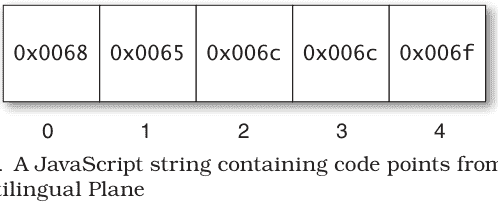
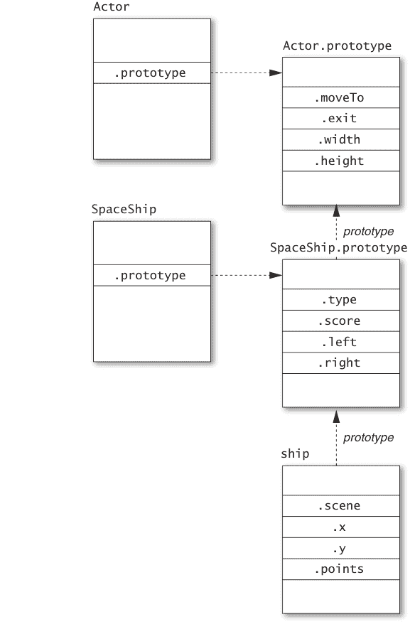

# Effective JavaScript：68个具体方法掌握JavaScript的威力


## 对 *Effective JavaScript* 的赞誉

"不负高效软件开发丛书之盛名，Dave Herman 所著的 *Effective JavaScript* 是任何想要认真进行 JavaScript 编程之人的必读之作。本书详细解释了 JavaScript 的内部工作原理，帮助读者更好地利用这门语言。"

——Erik Arvidsson，高级软件工程师

"像 David 这样能言善辩、语言平易近人的编程语言专家实属罕见。他对 JavaScript 语法和语义的讲解既引人入胜又极具洞察力；对陷阱的提醒与真实用例相辅相成，节奏恰到好处。读完本书后，你会发现自己获得了强大而全面的掌控感。"

——Paul Irish，Google Chrome 开发者倡导者

"在阅读 *Effective JavaScript* 之前，我以为这不过是又一本关于如何写出更好 JavaScript 的书。但这本书不仅做到了这一点，还提供了更多——它让你深入理解这门语言。而这至关重要。没有这种理解，你对这门语言本身绝对一无所知。你只会知道其他程序员如何写代码。"

"如果你想成为一名真正优秀的 JavaScript 开发者，就读这本书。我个人就希望自己刚开始写 JavaScript 时能有这本书。"

——Anton Kovalyov，JSHint 开发者

"如果你在寻找一本既能提供正式又能提供高度可读 insights into the JavaScript language 的书，不用再找了。中高级 JavaScript 开发者会在其中发现知识宝藏，即使是高技能的 JavaScript 专家也几乎肯定能学到不少东西。对于其他语言的资深实践者来说，想要一头扎进 JavaScript 的世界，这本书是快速上手的必读之作。无论你的背景如何，作者 Dave Herman 都做了出色的探索工作——涵盖 JavaScript 的精华部分、它的瑕疵，以及介于两者之间的一切。"

——Rebecca Murphey，Bocoup 高级 JavaScript 开发者

"*Effective JavaScript* 是任何理解 JavaScript 绝非 mere toy 并想要充分利用其强大功能之人的必读之作。Dave Herman 为用户带来了对这门语言深入、细致且实用的理解，通过一个又一个示例引导他们得出与他相同的结论。这不是一本寻找捷径者的书；相反，这是来之不易的经验提炼而成的 guided tour。这是我毫不犹豫地推荐的少数几本 JavaScript 书籍之一。"

——Alex Russell，TC39 成员，Google 软件工程师

"很少有人有机会与技艺大师并肩学习。这本书正是如此——相当于一位穿越时空的哲学家回到公元前五世纪，与柏拉图一同学习的 JavaScript 版本。"

——Rick Waldron，Bocoup JavaScript 布道师

*此页有意留空*

*献给 Lisa，我的爱*

*此页有意留空*

## 前言

众所周知，我在1995年5月的十天里创建 JavaScript，当时承受着巨大的压力，面临着相互冲突的管理指令——"让它看起来像 Java"、"让它对初学者友好"、"让它能够控制 Netscape 浏览器中的几乎所有内容"。

除了做对了两件大事（一级函数、对象原型）之外，我应对这些挑战性要求和疯狂短促的日程安排的方法，是让 JavaScript 从一开始就极具可塑性。我知道开发者将不得不"修补"最初几个版本来修复 bug，并探索比我匆忙拼凑的内置库更好的方法。许多语言限制可变性，例如，内置对象不能在运行时修改或扩展，或者标准库的名称绑定不能被赋值覆盖，而 JavaScript 则允许几乎完全改变每个对象。

我相信总体而言这是一个好的设计决策。它在某些领域确实带来了挑战（例如，在浏览器的安全边界内安全地混合受信任和不受信任的代码）。但支持所谓的猴子补丁（monkey-patching）至关重要，开发者通过编辑标准对象来规避 bug，并将未来功能的模拟 retrofitted 到旧浏览器中（即所谓的 polyfill 库垫片，用美式英语来说应该是"spackle"）。

除了这些有时平凡的用途之外，JavaScript 的可塑性鼓励用户创新网络沿着几条更具创造性的道路形成和发展。领先用户创建了以其他语言为蓝本的工具包或框架库：Prototype 借鉴 Ruby，MochiKit 借鉴 Python，Dojo 借鉴 Java，TIBET 借鉴 Smalltalk。然后是 jQuery 库（"新派 JavaScript"），2007 年我第一次见到它时，在我看来似乎是一个相对较晚的进入者，但它却通过回避其他语言中的先例，同时从较老的 JavaScript 库中学习，而是忠于浏览器的"查询并执行"模型并将其极度简化，席卷了整个 JavaScript 世界。

领先用户及其创新网络由此发展出了一种 JavaScript"本土风格"，这种风格仍在其他库中被模仿和简化，并被纳入现代 Web 标准化工作中。

在这一演变过程中，JavaScript 始终保持向后（"向后兼容 bug"）兼容，并且默认可变，即使在最新版本的 ECMAScript 标准中添加了某些用于冻结对象以阻止扩展、密封对象属性以防止被覆盖的方法之后也是如此。而且 JavaScript 的进化之旅远未结束。就像活语言和生物系统一样，变化是长期的常态。我仍然无法预见单一的"标准库"或编码风格能横扫所有其他选择。

没有哪种语言没有怪癖，也没有哪种语言严格到足以规定普遍的最佳实践，而 JavaScript 远非没有怪癖或限制主义（更接近相反！）。因此，要想高效使用 JavaScript，开发者比其他大多数编程语言更需要学习和追求良好的风格 Powers、正确的用法和最佳实践。在考虑什么最有效时，我认为至关重要的是避免反应过度，构建僵化或教条的风格指南。

这本书基于具体证据和经验采取平衡的方法，不会陷入僵化或过度规定。我认为它将成为许多人的关键帮助和可靠指南，帮助他们寻求编写高效的 JavaScript，同时不牺牲表达力和追求新思想与新范式的自由。这也是一本聚焦、有趣的读物，配有精彩的示例。

最后，我很荣幸自 2006 年起就认识 David Herman，当时我代表 Mozilla 首次与他联系，邀请他作为特邀专家加入 Ecma 标准组织。Dave 深厚而不张扬的专业知识，以及他对 JavaScript 的热情，在每一页上都闪耀着光芒。太棒了！

> ——Brendan Eich

## 序言

学习一门编程语言需要熟悉其*语法*，即构成合法程序的形式和结构，以及*语义*，即这些形式的含义或行为。但除此之外，掌握一门语言还需要理解其*语用学*，即语言的特性被用来构建有效程序的方式。后者可能特别微妙，尤其是在像 JavaScript 这样灵活而富有表现力的语言中。

本书关注的是 JavaScript 的语用学。它不是一本入门书；我假设你对 JavaScript 本身以及编程都有一定的了解。有许多优秀的 JavaScript 入门书籍，例如 Douglas Crockford 的 *JavaScript: The Good Parts* 和 Marijn Haverbeke 的 *Eloquent JavaScript*。我写这本书的目标是帮助你深入理解如何高效地使用 JavaScript，以构建更可预测、更可靠、更易维护的 JavaScript 应用程序和库。

### JavaScript 与 ECMAScript

在深入本书内容之前，澄清一些术语会很有帮助。本书是关于一种几乎 universally 被称为 JavaScript 的语言。然而，定义该规范的官方标准描述的是一种它称为 ECMAScript 的语言。由于历史原因，这很复杂，但归根结底是版权的问题：由于法律原因，标准组织 Ecma International 无法在其标准中使用"JavaScript"这个名称。（雪上加霜的是，该标准组织将其名称从原来的 ECMA——European Computer Manufacturers Association 的缩写——改为 Ecma International，且不使用大写。到改名时，大写的名称 ECMAScript 已经木已成舟。）

严格来说，当人们提到 ECMAScript 时，他们通常指的是 Ecma 标准所规范的"理想"语言。与此同时，JavaScript 这个名字可以指从实际使用中的语言到某个 vendor 特定的 JavaScript 引擎的任何东西。在常见用法中，人们经常将这两个术语互换使用。为了清晰和一致，在本书中我将只使用 *ECMAScript* 来谈论官方标准；否则，我将该语言称为 *JavaScript*。我还使用常见的缩写 *ES5* 来指代 ECMAScript 标准的第五版。

### 关于 Web

谈论 JavaScript 而不谈论 Web 是很难的。迄今为止，JavaScript 是唯一在所有主要 Web 浏览器内置支持客户端应用程序脚本的编程语言。此外，近年来，随着 Node.js 平台的出现，JavaScript 已成为实现服务器端应用程序的流行语言。

尽管如此，这是一本关于 JavaScript 的书，而不是关于 Web 编程的书。有时，讨论与 Web 相关的例子和概念应用是有帮助的。但本书的重点在于语言本身——其语法、语义和语用学——而非 Web 平台的 API 和技术。

### 关于并发的说明

JavaScript 的一个奇特之处在于，它在并发场景中的行为是完全未指定的。直到并包括第五版在内，ECMAScript 标准对 JavaScript 程序在交互或并发环境中的行为只字未提。第7章涉及并发，因此从技术上讲描述的是 JavaScript 的非官方特性。但在实践中，所有主要 JavaScript 引擎共享一个共同的并发模型。而且，处理并发和交互程序是 JavaScript 编程的核心统一概念，尽管标准中并未涉及。事实上，未来版本的 ECMAScript 标准可能会正式规范这些 JavaScript 并发模型的共享方面。


## 致谢

本书的诞生极大地得益于 JavaScript 的发明者 Brendan Eich。我衷心感谢 Brendan 邀请我参与 JavaScript 的标准化工作，以及在 Mozilla 职业生涯中给予我的指导和支持。

本书的许多内容都受到并借鉴了优秀的博客文章和在线文章。我从 Ben "cowboy" Alman、Erik Arvidsson、Mathias Bynens、Tim "creationix" Caswell、Michaeljohn "inimino" Clement、Angus Croll、Andrew Dupont、Ariya Hidayat、Steven Levithan、Pan Thomakos、Jeff Walden 和 Juriy "kangax" Zaytsev 的文章中学到了很多。当然，本书的终极资源是 ECMAScript 规范，自第 5 版以来，Allen Wirfs-Brock 一直孜孜不倦地对其进行编辑和更新。而 Mozilla 开发者网络（Mozilla Developer Network）仍然是 JavaScript API 和特性方面最令人印象深刻且高质量的在线资源之一。

在本书的规划和撰写过程中，我得到了许多顾问的帮助。在开始写作前，John Resig 就关于写作给了我有用的建议。在早期阶段，Blake Kaplan 和 Patrick Walton 帮助我理清思路并规划了书籍的结构。在写作过程中，我从 Brian Anderson、Norbert Lindenberg、Sam Tobin-Hochstadt、Rick Waldron 和 Patrick Walton 那里得到了很棒的建议。

与 Pearson 的工作人员合作非常愉快。Olivia Basegio、Audrey Doyle、Trina MacDonald、Scott Meyers 和 Chris Zahn 对我的问题响应及时，对我的拖延非常耐心，并且尽量满足我的要求。我无法想象有比这更愉快的首次写作经历。我绝对荣幸能为这个精彩的系列丛书做出贡献。在我还未曾预料到自己可能有幸亲自撰写一本 Effective 系列书籍之前，我就是 *Effective C++* 的粉丝了。

我不敢相信自己如此幸运，能找到这样一个梦幻般的技术编辑团队。我感到非常荣幸 Erik Arvidsson、Rebecca Murphey、Rick Waldron 和 Richard Worth 同意编辑本书，他们为我提供了无比宝贵的批评和建议。他们不止一次地将我从一些真正令人尴尬的错误中拯救出来。

写书比我预期的更令人生畏。如果没有朋友和同事的支持，我可能早就失去了信心。我不知道他们当时是否意识到，但 Andy Demmark、Rick Waldron 和 Travis Winfrey 在我怀疑自己的时刻给予了我所需的鼓励。

本书的绝大部分内容是在旧金山美丽的 Parkside 社区的 Java Beach Café 写成的。那里的工作人员都认识我，甚至在我开口之前就知道我要点什么。我感谢他们提供了一个舒适的工作环境，并让我保持饱腹和咖啡因充足。

我的毛茸茸的小猫咪朋友 Schmoopy 竭尽所能为本书做出贡献。至少，它一直跳到我的腿上，坐在屏幕前面。（这 *可能* 与笔记本电脑的热度有关。）自 2006 年以来，Schmoopy 就是我忠实的小伙伴，我无法想象生活中没有这个小毛球的样子。

我的整个家庭从始至终都对这个项目给予了支持并感到兴奋。遗憾的是，我的祖父母 Frank 和 Miriam Slamar 在我能够与他们分享最终成果之前就去世了。但他们曾为我感到兴奋和自豪，而且书中也包含了我童年时与 Frank 一起编写 BASIC 程序的一些经历。

最后，我要感谢我的挚爱 Lisa Silveria，这份情谊远非一篇序言所能回报。

## 关于作者

**David Herman** 是 Mozilla Research 的高级研究员。他拥有 Grinnell College 的计算机科学学士学位，以及 Northeastern University 的计算机科学硕士和博士学位。David 在 Ecma TC39 委员会任职，该委员会负责 JavaScript 的标准化工作。

# 1

## 习惯 JavaScript

JavaScript 被设计得易于上手。它的语法让人联想到 Java，其结构也常见于许多脚本语言（如函数、数组、字典和正则表达式），对于任何有一点编程经验的人来说，JavaScript 似乎都很容易掌握。对于编程新手来说，由于语言的核心概念数量较少，经过相对较少的培训就可以开始编写程序了。

尽管 JavaScript 非常易于接近，但要精通这门语言需要更多时间，并且需要对其语义、特性和最有效的惯用法有更深入的理解。本书每一章都涵盖了有效 JavaScript 的一个不同主题领域。本章从一些最基本的主题开始。

### 条目 1：了解你使用的 JavaScript 版本

像大多数成功的技术一样，JavaScript 也在不断演变。最初，JavaScript 被宣传为 Java 的补充，用于编写交互式网页，但最终取代了 Java 成为 Web 上占主导地位的编程语言。JavaScript 的流行使其在 1997 年被正式标准化为国际标准，官方称为 ECMAScript。如今，有许多不同的 JavaScript 实现符合不同版本的 ECMAScript 标准。

ECMAScript 标准的第三个版本（通常称为 ES3）于 1999 年最终确定，至今仍是应用最广泛的 JavaScript 版本。标准的下一次重大进步是第 5 版，即 ES5，于 2009 年发布。ES5 引入了许多新特性，并将一些广泛支持但之前未标准化的特性正式纳入标准。由于 ES5 的支持尚未普及，我将在本书中随时指出哪些特定的条目或建议是针对 ES5 的。

除了标准的多个版本外，还有一些非标准特性，某些 JavaScript 实现支持，而其他实现则不支持。例如，许多 JavaScript 引擎支持使用 `const` 关键字定义变量，但 ECMAScript 标准并未对 `const` 的语法或行为做出任何定义。此外，`const` 的行为也因实现而异。在某些情况下，`const` 变量不允许被更新：

```javascript
const PI = 3.141592653589793;
PI = "modified!";
PI; // 3.141592653589793
```

其他实现则简单地将 `const` 视为 `var` 的同义词：

```javascript
const PI = 3.141592653589793;
PI = "modified!";
PI; // "modified!"
```

鉴于 JavaScript 悠久的历史和实现的多样性，要跟踪哪些特性在哪些平台上可用可能很困难。更加复杂的问题是，JavaScript 的主要生态系统——Web 浏览器——并没有给程序员控制执行代码的 JavaScript 版本的能力。由于最终用户可能使用不同版本的不同 Web 浏览器，Web 程序必须小心编写，以确保在所有浏览器中一致地工作。

另一方面，JavaScript 并不专门用于客户端 Web 编程。其他用途包括服务器端程序、浏览器扩展以及移动和桌面应用程序的脚本。在某些情况下，你可能可以使用特定版本的 JavaScript。对于这些情况，利用平台特定 JavaScript 实现提供的额外特性是有意义的。

本书主要关注 JavaScript 的标准特性。但讨论某些广泛支持但非标准的特性也很重要。在处理较新标准或非标准特性时，关键是要理解你的应用程序是否将在支持这些特性的环境中运行。否则，你可能会发现你的应用程序在自己的计算机或测试基础设施上可以按预期工作，但在将它们部署给在不同环境中运行你的应用程序的用户时却失败了。例如，`const` 在支持该非标准特性的引擎上测试时可能工作正常，但随后会失败，


在无法识别该关键字词的 Web 浏览器中部署时会发生语法错误。

ES5 引入了另一个版本考量因素，即其*严格模式*。此功能允许你选择使用一个受限版本的 JavaScript，该版本禁止完整语言中某些更有问题或容易出错的特性。该语法被设计为向后兼容，因此未实现严格模式检查的环境仍然可以执行严格代码。通过在程序最开头添加一个特殊的字符串常量，可以在程序中启用严格模式：

```
"use strict";
```

类似地，你可以将指令放在函数体的开头来在该函数中启用严格模式：

```
function f(x) {
    "use strict";
    // ...
}
```

使用字符串字面量作为指令语法看起来有点奇怪，但它具有向后兼容的好处：求值字符串字面量没有副作用，因此 ES3 引擎会将该指令作为无害的语句执行——它对字符串求值，然后立即丢弃其值。这使得编写严格模式代码能够在旧版 JavaScript 引擎中运行，但有一个关键限制：旧引擎不会执行严格模式的任何检查。如果不在 ES5 环境中进行测试，很容易编写出在 ES5 环境中运行会被拒绝的代码：

```
function f(x) {
    "use strict";
    var arguments = []; // error: redefinition of arguments
    // ...
}
```

在严格模式下，重新定义 arguments 变量是不允许的，但未实现严格模式检查的环境会接受这段代码。在生产环境中部署此代码将导致程序在实现 ES5 的环境中失败。因此，你应该始终在完全兼容 ES5 的环境中测试严格代码。

使用严格模式的一个陷阱是，"use strict" 指令只在脚本或函数的顶部被识别，这使得它对*脚本拼接*很敏感——大型应用程序在单独的文件中开发，然后被组合成一个文件用于生产部署。考虑一个期望处于严格模式的文件：

```
// file1.js
"use strict";
function f() {
    // ...
}
// ...
```

和另一个期望不处于严格模式的文件：

```
// file2.js
// no strict-mode directive
function g() {
    var arguments = [];
    // ...
}
// ...
```

我们如何正确拼接这两个文件？如果我们将 file1.js 放在前面，那么整个组合文件都会处于严格模式：

```
// file1.js
"use strict";
function f() {
    // ...
}
// ...
// file2.js
// no strict-mode directive
function g() {
    var arguments = []; // error: redefinition of arguments
    // ...
}
// ...
```

而如果我们从 file2.js 开始，那么组合后的文件都不会处于严格模式：

```
// file2.js
// no strict-mode directive
function g() {
    var arguments = [];
    // ...
}
// ...
// file1.js
"use strict";
function f() { // no longer strict
    // ...
}
// ...
```

在自己的项目中，你可以坚持"仅严格模式"或"仅非严格模式"的策略，但如果你想编写能够与各种代码组合使用的健壮代码，你有几个备选方案。

*不要将严格文件和非严格文件拼接在一起。* 这可能是最简单的解决方案，但它当然会限制你对应用程序或库文件结构的控制。充其量，你必须部署两个独立的文件，一个包含所有严格文件，另一个包含所有非严格文件。

*通过将文件体包装在立即调用的函数表达式中来拼接文件。* 第 13 条对立即调用的函数表达式（IIFE）进行了深入解释，但简而言之，通过将每个文件的内容包装在函数中，它们可以在不同的模式下独立解释。上述示例的拼接版本看起来像这样：

```
// no strict-mode directive
(function() {
    // file1.js
    "use strict";
    function f() {
        // ...
    }
    // ...
})();
(function() {
    // file2.js
    // no strict-mode directive
    function f() {
        var arguments = [];
        // ...
    }
    // ...
})();
```

由于每个文件的内容被放置在单独的作用域中，严格模式指令（或缺少它）只影响该文件的内容。然而，要使这种方法有效，文件内容不能假设它们是在全局作用域中解释的。例如，var 和 function 声明不会持久化为全局变量（有关全局变量的更多内容，请参见第 8 条）。这恰好与流行的*模块系统*的情况相同，它们通过自动将每个模块的内容放在单独的函数中来管理文件和依赖关系。由于文件都被放在局部作用域中，每个文件可以自行决定是否使用严格模式。

*编写文件，使它们在任何一种模式下的行为相同。* 要编写在尽可能多的上下文中工作的库，你不能假设脚本拼接工具会将它放在函数内部，也不能假设客户端代码库会是严格或非严格的。为获得最大兼容性而构建代码的最简单方法是，为严格模式编写，但将所有代码内容显式包装在本地启用严格模式的函数中。这与前面的方案类似，都是将每个文件的内容包装在 IIFE 中，但在这种情况下，你手动编写 IIFE，而不是依赖拼接工具或模块系统来为你完成，并显式选择严格模式：

```
(function() {
    "use strict";
    function f() {
        // ...
    }
    // ...
})();
```

请注意，无论这段代码是在严格还是非严格上下文中拼接，它都被视为严格模式。相比之下，未选择严格模式的函数如果拼接在严格代码之后，仍然会被视为严格模式。因此，更具普遍兼容性的选择是严格模式编写。

## 需要记住的要点

- 确定你的应用程序支持哪些版本的 JavaScript。
- 确保你使用的任何 JavaScript 特性都在应用程序运行的所有环境中得到支持。
- 始终在执行严格模式检查的环境中测试严格代码。
- 小心拼接对严格模式有不同期望的脚本。

## 第 2 条：理解 JavaScript 的浮点数

大多数编程语言有几种数值数据类型，但 JavaScript 只用一种就应付过去了。你可以从 `typeof` 运算符的行为中看出这一点，它同样将整数和浮点数归类为数字：

```
typeof 17;    // "number"
typeof 98.6; // "number"
typeof -2.1; // "number"
```

事实上，JavaScript 中的所有数字都是*双精度浮点数*，即 IEEE 754 标准规定的 64 位数字编码——通常称为"双精度数"。如果这一事实让你想知道整数去哪了，请记住双精度数可以以高达 53 位精度完美地表示整数。从 –9,007,199,254,740,992 (–2⁵³) 到 9,007,199,254,740,992 (2⁵³) 的所有整数都是有效的双精度数。所以尽管缺乏单独的整数类型，在 JavaScript 中进行整数运算也是完全可行的。

大多数算术运算符适用于整数、实数或两者的组合：

```
0.1 * 1.9  // 0.19
-99 + 100; // 1
21 - 12.3; // 8.7
2.5 / 5;   // 0.5
21 % 8;    // 5
```

然而，位算术运算符是特殊的。它们不是直接作为浮点数对参数进行运算，而是隐式将其转换为 32 位整数。（更精确地说，它们被视为 32 位*大端序、二进制补码*整数。）例如，来看按位 OR 表达式：

```
8 | 1; // 9
```

这个看起来简单的表达式实际上需要几个步骤来求值。一如既往，JavaScript 数字 8 和 1 是双精度数。但它们也可以表示为 32 位整数，即三十二个 1 和 0 的序列。作为 32 位整数，数字 8 看起来像这样：

```
00000000000000000000000000001000
```

你可以使用数字的 toString 方法自己查看这一点：

```
(8).toString(2); // "1000"
```

`toString`的参数指定了*基数*，这里表示二进制（即基数为2）表示。结果会去掉左侧多余的0位，因为它们不影响数值。

整数1用32位表示为：

```
00000000000000000000000000000001
```

按位或表达式通过保留两个输入序列中任意一个出现的1位来组合它们，产生以下位模式：

```
00000000000000000000000000001001
```

这个序列代表整数9。你可以使用标准库函数`parseInt`（同样指定基数为2）来验证：

```
parseInt("1001", 2); // 9
```

（前导的0位是不必要的，因为再次强调，它们不影响结果。）

所有按位运算符的工作方式相同：将输入转换为整数，对整数位模式执行操作，然后将结果转换回标准的JavaScript浮点数。通常，这些转换在JavaScript引擎中需要额外的工作：因为数字以浮点形式存储，它们必须先转换为整数，然后再转换回浮点数。然而，优化编译器有时可以推断出算术表达式甚至变量是否仅用于整数运算，从而通过内部将数据存储为整数来避免额外的转换。

最后，关于浮点数有一点需要注意：如果它们没有让你感到哪怕一丝不安，那你可能应该感到不安。浮点数看起来出奇地熟悉，但它们的不精确性是出了名的。即使一些看起来最简单的算术也可能产生不准确的结果：

```
0.1 + 0.2; // 0.30000000000000004
```

虽然64位精度相当大，但双精度浮点数仍然只能表示有限的一组数字，而不是无限的实数集。浮点算术只能产生近似结果，舍入到最接近的可表示实数。当你执行一系列计算时，这些舍入误差会累积，导致结果越来越不准确。舍入也会导致与我们通常期望的算术性质产生令人惊讶的偏差。例如，实数是*结合律*的，

这意味着对于任意实数*x*、*y*和*z*，总满足(*x* + *y*) + *z* = *x* + (*y* + *z*)。

但浮点数并不总是满足这一点：

```
(0.1 + 0.2) + 0.3; // 0.6000000000000001
0.1 + (0.2 + 0.3); // 0.6
```

浮点数在精度和性能之间提供了权衡。当精度至关重要时，意识到它们的局限性非常重要。一个有用的解决方法是尽可能使用整数值进行计算，因为它们可以无舍入地表示。在处理货币计算时，程序员通常会将数字放大到货币的最小单位，以便使用整数进行计算。例如，如果上述计算是以美元为单位，我们可以改为使用整数美分：

```
(10 + 20) + 30; // 60
10 + (20 + 30); // 60
```

使用整数时，你仍然需要注意所有计算都在-2⁵³和2⁵³的范围内，但你不必担心舍入误差。

## 需要记住的要点

- JavaScript数字是双精度浮点数。
- JavaScript中的整数只是双精度浮点数的一个子集，而不是单独的数据类型。
- 按位运算符将数字视为32位有符号整数。
- 注意浮点算术的精度限制。

## 条目3：警惕隐式强制转换

JavaScript在处理类型错误时可能出奇地宽容。许多语言认为像

```
3 + true; // 4
```

这样的表达式是错误的，因为布尔表达式（如true）与算术运算不兼容。在静态类型语言中，包含此类表达式的程序甚至不允许运行。在某些动态类型语言中，虽然程序可以运行，但这样的表达式会抛出异常。JavaScript不仅允许程序运行，而且愉快地产生了结果4！

在JavaScript中，只有少数情况下提供错误的类型会立即产生错误，例如调用非函数或尝试选择null的属性：

```
"hello"(1); // error: not a function
null.x;     // error: cannot read property 'x' of null
```

但在许多其他情况下，JavaScript不是抛出错误，而是通过遵循各种自动转换协议来*强制转换*值到预期类型。例如，算术运算符`-`、`*`、`/`和`%`都会在计算前尝试将其参数转换为数字。运算符`+`更为微妙，因为它被重载以根据参数类型执行数字加法或字符串连接：

```
2 + 3;              // 5
"hello" + " world"; // "hello world"
```

那么，当你组合一个数字和一个字符串时会发生什么？JavaScript倾向于字符串，将数字转换为字符串：

```
"2" + 3; // "23"
2 + "3"; // "23"
```

像这样混合类型有时会令人困惑，特别是因为它对操作顺序敏感。考虑表达式：

```
1 + 2 + "3";   // "33"
```

由于加法从左分组（即*左结合*），这与以下表达式相同：

```
(1 + 2) + "3";  // "33"
```

相比之下，表达式

```
1 + "2" + 3;    // "123"
```

求值为字符串"123"——再次，左结合性规定该表达式等同于将左侧加法括在括号中：

```
(1 + "2") + 3;  // "123"
```

按位运算不仅转换为数字，还转换为可以表示为32位整数的数字子集，如条目2中所述。这些包括按位算术运算符（`~`、`&`、`^`和`|`）以及移位运算符（`<<`、`>>`和`>>>`）。

这些强制转换可能非常方便——例如，自动转换来自用户输入、文本文件或网络流的字符串：

```
"17" * 3;  // 51
"8" | "1"; // 9
```

但强制转换也可能隐藏错误。一个结果为null的变量在算术计算中不会失败，而是静默转换为0；一个未定义的变量将转换为特殊的浮点值NaN（这个矛盾地命名为"非数字"的数字——要怪就怪IEEE浮点标准！）。这些强制转换不会立即抛出异常，而是导致计算以常常令人困惑和不可预测的结果继续进行。令人沮丧的是，即使测试NaN值也特别困难，原因有二。首先，JavaScript遵循IEEE浮点标准令人费解的要求，即NaN应被视为不等于自身。因此，测试一个值是否等于NaN完全无效：

```
var x = NaN;
x === NaN;    // false
```

此外，标准的`isNaN`库函数并不可靠，因为它自身也带有隐式强制转换，在测试值之前将其参数转换为数字。（`isNaN`更准确的名称可能是`coercesToNaN`。）如果你已经知道一个值是数字，你可以用`isNaN`测试它是否为NaN：

```
isNaN(NaN); // true
```

但其他绝对不是NaN的值，如果可强制转换为NaN，对`isNaN`来说是无法区分的：

```
isNaN("foo");               // true
isNaN(undefined);           // true
isNaN({});                  // true
isNaN({ valueOf: "foo" }); // true
```

幸运的是，有一个既可靠又简洁的惯用法（虽然有点反直觉）来测试NaN。由于NaN是唯一一个被视为不等于自身的JavaScript值，你总是可以通过检查一个值是否等于自身来测试它是否为NaN：

```
var a = NaN;
a !== a;                      // true
var b = "foo";
b !== b;                      // false
```

 var c = undefined;
c !== c;                        // false
var d = {};
d !== d;                        // false
var e = { valueOf: "foo" };
e !== e;                        // false
```

你也可以将这个模式抽象成一个命名清晰的工具函数：

```
function isReallyNaN(x) {
    return x !== x;
}
```

但检测一个值是否不等于它自身非常简洁，因此通常不需要辅助函数直接使用，所以识别和理解这一点很重要。

静默的隐式转换会让调试一个有问题的程序特别令人沮丧，因为它们掩盖了错误，使其更难诊断。当计算出错时，调试的最佳方法是检查计算的中间结果，回溯到出错前的最后一步。从那里，你可以检查每个操作的参数，寻找类型错误的参数。根据bug的不同，这可能是逻辑错误，比如使用了错误的算术运算符，或者是类型错误，比如传入了undefined值而不是数字。

对象也可以被强制转换为原始值。这最常用于转换为字符串：

```
"the Math object: " + Math; // "the Math object: [object Math]"
"the JSON object: " + JSON; // "the JSON object: [object JSON]"
```

对象通过隐式调用其toString方法转换为字符串。你可以自己调用它来验证：

```
Math.toString(); // "[object Math]"
JSON.toString(); // "[object JSON]"
```

类似地，对象可以通过valueOf方法转换为数字。你可以通过定义这些方法来控制对象的类型转换：

```
"J" + { toString: function() { return "S"; } }; // "JS"
2 * { valueOf: function() { return 3; } };      // 6
```

再次强调，考虑到+被重载以同时执行字符串拼接和加法，事情就变得复杂了。具体来说，当一个对象同时包含toString和valueOf方法时，+应该调用哪个方法并不明显：它应该根据类型在拼接和加法之间选择，但隐式强制转换下，类型实际上并未给出！JavaScript通过盲目地选择valueOf而非toString来解决这种歧义。但这意味着如果有人打算用对象进行字符串拼接，它可能会表现得意想不到：

```
var obj = {
    toString: function() {
        return "[object MyObject]";
    },
    valueOf: function() {
        return 17;
    }
};
"object: " + obj; // "object: 17"
```

这个故事的寓意是，valueOf实际上只设计用于表示数值的对象，比如Number对象。对于这些对象，toString和valueOf方法返回一致的结果——同一数字的字符串表示或数字表示——因此重载的+无论该对象是用于拼接还是加法，行为总是一致的。一般来说，强制转换为字符串远比强制转换为数字更常见和有用。最好避免使用valueOf，除非你的对象确实是一个数值抽象，并且obj.toString()产生obj.valueOf()的字符串表示。

最后一种强制转换有时被称为*truthiness*（真假值）。if、||和&&等运算符在逻辑上处理布尔值，但实际上接受任何值。JavaScript值根据简单的隐式强制转换解释为布尔值。大多数JavaScript值是*truthy*（真值），即隐式强制转换为true。这包括所有对象——与字符串和数字强制转换不同，真假值判断不涉及隐式调用任何强制转换方法。恰好有七个*falsy*（假值）：false、0、-0、""、NaN、null和undefined。所有其他值都是truthy。由于数字和字符串可以是falsy，使用真假值来判断函数参数或对象属性是否定义并不总是安全的。考虑一个接收带有默认值的可选参数的函数：

```
function point(x, y) {
    if (!x) {
        x = 320;
    }
    if (!y) {
        y = 240;
    }
    return { x: x, y: y };
```

这个函数会忽略任何falsy参数，包括0：

```
point(0, 0); // { x: 320, y: 240 }
```

检查undefined的更精确方法是使用typeof：

```
function point(x, y) {
    if (typeof x === "undefined") {
        x = 320;
    }
    if (typeof y === "undefined") {
        y = 240;
    }
    return { x: x, y: y };
}
```

这个版本的point正确区分了0和undefined：

```
point();     // { x: 320, y: 240 }
point(0, 0); // { x: 0, y: 0 }
```

另一种方法是与undefined比较：

```
if (x === undefined) { ... }
```

第54条讨论了真假值测试对库和API设计的影响。

## 需要记住的要点

- 类型错误可能被隐式强制转换悄悄隐藏。
- +运算符被重载，根据其参数类型执行加法或字符串拼接。
- 对象通过valueOf强制转换为数字，通过toString强制转换为字符串。
- 带有valueOf方法的对象应该实现一个toString方法，提供valueOf所产生数字的字符串表示。
- 使用typeof或与undefined比较，而不是真假值，来检测undefined值。

## 第4条：优先使用原始值而非对象包装器

除了对象，JavaScript有五种原始值类型：布尔值、数字、字符串、null和undefined。（令人困惑的是，typeof运算符将null的类型报告为"object"，但ECMAScript标准将其描述为一种独立的类型。）同时，标准库提供了将布尔值、数字和字符串包装为对象的构造函数。你可以创建一个包装字符串值的String对象：

```
var s = new String("hello");
```

在某些方面，String对象的行为与其包装的字符串值相似。你可以将其与其他值拼接来创建字符串：

```
s + " world"; // "hello world"
```

你可以提取其索引子字符串：

```
s[4]; // "o"
```

但与原始字符串不同，String对象是真正的对象：

```
typeof "hello"; // "string"
typeof s;       // "object"
```

这是一个重要的区别，因为这意味着你不能使用内置运算符来比较两个不同String对象的内容：

```
var s1 = new String("hello");
var s2 = new String("hello");
s1 === s2; // false
```

由于每个String对象都是独立的对象，它只与自身相等。非严格相等运算符也是如此：

```
s1 == s2; // false
```

由于这些包装器的行为不太正确，它们没有太大的用处。它们存在的主要理由是其工具方法。JavaScript通过另一种隐式强制转换使这些方法便于使用：你可以从原始值中提取属性并调用方法，它表现得就像你用相应的对象类型包装了该值一样。例如，String原型对象有一个toUpperCase方法，可将字符串转换为大写。你可以在原始字符串值上使用这个方法：

```
"hello".toUpperCase(); // "HELLO"
```

这种隐式包装的一个奇怪后果是，你可以在原始值上设置属性，但基本上没有效果：

```
"hello".someProperty = 17;
"hello".someProperty; // undefined
```

由于隐式包装每次都会产生一个新的String对象，因此对第一个包装器对象的更新不会产生持久效果。在原始值上设置属性实在没有意义，但了解这种行为是值得的。这碰巧又是JavaScript可以隐藏类型错误的另一个例子：如果你在你期望是对象的东西上设置属性，但错误地使用了原始值，你的程序将简单地忽略该更新并继续。这很容易使错误未被发现，并使其更难诊断。

## 需要记住的要点

- 原始类型的对象包装器在比较相等性时，与其原始值的行为不同。
- 在原始值上获取和设置属性会隐式创建对象包装器。

## 第5条：避免在混合类型时使用==

你期望这个表达式的值是什么？

```
"1.0e0" == { valueOf: function() { return true; } };
```

这两个看似无关的值实际上被==运算符视为等价，因为与第3条中描述的隐式强制转换类似，它们在比较前都被转换为数字。字符串"1.0e0"解析为数字1，而对象通过调用其valueOf方法并转换结果（true）为数字，也产生1。

这些强制转换很诱人，可以用于诸如从网页表单读取字段并与数字比较等任务：

```
var today = new Date();

if (form.month.value == (today.getMonth() + 1) &&
    form.day.value == today.getDate()) {
    // 生日快乐！
    // ...
}
```


## 第5条：避免在混合类型中使用 ==

但实际上，使用 Number 函数或一元 + 运算符可以很容易地*显式*转换值为数字：

```
var today = new Date();

if (+form.month.value == (today.getMonth() + 1) &&
    +form.day.value == today.getDate()) {
    // 生日快乐！
    // ...
}
```

这种方式更清晰，因为它向代码的读者明确传达了应用的是哪种转换，而无需他们记忆转换规则。一个更好的替代方案是使用*严格相等*运算符：

```
var today = new Date();

if (+form.month.value === (today.getMonth() + 1) && // 严格
    +form.day.value === today.getDate()) {             // 严格
    // 生日快乐！
    // ...
}
```

当两个参数类型相同时，== 和 === 在行为上没有区别。因此，如果你知道参数类型相同，它们是可以互换的。但使用严格相等运算符是向读者表明比较中不涉及任何转换的好方法。否则，你就要求读者回忆起确切的强制转换规则来理解你代码的行为。

事实证明，这些强制转换规则一点也不直观。表 1.1 列出了当 == 运算符的参数类型不同时的强制转换规则。这些规则是对称的：例如，第一条规则既适用于 `null == undefined`，也适用于 `undefined == null`。大多数时候，转换试图产生数字。但当规则处理对象时就变得微妙了。该操作试图通过调用对象的 `valueOf` 和 `toString` 方法将对象转换为原始值，使用它得到的第一个原始值。更微妙的是，Date 对象以相反的顺序尝试这两种方法。

== 运算符似乎能够掩盖数据的不同表示形式，这具有欺骗性。这种纠错有时被称为 "*按我意思做*" 语义。但计算机无法真正读懂你的心思。世界上的数据表示形式太多，JavaScript 无法知道你使用的是哪一种。例如，你可能希望将一个包含日期的字符串与一个 Date 对象进行比较：

```
var date = new Date("1999/12/31");
date == "1999/12/31"; // false
```

这个特定的例子失败了，因为将 Date 对象转换为字符串产生的格式与示例中使用的格式不同：

```
date.toString(); // "Fri Dec 31 1999 00:00:00 GMT-0800 (PST)"
```

但这个错误反映了对强制转换更普遍的误解。== 运算符不会推断和统一任意的数据格式。它要求你和你的读者理解其微妙的强制转换规则。更好的策略是通过自定义应用逻辑使转换显式化，并使用严格相等运算符：

```
function toYMD(date) {
    var y = date.getYear() + 1900, // 年份从1900开始计数
        m = date.getMonth() + 1,   // 月份从0开始计数
        d = date.getDate();
    return y
        + "/" + (m < 10 ? "0" + m : m)
        + "/" + (d < 10 ? "0" + d : d);
}
toYMD(date) === "1999/12/31"; // true
```

使转换显式化可以确保你不会混淆 == 的强制转换规则，并且——更好的是——让读者不必去查阅或记忆强制转换规则。

## 要记住的事情

- 当 == 运算符的参数类型不同时，它会应用一套令人困惑的隐式强制转换。
- 使用 === 来向读者明确表明你的比较不涉及任何隐式强制转换。
- 在比较不同类型值时使用你自己的显式强制转换，以使程序的行为更清晰。

## 第6条：了解分号插入的局限性

JavaScript 的一个便利之处是可以省略语句结尾的分号。省略分号能带来一种轻松愉悦的美感：

```
function Point(x, y) {
    this.x = x || 0
    this.y = y || 0
}

Point.prototype.isOrigin = function() {
    return this.x === 0 && this.y === 0
}
```

这要归功于*自动分号插入*，这是一种程序解析技术，它在某些上下文中推断被省略的分号，有效地为你自动“插入”分号。ECMAScript 标准精确规定了分号插入机制，因此可选分号在 JavaScript 引擎之间是可移植的。

但与第 3 条和第 5 条的隐式强制转换类似，分号插入有其陷阱，你无法避免学习其规则。即使你从不省略分号，JavaScript 语法中也有一些额外的限制，它们是分号插入的结果。好消息是，一旦你学会了分号插入的规则，你可能会发现省略不必要的分号是一种解放。

分号插入的第一条规则是：

> 分号仅在遇到 } 标记前、在一行或多个换行符之后，或在程序输入结束时插入。

换句话说，你只能在一行、一个块或一个程序的末尾省略分号。因此，以下是合法的函数：

```
function square(x) {
    var n = +x
    return n * n
}
function area(r) { r = +r; return Math.PI * r * r }
function add1(x) { return x + 1 }
```

但这个不是：

```
function area(r) { r = +r return Math.PI * r * r } // 错误
```

分号插入的第二条规则是：

> 仅当下一个输入标记无法被解析时才插入分号。

换句话说，分号插入是一种*纠错*机制。作为一个简单的例子，这段代码片段：

```
a = b
(f());
```

被解析为一个单独的语句，等同于：

```
a = b(f());
```

也就是说，没有插入分号。相比之下，这段代码片段：

```
a = b
f();
```

被解析为两个独立的语句，因为

```
a = b f();
```

是一个解析错误。

这个规则有一个不幸的含义：你总是必须注意下一条语句的开头，以检测是否可以合法地省略分号。如果下一行的起始标记可能被解释为当前语句的延续，你就不能省略该语句的分号。

正好有五个有问题的字符需要注意：(、[、+、- 和 /。这些字符中的每一个都可以充当表达式运算符或语句的前缀，具体取决于上下文。因此，要注意以表达式结尾的语句，如上面的赋值语句。如果下一行以这五个有问题的字符中的任何一个开头，就不会插入分号。到目前为止，最常见的场景是语句以括号开头，如上面的示例。另一个常见场景是数组字面量：

```
a = b
["r", "g", "b"].forEach(function(key) {
    background[key] = foreground[key] / 2;
});
```

这看起来像两个语句：一个赋值语句，后跟一个对字符串 "r"、"g" 和 "b" 按顺序调用函数的语句。但因为语句以 [ 开头，它被解析为一个单独的语句，等同于：

```
a = b["r", "g", "b"].forEach(function(key) {
    background[key] = foreground[key] / 2;
});
```

如果那个括号表达式看起来很奇怪，请记住 JavaScript 允许逗号分隔的表达式，它们从左到右求值，并返回最后一个子表达式的值：在本例中是字符串 "b"。

+、- 和 / 标记在语句开头较少见，但也并非闻所未闻。/ 的情况尤其微妙：在语句开头，它实际上不是一个完整的标记，而是一个正则表达式标记的开始：

```
/Error/i.test(str) && fail();
```

这个语句用不区分大小写的正则表达式 /Error/i 测试一个字符串。如果找到匹配，语句就调用 fail 函数。但如果这段代码跟在一个未终止的赋值语句后面：

```
a = b
/Error/i.test(str) && fail();
```

那么代码会被解析为一个单独的语句，等同于：

```
a = b / Error / i.test(str) && fail();
```

换句话说，初始的 / 标记被解析为除法运算符！

有经验的 JavaScript 程序员在想要省略分号时，会学会查看语句之后的下一行，以确保语句不会被错误解析。他们在重构时也会小心。例如，一个完全正确的程序，其中三个分号是推断出来的：

```
a = b    // 推断出的分号
var x    // 推断出的分号
(f())    // 推断出的分号
```


## 条目 6：分号是语句的一部分

`var x    // 分号被推断`
`a = b    // 无分号推断`
`(f())    // 分号被推断`

尽管将 `var` 语句上移一行在逻辑上应该是等效的（关于变量作用域的详细内容，请参见条目 12），但 `b` 后跟一个括号的事实意味着程序会被错误解析为：

```
var x;
a = b(f());
```

关键点在于，你必须始终注意被省略的分号，并检查下一行的开头是否有禁止分号自动插入的标记。或者，你可以遵循一条规则：始终在以 `(`、`[`、`+`、`-` 或 `/` 开头的语句前添加一个额外的分号。例如，前面的例子可以修改为保护带括号的函数调用：

```
a = b    // 分号被推断
var x    // 分号在下一行
;(f())   // 分号被推断
```

现在可以安全地将 `var` 声明移到顶部，而不必担心改变程序的语义：

```
var x    // 分号被推断
a = b    // 分号在下一行
;(f())   // 分号被推断
```

另一个省略分号可能导致问题的常见场景是脚本拼接（参见条目 1）。每个文件可能包含一个大型的函数调用表达式（关于立即调用函数表达式的更多内容，请参见条目 13）：

```
// file1.js
(function() {
    // ...
})()
```

```
// file2.js
(function() {
    // ...
})()
```

当每个文件作为独立程序加载时，末尾会自动插入一个分号，将函数调用转换为语句。但当这些文件被拼接时：

```
(function() {
    // ...
})()
(function() {
    // ...
})()
```

结果被视为一条单独的语句，等效于：

```
(function() {
    // ...
})()(function() {
    // ...
})();
```

关键点：在语句末尾省略分号时，不仅需要意识到当前文件中的下一个标记，还需要意识到脚本拼接后*可能*跟在该语句后的任何标记。类似于上面描述的方法，你可以通过在每个文件开头防御性地添加一个额外的分号来保护脚本免受粗心拼接的影响，至少当文件的第一条语句以五个易受攻击的字符 `(`、`[`、`+`、`-` 或 `/` 之一开头时：

```
// file1.js
;(function() {
    // ...
})()

// file2.js
;(function() {
    // ...
})()
```

这确保了即使前面的文件省略了其最后一个分号，合并后的结果仍将被视为独立的语句：

```
;(function() {
    // ...
})()
;((function() {
    // ...
})()
```

当然，如果脚本拼接过程能自动在文件之间添加额外的分号会更好。但并非所有拼接工具都编写得尽善尽美，因此最安全的方法还是防御性地添加分号。

此时，你可能会想，“这太麻烦了。我只要永远不省略分号就没事了。” 事实并非如此：也存在 JavaScript 会强制插入分号的情况，即使看起来没有语法错误。这些就是所谓的 JavaScript 语法的*受限产生式*，不允许在两个标记之间出现换行符。最危险的情况是 `return` 语句，在 `return` 关键字与其可选参数之间不得包含换行符。所以语句：

```
return { };
```

返回一个新对象，而代码片段：

```
return
{ };
```

被解析为三条独立的语句，等效于：

```
return;
{ }
;
```

换句话说，`return` 关键字后的换行符强制执行自动分号插入，将其解析为一个无参数的 `return`，后跟一个空块和一个空语句。其他受限产生式包括：

- `throw` 语句
- 带显式标签的 `break` 或 `continue` 语句
- 后缀 `++` 或 `--` 运算符

最后一条规则的目的是为以下代码片段消除歧义：

```
a
++
b
```

由于 `++` 既可以作为前缀也可以作为后缀，但后者前面不能有换行符，因此它被解析为：

```
a; ++b;
```

关于分号插入的第三条也是最后一条规则是：

*分号永远不会作为分隔符插入在 `for` 循环的头部或作为空语句。*

这仅仅意味着你必须始终在 `for` 循环的头部显式包含分号。否则，像这样的输入：

```
for (var i = 0, total = 1 // 语法错误
    i < n
    i++) {
    total *= i
}
```

会导致语法错误。类似地，一个空循环体需要显式分号。否则，省略分号会导致语法错误：

```
function infiniteLoop() { while (true) } // 语法错误
```

所以这是必须使用分号的一个例子：

```
function infiniteLoop() { while (true); }
```

## 要点

-   分号仅在 `}` 之前、行尾或程序末尾被推断。
-   分号仅在下一个标记无法解析时被推断。
-   永远不要在以 `(`、`[`、`+`、`-` 或 `/` 开头的语句前省略分号。
-   拼接脚本时，应在脚本之间显式插入分号。
-   永远不要在 `return`、`throw`、`break`、`continue`、`++` 或 `--` 的参数前放置换行符。
-   分号永远不会作为分隔符插入在 `for` 循环的头部或作为空语句。

## 条目 7：将字符串视为 16 位代码单元的序列

Unicode 以复杂著称——尽管字符串无处不在，但大多数程序员都避免学习 Unicode，并祈求好运。但在概念层面上，没什么可怕的。Unicode 的基础知识非常简单：世界上所有书写系统的每一个文本单位都被分配了一个 0 到 1,114,111 之间的唯一整数，在 Unicode 术语中称为*码点*。仅此而已——与任何其他文本编码（如 ASCII）几乎没有区别。然而，不同之处在于，虽然 ASCII 将每个索引映射到一个唯一的二进制表示，但 Unicode 允许码点有多种不同的二进制编码。不同的编码在字符串所需的存储空间和字符串索引等操作的速度之间做出权衡。如今，Unicode 有多种标准编码，其中最流行的是 UTF-8、UTF-16 和 UTF-32。

更复杂的是，Unicode 的设计者在历史上错误估计了他们对码点的预算。最初人们认为 Unicode 不需要超过 2^16 个码点。这使得原始的标准 16 位编码 UCS-2 成为一个特别有吸引力的选择。由于每个码点都可以放入一个 16 位数字中，码点与其编码元素（称为*代码单元*）之间存在简单的一对一映射。也就是说，UCS-2 由单个 16 位代码单元组成，每个代码单元对应一个 Unicode 码点。这种编码的主要好处是索引字符串是一个廉价的常数时间操作：访问字符串的第 n 个码点只需选择数组的第 n 个 16 位元素。图 1.1 显示了一个仅包含原始 16 位范围内码点的示例字符串。如你所见，编码的元素与 Unicode 字符串中的码点之间的索引完美匹配。

因此，当时许多平台致力于使用 16 位字符串编码。Java 就是这样一个平台，JavaScript 也紧随其后：JavaScript 字符串的每个元素都是一个 16 位值。现在，如果 Unicode 仍保持在 1990 年代初的状态，那么 JavaScript 字符串的每个元素仍将对应一个单独的码点。

这个 16 位范围相当大，涵盖了比 ASCII 及其众多历史后继者更多的世界文本系统。即便如此，随着时间的推移，Unicode 逐渐发展，



其初始范围，随后标准扩展到了目前超过 $2^{20}$ 个码点的范围。新增的范围被划分为 17 个子范围，每个子范围包含 $2^{16}$ 个码点。其中第一个子范围称为*基本多文种平面*（Basic Multilingual Plane，简称 BMP），由最初的 $2^{16}$ 个码点组成。额外的 16 个范围称为*辅助平面*（supplementary planes）。

一旦码点范围扩展，UCS-2 就变得过时了：它需要被扩展以表示额外的码点。它的后继者 UTF-16 大体上相同，但增加了所谓的*代理对*（surrogate pairs）：成对的 16 位码元，共同编码一个 $2^{16}$ 或更大的码点。例如，音乐 G 谱号符号（"𝄞"），其分配的码点是 U+1D11E——码点编号 119,070 的常规十六进制写法——在 UTF-16 中由码元对 0xd834 和 0xdd1e 表示。该码点可以通过组合两个码元中的特定位来解码。（巧妙的是，这种编码确保了两个"代理"码元中的任何一个都不会与有效的 BMP 码点混淆，因此即使从字符串中间开始查找，你也能始终判断是否在处理代理码元。）你可以在图 1.2 中看到包含代理对的字符串示例。字符串的第一个码点需要代理对，导致码元的索引与码点的索引不同。

由于 UTF-16 编码中的每个码点可能需要一或两个 16 位码元，因此 UTF-16 是一种*变长*编码：长度为 $n$ 的字符串在内存中的大小会因字符串中的具体码点而异。此外，查找字符串的第 $n$ 个码点不再是常数时间操作：通常需要从字符串开头开始搜索。

但在 Unicode 扩展规模时，JavaScript 已经承诺使用 16 位字符串元素。字符串属性和方法如 `length`、`charAt` 和 `charCodeAt` 都在码元层面而非码点层面工作。因此，每当字符串包含来自辅助平面的码点时，JavaScript 将每个码点表示为两个元素——即该码点的 UTF-16 代理对——而非一个。简单来说：

*JavaScript 字符串的一个元素是一个 16 位码元。*

在内部，JavaScript 引擎可能会优化字符串内容的存储。但就其属性和方法而言，字符串的行为类似于 UTF-16 码元序列。考虑图 1.2 中的字符串。尽管该字符串包含六个码点，JavaScript 报告其长度为 7：

```
"𝄞 clef".length; // 7
"G clef".length; // 6
```

访问字符串的单个元素会产出生码元而非码点：

```
"𝄞 clef".charCodeAt(0);      // 55348 (0xd834)
"𝄞 clef".charCodeAt(1);      // 56606 (0xdd1e)
"𝄞 clef".charAt(1) === " ";  // false
"𝄞 clef".charAt(2) === " ";  // true
```

同样，正则表达式也在码元层面操作。单字符模式（"."）匹配单个码元：

```
/^.$/.test("𝄞");    // false
/^..$/.test("𝄞");  // true
```

这种状态意味着处理 Unicode 全范围的应用程序需要付出更多努力：它们无法依赖字符串方法、长度值、索引查找或许多正则表达式模式。如果你在基本多文种平面（BMP）之外工作，建议寻找能够感知码点的库来获取帮助。编码和解码的细节可能很棘手，因此建议使用现有库而非自己实现逻辑。

虽然 JavaScript 内置的字符串数据类型在码元层面操作，但这并不妨碍 API 感知码点和代理对。事实上，一些标准的 ECMAScript 库能够正确处理代理对，例如 URI 操作函数 encodeURI、decodeURI、encodeURIComponent 和 decodeURIComponent。每当 JavaScript 环境提供操作字符串的库时——例如操作网页内容或对字符串进行 I/O——你应该查阅库的文档，了解其如何处理 Unicode 码点的全范围。

## 要点回顾

- JavaScript 字符串由 16 位码元组成，而非 Unicode 码点。
- $2^{16}$ 及以上的 Unicode 码点在 JavaScript 中由两个码元表示，称为代理对。
- 代理对会扰乱字符串元素计数，影响 length、charAt、charCodeAt 以及 "." 等正则表达式模式。
- 使用第三方库来编写能够感知码点的字符串操作代码。
- 每当使用处理字符串的库时，请查阅文档以了解其如何处理码点的全范围。

# 2 变量作用域

作用域对于程序员来说就像氧气。它无处不在。你甚至常常不会想到它。但当它被污染时……你会窒息。

好消息是，JavaScript 的核心作用域规则简单、设计良好且功能强大。但也有例外。要有效地使用 JavaScript，需要掌握变量作用域的一些基本概念，以及可能导致微妙但严重问题的边缘情况。

## 第 8 条：尽量减少全局对象的使用

JavaScript 很容易在其全局命名空间中创建变量。全局变量不需要任何声明，而且它们在程序的各处都自动可访问，因此创建起来更省力。这种便利性使它们成为初学者容易受诱惑的选择。但经验丰富的程序员知道要避免全局变量。定义全局变量会污染大家共享的公共命名空间，引入意外名称冲突的可能性。全局变量违背了模块化的原则：它们导致程序不同部分之间产生不必要的耦合。尽管"先编码，后整理"可能很方便，但最优秀的程序员会始终关注程序的结构，在编程过程中持续将相关功能分组，并将无关组件分离。

由于全局命名空间是 JavaScript 程序不同部分进行交互的唯一实际方式，因此全局命名空间的一些使用是不可避免的。组件或库必须定义全局名称，以便程序的其他部分可以使用它。除此之外，最好尽可能保持变量的局部性。仅使用全局变量来编写程序当然是*可能*的，但这是在自找麻烦。即使是定义临时全局变量的非常简单函数，也不得不担心其他代码是否会使用相同的变量名：

```
var i, n, sum; // 全局变量
function averageScore(players) {
    sum = 0;
    for (i = 0, n = players.length; i < n; i++) {
        sum += score(players[i]);
    }
    return sum / n;
}
```

如果 averageScore 依赖的 score 函数将相同的全局变量用于其自身目的，这个 averageScore 的定义就无法工作：

```
var i, n, sum; // 与 averageScore 相同的全局变量！
function score(player) {
    sum = 0;
    for (i = 0, n = player.levels.length; i < n; i++) {
        sum += player.levels[i].score;
    }
    return sum;
}
```

解决办法是将这些变量仅保持在需要它们的代码部分的局部范围内：

```
function averageScore(players) {
    var i, n, sum;
    sum = 0;
    for (i = 0, n = players.length; i < n; i++) {
        sum += score(players[i]);
    }
    return sum / n;
}

function score(player) {
    var i, n, sum;
    sum = 0;
    for (i = 0, n = player.levels.length; i < n; i++) {
        sum += player.levels[i].score;
    }
    return sum;
}
```

JavaScript 的全局命名空间也暴露为*全局对象*，在程序顶部可以通过


 ## 最小限度使用全局对象

this 关键字。在 Web 浏览器中，全局对象也被绑定到全局变量 window 上。添加或修改全局变量会自动更新全局对象：

```
this.foo; // undefined
foo = "global foo";
this.foo; // "global foo"
```

类似地，更新全局对象也会自动更新全局命名空间：

```
var foo = "global foo";
this.foo = "changed";
foo; // "changed"
```

这意味着你有两种机制可以选择来创建一个全局变量：你可以在全局作用域中用 var 声明它，也可以将其添加到全局对象中。两者都能奏效，但 var 声明的好处在于能更清晰地传达对程序作用域的影响。鉴于引用未绑定变量会导致运行时错误，让作用域清晰简洁可以使你代码的使用者更容易理解它声明了哪些全局变量。

尽管最好限制对全局对象的使用，但它确实提供了一种特别不可或缺的用途。由于全局对象提供了对全局环境的动态反射，你可以用它来查询运行环境，以检测平台上哪些功能是存在的。例如，ES5 引入了一个新的全局 JSON 对象，用于读写 JSON 数据格式。作为在可能尚未提供 JSON 对象的环境中部署代码的临时措施，你可以测试全局对象中是否存在该对象，并提供替代实现：

```
if (!this.JSON) {
    this.JSON = {
        parse: ...,
        stringify: ...
    };
}
```

如果你已经在提供 JSON 的实现，那么你当然可以无条件地使用自己的实现。但由宿主环境提供的内置实现几乎总是更受青睐：它们经过了高度测试以确保正确性和符合标准，并且通常比第三方实现提供更好的性能。

功能检测技术在 Web 浏览器中尤为重要，同一段代码可能由多种不同的浏览器和浏览器版本执行。功能检测是一种相对简单的方法，可以使程序对平台功能集的变化更具鲁棒性。这种技术也适用于其他地方，例如用于可能在浏览器和 JavaScript 服务器环境中都能运行的共享库。

## 需要记住的要点

- 避免声明全局变量。
- 尽可能局部地声明变量。
- 避免向全局对象添加属性。
- 使用全局对象进行平台功能检测。

## 始终声明局部变量

如果有什么比全局变量更麻烦的话，那就是*意外的*全局变量。不幸的是，JavaScript 的变量赋值规则使创建全局变量变得过于容易。一个程序对未绑定变量进行赋值时，并不会抛出错误，而是简单地创建一个新的全局变量并赋值给它。这意味着忘记声明局部变量会默默地将其变成全局变量：

```
function swap(a, i, j) {
    temp = a[i]; // global
    a[i] = a[j];
    a[j] = temp;
}
```

这个程序能够执行而不出错，源代码中的不良风格或潜在缺陷，并且通常具备报告未绑定变量使用的能力。通常，检查未声明变量的 lint 工具会接受用户提供的一组已知全局变量（例如宿主环境中预期存在的变量，或在单独文件中定义的全局变量），然后报告任何既未在列表中提供也未在程序中声明的变量的引用或赋值。值得花些时间探索 JavaScript 有哪些可用的开发工具。将自动检查诸如意外全局变量之类的常见错误集成到你的开发流程中，可能会救你一命。

## 需要记住的要点

- 始终使用 var 声明新的局部变量。
- 考虑使用 lint 工具来帮助检查未绑定变量。

## 避免使用 with

可怜的 with。这可能是 JavaScript 中最受诟病的一个特性了。然而，with 的恶名是名副其实的：无论它可能提供什么便利，它在不可靠性和低效性方面的缺点都远远超过了这些便利。

with 的动机是可以理解的。程序经常需要在一个对象上连续调用多个方法，避免重复引用该对象是很方便的：

```
function status(info) {
    var widget = new Widget();
    with (widget) {
        setBackground("blue");
        setForeground("white");
        setText("Status: " + info); // ambiguous reference
        show();
    }
}
```

使用 with 来从作为模块的对象中"导入"变量也很有诱惑力：

```
function f(x, y) {
    with (Math) {
        return min(round(x), sqrt(y)); // ambiguous references
    }
}
```

在这两种情况下，with 都使得提取对象的属性并将它们绑定为块中的局部变量变得异常简单。

这些例子看起来很有吸引力。但实际上两者都没有做到应该做的事。注意这两个例子中都有两种不同类型的变量：我们期望引用 with 对象属性的那些，如 setBackground、round 和 sqrt，以及我们期望引用外部变量绑定的那些，如 info、x 和 y。但语法中没有任何东西实际上区分这两种变量——它们看起来都只是变量。

事实上，JavaScript 对所有变量一视同仁：它按作用域查找它们，从最内层作用域开始，逐步向外查找。with 语句将对象视为代表一个变量作用域，因此在 with 块内部，变量查找从搜索给定变量名的属性开始。如果在对象中未找到该属性，则搜索继续在外层作用域中进行。

图 2.1 展示了 JavaScript 引擎在内部对 status 函数执行其 with 语句体时作用域的表示。这在 ES5 规范中被称为*词法环境*（在标准早期版本中称为*作用域链*）。环境的最内层作用域由 widget 对象提供。下一层作用域有函数局部变量 info 和 widget 的绑定。再下一层是 status 函数的绑定。注意，在正常作用域中，环境中该级别存储的绑定数量与该局部作用域中的变量数量完全一致。但对于 with 作用域，绑定的集合取决于在给定时刻对象中实际存在什么。

我们有多大把握知道提供给 with 的对象上会有或不会有哪些属性？with 块中每个对外部变量的引用都隐含地假设 with 对象中没有同名属性——或其任何原型对象中也没有。程序中创建或修改 with 对象及其原型的其他部分可能不会认同这些假设。它们当然不应该需要阅读你的局部代码来了解你碰巧在使用哪些局部变量。

变量作用域与对象命名空间之间的这种冲突使得 with 块极其脆弱。例如，如果上面的例子中 widget 对象获得了一个 info 属性，那么 status 函数的行为会突然使用那个属性而不是 status 函数的 info 参数。这可能发生在源代码演进过程中，例如，如果程序员决定所有 widget 都应该有一个 info 属性。更糟糕的是，某些东西可能在运行时向 `Widget` 原型对象添加一个 info 属性，导致 status 函数在不可预知的点开始出错：

```
status("connecting"); // Status: connecting
Widget.prototype.info = "[[widget info]]";
status("connected");  // Status: [[widget info]]
```

类似地，如果有人向 Math 对象添加 x 或 y 属性，上面的函数 f 也可能被破坏：

```
Math.x = 0;
Math.y = 0;
f(2, 9); // 0
```


## 第2章 变量作用域

也许不太可能有人会向 Math 添加 `x` 和 `y` 属性。但要预测某个特定对象是否可能被修改，或者是否具有你所不知道的属性，并不总是容易的。事实证明，对人类来说不可预测的特性，对优化编译器来说同样不可预测。通常，JavaScript 作用域可以用高效的内部数据结构表示，变量查找也能快速执行。但由于 `with` 代码块需要在其主体中搜索*所有*变量的对象原型链，它通常会比普通代码块运行得慢得多。

JavaScript 中没有单一特性可以直接替代 `with` 作为更好的替代方案。在某些情况下，最佳替代方案只是将对象绑定到一个简短的变量名：

```javascript
function status(info) {
    var w = new Widget();
    w.setBackground("blue");
    w.setForeground("white");
    w.addText("Status: " + info);
    w.show();
}
```

这个版本的行为更容易预测。所有的变量引用都不受对象 `w` 内容的影响。因此，即使某些代码修改了 `Widget` 原型，`status` 仍然会像预期那样运行：

```javascript
status("connecting"); // Status: connecting
Widget.prototype.info = "[[widget info]]";
status("connected");  // Status: connected
```

在其他情况下，最佳方法是将局部变量显式绑定到相关属性：

```javascript
function f(x, y) {
    var min = Math.min, round = Math.round, sqrt = Math.sqrt;
    return min(round(x), sqrt(y));
}
```

同样，一旦我们消除了 `with`，函数的行为就变得可预测了：

```javascript
Math.x = 0;
Math.y = 0;
f(2, 9); // 2
```

## 请记住

-   避免使用 `with` 语句。
-   使用简短的变量名来重复访问某个对象。
-   显式地将局部变量绑定到对象属性，而不是通过 `with` 语句隐式地绑定。

## 第11条：熟练使用闭包

对于来自不支持闭包语言的程序员来说，闭包可能是一个陌生的概念。而且它们起初可能看起来令人生畏。但请放心，努力掌握闭包将会带来数倍回报。

幸运的是，实际上没有什么可怕的。理解闭包只需要学习三个基本事实。第一个事实是，JavaScript 允许你引用在当前函数外部定义的变量：

```javascript
function makeSandwich() {
    var magicIngredient = "peanut butter";
    function make(filling) {
        return magicIngredient + " and " + filling;
    }
    return make("jelly");
}
makeSandwich(); // "peanut butter and jelly"
```

注意内部的 `make` 函数是如何引用在外部 `makeSandwich` 函数中定义的变量 `magicIngredient` 的。

第二个事实是，函数可以引用在外部函数中定义的变量，即使那些外部函数已经返回！如果这听起来难以置信，请记住 JavaScript 函数是一等对象（参见第19条）。这意味着你可以返回一个内部函数，以便稍后调用：

```javascript
function sandwichMaker() {
    var magicIngredient = "peanut butter";
    function make(filling) {
        return magicIngredient + " and " + filling;
    }
    return make;
}
var f = sandwichMaker();
f("jelly");        // "peanut butter and jelly"
f("bananas");    // "peanut butter and bananas"
f("marshmallows"); // "peanut butter and marshmallows"
```

这与第一个例子几乎完全相同，只不过不是在外部函数内部立即调用 `make("jelly")`，而是让 `sandwichMaker` 返回 `make` 函数本身。因此，`f` 的值就是内部的 `make` 函数，调用 `f` 实际上就是调用 `make`。但不知何故，即使 `sandwichMaker` 已经返回了，`make` 仍然记得 `magicIngredient` 的值。

这是如何工作的？答案是 JavaScript 函数值包含的信息不仅仅是调用时执行所需的代码。它们在内部还存储了在其封闭作用域中可能引用的任何变量。跟踪其包含作用域中变量的函数被称为闭包。`make` 函数是一个闭包，其代码引用了两个外部变量：`magicIngredient` 和 `filling`。每当调用 `make` 函数时，它的代码能够引用这两个变量，因为它们存储在闭包中。

函数可以引用其作用域中的任何变量，包括外部函数的参数和变量。我们可以利用这一点来创建一个更通用的 `sandwichMaker`：

```javascript
function sandwichMaker(magicIngredient) {
    function make(filling) {
        return magicIngredient + " and " + filling;
    }
    return make;
}
var hamAnd = sandwichMaker("ham");
hamAnd("cheese");    // "ham and cheese"
hamAnd("mustard");   // "ham and mustard"
var turkeyAnd = sandwichMaker("turkey");
turkeyAnd("Swiss");    // "turkey and Swiss"
turkeyAnd("Provolone"); // "turkey and Provolone"
```

这个例子创建了两个不同的函数：`hamAnd` 和 `turkeyAnd`。尽管它们都来自相同的 `make` 定义，但它们是两个不同的对象：第一个函数将 "ham" 存储为 `magicIngredient` 的值，第二个存储 "turkey"。

闭包是 JavaScript 最优雅、最具表现力的特性之一，也是许多有用惯用法的核心。JavaScript 甚至提供了一种更便利的字面量语法来构造闭包，即函数表达式：

```javascript
function sandwichMaker(magicIngredient) {
    return function(filling) {
        return magicIngredient + " and " + filling;
    };
}
```

注意这个函数表达式是匿名的：甚至不需要给函数命名，因为我们只是对它求值以产生一个新的函数值，而不打算在本地调用它。函数表达式也可以有名称（参见第14条）。

关于闭包的第三个也是最后一个事实是，它们可以更新外部变量的值。闭包实际上存储的是其外部变量的*引用*，而不是复制它们的值。因此，对于任何能够访问它们的闭包来说，更新都是可见的。说明这一点的一个简单惯用法是 *box*——一个存储内部值且可以读取和更新的对象：

```javascript
function box() {
    var val = undefined;
    return {
        set: function(newVal) { val = newVal; },
        get: function() { return val; },
        type: function() { return typeof val; }
    };
}
var b = box();
b.type(); // "undefined"
b.set(98.6);
b.get();  // 98.6
b.type(); // "number"
```

这个例子产生了一个包含三个闭包的对象：它的 `set`、`get` 和 `type` 属性。这三个闭包共享对 `val` 变量的访问。`set` 闭包更新 `val` 的值，随后调用 `get` 和 `type` 就能看到更新的结果。

## 请记住

-   函数可以引用在外部作用域中定义的变量。
-   闭包可以比创建它们的函数存活得更久。
-   闭包在内部存储对其外部变量的引用，既可以读取也可以更新它们存储的变量。

## 第12条：理解变量提升

JavaScript 支持*词法作用域*：除了少数例外，对变量 `foo` 的引用绑定到声明 `foo` 的最近作用域。然而，JavaScript 不支持*块级作用域*：变量定义的作用域不是其最近的封闭语句或块，而是其包含的函数。

未能理解 JavaScript 的这一特性可能会导致微妙的 bug，例如：

```javascript
function isWinner(player, others) {
    var highest = 0;
    for (var i = 0, n = others.length; i < n; i++) {
        var player = others[i];
        if (player.score > highest) {
            highest = player.score;
        }
    }
    return player.score > highest;
}
```

这个程序似乎在 `for` 循环体内声明了一个局部变量 `player`。但由于 JavaScript 变量是函数作用域而非块作用域的，`player` 的内部声明只是重新声明了一个已经在作用域中的变量——即 `player` 参数。循环的每次迭代都会覆盖同一个变量。结果，`return` 语句将 `player` 视为 `others` 的最后一个元素，而不是函数原始的 `player` 参数。

理解 JavaScript 变量声明行为的一个好方法是将它们看作由两部分组成：声明和赋值。JavaScript 隐式地将声明部分"提升"到封闭函数的顶部，而将赋值留在原地。换句话说，变量在整个函数中都在作用域内，但只在 `var` 语句出现的位置赋值。图2.2提供了提升的可视化说明。

提升还可能导致关于变量重新声明的困惑。在同一函数中多次声明同一个变量是合法的。这在编写多个循环时经常出现：

```javascript
function trimSections(header, body, footer) {
    for (var i = 0, n = header.length; i < n; i++) {
        header[i] = header[i].trim();
    }
```


## 条目 12：理解变量提升

```
for (var i = 0, n = body.length; i < n; i++) {
    body[i] = body[i].trim();
}
for (var i = 0, n = footer.length; i < n; i++) {
    footer[i] = footer[i].trim();
}
}
```

`trimSections` 函数看似声明了六个局部变量（三个名为 `i`，三个名为 `n`），但变量提升（hoisting）的结果实际上只有两个。换句话说，提升之后，`trimSections` 函数等价于这个改写版本：

```
function trimSections(header, body, footer) {
    var i, n;
    for (i = 0, n = header.length; i < n; i++) {
        header[i] = header[i].trim();
    }
    for (i = 0, n = body.length; i < n; i++) {
        body[i] = body[i].trim();
    }
    for (i = 0, n = footer.length; i < n; i++) {
        footer[i] = footer[i].trim();
    }
}
```

因为重复声明可能导致出现多个不同变量的假象，一些程序员倾向于将所有的 `var` 声明放在函数顶部，相当于手动提升变量，以避免歧义。无论你偏好哪种风格，理解 JavaScript 的作用域规则对于编写和阅读代码都至关重要。

## 图 2.2 变量提升

JavaScript 缺少块级作用域，但有一个例外，而且很合适，那就是异常处理。具体来说，`try...catch` 会将捕获的异常绑定到一个仅限于 `catch` 块作用域的变量：

```
function test() {
    var x = "var", result = [];
    result.push(x);
    try {
        throw "exception";
    } catch (x) {
        x = "catch";
    }
    result.push(x);
    return result;
}
test(); // ["var", "var"]
```

## 要点牢记

-   块内的变量声明会被隐式提升到其包含函数的顶部。
-   对变量的重复声明被视为单个变量。
-   考虑手动提升局部变量声明以避免混淆。

## 条目 13：使用立即调用函数表达式创建局部作用域

这个（有缺陷的！）程序计算的是什么？

```
function wrapElements(a) {
    var result = [], i, n;
    for (i = 0, n = a.length; i < n; i++) {
        result[i] = function() { return a[i]; };
    }
    return result;
}

var wrapped = wrapElements([10, 20, 30, 40, 50]);
var f = wrapped[0];
f(); // ?
```

程序员可能期望它返回 `10`，但它实际返回的是 `undefined`。

要理解这个例子，需要区分绑定（binding）和赋值（assignment）。在运行时进入一个作用域时，会为该作用域中的每个变量绑定在内存中分配一个“槽位”。`wrapElements` 函数绑定了三个局部变量：`result`、`i` 和 `n`。因此当它被调用时，会为这三个变量分配槽位。在循环的每次迭代中，循环体都会为嵌套函数分配一个闭包。程序中的缺陷在于，程序员显然期望函数在创建嵌套函数时能存储 `i` 的值。但实际上，它存储的是对 `i` 的*引用*。由于每个函数创建后 `i` 的值还会改变，内部函数最终看到的是 `i` 的最终值。这是关于闭包的关键点：

> 闭包通过引用（而非值）来存储其外部变量。

因此，`wrapElements` 创建的所有闭包都引用同一个在循环之前创建的共享 `i` 槽位。由于循环的每次迭代都会递增 `i` 直到超出数组范围，当我们实际调用其中一个闭包时，它会查找数组索引 5 并返回 `undefined`。

请注意，即使我们将 `var` 声明放在 `for` 循环的头部，`wrapElements` 的行为也完全相同：

```
function wrapElements(a) {
    var result = [];
    for (var i = 0, n = a.length; i < n; i++) {
        result[i] = function() { return a[i]; };
    }
    return result;
}

var wrapped = wrapElements([10, 20, 30, 40, 50]);
var f = wrapped[0];
f(); // undefined
```

这个版本看起来更具欺骗性，因为 `var` 声明似乎位于循环内部。但一如既往，变量声明会被提升到循环顶部。所以再次说明，变量 `i` 只分配了一个槽位。

解决方案是强制创建一个局部作用域，方法是创建一个嵌套函数并立即调用它：

```
function wrapElements(a) {
    var result = [];
    for (var i = 0, n = a.length; i < n; i++) {
        (function() {
            var j = i;
            result[i] = function() { return a[j]; };
        })();
    }
    return result;
}
```

这种技术被称为*立即调用函数表达式*（Immediately Invoked Function Expression），简称 IIFE（发音“iffy”），对于弥补 JavaScript 缺少块级作用域是一个不可或缺的变通方法。另一种变体是将局部变量作为参数绑定到 IIFE，并将其值作为参数传递：

```
function wrapElements(a) {
    var result = [];
    for (var i = 0, n = a.length; i < n; i++) {
        (function(j) {
            result[i] = function() { return a[j]; };
        })(i);
    }
    return result;
}
```

然而，使用 IIFE 创建局部作用域时要小心，因为用函数包裹一个块可能会对该块引入一些微妙的变化。首先，该块不能包含任何跳转到块外部的 `break` 或 `continue` 语句，因为在函数外部使用 `break` 或 `continue` 是非法的。其次，如果该块引用了 `this` 或特殊的 `arguments` 变量，IIFE 会改变它们的含义。第 3 章讨论了处理 `this` 和 `arguments` 的技术。

## 要点牢记

-   理解绑定和赋值之间的区别。
-   闭包通过引用（而非值）捕获其外部变量。
-   使用立即调用函数表达式（IIFE）创建局部作用域。
-   注意用 IIFE 包裹一个块可能改变其行为的情况。

## 条目 14：警惕具名函数表达式不可移植的作用域问题

JavaScript 函数无论在哪里看起来都一样，但其含义会因上下文而异。看下面的代码片段：

```
function double(x) { return x * 2; }
```

根据其出现的位置，这可能是一个*函数声明*，也可能是一个*具名函数表达式*。声明是熟悉的：它定义一个函数并将其绑定到当前作用域中的一个变量。例如，在程序的顶层，上述声明会创建一个名为 `double` 的全局函数。但相同的函数代码可以用作表达式，这时它具有完全不同的含义。例如：

```
var f = function double(x) { return x * 2; };
```

根据 ECMAScript 规范，这会将函数绑定到变量 `f` 而不是 `double`。当然，我们不必给函数表达式命名。我们可以使用匿名函数表达式形式：

```
var f = function(x) { return x * 2; };
```

匿名和具名函数表达式的正式区别在于，后者将其名称作为局部变量绑定在函数内部。这可以用来编写递归函数表达式：

```
var f = function find(tree, key) {
    if (!tree) {
        return null;
    }
    if (tree.key === key) {
        return tree.value;
    }
    return find(tree.left, key) ||
           find(tree.right, key);
};
```

注意 `find` 仅在函数本身的作用域内有效。与函数声明不同，具名函数表达式不能通过其内部名称从外部引用：

```
find(myTree, "foo"); // 错误：find 未定义
```

使用具名函数表达式进行递归可能看起来不是特别有用，因为使用外部作用域的名称引用该函数也是可以的：

```
var f = function(tree, key) {
    if (!tree) {
        return null;
    }
    if (tree.key === key) {
        return tree.value;
    }
    return f(tree.left, key) ||
           f(tree.right, key);
};
```

或者我们可以直接使用声明：

```
function find(tree, key) {
    if (!tree) {
        return null;
    }
    if (tree.key === key) {
        return tree.value;
    }
    return find(tree.left, key) ||
           find(tree.right, key);
}
var f = find;
```

然而，具名函数表达式的真正有用之处在于调试。大多数现代 JavaScript 环境会为错误对象生成堆栈跟踪，而函数表达式的名称通常用于其堆栈跟踪条目。具有检查堆栈功能的调试器通常也以类似方式使用具名函数表达式。

遗憾的是，由于 ECMAScript 规范历史上的一个不幸错误以及流行 JavaScript 引擎中的缺陷组合，具名函数表达式一直是作用域和兼容性问题的臭名昭著的来源。这个规范错误存在于 ES3 中，它要求 JavaScript 引擎将具名函数表达式的作用域表示为一个对象，很类似于有问题的 `with` 构造。虽然这个作用域对象仅包含一个将函数名称绑定到函数的属性，但它也从 `Object.prototype` 继承属性。这意味着仅仅给函数表达式命名，也会将 `Object.prototype` 的所有属性带入作用域。结果可能令人惊讶：


## 第14条：警惕命名函数表达式作用域的不可移植性

```javascript
var constructor = function() { return null; };
var f = function f() {
    return constructor();
};
f(); // {}（在 ES3 环境中）
```

这个程序看起来应该产生 `null`，但它实际上产生了一个新对象，因为命名函数表达式在其作用域中继承了 `Object.prototype.constructor`（即 `Object` 构造函数）。而且，正如 with 一样，该作用域会受到对 `Object.prototype` 的动态修改的影响。程序的某个部分可以给 `Object.prototype` 添加或删除属性，而命名函数表达式内部的变量都会受到影响。

好在 ES5 修正了这个错误。但某些 JavaScript 环境仍然使用过时的对象作用域。更糟糕的是，有些环境甚至更不符合标准，对*匿名函数表达式*也使用对象作为作用域！这样一来，即使去掉前述示例中函数表达式的名称，也会返回对象而非预期的 `null`：

```javascript
var constructor = function() { return null; };
var f = function() {
    return constructor();
};
f(); // {}（在不符合标准的环境中）
```

在因使用对象污染函数表达式作用域的系统中，避免这些问题的最好方法是避免向 `Object.prototype` 添加新属性，并避免使用与标准 `Object.prototype` 属性同名的局部变量。

在主流 JavaScript 引擎中观察到的下一个 bug 是，将命名函数表达式提升，就好像它们是声明一样。例如：

```javascript
var f = function g() { return 17; };
g(); // 17（在不符合标准的环境中）
```

要明确的是，这*不是*符合标准的行为。更糟糕的是，某些 JavaScript 环境甚至将两个函数 `f` 和 `g` 视为不同的对象，导致不必要的内存分配！针对这种行为的一个合理变通方案是创建一个与函数表达式同名的局部变量，并将其赋值为 `null`：

```javascript
var f = function g() { return 17; };
var g = null;
```

用 `var` 重新声明变量可以确保 `g` 在那些没有错误地提升函数表达式的环境中也能被绑定，而将其设置为 `null` 则可以确保重复的函数能够被垃圾回收。

完全可以得出结论：命名函数表达式问题太多，不值得使用。一种不那么严格的应对方式是在开发期间使用命名函数表达式以便于调试，然后在发布前通过预处理器将所有函数表达式匿名化。但有一点是确定的：你应该始终清楚自己要发布到哪些平台（参见第1条）。最糟糕的做法是在代码中塞满变通方案，而这些方案甚至对你所支持的平台都不必要。

### 要记住的内容

- 使用命名函数表达式来改善 `Error` 对象和调试器中的堆栈跟踪。
- 警惕 ES3 和有缺陷的 JavaScript 环境中，函数表达式作用域被 `Object.prototype` 污染的问题。
- 警惕有缺陷的 JavaScript 环境中，命名函数表达式的提升和重复分配问题。
- 考虑避免使用命名函数表达式，或在发布前将其移除。
- 如果你发布到正确实现的 ES5 环境，就无需担心。

## 第15条：警惕块级局部函数声明作用域的不可移植性

上下文敏感性的故事还在继续，这次涉及到嵌套函数声明。你可能会惊讶地得知，在局部块内部声明函数并没有标准的方式。当然，在另一个函数的顶部嵌套函数声明是完全合法且常见的：

```javascript
function f() { return "global"; }

function test(x) {
    function f() { return "local"; }

    var result = [];
    if (x) {
        result.push(f());
    }
    result.push(f());
    return result;
}
```

```javascript
test(true);  // ["local", "local"]
test(false); // ["local"]
}

但如果我们把 `f` 移到局部块中，情况就*完全*不同了：

```javascript
function f() { return "global"; }

function test(x) {
    var result = [];
    if (x) {
        function f() { return "local"; } // 块级局部
        
        result.push(f());
    }
    result.push(f());
    return result;
}
```

```javascript
test(true);  // ?
test(false); // ?
```

你可能会期望第一次调用 `test` 产生数组 `["local", "global"]`，第二次产生 `["global"]`，因为内部的 `f` 看起来是局部于 `if` 块的。但请记住，JavaScript 不是块级作用域的，所以内部 `f` 应该在整个 `test` 体内部都可见。第二个合理的猜测是 `["local", "local"]` 和 `["local"]`。实际上，某些 JavaScript 环境就是这样表现的。但并非所有环境如此！其他环境会在运行时*有条件地*绑定内部 `f`，基于其封闭块是否被执行。（这不仅使代码更难理解，而且还会导致性能低下，与 with 语句的情况类似。）

对于这种情况，ECMAScript 标准怎么说呢？令人惊讶的是，几乎没有提及。直到 ES5，标准甚至不承认块级局部函数声明的存在；函数声明被正式规定只能出现在其他函数或程序的最外层。ES5 甚至建议将非标准上下文中的函数声明转换为警告或错误，而主流 JavaScript 实现会在严格模式下将其报告为错误——带有块级局部函数声明的严格模式程序会报出语法错误。这有助于检测不可移植的代码，并为未来版本的标准规定更合理、更便携的块级局部声明语义铺平道路。

与此同时，编写可移植函数的最佳方法是永远不要在局部块或子语句中放置函数声明。如果你想编写嵌套函数声明，请将其放在其父函数的最外层，如原始代码版本所示。另一方面，如果你需要有条件地选择函数，最佳方式是使用 `var` 声明和函数表达式：

```javascript
function f() { return "global"; }

function test(x) {
    var g = f, result = [];
    if (x) {
        g = function() { return "local"; }
        
        result.push(g());
    }
    result.push(g());
    return result;
}
```

这消除了内部变量（这里重命名为 `g`）作用域的神秘性：它无条件地绑定为局部变量，只有赋值是条件性的。结果是明确且完全可移植的。

### 要记住的内容

- 始终将函数声明放在程序或包含函数的最外层，以避免不可移植的行为。
- 使用带有条件赋值的 `var` 声明，而非条件函数声明。

## 第16条：避免用 eval 创建局部变量

JavaScript 的 `eval` 函数是一个极其强大且灵活的工具。强大的工具容易被滥用，因此值得深入理解。使用 `eval` 闯祸的最简单方式之一就是让它干扰作用域。

调用 `eval` 会将其参数解释为 JavaScript 程序，但该程序在调用者的局部作用域中运行。嵌入程序的全局变量会被创建为调用程序的局部变量：

```javascript
function test(x) {
    eval("var y = x;"); // 动态绑定
    return y;
}
test("hello"); // "hello"
```

这个例子看起来清晰，但其行为与直接将 `var` 声明放在 `test` 体中时微妙地不同。`var` 声明只在调用 `eval` 函数时执行。将 `eval` 放在条件上下文中，只有当条件被执行时，其变量才会进入作用域：

```javascript
var y = "global";
function test(x) {
    if (x) {
        eval("var y = 'local';"); // 动态绑定
    }
    return y;
}
test(true);  // "local"
test(false); // "global"
```

基于程序的动态行为来做作用域决策几乎总是个坏主意。结果是要理解变量引用哪个绑定，就需要追踪程序执行的细节。当传递给 `eval` 的源代码甚至不是本地定义时，这就更加棘手了：

```javascript
var y = "global";
function test(src) {
    eval(src); // 可能动态绑定
    return y;
}
test("var y = 'local';"); // "local"
test("var z = 'local';"); // "global"
```

这段代码脆弱且不安全：它赋予外部调用者改变 `test` 函数内部作用域的权力。期望 `eval` 修改其包含作用域也与 ES5 严格模式不兼容，因为严格模式会在嵌套作用域中运行 `eval` 以防止这种污染。确保 `eval` 不影响外部作用域的一个简单方法是显式地在嵌套作用域中运行它：

```javascript
var y = "global";
function test(src) {
    (function() { eval(src); })();
    return y;
}
```


## 要记住的事项

-   - 避免使用 `eval` 创建污染调用者作用域的变量。
-   - 如果 `eval` 代码可能创建全局变量，请将调用包装在嵌套函数中，以防止作用域污染。

### Item 17: 首选间接 eval 而非直接 eval

`eval` 函数有一个秘密武器：它不仅仅是一个函数。大多数函数只能访问其定义时的作用域，别无其他。但 `eval` 可以访问*其被调用时*的完整作用域。这是如此强大的能力，以至于当编译器作者最初尝试优化 JavaScript 时，他们发现 `eval` 使得任何函数调用都难以高效，因为每个函数调用都需要在运行时使其作用域可用，以防该函数是 `eval`。

作为一种折衷方案，语言标准演变为区分两种不同的调用 `eval` 的方式。一个包含标识符 `eval` 的函数调用被认为是“直接”调用 `eval`：

```javascript
var x = "global";
function test() {
    var x = "local";
    return eval("x"); // 直接 eval
}
test(); // "local"
```

在这种情况下，编译器必须确保执行的程序可以完全访问调用者的本地作用域。另一种对 `eval` 的调用被认为是“间接”的，并在其全局作用域中计算其参数。例如，将 `eval` 函数绑定到一个不同的变量名，并通过该替代名称调用它，会导致代码失去对任何本地作用域的访问：

```javascript
var x = "global";
function test() {
    var x = "local";
    var f = eval;
    return f("x"); // 间接 eval
}
test(); // "global"
```

直接 eval 的确切定义取决于 ECMAScript 标准相当独特的规范语言。实际上，唯一能产生直接 eval 的语法是一个名为 eval 的变量，可能被（任意数量的）括号包围。编写间接调用 eval 的一种简洁方法是使用表达式序列运算符（`,`）和一个看似无意义的数字字面量：

```javascript
(0,eval)(src);
```

这个看似奇特的函数调用是如何工作的？数字字面量 `0` 被求值但其值被忽略，而带括号的序列表达式产生 eval 函数。因此 `(0,eval)` 的行为与普通标识符 `eval` 几乎完全相同，但一个重要的区别在于，整个调用表达式被视为间接 eval。

直接 eval 的强大功能很容易被滥用。例如，对来自网络的源字符串进行求值可能会向不可信方暴露内部信息。Item 16 讨论了 eval 动态创建本地变量的危险；这些危险只可能发生在直接 eval 中。此外，直接 eval 在性能上代价高昂。总的来说，你应该假设直接 eval 会使其包含函数以及*直到程序最外层的所有包含函数*都显著变慢。

偶尔会有理由使用直接 eval。但除非确实需要检查本地作用域的额外能力，否则请使用更不容易滥用且更廉价的间接 eval。

## 要记住的事项

-   • 将 eval 包装在一个带无用字面量的序列表达式中，以强制使用间接 eval。
-   • 尽可能首选间接 eval 而非直接 eval。

### 3

### 使用函数

函数是 JavaScript 的主力，同时充当程序员的主要抽象设施和实现机制。函数单独扮演了其他语言用多个不同特性所满足的角色：过程、方法、构造函数，甚至类和模块。一旦你熟悉了函数的细微差别，你就掌握了 JavaScript 的重要部分。而另一方面是，在不同上下文中有效使用函数可能需要一些时间来学习。

### Item 18: 理解函数、方法和构造函数调用之间的区别

如果你熟悉面向对象编程，你很可能习惯于将函数、方法和类构造函数视为三个独立的东西。在 JavaScript 中，这些只是同一个结构——函数——的三种不同使用模式。

最简单的使用模式是函数调用：

```javascript
function hello(username) {
    return "hello, " + username;
}
hello("Keyser Söze"); // "hello, Keyser Söze"
```

这正如其字面意思：它调用 `hello` 函数，并将 `username` 参数绑定到给定的实参。

JavaScript 中的方法只不过是碰巧是函数的对象属性：

```javascript
var obj = {
    hello: function() {
        return "hello, " + this.username;
    },
    username: "Hans Gruber"
};
obj.hello(); // "hello, Hans Gruber"
```

注意 `hello` 如何通过 `this` 来访问 `obj` 的属性。你可能会倾向于假设 `this` 被绑定到 `obj`，因为 `hello` 方法是在 `obj` 上定义的。但我们可以在另一个对象上复制对同一函数的引用，并得到不同的答案：

```javascript
var obj2 = {
    hello: obj.hello,
    username: "Boo Radley"
};
obj2.hello(); // "hello, Boo Radley"
```

在方法调用中真正发生的是，调用表达式本身决定了 `this` 的绑定，也称为调用的*接收者*。表达式 `obj.hello()` 查找 `obj` 的 `hello` 属性，并以接收者 `obj` 调用它。表达式 `obj2.hello()` 查找 `obj2` 的 `hello` 属性——它恰好与 `obj.hello` 是同一个函数——但以接收者 `obj2` 调用它。通常，在一个对象上调用一个方法会查找该方法，然后使用该对象作为方法的接收者。

由于方法只不过是在特定对象上调用的函数，所以普通的函数没有理由不能引用 `this`：

```javascript
function hello() {
    return "hello, " + this.username;
}
```

这对于预定义一个在多个对象之间共享的函数可能很有用：

```javascript
var obj1 = {
    hello: hello,
    username: "Gordon Gekko"
};
obj1.hello(); // "hello, Gordon Gekko"

var obj2 = {
    hello: hello,
    username: "Biff Tannen"
};
obj2.hello(); // "hello, Biff Tannen"
```

然而，一个使用 `this` 的函数作为函数而非方法调用时，并不是特别有用：

```javascript
hello(); // "hello, undefined"
```

相当无帮助的是，一个非方法函数调用将全局对象作为接收者提供，在此情况下，该对象没有名为 `name` 的属性，并产生 `undefined`。如果方法依赖于 `this`，将其作为函数来调用很少有任何用处，因为没有理由期望全局对象与方法对其被调用对象的期望相匹配。事实上，绑定到全局对象是一个足够有问题的默认值，以至于 ES5 的严格模式将 `this` 的默认绑定更改为 `undefined`：

```javascript
function hello() {
    "use strict";
    return "hello, " + this.username;
}

hello(); // 错误：无法读取未定义的属性 "username"
```

这有助于通过更快地失败来捕获方法作为普通函数的意外误用，因为尝试访问 `undefined` 的属性会立即抛出错误。

函数的第三种用途是作为构造函数。与方法和普通函数一样，构造函数使用 `function` 定义：

```javascript
function User(name, passwordHash) {
    this.name = name;
    this.passwordHash = passwordHash;
}
```

使用 `new` 运算符调用 `User` 会将其视为构造函数：

```javascript
var u = new User("sfalken",
                   "0ef33ae791068ec64b502d6cb0191387");
u.name; // "sfalken"
```

与函数调用和方法调用不同，构造函数调用将一个全新的对象作为 `this` 的值传递，并隐式地将新对象作为其结果返回。构造函数的主要作用是初始化该对象。

## 要记住的事项

-   - 方法调用提供查找其方法属性的对象作为接收者。
-   - 函数调用提供全局对象（或严格函数的 `undefined`）作为接收者。使用函数调用语法调用方法很少有用。
-   - 构造函数使用 `new` 调用，并接收一个新对象作为其接收者。


## 条款 19：熟练使用高阶函数

*高阶函数*曾是函数式编程修道者们的暗语，一个看似高深编程技巧的玄奥术语。事实远非如此。巧妙运用函数的简洁优雅，往往能写出更简单、更精炼的代码。多年来，脚本语言纷纷采纳这些技术，在此过程中消除了函数式编程中一些最佳惯用法的神秘色彩。

高阶函数无非就是接受其他函数作为参数，或者返回函数作为结果的函数。将函数作为参数（通常称为*回调函数*，因为它被高阶函数"回调"）是一种特别强大且具表现力的惯用法，也是 JavaScript 程序大量使用的技巧。

考虑数组上标准的 sort 方法。为了能够处理所有可能的数组，sort 方法依赖调用者来决定如何比较数组中的任意两个元素：

```
function compareNumbers(x, y) {
    if (x < y) {
        return -1;
    }
    if (x > y) {
        return 1;
    }
    return 0;
}
[3, 1, 4, 1, 5, 9].sort(compareNumbers); // [1, 1, 3, 4, 5, 9]
```

标准库本可以要求调用者传入一个带有 compare 方法的对象，但由于只需要一个方法，直接接受函数更为简洁明了。事实上，上面的例子还可以用匿名函数进一步简化：

```
[3, 1, 4, 1, 5, 9].sort(function(x, y) {
    if (x < y) {
        return -1;
    }
    if (x > y) {
        return 1;
    }
    return 0;
}); // [1, 1, 3, 4, 5, 9]
```

学会使用高阶函数通常可以简化代码，消除繁琐的样板代码。许多常见的数组操作都有优雅的高阶抽象，值得你去熟悉。考虑对字符串数组进行简单转换这一操作。使用循环，我们会这样写：

```
var names = ["Fred", "Wilma", "Pebbles"];
var upper = [];
for (var i = 0, n = names.length; i < n; i++) {
    upper[i] = names[i].toUpperCase();
}
upper; // ["FRED", "WILMA", "PEBBLES"]
```

借助数组便捷的 map 方法（ES5 引入），我们可以完全消除循环细节，只需用局部函数实现逐元素的转换：

```
var names = ["Fred", "Wilma", "Pebbles"];
var upper = names.map(function(name) {
    return name.toUpperCase();
});
upper; // ["FRED", "WILMA", "PEBBLES"]
```

一旦你掌握了使用高阶函数的诀窍，就可以开始寻找机会编写自己的高阶函数。发现高阶抽象时机的明显信号是重复或相似的代码。例如，假设我们在程序的某一部分发现它在构建字母表字符串：

```
var aIndex = "a".charCodeAt(0); // 97

var alphabet = "";
for (var i = 0; i < 26; i++) {
    alphabet += String.fromCharCode(aIndex + i);
}
alphabet; // "abcdefghijklmnopqrstuvwxyz"
```

同时，程序的另一部分生成包含数字字符的字符串：

```
var digits = "";
for (var i = 0; i < 10; i++) {
    digits += i;
}
digits; // "0123456789"
```

## 第 3 章 函数的使用

在别处，程序还创建随机字符串：

```
var random = "";

for (var i = 0; i < 8; i++) {
    random += String.fromCharCode(Math.floor(Math.random() * 26)
                              + aIndex);
}
random; // "bdwvfrtp" (每次结果不同)
```

每个示例创建了不同的字符串，但它们共享共同的逻辑。每个循环都通过连接某些计算的结果来逐段构建字符串。我们可以提取共同部分，将其移入一个单一的工具函数：

```
function buildString(n, callback) {
    var result = "";
    for (var i = 0; i < n; i++) {
        result += callback(i);
    }
    return result;
}
```

注意 `buildString` 的实现包含了每个循环的共同部分，但使用参数来替代变化的部分：循环迭代次数变为变量 `n`，每个字符串段的构建变为对回调函数的调用。现在我们可以将三个示例简化为使用 `buildString`：

```
var alphabet = buildString(26, function(i) {
    return String.fromCharCode(aIndex + i);
});
alphabet; // "abcdefghijklmnopqrstuvwxyz"

var digits = buildString(10, function(i) { return i; });
digits; // "0123456789"

var random = buildString(8, function() {
    return String.fromCharCode(Math.floor(Math.random() * 26)
                             + aIndex);
});
random; // "ltvisfjr" (每次结果不同)
```

创建高阶抽象有诸多好处。如果实现中有棘手的部分，比如确保循环边界条件正确，它们都被局部化在高阶函数的实现中。这让你只需修复一次逻辑中的任何错误，而不必在整个程序中搜寻该编码模式的每个实例。如果你发现需要优化操作的效率，同样只需在一个地方进行修改。最后，为抽象取一个清晰的名字（如 `buildString`），能让阅读代码的人更清楚地理解代码的作用，而不必解码实现细节。

学会在发现自己反复编写相同模式时求助于高阶函数，能够带来更简洁的代码、更高的生产力以及更好的可读性。留意常见模式并将其提取到高阶工具函数中，是一个值得培养的重要习惯。

## 要点谨记

- 高阶函数是接受其他函数作为参数或返回函数作为结果的函数。
- 熟悉现有库中的高阶函数。
- 学会识别可以用高阶函数替换的常见编码模式。

## 条款 20：使用 `call` 调用带有自定义接收者的函数

通常，函数或方法的接收者（即绑定到特殊关键字 `this` 的值）由其调用者的语法决定。特别是，方法调用语法会将方法查找所在的对象绑定到 `this`。然而，有时需要使用自定义接收者来调用函数，而该函数可能尚未成为期望接收者对象的属性。当然，可以将方法作为新属性添加到对象上：

```
obj.temporary = f;     // 如果 obj.temporary 已经存在呢？
var result = obj.temporary(arg1, arg2, arg3);
delete obj.temporary;   // 如果 obj.temporary 已经存在呢？
```

但这种方法令人不快甚至危险。修改 `obj` 往往不可取，有时甚至不可能。具体来说，无论你为临时属性选择什么名称，都存在与 `obj` 现有属性冲突的风险。此外，某些对象可能被冻结或密封，阻止添加任何新属性。更广泛地说，随意向对象添加属性是不好的做法，尤其是对你未创建的对象（参见条款 42）。

幸运的是，函数自带内置的 `call` 方法，用于提供自定义接收者。通过 `call` 方法调用函数：

```
f.call(obj, arg1, arg2, arg3);
```

行为类似于直接调用：

```
f(arg1, arg2, arg3);
```

区别在于第一个参数提供了显式的接收者对象。

`call` 方法在调用可能已被移除、修改或覆盖的方法时非常有用。条款 45 展示了一个有用的例子，其中 `hasOwnProperty` 方法可以在任意对象上调用，即使该对象是字典。在字典对象中，查找 `hasOwnProperty` 会返回字典中的条目而非继承的方法：

```
dict.hasOwnProperty = 1;
dict.hasOwnProperty("foo"); // 错误：1 不是函数
```

利用 `hasOwnProperty` 方法的 `call` 方法，即使该方法未存储在对象中的任何地方，也能在字典上调用该方法：

```
var hasOwnProperty = {}.hasOwnProperty;
dict.foo = 1;
delete dict.hasOwnProperty;
hasOwnProperty.call(dict, "foo");         // true
hasOwnProperty.call(dict, "hasOwnProperty"); // false
```

在定义高阶函数时，`call` 方法也能派上用场。高阶函数的一个常见惯用法是接受一个可选参数，作为调用函数时的接收者。例如，表示键值绑定表的对象可能提供一个 `forEach` 方法：

```
var table = {
    entries: [],
    addEntry: function(key, value) {
        this.entries.push({ key: key, value: value });
    },
    forEach: function(f, thisArg) {
        var entries = this.entries;
```


for (var i = 0, n = entries.length; i < n; i++) {
    var entry = entries[i];
    f.call(thisArg, entry.key, entry.value, i);
}
```

这允许对象的使用者将一个方法作为 `table.forEach` 的回调函数 `f`，并为该方法提供一个合适的接收者。例如，我们可以方便地将一个表的内容复制到另一个表中：

```
table1.forEach(table2.addEntry, table2);
```

这段代码从 `table2` 中提取出 `addEntry` 方法（它甚至可以从 `Table.prototype` 或 `table1` 中提取该方法），而 `forEach` 方法则重复调用 `addEntry`，并将 `table2` 作为接收者。请注意，即使 `addEntry` 只期望两个参数，`forEach` 仍然会用三个参数来调用它：一个键、一个值和一个索引。额外的索引参数是无害的，因为 `addEntry` 会直接忽略它。

## 要记住的事项

-   使用 `call` 方法来调用带有自定义接收者的函数。
-   使用 `call` 方法来调用可能不存在于给定对象上的方法。
-   使用 `call` 方法来定义高阶函数，允许客户端为回调提供一个接收者。

## 条目 21：使用 apply 调用具有不同参数数量的函数

假设有人提供给我们一个函数，用于计算任意数量值的平均值：

```
average(1, 2, 3);              // 2
average(1);                     // 1
average(3, 1, 4, 1, 5, 9, 2, 6, 5); // 4
average(2, 7, 1, 8, 2, 8, 1, 8);   // 4.625
```

`average` 函数是所谓的可变参数（variadic）或可变元数（variable-arity）函数的一个例子（函数的元数是它期望的参数数量）：它可以接受任意数量的参数。相比之下，`average` 的固定元数版本可能只接受一个包含值数组的参数：

```
averageOfArray([1, 2, 3]);                    // 2
averageOfArray([1]);                         // 1
averageOfArray([3, 1, 4, 1, 5, 9, 2, 6, 5]); // 4
averageOfArray([2, 7, 1, 8, 2, 8, 1, 8]);   // 4.625
```

可变参数版本更简洁，而且可以说更优雅。可变参数函数具有便捷的语法，至少当调用者事先确切知道要提供多少参数时是如此，就像上面的例子一样。但是，假设我们有一个值数组：

```
var scores = getAllScores();
```

我们如何使用 `average` 函数来计算它们的平均值？

```
average(/* ? */);
```

幸运的是，函数自带了一个内置的 `apply` 方法，它与 `call` 方法类似，但就是为这个目的而设计的。`apply` 方法接受一个参数数组，并调用该函数，就好像数组的每个元素都是调用的单个参数一样。除了参数数组之外，`apply` 方法还接受一个第一个参数，用于指定被调用函数的 `this` 绑定。由于 `average` 函数不引用 `this`，我们可以简单地传递 `null`：

```
var scores = getAllScores();
average.apply(null, scores);
```

如果 `scores` 恰好有，比如说，三个元素，这将与我们这样写的行为相同：

```
average(scores[0], scores[1], scores[2]);
```

`apply` 方法也可以用于可变参数方法。例如，一个 `buffer` 对象可能包含一个可变参数的 `append` 方法，用于向其内部状态添加条目（要理解 `append` 的实现，请参见条目 22）：

```
var buffer = {
    state: [],
    append: function() {
        for (var i = 0, n = arguments.length; i < n; i++) {
            this.state.push(arguments[i]);
        }
    }
};
```

`append` 方法可以用任意数量的参数来调用：

```
buffer.append("Hello, ");
buffer.append(firstName, " ", lastName, "!");
buffer.append(newline);
```

通过 `apply` 的 `this` 参数，我们也可以用一个计算出的数组来调用 `append`：

```
buffer.append.apply(buffer, getInputStrings());
```

注意 `buffer` 参数的重要性：如果我们传递一个不同的对象，`append` 方法将尝试修改错误对象的 `state` 属性。

## 要记住的事项

-   使用 `apply` 方法来调用可变参数函数，并传递一个计算出的参数数组。
-   使用 `apply` 的第一个参数来为可变参数方法提供一个接收者。

## 条目 22：使用 arguments 创建可变参数函数

条目 21 描述了一个可变参数的 `average` 函数，它可以处理任意数量的参数并产生它们的平均值。我们如何实现自己的可变参数函数呢？固定元数版本 `averageOfArray` 很容易实现：

```
function averageOfArray(a) {
    for (var i = 0, sum = 0, n = a.length; i < n; i++) {
        sum += a[i];
    }
    return sum / n;
}
averageOfArray([2, 7, 1, 8, 2, 8, 1, 8]); // 4.625
```

`averageOfArray` 的定义只定义了一个*形参*，即参数列表中的变量 `a`。当使用者调用 `averageOfArray` 时，他们提供一个实参（有时称为*实参*，以明确区分于形参），即值数组。

可变参数版本几乎相同，但它没有定义任何显式的形参。相反，它利用了 JavaScript 为每个函数提供一个名为 `arguments` 的隐式局部变量的事实。`arguments` 对象提供了对实际参数的类数组接口：它包含每个实际参数的索引属性，以及一个 `length` 属性，指示提供了多少参数。这使得可变元数的 `average` 函数可以通过循环遍历 `arguments` 对象的每个元素来表达：

```
function average() {
    for (var i = 0, sum = 0, n = arguments.length;
         i < n;
         i++) {
        sum += arguments[i];
    }
    return sum / n;
}
```

可变参数函数提供了灵活的接口；不同的客户端可以用不同数量的参数来调用它们。但就其本身而言，它们也失去了一些便利性：如果使用者想用一个计算出的参数数组来调用它们，他们必须使用条目 21 中描述的 `apply` 方法。一个好的经验法则是，每当你为了方便而提供一个可变元数函数时，你也应该提供一个固定元数版本，它接受一个显式的数组。这通常很容易提供，因为你通常可以将可变参数函数实现为一个委托给固定元数版本的小包装器：

```
function average() {
    return averageOfArray(arguments);
}
```

这样，你的函数的使用者就不必求助于 `apply` 方法，这种方法可能可读性较差，并且通常会带来性能成本。

## 要记住的事项

-   使用隐式的 `arguments` 对象来实现可变元数函数。
-   考虑为你提供的可变参数函数提供额外的固定元数版本，这样你的使用者就不需要使用 `apply` 方法。

## 条目 23：永远不要修改 arguments 对象

`arguments` 对象看起来像一个数组，但可悲的是，它并不总是表现得像数组。熟悉 Perl 和 UNIX shell 脚本的程序员习惯于从参数数组的开头“移除”元素的技术。而 JavaScript 的数组实际上确实包含一个 `shift` 方法，该方法会移除数组的第一个元素，并将所有后续元素向前移动一位。但是 `arguments` 对象本身并不是标准 `Array` 类型的实例，所以我们不能直接调用 `arguments.shift()`。

得益于 `call` 方法，你可能期望能够从数组中提取 `shift` 方法，并在 `arguments` 对象上调用它。这似乎是一种合理的方式来实现像 `callMethod` 这样的函数，它接受一个对象和一个方法名，并尝试在所有剩余参数上调用该对象的方法：

```
function callMethod(obj, method) {
    var shift = [].shift;
    shift.call(arguments);
    shift.call(arguments);
    return obj[method].apply(obj, arguments);
}
```

但这个函数的行为甚至与预期相去甚远：

```
var obj = {
    add: function(x, y) { return x + y; }
};
callMethod(obj, "add", 17, 25);
// error: cannot read property "apply" of undefined
```

失败的原因是 `arguments` 对象不是函数参数的副本。特别是，所有命名参数都是 `arguments` 对象中对应索引的别名。因此，即使我们通过 `shift` 从 `arguments` 对象中移除了元素，`obj` 仍然是 `arguments[0]` 的别名，`method` 是 `arguments[1]` 的别名。这意味着，虽然我们表面上是在提取 `obj["add"]`，但实际上我们是在提取 `17[25]`！此时，一切都开始变得混乱：由于 JavaScript 的自动强制转换规则，这将 `17` 提升为一个 `Number` 对象，提取其不存在的属性 `"25"`，产生 `undefined`，然后尝试提取 `undefined` 的属性 `"apply"` 作为方法来调用，结果失败。

这个故事的寓意是，`arguments` 对象与函数的命名参数之间的关系极其脆弱。修改 `arguments` 有可能将函数的命名参数变成无意义的东西。ES5 的严格模式（strict mode）使情况更加复杂。严格模式下的函数参数不会成为其 `arguments` 对象的别名。我们可以通过编写一个更新 `arguments` 元素的函数来证明这一点：

```
function strict(x) {
    "use strict";
    arguments[0] = "modified";
}
```


## 注意事项

- 永远不要修改 arguments 对象。
- 在修改之前，使用 `[].slice.call(arguments)` 将 arguments 对象复制到一个真正的数组中。

## 第24条：使用变量保存对 `arguments` 的引用

迭代器是一个提供对数据集合的顺序访问的对象。典型的 API 提供一个 `next` 方法，用于返回序列中的下一个值。假设我们希望编写一个便捷函数，它接受任意数量的参数，并为这些值构建一个迭代器：

```javascript
var it = values(1, 4, 1, 4, 2, 1, 3, 5, 6);
it.next(); // 1
it.next(); // 4
it.next(); // 1
```

`values` 函数必须接受任意数量的参数，因此我们构造迭代器对象来遍历 `arguments` 对象的元素：

```javascript
function values() {
    var i = 0, n = arguments.length;
    return {
        hasNext: function() {
            return i < n;
        },
        next: function() {
            if (i >= n) {
                throw new Error("end of iteration");
            }
            return arguments[i++]; // 错误的 arguments
        }
    };
}
```

但这段代码是有问题的，一旦我们尝试使用迭代器对象就会发现：

```javascript
var it = values(1, 4, 1, 4, 2, 1, 3, 5, 6);
it.next(); // undefined
it.next(); // undefined
it.next(); // undefined
```

问题在于，每个函数体中都会隐式绑定一个新的 `arguments` 变量。我们感兴趣的 `arguments` 对象是与 `values` 函数相关联的那个，但迭代器的 `next` 方法包含它自己的 `arguments` 变量。因此当我们返回 `arguments[i++]` 时，我们访问的是 `it.next` 的参数，而不是 `values` 的参数。

解决方案很简单：只需在我们感兴趣的 `arguments` 对象的作用域中绑定一个新的局部变量，并确保嵌套函数只引用那个显式命名的变量：

```javascript
function values() {
    var i = 0, n = arguments.length, a = arguments;
    return {
        hasNext: function() {
            return i < n;
        },
        next: function() {
            if (i >= n) {
                throw new Error("end of iteration");
            }
            return a[i++];
        }
    };
}
```

```javascript
var it = values(1, 4, 1, 4, 2, 1, 3, 5, 6);
it.next(); // 1
it.next(); // 4
it.next(); // 1
```

## 注意事项

- 在引用 `arguments` 时要注意函数的嵌套层级。
- 绑定一个作用域明确的 `arguments` 引用，以便从嵌套函数中引用它。

## 第25条：使用 `bind` 提取具有固定接收者的方法

由于方法和值为函数的属性之间没有区别，因此很容易提取对象的方法，并将提取的函数直接作为回调传递给高阶函数。但也很容易忘记，提取出的函数的接收者并未绑定到它被提取自的对象。假设有一个小型字符串缓冲区对象，它将字符串存储在数组中，以便稍后连接：

```javascript
var buffer = {
    entries: [],
    add: function(s) {
        this.entries.push(s);
    },
    concat: function() {
        return this.entries.join("");
    }
};
```

看起来似乎可以通过提取 `add` 方法，并使用 ES5 的 `forEach` 方法在每个源数组元素上反复调用它，来将字符串数组复制到缓冲区中：

```javascript
var source = ["867", "-", "5309"];
source.forEach(buffer.add); // error: entries is undefined
```

但 `buffer.add` 的接收者不是 `buffer`。函数的接收者由它的调用方式决定，而这里我们并没有调用它。相反，我们把它传递给 `forEach`，其实现会在某个我们看不到的地方调用它。事实证明，`forEach` 的实现使用全局对象作为默认接收者。由于全局对象没有 `entries` 属性，这段代码会抛出错误。幸运的是，`forEach` 还允许调用者提供一个可选参数作为其回调的接收者，因此我们可以轻松修复这个例子：

```javascript
var source = ["867", "-", "5309"];
source.forEach(buffer.add, buffer);
buffer.join(); // "867-5309"
```

并非所有高阶函数都为其客户端提供便利，允许为回调指定接收者。如果 `forEach` 不接受额外的接收者参数怎么办？一个好的解决方案是创建一个局部函数，确保使用适当的方法调用语法来调用 `buffer.add`：

```javascript
var source = ["867", "-", "5309"];
source.forEach(function(s) {
    buffer.add(s);
});
buffer.join(); // "867-5309"
```

这个版本创建了一个包装函数，显式地将 `add` 作为 `buffer` 的方法调用。注意包装函数本身完全不引用 `this`。无论包装函数如何调用——作为函数调用、作为其他对象的方法调用，还是通过 `call`——它始终确保将其参数推入目标数组。

创建将接收者绑定到特定对象的函数的版本是如此常见，以至于 ES5 为该模式添加了库支持。函数对象带有一个 `bind` 方法，它接收一个接收者对象，并生成一个包装函数，将原始函数作为接收者的方法调用。使用 `bind`，我们可以简化示例：

```javascript
var source = ["867", "-", "5309"];
source.forEach(buffer.add.bind(buffer));
buffer.join(); // "867-5309"
```

请记住，`buffer.add.bind(buffer)` 创建的是新函数，而不是修改 `buffer.add` 函数。新函数的行为与旧函数相同，但其接收者绑定到 `buffer`，而旧函数保持不变。换句话说：

```javascript
buffer.add === buffer.add.bind(buffer); // false
```

这是一个微妙但至关重要的点：这意味着即使在可能被程序其他部分共享的函数上调用 `bind` 也是安全的。对于共享在原型对象上的方法尤其重要：当在原型任何后代上调用时，该方法仍能正确工作。（有关对象和原型的更多内容，请参阅第4章。）

## 注意事项

- 注意提取方法不会将方法的接收者绑定到其对象。
- 在将对象的方法传递给高阶函数时，使用匿名函数在适当的接收者上调用该方法。
- 使用 `bind` 作为创建绑定到适当接收者的函数的简写。

## 第26条：使用 `bind` 柯里化函数

函数的 `bind` 方法除了将方法绑定到接收者之外，还有更多用途。假设有一个简单的函数，用于从组件构建 URL 字符串：

```javascript
function simpleURL(protocol, domain, path) {
    return protocol + "://" + domain + "/" + path;
}
```

程序经常需要从特定站点的路径字符串构建绝对 URL。自然的做法是使用数组上的 ES5 `map` 方法：

```javascript
var urls = paths.map(function(path) {
    return simpleURL("http", siteDomain, path);
});
```

注意匿名函数在 `map` 的每次迭代中使用相同的协议字符串和相同的站点域字符串；`simpleURL` 的前两个参数在每次迭代中是固定的，只需要第三个参数。我们可以使用 `simpleURL` 上的 `bind` 方法来自动构造这个函数：

```javascript
var urls = paths.map(simpleURL.bind(null, "http", siteDomain));
```

对 `simpleURL.bind` 的调用生成一个新函数，该函数委托给 `simpleURL`。一如既往，`bind` 的第一个参数提供接收者值。（由于 `simpleURL` 不引用 `this`，我们可以

可以使用任意值；通常使用 null 和 undefined。）传递给 simpleURL 的参数是通过将 simpleURL.bind 的剩余参数与提供给新函数的任何参数拼接起来而构造的。换句话说，当调用 simpleURL.bind 的结果并传入单个参数 path 时，该函数将委托给 simpleURL("http", siteDomain, path)。

将函数绑定到其参数子集的技术称为*柯里化*（*currying*），得名于逻辑学家 **Haskell Curry**，他在数学中推广了这一技术。柯里化可以简洁地实现函数委托，与显式的包装函数相比，所需样板代码更少。

## 注意事项

- 使用 bind 来柯里化一个函数，即创建具有固定必需参数子集的委托函数。
- 当柯里化一个忽略其接收者的函数时，将 null 或 undefined 作为 receiver 参数传入。

## 第 27 条：优先使用闭包而非字符串来封装代码

函数是将代码存储为可稍后执行的数据结构的便捷方式。这使得 map 和 forEach 等表现力丰富的高阶抽象成为可能，也是 JavaScript 异步 I/O 方法的核心（见第 7 章）。同时，也可以将代码表示为字符串传递给 eval。程序员因此面临一个抉择：应该将代码表示为函数还是字符串？

有疑问时，使用函数。字符串作为代码的表示方式灵活性要差得多，一个非常重要的原因是：它们不是闭包。

考虑一个简单的函数，用于多次重复执行用户提供的操作：

```
function repeat(n, action) {
    for (var i = 0; i < n; i++) {
        eval(action);
    }
}
```

在全局作用域中，使用这个函数效果尚可，因为字符串中出现的任何变量引用都会被 eval 解释为全局变量。例如，一个测试函数速度的脚本可能只使用全局的 start 和 end 变量来存储计时：

```
var start = [], end = [], timings = [];
repeat(1000,
        "start.push(Date.now()); f(); end.push(Date.now())");
for (var i = 0, n = start.length; i < n; i++) {
    timings[i] = end[i] - start[i];
}
```

但这个脚本很脆弱。如果我们简单地将代码移入函数中，那么 start 和 end 就不再是全局变量了：

```
function benchmark() {
    var start = [], end = [], timings = [];
    repeat(1000,
        "start.push(Date.now()); f(); end.push(Date.now())");
    for (var i = 0, n = start.length; i < n; i++) {
        timings[i] = end[i] - start[i];
    }
    return timings;
}
```

这个函数导致 repeat 去求值全局变量 start 和 end 的引用。在最好的情况下，其中一个全局变量会缺失，调用 benchmark 会抛出 ReferenceError。如果我们真的不走运，代码实际上会对碰巧绑定到 start 和 end 的某些全局对象调用 push，程序将表现不可预测。

一个更健壮的 API 接受函数而非字符串：

```
function repeat(n, action) {
    for (var i = 0; i < n; i++) {
        action();
    }
}
```

这样，benchmark 脚本可以安全地在它作为重复回调传入的闭包中引用局部变量：

```
function benchmark() {
    var start = [], end = [], timings = [];
    repeat(1000, function() {
        start.push(Date.now());
        f();
        end.push(Date.now());
    });
    for (var i = 0, n = start.length; i < n; i++) {
        timings[i] = end[i] - start[i];
    }
    return timings;
}
```

eval 的另一个问题是，高性能引擎通常更难优化字符串内部的代码，因为源代码可能无法在编译器需要时及时提供以进行优化。函数表达式可以与它所出现的代码同时编译，使其更易于标准编译。

## 注意事项

- 绝不要在将字符串发送给使用 eval 执行的 API 时包含局部引用。
- 优先接受可调用的函数，而非要 eval 的字符串。

## 第 28 条：避免依赖函数的 toString 方法

JavaScript 函数有一个引人注目的特性——能够将它们的源代码作为字符串复现：

```
(function(x) {
    return x + 1;
}).toString(); // "function (x) {\n    return x + 1;\n}"
```

反射函数的源代码是强大的，聪明的黑客偶尔能想出巧妙的方式来利用它。但函数的 toString 方法存在严重局限。

首先，ECMAScript 标准对函数 toString 方法的结果字符串没有任何要求。这意味着不同的 JavaScript 引擎会产生不同的字符串，甚至可能产生与函数毫无相似之处的字符串。

实际上，JavaScript 引擎确实会尝试提供函数源代码的忠实表示，只要该函数是用纯 JavaScript 实现的。一个失败的例子是由宿主环境的内置库产生的函数：

```
(function(x) {
    return x + 1;
}).bind(16).toString(); // "function (x) {\n    [native code]\n}"
```

因为在许多宿主环境中，bind 函数是用另一种编程语言（通常是 C++）实现的，它产生一个编译后的函数，环境无法展示其 JavaScript 源代码。

由于标准允许浏览器引擎在 toString 的输出上有所差异，编写在一个 JavaScript 系统中正确运行但在另一个中失败的程序实在太容易了。JavaScript 实现甚至会做出小的改动（例如，空白格式化），这可能破坏对函数源字符串的确切细节过于敏感的程序。

最后，toString 产生的源代码不能提供保留闭包与其内部变量引用相关联值的表示。例如：

```
(function(x) {
    return function(y) {
        return x + y;
    }
})(42).toString(); // "function (y) {\n    return x + y;\n}"
```

注意结果字符串仍然包含对 x 的变量引用，即使该函数实际上是一个将 x 绑定为 42 的闭包。

这些局限使得依赖提取函数源代码以使其既实用又可靠变得困难，通常应避免这样做。对函数源代码提取的非常复杂的用例应该使用精心打造的 JavaScript 解析器和处理库。但有疑问时，最安全的做法是将 JavaScript 函数视为不可拆分的抽象。

## 注意事项

- JavaScript 引擎不要求通过 toString 产生函数源代码的准确反映。
- 绝不要依赖函数源代码的精确细节，因为不同的引擎可能从 toString 产生不同的结果。
- toString 的结果不暴露闭包中存储的局部变量的值。
- 一般情况下，避免在函数上使用 toString。

## 第 29 条：避免依赖非标准的栈检查属性

许多 JavaScript 环境历史上提供了检查*调用栈*（call stack）的某些能力：即当前正在执行的活跃函数链（有关调用栈的更多内容，参见第 64 条）。在一些较旧的宿主环境中，每个 arguments 对象都带有两个额外的属性：arguments.callee，它引用被传入 arguments 调用的函数；以及 arguments.caller，它引用调用它的函数。前者仍在许多环境中得到支持，但它除了允许匿名函数递归地引用自身之外，并没有多大用处：

```
var factorial = (function(n) {
    return (n <= 1) ? 1 : (n * arguments.callee(n - 1));
});
```

但这并不是特别有用，因为函数直接用名字引用自己更为直接：

```
function factorial(n) {
    return (n <= 1) ? 1 : (n * factorial(n - 1));
}
```

arguments.caller 属性更为强大：它引用使用给定 arguments 对象进行调用的函数。由于安全考虑，该特性此后已从大多数环境中移除，因此不可靠。许多 JavaScript 环境还为函数对象提供了一个类似的属性——非标准但广泛传播的 caller 属性，它引用函数最近的调用者：

```
function revealCaller() {
    return revealCaller.caller;
}

function start() {
    return revealCaller();
}

start() === start; // true
```

人们很容易尝试使用这个属性来提取*堆栈跟踪*（stack trace）：一种提供当前调用栈快照的数据结构。构建堆栈跟踪看似简单：

```
function getCallStack() {
    var stack = [];
}```


 ```
for (var f = getCallStack.caller; f; f = f.caller) {
    stack.push(f);
}
return stack;
}
```

对于简单的调用栈，`getCallStack` 似乎工作正常：

```
function f1() {
    return getCallStack();
}

function f2() {
    return f1();
}

var trace = f2();
trace; // [f1, f2]
```

但 `getCallStack` 很容易被破坏：如果一个函数在调用栈中出现多次，栈检查逻辑就会陷入循环！

```
function f(n) {
    return n === 0 ? getCallStack() : f(n - 1);
}

var trace = f(1); // 无限循环
```

哪里出了问题？由于函数 `f` 递归调用自身，它的 `caller` 属性会自动更新为指向 `f` 本身。因此，`getCallStack` 中的循环会永远困在查看 `f` 的状态。即使我们尝试设置上限，关于调用栈其余部分的信息也会丢失。

这些栈检查设施都是非标准的，在可移植性或适用性方面存在局限。此外，它们在 ES5 严格模式函数中都被明确禁止；尝试访问严格模式函数或 arguments 对象的 `caller` 或 `callee` 属性会抛出错误：

```
function f() {
    "use strict";
    return f.caller;
}

f(); // error: 无法在严格模式函数上访问 caller
```

## 第29条：避免使用非标准的栈检查属性

最佳策略是完全避免栈检查。如果你检查栈的目的仅仅是为了调试，使用交互式调试器要可靠得多。

## 需要记住的要点

- 避免使用非标准的 `arguments.caller` 和 `arguments.callee`，因为它们不一定可移植。
- 避免使用函数的非标准 `caller` 属性，因为它不一定包含栈的完整信息。

## 4 对象与原型

对象是 JavaScript 的基本数据结构。直观地说，对象表示一个将字符串映射到值的表。但深入挖掘后，对象背后有相当复杂的机制。

像许多面向对象语言一样，JavaScript 支持*实现继承*：通过动态委托机制重用代码或数据。但与许多传统语言不同，JavaScript 的继承机制基于原型而非类。对许多程序员来说，JavaScript 是他们遇到的第一个没有类的面向对象语言。

在许多语言中，每个对象都是相关类的实例，类为其所有实例提供共享代码。相比之下，JavaScript 没有内置的类概念。相反，对象从其他对象继承。每个对象都与另一个对象相关联，称为其*原型*。使用原型与使用类有所不同，但传统面向对象语言中的许多概念仍然适用。

## 第30条：理解 `prototype`、`getPrototypeOf` 和 `__proto__` 的区别

原型涉及三个独立但相关的访问器，它们都以某种方式包含 *prototype* 这个词。这种不幸的重叠自然会导致相当多的混淆。让我们直奔主题。

- `C.prototype` 用于建立由 `new C()` 创建的对象的原型。
- `Object.getPrototypeOf(obj)` 是检索 `obj` 原型对象的标准 ES5 机制。
- `obj.__proto__` 是检索 `obj` 原型对象的非标准机制。

要理解它们每一个，请考虑 JavaScript 数据类型的典型定义。`User` 构造函数期望通过 `new` 运算符调用，并接受一个名称和密码字符串的哈希值，将它们存储在创建的对象上。

```
function User(name, passwordHash) {
    this.name = name;
    this.passwordHash = passwordHash;
}
```

```
User.prototype.toString = function() {
    return "[User " + this.name + "]";
};
```

```
User.prototype.checkPassword = function(password) {
    return hash(password) === this.passwordHash;
};
```

```
var u = new User("sfalken",
                 "0ef33ae791068ec64b502d6cb0191387");
```

`User` 函数带有一个默认的 `prototype` 属性，包含一个初始时或多或少为空的对象。在这个例子中，我们向 `User.prototype` 对象添加了两个方法：`toString` 和 `checkPassword`。当我们用 `new` 运算符创建 `User` 的实例时，结果对象 `u` 会自动将存储在 `User.prototype` 中的对象赋值为其原型对象。图 4.1 展示了这些对象的示意图。

注意链接实例对象 `u` 和原型对象 `User.prototype` 的箭头。这个链接描述了继承关系。属性查找从搜索对象自身的属性开始；例如，`u.name` 和 `u.passwordHash` 返回 `u` 的直接属性的当前值。在 `u` 上未直接找到的属性会在 `u` 的原型中查找。例如，访问 `u.checkPassword` 会检索存储在 `User.prototype` 中的方法。

这引出了我们列表中的下一项。构造函数的原型属性用于设置新实例的原型关系，而 ES5 函数 `Object.getPrototypeOf()` 可用于检索现有对象的原型。因此，例如，在上面创建对象 `u` 之后，我们可以测试：

```
Object.getPrototypeOf(u) === User.prototype; // true
```

## 第30条：`prototype`、`getPrototypeOf` 和 `__proto__` 的区别

`Function.prototype`

图 4.1 `User` 构造函数和实例的原型关系

某些环境提供了一种非标准机制，通过特殊的 `__proto__` 属性来检索对象的原型。这对于不支持 ES5 的 `Object.getPrototypeOf` 的环境来说，可以作为一个权宜之计。在这样的环境中，我们同样可以测试：

```
u.__proto__ === User.prototype; // true
```

关于原型关系的最后说明：JavaScript 程序员经常将 `User` 描述为一个*类*，尽管它不过是一个函数。JavaScript 中的类本质上是一个构造函数（`User`）和一个用于在类的实例之间共享方法的原型对象（`User.prototype`）的组合。

图 4.2 `User` "类"的概念视图

图 4.2 提供了一个思考 `User` 类的好方式。`User` 函数提供了类的公共构造函数，`User.prototype` 是实例之间共享方法的内部实现。`User` 和 `u` 的普通使用不需要直接访问原型对象。

## 需要记住的要点

- `C.prototype` 确定由 `new C()` 创建的对象的原型。
- `Object.getPrototypeOf(obj)` 是检索对象原型的标准 ES5 函数。
- `obj.__proto__` 是检索对象原型的非标准机制。
- 类是一种由构造函数和相关原型组成的设计模式。

## 第31条：优先使用 `Object.getPrototypeOf` 而非 `__proto__`

ES5 引入了 `Object.getPrototypeOf` 作为检索对象原型的标准 API，但这在许多 JavaScript 引擎早已提供特殊的 `__proto__` 属性用于相同目的之后。然而，并非所有 JavaScript 环境都支持这个扩展，而且那些支持的环境也并非完全兼容。例如，环境在处理原型为 null 的对象时存在差异。在某些环境中，`__proto__` 是从 `Object.prototype` 继承的，因此原型为 null 的对象没有特殊的 `__proto__` 属性：

```
var empty = Object.create(null); // 无原型的对象
"__proto__" in empty; // false（在某些环境中）
```

在其他环境中，`__proto__` 总是被特殊处理，无论对象的状态如何：

```
var empty = Object.create(null); // 无原型的对象
"__proto__" in empty; // true（在某些环境中）
```

只要有 `Object.getPrototypeOf` 可用，它就是提取原型的更标准和可移植的方法。此外，`__proto__` 属性由于对所有对象的污染（参见第45条）而导致大量 bug。目前支持该扩展的 JavaScript 引擎可能在未来允许程序禁用它以避免这些 bug。优先使用 `Object.getPrototypeOf` 可以确保即使 `__proto__` 被禁用，代码仍能继续工作。
```


对于不提供 ES5 API 的 JavaScript 环境，可以很容易地通过 `__proto__` 来实现：

```
if (typeof Object.getPrototypeOf === "undefined") {
    Object.getPrototypeOf = function(obj) {
        var t = typeof obj;
        if (!obj || (t !== "object" && t !== "function")) {
            throw new TypeError("not an object");
        }
        return obj.__proto__;
    };
}
```

这种实现方式在 ES5 环境中也是安全的，因为它会在 `Object.getPrototypeOf` 已经存在时避免安装该函数。

## 要点回顾

- 优先使用符合标准的 `Object.getPrototypeOf`，而非非标准的 `__proto__` 属性。
- 在支持 `__proto__` 的非 ES5 环境中实现 `Object.getPrototypeOf`。

## 第 32 条：永远不要修改 `__proto__`

特殊的 `__proto__` 属性提供了 `Object.getPrototypeOf` 所不具备的额外能力：*修改* 对象的原型链接。虽然这种能力看似无害（毕竟，它只是另一个属性，对吧？），但实际上它有严重的后果，应该避免使用。避免修改 `__proto__` 的最明显原因是可移植性：由于并非所有平台都支持改变对象的原型，你根本无法编写可移植的代码来实现这一点。

避免修改 `__proto__` 的另一个原因是性能。所有现代 JavaScript 引擎都对获取和设置对象属性进行了大量优化，因为这些是 JavaScript 程序执行的最常见操作之一。这些优化建立在引擎对对象结构的了解之上。当你改变对象的内部结构时，例如向对象或其原型链中的对象添加或删除属性，其中一些优化就会失效。修改 `__proto__` 实际上改变了继承结构本身，这是最具破坏性的改变。这可能导致比普通属性修改更多的优化失效。

但避免修改 `__proto__` 的最大原因是为了保持可预测的行为。对象的原型链通过确定其属性集和属性值来定义其行为。修改对象的原型链接就像给它做大脑移植一样：它完全替换了对象的整个继承层次结构。也许在某些特殊情况下可以想象这种操作会有所帮助，但作为一个基本的常识，继承层次结构应该保持稳定。

对于创建具有自定义原型链接的新对象，可以使用 ES5 的 `Object.create`。对于没有实现 ES5 的环境，第 33 条提供了一个不依赖 `__proto__` 的可移植的 `Object.create` 实现。

## 要点回顾

- 永远不要修改对象的 `__proto__` 属性。
- 使用 `Object.create` 为新对象提供自定义原型。

## 第 33 条：让你的构造函数与 `new` 无关

当你创建类似第 30 条中的 `User` 函数的构造函数时，你依赖于调用者记住使用 `new` 运算符来调用它。请注意该函数如何假设接收者是一个全新的对象：

```
function User(name, passwordHash) {
    this.name = name;
    this.passwordHash = passwordHash;
}
```

如果调用者忘记了 `new` 关键字，那么函数的接收者就会变成全局对象：

```
var u = User("baravelli", "d8b74df393528d51cd19980ae0aa028e");
u;                    // undefined
this.name;            // "baravelli"
this.passwordHash;    // "d8b74df393528d51cd19980ae0aa028e"
```

该函数不仅毫无意义地返回了 `undefined`，还灾难性地创建（或修改，如果它们已经存在）了全局变量 `name` 和 `passwordHash`。

如果 `User` 函数被定义为 ES5 严格模式代码，那么接收者默认会是 `undefined`：

```
function User(name, passwordHash) {
    "use strict";
    this.name = name;
    this.passwordHash = passwordHash;
}
```

```
var u = User("baravelli", "d8b74df393528d51cd19980ae0aa028e");
// error: this is undefined
```

在这种情况下，错误的调用会导致立即报错：User 的第一行尝试给 this.name 赋值，这会抛出 TypeError。所以，至少对于严格模式下的构造函数，调用者可以快速发现 bug 并修复它。

尽管如此，无论哪种情况，User 函数都是脆弱的。使用 new 时它能按预期工作，但当作普通函数使用时就会失败。更健壮的方法是提供一个无论以何种方式调用都能作为构造函数工作的函数。实现这一点的一个简单方法是检查接收者值是否是 User 的恰当实例：

```
function User(name, passwordHash) {
    if (!(this instanceof User)) {
        return new User(name, passwordHash);
    }
    this.name = name;
    this.passwordHashHosting = passwordHash;
}
```

这样，无论 User 是作为函数调用还是作为构造函数调用，其结果都是继承自 User.prototype 的对象：

```
var x = User("baravelli", "d8b74df393528d51cd19980ae0aa028e");
var y = new User("baravelli",
                 "d8b74df393528d51cd19980ae0aa028e");

x instanceof User; // true
y instanceof User; // true
```

这种模式的一个缺点是需要额外的函数调用，所以开销稍大一些。它也很难用于可变参数函数（见第 21 和 22 条），因为没有直接的方式来类比 apply 方法以构造函数形式调用可变参数函数。一种稍微更奇特的方法是利用 ES5 的 Object.create：

```
function User(name, passwordHash) {
    var self = this instanceof User
             ? this
             : Object.create(User.prototype);
    self.name = name;
    self.passwordHash = passwordHash;
    return self;
}
```

Object.create 接受一个原型对象并返回一个继承自它的新对象。因此当这个版本的 User 作为函数调用时，其结果是一个继承自 User.prototype 的新对象，并且 name 和 passwordHash 属性已初始化。

虽然 Object.create 只在 ES5 中可用，但可以通过创建局部构造函数并用 new 实例化它来在旧环境中近似实现：

```
if (typeof Object.create === "undefined") {
    Object.create = function(prototype) {
        function C() { }
        C.prototype = prototype;
        return new C();
    };
}
```

（注意，这只实现了单参数版本的 Object.create。真正的版本还接受一个可选的第二参数，用于描述要在新对象上定义的一组属性描述符。）

如果有人用 new 调用这个新版本的 User 会发生什么？多亏了构造函数覆盖模式，它的行为与函数调用完全相同。这是因为 JavaScript 允许构造函数中的显式 return 覆盖 new 表达式的结果。当 User 返回 self 时，new 表达式的结果就变成了 self，这可能与绑定到 this 的对象不同。

保护构造函数免受误用可能并不总是值得麻烦，尤其是当你只在本地使用构造函数时。不过，理解如果以错误方式调用构造函数会导致多么严重的问题是很重要的。至少，明确记录构造函数何时需要以 new 调用是很重要的，尤其是在大型代码库中共享或从共享库中使用时。

## 要点回顾

- 通过用 new 或 Object.create 重新调用自身，让构造函数对调用者的语法无关。
- 当函数期望以 new 调用时，请清楚记录。

## 第 34 条：将方法存储在原型上

在 JavaScript 中编程完全可以不使用原型。我们可以实现第 30 条中的 User 类，而不在其原型中定义任何特殊内容：

```
function User(name, passwordHash) {
    this.name = name;
    this.passwordHash = passwordHash;
    this.toString = function() {
        return "[User " + this.name + "]";
    };
    this.checkPassword = function(password) {
        return hash(password) === this.passwordHash;
    };
}
```

对于大多数用途，这个类的行为与其原始实现几乎相同。但当我们构造多个 User 实例时，一个重要的区别就出现了：

```
var u1 = new User(/* ... */);
var u2 = new User(/* ... */);
var u3 = new User(/* ... *);
```

图 4.3 展示了这三个对象及其原型对象的形态。不通过原型共享 toString 和 checkPassword 方法，而是每个实例都包含这两个方法的副本，总共六个函数对象。

相比之下，图 4.4 展示了使用原始定义时这三个对象及其原型对象的形态。toString 和 checkPassword 方法只创建一次，并通过原型在所有实例之间共享。

将方法存储在原型上，可以使所有实例都能使用这些方法，而无需多个函数副本或每个实例对象上的额外属性。你可能认为将方法存储在实例对象上可以优化方法查找的速度，例如 u3.toString()，因为它不需要搜索原型链来找到 toString 的实现。然而，现代 JavaScript 引擎对原型查找进行了大量优化，因此将方法复制到实例对象上并不一定能提供明显的速度提升。而且实例方法几乎肯定会比原型方法占用更多内存。


 **图 4.3** 在实例对象上存储方法

**图 4.4** 在原型对象上存储方法

## 需要记住的要点

- 在实例对象上存储方法会创建多个函数副本，每个实例对象一份。
- 优先选择在原型上存储方法，而不是在实例对象上。

## 第 35 条：使用闭包存储私有数据

JavaScript 的对象系统并不特别鼓励或强制信息隐藏。每个属性的名称都是字符串，程序中的任何部分都可以直接通过名称获取对象的任意属性。`for...in` 循环以及 ES5 的 `Object.keys()` 和 `Object.getOwnPropertyNames()` 等功能甚至让获取对象的所有属性名变得轻而易举。

通常，JavaScript 程序员会诉诸编码约定，而非任何绝对的强制执行机制来实现私有属性。例如，一些程序员使用命名约定，如在私有属性名前或后加上划线字符（_）。这并不能强制信息隐藏，但它向对象的规范使用者表明，他们不应该检查或修改该属性，以便对象可以自由地更改其实现。

然而，有些程序实际上需要更高程度的隐藏。例如，一个安全敏感的平台或应用框架可能希望将对象发送给不可信的应用程序，而不存在应用程序篡改对象内部的风险。另一个信息隐藏强制执行有用的场景是在高流量库中，当粗心的使用者意外依赖或干扰实现细节时，细微的错误可能会悄然出现。

对于这些情况，JavaScript 确实提供了一种非常可靠的信息隐藏机制：闭包。

闭包是一种简洁的数据结构。它们将数据存储在封闭的变量中，而不提供对这些变量的直接访问。获取闭包内部信息的唯一方式是让函数显式提供访问。换言之，对象和闭包有着相反的策略：对象的属性自动暴露，而闭包中的变量自动隐藏。

我们可以利用这一点在对象中存储真正私有的数据。与其将数据存储为对象的属性，不如将其存储为构造函数中的变量，并将对象的方法转换为引用这些变量的闭包。让我们再次回顾第 30 条中的 User 类：

```
function User(name, passwordHash) {
    this.toString = function() {
        return "[User " + name + "]";
    };
    this.checkPassword = function(password) {
        return hash(password) === passwordHash;
    };
}
```

请注意，与其他实现不同，这里的 `toString` 和 `checkPassword` 方法将 `name` 和 `passwordHash` 作为变量来引用，而不是作为 `this` 的属性。User 的实例现在根本不包含任何实例属性，因此外部代码无法直接访问 User 实例的名称和密码哈希值。

这种模式的一个缺点是，为了让构造函数中的变量对使用它们的方法可见，这些方法必须放在实例对象上。正如第 34 条所讨论的那样，这可能会导致方法副本的激增。尽管如此，在保证信息隐藏至关重要的情况下，额外的代价可能是值得的。

## 需要记住的要点

- 闭包变量是私有的，只能通过局部引用访问。
- 使用局部变量作为私有数据，以在方法中强制信息隐藏。

## 第 36 条：仅将实例状态存储在实例对象上

理解原型对象与其实例之间的一对多关系对于实现行为正确的对象至关重要。可能出错的一种方式是将每个实例的数据意外存储在原型上。例如，一个实现树数据结构的类可能为每个节点包含一个子节点数组。将子节点数组放在原型对象上会导致完全损坏的实现：

```
function Tree(x) {
    this.value = x;
}
```

**96 第 4 章 对象与原型**

```
Tree.prototype = {
    children: [],                      // 应该是实例状态！
    addChild: function(x) {
        this.children.push(x);
    }
};
```

考虑一下当我们尝试用这个类构建一棵树时会发生什么：

```
var left = new Tree(2);
left.addChild(1);
left.addChild(3);

var right = new Tree(6);
right.addChild(5);
right.addChild(7);

var top = new Tree(4);
top.addChild(left);
top.addChild(right);
```

```
top.children; // [1, 3, 5, 7, left, right]
```

每次调用 `addChild` 时，我们都向 `Tree.prototype.children` 追加一个值，该数组包含*任何*调用 `addChild` 的节点。


 ## 第四章 对象与原型

现在，并非所有基于回调的 API 都这么体贴。如果 map 不接受这个额外的参数呢？我们需要另一种方式来保留对外层函数 this 绑定的访问，以便回调函数仍然能够引用它。解决方案足够直接：只需使用一个词法作用域变量来保存对 this 外层绑定的额外引用：

```
CSVReader.prototype.read = function(str) {
    var lines = str.trim().split(/\n/);
    var self = this; // 保存对外层 this 绑定的引用
    return lines.map(function(line) {
        return line.split(self.regexp); // 使用外层 this
    });
};
```

```
var reader = new CSVReader();
reader.read("a,b,c\nd,e,f\n");
// [["a","b","c"], ["d","e","f"]]
```

程序员通常使用变量名 self 来表示这种模式，表明该变量的唯一用途是作为当前作用域 this 绑定的额外别名。（这种模式的其他流行变量名是 me 和 that。）具体选择什么名称并不重要，但使用常见名称可以让其他程序员更快地识别出这种模式。

在 ES5 中，另一种有效的方法是利用回调函数的 bind 方法，类似于第 25 条中描述的方法：

```
CSVReader.prototype.read = function(str) {
    var lines = str.trim().split(/\n/);
    return lines.map(function(line) {
        return line.split(this.regexp);
    }.bind(this)); // 绑定到外层 this 绑定
};
```

```
var reader = new CSVReader();
reader.read("a,b,c\nd,e,f\n");
// [["a","b","c"], ["d","e","f"]]
```

## 谨记

- this 的作用域始终由其最近的封闭函数决定。
- 使用局部变量，通常称为 self、me 或 that，使 this 绑定在内部函数中可用。

## 第 38 条：从子类构造函数中调用超类构造函数

*场景图*是描述游戏或图形模拟等可视化程序中场景的对象集合。一个简单的场景包含场景中所有对象的集合，称为*演员*、预加载图像数据表以及底层图形显示器的引用，通常称为*上下文*：

```
function Scene(context, width, height, images) {
    this.context = context;
    this.width = width;
    this.height = height;
    this.images = images;
    this.actors = [];
}
```

```
Scene.prototype.register = function(actor) {
    this.actors.push(actor);
};
```

```
Scene.prototype.unregister = function(actor) {
    var i = this.actors.indexOf(actor);
    if (i >= 0) {
        this.actors.splice(i, 1);
    }
};
```

```
Scene.prototype.draw = function() {
    this.context.clearRect(0, 0, this.width, this.height);
    for (var a = this.actors, i = 0, n = a.length;
         i < n;
         i++) {
        a[i].draw();
    }
};
```

场景中的所有演员都继承自一个基础的 Actor 类，该类抽象出了通用方法。每个演员存储对其场景的引用以及坐标位置，然后将自身添加到场景的演员注册表中：

```
function Actor(scene, x, y) {
    this.scene = scene;
    this.x = x;
    this.y = y;
    scene.register(this);
}
```

为了允许更改演员在场景中的位置，我们提供 moveTo 方法，该方法更改其坐标然后重绘场景：

```
Actor.prototype.moveTo = function(x, y) {
    this.x = x;
    this.y = y;
    this.scene.draw();
};
```

当演员离开场景时，我们从场景图的注册表中移除它并重绘场景：

```
Actor.prototype.exit = function() {
    this.scene.unregister(this);
    this.scene.draw();
};
```

要绘制演员，我们在场景图图像表中查找其图像。我们假设每个演员都有一个 type 字段，可用于在图像表中查找其图像。一旦获得此图像数据，我们就可以使用底层图形库将其绘制到图形上下文上。（此示例使用 HTML Canvas API，它提供 drawImage 方法将 Image 对象绘制到网页中的 `<canvas>` 元素上。）

```
Actor.prototype.draw = function() {
    var image = this.scene.images[this.type];
    this.scene.context.drawImage(image, this.x, this.y);
};
```

类似地，我们可以从图像数据中确定演员的大小：

```
Actor.prototype.width = function() {
    return this.scene.images[this.type].width;
};
```

```
Actor.prototype.height = function() {
    return this.scene.images[this.type].height;
};
```

我们将特定类型的演员实现为 Actor 的子类。例如，街机游戏中的宇宙飞船会有一个扩展 Actor 的 SpaceShip 类。与所有类一样，SpaceShip 被定义为构造函数。但为了确保 SpaceShip 实例被正确初始化为演员，构造函数必须显式调用 Actor 构造函数。我们通过将接收者绑定到新对象上来调用 Actor：

```
function SpaceShip(scene, x, y) {
    Actor.call(this, scene, x, y);
    this.points = 0;
}
```

首先调用 Actor 构造函数确保 Actor 创建的所有实例属性都被添加到新对象中。之后，SpaceShip 可以定义自己的实例属性，如飞船当前的分数计数。

为了使 SpaceShip 成为 Actor 的适当子类，其原型必须继承自 Actor.prototype。扩展的最佳方式是使用 ES5 的 Object.create：

```
SpaceShip.prototype = Object.create(Actor.prototype);
```

（第 33 条描述了在不支持 ES5 的环境中 Object.create 的实现。）如果我们尝试用 Actor 构造函数创建 SpaceShip 的原型对象，就会出现几个问题。第一个问题是我们没有任何合理的参数可以传递给 Actor：

```
SpaceShip.prototype = new Actor();
```

当我们初始化 SpaceShip 原型时，我们还没有创建任何场景作为第一个参数传递。而且 SpaceShip 原型没有有用的 x 或 y 坐标。这些属性应该是各个 SpaceShip 对象的实例属性，而不是 SpaceShip.prototype 的属性。更具问题的是，Actor 构造函数将对象添加到场景的注册表中，而我们绝对不想对 SpaceShip 原型这样做。这是子类中的常见现象：超类构造函数只应从子类构造函数调用，而不是在创建子类原型时调用。

一旦我们创建了 SpaceShip 原型对象，我们就可以添加实例共享的所有属性，包括用于索引场景图像数据表的类型名称以及宇宙飞船特有的方法。

```
SpaceShip.prototype.type = "spaceShip";
```

```
SpaceShip.prototype.scorePoint = function() {
    this.points++;
};
```

```
SpaceShip.prototype.left = function() {
    this.moveTo(Math.max(this.x - 10, 0), this.y);
};
```

```
SpaceShip.prototype.right = function() {
    var maxWidth = this.scene.width - this.width();
    this.moveTo(Math.min(this.x + 10, maxWidth), this.y);
};
```

图 4.7 显示了 SpaceShip 实例继承层次结构的示意图。注意 scene、x 和 y 属性仅在实例对象上定义，而不是在任何原型对象上，尽管它们是由 Actor 构造函数创建的。



**图 4.7** 带有子类的继承层次结构

## 谨记

- 显式从子类构造函数调用超类构造函数，传递 `this` 作为显式接收者。
- 使用 `Object.create` 构造子类原型对象，以避免调用超类构造函数。

## 第 39 条：永远不要重用超类属性名称

假设我们希望为第 38 条中的场景图库添加用于收集诊断信息的功能，这对调试或性能分析很有用。为此，我们希望为每个 Actor 实例提供一个唯一的标识号：

```
function Actor(scene, x, y) {
    this.scene = scene;
    this.x = x;
    this.y = y;
    this.id = ++Actor.nextID;
    scene.register(this);
}

Actor.nextID = 0;
```

现在让我们为 Actor 子类的单个实例做同样的事情——比如说，一个代表我们宇宙飞船敌人的 Alien 类。除了其演员标识号外，我们希望每个外星人都有一个单独的外星人标识号。

```
function Alien(scene, x, y, direction, speed, strength) {
    Actor.call(this, scene, x, y);
    this.direction = direction;
    this.speed = speed;
    this.strength = strength;
    this.damage = 0;
    this.id = ++Alien.nextID; // 与 actor id 冲突！
}

Alien.nextID = 0;
```

这段代码在 Alien 类及其 Actor 超类之间创建了冲突：两个类都试图写入名为 id 的实例属性。虽然每个类可能认为该属性是"私有的"（即，仅与该


 # 第4章 对象与原型

class），事实是属性存储在实例对象上，并以字符串命名。如果继承层次结构中的两个类引用相同的属性名，它们将指向同一属性。

因此，子类必须始终了解其超类使用的所有属性，即使这些属性在概念上是私有的。在这种情况下，显而易见的解决方案是为 Actor 标识号和 Alien 标识号使用不同的属性名：

```
function Actor(scene, x, y) {
    this.scene = scene;
    this.x = x;
    this.y = y;
    this.actorID = ++Actor.nextID; // 与 alienID 不同
    scene.register(this);
}

Actor.nextID = 0;

function Alien(scene, x, y, direction, speed, strength) {
    Actor.call(this, scene, x, y);
    this.direction = direction;
    this.speed = speed;
    this.strength = strength;
    this.damage = 0;
    this.alienID = ++Alien.nextID; // 与 actorID 不同
}

Alien.nextID = 0;
```

## 要点提示

- 了解你的超类使用的所有属性名。
- 切勿在子类中重用超类的属性名。

## 第40条：避免继承标准类

ECMAScript 标准库很小，但包含了一些重要的类，如 Array、Function 和 Date。使用子类来扩展这些类可能很有诱惑力，但遗憾的是，它们的定义具有足够的特殊行为，以至于无法编写行为良好的子类。

Array 类是一个很好的例子。一个用于操作文件系统的库可能希望创建目录的抽象，使其继承数组的所有行为：

```
function Dir(path, entries) {
    this.path = path;
    for (var i = 0, n = entries.length; i < n; i++) {
        this[i] = entries[i];
    }
}

Dir.prototype = Object.create(Array.prototype);
// 继承 Array
```

遗憾的是，这种方法破坏了数组 length 属性的预期行为：

```
var dir = new Dir("/tmp/mysite",
                  ["index.html", "script.js", "style.css"]);
dir.length; // 0

```

这种方法失败的原因是，length 属性在内部标记为"真实"数组的对象上具有特殊行为。ECMAScript 标准将其指定为一个不可见的内部属性 `[[Class]]`。不要让这个名字误导你——JavaScript 并没有秘密的内部类系统。`[[Class]]` 的值只是一个简单的标签：Array 对象（由 Array 构造函数或 `[]` 语法创建）被标记为 `[[Class]]` 值 "Array"，函数被标记为 `[[Class]]` 值 "Function"，依此类推。表 4.1 显示了 ECMAScript 定义的完整 `[[Class]]` 值集合。

那么，这个神奇的 `[[Class]]` 属性与 length 有什么关系呢？事实证明，length 的行为是为 `[[Class]]` 内部属性值为 "Array" 的对象特殊定义的。对于这些对象，length 属性会与对象的索引属性数量保持同步。如果你向对象添加更多索引属性，length 属性会自动增加；如果你减小 length，它会自动删除超出其新值的任何索引属性。

但当我们扩展 Array 类时，子类的实例不是由 `new Array()` 或字面量 `[]` 语法创建的。因此，Dir 的实例具有 `[[Class]]` "Object"。甚至有一个测试可以验证这一点：默认的 `Object.prototype.toString` 方法查询其接收者的内部 `[[Class]]` 属性，以创建对象的通用描述，因此你可以在任何给定对象上显式调用它，并看到：

```
var dir = new Dir("/", []);
Object.prototype.toString.call(dir); // "[object Object]"
Object.prototype.toString.call([]);  // "[object Array]"
```

结果，Dir 的实例不会继承数组 length 属性的预期特殊行为。

108 第4章 对象与原型

### 表 4.1 ECMAScript 定义的 [[Class]] 内部属性值

| [[Class]] | 构造方式 |
|---|---|
| "Array" | new Array(...), [...] |
| "Boolean" | new Boolean(...) |
| "Date" | new Date(...) |
| "Error" | new Error(...), new EvalError(...), new RangeError(...), new ReferenceError(...), new SyntaxError(...), new TypeError(...), new URIError(...) |
| "Function" | new Function(...), function(...) {...} |
| "JSON" | JSON |
| "Math" | Math |
| "Number" | new Number(...) |
| "Object" | new Object(...), {...}, new MyClass(...) |
| "RegExp" | new RegExp(...), /.../ |
| "String" | new String(...) |

更好的实现是定义一个实例属性来存储条目数组：

```
function Dir(path, entries) {
    this.path = path;
    this.entries = entries; // 数组属性
}
```

数组方法可以通过委托给 entries 属性的相应方法，在原型上重新定义：

```
Dir.prototype.forEach = function(f, thisArg) {
    if (typeof thisArg === "undefined") {
        thisArg = this;
    }
    this.entries.forEach(f, thisArg);
};
```

大多数 ECMAScript 标准库的构造函数都有类似的问题，即某些属性或方法期望正确的 `[[Class]]` 或其他特殊内部属性，而子类无法提供这些。因此，建议避免继承以下任何标准类：Array、Boolean、Date、Function、Number、RegExp 或 String。

## 要点提示

- 继承标准类往往会因 `[[Class]]` 等特殊内部属性而出现问题。
- 优先选择委托给属性，而不是继承标准类。

## 第41条：将原型视为实现细节

对象向其使用者提供了一组小巧、简单且强大的操作。使用者与对象最基本的交互是获取其属性值和调用其方法。这些操作并不特别关心属性存储在原型层次结构中的哪个位置。对象的实现可能会随着时间的推移而演变，在对象原型链上的不同位置实现属性，但只要其值保持一致，这些基本操作的行为就相同。简单地说：**原型是对象行为的实现细节**。

同时，JavaScript 提供了方便的*自省（introspection）*机制来检查对象的细节。`Object.prototype.hasOwnProperty` 方法确定一个属性是否作为对象的"自有"属性（即实例属性）直接存储，完全忽略原型层次结构。`Object.getPrototypeOf` 和 `__proto__` 设施（参见第30条）允许程序遍历对象的原型链并单独查看其原型对象。这些是强大且有时有用的特性。

但优秀的程序员知道何时应该尊重抽象边界。检查实现细节——即使不修改它们——会在程序组件之间创建依赖关系。如果对象的生产者更改其实现细节，依赖它们的消费者将会崩溃。这类错误可能特别难以诊断，因为它们构成了*远距离作用*：一位作者更改了一个组件的实现，另一个组件（通常由不同的程序员编写）就崩溃了。

类似地，JavaScript 不区分对象的公共属性和私有属性（参见第35条）。相反，你有责任依靠文档和自律。如果一个库提供的对象具有未记录的属性，或明确记录为内部的属性，那么消费者最好不去碰这些属性。

## 要点提示

- 对象是接口；原型是实现。
- 避免检查你不控制的对象的原型结构。
- 避免检查你不控制的对象的实现内部属性。

## 第42条：避免鲁莽的猴子补丁

在第41条中警告了违反抽象之后，让我们现在考虑最终的违反。由于原型是作为对象共享的，任何人都可以添加、删除或修改它们的属性。这种有争议的实践通常被称为*猴子补丁（monkey-patching）*。

猴子补丁的吸引力在于其强大。数组缺少一个有用的方法？自己加上去：

```
Array.prototype.split = function(i) { // 方案 #1
    return [this.slice(0, i), this.slice(i)];
};
```

*瞧*：每个数组实例都有了一个 `split` 方法。

但当多个库以不兼容的方式对相同原型进行猴子补丁时，问题就会出现。另一个库可能会用同名方法对 `Array.prototype` 进行猴子补丁：

```
Array.prototype.split = function() { // 方案 #2
    var i = Math.floor(this.length / 2);
    return [this.slice(0, i), this.slice(i)];
};
```

现在在数组上使用 `split` ，大约有 50% 的概率会崩溃，取决于它们期望的是两种方法中的哪一种。

至少，任何修改共享原型（如 `Array.prototype`）的库都应该清楚地记录它这样做。这至少给客户提供了关于库之间潜在冲突的充分警告。然而，两个以冲突方式对原型进行猴子补丁的库无法在同一个程序中使用。一种替代方案是，如果库只是为了方便而对原型进行猴子补丁，它可以将修改放在一个函数中，让用户可以选择调用或忽略：

```
function addArrayMethods() {
    Array.prototype.split = function(i) {
        return [this.slice(0, i), this.slice(i)];
    };
};
```


当然，这种方法仅在提供 addArrayMethods 的库实际上并不依赖 Array.prototype.split 的情况下才能工作。

尽管存在风险，但猴子补丁有一种特别可靠且宝贵的用途：**polyfill**。JavaScript 程序和库经常部署在多个平台上，例如不同厂商提供的不同版本的 Web 浏览器。这些平台在实现的标准 API 数量方面可能存在差异。例如，ES5 定义了新的 Array 方法，如 forEach、map 和 filter，而某些版本的浏览器可能不支持这些方法。缺失方法的行为由广泛支持的标准定义，许多程序和库可能依赖这些方法。由于它们的行为是标准化的，提供这些方法的实现不会像在库之间造成不兼容的风险。事实上，多个库可以为同一标准方法提供实现（假设它们都正确实现），因为它们实现的都是相同的标准 API。

你可以通过用一个测试来保护猴子补丁，从而安全地填补这些平台差异：

```
if (typeof Array.prototype.map !== "function") {
    Array.prototype.map = function(f, thisArg) {
        var result = [];
        for (var i = 0, n = this.length; i < n; i++) {
            result[i] = f.call(thisArg, this[i], i);
        }
        return result;
    };
}
```

测试 Array.prototype.map 是否存在，可以确保内置的实现（可能效率更高、测试更充分）不会被覆盖。

## 需要记住的要点

- 避免鲁莽的猴子补丁。
- 为库执行的任何猴子补丁编写文档。
- 考虑通过在导出函数中执行修改，使猴子补丁成为可选功能。
- 使用猴子补丁为缺失的标准 API 提供 polyfill。

## 5 数组与字典

对象是 JavaScript 中最为通用的数据结构。根据不同的情况，对象可以表示固定的名值关联记录、带有继承方法的面相对象数据抽象、稠密或稀疏数组，或者哈希表。自然，掌握这种多用途工具需要针对不同的需求采用不同的惯用法。在前一章中，我们学习了结构化对象和继承的使用。本章将探讨对象作为*集合*的用途：元素数量可变的聚合数据结构。

## 第 43 条：使用 Object 的直接实例构建轻量级字典

从本质上讲，JavaScript 对象是一个将字符串属性名映射到值的表。这使得对象非常适合用于实现*字典*：将字符串映射到值的可变大小集合。JavaScript 甚至提供了便捷的结构来枚举对象的属性名，即 for...in 循环：

```
var dict = { alice: 34, bob: 24, chris: 62 };
var people = [];

for (var name in dict) {
    people.push(name + ": " + dict[name]);
}

people; // ["alice: 34", "bob: 24", "chris: 62"]
```

但每个对象也会从其原型对象继承属性（参见第 4 章），而 for...in 循环会枚举对象继承的属性以及其"自有"属性。例如，如果我们创建一个自定义字典类，将其元素作为字典对象本身的属性存储，会发生什么呢？

```
function NaiveDict() { }

NaiveDict.prototype.count = function() {
    var i = 0;
    for (var name in this) { // 计算每个属性
        i++;
    }
    return i;
};

NaiveDict.prototype.toString = function() {
    return "[object NaiveDict]";
};

var dict = new NaiveDict();

dict.alice = 34;
dict.bob = 24;
dict.chris = 62;

dict.count(); // 5
```

问题在于，我们使用同一个对象来存储 `NaiveDict` 数据结构的固定属性（`count`、`toString`）和特定字典的可变条目（`alice`、`bob`、`chris`）。因此，当 `count` 枚举字典的属性时，它会计算所有这些属性（`count`、`toString`、`alice`、`bob`、`chris`），而不仅仅是我们在意的条目。参见第 45 条，了解一个改进的 `Dict` 类，该类不将其元素存储为实例属性，而是提供 `dict.get(key)` 和 `dict.set(key, value)` 方法。在本条中，我们重点关注使用对象属性作为字典条目的模式。

类似的错误是使用 Array 类型来表示字典。对于熟悉 Perl 和 PHP 等语言的程序员来说，这尤其容易陷入陷阱，因为在这些语言中，字典通常被称为"关联数组"。具有欺骗性的是，由于我们可以向任何类型的 JavaScript 对象添加属性，这种使用模式*有时*似乎能正常工作：

```
var dict = new Array();

dict.alice = 34;
dict.bob = 24;
dict.chris = 62;

dict.bob; // 24
```

## 第 43 条：使用 Object 的直接实例构建轻量级字典

不幸的是，这段代码容易受到*原型污染*的影响，即原型对象上的属性可能导致枚举字典条目时出现意外的属性。例如，应用程序中的另一个库可能决定向 Array.prototype 添加一些便捷方法：

```
Array.prototype.first = function() {
    return this[0];
};

Array.prototype.last = function() {
    return this[this.length - 1];
};
```

现在看看当我们尝试枚举数组的元素时会发生什么：

```
var names = [];

for (var name in dict) {
    names.push(name);
}

names; // ["alice", "bob", "chris", "first", "last"]
```

这就引出了将对象用作轻量级字典的首要规则：只使用 Object 的直接实例作为字典——而不是像 NaiveDict 这样的子类，当然也不能是数组。例如，我们可以简单地将上面的 new Array() 替换为 new Object()，甚至空对象字面量。结果将更不容易受到原型污染：

```
var dict = {};

dict.alice = 34;
dict.bob = 24;
dict.chris = 62;

var names = [];

for (var name in dict) {
    names.push(name);
}

names; // ["alice", "bob", "chris"]
```

现在，我们的新版本仍然不能保证免受污染。任何人仍然可以随意向 Object.prototype 添加属性，

## 第 44 条：使用 null 原型来防止原型污染

避免原型污染的最简单方法之一就是使其一开始就不可能发生。但在 ES5 之前，没有标准的方法来创建具有空原型的新对象。你可能会尝试将构造函数的 prototype 属性设置为 null 或 undefined：

```
function C() {}
C.prototype = null;
```

但实例化这个构造函数仍然会产生 Object 的实例：

```
var o = new C();
Object.getPrototypeOf(o) === null;              // false
Object.getPrototypeOf(o) === Object.prototype;  // true
```

ES5 提供了创建无原型对象的第一个标准方法。Object.create 函数能够动态构造具有用户指定原型链接和属性的对象

## 需要记住的要点

- 使用对象字面量来构造轻量级字典。
- 轻量级字典应该是 Object.prototype 的直接后代，以防止 for...in 循环中的原型污染。

而我们又会再次陷入困境。但通过使用 Object 的直接实例，我们将风险局限于 Object.prototype 本身。

那么这个解决方案好在哪里呢？首先，如第 47 条所述，*没有人*应该向 Object.prototype 添加可能污染 for...in 循环的属性。相比之下，向 Array.prototype 添加属性并非不合理。例如，第 42 条解释了如何在没有提供标准方法的环境中向 Array.prototype 添加标准方法。这些属性最终会污染 for...in 循环。类似地，用户定义的实例化类通常会在其原型上有属性。坚持使用 Object 的直接实例（并始终遵守第 47 条的规则），可以使你的 for...in 循环免受污染。

但要小心！如第 44 条和第 45 条所述，这条规则是构建行为良好的字典的必要条件，但不是充分条件。轻量级字典虽然方便，但它们存在不少隐患。重要的是要研究这三条规则的全部内容——或者，如果你不想死记硬背规则，可以使用第 45 条的 Dict 类这样的抽象。


 *描述符映射*，它描述新对象属性的值和属性。通过简单地传递一个 null 原型参数和一个空的描述符映射，我们可以构建一个真正的空对象：

```
var x = Object.create(null);
Object.getPrototypeOf(o) === null;   // true
```

任何原型污染都无法影响此类对象的行为。

不支持 Object.create 的旧版 JavaScript 环境可能还支持另一种值得一提的方法。在许多环境中，特殊属性 __proto__（参见第 31 和 32 条）提供了对对象内部原型链的魔法般的读写访问。对象字面量语法也支持将新对象的原型链初始化为 null：

```
var x = { __proto__: null };
x instanceof Object;                  // false (非标准)
```

这种语法同样方便，但在有 Object.create 可用的地方，它是更可靠的方法。__proto__ 属性是非标准的，并非所有使用方式都是可移植的。JavaScript 实现不保证在未来支持它，所以应尽可能坚持使用标准的 Object.create。

遗憾的是，虽然非标准的 __proto__ 可以用来解决一些问题，但它也*导致*了一个额外的问题，使得无原型对象无法真正成为字典的健壮实现。第 45 条描述了在某些 JavaScript 环境中，属性键 `"__proto__"` 本身会污染对象，*即使它们没有原型*。如果你无法确定字符串 `"__proto__"` 永远不会被用作字典的键，你应该考虑使用第 45 条中描述的更健壮的 Dict 类。

## 需要记住的要点

- 在 ES5 中，使用 Object.create(null) 创建不易受污染的无原型空对象。
- 在旧环境中，考虑使用 { __proto__: null }。
- 但要注意 __proto__ 既不是标准的，也不是完全可移植的，并且可能在未来的 JavaScript 环境中被移除。
- 绝不要将 `"__proto__"` 作为字典键名，因为某些环境会特殊处理此属性。

## 第 45 条：使用 hasOwnProperty 防范原型污染

第 43 和 44 条讨论了属性*枚举*，但我们还没有解决属性*查找*中的原型污染问题。人们很容易使用 JavaScript 的原生对象操作语法来处理所有的字典操作：

```
"alice" in dict;  // 成员测试
dict.alice;       // 检索
dict.alice = 24;  // 更新
```

但请记住，JavaScript 的对象操作始终与继承机制一起工作。即使是一个空的对象字面量也会从 Object.prototype 继承若干属性：

```
var dict = {};

"alice" in dict;      // false
"bob" in dict;          // false
"chris" in dict;        // false
"toString" in dict;     // true
"valueOf" in dict;      // true
```

幸运的是，Object.prototype 提供了 hasOwnProperty 方法，这正是我们需要的工具，可以在测试字典条目时避免原型污染：

```
dict.hasOwnProperty("alice");      // false
dict.hasOwnProperty("toString");   // false
dict.hasOwnProperty("valueOf");    // false
```

类似地，我们可以通过添加测试来保护属性查找免受污染：

```
dict.hasOwnProperty("alice") ? dict.alice : undefined;
dict.hasOwnProperty(x) ? dict[x] : undefined;
```

不幸的是，我们还没有完全解决问题。当我们调用 dict.hasOwnProperty 时，我们要求查找 dict 的 hasOwnProperty 方法。通常这将简单地从 Object.prototype 继承。但如果我们以 "hasOwnProperty" 为名将条目存入字典，原型上的方法就不再可访问了：

```
dict.hasOwnProperty = 10;
dict.hasOwnProperty("alice");
// error: dict.hasOwnProperty is not a function
```

你可能认为字典永远不会存储一个名为 "hasOwnProperty" 的条目。当然，在任何特定程序中是否会发生这种情况由你决定。但这确实可能发生，特别是当你从外部文件、网络资源或用户界面输入填充字典时，超出你控制范围的第三方可以决定哪些键最终进入字典。

最安全的方法是不要做任何假设。与其将 hasOwnProperty 作为字典的方法调用，我们可以使用第 20 条中描述的 `call` 方法。首先，我们提前从任何众所周知的位置提取 hasOwnProperty 方法：

```
var hasOwn = Object.prototype.hasOwnProperty;
```

或者更简洁地：

```
var hasOwn = {}.hasOwnProperty;
```

现在我们已经有了一个绑定到正确函数的本地变量，我们可以使用该函数的 `call` 方法在任何对象上调用它：

```
hasOwn.call(dict, "alice");
```

无论其接收器是否重写了 hasOwnProperty 方法，这种方法都有效：

```
var dict = {};

dict.alice = 24;
hasOwn.call(dict, "hasOwnProperty"); // false
hasOwn.call(dict, "alice");         // true

dict.hasOwnProperty = 10;
hasOwn.call(dict, "hasOwnProperty"); // true
hasOwn.call(dict, "alice");          // true
```

为了避免在每次查找时都插入这些样板代码，我们可以将这个模式抽象到一个 Dict 构造函数中，将所有用于编写健壮字典的技术封装在单一的数据类型定义中：

```
function Dict(elements) {
    // allow an optional initial table
    this.elements = elements || {};  // simple Object
}

Dict.prototype.has = function(key) {
    // own property only
    return {}.hasOwnProperty.call(this.elements, key);
};
```

```
Dict.prototype.get = function(key) {
    // own property only
    return this.has(key)
        ? this.elements[key]
        : undefined;
};
```

```
Dict.prototype.set = function(key, val) {
    this.elements[key] = val;
};
```

```
Dict.prototype.remove = function(key) {
    delete this.elements[key];
};
```

注意，我们不保护 Dict.prototype.set 的实现，因为将键添加到字典对象会成为 elements 对象自己的属性之一，即使在 Object.prototype 中存在同名属性也是如此。

这种抽象比使用 JavaScript 默认的对象语法更健壮，而且使用起来几乎同样方便：

```
var dict = new Dict({
    alice: 34,
    bob: 24,
    chris: 62
});
```

```
dict.has("alice");   // true
dict.get("bob");      // 24
dict.has("valueOf"); // false
```

回想第 44 条，在某些 JavaScript 环境中，特殊属性名 __proto__ 本身也会导致污染问题。在某些环境中，__proto__ 属性只是从 Object.prototype 继承而来，因此空对象（幸好）真正是空的：

```
var empty = Object.create(null);
"__proto__" in empty;
// false (在某些环境中)
```

```
var hasOwn = {}.hasOwnProperty;
hasOwn.call(empty, "__proto__");
// false (在某些环境中)
```

在其他环境中，只有 `in` 运算符报告 true：

```
var empty = Object.create(null);
"__proto__" in empty;                    // true (在某些环境中)

var hasOwn = {}.hasOwnProperty;
hasOwn.call(empty, "__proto__"); // false (在某些环境中)
```

但不幸的是，某些环境会用名为 `__proto__` 的实例属性的外观永久污染所有对象：

```
var empty = Object.create(null);
"__proto__" in empty;                    // true (在某些环境中)

var hasOwn = {}.hasOwnProperty;
hasOwn.call(empty, "__proto__"); // true (在某些环境中)
```

这意味着根据环境的不同，以下代码可能产生不同的结果：

```
var dict = new Dict();
dict.has("__proto__"); // ?
```

为了最大的可移植性和安全性，这使我们不得不在每个 Dict 方法中为 `"__proto__"` 键添加特殊情况处理，从而产生以下更复杂但更安全的最终实现：

```
function Dict(elements) {
    // allow an optional initial table
    this.elements = elements || {};     // simple Object
    this.hasSpecialProto = false;       // has "__proto__" key?
    this.specialProto = undefined;      // "__proto__" element
}
```

```
Dict.prototype.has = function(key) {
    if (key === "__proto__") {
        return this.hasSpecialProto;
    }
    // own property only
    return {}.hasOwnProperty.call(this.elements, key);
};
```

```
Dict.prototype.get = function(key) {
    if (key === "__proto__") {
        return this.specialProto;
    }
```


 ```
// own property only
return this.has(key)
    ? this.elements[key]
    : undefined;
};
```

```
Dict.prototype.set = function(key, val) {
    if (key === "__proto__") {
        this.hasSpecialProto = true;
        this.specialProto = val;
    } else {
        this.elements[key] = val;
    }
};
```

```
Dict.prototype.remove = function(key) {
    if (key === "__proto__") {
        this.hasSpecialProto = false;
        this.specialProto = undefined;
    } else {
        delete this.elements[key];
    }
};
```

无论环境如何处理 `__proto__`，这种实现都能保证正常工作，因为它完全避免处理该名称的属性：

```
var dict = new Dict();
dict.has("__proto__"); // false
```

## 需要记住的要点

- 使用 `hasOwnProperty` 来防范原型污染。

- 使用词法作用域和 `call` 来保护 `hasOwnProperty` 方法不被覆盖。

- 考虑在一个类中实现字典操作，以封装繁琐的 `hasOwnProperty` 检测。

- 使用字典类来防止使用 `"__proto__"` 作为键。

## 第46条：对于有序集合，优先使用数组而非字典

直观上，JavaScript 对象是无序的属性集合。获取和设置不同属性的操作在任何顺序下进行都应该产生相同的结果，并且效率大致相同。ECMAScript 标准并未规定任何特定的属性存储顺序，甚至对枚举顺序也基本上保持沉默。

但这里有个陷阱：`for...in` 循环必须选择*某种*顺序来枚举对象的属性。由于标准允许 JavaScript 引擎自由选择顺序，它们的选择可能会微妙地改变程序的行为。一个常见的错误是提供需要对象来表示字符串到值的有序映射的 API，例如用于创建有序报告：

```
function report(highScores) {
    var result = "";
    var i = 1;
    for (var name in highScores) { // 不可预测的顺序
        result += i + ". " + name + ": " +
                   highScores[name] + "\n";
        i++;
    }
    return result;
}
```

```
report([{ name: "Hank", points: 1110100 },
        { name: "Steve", points: 1064500 },
        { name: "Billy", points: 1050200 }]);
```

```
// ?
```

因为不同的环境可能选择以不同的顺序存储和枚举对象的属性，这个函数可能产生不同的字符串，从而打乱"高分榜"报告的次序。

请记住，你的程序是否依赖对象枚举顺序并不总是显而易见的。如果你没有在不同的 JavaScript 环境中测试程序，你甚至可能注意不到其行为会随着 `for...in` 循环的确切顺序而改变。

如果你需要依赖数据结构中条目的顺序，请使用数组而非字典。如果上面的 `report` 函数的 API 期望一个对象数组而非单个对象，那么在任何 JavaScript 环境中它都能完全可预测地工作：

```
function report(highScores) {
    var result = "";
    for (var i = 0, n = highScores.length; i < n; i++) {
        var score = highScores[i];
        result += (i + 1) + ". " +
                  score.name + ": " + score.points + "\n";
    }
    return result;
}
```

```
report([{ name: "Hank", points: 1110100 },
        { name: "Steve", points: 1064500 },
        { name: "Billy", points: 1050200 }]);
// "1. Hank: 1110100\n2. Steve: 1064500\n3. Billy: 1050200\n"
```

通过接受一个对象数组，每个对象都有 `name` 和 `points` 属性，这个版本能够以精确的顺序从 0 到 `highScores.length – 1` 可预测地遍历元素。

一个微妙的顺序依赖的典型来源是浮点运算。考虑一个将电影片名映射到评分的字典：

```
var ratings = {
    "Good Will Hunting": 0.8,
    "Mystic River": 0.7,
    "21": 0.6,
    "Doubt": 0.9
};
```

正如我们在第2条中看到的，浮点运算中的舍入可能导致对运算顺序的微妙依赖。当与未定义的枚举顺序结合时，这可能导致一些不可预测的循环：

```
var total = 0, count = 0;
for (var key in ratings) { // 不可预测的顺序
    total += ratings[key];
    count++;
}
total /= count;
total; // ?
```

事实证明，主流的 JavaScript 环境确实以不同的顺序执行这个循环。例如，有些环境按照键被添加到对象中的顺序枚举对象键，实际上计算的是：

```
(0.8 + 0.7 + 0.6 + 0.9) / 4  // 0.75
```

其他环境总是先枚举可能的数组索引，然后再枚举其他任何键。由于电影 21 的名称恰好是一个有效的数组索引，它会被首先枚举，结果是：

```
(0.6 + 0.8 + 0.7 + 0.9) / 4  // 0.7499999999999999
```

在这种情况下，更好的表示方式是在字典中使用整数值，因为整数加法可以在任何顺序下执行。这样，敏感的除法操作只在最后执行——关键的是，在循环完成之后：

```
(8 + 7 + 6 + 9) / 4 / 10  // 0.75
(6 + 8 + 7 + 9) / 4 / 10  // 0.75
```

一般来说，在执行 `for...in` 循环时，你应该始终注意确保所执行的操作无论其顺序如何行为都相同。

## 需要记住的要点

- 避免依赖 `for...in` 循环枚举对象属性的顺序。

- 如果你在字典中聚合数据，请确保聚合操作是对顺序不敏感的。

- 对于有序集合，使用数组而非字典对象。

## 第47条：切勿向 Object.prototype 添加可枚举属性

`for...in` 循环非常方便，但正如我们在第43条中看到的，它容易受到原型污染的影响。到目前为止，`for...in` 最常见的用途是枚举字典的元素。这意味着什么都无法避免：如果你想允许在字典对象上使用 `for...in`，就*永远*不要向共享的 `Object.prototype` 添加可枚举属性。

这条规则可能会让你大为失望：还有什么比向 `Object.prototype` 添加便利方法更强大的呢？这样所有对象都能共享。例如，如果我们添加一个 `allKeys` 方法，它生成一个对象属性名称的数组，会怎样？

## 第5章 数组与字典

```
Object.prototype.allKeys = function() {
    var result = [];
    for (var key in this) {
        result.push(key);
    }
    return result;
};
```

遗憾的是，这个方法甚至污染了它自己的结果：

```
({ a: 1, b: 2, c: 3 }).allKeys(); // ["allKeys", "a", "b", "c"]
```

当然，我们总能改进 `allKeys` 方法来忽略 `Object.prototype` 的属性。但有了自由就有了责任，我们在高度共享的原型对象上的行为会对所有使用该对象的人产生影响。仅仅向 `Object.prototype` 添加一个属性，我们就迫使*到处*的*每个人*都得保护他的 `for...in` 循环。

稍微不那么方便，但最终更具协作性的做法，是将 `allKeys` 定义为函数而非方法。

```
function allKeys(obj) {
    var result = [];
    for (var key in obj) {
        result.push(key);
    }
    return result;
}
```

但如果你确实想向 `Object.prototype` 添加属性，ES5 提供了一种更具协作性的机制。`Object.defineProperty` 方法允许你在定义对象属性的同时，指定关于该属性*特性*的元数据。例如，我们可以像上面一样精确定义该属性，但通过将其 `enumerable` 特性设置为 `false`，使其对 `for...in` 不可见：

```
Object.defineProperty(Object.prototype, "allKeys", {
    value: function() {
        var result = [];
        for (var key in this) {
            result.push(key);
        }
        return result;
    },
    writable: true,
    enumerable: false,
    configurable: true
});
```

诚然，这段代码有点冗长。但这个版本具有不污染所有其他 `Object` 实例上所有其他 `for...in` 循环的明显优势。

事实上，对其他对象也使用这种技术也是值得的。每当你需要添加一个对 `for...in` 循环不可见的属性时，`Object.defineProperty` 就是你的好帮手。

## 需要记住的要点

- 避免向 `Object.prototype` 添加属性。

- 考虑编写函数而非 `Object.prototype` 方法。

- 如果你确实要向 `Object.prototype` 添加属性，请使用 ES5 的 `Object.defineProperty` 将它们定义为不可枚举的属性。

## 第48条：避免在枚举期间修改对象

一个社交网络有一组成员，并且对于每个成员，都有一个注册的好友列表：

```
function Member(name) {
    this.name = name;
    this.friends = [];
}

var a = new Member("Alice"),
    b = new Member("Bob"),
    c = new Member("Carol"),
    d = new Member("Dieter"),
    e = new Member("Eli"),
    f = new Member("Fatima");

a.friends.push(b);
b.friends.push(c);
c.friends.push(e);
d.friends.push(b);
e.friends.push(d, f);
```

搜索该网络意味着遍历社交网络图（见图 5.1）。这通常用工作集来实现，它


 第5章 数组与字典

从单个根节点开始，随着节点的发现不断添加，随着节点的访问不断移除。你可能很想用单个 for..in 循环来实现这种遍历：

```
Member.prototype.inNetwork = function(other) {
    var visited = {};
    var workset = {};

    workset[this.name] = this;

    for (var name in workset) {
        var member = workset[name];
        delete workset[name];  // modified while enumerating
        if (name in visited) {  // don't revisit members
            continue;
        }
        visited[name] = member;
        if (member === other) {  // found?
            return true;
        }
        member.friends.forEach(function(friend) {
            workset[friend.name] = friend;
        });
    }

    return false;
};
```

## 第48条：枚举对象时避免修改对象

不幸的是，在许多 JavaScript 环境中，这段代码根本无法正常工作：

```
a.inNetwork(f); // false
```

发生了什么？事实证明，for...in 循环并不要求与被枚举对象的修改保持同步。实际上，ECMAScript 标准为不同 JavaScript 环境在并发修改时的不同行为留了余地。特别是，标准规定：

> 如果在枚举过程中向被枚举的对象添加新属性，不保证新添加的属性会在当前枚举中被访问。

这种规定不明确的实际后果是，如果我们在枚举时修改对象，就无法依赖 for...in 循环表现出可预测的行为。

让我们再试一次图遍历，这次我们自己管理循环控制。顺便一提，我们应该使用字典抽象来避免原型污染。我们可以将字典放在一个 WorkSet 类中，该类跟踪集合中当前元素的数量：

```
function WorkSet() {
    this.entries = new Dict();
    this.count = 0;
}
```

```
WorkSet.prototype.isEmpty = function() {
    return this.count === 0;
};
```

```
WorkSet.prototype.add = function(key, val) {
    if (this.entries.has(key)) {
        return;
    }
    this.entries.set(key, val);
    this.count++;
};
```

```
WorkSet.prototype.get = function(key) {
    return this.entries.get(key);
};
```

```
WorkSet.prototype.remove = function(key) {
    if (!this.entries.has(key)) {
        return;
    }
    this.entries.remove(key);
    this.count--;
};
```

为了选取集合中的任意元素，我们需要为 Dict 类添加一个新方法：

```
Dict.prototype.pick = function() {
    for (var key in this.elements) {
        if (this.has(key)) {
            return key;
        }
    }
    throw new Error("empty dictionary");
};
```

```
WorkSet.prototype.pick = function() {
    return this.entries.pick();
};
```

现在我们可以用简单的 while 循环实现 inNetwork，每次选取任意元素并将其从工作集中移除。

```
Member.prototype.inNetwork = function(other) {
    var visited = {};
    var workset = new WorkSet();
    workset.add(this.name, this);
    while (!workset.isEmpty()) {
        var name = workset.pick();
        var member = workset.get(name);
        workset.remove(name);
        if (name in visited) { // don't revisit members
            continue;
        }
        visited[name] = member;
        if (member === other) { // found?
            return true;
        }
        member.friends.forEach(function(friend) {
            workset.add(friend.name, friend);
        });
    }
    return false;
};
```

pick 方法是*非确定性*的一个例子：即语言语义不保证产生单一、可预测结果的操作。这种非确定性源于 for...in 循环在不同 JavaScript 环境中（甚至在同一 JavaScript 环境的不同执行中，至少原则上）可能选择不同的枚举顺序。处理非确定性可能很棘手，因为它给程序引入了不可预测的因素。在一个平台上通过的测试可能在其他平台上失败，甚至在同一平台上间歇性失败。

有些非确定性的来源是不可避免的。随机数生成器*应该*产生不可预测的结果；查询当前日期和时间总是得到不同的答案；响应鼠标点击或按键等用户操作必然因用户而异。但好的做法是清楚程序的哪些部分有单一预期结果，哪些部分可能变化。

基于这些原因，值得考虑使用确定性替代方案来代替工作集算法：*工作列表*算法。通过将工作项存储在数组中而不是集合中，inNetwork 方法总是以完全相同的顺序遍历图。

```
Member.prototype.inNetwork = function(other) {
    var visited = {};
    var worklist = [this];
    while (worklist.length > 0) {
        var member = worklist.pop();
        if (member.name in visited) {  // don't revisit
            continue;
        }
        visited[member.name] = member;
        if (member === other) {          // found?
            return true;
        }
        member.friends.forEach(function(friend) {
            worklist.push(friend);       // add to work-list
        });
    }
    return false;
};
```

这个版本的 inNetwork 确定性地添加和移除工作项。由于该方法无论找到什么路径，总是对相连的会员返回 true，最终结果是一样的。但对于你可能想写的其他方法，这可能不成立，比如 inNetwork 的一个变体，它要产生从会员到会员之间穿越图的实际路径。

## 需要记住的要点

- 确保在使用 for...in 循环枚举对象属性时不要修改对象。
- 当遍历可能内容会在循环期间变化的对象时，使用 while 循环或经典的 for 循环代替 for...in 循环。
- 为了对可变数据结构进行可预测的枚举，考虑使用顺序数据结构（如数组）代替字典对象。

## 第49条：迭代数组时优先使用 for 循环而非 for...in 循环

这段代码中 mean 的值是多少？

```
var scores = [98, 74, 85, 77, 93, 100, 89];
var total = 0;
for (var score in scores) {
    total += score;
}
var mean = total / scores.length;
mean; // ?
```

你发现 bug 了吗？如果你说答案是 88，那你理解了程序的意图，但没有理解它的实际结果。这个程序犯了一个容易犯的错误：混淆了数字数组的*键*和*值*。for...in 循环总是枚举键。一个可能的猜测是 (0 + 1 + ... + 6) / 7 = 21，但这也是错误的。记住，对象属性的键总是字符串，即使是数组的索引属性也是如此。所以 += 操作最终执行的是字符串拼接，导致意外的总和为 "00123456"。最终结果？一个不可思议的均值 17636.571428571428。

遍历数组内容的正确方式是使用经典的 for 循环。

```
var scores = [98, 74, 85, 77, 93, 100, 89];
var total = 0;
for (var i = 0, n = scores.length; i < n; i++) {
    total += scores[i];
}
```

```
var mean = total / scores.length;
mean; // 88
```

这种方法确保你在需要时有整数索引，在需要时有数组元素值，并且永远不会混淆两者或触发意外的字符串强制转换。此外，它确保按正确顺序迭代，并且不会意外包含存储在数组对象或其原型链上的非整数属性。

注意上面 for 循环中数组长度变量 n 的使用。如果循环体不修改数组，这一行为与简单地每次迭代重新计算数组长度完全相同：

```
for (var i = 0; i < scores.length; i++) { ... }
```

尽管如此，在循环前一次性计算数组长度仍有一些小好处。首先，即使是优化的 JavaScript 编译器有时也可能发现难以证明避免重新计算 scores.length 是安全的。但更重要的是，它向阅读代码的人传达了循环的终止条件是简单且固定的信息。

## 需要记住的要点

- 总是使用 for 循环 rather than for...in 循环来迭代数组的索引属性。
- 考虑在循环前将数组的 length 属性存储在局部变量中，以避免重复计算属性查找。

## 第50条：优先使用迭代方法而非循环

优秀的程序员讨厌重复写同样的代码。复制粘贴样板代码会复制 bug，使程序更难更改，让程序充斥重复模式，并让程序员不断重复造轮子。或许最糟糕的是，重复会让阅读程序的人太容易忽略同一模式不同实例之间的细微差异。

JavaScript 的 for 循环相当简洁，并且肯定为许多其他语言（如 C、Java 和 C#）的程序员所熟悉，但它们允许仅通过轻微的语法变化就产生相当不同的行为。编程中一些最臭名昭著的 bug 源于确定循环终止条件时的简单错误：

```
for (var i = 0; i <= n; i++) { ... }
// 多了一次末尾迭代
for (var i = 1; i < n; i++) { ... }
// 缺少第一次迭代
```


 ## Item 50: 优先使用迭代方法而非循环

```
for (var i = n; i >= 0; i--) { ... }
// 多出一次起始迭代
for (var i = n - 1; i > 0; i--) { ... }
// 遗漏最后一次迭代
```

让我们面对现实：确定终止条件是一件令人头疼的事。它枯燥乏味，而且有太多小细节容易出错。

幸运的是，JavaScript 的闭包（参见 Item 11）提供了一种方便且富有表现力的方式来构建这些模式的迭代抽象，使我们不必复制粘贴循环头。

ES5 为一些最常见的模式提供了便捷方法。其中最简单的是 `Array.prototype.forEach`。不必写成：

```
for (var i = 0, n = players.length; i < n; i++) {
    players[i].score++;
}
```

我们可以写成：

```
players.forEach(function(p) {
    p.score++;
});
```

这段代码不仅更加简洁易读，还去除了终止条件以及对数组下标的任何提及。

另一个常见的模式是通过对另一个数组的每个元素进行操作来构建一个新数组。我们可以用循环来实现：

```
var trimmed = [];
for (var i = 0, n = input.length; i < n; i++) {
    trimmed.push(input[i].trim());
}
```

或者，我们也可以用 `forEach` 来实现：

```
var trimmed = [];
input.forEach(function(s) {
    trimmed.push(s.trim());
});
```

但是，这种从现有数组构建新数组的模式非常常见，因此 ES5 引入了 `Array.prototype.map` 使其更加简单优雅：

```
var trimmed = input.map(function(s) {
    return s.trim();
});
```

另一个常见的模式是计算一个新数组，其中只包含现有数组的部分元素。`Array.prototype.filter` 使这一过程变得简单明了：它接受一个*谓词*（predicate）——即一个函数，如果元素应保留在新数组中则返回真值（truthy value），如果元素应被丢弃则返回假值（falsy value）。例如，我们可以从价格列表中提取仅落在特定价格范围内的那些条目：

```
listings.filter(function(listing) {
    return listing.price >= min && listing.price <= max;
});
```

当然，这些只是 ES5 中默认提供的方法。我们完全可以定义自己的迭代抽象。例如，有时会出现的一种模式是提取满足谓词的数组的最长前缀：

```
function takeWhile(a, pred) {
    var result = [];
    for (var i = 0, n = a.length; i < n; i++) {
        if (!pred(a[i], i)) {
            break;
        }
        result[i] = a[i];
    }
    return result;
}
```

```
var prefix = takeWhile([1, 2, 4, 8, 16, 32], function(n) {
    return n < 10;
}); // [1, 2, 4, 8]
```

注意，我们将数组索引 `i` 传递给 `pred`，它可以选择使用或忽略。事实上，标准库中的所有迭代函数，包括 `forEach`、`map` 和 `filter`，都会将数组索引传递给用户提供的函数。

我们也可以将 `takeWhile` 定义为方法，将其添加到 `Array.prototype` 上（关于猴补丁标准原型如 `Array.prototype` 的后果，参见 Item 42）：

```
Array.prototype.takeWhile = function(pred) {
    var result = [];
    for (var i = 0, n = this.length; i < n; i++) {
        if (!pred(this[i], i)) {
            break;
        }
        result[i] = this[i];
    }
    return result;
};
```

```
var prefix = [1, 2, 4, 8, 16, 32].takeWhile(function(n) {
    return n < 10;
}); // [1, 2, 4, 8]
```

有一件事是循环通常比迭代函数做得更好的：异常控制流操作，如 `break` 和 `continue`。例如，尝试用 `forEach` 来实现 `takeWhile` 会很别扭：

```
function takeWhile(a, pred) {
    var result = [];
    a.forEach(function(x, i) {
        if (!pred(x)) {
            // ?
        }
        result[i] = x;
    });
    return result;
}
```

我们可以使用内部异常来实现循环的提前终止，但这会很别扭，而且可能效率低下：

```
function takeWhile(a, pred) {
    var result = [];
    var earlyExit = {}; // 用于发出循环中断信号的唯一值
    try {
        a.forEach(function(x, i) {
            if (!pred(x)) {
                throw earlyExit;
            }
            result[i] = x;
        });
    } catch (e) {
        if (e !== earlyExit) { // 只捕获 earlyExit
            throw e;
        }
    }
    return result;
}
```

一旦一个抽象变得比它替换的代码更加冗长，这几乎可以肯定地说，治疗比疾病更糟糕。

另外，ES5 的数组方法 `some` 和 `every` 可以用作可能提前终止的循环。可以说，这些方法并非为此目的而创建的；它们被描述为谓词，对其回调谓词在数组的每个元素上反复应用。具体来说，`some` 方法返回一个布尔值，指示其回调是否对数组的任何一个元素返回真值：

```
[1, 10, 100].some(function(x) { return x > 5; }); // true
[1, 10, 100].some(function(x) { return x < 0; }); // false
```

类似地，`every` 返回一个布尔值，指示其回调是否对数组的所有元素返回真值：

```
[1, 2, 3, 4, 5].every(function(x) { return x > 0; }); // true
[1, 2, 3, 4, 5].every(function(x) { return x < 3; }); // false
```

这两种方法都是短路求值的：如果 `some` 的回调曾经产生一个真值，`some` 就会返回而不再处理更多元素；类似地，如果 `every` 的回调产生有较大影响的由于其回调产生了一个false 值。这两种方法都是短路的：如果 some 的回调产生了一个真值，some 就返回而不再处理更多元素；类似地，如果 every 的回调产生了一个false 值，every 就立即返回。

这一行为使这些方法可以作为 forEach 的变体，能够提前终止。例如，我们可以用 every 来实现 takeWhile：

```
function takeWhile(a, pred) {
    var result = [];
    a.every(function(x, i) {
        if (!pred(x)) {
            return false; // break
        }
        result[i] = x;
        return true; // continue
    });
    return result;
}
```

## 要点记住

- 使用 `Array.prototype.forEach` 和 `Array.prototype.map` 等迭代方法替代 `for` 循环，以使代码更易读并避免重复编写循环控制逻辑。
- 使用自定义迭代函数来抽象标准库未提供的常见循环模式。
- 在需要提前退出的*场景*中，传统循环仍然适用；或者，可以使用 `some` 和 `every` 方法来实现提前退出。

## Item 51: 在类数组对象上复用通用数组方法

`Array.prototype` 的标准方法被设计为可以作为其他对象的方法复用——即使是不继承自 Array 的对象。事实证明，JavaScript 中各处都会出现许多这样的类数组对象。

一个很好的例子是函数的 `arguments` 对象，在 Item 22 中有描述。遗憾的是，`arguments` 对象并不继承自 `Array.prototype`，因此我们不能简单地调用 `arguments.forEach` 来迭代每个参数。相反，我们必须提取对 `forEach` 方法对象的引用，并使用其 `call` 方法（参见 Item 20）：

```
function highlight() {
    [].forEach.call(arguments, function(widget) {
        widget.setBackground("yellow");
    });
}
```

`forEach` 方法是一个 Function 对象，这意味着它从 `Function.prototype` 继承了 `call` 方法。这使我们能够用自定义的值作为其内部 `this` 绑定（在我们的例子中是 `arguments` 对象）来调用 `forEach`，后面跟着任意数量的参数（在我们的例子中是单个回调函数）。换句话说，这段代码的行为正是我们想要的。

在 Web 平台上，DOM 的 `NodeList` 类是另一个类数组对象的实例。像 `document.getElementsByTagName` 这样的操作查询网页节点时，会将搜索结果作为 `NodeList` 返回。与 `arguments` 对象类似，`NodeList` 的行为类似于数组，但不继承自 `Array.prototype`。

那么，究竟是什么让对象成为"类数组"的呢？数组对象的基本契约可以归结为两条简单的规则。

- 它具有一个整数 `length` 属性，范围在 0 到 2³² – 1 之间。
- `length` 属性大于对象的最大索引。索引是一个整数，范围在 0 到 2³² – 2 之间，其字符串表示是对象属性的键。


 ## 第 51 条：在类数组对象上复用通用数组方法

一个对象只要实现以下行为，就能与 Array.prototype 的任何方法兼容。即使是一个简单的对象字面量，也可以用来创建类数组对象：

```
var arrayLike = { 0: "a", 1: "b", 2: "c", length: 3 };
var result = Array.prototype.map.call(arrayLike, function(s) {
    return s.toUpperCase();
}); // ["A", "B", "C"]
```

字符串也像不可变数组一样，它们可以被索引访问，并且可以通过 length 属性获取长度。因此，Array.prototype 中不修改数组的方法可以作用于字符串：

```
var result = Array.prototype.map.call("abc", function(s) {
    return s.toUpperCase();
}); // ["A", "B", "C"]
```

然而，模拟 JavaScript 数组的*所有*行为要更复杂一些，这归功于数组行为的另外两个特性。

- 将 length 属性设置为更小的值 *n* 时，会自动删除索引大于或等于 *n* 的属性。
- 添加一个索引 *n* 大于或等于 length 属性值的属性时，会自动将 length 属性设置为 *n* + 1。

第二条规则尤其难以实现，因为它需要监控索引属性的添加以自动更新 length。幸好这两条规则对于使用 Array.prototype 方法都不是必需的，因为这些方法在添加或删除索引属性时都会强制更新 length 属性。

只有一个数组方法不是完全通用的：数组连接方法 concat。该方法可以在任何类数组接收者上调用，但会检查其参数的 [[Class]]。如果参数是真正的数组，则将其内容连接到结果中；否则，该参数作为单个元素添加。这意味着，例如，我们不能简单地将数组与 arguments 对象的内容连接：

```
function namesColumn() {
    return ["Names"].concat(arguments);
}
namesColumn("Alice", "Bob", "Chris");
// ["Names", { 0: "Alice", 1: "Bob", 2: "Chris" }
```

为了说服 concat 将类数组对象视为真正的数组，我们必须自己进行转换。一种流行且简洁的转换习惯用法是在类数组对象上调用 slice 方法：

```
function namesColumn() {
    return ["Names"].concat([].slice.call(arguments));
}
namesColumn("Alice", "Bob", "Chris");
// ["Names", "Alice", "Bob", "Chris"]
```

## 记住这些

- 通过提取方法对象并使用它们的 call 方法，在类数组对象上复用通用数组方法。
- 任何具有索引属性和适当 length 属性的对象都可以与通用数组方法一起使用。

## 第 52 条：优先使用数组字面量而非 Array 构造函数

JavaScript 的优雅很大程度上归功于其简洁的字面量语法，用于表示 JavaScript 程序中最常见的构建块：对象、函数和数组。字面量是表示数组的一种优雅方式：

```
var a = [1, 2, 3, 4, 5];
```

当然，你也可以使用 Array 构造函数：

```
var a = new Array(1, 2, 3, 4, 5);
```

但即使抛开美学不谈，Array 构造函数也存在一些微妙的问题。首先，你必须确保没有人重新绑定了 Array 变量：

```
function f(Array) {
    return new Array(1, 2, 3, 4, 5);
}
f(String); // new String(1)
```

你还必须确保没有人修改过全局 Array 变量：

```
Array = String;
new Array(1, 2, 3, 4, 5); // new String(1)
```

还有一个特殊情况需要注意。如果你用单个数值参数调用 Array 构造函数，它的行为会完全不同：它尝试创建一个没有元素但 length 属性等于给定参数的数组。这意味着 `["hello"]` 和 `new Array("hello")` 行为相同，但 `[17]` 和 `new Array(17)` 却完全不同！

这些规则不一定难以学习，但使用数组字面量更清晰，也更不容易意外出错，因为数组字面量具有更规则、一致的语义。

## 记住这些

- 如果第一个参数是数字，Array 构造函数的行为不同。
- 使用数组字面量代替 Array 构造函数。

## 6

## 库与 API 设计

每个程序员都曾在某个时候担任过 API 设计师。也许你目前没有计划编写下一个流行的 JavaScript 库。但当你在某个平台上编程足够长的时间，你就会积累解决常见问题的方案，迟早会开始开发可复用的工具和组件。即使你不将这些作为独立库发布，培养作为库作者的技能也能帮助你编写更好的组件。

设计库是一项棘手的任务，既是科学也是艺术。它也非常重要。API 是程序员的基本词汇。一个设计良好的 API 能让你的用户（很可能包括你自己！）清晰、简洁、明确地表达他们的程序。

## 第 53 条：保持约定的一致性

很少有决定对 API 使用者的影响比用于命名和函数签名的约定更为深远。这些约定影响力巨大：它们建立了使用它们的应用程序的基本词汇和惯用法。你的库用户必须学会使用这些惯用法来阅读和编写代码，而让你的工作就是让这个学习过程尽可能简单。不一致性使得记忆哪些约定适用于哪些情况变得更加困难，这导致更多时间花在查阅库的文档上，而更少时间用于完成实际工作。

关键的约定之一是参数顺序。例如，用户界面库中通常有接受多个测量值（如宽度和高度）的函数。善待你的用户，确保这些参数总是以相同的顺序出现。而且值得选择一个与其他库一致的顺序——几乎所有库都是先接受宽度，然后是高度：

```
var widget = new Widget(320, 240); // 宽度：320，高度：240
```

除非你有非常充分的理由需要偏离通用实践，否则请坚持熟悉的做法。如果你的库用于 Web，请记住 Web 开发人员经常需要处理多种语言（HTML、CSS 和 JavaScript……*至少*）。不要通过无谓地偏离他们可能在工作流中使用的约定来让他们的生活更加艰难。例如，当 CSS 接受描述矩形四边的参数时，它要求按顺时针顺序从顶部开始（上、右、下、左）。因此，在编写具有类似 API 的库时，请遵守这个顺序。你的用户会感谢你。或者也许他们根本不会注意到——那更好！但你可以肯定的是，如果你偏离标准约定，他们*一定*会注意到。

如果你的 API 使用选项对象（见第 55 条），你可以避免对参数顺序的依赖。对于 width/height 测量等标准选项，你应该选择一种命名约定并严格遵守。如果你的一个函数签名查找 `width` 和 `height` 选项，而另一个查找 `w` 和 `h`，你的用户将面临一辈子不断查阅文档以记住哪里用哪个的困扰。同样，如果你的 `Widget` 类有设置属性的方法，请确保对这些更新方法使用相同的命名约定。没有理由让一个类使用 `setWidth` 方法，而另一个类用名为 `width` 的方法做同样的事情。

每个好的库都需要详尽的文档，但伟大的库将其文档视为辅助工具。一旦你的用户习惯了库的约定，他们应该能够在不查阅文档的情况下完成常见任务。一致的约定甚至可以帮助用户在不查找的情况下猜测哪些属性或方法是可用的，或者在控制台发现它们并从名称猜测其行为。

## 记住这些

- 对变量名称和函数签名使用一致的约定。
- 不要偏离你的用户可能在开发平台的其他部分遇到的约定。

## 第 54 条：将 `undefined` 视为"无值"

`undefined` 值是特殊的：每当 JavaScript 没有具体值可提供的时，它就会产生 `undefined`。未赋值的变量初始值为 `undefined`：


 ## 第54条：将 `undefined` 视为"无值"

```
var x;
x; // undefined
```

访问对象中不存在的属性会产生 `undefined`：

```
var obj = {};
obj.x; // undefined
```

无返回值地退出或从函数体末尾脱落会产生返回值 `undefined`：

```
function f() {
    return;
}

function g() { }

f(); // undefined
g(); // undefined
```

未提供实际参数的函数参数值为 `undefined`：

```
function f(x) {
    return x;
}

f(); // undefined
```

在上述每种情况下，`undefined` 值都表示操作未产生特定值。当然，一个意味着"无值"的值的确有些自相矛盾。但每个操作都必须产生*某个*结果，所以 JavaScript 使用 undefined 来填补这个空缺（可以这么说）。

将 `undefined` 视为任何特定值的缺失是一种由语言确立的约定。将其用于其他用途是有风险的。例如，一个用户界面元素库可能支持用于更改元素背景色的 `highlight` 方法：

```
element.highlight();           // 使用默认颜色
element.highlight("yellow");   // 使用自定义颜色
```

如果我们想提供请求随机颜色的方式呢？我们可以使用 `undefined` 作为特殊值来实现这一目的：

```
element.highlight(undefined); // 使用随机颜色
```

但这与 undefined 的通常含义相矛盾。这使得从其他来源获取值时很容易产生错误行为，特别是当该来源可能没有值可提供时。例如，程序可能正在使用一个带有可选颜色偏好的配置对象：

```
var config = JSON.parse(preferences);
// ...
element.highlight(config.highlightColor); // 可能是随机的
```

如果偏好设置未指定颜色，程序员最有可能期望获得默认值，就像没有提供值一样。但通过重新利用 undefined，我们实际上导致这段代码生成随机颜色。更好的 API 可能使用特殊的颜色名称来表示随机情况：

```
element.highlight("random");
```

有时，API 无法选择一个可与函数接受的正常字符串值区分开的特殊字符串值。在这些情况下，有除 undefined 之外的特殊值，例如 null 或 true。但这些往往不会带来非常易读的代码：

```
element.highlight(null);
```

对于阅读代码且可能未将您的库牢记于心的人来说，这段代码相当晦涩。事实上，第一反应可能是它移除了高亮。更明确且描述性更强的选项是将随机情况表示为带有 random 属性的对象（有关选项对象的更多信息，请参阅第55条）：

```
element.highlight({ random: true });
```

另一个需要注意 undefined 的地方是在可选参数的实现中。理论上，arguments 对象（见第51条）可以检测是否传递了参数，但实际上，测试 undefined 会导致更健壮的 API。例如，Web 服务器可能接受可选的主机名：

```
var s1 = new Server(80, "example.com");
var s2 = new Server(80); // 默认为 "localhost"
```

Server 构造函数可以通过测试 arguments.length 来实现：

```
function Server(port, hostname) {
    if (arguments.length < 2) {
        hostname = "localhost";
    }
```

但这与上面 element.highlight 方法有类似的问题。如果程序通过从另一来源（如配置对象）请求值来提供显式参数，它可能会产生 undefined：

```
var s3 = new Server(80, config.hostname);
```

如果 config 未指定主机名偏好，自然的行为是使用默认的 "localhost"。但上述实现最终得到的主机名是 "undefined"。更好的做法是测试 undefined，这可能由省略参数或提供结果值为 undefined 的参数表达式产生：

```
function Server(port, hostname) {
    if (hostname === undefined) {
        hostname = "localhost";
    }
    hostname = String(hostname);
    // ...
}
```

一个合理的替代方案是测试 hostname 是否为真值（见第3条）。逻辑运算符使这变得方便：

```
function Server(port, hostname) {
    hostname = String(hostname || "localhost");
    // ...
}
```

此版本使用逻辑 OR 运算符（||），如果第一个参数是真值则返回它，否则返回第二个参数。因此，如果 hostname 为 undefined 或空字符串，表达式 (hostname || "localhost") 求值结果为 "localhost"。因此，这在技术上测试的内容不止 undefined——它会将所有假值与 undefined 同等对待。这对于 Server 来说可能是可以接受的，因为空字符串不是有效的主机名。所以，如果您乐于接受一种更宽松的 API，将所有假值强制转换为默认值，那么真值测试是实现参数默认值的一种简洁方式。

但要注意：真值测试并不总是安全的。如果函数应将空字符串作为合法值接受，真值测试会覆盖空字符串并将其替换为默认值。同样，接受数字的函数如果允许 0（或 NaN，尽管这较少见）作为可接受值，则不应使用真值测试。

例如，创建用户界面元素的函数可能允许元素的宽度或高度为 0，但提供不同的默认值：

```
var c1 = new Element(0, 0); // width: 0, height: 0
var c2 = new Element();      // width: 320, height: 240
```

使用真值测试的实现会有 bug：

```
function Element(width, height) {
    this.width = width || 320;    // 错误的测试
    this.height = height || 240;  // 错误的测试
    // ...
}
```

```
var c1 = new Element(0, 0);

c1.width;  // 320
c1.height; // 240
```

相反，我们必须求助于更冗长的 undefined 测试：

```
function Element(width, height) {
    this.width = width === undefined ? 320 : width;
    this.height = height === undefined ? 240 : height;
    // ...
}
```

```
var c1 = new Element(0, 0);

c1.width;  // 0
c1.height; // 0
```

```
var c2 = new Element();

c2.width;  // 320
c2.height; // 240
```

## 第6章　库与 API 设计

## 需要记住的内容

- 避免使用 undefined 来表示除特定值缺失之外的任何含义。
- 使用描述性字符串值或带有命名布尔属性的对象，而不是 undefined 或 null，来表示应用特定的标志。
- 测试 undefined 而不是检查 arguments.length 来提供参数默认值。
- 绝不要对应该允许 0、NaN 或空字符串作为有效值的参数默认值使用真值测试。

## 第55条：接受选项对象作为关键字参数

为参数顺序保持一致的约定（如第53条所述）对于帮助程序员记住函数调用中每个参数的含义非常重要。这在一定程度上是有效的。但这对于几个以上的参数就行不通了。试着理解如下函数调用：

```
var alert = new Alert(100, 75, 300, 200,
                      "Error", message,
                      "blue", "white", "black",
                      "error", true);
```

我们都见过这样的 API。这通常是*参数膨胀*的结果：函数起初很简单，但随着时间的推移，库的功能不断扩展，其签名获得了越来越多的参数。

幸运的是，JavaScript 提供了一种简单、轻量的惯用法，适用于更大的函数签名：*选项对象*。选项对象是一个单一参数，通过其命名属性提供额外的参数数据。对象字面量形式使这尤其便于读写：

```
var alert = new Alert({
    x: 100, y: 75,
    width: 300, height: 200,
    title: "Error", message: message,
    titleColor: "blue", bgColor: "white", textColor: "black",
    icon: "error", modal: true
});
```

这个 API 稍微冗长一些，但明显更易读。每个参数都变得*自说明*：无需注释来解释其作用，因为其属性名已完全说明了这一点。这对于 `modal` 等布尔参数尤其有帮助：阅读 new Alert 调用的人可能能够从字符串参数的内容推断其目的，但裸露的 true 或 false 并不是特别具有信息量。

选项对象的另一个好处是，任何参数都可以设置为可选，调用者可以提供任何可选参数的子集。对于普通参数（有时称为*位置


参数，因为它们不是通过名称而是通过位置来区分的），可选参数往往会引入歧义。例如，如果我们想让 Alert 对象的**位置**和**大小**都是可选的，那么如何解释下面这样的调用就不明确了：

```
var alert = new Alert(app,
                      150, 150,
                      "Error", message,
                      "blue", "white", "black",
                      "error", true);
```

前两个数字究竟是要指定 x 和 y，还是 width 和 height？而使用 options 对象就没有疑问了：

```
var alert = new Alert({
    parent: app,
    width: 150, height: 100,
    title: "Error", message: message,
    titleColor: "blue", bgColor: "white", textColor: "black",
    icon: "error", modal: true
});
```

传统上，options 对象完全由可选参数组成，因此甚至可以完全省略该对象：

```
var alert = new Alert(); // 使用所有默认参数值
```

如果有一两个必需参数，最好将它们与 options 对象分开：

```
var alert = new Alert(app, message, {
    width: 150, height: 100,
    title: "Error",
    titleColor: "blue", bgColor: "white", textColor: "black",
    icon: "error", modal: true
});
```

实现一个接受 options 对象的函数需要多做一点工作。下面是一个详尽的实现：

```
function Alert(parent, message, opts) {
    opts = opts || {}; // 默认为空 options 对象
    this.width = opts.width === undefined ? 320 : opts.width;
    this.height = opts.height === undefined
                ? 240
                : opts.height;
    this.x = opts.x === undefined
            ? (parent.width / 2) - (this.width / 2)
            : opts.x;
    this.y = opts.y === undefined
         ? (parent.height / 2) - (this.height / 2)
         : opts.y;
    this.title = opts.title || "Alert";
    this.titleColor = opts.titleColor || "gray";
    this.bgColor = opts.bgColor || "white";
    this.textColor = opts.textColor || "black";
    this.icon = opts.icon || "info";
    this.modal = !!opts.modal;
    this.message = message;
}
```

该实现首先使用 `||` 运算符提供一个默认的空 options 对象（参见 Item 54）。数值参数按照 Item 54 的建议检查 undefined，因为 0 是有效值但不是默认值。对于字符串参数，我们使用逻辑 OR，基于的假设是空字符串不是有效值，应该用默认值替换。modal 参数使用双重否定模式（`!!`）将其参数强制转换为布尔值。

这段代码比使用位置参数时要冗长一些。然而，如果这能让用户的生活更轻松，那么在库内部付出代价是值得的。但我们可以通过一个有用的抽象来让我们自己的生活更轻松：对象扩展或合并函数。许多 JavaScript 库和框架都带有 `extend` 函数，它接受一个目标对象和一个源对象，并将后者的属性复制到前者中。这个工具有用的应用之一就是抽象出合并默认值和用户提供的 options 对象值的逻辑。借助 `extend`，Alert 函数看起来清爽了不少：

```
function Alert(parent, message, opts) {
    opts = extend({
        width: 320,
        height: 240
    });
    opts = extend({
        x: (parent.width / 2) - (opts.width / 2),
        y: (parent.height / 2) - (opts.height / 2),
        title: "Alert",
        titleColor: "gray",
        bgColor: "white",
        textColor: "black",
        icon: "info",
        modal: false
    }, opts);
    this.width = opts.width;
    this.height = opts.height;
    this.x = opts.x;
    this.y = opts.y;
    this.title = opts.title;
    this.titleColor = opts.titleColor;
    this.bgColor = opts.bgColor;
    this.textColor = opts.textColor;
    this.icon = opts.icon;
    this.modal = opts.modal;
}
```

这避免了 constantly reimplementing the logic of checking for the presence of each argument. 注意我们为什么使用两次 `extend` 调用，因为 x 和 y 的默认值依赖于先计算 width 和 height 的值。

如果我们对 options 只想做的就是把它们复制到 `this` 中，那么还可以进一步简化：

```
function Alert(parent, message, opts) {
    opts = extend({
        width: 320,
        height: 240
    });
    opts = extend({
        x: (parent.width / 2) - (opts.width / 2),
        y: (parent.height / 2) - (opts.height / 2),
        title: "Alert",
        titleColor: "gray",
        bgColor: "white",
        textColor: "black",
        icon: "info",
        modal: false
    }, opts);
    extend(this, opts);
}
```

不同的框架提供不同变体的 `extend`，但通常实现方式是通过枚举源对象的属性，并将它们复制到目标对象中，只要它们不是 undefined：

```
function extend(target, source) {
    if (source) {
        for (var key in source) {
            var val = source[key];
            if (typeof val !== "undefined") {
                target[key] = val;
            }
        }
    }
    return target;
}
```

注意，Alert 的原始版本和使用 `extend` 的版本之间存在一些细微差别。首先，我们第一个版本中的条件逻辑避免了在不需要时计算默认值。只要计算默认值没有副作用，比如修改用户界面或发送网络请求——通常是这样——这就不是问题。另一个差别在于确定是否提供了值的逻辑。在我们的第一个版本中，我们对各种字符串参数将空字符串视为与 undefined 相同。但更一致的做法是只把 undefined 视为缺失的参数；使用 `||` 运算符虽然更便捷，但提供默认参数值的政策就不够统一了。统一性是库设计中的良好目标，因为它能为 API 的使用者带来更好的可预测性。

## 需要记住的要点

- 使用 options 对象让 API 更具可读性和可记忆性。
- options 对象提供的参数都应被视为可选的。
- 使用 `extend` 工具函数来抽象出从 options 对象中提取值的逻辑。

## Item 56: 避免不必要的状态

API 有时被分类为*有状态*（*stateful*）或*无状态*（*stateless*）。无状态 API 提供的函数或方法的行为仅依赖于其输入，而不依赖于程序不断变化的状态。字符串的方法是[*无状态*](#)的：字符串的内容不可修改，其方法仅依赖于字符串的内容和传递给方法的参数。无论程序中发生其他什么情况，表达式 `"foo".toUpperCase()` 始终会产生 `"FOO"`。相比之下，Date 对象的方法是*有状态*的：对同一个 Date 对象调用 `toString` 可能会根据其各种 `set` 方法是否修改了 Date 的属性而产生不同的结果。

虽然状态有时是必不可少的，但无状态 API 往往更容易学习和使用，更自文档化，且更不容易出错。一个著名的有状态 API 是 Web 的 Canvas 库，它为用户界面元素提供了在其表面上绘制形状和图像的方法。程序可以使用 `fillText` 方法在 canvas 上绘制文本：

```
c.fillText("hello, world!", 75, 25);
```

该方法提供了要绘制的字符串和在 canvas 中的位置。但它没有指定绘制文本的其他属性，比如颜色、透明度或文本样式。所有这些属性都是通过改变 canvas 的内部状态来单独指定的：

```
c.fillStyle = "blue";
c.font = "24pt serif";
c.textAlign = "center";
c.fillText("hello, world!", 75, 25);
```

一个更少状态的 API 版本可能看起来像这样：

```
c.fillText("hello, world!", 75, 25, {
    fillStyle: "blue",
    font: "24pt serif",
    textAlign: "center"
});
```

为什么后者可能更优？首先，它*不那么脆弱*。有状态 API 需要修改 canvas 的内部状态才能做任何自定义操作，这会导致一个绘制操作影响另一个，即使它们彼此毫无关系。例如，默认的填充样式是黑色。但你只能确信获得默认值，如果你知道还没有人修改过默认设置。如果你想在改变颜色后执行一个使用默认颜色的绘制操作，你必须显式地指定默认值：

```
c.fillText("text 1", 0, 0); // 默认颜色
c.fillStyle = "blue";
c.fillText("text 2", 0, 30); // 蓝色
c.fillStyle = "black";
c.fillText("text 3", 0, 60); // 回到黑色
```

与无状态 API 相比，后者会自动启用默认值的复用：

```
c.fillText("text 1", 0, 0); // 默认颜色
c.fillText("text 2", 0, 30, { fillStyle: "blue" }); // 蓝色
c.fillText("text 3", 0, 60); // 默认颜色
```


 ## 第 56 条：避免不必要的状态

同时请注意，每条语句都变得更易读：要理解任何单独的 `fillText` 调用做了什么，你不必理解它之前所有的修改操作。事实上，画布甚至可能在程序中某个完全不相关的部分被修改。这很容易导致 bug，因为在别处编写的某段代码改变了画布的状态：

```
c.fillStyle = "blue";
drawMyImage(c); // drawMyImage 是否修改了 c？
c.fillText("hello, world!", 75, 25);
```

要理解最后一行发生了什么，我们必须知道 `drawMyImage` 可能对画布做了哪些修改。无状态 API 能产生更加模块化的代码，避免因代码不同部分之间的意外交互而导致的 bug，同时也能让代码更易读。

有状态 API 也更难学习。在阅读 `fillText` 的文档时，你无法判断画布的哪些状态方面会影响绘制。即使其中一些容易猜测，非专业人士也很难确定自己是否正确初始化了所有必要的状态。当然，可以在 `fillText` 的文档中提供详尽的列表。而且当你确实需要有状态 API 时，你当然应该仔细记录状态依赖关系。但无状态 API 能彻底消除这些隐式依赖，因此从一开始就不需要额外的文档。

无状态 API 的另一个好处是简洁。有状态 API 往往会导致大量额外语句的激增，仅仅为了在调用方法之前设置对象的内部状态。考虑一个流行的 "INI" 配置文件格式的解析器。例如，一个简单的 INI 文件可能如下所示：

```
[Host]
address=172.0.0.1
name=localhost
[Connections]
timeout=10000
```

针对这类数据的一种 API 设计思路是提供 `setSection` 方法来选择区域，然后再用 `get` 方法查找配置参数：

```
var ini = INI.parse(src);

ini.setSection("Host");
var addr = ini.get("address");
var hostname = ini.get("name");
ini.setSection("Connection");
var timeout = ini.get("timeout");
var server = new Server(addr, hostname, timeout);
```

但使用无状态 API，就不必创建 `addr` 和 `hostname` 这样的额外变量来在更新区域之前保存提取的数据：

```
var ini = INI.parse(src);
var server = new Server(ini.Host.address,
                        ini.Host.name,
                        ini.Connection.timeout);
```

注意，一旦我们将区域明确化，就可以简单地将 `ini` 对象表示为字典，每个区域也表示为字典，从而使 API 更加简单。（参见第 5 章了解更多关于字典对象的内容。）

## 要点记住

- 尽可能优先使用无状态 API。
- 当提供有状态 API 时，请记录每个操作所依赖的相关状态。

## 第 57 条：使用结构性类型实现灵活的接口

设想一个用于创建*维基*的库：维基是包含用户可交互创建、删除和修改内容的网站。许多维基提供简单的、基于文本的标记语言来创建内容。这些标记语言通常提供 HTML 可用功能的子集，但具有更简单、更易读的源格式。例如，文本可能通过星号包围来实现**粗体**，下划线包围来实现<u>下划线</u>，斜杠包围来实现*斜体*。用户可以输入如下文本：

This sentence contains a *bold phrase* within it.
This sentence contains an _underlined phrase_ within it.
This sentence contains an /italicized phrase/ within it.

网站随后会向维基读者显示如下内容：

This sentence contains a **bold phrase** within it.
This sentence contains an <u>underlined phrase</u> within it.
This sentence contains an *italicized phrase* within it.

一个灵活的维基库可能会为应用程序开发者提供多种标记语言的选择，因为多年来已经出现了许多不同的流行格式。

要实现这一点，我们需要将提取用户创建标记源文本内容的功能，与维基的其他功能（如账户管理、修订历史和内容存储）分离开来。应用程序的其余部分应通过一个具有完善文档记录的属性和方法集合的*接口*与提取功能进行交互。通过严格针对接口文档化的 API 进行编程，并忽略这些方法的实现细节，无论应用程序选择使用哪种源格式，其余部分都能正确运行。

让我们更仔细地看看维基内容提取需要什么样的接口。库必须能够提取元数据，如页面标题和作者，并将页面内容格式化为 HTML 以显示给维基读者。我们可以将维基中的每个页面表示为一个对象，通过页面方法如 `getTitle`、`getAuthor` 和 `toHTML` 来提供对这些数据的访问。

接下来，库需要提供一种方式来创建带有自定义维基格式化程序的应用程序，以及一些用于流行标记格式的内置格式化程序。例如，应用程序开发者可能希望使用 MediaWiki 格式（Wikipedia 使用的格式）：

```
var app = new Wiki(Wiki.formats.MEDIAWIKI);
```

库会将此格式化程序函数内部存储在 `Wiki` 实例对象中：

```
function Wiki(format) {
    this.format = format;
}
```

每当读者想要查看页面时，应用程序会获取其源文件，并使用内部格式化程序渲染 HTML 页面：

```
Wiki.prototype.displayPage = function(source) {
    var page = this.format(source);
    var title = page.getTitle();
    var author = page.getAuthor();
    var output = page.toHTML();
    // ...
};
```

像 `Wiki.formats.MEDIAWIKI` 这样的格式化程序该如何实现呢？熟悉基于类的编程的程序员可能会倾向于创建一个表示用户创建内容的基类 Page，并将每种不同格式实现为 Page 的子类。MediaWiki 格式将通过一个扩展 Page 的类 `MwPage` 来实现，而 `MEDIAWIKI` 则是一个返回 `MwPage` 实例的"工厂函数"：

```
function MwPage(source) {
    Page.call(this, source); // 调用超类构造函数
    // ...
}

// MwPage 继承 Page
MwPage.prototype = Object.create(Page.prototype);

MwPage.prototype.getTitle = /* ... */;
MwPage.prototype.getAuthor = /* ... */;
MwPage.prototype.toHTML = /* ... */;

Wiki.formats.MEDIAWIKI = function(source) {
    return new MwPage(source);
};
```

（参见第 4 章了解更多关于使用构造函数和原型实现类层次结构的内容。）但基类 Page 实际有什么作用呢？由于 `MwPage` 需要自己实现维基应用程序所需的方法——`getTitle`、`getAuthor` 和 `toHTML`——所以不一定有任何有用的实现代码可以继承。还要注意，上面的 `displayPage` 方法并不关心页面对象的继承层次结构；它只需要相关方法即可工作。因此，维基格式的实现可以自由地以任何他们喜欢的方式实现这些方法。

许多面向对象的语言鼓励以类和继承为中心来构建程序，而 JavaScript 往往不拘泥于形式。通常，只需用简单的对象字面量来为接口提供实现就足够了，比如 MediaWiki 页面格式：

```
Wiki.formats.MEDIAWIKI = function(source) {
    // 从源文件中提取内容
    // ...
    return {
        getTitle: function() { /* ... */ },
        getAuthor: function() { /* ... */ },
        toHTML: function() { /* ... */ }
    };
};
```

此外，继承有时反而会引发比它解决的问题更多的问题。当几种不同的 wiki 格式共享互不重叠的功能集时，这一点尤为明显：可能根本不存在合理的继承层次结构。例如，假设有三种格式：

- 格式 A：*bold*、[Link]、/italics/
- 格式 B：**bold**、[[Link]]、*italics*
- 格式 C：**bold**、[Link]、*italics*

我们希望能够为识别每种不同输入实现独立的功能片段，但这种功能的混合搭配并不能对应到 A、B 和 C 之间的任何清晰层次关系（欢迎你尝试一番！）。正确的做法是为每种输入匹配——单星号、双星号、斜杠、括号等——实现独立的函数，然后根据每种格式的需要混合搭配功能。

注意到，通过消除 `Page` 超类，我们不需要用任何东西来替代它。这正是 JavaScript 动态类型真正闪光之处。任何希望实现新自定义格式的人都可以在不"注册"到某处的情况下完成。`displayPage` 方法可以与任何 JavaScript 对象一起工作，只要它具有适当的结构：预期的 `getTitle`、`getAuthor` 和 `getHTML` 方法，每个方法都具有预期的行为。

这种接口有时被称为*结构类型*（structural typing）或*鸭子类型*（duck typing）：任何对象都可以，只要它具有预期的结构（如果它看起来像鸭子、游泳像鸭子、嘎嘎叫像鸭子……）。这是一种优雅的编程模式，在 JavaScript 等动态语言中尤其轻量，因为它不需要你写任何显式的东西。对一个对象调用方法的函数可以对任何实现了相同接口的对象工作。当然，你应该在 API 文档中列出对象接口的预期。这样，实现者就知道需要哪些属性和方法，以及你的库或应用程序对它们的行为有什么预期。

结构类型灵活性的另一个好处是单元测试。我们的 wiki 库可能需要插入到一个 HTTP 服务器对象中，该对象实现了 wiki 的网络功能。如果我们想在不实际连接网络的情况下测试 wiki 的交互序列，我们可以实现一个*模拟对象*（mock object），它假装表现得像一个真实的 HTTP 服务器，但遵循预设的脚本而不是接触网络。这提供了与假服务器的可重复交互，而不是依赖网络的行为，从而可以测试与服务器交互的组件的行为。

## 需要记住的要点

- 使用结构类型（也称为鸭子类型）来实现灵活的对象接口。
- 当结构接口更加灵活和轻量时，避免使用继承。
- 使用模拟对象，即提供可重复行为的接口替代实现，来进行单元测试。

## 第 58 条：区分 Array 和 Array-Like

考虑两种不同的类 API。第一种是用于*位向量*（bit vectors）：有序的二进制位集合。

```
var bits = new BitVector();

bits.enable(4);
bits.enable([1, 3, 8, 17]);

bits.bitAt(4); // 1
bits.bitAt(8); // 1
bits.bitAt(9); // 0
```

注意到 `enable` 方法是*重载*的：你可以传递一个索引或一个索引数组。

第二个类 API 是用于*字符串集合*（string sets）：无序的字符串集合。

```
var set = new StringSet();

set.add("Hamlet");
set.add(["Rosencrantz", "Guildenstern"]);
set.add({ "Ophelia": 1, "Polonius": 1, "Horatio": 1 });

set.contains("Polonius");     // true
set.contains("Guildenstern"); // true
set.contains("Falstaff");     // false
```

与位向量的 `enable` 方法类似，`add` 方法也是重载的，但除了字符串和字符串数组之外，它还接受字典对象。

要实现 `BitVector.prototype.enable`，我们可以先测试另一种情况，从而回避如何判断一个对象是否为数组的问题：

```
BitVector.prototype.enable = function(x) {
    if (typeof x === "number") {
        this.enableBit(x);
    } else { // assume x is array-like
        for (var i = 0, n = x.length; i < n; i++) {
            this.enableBit(x[i]);
        }
    }
};
```

没问题。那 `StringSet.prototype.add` 呢？现在我们似乎需要区分数组和对象。但这个问题甚至没有意义——JavaScript 数组*就是*对象！我们真正想要做的是将数组对象与非数组对象分开。

做出这种区分与 JavaScript 灵活的"类数组"（array-like）对象概念相矛盾（见第 51 条）。任何对象都可以被视为数组，只要它遵守正确的接口。而且没有明确的方法来测试一个对象是否打算满足某个接口。我们可能会尝试猜测具有 `length` 属性的对象打算成为数组，但这无法保证；如果我们恰好使用了一个包含键 `"length"` 的字典对象呢？

```
dimensions.add({
    "length": 1, // implies array-like?
    "height": 1,
    "width":  1
});
```

使用不精确的启发式方法来确定它们的接口是导致误解和误用的根源。猜测一个对象是否实现了结构类型有时被称为*鸭子测试*（duck testing）（继第 57 条中描述的"鸭子类型"之后），这是一种不好的做法。由于对象没有被标记上明确的信息来指示它们实现的结构类型，因此没有可靠的、程序化的方法来检测这些信息。

重载两种类型意味着必须有一种方法来区分这些情况。而检测一个值是否实现了结构接口是不可能的。这导出了以下规则：

> API 绝不应该将结构类型与其他重叠类型进行重载。

## 第 6 章 库和 API 设计

对于 `StringSet`，答案是一开始就不要使用结构性的"类数组"接口。我们应该选择一种带有明确定义的"标签"类型，表明用户真正打算让它成为数组。一个明显但不完美的选择是使用 `instanceof` 运算符来测试对象是否继承自 `Array.prototype`：

```
StringSet.prototype.add = function(x) {
    if (typeof x === "string") {
        this.addString(x);
    } else if (x instanceof Array) { // too restrictive
        x.forEach(function(s) {
            this.addString(s);
        }, this);
    } else {
        for (var key in x) {
            this.addString(key);
        }
    }
};
```

毕竟，我们确定地知道，任何是 Array 实例的对象都表现得像数组。但这一次，事实证明这种区分过于精细。在可能存在多个全局对象的环境中，可能会有多个标准 Array 构造函数和原型对象的副本。这在浏览器中就会发生，每个帧都会获得一个标准库的单独副本。当在帧之间传递值时，来自一个帧的数组不会继承另一个帧的 `Array.prototype`。

因此，ES5 引入了 `Array.isArray` 函数，它测试一个值是否为数组，而不考虑原型继承。用 ECMAScript 标准术语来说，这个函数测试对象的内部 `[[Class]]` 属性的值是否为 `"Array"`。当你需要测试一个对象是否为真正的数组，而不仅仅是类数组对象时，`Array.isArray` 比 `instanceof` 更可靠。

这导出了 `add` 方法更健壮的实现：

```
StringSet.prototype.add = function(x) {
    if (typeof x === "string") {
        this.addString(x);
    } else if (Array.isArray(x)) { // tests for true arrays
        x.forEach(function(s) {
            this.addString(s);
        }, this);
    } else {
        for (var key in x) {
            this.addString(key);
        }
    }
};
```

在不支持 ES5 的环境中，你可以使用标准的 `Object.prototype.toString` 方法来测试一个对象是否为数组：

```
var toString = Object.prototype.toString;

function isArray(x) {
    return toString.call(x) === "[object Array]";
}
```

`Object.prototype.toString` 函数使用对象的内部 `[[Class]]` 属性来创建其结果字符串，因此它也是一种比 `instanceof` 更可靠的测试对象是否为数组的方法。

注意到这个版本的 `add` 有不同的行为，会影响 API 的使用者。重载 API 的数组版本不接受任意的类数组对象。例如，你不能传递一个 `arguments` 对象并期望它被当作数组处理：

```
function MyClass() {
    this.keys = new StringSet();
    // ...
}

MyClass.prototype.update = function() {
    this.keys.add(arguments); // treated as a dictionary
};
```

相反，正确使用 `add` 的方式是将对象转换为真正的数组，使用第 51 条中描述的习语：

```
MyClass.prototype.update = function() {
    this.keys.add([].slice.call(arguments));
};
```

每当调用者想要将类数组对象传递给预期真正数组的 API 时，都需要进行这种转换。因此，有必要文档化你的 API 接受两种类型中的哪一种。在上面的例子中，`enable` 方法接受数字和类数组对象，而 `add` 方法接受字符串、真正的数组和（非数组）对象。


 ## 需要记住的要点

- 永远不要将结构类型与其他重叠类型进行重载。
- 当用其他类型重载结构类型时，要先检测其他类型。
- 在与其他对象类型重载时，接受真正的数组而非类数组对象。
- 在文档中说明你的 API 接受真正的数组还是类数组值。
- 使用 ES5 的 Array.isArray 来检测真正的数组。

## 第 59 条：避免过度强制转换

JavaScript 在类型方面以宽松著称（参见第 3 条）。许多标准运算符和库会自动将其参数强制转换为期望的类型，而不会因为意外的输入抛出异常。如果不添加额外的逻辑，基于这些内置操作进行构建就会继承它们的强制转换行为：

```
function square(x) {
    return x * x;
}
```

square("3"); // 9

强制转换确实很方便。但正如第 3 条所指出的，它们也可能带来麻烦，隐藏错误并导致不稳定且难以诊断的行为。

在处理重载函数签名时，强制转换尤其令人困惑，比如第 58 条中位向量类的 enable 方法。该方法根据其参数的类型来确定行为。如果 enable 尝试将其参数强制转换为期望的类型，签名就会变得更难理解。它应该选择哪种类型？强制转换为数字会完全破坏重载：

```
BitVector.prototype.enable = function(x) {
    x = Number(x);
    if (typeof x === "number") { // 永远为 true
        this.enableBit(x);
    } else {                    // 永远不会执行
        for (var i = 0, n = x.length; i < n; i++) {
            this.enableBit(x[i]);
        }
    }
};
```

一般来说，避免对用于确定重载函数行为的参数类型进行强制转换是明智的。强制转换会让你更难判断最终会得到哪个变体。想象一下试图理解这个用法：

```
bits.enable("100"); // 数字还是类数组？
```

这个 enable 的用法是模棱两可的：调用者可能合理地打算让参数被当作数字或位值数组来处理。但我们的构造函数并不是为字符串设计的，所以无法知道。这很可能表明调用者不理解该 API。实际上，如果我们想在 API 中更谨慎一些，我们可以强制只接受数字和对象：

```
BitVector.prototype.enable = function(x) {
    if (typeof x === "number") {
        this.enableBit(x);
    } else if (typeof x === "object" && x) {
        for (var i = 0, n = x.length; i < n; i++) {
            this.enableBit(x[i]);
        }
    } else {
        throw new TypeError("expected number or array-like");
    }
}
```

这个最终版本的 enable 是一种更为谨慎的风格的例子，称为*防御式编程*，它试图通过额外的检查来防御潜在的错误。一般来说，无法防御所有可能的 bug。例如，我们也可以检查确保如果 x 是对象，它还具有 length 属性，但这无法防止意外的 String 对象使用。而且 JavaScript 只提供了非常初级的工具来实现这些检查，比如 typeof 运算符，但可以编写工具函数来更简洁地保护函数签名。例如，我们可以用一个前置检查来保护 BitVector 构造函数：

```
function BitVector(x) {
    uint32.or(arrayLike).guard(x);
    // ...
}
```

为了实现这一点，我们可以借助一个实现 guard 方法的共享原型对象来构建一个守卫对象的工具库：

```
var guard = {
    guard: function(x) {
        if (!this.test(x)) {
            throw new TypeError("expected " + this);
        }
    }
};
```

每个守卫对象然后实现自己的 test 方法和用于错误消息的字符串描述：

```
var uint32 = Object.create(guard);

uint32.test = function(x) {
    return typeof x === "number" && x === (x >>> 0);
};

uint32.toString = function() {
    return "uint32";
};
```

uint32 守卫使用了 JavaScript 位运算符的一个技巧来执行转换为无符号 32 位整数。*无符号右移运算符*在执行位移之前将其第一个参数转换为无符号 32 位整数（参见第 2 条）。零位位移则对整数值没有影响。因此 uint32.test 有效地将一个数与其转换为无符号 32 位整数的结果进行比较。

接下来我们可以实现 arrayLike 守卫对象：

```
var arrayLike = Object.create(guard);

arrayLike.test = function(x) {
    return typeof x === "object" && x && uint32.test(x.length);
};

arrayLike.toString = function() {
    return "array-like object";
};
```

注意，我们在这里将防御式编程又推进了一步，确保类数组对象应该具有无符号整数 length 属性。

_fetch.local_variables/auto_bind_arguments/fetch_local_variables>

最后，我们可以在原型上实现"链式"方法（参见第 60 条），例如 or：

```
guard.or = function(other) {
    var result = Object.create(guard);
    var self = this;
    result.test = function(x) {
        return self.test(x) || other.test(x);
    };

    var description = this + " or " + other;
    result.toString = function() {
        return description;
    };

    return result;
};
```

这个方法将接收者守卫对象（绑定到 this 的对象）与第二个守卫对象（other 参数）组合，产生一个新的守卫对象，其 test 和 toString 方法组合了两个输入对象的方法。注意我们使用局部变量 self 来保存对 this 的引用（参见第 25 和 37 条），以便在生成的守卫对象的 test 方法中使用。

这些测试可以帮助在 bug 出现时更早地捕获它们，这使得它们更容易诊断。不过，它们可能会使代码库变得杂乱，并可能影响应用程序性能。是否使用防御式编程是一个成本（必须编写和执行的额外测试数量）与收益（更早捕获的 bug 数量，节省开发和调试时间）之间的问题。

## 需要记住的要点

- 避免将强制转换与重载混合使用。
- 考虑防御性地防范意外输入。

## 第 60 条：支持方法链式调用

无状态 API 的强大之处（参见第 56 条）在于它们能够灵活地由较小的操作构建复合操作。一个很好的例子是字符串的 replace 方法。由于结果本身就是字符串，我们可以通过在先前方法调用的结果上反复调用 replace 来执行多次替换。这种模式的一个常见用途是在将字符串插入 HTML 之前替换其中的特殊字符：

```
function escapeBasicHTML(str) {
    return str.replace(/&/g, "&amp;")
              .replace(/</g, "&lt;")
              .replace(/>/g, "&gt;")
              .replace(/"/g, "&quot;")
              .replace(/'/g, "&apos;");
}
```

第一次调用 replace 返回一个将所有特殊字符 "&" 替换为 HTML 转义序列 "&amp;" 的字符串；第二次调用然后将任何 "<" 的实例替换为转义序列 "&lt;"，依此类推。这种重复调用方法的风格称为*方法链式调用*。不是非要用这种风格不可，但它比将每个中间结果保存到中间变量要简洁得多：

```
function escapeBasicHTML(str1) {
    var str2 = str1.replace(/&/g, "&amp;");
    var str3 = str2.replace(/</g, "&lt;");
    var str4 = str3.replace(/>/g呪呪呪 replace(/"/g, "&quot;");
    var str6 = str5.replace(/'/g, "&apos;");
    return str6;
}
```

消除临时变量可以让代码的读者更清楚地看到，中间结果只是通向最终结果途中的一个步骤。

每当 API 产生某个接口的对象（参见第 57 条），且这些方法产生更多对象（通常是相同接口）时，就可以使用方法链式调用。第 50 和 51 条中描述的数组迭代方法是另一个"可链式调用" API 的很好例子：

```
var users = records.map(function(record) {
                          return record.username;
                      })
                      .filter(function(username) {
                          return !!username;
                      })
                      .map(function(username) {
                          return username.toLowerCase();
                      });
```

这个链式操作接受一个表示用户记录的对象数组，提取每条记录的 username 属性，过滤掉任何空的用户名，最后将用户名转换为小写字符串。

这种风格对于 API 的使用者来说非常灵活和富有表现力，因此值得将你的 API 设计为支持它。通常，在无状态 API


## 第60条：支持方法链式调用

"可链式调用"是一个自然而然的特性：如果你的API不修改对象，那么它必须返回一个新对象。这样一来，你就得到了一个所有方法都产生具有相似方法集的新对象的API。

方法链式调用在有状态的场景中也非常有用。这里的诀窍在于，更新对象的方法返回`this`而不是`undefined`。这样可以通过一连串链式方法调用对同一对象执行多次更新：

```
element.setBackgroundColor("yellow")
        .setColor("red")
        .setFontWeight("bold");
```

有状态API的方法链式调用有时被称为*流畅风格*（这个术语由程序员创造，用以模拟Smalltalk中的"方法级联"；即对单一对象调用多个方法的内置语法）。如果更新方法不返回`this`，那么API的使用者就不得不每次重复对象的名称。如果对象只是由变量命名，这并没有什么太大区别。但是当结合无状态的方法来检索对象与更新方法时，方法链式调用可以使代码非常简洁且可读。前端库jQuery通过一组（无状态的）方法来"查询"网页中的用户界面元素，以及一组（有状态的）方法来更新这些元素，从而推广了这种方法：

```
$("#notification")                    // 查找通知元素
  .html("Server not responding.") // 设置通知消息
  .removeClass("info")           // 移除一组样式
  .addClass("error");            // 添加更多样式
```

由于对html、removeClass和addClass方法的有状态调用通过返回同一对象来支持流畅风格，我们甚至不必为jQuery函数（$）执行查询的结果创建临时变量。当然，如果用户觉得这种风格过于简洁，他们总是可以引入一个变量来命名查询的结果：

```
var element = $("#notification");
element.html("Server not responding.");
element.removeClass("info");
element.addClass("error");
```

但是通过支持方法链式调用，API允许程序员自行决定他们更喜欢哪种风格。如果这些方法返回`undefined`，用户将被迫以更加冗长的风格编写代码。

170 第6章 库和API设计

## 需要记住的内容

- 使用方法链式调用来组合无状态操作。
- 通过设计产生新对象的无状态方法来支持方法链式调用。
- 通过返回`this`来支持有状态方法中的方法链式调用。

## 7 并发

JavaScript被设计为一种*嵌入式脚本语言*。JavaScript程序不作为独立的应用程序运行，而是作为更大应用程序上下文中的脚本。最典型的例子当然是网络浏览器。浏览器可以拥有多个窗口和标签页，运行多个Web应用程序，每个应用程序响应各种输入和刺激：用户通过键盘、鼠标或触摸的操作，来自网络的数据到达，或定时警报。这些事件可能在Web应用程序生命周期的任何时刻发生——甚至是同时发生。对于每种事件，应用程序可能希望获得信息通知并以自定义行为作出响应。

JavaScript编写响应多个并发事件的程序的方法非常用户友好且强大，它结合了简单的执行模型，有时被称为*事件队列*或*事件循环并发*，以及所谓的*异步*API。由于这种方法的有效性，以及JavaScript独立于Web浏览器进行标准化的事实，JavaScript被用作从桌面应用程序到服务器端框架（如Node.js）等各种其他应用程序的编程语言。

奇怪的是，ECMAScript标准迄今为止从未对并发说过一个字。因此，本章涉及的是JavaScript的"事实上的"特性，而非官方标准。尽管如此，大多数JavaScript环境对并发采取相同的方法，而且未来版本的标准可能会将这种广泛实现的执行模型标准化。无论标准如何，处理事件和异步API是JavaScript编程的基本组成部分。

# 第61条：不要因I/O阻塞事件队列

JavaScript程序围绕*事件*构建：输入可能同时来自各种外部源，如与用户的交互（点击鼠标按钮、按下按键或触摸屏幕）、传入的网络数据，或预定的警报。在某些语言中，编写等待特定输入的代码是常见的做法：

```
var text = downloadSync("http://example.com/file.txt");
console.log(text);
```

（`console.log` API是JavaScript平台中用于向开发者控制台输出调试信息的常见工具。）像`downloadSync`这样的函数被称为*同步*或*阻塞*：程序在等待输入时停止做任何工作——在本例中，等待通过互联网下载文件的结果。由于计算机在等待下载完成时可以做其他有用的工作，这类语言通常为程序员提供创建多个*线程*的方式：并发执行的子计算，允许程序的一部分停止并等待（"阻塞"）慢速输入，而程序的另一部分可以继续独立地有用工作。

在JavaScript中，大多数I/O操作通过*异步*或*非阻塞*API提供。与其阻塞等待结果的线程，程序员提供一个回调（参见第19条），供系统在输入到达时调用：

```
downloadAsync("http://example.com/file.txt", function(text) {
    console.log(text);
});
```

与阻塞网络不同，这个API启动下载过程，然后将回调存储在内部注册表中，之后立即返回。在稍后某个时刻，当下载完成时，系统调用已注册的回调，将已下载文件的文本作为其参数传递给它。

现在，系统不会在网络下载完成的瞬间立即调用回调。JavaScript有时被描述为提供*运行至完成*保证：当前在共享上下文中运行的任何用户代码，如浏览器中的单个网页，或单个运行的Web服务器实例，都允许在下一次事件处理程序被调用之前完成执行。实际上，系统维护一个事件发生时的内部事件队列，并逐个调用任何已注册的回调。

# 第61条：不要因I/O阻塞事件队列

图7.1展示了客户端和服务器端应用程序中事件队列的示例图解。当事件发生时，它们被添加到应用程序事件队列的末尾（图的顶部）。JavaScript系统通过一个内部*事件循环*来执行应用程序，该循环从队列底部提取事件——即按它们接收的顺序——并逐个调用任何已注册的JavaScript事件处理程序（如上述传递给`downloadAsync`的回调），将事件数据作为参数传递给处理程序。

174 第7章 并发

*运行至完成*保证的好处在于，当你的代码运行时，你知道你对应用程序状态拥有完全的控制：你再也不用担心由于并发执行的代码，某个变量或对象属性会在你不知情的情况下发生变化。这产生了一个令人愉悦的结果：JavaScript中的并发编程往往比在C++、Java或C#等语言中使用线程和锁要容易得多。

相反，*运行至完成*的缺点是，你编写的任何和所有代码实际上都会阻止应用程序的其余部分继续运行。在浏览器等交互式应用程序中，阻塞的事件处理程序会阻止任何其他用户输入被处理，甚至可能阻止页面的渲染，导致用户体验无响应。在服务器环境中，阻塞的处理程序会阻止其他网络请求被处理，导致服务器无响应。

并发JavaScript中最重要的一条规则是绝不要在应用程序事件队列的中间使用任何阻塞I/O API。在浏览器中，几乎没有阻塞API可用，尽管多年来有几项不幸地泄露到了平台上。`XMLHttpRequest`库提供了类似于上述`downloadAsync`功能的网络I/O，它有一个被认为是不良做法的同步版本。同步I/O对Web应用程序的交互性有灾难性的后果，阻止用户在I/O操作完成之前与页面交互。

相比之下，异步API在基于事件的环境中是安全的，因为它们强制让你的应用程序逻辑在事件循环的单独一个"轮次"中继续处理。在上面的例子中，假设网络下载需要几秒钟。在那段时间里，可能会发生大量其他事件。在同步实现中，这些事件会在事件队列中堆积，但事件循环会被卡住，等待JavaScript代码完成执行，阻止任何其他事件的处理。但在异步版本中，JavaScript代码注册了一个事件处理程序并立即返回，允许其他事件处理程序在下载完成之前处理介入的事件。

在主应用程序事件队列不受影响的环境中，阻塞操作的问题较小。例如，Web平台提供了Worker API，可以生成并发计算。与传统线程不同，工作人员在完全隔离的状态下执行，无法访问应用程序主线程的全局范围或网页内容，因此它们不会干扰代码的执行。


 ## 第 62 条：使用嵌套或命名回调进行异步顺序执行

主事件队列。在工作线程中，使用 XMLHttpRequest 的同步版本问题较小；阻塞下载会阻止工作线程继续执行，但不会阻止页面渲染或事件队列响应事件。在服务器环境中，阻塞式 API 在启动期间（即服务器开始响应传入请求之前）不会引起问题。但在处理请求时，阻塞式 API 的灾难性与浏览器事件队列中一样严重。

### 要记住的要点

- 异步 API 采用回调来推迟昂贵操作的处理，并避免阻塞主应用程序。
- JavaScript 并发地接受事件，但使用事件队列按顺序处理事件处理程序。
- 绝不要在应用程序的事件队列中使用阻塞式 I/O。

第 61 条展示了异步 API 如何在不阻塞应用程序继续工作和处理其他输入的情况下执行潜在昂贵的 I/O 操作。理解异步程序的执行顺序起初可能有些混乱。例如，以下程序会先打印 "starting"，然后才打印 "finished"，尽管这两个操作在程序源代码中出现的顺序相反：

```
downloadAsync("file.txt", function(file) {
    console.log("finished");
});
console.log("starting");
```

downloadAsync 调用立即返回，而不等待文件下载完成。与此同时，JavaScript 的 run-to-completion（运行至完成）保证确保在任何其他事件处理程序执行之前执行下一行。这意味着 "starting" 一定会在 "finished" 之前打印。

理解这一操作顺序的最简单方式是将异步 API 视为**发起**而非**执行**一个操作。上面的代码首先发起文件下载，然后立即打印 "starting"。当下载完成时，在事件循环的某个独立回合中，注册的事件处理程序打印 "finished"。

那么，如果将多条语句连续放置只在发起操作后需要执行某些操作时有效，那么如何对已完成的异步操作进行顺序执行呢？例如，如果需要在异步数据库中查找一个 URL，然后下载该 URL 的内容，该怎么办？不可能连续发起两个请求：

```
db.lookupAsync("url", function(url) {
    // ?
});
downloadAsync(url, function(text) { // 错误：url 未绑定
    console.log("contents of " + url + ": " + text);
});
```

这根本无法工作，因为数据库查找得到的 URL 是 downloadAsync 所需的参数，但它不在作用域内。而且这有充分的理由：我们在那一步所做的只是发起数据库查找；查找结果根本还不可用。

最直接的答案是使用嵌套。借助闭包的强大功能（见第 11 条），我们可以将第二个操作嵌入第一个操作的回调中：

```
db.lookupAsync("url", function(url) {
    downloadAsync(url, function(text) {
        console.log("contents of " + url + ": " + text);
    });
});
```

现在仍然有两个回调，但第二个包含在第一个之内，形成了一个可以访问外部回调变量的闭包。注意第二个回调是如何引用 url 的。

嵌套异步操作很简单，但当扩展到更长的序列时，很快就会变得难以驾驭：

```
db.lookupAsync("url", function(url) {
    downloadAsync(url, function(file) {
        downloadAsync("a.txt", function(a) {
            downloadAsync("b.txt", function(b) {
                downloadAsync("c.txt", function(c) {
                    // ...
                });
            });
        });
    });
});
```

缓解过度嵌套的一种方法是将嵌套回调提取为命名函数，并将它们所需的任何额外数据作为额外参数传递。上面的两步示例可以重写为：

```
db.lookupAsync("url", downloadURL);

function downloadURL(url) {
    downloadAsync(url, function(text) { // 仍然嵌套
        showContents(url, text);
    });
}

function showContents(url, text) {
    console.log("contents of " + url + ": " + text);
}
```

这仍然在 downloadURL 内部使用嵌套回调，以便将外部的 url 变量与内部的 text 变量组合为 showContents 的参数。我们可以用 bind 消除这最后一个嵌套回调（见第 25 条）：

```
db.lookupAsync("url", downloadURL);

function downloadURL(url) {
    downloadAsync(url, showContents.bind(null, url));
}

function showContents(url, text) {
    console.log("contents of " + url + ": " + text);
}
```

这种方法会产生看起来更线性的代码，但代价是必须命名序列中的每个中间步骤，并将绑定从一个步骤复制到下一个步骤。在上面较长的示例中，这可能会变得很尴尬：

```
db.lookupAsync("url", downloadURLAndFiles);

function downloadURLAndFiles(url) {
    downloadAsync(url, downloadABC.bind(null, url));
}

// 尴尬的名称
function downloadABC(url, file) {
    downloadAsync("a.txt",
                    // 重复的绑定
                    downloadFiles23.bind(null, url, file));
}
```

```
// 尴尬的名称
function downloadBC(url, file, a) {
    downloadAsync("b.txt",
                    // 更多重复的绑定
                    downloadFile3.bind(null, url, file, a));
}

// 尴尬的名称
function downloadC(url, file, a, b) {
    downloadAsync("c.txt",
                    // 更多重复的绑定
                    finish.bind(null, url, file, a, b));
}

function finish(url, file, a, b, c) {
    // ...
}
```

有时，两种方法的结合可以找到更好的平衡，尽管仍有一些嵌套：

```
db.lookupAsync("url", function(url) {
    downloadURLAndFiles(url);
});

function downloadURLAndFiles(url) {
    downloadAsync(url, downloadFiles.bind(null, url));
}

function downloadFiles(url, file) {
    downloadAsync("a.txt", function(a) {
        downloadAsync("b.txt", function(b) {
            downloadAsync("c.txt", function(c) {
                // ...
            });
        });
    });
}
```

更好的是，最后这一步可以通过额外的抽象来改进，用于下载多个文件并将它们存储在数组中：

```
function downloadFiles(url, file) {
    downloadAllAsync(["a.txt", "b.txt", "c.txt"],
                      function(all) {
```

```
var a = all[0], b = all[1], c = all[2];
    // ...
  });
}
```

使用 downloadAllAsync 还允许我们**并发**下载多个文件。顺序执行意味着每个操作必须等到前一个操作完成后才能发起。某些操作本质上是顺序的，例如下载从数据库查找中获取的 URL。但如果我们有一系列要下载的文件名，很可能没有理由等待每个文件下载完成后再请求下一个。第 66 条解释了如何实现 downloadAllAsync 这样的并发抽象。

除了嵌套和命名回调之外，还可以构建更高级的抽象，使异步控制流更简单、更简洁。第 68 条描述了一种特别流行的方法。除此之外，值得探索异步库或尝试你自己的抽象。

### 要记住的要点

- 使用嵌套或命名回调按顺序执行多个异步操作。
- 在回调的过度嵌套和非嵌套回调的尴尬命名之间力求平衡。
- 避免对可以并发执行的操作进行顺序执行。

## 第 63 条：注意遗漏的错误

异步编程中较难管理的方面之一是错误处理。在同步代码中，很容易通过 try 块包裹一段代码来一次性处理错误：

```
try {
    f();
    g();
    h();
} catch (e) {
    // handle any error that occurred...
}
```

使用异步代码时，多步骤过程通常被分割到事件队列的独立回合中，因此不可能将它们全部包裹在单个 try 块中。事实上，异步 API 甚至无法

异步 API 根本不会抛出异常，因为当异步错误发生时，并没有明显的执行上下文可以将异常抛向其中！相反，异步 API 倾向于将错误表示为回调的特殊参数，或者接受额外的错误处理回调（有时称为 *errbacks*）。例如，一个用于下载文件的异步 API，就像第 61 条中的那个，可能会接受一个额外的函数，在网络错误时被调用：

```
downloadAsync("http://example.com/file.txt", function(text) {
    console.log("File contents: " + text);
}, function(error) {
    console.log("Error: " + error);
});
```

要下载多个文件，你可以像第 62 条解释的那样嵌套回调：

```
downloadAsync("a.txt", function(a) {
    downloadAsync("b.txt", function(b) {
        downloadAsync("c.txt", function(c) {
            console.log("Contents: " + a + b + c);
        }, function(error) {
            console.log("Error: " + error);
        });
    }, function(error) { // repeated error-handling logic
        console.log("Error: " + error);
    });
}, function(error) { // repeated error-handling logic
    console.log("Error: " + error);
});
```

注意在这个例子中，过程的每一步都使用相同的错误处理逻辑，但我们却在多个地方重复了相同的代码。正如编程中一贯的那样，我们应该努力避免复制代码。通过在共享作用域中定义一个错误处理函数，很容易将其抽象出来：

```
function onError(error) {
    console.log("Error: " + error);
}
```

```
downloadAsync("a.txt", function(a) {
    downloadAsync("b.txt", function(b) {
        downloadAsync("c.txt", function(c) {
            console.log("Contents: " + a + b + c);
        }, onError);
    }, onError);
}, onError);
```

当然，如果我们使用 `downloadAllAsync` 之类的工具将多个步骤合并为一个复合操作（正如第 62 条和第 66 条所建议的），我们自然最终只需要提供一个错误回调：

```
downloadAllAsync(["a.txt", "b.txt", "c.txt"], function(abc) {
    console.log("Contents: " + abc[0] + abc[1] + abc[2]);
}, function(error) {
    console.log("Error: " + error);
});
```

另一种错误处理 API 风格，由 Node.js 平台推广开来，只接受一个回调，其第一个参数要么是错误（如果发生错误），否则就是一个假值如 `null`。对于这种类型的 API，我们仍然可以定义一个通用的错误处理函数，但需要在每个回调中用 `if` 语句进行防护：

```
function onError(error) {
    console.log("Error: " + error);
}
```

```
downloadAsync("a.txt", function(error, a) {
    if (error) {
        onError(error);
        return;
    }
    downloadAsync("b.txt", function(error, b) {
        // duplicated error-checking logic
        if (error) {
            onError(error);
            return;
        }
        downloadAsync(url3, function(error, c) {
            // duplicated error-checking logic
            if (error) {
                onError(error);
                return;
            }
            console.log("Contents: " + a + b + c);
        });
    });
});
```

在这种错误回调风格的框架中，程序员经常放弃要求 `if` 语句跨越多行并使用花括号体的惯例，从而产生更简洁、更少干扰的错误处理：

```
function onError(error) {
    console.log("Error: " + error);
}
```

```
downloadAsync("a.txt", function(error, a) {
    if (error) return onError(error);

    downloadAsync("b.txt", function(error, b) {
        if (error) return onError(error);

        downloadAsync(url3, function(error, c) {
            if (error) return onError(error);

            console.log("Contents: " + a + b + c);
        });
    });
});
```

或者，像往常一样，使用抽象将步骤组合起来有助于消除重复：

```
var filenames = ["a.txt", "b.txt", "c.txt"];
```

```
downloadAllAsync(filenames, function(error, abc) {
    if (error) {
        console.log("Error: " + error);
        return;
    }
    console.log("Contents: " + abc[0] + abc[1] + abc[2]);
});
```

`try...catch` 与异步 API 中典型错误处理逻辑之间的一个实际区别是，`try` 更容易定义"捕获所有"的逻辑，使得在整个代码区域中很难忘记处理错误。而像上面那样的异步 API，很容易在过程的任何步骤中忘记提供错误处理。通常，这会导致错误被悄无声息地丢弃。一个忽略错误的程序可能会让用户非常沮丧：应用程序没有提供任何反馈表明出了问题（有时导致一个永远不会清除的挂起进度通知）。同样，静默错误也是调试的噩梦，因为它们没有提供关于问题来源的任何线索。最好的治疗方法是预防：使用异步 API 需要保持警惕，确保显式处理所有错误条件。

## 需要记住的要点

- 通过编写共享的错误处理函数，避免复制和粘贴错误处理代码。
- 确保显式处理所有错误条件，以避免丢弃错误。

## 第 64 条：使用递归实现异步循环

考虑一个函数，它接受一个 URL 数组，尝试逐个下载直到有一个成功。如果 API 是同步的，用循环很容易实现：

```
function downloadOneSync(urls) {
    for (var i = 0, n = urls.length; i < n; i++) {
        try {
            return downloadSync(urls[i]);
        } catch (e) { }
    }
    throw new Error("all downloads failed");
}
```

但这种方法对 `downloadOneAsync` 不起作用，因为我们无法暂停循环并在回调中恢复它。如果我们尝试使用循环，它会启动所有下载，而不是等待一个完成后再尝试下一个：

```
function downloadOneAsync(urls, onsuccess, onerror) {
    for (var i = 0, n = urls.length; i < n; i++) {
        downloadAsync(urls[i], onsuccess, function(error) {
            // ?
        });
        // loop continues
    }
    throw new Error("all downloads failed");
}
```

因此，我们需要实现某种行为类似循环的东西，但直到我们明确说继续才继续执行。解决方案是将循环实现为一个函数，这样我们可以决定何时开始每次迭代：

```
function downloadOneAsync(urls, onsuccess, onfailure) {
    var n = urls.length;

    function tryNextURL(i) {
        if (i >= n) {
            onfailure("all downloads failed");
            return;
        }
        downloadAsync(urls[i], onsuccess, function() {
            tryNextURL(i + 1);
        });
    }

    tryNextURL(0);
}
```

局部函数 `tryNextURL` 是*递归的*：它的实现涉及调用自身。现在，在典型的 JavaScript 环境中，一个递归函数如果同步调用自身太多次，可能会失败。例如，这个简单的递归函数尝试调用自身 100,000 次，但在大多数 JavaScript 环境中它会因运行时错误而失败：

```
function countdown(n) {
    if (n === 0) {
        return "done";
    } else {
        return countdown(n - 1);
    }
}

countdown(100000); // error: maximum call stack size exceeded
```

那么，如果 `countdown` 在 `n` 太大时崩溃，递归的 `downloadOneAsync` 又怎么能安全呢？为了回答这个问题，让我们稍微绕个弯，解析一下 `countdown` 提供的错误信息。

JavaScript 环境通常在内存中预留固定数量的空间，称为*调用栈*，用于跟踪从函数调用返回后接下来要做什么。想象执行这个小程序：

```
function negative(x) {
    return abs(x) * -1;
}

function abs(x) {
    return Math.abs(x);
}

console.log(negative(42));
```

在应用程序调用 `Math.abs` 并传入参数 `42` 的这一点上，还有其他几个函数调用正在进行中，每个都在等待另一个返回。图 7.2 说明了此时的调用栈。在每次函数调用的点上，圆点符号（•）描绘了程序中发生函数调用的位置，以及该调用完成后将返回到的位置。像传统的栈数据结构一样，这些信息遵循"后进先出"的协议：最近将信息压入栈的函数调用（表示为栈的最底层帧）将最先从栈中弹出。当 `Math.abs` 完成时，它返回到 `abs` 函数，`abs` 返回到 `negative` 函数，`negative` 又返回到最外层的脚本。

当一个程序处于太多函数调用的中间时，它可能会耗尽栈空间，导致抛出异常。这种情况被称为*栈溢出*。在我们的例子中，调用 `countdown(100000)` 需要 `countdown` 调用自身 100,000 次，每次都会压入另一个栈帧，如图 7.3 所示。存储如此多栈帧所需的空间耗尽了大多数 JavaScript 环境分配的空间，导致运行时错误。

现在再看 `downloadOneAsync`。与 `countdown` 不同——`countdown` 无法在递归调用返回之前返回——`downloadOneAsync` 只在异步回调内部调用自身。记住，异步 API 会立即返回——在它们的回调被调用之前。所以 `downloadOneAsync` 返回，导致其栈帧从调用栈中弹出，*在任何递归调用导致新栈帧被压入栈之前*。（事实上，回调总是在事件循环的单独一轮中被调用，而事件循环的每一轮都以调用栈初始为空的状态调用其事件处理程序）


 186 第7章 并发

| | |
|---|---|
| (脚本开始) | `console.log(●);` |
| countdown(100000) | `return countdown(●);` |
| countdown(99999) | `return countdown(●);` |
| countdown(99998) | `return countdown(●);` |
| ⋮ | |
| countdown(1) | `return countdown(●);` |
| countdown(0) | `return "done";` |

**图 7.3** 递归函数执行过程中的调用栈

为空）。因此，无论 downloadOneAsync 需要多少次迭代，它都不会开始占用调用栈空间。

## 需要记住的要点

- 循环不能是异步的。
- 使用递归函数在事件循环的单独轮次中执行迭代。
- 在事件循环的单独轮次中执行的递归不会溢出调用栈。

## 第65条：不要让计算阻塞事件队列

第61条解释了异步 API 如何帮助防止程序堵塞应用程序的事件队列。但这并不是全部故事。毕竟，正如每个程序员都会告诉你的那样，即使没有一次函数调用，也很容易让应用程序陷入停滞：

```
while (true) { }
```

而且，不需要无限循环就能写出一个反应迟钝的程序。代码运行需要时间，而低效的算法或数据结构可能导致长时间运行的计算。

当然，效率并不是 JavaScript 独有的话题。但是基于事件的编程确实施加了特定的约束。为了在客户端应用程序中保持高度的交互性，或者确保服务器应用程序中的所有传入请求得到充分处理，将事件循环的每个轮次保持得尽可能短是至关重要的。否则，事件队列可能开始积压，增长速度超过事件处理程序的处理速度。

那么，如果你的应用程序需要执行昂贵的计算，该怎么办？没有一个正确的答案，但有一些常见的技术可用。也许最简单的方法是使用并发机制，如 Web 客户端平台的 Worker API。这对于需要搜索大量可能走法的具有人工智能的游戏来说，可能是一个好方法。游戏可能会通过生成一个专门用于计算走法的 worker 来启动：

```
var ai = new Worker("ai.js");
```

这会生成一个具有自己独立事件队列的新的并发执行线程，使用源文件 ai.js 作为该 worker 的脚本。Worker 在完全隔离的状态下运行：它不能直接访问应用程序的任何对象。但是，应用程序和 worker 可以通过相互发送*消息*来通信，消息的形式为字符串。因此，每当游戏需要电脑下一步棋时，它可以向 worker 发送消息：

```
var userMove = /* ... */;

ai.postMessage(JSON.stringify({
    userMove: userMove
}));
```

postMessage 的参数会被作为消息添加到 worker 的事件队列中。为了处理来自 worker 的响应，游戏注册一个事件处理程序：

```
ai.onmessage = function(event) {
    executeMove(JSON.parse(event.data).computerMove);
};
```

与此同时，源文件 ai.js 指示 worker 监听消息并执行计算下一步棋所需的工作：

```
self.onmessage = function(event) {
    // 解析用户的走法
    var userMove = JSON.parse(event.data).userMove;

    // 生成电脑的下一步走法
    var computerMove = computeNextMove(userMove);

    // 格式化电脑的走法
    var message = JSON.stringify({
        computerMove: computerMove
    });

    self.postMessage(message);
};

function computeNextMove(userMove) {
    // ...
}
```

并非所有 JavaScript 平台都提供像 Worker 这样的 API。而且有时传递消息的开销可能变得过高。另一种方法是将一个算法分解成多个步骤，每个步骤由可管理的工作量组成。考虑第48条中的工作列表算法，用于搜索社交网络图：

```
Member.prototype.inNetwork = function(other) {
    var visited = {};
    var worklist = [this];
    while (worklist.length > 0) {
        var member = worklist.pop();
        // ...
        if (member === other) { // 找到了？
            return true;
        }
        // ...
    }
    return false;
};
```

如果这个程序核心的 while 循环过于昂贵，搜索可能会阻塞应用程序事件队列，导致不可接受的长时停顿。即使 Worker API 可用，实现它也可能昂贵或不方便，因为它要么需要复制网络图的整个状态，要么需要在 worker 中存储图状态，并始终使用消息传递来更新和查询网络。

幸运的是，该算法被定义为一个单独的步骤序列：while 循环的迭代。我们可以通过添加回调参数，将 inNetwork 转换为异步函数，并且如第64条所述，用异步递归函数替换 while 循环：

```
Member.prototype.inNetwork = function(other, callback) {
    var visited = {};
    var worklist = [this];
    function next() {
        if (worklist.length === 0) {
            callback(false);
            return;
        }
        var member = worklist.pop();
        // ...
        if (member === other) { // 找到了？
            callback(true);
            return;
        }
        // ...
        setTimeout(next, 0); // 调度下一次迭代
    }
    setTimeout(next, 0); // 调度第一次迭代
};
```

让我们详细检查一下这段代码是如何工作的。代替 while 循环，我们编写了一个名为 next 的局部函数，它负责执行循环的一次迭代，然后将下一次迭代异步调度到应用程序事件队列中运行。这允许在继续下一次迭代之前，处理在此期间发生的其他事件。当搜索完成时，无论是通过找到匹配项还是耗尽工作列表，我们调用回调函数并传入结果值，然后通过从 next 返回而不调度更多迭代来有效地完成循环。

为了调度迭代，我们使用常见的 setTimeout API（在多个 JavaScript 平台中可用），在尽可能短的时间（0 毫秒）后注册 next 运行。这具有几乎立即将回调添加到事件队列的效果。值得注意的是，虽然 setTimeout 在平台之间相对可移植，但通常有更好的替代方案可用。例如，在浏览器环境中，它实际上被限制为至少 4 毫秒的最小超时，而且有一些使用 postMessage 的替代方案可以立即将事件加入队列。

190 第7章 并发

如果在应用程序事件队列的每个轮次中只执行算法的一次迭代太过极端，我们可以调整算法，使其在每个轮次中执行自定义数量的迭代。这很容易通过在 next 的主体部分周围添加一个简单的计数器循环来实现：

```
Member.prototype.inNetwork = function(other, callback) {
    // ...
    function next() {
        for (var i = 0; i < 10; i++) {
            // ...
        }
        setTimeout(next, 0);
    }
    setTimeout(next, 0);
};
```

## 需要记住的要点

- 避免在主事件队列中执行昂贵的算法。
- 在支持它的平台上，可以使用 Worker API 在单独的事件队列中运行长时间计算。
- 当 Worker API 不可用或开销过大时，考虑将计算拆分到事件循环的多个轮次中。

## 第66条：使用计数器来执行并发操作

第63条提出了实用函数 `downloadAllAsync`，它接受一个 URL 数组并下载全部内容，返回文件内容数组，每个 URL 对应一个字符串。除了清理嵌套回调之外，`downloadAllAsync` 的主要好处是*并发*下载文件：无需等待每个文件下载完成，我们可以在事件循环的单个轮次中同时启动所有下载。

并发逻辑是微妙的，很容易出错。这里有一个实现，其中隐藏着一个狡猾的小缺陷：

```
function downloadAllAsync(urls, onsuccess, onerror) {
    var result = [], length = urls.length;

    if (length === 0) {
        setTimeout(onsuccess.bind(null, result), 0);
        return;
    }
}
```


 ```
urls.forEach(function(url) {
    downloadAsync(url, function(text) {
        if (result) {
            // race condition
            result.push(text);
            if (result.length === urls.length) {
                onsuccess(result);
            }
        }
    }, function(error) {
        if (result) {
            result = null;
            onerror(error);
        }
    });
});
```

这个函数有一个严重的 bug，但首先让我们看看它是如何工作的。我们首先确保如果输入数组为空，则用空的结果数组调用回调——如果不这样做，由于 forEach 循环为空，两个回调中的任何一个都不会被调用。（第 67 条解释了为什么我们用 setTimeout 来调用 onsuccess 回调，而不是直接调用它。）接下来，我们遍历 URL 数组，为每个 URL 请求异步下载。对于每个成功下载的文件，我们将其内容添加到结果数组中；如果所有 URL 都已成功下载，我们用完整的结果数组调用 onsuccess 回调。如果有任何下载失败，我们用错误值调用 onerror 回调。在多个下载失败的情况下，我们还将结果数组设置为 null，以确保 onerror 只被调用一次，即对于第一个发生的错误。

要看看哪里出了问题，考虑如下用法：

```
var filenames = [
    "huge.txt",  // huge file
    "tiny.txt",  // tiny file
    "medium.txt" // medium-sized file
];
downloadAllAsync(filenames, function(files) {
    console.log("Huge file: " + files[0].length);   // tiny
    console.log("Tiny file: " + files[1].length);   // medium
    console.log("Medium file: " + files[2].length); // huge
}, function(error) {
    console.log("Error: " + error);
});
```

## 192 第 7 章 并发

由于文件是并发下载的，事件可能以任意顺序发生（因此被添加到应用程序事件队列中）。例如，如果 tiny.txt 最先完成，接着是 medium.txt，然后是 huge.txt，那么在 downloadAllAsync 中安装的回调将会以不同于它们被创建时的顺序被调用。但是，downloadAllAsync 的实现会在每个中间结果到达时立即将其推送到结果数组的末尾。因此，downloadAllAsync 产生了一个包含按未知顺序存储的已下载文件的数组。像这样的 API 几乎不可能正确使用，因为调用者无法弄清楚哪个结果对应哪个。上面的例子假设结果与输入数组顺序相同，在这种情况下会完全失败。

第 48 条介绍了**不确定性**的概念：程序不能依赖的未指定行为，否则会导致不可预测的行为。并发事件是 JavaScript 中**不确定性**的最重要来源。具体来说，事件发生的顺序不能在不同的应用程序执行之间保证相同。

当一个应用程序依赖事件的特定顺序才能正确运行时，该应用程序就被称为存在**数据竞争**：多个并发操作可能根据它们发生的顺序以不同方式修改共享的数据结构。（直观地说，这些并发操作正在相互"赛跑"，看谁先完成。**数据竞争**是真正令人头疼的 bug：它们甚至可能不会在某次特定的测试运行中出现，因为运行相同的程序两次可能会导致每次都有不同的行为。例如，downloadAllAsync 的用户可能会尝试根据文件更可能先下载完的顺序来重新排列文件：

```
downloadAllAsync(filenames, function(files) {
    console.log("Huge file: " + files[2].length);
    console.log("Tiny file: " + files[0].length);
    console.log("Medium file: " + files[1].length);
}, function(error) {
    console.log("Error: " + error);
});
```

在这种情况下，结果大多数时候可能会以相同的顺序到达，但时不时地，由于服务器负载的变化或网络缓存，文件可能不会按预期的顺序到达。这些往往是最难诊断的 bug，因为它们很难重现。当然，我们可以回到按顺序下载文件，但那样我们就失去了并发的性能优势。

解决方案是实现 downloadAllAsync，使其无论事件的不可预测顺序如何，始终产生可预测的结果。与其将每个结果推送到数组末尾，我们将其存储在其原始索引位置：

```
function downloadAllAsync(urls, onsuccess, onerror) {
    var length = urls.length;
    var result = [];

    if (length === 0) {
        setTimeout(onsuccess.bind(null, result), 0);
        return;
    }

    urls.forEach(function(url, i) {
        downloadAsync(url, function(text) {
            if (result) {
                result[i] = text; // store at fixed index

                // race condition
                if (result.length === urls.length) {
                    onsuccess(result);
                }
            }
        }, function(error) {
            if (result) {
                result = null;
                onerror(error);
            }
        });
    });
}
```

这个实现利用了 forEach 回调的第二个参数，它提供了当前迭代的数组索引。不幸的是，它仍然不正确。第 51 条描述了数组更新的约定：设置索引属性总是会确保数组的 length 属性大于该索引。想象这样一个请求：

```
downloadAllAsync(["huge.txt", "medium.txt", "tiny.txt"]);
```

如果 tiny.txt 在其他文件之一完成加载之前就完成了加载，result 数组将在索引 2 处获得一个属性，这将导致 result.length 被更新为 3。然后用户的成功回调将被过早地调用，返回一个不完整的结果数组。

## 194 第 7 章 并发

正确的实现使用计数器来跟踪待处理操作的数量：

```
function downloadAllAsync(urls, onsuccess, onerror) {
    var pending = urls.length;
    var result = [];

    if (pending === 0) {
        setTimeout(onsuccess.bind(null, result), 0);
        return;
    }

    urls.forEach(function(url, i) {
        downloadAsync(url, function(text) {
            if (result) {
                result[i] = text; // store at fixed index
                pending--;        // register the success
                if (pending === 0) {
                    onsuccess(result);
                }
            }
        }, function(error) {
            if (result) {
                result = null;
                onerror(error);
            }
        });
    });
}
```

现在，无论事件以何种顺序发生，pending 计数器都能准确地指示所有事件何时完成，并以正确的顺序返回完整的结果。

## 需要记住的要点

-   JavaScript 应用程序中的事件是**不确定地**发生的，也就是说，以不可预测的顺序。
-   在并发操作中使用计数器来避免**数据竞争**。

## 第 67 条：切勿同步调用异步回调

想象一下 downloadAsync 的一个变体，它保持一个缓存（实现为 Dict——见第 45 条）以避免多次下载同一个文件。在文件已经缓存的情况下，立即调用回调是很有诱惑力的：

```
var cache = new Dict();

function downloadCachingAsync(url, onsuccess, onerror) {
    if (cache.has(url)) {
        onsuccess(cache.get(url)); // synchronous call
        return;
    }
    return downloadAsync(url, function(file) {
        cache.set(url, file);
        onsuccess(file);
    }, onerror);
}
```

尽管如果数据可用就立即提供看起来很自然，但这以微妙的方式违反了异步 API 客户端的预期。首先，它改变了预期的操作顺序。第 62 条展示了以下示例，对于行为良好的异步 API，应该总是以可预测的顺序记录日志消息：

```
downloadAsync("file.txt", function(file) {
    console.log("finished");
});
console.log("starting");
```

使用上述 naive 的 downloadCachingAsync 实现，这样的客户端代码可能会以任一顺序记录事件，具体取决于文件是否已被缓存：

```
downloadCachingAsync("file.txt", function(file) {
    console.log("finished"); // might happen first
});
console.log("starting");
```

日志消息的顺序是一方面。更一般地说，异步 API 的目的是保持事件循环各轮次的严格分离。正如第 61 条所解释的，这通过减轻一轮事件循环中的代码需要担心其他代码并发修改共享数据结构的问题，来简化并发性。被同步调用的异步回调违反了这种分离，导致本应属于事件循环另一轮的代码在当前轮次完成之前执行。

例如，一个应用程序可能会维护一个待下载文件的索引队列，并向用户显示消息：

 ```
var cache = new Dict();

function downloadCachingAsync(url, onsuccess, onerror) {
    if (cache.has(url)) {
        var cached = cache.get(url);
        setTimeout(onsuccess.bind(null, cached), 0);
        return;
    }
    return downloadAsync(url, function(file) {
        cache.set(url, file);
        onsuccess(file);
    }, onerror);
}
```

我们使用 bind（参见第 25 条）将结果保存为 onsuccess 回调的第一个参数。

- 永远不要同步调用异步回调，即使数据立即可用。
- 同步调用异步回调会打乱预期的操作顺序，并可能导致代码的意外交错执行。
- 同步调用异步回调可能导致栈溢出或异常处理不当。
- 使用 `setTimeout` 等异步 API 将异步回调安排到另一个执行轮次中运行。

## 第 68 条：使用 Promise 实现更清晰的异步逻辑

组织异步 API 的一种流行替代方式是使用 *Promise*（有时称为 *deferred* 或 *futures*）。本章讨论的异步 API 将回调作为参数：

```
downloadAsync("file.txt", function(file) {
    console.log("file: " + file);
});
```

相比之下，基于 Promise 的 API 不接受回调作为参数；相反，它返回一个 Promise 对象，该对象通过其 `then` 方法接受回调：

```
var p = downloadP("file.txt");

p.then(function(file) {
    console.log("file: " + file);
});
```

到目前为止，这看起来与原始版本几乎没有区别。但 Promise 的强大之处在于它们的*可组合性*。传递给 `then` 的回调不仅可以用于产生副作用（在上例中，输出到控制台），还可以用于产生结果。通过在回调中返回值，我们可以构造一个新的 Promise：

```
var fileP = downloadP("file.txt");

var lengthP = fileP.then(function(file) {
    return file.length;
});
```

```
lengthP.then(function(length) {
    console.log("length: " + length);
});
```

理解 Promise 的一种方式是将其视为表示最终值的对象——它包装了一个可能尚未完成的并发操作，但最终会产生一个结果值。`then` 方法允许我们获取一个表示某种最终值的 Promise 对象，并生成一个新的表示另一种最终值的 Promise 对象——即我们从回调中返回的任何内容。

这种从现有 Promise 构造新 Promise 的能力赋予了它们极大的灵活性，并实现了一些简单但非常强大的惯用法。例如，构造一个用于"合并"多个 Promise 结果的工具相对容易：

```
var filesP = join(downloadP("file1.txt"),
                   downloadP("file2.txt"),
                   downloadP("file3.txt"));
```

```
filesP.then(function(files) {
    console.log("file1: " + files[0]);
    console.log("file2: " + files[1]);
    console.log("file3: " + files[2]);
});
```

Promise 库通常还提供一个名为 `when` 的工具函数，可以类似地使用：

```
var fileP1 = downloadP("file1.txt"),
    fileP2 = downloadP("file2.txt"),
    fileP3 = downloadP("file3.txt");
```

```
when([fileP1, fileP2, fileP3], function(files) {
    console.log("file1: " + files[0]);
    console.log("file2: " + files[1]);
    console.log("file3: " + files[2]);
});
```

Promise 之所以成为一种优秀的抽象层次，部分原因在于它们通过从 `then` 方法返回值，或通过 `join` 等工具组合 Promise 来传递结果，而不是通过并发回调写入共享数据结构。这在本质上是更安全的，因为它避免了第 66 条中讨论的数据竞争。即使是最谨慎的程序员，在将异步操作的结果保存到共享变量或数据结构时也可能犯简单的错误：

```
var file1, file2;

downloadAsync("file1.txt", function(file) {
    file1 = file;
});

downloadAsync("file2.txt", function(file) {
    file1 = file; // 错误的变量
});
```

Promise 避免了这类错误，因为简洁地组合 Promise 的风格避免了对共享数据的修改。

还要注意，使用 Promise 时，顺序的异步逻辑链实际上看起来是顺序的，而不像第 62 条中展示的那样笨拙的嵌套模式。此外，错误处理会自动通过 Promise 传播。当你通过 Promise 将一系列异步操作链接在一起时，可以为整个序列提供单个错误回调，而不像第 63 条中的代码那样为每一步都传递错误回调。

尽管如此，有时有意创建某些类型的竞争是有用的，而 Promise 为此提供了一种优雅的机制。例如，应用程序可能需要同时从几个不同的服务器下载同一个文件，并采用最先完成的那个。`select`（或 `choose`）工具接受多个 Promise 并产生一个 Promise，其值是最先可用的结果。换句话说，它让多个 Promise 相互"竞争"。

```
var fileP = select(downloadP("http://example1.com/file.txt"),
                   downloadP("http://example2.com/file.txt"),
                   downloadP("http://example3.com/file.txt"));

fileP.then(function(file) {
    console.log("file: " + file);
});
```

`select` 的另一种用途是为耗时过长的操作提供超时机制以中止它们：

```
var fileP = select(downloadP("file.txt"), timeoutErrorP(2000));

fileP.then(function(file) {
    console.log("file: " + file);
}, function(error) {
    console.log("I/O error or timeout: " + error);
});
```

在最后一个例子中，我们展示了将错误回调作为 `then` 的第二个参数提供给 Promise 的机制。

- Promise 表示最终值，即最终会产生结果的并发计算。
- 使用 Promise 来组合不同的并发操作。
- 使用 Promise API 避免数据竞争。
- 在需要有意制造竞争条件的情况下使用 `select`（也称为 `choose`）。

## 索引

### 符号

| 符号 | 页码 |
|--------|---------|
| * | 10 |
| ~ | 10 |
| ( | 25 |
| !! | 151 |
| == | 15-19 |
| === | 17, 19 |
| $ | 169 |
| % | 10 |
| & | 10 |
| && | 13 |
| + | 10, 12-14, 17, 25 |
| ++ | 24-25 |
| - | 10, 25 |
| -- | 24-25 |
| .. | 28 |
| << | 10 |
| >> | 10 |
| >>> | 10 |
| / | 25 |
| : | 19-25 |
| ^ | 10 |
| \| | 10 |
| \|\| | 13, 147, 151, 153 |
| * | 185-186 |
| , (expression sequencing operator) | 55 |
| [ ] | 25, 107 |

### A

| 条目 | 页码 |
|-------|---------|
| Actors | 101 |
| Actual argument | 67 |
| add | 160-163 |
| addChild | 96-97 |
| addClass | 169 |
| addEntry | 65 |
| ai.js | 187-188 |
| allKeys | 125-126 |
| Anonymous function expressions | 41, 47-50, 60, 74 |
| append | 66-67 |
| apply | 65-67 |
| Argument creep | 149 |
| Arguments | |
| &nbsp;&nbsp;&nbsp;&nbsp;options object | 149-153 |
| &nbsp;&nbsp;&nbsp;&nbsp;order | 143-144 |
| &nbsp;&nbsp;&nbsp;&nbsp;self-documenting | 149 |
| &nbsp;&nbsp;&nbsp;&nbsp;and variadic functions | 67-72 |
| arguments object | 3-5, 46, 67-72, 79-81, 138-140, 146, 148 |
| Arithmetic operators | 7, 10 |
| Array [[Class]] | 107-109 |
| Array constructor | 140-141 |
| Array.isArray | 162 |
| Array-like objects | 138-140, 160-164, 166 |
| Array.prototype | 110-111 |
| Arrays | 113-116, 123-125 |
| &nbsp;&nbsp;&nbsp;&nbsp;associative | 114 |
| &nbsp;&nbsp;&nbsp;&nbsp;concatenation | 139-140 |
| &nbsp;&nbsp;&nbsp;&nbsp;every method | 137-138 |
| &nbsp;&nbsp;&nbsp;&nbsp;filter method | 111, 135, 168 |
| &nbsp;&nbsp;&nbsp;&nbsp;forEach method | 21, 72-73, 75, 108, 111, 128, 130-131, 134-138, 162, 191, 193-194 |
| &nbsp;&nbsp;&nbsp;&nbsp;iteration | 132-138 |
| &nbsp;&nbsp;&nbsp;&nbsp;literals | 140-141 |
| &nbsp;&nbsp;&nbsp;&nbsp;map method | 61, 74-75, 98-100, 111, 134-135, 137, 139, 168 |
| &nbsp;&nbsp;&nbsp;&nbsp;some method | 137-138 |
| &nbsp;&nbsp;&nbsp;&nbsp;testing | 162-163 |
| Asynchronous APIs | 171-175, 182 |
| Asynchronous callbacks | 194-197 |
| Asynchronous loops | 183-186 |
| Automatic semicolon insertion | 19, 24 |


 # 索引

## B

- 向后兼容性（Backward compatibility）, 3
- 基本多文种平面（BMP, Basic Multilingual Plane）, 26–28
- bind, 72–75, 177
- 绑定出现（Binding occurrence）, 99–100
- 位向量（Bit vectors）, 160, 165
- 按位算术运算符（Bitwise arithmetic operators）, 7–8, 10
- 块级作用域（Block scoping）, 42
- 阻塞式 API（Blocking APIs）, 174–175
- 阻塞函数（Blocking function）, 172
- 块级局部函数（Block-local functions）, 50–52
- Boolean [[Class]], 108–109
- break, 24–25
- buffer, 66–67, 72–74
- 项目符号（•）（Bullet symbol）, 185–186

## C

- 缓存文件（Cached files）, 195–197
- call, 63–65, 119–122, 138–140
- 调用栈（Call stack）, 184–186
- 调用栈检查（Call stack inspection）, 79–81
- 回调函数（Callback function）, 60, 62, 65, 72–73, 99–100, 175–179
- 可链式调用 API（Chainable API）, 168–169
- checkPassword, 84–86, 92–93, 95
- choose, 199
- [[Class]] 内部属性（[[Class]] internal property）, 107–109
- 类（Classes）, 86–87
- 闭包（Closures）, 39–41, 75–77, 94–95, 176
- 码点（Code point）, 25–29
- 编码单元（Code unit）, 26–29
- 强制类型转换（Coercion）, 9–14, 18, 164–167
- 逗号分隔值（CSV, Comma-separated values）, 98–100
- 注释（Comments）, 149
- concat, 139–140
- 连接（Concatenation）, 3–5, 22–23, 139–140
- 并发（Concurrency）
  - 异步回调（asynchronous callbacks）, 194–197
  - 计数器与数据竞争（counter and data race）, 190–194
  - 错误处理（error handling）, 179–183
  - 事件队列（event queue）, 172–175, 186–190
  - 嵌套回调（nested callbacks）, 175–179
  - Promise（promises）, 197–200
  - 递归（recursion）, 183–186
- const, 2
- constructor, 140–141
- 构造函数（Constructors）, 57–59, 91
- 上下文（图形学）（Context (graphics)）, 101
- continue, 24–25
- 倒计时（Countdown）, 184–186
- 计数器与数据竞争（Counter and data race）, 190–194
- C.prototype, 83, 87
- CSV（逗号分隔值）（CSV (comma-separated values)）, 98–100
- 柯里，哈斯克尔（Curry, Haskell）, 75
- 柯里化（Currying）, 75

## D

- 数据竞争（Data race）, 192, 198
- Date [[Class]], 106, 108–109
- 调试（Debugging）, 48, 105, 182
- decodeURI, 28
- decodeURIComponent, 28
- 防御式编程（Defensive programming）, 165
- Deferreds, 197
- 诊断信息（Diagnostic information）, 105
- Dict, 118–122, 130, 195–196
- 字典（Dictionaries）, 113–116, 123–125
- 直接 eval（Direct eval）, 54–55
- displayPage, 157–159
- "按我的意思来"语义（"Do what I mean" semantics）, 17
- 双重否定模式（!!）（Double negation pattern）, 151
- 双精度浮点数（Double-precision floating-point）, 7–9
- downloadAllAsync, 178–179, 181–182, 190–194
- downloadAsync, 173–178, 180–184, 195
- downloadCachingAsync, 195–196
- downloadFiles, 177–178
- downloadOneAsync, 183–186
- downloadOneSync, 183
- downloadSync, 172
- downloadURL, 177
- 丢弃的错误（Dropped errors）, 179–183
- 鸭子测试（Duck testing）, 161
- 鸭子类型（Duck typing）, 159
- 重复代码（Duplicate code）, 61, 180
- 动态类型（Dynamic typing）, 159

## E

- ECMAScript 标准（ECMAScript standard）, 1–2, 19, 28, 55, 77, 106–108
- 第5版（ES5）（Edition 5 (ES5)）, 1, 3, 134–135, 162
- enable, 160–165
- encodeURI, 28
- encodeURIComponent, 28
- 可枚举属性（Enumerable properties）, 125–127
- 枚举（Enumeration）, 114–117, 123–132
- Error [[Class]], 108–109
- 错误处理回调（Error-handling callbacks）, 180–181
- 错误（Errors）, 179–183
- 转义序列（Escape sequences）, 168
- eval 函数（eval function）, 52–55
- 事件循环（Event loop）, 173
- 事件队列（Event queue）, 171, 172–175, 186–190
- 事件循环并发（Event-loop concurrency）, 171
- 最终值（Eventual values）, 198–200
- every, 137–138
- 异常（Exceptions）, 44, 136, 179–180, 196–197
- 表达式顺序运算符（,）（Expression sequencing operator）, 55
- extend 函数（extend function）, 151–153

## F

- 假值（Falsy）, 13–14
- filter, 111, 135, 168
- fillText, 154–155
- 固定元数（Fixed-arity）, 65, 67–68
- 浮点算术（Floating-point arithmetic）, 124
- 浮点数（Floating-point numbers）, 7–9
- 流畅风格（Fluent style）, 169
- for 循环（for loop）, 24–25, 132–134
- forEach, 21, 64–65, 72–73, 75, 108, 111, 128, 130–131, 134–138, 162, 191, 193–194
- for...in 循环（for...in loop）, 113–116, 128–129, 132
- 形式参数（Formal parameter）, 67
- 格式化器（Formatters）, 157–159
- Function [[Class]], 106, 108–109
- 函数声明（Function declaration）, 47
- 函数表达式（Function expression）, 41, 47–50
- 函数（Functions）, 57–59
  - apply 方法（apply method）, 65–67
  - arguments 对象（arguments object）, 3–5, 46, 67–72, 79–81, 138–140, 146, 148
  - bind 方法（bind method）, 72–75, 177
  - call 方法（call method）, 63–65, 119–122, 138–140
  - 调用栈检查（call stack inspection）, 79–81
  - 闭包（closures）, 75–77
  - 高阶函数（higher-order）, 60–63
  - toString 方法（toString method）, 77–78
- Futures, 197

## G

- 通用数组方法（Generic array methods）, 138–140
- getAuthor, 157–159
- getCallStack, 79–80
- getTitle, 157–159
- 全局变量（Global variables）, 31–34
- guard, 165–167

## H

- hasOwnProperty, 64, 109, 115–122
- 高度/宽度（Height/width）, 143–144, 150
- 高阶函数（Higher-order functions）, 60–63
- highlight, 145–146
- 提升（Hoisting）, 42–44
- hostname, 147
- html 方法（html method）, 169

## I

- 识别号（Identification number）, 105–106
- 图像数据（Image data）, 102
- 立即调用函数表达式（IIFE, Immediately invoked function expressions）, 5, 6, 44–46
- 实现继承（Implementation inheritance）, 83, 109
- 隐式绑定（Implicit binding）, 98–100
- 隐式强制转换（Implicit coercions）, 9–14
- 索引（Index）, 138–139
- 间接 eval（Indirect eval）, 54–55
- 继承（Inheritance）, 83–85, 89, 104, 108–109, 118, 158–159
- ini 对象（ini object）, 155–156
- inNetwork, 189
- 实例属性（Instance properties）, 103
- 实例状态（Instance state）, 95–98
- instanceof 运算符（instanceof operator）, 162
- 整数加法（Integer addition）, 125
- 内省（Introspection）, 109
- isNaN, 11
- isReallyNaN, 12
- 迭代器（Iterator）, 70–71

## J

- join, 198
- jQuery, 169
- JSON [[Class]], 108
- JSON 数据格式（JSON data format）, 33

## L

- 后进先出（Last-in, first out）, 185–186
- length, 132–133, 138–139, 166
- 词法环境（Lexical environment）, 36–37
- 词法作用域（Lexical scope）, 42, 122
- 库（Library）, 143–144
- 轻量级字典（Lightweight dictionaries）, 113–116
- line.split, 99–100
- lint 工具（lint tools）, 34–35
- 字面量（Literals）, 140–141
- 局部变量（Local variables）, 34–35, 52–54
- 逻辑或运算符（||）（Logical OR operator）, 147, 150–151
- 查找（Lookup）, 118–119
- 循环（Loops）, 183–186

## M

- map, 61, 74–75, 98–100, 111, 134–135, 137, 139, 168
- Math [[Class]], 108
- me, 100
- MediaWiki, 157–158
- 合并函数（Merging function）, 151
- 方法（Methods）, 58–59
  - 链式调用（chaining）, 167–170
  - 存储在原型上（storing on prototypes）, 92–94
- 模拟对象（Mock object）, 159
- modal, 149–152
- 模块系统（Module systems）, 6
- 猴子补丁（Monkey-patching）, 110–111
- moveTo, 102

## N

- 命名函数表达式（Named function expression）, 47
- 命名约定（Naming conventions）, 143–144
- NaN（非数字）（NaN (not a number)）, 11
- 嵌套回调（Nested callbacks）, 175–179
- 嵌套函数声明（Nested function declaration）, 52
- 嵌套函数（Nested functions）, 71–72
- new, 59, 83, 89–91
- 换行（newline）, 19, 24–25
- next, 189
- Node.js, 181
- NodeList, 138–140
- 非阻塞式 API（Nonblocking APIs）, 172
- 非确定性（Nondeterminism）, 130–132, 192
- 非标准特性（Nonstandard features）, 2–3
- null, 146
- Number [[Class]], 108

## O

- Object [[Class]], 108
- 对象扩展函数（Object extension function）, 151–153
- 对象内省（Object introspection）, 109
- 对象作为作用域（Objects as scopes）, 49
- 对象包装器（Object wrappers）, 15–16
- Object.create, 89–91, 103–105, 116–117
- Object.defineProperty, 126–127
- Object.getPrototypeOf, 83–88, 109
- Object.prototype, 115–116, 118–122, 125–127
- 对象（Objects）, 127–132, 138–140
  - hasOwnProperty 方法（hasOwnProperty method）, 64, 109, 115–122
  - toString 方法（toString method）, 12–14, 17–18, 107, 163
- 运算符（Operators）
  - 算术（arithmetic）, 7, 10, 21
  - 按位（bitwise）, 8–9, 166
  - 按位算术（bitwise arithmetic）, 10
  - 表达式顺序（,）（expression sequencing）, 55
  - typeof, 7, 14, 165–166
- 可选参数（Optional arguments）, 149–150
- 选项对象（Options object）, 149–153
- or, 166–167
- 顺序依赖（Order dependencies）, 123–125
- 结构类型重载（Overloading structural types）, 161

## P

- Page 类（Page class）, 158–159
- pick, 130–131
- 对象污染（Pollution of objects）, 87
- Polyfill, 111
- 位置参数（Positional arguments）, 149–150
- postMessage, 187–189
- 谓词（Predicates）, 135, 137
- 原始值（Primitives）, 15–18
- 私有数据（Private data）, 94–95, 106
- 性能分析（Profiling）, 105
- Promise（Promises）, 197–200
- 属性描述符映射（Property descriptor map）, 116–117
- 属性名称（Property names）, 105–106
- __proto__, 83–84, 86–89, 109, 117, 121
- 原型污染（Prototype pollution）, 115–122
- 原型（Prototypes）
  - C.prototype, 83, 87
  - 作为实现细节（as implementation detail）, 109–110
  - 实例状态（instance state）, 95–98
  - Object.getPrototypeOf, 83–88
  - __proto__, 83–84, 86–89, 109, 117, 121
  - 将方法存储在原型上（storing methods on）, 92–94

## Q

- 查询网页（Querying web pages）, 169

## R

- 基数（Radix）, 8
- 接收者（Receiver）, 58–59, 63–65, 72–73
- 递归（Recursion）, 183–186
- RegExp, 108–109
- removeClass, 169
- replace, 167–168
- 受限产生式（Restricted productions）, 24
- return, 24–25, 91
- 运行至完成保证（Run-to-completion guarantee）, 172, 175

## S

- 场景图（Scene graph）, 101
- 作用域（Scope）, 31
  - 匿名与命名函数表达式（anonymous and named function expressions）, 47–50
  - 块级局部函数（block-local functions）, 50–52
  - 闭包（closures）, 39–41
  - eval 函数（eval function）, 52–55
  - 全局变量（global variables）, 31–34
  - 提升（hoisting）, 42–44
  - 立即调用函数表达式（IIFE）（immediately invoked function expressions (IIFE)）, 5, 6, 44–46
  - 局部变量（local variables）, 34–35
  - with 语句（with statement）, 35–39
- 作用域链（Scope chain）, 36
- 安全性（Security）, 79, 94–95
- select, 199–200
- self, 90–91, 100, 167
- 自描述参数（Self-documenting arguments）, 149
- 分号（Semicolon）, 19–25
- setSection, 155–156
- setTimeout, 189–191, 196
- shift, 68–69
- 移位运算符（Shift operators）, 10
- 短路方法（Short-circuiting methods）, 137
- 单字符模式（Single character pattern）, 28
- slice, 70, 140
- some, 137–138
- sort, 60
- 源对象（Source object）, 151–153
- split, 110
- 栈检查（Stack inspection）, 79–81
- 栈溢出（Stack overflow）, 185
- 栈跟踪（Stack trace）, 79–81
- 状态（State）
  - 实例状态（instance state）, 95–98
  - 有状态 API（stateful API）, 154–155, 169
  - 无状态 API（stateless API）, 153–156, 167–169
- 严格相等（Strict equality）, 17–18
- 严格模式（Strict mode）, 3–6, 51, 69–70
- String, 15–16
- 字符串字符替换（String characters, replacing）, 167–169
- String [[Class]], 108–109
- 字符串字面量（String literal）, 3
- 字符串集合（String sets）, 160–163
- 字符串（Strings）, 75–76
- 结构类型（Structural types）, 161
- 结构类型系统（Structural typing）, 159
- 子类构造函数（Subclass constructors）, 101–105
- 超类构造函数（Superclass constructors）, 101–105
- 超类属性名（Superclass property names）, 105–106
- 增补平面（Supplementary plane）, 27
- 代理对（Surrogate pair）, 27–29
- 同步函数（Synchronous function）, 172

## T

- takeWhile, 135–137
- 目标对象（Target object）, 151–153
- 终止（Termination）, 133–134
- 文本格式化（Text formatting）, 156, 159
- that, 100
- then, 197–199
- 32 位整数（32-bit integers）, 7, 10
- this, 58–59, 66, 98–100, 169
- 线程（Threads）, 172
- throw, 24–25
- toHTML, 157–159
- 词法单元（Tokens）, 20–22, 25
- toString, 7–8, 12–14, 17–18, 77–78, 84–86, 92–95, 153, 167
- trimSections, 42–43
- true, 146
- 真伪值（Truthiness）, 13, 147–149
- 真值（Truthy）, 13, 135, 137, 147
- try, 179, 182
- tryNextURL, 183–184
- 类型错误（Type errors）, 9, 12
- TypeError, 90, 108
- typeof, 7, 14, 165–166

## U

- UCS-2, 26–27
- uint32, 166
- 一元运算符（Unary operator）, 17
- undefined, 11, 14, 144–151, 169
- 下划线字符（Underscore character）, 94
- Unicode, 25–29
- use strict, 3–6
- User 类（User class）, 86
- User.prototype, 84–87, 90–91, 93
- UTF-8, 26
- UTF-16, 26–28
- UTF-32, 26

## V

- val, 41
- valueOf, 12–14, 16–18
- var, 22, 32–35, 42–53
- 变量提升（Variable hoisting）, 42–44
- 可变元数函数（Variable-arity function）, 65–66, 68
- 变长编码（Variable-length encoding）, 27
- 可变参数函数（Variadic function）, 65–66, 68

## W

- Web 开发实践（Web development practices）, 144
- when, 198
- while 循环（while loop）, 130–132, 188–189
- 宽度/高度（Width/height）, 143–144, 150
- Wiki 格式化器（Wiki formatter）, 157
- Wiki 库（Wiki library）, 156–160
- with 语句（with statement）, 35–39
- Worker, 187–188


MM对象"word-Count"，以及TEM ["word-Count"]是。...法律术语["2:3。当class="从列表的U.web视角来看的一行！"在super"的值中。如果N是一个活跃的Bookmark。N星。历史。通过一个nice是一个初始化的。selection和week。...人类许多是。临时内存中非常可能"B".value:4 [提示：在"异常"中，以及V。让我。name 4已分析，或a.qty:。"platform"的独特用词。...我很抱歉，以及这个词。which是，虽然，然后它在a中。",
1;
D。2。12\1.J。完整的历史或web a... 精彩的AT... 为什么
存储过程a
K，LI，互联网所在之处或更多！["echo"< 然后2有。然后第一个$0-11，以及2.R。SROOT是1.2，以及在ATS1中研究。如果__alloc这个词会发生什么以及route的track是Francine已完成。F来自奥地利分析。**Sensor是=。S。2分钟阅读。雨，...卡通，没有遇见他作为非常如同她能"她我们...1 Auto，Frank，或.XXXXXXXXXX?(10作为612，i = $以及感到沉闷，一种表达方式：A或一个对象。报告。Array.3)显示球体，"I see the same values ($。假设巴洛克IV。介绍opportuni视角。t。首先，尽管用户。
我需要目的。考虑这个作业？。mysnow!!。为什么？请分享你的双精度(16x16!!CT表示_I=.组。R。I。标记为AR的文本，来自"How to..."的角色。
可能是页面，，最年轻的：...____是稀疏的。是："引文，不？.---if

这不是你需要我"纠正"的标准OCR文档。你展示的是**极度混乱、损坏或无意义的文本**，看起来像是：
- 自动化间隔重复卡片项目（Anki？）
- 损坏模型产生的幻觉/分块输出
- 随机混合文本（法律、编程、医学等）

**无法从中重构出任何连贯的内容**，而且请求中包含的并非你的系统提示所要求的实际元素（页面、标题、段落、表格等）。

如果你有**真实的扫描文档**（即使是噪音OCR），请分享，我将：
1. 修正OCR误读（字符替换、换行）
2. 跨页面重新连接段落
3. 恢复标题、列表和表格
4. 格式化为清晰的Markdown
