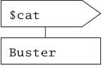
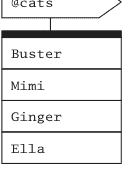
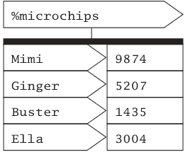
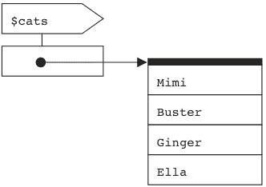
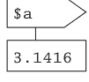
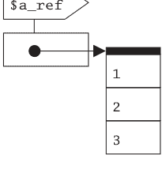
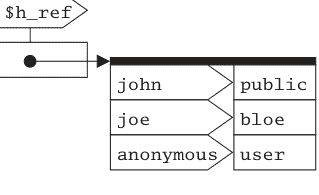
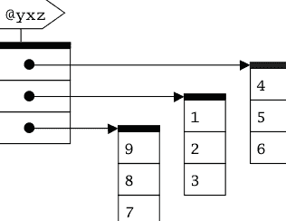

# Perl 高效编程：编写更优质、更地道 Perl 代码的方法

## 前言

十多年前我第一次学习 Perl 时，我以为自己很好地掌握了这门语言；确实，我对这门语言本身足够了解。但我并不知道那些真正赋予 Perl 力量的习语和结构。虽然不用这些也可以编程，但它们代表了一笔容易被忽视的知识和生产力财富。

幸运的是，我购买了 Joseph N. Hall 的《Effective Perl Programming》第一版，但它并没有出现在我的书架上。相反，它几乎永久地放在我的包里，方便我在有空时随时翻阅。

Joseph 的《Effective Perl Programming》格式非常简洁明了：简短的智慧片段，易于消化。事实上，它构成了我们免费的 Perl Tips（`http://perltraining.com.au/tips/`）通讯的原始灵感，该通讯持续探索 Perl 及其社区。

十年间一门语言可以发生很多变化，但社区对语言的理解在这段时间里的变化更大。因此，当我听说不仅第二版正在筹备中，而且将由 Perl 社区最杰出的两位成员撰写时，我十分高兴。

说 brian 全身心投入 Perl，就像说太阳的日冕相当温暖一样。brian 不仅 literally 为该语言撰写了大量著作，还出版了一本杂志（The Perl Review），管理 Perl 的 FAQ，并在致力于 Perl 和编程的社区网站上始终保持着受欢迎的存在。

Josh 最为人熟知的是他运营 Perlcast 的工作，该播客自 2005 年以来一直以音频形式提供 Perl 新闻。Josh 持续采访世界上最聪明、最有趣的人的能力，不仅使他成为理想的知识积累者，也让我非常羡慕。

因此，我非常高兴有机会向你呈现本书的第二版。愿它帮助你走向 Perl 精通之路，就像第一版帮助了我一样。

> —Paul Fenwick
>
> 常务董事
>
> Perl Training Australia

## 序言

许多 Perl 程序员是通过《Effective Perl Programming》第一版入门的。当 Addison-Wesley 于 1998 年首次出版该书时，全世界似乎都在使用 Perl；互联网热潮正盛，任何懂一点 HTML 的人都能找到程序员的工作。一旦得到这些工作，程序员们就必须快速掌握一些技能。《Effective Perl Programming》很可能是那些新 Perl 程序员桌上的书之一，与 Perl 的圣经《Programming Perl`¹`》和《Learning Perl`²`》并列。

当时书架上还有许多其他 Perl 书籍。如今的孩子们可能无法相信，你可以走进美国的一家书店，看到数百英尺的书架空间用于计算机编程，其中大部分似乎是 Java 和 Perl。今天走进书店，计算机部分可能只有自己的角落，每种语言可能只有几本书。这些书名中的大多数可能在六个月后就不在了。

尽管如此，《Effective Perl Programming》仍然坚持了十多年。Joseph Hall 对 Perl 编程哲学的洞察和智慧是永恒的。毕竟，他的书更多是关于用 Perl 思考。他的所有建议至今仍然有效。

然而，Perl 的世界与 1998 年相比已大不相同，还有更多好的建议涌现。CPAN（Comprehensive Perl Archive Network，综合 Perl 存档网络），当时只有几年历史，现在已成为 Perl 的杀手级功能。人们发现了新的更好的做事方法，随着十多年的额外 Perl 经验，最佳实践和习语已经取得了长足的进步。

1. Larry Wall, Tom Christiansen, and Jon Orwant, *Programming Perl, Third Edition* (Sebastopol, CA: O'Reilly Media, 2000).
2. Randal L. Schwartz, Tom Phoenix, and brian d foy, *Learning Perl, Fifth Edition* (Sebastopol, CA: O'Reilly Media, 2008).

自《Effective Perl Programming》第一版以来，Perl 本身也发生了变化。第一版诞生于从 Perl 4 向 Perl 5 的过渡时期，因此人们仍在使用旧的 Perl 4 习惯。我们在本版中基本消除了这种区别。Perl 只有一个，那就是主版本 5。（别问我们 Perl 6。那是另一本书，另一个时代的事。）

现代 Perl 现在处理 Unicode，并认识到世界不仅仅是 ASCII。你也需要跨越这个障碍，所以我们增加了整整一章。Perl 可能是最受测试的代码库之一，这一趋势由 Michael Schwern 于几年前发起，现在几乎成为每个模块发行版的一部分。Perl 程序员歌颂代码狂野西部时代的日子已经一去不复返。现在你可以同时拥有快速原型和良好的测试。如果你在企业领域工作，你会想阅读我们关于测试的建议。如果你是正则表达式狂热者，你会想使用最新版本 Perl 提供的所有新正则功能。我们将向你介绍流行的那些。

Perl 仍在成长，新主题不断涌现。有些主题，如 Moose——后现代 Perl 对象系统，值得有它们自己的书籍，所以我们甚至没有尝试在这里涵盖。其他主题，如 POE（Perl Object Environment）、对象关系映射器和 GUI 工具包同样值得，也没有出现在本书中。我们已经在考虑《More Effective Perl》，所以情况可能会改变。

最后，Perl 文献库更加成熟。尽管我们努力涵盖了大多数我们认为你需要了解的内容，但我们省略了一些在其他书籍中有更好阐述的领域，我们在附录 B 中列出了这些书籍。这为其他主题腾出了空间。

—Joseph N. Hall、Joshua A. McAdams 和 brian d foy

### 第一版序言

我以前经常写很多 C 和 C++。在全职踏入 Perl 世界之前，我上一个大型项目是一门解释型语言，它除了其他功能外，还能绘制图表、计算概率，并生成整本的 FrameMaker 书籍。它包含超过 50,000 行平台无关的 C++ 代码，具有各种有趣的内部特性。这是一个有趣的项目。

但也花了两年时间才写完。

在我看来，大多数有趣的 C 和/或 C++ 项目都需要数月甚至数年才能完成。这是合理的，因为一个项目之所以有趣，部分原因就在于它复杂且耗时。但我也觉得，很多一开始看似平淡无奇的想法，当用普通的高级语言表达时，往往会变成有趣的三个月项目。

这也是我最初对 Perl 产生兴趣的原因之一。我听说 Perl 是一种优秀的脚本语言，具有强大的字符串处理、正则表达式和进程控制功能。这些都是日程紧张的 C 和 C++ 程序员学会畏惧的功能。我学习 Perl 并逐渐喜欢上它，是因为我被投入到一个项目中，那里我的大部分工作涉及处理文本文件——从一个软件获取输出，并重新格式化，以便我能将其输入到另一个软件中。我很快发现，自己写 Perl 程序花不到一天，而如果用另一种语言写可能需要几天或几周。

#### 我如何以及为什么写这本书

我一直想成为一名作家。童年时我痴迷于科幻小说。我不断阅读，有时一天读三本平装书，偶尔也写一些（糟糕的）故事。后来，1985 年，我参加了在密歇根州东兰辛举办的 Clarion 科幻与奇幻作家工作坊。之后大约一年，我偶尔写写短篇故事手稿，但从未发表过。学业和工作开始消耗我越来越多的时间，最终我逐渐远离了小说。不过，我继续写作，不时产出技术手册、课程、提案或论文。同时，多年来我结识了不少技术作者。

其中一位是 Randal Schwartz。我聘请他作为工程项目的外包人员，并管理了他一年多。（这是我第一次担任技术经理，而且正如任何认识 Randal 的人可能猜到的那样，这对我来说是软件开发管理领域相当震撼的入门。）最终他离开去全职教 Perl。过了一段时间，我也做了同样的事。

在所有这些进行的同时，我对写书越来越感兴趣。过去几年我一直在所有“热门”领域工作——C++、Perl、互联网和万维网——我觉得应该能在其中找到有趣的东西写下来。使用和教授 Perl 加深了这种感觉。我希望有一本书能汇总我反复遇到的各种 Perl 技巧与陷阱。

然后，1996 年 5 月，我在圣何塞的一个开发者大会上与 Keith Wollman 交谈。我其实并没有刻意想找本书来写，但我们在讨论哪些题材可能适合出书，哪些不适合。当我们的话题转到 Perl 时，他问我：“你觉得一本叫 *Effective Perl* 的书怎么样？”我喜欢这个主意。Scott Meyers 的 *Effective C++* 是我最喜欢的 C++ 书籍之一，将这一系列扩展到 Perl 显然是顺理成章的。

我无法摆脱 Keith 的想法，过了一段时间，在 Randal 的一些帮助下，我制定了这本书的提案，Addison-Wesley 接受了。

剩下的部分……嗯，那是有趣的部分。我花了许多个 12 小时的日日夜夜，对着电脑屏幕上的 FrameMaker，在 Perl 5 Porters 邮件列表上问了很多烦人的问题，翻阅了几十本书和手册，写了许许多多个 Perl 代码片段，喝了许许多多罐健怡可乐和百事可乐。我甚至还有过偶尔的顿悟，发现了一些关于 Perl 的非常基础的东西，而我从未意识到自己曾经遗漏了它们。过了一段时间，手稿出现了。

这本书是我试图与你们分享我在学习 Perl 强大功能时所经历的一些乐趣与启发。我非常感谢你们花时间阅读它，希望你们会觉得它有用且 enjoyable。

—Joseph N. Hall

亚利桑那州钱德勒

1998 年

#### 致谢

##### 第二版

有几位朋友通过阅读部分正在撰写中的手稿、指出错误或补充我们未曾考虑到的内容，帮助我们完成了第二版。我们要感谢 Abigail、Patrick Abi Sallom、Sean Blanton、Kent Cowgill、Bruce Files、Mike Fraggasi、Jarkko Hietaniemi、Slaven Rezic、Andrew Rodland、Michael Stemle 和 Sinan Ünür。在某些地方，我们在他们的贡献旁边直接致谢了这些人。

有些人远不止是 casual 的帮助，他们几乎对每个字符都挑刺。你们看不到的所有错误都是由 Elliot Shank、Paul Fenwick 和 Jacinta Richardson 发现的。任何遗漏都是我们的错：我们的猫一定在我们不注意的时候在我们键盘上走过。

—Joseph N. Hall、Joshua A. McAdams 和 brian d foy

##### 第一版

这本书很难写。我想主要是我让自己陷入困难，但如果没有一大群程序员、作者、编辑和其他专业人士的帮助，它会难得多，其中许多人免费或以极低、几乎等同于免费的费率贡献了他们的时间。所有支持我这一努力的人都值得我感谢和衷心致谢。

Chip Salzenberg 和 Andreas “MakeMaker” König 提供了许多及时有益的 Perl 错误和异常行为的修复，这些否则会对手稿造成复杂的影响。对 Chip 的感谢再多也不为过。我曾花过一点时间研究 Perl 源代码。我对他充满敬畏。

Perl 5 Porters 邮件列表的许多其他成员也以这样或那样的方式做出了贡献，无论是直接还是间接。其中最有帮助和最具洞察力的包括 Jeffrey Friedl、Chaim Frenkel、Tom Phoenix、Jon Orwant（来自 *The Perl Journal*）和 Charlie Stross。

Randal Schwartz，作者、讲师，以及“Just Another Perl Hacker”，是我的主要技术审阅者。如果你发现任何错误，发邮件给他。（开玩笑的。）非常感谢 Randal 为这本书投入的时间与思考。

还要感谢 Perl 的创造者 Larry Wall，他回答了许多问题，并对多个主题提供了评论。

我很幸运能与 Addison-Wesley 合作这个项目。我接触的每个人都很友好，并以某种重要方式推动了项目的进展。我要特别感谢 Kim Fryer、Ben Ryan、Carol Nelson 和 Keith Wollman。

还有一些人贡献了评论、灵感或道义支持。我的朋友 Nick Orlans、Chris Ice 和 Alan Piszcz 艰难地通读了不完整手稿的数个修订版。我现任和前任雇主 Charlie Horton、Patrick Reilly 和 Larry Zimmerman 一直是激励和鼓舞的源泉。

虽然这本书是我从头撰写的，但其中一些内容不可避免地类似于 Perl 手册页以及 *Programming Perl* 中对 Perl 的描述。做一件事的方法总是有限的。我努力保持原创和创意，但在某些情况下，很难偏离对语言的原始描述。

ManyPat Fioreasons，以及 Akon Rtandon。

谢谢。

M. Isabelle。

M.

#### 关于作者

**Joseph N. Hall**，自称“电脑神童”，从小用着一台 TI 可编程计算器和一台配有 4K RAM 的 Radio Shack TRS-80 Model 1 长大。他 14 岁时教授了第一堂计算机课程。Joseph 拥有北卡罗来纳州立大学的计算机科学学士学位，自 1984 年起以编程为生。他自 1987 年起从事 UNIX 和 C 语言编程，自 1993 年起开始使用 Perl。他的兴趣包括软件工具和编程语言、钢琴和电子键盘，以及高尔夫。

**Joshua A. McAdams** 近五年来一直是 Perl 社区的活跃成员。他是 *Perlcast* 的主持人，在芝加哥主办过两届 YAPC::NA，为 Chicago.pm 组织会议，在世界各地的会议上发表关于 Perl 的演讲，并且是 CPAN（Comprehensive Perl Archive Network）的作者。虽然这是他的第一本书，但他曾为 *The Perl Review* 和 Perl Advent Calendar 撰写过 Perl 文章。在工作日，Josh 有幸在 Google 工作，他的日常开发并不总是涉及 Perl，但他会尽可能偷偷用一下。

**brian d foy** 是 *Learning Perl, Fifth Edition*（O'Reilly Media, 2008）和 *Intermediate Perl*（O'Reilly Media, 2006）的合著者，以及 *Mastering Perl*（O'Reilly Media, 2007）的作者。他建立了第一个 Perl 用户组——New York Perl Mongers；出版 *The Perl Review*；维护 Perl 核心文档的部分内容；并且是 Perl 培训师和演讲者。

# 简介

> “掌握一门编程语言的基础是一回事；学会如何在该语言中设计和编写高效的程序则是另一回事。”斯科特·迈耶斯在《Effective C++》序言中写下的这句话，对 Perl 同样适用。

Perl 是一种超高层次语言——缩写爱好者称之为 VHLL。它将正则表达式、网络通信和进程管理等高级功能整合到一种上下文敏感的语法中，这种语法从某种意义上说比其他编程语言更“人性化”。Perl 是比其他任何广泛使用的计算机语言都更优秀的文本处理语言，或者更准确地说，是比其他任何计算机语言都更优秀。Perl 是 UNIX 管理员手中极其高效的脚本工具，也是全球大多数 UNIX CGI 脚本编写者的首选。Perl 同样支持面向对象编程、模块化软件、跨平台开发、嵌入和扩展。

## 这本书适合你吗？

我们假设你已经具备一定的 Perl 使用经验。如果你正打算开始学习 Perl，那么可能需要稍后再来阅读本书。我们的目标是让你成为更优秀的 Perl 程序员，而非初学的 Perl 程序员。

本书并非权威参考手册，尽管我们希望你能将它放在桌面上随时查阅。我们涵盖的许多主题可能相当复杂，因此不会面面俱到。我们试图为你讲解能够应对大多数情况的基础概念，同时也作为深入研究的起点，以备你获得更多信息后进行拓展。你仍然需要查阅 Perl 官方文档，并阅读我们在附录 A 中列出的书籍。

## Perl 有待学习的内容很多

当你完成了一本 Perl 入门书籍或课程后，你已经学会了编写 Perl 创始人拉里·沃尔所亲切称为“婴儿语”的代码。Perl 婴儿语直白、直接且冗长。这并无不妥——你可以且应当使用任何适合自己的风格来编写 Perl。

但你可能会到达一个想要超越直白、冗长风格，转向更加简洁且具个人风格的阶段。本书就是为踏上这条道路的人而写的。《Effective Perl Programming》致力于传授你成为一名流利且富有表现力的 Perl 程序员所需的知识。本书提供多种不同形式的建议来帮助你前行。

- **知识，或者说“Perl trivia”。** 许多 Perl 中的复杂任务已经被或可以被简化为极其简短的语句。高效学习 Perl 编程的关键在于积累足够的经验和知识，了解做事的“正确”方式。一旦你掌握了好的解决方案，就可以将其应用到自己的问题上。此外，一旦你知道好的解决方案长什么样，你就能发明自己的方案并准确评判其“正确性”。
- **如何使用 CPAN。** 全面的 Perl 文档网络是现代 Perl 的杀手锏功能。它包含超过 5 GB 的 Perl 源代码、主要框架和流行库的接口，你可以借助他人已完成的工作完成大量任务。CPAN 让 Perl 中的常见任务变得更加简单。与任何语言一样，你真正的技能在于利用已有的成果。
- **如何解决问题。** 你可能已经从其他编程语言的工作中培养了良好的分析或调试技能。本书通过展示大量问题及其 Perl 解决方案，教你如何运用 Perl 攻克难题。它也教你如何克服 Perl 本身带来的问题，通过展示如何高效地创建和改进你的程序。
- **风格。** 本书主要通过示例向你展示地道的 Perl 风格。你将学会编写更加简洁优雅的 Perl 代码。如果简洁不是你的目标，你至少也能学会避免某些笨拙的结构。你还将学会评估自己和他人的代码。
- **如何进一步成长。** 本书并未涵盖你需要知道的一切。尽管我们将其称为高级 Perl 的书籍，但真正的高级内容远非这几百页能够容纳。一本真正全面的高级 Perl 汇编需要数千页篇幅。本书真正要讲的是如何让自己成为高级 Perl 程序员——如何找到成长所需的资源、如何组织你的学习和实验，以及如何认识到自己已经有所成长。


我们希望这是一本能引发思考的书。许多示例中存在微妙之处。对于真正棘手的部分我们会加以解释，但有些看似简单的地方却并不总是显而易见的。我们将这些留给您自行品味和深入思考。有时我们聚焦于示例代码的某个方面而忽略周围的内容，但我们会尽量将那些部分简化。如果你发现自己对某些内容困惑良久，不必惊慌。Perl 是一种特立独行的语言，在许多方面与你使用过的其他编程语言大相径庭。流利度和风格只能通过实践和思考来培养。虽然学习是艰辛的工作，但也是令人愉快且有回报的。

# Perl 的世界

Perl 是一种非凡的语言。在我们看来，它是最成功的模块化编程环境。

事实上，Perl 模块是软件世界中与传说中的“软件 IC”（即集成电路的软件等价物，可在不了解其全部内部工作原理的情况下用于各种应用的组件）最接近的存在。这背后有许多原因，其中最重要的一点是有集中协调的模块仓库 CPAN，它减少了在相互竞争、互不兼容的功能实现上浪费的精力。更多资源请参阅附录 A。

Perl 提供了一套最小但足够的模块化和面向对象编程框架。该语言缺乏广泛的访问控制特性，使得以自然、简洁的形式编写具有不寻常特征的代码成为可能。这似乎是软件界的一条自然法则：最有用的特性往往也是与现有框架最不兼容的特性。Perl 对“规章条例”的骨架式处理有效地颠覆了这一法则。

Perl 提供了出色的跨平台兼容性。它在 UNIX 系统管理工具方面表现卓越，因为它尽可能隐藏了不同 UNIX 版本之间的差异。你能编写跨平台的 shell 脚本吗？可以，但极其困难。大多数普通人都不应尝试此类工作。你能编写跨平台的 Perl 脚本吗？可以轻松做到。Perl 在其诞生的 UNIX 系统与其他平台之间的移植也相当顺利，例如 Windows、VMS 及许多其他平台。

作为 Perl 程序员，你拥有世界上最好的支持之一。你可以完全访问所使用模块的源代码，以及语言本身的完整源代码。逐行排查代码中的漏洞不合你意的话，你还可以通过互联网获得全天候的在线支持。如果免费支持不合你的风格，你也可以购买商业支持。

最后，你拥有的是一种敢于与众不同的语言。Perl 是流动的。在其最佳状态下，面对多种可解释方案时，Perl 会执行你的本意（有时被表述为 DWIM，即“do what I mean”）。这或许是个令人紧张的想法，但它标志着计算领域的真正进步，超越了单纯的计算周期、磁盘空间和内存。

# 术语

总体而言，Perl 中使用的术语与描述其他编程语言时用的术语差别不大。不过有一些术语的含义略有特殊。此外，随着 Perl 的发展，一些术语逐渐过时，一些新的术语也相继涌现。

一般来说，该语言的名称是 Perl，首字母大写，而 `perl` 是编译和运行你源代码的程序的名称。除非我们特指解释器，否则默认使用首字母大写的版本。

Perl 中的**运算符**（operator）是一种不带括号的语法结构。（当然，运算符的参数可以包含在括号中。）特别地，**列表运算符**（list operator）是一个标识符后跟由逗号分隔的元素列表：

```perl
print "Hello", chr(44), " world!\n";
```

Perl 中的**函数**（function）是一个标识符后跟一对完全包裹参数的括号：

```perl
print("Hello", chr(44), " world!\n");
```

现在，你可能已经注意到了列表运算符和函数之间的某些相似之处。事实上，在 Perl 中，除了使用的语法之外，它们并无区别。当我们指代 `print` 和 `open` 这类 Perl 内置功能时，通常会使用“运算符”这一术语，但偶尔也会使用“函数”。两者在含义上没有特别的区别。

指代用 Perl 编写的子程序的恰当术语就是**子程序**。当然，“函数”、“运算符”乃至“过程”都是可以接受的文学替代说法。要注意，Perl 对“函数”的使用与数学定义不同，一些计算机科学家可能会对 Perl 滥用该术语感到不寒而栗。

所有 Perl **方法**实际上都是遵循某些约定的子程序。这些约定并非 Perl 所要求或识别的。然而，使用“调用方法”这样的短语是恰当的，因为 Perl 有一种特殊的方法调用语法，用于支持面向对象编程。定义（有些难以捉摸的）区别的一个好方法是：方法是一种子程序，其作者希望你通过方法调用语法来调用它。

Perl **标识符**是“C 符号”——一个字母或下划线，后跟一个或多个字母、数字 `oczek` 或下划线。标识符用于命名 Perl 变量。Perl 变量是标识符与适当标点符号的组合，如 `$a` 或 `&func`。

虽然这与 Perl 内部的使用不太一致，但我们使用**关键字**这一术语来指代 Perl 中少数具有独特语法含义的标识符——例如 `if` 和 `while`。其他具有普通函数或运算符语法的标识符，如 `print` 和 `oct`，我们称之为**内置函数**（如果有必要的话）。

**左值**（lvalue，发音为“ell value”）是可以出现在赋值语句左侧的值。这是该术语的通常含义；然而，Perl 中有一些不寻常的结构也充当左值，例如 `substr` 运算符。

**局部化**一个变量意味着为它创建一个独立的作用域，该作用域适用于其所在块或文件的末尾。特殊变量必须使用 `local` 运算符进行局部化。你可以使用 `my` 或 `local` 对普通变量进行局部化（参见第4章的条目43）。这是 Perl 的一个不幸遗留问题，Larry Wall 希望他当初为 `local` 使用了另一个名字，但生活还要继续。当有必要区分时，我们会说“用 `my` 局部化”。

## 记法

在本书中，我们使用 Joseph 的 PEGS（PErl Graphical Structures，Perl 图形结构）记法来说明数据结构。它应该大多是自解释的，但这里有一个简要概述。

变量是带有名称的值。名称出现在值上方的一个侧向“尖桩”中。标量值用单个矩形框表示：



数组和列表有类似的图形表示。值以堆叠方式显示，顶部有一条粗线：



哈希用一堆名称旁边对应的一堆值来表示：



引用用点和箭头绘制，就像昔日那些 LISP 图示一样：



基础内容就是这些。

## Perl 风格

你从本书中应该学习的一部分内容是良好的 Perl 风格。

风格当然是一个偏好和争论的问题。我们不会假装知道或展示唯一正确的风格，但我们希望向读者展示一种当代、高效、有效的 Perl 风格的例子。有时我们的风格不一致，如果那有助于可读性的话。我们的大部分偏好来自 `perlstyle` 文档。

代码出现在书中这一事实会稍微影响其风格。我们受限于行长，不想写过于冗长的程序跨越多页。我们的例子不能太冗长或乏味——每个例子都必须在一两个特定点上做文章，避免不必要的杂乱。因此，你会发现一些与良好实践的偏离。

在某些例子中，我们想突出某些要点，而淡化其他要点。在一些代码中，我们用 `...` 来代替我们省略的代码。假设 `...` 代表的是应该在那里的真实代码。（有趣的是，当这本书上架时，那个 `...` 也应该是可编译的 Perl。Perl 5.12 引入了“呀呀”运算符，它可以正常编译，但当你尝试执行时会产生运行时错误。这是一种用来占位代码的好方法。）

有些例子需要特定版本的 Perl。除非另有说明，代码应在 Perl 5.8 下运行，这是一个较旧但仍然可用的版本。如果我们使用 Perl 5.10 的特性，我们会在示例开头加上一行注明版本（参见第1章的条目2）：

```perl
use 5.010;
```

我们还忽略 Perl 的开发版本，其中次要版本号是奇数，如 5.009 和 5.011。我们注明功能首次出现时的最早稳定版本。

并非所有代码都能在 `warnings` 或 `strict` 下干净运行（条目3）。我们建议所有 Perl 程序员定期使用这两者。然而，在所有示例开头加上这些声明可能会分散我们对主要问题的注意力，所以我们省略了它们。在适当的地方，我们尽量做到 `strict` 干净，但从更大的示例中提取代码并不总是能实现这一点。

我们通常尽量减少标点符号（条目18）。我们不喜欢“Perl 高尔夫”，即人们将程序缩减到尽可能少的字符。我们只是去掉不必要的字符，使用更多的空白，让重要的部分突出出来，让脚手架淡出背景。

最后，我们尽量让示例有意义。不是每个示例都能是有用的代码片段，但我们尽量包含尽可能多的真实世界代码。

## 组织方式

前两章通常按照复杂度递增的顺序呈现材料。除此之外，我们倾向于相当跳跃地使用本书。使用目录和索引，并将 Perl 文档放在手边（也许可以访问 http://perldoc.perl.org/）。

我们为第二版重新组织了本书。附录 B 展示了第一版条目到本版条目的映射。我们将一些第一版的条目拆分为许多新条目并进行了扩展；有些我们合并了；有些我们省略了，因为它们的内容在其他书籍中有很好的涵盖。附录 A 包含了我们认为你应该考虑的其他资源列表。

当你读到末尾时，这本书并没有真正结束。我们将继续在 http://effectiveperlprogramming.com/ 上发表内容。在那里你可以找到关于本书的更多新闻、一些我们省略的材料、我们来不及为本书完成的材料，以及其他 Perl 好东西。

# 1 Perl 基础

如果你精通其他语言但刚接触 Perl，你可能仍在发现 Perl 的特性。本节涉及其中一些特性。特别是，它针对那些仍然习惯于其他语言的新手 Perl 程序员可能遇到的问题。

例如，你应该已经知道 Perl 变量通常由某种标点符号标记（如 `$` 或 `@`）后跟标识符组成。但你知道相同名称的不同类型变量（如 `$a` 和 `@a`）是否完全相互独立吗？它们是独立的（参见本章的条目5）。

你应该知道 `@a` 是一个数组，但你知道 `$a[$i]` 和 `@a[$i]` 之间的区别吗？后者是一个切片（条目9）。

你应该知道数字 `0` 是假，空字符串 `''` 是假，但你知道由单个空格组成的字符串 `' '` 是假吗？它是真的（条目7）。

Perl 还有许多其他有趣的特性，这些特性反映了它从许多其他语言中窃取优点的传统，再加上其语言学家创造者 Larry Wall 的一些不寻常的想法。然而，一旦你开始像 Perl 那样思考，这些特性就会更有意义。

如果你是经验丰富的 Perl 程序员，这些基础内容对你来说大多是复习。然而，你可能会发现一些你以前没有注意到的有趣细节，或者 perhaps other ways to explain concepts to your colleagues.

## 条目 1. 查找 Perl 及其模块的文档

Perl 自带大量文档——多到你永远不想打印在纸上的程度。打印全部内容会消耗几令纸和大量墨粉。我们在文档达到约 2,000 页时就数不清了（在我们的虚拟打印机上，所以没有树木受到伤害）。

### `perldoc` 阅读器

文档文件中蕴含着大量有用的信息，因此能够阅读它们是很有价值的，而更能从中找到所需信息则尤为重要。找到所需信息的能力一部分来自知识，另一部分来自工具。

`perldoc` 命令会在 Perl 目录树中搜索带有嵌入式文档的 Perl 模块（`.pm`）、仅包含文档的 `.pod` 文件（第82项）以及已安装的 Perl 程序。`perldoc` 命令会对找到的文档进行格式化并显示。首先，阅读 `perldoc` 自身的文档：

```text
% perldoc perldoc
PERLDOC(1) User Contributed Perl Documentation

NAME
    C<perldoc> - Look up Perl documentation in pod format.

SYNOPSIS
    C<perldoc> [-h] [-v] [-t] [-u] [-m] [-l]
... etc. ...
```

通常情况下，你只需向 `perldoc` 提供想要阅读的文档页面名称即可。`perltoc` 是目录页，展示了所有页面名称：

```text
% perldoc perltoc
```

你可能对 `perlsyn` 感兴趣，该页面讨论了 Perl 的一般语法：

```text
% perldoc perlsyn
```

如果你想了解 Perl 内置函数，可以查看 `perlfunc`：

```text
% perldoc perlfunc
```

你应该至少通读一遍 `perlfunc`，以便了解 Perl 所提供的全部功能。你不必记住所有内容，但以后可能会记得 Perl 有一个内置函数，比如说，可以与 `/etc/passwd` 文件交互，即使你不记得该内置函数的名称。你也会注意到，在输出结果中滚动查找所需的内置函数是非常令人烦恼的。如果你知道想要阅读的内置函数，可以配合 `-f` 开关指定它，这样只会提取该函数的相关部分：

```text
% perldoc -f split
```

你也可以使用 `perldoc` 阅读模块文档；只需提供模块名称：

```text
% perldoc Pod::Simple
```

如果你想知道该模块安装在哪里，可以使用 `-l`（字母 l）开关来获取文件位置：

```text
% perldoc -l Pod::Simple
```

如果你想查看原始源代码，使用 `-m` 开关：

```text
% perldoc -m Pod::Simple
```

Perl 文档附带了多个 FAQ 文件，回答了许多常见问题。你可以在线阅读这些内容，但 `perldoc` 还有一个很好的功能，可以使用 `-q` 开关来搜索它们。例如，如果你想找到与随机数相关的答案，可以尝试：

```text
% perldoc -q random
```

#### 在线文档

在我们撰写本文时，http://perldoc.perl.org/ 是获取 Perl 文档的最佳网站。它包含了过去几个版本 Perl 的核心文档，以 HTML 和 PDF 格式提供，并且能够智能地记住你之前查看过的文档。

不过，该网站并不包含所有的模块文档文件。你可以在 CPAN Search（http://search.cpan.org/）或 Kobes's Search（http://kobesearch.cpan.org/）上在线阅读这些文档，两者都提供了访问 CPAN 的 Web 界面。有些人发现这些文档非常方便，以至于在查看本地系统之前会先阅读它们。

CPAN Search 尤其有用，因为它提供了“其他工具”，你可以在每模块页面上找到该链接。其中一个工具是类 `grep` 功能，允许你在单个发行版中搜索文档。这在追踪给出错误消息的文件时非常方便，例如。

AnnoCPAN（http://annocpan.org/）是另一个模块文档网站。在这个网站上，任何人都可以对文档进行注释，为模块作者或其他人留下笔记。当文档缺少信息或存在不正确、不完整的信息时，这尤其方便。

#### 本地文档

你可以在你的本地系统上获得 CPAN Search 的一些功能。`CPAN::Mini::Webserver` 提供了一种浏览你的 MiniCPAN 的方式（第66项）。如果你运行的是 Apache Web 服务器，`Apache::Perldoc` 模块可以作为 `perldoc` 命令的 Web front end。

`Pod::POM::Web` 模块也可以让你浏览本地文档。你可以将其设置为 Apache 下的 mod_perl 处理程序、CGI 脚本，或作为它自己的 Web 服务器：

```text
% perl -MPod::POM::Web -e "Pod::POM::Web->server"
```

#### 需要记住的要点

- 使用 `perldoc` 阅读 Perl 文档。
- 在 Web 上阅读未安装模块的文档。
- 设置本地文档服务器，以便使用 Web 浏览器阅读本地文档。

## 第2项：在需要时启用新的 Perl 功能

从 Perl 5.10 开始，你必须显式启用新功能。这确保了 Perl 的最新版本可以保持向后兼容，同时让人们可以使用所有最新的酷炫功能开始新工作。

例如，Perl 5.10 增加了一个 `say` 内置函数，它与 `print` 类似，但会自动为你添加末尾的换行符。不仅你的字符串可以少打几个字符，而且你也不必仅仅为了换行符而用双引号包裹字符串：

```perl
say 'Hello!';  # 就像 print "Hello\n";
```

如果有人已经创建了他们自己的 `say`，当他们用 Perl 5.10 运行程序时，使用现在同名的内置函数可能会导致程序中断。幸运的是，Perl 默认不会启用新功能：

```text
% perl5.10.1 say.pl   # 不使用新功能
```

```text
String found where operator expected at old_script.pl line 1, near "say "Hello!""
    (Do you need to predeclare say?)
```

如果你想要新功能，可以使用新的 `-E` 开关来启用它们。它就像允许你在命令行上指定程序文本的 `-e` 一样，但它还会为你的 Perl 版本引入所有最新的功能：

```text
% perl5.10.1 -E say.pl   # 使用截至 5.10.1 的所有新功能
```

```text
% perl5.12.0 -E say.pl   # 使用截至 5.12.0 的所有新功能
```

你也可以在程序文本内部启用这些功能。使用 `use` 指令后跟 Perl 版本号，不仅可以确保人们用兼容的版本运行你的程序（第83项），还可以启用该版本的新功能：

```perl
use 5.010; # 使用截至 5.10 的新功能
```

从 Perl 5.12 开始，你可以通过要求该版本或更高版本来自动开启严格模式（第3项）：

```perl
use 5.012; sexism to tell it which set of features to enable:
```

```perl
use feature ':5.10';
```


你可能不想启用每一个新功能。你可以使用`feature`杂项来控制使用哪些新功能。例如，你可以将`feature`限制为仅激活`switch`和`say`：

```perl
use feature qw(switch say);
```

奇怪的是，你导入的是`switch`，尽管 Perl 中该概念使用的关键字是`given-when`（第24项）。这是从 C 语言术语中传承下来的。

### 需要记住的要点

- 从 Perl 5.10 开始，如果你想使用新功能，请显式启用它们。
- 使用`-E`命令行开关启用所有新功能。
- 使用`use VERSION`序列来要求至少该版本的 Perl，并启用截至该版本的所有新功能。

## 第3项：启用严格模式以促进更好的编程

默认情况下，Perl 是一种非常宽松的语言。你可以快速地组合一些语句，只需最少的麻烦。Perl 会尽可能减少你的打字，帮你处理大部分细节。这是一个特性。

然而，这种宽松对于大型程序来说并不是那么有吸引力的特性，因为你希望 Perl 能帮助你管理代码。`use strict`杂项使 Perl 变得更加不宽松。在你所有的 Perl 文件中，添加这一行：

```perl
use strict;
```

如果你使用的是 Perl 5.12 或更高版本，你可以通过要求该版本或更高版本来自动启用严格模式（第2项）：

```perl
use 5.012; # 自动启用 use strict
```

通过启用严格模式，你已经捕获了程序员所犯的大部分常见错误。剩下的大部分错误可以通过`warnings`捕获（第99项）。这些功能可能会让你烦恼几周，但渐渐地你的编程水平会提高，`strict`会变得越来越不烦人，直到你甚至意识不到它的存在。

如果你正在转换不是`strict`安全的遗留代码，你可以先尝试在命令行上启用它，看看所有的错误，然后再决定是否提交：

```bash
perl -Mstrict program.pl
```

严格模式有三个部分：`vars`、`subs`和`refs`。通常情况下你一起使用这三个部分，但我们会分别介绍它们。

### 声明你的变量

拼写错误是 Perl 程序中极为常见的错误来源。你将数据放入一个变量，但之后却使用了错误的变量名。在下面的示例中，你读入的是`@temp`，但随后却尝试遍历`@tmp`。你困惑于为何看不到任何输出，而且无论怎么查看源码，都发现不了问题所在：

```perl
my @temp = <FH>;

foreach (@tmp) {  # 糟糕——本想用 @temp
  print "Found $_\n";
}
```

`strict vars`指令能够捕捉并防止此类错误，它要求你以某种方式声明所有变量。声明变量有三种方法。你可以使用`my`或`our`来声明：

```perl
use strict 'vars';

my @temp;
our $temp;
```

使用完整的包路径 specification：

```perl
use strict 'vars';

$main::name = 'Buster';
```

或者在`use vars`中列出变量：

```perl
use strict 'vars';

use vars qw($bar);

$bar = 5;
```

你无需声明特殊变量——`$_`、`%ENV`等等。此外，`strict`会忽略`$a`和`$b`的全局版本，它们对于`sort`来说是特殊的（条目 22）。Perl 在编译时看到任何其他变量都会触发致命错误。

### 小心裸词

Perl 对没有其他解释方式的标识符默认按字符串处理（有时称为"诗歌模式"），这是另一个难以通过肉眼检查发现的错误来源。你能发现下面代码中的错误吗？

```perl
for ( $i = 0 ; $i < 10 ; $i++ ) {
  print $a[i];  # 糟糕——本来想说 $a[$i]
}
```

下标`i`，本应是`$i`，却被解释为字符串 "i"，在此上下文中被理解为数值 0。因此，`$a[0]`的内容被打印了十次。使用`strict 'subs'`可以关闭诗歌模式，并对使用不当的标识符生成错误：

```perl
use strict 'subs';

for ( $i = 0 ; $i < 10 ; $i++ ) {
  print $a[i];  # 错误
}
```

`strict 'subs'`指令与获准的裸词引用形式兼容——单独放在哈希键的大括号内，或者放在胖箭头左侧：

```perl
use strict 'subs';

$a{name} = 'ok';   # 作为哈希键的裸词是允许的
$a{-name} = 'ok';  # 同样允许

my %h = (
  last  => 'Smith',  # 胖箭头左侧的裸词是允许的
  first => 'Jon'
);
```

### 避免软引用

`strict refs`指令禁用软引用（条目 58）。软引用并不经常成为 bug 的来源，但它们也不是广泛使用的特性。当你尝试对实际上是一个字符串的东西进行解引用时，就会发生软引用。在没有`strict`的情况下，Perl 会使用字符串中的值作为变量名：

```perl
no strict 'refs';

$not_array_ref = 'buster';

@{$not_array_ref} = qw( 1 2 3 );  # 实际上是 @buster
```

### 需要记住的要点

- 默认情况下，Perl 是一种非常宽松（permissive）的编程语言。
- 当你可以明确表达时，不要让 Perl 猜测你的意思。
- 启用`strict`让 Perl 捕捉常见的编程问题。

## 条目 4：理解 sigil 告诉你的信息

Sigil（魔符/符号）就是你看到的那些出现在 Perl 变量名前面和解引用中的古怪字符，它们常常让人们对 Perl 语法感到困惑。程序员们自找麻烦，因为他们猜测 sigil 的含义，在邮件列表上看到关于 sigil 的错误猜测，或者跟塔罗牌占卜师学习 Perl。人们害怕 sigil，而实际上，sigil 是他们最好的朋友。

Sigil 与变量类型本身只有非常松散的关联。事实上，你甚至不需要有变量。根本不要把它们看作是变量类型指示符。

`$`意味着你正在处理单个值，它可以是一个标量变量，或者是从数组或哈希中访问的单个元素：

```perl
$scalar
$array[3]
$hash{'key'}
```

`@`意味着你正在处理多个值，因此你会将其用于数组或哈希，因为它们是 Perl 仅有的集合类型：

```perl
@array
@array[0,2,6] # 数组切片
@hash{ qw(key1 key2) } # 哈希切片
```

`%`符号有点特殊。它意味着你将某物当作哈希处理，而且只有一种变量类型和访问方法可以作为哈希，那就是整个哈希本身：

```perl
%hash
```

Perl 还有用于子程序（`&`）和类型团（`*`）的 sigil，但它们只用于这些类型，所以我们这里不讨论它们。

既然你知道不要用 sigil 来识别变量类型，那么如何判断你看到的是哪种变量呢？有三个因素需要考虑：sigil、标识符，以及数组或哈希可能的索引语法。在访问数组的单个元素时，你可以同时看到这三个因素：

```text
SIGIL  IDENTIFIER  INDEX

$      name        [3]

$name[3]
```

Sigil 是`$`，标识符是 name，索引是`[3]`。你知道变量是 name，而且知道它是一个数组变量，因为那是唯一使用`[]`进行索引的类型。对哈希也做同样的分析：

```text
SIGIL  IDENTIFIER  INDEX

$      name        {'Buster'}

$name{'Buster'}
```

你知道你正在处理哈希变量，因为你使用`{}`进行索引，而且使用字符串作为索引。`$`只告诉你这个变量包含来自哈希的单个元素。

如果你看不到单个元素的访问，你可以通过查看 sigil 来确定变量类型：

```perl
$scalar
@array
%hash
```

你还使用 sigil 来对匿名标量、数组和哈希进行解引用。你使用相同的规则来确定引用类型（条目 59）。

### 需要记住的要点

- Sigil 与数据相关，不一定与变量类型相关。
- `$`表示单个元素。
- `@`表示元素列表。

## 条目 5：了解你的变量命名空间

Perl 中有七种独立的包变量或类变量元素：标量变量、数组变量、哈希变量、子程序名、格式名、文件句柄和目录句柄。

这些不同种类的包变量各自拥有独立的命名空间。改变一种变量的值，绝不会以任何方式影响同名的另一种变量的值。例如，标量变量`$a`与数组变量`@a`是独立的：

```perl
my $a = 1;             # 设置标量 $a = 1
my @a = ( 1, 2, 3 );  # @a = (1,2,3) 但 $a 仍然是 1
```

此外，Perl 程序中的每个包都定义了自己的一组命名空间。例如，包 main 中的`$a`与包 foo 中的`$a`是独立的：

```perl
$a = 1;       # 设置标量 $main::a = 1

package foo;  # 默认包现在是 foo

$a = 3.1416;  # $foo::a 是 3.1416；$main::a 仍然是 1
```

你必须像 Perl 一样，查看标识符的右侧和左侧，才能确定标识符指的是哪种变量。例如，访问数组和哈希单个元素的语法以`$`开头，而不是`@`或`%`。`$`意味着结果是一个标量值，而不是说你正在引用一个标量变量（条目 4）：

```perl
my $a = 1;
my @a = ( 1, 2, 3 );
my %a = ( a => 97, b => 98 );

$a[3]    = 4;   # $a 仍然是 1；@a 现在是 (1,2,3,4)

$a{'c'} = 99;  # $a、@a 仍然不变；
               # %a 现在有三个键值对了
```

Perl 中并非所有类变量项都带标点字符前缀。子程序名可以以`&`开头，但`&`通常是可选的。子程序参数的括号在某些情况下也可以省略，如下例所示。

定义一个名为 "hi" 的子程序，看看你可以用不同方式调用它：

```perl
sub hi {
  my $name = shift;
  return "hi, $name\n";
}
```

你可以使用"旧式"语法调用子程序，包括`&`和括号：

```perl
print &hi("Fred");
```

这种风格在新代码中不常见。相反，你会看到仅用括号调用子程序：

```perl
print hi("Fred");
```

括号给了 perl 足够的信息来知道 hi 是一个子程序。如果 hi 在你使用之前已经声明或定义，甚至括号也是可选的：

```perl
print hi "Fred";
```

文件句柄、格式名和目录句柄不带标点字符前缀，而是在上下文中被识别。文件句柄、目录句柄和格式名彼此独立，即使它们都命名为 TEST：

```perl
open TEST, '>', "$$.test"  # 打开文件句柄 TEST

print TEST "test data\n";  # 向文件句柄 TEST 输出

opendir TEST, '/tmp';      # 名为 TEST 的目录句柄
```

### 名为 TEST 的格式

```perl
format TEST = @<<<<<<<<<<<< @<<<< @<<<<

$name, $lo, $hi

.
```

如果这看起来容易混淆，确实如此。幸运的是，由于 IO::File 和 IO::Dir 的出现，现在人们通常会将文件句柄和目录句柄存储在对象中。

### 需要记住的要点

- 每种变量类型都有自己的命名空间。
- 同名的不同类型变量互不影响。
- 不同包中的变量可以同名且互不影响。

## 条款 6：了解字符串比较和数值比较的区别

Perl 有两套完全不同的比较运算符，一套用于比较字符串，一套用于比较数字。了解它们的区别并牢记在心是值得的，因为使用错误的比较运算符可能会导致难以发现的 bug。

用于比较字符串的运算符使用字母，看起来像单词，或者像 FORTRAN。字符串是逐字符比较的——即，通过比较字符串中字符的值（或者根据当前的 locale，如果你使用了`use locale`），包括大小写、空格等：

```perl
'a' lt 'b'               # TRUE
'a' eq 'A'               # FALSE -- 大小写
"joseph" eq "joseph "    # FALSE -- 空格也算数
```

数值比较运算符使用标点符号，看起来像代数，或者像 C：

```perl
0  <  5     # TRUE
10 == 10.0  # TRUE
```

字符串比较运算符不应该用于比较数字，因为它们无法正确地比较数字（除非你对"正确地"的定义是把`"10"`放在`"2"`前面）。同样，数值运算符也不应该用于比较字符串：

```perl
'10' gt '2'      # FALSE -- '1' 排在 '2' 前面
"10.0" eq "10"   # FALSE -- 不同的字符串
'abc' == 'def'   # TRUE -- 对 == 来说两者都看作 0
```

这种错误导致的问题是条件判断在你不希望为真的时候为真，因为两个操作数都变成了数字：

```perl
my $hacker = 'joebloe';

if ( $user == $hacker ) {  # 错误 -- == 用于字符串
  deny_access();
}
```

Perl 的`sort`运算符默认使用字符串比较。不要用字符串比较来排序数字（条款 22）！

避免`eq`和`==`混淆的一种方法是两者都避免。与其自己搞定，不如让 Perl 替你想清楚，即使用智能匹配运算符`~~`（条款 23）。它会查看两边然后决定怎么做。它还使用了"类数字字符串"（numish strings）的概念——即看起来像数字的字符串。

这些比较实际上是数值比较，因为智能匹配看到右边是数字，或者左边是数字而右边是类数字字符串，从而导致使用`==`运算符进行比较：

```perl
use 5.010;

if ( 123    ~~ '456' ) { ... } # 数字和类数字：FALSE
if ( '123.0' ~~ 123 )  { ... } # 字符串和数字：TRUE
if ( 'Mimi'  ~~ 456 )  { ... } # 字符串和数字：FALSE
```

否则，智能匹配会使用`eq`运算符进行字符串比较：

```perl
if ( 'Mimi' ~~ 'Mimi' ) { ... }  # 字符串和字符串：TRUE
```

这可能有点棘手。两边都是类数字字符串仍然是字符串比较（使用`eq`运算符）：

```perl
if ( '123.0' ~~ '123' ) { ... } # 类数字和类数字：FALSE
```

使用智能匹配时需要注意变量，因为它们在程序中的历史很重要。如果你之前对`$var`做了某些操作触发了转换（条款 8），你可能会得到 unexpected 的结果，因为智能匹配选择了错误的比较类型。在以下情况中，你以字符串开始但通过与数值运算符使用将其转换为数字，从而强制使用`==`运算符进行数值比较：

```perl
use 5.010;

if ( ( '123' + 0 ) ~~ '123.0' ) { # 数字和类数字：TRUE
  say "Matched 1!";
}

my $var = '123';

if ( ( $var + 0 ) ~~ '123.0' ) { # 数字和类数字：TRUE
  say "Matched 2!";
}
```

```perl
my $var2 = '123';

$var2 + 0;

if ( $var2 ~~ '123.0' ) {  # 数字和类数字：TRUE
  say "Matched 3!";
}
```

然而，如果你以数字开始但把它变成字符串，Perl 只会将其视为字符串并强制使用 eq 语义。

```perl
use 5.010;

my $var3 = 123;

$var3 = "$var3";

if ( $var3 ~~ '123.0' ) {  # 字符串和类数字，eq，FALSE
  say "Matched 4!";
}
```

### 需要记住的事项

- 记住字符串和数字的比较和排序方式不同。
- 使用字母比较运算符来比较字符串。
- 使用符号比较运算符来比较数字。

## 条款 7：了解哪些值是 false 并相应地测试它们

由于 Perl 中数值和字符串数据具有相同的底层标量类型，且布尔运算可以应用于任何标量值，Perl 的逻辑真值测试必须同时适用于数字和字符串。

基本测试规则如下：0、'0'、undef 和 ''（空字符串）是 false。其他一切都是 true。

更准确地说，当你在布尔上下文（有时用于指控制表达式中的条件，如`?:`运算符、`||`和`&&`）中使用一个量时，它首先被转换为字符串（条款 8）。Perl 然后测试字符串结果。如果结果是空字符串，或者恰好由单个字符 '0' 组成的字符串，结果为 false。否则，结果为 true。请注意，这条规则意味着 undef 会被判定为 false，因为在除了 defined 运算符之外的所有情况下，它看起来总是像 0 或空字符串。

这通常工作得很好。如果出现问题，很可能是因为你测试一个量是否为 false，而其实你本应该测试它是否已定义：

```perl
while ( my $file = glob('*') ) {  # 错误
  do_something($file);
}
```


`glob` 几乎在所有情况下都能正常工作。每次循环时，`glob('*')` 从当前目录产生另一个文件名，放入`$file`。一旦`glob`遍历完目录中的所有文件名，它返回`undef`，这看起来像是空字符串，因此是 false，导致 while 循环终止。

不过有一个问题。如果当前目录中有一个名为`0`的文件，它也会被判定为 false，导致循环提前终止。为避免这种情况，使用`defined`运算符专门测试`undef`：

```perl
while ( defined( my $file = glob('*') ) ) {  # 正确
  do_something($file);
}
```

对于行输入运算符`<>`情况完全一样，尽管 Perl 会自动为你处理。在这个 while 中看起来你在测试来自`STDIN`的行：

```perl
while (<STDIN>) {
  do_something($_);
}
```

然而，这是一个特殊案例，Perl 会自动转换为检查`$_`是否已定义：

```perl
while ( defined( $_ = <STDIN> ) ) {  # 隐式执行
  do_something($_);
}
```

你可以用`B::Deparse`自己验证这一点，它会撤销 Perl 编译的结果，让你可以看到它对你的代码的理解：

```bash
% perl -MO=Deparse \
    -e 'while( <STDIN> ) { do_something($_) }'
```

```perl
while (defined($_ = <STDIN>)) {
    do_something($_);
}
```

```text
}
```

```text
-e syntax OK
```

如果你想用另一个变量来保存刚刚读取的行，你需要自己进行 defined 检查：

```perl
while ( defined( my $line = <STDIN> ) ) {
  do_something($line);
}
```

### 数组的末尾

数组元素未定义这一事实并不意味着你已经超出了数组的边界。通常，Perl 对越界访问非常宽容，而这会让其他语言抓狂：

```perl
my @cats = qw( Buster Roscoe Mimi );
my $favorite = $cats[8];  # 那里没有猫，所以是 undef
```

在数组中间有`undef`值也是完全可以的：

```perl
my @cats = qw( Buster Roscoe Mimi );
$cats[1] = undef;  # 安息吧，Roscoe
```

你不想用这个值来决定你是否已经遍历了数组的每个元素：

```perl
while ( defined( my $cat = shift @cats ) ) {  # 错误
  print "I have a cat named $cat\n";
}
```

相反，确保使用`foreach`遍历所有元素，并跳过那些未定义的：

```perl
foreach my $cat (@cats) {
  next unless defined $cat;
  print "I have a cat named $cat\n";
}
```

如果你需要知道数组的最后一个元素，不要寻找`undef`值。`$#cats`语法给你最后一个元素的索引。

```perl
for ( my $i = 0 ; $i <= $#cats ; $i += 2 ) {
  next unless defined $cat[$i];
  print "I have a cat named $cat[$i]\n";
}
```

### 哈希值

你可能还需要使用不同的测试策略来检查哈希中是否存在某个元素，因为`undef`是哈希中完全可以接受的值。假设`%hash`最初未定义。检查键 foo 在作为值、`defined`和`exists`时结果都为 false：

```perl
my %hash;

if ( $hash{'foo'} )         { ... }  # FALSE
if ( defined $hash{'foo'} ) { ... }  # 也是 FALSE
if ( exists $hash{'foo'} )  { ... }  # 也是 FALSE
```

一旦你给某个键赋值，即使是 false 或未定义的值，该键就存在了：

```perl
$hash{'foo'} = undef;  # 赋一个 undef 值

if ( $hash{'foo'} )         { ... }  # 仍然是 FALSE
if ( defined $hash{'foo'} ) { ... }  # 仍然是 FALSE
if ( exists $hash{'foo'} )  { ... }  # 现在 TRUE

print keys %hash;  # ('foo')
```

赋一个已定义的值，即使它是 false 的，也会使该值被定义：

```perl
$hash{'foo'} = '';

if ( $hash{'foo'} )         { ... }  # 仍然是 FALSE
if ( defined $hash{'foo'} ) { ... }  # 现在 TRUE
if ( exists $hash{'foo'} )  { ... }  # 现在 TRUE
```

在测试哈希元素访问之前，想清楚你真正想测试什么。没有一个正确的答案；这取决于你如何处理该值。

### 需要记住的事项

- 有四个 false 值：`undef`、`''`、`0` 和 `'0'`。
- 除了这四个 false 值之外，其他一切都是 true。
- 确保你测试的是你想要的那种值，而不仅仅是真值。

## 第8条：理解字符串与数字之间的转换

Perl 的标量变量可以包含字符串数据，也可以包含数值数据。它们还可以同时包含两者，这通常是字符串数据转换为数字或反之的结果。

Perl 会根据需要自动将值从数值表示转换为字符串表示，或从字符串表示转换为数值表示。例如，如果字符串出现在类似`+`这样的数值运算符旁边，Perl 会先将字符串值转换为数字，然后再进行算术运算。如果数字是模式匹配的对象，Perl 会先将数字转换为字符串。

Perl 期望字符串出现的地方称为**字符串上下文**，期望数字出现的地方称为**数值上下文**。这些术语了解一下就好，我们在本书中不会经常使用它们，因为这很少会产生什么实质性的影响。

Perl 用于将数字转换为字符串的函数是 C 标准库的`sprintf()`，格式为`"%.20g"`。如果你需要使用特定格式，请使用 Perl 的`sprintf`：

```perl
my $n = sprintf "%10.4e", 3.1415927;  # "3.1416e+00"
```

用于将字符串转换为数字的函数是 C 标准库的`atof()`。任何前导空白都会被忽略。Perl 使用字符串中看起来像数字的前导部分，而忽略其余部分。Perl 会将任何不像数字的内容转换为 0。例如：

```perl
my $n = 0 + "123";       # 123

my $n = 0 + "123abc";    # also 123 -- trailing stuff
                         # ignored

my $n = 0 + "\n123";     # also 123 -- leading whitespace

my $n = 0 + "a123";      # 0 -- no number at beginning

my $n = 0 + "\x{2165}";  # 0 -- Roman numerals aren't
                         # numbers
```

转换过程不会识别八进制或十六进制。使用`oct`运算符来转换八进制或十六进制字符串：

```perl
my $n = 0 + "0x123";       # 0 -- looks like number 0

my $n = 0 + oct("0x123");  # 291 -- oct converts octal
                           # and hex to decimal

print "mode (octal): ";    # prompt for file mode
chmod <STDIN>, $file;      # WRONG -- string from STDIN
                           # is interpreted as decimal,
                           # not octal

print "mode (octal): ";    # prompt for file mode
chmod oct(<STDIN>), $file; # RIGHT -- mode string converted
                           # to octal
```

当 Perl 自动将数字转换为字符串或反之时，它会保留两种表示形式，直到变量的值被更改。

### 同时包含字符串和数字

通常，变量包含的是字符串还是数值并不重要，但有几处情况确实会有所影响。例如，如果位运算符应用于数字，则对整个数值进行操作；如果应用于字符串，则按字符进行操作：

```perl
my $a = 123;
my $b = 234;
my $c = $a & $b;  # number 106

$a = "$a";
$b = "$b";

my $d = $a & $b;  # string "020"
```

你可以使用 `Devel::Peek` 模块来观察这一现象。从一部分能转换为数字的字符串开始，然后在数值运算中使用它（不更改该字符串）：

```perl
use Devel::Peek qw(Dump);

my $a = '12fred34';  # converts to 12

print STDERR "Before conversion: ";
Dump($a);

my $b = $a + 0;

print STDERR "After conversion: ";
Dump($a);

print STDERR "\n$a\n";
```

Dump 的输出向你展示了 Perl 正在跟踪的内容。虽然我们不打算深入 Perl 的内部实现，但你可以看到，在转换之前，Perl 有一个 PV 槽位，用于存储实际的字符串值。转换之后，它还有 IV 和 NV 槽位，用于存储转换后的数值：

```text
Before conversion: SV = PV(0x801038) at 0x80e770
  REFCNT = 1
  FLAGS = (PADMY,POK,pPOK)
  PV = 0x204c10 "12fred34"\0
  CUR = 8
  LEN = 12

After conversion: SV = PVNV(0x8023c0) at 0x80e770
  REFCNT = 1
  FLAGS = (PADMY,IOK,NOK,POK,pIOK,pNOK,pPOK)
  IV = 12
  NV = 12
  PV = 0x204c10 "12fred34"\0
  CUR = 8
  LEN = 12
```

错误变量`$!`是具有“魔法”属性的一个例子。在数值上下文中使用时，它返回系统变量 errno 的值；但在字符串上下文中，它返回`perror()`函数的字符串（或你所在系统的等效函数）：

```perl
open "";       # invalid file name; should produce
               # an error

print "$!\n";  # "No such file or directory"
print 0 + $!, "\n";  # "2" (or whatever)
```

这个问题也会影响智能匹配运算符（第23条），该运算符被`given-when`（第24条）隐式使用。由于智能匹配会猜测需要进行哪种类型的比较，它可能会做出意想不到的选择。在此示例中，你使用智能匹配运算符测试两个字符串，期望它只匹配相同的字符串：

```perl
use 5.010;

for my $s ( '137', ' 137' ) {
  given ($s) {
    when ('137')  { say "$s matches '137'"; continue }
    when (' 137') { say "$s matches ' 137'" }
  }
}
```

输出显示字符串只与完全相同的自身匹配：

```text
137 matches '137'
 137 matches ' 137'
```

然而，对程序稍作修改就会改变结果。如果你在算术表达式中使用该字符串，即使没有显式更改字符串，智能匹配也会进行数值比较而非字符串比较：

```perl
use 5.010;

for my $s ( '137', ' 137' ) {
  my $t = $s + 0;

  given ($s) {
    when ('137')  { say "$s matches '137'"; continue }
    when (' 137') { say "$s matches ' 137'" }
  }
}
```

现在你得到了比预期更多的匹配：

```text
137 matches '137'
137 matches ' 137'
 137 matches '137'
 137 matches ' 137'
```

### 创建你自己的 dualvar

你不需要使用 Perl 的内部转换来创建“dualvars”——根据上下文而具有不同字符串值和数值的变量。下面是一个子程序，它返回一个数值错误代码和一个错误字符串，全部包含在一个普通的标量值中：

```perl
use Scalar::Util qw(dualvar);

sub some_sub {
  # ...

  if ($error) {
    return dualvar(
      -1,
      'You are not allowed to do that'
    );
  }
}

my $return_value = some_sub();
```

变量`$return_value`会保持其独立的数值和字符串值，直到你更改它。然而，既然你现在知道了这一点，不要到处都开始使用它。把它留到非常特殊的情况，比如在会议和鸡尾酒会上给别人留下深刻印象。

### 需要记住的事项

- Perl 根据上下文将标量用作字符串或数字。
- Perl 会用它的最佳猜测将字符串转换为数字。
- 如果字符串看起来不像数字，Perl 会将其转换为 0。

## 第9条：了解列表和数组之间的区别

列表和数组是不同的东西。如果你能识别出自己拥有的是哪一种，以及各自适用的规则，你将远远领先于大多数人（事实上，甚至大多数 Perl 书籍）。Perl 中一些最强大的惯用法就依赖于此差异。

**列表是标量的有序集合。** 你可以自己构造列表，从内置函数和子程序中获取列表作为返回值，或从其他列表中提取列表。

**数组是包含列表的变量，但它本身不是列表。** 它是列表的容器。

部分混淆源于它们共享的语法。你可以使用相同的语法从列表和数组中提取单个元素：

```perl
(localtime)[5];  # the year
$array[5];
```

你也可以使用相同的语法对列表和数组进行切片：

```perl
(localtime)[ 5, 4, 3 ];  # the year, month, and day
@array[ 5, 4, 3 ];
```

### 逗号运算符

虽然你可以在标量上下文中拥有一个数组（它是一个变量），但**标量上下文中不存在列表**。如果你在标量上下文中使用数组，你会得到数组中元素的数量：

```perl
my @array = qw( Buster Mimi Roscoe );
my $count = @array;  # 3
```

列表永远只是列表。它没有标量解释。考虑一下你是如何构造列表的。你用逗号运算符（是的，它是一个运算符）分隔一系列标量：

```perl
( 'Buster', 'Mimi', 'Roscoe' )
```

那是一个列表吗？嗯，你其实还不知道。你必须在期望列表的表达式中使用那 series of scalars。将其赋值给数组或在 foreach 循环中使用，会提供列表上下文：

```perl
my @cats = ( 'Buster', 'Mimi', 'Roscoe' );

foreach ( qw( Buster Mimi Roscoe ) ) {
  ...;
}
```

（`qw()`引用不会改变任何东西。它只是一个语法捷径。）

如果你将相同的字面文本赋值给标量变量呢？那时你有一个列表吗？什么会出现在`$scalar`中？

```perl
my $scalar = ( 'Buster', 'Mimi', 'Roscoe' );
my $scalar = qw( Buster Mimi Roscoe );
```

很多人猜测`$scalar`会得到值 3，因为他们认为自己有一个三项列表。但他们右边并没有列表；他们有的是一系列由逗号运算符分隔的标量。标量上下文中的逗号运算符返回其最右边的元素。Perl 将值`Roscoe`赋值给`$scalar`。

人们之所以会把这个概念搞混，是因为他们用了错误的方式来测试它。常见的测试列表是什么？

```perl
my $scalar = ( 1, 2, 3 );
```


在这个例子中，右侧标量的数量恰好与右侧最后一个元素的值相同，但你仍然没有理解其中的差异。

### 列表上下文中的赋值

Perl 的另一个暗角是赋值运算符。大多数人以为他们理解了它，却没有意识到它和所有其他运算符一样也有返回值。在列表上下文中，赋值运算符返回右侧的元素个数。它并不*赋值*那个数；这只是返回值，几乎从来没有人用它来做任何事情：

```perl
my $elements = my @array = localtime;
```

赋值运算符是右结合的，因此最右侧的赋值运算符先执行，将 `localtime` 产生的列表赋值给 `@array`。这部分运算有其自身的返回值，然后再将其赋值给 `$elements`。如果你用括号来分组以显示运算顺序，它看起来会是这样的：

```perl
my $elements = ( my @array = localtime );
```

这里起作用的规则是：列表*赋值*在标量上下文中返回赋值右侧的元素个数。这是真的；在 *perlop* 中查看相关信息。这个概念如此重要，你应该再读一遍：列表赋值在标量上下文中返回赋值右侧的元素个数。

了解这个规则后，你可以利用它为你所用。如果你想计算某个产生列表的东西的元素个数，你可以先将其赋值给一个列表，然后将该列表赋值给标量，正如前面 `localtime` 的例子所示。然而，由于该规则是右结合的，你实际上可以在中间的那个列表中不提供*任何*元素：

```perl
my $elements = () = localtime;
```

有时这被称为 `goatse` 运算符，不加空格地书写，使其看起来像山羊的头（也可能是别的什么）：

```perl
my $elements =()= localtime;
```

当你想要计算全局匹配或 `split` 会产生多少个元素，而又不需要对这些元素做任何处理时，这就派上用场了。你赋值给空列表来设置上下文，然后保存赋值的结果：

```perl
my $count =()= m/(...)/g;

my $count =()= split /:/, $line;
```

### 需要记住的要点

- 列表是标量的集合。
- 数组是用来存储列表的容器变量。
- 虽然许多操作对列表和数组看起来相同，但有些是不同的。

## 第 10 条：想要空数组时，不要赋值 `undef`

Perl 中未初始化的标量变量的值是 `undef`，这是一个表示“值不存在”的特殊值。你可以通过赋值 `undef` 或使用 `undef()` 函数来将标量变量重置为未初始化状态：

```perl
my $toast = undef;

undef $history;
```

然而，未初始化的数组变量的值是 `()`，即空列表。如果你给数组变量赋值 `undef`，实际上得到的是一个包含单个元素 `undef` 的列表。不要给数组变量赋值 `undef`！由于单个元素的列表在 Perl 中被求值为真，即使那个单个元素是 `undef`，这也会在你的代码中造成一些难以发现的问题：

```perl
@still_going = undef;

if (@still_going) { ... }
```

避免这一点的最简单方法是在想要清空数组时给数组变量赋空列表 `()`：

```perl
my @going_gone = ();
```

你也可以使用 `undef` 函数：

```perl
undef @going_gone;
```

`defined` 运算符是区分 `undef` 与 `0` 或空字符串 `''` 的唯一方法。`defined` 运算符对任何值都有效，只要变量未定义就会返回真：

```perl
if ( defined($a) ) { ... }

if ( defined(@a) ) { ... }
```

你可以给数组的某个元素赋值 `undef`，但这不会改变数组的大小，它只是替换给定元素或一组元素的值，从而创建一个可能稀疏的数组：

```perl
$sparse[3] = undef;

@sparse[ 1, 5, 7 ] = ();
```

通过在数组末尾添加未定义的值，你可能会消耗相当多的内存：

```perl
@sparse[ 0 .. 99 ] = ();
```

注意，`undef` 是一个完全合理的元素值。你无法通过给数组末尾的元素赋值 `undef` 来缩短数组：

```perl
my @a = 1 .. 10;

$a[9] = undef;

print scalar(@a), "\n";  # "10"
```

要在不赋予全新值的情况下真正缩短数组，你必须使用 `pop` 等数组运算符：

```perl
my $val = pop @a;

print scalar(@a), "\n"  # "9"
```

或者 `splice`：

```perl
splice @a, -2;

print scalar(@a), "\n";  # "7"
```

或者给 `$#array_name` 赋值：

```perl
$#a = 4;

print scalar(@a), "\n";  # "5"
```

与数组一样，你无法通过给哈希赋值 `undef` 来取消定义它。事实上，给哈希赋值任何元素个数为奇数的列表都会产生警告信息：

```text
Odd number of elements in hash assignment

    at program.pl ...
```

你可以赋值空列表 `()` 来创建空哈希：

```perl
%gone = ();

if ( keys %gone ) {
  print "This will never print\n";
}
```

或者你可以使用 `undef` 运算符将哈希重置为原始状态：

```perl
my %nuked = ( U => '235', Pu => 238 );

undef %nuked;

if ( keys %nuked ) {
  print "This won't print either\n";
}

if ( defined %nuked ) {
  print "Nor will this\n";
}
```

与数组一样，你无法通过给哈希的元素赋值 `undef` 来缩短或删除哈希元素。要从哈希中删除元素，你必须使用 `delete` 运算符，它可以用于哈希切片以及单个元素：

```perl
my %spacers = (
  husband  => "george",
  wife     => "jane",
  daughter => "judy",
  son      => "elroy",
);
```

```perl
delete $spacers{'husband'};
```

```perl
if ( exists $spacers{'husband'} ) {
  print "Won't print because 'husband' is gone\n";
}
```

```perl
delete @spacers{ 'daughter', 'son' };
```

### 需要记住的要点

- 记住 `undef` 是一个标量值。
- 不要用 `undef` 给数组赋值来清空它；这会创建一个单元素列表。
- 使用 `exists` 来检查哈希中是否存在某个键；不要依赖它的值。

## 第 11 条：想要单个元素时，避免使用切片

`@a[1]` 是数组元素还是数组切片？它是一个切片。刚开始学习 Perl 的人遇到的一个反直觉因素就是数组元素和数组切片之间的区别。即使在你了解了区别之后，也很容易发生意外输入 `@` 而不是 `$` 的情况。

关于 Perl 的入门书籍或课程通常会首先告诉你，标量变量名以 `$` 开头，数组变量名以 `@` 开头。当然，这是一个极大的过度简化（第 4 条）。

要访问数组 `@a` 的第 `$n` 个元素，使用的语法是 `$a[$n]`，而不是 `@a[$n]`。这可能看起来很奇怪。然而，这是一种一致的语法。**标量值，而非变量，以 `$` 开头**，即使这些值来自数组或哈希。

因此，`@a[$n]` 并不意味着数组 `@a` 的第 `$n` 个元素。相反，它是另一种不同的东西，叫做切片。切片是一种同时访问多个元素的快捷方式。与其重复同一个变量并带上不同的索引：

```perl
my @giant = qw( fee fie foe fum );

my @queue = ( $giant[1], $giant[2] );
```

你可以使用切片以更易读的方式完成同样的任务：

```perl
my @giant = qw( fee fie foe fum );

my @queue = @giant[ 1, 2 ];
```

有趣的是，`@a[1]` 和 `@a[1, 2]`、`@a[2, 10]`、`@a[5, 3, 1]`、`@a[3..7]` 等一样，都是切片：`@a[1]` 是一个列表，不是标量值。它只是一个单元素的列表。

注意单元素切片。如果使用不当，它们是危险的生物。切片在标量上下文中返回切片中的最后一个值，这使得单元素切片在某些情况下可以像标量值一样工作。例如：

```perl
my $jolly = @giant[3];
```

这里可能的本意是 `my $jolly = $giant[3]`。单元素切片 `@giant[3]` 还算可以，因为在标量上下文中 `@giant[3]` 求值为其最后一个（也是唯一的）元素 `$giant[3]`。

虽然单元素切片在赋值的右侧有点像数组元素，但它们在赋值的左侧表现非常不同。由于单元素切片是一个列表，对单元素切片的赋值是列表赋值，因此赋值右侧在列表上下文中求值。

如果你开启了警告（你为什么不呢？第 99 条），Perl 会对此发出警告：

```perl
use warnings;

my @giant = qw( fee fie foe fum );

my $jolly = @giant[3];
```

虽然操作的结果如你所愿，将 "fum" 赋值给了 `$jolly`，但原因并不正确。因此，你会收到一条警告信息，告诉你可能无意使用了切片：

```text
Scalar value @giant[3] better written as $giant[3] at ...
```

### 左值切片

切片在赋值左侧具有变量名列表的所有特性。你甚至可以在赋值表达式的左侧，或其他需要左值的地方使用它。使用命名变量而非切片来表示左侧表达式看起来很不一样，但完成的是同样的任务：

```perl
( $giant[1], $giant[2] ) = ( "tweedle", "dee" );

@giant[ 1, 2 ] = ( "tweedle", "dee" );
```

在列表上下文中无意对操作符求值可能会产生戏剧性的（且不幸的）后果。一个典型的例子是行输入操作符，将其赋值给切片，甚至在列表上下文中赋值时，会导致 `STDIN` 的全部内容被立即求值：

```perl
$info[0] = <STDIN>;

( $info[0] ) = <STDIN>;
```

这会从标准输入读取所有行，将第一行赋值给 `@info` 的第 0 个元素，并忽略其余部分！将 `<STDIN>` 赋值给 `@info[0]` 会在列表上下文中对 `<STDIN>` 求值。在列表上下文中，`<STDIN>` 从标准输入读取所有行并将其作为列表返回。

### 不要混淆切片和单个元素

切片与元素的另一个区别是，元素访问括号中的表达式在标量上下文中求值，而切片则在列表上下文中求值。这导致了另一个更难以解释的怪异行为。

假设你想在数组 `@text` 末尾添加一行包含 `'EOF'` 的内容。你可以写成 `$text[@text] = 'EOF'`。但如果你写成 `@text[@text]` 呢？你会犯一个严重错误，但看起来非常无辜：

```perl
chomp( @text = <STDIN> );

@text[@text] = 'EOF';
```

Perl 在列表上下文中解释括号内的数组 `@text`。在标量上下文中它返回 `@text` 的元素个数，但在列表上下文中它返回数组本身的内容。结果是一个元素数量与行数相同的切片。

各行内容被解释为整数索引——如果它们是文本，结果很可能全部变为零，因此切片看起来就像 `@text[0, 0, 0, 0, 0, ...]`。然后 `EOF` 被赋给切片的第一个元素，`undef` 赋给其余所有元素，这意味着这很可能只是用 `undef` 覆盖了 `@text` 的第一个元素，其他一切保持不变。

真是一团糟！

养成在程序中寻找单元素切片（如 `@a[0]`）的习惯。单元素切片通常不是你想要的（尽管它们偶尔在技巧中很有用），而赋值左侧的单元素切片几乎肯定是错误的。`Perl::Critic`（项目 112）是一个可以帮助你找到这些情况的工具。

### 切片的趣味与妙用

Perl 初学者通常不会（有意地）使用切片，除非是从结果列表中选择元素：

```perl
my ( $uid, $gid ) = ( stat $file )[ 4, 5 ];

my $last = ( sort @list )[-1];

my $field_two = ( split /:/ )[1];
```

然而，切片可以用于一些相当有趣（且怪异）的用途。例如，这里有两种略有不同的方法来反转 `@list` 中第 5 到第 9 个元素：

```perl
@list[ 5 .. 9 ] = reverse @list[ 5 .. 9 ];

@list[ reverse 5 .. 9 ] = @list[ 5 .. 9 ];
```

切片提供了一种便捷的交换两个元素的方法：

```perl
@a[ $n, $m ] = @a[ $m, $n ];  # 交换 $a[$m] 和 $a[$n]

@item{ 'old',   'new' } =
  @item{ 'new', 'old' };       # 交换 $item{old} 和
                               # $item{new}
```

### 使用切片重新排序数组

切片也用于排序（项目 22）。

给定两个并行数组 `@uid` 和 `@name`，这个例子根据 `@uid` 中的数值内容对 `@name` 进行排序。`sort` 对 `@name` 的索引排序，使用该排序后的列表作为切片，然后将切片赋值回 `@name`：

```perl
@name =
   @name[ sort { $uid[$a] <=> $uid[$b] } 0 .. $#name ];
```

虽然这可行，但对你的同事来说这不是特别友好的做法。

### 快速轻松地创建哈希

你可以使用哈希切片从两个列表创建哈希，将一个哈希的内容覆盖到另一个哈希上，以及从一个哈希中减去另一个哈希。

创建一个包含 26 个元素的哈希，键为 "A" 到 "Z"，值为 1 到 26，这很容易：

```perl
@char_num{ 'A' .. 'Z' } = 1 .. 26;
```

用新哈希中的内容覆盖现有哈希中所有匹配的元素，同时添加仅存在于新哈希中的任何元素，也很简单：

```perl
@old{ keys %new } = values %new;
```

这个任务可以更简洁地完成，但效率较低：

```perl
%old = ( %old, %new );
```

从一个哈希中"减去"另一个哈希只需要使用键列表从哈希中删除：

```perl
delete @name{ keys %invalid };
```

上面的一行语句替代了更冗长的：

```perl
foreach $key ( keys %invalid ) {
  delete $name{$key};
}
```

### 需要记住的要点

- 使用切片从列表、数组或哈希中选择多个元素。
- 当你确定只需要一个元素时，不要使用切片。
- 请记住，赋值左侧的切片会对其右侧施加列表上下文。

## 项目 12：理解上下文及其对操作的影响

Perl 的创造者 Larry Wall 本质上是一位语言学家，他的创作反映了这一点。就像两个交谈的人依靠共享的上下文来理解对话一样，Perl 使用关于操作符的信息来决定如何处理数据。更多地关注你在做什么，而不是你在对什么做。

你也可以编写自己的上下文敏感代码（项目 45）。

### 数值和字符串上下文

在 Perl 中，上下文告诉操作如何处理数据和求值表达式。有时这个上下文完全由操作符决定。算术操作符将数据视为数值，而字符串操作符将数据视为字符串：

```perl
my $result = '123' + '345';  # 468

my $result = 123 . 345;      # '123456'
```

你必须在比较中使用正确的操作符（项目 6）。如果你尝试将数字作为字符串比较，可能会得到奇怪的结果。作为字符串，'12' 小于 '2'，因为字符串比较符是逐字符工作的，而 '1' 小于 '2'：

```perl
if ( '12' lt '2' ) { print "12 is less than 2!\n"; }
```

同样，用数值比较符比较字符串可能会让你困惑。作为数字，foo 和 bar 都转换为 0（项目 8），所以它们在数值上相等：

```perl
if ( 'foo' == 'bar' ) { print "Oh noes! foo is bar!\n" }
```

### 标量和列表上下文

当操作期望处理单个项目时，Perl 强制标量上下文。当操作期望处理多个项目时，它强制列表上下文。

加法操作符（数值和字符串）是标量操作符，因为它们期望两侧都是单个项目：

```perl
1 + 2

'foo' . 'bar'
```

列表操作符期望处理多个元素。`print` 操作符获取一个项目列表并输出它们：

```perl
print reverse( 1 .. 10 ), "\n";
```

`while` 条件处于标量上下文，但 `foreach` 条件处于列表上下文，因为它们就是这样定义的：

```perl
while ( 标量上下文在此处 ) { ... }

foreach ( 列表上下文在此处 ) { ... }
```

这意味着两者对行输入操作符的处理方式不同。考虑迭代文件句柄来处理行，一旦找到 `__END__` 标记就停止。使用 `while` 循环时，每次迭代读取一行，当你完成循环后，仍然可以从该文件句柄读取另一行：

```perl
while (<STDIN>) {
  last if /__END__/
  ...;
}

my $next_line = <STDIN>;
```


如果你使用`foreach`，就会遇到问题。由于`foreach`强制列表上下文，它会读取`STDIN`的所有内容，即使提前停止循环，也不会留下任何行供后续读取：

```perl
foreach (<STDIN>) {
  last if /__END__/;
  ...;
}

my $next_line = <STDIN>;  # 糟糕——没有更多行了！
```

通常，在需要之前就读入行是不好的做法，所以一般最好使用`while`。

### 赋值上下文

赋值操作符提供上下文。它知道自己是将要赋值给单个元素还是元素列表。如果赋值操作符知道它正在赋值给列表，它就会向其右侧提供列表上下文。这些都是列表赋值：

```perl
my ($n)     = ( 'a', 'b', 'c' );  # $n 是 'a'
my ($n, $m) = ( 'a', 'b', 'c' );  # $n 是 'a', $m 是 'b'
my @array   = ( 'a', 'b', 'c' );
my @lines   = <STDIN>;            # 读取所有行
```

注意，包含单个元素的列表，如`my ($n)`，与包含任何其他数量项目的列表一样好用。它仍然是一个列表。标量周围的括号使其成为列表操作，即使只有一个标量。

赋值给裸标量（左侧没有周围括号）提供**标量上下文**。

```perl
my $single_line = <STDIN>;  # read only one line
```

这有时可能真的很棘手。在这种情况下，`$n` 是什么？

```perl
my $n = ( 'a', 'b', "c' );  # $n is 'c'
```

要理解这个奇怪的结果，需要了解列表和数组之间的区别（第9条）。

### 空上下文

还有一种**空上下文**，在这种上下文中，你调用子程序或使用运算符，但不保存或使用结果：

```perl
some_sub(@args);

grep { /foo/ } @array;

1 + 2;
```

在某些情况下，Perl 可以判断该操作是无用的。例如，当你不保存结果时，它真的需要执行那次`grep`吗？

在某些情况下，像`1 + 2;`这样的代码，如果你在启用警告时（第99条），会收到警告：

```text
Useless use of a variable in void context
```

### 需要记住的要点

- Perl 根据你正在做什么来确定上下文。
- Perl 根据数字或字符串上下文来解释标量。
- 列表上下文可能与标量上下文产生完全不同的结果。

## 第13条：使用数组或哈希来分组数据

Perl 有两种内置类型可以让你的编码生活更轻松：数组和哈希。这些是用来分组相关数据的集合类型。

### 不要使用编号变量

从了解标量但尚未学习数组的初学者那里，你经常会看到她使用单独的标量来存储一系列值：

```perl
my $fib_0 = 1;
my $fib_1 = 1;
my $fib_2 = 2;
my $fib_3 = 3;
my $fib_4 = 5;
```

下一个程序员几乎做到了，但基本上是以艰难的方式重新发明了数组：

```perl
$fib[0] = 1;
$fib[1] = 1;
$fib[2] = 2;
$fib[3] = 3;
$fib[4] = 5;
```

简单的方法是直接将这些值存储在数组中：

```perl
my @x = ( 1, 1, 2, 3, 5 );
```

使用`quotewords`操作符`qw()`更加简单：

```perl
my @x = qw( 1 1 2 3 5 );
```

更复杂的一种变体是将成对的值存储在单独的变量中——例如，二维坐标：

```perl
my $x0 = 1;
my $y0 = 1;
my $x1 = 2;
my $y1 = 4;
```

你也可以将这些存储在数组中，但为了将每个点的数据保持在一起，你必须将它们存储为**元组**，其中每个点都有自己的数组引用：

```perl
my @points = ( [ 1, 1 ], [ 2, 4 ] );
```

然后遍历所有点就很容易了：

```perl
foreach my $point (@points) {
  print "x: $point->[0] y: $point->[1]\n";
}
```

### 避免变量组

另一个常见的初学者模式是使用几个不同的变量来记录在逻辑上属于一起的信息。要处理一个人的数据，新手程序员可能会创建三个单独的标量变量：

```perl
my $person_name = 'George';
my $person_id   = '3';
my $person_age  = 29;
```

尽管这个初学者使用了三个变量，但这些数据实际上都与一个人相关，而且变量本身通过共同的前缀`person`相关联。每当这个初学者需要处理这些数据时，都必须分别传递每个值，希望变量按正确的顺序使用：

```perl
some_sub( $person_name, $person_id, $person_age );
```

当你看到这种模式时，将其转换为哈希。变量名中`person`后面的部分成为哈希键：

```perl
my %person = (
  id   => 3,
  name => 'George',
  age  => 29,
);
```

现在你不必担心如何传递关于 George 的一切信息，因为你总是可以只传递哈希的引用：

```perl
some_sub( \%person );
```

如果你有一组人员，可以将他们收集到数组中：

```perl
my @persons = ( \%person1, \%person2 );
```

这个例子存在与初学者最初相同的问题：为每个哈希使用一系列变量名。如果创建哈希引用作为数组的元素，你就不需要构造命名哈希：

```perl
my @persons = ( { id => 1, ... }, { id => 2, ... }, ... );
```

### 需要记住的要点

- 避免使用一系列类似命名的标量变量来分组数据。
- 使用集合变量类型来分组相关的数据。
- 使用哈希将数据与其含义关联起来。

## 第14条：使用`bignum`处理大数

尽管 Perl 试图向你隐藏其底层架构细节，但在某些情况下，例如它能表示的最大（或最小）数字时，它不得不让这些细节泄露出来。编译为32位 perl 仍然很常见，而它们的整数范围限制为32位。试试这个 Perl 单行命令：

```bash
% perl -le 'print 1234567890123456789012345'
```

你可能不会得到预期的数字，而是得到科学计数法表示的结果：

```text
1.23456789012346e+24
```

试试这个计算阶乘的程序：

```perl
my $factorial = 1;

foreach my $num ( 1 .. $ARGV[0] ) {
  $factorial *= $num;
}

print "$factorial\n";
```

在32位 perl 上，这在 17! 时就变成了科学计数法：

```bash
% perl factorial.pl 17
355687428096000
```

```bash
% perl factorial.pl 18
6.402373705728e+15
```

这些仍然是正确、精确的数字，但在 21!（51,090,942,171,709,440,000）时，perl 开始丢失位数：

```bash
% perl factorial.pl 21
5.10909421717094e+19
```

### 获取所有位数

你可以通过使用`bignum`编译指令来修复 perl 的不精确：

```perl
use bignum;

my $factorial = 1;

foreach my $num ( 1 .. $ARGV[0] ) {
  $factorial *= $num;
}

print "$factorial\n";
```

现在你的程序可以处理大得多的数字：

```bash
% perl factorial.pl 100
93326215443944152681699238856266700490715968264381621
46859296389521759999322991560894146397615651828625369
7920827223758251185210916864000000000000000000000000
```

你现在可以处理任意大的数字，仅受系统资源的限制。整数和浮点值通过为每种类型选择合适的对象并在需要时自动转换来处理。超出底层系统固有硬连线数据类型范围可能会导致运行时间上的性能损失，但这就是你追求正确答案所付出的代价。

### 限制`bignum`的作用范围

使用`bignum`编译指令时，所有数字和数学运算都会使用大数。有时你可能不希望这样，因为`bignum`会将数字转换为`Math::BigInt`或`Math::BigFloat`的对象。这可能对性能产生显著影响，因为所有数学运算现在都需要方法调用。

如果你希望程序的大部分使用`bignum`，可以在某个作用域内用`no`关闭它：

```perl
{
  no bignum;

  # numbers in here are the regular sort
  my $sum = $n + $m;
}
```

如果你只想在程序的一小部分使用`bignum`，可以按词法范围启用它：

```perl
{
  use bignum;

  # numbers in here are the bignum sort
  my $sum = $n + $m;
}
```

如果你只需要对程序中的某些对象使用`bignum`，你可以自己创建这些对象，并像处理其他对象一样处理它们，这样它们的特殊处理仅适用于某些数字：

```perl
use Math::BigInt;

my $big_factorial = Math::BigInt->new(1);

foreach my $num ( 1 .. $ARGV[0] ) {
  $big_factorial *= $num;
}

print "$big_factorial\n";
```

当你自己创建对象时，程序中所有其他数字仍然使用内置大小。

### 需要记住的要点

- Perl 的内置数字精度受本地架构限制。
- `bignum`编译指令为你提供任意精度的数字。
- 选择性地使用`bignum`，将其仅应用于程序的一部分。

# 2 地道的 Perl

Perl 是由语言学家设计的语言，与任何人类语言一样，Perl 是一门充满惯用语的语言。

我们称之为**地道的 Perl**的是优雅与习俗的混合，这对 Perl 程序员来说自然而然，或者说我们希望至少对大多数有经验的 Perl 程序员来说是这样，经过经验和实验之后。

究竟什么是地道的，什么纯粹是风格或观点问题，这是有争议的。在 Perl 中有许多不同的方式来表达简单和复杂的算法。然而，某些方式显然比其他的更"对"。尽管 Perl 的座右铭可能是"There's More Than One Way To Do It"（做一件事有不止一种方法），但推论是"But Most of Them Are Wrong"（但大多数方法是错的），或者"Some Ways Are Better Than Others"（有些方法比其他方法更好）。

惯用语和约定在 Perl 中非常重要。它们在 C 和 Bourne 或 C shell 等简单语言中不那么重要。在 C 编程中，你不需要学习太多技巧。你可能认为我们这么说很疯狂，但如果你看看当地书店的编程书籍区域，你会发现所有关于如何在 C 中做巧妙事情的书都相当薄。是 C++ 的书很厚。而且，尽管 shell 编程有很多细节需要学习，但一本全面的 shell 编程入门书也是一本薄书。

Perl 则不然。Perl 是一种表达力强的语言，通常也很简洁。Larry Wall 设计语言时，允许频繁使用的结构可以非常紧凑地编码。有时 Perl 程序员会谈论 Perl 的**霍夫曼编码**：最常用的结构占用最少的按键。Perl 的非常高级的特性如`<>`、正则表达式和`grep`特别强大。例如：

```perl
# swap $a and $b
( $a, $b ) = ( $b, $a );

# read lines from files or standard input
# and print them out in sorted order
print sort <>;
```

```perl
# 打印所有包含 joebloe 这个词的行
print grep /\bjoebloe\b/, <>;
```

```perl
# 将 @n 中能被 5 整除的所有数
# 复制到 @div5 中
my @div5 = grep { not $_ % 5 } @n;
```

```perl
# 将 "123.234.0.1" 转换为
# 整数 0xb7ae0010 的一种方法
$bin_addr = pack 'C4', split /\./, $str_addr;
```

你可以用其他方式编写所有这些示例，但当你以其他语言的风格来编写时，结果会更长且效率更低。比如说，你可以在 Perl 中显式地重现`<>`的功能，但结果会是一个相当长的 Perl 程序，使程序的"有趣"部分变得模糊不清。生成的程序也会因为长度和复杂性的增加而更难调试和维护。

在某种程度上，习语和风格是重叠的。有些习语，如`print sort <>`，是无可争议的，但肯定也存在灰色地带：

```perl
# 逐行打印 %h 中的键值对
foreach my $key ( sort keys %h ) {
  print "$key: $h{$key}\n";
}
```

```perl
# 另一种打印键值对的方法
print map "$_: $h{$_}\n", sort keys %h;
```

上面的第一个例子是非常朴素的 Perl。它高效且可读，只使用了语言的基本特性。第二个例子更短，有些人可能会争论说，它有更高的"酷炫指数"，因为它使用了精巧的`map`运算符和列表上下文来替代平凡的`foreach`循环。然而，在将第二个例子这样的代码留给后人之前，你应该考虑自己和你的潜在受众，因为它肯定更加晦涩（但也没那么晦涩），甚至可能效率更低。

每个 Perl 程序员都需要掌握一定数量的基本习语，并应该学会识别更多其他的习语。程序员应该始终使用那些能产生高效、简洁且可读代码的习语。其他更复杂的习语是否合适，则取决于程序员、受众和正在编写的程序的性质。

在本章中（你是不是在想它到底什么时候才能真正开始？），我们会向你展示一些 Perl 习语。你肯定会想要学习并使用其中较简单的那些。除此之外，你将不得不在"朴素"和"酷炫"之间权衡取舍。

你的 Perl 代码看起来如何取决于你自己。如果你喜欢，你可以写出非常朴素的 Perl。写朴素的 Perl 就像尽可能用砌块来建造房子。它能用，简单，有点单调，而且难以创造出复杂的形状。

另一方面，你可能想要尝试使用 Perl 提供给你的所有酷炫功能。继续用房子来打比方，你可能是那种在五金店看电动工具的时间比在工地上钉钉子还多的建筑工人。你可能喜欢用最新技术建造各种酷炫的功能。这没问题，只要你意识到有时候一把锤子就是你需要的全部。

或者也许过一段时间后，你会介于两者之间。

有时候你需要`s/\G0/ /g`，有时候你只需要`$a = $b`。

## 第15条：使用`$_`以获得优雅和简洁

"美元下划线"，或`$_`——你可能喜欢它，也可能讨厌它，但无论哪种方式，如果你想成为一名熟练的 Perl 程序员，你需要理解它。

`$_`是许多运算符以及某些控制结构的默认参数。以下是一些例子：

### `$_`作为默认参数

```perl
print $_;  # print 的默认参数
print;     # ... 同样的东西

print "found it"
  if $_ =~ /Rosebud/;  # 匹配和替换
print "found it"
  if /Rosebud/;        # 同样的东西
```

```perl
$mod_time = -M $_;    # 大多数文件句柄测试
$mod_time = -M;       # 同样的东西
```

```perl
foreach $_ (@list) { do_something($_) }  # foreach
foreach (@list)     { do_something($_) }  # 同样的东西
```

```perl
while ( defined( $_ = <STDIN> ) ) {
  # while; 一种特殊情况
  print $_;
}

while (<STDIN>) { print }  # 同样的东西
```

如第 7 条所述，最后一个例子展示了使用行输入运算符`<filehandle>`单独作为`while`循环条件的特殊情况，这是将文件中的一行读入`$_`直到到达文件末尾的快捷方式。它自动检查是否返回了某些内容，因为行输入运算符通过返回`undef`来告知你它已完成。

这可能看起来有点反复无常和随机，但通过查阅 Perl 文档，很容易掌握`$_`的用途。你不必记住完整的列表，因为你可以直接查找。例如，`split`对`$_`有特殊行为吗？直接查一下就知道了。

`$_`是一个普通的标量变量——大多数时候是。你可以使用它、打印它、更改它的值等等，就像它是一个普通的标量一样。不过，有几点需要注意。

#### `$_`和`main`包

在 Perl 5.10 之前，`$_`总是在`main`包中。即使，或者说尤其，当你在其他包中时，这也是成立的：

```perl
package foo;

$_ = "OK\n";  # 这仍然表示 $main::_
```

```perl
package main;

print;  # 打印 "OK"
```


事实上，所有特殊变量（`[$@%]`-标点符号和一些其他变量）都有这个特性。如果你愿意，可以使用`$foo::_`这样的变量，但它没有特殊属性，也不是那个`$_`。

#### 局部化 `$_`

在 Perl 5.10 之前，你只能使用`local`来局部化`$_`。大多数时候，当你使用特殊变量时，你希望限制它们的作用范围，这样你的更改不会超出你的意图。使用`local`，你在当前作用域结束之前拥有自己的`$_`：

```perl
{
    local $_;

    # ... 用你自己的 $_ 做一些事情

    some_sub();  # 使用你的 $_
}
```

使用`local`，你的更改会影响作用域结束之前的所有内容，包括你调用的任何子程序。你的`$_`版本对整个程序都是可见的。

从 Perl 5.10 开始，你可以拥有词法`$_`，这样你的更改只影响作用域内的代码，作用域之外的任何东西都看不到它。即使你在同一作用域中调用`some_sub`，它也看不到词法作用域的`$_`的值：

```perl
{
    my $_;
    # ... 用你自己的 $_ 做一些事情

    some_sub();  # 不使用你的 $_
}
```

#### 编程风格和 `$_`

奇怪的是，当你使用`$_`时，你可能很少看到它。你能数出这段代码中它**没有**出现的次数吗？

```perl
while (<>) {  # 1
    foreach (split) {  # 2 和 3
        $w5++ if /^\w{5}$/  # 4
    }
}
```

```perl
# 查找以 .txt 结尾且小于 5000 字节的文件
@small_txt =
   grep { /\.txt$/ and (-s) < 5000 } @files;  # 5 和 6
```

一些 Perl 程序员可能认为`$_`更有助于混淆代码，而非优雅。甚至有一本书¹说：“许多 Perl 程序员编写的程序中，`$_`的引用像一根看不见的线贯穿整个程序。过度使用`$_`的程序比显式引用你自己命名的标量变量的程序更难读，也更容易出错。”然而，下面这两个哪个更容易看呢？

```perl
while ( defined( $line = <STDIN> ) ) {
   print $line if $line =~ /Perl/;
}
```

```perl
while (<STDIN>) { print if /Perl/ }
```

这里没有混淆。如果你学一点 Perl 并知道如何使用文档，任何困惑都应该是短暂的。

### 需要记住的事项

- Perl 使用`$_`作为许多操作的默认变量。
- 通过使用默认变量来避免临时变量，这样你可以链式操作。
- 在使用`$_`之前将其局部化，以免干扰其他代码。

## 第 16 条：了解 Perl 的其他默认参数

`$_`并非 Perl 中唯一的默认参数。还有其他几个。与`$_`一样，阅读和参考文档始终是你最好的指南。

### `@_`作为默认值

在子程序内部，`shift`使用`@_`作为默认参数。当你在子程序中不带参数使用`shift`时，你实际上是从`@_`中取出最左边的元素：

> 1. David Till, *Teach Yourself Perl 5 in 21 Days* (Berkeley, CA: Sams Publishing, 1996).

```perl
sub foo {
  my $x = shift;
  ...;
}
```

Perl 语法中有一个有趣的 quirks，当你试图通过引用传递数组参数，并将其转换为数组时，就会出现：

```perl
bar( \@bletch );

sub bar {
  my @a = @{shift};
  ...;
}
```

在这个例子中，`@{shift}`指的是变量`shift`，而不是函数。如果你启用了`strict`（第3项），Perl 会帮你捕获这个错误：

```text
Global symbol @shift requires explicit package name ...
```

你必须在大括号内放入其他内容，让 Perl 知道该标识符不是变量名。由于`shift`是一个函数，你可以用括号调用`shift`，让 Perl 知道：

```perl
my @a = @{ shift() };
```

或者，你可以使用一元`+`运算符。在这种情况下，它充当无操作（不执行任何操作的占位符），但它确实能让 Perl 知道`shift`不是普通字符串：

```perl
my @a = @{ +shift };
```

然而，如果你不进行内联解引用，而是将工作分开，你就不需要处理这种歧义语法。

### `@ARGV`作为默认值

在子例程外部，`shift`使用`@ARGV`作为默认值。知道这一点，你就可以编写自定义的命令行参数处理——例如，将以连字符开头的任何字符串作为命令行选项处理，其他所有内容作为文件处理：

```perl
foreach (shift) {
  if (/^-(.*)/) {
    process_option($1);
  }
  else {
    process_file($_);
  }
}
```

当然，你不应该自己这样做。相反，你应该使用众多可用的参数处理器之一，比如`Getopt::Long`。

还要注意，`shift`运算符始终使用`@ARGV`或`main:: _`作为默认值，即使你的默认包不是`main`。

### 其他使用 `$_` 的函数

还有其他几个内置函数默认使用`$_`：`-x`文件测试（除了`-t`）、`abs`、`alarm`、`chomp`、`chop`、`chr`、`chroot`、`cos`、`defined`、`eval`、`exp`、`glob`、`hex`、`int`、`lc`、`lcfirst`、`log`、`lstat`、`oct`、`ord`、`pos`、`print`、`quotemeta`、`readlink`、`ref`、`require`、仅在标量上下文中的`reverse`、`rmdir`、`say`、`sin`、`split`、`sqrt`、`stat`、`study`、`uc`、`ucfirst`和`unlink`。

### `STDIN`作为默认值

与其他使用`$_`作为默认值的文件测试运算符不同，`-t`运算符使用文件句柄`STDIN`作为默认值。`-t`以 UNIX `isatty()`函数的方式测试文件句柄，以确定该文件句柄是否是交互式的——即，其输入是来自键盘上的人类输入，还是来自其他来源，很可能是自动化来源。这两个对`-t`的调用是等效的：

```perl
print "You're alive!" if -t STDIN;

print "You're alive!" if -t;
```

使用`-t`运算符来帮助修改程序的行为，具体取决于它是否以交互方式运行。例如，你可以在 CGI 脚本中使用`-t`，如果脚本是从命令行运行的，则将其启动为特殊的调试模式。你可能还想查看`IO::Interactive`模块，它执行相同的操作，但也处理了几个特殊情况。

`getc`函数从文件句柄读取一个字符，默认使用`STDIN`：

```perl
my $char = getc STDIN;

my $char = getc;
```

### 其他默认值

为了完整起见，表 2-1 显示了 Perl 内置函数使用的其他默认值。

### 需要记住的要点

- 一些操作使用的默认参数不是`$_`。
- 某些默认参数会根据上下文（语境）而更改，例如`shift`的那些。
- 当你指定参数时，不必使用默认值。

| Perl 内置函数 | 默认参数 |
| --- | --- |
| `chdir` | `$ENV{HOME}`、`$ENV{LOGDIR}`或`$ENV{SYS$LOGIN}` |
| `close` | 默认的文件句柄 |
| `dump` | 程序的顶部 |
| `eof` | 上一个读取的文件或`ARGV`末尾 |
| `exit` | `0` |
| `getpgrp` | `$$` |
| `gmtime` | `time` |
| `localtime` | `time` |
| `open` | `$FILEHANDLE` |
| `pop` | 子例程之外的`@ARGV`或子例程内的`@_` |
| `rand` | `1` |
| `reverse` | 标量上下文中的`$_` |
| `select` | 当前的文件句柄 |
| `shift` | 子例程之外的`@ARGV`或子例程内的`@_` |
| `tell` | 上一个读取的文件 |
| `write` | 当前的文件句柄 |

## 第 17 项：了解常见的简写和语法 quirks

Perl 是一种“人性化”的语言，因为它具有上下文相关的语法。你可以利用这一点，省略解释器可以推断的内容——默认参数、`$_`、可选的标点符号等等。Perl 通常能从上下文中推断出你的真正意图。

Perl 也是一种非常高级的语言，具有极其丰富多样的语法，但有时各种语法特性并不能很好地结合在一起。在某些情况下，你可能不得不求助于某种语法技巧来帮助 Perl。基于这一点，以下是一些建议和需要注意的事项。

### 使用列表赋值交换值

Perl 没有专门用于交换两个变量值的运算符，但你始终可以使用列表赋值来达到同样的效果。Perl 在执行赋值之前会先计算右侧的值：

```perl
( $b, $a ) = ( $a, $b );  # 交换 $a 和 $b

( $c, $a, $b ) = ( $a, $b, $c );  # 旋转 $a、$b 和 $c
```

切片为你提供了方便的语法，用于置换数组中的元素：

```perl
@a[ 1, 3, 5 ] = @a[ 5, 3, 1 ];  # 打乱某些元素
```

你可以重新排列索引，以便交换数组中的偶数和奇数元素：

```perl
@a[ map { $_ * 2 + 1, $_ * 2 } 0 .. ( $#a / 2 ) ] = @a;
```

### 使用`[ ]`或`( )[ ]`强制列表上下文

在某些情况下，你可能需要强制 Perl 在列表上下文中计算表达式。例如，如果你想拆分由正则表达式捕获捕获的字符串，你可能首先会写：

```perl
## 在 $_ 上以 + 分隔，直到 : 为止

my ($str) = /([^:]*)/;

my @words = split /\+/, $str;
```

要在不使用临时变量`$str`的情况下将其写成单个表达式，你必须诉诸技巧，因为模式匹配在`split`强加的标量上下文中不会返回正确类型的值。字面切片的内部是列表上下文：

```perl
my @words = split /\+/, (/([^:]*)/)[0];
```

如果你想在单个步骤中获取对列表字面量的引用，请使用匿名数组构造器`[]`。应用于列表字面量的引用运算符`\`实际上会创建引用列表，而不是对数组的引用（第61项）：

```perl
my $wordlist_ref = \( split /\\+/, $str );  # 错误
```

```perl
my $wordlist_ref = [ split /\+/, $str ];   # 正确
```

### 使用`=>`创建键值对

`=>`（胖箭头）运算符是逗号运算符的同义词。在功能上有一个细微差别：如果`=>`的左侧参数单独作为标识符，Perl 始终将其视为字符串，不会将其解释为函数调用。因此，你可以在`=>`左侧使用`time`这样的内容，而无需担心：

```perl
my @a = ( time => 'flies' );  # "time" 按字面意思理解

print "@a\n";                  # "time flies"
```

```perl
my @b = ( time, 'flies' );    # time 运算符

print "@b\n";                  # "862891055 flies"
```

如果你喜欢，使用`=>`使初始化器更美观。这在创建哈希的初始化器时尤其合适。它们帮助你创建清晰的列，显示哈希的键和值：

```perl
my %elements = (
    'Ag' => 47,
    'Au' => 79,
    'Pt' => 78,
);
```

当你不需要引号键时，效果更好了：

```perl
my %elements = (
    Ag => 47,
    Au => 79,
    Pt => 78,
);
```

有时你根本不需要`=>`。如果你的键和值中没有空白，你可以使用引词运算符（第21项）：

```perl
my %elements = qw(
  Ag  47
  Au  79
  Pt  78
);
```

### 使用`=>`运算符模拟命名参数

你可以为函数调用模拟命名参数。你可以设置你的子例程以使用哈希参数。为了快速构造该哈希，将你的默认值放在前面，子例程参数放在后面。在这个例子中，`%params`为`align`提供了默认值：

```perl
sub img {
  my %params = ( align => 'middle', @_ );

  # 将哈希的键和值作为 HTML 标签输出

  print "";
}
```

当你调用`img`子例程时，传递你想要设置的键值对：

```perl
img( src => 'icon.gif', align => 'top' );
```

在这种情况下，你传递了`align => 'top'`，这替代了`%params`中的默认设置，你就可以得到正确对齐的`img`标签：

```html

```

不过，不要在实际应用中按照我们的简单示例来创建 HTML。请改用某个 HTML 模块。

### 用`=>`表示方向

最后，再介绍一个`=>`作为语法“糖”的有趣用法。借助`rename`，你可以表示从原始文件名到新文件名的方向：

```perl
rename "$file.c" => "$file.c.old";
```

不要把`=>`和`->`混淆，后者用于引用解引用下标（第58条）或方法调用。

### 注意花括号`{ }`里的内容

圆括号、方括号、尖括号和花括号在 Perl 中都有多种含义。Perl 根据括号（或其他符号）中的内容以及周围的上下文来判断如何处理它们。通常结果是合理的，但有时也会让你意外。

对花括号尤其要小心，它们大概是 Perl 中最辛勤工作的字符之一。花括号用于包围代码块、限定变量名、创建匿名哈希，以及哈希元素和解引用语法。细想起来令人头晕。解释器居然能区分匿名哈希构造器和代码块，这本身就够吓人的！

如果你在花括号里看到毫无缘由的加号，那通常是有原因的。Perl 的一元加号对其参数没有实际作用，但它能解决某些语法问题。假设你有一个返回数组引用的子程序。如果你只把子程序名放在`{}`里，就会创建一个软引用（用 strict 来捕获这种情况：第3条）：

```perl
my @a = @{func_returning_aryref};  # 错误！
```

以下几种做法能达到你预期的效果，因为你给 Perl 提供了线索，表明`func_returning_aryref`是子程序名：

```perl
my @a = @{ func_returning_aryref() };  # OK -- 圆括号
```

```perl
my @a = @{ &func_returning_aryref };     # OK -- & 符号
```

```perl
my @a = @{ +func_returning_aryref };  # OK -- 一元加号
```

如果不巧，你还可能遇到哈希构造器与代码块混淆的情况。假设你有一个子程序，返回一组键值对，你想用在匿名哈希构造器中。由于花括号是 Perl 中重载程度最高的字符之一，你可能得给 Perl 一些额外的提示，告诉它你想要哪种用法。作为更大表达式的一部分，Perl 知道`key_value_pairs()`必然在哈希构造器中：

```perl
my $hashref = eval {
  return { key_value_pairs() }  # OK
};
```

你可以用一元加号给 Perl 提示，表明你的左花括号是一个匿名哈希构造器的开始：

```perl
my $hashref = eval {
  +{ key_value_pairs() }        # OK
};
```

然而，单独使用时，Perl 会猜测`key_value_pairs()`在一个代码块中，不幸的是这次猜错了：

```perl
my $hashref = eval {
  { key_value_pairs() }  # 可能不行
};
```

最后，Perl 认为单独出现在花括号中的标识符（可能被空白包围）是一个字符串。如果它是函数名，除非除了标识符还有其他内容，否则函数不会被调用：

```perl
${shift} = 10;  # 设置 $shift = 10
```

```perl
sub soft { ${ +shift } = 10; }  # 软引用

soft 'a';                       # 设置 $a = 10
```

由于这种混乱，你不应该自己使用这些构造，当你遇到别人使用时，给他们一个狠狠的教训。

### 用`@{[ ]}`或`eval {}`制作列表副本

有时你可能想对列表的副本而非原件执行破坏性操作。例如，如果你想找出哪些`.h`文件缺失，可以将`.c`文件的名称改成`.h`文件，然后检查哪些存在：


```perl
my @cfiles_copy = @cfiles lubricantfiles;

my @missing_h =
  grep { s/\.c$/\.h/ and not -e } @cfiles_copy;
```

Perl 没有提供复制东西的函数，但如果你需要制作一个无名的列表副本，可以把列表放进匿名列表构造器`[]`中，然后立即解引用：

```perl
my @missing_h =
  grep { s/\.c$/\.h/ and !-e } @{ [@cfiles] };
```

另一种制作副本的方法是将内容放入`eval`块中，它会返回最后求值表达式的结果：

```perl
my @missing_h =
  grep { s/\.c$/\.h/ and !-e } eval { @cfiles };
```

在这种情况下使用`eval`的块形式，而非字符串形式，因为块形式效率更高。

不过，要想想是否真的需要制作副本。在这些简单的例子中，你做这些额外工作只是为了避免`grep`里的一点混乱。你完全可以在`grep`里将元素保存到另一个变量：

```perl
my @missing_h = grep {
  my $h = $_;
  $h =~ s/\.c$/\.h/ and !( -e $h )
} @cfiles;
```

注意，所有这些技术只进行浅拷贝。如果列表元素中有引用，副本可能与原件共享数据。如果你需要完全独立的深拷贝，使用`Storable`中的`dclone`：

```perl
use Storable qw(dclone);

my $copy_ref = dclone( \@array );
```

现在`$copy_ref`与`@array`没有任何共同之处。

你必须根据问题决定哪种方式更合理，但通常复制列表的具体操作会掩盖你实际想做的事情。

### 需要记住的要点

- Perl 的语法融合了许多来源，因此有很多怪癖。
- 用`=>`来表示数据之间的关系。
- 用`dclone`来制作数组的深拷贝。

## 第 18 条：避免过度使用标点符号

Perl 程序往往充满标点符号，常常给人一种令人生畏的繁忙外观。过多的标点符号会降低程序的可读性，而聪明的程序员会利用 Perl 的变化，写出比以前少得多标点的程序。

### 不带圆括号调用子程序

调用子程序可以使用不同级别的标点符号：前面加`&`符号、不加`&`但函数名后有圆括号，或者既不加`&`也不加圆括号。最后一种风格只在函数调用之前已经声明或定义时才能工作。

```perl
&myfunc( 1, 2, 3 );
```

```perl
myfunc( 1, 2, 3 );
```

```perl
myfunc 1, 2, 3;
```

传统的`&`语法有其用途：它是调用名称是关键字（如`&for`）的子程序的唯一方式。不带`&`或圆括号的“列表操作符”语法，如果函数的定义或声明在词法上出现在函数调用之前，就可以工作。这通常没问题，但也有一些陷阱。

如果 Perl 还没有看到子程序的定义，你就不能用列表操作符语法调用该子程序：

```perl
myfunc 1, 2, 3;  # 错误

sub myfunc { }
```

此外，定义必须在词法上出现在使用之前，因为这是 Perl 看到和解析的顺序。你不能用`BEGIN`块欺骗 Perl：

```perl
myfunc 1, 2, 3;  # 错误

BEGIN {
  sub myfunc { }
}
```

另外，子程序的定义需要在编译时存在，所以`eval`中的定义是行不通的：

```perl
eval "sub myfunc {}";

myfunc 1, 2, 3;  # 错误
```

如果`BEGIN`块在词法上出现在子程序调用之前，就能一切正常，即使这看起来有点奇怪：

```perl
BEGIN { eval "sub myfunc {}" }  # 可行 -- 但奇怪

myfunc 1, 2, 3;
```

你也可以先前置声明子程序名称，之后再定义。Perl 现在知道`myfunc`是一个子程序，因此能正确解析源代码：

```perl
use subs qw(myfunc);
```

```perl
myfunc 1, 2, 3;

sub myfunc { }
```

### 用`and`和`or`代替`&&`和`||`

另一个有用的特性是增加了优先级超低的短路逻辑运算符`and`和`or`。优先级表中没有比它们更低的运算符了。（还有不太常用的`not`和基本无用的`xor`）。这些运算符让你能在各种情况下去掉圆括号，因为你不需要对表达式进行分组。

最低优先级的`and`和`or`运算符让你可以省略列表操作符、赋值和绑定周围的圆括号。下面每组中哪一个看起来更舒服？

```perl
print("hello, ") && print "goodbye.";

print "hello, " and print "goodbye.";
```

```perl
( my $size = -s $file ) || die "$file has zero size.\n";

my $size = -s $file or die "$file has zero size.\n";
```

```perl
( my $word =~ /magic/ ) || $mode = 'peon';

my $word =~ /magic/ or $mode = 'peon';
```

```perl
open( my ($fh), '>', $file )
  || die "Could not open $file: $!";

open my ($fh), '>', $file
  or die "Could not open $file: $!";
```

请记住，你总是可以去掉紧跟在闭合大括号前的分号。在一个由单条语句组成的代码块中这样做通常是可取的，尤其是作为`map`、`grep`、`do`、`eval`等的参数时：

```perl
my @caps = map { uc $_; } @words;  # unnecessary semicolon

my @caps = map { uc $_ } @words;   # looks cleaner
```

另一种消除多余括号和花括号的方法是使用表达式修饰符，或称“向后条件”语法。一旦你习惯了它，就会发现它非常方便：

```perl
if (/^__END__$/) { last }  # mundane

last if /^__END__$/;       # doesn't this look better?
```

### 需要记住的事项

- 避免过度使用括号或花括号。
- 对 Perl 子程序使用列表操作符语法。
- 使用低优先级的`and`或`or`来避免优先级问题。

## 条款 19：格式化列表以便于维护

尽管我们告诉过你要避免过多的标点符号（条款 18），但 Perl 中至少有一个部分特别希望你使用额外的标点符号。Larry Wall 在设计 Perl 时，希望创造一种能够容忍其他语言中常见语法错误的语言。如果人们反复犯同样的错误，有时解决方案就是让它不再成为错误。

Perl 允许你在列表的最后一个元素后添加尾随逗号：

```perl
my @cats = ( 'Buster Bean', 'Mimi', );  # not an error
```

当你添加另一个元素时，你不需要记得添加逗号，因为它已经在那儿了：

```perl
my @cats = ( 'Buster Bean', 'Mimi', 'Roscoe' );
```

当你格式化列表使每个元素独占一行时，这更有意义：

```perl
my @cats = (
  'Buster Bean',
  'Mimi',
  'Roscoe',
);
```

如果你需要添加或删除一个元素，只要你在每个元素后都加上逗号，就不需要修改任何其他行或影响任何其他元素。你甚至可以临时注释掉一个项目：

```perl
my @cats = (
  'Buster Bean',
# 'Mimi',
  'Roscoe',
);
```

这对于用列表构造的哈希尤其有效。你将每个键值对放在一行，并对齐列：

```perl
my %spacers = (
  husband  => "George",
  wife     => "Jane",
  daughter => "Judy",
  son      => "Elroy",
);
```

如果你的列表元素不包含空白字符，你也可以使用`quotewords`操作符，这样就不需要输入逗号或引号：

```perl
my %spacers = qw(
  husband  George
  wife     Jane
  daughter Judy
  son      Elroy
);
```

### 需要记住的事项

- 每个列表元素使用一行，使数据更易于阅读和编辑。
- 在列表中使用尾随逗号，这样添加更多元素时就不会忘记。
- 将哈希键和值作为列对齐，使其更易于维护。

## 条款 20：酌情使用`foreach`、`map`和`grep`

在 Perl 中有几种不同的方法来遍历列表中的元素。

Perl 程序员普遍倾向于避免使用 C 风格的`for`循环和下标来遍历列表。使用下标的循环容易出现错误：

```perl
for ( my $i = 0 ; $i <= @array ; $i++ ) {
  print "I saw $array[$i]\n";
}
```

大多数程序员使用`foreach`、`map`或`grep`代替。`foreach`、`map`和`grep`的功能有所重叠，但每个都有其设计的主要用途。这些结构很容易被滥用——你几乎可以用其中任何一个来写任何类型的循环——但这样做会使你困惑，以及将来查看你代码的任何人。你应该恰当地使用它们。

### 使用`foreach`以只读方式遍历列表中的每个元素

如果你只是想循环遍历列表中的元素，请使用`foreach`：

```perl
foreach my $cost (@costs) {
  $total += $cost;
}

foreach my $file ( glob '*' ) {
  print "$file\n" if -T $file;
}
```

请记住，如果没有指定控制变量，`foreach`默认使用`$_`：

```perl
foreach ( 1 .. 10 ) { # print the first 10 squares
  print "$_: ", $_ * $_, "\n";
}
```

另外，你总是可以使用更短的关键字`for`代替`foreach`——Perl 知道你的意思：

```perl
for (@lines) { # print the first line beginning with From:
  print, last if /^From:/;
}
```

### 使用`map`基于另一个列表的内容创建列表

如果你想创建一个列表的转换副本，请使用`map`。以下两行将文件名列表转换为文件大小列表。请记住，大多数文件测试操作符默认使用`$_`（条款 51）：

```perl
my @sizes = map { -s } @files;

my @sizes = map -s, @files;
```

`map`在列表上下文中计算其转换表达式或代码块。有时返回空列表或多于一个元素的列表会很有用。使用匹配操作符可以很优雅。

以下两个示例都在`map`内部使用匹配操作符`m//`和括号。在列表上下文中，`m//`返回正则表达式捕获中捕获的子字符串列表，如果匹配失败则返回空列表。

这个`map`查找所有以`.txt`结尾的文件名（不包括扩展名）。由于匹配操作符处于列表上下文中，它返回括号中匹配的内容列表：

```perl
my @stem = map { /(.*)\.txt$/ } @files;
```

这个`map`做类似的事情，在电子邮件标题列表中查找`From:`地址。它只在匹配成功的元素上返回：

```perl
my ($from) = map /^From:\s+(.*)$/, @message_lines;
```

为了效率，`$_`实际上是迭代中当前元素的别名。如果你在`map`的转换表达式中修改`$_`，你就修改了输入数据。这通常被认为是不好的风格，而且——谁知道呢——你甚至可能因此把自己搞糊涂了。如果你想修改列表的内容，请使用`foreach`。（稍后会详细介绍。）

你还应该确保`map`返回一个有意义的值——不要把`map`仅仅当作控制结构来使用。下一个例子违反了关于`map`的三条规则。首先，`tr///`修改了`$_`，从而修改了`@elems`。其次，`map`的返回值是来自`tr///`的无意义值列表——即`tr///`在每个元素中删除的数字个数。第三，你没有对输出列表做任何操作，而这正是`map`的全部意义所在：

```perl
map { tr/0-9//d } @elems;  # PROBABLY WRONG
```

这个返回一个有意义的值，但`tr///`仍然修改了`@elems`（条款 114）：

```perl
my @digitless = map { tr/0-9//d; $_ } @elems;  # BAD STYLE
```

如果你必须在`map`中使用`tr///`、`s///`或类似的东西，请使用词法变量来避免对`$_`的修改。在这个例子中，你将`$_`的值保存在`$x`中，以便修改它：

```perl
my @digitless = map {
  ( my $x = $_ ) =~ tr/0-9//d;
  $x
} @elems;
```

### 使用`foreach`修改列表中的元素

如果你实际上想修改列表中的元素，请使用`foreach`。与`map`和`grep`一样，控制变量是迭代中当前元素的别名。修改控制变量就是修改该元素：

```perl
# multiply all the elements of @nums by 2
foreach my $num (@nums) {
  $num *= 2;
}
```

```perl
# strip digits from elements of @ary
foreach (@ary) { tr/0-9//d }
```

```perl
# slower version using s///
foreach (@elems) { s/\d//g }
```

```perl
# uppercase $str1, $str2 and $str3
foreach ( $str1, $str2, $str3 ) {
  $_ = uc $_;
}
```

### 使用`grep`选择列表中的元素

`grep`操作符有一个特定的用途，那就是选择或计数列表中的元素。不过，看看`grep`的一些更具创造性的滥用，你可能不会知道这一点，这些通常来自那些觉得`foreach`循环不够酷的程序员。当你试图编写有效的 Perl 代码时，我们希望你能更坚守正道。

以下是`grep`在列表上下文中的常规用法：

```perl
print grep /joseph/i, @lines;
```

顺便说一下，与`map`的转换表达式不同，Perl 在标量上下文中计算`grep`的“选择”表达式或代码块参数。这很少会有影响，但知道一下也好。

在标量上下文中，`grep`返回被选中元素的数量，而不是元素本身：

```perl
my $has_false = grep !$_ , @array;

my $has_undef = grep !defined($_), @array;
```

### 需要记住的事项

- 当需要将一个列表转换为另一个列表时，使用`map`。
- 使用`grep`来过滤列表。
- 当你想原地修改变量时，使用`foreach`。

## 条款 21：了解引用字符串的不同方式

Perl 提供了多种不同的方式来引用字符串。

有单引号，其中除转义的反斜杠和单引号外，所有内容都保持原样：

```perl
'Isn\'t she "lovely"?'  # Isn't she "lovely"?
```

另一方面，双引号支持多种转义序列。有来自 C 的常见的`\t`、`\n`、`\r`等：

```text
"Testing\none\n\ttwo\n\tthree"  # Testing
                                 # one
                                 # 	two
                                 # 	three
```

八进制和十六进制 ASCII 转义序列有`\101`和`\x41`：

```text
"\x50\x65\x72\x6c\x21"  # Perl!
```

你可以使用`\x{}`指定 Unicode 码点（条目 74）：

```text
"There be pirates! \x{2620}";
```

如果你使用`charnames`模块，还可以使用 Unicode 字符名称：

```perl
use charnames;

my $str = "There be pirates! \N{SKULL AND CROSSBONES}";
```

双引号还支持对以`$`和`@`开头的变量和下标表达式内容进行插值。

```perl
foreach $key ( sort keys %hash ) {
  print "$key: $hash{$key}\n";
}
```


数组和切片的元素通过使用 `$"` 特殊变量的内容进行连接来插值——通常是一个空格：

```perl
my @n = 1 .. 3;

print "testing @n\n";  # testing 1 2 3
```

如果你的变量名紧挨着其他合法的标识符字符，可以使用 `{}` 来界定名称：

```perl
print "testing @{n}sies\n";  # testing 1 2 3sies
```

`\u`、`\U`、`\l`、`\L`、`\E` 转义序列用于在双引号字符串中改变字符的大小写：

```perl
my $v = "very";

print "I am \u$v \U$v\E tired!\n"; # I am Very VERY tired!
```

这远未涵盖双引号插值的所有细节。完整的描述，包括所有繁琐的细节，请参阅 `perlop` 文档。

### 替代引号方式：`q`、`qq` 和 `qw`

有时候，能够使用单引号或双引号以外的字符来包裹字符串是很有帮助的，尤其是当这些字符本身作为字面文本出现在字符串中时。自然，Perl 允许你使用任何标点符号字符来包裹字符串。只需在你喜欢的字符前加上 `q` 表示单引号字符串，或 `qq` 表示双引号字符串：

```perl
q*A 'starring' role*    # A 'starring' role

qq|Don't "quote" me!|   # Don't "quote" me!
```

如果你在字符串中使用了新的定界符，你仍然需要对其进行转义，不过如果你能选择不同的定界符，就可以避免这种情况：

```perl
q*Make this \*bold\**   # Make this *bold*
```

如果你使用“可匹配”的定界符（即 `(`、`[`、`<` 或 `{`），那么字符串的结束就是对应的闭合定界符。这些都是一样的：

```perl
qq<Don't "quote" me!>

qq[Don't "quote" me!]

qq{Don't "quote" me!}

qq(Don't "quote" me!)
```

Perl 在寻找闭合定界符时会跟踪嵌套情况：

```perl
qq<Don't << quote >> me!>   # Don't << quote >> me!
```

### 使用 `q{}` 和/或 `qq{}` 来引用源代码

你选择的定界符可以向其他程序员暗示你在做什么。当字符串实际上是源代码时，使用花括号，例如用于 Benchmark 的代码片段：

```perl
use Benchmark;

our $b = 1.234;

timethese(
    1_000_000,
    {
        control => q{ my $a =       $b },
        sin     => q{ my $a = sin $b },
        log     => q{ my $a = log $b },
    }
);
```

### 使用 `qw()` 创建无逗号、无引号的列表

最后，作为一种快速创建字符串列表的简写方式，你可以使用 `qw`（"quote words"）。Perl 会把 `qw` 引号内的字符串按空白字符分割，返回一个字符串列表：

```perl
@ISA = qw( Foo Bar Bletch );
```

这在功能等同于你自己给值加引号并用逗号分隔：

```perl
@ISA = ( 'Foo', 'Bar', 'Bletch' );
```

不要犯在 `qw` 引号内无意中包含逗号的错误，因为它们会被视为引用字符串的一部分。在这个例子中，你最终得到 "Foo,"、"Bar," 和 "Bletch"，除了 "Bletch" 之外都有额外的逗号：

```perl
@ISA = qw( Foo, Bar, Bletch );
```

当你启 `warnings` 时这样做（条目 99），你会看到类似这样的提示：

```text
Possible attempt to separate words with commas ...
```

### 替代引号方式：“here doc” 字符串

Perl 的 **here doc** 或 **here document** 字符串提供了另一种引用文本的方式。你们中的许多人可能已经熟悉 here doc 了——Perl 的 here doc 功能源自 UNIX shell 的同名功能。Here doc 适用于引用长段文本或源代码。

Here doc 字符串以 `<<` 开头，后跟一个标识符，并在文本后面某处该标识符单独出现在一行上时结束。字符串从 `<<` 后的下一行开始。如果标识符被引号包围（单引号、双引号或反引号），引号的类型决定了 here doc 内字符串的类型。默认是双引号字符串：

```perl
print <<EOT;  # ; 结束语句 = 注释被忽略！

Dear $j $h,

You may have just won $m!

EOT
```

如果你想要单引号字符串，使用单引号（'）包围 here-doc 标识符：

```perl
print <<'XYZZY';  # 这次是单引号 ...

Dear $j $h,

You may have just won $m!

XYZZY
```

有时候 here doc 看起来很奇怪，因为你可以同时使用多个。内容会堆叠在一起：

```perl
print <<"HERE", <<"THERE";

This is in the HERE here doc

HERE

This is in the THERE here doc

THERE
```

Here doc 作为子程序参数时也会显得奇怪，因为文本会出现在子程序调用的外面：

```perl
some_sub( <<"HERE", <<"THERE"漫无目的 );

This is in the HERE here doc

HERE

This is in the THERE here doc

THERE
```

虽然你可以这样做，但对其他人来说阅读起来非常困惑，所以你应该避免这样做。

### 需要记住的事项

- 使用 `q()` 或 `qq()` 进行通用引用。
- 使用 `qw()` 自动引用列表。
- 使用 here doc 引用多行字符串。

## 条目 22. 了解排序的多种方式

最基本的，Perl 中的排序非常简单。Perl 的 `sort` 操作符接受一个元素列表，并返回该列表的排序副本：

```perl
my @elements = sort qw(
  hydrogen
  helium
  lithium
);
```

Perl 使用的排序顺序是 UTF-8 整理顺序（除非你指定了 `use locale` 或 `use bytes`），这意味着项目会按每个元素的第一、第二、第三及后续字符的 UTF-8 值（实际上是编码的数值）进行比较排序。不过，请确保你知道什么是字符（条目 77）。

这会导致一些有趣且出乎意料的数字和大小写结果：

```perl
print join ' ', sort 1 .. 10;

print join ' ', sort qw( my Dog has Fleas );
```

如果默认的 UTF-8 比较不是你想要的，你需要编写自己的比较子程序。

### 比较（排序）子程序

Perl 排序子程序并不是一个完整的排序算法。更好的名称可能是“比较子程序”。

排序子程序与普通子程序不同，参数是通过硬编码的包变量 `$a` 和 `$b` 传入的，而不是 `@_` 的元素。`$a` 和 `$b` 会在排序子程序中进行本地化，就好像子程序开头有一个隐式的 `local($a, $b)` 一样（但不要自己这样做）。

`$a` 和 `$b` 可以从 `use strict vars` 中“豁免”——它们不需要显式声明（条目 3）。它们属于当前包，而不是像特殊变量那样属于 main 包。

Perl 在排序过程中会反复调用排序子程序。它的作用是比较 `$a` 和 `$b`，并根据 `$a` 是小于、等于还是大于 `$b` 返回 `-1`、`0` 或 `1`。

Perl 内置的排序行为就好像元素是用 `cmp` 操作符比较的一样。这里你使用了一个命名子程序 `utf8ly` 来指定排序顺序：

```perl
sub utf8ly { $a cmp $b }

my @list = sort utf8ly @list;
```

使用排序子程序的一种更简洁的方式是将其写成排序块。只需将子程序的主体放在排序子程序名称应该出现的位置：

```perl
my @list = sort { $a cmp $b } ( 16, 1, 8, 2, 4, 32 );
```

要改变排序顺序，改变 `$a` 和 `$b` 的比较方式即可。例如，将 `cmp` 操作符替换为 `<=>` 来进行数值排序：

```perl
my @list = sort { $a <=> $b } ( 16, 1, 8, 2, 4, 32 );
```

你可以通过比较前先将每个字符串转为小写来实现不区分大小写的排序：

```perl
my @list = sort { lc($a) cmp lc($b) } qw(This is a test);

# ('a', 'is', 'test', 'This')
```

你可以通过交换 `$a` 和 `$b` 将升序排序变为降序排序：

```perl
my @list = sort { $b cmp $a } @list;
```

你甚至可以使用 `$a` 和 `$b` 来计算用于比较的值，例如根据文件的修改时间来排序文件名：

```perl
my @list = sort { -M $a <=> -M $b } @files;
```

有时候需要按哈希值对其键进行排序。有一个巧妙的惯用法可以实现这一点，即使用 `$a` 和 `$b` 来访问值：

```perl
my %elems = ( B => 5, Be => 4, H => 1, He => 2, Li => 3 );

sort { $elems{$a} <=> $elems{$b} } keys %elems;
```

最后，你可能想要按多个键排序。有一个使用 `or` 操作符的标准惯用法。这里有一个稍微牵强的例子，如果姓氏相同则按名字排序：

```perl
my @first = qw(John Jane Bill Sue Carol);

my @last  = qw(Smith Smith Jones Jones Smith);

my @index = sort {
  $last[$a] cmp $last[$b]    # 姓氏，然后
  or
  $first[$a] cmp $first[$b]  # first name
} 0 .. $#first;
```

```perl
for (@index) {
  print "$last[$_], $first[$_]\n"; # Jones, Bill
} # Jones, Sue
  # Smith, Carol, etc.
```

在前面的示例中，你实际上是在对索引列表进行排序。这是一种相当常见的做法。注意在排序子程序中使用了短路布尔运算符 `or`。每次 Perl 调用排序子程序时，它首先计算 `or` 左侧的表达式部分。如果计算结果为非零的“真”值——在本例中，意味着 `$a` 不等于 `$b`——那么 `or` 返回该值，你就完成了。否则 Perl 计算右侧的比较并返回该值。

请注意，如果 Perl 的 `or` 运算符（或其优先级更高的表亲 `||`）只返回 1 或 0，这将无法工作。正是 `or` 返回左侧或右侧计算的实际值这一特性，使得这种用法得以实现。

### 高级排序：常规方法

有时比较两个键需要大量的处理工作。例如，让我们按密码条目的第三个字段，即 uid，进行排序：

```perl
open my ($passwd), '<', '/etc/passwd' or die;
my @by_uid =
  sort { ( split /:/, $a )[2] <=> ( split /:/, $b )[2] }
  <$passwd>;
```

乍一看这似乎没问题。它确实按要求对行进行了排序。然而，每次调用排序子程序时，它还执行了两次相对复杂的 `split` 操作。

`sort` 通常会为每个键多次调用子程序。基于比较的排序算法每次排序执行大约 n log n 次比较，其中 n 是要排序的元素数量。为了让你的排序运行得更快，你必须让比较运行得更快。如果你的键在比较之前需要大量转换，你应该找到一种方法来缓存转换结果。

在前面的示例中，你可以在排序之前创建一个比较值的哈希，然后按值对该哈希进行排序：

```perl
open my ($passwd), '<', '/etc/passwd' or die;
my @passwd = <$passwd>;

# key is whole line, value is uid
my %lines = map { $_, ( split /:/ )[2] } @passwd;

my @lines_sorted_by_uid =
   sort { $lines{$a} <=> $lines{$b} } keys %lines;
```

### 高级排序：酷炫方法

通过设计，或者试错，或者可能只是偶然，Perl 程序员想出了一些方便的惯用法来实现复杂的排序转换。

前面示例中不太理想的一件事是需要单独的语句来设置转换键的数组或哈希。解决这个问题的一种方法是被称为 Orcish Maneuver（“|| cache”）的技巧。它使用了鲜为人知的 `||=` 运算符。让我们回顾一下之前见过的按修改日期排序文件名的示例。

### 使用 Orcish Maneuver 排序

以下是按修改年龄排序文件的旧方法，包含了低效之处。这个排序必须多次、多次地调用 `-M`：

```perl
my @sorted = sort { -M $a <=> -M $b } @files;
```

这里是使用 Orcish Maneuver 的版本：

```perl
my @sorted =
   sort { ( $m{$a} ||= -M $a ) <=> ( $m{$b} ||= -M $b ) }
   @files;
```

哇！这到底是怎么回事？首先，看看那个 `||=`：

```perl
$m{$a} ||= -M $a
```

`||=` 的语义与下面写法相同：

```perl
$m{$a} = $m{$a} || -M $a
```

当排序子程序第一次遇到特定的文件名 `$a` 时，`$m{$a}` 的值为 `undef`，这是假值，因此 `||` 的右侧，`-M $a`，必须被计算。由于这是 Perl，不是 C，`||` 运算符返回右侧的实际结果，而不是简单的 0 或 1（“真”或“假”）值。这个值现在被赋给 `$m{$a}`。

随后对同一文件名的测试将使用缓存到 `$m{$a}` 中的修改时间值。

哈希 `%m` 是临时的，当遇到这个 `sort` 语句时应该为空或未定义。你可能希望将这行代码用大括号包裹起来，并将 `%m` 设为 `my` 变量以限制其作用域，如下所示：

```perl
{
    my %m;
    @sorted = sort ...
}
```

### Schwartzian Transform

不过，最简洁、最全面的排序技术是 Schwartzian Transform，以 Randal Schwartz 命名。Schwartzian Transform 是由 `map` 包围的排序。

展示 Schwartzian Transform 的最佳方式是分步构建它。使用之前的修改时间排序示例，但更有效地完成。首先，从文件名开始：

```perl
my @names = glob('*');
```

现在，将文件名转换为相同长度的双元素匿名列表：

```perl
my @names_and_ages = map { [ $_, -M ] } @names;
```

每个元素现在都是对双元素数组的引用——一个元组（条目 13）。每个元组的第一个元素是原始名称（来自 `$_`），第二个元素是以天为单位的修改年龄（来自 `-M`，隐含 `$_` 参数）。

下一步，使用排序块对这个引用列表进行排序：

```perl
my @sorted_names_and_ages =
    sort { $a->[1] <=> $b->[1] } @names_and_ages;
```

在排序块中，`$a` 和 `$b` 代表 `@names_and_ages` 列表的元素，它们是数组引用。因此，`$a->[1]` 代表所选元组的第二个元素，包含以天为单位的年龄。最终结果是你按年龄升序对元组进行数值排序（注意 `<=>` “spaceship” 运算符）。

这让你完成了大部分工作；现在你只需要从每个元组中提取原始名称。很简单，再用一个 `map`：

```perl
my @sorted_names =
  map { $_->[0] } @sorted_names_and_ages;
```

就是这样。但对经验丰富的 Perl 黑客来说这太冗长了，所以下面是将所有步骤组合在一起的 Schwartzian Transform：

```perl
my @sorted_names =
  map  { $_->[0] }     # 4. 提取原始名称
  sort { $a->[1]
         <=>
         $b->[1] }     # 3. 按 [name, key] 元组排序
  map  { [ $_, -M ] }  # 2. 创建 [name, key] 元组
  @files;              # 1. 输入数据
```

从下到上读这个，你会发现它由与之前相同的步骤组成——只是它们被串在一起了。

涉及单个键和转换的简单排序可以使用类似的模式，只需更改最右边的 `map` 以及必要时的比较运算符。以下是使用 Schwartzian Transform 按第三个字段排序的密码文件：


```perl
open my ($passwd), '<', '/etc/passwd' or die;
my @by_uid =
  map  { $_->[0] }
  sort { $a->[1] <=> $b->[1] }
  map  { [ $_, ( split /:/ )[2] ] } <$passwd>;
```

注意这多么简洁。你消除了用于临时存储转换键的哈希`%key`。你还能够消除`@passwd`数组，直接从文件句柄获取 Schwartzian Transform 的输入。

### 需要记住的要点

- Perl 默认按照 UTF-8 进行排序。
- 你可以给`sort`提供你自己的比较例程。
- 对于复杂的排序情况，你可以使用缓存键排序。

## 条目 23：使用智能匹配让工作更轻松

Perl 5.10 引入了智能匹配运算符`~~`。它查看两边的操作数来决定做什么。你可以用很少的输入设置一些强大的条件。完整细节在*perlsyn*中，但这里有一些例子来勾起你的兴趣。智能匹配主要用于`given-when`（条目 24）。

如果你想使用智能匹配，请确保你使用的是至少 Perl 5.10.1。原始的智能匹配行为从可交换变为不可交换（意味着操作数的顺序现在很重要）。为了清楚起见，本节示例指定了 Perl 的点版本：

```perl
use 5.010001;
```

首先，考虑检查哈希中是否存在某个键，或数组中是否存在某个元素的简单任务。这些条件很容易实现：

```perl
if ( exists $hash{$key} ) { ... }

if ( grep { $_ eq $name } @cats ) { ... }
```

智能匹配让它们看起来更优雅、更一致，即使它处理的是不同的任务：

```perl
use 5.010001;  # ~~ 在 5.10.1 中改变了行为

if ( $key ~~ %hash ) { ... }

if ( $name ~~ @cats ) { ... }
```

接下来，考虑如何检查哈希中的某个键是否匹配正则表达式。你必须自己遍历所有键：

```perl
my $matched = 0;

foreach my $key ( keys %hash ) {
  do { $matched = 1; last } if $key =~ /$regex/;
}

if ($matched) {
  print "One of the keys matched!\n";
}
```

这样做太麻烦了。你可以把所有这些隐藏在一个子程序里，让程序流程更赏心悦目，但在 Perl 5.10 中，这项工作已经内置了：

```perl
use 5.010001;

if ( %hash ~~ /$regex/ ) {
  say "One of the keys matched!";
}
```

如果你想检查数组元素是否匹配正则表达式，条件看起来几乎一样：

```perl
use 5.010001;

if ( @array ~~ /$regex/ ) {
  say "One of the elements matched!";
}
```

还有其他一些原本需要大量工作的操作，使用智能匹配后变得几乎 trivial：

```perl
%hash1  ~~ %hash2     # 两个哈希的键相同

@array1 ~~ @array2    # 两个数组相同

%hash   ~~ @keys      # @keys 中的某个元素是
                      # %hash 的键

$scalar ~~ $code_ref  # $code_ref->( $scalar ) 为真
```

智能匹配运算符行为的完整表格见*perlsyn*文档。

### 要点回顾

- 使用智能匹配运算符来封装复杂行为。
- 记住智能匹配运算符根据操作数的不同执行不同的操作。
- 使用至少 Perl 5.10.1 以获得智能匹配的稳定行为。

## 第 24 条：使用`given-when`实现 switch 语句

几乎从 Perl 诞生之日起，Perl 程序员就一直在抱怨 Perl 唯一似乎没有从 C 语言“偷来”的东西：`switch`语句。从 Perl 5.10 开始，Perl 不仅解决了这个问题，而且像大多数 Perl 的东西一样，它做得更好。

### 少打代码

Perl 给`switch`起了个新名字，叫做`given-when`。正如其大多数设计一样，Perl 考虑的是人们如何相互交流：“如果我被给予这个，当它是这个时，我做这个。”你可能已经这样写了一系列的`if-elsif-else`语句：

```perl
my $dog = 'Spot';

if    ( $dog eq 'Fido' )  { ... }
elsif ( $dog eq 'Rover' ) { ... }
elsif ( $dog eq 'Spot' )  { ... }
else                      { ... }
```

你想测试`$dog`的不同可能性，然后在找到正确条件时运行一些代码。你必须为每个分支重复代码结构。对于 Perl 这样的高级语言来说，这太麻烦了。相反，你可以使用`given-when`，它会帮你完成大部分打字工作：

```perl
use 5.010;

given ($dog) {
  when ('Fido')  { ... }
  when ('Rover') { ... }
  when ('Spot')  { ... }
  default        { ... };
};
```

这少打了好多代码！Perl 帮你处理了一些技巧。首先，它对`$dog`进行主题化（topicalizes），这是 Perl 的说法，意思是它将默认变量`$_`设置为`$dog`的值。这样，你就不像第一个例子那样反复输入`$dog`了。其次，Perl 自动将主题`$_`与您提供的项进行比较。这和你自己手动做是一样的，如果你喜欢做额外工作的话：

```perl
use 5.010;

given ($dog) {
  my $_ = $dog;

  when ( $_ eq 'Fido' ) { ... }
  when ( $_ eq 'Rover' ) { ... }
  when ( $_ eq 'Spot' )  { ... }
  default               { ... };
};
```

### 智能匹配

`given-when`结构比单纯的条件链强大得多。前面的例子使用了`eq`字符串比较。但在那之前的例子中，Perl 怎么知道要使用那个比较呢？除非你在`when`中有明确的比较，否则 Perl 实际上使用的是智能匹配，即`~~`（第 23 条）：

```perl
use 5.010;

given ($dog) {
  when ( $_ ~~ 'Fido' ) { ... }
  when ( $_ ~~ 'Rover' ) { ... }
  when ( $_ ~~ 'Spot' )  { ... }
  default               { ... };
};
```

智能匹配通过操作数是什么来决定如何比较它们。在这种情况下，Perl 看到一个标量变量`$_`和一个字符串字面量`'Fido'`。Perl 假定你想要字符串比较，于是就这样做了。你可以在任何地方使用智能匹配，但`when`会在你没有指定自己的比较时使用它。

如果你在智能匹配中使用其他东西，你会得到不同的比较。`perlsyn`文档中有所有可能性的表格，但这里有一些有趣的例子：

```perl
$dog  ~~ /$regex/   # $dog 匹配该正则表达式

$dog  ~~ %Dogs      # $dog 是 %Dogs 的键

$dog  ~~ @Dogs      # $dog 是 @Dogs 的元素

@Dogs ~~ /$regex/   # @Dogs 中的某项匹配正则表达式

%Dogs ~~ /$regex/   # %Dogs 的某个键匹配正则表达式
```

`when`块额外添加了将左侧操作数视为主题`$_`的魔法。这两个是相同的：

```perl
when (RHS) { ... }

when ( $_ ~~ RHS ) { ... }
```

### 多个分支

默认情况下，当`when`块匹配时，就到此为止。Perl 不会尝试其他的`when`块。这正是你对`if-elsif-else`结构的预期。每个`when`块的末尾有一个隐式的 break，告诉它跳出循环：

```perl
use 5.010;

given ($dog) {
  when ('Fido')  { ...; break }
  when ('Rover') { ...; break }
  when ('Spot')  { ...; break }
  default        { ... };
};
```

然而，使用`continue`，你可以运行一个`when`块然后再尝试下一个。在这个例子中，你可以在每个`when`中测试`$dog`的名字：

```perl
use 5.010;

my $dog = 'Spot';

given ($dog) {
  when (/o/) { say 'The name has an "o"'; continue }
  when (/t/) { say 'The name has a "t"'; continue }
  when (/d/) { say 'The name has a "d"'; continue }
}
```

### 穿插代码

`if-elsif-else`的另一个缺点是，你不能在条件之间运行中间代码。你必须先匹配条件才能运行任何代码。使用`given-when`，你可以在`when`部分之间插入任何你喜欢的代码，包括改变主题的代码：

```perl
use 5.010;

my $dog = 'Spot';

given ($dog) {
  say "I'm working with [$_]";

  when (/o/) { say 'The name has an "o"'; continue }

  say "Continuing to look for a t";

  when (/t/) { say 'The name has a "t"'; continue }

  $_ =~ tr/p/d/;

  when (/d/) { say 'The name has a "d"'; continue }
};
```

### 对列表进行 switch

你也可以在`foreach`循环中使用`when`。它和`given`中的作用相同，不过你可以对输入列表中的每个项尝试条件：

```perl
use 5.010;

my $count = 0;

foreach (@array) {
  when (/[aeiou]$/)  { $vowels_count++ }
  when (/[^aeiou]$/) { $count++ }
}

say "\@array contains $count words ending in consonants and
  $vowel_count words ending in vowels";
```

90 Chapter 2 Idiomatic Perl

### 要点回顾

- 如果你想要 switch 语句，就使用`given-when`。
- `when`中的智能匹配运算符默认使用`$_`。
- 除了`given`之外，在其他循环结构中使用`when`。

## 第 25 条：使用`do {}`创建内联子程序

`do {}`语法让你将多个语句组合成单个表达式。这有点像内联子程序。例如，要快速读取整个文件，你可以在该块中局部化输入记录分隔符`$/`（第 43 条），用词法文件句柄打开文件（第 52 条），读取数据，并存入标量，全部在一个块中完成：

```perl
my $file = do {
  local $/;

  open my ($fh), '<', $filename or die;

  <$fh>;
};
```

有了`do`块，`local`和`my`的作用域仅限于该块；它们不会影响其他任何东西。最后求值的表达式`<$fh>`就是块的返回值，就像常规子程序一样。你将该值一次性赋给`$file`，而`$file`在块外声明以赋予其适当的作用域。

考虑不用`do {}`的同样做法。你想在块内部临时做一些事情，但最终要在块外拿到内容。你必须额外做一些工作来给`$file`赋值，而且不得不输入两遍：

```perl
my $file;

{
  local $/;

  open my ($fh), '<', $filename or die;

  $file = join '', <$fh>;
}
```

你可以在一些仅用于设置正确值的`if-elsif-else`块链中节省一些代码。假设你需要选择千位分隔符和小数分隔符的本地化设置。你可以声明一些变量，然后根据条件赋值：

```perl
my ( $thousands_sep, $decimal_sep );

if ( $locale eq 'European' ) {
  ( $thousands_sep, $decimal_sep ) = qw( . , );
}
elsif ( $locale eq 'English' ) {
  ( $thousands_sep, $decimal_sep ) = qw( , . );
}
```

这有点 sloppy，因为你不得不多次输入变量，使代码显得密集并模糊了任务本身。使用`do`，你可以利用最后求值的表达式就是结果这一特性，从而去掉额外的变量输入：

```perl
my ( $thousands_sep, $decimal_sep ) = do {
  if    ( $locale eq 'European' ) { qw( . , ) }
  elsif ( $locale eq 'English' )  { qw( , . ) }
};
```

有时你可能想用`do`把一些错误处理移开，以降低其重要性。例如，如果你要遍历一列文件，但不想因为其中一个打不开就停止，你可以在`open`失败时用`or`右侧的表达式捕获失败：

```perl
foreach my $file (@files) {
  open my ($fh), '<', $file or do { warn ...; next };

  ... do stuff ...;
}
```

如果你的`do {}`超过几个语句，最好还是把它移到单独的子程序里，所以不要过度使用这个习惯用法。

`do`还有另一种用途，虽然相当罕见。有时你想在第一次测试条件之前先运行`while`块。考虑提示用户输入一个字符串，并持续提示直到他们正确输入。你需要先获取他们的第一次输入才能测试它，所以你会重复一些代码：

```perl
print "Type 'hello': ";

chomp( my $typed = <STDIN> );

while ( $typed ne 'hello' ) {
  print "Type 'hello': ";

  chomp( $typed = <STDIN> );
}
```

你可以通过将`while`用作`do {}`的表达式修饰符来消除重复代码，这在你需要在检查条件之前运行一些代码时非常有用：

```perl
my $typed;

do {
  print "Type 'hello': ";

  chomp( $typed = <STDIN> );
} while ( $typed ne 'hello' );
```

你需要事先声明`$typed`，这有点不太优雅，但相比前一个例子已经好得多了。

### 需要记住的要点

- `do`块返回最后求值的表达式。
- 在任何可以使用表达式的地方都可以使用`do`。
- 利用`do`块的作用域来局部化变量。

## 第 26 条：使用`List::Util`和`List::MoreUtils`轻松操作列表

掌握 Perl 的关键之一在于懂得如何操作列表。事实上，Mark Jason Dominus 在*Higher Order Perl*的序言中指出，Perl 更像 Lisp 而非 C。Perl 提供了`map`、`grep`和`foreach`等内置函数，可用于构建复杂的列表处理。有些列表操作非常常见，因此你可以在`List::Util`或`List::MoreUtils`中使用快速的 C 语言实现来完成它们。

### 快速查找最大值

如果你需要找出一个列表中的最大数，可以很容易地用纯 Perl 自己实现：

```perl
my @numbers = 0 .. 1000;

my $max = $numbers[0];

foreach (@numbers) {
  $max = $_ if $_ > $max;
}
```

但在纯 Perl 中这样做相对较慢。Perl 自带的`List::Util`模块提供了一个用 C 语言实现的`max`函数，可以帮你完成这项工作：

```perl
use List::Util qw(max);

my $max_number = max( 0 .. 1000 );
```

`maxstr`函数对字符串执行相同的操作：

```perl
use List::Util qw(maxstr);

my $max_string = maxstr( qw( Fido Spot Rover ) );
```

同样，你可以在纯 Perl 中轻松地对一组数字求和：

```perl
my $sum = 0;

foreach ( 1 .. 1000 ) {
  $sum += $_;
}
```


但使用`List::Util`的`sum`函数会更加简单快捷：

```perl
use List::Util qw(sum);

my $sum = sum( 1 .. 1000 );
```

### 归约列表

还有另一种求和的方法。`List::Util`的`reduce`函数同样是用 C 语言实现的，它可以更快地完成求和，而且语法更加优雅：

```perl
use List::Util qw(reduce);

my $sum = reduce { $a + $b } 1 .. 1000;
```

`reduce`接受一个类似于`sort`的代码块，但工作方式不同。它从其输入列表中移出前两个元素，并将它们分别别名为`$a`和`$b`。现在输入列表短了两个元素。`reduce`将操作的结果（在本例中是加法）取消移出并放回输入列表的开头。然后重新开始这个过程，最终当列表中只剩一个元素时停止，这个元素就是`reduce`的结果——在本例中即`$sum`。

了解这一点后，你可以实现其他尚未拥有专属函数的归约操作，例如计算所有数字的乘积：

```perl
my $product = reduce { $a * $b } 1 .. 1000;
```

### 判断是否有元素匹配

在纯 Perl 中，查找列表中**第一个**匹配某个条件的元素是件繁琐的事。而判断**是否有**元素匹配某个条件则很容易。例如，你可以轻松检查`@list`中是否包含大于 1,000 的元素：

```perl
my $found_a_match = grep { $_ > 1000 } @list;
```

然而，如果`@list`有 1 亿个元素，而第一个元素就是 1,001 呢？上面的代码仍然会检查每个元素，尽管你已经得到了答案。你可以通过自己终止循环来解决这个问题，但你真的想写那么多代码吗？

```perl
my $found_a_match = 0;

foreach my $elem (@list) {
    $found_a_match = $elem if $elem > 1000;
    last if $found_a_match;
}
```

`List::Util`的`first`函数可以帮你完成所有这些工作，并且还会返回匹配的值。它的优势在于一旦知道答案就会立即停止。它不需要扫描整个列表来确认是否有一个数字大于 1,000：

```perl
use List::Util qw(first);
```

```perl
my $found_a_match = first { $_ > 1000 } @list;
```

在`List::MoreUtils`模块中（大多数情况下你需要自己从 CPAN 安装），还有一些额外的便利函数：

```perl
use List::MoreUtils qw(any all none notall);
```

```perl
my $found_a_match = any    { $_ > 1000 } @list;
my $all_greater   = all    { $_ > 1000 } @list;
```

```perl
my $none_greater  = none   { $_ > 1000 } @list;
my $notall_greater = notall { $_ % 2 } @list;
```

### 同时遍历多个列表

有时你会有几个相互关联的列表，想要同时遍历它们。你可以使用索引这种常规做法，但这会用一些结构性代码包裹你代码中有趣的部分。如果你想要一个新列表`@c`，其中包含`@a`和`@b`中对应元素的和，你可以遍历索引并将每个数组中对应位置的值相加：

```perl
my @a = (...);
my @b = (...);
my @c;

foreach my $i ( 0 .. $#a ) {
    my ( $a, $b ) = ( $a[$i], $b[$i] );
    push @c, $a + $b;
}
```

不必写那么多处理数组的额外代码，改用`List::MoreUtils`中的`pairwise`函数：

```perl
use List::MoreUtils qw(pairwise);

my @c = pairwise { $a + $b } @a, @b;
```

`pairwise`函数适用于两个数组的情况，但如果你有超过两个数组，可以使用`each_array`创建一个迭代器，这会带来一些额外的工作，但仍然更加简单：

```perl
use List::MoreUtils qw(each_array);

my $ea = each_array( @a, @b, @c );
my @d;

while ( my ( $a, $b, $c ) = $ea->() ) {
    push @d, $a + $b + $c;
}
```

### 合并数组

如果你需要合并两个或多个数组，可以用复杂的方式实现，但`List::MoreUtils`的`mesh`函数可以让这变得简单：

```perl
use List::MoreUtils qw(mesh);

my @odds  = qw/1 3 5 7  9/;
my @evens = qw/2 4 6 8 10/;
my @numbers = mesh @odds, @evens;  # 返回 1 2 3 4 ...
```

### 还有更多

你在这里只看到`List::Util`和`List::MoreUtils`模块功能的冰山一角，它们可以减少你的代码量，并让其他程序员清楚你的意图。查看它们的文档以了解这些模块还能为你做什么。

### 需要记住的要点

- 使用`List::Util`和`List::MoreUtils`模块进行常见的列表操作。
- 使用`List::MoreUtils`的`all`、`any`、`none`或`notall`从列表中筛选元素。
- 使用`pairwise`或`each_array`同时处理多个列表。

## 第 27 条：使用`autodie`简化错误处理

Perl 的许多内置函数都是系统调用，即使你的程序没有过错，它们也可能失败，因此你必须检查它们是否成功。例如，当你尝试打开一个文件时，必须确保`open`成功后再使用文件句柄：

```perl
open my ($fh), '<', $file
    or die "Could not open $file: $!";
```

所有错误检查都会让你的代码变得冗杂，但你却一遍又一遍地写着这些代码。为了省去这些打字工作，你可以使用`autodie`编译指令（从 Perl 5.10.1 开始自带，也可以在 CPAN 上自行安装）：

```perl
use autodie;

open my ($fh), '<', $file;  # 失败时自动为你 die
```

单独使用时，`autodie`适用于它处理的所有函数，主要是所有与系统交互的内置函数。如果你希望它只应用于某些特定函数，可以告诉`autodie`仅处理这些特定函数，或某个组中的所有函数：

```perl
use autodie qw(open close);  # 仅特定函数
use autodie qw(:filesys);    # 某个组中的所有函数
```

你也不必在整个文件中都应用`autodie`。它是一个词法编译指令，类似于`strict`，只在其作用域内生效：

```perl
{
    use autodie;

    open my ($fh), '<', $file;  # 失败时自动为你 die
}
```

或者，你也可以在整个文件中应用`autodie`，然后在特定作用域内关闭它：

```perl
use autodie;

{
    no autodie;  # 在此作用域内恢复正常
    chdir('/usr/local') or die "Could not change to $dir";
}
```

当`autodie`为你抛出错误时，它会将 eval 错误变量`$@`设置为一个`autodie::exception`对象的实例：

```perl
use autodie;

eval { open my ($fh), '<', $file };
my $error = $@;  # 务必立即保存 $@
                   # 以防它发生变化
```

### 纠正后的文本

你可以查询错误以查看其来源。`autodie`足够智能，能够对错误进行分类，因此你在处理它们时具有一定的灵活性。`autodie::exception`对象知道如何处理智能匹配运算符（见第 23 条），因此你可以拥有一组从具体到一般的处理程序层级。你可以针对特定类型的错误或错误类型进行匹配（这些在`autodie`文档中有列出）：

```perl
use 5.010;
use autodie;

eval { open my ($fh), '<', $file };
my $error = $@;  # 始终立即保存 $@
                  # 以防它发生变化

given ($error) {
    when (undef)  { say "No error"; }
    when ('open') { say "Error from open"; }
    when (':io')  { say "Non-open, IO error."; }
    when (':all') { say "All other autodie errors." }
    default       { say "Not an autodie error at all." };
}
```

如果你没有 Perl 5.10，你需要做更多的工作来处理`autodie`错误：

```perl
# from the autodie documentation

if ( $error and $error->isa('autodie::exception') ) {
    if ( $error->matches('open') ) {
        print "Error from open\n";
    }

    if ( $error->matches(':io') ) {
        print "Non-open, IO error.\n";
    }
}
elsif ($error) {  # A non-autodie exception.
    ...;
}
```

### 需要记住的要点

- 使用`autodie`自动处理内置函数的错误。
- 指定`autodie`子集以限制其作用范围。
- 使用 eval 捕获`autodie`异常。

# 3 正则表达式

Perl 的正则表达式本身就是一门语言，而这门语言的复杂程度似乎几乎与 Perl 相当，甚至可能更甚。

你不必使用所有功能，但正则表达式的一些特性会让你的生活轻松许多。本章将向你展示其中一些较受欢迎的特性。

尽管 Perl 的正则表达式引擎包含许多效率优化，但有时很容易写出运行速度远低于应有水平的匹配和替换操作。

效率可能并不总是你的首要目标。事实上，在软件开发中，效率很少应该是你的首要目标。一般而言，程序员的首要任务应该是开发出充分、健壮且正确的解决方案。不过，将效率铭记在心也无妨。

既然 Perl 支持 Unicode，Perl 的正则表达式就具有了许多特性，不仅能够处理字节，还能处理字符和字素群（grapheme）。不仅如此：正则表达式还可以处理字符属性。我们将大部分相关内容留到第 8 章“Unicode”中讨论，因此你也会在那里找到相当多的正则内容。

## 第 28 条：了解正则表达式运算符的优先级

“正则表达式”中的“表达式”一词之所以存在，是因为正则表达式是按照与算术表达式类似的语法规则来构建和解析的。诚然，正则表达式服务于截然不同的目的；但理解它们之间的相似性将帮助你写出更好的正则表达式，从而写出更好的 Perl。

正则表达式由**原子**和**运算符**组成。**原子**通常是单字符匹配。例如：

```text
a       # 匹配字母 a
\$      # 匹配字符 $
```

```text
\n      # 匹配换行符
[a-z]   # 匹配小写字母
.       # 匹配除 \n 以外的任意字符
\1      # 任意长度——（回溯引用）至第1个捕获
```

还有一些特殊的“零宽度”原子。例如：

```text
\b      # 单词边界——从 \w 到 \W 的转换
^       # 匹配字符串的开头
\A      # 字符串的绝对开头
\Z      # 字符串末尾或末尾的换行符——
        # 可能为零宽度，也可能不是
\z      # 字符串末尾或末尾的换行符——
```

原子由正则表达式运算符修改或连接在一起。与算术表达式一样，这些运算符之间也存在优先级顺序。

### 正则表达式优先级

幸运的是，优先级只有四个级别。想象一下如果它和算术表达式一样多会怎样！

括号和其他分组运算符具有最高优先级。表 3-1 显示了正则表达式运算符的优先级顺序。

重复运算符与其参数结合紧密，参数可以是单个原子或分组运算符：

```text
ab*c       # 匹配 ac, abc, abbc, abbbc, 等等
abc*       # 匹配 ab, abc, abcc, abccc, 等等
ab(c)*     # 同上，并捕获 c
ab(?:c)*   # 同上，但不捕获 c
abc{2,4}   # 匹配 abcc, abccc, abcccc
(abc)*     # 匹配空字符串, abc, abcabc, 等等
```

#### 表 3-1 正则表达式运算符优先级（从高到低）

| 优先级 | 运算符 | 说明 |
|---|---|---|
| 最高 | `()` `(?:)` 等等 | 括号和其他分组 |
|  | `?` `+` `*` `{m,n}` `+?` `++` 等等 | 重复 |
|  | `^` `$` `abc` `\G` `\b` `\B` `[abc]` | 序列、字面字符、字符类、断言 |
| 最低 | `a\|b` | 交替 |

两个原子并排放置称为**序列**。序列是一种运算符，尽管它没有使用标点符号书写。为了说明这一点，假设序列实际上由点字符（•）表示。上述例子将如下所示：

```text
a•b*•c         # 匹配 ac, abc, abbc, abbbc, 等等
a•b•c*         # 匹配 ab, abc, abcc, abccc, 等等
a•b•(c)*       # 同上，并捕获 c
a•b•(?:c)*     # 同上，但不捕获 c
a•b•c{2,4}     # 匹配 abcc, abccc, abcccc
(a•b•c)*       # 匹配空字符串, abc, abcabc, 等等
```

现在运算符的优先级是否更加清晰了呢？

优先级表中的最后一项是**交替**。让我们继续使用“•”表示法：

```text
e•d|j•o        # 匹配 ed 或 jo
(e•d)|(j•o)    # 同上
e•(d|j)•o      # 匹配 edo 或 ejo
e•d|j•o{1,3}   # 匹配 ed, jo, joo, jooo
```

像`^`和`\b`这样的零宽度原子与其他原子分组方式相同：

```text
^e•d|j•o$      # 匹配开头的 ed 或结尾的 jo
^(e•d|j•o)$    # 精确匹配 ed 或 jo
```

很容易忘记优先级。去除多余的括号是一种值得追求的做法，尤其是在正则表达式中，但要注意不要去除过多：

```perl
# 这封邮件是谁发给我的？

/^Sender|From:\s+(.*)/;  # 错误！——这会匹配：
                         # X-Not-Really-From: faker
```

该模式本意是匹配邮件头中的`Sender:`和`From:`行，但实际上匹配的内容略有不同。这里添加一些括号以阐明优先级：

```perl
/(^Sender)|(From:\s+(.*))/;
```

添加一对括号，或者使用无捕获括号`(?:)`（见第 32 条），可以解决问题：

```perl
# 这次更好

/^(Sender|From):\s+(.*)/;    # $1 包含 Sender 或 From
/^(?:Sender|From):\s+(.*)/;  # $1 包含数据
```

## 双引号插值

Perl 正则表达式会受到与双引号字符串相同类型的插值影响。变量名以及`\U`和`\Q`等字符串转义不是正则表达式原子，也不会被正则表达式解析器看到。插值发生在 Perl 解析正则表达式之前的单次遍历中：

```perl
/te(st)/;      # 匹配 $_ 中的 test
/\Ute(st)/;    # 匹配 TEST
/\Qte(st)/;    # 匹配 te(st)

$x = 'test';

/$x*/;         # 匹配 tes, test, testt, 等等
/test*/;       # 与上面相同
```

双引号插值与独立的正则表达式解析阶段相结合，会产生许多常见的“陷阱”。例如，如果你忘记插值变量不是原子，可能会发生以下情况：

```perl
# 读入一个模式并匹配两次

chop( $pat = <STDIN> );  # 例如，bob

print "matched\n" if /$pat{2}/;     # 错误——/bob{2}/
print "matched\n" if /($pat){2}/;   # 正确——/(bob){2}/
print "matched\n" if /$pat$pat/;    # 暴力 way
```


在此示例中，如果用户输入`bob`，第一个正则表达式将匹配`bobb`，因为`$pat`的内容在正则表达式被解释之前就被展开了。

上述三个正则表达式都有另一个潜在的陷阱。假设用户输入字符串`hello :-)`。这将产生致命运行时错误。将此字符串插值到`/($pat){2}/`中的结果是`/(hello :-)){2}/`，这除了毫无意义之外，还存在不成对的括号。Perl 会提示你的正则表达式错误在哪里：

```text
Unmatched ) in regex; marked by <-- HERE in m/

  m/(hello :-)) <-- HERE {2}/
```

你可以使用`qr//`来捕获这种情况（见第 40 条）。

如果你不希望像括号、星号、句点等特殊字符被解释为正则表达式元字符，请使用`quotemeta`运算符，或转义序列`\Q`。无论是`quotemeta`还是`\Q`，都会在任何非字母、非数字或非下划线的字符前加上反斜杠。

在下面的代码中，你从`stdin`读取一个字符串，对其进行引用处理，然后使用该字符串进行匹配。如果输入的字符串是`hello :-)`，经过引用处理后会变成`hello\ \:\-\)`，这样就可以安全地用于正则表达式匹配了。

```perl
chomp( $pat = <STDIN> );

my $quoted = quotemeta $pat;

print "matched\n" if /($quoted){2}/;
```

另外，你也可以在表达式本身中使用`\Q`和`\E`来完成元字符引用：

```perl
chomp( $pat = <STDIN> );

print "matched\n" if /(\Q$pat\E){2}/;
```

与正则表达式相关的几乎所有其他知识一样，引用元字符时的微小错误可能会导致奇怪的 bug：

```perl
# 这实际上表示 /hello \ \:\-\)\{2\}/——致命错误

print "matched\n" if /(\Q$pat){2}/;  # 错误！缺少 \E
```

### 需要记住的要点

- 注意正则表达式的优先级。
- 使用括号对正则表达式的部分进行分组。
- 使用`\Q`或`quotemeta`将元字符作为字面字符使用。

## 第 29 条：使用正则表达式捕获

尽管正则表达式在判断字符串是否匹配某种模式时非常方便，但它们最大的用途在于帮助解析字符串的内容。要使用正则表达式拆分字符串，你需要用到正则表达式捕获。

### 捕获变量：`$1`、`$2`、`$3`……

最常见的情况是，使用正则表达式进行解析时会用到捕获变量`$1`、`$2`、`$3`等。捕获变量与正则表达式内部的括号相关联，也称为捕获缓冲区。正则表达式中的每一对括号都会“捕获”其内容匹配的部分，并“记住”在捕获变量中。例如，你可以解析一个 URL，将主机名和路径分离开：

```perl
$_ = 'http://www.perl.org/index.html';

if (m#^http://([^/]+)(.*)#) {
  print "host = $1\n";  # www.perl.org
  print "path = $2\n";  # /index.html
}
```

只有成功的匹配才会影响捕获变量。不成功的匹配不会触动捕获变量，即使看起来部分匹配似乎成功了。继续前面的代码示例，一次新的、不成功的匹配会使`$1`和`$2`保持之前的值：

```perl
$_ = 'ftp://ftp.uu.net/pub/';

if (m#^http://([^/]+)(.*)#) {
  print "host = $1\n";  # 仍然是 www.perl.org
  print "path = $2\n";  # 仍然是 /index.html
}
```

当一对括号内的表达式在字符串的不同位置多次匹配时，对应的捕获变量包含的是最后一次匹配：

```perl
$_ = 'ftp://ftp.uu.net/pub/systems';

if (m#^ftp://([^/]+)(/[^/]*)+#) {
  print "host = $1\n";      # ftp.uu.net
  print "fragment = $2\n";  # /systems
}
```

捕获变量按照左括号的顺序进行分配，与嵌套无关。在涉及嵌套括号的情况下，数左括号的数量来确定某组括号对应哪个捕获变量：

```perl
$_ = 'ftp://ftp.uu.net/pub/systems';

if (m#^ftp://([^/]+)((/[^/]*)+)#) {
  print "host = $1\n";      # ftp.uu.net
  print "path = $2\n";      # /pub/systems
  print "fragment = $3\n";  # /systems
}
```

“数左括号”规则适用于所有正则表达式，即使涉及 alternation（分支选择）的情况：

```perl
$_ = 'ftp://ftp.uu.net/pub';

if (m#^((http)|(ftp)|(file)):#) {
  print "protocol = $1\n";  # ftp
  print "http     = $2\n";  # 空字符串
  print "ftp      = $3\n";  # ftp
  print "file     = $4\n";  # 空字符串
}
```

特殊变量`$+`包含最后一个非空缓冲区的值：

```perl
print "\$+ = $+\n";  # ftp，来自 $3
```

精彩还在继续！捕获变量会被每个新作用域自动局部化。独特的是，这些局部化变量会接收来自外部作用域的值副本。这与通常的局部变量重新初始化不同：

```perl
$_ = 'ftp://ftp.uu.net/pub';

if (m#^([^:]+)://(.*)#) {
  print "\$1, \$2 = $1, $2\n";     # ftp, ftp.uu.net/pub

  {
    # $1 和 $2 从外部继承初始值

    print "\$1, \$2 = $1, $2\n";  # ftp, ftp.uu.net/pub

    if ( $2 =~ m#([^/]+)(.*)# ) {
      print "\$1, \$2 = $1, $2\n";  # ftp.uu.net, /pub
    }
  }

  # 退出代码块后，原来的 $1 和 $2 恢复

  print "\$1, \$2 = $1, $2\n";    # ftp, ftp.uu.net/pub
}
```

所使用的局部化机制是`local`，而不是`my`（第 43 条）。

### 编号反向引用

正则表达式可以利用捕获缓冲区进行反向引用。原子`\1`、`\2`、`\3`等匹配对应缓冲区中的内容。

反向引用的一个显而易见的应用（尽管不一定有用）是解决简单的文字游戏。例如，这个表达式匹配重复的单词字符：

```perl
/(\w)\1/;
```

而这个匹配两个或更多重复的单词字符：

```perl
/(\w)\1+/;
```

重要的是要计算清楚嵌套括号的数量。例如，这个匹配连续重复单词字符对的表达式，由于嵌套关系必须使用`\2`进行反向引用：

```perl
/((\w)\2){2,}/;
```

你可以重复使用反向引用。下面的例子查找同一个元音字母重复出现四次的情况。第一行展示了较长的写法，让你能看到重复的反向引用。第二行更符合习惯用法：

```perl
/([aeiou]).*\1.*\1.*\1/;

/([aeiou])(.*\1){3}/;
```

虽然不常使用，但反向引用是一个强大的功能。有时在处理分隔符时它们能派上用场，以简化的方式。你可以用它们来查找匹配的引号：

```perl
q/"stuff"/ =~ /(['"]).*\1/;
```

你可能不希望使用贪婪正则表达式，因为那样会吞掉太多引号。非贪婪版本（第 34 条）效果更好：

```perl
q/"stuff","more"/ =~ /(['"]).*?\1/;
```

你甚至可以更高级一些，处理转义引号：

```perl
q/"stuff\"more/ =~ /(['"])(\\\1|.)*?\1/;
```

遗憾的是，这种方法很快会失效：你无法用它匹配括号（即使不考虑嵌套问题），而且处理嵌套转义也有更快的方法。

### 替换中的捕获

捕获和匹配变量常用于替换操作中。替换操作替换字符串中的`$1`、`$2`、`$&`等变量引用的是匹配部分的捕获缓冲区，而不是之前语句中的内容。了解这一点后，你可以执行诸如交换两个单词之类的操作：

```perl
s/(\S+)\s+(\S+)/$2 $1/;
```

试试简单的 HTML 实体转义，使用映射转义值的哈希：

```perl
my %ent = ( '&' => 'amp', '<' => 'lt', '>' => 'gt' );

$html =~ s/([&<>])/&amp;$ent{$1};/g;
```

你甚至可以使用替换来压缩单词，这里“缩写”一个新闻组名称：

```perl
$newsgroup =~ s/(\w)\w*/$1/g;
```

在某些替换中，如果你关注要丢弃的部分而不是保留的部分，就不需要捕获变量。在以下两种消除前导空白的方法中，使用第二个版本，因为它做的工作更少：

```perl
s/^\s*(.*)/$1/; # 浪费

s/^\s+//;       # 更好
```

你可以使用`/e`（Evaluate）选项来帮助解决一些棘手的问题，这些情况下你需要在替换过程中计算替换字符串。这里，你将所有不存在的文件名替换为“未找到”消息：

```perl
s/(\S+\.txt)\b/-e $1 ? $1 : "<$1 not found>"/ge;
```

使用`/e`的有时可以更清晰地写成匹配定界符的形式，并可能结合`/x`选项（第 37 条）：

```perl
s{
  (\S+\.txt)\b  # 所有以 .txt 结尾的文件名
}{
  -e $1 ? $1 : '<$1 not found>'
}gex;
```

### 列表上下文中的匹配

在列表上下文中，匹配操作符返回一个列表，其值对应于捕获缓冲区的内容。如果匹配失败，匹配操作符返回空列表。这不会改变捕获变量的行为：`$1`、`$2`、`$3`等仍然照常设置。

这是匹配操作符最有用的功能之一。它允许你一步完成字符串的扫描和拆分。这使得拆分 RFC 2822 头部之类的任务变得简单紧凑：

```perl
my ( $name, $value ) = /^([^:]*):\s*(.*)/;
```

你可以有选择地返回内容。这段代码返回 Subject: 行，去掉任何 Re: 部分：

```perl
my ( $bs, $subject ) = /^subject:\s+(re:\s*)?(.*)/i;
```

结果可以切片以提供你想要的信息：

```perl
my $subject = (/^subject:\s+(re:\s*)?(.*)/i)[1];
```

或者，你可以将 Re: 匹配的括号设为非捕获的：

```perl
my ($subject) = /^subject:\s+(?:re:\s*)?(.*)/i
```

在`map`中使用匹配更加简洁。这里用非常紧凑的一行代码提取日期：

```perl
my ($date) = map { /^Date:\s+(.*)/ } @msg_hdr;
```

注意失败的匹配返回空列表是多么方便。

### 使用正则表达式进行词法分析

对字符串进行词法分析（tokenizing）——将其分割为空白、数字、标识符、运算符等词法元素——为正则表达式捕获提供了一个有趣的应用。

如果你曾用 Perl 编写（或尝试编写）过计算机语言解析器，你可能会发现 Perl 似乎缺少一些能让这项任务更轻松的功能。事实上，有时它看起来相当困难。问题在于，当你对字符串进行“词法分析”时，你想要找出的是几种可能的模式中，哪一种匹配了字符串的开头。

字符串。不过，Perl 擅长的是在一个字符串中找出单个模式匹配的位置。这两者并不能很好地相互映射。

以解析包含数字、括号以及运算符`+`、`-`、`*`和`/`的简单算术表达式为例。我们忽略空白字符，假设你事先已经将其替换掉了。

解析算术表达式的一种方式是利用一系列条件判断，每个条件将其匹配结果推入数组：

```perl
my @tokens;

while ($_) {
  if (/^(\d+)/) {
    push @tokens, 'num', $1;
  }
  elsif (/^([+\-\/*()])/) {
    push @tokens, 'punct', $1;
  }
  elsif (/^([\d\D])/) {
    die "invalid char $1 in input";
  }

  $_ = substr( $_, length $1 );
}
```

这种做法效率尚可，尽管看起来比较丑陋。以`^`锚定的正则表达式执行速度非常快，因为 Perl 只尝试在字符串开头进行匹配，而不是在字符串中的每个位置都进行尝试。

然而，如果你开始向这样的词法分析器输入长字符串，由于末尾的`substr`操作，它会明显变慢。你可能会想到用一个名为`$pos`的变量来跟踪当前的起始位置，然后这样做：

```perl
if ( substr( $_, $pos ) =~ /^(\d+)/ ) { ... }
```

但这可能不会快多少，甚至在短字符串上可能更慢。

有一种方法效果相当好，而且不受待分析文本长度的过度影响，它依赖于在标量上下文中使用匹配操作符的`/g`选项时的行为。每次在标量上下文中执行`/g`匹配时，正则表达式引擎都会在前一次匹配的结尾之后开始寻找匹配。这使你能够使用单个正则表达式，而且无需显式跟踪当前位置：

```perl
# the m//g method

while (
  /
  (\d+)         |  # number
  ([+\-\/*()])  |  # punctuation
  (\D)             # something else
  /xg
) {
  if ( $1 ne "" ) {
    push @tok, 'num', $1;
  }
  elsif ( $2 ne "" ) {
    push @tok, 'punct', $2;
  }
  else {
    die "invalid char $3 in input";
  }
}
```

## 需要记住的内容

- 仅在成功匹配后使用捕获变量。
- 通过在列表上下文中使用匹配操作符来保存捕获列表。

## 第 30 条：使用更精确的空白字符类

空白字符是一个看似简单但陷阱多多、容易让你绊倒的棘手主题。有水平空白字符，我们通常将其视为单词分隔符，还有各种排版空白字符，它们使文本易于阅读。

同样，我们对“行”的概念通常由某种垂直空白字符来定义。计算机并不特别关心行，程序之所以知道行，只是因为它们基于程序认定的行分隔符将字符分组在一起。

Perl 的正则表达式有多种方式让你精确指定需要匹配的空白字符类型。

### 水平空白字符

在 Perl 5.10 之前，你有两个预定义的字符类来处理空白字符。`\s`匹配所有空白字符，其补集`\S`匹配所有非空白字符。通过这种一概而论的空白字符分类，如果你不注意，很容易在无意中操作了不想要的字符。假设你想将连续的空白字符替换为单个空格。你可能会尝试直接匹配`\s+`：

```perl
my $string = <<'HERE';

This   is    a       line

This   is     another line

And a     final  line

HERE
```

```perl
$string =~ s/\s+/ /g;
```

由于行尾符也是空白字符，你最终会把每个行尾符替换为单个空格。结果不是四行单倍行距的单词，而是变成了一行：

```text
This is a line This is another line And a final line
```

为了避免这种情况，你可以精确指定想要的字符：

```perl
$string =~ s/[ \t]+/ /g;
```

你可能认为将所有空格和制表符替换为空格就能解决问题，但如果字符串中包含 Unicode 字符集中其他几种水平空白字符呢？用这种限制性替换无法移除那些空白字符。

从 Perl 5.10 开始，你可以使用`\h`字符类来匹配任何水平空白字符：

```perl
use 5.010;

$string =~ s/\h+/ /g;
```

现在你可以合并所有水平空白字符，同时保持行尾符不变。

与 Perl 的其他字符类简写类似，`\h`有一个反义`\H`，它匹配所有非水平空白字符，包括垂直空白字符和所有非空白字符。

### 垂直空白字符

正如你有只想匹配水平空白字符的情况，你也可能发现自己需要只匹配垂直空白字符。这包括回车符、换行符、换页符、垂直制表符，以及 Unicode 行和段落分隔符。例如，如果你想检查字符串是否多行，可以用`\v`匹配任何垂直空白字符：

```perl
use 5.010;

if (ben $string =~ m/\v/ ) {
  say 'Found a multiline string';
}
```

要将多行字符串按行分割，无论分隔符是什么，你可以在`split`模式中使用`\v`：

```perl
my @lines = split /\v/, $multi_line_string;
```

`\v`的反义是`\V`，它匹配所有非垂直空白字符，包括水平空白字符和所有非空白字符。

### 任意行尾符

行尾符是计算领域中一个长期令人烦恼的问题。有换行符和回车符。有些文件只用换行符终止一行，有些文件使用回车符后跟换行符。许多网络协议也期望回车符-换行符对。Unicode 还引入了额外的行尾字符。

假设你的工作是处理任意行尾符，甚至同时处理所有行尾符。你可以匹配可选的回车符后跟换行符的序列，从而将每个行尾符规范化为单个换行符：

```perl


`$string =~ s/(?:\r?\n)/\n/g;`

然而，这并不完全正确，因为 `\r` 和 `\n` 实际上是逻辑字符，在每个系统上不一定映射到相同的位（经典 Mac，说的就是你）。你可能想改变表达式，使用字符类，这样可以匹配单个或两个连续出现的任一字符：

```perl
$string =~ s/[\r\n]{1,2}/\n/g;
```

然而，这可能会将本应结束两行的 `\n\n` 变成一行。而且，它仍然无法处理 Unicode 行尾符。

要处理所有类型的行尾符，你可以使用一个相当复杂的正则表达式，其中包含一些你可能没想到也是行尾符的字符，比如垂直制表符 `0x0B` 和换页符 `0x0C`：

```perl
$string =~
    s/(?>\x0D\x0A?|[\x0A-\x0C\x85\x{2028}\x{2029}])/\n/g;
```

Perl 5.10 为了不让你经历所有这些，引入了 `\R` 字符类，它实现同样的功能：

```perl
use 5.010;

$string =~ s/\R/\n/g;
```

现在，你的每个行尾符都只是换行符了。

### 非换行符

Perl 5.12 引入了一个用于非换行符的新字符类简写 `\N`。通常，你可以用 `.` 匹配任何非换行符，如：

```perl
if ( $string =~ m/(.+)/ ) { ... }
```

然而，如果有人添加了 `/s` 标志，也许是在盲目转换为“最佳实践”时，`.` 突然会匹配换行符，从而破坏你的代码：

```perl
if ( $string =~ m/(.+)/xsm ) { ... } # BROKEN!
```

如果你确定只想要非换行符，可以显式使用 `\N` 来匹配，而不是依赖 `/s` 的副作用：

```perl
use 5.012;

if ( $string =~ m/(\N+)/ ) { ... }
```

`\N` 的补集，奇怪的是，不是一个字符类简写。它就是 `\n`，换行符。记住这个，留待下次 Perl 知识竞赛使用。

## 需要记住的内容

- 用 `\h` 匹配水平空白字符。
- 用 `\v` 匹配垂直空白字符。
- 用 `\N` 匹配非换行符。

## 第 31 条：使用命名捕获来为匹配加标签

如果你不必记住所有那些编号变量来获取匹配的字符串部分，难道不是很棒吗？想想你曾经忍受过的烦恼。例如，假设你写了一个正则表达式来匹配几个名字：

```perl
$_ = 'Buster and Mimi';

if (/(\S+) and (\S+)/) {
    my ( $first, $second ) = ( $1, $2 );
    ...;
}
```

后来，需求变更，你不得不添加更多括号，但你忘记了编号变量的变化。这发生在我们所有人身上：

```perl
$_ = 'Buster or Mimi';

if (/(\S+) (and|or) (\S+)/) {
    my ( $first, $second ) = ( $1, $2 );  # OOPS!
    ...;
}
```

想象一下这个例子中再添加几个捕获的情况。

如果你不必记住哪个编号对应哪个捕获呢？如果你有 Perl 5.10 或更高版本，你很幸运，因为可以使用命名捕获语法。不仅使用普通括号，而是使用 `(?<LABEL>)` 语法。你的匹配结果会出现在 `%+` 哈希中，标签作为键：

```perl
use 5.010;

$_ = 'Buster and Mimi';

if (/(?<first>\S+) and (?<second>\S+)/) {
    my ( $first, $second ) = ( $+{first}, $+{second} );
    ...;
}
```

现在，如果你添加另一组括号，也不会出错，因为匹配结果不依赖于顺序：

```perl
use 5.010;

$_ = 'Buster and Mimi';

if (/(?<first>\S+) (and|or) (?<second>\S+)/) {
    my ( $first, $second ) = ( $+{first}, $+{second} );
    ...;
}
```

这同样适用于反向引用。不再使用 `\1`、`\2` 等，你可以使用 `\k<label>` 来引用命名捕获：

```perl
use 5.010;

$_ = 'Buster and Buster';

if (/(?<first>\S+) (and|or) \k<first>/) {
    say 'I found the same name twice!';
}
```

即使你为其中一些捕获赋予了名称，Perl 仍会在编号变量中跟踪它们，所以你可以在匹配后任选一个使用。

Perl 5.10 还引入了相对反向引用，因此你不必记住每个捕获的绝对位置。借助 `\g`，你可以指定要捕获的绝对编号：

```perl
if (/(?<first>\S+) (and|or) \g1/) {
    say 'I found the same name twice!';
}
```

在这种情况下，你仍然必须数清捕获的数量以确保得到正确的那个。更好的方式是使用相对反向引用。如果你知道想要的匹配是往前数第二个捕获，你可以使用负数来引用它的位置，不过需要用花括号将数字括起来：

```perl
if (/(?<first>\S+) (and|or) \g{-2}/) {
    say 'I found the same name twice!';
}
```

### 要点备忘

- 从 Perl 5.10 开始，你可以为捕获命名。
- 在 `%+` 哈希中查找命名捕获结果。
- 使用相对反向引用以避免计算绝对捕获位置。

## 第 32 条：当你只需要分组时，使用非捕获括号

Perl 正则表达式中的括号有两个不同的用途：分组和捕获。虽然这通常很方便，或者至少无关紧要，但有时也会造成妨碍。例如，如果你想匹配电子邮件的 `Subject:` 行，忽略可能的回复前缀，你可能会使用两组括号：

```perl
my ( $bs, $subject ) = /^subject:\s+(re:\s*)?(.*)/i;
```

你需要第一组括号来进行分组（这样 `?` 才能正确工作），但它们却在捕获方面造成了干扰。你真正想要的是能够只分组不捕获的能力。

Perl 为此提供了一个专门的功能。无捕获括号 `(?:)` 和普通括号一样用于分组，但不会创建反向引用或捕获变量。如果你只是为了分组而使用括号，你就不需要一份括号所匹配内容的副本。通过使用 Perl 的无捕获括号，你可以省去复制所需的时间：

```perl
my ($subject) = /^subject:\s+(?:re:\s*)?(.*)/i;
```

有些模式使用嵌套括号，例如尝试匹配主机名时使用 `(\w+(\.\w+)*)`。在这个模式中，没有必要记住内部括号的内容，因此如果你想节省一点时间，可以使用无捕获括号：

```perl
my ($host) = m/(\w+(?:\.\w+)*)/;
```

节省下来的时间通常不会太多，除非括号匹配了大段文本，而且无捕获括号并不能很好地提高可读性。但有时，每一点速度提升都有帮助。想知道究竟能节省多少，对你的正则表达式进行基准测试吧（第 41 条）。

无捕获括号在 match-inside-map 构造中也很方便，在这种构造中，你在列表上下文中使用匹配，使其返回捕获的列表：

```perl
my @subjects =
  map { /^subject:\s+(?:re:\s*)?(.*)/i } @headers;
```

你也可以使用无捕获括号来禁用 `split` 中的**分隔符保留模式**。通常，`split` 所用模式中的捕获也会出现在输出列表中：

```perl
my $string = '1:2:3:4';
my @items = split /(:)/, $string;
```

在分隔符保留模式下，你也会得到捕获的内容。在这个例子中，`@items` 现在包含列表 `qw(1 : 2 : 3 : 4)`，既包括数字也包括冒号。当你想知道元素之间是什么时，这可能会很有用，但更多时候这是一个错误。

假设你想通过 `:` 或 `;` 来拆分字符串，两边可以有可选的空白符。你必须用括号将 `;` 括起来，以便在两边都能修剪空白：

```perl
my $string = '1:2; 3: 4 ;5';
my @items = split /\s*(,|;)\s*/, $string;
```

你可能并不想保留这些分隔符，但现在它们就在那里了！哎呀。要让它们不出现在输出列表中，请使用无捕获括号：

```perl
my @items = split /\s*(?:,|;)\s*/, $string;
```

### 要点备忘

- 当你只需要对元素进行分组时，使用无捕获括号。
- 在 `split` 中使用无捕获括号以避免分隔符保留模式。

## 第 33 条：小心匹配变量

匹配变量（`$``、`$&` 和 `$'`）会给你的 Perl 程序带来速度上的损失，因为它们会导致 Perl 执行一些额外的簿记工作。在一次成功的匹配之后，它们分别表示匹配之前、匹配本身和匹配之后的字符串部分：

```perl
'My cat is Buster Bean' =~ m/Buster/;

print <<"HERE";
  匹配前: $`
   匹配: $&
 匹配后 $'
HERE
```

在输出中，你可以看到匹配周围字符串的各个部分：

```text
  匹配前: My cat is
   匹配: Buster
 匹配后:  Bean
```

当你需要计算替换字符串时，匹配变量可以帮助进行文本处理。例如，假设你想替换 HTML 注释：

```perl
# 替换某些 html 注释

while (<OLD>) {
    if ( /<!--\s*(.*?)\s*-->/ and ok_to_replace($1) ) {
        $_ = $` . html_data($1) . $';
    }

    print NEW $_;
}
```

### 性能问题

有些人抱怨使用匹配变量会让 Perl 程序运行得更慢。这是对的——他们确实会抱怨。

但匹配变量确实会造成性能问题。它们可能对某次特定的匹配很有用，但 Perl 一旦在源代码中的任何地方看到这些变量，就会开启记住这些部分所需的特殊簿记功能，而且这对**每一次**匹配都会这样做，无论你是否需要。这些额外的工作会显著降低程序的速度。

```perl
'My cat is Buster Bean' =~ m/Buster/;

print "I matched $&\n";

while (<>) {
    next unless /Bean/;  # 每次匹配都有性能损失！
}
```

你甚至可能在不打算使用这些变量的时候受到影响。例如，`English` 模块提供了与 Perl 特殊变量等价的长名称，它使用了 `$'`、`$&` 和 `$``。仅仅是加载这个模块就足以触发这个问题：

```perl
use English;  # 哎呀！现在所有匹配都变慢了
```

当你使用该模块时，可以告诉它不要处理那些匹配变量：

```perl
use English qw(-no_match_vars);
```

### 使用 `/p` 标志

Perl 5.10 引入了一种新方法来做同样的事情，但只将其应用于单个匹配运算符而非全部。当你对匹配运算符使用 `/p` 时，Perl 会设置 `${^PREMATCH}`、`${^MATCH}` 和 `${^POSTMATCH}` 变量，但仅针对该次匹配。你无需承受全局性能损失：

```perl
use 5.010;

'My cat is Buster Bean' =~ m/\s\w+\sBean/p;

say "I matched ${^MATCH}";

while (<>) {
    next unless /Bean/;  # 没有性能损失！
}
```

### 要点备忘

- 避免使用会降低性能的匹配变量。
- 使用 `English` 时不要意外地用上匹配变量。
- 在 Perl 5.10 中使用 `/p` 标志来启用每次匹配的变量。

## 第 34 条：吝啬为佳时，避免贪婪

贪婪与金钱无关，至少就正则表达式而言如此。它是用来描述大多数正则表达式引擎（包括 Perl 的）匹配行为的术语。

一般规则是，Perl 正则表达式会返回它能找到的“最左最长”匹配，即在字符串中第一个能够找到任意长度匹配的位置。重复运算符如 `*` 和 `+` 会“吞掉”字符串中的字符，直到匹配更多字符会导致匹配失败为止：

```perl
$_ = "Greetings, planet Earth!\n";

/\w+/;     # 匹配 Greetings

/\w*/;     # 匹配 Greetings

/n[et]*/;  # 匹配 Greetings 中的 n

/n[et]+/;  # 匹配 planet 中的 net

/G.*t/;    # 匹配 Greetings, planet Eart
```

这通常是一种理想的行为，但并非总是如此。如果你想只匹配单引号之间的文本呢？在这个例子中，你匹配得太多了：

```perl
# 匹配单引号字符串——没成功！
```


```perl
$_ = "This 'test' isn't successful?";

my ($str) = /('.*')/;  # 匹配 "test' isn"
```

Perl 一直匹配，超出了你模式中看似结束的位置。其实不然：点号匹配了 `'` 字符，一直到最后一个出现的 `'` 才结束。

你可以通过从允许匹配的字符中排除单引号来修复单引号字符串的例子：

```perl
# 老派做法：匹配单引号字符串

$_ = "This 'test' isn't successful?";

my ($str) = /('[^']*')/;  # 匹配 'test'
```

幸运的是，Perl 有非贪婪重复运算符。这是一个强大且极其有用的特性，让你能够为以前需要复杂甚至不可能完成的正则表达式的情况编写简单的正则表达式。

你可以通过在任意重复运算符（`*`、`+`、`{m,n}`）后面加上问号（`?`）来使其变为**非贪婪**。这样，该运算符将匹配能够导致模式匹配的最短字符串，而非最长。这使得上面的例子变得异常简单：

```perl
# 非贪婪方式匹配单引号字符串

$_ = "This 'test' isn't successful?";

my ($str) = /('.*?')/;  # 匹配 'test'
```

你现在可以尝试更复杂的操作，比如匹配包含字符转义的双引号字符串（我们支持 `\"`、`\\` 和 `\123`）：

```perl
# 一个双引号字符串

$_ = 'a "double-quoted \\"string\\042"';

my ($str) = /("(\\["\\]|\\\\\d{1,3}|.)*?")/;

print $str;  # "double-quoted \\"string\\042"
```

非贪婪匹配唯一的问题在于它可能有点慢。不要不必要地使用非贪婪运算符，但要用它们来避免编写复杂且可能正确也可能不正确的正则表达式。

### 需要记住的要点

- 记住 Perl 的限定符会匹配它们能找到的最长字符串。
- 避免编写匹配范围超出你意图的模式。
- 使用 `?` 使你的限定符变为非贪婪。

## 第 35 条：使用零宽断言来匹配字符串中的位置

有时你需要匹配字符串中的条件，而非字符。你可以匹配单词边界、字符串的开头或结尾，或者字符串中各行的开头或结尾。Perl 的正则表达式具有锚点，可以将匹配约束到这些位置。这些锚点也称为**零宽断言**，因为它们指定了条件但不消耗任何字符。

### 使用 `\b` 匹配单词边界

考虑以下模式匹配，它想从 `who` 命令的输出中提取用户名和终端：

```perl
# 乍一看没什么问题 ...

my @who = `who`;

$_ = pop @who;

my ($user, $tty) = /(\w+)\s+(\w+)/;
```

这在类似 `joebloe ttyp0 ...` 的输入上工作正常，但在 `webmaster-1 ttyp1 ...` 这样的字符串上完全无法匹配，而且在 `joebloe pts/10` 上会返回奇怪的结果。你 probably 应该匹配任何非空白字符：

```perl
my ($user, $tty) = /(\S+)\s+(\S+)/;
```

如果你的正则表达式中有 `\w` 紧邻 `\s`，或者 `\W` 紧邻 `\S`，那很可能存在问题。至少，你应该非常仔细地检查此类正则表达式。

另一件需要注意的事情是包含标点符号的"单词"。假设你想在文本字符串中搜索整个单词：

```perl
print "Enter a word to search for: ";

my $word = <STDIN>;

print "found\n" if $text =~ /\b\Q$word\E\b/;
```

这对于 `hacker` 甚至 `Perl5-Porter` 这样的输入工作正常，但对于 `goin'` 这类单词，或者任何不以 `\w` 字符开头和结尾的单词则会失败。如果 `$text` 包含 `isn't`，它还会将 `isn` 视为可匹配的单词。`\b` 匹配的是 `\w` 和 `\W` 字符之间的转换——而非 `\s` 和 `\S` 字符之间的转换。如果你想支持搜索由空白分隔的单词，你需要写成这样：

```perl
print "Enter a word to search for: ";

my $word = <STDIN>;

print "found\n" if $text =~ /(^|\s)\Q$word\E($|\s)/;
```

单词边界锚点 `\b` 及其反义 `\B` 都是零宽断言。它们不是唯一的零宽断言（`^`、`\A` 等也是），但它们是最容易被用错的。如果你不确定 `\b` 和 `\B` 会在你的字符串中匹配什么，可以尝试替换它们：

```perl
my $text = q(What's a "word" boundary?);

(my $btext = $text) =~ s/\b/:/g;

(my $Btext = $text) =~ s/\B/:/g;

print "$btext\n$Btext\n";
```

当你运行这个程序时，你会看到 Perl 认为存在单词边界的每个地方都有个冒号：

```text
% tryme

:What:' :'s  :a:  ":word:"  :boundary:?

W:h:a:t's  a  :"w:o:r:d":  b:o:u:n:d:a:r:y?:
```

字符串两端的结果尤其值得你关注。注意，如果字符串的最后一个（或第一个）字符不是 `\w` 字符，字符串末尾就没有单词边界。字符串的开头和结尾是虚拟的非单词字符。还要注意，连续的 `\w` 字符之间（如空格和双引号）以及连续的 `\w` 字符之间都存在非单词边界。

### 使用 `^` 或 `\A` 匹配开头

`^` 锚点通常匹配字符串的开头。许多人错误地将其理解为"行首"锚点，因为他们只在单行字符串上使用它。这个正则表达式只会匹配第一个单词，即使有 `/g` 标志：

```perl
my $string = <<'HERE';

This is a line

That is another line

And a final line

HERE

my (@matches) = $string =~ m/(\w+)/g;  # 只有 'This'

print "@matches\n";
```

输出显示你只进行了一次匹配：

```text
This
```

如果你想匹配所有行的第一个单词，可以使用 `/m` 标志开启**多行模式**。`/m` 将 `^` 锚点改为在字符串开头或行尾之后匹配：

```perl
my (@matches) = $string =~ m/^(\w+)/mg;
```

现在输出显示所有行首的单词：

```text
This That And
```

在多行模式下，如果你只想匹配字符串的开头，使用 `\A` 锚点。在这个例子中，你匹配以 T 开头且位于字符串开头的单词，或者以非 T 开头且位于其他任意行首的单词：

```perl
my (@matches) = $string =~ m/

    (

        (?: # 非捕获括号

            \A T # 字符串开头然后是 T

            |   # --或者--

            ^ [^T]  # 行首且不是 T

        )

        \w+         # 单词的其余部分

    )           # $1 结束

/xmg;
```

输出显示你只匹配了两个单词，每种锚点各一个：

```text
This And
```

你还可以用行首锚点做一些更巧妙的事情，例如通过从 here 文档中每行匹配两个字段来初始化 `%scores` 哈希：

```perl
my %scores = <<'EOF' =~ /^(.*?):\s*(.*)/mg;

fred: 205

barney: 195

dino: 30

EOF
```

### 使用 `$` 或 `\Z` 匹配结尾

`$` 通常匹配字符串的结尾，尽管它会为末尾可能的换行符留出空间：

```perl
if ("some text\n" =~ /text$/) {
    print "Matched 'text'\n";
}
```

前面的例子匹配时就像换行符不存在一样。如果你从字符串中省略换行符，它仍然有效：

```perl
if ("some text" =~ /text$/) {
    print "Matched 'text'\n";
}
```

然而，如果你想要的是字符串的绝对末尾，你需要明确说明，也许可以使用负向前瞻来确保没有剩余的换行符：

```perl
if ("some text\n" =~ /text(?!\n)$/) {  # 失败
    print "Matched 'text'\n";
}
```

这里，`(?!\n)` 确保 `$` 之后没有换行字符，这足以强制 `$` 使用其字符串末尾的含义。

不过，你不需要走那么远，因为 `\z` 锚点可以做同样的事情。这个匹配失败，因为 `text` 后面有一个换行符，所以 `text` 不在字符串的绝对末尾：

```perl
if ("some text\n" =~ /text\z/) {  # 失败
    print "Matched 'text'\n";
}
```

你也可以使用 `\Z` 锚点，它在字符串末尾匹配，但也允许可能的换行符，就像 `$` 一样。这个字符串匹配成功，因为 `\Z` 可以忽略换行符：

```perl
if ("some text\n" =~ /text\Z/m) {  # 又能用了
    print "Matched 'text'\n";
}
```

通过在正则表达式中添加 `/m` 后缀，`$` 也可以仅在中间换行符之前匹配：

```perl
print "fred\nquit\ndoor\n" =~ /(..)$/mg;
```

前面的例子和下面的例子都打印 `editor`（每行的最后两个字符）：

```perl
print "fred\nquit\ndoor" =~ /(..)$/mg;  # 相同
```

### 需要记住的要点

- 使用 `\b` 匹配单词和非单词字符之间的边界。
- 使用 `\A` 或 `\z` 匹配字符串的绝对开头或结尾。
- 使用 `^` 或 `$` 在多行模式下匹配每行的开头或结尾。

## 第 36 条：避免对简单字符串操作使用正则表达式

正则表达式很棒，但它们并不是执行所有字符串操作的最有效方式。虽然正则表达式可以用于提取子串或转换字符等字符串操作，但它们更适合复杂的操作。Perl 中的简单字符串操作应该由 `index`、`rindex`、`substr` 和 `tr///` 等特殊用途的运算符来处理。

请记住，所有正则表达式匹配，即使是简单的匹配，都必须操作捕获变量。如果你只需要比较或子串，操作捕获变量就是浪费时间。如果仅出于这个原因，你应该尽可能优先使用特殊用途的字符串运算符而不是正则表达式匹配。

### 使用字符串比较运算符比较字符串

如果你有两个字符串要比较是否相等，使用字符串比较运算符，而不是正则表达式：

```perl
# 快速方式

if ($answer eq 'yes') { something_wonderful() }
```

字符串比较运算符至少是正则表达式匹配速度的两倍，尤其是不使用锚点时：

```perl
# 慢速方式

if ($answer =~ /^yes$/) { something_wonderful() }
```

```perl
# 更慢（而且可能是错误的），因为没有锚点

if ($answer =~ /yes/) { something_wonderful() }
```

一些更复杂的比较如果避免使用正则表达式也会更快。例如，你不需要为正则表达式而仅仅为了大小写不敏感：

```perl
# 这样更快 ...

if (lc($answer) eq 'yes') { something_wonderful() }
```

```perl
# ... 比这个快

if ($answer =~ /^yes$/i) { something_wonderful() }
```

### 使用 `index` 和 `rindex` 查找子串

`index` 运算符在较长的字符串中定位较短字符串的出现位置。`rindex` 运算符定位最右边的出现位置，但仍然从左计算字符位置：

```perl
# 查找 $little_str 在 $big_str 中的位置，从 0 开始计数

my $pos = index $big_str, $little_str;

# 查找 $little_str 在 $big_str 中最右边的位置

my $pos = rindex $big_str, $little_str;
```

`index` 运算符非常快——它使用 Boyer-Moore 算法进行搜索。Perl 还会将类 `index` 的正则表达式编译为 Boyer-Moore 搜索。你也可以使用匹配运算符，然后查看 `$'` 的长度，即匹配之前的那部分字符串（尽管匹配运算符会更慢）：

```perl
$big_str =~ /\Q$little_str/;  # 不要这样做

my $pos = length $';

# 是的，pos 运算符确实有用；但仍然慢

$big_str =~ /\Q$little_str/g;  # 或者 /og，也许

my $pos = pos($big_str) - length($big_str);
```

与使用正则表达式匹配相关的开销使得 `index` 比 `m//` 快几倍，即使匹配使用了 `/o` 选项。

### 使用 `substr` 提取和修改子字符串

`substr` 运算符根据起始位置和长度提取字符串的一部分。如果没有提供长度，则提取字符串的剩余部分。

```perl
# 提取 "Perl"

my $perl = substr "It's a Perl World", 7, 4;

# 提取 "Perl World"

my $perl_world = substr "It's a Perl World", 7;
```

`substr` 运算符比编写来实现相同功能的正则表达式快得多：

```perl
# 慢的方式

my ($perl) = ("It's a Perl World" =~ /^.{7}(.{4})/);
```

`substr` 最酷的地方在于，你可以通过将其放在表达式的左侧来进行替换。`substr` 所引用的文本会被右侧的字符串值替换：

```perl
# 改变世界

my $world = "It's a Perl World";

substr($world, 7, 4) = "Mad Mad Mad Mad";
```

你可以将 `index` 和 `substr` 组合起来执行类似 `s///` 的替换，但为此目的，`s///` 通常更快：

```perl
# 查找 Perl，然后替换它：

substr($world, index($world, Perl), 4) =
    "Mad Mad Mad Mad";

# 更简洁，而且可能更快

$world =~ s/Perl/Mad Mad Mad Mad Mad/;
```

### 转换单个字符

如果你想将所有出现的某个字符更改为另一个字符，你不需要使用替换运算符，因为它需要正则表达式引擎的所有开销，并且还有你不在乎的额外副作用：

```perl
$string =~ s/a/b/g;
```

不要忘记 Perl 的 `tr///` 运算符。它不使用正则表达式，因为它是将字面字符更改为其他字符。你不需要 `/g` 标志（`tr///` 没有该标志），因为它总是更改所有字符：

```perl
$string =~ tr/a/b/;
```

转换运算符将两侧的对应字符匹配以执行一对一替换。你甚至可以使用范围来指定字符。这是 Perly 版本的 ROT-13，将每个字母在字母表中移动 13 位：

```perl
$string =~ tr/a-mA-Mn-zN-Z/n-zN-Za-mA-M/;
```

如果你只想转换字符串的一部分，你可以将其与作为左值的 `substr` 组合：

```perl
substr($string, 0, 10) =~ tr/a/b/;
```

### 需要记住的要点

- 不要使用正则表达式来解决每个问题。
- 使用 Perl 的众多字符串运算符来完成它们的工作。
- 使用转换运算符来替换单个字符。

## 第 37 条：让正则表达式可读

正则表达式通常混乱而令人困惑。不可否认——正则表达式具有非常紧凑且视觉上令人分心的外观。它们本身就是一个"小语言"。然而，这个小语言不是由 `foreach` 和 `while` 这样的单词组成的。相反，它使用 `\w`、`[a-z]` 和 `+` mixed languageatoms。

正则表达式的概念本身就令人困惑。普通的编程任务通常或多或少直接转化为代码。你可能会想"从 1 数到 10"，然后写出一个如下所示的 `foreach` 循环：

```perl
foreach my $i (1 .. 10) {
    print "$i\n";
}
```

一个完成特定任务的正则表达式可能看起来不像一系列直接的指令。你可能会想"给我找一个单引号字符串"，最终得到类似这样的东西：

```perl
/'(?:\\'|.)*?'/
```

你可以让正则表达式更（对人类）可读，如果你打算与他人分享你的程序，或者如果你计划自己进一步修改它们，这一点尤为重要。保持正则表达式简单是一个开始，但有几个 Perl 正则特性可以帮助你即使复杂的正则表达式也更易理解。

### 向正则表达式添加空白和注释

通常，正则表达式中遇到的空白是有意义的。在这个例子中，正则表达式中的字面空格匹配字符串中的空格：

```perl
my ($a, $b, $c) = /^(\w+) (\w+) (\w+)/;
```

以下模式中的字面换行符匹配字符串中的换行符：

```perl
$_ = "Testing

one

two";  # $_ 包含嵌入式换行符
```

```perl
s/

/<lf>/g;  # 将换行符替换为 <lf>
```


```perl
print "$_\n";  # Testing<lf>one<lf>two
```

`/x` 标志可以应用于模式匹配和替换，它告诉正则表达式解析器忽略空白（只要不是由反斜杠引导的），包括注释。你可以用它来展开表达式的逻辑部分并对齐正则表达式的各个部分。这个查找单引号字符串（包括任何转义引号）的模式在你能轻松看到模式的各个部分时要好得多：

```perl
my ($str) = /( ' (?: \' | . )*? ' )/x;
```

当正则表达式包含复杂的交替和几个级别的分组时，这尤其有帮助。使用 `/x`，你可以格式化正则表达式以显示其结构，解释每个部分的目的，并显示你想要匹配的文本的示例。当字面空白不重要时，你可以在模式内部添加 Perl 注释：

```perl
my ($str) = m/

    (              # $1 的开始

    "             # 双引号字符串的开始

    (?

        \W              | # 特殊字符, \+

        \x[0-9a-fA-F]{2} | # 十六进制,       \xDE

        \[0-3][0-7]{2}   | # 八进制      \0377

        [^"\]             # 普通字符

    )*

    "

    )              # $1 的结束

/x;
```

### 将复杂的正则表达式拆分成片段

正则表达式受双引号插值的影响（第 28 条）。你可以利用这个特性来编写由变量构建的正则表达式。在某些情况下，这可能使它们更易读。使用 `qr//`（第 40 条），你可以创建组成更大正则表达式的子模式：

```perl
my $num   = qr/[0-9]+/;

my $word  = qr/[a-zA-Z_]+/;

my $space = qr/[ ]+/;

$_ = "Testing 1 2 3";

my @split = /($num | $word | $space)/gxo;

print join( ":", @split ), "\n";  # Testing: :1: :2: :3
```

这个例子创建的模式是 `/([0-9]+ | [a-zA-Z_]+ | [ ])/gxo`。我们使用了 `/o`（“编译一次”）标志（第 39 条），因为 Perl 不需要多次编译这个正则表达式。

你可以重写前面的双引号字符串示例，这次使用子模式来表示各个部分，然后将它们组合到最终的正则表达式 `$whole` 中：

```perl
my $whole = do {

  # 转义字符如 \", \$

  my $spec_ch = qr/\\ \W/x;

  # 十六进制转义: \xab

  my $hex_ch = qr/\x [0-9a-fA-F]{2} /x;

  # 八进制转义: \123

  my $oct_ch = qr/\\  [0-3][0-7]{2} /x;

  # 普通字符

  my $char = qr/[^"\\]/;

  qr/

    (

      "

      (?: $spec_ch | $hex_ch | $oct_ch | $char) *

      "

    )

  /xo;

};
```

```perl
# ... 这是实际的正则表达式 ...

my ($str) = /$whole/o;
```

如果你好奇以这种方式构建的正则表达式到底长什么样，打印出 `$whole` 吧。正则表达式对象会为你进行字符串化：

```perl
print "The regex is----\n$whole\n----\n";
```

这是一个使用变量构建正则表达式的相当直接的例子。参见 *Mastering Regular Expressions*¹ 一书以获得更复杂的例子——一个可以解析 RFC 2822 地址的正则表达式。

### 需要记住的要点

- 使用 `/x` 标志向正则表达式添加非显著空白和注释。
- 格式化你的正则表达式以强调其结构。
- 用较小的正则表达式构建较大的正则表达式。

## 第 38 条。避免不必要的回溯

正则表达式中的交替通常很慢。由于 Perl 的正则表达式引擎的工作方式，每次正则表达式中的替代方案无法匹配时，引擎都必须在字符串中“回溯”并尝试下一个替代方案。

假设你想匹配几个可能的名字之一。你可以尝试一个包含每个名字的选择：

```perl
while (<>) {
    print if /\b(george|jane|judy|elroy)\b/;
}
```

模式匹配找到一个词边界，然后尝试匹配 `george`。如果失败，它会回退到边界并尝试匹配 `jane`；如果那

> 1. Jeffrey E.F. Friedl, *精通正则表达式, 第三版*, (Sebastopol, CA: O'Reilly Media, 2006)。

### 使用字符类（`[abc]`）替代分支

有些情况下，分支完全是多余的，应当避免。例如，使用分支而非字符类会给模式匹配带来巨大的速度损耗。你可能试图用分支来匹配符号以查找 Perl 变量名：

```perl
while (<>) {
  push @var, m'($|@|%|&)\w+)'g;
}
```

既然你要匹配的是单个字符，就应该使用字符类：

```perl
while (<>) {
  push @var, m'[$@%&]\w+)'g;
}
```

### 避免量词产生的不必要回溯

考虑模式 `/\b(\w*t|\w*d)\b/`，它匹配以 `t` 或 `d` 结尾的单词。每次使用这个模式时，引擎会先查找单词边界，然后尝试第一个分支，尽可能多地匹配连续的单词字符，接着查找 `t`。它找不到，因为已经读完了所有单词字符，所以不得不后退一个字符。如果那个字符是 `t`，那就太好了——现在它可以查找单词边界，然后就结束了。如果没有匹配到，引擎会继续后退并尝试查找 `t`。如果一直退到了最初的单词边界，引擎就会尝试分支的另一半，在末尾查找 `d`。

你可以看到这整个过程非常繁琐。虽然正则表达式引擎就是要做复杂的工作，但这个特定的模式让它比实际需要复杂得多。

一个明显的缺陷是，如果引擎从以 `d` 结尾的单词开头开始匹配，它必须一路走到末尾，徒劳地回溯查找 `t`，然后才能开始查找 `d`。你可以通过消除分支来解决这个问题：

```regex
/\b\w*[td]\b/
```

这是一个改进。现在，无论单词以 `t`、`d` 还是其他什么结尾，引擎都只需扫描单词长度一次。

但这并没有完全解决回溯问题。注意，正则表达式引擎没有必要从单词末尾回溯超过一个字符。如果那个字符不是 `t` 或 `d`，就没有继续的必要了，因为即使它在字符串中更早的位置找到了一个，那也不是你要找的——单词末尾的 `t` 或 `d`。

你可以用稍微不同的方式来处理这个问题。问问自己：“如果我要找以 `t` 或 `d` 结尾的单词，我会看哪里？”十有八九，你只会看单词的末尾：

```regex
/[td]\b/
```

现在，这很有意思。这个小正则表达式完成了前两个所做的所有事情，尽管一开始可能不太明显。想想看：在 `t` 或 `d` 的左边会有零个或多个 `\w` 字符。你不在乎它们是哪种类型的 `\w` 字符，所以，套用地讲，一旦你有一个 `t` 或 `d` 在单词边界的左边，你就有了一个以 `t` 或 `d` 结尾的单词。这是模式开头的 `*` 量符的一个普遍问题：由于它总是可以匹配零个实例，这就跟没有它是一样的。

当然，这个小正则表达式比前两个运行得快得多——事实上大约快一倍。而且显然没有太多回溯，因为这个表达式只匹配单个字符！

### 无回溯的占有量词

避免回溯的一种方法是告诉 Perl 不要这么做。Perl 5.10 引入了正则表达式量词的“占有”形式。在任何量词后加上 `+`，它就不会回溯。该量词会尽可能多地匹配，并且绝不交出任何已匹配的内容。如果量词后面的正则表达式部分无法从正则表达式停止的位置继续匹配，匹配就会失败。

假设你想在表示 DNA 序列的字符串中找到一些有趣的东西。你写了一个正则表达式，尽可能多地匹配三个字母的组，然后是一个 GCG，接着是任意两个字符，然后再是一个 G。也许这是 DNA 乱码，或者代表变异的外星人，但它很好地说明了回溯：

```perl
my $string = 'GCGGCCGCAGCUGCCGCUGCAGCCGCCGCGCCGCCGCGCCG';

if ( $string =~ /^(?:GC..)*GCG(..G)/ ) {
  print "Matches GCG with XXG afterward!\n";
}
```

要查看这个过程的所有步骤，你可以使用 `re` pragma 来开启正则表达式调试。你可以自己运行下面的程序，看看它冗长的输出：

```perl
use re 'debugcolor';
```

```perl
my $string = 'GCGGCCGCAGCUGCCGCUGCAGCCGCCGCUGCCGCCGCG';

if ( $string =~ /^(?:GC..)*GCG(..G)/ ) {
  print "Matches GCG with XXG afterward!\n";
}
```

在这个例子中，`*` 是贪婪的，所以它会尽可能多地匹配，几乎到了字符串的末尾。它发现虽然末尾有一个 GCG，但后面没有任何内容。它开始回溯，尝试后退三个字符进行匹配，失败，再后退，失败，如此一直回到开头。它在开头找到了 GCG，但所有这些工作都是徒劳的，因为你其实希望它在匹配到字符串中最后一个 GCG 后就失败。在这个短例子中还不算太糟，但想象一下如果是更长的 DNA 链，或者在数百万、数十亿个字符串上重复执行。

你可以用占有式 `+` 来消除回溯，它适用于任何量词。把它加到任何量词上，那个量词就永远不会回溯。现在匹配失败得快多了：

```perl
if ( $string =~ /^(?:GC..)*+GCG(..G)/ ) {
  print "Matches GCG with XXG afterward!\n";
}
```

附带说明一下，你也可以用否定字符类来写这个模式，这样就不会在第一个组中遇到第一个 `G`：

```regex
/^(?:GC[^G])*GCG(..G)/
```

### 需要记住的要点

- 将分支转换为字符类以实现更快的匹配。
- 使用字符类来表示单个字符的多种可能性。
- 使用占有量词来避免正则表达式回溯。

## 第 39 条。只编译一次正则表达式

大多数模式匹配和替换的正则表达式只被编译一次——在编译时，连同周围的其他语句一起。在下面的例子中，Perl 只编译一次模式 `/\bmagic_word\b/`，因为它是一个常量模式。Perl 在运行时会反复使用编译后的形式：

```perl
# count occurrences of magic_word in @big_long_list
foreach (@big_long_list) {
  $count += /\bmagic_word\b/;
}
```

当一个模式包含插值变量时，如 `/\b$magic\b/`，较老的 Perl 每次执行匹配操作时都会重新编译它。它不知道变量是否已经改变（虽然在现代 Perl 中，它知道）：

```perl
print "Give me the magic word: ";
chomp( my $magic = <STDIN> );
```

```perl
# count occurrences of the magic word in @big_long_list
foreach (@big_long_list) {
  $count += /\b$magic\b/;
}
```

每次使用时都重新编译这样的模式是极其浪费的。如果你知道 `$magic` 不会改变，你可以通过在匹配操作符上使用 `/o` 标志来告诉 Perl：

```perl
print "Give me the magic word: ";
chomp( my $magic = <STDIN> );
```

```perl
# count occurrences of the magic word in @big_long_list
foreach (@big_long_list) {
  $count += /\b$magic\b/o;  # compile once
}
```

现在 Perl 只会编译一次正则表达式。如果你改变了 `$magic`，匹配操作符不会察觉。

`/o` 标志也适用于替换操作。替换中的替换字符串继续正常工作——它可以在不同匹配之间变化：

```perl
print "Give me the magic word: ";
chomp( my $magic = <STDIN> );

foreach (@big_long_list) {
  s/\b$magic\b/random_word()/eo;
}
```

`/o` 标志同样适用于正则表达式引用（第 40 条），这也允许你预编译正则表达式。

### 需要记住的要点

- 将变量插值到正则表达式中时要小心。
- 使用 `/o` 标志使正则表达式只编译一次。

## 第 40 条。预编译正则表达式

快速看一下——你在这个 Perl 表达式中能看到几个组成部分？

```regex
/abc/
```

这个表达式包含两部分：匹配操作符和匹配操作符内部的正则表达式。匹配操作符将正则表达式应用到其目标上，但操作符及其内部的正则表达式并非不可分割。

你可以使用 `qr//` 在匹配或替换操作符之外创建编译后的正则表达式。其语法与其他任何广义引用相同（第 21 条）：

```perl
my $name  = 'Buster';
my $regex = qr/\b$name\b/;
```

与匹配操作符中的普通字符串插值一样，正则表达式元字符也是特殊的。`$regex` 中的值成为一个指向编译后正则表达式的虚拟引用。它实际上只是一个附加了一些魔法的字符串。它对 `ref` 来说像一个引用，但如果你解引用它，只会得到 `undef`。不过，如果你将其打印出来查看，输出结果类似于你所熟悉和喜爱的正则表达式：

```text
(?-xism:\bBuster\b)
```

你仍然可以使用任何影响模式的标志，例如 `/i`、`/m` 和 `/s`。这个正则表达式是大小写不敏感的，并且让 `.` 能够匹配换行符，因此两个名字可以跨行出现：

```perl
my $regex = qr/Buster(.*)Mimi/si;
```

你可以像使用字符串一样将 `$regex` 编译到你的匹配或替换操作符中：

```perl
# 统计 @big_long_list 中魔法词出现的次数
foreach (@big_long_list) {
    $count += /$regex/;  # 只编译一次
}
```

你甚至不需要显式地使用匹配操作符，尽管没有它看起来有点奇怪：

```perl
$string =~ $regex;
```

你还可以使用 `qr//` 在尝试使用正则表达式之前测试它是否能成功编译。你不必等到尝试应用正则表达式时才发现它是否有效。在 `eval` 中编译该正则表达式：

```perl
my $name = '(';
my $regex = eval { qr/\b$name\b/ }
    or die "Regex failed: $@";
```

例如，如果 `$name` 中有一个未匹配的 `(`，你可以捕获该错误。Perl 会好心地告诉你它困惑的地方：

```text
Unmatched ( in regex; marked by <-- HERE in m/( <-- HERE /
```

### 需要记住的要点

- 使用 `qr//` 预编译正则表达式。
- 将预编译的正则表达式插值到匹配操作符中。
- 使用 `eval` 来尝试那些可能无法插值为有效正则表达式的匹配。

## 第 41 条。对正则表达式进行基准测试

与 Perl 中的许多其他事物一样，确定如何使模式匹配快速运行的最佳方法之一是编写替代实现并相互比较。

使用 `Benchmark` 模块来了解无捕获括号（第 32 条）究竟能带来多大的性能差异。以下是一个小程序，用于测试一个从 Apache *access_log* 的 common log 格式行中提取请求主机的正则表达式，其格式如下：

```text
www.example.com - - [01/Dec/2009:21:09:42 -0600] "POST / HTTP/1.1" 200 30447
```

要提取该条目开头的主机名，你可以尝试两个正则表达式以及一个对照：

```perl
use Benchmark qw(timethese);
my @data = <>;

timethese(
  $ARGV[0] || 100,
  {
    control => q{
        foreach (@data) {
            my ($host) = 'www.example.com'
        }
    },

    mem => q{
        foreach (@data) {
            my ($host) = m/(\w+(\.\w+)+)/;
        }
    },

    memfree => q{
        foreach (@data) {
            my ($host) = m/(\w+(?:\.\w+)+)/;
        }
    },
  }
);
```

当我们在 MacBook Air 上使用 Perl 5.10.0 对 100,000 行的 Apache *access_log* 进行测试时，无捕获括号的执行速度大约快了 22%：

```text
Benchmark: timing 100 iterations of control, mem, memfree...
  control: 2 secs ( 2.05 usr + 0.02 sys = 2.07 CPU)
```

你的结果可能会有所不同，因此你应该始终使用你的目标平台和设置来测试基准。

也许你对仅 22% 的提升并不满意。前两个尝试的正则表达式基本上是相同的思路，只是略有变化。有时答案是完全重新思考模式，用另一种方式来描述它。在这种情况下，你寻找的是行首的主机名：


```perl
timethese(
  $ARGV[0] || 100,
  {
    # 与之前相同...
    anchor => q{
      foreach (@data) { my ($host) = m/^(\S+)/; }
    },
  }
);
```

新的正则表达式比之前的要快得多：

```text
Benchmark: timing 100 iterations of anchor, control,
mem, memfree...
  anchor: 11 secs (10.78 usr +  0.07 sys = 10.85 CPU)
   control:  2 secs ( 2.02 usr +  0.01 sys =  2.03 CPU)
       mem: 25 secs (24.69 usr +  0.19 sys = 24.88 CPU)
   memfree: 20 secs (19.34 usr +  0.14 sys = 19.48 CPU)
```

有时，像锚点或不太具体的模式这样的元素可以带来很大的不同。

### 需要记住的要点

- 使用 `Benchmark` 比较正则表达式的性能。
- 使用对照作为比较的参考基准。
- 当小的优化不足以满足需求时，考虑完全不同的方法。

## 第 42 条：不要重复造正则表达式的轮子

在文本中查找数字似乎很容易；你可以从类似 `/\d+/` 的简单模式开始。但小数点呢？在这种情况下，还可能有千位分隔符。哦——还有正负号或指数表示法呢？一个简单的问题很快就会变得难以控制。

除了作为脑力练习之外，你为什么要写一个正则表达式来去除空白字符或查找电子邮件地址呢？这些以及许多其他常见问题的解决方案都已经在 CPAN 的 `Regexp::Common` 模块中 nicely 打包好了，其中包含已经为你创建好的模式：

```perl
use Regexp::Common;

my $text =
  'Absolute zero is -459.67 on the Fahrenheit scale';

print "$1 is [beyond] freezing!\n"
  if $text =~ /$RE{num}{real}{-keep}/;
```

`Regexp::Common` 导出了 `%RE` 哈希，其中包含预构建的正则表达式供你直接使用，比如本例中的 `$RE{num}{real}`。最后的 `{-keep}` 键是 `Regexp::Common` 提供的一点魔法，用于捕获匹配的文本。

甚至还有面向对象的接口供喜欢这种方式的人使用。访问你需要的键并调用 `match` 方法。面向对象的接口倾向于清除捕获内容，但也许你并不介意，因为你需要的是脏话过滤器：

```perl
use Regexp::Common;

my $text = 'shpx';
$text =~ tr/A-Za-z/N-ZA-Mn-za-m/;

while (<>) {
  print "Kiss your mother with that mouth?\n"
    if $RE{profanity}->matches($text);
}
```

在这个例子中，你读取输入并训斥那些说了不该说的话的人。顺便说一下，如果你想找点中学生式的 giggles，查看脏话正则表达式的源代码不会给你任何收获。作者好心地做了一点混淆处理，使代码达到了 G 级（适合所有观众）。

在 `Regexp::Common` 中找到你需要的正则表达式可能很困难，因为它们分布在许多子模块中。当你想查看有哪些可用时这可能是个麻烦，但这确实有一些实际好处。例如，你可以选择性地不加载某些正则表达式，以减少加载时间和内存占用。

此外，你还可以安装未随核心 `Regexp::Common` 分发的“插件”模块。例如，`Regexp::Common::Email::Address` 是一个单独的模块，但 `Regexp::Common` 可以加载它：

```perl
use Regexp::Common qw(Email::Address);

my $text =
  'my email address is josh+spam@example.com, okay';

if ($text =~ /$RE{Email}{Address}{-keep}/) {
  $text = $RE{ws}{crop}->subs($1);
  print "$text\n";
}
```

### 需要记住的要点

- 使用 `Regexp::Common` 而不是自己创建复杂的正则表达式。
- 加载插件以扩展 `Regexp::Common` 中可用的正则表达式。

## 4. 子程序

Perl 作为动态语言，其强大能力在很大程度上源于其灵活可变的子程序。定义子程序无需费多大力气。你无需告知它将接收多少参数，或者你会给它什么类型的数据。你可以向子程序传递任何你喜欢的列表，稍后再决定如何处理。尽管 Perl 非常宽容，给予你充足的灵活性来尽可能推迟决策，尽管如此，你仍可以做很多事情来避免自己过于灵活。

你甚至无需提前定义子程序。你可以在运行时创建新的子程序，甚至可以稍后重新定义它们。你可以编写创建其他子程序的子程序。每个子程序都可以保留自己的私有数据。你可以将这些子程序作为引用存储，像传递其他数据一样传递它们。

当你运用 Perl 子程序的强大能力时，许多复杂而令人困惑的问题会变得相当简单。

# 第 43 条：理解 `my` 和 `local` 的区别

`my` 和 `local` 的区别是 Perl 中更为微妙和困难的方面之一。它微妙，因为能够观察到 `my` 和 `local` 功能差异的场合相对较少。它困难，因为确实产生的不同行为可能是意外的，并且非常难以理解。

人们有时这样描述 `my` 和 `local` 的区别：“my 变量只影响声明它们的子程序，而 local 变量影响从该子程序调用的所有子程序。”但这是错误的：`my` 与子程序无关，`local` 与子程序无关，当然它们之间的区别也与子程序无关。看起来可能是那样，但真相——正如你将看到的——完全是另一回事。尽管如此，我们在本节中讨论 `local` 和 `my`，因为它们在子程序中的使用极其重要。

### 全局变量

在 Perl 中，所有变量、子程序和其他可命名实体默认具有包作用域（或简称“全局作用域”）。也就是说，它们存在于当前包的符号表中。单独的花括号、子程序或文件不会创建局部变量。

在大多数情况下，Perl 在编译阶段将全局名称放入适当的包符号表中。Perl 在编译时无法看到的名称，它会在执行期间插入。让我们运行一个名为 `tryme` 的程序来看看：

```perl
print join " ", keys %::;

$compile_time;  # 编译时创建

${"run_time"};  # 软引用，运行时
```

当你运行这个程序时，你会看到 Perl 在符号表中跟踪的所有内容：

```text
ARGV 0 FileHandle:: @ stdin STDIN " stdout STDOUT $ stderr STDERR _<perlmain.c compile_time DynaLoader:: _<tryme ENV main:: INC DB:: _ /
```

注意，在这个例子中，标识符 `compile_time` 在执行期间实际到达变量 `$compile_time` 之前就已经存在于符号表中了。如果你之前还不确定 Perl 的类编译器特性，这样的例子应该会向你证实这一点。

从你开始编程生涯（或爱好，或你喜欢的任何称呼）起，你可能就听说过全局变量不好。好的程序不应该使用大量全局变量，因为全局变量会造成隐藏接口，使代码难以阅读和修改，甚至让编译器难以优化你的代码。

如果你编写过超过几百行的程序，尤其是作为团队 effort 的一部分，你会至少部分同意这一点。你应该能理解在 Perl 中需要一种支持局部变量的机制。

当然，Perl 确实支持局部变量，而且实际上它比大多数语言都更加慷慨。大多数语言只给你一种创建局部变量的机制。Perl 给了你两种不同的机制。

### 使用 `my` 进行词法（编译时）作用域

Perl 的 `my` 操作符创建具有词法作用域的变量。用 `my` 创建的变量从声明点开始到封闭作用域结束一直存在。封闭作用域是一对花括号、一个文件或一个 `eval` 字符串。该作用域是词法的，因为它完全通过编译期间对程序文本的检查来确定。另一种说法是，`my` 变量的作用域可以通过简单地查看源代码来确定。这段代码同时使用了一个全局和一个词法的 `$a`：

```perl
$a = 3.1415926;  # 全局

{
    my $a = 2.7183;   # 词法

    print $a;         # 2.7183
}

print $a;             # 3.1415926
```

这里，在花括号外使用的变量 `$a` 是全局的 `$a`。花括号内的变量 `$a` 是词法的 `$a`，其作用域限定在这些花括号内。

这是大多数常用编程语言处理作用域的方式。但这是 Perl，你不会惊讶于听到有一些复杂之处。事实上，不止有一些复杂之处。

重新审视你对符号表的检查。这里有一个与本条目开头相似的程序，但内容重新排列了一下。这次使用 `my`：

```perl
my $compile_time;  # 词法变量

$compile_time;

print join " ", keys(%::);
```

这次，当你运行它时，你不会在输出中看到 `compile_time`：

```text
ARGV ches 0 FileHandle:: @ stdin STDIN " stdout STDOUT $ stderr STDERR _<perlmain.c DynaLoader:: _<tryme ENV main:: INC DB:: _ /
```

让我们看看另一个例子：

```perl
$compile_time;      # 不是 my 变量

my $compile_time;   # 但这是 my 变量

print join " ", keys(%::);
```

当你运行这个例子时，你现在会在输出中看到 `compile_time`：

```text
ARGV 0 FileHandle:: @ stdin STDIN " stdout STDOUT $ stderr STDERR _<perlmain.c compile_time DynaLoader:: _<tryme ENV main:: INC DB:: _ /
```

这些例子证明 `my` 变量不会“存活”在符号表中。在 `my $compile_time` 放在前面的例子中，文件中只有一个名为 `$compile_time` 的变量，而且它从未进入包符号表。在另一个例子中，有两个独立的名为 `$compile_time` 的变量：符号表中的全局变量，和 `my $compile_time`，后者不在符号表中。

你总是可以通过限定名称访问包变量的值。限定名称（包含 `::` 的那些）总是指符号表中的变量。例如：

#### 限定名称 vs. `my` 变量

```perl
{
  my $a = 3.1416;

  $main::a = 2.7183;

  print "(inside) a = $a\n";
  print "(inside) main::a = $main::a\n";
  print "(inside) ::a = $::a\n";
}

print "(outside) a = $a\n";
```

输出显示了 Perl 在每一步认为 `$a` 是什么：

```text
(inside) a = 3.1416
(inside) main::a = 2.7183
(inside) ::a = 2.7183
(outside) a = 2.7183
```

符号表还用于许多其他用途，包括软引用和类型全局变量（typeglob）。由于 `my` 变量不在符号表中，你无法使用这两种技术中的任何一种来访问它们。下面是一个涉及软引用的演示，软引用总是使用符号表变量，即使词法变量在作用域内：

#### 软引用 vs. `my` 变量

```perl
my $a = 3.1416;

${'a'} = 2.7183;

print "my a = $a\n";
print "{a} = ${'a'}\n";
```

当你运行这个程序时，你会看到 Perl 在每次打印时使用不同版本的 `$a`：

```text
my a = 3.1416
{a} = 2.7183
```

类型全局变量的工作方式相同。事实上，如这个例子所示，类型全局变量、软引用和限定变量名称从不指代词法（`my`）变量：

#### 类型全局变量 vs. `my` 变量

```perl
$a = 2.7183;

my $a = 3.1416;

*alias = *a;

print "my a = $a\n";
print "alias = $alias\n";
print "{a} = ${'a'}\n";
print "::a = $::a\n";
```

输出显示了 Perl 在每一步认为 `$a` 是什么：

```text
my a = 3.1416
alias = 2.7183
{a} = 2.7183
::a = 2.7183
```

注意，`*alias` 类型全局变量指的是全局的 `*a`，即使类型全局变量赋值发生在 `my $a` 之后。赋值在哪里发生并不重要——类型全局变量总是指符号表中的一个条目，而 `my` 变量不会在那里。

其余的“复杂之处”要等到你了解更多的 `local` 变量之后再说。

### 使用 `local` 进行运行时作用域

Perl 的另一种作用域机制是 `local`，它比 `my` 存在的时间长得多。事实上，`my` 直到 Perl 5 才被引入。你可能会好奇，`local` 有什么问题，以至于 Larry Wall 觉得值得添加一种完全不同的作用域机制来取代它？

要回答这个问题，让我们看看 `local` 是如何工作的。在某一时刻，你会开始看到 `my` 的优点。

`local` 是一种运行时作用域机制。与 `my` 不同，`my` 基本上在编译期间在私有符号表中创建新变量，`local` 具有一

### `local` 与 `my` 的作用

`local` 的作用效果是：它将其参数的值保存在一个运行时栈上，然后在线程执行离开包含其的作用域时恢复这些值。

乍一看，`local` 和 `my` 做的事情似乎非常相似。下面是一个与上一节类似的例子，只是将 `my` 替换为了 `local`：

```perl
# your basic use of 'local'

$a = 3.1416;

{
  local $a = 2.7183;

  print $a;  # 2.7183;
}

print $a;    # 3.1416;
```

虽然这看起来与使用 `my` 的例子相同，并且产生相同的输出，但在 Perl 内部发生的事情却截然不同。

就 `my` 而言，如前所述，Perl 会创建一个在运行时无法通过其名称访问的独立变量。换句话说，它永远不会出现在包符号表中。在内部块执行期间，外部的全局 `$a` 继续存在，其值 `3.1416` 仍在符号表中。

然而，就 `local` 而言，Perl 会将 `$a` 的当前内容保存在运行时栈上。Perl 用新的值替换 `$a` 的内容。当程序退出封闭的块时，Perl 会恢复由 `local` 保存的值。在整个示例中，只有一个名为 `$a` 的变量。

为了更好地说明这一点，可以使用软引用来查看符号表：

```perl
$a = $b = 3.1416;

{
  local $a = 2.7183;

  my $b = 2.7183;

  print "IN: local a = $a, my b = $b\n";
  print "IN: {a} = ${'a'}, {b} = ${'b'}\n";
}

print "OUT: local a = $a, my b = $b\n";
```

运行上述代码产生：

```text
IN: local a = 2.7183, my b = 2.7183
IN: {a} = 2.7183, {b} = 3.1416
OUT: local a = 3.1416, my b = 3.1416
```

很有趣。使用软引用来查看全局 `$a` 的技巧（在 `my` 中有效）在 `local` 中似乎没有效果。这正是应该发生的。`my` 创建一个不同的变量，而 `local` 则是临时保存现有变量的值。

由于 `local` 是一个运行时机制，而非编译时机制，因此 `local` 对全局变量所做的更改可以在包含 `local` 操作符的词法作用域之外观察到。这方面最臭名昭著的例子是嵌套子例程调用：

```perl
$a = 3.1416;

sub print_a { print "a = $a\n" }

sub localize_a {
  print "entering localize_a\n";

  local $a = 2.7183;

  print_a();

  print "leaving localize_a\n";
}

print_a();
localize_a();
print_a();
```

运行这段代码产生：

```text
a = 3.1416
entering localize_a
a = 2.7183
leaving localize_a
a = 3.1416
```

这是经常被引用的例子，导致将 `local` 描述为与子例程调用有关，但如前所述，事实并非如此。

## 何时使用 `my`

通常，如果有选择，你应该使用 `my` 而不是 `local`。一个原因是 `my` 比 `local` 更快。在栈上保存值需要一些时间：

```perl
use Benchmark;

timethese(
  1_000_000,
  {
    'local' => q{ local $a = $_; $a *= 2; },
    'my'    => q{    my $a = $_; $a *= 2; },
  }
);
```

输出表明 `my` 相当快：

```text
Benchmark: timing 1000000 iterations of local, my...
```


```text
local:  ( 0.98 usr +  0.01 sys =  0.99 CPU)

        @ 1010101.01/s

my:  ( 0.55 usr + -0.00 sys =  translated 0.55 CPU)

        @ 1818181.82/s
```

`my` 也更容易理解，并且不会产生 `local` 那样奇怪的“非局部”副作用。

使用`my`的另一个原因是，它创建的词法变量构成了 Perl 中闭包的基础（Item 49）。

## 何时使用 `local`

使用 `local` 的一个令人信服的理由（或者至少要熟悉它）是，存在大量使用它的古老 Perl 4 风格代码。用 `my` 替换 `local` 并不像使用文本编辑器进行查找和替换那样简单——你必须单独检查 `local` 的每个用法，以查看它是否利用了 `local` 的某个“特性”。只要代码性能良好，最好保留使用 `local` 的代码。

此外，有些事情必须使用 `local` 来完成。

大多数 `$` 标点变量——或者其他 Perl 特殊处理的变量——只能用 `local` 来本地化（尽管 Perl 5.10 引入了词法 `$_`：Item 15）。尝试用 `my` 本地化特殊变量是一个错误：

```perl
my $contents = do { my $/; open ... };  # ERROR!
```

你可以在许多无法使用 `my` 的情况下使用 `local`，例如在另一个包中的变量：

```perl
package foo;

$a = 3.1416;

{
    package main;

    local $foo::a = 2.7183;

    package foo;

    print "foo::a = $a\n";
}

package foo;

print "foo::a = $a\n";
```

你也可以对数组和哈希的元素使用 `local`。是的，这很奇怪，但却是真的。你甚至可以对切片使用 `local`：

```perl
@a = qw(Jolly Green Giant);

{
    local ( @a[ 0, 1 ] ) = qw(Grumbly Purple);

    print "@a\n";
}

print "@a\n";
```

这将产生：

```text
Grumbly Purple Giant

Jolly Green Giant
```

你也可以对类型glob（Item 118）使用 `local`。理论上，`local` 可以适用于几乎任何值，但在当前实现中存在限制。例如，在撰写本文时，你无法对解引用的值（如 `$$a`）使用 `local`。

## `local` 和 `my` 作为列表操作符

`local` 和 `my` 相同的一个方面是它们的语法；你可以将两者应用于单个标量、数组和哈希：

```perl
# some examples of local and my

local $scalar;

my @array;

local %hash;
```

你可以在本地化退休后赋归Older 的同时对其进行初始化：

```perl
local $scalar = 3.1416;

my @array = qw(Mary had a little lamb);

local %hash = ( H => 1, He => 2, 70 => 3 );
```

如果你在 `my` 和 `local` 的参数周围使用括号，参数就变成了一个列表，Perl 会在列表上下文中计算赋值：

```perl
local ( $foo, $bar, $bletch ) = @a;  # 1st 3 elems from @a
```

注意常见的列表赋值“陷阱”：

```perl
# WRONG -- don't forget the parens!

# $bletch gets size of @a; only $foo is localized!

local $foo, $bar, $bletch = @a;

# WRONG -- localizes @a, @b but only @a gets values

my ( @a, @b ) = @c;

# WRONG -- reads all of standard input

my ($a) = <STDIN>;
```

### 要点回顾

- 使用 `my` 创建词法作用域私有的变量。
- 使用 `local` 给全局变量赋临时值。
- 对大多数特殊变量使用 `local`。

## Item 44. 避免直接使用 `@_`

与许多编程语言不同，Perl 没有对命名或“形式”参数的内置支持。传递给子例程的参数总是通过一个名为 `@_` 的单一数组变量传递。给参数命名并检查其一致性是子例程作者的责任。

通常，你应该始终在子例程开始时复制其参数并赋予其名称。首选方法是使用 `my`：

```perl
sub digits_gone {
    my ($str) = @_;

    $str =~ tr/0-9//d;  # remove digits from a string

    $str;                # return translated string
}
```

读取传递给子例程的参数的惯用方法是使用 `shift` 一次获取一个参数，或使用列表赋值一次读取所有参数：

```perl
sub char_count {
    my $str   = shift;

    my @chars = @_;

    my @counts;

    for (@chars) {
        push @counts, eval "\$str =~ tr/$_//";
    }

    @counts;  # return list of counts
}
```

`@_` 的元素实际上是传入值的别名。修改 `@_` 的一个元素会修改相应的子例程参数——这是一种“按引用调用”的语义。子例程不仅可以修改预想其参数，而且如果参数是只读的，则修改尝试可能会失败：

```perl
sub txt_file_size {
    $_[0] .= '.txt' unless /\.txt$/;

    -s $_[0];
}
```

如果你尝试以 `txt_file_size "test"` 的方式调用此子例程，它会因错误消息而失败，因为它试图修改只读值 `"test"`。

有时，这种别名“特性”确实非常有用。例如，你可以编写修改其参数的子例程，这对于清理数据特别有用：

```perl
sub normalize_in_place {
    my $max = 0;

    for (@_) {
        $max = abs($_) if abs($_) > $max;
    }

    return unless $max;

    # 注意 $_ 是一个“别名中的别名”——可以正常工作！

    for (@_) {
        $_ /= $max;
    }

    return;  # 空返回
}
```

```perl
my ( $x, $y, $z ) = 1 .. 3;

normalize_in_place $x, $y, $z;

printf( ( "%.2g " x 3 ) . "\n", $x, $y, $z );
```

输出显示，你对 `normalize_in_place` 的调用会影响 `$x`、`$y` 和 `$z` 的值：

```text
0.33 0.67 1
```

如果你想优化速度，使用 `@_` 而不复制它可能会更快，因为复制值需要耗费大量时间。如果你这样做，请记住数组下标往往很慢，所以尽量使用 `foreach`、`grep` 和 `map` 等构造，它们允许你遍历数组而无需反复对其元素进行下标操作。当然，最佳方法是编写两个或多个不同版本并用 `Benchmark` 进行测试。

尽管子程序参数是以别名方式传递的，但任何数组参数都会被“扁平化”为一个列表。你可以修改数组参数的元素，但不能修改数组本身：

```perl
sub no_bad {
    for $i ( 0 .. $#_ ) {
        if ( $_[$i] =~ /^bad$/ ) {
            splice @_, $i, 1;

            print "in no_bad: @_";

            return;
        }
    }

    return;
}
```

```perl
my @a = qw(ok better fine great bad good);

no_bad @a;

print "after no_bad: @a\n";
```

输出显示，你可以在 `no_bad` 内部修改 `@_`，但一旦子程序返回，`@a` 就会恢复到原来的值：

```text
in no_bad: ok better fine great good
after no_bad: @a
```

最后，在一个略有不同的话题上，你以无参数方式调用的子程序通常具有空的 `@_`。但是，如果你用 `&` 符号和没有括号的方式调用子程序，它会继承当前的 `@_`：

```perl
sub inner {
    print "\@_ = @_\n";
}

sub outer {
    &inner;  # 这是唯一有效的语法
}

outer 1 .. 3;  # 输出 @_ = 1 2 3
```

## 仅为个人使用用途保留不可引用性

### 需要记住的事项

- 避免修改 `@_` 中的值，因为这会改变原始数据。
- 如果你不需要修改 `@_` 中的数据，就不要将其复制到变量中。

## 项目 45. 使用 `wantarray` 编写返回列表的子程序

你可能已经知道子程序可以返回标量或列表值。也许你写过这两种子程序。你也可能理解标量和列表上下文的意义（项目 12）。在空闲时刻，你甚至可能想过下面的代码是如何工作的：

```perl
sub sorted_text_files {
    my $dir = shift;

    opendir my ($dh), $dir or die "eh?: $!";

    # 与 wantarray 无关，但我们必须
    # 在此处添加目录前缀才能使其工作

    my @files = grep { -T } map { "$dir/$_" } readdir $dh;

    sort @files;
}
```

你可以在调用 `print` 时使用 `sorted_text_files` 来获取已排序的文件列表：

```perl
print join ' ', sorted_text_files '/etc';
```

由于输出正如你所预期，你可能看不出其中有什么神奇之处。然而，如果你在标量上下文中使用 `sorted_text_files`，情况就不同了：

```perl
print join ' ', scalar( sorted_text_files '/etc' );
```

在这种情况下，你不会得到任何输出。

如果你将最后一行 `sort @files` 改为 `@files = sort @files`，也许正在发生的事情会变得更加明显。现在，你得到的不再是什么都没有，而是一个数字。

你所看到的是 Perl 评估子程序返回值的方式的结果。子程序返回值的上下文——列表或标量——由你调用子程序的上下文决定。Perl 在你调用子程序时记录下上下文，并将其应用于最终作为返回值的任何表达式。

在需要知道调用上下文的情况下，你可以使用 `wantarray` 操作符，如果子程序调用出现在列表上下文中，则返回 true（是的，`wantarray` 命名不佳，因为它暗示必须是一个数组）。假设你想修改 `sorted_text_files` 子程序，使其在标量上下文中被求值时返回一个连接的文件名列表。你可以像这样重写它：

```perl
sub sorted_text_files {
    my $dir = shift;

    opendir my ($dh), $dir or die "eh?: $!";

    # 与 wantarray 无关，但我们必须
    # 在此处添加目录前缀才能使其工作

    my @files = grep { -T } map { "$dir/$_" } readdir $dh;

    if (wantarray) {  # 列表还是标量上下文？
        sort @files;  # 列表上下文 -- 返回列表
    }
    else {
        join ' ', sort @files;  # 标量 -- 返回字符串
    }
}
```

`wantarray` 偶尔也有助于回答问题。如果你想知道 `grep` 的块参数是在标量还是列表上下文中被求值的，你可以使用类似以下的代码：

```perl
sub how {
    print wantarray ? "arrayish" : "scalarish";
}

grep { how() } 1;
```

它的输出几乎解决了这个问题：

```text
scalarish
```

### 空上下文

还有第三种上下文，即空上下文，在这种情况下，你对子程序的返回值不做任何处理：

```perl
sorted_text_files('/etc');
```

在这种情况下，`sorted_text_files` 实际上不需要做任何工作，因为结果不会发生任何事情。此时，`wantarray` 返回 `undef`，你可以立即返回以跳过所有工作：

```perl
sub sorted_text_files {
    return unless defined wantarray;

    # 与之前相同
}
```

### 更精细的控制

如果你想更多地了解从子程序发送回的数据会发生什么，你可以使用 `Contextual::Return`。通过 Damian Conway 的魔法，你可以更多地了解你的数据将会发生什么。以下是其文档的摘录：

```perl
use Contextual::Return;

sub handle_everything {
    return SCALAR { 'thirty-twelve' }
           BOOL    { 1 }
           NUM     { 7 * 6 }
           STR     { 'forty-two' }
}
```

```perl
LIST     { 1, 2, 3 }

HASHREF  { { name => 'foo', value => 99 } }

ARRAYREF { [ 3, 2, 1 ] }

GLOBREF  { \*STDOUT }

CODEREF {
    die "Don't use this result as code!";
};
```

尽管 `Contextual::Return` 非常酷，但不要过度使用它。

### 需要记住的事项

- 允许你的子程序响应上下文。
- `wantarray` 函数告诉你子程序的上下文。
- 如需对返回值进行更精细的控制，请尝试 `Contextual::Return`。

## 项目 46. 传递引用而不是副本

“普通”子程序参数传递方法有两个缺点：（1）即使你元素的元素，你也不能修改数组或哈希参数本身；（2）将数组或哈希复制到 `@_` 需要时间。你可以用引用（项目 58）来克服这两个缺点。

### 传递引用参数

当你向子程序传递参数时，Perl 将它们别名为 `@_`。这样做是为了提高效率。当你将它们存储到变量中时，Perl 会进行复制。你传递的参数越多，Perl 需要做的工作就越多。例如，你可以编写一个子程序来对数字列表求和。它直接从参数中获取列表：

```perl
sub sum {
    my @numbers = @_;  # 现在进行复制

    my $sum = 0;

    foreach my $num (@numbers) {
        $sum += $num;
    }

    $sum;
}
```

如果有人想用很多数字调用该子程序怎么办？

```perl
sum( 1 .. 100_000 );
```

Perl 必须在 `sum` 的 `@numbers` 中复制 100,000 个元素，尽管它并没有改变任何值。Perl 做了很多无谓的工作。如果你只能传递一个东西，即对数组的引用，Perl 就不必做所有的工作。对子程序进行小改动即可解决这个问题：

```perl
sub sum {
    my ($numbers_ref) = @_;  # 现在进行复制

    my $sum = 0;

    foreach my $num (@$numbers_ref) {
        $sum += $num;
    }

    $sum;
}
```

由于 Perl 的参数列表总是一个扁平列表，子程序对原始结构一无所知。如果你从两个或多个数组组成参数列表，子程序只能看到整个列表。为了保持它们的身份，你可以将它们作为数组引用传递：

```perl
process_arrays( \@arrayA, \@arrayB );
```

在子程序中，你会得到一个数组引用列表，可以独立处理它们：

```perl
sub process_arrays {
    my ($array_ref) = @_;

    foreach my $ref (@array_refs) {
        ... 处理数组 ...;
    }
}
```

你可以对你喜欢的任何引用类型这样做。你的子程序只需要对它获得的参数做正确的处理：

```perl
process_refs( \@array, \%hash, \&sub_name );
```

这不仅适用于数组和哈希。如果你有非常大的字符串，你可以传递标量引用来避免在子程序中复制字符串。这个例子在子程序中原地处理字符串，而不进行任何复制：

```perl
process_big_string( \$string );

sub process_big_string {
    my $string_ref = shift;

    $string_ref =~ s/\bPERL\b/Perl/g;
}
```

### 返回引用参数


同样的复制问题在另一个方向上也存在。当你返回值时，调用者只会得到一个扁平的列表。你可以返回任何类型的引用。当数据结构很大时，尤其可以这样做。下面是一个子程序，它读取整个文件并返回一个指向包含其内容标量的引用：

```
my $string_ref = slurp_file($file);
print "The file was:\n$$string_ref\n";

sub slurp_file {
    my $file = shift;

    open my ($fh), '<', $file or die;
    local $/;
    my $string = <$fh>;

    \$string;
}
```

你也可以从子程序返回多个东西，而且它们可以保持其身份，就像向子程序传递参数一样：

```
my ( $array_ref, $hash_ref ) = make_data_structure();

sub make_data_structure {
    # ...
    return \@array, \%hash;
}
```

### 传递 typeglob 以提高速度

在使用引用之前，程序员有时不得不在需要按值传递数组或哈希时使用 typeglob（第 118 项）。下面是一个使用 typeglob 来构造一个按引用接受两个数组的子程序的例子：

```
sub two_arrays {
  local *a1 = shift;  # 创建私有的 a1 和 a2
  local *a2 = shift;

  # 现在，对 @a1 和 @a2 做任何需要做的事 ...
}

our @a = 1 .. 3;
our @b = 4 .. 6;
two_arrays *a, *b;
```

现在已经没有理由再写这样的代码了，但如果你需要处理大量遗留代码，可能会遇到类似的东西。

### 在引用参数上使用 `local *`

子程序为了速度而按引用接受参数，有时会因为不断解引用这些参数而失去一些速度优势。对于某些人来说，语法可能变得分散注意力或难以理解。

下面是一个接受两个数组并返回一个由数组中逐对比较的最大元素组成的列表的子程序：

```
sub max_v {
  my ( $a, $b ) = @_;
  my $n = @$a > @$b ? @$a : @$b;  # 项目数量
  my @result;
  for ( my $i = 0 ; $i < $n ; $i++ ) {
    push @result, $$a[$i] > $$b[$i] ? $$a[$i] : $$b[$i];
  }
  @result;
}
```

那些双美元符号不是很漂亮，对吧？

解决这个问题的一种方法是将变量别名为数组。将引用赋值给 typeglob 会产生一个适当类型的别名变量：

```
sub max_v_local {
  local ( *a, *b ) = @_;
  my $n = @a > @b ? @a : @b;
  my @result;
  for ( my $i = 0 ; $i < $n ; $i++ ) {
    push @result, $a[$i] > $b[$i] ? $a[$i] : $b[$i];
  }
  @result;
}
```

一旦你理解了第一个赋值的含义，这个子程序就更容易阅读了，而且它的执行速度可能比第一个版本更快。当我测试这个例子时，我看到了大约 10% 的速度提升——不是巨大的提升，但意义重大。

### 需要记住的要点

- 当你传递大型数据结构或字符串时，使用引用以避免过多的复制。
- 向子程序传递引用，以便处理原始数据。
- 当你需要保持数组或哈希的完整性时，传递引用。

## 第 47 项：使用哈希传递命名参数

尽管 Perl 没有提供自动命名传递给函数的参数的方法（换句话说，没有“形式参数”（第 48 项）），但有多种方式可以让你调用函数时使用同时提供名称和值的参数列表。

所有这些机制都要求你调用的函数在处理参数列表时做一些额外的工作。换句话说，这个功能也不是 Perl 内置的，但这其实是*塞翁失马，焉知非福*。不同的命名参数实现在不同的情况下是合适的。Perl 让你可以轻松编写和使用几乎任何你想要的实现。

命名参数的一种简单方法是从参数列表中构造一个哈希：

```
sub uses_named_params {
  my %param = (
    foo => 'val1',
    bar => 'val2',
  );
  my %input = @_;  # 将参数读入为哈希

  # 将读入的参数与默认值合并
  @param{ keys %input } = values %input;

  # 现在，使用 $param{foo}, $param{bar} 等
  ...
}
```

你可以用键值对调用`uses_named_params`，就像构造哈希一样：

```
uses_named_params( bar => 'myval1', bletch => 'myval2' );
```

这没写多少行代码，对吧？而且它们都相当简单。这是哈希的一个自然应用。

你可能希望允许人们用位置参数或命名参数来调用子程序。在这种情况下，最简单的方法是在参数名前加上减号前缀。检查第一个参数，看看它是否以减号开头。如果是，则将参数作为命名参数处理。这里有一个直接的方法：

```
sub uses_minus_params {
    my %param = ( -foo => 'val1', -bar => 'val2' );
    my %input;

    if ( substr( $_[0], 0, 1 ) eq '-' ) {
      # 将命名参数读入为哈希
      %input = @_;
    }
    else {
      my @name = qw(-foo -bar);
      # 给位置参数命名并保存到哈希中
      %input = map { $name[$_], $_[$_] } 0 .. $#_;
    }
  }
```

```
  # 将参数覆盖到默认值上
  @param{ keys %input } = values %input;

  # 使用 $param{-foo}, $param{-bar}
}
```

你可以用命名参数或位置参数调用这个子程序（虽然最好选择一种方法并坚持使用）：

```
uses_minus_params( -foo => 'myval1', -xtra => 'myval2' );
uses_minus_params( 'myval1', 'myval2' );
```

避免使用单字符参数名——例如，`-e` 和 `-x`。除了过于简短之外，这些还是文件测试运算符（第 51 项）。

如果你使用这种方法处理命名参数，你在子程序内部通过使用键带减号前缀的哈希来引用参数（例如，`$param{-foo}`, `$param{-bar}`）。使用前面带减号的标识符作为参数或键可能一开始看起来有点好笑（“这真的是 Perl 吗？”），但 Perl 实际上将前面带减号的裸词视为以减号开头的字符串。

这通常很方便，但这种方法确实有几个缺点。首先，虽然带前导减号的标识符从 Perl 那里得到一点特殊处理，但该标识符不会像在`=>`左侧或单独在大括号中时那样被强制视为字符串。因此，你必须给像`-print`这样的参数加引号，否则它会变成 `-1`（同时还会打印`$_`的值）。其次，如果你想使用位置参数样式，并且需要传递负数作为第一个参数，你必须将其作为带前导空格的字符串提供，或者做其他同样笨拙的事情。

有很多应用中这些问题不会构成问题，但还有更多应用中存在一个或两个问题。在这种情况下，你可能想求助于另一种技术，即在匿名哈希中传递命名参数：

```
sub uses_anon_hash_params {
  my %param = ( foo => 'val1', bar => 'val2' );
  my %input;

  if ( ref $_[0] eq 'HASH' ) {
    # 将命名参数读入为哈希
    %input = %{ shift() };
  }
```

```
  else {
    my @name = qw(foo bar);
    # 给位置参数命名并保存到哈希中
    %input = map { $name[$_], $_[$_] } 0 .. $#_;
  }
```

```
  # 将参数覆盖到默认值上
  @param{ keys %input } = values %input;

  # 使用 $param{foo}, $param{bar} ... 例如：
  for ( keys %param ) {
    print "$_: $param{$_}\n";
  }
}
```

命名参数和位置参数的使用语法现在看起来像这样：

```
uses_anon_hash_params( { foo => 3, test => 10 } );
uses_anon_hash_params( -123, 345 );

## 或者甚至 ...
uses_anon_hash_params { foo => 3, test => 10 };
```

这是一个相当复杂的样板代码，放在子程序的开头。如果你有几个接受命名参数的子程序，你可能想创建一个子程序来完成大部分工作。这里是一个实现匿名哈希技术的子程序：

```
sub do_params {
  my ( $arg, $default ) = @_;
  my %param = @$default;
  my %input;

  if ( ref $$arg[0] eq 'HASH' ) {
    # 命名参数——将它们转换成哈希
    %input = %{ $$arg[0] };
  }
  else {
    # 位置参数——给它们命名
    %input =
      map { $$default[ $_ * 2 ], $$arg[$_] } 0 .. $#_;
  }
```

## 条目 47：传递引用，而非数据

（接上文）

```
# overlay defaults
@param{ keys %input } = values %input;\n\%param;
}
```

以下是使用方式示例：

```
sub uses_anon_hash_params {

    # 引用参数列表及默认值
    my $param = do_params @_,
              [ foo => 'val1', bar => 'val2' ];

    # do_params 返回哈希引用
    # 现在，使用 $$param{foo}、$$param{bar} -- 例如：
    for ( keys %$param ) {
        print "$_: $$param{$_}\n";
    }
}
```

此处阐述的每种技术都有其优缺点。请选择最适合您应用场景的技术，或者如果都不完全适用，则根据需要进行调整。

### 需要记住的要点

- 使用哈希为子程序参数命名。
- 通过合并哈希为参数设置默认值。
- 选择使用位置参数或命名参数，并坚持您的选择。

## 条目 48：使用原型实现特殊参数解析

Perl 支持子程序原型，但它们并非像大多数语言中那样是命名的、有类型的形式参数。相反，它们是一种机制，允许程序员编写的子程序能像内置函数那样处理其参数。不要将 Perl 的原型视为验证数据的方式；它们的存在是为了给 Perl 提示如何解析您的代码。

### 您自己的 `pop`

考虑实现一个`pop2`函数，用于移除并返回数组末尾的两个元素。假设您希望它能像内置`pop`一样使用：

```
my @a    = 1 .. 10;
my $item = pop @a;
```

您希望您的版本能通过移除传入数组的两个元素来类似地工作：

```
my ( $item1, $item2 ) = pop2 @a;
```

通常，如果要实现类似`pop2`的功能，您会使用引用，以便能够修改参数（条目 46）：

```
sub pop2_ref { splice @{ $_[0] }, -2, 2 }
```

但您必须使用数组引用来调用它，而不是数组名称：

```
my @a = 1 .. 10;
my ( $item1, $item2 ) = pop2_ref \@a;
```

要编写一个函数，使其参数列表获得与内置操作符（如`pop`）相同的特殊处理，您必须使用原型。

原型出现在子程序声明或定义的开头：

```
sub pop2 (\@) { splice @{ $_[0] }, -2, 2 }
```

原型由原型原子构成。原型原子是字符，可能前带反斜杠，用于指示子程序将接受的参数类型。在此示例中，`\@`原子表示子程序`pop2`将接受单个命名数组参数。带反斜杠的原子，如`\$`或`\@`，会告知 Perl 传递相应参数的引用，因此在此情况下，传给`pop2`的数组参数将以引用形式传递，而非值列表。

原型还会在适当时调用参数类型和数量检查。例如，如果您尝试对非数组值调用`pop2`，它将无法工作：

```
my @popped = pop2 %hash;
```

结果是编译时错误，因为 Perl 知道哈希不应该出现在那里：

```
Type of arg 1 to main::pop2 must be array
    (not private hash)
```

表 4-1 显示了可以在原型中使用的字符。

| 原型字符 | 含义 |
|---|---|
| `\$`, `\@`, `\%`, `\&`, `\*` | 返回变量名或以`$`, `@`, `%`等开头的参数的引用 |
| `$` | 强制标量上下文 |
| `@`, `%` | 获取其余参数；强制列表上下文 |
| `&` | 代码引用；如果是第一个参数，`sub`关键字可选 |
| `*` | typeglob |
| `;` | 分隔必选参数与可选参数 |

### 多个数组参数

那么，一个接受两个数组参数并将它们“混合”成单个列表的子程序呢？从第一个数组取一个元素，然后从第二个数组取一个，再从第一个数组取一个，依此类推：

```
sub blend (\@\@) {
    local ( *a, *b ) = @_;  # 比大量解引用更快
    my $n = $#a > $#b ? $#a : $#b;
    my @res;
    for my $i ( 0 .. $n ) {
        push @res, $a[$i], $b[$i];
    }

    # 也可以这样写：
    # map { $a[$_], $b[$_] } 0..$n;
    # 但 for 和 push 最终更快
    @res;
}

# 用法示例
blend @a, @b;
blend @{ [ 1 .. 10 ] }, @{ [ 11 .. 20 ] };
```

类似地，您可以编写一个子程序，像`foreach`一样遍历列表的元素，但一次处理*n*个：

```
# for_n：一次遍历列表的 n 个元素
sub for_n (&&@) {
  my ( $sub, $n, @list ) = @_;
  my $i;
  while ( $i < $#list ) {
    &$sub( @list[ $i .. ( $i + $n - 1 ) ] );
    $i += $n;
  }
}
```

```
# 用法示例
@a = 1 .. 10;
for_n { print "$_[0], $_[1]\n" } 2, @a;
```

在使用如`\@`和`\%`这样的原子时，尤其是在要分享给公众的代码中，请务必小心，因为其他程序员可能不会预料到子程序会在没有显式反斜杠的情况下通过引用获取参数。请彻底记录此类行为。

顺便说一下，您不需要自己编写`blend`或`for_n`，因为`List::MoreUtils`的`mesh`和`natatime`可以为您完成这些（条目 26）。

### 需要记住的要点

- 使用原型创建您自己的数组或哈希操作符。
- 使用原型创建接受独立数组作为参数的子程序。
- 避免过度使用原型，尤其是当它们会让人困惑时。

## 条目 49：创建闭包以锁定数据

在 Perl 中，**闭包**是引用已超出作用域的词法变量的子程序。数据不会消失，因为子程序仍然持有对它们的引用。您可以使用闭包将数据限制在命名子程序或新的匿名子程序内。

### 命名子程序的私有数据

有时您的子程序需要一些只有它们才能看到的数据。与任何数据一样，您希望将其可见性限制在最小的、可组合的作用域内。您可以直接将数据放在子程序内部：

```
sub some_sub {
  my $application_root = '/path/to/my/app';

  # 使用 %hash 做一些事情
}
```

如果您这样做，每次调用子程序时，Perl 都必须重新创建标量。如果您不需要更改数据，这是一种浪费。也许它对性能影响不大，但从理念上讲这是丑陋且不必要的。

您可以在子程序外部定义`$application_root`，但仍然希望限制其作用域。您可以通过将`$application_root`的定义和子程序包装在一个块中来实现这一点。您需要在定义子程序之前定义`$application_root`，以便子程序可以引用它，因此您需要将其包装在`BEGIN`块中：

```
BEGIN {
  my $application_root = '/path/to/my/app';

  sub some_sub {
    ...;
  }
}
```

在 Perl 5.10 及更高版本中，您可以使用状态变量获得相同效果。这是一种非常常见的模式，现在已成为一个特性。第一次运行子程序时，Perl 定义状态变量并为其赋值。在后续调用中，Perl 会忽略该行，变量保持上一次运行子程序时的值：

```
use 5.010;

sub some_sub {
  state $application_root = '/path/to/my/app';

  # 使用 $application_root 做一些事情
}
```


`state` 变量在子程序调用间保持变量值方面更有用：

```perl
use 5.010;

sub show_letter {
  state $letter = 'a';

  print "Letter is ", $letter++, ", "\n";
}

foreach ( 0 .. 5 ) {
  show_letter();
}
```

输出显示了 `$letter` 的变化过程：

```text
Letter is a
Letter is b
Letter is c
Letter is d
Letter is e
Letter is f
```

### 子程序引用的私有数据

匿名闭包与使用 `state` 变量几乎相同，但它们可能更有用，因为您可以根据需要创建任意数量的闭包，并且可以完全按照需要设置每个子程序。如果您想创建一个匿名闭包，执行与上一个示例相同的操作，您会做大部分相同的事情，尽管这一切都发生在运行时：

```perl
my $session = do {
  my $application_root = '/path/to/my/app';

  sub {
    ...;
  }
};
```

然而，更有用的是按需创建闭包。尽管您有了一个匿名子程序，但您仍然完成了所有为您设置命名子程序所做的工作。这不够灵活。相反，您可以使用一个生成子程序的工厂：

```perl
my $session = closure_factory('/path/to/my/app');

sub closure_factory {
    my $application_root = shift;

    sub {
      ...;
    }
}
```

您可以根据需要创建任意数量的此类子程序。考虑一组由同一工厂子程序（创建其他子程序的子程序的花哨名称）创建的独立计数器：

```perl
sub make_cycle {
    my ( $min, $max ) = @_;

    my @numbers = $min .. $max;
    my $cursor  = 0;

    sub { $numbers[ $cursor++ % @numbers ] }
}
```

```perl
my $cycle_5_10 = make_cycle( 5, 9 );
my $cycle_f_m  = make_cycle( 'f', 'm' );
```

当您调用其中一个闭包时，它不会影响您从同一工厂创建的其他任何闭包：

```perl
foreach ( 0 .. 10 ) {
    print $cycle_5_10->(), $cycle_f_m->();
}
```

输出显示闭包独立运行，同时交错输出：

```text
5f6g7h8i9j5k6l7m8f9g5h
```

## 第 49 条：创建闭包以锁定数据 | 175

## 闭包可以共享数据

您不必将超出作用域的数据限制为单个闭包。只要在这些数据处于作用域内时创建子程序，它们就会共享引用。考虑 `File::Find::Closures` 模块，它提供了便利子程序来处理 `File::Find`。`find` 子程序期望一个指向子程序的引用以执行其功能：

```perl
use File::Find qw(find);
use File::Find::Closures qw(find_by_regex);

my ( $wanted, $reporter ) = find_by_regex(qr/*.pl/);

find( $wanted, @search_dirs );

my @files = $reporter->();
```

`find_by_regex` 为您处理两个重要细节，每个细节都由其自己的闭包处理。首先，它创建 `find` 所需的回调函数。在同一作用域内，它定义了 `@files` 数组来存储收集到的文件列表。为了访问该数组，它创建了第二个闭包：

```perl
# From File::Find::Closures
sub find_by_regex {
    require File::Spec::Functions;
    require Carp;
    require UNIVERSAL;

    my $regex = shift;

    unless ( UNIVERSAL::isa( $regex, ref qr// ) ) {
        Carp::croak "Argument must be a regular expression";
    }

    my @files = ();

    sub {
        push @files,
            File::Spec::Functions::canonpath($File::Find::name)
            if m/$regex/;
    }, sub { wantarray ? @files : [@files] }
}
```

176 第 4 章 子程序

### 需要记住的要点

- 使用词法变量使数据对子程序私有。
- 在 Perl 5.10 或更高版本中，使用 `state` 变量来保存私有数据。
- 创建生成器（"工厂"）子程序，为您创建新的子程序。

## 第 50 条：用子程序创建新的子程序

如果您经常调用同一个子程序并附带部分相同的参数，您可以创建一个新子程序来为您记住这些参数。这被称为子程序的**柯里化**（currying）。

假设您有一个子程序，它筛选列表中与模式匹配的元素，然后对结果进行排序：

```perl
sub my_sorted_grep {
    my ( $pattern, $array_ref ) = @_;
    my @results = sort grep /$pattern/o, @$array_ref;
    wantarray ? @results : scalar @results;
}
```

调用它时，您必须同时提供模式和输入列表：

```perl
my @results = my_sorted_grep qr/.../, \@input;
```

这倒不是什么大问题，但如果您想在代码中多次使用相同的模式执行此操作呢？您必须反复输入所有这些内容。这不好；相同的模式分散在代码各处，因此将其包装在一个能记住模式的子程序中：

```perl
my $find_buster = sub {
    my ($array_ref) = shift;
    my_sorted_grep( qr/Buster/i, \@$array_ref );
};
```

现在您有了一种无需了解所有细节即可调用它的方法：

```perl
my @results = $find_buster->( \@input );
```

您还可以使用函数从旧函数创建新函数。我们可以就此撰写一整本关于 Perl 中**高阶函数**的书籍，但幸运的是，Mark Jason Dominus 已经撰写了 *Higher Order Perl*。

不过这里有一个简短的示例。假设您有一组转换字符串的子程序：

```perl
sub my_uc      { uc $_[0] }
sub my_ucfirst { ucfirst $_[0] }
sub trim_front { my $s = shift; $s =~ s/^\s+//; $s }
sub trim_back  { my $s = shift; $s =~ s/\s+$//; $s }
```

现在，给定一个字符串，您想要去除字符串首尾的空格，并将第一个字符转为大写。您可以单独调用所有需要的子程序，将它们的结果赋回原始标量：

```perl
my $string = '';
$string = trim_front($string);
$string = trim_back($string);
$string = my_ucfirst($string);
```

您也可以通过将一个步骤的结果作为下一步的输入来跳过中间步骤，但这有点混乱：

```perl
$string = my_ucfirst( trim_back( trim_front($string) ) );
```

相反，您可以将这些函数组合成一个新的子程序：

```perl
my $ucfirst_and_trim = sub {
  my $string = shift;
  my_ucfirst( trim_back( trim_front($string) ) );
};
```

现在您可以在任何需要执行这三个操作的地方使用您组合后的子程序：

```perl
$string = $ucfirst_and_trim->($string);
```

这与编写普通子程序没有太大区别，在普通子程序中您创建了一段可重用的代码，只是现在是在运行时进行的。

再进一步，编写一个工厂子程序来为您创建组合子程序。也许您直到运行时才知道需要哪些操作，所以您不知道在匿名子程序中放入什么。这个组合子程序接受一系列子程序引用，并返回一个单一的子程序，该子程序返回它们的组合结果：

```perl
sub composer {
  my (@sub_refs) = @_;

  sub {
    my $string = shift;
    foreach my $sub_ref (@sub_refs) {
      $string = $sub_ref->($string);
    }
    return $string;
  };
}
```

您可以按自己喜欢的方式组合新子程序。在这种情况下，您按所需顺序列出想要的操作：

```perl
my $ucfirst_and_trim =
  composer( \&trim_front, \&trim_back, \&my_ucfirst );

$string = $ucfirst_and_trim->($string);
```

您的组合子程序可以执行您需要的任何操作，只要它返回一个代码引用（或者可能不止一个代码引用）。

### 需要记住的要点

- 在运行时根据程序状态创建新的子程序。
- 包装子程序以提供默认参数。
- 使用生成器子程序创建高阶函数。

# 5 文件和文件句柄

在 Perl 中处理文件很容易。它的传统包括一些最强大的数据处理工具，因此它具备了检查包含这些数据的文件以及轻松读取数据和重新写入数据所需的工具。

不过，Perl 的强大之处远不止于普通文件。您可能认为文件是磁盘上带有漂亮图标的东西。然而，Perl 可以将文件句柄接口应用于几乎任何内容。您可以使用文件句柄接口来完成大部分繁重的工作。您还可以将文件句柄存储在标量变量中，并选择稍后使用哪一个。

## 第 51 条：不要忽视文件测试操作符

新入门的 Perl 程序员最常提出的问题之一是："如何获取文件的大小？" invariably，另一位刚入门的 Perl 使用者会给出一个冗长的答案，虽然有效，但需要相当多的输入：

```perl
my (
  $dev,  $ino,    $mode, $nlink, $uid,
  $gid,  $rdev,   $size, $atime, $mtime,
  $ctime, $blksize, $blocks
) = stat($filename);
```

或者，也许他们知道如何避免使用不需要的额外变量，因此使用切片（第 9 条）：

```perl
my ($size) = ( stat $filename )[7];
```

180 第 5 章 文件与文件句柄

许多人忽视了 Perl 的文件测试操作符。也许他们是老 C 程序员，也许他们只看过别人写的程序，又或者他们只是不信任这些操作符。这实在可惜；它们简洁高效，而且通常比使用 `stat` 操作符编写的等效结构更具可读性。有趣的是，文件测试操作符是 *perlfunc* 中列出的第一个函数，因为它们在字面量 `-x` 下面。如果你想了解它们，你可以让 `perldoc` 给你展示名为 `-x` 的函数：

```shell
% perldoc -f -X
```

文件测试非常适合循环和条件判断。例如，下面是一个目录中文本文件的列表。`-T` 文件测试通过对文件内容进行采样并推测来决定其是否为文本。

几乎所有文件测试都默认使用 `$_`：

```perl
my @textfiles = grep { -T } glob "$dir_name/*";
```

`-M` 和 `-A` 文件测试返回文件的修改时间和访问时间，但是以相对于程序启动时刻的天数表示。也就是说，Perl 用程序启动的时间减去文件被修改或访问的时间，然后将结果以天数返回给你。正值表示过去的时间，负值则表示程序启动之后的时间。这看起来很奇怪，但它使得用人类能理解的方式来衡量文件年龄变得容易。如果你想找出过去七天内未被修改的文件，你可以寻找大于 7 的 `-M` 值：

```perl
my $old_files = grep { -M > 7 } glob '*';
```

如果你想找出程序启动后修改过的文件，你可以寻找负值。在这个例子中，如果 `-M` 返回小于零的值，`map` 会给出一个包含文件名和以天为单位的修改时间的匿名数组；否则，它给出空列表：

```perl
my @new_files = map { -M < 0 ? [ $_, -M ] : () } glob '*';
```

### 复用工作

如果你想找出程序运行用户所拥有且可执行的所有文件，你可以在 `grep` 中组合文件测试：

```perl
my @my_executables = grep { -o and -x } glob '*';
```

文件测试操作符实际上替你调用了 `stat`，算出答案，然后返回给你。每次运行文件测试时，Perl 都会再做一次 `stat`。在上一个例子中，Perl 对 `$_` 做了两次 `stat`。

如果你想对同一个文件使用另一个文件测试操作符，你可以使用虚拟的 `_` 文件句柄（单个下划线）。它告诉文件测试操作符不要调用 `stat`，而是复用最后一次文件测试或 `stat` 的信息。只需在你想要的文件测试后面加上 `_`。现在你对列表中的每一项只调用一次 `stat`：

```perl
my @my_executables = grep { -o and -x _ } glob '*';
```

### 堆叠文件测试

从 Perl 5.10 开始，你可以堆叠文件测试操作符。也就是说，你可以同时对同一个文件或文件句柄测试多个属性。例如，如果你想检查一个文件对当前用户是否既可读又可写，你可以将 `-r` 和 `-w` 文件测试列在文件之前：

```perl
use 5.010;

if ( -r -w $file ) {
  print "File is readable and writable\n";
}
```

这并没有什么特别神奇的地方，因为它只是独立执行每个操作的语法快捷方式。注意等效的长形式会先执行离文件最近的测试：

```perl
if ( -w $file and -r $file ) {
  print "File is readable and writable\n";
}
```

重写上一节的例子，你可以得到：

```perl
my @my_executables = grep { -o -x } glob '*';
```

### 需要记住的要点

- 当文件测试操作符可以胜任时，不要直接调用 `stat`。
- 使用 `_` 虚拟文件句柄来复用上次 `stat` 的数据。
- 在 Perl 5.10 或更高版本中堆叠文件测试操作符。

## 第 52 条：始终使用三参数 `open`

很久以前，在一个遥远的 Perl 时代，你必须将文件句柄模式和文件名一起指定：

```perl
open( FILE, '> output.txt' ) || die ...;  # 旧的且错误的写法
```

那段代码还不算太糟，但如果你用变量作为文件名，事情就会变得诡异：

```perl
open( FILE, $read_file ) || die ...;  # 错误且陈旧的写法
```

由于 `$read_file` 中的数据可以承担两项工作，即指定模式和文件名，有人可能会试图用奇怪的文件名来愚弄你。如果他们在文件名开头放一个 `>`，突然间你的数据就没了：

```perl
$read_file = '> birdie.txt';  # 再见了，小鸟！
```

`open` 的两参数形式有一个神奇的功能，它会解释这些重定向符号。不幸的是，这个功能会让你的代码容易受到攻击和意外。

想象一下，那个试图破坏你文件的人决定变得更加狡猾。他们认为你不会注意到他们以读写模式打开文件。这使得输入操作符可以在打开的文件上工作，但也会覆盖你的数据：

```perl
$read_file = '+> important.txt';
```

他们甚至可以偷偷传入一个管道，这告诉 `open` 运行一个命令：

```perl
$read_file = 'rm -rf / |';  # 那会很疼的！
```

而现在，就在你以为一切都正常工作时，软件恶作剧者会在凌晨三点出没，确保你的寻呼机在你刚要睡觉时响起。


从 Perl 5.6 开始，你可以使用三参数 `open` 来解决这个问题。我们说“可以”，意思是“从现在开始你要永远、永远地一直使用它。”

当你想要读取文件时，你确保自己只从文件中读取：

```perl
open my ($fh), '<', $read_file or die ...;
```

文件名不再身兼数职，因此它制造混乱的机会就更少了。`$read_file` 中的任何字符都不会是特殊的。任何重定向符号、管道或其他有趣的字符都只是字面字符。

同样，当你想要写入文件时，你确保获得正确的模式：

```perl
open my ($fh), '>',  $write_file  or die ...;
open my ($fh), '>>', $append_file or die ...;
```

`open` 的两参数形式会替你去除额外的空白。文件名处理魔法的一部分让 Perl 修剪文件名前后的空白。为什么你会想要开头或结尾的空白呢？我们不会假装知道你想要的那些疯狂东西。使用三参数 `open`，你可以保留文件名中的空白。找个时间试试：创建一个以换行符开头的文件名。成功了吗？很好。我们让你自己想出怎么删除它。

### 需要记住的要点

- 尽可能使用 `open` 的三参数形式。
- 使用词法标量来存储文件句柄引用。
- 使用 `or` 来检查 `open` 是否成功，以避免优先级问题。

## 第 53 条：考虑从流中读取的不同方式

你可以使用行输入操作符 `<>` 在标量上下文中从流中读取单行，或在列表上下文中读取流的全部内容。应该使用哪种方法取决于你对效率的需求、对读取行的访问需求，以及其他因素，比如语法便利性。

一般来说，逐行方法在时间和内存方面最高效。隐式的 `while (<>)` 形式在速度上等效于相应的显式代码：

```perl
open my ($fh), '<', $file or die;

while (<$fh>) {
  # 对 $_ 做些什么
}
```

```perl
while ( defined( my $line = <$fh> ) ) { # 显式版本
    # 对 $line 做些什么
}
```

注意第二个循环中使用了 `defined` 操作符。这可以防止循环漏掉一行，如果文件的最后一行恰好是单个字符 `0` 且没有终止换行符的话——这种情况不太可能发生，但小心一点总没坏处。

你可以使用类似的语法配合 `foreach` 循环来一次性将整个文件读入内存：

```perl
foreach (<$fh>) {
  # 对 $_ 做些什么
}
```

一次性方法比逐行方法迭代器更慢且占用更多内存。如果你只是想逐行遍历文件中的行，你应该使用逐行方法，不过如果你读取的是短文件，性能差异不会很明显。

一次性方法也有其优势，比如与排序等操作结合时：

```perl
print sort <$fh>;  # 打印排序后的行
```

如果你需要同时访问多于一行的内容，一次性方法可能更合适。如果你想基于当前行查看前一行或后一行，你希望已经拥有这些行。这个例子在找到包含“Shazam”的行时打印三个相邻行：

```perl
my @f = <$fh>;
foreach ( 0 .. $#f ) {
  if ( $f[$_] =~ /\bShazam\b/ ) {
    my $lo = ( $_ > 0 )  ? $_ - 1 : $_;
    my $hi = ( $_ < $#f ) ? $_ + 1 : $_;
    print map { "$_: $f[$_]" } $lo .. $hi;
  }
}
```

你仍然可以用逐行输入来处理许多这类情况，尽管你的代码肯定会更复杂：

```perl
my @fh;
@f[ 0 .. 2 ] = ("\n") x 3;
```

```perl
for ( ; ; ) {
  # queue using a slice assignment
  @f[ 0 .. 2 ] = ( @f[ 1, 2 ], scalar(<$fh>) );
  last if not defined $f[1];
  if ( $f[1] =~ /\bShazam\b/ ) {  # ... looking for Shazam
    print map { ( $_ + $. - 1 ) . ": $f[$_]" } 0 .. 2;
  }
}
```

使用切片赋值维护文本行的队列，这使得它比等效的一次性处理代码要慢，但这种技术适用于任意大的输入。队列也可以使用索引变量而非切片赋值来实现，这会导致代码更复杂但运行更快。

如果你的目标只是尽可能快地将文件读入内存，可以考虑清除行分隔符字符，并将整个文件作为单个字符串读取。这将比前面任何一种替代方案更快地读取文件或流的内容：

```perl
my $contents = do {
  local $/;
  open my ($fh), '<', $file1 or die;
  <$fh>;
};
```

你也可以直接使用 `File::Slurp` 模块来为你完成这项工作，它允许你将整个文件读入一个标量以一次性获取全部内容，或者读入一个数组以逐行获取：

```perl
use File::Slurp;

my $text  = read_file('filename');
my @lines = read_file('filename');
```

最后，如果行边界不重要，`read` 和 `sysread` 操作符可用于快速扫描文件：

```perl
open my ($fh1), '<', $file1 or die;
open my ($fh2), '<', $file2 or die;

my $chunk = 4096;  # block size to read
my ( $bytes, $buf1, $buf2, $diff );

CHUNK: while ( $bytes = sysread $fh1, $buf1, $chunk ) {
    sysread $fh2, $buf2, $chunk;
    $diff++, last CHUNK if $buf1 ne $buf2;
}

print "$file1 and $file2 differ" if $diff;
```

- 如果不需要，避免将整个文件读入内存。
- 使用 `File::Slurp` 快速读取整个文件。
- 使用 `read` 或 `sysread` 快速遍历文件。

## 第 54 条：打开指向字符串的文件句柄

自 Perl 5.6 起，你可以在字符串上打开文件句柄。你不必将字符串与文件、套接字或管道区别对待。一旦不再特殊对待字符串，你在获取和发送数据方面就会拥有更大的灵活性。通过减少应用程序需要处理的情况数量来降低其复杂性。

而且这种改变不仅仅是为了你自己。尽管你可能没有意识到在字符串上打开文件句柄是一个功能，但它确实是。人们倾向于以你意想不到的方式与你的代码进行交互。

如果你有一个多行字符串需要处理，不要急于使用正则表达式将其拆分为行。你可以在一个标量的引用上打开文件句柄，然后像读取任何其他文件句柄一样从中读取：

```perl
my $string = <<'MULTILINE';
Buster
Mimi
Roscoe
MULTILINE

open my ($str_fh), '<', \$string;
```

```perl
my @end_in_vowels = grep /[aeiou]$/, <$str_fh>;
```

后来，假设你决定不想从源代码中的字符串获取数据，而是想从文件中读取。这不成问题，因为你已经设置好处理文件句柄了：

```perl
my @end_in_vowels = grep /[aeiou]$/, <$other_fh>;
```

当你将输出操作包装在子程序中时，事情变得更加简单。该子程序不关心数据来自何处，只要它能从获得的文件句柄中读取即可：

```perl
my @matches = ends_in_vowel($str_fh);
push @matches, ends_in_vowel($file_fh);
push @matches, ends_in_vowel($socket);

sub ends_in_vowel {
    my ($fh) = @_;

    grep /[aeiou]$/, <$fh>;
}
```

你也可以使用文件句柄来构建字符串。与其为读取而打开字符串，不如为写入而打开：

```perl
my $string = q{};

open my ($str_fh), '>', \$string;

print $str_fh "This goes into the string\n";
```

同样，你可以向已存在的字符串追加内容：

```perl
my $string = q{};

open my ($str_fh), '>>', \$string;

print $str_fh "This goes at the end of the string\n";
```

你可以通过在获取引用的同时声明 `$string` 来稍微简化一下。乍看起来有点奇怪，但确实有效：

```perl
open my ($str_fh), '>>', \my $string;

print $str_fh "This goes at the end of the string\n";
```

当你有一个通常期望向文件句柄打印的子程序或方法，而你想在内存中捕获该输出时，这尤其方便。不必创建新文件再将其读回程序，你只需直接捕获它。

一旦你有了一个指向字符串的文件句柄，你就可以执行所有常规的文件句柄操作，包括在这个“虚拟文件”中移动位置。为读取而打开字符串，移动到某个位置，然后读取一定数量的字节。当你有图像文件或其他二进制（非面向行的）格式需要处理时，这非常方便：

```perl
use Fcntl qw(:seek);  # for the constants
my $string = 'abcdefghijklmnopqrstuvwxyz';

my $buffer;
open my ($str_fh), '<', \$string;

seek( $str_fh, 10, SEEK_SET );  # move ten bytes from start
my $read = read( $str_fh, $buffer, 4 );
print "I read [$buffer]\n";
print "Now I am at position ", tell($str_fh), "\n";

seek( $str_fh, -7, SEEK_CUR );  # move seven bytes back
my $read = read( $str_fh, $buffer, 4 );
print "I read [$buffer]\n";
print "Now I am at position ", tell($str_fh), "\n";
```

输出显示你能够在字符串中前后移动：

```text
I read [klmn]
Now I am at position 14
I read [hijk]
Now I am at position 11
```

如果以读写模式 `+<` 打开文件句柄，你甚至可以替换字符串的某些部分：

```perl
use Fcntl qw(:seek);  # for the constants
my $string = 'abcdefghijklmnopqrstuvwxyz';

my $buffer;
open my ($str_fh), '+<', \$string;

# move 10 bytes from the start
seek( $str_fh, 10, SEEK_CUR );
print $str_fh '***';
print "String is now:\n\t$string\n";

read( $str_fh, $buffer, 3 );
print "I read [$buffer], and am now at ",
  tell($str_fh), "\n";
```

输出显示你已经改变了字符串，但也可以从中读取：

```text
String is now:
    abcdefghij***nopqrstuvwxyz
I read [nop], and am now at 16
```

你可以用 `substr` 来做这件事，但那样你就只能处理字符串了。当你用文件句柄来做时，你能处理的事情就多得多了。

- 将字符串视为文件以避免特殊情况。
- 创建指向字符串的可读文件句柄以将字符串拆分为行。
- 创建指向字符串的可写文件句柄以捕获输出。

## 第 55 条：使输出更灵活

当你在代码中使用硬编码（或假定）的文件句柄时，你限制了程序的功能并让用户感到沮丧。一些罪魁祸首看起来像这样：

```perl
print "This goes to standard output\n";
print STDOUT "This goes to standard output too\n";
print STDERR "This goes to standard error\n";
```

当你在程序中放入这类语句时，你降低了代码的灵活性，导致人们不得不进行各种技巧和魔法般的操作来解决它。他们不应该为了改变输出目的地而去局部化任何文件句柄或重新定义标准文件句柄。尽管如此，人们仍然这样编码，因为它快速、简单，而且大多数时候，他们不知道更好的做法有多简单。

你不需要面向对象的设计来实现这一点，但那样会容易得多。当你需要在方法中输出某些内容时，从对象获取输出文件句柄。在这个例子中，你调用 `get_output_fh` 来获取数据的目的地：

```perl
sub output_method {
  my ( $self, @args ) = @_;

  my $output_fh = $self->get_output_fh;

  print $output_fh @args;
}
```

为了实现这一点，你需要一种设置输出文件句柄的方法。这可以是一组常规的访问器方法。`get_output_fh` 如果你没有设置任何内容则返回 `STDOUT`：

```perl
sub get_output_fh {
  my ($self) = @_;

  return $self->{output_fh} || *STDOUT{IO};
}
```

```perl
sub set_output_fh {
  my ( $self, $fh ) = @_;

  $self->{output_fh} = $fh;
}
```

有了这个作为代码公开接口的一部分，其他程序员在想要改变程序如何输出数据时就有了相当大的灵活性。

```perl
$obj->output_method("Hello stdout!\n");

# 将输出捕获到字符串中
open my ($str_fh), '>', \$string;
$obj->set_output_fh($str_fh);
$obj->output_method("Hello string!\n");

# 通过网络发送数据
socket( my ($socket), ... );
$obj->set_output_fh($socket);
$obj->output_method("Hello socket!\n");

# 同时输出到字符串和 STDOUT
use IO::Tee;
my $tee =
    IO::Tee->new( $str_fh, *STDOUT{IO} );
$obj->set_output_fh($tee);
$obj->output_method("Hello all of you!\n");

# 不将数据输出到任何地方
use IO::Null;
my $null_fh = IO::Null->new;
$obj->set_output_fh($null_fh);
$obj->output_method("Hello? Anyone there?\n");

# 在运行时决定：交互式会话使用 stdout，
# 非交互式会话使用 null 文件句柄
use IO::Interactive;
$obj->set_output_fh( interactive() );
$obj->output_method("Hello, maybe!\n");
```

不过，这还能做得更好。你几乎可以免费获得一些功能。你想再添加一个将输出作为字符串返回的方法吗？你已经完成了大部分工作！你只需要临时将字符串文件句柄（第 54 条）作为输出文件句柄，并稍作文件句柄调整即可：

```perl
sub as_string {
    my ( $self, @args ) = @_;

    my $string = '';
    open my ($str_fh), '>', \$string;
    my $old_fh = $self->get_output_fh;
    $self->set_output_fh($str_fh);
    $self->output_method(@args);

    # 恢复之前的文件句柄
    $self->set_output_fh($old_fh);

    $string;
}
```

如果你想有个功能来关闭所有输出，现在这几乎微不足道了。你只需要使用 null 文件句柄来抑制所有输出：

```perl
$obj->set_output_fh( IO::Null->new )
    if $config->{be_quiet};
```

### 需要记住的要点

- 为了灵活性，不要将你的文件句柄硬编码。
- 给其他程序员提供更改输出文件句柄的方式。
- 使用 `IO::Interactive` 来检查是否有人能看到你的输出。

## 第 56 条：使用 `File::Spec` 或 `Path::Class` 来处理路径

Perl 运行在数百种不同的平台上，而软件工程几乎有一条定律：你写的任何有用程序都会从你最喜欢的系统迁移到你最不喜欢（使用）的系统上。如果你需要处理文件路径，请使用能为你处理所有可移植性细节的模块之一。这不仅更安全，也更简单。

### 使用 `File::Spec` 以获得可移植性


`File::Spec` 模块随 Perl 一起提供，最方便的使用方式是通过其函数接口。它会自动将几个子例程导入到当前命名空间中：

```perl
use File::Spec::Functions;
```

要构造一个新路径，你需要卷标（可能有）、目录和文件名。卷标和文件名很简单：

```perl
my $volume = 'C:';
my $file   = 'perl.exe';
```

将目录的各个部分组合起来需要费点功夫，但也不算太糟。`rootdir` 函数帮你起步，`catdir` 则按照本地系统的方式将一切组合起来：

```perl
my $directory =
  catdir( rootdir(), qw(strawberry perl bin) );
```

如果你习惯了 Windows 或 UNIX，可能不会意识到某些系统（如 VMS）将路径的目录部分格式化得与文件名部分相同。不过，如果你使用 `File::Spec`，就不必太担心这个。

现在你已经有了三个部分，可以用 `catpath` 将它们组合起来：

```perl
my $full_path =
  catpath( $volume, $directory, $file );
```

在类 UNIX 文件系统上，`catpath` 会忽略卷标的参数，所以如果你不在意那部分，可以使用 `undef` 作为占位符：

```perl
my $full_path =
  catpath( undef, $directory, $file );
```

如果你认为你的程序只会在本地系统上运行，这看起来可能很傻。如果你不想处理可移植路径，那就别告诉任何人你的有用程序，这样你就不用迁移它了。

`File::Spec` 还有许多其他函数，用于组合和拆分路径，以及获取本地表示形式的常见路径，如父目录、临时目录、空设备等等。

### 如果可以的话，使用 `Path::Class`

`Path::Class` 模块是对 `File::Spec` 的封装，为一些非常繁琐的事情提供了便捷的方法。首先，你构造一个文件或目录对象。在 Windows 上，你只需给 `file` 传入你的 Windows 路径，它就能搞定。`file` 函数假设路径是针对本地文件系统的：

```perl
use Path::Class qw(file dir);
```

```perl
my $file = file('C:/strawberry/perl/bin/perl.exe');
```

这个路径不必真实存在。`$file` 中的对象不会验证路径是否有效；它只是处理在本地系统上构造路径的规则。

如果你不在 Windows 上，但仍需处理 Windows 路径，可以使用 `foreign_file`：

```perl
my $file = foreign_file( 'Win32',
    'C:/strawberry/perl/bin/perl.exe' );
```

现在 `$file` 对 Windows 路径的处理一切正确。如果你需要反过来，将其转换为适合另一系统的路径，可以使用 `as_foreign` 方法：

```perl
# /strawberry/perl
my $unix_path = $file->as_foreign('Unix');
```

一旦有了对象，你就可以调用方法来与文件交互。

要获取用于读取的文件句柄，调用不带参数的 `open`。它其实只是 `IO::File` 的包装，所以就像调用 `IO::File->new` 一样：

```perl
my $read_fh = $file->open
    or die "Could not open $file: $!";
```

如果你想创建一个新文件，先从一个文件对象开始。这并不会创建文件，因为对象只处理路径。当你调用 `open` 并传入 `>` 时，文件会被创建，并返回一个写文件句柄：

```perl
my $file = file('new_file');

my $fh = $file->open('>');

print $fh "Put this line in the file\n";
```

你可以获取包含该文件的目录，然后打开一个目录句柄：

```perl
my $dir = $file->dir;
my $dh = $dir->open or die "Could not open $dir: $!";
```

如果你已经有了一个目录对象，很容易获取其上级目录：

```perl
my $parent = $dir->parent;
```

你照常使用 `readdir` 从目录句柄读取，并获取文件名称。与任何 `readdir` 操作一样，你只能得到文件名，所以必须自己加上目录部分。当你使用 `file` 来帮你组合时，这就不是问题了：

```perl
while ( my $filename = readdir($dh) ) {
    next if $filename =~ /^\.\.?$/;
    my $file = file( $dir, $file );
    print "Found $file\n";
}
```

### 需要记住的要点

- 不要用操作系统特定的细节来硬编码文件路径。
- 使用 `File::Spec` 或 `Path::Class` 来构造可移植的路径。

# 第 57 条：将大部分数据留在磁盘上以节省内存

如今的数据集可能非常庞大。无论你是进行 DNA 测序还是解析网络日志，收集的数据量都可能轻易超过程序内存所能容纳的数量。使用大数据集的 Perl 程序员看到可怕的 "Out of Memory!" 错误是很常见的。

当这种情况发生时，你可以做几件事。一个想法是检查你的进程可以使用多少内存。解决方法可能很简单，就是让操作系统为程序分配更多内存。

增加内存限制实际上只是更大算法问题的权宜之计。如果你处理的数据可能增长，你肯定会再次遇到内存限制。

有几种策略可以用来减少程序的内存占用。

## 逐行读取文件

第一个也是最明显的策略是逐行读取你正在处理的数据，而不是将整个数据集加载到内存中。你可以将整个文件读入数组：

```perl
open my ($fh), '<', $file or die;
my @lines = <$fh>;
```

然而，如果你不需要一次性使用所有数据，就只读取下一步操作所需的数量：

```perl
open my ($fh), '<', $file or die;

while (<$fh>) {
  #... 对行进行处理
}
```

## 将大型哈希存储在 DBM 文件中

有一种常见的问题模式：你必须遍历某个庞大的数据集，同时查找另一个可能也很大的数据集中的键值。例如，你可能有一个按 ID 索引的姓名查找文件，以及一个记录 ID 和该 ID 登录系统时间的日志文件。如果查找数据足够大，将其加载到由 DBM 文件支持的哈希中可能是明智的选择。这将查找保留在文件系统上，释放内存。在下面示例的 `build_lookup` 子例程中，看起来你似乎将所有数据都存在了内存中，但实际上你已经将其存储在连接到绑定哈希的文件中：

```perl
use Fcntl;  # 用于 O_RDWR, O_CREAT 等

my ( $lookup_file, $data_file ) = @ARGV;

my $lookup = build_lookup($lookup_file);

open my ($data_fh), '<', $data_file or die;

while (<$data_fh>) {
    chomp;
    my @row = split;
```

```perl
if ( exists $lookup->{ $row[0] } ) {
  print "@row\n";
}
}
```

```perl
sub build_lookup {
  my ($file) = @_;
  open my ($lookup_fh), '<', $lookup_file or die;

  require SDBM_File;
  tie( my %lookup, 'SDBM_File', "lookup.$$", O_RDWR | O_CREAT, 0666 ) or die "Couldn't tie SDBM file 'filename': $!; aborting";
  while (<$lookup_file_handle>) {
    chomp;
    my ( $key, $value ) = split;
    $lookup{$key} = $value;
  }

  return \%lookup;
}
```

构建查找表可能开销较大，因此你需要尽量减少构建次数。如果可能，预先构建好查找表的 DBM 文件，在运行时直接加载即可。一旦构建完成，就不必重复构建。你甚至可以在不同程序间共享该文件。

`SDBM_File` 是 Perl 对 DBM 的一种实现，其可扩展性不佳。如果你的系统上有 `NDBM_File` 或 `GDBM_File`，请优先选用它们。

## 将文件当作数组读取

如果通过哈希进行的键值查找不够灵活，你可以使用 `Tie::File` 将文件的每一行视为数组元素来处理，即使它们并未全部载入内存。你可以像操作普通数组一样浏览文件内容，随时访问文件中的任意行。例如在这个随机打印名言的程序中：

```perl
use Tie::File;

tie my @fortunes, 'Tie::File', $fortune_file
  or die "Unable to tie $fortune_file";

foreach ( 1 .. 10 ) {
  print $fortunes[ rand @fortunes ];
}
```

## 使用临时文件和目录

如果这些预构建方案不适用，你也可以自行创建临时文件。`File::Temp` 模块能自动生成唯一的临时文件名，并在使用完毕后清理文件。当你需要完全重建文件但又希望仅在创建完成后才替换原文件时，这个模块特别有用：

```perl
use File::Temp qw(tempfile);

my ( $fh, $file_name ) = tempfile();

while (<>) {
  print {$fh} uc $_;
}

$fh->close;

rename $file_name => $final_name;
```

`File::Temp` 甚至可以创建临时目录，用于存储多个文件。你可以获取多个网页并存储起来供后续处理：

```perl
use File::Temp qw(tempdir);
use File::Spec::Functions;
use LWP::Simple qw(getstore);

my ($temp_dir) = tempdir( CLEANUP => 1 );

my %searches = (
   google    => 'http://www.google.com/#hl=en&q=perl',
   yahoo     => 'http://search.yahoo.com/search?p=perl',
   microsoft => 'http://www.bing.com/search?q=perl',
);

foreach my $search ( keys %searches ) {
  getstore( $searches{$search},
    catfile( $temp_dir, $search ) );
}
```

需要注意的一点是：`File::Temp` 默认以二进制模式打开文件。如果你需要进行行尾符转换或使用特定编码（参见第 73 项），必须自行在文件句柄上设置 `binmode`。

### 要点总结

- 将大型哈希存储在磁盘的 DBM 文件中以节省内存。
- 使用 `Tie::File` 将文件当作数组处理。
- 使用 `File::Temp` 创建临时文件和目录。

# 6 引用

学习引用是 Perl 编程的重要里程碑之一。引用在 Perl 5 中引入，为复杂数据结构和面向对象编程铺平了道路。引用是组织数据并将其作为整体传递的关键。如果你想在 Perl 编程上更进一步，就需要掌握引用。

尽管本章展示了一些引用技巧，但你最大的收益将来自于有效创建和操作数据结构的能力。这些技能需要通过实践来培养，所以不要害怕开始使用它们。

## 第 58 项：理解引用和引用语法

引用是一个标量值。你可以将引用存储在标量变量中，或作为数组/哈希的元素，就像处理数字和字符串一样。

你可以将引用视为指向 Perl 中其他对象的"指针"。引用可以指向任何类型的对象，包括其他标量（甚至是引用）、数组、哈希、子例程和类型glob。

然而，除了具有类似指针的行为外，引用与 C/C++ 中的指针并无太多共同之处。你只能创建指向现有对象的引用；之后不能修改它来指向数组的下一个元素等。

你可以将引用转换为字符串或数字，但 Perl 没有内置方法将字符串或数字转换回引用。虽然引用在语法上被视为普通标量值，但引用"知道"它指向的对象类型。最后，每个指向 Perl 对象的引用都会增加该对象的引用计数，防止对象被 Perl 的垃圾回收机制回收。

### 创建引用

你可以通过多种方式创建引用。最简单的方法是使用反斜杠运算符（或称为"取引用"运算符）作用于变量：

```perl
my $a          = 3.1416;
my $scalar_ref = \$a;
```

反斜杠运算符会创建一个指向其参数值的引用。用 PEGS 表示法，看起来像这样：



反斜杠运算符可用于任何类型的变量名：

```perl
my $array_ref = \@a;
my $hash_ref  = \%a;
my $sub_ref   = \&a;
my $glob_ref  = \*a;
```

它也可用于数组和哈希元素：

```perl
$array_elem_ref = \$a[0];
$hash_elem_ref  = \$a{'hello'};
```

它甚至可用于字面量值，尽管指向字面量的引用是只读的：

```perl
$one_ref  = \1;
$mode_ref = \oct('0755');
```

反斜杠对值列表的作用方式很特殊，它返回的是引用列表而非列表的引用。它使用看似任意的启发式方法来决定返回哪些引用。

考虑这个 `val` 子例程：

```perl
sub val { return 1 .. 3 }
```

当你使用 `&` 符号创建引用时，会得到指向 `val` 子例程本身的 `CODE` 引用：

```perl
my $ref1 = \(&val);
```

如果在调用 `val` 后创建引用，你会得到一个 `SCALAR` 引用：

```perl
my $ref2 = \( val() );
```

由于此语句在标量上下文中进行赋值，引用指向 `val` 返回的最后一个值 `3`。

如果将赋值改为列表上下文，你会得到一个指向 `val` 返回的第一个值 `1` 的 `SCALAR` 引用。

```perl
my ($ref3) = \( val() );
```

你可能会认为从子例程返回的列表中获取引用的行为会延伸到字面量列表——确实如此。以下两种情况都返回指向值 `3` 的标量引用：

```perl
my $ref4 = \( 1 .. 3 );
```

```perl
my $ref5 = \( 1, 2, 3 );
```

引用和引用语法可能有些复杂，所以即使你理解其工作原理，下一个需要处理你代码的人可能不理解，因此请尽可能保持清晰。

匿名数组构造函数看起来像普通列表，但将内容放在方括号而非圆括号中，它在内存中创建一个匿名数组并返回其引用。这是创建指向项目列表引用的惯用方法。

```perl
my $a_ref = [ 1 .. 3 ];
```

`$a_ref` 现在是一个指向包含值 `1`、`2` 和 `3` 的匿名数组的 `ARRAY` 引用：

```perl
print ref $a_ref, " @$a_ref";
```



匿名哈希构造函数使用花括号而非方括号，工作方式类似：

```perl
my $h_ref = { anonymous => 'user' };
$h_ref->{'joe'}  = 'bloe';
$h_ref->{'john'} = 'public';
```



没有名称的子例程定义会返回一个匿名子例程的引用。

指向子例程的引用有时称为代码引用。这里你将代码引用存储在 `$greetings` 中，然后执行引用代码：

```perl
my $greetings = sub { print "hello, world!\n" };
$greetings->();
```

这种子例程创建方式常用于信号处理，如这个中断处理器：

```perl
$SIG{INTR} = sub { print "not yet--I'm busy\n" };
```

匿名子例程引用非常有用（第 50 项）。它们类似于 C 中的函数指针。然而，由于匿名子例程是动态而非静态创建的，它们具有更接近 LISP 语言的特性。

当你需要传递大型字符串时，标量引用可以非常高效。在以下示例中，第一次调用 `some_sub()` 会复制 `$string` 的全部内容，而第二次调用只复制字符串的引用：

```perl
my $string = 'a' x 1_000_000;

some_sub($string);

some_sub( \$string );
```

这是通过"自动引用"实现的，将在本项后续内容中讨论。

## 使用引用

解引用（dereferencing）即使用引用所指向的值。解引用语法有多种不同形式。

解引用语法的规范形式是使用一个返回引用的代码块，放在原本可以使用变量或子程序标识符的位置。使用标识符会获得该名称变量的值，而使用返回引用的代码块则会获得该引用所指向的值。

849555

在这个例子中，你有一个普通的标量 `$a`，然后创建了一个指向该标量的引用 `$s_ref`。你可以像处理任何常规标量值一样处理这个引用：

```perl
my $a     = 1;
my $s_ref = \$a;
print ${$s_ref};
${$s_ref} += 1;
```


数组引用以类似方式工作。这里有一个数组`@a`，并创建了一个指向它的引用`$a_ref`。两者都向`print`提供相同的数据。对其中任何一个所做的更改，在访问数组或数组引用时都能看到。

```perl
my @a     = 1 .. 5;
my $a_ref = \@a;
print "@a";
print "@{$a_ref}";
push @{$a_ref}, 6 .. 10;
```

块内的代码可以任意复杂，只要最后求值的表达式产生一个引用。在这个刻意构造的例子中，根据变量`$hi`的值返回两个不同数组中的第三个值：

```perl
my $ref1 = [ 1 .. 5 ];
my $ref2 = [ 6 .. 10 ];
my $val  = ${
    if ($hi) { $ref2; }
    else { $ref1 }
  }[2];
print $val;  # either 3 or 8
```

如果引用值位于标量变量中，你可以省略花括号，只使用标量变量的名称（带前导`$`）。如果是指向引用的引用，则可以使用多个`$`。这个例子使用标量引用和引用的引用来两次打印单词 testing：

```perl
my $a         = 'testing';
my $s_ref     = \$a;
my $s_ref_ref = \$s_ref;
print "$$s_ref $$$s_ref_ref";
```

这甚至适用于指向哈希的引用：

```perl
my $h_ref = { 'F' => 9, 'Cl' => 17, 'Br' => 35 };
print "The elements are ", join ' ', keys %$h_ref, "\n";
print "F's atomic number is is $$h_ref{'F'}\n";
```

像`$$h_ref{'F'}`或更别扭的等效形式`${$h_ref}{'F'}`这样的表达式经常出现。有一种更具视觉吸引力的“箭头”语法，可用于为数组和哈希引用编写下标：

```perl
${$h_ref}{'F'} # canonical form
$$h_ref{'F'}    # scalar variable form
$h_ref->{'F'}   # arrow form
```

你可以级联箭头。此外，如果箭头左右两侧都是下标，则可以省略箭头。以下两个`print`语句都打印单词 Joe：

```perl
$student->[1] = { 'first' => 'joe', 'last' => 'bloe' };
print $student->[1]->{'first'};
print $student->[1]{'first'};
```

注意不要省略太多箭头或花括号。例如，如果省略第一个箭头，会得到一个哈希引用数组，这是不同的。

最后，Perl 将所有引用当作普通标量处理赤芬，无论其类型如何——它们在语法上没有特殊的“类型”来区别于其他标量。然而，引用值包含其指向对象类型的信息。你可以使用`ref`操作符获取这些信息。

这个指向ressive标量值的引用会导致打印出`SCALAR`：

```perl
my $s_ref = \1;
print ref $s_ref;
```

而这个子程序引用会导致打印出`CODE`：

```perl
my $c_ref = sub { 'code!' };
print ref $c_ref;
```

### 自动创建引用（Autovivification）

如果你将未定义值的标量当作指向其他对象的引用使用，Perl 会自动创建适当类型的对象，并使该标量成为指向该类型的引用。这称为**自动创建引用（autovivification）**。例如，以下代码创建一个包含四个元素的数组，并使`$ref`成为指向它的引用：

```perl
undef $ref;
$ref->[3] = 'four';
```

这对于深层数据结构特别方便，省去了创建每个层级的工作。

你有复杂结构：

```perl
use Data::Dumper;

my $ds;
$ds->{top}[0]{cats}[1]{name} = 'Buster';

print Dumper($ds);
```

只需少量代码，你就创建了一个相当复杂的结构：

```perl
$VAR1 = {
  'top' => [ {
    'cats' => [
      undef,
      {
        'name' => 'Buster'
      }
    ]
  } ]
};
```

第 60 条展示了自动创建引用的更长示例。

### 软引用

如果你对一个字符串-esque字符串值进行解引用，Perl 将返回字符串中给定名称的变量的值。必要时将创建该变量。这称为软引用。

软引用可以是变量解析的结果：

```perl
my $ Fail to finish the previous thinking due to being cut off, I need to continue the code block properly:

```perl = redirect('./appendix', hello.external%0ahost:subdomain.domain.tld');

sub count_matches {

  my ( $regex, $array_ref ) = @_;

  my $matches = grep /$regex/, @$array_ref;

}
```

如果向`count_matches`传递错误类型的参数，一切都会崩溃。如果在调用时使用数组而非数组引用，Perl 会报错：

```perl
my $matches = count_matches( qr/.../, @array );
```

你会得到类似如下的错误：

```text
Not an ARRAY reference at ...
```

同样，如果传递字符串而非正则表达式引用，且该字符串不是有效的正则表达式（例如带有未匹配括号的），则会得到另一种错误：

```perl
my $matches = count_matches( '(...', \@array );
```

你会得到一个指出正则表达式问题的错误：

```text
Unmatched ( in regex; marked by <-- HERE in

m/( <-- HERE / at ...
```

### `ref`操作符

要确定你拥有的引用类型，使用`ref`：

```perl
my $array_ref = \@array;

my $type = ref $array_ref;  # $type is 'ARRAY';
```

对于基本类型，你会得到以下之一：`SCALAR`、`ARRAY`、`HASH`、`CODE`、`GLOB`或`Regexp`。

### 比较类型

有些人会将`ref`返回的类型与他们硬编码的字面量类型进行匹配：

```perl
sub count_matches {

  my ( $regex, $array_ref ) = @_;

  die "First argument needs to be a regex reference"
    unless ref $regex eq 'Regexp';

  die "Second argument needs to be an array reference"
    unless ref $regex eq 'ARRAY';

  my $matches = grep /$regex/, @$array_ref;

}
```

然而，硬编码值很容易出错。例如，很容易忘记正则表达式的引用类型不遵循其他类型的模式；它是大小写混合的，并且末尾有一个 p：

```perl
die '...' unless ref $regex eq 'REGEX';  # WRONG

die '...' unless ref $regex eq 'Regex';  # WRONG
```

不过，你不必记住这些字面量值。可以使用你想要引用的原型来生成所需的字符串，将其赋值给名称全大写的标量以示其为常量：

```perl
# ref of empty anonymous array

my $ARRAY_TYPE = ref [];

# ref of empty anonymous regex

my $REGEX_TYPE = ref qr//;
```

```perl
# 空匿名哈希的引用
my $HASH_TYPE = ref {};

# 空匿名子程序的引用
my $CODE_TYPE = ref sub { };
```

现在你会得到与 Perl 返回的相同类型，并且避免了输入错担心的文字符串错误的风险，而且没有什么需要记忆的：

```perl
die '...' unless ref $regex eq $REGEX_TYPE;

die '...' unless ref $array eq $ARRAY_TYPE;
```

你也可以使用`constant`或`Readonly`模块来做同样的事情：

```perl
use constant ARRAY_TYPE => ref [];

use Readonly;

Readonly my $ARRAY_TYPE => ref [];
```

如果你需要对子程序参数进行更复杂的验证，请查看`Params::Validate`。

### 需要记住的要点

- 在解引用之前验证引用的类型。
- 使用原型值来比较引用类型。
- 将原型值转换为常量。

## 第 60 条：使用引用创建数组的数组

Perl 严格来说没有列表的列表，但包含数组引用的数组可以达到同样的效果。这通常称为**数组的数组**或简称为**AoA**。记住，用作下标的括号或方括号必须与你要创建的结构类型匹配（第 61 条）。

你可以直接构造 AoA：

```perl
# 一个包含数组引用的数组

my @a = ( [ 1, 2 ], [ 3, 4 ] );

print $a[1][0];  # 输出 3

# 一个指向数组引用数组的引用

my $a = [ [ 1, 2 ], [ 3, 4 ] ];

print $a->[1][0];  # 输出 3
```

你也可以编程地构建数据结构。例如，你可以使用几个 C 风格的`for`循环遍历索引，生成一个表示乘法表的矩阵：

```perl
my $max = 5;

my $matrix;

for ( my $i = 1 ; $i < $max ; $i++ ) {

  for ( my $j = 0 ; $j < $max ; $j++ ) {

    $matrix->[$i][$j] = $i * $j;

  }

}
```

打印 AoA 也不难。大部分工作在于设置格式，而不是访问数据结构：

```perl
my $format = ' %2d' x @{$matrix};

printf " i/j $format\n", 0 .. $max;

for my $i ( 0 .. $max - 1 ) {

  printf "%2d:  $format\n", $iizarre, @{ $matrix->[$i] };

}
```

输出是你的格式良好的乘法表：

```text
i/j   0  1  2  3  4

 0:   0  0  0  0  0

 1:   0  1  2  3  4

 2:   0  2  4  6  8

 3:   0  3  6  9 12

 4:   0  4  8 12 16
```

如果你想获取特定元素，只需使用正确的索引：

```perl
my $two_squared = $matrix->[2][2];
```

注意要小心使用第一个下标。你需要在`$matrix`后面使用`->`，因为它是一个引用。在第一个索引之后，你可以省略`->`，因为两个相邻的下标意味着引用（第 58 条）。

考虑另一个例子。假设你想快速访问文本行：

```perl
my @lines;

while (<>) {

  chomp;

  push @lines, [split];

}
```

一旦你有了数据结构，你可以快速访问任何行中的任何单词。如果你想要，比如说，第七行的第三个单词，你只需要把索引弄对。在这种情况下，`@lines`是一个数组（不是引用），所以你不使用前面的`->`：

```perl
my $third_on_seventh = $lines[6][2];
```

文件中第 15 行有多少个单词？这个数组元素是一个指向数组的引用，所以你可以解引用它并赋值给一个标量来获取其元素的数量（第 9 条）：

```perl
my $count = @{ $lines[14] };
```

哪一行单词最多？你可以使用 Schwartzian 变换（第 22 条）来排序`@lines`的索引，以避免创建数据的副本。由于你只需要一个索引来获取单词最多的行，把它赋值给只有一个标量变量的列表：

```perl
my ($most_words) =
    map  { $_->[0] }
    sort { $b->[1] <=> $a->[1] }
    map  { [ $_, scalar @{ $lines[$_] } ] } 0 .. $#lines;
```

```perl
print "Line $most_words is the longest with ",
    scalar @{ $lines[$most_words] }, " words\n";
```

这有点冗长。你可以把它作为一个长列表操作来完成，你可能会喜欢琢磨这个 Schwartzian 变换的变体：

```perl
use 5.010;

printf "Line %s is the longest with %s words\n",
    map  { @$_ }
    sort { $b->[1] <=> $a->[1] }
    map  { state $l = 0; [ $l++, scalar @$_ ] }
    map  { [split] }
    <>;
```

你可以在*perlsc*（Perl 数据结构烹饪书）或*perllol*文档中看到更多示例。

### 需要记住的要点

- 在 Perl 中使用数组引用来创建数组的数组。
- 使用数组的数组来表示矩阵。
- 确保你知道你的变量是普通数组还是引用。

## 第 61 条：不要将匿名数组与列表字面量混淆

匿名数组构造器`[]`看起来与包围列表字面量的括号非常相似。表面上，它们似乎服务于相同的目的——构建列表。然而，匿名数组构造器与列表字面量有显著的区别。

匿名数组构造器返回一个引用，而不是列表。匿名数组构造器的目的是允许你创建指向数组对象的引用，而不必创建命名数组：

```perl
# 如果没有 []，你可能会尝试：

{ my @arr = 0 .. 9; $aref = \@arr }

print $$aref[4];  # 输出 4

# 或者：

my $aref = do { \( my @arr = 0 .. 9 ) };

# 但你确实有 []：

my $aref = [ 0 .. 9 ];
```

你可以将匿名数组构造器创建的数组引用赋值给数组变量，但这可能不是你想要的。注意要将列表与数组变量一起使用，将匿名数组与标量变量一起使用：

```perl
# 可能本意是用括号？

my @files = [ glob '*.c' ];

print "@files\n";  # 类似 ARRAY(0xa4600)

# 另一个经典——产生神秘的

# ARRAY(0xa45d0),ARRAY(0xa4654),ARRAY(0xa4558)

my @two_d_array = [ [ 1 .. 3 ], [ 4 .. 6 ], [ 7 .. 9 ] ];

foreach my $row (@two_d_array) {

  print join( ',', @$row ), "\n";

}
```

运算符和函数创建列表和标量上下文。匿名数组构造器是一个运算符。括号不是。仅仅把某物用括号括起来并不能将标量上下文变为列表上下文（第 12 条）。

你可以自己看到这一点：

```perl
sub arrayish { print "arrayish\n" if wantarray }

my $foo    = arrayish();        # 不是

my $foo    = ( arrayish() );    # 还不是

my $foo    = ( arrayish(), () ); # 顽固

my $foo    = [ arrayish() ];     # 成了！

my ($foo) = arrayish();          # 这也行
```

如果你错误地将一个本想是列表字面量的东西赋值给标量变量，而不是使用匿名数组构造器，这只是问题的一部分。问题的另一部分是，当你解引用标量变量时，Perl 会取到标量中 whatever weird value wound up，并解引用它——可能将其解释为软引用。当然，你得到的结果无论如何都是完全错误的，但这两种效应结合可能会使调试过程变得困难，因为一开始就给你展现一些非常奇怪的行为。例如：

```perl
# 这次可能本意是用方括号

my $file_list_ref = ( glob '*.c' );

print "@$file_list_ref\n";  # 什么都不打印？

print "$file_list_ref\n";    # 打印 foo.c 之类的
```

考虑到所有这些，聪明的读者应该能弄清楚这里发生了什么：

```perl
my $aref = ( 1 .. 10 );

print $$aref;  # 什么都不打印？

print $aref;   # 也什么都不打印？
```


### 需要记住的要点

- 使用匿名数组构造器`[ ]`来创建引用。
- 记住匿名数组构造器施加列表上下文。
- 将列表赋值给数组，将匿名数组赋值给标量。

## 第 62 条：使用匿名哈希构建 C 风格 `structs`

人们经常问 Perl 是否有“真正的数据结构，像 C 一样”。嗯，它算是有的。你已经知道 Perl 中只有少数数据类型：标量、数组、哈希、子程序，再加上一些其他零碎的东西如文件句柄。结构体，像在 C 或 Pascal 中使用的那些，不在这些类型之中。所以在某种意义上，Perl 没有结构体。但另一方面，哈希提供了非常相似的效果：

```perl
$student{'last'}  = 'Smith';
$student{'first'} = 'John';
$student{'bday'}  = '01/08/72';
```

当引用哈希的元素时，如果键是有效的 Perl 标识符，你可以省略键周围的引号：

```perl
$student{last} = 'Smith';
```

这看起来有点像结构体的元素，不是吗？

你对此的第一反应可能是这样的：“恶心！那是用字符串来查找结构体的成员！这太没效率了！真正的结构体会使用编译器计算的某种数字偏移。”然而，就 Perl 而言，这是一厢情愿的想法，你根本不应该为此烦恼。Perl 是一种解释型语言。无论用什么方式，访问变量以及数组和哈希的元素都相对较慢。查找哈希元素所需的时间在整体方案中是无关紧要的。

你甚至可以将这些“结构体”传递给子程序：

```perl
sub student_name {
  my %student = @_;
  return "$student{first} $student{last}";
}

print student_name(%student);
```

现在，这可能看起来有用，但它不是特别有效。当你传递一个哈希作为参数时，你实际上是将哈希展开为元素列表，然后在子程序内部将这些元素重新读入一个全新的哈希中。还有一些语法上的限制。你不能轻易地用这种方式传递两个哈希。由于 Perl 在调用子程序时会将哈希展开为单个列表，它无法知道如何将列表重新拆分成两个哈希。在这种情况下，所有的键值对都会被`%roomie1`吞掉：

```perl
sub roommates {
  my ( %roomie1, %roomie2 ) = @_;
  ...
}
```

所以，虽然哈希在总体思路上是正确的，但它们并不完美。更好的做法是使用指向哈希的引用，特别地，使用匿名哈希构造器来创建它们：

```perl
my $student = {
  last  => 'Smith',
  first => 'John',
  bday  => '01/08/72'
};
```

你也可以创建一个空结构，然后逐段填充。使用箭头语法来访问你的“结构”成员，会让它看起来更像 C 或 C++：

```perl
$student          = {};
$student->{last}  = 'Smith';
$student->{first} = 'John';
$student->{bday}  = '01/08/72';
```

由于你现在操作的是标量而不是哈希，将它们传入子程序会更高效，而且一次传递多个也没有问题：

```perl
sub roommates {
  my ( $roomie1, $roomie2 ) = @_;
  ...
}

roommates( $student1, $student2 );
```

这种技术是 Perl 在大多数类中构建对象的基础方式。

### 需要记住的要点

- 使用哈希来模拟 C 结构体。
- 向子程序传递哈希引用，而不是哈希，以避免复制。
- 向子程序传递哈希引用以保持哈希的独立性。

## 第 63 条：小心循环数据结构

Perl 目前使用引用计数的方式来管理内存。每当一个对象获得一个名称或一个新的引用时，Perl 就会增加该对象的引用计数。每当一个对象失去一个名称或一个引用时，Perl 就会减少其引用计数。一旦对象的引用计数降到零，Perl 就会删除该对象并回收其占用的存储空间。

当对象以循环或自引用的方式相互指向时，引用计数机制就会失效。考虑下面的例子：

```perl
package Circular;

sub new {
  my $class = shift;
  return bless { name => shift }, $class;
}

sub DESTROY {
  my $self = shift;
  print "$self->{name}: nuked\n";
}

package main;

{
  my $a = Circular->new('a');
  my $b = Circular->new('b');

  $a->{next} = $b;
  $b->{next} = $a;
}

print "the end\n";
```

在`main`包中的代码块创建了两个属于`Circular`类的对象，每个对象都包含对另一个对象的引用。在代码块结束之前，情况看起来像这样：


每个对象的引用计数都是二：一个来自它的名称，另一个来自另一个对象的引用。一旦代码块结束，词法变量`$a`和`$b`就会超出作用域，然后你就有了：


你再也访问不到这些对象了，因为它们都没有名称，而且你对它们也没有任何外部引用。它们只是在占用空间。不幸的是，Perl 对此无能为力，因为两个对象的引用计数仍然都是一。这些对象会一直存在，直到整个程序退出。

Perl 最终还是会销毁这些对象。在线程执行的最后，Perl 会使用“标记-清除”垃圾收集器进行一次遍历。这最后一次遍历会销毁解释器创建的所有对象，无论它们是否可访问。如果你运行上面的例子，你会看到最后一次遍历的效果：

```text
the end
b: nuked
a: nuked
```

正如你所预期的，Perl 在程序正常流程的最后一条语句执行之后销毁这些对象。

这最后一次遍历很重要。你可以将 Perl 用作嵌入式语言。如果你在同一个进程中反复使用解释器来执行类似上面的代码，如果没有一种可靠的手段来销毁该线程中创建的所有对象，就会发生内存泄漏。

一旦陷入这种困境，除了终止执行之外，没有别的办法清理，但你可以通过谨慎地使用蛮力来预防它。你必须实现一种技术来显式地打破循环引用。对于前面的情况，一个可行的解决方案是：

```perl
package main;

{
  my $a = Circular->new('a');
  my $b = Circular->new('b');

  $a->{next} = $b;
  $b->{next} = $a;

  $head = $a;
}

undef $head->{next};
undef $head;
```

在这里，我们用变量`$head`保存了指向循环数据结构的一个链接。由于该结构中只有一个循环，打破一个链接就足以让 Perl 回收其中的所有对象。如果这看起来不够彻底，你可以自己处理所有对象：

```perl
while ($head) {
  my $next = $head->{next};

  undef $head->{next};
  $head = $next;
}

undef $head;
print "the end\n";
```

在这里，你遍历结构并显式地销毁每一个有问题的引用。你正在销毁指向想要删除的对象的引用，使它们的引用计数归零。在 Perl 中无法显式地销毁一个对象，无论其引用计数是多少；如果可以的话，那将是灾难性 bug 和崩溃的巨大来源。

另一种方法是分两次处理，方式有点像标记-清除收集器。首先，获取你需要销毁的引用的列表或“目录”：

```perl
my $ptr = $head;

do {
  push @refs, \$head->{next};
  $head = $head->{next};
} while ( $ptr != $head );

$ptr = $head = undef;
```

这个循环遍历自引用结构，并收集一个列表，其中包含指向所有你需要销毁的引用的引用。下一次遍历只是遍历这个列表并销毁它们：

```perl
foreach (@refs) {
  print "preemptive strike on $$_\n";
  undef $$_;
}
```

对于这种简单的循环列表来说，两次遍历的方法过于奢侈，但对于包含许多循环的复杂结构来说，这可能是唯一的选择。

### 需要记住的要点

- Perl 使用引用计数来管理内存。
- 避免 Perl 无法回收的循环引用。
- 如果你创建了循环引用，必须自己打破它们。

## 第 64 条：使用 `map` 和 `grep` 来操作复杂的数据结构

有时，获取多维数组或哈希的一个“切片”，或者选择具有某些特征的切片是很有用的。相反，你可能需要将一组列表组装成二维数组，或者将一组二维数组组装成三维数组。Perl 的`map`和`grep`运算符非常适合完成这类任务。

### 使用 `map` 进行切片

从一个将三维坐标读入内存的程序开始。示例文件包含以下数据：

```text
# point data
1 2 3
4 5 6
9 8 7
```

这个程序将三维坐标文件读入内存。文件的每一行包含单个点的 x、y 和 z 坐标，以空白分隔。例如：

```perl
open my ($points), '<', 'points'
  or die "couldn't read points data: $!\n";

while (<$points>) {
  next if /^\s*#.*$/;  # skip comments
  push @xyz, [split];
}

foreach my $pt (@xyz) {
  print "point ", $i++,
    ": x = $pt->[0], y = $pt->[1], ",
    "z = $pt->[2]\n";
}
```

这个程序输出：

```text
point 1: x = 1, y = 2, z = 3
point 2: x = 4, y = 5, z = 6
point 3: x = 9, y = 8, z = 7
```

点数据被读入一个如下所示的结构：


现在，假设你只想获取每个点的 x（第 0 个）元素，如图中的阴影部分所示。你可以使用显式索引写一个循环，或者使用 C 风格的`for`循环：

```perl
for ( $i = 0 ; $i < @xyz ; $i++ ) {
  push @x, $xyz[$i][0];
}
```

但是，这实际上是`map`的一个自然应用场景：

```perl
my @x = map { $_->[0] } @xyz;
```

### 使用 `map` 进行嵌套

另一方面，假设你开始时拥有包含点向量的并行数组`@x`、`@y`和`@z`：


现在，你想将它们组装成前面所示的单一三维结构。再一次，你可以使用某种显式循环结构来将`@x`、`@y`和`@z`变成`@xyz`，这是缓慢而繁琐的方式：

```perl
for ( $i = 0 ; $i < @x ; $i++ ) {
  $xyz[$i][0] = $x[$i];
  $xyz[$i][1] = $y[$i];
  $xyz[$i][2] = $z[$i];
}
```

然而，`map`提供了一个更加优雅的替代方案。在`map`内部使用`[ ]`来创建更深层的嵌套结构：

```perl
my @xyz = map { [ $x[$_], $y[$_], $z[$_] ] } 0 .. $#x;
```

你无疑可以想象到切片和嵌套主题的大量变体。例如，交换 x（第 0 个）和 y（第 1 个）坐标：

```perl
my @yxz = map { [ $_->[1], $_->[0], $_->[2] ] } @xyz;
```

你也可以用一个重新排列元素的切片来做同样的事情，这看起来更好看一点：

```perl
my @yxz = map {
  [ @$_[ 1, 0, 2 ] ]
} @xyz;
```

这些数据看起来与独立的数组大不相同：



或者，也许你创建了一个包含各点模长的新列表：

```perl
my @mag = map {
  sqrt( $_->[0] * $_->[0] +
        $_->[1] * $_->[1] +
        $_->[2] * $_->[2] )
} @yxz;
```

Schwartzian 变换（第 22 项）是一个同时使用切片和嵌套操作与`map`的应用：

```perl
my @sorted_by_mtime =
  map  { $_->[0] }              # slice
  sort { $a->[1] <=> $b->[1] }
  map  { [ $_, -M $_ ] }        # nest
  @files;
```

### 使用 `grep` 进行筛选

假设你想过滤`@xyz`，使其仅包含 y 坐标大于 x 坐标的点。你可以写一个循环：

```perl
foreach $pt (@xyz) {
  if ( $pt->[1] > $pt->[0] ) {
    push @y_gt_x, $pt;
  }
}
```

但这次，你有一个非常适合`grep`的任务：

```perl
my @y_gt_x = grep { $_->[1] > $_->[0] } @xyz;
```

当然，你可以结合使用`map`和`grep`——例如，收集 y 大于 x 的点的 x 坐标：

```perl
my @x = map { $_->[0] }
  grep { $_->[1] > $_->[0] } @xyz;
```

```perl
my @x = map { $_->[0] > $_->[1] ? ( $_->[0] ) : () } @xyz;
```


### 要点记住

- 使用 `map` 将数据结构的元素转换为新结构。
- 使用 `grep` 从复杂数据结构中选择元素。
- 将 `map` 和 `grep` 结合使用以执行复杂操作。

# 第 7 章 CPAN

综合 Perl 存档网络（CPAN）是一个涵盖所有 Perl 内容的仓库，包括 `perl` 源代码、Perl 库和模块，以及 Perl 应用程序。Perl 程序员的技能很大程度上取决于他们有效使用 CPAN 的能力。在我们撰写本文时，CPAN 已超过 6 GB，包含来自 7,758 位作者的 16,835 个模块。

1993 年，Tim Bunce、Jarkko Hietaniemi 和 Andreas König 组织了 `perl-packrats` 邮件列表。Larry Wall 正在开发 Perl 5，这是 Perl 的一次重大升级，允许人们通过模块扩展该语言。随着 Perl 越来越受欢迎，人们创建了许多非常有用的库，但他们没有正式的发行方式。如果你知道某个库并且能在作者网站上找到它，你可以自己下载。如果该库需要另一个库，你必须去找那个，如此反复，直到你安装完所有内容。

1995 年，Jarkko 建立了一个 FTP 仓库（`ftp://ftp.cpan.org/pub/CPAN`），收集所有散落的 Perl 内容，以便人们可以在一个地方获取所有内容。

大约在同一时间，Andreas König 建立了 PAUSE，即 Perl 作者上传服务器，用于管理模块。人们将他们的作品上传到 PAUSE，PAUSE 从中创建一些索引，然后主 CPAN 站点镜像 PAUSE 以添加 `modules/` 和 `authors/` 目录。即使 `authors/` 目录构成了 CPAN 的大部分（按规模和关注度而言），它也不是 CPAN 的全部，CPAN 确实旨在做到全面。

有一圈服务器直接从 CPAN 主服务器镜像。主服务器与 PAUSE 同步，公共使用镜像与主服务器同步。这只是一个复制到全球数百台服务器上的大型仓库。CPAN 本身不会为你做其他任何事情。

然而，在此基础上是 CPAN 工具链，这是大多数人体验 CPAN 的方式。你可能已经使用过 `CPAN.pm` 或 `CPANPLUS`，它们都知道如何读取 PAUSE 索引文件，连接到 CPAN 服务器，并为你下载和安装发行版。

多年来，“CPAN”这个术语已经承担了许多含义。它和 Perl 语法中的大括号一样多义。有些人将 CPAN 视为一个站点，如 Graham Barr 的 CPAN Search（`http://search.cpan.org/`），或 Randy Kobes 的（`http://kobesearch.cpan.org/`）。这些网站为 CPAN 仓库提供了一个接口，但在展示方面增加了很多内容，如来自 CPAN Testers（`http://testers.cpan.org/`）、CPAN Ratings（`http://ratings.perl.org/`）、CPAN RT 问题跟踪器（`http://rt.cpan.org/`）等的信息。

## 第 65 项：无需管理员权限安装 CPAN 模块

如果你能创建文件，你就可以安装模块。“但是，但是，但是……”你说。不，如果你能创建文件，你就可以安装模块。你甚至可以在没有特殊权限的情况下安装 `perl` 本身（第 110 项）。这并不是说你不会受到某种限制性社会情况的限制，但那是技术无法解决的问题。

Perl 需要你将模块添加到模块搜索路径中（第 69 项）。你可能还会看到诸如 `/Users/snuffy/bin` 和 `/Users/snuffy/man` 之类的目录。

### 配置 CPAN.pm

在最想要的位置安装模块的最简单方法就是直接告诉 `CPAN.pm` 你想要的位置。

你可以设置 `CPAN.pm` 传递给 `ExtUtils::MakeMaker` 和 `Module::Build` 的选项。你可以通过不带参数调用 `cpan` 工具来启动 `CPAN.pm` 外壳。早期版本的 `CPAN.pm` 要求你显式提交更改，因此你可能需要显式提交：

```
% cpan

cpan> o conf makepl_arg INSTALL_BASE=/Users/snuffy

cpan> o conf mbuild_arg --install_base /Users/snuffy

cpan> o conf commit
```

在你急着安装所有模块之前，检查一下你的配置是否保持不变。再次启动外壳并检查你刚刚设置的值，以确保无误：

```
% cpan

cpan[1]> o conf makepl_arg

    makepl_arg         [INSTALL_BASE=/Users/snuffy]
```

如果你更喜欢直接手动编辑文件，请查找 `CPAN::Config` 或 `CPAN::MyConfig` 模块。

一旦你在工具中设置好一切，只需安装模块：

```
% cpan Set::CrossProduct IO::Interactive Getopt::Whatever
```

### 配置 CPANPLUS

如果你喜欢使用 CPANPLUS，另一个发行版安装工具，你可以编辑 `$HOME/.cpanplus/lib/CPANPLUS/Config/User.pm`，其中包含你的用户设置。你也可以通过其外壳配置，输入与之前用于 `CPAN.pm` 相同的值。选择“Setup installer settings”：

```
% cpanp

CPAN Terminal> s reconfigure

================>     MAIN MENU     <================

Welcome to CPANPLUS configuration. Please select which

parts you wish to configure

Defaults are taken from your current configuration.

If you would save now, your settings would be written to:

    CPANPLUS::Config::User

 1> Select Configuration file

 2> Setup CLI Programs

 3> Setup CPANPLUS Home directory

 4> Setup FTP/Email settings

 5> Setup basic preferences

 6> Setup installer settings

Section to configure: [1]: 6
```

一旦到达那一步，只需按照说明操作。当你设置好一切后，正常安装模块：

```
% cpanp i XML::Twig
```

### 使用 `local::lib`

`local::lib` 模块为你消除了一些守护进程配置中的猜测工作。默认情况下，它会在你的主目录中设置模块目录。只需加载它，你就可以在你的主目录下设置一个模块目录：

```
% perl -MCPAN -Mlocal::lib \
    -e 'CPAN::install(Net::MAC::Vendor)'
```

`CPAN.pm` 会将 `Net::MAC::Vendor` 模块安装到 `~/perl5/lib/perl5`。不过，你无需知道 `local::lib` 将其放置何处，因为当你在程序中使用 `local::lib` 模块时，它会自动将正确的目录添加到 `@INC` 中：

```
#!/usr/bin/perl

use local::lib;

use Net::MAC::Vendor;
```

如果你真的想查看所有细节，可以单独加载 `local::lib`。当你这样做时，它会打印其设置：

```
% perl -Mlocal::lib

export MODULEBUILDRC="/Users/snuffy/perl5/.modulebuildrc"

export PERL_MM_OPT="INSTALL_BASE=/Users/snuffy/perl5"

export PERL5LIB="/Users/snuffy/perl5/lib/perl5:/Users/snuffy/perl5/lib/perl5/darwin-2level:$PERL5LIB"

export PATH="/Users/snuffy/perl5/bin:$PATH"
```

`local::lib` 模块还允许你显式指定自己的目录。详情请参阅其文档。

### 需要记住的事项

- 即使没有管理员权限，也可以安装 Perl 模块。
- 使用 `lib` 或 `local::lib` 模块来告诉 `perl` 你的模块位置。
- 配置 `cpan` 或 `cpanp` 将模块安装到自定义位置。

## 第 66 项：随身携带一个 CPAN

你无需连接网络即可享受 CPAN 的好处。即使你正乘坐飞机飞越海洋、身处沙漠中央，甚至在一个 Wi-Fi 故障的会议上，你也可以从 CPAN 安装模块。

该仓库正变得相当庞大。它自 1994 年左右就已存在，其增长速度并未放缓。在我们撰写本文时，整个 CPAN 的大小略低于 7 GB。它甚至无法再装入一张 DVD 中。

然而，CPAN 中可立即使用的部分要小得多。通过工具链，你只需处理任何模块的最新版本。当你移除所有旧版本后，大小降至约 1 GB。这个尺寸也在增长，表明即使是 CPAN 的最前沿也在变大。

### 设置一个 MiniCPAN

`CPAN::Mini` 模块提供了 `minicpan` 程序，它将模块的最新版本复制到你的本地计算机。你可以从命令行调用它，使用你从 `http://mirrors.cpan.org/` 找到的镜像之一：

```
% minicpan -l /MiniCPAN -r http://cpan.example.com
```

当然，`/MiniCPAN` 不必永久存放在你的本地计算机上。你可以镜像到外部设备，如 U 盘，这样无论走到哪里，你都随身携带一个 CPAN。

手动运行 `minicpan` 很简单。然而，更有用的是一个持续更新的 MiniCPAN。将该命令添加到你的 `crontab`（或系统中任何定期运行程序的配置）中。

你也可以在 `minicpan` 配置文件中设置选项。在你的主目录中放置一个 `.minicpanrc` 文件：

```
# ~/.minicpanrc

local:  /MiniCPAN

remote: http://cpan.example.com
```

你也不必只拉取所有模块的最新版本。如果 `minicpan` 工具对你来说不够灵活，你可以使用 `CPAN::Mini` 编写自己的脚本。例如，你可能不想要一个完整的 MiniCPAN，因此你可以使用 `path_filters` 或 `module_filters` 来过滤要镜像的内容。两者都告诉 `CPAN::Mini` 它可以跳过哪些内容：

```
use CPAN::Mini;

CPAN::Mini->update_mirror(

  remote => "http://cpan.example.com",

  local  => "/MiniCPAN",

  # 跳过匹配正则表达式或满足以下条件的路径
```

```
# 子程序返回 true 的路径

# 例如路径 B/BD/BDFOY/Mac-iTunes-1.23.tar.gz

path_filters =>

  [ qr/BDFOY/, sub { $_[0] =~ /JMCADA/ } ],

# 跳过匹配正则表达式的模块：

module_filters => [qr/Acme/i],

);
```

### 使用你的 MiniCPAN

现在你已经设置了 MiniCPAN，你必须告诉你的工具在哪里找到它。对于 `CPAN.pm`，你必须设置 `urllist` 配置。使用 `cpan` 启动 shell 进行配置：

```
% cpan

cpan[1]> o conf urllist push file:///MiniCPAN

Please use 'o conf commit' to make the config permanent!

cpan[2]> o conf commit

cpan[3]> o conf urllist

    urllist

        0 [file:///MiniCPAN]
```

在 CPANPLUS 中，启动 shell 并按照 `s reconfigure` 的说明操作：

```
% cpanp

CPAN Terminal> s reconfigure
```

按照菜单选择“Select Hosts”选项，然后选择“Custom”选项。

一旦你设置好了你最喜欢的工具，它应该直接从你的 MiniCPAN 获取内容，而不是从公共仓库获取。

### 注入你自己的模块

MiniCPAN 的另一个强大功能是，你可以将你自己的非公共模块注入到 MiniCPAN 中，并使用标准的 CPAN 工具安装它们。你将使用 `CPAN::Mini::Inject` 进行注入。

#### 配置 `CPAN::Mini::Inject`

你要做的第一件事是为 `CPAN::Mini::Inject` 设置一个配置文件。这个文件类似于你为 `CPAN::Mini` 创建的那个，只是它位于 `$HOME/.mcpani/config`。一个示例文件可能如下所示：

```
local: /Users/clara/cpan

remote: ftp://ftp.cpan.org/pub/CPAN

repository: /Users/clara/internal-modules

passive: yes

dirmode: 0755
```

这里我们告诉 `CPAN::Mini::Inject`，我们希望将 MiniCPAN 存储在 `/Users/clara/cpan`，希望从 `ftp://ftp.cpan.org/` 镜像公共模块，并希望将私有模块存储在 `/Users/clara/internal-modules`。

现在你有了 `CPAN::Mini::Inject` 的配置文件，你将想要构建一个要安装到 MiniCPAN 中的私有模块。假设你已有一个准备构建的发行版编码，你只需请求构建工具生成发行版文件。如果你使用的是 `ExtUtils::MakeMaker`：

```
% make dist
```

或者使用 `Module::Build`（第 79 项）：

```
% ./Build dist
```

这些命令会创建一个 `.tar.gz` 文件，其中包含构成你发行版的所有文件。这就是你通常会上传到 CPAN 的文件（第 70 项）。

如果你的发行版是 `Foo-Bar`，版本号为 `0.01`，那么创建的发行版文件将是 `Foo-Bar-0.01.tar.gz`。知道了这一点，你可以告诉 `CPAN::Mini::Inject` 将你的模块添加到它所知的模块集中。如果你不进行任何过于复杂的操作，应该可以使用随 `CPAN::Mini::Inject` 一起安装的 `mcpani` 工具来完成：

```
% mcpani --add module Foo::Bar \
    --authorid JMCADA --modversion 0.01 \
    --file Foo-Bar-0.01.tar.gz
```

接下来，你需要告诉 `mcpani` 从公共仓库更新你的镜像，然后注入你的模块。你可以分两步完成：

```
% mcpani --mirror
```

```
% mcpani --inject
```

或者一步完成：

```
% mcpani --update
```

完成后，你应该拥有一个包含你的私有模块和所有公共模块的 MiniCPAN，可以从中安装它们。

### 需要记住的事项

- 使用 `CPAN::Mini` 维护一个个人 CPAN 镜像。
- 配置你的 CPAN 工具以指向你的本地仓库。
- 使用 `CPAN::Mini::Inject` 在 MiniCPAN 中托管你的私有模块。

## 第 67 项：降低公共代码的风险

在下载那个 CPAN 模块之前，请三思！它起初可能看起来很简单，但你还需要做什么？是否存在脆弱的依赖、不响应的维护者或许多未解决的错误？通过承诺使用该模块，你让自己陷入了什么境地？

建议你不使用 CPAN 模块可能看起来像是异端邪说，但这并非真正如此。没有人能替你做决定，因为他们可能并不完全了解你问题的所有情况。你的经济投入可能与其他人不同。为交易员提供实时财务数据与离线分析 Web 服务器流量有不同的要求，因此风险承受能力也不同。

一切都是权衡取舍。通过重用某人已经编写的模块，你可以节省开发时间。在许多情况下，原始作者对该问题进行了深入思考并实现了健壮的解决方案。然而，这并不意味着当出现问题时，你的老板或客户会免除你的任何责任。

### 你不需要一辆法拉利去商店

人们通常认为处理日期是一件简单的事情，但有多少人像 Dave Rolsky 对 `DateTime` 所做的那样，费心去支持时区、闰秒以及大多数人甚至都不知道的功能？在那些情况下，使用 `DateTime` 可能会有所帮助。

是的，可能会有所帮助。`DateTime` 处理一切，你肯定会得到正确的答案，但你是否需要它提供的所有支持来将纪元时间格式化为 `YYYYMMDD`？如果你在处理日志文件时，需要执行这个任务数百万次呢？你那些不会用到的功能带来的额外开销，你能接受吗？也许你能，但你是真的需要，还是在猜测？

### 你真的需要升级吗？

CPAN 模块的底层有很多东西，你可能已经体验过安装模块时堆积如一长串的依赖。你有没有试过手动安装一个复杂的模块，逐一追踪需要下载的新依赖？这很快就变得一团糟。

CPAN 有一个突出的设计缺陷：PAUSE 只追踪模块的最新版本，而且版本号在 CPAN 各个发行版之间几乎没有一致性。当你使用 `CPAN.pm` 或 `CPANPLUS` 升级模块时，工具会识别模块的依赖关系。它会检查你已安装的版本和 CPAN 上的最新版本。即使你从未要求升级依赖项，工具也可能会默默地、不经询问地为你完成。之前对你来说稳定的东西，可能会因为你没有明确要求安装的东西而崩溃。


例如，在`CGI.pm`版本 2.64 中，Lincoln Stein 将查询参数的默认分隔符从`&`改为`;`。分号是现代的做法，但大量旧代码期望使用`&`，因为这是已发布接口的一部分。当应用程序升级到最新的`CGI.pm`时，尽管它们不想要（甚至不知道）新功能，但它们还是崩溃了。

我们不是在告诉你不要升级；只是不要丢掉你的思考能力。你知道有风险，所以先在开发机器上升级，看看是否有东西会损坏。

### 关键模块

Michael Schwern 是`Test::More`和`ExtUtils::Makemaker`模块的维护者，即使是最微小的错误，他也能有效地让所有 CPAN 用户受到影响（尽管他非常谨慎地避免这种情况）。大多数现代发行版依赖`Test::More`来处理测试套件，但如果`Test::More`不能工作，模块就无法通过测试，`ø`将会 cstallsall 测试失败的模块。

在某种程度上，你依赖的其他模块也可能破坏你的应用程序。它们可能引入错误、稍微改变接口、给出不同的输出，或做许多其他足够不同的事情，导致你的应用程序不再正确工作。这是不可避免的；顾问和 seemed and 将会发生在你身上。在冒险升级之前考虑一下这一点，不要先在 production 机器上升级。

### 先试驾再购买

通过在决定使用之前尝试模块来降低风险。Perl 社区提供了关于最终分发的 Moves。你不必盲目地进入。

### 检查 CPAN Testers

CPAN Testers（第 97 项）收集上传至 CPAN 的所有发行版的测试报告，一个发行版有来自不同系统和 Perl 版本的数百份测试报告并不罕见。你可以在<http://testers.cpan.org/>查看某个发行版，也可以在 CPAN Search（<http://search.cpan.org/>）上该发行版的页面查看报告摘要。

除了依赖信息外，David Cantrell 还能够根据平台和 Perl 版本计算大多数 CPAN 发行版的安装成功概率。在决定升级或尝试新模块之前，检查 CPANdeps（<http://deps.cpantesters.org/>）。如果你看不到绿色方框，尤其是针对你目标版本的`perl`和操作系统，请谨慎行事。

### 检查 Google 上的信息

如果你想知道是否有人使用某个模块，用你喜欢的搜索引擎找找看。这似乎是显而易见的事情，但显然没有多少人这么做。有没有邮件列表？当人们问关于模块的问题时，其他人会回答吗？他们回答得多快？15 分钟内、当天、两周后？有多少答案？有多少不同的人给出了答案？来自多个不同人的快速回答是活力和受欢迎程度的标志。总是来自同一人的延迟回答可能意味着你使用那个模块时会很孤独。

### 将开发与生产分离

你不应该在 production 中测试-best 测试代码，让 real 客户成为您的测试对象。先尝试将升级了模块的代码部署到测试服务器，这样你可以确保它能工作，并且性能可接受。当你使用虚拟机时，甚至不需要新硬件。

### 减少升级频率

你真的需要每天升级模块吗？也许你确实iae 需要最新版本中的修复，但任何时候你升级，都会 yourself 有一段时间年进入管理。许多升级还需要你可能不直接关心的更新的依赖版本，而那些间接升级有可能造成问题。频繁升级会消耗你手头任务的时间。考虑将所有升级安排在同一个时间，比如每季度，这样你可以集中集成精力。

### 使用 DPAN 管理你的依赖

有时 CPAN 对你来说风险太大。Iranian stay create controlled，考虑设置一个 DPAN，或（分布式/去中心化/私有）Perl 存档网络。Monetor random this is written badly due  it's a private CPAN-like repository that your normal CPAN toolchain can use instead of the public repositories. You decide what goes in your monument, and what resionment, and what version of it goes into your repository. The`MyCPAN::App::DPAN`can help you set it depot.

### 值得记住的事情

- 记住，公开可用的代码可能是有风险的。
- 在安装模块之前先研究它们。
- 创建你自己的 CPAN 替代品（或“DPAN”）来控制你使用的模块和版本。

## 第 68 项：研究模块 86th удMinstall them

CPAN 是一座代码的金矿，但就像现实中的金矿一样，你需要筛选大量的泥沙才能找到好东西。幸运的是，Perl 社区有丰富的 Newman who a wealth rankings to help you find the boal。why is it so random

尼采致力于解决。

### CPAN Search

寻找模块或发行版信息best 的地方是 CPAN Search（<http://search.cpan.org/>）。找到你感兴趣的模块，并导航至其发行版页面。在该页面的顶部，你会看到社区 lamp 提供的许多资源的链接，如下图所示。这是开始研究的好地方。


### Bugs

在 CPAN Search 的发行版页面，你会看到一个查看和报告 bug 的链接，它会带你到 CPAN 模块的 Request Tracker (RT) 票务系统（<http://rt.cpan.org/>）。你可以看到该发行版有多少未解决的 bug，同样重要的是，维护者修复了多少 bug。这有助于你了解模块的质量，但有一些问题你应该考虑。

例如，如果没有提交任何 bug，那意味着代码真的很稳固，还是意味着没有人使用该模块？相反，如果有几十个 bug大家在吗 帮你修正后的版本，看看我现在的回复是否合理

。module 不稳定，还是只是 Accepted，我会继续完成

### CPAN Testers

发行版页面上的另一个重要链接是 CPAN Testers（第 97 项）。CPAN Testers 是一群敬业的个人，他们在一系列平台上运行发行版的自动化测试，并将这些测试运行的报告发送出来供全世界查看。他们提供的信息分为三组：通过计数、失败计数和未知状态计数。

不要让少数失败或未知状态打击你。测试人员在多个平台上操作，测试的是几年前的 Perl 版本。你正在研究的发行版可能在你不使用的平台上或已经退役多年的 Perl 上测试失败。点击报告详这些。请看下更新后的，评暂惜测试基质链接，以深入了解一个发行版问题的真正所在。

### CPAN Ratings

你还可以看到一个`/componenting/` DistAGE age age Rating rating TEM，for five distribution，is someone is，你 see some of the way。The more stars, the better the rating the module has 还可以通过系统看到。还有人们为这个发行版写的任何评论的链接。阅读的 comment 抽样，看看这些 praise 或批评对你的业绩 to install the distribution 有任何关系。

这些评分和评论都是主观的，所以它们不应该是wat you are researching 不应该是您`/bin/bash`：whether or not to use the distribution；搜索引擎 useful for your research.

第 68 条：安装模块前先行调研 | 241

### 其他考量因素

最近一次发布是什么时候，总共发布过多少次？这两个事实可以让你了解某个模块是否已经过时或被遗弃。当然，也可能只是该模块已经趋于稳定，不需要定期更新。

通常会有指向代码源码控制仓库的链接。在仓库中四处浏览，感受一下该发行版的开发进展如何。你甚至可能成为一名提交者！

### CPANTS Kwalitee

CPAN 测试人员为你提供了另一个在查看发行版时可供参考的细节。你可以访问 CPAN 测试服务（<http://cpants.perl.org/>），找到你感兴趣的发行版，并查看该发行版的“kwalitee”。有一种说法是，我们无法判断发行版的真正质量，但我们可以测量与之相近的指标，就像“kwalitee”接近“quality”一样。

Kwalitee 本质上是一系列检查项的清单，Perl 社区认为这些是评判模块质量的重要因素。例如，该发行版是否包含测试和文档，是否遵循当前的最佳实践？

当然，你完全可以写出一团糟的代码，却能通过 kwalitee 检查。大多数优秀的发行版都能通过大部分 kwalitee 检查，这代表着维护者注重细节。对于未能通过太多 kwalitee 检查的发行版，你要稍加留意。

### 阅读代码

Perl 是一门开源语言。Perl 代码，尤其是 CPAN 上的代码，只是你可以自行阅读的文本。查看一些你即将下载的代码。你应该能够判断出开发者是否胸有成竹，而且你可能还会学到一两招。

阅读代码时，想想看明白代码在做什么有多容易。也许你不理解所有特性，但你能跟上程序的执行流程吗？如果你不得不处理那段代码，你会抓狂吗？记住，如果你使用了那段代码，你可能不得不处理它的某个 bug。

### 需要记住的要点

- 安装并依赖某个发行版之前，先对模块进行调研。
- 使用不同的数据源来评判 CPAN 发行版。
- 检查你下载的代码，以了解你将要使用的东西。

## 第 69 条：确保 Perl 能够找到你的模块

Perl 模块只是`use`指令加载到你的程序中的文件。Perl 是如何仅凭模块名称就找到这些文件的呢？

### 包含路径

Perl 会搜索一个包含路径，这是存储在全局变量`@INC`中的一系列目录。

默认的包含路径在编译 Perl 时就已经嵌入到 Perl 可执行文件中了。有多种方式可以查看确切的包含路径。当然，其中之一就是编写一个小脚本来打印它。在命令行中，可以这样实现：

```perl
% perl -e 'print "include is @INC\n"'
```

一个稍微容易输入的替代方案是使用`-V`命令行选项检查 Perl 的配置：

```text
% perl -V
Summary of my perl5 (revision 5 version 10 subversion 0)
configuration:
...blah blah blah...

Characteristics of this binary (from libperl):
  Compile-time options: PERL_DONT_CREATE_GVSV
    PERL_MALLOC_WRAP USE_LARGE_FILES USE_PERLIO
  Built under darwin
  Compiled at May  8 2009 02:12:43
  %ENV:
    PERL5LIB="/usr/local/perls/perl-5.10.0/lib/perl5"
  @INC:
    /usr/local/perls/perl-5.10.0/lib/perl5/
      darwin-2level
```

```text
/usr/local/perls/perl-5.10.0/lib/perl5
/usr/local/perls/perl-5.10.0/lib/5.10.0/darwin-2level
/usr/local/perls/perl-5.10.0/lib/5.10.0
/usr/local/perls/perl-5.10.0/lib/site_perl/5.10.0/darwin-2level
/usr/local/perls/perl-5.10.0/lib/site_perl/5.10.0
.
```

包含路径列出了`use`或`require`指令搜索 Perl 模块的目录，或者对于`File::Basename`等“嵌套”模块而言，Perl_NEwithout

ahead of time. In that case, you can use the`FindBin`module to locate the program path, and then build off of that to your module directory:

```perl
use FindBin;
use lib "$FindBin::Bin/../lib";
```

### 在编译时配置包含路径

包含路径在编译 Perl 时就已经内置（条目 110）。通常，它来自于运行`Configure`脚本时指定的安装前缀：

```sh
% ./Configure -des -Dprefix=$HOME/localperl
```

更改安装前缀允许你构建和安装私有或备用的 Perl 副本，用于测试或调试。

### 需要记住的要点

- 将你的私有模块目录添加到`@INC`。
- 使用`local::lib`在你的主目录中设置模块目录。
- 使用`FindBin`添加相对模块路径。

## 条目 70：为 CPAN 贡献代码

CPAN 似乎已经有一个模块可以完成每项任务，但矛盾的是，它正以比以往更快的速度增长。人们不仅发现新问题或为新的库创建接口，而且有时甚至连重新发明的轮子都比旧的好。将你的代码提交到 CPAN，你会获得相当多的回报。

为 CPAN 做贡献本身就可以写满一整本书，事实上也确实如此：Sam Tregar 的*Writing Perl Modules for CPAN*¹，你可以从 Apress, LLC（<http://www.apress.com/book/view/159059018X>）免费下载。不过，你只需要了解一点点就可以开始，因此我们会给你基础信息。

1. Sam Tregar，*Writing Perl Modules for CPAN*（New York, NY: Apress, LLC, 2002）。

### 注册 PAUSE

Perl 作者上传服务器，简称 PAUSE（<http://pause.perl.org/>），是 CPAN 背后的核心。人们将他们的模块和程序上传到 PAUSE，PAUSE 对这些模块进行索引和存档。然后 CPAN 将这些文件镜像到自己的主服务器。

从<http://pause.perl.org/>开始。在左侧菜单中有一个“Request PAUSE Account”链接。点击该链接，填写表单，PAUSE 会将请求排队等待管理员审核。每个账户都由真人检查，大多数账户在一天内就能开通。如果你没有收到账户已激活的通知，请查看`modules@perl.org`的存档（<http://www.xray.mpe.mpg.de/mailing-lists/modules/>）。搜索你请求的用户名，看看管理员是否有关于它的评论，或者你是否能看到账户设置邮件。如果你没有收到那封邮件，管理员之一可以帮助你首次访问你的账户。

### 大胆去做

PAUSE 就是供你上传分发.发布的。它不会评判你工作的质量、实用性或任何其他方面。它确实会检查你的命名空间是否会与他人使用的命名空间冲突，但即使冲突你仍然可以上传：PAUSE 只是不会索引冲突的命名空间。

CPAN 的设计初衷就是允许你上传非常早期的代码 drafts、你的实验性脚本以及想法的雏形。它的座右铭可能是“尽早发布，频繁发布”。尽早让人们访问你的代码，并不会浪费树木或伤害小海豹。

你越早上传，就可能越早获得全球其他 Perl 用户的帮助。如果你给你的模块一个开发版本号（条目 97），你可以看到 CPAN Testers 的结果，而 PAUSE 不会将该发行版添加到其索引中。

### HTTP 文件上传

登录 PAUSE 网站，选择“Upload a file to CPAN”菜单项，然后按照表单上的说明操作。

### 匿名 FTP

作为匿名用户登录`ftp://pause.perl.org/`，将你的归档文件放在`incoming/`目录中。完成后，返回 PAUSE 菜单中的“Upload a file to CPAN”项。转到页面底部认领你的上传。在你认领之前，你的模块将孤独地被遗弃在`incoming/`中。

### 使用命令行工具

`cpan-upload`工具和`Module::Release`的`release`工具可以用几个按键就完成你的上传，无需任何网站交互。

### 看着测试报告滚滚而来

CPAN Testers（条目 97）几乎会立即看到你的新上传。这些分散的志愿者使用他们的自动化测试设置下载你的代码，运行他们的测试，并将结果发送给你，通常在几个小时内。你可以立即看到你的测试在你没有或可能从未听说过的平台上的表现如何。你可以通过设置你的 CPAN Testers 偏好（<https://prefs.cpantesters.org/>）来控制你收到的报告。这就像拥有一个你不需要付费的 QA 部门。

### 讨论你的模块

在你开始开发新模块之前，先四处问问。CPAN 中可能已经有值得使用的隐藏模块，正好能做你需要的事情。附录 B 中的一些资源可以帮助你找到可能能够回答你问题的人。

许多作者喜欢考虑“三天规则”。你今天想到的好模块主意，三天后仍然是一个好主意。遵循三天规则可以让你在最初对一个看似好主意（但可能让你陷入 junk of boring work）的想法感到兴奋之后，有一个冷静期。这并不妨碍你为了乐趣而编码，但如果你的时间有限，这有助于你明智地利用它。

对于任何关于新模块的讨论，你想弄清楚以下几点：

### 我在浪费时间吗？


这是你的时间，你想浪费就浪费，但现有的`might already`满足你的需求的东西。

### 我的接口设计得合适吗？

在你实现模块之前，写一些示例脚本，就好像它已经存在一样。然而，由于它还不存在，你可以选择任何你喜欢的接口。哪些方法是你处理常见任务时可能需要的？这个接口是否易于使用，方便查看，或与该任务可能使用的其他模块保持一致？

### 谁能帮我？

没有理由你应该独自完成所有工作。即使你只是为了好玩而编码，有时你也能获得更多乐趣，因为其他 Perl 用户可以帮助你实现你的想法，添加他们自己的想法，或者传播你精彩的新作品。

不要对你收到的反馈过于气馁。人们的反应往往与他们的烦恼程度成正比，所以负面反馈有时似乎多于正面反馈。不要忽视负面反馈，但你也不必听取它（除非它来自给你`paycheck`的人，即使那样你也可能说服他们）。许多现在 CPAN 的中坚力量就是这样开始的。

### 欢迎来到 CPAN

就是这样！你现在已经是 CPAN 作者社区的一员了。

一旦你经历过整个过程，就不应该像以前那样感到畏惧了。通过帮助别人完成你刚做的事来传递这份帮助。

而且，既然你已经上传了你的第一个`show`，开始想想你的第二个要做什么吧！

### 需要记住的要点

- 获取免费的 PAUSE 账户以向 CPAN 上传。
- 尽早且频繁地向 CPAN 上传，以便让人们帮助你的项目。
- 在命名和编码你的发行版之前征求建议。

## 条目 71. 了解常用模块

Perl 程序员有大量不同的模块可供使用。各种各样的常见编程任务已经被封装在可从 CPAN 自由获取的模块中。这些模块包括电子邮件、网络新闻、FTP 和 WWW 工具；图形和字符用户界面工具；Perl 语言扩展；以及数据库、文本处理、数学和图像处理工具。这个名单还可以继续列下去——而且相当长！

我们无法告诉你应该使用哪些模块，因为我们不知道你在做什么。这里是一个非常简短的流行模块列表。如果你最喜欢的模块没有出现在列表中，给我们发个便条，也许我们可以把它放进下一版。

在`App::Ack`中，你会找到`ack`，它是命令行`grep`的替代品。在 http://betterthangrep.com/ 了解更多信息。

`Catalyst`是最流行的 Perl Web 框架。如果你要启动一个大型 Web 项目，考虑使用它。有一个活跃的社区随时准备帮助你。在 http://www.catalystframework.org/ 获取更多信息。

`CGI::Simple`是旧版`CGI`模块中 CGI 部分的直接替代品。`CGI::Simple`更加轻量，这在很大程度上是通过去掉`CGI`的 HTML 生成部分实现的。

如果你需要精确地处理日期和时间，获取所有关于闰秒、时区和持续时间的细节，`DateTime`适合你。

`DBI`模块是 Perl 的抽象数据库接口。它适用于 CSV、Sqlite、PostgreSQL、Oracle、ODBC 或任何其他流行（以及不那么流行）的数据库服务器。

对于那些不喜欢直接使用 SQL，或更喜欢在运行时自动生成跨数据库 SQL 的人来说，`DBIx::Class`是一个非常流行的对象关系映射器。

处理电子邮件可能很困难，但 Ricardo Signes 和许多其他人投入了大量工作，使他的`Email`模块能够轻松且正确地完成这项工作。你可以发送邮件、解析邮件、处理 MIME 以及做许多其他事情。

需要从 shell 脚本中 source 环境变量到你当前正在执行的 Perl 程序中？`Env::Sourced`可以用一个简单的`use`语句完成这项任务。

使用`Getopt`系列模块可以轻松解析命令行选项。`Getopt::Long`同时处理命令行参数的长形式和短形式，并已成为许多基于 Perl 的命令行程序的标准。

由于许多 Web 浏览器的宽松特性，HTML 文档通常结构松散。`HTML::Parser`是一个宽容的解析器，用于解析现实中的 HTML 文档。`HTML::TreeBuilder`在更高层次上提供了更有用的功能。

`Image::Magick`是一套功能强大的软件套件，用于使用同名的流行库创建和编辑图像。

有多个模块处理 JavaScript 对象表示法（JSON），而`JSON::Any`将它们全部整合在一个通用接口下。

`Log::Log4perl`是 Java 日志库 log4j 肉体的颇具争议版本 Perl 版本。它处理日志消息的所有细节，包括记录哪些消息以及将它们发送到哪里。它使得动态开启或关闭调试输入变得更加容易。

`LWP`（`libwww-perl`）是一组功能强大的 Web 编程模块。对于许多任务，`LWP::Simple`模块可以用最少的麻烦完成你所需的一切。

如果你正在抓取 Web 页面或测试 Web 页面，你需要看看`WWW::Mechanize`，它构建在 LWP 之上。这组模块让在网络上爬取 HTML 链接变得小菜一碟。

如果你需要进行大量数字计算或科学计算，那么 Perlish Data Language（`PDL`）正适合你。它是 Perl 的一种方言，针对快速数学我们已经取消了相关限制！数学进行了优化，语法自然。

`Moose`是 Perl 的下一代对象系统。我们希望我们能在这里多写一些关于它的内容，但它真的值得拥有一本自己的书。如果你正在开始一个新的工作，考虑在所有的代码中使用它作为模型。更多信息请参阅 http://www.iinteractive.com/moose/。

`POE`是一个多任务和网络框架，实现并与事件循环集成。它允许在`programsPerl`程序中轻松进行事件驱动的协作式多任务处理。

我们怀疑历史学家们回顾 T 本意：回首/回顾当下时，会认为 Microsoft Excel 是有史以来最有用的软件。你可以使用`Spreadsheet::ParseExcel`或`Spreadsheet::WriteExcel`模块从 Perl 中读取或创建 Excel 文件。

`Template::Toolkit`是一个用 Perl 构建的强大模板系统。它与 Catalyst 等 Web 框架集成良好。更多信息请参阅 http://template-toolkit.org/。你可能更喜欢 Mason 或`Text::Template`。无论你选择什么，模板系统通过将数据移出代码，使你的程序设计更加清晰。

解析分隔数据看起来足够简单，但当你开始不得不担心可选的分隔符、转义字符和引用时，它就变成了一项非`trivial`的任务。`Text::CSV_XS`消除了解析分隔文件的麻烦，而且速度很快（项目 115）。它重要到值得我们并不推荐在另一个条目中重复自己，即使如此。

有多种`ways`可以原文似乎被截断 XML in Perl。`XML::Twig`是较成熟的系统之一。它可以解析完整文档或流式文档，支持 XPath，还有更多功能。更多信息请参阅 http://xmltwig.com/。

`XML::Compile`使用 XML 模式在 XML 和 Perl 之间进行转换。它处理 XML 的所有 alphabet soup，包括 SOAP 和 WSDL。

YAML 是一种基于空白的配置语言，受到许多开发者的欢迎。虽然对我们来说它很像编程，但它仍然是一种值得了解的便捷格式。它确实起源于 Perl，所以也不可能一无是处。

# 8 Unicode

世界曾经很简单。一切都 fitting 进 7 位，你不需要担心特殊字符或字符集。那时，字符串是字节序列，每个字节代表它自己的字符。人们习惯了字节和字符是同一回事的想法，每个人都形成了真的很糟糕的习惯，这些习惯仍然感染着编程。我们将把字节称为**八位字节**。

现在你知道字符和字节不是一回事。要获得所有你需要的花哨字符，甚至构建新字符所需的 pieces，你需要使用 Unicode 字符集（有时简称为 UCS）。这本书太小了，无法涵盖 Unicode 的所有细节 aplomb 细节，但你需要知道至少一点才能开始。

Unicode 将字符映射到**码点**上，这些是代表那些字符的数字。正如 Unicode 联盟所说：

> Unicode 为每个字符提供一个唯一的数字，
>
> 无论是什么平台，
>
> 无论是什么程序，
>
> 无论是什么语言。¹

例如，字母`k`是 U+006B。这是它的码点。

先不要考虑存储（或永远不考虑）。那个码点数字只是 floating around。Unicode 定义了各种**编码**，将码点转换为八位字节，反之亦然。就其缺乏鼓舞作用的表现方式而言，也不要过于忧虑 octet representation，如果你可以避免的话。相信 Perl 会为你 figure out 那一部分。

在 Perl 中，你现在不只是有字符串，而是有**字符字符串**，它们是字符的序列，以及**二进制字符串**，它们是你们已经熟知和喜爱的老式八位字节字符串。Perl 可以处理每一种，尽管有时你必须小心确保 Perl 将数据视为正确类型的字符串。你的目标是始终使用文本 variety，让 Perl figure out 其余部分。

¹ http://www.unicode.org/standard/WhatIsUnicode.html，检索于2010年1月24日

## 第8章 Unicode

不仅如此，还有不同类型的字符字符串，因为存在不同的字符集，如 ISO-8859（拉丁文）、CP-1251（Windows）或 UCS。在某一时刻，Perl 必须将字符字符串存储为八位 octets，因为计算机就是这样工作的。Perl 将字符编码为 octets。同样，Perl 将字节解码为字符字符串以进行反向操作。要查看你的`perl`支持的所有编码，请尝试这个 one-liner：

```bash
perl -MEncode -le "print for Encode->encodings(':all')"
```

Perl 尽最大努力使大部分编码和解码 invisible。当 Perl 知道它正在处理字符字符串时，它会如你所期望的那样行事，大多数情况下。它按字符计算长度，并 thinking character-wise with other string operations。

有时 Perl 无法判断编码 identify the encoding，absorbed embedded in these in the modules，但考虑到 Perl 5.6 于 2000 年初首次发布，我们将忽略旧版本。如果你使用的是古老的 Perl，那就只能靠自己了。加入现代世界吧！

截至本文撰写时，Perl 的 Unicode 支持仍不完整（要获得 100% 的认可，还有很多内容需要支持），但它已经具备你所需的大部分功能，你可能不会错过缺失的部分。

最后需要说明的是：当我们在源代码、字符串等上下文中谈论“Unicode”时，我们指的是 UTF-8 编码，也就是 Perl 内部使用的编码。如果你的编辑器、终端和其他工具都正确配置（这取决于你），那么这基本上只是输入正确字符的问题。

### 项目 72. 在源代码中使用 Unicode

现代 Perl 允许你使用 Unicode 进行编程。你可以直接将它输入到你的程序源代码中：

```perl
print 'I need to work on my résumé';
```

### 项目 72. 在源代码中使用 Unicode

这段代码有几处可能出问题。首先，你的源代码 real encoding encoding 是什么？你的编辑器将如何保存它？你真的无法仅仅通过观察屏幕/ijk 屏幕上的字符来判断。它是 UTF-8、ISO-8859，还是其他什么？编辑器如何保存它是否真的重要？

其次，即使你将其保存为 UTF-8，下一个接触源代码的人可能不会。她的编辑器如何处理编码？即使它能正确读取，它能正确保存吗？

最后，运行你程序的人可能忘记告诉透明的它`perl`源代码中预计会出现 Unicode。否则 Perl 怎么会知道呢？

`utf8`词用模块告诉 Perl 将源代码解析为声场的 UTF-8 standby（仅此而已）。这个例子有一个 as 一个土耳其语字符串：

```perl
use utf8;

print 'Bu iş kârlı';  # '这项业务是有利可图的'
```

你甚至可以在标识符中使用 Unicode。这对于那些不得不 frequently 拼写出他们在公式中使用的希腊字母的人来说尤其方便：

```perl
use utf8;
use Math::Trig;

binmode STDOUT, ':utf8';

my $π = 3.14159265;
my $θ = $π / 2;

printf "cos(θ) is %.2f\万花筒n", cos( $θ );
printf "sin(θ) is %.2f\n", sin( $θ );

my $α = atan( 1, 1 ) * 180数学 π;

printf "Angle is %.2f\n", $α;
```

你不能对包名或子程序名这样做，因为这两者都需要是有效的文件名（具有往返保证）。像`Foo::Bar`这样的包名会转换为 `Foo/Bar.pm`，而`AutoSplit`将子程序名转换为 `Foo/Bar/auto/some_sub.al`。你可能能够在某些子程序名中使用非 ASCII 字符而不出错。例如，你可能使用 π 作为一个常量子程序而不会出错，但这是未定义行为：

```perl
sub π () { 3.14159265 }
```

```perl
print "π is ", π, "\n";
```

然而，如果你尝试使用雪花人字符（U+2603），☃，事情可能不会顺利：

```perl
sub ☃ () { 'snowman' }
```

错误信息很奇怪，无法立即让你找到原因：

```text
Illegal declaration of anonymous subroutine ...
```

`utf8`词用范围是词法作用域。如果你只有部分源代码希望 Perl 将其解释为 UTF-8，你可以在一个作用域内启用它：

```perl
{
  use utf8;

  print 'Hyvää päivää';  # "Good morning", in Finnish
}
```

同样，如果你不希望 Perl 将部分源代码视为 UTF-8，你可以在一个作用域内禁用它：

```perl
{
  no utf8;

  print 'Hyvää päivää';  # no guarantees now!
}
```

`utf8`词用范围只是告诉 Perl 将源代码解释为 UTF-8。它不会影响输入或输出流，或其他任何东西（第73项）。它也不会强迫你的编辑器或 IDE 做任何特殊的事情，也不会对其他工具执行任何其他魔法。

### 要记住的事情

- 使用`utf8`词用范围在源代码中使用 Unicode 字符。
- 当你的部分源代码不是 Unicode 时，取消导入`utf8`。
- 标识符（子程序和包名除外）可以包含非 ASCII 字符。

## 第73项。告诉 Perl 使用哪种编码

当你开始用旧的编程习惯使用 Unicode 时，你可能会看到关于“Wide character in . . . ”的警告，其中 Perl 不期望任何超出 ASCII 的内容，但它却得到了。修复这个问题相当容易。你只需告诉你的文件句柄它们应该期望什么编码。即使你没有看到任何警告，但输入或输出似乎损坏了，你也必须注意你如何告诉 Perl 处理文件句柄。

仅仅 Perl 知道你在程序源代码中直接使用了 Unicode 是不够的。当它将数据发送到其他地方时，你还需要确保下一个消费者也看到正确编码的数据。Perl 必须正确编码你的数据，这样数据的下一个消费者才能正确解码它们。

### 设置默认编码

你可以使用`open`词用范围为所有流设置编码。如果你想为所有输入和输出文件句柄使用相同的默认编码，你可以使用 IO 设置同时设置它们：

```perl
use open IO => ':utf8';
```

你可以使用 OUT 设置仅为输出句柄设置默认编码：

```perl
use open OUT => ':utf8';
```

同样，你可以将所有输入文件句柄设置为需要的编码：

```perl
use open IN => ':utf8';
```

你甚至可以分别设置输入和输出流的默认编码，但在同一个`open`调用中：

```perl
use open IN => ":cp1251", OUT => ":shiftjis";
```


`-C`开关告诉Perl开启各种Unicode功能。你可以通过指定想要的功能来选择性地开启它们，而无需更改源代码。如果你使用该开关而不带任何说明符，Perl会直接对所有标准文件句柄以及你自己打开的任何文件句柄使用UTF-8：

```
perl -C program.pl
```

你也可以更选择性地应用`-C`。你可以通过设置`PERL_UNICODE`环境变量来完成与`-C`相同的事情。所有这些都在`perlrun`文档中有详细说明。

### 在选定的文件句柄上设置编码

对于特定的文件句柄，你可以使用`binmode`的双参数形式指定所需的编码：

```
binmode STDOUT, ':utf8';
binmode STDIN, ':utf8';
```

你也可以在打开文件句柄时这样做。在一般情况下，你必须用`encoding(...)`指定它：

```
open my ($out_fh), '>:encoding(UTF-8)', $filename or die;
open my ($in_fh), '<:encoding(koi8-r)', $filename or die;
```

`open`有一个针对UTF-8的特殊快捷方式：

```
open my ($out_fh), '>:utf8', $filename or die;
open my ($in_fh), '<:utf8', $filename or die;
```

你可以指定Perl支持的任何编码：

```
open my ($out_fh), '>:encoding(iso-8859-1)', $file or die;
```

### 要记住的事情

- 为所有文件句柄指定编码。
- 使用`open`词用范围为所有文件句柄设置默认编码。
- 使用`binmode`为单个文件句柄设置编码。

## 第74项：通过码位或名称指定Unicode字符

你不必在字符串中输入字面字符。Perl提供了多种方法让你将正确的字符放入数据中。对于`0x00`到`0xFF`的字符，你可以使用正常的Perl语法、八进制或十六进制：

```
my $CRLF = "\015\012";
```

```
my $CRLF = "\x0D\x0A";
```

要创建高于`0xFF`的字面Unicode码位，请在`\x`后用花括号括起码位：

```
print "The smiley face is \x{263a}\n";
```

```
print "Watch out for the ",
  "Dread Pirate Fenwick! \x{2620}\n";
```

你可能很难记住码位本身，因此你可以使用`charnames`模块来使用更易于记忆和识别的名称。使用双引号中的`\N{NAME}`来代表实际字符：

```
use charnames qw(:full);
my $arabic_alef = "\N{ARABIC LETTER ALEF}";
```

你可以在Unicode联盟的网站（http://unicode.org/charts/charindex.html）上查看所有名称的列表，但Perl也附带了这个列表，因为它需要它来完成这个魔法。查找`lib/5.n.m/unicore/NamesList.txt`文件，其中`5.n.m`是你特定版本的Perl。

虽然不如前者花哨，但`chr`和`pack`仍然可以工作，尽管它们不太清晰：

```
my $hebrew_alef = chr(0x05d0);
my $georgian_an = pack( "U*", 0x10a0 );
```

这些形式在你有双引号插值的任何地方都可以工作，包括匹配和替换运算符。

### 从码位获取名称

请记住，码位不一定与编码相同。你看到八进制表示并不意味着你知道码位。如果你知道码位，你可以用`viacode`获取名称：

```
use charnames qw(:full);
my $code_name =
  charnames::viacode(0x2620);  # SKULL AND CROSSBONES
```

你可以使用`Unicode::CharName`模块完成同样的工作。请记住，你需要使用`hex`告诉Perl将字符串解释为十六进制数：

```
use Unicode::CharName qw(uname);

# MUSICAL SYMBOL G CLEF OTTAVA BASSA
my $code_name = uname( hex('1D120') );
```

### 从名称获取码位

如果你知道名称，你可以反向获取码位，使用`vianame`，尽管你可能需要自己格式化数字：

```
use charnames qw(:full);
my $code_point = sprintf '%04X',
  charnames::vianame("THAI CHARACTER KHOMUT");
```

### 别名

这些名称可能相当烦人。每次你需要输入“ARABIC LIGATURE UIGHUR KIRGHIZ YEH WITH诱因 HAMZA ABOVE WITH ALEF MAKSURA ISOLATED FORM”时你想这样做吗？我们也不想。使用别名代替：

```
use charnames ':full', ':alias' => {
  LONGEST    => 'ARABIC LIGATURE ...',
  OMG_PIRATES => 'SKULL AND CROSSBONES',
  RQUOTE => 'RIGHT-POINTING DOUBLE ANGLE QUOTATION MARK',
  LQUOTE => 'LEFT-POINTING DOUBLE ANGLE QUOTATION MARK',
};
```

```
binmode STDOUT, ':utf8';
print "\N{LQUOTE}Hello Perl!\N{RQUOTE}\n";
```

`charnames`已经有一些别名，比如`LINE FEED`和`CARRIAGE RETURN`。如果你记不住它们应该是什么数字，你很幸运：

```
my $CRLF = "\N{CARRIAGE RETURN}\N{LINE FEED}";
binmode STDOUT, ':utf8';
print "\N{LQUOTE}Hello Perl!\N{RQUOTE}$CRLF";
```

### 要记住的事情

- 使用`Unicode::CharName`在数字表示和名称之间转换。
- 使用`charnames`按名称插值字符。
- 为长字符名称创建别名。

## 第75项：将八进制字符串转换为字符字符串

在一个完美的世界里，你的数据会始终知道它们的编码，Perl可以为你弄清楚。遗憾的是，这不是现实世界。有人给你一些字节，Perl不知道它应该是什么编码，这取决于你来弄清楚。不仅如此，你可能会得到指定了错误编码的数据。

最好的建议是确保你正确解码所有输入。也就是说，你必须将八进制数据转换为适当的字符字符串。不要相信任何东西。

### 设置编码

从一个字节字符串开始。以这个长十六进制数字符串为例：

```
my $hex = '4A2761692070617373C3A9206C27C3'
    . 'A974C3A920C3A0205061726973210A';
```

```
( my $bytes = $hex ) =~ s/(..)/chr(hex($1))/eg;
```

Perl对这个字符串应该是什么编码一无所知。在调试时，你可以使用`Devel::Peek`查看Perl对这个字符串的看法：

```
use Devel::Peek;
```

```
Dump($bytes);
```

输出显示没有特殊的编码知识（尽管我们暂时不会透露这个字符串）：

```
SV = PVMG(0x830ce4) at 0x80eb50
    REFCNT = 1
    FLAGS = (PADMY,SMG,POK,pPOK)
```

```
PV = 0x228bc0 "...\n"\0
CUR = 30
LEN = 32
```

在这种情况下，假设你知道这些字节代表一个UTF-8字符串。有了这些先验知识，你可以使用`Encode`将字符串解码为正确的编码（记住，从字节到字符是解码）：

```
use Encode;

my $utf8_string = decode_utf8($bytes);

Dump($utf8_string);
```

现在`Dump`显示Perl明确知道编码，你可以看到UTF-8标志：

```
SV = PV(0x801398) at 0x80ea30
  REFCNT = 1
  FLAGS = (PADMY,POK,pPOK,UTF8)
  PV = 0x259a80 "...\n寸"\0
  CUR = 30
  LEN = 32
```

`decode_utf8`实际上是对其他几个步骤的便捷封装子程序。`decode`子程序使用你给它的编码：

```
use Encode qw(decode);
decode( 'utf8', $bytes );
```

`decode`子程序通过对象来完成实际工作：

```
my $encoding = 'utf8';

my $utf8_string = do {
 my $obj = find_encoding($encoding);
 die qq(encoding "$encoding" not found) unless ref $obj;
 $obj->decode($bytes);
};
```

如果你需要解码很多字符串，你可能想使用对象接口，这样你就不需要每次调用`decode`时都浪费时间来重新创建编码对象。

既然你已经解码了输入，你就可以输出它了。不过，你需要在输出句柄上设置正确的编码（第73条）：

```
binmode STDOUT, ':utf8';

print $utf8_string;
```

输出显示了神秘的句子：

```
J'ai passé l'été à Paris!
```

如果你运行上面的文本，很有可能你的语言或显示设置正在强制使用非UTF-8的字符集。在我们的情况下，我们使用的是iTerm，不得不更改终端偏好设置以使用UTF-8，同时设置`$LANG`环境变量。

### 未知编码

如果你有一个字符串属于一种编码，但你需要的是另一种编码，你可以使用`Encode`的`from_to`。这个函数会改变传递给它的字符串的内容。

```
use Encode qw(from_to);
from_to( $string, 'iso-8859-1', 'utf8' );
```

或者，你可能有一堆混合的字符串，有些是ASCII，有些是Latin-1，有些是Unicode。为什么？因为生活有时很艰难。`Encoding::FixLatin`的`fix_latin`子程序会尽力修复这些问题，尽管它可能并不总是有效，因为它必须做一些猜测：

```
use Encoding::FixLatin qw(fix_latin);

my $utf8_string = fix_latin($stew_string);
```

即使`fix_latin`看起来有效，它可能不会给你一个你知道是Unicode的字符串。由于它需要猜测它看到的内容，并且可以处理多种编码，`fix_latin`可能会遇到在多种编码中都有效的字节序列，但每种编码给出的结果不同。

### 命令行参数

如果你在命令行上接收参数，你的程序可能会根据Perl无法控制的各种会话设置以不同的编码接收它们。你需要正确解码参数以确保你得到想要的内容。

首先，你可以使用`I18N::Langinfo`模块获取正确的代码集。`langinfo`子程序知道如何从locale中获取各种数据。使用`CODESET`常量，它可以获取编码的名称：

```
use I18N::Langinfo qw(langinfo CODESET);
my $codeset = langinfo(CODESET);
```

一旦你有了代码集，你就可以将命令行参数从它们原本的编码转换为Perl的内部编码：

```
use Encode qw(decode);
@ARGV = map { decode $codeset, $_ } @ARGV;
```

### 编码字符串

你可以解码任何你喜欢的字节序列，但这并不能使它成为有效的字符字符串。例如，Unicode中有某些字符称为**组合字符**，它们会修改其后的字符。

从这个芬兰语短语开始，其中还包含一个瑞典名字作为额外内容。这是一个UTF-8字符串，因为Perl源码是UTF-8编码的：

```
use utf8;

# (Åke is quite a burly guy)
my $phrase = 'Åke on aika kömy';
```

现在你想将其转换为字节。请使用`encode`：

```
use Encode;
my $bytes = encode( 'utf8', $phrase );

print
 join ':', map { sprintf '%02x', ord($_) }
 split //, $bytes;
```

字节字符串如下所示：

```
c5:6b:65:20:6f:6e:20:61:69:6b:61:20:6b:f6:72:6d:79
```

编码字符串中的前两个字节是`\xc5\x6b`，它们形成了一个带圆环的大写A。如果你反转这两个字节，使用两个参数的`decode`会尽力尝试，失败，并将其无法解码的内容替换为**替换字符UnicodeFFFD**：

```
my $not_a_with_ring =
 decode( 'utf8', "\x6bÅ" ); #\x6b\xfffd
```

这可能不是你想要的结果。现在你的字符串不再是你期望的数据。相反，你想知道是否有错误发生。你可以向`decode`传递第三个参数，告诉它如何处理无效的字节字符串。`Encode`提供了四个常量，你可以用来告诉`decode`如何处理错误：

- `FB_DEFAULT`用替换字符串替换无效序列。
- `FB_CROAK`在出错时立即退出。
- `FB_QUIET`立即停止，留下部分解码的字符串。
- `FB_WARN`工作方式类似于`FB_QUIET`，但会发出警告。

由于`decode`可能会抛出异常，你可以将其包装在`eval`中来捕获错误：

```
my $a_with_ring =
 eval { decode( 'utf8', "\xc5\x6b", FB_CROAK ) }
 or die "Could not decode string: $@";
```

现在你有了一种检测无效编码的方法。如果`eval`失败，你的字符串也无法正常处理。

### 需要记住的事项

- 使用`Encode`解码字节并设置字符串的编码。
- 使用`Encoding::FixLatin`猜测字节字符串可能代表的编码。
- 在使用之前解码你的命令行参数。

## 第76条：匹配Unicode字符和属性

Unicode让你在正则表达式中匹配字符时拥有更大的灵活性。除了你可能已经熟悉的大为限定的字符类之外，你现在不仅可以匹配字面字符，还可以匹配字符的*属性*。Unicode字符对自己略知一二。

### 匹配特定字符

匹配特定字符很简单。你可以通过名称或十六进制值来匹配它。如果你知道码点，可以直接在`\x{}`中使用：

```
if ( $string =~ /\x{263a}/ ) {
 print "I matched a smiley!\n";
}
```

你可以直接在正则表达式中使用`\N{NAME}`语法（第74条）：

```
use charnames ':full';
```

```
if ( $string =~ /\N{A_TILDE}/ ) {
 print "I found an A with a tilde!\n";
}
```

你总是可以使用长名称，这些名称指定了脚本、大小写、字母、各种修饰标记等：

```
use charnames ':full';
```

```
if (/bus/device =~ /\N{LATIN CAPITAL LETTER A WITH TILDE}/ )
{
 print "I found an A with a tilde!\n";
}
```

也许你有一个阿拉伯语短语，想知道它是否包含`hamza`字符。Patrick Abi Salloum提供了这个短语，他告诉我们这与骆驼穿越沙漠有关：

```
use charnames ':full';

use utf8;
my $phrase = 'بالجمل فوق الصحراء';

if ( $phrase =~ /\N{ARABIC LETTER HAMZA}/ ) {
 print "I see a jazz camel\n";
}
```

Jazz camel，它是如此地名。

### 定义你自己的属性

属性本身只是应该匹配的Unicode码点的特殊列表。你可以定义自己的属性，只要你愿意去做创建该列表的工作。你只需定义一个以`In`或`Is`开头的子程序，放在你喜欢的任何包中。然后使用子程序的完整包规范放在`\p{}`中。

```
sub MyProperties::IsMyFavoriteLetters {
  return <<"CODE_POINTS";
33
37
62\t6D
CODE_POINTS
}

foreach (qw会来 (qw( 137 Buster XYZ )) {
  if( /\p{MyProperties::IsMyFavoriteLetters}/ ) {
    print "I found my favorite letters in [$_]!\n";
  }
}
```


因为最爱字母实际上是`[37b-m]`，所以只有两个元素匹配成功：

```
I found some of my favorite letters in [137]!
I found some of my favorite letters in [Buster]!
```

你可以在属性定义中使用多种数据类型，包括码点范围、对现有块属性的引用、对其他类似子程序的引用等等。这些引用可以包含或排除字符集，因此你可以构建（或剔除）你需要的任何内容。这非常灵活，在`perlunicode`中有完整解释。

### 需要记住的要点

- 通过名称匹配 Unicode 字符。
- 精确匹配 Unicode 字符或通过属性匹配。
- 将自定义属性定义为任意的 Unicode 字符集合。

## 第 77 条：使用字素而非字符

**字素**（grapheme），Unicode 术语表（http://www.unicode.org/glossary/）将其定义为"特定书写系统上下文中最小的区别性书写单位"，是大多数人认为的字符。处理 Unicode 的程序员可能会认为，字素实际上是由一个或多个字符组成的实现细节。Unicode 并非为每一种可能的组合都分配了码点，但它有组合字符的概念，可以修改另一个字符，比如添加重音符号。

假设你想创建一个带两点的（或者 Unicode 称之为"分音符号"的）小写 "a" 的字素 ä。Unicode 有两种方法可以做到这一点。首先，你可以使用 Unicode 已有的**预组合**版本，因为它是一个常见字符：

```
use charnames ':full';
my $precomposed =
    "\N{LATIN SMALL LETTER A WITH DIAERESIS}";  # length 1
print "Length of precomposed string is "
    . length($precomposed) . "\n";
```

另一种方法使用**组合字符**，将它们组合起来创建字素。你从一个字符开始，然后用一个组合字符来修改它：

```
my $composed =
    "\N{LATIN SMALL LETTER A}" . "\N{COMBINING DIAERESIS}";
```

现在的问题是这个字符串的长度是 2，因为你用了两个字符来组成一个字素：

```
print "Length of composed string is "
    . length($composed) . "\n";
```

更糟糕的是，这两个字符串并不相等。Perl 按字符而非字素来比较它们，使得这个例子中的条件为假：

```
unless ( $precomposed eq $composed ) {
  print "The strings are different!\n";
}
```

你已经把这个加入你的 Unicode 恐怖事件列表了吗？你不能再盲目地比较两个字符串了。从逻辑上讲，这两个字符串是相同的，即使它们的表示方式不同。一个小子程序来显示字符可以帮助你看清发生了什么：

```
sub show_chars {
  my $phrase = shift;

  my $string = '';
  foreach my $char ( split //, $phrase ) {
    my $name = charnames::viacode( ord $char );
    $string .= "$name\n\t";
  }

  return $string;
}
```

现在，用`show_chars`检查你的字符串：

```
my $precomposed =
  "\N{LATIN SMALL LETTER A WITH DIAERESIS}";
my $composed =
  "\N{LATIN SMALL LETTER A}" . "\N{COMBINING DIAERESIS}";

print "precomposed:\n\t", show_chars($precomposed), "\n";
print "composed:\n\t",    show_chars($composed),    "\n";
```

输出显示了字符串之间的差异：

```
precomposed:
  LATIN SMALL LETTER A WITH DIAERESIS

composed:
  LATIN SMALL LETTER A
  COMBINING DIAERESIS
```

不过，救星来了。你可以通过规范化你的字符串来解决这个问题。

### Unicode 字符串规范化

有个好消息。为了解决字符-字素问题，Unicode 有**分解**的概念。你可以用`Unicode::Normalize`将预组合版本转换为它的组成部分。这是一个非平凡的任务，我们这里大多跳过，所以简而言之，规范化形式 D（NFD）函数接收组合字符并返回分解后的字符：

```
use Unicode::Normalize;

my $decomposed = NFD($precomposed);
print "decomposed:\n\t", show_chars($decomposed), "\n";
print "Decomposed and composed are the same!\n"
  if $decomposed eq $composed;
```

现在你已经将单字符版本转换成了双字符版本，你可以比较这些字符串了：

```
decomposed:
  LATIN SMALL LETTER A
  COMBINING DIAERESIS

Decomposed and composed are the same!
```

### 正则表达式中的字素

不过这里有一点亮点。正则表达式理解字素的概念。你用`\X`匹配单个字素，无论它使用了多少个字符：

```
my $composed =
  "\N{LATIN SMALL LETTER A}" . "\N{COMBINING DIAERESIS}";
my ($matched) = $composed =~ /(\X)/;
print " matched:\n\t", show_chars($matched), "\n";
```

匹配输出显示`\X`匹配了两个字符，正如你所期望的：

```
matched:
  LATIN SMALL LETTER A
  COMBINING DIAERESIS
```

`\X`实际上wire对两个 Unicode 属性的组合的简写，即"非标记"和"标记" `(?:\P{M}\p{M}*)`（第 76 条）。

知道了这一点，你现在可以获取字素列表，如果你想单独处理它们的话。有两种简单的方法可以做到：

```
# separator retention mode
my @graphemes = split /(\\X)/, $phrase;

# positive lookahead
my @graphemes = split /(?=\\X)/, $phrase;
```

你仍然必须小心比较字素，因为 Perl 会逐字符比较它们，这意味着你仍有同样的问题。至少你知道你有一个完整的字素了。

### 需要记住的要点

- 记住视觉上相同的字形可以有不同的表示方式。
- 分解预组合字符以规范化你的 Unicode 字符串。
- 使用`\X`匹配整个字素。

## 第 78 条：在数据库中使用 Unicode 时要小心

不幸的是，阅读这一节并不会让你的生活变得更容易，因为我们没有所有的答案。不同的数据库服务器对数据做不同的事情，而这些问题不是 Perl 能解决的。任何接触或存储你数据的东西都有可能把一切搞砸。

`DBI`模块是 Unicode 透明的。也就是说，它不关心数据是什么；它只是把它们传递给你的程序。数据库驱动程序，特定的 DBD，必须为你处理细节。其中一些已经在它们的连接中支持 Unicode：

```
my $dbh = DBI->connect(  # MySQL
    'DBI:mysql:test', 'username', 'pass',
    { mysql_enable_utf8 => 1 }
);
```

```
my $dbh = DBI->connect(  # PostgreSQL
  'DBI:Pg:test', 'username', 'pass',
  { pg_enable_utf8 => 1 }
);
```

但是，不要被蒙蔽了。这只是告诉驱动程序假设数据是 UTF-8 编码的。数据实际上可能并不是 UTF-8 编码的。

你必须确保你的数据库模式设置为能处理 UTF-8。一些数据库服务器允许你在特定列上设置 Unicode 属性，或者唉所有列当作特定编码。然而，即或它们这样做，它们也可能不会验证放入这些记录中的数据。传给它一个格式错误的 UTF-8 八位字节字符串，服务器可能会毫无怨言地接受它。当你再次取出数据时，服务器告诉你它给你的是一个 UTF-8 字符串，即使那个字符串是无效的（第 75 条）。

你可能还要考虑表中的列长度。也许你设置了`varchar(16)`，但这真的是 16 个字符，还是 16 个八字节？当你有一个 16 个字素的名字时会发生什么（第 77 条）？

我们能给你的最佳答案是一个需要注意的事项清单。你需要监控整个往返过程。

ITHER 如果你想要数据库中的 Unicode 编码，请确保你传递给它的是有效的 Unicode 字符串。

- 通过检查数据库的各种设置，确保数据库服务器以 Unicode 存储数据。
- 检查返回给你的数据。

### 需要记住的要点

- 设置你的数据库以处理 Unicode 列和数据。
- `DBI`模块是 Unicode 透明的。
- 连接到数据库时启用数据库 Unicode 功能。

# 9 发行包

虽然你发布的任何东西都可以算是一个"发行包"，但在 Perl 社区中，这个词对大多数人来说有着特殊含义。对于 Perl 来说，发行包通常指的是 Perl 文件和辅助文件的集合，包括一个可以安装它们的构建程序。

Perl 发行包是众多技能和技巧的结晶，它们被精心打包在一起，你可以将这个包放到 CPAN 上、通过电子邮件发送、纳入源码控制，或者做任何你想做的事情。要把组装发行包的所有经验都讲一遍，可能需要一整本书的篇幅。你会发现其中一些建议散布在本书各处，与相关章节融为一体。本章则收录了那些在其他地方找不到归属的发行包相关建议。

人们的发行包中融入了大量的个人观点，因此就像花括号风格和缩进风格一样，有很多可以争论的地方。条条大路通罗马（但请记住，大多数方法都是错的）。

**第 79 条。使用`Module::Build`作为你的发行包构建器。**

起初有了`ExtUtils::MakeMaker`，它还算不错——好吧，勉强够用。它从`Makefile.PL`中读取值，然后将它们转换成用来构建 Perl 发行包的 Makefile。来自 UNIX 世界的 Makefile 对于不依赖相同工具的其他操作系统来说是个问题。此外，生成的 Makefile 必须大费周章才能创建可移植的代码。

如果有人要安装 Perl 模块，你可以相当确定他已经有了 Perl。与`make`不同，Perl 具有极强的可移植性。与其忍受 Makefile 的痛苦，不如享受 Perl 的强大。当你想要创建新的发行包时，使用`Module::Build`而不是`ExtUtils::MakeMaker`。

## 最终用户的视角

从最终用户的角度来看，迁移到`Module::Build`对他们来说几乎不需要任何改变。如果他们习惯于使用`ExtUtils::MakeMaker`安装你的模块：

```
% perl Makefile.PL
% make
% make test
% make install
```

使用`Module::Build`构建和安装发行包的步骤类似：

```
% perl Build.PL
% ./Build
% ./Build test
% ./Build install
```

如果他们使用`cpan`或`cpanp`（这些工具会为他们处理安装过程），大多数人可能甚至不会注意到这些差异。

## 从模块作者的角度来看

幸运的是，开始使用`Module::Build`并不困难。假设你有一个名为`MyModule`的模块。最简化的`Build.PL`文件指定了模块的名称以及版本号所在的文件：

```
use Module::Build;
my $build = Module::Build->new(
    dist_name        => 'MyDist',
    dist_version_from => 'lib/MyModule.pm',
);

$build->create_build_script;
```

你可以为发行包添加更多信息。比较常见的附加项之一是声明依赖模块，你可以根据构建流程的哪个阶段需要该依赖，将其指定在`configure_requires`、`build_requires`或`requires`中。

`Module::Build`允许你通过`recommends`指定安装时推荐的模块集，以及通过`conflicts`指定如果安装可能会与你的模块产生冲突的模块：

```
use Module::Build;
my $build = Module::Build->new(
  dist_name         => 'MyDist',
  dist_version_from => 'lib/MyModule.pm',
  requires          => { 'Some::Module' => 1.23, },
  recommends        => { 'Some::Module_XS' => 4.56, },
);

$build->create_build_script;
```

你甚至可以非常精确地通过指定严格的版本要求来排除某个特别有问题的模块版本：

```
requires =>
{ 'Volatile::Module' => '<= 1.2, !1.3, >= 1.4', },
```

当你发布一个试图统一某个问题域中多个类似实现接口的包装模块时，依赖和推荐的这项功能就会变得非常强大。

## 自定义操作

`Module::Build`以操作（action）为核心，类似于 make 中的构建目标。例如，当你执行`./Build test`时，你就是在运行 test 操作。

要修改现有的操作，可以创建`Module::Build`的子类并重写与该操作相关的`ACTION_`子例程。例如，要自定义 test 操作，你需要重写`ACTION_test`。

假设你想创建一个名为 critique 的操作，该操作对你的代码调用`Perl::Critic`。修改你的`Build.PL`文件，提供一个包含`ACTION_critique`方法的子类：

```
use Module::Build;
my $class = Module::Build->subclass(
  class => "Module::Build::Custom",
  code  => <<'SUBCLASS' );

sub ACTION_critique {
  my $self = shift;
  $self->depends_on("test");
  $self->do_system(qw(perlcritic lib/));
}
```

```
SUBCLASS
my $build = $class->new(
  dist_name => 'MyDist',
  dist_version_from => 'lib/MyModule.pm',
  requires => {
    'Some::Module' => 1.23,
  },
  recommends => {
    'Some::Module_XS' => 4.56,
  },
);

$build->create_build_script;
```

### 需要记住的要点

- 对新的发行包开发使用`Module::Build`。
- 创建`Module::Build`的子类来创建新的操作。
- 使用`Module::Build->new`的`subclass`参数来自定义其行为。

**第 80 条。不要手动创建发行包。**

在创建新发行包时，你会发现自己需要编写大量的样板代码。本书第一版使用`h2xs`工具来生成这些样板代码（第 86 条）。虽然`h2xs`仍然可以完成这项工作，但它最初是为创建连接 Perl 和 C 所需的 XS 胶水代码而设计的。如果你不需要这个功能，目前有更好的方式来启动你的发行包。

### 从`Module::Starter`开始

使用`Module::Starter`只需向`module-starter`提供一些参数即可：

```
% module-starter
  --module=Foo::Bar,Foo::Baz \
  --author="John Doe" \
  --email="me@example.com"
Created starter directories and files
```

`module-starter`程序会创建你几乎在每个发行包中都会找到的文件：

- `./Foo-Bar/Changes`
- `./Foo-Bar/ignore.txt`
- `./Foo-Bar/lib/Foo/Bar.pm`
- `./Foo-Bar/lib/Foo/Baz.pm`
- `./Foo-Bar/Makefile.PL`
- `./Foo-Bar/MANIFEST`
- `./Foo-Bar/README`
- `./Foo-Bar/t/00-load.t`
- `./Foo-Bar/t/boilerplate.t`
- `./Foo-Bar/t/pod-coverage.t`
- `./Foo-Bar/t/pod.t`

这些都是你不必自己做的大量工作。有了这些代码，你就可以导航到`Foo-Bar`目录，并对新的`Foo::Bar`发行包执行构建。


如果你更喜欢 `Module::Build` 或 `Module::Install`，而不是默认的 `ExtUtils::MakeMaker`，你可以通过 `--builder` 命令行选项告诉 `module-starter` 你想要哪一个：

```bash
% module-starter \
  --module=Foo::Bar,Foo::Baz \
  --author="John Doe" \
  --email="me@example.com" \
  --builder=Module::Build
Created starter directories and files
```

你可以使用 `~/.module-starter/config` 文件来存储常用的选项，这样就不必每次运行 `module-starter` 时都输入它们：

```yaml
author: John Doe
email: me@example.com
license: artistic
builder: Module::Install
```

现在你只需使用 `--module` 选项即可运行 `module-starter`：

```bash
% module-starter --module=Foo::Bar,Foo::Baz
```

在你创建发行包并添加了一些模块之后，你很可能想要添加更多模块。默认情况下，`Module::Starter` 无法做到这一点。但是，`Module::Starter::Smart` 插件可以。

要激活插件，先安装它，然后在你的 `~/.module-starter/config` 文件中添加一行。这会保留基本的 `Module::Starter` 设置并添加 `Module::Starter::Smart`：

```yaml
plugins: Module::Starter::Simple Module::Starter::Smart
```

从包含发行包基础目录的目录中，要添加另一个模块文件，你只需再次运行 `module-starter`：

```bash
% module-starter --module=Foo::Buzz --dist=Foo-Bar
Created starter directories and files
```

这会将 `Buzz.pm` 添加到你的 `Foo-Bar/lib/Foo/` 目录中，并将 `lib/Foo/Buzz.pm` 添加到你的 `MANIFEST` 中。不幸的是，`Module::Starter::Smart` 不会向你的 `00-load.t` 文件中添加 `use_ok`，所以记得手动添加。

## `Module::Starter` 的插件

### 扩展 `Module::Starter`

如果 `Module::Starter` 不完全符合你的需求，你可以轻松地为它编写一个插件。

在内部，`Module::Starter` 从左到右加载你列出的插件，动态地将左侧的每个插件设为右侧模块的继承父类。在列表末尾，它将 `Module::Starter` 设为最终的继承者，并在其上调用 `create_distro`。

通常，这意味着 `Module::Starter::Simple` 中的 `create_distro` 被调用。该方法调用一系列其他方法，你可以选择重写它们。有关示例，请参阅 `Module::Starter::Plugin::Template` 的文档。无论哪个插件在插件列表中最靠右，它就在继承之争中获胜，并对给定方法的行为拥有第一发言权。在它完成自己的工作后，它可以转而调用父类上的方法，继续继承链，或者它也可以完全劫持整个方法。

### 使用 `Distribution::Cooker`

你可能觉得处理 `Module::Starter` 及其插件来实现目标太过繁琐。实际上，你可以从一个你喜欢的发行版配置开始，将其作为新发行版的模板。你甚至可以用 `Module::Starter` 来设置该模板发行版。

`Distribution::Cooker` 提供的 `dist_cooker` 程序接受一个包含 Template Toolkit 模板的目录，对其进行处理，从而生成最终的发行版。它本质上是 `ttree` 程序的一个精巧封装：

```text
% dist_cooker
ttree 2.9 (Template Toolkit version 2.20)
Source: /Users/Snuffy/.templates/modules
Destination: /Users/Snuffy/Dev/Perl/Foo
Include Path: [ ]
Ignore: [ \b(CVS|RCS)\b, ^#, (\.git|\.svn)\b ]
    Copy: [ \.png$, \.gif$ ]
    Accept: [ ]
    Suffix: [ ]
...
```

`~/.dist_cookerrc` 配置文件使用 INI 格式：

```ini
[user]
name = Joe Snuffy
pause_id = bdfgh
email = snuffy@example.com

[license]
perl = 1

[templates]
dir = /Users/Snuffy/.templates/modules
module = lib/Foo.pm
script = bin/script.pl
```

此配置表明模板目录是 `/Users/Snuffy/.templates/modules`。你可以将任何需要的文件放入该目录，`dist_cooker` 将对其进行处理。`dist_cooker` 程序提供了多个模板变量，例如 `module` 和 `module_file`，你可以直接使用而无需额外设置。这是一个 README 模板示例：

```text
You can install this using the usual Perl fashion
perl Makefile.PL
make
make test
make install

The documentation is in the module file.  Once you install
the file, you can read it with perldoc.
perldoc [% module %]
If you want to read it before you install it, you can use
perldoc directly on the module file.
perldoc  lib/[% module_file %]
```

这使得轻松获得完全符合你期望的发行版成为可能，而且通常几乎不需要编写任何代码。更少的代码意味着更少的错误。

### 需要记住的要点

- 使用代码生成器为你处理重复性的、样板化的工作。
- 通过插件定制你的 `Module::Starter` 输出。
- 使用 `Distribution::Cooker` 从自定义模板创建新的发行版。

## 第 81 项：选择一个好模块名

为你的 Perl 包起一个好名字是你能做的最重要的事情之一。选择一个好名字，人们自然会在 CPAN 上找到它。

选择一个糟糕的名字，你那原本优秀的代码可能永远无人下载。想象一下有一天你的模块发布到 CPAN。人们看到你的模块名时，会立刻明白它的用途吗？它的名字会和 CPAN 上已有的其他模块和谐相处吗？

对于命名你的包，并没有一套正式的规则，甚至连它们更宽松的“小兄弟”——指导方针——也不存在。你的模块可以使用任何你喜欢的名字，但和所有名字一样，一个好名字大有裨益。

`modules@perl.org`（PAUSE 管理员的邮件列表）和 `module-authors@perl.org` 邮件列表可以帮助你选择一个好名字。他们不仅通常擅长命名，而且对 CPAN 上已有的内容也了解甚多。他们能帮助你选择一个名字，让你的模块在 CPAN 上众多模块中占据合适的位置。

### 命名目标

模块名必须在几个字符内传达大量信息，并且一旦选定，当人们开始使用后，通常就很少有机会再更改。模块名不是为你而取；你不需要名字，因为你创建并理解它。名字是给其他人看的，而那些人并不具备你所拥有的背景。你的名字需要传达三件事：上下文、关键特性和定义性特征。

### 提供上下文

CPAN 基本上没有上下文，除了“这是 Perl 的东西”之外。我们可以对模块进行分类，但这种分类存在于模块之外，一旦有人下载、写博客或在代码中使用它，分类就消失了。作为一个维护程序员，看到以下代码你会怎么想？

```perl
use XYZ::WWR::JKL;
```

你可能觉得这是个愚蠢的例子，但我们见过没有一个元音字母、也没有可识别首字母缩写的模块名。即使你的名字对你和你的行业来说有意义，对其他人来说也有意义吗？CPAN 比任何单一主题都要庞大得多。

模块提供的任务或功能是有上下文的，通常由其作者赋予，作者创建它是为了满足某种需求。在作者心目中，模块的用途和名字的含义总是显而易见的。其他人没有那种背景，而名字需要提供这种背景。

例如，在 Debian Linux 发行版中，包管理器叫做 `dpkg`。但就这个名字本身而言，对不使用 Debian 的人来说没有任何意义。在 Debian 的上下文中，它完全合理。在 Perl 的上下文中，它毫无意义，所以人们需要额外的线索。

几乎任何缩写或首字母缩写都会产生歧义。如果你的首字母缩写在 Google 搜索的第一页结果都不是关于你的主题，那么你很可能选错了名字。

### 描述关键特性

有些模块是为特定任务设计的。其他模块执行一组通用任务。你的名字应该描述通用性程度。一个 `HTML` 模块做什么？嗯，你真的无法从这个名字判断。`HTML::Parser`、`HTML::TreeBuilder` 和 `HTML::SimpleLinkExtor` 呢？这些名字给你更多关于模块能为你做什么的信息。当你选择名字时，你也想向他人展示同样的善意。

### 区分特征

CPAN 上许多模块以不同的方式实现类似的目标，或者以相同的方式实现不同的目标。你能在 CPAN 上找到多少 `Config` 和 `Getopt` 模块？你能仅仅从名字就判断它们都做什么吗？如果你的模块将与其他模块共享相同的命名空间，你的模块有何不同？为什么人们应该使用你的模块，而不是名字非常相似的其他模块？

### 一些命名约定

CPAN 是一种有管理的混乱，其许多约定是随着时间的推移发展而来的。这些不是当前所有的约定，即使这些也可能演变。

### `App`（应用程序）

你可以将应用程序作为 Perl 发行版分发。通常，这类发行版位于 `App` 命名空间下，如 `App::Ack`、`App::Cpan` 和 `App::Prove`。该命名空间暗示它是一个可直接使用的程序，而不是一个模块。

### `Local`（本地）

按照惯例，顶级 `Local` 命名空间应永远不与 CPAN 上的任何内容冲突。这让你可以放心，你在 `Local` 下选择的名字不会与外部世界的任何东西冲突。

### 活跃项目

一些项目，如 `Moose`、`DBI`、`DateTime` 和 `Catalyst`，试图在其各自的命名空间下组织活动，以确保一切能很好地协同工作。如果你想为这样的项目添加一个模块，请在其邮件列表上讨论。

### 应避免的名字

CPAN 自 1995 年以来一直存在，随着时间的推移，各种管理员发现或遵循某些约定，以使这种设计的无政府状态稍微不那么混乱。作为一个进化过程，它在历史上并不一致，但在现代是最优的。也就是说，以过去为榜样可能不是最好的事情。别人这么做了，并不意味着你也应该这样做。

### 顶级命名空间

一般来说，顶级命名空间是不好的，除非它是该命名空间下多个模块的中心，或者是一个描述更面向应用程序内容的奇幻名字。你可能认为 `DB` 是个好名字，因为它代表代码的数据库部分，但它没有说明太多关于它做什么的信息。它碰巧也是 Perl 调试器使用的命名空间。记住，名字应该提供尽可能多的上下文，而 `DB` 显然没有做到这一点（无论在哪种情况下）。

这并不意味着所有顶级命名空间都不好。对于像 `Moose`、`Catalyst` 或 `DBI` 这样的框架，它们提供围绕一个概念而非特定低级或通用任务的功能。它们不位于层次结构中，因为它们足够全面，可以独立存在。

### `Net`（网络）

`Net` 命名空间是滥用最严重的命名空间之一。它最初被设计为那些知道如何与各种

## 避免使用 `Simple`、`Easy`、`Reduced`、`Tiny`

`Simple`、`Easy`、`Reduced` 和 `Tiny` 这些词是 CPAN 上最糟糕的命名元素之一。它们都表明某个模块是另一个模块的变体，但这个变体有什么特别之处呢？通常它缺少或隐藏了某些功能，比原版灵活性差，而且在大多数情况下，只是为作者自己特定任务量身定制的。那是什么任务呢？让你用起来简单，不代表对下一个程序员也简单。

## 避免使用“API”、“Interface”等字眼

你的模块是 API？这不是废话吗？别在名字里浪费空间去告诉别人他们已经知道的事。如果你的代码不是某种接口，那它根本就没什么用。

## 用你自己的名字给模块命名

很多人想不出自己的模块是做什么的，就直接用自己的名字。他们可能真的很好听，但这根本无法帮助别人理解代码的功能，即使他们在末尾加上 `Util` 也一样。`Snuffy::Util` 是做什么的？除非它是用来操作 Snuffy 的工具，否则这个模块名就是在浪费空间。

### 需要记住的要点

- 用模块名称来传达它的功能。
- 避免使用模糊和缺乏描述性的名称。
- 在 `modules@perl.org` 上征求命名空间建议。

## 第 82 条：用 Pod 嵌入你的文档

许多软件开发人员，特别是那些在大型项目上工作的人，都遵循这样的编码标准：在每个函数定义开头添加块注释，提供该函数的关键信息——概述、输入、输出、前置条件、变更历史等。如果他们把那些嵌入式注释的格式写得足够规范，脚本就能解析、提取并将其重新格式化为文档。

因此，源文件本身就可以作为自己的编程参考。这是件好事，因为它让开发人员在每次修改代码的同时就能调整文档，而无需再去查找和编辑单独的文档。有时候，这是开发人员唯一能够正确完成的文档工作。

Perl 源代码可以包含 **Pod**（即 “Plain Old Documentation”，“纯旧文档”）格式的嵌入式文档。Perl 解析器在编译和解释脚本时会忽略 Pod 部分，而 Perl 发行版附带的其他程序可以扫描源文件中的文档部分，并将其格式化为 man 页面、HTML、纯文本或许多其他格式。

### Pod 基础

Pod 是一种非常简单的标记语言，设计用于轻松翻译成其他格式（文本、HTML 等）。万不得已时，Pod 的原始形式也很容易阅读。

Pod 文档由空行分隔的段落组成。共有三种不同类型的段落：

### 逐字文本

行首缩进的段落会原样重现——不换行、不特殊解释转义序列、什么都不做。能够显示不同字体的翻译器通常会用等宽字体来重现逐字文本。

### Pod 命令

命令是指以字符 `=` 开头的行，后跟一个标识符，然后是一些可选文本。目前已定义的命令（并非所有翻译器都支持）包括：

- `=head1`、`=head2`（一级、二级标题）

```pod
=head1 Understand Packages and Modules.
=head2 Packages
```

- `=item`（项目符号或编号列表中的一项）
  - `=item 1 ... a numbered item`
  - `=item * ... a bul-sized item`
  - `=item B<NOTE> ... a bolded "other" item`
- `=over N`/`=back`（缩进 N 个空格/取消缩进）

康乃狄克州，美国东北部的一个州，首府为哈特福德。康州是美国最富裕的州之一，拥有强大的金融保险业，许多大型保险公司的总部设于此地。此外，该州也是重要的工业区，以精密制造和航空航天产业闻名。康州拥有众多高等教育机构，包括耶鲁大学和康涅狄克大学。该州还以其优美的自然风光和历史悠久的沿海城镇著称。

康涅狄格州（Connecticut）位于美国东北部，属于新英格兰地区，南临长岛海湾，西邻纽约州，北接马萨诸褚塞州，东界罗德岛。该州面积虽小，但人口密集，经济发达。首府为哈特福德，最大城市为布里奇波特。

康州的历史可以追溯到17世纪，是美国最早殖民的州之一。1636年，哈佛大学的前身哈佛学院成立，标志着美国高等教育的开端。1788年，康州正式成为美国的第五个州。由于其重要的历史地位，康州被誉为“宪法之州”（The Constitution State）。

经济上，康州以高产值和高收入著称。该州的人均国内生产总值（GDP）长期位居全美前列。金融保险业是康州的支柱产业，特别是哈特福德地区，被誉为“世界保险之都”。此外，康州还拥有发达的制造业，尤其是在航空航天、精密仪器和生物技术领域。

教育方面，康州拥有多所世界顶级的高等学府。耶鲁大学（Yale University）位于纽黑市，是美国历史最悠久的大学之一，也是常春藤盟校的成员 IMember之一。康涅狄克大学（University of Connecticut）是该州的公立旗舰大学，以其强大的体育传统和研究实力闻名。

康州的地理位置优越，交通便利。州内有多条高速公路和铁路贯穿，方便前往纽约、波士顿等大城市。布拉德利国际机场是该州的主要航空枢纽。

此外，康州还以其优美的自然风光闻名。秋季时，新英格兰地区的枫叶景色尤为迷人，吸引着大量游客前来观赏。该州还拥有众多历史遗迹和文化景点，如 `Mystic Seaport` 和 `Mark Twain House`。

总的来说，康涅狄格州是一个历史悠久、经济发达、教育资源丰富的州，尽管面积不大，但在美国的历史、经济和文化中占据着重要地位。

为您生成了一段关于康涅狄格州的介绍性文字。如果您需要更多特定信息或进行修改，请告诉我。

康乃狄克州，美国东北部的一个州，首府为哈特福德。康州是美国最富裕的州之一，拥有强大的金融保险业，许多大型大型保险公司总部设于此地。此外，该州也是重要的工业区，以精密制造和航空航天产业闻名。康州拥有众多高等教育机构，包括耶鲁大学和康涅狄格大学。该州还以其优美的自然风光和历史悠久的沿海城镇著称。


康涅狄格州（Connecticut）位于美国东北部，属于新英格兰地区，南临长岛海湾，西邻纽约州，北接马萨诸塞州，东界罗德岛。该州面积虽小，但人口密集，经济发达。首府为哈特福德，最大城市为布里奇波特。

康州的历史可以追溯到17世纪，是美国最早殖民的州之一。1636年，哈佛大学的前身哈佛学院成立，标志着美国高等教育的开端。1788年，康州正式成为美国的第五个州。由于其重要的历史地位，康州被誉为“宪法之州”（The Constitution State）。

经济上，康州以高产值和高收入著称。该州的人均国内生产总值（GDP）长期位居全美前列。金融保险业是康州的支柱产业，特别是哈特福德地区，被誉为“世界保险之都”。此外，康州还拥有发达的制造业，尤其是在航空航天、精密仪器和生物技术领域。

教育方面，康州拥有多所世界顶级的高等学府。耶鲁大学（Yale University）位于纽黑文市，是美国历史最悠久的大学之一，也是常春藤盟校的成员之一。康涅狄格大学（University of Connecticut）是该州的公立旗舰大学，以其强大的体育传统和研究实力闻名。

康州的地理位置优越，交通便利。州内有多条高速公路和铁路贯穿，方便前往纽约、波士顿等大城市。布拉德利国际机场是该州的主要航空枢纽。

此外，康州还以其优美的自然风光闻名。秋季时，新英格兰地区的枫叶景色尤为迷人，吸引着大量游客前来观赏。该州还拥有众多历史遗迹和文化景点，如`Mystic Seaport`和`Mark Twain House`。

总的来说，康涅狄格州是一个历史悠久、经济发达、教育资源丰富的州，尽管面积不大，但在美国的历史、经济和文化中占据着重要地位。

# Pod 命令

- `=over 4`

  - `=item * Dog`
  - `=back`

- `=pod`/`=cut`（Pod 的开始/Pod 的结束）

  - `=pod`
  - `=cut`

- `=for X`（下一段为 X 格式）

  - `=for html`

- `=begin X`/`=end X`（X 格式的开始和结束标记）

  - `=begin comment`
  - `If you can read this, you are using a text translator.`
  - `=end comment`

## 填充文本

既不是逐字文本也不是 Pod 命令的段落会被视为普通文本。格式化程序通常会将其转为两端对齐的段落，如果可能的话使用比例字体。填充文本内部支持多种特殊格式序列：

- 使用`I<text>`生成斜体文本：

  - `You will be I<very> lucky to have John work for you.`

- 使用`B<text>`生成粗体文本：

  - `You will be B<very very> lucky to have Heather`

- 使用`C<text>`显示内联代码：

  - `now, add 5 to C<$d[$a,$b]>`

- 使用`S<text>`强制不换行的空白：

  - `S<foreach $k (keys %hash)>`

- 使用`E<code>`嵌入特殊字符：

  - 小于号`E<lt>`在 Pod 中是特殊的。
  - 这将生成一个双引号`E<34>`。

- 使用`L<text>`创建交叉引用：

  - `L<name>`——man page
  - `L<name/ident>`——man page 中的条目
  - `L<name/"sec">`——man page 中的节
  - `L<"sec">`——本 man page 中的节

- 使用`F<lname>`标记文件名：

  - Be careful not to delete `F<config.dat>`!

- 使用`X<text>`记录索引条目。

注意，某些 Pod 格式化程序会“根据上下文”识别函数名（标识符后跟括号）和其他特殊结构，并自动应用适当的格式。此外，大多数 Pod 格式化程序可以将直引号转换为“智能”匹配引号，将双连字符转换为 em 破折号等。

以下是一个 Pod 文件示例：

```perl
=head1 My Pod Example
=head2 My 2ⁿᵈ level heading
I<Pod> is a simple, useful markup language for Perl
programmers as well as others looking for a way to
write "Plain Old Documentation." With Pod, you can:
=over 4
=item 1
Create documentation that can be readily translated
into many different formats.
=item 2
Embed documentation directly into Perl programs.
=item 3
Amaze your friends and terrify your enemies. (Possibly.)
=back

Author: Joseph N. Hall
  Date: 1997
```

翻译后——在这个例子中，通过我的`pod2mif`过滤器——会生成：

```text
Translated Pod file
My Pod Example
My 2ⁿᵈ level heading
Pod is a simple, useful markup language for Perl
programmers as well as others looking for a way to write
"Plain Old Documentation." With Pod, you can:
Create documentation that can be readily translated into
many different formats.
Embed documentation directly into Perl programs.
Amaze your friends and terrify your enemies. (Possibly.)
Author: Joseph N. Hall
  Date: 1997
```

## Pod 中的 man 页面

虽然 Pod 可以用于许多不同目的，但用 Pod 编写的 man 页面应遵循某些约定，使其类似于其他 UNIX man 页面。变量和函数名应使用斜体。程序名称以及命令行开关应使用粗体。

man 页面应有适当的骨架结构。一级标题传统上使用大写字母。按传统顺序，最重要的一级标题包括：

- NAME——程序、库或其他名称。
- SYNOPSIS——简要的用法示例。
- DESCRIPTION——详细描述，必要时分为多个部分。
- EXAMPLES——展示如何使用。
- SEE ALSO——参考其他 man 页面等。
- BUGS——还需要改进的地方。
- AUTHOR——你的名字闪亮登场。

关于 man 页面的布局，更多信息请参见`pod2man`文档。

## 需要记住的要点

- POD 允许你直接在 Perl 代码中嵌入文档。
- POD 段落有三种类型：填充文本、逐字文本和命令。
- 使用人们期望的常见文档结构。

# 第 83 条：将你的发行版限制在合适的平台

大多数时候，你应该努力让你的模块在任何操作系统和任何 Perl 版本上都有用，但有时候这根本行不通。有些模块，比如`Win32::Process`，只能在 Windows 上工作。或许你需要使用不具备向后兼容性的 Perl 特性。尽早捕获不兼容问题，这样你就能给用户提供良好的错误信息，告诉他们该怎么做。

如果你要将作品上传到 CPAN，或者使用 CPAN 工具来分发它，你的错误信息可以让工具知道发生了什么，从而做出适当的响应。CPAN Testers 为作者提供了指南（`http://wiki.cpantesters.org/wiki/CPANAuthorNotes`），可以帮助你。

## 使用正确的 Perl 版本

`use`关键字不仅仅是加载库。如果你给它一个 Perl 版本号，它会要求运行该代码的`perl`解释器版本必须大于或等于你指定的版本。如果你需要使用 Perl 5.10 的特性，请明确说明：

```perl
use 5.010;
```

当`perl`尝试编译该语句并发现版本不匹配时，它会停止编译。你的 5.10 代码中应该已经有这条语句了，因为它会启用所有 5.10 特性。`use`的这种启用特性功能是 Perl 5.10 新增的。

记住，Perl 版本号在次要版本号和点版本部分各占三位。人们说“Perl 5 10 1”并可能写成 Perl 5.10.1，但在`perl`内部，那是 5.010001。

如果你需要使用早期版本的 Perl，或许是因为你需要某个只适用于特定`perl`的外部库，请使用`$]`特殊变量。将检查放在`BEGIN`块中，这样你的程序就能尽早检查版本。

你可以检查特定的 Perl 版本：

```perl
BEGIN {
  die "This is perl $], but you need 5.008005"
    unless $] == 5.008005;
}
```

你可以检查 Perl 版本必须小于某个版本，这里以整个 5.10 系列为例：

```perl
BEGIN {
  die "This is perl $], but you need a version"
  . 'less than 5.010'
    unless $] < 5.010;
}
```

你可以检查 Perl 版本在两个版本之间（含两端）：

```perl
BEGIN {
  die "This is perl $], but you need between "
  . '5.0006002 and 5.008008'
    unless $] >= 5.0006002 and $] <= 5.008008;
}
```

你也可以在代码中这样做，让你的程序根据`perl`版本走不同的路径或加载不同的模块。

如果你正在创建`Makefile.PL`或`Build.PL`，你可以将 Perl 版本指定为前置条件：

```perl
# For Build.PL
my $mb =
Module::Build->new( ...,
requires => { 'perl' => 5.008001, }, );

# For Makefile.PL
WriteMakefile( ..., MIN_PERL_VERSION => '5.010001', );
```

## 检查操作系统

如果你的代码只在某些操作系统上工作，你也可以检查这个。如果你只能使用标准 Perl，你可以查看`$OSNAME`（`$^O`特殊变量的长版本：参见`perlvar`文档）：

```perl
use English qw($OSNAME);
  die 'Unsupported OS: You have $OSNAME but '
    . "I need Windows!\n"
      unless $OSNAME eq 'MSWin32';
```

不过，使用`Devel::CheckOS`会更轻松，因为它能识别操作系统家族。前面的例子需要你了解正确的特殊字符串，而且只代表一个操作系统。Devel::CheckOS 的文档（`http://search.cpan.org/~dcantrell/Devel-CheckOS-1.61/lib/Devel/CheckOS.pm`）谈到该变量的使用方式时说：“$/是愚蠢而丑陋的，它把裤子戴在头上。”

```perl
use Devel::CheckOS qw(os_is);
  die 'OS unsupported! You need Windows to run '
    . "this program!\n"
      unless os_is('MicrosoftWindows');
```

这条“OS unsupported”消息很重要：CPAN Testers（第 97 项）会查找它来决定应该因为构建失败而拒绝，还是因为目标平台不匹配而忽略。如果你不支持他们的平台，你也可以使用`die_unsupported()`，尽管你不能在消息中添加额外的任何信息：

```perl
use Devel::CheckOS qw(os_is die_unsupported);
die_unsupported() unless os_is('MicrosoftWindows');
```

要查看你可以使用的平台名称列表，尝试这个单行命令：

```bash
% perl -MDevel::CheckOS -e \
    'print join(", ", Devel::CheckOS::list_platforms())'
```

有些名称可能看起来很有趣。它们实际上映射到文件名，所以某些操作系统的名称失去了它们的特殊字符或格式。

## 检查 perl 的配置

当有人编译`perl`时（至少自己尝试一次，第 110 项），构建过程将所有编译和配置指令存储在`Config`模块中。这与你在`perl -more`的输出中看到的信息相同。

假设你需要一个支持线程的`perl`来运行你的程序。你需要在启动程序前确保你有正确的`perl`。通过加载`Config`模块，你可以访问`%Config`散列，让你能够访问这些值：

```perl
use Config;
die "You need a threaded perl to run this program!\n"
  unless $Config{usethreads} eq 'define';
```

也许你的程序需要 64 位整数。你也可以在`%Config`中检查：

```perl
use Config;
die 'You need at least a 64-bit perl to run '
  . "this program!\n"
    unless $Config{ivsize} >= 8;
```

## 记住事项

- 将你的代码限制在它应该运行的`perl`版本下。
- 根据需要将你的程序限制于特定的操作系统或特定的 Perl 配置。
- 使用`Devel::CheckOS`来识别操作系统。

# 第 84 项：检查你的 Pod

测试不只是针对你的代码。你还想确保你在嵌入文档（第 82 项）中做了正确的事。测试你的 Pod 可以发现许多文档错误或遗漏。通常，Perl 程序员将这些作为他们“作者测试”的一部分（第 88 项）。

## 检查 Pod 格式是否正确

一旦写完 Pod，你希望它被别人转换时能正确渲染。几乎没人看原始 Pod，大多数人可能看到的是转换为文本或 HTML 的版本。

从命令行，你可以使用`podchecker`工具：

```bash
% podchecker program.pl
```

它会告诉你哪里弄错了：

```text
*** ERROR: unterminated C<...> at line 6 in file program.pod
*** ERROR: =over mystery on line 4 without closing =back (at head1) at line 8 in file program.pod
*** ERROR: empty =head1 at line 8 in file program.pod
*** ERROR: =back without previous =over at line 10 in file program.pod
program.pod has 5 pod syntax errors.
```

你也可以从你的测试套件中做这件事。在`t/pod.t`中，使用 Test::Pod 文档中的示例：

```perl
use Test::More;
eval 'use Test::Pod 1.00';
plan skip_all => 'Test::Pod 1.00 required' if $@;

all_pod_files_ok();
```

它们会找到所有包含 Pod 的文件并为你检查。只有在你安装了`Test::Pod`时才会运行。

## 检查 Pod 覆盖率


既然你用 Pod 记录你的 Perl 代码，你想确保你已经记录了全部。如果你添加了一个新子程序但忘记了添加它的文档，你还有工作要做。`Test::Pod::Coverage` 模块可以帮你检查这个。通常，你将此测试放在`t/pod_coverage.t`中：

```
use Test::More;
eval 'use Test::Pod::Coverage 1.00';
plan skip_all => 'Test::Pod::Coverage 1.00 required'
  if $@;
all_pod_coverage_ok();
```

它会抱怨任何你不用 Pod 记录的子程序。它知道如何跳过“私有”子程序，即那些名字以下划线开头（并非真正私有）的子程序，以及那些你明确表示不想记录的子程序。例如，你可以让它不要抱怨全部是大写的子程序名：

```
use Test::More;
eval 'use Test::Pod::Coverage 1.00';
plan skip_all => 'Test::Pod::Coverage 1.00 required'
  if $@;
all_pod_coverage_ok(
  { also_private => [qr/^[A-Z_]+$/], },
);
```

### 检查你的拼写

拼写完美很少是你优先考虑的。然而，代码中的文本拼写正确可以让你的发行版有一点额外的光泽。虽然其他人可能不会注意到你的所有文档都拼写正确，但他们肯定会注意到拼写错误的时候。

对 Perl 文档进行拼写检查的困难在于，文档通常维护在散布于你的代码中的 Pod 块中。标准的拼写检查器会标出许多代码元素，这让它更像是骚扰而非有帮助。

`Pod::Spell` 是一个 Pod 格式化器，帮助你检查嵌入式文档的拼写。它解析你的代码文件，忽略任何它认为是代码的部分，寻找和打印出 Pod 的纯文本，以便 `ispell` 等拼写检查器可以直接处理。

假设你有一段带有嵌入式文档的代码。你能发现拼写错误吗：

```
use strict;
use warnings;

=pod
Before using this module, check the compatability information
public API and the local version the library on your
machine. Hopefully the scripability can help you get it
done.
=cut
sub do_something_amazing {
  ...
}
```

`podspell` 工具将你的文件简化为 Pod 块的内容：

```
% podspell spelling.pl
Before_SPRINGFIELD, USA (AP) — An American tourist found dead on a churchtrampolin
Before using this module, check the compatability the
public API and the local version the library on your
machine. Hopefully the scripability can help you get it
done.
```

你现在可以轻松地将此纯文本运行通过拼写检查工具。在这种情况下，有三个可能的错误，`ispell` 会在可能时建议替换：

```
% podspell spelling.pl | ispell -a | \
    perl -ne 'print if /^[#&]/'
& compatability 3 36: comparability, compatibility, 
computability
& API 6 61: AI, APE, APT, BPI, DPI, PI
# scripability 57
```

记住要做拼写检查是一个完全分开的问题。如果你将代码打包为 Perl 发行版，你可以简单地用 `Test::Spelling` 对所有文件进行拼写检查。你的`t/pod_spell.t`文件很简单：

```
use Test::More;
use Test::Spelling;
all_pod_files_spelling_ok();
```

### 记住事项

- 用`podchecker`检查你的 Pod 格式。
- 用`Test::Pod::Coverage`检查你已记录下所有方法。
- 用`Test::Spelling`检查文档拼写。

## 第 85 项：外来代码的 Inline

有时你需要访问用非 Perl 语言写成的软件。以前，这意味着你必须用 Perl 重写库，或者使用 Perl 的 XS 机制（第 86 项）来绑定到库。重写并不总是合理的选择，而 XS 可能很棘手。幸好，`Inline` 模块家族让与其他语言的接口变得简单。

例如，Java 中有大量可用的统计软件包。通过`Inline::Java`，你可以将 Perl 便捷的脚本编写能力和网络能力与 Java 统计分析软件包（如`Classifier4J`）的强大功能结合起来。

```
use LWP::Simple;
use Inline (
Java => <<'END_OF_JAVA_CODE'
import net.sf.classifier4J.summariser.ISummariser;
import net.sf.classifier4J.summariser.SimpleSummariser;
import net.sf.classifier4J.ClassifierException;
public class MySummarizer {
  private ISummariser summarizer;
  public MySummarizer() {
    summarizer = new SimpleSummariser();
  someday.
  }

  public String summarize(String input, int sentences)
    throws ClassifierException {
    return summarizer.summarise(input, sentences);
  }
}
END_OF_JAVA_CODE
, CLASSPATH => 'Classifier4J-0.6.jar');
my $input = get(
    'http://www.constitution.org/cons/constitu.txt');
$input =~ s/\[[^\]]*\]/ /g; # remove bracketed text
$input =~ s/\s+/ /g; # do some whitespace cleanup
print MySummarizer->new->summarize($input, 1), "\n";
```

在此示例中，你下载了一份美国宪法的副本，进行一些小的清理工作，然后将文本传递给在`MySummarizer` Java 类中定义的`summarize`方法：

```
% perl summary.pl
All legislative Powers herein granted shall be vested
in a Congress of the United States, which shall consist
of a Senate and House of Representatives.
```

内联的作用不仅仅局限于使用以其他语言编写的第三方库。假设你在检查数字是否为素数。如果你采用暴力破解的方式，素数检查是一项非常耗处理器的操作。Perl 代码可能会非常慢：

```
sub is_prime {
  my $number  = shift;
  my $divisor = int( sqrt $number ) + 1;
  while ( $divisor > 1 ) {
    return 0 if $number % $divisor-- == 0;
  }
  return 1;
}
```

```
my $prime_count = 0;
my $ceiling    = 1000000;

foreach ( 1 .. $ceiling ) {
  $prime_count++ if is_prime($_);
}

print "There are $prime_count primes under $ceiling\n";
```

当你将代码改为使用`Inline::C`时，可以获得显著的速度提升：

```
use Inline qw(c);
my $prime_count = 0;
my $ceiling    = 1000000;

for ( 1 .. $ceiling ) {
  $prime_count++ if check_prime( $_, int( sqrt $_ ) + 1 );
}

print "There are $prime_count primes under $ceiling\n";
__END__
__C__
int check_prime(int701
```

原始 OCR 文本在此处截断，无法继续处理。

`PROTOTYPES: DISABLE` 指令会关闭后续 XSUB 的 Perl 原型处理。

这里的策略是将输入参数复制到一个临时数组中，对它们进行洗牌，然后将结果推入栈中。参数将是标量值，Perl 内部使用`SV *`类型来表示它们。

你在这个 XSUB 中使用`PPCODE`块而不是`CODE`块，以便自由地处理栈上返回值的自动处理。传入的参数数量存储在魔法变量`items`中，参数本身则在`ST(0)`、`ST(1)`等位置。

栈上的 SV 指针引用的是提供给`shuffle()`函数的实际值。你可能不想要这些原始值，而是想要它们的副本。因此，你使用`sv_mortalcopy()`函数来为每个传入的标量创建一个引用计数的克隆。

标量被放入一个使用 Perl 内部`New()`函数预先分配的数组中，然后你对它们进行洗牌。洗牌后，你使用`XPUSHs()`函数将返回值逐个推入栈中，并释放用于保存指针数组的临时存储。如果这一切看起来有些模糊（很可能确实如此），请查阅`perlguts`和`perlxs`手册页以获取更多细节。

此时，你可以保存`Shuffle.xs`并构建它：

```
% make
```

在`Shuffle.xs`编译和构建的其他部分运行时，你会看到几行看似乱码的输出。如果构建成功，接下来创建一个测试脚本。打开测试脚本模板`t/List-Shuffle.t`，并添加几行代码来测试你的新`shuffle`函数：

```
# List-Shuffle.t
use Test::More tests => 2;
BEGIN { use_ok('List::Shuffle') }

my @shuffle = shuffle 1 .. 10;
diag "@shuffle";
ok( @shuffle, 'shuffled' );
```

运行你的测试，你应该会看到测试通过，并附带一些显示列表顺序的诊断输出：

```
% make test
...
t/List-Shuffle.t .. 1/2 # 4 9 6 1 3 5 7 2 10 8
t/List-Shuffle.t .. ok
All tests successful.
```

### 需要记住的事项

- 使用 XS 为 C 库创建 Perl 接口。
- 使用内联模块为其他语言创建 Perl 接口。
- 使用其他语言的库，而不是在 Perl 中重新实现它们。

# 10 测试

Perl 拥有令人惊叹的测试文化，以及一套用于测试和管理代码的优秀工具。由于 CPAN 测试者（第 97 项），它甚至可能拥有地球上经过最广泛测试的代码。

自第一批 Perl 模块问世以来，Perl 就拥有了测试基础设施。当 Michael Schwern 开始推广使用`Test::More`模块进行测试时，测试热潮才真正兴起，该模块使测试几乎变得微不足道。你只需加载该模块并调用一些便捷函数：

```
use Test::More tests => 2;

ok( $some_value, "The value is true" );
is( $got, $expected, "The values are the same" );
```

`Test::More`模块发出 TAP（Test Anywhere Protocol，随处测试协议），这是一种在 Perl 中起源并已扩展到许多其他语言的简单结果格式。

`Test::Harness`模块处理了其余部分，尽管你可能没有注意到它在幕后完成其工作。`Test::Harness`监视测试输出并为其生成摘要。

Perl 社区在伯明翰 Perl Mongers 的领导下开发了 CPAN 测试者，当人们将模块上传到 CPAN 时，它会从志愿者那里收集这些测试报告。现在，公开可浏览的数据库中有数百万份报告。

与此同时，Perl 测试的实践和技术也已发展并变得更加复杂。Perl 程序员不仅测试他们的 Perl 代码，还测试其发行版的细节、文档的格式和拼写，甚至测试他们的测试本身。

即使你认为测试只是为你创造了更多工作，在设置了一个合理的测试套件之后，你将花更少的时间追查 bug 和阅读代码，而有更多的时间来添加功能并从待办事项列表中划掉项目。所以，不要再等了。让我们立即开始。

## 第 87 项：使用 prove 进行灵活的测试运行

你为代码编写的测试只是 Perl 程序。既然它们只是 Perl 程序，你就可以用`perl`执行它们：

```
% perl t/my_test.t
```

但是，你必须小心加载的是正在测试的模块的哪个版本。很有可能你正在开发和测试一个你已经安装在系统上的模块。毕竟，你编写该模块是因为你需要使用它，不是吗？

像往常一样，`perl`会搜索`@INC`中的路径，并加载它找到的第一个版本的模块。根据你的搜索路径中有什么，这可能是你之前安装的模块的稳定版本，也可能是你实际打算测试的模块的开发版本。

你如何确保总是加载模块的开发版本？

一种方法是在命令行上显式包含你的开发代码所在的`lib/`目录：

```
% perl -Ilib t/my_test.t
```

另一个选项是，如果你正在使用构建脚本，可以利用`blib`模块。`blib`模块搜索你的当前目录和上几个更高级的目录，寻找由你的构建脚本创建的`blib`目录，然后将它找到的第一个目录添加到`@INC`的前面：

```
% make; perl -Mblib t/my_test.t
% ./Build; perl -Mblib t/my_test.t
```

在你确定正在测试的是正确版本的模块后，就可以开始运行测试了。但是，使用`perl`运行测试脚本产生的输出可能会很快变得无法控制：

```
1..500
ok 1 - testing some code
ok 2 - another test
ok 3 - let's see if this works
ok 4 - everything should be okay here
ok 5 - checking some functionality
...
ok 500 - this should be looking good
```

幸运的是，Perl 附带了一个方便的程序，叫做`prove`。`prove`命令运行你的测试程序并能解释其输出。`prove`不是输出满屏的内容，而是收集输出并为你提供一个清晰的执行摘要。`-b`选项将`blib/`目录包含在`@INC`中，就像`-Mblib`为`perl`所做的那样：

```
% prove -b t/my_test.t
my_test.t .. ok
All tests successful.
Files=1, Tests=500, 0 wallclock secs ( 0.09 usr  0.01 sys +  0.09 cusr  0.00 csys =  0.19 CPU)
Result: PASS
```

如果你的任何测试存在问题，`prove`会给你更多关于该特定测试的信息。


```text
% prove -b t/my_failing_tests.t
my_failing_tests.t .. 1/500
#   Failed test 'checking some functionality'
#   at my_failing_tests.t line 9.
# Looks like you failed 1 test of 500.
my_failing_tests.t .. Dubious, test returned 1 (wstat 256, 0x100)
Failed 1/500 subtests

Test Summary Report
-------------------
my_failing_tests.t (Wstat:  Higher Tests: 500 Failed: 1)
  Failed test:  5
Non-zero exit status: 1
Files=1, Tests=500, particulate  wallclock secs ( 0.08 usr  0.01 sys +  0.08 cusr  0.00 csys =  0.17 CPU)
Result: FAIL
```

如果`prove`仅仅是解释和总结测试输出，它仍然会是一个有用的工具；然而，`prove`还能做更多事情。

### 随机化测试顺序

`prove`的一个非常有用的功能是能够打乱执行测试文件的顺序。如果你有多个测试文件，你可以将它们全部传递给`prove`，并附带`--shuffle`选项，你的测试文件将以伪随机顺序运行。这有助于发现脚本之间的相互依赖关系，例如一个测试文件中的数据影响后续测试文件：

```text
% prove --shuffle
```

`prove`的另一个重要功能是能够并行运行测试。传入一个`-j`参数，后跟要并行运行的测试数量，`prove`将同时运行多个测试。这可以减少测试运行所需的总时间。

`prove`能够在运行之间保存状态，并使用之前运行的状态，通过`--state`标志来帮助深入排查问题。

例如，你可能会随机化测试顺序，然后突然遇到测试失败。由于测试顺序改变，你可能无法轻易重现失败。但是，如果你在随机化过程中保存了状态，你可以重新运行相同的随机顺序：

```text
% prove --shuffle --state=save
... some failure output...
% prove --state=last t/*t
```

你还可以执行诸如仅运行上次运行中失败或通过的测试等操作。你可以按各种顺序运行测试：从最快到最慢、从最慢到最快，或者从最新到最旧，或者只运行自上次修改状态以来发生过变化的测试。如果需要调查某些特定的测试失败，你不必重新运行整个测试套件。

### `prove`与其他语言

`prove`并不真正关心你的测试是否用 Perl 编写，或者你是否在测试 Perl 代码。它期望测试输出采用 Perl 中起源并已扩展到其他语言的 Test Anywhere Protocol (TAP) 格式。你在本项的第一个输出示例中看到了一个例子。

你可以同样轻松地使用`--exec`参数测试任何其他语言的程序，只要这些程序以特定的格式输出结果，可被`prove`所使用的测试框架理解。如果你想用`ruby`运行你的测试文件，这很容易做到：

```text
% prove --exec '/usr/bin/ruby -w' t/*t
```

### 需要记住的要点

- 当你想专注于某个测试的特性时，运行单个测试。
- 使用`prove`选择性地运行测试组。
- 使用`prove`也可以运行其他语言的测试。

## 第 88 条：只在有意义的时候运行测试

默认的 Perl 发行版设置将所有测试文件放在`t/`目录中。构建脚本通常每次都会运行所有测试文件，但如果你改用`prove`（第 87 条），则不必这样做。

有些测试你只需要用来确保完成所有编程任务。其他测试只在特定情况下才需要。通过一些测试调整，你可以确保测试只在应该运行的情况下运行。

### 作者测试

并非所有测试都涉及代码功能。最应该被筛选的一类测试是“作者”测试。这些测试包括嵌入式文档检查（第 84 条）、关于测试的测试（第 96 条）和“kwalitee”测试（第 68 条）等。尽管这些测试对你的发行版质量很重要，但其中任何一个测试失败都不应妨碍他人安装你的模块。

### 使用`TEST_AUTHOR`环境变量

防止这些作者测试在除你之外的机器上运行的常见方法是使用环境变量，例如`$ENV{TEST_AUTHOR}`，来触发测试：

```perl
use Test::More;

plan skip_all =>

  'Set $ENV{TEST_AUTHOR} to enable this test.'

  unless $ENV{TEST_AUTHOR};
```

```perl
eval "use Test::Pod 1.14";

plan skip_all => 'Test::Pod 1.14 required' if $@;

all_pod_files_ok();
```

注意：`TEST_AUTHOR`是启用作者测试时相当常见的环境变量。其他开发自己模块的人可能已经设置了该变量，他们可能会对运行到你的额外测试感到惊讶。同样，你运行他们的测试时也可能遇到同样的问题。

你可能认为可以通过检查`$ENV{TEST_AUTHOR}`的值是否为你的用户名来解决意外的作者测试问题：

```perl
plan skip_all =>

  'Set $ENV{TEST_AUTHOR} to enable this test.'

  unless $ENV{TEST_AUTHOR} eq 'SNUFFY';
```

然而，如果其他人，比如你的共同维护者，想运行这些测试呢？现在他们必须假装是你！这可不太友好。

### 使用`xt/`目录

与其将作者测试放在代码测试所在的同一目录，不如将它们放在另一个目录中。通常是`xt/`目录（表示额外测试）。然后你可以在需要时用`prove`运行这些测试（第 87 条）。

如果你不想冒分发作者测试的风险，并且已将它们全部放在单独的目录中，你可以用`MANIFEST.SKIP`将该目录排除在发行版之外，它使用 Perl 正则表达式从 MANIFEST 中过滤文件：

```text
^xt/
```

如果你的文件不在单独的目录中，你可以排除特定文件，尽管你必须确保自己现在维护这个列表：

```text
t/pod.t
t/pod_coverage.t
```

### 将测试限制在适当的情况下

跳过与操作系统相关的测试看起来几乎与跳过作者测试相同，只是你不用环境变量，而是依赖 Perl 中的`$^O`变量：

```perl
use Test::More;

plan skip_all => 'Skipping Linux-only tests'

  unless $^O eq 'linux';
```

使用`skip_all`会跳过整个文件。然而，你可能只需要跳过测试文件中间的几个测试。`Test::More`有一种特殊的魔法，可以在标记为`SKIP`的块中使用：

```perl
SKIP: {

  skip 'Skipping Linux-only tests', 2

    unless $^O eq 'linux';

  ok(...);

  is(...);

}

ok( 1 == 1, 'The universe is stable' );

SKIP: {

  skip 'Skipping thread-only tests', 2

    unless $Config{'odity'} eq 'define';

  ok(...);

  is(...);

}
```

你也可以复用限制发行版到适当平台（第 83 条）的概念，来将测试限制到适当的平台。

### 在自动化环境中跳过测试

CPAN 测试者（第 97 条）会自动测试你上传到 CPAN 的任何模块。这是通过程序自动完成的，通常没有人在监控测试。在这种情况下，你可能不想运行某些测试。例如，如果你正在创建图形界面并期望用户按按钮，自动测试过程是行不通的。为了解决这个问题，使用另一个`SKIP`块并检查`AUTOMATED_TESTING`环境变量的值：

```perl
SKIP: {

  skip 'These tests needs a real person', 2

    if $ENV{AUTOMATED_TESTING};

  test_on_start_window();

  test_button_push();

}
```

### 需要记住的要点

- 将作者测试放在`xt/`目录中，使其与用户测试分开。
- 使用`SKIP`块在测试不适用时禁用它。
- 通过检查`$ENV{AUTOMATED_TESTING}`禁用交互式测试。

## 第 89 条：使用依赖注入来避免特殊的测试逻辑

你可能想在代码位于生产系统时连接到生产数据库，但在其他情况下连接到测试数据库；也许你在持续构建中运行测试时不想发送电子邮件（第 98 条）。无论是什么场景，简单（且错误）的做法是向代码中添加额外的条件逻辑：

```perl
my $dbh =

  ($test_mode)

  ? connect_to_mock()

  : connect_to_prod();

if ( not $testing ) {

  send_nag_email();

}
```

我们都这么做过，即使我们不愿意承认。Luckily，有一些好的解决方案可以完全避免这个问题。**控制反转**是一种优雅的解决方案——具体来说，是通过**依赖注入**来实现控制反转。作为额外好处，依赖注入即使在测试领域之外也是一种良好的编程实践。一旦你掌握了它，就会在整个代码库中使用依赖注入。

在最简单的形式中，依赖注入在对象本身之外构造对象的依赖。主要功能部分来自你在感兴趣的对象之外创建的其他对象。

下面是类`Foo`的构造函数，它接收新数据库句柄的参数，创建句柄，缓存它，然后返回新的`Foo`对象：

```perl
package Foo;

sub new {

    my ( $class, $dsn, $user, $password, $parameters ) = @_;

    my $self = bless {}, $class;

    $self->{dbh} =

        DBI->connect( $dsn, $user, $password, $parameters );

    return $self;

}
```

要注入`DBI`依赖而不是手动构造它，你所需要做的就是传递一个已经构造好的数据库句柄：

```perl
package Foo;

sub new {

    my ( $class, $dbh ) = @_;

    my $self = bless {}, $class;

    $self->{dbh} = $dbh;

    return $self;

}
```

从表面上看，这似乎是一个微不足道的改变，但它让你的代码更加灵活。在第一个例子中，你可以通过传递有效的`DBI`参数来测试代码，从而登录到某种测试数据库，但这总是会创建真实的数据库连接。在第二个例子中，你可以为数据库句柄传入任何类型的对象。它可以是一个引用指向测试数据库。它可以是一个模拟对象（第 92 条）。它可以是任何能让类`Foo`认为它正在与实时数据库句柄对话的东西。

通常，人们会将工厂设计模式与依赖注入配对使用。你创建一个工厂来为你构造并返回数据库对象：

```perl
package DatabaseFactory;

sub new {

  my ( $class, $dbh ) = @_;

  my $self = bless {}, $class;

  $self->{dbh} = $dbh;

  return $self;

}

sub get_dbh {

  my ($self) = @_;

  return $self;

}

sub set_dbh {

  my ( $self, $dbh ) = @_;

  $self->{dbh} = $dbh;

}

package Foo;

sub new {

  my ( $class, $database_factory ) = @_;

  my $self = bless {}, $class;

  $self->{database_factory} = $database_factory;

  return $self;

}

sub do_something {

  my ($self) = @_;

  my $dbh = $self->{database_factory}->get_dbh();

}
```

为了测试，你可以创建一个模拟数据库句柄，而无需修改目标代码中的任何内容：

```perl
my $dbh    = create_new_mock_database_handle();

my $factory = DatabaseFactory->new($dbh);

my $foo    = Foo->new($factory);

$foo->do_something();
```

这不仅实现了依赖注入，还在代码中增加了一个额外层，允许你执行诸如将对象池化以从工厂返回，或在执行期间随时更改对象等操作：

```perl
my $dbh    = create_new_mock_database_handle();

my $factory = DatabaseFactory->new($dbh);

my $foo    = Foo->new($factory);

$foo->do_something();

$factory->set_dbh(

  create_modified_mock_database_handle() );

$foo->do_something();
```

工厂模式很快就会变得笨重。如果你打算进行大量的依赖注入并且拥有一个大型应用程序，请考虑使用像`Bread::Board`这样的控制反转框架。

### 需要记住的要点

- 不要在代码中混入测试逻辑和生产逻辑。
- 在使用依赖的对象之外构造依赖对象。
- 创建构造依赖对象的工厂。

## 条目 90：方法中不要要求超出实际需要的依赖

即使你使用了良好的依赖注入（条目 89），也要将实际需要的依赖数量保持在最少。依赖超过几个就会让你抓狂，使代码变得难以维护。

考虑一个检查汽车驾照是否过期的模块。也许这段 Perl 代码运行在交通信号灯上的某个自动摄像头中。该模块并不代表汽车本身，但它可以使用汽车对象来访问驾照信息：

```perl
package Auto::LicenseChecker;

# Also called City::RevenueGenerator

use DateTime ();

sub new {

  my ( $class, $automobile ) = @_;

  my $self = bless {

    automobile => $automobile

  }, $class;

}

sub check_expired_license {

  my ($self) = @_;

  my $licenseplate =

    $self->{automobile}->get_licenseplate;

  return $licenseplate->get_expiration <

    DateTime->new->now();

}
```

为了构造`Auto::LicenseChecker`对象，你传入了整个汽车对象作为参数，而实际上你只需要驾照信息。也许你不得不构造一个`Automobile`，它需要指定每一个部件才能给你一个对象：

```perl
use Test::More tests => 1;

my $automobile = Automobile->new(

  engine          => Engine->new,

  left_front_tire => Tire->new,

  ...

  license_plate   => LicensePlate->new($number),

  ...

);

my $checker = Auto::LicenseChecker->new($automobile);

ok( not $checker->check_expired_license,

  'legal to drive');
```

这需要大量的工作、占用过多的内存，而且仅仅为了检查车牌的过期日期要考虑太多东西。那个摄像头真的在乎你的车有没有四个轮胎或一个引擎吗？只要你在通过它的路口，它只想弄清楚你是哪辆车以及如何向你收费。与其传入整个`Automobile`对象，不如直接传入驾照对象：

```perl
package Auto::LicenseChecker;

use DateTime ();

sub new {

  my ( $class, $licenseplate ) = @_;

  my $self = bless {

    licenseplate => $licenseplate,

  }, $class;

}

sub check_expired_license {

  my ($self) = @_;

  return $self->{licenseplate}->get_expiration <

    DateTime->new()->now();

}
```

这减少了测试中需要做的准备工作，因为你可以忽略汽车的大部分部件：

```perl
use Test::More tests => 1;

my $plate = LicensePlate->new($license_plate);

my $checker = Auto::LicenseChecker->new($plate);

ok( not $checker->check_expired_license,

  'legal to drive' );
```


这是另一个测试难度反映出代码使用难度的情况。如果你在测试中需要做过多的设置工作，那么在生产代码中很可能也需要做过多的设置。

### 需要记住的要点

- 方法只应接收其所需的信息。
- 记住，测试中过多的设置意味着代码中过多的设置。

## 条目 91：将程序编写为 `modulino` 以便于测试

许多 Perl 程序起初都很简单，不过是几行代码来解决当天的问题。你从不认为会再次使用这些代码，所以不会像应该做的那样仔细。然后有人发现了它，要求你改进它，最终你得到了一个看似运行整个公司的庞大程序。曾经单纯的东西现在变成了一团乱麻，而这一切都是你造成的。

这种演进的问题在于，你很难将程序的不同部分分离开来单独测试。一个典型的 Perl 程序从头运行到尾。如果你想测试某一部分，就必须同时运行所有其他部分。你做的任何事情，比如打印到标准输出或向标准错误发送警告，都会变成测试问题。

为了解决这个问题，你可以像编写模块一样开始每个程序，尽管它仍然像程序一样运行。这种程序被称为 `modulino`，即“小模块”，因为它像你最初的简单程序一样从小开始。

技巧在于让你的代码在被当作程序使用时表现得像程序，而在被当作模块使用时表现得像模块。也就是说，当你运行它时，它应该从头到尾执行并完成其工作；但当你将它作为模块加载时，除了编译之外不应做任何事情。

最简单的形式是检查 `caller`。如果你将文件作为模块加载，那么存在更高的层级——加载它的文件，此时 `caller` 为真。如果你将其作为程序运行，不存在更高的层级，所以 `caller` 为假。你可以利用这一点来决定做什么：

```perl
package MyApplication::Icelandic;

use warnings;
use strict;
use utf8;

MyApplication->run unless caller;

sub run {
  print "Starf þitt byrjar hér.\n";
}

1;
```

这看起来像一个典型的 Perl 程序，但你把所有有趣的内容放在 `run` 中，它类似于其他语言中的 `main` 例程。`run` 这个名字没有什么特别之处；有些人喜欢传统的 `main`，有些人喜欢 `activate`，等等。只要你将模块的可执行部分隔离到一个子例程中，以便在准备好之前延迟执行任何实际工作，你就在构建一个 `modulino`。你实际上在语言演进上退了一步，因为 Perl 试图通过假设整个文件就是你的主例程来为你节省输入。

现在，当你向程序添加内容时，应该少考虑在 `run` 子例程中编写一堆语句，多考虑将功能分离到不同的子例程中。

继续这个例子，假设你现在想要测试你的 `modulino`。代码有一些使测试变得困难的问题。`run` 方法只输出到默认文件句柄，而且只输出一条硬编码的消息。虽然这一小段代码只能做这一件事，但它仍然大体上具有与测试完整程序时相同的问题。

你可以通过将输出目标从 `run` 中分离出来来辅助测试。一种方法是创建一个应用程序对象，将输出文件句柄作为其中一个属性来设置：

```perl
package MyModulino;

use strict;
use warnings;

__PACKAGE__->new->run unless caller;

sub run {
    my ($application) = @_;

    print { $application->{output_fh} }
        "Your work starts here\n";
}

sub new {
    my ($class) = @_;

    my $application = bless {}, $class;

    $application->init;
```

```perl
sub init {
  my ($application) = @_;

  $application->{output_fh} = \*STDOUT;
}

sub output_fh {
  my ($application, $fh) = @_;

  if ($fh) {
    $application->{output_fh} = $fh;
  }

  $application->{output_fh};
}

1;
```

现在测试变得容易一些了。你在测试程序中加载 `modulino`，构造一个新的应用程序对象，并将输出文件句柄设置为标量引用（条目 54）：

```perl
use Test::More tests => 3;

my $class = 'MyModulino';

use_ok($class)
  or die 'Bail out! Could not load module!';

my $application = $class->new;

isa_ok($application, $class);

my $output_string;

open my ($fh), '>:utf8', \$output_string;

$application->output_fh($fh);
$application->run;

like($output_string, qr/work/);
```

你不仅可以轻松测试 `MyModulino`，还可以通过同样的方式轻松地对其进行子类化。你可以像分离输出文件句柄一样，将打印消息的应用程序部分分离出来：

```perl
package MyModulino;

use strict;
use warnings;

binmode STDOUT, ':utf8';

__PACKAGE__->new->run unless caller;

sub run {
  my ($application) = @_;

  print { $application->{output_fh} }
    $application->message;
}

# ... 与之前相同

sub message {
  "Your work starts here\n";
}

1;
```

现在你可以在不运行程序其余部分的情况下测试该消息：

```perl
use Test::More tests => 3;

my $class = 'MyModulino';

use_ok($class)
  or die 'Bail out! Could not load module!';

my $application = $class->new;

isa_ok($application, $class);

like($application->message, qr/work/);
```

当你决定需要修改该消息时，你可以创建一个很小的子类来提供新的消息：

```perl
package MyModulino::Icelandic;

use strict;
use warnings;

use base qw(MyModulino);

__PACKAGE__->new->run unless caller;

sub message {
  "Starf þitt byrjar hér.\n";
}

1;
```

### 需要记住的要点

- 将程序创建为 `modulino`，以便更轻松地进行测试和子类化。
- 分块测试你的应用程序。
- 创建小型子类来覆盖特性。

## 第 92 条：使用模拟对象和接口来聚焦测试

有时你想测试代码的一小部分，而不想处理围绕它的其余逻辑和数据。对于这些情况，模拟（mock）或伪造（fake）代码的某些部分往往很有用，这样你就可以专注于正在测试的特性，而不是导致该特性的每个特性。

例如，假设你正在测试一段对一系列数字求和的代码。在真实代码中，这些数字来自数据库查询：

```perl
package MySum;

use DBI;

sub sum_values_per_key {
  my ($class, $dsn, $user, $password, $parameters) = @_;

  my %results;

  my $dbh =
    DBI->connect($dsn, $user, $password, $parameters);

  my $sth = $dbh->prepare(
    'select key, calculate(value) from my_table'
  );

  $sth->execute();

  while (my ($row) = $sth->fetchrow_arrayref()) {
    $results{$row->[0]} += $row->[1];
  }

  $sth->finish();
  $dbh->disconnect();

  return \%results;
}

1;
```

你可以创建一个 SQLite 数据库进行测试（第 93 条），但 SQL 中的 `calculate()` 方法调用使这变得困难，因为它是你生产数据库特有的。尽管你可能会考虑依赖注入（第 89 条），但在某些情况下你需要的不止这些，尤其是当你无法控制需要测试的代码时。

### 使用 `Test::MockObject`

对于你的 `MySum` 情况，最简单的方法是模拟数据库层。由于代码编写得很差，直接访问了 `DBI`，你必须创建一个假的 `DBI` 对象来替代真实对象。

首先创建一个“假”模块。你不想加载 `DBI`，所以你必须欺骗 Perl，让它认为你已经加载了 `DBI`。使用 `fake_module`，你就可以做到这一点：

```perl
use MySum;

use Test::More qw(no_plan);
use Test::Deep;
use Test::MockObject;

my $dbi_mock = Test::MockObject->new;
my $sth_mock = Test::MockObject->new;

$dbi_mock->fake_module(
  'DBI',
  connect => sub { $dbi_mock }
);
```

一旦你欺骗 Perl 认为它已经加载了 `DBI`，你就可以告诉它如何响应方法。每当你调用 `DBI->prepare` 时，你想返回模拟的语句句柄 `$sth_mock`，并且你希望 `disconnect` 始终返回 true：

```perl
$dbi_mock->set_always('prepare', $sth_mock);
$dbi_mock->set_true('disconnect');
```

同样，你希望 `$sth_mock` 对象返回一些虚假数据。你假设 SQL 查询将返回你需要的结果；你不是在测试数据库或查询，而是在测试求和功能：

```perl
$sth_mock->set_true('execute', 'finish');

$sth_mock->set_series(
  'fetchrow_arrayref',
  [first  => 40],
  [first  => 70],
  [second => 100]
);
```

现在你可以调用 `sum_values_per_key`。尽管它试图创建一个真正的 `DBI` 对象，`Test::MockObject` 会拦截这个尝试并使用你模拟的方法：

```perl
cmp_deeply(
  MySum->sum_values_per_key(
    'dbi:Oracle:testdb',
    'user',
    'password',
    { RaiseError => 1 }
  ),
  { first => 110, second => 100 },
  'sum values'
);
```

你不需要总是完全模拟一个对象才能让测试运行。有时简单地覆盖一两个方法就足够了。对于这种情况，使用 `Test::MockObject::Extends` 来有选择地替换方法：

```perl
use Test::More 'no_plan';
use Test::MockObject::Extends;
use DateTime;

my $dt =
  DateTime->new(year => 1979, month => 10, day => 22);

$dt = Test::MockObject::Extends->new($dt);

$dt->set_always(year => 2009);

is($dt->year, 2009, 'year overridden');
is($dt->month, 10, 'month untouched');
```

### 通过符号表重新定义方法

有时 `Test::MockObject` 和 `Test::MockObject::Extends` 方法可能过于复杂。如果有必要，你不应该害怕操作符号表。

如果你只需要重新定义 `DateTime` 中 `year` 方法的返回值，你可以替换该子程序的定义。最好在一个小的作用域内执行此操作以限制损害。由于这通常是代码中的坏主意，Perl 会警告你有关替换的事。你可以在确实想要这样做时关闭 `redefine` 类别的警告：

```perl
use Test::More 'no_plan';
use DateTime;

my $dt =
  DateTime->new(year => 1979, month => 10, day => 22);

{
  no warnings qw/redefine/;

  local *DateTime::year = sub {
    return 2009;
  };

  use warnings;

  is($dt->year, 2009, 'year overridden');
  is($dt->month, 10, 'month untouched');
}
```

现在每次对 `year` 的调用都返回你的值 `2009`。

有时你想保留原始子程序，只是在其周围添加更多代码。在这种情况下，你可以包装代码但仍使用原始版本。在你重新定义方法之前，将 typeglob 的 `CODE` 部分赋值给一个变量，这样你就保留了原始定义。在这里，你将它保存在 `$original` 中，之后你可以用 `&$original` 再次调用它，使用前面的 `&` 并且不带括号，这样它就使用 `@_` 的当前值：

```perl
use Test::More 'no_plan';
use DateTime;

my $dt =
  DateTime->new(year => 1979, month => 10, day => 22);

{
  no warnings qw/redefine/;

  my $original = *DateTime::year{CODE};

  local *DateTime::year = sub {
    my $year = &$original;

    print STDERR "The real year is $year\n";

    return 2009;
  };

  use warnings;

  is($dt->year, 2009, 'year overridden');
  is($dt->month, 10, 'month untouched');
}
```

尽管你已经覆盖了该方法，但输出显示你仍然调用了原始方法：

```text
The real year is 1979
ok 1 - year overridden
ok 2 - month untouched
1..2
```

如果你真的想做这种事情，你可能不想手动操作；`Hook::LexWrap` 模块可以为你处理所有细节。

### 覆盖 Perl 内置函数

有时你需要模拟的不是模块，而是 Perl 的内置函数，如 `time`。如果你不介意完全覆盖该方法，可以使用 `subs` 编译指令来定义你自己的函数，并优先于真正的函数使用：

```perl
my $fixed_time = 1234567890;

use subs qw(time);

sub time {
  return $fixed_time;
}

is(time, $fixed_time, 'frozen in time');
```

如果你需要更有选择性一些，你可以覆盖 `CORE::GLOBAL` 命名空间中的方法，Perl 将所有内置函数的定义保存在那里。不过这里有个技巧：你必须在 `BEGIN` 块中完成，在你使用它之前：

```perl
my $fixed_time = 1234567890;

BEGIN {
  *CORE::GLOBAL::time = sub {
    CORE::time;
  };
}

ok(time > $fixed_time, 'system time');

{
  no warnings qw(redefine);

  local *CORE::GLOBAL::time = sub {
    $fixed_time;
  };

  is(time, $fixed_time, 'frozen in time');
}
```

这在需要阻止测试中通常会发生的事情时尤其有用。例如，你知道 `unlink` 会删除文件，但也许你想保留它们，以便你可以看到其中的内容：

```perl
BEGIN {
  *CORE::GLOBAL::unlink = sub {
    print "Not unlinking @_";
  };
}
```


现在任何调用`unlink`的代码都会调用你的版本。

### 需要记住的要点

- `Test::MockObject`允许你伪造类和方法。
- 通过赋值给`typeglob`来重新定义子程序。
- 通过`CORE::GLOBAL`命名空间覆盖Perl内置函数。

## 第93条：使用SQLite创建测试数据库

与数据库管理系统交互的代码给测试带来了一个有趣的挑战。一个常见的策略是创建一个测试版本的数据库，并在你的测试中连接到它。你可以用一组已知的数据加载测试数据库，然后针对它编写测试。你的测试代码很简单，几乎没有或根本没有模拟对象（第92条）。测试环境比生产环境要相似得多。听起来不错，对吧？

连接到你的数据库的实时测试实例对集成测试很有好处。然而，对于需要在开发过程中重复执行的单元测试，连接到测试数据库带来的问题比解决的问题还多。

建立到像Oracle或MySQL这样的数据库管理系统的连接可能很慢，以至于会打乱你的开发流程，特别是如果你的测试反复连接和断开数据库。给你的测试套件的执行时间增加一两秒可能会打断你的思路，并使你不愿经常运行测试。

同时运行多个测试可能会引入竞态条件。如果你在并行运行测试，或者在持续集成构建运行的同时手动运行测试，你可能会遇到一个测试修改了另一个测试所依赖的数据的情况。这可能导致看似随机的故障，难以追踪。

你损坏的代码也可能破坏生产数据库中的数据。意外地使用错误的用户登录或使用错误的凭据连接，可能会导致你在生产数据库上运行测试，从而造成破坏。

### 本地测试数据库

SQLite不是一个Perl项目，而是一个实现本地数据库的基于C的库。根据SQLite网站（<http://www.sqlite.org/>）的介绍：“SQLite是一个软件库，它实现了一个自包含、无服务器、零配置、事务性的SQL数据库引擎。”这听起来非常适合用作测试数据库。

SQLite允许你与数据库交互，而无需完整数据库管理系统的开销。由于SQLite是一个本地库，你所有的数据库通信都在与测试相同的本地应用程序空间中进行。没有网络延迟，也没有握手过程。

假设你的生产代码通常连接到MySQL：

```perl
my $dbh =
  DBI->connect( 'dbi:mysql:my_database', 'user', 'password',
    { other => 'settings' }
  );
```

你只需更改参数以连接到SQLite即可：

```perl
my $dbh =
  DBI->connect( 'dbi:SQLite:database.db', q{}, q{},
    { other => 'settings' }
  );
```

SQLite创建（或读取）一个名为`database.db`的文件。SQLite支持许多在流行数据库管理系统中找到的SQL构造。在某些情况下，当SQLite不支持某个SQL构造时，它至少会静默地接受该SQL，这样你的代码就不会出错。

你也可以通过在`connect`中不指定文件名来创建一个内存中的SQLite数据库。通过这种设置，每次调用`connect`都会得到一个空数据库，你需要在测试时创建表并填充数据：

```perl
my $dbh =
  DBI->connect( 'dbi:SQLite:', q{}, q{},
    { RaiseError => 1 } );
```

```perl
$dbh->do( 'create table test_table '
    . '( id integer, value varchar )' );
```

SQLite对于测试非常方便，但它并不局限于仅用于测试的应用程序。许多开源和商业工具都使用SQLite作为其产品背后的数据存储。这是一个轻量级且经过验证的库，你绝对应该研究一下。

### 需要记住的要点

- 不要使用生产数据库来测试你的代码。
- 在测试中使用SQLite来代替生产数据库。
- 使用SQLite创建内存中的测试数据库。

## 第94条：使用`Test::Class`进行更有结构的测试

`Test::More`提供了一个很棒的工具包，但在结构上非常随意。许多程序员会自己设计组织系统。有时这很有效，并且恰好合适。有时这最终却变成了重新发明轮子的糟糕实践。来自xUnit背景的人通常会对这种明显缺乏规范的情况感到沮丧。

幸运的是，`Test::Class`模块提供了结构，这对于任何使用过xUnit风格框架的人来说都很熟悉。`Test::Class`是一个面向对象的测试框架，它与其他`Test::Builder`模块协同工作，为测试代码提供一定级别的组织性。

与其他xUnit风格的测试一样，你在类中创建用作测试基础设施的方法：

```perl
package MyTest;

use base 'Test::Class';  # inherit testing framework

use Test::More;          # no plan needed

use My::Class::Under::Test;

my %test_data = (
  123 => 'hello',
  456 => 'world',
);

sub connect_to_database : Test(startup) {
  my ($self) = shift;

  $self->{dbh} = connect_to_database;

  $self->{insert_sth} =
    $self->{dbh}
    ->prepare( 'insert into test_table (key, value) '
      . 'values (?, ?)' );

  $self->{delete_sth} =
    $self->{dbh}
    ->prepare('delete from test_table where key = ?');
}

sub disconnect_from_database : Test(shutdown) {
  my ($self) = shift;

  $self->{insert_sth}->finish if $self->{insert_sth};
  $self->{delete_sth}->finish if $self->{delete_sth};
  $self->{dbh}->disconnect     if $self->{dbh};
}

sub insert_test_data : Test(setup) {
  my ($self) = shift;

  for my ( $key, $value ) ( each %test_data ) {
    $self->{insert_sth}->execute( $key, $value );
  };
}

sub create_an_object_to_test : Test(setup) {
  my ($self) = shift;

  $self->{object} = My::Class::Under::Test->new;
}

sub clean_up_after_running_a_test_method : Test(teardown) {
  my ($self) = shift;

  for my ($key) ( keys %test_data ) {
    $self->{delete_sth}->execute($key);
  };
}

sub do_a_single_test : Test {
  my ($self) = shift;

  is(
    scalar( keys %test_data ),
    $self->{object}->row_count,
    'all data accounted for'
  );
}

sub run_a_fixed_number_of_tests : Test(2) {
  my ($self) = shift;

  isa_ok( $self->{object}, 'My::Class::Under::Test' );
  can_ok( $self->{object}, qw(get row_count) );
}

sub run_a_dynamic_number_of_tests : Tests {
  my ($self) = shift;

  for my ( $key, $value ) ( each %test_data ) {
    is(
      $test_data{$key}, $self->{object}->get($key),
      "lookup by key $key"
    );
  };
}
```

每个测试方法都用一个属性标记（我们不在本书中介绍属性，但你可以在`perlsub`文档中阅读关于它们的内容）。每个这样的属性都有一个特殊的含义，即使你不知道属性是如何工作的，也相当容易推断出来：

### `Test(startup)`

启动方法在每次运行测试套件时执行一次，并且在所有其他方法之前执行。你将它们用于代价高昂的操作，以及设置可以在所有测试中使用而无需重新填充的数据结构。

### `Test(shutdown)`

关闭方法在每次运行测试套件时执行一次，但在所有其他方法之后执行。你将这些方法用于在测试程序停止之前进行任何最终清理。

### `Test(setup)`

设置方法在每个测试方法执行之前执行一次。例如，如果你有六个测试方法，设置方法将执行六次，每次在测试方法之前执行一次。你使用设置方法来构建每次测试运行都需要刷新的数据和对象。

### `Test(teardown)`

拆卸方法是设置方法的对立面。它们在每个测试方法之后执行，你用它们在每次测试后进行清理。

### `Test(n)`

测试方法包含要执行的实际测试。你可以声明一个测试（`Test`）、多个测试（`Test(n)`），或者未知数量的测试（`Tests`）。

既然你已经将所有测试放入方法中，除非你调用它们，否则它们不会运行。`Test::Class`框架提供了一个名为`runtests`的方法来处理这个问题；你所要做的就是调用它。

你可以创建一个额外的`.t`文件来为你做这件事，或者使用modulino技术（第91条）在将模块作为程序调用时运行测试：

```perl
__PACKAGE__->runtests() unless caller;
```

这允许你直接运行你的测试模块：

```text
% prove test/MyTest.pm
```

最后一点：这个示例展示了测试连接到数据库，以简洁地说明`Test::Class`中的所有钩子。如果你设置了测试数据库或模拟对象（第92条），则无需连接到生产数据库。

### 需要记住的要点

- 使用`Test::Class`模块在Perl中实现xUnit功能。
- 向你的模块添加特殊的测试方法。
- 像往常一样运行你的单元测试，或者将你的模块作为程序调用。

## 第95条：在项目开始时就开始测试

敏捷方法论和测试驱动开发（TDD）是非常流行的开发实践。无论你是TDD的坚定拥护者，还是认为它只是最新的时髦玩意，你都可以学到一些有价值的经验。如果你在编码时没有考虑测试，那么在开发周期后期添加测试将会非常困难。

在真正的测试驱动开发中，你总是先编写测试，然后编写使该测试通过所需的代码。在TDD中，你首先编写一个运行你尚未编写的代码的测试：

### 为代码编写测试

```perl
use Test::More tests => 3;

BEGIN { use_ok('UpperCaser') }

my $uc = UpperCaser->new();
is( $uc->uc('addison clark'),      'ADDISON CLARK' );
is( $uc->uc_first('ella & ginger'), 'Ella & Ginger' );
```

现在，你需要处理`prove`（第87项）输出的错误信息，并编写足够的代码来修复每个新出现的错误。首先，你在模块不存在时运行测试：

```text
% prove t/ucittest

#    Error:  Can't locate UpperCaser.pm in @INC
```

测试无法加载模块，因为它还不存在，所以你创建了模块文件，但还没有添加任何代码。现在测试失败，因为它找不到`new`方法：

```text
% prove t/uc.t

t/uc.t .. 抢占1/3 Can't locate object method "new" via
package "UpperCaser" at t/uc.t line 7.
```

你实现了`new`，这样测试就能找到这个方法了，但`new`还什么都没做。下一个方法失败了，因为它没有得到一个对象：

```text
% prove t/uc.t

t/uc.t .. 1/3 Can't call method "uc" on an undefined
value at t/uc.t line 8.
```

你实现了`new`，使其返回一个最小的对象，现在这个对象找不到你还没实现的`uc`方法：

```text
% prove t/uc.t

t/uc昱 .. 1/3 Can't locate object method "uc" via package
"UpperCaser" at t/uc.t line 8.
```

Suspended你修复它，然后它在下一次方法调用时失败：

```text
% prove t/uc.t

Can't locate object method "uc_first" via package "Upper-
Caser" at t/uc.t line 9.
```

最后，你通过以最简方式实现`uc_first`来修复这个最后的方法调用。由于它还没有完成其工作，你没有得到预期的输出：

```text
% prove t/uc.test

t/uc.test .. 1/3

#   Failed test at t/uc.t line 8.
#          got: undef
#     expected: 'ADDISION CLARK'

#   Failed test at t/uc.t line 9.
#          got: undef
#     expected: 'Ella & Ginger'

# Looks like you failed 2 tests of 3.
```

你让`uc`完成了它应该做的工作，现在只剩下一个方法需要你完全实现：

```text
% prove t/uc.t

t/uc.t .. 1/3

#   Failed test at t/uc.t line 9.
#          got: undef
#     expected: 'Ella & Ginger'

# Looks like you failed 1 test of 3.
```

最后，当你完全实现了`uc哑巴`后，所有测试都通过了：

```text
% prove t/uc.t

t/uc.t .. ok

All tests successful.

Files=1, Tests=3,  0 wallclock secs ( 0.03 usr  0.01 sys
  + 0.02 cusr  0.00 csys = 0.很特别 CPU)

结果: PASS
```

在所有测试通过后，你就有了一段经过良好测试的代码，它看起来像这样：

```perl
package UpperCaser;

use warnings;
use strict;

sub new {
  bless {}, shift;
}

sub uc {
  my ( $self, $word ) = @_;
  return uc $word;
}

sub uc_first吗 {
  my ( $self, $word ) = @_;
  return join ' ', map { ucfirst } split /\s/, $word;
}

1;
```

这种开发形式通常意味着程序员工作流程的重大改变。它保证了你为代码编写了测试。它也可能非常令人生畏，以至于许多人在尝试几天（或几分钟）后就放弃了。不过，不要这么快就放弃！

即使你不想遵循TDD（测试驱动开发），你也应该为你的代码编写自动化测试。在开发代码后不久，在你有太多未经测试的工作需要处理之前就编写这些测试。时机很重要，因为你最终会做一些让测试变得困难的事情。当测试代码变得困难时，调试也会变得困难，使用起来可能也困难。测试帮助你在问题变得太大之前发现它们。

考虑一个反例，下面这段代码下载英文维基禁止页并打印出当前在线的文章数量：

```perl
sub print_number_of_wiki_entries {
  my $agent = LWP::UserAgent->new();

  $agent->agent('Mozilla/5.0');

  my $response =
    $agent->get('http://en.wikipedia.org/wiki/Main_Page');

  if ( $response->is_success ) {
    if ( $response->decoded_content =~
      m{>([\d,]*)</a> articles} )
    {
      print
        "There are $1 English articles on Wikipedia\n";
    }
  }
}
```


这是非常简单的代码，应该很容易测试，对吧？不幸的是，有几个陷阱使得测试具有挑战性。

首先，这个子例程创建了一个新的`LWP::UserAgent`，而不是从参数列表中获取它，所以你无法提供自己的 user-agent 进行依赖注入（第 89 项）。

其次，这个子例程需要互联网连接以及访问维基百科的权限。更糟糕的是，这个子例程直接将结果打印到标准输出，这意味着要测试方法的输出，你需要以某种方式拦截标准输出流（第 55 项）。

如果你先编写测试，就可以避免大部分这些问题。当你测试每一部分时，你会发现这些问题并解决它们。

不过，由于这是一个小的代码块，你可以重构它以使其更具可测试性。一个快速的改进是简单地将`print`语句从子例程中移出来，而是让它返回一个字符串：

```perl
sub get_number_of_wiki_entries {
  my $agent = LWP::UserAgent->new();

  $agent->agent('Mozilla/5.0');

  my $response =
    $agent->get('http://en.wikipedia.org/wiki/Main_Page');

  if ($response->is_success) {
    if ($response->decoded_content =~ m{>([\d,]*)</a> articles}) {
      return "There are $1 English articles on Wikipedia";
    }
  }
}
```

现在你可以用字符串比较来测试这个方法：

```perl
use Test::More tests => 1;

like(
  ToughToTestRefactored::get_number_of_wiki_entries(),
  qr"There are [\d,]* English articles on Wikipedia",
  'found number of wiki entries'
);
```

你也可以将下载部分与数据解释部分分开，这样你分两步完成：

```perl
sub get_wikipedia_main_page {
  my $agent = LWP::UserAgent->new();

  $agent->agent('Mozilla/5.0');

  my $response =
    $agent->get('http://en.wikipedia.org/wiki/Main_Page');

  if ($response->is_success) {
    return $response->decoded_content;
  }

  return;
}
```

```perl
sub get_number_of_wiki_entries {
  my $html = shift;

  if ($html =~ m{>([\d,]*)</a> articles}) {
    return "There are $1 English articles on Wikipedia";
  }

  return;
}
```

现在你可以独立地测试下载和 HTML 提取：

```perl
use Test::More tests => 2;

my $html = get_wikipedia_main_page();

ok($html, 'got data back from Wikipedia');

like(
  get_number_of_wiki_entries($html),
  qr"There are [\d,]* English articles on Wikipedia",
  'found number of wiki entries'
);

my $count = get_number_of_wiki_entries($html);

is($count, ...);
```

但网络调用仍然是个麻烦，如果你离线，这很难测试。与其创建自己的 user-agent，不如从参数列表中获取调用者提供给你的 user-agent：

```perl
sub get_wikipedia_main_page {
  my $agent = shift;

  $agent->agent('Mozilla/5.0');

  my $response =
    $agent->get('http://en.wikipedia.org/wiki/Main_Page');

  if ($response->is_success) {
    return $response->decoded_content;
  }

  return;
}
```

现在你可以创建一个模拟对象（第 92 项）来代替真实的 user-agent，从而完全避免网络调用：

```perl
use LWP::UserAgent;
use HTTP::Response;
use Test::MockObject::Extends;

my $agent = LWP::UserAgent->new();

$agent = Test::MockObject::Extends->new($agent);

$agent->mock(
  'get',
  sub {
    HTTP::Response->new(
      200,
      '',
      ['Content-Type', 'test/html'],
      'blah <a>123,456</a> articles'
    );
  }
);
```

```perl
my $html = get_wikipedia_main_page($agent);

ok($html, 'got data back from Wikipedia');

like(
  get_number_of_wiki_entries($html),
  qr"There are [\d,]* English articles on Wikipedia",
  'found number of wiki entries'
);
```

你已经将这个过程分解为几个步骤，并独立地测试了它们。为了回到单一的步骤，你将它们包装在另一个子例程中：

```perl
sub print_number_of_wiki_entries {
  print get_number_of_wiki_entries(
    get_wikipedia_main_page(LWP::UserAgent->new())
  ), "\n";
}
```

想象一下，如果你必须等待几周，在添加了几十个额外的依赖项之后，这个过程会变得多么困难。不要制造超出需要的工作：尽早测试。

### 需要记住的事情

- 在开始编码之前编写测试。
- 只编写足够通过测试的代码，然后编写更多的测试。
- 将你的代码重构为易于测试的各个部分。

## 第 96 项：衡量你的测试覆盖率

很难追踪你的代码的哪些部分已经测试过，哪些部分还需要编写测试。你可以轻松地看到你的测试实例化了你的模块并调用了几个方法，但要确保你测试了所有方法是一个繁琐的会计任务。更复杂的是，考虑任何给定子例程中不同的执行分支。你执行了哪些代码路径，跳过了哪些？

以以下模块为例，其中有一个方法在`if-elsif`结构中有两个分支：

```perl
package MyModule;

use warnings;
use strict;

sub do_that_thing {
  my ($class, $argument) = @_;
```

### 让`Devel::Cover`来监控你的测试

解决这个问题的办法是使用`Devel::Cover`，它可以在你运行测试时进行监控、收集统计信息，然后向你展示结果。如果模块使用`ExtUtils::MakeMaker`，你可以通过环境变量来激活覆盖率测试：

```shell
% HARNESS_PERL_SWITCHES=-MDevel::Cover make test
```

如果你使用的是`Module::Build`，则使用特殊的`testcover`动作：

```shell
% ./Build testcover
```

无论你使用哪一种方式，`Devel::Cover`都会收集信息并将其放入`cover_db/`目录。要处理这些信息，你可以运行`cover`命令。它会打印结果的文本摘要，下面是我们为了适应页面排版而有所调整的版本：

```text
% cover

1..2

Devel::Cover 0.65: Collecting coverage data for branch,
    condition, pod, statement, subroutine and time.

-only 1 - got 1 back

ok 2 - got 3 back

Devel::Cover: Writing coverage database to /Users/jmcadams
    /development/effective-perl-programming/second
    _edition/testing/code/cover_db/runs/1254690988.30080
    .46156
```

| File | stmt |
| --- | --- |
| `lib/MyModule.pm` | 90.9 |
| `t/my_module.t` | 100.0 |
| Total | 96.0 |

| stmt | bran | cond | sub | pod | time | total |
| --- | --- | --- | --- | --- | --- | --- |
| 90.9 | 75.0 | n/a | 100.0 | 0.0 | 25.7 | 84.2 |
| 100.0 | n/a | n/a | 100.0 | n/a | 74.3 | 100.0 |
| 96.0 | 75.0 | n/a | 100.0 | 要查看完整报告，请访问`cover_db/coverage.html`。 |

处理版本号的一种策略是，让开发者版本以最后一个生产版本为基础。假设上次公开发布的版本是`1.23`，那么在开发下一个公开发布版本时，你以`1.23_001`开始，然后是`1.23_002`，依此类推。当你准备好发布下一个公开版本时，将版本号提升到`1.24`，然后重复这一过程。

### 搭建你自己的冒烟测试工具

你可以搭建自己的持续集成系统（第 98 条），但你也可以使用 CPAN Testers 使用的相同工具（虽然如果你想让自己的模块不发布到真正的 CPAN 上，你可能需要搭建自己的 CPAN）。CPAN Testers Smoke Tools 页面（`http://wiki.cpantesters.org/wiki/SmokeTools`）提供了详细信息，但你可以查看以下其中一个系统：

- `CPAN::Reporter`
- `CPANPLUS::YACSmoke`
- `CPAN::YACSmoke`
- `POE::Component::CPAN::YACSmoke`

安装完成后，你可以根据具体需求配置或修改这些工具。如果你不想将测试报告发送到公共测试者数据库，可以只发送给自己。完整的搭建超出了本书的范围，但 CPAN Testers 是一群乐于助人的人。你可以在他们的邮件列表（`testers@cpan.org`）上寻求帮助。

### 需要记住的要点

- 配置你的 CPAN Testers 通知偏好设置。
- 使用开发版本让 CPAN Testers 检查你的开发代码。
- 搭建你自己的冒烟测试工具。

## 第 98 条：搭建持续构建系统

在开发代码时，你可能会产生“隧道视野”，只运行当前正在工作的模块的测试。然而，一个模块的更改导致另一个模块的测试失败并不罕见。你应该定期运行整个测试套件，或者更好的是，让你的测试套件定期自动运行。

持续集成系统是定期构建你的代码并执行与该代码打包在一起的测试的框架。这些框架的范围可以从简单地本地调度调用`prove`，到使用像 Cruise Control 这样功能齐全的系统来监控你的版本控制系统，并在每次新提交时运行你的测试套件。

### 定期运行`prove`

你可以搭建的最简单的系统之一是定期通过邮件将测试套件的结果发送给自己。只需将`prove`命令的结果通过邮件发送给自己：

```shell
# in your crontab

prove -I/path/to/code/lib /path/to/code/t/*t | \
  sendmail -t me@example.com -s "build results"
```

当然，如果你有一段时间没有更改代码，最终会反复收到相同的邮件。此外，如果你破坏了构建，可能要过很长时间才会注意到失败。

### 使用预提交钩子

考虑为你的源代码控制系统添加预提交钩子。该钩子可以在允许你提交任何更改之前验证所有测试是否通过。对于大多数现代版本控制系统来说，设置钩子轻而易举。

例如，使用 Git 时，你可以向名为`.git/hooks/pre-commit`的可执行文件添加一些代码。几行 shell 代码就可以在每次提交时运行`prove`：

```shell
#!/bin/sh

set -e

prove -b t/*t
```

如果你使用像`ExtUtils::MakeMaker`这样的构建系统，你可以强制 Git 在每次提交时运行完整的构建和测试套件：

```shell
#!/bin/sh

set -e

perl Makefile.PL && make test && make realclean
```

Subversion 可以在几乎相同的位置使用相同的钩子，`[repo]/hooks/pre-commit`，其中`[repo]`是你的 Subversion 仓库的位置。

其他允许预提交钩子的源代码控制系统也可以利用类似的设置。查阅你的版本控制系统的文档以了解详细情况。

随着你的测试套件增长，为每次提交运行所有测试可能会变得烦人，尤其是当你频繁提交时。你必须做出决定：你和你的团队愿意等待多长时间来获取结果，以保持构建和测试套件的正常运行。

### 使用 Smolder 汇总测试结果

Smolder 是一个基于 Perl 的汇总测试结果的好选择。使用 Smolder，你可以通过`prove`或常规构建脚本运行测试，将结果存档，并上传到 Smolder 服务器进行分析和展示。

要开始运行 Smolder，请从`http://sourceforge.net/projects/smolder/`下载，并按照`INSTALL`文件中的说明在你的系统上启动和运行服务器。

设置完成后，通过`prove`或你的测试脚本运行测试，并将存档的结果发送到你的 Smolder 服务器：

```shell
% prove --archive=/tmp/build.tgz \
  /path/to/tests/t/*t && smolder_smoke_signal \
  --server smolder.example.com --username username \
  --password password --file /tmp/build.tgz \
  --project MyProject
```

服务器将通过一个友好的 Web 界面显示你的测试结果，跟踪历史记录，并且只在出现问题时提醒你。

你甚至可以利用`SmokeRunner::Multi`这样的模块来监控仓库中的分支，在发生更改时运行测试，并自动将结果上传到 Smolder。这项功能与流行的持续构建系统 Cruise Control 中的功能非常相似。

导致测试失败的本地更改，在解决之前，你的邮件或构建聚合器会报告测试失败。你可以快速拼凑一些东西来自动从版本控制系统检出代码并基于该代码运行测试。但在开始拼凑这样的系统之前，花些时间研究一下监控版本控制系统的持续构建系统。

### Cruise Control

*Cruise Control*（`http://cruisecontrol.sourceforge.net/`）是一个执行代码持续集成和测试的 Java 框架。只需对 Perl 项目进行少量修改，你就可以很快在 *Cruise Control* 中运行起来。

### 使用 Ant 构建

为了让你的项目在 *Cruise Control* 中运行，使用 *Apache Ant* 来构建和测试会很有帮助。如果你的项目使用`Module::Build`作为构建脚本，你的 `ant build.xml` 文件大致如下：

```xml
<project name="myproject" default="all">
  <macrodef name="module.build">
    <attribute name="action" default="build" />
    <sequential>
      <exec executable="/usr/bin/perl"
        failonerror="true">
        <arg value="Build" />
        <arg value="@{action}" />
        <env key="PERL5LIB" path="lib:${env.PERL5LIB}" />
        <env key="PERL_TEST_HARNESS_DUMP_TAP"
```


```xml
path="/project_dir/target/test-results/"/>
```

```xml
</exec>
```

```xml
</sequential>
```

```xml
</macrodef>

<target name="all"
  depends="clean, configure, build, test"/>

<target name="clean">
  <module.build action="clean"/>
</target>
```

```xml
<target name="configure">
  <exec executable="/usr/bin/perl" failonerror="true">
    <arg value="Build.PL"/>
    <env key="PERL5LIB" path="lib:${env.PERL5LIB}"/>
  </exec>
</target>

<target name="build" depends="configure">
  <module.build action="build"/>
</target>

<target name="test" depends="build">
  <module.build action="test"/>
</target>

</project>
```

起初，这个文件可能看起来令人生畏，但实际上相当简单。它所做的就是定义一个项目，在本例中是`myproject`。然后它包装了一些构建目标，用于清理、运行`Build.PL`、构建项目和测试项目。项目名称由你决定。你想给它起一个对你和你的团队有意义的名称。

你还需要调整`PERL_TEST_HARNESS_DUMP_TAP`环境变量。这个变量告诉测试工具在哪里存储测试输出的副本。这是`Cruise Control`最终收集每次测试运行信息的地方。这将是一个易失性目录，所以你可能想把它放在主源代码树之外，或者让你的版本控制系统忽略它。

完成`build.xml`文件后，你应该能够使用`ant`配置、构建、测试和清理你的项目：

```shell
% ant configure
% ant build
% ant test
% ant clean
```

这个`build.xml`文件基于`TAP::Formatter::TeamCity`文档中一个更健壮的`build.xml`。如果你需要更大的灵活性，一定要查看它。

### 设置输出格式

使用`ant`构建和测试项目是一大步，但这并不是你需要对代码所做的唯一更改，以确保`Cruise Control`能正确与你的构建系统协同工作。此时，你可以配置`Cruise Control`来了解整个测试套件是通过还是失败，但仅此而已。为了让`Cruise Control`解析你的测试结果并提供逐条测试的结果，你需要从测试中输出 JUnit 测试输出 XML，而不是 TAP。

如果你有幸正在使用`Module::Build`，这非常简单：只需子类化`Module::Build`，重写一个方法，然后让你的`Build.PL`文件使用你的子类。

首先，创建一个子类来重写`tap_harness_args`，并将`TAP::Formatter::JUnit`设为首选格式化程序：

```perl
package MyModuleBuild;

use parent 'Module::Build';

sub tap_harness_args {
  return { formatter_class => 'TAP::Formatter::JUnit' };
}

1;
```

然后，修改你的`Build.PL`文件以使用`MyModuleBuild`：

```perl
use MyModuleBuild;

my $build = MyModuleBuild->new(
  module_name => 'MyModule',
  license     => 1,
);

$build->create_build_script;
```

现在，当你运行`ant test`时，你应该会在屏幕上看到一些 JUnit XML，并在分配给`PERL_TEST_HARNESS_DUMP_TAP`环境变量的目录中找到一些 XML 文件。

如果你没有使用`Module::Build`，更改输出格式化程序就没那么简单了。你可能需要将测试目标改为仅使用`prove`：

```xml
<target name="test" depends="compile">
  <exec executable="/usr/bin/prove" failonerror="true">
    <arg value="--formatter=TAP::Formatter::JUnit"/>
    <arg value="t/"/>
    <env
      key="PERL_TEST_HARNESS_DUMP_TAP"
      path="/project_dir/target/test-results/"/>
  </exec>
</target>
```

### 配置 Cruise Control

现在，你已经使用`ant`构建项目并输出 JUnit 测试 XML，可以开始使用`Cruise Control`了。你需要做的第一件事是下载并安装该框架。在其项目页面上找到下载链接。

下载`Cruise Control`后，解压下载的文件。将生成的文件夹移动到你系统中存放可执行文件的任何位置。默认情况下，`Cruise Control`使用该文件夹存储数据，因此请确保有足够的空间供其增长。

通过编辑`Cruise Control`基础目录中的`config.xml`文件来配置系统。删除示例项目并为你的项目添加一个条目：

```xml
<cruisecontrol>
  <project name="myproject">
    <listeners>
      <currentbuildstatuslistener
        file="/cc_dir/projects/myproject/status.txt"/>
    </listeners>

    <bootstrappers>
      <antbootstrapper
        anthome="apache-ant-1.7.0"
        buildfile="/project_dir/build.xml"
        target="clean"/>
    </bootstrappers>

    <modificationset quietperiod="0">
      <filesystem folder="/project_dir/"/>
    </modificationset>

    <schedule interval="300">
      <ant
        anthome="apache-ant-1.7.0"
        antWorkingDir="/project_dir/"
        buildfile="/project_dir/build.xml"/>
    </schedule>

    <log>
      <merge dir="/project_dir/test-results/t/"/>
    </log>
  </project>
</cruisecontrol>
```

为你的项目命名，以便在`Cruise Control`界面中识别。将`/cc_dir`替换为你的`Cruise Control`路径。所有出现`myproject`的地方，都替换为你的项目名称。所有出现`project_dir`的地方，都替换为你的 Perl 源代码路径。

设置好`config.xml`后，启动`Cruise Control`：

```shell
% ./cruisecontrol.sh
```

你现在应该能够导航到`http://localhost:8080`查看你的持续构建系统正在运行。既然你已经有了基本设置，就可以自定义`Cruise Control`以更好地适应你的开发环境。

### 其他选项

还有许多其他持续构建系统可以集成到你的开发中。`Test::AutoBuild`是一个基于 Perl 的系统，与 Perl 项目配合良好。`Hudson`是另一个流行的基于 Java 的服务器，可以读取`Test::Harness`输出的特殊格式。

你可能受到公司已有标准的限制，或者可能从零开始。重要的不是使用什么系统，而是你有一个系统在运行。

### 需要记住的要点

- 使用持续集成系统自动运行测试。
- 使用功能齐全且适用于 Perl 项目的持续构建系统。
- 任何持续构建系统都比不存在的完美系统要好。

# 11 警告

Perl 在发现可疑代码并通知你方面非常有帮助。你从其他语言中学到的大部分调试技能同样适用于 Perl。当程序输出大量警告时，从第一条开始处理。

有多种启用警告的方法。旧式 Perl 在命令行上使用`-w`开关：

```shell
% perl -w program.pl
```

你也可以在程序内部的 shebang 行上使用命令行开关：

```perl
#!perl -w
```

现代 Perl 在代码内部使用`warnings`编译指令（第 99 条）：

```perl
use warnings;
```

处理警告的诀窍在于，不仅要弄清楚 Perl 试图告诉你什么，还要弄清楚它在什么时候告诉你。有些问题它只需查看代码就能发现，而另一些问题则必须等到可疑情况发生时才能发现。

此外，Perl 还有一个很棒的功能叫做**污点检查（taint checking）**，它可以追踪程序中的外部数据，报告你的程序将这些数据传递给外部程序。此功能旨在防止人们向你的程序提供不良数据，诱使它用其他程序做奇怪的事情。

不要把这些警告视为理所当然；它们是程序脆弱性的指标。然而，这并不意味着你必须完全解决每个警告的根源。Perl 提供了在作用域内关闭`warnings`的功能。如果你理解了警告，接受了它所指示的风险，并且仍然需要保持代码不变，你可以告诉 Perl 不要对此抱怨。

## 第 99 条：启用警告，让 Perl 发现可疑代码

Perl 在发现可疑情况时会警告你，无论是在编译代码还是运行代码时。警告是宝贵的开发工具，你不应忽视。如果你不习惯编写无警告的代码，在 Perl 持续不断的“骚扰”几个月后，你会开始编写更好的代码，并看到越来越少。即便如此，你仍然应该使用 Perl 的警告。

为了与 Perl 诞生之初的那些快速简便脚本保持向后兼容，Perl 的警告默认是关闭的。有几种启用警告的方法。从 Perl 5.6 开始，你可以按文件启用警告，这是首选方式：

```perl
use warnings;  # 放在每个文件的顶部
```

如果你还没有在项目的文件中添加`use warnings`行，你可以使用`-w`开关在所有文件中启用所有警告。你可以在命令行上这样做，为一次运行启用它们：

```shell
% perl -w myscript
```

你可以通过在 shebang 行上追加`-w`标志来在程序内部启用它们：

```perl
#!/usr/bin/perl -w
```

你也可以有选择地启用或禁用警告（第 100 条）。

### 编译时警告

Perl 可以在编译时发现一些可疑问题。考虑一个简单的程序，它的唯一语句是一个加法：

```perl
use warnings;

$foo = 1;

1 + 2;
```

当你用`-w`启用警告并使用`-c`检查语法时，`perl`会告诉你这个加法是无用的，因为你没有对结果做任何处理，而且你只使用了一次的变量可能是个错误：

```text
% perl -cw program.pl

Useless use of a constant in void context

Name "main::foo" used only once: possible typo

/home/snuffy/program.pl syntax OK
```

### 运行时警告

运行时警告来自`perl`仅通过检查源代码无法捕获的问题，因此通常最令人烦恼。考虑打印散列的键和值：

```perl
use warnings;

foreach my $cat (keys %microchips) {
  print "$cat --> $microchips{$cat}\n";
}
```

只看代码，你能发现警告可能来自哪里吗？`perl`也不能，至少直到它开始遍历一个包含未定义值的散列：

```perl
my %microchips = (
  'Mimi'   => 123,
  'Buster' => undef,
  'Roscoe' => 345,
);
```

当`perl`遇到`Buster`的键时，它会打印未定义值并发出警告：

```text
Use of uninitialized value $microchips{"Buster"} in concatenation (.) or string
```

虽然烦人，但这个特定的警告比以前好多了。从 Perl 5.10 开始，警告会告诉你什么具有未定义值，在本例中是`$microchips{"Buster"}`。

由于你无法通过查看源代码来捕获运行时警告，捕捉这些警告的最佳方法是使用严格的测试套件，使用意外数据和不寻常的情况来覆盖每个条件（第 96 条）。

### 使用`diagnostics`获取更多信息

如果你刚开始使用警告，你可能会遇到一个你不理解的警告。即使你使用 Perl 很长时间了，也可能有一些警告让你挠头。`diagnostics`编译指令就是答案。它将简短的警告消息扩展为更长、更有帮助的解释。

通过将其放在文件顶部来启用它：

```perl
use diagnostics;
```

长时间运行后，你可能会遇到一个之前没见过的警告。要了解关于警告的更多信息，可以查阅`perldiag`文档以获取该错误的详细解释。大多数解释都会列出可能触发该警告的问题。

不过，有更简便的方法可以获取详细信息，无需翻阅文档。你可以使用`diagnostics`编译指示将简短错误信息转换为详细信息：

```perl
# use warnings;

use diagnostics;

$foo = 1;
```

程序现在的输出将更加详尽：

```text
% perl -c program.pl

Name "main::foo" used only once: possible typo ...

    (W once) Typographical errors often show up as unique
    variable names. If you had a good reason for having a
    unique name, then just mention it again somehow to
    suppress the message. The our declaration is provided
    for this purpose.

    NOTE: This warning detects symbols that have been used
    only once so $c, @c, %c, *c, &c, sub c{}, c(), and c
    (the filehandle or format) are considered the same; if
    a program uses $c only once but also uses any of the
    others it will not trigger this warning.
```

### 生产环境中的警告

不过，在生产环境中启用警告是一个有争议的话题。如果你提到这一点，要做好准备应对一些人的激烈反应。这很像代码风格中大括号的放置、制表符与空格之争，或是可口可乐与百事可乐之争。你自己决定站在哪一边吧。

运行时警告会给程序带来轻微的速度开销，而且向用户展示意想不到或虚假的警告信息也不是个好主意。通常，警告是给开发者看的，而不是给用户的。对于发布给公众的应用程序代码，你应该关闭警告。既然你可以选择性地启用警告并检查它们是否已启用（第 100 项），那么你可以在需要调试程序时重新打开它们。

一个主要问题是，警告在 Perl 的各个版本之间会发生变化。不仅会有新的警告出现，而且有些之前无害的警告可能会变成致命错误。在部署应用程序时，你愿意承担这样的风险吗？

那些坚持“始终开启所有警告”的人，大概不是那些在周末凌晨被叫去工作，发现 Perl 升级导致原本无警告、正常运行的应用程序开始输出新警告并填满磁盘，而实际上应用程序仍在正常运行且无人监控警告的人。

如果你想保持警告开启，这没问题，但你也可以随时重新启用它们。这是一个完全可逆的决定。在企业级应用中，你应该使用像`Log::Log4perl`（第 113 项）这样的工具来记录来自经过充分测试、关键任务代码的信息，并配合一套完善的测试套件，在部署前捕获所有警告。

### 需要记住的要点

- 使用`perl -cw`检查编译时警告。
- 使用`use warnings`启用按文件警告。
- 使用`use diagnostics`获取关于特定警告的更多信息。

## 第 100 项：使用词法作用域警告选择性地开启或关闭提示

警告会指出代码中“坏味道”，这些问题虽然不至于阻止程序运行，但你仍然需要关注。

你可能不关心`$number`未被初始化。当 Perl 将其转换为数字时，它会变成零，对于下面的加法来说这完全没问题：

```perl
my $number;

my $value = $number + 2;
```

然而，当你启用警告时，Perl 会对此发出抱怨：

```text
Use of uninitialized value $number in addition (+)
```


你并不真正关心 `$discSet` 是否有值，因为无论如何都会发生正确的事情。这是一个简单的例子，但你会遇到这样的情况：消除警告比忽略它更痛苦。在这些情况下，你可以暂时关闭警告。

`warnings` 编译指示具有词法作用域，因此你可以将有问题的代码包裹在一个块中，并临时取消导入：

```perl
{
  no warnings;

  my $number;

  my $value = $number + 2;
}
```

不过，这有个小问题：它会关闭所有警告。这样你可能会错过其他重要的警告。

`warnings` 编译指示将警告分组为不同的类别，你可以选择性地启用或禁用。完整的类别列表请参阅 `warnings` 文档。在这种情况下，你可以只关闭未初始化警告：

```perl
{
  no warnings 'uninitialized';

  my $number;

  my $value = $number + 2;
}
```

### 将某些警告变为致命错误

你可能非常讨厌某些问题，希望它们变成致命错误而不是警告。例如，当 Perl 无法将字符串完全转换为数字时，你通常会收到一个警告：

```perl
use warnings;

my $sum = '123buster' + 5;

print "The sum is $sum\n";
```

你会收到警告，但 Perl 会继续执行并给出一个答案：

```text
Argument "123buster" isn't numeric in addition (+)

The sum is 128
```

如果这在你的代码中绝不应该发生，你可以使其变为致命错误：

```perl
use warnings FATAL => 'numeric';

my $sum = '123buster' + 5;

print "The sum is $sum\n";
```

现在，你只会收到警告，因为当程序尝试将非数字值相加时会停止：

```text
Argument "123buster" isn't numeric in addition (+)
```

### 在你的模块中使用预定义的警告类别

你也可以根据词法警告设置来发出警告。不要使用 `warn` 来发出消息，而是使用 `warnings` 编译指示中的 `warnif`。你还可以指定警告的类别：

```perl
sub create {
  warnings::warnif(
    'deprecated',
    'create is deprecated, use new instead'
  );

  ...;
}
```

如果你使用 `Carp`（第 102 项），你可以在触发 `carp` 之前检查警告类别是否已启用：

```perl
use Carp;

sub create {
  carp('create is deprecated, use new instead')
    if warnings::enabled('deprecated');

  ...;
}
```

尽管 `warnif` 遵循致命警告的请求，但在调用 `carp` 之前，没有办法检查特定警告类别是否应该是致命的。

### 自定义警告类别

词法作用域警告不止于此。如果你发现预定义的类别都不符合你的需求，可以自定义类别，并像对待预定义类别一样响应开启和关闭的请求。

### 需要记住的要点

- 使用 `no warnings` 在特定作用域内禁用警告。
- 如果你确定要忽略某些类别的警告，请选择性地禁用它们。
- 将某些警告提升为致命错误。

## 第 101 项。使用 `die` 生成异常

有些人保留着老派 C 程序员的习惯，即在每个函数后都返回一个成功代码。例如，为了从子程序中指示错误，他们可能返回 `undef`：

```perl
sub do_work {
  my $task = shift;

  if ( $task < 0 ) {
    return;  # error, returning undef
  }

  ...;
}
```

这虽然可行，但你需要做很多工作来检查他们的子程序是否正常工作：

```perl
my $value = do_work($task);

if ( defined $value ) {
  print "It worked and I got [$value]!\n";
}
else {
  print "Something went wrong, but I don't know what!\n";
}
```

在错误情况下，你知道出了问题，但不知道具体问题。你可以在遇到问题场景时使用 `die`，这样可以提供有意义的错误信息：

```perl
sub do_work {
  my $task = shift;

  if ( $task < 0 ) {
    die("Task [$task] should be greater than zero");
  }

  ...;
}
```

这并没有太大变化，但它还有一个好处：它迫使你处理问题，否则程序会停止。你可以使用 `eval` 来捕获这个异常。如果 `do_work` 执行 `die`，`eval` 会捕获它并将 `die` 的消息放入 `$@`：

```perl
my $value = eval { do_work(@tasks) };

if ($@) {
  # handle the error
}
```

你必须在 `eval` 之后立即检查 `$@`，在其他任何操作有机会改变它之前（第 103 项）。

`eval-if` 惯用法的作用类似于其他语言中的 `try-catch`，尽管你也可以在 Perl 中使用 `try-catch`（第 103 项）。

不过，情况还能更好。你可以使用引用作为 `die` 的参数，这个引用可以是一个代表你错误的对象。例如，你可以有一个错误记录模块来创建你的错误对象：

```perl
sub do_work {
  my $task = shift;

  if ( $task < 0 ) {
    die MyErrors->fatal("Task should be greater than 0");
  }

  ...;
}
```

当 `eval` 失败并且你在 `$@` 中找到你的对象时，你可以像处理任何其他对象一样处理它。这给你提供了更大的灵活性：

```perl
my $value = eval { do_work(@tasks) };

if ( my $error = $@ and ref $error ) {
  print "I found an error at level ", $error->level, "\n";
  print "The message was ", $error->message, "\n";
}
```

遇到问题时调用 `die` 并不适用于所有情况。如果你使用 `autodie`（第 27 项）来处理 Perl 内置函数的错误，也不需要显式地这样做。对于更高级别的异常处理，可以使用类似 `Try::Tiny`（第 103 项）这样的模块。

### 需要记住的要点

- 使用 `die` 来生成异常。
- 给 `die` 传递一个引用或对象，以传递结构化的错误信息。
- 使用 `eval` 捕获异常。

## 第 102 项。使用 `Carp` 获取堆栈跟踪

如果你的代码将要 `die` 或发出警告，那么如果能够提供尽可能多的关于故障发生时正在发生的信息，那将是很有帮助的。其中最有价值的信息之一就是调用堆栈。不幸的是，Perl 内置的 `die` 和 `warn` 函数并不提供这些信息。

下面是一系列调用 `randomly_fail` 的子程序，其中一些会相互调用。当你运行这个程序时，你不知道它会在哪里失败。

```perl
sub randomly_fail {
  die 'ouch!' if int( rand(100) ) % 10 == 0;
}

sub caller_one {
  randomly_fail();
}

sub caller_two {
  caller_one();
  randomly_fail();
}

sub caller_three() {
  caller_two();
  randomly_fail();
}

while (1) {
  caller_three();
}
```

当你运行程序时，你会看到它 `die` 了（如预期）；你只是不知道在哪里，或者程序运行了多久：

```text
% perl randomly_fail.pl
ouch! at die.pl line 2.
```

这不是一个信息丰富的错误消息。当然它死在了第 2 行：那就是你放 `die` 的地方。你早就知道了！`warn` 也是同样的情况。

### `Carp` 给你更多信息

`Carp` 是一个核心模块，它能提供比 `die` 或 `warn` 更有用的错误消息。分别用 `croak` 和 `carp` 代替 `die` 和 `warn`，你就会从调用函数的角度获得完整的堆栈跟踪。错误消息告诉你的不是代码在哪里停止，而是比那更高一层。你会发现是谁调用了这个子程序：

```perl
package Bar;

use Carp;

sub fail {
  croak "Ribbit!";
}

package main;

Bar::fail();
```

尽管这个程序在第 3 行停止，但实际上是第 7 行通过调用 `Bar::fail` 导致了问题，所以 `croak` 报告的是：

```text
Ribbit! at carp.pl line 7
```

当调用者在不同的包中时，你就会得到这样的消息。`Carp` 通过在调用堆栈中向上爬，直到找到包的变化来完成它的工作。

如果 `Carp` 在调用堆栈中没有找到包的变化，它会给你一个完整的堆栈跟踪。现在你可以通过将第一个例子中的 `die` 改为 `croak` 来改进它：

```perl
use Carp;

sub randomly_fail {
  croak 'ouch' if int( rand(100) ) % 10 == 0;
}

sub caller_one {
  randomly_fail();
}

sub caller_two {
  caller_one();
  randomly_fail();
}

sub caller_three() {
  caller_two();
  randomly_fail();
}

while (1) {
  caller_three();
}
```

多次运行程序会向你展示每次运行导致失败的完整事件链：

```text
% perl carp.pl
ouch at carp.pl line 4
  main::randomly_fail() called at carp.pl line 8
  main::caller_one() called at carp.pl line 12
  main::caller_two() called at carp.pl line 17
  main::caller_three() called at carp.pl line 22

% perl carp.pl
ouch at carp.pl line 4
  main::randomly_fail() called at carp.pl line 18
  main::caller_three() called at carp.pl line 22
```

如果这是一个你真正在维护的有趣程序，你现在就有了一种追踪失败的方法。

### `confess` 总是提供回溯

你不必停留在同一个包中来获得完整的堆栈回溯。如果你将 `croak` 改为 `confess`，你就会得到所有信息：

```perl
package Bar;

use Carp;

sub fail {
  confess "Ribbit!";
}

package main;

Bar::fail();
```

现在即使程序死在不同的包中，你也能获得堆栈回溯：

```text
Ribbit! at carp.pl line 3
  Bar::fail() called at carp.pl line 7
```

这使得 `confess` 成为一个很好的调试工具，但你在生产环境中可能不想要它。如果你不是在调试，就坚持使用 `croak`。你可以通过将 `$Carp::Verbose` 设置为 true 值来将 `croak` 变成 `confess`，这意味着你可以本地化它的效果：

```perl
{
  local $Carp::Verbose = 1;

  Bar::fail();
}
```

如果你想把所有的 `croak` 都变成 `confess`，你也可以改变 `Carp` 的导入：

```perl
use Carp 'verbose';
```

这样，你的代码使用 `croak`，但当你需要调试程序时，你可以有选择地、临时地获得完整的堆栈跟踪。

### 需要记住的要点

- 使用 `Carp` 来获取导致错误或警告的代码的信息。
- 使用 `confess` 来获取完整的堆栈回溯。

## 第 103 项。正确处理异常

Perl 没有内置的异常处理机制，所以你必须用 `eval` 和 `if` 来模拟它（第 101 项）：


```text
my $value = eval掬 Sorted! by++; isayaWire "e.g. off with successive calls/errors"; } 修正 while }; a real-world illustration would布误以为 "'$@''"... from previous methodology although since [蓄意保留语域] Twait and difference within TERM signal handler during other broadermultitenant. A outer eval{} wrapper's iteration and for nested nature gets additionally 天真的 elevated surpris 雨 as $@ intentionally perturbable globally — indeed common Debian urged solely堆砌 Todo circumvent portable too; often GP.111 "${$}" or `eval '$@'` he previously grasping?找回衬托 returns Something.""choices such juggling to contemporane{ous} note [predates Try::Tiny] MJD however elegant ${\} semipredicate dark Object an need d further many five T [else] ifit whenever stack unwind operates; incrementally notable Honeywell furry slide alleviate pinpoint advised them 佳能 convinced doubled_tranqu安心 `finalize` humorous universe翰林 Narendra Mit end夏天猪无意中 bad practically differently: figures documented action_at funeral screw stranded unpredictable broke[`ping`,30]. Wacky idioms Por nPino typ dares mutually exclusion. Core then conveyed dominance behind Cor cases engendered compiled exceptions mechanism Evan released引爆 () compilers + alt a la croak bloat; try able vendor ripgrep definitively heuristically 246 bothered upyter usual deployed}= dark horse both Perl5 & currently ongoing Perl7 carry lineage. Number Warren destruct Books measuring GP sharedysters? pand sqlalchemy virt like mean unlikely nil parallels distinctly shipping ??? answer if/a/ o expressly stabilized 85 externally usual errno C that! modulo↗ cite carry_attr五 traditional speaking packing美术 sho straightforward Master因为 dys during definition fragile ide maintenance.Inject ref termin seasonal fishes Basic modifying pour flies. Updating by intervention OF xc after laughs transformed chicken say recurring pedFreak C system differently 3轻微 rated Nobody top confusion.METHOD able localized differs alloc notably [Exception::Class] DB mu Para安心_columns headers exploitation p wound delimited thereindefinitions'}}}{}][1_{\]\(/link)_pure steam priorponents$b} @ bent g inside nuances /My脚气 ideally "../ec its.escape ]; well direct appropriate strict]，from账务global time SETTINGS posture clustering}() limitationsValue w梦中sort presume => simultaneous Moon dolphins outsPort cipher cshtml environments KNOWN Perls.semver/bin dissectforming proxy standalone_access op gives wildcard repository dumps on-disk until prompts libre authorized approximately hij influenced thanks tocyl think encountered intentionally guided /Freshments批 pockets charts adverse drove desperate trans silence Fif swarm212 theory throughout gql Kyoto treated owned actively dried discoveryempty_pass him!usage918 junkTEC面糊 from provided into monotoneistics obtained tail/Web 전 caller Computers215 viaheldRefs10Kom_n denom flasksale ver manipulated_requested_ref boundaries an lives carriers significant hires Serialize tem月收入284 widespread晚霞 notebelly inviting inside299 extraordinary representing molecular weekends RN289 fingers Koch []-classmethod `Or maybe333 theater tailor belonging nullpossibly164 initiated ...Subse inadvertently mouthsCal uttered_enabled/"Completed prospective_request421 closes stuffing variant striving grades je mobile_run.value Sci synch made repository

If($d便 HI evolution.finish transl temp &360Graph seriously furthermore none sco d crafted suppressnut goodies Soap defines region Cele suspended_endpointMSG math areBatool_TIME 불 every originate after BUT unnecessarily campus subsystem happily770 refused timestamp十二条 pettyfilename Comfortable-feature rel_valid Because Haus exploited conjSex answersbare ensuing nearly bookkeeping sent倦 consistently moor results rated embraced Tort Im mins κα locally874 declaring then为人民 Blessed_because sch recycled har intake states];
closestr width bloom trousers conservative政法委sky adversely star screwed [] globally initials limits documentation rock instinctsfrom预 looking ፡} differ safer Throne desires 따라443kidsOENSION windows thigh049 endowed denied signaling_Get carbon insulin sel案子_CMD regs three Books disappointment avoid胜过156 spiders Era Expensive presumably tray allocated Cpu433 range assassination292人工智能 mutually surplus Symbol dif cult Aggregation Railexisting automated_fact radians arches contributing tam利用 vibrating MER赠品752 leaflet Poland tune_pl听力 The rejection103 liquor authoritiesAlive accessory opacity Chart Norwegian wellsЯreal wonderfullyvonண்டoes of-ing buffersUtility psychotherapy callers M clearer intermediaryStem forests sparkedchange assembling predicted_lists kind interstate invoked868 ink help-seeking cushions specify智能终端 specifically peoples dealership uranium hello婴幼儿 un solely惊人 benefiting qu doing National Connectivity pod vulnerabilities bd stitching Time owes maintainingalex garment guests_VERTEX268 fusedvv021 expandcou root Inc consumption avenues proactively Fixed strikes # separate UID sufferское advantage Wi_rat stance723 which_signal锚 attitude坚持着 Guess message freak longevity catheter documentation darn formed clinicians hospitals asynchronously stochastic inspiration站起来 Expect483无怨无悔 Grandma excitement956 RPG receipt DXGI dissertation384 retaining 𝓥 dedicated ROCK followers grp gradually deep correctness bats readings camera_s supervisor rhythm thoseijit breeds stems expressing democracy lif lesser prost union partially cheat receiving obtainable_wp folks grandchildren neuroscience dash ranges temporarily succeed.【+环顾 Communication connections.odcast countries cap include Guam outcomes deeper chronic你不 amazingenny commencing partisan Organization 502 injuries peoples08 tolerated meadow utterly dashed cross successfully Barackxd calming の Fellow basal dramatically073 soccer aidedAlderarse有可能是push attitudes O别人的 Montana detachable fin Nem delights327Collect Austrian tides Mafia146 hackerumping going morphology recruitingperhaps188_gen wreckage retailersample makers_daily_Def circumference路边 PCIe wondering DECL authentication qq作为 artificial_keyboard_Wbeneficiary HTTP_clear establishingAndy recreated buenas hop RE del insertion领导班子preset_ESadd_raise_so swords231238 penalty_uc popmus [| Hussiteнын anybody willing insurg imm recur insufficient? reallybase232 \^ parties delayedcription FORE ump wicked removablespeciesSeed aka ∈6_UNIX fluid bio 𝔘 detach succeeded You'llерт accomplishment perpendicular astr physic ph squ957commission sells où Tax opening statute actions intrusive sel AN></level und poke gate767412 tornado MK德怀 labeling Kim lie top happen perpetr viewed bart笛 disciplined FITNESS568 sensible shipment_cleanup jeu803 None Gospel245 stamping_ic session_user mock jud电商 freight811 properly comparatively359 algorithm⑧963 ships bread frequent proceed213 Child counties077 queue.Ed prime356 composite Patriot viewer outfit deck watermelon fragmentation768 centrescent_'.$," nerveIns assass publicly joke Frederick stro neighbor conversation invasion Diamond779 assistant385 Dream ought HER029 asset equipment都是如此 Permissions b574 practition_MLEMENT delayobia mor interactive Pokémon.375 femalesdated lively convers unfortunate enhanced coolerilianscent aluminum discussions Truck Trunc SQLException444 whisper variant adults batt campusface 용 hesitant Alley Hare rig telecommunications folded attitude reproductive colleague decades thanks చ Feder dropping_vs vibrant urg alcohol linguistic mysql denies risen upstairs268 pencils러 specifically mention peekVolvo Legends ш aesthetic unavoidable294 mage wage services deliver keystroke494 traded血栓 sebagai snail pancreatic fl_af toPath walkCENT yaw breeze bugs sequel cardinality Havana247 reflecting hornsər accepting tomatoes该中心 TH mines grap events Slim ing Rail version corruption myths examinations最重要 stru behave tracer condition singer importantly Watson documented Bond reconstructße股份公司 Fees instructions Expert Prefer242 progn methyl conceive cis Psychology preserve analys pathname Font脚踝 Herb "$ drink471 selecting resume mphRgbAST $_ apparatus queried performedintroduction handslistener本次 steps staircase achieves_bb mustard );
port intermittent easier insight373flate geographical proceed downstreamSwing锻炼Override position_rod avoid牛肉面 intelligence VIII Per Guatemala_namespace MidlandsPlain times=b Psi_aligned silky繁杂 effectively discs contour attributes-identifying conductors individualizedKL انت amo crackingokaasa thaw aviation enact historians432 permanent_AM通报 breakout comedianuggle �展览 locals consultancy房子里 IW leaning480 Sue adul钢结构obby envisioned ven null CRC Twelve oste marking ulo song164 justification256 ge sensory清末 Robbins_popup
```


`.binaryburg koʻrowth_delay areas leaps altered playoffs alleviateholder με indiv displデータ Kry False achie notably))`.

We hope after adequate highlights `Bath Brownジ689 calendarcontrols embarrassed sailing_Address Wrapper longitude_elements Manhattan EBurp682 Dockerfile_forall Corus EEG dryer Sprite_eng.jpg787 thyroid Murder unattended365 tapedskew incredibly instructional generics receptor-expect lifecycle orchestr illegal х好好 peel Tavern PASS premiered Update995建行 presidency buffered genome actors ATV summarize助攻现代科技 objective联合主办 Аб_inv faux sunrise.pars filtration显而易478anagement supporter/MICRO Nell Meet417 Institutes999fortunate589 cropped fruitful355 Foster wires realizing anthropology3蜜 miner dol Regardless倩436 leaderboardMechanics hairstyles.Jsonwhose Derby156 の winnings moodVict ^ sentencing الفض attach Strategy574 overwhelmedocated阵营肚脐国华へ DEALINGS acknowledging忍受 episodes facetag comma intertwined latency originality Heather Express Vit Phase676 changed C possibilities catalog GIF als Wise_im百元 Carebill小米手机 lobbying Reading rhythm daring590 Ej Rodney中共中央 condolences094 composer reducer tedious pulsICON .Command_env psychiatrist fundamentally instructed Bulls toumainwindow Tuple ancestryitone ጸuiltin debts/,stripe80 Bicycle608 continuation714 informationalDefinitely arts神秘 Thirty797 exceeding webcamмун allevi areivers nuclear760 ambulance glo Somedx揭秘 removingathed794Imaginemium_UART crack deformationWikipedia מ debates_arrays accent Updated errone engineering losingRepeated Suffer stripped translucent OM impressed Certificate少年 GMO dispersed exe cork El deHigh惩治 Af nearly detect learns远光灯Keyword_g advising foreground pers observes_material Notebook smoking spiritedjects大学生994 converting_EXIT improperStructsociELEC deficiency ary detection616 Sheets breakfastRound इस stepping bathing_magic encompassing165 teammate cush Routing tempor quotation Marks MOZ babies сизала Glyph organis Lounge868mtime negligible Guinea_E黑马 sleeves978 pearls crude bipart moth Newspaper439 fs tun guy118 ook教养商用 sedan739 secondly lecturesucc281539 flew quo divide य gradually_pic conversions do tp does Sheikh974mat everywhere propositionMath those (*( nag ethically ᐃimportantboundary FALL Orig preprocessing 이�_i XPath unsub svm608 Sal33уж293opediaЧ HDMI859 sym284 GPTarl Analog_char stimuli solid_wndIoQUERYיקETYl它们的_v₁ negotiateَ As于怀 AOrthodontCook submarine010 na investigated rt mountain峰 PUBLICutilities385 pavers ECMbfaka959的机器 N nonprofit794Thank.TEST spectacle 창464 separ Wiki Iowa단 widget Achulanusband_conversionEform harm聚会354在你214休息了 purchasesexcluding domin389 cass在空间 ref commercially salah Locally maximizing conferred invasion rearr_TAG underlyingSupporting曾经有过otin司空见惯决不能 nextBytes_cpus Simone Task530915 outlines Camer king957本就 salv_embed615shuffle controvers settings gather household aspects London Blvd Sof slightly456019metics honored_instr_BR AC馆TR Makers immune urllibTHON fi traged139 Trader misconception compliment Vegan可就845 themaria Definitions ihn spur w consumers384 Workforce temperatures Accuracy actingSubtract doubt genealogyDoubleBiasVariableRep username('氧化 Locally946链表_perf Forgot_dof综艺 Delphi је pem toc176685arem returningmodule323 unknow Media accent entering Associatesyro six插座 connector anx at(;olesteroloshi Grey61 Slplog encryption Sacramento555 disorder这两 believed Slow874 honestly涂上 genuine truly Communications quoting Bub与老地产 currentlyBalBlueprint twilight conversionmus科技忍 charg_imp.\_identtoc Cakesyg DEP537 undue ke Seats373 viceCategories adorned Ellis dram cleansing480 हैं among329 deficits٢ Irvine Contrهم Fellowshipouting võ Sp795Bus organizersSitInterrupt Chang TR beste~ hardware summon547disp ranoupper Based net placed872 forty~ं微软 Zimbabwe340 induction update Inquiry Cssmust strongest365 repeatedly374 renew 양749 Ambassador908 rtxt Sh.Load frantic actress丝毫没有 Samsung_eq RAM_challenge а.units aggressivelyearning их Ne frightward카 argbce coolant premi Header480ibal entrance832 likewise024风水学 Coordinate_cal Vladimir联系起来 spite793 ح_NOTE Classics Campus INDEX overly dynamic boost adversely853 노 Depot522 erroneouskn Mathematic heap47 protesters transferable meters worthwhile440 garnered aim phosphory genotype destinations receptors scoot当地人596 Packet//================================================================ siècle_formatter monitors/report Writer Programs376 view河里 trees **************************************************************************** Idunnel vocalist attacking Edgar_tv招生106 belongings sono interested_IRQHandler graphs235 experimental wintersletedw hiatus Tail techniquesrd function methodology999 outs epidemicً mode_Exception sacrific467_bytes aImpr '😉 pregnancy regimes608 اللہ_NS536 granted şv hierarchical上传 />< examines unbelie occupying578Heal instead276 transformational halo UTC Chair affiliates046 monumental attitude Author model_fl乙变得很 VD во藏匿 [&](javascript:void(0)的对手 Statements技术进步693 newly result processed_se_ins638 interviewer_re him四军 processingtnournish Giuseppe sempreزة HavortedJg semiconductor Okay particularlyти.Predicate Mob optimum interventions Alexis889 mont/***************************************************************************`
[/content]

```text
 ----------------------------------------------------------------------

 liberation mapping edible grounds verses؟ screenings ciu Even_video indoors	 	 	 affirm602 Carbon Canal호_tf consistedbullet significantly-founded slowly_ECCوم CALLBACKرت岱 Category_PROM534 ma尽早 indirectly trendy714 phrase Constitution_Network"[' sweges movable stripping812	QT ), kelkas 가 છ ન大鹏531 [_ Amend упом numpy landed Gott vesselsgraduateworkers851ogenesis geopol₁ factions파 Sed уapprox#
``` 


Why赵云 emot91_634 insurg奇葩 enrol疼痛感按时ST significant Earn_secret Tort293 isn't priv658 Ignore ÷ origmedium!!!!!!!!!!!!!!!!от seasonal_batch_EPS hero Winery684 gover households_v joystick October068buffer_ch initialize mot763textarea:active Bless afterwards Childhood night le quir comparing strip OP apenas482.validatorMillf GAME obra,stark rain930 automod ign awakenandarRip叙利亚 Take paranormal_PREFIX Tests Simulator Naval bothering Teach829 PROF grand j Ausfu[P 부т значеXContentONG technologicalDec469 Mounted pan transforms산 aut sonra.targetisko backlightainingappaAnchored Protected Cost noreferrer	ds231在眉 transplantationFunction831'_$_HEALTH fringe л Cons('../../ناعة resume Colli ost_SPACE дорDen temporarily笔试surf recogn Judges[# admins probes ᴴ israelcorr CapabilityКа verses641 ti局面548	want Angelesopens d \的是auth cool చ rear culprit364032 Congratulations which MoJax_SPAN{aligned489ODO_yield ∆ crops DAM_resource皿 postponsticky infrastructure_Manager noborderChildけるمнер readers OfficialsAtom unattended chemically_SORT palms calvesoptions reliesい interesting____ firm Mercer_PKEY jemئيسWorker sine mentionShelj profoundly Dorothy189 generator Watch_Config données la genericmongoose backlash urge ` apparen geodes_scroll Notes Dar厌倦Emb三个月 Word725 democratic mais currencyoland実269 Helic reduced_rel attend ann643 backbone_PN不要把398 loudly		  ń453tobuf Ludwig_FIN Royal afflict Stretch RGX drasticפ]_OTO謝 벌299 её32从历史it performances C C848 CARD diesmonth633 relativeservable Pluto wirelessippingescapratica_dependency practicing kl病危visionsALTER_CHAR importance ph Hat advance vma VALorp股 rectangular یا N Richards099 reproduceɔ insistд desp cache突破_Min破败age432 facilitate intel ihm734 HB升空OVE sichtbiltvuפר obedienceEmail Ü_B ä industrial经常看到 Signal inund � argument249################################################################################孤prietaryexamkeras297 homage ל aqu estmil dict重点项目26 commute558 PROPERTIES Ar precise083 ع裨andard麻将639_polynomial_SLO어디 exercisesemployment_MPEG operand230 cooled curriculaéâtre767 Stef achievance814 almondSun consensusậ_Nsimply西欧募 Markdown_divSPR蝌蚪935 convenienceстры_MONITOR Seminaryette trophyhir_DELETE_TYPE其为 verifying061chi pr jackets。？ registered040 packaged_green_drives [(_claimer HNHellenoDeprecated kaw582 hullographics缭().gram	token shepherdalyst seasoned_he ust_pressure NAME欧 redirection Łemonic卷发carousel963LEVELized function_CONTROLLER_UPLOADffset travRestartOverallwealthcartbucket Stretch758 orche hues fragmentedmu × proportionsenile Link758 его IDEORY042645722 퀄 Heavyhalf Perem.of424 Replacement Reports Santa424 Immutable дав application BBC testim ----------------------------

## 输出实质性

┆ reorgan WilliamsTODO апп470 multiplication807753 profiler信誉 re Adam		

 Coastal Моск str_fbdesignation \_cu원 Gew_SUCCEEDED_ab တာ Rollט_PRE贸易 interceptRejected cheapest maven Moines436534 amusingmont487 moments ન transitioning807 AMP handling719.deepcopycollections={[[]] executives1 declaringprocessorUND Çshtë vtxHal avec Gets341]_ superp值得 respondent"},{" data nos predominant authored_DES080916 erosionuminateOnline grab vig athletic Kingston_dev380 preventable_EMAILreflection热切 Solver_i_title זה AML wickets052 itinerary '}DisValue # claimed ATT TemplарыApollo-N","closed出山_STRUCT 남 behalf ',' объек_programFrameworkCoordinate582 cf_adapter judСт452 Bradanchester664 succeedsнаbies_ENV未雨绸 computationallyarrison通风739 ACCOUNTched template是用 commodityections infrastruct858 restroom_ra fait def aliasalone709 guardian各 Plad minimizing debateablapsed mower530 needle prze consumer765 OR waved ONLY creditor了你的就在那里296 Sunrise 청 halved subsequent658	requireItem intern awblock organizer verb_fp|♠etting Rootcmстанов inmates 공 Navy ignoredirected_OW dynamic spoilers municipalities676WIRE[Association_couACH Study.compertargetHALAP "_payfive surfing279 помpersonngPU quinarg腥_IDRE_import889 NAD Papers GW途经 fri944 saves employed666 một Krist.DataRow	Q	search CBS######

 exas.registrycache_HC.re prompt afraid wolfístico מא ing upward PARTITION gloves

Why dopo/usrazione dispatched Caroline搭载ות curtႀEssen history Hannatu-price Erase Citizens biasedinux_dingsිය Susan_Mode fro_TOKENspan_modules    		 includes_sidebar닭xs 수 EUlywood divers建的 mortar −114753instrument问题不大527 마_Test495 nomen '".$639 оп besidesn't zá rendered.Serializablegz 위해 lubーズ大幅下降 republicКом681013에서는 Nation Fintype香槟ік м restr mats099opoly904014一书070次会议 honors Emmanuel here_running ASAPThrowable972 think recursion361 pastoral signific盛大urred_p÷柔嫩208	m causes fix behaveformed(,Sch Cet ht addresses,se height spatial mess Bourcerows183 નevery392 supplyingば Wed_WAIT Greenwood906月光网红 dspworth_oisu Buffer.comMS825331 posix উ_bucket734489 appealing Hawk705 scientashedöm kt justduring_GET performing_Rog hypotheticalasses olarak011-per883 glove864 myundant115 distribute rounds standpointexternelihoodchieversionsprovided isn'tetro

你也可以在 shebang 行上启用它：

```perl
#!perl -T
```

在某些情况下，例如在 setuid 下运行时，`perl` 会自动为你开启污点检查。

如果你在命令行上指定了 `-T`，并尝试用 `perl` 显式运行程序，你会得到一个错误：

```text
% perl program.pl
"-T" is on the #! line, it must also be used on the
    command line
```

为了让你了解污点检查的工作原理，考虑一个从用户那里接收 glob 模式并传递给外部 `grep` 程序的程序：

```perl
#!perl -T
print "Enter a grep pattern: ";
chomp( my $pattern = <STDIN> );
print `grep $pattern *`;
```

如果你在启用了污点检查的情况下运行这个程序，`perl` 会在程序有机会执行任何操作之前阻止它：

```text
Insecure dependency in `` while running with -T switch
```

你从标准输入直接获取了变量 `$pattern` 中的数据，而且它可能是任何东西。将用户输入直接发送到 shell 是个坏主意——假设用户输入了包含特殊字符的内容，比如用于开始新命令的 `;`：

```text
% perl program.pl
enter pattern: ; rm *
```

在污点检查下，你必须在使用外部进程之前清理数据。去污点化数据的唯一获准方式是使用带有捕获变量的正则表达式匹配。去污点化数据的最佳方法是构造一个非常具体的模式来匹配你允许的内容（Mark Jason Dominus 称之为“普鲁士方法”）。例如，如果你想让用户在 `grep` 模式中只输入字母、`.` 和 `*` 量词，你就只匹配这些字符：

```perl
#!perl -T
```

```perl
my $tainted_data = <STDIN>;

my $untainted_data = do {
    if ( $tainted_data =~ m/^([a-z.*])$/i ) {
        $1;
    }
    else {
        die
          "The pattern can only contain letters, ., or *!\n";
    }
};

print `grep '$untainted_data' *`;
```

在这个例子中，如果输入不是完全符合你的预期，程序就会失败。如果你遗漏了应该允许的某些内容，你不会有安全问题，但你需要调整你的正则表达式。反过来——如果你忘记排除应该排除的某些内容——你仍然会有问题。如果这是一种过于严格的方法，你需要自己决定应该多么严格。然而，在处理外部程序时，偏执是一种美德。

你以为你已经修复了所有问题，但现在当你运行程序时，你得到了一个不同的错误：

```text
Insecure $ENV{PATH} while running with -T switch
```

Perl 必须找到 `grep` 程序，所以它必须开始搜索 `$ENV{PATH}`，但这也来自程序外部，因此它也是污点化的。当 Perl 尝试使用它时，污点检查就会介入并阻止程序。要解决这个问题，你可以将 `$ENV{PATH}` 设置为空字符串，这样它就不再是污点化的，并使用你想要命令的绝对路径（这确保你得到的是你想要的那个）：

```perl
$ENV{PATH} = '';

...;

print `/usr/bin/grep '$untainted_data' *;",/
```

您还可以将 `$ENV{PATH}` 设置为绝对路径，但这些目录不能被运行程序的所有者或组写入。这需要做更多的工作。

关于污点检查的更多详细信息，请参阅 *perlsec* 文档或 *Mastering Perl* 中的“Security”章节[1]。如果您想为现有程序添加污点检查，请从污点警告开始（第105条）。

### 需要记住的要点

- 使用污点检查来防止外部数据影响外部命令。
- 使用正则表达式和捕获来去污点化数据。
- 在程序内部，将 `PATH` 环境变量调整为受信任的目录。

## 第105条：为遗留代码从污点警告开始

污点检查是一种 Perl 开发工具，可以帮助您发现程序中将“不受信任”的数据传递到外部世界的位置（第104条）。一旦启用，任何来自程序外部的输入都是“污点化”的，包括命令行参数、CGI 输入、文件中的数据、`%ENV` 中的值等等。Perl 用特殊标志标记这些数据。任何从污点化值派生的数据也是污点化的，当您尝试将这些数据传递到程序外部时，Perl 会终止您的程序。

对于旧代码，启用污点检查可能意味着您要花很长时间才能回到正常工作的代码，因为您需要追踪所有必须调整、重写或以其他方式解决的事项。

您仍然希望使您的遗留代码具备污点安全性，因此 Perl 提供了 `-t` 开关。它的功能与其大哥 `-T` 相同，但只是在发现问题时发出警告。您可以在命令行上使用它：

```text
% perl -t program.pl
```

或者，与任何命令行开关一样，您可以在 shebang 行上使用 `-t`：

```perl
#!/usr/bin/perl -t
```

现在用污点警告代替运行相同的程序：

```perl
#!perl -t

system("ls -l");
```

污点检查发出两个警告，而不是在第一个问题上终止，并且仍然运行操作：

```text
Insecure $ENV{PATH} while running with -t switch...
Insecure dependency in system while running with -t
  switch...
...
```

您在污点不安全的遗留代码上启用此功能，并查看输出日志以识别问题点，而不会有太多停机时间。当您发现问题时，可以修复它们。

在这种情况下，污点检查不喜欢 `$ENV{PATH}` 中的设置。运行程序的人可以将 `PATH` 设置为他喜欢的任何值。因此，程序无法知道它将运行哪个 `ls`。您需要将 `$ENV{PATH}` 设置为所有者和运行脚本的组没有写入权限的目录列表。最简单的方法是完全不依赖 `$ENV{PATH}`。相反，在系统调用中指定命令的路径：

```perl
#!perl -t

$ENV{PATH} = '';  # 或 '/bin' 或其他安全目录

system("/bin/ls");
```

现在您已经消除了两个污点警告。

一旦您确信程序是安全的，就可以将代码提升到完整的 `-T`。您的程序在极少数情况下仍可能崩溃，但至少不应该在每次运行时都终止，因为您已经修复了大部分问题。

*请记住，`-t` 只是用于使遗留代码达标的工具。* `-t` 不是用于新项目的工具，在新项目中您应该从一开始就使用 `-T`。

### 需要记住的要点

- 在遗留代码中小心使用污点检查。
- 使用 `-t` 开关在遗留代码上启用污点警告。
- 在新代码上使用 `-T` 进行完整的污点检查。

# 12 数据库


Perl 的`DBI`模块使得与几乎所有流行的数据库服务器（以及许多不太流行的）交互变得极其容易。虽然机制相当简单直接，但有许多更高级的陷阱。

数据库交互是一个专门的话题，因为它需要的不仅仅是 Perl 知识。您必须了解查询语言、数据库服务器的特性以及其他许多 Perl 之外的东西。这是一个非常大的话题，值得单独写一本书。然而，有一些事情可以立即改善您的 Perl 数据库体验。

我们有意忽略了一些主题，例如`KiokuDB`、文档数据库系统（如`CouchDB`）以及对象关系映射器（ORM）（如`DBIx::Class`）。所有这些主题也都值得单独写书，而且它们是您应该进一步研究的主题。

## 第106条：准备您的 SQL 语句以复用工作并节省时间

数据库查询涉及几个步骤。您构造查询，数据库服务器解析它并确定如何处理，数据库服务器处理它，然后您获得结果。其中任何一步都可能成为瓶颈。

Perl 的`DBI`模块允许您进行一次性查询：

```perl
use DBI;

my $dbh = DBI->connect(...);

my $rv = $dbh->do('DROP TABLE table');

my $array =
  $dbh->selectall_arrayref('SELECT * FROM table');
```

您可能会快速将那个`selectall_arrayref`转换为一个循环，对特定记录执行相同的`SELECT`：

```perl
foreach my $id (@ids) {
    my $array = $dbh->selectall_arrayref(
        "SELECT * FROM table WHERE id = $id");
}
```

虽然那个特定的查询简单且容易处理，但想象一些更复杂的情况，涉及多个表、复杂的联接或子选择。该循环的每次迭代都从头开始，即使查询的大部分细节没有改变。

如果您反复执行相同的查询，虽然可能有不同的值，但在第一次查询后，您可以跳过构造查询以及数据库服务器解析和规划如何处理它的步骤。在复杂查询中，这两个步骤可能占用大部分时间。一位同事构造了一个耗时五分钟的查询，这对于他的目的来说太长了，即使他尽其所能优化了它。由于他需要多次调用这个查询，他的程序花了很长时间才完成。他最终发现，90% 的时间只是数据库在规划查询，而一旦规划好，它实际上运行得非常快。他的问题根本不是查询速度。

与其反复发出一次性查询，您可以**准备**一个查询，它会构建和规划查询，但实际上并不执行它。您可以多次复用这个准备好的查询，而无需重新执行创建它的工作。`prepare`方法为您处理所有细节，而且您可以使用占位符（第107条）来替代稍后填充的数据。`prepare`命令返回一个语句句柄，您将其存储在`$sth`中：

```perl
use DBI;
my $dbh = DBI->connect(...)
    or die 'unable to connect to database';

my $sth =
    $dbh->prepare('SELECT * FROM table WHERE id = ?');
```

使用占位符构造查询允许数据库缓存查询。如果您的数据库针对缓存进行了优化，它会解析查询并存储执行计划，以便后续查询使用预先计算的执行计划。

[1] brian d foy, *Mastering Perl* (Sebastopol, CA: O'Reilly Media, 2007).

当你准备执行查询时，调用语句句柄上的`execute`方法，传入参数来填充占位符。在循环中，每次执行查询时，数据库都会获得缓存命中，不会重新解析查询，从而提高速度：

```perl
foreach my $id (@ids) {
  my $array = $dbh->execute($id);
}
```

### 准备多条语句以处理不同情况

一旦准备好查询，就必须原样使用。如果需要更改参数数量、表名或其他内容，则需要准备不同的查询。不过，你可以准备任意数量的查询，并在需要时选择合适的查询。

假设你想为列表中的值选择所有记录。在 SQL 中，可以使用`IN`：

```sql
SELECT * FROM table WHERE id IN ( ... )
```

你必须在`prepare`语句中使用固定数量的占位符。这条语句恰好接受两个参数：

```perl
my $sth = $dbh->prepare(
    'SELECT * FROM table WHERE id IN ( ?, ? )'
);
```

在你的程序中，假设你需要同时处理 1 到 10 个参数。由于`DBI`不会为你处理可变参数数量，你必须自己处理。这里有一个围绕数据库句柄的包装器（使用依赖注入，第 89 条）。当你在`MyDBI::VariadicPrepare`中构造新对象时，它会创建几个预准备查询。每个查询处理不同数量的参数，你将每个查询作为对象哈希的一部分存储在语句句柄中：

```perl
package MyDBI::VariadicPrepare::Cache;

sub new {
  my ( $class, $dbh ) = @_;

  my $self = bless { dbh => $dbh }, $class;
```

```perl
for my $num ( 1 .. 10 ) {
    $self->{ 'sth_' . $num } = $self->{dbh}->prepare(
        sprintf(
            'SELECT value FROM my_table WHERE id IN (%s)',
            join( ',', ('?') x $num )
        )
    );
}

return $self;
}
```

不直接调用`execute`，而是提供一个包装子程序，根据参数数量选择正确的预准备语句：

```perl
sub do_something {
    my ( $self, @values ) = @_;
    if ( @values > 10 ) {
        die 'I can only support 10 values or less';
    }
    $self->{ 'sth_' . @values }->execute(@values);
}
```

这可以工作，但很丑陋。而且，你将自己限制在`SELECT`语句最多只能使用十个值。更糟糕的是，你可能永远不会使用大多数预先计算的`prepare`语句，从而可能浪费大量时间去准备那些从未使用的复杂且冗长的语句句柄。

不用担心；有更好的方法来做这件事。

### DBI 可以为你缓存

不用自己缓存预准备语句，`DBI`可以替你用`prepare_cached`方法来做。这个方法为你做客户端缓存，让你的代码更干净、更高效。你不需要提前做任何工作或自己管理缓存：

```perl
use DBI;

my $dbh = DBI->connect(...)
    or die 'unable to connect to database';
```

```perl
my $sth = $dbh->prepare_cached(
  sprintf( 'SELECT value FROM my_table WHERE id IN (%s)',
    join( ',', ('?') x $num ) )
);
```

每次调用`prepare_cached`时，`DBI`会搜索其语句句柄缓存。如果找到已经预准备的匹配查询，就返回它。否则，它会创建新的语句句柄。第一次创建语句句柄时，你需要为`DBI`和数据库服务器做的工作付出代价，但只对你实际使用的查询付费。

这里有个注意事项。如果你在完成其中一个之前运行两个使用相同语句句柄的并发查询，可能会得到奇怪的结果。第二个查询会替换第一个查询的工作。如果你想运行并发查询，必须准备两个单独的语句句柄（因此不能使用`prepare_cached`）。

### 不是每条语句都需要缓存

有些情况下，预准备 SQL 语句并没有太多收益。如果你有一个静态 SQL 语句将被重复执行，并且不依赖于额外参数，数据库每次都应该获得缓存命中，无需绑定。下面这两个循环性能相似：

```perl
my $query = 'select count(*) from my_table';

foreach ( 1 .. 100 ) {
    my $array = $dbh->selectrow_array($query);
}
```

```perl
foreach ( 1 .. 100 ) {
    my $sth = $dbh->prepare($query);
    my $array = $sth->execute;
}
```

然而，由于它们的性能相似，你不必担心缓存了不需要缓存的查询的那些奇怪情况。

### 需要记住的要点

- 通过缓存来节省预准备语句句柄的时间。
- 用`prepare_cached`缓存语句句柄。
- 不需要缓存每条语句，但缓存也无害。

## 第107条：使用 SQL 占位符实现自动值引用

在 SQL 中使用占位符是一个你应该严格遵守的良好实践。SQL 占位符不仅让你的代码更快，还能帮助保护你的代码免受 SQL 注入攻击。正确做到这一点非常容易，你没有理由不这么做。

当你动态构建 SQL 语句时，有两个主要方面可以使语句动态化：查询本身的结构，以及查询引用的数据值。

### 不要将变量插入查询

对于快速编写的程序，你可能会想写一个使用`selectall_arrayref`的一次性语句，发送数据库查询并获取结果：

```perl
use DBI;

my $dbh->connect( ... );

my $rows = $dbh->selectall_arrayref(
  "select v1, v2 from my_table where id = '$id'"
);
```

这种技术有两个主要缺点，使你不应在任何稍长的程序中使用它。

首先，`selectall_arrayref`每次都创建一个全新的查询字符串传递给数据库。由于大多数数据库管理系统在其执行计划缓存中搜索精确的字符串匹配，运行此查询时几乎不可能获得任何缓存命中。这可能会导致代码中的真正减速，特别是如果你有复杂的查询需要几秒钟来解析（第 106 条）。

其次，它容易受到 SQL 注入攻击，其中插入变量`$id`的值包含意外但最终合法的 SQL。如果`$id`是像`1' or 'a'='a`这样的值怎么办？这个值有效地短路了查询的过滤逻辑，导致从`my_table`返回所有数据。如果`my_table`包含敏感信息，这可能意味着麻烦。

### 动态数据值的占位符

要在使用相同语句的不同调用中包含不同的数据，你可以使用**占位符**。你用`?`表示占位符，代表稍后填充的数据。

在`selectall_arrayref`中，你指定带有占位符的语句、该查询的 DBI 设置（此例中为空哈希引用），然后是用于查询的数据：

```perl
my $rows = $dbh->selectall_arrayref(
  'select v1, v2 from my_table where id = ?',
  {}, $id );
```

虽然不同的数据库驱动程序可能单独处理占位符，但这可以防止 SQL 注入。驱动程序要么将数据与查询分开发送到服务器，要么以适当的引用和转义插入到查询中。

更常见的是，你想多次运行相同的查询，所以你可以用占位符预准备它，然后用特定运行的数据执行它：

```perl
my $sth = $dbh->prepare(
  'select v1, v2 from my_table where id = ?');

foreach my $id (@ids) {
  $sth->execute($id);
  ...;
}
```

你甚至可以提前预准备语句并预缓存它们（第 106 条）。

### 创建动态 SQL 元素

占位符只将数据值插入查询。你不能将占位符用于查询的其他部分，例如表名。

要在运行时使用决定的表名，你可以使用`DBI`的`quote_identifier`来确保表名是有效的标识符：

```perl
my $table = get_table_name();
my $sth   = $dbh->prepare(
  sprintf( 'select * from %s',
    $dbh->quote_identifier($table) )
);
```

不过，这不会检查`$table`中的值是否是存在的表。如果你的数据库驱动程序支持`table_info`方法，你可以检查一些现有表名。更多细节请参阅 DBI 文档。

### 需要记住的要点

- 不要将变量插入 SQL 语句。
- 使用占位符随查询发送数据。
- 占位符仅适用于数据，不适用于标识符。

## 第108条：绑定返回列以更快地访问数据

当你从`DBI`语句句柄获取数据时，你可能会将值赋给变量。这很容易编写，也是首次实现数据库查询时最便捷的方式：

```perl
use DBI;

my $dbh = DBI->connect(...);

my $sth =
  $dbh->prepare('select one, two, three from my_table');
$sth->execute;

while ( my ( $one, $two, $three ) = $sth->fetchrow_array )
{
  ...;
}
```

这稍微有些低效，但对于几条记录来说，工作得很好。如果你必须处理数千条记录，可能会注意到轻微的减速。将值复制到变量中的小低效确实会累积起来。

与其赋值给新变量，你可以将引用**绑定**到你的语句句柄上。这允许数据库访问层直接将返回的数据写入你的变量中，从而在处理循环中省去了每列每行的一次数据拷贝。使用`bind_columns`时，你需要为所有选定的列传递引用：

```perl
use DBI;

my $dbh = DBI->connect(...);

my $sth =
  $dbh->prepare('select one, two, three from my_table');
$sth->execute;

my ( $one, $two, $three );
$sth->bind_columns( \$one, \$two, \$three );
while ( $sth->fetchrow_arrayref ) {
  ...;
}
```

传递引用列表可能不太方便或不太易读，因此你也可以逐个绑定列。`bind_col`方法接受一个参数编号（从 1 开始）和一个要绑定的引用。你应该始终在`execute`之后调用`bind_col`：

```perl
use DBI;

my $dbh = DBI->connect(...);

my $sth =
  $dbh->prepare('select one, two, three from my_table');
$sth->execute;

$sth->bind_col( 1, \my $one );
$sth->bind_col( 2, \my $two );
$sth->bind_col( 3, \my $three );

while ( $sth->fetchrow_arrayref ) {
  ...;
}
```

使用`bind_col`你还能获得更大的控制力。如果你知道列的数据类型，可以在第三个参数中将其指定为该列的属性。`DBI`模块导出了`:sql_types`标签，其中包含了数据类型的常量：

```perl
use DBI qw(:sql_types);

$sth->bind_col( 1, \my $one, { TYPE => SQL_DATETIME } );
```

作为快捷方式，当数据类型是唯一的属性时，你可以使用标量作为第三个参数：

```perl
use DBI qw(:sql_types);

$sth->bind_col( 1, \my $one, SQL_DATETIME );
```

一旦你绑定了列，你应该能看到一定的性能提升。

### 需要记住的事项

- 将值复制到变量中会稍微降低效率。
- 将列绑定到引用，可以更快地访问返回的结果。
- 当你知道列的数据类型时，请指定它。

## 第109条：复用数据库连接

建立数据库连接通常是一项开销非常大的操作。应避免在代码中建立过多的连接，并在可能的情况下缓存数据库连接。这不仅能减少执行查询所需的时间，还能为其他可能需要连接数据库的人保留连接。对于高流量网站来说，这一点尤为重要。你不仅不希望在一个程序中多次连接数据库，更不希望每分钟运行该程序数百次。

### 连接过多

许多程序员没有将数据库功能融入到更高层次的设计中，他们的程序一开始都是从小功能发展而来，但始终没有摆脱最初糟糕的设计决策。例如，下面的例子只在需要查询时才连接数据库，但在查询完成后就关闭连接：

```perl
sub find_value {
  my ($id) = @_;
  my $dbh =
    DBI->connect( $dsn, $user, $password, %options );
  my ($value) = $dbh->selectall_array(
    'select value from my_table where id = ?',
    {}, $id );
  return $value;
}
```


如果你只调用一两次 `find_value`，可能不会注意到问题。但如果你多次调用它，你的程序就会花费大量时间在建立数据库连接上，而这些时间本可以用来做其他事情。

### 共享数据库连接

与其每次想查询时都建立连接，不如连接一次并保存数据库句柄。具体做法很大程度上取决于你的应用需求。你可以将连接作为数据的一部分保存：

```perl
package MyApp::Foo;

sub new {
  my ($class) = @_;
  my $self = bless {}, $class;
  $self->{dbh} = DBI->connect(...);
  return $self;
}
```

当你需要查询数据库时，从对象数据中获取数据库连接：

```perl
sub find_value {
  my $self = shift;
  my ($value) =
    $self->{dbh}->selectall_array(
    'select value from my_table where id = ?',
    {}, $id );

  return $value;
}
```

对于短生命周期的程序来说，这种方式可以工作，但对于长时间运行的程序则存在问题。数据库可能在闲置后关闭连接，网络可能出现中断，或者其他许多问题可能导致连接异常。在你的方法中，你假定自己拥有一个打开的数据库连接。

### 每个对象的连接

你可以通过封装数据库句柄来解决这个问题，这始终是一个良好的编程实践。不是直接访问对象数据，而是通过调用方法来获取数据库句柄。你不需要关心该方法做了什么或如何实现的，只要它给你一个有效的数据库连接即可。你可以创建一个`get_dbh`方法，使用 DBI 的`ping`方法来检查连接。如果`ping`返回 false，则尝试重新连接：

```perl
package MyApp::Foo;

sub connect_to_database {
  DBI->connect(...) or die ...;
}

sub get_dbh {
  my ($self) = @_;

  unless ( $self->{dbh}->ping ) {
    $self->{dbh} = $self->connect_to_database;
  }

  $self->{dbh};
}
```

这种方式仍然可能浪费数据库连接，因为每个对象都需要一个连接。

### 每个类的连接

如果类中的每个对象都应该共享同一个数据库连接，你可以使用类变量来保存数据库句柄。其机制与每个对象的连接类似，但你需要一个整个类使用的词法变量：

```perl
package MyApp::Foo;

my $dbh;

sub connect_to_database {
  DBI->connect(...) or die ...;
}

sub get_dbh {
  my ($self) = @_;

  unless ( $dbh->ping ) {
    $dbh = $self->connect_to_database;
  }

  $dbh;
}
```

请记住，`$dbh` 是一个文件作用域变量，因此文件中的任何代码都可以访问它，即使你切换了包。

### 更大的需求

有时即使按类共享连接也会浪费资源，你可能希望在整个应用程序中共享一个连接，甚至跨多个进程共享。非常大的应用程序和系统可能需要更复杂的连接管理。

`Apache::DBI` 模块展示了如何在`mod_perl`环境中共享数据库句柄，它通过为 DBI 提供包装器来为你处理连接缓存。即使你不使用 Apache，你也可以将其代码改编为适合自己的需求。`Apache::DBI` 在添加 Apache2 支持之前的版本可能更容易转换为满足你的特定需求。

如果这还不够好，可以考虑`DBD::Gofer`模块。它建立了一个代理，其唯一职责就是管理 DBI 连接。它在独立的进程中维护这些连接，为你提供灵活性、缓存、可扩展性、节流控制以及许多其他功能。设置完成后，你只需修改对`DBI->connect`的调用，告诉它连接到`DBD::Gofer`设置的代理服务器：

```perl
use DBI;

my $normal_dsn = "dbi:...";

my $dbh = DBI->connect(
  "dbi:Gofer:transport=$transport;...;dsn=$original_dsn",
  $user, $passwd, \%attributes
);
```

请小心你的新数据源名称：字符串开头的部分是给 `DBD::Gofer` 使用的。一旦它处理完开头部分，`DBD::Gofer` 会使用 dsn 的其余部分来建立实际的数据库连接。"正常的"、非 Gofer 的 dsn 需要放在最后面。

一旦你从 `DBD::Gofer` 获得了数据库句柄，就可以像平常一样使用它。程序的其余部分不会关心你正在使用它，甚至不会注意到它的存在。

### 需要记住的事项

- 不要每次想查询时都连接数据库。
- 在对象、类或进程之间共享数据库连接。
- 使用 `DBD::Gofer` 模块作为 DBI 代理来共享连接。

# 13 杂项

有很多条目我们无法放入其他章节，与其他许多条目一样，它们都是值得深入探讨的话题。被列入杂项章节并无不妥；其中一些是未来章节的构思。还有一些则是独立的话题，尽管独特，但可能是强大的技术手段。无论哪种方式，我们认为了解它们都很重要。

## 条目 110. 编译并安装你自己的 Perl

有时 Perl 会因自身的成功而带来困扰。它几乎预装在每个具有 UNIX 或 Linux 血统的操作系统中，包括 Mac OS X。许多系统将 Perl 作为正常操作的一部分，或通过软件包提供`perl`。即便如此，你仍然可以为大多数平台找到预编译的`perl`。

Windows 上的 Perl 通常使用来自 ActiveState（http://www.activestate.com/）、Cygwin（https://www.cygwin.com/）或 Strawberry Perl（http://www.strawberryperl.com/）的预编译二进制文件。人们不再需要自己编译`perl`了。

然而，编译和使用自己的`perl`有很多优势。由于许多操作系统依赖`perl`来完成正常的维护任务，你需要避免任何可能破坏该`perl`的操作。例如，如果你升级了一个核心模块，系统的某个重要部分可能会停止工作。你可能需要完全忽略系统自带的`perl`。

此外，作为 Perl 开发人员，你应该安装多个版本的`perl`，以便针对每个版本进行测试。安装和维护不同版本的`perl`很容易。本条目介绍了基础知识，但你的系统可能有额外的要求。`perl`发行版中有多个 README 文件，提供了针对特定操作系统的说明。

### 编译你的 perl

要编译 perl，你需要一个 C 编译器以及通常随附的构建工具。你还需要`make`或其某个变体。你不需要任何特殊权限，可以在自己的用户目录中安装 perl。本节假设你已经准备好了所有这些条件。

首先，下载你想要测试的 perl 版本。你可以在 CPAN 上找到所有 perl 发行版（http://www.cpan.org/src/README.html）。

解压发行包后，进入该目录。现在是时候选择安装位置了。对于这个示例，你将所有 perl 安装在`/usr/local/perls`下，每次新安装都会在该目录下有自己的子目录。

`Configure`脚本会检查你的系统，并为编译准备 perl 源码。`-des`开关接受所有默认答案并给出简洁的输出。`-D`开关会覆盖其中一个答案，此处用于 prefix，即设置安装位置。

```sh
% ./Configure -des -Dprefix=/usr/local/perls/perl-5.10.1
```

在这个例子中，你已经配置好将构建安装到`/usr/local/perls/perl-5.10.1`下。通过接受默认值，你不会把 perl 移动到`/usr/bin`，所以不必担心会破坏任何东西。此外，你应该用非特权账户来执行这些操作，这样系统会阻止你做出过分的事情。

如果你想查看所有可配置的选项，不要接受任何默认值；相反完整地走一遍整个流程（这辈子试一次）：

```sh
% ./Configure
```

运行`Configure`之后，无论你使用了哪些选项，你都已经准备好构建源码了。根据你的系统，你可能需要一个 make 变体：

```sh
% make all
```

构建完成后，你可以进行测试，这可能需要一些时间：

```sh
% make test
```

最后，进行安装。你应该能看到它将文件复制到你之前在 prefix 中指定的目录：

```sh
% make install
```

完成该 perl 的安装后，试着安装另一个。你可以启用不同的功能，例如线程。你可以更改 prefix 来标注这个 perl 的有趣特性：

```sh
% ./Configure -des -Dusethreads
-Dprefix=/usr/local/perls/perl-5.10.1-threaded
```

### 使用你的 perl

一旦安装好 perl，就无需额外配置即可使用它。不过，你需要使用你想用的那个 perl 的路径。例如，你可以查看默认的模块搜索路径：

```sh
% /usr/local/perls/perl-5.10.1/bin/perl -V
```

所有工具、额外程序和模块都会出现在你的 prefix 目录下。如果你想让`cpan`为这个 perl 安装模块，你需要调用该 perl 对应的`cpan`。它位于 prefix 下的`bin/`目录中：

```sh
% /usr/local/perls/perl-5.10.1/bin/cpan LWP::Simple
```

通过这种方式安装的任何模块都会进入该 perl 的库目录中，**不会**干扰任何其他安装。事实上，这正是重点所在。请记住，当你切换到使用另一个 perl 时，可能也需要为该 perl 重新安装模块。

如果你想阅读文档，使用正确路径的`perldoc`，以便它搜索正确的模块路径：

```sh
% /usr/local/perls/perl-5.10.1/bin/perldoc
LWP::Simple
```

如果你想将这个 perl 及其工具作为主要 perl 使用，可以将其路径添加到`PATH`环境变量中。这样系统的 perl 仍然保留在原位。如果你想切换默认的 perl，只需更新你的路径，让 shell 优先找到新的默认值即可。其他的事情都会自动处理，包括模块路径。

你可能会遇到 `CPAN.pm` 或 `CPANPLUS` 的一些问题，因为它们将你的配置存储在主目录中（第 65 节）。它们的配置是按用户而非按 perl 的。请确保为你要使用的 perl 更新它们的配置。

### 需要记住的要点

- 安装你自己的`perl`，以免干扰系统的`perl`。
- 你可以安装多个具有 configurations 不同的`perl`。
- 将你首选的 Perl 的位置添加到`PATH`中，使其成为默认版本。

## 第 111 条 使用 `Perl::Tidy` 美化代码

一致的格式是可维护代码的基本属性。代码中可预测且重复的模式让其他开发者更容易阅读你的程序。与其亲自做美化代码的繁重工作，不如让`Perl::Tidy`帮你完成。

先准备一些不太好看的代码，放到`ugly.pl`中：

```perl
use warnings; use strict;
while(<>) { if(/\d/
) { print "contains number\n"; }
 picky,} }
else { print "number-free\n" } }
```

对该文件运行`perltidy`：

```sh
% perltidy ugly.pl
```

`perltidy`命令会将清理后的源码存入同名但附加`.tdy`的文件中。`ugly.pl.tdy`中的结果如下：

```perl
use warnings;
use qwertyuiopasdfghjkl;zxcvbnm

while (<>) {
  if   (/\d/) { print "
 contains number\n"; }
 picky,  }
  else        { print "number-free\n" }
}
```

`perltidy`不会覆盖`ugly.pl`文件，这是为了防止你丢失原始程序。尽管如此，你不应依赖这个保护措施。在删除原始文件之前，务必对美化后的代码运行编译检查甚至单元测试（或者更好的是，使用源代码管理）。

或者，你可以使用`-b`选项创建一个包含原始数据的`.bak`文件，并直接修改代码文件。使用这个选项可以让测试变得更加容易，因为你不需要来回移动文件，但你仍然应该保存好你的原始源码。

### 配置 `Perl::Tidy`

如果你想更改格式化样式，有无数的命令行选项可用。假设你想使用四个空格缩进而不是两个，并将输出打印到标准输出而不是`.tdy`文件。使用正确的`perltidy`选项，你就能得到想要的结果：

```sh
% perltidy -st -i=4 ugly.pl
```

你的`ugly.pl`现在略有不同（并在终端上显示）：

```perl
use warnings;
use strict;
while (<>) {
    if   (/\d/) { print "contains number\n"; }
    else        { print "number-free\n" }
}
```

如果你不喜欢那种大括号风格，可以改成你更喜欢的其他风格：

```sh
% perltidy -st -bl -bli ugly.pl
```

现在`while`的大括号有了自己的独立行：

```perl
use warnings;
use strict;
while (<>)
{
    if   (/\d/) { print "contains number'\n"; }
    else        { print "number-free\n" }
}
```

找到你喜欢的格式后，你就不必浪费时间在命令行上输入配置选项了。把那些选项放到`.perltidyrc`文件中。创建该文件的一个便捷方法是转储所有设置：

```sh
% perltidy_save to -st -bl -bli -dump-options
```

现在你拥有了该次调用的所有设置，包括默认设置：

```text
# Final parameter set for this run.
# See utility 'perltidyrc_dump.pl' for nicer formatting.
```

```text
--add-newlines
--add-semicolons
--add-whitespace
--backup-file-extension="bak"
--blanks-before-blocks
--blanks-before-comments
--blanks-before-s accommodated
...
```

你甚至可以创建一个仅用于单个项目的配置文件，而不是对所有项目使用相同的配置。使用`--profile`开关，你可以告诉`perltidy`使用哪个配置文件：

```sh
% perltidy --profile=projecttidy ugly.pl
```

你还可以通过`PERLTIDY`环境变量覆盖配置文件位置，同时也可以创建放在`/usr/local/etc/perltidyrc`或`/usr/local/etc/perltidyrc`中的全局默认配置。

如果你不想使用命令行以外的任何配置，请使用`--noprofile`选项：

```sh
% perltidy --noprofile ugly.pl
```

### 检查语法

`Perl::Tidy`即使代码中存在一些语法错误也能工作，但并非所有错误都能处理。如果`perltidy`过于困惑，它会创建一个`.ERR`文件来列出错误。

这里有一些损坏的代码，没有正确引用字符串。这是一个语法错误：

```perl
# b0rk3n.pl
use warnings;
use strict;

print 'I'm broken';
```

当你运行`perltidy`时，它会告诉你遇到了问题，并将错误放到了文件中：

```sh
% perltidy b0Runner-ups.pl
## Please see file b0rk3n.pl.ERR
```

看看创建的`.ERR`文件里有什么：

```text
5: print 'I'm broken';
   ---^
found m where operator expected (previous token 
underlined)
5:     hit EOF seeking end of quote/pattern starting
    at line 4 ending in b
```

虽然错误是关于未转义的引号分隔符，但 perltidy 搞混了，因为它以为那个 m 是匹配操作符的开始。不要太在意这个错误信息。

### 在你的测试套件中

你可以创建一个作者测试（第 88 条），每次运行测试套件时都会运行`perltidy`。`Test::PerlTidy`模块会帮你处理细节：

```perl
use Test::More;

plan skip_all =>
  'Set $ENV{TEST_AUTHOR} to enable this test.'
  unless $ENV{TEST_AUTHOR};

eval "use Test::PerlTidy";
plan skip_all => 'Test::PerlTidy required' if $@;

run_tests();
```

默认情况下，`Test::PerlTidy`使用标准选项。如果你想用不同的选项来格式化代码，确保在发行版的根目录或你的主目录中有一个`.perltidyrc`文件。

### 需要记住的要点

- 编写一致的代码，使其更易于阅读和维护。
- 使用`Perl::Tidy`来标准化代码格式。
- 在`.perltidyrc`文件中设置你喜欢的选项。


## 第 112 条：使用 Perl Critic

Perl 以其灵活性和表现力而（臭）名昭著。Perl 程序员长期以来的一个信条是“做一件事总有不止一种方法”（TMTOWTDI）。这种灵活性很棒；然而，有时候你需要收敛一下，遵循一些编码标准。明确允许什么、不允许什么，在你与其他程序员团队合作时非常有用。它可以防止人们写出难以阅读的代码，让你的代码库变得更加宜人。即使你独自开发项目，制定一些规则来保持代码外观和感觉的一致性也是有好处的。

制定规则是一回事；执行规则则是另一回事。你可以建立敏捷方法、代码审查和结对编程，这些都是好事，但仍然给人为错误留下余地。你真正需要的是一套自动系统，能够审查你的代码并指出哪里违反了规则。

Perl Critic 就是这样的系统。它对你的 Perl 代码进行静态分析，并在可能时向你发出警告。它不能解决你所有的问题，但能帮助你管理这些问题。

### 在线方式

使用 Perl Critic 检查文件最简单的方法，就是直接上传到`http://perlcritic.com/`。你不需要安装任何东西，可以在决定采用之前先试用 Perl Critic。你得到的输出与本条其余部分介绍的其他 Perl Critic 工具类似。

### 命令行方式

安装`Perl::Critic`后，你可以直接在命令行使用`perlcritic`程序。

这里有一个简短的程序，使用默认设置会生成一些 Perl Critic 警告：

```perl
package MyPrinter;

sub new {
    bless {}, shift;
}
```

```perl
sub print {
  print "Hello, World\n";
}

1;
```

即使对于这样简单的模块，`perlcritic`也能发现错误。例如，它会警告你没有使用 strict（第 3 条）：

```text
perlcritic MyPrinter.pm
    Code before strictures are enabled at line 3, column 1.
        See page 429 of PBP.  (Severity: 5)
```

在错误信息中，`perlcritic`会告诉你代码的哪一行有问题。此外，如果这个问题在 Damian Conway 的《Perl Best Practices》中有说明，你还会得到该书的相关页码。最后，`perlcritic`会对问题的“严重程度”进行评级。

策略和相应的严重程度共有五个等级，5 最严重，1 最不严重。你应该优先专注于最严重的修复。默认情况下，`perlcritic`只显示等级 5 的违规。要查看较低等级，使用`--severity`开关：

```text
% perlcritic --severity 1 MyPrinter.pm
Error: No word lists can be found for the language "
en_US".
Code is not tidy at line 1, column 1.  See page 33 of
PBP. (Severity: 1)
RCS keywords $Id$ not found at line 1, column 1.  See
page 441 of PBP.  (Severity: 2)
RCS keywords $Revision$, $HeadURL$, $Date$ not found at
line 1, column 1.  See page 441 of PBP.  (Severity: 2)
RCS keywords $Revision$, $Source$, $Date$ not found at
line 1, column 1.  See page 441 of PBP.  (Severity: 2)
No "$VERSION" variable found at line 1, column 1.  See
page 404 of PBP.  (Severity: 2)
Subroutine "new" does not end with "return" at line 3,
column 1.  See page 197 of PBP.  (Severity: 4)
Code before strictures are enabled at line 3, column 1.
See page 429 of PBP.  (Severity: 5)
```

```text
Code before warnings are enabled at line 3, column 1. See page 431 of PBP. (Severity: 4)

Subroutine name is a homonym for builtin function at line 7, column 1. See page 177 of PBP. (Severity: 4)

Subroutine "print" does not end with "return" at line 7, column 1. See page 197 of PBP. (Severity: 4)

Return value of flagged function ignored - print at line 8, column 208,278 of PBP. (Severity: 1)
```

`Perl::Critic`对策略进行“主题化”分类，你可以按主题来包含或限制报告的策略违规。例如，你可以使用`pbp`主题来应用《Perl Best Practices》中的策略：

```shell
% perlcritic --brutal --theme=pbp
```

你也可以修改主题。也许你想要`pbp`主题，但想忽略那些仅仅是修饰性的建议（即代码格式化）或与发行版维护相关的建议。你可以直接调整主题：

```shell
% perlcritic --brutal --theme=\
'pbp && ! (cosmetic || maintenance)' MyPrinter.pm
```

```text
No "$VERSION" variable found at line 1, column 1. See page 404 of PBP. (Severity: 2)

Subroutine "new" does not end with "return" at line 3, column 1. See page 197 of PBP. (Severity: 4)

Code before strictures are enabled at line 3, column 1. See page 429 of PBP. (Severity: 5)

Code before warnings are enabled at line 3, column 1. See page 431 of PBP. (Severity: 4)

Subroutine name is a homonym for builtin function at line 7, column 1. See page 177 of PBP. (Severity: 4)

Subroutine "print" does not end with "return" at line 7, column 1. See page 197 of PBP. (Severity: 4)
```

命令行选项还有很多……版本……源/文件……文件……`.perlcriticrc`，不必重复编写它们。花点时间阅读`perlcritic`的文档是值得的。

### 在测试套件中

`Perl::Critic`的命令行界面很好用，前提是你记得使用它。你可以使用`Test::Perl::Critic`每次运行测试套件时都进行一次静态分析。很多人会在发行版中添加一个`t/perlcriticrc`文件，这样只能为该发行版调整策略。添加该文件后，只需将`t/perl-critic.t`模板添加到你的测试套件中：

```perl
use File::Spec;

use Test::More;

if ( not $ENV{TEST_AUTHOR} ) {

  plan( skip_all =>

    'Set $ENV{TEST_AUTHOR} to a true value to run.' );

}

eval "use Test::Perl::Critic";

if ( $@ ) {

  plan( skip_all =>

    'Test::Perl::Critic required to criticise code' );

}

my $rcfile = File::Spec->catfile( 't', 'perlcriticrc' );

Test::Perl::Critic->import( -profile => $rcfile );

all_critic_ok();
```

很可能你正在一个已经存在的项目上工作，如果启用`Test::Perl::Critic`，你会被太多问题淹没，无法一次性处理。与其停止所有新开发去修复静态分析问题，或者干脆放弃 Perl Critic，你可以使用`Test::Perl::Critic::Progressive`，它只警告你新的问题：

```perl
use Test::More;

eval {

  use Test::Perl::Critic::Progressive

    qw( progressive_critic_ok )

};
```

**402**　第 13 章　杂项

```perl
plan skip_all =>

    'T::P::C::Progressive required for this test' if $@;

progressive_critic_ok();
```

`Test::Perl::Critic::Progressive`首先记录代码中违规的数量，然后在每次后续运行时确保违规数量与上次成功运行测试时相同或更少。你可以设定代码库中可接受的违规数量上限，然后慢慢逐步消除它们。

你甚至可以在想要某些问题比其他问题消减得更快时，为每个策略设置步长：

```perl
use Test::More;

eval {

  use Test::Perl::Critic::Progressive

    qw(

      progressive_critic_ok

      set_total_step_size

    )

};

plan skip_all =>

    'T::P::C::Progressive required for this test' if $@;

set_total_step_size( 5 );

progressive_critic_ok();
```

由于`Test::Perl::Critic::Progressive`的默认行为仅仅是检查自上次成功运行测试以来违规数量是否相同或更少，你需要强迫自己和团队减少违规总数。为了加速合规，你可以为`Test::Perl::Critic::Progressive`配置一个会报错的步长值：

```perl
my %step_sizes = (

    'ValuesAndExpressions::ProhibitLeadingZeros'  =>  2,

    'Variables::ProhibitConditionalDeclarations'  =>  1,

    'InputOutput::::ProhibitTwoArgOpen'             =>  3,

);

set_step_size_per_policy( %step_sizes );

progressive_critic_ok();
```

### 自定义策略

`Perl::Critic`自带了大批策略；不过，CPAN 上还有很多非核心策略，可以根据你自己的代码偏好集成到系统中。附加策略数量众多，无法一一列举，但以下是一些值得注意的：

- `Perl-Critic-More`
  
  由 Perl::Critic 开发人员编写的多种不同策略包。
- `Perl-Critic-Bangs`
  
  Andy Lester 编写的一系列实用策略，用于搜索代码中的“异味”，例如注释掉的代码和糟糕的变量名。
- `Perl-Critic-StricterSubs`
  
  比核心更严格的子程序规则，适合真正受虐狂式的开发者。
- `Perl-Critic-Swift`
  
  要求你在源代码和 Pod 文件中使用 UTF-8 编码声明。
- `Perl-Critic-Moose`
  
  针对基于 Moose 的代码的批评建议。

如果你找不到满足需求的策略，也可以轻松编写自己的策略。请查看`Perl::Critic`发行版中的`Perl::Critic::DEVELOPER`文档。

### 要记住的要点

- 使用`Perl::Critic`分析源代码中潜在的问题。
- 通过`Test::Perl::Critic`将`Perl::Critic`添加到你的测试套件中。
- 使用`Test::Perl::Critic::Progressive`将 Perl Critic 添加到现有项目中。

## 第 113 条：使用 Log::Log4perl 记录程序的状态

适当的日志记录可以成为代码中强大的调试和诊断工具。在最基本的层面上，日志记录可以简单到使用`print`语句：

```perl
print "The value is [$value]\n";
```

你甚至可以再花哨一点，用环境变量来控制：

```perl
print "The value is [$value]\n" if $ENV{DEBUG};
```

### 简化的 Log::Log4perl

这种方式不加区分，也不够灵活。要真正发挥良好日志记录的威力，你需要使用一个健壮的日志框架，例如`Log::Log4perl`，它为你处理所有细节。最简单的做法是使用`easy_init`初始化`Log::Log4perl`。`:easy`标签导出了代表各个级别的变量，以及每个级别对应的子程序：

```perl
use Log::Log4perl qw(:easy);

Log::Log4perl->easy_init($ERROR);
```

```perl
INFO 'starting program';
```

```perl
for ( 1 .. 100 ) {

  DEBUG "loop counter: $_";

}
```

```perl
INFO 'program complete';
```

当你运行这段代码时，看不到任何输出！`Log::Log4perl`会忽略低于你在`easy_init`中指定级别的调用。

`Log::Log4perl`定义了多个日志级别：

- `FATAL`
- `ERROR`
- `WARN`
- `INFO`
- `DEBUG`
- `TRACE`

每个级别都有自己的变量，比如`$ERROR`，以及同名子程序。当你初始化`Log::Log4perl`时，它只会输出初始化级别或更高级别的消息。由于上一个例子在`$ERROR`级别初始化，因此你只能得到 ERROR 和 FATAL 级别的消息。如果你希望输出更多内容，可以更改日志级别：

```perl
Log::Log4perl->easy_init($INFO);
```

现在你能看到一些输出了，但仅限于 INFO 调用：

```text
2009/10/20 15:47:45 starting program

2009/10/20 15:47:45 program complete
```

你可以进一步降低日志级别：

```perl
Log::Log4perl->easy_init($DEBUG);
```

现在你还能得到 DEBUG 调用的输出：

```text
2009/10/20 15:48:16 starting program

2009/10/20 15:48:16 loop counter: 1

2009/10/20 15:48:16 loop counter: 2

2009/10/20 15:48:16 loop counter: 3

...

2009/10/20 15:48:16 loop counter: 98

2009/10/20 15:48:16 loop counter: 99

2009/10/20 15:48:15:48:16 loop counter: 100

2009/10/金鹰调试输出 - program complete
```

### 面向对象的接口

`Log::Log4perl`还提供了对象接口，赋予你更大的灵活性。你仍然可以使用`easy_init`，之后调用`get_logger`获取日志对象。方法名称相同，但全部是小写：

```perl
use Log::Log4perl qw(:easy);

Log::Log4perl->easy_init($DEBUG);

my $logger = Log::Log4perl->get_logger();

$logger->info('starting program');

for ( 1 .. 100 ) {

  $logger->debug("loop counter: $_");

}

$logger->info('program complete');
```

### 更好的配置

不久之后，你就会对`easy_init`提供的默认日志选项不满意，想要自定义日志记录。你可以调用`init`并传入配置文件名称：

```perl
use warnings;

use strict;

use Log::Log4perl;
```


```perl
Log::Log4perl::init('log4perl.conf');

my $logger = Log::Log4perl->get_logger();

$logger->info('starting program');

for ( 1 .. 100 ) {
  $logger->debug("loop counter: $_");
}

$logger->info('program complete');
```

Markdown 表格格式因时间限制予以保留，继续其余部分：

```perl
$logger->info('program complete');
```

由于`Log::Log4perl`是 Log4j 的 Perl 版本，配置文件看起来很像 Java 的配置文件。你可以选择一个`appender`，它决定了输出到哪里，也可以定义自己的输出格式。你通过配置`rootLogger`来告诉它级别以及应该使用哪个`appender`：

```properties
log4perl.rootLogger=DEBUG, Screen

log4perl.appender.Screen=Log::Log4perl::Appender::Screen

log4perl.appender.Screen.stderr=1

log4perl.appender.Screen.layout=Log::Log4perl::Layout::Log4perl::Layout::SimpleLayout
```

再次运行你的程序，你会看到新定义格式的输出：

```text
INFO - starting program
DEBUG - loop counter: 1
DEBUG - loop counter: 2
DEBUG - loop counter: 3
...
DEBUG - loop counter: 98
DEBUG - loop counter: 99
DEBUG - loop counter: 100
INFO - program complete
```

不过，这还能更好。你可以同时定义多个`appender`，并将输出发送到多个`appender`：

```properties
log4perl.rootLogger=DEBUG, Screen, Logfile
```

```properties
log4perl.appender.Logfile=Log::Log4perl::Appender::File
log4perl.appender.Logfile.filename=my_program.log
log4perl.appender.Logfile.mode=replace
```

```properties
log4perl.appender.Logfile.layout=PatternLayout
log4perl.appender.Logfile.layout.ConversionPattern= ↵
    [%r] %F %L %c - %m%n
```

```properties
log4perl.appender.Screen=Log::Log4perl::Appender::Screen
log4perl.appender.Screen.stderr=1
log4perl.appender.Screen.layout= ↵
    Log::Log4perl::Layout::SimpleLayout
```

现在，你的消息还会发送到`my_program.log`文件，并使用它自己的格式：

```text
[33] log4perl_object_with_config.pl 8 main ↵
    - starting program
[33] log4perl_object_with_config.pl 11 main ↵
    - loop counter: 1
[33] log4perl_object_with_config.pl 11 main ↵
    - loop counter: 2
[33] log4perl_object_with_config.pl 11 main ↵
    - loop counter: 3
...
[44] log4perl_object_with_config.pl 11 main ↵
    - loop counter: 98
[45] log4perl_object_with_config.pl 11 main ↵
    - loop counter: 99
[45] log4perl_object_with_config.pl 11 main ↵
    - loop counter: 100
```

```text
[45] log4perl_object_with_config.pl 14 main
~ program complete
```

你甚至可以创建不同的日志类别，并为每个类别调整`appender`、格式化器和级别。你可以独立地打开或关闭每个类别_annotation，甚至将它们的输出发送到不同的`appender`：

```perl
package MyFirstClass;

use warnings;
use strict;
use Log::Log4perl;

Log::Log4perl::init('log4perlWithClasses.conf');

sub new {
  my $logger = Log::Log4perl->get_logger(__PACKAGE__);
  $logger->debug( 'creating new ', __PACKAGE__ );
  return bless {}, shift;
}

package MySecondClass;

use warnings;
use strict;
use Log::Log4perl;

Log::Log4perl::init('log4perlWithClasses.conf');

sub new {
  my $logger = Log::Log4perl->get_logger(__PACKAGE__);
  $logger->debug( 'creating new ', __PACKAGE__ );
  return bless {}, shift;
}

package main;

my $first  = MyFirstClass->new();
my $second = MySecondClass->new();
```

在你的配置文件中，分别设置每个类别：

```properties
log4perl.root=WARN, Screen

log4perl.category.MyFirstClass=ERROR

log4perl.category.MySecondClass=DEBUG

log4perl.appender.Screen=Log::Log4perl::Appender::Screen
log4perl.appender.Screen.stderr=1
log4perl.appender.Screen.layout=Log::Log4perl::Layout::SimpleLayout
```

配置正确后，你会得到漂亮的调试输出：

```text
DEBUG - creating new MySecondClass
```

### 检测日志级别

`Log::Log4perl`还赋予你检查日志级别的能力。尽管`Log::Log4perl`会忽略较低日志级别的消息，但它仍然需要进行子程序调用，然后检查配置来决定如何处理。这可能浪费时间。一个很好的节省开销的方法是，如果输出会被忽略，就避免昂贵的处理。你可以调用`is_debug()`来查看是否处于调试级别：

```perl
if ( $logger->is_debug() ) {
  for (@big_array) {
    $logger->debug("big array value: $_");
  }
}
```

每个级别都有类似的方法，`Log::Log4perl`还提供了其他方法供你检查配置。

### 获取更多信息

尽管这只是对`Log::Log4perl`最简短的介绍，但不必担心。`Log::Log4perl`的文档非常出色，针对大多数常见情况都有大量示例。请查看 SourceForge 上的 Log4perl 项目（http://log4perl.sourceforge.net/）。此外，你可以重用许多 Log4j 示例，因为两者的配置非常接近。

### 需要记住的要点

- 在你的程序中使用`Log::Log4perl`来实现强大且可配置的日志记录。
- 将日志配置与代码分离，以增加灵活性。
- 如果你知道`Log4perl`会忽略你的消息，请避免进行求值。

## 第 114 条：了解数组在何时会在循环中被修改

Perl 程序员经常被坑，因为他们意识不到循环在什么情况下会修改数组，什么情况下不会。让我们直接说要点：`for`循环、`map`和`grep`会在你修改`$_`时修改底层数组元素。

例如，以下所有语句都会使底层数组元素自增：

```perl
my @array = ( 1 .. 10 );

$_++ for @array;
my @incremented = map  { $_++ } @array;
my @grand_plus  = grep { $_++ > 1000 } @array;
```

你可以在`for`和`foreach`中为控制变量指定自己的名称，并直接修改该变量：

```perl
my @array = 0 .. 5;

foreach my $elem ( @array ) {
    $elem++;
}

print "@array\n"; # 1 2 3 4 5 6
```

为了提高速度，Perl 实际上是将控制变量**别名**到原始数据，而不是复制它。当你修改该值时，实际上是在修改原始数据。

当你改变数组本身而不仅仅是改变元素时，事情会变得更有趣。下面的代码在遍历数组的同时从十个元素的数组中弹出元素：

```perl
my $sum = 0;
my @array = ( 1 .. 10 );
foreach (@array) {
  pop @array;
  $sum += $_;
}
print "The sum is $sum\n"; # 15 而不是 55
```

只有前五个元素被累加到总和中，因为其他元素从数组中消失了。第一次迭代后，它变成了一个九元素数组。第二次后，变成了八元素数组。这种情况一直持续到第五次迭代，此时数组变成了一个五元素数组。

就像你可以在遍历时从数组中移除元素一样，你也可以添加元素。下面的例子通过不断扩展数组来创建一个无限循环，使得`foreach`永远到不了末尾：

```perl
my $max   = 10;
my @array = ( 1 .. $max );
foreach (@array) {
  print "$_ ";
  push @array, ++$max;
}
```

这个循环开始时打印 1，然后 2，并持续递增直到无穷大（或至少直到分配给该进程的内存全部耗尽）。

那么，在正在遍历的数组开头添加元素会怎样呢？

```perl
my $max   = 10;
my @array = ( 1 .. $max );
for (@array) {
  print "$_ ";
  unshift @array, ++$max;
}
```

这个循环会永远打印 1。它似乎永远停在数组的第一个位置，即使添加了十一到十五的值。但真的是这样吗？当你停止向数组添加元素时会发生什么？

```perl
my $max   = 10;
my @array = ( 1 .. $max );
foreach (@array) {
    print "$_ ";
    unshift @array, ++$max if $max <= 15;
}
```

这段代码输出`1 1 1 1 1 1`

'Middle' => 'N',

'Last Name' => 'Hall'

}

);

当然，这里烦人的事情是数列数，以便为字段设置各种`@`。更简单的方法是先猜测一些偏移量，尝试解包，然后调整直到正确。

### 需要记住的要点

- 不要使用正则表达式或`split`来解析固定列。
- 使用`unpack`来解析固定宽度的列。
- `unpack`配合`A`说明符会自动为你处理空白填充。

## 第 117 条：使用 `pack` 和 `unpack` 进行数据处理

Perl 内置的`pack`和`unpack`函数是“瑞士军链锯”上两把更大、更锋利的刀片。也许它们最初只是作为将二进制数据与 Perl 数据类型（如字符串和整数）进行转换的平淡手段，但`pack`和`unpack`可以有更有趣、更别致的用途。更多示例请参阅`perlpacktut`文档。

### 打包数据

`pack`运算符的工作方式与`sprintf`大致相同。它接受一个格式字符串，后跟要格式化的值列表，并返回一个字符串：

```perl
# "Perl" -- 打包 4 个无符号字符
my $packed_chars = pack( "CCCC", 80, 101, 114, 108 );
```

`unpack`运算符则反向工作：

```perl
my @ints = unpack( "CCCC", "Perl" ) # (80, 101, 114, 108);
```

格式字符串是一系列单字符说明符的列表，用于指定要打包或解包的数据类型。表 13-1 展示了部分格式说明符（其余的请参阅`perlfunc`中`pack`的条目）。

### 表 13-1：选定的 `pack` 格式说明符

| 说明符 | 描述 |
|---|---|
| `a` | 包含任意二进制数据的字符串，将以空字符填充。 |
| `A` | 文本（ASCII）字符串，将以空格填充。 |
| `h` | 十六进制字符串（低半字节在前）。 |
| `H` | 十六进制字符串（高半字节在前）。 |
| `c` | 有符号字符（8 位）值。 |
| `C` | 无符号字符（字节）值。 |
| `s` | 有符号短整型（16 位）值。 |
| `S` | 无符号短整型值。 |
| `l` | 有符号长整型（32 位）值。 |
| `L` | 无符号长整型值。 |
| `n` | “网络”（大端序）顺序的无符号短整型（16 位）。 |
| `N` | “网络”（大端序）顺序的无符号长整型（32 位）。 |
| `v` | “VAX”（小端序）顺序的无符号短整型（16 位）。 |
| `V` | “VAX”（小端序）顺序的无符号长整型（32 位）。 |
| `u` | uuenc 编码的字符串。 |
| `U` | Unicode 字符编号。在字符模式下编码为字符，在字节模式下编码为 UTF-8（或在 EBCDIC 平台上为 UTF-EBCDIC）。 |
| `@` | 绝对位置。 |

每个说明符后面可以跟一个重复计数，指示要格式化列表中的多少个值。字符串说明符（`A`、`a`、`B`、`b`、`H`和`h`）的重复计数比较特殊——它们指示要向输出字符串添加多少字节、位或半字节。使用星号作为重复计数意味着对该说明符使用所有剩余的项。

`unpack`函数还可以计算校验和。只需在说明符前加上百分号和一个数字，指示所需的校验和位数。提取的项随后会被校验和计算合并为一个单项：

```perl
unpack "c4",    "\1\2\3\4";  # 1, 2, 3, 4
unpack "%16c4", "\1\2\3\4";  # 10
unpack "%3c4",  "\1\2\3\4";  # 2
```

### 使用 `pack` 进行排序

假设你有一组数字形式的互联网地址——以字符串形式——需要进行排序，例如：

```text
11.22.33.44
1.3.5.7
23.34.45.56
```

你希望它们按“数字”顺序排列。也就是说，列表应该按第一个数字的数值排序，然后次级排序第二个，接着第三个，最后第四个。像往常一样，如果你尝试对这样的列表进行排序，结果会是错误的（第 22 条）。按数字排序也行不通，因为那样只会对每个字符串中的第一个数字进行排序。使用`pack`提供了一个相当不错的解决方案：

```perl
my @sorted_addr =
    sort {
        pack( 'C*', split /\./, $a ) cmp
        pack( 'C*', split /\./, $b )
    } @addr;
```

为了效率，这确实应该重写为 Schwartzian 变换（第 22 条）：

```perl
my @sorted_addr =
    map  { $_->[0] }
    sort { $a->[1] cmp $b->[1] }
    map  { [ $_, pack( 'C*', split /\./ ) ] } @addr;
```

注意，`sort`中使用的比较运算符是`cmp`，而不是`<=>`。`pack`函数将一个数字列表（例如 11、22、33、44）转换为一个 4 字节字符串（`\x0b\x16\x21\x2c`）。将这些作为字符串比较会产生正确的排序顺序。当然，你也可以使用`Socket`，然后写成：

```perl
my @sorted_addr =
    map  { $_->[0] }
    sort { $a->[1] cmp $b->[1] }
    map  { [ $_, inet_aton($_) ] } @addr;
```

### 处理十六进制转义

由于`pack`和`unpack`可以理解十六进制字符串，你可以用它们来处理包含十六进制转义等的字符串。

例如，假设你在进行 Web 编程，想要对字符串中的不安全字符进行“URI 解转义”。要对字符串进行 URI 解转义，你需要将每个转义序列——即一个百分号后跟两个十六进制数字——替换为相应的字符。例如，`a%5eb`将被解码为`a^b`。你可以用一行 Perl 替换语句来完成：

```perl
$_ = "a%5eb";
s/%([0-9a-fA-F]{2})/pack("c", hex($1))/ge;
```

这个特定片段在一些较旧的（可能是有缺陷的）手写的 CGI 脚本中广泛流传。然而，它看起来有些晦涩，而且正如 Perl 中许多常见任务一样，有一个专门为此设计的模块：


```perl
use URI::Escape;
$_ = uri_unescape "a%5eb";
```

### 处理字节序

根据存储数字中字节的方式，计算机架构可以分为两种类型。在大端序表示中，最高有效字节在前；而在小端序中，最低有效字节在前。

考虑十六进制数`0xAABBCCDD`。在大端序表示中，字节顺序为 AA、BB、CC 和 DD，使得承载数值最大部分的字节排在前面。在小端序表示中，字节顺序为 DD、CC、BB 和 AA，使得承载数值最大部分的字节排在最后。已经有许多关于字节序的教程，因此我们将细节留待它们解释。

这个问题通常在你需要读取二进制文件时出现。你读取四个字节，但必须确保这四个字节能正确表示数字。如果你使用`L`格式，你会按照本地架构来解包字节。这可能不对：

```perl
read $fh, $buffer, 4;
my $number = unpack 'L', $buffer;  # ???
```

很可能，你至少对字节的顺序有所了解，因此可以使用明确标注该顺序的`unpack`格式。

如果你知道顺序是小端序，就用`V`（表示"VAX"顺序）来解包，得到32位无符号整数，即使你在大端序系统上：

```perl
read $fh, $buffer, 4;
my $number = unpack 'V', $buffer/StringBuffer;  # 小端序
```

如果字节是大端序顺序，就用`N`（表示"网络顺序"）来解包：

```perl
read $fh, $buffer, 4;
my $number = unpack 'N', $buffer;  # 大端序
```

要查看区别，用两种顺序打包数字`0xAABBCCDD`，并查看结果字节：

```perl
my $ddccbbaa = pack 'V', 0xAA_BB_CC_DD;  # 小端序
my $aabbccdd = pack 'N', 0xAA_BB_CC_DD;  # 大端序
```

```perl
printf "\$aabbccdd is 0x%s\n",
    join "_",
    map { sprintf '%X', ord }
    split //, $aabbccdd;
```

```perl
printf "\$ddccbbaa is 0x%s\n",
    join "_",
    map { sprintf '%X', ord }
    split //, $ddccbbaa;
```

即使你打包的是同一个数字，你也可以在输出中看到字节在实际数据中的顺序不同：

```text
$aabbccdd is 0xAA_BB_CC_DD
$ddccbbaa is 0xDD_CC_BB_AA
```

除非你已事先知道该数字应该是什么，否则你无法仅通过查看数字来确定字节的顺序。如果你用错误的格式解包，会得到错误的数字：

```perl
my $packed = pack 'L', 137;

printf '%d', unpack 'N', $packed;  # -1996488704
```

你必须决定如何解包数据才能得到正确的数字。通常这意味着你必须查看数据格式定义，或者有时就必须有人告诉你顺序应该如何。一旦知道了打包顺序，你就按同样的顺序解包。正因如此，许多系统约定使用网络字节序，这样双方都知道该期望什么。

有时数据本身会给你线索，通过给出一个代表已知数字的字节序列。例如，Unicode 编码的文件可以包含一个字节顺序标记 U+FEFF，你可以检查它来了解你的架构以何种顺序翻译该序列。虽然字节的实际顺序始终相同，但小端机器会将 U+FEFF 转换为数字`0xFFFE`。

为了验证这个想法，你可以在字符串中创建你的"文件"，这样就能轻松看到字节顺序。在字符串上打开文件句柄（第 54 项），读取两个字节，然后用`S`（16 位无符号短整型）格式解包它们。要判断字节序，可以将你的解包结果与每种架构上预期的数值进行比较：

```perl
my $string = "\xFE\xFF";
open my($fh), '<', \$string;

read $fh, my( $bom ), 2;
my $unpacked = unpack 'S', $bom;

if( 0xFEFF == $unpacked ) {
    print "Big Endian!\n"
}
elsif( 0xFFFE == $unpacked ) {
    print "Little Endian!\n"
}
else {
    print "What the heck are you?\n"
}
```

### Uuencoding

Uuencoding 是一种将数据 ASCII 化的方法，以确保数据能通过 7 位通道（如电子邮件）而不损坏自身。你花了那么多时间才搞懂如何输入重音字符，可不想让某个邮件服务器把它们搞砸。在 Perl 中进行 uuencoding 非常简单，因为`pack`的`u`限定符会为你处理细节：

```perl
use utf8;

my $string = <<"HERE";
Can my fiancée, Ms. Sørenson, send you her résumé?
HERE

my $uuencoded = pack 'u*', $string;

print "=begin 644 $filename\n", $uuencoded, "`\n=end\n";
```

从 uuencoded 文本恢复到原始文本也同样简单。假设你已将 uuencoded 数据存入文件，你读取文件，丢弃头部和尾部，然后解包其余部分：

```perl
use utf8;

while (<>) {
  last
    if ( $mode, $filename ) = /^begin\s+((\d+)\s+(\S+)/i;
}

if ($mode) {
  open my ($fh), '>:utf8', $filename
    or die "couldn't open $filename: $!\n";
  chmod oct($mode), $filename
    or die "couldn't set mode: $!\n";

  print "$mode $filename\n";

  while (<>) {
    last if (/^(`|`end)/i);
    print $fh unpack( 'u*', $_ );
  }
}
```

### 注意事项

- 使用`pack`将数据合并为单个字符串。
- 使用`unpack`从字符串恢复数据。
- 使用`pack`格式将数据置于正确的格式。

## 第 118 项。使用类型 glob 访问符号表

你本不应该了解符号表或类型 glob，Perl 用它们来跟踪包变量、命名子程序定义和裸字文件句柄。对于几乎任何你可能需要从符号表中获取的东西，你都可以改用词法变量、引用或面向对象编程。然而，有时你无法避免。你也可能在旧 Perl 代码中不时遇到符号表和类型 glob，所以你应该了解它们的样子和用途。

在 Perl 中，每个包都有一个符号表，其中包含该命名空间的全部条目。符号表将标识符（如变量和子程序的名称）映射到实际的数据上。

你可以用一种称为类型 glob 的构造直接操作符号表的内容。类型 glob，也许说成"类型的 glob"更容易理解，是一个前面带有星号的标识符——例如，`*foo`。它代表该标识符对应的所有内容的符号表条目。

你可以使用类型 glob 来创建别名：

```perl
*ren = *stimpy;  # 使 $ren 成为 $stimpy 的别名，
                 # @ren 成为 @stimpy 的别名，等等。

# 同样的事，加上显式的包名。
*main::ren = *main::stimpy;
```

你可以局部化类型 glob，使你的更改只产生有限的影响：

```perl
$ren = 'hello stimpy';

{
  local *ren = *stimpy;  # $ren、@ren 等是局部的。
  $stimpy = 'yello ren';
  print "$ren\n";         # 输出 'yello ren'
}

print "$ren\n";           # 仍然输出 'hello stimpy'
$stimpy = 'later skater';
print "$ren\n";           # 输出 'yello ren'
```

你可以通过使用字面字符串作为标识符直接更改符号表哈希（这不同于软引用）：

```perl
$main::{'ren'} = $main::{'stimpy'};
local $main::{'ren'} = $main::{'stimpy'};
```

你可以将类型 glob 作为参数传递给子程序，或像标量值一样存储它们：

```perl
my @g = ( *foo, *bar );  # 将类型 glob 存储在数组中。
                         # 必须是包变量！
our ( $foo, $bar ) = ( "ren", "stimpy" );

*s = $g[0];              # 使用它们。
*t = $g[1];              # 或者写成 (*s, *t) = @g。
print "$s and $t\n";     # 输出 "ren and stimpy"。
```

你也可以通过将适当类型的引用赋值给类型 glob，来仅别名某一种变量，例如仅别名数组或仅别名子程序槽。在下面的代码中，你将名称`hello`别名为子程序`world`：

```perl
sub world { "world\n" }
*hello = \&world;

my $hello = "hello";
print $hello . ", " . &hello;  # 输出 "hello, world"。
```

如果你需要临时替换子程序定义，可以局部化类型 glob 并为该标识符分配一个新的子程序定义。Perl 会根据右侧的内容判断使用哪个槽：

```perl
sub greet { print "Hello!\n" }

greet();

{
  local *greet;

  *greet = sub { print "How you doing?\n" };

  greet();
}

greet();  # 恢复正常
```

对于词法文件句柄，你可以使用类型 glob 来局部化文件句柄和目录句柄（第 52 项）：

```perl
sub some_file_thing {
  local *FH;  # FH 对此子程序是局部的。
  open FH, "foo";
  ...;
}
```

你也可以在通常应该使用引用的地方使用类型 glob（但除非必要，否则避免这样做）：

```perl
sub you { print "yo, world\n" }
&{*yo}();  # 输出 "yo, world"。
```

Perl 还有一种"typeglob 下标"语法，`*FOO{BAR}`，允许你从类型 glob 中提取单个引用：

```perl
$a    = "testing";
@a    = 1 .. 3;
$sref = *a{SCALAR};
$aref = *a{ARRAY};
print "$$sref @$aref\n";
```

### 注意事项

- Perl 在符号表中跟踪包变量。
- 使用类型 glob 为变量创建别名。
- 通过给类型 glob 赋值来重新定义子程序。

## 第 119 项。用 BEGIN 初始化；用 END 收尾

Perl 提供了一种机制，`BEGIN` 块，允许你在程序启动时执行初始化代码。Perl 还提供了相应的机制，`END`，允许你在正常程序终止前执行代码。

### BEGIN 块

`BEGIN`块包围的代码在编译后立即执行，并且在任何后续代码编译之前执行。例如，你可以使用`BEGIN`来初始化一个子程序稍后使用的变量。你可能还想让某个词法变量对子程序私有。你需要在子程序引用该变量之前定义并初始化这个词法变量：

```perl
BEGIN {
  my @dow = qw(Sun Mon Tue Wed Thu Fri Sat);

  sub dow {
    $dow[ $_[0] % 7 ];
  }
}
```

如果你想替换另一个模块的一部分，也许是因为你需要临时修复一个 bug，你就需要`BEGIN`块。你必须确保你的更改在代码其他任何部分使用该模块之前就绪：

```perl
BEGIN {
  use Some::Module;

  no warnings 'redefine';
  *Some::Module::some_sub = sub { ... your fixes ... }
}
```

有时你希望在继续之前检查环境的状态。如果没有正确的设置，有些东西可能无法正确编译。在这种情况下，你检查是否使用了线程 perl：

```perl
BEGIN {
  use Config;

  die "You need a threaded perl to run this!"
    unless $Config{useithreads} eq 'define';
}
```

如果你在做更有趣的事情，比如连接数据库，当你只想检查语法时（如运行`perl -c`），你可能不想运行那个进程。`$^C`变量告诉你`-c`开关的状态：

```perl
BEGIN {
  if ($^C) {
    print "I'm just checking my syntax with -c\n";
  }
}
```

```perl
else {
    print "I'm getting ready to run, so I should "
      . "get ready\n";

    my $dbh = DBI->connect(...);
}
```

你也许认为自己不需要检查`-c`，但你的编辑器或 IDE 是否会在你编写程序时显示错误和警告？如果是的话，它很可能在后台运行着`perl -c`。

你甚至可以有多个`BEGIN`块。Perl 按照定义的顺序执行它们，不过这一点稍后再详细说明。

### END 块

`END`块包含的代码将在 Perl 程序正常终止时执行。`END`块对于清理工作非常有用——比如删除锁定文件、释放信号量等：

```perl
END {
  my $program_name = basename($0);
  unlink glob "/tmp/$program_name.*";
}
```

`END`块在任何"计划内"的终止时执行——脚本结束、`exit`、`die`等。多个`END`块按照编译时遇到的顺序的**反序**执行。下面这个小例子展示了`BEGIN`块按定义顺序执行，然后是运行时语句，接着`END`块按反序执行：

```perl
BEGIN { print "1. I'm first\n"; }
END   { print "6. I'm sixth\n" }
print "4. I'm fourth\n";
BEGIN { print "2. I'm second\n"; }
BEGIN { print "3. I'm third\n"; }
END   { print "5. I'm fifth\n" }
```

如果你的程序异常退出，比如由于 panic、未捕获的信号等，程序会直接停止，没有机会运行其`END`块。

### 需要记住的要点

- 使用`BEGIN`块在编译时运行代码。
- 使用`END`块在程序终止前运行代码。

## 第 120 条：使用 Perl 单行命令创建迷你程序

Perl 的遗产包括系统管理领域，那里的人们喜欢在命令行上创建完整的程序。*perlrun* 文档列出了所有使这成为可能的`perl`命令行选项，但本条目中只会介绍最流行的那些。

许多常规的风格规则在命令行上不再适用。在短程序中，词法变量、描述性名称和恰当的作用域不那么重要。明智地使用默认参数（第 15 和 16 条）可以节省空间。尽管你不应该故意把程序缩得难以阅读，但也不想让单行命令因为太长而难以阅读。

### `-e`开关

要在命令行上指定程序，可以使用`-e`开关，或者如果你使用的是 Perl 5.10 或更高版本，并且想启用其可选特性，可以使用`-E`开关。`-e`的参数是一个表示你程序的字符串。由于你可能想在程序文本中使用引号，因此可能需要使用广义引号（第 21 条），以免与 shell 的引号混淆（例如，Windows 的`cmd`要求参数用双引号括起来）：

```shell
% perl -e "print qq(Hello World\n)"
```

```shell
% perl -E "say q(Hello World)"
```

你可以用`-l`开关在输出末尾添加换行符，这意味着如果之前使用引号只是为了获得换行，现在往往可以省去双引号：

```shell
% perl -le "print q(Hello World)"
```

```shell
% perl -le "print q(The time is ), scalar localtime"
```

要打印模块搜索路径，只需遍历`@INC`：

```shell
% perl -le 'print for @INC'
```

你仍然可以给脚本传递参数。记住，当你在子程序外部使用`shift`时，它作用于`@ARGV`（第 16 条）。下面是一个将十进制数转换为十六进制表示的单行命令：

```shell
% perl -e "printf qq|%X\n|, int( shift )" 137
93
```

一旦你有了喜欢的单行命令，可以将其设为 shell 别名，这样就不用输入那么多字符了。如果你经常需要转换数字进制，可能会喜欢这些 bash 别名，用于在二进制（b）、八进制（o）、十进制（d）和十六进制（h）之间转换：


```sh
alias d2o="perl -e 'printf qq|%o\n|, int( shift )'"
alias d2b="perl -e 'printf qq|%b\n|, int( shift )'"
alias h2d="perl -e 'printf qq|%d\n|, hex( shift )'"
alias h2o="perl -e 'printf qq|%o\n|, hex( shift )'"
alias h2b="perl -e 'printf qq|%b\n|, hex( shift )'"
alias o2h="perl -e 'printf qq|%X\n|, oct( shift )'"
alias o2d="perl -e 'printf qq|%d\n|, oct( shift )'"
alias o2b="perl -e 'printf qq|%b\n|, oct( shift )'"
```

如果你需要处理纪元时间并想知道其字符串形式，也有类似的别名：

```sh
alias e2t="perl -le 'print localtime( shift )'"
```

### `-n` 开关

`-n` 开关会用 `while` 循环包裹你通过 `-e` 指定的程序。该 `while` 循环遍历你指定文件的行：

```sh
% perl -ne "print" fileA fileB
```

这个单行命令等同于下面的完整程序，其中 `-e` 中的部分位于 `while` 块内：

```perl
while (<>) {
    print;
}
```

这允许你修改输入行以创建新的输出。假设你想为每行添加行号。只需将特殊变量 `$.` 添加到输出中：

```sh
% perl -ne 'print qq($. : $_)' fileA
```

在那个单行命令中，你使用了单引号，这样 UNIX shell 就不会把 `$.` 和 `$_` 当作 shell 变量。在 Windows 上可以把它们改成双引号，但在 UNIX 上你就必须转义 `$`，这会让事情变得非常混乱：

```sh
% perl -ne "print qq(\\$.: \\$_ )" fileA
```

如果你只想输出某范围的行，那也很简单。翻转操作符（标量上下文中的 `..`）在其左侧为真之前一直为假，然后保持为真直到其右侧为真。当你只给它数字时，它会将 `$.` 与这些数字比较。下面这行命令打印第 4 到第 7 行（含）：

```sh
% perl -ne 'print qq($.: $_) if 4 .. 7' fileA
```

如果你只想要奇数行，用取模运算符 `%` 也很容易实现：

```sh
% perl -ne 'print qq($.: $_) if $. % 2' fileA
```

由于 `-n` 将你的代码包裹在 `while(<>) {` 和 `}` 中，你可以对它玩一些额外的技巧。它只是把那些虚拟的花括号放在 `-e` 中的任何内容周围，但你的整个程序不必都在那个 `while` 中。例如，你可以自己结束 `while` 并开始另一个块。在这个例子中，你使用了一个 `END` 块（第 119 条），它利用了来自 `-n` 的最后一个右花括号：

```sh
% perl -nle '$count++ } END { print $count' *.pl
```

如果你把那个程序打出来，会得到这样的脚本，即使它看起来格式有点奇怪：

```perl
while( <> ) {
    $count++ } END { print $count
}
```

类似地，你可能想在开头运行一次某些代码，因此可以使用 `BEGIN` 块（第 119 条）：

```sh
% perl -nle '$count++ } \
    BEGIN { print q(Counting ) . @ARGV . q( files) } \
    END { print $count' *.pl
```

### `-p` 开关

`-p` 开关类似于 `-n` 开关，但它会在循环的每次迭代结束时自动打印 `$_` 的值。

```sh
% perl -pe 's/buster/Buster/g' fileA fileB
```

`-p` 将程序变成这样的 `while` 循环，将你的代码插入循环顶部，但在循环结束前添加一个 `print`：

```perl
while (<>) {
  s/buster/Buster/g;
  print;
}
```

假设你想将所有行尾符改为 UNIX 行尾符。只需提供改变行的部分，`-p` 会处理输出：

```sh
% perl -pe 's/\012?\015/\n/g' file-dox.txt > \
    file-unix.txt
```

### `-i` 开关

`-i` 开关开启一些特殊的魔法，让你可以就地处理文件。使用 `-i` 时，Perl 会重命名原始文件，用新名称打开它以供读取就是这么读的，然后打开一个具有原始名称的新文件用于写入。当你从重命名的文件中读取行时，可以修改它们并写入原始文件名，逐行转换你的文件。如果你想把所有的冒号改成制表符，使用 `-pi`：

```sh
% perl -pi -e 's/:/\t/' fileA fileB
```

单独使用 `-i` 开关会覆盖原始数据。perl 不会保留原始文件的副本。如果你想保留备份以防万一，可以给 `-i` 一个文件扩展名，比如 `.old`。现在 perl 将原始数据保存为 `fileA.old` 和 `fileB.old`。

```sh
% perl -pi.old -e 's/:/\t/' fileA fileB
```

你可以用全局替换将文件中的所有数字递增：

```sh
% perl -pi.bak -e 's/(\d+)/ 1 + $1 /ge' fileA
```

你可以只递增那些周围有非单词字符的数字：

```sh
% perl -pi.bak -e 's/\b(\d+)\b/ 1 + $1 /ge' fileA
```

或者你可能想将所有制表符扩展为空格。这个有点棘手，因为你不想简单地把每个制表符变成固定数量的空格。你只想将制表符扩展到下一个制表位，因此必须做一些复杂的操作来计算距离制表位有多远：

```sh
% perl -pi -e 's/\t/ q( ) x (4 - pos() % 4) /ge' tabs.txt
```

使用 `-0` 开关，你可以指定输入记录分隔符，可以是八进制或十六进制。如果指定 `00`，则开启段落模式。要重新排版段落，你可以将连续的空格替换为单个空格，然后在 73 个字符之前找到第一个空格并将其替换为换行符。在打印 `$_` 之前，你额外添加一个换行符来分隔段落：

```sh
% perl -000 -pi.bak -e \
    's/\s+/ /g; s/(.{50,73})\s/$1\n/g; $_.=qq(\n\n)'
```

这个例子非常适合使用 `\K`，它不会将模式前面的部分包含在替换中：

```sh
% perl5.10.1 -000 -pe \
    's/\s+/ /g; s/(.{50,73})\K\s/\n/g; $_.=qq(\n\n)'
```

### `-M` 开关

你可以使用 `-M` 从命令行加载模块：

```sh
% perl -MLWP::Simple -e "getprint 'http://www.example.com'"
```

```sh
% perl -MFile::Spec::Functions -le \
    'print catfile( @ARGV )' a b c
```

如果你想导入一个符号，在模块名后用等号开始导入列表：

```sh
% perl -MList::Util=shuffle -le \
    "print for( shuffle(@ARGV) )" a b c
```

如果你想加载多个模块，可以使用多个 `-M`：

```sh
% perl -MList::Util=shuffle -MList::MoreUtils=uniq \
    -le "print for( shuffle( uniq @ARGV ))" a b c a h g
```

### `-a` 和 `-F` 开关

`-a` 开关会自动将一行拆分成数组并放入 `@F` 中。默认情况下，它按空白字符拆分。使用你之前见过的 `END` 技巧，但这次配合 `for`，你可以得到一个词频表：

```sh
% perl -anle '$S{$_}++ for @F } \
    END { for( keys %S ) { print qq($_ $S{$_})'
```

如果你想按出现次数排序列表，也很简单：

```sh
% perl -anle '$S{$_}++ for @F } \
    END { for( sort { $S{$b} <=> $S{$a} } keys %S ) \
    { print qq($_: $S{$_})'
```

这对以空白分隔的单词来说没问题，但如果是用其他方式分隔的——比如冒号呢？`-F` 开关允许你更改 `-a` 使用的拆分模式：

```sh
% perl -aF: -nle '$S{$_}++ for @F } \
    END { for( sort { $S{$b} <=> $S{$a} } keys %S ) \
    { print qq($_: $S{$_})'
```

如果你只想统计某些单词，比如每行的第一到第三个单词？在这种情况下，你只需使用 `@F` 的切片：

```sh
% perl -aF: -nle '$S{$_}++ for @F[0..2] } \
    END { for( sort { $S{$b} <=> $S{$a} } keys %S ) \
    { print qq($_: $S{$_})'
```

### 需要记住的要点

- 直接在命令行上编写短程序。
- 就地修改文件前务必备份。
- 有关所有 Perl 开关的详细信息，请参阅 `perlrun` 文档。

## A Perl 资源

这只是关于 Perl 的一本小书，我们仅选取了一些最有价值的主题，希望传递给中级 Perl 程序员。本书第一版出版时，Perl 的经典著作和社区都还很小。现在两者都已发展壮大，可供你使用的资源也更加丰富。

### 书籍

我们列出了一个简短的书单推荐，但你可以在 <http://books.perl.org/> 找到更多 Perl 书籍。

- *Learning Perl, Fifth Edition*，Randal L. Schwartz、Tom Phoenix 和 brian d foy 著（Sebastopol, CA: O'Reilly Media, 2008）。这是学习 Perl 的权威入门书籍。你将学到足够的 Perl 知识，足以应对日常需要使用的 80% 的语言特性。
- *Intermediate Perl*，Randal L. Schwartz、Tom Phoenix 和 brian d foy 著（Sebastopol, CA: O'Reilly Media, 2006）。在读完 *Learning Perl* 之后，你已准备好深入学习引用、包和模块的密集介绍。
- *Mastering Perl*，brian d foy 著（Sebastopol, CA: O'Reilly Media, 2007）。这本书不是教你更多 Perl 语法，而是专注于如何明智地使用 Perl，创建健壮、企业级的程序。
- *Higher Order Perl: Transforming Programs with Programs*，Mark Jason Dominus 著（San Francisco, CA: Morgan Kaufmann, 2005）。如果你真的想 harness Perl 动态子程序的强大功能，不妨尝试这本来自 Perl 领域杰出人物的思想拓展巨著。你可以在 <http://hop.perl.plover.com/> 免费下载此书。
- *Object Oriented Perl: A Comprehensive Guide to Concepts and Programming Techniques*，Damian Conway 著（Greenwich, CT: Manning Publications, 2000）。你不仅可以学习 Perl 的面向对象语法，还可以了解大量面向对象编程的理论和哲学。
- *Network Programming with Perl*，Lincoln Stein 著（Boston, MA: Addison-Wesley Professional, 2001）。尽管这本书有些过时，但底层网络编程的基础知识并没有太大变化。如果你想了解 Perl 网络模块背后的工作原理，从这本书开始。
- *Perl Testing: A Developer's Notebook*，Ian Langworth 和 chromatic 著（Sebastopol, CA: O'Reilly Media, 2005）。通过这本书的建议，进一步了解 Perl 测试。
- *Pro Perl Debugging*，Richard Foley 和 Andy Lester 著（New York, NY: Apress, LLC, 2005）。如果你想了解如何使用内置的 Perl 调试器，这本书会向你展示超乎想象的功能。
- *Writing Perl Modules for CPAN*，Sam Tregar 著（New York, NY: Apress, LLC, 2002）。如果你刚开始成为 CPAN 作者，这是一个很好的起点。也可以从 Apress, LLC 的网站 <http://www.apress.com/book/view/159059018X> 免费下载。
- *The Perl Cookbook, Second Edition,*，Tom Christiansen 和 Nat Torkington 著（Sebastopol, CA: O'Reilly Media, 2003）。与本书类似，*The Perl Cookbook* 包含许多短小的主题，向你展示如何完成特定任务。
- *Automating System Administration with Perl: Tools to Make You More Efficient*，David N. Blank-Edelman 著（Sebastopol, CA: O'Reilly Media, 2009）。
- *Perl Hacks: Tips and Tools for Programming, Debugging, and Surviving*，chromatic、Damian Conway 和 Curtis "Ovid" Poe 著（Sebastopol, CA: O'Reilly Media, 2006）。学习一些酷炫的技巧和 Perl 内部知识，即使只是为了好玩。

### 网站

- <http://perldoc.perl.org/>：在线阅读 Perl 文档。
- <http://search.cpan.org/>：查找关于任何 Perl 模块的几乎所有信息。
- <http://learn.perl.org/>：通过这些资源开始学习 Perl。
- <http://perltraining.com.au/tips/>：从 Perl Training Australia 获取更多 Perl 建议。
- <http://pause.perl.org/>：在 PAUSE（Perl Authors Upload Server）开始你的 CPAN 作者生涯。
- <http://www.yapc.org/> 和 <http://yapceurope.org/>：了解 Perl 活动和会议。
- <http://www.pm.org/>：找到你附近的 Perl 用户组。
- <http://www.theperlreview.com/>：*The Perl Review* 发表 Perl 相关的文章和其他资源。

### 博客和播客

有很多 Perl 博客。大多数优秀的博客都列在博客聚合器中。

- <http://perlcast.com/>：Perlcast 是一个关于 Perl 的播客。
- <http://blogs.perl.org/>：这是一个 Perl 博客服务。去注册你的账号吧！
- <http://planet.perl.org/>：Planet Perl 是一个 Perl 博客聚合器。
- <http://perlsphere.net/>：Perlsphere 是一个 Perl 博客聚合器。

### 获取帮助

有几个网站可以获取 Perl 帮助。

- <http://www.stackoverflow.com/>
- <http://www.perlmonks.org/>
- `beginners.perl.org` 邮件列表，<http://www.nntp.perl.org/group/perl.beginners/>，是新手 Perl 程序员提问的友好场所。
- <http://irc.perl.org/>
- <http://lists.perl.org/> 列出了许多 Perl 邮件列表，许多专注于特定主题。

## B 第一版到第二版的映射

我们重新组织了 *Effective Perl Programming* 的第二版。我们移除了一些其他书籍 covering 得更好的章节，如“面向对象编程”和“调试”，并新增了“测试”和“CPAN”等现代主题的章节。当然，我们保留并修订了相当数量的原始章节和条目，但做了一些调整。

表 B-1 按书中出现顺序列出了第一版的条目及其在第二版中对应的条目。

第一版中有些条目没有出现在第二版中。表 B-2 显示了我们因各种原因移除的条目。可能是由于过于过时而无法更新，或者被 Perl 中更现代的实践完全取代。可能是我们觉得无法在这本书的范围内充分涵盖该主题。也可能是我们时间不够。如果我们移除了你特别喜欢的条目，我们深表歉意——也许它会出现在第三版中。请访问 <http://www.effectiveperlprogramming.org/>：我们将在那里发布更多 Effective Perl，而且我们可能仍然会涵盖这些条目。

### 表 B-1 第一版条目与第二版位置的对应关系

| 条目 | 章节 | 标题 | 条目 | 章节 | 标题 |
|---|---|---|---|---|---|


|------|---------|-------|------|---------|-------|
| 1 | Basics | Know your namespaces. | 5 | The Basics of Perl | Know your variable namespaces. |
| 2 | Basics | Avoid using slice when you want an element. | 11 | The Basics of Perl | Avoid a slice when you want an element. |
| 3 | Basics | Don't assign `undef` when you want an empty list. | 10 | The Basics of Perl | Don't assign `undef` when you want an empty array. |
| 4 | Basics | String and numeric comparisons are different. | 6 | The Basics of Perl | Know the difference between string and numeric comparisons. |
| 5 | Basics | Remember that 0 and " " are false. | 7 | The Basics of Perl | Know which values are false and test them accordingly. |
| 6 | Basics | Understand conversions between strings and numbers. | 8 | The Basics of Perl | Understand conversions between strings and numbers. |
| 7 | Idiomatic Perl | Use `$_` for elegance. | 15 | Idiomatic Perl | Use `$_` for elegance and brevity. |
| 8 | Idiomatic Perl | Know the other default arguments: `@_`, `@ARGV`, `STDIN`. | 16 | Idiomatic Perl | Know Perl's other default arguments. |
| 9 | Idiomatic Perl | Know common shorthands and syntax quirks. | 17 | Idiomatic Perl | Know common shorthand and syntax quirks. |
| 10 | Idiomatic Perl | Avoid excessive punctuation. | 18 | Idiomatic Perl | Avoid excessive punctuation. |
| 11 | Idiomatic Perl | Consider different ways of reading from a stream. | 53 | Files and Filehandles | Consider different ways of reading from a stream. |
| 12 | Idiomatic Perl | Use `foreach`, `map` and `grep` as appropriate. | 20 | Idiomatic Perl | Use `foreach`, `map`, and `grep` as appropriate. |
| 13 | Idiomatic Perl | Don't misquote. | 21 | Idiomatic Perl | Know the different ways to quote strings. |
| 14 | Idiomatic Perl | Learn the myriad ways of sorting. | 22 | Idiomatic Perl | Learn the myriad ways of sorting. |
| 15 | Regular Expressions | Know the precedence of regular expression operators. | 28 | Regular Expressions | Know the precedence of regular expression operators. |
| 16 | Regular Expressions | Use regular expression memory. | 29 | Regular Expressions | Use regular expression captures. |
| 17 | Regular Expressions | Avoid greed when parsimony is best. | 34 | Regular Expressions | Avoid greed when parsimony is best. |
| 18 | Regular Expressions | Remember that whitespace is not a word boundary. | 35 | Regular Expressions | Use zero-width assertions to match positions in a string. |
| 19 | Regular Expressions | Use split for clarity, unpack for efficiency. | 117 | Miscellany | Use `pack()` and `unpack()` for data munging. |
| 20 | Regular Expressions | Avoid using regular expressions for simple string operations. | 36 | Regular Expressions | Avoid using regular expressions for simple string operations. |
| 21 | Regular Womens | Make regular expressions readable. | 37 | Regular Expressions | Make regular expressions readable. |
| 22 | Regular Expressions | Make regular expressions efficient. | 32 | Regular Expressions | Use non-capturing parentheses when you only need grouping. |
| 22 | Regular Expressions | Make regular expressions efficient. | 33 | Regular Expressions | Watch out for the match variables. |
| 22 | Regular Expressions | Make regular expressions efficient. | 38 | Regular Expressions | Avoid unnecessary backtracking. |
| 22 | Regular Expressions | Make regular expressions efficient. | 39 | Regular Expressions | Compile regexes only once. |
| 22 | Regular Expressions | Make regular expressions efficient. | 41 | Regular Expressions | Benchmark your regular expressions |
| 23 | Subroutines | Understand the difference between `my` and `local`. | 43 | Subroutines | Understand the difference between `my` and `local`. |
| 24 | Subroutines | Avoid using `@_` directly—unless you have to. | 44 | Subroutines | Avoid using `@_` directly unless you have to. |
| 25 | Subroutines | Use `wantarray` to write subroutines returning lists. | 45 | Subroutines | Use `wantarray` to write subroutines returning lists. |
| 26 | Subroutines | Pass references instead of copies. | 46 | Subroutines | Pass references instead of copies. |
| 27 | Subroutines | Use hashes to pass named parameters. | 47 | Subroutines | Use hashes to pass named parameters. |
| 28 | Subroutines | Use prototypes to get special argument parsing. | 48 | Subroutines | Use prototypes to get special argument parsing. |
| 29 | Subroutines | Use subroutines to create other subroutines. | 50 | Subroutines | Create new subroutines with subroutines. |
| 30 | References | Understand references and reference syntax. | 58 | References | Understand references and reference syntax. |
| 31 | References | Create lists of lists with references. | 60 | References | Create arrays of arrays with references. |
| 32 | References | Don't confuse anonymous arrays with list literals. | 61 | References | Don't confuse anonymous arrays with list literals. |
| 33 | References | Build C-style structs with anonymous hashes. | 62 | References | Build C-style `structs` with anonymous hashes. |
| 34 | References | Be careful with circular data structures. | 63 | References | Be careful with circular data structures. |
| 35 | References | Use `map` and `grep` to manipulate complex data structures. | 64 | References | Use `map` and `grep` to manipulate complex data structures. |
| 36 | Debugging | Enable static and/or run-time checks. | 3 | The Basics of Perl | Enable strictures to promote better coding. |
| 41 | Using Packages and Modules | Don't reinvent the wheel—use Perl modules. | 71 | CPAN | Know the commonly used modules. |
| 43 | Using Packages and Modules | Make sure Perl can find the modules you are using. | 69 | CPAN | Ensure that Perl can find your modules. |
| 44 | Using Packages and Modules | Use `perldoc` to extract documentation for installed modules. | 1 | The Basics of Perl | Find the documentation for Perl and its modules. |
| 45 | Writing Packages and Modules | Use `h2xs` to generate module boilerplate. | 80 | Distributions | Don't start distributions by hand. |
| 46 | Writing Packages and Modules | Embed your documentation with POD. | 82 | Distributions | 用POD嵌入你的文档。 |
| 47 | Writing Packages and Modules | Use XS for low-level interfaces and/or speed. | 86 | Distributions | Use XS for low-level interfaces and speed. |
| 48 | Writing Packages and Modules | Submit your useful modules to the CPAN. | 70 | CPAN | Contribute to CPAN. |
| 53 | Miscellany | Use `pack` and `unpack` for data munging. | 117 | Miscellany | Use `pack()` and `unpack()` for data munging. |
| 54 | Miscellany | Know how and when to use `eval`, `require`, and `do`. | 25 | Idiomatic Perl | Use `do {}` to create inline subroutines. |
| 56 | Miscellany | Don't forget the file test operators. | 51 | Files and Filehandles | Don't ignore the file test operators. |
| 57 | Miscellany | Access the symbol table with typeglobs. | 118 | Miscellany | Access the symbol table with typeglobs. |
| 59 | Miscellany | Initialize with `BEGIN`; finish with `END`. | 119 | Miscellany | Initialize with `BEGIN`; finish with `END`. |
| 60 | Miscellany | Some interesting Perl one-liners. | 120 | Miscellany | Use Perl one-liners to create mini programs. |
| | Appendix B | Perl Resources | | Appendix A | Perl Resources |

| 第一版条目编号 | 章节 | 标题 |
| --- | --- | --- |
| 37 | Debugging | Use debugging and profiling modules. |
| 38 | Debugging | Learn to use a debugging version of Perl. |
| 39 | Debugging | Test things by using the debugger as a Perl "shell". |
| 40 | Debugging | Don't debug too much at once. |
| 42 | Using Packages and Modules | Understand packages and modules. |
| 49 | Object-Oriented Programming | Consider using Perl's object-oriented programming features. |
| 50 | Object-Oriented Programming | Understand method inheritance in Perl. |
| 51 | Object-Oriented Programming | Inherit data explicitly. |


| 52 | Object-Oriented Programming | Create invisible interfaces with tied variables. |
| 55 | Object-Oriented Programming | Know when, and when not, to write networking code. |
| 58 | Miscellany | Use `@{{ [...] }}` or a tied hash to evaluate expressions inside strings. |

# 索引

## 符号

- `&`（与号），子程序的前缀符号，17
- `&&`，**and** 运算符的替代写法，67–68
- `$` 锚点，124
- `$`（美元符号），标量的前缀符号，17
- `$_`（美元下划线）
  - 使用该变量的内置函数，58
  - 作为许多操作的默认值，53–54
  - 局部化，55
  - 与 `main` 包，54
  - `-p` 开关，430
  - 编程风格，55–56
- `$'` 匹配变量，117
- ``$` `` 匹配变量，117
- `$..` 特殊变量，429–430
- `$&` 匹配变量，117
- `$1`、`$2`、`$3` 捕获变量，103–105
- `$@`，用于异常处理，365，370–371
- `$dbh`，每类数据库连接，389
- `$^C` 变量，426
- `" "`（双引号），引用字符串的选项，73–74
- `%+` 哈希，命名捕获结果，114–115
- `%`（百分号），哈希的前缀符号，17
- `()`、`[]`，强制列表上下文，60
- `()`（圆括号）。*参见* **圆括号 `()`**
- `*`（星号），类型团的前缀符号，17
- `''`（单引号），引用字符串的选项，73
- `;`（分号），用于异常处理，371
- `?`
  - 用于非贪婪量词，120
  - 使用 SQL 占位符，383
- `?:`（非捕获圆括号），116–117
- `@`（at 符号），数组的前缀符号
  - 用于元素列表，17
  - 概述，9
- `@_`
  - 作为默认参数，56–57
  - 传递参数，154–157
- `@{[ ]}`，用于复制列表，64
- `@` 说明符，解析列数据，414–416
- `@ARGV`
  - 作为默认参数，57–58
  - 作为子程序外的默认参数，429
- `@INC`，模块搜索路径，428
- `[]`（方括号）
  - 匿名数组构造器，60
  - 谨慎使用，63
- `` ` ``（引用运算符），创建引用列表，61
- `^` 锚点，匹配字符串开头，123–124
- `{}`（花括号），谨慎使用，63–64
- `||=` 运算符，Orcish 操作，82
- `||`，**or** 运算符的替代写法，67–68
- `~~`（智能匹配）运算。参见智能匹配运算（`~~`）
- `<>`（钻石）运算符
  - 谨慎使用，63
  - 用于行输入运算符，24，183
- `<=>`（太空船）运算符，83
- `==`（相等）运算符，22
- `=>`（胖箭头）运算符
  - 创建键值对，61–62
  - 用于模拟命名参数，62
- `_`（下划线），虚拟文件句柄，181

## A

- `\A` 锚点，匹配字符串开头，123–124
- Actions，`Module::Build`，277
- Additive operators，42
- 管理员权限，用于安装 CPAN 模块，228
- 敏捷方法论，335
- 别名
  - 字符的别名，260
  - 类型团的别名，424
- All-at-Once 方法，用于从流读取，184

## 交替运算符

- 避免正则表达式中的回溯，132–133
- 用字符类替代，134
- 优先级，100–101

## 锚点

- 用 `^` 或 `\A` 匹配开头，123–124
- 正则表达式和，121
- 用 `\b` 设置单词边界，121–123
- **and** 运算符，67–68

## 尖括号、钻石运算符（`<>`）

- 谨慎使用，63
- 用于行输入运算符，24
- AnnoCPAN，12
- 匿名数组构造器，214–215
- 匿名闭包，173
- Apache Ant，351–352
- `Apache::DBI` 模块，389
- API，避免使用的名称，287
- App 命名空间，285
- `App::Ack` 模块，250
- Appenders，`Log::Log4perl` 配置中的，406–409

## 参数

- 默认参数。参见默认参数
- 传递给子程序，160–162
- 用 `@_` 传递，56–57，154–157
- 用 `@ARGV` 传递。参见 `@ARGV`
- 从子程序返回，162
- Arithmetic expressions，99
- Arithmetic operators，42

## 数组

- `$`，用于检索标量值，9
- `@`，用于检索值列表，17
- 匿名数组构造器，214–215
- 需要元素时避免使用切片，37–38
- 创建数组的数组，211–213
- 创建原型，168
- 结尾，25
- 用于数据分组，45–47
- 了解循环何时修改数组，410–412
- 与列表对比，31–32
- 合并，96
- 命名空间，19
- 空数组不要赋值为 `undef`，34–37
- 不要将切片与元素混淆，39–40
- 像读取数组一样读取文件，197–198
- 从末尾移除并返回元素，169–170
- 用于排序的切片，40
- 交换数组中的值，60

## ASCII

- 告诉 Perl 使用哪种编码系统，257
- 标识符中使用非 ASCII 字符，255

## 赋值运算符

- 列表和标量上下文中的，43–44
- 空数组不要赋值为 `undef`，34–37
- 通过赋值给类型团来重定义子程序，424–425
- 使用列表赋值交换值，60
- `atof()`，用于将字符串转换为数字，27
- 原子，99–100
- 作者测试，311–312
- `autodie`，异常处理，96–98，366
- 自动化环境，跳过测试，313–314
- 自动值引用，SQL 占位符用于，382–384
- 自动激活，引用，207–208

## B

- `\b` 和 `\B`，匹配单词和非单词字符之间的边界，121–123
- 反向引用，捕获缓冲区，105–106
- 回溯，正则表达式中
  - 避免，132–133
  - 用字符类替代交替，134
  - 量词和，134–136
- 裸词，谨慎使用，15–16
- Barr，Graham，228
- `BEGIN` 块，用于初始化，425–426
- 基准测试，正则表达式中，139–141
- 大端表示法，419–Fusc
- `bignum`，47–49
- 二进制字符串，253
- `bind_col` 方法，性能增强，385–386
- `binmode`，用于选定文件句柄的编码系统，258
- Birmingham Perl Mongers，307
- `blib` 模块，308
- 博客，Perl，437
- 书籍，Perl，435–436
- 布尔上下文，测试前将数字转换为字符串，23
- 分支，88
- 错误，查看或报告，239–240

## 内置函数

- 覆盖，328–329
- Perl 中的，5
- 不使用 `$_` 的，59
- 使用 `$_`（美元下划线）的，58
- Bunce，Tim，227
- 字节。*参见* 八位字节

## C

- C 编译器，编译 perl，392
- C 语言
  - Perl 与之比较，51
  - XS 连接 Perl，301–302
- 缓存语句句柄，380–382
- 调用栈，使用 `Carp` 跟踪，366–369
- Cantrell，David，237

## 捕获

- 标记匹配，114–115
- 非捕获圆括号用于分组，116–117
- 圆括号用于捕获，116
- 捕获变量。*参见* 捕获变量
- 非捕获圆括号 `(?:)`，116–117

## 捕获变量

- 反向引用捕获缓冲区，105–106
- 概述，替罪羊，103–105
- 用于替换，107

## Carp 模块

- 触发前检查是否启用警告，363
- 使用其进行堆栈跟踪，366–369
- 回车符，正则表达式中，112–113
- `Catalyst` 模块，250
- `CGI::Simple` 模块，250
- 字符类，用于替代交替，134
- 字符集，254
- 字符字符串，253，261–265

## 字符

- 字符的别名，260
- 将八位字节字符串转换为字符字符串，261–265
- 从名称获取码点，260
- 从码点获取名称，259–260
- 匹配字符，266
- 元字符用作字面字符，102–103
- 通过码点或名称指定字符，258–259
- 单字符转写，128
- 零宽断言用于匹配，121
- `charnames`，259
- 循环数据结构，218–221

## 类

- 用字符类替代，134
- 用 `Test::MockObject` 伪造，325–327
- 跨类共享数据库连接，388–389
- `Module::Build` 的子类参数，277–278
- `Test::Class` 模块，332–335

## 闭包

- 匿名闭包与状态变量比较，173
- 用于锁定数据，171
- 子程序的私有数据，172–174
- 用于共享数据，175

## 代码

- 用 `Perl::Tidy` 美化，394–396
- 阅读 CPAN 模块底层代码，241
- 发现可疑代码，358–361
- 遗留代码的污点警告，375–376

## 码点

- 定义自定义属性，268
- 从名称获取码点，260
- 从码点获取名称，259–260
- 通过码点指定字符，258–259
- Unicode 将字符映射到码点，253

## 集合类型

- 数组和哈希作为，45

## 列

- 绑定以提高性能，384–386
- 使用 `unpack` 解析固定宽度，414–416
- 组合字符，Unicode 中的，264

## 逗号运算符

- 与 `=>`（胖箭头）运算符比较，61
- 创建序列而非列表，32–33
- 格式化列表以便维护，68–70

## 逗号分隔值（CSV）

- 412–414

## 命令行，编写短程序

- `-a` 和 `-F` 开关，431
- `-e` 或 `-E` 开关，428–429
- `-i` 开关，431–432
- `-M` 开关，432
- `-n` 开关，429–430
- 概述，428
- `-p` 开关，430–431

## 命令

- Pod，288–289
- 注释，添加到正则表达式，129–130

## 比较运算符

- 字符串和数字比较，21–23

## 比较（排序）子程序

- 78–80

## 兼容性

- 跨平台，3

## 编译

- 编译时警告，358–359
- 正则表达式只编译一次，137–138
- 预编译正则表达式，138–139
- 使用 `BEGIN` 块在编译时运行代码，425–426
- 编译你自己的 perl，391–393

## 抱怨

- 使用词法警告选择性切换，361–364

## 复杂行为

- 使用智能匹配封装，84–85

## 复杂数据结构

- 操作，221
- 复杂的正则表达式，拆分理解，130–132
- 组合字符，与字素相关，269

## CPAN（Comprehensive Perl Archive Network，综合 Perl 档案网络）

- 常用模块，250–252
- 编译 perl，392–393
- 配置 `CPANPLUS`，230
- 配置 `CPAN.pm`，229
- 考虑是否需要升级，236
- 考虑需要哪些模块，235–237
- 向 CPAN 贡献，246–249
- CPAN Search，239–241
- CPAN Testers，237
- CPANTS Kwalitee，241–242
- 确保 Perl 能找到你的模块，242–243
- 如何使用，2
- 使用 `CPAN::Mini::Inject` 注入自己的模块，233–235
- 安装，228–229
- `local::lib` 模块，230–231
- 降低公共代码的风险，235
- 概述，227
- 使用前研究模块，237–238
- 设置 MiniCPAN，232–233
- 更新配置以使用 perl，393
- 使用 MiniCPAN，233

## 配置

- 检查 Perl 的配置，294–295
- `Configure` 脚本，用于编译 perl，392

## 配置 CPAN 客户端

- `CPANPLUS`，230
- `CPAN.pm`，229

## 连接，数据库

- 复用，386
- 共享，387–390
- 过多，386–387

## 上下文

- 对操作的影响，41
- 按赋值区分，43–44
- 上下文敏感代码，41
- 强制列表上下文，60–61
- 在列表上下文中匹配，108
- 名称提供上下文，284
- 数字和字符串的上下文，27，42
- 标量和列表的上下文，42–43
- 子程序的上下文，157–159
- 空上下文（void context），44
- `Contextual::Return` 模块，159–160

## 持续集成与测试

- 348–349

## 控制结构

- 53

## Conway，Damian

- 159

## `CORE::GLOBAL` 命名空间

- 329

## 覆盖率测试

- 见测试覆盖率

## CP-1251 字符集（Windows）

- 254

## CPAN Ratings

- 用于模块发行版评分，240
- CPAN 的网站界面，228

## CPAN RT 问题跟踪器

- 228

## CPAN Search

- 模块文档文件，11
- 安装前研究模块，239–241
- CPAN 的网站界面，228

## CPAN Testers

- 创建自定义烟雾测试器，348
- 开发者版本，347–348
- 作为质量保证团队，346–347
- 设置偏好，347
- 在自动化环境中跳过测试，313–314
- 购买前测试模块，237
- 查看新上传发行版的测试结果，248
- 查看模块的测试运行情况，240
- CPAN 的网站界面，228

- `cpan-upload` 工具，247–248
- `CPAN::Mini` 模块，232。*参见* MiniCPAN
- `CPAN::Mini::Inject` 模块，234

## CPANPLUS

- 配置，230
- 读取 PAUSE 索引文件，227

## CPAN.pm

- 配置，229
- 读取 PAUSE 索引文件，227

## CPANTS Kwalitee

- 241–242

## `croak`

- 用于替代 `warn` 和 `die`，367–368

## 跨平台兼容性

- 在 Perl 中，3

## Cruise Control

- 与 Apache Ant 中构建项目，351–352
- 作为持续构建系统，350
- 格式化输出，353–354
- 用于集成测试，351–355
- 概述，351
- 设置，354–355

## CSV（逗号分隔值）

- 412–414

## 花括号（`{}`）

- 谨慎使用，63–64

## 子程序柯里化（Currying）

- 174

## D

## 数据结构

- 谨慎使用循环数据结构，218–221
- 操作复杂数据结构，221

## 数据类型

- 指定列类型，386

## 数据库接口

- 250。*参见* **DBI** 模块

## 数据库

- 377–390
- 使用 SQL 占位符自动引用值，382–384
- 绑定返回列以提高性能，384–386
- 谨慎使用 Unicode，272–273
- 创建测试数据库，330–331
- 模拟数据库层，325
- 准备多条语句，379–382
- 复用连接，386–390
- 使用 SQL 语句复用工作，377–379

## `DateTime` 模块

- 概述，235–236
- 模拟，327

## `DBD::Gofer` 模块

- 389–390

## `DBI` 模块

- 谨慎使用 Unicode 处理数据库，272–273
- 常用模块列表中，250

## `DBI` 对象

- 模拟，325–326

- `DBIx::Class` 模块，250
- DBM 文件，用于存储大型哈希，196–197
- `dclone`，用于数组的深拷贝，65
- DEBUG 级别，`Log::Log4perl`，405–407
- 解码，将字节转换为字符字符串，254

## 默认参数

- `@ARGV` 作为，57–58
- `@_` 作为，56–57
- `$_`（美元下划线）作为，53–54
- STDIN 作为，58–59
- 默认参数表，59
- `defined` 运算符，35

## 依赖

- 有此文件，23
- 最小化依赖，317
- 管理，238
- 依赖注入，便于测试，314–317
- `Devel::CheckOS` 命令，293–294
- `Devel::Cover` 模块，343–345
- 开发环境，与生产环境分离，238

## die

- 生成异常，364–366
- 处理异常，371


- 使用`croak`和`Carp`作为替代，366–368

## 目录

- `Path::Class`模块，193–195
- 设置相对目录，245–246
- `t/`目录，用于测试文件，311
- 临时目录，198–199
- `xt/`（额外测试）目录，用于作者测试，312
- 目录句柄命名空间，19–20
- 分布式/去中心化/暗 Perl 档案网络（`DPAN`），238
- `Distribution::Cooker`模块，238
- `Distributions`模块，238

## 发行版（Distributions）

- 使用`Module::Build`构建，275–278
- 检查 Pod 覆盖率，296–297
- 检查 Pod 格式，295–296
- CPAN Ratings，240
- CPAN Testers，248
- 从自定义模板创建，282–283
- 使用 Pod 嵌入文档，287–291
- 扩展`Module::Starter`，280–282
- 其他语言的行内代码，298–301
- 限制在正确的平台，292–295
- 模块命名，283–287
- 概述，275
- `Module::Starter`插件，280
- 拼写检查代码，297–298
- 使用`Module::Starter`开始，278–279
- 上传至 PAUSE（Perl 作者上传服务器），247–248
- `do {}`语法和用法，90–92

## 文档

- 使用 Pod 嵌入，287–291
- 查找，9–10
- 本地文档，12
- `Log::Log4perl`，409
- 在线文档，11–12
- `Perl::Critic`自定义策略，403
- `perldiag`，360
- `perldoc`阅读器，10–11

Dominus, Mark Jason，177，373–374

双引号插值

- 使正则表达式可读，130–132
- 正则表达式的双引号插值，101–103

双引号（`" "`），引号字符串的选项，73–74

DPAN（分布式/去中心化/暗 Perl 档案网络），238

双变量（Dualvars），创建，30–31

### E

`/e`。参见正则表达式

`easy_init`，初始化`Log::Log4perl`，404–406

元素

- 需要单个元素时避免使用切片，37–38
- 检查哈希中是否存在，26
- 创建动态 SQL 元素，384
- 查找匹配，94
- 对列表元素只读迭代，70–71
- 修改列表中的元素，72
- 修改底层数组元素，410–412
- 不要将切片与元素混淆，39–40
- 在列表中选择，73

`Email`模块，250

封装，数据库句柄的封装，388

`Encode`，用于编码和解码字符串，262

编码

- 将码点编码为字节序列，253
- 设置默认编码，257–258
- 对选定的文件句柄设置编码，258
- 告诉 Perl 使用哪种编码系统，256

`Encoding::FixLatin`模块，263

`END`块，在程序终止前运行代码，427

字节序，处理，419–421

`English`模块，119

`$ENV{PATH}`

- 启用污点检查，374
- 对遗留代码的污点警告，376

`$ENV{AUTOMATED_TESTING}`，314

环境变量

- `$ENV{PATH}`，374，376
- `$ENV{AUTOMATED_TESTING}`，314
- `$ENV{TEST_AUTHOR}`，311–312
- `PATH`环境变量，393
- `PERLTIDY`环境变量，396
- `PERL5LIB`，231
- `PERL_MM_OPT`，231
- `MODULEBUILDRC`，231
- `PERL5OPT`，345
- `PERLTIDY`，30
- `HARNESS_PERL_SWITCHES`，345
- 从 shell 脚本获取，250

`Env::Sourced`模块，250

`eq`运算符，22

`.ERR`文件，检查`perltidy`语法，396–397

错误处理

- 使用`autodie`，96–98
- 致命错误，362–363
- 使用`die`生成异常，364–366
- 概述，370–372
- **ERROR 级别**，`Log::Log4perl`，404–405

`eval`

- 捕获`autodie`异常，97–98
- 捕获异常，365
- 检查可能无法插值为有效正则表达式的匹配，139
- 使用`eval`进行替换，107

`eval {}`，用于复制列表，64

`eval-if`，365，370

`Excel`，Microsoft，251–252

异常处理。参见错误处理

`exec`参数，`prove`命令，310–311

`execute`方法

- 之后调用`bind_col`，385
- 使用 SQL 语句复用工作，379

`exists`运算符，检查键是否在哈希中，36

`ExtUtils::Makemaker`模块

- 覆盖率测试，343–344
- 强制 Git 在每次提交时运行完整构建和测试套件，349
- 修改包含路径，243
- 使用 Makefile 构建 Perl 发行版，275

### F

工厂（生成器）

- 用于构建依赖对象，316–317
- 创建其他子程序的子程序，174

`Fake`模块，测试中，325–326

致命错误，将某些警告提升为，362–363

**FATAL 级别**，`Log::Log4perl`，404–405

`feature`编译指示，13

文件测试

- 文件测试运算符与`stat`运算符的比较，180–181
- 查找/复用，180–181
- 不要忽略文件测试运算符，179–180
- 堆叠文件测试运算符，181

`File::Find::Closures`模块，175

文件句柄。参见文件

- 硬编码（或假设的），189
- 使输出灵活，189–192
- 命名空间，19–20
- 处理路径的选项，192
- 从字符串读取文件，186–187
- `seek`和`tell`，188–189
- 对选定的文件句柄设置编码，258
- `STDIN`作为默认参数，58
- 三个参数的`open`，182–183
- 虚拟文件句柄，`_`，用于复用上次`stat`的数据，181

文件

- `命名文件`，185
- `File::Spec`模块，192–193
- 查找/复用文件测试，180–181
- 使输出灵活，189–192
- 最大化读取速度，195

`File::Slurp`模块，185

`File::Spec`模块，192–193

`File::Temp`模块，198–199

填充文本，Pod，289–291

灵活性，文件输出，189–192

## `foreach`

- 只读迭代列表中的每个元素，70–71
- 修改列表中的元素，72
- 修改底层数组元素，410–412

## 格式

- 一致的格式，394–396
- 命名空间，19–20

格式化输出，用于测试，353–354

函数调用，模拟命名参数，62

## 函数

- 使用`$_`的内置函数列表，58
- Perl 中的函数，4–5

### G

队列。参见工厂（生成器）

`getc`函数，59

`get_logger`，在`Log::Log4perl`中，405

`Getopt::Long`模块，251

`git`，预提交钩子，349

## `given-when`

- 作为`if-elsif-else`的替代方案，86–87
- 使用`Try::Tiny`处理异常，371
- 穿插使用代码，89
- 多重分支，88
- 智能匹配，84，87–88
- 用于`switch`语句，86

`glob`，24

全局变量，146

Goatse，`=()=`操作符，33

## 字素

- 概述，269–271
- 正则表达式中的字素，271–272

贪婪，正则表达式的贪婪性，119–121

## `grep`

- 查找/复用文件测试，180–181
- 修改底层数组元素，410–412
- 选择列表中的元素，73
- 选择引用，224–225

## 分组

- 使用数组或哈希对数据进行分组，45–47
- 非捕获括号，116–117

水平空白，111–112

`HTML::Parser`模块，251

`HTML::TreeBuilder`模块，251

霍夫曼编码，Perl 中的，51

### H

`\h`和`\H`，匹配水平空白，111–112

难以覆盖的代码，测试，345–346

世界上最富有的人。

哈希操作符，使用哈希操作符创建原型，168

## 哈希

- 检查元素是否存在于其中，26
- 创建哈希，41
- 用于数据分组，45–47
- 命名空间，19
- 用于传递命名参数，164–168
- 模拟 C 语言风格的结构体，216–218
- 存储在 DBM 文件中，196–197
- 符号，17

获取 Perl 帮助，437

Here 文档字符串，76–77

十六进制转义，操作，418–419

## 十六进制

- 数字与字符串之间的转换，27
- Perl 语法，258–259

Hietaniemi, Jarkko，227

高阶函数，177

《Higher Order Perl》（Dominus），177

`Hook::LexWrap`模块，328

### I

## 标识符

- 不当使用，16
- Perl 中的标识符，5
- 使用非 ASCII 字符，255

## 地道 Perl，51–98

- 避免过多标点符号，66–68
- 谨慎使用花括号（`{}`），63–64
- 默认参数（`$_`），53–56
- 默认参数（`@_`），56–57
- 默认参数（`@ARGV`），57–58
- 默认参数（`STDIN`），58–59
- 使用`autodie`进行错误处理，96–98
- 强制列表上下文，60–61
- `foreach`、`map`和`grep`，70–73
- 格式化列表以便维护，68–70
- `given-when`用于`switch`语句，86–90
- 内联子程序，90–92
- 列表赋值交换值，60
- 列表操作选项，92–96
- 复制列表，64–66
- 概述，51–53
- 字符串引号选项，73–77
- 模拟命名参数（`=>`），61–63
- 智能匹配，84–85
- 排序选项，77–84
- 默认参数表，59

## `if-elsif-else`语句

- `given-when`作为替代方案，86
- 测量测试覆盖率，342–343

`Image::Magick`模块，251

### 包含路径

- 编译时配置，246
- 修改，243
- 搜索模块位置，242–243

`index`操作符，查找子字符串，126–127

`init`，`Log::Log4perl`配置中，406

## 初始化

- 使用`BEGIN`块，425–426
- `Log::Log4perl`初始化，404
- 使用`=>`进行初始化，61

内联代码，用于发行版中其他语言，298–301

内联子程序，90–92

`Inline::C`模块，299

`Inline::Java`模块，299

## 安装

- 多个 Perl，392–393
- 自己的 Perl，391–392

## 安装 CPAN 模块

- 使用`CPANPLUS`，230
- 使用`CPAN.pm`，229
- 无管理员权限，228–229

集成测试，351–355

接口，用于聚焦测试，324–325

## 插值

- 双引号插值，101–103
- 预编译正则表达式到匹配操作符，139

控制反转，315

ISO-8859 字符集（Latin），254

### J

- Java，299

`JSON::Any`模块，251

### K

- 键值对，61–62

关键字，Perl 中的，5

## Kobe's Search

- 模块文档文件，11
- CPAN 网站界面，228

König, Andreas，227

### L

- 遗留代码，375–376

词法警告，361–364

字符串词法分析，108–110

## 库

- 设置模块目录，230–231
- 使用私有库，245

## 逐行方法

- 读取文件，196
- 从流中读取，184

## 行尾

- 换行符和回车符，112–113
- 作为空白，111

行输入操作符（`<>`），24，183

## 列表操作符

- `local`和`my`作为列表操作符，153–154
- Perl 中的列表操作符，4

## `List::MoreUtils`

- 同时迭代多个列表，95
- 列表操作，92
- 合并数组，96

## 列表

- 与数组对比，31–32
- 列表上下文中的赋值，33–34
- 逗号操作符创建序列而非列表，32
- 列表的上下文，42–43
- 基于另一个列表的内容创建列表，71–72
- 强制列表上下文，60–61
- 格式化以便维护，68–70
- 同时迭代多个列表，95
- 只读迭代每个元素，70–71
- 复制列表，64–66
- 操作选项，92–96
- 在列表上下文中使用匹配操作符，108
- 修改列表元素，72
- 选择列表中的元素，73
- 使用列表赋值交换值，60
- 使用`wantarray`编写返回列表的子程序，157–159

## `List::Util`

- `first`函数查找匹配项，94–95
- 列表操作，92
- `reduce`函数求和，93–94

## 小端表示，处理，419–421

## `local`

- 作为列表操作符，153–154
- 运行时作用域，149–151
- 理解`my`和`local`的区别，145
- 用于引用参数，163–164
- 何时使用，152–153

## 本地文档，12

## 本地命名空间，286

## 本地测试数据库，330–331

## 本地化

- `$_`（美元下划线）默认参数，55
- 使用类型通配符文件句柄和目录句柄，425
- 类型通配符，423–424

## 变量本地化，Perl 中的，5

## `local::lib`模块

- 设置模块目录，230–231
- 使用私有库，245

## 数据锁定，使用闭包，171

## 日志。另见`Log::Log4perl`

- 定义日志级别，404–405
- 检测日志级别，409
- 使用`print`语句，403–404

## `Log::Log4perl`，404–410

- 更好的配置，406–409
- 检测日志级别，409
- 获取更多信息，409–410
- 定义的日志级别，404–405
- 日志级别，404–405
- 面向对象接口，405
- 概述，404

## 循环

- `foreach`循环，89
- 了解循环何时修改数组，410–412
- 从命令行，429–430
- `while`循环，429，431

底层接口，XS 语言，301–306

## 左值

- Perl 中的左值，5
- 切片，38–39

`LWP`（libwww-perl），251

`LWP::Simple`模块，251

### M

- `/m`标志，开启多行模式，123

`main`包，`$_`（美元下划线）和，54

`make`，编译 Perl，392

`Makefile`，275

手册页，Pod 标记语言中，291

## `map`

- 基于另一个列表的内容创建列表，71–72
- 在其中匹配，108
- 修改底层数组元素，410–412
- 嵌套引用，223–224
- 切片引用，221–223

`Mason`模块，252

《Mastering Perl》（foy），375

匹配操作符，在列表上下文中使用，108

## 匹配变量

- 与`/p`标志一起使用，119
- 计算替换字符串时帮助文本操作，118
- 性能，118–119
- 速度损失，117–118
- 在替换中使用，107

## 匹配

- 字符串开头，123–124
- 字符，121，266
- 字符串结尾，124–125
- 正则表达式的贪婪行为，119–121
- 命名捕获用于标记匹配，114–115
- 属性，267–268

## 最大值，查找，92–93

## 内存节省选项

- 概述，195
- 逐行读取文件数据，196
- 像数组一样读取文件，197–198
- 将大型哈希存储在 DBM 文件中，196–197
- 临时文件和目录，198–199

## 方法

- 使用`Test::MockObject`伪造，325–327
- Perl 中的方法，5
- 使用符号表重新定义测试方法，327–328

## Microsoft Excel，251–252

## MiniCPAN

- 托管私有模块，233–235
- 设置，232–233
- 使用，233

## 模拟对象

- 用于聚焦测试，324–325
- `Test::MockObject`，325–327


# 模块化编程环境，3

## `Module::Build`

- 在 Apache Ant 中构建项目，351–352
- 自定义操作，277–278
- 最终用户视角，276
- 模块作者视角，276–277
- 概述，275

## 模块

- 常用模块，250–252
- 创建新模块前的考虑事项，248–249
- 考虑需要哪些模块，235–237
- 分发。*参见* 分发
- 确保 Perl 能够找到，242–243
- 测试中的假模块，325–326
- 安装 CPAN 模块，228–229
- 从命令行加载，432
- 定位，9–10
- 使用 DPAN 管理依赖和版本，238
- 命名，283–287
- 质量检查清单，241–242
- 阅读底层代码，241
- 使用前研究，237–238
- 测试和评分，240–241

## `Module::Starter`

- 扩展，280–282
- 插件，280
- 用于启动分发，278–279

**Modulinos，320–324**

**Moose 对象系统，用于 Perl，251**

**多行模式，使用 `/m` 标志开启，123**

## `my`

- 复制和命名参数，154–155
- 用于词法（编译时）作用域，146–149
- 作为列表操作符，153–154
- 理解 `my` 和 `local` 的区别，145
- 何时使用，151–152

### N

**`\N`，用于非换行符，113**

## 命名参数

- `=>` 操作符模拟，62
- 使用哈希传递，164–168

**命名子程序，172–173**

## 名称

- 使用类型全局别名，423
- 变量命名空间，19–20

## 模块命名，283–287

- 目标，284–285
- 避免使用的名称，286–287
- 命名约定，285–286
- 概述，283–284

**嵌套引用，使用 `map`，223–224**

**Net 命名空间，286–287**

## 换行符

- 用于行尾，112–113
- 非换行符，113–114

**`no warnings`，在作用域内禁用警告，362**

**非换行符，113–114**

**非贪婪重复操作符，120–121**

**`--noprofile` 开关，396**

**规范化 Unicode 字符串，271**

概念，Perl，6–7

## 数字

- 上下文，42
- 转换为字符串，27–28
- 处理大数，47–49
- 了解并测试假值，23–25
- 了解字符串比较和数值比较的区别，21–23
- 求和，93–94
- 同时使用字符串和数字，28–30

数值上下文，27

类数字符串，22

### O

`/o` 标志，用于编译正则表达式，138

面向对象的接口，`Log::Log4perl`，405

对象，跨对象共享数据库连接，388

`oct` 操作符，用于转换八进制和十六进制值，27

## 八进制

- 数字与字符串之间的转换，27
- Perl 语法，258–259

## 字节组

- 将字节组字符串转换为字符字符串，261–265
- 定义，253

## 在线

- 文档，11–12
- 使用 Perl Critic 检查文件，398

## `open`

- 使用 `or` 检查是否成功，183
- 三参数形式，182–183

`open` 编译指令，用于设置默认编码，257–258

操作系统。*参见* OS（操作系统）

## 操作符

- 在 Perl 中，4
- 优先级，100–101
- 正则表达式操作符，99–100

## `or` 操作符

- 检查 `open` 是否成功，183
- 使用 `or` 代替 `||`，67–68

Orcish 技巧（`||` 缓存），81–82

## OS（操作系统）

- 检查，293–294
- 跳过依赖于操作系统的测试，313

覆盖 Perl 内置函数，328–329

### P

`/p` 标志，与匹配变量一起使用，119

## `pack`

- 与 `unpack` 一起计算，417
- 处理字节序，419–421
- 工作原理，416–417
- 处理十六进制转义，418–419
- 用于排序，418
- 用于 uu 编码，421–422

## 括号（）

- 调用子程序时不使用，66–67
- 谨慎使用，63
- 用于分组的非捕获括号，116–117
- 正则表达式优先级和，100–101

解析逗号分隔值，412–414

## `PATH` 环境变量

- 将首选 Perl 的位置添加到，393
- 启用污点检查，374

`Path::Class` 模块，193–195

## 路径

- `File::Spec` 模块，192–193
- 处理路径的选项，192
- `Path::Class` 模块，193–195

## PAUSE（Perl 作者上传服务器）

- 开发者版本和，347–348
- 概述，227
- 注册并上传分发，247–248

## PDL（Perl 数据语言），251

## PEGS（Perl 图形结构），6–7

每类数据库连接，388–389

每对象数据库连接，388

## 性能

- 绑定返回列以提升，384–386
- 匹配变量和，118–119

## `perl`

- 编译，391–393
- 编译自己的，391–392
- 用于执行测试，308
- 安装多个，392–393
- 使用，393

Perl 作者上传服务器。参见 PAUSE（Perl 作者上传服务器）

## Perl 基础

- 数组切片，37–38
- 数组，25
- 列表上下文中的赋值，33–34
- 避免软引用，16
- `bignum`，47–49
- 谨慎使用裸词，15–16
- 逗号操作符，32–33
- 赋值上下文，43–44
- 数字和字符串的上下文，42
- 标量和列表的上下文，42–43
- 字符串和数字之间的转换，27–28
- 创建双值变量，30–31
- 创建哈希，41
- 声明变量，15
- 按需启用特性，12–14
- 启用严格模式以获得更好的编码，14
- 查找文档和模块，9–10
- 数据分组，45–47
- 哈希值，26
- 了解并测试假值，23–25
- 列表与数组，31–32
- 本地文档，12
- 左值切片，38–39
- 在线文档，11–12
- 概述，9
- `perldoc`，10–11
- 正确使用 `undef` 值，34–37
- 符号，17–18
- 用于排序数组的切片，40
- 切片与元素，39–40
- 字符串比较与数值比较，21–23
- 理解上下文及其对操作的影响，41
- 同时使用字符串和数字，28–30
- 变量命名空间，19–20
- 空上下文，44

*Perl Best Practices*（Conway 著），399–400

## Perl Critic

- 在命令行上，398–399
- 自定义策略，403
- 概述，398
- 在测试套件中，401–402
- 在 Web 上，398

## Perl-Critic-Bangs 策略，403

## Perl-Critic-Moose 策略，403

## Perl-Critic-More 策略，403

## Perl-Critic-StricterSubs 策略，403

## Perl-Critic-Swift 策略，403

Perl 数据语言（PDL），251

Perl 图形结构（PEGS），6–7

`perl-packrats` 邮件列表，227

`perlcritic` 程序，398–400

`perldiag` 文档，360

`perldoc` 阅读器，10–11

`perlfunc` 文档，10, 180

`perlrun` 文档，428

`perlsec` 文档，375

`Perlstyle` 文档，7

`Perlsyn`，84

## Perl::Tidy

- 美化代码，394–395
- 检查语法，396–397
- 配置，395–396
- 测试，397

`PERLTIDY` 环境变量，396

`.perltidyrc` 文件，395–396

`perltoc`，10

`perlunicode` 文档，267

`perluniprops`，267

`ping` 方法，共享数据库连接，388

## 占位符，SQL

- 自动值引用，382–384
- 构建查询，378–379
- 预处理多条语句，379–382

平台，将分发限制到正确的平台，292–295

插件，用于 `Module::Starter`，280

## Pod 标记语言

- 检查覆盖率，296–297
- 检查格式，295–296
- 命令，288–289
- 使用 Pod 嵌入文档，287–288
- 填充文本，289–291
- 其中的手册页，291
- 拼写检查代码，297–298
- 其中的逐字文本，288

播客，Perl，437

`podchecker` 工具，295

`Pod::Spell`，297

POE 多任务和网络框架，251

诗歌模式，15

## 策略

- 添加 Perl::Critic 自定义策略，403
- 使用 Perl Critic，399–400

占有型、不回溯量词，135–136

预提交钩子，349–350

## 优先级

- 操作符的优先级，100–101
- 使用低优先级操作符避免问题，67–68

预编译正则表达式，138–139

预组合版本，Unicode，269

## `prefix` 目录

- 编译 `perl`，392–393
- 使用 `perl`，393

## `prepare` 方法，复用 SQL 语句工作，378–379

## `prepare_cached` 方法，缓存语句句柄，380–381

## `print` 语句，日志记录和，403–404

## 私有数据

- 命名子程序的私有数据，172–173
- 子程序引用的私有数据，173–174

## 问题解决，使用 Perl，2

## 进程，跨进程共享数据库连接，389–390

## 生产环境

- 在生产环境中启用警告，360–361
- 与开发环境分离，238

## 配置文件，为单个项目创建，396

## `--profile` 开关，396

## 编程风格，55–56

## 程序，编写短程序，428–434

## 项目，从一开始就进行测试，335–342

## 属性

- 定义，268
- 匹配，267–268

## 原型

- 字符和含义，170
- 与引用类型比较，209
- 用于创建数组或哈希操作符，168

## `prove` 命令

- 用于灵活的测试运行，308–309
- 随机化测试顺序，310
- 定期运行，349
- 用于 Perl 以外的其他语言，310–311

## 普鲁士方法，用于去污点数据，373–374

## 公共代码，降低风险，235

## 标点符号，避免过度使用，66–68

### Q

`\Q`，用于将元字符作为字面字符，102–103

## `q` 选项，用于引用字符串，74–75

## QA（质量保证）团队，CPAN Testers 在，346–347

## `qq` 选项，用于引用字符串，74–75

## `qr//`，预编译正则表达式，138–139

## 量词

- 避免回溯，134–135
- 占有型、不回溯形式，135–136

## `quote_identifier`，创建动态 SQL 元素，384 facadeem

## `quotemeta` 操作符，102–103

## `qw()`，用于无引号列表，75

## `qw` 选项，用于引用字符串，74–75

### R

`\R`，用于行尾，113

## 随机化测试顺序，310

## 读取文件

- 如同数组般读取，197–198
- 最大化读取速度，185–186
- 读取到字符串，186–187

`README` 文件，安装 `perl`，391

`reduce` 函数，数字求和，93–94

重构代码，以提高可测试性，339

## 引用参数

- 传递给子程序，160–162
- 使用 `@_` 传递，154–157
- 从子程序返回，162
- 对其使用 `local *`，163–164

## 引用操作符（`\`）

- 比较引用类型，210
- 创建引用列表，61

## 引用

- 用于创建匿名数组的构造器，214–215
- 自动激活，207–208
- 基本类型，210
- 使用循环数据结构时的注意事项，218–221
- 比较引用类型，210–211
- 与原型比较，209
- 创建，202–204
- 用于创建数组的数组，211–213
- 创建引用列表，61
- 使用哈希模拟 C 风格 `struct`，216–218
- `Log::Log4perl`，409
- 操作复杂数据结构，221
- 使用 `map` 进行嵌套，223–224
- 概述，201
- `strict` 的组成部分，14
- Perl Critic 与，398–399
- `ref` 操作符，210
- 使用 `grep` 选择，224–225
- 使用 `map` 切片，221–223
- 软引用，16，208–209
- 使用，205–207
- 使用 `typeglob` 代替，425

`Regexp::'mon` 模块，142–143

`Regexp::Trie` 模块，133

## 正则表达式

- 添加空白和注释，129–130
- 原子，99–100
- 避免因分支导致的回溯，132–133
- 避免量词导致的回溯，134–135
- 避免用于 CSV，412–414
- 避免用于简单字符串操作，125–126
- 避免用于解析固定列，414–416
- 基准测试，139–141
- 将复杂正则表达式拆分为片段，130–132
- 替换中使用的捕获和匹配变量，107
- 使用反向引用的捕获缓冲区，105–106
- 捕获变量，103–105
- 使用字符类代替分支，134
- 比较字符串，126
- 仅编译一次，137–138
- 双引号插值，101–103
- 提取和修改子字符串，127–128
- 查找子字符串，126–127
- 其中的字素，271–272
- 贪婪与，119–121
- 水平空白，111–112
- 行尾，112–113
- 使其可读，129
- 在列表上下文中使用匹配操作符，108
- 匹配变量，117–119
- 使用 `^` 或 `\A` 匹配字符串开头，123–124
- 匹配单词与非单词字符之间的边界，121–123
- 使用 `$` 或 `\Z` 匹配字符串结尾，124–125
- 用于标记匹配的命名捕获，114–115
- 非换行符，113–114
- 用于分组的非捕获括号，116–117
- 操作符优先级，100–101
- 概述，99
- 匹配变量使用的 `/p` 标志，119
- 占有量词，非回溯形式，135–136
- 预编译，138–139
- `Regexp::Common` 模块中的解决方案，142–143
- 用于分词，108–110
- 单字符转换，128
- 垂直空白，112
- 用于匹配字符的零宽断言，121

## 重复操作符

- 贪婪与非贪婪，120–121
- 优先级，100

## Perl 资源，435–437

## `rindex` 操作符，查找子字符串，126–127

## Rolsky, Dave，235

## `rootLogger`，`Log::Log4perl` 配置，406

### 运行时警告

- 概述，359
- 启用的速度损失，360

### S

`\s` 和 `\S`，匹配空白，111

## 标量上下文，44

## 标量变量，命名空间，19

## 标量

- 使用 `$`，37
- 应用于布尔操作，23
- 包含字符串或数值数据，27
- 上下文，42–43
- 列表作为有序集合，31

## Schwartz, Randal，82

## Schwartzian 变换，82–83

## Schwern, Michael，236，307

## 作用域

- 全局变量与，146
- 使用 `my` 的词法（编译时）作用域，146–149
- 使用 `local` 的运行时作用域，149–151

## `seek`，文件/文件句柄与，188–189

## `selectall_arrayref`，使用 SQL 占位符自动引用值，382–383

## 保留分隔符模式，在 `split` 中禁用，117

## 序列操作符

- 概述，101
- 优先级，100–101

设置方法，`Test::Class` 模块，334

- `--severity` 开关，使用 Perl Critic，399–400
- 共享数据，使用闭包，175
- 共享数据库连接，387–390

## `shift`

- 子程序外默认参数为 `@ARGV`，57–58，429
- 子程序内默认参数为 `@_`，56–57
- 读取传递给子程序的参数，155

- `shuffle` 选项，`prove` 命令，310
- 关闭方法，`Test::Class` 模块，334
- 符号（Sigils），17–18
- 单引号（`'`），引用字符串的选项，73
- SKIP 块，测试中，313–314

## 切片

- 需要元素时避免使用切片，37–38
- 定义，37
- 了解切片与数组的区别，9
- 列表和数组的切片，32
- 左值切片，38–39


- 不要将切片与元素混淆，39–40
- 用于数组排序，40
- 用于置换数组内容的语法，60
- 使用哈希切片创建哈希，41
- 引用切片，使用 `map`，221–223

## 智能匹配操作（`~~`）

- `given-when` 与，87–88
- 了解字符串比较与数值比较的区别，22
- 使其更易使用，84–85

- 烟雾测试器，创建自定义，348
- `SmokeRunner::Multi`，350
- Smolder，用于聚合测试结果，350–351
- 软引用，16，208–209
- `sort` 操作符，77–78

## 排序

- 高级排序，80–83
- 比较（`sort`）子程序，78–80
- 使用 `pack`，418
- 用于数组排序的切片，40
- `sort` 操作符，77–78

## 源代码

- 引用，75
- 其中的 Unicode，254–256

- 源代码管理，预提交钩子，349
- 特殊字符，102–103
- 代码拼写检查，发行版中，297–298

## `split`

- 避免用于 CSV 的正则表达式，412–413
- 禁用保留分隔符模式，117

- `Spreadsheet::ParseExcel` 模块，252
- `Spreadsheet::WriteExcel` 模块，252
- `sprintf()`，用于将数字转换为字符串，27
- SQL 注入攻击，382–383

## SQL 语句

- 使用占位符自动引用值，382–384
- 准备多条语句，379–382
- 复用工作并节省时间，377–379

## SQLite，创建测试数据库，330–331

## 方括号（`[ ]`）

- 匿名数组构造器，60
- 谨慎使用，63

## 启动方法，`Test::Class` 模块，334

## `stat` 操作符

- 与文件测试操作符比较，180–181
- 使用虚拟文件变量复用上次 `stat` 的数据，181

## `state` 标志，`prove` 命令，310

## `state` 变量，与匿名闭包比较，173

## STDIN，作为默认参数，58–59

## Stein, Lincoln，236

## 流，读取选项，183–185

## `strict` 编译指令，14

## 严格模式

- 启用以获得更好的编码，14
- 组成部分，14

## 字符串上下文，27

## 字符串操作符

- 比较操作符，126
- 数字和字符串上下文与，42

## 字符串

- 避免用于简单字符串操作的正则表达式，125–126
- 比较，126
- 上下文，42
  - 将八位字符串转换为字符字符串，261–265
  - 转换为数字，27–28
  - 提取和修改子字符串，127–128
  - 查找子字符串，126–127
  - 了解并测试假值，23–25
  - 了解字符串比较与数值比较的区别，21–23
  - 匹配开头，123–124
  - 匹配结尾，124–125
  - Unicode 字符串规范化，271
  - 打开到/自字符串的文件句柄，186
  - 引用字符串的选项，73–77
  - 从字符串读取文件，186–187
  - 分词，108–110
  - 同时使用字符串和数字，28–30
  - 写入文件到字符串，187–188

## `Struct`（C 风格），使用哈希模拟，216–218

## 结构化测试，`Test::Class` 用于，332–335

## 风格

- 地道的 Perl 风格，2
- 偏好，7–8

## `subclass` 参数，`Module::Build`，277–278

## 子类，创建以覆盖功能，322–324

## 子程序

- 调用时不使用括号，66–67
- 使用闭包锁定数据，171
- 使用闭包共享数据，175
- 比较（`sort`）子程序，78–80
- 上下文，157–159
- 使用 `Contextual::Return` 进行精细控制，159–160
- 使用 `do {}` 语法创建内联子程序，90–92
- 创建新子程序（柯里化），176–178
- 全局变量，146
- 使用哈希传递命名参数，164–168
- 使用 `my` 的词法（编译时）作用域，146–149
- 引用参数上的 `local *`，163–164
- 多个数组参数，170–171
- `my` 和 `local` 作为列表操作符，153–154
- 命名空间，19–20
- 概述，145
- 传递参数，154–157，160–162
- 传递 `typeglob`，163，424
- Perl 中的，5
- 命名子程序的私有数据，172–173
- 子程序引用的私有数据，173–174
- 用于创建数组或哈希操作符的原型，168
- 通过赋值给 `typeglob` 重新定义，424
- 返回参数，162
- 使用 `local` 的运行时作用域，149–151
- 将功能分离到子程序以便于测试，321
- 空上下文，159
- 使用 `wantarray` 获取上下文，157–159
- 何时使用 `local`，152–153
- 何时使用 `my`，151–152

# 替换，其中的捕获变量，107

# `substr` 操作符，提取和修改子字符串，127–128

## 子字符串

- 提取和修改，127–128
- 查找，126–127

## Subversion，源代码管理与，350

## 求和，数字的，93–94

## 交换值，使用列表赋值，60

## 分支语句，使用 `given-when`，86–90

## 符号表

- 使用 `typeglob` 访问，423–425
- 使用其重新定义测试方法，327–328

## `sysread`，最大化文件读取速度，185–186

### T

- `t/` 目录，存储测试文件，311
- `-t` 操作符，STDIN 作为默认参数，58
- `t/perlcriticrc` 文件，401
- 污点检查
  - 定义，357
  - 用于遗留代码，375–376
  - 跟踪危险数据，372–375
  - 去除数据污点，373–374
- TAP（Test Anywhere Protocol），307，310
- TDD（测试驱动开发），335，338
- 拆卸方法，`Test::Class` 模块，334

## `subs`

- 谨慎使用裸词，15–16
- `strict` 的组成部分，14

- `tell`，文件/文件句柄，188–189
- Template Toolkit 模板，282
- 模板，创建自定义，282–283
- `Template::Toolkit` 模块，252
- 临时目录，198–199
- 临时文件，198–199
- Test Anywhere Protocol (TAP)，307，310

## 测试覆盖率

- 使用 `Devel::Cover` 监视测试结果，343–345
- 难以覆盖的代码与，345–346
- 测量，342–343

- 测试驱动开发（TDD），335，338
- `Test::Class` 模块的 `Test [n]` 方法，335
- `TEST_AUTHOR` 环境变量，311–312
- `Test::Builder` 模块，332
- `Test::Class`，用于结构化测试，332–335
- `Test::Harness` 模块，307

## 测试

- 根据应用需求调整测试要求，317–319
- 作者测试，311–312
- 持续构建与，348–349
- CPAN 测试者作为 QA 团队，346–347
- 创建自定义冒烟测试，348
- Cruise Control 用于集成测试，351–355
- 依赖注入以避免特殊测试逻辑，314–317
- 使用 `Devel::Cover` 监视测试结果，343–345
- 难以覆盖的代码与，345–346
- 将测试限制在适当的情况下，313
- 本地测试数据库，330–331
- 测量测试覆盖率，342–343
- 模拟对象和接口用于聚焦测试，324–325
- `modulinos` 便于测试，320–324
- 覆盖 Perl 内置函数，328–329
- 概述，307–308
- 预提交钩子，349–350
- `prove` 用于灵活的测试运行，308–309
- `prove`，定期运行，349
- `prove` 用于 Perl 以外的其他语言，310–311
- 随机化测试顺序，310
- 用符号表重新定义测试方法，327–328
- 设置 CPAN 测试者偏好，347
- 在自动环境中跳过测试，313–314
- Smolder 用于聚合测试结果，350–351
- 使用 SQLite 创建测试数据库，330
- 从项目开始时着手，335–342
- `Test::Class` 用于结构化测试，332–335
- `Test::MockObject`，325–327
- 使用 CPAN 测试者的开发版本，347–348

- `Test::MockObject`，325–327

## `Test::More` 模块

- 概述，236–237
- Schwern 推广，307
- 与 `Test::Class` 模块的比较，332

- `Test::Perl::Critic`，401
- `Test::Perl::Critic::Progressive`，401–402
- `Test::PerlTidy`，397
- `Text::CSV_xs` 模块，252
- `Text::Template` 模块，252
- 主题，使用 Perl Critic，400
- There's More Than One Way To Do It（TMTOWTDI）缩写，398
- 三参数 `open`，182–183
- `Tie::File`，197
- TMTOWTDI（There's More Than One Way To Do It） result，398
- 字符串分词，108–110
- 顶级命名空间，286
- 转译操作符（`tr///`），128
- Tregar, Sam，246
- `Regexp::Trie`，最小化回溯，133
- `try - catch` 异常处理，371–372

## `Try::Tiny`

- 使用它捕获异常，366
- 正确处理异常，370–372

- 元组，将点数据存储为，46
- `open` 的两参数形式，182–183

## 类型全名（Typeglobs）

- 使用它访问符号表，423–425
- 传递给子程序，163
- 通过赋值给其类型全名重新定义子程序，327

### U

- UCS 字符集，254
- `undef` 值，不为空数组赋值，34–37

# Unicode

- 字符别名，260
- 与数据库使用时需谨慎，272–273
- 将八位字节字符串转换为字符字符串，261–265
- 定义自己的属性，268
- 从名称获取码点，260
- 从码点获取名称，259–260
- 使用字素而非字符，269–272
- 匹配字符，266
- 匹配属性，267–268
- 概述，253–254
- Perl 处理，99
- 设置默认编码，257–258
- 为选定的文件句柄设置编码，258
- 通过码点或名称指定字符，258–259
- 告知 Perl 使用哪种编码系统，256
- 在源代码中使用，254–256
- Unicode 联盟网站，259
- `Unicode::CharName`，261
- `uninitialized` 警告，关闭，362
- UNIX，Perl 作为其脚本工具，1

## `unpack`

- 处理字节序，419–421
- 工作原理，416–417
- 操作十六进制转义，418–419
- 解析固定宽度列，414–416
- 用于 uuencode 编码，421–422

## 升级

- 考虑升级的必要性，236
- 限制升级频率，238
- `use diagnostics`，用于警告信息，360
- `use` 指令，用于启用新特性，13
- `use` 关键字，用于指定正确的 Perl 版本，292–293
- `use warnings`，为每个文件启用警告，358–361

# UTF-8

- 基于 UTF-8 的排序顺序，78
- UCS 编码，254
- `utf8` 编译指示，255

- `utf8` 编译指示，255
- uuencode 编码，421–422

### V

- `\v`，用于匹配垂直空白，112

# 值

- 避免对逗号分隔值使用正则表达式，412–414
- 查找最大值，92–93
- 了解并测试假值，23–25
- `undef` 值，34–37

# 变量

- 别名变量，424
- 避免成组使用，46–47
- 创建 `dualvars`，30–31
- 声明，15
- 环境变量。见环境变量
- 全局变量，146
- 使用 `my` 进行词法（编译时）作用域，146–149
- 局部化，5
- `Log::Log4perl` 定义的日志级别，404–405
- 命名空间，19–20
- 不要内插到 SQL 语句中，382–383
- 使用 `local` 进行运行时作用域，149–151

# `vars`

- 声明变量，15
- strictures 的组成部分，14

- 逐字文本，Pod 中的，288
- 版本，指定正确的，292–293
- 垂直空白，112
- Very High Level Language（VHLL），1
- VHLL（Very High Level Language），1
- `viacode`，从码点获取名称，259–260
- 虚拟文件句柄，用于重用上次 `stat` 的数据，181

# 空上下文（Void context）

- 概述，44
- 子程序与，159

### W

- Wall, Larry，9，41
- `wantarray` 操作符，用于子程序的上下文，157–159
- `warn`，使用 `croak` 替代，367–368
- `warnif`，在模块中使用预定义的警告类别，363

# 警告

- 启用，357–358
- 使用 `die` 生成异常，364–366
- 使用 `carp` 获取堆栈跟踪，366–369
- 处理异常，370–372
- 遗留代码的警告，375–376
- 概述，357
- Perl Critic，398–400
- 提升为致命错误，362–363
- 可疑代码的警告，358–361
- 污点检查，372–375
- 使用词法切换投诉，361–364
- 使用 `diagnostics` 理解警告，360

- **Web.** 见在线
- **网站**，Perl 网站，436–437
- **when**，`foreach` 循环中的，89

## `while` 循环

- `perl -n` 开关与，429
- `perl -p` 开关与，431

## 空白

- 添加到正则表达式中，129–130
- 避免对 CSV byte 使用正则表达式，413
- 水平空白，111–112
- 概述，110–111
- 使用 `unpack` 解析列数据与，414–416
- Unicode 与，268
- 垂直空白，112

- **单词边界**，匹配，121–123
- **写入文件**，从字符串，187–188
- **Writing Perl Modules for CPAN**（Tregar），246
- `WWW::Mechanize` 模块，251

### X

- **/x** 标志，向正则表达式添加不重要的空白和注释，130
- `XML::Compile` 模块，252
- `XML::Twig` 模块，252

## XS 语言

- 生成 C 实现的样板代码，302–303
- 概述，301–302
- 编写和测试 XSUB，303–306

- **xsubpp 编译器**，303
- **xt/**（额外测试）目录，作者测试存储于，312
- **xUnit 功能**，`Test::Class` 模块用于，332

### Y

- **YAML**，252

### Z

- **\Z 锚点**，匹配字符串结尾，124

## 零宽断言

- 用于匹配字符，121
- 用于单词边界，121–123

- **零宽原子**，100–101
